# Java 开发者的 Docker 指南

## 目录

- [在 Docker 上开发](#在-docker-上开发)
  - 1. 介绍
  - 2. 来自 IDE 的 Docker
    - 2.1. Eclipse
    - 2.2. IntelliJ IDEA
    - 2.3. Oracle NetBeans
  - 3. 边缘：Docker 中的 IDE
  - 4. 调试如何？
  - 5. 管理与监控
    - 5.1. Portainer
    - 5.2. Advisor
    - 5.3. top
    - 5.4. 以及更多
  - 6. Docker Engine
  - 7. 结论
  - 8. 后一步展望
- [在 Docker 上测试](#在-docker-上测试)
  - 1. 介绍
  - 2. 在开始之前
  - 3. 在内存中存储数据
  - 4. 场景
  - 5. Testcontainers
  - 6. Arquillian
  - 7. 使用 Over
  - 8. Docker Compose
  - 9. 结论
  - 10. 后一步展望
- [在 Docker 上部署](#在-docker-上部署)
  - 1. 介绍
  - 2. 作为部署单元的容器
  - 3. 使用 Kubernetes 进行编排
  - 4. 使用 Apache Mesos 进行编排
  - 5. 使用 Docker Swarm 进行编排
  - 6. 云端容器
    - 6.1. Amazon Elastic Service
    - 6.2. Google Kubernetes Engine
    - 6.3. Azure Container Service
  - 7. 结论
  - 8. 后一步展望
- [Docker 上的持续集成](#docker-上的持续集成)
  - 1. 介绍
  - 2. 为什么用 Jenkins?
  - 3. 代码流水线
  - 4. Jenkins 与 Docker
  - 5. Jenkins 中的 Docker
  - 6. 结论

# 面向 Java 开发者的 Docker

## 1. 介绍

如果你没有听过 `Docker`，那么你可能过去几年是在太阳系中某个其他行星上度过的。`Docker` 席卷了我们的行业，并在短时间内改变了许多成熟的软件开发和运维实践与模式。如今，几乎每个组织都在使用 `Docker`（或其等价物），勇敢的人甚至在生产环境中使用，而且其采用率正以惊人的速度增长。

在教程中，我们将讨论 `Docker` 如何帮助我们这些 `Java` 开发者完成日常任务。本教程由几个部分组成，我们将涉及 `Docker` 的不同方面以及它在 `Java` 应用开发中的适用性。

我们将从学习基础知识开始：

- 为什么我们应该投入时间学习 `Docker`
- 了解 `Docker` 命令行工具
- 使用 `REST` 接口与 `Docker` 通信

然后，我们将转向与 `Java` 应用特别相关的 `Docker` 主题，紧位于：

- 构建
- 开发
- 测试
- 部署

这个让 [Docker](https://www.docker.com/) 及其伙伴成为可能的故事可以追溯到 2006 年，当时 [Google](https://en.wikipedia.org/wiki/Google) 的几个优秀工程师开始以“进程容器”（process containers）之名开发这项功能。后来它被重命名为“控制组”（或我们今天所知的 [cgroups](https://en.wikipedia.org/wiki/Cgroups)），并从 `2.6.24` 版本开始合并到 Linux 内核（该版本于 2008 年 1 月发布）。

本质上，[cgroups](https://en.wikipedia.org/wiki/Cgroups) 是一种 [Linux 内核](https://en.wikipedia.org/wiki/Linux_kernel) 功能，它能够限制、统计、优先排序和隔离 [进程](https://en.wikipedia.org/wiki/Process_%28computing%29) 的 [资源使用](https://en.wikipedia.org/wiki/Resource_%28computer_science%29)（`CPU`、`memory`、`disk I/O`、`network` 等）。最重要的是，为了支持这一切，[Linux 内核](https://en.wikipedia.org/wiki/Linux_kernel) 无需启动任何 [虚拟机](https://en.wikipedia.org/wiki/Virtual_machine) 或 [虚拟化监控程序](https://en.wikipedia.org/wiki/Hypervisor)。与 [命名空间](https://en.wikipedia.org/wiki/Linux_namespaces)（Linux 内核另一项非常强大的功能）一起，[cgroups](https://en.wikipedia.org/wiki/Cgroups) 是 [容器](https://en.wikipedia.org/wiki/Operating-system-level) —— 即操作系统级虚拟化的基础构建块。

基于容器的虚拟化极其轻量（与传统的 [虚拟机](https://en.wikipedia.org/wiki/Virtual_machine) 相比），产生的开销极小甚至没有，共享同一个操作系统，并且不需要特殊硬件即可高效运行。换句话说，容器变成了一种封装应用程序的新模型，使其能够在共享的操作系统上隔离运行，而不受限制；如今使用容器已成为主流。平心地说，并不是所有的 Linux/Unix 发行版都使用相同的机制进行操作系统级虚拟化。举几个例子，[FreeBSD](https://www.freebsd.org/) 使用 [jails](https://en.wikipedia.org/wiki/FreeBSD_jail) 用于此类目的，而 [Solaris](https://en.wikipedia.org/wiki/Solaris_(operating_system)) 则有 [zones](https://en.wikipedia.org/wiki/Solaris_Containers) 的概念。

那么，如何使用容器？你可能听过 `LXC` 或 `LXD` 的缩写，它们本质上是大多数 Linux/Unix 发行版容器管理的入口。问题在于，这些工具有些过于底层，且不容易上手。但幸运的是，我们有 [Docker](https://en.wikipedia.org/wiki/Docker_%28software) 和 [rkt](https://coreos.com/rkt)，这些以应用程序为中心的容器引擎从诞生之初就成为全球应用开发者的事实标准选择。

## 2. Docker：面向大众的容器

那么 [Docker](https://en.wikipedia.org/wiki/Docker_%28software) 本质上是什么？它最初是一个强大且易于使用的容器引擎，但现在称其为一个完善的容器管理平台也是公平的。它用 [Go](https://golang.org/) 编写，并利用 Linux 内核功能（主要是 [namespaces](https://en.wikipedia.org/wiki/Linux_namespaces) 和 [cgroups](https://en.wikipedia.org/wiki/Cgroups)）来完成工作。社区版是免费的，而企业版则需要订阅。

### 2.1. 架构

从架构角度来看，[Docker](https://en.wikipedia.org/wiki/Docker_%28software) 由三个主要部分组成。在 [Docker](https://en.wikipedia.org/wiki/Docker_%28software) 的核心运行着一个守护进程 `dockerd`。反过来，`dockerd` 依赖于另一个守护进程 `containerd`（https://containerd.io/），作为与 Linux [namespaces](https://en.wikipedia.org/wiki/Linux_namespaces) 和 [cgroups](https://en.wikipedia.org/wiki/Cgroups) 交互的抽象层。最后一块拼图是一组命令行工具（例如 `docker` 和 `docker-compose`），它们被称为 Docker CLI，这些工具暴露了 Engine API（https://docs.docker.com/engine/api/）。

### 2.2. 镜像

在 [Docker](https://en.wikipedia.org/wiki/Docker_%28software) 中，你所做的一切都是管理特定的对象。镜像和容器无疑是最重要的，但还有其他如 `volumes`、`networks` 和 `plugins` 等对象，仅举此例。我们将在教程的不同章节中看到它们的所有操作，从镜像和容器开始。

镜像可以被视为创建容器的指令集。在 [Docker](https://en.wikipedia.org/wiki/Docker_%28software) 中，一个镜像可以从另一个镜像继承（或基于），每个镜像由多个层组成，这些层在本质上是不可变的。在底层，这些层由专门的文件系统支持（默认是 [UnionFS](https://en.wikipedia.org/wiki/UnionFS)，但也可以插件其他的），使得它们非常轻量且快速。

那么……你如何为自己的需求创建此类镜像呢？其实非常简单，要在 [Docker](https://en.wikipedia.org/wiki/Docker_%28software) 中构建你自己的镜像，你需要创建一个 `Dockerfile`（https://docs.docker.com/engine/reference/builder/），它只是一个定义了基础镜像并在稍后运行所需的步骤（或指令）的文本文件。在此过程中，你可能会自己创建完全自定义的镜像（https://docs.docker.com/engine/userguide/eng-image/baseimages/），或者在大多数情况下，引用他人创建的镜像，这些镜像发布在注册表中（#Introduction.xhtml__Registries）。

选择 [Docker](https://en.wikipedia.org/wiki/Docker_%28software) 的有力理由之一是它可以原生运行在大多数 Linux 发行版上，但不仅限于此。[macOS](https://www.docker.com/docker-mac) 和 [Windows](https://www.docker.com/docker-windows) 操作系统也得到了良好支持，只需注意（https://docs.docker.com/toolbox/overview/）。

为了理解 [Docker](https://en.wikipedia.org/wiki/Docker_%28software) 是如何工作的，我们必须揭示它的内部模型。任何时候，如果你觉得关于该主题没有足够的细节，请不要犹豫查阅官方文档（https://docs.docker.com/）。

`Dockerfile`（https://docs.docker.com/engine/reference/builder/）中的每条指令都会创建一个新层，因此每个镜像最后都有一列表不可变的层，这些层堆叠在一起，代表了文件系统的差异。

在接下来的章节中，我们将编写许多不同的 `Dockerfile`（https://docs.docker.com/engine/reference/builder/），并严格遵循 [最佳实践和建议](https://docs.docker.com/userguide/eng-image/dockerfile_best-practices/)。

### 2.3. 容器

当你准备好镜像后，就是时候让它们运行起来了。这就是容器登场的地方：它们是镜像的可运行实例。只要目标主机（安装了 [Docker](https://en.wikipedia.org/wiki/Docker_%28software%29)）有足够的资源，你就可以运行任意数量的容器。这一切都是可行的，因为容器之间有着良好的隔离，至少在默认情况下如此（不过，你有很多选项可以控制这一点）。

当 [Docker](https://en.wikipedia.org/wiki/Docker_%28software%29) 创建一个 `container` 实例时，它会在底层镜像层栈之上添加一个新的可写层，通常称为 `container layer`。对运行中容器进行的所有更改（例如创建、删除或修改文件）都会写入这个薄层中。

将容器认为是转瞬即逝的重要的：当容器被终止（停止并删除）时，其状态的任何更改都会消失（除非它们存储在持久化存储中）。

到目前为止，[Docker](https://en.wikipedia.org/wiki/Docker_%28software%29) 内部使用它自己的镜像格式，并严重依赖 [libcontainer](https://github.com/opencontainers/runc/tree/master/libcontainer) 和 [runc](https://github.com/opencontainers/runc) 来启动和运行容器。

### 2.4. 注册表

[Docker](https://en.wikipedia.org/wiki/Docker_%28software%29) 架构中注册表的目的是存储镜像，以便它们可以共享并作为基础镜像。[Docker Hub](https://hub.docker.com/) 和 [Docker Cloud](https://cloud.docker.com/) 是任何人都可以使用的知名公共注册表。为了保持简单，[Docker](https://en.wikipedia.org/wiki/Docker_%28software%29) 配置为默认在 [Docker Hub](https://hub.docker.com/) 上查找镜像。

你可能还会考虑托管自己的私有 [Docker](https://en.wikipedia.org/wiki/Docker_%28software%29) 注册表（或多个注册表）。这样做有很多很好的理由，特别是在企业世界。其中最关键的理由之一是安全性，因为公共镜像没有经过全面的安全审核，并且可能存在已知的 [安全漏洞或暴露](http://dl.acm.org/citation.cfm?id=3029832)。然而，情况正在好转，因为越来越多的公司维护所谓的 [官方仓库](https://docs.docker.com/docker-hub/official_repos/)，这些仓库是经过筛选并符合更高标准的。

为了让事情更有趣，最近有一位新玩家加入了注册表游戏。[Docker](https://en.wikipedia.org/wiki/Docker_%28software%29) 的旗舰产品 [Docker Store](https://docs.docker.com/docker-store/) 已经宣布将开放可用。

### 2.5. 镜像是新的 RPM

随着 [Docker](https://en.wikipedia.org/wiki/Docker_%28software%29) 和其他容器引擎变得越来越流行和普及，我们以前打包和分发应用程序的方式也发生了剧烈变化。从字面上说，镜像变成了一个“新的 RPM”，这意味着你可以将其分发到任何支持你所选容器引擎的平台（稍后详细介绍），并直接将其作为容器运行。这确实容易、简单且强大。

## 3. Moby: Docker 的未来

[Docker](https://en.wikipedia.org/wiki/Docker_%28software%29) 最近见到了许多变化。在将 [Docker](https://en.wikipedia.org/wiki/Docker_%28software%29) 拆分为模块化组件并整合所有开源协作的倡议推动下，[Moby Project](https://mobyproject.org/) 应运而生。

> Moby 项目是一个全新的开源项目，旨在推进软件容器化运动，并帮助生态系统让容器成为主流。它提供了一个组件库、一个将它们组装成自定义容器系统的框架，以及一个供所有容器爱好者实验和交流想法的地方。 – [`blog.docker.com/2017/04/introducing-the-moby-project/`](https://blog.docker.com/2017/04/introducing-the-moby-project/)

随着 [Docker](https://en.wikipedia.org/wiki/Docker_%28software%29) 继续被拆分为更多组件，[Moby Project](https://mobyproject.org/) 将成为这些组件的家园，因此让我们关注它并期待令人兴奋的公告。

## 4. 迈向互操作性

目前有多种以应用程序为中心的容器引擎，即 [Docker](https://en.wikipedia.org/wiki/Docker_%28software%29) 和 [rkt](https://coreos.com/rkt)（很可能还会出现更多），明显的问题将是：如何选择一个？

事实上，目前如果你选择了一个容器引擎，你可能必须坚持它，因为切换到另一个可能是困难的。但有一个希望，感谢于 [Open Container Initiative](https://www.opencontainers.org/)（或简称 `OCI`），如果有足够的玩家支持，容器引擎的互操作性将显著提高。


我们之前提到过，目前 [Docker](https://en.wikipedia.org/wiki/Docker_%28software%29) 使用自己的镜像格式。幸运的是，该领域开放的重要里程碑最近通过发布 [OCI 运行时和镜像规范](https://blog.docker.com/2017/07/oci-of-runtime-and-image-specifications/) 实现了。

## 6. Docker 和 Java

关于在容器内部使用 [Java](https://www.java.com/en/) 的法律后果或许可考虑因素，最近有很多讨论。[Oracle](https://www.oracle.com/index.html) 对此事的官方立场在问答部分进行了很好的总结：

> 对于 Java SE 是否有针对 Docker 特有的许可考虑因素？

> 不。Docker 是一个容器化平台，与任何操作系统、虚拟化或打包格式相比，在使用或重新发行方面没有独特或特殊的限制。Oracle JDK 在 Docker 生态系统中广泛使用和采用。 – [`blog.docker.com/developers/official-docker-image-for-oracle-java-and-the-openjdk-roadmap-for-containers/`](https://blog.docker.com/developers/official-docker-image-for-oracle-java-and-the-openjdk-roadmap-for-containers/)

虽然答案仅提到了 Docker，但它同样适用于其他容器虚拟化引擎。

为了证明这一点，[Oracle](https://www.oracle.com/index.html) 已将官方 [Oracle Java 8 SE (Server JRE)](https://store.docker.com/images/oracle-serverjre-8) 镜像发布到 [Docker Store](https://store.docker.com/)，这是寻找以 Docker 镜像分发的受信任商业和免费软件的地方之一。

在本教程的介绍章节中，我们简要回顾了 Linux/Unix 操作系统中虚拟化机制的演进。我们从高层学习了什么是镜像、容器，它们与传统的[虚拟机](https://en.wikipedia.org/wiki/Virtual_machine)相比的优势，以及我们如何开始使用它们。

## 8. 下一步计划

在这一节中，我们并没有做什么什么，只是列举了一些事实和术语。然而，请卷起袖子，在下一节中，我们将通过学习其工具链和命令，深入研究[Docker](https://en.wikipedia.org/wiki/Docker_%28software%29)容器引擎。

### 针对 Java 开发者的 Docker

# 命令行上的 Docker

## 1. 介绍

在教程的这一节中，我们将掌握 [Docker](https://www.docker.com/) 的“瑞士军刀”——其同名的命令行工具 [docker](https://docs.docker.com/engine/reference/commandline/cli/) 以及它的好搭档 [docker-compose](https://docs.docker.com/compose/reference/overview/)。为了给这些工具足够的尊重，它们中的每一个都支持无数不同的命令行参数和选项，因此讨论所有的参数将使这一节内容变得变得无止境。相反，我们将关注最实用的命令类别，并在您想立即学习更多信息时，指向文档的相关章节。

[Docker](https://www.docker.com/) 的演进非常快，因此，[docker](https://docs.docker.com/engine/reference/commandline/cli/) 和 [docker-compose](https://docs.docker.com/compose/reference/overview/) 也在不断变化，在添加一些新命令行参数的同时废弃了另一些。破坏性变更并不罕见，但这是 [Docker](https://www.docker.com/) 用户面临相当一段时间的现实。

最近生效的最重大变化之一正涉及命令行工具。过去，[docker](https://docs.docker.com/engine/reference/commandline/cli/) 通常接受一个单一命令作为第一个参数，后面跟着一系列选项。然而，不同命令的数量增长得如此巨大，导致工具用起来变得非常混乱且笨拙。人们决定将命令分为不同的类（例如 `image`、`container`、`network`、`volume`、`plugin`、`system`……），因此每个命令之前都会有其所属的类（例如，`docker build` 变为 `docker image build`）。这是一个非常需要的改变，尽管旧式的命令用法仍然受到支持，但我们将在教程中遵循推荐的实践。

本节的结构是为了让你熟悉最实用的命令，而不会真正挖掘细节和使用场景。背后的逻辑其实很简单，在教程的接下来的章节中，我们将通过执行非常实用的操作对大部分（如果不是全部）命令进行实战。

## 2. 镜像

从底层开始，通过学习如何构建镜像来熟悉 [docker](https://docs.docker.com/engine/reference/commandline/cli/) 是符合逻辑。在教程的第一节中，我们简要地介绍了这个过程，但是时候使用 [build](https://docs.docker.com/engine/reference/commandline/image_build/) 命令亲自实践一次了。

```
docker image build [OPTIONS] PATH | URL | -
```

正如我们记得的，[docker](https://docs.docker.com/engine/reference/commandline/cli/) 从 [Dockerfile](https://docs.docker.com/engine/reference/builder/) 中构建镜像，按照指定的顺序执行每条指令。`PATH` 或 `URL` 选项是寻找 [Dockerfile](https://docs.docker.com/engine/reference/builder/) 的路径提示。

构建小巧且高效的镜像并快速完成，是成功使用 [Docker](https://www.docker.com/) 的关键目标之一。镜像缓存、标签、标记、减少最终大小以及许多其他主题在[编写 Dockerfile 的最佳实践](https://docs.docker.com/engine/userguide/eng-image/dockerfile_best-practices/) 中都有很好的总结，强烈建议阅读此。

你可能很少发现构建自己的基础镜像的需求，所以让我们来讨论为 Java 应用选择基础镜像时会有哪些选择。

目前，客观来说，[Alpine Linux](https://alpinelinux.org/) 是容器化应用事实上的基础 Linux 发行版。如果你恰好在 [OpenJDK](https://en.wikipedia.org/wiki/OpenJDK) 上运行应用程序，你就太幸运了，因为该项目的[官方 DockerHub 仓库](https://hub.docker.com/_/openjdk/)提供了许多基于 [Alpine Linux](https://alpinelinux.org/) 的镜像。快速来看，这里有一个简单的 [Dockerfile](https://docs.docker.com/engine/reference/builder/) 示例：

```
FROM openjdk:8u131-jdk-alpine
CMD ["java", "-version"]
```

假设你的 shell 指向存放该 [Dockerfile](https://docs.docker.com/engine/reference/builder/) 的相同文件夹，你可以使用此命令构建（并加标签）镜像：

```
docker image build . --tag base:openjdk-131-jdk
```

如果你赌注 [Oracle JVM](https://www.oracle.com/java/technologies/index.html) 发行版，遗憾的是 [Alpine Linux](https://alpinelinux.org/) 并不是官方支持的（尽管你可能会看到尝试结合两者）。请使用 [Ubuntu](https://hub.docker.com/_/ubuntu/) 或 [Debian](https://hub.docker.com/_/debian/) 发行版。

关于基于哪个 JVM 版本构建，请确保至少使用 `Java 8 update131` 或更高版本，原因我们将在后续章节中讨论（但如果你好奇，这里有一个[幕后预览](https://blogs.oracle.com/java-platform-group/java-se-support-docker-cpu-and-memory））。

[build](https://docs.docker.com/engine/reference/commandline/build/)，还有几个非常实用的命令值得提到。[ls](https://docs.docker.com/engine/reference/commandline/image_ls/) 命令显示所有镜像：

```
docker image ls [OPTIONS] [REPOSITORY[:TAG]]
```

[history](https://docs.docker.com/engine/reference/commandline/image_history/) 命令显示镜像的历史：

```
docker image history [OPTIONS] IMAGE
```

而 [rm](https://docs.docker.com/engine/reference/commandline/image_rm/) 命令删除一个或多个镜像：

```
docker image rm [OPTIONS] IMAGE [IMAGE...]
```

为了与仓库交互，有 [pull](https://docs.docker.com/engine/reference/commandline/image_pull/) 和 [push](https://docs.docker.com/engine/reference/commandline/image_push/) 命令。前者从仓库获取镜像，后者将镜像上传到仓库。

```
docker image pull [OPTIONS] NAME[:TAG|@DIGEST]
docker image push [OPTIONS] NAME[:TAG]
```

最后，异常好用的 [prune](https://docs.docker.com/engine/reference/commandline/image_prune/) 命令删除所有未使用的镜像（你最好一直配合 `-a` 选项使用）：

```
docker image prune [OPTIONS]
```

[Docker](https://www.docker.com/) 在最近的发布中引入的一个极其实用的特性是支持[多阶段构建](https://docs.docker.com/engine/userguide/eng-image/multistage-build/)，它允许在 [`Dockerfile`](https://docs.docker.com/engine/reference/builder/) 中包含多个 `FROM` 语句。我们在这里简单提一下这一点，它将在教程的后续章节中出现。

## 3. 容器 (Containers)

容器管理构成了 [Docker](https://www.docker.com/) 功能的很大一部分，并且有很多不同的命令来支持这一功能。让我们从剖析超级强大的 [`run`](https://docs.docker.com/engine/reference/commandline/container_run/) 命令开始，它可以启动一个新容器：

```
docker container run [OPTIONS] IMAGE [COMMAND] [ARG...]
```

为了感受一下这有多么简单，我们可以使用我们之前手动构建的、基于 [OpenJDK](https://en.wikipedia.org/wiki/OpenJDK) 的镜像来运行容器：

```
$ docker container run base:openjdk-131-jdk
openjdk version "1.8.0_131"
OpenJDK Runtime Environment (IcedTea 3.4.0) (Alpine 8.131.11-r2)
OpenJDK 64-Bit Server VM (build 25.131-b11, mixed mode)
```

一旦容器运行起来，你就可以 [`attach`](https://docs.docker.com/engine/reference/commandline/container_attach/) 到它们上，或者使用 [`start`](https://docs.docker.com/engine/reference/commandline/container_start/) / [`stop`](https://docs.docker.com/engine/reference/commandline/container_stop/) / [`restart`](https://docs.docker.com/engine/reference/commandline/container_restart/) 命令来管理它们的生命周期。

```
docker container attach [OPTIONS] CONTAINER
docker container start [OPTIONS] CONTAINER [CONTAINER...]
docker container stop [OPTIONS] CONTAINER [CONTAINER...]
docker container restart [OPTIONS] CONTAINER [CONTAINER...]
```

此外，通过 [`pause`](https://docs.docker.com/engine/reference/commandline/container_pause/) / [`unpause`](https://docs.docker.com/engine/reference/commandline/container_unpause/) 命令，你可以控制容器内进程的状态。

```
docker container pause CONTAINER [CONTAINER...]
docker container unpause CONTAINER [CONTAINER...]
```

可能，[`ls`](https://docs.docker.com/engine/reference/commandline/container_ls/) 命令是最常用的，因为它列出了所有正在运行中的容器（使用 `-a` 选项列出所有容器，包括运行和停止的）：

```
docker container ls [OPTIONS]
```

因此，[`inspect`](https://docs.docker.com/engine/reference/commandline/container_inspect/) 命令显示有关一个或多个容器的详细信息：

```
docker container inspect [OPTIONS] CONTAINER [CONTAINER...]
```

[`stats`](https://docs.docker.com/engine/reference/commandline/container_stats/) 命令用于暴露容器的运行时统计数据，[`top`](https://docs.docker.com/engine/reference/commandline/container_top/) 命令显示运行的容器进程，而 [`logs`](https://docs.docker.com/engine/reference/commandline/container_logs/) 命令则获取容器的日志。

```
docker container stats [OPTIONS] [CONTAINER...]
docker container top CONTAINER
docker container logs [OPTIONS] CONTAINER
```

在整个生命周期内，容器可能会经历许多修改，并与其基础镜像产生显著差异。[`diff`](https://docs.docker.com/engine/reference/commandline/container_diff/) 命令检查容器文件系统上所有文件或目录的变化并报告它们。

```
docker container diff CONTAINER
```

如果你需要捕获这些更改，有一个方便的 [`commit`](https://docs.docker.com/engine/reference/commandline/container_commit/) 命令，可以从容器创建一个新镜像。

```
docker container commit [OPTIONS] CONTAINER [REPOSITORY[:TAG]]
```


一旦不再需要该容器，可以使用 [`rm`](https://docs.docker.com/engine/reference/commandline/container_rm/) 命令将其终止。请小心，因为存储在容器内部的所有数据都将丢失（除非由 [volumes](https://docs.docker.com/engine/admin/volumes/volumes/) 支撑）。

```
docker container rm [OPTIONS] CONTAINER [CONTAINER...]
```

[`rm`](https://docs.docker.com/engine/reference/commandline/container_rm/) 命令更极端的版本 [`prune`](https://docs.docker.com/engine/reference/commandline/container_prune/) 命令会批量删除所有停止的容器。

```
docker container prune
```

## 4. 端口 (Ports)

每个容器都可以暴露用于监听的端口，既可以通过 [`Dockerfile`](https://docs.docker.com/engine/reference/builder/) 指令，也可以通过 [`run`](https://docs.docker.com/engine/reference/commandline/container_run/) 命令的选项来实现。`port` 命令列出容器所有的端口映射（或特定的映射）。

```
docker port CONTAINER_PORT
```

## 5. 数据卷 (Volumes)

正如我们记得，容器是瞬时的，一旦容器终止，它持有的所有数据将丢失。在许多情况下这可能不是问题，但如果你在容器中运行数据存储，你可能希望保留你的数据。

为了填补这一空白，[Docker](https://www.docker.com/) 引入了 [volumes](https://docs.docker.com/engine/admin/volumes/) 作为容器持久化数据的首选机制，显然 [`docker`](https://docs.docker.com/engine/reference/commandline/cli/) 有一组专门的命令用于此（[`create`](https://docs.docker.com/engine/reference/commandline/volume_create/)、[`inspect`](https://docs.docker.com/engine/reference/commandline/volume_inspect/)、[`ls`](https://docs.docker.com/engine/reference/commandline/volume_ls/)、[`prune`](https://docs.docker.com/engine/reference/commandline/volume_prune/) 以及 [`rm`](https://docs.docker.com/engine/reference/commandline/volume_rm/)）。

```
docker volume create [OPTIONS] [VOLUME]
docker volume inspect [OPTIONS] VOLUME [VOLUME...]
docker volume ls [OPTIONS]
docker volume prune
docker volume rm [OPTIONS] VOLUME [VOLUME...]
```

## 6. 网络 (Networks)

[Docker](https://www.docker.com/) 为容器提供了很好的网络支持，提供了许多网络驱动程序。当然，标准的 [`create`](https://docs.docker.com/engine/reference/commandline/network_create/)、[`inspect`](https://docs.docker.com/engine/reference/commandline/network_inspect/)、[`ls`](https://docs.docker.com/engine/reference/commandline/network_ls/)、[`prune`](https://docs.docker.com/engine/reference/commandline/network_prune/) 和 [`rm`](https://docs.docker.com/engine/reference/commandline/network_rm/) 命令可用于管理网络。

```
docker network create [OPTIONS] NETWORK
docker network inspect [OPTIONS] NETWORK [NETWORK...]
docker network ls [OPTIONS]
docker network prune
docker network rm NETWORK [NETWORK...]
```

[Docker](https://www.docker.com/) 网络的独特之处在于 [`dockerd`](https://docs.docker.com/engine/reference/commandline/dockerd/) 守护进程包含一个嵌入的 DNS 服务器，为连接到同一用户定义网络的容器之间提供名称解析（因此容器可以通过名称进行引用，而不仅仅是 IP 地址）。

任何正在运行的容器都可以通过 [connect](https://docs.docker.com/engine/reference/commandline/network_connect/) 和 [disconnect](https://docs.docker.com/engine/reference/commandline/network_disconnect/) 命令分别连接到网络或断开网络。

```
docker network connect [OPTIONS] NETWORK CONTAINER
docker network disconnect [OPTIONS] NETWORK CONTAINER
```

此外，可以通过向 [run](https://docs.docker.com/engine/reference/commandline/container_run/) 命令传递选项，将容器连接到特定的网络。可以通过 [prune](https://docs.docker.com/engine/reference/commandline/network_prune/) 命令删除所有未使用的网络。

```
docker network prune [OPTIONS]
```

## 7. 链接 (Linking)

通常情况下，你的应用栈由许多相互连接的组件组成，而不是独立的运行实体（一个典型的例子是与 [MySQL](https://hub.docker.com/_/mysql/) 数据存储通信的 Java 服务端应用）。将此映射到容器世界，你需要一组能够以某种方式发现其上游依赖并相互通信的容器。在 [Docker](https://www.docker.com/) 中，这曾被称为 [linking](https://docs.docker.com/engine/userguide/networking/default_network/dockerlinks/)，但现在可以通过使用 [用户定义网络](https://docs.docker.com/engine/userguide/networking/work-with-networks/#connect-containers) 轻松实现（这也是推荐的做法）。

## 8. 健康检查 (Health Checks)

通常 [Docker](https://www.docker.com/) 守护进程配置容器的速度非常快，但这并不意味着容器内部的应用程序已经就绪并功能完备。对于许多 [Docker](https://www.docker.com/) 用户来说，这曾是最令人头疼的问题之一，迫使社区针对该问题提出了许多临时解决方案。

但要感谢 [Docker](https://www.docker.com/) 团队，我们现在拥有了 [健康检查](https://docs.docker.com/engine/reference/builder/#healthcheck)（可以在 [Dockerfile](https://docs.docker.com/engine/reference/builder/) 中指定，或使用 [run](https://docs.docker.com/engine/reference/commandline/container_run/) 命令的选项）。它是一个额外的验证层，指示 [Docker](https://www.docker.com/) 如何测试容器内部应用程序是否正在运行。这导致增加了一个 `health status` 属性，以补充常规的容器状态。

## 9. 资源限制 (Resource Limits)

有趣的是，默认情况下，容器没有资源限制，可能会消耗其宿主机操作系统的所有资源。这本是一个致命的问题，但幸运的是 [Docker](https://docs.docker.com/) 提供了 [一种控制](https://docs.docker.com/engine/admin/resource_constraints/) 方法，通过向 [run](https://docs.docker.com/engine/reference/commandline/container_run/) 命令传递多个选项，来限制特定容器可以使用多少内存、CPU 或块 I/O。或者，对于正在运行的容器，[update](https://docs.docker.com/engine/reference/commandline/container_update/) 命令允许动态调整容器配置（主配置、资源限制）。

```
docker container update [OPTIONS] CONTAINER [CONTAINER...]
```

对于容器内部运行的 JVM，CPU 和内存限制的主题变得稍微复杂了一些。从 `Java SE 8u131`（以及无疑在 `JDK 9`）及更高版本开始，[JVM 已经能够感知 Docker](https://blogs.oracle.com/java-platform-group/java-se-support-for-docker-cpu-and-memory-limits)，只需进行少许调优，就能按照规则良好地运行。

## 10. 清理 (Clean up)

正如我们目前所见，你可以使用 [Docker](https://www.docker.com/) 管理许多抽象内容。然而，随着时间的推移，[Docker](https://www.docker.com/) 会产生大量垃圾（如未使用的层、镜像、容器、卷等……），占用宝贵的磁盘空间。这已是一个已知问题多年，但不久前，我们有了一个专门的 [prune](https://docs.docker.com/engine/reference/commandline/system_prune/) 命令来清理所有未使用的数据：

```
docker system prune [OPTIONS]
```

请注意，默认情况下，除非指定 `--volumes` 选项，否则该命令不会清理卷。

## 11. 一体化：部署栈 (The Deployment Stack)

正如我们到目前为止看到的，仅使用 [docker](https://docs.docker.com/engine/reference/commandline/cli/) 命令行工具即可完成任何任务。但管理相互连接的多个容器的生命周期将迅速变成负担，并迫使你考虑自动化该过程，无论是使用一系列 Shell 脚本还是类似的工具。

社区早就意识到了这个问题，并提出了一个天才的解决方案，现在被称为 [Docker Compose](https://docs.docker.com/compose/overview/)。简而言之，[Docker Compose](https://docs.docker.com/compose/overview/) 提供了一种声明式的方法，用于定义并随后运行多个 [Docker](https://docs.docker.com/) 容器，极大地简化了复杂的容器化部署。

它是如何工作的？只有几个简单的步骤，我们熟悉的：

* 通过 [Dockerfile](https://docs.docker.com/engine/reference/builder/) 为你的应用程序准备镜像

* 使用 [`docker-compose.yml`](https://docs.docker.com/compose/compose-file/compose-file-v2/) 规范定义你的容器栈

* 使用 [`docker-compose`](https://docs.docker.com/compose/overview/) 命令行工具实现规范

让我们快速看一下一个栈，它包含了之前创建的 JDK 镜像 `base:openjdk-131-jdk` 和 [MySQL](https://hub.docker.com/_/mysql/) 数据库镜像 `mysql:8.0.2`，全部放入 [`docker-compose.yml`](https://docs.docker.com/compose/compose-file/compose-file-v2/) 文件中：

```
version: '2.1'

services:
  mysql:
    image: mysql:8.0.2
    environment:
      - MYSQL_ROOT_PASSWORD=p$ssw0rd
      - MYSQL_DATABASE=my_app_db
    expose:
      - 3306
    networks:
      - my-app-network

  java-app:
    image: base:openjdk-131-jdk
    mem_limit: 256M
    environment:
      - DB=mysql:3306
    ports:
      - 8080
    depends_on:
      - mysql
    networks:
      - my-app-network

networks:
  my-app-network:
    driver: bridge
```

非常整洁且直观，不是吗？[`docker-compose.yml`](https://docs.docker.com/compose/compose-file/compose-file-v2/) 规范的版本格式需要专门讨论。最新且推荐的规范格式是 `3.x`，但我们在上面示例使用的 `2.x` [同样支持并独立演进](https://docs.docker.com/compose/compose-file/compose-versioning/)。为什么这样？

`3.x` 设计用于在 [Docker Compose](https://docs.docker.com/compose/overview/) 和 [Docker Swarm](https://docs.docker.com/engine/swarm/swarm-tutorial/)（我们稍后将在教程中简要介绍的集群解决方案）之间实现兼容，但遗憾的是，它也移除了几个非常实用的选项（同时也增加了几个）。通常情况下，只要可能，我们将坚持使用 `3.x`，不时回退到 `2.x` 来展示一些非常酷的特性。

## 12. 结论

在这一节中，我们浏览了 [Docker](https://www.docker.com/) 优秀的命令行工具、[docker](https://docs.docker.com/engine/reference/commandline/cli/) 和 [docker-compose](https://docs.docker.com/compose/reference/overview/)，并重点介绍了最实用和最重要的命令。我们还没有看到它们大部分的实际运行示例，但在教程接下来的章节中，每一个命令都将有机会登场。

## 13. 接下来是什么

尽管这些工具很有可能是你处理 [Docker](https://www.docker.com/) 的主要（如果不是唯一的）方式，但在教程的下一节中，我们将通过利用 [Docker Engine REST(ful) APIs](https://docs.docker.com/engine/api/) 来学习另一种方案。

# Java 开发者的 Docker

# 基于 HTTP/REST 的 Docker

## 1. 引言


从教程的前几个部分我们已经知道 [Docker](https://www.docker.com/) 不仅拥有出色的命令行工具，还暴露了功能丰富的 [Docker Engine API](https://docs.docker.com/engine/api/)。目前，官方支持的客户端提供了 Go 和 Python 语言。对于 Java 开发者来说，这显然不是什么鼓舞人心，但隧道尽头有光。

很久以前，[Spotify](https://spotify.github.io/) 开始了自己的旅程，为 [Docker Engine API](https://docs.docker.com/engine/api/) 开发一个 Java 客户端（广为人知的 [Spotify Docker Client](https://github.com/spotify/docker-client)）。从那时起该项目一直活跃维护，以跟进 [Docker](https://www.docker.com/) / [Engine API](https://docs.docker.com/engine/api/) 领域的所有最新进展，它是目前基于 JVM 应用程序的事实选择。它工作得非常好，但有一点你需要注意：由于这是社区的努力，而不是来自 [Docker](https://www.docker.com/) 的官方 Java 客户端，因此需要一些时间来跟上频繁 [Docker](https://www.docker.com/) 发布引入的所有更改。

在教程的这一节中，我们将介绍几个关键的 [Docker Engine APIs](https://docs.docker.com/engine/api/)，并演示如何使用 [Spotify Docker Client](https://github.com/spotify/docker-client) 在你的 Java 程序中使用它们。

## 2. 版本控制

在开始之前，我们必须理解 [Docker Engine API](https://docs.docker.com/engine/api/) 如何进行[版本控制](https://docs.docker.com/engine/api/v1.30/#section/Versioning)，以及如何匹配 [Docker](https://www.docker.com/) 发布与其支持的 API 版本。我们需要的是 [docker](https://docs.docker.com/engine/reference/commandline/cli/) 命令行工具的 `version` 命令。

```
$ docker version
Client:
Version: 17.06.1-ce
API version: 1.30
Go version: go1.8.3
Git commit: 874a737
Built: Thu Aug 17 22:48:20 2017
OS/Arch: linux/amd64

Server:
Version: 17.06.1-ce
API version: 1.30 (minimum version 1.12)
Go version: go1.8.3
Git commit: 874a737
Built: Thu Aug 17 22:54:55 2017
OS/Arch: linux/amd64
Experimental: false
```

输出非常直观。我们可以发现 [Docker](https://www.docker.com/) 是 `17.06.1-ce`，其 `API version` 是 `1.30`。从这里，让我们为 [Docker](https://docs.docker.com/engine/api/) v130 签签。

## 3. 开始

首先，我们需要向项目中引入相应的 [Docker Client](https://github.com/spotify/docker-client) 依赖。对于 [Maven](https://maven.apache.org/)，这非常简单：

```xml
<dependency>
    <groupId>com.spotify</groupId>
    <artifactId>docker-client</artifactId>
    <version>8.9.1</version>
</dependency>
```

由于 [Engine API](https://docs.docker.com/engine/api/) 演进很快，因此强烈建议依赖最新的 [Docker Client](https://github.com/spotify/docker-client) 发布。目前，`8.9.1` 是我们可以使用的最新版本。

很好，我们可以创建一个 `DockerClient` 实例。有几种方法可以实现，基本上取决于你使用的操作系统（或系统）。最快速、安全且可移植的方法是使用 `DefaultDockerClient.fromEnv()`，它会从环境中获取信息，并适用于各种 [Docker] 安装，包括未原生支持 Docker 的旧版 Mac 和 Windows 系统（如 [Docker Toolbox]）。

```java
```

这里我们假设 [Docker](https://www.docker.com/) 配置已就绪，但你可以对其完全控制，包括连接 URI、注册表认证、连接池等。重要的是，当你完成客户端的操作后，请关闭它，例如：

```java
client.close();
```

很好，我们拥有了 [Docker](https://www.docker.com/) 客户端实例。它是调用众多 [Docker Engine APIs](https://docs.docker.com/engine/api/) 的单一入口，让我们看看用它能实现什么。

## 4. 镜像

我们将查看的第一个 [Engine API](https://docs.docker.com/engine/api/) 是 [Images API](https://docs.docker.com/engine/api/v.30/)。[Spotify Docker Client](https://github.com/spotify/docker-client) 通过一组方法支持其大部分功能。为了说明这一点，让我们借用教程上一节中的 [Dockerfile](https://docs.docker.com/engine/reference/builder/)，将其内容存储在 `src/main/resources` 文件夹中名为 `Dockerfile` 的文件中：

```dockerfile
FROM openjdk:8u131-jdk-alpine

CMD ["java", "-version"]
```

现在，让我们使用 [Spotify Docker Client](https://github.com/spotify/docker-client) 从它构建镜像：

```java
final URL dockerfile = getClass().getResource("/");

final String imageId = client.build(Paths.get(dockerfile.toURI()),
    BuildParam.name("base:openjdk-131"));
```

很简单，但我们该如何检查镜像是否存在呢？我们首先会想到老伙伴 [docker](https://docs.docker.com/engine/reference/commandline/cli/) 命令行工具，但为什么不直接使用 [Spotify Docker Client](https://github.com/spotify/docker-client) 来完成它呢？

```java
final ImageInfo imageInfo = client.inspectImage(imageId);
```

很棒，那么获取所有可用的镜像呢？

```java
final List allImages = client.listImages();
```

如果我们需要为镜像添加额外的标签怎么办？

```java
client.tag(imageId, "openjdk");
```

也可以获取镜像历史，例如：

```java
final List history = client.history(imageId);
```

如果不再需要这个镜像，可以很容易地将其删除：

```java
final List removedImages = client.removeImage(imageId, true, false);
```

我们还可以在 [Docker Hub](https://hub.docker.com/) 仓库中搜索镜像。例如，让我们查找所有可用的 JDK 镜像：

```java
final List jdkImages = client.searchImages("jdk");
```

为了与仓库进行交互，提供了 pull 和 push 方法。前者从仓库获取镜像，后者将镜像上传到仓库中。

```java
client.pull("base:openjdk-131-jdk");
client.push("base:openjdk-131-jdk");
```

为了获取更多关于镜像操作的详细信息，请查看 [Spotify Docker Client 官方文档](https://github.com/spotify/docker-client/blob/master/docs/user_manual.md#images)。

## 5. 容器

我们将讨论的下一个 [Engine API](https://docs.docker.com/engine/api/) 是 [Containers API](https://docs.docker.com/engine/api/v1.30/#tag/Container)，从功能角度来看，它无疑是最丰富的 API。

为了让用例更真实一些，让我们从 `mysql:8.0.2` 镜像启动一个 [MySQL](https://hub.docker.com/_/mysql/) 容器实例，传递一些环境变量并至少暴露一个端口。

```java
final ContainerCreation container = client.createContainer(ContainerConfig
    .builder()
    .image("mysql:8.0.2")
    .env(
        "MYSQL_ROOT_PASSWORD=p$ssw0rd",
        "MYSQL_DATABASE=my_app_db"
    )
    .exposedPorts("3306")
    .hostConfig(
        HostConfig
        .builder()
        .portBindings(
            ImmutableMap.of(
                "3306",
                ImmutableList.of(
                    PortBinding.of("0.0.0.0", 3306)
                )
            )
        )
        .build()
    )
    .build()
    .build());
```

为了成功创建容器，我们本地需要 `mysql:8.0.2`。如果你不确定，在运行之前拉取镜像总是更好的。

```java
client.pull("mysql:8.0.2");
```

此时容器已创建但但尚未启动，所以让我们运行它吧：

```java
client.startContainer(container.id());
```

容器运行后，还有相当多可以对其的操作。我们可以通过检查容器来获取关于容器的所有详细信息：

```java
final ContainerInfo info = client.inspectContainer(container.id());
```

非常直观，但如果我们需要捕获容器的日志或标准输出怎么办？这可以通过附加到运行中的容器来实现，例如：

```java
client.attachContainer(container.id(), AttachParameter.values())
    .attach(System.out, System.err, false);
```

但有一个注意事项，最后一个 `attach` 调用会阻塞调用线程，等待容器的输出。这可能不是我们大多数人所预期的，所以我们最好将调用交载给专用线程。

```java
executor.submit(() -> {
    client.attachContainer(container.id(), AttachParameter.values())
        .attach(System.out, System.err, false);
    return null;
});
```

你可以通过暂停/恢复来控制容器内进程的状态，例如：

```java
client.pauseContainer(container.id());
client.unpauseContainer(container.id());
```

还暴露了相应的 API 用于获取容器的运行时统计数据或获取运行中容器进程的列表。

```java
final ContainerStats stats = client.stats(container.id());
final TopResults top = client.topContainer(container.id());
```

最后，有一个专门的 API 用于获取和尾随容器的日志，与我们上面的 `attachContainer` 方法非常相似。

```java
client.logs(container.id(), LogsParam.stdout(), LogsParam.stderr(), LogsParam.tail(10))
    .attach(System.out, System.err, false);
```

一旦容器不再需要，可以立即停止并终止它。

```java
client.stopContainer(container.id(), 5 /* 在杀死前等待 5 秒 */);
client.removeContainer(container.id());
```

为了获取更多关于容器操作的详细信息，请查看 [Spotify Docker Client 官方文档](https://github.com/spotify/docker-client/blob/master/docs/user_manual.md)。

我们已经了如何使用 [Spotify Docker Client](https://github.com/spotify/docker-client) 配合 [Docker Engine API](https://docs.docker.com/engine/api/) 处理镜像和容器。让我们讨论端口、网络、卷和资源限制等同样重要的主题。

## 6. 端口

每个容器都可以在运行时暴露端口，这可以通过 [Dockerfile](https://docs.docker.com/engine/builder/) 指令，也可以通过 `createContainer` 方法的参数实现。[Spotify Docker Client](https://github.com/spotify/docker-client) 没有提供获取端口及其映射的专门方法，但这些信息可以从 `ContainerInfo` 中轻松提取，例如：

```java
final ContainerInfo info = client.inspectContainer(container.id());
final ImmutableMap<String, List> mappings = info.hostConfig().portBindings();
```

事实上，更可靠的方法是使用 `info.networkSettings().ports()`，因为容器可能没有使用端口映射，只是暴露某些端口。

```java
final ContainerInfo info = client.inspectContainer(container.id());
final ImmutableMap<String, List> mappings = info.networkSettings().ports();
```


## 7. 卷

在[教程的上一节](https://www.javacodeeks.com/2017/09/docker-java-developers-docker-command-line.html)中，我们学习了[卷](https://docs.docker.com/engine/admin/volumes/)作为容器使用数据的首选机制。[Spotify Docker Client](https://github.com/spotify/docker-client)通过一系列方法完整封装了[Volumes API](https://docs.docker.com/engine/api/v1.30/#tag/Volume)。让我们从创建一个卷开始：

```java
final Volume volume = client.createVolume();
```

获取现有卷的元数据：

```java
final Volume info = client.inspectVolume(volume.name());
```

此外，你还可以获取所有可用的卷（如果需要进行过滤），例如：

```java
final VolumeList volumes = client.listVolumes();
```

一旦卷不再需要，可以将其删除：

```java
client.removeVolume(volume.name());
```

## 8. 网络

[Docker](https://www.docker.com/)中[用户定义网络](https://docs.docker.com/engine/userguide/networking/work-with-networks/#connect-containers)的重要性怎么强调都不为过，它们在容器相互通信中起着至关重要的作用。难怪[Networks API](https://docs.docker.com/engine/api/v1.30/#tag/Network)得到了[Spotify Docker Client](https://github.com/spotify/docker-client)几乎完整的支持。

创建一个新网络只需一步操作：

```java
final NetworkCreation network = client.createNetwork(
    NetworkConfig
        .builder()
        .name("test-network")
        .driver("bridge")
        .build()
);
```

如果你知道网络的标识符，可以获取它的元数据：

```java
final Network info = client.inspectNetwork(network.id());
```

如果你不知道网络的标识符，或者只是感兴趣于查询（并过滤）所有网络，也可以这样做：

```java
final List networks = client.listNetworks();
```

一旦不再需要该网络，可以轻松将其删除：

```java
client.removeNetwork(network.id());
```

[Spotify Docker Client](https://github.com/spotify/docker-client)为任何运行中的（或刚创建的）容器提供了连接网络或断开网络的方法，例如：

```java
final ContainerCreation container = client.createContainer(ContainerConfig
    .builder()
    .image("mysql:8.0.2")
    .env(
        "MYSQL_ROOT_PASSWORD=p$ssw0rd",
        "MYSQL_DATABASE=my_app_db"
    )
    .exposedPorts("3306")
    .build()
);

client.startContainer(container.id());
client.connectToNetwork(container.id(), network.id());
```

或者：

```java
client.disconnectFromNetwork(container.id(), network.id());
```

目前，[Spotify Docker Client 文档](https://github.com/spotify/docker-client/blob/master/docs/user_manual.md)尚未包含专门用于网络操作的章节。

## 9. 资源限制

[Spotify Docker Client](https://github.com/spotify/docker-client)还支持动态调整容器配置（主要配置、资源限制如内存、CPU 或块 I/O），例如：

```java
final ContainerUpdate update = client.updateContainer(container.id(),
    HostConfig
        .builder()
        .memory(268435456L) /* 限制为 256Mb */
        .build()
);
```

## 10. 入门指南

为了结束本节，最好有一个真实的示例，让我们目前为止见过的所有 API 能够无缝地工作。由于我们一直在玩 [MySQL](https://hub.docker.com/_/mysql/)，它是 Java（以及其他）应用程序关系型数据存储的热门选择，端到端的演示将基于它。那么，我们的目标是什么？

1. 使用`mysql:8.0.2`镜像创建一个容器实例
2. 暴露 TCP 端口`3306`并将其绑定到随机主机端口（这样我们可以运行任意数量的容器而不会产生端口冲突）
3. 确保容器已启动且 [MySQL](https://hub.docker.com/_/mysql/) 服务进程已准备好处理我们的查询
4. 使用 [MySQL JDBC 驱动](https://dev.mysql.com/doc/connector-j/8.0/en/)连接到 [MySQL](https://hub.docker.com/_/mysql/) 实例并列出所有目录（数据库）

听起来工作很大，但是……由于我们已经学习了 [Spotify Docker Client](https://github.com/spotify/docker-client)，所以让我们一步一步来，让奇迹发生。

```java
final DockerClient client = DefaultDockerClient
    .fromEnv()
    .build();

// 先拉取镜像
client.pull("mysql:8.0.2");

// 创建容器
final ContainerCreation container = client.createContainer(ContainerConfig
    .builder()
    .image("mysql:8.0.2")
    .env(
        "MYSQL_ROOT_PASSWORD=p$ssw0rd",
        "MYSQL_DATABASE=my_app_db"
    )
    .exposedPorts("3306")
    .healthcheck(
        Healthcheck
        .create(
            // MySQL 镜像没有提供 `nc`
            Arrays.asList("CMD-SHELL", "ss -ltn src :3306"),
            5000000000L, // 5 秒，纳秒
            3000000000L  // 3 秒，纳秒
        )
    )
    .hostConfig(
        HostConfig
            .builder()
            .portBindings(
                ImmutableMap.of(
                    "3306",
                    ImmutableList.of(PortBinding.of("0.0.0.0", 0))
                )
            )
            .build()
    )
    .build()
);
```

我们已经有了端口，让我们将其直接传递给 [JDBC](http://www.oracle.com/technetwork/java/overview-141217.html) 连接字符串，我们就快完成了！我们只需要放上拼图的最后一块——要连接的主机名称。或者应该是`localhost`吗？答案是：这取决于具体情况。在大多数支持原生 [Docker](https://www.docker.com/) 的操作系统上，`localhost`是一个非常稳妥的选择。不过，最好通过调用`client.getHost()`来询问 [Spotify Docker Client](https://github.com/spotify/docker-client) 哪个才是合适的使用的名称，因为它可能并不总是返回`localhost`（例如在 [boot2docker](https://github.com/boot2docker/boot2docker) 的情况下）。

```java
final String url = String.format("jdbc:mysql://%s:%d/my_app_db?user=root&password=%s$ssw0rd&verifyServerCertificate=false", client.getHost(), port);

try (Connection connection = DriverManager.getConnection(url)) {
    try (ResultSet results = connection.getMetaData().getCatalogs()) {
        while (results.next()) {
            LOG.info("Found catalog '{}'", results.getString("1"));
        }
    }
} catch (SQLException ex) {
    LOG.error("MySQL connection problem", ex);
}
```

太棒了，如果一切运行完美（正如预期的那样），你会在控制台输出看到类似的内容（请注意我们的数据库`my_app_db`也在这里）：

| 1 | `...` |
| 2 | 10:25:19.439 [main] INFO Found catalog 'information_schema' |
| 3 | 10:25:19.439 [main] INFO Found catalog 'my_app_db' |
| 4 | 10:25:19.439 [main] INFO Found catalog 'mysql' |
| 5 | 10:25:19.439 [main] INFO Found catalog 'performance_schema' |
| 6 | 10:25:19.439 [main] INFO Found catalog 'sys' |

最后但同样重要的是，请不要忘记在最后停止容器并关闭 [Spotify Docker Client](https://github.com/spotify/docker-client) 实例。

```java
// Stop the container
client.stopContainer(container.id(), 5);
client.removeContainer(container.id());
client.close();
```

我们完成了！你能仅直接使用 [Docker Engine API](https://docs.docker.com/engine/api/) 完成所有这一切吗？绝对可以，但为此你需要编写的辅助 Java 代码量会让你大大惊讶。

## 11. 结论

坦率地说，[Docker Engine API](https://docs.docker.com/engine/api/) 仅仅是一组 [REST(ful) 服务](https://en.wikipedia.org/wiki/Representational_state_transfer)，尽管功能非常丰富。无疑，任何人都可以通过通用的 HTTP 客户端从任何 Java 应用程序访问它们。那么问题在哪里呢？

我个人认为，我会强调显式契约、可维护性和类型安全。与其处理 URI、查询参数或路径参数，以及请求和响应负载的原始 [JSON](http://www.json.org/)，你拥有一个稳定的基于 Java 的 API，它具有严格的能力集和预期。

正如我们稍后看到的，[Spotify Docker Client](https://github.com/spotify/docker-client)为自动化和高级测试技术提供了坚实的基础，特别是在 Java 开发背景下。感谢 [Spotify](https://spotify.github.io/) 为社区做出的贡献！

## 12. 下一步计划

在下一节中，我们将讨论将构建流水线迁移到 [Docker](https://www.docker.com/) 的方法，从而消除在每个主机或每个环境中复制和维护工具的需求。

# 面向 Java 开发者的 Docker

# 在 Docker 上构建

## 1. 引言

在教程的前几部分中，我们学习了 [Docker](https://www.docker.com/) 的基础以及与之交互的多种方式。现在是时候将我们所学的知识应用于真实世界的 Java 项目了，我们将从 [Docker](https://www.docker.com/) 如何影响成熟的构建流程和实践这一话题开始讨论。

客观地说，本节的目标有两个：首先，我们将看看现有的构建工具（即`Maven`和`Gradle`）是如何帮助将 Java 应用程序打包为容器的。其次，我们将进一步推进这一想法，学习如何使用`Docker`来生成最终镜像。

## 2. 放大镜

为了进行实验，我们将设计两个简单但有意义的 Java 应用程序，它们实现并暴露了用于任务管理的 [RESTful APIs](https://en.wikipedia.org/Representational_state_transfer)。

第一个应用程序基于`Spring Boot`开发，并使用`Gradle`作为构建工具。在版本方面，我们将使用`Spring Boot`最新的`2.0.M6`。

第二个应用程序在功能上与第一个等效，但将基于另一个流行的框架 [Dropwizard](http://dropwizard.io/) 开发，这次使用`Maven`进行依赖管理。在版本方面，我们将引入`Dropwizard`最新的`1.2.0`版本。

正如我们提到的，两个应用程序都实现并暴露了 [CRUD](https://en.wikipedia.org/Create,_read,_update_and_delete) 操作：

| 1 | `GET /tasks` |
| 2 | `POST /tasks` |
| 3 | `DELETE /{id}` |
| 4 | `GET /{id}` |

任务本身被建模为[持久化实体](https://en.wikipedia.org/Java_Persistence_API)，它将由 [Hibernate ORM](http://hibernate.org/) 管理并存储在 [MySQL](https://dev.mysql.com/doc/connector-j/8.0/en/) 关系数据库中。

```java
@Entity
@Table(name = "tasks")
public class Task {
    @Id
    @GeneratedValue(strategy = GenerationType.IDENTITY)
    @Column(name = "id")
    private Integer id;

    @Column(name = "title", nullable = false, length = 255)
    private String title;

    @Column(name = "description", nullable = true, columnDefinition = "TEXT")
    private String description;

    // 省略 getters 和 setters
    ...
}
```


此时，两个应用程序之间的相似性结束了，每个应用程序将遵循它们自己的惯用开发方式。

## 3. Gradle 与 Docker

基础工作已经就绪，让我们开始探索将 [Docker](https://www.docker.com/) 集成到典型的 [Gradle](https://gradle.org/) 构建中需要满足什么条件。对于本小节，你需要在开发机器上安装 [Gradle](https://gradle.org/) `4.3` 版本。如果你还没有安装，请遵循[安装说明](https://gradle.org/install/)并选择你偏好的任何建议方法。

为了使用 [Gradle](https://gradle.org/) 将一个典型的 [Spring Boot](https://projects.spring.io/spring-boot/) 应用打包为 [Docker](https://www.docker.com/) 镜像，我们只需要在 `build.gradle` 文件中包含两个额外的插件：

- [Spring Boot Gradle](https://spring.io/blog/2017/04/05/spring-boot-s-new-gradle-plugin) 插件
- [Palantir Docker Gradle](https://github.com/palantir/gradle-docker) 插件（也有许多[可选替代方案](https://plugins.gradle.org/search?term=docker)）

构建流水线基本上依赖于 [Spring Boot Gradle](https://spring.io/blog/2017/04/05/spring-boot-s-new-gradle-plugin) 插件来产生 [uber-jar](https://stackoverflow.com/questions/11947037/what-is-an-uber-jar)，该术语通常用于描述生成单个可运行应用程序 JAR 存档的技术。随后，[Palantir Docker Gradle](https://github.com/palantir/gradle-docker) 将使用它来组装 [Docker](https://www.docker.com/) 镜像。以下是构建定义 `build.gradle` 文件的内容。

```gradle
01 | buildscript {
02 | repositories {
03 | maven { url 'https://repo.spring.io/libs-milestone' }
04 | }
05 |
06 | dependencies {
07 | classpath "org.springframework.boot:spring-boot-gradle-plugin:2.0.0.M6"
08 | }
09 | }
10 |
11 | plugins {
12 | id 'com.palantir.docker' version '0.13.0'
13 | }
14 |
15 | apply plugin: "org.springframework.boot"
16 | apply plugin: 'java'
17 | apply plugin: 'eclipse'
18 | apply plugin: 'application'
19 |
20 | sourceCompatibility = 1.8
21 | targetCompatibility = 1.8
22 |
23 | dependencies {
24 | compile("org.flywaydb:flyway-core:4.2.0")
25 | compile("org.springframework.boot:spring-boot-starter-webflux:2.0.0.M6")
26 | compile("org.springframework.boot:spring-boot-starter-data-jpa:2.0.0.M6")
27 | compile("org.springframework.boot:spring-boot-starter-actuator:2.0.0.M6")
28 | compile("mysql:mysql-connector-java:8.0.7-dmr")
29 | }
30 |
31 | repositories {
32 | maven {
33 | mavenCentral()
34 | url 'https://repo.spring.io/libs-milestone'
35 | }
36 | }
37 |
38 | springBoot {
39 | mainClassName = "com.javacodegeeks.spring.AppStarter"
40 | }
41 |
42 | jar {
43 | mainClassName = "com.javacodegeeks.spring.AppStarter"
44 | baseName = 'spring-boot-webapp '
45 | version = project.version
46 | }
47 |
48 | bootJar {
49 | baseName = 'spring-boot-webapp '
50 | version = project.version
51 | }
52 |
53 | docker {
54 | name "jcg/spring-boot-webapp:$project.version"
55 | tags 'latest'
56 | dependsOn build
57 | files bootJar
58 | dockerfile file('src/main/docker/Dockerfile')
59 | buildArgs([BUILD_VERSION: project.version])
60 | }
```

这实际上非常简单，所有的核心内容基本上都在 `build.gradle` 文件的 `docker` 部分。你可能还会注意到我们正在使用自己的 [Dockerfile](https://docs.docker.com/engine/reference/builder/)，`src/main/docker/Dockerfile`，来提供指令。

```dockerfile
01 FROM openjdk:8-alpine
02 ARG BUILD_VERSION
03 ENV DB_HOST
04 ENV DB_PORT
05 ADD spring-boot-webapp-${BUILD_VERSION}.jar
06 EXPOSE 19900
07 ENTRYPOINT exec $JAVA_OPTS -Ddb.host=$DB_HOST -Ddb.port=$DB_PORT -jar spring-webapp.jar
```

确实，简单到如此了。请注意使用 `ENV`（https://docs.docker.com/engine/reference/builder/#env）来传递 `ARG`（https://github.com/palantir/gradle-docker/issues/149）在 `build.gradle` 文件中。太棒了，接下来是什么？嗯，我们只需要触发 [Gradle](https://gradle.org/) 构建，例如：

```bash
> gradle docker
```

构建成功，耗时 12 秒，执行了 14 个。

让我们检查本地是否有该镜像。

```bash
> docker image ls

REPOSITORY              TAG             IMAGE ID       CREATED          SIZE

jcg/spring-boot-webapp  0.1-SNAPSHOT   65057cae9ba   21 seconds ago   133MB

<none>                  latest          ...             ...
```

很好，新镜像有了。可以使用 [docker](https://docs.docker.com/engine/reference/commandline/cli/) 命令行工具立即运行，但首先我们需要在某处有一个可用的 MySQL 容器。幸运我们这样做了很多，这不会难倒我们。

```bash
> docker run --rm -d \
--name mysql \
-e MYSQL_ROOT_PASSWORD='p$ssw0rd' \
-e MYSQL_DATABASE=my_app_db \
-e MYSQL_ROOT_HOST=% \
mysql:8.0.2
```

现在我们准备好以 [Docker](https://www.docker.com/) 容器运行我们的应用程序了。我们有多种方法可以引用 [MySQL](https://dev.mysql.com/doc/connector-j/8.0/en/) 容器，其中[自定义网络](https://docs.docker.com/engine/userguide/networking/work-with-networks/#connect-containers)是首选方案。对于像我们这样的简单情况，我们可以通过将运行中的 MySQL 容器的 IP 地址分配给环境变量 `DB_HOST` 来引用它，例如：

```bash
> docker run -d --rm \
--name spring-boot-webapp \
-p 19900:19900 \
-e DB_HOST=`docker inspect --format '{{ .NetworkSettings.IPAddress }}'` mysql \
jcg/spring-boot-webapp:0.0.1-SNAPSHOT
```

通过将容器的端口 `19900` 映射到宿主机，我们可以使用 `localhost` 作为主机名，通过 [curl](https://curl.haxx.se/) 访问其 [REST(ful) APIs](https://en.wikipedia.org/wiki/Representational_state_transfer) 来与应用程序进行交互。让我们现在就开始操作吧。

```bash
$ curl -X POST http://localhost:19900/tasks \
-d '[{"title": "Task #1", "description": "Sample Task"}]' \
-H "Content-Type: application/json" \
[
{
  "id":1,
  "title":"Task #1",
  "description":"Sample Task"
}
]
```

```bash
$ curl http://localhost:19900/tasks
[
{
  "id":1,
  "title":"Task #1",
  "description":"Sample Task"
}
]
```

```bash
$ curl http://localhost:19900/tasks/1
{
  "id":1,
  "title":"Task #1",
  "description":"Sample Task"
}
```

在底层有许多活动组件，例如使用 [Flyway](https://flywaydb.org/) 进行自动数据库迁移，以及使用 [Spring Boot Actuator](https://docs.spring.io/spring-boot/docs/2.0.0.M5/reference/html/production-ready-endpoints.html) 提供开箱健康检查支持。其中一些内容将在教程的后续章节中出现，但看使用 [Gradle](https://gradle.org/) 将你的 [Spring Boot](https://projects.spring.io/spring-boot/) 应用构建为 [Docker](https://www.docker.com/) 镜像是非常简单自然的。

## 4. Docker 中的 Gradle

事实证明使用 [Gradle](https://gradle.org/) 构建 [Docker](https://www.docker.com/) 镜像一点也不痛苦。尽管如此，在目标系统上安装 [Gradle](https://gradle.org/) 以及 JDK/JRE 仍然需要完成一些准备工作。对于开发环境来说，这可能不是一个问题，因为你很可能已经安装了所有这些（以及更多）。

但在云部署或 CI/CD 流水线的情况下，这可能会成为一个问题，在工作和/或维护方面产生额外成本。我们是否能找到某种方式摆脱这种开销并完全依赖 [Docker](https://www.docker.com/) 呢？是的，实际上我们可以，通过采用[多阶段构建（multi-stage builds）](https://docs.docker.com/engine/userguide/eng-image/multistage-build/)，这是 [Docker](https://www.docker.com/) 功能集最近新增的功能之一。

如果你好奇它如何帮助我们，这里是其核心思路。基本上，我们将按照常规程序从 [Dockerfile](https://docs.docker.com/engine/reference/builder/) 构建镜像。但 [Dockerfile](https://docs.docker.com/engine/reference/builder/) 实际上将包含两个镜像定义。第一个（基于[官方 Gradle 镜像](https://hub.docker.com/_/gradle/)之一）指示 [Docker](https://www.docker.com/) 运行我们 [Spring Boot](https://projects.spring.io/spring-boot/) 应用的 [Gradle](https://gradle.org/) 构建。第二个将选取第一个镜像产生的二进制文件，并创建一个封装了我们 [Spring Boot](https://projects.spring.io/spring-boot/) 应用的最终 [Docker](https://www.docker.com/) 镜像（就像我们之前做过的那样）。

看一遍可能比尝试解释它更好。下面的 `Dockerfile.build` 文件通过使用[多阶段构建](https://docs.docker.com/engine/userguide/eng-image/multistage-build/)指令说明了这一想法。

```dockerfile
FROM gradle:4.3.0-jdk-alpine
ADD src
ADD build.gradle .
ADD gradle.properties .
RUN gradle build
FROM openjdk:8-jdk-alpine
ARG BUILD_VERSION
ENV DB_HOST localhost
ENV DB_PORT 3306
COPY --from=0 /home/gradle/libs/spring-boot-webapp-${BUILD_VERSION}.jar spring-boot-webapp.jar
EXPOSE 19900
ENTRYPOINT exec $JAVA_OPTS -Ddb.host=$DB_HOST -Ddb.port=$DB_PORT -jar /spring-boot-webapp.jar
```

[Dockerfile](https://docs.docker.com/engine/reference/builder/) 的部分描述了基于 `gradle:4.3.0-jdk-alpine` 的镜像。由于我们的项目很小，我们只需将所有源码拷贝到镜像内部并运行 `gradle build`（该命令将在 [Docker](https://www.docker.com/) 构建镜像时执行）。构建的结果将是一个 [uber-jar](https://stackoverflow.com/questions/1194703/what-is-an-uber-jar)，我们将其输入另一个镜像，这次是基于 `openjdk:8-alpine` 的。这将构成我们的最终镜像，我们可以使用 [docker](https://docs.docker.com/engine/reference/cli/) 命令来生成。

```bash
docker image build --build-arg BUILD_VERSION=0.1-SNAPSHOT -f Dockerfile.build -t jcg/spring-boot-webapp:latest
```

执行命令后，我们应该在可用的 [Docker](https://www.docker.com/) 镜像列表中看到新构建的镜像。

```bash
$ docker image ls
REPOSITORY              TAG             IMAGE ID       CREATED           SIZE
jcg/spring-boot-webapp  0.1-SNAPSHOT    02ab72da64   10 seconds ago   133MB
jcg/spring-boot-webapp  latest          02ab72da64   10 seconds ago   133MB
```


[多阶段构建](https://docs.docker.com/engine/userguide/eng-image/multistage-build/)有巨大的潜力，即使对于我们这样简单的应用也值得关注。

## 5. Maven 和 Docker

让我们稍微切换一下，看看 [Apache Maven](https://maven.apache.org/) 如何管理 [Dropwizard](http://www.dropwizard.io/) 应用的构建。对于小节，你需要在开发机器上安装 [Apache Maven](https://maven.apache.org/) `3.2.5`（如果你已经有了 [Apache Maven](https://maven.apache.org/) `3.2.1` 或更高版本，可以直接使用）。

我们需要遵循的步骤与 [Gradle](https://gradle.org/) 构建的大部分相同，变化仅在于使用了以下插件：

* [Maven Shade](https://maven.apache.org/plugins/maven-shade-plugin/) 插件
* [Spotify Docker Maven](https://github.com/spotify/docker-maven-plugin) 插件

[Maven Shade](https://maven.apache.org/plugins/maven-shade-plugin/) 插件产生一个 [uber-jar](https://stackoverflow.com/questions/1194703/what-is-an-uber-jar)，之后将由 [Spotify Docker Maven](https://github.com/spotify/docker-maven-plugin) 插件用于构建 [Docker](https://www.docker.com/) 镜像。复杂的，让我们来看 `pom.xml` 文件。

```xml
<project xmlns="http://maven.apache.org/POM/4.0.0" xmlns:xsi="http://www.w3.org/2001/XMLSchema-instance" xsi:schemaLocation="http://maven.apache.org/POM/4.0.0 http://maven.apache.org/xsd/maven-4.0.0.xsd">
  <modelVersion>4.0.0</modelVersion>
  <groupId>code.geeks</groupId>
  <artifactId>dropwizard-webapp</artifactId>
  <version>0.1-SNAPSHOT</version>
  <packaging>jar</packaging>
  <properties>
    <project.sourceEncoding>UTF-8</project.sourceEncoding>
  </properties>
  <dependencyManagement>
    <dependencies>
      <dependency>
        <groupId>dropwizard</groupId>
        <artifactId>dropwizard-bom</artifactId>
        <version>1.2.0</version>
        <type>pom</type>
        <scope>import</scope>
      </dependency>
    </dependencies>
  </dependencyManagement>
  <dependencies>
    <dependency>
      <groupId>dropwizard</groupId>
      <artifactId>dropwizard-core</artifactId>
    </dependency>
    <dependency>
      <groupId>dropwizard</groupId>
      <artifactId>dropwizard-hibernate</artifactId>
    </dependency>
    <dependency>
      <groupId>mysql</groupId>
      <artifactId>mysql-connector-java</artifactId>
      <version>8.0.7-dm</version>
    </dependency>
    <dependency>
      <groupId>dropwizard.modules</groupId>
      <artifactId>dropwizard-flyway</artifactId>
      <version>1.2.0-1</version>
    </dependency>
    <dependency>
      <groupId>com.google.guava</groupId>
      <artifactId>guava</artifactId>
    </dependency>
    <dependency>
      <groupId>junit</groupId>
      <artifactId>junit</artifactId>
      <scope>test</scope>
    </dependency>
  </dependencies>
  <build>
    <plugins>
      <plugin>
        <groupId>org.apache.maven.plugins</groupId>
        <artifactId>maven-compiler-plugin</artifactId>
        <version>3.1</version>
        <configuration>
          <source>8</source>
          <target>8</target>
        </configuration>
      </plugin>
      <plugin>
        <groupId>org.apache.maven.plugins</groupId>
        <artifactId>maven-jar-plugin</artifactId>
        <version>3.0.2</version>
        <configuration>
          <archive>
            <manifest>
              <mainClass>code.geeks.docker.AllApi</mainClass>
            </manifest>
          </archive>
        </configuration>
      </plugin>
      <plugin>
        <groupId>org.apache.maven.plugins</groupId>
        <artifactId>maven-shade-plugin</artifactId>
        <version>3.1.0</version>
        <configuration>
          <executions>
            <execution>
              <phase>package</phase>
              <goals>
                <goal>shade</goal>
              </goals>
              <configuration>
                <transformers>
                  <transformer implementation="org.apache.maven.plugins.shade.resource.ServicesResourceTransformer"/>
                  <transformer implementation="org.apache.maven.plugins.shade.resource.ManifestResourceTransformer">
                    <mainClass>com.javacgeeks.dw.AppStarter</mainClass>
                  </transformer>
                </transformers>
              </configuration>
            </execution>
          </executions>
        </configuration>
      </plugin>
      <plugin>
        <groupId>com.spotify</groupId>
        <artifactId>docker-maven-plugin</artifactId>
        <version>1.0.0</version>
        <configuration>
          <imageName>jcg/dropwizard-webapp:${project.version}</imageName>
          <dockerDirectory>
        </configuration>
      </plugin>
    </plugins>
  </build>
</project>
```

| `6` | `jcg/dropwizard-webapp:0.0.1-SNAPSHOT` |

我们还将容器的端口 `19900` 和 `19901` 映射到宿主机，这样我们就可以在 [curl](https://curl.haxx.se/) 中将 `localhost` 作为主机名了。

```bash
curl -X POST http://localhost:19900/tasks \
-d '[{"title": "Task #1", "description": "Sample Task"}]' \
-H "Content-Type: application/json" \
[
{
  "id":1,
  "title": "Task #1",
  "description": "Sample Task"
}
]
```

```bash
curl http://localhost:19900/tasks
[
{
  "id":1,
  "title": "Task #1",
  "description": "Sample Task"
}
]
```

```bash
curl http://localhost:19900/tasks/1
{
  "id":1,
  "title": "Task #1",
  "description": "Sample Task"
}
```

请注意，由于不可避免的端口冲突，我们可以运行 `jcg/dropwizard-webapp:0.0.1-SNAPSHOT` 容器或者运行 `jcg/spring-boot-webapp:0.0.1-SNAPSHOT` 容器，但不能同时运行两者。为了方便起见，我们使用了相同的端口，但在大多数情况下，你将使用动态端口绑定，并不会遇到这个问题。

## 6. Docker 上的 Maven

使用[多阶段构建](https://docs.docker.com/engine/userguide/eng-image/multistage-build/)的相同技术同样适用于使用 [Apache Maven](https://maven.apache.org/) 进行构建和依赖管理的项目（幸运的是，[Docker Hub](https://hub.docker.com/r/library/maven/) 上已经发布了[官方 Apache Maven 镜像](https://hub.docker.com/r/library/maven/)）。

```dockerfile
FROM maven:3.5.2-jdk-8-alpine
ADD src src
ADD pom.xml .
RUN mvn package
FROM openjdk:8-jdk-alpine
ARG BUILD_VERSION
ENV DB_HOST localhost
ENV DB_PORT 3306
COPY --from=0 /target/dropwizard-webapp-${BUILD_VERSION}.jar dropwizard-webapp.jar
ADD application.yml application.yml
ADD src/main/docker/docker-entrypoint.sh docker-entrypoint.sh
RUN chmod a+x /docker-entrypoint.sh
EXPOSE 19900 19901
ENTRYPOINT ["/docker-entrypoint.sh"]
```

一旦我们破解了[多阶段构建](https://docs.docker.com/engine/userguide/eng-image/multistage-build/)的工作原理，这里就没什么好补充的了，让我们使用 [docker](https://www.docker.com/engine/reference/commandline/cli/) 命令行工具来构建最终镜像。

```bash
docker image build \
--build-arg BUILD_VERSION=0.0.1-SNAPSHOT \
-f Dockerfile.build \
-t jcg/dropwizard-webapp:latest \
-t jcg/dropwizard-webapp:0.0.1-SNAPSHOT .
```

并确保该镜像出现在可用的 [Docker](https://www.docker.com/) 镜像列表中。

```bash
docker image ls
REPOSITORY TAG IMAGE ID CREATED SIZE
jcg/dropwizard-webapp 0.0.1-SNAPSHOT 5b00fcc9a1d 2 seconds ago 128MB
jcg/dropwizard-webapp latest 5b00fcc9a1d 2 seconds ago 128MB
...
```

老实说，这非常酷。在结束关于[多阶段构建](https://docs.docker.com/engine/userguide/eng-image/multistage-build/)的讨论之前，让我们提一下你可能会遇到的用例：从源码检出项目。我们目前为止看到的示例假设项目在本地可用，但我们也可以作为[多阶段构建](https://docs.docker.com/engine/userguide/eng-image/multistage-build/)定义的一部分从远程仓库克隆它。

## 7. 结论

在教程的这一部分中，我们看到了几个关于流行的构建和依赖工具（即 [Apache Maven](https://maven.apache.org/) 和 [Gradle](https://gradle.org/)）如何支持将 Java 打包为 [Docker](https://www.docker.com/) 镜像的示例。我们还花时间讨论了[多阶段构建](https://docs.docker.com/engine/userguide/eng-image/multistage-build/)以及它们为实现便携、零依赖（字面意义上的！）流水线带来的机会。

## 8. 下一步计划

在教程的下一部分中，我们将查看 [Docker](https://www.docker.com/) 如何简化开发流程和实践，特别是处理数据存储和外部（或内部）服务方面。

# 在 Docker 上开发

## 1. 引言

在[教程的最后一部分](https://www.javacodeeks.com/2017/11/docker-developers-build.html)中，我们学习了将 Java 打包（并运行）为 [Docker](https://www.docker.com/) 容器的方法。在这一部分，我们将更多地关注 [Docker](https://www.docker.com/) 如何以非常积极的方式影响我们的实践。

坦率地说，有很多领域 [Docker](https://www.docker.com/) 可能会非常有帮助。我们的讨论重点将放在 [Docker](https://www.docker.com/) 与 [IDE](https://en.wikipedia.org/Integrated_developmentenvironment) 的集成、作为 [Docker](https://www.docker.com/) 容器运行 [IDE](https://en.wikipedia.org/Integrated_developmentenvironment)，以及了解一些管理它的有用工具。

## 2. 从 IDE 使用 Docker

正如我们所看到的，[Docker](https://www.docker.com/) 的命令行工具非常强大且用法直观。然而，我们大多数开发者大部分时间都花在喜欢的 [IDE](https://en.wikipedia.org/Integrated_developmentenvironment) 中。在寻找应用程序的逻辑 bug 时，在几十个窗口和终端之间切换是非常不利的。


幸运的是，三个主流的 Java 开发 [IDE](https://en.wikipedia.org/Integrated_developmentenvironment)——即 [Eclipse](http://www.eclipse.org/)、[Intelli IDEA](https://www.jetbrains.com/idea/) 和 [NetBeans](https://netbeans.org/)——都通过方便的 UI 视图或小组件提供了与 [Docker](https://www.docker.com/) 工具的集成。让我们快速回顾一下这些 [IDE](https://en.wikipedia.org/Integrated_developmentenvironment)，并仔细观察它们提供了哪些功能。

## 2.1. Eclipse

[Eclipse Oxygen](https://projects.eclipse.org/releases/oxygen) 是目前最新版本的 [Eclipse](http://www.eclipse.org/) [IDE](https://en.wikipedia.org/Integrated_developmentenvironment)，它通过 [Linux Tools](https://www.eclipse.org/linuxtools/downloads.php) 子项目提供了全面的 [Docker](https://www.docker.com/) 工具支持（作为插件可用）。安装后，它会在 `Docker` 类别下贡献四个额外的视图。

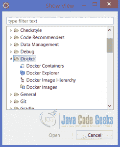

Eclipse 中的 Docker 视图

这些视图都展示了 [Docker](https://www.docker.com/) 容器或镜像的一些细节，其中 `Docker Explorer` 是两者的合一视图。

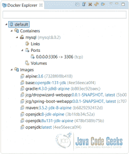

Docker Explorer 视图

如果你只对 [Docker](https://www.docker.com/) 容器感兴趣，有一个专门的 `Docker Containers` 视图，它使用了紧凑的表格化表示法。

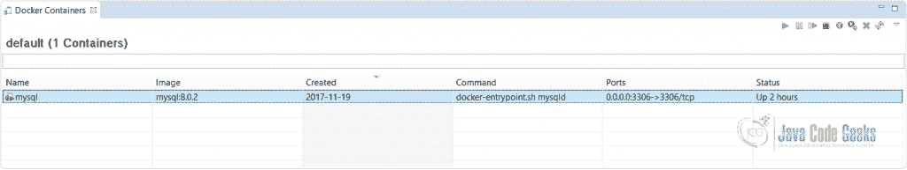

### Docker 容器视图

同样，如果你只想列出 [Docker](https://www.docker.com/) 镜像，专门的 `Docker Images` 视图在这里可以满足你的需求。

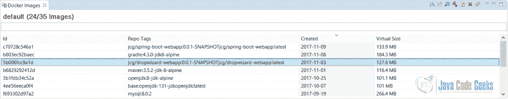

### Docker 镜像视图

最后但同样重要的是，还有一个非常有用的视图叫做 `Docker Image Hierarchy`（Docker 镜像层级）。它允许你查看特定镜像构建的所有层级。在这里，我们可以看到名为 `jcg/spring-boot-webapp:0.0.1-SNAPSHOT` 的带标签镜像（我们在教程上一部分构建的示例之一）是如何分层构建的。

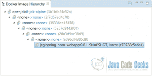

### Docker 镜像层级

但这些视图只是整个故事的一角。另一部分是一组新的 [Docker](https://www.docker.com/) 启动器，你可以使用它们来构建 [Docker](https://www.docker.com/) 镜像并运行你的 Java 应用（甚至运行完整的 [Docker Compose](https://docs.docker.com/compose/reference/overview/) 栈）作为 [Docker](https://www.docker.com/) 容器。

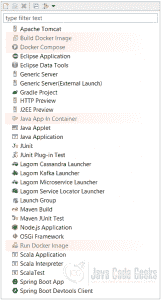

#### Eclipse 启动器

如果你想了解更多关于上述的所有视图和启动器，以及一般关于 [Eclipse](http://www.eclipse.org/) 中可用的 [Docker](https://www.docker.com/) 工具，[官方项目 Wiki](https://wiki.eclipse.org/Linux_Tools_Project/Docker_Tooling/User_Guide) 是一个极佳的起点。

## 2.2. IntelliJ IDEA

[JetBrains IntelliJ IDEA](https://www.jetbrains.com/idea/)（最新版本 `2017.2.6` 可）以[官方插件](https://www.jetbrains.com/help/idea/docker.html) 的形式提供了 [Docker](https://www.docker.com/) 工具支持。它不仅适用于旗舰版（`Ultimate Edition`），也适用于社区版（`Community Edition`），我们将在本节中使用社区版。

一旦安装了插件，新的 `Docker` 视图就会可用，其中内置了关于镜像和容器的所有细节。

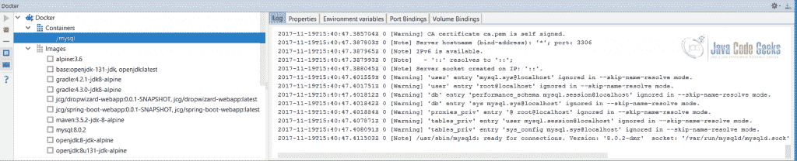

### IntelliJ Idea 中的 Docker

平心地说，拥有一个结构良好的单一视图，并且大部分所需组件都在附近（在不同的标签页中），这是非常方便的。

## 2.3. Oracle NetBeans

[NetBeans](https://netbeans.org/) 自最新的 `8.2` 版本以来，已将 [Docker](https://www.docker.com/) 工具作为 `Base IDE` 插件的一部分包含在（你可能一开始就激活了它）。激活插件后，`Services` 视图中会出现新增的 `Docker` 树节点。

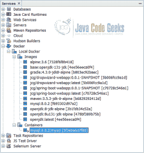

### Netbeans 中的 Docker

关于在 [NetBeans](https://netbeans.org/) 中集成 [Docker](https://www.docker.com/) 的所需功能的非常出色的总结和讨论已发布在[官方社区 Wiki](http://wiki.netbeans.org/Docker)上。如果你对这个话题好奇感兴趣，请查看。

## 3. 沿沿：Docker 中的你的 IDE

正如我们所见，大多数流行的 Java 开发 [IDE](https://en.wikipedia.org/wiki/Integrated_development_environment) 提供的 [Docker](https://www.docker.com/) 工具已经足够了，甚至可以说是非常卓越的。但如果我们尝试突破极限，将我们的 [IDE](https://en.wikipedia.org/wiki/Integrated_development_environment) 完全运行在 [Docker](https://www.docker.com/) 中，字面上的任何地方，会怎样？如果这听起来有点疯狂，确实如此，但是……

[Eclipse Che](https://www.eclipse.org/che/) 是 [Eclipse](http://www.eclipse.org/) 的下一代 [IDE](https://en.wikipedia.org/wiki/Integrated_development_environment)，它充分利用了容器化技术并完全运行在 [Docker](https://www.docker.com/) 上。在底层，它由 [REST(ful) web APIs](https://en.wikipedia.org/wiki/Representational_state_transfer) 驱动，并提供功能丰富的、基于浏览器的 [IDE](https://en.wikipedia.org/wiki/Integrated_development_environment)。


### Eclipse Che

这是一个非常有创新且年轻的项目，具有彻底革新我们所知的 [IDE](https://en.wikipedia.org/wiki/Integrated_development_environment) 概念的巨大潜力。看到未来如何发展将非常有趣，但这项技术已经到位并可供评估。

## 4. 那么调试如何？

调试在过去、现在，很可能在未来在发现、理解和解决程序中的缺陷或问题方面发挥关键作用。而且无论你是否喜欢，无论 [Docker](https://www.docker.com/) 多么强大，它都不会让我们的应用程序免于 bug。如果你以 [Docker](https://www.docker.com/) 容器运行 Java 应用，调试过程会有所不同，并会有详细解释。

## 5. 管理与监控

尽管 [Docker](https://www.docker.com/) 命令行工具以及相应的 [Docker Engine API](https://docs.docker.com/engine/api/) 可以让你完成任何任务，但许多人仍然倾向于使用 UI。

### 5.1. Portainer

我们将查看工具是 [Portainer](https://portainer.io/)，这是一个开源轻量级管理 UI，可以方便地管理不同的 [Docker](https://www.docker.com/) 环境（如 [Docker Swarm](https://docs.docker.com/swarm/) 集群）。并不意外 [Portainer](https://portainer.io/) 本身作为一个轻量级 [Docker](https://www.docker.com/) 容器运行。让我们运行一个：

```
docker run -d -p 9000:9000 -v /var/run/docker.sock:/var/run/docker.sock portainer/portainer
```

在 Windows 机器上，命令略有不同：

```
docker run -d -p 9000:9000 portainer/portainer
```

一旦 [Portainer](https://portainer.io/) 容器启动，你就可以通过 [`localhost:9000`](http://localhost:9000) 提供的精美 Web UI 访问它（如果你使用的是非原生 [Docker](https://www.docker.com/) 安装，则为 `http://<docker-machine>:9000`）。

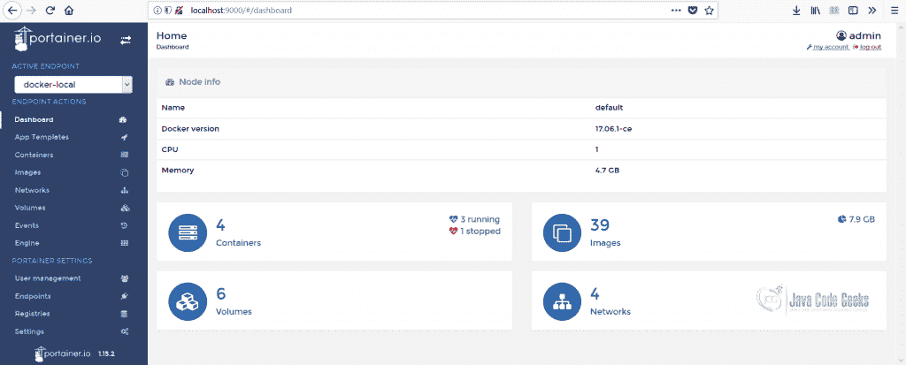

#### Portainer Dashboard 板

完成设置步骤（如有必要），将被导航到特定 [Docker](https://www.docker.com/) 环境的全方位视图，从简单的仪表板页面开始。你将识别左侧列出的 [Docker](https://www.docker.com/) 对象（如卷、网络、容器、镜像、……），从而可以选择其中任何一个以重定向到专用视图。

[Portainer](https://portainer.io/) 通过直观的 Web 界面展示的 [Docker](https://www.docker.com/) 功能列表令人惊叹。如果你偏好 UI 工具而非命令行工具，[Portainer](https://portainer.io/) 有极可能成为你的一站式服务中心。

### 5.2. cAdvisor

在我们开发应用程序时，通常需要更深入地了解容器的运行状况，无论是在讨论 CPU、内存还是网络利用率。幸运的是，这里有很多选择，其中我们将讨论的一个非常有用的工具是 [cAdvisor](https://github.com/google/cadvisor)（或全称 container advisor），它能分析运行中容器的资源使用情况和性能特征。

> “[cAdvisor](https://github.com/google/cadvisor) 让容器用户了解其运行容器的资源使用情况和性能特征。它是一个运行守护进程，负责收集、聚合、处理和导出运行容器的信息。具体来说，对于每个容器，它保留了资源隔离参数、历史资源使用情况、完整历史资源使用的直方图以及网络统计数据。这些数据按容器和整个机器进行导出。” – [`github.com/google/cadvisor`](https://github.com/google/cadvisor)

有趣的是，[cAdvisor](https://github.com/google/cadvisor) 不限于 [Docker](https://www.docker.com/)，它应该原生支持几乎任何其他容器类型。遗憾的是，对于 Windows 用户来说，[cAdvisor](https://github.com/google/cadvisor) 在该平台上的[支持有限](https://github.com/google/cadvisor/issues/1394)。尝试 [cAdvisor](https://github.com/google/cadvisor) 的最佳方法确实是将其作为 [Docker](https://www.docker.com/) 容器运行。

```
sudo docker run \
--volume=/:/rootfs:ro \
--volume=/var/run:/var/run:rw \
--volume=/sys:/sys:ro \
--volume=/var/lib/docker/:/var/lib/docker:ro \
--volume=/dev/disk/:/dev/disk:ro \
--publish=8080:8080 \
--detach=true \
--name=cadvisor \
google/cadvisor:latest
```

一旦容器启动运行，你就可以 [`localhost:8080`](http://localhost:8080) 访问 [cAdvisor](https://github.com/google/cadvisor) 的 Web UI（或者如果你使用的是非原生 [Docker](https://www.docker.com/) 安装，则为 `http://<docker-machine>:8080`）。


#### cAdvisor

Web UI 非常简单，但信息极其丰富。它收集了关于每个运行中的 [Docker](https://www.docker.com/) 容器资源和进程的大量细节，以及关于 [Docker](https://www.docker.com/) 主机本身的信息（CPU、内存、网络、存储……等）。无论如何，它是学习容器在运行时如何消耗和管理资源的非常有价值的工具。

### 5.3. ctop

最后，但同样重要，我们将使用 [ctop](https://ctop.sh) 工具作为结束，它以类似于 [top](https://linux.die.net/man/1/top) 的界面，提供了多个容器实时指标的简洁浓缩的概览。

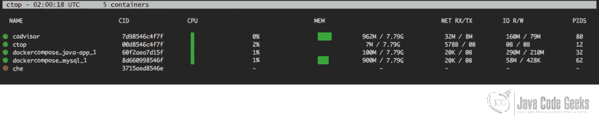

#### ctop

[ctop](https://ctop.sh) 不仅有一个摘要视图，还支持选择并关注任何单个容器的选项。

### 5.4. 以及更多……

[Docker](https://www.docker.com/) 工具领域非常繁荣，每天都有新的有趣项目涌现。我们刚刚涵盖了几个知名、成熟且实用的工具，但还有很多可以发现的内容，如果你感兴趣，请密切关注这一领域。

## 6. Docker Engine Metrics

[Docker](https://www.docker.com/) 引擎以完全兼容 [Prometheus](https://prometheus.io/)（一种非常流行的开源监控和告警解决方案）的格式暴露了许多有趣的指标。尽管此功能在很早之前就已经开放可用，但并没有多少人知道它，因此也没有多少人使用它。

该功能仍被视为实验性功能，因此默认情况下不可用，并且需要一些配置微调。[官方文档](https://docs.docker.com/engine/admin/prometheus/) 彻底描述了针对你运行 [Docker](https://www.docker.com/) 的操作系统需要执行的所有步骤。但本质上，第一步是修改 `daemon.json` 并在其中添加以下属性。

```
{
  "metrics-addr" : "localhost:9323",
  "experimental" : true
}
```

为了使此更改生效，应该重启 [Docker](https://www.docker.com/) 守护进程。紧接着，指标应该可以在 [`localhost:9323/metrics`](http://localhost:9323/metrics) 可用。


```json
{
  "metrics-addr": "localhost:9323",
  "experimental": true
}
```

在本教程的章节中，我们将学习一些框架，它们通过利用 [Docker](https://www.docker.com/) 及其工具，极大简化了基于 JVM 的应用的集成、组件和端到端测试。

## 2. 在开始之前

在[教程的第二部分](https://www.javacodegeeks.com/2017/09/docker-java-developers-docker-command-line.html) 中，我们简要提到过，作为 [Docker](https://www.docker.com/) 容器部署的 Java 应用至少应该使用 `Java 8 update 131` 或更高版本，但我们还没有机会详细阐述这一事实的重要性。

为了理解这个问题，让我们关注 JVM 如何处理 Java 应用中两个最重要的资源：内存（堆）和 CPU。为了便于说明，我们将在一个专用的虚拟机上安装 [Docker](https://www.docker.com/)，该虚拟机分配了 `2 个 CPU 核心` 和 `4GB 内存`。在记住此配置的情况下，让我们从 JVM 的视角来看这个问题：

```
$ docker run --rm openjdk:8-jdk-alpine java -XshowSettings:vm -XX:+UseParallelGC -XX:+PrintFlagsFinal –version
```

控制台上将打印大量信息，但对我们来说最感兴趣的部分是 `ParallelGCThreads` 和 `VM settings`。

```
...
uintx ParallelGCThreads = 2
...
VM settings:
Max. Heap Size (Estimated): 992.00M
Ergonomics Machine Class: server
Using VM: OpenJDK 64-Bit Server VM

openjdk version "1.8.0_131"
OpenJDK Runtime Environment (IcedTea 3.4.0) (Alpine 8.131.11-r2)
OpenJDK 64-Bit Server VM (build 25.131-b11, mixed mode)
```

在核心数少于（或等于）8 核的机器上，`ParallelGCThreads` [等于核心数](https://docs.oracle.com/javase/8/docs/technotes/guides/vm/gctuning/parallel.html)，而堆的默认最大限制约为[可用物理内存的 25%](https://docs.oracle.com/javase/8/docs/technotes/guides/vm/gc-ergonomics.html)。很酷，目前 JVM 报告的数字合理的。

让我们进一步尝试，使用 [Docker](https://www.docker.com/) 的资源管理能力将容器的 CPU 和内存使用分别限制为 `1 个核心` 和 `256Mb`。

```
$ docker run --rm --cpuset-cpus=0 --memory=256m openjdk:8-jdk-alpine java -XshowSettings:vm -XX:+UseParallelGC -XX:+PrintFlagsFinal -version
```

这次的情况有点不同：

```
...
uintx ParallelGCThreads = 1
...
VM settings:
Max. Heap Size (Estimated): 992.00M
Ergonomics Machine Class: client
Using VM: OpenJDK 64-Bit Server VM
```

JVM 能够相应调整 `ParallelGCThreads`，但内存限制似乎被完全忽略了。没错，为了让 JVM 感知容器环境，我们需要开启实验性 JVM 选项：`-XX:+UnlockExperimentalVMOptions -XX:+UseCGroupMemoryLimitForHeap`。

```
$ docker run --rm --cpuset-cpus=0 --memory=256m openjdk:8-jdk-alpine java -XshowSettings:vm -XX:+UseParallelGC -XX:+PrintFlagsFinal  -XX:+UnlockExperimentalVMOptions -XX:+UseCGroupMemoryLimitForHeap –version
```

现在的结果好多了：

```
...
uintx ParallelGCThreads = 1
...
VM settings:
Max. Heap Size (Estimated): 112.00M
Ergonomics Machine Class: client
Using VM: OpenJDK 64-Bit Server VM
```

好奇的读者可能会奇怪，为什么最大堆大小远高于分配给容器的可用物理内存的 `25%`。答案是 [Docker](https://www.docker.com/) 也为交换空间（swap）分配了内存（如果没有指定，真实值为 `256Mb + 256Mb = 512Mb`）。

应用很少不依赖某种数据存储。而且，不出所料，大多数此类数据存储会将数据持久化到某种存储设备上。这很好，但数据存储的存在经常使测试面临挑战，特别是在数据层面调用测试例隔离时。

## 3. 在内存中存储数据

你可能已经猜到了，[Docker](https://www.docker.com/) 可以极大减少创建可复测试场景的努力。尽管如此，数据存储仍然是整体执行时间的主要贡献。

正如我们即将看到的，[Docker](https://www.docker.com/) 有王牌可以帮助我们：[tmpfs](https://docs.docker.com/engine/admin/volumes/tmpfs/)。它为容器提供了一种不永久写入数据的方法，将其保留在宿主机内存中（如果内存不足则使用交换空间）。

有多种选项可以将由 [tmpfs](https://docs.docker.com/engine/admin/volumes/tmpfs/) 支持的卷挂载到容器，但目前推荐的方法是使用 `--mount` 命令行参数（如果是 [docker-compose](https://docs.docker.com/compose/) 则使用规范中的 [tmpfs](https://docs.docker.com/compose/compose-file/#tmpfs) 章节）。

```bash
docker run --rm -d \
--name mysql \
--mount type=tmpfs,destination=/var/lib/mysql \
-e MYSQL_ROOT_PASSWORD='p$ssw0rd' \
-e MYSQL_DATABASE=my_app_db \
-e MYSQL_ROOT_HOST=% \
mysql:8.0.2
```

测试执行的速度提升可能是巨大的，但你永远不应该在生产环境中（极可能在任何其他环境中）中使用此功能，因为容器停止时，[tmpfs](https://docs.docker.com/engine/admin/volumes/tmpfs/) 挂载就会消失。即使容器被提交（commit），[tmpfs](https://docs.docker.com/engine/admin/volumes/tmpfs/) 挂载也不会被保存。

## 4. 场景

掌握了这些技巧和技巧后，我们可以讨论一下即将实现的测试场景。从本质上，为我们在教程之前的部分开发的一个应用程序运行端到端测试是非常棒的。该测试场景的最终目标是验证用于任务管理的 [REST(ful) APIs](https://en.wikipedia.org/wiki/Representational_state_transfer) 是否可用并返回预期的结果。

从部署栈的角度来看，这意味着我们必须拥有一个 [MySQL](https://www.mysql.com/) 实例和一个应用程序实例（让我们选择之前开发过的基于 [Spring Boot](https://projects.spring.io/spring-boot/) 的那一个，不过这其实并不重要）。该应用程序暴露了 [REST(ful) APIs](https://en.wikipedia.org/wiki/Representational_state_transfer) 并且应该能够与 [MySQL](https://www.mysql.com/) 实例进行通信。显然，我们希望这些实例以 [Docker](https://www.docker.com/) 容器的形式运行。

该测试场景将调用任务管理的 [REST(ful) APIs](https://en.wikipedia.org/wiki/Representational_state_transfer) 来获取所有可用任务的列表，并使用出色的 [REST-assured](http://rest-assured.io/) 框架作为测试脚架。此外，我们所有的测试场景都将基于 [JUnit](http://junit.org/) 框架。

## 5. Testcontainers

我们将看到的第一个框架是 [TestContainers](https://www.testcontainers.org/)，这是一个支持 [JUnit](http://junit.org/junit4/) 测试的 Java 库，并为常见的数据库、Selenium Web 浏览器或任何可以在 [Docker](https://www.docker.com/) 容器中运行的内容提供轻量级、丢弃的实例。

让我们看看如何利用 [TestContainers](https://www.testcontainers.org/) 将我们之前概述的测试场景到运行的 [JUnit](http://junit.org/junit4/) 测试中。最后，它看起来非常直观。

```java
package com.javacodegeeks;

import static io.restassured.RestAssured.when;
import static org.hamcrest.CoreMatchers.equalTo;

import org.junit.BeforeClass;
import org.junit.ClassRule;
import org.junit.Test;
import org.testcontainers.containers.GenericContainer;
import org.testcontainers.containers.Network;
import org.testcontainers.containers.wait.HostPortWaitStrategy;

import io.restassured.RestAssured;

public class SpringBootAppIntegrationTest {
    @ClassRule
    public static Network network = Network.newNetwork();

    @ClassRule
    public static GenericContainer<?> mysql = new GenericContainer<>("mysql:8.0.2")
        .withEnv("MYSQL_ROOT_PASSWORD", "p$ssw0rd")
        .withEnv("MYSQL_DATABASE", "my_app_db")
        .withEnv("MYSQL_ROOT_HOST", "%")
        .withExposedPorts(3306)
        .withNetwork(network)
        .withNetworkAliases("mysql")
        .waitingFor(new HostPortWaitStrategy());

    @ClassRule
    public static GenericContainer<?> javaApp = new GenericContainer<>("jcg/spring-boot-webapp:latest")
        .withEnv("DB_HOST", "mysql")
        .withExposedPorts(19900)
        .withStartupAttempts(3)
        .withNetwork(network)
        .waitingFor(new HostPortWaitStrategy());

    @BeforeClass
    public static void setUp() {
        RestAssured.baseURI = "http://" + javaApp.getIpAddress();
        RestAssured.port = javaApp.getMappedPort(19900);
    }

    @Test
    public void getAllTasks() {
        when()
            .get("/tasks")
            .then()
            .statusCode(200)
            .body(equalTo("[]"));
    }
}
```

[TestContainers](https://www.testcontainers.org/) 自带了一组预定义的专用容器（用于 [MySQL](https://www.mysql.com/)、[PostgreSQL](https://www.postgresql.org/)、[Oracle XE](http://www.oracle.com/database/technologies/express-edition/index.html) 等），但你始终可以使用自己的（如我们在上面的代码段中所的那样）。它还原生支持 [Docker Compose](https://www.testcontainers.org/usage/docker-compose.html) 规范。

如果你使用 Windows 作为开发平台，请注意 [TestContainers](https://www.testcontainers.org/) 并没有在 Windows 上进行定期测试。如果你仍然想尝试，目前的建议是使用 [alpha release](https://www.testcontainers.org/usage/windows_support)。

## 6. Arquillian

列表中的下一个是 [Arquillian](http://arquillian.org/)，这是一个针对 JVM 的创新且高度扩展的测试平台，允许开发者轻松地为 Java 中间件创建自动化集成、功能和验收测试。[Arquillian](http://arquillian.org/) 确实更是一个测试平台而非框架，其中 [Docker](https://www.docker.com/) 支持只是许多选项之一。

让我们看看上一节中看到的相同测试在翻译为 [Arquillian Cube](http://arquillian.org/arquillian-cube/) 后会是什么样，它是一个 [Arquillian](http://arquillian.org/) 扩展，可用于管理 [Docker](https://www.docker.com/) 容器。


```java
public class SpringBootAppIntegrationTest {
    @ClassRule
    public static NetworkDslRule network = new NetworkDslRule("my-app-network");

    @ClassRule
    public static ContainerDslRule mysql = new ContainerDslRule("mysql:8.0.2", "mysql")
        .withEnv("MYSQL_ROOT_PASSWORD", "p$ssw0rd")
        .withEnv("MYSQL_DATABASE", "my_app_db")
        .withEnv("MYSQL_ROOT_HOST", "%")
        .withExposedPorts(3306)
        .withNetworkMode("my-app-network")
        .withAwaitStrategy(AwaitBuilder.logAwait("/usr/sbin/mysqld: ready for connections"));

    @ClassRule
    public static ContainerDslRule javaApp = new ContainerDslRule("jcg/spring-boot-webapp:latest", "spring-boot-webapp*")
        .withEnv("DB_HOST", "mysql")
        .withPortBinding(19900)
        .withNetworkMode("my-app-network")
        .withLink("mysql", "mysql")
        .withAwaitStrategy(AwaitBuilder.logAwait("Started AppStarter"));

    @BeforeClass
    public static void setUp() {
        RestAssured.baseURI = "http://" + javaApp.getIpAddress();
        RestAssured.port = javaApp.getBindPort(19900);
    }

    @Test
    public void getAllTasks() {
        when()
            .get("/tasks")
            .then()
            .statusCode(200)
            .body(equalTo("[]"));
    }
}
```

它与 [TestContainers](https://www.testcontainers.org/) 有一些不同之处，但总的来说，这个测试用例看起来已经很熟悉了。[Arquillian Cube](http://arquillian.org/arquillian-cube/) 目前似乎还不支持（至少在运行 [Container Objects DSL](http://arquillian.org/arquillian-cube/#_container_objects_dsl) 时）的一个关键特性是网络别名（network aliasing），因此为了连接我们的 [Spring Boot](https://projects.spring.io/spring-boot/) 应用和 [MySQL](https://www.mysql.com/) 后端，我们不得不退回到[传统的容器链接](https://docs.docker.com/engine/userguide/networking/default_network/dockerlinks/)。

值得一提的是 [Arquillian Cube](http://arquillian.org/arquillian-cube/) 有许多其他方法可以从测试场景中管理 [Docker](https://www.docker.com/) 容器，包括对 [Docker Compose](https://www.testcontainers.org/usage/docker_compose.html) 规范的支持。顺便提一下，[Arquillian](http://arquillian.org/) 周围的开发速度令人惊叹，它完全有机会成为现代 Java 应用的一站式测试平台。

## 7. Overcast

[Overcast](https://github.com/xebialabs/overcast) 是来自 [XebiaLabs](https://xebialabs.com/) 的 Java 库，旨在对云端主机进行测试。[Overcast](https://github.com/xebialabs/overcast) 是最早提供广泛 [Docker](https://www.docker.com/) 支持的测试框架之一，同时追求更宏大的目标：抽象测试场景中的主机管理。它有很多非常有趣的功能，但遗憾的是似乎不再活跃维护，最后一次发布于 2015 年。尽管如此，它具有一些独特的价值，仍然值得关注。

[Overcast](https://github.com/xebialabs/overcast) 使用配置驱动的方法来描述测试下的主机，这是由于它并不仅仅面向容器和/或 [Docker](https://www.docker.com/)。

```conf
mysql {
  name="mysql"
  dockerImage="mysql:8.0.2"
  remove=true
  removeVolume=true
  env=["MYSQL_ROOT_PASSWORD=p$ssw0rd", "MYSQL_DATABASE=my_app_db", "MYSQL_ROOT_HOST=%"]
}

spring-boot-webapp {
  dockerImage="jcg/spring-boot-webapp:latest"
  exposeAllPorts=true
  remove=true
  removeVolume=true
  env=["DB_HOST=mysql"]
  links=["mysql:mysql"]
}
```

在有了这些存储在 `overcast.conf` 中的配置后，我们可以在测试场景中通过名称来引用容器。

```java
public class SpringBootAppIntegrationTest {
    private static CloudHost mysql = CloudHostFactory.getCloudHost("mysql");
    private static CloudHost javaApp = CloudHostFactory.getCloudHost("spring-boot-webapp");

    @BeforeClass
    public static void setUp() {
        mysql.setup();
        javaApp.setup();

        RestAssured.baseURI = "http" + javaApp.getHostName();
        RestAssured.port = javaApp.getPort(19900);

        await()
            .atMost(20, TimeUnit.SECONDS)
            .ignoreExceptions()
            .pollInterval(1, TimeUnit.SECONDS)
            .untilAsserted(() ->
                when()
                    .get("/application/health")
                    .then()
                    .statusCode(200))
            );
    }

    @AfterClass
    public static void tearDown() {
        javaApp.teardown();
        mysql.teardown();
    }

    @Test
    public void getAllTasks() {
        when()
            .get("/tasks")
            .then()
            .statusCode(200)
            .body(equalTo("[]"));
    }
}
```

除了健康检查部分外，它看起来很直接。`Overcast` 没有提供验证容器已启动并准备好处理请求的方法，因此我们引入了另一个优秀的库 [Awaitility](https://github.com/awaitility/awaitility) 来补偿这一点。`Overcast` 有许多潜和优势，希望我们能看到它恢复活跃开发。对于这个示例，为了使用最新的 `Overcast` 特性，我们必须从源码构建它。

## 8. Docker Compose Rule

最后但同样重要的是，让我们讨论 [Docker Compose Rule](https://github.com/palantir/docker-compose-rule)，这是来自 [Palantir Technologies](https://www.palantir.com/) 的一个库，用于执行与 [Docker Compose](https://docs.docker.com/compose/reference/) 容器交互的 [JUnit](http://junit.org/4/) 测试。它在底层使用 `docker-compose` 命令行工具，目前不支持 Windows 平台。正如你所料，我们必须从 `docker-compose.yml` 规范开始，以便之后能被 `Docker Compose Rule` 读取。这里是一个示例。

```yaml
version: '2.1'
services:
  mysql:
    image: mysql:8.0.2
    environment:
      - MYSQL_ROOT_PASSWORD=p$$w0rd
      - MYSQL_DATABASE=my_app_db
      - MYSQL_ROOT_HOST=%
    expose:
      - 3306
    healthcheck:
      test: ["CMD-SHELL", "ss -lt :3306 | grep 3306"]
      interval: 10s
      timeout: 5s
      retries: 3
    tmpfs:
      - /var/lib/mysql
    networks:
      - my-app-network
  java-app:
    image: jcg/spring-boot-webapp:latest
    environment:
      - DB_HOST=mysql
    ports:
      - 19900
    depends_on:
      mysql:
        condition: service_healthy
    networks:
      - my-app-network
networks:
  my-app-network:
    driver: bridge
```

这样，我们只需要将此规范传递给 `Docker Compose Rule`，如下下面的代码所示。请注意，我们为场景增加了健康检查，以确保我们的 [Spring Boot](https://projects.spring.io/spring-boot/) 应用已完全启动。

```java
public class SpringBootAppIntegrationTest {
    @ClassRule
    public static DockerComposeRule docker = DockerComposeRule.builder()
            .file("src/test/resources/docker-compose.yml")
            .waitingForService("java-app",
                HealthChecks.toRespond2xxOverHttp(19900, (port) ->
                    port.inFormat("http://" + $HOST:$EXTERNAL_PORT/application/health")),
                Duration.standardSeconds(30)
            )
            .shutdownStrategy(ShutdownStrategy.GRACEFUL)
            .build();

    @BeforeClass
    public static void setUp() {
        final DockerPort port = docker.containers().container("java-app").port(19900);
        RestAssured.baseURI = port.inFormat("http://" + $HOST);
        RestAssured.port = port.getExternalPort();
    }
}
```

```java
| 23 | .get("/tasks") |
| 24 | .then() |
| 25 | .statusCode(200) |
| 26 | .body(equalTo("[]")); |
| 27 | } |
| 28 | }
```

这可能是将 [Docker](https://www.docker.com/) 集成到你的 [JUnit](http://junit.org/) 测试场景中最简单的方法。而且巧的是，相同的 [Docker Compose](https://docs.docker.com/compose/reference/overview/) 规范也可以为其他目的进行共享和复用。

## 9. 结论

在教程的这一部分中，我们讨论了 [Docker](https://www.docker.com/) 如何颠覆并从根本上改变了我们在实际项目中使用一些最复杂的测试策略。正如我们通过熟悉不同的 Java 测试框架所看到的，[Docker](https://www.docker.com/) 的支持非常出色，但取决于你所依赖的操作系统和 [Docker](https://www.docker.com/) 安装情况，为项目选择合适的工具可能是一个挑战。

然而，能力越大，责任越大。[Docker](https://www.docker.com/) 并不是万灵药，请始终记住[测试金字塔](https://martinfowler.com/bliki/TestPyramid.html)，并尝试找到最适合你的平衡。

## 10. 下一步计划

在教程的下一部分中，我们将讨论一些典型的部署编排，在这些场景中 [Docker](https://www.docker.com/) 容器（以及通用容器）是一等公民。

# Java 开发者的 Docker

# 在 Docker 上部署

## 1. 引言

在 [Docker](https://www.docker.com/) 出现之前，许多公司就已经使用基于容器的虚拟化技术在生产环境中部署应用程序（包括基于 JVM 的应用程序）。然而，主要因为 [Docker](https://www.docker.com/) 的出现，使用容器的部署实践在如今已成为主流。

在教程的这一部分中，我们将浏览一些最流行的编排和集群管理引擎（也涵盖了一些云服务），它们原生支持容器化应用的部署和生命周期管理。

我们将讨论的话题值得写好几本书（至少！），所以这部分的目标是作为一个介绍。如果你对其中任何内容产生特别兴趣，公共访问领域有大量的资源可用。

## 2. 容器作为部署单元

如今，容器（特别是 [Docker](https://www.docker.com/) 容器）已成为标准的软件部署单元。它们预装了应用程序运行可能需要的所有内容：代码（或二进制文件）、运行时、系统工具和库，任何你想到的。

管理和编排基于容器的部署是一个非常热门的话题，正如我们即将看到的，现有的每一个解决方案从一开始就提供了这种功能。

## 3. 使用 Kubernetes 进行编排

在极少数还没听说过它的情况下，[Kubernetes](https://kubernetes.io/) 是一个用于自动化部署、扩展和管理容器化应用的开源系统。它是开源社区中最令人兴奋、创新创新且最活跃的项目之一。可能，如果你或你的公司正在寻找容器编排解决方案，[Kubernetes](https://kubernetes.io/) 是目前的事实标准。

[Kubernetes](https://kubernetes.io/) 能为你做很多事情，但在教程的这部分，我们将看到如何仅使用 [Kubernetes](https://kubernetes.io/) 特性的最小子集，轻松地部署我们的容器化 [Spring Boot](https://projects.spring.io/spring-boot/) 应用栈，包括 [MySQL](https://dev.mysql.com/doc/connector-j/8.0/en/)。


在本地机器上搭建一个完整的 [Kubernetes](https://kubernetes.io/) 集群听起来可能不太实际，但幸运的是，[Kubernetes](https://kubernetes.io/)可以通过 [minikube](https://kubernetes.io/docs/getting-started-guides/minikube/#quickstart) 以开发模式部署。这个强大的工具会在虚拟机内部启动单节点 [Kubernetes](https://kubernetes.io/) 集群，这样你就可以使用笔记本电脑或桌面电脑进行日常开发。

假设你已经在选择的操作系统上[安装了 minikube](https://kubernetes.io/docs/getting-started-guides/minikube/#installation)，让我们进入下一步，并在上面部署几个 [Docker](https://www.docker.com/) 容器。

```bash
$ minikube start
```

当 [minikube](https://kubernetes.io/docs/getting-started-guides/minikube/#quickstart) 启动时，我们可以立即启动 [MySQL](https://dev.mysql.com/doc/connector-j/8.0/en/) 部署，坚持我们在整个教程中使用的版本 `8.0.2`。

```bash
$ kubectl run mysql --image=mysql:8.0.2 --env='MYSQL_ROOT_PASSWORD=p$ssw0rd' --env='MYSQL_DATABASE=my_app_db' --env='MYSQL_ROOT_HOST=%%' --port=3306
```

这需要一些时间，最后你应该能看到 [MySQL](https://dev.mysql.com/doc/connector-j/8.0/en/) 容器（或者准确地说，是 [Kubernetes](https://kubernetes.io/) pod）正在运行：

```bash
$ kubectl get pod
NAME READY STATUS RESTARTS AGE
mysql-5d4dbcd58-6ck 1/1 Running 0 22m
```

太棒了，现在我们需要使用已部署的 [Kubernetes](https://kubernetes.io/) 集群的 [Docker](https://www.docker.com/) 设置，重新构建我们之前之前开发的 [Spring Boot](https://projects.spring.io/spring-boot/) 应用的 Docker 镜像（或者，我们也可以使用私有仓库）。

```bash
$ eval $(minikube env)
$ docker build \
  --build-arg BUILD_VERSION=0.1-SNAPSHOT \
  -f Dockerfile.build \
  -t jcg/spring-boot:latest \
  -t jcg/spring-boot:0.1-SNAPSHOT
```

完成这一步后，我们就有了可用于 [Kubernetes](https://kubernetes.io/) 部署的 [Docker](https://www.docker.com/) 镜像，并可以将其作为另一个 pod 运行。

```bash
$ kubectl run spring-boot-webapp --image=jcg/spring-boot:latest --env='DB_HOST=mysql.default.svc.local' --port=19900 --image-pull-policy=Never
```

让我们检查是否有两个 pod 正在运行：

```bash
$ kubectl get pod
NAME READY STATUS RESTARTS AGE
mysql-5d4dbcd58-ck 1/1 Running 0 33m
spring-boot-webapp-5ff845bf5-gfqv 1/1 Running 0 31m
```

最后但同样重要，我们必须将我们的 [Spring Boot](https://projects.spring.io/spring-boot/) 应用部署暴露为 [Kubernetes](https://kubernetes.io/) 服务以便可以访问：

```bash
$ kubectl expose deployment spring-boot-webapp --type=NodePort
```

并快速检查它是否列在其他服务之中：

```bash
$ kubectl. get service
NAME TYPE CLUSTER-IP EXTERNAL-IP PORT(S) AGE
kubernetes ClusterIP 10.96.0.1 443/TCP 4d
spring-boot-webapp NodePort 10.109.108.87 19900:30253/TCP 40s
```

基本上就是这样，通过几个简单的步骤，我们让 [Docker](https://www.docker.com/) 容器启动并运行，且全部由 [Kubernetes](https://kubernetes.io/) 管理。让我们确保应用程序实际上通过了所有的健康检查：

```bash
$ curl $(minikube service spring-boot-webapp --url)/application/health
{
"status": "UP",
"details": {
"diskSpace": {
```

```json
{
  "06": {
    "status": "UP",
    "details": {
      "total": 17293533184,
      "free": 14476333056,
      "threshold": 10485760
    }
  },
  "db": {
    "status": "UP",
    "details": {
      "database": "MySQL",
      "hello": 1
    }
  }
}
```

事实确实如此！为了结束关于 [Kubernetes](https://kubernetes.io/) 的讨论，值得提到的是 [Docker](https://www.docker.com/) 已经包含了对 [Kubernetes](https://kubernetes.io/) 在[某些边缘通道](https://docs.docker.com/docker-for-mac/#kubernetes) 上的早期原生集成。

# 4. 使用 Apache Mesos 进行编排

[Apache Mesos](http://mesos.apache.org/) 可疑是目前使用的最古老的资源和集群管理框架之一。它有效地将资源（CPU、内存、存储）从物理或虚拟硬件中抽象出来，允许构建和运行容错且弹性的分布式系统。它的优势之一是极高的可扩展性和对容器化应用部署的支持，然而它也以相当复杂且难以操作而闻名。

从架构上来说，[Apache Mesos](http://mesos.apache.org/) 由一个管理 `agents`（运行在每个集群节点上）的 `master` 以及 `frameworks`（在这些 `agents` 上运行 `tasks`）组成。`master` 通过向框架提供 `resource offers`（资源提议）实现了跨框架的资源（CPU、RAM、……）的细粒度共享。我们仅关注必要的组件，让我们来看看如何使用 [docker-compose](https://docs.docker.com/compose/compose-file/compose-file/) 规范定义 [Apache Mesos](http://mesos.apache.org/) 集群。

```yaml
version: "3"
services:
  zookeeper:
    image: zookeeper
    networks:
      - mesos-network
    environment:
      ZOO_TICK_TIME: 2000
      ZOO_INIT_LIMIT: 10
      ZOO_SYNC_LIMIT: 5
      ZOO_MAX_CLIENT_CNXNS: 128
      ZOO_PORT: 2181
      ZOO_MY_ID: 1
  mesos-master:
    image: mesosphere/mesos-master:1.3.2
    networks:
      - mesos-network
    ports:
      - "5050:5050"
    environment:
      MESOS_ZK: zk://zookeeper:2181/mesos
      MESOS_QUORUM: 1
      MESOS_CLUSTER: docker-compose
      MESOS_REGISTRY: replicated_log
    volumes:
      - /var/run/docker.sock:/run/docker.sock
    depends_on:
      - zookeeper
  mesos-slave:
    image: mesosphere/mesos-slave:1.3.2
    privileged: true
    networks:
      - mesos-network
    ports:
      - "5051:5051"
    links:
      - zookeeper
      - mesos-master
    environment:
      - MESOS_CONTAINERERS=docker
      - MESOS_ISOLATOR=cgroups, cgroups/mem
      - MESOS_LOG_DIR=var/log
      - MESOS_MASTER=zk://zookeeper:2181/mesos
      - MESOS_PORT=5051
      - MESOS_EXECUTOR_REGISTRATION_TIMEOUT=5mins
      - MESOS_EXECUTOR_SHUTDOWN_GRACE_PERIOD=90secs
      - MESOS_DOCKER_STOP_TIMEOUT=90secs
      - MESOS_RESOURCES=cpus:2,mem:2080,disk:5600,ports:1900-1999
      - MESOS_WORK_DIR=/var/lib/mesos
      - MESOS_SYSTEMD_ENABLE_SUPPORT=false
    volumes:
      - /var/run/docker.sock:/run/docker.sock
    dns:
      - mesos
    depends_on:
      - mesos-master
      - mesos-dns
  marathon:
    image: mesosphere/marathon:v.5.6
    networks:
      - mesos-network
    environment:
      MARATHON_ZK=zk://zookeeper:2181/marathon
      MARATHON_MASTER=zk://zookeeper:2181/mesos
    ports:
      - "8080:8080"
    depends_on:
      - mesos-master
  mesos-dns:
    image: mesosphere/mesos-dns:v0.6.0
    command: ["/usr/bin/mesos-dns", "-v=2", "-config=/config.json"]
    ports:
      - 53:53/udp
      - 8123:8123
    volumes:
      - ./config.json:/config.json
      - /tmp
    links:
      - zookeeper
    dns:
      - 8.8.8.8
    networks:
      - mesos-network
```

正如我们所见，除了仅仅是 [Apache Mesos](http://mesos.apache.org/)（以及 [Apache Zookeeper](https://zookeeper.apache.org/)）之外，还有许多部分。其核心是 [Marathon](http://mesosphere.github.io/marathon/) 框架，这是一个容器编排平台。[Marathon](http://mesosphere.github.io/marathon/) 提供了一个漂亮的 [Web UI](https://mesosphere.github.io/marathon-ui.html) 以及用于管理应用的 [REST(ful) APIs](https://mesosphere.github.io/marathon/api-console/index.html)，并使用 [JSON](https://www.json.org/) 格式规范。遵循我们的 [Spring Boot](https://projects.spring.org/) 应用栈，让我们看一下 MySQL 部署示例（存储在 `mysql.json` 中）：

```json
{
  "id": "/jcg/mysql",
  "container": {
    "type": "DOCKER",
    "docker": {
      "image": "mysql:8.0",
      "network": "BRIDGE",
      "portMappings": [
        {
          "containerPort": 3306,
          "servicePort": 3306,
          "hostPort": 0
        }
      ],
      "parameters": [
        {
          "key": "hostname",
          "value": "mysql"
        }
      ]
    }
  },
  "env": {
    "MYSQL_ROOT_PASSWORD": "p$ss0rd",
    "MYSQL_DATABASE": "my_app",
    "MYSQL_ROOT_HOST": "%"
  },
  "instances": 1,
  "cpus": 0.1,
  "mem": 500,
  "healthChecks": [
    {
      "protocol": "COMMAND",
      "command": { "value": "ss -ltn src :3306 | grep 3306" },
      "gracePeriodSeconds": 10,
      "intervalSeconds": 10,
      "timeoutSeconds": 5,
      "maxConsecutiveFailures": 2
    }
  ]
}
```

现在，要让 [MySQL](https://dev.mysql.com/doc/connector-j/8.0/en/) 容器运行起来，我们只需要通过其 [REST(ful) APIs](https://mesosphere.github.io/marathon/api-console/index.html) 将此描述提交给 [Marathon](http://mesosphere.github.io/marathon/)（假设我们的 [Apache Mesos](http://mesos.apache.org/) 已经运行），例如：

```bash
curl -X POST http://localhost:8080/v2/apps -d @mysql.json -H "Content-type: application/json"
```

看起来不错，让我们对 [Spring Boot](https://projects.spring.io/spring-boot/) 应用也进行同样的操作，从 [Marathon](http://mesosphere.github.io/marathon/) 部署描述符开始，并将其持久化到 `spring-webapp.json` 文件。


```json
{
  "id": "/jcg/spring-webapp",
  "container": {
    "type": "DOCKER",
    "docker": {
      "image": "jcg/spring-boot-webapp:latest",
      "network": "BRIDGE",
      "portMappings": [
        {
          "containerPort": 19900,
          "servicePort": 19900,
          "hostPort": 19900
        }
      ],
      "parameters": [
        {
          "key": "hostname",
          "value": "spring-webapp"
        }
      ]
    }
  },
  "env": {
    "DB_HOST": "172.17.0.2"
  },
  "instances": 1,
  "cpus": 0.1,
  "mem": 512,
  "healthChecks": [
    {
      "protocol": "COMMAND",
      "command": {
        "value": "nc -z localhost 19900"
      },
      "gracePeriodSeconds": 25,
      "intervalSeconds": 10,
      "timeoutSeconds": 5,
      "maxConsecutiveFailures": 3
    }
  ]
}
```

下一步是将其提交到 [Marathon](http://mesosphere.github.io/marathon/)：

```bash
$ curl -X POST http://localhost:8080/v2/apps -d @spring-webapp.json -H "Content-type: application/json"
{
  "id": "/jcg/spring-webapp",
  "container": {
    …
  },
  …
}
```

我们实际上已经完成了！一旦部署完成，我们应该能够看到处于运行状态的应用程序堆栈。例如，可以使用 [Marathon](http://mesosphere.github.io/marathon/) 的 [web UI](https://mesosphere.github.io/marathon/docs/marathon-ui.html)，该界面可以通过 [http://localjost:8080/ui/] 访问。

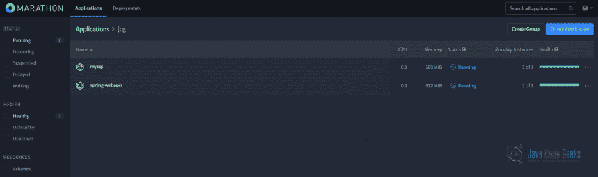

## Marathon 应用

好奇的读者可能会想，我们是如何将这两个 [Marathon](http://mesosphere.github.io/marathon/) 应用——[Spring Boot](https://projects.spring.io/spring-boot/) 和 [MySQL](https://dev.mysql.com/doc/connector-j/8.0/en/)——连接在一起的。对于这个特定案例，我们使用了由 [Mesos-DNS](https://mesosphere.github.io/mesos-dns/) 实现的 [Apache Mesos](http://mesos.apache.org/) 的[服务发现和负载均衡](https://mesosphere.github.io/marathon/docs/service-discovery-load-balancing.html)能力。

为了演示它们的作用，以下是如何通过名称 `mysql-jcg.marathon.mesos` 查询 [MySQL](https://dev.mysql.com/doc/connector-j/8.0/en/) 实例的 IP 地址：

```bash
$ curl http://localhost:8123/v1/hosts/mysql-jcg.marathon.mesos
[
  {
    "host": "mysql-jcg.marathon.mesos",
    "ip": "172.17.0.2"
  }
]
```

像往常一样，让我们向其健康端发送请求来确认 [Spring Boot](https://projects.spring.io/spring-boot/) 应用已启动并运行：

```bash
$ curl http://localhost:19900/application
{
  "details": {
    "db": {
      "database": "MySQL",
      "hello": 1
    },
    "status": "UP"
  },
  "diskSpace": {
    "details": {
      "free": 440180264,
      "threshold": 1048576,
      "total": 4953692560
    },
    "status": "UP"
  },
  "status": "UP"
}
```

## 5. 使用 Docker Swarm 进行编排

自从 [Docker](https://www.docker.com/) 在引擎中嵌入集群管理和编排功能已经有一段时间了。这个编排层曾被称为 [Docker Swarm](https://github.com/docker/swarm)，但后来演变成了本质上一种特殊的模式（[swarm mode](https://docs.docker.com/engine/swarm/)），用于其中运行 [Docker Engine](https://docs.docker.com/engine/)。

如果你非常看重 [Docker](https://www.docker.com/) 并且不想寻找其他东西，那么在 [swarm mode](https://docs.docker.com/engine/swarm/) 下运行 [Docker Engine](https://docs.docker.com/engine/) 可以作为一个很好的编排器选项。它也非常容易上手。

```bash
$ docker swarm init
```

从概念上讲，除了 [Docker Engine](https://docs.docker.com/engine/) 本身的变化外，集群模式还引入了很多区别。首先，你应该开始以“服务”来思考，而不是“容器”。关于所有都运行在单个 [Docker](https://www.docker.com/) 主机上的假设将不再准确，因为集群将由许多分布在网络中的多个 [Docker](https://www.docker.com/) 主机组成。

在 [swarm mode](https://docs.docker.com/engine/swarm/) 下运行 [Docker Engine](https://docs.docker.com/engine/) 时，我们可以使用已经熟悉的 [docker-compose](https://docs.docker.com/compose/compose-file/compose-file/) 规范来部署整个应用程序（服务）堆栈。但只有一个限制，[docker-compose](https://docs.docker.com/compose/compose-file/compose-file/) 文件格式应该是版本 `3（或以上）`，以便在 [Docker Compose](https://docs.docker.com/compose/overview/) 和 [Docker Engine](https://docs.docker.com/engine/) 的 [swarm mode](https://docs.docker.com/engine/swarm/) 之间兼容。

为了查看 [swarm mode](https://docs.docker.com/engine/swarm/) 的效果，让我们稍微重构我们的 [Spring Boot](https://projects.spring.io/spring-boot/) 应用堆栈，以符合 [docker-compose](https://docs.docker.com/compose/compose-file/compose-file/) 文件格式版本 `3.3`。

```yaml
version: '3.3'

services:
  mysql:
    image: mysql:8.0.2
    environment:
      - MYSQL_ROOT_PASSWORD=password
      - MYSQL_DATABASE=my_app
      - MYSQL_HOST_HOST
    healthcheck:
      test: ["CMD-SHELL", "ss -ltn src :3306 | grep 3306"]
      interval: 10s
      timeout: 5s
      retries: 3
    networks:
      - my-app-network

  java-app:
    image: jcg/spring-boot-webapp:latest
    environment:
      - DB_HOST=mysql
    ports:
      - 19900:19900
    depends_on:
      - mysql
    healthcheck:
      test: ["CMD-SHELL", "nc -z localhost 19900"]
      interval: 10s
      timeout: 5s
      retries: 3
    networks:
      - my-app-network

networks:
  my-app-network:
    driver: overlay
```

坦率地说，我们不需要做太多的更改。特别是为了支持[集群模式](https://docs.docker.com/engine/swarm/)，有一系列特定的命令被引入了 [docker](https://docs.docker.com/engine/reference/commandline/cli/) 工具中：`docker stack`。我们已经在[本教程的第二部分](https://www.javacodegeeks.com/2017/09/docker-java-developers-docker-command-line.html)中没有讨论过它们，但现在是时候介绍一下了。

通过 [deploy](https://docs.docker.com/engine/reference/commandline/stack_deploy/) 命令和现有的 [docker-compose](https://docs.docker.com/compose/compose-file/compose-file/) 规范，我们可以将应用栈部署到集群中。

```bash
$ docker stack deploy --compose-file docker-compose.yml springboot-webapp
```

要查看部署状态以及所有已部署的服务，我们可以像下面的示例所示使用 [services](https://docs.docker.com/engine/reference/commandline/stack_services/) 命令（输出已略有简化）：

```bash
$ docker stack services springboot-webapp
NAME                    IMAGE                              REPLICAS  PORTS
springboot-webapp_java-app  jcg/spring-boot-webapp:latest  1/1       *:19900->19900/tcp
springboot-webapp_mysql     mysql:8.0.2                    1/1
```

太棒了，看起来我们的 [Spring Boot](https://projects.spring.io/spring-boot/)应用程序已经运行，让我们通过向其健康检查端发送 HTTP 请求来确认一下：

```bash
$ curl http://localhost:19900/application/health
{
  "details": {
    "db": {
      "details": {
        "database": "MySQL",
        "hello": 1
      },
      "status": "UP"
    },
    "diskSpace": {
      "details": {
        "free": 3606978560,
        "threshold": 10485760,
        "total": 19195224064
      },
      "status": "UP"
    }
  },
  "status": "UP"
}
```

这完全符合我们的预想。总之，在[集群模式](https://docs.docker.com/engine/swarm/)下使用[Docker Engine](https://docs.docker.com/engine/)是一个有趣的考虑选项，但值得注意的是，它不像 [Kubernetes](https://kubernetes.io/)或 [Apache Mesos](http://mesos.apache.org/)那么流行。

## 6. 云端容器

云领域的每个主要巨头都在向市场推出他们自己的托管服务，旨在支持容器的部署和编排，这样你只需将其投入，魔法就会发生。让我们快速浏览一下它们。

### 6.1. Amazon Elastic Container Service

[Amazon Elastic Container Service](https://docs.aws.amazon.com/AmazonECS/latest/developerguide/Welcome.html)（或简称为 [Amazon ECS](https://docs.aws.amazon.com/AmazonECS/latest/developerguide/Welcome.html)）是一种托管服务，可以轻松地运行、停止和管理容器。它还通过配置、升级和扩展资源，消除了持续运营的负担。

- 身份与访问管理
- 自动伸缩
- 负载均衡
- 容器注册表
- CloudFormation

### 6.2. Google Kubernetes Engine

[Google Kubernetes Engine](https://cloud.google.com/kubernetes-engine)（以前称为 Google Container Engine）是一个用于部署应用的托管环境。Google 已经在容器中运行负载很长时间，并将他们所学的精华整合到：

- 身份与访问管理
- 混合网络
- 安全与合规性
- 集成日志与监控
- 自动伸缩
- 自动升级
- 自动修复
- 资源限制
- 有状态化应用支持
- 镜像支持
- 全托管
- 为容器构建
- 私有注册表
- 快速一致的构建
- 开源移植性

### 6.3. Azure Container Service

[Azure Container Service](https://azure.microsoft.com/en-ca/services/container-service/)（AKS）管理托管的 [Kubernetes](https://kubernetes.io/) 环境，使得无需容器知识即可快速部署和管理应用程序。它提供了：

- 自动升级和补丁
- 轻松扩展集群
- 自愈托管控制平面（主节点）
- 仅为运行的节点付费

## 7. 结论

在教程的这一部分，我们查看了一些主要的集群管理和编排解决方案，它们为容器化应用提供了全面的支持。总的来说，[Kubernetes](https://kubernetes.io/)处于领先地位，但每个选项都有其优缺点。

## 8. 下一步计划

在教程的最后一部分，我们将讨论非常重要的主题：持续集成实践以及 [Docker](https://www.docker.com/) 如何融入其中。

# Docker 上的持续集成

## 1. 引言

在整个教程中，我们看到了 [Docker](https://www.docker.com/) 如何渗透到典型的 [Java](https://www.java.com/en/) 应用生命周期的每个方面：构建、开发、测试和部署。在这一部分，我们将专注于日益重要的主题之一：持续集成。

对于许多人来说，与 [Jenkins](https://jenkins.io/) 的关系往往处于“爱”或“恨”的范畴内。抛开历史不谈，第二代 [Jenkins](https://jenkins.io/) 平台（即 `2.x` 版本分支）像旋风一样席卷了生态系统，并真正成为了游戏规则的改变者。


为了说明这一点，这里是 [Jenkins](https://jenkins.io/) 的关键特性，它们使其区别于许多其他竞争方案：

- 内置对流水线的支持（也称为“流水线代码”）
- 改进的 UI 和易用性
- 非常易于安装和配置
- 卓越的扩展性和丰富的插件生态系统
- 分布式部署
- 自动化

为了演示这些大部分特性的运行效果，我们将把目前学到的关于 [Docker](https://www.docker.com/) 的知识投入实践，并构建自己的 [Jenkins](https://jenkins.io/) 镜像。不仅如此，我们还将其与 [Git](https://git-scm.com/) 集成（使用极其流行的 [Github](https://github.com/) 托管），配置工具，为我们[之前开发过的](https://www.javacodegeeks.com/2017/11/docker-java-developers-build-docker.html) [Spring Boot](https://projects.spring.io/spring-boot/) 应用创建多分支流水线。最后，同样重要的是，我们将以完全自动化的方式完成这一切。如果听起来很令人，让我们开始吧。

## 3 流水线即代码

行业近期趋势之一是将持续交付流水线视为代码，将其存储在源码控制系统中并在需要时进行版本控制。如果你正你的项目中引入此类内容，[Jenkins](https://jenkins.io/) 无疑是完美的选择。

[Jenkins](https://jenkins.io/) 开箱支持多种流水线配置优势。我们在教程的这一部分将使用的流水线定义 [Jenkinsfile](https://jenkins.io/doc/book/pipeline/jenkinsfile/) 与你的项目一起放在仓库树的根目录下。

正如你[可能记得](https://www.javacodegeeks.com/2017/11/docker-java-developers-build-docker.html)，我们的 [Spring Boot](https://projects.spring.io/spring-boot/) 应用需要 [Java](https://www.java.com/en/) 并使用 [Gradle](https://gradle.org/) 进行依赖管理。考虑到这些，这是一个我们构思的在 [Jenkins](https://jenkins.io/) 中构建此类项目的简单流水线示例：

```markdown
| 01 | `pipeline {` |
| 02 | `agent any` |
| 03 |   |
| 04 | `options {` |
| 05 | `disableConcurrentBuilds()` |
| 06 | `buildDiscarder(logRotator(numToKeepStr:'5'))` |
| 07 | `}` |
| 08 |   |
| 09 | `triggers {` |
| 10 | `pollSCM('H/15 * * * *')` |
| 11 | `}` |
| 12 |   |
| 13 | `tools {` |
| 14 | `jdk` "jdk-8u162" |
| 15 | `}` |
| 16 |   |
| 17 | `environment {` |
| 18 | `JAVA_HOME="${jdk}"` |
| 19 | `}` |
| 20 |   |
| 21 | `stages {` |
| 22 | `stage('Cleanup before build') {` |
| 23 | `steps {` |
| 24 | `cleanWs()` |
| 25 | `}` |
| 26 | `}` |
| 27 |   |
| 28 | `stage('Checkout from Github') {` |
| 29 | `steps {` |
| 30 | `checkout scm` |
| 31 | `}` |
| 32 | `}` |
| 33 |   |
| 34 | `stage('Build') {` |
| 35 | `steps {` |
| 36 | `script {` |
| 37 | `def rtGradle = Artifactory.newGradleBuild()` |
| 38 | `rtGradle.tool = "Gradle 4.3.0"` |
| 39 | `rtGradle.run buildFile:'build.gradle', tasks:'clean build'` |
| 40 | `}` |
| 41 | `}` |
| 42 | `}` |
| 43 | `}` |
| 44 |   |
| 45 | `post {` |
| 46 | `always {` |
| 47 | `archiveArtifacts artifacts:'build/libs/*.jar', fingerprint:true` |
| 48 | `}` |
| 49 | `}` |
| 50 | `}`
```

接下来是重要的但并不明显的步骤。我们需要用户名和密码才能下载官方的 [Oracle JDK](http://www.oracle.com/technetwork/java/javase/overview/index.html) 分发版（正如大家记得的，在执行之前必须接受许可协议）。

| `1` | `ENV ORACLE_JDK_USER` `"<username>"` |
|---|---|
| `2` | `ENV ORACLE_JDK_PASSWORD` `"<password>"` |

如果我们在这个阶段仅构建镜像并运行该镜像的容器，我们将得到一个功能齐全的 [Jenkins](https://jenkins.io/) 实例，但没有配置任何工具、安全设置或作业。由于我们的目标是全自动化，我们将使用 [Jenkins](https://jenkins.io/) 脚本化能力（基于 [Groovy](http://groovy-lang.org/)）来来实现这一目标。

一个不复杂的脚本示例将是理解 [Jenkins](https://jenkins.io/) 自动化核心思想的良好起点，这里是 `init.groovy`。

```groovy
def instance = Jenkins.getInstance()
instance.setNumExecutors(5)
instance.setSlaveAgentPort([55001])
```

它看起来一点也不可怕。逐步增加更多内容，让我们来看下一个配置安全设置以访问 [Jenkins](https://jenkins.io/) 实例配置脚本，`security.groovy`。

```groovy
// Get system environment
def env = System.getenv()
def instance = Jenkins.getInstance()
instance.setSecurityRealm(new HudsonPrivateSecurityRealm(false))
instance.setAuthorizationStrategy(new GlobalMatrixAuthorizationStrategy())

def user = instance.getSecurityRealm().createAccount(env.JENKINS_USER, env.JENKINS_PASS)
user.save()

instance.getAuthorizationStrategy().add(Jenkins.ADMINISTER, env.JENKINS_USER)
instance.save()
```

你也可以从上面的 [Dockerfile](https://docs.docker.com/engine/reference/builder/) 定义中看到我们是如何使用 `JENKINS_USER` 和 `JENKINS_PASS` 环境变量的。接下来我们要做的下一件事是将私钥（我们之前已经将其复制到镜像中）存储起来用于访问选择的 [SCM](https://en.wikipedia.org/wiki/Version_control)，这将在 `credentials.groovy` 中编写。

```groovy
def instance = Jenkins.getInstance()
String keyfile = "/var/jenkins_home/.ssh/id_rsa"
def domain = Domain.global()
def store = instance.getExtensionList('com.cloudbees.plugins.credentials.SystemCredentialsProvider')[0].getStore()

def credentials = new BasicSSHUserPrivateKey(
  CredentialsScope.GLOBAL,
  "22d9d94b-2794-4d0c-8576-accf87764d0f",
  "jenkins",
  new BasicSSHUserPrivateKey.FileOnMasterPrivateKeySource(keyfile),
  "",
  ""
)

store.addCredentials(domain, credentials)
```

由于我们已经决定专注于 [Spring Boot](https://projects.spring.io/spring-boot/) 应用，并且已经为此准备了一个 [Jenkinsfile](https://jenkins.io/doc/book/pipeline/jenkinsfile/)，预装 [Oracle JDK 8](http://www.oracle.com/technetwork/java/javase/overview/index.html)（最新版本为 `8u162`）和 [Gradle](https://gradle.org/) 工具（我们使用的版本是 `4.3.0`，虽然不是最新的，但让我们先坚持使用它）。`jdk.groovy` 代码段负责 [Oracle JDK](http://www.oracle.com/technetwork/java/javase/overview/index.html) 的配置。

```groovy
def env = System.getenv()
def instance = Jenkins.getInstance()
def descriptor = instance.getDescriptor("hudson.model.JDK")
def installations = []
def installer = new JDKInstaller("jdk-8u162-oth-PR", true)
def installerProps = new InstallSource([installer])
def installation = new JDK("jdk-8u162", "", installerProps)
installations.push(installation)
descriptor.setInstallations(installations.toArray(new JDK[]))
descriptor.save()
def jdkInstaller = instance.getDescriptor("hudson.tools.JDKInstaller")
jdkInstaller.doCredential(env.JENKINS_USER, env.JENKINS_PASSWORD)
```

请注意配置用户名和密码以下载 [JDK](http://www.oracle.com/technetwork/java/javase/overview/index.html) 的强制性步骤（使用 `ORACLE_JDK_USER` 和 `ORACLE_JDK_PASSWORD` 环境变量）。另一方面，`gradle.groovy` 看起来简单得多。

```groovy
def instance = Jenkins.getInstance()
def gradle = new GradleInstallation("Gradle 4.3.0", "", [new InstallProperty([new GradleInstaller("4.3.0")])])
def descriptor = instance.getDescriptorByType(GradleInstallation.Descriptor)
descriptor.setInstallations(gradle)
descriptor.save()
```

到为止非常棒，但最有趣的脚本留在最后。它是存储在 `pipeline.groovy` 中的流水线配置。

```groovy
def env = System.getenv()
def instance = Jenkins.getInstance()

def project = instance.createProject(WorkflowBranchProject, 'spring-boot-webapp')
GitSCMSource gitSCMSource = new GitSCMSource(null, env.GIT_URL, "22d9d94b-2794-4d0c-8576-accf87764d0f", "", false)
project.getSourcesList().add(new BranchSource(gitSCMSource))
```

请注意我们如何通过唯一标识符 `22d9d94b-2794-4d0c-8576-accf87764d0f` 引用在 `credentials.groovy` 中预配置的凭据。[Git](https://git-scm.com/) 仓库的 URL 来自环境变量 `GIT_URL`。

作为最后一步，我们将所有脚本复制到镜像中，让 [Jenkins](https://jenkins.io/) 有机会在初始化阶段执行它们。

```dockerfile
COPY scripts/init.groovy /usr/share/jenkins/ref/init.groovy.d/init.groovy
COPY scripts/credentials.groovy /usr/share/jenkins/ref/init.groovy.d/credentials.groovy
COPY scripts/pipeline.groovy /usr/share/jenkins/ref/init.groovy.d/pipeline.groovy
COPY scripts/security.groovy /usr/share/jenkins/ref/init.groovy.d/security.groovy
COPY scripts/jdk.groovy /usr/share/jenkins/ref/init.groovy.d/jdk.groovy
COPY scripts/gradle.groovy /usr/share/jenkins/ref/init.groovy.d/gradle.groovy
```

太棒了，我们唯一需要手动执行（但只需一次）的是授权 `github/id_rsa.pub` 密钥以只读权限访问你的 [Github](https://github.com/)（或 [Bitbucket](https://bitbucket.org/)、[Gitlab](https://gitlab.com/) 等）仓库。完成后，我们可以继续构建镜像：

```bash
docker build . --tag jenkins:jcg
```

立即运行我们的 [Jenkins](https://jenkins.io/) 容器。

```bash
docker run --rm -p 8083:8083 -p 50001:50001 -v /var/run/docker.sock:/var/run/docker.sock --privileged jenkins:jcg
```

容器启动后，我们可以导航到 [`localhost:8083`](https://localhost:8083) 并使用用户名 `admin` 和密码 `ef8a7543087c4b999cbecdd57696f557` 登录，扫描流水线，等待构建并检查我们的 `spring-boot-webapp-pipeline` 作业状态。

此外，验证我们的流水线是否配置了正确的仓库以及是否指向了正确的凭据也是很坏的。

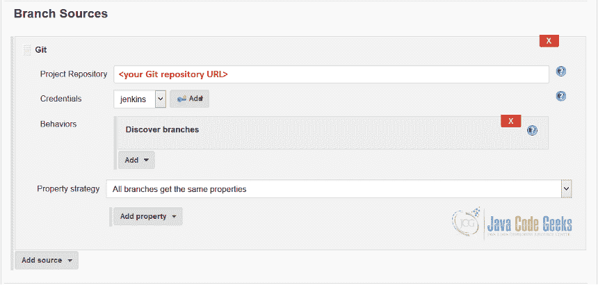

## Git 分支源

确认一切都已就绪的最佳方法是检查流水线及其所有阶段是否已成功执行。

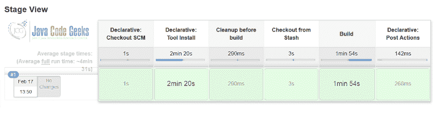

## 构建阶段

如果你正在寻找更现代、更精美的 Web UI，[Jenkins](https://jenkins.io/) 通过 [Blue Ocean](https://jenkins.io/doc/book/blueocean/) 提供了这种用户体验，该插件专为 [Jenkins Pipeline](https://jenkins.io/doc/book/pipeline/) 从零开始设计。

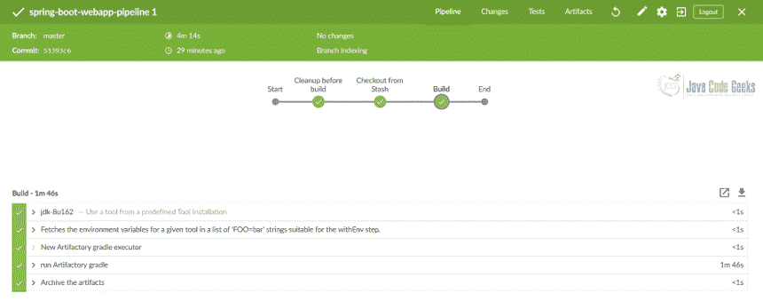

## Blue Ocean

我们本可以在此宣布大告成功，但公平起见，安装工具等需求使得自动化过程变得复杂。我们有办法让它更简单吗？是的，当然可以，而这里的关键角色是 [Docker](https://www.docker.com/)。

## 5. Jenkins 中的 Docker


正如我们已经提到的，[Jenkins](https://jenkins.io/) 拥有出色的 [Docker](https://www.docker.com/) 支持，这是通过大量的插件完成的，其中 [Docker plugin](https://plugins.jenkins.io/docker-plugin) 和 [Docker Pipeline plugin](https://plugins.jenkins.io/docker-workflow) 是关键插件。这在实践中的意义是，你的流水线（或其他类型的作业）可以启动容器并在其中运行构建（以及任何其他任务或阶段）。

说明这种差异的最好方法是将上一节中的 [Jenkinsfile](https://jenkins.io/doc/book/pipeline/jenkinsfile/) 修改为使用 [Docker](https://www.docker.com/) 代理（agent），而不是预定义的工具。

```
pipeline {
    agent {
        docker {
            image 'gradle:4.3.0-jdk8-alpine'
        }
    }

    options {
        disableConcurrentBuilds()
        buildDiscarder(logRotator(numToKeepStr: '5'))
    }

    triggers {
        pollSCM('H/15 * * * *')
    }

    stages {
        stage('Cleanup before build') {
            steps {
                cleanWs()
            }
        }

        stage('Checkout from Github') {
            steps {
                checkout scm
            }
        }

        stage('Build') {
            steps {
                sh 'gradle build'
            }
        }
    }

    post {
        always {
            archiveArtifacts artifacts: 'build/libs/*.jar', fingerprint: true
        }
    }
}
```

这个流水线看起来更紧凑了。我们去掉了很多定义（在实践中也可以去掉一些初始化脚本）。当我们这个新的 [Jenkinsfile](https://jenkins.io/doc/book/pipeline/jenkinsfile/) 提交到现有的仓库（覆盖当前的）时，我们应该会观察到一组稍微不同的阶段，但构建仍然是绿色的。

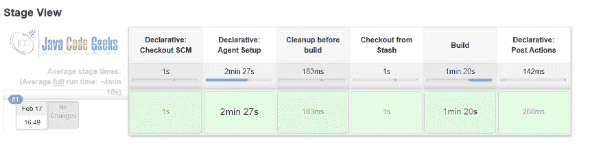

# 使用 Docker 的构建阶段

这只是 [Docker](https://www.docker.com/) 与 [Jenkins](https://jenkins.io/) 集成的一个示例，你有许多不同的方法可以利用 [Docker](https://www.docker.com/) 将你的持续集成（和交付）过程推向完美。

在结束讨论之前，这里还有一点需要提到。因为我们在 [Docker](https://www.docker.com/) 中运行 [Jenkins](https://jenkins.io/)，而 [Jenkins](https://jenkins.io/) 本身在 [Docker](https://www.docker.com/) 中执行作业/阶段步骤，这种容器使用模式被称为 `Docker-in-Docker`（或简称 `DinD`）。在运行 `DinD` 环境时，有许多点需要注意，[Jérôme Petazzoni 在博客文章中](https://jpetazzo.github.io/2015/09/03/do-not-use-docker-in-docker-for-ci/) 对此进行了精辟的总结。如果你认真考虑这种模型，请查看该文章。

## 6. 结论

在教程的最后一部分，我们通过完全自动化的方式部署和配置持续集成平台（基于 [Jenkins](https://jenkins.io/)），查看了 [Docker](https://www.docker.com/) 的一个非常实用的应用。我们为[之前开发的](https://www.javacodegeeks.com/2017/11/docker-java-developers-build-docker.html) 应用程序之一创建了构建流水线，并演示了在运行的 [Docker](https://www.docker.com/) 容器内部运行 [Docker](https://www.docker.com/) 的用例。

到此，我们的教程结束了。这是一段长期但可能很有用的旅程，我们学了一些实用有效的知识。整个系列的结论可以总结为：[Docker](https://www.docker.com/) 是一项了的技术，能够引领我们走向新的境界。

下载完整的脚本和项目源码：

- 带有 Jenkinsfile 的 Spring Boot Web 应用
- 带有 Docker 代理的 Jenkinsfile
- Jenkins Docker 镜像和脚本
