# Java 领域驱动设计：实践指南

## 为复杂的业务问题创建简单、优雅且有价值的解决方案

Neal Ford、Brandon Byars、Allard Buijze 序言

献给我的母亲 Bhanumathy，感谢她所有的牺牲以及对决心的典范。献给我的妻子 Vidya，感谢她在共同的人生旅程中做我爱的伙伴；感谢我们的儿子 Siddharth，他是我快乐和骄傲的永恒源泉。

\- Prem

献给我已故的母亲 Visalam 和父亲 Krishnan，感谢他们灌输了努力和坚持的价值观。献给我亲爱的妻子 Suja，感谢她成为我耐心的伙伴并提供大量鼓励；感谢我的女儿 Ananya，她是我们家快乐和幸福的源泉。

\- Karthik

# 前言

领域驱动设计（DDD）背后的思想对软件架构以及我们思考软件项目的方式产生了深远的影响。“通用语言”（Ubiquitous Language）是 DDD 定义的一个术语，描述了在讨论软件项目设计时创建一种更精确的语言的实践。然而，DDD 为软件架构提供了一种通用语言：大多数关于微服务的讨论都涉及源自 DDD 世界的术语。

然而，开启这一切的书——埃里克·埃文斯编写的《领域设计》（Domain Design），属于马克·吐温所谓的“经典”类别：“一本每个人都想读过的书”。事实是，虽然这本书充满了富有影响力的思想，但对于寻求构建软件建议的读者来说，它是相当抽象的。这并不意味着源码有缺陷——它的设计旨在涵盖广泛的概念，涵盖了设计的许多不同方面，包括但不限于软件开发。

然而，当开发者需要实际应用这些思想时（例如在具体的项目中），抽象的内容并不能解决问题——他们需要一份实践者指南，而读者现在正手握这份指南。这本书出色地将 DDD 概念转化为实用的概述以及关于如何实现它们的具体建议。例如，开发者中有一个相关问题在 DDD 书中没有得到答案：实现项目时，命令式编程还是函数式编程风格更好？每者都有权衡；此书帮助团队做出此类实现决策。本书涵盖了将 DDD 应用于 Java 项目的多个视角，包括关于 DDD 和敏捷工程实践在现代项目中如何交汇的基础性材料。

虽然有很多书籍独立地涵盖了 DDD 和软件架构，但本书在两者之间建立了极佳的映射，描述了 DDD 的影响如何映射到不同的架构拓扑结构中。例如，它描述了如何将边界上下文（bounded contexts）与分层和其他架构拓扑结构协调。

本书的第一部分涵盖了基础思想，包括技术和设计细节。第二部分涵盖了“真实世界 DDD”，即如何在更具体的领域应用这些抽象思想。它涵盖了从如何发现和记录领域，到如何将现实概念映射到 DDD 概念的所有内容。例如，它在描述聚合根（aggregates）、其设计和关系方面表现出色。

第三部分涵盖了一个我非常关心中的话题：构建演进式架构（Building Evolutionary Architecture），即软件的演进。软件产品不断进化，包括新功能和能力。因此，软件开发不是一个静态过程——它必须沿着多个维度演进以保持成功。书中包含了许多用的演进模式，涵盖了领域和架构特征。

朝着创建实践者指南的目标，本书还涵盖了工程方面的实际问题，如日志记录、测试、版本控制以及许多其他实际考虑因素。尽管这些领域可能超出 DDD 书的范围，但团队需要它们。

DDD 提供了许多概念性思想，但缺乏实现细节。本书是抽象与实现之间极佳的桥梁。虽然重点是 Java，但内容足够广泛，让任何从业者都能良好地了解 DDD 项目的许多重要考虑因素。事实上，每种特定的技术栈都能从像这样的实践者指南中受益。

> \- Neal Ford
>
> 总监 / 软件架构师 / 梗图收藏家
>
> Thoughtworks, Inc.

21 世纪初是软件行业一个动态的时期。许多先驱正在探索使软件工程从一种数字化的活动转化为第一性知识工作的*敏捷*方法。像极限编程（Extreme Programming）等敏捷方法是 Jack Reeves 在 1992 年《C++ Journal》文章《什么是软件设计》中提出的论点的自然延伸。设计与制造之间的分工确实存在，但在软件领域，我们不需要制造。编译器为我们完成了工作，因为人们所做的一切都是设计工作，而敏捷流程将新一代工程师推入了与“业务”的设计对话中。

世纪交替还带来了互联网热潮（以及随后的崩溃），用户交互从桌面应用程序转向网络，创造了前所未有的规模扩展问题。分布式网络并不新奇，但解决日益增长的技术复杂性需要新的架构方法，并创造了对软件工程人才的需求。

正是在那时，埃里克·埃文斯出版了他著名的“蓝书”，引入了领域驱动设计（DDD）的概念。它给了我们一组技术，将软件开发的设计方面映射到我们编写代码的方式，以及帮助我们在大规模管理技术复杂性的模式。

正是因为 DDD 至今依然如此良好，以至于我们忘记了自出版以来世界发生了巨大变化。智能手机引发的用户行为迫使组织将以前隐藏在内部网络中的接口外部化，以前可能通过托管在 DMZ 的公共网站访问，但现在被外部用户访问。持续交付加速了软件变化的速度，随之而来的是设计过程的速度。微服务和现代事件驱动架构创建了架构模式，允许组织在扩大交付吞吐量时并行进行现代设计活动。Prem 和 Karthik 一直处于这些领域的前沿，帮助命名并推广了其中一些技术，并在大型组织中对其进行应用。

DDD 在埃文斯出版其蓝书的今天仍然具有相关意义，因为它直接应对了软件设计的根源问题：对问题建立共同理解，并以在代码中传播理解的方式将架构模块化。Karthik 和 Prem 分享了这两个方面的重要更新：如沃德利地图（Wardley mapping）、事件风暴（EventStorming）和领域故事等用于创建共同理解的技术，以及关于 DDD 模式应用的更新观点。这是一本充满了经验实践者在实战中总结教训的书，对所有人都有实战意义。我在审阅这本书时，个人也加深了自己的理解，我相信你也会一样。

> \- Brandon Byars
>
> Thoughtworks 技术负责人
>
> Montebank 创建者

自从从 2008 年首次接触领域驱动设计（DDD）以来，我一直深信这是处理复杂系统或复杂环境下系统的设计方法。虽然 DDD 提供了一个极佳的基础，但我发现，将它与命令查询职责分离（CQRS）相结合可以变得更加强大，尽管在实施上极具挑战性。

我从 2009 年开始发表的示例库，随着早期采用者分享他们使用它的经验，逐渐演变成了 Axon Framework。其中一位采用者是 Prem，他当时正在一家金融机构的一个大型且复杂的项目中使用它。

随着微服务的日益流行，DDD 和 CQRS 已证明是至关重要的设计原则。曾有人开玩笑说：“实现微服务的开发者有三类：使用 DDD 的人、没有意识到自己在使用 DDD 的人，以及失败的人。”随着对更多实时系统的需求增加以及事件驱动系统的兴起，事件溯源（Event Sourcing）也获得了更多关注，而这些事件正成为探索系统行为的真正起点。

虽然我认为 Eric Evans 著名的《蓝书》是一部非常经得起时间考验的杰作，但它很大程度上仍然停留在抽象层面。多年来，概念、理念和实践已经不断完善，并适应了我们使用技术方式的变化。这些概念和实践散布在互联网的众多资源中，使得对于初次进入这些领域的人来说，很难找到并提炼。Prem 和 Karthik 做了一项出色的工作，带领你完成了一段从领域驱动设计的核心概念，通过设计实践，一直到系统实际实现的旅程。他们完整且务实的方法使这本书成为任何探索复杂设计新方法的人的绝佳起点。这正是我在开始这段旅程时希望拥有的书。

> \- Allard Buije
>
> AxonIQ 首席执行官兼创始人

# Axon Framework 创建者

# 贡献者

# 关于作者

Premanand Chandrasekhar 是一位技术领袖和变革推动者，在领导大型技术团队以及帮助业务交付关键任务问题方面拥有卓越的记录，同时展现了极高的内部和外部质量。在过去的二十年里，他有幸帮助了各种客户和领域，包括金融服务、在线零售商、教育和医疗保健初创公司。他的专长包括技术创新、架构、持续交付、敏捷/迭代转型以及员工发展。当不在摆弄他那可靠的笔记本电脑时，他花时间切菜、烹饪、玩视频游戏以及分析板球运动的细微差别。

> 我首先要感谢我亲爱的妻子 Vidya 和儿子 Siddharth，感谢他们在写这本书的漫长过程中给予的持续支持、耐心和鼓励。还要感谢我的同事和导师 Gagan Madan，他不断地挑战我，突破我的极限，并激励我取得更大的成就。最后，感谢我的合作者 Karthik——没有他的坚韧和温柔的陪伴，这个项目很难完成。最后，感谢我的雇主 Thoughtworks 鼓励我承担这个项目，并感谢我所有的 Thoughtworkers 同事，他们一直是我不断的灵感源泉！

Karthik Krishnan 是一位技术领袖，拥有超过 25 年的经验，跨越金融和零售领域设计并构建大型企业级解决方案。他在领导主要金融机构的产品开发方面担任过许多技术角色。他目前在 Thoughtworks 担任技术首席。他热衷于平台思维、解决方案架构和应用安全，并努力成为一名编码架构师。他最近的任务是带领一个大型技术团队，帮助他的客户在云端进行遗留系统现代化之旅。不工作时，他花时间在他的音乐键盘上玩游戏。

> 我感谢我的妻子 Suja 和女儿 Anya，她们是我的支持支柱，提供了所有必要的鼓励，更重要的是，她们非常理解、耐心并包容我那些占据了她们周末计划的长时间写书时间。没有她们，这本书是不可能实现的。我还要感谢我的朋友、同事兼合作者 Prem，他提供了能量，并带来了新的想法供我们讨论，并与我协作，在本书的整个创作过程中鼓励了健康的辩论和讨论。最后，感谢我的雇主 Thoughtworks 为我提供空间并鼓励我写这本书，感谢我在 Thoughtworks 的所有同事在整个写书旅程中为我提供的宝贵反馈。

# 关于审稿人

Viktor Daróczi 是一位软件工程师和编程爱好者。他作为开发者之路始于 20 世纪 90 年代，当时他接触到了一台二手的 Commodore 64。从那时起，他就没有停下过，一直在开发电子商务平台、众测解决方案、一个物联网平台和交互式移动广告，最终在 PagoNxt（桑坦德银行旗下）从事金融科技工作。

Viktor 住在慕尼黑，从那里开始，在他三个心爱的女孩——他的妻子和两个女儿的陪伴下探索这个蓝色星球，他倾向于向她们畅聊编程、数学和古代人类语言，直到她们感到无聊。

# 目录

序言

|---|---|---|---|
|---|---|---|---|
| 领域故事化 | 78 | 扩展阅读 | 89 |

# 目录 xiii

| 独立组件的命令和查询 | 226 | 界限划在哪里 | 234 |
|---|---|---|---|
| 技术指标 | 240 | 同步调用 | 252 |

# 前言

**领域驱动设计（DDD）**提供了一系列原则、模式和技术，使领域专家、架构师、开发者和其他团队成员可以采用这些方法来共同工作，并将复杂系统解构为结构良好、协作性且松耦合的子系统。当埃里克·埃文斯（Eric Evans）在 21 世纪初引入这些概念时，在许多方面，这些原则是超前时代的。当时我们正稳固处于单体时代，**面向服务的架构（SOA）**是一个我们刚刚开始接受的概念，而云、微服务、持续交付等甚至还不存在！在采用其某些战术方面是相对早期的，但 DDD 的战略方面对于大多数人来说仍然被认为是不合理的额外开销。

回到今天，我们正在构建前所未有的最复杂软件解决方案，并面临更复杂的组织和团队结构需要应对。此外，使用公有云几乎是理所当然的。这进入了一个分布式团队和应用程序几乎成为常态的时代。同时，我们也处于一个旧一代应用程序需要现代化的时代。这使得 DDD 的实践，特别是战略元素，获得了大量的关注。

我们一直是这些概念的实践者，并从中获得了宝贵的见解。多年来，我们看到了许多进展，使得规模化应用 DDD 变得可行。本书是我们经验的结晶，我们关注如何将这些概念应用于构建复杂的软件。

本书是针对各种角色和技能编写的，涵盖了跨组织的执行官、领域专家、产品经理、架构师、开发者和测试人员等。

**执行官和领域专家**应该阅读本书，以便能够描述他们的愿景。

**产品经理**应该阅读本书，以便在业务和技术团队的沟通中充当有效的协调者。

**架构师**应该阅读本书，以便理解在思考解决方案之前理解问题是至关重要的。

**开发者和测试人员**将通过本书把他们的知识应用于工作，创建优雅的软件设计。

*第 1 章，领域驱动设计的理由*探讨了 DDD 实践如何提供了一系列指南和技术，以增加成功的概率。我们将回顾埃里克·埃文斯 2003 年关于该主题的经典著作在今天仍然具有相关性。我们还将介绍 DDD 的战略和战术元素。

*第 2 章，DDD 如何以及在哪里适用*比较了 DDD 与几种架构风格的关系，以及它在构建软件解决方案时如何融入整体框架。

*第 3 章，理解领域*介绍了虚拟银行的示例领域（国际贸易）。我们探讨了如何使用业务模式画布、影响地图和沃德里地图等技术开始战略设计。

*第 4 章，领域分析与建模*继续对示例问题领域——信用证（LC）应用进行分析和建模，使用领域故事讲述和风暴学习等技术，对问题达成共识，并脑暴创意以得出解决方案。

*第 5 章，实现领域逻辑*实现示例应用程序的命令驱动 API。我们将探讨如何利用事件驱动架构来实现松耦合组件。我们还将通过对比状态聚合根和事件源聚合根，探讨如何实现结构和业务验证以及持久化选项。

*第 6 章，实现用户界面——基于任务的*使用示例应用程序的用户界面（UI）。我们还将向服务实现表达对 UI 的期望。

*第 7 章，实现查询*深入探讨如何通过监听领域事件来构建读取优化的数据表示。我们还将探讨这些读取模型的持久化选项。

# 序言 xix

第 8 章“实现长运行工作流”探讨了实现长运行的用户操作（Saga 模式）和截止时间（Deadlines）。我们还将探讨如何通过日志聚合和分布式追踪来跟踪整体流程。最后，我们将讨论在何时以及如何选择显式编排（Orchestration）组件或隐式编排（Choreography）。

第 9 章“与外部系统集成”探讨了与其他系统以及边界上下文（Bounded Contexts）的集成。我们将介绍各种集成风格以及选择每种风格可能产生的影响。

第 10 章“开启拆分之旅”将示例边界上下文的命令侧和查询侧拆分为不同的组件。我们将探讨在做出这些选择时所涉及的权衡。

第 11 章“拆分为更细粒度的组件”探讨了更细粒度的拆分以及技术实现之外的权衡。我们将把应用程序拆分为不同的功能模块，并讨论在什么情况下划分界限是合适的。

第 12 章“超越功能性需求”探讨了业务需求之外的、对应用程序拆分起着重要作用的因素。具体而言，我们将研究在应用领域驱动设计（DDD）时，跨功能需求产生的影响。

## 如何充分利用本书的价值

本书面向广泛的软件团队成员。假设读者具有一定的构建软件解决方案的经验。书中的代码示例使用 Java 编程语言。熟悉面向对象（OO）和像 Spring 这样的框架将非常有帮助。

| 本书涵盖的软件/硬件 | 操作系统要求 |
| :--- | :--- |
| Spring Framework | Windows、macOS 或 Linux |
| Axon Framework | |
| JavaFX | |

如果您正在阅读本书的电子版，我们建议您手动输入代码，或者从该书的 GitHub 仓库获取代码（在下一节中提供链接）。这将帮助您避免任何与代码复制和粘贴相关的潜在错误。

## 下载示例代码文件

您可以从 GitHub 的`https://github.com/PacktPublishing/Domain-Driven-Design-with-Java-A-Practitioner-s-Guide`下载本书的示例代码文件。如果代码有更新，将在 GitHub 仓库中进行更新。

我们还在`https://github.com/PacktPublishing/`提供了来自丰富书籍和视频目录的其他代码包。快去看看吧！

## 下载彩色图片

我们还提供了一个 PDF 文件，其中包含了书中使用的截图和图表的彩色图片。您可以在此处下载：

`https://packt.link/TwzEB`

## 使用的规范

本书使用了多种文本规范。

- **文中代码**：表示文本中的代码词汇、数据库表名、文件夹名、文件名、扩展名、模式、虚拟 URL、用户输入和 Twitter 账号。这里有一个例子：“如事件形成活动所示，`LC Application` 聚合根能够处理 `LCApplicationCommand`，从而产生 `LCApplicationApprovedEvent`。”
- **代码块**：设置如下：

```java
import org.axonframework.deadline.DeadlineManager;

class LCApplication {
    @CommandHandler
    public void on(SubmitLCApplicationCommand command, DeadlineManager deadlineManager) {
        assertPositive(amount);
        assertMerchandise(merchandise);
        assertInDraft(state);
        apply(new LCApplicationSubmittedEvent(id, amount));
        deadlineManager.schedule(Duration.ofDays(10),
            "LC_APPROVAL_REMINDER",
            LCApplicationPendingNotification.first(id));
    }
}
```

> **提示或重要说明**
>
> 显示如下所示。

## 联系我们

我们随时欢迎读者的反馈。

**通用反馈**：如果您对本书的任何方面有疑问，请发送邮件至`customercare@packpub.com`，并在邮件主题中注明书名。

**错误更正**：尽管我们尽力确保内容的准确性，但错误仍在所难免。如果您在书中发现了错误，如能向我们报告，我们将不胜感激。

# 为什么软件项目会失败？

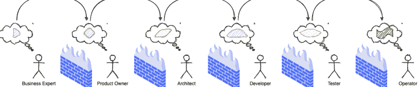

这一切导致了组装线上每个阶段的保真度丢失，从而引发了误解、不准确、延迟以及最终的失败！

## 架构过度


编写复杂的软件是一项艰巨的任务。你不能只希望坐下来就开始写代码，尽管这种方法在微小情况下可能有效。在将业务想法转化为可运行软件之前，必须对当前的问题进行彻底理解。例如，在不了解信用卡是如何运作的情况下，构建信用卡软件是不可能的（或者至少是非常困难的）。为了表达你对问题的理解，在编写代码之前创建该问题的软件模型并不罕见。这个模型或模型集合代表了对问题的理解以及解决此的架构。

努力创建一个完美的问题模型——一个在非常广泛的范围内都能负责任的模型——这种做法与传闻中的寻找圣杯并无二致。负责产架构的人可能会陷入分析瘫痪或过度的前期设计，产生的产物具有一种或多个特点：愿景过高、过度设计、流行术语驱动或与现实脱节——而没有解决任何真实的业务问题。这种锁定在项目早期阶段（当团队成员的知识水平仍处于上升阶段时）尤为不利。不言而喻，采用此类方法的项目很难获得成功。

> **提示**
>
> 欲了解更全面的建模反模式列表，请参考 Scott W. Ambler 的网站（`http://agilemodeling.com/essays/enterpriseModelingAntiPatterns.htm`）以及专门针对主题的书《Agile Modeling: Effective Practices for Extreme Programming and the Unified Process》。

## 架构不足

敏捷软件交付出现于 20 世纪 90 年代后期和 21 世纪初，是为了应对统被称为“瀑布流”的重量级流程。这些流程似乎倾向于过度前期设计以及基于愿望、理想世界场景的抽象象牙塔。这是基于：

## 领域驱动设计的原理

这样一个前提：在开发过程中很好地思考事情，可以随着项目的进行节省日后开发中的头疼问题。

相比之下，敏捷方法似乎更倾向于更加灵活和迭代的软件开发方法，高度关注可运行的软件而非其他产物（如文档）。如今大多数团队都声称实践某种形式的迭代软件开发。然而，由于执迷于声称符合某个特定的敏捷方法论家族，而非其底层原则，许多团队误解了“足够的架构”等同于“没有感知到的架构”。这导致了一种局面：添加新功能或增强现有功能所需的时间比以前长得多——这随后加速了解决方案的退化，使其变成可怕的“大泥球”（`http://www.laputan.org/mud/mud.html#BigBalloOfMud`）。

## 过度的偶然复杂性

Mike 推广了测试金字塔的概念，他在其中讨论了大量的单元测试如何构成稳健测试策略的基础——随着你向金字塔上方移动，数量会显著减少。这里的原理是，随着你向金字塔上方移动，维护成本会剧增，而执行速度会成倍减慢。但实际上，许多团队似乎采用了一种与此完全相反的策略——被称为“测试冰淇淋”，如下所示：

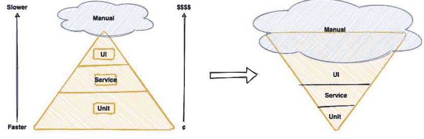

图 1.2 – 测试策略：预期与现实

“测试冰淇淋”是 Fred Brooks 在其经典论文《没有银弹：软件工程中的本质与偶然性》（`http://worrydream.com/refs/Brooks-NoSilverbullet.pdf`）中所说的“偶然复杂性”的典型案例。所有软件都具有某种源于所解决问题的“本质复杂性”。这在为非平凡问题创建解决方案时尤为如此。然而，偶然或意外复杂性并不直接归因于问题本身——而是由参与人员的局限性、他们的技能水平、工具和/或所使用的抽象引起的。不关注偶然复杂性会导致团队偏离

## 为什么软件项目会失败？

偏离对真实问题的关注，而解决这些问题能提供最大的价值。自然的结果是，此类团队会相应地减少自身的成功几率。

## 不可控的技术债

财务债务是指从外部实体借钱以快速为业务运营提供资金——承诺按时偿还本金加上约定的利率。在适当的情况下，这可以加速业务增长，同时允许所有者保留所有权、减少税收并降低利率。另一方面，无法按时偿还债务会对信誉评分产生不利影响，导致利率升高、现金流困难和其他限制。

技术债是开发团队为了加速交付一组功能或项目而采取次优行动所导致的结果。在一段时间内，就像借钱允许你比原本更早地做事情一样，技术债可以带来短期速度。但从长期来看，软件团队将投入更多精力和管理复杂性，而不是产生架构稳健的解决方案。这会导致恶性循环，如图所示：

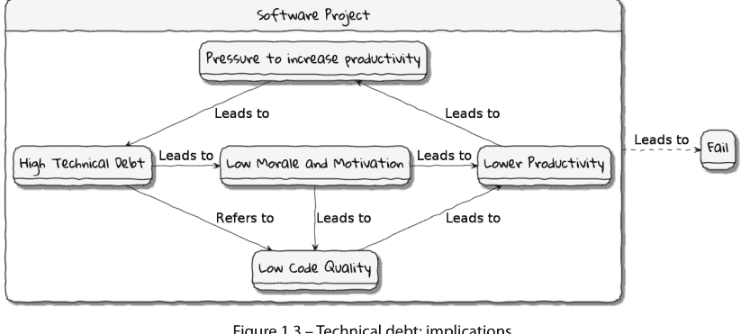

在最近向 CIO 发出的麦肯锡调查（`https://www.mckinsey.com/business-functions/mckinsey-digital/our-insights/tech-debt-reclaiming-tech-equity`）中，大约 60% 的人报告过去三年技术债增加了。与此同时，90% 的 CIO 分配了不到五分之一的时间来偿还债务。Martin Fowler 探讨了（`https://martinfowler.com/articles/is-quality-worth-cost.html#WeAreUsedToATradeOffQualityAndCost`）高软件质量（或缺乏质量）与预测增强软件之间的深度关联。虽然承担一定程度的技术债是不可避免的且是业务的一部分，但没有系统偿还这些债务的计划会对团队生产力和交付价值的能力产生显著的不利影响。

## 忽略非功能性需求

利益者通常希望软件团队将大部分（如果不是）时间花在提供增强功能上。考虑到功能提供了最高的投资回报率，这是可以理解的。这些功能被称为功能性需求。

另一方面，非功能性需求（有时被称为交叉功能需求）是系统中不直接影响功能但对使用和维护这些系统的人产生深远影响的方面。非功能性需求有很多种。常见非功能性需求的部分列表所示：

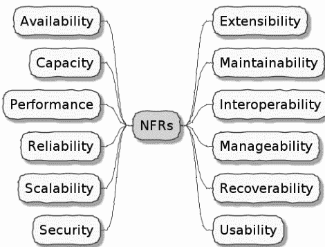

图 1.4 – 非功能性需求

## 现代系统与复杂性的处理

> 我们无法用创造问题时的同一思维水平来解决问题。
>
> — 阿尔伯特·爱因斯坦

正如我们在上一节中看到的，软件尝试的失败有几个原因。在本节中，我们将尝试理解软件是如何构建的、目前盛行的现实情况是什么，以及为了应对这些情况我们需要做哪些调整。

## 软件是如何构建的

构建成功的软件是一个迭代过程，通过不断完善知识并以模型的形式将其表达。我们在这里尝试在高层次捕捉这一过程的本质：

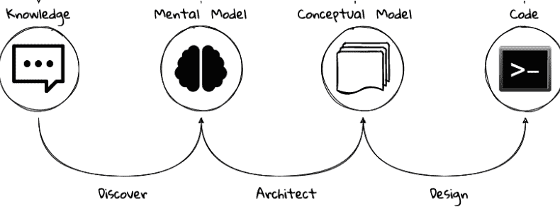

图 1.5 – 构建软件是对知识和模型的持续精炼

在用运行代码表达解决方案之前，有必要理解问题包含什么、为什么解决这个问题很重要，以及最后如何解决它。无论使用哪种方法论（瀑布、敏捷或两者之间的任何方法），软件构建的过程都是我们需要不断利用知识来完善心理/概念模型，以便创建出价值价值解决方案。

# 10 领域驱动设计的原理

## 复杂性不可避免的

我们发现自己处于第四次工业革命之中，世界正变得日益数字化——技术已成为业务价值的重要驱动力。计算技术取得了指数增长，正如摩尔定律所示：

摩尔定律 —— 集成电路芯片上的晶体管数量（1971-2018）

摩尔定律描述了一种经验性现实，即集成电路上的晶体管数量大约每两年翻一倍。这种进步是非常重要的，因为技术进步的其它方面——如电子产品的速度和价格——与摩尔定律相关。

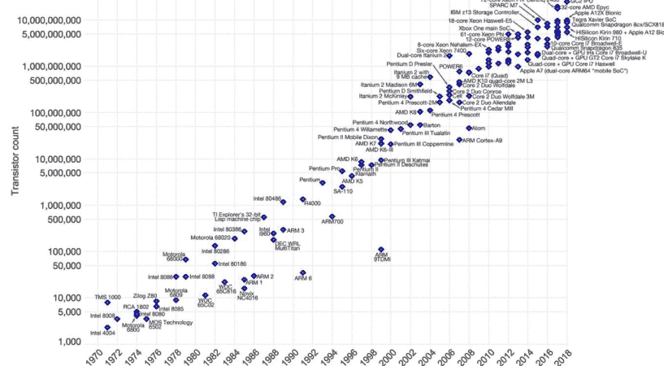

数据来源：Wikipedia（`https://en.wikipedia.org/wiki/Transistor_count`）

可视化可在 OurWorldData.org 查看。更多关于此主题的可视化内容和研究。

图 1.6 — 摩尔定律

## 全球互联网流量

这与互联网的兴起相吻合。

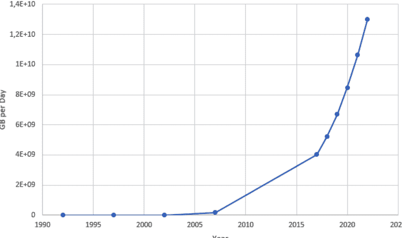

图 1.7 – 全球互联网流量

这意味着公司被要求比以往任何时候都更快地实现软件系统的现代化。与此同时，商品化计算服务（如公共云）的出现，导致了从昂贵的集中化计算系统向更分布式的计算生态系统的迁移。当我们尝试构建最复杂的解决方案时，单体架构正被分布式的、协作的微服务环境所取代。现代哲学和实践，例如自动化测试、架构适应性函数、持续集成、持续交付、DevOps、安全自动化和基础设施即代码（仅列一举），正在颠覆我们交付软件解决方案的方式。

所有这些进步都引入了各自的复杂性。与其试图控制复杂性的程度，不如需要拥抱并应对它。

## 优化反馈循环

当我们进入面临最复杂业务问题的时代时，我们需要接受新的思维方式、开发哲学和一系列技术手段，以迭代演进出成熟的、经得起时间考验的软件解决方案。我们需要更好的方式来沟通、分析问题、达成共识、创建和建模抽象，然后实施并增强解决方案。

显而易见的是——正如所示，我们构建软件时，一边是无缝且卓越的业务想法，另一边是我们不断提出要求的客户：

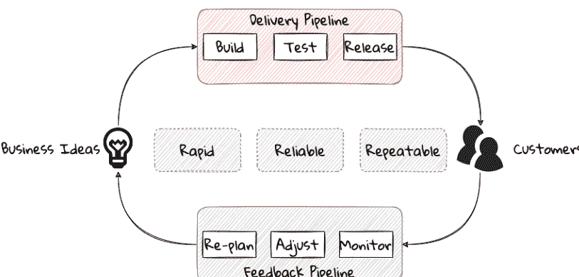

图 1.8 - 软件交付连续体

在中间，我们有两个需要跨越的鸿沟——交付流水线和反馈流水线。交付流水线使我们将软件交给客户，而反馈流水线允许我们进行调整和适应。正如我们看到的，这是一个连续体。如果我们想要快速构建出更有价值的软件，这个连续体（可能是无限循环）就必须经过优化！

为了优化这个循环，我们需要具备三个特征：我们需要快速、我们需要可靠、并且我们需要一次又地这样做。换句话说，我们需要同时做到**快速**、**可靠**且**可重复**——缺少其中任何一点都不够的。

DDD 承诺提供如何以系统方法实现这些点的答案。在接下来的章节中，实际上在本书的其余部分，我们将探讨什么是 DDD，以及在当今这个大规模分布式团队和应用的世界，为非平凡问题提供解决方案时为什么它是不可或缺的。

## 什么是 DDD？

生活其实简单，但我们执意要把它变得复杂。

> — 孔子

在上一节中，我们看到了由于无数原因，结合复杂性，如何影响软件成功的。DDD 的由 Eric Evans 在 2003 年书中构思的理念，是一种以模型形式关注软件解决方案的方法，它关注的是问题的核心。Evans 的著作确实是开创性的、超越时代的，它并不具有强制性，这种优势使得 DDD 能够演进。另一方面，它也使得定义 DDD 到底包含什么变得极其困难。在本节中，我们将看看 DDD 背后的一些基础术语和概念。

当遇到复杂的业务问题时，DDD 建议采取措施：

- **理解问题：** 为了对问题有深入理解，业务和技术专家需要紧密协作。在这里，我们共同理解问题是什么以及解决它的价值所在。这被称为领域（domain）。

- **将问题拆分为更易管理的部分：** 为了将复杂性保持在可范围内，将复杂问题拆分为可独立解决的部分。这些部分被称为子领域（subdomains）。如果领域仍然复杂，可能需要进一步拆分。分配明确的边界以限制每个子领域的功能。这一边界被称为该子领域的边界上下文（bounded context）。也可以这样认为：子领域对于领域专家（在问题空间）更有意义，而边界上下文对于技术专家（在解决方案空间）更有意义。

- **对于每个边界上下文，执行以下操作：**
  - **达成共享语言：** 通过建立一种在子领域范围内无歧义适用的共享语言来形式化理解。这种共享语言被称为领域的通用语言（ubiquitous language）。
  - **用共享模型表达理解：** 为了产生运行的软件，以共享模型的形式表达通用语言。这种模型被称为领域模型（domain model）。可能存在多个变体，每种旨在澄清解决方案的特定方面，例如流程模型、时序图、运行代码和部署拓扑。

- **拥抱问题的偶然性：** 需要注意的是，回避问题的本质复杂是不可能的。通过将问题拆分为子领域和边界上下文，我们试图将复杂性均匀或不均匀地分布在更易管理的部分中。

- **持续演进以获得洞察：** 需要理解的是上述步骤不是一次性活动。业务、技术、流程以及我们对这些内容的理解不断演变，因此通过持续重构使我们的共同理解与模型保持同步是非常重要的。

这里表达了 DDD 精髓的图示：

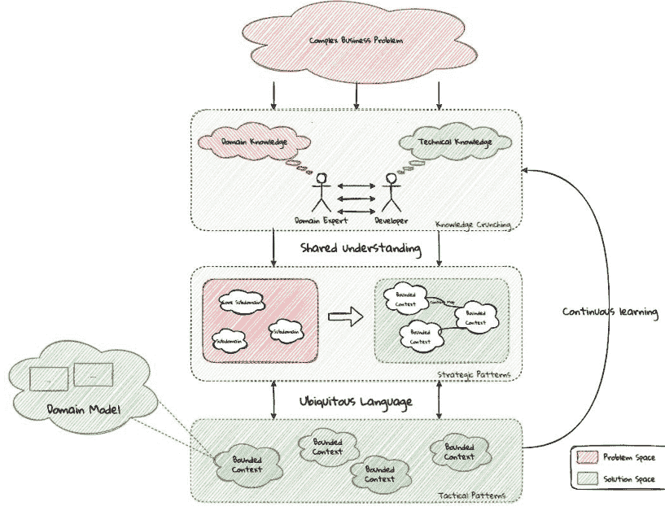

图 1.9 – DDD 的精髓

我们理解这对于这个的主题来说是一个非常快速的旋风式介绍。

## 什么是 DDD？

## 理解问题领域战略设计

在本节中，让我们来揭秘在使用 DDD 时会用到的一些概念和术语。首先，我们需要理解第一个字母 D ——领域（domain）的含义。

## 什么是领域（domain）？

在处理 DDD 时，基础概念是“领域”的概念。但到底什么是领域呢？“domain”一词源于 17 世纪的法语单词 *domain*（权力）和拉丁语 *dominium*（财产、所有权），是一个相当令人困惑的词。根据使用它的人、时间以及如何使用，它可以有不同的含义。

名词（domain）

1. 由单一个人或组织统治或控制的地理区域 [citations]

   他领地所在的区域具有。

2. 活动、影响或专长的领域或范围。

   处理专家确实是我的客户服务领域（domain）。

3. 一组相关的条目、主题或学科 [citations]

4. （数学）定义函数所在的所有可能元素的集合。

5. （数学）两个两个值之间的任何关系，但非零元素到零的关系除外。

6. （拓扑、数学分析）某些拓扑中的开且连通的集合。例如，作为实数子集的区间 `(0,1)`。

7. （计算）任何 DNS 域名，特别是那些已定义并委派了域名及其子域名的域名 [citations]

8. （计算）对某个领域执行的操作的信息集合，该领域中命名的计算机及其所有子域.com。

9. （计算）由领域名称定义的计算机集合。

10. （计算）对某个领域执行的操作的信息集合，该领域中命名的计算机，以及这些计算机所所在的网络。

11. （计算）由领域名称定义的计算机集合。

12. （计算）在缓冲区内存中用作数据存储单元的此类区域。

13. （数据处理）一种技术元数据的形式，表示数据项的类型、特征、名称和用途 [citations]

14. （生物学）用于生物分类系统中的分类，即细菌（Bacteria）、古菌（Archaea）或真核生物（Eukaryota）这些分类单元之一。

15. （生物化学）在三域系统蛋白质分类中使用的突出显示。

16. （生物化学）具有离散功能的蛋白质段；染色体的等效部分。


在业务语境下，“领域（domain）”一词涵盖了其主要活动的整体范围——即它为客户提供的服务。这也被称为“问题领域”（problem domain）。例如，特斯拉在电动汽车领域运营，Netflix 提供在线电影和节目，而麦当劳提供快餐。一些像亚马逊这样的公司在多个领域提供服务——在线和云计算。领域（至少是那些不成功的领域的）几乎涵盖了非常复杂和抽象的概念。为了应对这种复杂性，将这些领域分解为更易于管理的片段，称为“子领域（subdomains）”，是有用的。

## 什么是子领域（subdomain）？

从本质上说，DDD 提供通过将复杂问题分解为更易管理的“子领域”来应对复杂性的方法。这有助于更好地理解并更容易获得解决方案。整个领域的解决方案可以在产品内部划分为产品、库存、奖励、购物车、订单管理、支付和运输，如图所示：

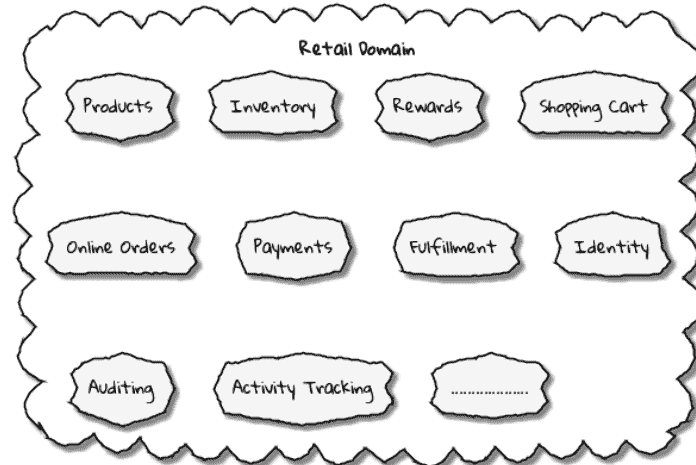

图 1.11 - 零售业中的子领域

在某些业务中，子领域本身可能会变得非常复杂，并可能需要进一步分解。例如，在零售示例中，可能需要将产品子领域进一步拆分为更具体的的子领域，如目录、搜索、推荐和评论，如下：

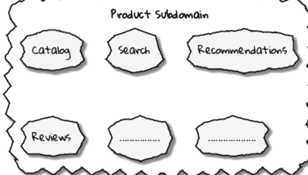

图 1.12 - 产品子领域中的子领域

可能需要进一步分解子领域，直到我们达到一个可管理的复杂水平。

领域分解是 DDD 的一个重要方面。让我们看看子领域的类型以更好地理解这一点。

> **重要提示**
>
> “领域（domain）”和“子领域（subdomain）”这两个术语经常互换使用。这可能会让外行观察者感到困惑。鉴于子领域往往是复杂且分层次的，一个子领域本身也可以是一个领域。

## 子领域的类型

将复杂领域分解为更易于管理的子领域是一件好事。然而，并不是所有的子领域都是平等的。在任何业务中，都会遇到以下三种子领域：

- **核心（Core）：** 业务的主要关注区域。这是提供最大差异化和价值的地方。因此，希望在核心子领域上投入最多的精力是自然的。在零售示例中，购物车和订单可能是差异化最大的地方——因此形成了该业务的核心子领域。鉴于企业希望对某些事情拥有最大的控制权，因此在内部实现核心子领域是明智的。在在线零售示例中，业务可能希望关注于为在线订单提供丰富的体验。这将使得在线订单成为核心领域。

- **支持（Supporting）：** 就像每个伟大的业务一样，支持子领域通常非常重要但不是业务的重点。这些子领域虽然是必要的，但通常不提供显著的竞争优势。甚至，可能可以使用现成的解决方案。在零售示例中，目录管理可能属于这一类。

- **通用（Generic）：** 当处理业务应用时，不需要提供与业务问题直接相关的能力。因此，可能只需要使用现成的解决方案。在零售示例中，身份识别、审计和活动跟踪子领域可能属于此类类别。

# 18 领域驱动设计的合理性

> **重要提示**
>
> 需要注意的是，核心和通用领域的概念往往取决于特定情况。对某些情况是核心的，对另一些情况可能是支持性的。识别和提取核心需要对解决的问题有深入的理解。

鉴于核心领域建立了大部分差异化，投入最多的精力维护它是明智的。这如下表所示：

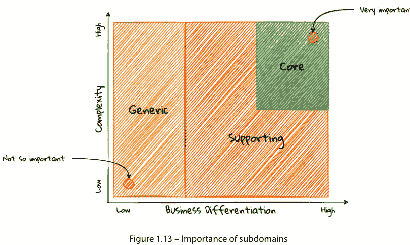

随着时间的推移，竞争对手尝试模仿你的成功。新的、更高效的方法会出现，减少了相关的复杂性并干扰了你的核心。这可能会导致当前的核心变为支持性的或通用的，如下：

# 19 什么是 DDD？

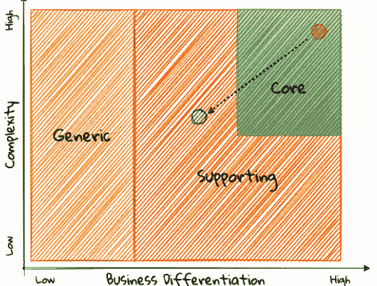

图 1.14 - 核心领域的侵蚀


为了继续成功运营，需要在核心领域不断创新。例如，当 AWS 开始云计算业务时，它只提供简单的基础设施（IaaS）解决方案。然而，随着微软和谷歌等竞争对手的追赶，AWS 必须提供多种附加服务（例如 PaaS 和 SaaS）。

## 领域专家与技术专家

任何现代软件团队都需要两个领域的知识——领域的功能以及将其转换为高质量软件的艺术。在大多数组织中，这些存在至少两组人：

- **领域专家：** 对领域有深入且熟悉了解的人。领域专家是对业务有很强掌握能力的专家专家（SME）。领域专家的专业程度各异。某些 SME 可能选择专注于特定的子领域，而另一些可能对整体业务有更好的理解。
- **技术专家：** 另一方面，他们喜欢解决特定的、量化的计算机科学问题。通常，技术专家并不认为理解他们工作的业务背景是值得的。相反，他们似乎过度渴望加强他们在学术学习中获得的持续技能。

## 领域驱动设计的原理

当领域专家规定了“为什么”和“是什么”时，技术专家（软件工程师）在很大程度上帮助实现“如何做”。这两个小组之间强力的协作与协同作用对于确保持续的高性能和成功至关重要。

## 源于语言的分歧

虽然这些小组之间的强力协作是必要的，但重要的是要意识到，这些人似乎有不同的动机和思维差异。表面上看，这可能仅限于简单的事情，例如他们日常用语的差异。然而，更深层次的分析通常会揭示出在目标和动机等方面存在着更大的分歧。如图所示：

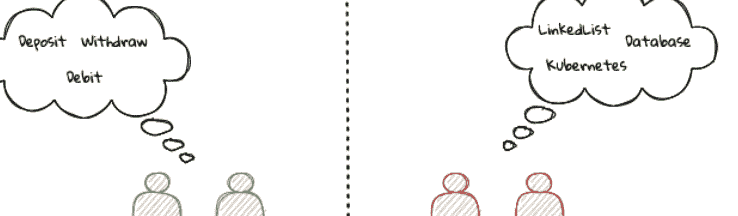

### 领域专家

- 高级储蓄账户功能
- 增加流动性
- 扩大客户群

### 技术专家

- 并发控制
- ACID 事务
- 框架与设计模式

### 问题领域

### 解决方案领域

图 1.15 - 源于语言的分歧

本书主要面向技术专家。我们的观点是，如果不对底层的业务背景有深入理解，仅仅通过解决技术挑战性问题是不可能成功的。

我们对组织做出的任何决策，无论是需求、架构还是代码，都具有业务和用途方面的影响。为了有效地构思、架构、设计、构建和演进软件，我们的决策需要帮助创造最佳的业务影响。如所述，只有当我们对想要解决的问题有清晰理解时，才能实现这一点。这让我们意识到，在得出问题的解决方案时存在两个不同的领域。

## 什么是 DDD？

> **注意**
>
> 在此背景下，“领域”（domain）一词的使用是抽象意义上的——不要与之前介绍的业务领域（business domain）概念混淆。

## 问题领域

这是一个用于捕捉信息的术语，它有意识地避免任何解决方案的细节。它包含了诸如我们试图解决问题的原因、试图实现的目标以及需要如何解决等细节。需要注意的是，“为什么”、“是什么”和“如何”是从客户/利益相关者的角度出发，而不是从提供问题软件解决方案的工程师角度出发。

考虑一家已经为客户提供储蓄账户功能的零售银行。他们需要更具流动性的资金。为了实现这一点，他们需要鼓励客户维持更高的账户余额。他们正寻求引入名为“高级储蓄账户”的新产品，具有额外的功能，如高利率、透支保护和免费 ATM 访问。此处展示了以“为什么”、“是什么”和“如何”形式表达的问题领域：

| 问题 | 回答 |
| :--- | :--- |
| 为什么 | 银行需要更具流动性的资金 |
| 是什么 | 客户维持更高的账户余额 |
| 如何 | 通过引入一种新产品——具有增强功能的高级储蓄账户 |

表 1.2 – 问题领域：为什么、是什么和如何

现在我们已经定义了问题及其周围的动机，让我们看看它如何指导解决方案。

## 解决方案领域

一个用于描述开发解决方案的环境的术语。换句话说，将需求转换为可工作软件的过程（包括设计、开发、测试和部署）。在这里，重点是从软件实现的角度来看解决问题的“如何做”。然而，如果对对“为什么”和“是什么”的领会，很难得出解决方案。

## 领域驱动设计的原理

基于之前的储蓄账户示例，该问题的代码级解决方案可能看起来如下：

```java
class PremiumCheckingAccountFactory {
    Account openPremiumCheckingAccount(Applicant applicant,
                        MonetaryAmount initialAmount) {
        Salary salary = salaryFor(applicant);
        if (is.BelowThreshold()) {
            throw new InsufficientIncomeException(applicant);
        }
        Account account = Account.createFor(applicant);
        account.deposit(initialAmount);
        account.activate();
        return account;
    }
}
```

这看起来是从问题设计迈出的巨大飞跃，事实上确实如此。在得出这样的解决方案之前，可能需要对问题进行多个层级的细化。这种细化过程通常是混乱的，并可能导致对问题的理解出现不准确，从而导致解决方案可能很好（例如，从工程和软件架构的角度来看是合理的），但并没有解决眼下的问题。让我们看看如何通过闭合问题领域和解决方案领域来不断完善我们的理解。

## 使用通用语言促进共同理解

此前我们看到组织孤岛如何导致宝贵信息被稀释。一个信用卡团队过去使用“支付工具”以及“语言”PAN（主账户号码）、BIN（银行识别码）等词汇，而不同的团队成员在处理应用程序的相同区域时使用这些词汇来制作完全相同的东西——信用卡。另一方面，“用户”这样的术可能被用来指客户、客户经理或技术客户支持员工。更糟糕的是，许多混乱的术语被实现在代码中。虽然这可能感觉是一件微不足道的事，但它产生了深远的影响。产品专家、架构师和开发者来来去去，每一次新功能的增强都回归地导致了更多的混乱、混乱的设计、实现和技术债——加速了通向令人厌恶的、无法维护的“大泥球”（http://www.laputan.org/mud/）的进程。

DDD 主张打破这些障碍，通过协作创造通用语言（ubiquitous language）所建立的内容，让领域专家和开发者处于平等的地位。

## 演进领域模型和解决方案

通用语言有助于加强团队成员之间的共同理解。通过示例可以解释得最好。让我们考虑一家虚构的 Acme 银行，它提供两种产品：信用卡和零售银行。这可以分解为此处所示的子领域：

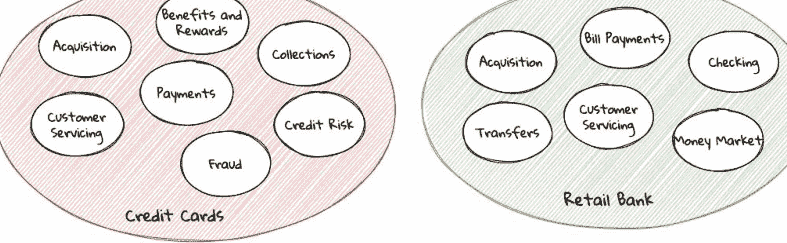

图 1.17 — Acme 银行的子领域

在为问题创建解决方案时，存在许多可能的方案选择。我们在这里描述了几个选项：

### 方案 1：单体架构 | 方案 2：按业务能力

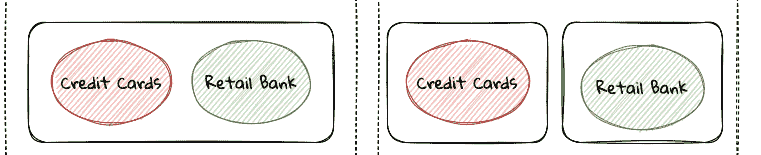

### 方案 3：按子域

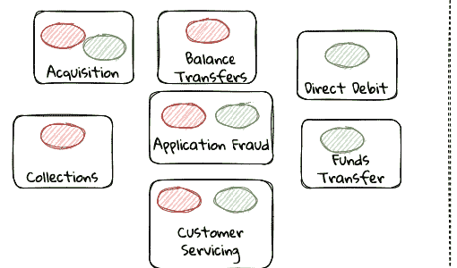

- 子域 (Subdomain)
- 边界上下文 (Bounded Context)

图 1.18 - Acme 银行的边界上下文选项

这些这些只是创建边界上下文的分解模式的几个示例。你可能选择使用的具体模式集取决于当前的现实情况，例如：

- 当前的组织结构
- 领域专家的职责
- 关键活动和枢纽事件
- 现有的应用程序

## 26 领域驱动设计的原理

> **注意**
>
> 康康伊定律（Conway’s law）断言，组织受限于其通信结构，会产生与其结构相拷贝的应用设计。你当前的组织结构可能与你期望的解决方案没有最优对齐。可以应用反向康康伊定律来实现与业务架构的同构。无论使用何种方法将问题分解为一组边界上下文，都应确保它们之间的耦合尽可能低。

虽然边界上下文理想情况下需要尽可能独立，但它们仍然可能需要相互通信。当使用 DDD 时，整个系统可以表示为一组相互具有关系的边界上下文。这些关系定义了这些边界上下文如何相互集成，并被称为上下文映射（context maps）。这里显示了一个示例上下文映射：

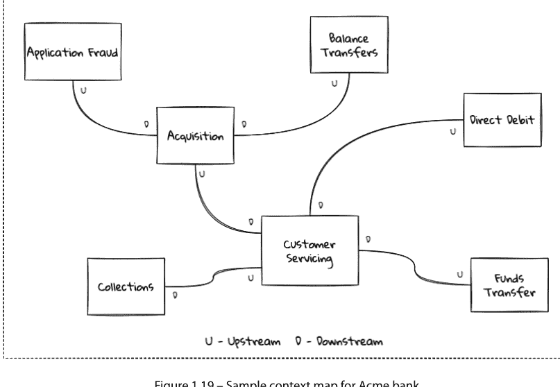

上下文映射显示了边界上下文及其之间的关系。这些关系可能比这里描述的要微妙得多。我们将在第 9 章“与外部系统集成”中讨论上下文映射和通信模式。

## 什么是 DDD？27

我们现在已经涵盖了 DDD 战略设计原则的核心概念目录。让我们来看一些可以加速这一过程的工具。

在随后的章节中，我们将以更详细的方式强化这里介绍的所有概念。

在下一节中，我们将看看为什么多年前引入的 DDD 思想现在仍然非常相关。我们将看到，如果真的话，它们正变得比以往任何时候都更加相关。

## 使用战术设计实现解决方案

在上一节中，我们看到了如何使用战略设计工具对问题达成共同的理解。我们需要使用这种理解来创建解决方案。DDD 的战术设计方面、工具和技术有助于将这种理解转化为可运行的软件。让我们详细查看这些方面。在书的第二部分，我们将应用这些内容来解决现实世界的问题。

将战术设计方面认为如图所示所示是非常方便的：

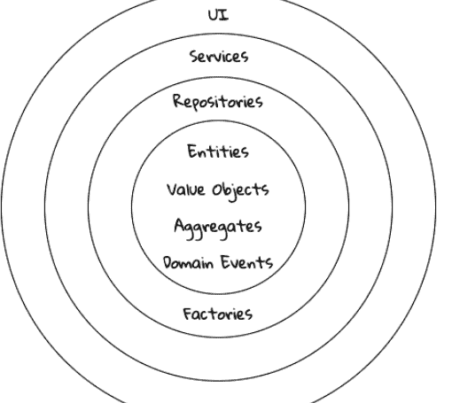

图 1.20 – DDD 战术设计的元素

让我们看看这些元素的定义。

## 值对象 (Value objects)

值对象是不可变对象，封装了一个或多个相关属性的数据和行为。将值对象视为具命名的原始类型可能会很方便。例如，考虑一个 `MonetaryAmount`（金额）值对象。一个简单的实现可以包含两个属性——金额和货币代码。这允许对行为进行封装，如下所示，安全地添加两个 `MonetaryAmount` 对象：

```
Transaction
- id: TransactionId <generated>
  amount: MonetaryAmount
  type: TransactionType
  date: Date
  status: TransactionStatus
  - void approved()
  - void rejected()
```

图 1.21 - 一个简单的 `MonetaryAmount` 值对象

值对象的有效使用有助于防止反模式中的原始类型溢出（primitive emission），同时提高清晰度。它还允许使用一个或多个值对象组合成更高层次的抽象。需要注意的是值对象没有身份的概念。也就是说，具有相同的值被视为等同。因此，两个具有相同金额和货币代码的 `MonetaryAmount` 对象被认为是等价。此外，使值对象保持不可变是重要的。任何更改任何属性的需求都应该导致创建一个新属性。

将值对象仅仅视为一种工程技术是容易的，但使用（或不使用）它们的后果可能是深远的。在 `MonetaryAmount` 示例中，金额和货币代码可能作为独立属性存在。然而，使用 `MonetaryAmount` 强制了通用语言（ubiquitous language）的概念。因此，我们建议默认使用值对象而不是原始类型。

批评者可能会很快指出类爆炸和性能问题等问题。但在我们的经验中，收益通常大于成本。但如果发生问题，可能需要重新检查这种方法。

## 实体 (Entities)

实体是具有唯一身份的对象，封装了其属性的数据和行为。将实体视为一组需要组合在一起的其他实体和值对象可能会很方便。这里显示了一个实体的简单示例：

| Transaction |
| :--- |
| id: TransactionId <generated> |
| amount: MonetaryAmount |
| type: TransactionType |
| date: Date |
| status: TransactionStatus |
| void approved() |
| void rejected() |

图 1.22 - Transaction 的简单描述

与值对象相反，实体具有唯一标识符的本质。这意味着具有相同值但标识符（id）不同的实体被认为是不同的。另一方面，两个相同标识符的实体实例被认为是等的。此外，与值对象不同，实体是可变的。也就是说它们的属性会随着时间改变。

值对象和实体的概念取决于它们使用的上下文。在订单管理系统中，地址在电子商务边界上下文中可能实现为值对象，而在订单履行上下文中可能需要实现为实体。

> **重要提示**：通常将实体和值对象统称为领域对象。

## 聚合 (Aggregates)

如前所述，实体是分级的，因为它们由其他子实体组成。从根本上说，聚合具有以下特征：

- 通常是由于其他实体和值对象组成的实体
- 通过暴露行为（通常称为命令）来封装对子实体的访问
- 是用于一致强制业务不变性（规则）的边界
- 是边界上下文内完成工作的入口点

## 30 领域驱动设计的原理

考虑 `CheckingAccount` 聚合示例：

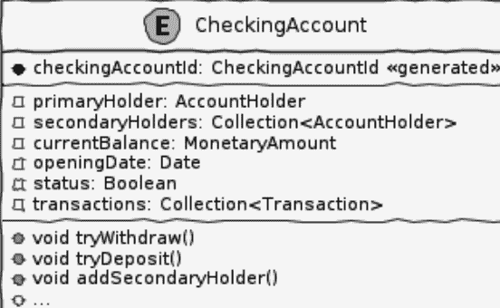

图 1.23 - CheckingAccount 聚合的简单描述

`CheckingAccount` 如何由 `AccountHolder` 和 `Transaction` 实体组成，取决于许多其他因素。在此，让我们假设透支功能（持有负余额的能力）仅供高净值人士（HNI）。任何更改余额的尝试都需要以唯一的 `Transaction` 形式出现，以便审计——无论结果如何。出于原因，`CheckingAccount` 聚合使用了 `Transaction` 实体。虽然 `Transaction` 作为接口的一部分拥有 `approve` 和 `reject` 方法，但只有聚合可以访问这些方法。

1. `CheckingAccount` 聚合由子实体和值对象组成。
2. `tryWithdraw` 方法作为操作的一致性边界。无论结果如何（批准或拒绝），系统都将保持一致状态。换句话说，`currentBalance` 只能在 `CheckingAccount` 聚合的范围内更改。
3. 聚合执行适当的业务不变性（规则），仅允许高净客户（HNIs）进行透支。

> **重要说明**
>
> 聚合也被称为聚合根（aggregate roots），即处于实体层次结构根部的对象。在本书中，我们同义地使用这些术语。

## 领域事件 (Domain events)

如前所述，聚合决定了状态变化如何以及何时发生。系统的其他部分可能对业务具有重大意义的事件发生感兴趣，例如订单的下达或接收。领域事件是传达这些业务重大性已发生的事件。例如，在零售银行的语境下，数据库中保存了一行记录或服务器磁盘空间不足被归类为系统事件，而向检查账户存款或在交易中检测到欺诈活动可能被归类为领域事件。换句话说，领域事件是领域专家关心的事件。

利用领域事件来减少边界上下文（bounded contexts）之间的耦合性量可能是明智的，使其成为 DDD 的关键构建模块。

## 仓库 (Repositories)

大多数业务都要求数据的持久性。因此，在需要时对聚合状态进行持久化和检索。仓库是能够持久化和加载聚合实例的对象。这在马丁·福勒的《企业级应用架构模式》一书中作为仓库（[repository](https://martinfowler.com/eaaCatalog/repository.html)）模式的一部分得到了详尽记录。需要注意的是，我们在这里指的是聚合仓库，而不仅仅是任何实体仓库。该仓库的唯一目的是使用其标识符加载单个聚合实例。重要重要的是，该仓库不支持通过任何其他方法查找聚合实例。这是因为业务操作是在其边界上下文内通过对单个聚合实例进行操作而发生的。

## 领域驱动设计的合理性 (The Rationale for Domain-Driven Design)

## 工厂 (Factories)

为了与聚合和值对象工作，需要构造这些对象的实例。在简单的情况下，使用构造函数来实现可能就足够了。然而，取决于它们封装的状态量，聚合和值对象的实例可能会变得复杂。在这种情况下，考虑将对象构造的责任委托给聚合/值对象外部的工厂可能更好。我们在日常工作中可能经常使用静态工厂方法、构建器和依赖注入。约书亚·布洛克（Joshua Bloch）在第2章《DDD 在何时以及如何适用》中讨论了这种模式的几种变体。

## 服务 (Services)

在单个边界上下文范围内工作时，聚合的公共接口（命令）提供了一个自然的 API。然而，更复杂的业务操作需要与多个边界上下文和聚合进行交互。换句话说，我们可能会发现某些业务操作无法自然地契合任何单一聚合。即使交互受限于单个边界上下文，也可能需要以实现中立的方式暴露该功能。在这种情况下，你可能考虑使用称为“服务”的对象。至少在三种情况下：

- 领域服务：用于协调多个聚合之间的操作——例如，在零售银行的两个检查账户之间转账。
- 基础设施服务：用于与非业务核心的工具进行交互——例如，零售银行的日志记录和发送电子邮件。
- 应用服务：用于在领域服务、基础设施服务和其他应用服务之间进行——例如，在账户间转账成功后发送电子邮件通知。

服务也可以是有状态的或无状态的。最好让聚合来管理状态，利用仓库，并允许服务协调和/或编排流程。在复杂的情况下，可能需要管理流程本身的状态。我们将在本书的第二部分查看更具体的示例。

人们可能会试图几乎完全使用服务来实现业务逻辑——这在无意中导致了“贫血领域模型”反模式（[Anemic Domain Model](https://martinfowler.com/bliki/AnemicDomainModel.html)）。默认情况下，努力将业务逻辑封装在聚合的范围内是值得的。

## 为什么 DDD 具有相关性？为什么是现在？

> 有生存意义的人，都能忍受任何生活。
>
> — 弗尔德里希·尼采（Friedrich Nietzsche）

在很多方面，当埃里克·埃文斯（Eric Evans）在2003年引入这些概念和原则时，DDD 已经领先于时代。DDD 似乎愈发强大。在这一节中，我们将探讨为什么 DDD 现在比埃里克·埃文斯在2003年写相关书籍时更具意义。

## 开源的兴起 (Rise of open source)


埃里克·埃文斯在 2017 年 Explore DDD 大会的主题演讲中，感叹当他的书出版时，即使实现最简单的概念（如值对象中的不可变性）是多么困难。相比之下，现在只需导入成熟、文档齐全且经过测试的库（例如 [Project Lombok](https://projectlombok.org/) 或 [Immutables](https://immutables.github.io/)）即可投入生产，字面意义上只需几分钟。说开源已经彻底改变了软件行业，那是保守说法！发布当时，Maven 仓库（[Maven](https://mvnrepository.com/)）索引了至少令人震惊的 1830 万个构制品，涵盖了从数据库、语言运行时到测试框架的各种流行类别，以及更多更多，如下图所示：


图 1.24 – 多年来开源 Java（来源：https://mvnrepository.com/）

## 领域驱动设计的合理性（The Rationale for Domain-Driven Design）

Java 骨干框架如 Spring Framework 以及较新的创新如 Spring Boot 和 Quarkus，使得在几分钟内创建生产级应用变得轻而易举。Axon 和 Lagom 等框架使得高级架构（如 CQRS 和事件溯源）相对简单。

## 技术进步（Advances in technology）

DDD 不仅仅关乎技术；它无法完全脱离当时的选择。2003 年是重量级且充满仪式感的框架的巅峰，例如 Java 2 企业版（JEE）、Enterprise JavaBeans（EJB）、SQL 数据库和对象关系映射（ORM）——尽管在构建复杂软件的企业级工具和模式方面，当时的选择远少于现在。软件世界已经演变并走过了很远。相比之下，Ruby on Rails 和公共云等现代游戏规则改变者当时刚刚发布。现在，我们不缺应用程序框架、NoSQL 数据库和用于创建基础设施组件的编程 API，其远比单调丰富得多。

所有这些创新都允许快速的实验、持续的学习和迭代。这些颠覆性的技术进步也与互联网和电子商务作为成功业务手段的指数级增长相契合。事实上，互联网的影响是无处不在的，以在没有数字组件作为组成部分的情况下启动业务几乎是不可想象的。最后，智能手机、物联网设备和社交媒体的整合和广泛渗透，意味着数据的产生速度在十年前是不可想象的。这意味着我们正在解决比以前复杂几个数量级的问题。

## 分布式计算的兴起（Rise of distributed computing）

曾几何时构建大型单体是默认做法。但计算技术的指数级增长、公共云（IaaS、PaaS、SaaS 和 FaaS）、大数据存储和处理量的激增，与 CPU 创造能力可能出现的放缓相契合，意味着转向了更加去中心化的解决问题的方法。

## 优压缩字节单位下的全球信息存储容量

- 2007 年模拟信号：19 艾字节
- 纸张、胶片、录像带和胶片！
- 模拟视频设备（VHS 等）：94% 模拟信号
- 便携式媒体、闪存驱动器：2%
- 便携式硬盘：2.4%
- CD 和小型光盘：6.8%
- 计算机服务器和主机：8.9%
- 数字磁带：11.8%
- DVD/蓝光光：22.8%

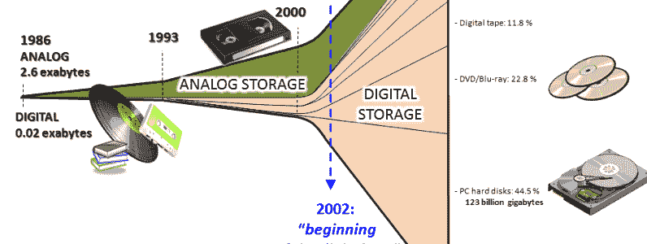

% 数字：1% 3% 25% 94%

来源：Hilbert, M., & López, P. (2011). The World's Technological Capacity to Store, Communicate, and Compute Information. Science, 332(6025), 60–65. http://www.martinhilbert.com/Worldfocapacity.html

2002 年：“数字时代的开启”

- 其他：< 1%（包括芯片卡、内存卡、软盘、便携式驱动器、DVD、CD、游戏卡带、视频游戏）
- 数字：280 艾字节
- PC 硬盘：44.5% 1230 亿千字节

图 1.25 – 全球信息存储容量

DDD（领域驱动设计）通过将臃肿的单体拆分为子领域（`subdomains`）和边界上下文（`bounded contexts`）形式的管理单元来处理复杂性，这天生契合了这种编程风格。因此，在构建现代解决方案时，看到人们对采用 DDD 原则和技术产生新的兴趣并不意外。引用埃文斯（Eric Evans）的话，DDD 现在比它最初构想时更具有相关性，并不令人意外！

## 领域驱动设计的原理

## 总结

在本章中，我们分析了软件项目失败的一些常见原因。我们看到了不准确或被误读的需求、架构（或缺乏架构）以及过度的技术债如何阻碍业务目标的实现和成功。

我们研究了 DDD 的基本构建模块，如领域（`domains`）、子领域（`subdomains`）、通用语言（`ubiquitous language`）、领域模型（`domain models`）、边界上下文（`bounded contexts`）和上下文映射（`context maps`）。我们还解释了为什么 DDD 的原则和技术在现代微服务和无服务器时代仍然非常相关。你现在应该理解 DDD 的基本术语以及为什么它们在当今语境下如此重要。

在下一章中，我们将更深入地观察 DDD 的真实世界机制。我们将深入探讨 DDD 的战略和战术元素，以及使用这些元素如何帮助形成良好沟通的基础并创建更健壮的设计。

## 延伸阅读

| 标题 | 作者 | 位置 |
| --- | --- | --- |
| 职业人士脉搏 - 2017 | PMI | https://www.pmi.org/-/media/pmi/documents/public/pdf/learning/thought-leadership/pulse-of-the-profession-2017.pdf |
| 职业人士脉搏 - 2020 | PMI | https://www.pmi.org/learning/library/forging-future-focused-culture-11908 |
| 项目成功：定义与衡量技术 | PMI | https://www.pmi.org/learning/library/project-success-definitions-measurement-techniques-5460 |
| 项目成功：定义与衡量技术 | JK Pinto, DP Levin | https://www.pmi.org/learning/library/project-success-definitions-measurement-techniques-5460 |
| 分析瘫痪 | Ward Cunningham | https://proxy.c2.com/cgi/AnalysisParalysis |
| 预前大设计 | Ward Cunningham | https://wiki.c2.com/?BigDesignUpfront |
| 企业建模反模式 | Scott W. Ambler | http://agilemodeling.com/essays/enterpriseModelingPatterns.htm |
| 项目经理敏捷方法指南 | Henny Portman | https://digitalprojectmanager.com/agile-methodologies |

## 延伸阅读

| 标题 | 作者 | 位置 |
| --- | --- | --- |
| 领域驱动设计：现在更加如此 | Eric Evans | https://www.youtube.com/watch?v=IKWPNALU |
| 引入刻意发现 | Dan North | https://dannorth.net/2010/08/30/deliberate-discovery/ |
| 没有银弹——软件工程中的本质与偶然性 | Fred Brooks | https://packpub.com/product/mastering-functional-requirements/978178299237 |
| 精通非功能性需求 | Sameer | https://faculty.salisbury.edu/ |
| 大泥球球 | Brian Foote & Joseph Yoder | http://laputan.org/ |
| 自动化测试被遗忘的层 | Mike Cohn | https://mountainsoft.com/blog/theforgotten-layer-of-automation-pyramid |
| 技术债：收回技术资产 | Vishal Patel 等人 | https://www.mcksey.com/insights/tech-debt-reclaiming-tech-equity |
| 高质量软件值这笔成本吗？ | Martin Fowler | https://martinfowler.com/articles/isqualityworthcost.html |

# DDD 如何以及在何处适用？

“如果我们专注于目标，就不会被比较所分心。” — Bob Gaff

软件架构指的是软件系统的基本结构以及创建此类结构的学科。多年来，我们积累了一系列架构风格。

在本章中，我们将检查领域驱动设计（DDD）如何以一种补充架构风格和编程范式被应用，帮助我们处理系统复杂性。在本章中，我们将涵盖以下内容：

- 架构风格
- 编程范式
- 应该选择哪种范式？

在本章结束时，你将对各种架构风格和编程范式产生理解，以及在使用它们时需要注意的陷阱。你还将理解 DDD 在增强这些元素方面扮演的角色。

## 架构风格

领域驱动设计以战略和战术元素的形式呈现了一套架构原则。这使得你能够将臃肿的子领域分解为良好的边界上下文。

DDD 的巨大优势之一是它不需要任何特定的架构。然而，软件行业过去几年一直在使用大量的架构风格。让我们看看如何结合流行的架构风格来获得更好的解决方案。

### 分层架构

分层架构是最常见的架构风格之一，解决方案通常被组织为四大类：表示层（`presentation`）、应用层（`application`）、领域层（`domain`）和持久化层（`persistence`）。如下所示：

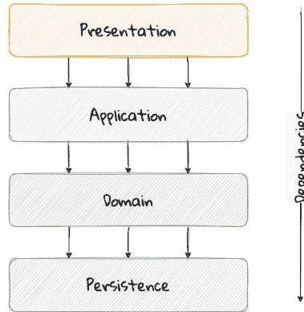

分层架构的主要思想是关注点分离——层之间的依赖是单向的（从上到下）。例如，领域层可以依赖持久化层，反之则不然。此外，任何给定的层通常与其直接下层交互，而不跳过层。

这种结构使得层之间的耦合降低，并允许它们独立进化。分层架构的思想与 DDD 的战术元素非常契合，如图所示：

图 2.1 – 分层架构的本质

## 架构风格

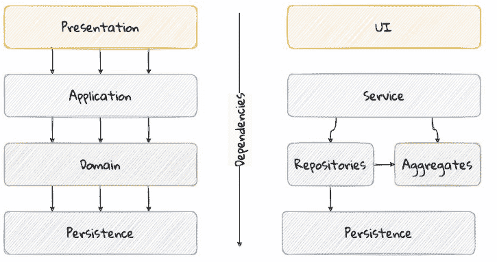

图 2.2 - 映射到 DDD 战术元素的分层架构

DDD 积极促进分层架构的使用，主要因为它允许在与其他关注点（例如如何显示信息、如何管理端到端流以及如何存储和检索数据）隔离关注领域层。从角度来看，应用 DDD 的解决方案往往也是分层的。

### 显著变体

分层架构的一种变体是由阿里斯泰尔·柯伯恩（Alistair Cockburn）发明的，他最初称为六形架构（https://alistair.cockburn.us/hexagonal-architecture/），也被称为端口和适配器架构。这种风格的思想是为了避免层之间意外的依赖（这在分层架构中可能会发生），特别是系统核心与边缘端口之间的依赖。

主要思想是在核心内部使用接口（端口）来启用现代驱动程序，如测试和松耦合。这使得核心能够独立于非核心端口和外部依赖进行开发和演进。通过端口（适配器）的具体实现实现了与现实组件（如数据库、文件系统和 Web 服务）的集成。

## DDD 如何以及何时融入？

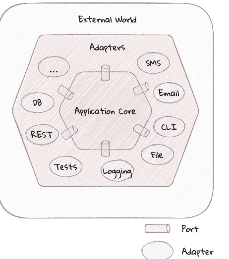

图 2.3 – 六边形架构

事实证明，在这种背景下使用“六边形”一词完全是为了视觉目的——而不是为了将系统限制为特定的六种端口。

与六边形架构类似，洋葱架构（https://jeffreypalermo.com/2008/07/the-onion-architecture-part-1/）由 Jeffrey Palermo 提出，它基于在核心创建一个独立的对象模型来构建应用程序，该模型可以与外层独立编译和运行。这是通过在核心中定义接口（六边形架构中的端口）并在外层实现它们（六边形架构中的适配器）来实现。从我们的角度来看，六边形和洋葱架构风格之间没有我们可以识别的感知差异。

## 架构风格 43

这里展示了洋葱架构的视觉表示：

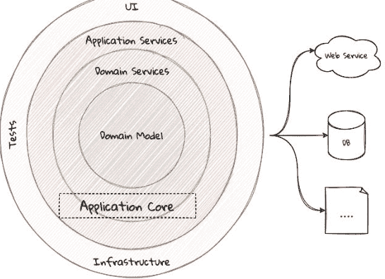

图 2.4 - 洋葱架构

另一种分层架构的变体是由 Robert C. Martin（被亲切地称为 Uncle Bob）推广的——洁洁架构（Clean Architecture）。它基于遵循 SOLID 原则（https://blog.cleancoder.com/uncle-bob/2020/10/18/Solid-Relevance.html），这些原则同样由他提出。这里的核心思想（与六边形和洋葱架构的情况一样）是避免核心层——存放业务逻辑的层——与其他易变层（如框架、第三方库、UI 和数据库）之间的依赖。

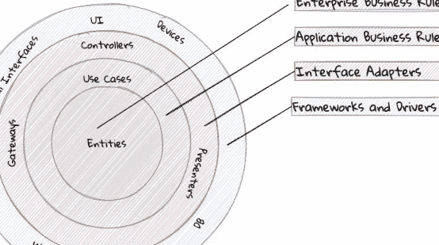

图 2.5 - 洁洁架构

## DDD 如何以及何时融入？

所有这些架构风格与 DDD 的核心理念是协同的，即为核心子域（并扩展到其边界上下文）独立开发一个独立于系统其余部分的领域模型。

虽然这些架构风格中的每一个在如何组织分层架构方面提供了额外的指导，但我们选择的任何方法都带有一系列权衡和局限性，你需要意识到这些。我们将在接下来的小节中讨论这些考虑。

### 蛋糕层反模式（Layer cake anti-pattern）

坚持使用一组层可以提供某种程度的隔离，但在简单的情况下，除了遵循约定的架构指南外，它可能证明在没有增加任何感知收益的情况下是过度设计的。在“蛋糕层”反模式中，每一层都代理对下一层的调用，而没有添加任何价值。以下示例说明了这种非常常见的场景：

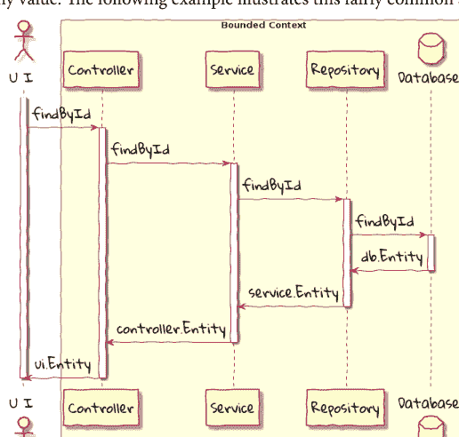

图 2.6 - 通过 ID 查找实体表示的蛋糕层反模式示例

`findById` 方法在每一层中都被复制，并简单地调用下层中同名的方法，没有任何额外的逻辑。这为解决方案引入了一种意外复杂度。为了标准化的目的，分层中的某些冗余可能是不可避免的。如果代码库中频繁出现“蛋糕层”现象，最好重新检查分层指南。

### 贫血翻译（Anemic translation）

我们常见的另一种蛋糕层变体是：各层为了更高的隔离和更松的耦合而拒绝共享输入和输出类型。这使得在每一层的边界执行翻译变得必要。如果被翻译的对象在结构上或或少相同，我们就有了“贫血翻译”。让我们看看之前讨论的 `findById` 示例的变体。

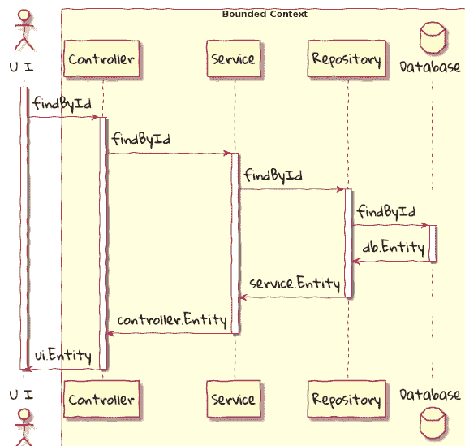

在这种情况下，每一层都定义了自己的 `Entity` 类型，要求在每一层之间进行类型之间的转换。更糟糕的是，`Entity` 类型的结构可能存在看似微小的差异（例如，`lastName` 被称为 `surname`）。虽然在跨边界上下文时这种翻译可能是必要的，但团队应努力避免在单个边界上下文内对同一概念的名称和结构出现变体。刻意使用通用语言（`ubiquitous language`）有助于避免此类场景。

## 层绕过（Layer bypass）

在处理分层架构时，从严格限制层只与紧下方的层交互开始是合理的。正如我们之前看到的，僵化的强制可能会导致无法忍受的意外复杂度，特别是当泛泛应用于大量用例时。在这些情况下，考虑允许绕过一或多层可能是值得的。

例如，可以允许控制器层直接与存储库工作，而不使用服务层。在许多情况下，我们发现从使用一套独立的查询（`queries`）命令作为起点是有用的。

这可能会变得棘手。为了继续保持某种程度的安全性，团队应该考虑使用轻量级架构治理工具，如 `ArchUnit`（https://www.archunit.org/），使架构显式化并提供反馈。使用 `ArchUnit` 实现此目的的简单示例所示：

```java
class LayeredArchitectureTests {
    @ArchTest
    static final ArchRule layer_dependencies_are_respected_with_exception =
        layeredArchitecture()
            .layer("Controllers").definedBy("..controller...")
            .layer("Services").definedBy("..service...")
            .layer("Domain").definedBy("..domain...")
            .layer("Repository").definedBy("..repository...")
            .whereLayer("Controllers").mayBeAccessedAnyLayer()
            .whereLayer("Services").onlyBeAccessedBy("Controllers")
            .whereLayer("Domain").onlyBeAccessedBy("Services")
            .whereLayer("Repository").mayBeAccessedBy("Services", "Controllers");
}
```


`Repository` 层可以被 `Services` 和 `Controllers` 访问——实际上允许调用者绕过 `Services` 层。

## 垂直切片架构（Vertical slice architecture）

分层架构及其变体对组织应用程序提供了合理的指导。Jimmy Boggard 提倡的垂直切片架构意识到，对于所有用例采用标准的分层策略可能过于僵化。此外，重要的是，通过孤立地实现这些水平层无法获得业务价值。这样做在所有层连接之前会导致层不可用和不必要的切换。因此，垂直切片架构建议最小化切片之间的耦合，最大化切片内部的耦合（`https://jimmyboggard.com/vertical-slice-architecture/`），如下所示：

# 架构风格 47

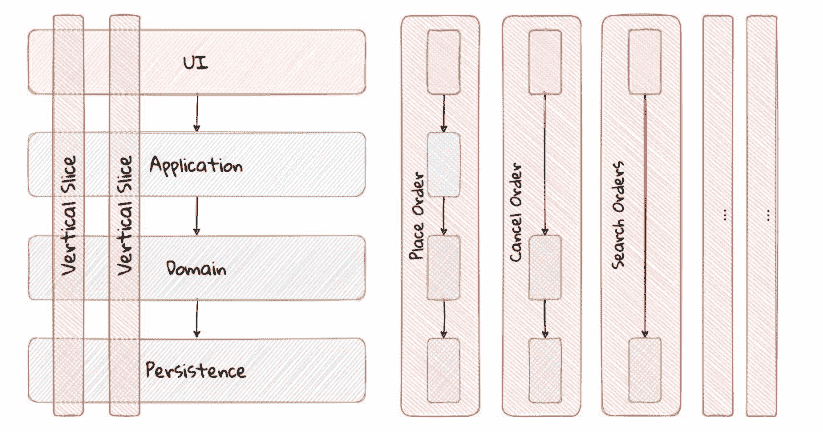

在这个示例中，`Place Order` 可能要求我们通过应用层与其他组件协调并应用复杂的业务规则，同时在 `ACID` 事务的范围内运行。同样，`Cancel Order` 可能只需要在 `ACID` 事务内应用业务规则而不需要额外的协调——在这种情况下，不需要应用层。然而，`Search Orders` 可能要求我们仅从查询优化的视图中获取数据。这种风格使用了“因地制宜”的分层方法，在实现原生分层架构时，可能有助于缓解之前出的某些反模式。

## 考虑因素

垂直切片架构在实现解决方案时提供了很大的灵活性——如果没有某种程度的治理，这可能会迅速变成一个大泥球，分层决策似乎是根据个人偏好和经验（或缺乏经验）随机做的。

## DDD 在何时以及如何适用？

在实际应用中，垂直切片架构（vertical slice architecture）确实允许你在每个或一组相关的垂直切片中非常有效地应用 DDD——这允许它们被视为限界上下文（bounded contexts）。这里展示了使用“下单”和“取消订单”示例两种可能性：

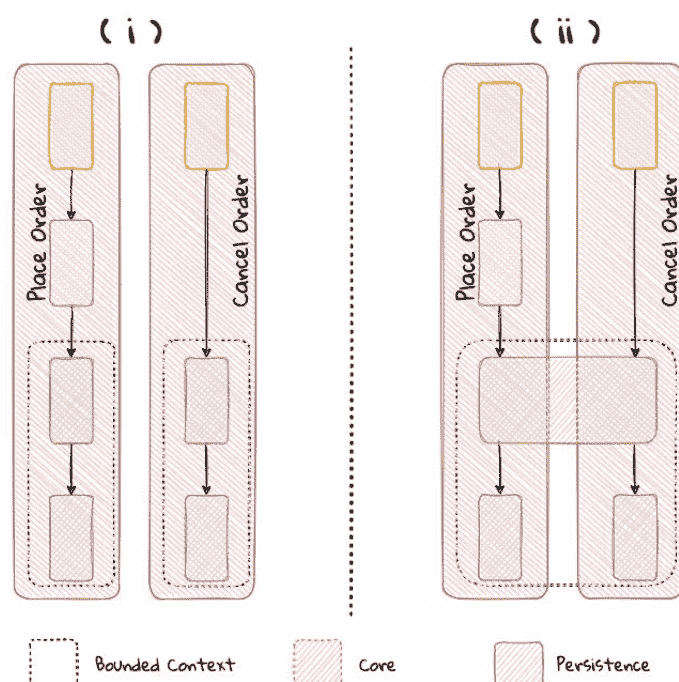

图 2.9 – 用于演进限界上下文的垂直切片

在上述图的 (i) 示例中，下单和取消分别使用不同的领域模型；而在 (ii) 示例中，两种情况共享一个公共领域模型，并因此成为同一个限界上下文的一部分。当考虑沿着用例边界采用无服务器架构时，这为功能切片铺平了道路。

## 面向服务的架构（SOA）

面向服务的架构（SOA）是一种架构风格，软件组件通过标准化接口暴露（可能的）可重用功能。使用标准化接口（例如 SOAP、REST 和 gRPC 等）可以在集成异构解决方案时实现更易的互操作性，如下所示：

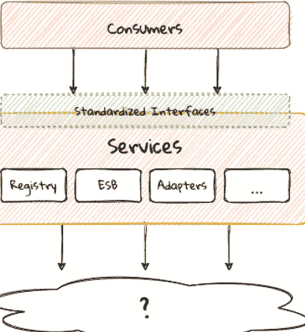

图 2.10 - SOA - 通过标准接口暴露可重用功能

使用非标准的专有接口使得这种集成变得更有挑战性。例如，一家零售银行可能会以 SOAP Web 服务的形式暴露账户间转账功能。虽然 SOA 规定通过标准化接口暴露功能，但其重点更多在于集成异构应用程序，而不是实现它们。

## 考虑因素

在我们工作过的一家银行，我们通过 SOA 暴露了超过 500 多个服务接口。在底层，我们使用 EJB 2.x（无状态会话 bean 和消息驱动 bean 的组合）实现了这些服务，并将其托管在一个中央 J2EE 应用服务器上，该服务器兼任企业服务总线（ESB）的职责。这些服务将逻辑（并非全部）委托给单个单体 Oracle 数据库中的一组底层过程，并为整个企业使用了一个规范数据模型！对于外部世界来说，这些服务是位置透明、无状态、可组合且可发现的。事实上，我们将这种实现作为 SOA 的示例，而且很难辩称它不是。

这系列服务多年来有机地演变，混合了显式的边界、来自组织不同部门的概念以及几代人的心血，每每个人对业务功能需要如何实现都有自己的解释。本质上，这种实现类似于了可怕的“大泥泥球”（big ball of mud），极难增强和维护。

## DDD 在何时以及如何适用？

SOA 的意图是高尚的。然而，由于缺乏关于组件粒度的具体实现指导，在实践中很难实现重用和松耦合的承诺。事实上，SOA 对不同的人来说意味着许多含义（`https://martinfowler.com/bliki/ServiceOrientedAmbiguity.html`）。这种歧义导致了大多数 SOA 实现变成了复杂的、难以维护的单体，或者二者兼有。这正是 DDD 通过将复杂问题分解为子域和限界上下文来解决问题变得价值足珍贵的地方。

## 微服务架构

在过去的十年里，微服务变得非常流行，许多组织想要采用这种架构风格。在许多方面，微服务是 SOA 的扩展——重点放在创建专注的组件，这些组件处理有限数量的任务并将其做到极致。《构建微服务》一书作者 Sam Newman 将微服务定义为小型、独立部署的组件，它们维护自己的状态并围绕业务领域进行建模。这带来了许多益处，例如在建模解决方案时采用马蹄铁方法（horsesfords approach）、限制爆炸半径、提高生产力和速度、实现自治的跨职团队等。

微服务通常作为一个整体存在，协作工作以实现预期的业务结果，如下所示：

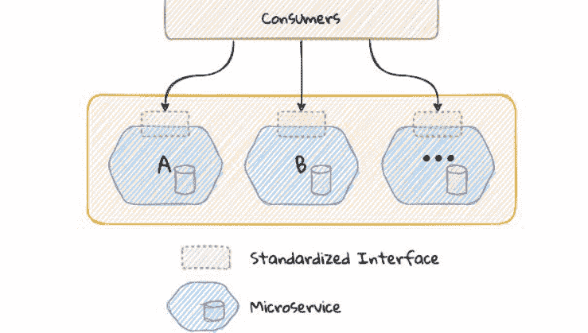

图 2.11 – 微服务生态系统

正如我们看到的，从消费者的角度来看，SOA 和微服务非常相似，因为它们通过一组标准化接口访问功能。微服务方法是 SOA 的演进，因为现在的重点是构建更小、自给自足、独立部署的组件，意在避免单点故障（例如企业数据库或服务总线），这在许多基于 SOA 的实现中相当常见。

虽然微服务确实帮助了他们，但关于微服务应该多大或小，仍然存在很多歧义（`https://martinfowler.com/articles/microservices.html#HowBigIsAMicroservice`）。事实上，许多团队似乎在处理这个问题上挣扎，导致了单体（`https://www.infog.com/news/2016/02/services-distributed-monolith/`），在许多方面，这可能比 SOA 时代的单进程单体糟糕得多。再次，应用 DDD 的策略设计概念可以帮助创建独立、松耦合的组件，使其成为微服务架构风格的理想伴侣。

## 事件驱动架构（EDA）

无论组件的粒度如何（单体、微服务或介于两者之间），非平凡的解决方案都有一个边界，越过边界可能需要与外部系统进行通信。这种通信通常通过系统之间的消息交换发生，导致它们相互耦合。

## DDD 在何时以及如何适用？

简单来说，事件驱动系统不在乎下游消费者是谁，而在消息驱动系统中，情况并不一定如此。当我们在这本书的语境下说及事件驱动时，我们指的是前者。

通常，事件驱动系统通过使用中间基础设施组件（通常称为消息代理、事件总线等）消除了与最终消费者进行点对点消息传递的需求。这有效地将耦合从 n 个消费者减少到 1。

然而，事件驱动系统的实现方式有几种变体。在发布事件的背景下，Martin Fowler 提到了两种大风格（以及其他）：事件通知和事件携带状态，正如我们在“你所说的事件驱动？”文章中（`https://martinfowler.com/articles/201701-event-driven.html`）所含义。

> 消息是发送到特定目的地的数据项。事件是组件在达到给定状态时发出的信号。在消息驱动系统中，可寻的接收者等待消息的到达并处于休眠状态。在事件驱动系统中，监听器被附加到源上，以便在事件发布时被调用。这意味着事件驱动系统关注于可寻的源，而消息驱动系统集中于可寻的接收者。
>
> 《响应式宣言》（The Reactive Manifesto）

构建事件驱动系统时，权衡之一是决定每个事件中应该嵌入多少状态（负载）。明智的做法是考虑只嵌入足够的状态来指示由于发布事件而发生的变化，以平衡各种对立的力量，例如生产者扩展性、封装、消费者复杂性和韧性。我们将在第 5 章讨论实现事件时，详细讨论相关的影响。

DDD 的核心在于通过创建这些独立的限界上下文来控制复杂性。然而，独立并不意味着隔离。限界上下文可能仍然需要相互通信。实现这一点的方法之一是使用 DDD 的基础构建块——领域事件。因此，事件驱动架构和 DDD 是互补的。通常的做法是利用事件驱动架构允许限界上下文进行通信，同时保持松耦合。

## 查询职责分离（CQRS）

在传统的应用程序中，使用单一领域数据/持久化模型来处理所有类型的操作。在 CQRS 中，我们创建不同的模型来处理更新（命令）和查询。如下图所示：

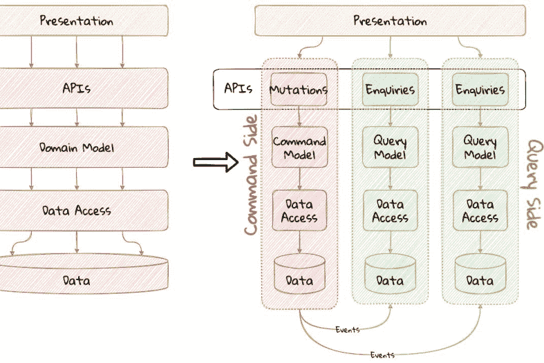

图 2.12 – 传统架构与 CQRS 架构

> 注意
>
> 我们在上一个图中描绘了多个查询模型，因为创建多个查询模型是可能的（但并非必须），这取决于需要支持的查询用例的类型。

为了实现这项工作，查询模型（s）需要与写模型保持同步（我们稍后将详细检查实现这一点的一些技术）。

## 考虑因素

传统的单模型方法对于简单的 CRUD 类型的应用程序效果良好，但对于更复杂的场景开始变得难以从心。我们将在接下来的子节中讨论其中一些场景。

# DDD 适用于什么位置？

## 读写之间的数量不平衡

在大多数系统中，读操作的数量比写操作多出几个数量级。例如，考虑交易员检查股票价格的次数与他们实际交易（买入或出股票）的次数。通常情况下，写操作才是为业务盈利的操作。在一个读操作占多数的系统中，对读和写使用单一模型可能会使系统负载过大，以至于影响到写性能。

## 对多种读表示的需求

在处理相对复杂的系统时，对同一份数据需要一个以上表示的情况并不罕见。例如，在查看个人健康数据时，你可能想查看每日、每周或每月视图。虽然这些视图可以从原始数据实时计算，但每次转换（聚合、总结等）都会增加系统的认知负载。通常，无法预先预测这些需求的性质。此外，设计一个能够提供所有这些需求答案的单一规范模型是不可行的。创建专门为满足一组特定需求而设计的领域模型会容易得多。

## 不同的安全需求

在使用单一模型进行工作时，管理对数据/APIs 的授权和访问需求可能会变得非常繁琐。例如，与余额权益相比，扣款操作可能需要更高级别的安全性。拥有不同的模型可以显著显著降低设计细粒度授权控制的复杂性。

## 复杂度更均匀的分布

拥有一个专门用于服务命令侧用例的模型，意味着它们现在可以专注于单一关注点。对于查询侧用例，我们根据需要创建与命令侧模型不同的模型。这有助于将复杂度更均匀地分布在更大的表面上，而不是增加用于服务所有情况的单一模型的复杂度。值得注意的是，DDD 的本质主要是与复杂系统进行有效工作，而 CQRS 与这一思路非常契合。

> 注意
>
> 在使用 CQRS 架构时，为命令侧选择持久化机制是一个关键决策。当与事件驱动架构结合时，你可以选择将聚合持久化为一系列事件（按照其发生顺序排序）。这种持久化样式被称为事件溯源（Event Sourcing）。我们将在第 5 章“实现领域逻辑”中的“事件源聚合”部分进行详细介绍。

## 无服务器架构（Serverless architecture）

无服务器架构是一种软件设计方法，允许开发者在无需管理底层基础设施的情况下构建和运行服务。AWS Lambda 的出现普及了这种架构风格，尽管其他服务（如用于持久化的 S3 和 DynamoDB，用于通知的 SNS 以及用于消息队列的 SQS）在 Lambda 发布之前就已经存在。虽然 AWS Lambda 以函数即服务（FaaS）的形式提供了完整的解决方案，但为了从无服务器范式中受益，这些其他服务同样重要，甚至更为重要。

在传统的 DDD 中，边界上下文（bounded contexts）是通过在聚合周围分组操作而形成的，这决定了解决方案的预期方式——除非是在单个进程的范围内。在无服务器范式中，每个任务都预期作为自己的独立单元进行部署。这要求我们以不同的方式看待聚合边界边界——以单个任务或函数为中心，而不是一组相关的任务。

这意味着 DDD 获得解决方案的原则不再适用了吗？虽然无服务器范式引入了一个额外的维度，即在建模过程中将细粒度的可部署服务视为一等公民，但应用 DDD 战略设计和战术设计的整体过程仍然适用。我们将在第 11 章“拆分为细粒度组件”中详细检查这一点，届时我们将重构整本书的解决方案，以采用无服务器方法。

## 大泥球（The big ball of mud）

到为止，我们已经检查了一系列命名的架构风格及其陷阱，以及应用 DDD 如何帮助缓解这些问题。在另一个极端，我们可能会遇到缺乏感知架构的解决方案，即众所著名的“大泥球”：

> “一个‘大泥球’是结构杂乱、蔓延、粗糙、用胶带和意大利面一样缠绕在一起的垃圾代码。我们都见过它们。这些系统显示出明显的不受控增长和反复、权宜修复的迹象。信息在系统的远端元素之间肆意共享，往往到几乎所有信息都变成全局或重复的程度。系统的整体结构可能从未被良好地定义。如果定义过，它可能已经侵蚀到无法识别。任何有一点架构感觉的程序员都会避开这些泥沼。只有那些对架构不在意，并且可能对在这些日益失败的补丁中修补漏洞的日常琐事带来的惯性感到舒适的人，才会满足于在这样的系统上工作。”
>
> — Brian Foote 和 Joseph Yoder

# DDD 适用于什么位置？

尽管 Foote 和 Yoder 建议不惜一切避免这种风格的架构，但类似于大泥球的软件系统对我们许多人来说仍然是日常的不可避免性。DDD 的战略和战术设计元素提供了一系列技术，帮助我们以务实的方式处理并从这些近乎绝望的境地中恢复，而可能不需要采取激性的“推倒重来”（big bang approach）方法。事实上，本书的重点是应用这些原则来防止或延迟进一步向大泥球的退化。

## 你应该使用哪种架构风格？

正如我们所看到的，在构建软件解决方案时，你可以学习多种架构风格。这些许多架构风格共享一些共同原则。要符合任何单一的架构风格可能会变得困难。DDD 强调将复杂的业务拆分为子系统和边界上下文，这使得在边界上下文之间可以使用一种以上的方法。我们想特别提一下“垂直切片架构”（vertical slice architecture），因为它强调将功能划分为特定的业务结果，因此更自然地遵循了 DDD 的边界上下文思想。在现实世界的需求下，你可能会发现有必要扩展甚至偏离对架构风格的刻板定义。当我们做出妥协时，重要的是要有意图地这样做，并清晰无歧义地说明我们为什么要做出这样的决定（最好使用某些轻量级机制，如架构决策记录 ADR（`https://www.thoughtworks.com/de/techniques/lightweight-architecture-decision/`））。这很重要，因为当我们以后回顾它时，可能很难向他人甚至自己证明它是合理的。

在本节中，我们检查了流行的架构风格以及在结合 DDD 使用时如何增强其有效性。现在，让我们看看 DDD 如何互补现有编程范式。

## 面向对象的编程

在表面上，DDD 似乎只是复制了一组 OO 术语并可以通过名称来区分。例如，战术 DDD 的核心概念如聚合、实体和值对象在 OO 术语中可以简单地称为对象。其他概念如服务可能没有直接的 OO 对应物。那么，如何在 OO 世界中应用 DDD 呢？让我们来看一个简单的示例：

## 编程范式 57

```java
interface PasswordService {
  String generateStrongPassword();
  boolean isStrong(String password);
  boolean isWeak(String password);
}

class PasswordClient {
  private PasswordService service;
  void register(String userEnteredPassword) {
    if (service.isStrong(userEnteredPassword)) {
      // ...
    }
  }
}
```

面向对象（OO）的支持者会很快指出 `PasswordService` 是过程化的，并且可能需要一个 `Password` 类来封装相关的行为。同样，DDD 可能会指出这是一个贫血领域模型（anemic domain model）实现。毫无疑问，一个 OO 版本可能如下：

```java
class Password {
  private final String password;
  private Password(String password) {
    this.password = password;
  }
  public boolean isStrong() { ... }
  public boolean isWeak() { ... }
  public static Password generateStrongPassword() { ... }
  public static Password passwordFrom(String password) { ... }
}

interface PasswordService {
  String generateStrongPassword();
  Password createPasswordFrom(String userEnteredPassword);
}

class PasswordClient {
  private PasswordService service;
  void register(String userEnteredPassword) {
    Password password = service.createPasswordFrom(userEnteredPassword);
    if (password.isStrong()) {
      // ...
    }
  }
}
```

## DDD 如何契合？


在这种情况下，`Password` 类不再暴露其内部实现，而是以行为的形式（`isStrong` 和 `isWeak` 方法）暴露了强密码或弱密码的概念。从 OO 的角度来看，第二种实现无疑是优的。如果是这样，我们难道不应该一直都使用 OO 版本吗？事实证明，答案是微妙的，取决于消费者的需求以及在该上下文中使用的通用语言（ubiquitous language）。如果 `Password` 的概念在领域内是常用的，那么在实现中或许也应该有这样一个概念。如果不是，第一种方案可能足够了，尽管它违反了 OO 的封装原则。

我们的默认立场是以应用良好的 OO 实践作为起点。然而，反映领域的语言比以一种务实的方式反对 OO 更重要。因此，如果在该语境下这样做显得不自然，我们愿意在 OO 纯性上做出妥协。正如前面提到的，清晰地沟通此类决策的理由会有很大帮助。

## 函数式编程

函数是代码组织的基础构建块，存在于所有高阶语言中。函数式编程是一种编程范式，通过应用和组合函数来构建程序。这与命令式编程不同，后者使用语句来改变程序的状态。最显著的区别在于函数式编程避免了副作用，而副作用在命令式编程中很常见。纯函数式编程完全防止了副作用并强制执行不可变性。在设计领域模型时采用函数式风格使其更加声明式，会让意图更加清晰。它还允许我们通过使用更简单的概念来实现更复杂的概念，从而控制复杂度。函数式实现允许我们在实现目标的同时，具有简洁的额外优势。考虑一个简单的例子，我们需要使用函数式风格找到所有仓库中库存最低的物品，如下所示：

```java
class Functional {
    public Optional<Item> scarcestItem(Warehouse... warehouses) {
        return Stream.of(warehouses)
            .flatMap(Warehouse::items)
            .collect(groupingBy(Item::name, sumInt(Item::quantity)))
            .entrySet().stream()
            .map(Entry::new)
            .min(comparing(Item::quantity));
    }
}
```

这里展示的命令式风格完成了工作，但无疑要冗长得多且难以理解，有时对于技术团队也是如此！

以下是一个命令式的示例：

```java
class Imperative {
    public static Optional<Item> scarcestItem(Warehouse... warehouses) {
        Collection<Item> allItems = new ArrayList<>();
        for (Warehouse warehouse : warehouses) {
            allItems.addAll(warehouse.getItems());
        }
        Map<String, Integer> itemNamesByQuantity = new HashMap<>();
        for (Item item : allItems) {
            final String name = item.name();
            final int quantity = item.quantity();
            if (itemNamesByQuantity.containsKey(name)) {
                itemNamesByQuantity.put(name, itemNamesByQuantity.get(name) + quantity);
            } else {
                itemNamesByQuantity.put(name, quantity);
            }
        }
        final Map.Entry<String, Integer> min = Collections.min(itemNamesByQuantity.entrySet(), Map.Entry.comparingValue());
        return min != null ? Optional.of(min) : Optional.empty();
    }
}
```

从 DDD 的角度来看，这带来了几个益处：

- 增加了与领域专家的协作，因为声明式风格允许更多地关注“做什么”（what），而不是“怎么做”（how）。这使得技术和非技术利益相关者在持续合作时都不再感到畏惧。

- 更好的可用性，使用纯函数（无副作用的）使得更容易创建数据驱动的测试。这还为我们带来了额外的好处，即更少的锁定/打桩（stubbing）。这些特性使得测试更容易维护和合理化。这让技术团队成员能够在过程更早阶段可视化边缘情况。

## 你应该选择哪种范式？

DDD 简单来说，你应该围绕一个领域模型来构建软件，该模型代表了软件试图解决的实际问题。在遇到复杂的现实问题时，我们经常发现很难全方面地遵循任何单一范式。试图使用一刀切的方法可能会适得其反。经验表明，我们需要使用多种技术来优雅地解决问题。Java 本质上是 OO 语言，但随着 Java 8 的出现，它也开始接受各种函数式构造。这允许我们通过简单的概念来实现复杂的概念。

最重要的一点是约定通用语言并让其引导方法。这在很大程度上取决于你所拥有的才能和经验。虽然我们在本章中没有涵盖过程化范式，但在某些情况下，它可能是最佳解决方案。

在本章中，我们涵盖了一系列常用的架构模式以及在使用这些模式时如何实践 DDD。我们还查看了流行的编程范式及其对 DDD 战术元素的影响。

此外，你应该理解在提出解决方案时需要采用的各种架构风格。无论你选择什么风格，都可以 DDD。在接下来的部分，我们将在本章及之前的章节中学到的知识应用于一个真实的业务用例。我们将使用基于 Java 语言的技术，应用 DDD 的战略和战术模式将复杂领域拆分为子领域和边界上下文。

# 第二部分：实战 DDD

## 编程范式 57

```java
interface PasswordService {
  String generateStrongPassword();
  boolean isStrong(String password);
  boolean isWeak(String password);
}

class PasswordClient {
  private PasswordService service;
  void register(String userEnteredPassword) {
    if (service.isStrong(userEnteredPassword)) {
      // ...
    }
  }
}
```

面向对象（OO）的支持者会很快指出 `PasswordService` 是过程化的，并且可能需要一个 `Password` 类来封装相关的行为。同样，DDD 可能会指出这是一个贫血领域模型（anemic domain model）实现。毫无疑问，一个 OO 版本可能如下：

```java
class Password {
  private final String password;
  private Password(String password) {
    this.password = password;
  }
  public boolean isStrong() { ... }
  public boolean isWeak() { ... }
  public static Password generateStrongPassword() { ... }
  public static Password passwordFrom(String password) { ... }
}

interface PasswordService {
  String generateStrongPassword();
  Password createPasswordFrom(String userEnteredPassword);
}

class PasswordClient {
  private PasswordService service;
  void register(String userEnteredPassword) {
    Password password = service.createPasswordFrom(userEnteredPassword);
    if (password.isStrong()) {
      // ...
    }
  }
}
```

## 58 DDD 如何契合？

在这种情况下，`Password` 类不再暴露其内部实现，而是以行为的形式（`isStrong` 和 `isWeak` 方法）暴露了强密码或弱密码的概念。从 OO 的角度来看，第二种实现无疑是优的。如果是这样，我们难道不应该一直都使用 OO 版本吗？事实证明，答案是微妙的，取决于消费者的需求以及在该上下文中使用的通用语言（ubiquitous language）。如果 `Password` 的概念在领域内是常用的，那么在实现中或许也应该有这样一个概念。如果不是，第一种方案可能足够了，尽管它违反了 OO 的封装原则。

我们的默认立场是以应用良好的 OO 实践作为起点。然而，反映领域的语言比以一种务实的方式反对 OO 更重要。因此，如果在该语境下这样做显得不自然，我们愿意在 OO 纯性上做出妥协。正如前面提到的，清晰地沟通此类决策的理由会有很大帮助。

## 函数式编程

函数是代码组织的基础构建块，存在于所有高阶语言中。函数式编程是一种编程范式，通过应用和组合函数来构建程序。这与命令式编程不同，后者使用语句来改变程序的状态。最显著的区别在于函数式编程避免了副作用，而副作用在命令式编程中很常见。纯函数式编程完全防止了副作用并强制执行不可变性。在设计领域模型时采用函数式风格使其更加声明式，会让意图更加清晰。它还允许我们通过使用更简单的概念来实现更复杂的概念，从而控制复杂度。函数式实现允许我们在实现目标的同时，具有简洁的额外优势。考虑一个简单的例子，我们需要使用函数式风格找到所有仓库中库存最低的物品，如下所示：

```java
class Functional {
    public Optional<Item> scarcestItem(Warehouse... warehouses) {
        return Stream.of(warehouses)
            .flatMap(Warehouse::items)
            .collect(groupingBy(Item::name, sumInt(Item::quantity)))
            .entrySet().stream()
            .map(Entry::new)
            .min(comparing(Item::quantity));
    }
}
```

这里展示的命令式风格完成了工作，但无疑要冗长得多且难以理解，有时对于技术团队也是如此！

以下是一个命令式的示例：

```java
class Imperative {
    public static Optional<Item> scarcestItem(Warehouse... warehouses) {
        Collection<Item> allItems = new ArrayList<>();
        for (Warehouse warehouse : warehouses) {
            allItems.addAll(warehouse.getItems());
        }
        Map<String, Integer> itemNamesByQuantity = new HashMap<>();
        for (Item item : allItems) {
            final String name = item.name();
            final int quantity = item.quantity();
            if (itemNamesByQuantity.containsKey(name)) {
                itemNamesByQuantity.put(name, itemNamesByQuantity.get(name) + quantity);
            } else {
                itemNamesByQuantity.put(name, quantity);
            }
        }
        final Map.Entry<String, Integer> min = Collections.min(itemNamesByQuantity.entrySet(), Map.Entry.comparingValue());
        return min != null ? Optional.of(min) : Optional.empty();
    }
}
```

从 DDD 的角度来看，这带来了几个益处：

- 增加了与领域专家的协作，因为声明式风格允许更多地关注于“做什么”（what），而不是“怎么做”（how）。这使得技术和非技术利益相关者在持续合作时都不再感到畏惧。

- 更好的可用性，使用纯函数（无副作用的）使得更容易创建数据驱动的测试。这还为我们带来了额外的好处，即更少的锁定/打桩（stubbing）。这些特性使得测试更容易维护和合理化。这让技术团队成员能够在过程更早阶段可视化边缘情况。

## 你应该选择哪种范式？

DDD 简单来说，你应该围绕一个领域模型来构建软件，该模型代表了软件试图解决的实际问题。在遇到复杂的现实问题时，我们经常发现很难全方面地遵循任何单一范式。试图使用一刀切的方法可能会适得其反。经验表明，我们需要使用多种技术来优雅地解决问题。Java 本质上是 OO 语言，但随着 Java 8 的出现，它也开始接受各种函数式构造。这允许我们效用多种技术。

最重要的一点是约定通用语言并让其引导方法。这在很大程度上取决于你所拥有的才能和经验。虽然我们在本章中没有涵盖过程化范式，但在某些情况下，它可能是最佳解决方案。

在本章中，我们涵盖了一系列常用的架构模式以及在使用这些模式时如何实践 DDD。我们还查看了在使用这些架构时需要注意的常见陷阱和坑。我们还查看了流行的编程范式及其对 DDD 战术元素的影响。

此外，你应该理解在提出解决方案时需要采用的各种架构风格。无论你选择什么风格，都可以 DDD。在接下来的部分，我们将在本章及之前的章节中学到的知识应用于一个真实的业务用例。我们将使用基于 Java 语言的技术，应用 DDD 的战略和战术模式将复杂领域拆分为子领域和边界上下文，并迭代地构建解决方案。

# 第二部分：实战 DDD

在书的第一部分，我们介绍了领域驱动设计（DDD）的词汇以及它在常用架构风格和编程范式背景下的适用情况。在本部分，我们将实现一个真实的应用程序，从业务动机和需求开始，并采用一系列使我们应用 DDD 战略和战术原则的技术和实践。

本部分包含以下章节：

- 第 3 章，理解领域
- 第 4 章，领域分析与建模
- 第 5 章，实现领域逻辑
- 第 6 章，实现用户界面——任务驱动
- 第 7 章，实现查询
- 第 8 章，实现长时间工作流
- 第 9 章，与外部系统集成

# 3 理解业务领域

> “勺子不知汤之滋味，学而不用者不知智慧之味。”
>
> ——威尔士语谚言

在本章中，我们将介绍一家名为 Kosmo Prima (KP) 银行的虚构机构，该银行正寻求使其国际贸易业务中的产品实现现代化。为了建立一种能够使其在中长期获得持续成功的业务战略，我们将采用一系列技术和实践，以帮助加速其从策略到执行的路径。

在深入研究之前，让我们先对 KP 银行的业务领域有一个高层次的理解。

在本章中，我们将涵盖以下主题：

- 国际贸易领域
- KP 银行的国际贸易
- 了解 KP 银行的国际贸易战略
- 国际贸易产品和服务

在本章的结束处，你将学会如何使用业务价值画布（business value canvas）和精益画布（lean canvas）等技术来对业务战略建立良好的理解。此外，我们将探讨如何绘制影响图（impact map）来帮助我们将业务交付物与目标联系起来。最后，沃德利映射（Wardley mapping）练习将确立我们的业务决策相对于竞争格局的重要性。

## 国际贸易领域

在许多国家，国际贸易占国内生产总值（GDP）的很大，它是全球范围内互不信任双方之间资本、货物和服务的交换。虽然像世界贸易组织（WTO）这样的经济组织旨在简化并促进这一过程，但在国际执行过程中，经济政策、贸易法律和货币等因素的差异可能会变得复杂，涉及多个国家的实体。信用证（letter of credit）的存在是为了简化这一过程。让我们来看看它是如何运作的。

## KP 银行的国际贸易


KP 银行已经营多年，一直致力于提供各种银行解决方案，如零售、企业、证券和其他产品。他们一直在不断将业务扩展到其他国家和大陆。这使得他们在过去的十年中显著扩大了国际贸易业务规模。尽管他们一直是该领域的领导者之一，但近期数字原生竞争者的出现开始侵蚀他们的业务，并对其顶线收入产生不利影响。客户抱怨流程过于繁琐、耗时过长，而且最近变得不可靠。此外，由于目前现有的流程非常低效，KP 银行发现很难控制成本。在过去的 3 年里，他们不得不将交易处理成本增加了约 50%。不奇的是，这与客户满意度的骤降相吻合，事实证明了在此期间服务的客户数量保持平稳。

> 首席信息官（CIO）已经意识到，需要审视这个问题并制定一项战略，让 KP 银行在未来几年内取得持续成功，并重新确立其国际贸易业务领导者的地位。

## 了解 KP 银行的国际贸易战略

为了获得最佳解决方案，对公司的业务目标以及它们如何支持解决方案的需求产生深刻理解至关重要。我们将引入一组我们认为非常有用的工具和技术。

> **注意**
>
> 需要注意的是，这些工具是独立构思的，当与其他 DDD（领域驱动设计）技术结合使用时，它们可以增强整个流程和解决方案的有效性。这些工具的使用被认为是对你 DDD 的补充。

让我们看看我们所采用的一些最流行的技术，用以快速理解业务问题并提出解决方案。

### 业务模式画布

正如我们多次提到的，在尝试解决问题之前，确保我们正在解决正确的问题至关重要。业务模式画布最初由瑞士顾问亚历山大·奥斯特瓦尔德（Alexander Osterwalder）作为其博士论文的一部分构思的，它是一种快速简便的方法，通过一个捕捉了业务九个元素的视觉图表，确立我们正在解决一个有价值的问题：

- 价值主张：你提供什么？
- 关键活动：你是如何做到的？
- 关键资源：你需要什么？
- 关键伙伴：谁会帮助你？
- 成本结构：成本是多少？
- 收入来源：你将赚多少钱？
- 客户细分：你在为谁创造价值？
- 客户关系：你与谁互动？
- 渠道：你如何触达客户？

## 理解业务领域

业务模式画布在不同群体（包括业务利益相关者、领域专家、产品所有者、架构师和开发者）之间建立了对大局的共同理解。我们发现，增强绿地（greenfield）和棕地（brownfield）项目时，它非常有用。以下是尝试为 KP 银行的国际贸易业务创建一个业务模式画布：

![img/6869d38c83b04ca7904abbd9d2e1f6d5_88_0.png]

使用此画布可以让我们对我们打算在银行服务的客户产生洞察，了解通过哪些渠道提供了哪些价值主张，以及我们如何获利。在开发业务模式画布时，建议按照前图所示的数字顺序进行，以便更好地理解：

- 业务的吸引力（我们的客户是谁以及他们想要什么）
- 业务的可行性（我们如何对其进行运营和交付）
- 业务的经济可行性（我们如何识别成本并捕获利润）

## 了解 KP 银行的国际贸易战略

如果你还没有现有的产品，创建业务模式画布可能具有挑战性，这在初创公司或现有企业扩展到新领域时通常如此。在这种情况下，探索名为精益画布（lean canvas）的变体是有值的。

### 精益画布

名为精益画布的业务模式画布变体是由什·马里亚（Ash Maurya）为精益创业公司构思的。与业务模式画布相比，其重点首先是详细阐述需要解决的问题并探索可能的解决方案。为了使画布具有可操作性，它是捕捉那些最不确定或风险最大的项目。这对于在高度不确定下运营的业务（初创公司通常非常适用）。与 DDD 类似，它鼓励将问题作为构建业务的起点。

在结构上，它与业务模式画布相似，但有以下不同：

- 问题（替代关键伙伴）：业务失败通常是因为误解了要解决的问题，这很常见。替换关键伙伴区块的理由是，当你是一个寻求建立未证明产品的未知实体时，追求关键伙伴可能为时过早。
- 解决方案（替代关键活动）：迭代地尝试多种解决方案并响应反馈是重要的。关键活动被移除是因为它们通常是解决方案的副产物。
- 关键指标（替代关键资源）：知道我们正在朝着正确的方向进展非常重要。建议关注少数几个关键指标，以便在需要时快速转型。关键资源已变得相对容易（得益于云的优势和市场框架的可用性）。此外，可能会出现在公平优势框中，我们将在讨论。
- 不公平优势（替代客户关系）：这清楚地确立了我们难以复制的化优势：这与第一章《领域驱动设计的理由》中讨论的核心子领域理念高度一致，并为我们提供了最初需要关注的精力的清晰蓝图。

## 理解领域

我们为 KP 举办的精益画布（Lean Canvas）工作坊的结果所示：

| 问题 | 解决方案 | 独特价值主张 | 不公平优势 | 客户群体 |
| --- | --- | --- | --- | --- |
| • 成本高 | 自动化工作流 | 低费率 | 扩展的银行网络 | 小规模 |
| 处理时间长 | 加快核保 | 国家和货币支持 | 庞大的客户群 | 制造商（出口商） |
| 客户留存率低 |  | 捆绑产品 | 加快处理 |  |
|  |  | 争议解决 | 用于延长信用的灵活抵押品 | 批发零售商 |
|  | 关键指标：降低处理成本、增加处理申请数量、重复业务 |  | 渠道：柜台、大型零售商（进口商） |  |
|  |  |  | 数字化渠道（移动端和网页） |  |
| 成本结构 | 客户支持 | 收入来源 | 贷款 |  |
| • 技术 | 仲裁 | 手费 | 保险 |  |
| • 营销 |  | 佣金 | 利息 |  |

图 3.2 – 国际贸易业务的精益画布

精益画布允许我们查看的具体顺序各不相同。在博客中，Ash Maurya 建议进行这项练习可能没有一个规定性的执行顺序（<https://blog.leanstack.com/what-is-the-right-fill-order-for-a-lean-canvas/>）。就个人而言，我们喜欢在转向画布的其他方面之前，先从详细阐述问题。业务模式和精益画布提供了业务模式、高优先级问题以及潜在解决方案的高级视图。接下来，让我们看看影响映射（Impact Mapping），这是另一种基于脑图的轻量级规划技术，用于制定以结果为驱动的计划。

## 影响图

影响图是一种可视化和战略规划工具，能够让你理解底层假设。它是由高级技术和业务人员通过脑图的形式共同创建的，考虑了以下几个方面：

- 目标（Goals）：我们为什么要做这个？
- 执行者（Actors）：我们产品的消费者或用户是谁？换句话说，谁会受到它的影响？
- 影响（Impacts）：消费者行为的变化如何帮助我们实现目标——换句话说，我们试图创造的影响是什么？
- 交付物（Deliverables）：作为组织或交付团队，我们可以做什么来支持所需的影响——换句话说，作为解决方案的一部分需要实现的软件功能或流程变更？

## 目标、执行者和交付物

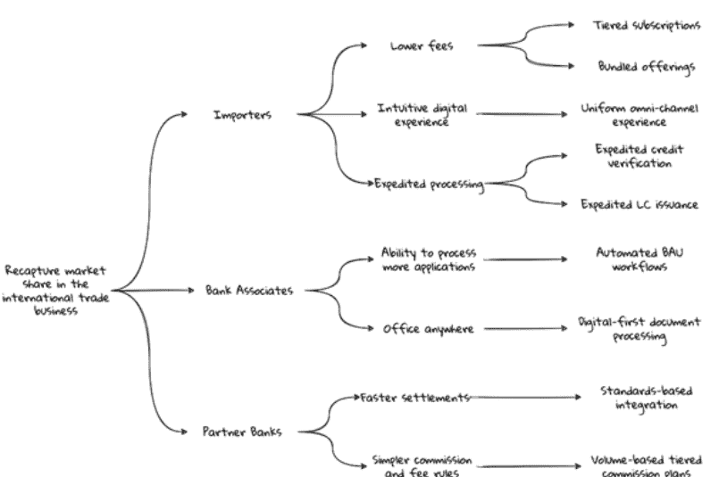

图 3.3 - 一个简单的影响图

影响映射提供了目标、用户与交付物之间影响关系的易于理解的可视化表示。接下来，让我们检查沃里图（Wardley maps），它能让我们深入理解我们的目的，并确定业务的哪些部分提供了最大的价值。

## 沃里图

业务模式和画布有助于建立高层面的目的。沃里图是另一种帮助构建业务战略和建立目的的工具。它提供了系统为哪些人员构建的草图，随后系统为他们提供的利益，以及提供这些利益所需的需要链（称为价值链）。接下来，价值链沿着演化轴绘制，该轴的范围从未探索的到高度标准化的事物。构建沃里图可以通过六步完成：

1. 目的（Purpose）：你的目的是什么？该组织或项目存在的目的是？
2. 范围（Scope）：你正在绘制的地图范围内包含（以及不包含）什么？
3. 用户（Users）：谁在使用或与你正在绘制的事物交互？
4. 用户需求（User needs）：你的用户从你正在绘制的事物中需要什么？
5. 价值链（Value chain）：我们需要做什么来满足之前捕获的这些？这些需求根据它们的依赖关系进行排列，从而创建一个价值链，该价值链将用户映射到一系列活动中，并按其对用户可见的顺序（从最可见到最低）进行排序。
6. 绘图（Map）：最后，我们是否使用演化特征进行绘图，以决定将每个组件放置在水平轴的什么位置？

我们在 KP 银行针对国际贸易业务进行了沃里图绘制练习，如下：

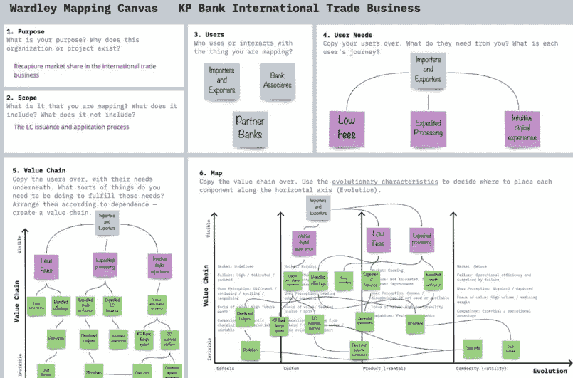

图 3.4–A – KP 银行国际贸易业务的沃里图

> 注意：在这一画布上，为了简洁，我们仅详细阐述了一类用户（进口商和出口商）的需求。在现实场景中，我们必须对所有类型的用户重复步骤 4、5 和 6。

沃里图很容易理解我们解决方案提供的能力、它们的依赖关系以及价值是如何产生的。它还描绘了这些能力与竞争对手提供的能力相比如何，允许你合理地优先考虑注意力并构建各种用户的决策。

我们检查了几种轻量级且协作的技术，以快速理解问题空间以及我们对用户和业务可能产生的影响。每种技术都相当轻量级，可以在几小时内完成。每种技术都能让我们专注于最有影响的业务领域并使投资回报率最大化。根据我们的经验，值得尝试这些练习中的多种（可能是所有），因为每种练习都可以突出业务/用户需求的不同侧面。

## 国际贸易产品和服务

国际贸易充满了风险，这导致卖方（出口商）和买方（进口商）之间的付款时间存在某种程度的不确定性，特别是由于缺乏信任。对于出口商来说，在收到付款之前，所有销售都是赠送。因此，出口商倾向于在下单后尽快收到付款。对于进口商来说，在收到货物之前，所有付款都是捐赠。

这种情况为受信任的中间人（如 KP 银行）在安全地促成贸易交易方面发挥重要作用提供了机会。KP 银行提供了多种促进国际贸易的产品，列如下：

- 信用证（LC）
- 单证托汇（DC）
- 赊汇（Open account）
- 预付
- 寄售制

## 理解领域

下面的图显示了每种付款方法从出口商和进口商角度来看的状况：

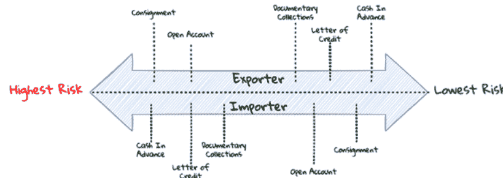

图 3.5 – 国际贸易方法的风险概况

显而易见，DC 和 LC 产品在为双方提供相对安全的解决方案之间取得了良好的平衡。需要受信任的中间人（如 KP 银行）参与履约过程，使得这些付款方式对双方的风险都更小。从银行的角度来看，作为优先处理这些产品的流程，与其他产品相比也提供了更大的业务机会。在两者中，LC 满足了我们之前阐述的业务策略会议中根据用户需求概述的大部分标准。因此，KP 银行的利益相关者决定在最初对 LC 产品进行大量投入。

在下一章以及书的其余部分，我们将利用与 DDD 原则密切一致的原则，详细阐述如何改进 LC 应用、发行和相关流程。

## 总结

在本章中，我们探索了帮助确定特定问题是否值得解决的各种。具体来说，我们查看了业务价值画布和精益画布，以明确创业公司和成熟企业的业务战略。然后，我们查看了影响映射，它使能够明确地将业务目标与用户影响以及创建这些影响所需的交付物联系起来。最后，我们查看了沃里图，深入研究重点关注的领域，包括构建还是购买的决策、与竞争对手相关的业务战略的重要性，以及进入未知领域时的相对风险。

在下一章节中，我们将介绍一些技术和实践，以进一步挖掘并深入信用证（LC）业务的理解，从而能够开始构建领域模型，以便得出合适的解决方案。

## 延伸阅读

请访问 <https://blog.leanstack.com/what-is-the-right-fill-order-for-a-lean-canvas/> 了解更多关于精益画布（Lean Canvas）的知识。

# 4 领域分析与建模

> “问一分钟，呆五分钟傻子；不问的人，做一辈傻子。”
>
> ——中国谚语

正如我们在上一节中看到的，误解需求可能导致大量的软件项目失败。要达成共识并创建一个实用的领域模型，领域专家之间需要高程度的协作。在本章中，我们将介绍贯穿全书的示例应用程序，并探索各种建模技术，如领域故事化（Domain Storytelling）和事件风暴（EventStorming），以一种可靠且结构化的方式增强我们对问题的共同理解。

本章将涵盖以下主题：

- 介绍示例应用程序（信用证）
- 增强共识
- 领域故事化
- 事件风暴

本章将帮助开发者和架构师学习如何在现实场景中应用这些技术，产生优雅的软件解决方案，以反映需要解决的领域问题。同样，非技术领域专家也将理解如何交流他们的想法，并与技术团队成员有效协作，以加速达成共识的过程。

## 技术要求

本章没有特定的技术要求。然而，考虑到可能需要进行远程协作，而不是在同一个房间内使用白板，因此访问以下工具将很有用：

- 电子白板（例如 <https://www.mural.co/> 或 <http://miro.com/>）
- 在线故事化建模工具（例如 <https://www.wps.de/modeler/>）

## 理解信用证

单据信用证（Documentary Letter of Credit, LC）是银行签的一种金融工具，作为进口方（买方）和出口方（卖方）之间的合同。该合同规定了交易的条款和条件，根据这些条款，进口方承诺向出口方支付提供的货物或服务。LC 通常涉及多个方。各方的简要说明如下：

- 进口方：货物或服务的买方。
- 出口方：货物或服务的卖方。
- 货运代理人：代表出口方处理货物运输的机构。这仅适用于实物交换的情况。
- 开证行：进口方请求开具 LC 的银行。通常，进口方与该银行有预先关系。
- 通知行：通知出口方 LC 已开出的银行。这通常是出口方所在国的银行。
- 议付行：出口方提交货运单据或提供服务的银行。通常，出口方与该银行有预先关系。
- 付兑行：根据开证行的要求向议付行支付资金的银行。

> 注意：在特定的交易中，一个银行可以扮演多个角色。在最复杂的情况下，一项交易可能涉及四家不同的银行（有时更多，但为了简洁起见，我们将跳过这些情况）。

## LC 开证申请

正如上一节发现的，Kosmo Primo 银行需要我们关注简化 LC 申请和开证功能的流程。在本章以及本书的其余部分中，我们将努力理解、演进、设计并构建一个软件解决方案，通过基于更大程度自动化的简化流程来取代很大程度上手动且易出错的工作流，从而提高流程效率。

我们理解，除非你是处理国际贸易的专家，否则你不太会对 LC 等概念有与天生的理解。在接下来的章节中，我们将揭示 LC 的奥秘以及如何与其工作。

## 增强共识

在工作时，当需求不明确时，通过领域故事化和事件风暴等技术增强共同理解是有效的。为了达成共识，我们通常采用以下方法：

- 快速且有效
- 适用于技术团队成员
- 视觉化，因为一张图胜过千言
- 适用于粗粒度和细粒度场景

达成共识有多种方法。以下是常用方法：

- UML
- BPMN
- 用例分析（Use cases）
- 用户故事地图（User story mapping）
- CRC 模型
- 数据流图

为了恢复共识并促进技术，我们将使用领域故事化和事件风暴，让教师和学生获取知识。这些方法对开发者来说非常有效，但对非技术用户也具有吸引力。

## 领域故事化

科学研究现在证明，视觉辅助手段可以有效地帮助教师和学生并内化概念。此外，领域故事化是一种结合了视觉语言、真实案例和工作讨会形式的协作技术。该技术的视觉化表示如图所示：


图 4.1 – 领域故事化总结

### 领域故事化的组成

领域故事通过以下属性传递：

- 角色：故事从参与者（名词）的角度出发——例如开证行，它在环境中起着积极作用。
- 工作对象：角色作用于某些对象——例如申请信用证。再次，这是领域常用的术语（名词）。
- 动作：角色对工作对象执行的操作（动词）。用连接角色和对象的标记箭头表示。
- 注释：作为故事的一部分捕捉额外信息，通常用几个句子表示。
- 序号：通常故事是顺序讲述的。序号有助于捕捉活动的顺序。
- 分组：表示概念集合的概述，范围从重复活动到组织边界。

## 使用 DST 进行 LC 申请

KP 银行有一个用于处理 LC 的流程。然而，该流程非常陈旧、基于纸质且人工密集。银行中极少数有人完全理解该流程的终点，且自然流失使得流程变得异常复杂而毫无理由。因此，他们正在数字化并简化该流程。DST 本身只是一种图形表示法，可以独立完成。通常不需要自己来，而是采用工作坊模式，让领域专家和技术专家协作。

在本节中，我们将采用 DST 工作坊来捕捉当前的业务流程。以下是专家 Katie 和开发者 Patrick 之间对话的摘录：

**Patrick**：你能简单概述一下一个典型的 LC 流程吗？

**Katie**：当然，这一切始于进口方和出口方签署购买货物或服务的合同。

**Patrick**：这份合同包含什么？它是一个正式的合同条款吗？还是仅仅是一个对话？

**Katie**：这只是一个对话。

**Patrick**：噢好的。对话涵盖了哪些内容？

**Katie**：涵盖了很多内容——货物的性质和数量、价格细节、付款条款、运输成本和时间、保险以及保修等。

# 80 领域分析与建模

此时，Patrick 绘制了进口商和出口商之间的这部分交互。该图示如图所示：


图 4.2 – 进口商和出口商之间的交互

**Patrick**：这看起来很直观，那么银行在什么时候介入的呢？

**Katie**：这是国际贸易，进口商和出口商都需要降低此类业务交易涉及的财务风险。因此，他们引入了银行作为受信任的中间人。

**Patrick**：是什么样的银行呢？

**Katie**：通常会涉及到多家银行。但一切都是从开证银行开始的。

**Patrick**：什么是开证银行？

**Katie**：任何授权调解国际贸易交易的银行。这必须是进口商所在国家的银行。

**Patrick**：进口商需要与该银行有现存关系吗？

**Katie**：不一定。进口商可能与其他银行有关系——这些银行反过来代表进口商与开证银行联系。但为了简单起见，我们假设进口商与开证银行有现存关系——在这种情况下，就是我们的银行。

**Patrick**：进口商需要向开证银行提供采购订单的详情来开始吗？

**Katie**：是的。进口商通过申请信用证（LC）来提供交易细节。

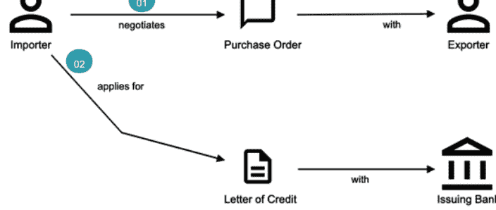

图 4.3 – 引入信用证和开证银行


Patrick：开证银行收到信用证申请后会做什么？

Katie：主要做两件事——审核进口商的财务状况以及进口货物的合法性。

Patrick：好的。如果一切检查都通过了会怎样？

Katie：开证银行批准信用证并通知进口商。

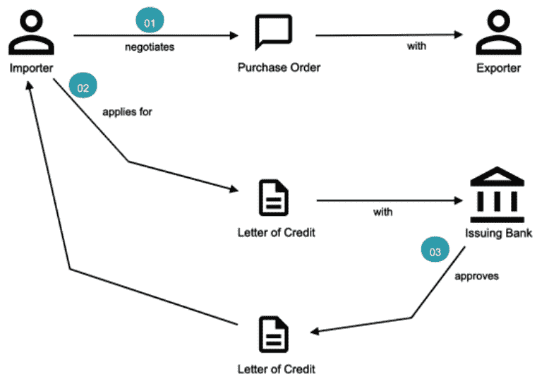

图 4.4 – 通知进口商信用证已批准

Patrick：接下来发生什么？开证银行现在联系出口商吗？

Katie：还没有。这并不简单。开证银行只能与出口商所在国家的对等银行交易。这家银行被称为通知行。

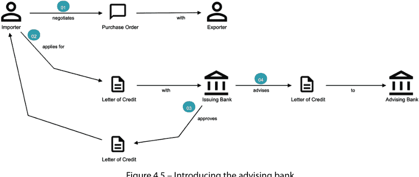

Patrick：通知行做什么做什么？

Katie：通知行通知出口商关于信用证的事宜。

Patrick：进口商不需要知道信用证已经通知了吗？

Katie：开证银行会通知进口商，信用证已经通知了出口商。

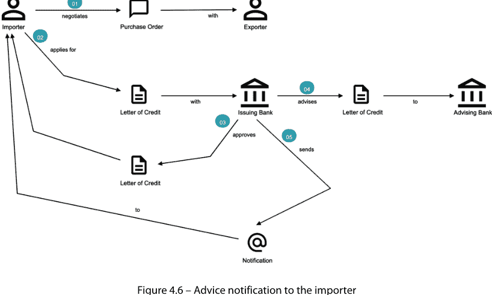

Patrick：出口商如何知道如何进行？

Katie：通过通知行——他们通知出口商信用证已经开具。

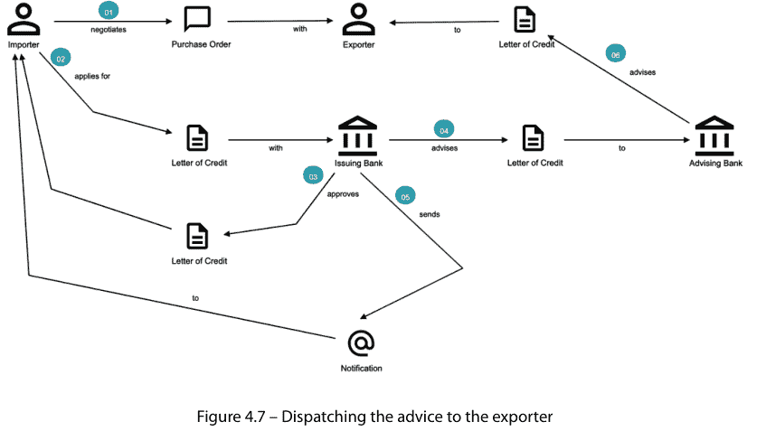

Patrick：出口商现在就开始发货吗？他们如何收到付款？

Katie：通过通知行——他们通知出口商信用证已经开具，这触发了流程中的后续步骤——这个结算付款的过程被称为结算。但让我们先关注现在。我们将在稍后讨论结算。

我们现在看了一个典型的 DST 研讨会片段。它让我们对高层业务流程有了相当充分的理解。请注意，在此过程中我们没有引用任何技术产物。

为了精炼这一流程并将其转换为可用于设计软件解决方案的形式，我们需要进一步增强这一视图。在接下来的章节中，我们将使用 EventStorming 作为一种结构化方法来实现这一目标。

## EventStorming（事件风暴）

> 驳斥胡言所需的能量比产生胡言所需的能量要大出一个数量级。
>
> – Alberto Brandolin

## 介绍 EventStorming

在上一节中，我们对信用证开具（LC issuance）过程有了高层次的理解。为了能够构建真实的应用程序，使用一种深入下一层细节的方法会有帮助。EventStorming 最初由 Alberto Brandolini 构想，是协作探索复杂领域的方法之一。

在这种方法中，你只需开始在墙壁或白板上使用大量的彩色便利贴，按照大致的时间顺序列出对业务领域具有重要意义的所有事件。每种类型的便利贴（用不同颜色表示）都有特定的用途，如下所示：

- **领域事件（Domain event）**：对业务流程具有意义的事件——用过去式表示。
- **命令（Command）**：可能导致一个或多个领域事件发生的动作或活动。这可能是用户发起的，也可能是系统响应领域事件发起的。
- **用户（User）**：执行业务动作/活动的人。
- **策略（Policy）**：为了成功执行动作/活动而需要遵守的一组业务不变性（规则）。
- **查询/读模型（Query/read model）**：执行某操作所需的数据。
- **外部系统（External system）**：当前边界之外的系统。
- **热点（Hotspot）**：争议点或不确定点。
- **聚合根（Aggregate）**：状态发生改变的对象。

该流程的描述如图所示：

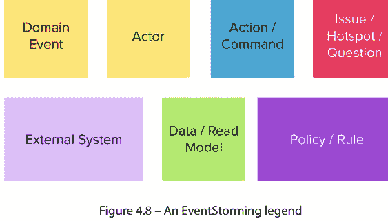

## 为什么使用领域事件？

在尝试理解业务流程时，用它解释重要事实是非常方便的。这也有助于观众理解。

## 使用 EventStorming 进行信用证开具

现在我们已经通过领域故事法对业务流程有了高层次的理解，让我们看看如何使用 EventStorming 深入研究。

- **勾勒事件计时（Outline event chronology）**：在此练习期间，我们回顾重要的事件（使用橙色贴）并将它们贴在白板上。随着时间线的形成，业务流开始显现：

  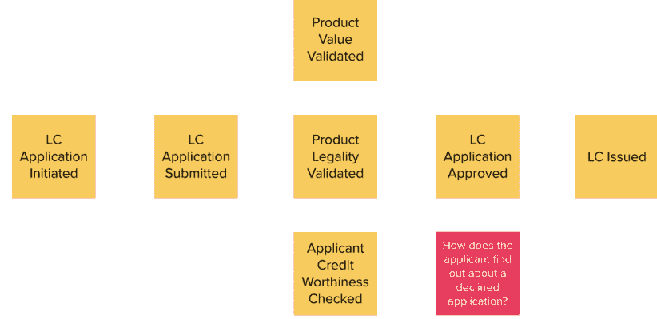

  图 4.9 – 事件计时

这有助于理解大局。也能让房间里的人识别现有流程中的热点。在之前的图中，处理贷款申请的流程并不理想——即当申请被拒绝时，申请人无法获得信息。

## 领域分析与建模

为了解决这个问题，我们增加了一个明确表示申请被拒绝的新事件，如图所示：

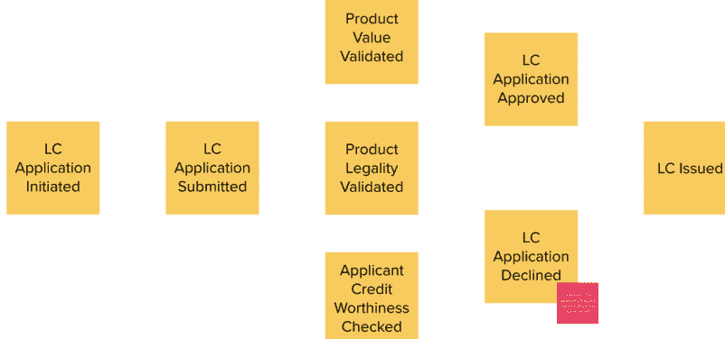

图 4.10 – 处理拒绝申请的新事件

- **2. 识别触发活动和外部系统**：在获得事件计时的高层次理解后，下一步是建立导致这些事件发生的活动（使用蓝色贴）以及与外部系统的交互（使用粉色贴）的视觉图：

  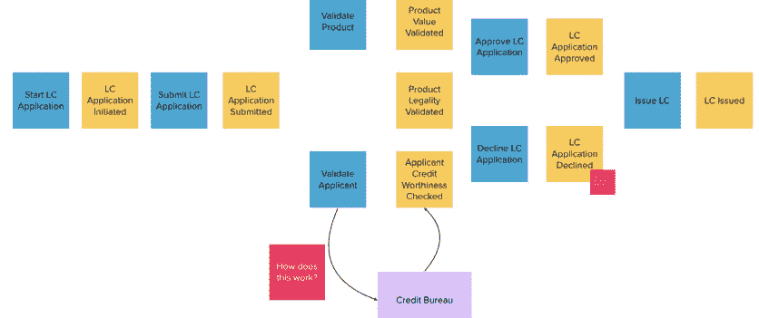

  图 4.11 – 活动与外部系统

- **3. 捕捉用户、上下文和策略**：下一步是捕捉执行这些活动的用户，以及他们的功能上下文（使用黄色贴）和策略（使用紫色贴）。
- **4. 勾勒查询模型**：每个活动都需要特定的数据。用户需要查看他们需要处理的输出数据，并看到操作的结果。这些数据集表示为查询模型（使用绿色贴）。

## 注意事项

对于领域故事法和 EventStorming 研讨会，最好有 6 到 8 名具有领域专家和技术专家组合的人参与，效果最佳。

## 领域分析与建模

到此，EventStorming 工作已经结束，我们对信用证（LC）应用和发行流程有了相当详细的理解。这意味着我们已经完成了领域需求的收集？完全没有——我们在理解领域方面迈出了巨大一步，但还有很长的路要走。阐述领域需求的过程是一个持续的过程。我们处于这一连续体的什么位置？下面的图试图澄清这一点：

战略层

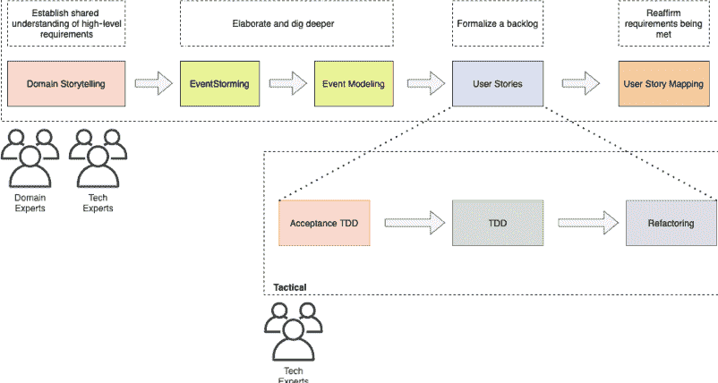

图 4.14 - 领域需求演进谱

在随后的章节中，我们将更详细地检查其他技术。

## 总结

在本章中，我们研究了使用两种轻量级技术——领域故事讲述（Domain Storytelling）和事件风暴（EventStorming）来增强我们对问题领域的共同理解。

领域故事讲述使用简单的图示在专家和技术团队成员之间共享业务知识。而事件风暴则通过对作为业务过程中发生的领域事件进行按时间排序，来获得这种共享的理解。

领域故事讲述可以作为介绍性技术，建立对问题空间的高层理解，而事件风暴可以用于为解决方案的详细设计决策提供支持。

有了这些知识，我们应该深入研究解决方案实现的技术方面。在下一章中，我们将开始实现业务逻辑，并对聚合根（Aggregate）以及命令（Commands）和领域事件进行建模。

## 延伸阅读

| 标题 | 作者 | 位置 |
|---|---|---|
| Domain Storytelling | Stefan Hofer and Henning Schwentner | https://leanpub.com/dominstorytelling |
| An Introduction to Domain Storytelling | Virtual Domain-Driven Design | https://www.youtube.com/watch?v=d9k9Szkdprk |
| Domain storytelling resources | Stefan Hofer | https://github.com/hofstef/awesome-domain-storytelling |
| Introducing EventStorming | Alberto Brandolin | https://leanpub.com/introducing_EventStorming |
| Introducing Event Storming | Alberto Brandolin | https://ziobrando.blogspot.com/2013/11/introducing-event-storming.html |
| Event Storming for fun and profit | Dan Terhorst-North | https://speakerdeck.com/tastapod/event-storming-for-fun-and-profit |
| Event Storming Shopping List | Allen Holub | https://holub.com/event-storming/ |

# 实现领域逻辑

> 为了有效通信，代码必须基于编写需求时使用的相同语言——即开发者之间以及开发者与领域专家之间交流使用的语言。
>
> – 里克·埃文斯（Eric Evans）

在书的命令查询职责分离（CQRS）部分，我们描述了 DDD 和 CQRS 如何互补，以及命令侧（写请求）如何是业务逻辑的家园。在本章中，我们将使用 Spring Boot、Axon Framework、JSR-303 Bean 验证和持久化选项，通过对比状态存储（State-stored）和事件源（Event-sourced）聚合根，来实现信用证（LC）应用的命令侧。将涵盖的主题如下：

- 识别聚合根
- 处理命令并发布事件
- 测试驱动应用
- 持久化聚合根
- 执行验证

到本章结束，你将学会如何以健壮、封装良好的方式实现系统的核心（领域逻辑）。

你还将学会如何将领域模型与持久化关注解耦。

## 技术要求

为了遵循本章中的示例，你需要访问以下内容：

- JDK 1.8+（我们使用了 Java 16 来编译示例源码）
- Maven 3.x
- Spring Boot 2.4.x
- JUnit 5.7.x（包含在 Spring Boot 中）
- Axon Framework 4.4.7（DDD 和 CQRS 框架）
- Project Lombok（减少冗余代码）
- Moneta 1.4.x（货币和金额参考实现 – JSR 354）

## 继续我们的设计之旅

在上一章中，我们讨论了将事件风暴作为一种澄清业务流的轻量级方法。提醒一下，这是我们事件风暴会议的输出：

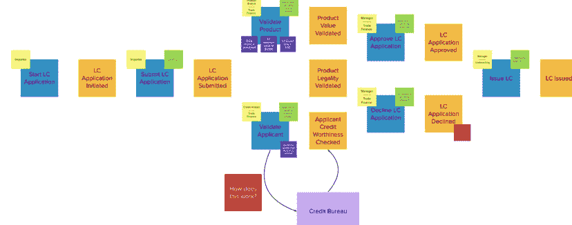

图 5.1 – 事件风暴会议回顾

如前所述，此图中的蓝色贴纸代表命令（commands）。我们将使用命令查询职责分离（CQRS）模式作为高层架构方法，为我们的信用证发行应用实现领域逻辑。让我们检查使用 CQRS 的机制以及它如何产生优雅的解决方案。关于 CQRS 是什么以及何时适用该模式的回顾，请参阅第 2 章《DDD 如何在何处以及如何融入》中的“何时使用 CQRS”章节。

## 实现命令侧

> **注意事项**
>
> CQRS 绝不是什么万灵妙药。尽管它足够通用，可以用于各种场景，但在应用于主流软件问题时，它是一场范式转移。与任何其他架构决策一样，在选择采用 CQRS 之前，你应该进行尽职调查。

让我们通过使用 Spring 和 Axon 框架实现命令侧，来观察它在实践中是如何工作的。

## 实现命令侧

在本节中，我们将关注命令侧。这是我们预期实现所有业务逻辑的地方。从逻辑上讲，它如下：

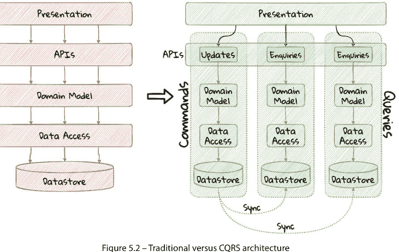

命令侧的高层序列为：

- 接收状态变更请求（命令）。
- 在事件源系统中，通过重放现有事件来构建命令模型。在状态存储系统中，我们通过从持久化存储恢复状态。
- 如果满足业务不变性（验证），则读取一个或多个准备发布的领域事件。
- 在事件源系统中，领域事件持久化在命令侧。在状态存储系统中，我们更新持久化存储中的实例。
- 通过将这些领域事件发布到事件总线来通知外部。总线是发布事件的基础组件。

> **注意事项**
>
> 我们描述了多个读取模型，是因为根据查询用例的需求，可以但不必创建多个读取模型。为了让其工作，读取模型需要与写模型保持同步（稍后我们将使用一些技术来实现）。

## 引导应用程序

### 重要说明

要为您的平台安装 Spring CLI，请参考 https://docs.spring.io/spring-boot/docs/current/reference/html/getting-started.html#getting-started.installing 上的详细说明。

要引导应用程序，请使用以下命令：

```bash
spring init \
  --dependencies 'web,data-jpa,lombok,h2,actuator' \
  --name lc-issuance-api \
  --artifactId lc-issuance-api \
  --groupId com.example.api \
  --packaging jar \
  --description 'LC Issuance API' \
  --package com.example.api \
  --force
```

这将在当前目录下创建一个名为 `lc-issuance-api.zip` 的文件。将该文件解压到您选择的位置，并在 `pom.xml` 文件的 `dependencies` 部分添加对 Axon Framework 的依赖。

```xml
<dependency>
  <groupId>org.axonframework</groupId>
  <artifactId>axon-spring-boot-starter</artifactId>
  <version>${axon-framework.version}</version>
</dependency>
```

- 1. 您可能需要更改版本。在编写本书时，我们使用的是版本 4.5.3。

此外，在 `axon-test` 库中添加以下依赖以启用对聚合（aggregates）的单元测试：

```xml
<dependency>
  <groupId>org.axonframework</groupId>
  <artifactId>axon-test</artifactId>
  <scope>test</scope>
  <version>${axon-framework.version}</version>
</dependency>
```

完成上述设置后，您应该能够运行应用程序并开始实现开证（LC issuance）功能。

让我们看看如何使用 Axon Framework 实现这些命令。

## 识别命令

从上一章的事件风暴（eventstorming）会议中，我们有以下命令作为开始：

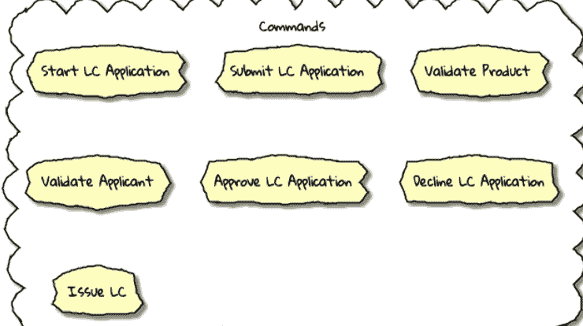

命令始终发送到聚合（根实体）进行处理（handling）。这意味着我们需要解析这些命令以便由聚合处理。虽然命令的发送者并不关心系统中的哪个组件处理它，但我们需要决定由哪个聚合来处理每个命令。同样重要的是，任何给定的命令只能由系统中的单个聚合处理。让我们看看如何分组这些命令并将它们分配给聚合。为了做到这一点，我们首先需要识别系统中的聚合。

## 识别聚合

查看我们 LC 应用事件风暴会议的输出，一种可能的分组方式如下：

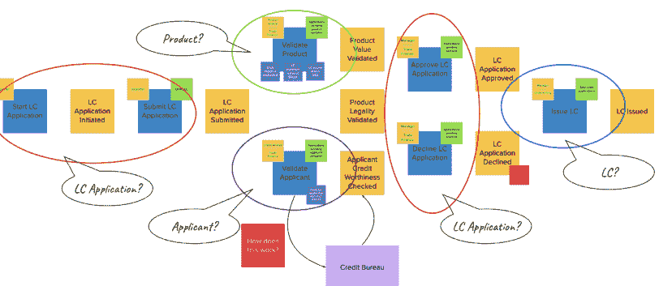

图 5.4 – 聚合设计的初步尝试

这些实体中的部分或全部都是聚合（关于聚合与实体（entities）之间区别的更详细解释，请参考第 1 章《领域驱动设计的原理》）。初看之下，我们似乎有四个潜在的实体来处理这些命令：


图 5.5 – 初看下的潜在聚合

初看之下，我们解决方案中的每个这些实体都可以被归类为聚合。在这里，考虑到我们正在构建一个管理 LC 应用的解决方案，LC Application 作为一个聚合似乎是一个相当不错的选择。然而，其他的合理归类为此类吗？Product（产品）和 Applicant（申请人）看起来是潜在的实体，但我们需要问自己，是否需要在 LC Application 的范围之外对这些实体进行操作。如果答案是定的，那么 Product 和 Applicant 可能被归类为聚合。但在该边界上下文（bounded context）内，Product 和 Applicant 似乎在没有封装的 LC Application 聚合的情况下没有被操作。这种感觉是这样的，因为产品和申请人的详情都要求作为 LC 流程的一部分提供。至少从我们目前对流程的了解来看，事实是如此。这意味着我们剩下两个潜在的聚合——LC 和 LC Application：


图 5.6 – 边界上下文之间的关系

当我们查看事件风暴会议的输出时，LC Application 聚合在生命周期的很晚阶段才转换为 LC 聚合。让我们现在就处理 LC Application，并将对需要 LC 聚合的进一步分析推到以后。

> **重要说明**：在口语中，聚合（aggregate）和聚合根（aggregate root）这两个术语有时互用，表示相同的意思。聚合可以是分层级的，聚合可能包含子聚合。虽然聚合和聚合根都处理命令，但在给定的上下文中，只有一个聚合可以作为根存在，并封装了其所有的子聚合、实体和值对象（value objects）。

注意的是，实体在不同的边界上下可能会被视为聚合，这种处理方式本质上是相互依赖的。

当我们查看事件风暴会议的输出时，LC Application 在开证（Issuance）上下文中于生命周期的很晚阶段转换为 LC。


> **重要说明**：在口语中，聚合（aggregate）和聚合根（aggregate root）这两个术语有时互用，表示相同的意思。聚合可以是分层级的，聚合可能包含子聚合。虽然聚合和聚合根都处理命令，但在给定的上下文中，只有一个聚合可以作为根存在，并封装了其所有的子聚合、实体和值对象。

## 实现逻辑

### 测试驱动系统

所以，让我们从第一个测试开始。事件驱动系统通常工作如下：


图 5.7 – 事件驱动系统

该图可以解释为：

1. 可能发生了可选的领域事件。
2. 命令被系统接收（手动或自动），作为刺激。
3. 命令由聚合处理，聚合以以下方式之一反应：
   - A. 发布一个或多个事件。
   - B. 抛出异常。

> **重要说明**：本章所示片段是为了突出重要的概念和技术。对于完整的示例，请参考随附的代码（位于`ch05`）。

### 实现逻辑

Axon Framework 允许我们以以下形式表达测试：

```java
public class LCApplicationTests {
    private FixtureConfiguration<LCApplication> fixture;

    @BeforeEach
    void setUp() {
        fixture = new AggregateFixture<LCApplication>(LCApplication.class);
    }

    @Test
    void shouldPublishApplicationCreated() {
        fixture.when(new CreateLCApplicationCommand())
            .expectEvents(exactSequence(
                messageWithPayload(any(ApplicationCreatedEvent.class)),
                andNoError()
            ));
    }
}
```

1. `FixtureConfiguration` 是 Aggregate Framework 工具，用于通过 given-when-then 语法测试聚合行为。
2. `AggregateFixture` 是 `FixtureConfiguration` 的具体实现，您需要在其中注册聚合——在我们的案例中，`LCApplication` 是处理指向我们解决方案的命令的候选者。
3. 由于这是业务流程的开始，没有任何事件发生。这通过不向给定方法传递参数来表明。在之后讨论的其他示例中，在接收此命令之前可能已经发生了事件。
4. 这是我们实例化命令对象的新实例。命令对象通常类似于数据传输对象，携带一组信息。该命令将路由到我们的聚合进行处理。我们很快就会详细查看其工作原理。
5. 在这里，我们声明期望精确序列的事件。
6. 在这里，我们期望成功处理命令后发布`ApplicationCreatedEvent`类型的事件。
7. 我们最后表示不期望更多事件，这意味着我们期望恰好发布一个事件。

### 实现命令

上一个简单示例中的`CreateLCApplicationCommand`没有携带任何状态。现实情况下，命令可能看起来如下：

#### 启动应用程序 101

```java
import lombok.Data;

@Data
public class CreateLCApplicationCommand {
    private LCApplicationId id;
    private Client clientId;
    private Party applicant;
    private Party beneficiary;
    private AdvisingBank advisingBank;
    private LocalDate issue;
    private MonetaryAmount amount;
    private String merchandiseDescription;
}
```

1. 这是命令类。在命名命令时，我们通常使用祈使式命名；即，通常以表示动作的动词开头。注意这是一个数据传输对象（DTO）。换句话说，它是一组简单的数据属性。注意它是如何没有任何逻辑的（至少是大部分逻辑）。
2. 这是信用证申请（LC Application）的标识符。在这种情况下，我们假设标识符是由客户端生成的。关于使用服务器生成与客户端生成的标识符的话题出了本书的讨论范围。你可以根据你上下文中的优缺点使用其中任何一种。另外注意，我们对`LCApplicationId`标识符使用了强类型，而不是 UUID。然而，应于使用强类型以便区分不同的标识符类型。注意我们如何使用`ClientId`类型来表示应用程序的创建者。
3. `Party`和`AdvisingBank`类型是在我们的解决方案中表示这些概念的复杂类型。应注意一致地使用与问题（业务）领域相关的名称，而不是仅在解决方案（技术）领域有意义的名称。注意在这两种情况下都尝试使用领域专家的“通用语言”（ubiquitous language）。这是我们在为系统命名命名时应该始终意识到的实践。

值得注意的是，`merchandiseDescription`留在了原始`String`类型。这可能与我们之前展示的注释显得相矛盾。我们将在接下来的“结构验证”章节中解决这个问题。

现在，让我们看看成功处理命令后将发出的事件像什么样。

### 实现事件

在事件驱动系统中，通过成功处理命令来改变系统状态通常会导致发布一个领域事件，以向系统的其他部分信号状态变更。这里展示了一个真实的`LCApplicationCreatedEvent`的简化表示：

```java
import lombok.Data;

@Data
public class LCApplicationCreatedEvent {
    private LCApplicationId id;
    private Client clientId;
    private Party applicant;
    private Party beneficiary;
    private AdvisingBank advisingBank;
    private LocalDate issueDate;
    private MonetaryAmount amount;
    private String merchandiseDescription;
}
```

1. 在命名事件时，我们使用过去式名称来表示已经发生的事情，并且它们被无条件地接受为无法更改的经验事实。

你可能会注意到事件的结构目前与命令的结构完全相同。虽然在这种情况下确实如此，但并不总是如此。我们选择在事件中披露的信息量取决于上下文。在作为事件的一部分发布信息时，咨询领域专家是非常重要的。例如，包含新修改密码的`ChangePasswordCommand`（修改密码命令）。在生成的`PasswordChangeEvent`中不包含修改后的密码可能是明智的。

我们在上一个测试中已经查看了命令和生成的事件。让我们看看聚合根（aggregate）在底层是如何实现的。

### 设计聚合根

聚合根是处理命令和发布事件的地方。我们编写的测试的一个好处是，它的表达方式处理了实现细节。让我们看看实现代码，以便了解我们如何让测试通过并满足业务需求：

```java
public class LCApplication {
    @AggregateIdentifier
    private LCApplicationId id;

    @SuppressWarnings("unused")
    private LCApplication() {
        // 框架需要
    }

    @CommandHandler
    public LCApplication(CreateLCApplication command) {
        // TODO: 在此处执行验证
        AggregateLifecycle.apply(new LCApplicationCreatedEvent(command.getId()));
    }

    @EventSourcingHandler
    private void on(LCApplicationCreatedEvent event) {
        this.id = event.getId();
    }
}
```

1. 这是`LCApplication`聚合根的标识符。对于聚合根来说，标识符唯一标识一个实例于另一个实例。由于由于原因，聚合根需要声明标识符并使用框架提供的`@AggregateIdentifier`注解对其标记。
2. 处理命令的方法必须标记有`@CommandHandler`注解。在这种情况下，命令处理器恰好是类的构造函数，因为这是该聚合根可以收到的第一个命令。我们将在本章稍后部分看到由其他方法处理后续命令的示例。
3. `@CommandHandler`注解将方法标记为命令处理器。该方法需要作为参数传递的精确命令。注意，对于任何给定的命令，在整个系统中只能有一个命令处理器。
4. 在这里，我们使用框架提供的`AggregateLifecycle`实用程序发布`LCApplicationCreatedEvent`。在这个简单的情况下，我们在接收到命令时无条件发布事件。在现实场景中，可以想象在决定发布一个或多个事件或抛出异常失败命令之前，会执行一组验证。我们将在本章稍后部分查看更真实的场景。

## 实现领域逻辑

5. 对领域逻辑的需求是显而易见的。聚合根是执行业务规则的地方。它确保系统不会转换为无效状态。

值得注意的是，`merchandiseDescription`留在了原始`String`类型。这可能与我们之前展示的注释显得相矛盾。我们将在接下来的“结构验证”章节中解决这个问题。

现在，让我们看看成功处理命令后将发出的事件像什么样。

## 持久化聚合根

在处理任何中等复杂的系统时，我们需要持久交互；即能够重启、崩溃等。在如何持久化状态方面我们有两个选择：

- 状态存储（State-stored）
- 事件溯源（Event-sourced）

### 状态存储聚合根

保存实体的当前值是最流行的持久化方式——这归功于关系数据库和对象关系映射（ORM）工具（如 Hibernate）的巨大流行。例如，对于我们的`LCApplication`，我们可以使用如下结构的关系数据库：

| applicant | |
| :--- | :--- |
| id | number (generated) |
| name | |
| address | |

| lc_application | |
| :--- | :--- |
| id | number (generated) |
| amount | number |
| status | text |
| merchandise_description | text |
| application_date | Date |
| applicant_id | number (FK) |
| issuing_bank_id | number (FK) |
| advising_bank_id | number (FK) |

| document_clause | |
| :--- | :--- |
| id | number (generated) |
| description | |
| lc_application_id | number (FK) |

| beneficiary | |
| :--- | :--- |
| id | number (generated) |
| name | text |
| address | text |

| advising_bank | |
| :--- | :--- |
| id | number (generated) |
| name | text |
| address | text |
| swift_id | number |

| issuing_bank | |
| :--- | :--- |
| id | number (generated) |
| name | text |
| address | text |
| swift_id | number |

图 5.8 - 典型的实体关系模型

### 事件溯源聚合根

长期以来，开发者一直依赖日志来实现各种诊断目的。同样，关系数据库从诞生起就一直在通过提交日志来持久化信息。然而，在主流系统中，开发者将日志作为信息的第一持久化解决方案仍然非常罕见。

日志（Log）是一个极其简单的、按时间排序的只追加的不可变记录序列。该图展示了日志的结构，其中记录按顺序写入。本质上，日志是一个只追加的数据结构，如下所示：

## 第一条

## 下一条记录


图 5.9 – 日志数据结构

与表格等更复杂的数据结构相比，写入日志是一个相对简单且快速的操作，能够处理极高量级的数据，同时提供可预测的性能。事实上，像 Apache Kafka 这样的现代事件流平台利用了这种模式来扩展以支持极高的数据量。我们认为，在主流系统处理命令时，这种模式可以应用于持久化存储，因为其具有超越所列出的技术优势之外的收益。考虑所示的在线订单流示例：

| 用户操作 | 传统存储 | 事件存储 |
|---|---|---|
| 向购物车添加牛奶 | 订单 123: 购物车内牛奶 | E1: 创建购物车#123<br>E2: 牛奶已加入购物车 |
| 向购物车添加白面包 | 订单 123: 购物车内牛奶和白面包 | E1: 创建购物车#123<br>E2: 牛奶已加入购物车<br>E3: 白面包已加入购物车 |
| 从购物车移除白面包 | 订单 123: 购物车内牛奶 | E1: 创建购物车#123<br>E2: 牛奶已加入购物车<br>E3: 白面包已加入购物车<br>E4: 白面包已从购物车 |
| 向购物车添加小麦 | 订单 123: 购物车内牛奶和小麦 | E1: 创建购物车#123<br>E2: 牛奶已加入购物车<br>E3: 白面包已加入购物车<br>E4: 小麦已移除<br>E5: 小麦已加入购物车 |
| 确认购物车结算 | 订单 123: 已下单牛奶和小麦 | E1: 创建购物车#123<br>E2: 牛奶已加入购物车<br>E3: 白面包已加入购物车<br>E4: 白面包已移除<br>E5: 小麦已加入购物车<br>E6: 订单 123 已确认 |

## 持久化聚合根 107

如你所见，通过事件存储，我们仍然对所有执行的用户操作保持完全可见性。这允许我们对这些行为进行整体性的推理。在传统存储中，我们丢失了用户用小麦面包替换白面包的信息。虽然这不影响订单本身，但我们失去了从这种用户行为中收集洞察的机会。我们意识到，这些信息可以通过专门的分析解决方案以其他方式捕捉；然而，事件机制提供了一种自然的方法，而不需要任何额外努力。它还充当了审计日志，提供了到为止发生的所有事件的完整历史。这与领域驱动设计的精髓非常契合，即我们不断探索减少复杂性的方法。

然而，以简单事件日志的形式持久化数据会有一些影响。在处理任何命令之前，我们需要按照事件发生的精确顺序“水化”（hydrate）过去的事件并重建状态，以便我们进行验证。例如，在确认结算时，仅有已发生事件的顺序是不够的。我们仍然需要计算在下单之前购物车中的物品。在处理该命令之前，这种为了恢复聚合状态（至少是验证该命令所需的那些）的事件重放是必要的。例如，在处理`RemoveItemFromCart`之前，我们需要知道购物车中哪些物品。如下表所示：

| 已发生事件 | 聚合根状态 | 命令 | 发布的事件(s) |
| --- | --- | --- | --- |
| | | 添加物品:牛奶 | E1: 创建购物车#123 |
| E1: 创建购物车#123 | 购物车物品: | | E2: 牛奶已加入 |
| E2: 牛奶已加入 | 牛奶 | 添加物品: 白面包 | E2: 白面包已加入 |
| E1: 创建购物车#123 | 购物车物品: | 移除物品: 白面包 | E3: 白面包已移除 |
| E2: 牛奶已加入 | 牛奶和 | | |
| E3: 白面包已加入 | 白面包 | | |
| E1: 创建购物车#123 | 购物车物品: | 添加物品: 小麦 | E4: 小麦已加入 |
| E2: 牛奶已加入 | 牛奶 | | |
| E3: 白面包已加入 | | | |
| E4: 白面包已移除 | | | |
| E1: 创建购物车#123 | 购物车物品: | 确认购物车#123结算 | E5: 订单已创建！ |
| E2: 牛奶已加入 | 牛奶和 | | |
| E3: 白面包已加入 | 小麦 | | |
| E4: 白面包已移除 | | | |
| E5: 小麦已加入 | | | |

## 108 实现领域逻辑

整个场景的相应源代码在下面的代码段中所示：


```java
public class Cart {
    private boolean isNew;
    private CartItems items;
    // ...

    private Cart() {
        // 框架需要
    }

    @CommandHandler
    public void addItem(AddItemToCartCommand command) {
        // 此处进行业务验证
        if (this.isNew) {
            apply(new CartCreatedEvent(command.getId()));
        }
        apply(new ItemAddedEvent(command.getId()));
    }

    // ... ...
    @EventSourcingHandler
    private void on(CartCreatedEvent event) {
        this.id = event.getId();
        this.items = new CartItems();
        this.isNew = true;
    }
    // ...
}
```

## 持久化选择

在处理事件溯源聚合根时，对于可以编写的代码类型保持自律非常重要：

| 方法类型 | 状态恢复 | 业务逻辑 | 事件发布 |
| --- | --- | --- | --- |
| `@CommandHandler` | 否 | 是 | 是 |
| `@EventSourcingHandler` | 是 | 否 | 否 |

如果有大量的事件需要恢复状态，聚合根的加载过程可能会变成耗时的操作——与事件数量成正比。我们可以采用一些技术（如快照）来克服这一点。

## 持久化选择

如果你使用状态存储（state store）来持久化你的聚合根，使用你通常的评估过程来选择技术即可。然而，如果你正在考虑事件溯源聚合根，决定可能会微妙一些。根据我们的经验，即使是简单的关系型数据库也能解决问题。事实上，我们曾利用关系型数据库作为具有数十亿事件的高并发事务应用程序的事件存储。这种设置对我们来说非常好。值得注意的是，我们仅使用事件存储插入新事件并按顺序加载给定聚合根的事件。

然而，许多专用技术是专为作为事件存储构建的，支持如时间旅行、全事件重放、事件有效负载检查等增值功能。如果你有相关需求，可能值得考虑其他选项，例如 NoSQL 数据库（如文档存储 MongoDB 或列族存储 Cassandra）或专门的商业产品（如 EventStoreDB 和 Axon Server），以评估在你的上下文中的可行性。

## 我们应该选择哪种持久化机制？

现在我们对两种聚合根持久化机制（状态存储型和事件溯源型）有了相当好的理解，这引发了我们应该选择哪一个的问题。在这里列出使用事件溯源的一些优点：

- 在高合规场景下，我们可以利用事件作为自然的审计日志。
- 它允许基于细粒事件进行更具洞察力的分析。
- 在处理基于不可变事件的系统时，它可能会产生更灵活的设计，因为持久化模型的复杂度被限制了。此外，不需要处理复杂的 ORM 对象-关系映射不匹配问题。
- 允许回溯过去，以便能够创建即时视图和报告，而无需处理前期的复杂性。

另一方面，在实现事件溯源的解决方案时，你可能需要考虑一些挑战：

- 事件溯源需要范式的转变，这意味着开发团队和业务团队必须花费时间和精力来理解其工作原理。
- 持久化模型不直接存储状态。因此，直接在持久化模型上进行即时查询可能更具挑战性。这可以通过物化（materializing）新视图来实现；但这会增加复杂性。
- 事件溯源在与 CQRS 结合使用时通常效果良好，但这可能会给应用程序增加更多复杂性。它还要求应用密切关注强一致性与最终一致性之间的问题。

我们的经验表明，事件溯源系统在现代事件驱动系统中具有许多益处。然而，在做出持久化选择时，你需要根据自己的项目背景考虑之前提到的问题。

# 实现领域逻辑

## 强制执行策略

在处理命令时，我们需要执行策略或规则。策略大致分为两类：

- 结构性规则 – 确保分发命令的语法是有效的。
- 领域规则 – 确保遵守业务规则。

在系统的不同层级执行这些验证可能是明智的。而且，所有这些策略执行在系统的某一层中重复也是常见的。然而，需要注意的是，在命令被成功处理之前，所有这些策略执行都会被普遍地应用。让我们在接下来的章节中查看这些示例。

## 结构验证

目前，要创建一个 LC 应用程序，你需要分发 `CreateLCApplicationCommand`。虽然命令规定了结构，但目前没有任何强制执行。让我们纠正这一点。

为了能够声明式的验证，我们将利用 JSR-303 Bean 验证库。我们可以通过在 `pom.xml` 文件中使用 `spring-boot-starter-validation` 依赖来轻松添加，所示：

```xml
<dependency>
  <groupId>org.springframework.boot</groupId>
  <artifactId>spring-boot-starter-validation</artifactId>
</dependency>
```

现在，我们可以使用 JSR-303 注解为命令对象添加验证，所示：

```java
import lombok.Data;
import javax.validation.*;
import javax.validation.constraints.*;

@Data
public class CreateLCaplicationCommand {
    @NotNull
    private LCApplicationId id;

    @NotNull
    private ClientId clientId;

    @NotNull
    @Valid
    private Party applicant;

    @NotNull
    @Valid
    private Party beneficiary;

    @NotNull
    @Valid
    private AdvisingBank advisingBank;

    @Future
    private LocalDate issueDate;

    @Positive
    private Monetary amount;

    @NotNull
    private String merchandiseDescription;
}
```

结构验证可以使用内置的验证器注解完成。也可以为单个字段创建自定义验证器，或验证整个对象（例如，验证相互依赖的属性）。有关如何执行此操作的细节，请参阅 `https://beanvalidation.org/2.0/` 的 Bean 验证规范以及 `http://hibernate.org/validator/` 的参考实现。

## 业务规则强制执行

结构验证可以使用命令中已有的信息完成。然而，还有另一类验证需要输入命令本身不存在的信息。这种信息可能存在于我们操作的聚合（aggregate）的两个位置之一，或者位于聚合之外但在边界上下文（bounded context）内可用的。

让我们来看一个需要在聚合内部存在状态的验证示例。考虑提交 LC 的例子。当 LC 处于草稿状态时，我们可以对其进行多次编辑，提交后不能进行任何更改。这意味着我们只能提交一次 LC。提交 LC 的行为通过发布 `SubmitLCApplicationCommand` 实现，正如事件溯源会话制品所示：


图 5.10 - 提交 LC 应用程序过程中的验证

让我们从一个测试开始表达我们的意图：

```java
class LCApplicationAggregateTests {
    //@Test
    void shouldAllowSubmitOnlyInDraftState() {
        final LCApplication applicationId = LCApplicationId.randomId();

        fixture.given(new LCApplicationCreatedEvent(applicationId))
               .when(new SubmitLCApplicationCommand(applicationId))
               .expect(new LCApplicationSubmittedEvent(applicationId));
    }
}
```

1. 给定 `LCApplicationCreatedEvent` 已经发生——换句话说，LC 应用程序已经创建。
2. 此时我们通过为同一个应用程序发布 `SubmitLCApplicationCommand` 来尝试提交应用程序。
3. 我们期望抛出 `LCApplicationSubmittedEvent`。

对应的实现看起来如下：

```java
class LCApplication {
    //
    @CommandHandler
    public void submit(SubmitApplicationCommand command) {
        apply(new LCApplicationSubmittedEvent(id));
    }
}
```

前面的实现允许我们无条件地提交 LC 应用程序——甚至多次。然而，我们想要限制用户只能提交一次。为了做到这一点，我们需要记住 LC 应用程序已经提交。我们可以在 `@EventHandler` 中执行此操作，所示：

```java
class LCApplication {
    //
    @EventHandler
    private void on(LCApplicationSubmittedEvent event) {
        this.state = State.SUBMITTED;
    }
}
```

1. 当重放 `LCApplicationSubmittedEvent` 时，我们将 LC 应用程序的状态设置为 `SUBMITTED`。

虽然我们记住了应用程序已变为 `SUBMITTED` 状态，但我们仍然没有阻止下一次尝试。我们可以通过编写测试来修复这个问题，所示：

```java
class LCApplicationAggregateTests {
    @Test
    void shouldNotAllowOnAlreadySubmittedLC() {
        final LCApplicationId applicationId = LCApplicationId.randomId();

        fixture.given(
            new LCApplicationCreatedEvent(applicationId),
            new LCApplicationSubmittedEvent(applicationId)
        )
        .when(new SubmitApplicationCommand(applicationId))
        .expectException(AlreadySubmittedException.class)
        .expectNoEvents();
    }
}
```

1. `LCApplicationCreatedEvent` 和 `LCApplicationSubmittedEvent` 已经发生。
2. 我们现在向系统发送另一个 `SubmitApplicationCommand`。
3. 我们期望抛出 `AlreadySubmittedException`。
4. 我们期望没有事件产生。

实现此功能的命令处理器所示：

```java
class LCApplicationHandler {
    @CommandHandler
    public void submit(SubmitLCApplicationCommand command) {
        if (this.state != State.DRAFT) {
            throw new AlreadySubmittedException("LC已提交!");
        }
        apply(new LCApplicationSubmittedEvent(id));
    }
}
```

注意我们是如何使用 `LCApplication` 聚合的属性进行验证的。如果应用程序不在 `DRAFT` 状态，我们抛出 `AlreadySubmitted` 领域异常。

让我们来看一个执行验证所需的信息不在命令中也不在聚合中的示例。考虑一种场景：国家法规禁止与一组制裁国家进行交易。这个国家列表的变化可能会受到外部因素的影响。将其维护在每个状态聚合的负载中是没有意义的。它也不会经常变化（尽管频率很低）。在这种情况下，我们可能希望考虑使用聚合类范围之外的命令处理器。

```java
import org.axonframework.modelling.command.Repository;

class MyCustomCommandHandler {
    private final Repository<LCApplication> repository;

    MyCustomCommandHandler(Repository<LCApplication> repository) {
        this.repository = repository;
    }

    @CommandHandler
    public void handle(SomeCommand command) {
        Aggregate<LCApplication> application =
            repository.load(command.getAggregateId());
        // Command handling code
    }

    @CommandHandler
    public void handle(AnotherCommand command) {
        Aggregate<LCApplication> application =
            repository.load(command.getAggregateId());
        // Command handling code
    }
}
```

1. 我们正在注入 Axon Repository 接口以便加载聚合根（aggregates）。之前不需要这样做，因为 `@CommandHandler` 注解直接出现在聚合根方法上。
2. 我们正在使用 Repository 接口来加载聚合根并对其进行操作。Repository 接口支持其他处理聚合根的方便方法。请参考 Axon Framework 文档以获取更多用示例。

回到制裁计数示例，让我们看看我们需要如何稍微不同地设置测试：

```java
public class CreateApplicationCommandHandlerTests {
    private FutureConfiguration<LCApplication> fixture;

    @BeforeEach
    void setUp() {
        final Set<String> sanctioned = Set.of("SOKOIA");
        fixture = new AggregateFixture<>(LCApplication.class);

        final Repository<LCApplication> repository = fixture.getRepository();

        CreateApplicationCommandHandler handler =
            new CreateApplicationCommandHandler(repository, sanctioned);

        fixture.registerAnnotatedCommandHandler(handler);
    }
}
```

1. 我们像往常一样创建一个新的聚合具件（fixture）。
2. 我们正在使用该具件获取 Axon Repository 接口的实例。
3. 我们在 Repository 实例中实例化了自定义命令处理器。此外，请注意我们如何通过简单的依赖注入将制裁国家集合注入到处理器中。在实际应用中，这组制裁国家可能会从外部配置中获取。
4. 最后，我们需要将命令处理器注册到具件中，以便它也能将命令路由到此处理器。

这些逻辑的测试非常简单：


```java
class CreateLCApplicationCommandHandlerTests {
    //
    @BeforeEach
    void setUp() {
        final Set<Country> sanctioned = Set.of(SOKOVIA);
        fixture = new AggregateFixture<LCApplication>(class);

        final Repository<LCApplication> repository = fixture.getRepository();

        CreateLCApplicationCommandHandler handler =
            new CreateLCApplicationCommandHandler(repository, sanctioned);
        fixture.registerAnnotatedHandler(handler);
    }

    @Test
    void shouldFailIfBeneficiaryCountryIsSanctioned() {
        fixture
            .when(new CreateLCApplicationCommand(randomId(), SOKOVIA))
            .expectEvents(None)
            .expectException(CannotTradeWithSanctionedCountryException.class);
    }

    @Test
    void shouldSucceedIfCountryIsNotSanctioned() {
        final LCApplication applicationId = randomId();
        fixture
            .when(new CreateLCApplicationCommand(applicationId, WAKANDA))
            .expectEvents(new LCApplicationCreatedEvent(applicationId));
    }
}
```

1. 出于测试目的，我们将国家 `SOKOVIA` 标记为制裁。在现实场景中，这可能会来自某种形式的外部配置（例如，查找表或外部配置的形式）。然而，这对于我们的单元测试是合适的。

2. 我们将这组制裁国家注入命令处理器中。

3. 当为制裁国家创建信用证申请时，我们预期没有事件被发布，并且会抛出 `CannotTradeWithSanctionedCountryException`。

4. 最后，当受益人属于非制裁国家时，我们预期发出 `LCApplicationCreatedEvent`。

## 持久化技术选择 117

命令处理器的实现如下：

```java
import org.springframework.stereotype.Service;

@Service
public class CreateLCApplicationCommandHandler {
    private final Repository<LCApplication> repository;
    private final Set<Country> sanctionedCountries;

    public CreateLCApplicationCommandHandler(Repository<LCApplication> repository,
        Set<Country> sanctionedCountries) {
        this.repository = repository;
        this.sanctionedCountries = sanctionedCountries;
    }

    @CommandHandler
    public void handle(CreateLCApplication command) {
        // 验证可以在此处执行，如
        repository.newInstance(
            -> new LCApplication(command, sanctionedCountries));
    }
}
```

1. 我们将类标记为 `@Service`，以将其标记为封装状态的组件，并使用基于注解的配置或类扫描启用自动发现。因此，它可以用于执行任何“水水”工作。

2. 不要验证受益国是否被制裁的验证可以在第 18 行执行。有些人会认为这样做是理想的，因为如果这样做，就可以避免对 Axon Repository 方法进行不必要的调用。然而，我们更倾向于尽可能将业务验证封装在聚合根的范围内，这样我们就不会受到贫血领域模型（anemic domain model）问题。

3. 我们使用聚合仓库作为工厂来创建 `LCApplication` 领域对象的新实例。

最后是带有验证的聚合根实现：

```java
class LCApplication {
    // ...
    public LCApplication(CreateLCApplication command, Set<Country> sanctioned) {
        if (sanctioned.contains(command.getBeneficiaryCountry())) {
            throw new CannotTradeWithSanctionedCountryException();
        }
        apply(new LCApplicationCreatedEvent(command.getId()));
    }
}
```

1. 验证本身非常简单。当验证失败时抛出 `CannotTradeWithSanctionedCountryException`。

通过这些示例，我们了解了封装在聚合根边界内的策略执行的不同方法。

# 实现领域逻辑

## 总结

在本章中，我们使用了事件存储会议的输出，并将其作为创建边界领域模型的主要辅助。我们查看了如何使用 CQRS 架构模式来实现它。我们查看了持久化选项以及使用事件源与状态存储聚合根的影响。最后，我们通过查看各种执行业务验证的方法结束了。我们通过 Spring Boot 和 Axon Framework 的一组代码示例查看了所有内容。有了这些知识，我们应该能够实现健壮、封装良好的事件驱动的领域模型。

在下一章中，我们将查看为这些领域能力实现 UI，并检查一些选项，例如基于 CRUD 与基于任务的 UI。

# 实现用户界面——基于任务的

要完成一项困难的任务，人们必须先将其拆解。

> ——Marty Rubin

领域驱动设计（DDD）的核心在于捕捉业务流程和用户意图。在上一章中，我们设计了一组 API，但并没有非常关注这些 API 最终如何被其用户使用。在本章中，我们将使用 JavaFX 框架为 LC 应用程序设计 GUI。作为此的一部分，我们将探讨如何通过这种孤立设计 API 的方法导致生产者和消费者之间产生阻抗匹配（impedance mismatch）。我们将研究这种阻抗匹配的后果，以及基于任务的 UI 如何帮助应对这种不匹配。

本章将涵盖以下主题：

- API 风格
- UI 的启动
- UI 的实现

在章节末结束时，你将学会如何利用 DDD 原则来构建健壮且简单直观的用户体验。你还将学到，为什么从消费者的角度来设计后端接口（APIs）可能是明智之举。

## 技术要求

你需要访问以下内容：

- JDK 1.8+（我们使用 Java 16 编译示例源码）
- JavaFX SDK 16 和 Scene Builder
- Maven 3.x
- Spring Boot 2.4.x
- mvvmFX 1.8（https://sialcasa.github.io/mvvmFX/）
- JUnit 5.7.x（包含在 Spring Boot 中）
- TestFX（用于 UI 测试）
- OpenJFX Monoc（用于无头测试）
- Project Lombok（减少冗余代码）

在深入构建 GUI 解决方案之前，让我们快速回顾一下 API 停留在哪里。

# API 风格

如果你还记得第 5 章“实现领域逻辑”，我们创建了以下命令：


图 6.1——来自事件风暴会议的命令

如果你仔细观察，这些命令似乎存在两个粒度层级。Create LC Application（创建 LC 应用）和 Update LC Application（更新 LC 应用）是粗粒度的，而其他的在意图上要集中得多。粗粒度命令的一种可能的拆分如下所示：


图 6.2——拆分后的命令

除了比之前迭代中的命令更细粒之外，修订后的命令似乎能更好地捕捉用户的意图。这种语义上的细微变化可能会对最终用户使用我们解决方案的方式产生巨大影响。问题在于，我们是否应该总是倾向于细粒度 API 而不是粗粒度命令？答案要微妙得多。在设计 API 和体验时，我们看到两种主要的风格：

- 基于 CRUD 的
- 基于任务的

让我们更详细地查看每一个。

## 基于 CRUD 的 API

CRUD 是用于指数据库应用程序四个基本操作的缩写：创建（create）、读取（read）、更新（update）和删除（delete）。许多编程语言和协议都有对应的 CRUD，通常在命名和意图上略有不同。例如，SQL——一种与数据库交互的流行语言，将这四个函数称为 Insert、Select、Update 和 Delete。同样，HTTP 协议使用 POST、GET、PUT 和 DELETE 作为动词来表示 CRUD 操作。这种方法也被扩展到我们的 API 设计中。这导致了基于 CRUD 的 API 和用户体验泛滥。看看第 5 章“实现领域逻辑”中的 `CreateLCApplicationCommand`：

# 122 实现用户界面——基于任务的

```java
import lombok.Data;

@Data
public class CreateLCApplicationCommand {
    private LCApplicationId id;
    private Client clientId;
    private Party applicant;
    private Party beneficiary;
    private AdvisingBank advisingBank;
    private LocalDate issueDate;
    private BigDecimal amount;
    private String description;
}
```

与此类似，创建如下内容也并不罕见：

```java
import lombok.Data;

@Data
public class UpdateLCApplicationCommand {
    private LCApplicationId id;
    private Client clientId;
    private Party applicant;
    private Party beneficiary;
    private AdvisingBank advisingBank;
    private LocalDate issueDate;
    private BigDecimal amount;
    private String description;
}
```

虽然这种方法很常见，但它引发了一些问题：

- 我们被允许更改一切吗？
- 假设一切都可以改变，那么它们都改变了吗？
- 我们如何知道哪些变了？
- 如果上述所有属性都被包含进去会怎样？
- 如果我们需要添加功能怎么办？
- 业务意图被捕捉到了吗？

在一个简单的系统中，这些问题的答案可能并不重要。然而，随着系统复杂性的增加，基于任务的 API 值得关注。

## 基于任务的 API

在典型的组织中，任务与专业化有关。组织越大，专业化程度越高。划分任务是有意义的，因为可以减少相互干扰（职职）。在申请过程中，个人可以独立工作。由于大多数工作是以特定任务的形式进行的，我们可以利用这一点作为优势。

记住这一点，让我们重新检查用于申请流程的修订后的 API：


图 6.3——修订后的命令

# 实现用户界面——基于任务的

虽然之前看起来我们只是将粗粒度 API 转换成了更细粒度，但实际上，它更好地代表了用户想要执行的任务。通过我们的新 API，产品验证可以在更改发生时立即开始。此外，它明确了用户做了什么，以及为了响应用户的操作需要发生什么。这引发了我们是否应该一直采用基于任务的 API 问题。让我们更详细地查看其影响。

## 基于任务还是基于 CRUD？

基于 CRUD 的 API 似乎是在聚合层面上运行。在我们的示例中，我们有 LC 聚合。在最简单的情况下，这基本上对应于每个 CRUD 动词的四个操作。然而，正如我们看到的，在我们的简化版本中，LC 正在变成一个相当复杂的概念。在 LC 级别仅处理四个操作在认知上是很复杂的。随着要求的增加，这种复杂性将继续增加。例如，考虑一种情况：业务希望捕捉更多关于货物的信息，而今天这些信息仅以自由文本的形式捕捉。更详尽的货物信息如下所示：

```java
public class Merchandise {
    private MerchandiseId id;
    private Set<Item> items;
    private Packaging packaging;
    private boolean hazardous;
}

class Item {
    private ProductId productId;
    private int quantity;
    // ...
}

class Packaging {
    // ...
}
```

在我们当前的设计中，这种变化的影响对提供者和消费者都具有深远意义。让我们详细查看其中的一些后果：

| 特性 | 基于 CRUD 的 | 基于任务的 | 注释 |
|---|---|---|---|
| 易用性 |  |  | 基于任务的接口往往能够提供更细粒度的控制，从而能够更显式地捕捉意图，使得它们在本质上更易用——特别是在领域非常复杂的情况下。 |
| 可重用性 |  |  | 基于任务的接口允许使用简单的接口组合成更复杂的功能，为消费者提供了更大的灵活性。 |
| 可扩展性 |  |  | 基于任务的接口具有优势，因为它们可以提供独立选择特定功能的能力。然而，如果几乎总是组合使用细粒度的任务型接口，则可能需要重新检查是否准确捕捉了用户的意图。 |
| 安全性 |  |  | 对于基于任务的接口，从生产者的角度来看安全性得到了增强，能够应用最小权限原则。 |
| 延迟 |  |  | 可以说，粗粒度的 CRUD 接口允许消费者通过更少的交互实现更多功能，从而提供低延迟。 |
| 管理开销 |  |  | 对于提供者来说，细粒度的接口需要花费更多工作来管理数量更多的接口。 |
| 复杂度 |  |  | 系统的整体复杂度与需要实现的功能数量成正比。假设在两种情况下都避免了偶然复杂度，基于任务的接口允许将复杂度更均匀或不均匀地分布在多个简单的接口上。 |

正如我们所看到的，在基于 CRUD 和基于任务的接口之间做选择是微妙的。我们并不是建议你应该选择其中一个而不是另一个。你将使用哪种风格取决于你的具体需求和上下文。根据我们的经验，基于任务的接口将用户意图视为一等公民，并非常优雅地延续了 DDD 泛用语言的精神。我们的倾向是尽可能地将接口设计为基于任务的，因为它们能产生更直观且能更好地表达问题领域的接口。

# 126 实现用户界面——基于任务的

随着系统的演进，以及它们开始支持更丰富的用户体验和多通道，基于 CRUD 的接口似乎需要额外的翻译层来满足用户体验需求。此图描述了支持多个用户体验通道的解决方案的典型分层架构：


图 6.4——支持多个用户体验通道的分层架构

这种设置通常由以下部分组成：

- 领域层：由基于 CRUD 的服务组成，这些服务简单映射到数据库实体
- 组合层：由跨越多个核心服务的业务能力组成
- 前端后端（BFF）层：由特定通道的 API 组成

组合层和 BFF 层的存在主要是作为后端能力映射到用户意图的手段。在一个理想的世界中，后端 BFF 反映了用户意图，翻译的需求应该降到最低（如果有的话）。我们的经验表明，这种设置会导致业务逻辑被推向用户通道，而不是封装在构分良好的业务服务边界内。此外，由于现代团队是按照分层边界组织的，这些层会导致相同功能在不同通道上的体验不一致。

## 引导 UI 构建

> **注意事项**
>
> 我们并不反对使用分层架构。我们承认分层架构可以带来模块化、关注点分离和其他相关的收益。然而，我们反对仅仅为了补偿构分不良好的核心领域 API 而创建额外的依赖。

一个构分良好的 API 层对如何构建出色的用户体验具有深远的影响。然而，这一章是关于实现用户界面的。我们将回到用于 LC 应用的用户界面。

## 引导 UI 构建

我们将为第 5 章“实现领域逻辑”中创建的 LC 应用构建 UI。有关详细说明，请参考“引导应用程序”部分。此外，我们需要在项目根目录下的 Maven `pom.xml` 依赖部分中添加以下依赖：


```xml
<dependencies>
  <!-- ... -->
  <dependency>
    <groupId>org.openfx</groupId>
    <artifactId>javafx-controls</artifactId>
    <version>${javafx.version}</version>
  </dependency>
  <dependency>
    <groupId>org.openfx</groupId>
    <artifactId>javafx-graphics</artifactId>
    <version>${javafx.version}</version>
  </dependency>
  <dependency>
    <groupId>org.openfx</groupId>
    <artifactId>javafx-fxml</artifactId>
    <version>${javafx.version}</version>
  </dependency>
  <dependency>
    <groupId>de.saysys.saxfx</groupId>
    <artifactId>mvvmfx-spring-boot</artifactId>
    <version>${mvvmfx.version}</version>
  </dependency>
  <!-- ... -->
</dependencies>
```

# 128 实现用户界面 – 基于任务

为了运行 UI 测试，你将添加以下依赖：

```xml
<dependencies>
  <dependency>
    <groupId>org.testfx</groupId>
    <artifactId>testfx-junit5</artifactId>
    <scope>test</scope>
    <version>${junit.version}</version>
  </dependency>
  <dependency>
    <groupId>org.openfx-monocle</groupId>
    <artifactId>openfx-monocle</artifactId>
    <version>${openfx-monocle.version}</version>
  </dependency>
  <dependency>
    <groupId>daisys</groupId>
    <artifactId>mvvmfx-test-utils</artifactId>
    <version>${mvvmfx.version}</version>
    <scope>test</scope>
  </dependency>
</dependencies>
```

为了从命令行运行应用程序，你需要在`pom.xml`的`plugins`部分添加以下内容：

```xml
<plugin>
  <groupId>org.openfx</groupId>
  <artifactId>javafx-maven-plugin</artifactId>
  <version>${javafx-maven-plugin.version}</version>
  <configuration>
    <mainClass>com.premition.lc.ch06.App</mainClass>
  </configuration>
</plugin>
```

使用：

```bash
mvn javafx:run
```

> **注意事项**
>
> 如果你使用的是大于 1.8 的 JDK，JavaFX 库可能没有包含在 JDK 中。从 IDE 运行应用程序时，你可能需要添加：
>
> `--module-path=<path-to-javafx-sdk>/lib/`
>
> `--add-modules=javafx.controls,javafx.graphics,javafx.fxml,javafx.media`

```java
@SpringBootApplication
public class App extends MvfxSpringApplication {
    public static void main(String[] args) {
        Application.launch(args);
    }

    @Override
    public void start(MvfxStage(stage)) {
        stage.setTitle("LC Issuance");
        final Parent parent = FluentViewLoader
            .fXmlView(Main.class)
            .load().getView();
        final Scene scene = new Scene(parent);
        stage.setScene(scene);
        stage.show();
    }
}
```

> **注意事项**
>
> 我们必须扩展`MvfxSpringApplication`框架。

请参考代码仓库中的`ch6`目录查看完整示例。

## 实现 UI

在处理用户界面时，通常会使用这些演示模式之一：

- 模型-视图控制器（MVC）
- 模型-视图演示器（MVP）
- 模型-视图模型（MVVM）

MVC 模式存在的时间最久。在模型、视图和控制器之间分离关注点的想法是可靠的。然而，根据这些对象的定义，实际实现似乎差异很大——在很多情况下控制器变得臃肿。相比之下，MVP 和 MVVM 虽然是 MVC 的派生物，但它们似乎带来了协作对象之间更好的关注点分离。特别是 MVVM，结合数据绑定机制，使得代码更具可读性、可维护性和可测试性。在本书中，我们使用 MVVM 是因为它支持测试驱动开发，

## 实现用户界面 – 基于任务

这是我们的一种非常强烈的个人偏好。让我们快速了解一下`mvmMFX`框架实现的 MVVM 入门教程。

## MVVM 入门教程

现代 UI 框架采用了声明式样式来表示视图。MVVM 的设计目的是通过使用绑定表达式从视图中移除所有 GUI 代码（后置代码）。这使得统计逻辑与编程关注点之间能够实现更清晰的分离。该模式的高级视觉化实现所示：


图 6.5 – MVVM 设计模式

该该模式包含以下组件：

- **Model（模型）**：负责存放业务逻辑并管理应用程序的状态。
- **View（视图）**：负责向用户展示数据，并通过视图代理（view delegate）通知视图模型用户交互情况。
- **View Delegate（视图代理）**：负责在用户更改或视图模型上发生更改时，保持视图与视图模型的同步。它还负责将视图上执行的操作传递给视图模型。
- **View-Model（视图模型）**：负责代表视图处理用户交互。视图模型使用观察者模式与视图交互（通常使用单向或双向数据绑定以使其更方便）。视图模型与模型交互以进行更新和读取操作。

## 创建新的 LC

让我们考虑创建一个新 LC 的示例。要开始创建一个新 LC，我们只需要申请人提供一个友好的客户引用号（client reference）。这是一个易记的自由文本字符串。该 UI 的简单实现在此所示：

## 实现 UI 131


图 6.7 – 开始创建 LC 的屏幕

让我们详细检查每个组件的实现和目的。

## 声明式视图

在使用 JavaFX 时，可以使用 FXML 格式的声明式样式渲染视图。这里是用于开始创建新 LC 的`StartLCView.fxml`文件的重要片段：

```xml
<?import javafx.scene.layout.Pane?>
<?import javafx.scene.control.Button?>
<?import javafx.scene.control.TextField?>

<Pane id="start-lc" xmlns="http://javafx.com/javafx/16"
     xmlns:fx="http://javafx.com/fxml/1"
     fx:controller="com.premonition.lc.ch06.ui.views.StartLCView">

    <TextField id="client-reference" fx:id="ClientReference"/>

    <Button id="start-button"
            fx:id="startButton"
            text="Start"
            onAction="#start"/>
    ....

</Pane>
```

1. `StartLCView`类充当 FXML 视图的视图代理，并被分配了根元素的`fx:controller`属性（在此情况下为`javafx.scene.layout.Pane`）。
2. 为了在视图代理中引用`client-reference`输入字段，我们使用`fx:id`注解（在此情况下为`clientReference`）。
3. 同样，在视图代理中使用`fx:id=startButton`引用了开始按钮。此外，视图代理中的`start`方法被分配用于处理`javafx.scene.control`的默认操作事件。

## 视图代理

接下来，让我们查看`com.premonition.lc.issuance.ui.views.StartLCView`视图代理的结构：

```java
import javafx.FXML;
//...
public class StartLCView {
    @FXML
    private TextField clientReference;
    @FXML
    private Button startButton;

    public void start(ActionEvent event) {
        // 在此处处理按钮点击逻辑
    }

    // 为了省略省略其他部分...
}
```

1. 这是`StartLCView`的视图代理类。FXML 视图。
2. 这是视图中`clientReference`文本框的绑定类。成员的名称需要与视图中`fx:id`属性的值完全匹配。此外，它需要被`@javafx.fxml.FXML`注解标记。如果视图代理中的成员是公共的且与视图中的名称匹配，则使用`@FXML`注解可选的。
3. 同样，`startButton`绑定到视图中对应的按钮控件。
4. 这是`startButton`被按下时的操作处理方法。

## 视图模型

这里显示了`StartLCView`的`StartLCViewModel`模型类：

## 实现 UI

```java
import javafx.beans.property.StringProperty;
import de.saxys.mvvmfx.ViewModel;

public class StartLCViewModel implements ViewModel {
    private final StringProperty clientReference;

    public StartLCViewModel() {
        this.clientReference = new SimpleStringProperty();
    }

    public StringProperty clientReferenceProperty() {
        return clientReference;
    }

    public String getClientReference() {
        return clientReference.get();
    }

    public void setClientReference(String clientReference) {
        this.clientReference.set(clientReference);
    }

    // 为了省略省略其他 getter 和 setter
```

1. 这是`StartLCViewModel`的视图模型。注意，我们必须实现 mvvmFX 框架提供的`de.saxys.mvvmfx.ViewModel`接口。
2. 我们使用`SimpleStringProperty`初始化了`clientReference`。
3. 视图模型与模型进行交互以进行更新和读取操作。
4. 视图模型是代表视图处理用户交互的。

## 134 实现用户界面 – 基于任务

## 将视图绑定到视图模型

接下来，让我们看看将视图绑定到视图模型：

```java
import javafx.FXML;
import javafx.scene.control.Button;
import javafx.scene.control.TextField;
import de.saxys.mvvmfx.FXMLView;
import de.saxys.mvvmfx.ViewModel;

public class StartLCView implements FXMLView<StartLCViewModel> {
    @FXML
    private TextField clientReference;
    @FXML
    private Button startButton;

    @Override
    public void initialize() {
        clientReference.textProperty().bindBidirectional(getModel().clientReferenceProperty());
        startButton.disableProperty().bind(getModel().disabledProperty());
    }

    @FXML
    public void start() {
        // 处理点击逻辑
    }
}
```

1. 这是`StartLCView`的视图代理类。注意我们实现了`FXMLView<StartLCViewModel>`接口。
2. 在`initialize`方法中，我们将`clientReference`的文本属性与视图模型的`clientReferenceProperty`进行双向绑定。
3. 我们将`startButton`的禁用属性绑定到视图模型的`disabledProperty`。
4. 这样，当视图模型中的状态发生变化时，视图会自动更新，反之亦然。

```java
//
import javafx.beans.property.BooleanProperty;
import javafx.beans.property.SimpleBooleanProperty;
import javafx.beans.property.StringProperty;
import javafx.beans.property.SimpleStringProperty;
import de.saxys.mvvmfx.ViewModel;

public class StartLCViewModel implements ViewModel {
    private final StringProperty clientReference;
    private final BooleanProperty disabled;

    public StartLCViewModel(int minLength) {
        this.clientReference = new SimpleStringProperty("");
        this.disabled = new SimpleBooleanProperty(true);
        this.disabled.bind(clientReference.length().less(minLength));
    }

    public StringProperty clientReferenceProperty() {
        return clientReference;
    }

    public String getClientReference() {
        return clientReference.get();
    }

    public void setClientReference(String clientReference) {
        this.clientReference.set(clientReference);
    }

    public BooleanProperty disabledProperty() {
        return disabled;
    }

    public boolean isDisabled() {
        return disabled.get();
    }
}
```

1. 这是`StartLCViewModel`的视图模型。注意我们实现了由 mvvmFX 框架提供的`de.saxys.mvvmfx.ViewModel`接口。
2. 我们使用`SimpleStringProperty`初始化了`clientReference`。
3. 我们将`disabled`属性绑定到`clientReference`的长度是否小于`minLength`。
4. 这样，当客户引用号长度小于最小长度时，开始按钮将被禁用。


现在，让我们来看 `view-model` 中对该功能的实现：

```java
public class StartLCViewModel implements ViewModel {
    // ...
    private final String clientReference;
    private final Boolean startDisabled;

    public StartLCViewModel(int clientReferenceMinLength) {
        this.clientReference = new SimpleStringProperty();
        this.startDisabled = new SimpleBooleanProperty();
        this.startDisabled.bind(this.clientReference.lessThan(clientReferenceMinLength));
    }
    // ...
}

public class StartLCView implements FXMLView<StartLCViewModel> {

    @Initialize
    public void initialize() {
        startButton.disableProperty().bind(viewModel.startDisabledProperty());
        clientReference.textProperty().bindBidirectional(viewModel.clientReferenceProperty());
    // ...
}
```

1. 我们在 `view-model` 中声明了一个 `startDisabled` 属性，用于管理启动按钮何时应当禁用。
2. 有效客户端引用的最小长度被注入到 `view-model` 中。可以想象，这个值将作为外部配置的一部分，或者可能来自后端。
3. 我们正在创建一个绑定表达式以匹配业务需求。
4. 我们在视图委托（view delegate）中将 `view-model` 绑定到启动按钮的禁用属性。

# 实现 UI

让我们来看看如何编写一个端到端的无头（headless）UI 测试，如下所示：

```java
@UnitTest
public class LCViewControllerTests {

    @Autowired
    private ApplicationContext context;

    @Init
    public void init() {
        MvmFX.customDependencyInjector(context::getBean);
    }

    @Start
    public void start(Stage stage) {
        final Parent parent = FluentViewController.of(LCViewController.class)
            .load().getView();
        stage.setScene(new Scene(parent));
        stage.show();
    }

    @Test
    void blankClientReference(FxRobot robot) {
        robot.lookup("#client-reference")
            .queryAs(TextField.class)
            .setText("Test");

        verify("#start-button", NodeMatchers.isDisabled());
    }

    @Test
    void validClientReference(FxRobot robot) {
        robot.lookup("#client-reference")
            .queryAs(TextField.class)
            .setText("Test");

        verify("#start-button", NodeMatchers.isEnabled());
    }
}
```

1. 我们编写了一个 `@UnitTest` 扩展来结合 Spring 框架和 TestFX 测试。请参考书中随附的源码以获取更多细节。
2. 我们设置了 Spring 测试上下文，作为 `mvmFX` 框架的依赖注入，使其注入注解（例如 `@InjectViewModel`）能够正常工作。
3. 我们正在使用 TestFX 框架提供的 `@Start` 注解来启动 UI。
4. TestFX 框架注入了 `FxRobot` UI 辅助类的实例，我们可以使用它来访问 UI 元素。
5. 我们正在使用 TestFX 框架提供的便利匹配器（convenience-matches）进行断言。

# 实现用户界面 – 基于任务

现在，当运行应用程序运行时，我们可以看到当输入有效的客户端引用时，启动按钮是启用的：


既然启动按钮已经可以正确启用，让我们通过调用后端 API 来实现 LC 本身的创建。

## 与后端集成

LC 的创建是一个复杂的过程，需要各种项目的信息，这正如我们分解 LC 创建过程时看到的那样。在本节中，我们将 UI 与启动创建新 LC 的命令进行集成。这发生在我们点击 LC 创建屏幕上的 Start 按钮时。修订后的 `StartNewLCApplicationCommand` 如下：

```java
@Data
public class StartNewLCApplicationCommand {
    private final String applicantId;
    private final String lcId;
    private final String clientReference;

    private StartNewLCApplicationCommand(String applicantId, String clientReference) {
        this.lcId = LCApplication.randomId();
        this.applicantId = applicantId;
        this.clientReference = clientReference;
    }

    public static StartNewLCApplicationCommand startApplication(String applicantId, String clientReference) {
        return new StartNewLCApplicationCommand(applicantId, clientReference);
    }
}
```

1. 要启动一个新的 LC 应用，请使用新的 `applicantId` 和 `clientReference`。

鉴于我们使用 MVVM 模式，调用后端服务的代码是 `view-model` 的一部分。让我们测试一下此功能：

```java
@ExtendWith(MockitoExtension.class)
class StartViewControllerTests {

    @Mock
    private BackendService service;

    @BeforeEach
    void beforeEach() {
        int clientReferenceLength = 4;
        viewModel = new StartLCViewModel(clientReferenceLength);
    }

    @Test
    void shouldNotInvokeIfStartButtonDisabled() {
        viewModel.setClientReference("");
        viewModel.startNewLC();

        Mockito.verifyInteractions(service);
    }
}
```

`view-model` 已相应进行了增强，以注入 `BackendService` 实例，如下所示：

```java
public class StartLCViewModel implements ViewModel {

    private final BackendService service;
    // 为了简洁省略了其他成员

    public StartLCViewModel(int clientReferenceLength) {
        this.service = service;
        // ...省略了初始化代码
    }

    public void startNewLC() {
        // TODO: 调用后端
    }
}
```

# 实现用户界面 – 基于任务

现在，当运行应用程序时，我们可以看到当输入有效的客户端引用时，启动按钮是启用的：

```java
class StartViewControllerTests {
    // ...
    @BeforeEach
    void beforeEach() {
        // ...
    }

    @Test
    void shouldNotInvokeIfStartButtonDisabled() {
        // ...
    }

    @Test
    void shouldInvokeWhenStartingLC() {
        // ...
    }
}
```

1. 我们设置了登录用户。
2. 当客户端引用为空时，不应与后端有交互。
3. 当输入有效的客户端引用值时，应该调用后端。

为了通过此测试，实现如下：

```java
public class StartLCViewModel {
    // ...
    public void startNewLC() {
        if (!getStartDisabled()) {
            service.startNew(
                getLoggedInUserId(),
                getClientReference()
            );
        }
    }
    // ...
}
```

1. 我们在调用后端之前检查启动按钮是否已禁用。
2. 这些是带有适当值的实际后端调用。

# 实现用户界面

现在，让我们看看如何从视图集成后端调用。我们在 UI 测试中进行测试，如下所示：

```java
@UITest
public class LCViewTests {
    @MockBean
    private BackendService service;
    // ...
    @Test
    void shouldMoveToDetailsWhenCreationIsSuccessful(FxRobot robot) {
        final String clientReference = "My first LC";
        String lcApplicationId = LCApplication.randomId();

        when(service.startNew("test-applicant", clientReference))
            .thenReturn(lcApplicationId);

        robot.lookup("Client-reference")
            .queryAs(TextField.class)
            .setText(clientReference);
            robot.click("start-button");

        Mockito.verify(service).startNew("test-applicant", clientReference);

        verifyThat("lc-details-screen", isVisible());
    }
}
```

1. 我们注入了后端服务的 mock 实例。
2. 我们 stub 了后端调用以成功返回。
3. 我们输入了一个有效的客户端引用值。
4. 我们点击了 Start 按钮。
5. 我们验证了服务确实被用正确的参数调用了。
6. 我们验证了我们已经移动到了 UI 的下一个屏幕（LC 详情屏幕）。

# 实现用户界面 – 基于任务

1. 我们对后端服务调用进行桩，使其抛出异常失败。
2. 我们验证了程序仍然停留在 `start-lc-screen` 页面。

该功能的视图实现如下：

```java
import javax.util.concurrent.Service;
public class StartLCView {
    //..
    public void start(ActionEvent event) {
        new Service<Void>() {
            @Override
            private Task<Void> createTask() {
                showLCDetails(stage);
                return new Task<>();
            }
            @Override
            private void call() {
                viewModel.startNewLC();
                return null;
            }
        };
        @Override
        private void succeeded(Event event) {
            Stage stage = UIUtils.getStage(event);
        }
        @Override
        private void failed() {
            // 目前什么都不做。停留在当前屏幕。
        }
    }.start();
    }
```

1. JavaFX 与大多数前端框架一样是单线程的，要求不能在 UI 线程上调用长时间运行的任务。为了此目的，它提供了 `javafx.concurrent.Service` 抽象，以便在后台线程中优雅地处理此类交互。
2. 通过视图模型（`ViewModel`）实际调用后端发生在这里。
3. 我们在这里显示下一个页面以输入更多 LC 详情。

## 总结

最后，服务本身的实现如下：

```java
import org.axonframework.commandhandling.gateway.CommandGateway;

@Service
public class BackendService {
    private final CommandGateway gateway;
    public BackendService(CommandGateway gateway) {
        this.gateway = gateway;
    }
    public LCApplication startNewLC(String applicationId, String clientReference) {
        return gateway.sendAndWait(
            startApplication(applicationId, clientReference)
        );
    }
}
```

1. 我们注入了 Axon Framework 提供的 `org.axonframework.commandhandling.gateway.CommandGateway` 来调用命令。
2. 使用 `sendAndWait` 方法实际调用后端的发生在这里。在这种情况下，我们将阻塞直到后端调用完成。也存在不需要这种阻塞的变体。更多细节请参阅 Axon Framework 文档。

我们现在看到了一个实现 UI 和调用后端 API 的完整示例。

## 总结

在本章中，我们查看了 API 风格的细微差别，以及为什么设计紧密捕捉用户意图的 API 是如此重要。我们研究了基于 CRUD 和基于任务的 API 之间的区别。最后，我们使用 MVVM 设计模式实现了 UI，并演示了它如何帮助进行前端功能的测试驱动。

既然我们已经实现了新 LC 的创建，为了实现后续的命令，我们需要访问现有的 LC。在下一章中，我们将查看如何实现查询侧以及如何保持它与命令侧的同步。

## 延伸阅读

| 标题 | 作者 | 位置 |
| :--- | :--- | :--- |
| 任务驱动型用户界面 | Oleandr Sukholskiy | https://www.uxmatters.com/mt/archives/2014/12/task-driven-user-interfaces.php |
| 业务逻辑，不同的视角 | Udi Jahan | https://video.com/131757759 |


| 企业级计算的谬误 | Ted Newman | http://blogs.tedward.com/post/enterprise-computing-fallacies/ |
|---|---|---|
| GUI 架构 | Martin Fowler | https://martinfowler.com/eaaDev/uiArchs.html |

# 7 实现查询

> 最好的风景位于最艰难的攀登之后。
>
> ——匿名

在第 3 章《理解领域》的命令查询责任分离（CQRS）章节中，我们描述了 DDD 和 CQRS 如何互补，以及查询侧（读模型）如何被用于创建一个或多个底层数据的表示。在本章中，我们将深入探讨如何通过监听领域事件来构建读取优化的数据表示。我们还将查看这些读模型的持久化选项。

在处理查询模型时，我们通过监听事件发生时来构建模型。我们将检查如何处理以下情况：

- 随时间推移产生的新需求，要求我们构建新的查询模型。
- 我们在查询模型中发现了 Bug，需要我们从头开始重新创建模型。

为了这一点，本章的议程包括以下主题：

- 继续我们的设计之旅
- 实现查询侧
- 历史事件重放

在本章结束时，你将学会如何通过监听领域事件来构建查询模型。你还将学会如何根据特定需求专门构建新的查询模型，而不是受限于为服务命令而选择的数据模型。最后，你将查看历史事件重放的工作原理，以及你如何使用它们创建新的查询模型来满足新需求。

## 技术要求

为了遵循本章中的示例，你需要访问以下内容：

- JDK 1.8+（我们使用 Java 17 编译示例源码）
- Spring Boot 2.4.x
- Axon Framework 4.5.3
- JUnit 5.7.x（包含在 Spring Boot 中）
- Project Lombok（减少冗余）
- Maven 3.x

请参考书籍随附源码的第 07 章目录。

## 继续我们的设计之旅

在第 4 章《领域分析与建模》中，我们讨论了事件风暴（Eventstorming）作为一种澄清业务流的轻量级方法。回顾一下，这是事件风暴的输出：


图 7.1 – 事件风暴回顾

如前所述，我们正在使用 CQRS 架构来创建解决方案。关于为什么这是一种有效方法的详细解释，你可以重新查看第 3 章《理解领域》中的 CQRS 部分。在前面的图中，绿色标签代表读模型。这些查询模型用于验证命令时（例如，产品列表）或信息需要展示给用户时（例如，申请人创建的 LC 列表）。

## 实现查询侧

在第 5 章《领域逻辑》中，我们研究了处理成功后如何发布事件。现在，让我们看看如何通过监听领域事件构建查询模型。逻辑上，这将所示：


图 7.2 - CQRS 应用 - 查询侧

关于命令侧如何实现的详细解释，请参考第 5 章《领域逻辑》中的实现命令侧部分。

### 实现查询

查询侧的高级序列如下：

1. 事件监听组件监听事件总线上发布的领域事件。
2. 它构建一个专门的查询模型以满足特定的查询用例。
3. 该查询模型持久化在针对读取操作优化的数据库中。
4. 该查询模型以 API 的形式暴露。

注意，可能存在多个查询侧组件来处理相应的场景。让我们实现这些步骤，看看它们在 LC 应用中是如何工作的。

## 工具选择

在 CQRS 应用中，命令侧和查询侧之间存在分离。目前，这种分离在我们应用程序中是逻辑上的，因为命令侧和查询侧都是作为组件在同一个进程中运行。为了说明这些概念，我们将在本章中使用 Axon Framework 提供的便利功能来实现查询侧。在第 10 章《开始分解之旅》中，我们将查看可能不需要使用专门框架（如 Axon）来实现查询侧的情况。

在实现查询侧时，我们需要处理两个问题，如下图所示：


图 7.3 – 分析后的查询侧

这些关注点如下：

- 消费领域事件并持久化一个或多个查询结果
- 将查询模型作为 API 暴露

在开始实现这些关注点之前，让我们识别一下信用证（LC）发行应用需要实现的查询。

## 识别查询

从事件风暴（eventstorm）会话中，我们有以下查询可以开始：


图 7.4 - 识别出的查询

用绿色标记的查询（在事件会话的输出中）都要求我们暴露处于各种状态的 LC 集合。为了表示这一点，我们可以创建一个 `LCView` 类，这是一个极其简单且包含任何逻辑的对象；如下：

```java
public class LCView {
    private LCApplicationId id;
    private String applicantId;
    private String clientReference;
    private String LCState;
    // 为了简洁起见省略了 getter 和 setter
}
```

## 实现查询

这些查询模型是实现业务需求规定的基本功能的绝对必需品。随着系统要求的演变，我们可能且极可能需要额外的查询模型。我们将根据需要增强应用程序，以支持这些查询。

## 创建查询模型

正如第 5 章“实现领域逻辑”所示，当启动一个新的 LC 应用时，导入器会发送 `StartLCApplicationCommand`，结果产生 `LCApplicationStartedEvent`，如下：

```java
class LCApplication {
    //..
    @CommandHandler
    public LCApplication(StartNewLCApplicationCommand command) {
        // 为了简洁起见省略了验证代码
        // 详情请参考第 5 章。
        AggregateLifecycle.apply(new LCApplicationStartedEvent(command.getId(),
            command.getClientId(), command.getReference()));
    }
}
```

让我们写一个事件处理组件来监听此事件并构建查询模型。在使用 Axon Framework 时，我们通过在事件监听方法上加上 `@EventHandler` 注解来非常方便地做到这一点。

要创建任何事件监听器，我们都对其加上 `@EventHandler` 注解：

```java
import org.axonframework.eventhandling.EventHandler;
import org.springframework.stereotype.Component;

@Component
class LCApplicationStartedEventHandler {
    @EventHandler
    public void on(LCApplicationStartedEvent event) {
        LCView view = new LCView(event.getId(),
            event.getClientId(),
            event.getReference(),
            event.getState());

        // 执行任何转换以优化访问
        repository.save(view);
    }
}
```

1. 要创建任何事件监听器，我们都对其加上 `@EventHandler` 注解。
2. 处理方法需要指定我们意图监听的事件。事件处理器还支持其他参数。更多信息请参阅 Axon Framework 文档。
3. 我们最后将查询模型保存在适当的查询存储器中。在持久化这些数据时，我们应该考虑以一种针对数据访问优化的形式来存储它们。换句话说，我们希望在查询这些数据时尽可能减少复杂性和认知负载。

`@EventHandler` 注解不应与我们在第 5 章“实现领域逻辑”中看过的 `@EventSourcingHandler` 注解混淆。`@EventSourcingHandler` 注解用于在命令端加载事件源聚合根时重放事件并恢复状态，而 `@EventHandler` 注解用于在聚合上下文之外监听事件。换句话说，`@EventSourcingHandler` 注解专门用于聚合内部，而 `@EventHandler` 注解可以用于任何有需要消费数据事件的地方。在这种情况下，我们正使用它来构建查询模型。

## 查询端持久化选择

分离查询端使我们能够为查询端正在解决的问题选择最合适的持久化技术。例如，如果极端的性能和简单的过滤标准很重要，那么选择 Redis 或 Memcached 等内存存储器可能是明智的。如果需要支持复杂的搜索/分析需求和大型数据集，那么我们可能想要选择像 Elasticsearch 这样的工具。或者我们也可以简单地继续使用关系型数据库。我们想要强调的一点是，采用 CQRS 为我们以前无法提供的灵活性。

## 暴露查询 API

申请人喜欢查看他们创建的 LC，特别是处于草稿状态的 LC。让我们看看我们如何实现这一功能。让我们从定义一个简单的对象来捕获查询准则开始：

```java
import org.springframework.data.domain.Pageable;
public class MyDraftLCQuery {
    private ApplicantId applicantId;
    private Pageable page;
    // 为了简洁起见省略了 getter 和 setter
}
```

## 实现查询

让我们使用 Spring 的仓库模式来实现查询，以检索这些准则的结果：

```java
import org.axonframework.queryhandling.QueryHandler;
public interface LCViewRepository extends JpaRepository<LCView, ApplicationId> {
    Page<LCView> findByApplicantIdAndState(
        String applicantId,
        LCState state,
        Pageable page);

    @QueryHandler
    default Page<LCView> on(MyDraftLCsQuery query) {
        return findByApplicantIdAndState(
            query.getApplicantId(),
            LCState.DRAFT,
            query.getPage());
        );
    }
}
```

1. 使用 Spring 的仓库模式实现查询以检索这些准则的结果。
2. Axon Framework 提供了 `@QueryHandler` 注解来路由请求。
3. 最后，我们调用查询。

在先前的示例中，我们实现了存储本身。为了将其连接到 UI，我们添加了一个新方法：

```java
import org.axonframework.queryhandling.QueryGateway;
public class BackendService {
    private final QueryGateway queryGateway;

    public List<LCView> findDraftLCs(String applicantId) {
        return queryGateway.query(
            new MyDraftLCsQuery(applicantId),
            ResponseType.multipleInstances(LCView.class)
        ).join();
    }
}
```

1. Axon Framework 提供了 `QueryGateway`。关于如何使用 `QueryGateway`，请参考文档。
2. 我们使用 `MyDraftLCsQuery` 执行查询。

我们所看到的是一个具有单个处理器的简单查询示例。这种实现返回了实时的获取。让我们看看更复杂的场景。

## 高级查询场景

目前的重点是活跃应用程序。维护 LC 发生在场景的上下文中。考虑一个我们需要提供活跃应用程序和发行 LC 的视图的场景。在这种情况下，必须通过查询两个不同的源（理想情况下并行）来获取这些信息——通常被称为汇聚（scatter-gather）模式。更多信息请参阅 Aeron Framework 文档中的汇聚查询。

在其他情况下，我们可能希望跟踪动态变化的数据。例如，考虑一个跟踪价格变化的实时行情应用程序。实现此点的一种方法是在变化发生时推送价格更改——通常被称为发布/订阅模式。更多信息请参阅 Aeron Framework 文档中的订阅查询。

## 历史事件重放

我们目前为止所看到的示例允许我们在事件发生时进行监听。考虑一个我们需要从历史事件构建新查询以满足意料之外的新需求的场景。这种需求可能导致需要创建一个新的查询模型，或者在更极端的情况下，创建一个完全新的边界上下文。另一个场景可能是我们可能需要修复构建现有查询模型方式中的错误，并且现在需要从头开始重新创建。由于我们拥有事件存储中发生的所有事件的记录，我们可以利用重放事件来相对容易地构建新的和/或现有的查询模型。

> **重要说明**
>
> 我们在重构事件源聚合实例状态的上下文中（见第 5 章“实现领域逻辑”中的事件源聚合根章节）使用了事件重放术语。这里提到的事件重放虽然概念上相似，但仍然非常不同。在领域事件重放的情况下，我们与单个聚合根实例工作，并且仅加载该实例的事件。在这种情况下，我们可能会处理跨越多个聚合的事件。

## 重放类型

在重放事件时，至少有两种类型的重放，具体取决于我们需要满足的策略。让我们逐一查看每个类型：

- **全量事件重放（Full event replay）**：这是指重放事件存储中的所有事件。这适用于我们需要支持一个依赖于其子域的完全新的边界上下文（bounded context）的场景。它也可以用于需要支持新的查询模型，或重建一个已构建错误的查询模型的情况。根据事件存储中事件的数量，这可能是一个非常漫长且复杂的过程。
- **部分/即时事件重放（Partial/ad hoc event replay）**：这是指重放部分聚合根实例的所有事件，或者重放所有聚合根实例的子集事件，亦或是二者的结合。在进行部分事件重放时，我们需要指定过滤标准来选择聚合根实例和事件子集。这意味着事件存储需要具有足够的灵活性来支持这些用例。使用专门的事件存储解决方案（例如 Axon Server 和 EventStoreDB 等）会非常有益。

## 事件重放考虑因素

重放事件并创建新查询模型的能力可能是无价的。然而，像其他事情一样，在处理重放时，我们也有需要考虑的因素。让我们详细检查其中的一些。

## 事件存储设计

正如第 5 章“实现领域逻辑”中所提到的，在处理事件溯源聚合根时，我们必须在持久化存储中持久不可变事件。我们需要支持的主要用例如下：

- 当作为仅追加存储器时，提供一致且可预测的写入性能。
- 使用聚合根标识符查询事件时，提供一致且可预测的读取性能。

然而，重放（特别是部分/即时重放）要求事件存储支持更丰富的查询能力。考虑这样一个场景：我们发现某个期间内针对特定货币的 LC（信用证）金额报告错误。为了修复这个问题，我们需要执行以下操作：

1. 从事件存储中识别受影响的 LC。
2. 在应用程序中修复问题。
3. 重置这些受影响聚合根的查询存储。
4. 对受影响的聚合根进行部分事件重放并重建查询模型。

如果我们不支持允许检查事件负载的查询能力，从事件存储中识别受影响的聚合根可能会非常困难。即使支持这种即时查询，这些查询也可能影响事件存储的命令处理性能。使用 CQRS 的主要原因之一就是为了利用查询存储处理复杂的读取场景。

当查询存储出现只能通过查询事件存储来修复的问题时，事件重放似乎引入了鸡生蛋蛋的问题。缓解此问题的方案有：

- **通用存储器**：选择一个对两种场景（命令处理和重放查询）都能提供可预测性能的事件存储。
- **内置数据存储复制**：利用读取副本进行事件重放查询。
- **不同的数据存储**：使用两个不同的数据存储分别解决每个问题（例如，用于命令处理的关系型数据库/键值存储，以及用于事件重放查询的搜索优化文档存储）。

> ### 注意事项
>
> 请注意，重放的不同数据存储方法是为了满足操作问题，而不是本章之前讨论的查询侧业务用例。可以认为，这更复杂，因为命令侧的技术团队必须具备维护多种数据库技术的能力。

## 事件设计

事件重放需要从事件流中恢复状态。在关于什么是事件驱动的这篇文章（[https://martinfowler.com/articles/201701-eventdriven.html](event-driven））中，Martin Fowler 讨论了三种不同的事件样式。如果我们采用携带状态传输（carried-state-transfer）方法（Martin 的方法）来构建状态，可能需要我们重放给定聚合根的最新事件，而不是按照发生顺序重放该聚合根的所有事件。虽然这看起来很方便，但它也有其缺点：

- 所有事件现在可能需要大量的额外信息，这些信息可能与该事件无关。在发布事件时组装所有信息会增加命令侧的认知复杂性。
- 需要存储并在网络中传输的数据量可能会大幅增加。
- 在查询侧，在理解事件结构和处理它时会增加认知复杂性。

在许多方面，这又回到了第 5 章“实现领域逻辑”中讨论的基于 CRUD 的任务型 API 方法。我们的通用倾向是设计具有尽可能简洁负载的事件。

## 应用可用性

在事件驱动系统中，组件解耦是常见的。让我们看看重放通常是如何工作的机制：

1. 我们挂起对新事件的监听。
2. 清空受影响聚合根的查询存储。
3. 开始重放。
4. 重放完成后恢复对新事件的监听。


根据上述列表，在重放时可能会影响所满足的服务水平目标（SLOs）。

## 带有副作用的事件处理器

在重放时，避免副作用（例如发送电子邮件）非常重要。某些处理器的影响可能很难（如果不是不可能）撤销（例如发送短信）。在这种情况下，可能需要将此类处理器标记为不参与重放。使用 Axon Framework，这只需：

```java
import org.axonframework.eventhandling.DisallowReplay;

class LCEventHandlers {
    @EventHandler
    @DisallowReplay
    public void on(CardIssuedEvent event) {
        // 我们不希望重放的行为
    }
}
```

`@DisallowReplay`（或其对应的`@Replay`）可用于显式标记事件处理器为不参与运行。

## 作为 API 的事件

在持久事件而非状态的事件溯源系统中，事件结构随时间演变是自然的。考虑`BeneficiaryInformationChangedEvent`的示例，它随着时间的推移演如下所示：

| v1.0 | v1.1 | v2.0 |
| :--- | :--- | :--- |
| `{ UUID: String, address: String, country: String }` | `{ UUID: String, detailed_address: { line1: String, line2: String, state: String, postcode: String, country: String } }` | `{ UUID: String, detailed_address: { line1: String, line2: String, state: String, postcode: String, country: String }, taxId: String }` |

图 7.5 - 事件演变

由于事件存储是不可变的，可以想象对于给定的 LC，我们可能有这些事件版本的一个或多个组合。这对我们在执行事件重放时可能需要做的一些决策：

- 生产者可以提供事件存储中存在的原始历史事件，并允许消费者处理旧版本的事件。
- 生产者可以在暴露给消费者之前，将旧版本的事件升级到最新版本。
- 允许消费者指定一个能够处理的显式事件版本，并在暴露它之前升级到该版本。
- 在演变发生时，将事件存储中的事件迁移到最新版本。考虑到事件存储中事件的不可变承诺，这可能是不可行的。

# 158 实现查询

在事件驱动的系统中，事件就是你的 API。这意味着在做出生命周期决策时，你需要应用与处理 API 相同的严谨性（例如：版本控制、弃用和向后兼容）。

## 总结

在本章中，我们研究了如何实现基于 CQRS 的系统的查询端。我们研究了如何实时消费领域事件以构建用于查询 API 的物化视图。我们查看了可以有效访问底层查询模型的不同查询类型。最后，我们通过查看查询端的持久化选项作为结束。

最后，我们研究了历史事件重放，以及它们如何被用于在事件驱动系统中纠正错误或引入新功能。

本章应该让你对如何构建和演进基于 CQRS 系统的查询端良好良好，以便在保留命令端基本逻辑的同时，满足不断变化的业务需求。

在本章中，我们研究了如何以无状态的方式消费事件（即两个事件处理程序不知道彼此的存在）。在下一章中，我们将继续研究如何消费事件，但将是以长运行用户事务（也称为 saga）的形式呈现。

## 延伸阅读

| 标题 | 位置 |
| :--- | :--- |
| 散集聚集模式 | <https://www.enterpriseintegrationpatterns.com/BroadcastAggregate.html> |
| 发布-订阅模式 | <https://www.enterpriseintegrationpatterns.com/PublishSubscribeChannel.html> |
| Axon Server | <https://axonq.io/product-overview/axon> |
| EventStoreDB | <https://www.eventstore.com/eventstored> |
| 事件样式 | <https://martinfowlerwer.com/articles/201701-event-driven.html> |
| 事件向上转换 (Event upcasting) | <https://docs.axonq.io/reference-guide/axon-framework/events/event-versioning#event-upcasting> |
| 服务水平目标 | <https://sre.google/sre-book/service-level-objectives> |

# 8 实现长运行工作流

从远来看，悲观者可能被证明是对的，但乐观者在旅程中过得更愉快。

— Daniel Reardon

在之前的章节中，我们研究了在单个聚合根（aggregate）上下文中处理命令和查询。到目前为止，我们看过的所有场景都限于单次交互。然而，并非所有能力都能以简单的请求-响应交互的形式实现，这需要跨多个外部系统或以人为中心的操作（或两者都有）进行协调。在其他情况下，可能需要对非确定性（有条件发生或完全不发生）和/或受时间限制（基于截止日期）的触发做出反应。这可能需要跨多个边界上下文（bounded contexts）管理业务事务，这些事务可能运行很长时间并保持一致性（saga）。

实现 saga 模式至少有两种常见模式：

- **显式编排 (Explicit orchestration)**：一个指定的组件充当中心化协调员——系统依赖协调员通过响应领域事件来管理流程。
- **隐式编舞 (Implicit choreography)**：不需要单一组件充当中心化协调员——组件仅通过响应其他组件中的领域事件来管理流程。

我们本章将涵盖以下主要主题：

- 实现 saga
- 在编排和编舞之间做出决择
- 处理截止日期

# 160 实现长运行工作流

到本章结束，你将学会如何使用这两种技术实现 saga。你还将学习在当系统内没有发生显式事件时如何处理截止日期。你最终将能够理解何时何时选择显式编排或坚持隐式编舞，而无需诉诸使用可能昂贵的分布式事务。

## 技术要求

为了遵循本章中的示例，你需要访问以下内容：

- JDK 1.8+（我们使用 Java 17 编译示例源码）
- Spring Boot 2.4.x
- Axon Framework 4.5.3
- JUnit 5.7.x（包含在 Spring Boot 中）
- Project Lombok（减少冗余代码）
- Maven 3.x

请参考书籍附带源码仓库中的第 08 目录，获取 GitHub 上的完整示例：<https://github.com/PacktPublishing/Domain-Driven-Design-with-Java-A-Practitioner-s-Guide/tree/master/Chapter08>。

## 继续我们的设计之旅

在第 4 章“领域分析与建模”中，我们讨论了将事件存储作为一种澄清业务流的轻量级方法。提醒一下，这是我们事件存储会议的输出：


如前面的图形所示，信用证（LC）申请处理的某些方面发生在我们当前的边界上下文之外，在贸易融资经理做出批准或拒绝申请的决策之前，如下所示：

- 产品价值通过了验证。
- 产品合法性通过了验证。
- 申请人的信用通过了验证。

目前，最终审批是一个手动过程。值得注意的是，产品价值和合法性检查是产品分析部门工作内容的一部分，而申请人信誉检查发生在信贷分析部门。两个部门都使用自己的系统来执行这些功能，并通过各自的事件通知我们。在完成这些每项任务之前，信用证申请尚未准备好被批准或拒绝。

（注：原文中存在大量重复段落，译文已按要求去重并翻译）

## 实现 Saga

在所有这些函数完成后，信用证（LC）的审批即可进行。此外，为了实现自动审批，所有检查都必须通过，并且如前面提到的，LC 金额必须低于 10,000 美元的阈值。

作为包围构件，LC Application 聚合根（Aggregate）能够处理`ApprovalApplicationCommand`，从而产生`LCApprovedEvent`。为了实现自动审批，当满足上述所有条件时，必须自动调用此命令。我们正在构建一个事件驱动系统，可以看到当这些验证的每个操作完成时，它们都会产生事件。实现此功能至少有两种方法：

- **编排（Orchestration）**：由系统中的单个组件协调流程状态以及必要的后续操作。
- **编舞（Choreography）**：流程中的操作被触发，不需要显式的协调组件。

让我们详细检查一下这些方法。

## 编排

当使用编排组件实现 Saga 时，系统看起来类似于所示：


图 8.3 - 使用编排器实现 Saga

## 实现长耗工作流

当提交 LC 申请时，编排器启动流程。它需要等待`ProductValueValidatedEvent`、`ProductLegalityValidatedEvent`和`ApplicantCreditValidatedEvents`发生，并决定触发`LCApplicationCommand`是否合适。当提交 LC 申请时，Saga 无条件地结束。其他条件也可能导致 Saga 意外终止。我们将详细检查这些场景。需要注意的是，每个提交的 LC 申请将有一个独立的自动审批 Saga 实例。让我们看看如何使用 Axon Framework 实现此功能。按照惯例，我们通过测试驱动来验证该功能：当提交 LC 申请时会创建一个新的自动审批 Saga 实例：

```java
import org.axonframework.test.saga.FixtureConfiguration;
import org.axonframework.test.saga.SagaTestFixture;

class AutoApprovalSagaTests {
    @BeforeEach
    void setUp() {
        fixture = new SagaTestFixture<AutoApprovalSaga>().class;
    }

    @Test
    void shouldStartSagaOnSubmit() {
        final LCApplicationId lApplicationId = LCApplicationId.randomId();
        fixture.whenNoPriorActivity(
            new LCApplicationSubmittedEvent(
                lApplicationId,
                AUTO_APPROVAL_THRESHOLD_AMOUNT.subtract(ONE_DOLLAR)
            )
        ).expectActiveSagas(1);
    }
}
```

- 1. 我们使用 Axon 提供的`FixtureConfiguration`和`SagaTestFixture`，它们允许我们测试 Saga 功能。
- 2. 假设没有发生之前的活动（从 Saga 的角度来看）。
- 3. 当发布`LCApplicationSubmittedEvent`时。
- 4. 我们期望存在活跃的 Saga。

## 实现 Saga

使测试通过的实现如下：

```java
import org.springframework.modelling.saga.EventHandler.SagaEventHandler;
import org.springframework.modelling.saga.StartSaga;
import org.springframework.spring.stereotype.Saga;

@Saga
public class AutoApprovalSaga {

    @EventHandler(associationProperty = "lapplicationId")
    @StartSaga
    public void on(LCApplicationSubmittedEvent event) {
        //
    }
```

- 1. 当配合 Axon 和 Spring 时，编排器使用`@Saga`注解标记其为一个 Spring Bean。为了跟踪每个提交的 LC 申请，`@Saga`注解是原型作用域（而不是单例作用域），以便创建多个 Saga 实例。更多信息请参阅 Axon 和 Spring 文档。
- 3. 每个 Saga 都至少需要一个标记有`@StartSaga`注解的`@SagaEventHandler`方法，表示 Saga 的开始。

我们有一个需求：如果 LC 金额超过阈值（在我们的案例中为 10000 美元），则不能进行自动审批。该场景的测试如下：

```java
class AutoApprovalSagaTests {

    @Test
    void shouldEndSagaImmediatelyIfAmountGreaterThanAutoApprovalThreshold() {
        final LCApplicationId lcApplicationId = LCApplicationId.random();
        fixture.givenAggregate(lcApplicationId.toString()).published(
            .whenPublishing(
                new LCApplicationSubmittedEvent(
                    lcApplicationId,
                    AUTO_APPROVAL_THRESHOLD.add(ONE_DOLLAR)
                )
            )
        ).expectActiveSagas(0);
    }
}
```

## 实现长耗工作流

- 1. 当 LC 超过自动审批金额金额时。
- 2. 我们期望该 LC 没有活跃的 Saga。

满足此条件的实现如下：

```java
import org.axonframework.modelling.saga.SagaLifecycle;

@Saga
public class AutoApprovalSaga {

    @SagaEventHandler(associationProperty = "lcApplicationId")
    @StartSaga
    public void on(LCApplicationSubmittedEvent event) {
        if (AUTO_APPROVAL_THRESHOLD.isLess(event.getAmount())) {
            SagaLifecycle.end();
        }
    }
}
```

- 1. 我们检查 LC 是否超过自动审批阈值金额。
- 2. 如果是，我们使用框架提供的`SagaLifecycle.end()`结束 Saga。
- 3. 我们有一个需求：如果 LC 金额超过阈值（在我们的案例中为 10000 美元），则不能进行自动审批。
- 4. 我们期望该 LC 没有活跃的 Saga。

如果`CreditValidatedEvent`、`ProductalityValidatedEvent`和`ProductValueValidatedEvent`都已发生，我们需要自动审批 Saga。验证此点的测试在此：

```java
class AutoApprovalSagaTests {
    @Test
    void shouldApprove() {
        // 删除了初始化代码
        fixture.givenAggregate(lcApplicationId.toString())
            .published(submitted, legalityValidated, valueValidated)
            .whenPublishing(applicantValidated)
            .expectActiveSagas(1)
            .expectDispatched(new ApproveApplicationCommand(lcApplicationId));
    }
}
```

- 1. 假设 LC 申请已提交且`ProductValueValidatedEvent`和`ProductalityValidatedEvent`已成功发生。
- 2. 当发布`CreditValidatedEvent`时。
- 3. 我们期望有一个活跃的 Saga 实例以及以下结果：
- 4. 我们期望派发`ApproveApplicationCommand`。

此功能的实现如下：


```java
class AutoApprovalSaga {
    private boolean productValueValidated;
    private boolean productalityValidated;
    private boolean applicantValidated;

    @Autowired
    private transient CommandGateway gateway;

    // 其他处理器已省略

    @EventHandler(associationProperty = "lcApplicationId")
    public void on(CreditValidatedEvent event) {
        if (event.get().isRejected()) {
            SagaLifecycle.end();
        } else {
            this.applicantValidated = true;
            if (productValueValidated && productalityValidated) {
                LCApplicationId id = event.getLcApplicationId();
                gateway.send(new ApproveApplicationCommand(id));
            }
        }
    }

    // 其他处理器已省略
}
```

1. 如前所述，Saga 可以维护状态。在这种情况下，我们维护了三个布尔变量，每个变量表示相应事件的发生。

2. 我们将 Axon `CommandGateway` 声明为临时成员，因为我们需要发送命令，但并不一定与其他 Saga 状态一起发送。

3. 此事件处理器拦截特定 LC 申请的 `CreditValidatedEvent`（如 `@EventHandler` 注解中的 `associationProperty` 所示）。

4. 如果 `CreditValidatedEvent` 的结果被拒绝，我们立即结束 Saga。

5. 否则，我们记录申请人的信用已通过验证。

6. 然后我们检查产品的价值和合法性是否已经通过了验证。

7. 如果是，我们颁发批准 LC 的命令。

> **注意**
>
> `ProductValueValidatedEvent` 和 `ProductalityValidatedEvent` 中的逻辑与 `CreditValidatedEvent` 的 Saga 事件处理器中的逻辑非常相似。为了简单起见，我们省略了这部分。请参阅本章的源代码获取完整示例及测试。

# 实现长周期工作流

最后，当我们收到此应用程序的 `LCApplicationApprovedEvent` 时，我们就可以结束这个 Saga 了：

```java
class AutoApprovalSagaTests {
  @DisplayName("should end saga after auto approval")
  void voidShouldEndSagaAfterAutoApproval() {
    // 为了简洁，省略了初始化代码
    fixture.givenAggregate(lApplicationId.toString())
      .published(
        submitted, applicantValidated,
        legalityValidated, valueValidated)
      .WhenPublishing(new LCApplicationApprovedEvent(lApplicationId))
      .expectActiveSagas(0)
      .expectNoSubmittedCommands();
  }
}
```

1. 假设 LC（信用证）已提交且所有验证已完成。

2. 当发布 `LCApplicationApprovedEvent` 时。

3. 我们预期没有正在运行的 Saga。

4. 我们还预期不会分发任何命令。

现在我们已经查看了如何使用编排器（orchestrator）实现 Saga，让我们来检查在使用这些 Saga 时可能需要考虑的一些设计决策。

## 编排的优点

- **复杂的工作流：** 在处理涉及多个参与者并包含大量条件判断的流时，拥有一个式的编排器非常有帮助，因为编排器可以以细粒度的方式跟踪整体进度。

- **测试：** 正如我们在之前的实现中所看到的，孤立测试流逻辑相对简单。

- **调试：** 鉴于我们有一个单一的协调器，调试流的当前状态会相对容易。

- **异常处理：** 鉴于编排器对流有细粒度的控制，从异常中恢复可能会更容易。

- **系统性知识：** 不同边界上下文（bounded contexts）中的组件不需要了解彼此的内部（例如命令和事件）即可推进流。

- **循环依赖：** 拥有一个中央协调器可以避免组件之间意外的循环依赖。

## 编排的缺点

- **单点故障：** 从运维角度来看，编排器可能成为单点故障，因为它们是唯一了解流的地方。这意味着与其他组件相比，组件需要表现出更高的韧性特征。

- **领域逻辑泄露：** 在理想世界中，聚合根（aggregate）将仍然是所有领域逻辑的守护者。鉴于编排器也是有状态，业务逻辑可能会无意中转移到编排器中。应该确保编排器只负责流控制，而业务不变性保持在聚合根的范围内。

之前的实现应该让你对如何实现 Saga 编排器有一个良好的理解。现在让我们看看如何在不使用显式编排器的情况下实现。

## 编舞（Choreography）

Saga 编排器跟踪流的当前状态，通常利用某种数据存储。另一种不使用任何有状态组件实现此功能的方法。在逻辑上，这看起来像图中的设置：


# 实现长周期工作流

如所示，没有单一组件来跟踪 Saga 的生命周期。然而，为了做出自动审批决策，这些无状态处理程序中的每一个都需要了解发生的以下三个事件：

- 产品价值已验证。

- 产品合法性已验证。

- 申请人的信誉状况已验证。

鉴于事件监听器是无状态的，至少有三种方式向它们提供这些信息：

- 每个事件在其各自的负载（payload）中携带这些信息。

- 事件监听器查询源系统（在这种情况下，分别是产品边界和申请人边界上下文）。

- LC 应用边界上下文维护一个查询模型来跟踪这些事件的发生。

就像编排器示例一样，当所有事件发生且 LC 金额低于指定的阈值时，这些事件监听器可以发出 `ApproveLCApplicationCommand`。

> **注意**
>
> 我们将跳过舞蹈实现的代码示例，因为这与我们在本章及之前的章节中涵盖的内容没有区别。

现在我们已经查看了如何实现这两种风格的 Saga，让我们来检查在使用这些 Saga 时可能需要考虑的一些设计决策。

## 编舞实现的优点

- **简单的工作流：** 对于简单的流，编舞方法相对直接，因为不需要额外的协调组件的开销。

- **单点故障：** 从运维角度来看，少了一个需要担心的低韧性组件。

## 编舞实现的缺点

- **工作流跟踪：** 特别是涉及许多步骤和条件判断的复杂工作流，跟踪和调试流的当前状态可能变得具有挑战性。

- **循环依赖：** 当工作流变得复杂时，可能会无意中引入组件之间的循环依赖。

Saga 使应用程序在需要多个边界上下文来完成业务功能时能够维持一致性，而无需诉诸分布式事务。然而，它确实为编程模型引入了复杂性，特别是在处理失败时。我们将在后续章节讨论处理分布式系统时更详细地查看异常处理。让我们通过查看截止日期（deadlines）的工作原理，来看看在没有显式刺激时流的情况。

# 处理截止日期

到为止，我们查看了由人类（例如，申请人提交 LC 应用）或系统（例如 LC 应用的自动审批）引起的截止日期。然而，在事件驱动系统中，并不是所有事件都是由于明确的人类或刺激发生的。事件可能由于一段时间未活动或根据现行状况的定期计划而发布。

例如，让我们检查银行提交 LC 应用以尽快做出决定的情况。如果贸易融资经理在 10 个日日内未对申请采取行动，系统应该提醒他们。

为了处理这种不活动状态，我们需要一种根据时间的流逝——或当执行的操作截止日期过期时来触发系统操作（即：发布事件）的方法。在理想路径场景下，我们使用使用用户或系统来采取某些操作。在这种情况下，我们需要考虑在截止日期过期时需要触发预定操作的情况。让我们看看如何测试此功能：

```java
class LCApplicationAggregateTests {
    ...
    @Test
    void shouldCreateSubmissionReminderDeadlineWhenApplicationIsSubmitted() {
        final LCApplicationId = LCApplicationStartedEvent(id, Applicant.randomId());
        fixture.new("My LC", DRAFT);
        new LCAmountChangedEvent(id, THOUSAND DOLLARS);
        new MerchandiseChangedEvent(id, merchandise());

        .when(new SubmitApplicationCommand())
        .expectEvents(new LCApplicationSubmittedEvent(
            THOUSAND DOLLARS));

        .expectScheduledDeadlineWithName(
            Duration.ofDays(10),
            LC_APPROVAL_REMINDER);
    }
}
```

1. 当申请被提交时。

2. 我们预期调度一个截止日期。

# 实现长周期工作流

此实现非常简单：

```java
import org.axonframework.deadline.DeadlineManager;

class LCApplication {
    @CommandHandler
    public void on(SubmitApplicationCommand command,
        DeadlineManager deadlineManager) {
        assertPositive(amount);
        assertMerchandise(merchandise);
        assertDraft(state);
        apply(new LCApplicationSubmittedEvent(id, amount));

        deadlineManager.schedule(Duration.ofDays(10),
            "LC_APPROVAL_REMINDER",
            LCApprovalPendingNotification.first(id));
    }
    //....
}
```

1. 为了允许截止日期，Axon Framework 提供了支持截止日期的 `DeadlineManager`。它被注入到命令处理器中。

2. 我们使用 `deadlineManager` 调度一个命名的截止日期（在这种情况下为 `"LC_APPROVAL_REMINDER"`），它将在 10 天后过期。

3. 当达到截止日期时，它将产生 `LCApprovalPendingNotification`，可以使用一个命令来处理。例外，在这种情况下，行为是由时间的流逝触发的。

如果 10 天内没有采取行动，这就是我们预期的：

```java
class LCApplication {
    @Test
    void shouldTriggerApprovalPendingEventTenDaysAfterSubmission() {
        final LCApplication id = LCApplication.random();
        fixture.given(new LCApplicationCreatedEvent(id, "My LC", LCState.DRAFT),
            new LCApplicationApprovalPendingEvent(id, THOUSAND DOLLARS),
            new MerchandiseEvent(id, merchandise())
            .andGiveCommands(new SubmitApplicationCommand(id))
            .thenTimeElapses(Duration.ofDays(10))
            .expectDeadlinesMet(
                LCApprovalPendingNotification.first(id))
            .expectEvents(new LCApprovalPendingEvent(id));
    }
}
```

# 处理截止时间

1. 必须满足截止时间。

2. 应该发出 `LCApprovalPendingEvent`。

让我们来看看如何实现它：

```java
import org.axonframework.deadline.annotation.DeadlineHandler;

class LCApplication {
    @DeadlineHandler(deadlineName = "LC_APPROVAL_REMINDER")
    public void on(LCApprovalPendingNotification notification) {
        AggregateLifecycle.apply(new LCApprovalPendingEvent(notification.id()));
    }
}
```

1. 截止时间是通过在处理句柄方法上标记 `@DeadlineHandler` 注解处理的。请注意，这里引用了之前使用的截止时间名称。

2. 这是一个截止时间处理方法，它使用了在调度时传递的负载（payload）。

3. 当截止时间过期时，我们会发布 `LCApprovalPendingEvent`。

只有在没有采取任何操作时，才会触发截止时间逻辑。然而，如果由于 LC 在 10 天内被批准或拒绝，则这些行为都将不会触发：

```java
class LCAggregateTests {
    @Test
    void shouldNotTriggerPendingReminderIfApplicationIsApprovedWithinDays() {
        final LCApplicationId id = LCApplicationId.randomId();
        fixture.given(new LCApplicationStartedEvent(id, LCState.DRAFT),
            new MyLC(id, "THOUSAND DOLLARS"),
            new MerchandiseChangedEvent(id, merchandise()))
            .andGivenCommands(new SubmitLCApplicationCommand(id))
        .when(new LCApplicationApprovedEvent(id))
        .expectEvents(new NoScheduledEvents());
    }

    @Test
    void shouldNotTriggerPendingReminderIfApplicationIsDeclinedWithinDays() {
        // 测试代码非常相似。为了简洁起已省略
    }
}
```

1. 假设 LC 申请已提交。

2. 当它在 10 天的时间内被批准时（在这种情况下，几乎是立即完成的）。

3. 我们预期没有截止时间触发。

# 实现长周期工作流

实现方式如下：

```java
class LCApplication {
    //...
    @CommandHandler
    public void on(ApproveLCApplicationCommand command, Deadline deadlineManager) {
        assertInSubmitted(state);
        AggregateLifecycle.apply(new LCApplicationApprovedEvent(id));
        deadlineManager.cancelAllWithinScope("LC_APPROVAL_REMINDER");
    }

    @CommandHandler
    public void on(DeclineLCApplicationCommand command, Deadline deadlineManager) {
        assertInSubmitted(state);
        AggregateLifecycle.apply(new LCApplicationDeclinedEvent(id));
        deadlineManager.cancelAllWithinScope("LC_APPROVAL_REMINDER");
    }
    //...
}
```


- 我们在该聚合根范围内取消所有名称为`LC_APPROVAL_REMINDER`的截止时间（在这种情况下，我们只有一个名称名称截止时间）。

## 总结

在本章中，我们研究了如何使用 Saga 处理长周期工作流，以及我们可以用于实现它们的不同风格。我们还查看了使用显式编排（orchestration）与隐式合排（choreography）的影响。最后，我们查看了在没有用户发起的操作时，如何处理截止时间。

你已经学习了在设计使用领域驱动设计（DDD）原则的系统时，Saga 如何作为聚合根（aggregates）之外的一等公民存在。

在下一章中，我们将研究如何在尊重核心系统与外围系统之间边界（bounded context）的情况下，与外部系统进行交互。

## 延伸阅读

| 标题 | 作者 | 位置 |
| --- | --- | --- |
| Saga persistence and event-driven architectures | Udi Dahan | https://udidahan.com/2009/04/20/saga-persistence-and-event-driven-architectures/ |
| Sagas solve transaction timeouts | Udi Dahan | https://udidahan.com/2008/06/23/sagas-solve-stupid-transaction-timeouts/ |
| Microservices — when to react versus orchestrate | Andrew Bonham | https://medium.com/capital-one-tech/microservices-when-to-react-vs-orchestrate-c6b18308a1a4c |
| Saga orchestration for microservices using the outbox pattern | Gunnar Marlow | https://www.infoq.com/articles/saga-orchestration-outbox |
| Pattern for distributed transactions within a microservices architecture | Keyang Xiang | https://developers.redhat.com/blog/2018/10/01/patterns-for-distributed-transactions-within-a-microservices-architecture |

# 与外部系统集成

> 完整性不是通过切除自身的一部分来实现的，而是通过对立面的整合来实现。
>
> 卡尔·荣格（Carl Jung）

到目前为止，我们已经使用 DDD 为应用程序实现了一个健壮的核心。然而，大多数解决方案（扩展到边界上下文）通常都具有上游和下游依赖，这些依赖的变化速度通常与这些核心组件不同。为了保持灵活性并实现松散耦合，以某种方式与外围系统集成至关重要，这种方式要保护核心免受周围其他所有因素的影响。

在本章中，我们将查看 LC 申请处理解决方案，并研究与生态系统中其他组件集成的手段。你将学习如何识别组件之间的关系模式。

本章涵盖了以下主要主题：

- 继续我们的设计之旅
- 边界上下文关系
- 实现模式

在章节结束时，我们将通过查看以下内容进行总结。让我们直接开始吧！

## 继续我们的设计之旅

从我们的设计分析中，我们得如下图所示：


图 9.1 - 关系

到目前为止，我们已经使用 DDD 为应用程序实现了一个健壮的核心。然而，大多数解决方案（扩展到边界上下文）通常都具有上游和下游依赖，这些依赖的变化通常与这些核心组件不同。为了保持灵活性并实现松散耦合，以某种方式与外围系统集成至关重要，这种方式要保护核心免受周围其他所有因素的影响。

在本章中，我们将查看 LC 申请处理解决方案，并研究与生态系统中其他组件集成的手段。你将学习如何识别组件之间的关系模式。

本章涵盖了以下主要主题：

- 边界上下文关系
- 实现模式

### 边界关系

在系统中，边界上下文很少是孤立的。它们以各种方式相互交互，这些交互取决于具体的需求和限制。从高层次来说，关系有两类：

- 对称
- 非对称

让我们详细查看这些关系类型。

## 对称关系

当两个团队（例如团队 A 和团队 B）对解决方案具有相等的影响力时，可以被认为具有对称关系。如下所示：


图 9.2 - 团队之间对等的影响

### 示例

让我们来看一个例子：Web 前团队与 API 团队紧密协作构建 BFF（https://philcalcado.com/2015/09/18/the_back_end_for_front_end_pattern_bff.html），创建专供前端使用的体验。为了实现这些功能，前端团队需要 API 团队暴露能力。相反，API 团队依赖前端团队提供构建内容和构建顺序的建议。两个团队自由使用对方的模型（例如定义 API 的请求和响应对象）来实现功能。这种复用主要是随机的，当 API 发生变化时，两个团队会协调以推进。

## 伙伴关系

在伙伴关系中，两个团队以随意的形式集成。不需要时分配固定的责任。每个团队根据需要参与。集成的性质通常是双向的，两个团队交换解决方案产物。这种关系需要极高程度的协作。检查以下：


图 9.3 - 团队之间存在随意的相互依赖

## 共享内核

与伙伴关系不同，在使用共享内核时，团队对他们之间共享的解决方案产物有清晰的理解。两个团队对这些共享产物的维护共同承担责任。

### 示例

我们 LC 应用中的 LC 应用处理团队和客户入职团队可能会选择使用通用模型来表示`CustomerCreditValidated`。事件模式（schema）的任何增强都会影响这两个团队。进行任何更改的责任由这两个团队共同所有。这些团队特意在这些共同认可的模型和产物之外不共享任何内容。以下是团队之间共享内核（shared kernel）关系的表示：


图 9.4 – 团队对共享模型有明确的理解

### 使用时机

如果两个上下文中都需要以相同的方式消费共享产物，那么共享内核的协作形式效果良好。此外，对于多个团队来说，协调并持续共享比在两个上下文中复制相同的模型更具吸引力。

### 潜在陷阱

对共享内核进行的更改会影响两个边界上下文（bounded contexts）。这意味着对共享内核的任何更改都需要保持对两个团队的兼容。不言而喻，随着使用共享内核的团队数量增加，协调成本会成倍增加。

## 独立发展

当两个团队选择不在他们之间共享任何产物或模型时，他们将各自其路：


图 9.5 – 团队各自其路且之间不共享任何内容

### 示例

LC 应用处理团队和客户入职团队可能从共享其服务的相同构建/部署脚本开始。随着时间的推移，部署需求可能会产生分歧，至于维护这些脚本的共享成本变得贵得无法接受，导致这些团队分支他们的部署，以恢复对另一个团队的独立性。

### 使用时机

在某些情况下，两个团队可能由于各种原因无法协作，从个人团队需求的偏差到组织政治等。无论情况如何，这些团队可能认为协作成本太高，导致他们各自其路。

### 潜在陷阱

选择独立发展可能会导致受影响边界上下文之间出现重复工作。在映射到核心子域（core subdomains）的边界上下工作时，这证明是适得其反的，因为在需求不明确的情况下，可能会导致无意中行为的不一致。

随着时间的推移，从一种关系类型过渡到另一种是可能的。根据我们的经验，从这些任何一种关系过渡可能并不简单。在需求开始相对清晰的情况下，从松散的伙伴关系开始，或者在需求变得清晰之前独立发展，可能更明智。在这些任何场景中，继续评估关系的性质，并根据我们对需求和/或关系本身更深层次的理解过渡到更合适的类型是重要的。

在上述述述的每种关系中，涉及的团队对关系的演变和结果在多大程度上都有发言权。然而，情况并不总是如此。让我们看看一个团队在关系演变方面可能拥有更明显优势的示例。

## 不对称关系模式

当其中一个团队在达成解决方案的决策过程中具有更强的影响力时，可以说这两个团队之间存在不对称关系。换句话说，存在明确的客户-供应商（或上游-下游）关系，其中客户或供应商之一发挥着主导作用，影响解决方案的设计方法。客户和供应商也可能没有共同目标。以下是客户与供应商之间不对称关系的表示：


图 9.6 – 其中一个团队在影响解决方案方面占主导

当团队处于不对称关系时，至少有三种解决方案模式，我们将在后续小节中详细概述每一种。

### 顺从（Conformist, CF）

扮演供应商角色的一方对一个或多个客户关系的实现方式具有主导权并不罕见。此外，客户可能简单地选择遵循供应商提供的解决方案，使其自己解决方案中不可缺的一部分。换句话说，供应商提供一组模型，客户使用这些相同的模型来构建自己的解决方案。在这种情况下，客户被视为顺从者：


图 9.7 – 客户接受对供应商模型的依赖

#### 示例

在构建验证 LC 申请人美国邮地址的解决方案时，我们选择了遵循 USPS Web Tools 地址验证 API 模式（https://www.usps.com/business/web-tools-apis/）。考虑到业务开始时仅有美国申请人，这是合理的。这意味着我们边界上下文中对地址模型的任何引用都模仿了 USPS 规定的模式。此外，这意味着我们需要在 USPS API 发生更改时随时跟进（无论这些更改是否对我们自己的功能是需要的）。

#### 使用时机

成为顺从者并不一定是负面的事情。供应商的模型可能是被广泛接受的行业标准，或者它们对我们的需求来说已经足够好。也可能是团队可能不具备必要的技能、动力或即时需求来这样做。也可能是团队不具备必要的技能。

#### 潜在陷阱

过度使用顺从模式可能会稀释我们的通用语言（ubiquitous language），导致这些边界上下文与供应商紧耦合。如果出现切换到另一个供应商的需求，成本可能会变得极其昂贵。

### 反腐层（Anti-Corruption Layer）

在某些场景下，客户可能需要与供应商协作，但希望免受供应商语言和模型的影响。在这种情况下，在集成时用客户自己的语言重新定义这些模型可能是明智的，这被称为反腐层（ACL）。见下图：


图 9.8 – 客户希望不受供应商模型的影响

#### 示例

在顺从（CF）节引用的地址示例中，LC 应用处理团队可能还需要支持加拿大申请人。在这种情况下，顺从一个仅限美国地址的系统可能会受到限制并困惑。例如，美国的州等同于加拿大的省。同样，邮编在加拿大被称为邮政编码。此外，邮编是数字，而加拿大的邮政编码是字母数字。最重要的是，我们目前的地址模型中没有国家的概念，但现在我们需要引入这个概念来区分不同国家的地址。让我们看看各个国家的地址模型：

##### Address

| USPS | LC Application | Canada Post |
| :--- | :--- | :--- |
| `{ \nline1: String,\nline2: String,\nstate: String,\nzip: number,\nzip: number\n}` | `{ \nline1: String,\nline2: String,\nregion: String,\npostalcode: String,\ncountry: String\n}` | `{ \nline1: String,\nline2: String,\nprovince: String,\npostalCode: String\n}` |

图 9.9 – 不同国家的地址模型

虽然我们最初遵循了 USPS 模型，但我们已经演进到支持更多国家。例如，`region`用于表示州/省的概念。此外，我们引入了国家值对象，这之前是缺失的。

#### 使用时机

当客户模型属于核心领域的一部分时，反腐层非常有用。ACL 保护客户免受模型更改的影响，并有助于产生更松耦合的集成。当我们考虑从多个供应商集成相似的概念时，它可能也是必要的。

#### 潜在陷阱

在许多情况下，使用 ACL（防腐层）可能很有吸引力。然而，当整合的概念并不经常变化或由著名的权威机构定义时，它的收益较小。使用自定义语言的 ACL 可能只会导致更多困惑。创建 ACL 通常需要额外的翻译，并可能会增加客户边界上下文的整体复杂性，可能被认为是过早优化。

### 开放主机服务（Open Host Service）

与顺从者（Conformist）和 ACL 不同，后者客户没有正式手段与供应商进行接口交互；而在开放主机服务（OHS）中，供应商定义了一个清晰的接口来与其客户交互。该接口可以以通用发布语言的形式提供（例如 REST 接口或客户端 SDK）：


#### 示例

LC 应用所处理的边界上下文可以为它的每个命令暴露一个 HTTP 接口，如下所示：

```bash
# 启动一个新的 LC 应用
curl POST /applications/start \
  -d '{"account-id": "82d2dfe","clientReference": "Test LC"}' \
  -H 'content-type:application/vnd.lc-application.v2+json'

# 修改现有应用的金额
curl POST /applications/ac130002/change-amount \
  -d '{"amount": 100,"currency": "USD"}' \
  -H 'content-type:application/vnd.lc-application.v2+json'

# 为了简便，省略其他命令
```

除了此处显示的 HTTP 接口外，我们甚至可以在客户使用的某些常用语言中提供客户端 SDK。这有助于向客户隐藏更多的实现细节，例如 MIME 类型和版本。

#### 何时使用

当供应商想要隐藏其内部模型（通用语言）时，使用 OHS 可以让供应商在向客户提供稳定接口的同时，能够进行自身的演进。在某种意义上，OHS 模式是 ACL 模式的反转——不是由客户，而是供应商来实现其内部模型的翻译。此外，当供应商有兴趣为其客户提供更丰富的用户体验时，也可以提供 OHS。

#### 潜在陷阱

供应商为客户提供 OHS 的初意可能是好的，但这可能导致实现复杂性的增加（例如，可能需要支持多个版本的 API，或多种语言的客户端 SDK）。如果 OHS 没有考虑到客户的常用使用模式，可能会导致客户可用性变差，并导致供应商性能的下降。

需要注意的是，顺从者和 ACL 是客户实现的模式，而 OHS 是供应商侧的模式。例如，如下所示，以下场景（供应商为一个作为顺从者的客户和另一个拥有 ACL 的客户提供 OHS）是可能的：


图 9.11 – 与多个客户的非对称关系

现在由于我们已经看到了边界上下文相互整合的各种方式，这里是我们的 LC 应用的一种可能的实现方式，以上下文映射（context map）的形式表示：


图 9.12 - LC 应用的简化上下文映射

到目前为止，我们已经检查了团队间动态影响整合机制的各种方式。虽然在概念层面保持清晰有所帮助，但让我们看看这些关系在实现层面是如何体现的。

## 实现模式

我们已经在设计层面查看了边界上下文之间的整合，但这些概念需要翻译成代码。在整合两个边界上下文时，可以采用三个大类方法：

- 基于数据（Data-based）
- 基于代码（Code-based）
- 基于 API（API-based）

现在让我们详细查看每种方法。

## 基于数据

在类整合风格中，涉及的边界上下文相互共享数据。如果关系是对称的，拥有这些边界上下文的团队可能会选择共享整个数据库，并具有读取、写入和更改底层结构的权限。相反，在非对称关系中，供应商可能会根据关系的类型限制访问范围。

### 共享数据库

数据整合简单的形式是使用共享数据库。在这种整合风格中，参与的边界上下文对架构底层数据具有无限制的访问权限，如下所示：


实现模式 189

#### 何时使用

共享数据库对于那些希望通过提供读取和/或写入用例的数据来快速启用新功能或增强现有功能的团队来说，提供了非常低的入门槛。更重要的是，它还允许使用本地数据库事务，这通常提供了强一致性、较低的复杂性和更好的性能（特别是在处理关系型数据库时）。

#### 潜在陷阱

然而，这种多个团队共享所有权的对称整合风格通常是不受欢迎的，因为它往往会导致没有明确所有权的情况。此外，共享数据库可能成为紧密耦合的源，加速通往可怕的“大泥球”（big ball of mud）的路径。此外，在处理解耦系统时，最好避免这种风格。

### 副本数据

在非对称关系的情况下，供应商可能不愿共享数据。另一种整合形式是提供数据的副本。有许多实现方式，我们在此处描述：


图 9.14 - 使用数据的整合

- 数据库视图：在这种形式下，客户获取数据的子集。
- 全量副本：在这种形式下，客户获取整个数据库。


- 部分副本：在这种形式下，客户获取供应商数据库的子集。

## 何时使用

这种风格在客户只需要读取数据时也效果良好。另一方面，如果我们选择创建副本，将需要承担额外的运维复杂性。

## 潜在陷阱

如果我们选择使用数据库视图，可能会遭受嘈闹邻居效应（noisy neighbor effect）。

取决于关系类型（对称/非对称），共享代码的团队对共享构物的演进的影响程度不同。这在对称关系中效果良好，两个团队都有权相互进行更改。同样，在非对称关系中，供应商可能会接受客户的更改，同时保留对共享构物的所有权和控制权。适用于非核心、很少变化的代码制品。

## 提高有效性

在共享数据时，架构（数据库结构）作为执行约的手段，特别是在使用关系型数据库时。当涉及多个方时，管理架构可能变成一种挑战。

为了减轻意外更改，共享数据的团队可能希望考虑架构迁移工具。关系型数据库与`Liquibase`或`Flyway`等工具配合良好。在处理不正式强制架构的数据库时，最好避免这种整合风格。

在这种整合风格中，团队通过共享代码制品进行协调，直接以源代码和或二进制文件的形式共享。在高层面上，有两种形式：

- 共享源代码
- 共享二进制文件

## 与外部系统集成

## 潜在陷阱

共享代码产物意味着个人需要承担责任，确保将源代码转换为二进制可执行文件的过程是统一的，并符合所有方的要求。这可能包括代码规范、静态质量检查、测试（是否存在测试）、编译/构建标记以及版本控制。当涉及到较数量的团队时，维护这种形式的兼容性可能会变成一种负担。

## 分享二进制产物

另一种常见的做法是在二进制层面共享产物。在这种情况下，消费者可能直接或无法直接访问源代码产物。示例包括第三方库、客户端 SDK 和 API 文档。当协调双方之间的关系是非对称的时，这种形式的集成非常常见。库的供应商对维护共享产物的生命周期具有明确的所有权。

## 何时何时使用

当供应商无法/不愿共享源码产物时，仅共享二进制产物可能是必要的，这可能是因为这些产物是专有的和/或属于供应商的知识产权。由于供应商掌握了二进制过程的所有权，这会促使供应商产生与大多数潜在消费者兼容的产物。因此，当供应商愿意这样做时，这种方法非常有效。另一方面，这意味着客户在生产这些产物时，对供应商的软件供应链投入了高度信任（<https://www.thoughtworks.com/en-us/insights/podcasts/podcasts/securing-software-supply-chain>）（<https://blog.sonatype.com/software-supply-chain-a-definition-and-introductory-guide/>）。

## 潜在陷阱

通过使用共享二进制产物进行集成降低了共享产物构建过程的可见性。如果消费者依赖于进展缓慢的供应商，这可能会变得不可持续。例如，如果在共享二进制文件中发现了关键的安全漏洞，由于消费者将完全依赖供应商来修复它。如果依赖项是解决方案中关键的、具有业务差异化的方面（特别是在核心子领域），这可能是一个高风险。使用适当的访问控制列表（ACL）和/或服务水平协议（SLA）可能会放大这种风险。

## 提高有效性

在共享代码产物时，在保持高水平质量的同时，明确如何进行更改变得更加关重要——尤其是当涉及多个团队时。让我们详细检查一下其中一些技术：

- **静态分析**：这可以简单到如使用`Checkstyle`等工具遵循一套编码标准。更重要的是，这些工具可以用于符合一组命名规范，以便在整个代码库中更严格地通用语言（ubiquitous language）。此外，像`SpotBugs`和`PMD/CPD`等工具可以静态分析代码是否存在 bug 和重复代码。
- **代码架构**：静态检查工具在单个编译单元级别的操作非常有效，而运行时检查可以进一步识别包循环、依赖检查、继承树等，以减轻架构治理负担。使用`JDepend`和`ArchUnit`等工具可以对此有所帮助。
- **单元测试**：在处理共享代码库工作时，团队成员希望安全、可靠地进行更改。一套全面且运行快速的单元测试套件的存在可以极大增强信心。我们强烈建议采用测试驱动设计（TDD），以最大程度地创建一个设计良好且易于重构的代码库。
- **代码审查**：虽然自动化可以起到很大作用，但在引入人工审查更改的过程中，出于多个原因是非常有效的。这可以以离线评审（使用拉取请求）或活跃同伴评审（使用结对编程）的形式存在。所有这些技术都确保了集体理解，从而在进行更改时降低风险。
- **文档**：不而说，在贡献和消费二进制代码产物时，结构良好的文档是无价的。建议团队通过努力在整个过程中编写自文档代码，来普及通用语言的使用，以最大化所得收益。
- **依赖管理**：在共享二进制代码产物时，由于存在过多依赖项、长依赖链、冲突/循环依赖等，依赖管理可能会变得相当复杂。团队应努力尽可能减少入入（afferent）耦合，以缓解上述问题。
- **版本控制**：除了尽可能的减少入入耦合外，使用显式版本控制策略可以极大地简化依赖管理。我们强烈建议考虑对共享代码产物使用语义化版本（semantic versioning）等技术。

## 基于 IPC 的集成

在这种集成风格中，边界上下文（bounded contexts）通过某种形式的进程间通信（IPC）交换消息进行交互。这可以同步或异步通信的形式存在。

## 同步消息

同步消息是一种通信风格，请求发送者等待接收者的响应，这意味着发送者和接收者都需要处于激活状态模式才能生效。通常，这种形式的通信是点对点的。HTTP 是这种通信风格常用的协议之一。这种通信形式的可视化表示所示：


> **注意**
>
> 请查看用于 LC 申请处理期间命令的 HTTP API，这些 包含在本章的代码示例中。

## 何时使用

当客户对请求的响应感兴趣时，使用这种集成形式。响应随后用于判断请求是否成功。鉴于客户需要等待响应，建议对低延迟操作使用这种消息风格。这种集成形式在互联网上暴露公共 API 时非常流行（例如 GitHub 的 REST API，你可以在 <https://docs.github.com/rest> 了解更多）。

## 潜在陷阱

使用同步消息时，客户的扩展能力很大程度上取决于供应商能否满足客户的需求。反之，以过高的速率请求请求可能会损害供应商的服务。如果存在同步消息链，级联故障的概率会增加。

## 异步消息

异步消息是一种通信风格，发送者不等待接收者的显式响应。

> **注意**
>
> 我们使用*发送者*和*接收者*而不是*客户*和*供应商*，因为两者都可以扮演发送者或接收者的角色。

这通常通过引入消息通道形式的中间件来实现。中间件的存在使得一对一和一对多的通信模式成为可能。通常，中间件可以是共享文件系统、数据库或队列系统的形式：


> **注意**
>
> 请查看用于 LC 申请处理期间命令的事件 API，这些包含在本章的代码示例中。

## 何时使用

当发送者不在意立即接收接收者的响应时，使用这种集成形式，导致相应系统相互解耦。这使得这些系统能够独立扩展。这也使得同一消息被多个接收者处理成为可能。例如，在我们的 LC 申请处理系统中，`LCApplicationSubmittedEvent`被合规系统和客户入驻系统接收。

## 潜在陷阱

中间件组件的引入增加了整个解决方案的复杂性。中间件的非功能特性对整个系统的韧性特征产生深远影响。在中间件中添加处理逻辑也是人的，从而导致整个系统与该组件紧密耦合。为了确保发送者和接收者之间的可靠通信，中间件可能需要支持各种增强功能（如排序、生产者流量控、持久性和事务）。

## 提高有效性

在使用某些形式的 IPC（进程间通信）进行集成时，代码实现模式章节中讨论的许多技术仍然适用。正如之前讨论的，API 文档在减少客户摩擦方面起着重要作用。此外，这里还有一些专门适用于基于 IPC 的集成的技术：

- **强类型协议：** 在使用这种形式的集成时，尽可能地缩短收集结构化验证反馈的时间至关重要。当供应商和客户可能处于持续独立演化的状态时，这一点变得尤为关键。使用如`Protocol Buffers`、`Avro`、Netflix 的`Falcor`和`GraphQL`等强类型协议，可以使客户更容易与供应商交互，同时保持轻量级机制来验证请求是否正确。

> **注意**
>
> 关键词是“轻量级”。需要注意的是，我们不建议使用基于 JSON 的 HTTP API（通常被建议为 RESTful），因为它们没有强制使用显式模式（schema）。我们也不推崇使用（可以可以说是）遗留协议，如 SOAP、WSDL 和 CORBA。这些协议虽然初衷是好的，但都存在由于过于笨重的问题。

- **自发现：** 如前所述，在处理基于 IPC 的集成机制时，我们应该寻求降低入门门槛。在处理 RESTful API 时，使用 HATEOAS（<https://restful.net/hateoas>）虽然对供应商来说难以实现，但可以让客户更容易理解和消费 API。此外，利用服务注册和/或模式注册可以进一步减少消费者的摩擦。
- **契约测试：** 秉持快速左移的精神，契约测试和消费者驱动契约的做法可以提高集成的质量和速度。`Pact`（<https://pact.io/>）和`Spring Cloud Contract`（<https://spring.io/projects/spring-cloud-contract>）等工具让这些实践的采用变得相对简单。

因此，我们讨论了实现模式，大致分为基于数据、基于代码和基于 IPC 的集成。希望这能让你在考虑它们带来的收益和注意事项的情况下，有意识地选择合适的方法有一个良好的开始。

## 总结

在本章中，我们查看了不同类型的边界上下文（bounded context）关系。我们还研究了在实现这些边界上下文关系时可以使用常用集成模式。

你已经学习了何时可以使用特定技术、潜在的陷阱，以及在使用这些方法时如何提高有效性的想法。

在下一章中，我们将探索将这些边界上下文分发到独立部署组件的方法（换句话说，采用基于微服务的架构）。

## 延伸阅读

| 标题 | 作者 | 位置 |
| --- | --- | --- |
| Integration database | Martin Fowler | <https://martinfowler.com/bliki/IntegrationDatabase.html> |
| REST APIs必须由超文本驱动 | Roy T. Fielding | <https://roy.gbiv.com/untangled/2008/rest-apis-must-be-hypertext-driven> |

# 第3部分：演进模式

在上一节中，我们从零开始构建了一个应用程序。然而，我们将所有组件打包在一个单一的可部署包中，作为一个单体（monolith）。在本部分中，我们将通过探索如何迭代地将此应用程序分解为更细粒度的组件，来扩展我们在第2部分中构建的应用程序。我们还将考虑从功能和跨功能方面进行拆分的影响。

本部分包含以下章节：

- 第 10 章，开启拆分之旅
- 第 11 章，拆分为更细粒度的组件
- 第 12 章，超越功能需求

# 10 开启拆分之旅

> 分布式系统是指：一个你甚至不知道它存在的计算机发生了故障，就会导致你自己的计算机无法使用的系统。
>
> — Leslie Lamport

到目前为止，我们已经有一个用于信用证（LC）申请处理的可用应用程序，它与其他组件一起封装成一个单一包。尽管我们讨论了子域和边界上下文的概念，但这些组件之间的分离是逻辑上的而非物理上的。此外，我们主要关注的是整个解决方案中的“信用证申请处理”方面。

在本章中，我们将查看如何将“信用证申请处理”边界上下文提取到一个物理上相互分离的组件中，使我们能够独立于解决方案的其他部分进行部署。我们将讨论我们可用的各种选项、选择特定选项的理由，以及我们需要留意的影响。

在本章中，我们将涵盖以下主题：

- 继续我们的设计之旅
- 拆分单体应用
- 前端交互的更改
- 数据库交互的更改

在本章结束时，你将学习到设计良好的 API（包括远程过程调用和基于事件的 API）需要什么。对于基于事件的 API，你将理解创建稳健解决方案时可能需要的各种保证。最后，你还将学习在使用多个数据存储时如何管理一致性。

## 继续我们的设计之旅

在前面的章节中，我们有一个信用证申请处理的解决方案，它是作为整个应用程序其余进程内组件运行。从逻辑角度来看，我们对信用证应用的实现类似于下图：


图 10.1 – 信用证应用单体的当前视图

尽管 LC 处理组件与应用程序的其他部分是松耦合的，但我们仍然需要与其他几个团队协作来实现业务价值。这可能会限制我们以比生态系统中最慢贡献者快的速度进行创新。这是因为在部署之前，所有团队都必须准备就绪。由于各个团队的工程成熟度可能不同，这一点可能会进一步加剧。让我们看看关于如何通过将组件物理拆分为不同的部署构件，来实现与生态系统其他部分独立的方案。

## 拆分我们的单体应用

首先，LC 处理组件在其他组件与其交互时仅暴露进程内 API。这包括与以下内容的交互：

- 前端
- 发布/消费的事件
- 数据库

为了将信用证申请处理功能提取到自己的、独立部署组件中，必须支持远程调用接口，而不是我们现有的进程内接口。因此，让我们查看每个部分的远程 API 选项。

## 前端交互的更改

目前，Java 前端通过请求-响应式的进程内调用（即用于命令的`CommandGateway`和用于查询的`QueryGateway`）与应用程序的其他部分交互，如下：

```java
@Service
public class BackendService {
    private final QueryGateway queryGateway;
    private final CommandGateway commandGateway;

    public BackendService(QueryGateway queryGateway,
        CommandGateway commandGateway) {
        this.queryGateway = queryGateway;
        this.commandGateway = commandGateway;
    }

    public LCApplication startNewLC(ApplicationId appId, String clientReference) {
        return commandGateway.sendCommand(
            startApplication(appId, clientReference));
    }

    public List<LCView> findMyDraftLCs(ApplicationId appId) {
        return queryGateway.query(
            new MyDraftLCsQuery(appId),
            ResponseTypes.multipleInstancesOf(LCView.class)
        ).join();
    }
}
```

## 204 开启拆解之旅

替换这些进程内调用的一种非常简单的方法是引入某种形式的远程过程调用（RPC）。现在我们的应用程序看起来如下所示：


图 10.2 - 与前端引入远程交互

在处理进程内交互时，我们仅仅是在同一个进程限制内调用对象上的方法。然而，当我们切换到进程外调用时，会有相当多的考虑因素。在如今处理远程 API 的时候，我们有几种流行的选择，如基于 JSON 的 Web 服务、GraphQL、gRPC 等。虽然可以创建一个完全自定义的格式来促进通信，但 DDD 提倡使用开放主机服务（Open Host Service）模式（<https://ddd-book.karthiks.in/10-distributing-into-multiple-components.html#_open_host_service_ohs>），并使用我们在第 9 章“与外部系统集成”中涵盖过的发布语言。即使使用开放主机服务风格的通信，仍有一些考虑因素，其中一些将在后续的小节中讨论。

## 前端交互的更改 205

### 协议选项

在暴露远程 API 时，我们有多种选项可用。这些，使用基于 JSON 的 API（通常标记为表现层状态转移或 REST）似乎非常流行。然而，这并不是我们唯一的选择。在基于资源的方法中，第一步是识别一个资源（名词），下一步是映射与该资源相关的交互（动词）。在基于操作的方法中，重点在于要执行的操作。REST 采取了基于资源的方法，而 GraphQL、gRPC、SOAP 等似乎是基于操作的。让我们以一个想要启动新的 LC（信用证贷）应用的 API 为例。在 RESTful 的世界中，它可能像这样：

```bash
# 启动一个新的 LC 应用
curl POST /lc-applications/start-new \
  -d '{"applicant-id": "8ed2d22fe", \
  "clientReference": "Test LC"}' \
  -H 'content-type:application/vndc.lc.application.v2+json'
```

相比之下，使用 GraphQL 实现，它可能如下所示：

```graphql
mutation startLCApplication {
  startLCApplication(applicantid: "8ed2d2fe",
    clientReference: "Test LC") {
    lcApplicationId
  }
}
```


根据我们的经验，使用 REST 设计 API 在尝试镜像领域语言时，确实会导致某种形式的稀释——因为重点首先是在资源上。纯粹主义者会很快指出，该示例不是 RESTful 的，因为没有一个名为`start-new`的资源，而且我们应该让 URL 仅包含资源名称（使用`/lc-applications`而不是`/lc-applications/start-new`）。我们的方法是更加重视忠于通用语言（ubiquitous language），而不是在遵循技术纯洁性上固执化。

### 传输格式

在这里，我们有两个选择：基于文本的（例如 JSON 或 XML）与二进制的（例如 protocol buffers、[https://developers.google.com/protocol-buffers]，或 Avro、[https://avro.apache.org/]）。如果满足非功能性需求（如性能），我们倾向于使用基于文本的协议作为起点。这是因为它可以提供不需要任何工具即可视觉化解释数据（在调试时）的灵活性。

## 206 开启拆解之旅

在设计远程 API 时，我们可以选择一种强制 schema 的格式（例如 protocol buffers 或 Avro）或者像 JSON 这样不那么正式的东西。在这种情况下，为了忠于通用语言，该过程可能需要包含更正式的设计和代码审查、文档等形式的额外治理。

### 兼容性与版本控制

随着需求的演进，将需要增强接口以反映这些变化。这意味着我们的通用语言也将随时间改变而改变，导致旧的概念过时。通用原则是尽可能长时间与消费者保持向后兼容。但这付出的代价是必须同时维护旧新概念——导致难以区分哪些是相关的，哪些是不相关的局面。使用显式的版本控制策略可以在一定程度上帮助管理这种复杂性——新版本可能会破坏与旧版本的向后兼容。然而，无限支持大量不兼容的版本也是不可行的。因此，确保版本控制策略使弃用和退役协议明确化是非常重要的。

## REST APIs

我们意识到在暴露基于 Web 的 API 时有多种选择，而且现在使用 REST 方法的说法似乎非常普遍。REST 是 Roy Fielding 在他的博士论文中提出的。关于什么构成 REST 的想法一直是争论的话题，而且可以说直到今天仍然模糊不清。Leonard Richardson 引入了针对基于 HTTP 的 API 的成熟度模型概念，这在某种程度上帮助提供了清晰度。该模型通过四个级别描述了对 REST 的广泛遵循，每个级别都比前一个更成熟：

- 0. Adhoc（随意的）：API 的设计没有使用任何可感知的结构。
- 1. Resources（资源）：API 围绕一个本身有意义的事物进行设计的（这是一个名词）。在这里，可以使用一小部分动词（GET 或 POST）来对所有操作建模。
- 2. HTTP verbs（HTTP 动词）：API 围绕操作进行设计的。
- 3. HATEOAS：API 包含超媒体链接以发现可用操作。

根据我们的经验，使用 REST 设计 API 在尝试镜像领域语言时，确实会导致某种形式的稀释——因为重点首先是在资源上。纯粹主义者会很快指出，该示例不是 RESTful 的，因为没有一个名为`start-new`的资源，而且我们应该让 URL 仅包含资源名称（使用`/lc-applications`而不是`/lc-applications/start-new`）。我们的方法是更加重视忠于通用语言，而不是在遵循技术纯洁性上固执化。

```java
class LCApplicationSummaryEventHandler {
    // Boilerplate code omitted for brevity
    @EventHandler 1
    public void on(LCApplicationStarted event) {
        //...
    }
}
```

1. 我们使用 Axon 提供的`@EventHandler`注解来订阅事件。

为了在远程处理事件，我们需要引入一个以事件总线（event bus）形式存在的显式基础设施组件。常见的选项包括 ActiveMQ 和 RabbitMQ 等消息中间件，或者像 Apache Kafka 这样的分布式事件流平台。应用程序组件仍然可以像以前一样继续发布和消费事件——只是，现在这些操作将通过进程外调用方式进行。从逻辑上讲，这使得我们的应用程序看起来类似于所示：


图 10.3 – 引入进程外事件总线

## 210 开始解构之旅

在单个进程限制内处理事件时，假设采用同步处理（在同一线程上发布和消费事件），我们不会遇到大多数问题，而这些问题只有当发布者和消费者分布在多个进程时才会显现。让我们接下来详细检查一下其中的一些问题。

### 原子性保证

之前，当发布者通过发布事件来处理命令而消费者（们）处理它时，事务处理作为一个单个原子单元进行的，如下：


图 10.4 - 单体架构中的 ACID 事务处理

注意上图中所有高亮的操作是如何作为单个数据库事务的一部分发生的。这使得系统能够实现端到端的强一致性。当事件总线被分发并在自己的进程中工作时，原子性就无法像以前那样得到保证。上述的每个编号的操作都作为一个独立的事务运行。这意味着它们可能会独立地失败，从而导致数据不一致。

为了解决这个问题，让我们详细查看该过程的每一步，从命令处理开始：


图 10.5 – 命令处理事务语义

让我们考虑一种情况：我们保存了数据库但未能发布事件。消费者将无法察觉正在发生且正变得不一致的事件。相反，如果我们发布了事件但未能将其保存到数据库中，那么命令处理端本身就会变得不一致——更不用说查询端现在认为发生了一个数据事件，而实际上它并没有发生。同样，这导致了不一致。这种“双写问题”（dual-write problem）在分布式事件驱动应用程序中相当普遍。如果命令处理必须以万无一失的方式运行，保存到数据库和发布到事件总线必须以原子方式发生——这两个操作应该同步成功或失败。这里是我们用过解决此问题的几种解决方案（按复杂度递增排序）：

- **什么都不做：** 这可能有争议；然而，它可能是直到更稳健的解决方案到位之前的唯一占位方案。虽然看到这被列为一个选项可能令人困惑，但我们见过几种情况，事件驱动系统确实是这样实现的。我们在这里保留此项作为警告，以便团队能够意识到其中的陷阱。
- **事务同步：** 在这种方法中，多个资源管理器以某种方式进行同步，其中任何一个系统的失败都会触发其他已提交事务的系统进行清理。需要注意的是，这可能并非万无一失，因为它可能会级联故障。

> **信息**
>
> Spring 框架通过`TransactionSynchronization`接口和现已弃用的`ChainedTransactionManager`接口提供了对这种风格行为的支持。请参阅文档获取更多细节。无需说明，在没有仔细考虑业务需求的情况下不应使用此接口。

- **分布式事务：** 另一种方法是利用分布式事务。分布式事务是跨两个或多个资源管理器（通常是数据库）执行的一组数据操作，使用了**两阶段提交**（[https://martinfowler.com/articles/patterns-of-distributed-systems/two-phase-commit.html]）等技术。通常，此功能是通过对底层资源管理器（数据库）使用悲观锁来实现的，在高并发环境下可能会带来扩展性挑战。
- **事务性箱出（Transactional outbox）：** 前述方法在意义上都不是完全万无一失，因为仍然存在数据库和事件总线可能变得不一致的机会窗口（两阶段提交也是如此）。规避此问题的方法之一是完全消除双写问题。

在解决方案中，命令处理器在本地事务中将其写入数据库并将预期的事件写入发件箱（outbox）表。一个独立的轮询器（poller）轮询发件箱表并写入事件总线。轮询可能是计算密集型的，并可能导致双写问题，因为轮询器必须跟踪最后写入的事件。这可以通过在消费者端使事件处理具有幂等性来避免，这样重复事件就不会引起问题，特别是在高并发和高量场景下。缓解此问题的另一种方法是使用**数据变更捕获（CDC）**工具（如 Debezium，https://debezium.io/）和 Oracle LogMiner（https://en.wikipedia.org/wiki/Oracle_LogMiner）。


图 10.6 - 事务性箱出模式

### 递送保证

之前，当发布者通过发布事件来处理命令而消费者（们）处理它时，事务处理作为一个单个原子单元进行的，如下……

当涉及到递送语义时，有三种基本类别：

- **最多一次递送（At-most-once delivery）：** 意味着每个消息递送一次或不递送。可以说，这种递送风格最容易实现。在可以容忍某些消息丢失的环境中可能是可以的。例如，点击流分析。
- **至少一次递送（At-least-once delivery）：** 意味着每个消息会被递送多次而不会丢失。当丢失消息不可接受但可以处理相同的消息时，可能需要这种递送风格。例如，分析环境可以容忍重复交付。
- **精确一次递送（Exactly-once delivery）：** 意味着每个消息恰好递送一次且不丢失。这种递送风格实现极其困难，大多数团队在帮助下使用至少一次语义。对于领域事件处理，大多数团队自然倾向于拥有精确一次语义，因为他们不希望丢失任何事件。然而，考虑到保证*精确一次*语义的实际困难，消费者以幂等方式进行精确一次处理或设计事件来使其变得更容易并不罕见。

### 顺序保证

在我们正在构建的这类事件驱动系统中，消费者以确定的顺序接收事件是理想的。不知道顺序或以错误的顺序接收可能会导致不准确的结果。让我们考虑`LCApplicationAddressChanged`连续发生两次的例子。如果以错误的顺序处理这些更改，我们可能会显示错误的地址。这并不意味着所有用例事件都需要排序。让我们考虑另一个例子，即我们错误地收到多次`LCApplicationSubmittedEvent`，而特定的 LC 应用不可能提交多次。第一次之后的所有此类通知都可以被忽略。

## 前端交互的更改 215

作为消费者，了解事件是否会按顺序到达非常重要，这样我们就可以针对无序事件进行设计考虑。一种默认做法可能是将无序事件作为默认处理方式。根据我们的经验，这往往会导致结果的设计变得更加复杂，特别是在顺序有要求的情况下。在这里，我们讨论了三种事件排序策略及其对生产者和消费者的影响：

| 策略 | 生产者 | 事件总线（Event bus） | 消费者 |
| --- | --- | --- | --- |
| 无排序 | 我们可以认为，这是最容易实现的，因为生产者不预期支持排序。 | 在没有额外元数据的情况下，事件总线可能仅保证接收序列的顺序性（FIFO 顺序）。 | 如果消费者依赖于排序，它可能需要通过某种特殊处理来实现排序。 |
| 按聚合进行排序 | 生产者需要确保每个事件都包含一个标识符，以便按聚合进行分组。 | 事件总线需要支持分组的概念（在这种情况下，即按聚合标识符分组）。对于属于同一个聚合实例的事件，按 FIFO 顺序发送。 | 为了保证顺序，来自同一个聚合实例的事件需要由同一个消费者实例进行处理。 |
| 全局排序 | 生产者需要确保每个事件都包含一个序列号。 | 需要由事件总线或消费者来实现排序逻辑。 |  |

在大多数应用程序中，按聚合排序可能是一个很好的起点，并能满足大多数业务场景。

## 持久性与持久化保证

当事件发布到事件总线时，理想路径（happy path）场景是预期的消费者能够成功处理它。然而，存在某些场景会导致消息处理产生负面影响。让我们检查一下这些场景：

- **慢速消费者：** 消费者处理事件的速度赶不上生产者的发布速度。
- **离线消费者：** 在事件发布时，消费者不可用（宕机）。
- **故障消费者：** 消费者在尝试处理事件时遇到错误。

在这些每种情况下，我们可能产生积压的未处理事件队列。由于这些是领域事件，在消费者能够成功处理它们之前，我们需要防止这些事件丢失。要使这一过程成功运行，需要满足以下两个通信特性：


图 10.7 – 持久化（Persistence）与持久性（Durability）

- **持久化（Persistence）：** 这是**生产者**与**事件总线**实例之间的通信样式。
- **持久性（Durability）：** 这是**事件总线**实例与**消费者**实例之间的通信样式。

首先，消息需要是持久化的（即存储在磁盘上），其次，消息订阅（消费者与事件总线之间的关系）需要是持久的（在**事件总线**重启后依然存在）。需要注意的是，事件必须由生产者进行持久化，才能被消费者持久化地消费。

## 处理保证

当事件被查询侧组件处理时（如下所示），会发生以下步骤：


图 10.8 – 事件处理失败场景

1. 从事件总线实例消费（通过推或拉）事件。
2. 对事件的载荷应用转换逻辑。
3. 将转换后的载荷保存到查询侧存储中。

这些步骤每一步都可能遇到失败。无论失败原因是什么，事件应该是持久的（如前所述），以便在问题解决后可以被重新处理。这些错误可以大致分为四类：

| 错误类型 | 示例 | 补救措施 |
| --- | --- | --- |
| 瞬态（Transient） | 网络抖动，导致到事件总线或查询存储出现临时连接性问题。 | 在放弃并报告致命错误之前，进行有限次数重试，可能带有退避策略。 |
| 配置（Configuration） | 事件总线或数据库 URL 配置错误。 | 通过人工干预更新配置并/或重启。 |
| 代码逻辑（Code logic） | 转换逻辑中的实现 Bug。 | 通过人工干预更新逻辑并重新部署。 |
| 数据（Data） | 事件载荷中存在意外的或错误的数据。 | 通过人工干预分离错误数据（例如，通过自动将问题事件移动到死信队列）并/或修复代码逻辑。 |

## 218 开启解构之旅

现在我们已经查看了由于引入进程外事件总线而需要做的更改。完成这些工作使我们实际上能够将 LC 应用处理组件提取到它自己的独立部署单元中，其结构将类似于下图：


然而，我们继续为 LC 应用处理组件使用公共数据存储。让我们看看将其分离到独立存储中涉及什么。

## 数据库交互的更改

虽然我们已经将组件提取到它自己的单元中，但我们在数据库层仍然保持着耦合。如果我们想要实现与单体应用的真正独立，我们需要打破这种数据库依赖。让我们看看实现这一目标涉及的更改。

## 数据迁移

作为开始使用自有数据库的第一步，我们需要开始从命令侧存储和查询存储（s）迁移数据，如下所示：


在我们的案例中，有一个命令侧存储和一个查询存储需要迁移。为了从一开始就减少工作，保持源和目标技术一致以进行简单的同构迁移可能是明智的。在切换（cut-over）之前，执行以下操作至关重要：

- 性能分析，确保延迟在可接受范围内。
- 测试，确保数据迁移正确。
- 通过理解并商定 SLA（如恢复时间目标 RTO 和恢复点目标 RPO）来最小化停机时间。

## 切换（Cut-over）

如果我们已经进展到这一步，就准备好完成 LC 应用处理从单体应用中的迁移了。现在我们解决方案的逻辑架构类似于下图：


图 10.11 – 独立数据持久化

通过这一步，我们成功完成了第一个组件的迁移。仍然有大量工作要做。可以说，我们的组件已经结构良好，并且与应用程序的其他部分松松耦合。尽管如此，从进程内模型转向边界上下文之间的进程外模型是一个相当复杂的过程。

## 总结

在本章中，我们学习了如何从现有的单体应用中提取边界上下文，尽管你可以认为这是从一个结构良好的单体中提取的。我们讨论了从前端、事件交换和数据库等交互点解构单体应用涉及的挑战。你应该已经理解从进程内事件驱动应用转变为进程外应用需要什么。

在下一章中，我们将查看如何从一个可能结构并不良好、甚至接近可怕的“大泥球”的单体应用中提取部分。

## 参考文献

更多信息，请参考以下资源：

- https://roy.gbiv.com/untangled/2008/rest-apis-must-be-hypertext-driven
- https://martinfowler.com/articles/patterns-of-distributed-systems/two-phase-commit.html
- https://debezium.io/

## 11 分解为更细粒度的组件

在上一章中，我们将 LC 应用处理（LC Application Processing）功能从单体中分解出来。在本章中，我们将进一步将这些组件分解为更细粒度的组件。此外，我们将探讨这种分解在何时以及是合理的。

本章将涵盖以下主题：

- 继续我们的设计之旅
- 更细粒度的分解
- 前端的分解
- 在哪里划定界限

在本章结束时，你将能够理解技术和非技术因素，这些因素共同影响我们在拆解这些组件时应该在哪里划定界限。

## 继续我们的设计之旅

目前，我们的应用程序类似于图所示：


LC 应用处理功能作为一个独立的组件存在于应用程序的其他部分。它通过事件总线交换领域事件与单体进行通信。它使用自己的持久化存储器，并暴露供前端使用的基于 HTTP 的 API。让我们检查是否可能将应用程序进一步分解为更细粒度的组件。`AutoApprovalS` 组件目前位于单体的范围内，但这很大程度上是由于之前的设计的产物，而不是刻意的设计选择。让我们看看接下来如何将其提取为自己的组件。

## 作为独立组件的 Saga

目前，`AutoApprovalSaga` 组件（在第 8 章“实现长运行工作流”中详细讨论）通过监听领域事件来工作，如图所示：


图 11.2 – AutoApprovalSaga 功能剖析

如果这些事件是由不同的边界上下文通过事件总线发布的，则不需要将 `AutoApprovalSaga` 嵌入在单体中。这意味着它可以安全地提取到其带有私有数据存储的部署单元中。这意味着我们的系统现在看起来如图所示：


图 11.3 – AutoApprovalSaga 提取为独立组件

## 分解为更细粒度的组件

Saga 组件可以被描述为一组有状态的事件监听器，它们监听来自多个聚合（aggregate）的事件，并可以向多一个聚合发布命令。我们之前看到，我们沿着聚合边界形成边界上下文。鉴于 sagas 往往需要与多一个聚合进行交互，它们可能不属于边界上下文的范围。在许多方面，sagas 可以被视为它们自己的边界上下文。这使得 saga 作为独立组件工作是很自然的，它们（在逻辑和物理角度上）与解决方案的其他部分明确存在。

如你所见，LC 应用过程中的命令和查询继续使用公共数据存储。让我们看看将它们分离到各自的数据存储器中涉及什么。

## 作为独立组件的命令和查询

正如我们在第 2 章“DDD 如何以及何时适用？”中在 CQRS 模式中所看到的，我们获得的主要收益是能够独立于彼此演进和扩展这些组件。这很重要，因为命令和查询具有不同的使用模式，因此需要使用不同的领域模型。这使得沿着这些边界拆分我们的边界上下文是非常自然的。到目前为止，这种分离是逻辑上的。物理分离将使我们能够真正地独立扩展这些组件，如下所示：


图 11.4 – 作为独立组件的命令和查询

注意的是，命令处理组件现在显示具有两个不同的存储器：

- **聚合存储器**（aggregate store），存储聚合状态的事件源表示或状态存储表示。
- **查找存储器**（lookup store），在处理命令时执行业务验证时，可用于存储查找数据。这在我们需要访问/无法作为聚合状态的一部分存储的数据时非常适用。

## 继续我们的设计之旅 227

我们提到这一点的原因是，我们可能需要继续对留在单体中的数据进行查找。为了实现完全独立，这些查找数据必须使用诸如历史事件重放（如在第 7 章“实现查询”中讨论）或其他传统的数据迁移技术（如在第 10 章“开启分解之旅”中讨论）进行迁移。

## 分布单个查询组件

在此时，我们已经实现了沿着命令和查询边界的分离。但我们不需要在此停止。我们服务的每个查询并不一定需要保持为单个组件。让我们考虑一个例子，我们需要为 UI 实现模糊的 LC 搜索，并为分析用例提供 LC 事实的视图。这些需求可能由不同的团队实现，因此有需要区分不同的组件。即使这些不是不同的术语，使用模式的差异也可能导致需要使用不同的持久化存储器和 API，这再次要求我们考虑实现这些不同组件的子集，如下所示：


图 11.5 – 拆分为单个组件的查询

所有领域（Owned domains）应努力创建具有数据产品特征的 API。更多信息请参考关于从单体数据湖到数据网格的文章：https://martinfowler.com/articles/data-monolith-to-mesh.html#DomainAsProduct

## 更细粒度的分解

在此阶段，是否有必要且可行的进一步分解？如今，无论是否正确，无服务器架构（特别是函数即服务）似乎正变得非常风靡。正如我们在第 2 章“DDD 如何以及何时适用？”中所指出的，这意味着我们可能能够以某种方式分解命令，使其成为部署单元（边界上下文）。也就是说，`LCApplicationSubmitCommand` 可以独立部署。

但仅仅因为这在技术上可行，我们就应该这样做吗？虽然很容易将其斥为一种一时的时尚，但可能有足够的理由沿着命令边界拆：

- **风险状况**：某些功能在进行更改时风险更高。例如，提交 LC 应用被认为比取消它更关键。然而，这并不是说取消不重要。与提交解耦允许在较少的审查下进行更改；这可能更容易使用实验性功能进行创新，而不用担心引起巨大的干扰。
- **扩展性需求**：系统中各种命令的扩展需求可能差异巨大。例如，提交可能比取消扩展得多。然而，耦合将迫使我们平等对待它们，这可能是低效的。
- **成本归属**：拥有细粒度组件允许我们更准确地衡量投入每个单独命令的精力和相应的投资回报率（ROI）。这有助于我们将精力集中在最核心的功能（核心的核心）上并减少浪费。

## 对领域模型的影响

这些细粒度组件正引导我们进入一点，似乎部署模型开始对设计产生巨大影响。现在可以独立部署单个任务的这一事实要求我们审视是如何得出边界上下文的。例如，我们开始处理 LC 应用处理边界上下文，我们的聚合设计是基于应用处理范围内的所有功能。现在，我们的聚合设计可以变得更细粒度。这意味着我们可以为功能专门创建一个聚合，并为取消创建另一个，如下所示：

最细粒度的拆分可能会导致我们每个命令对应一个边界上下文（bounded context），但这并不意味着我们必须以这种方式拆解系统。在之前的示例中，我们选择为提交（submit）和审核（approve）命令创建一个单一的边界上下文。而开始（start）和取消（cancel）则有它们自己的边界上下文。你在你的生态系统中做出的实际决策，取决于如何在重用、耦合性、事务一致性以及我们之前讨论的其他考虑因素之间保持平衡。

需要注意的是，标记为 `LCAApplication` 的聚合虽然名称相同，但从领域模型的角度来看，它在各自的边界上下文中是不同的。它们唯一需要共享的属性是公共标识符。如果我们选择将系统拆解为每个命令一个边界上下文，我们的整体解决方案将如此处所示：


## 分解为更细粒度的组件


图 11.7 – 按命令拆分

值得注意的是，命令函数继续共享单个事件存储（event store），尽管它们可能会使用各自的独立查找存储。我们理解这种拆分可能感觉是不必要的且强迫的。然而，这确实允许我们把精力集中在业务的核心上。例如，LCA 应用处理可能是我们的业务差异化点。然而，更仔细的检查可能会发现，我们近实时决策决策（决策）的能力才是我们真正的业务差异化点。这意味着，将功能与系统的其余部分隔离起来可能是明智的。通过这样做，我们可能需要在不给整体解决方案增加风险的情况下对我们的业务流程进行优化。虽然并不是严格非要以这种方式拆解系统才能获得此类见解，但细粒度的拆分可以让我们完善对“对我们业务最重要的事情”的理解。

必须共享持久化存储可能是实现完全独立的一个小障碍。因此，最终的拆分可能如下所示：


图 11.8 – 具有独立事件存储的命令组件

## 分解前端

显然，没有免费的午餐！这种细粒度的拆分可能要求这些组件之间进行额外的协调和数据重复——以至于它可能不再具有吸引力。然而，我们认为展示“可能性的艺术”是重要的。

到为止，我们一直关注后端组件的拆分和分布，同时将前端作为单体系统的一部分保持不动。考虑将其拆分以更紧密地对应功能边界是值得的。微前端（[https://micro-frontends.org/]( [https://martinfowler.com/](）等模式将微服务的概念扩展到前端。微前端促进功能团队支持对一组功能的端到端所有权。可以想象，一个跨职能、多语言团队同时拥有体验（前端）和业务逻辑（后端）功能，从而大幅消除了通信开销（类似于第 2 章讨论的垂直切片架构，“DDD 在何处以及如何适用？”）。

即使在你当前的生态系统中，这种包含前端和后端的团队组织是不可行的，这种方法仍然有优点，例如：

- **端到端协作**：创建端到端运行的解决方案才是提供价值的关键。拥有一组与其各自客户体验隔离的后端服务会导致我们累积未使用的库存。为了减少失败的可能性，后端能力团队与前端体验团队之间的协作越密切，我们的垂直切片部分就越能够在整个堆栈中应用通用语言（ubiquitous language）。
- **统一的全渠道体验**：如今，在多个体验渠道中呈现相同的功能非常常见。跨渠道的体验不一致会导致客户不满和负面的业务后果。沿着功能边界（在同一泳道内）紧密对齐团队可以在暴露业务功能时促进高水平的协作和一致性。考虑此处所示示例。在垂直切片内部，忠诚对象是开发的功能，尽管可能需要使用不同的技术来构建每个通道（iOS、Android、Web 等）。在垂直切片内部，图中所示的每个框都作为一个自己的团队运行，同时与同一泳道内的功能团队保持强内聚性，如下所示：


图 11.9 – 按功能边界对齐的团队

虽然采用这种方法有很多优点，但像其他所有事情一样，它也有一些你可能需要注意的坑（gotchas）：

- **端到端测试的复杂性**：对于许多分布式架构都是如此，在用户体验的情况下，由于它是视觉媒介，问题会更加严重。特别是如果真的需要接近周期末尾的组件，那么在所有视觉元素到位之前，可能更难可视化端到端。这可能与终端用户与整个系统交互的方式冲突。这可能会使端到端测试变得复杂，因为它需要来自团队的组件汇合，可能靠近周期的结束。
- **部署复杂性**：虽然并不是严格非要以这种方式拆解系统才能获得此类见解，但细粒度的拆分可以让我们完善对“对我们业务最重要的事情”的理解。必须共享持久化存储可能是实现完全独立的一个小障碍。因此，最终的拆分可能如下所示：
- **依赖管理**：虽然并不是严格非要以这种方式拆解系统才能获得此类见解，但细粒度的拆分可以让我们完善对“对我们业务最重要的事情”的理解。必须共享持久化存储可能是实现完全独立的一个小障碍。因此，最终的拆分可能如下所示：
- **不一致的体验**：如今，在多个体验渠道中呈现相同的功能非常常见。跨渠道的体验不一致会导致客户不满和负面的业务后果。沿着功能边界（在同一泳道内）紧密对齐团队可以在暴露业务功能时促进高水平的协作和一致性。考虑此处所示示例。在垂直切片内部，忠诚对象是开发的功能，尽管可能需要使用不同的技术来构建每个通道（iOS、Android、Web 等）。

这种团队组织模式可能相当复杂。Spotify 的人普及了跨学科、高度自治的团队结构，这种结构在功能边界上紧密对齐（称为小队 squads），如图所示：


图 11.11 - Spotify 团队组织模型

团队结构还有其他组件，如分（chapters）、部落（tribes）和公会（guilds），这些组件能够使变更流更加顺畅，明确团队职责，促进更好的团队内部及团队之间的协作等。你可以在此处了解更多信息：https://blog.crisp.com/wp-content/uploads/2012/11/SpotifyScaling.pdf。然而，并没有一种通用的方法，在考虑适应这种风格之前，你需要考虑自己的组织结构和现实情况。

要了解更多关于 Spotify 模型的局限性（https://www.youtube.com/watch?v=4GKIndTWbBY）以及如何建立适合你要求的团队组织，你可能想参考 Matthew Skelton 和 Manuel Pais 在他们的流行书籍《团队拓扑》（Team Topologies）（https://teamtopologies.com/book/）中的工作。关于相关主题，查看 Sriram Narayan 编写的《敏捷 IT 组织设计》（Agile IT Organization Design）（https://www.amazon.com/Agile-Organization-Design-Transformation-Continuous/dp/0139303354）中团队设计的章节可能也有帮助，他在书中讨论了结果导向与活动导向的主题。

尽管我们付出了努力且用意良好，仍然可能划分错误的边界，或者业务优先级的变化或竞争对手的产品可能会导致当时看起来完全有效的决策变得错误。与其追求实现完美的分解，不如明智地改变并投资构建灵活的设计，同时准备迭代演进和重构架构。这本关于构建演进架构的书对于如何精确做到这一点有一些很棒建议：https://evolutionaryarchitecture.com/。

为了获得合理的成功水平，需要在领域建模方式、团队组织形式以及应用程序架构之间维持微妙的平衡。当所有这些都达成一致时，你可能非常接近实现高水平的成功，如下所示：


图 11.12 – 影响组件分解的因素

作为一个一般指南，在需求和/或我们的理解可能尚不清晰时，从粗粒度分解开始是有帮助的，将细粒度分解留到我们理解提高的时候。

## 总结

在本章中，我们学习了如何将一个细粒度的应用程序进一步分解到单个函数的级别，每个函数都可以作为独立单元进行部署。我们研究了将端到端功能（一个薄的垂直切片）作为一个内凝聚单元的处，这包含了从前端体验到后端的组件。

此外，我们还研究了康威律如何在架构的演进中发挥重要作用。我们还研究了如何通过应用反康威策略（inverse Conway maneuver）来纠正繁琐的组织结构。最后，我们简要提了一些团队组织方法，你在设计自己的组织结构时可以从中获得灵感。

在下一章中，我们将查看多种对我们分解和分布应用程序具有重要作用的非功能性特性。

# 扩展阅读

| 标题 | 作者 | 位置 |
| --- | --- | --- |
| 如何从单体数据湖转向分布式网格 | Zhamak Dehghani | https://martininfolower.com/articles/data-monolith-to-mesh.html#DomainDataAsProduct |
| 微前端 | Michael Geers | https://micro-frontends.org/ |
| 微前端 | Cam Jackson | https://martininfolower.com/articles/micro-frontends.html |
| 反康威策略 | Thoughtworks Tech Radar | https://www.thoughtworks.com/en-us/radar/techniques/inverse-conway-maneuver |
| 在 Spotify 通过部落、小队、分和公会扩展敏捷开发 | Henrik Knberg and Anders Iverson | https://blog.crisp.se/wp-content/uploads/2012/11/SpotifyScaling.pdf |
| Spotify 工程文化 – 部分 1 | Henrik Kniberg | https://www.youtube.com/watch?v=4GKINTWBKY |
| Spotify 工程文化 – 部分 2 | Henrik Kniberg | https://www.youtube.com/watch?v=Vot4bWLWQ |
| 团队拓扑 | Matthew Skelton and Manuel Pais | https://teamtopologies.com/book |
| 敏捷 IT 组织设计 | Sriram Narayan | https://www.amazon.com/Agile-Organization-Design-Continuous/dp/0133903354 |
| 构建演进架构 | Rebecca Parsons, Neal Ford, and Pat Kua | https://evolutionaryarchitecture.com/ |

# 12 非功能性需求

> 有时候我觉得自己好像被遗忘了。
>
> — 匿名

虽然系统核心的功能需求可能已经得到了满足，但关注运营特性同样重要。在本章中，我们将涵盖以下内容：

- 可观测性
- 一致性
- 性能
- 持续测试
- 部署
- 重构
- 可扩展性
- 日志
- 版本控制

在本章结束时，我们将学习关于如何分解和分布应用程序的各个方面。我们还将讨论常见的陷阱以及如何避免它们。

## 采用棘轮机制

在识别出改进领域后，你如何安排自己进行改进？设定清晰、客观、可衡量且易于实现（此处不玩双关语）的改进目标，对于后续实现这些目标至关重要。为了确保持续改进，可以采用棘轮技术。

棘轮是一种类似于扳手的设备，但其独特之处在于它只能向一个方向旋转。在这种背景下，棘轮机制涉及如下：

- 将当前水平设定为最小起始点。
- 在较短的时间内实现微小的增量改进。
- 将基准重新调整为步骤 2 中获得的新水平。
- 如果水平下降到基准以下，执行停线（stop-the-line）行动，直到基准恢复。
- 从步骤 1 重复。

棘轮机制允许团队将增量里程碑设定为中间目标，同时不断向更优的状态迈进。

通过棘轮机制采取持续学习和增量改进的态度，而不是采取寻求监控和惩罚的态度，对于建立一个有效的系统大有益。

## 一致性（Consistency）


在之前的章节中，我们花费了大量精力将系统拆分为多个细粒度的独立组件。例如，LC 应用提交给命令侧组件，而 LC 应用的状态则由查询侧提供服务。由于这些是不同的组件，当这两个系统之间不保持一致时，会存在时间差。因此，在提交后立即查询 LC 应用的状态可能会产生过时的响应，直到查询侧处理该事件并更新其内部状态为止。换句话说，命令侧和查询侧被认为是最终一致的（eventually consistent）。这是我们在处理分布式系统时需要接受的权衡因素之一。

埃里克·布鲁尔（Eric Brewer，加州大学伯克利分校计算机科学教授）对构建分布式系统时的权衡进行了形式化：在发生网络分区时，系统可以是高可用的，也可以是一致的，但两者不可兼得。考虑到一致性（consistency）、可用性（availability）和分区容错性（partition tolerance）这三个特征，该定理假设分布式系统在网络分区时要么是高可用的，要么是一致的，不能同时具备两者。这意味着要求高可用的分布式应用程序将放弃强一致性。

这可能看起来是一个致命缺陷，但实际上，大多数现实世界的业务问题对最终一致性是可以容忍的。例如，可能存在一种要求：订单发货后不能取消。在最终一致的系统中，可能存在一个时间窗口（尽管很小），我们可以允许取消已发货的订单。为了处理此类场景，我们可能需要增强业务流程以考虑这些不一致性。在对取消的发放退款之前，我们可能需要验证订单是否尚未物理发货或已退回。在错误为已发货订单发放退款的极端情况下，我们可以要求客户在到期前退回以避免收费。如果客户未退回订单，我们可能会向客户收费或将该笔金额作为业务损失注销。显然，这为解决方案增加了复杂性，因为我们可能需要通过一系列补偿措施来考虑边缘情况。如果所有这些复杂性都是不可接受的，且强一致性是不可妥协的，那么发货和订单取消功能将是边界上下文（bounded context）的一部分。

## 性能与规模（Performance and scale）

在之前的案例中，我们看到将功能拆分为物理上相互分离的细粒度组件是可能的，有时也是必要的——这需要通过网络进行协作。假设这种协作是以松耦合的方式实现的——从逻辑角度上证明了需要不同的边界上下文。

性能是一个通常与大多数应用程序相关的的重要 SLO（服务水平目标）。涉及性能时，理解基本术语至关重要。使用此处所示的示例可以完美说明：


- A：请求到达服务器所需的时间
- B：服务器上的处理时间
- C：响应到达消费者所需的时间
- D：网络的最大广告容量

图 12.1 – 网络性能的要素

如所示，以下术语与性能相关：

- **延迟（Latency）**：网络引入延迟（A + B）
- **响应时间（Response Time）**：系统响应用户所花费的总时间（A + B + C）

## 功能性需求之外（Beyond Functional Requirements）

- **带宽（Bandwidth）**：网络的最大容量（D）
- **吞吐量（Throughput）**：在给定时间内处理的数据量

在两个组件之间引入网络会带来网络延迟和带宽形式的限制。即使服务器上的处理时间在理论上减少到零，延迟和带宽限制也是无法避免的。随着网络跳数规模的增加，这个问题只会变得更糟糕。这意味着网络应用程序无法提供与其非网络对应品相同规模的性能。

支持更多请求的需求可能会使情况变得更加复杂。鉴于摩尔定律在过去十几年中已显著放缓，继续通过日益强大的机器来扩展规模的可行性较低。这意味着超过某一点后，通过使用多个实例进行扩展并引入对网络的依赖是不可避免的。

这使得性能和规模需求对我们选择分布组件的方式可能产生重大影响。在尝试分布不同的组件之前，清晰理解性能和规模 SLO 是先决条件。反之，如果你处于已经不满足性能和规模的分布式组件的情况下，一种方案是将它们聚合回来。如果这不可行，可能值得拥抱用户体验以及非阻塞的事件驱动架构风格来创造更好的性能感知。

## 基于分支的开发（Trunk-based development）

DDD 的发明者埃里克·埃文斯（Eric Evans）讨论了持续集成（CI）如何帮助维护边界内部领域模型的健康。当同一个边界上下文，它倾向于碎片化。显然，团队越大，发生这种情况的可能性就越高。即使是只有三四人的团队也可能遇到严重问题。我们还看到，超过某一点，如果我们尝试将系统拆分为极细粒度的边界上下文，收益将会递减。这使得建立一个频繁合并/集成所有代码和其他实现产物的流程非常重要，并辅助自动化测试来标记这种碎片化。此外，这允许团队不断使用单一分支，每次完善领域模型以更准确地表示问题。换句话说，实践持续集成至关重要。许多团队使用 CI 服务器运行测试，但通过使用过多的长期分支（由 Gitflow 流行：[https://www.atian.com/git/tutorials/comparing-workflows/gitflow-workflow](https://www.atian.com/git/tutorials/comparing-workflows/gitflow-workflow) 和合并请求）来推迟集成，实践了被称为“CI 剧场”的反模式（[https://www.gocd.org/2017/05/16/its-is-not-ci-ci-theatre.html](https://www.gocd.org/2017/05/16/its-is-not-ci-ci-theatre.html)）。

分支开发的替代方案是基于分支的开发，每个开发人员以增量批次工作，并每天至少一次（可能多次）合并到主分支（也称为 trunk）。DORA 团队已发布了研究（[https://services.google.com/fh/files/misc/state-of-devops-2021.pdf#page=27](https://services.google.com/fh/files/misc/state-of-devops-2021.pdf#page=27)）显示，优秀绩效者通过实践基于主干开发来最大化 CI（持续集成）实践的效率，并扩展了他们持续增强领域模型以及跟上业务需求的能力。

在理想的世界中，对主干的每一次提交都应该是完成的、生产就绪的工作。但某些工作完成时间较长也是正常现象。这看起来似乎需要放弃基于主干开发并转而使用基于分支开发。然而，没有必要为了适应此类意外情况而损害持续集成流。Paul Hammant（[https://paulhammert.com/](https://paulhammert.com/)）讨论了这种名为“分支抽象”（branch abstraction）的技术，它将未完成工作的影响隐藏在抽象层之后。这种抽象层通常通过让新功能部分对终端用户隐藏，或者在更复杂的情况下，使用特性标记（[https://martinfowler.com/articles/feature-toggles.html](https://martinfowler.com/articles/feature-toggles.html)）来实现。

## 持续测试

在理想的世界中，持续集成将使我们能够采用持续测试，为我们提供持续且早期的反馈。这至关重要，因为我们的边界上下文以及产生的领域模型处于不断演化的状态。如果没有一个稳定的测试套件作为基石，维持一个可靠的过程将变得非常困难。测试金字塔、测试奖杯、蜂窝模型等方法被认为是实现稳健持续测试策略的合理方式。所有这些方法都基于一个前提：大量廉价（从计算和认知角度而言）的单元测试构成了策略的基础，而当我们沿着链条移动时，其他类别（服务、UI、手动等）的测试数量会不断减少。

然而，我们正处于这个通过相互通信工作的细粒度组件的新世界中。在这里，更需要以稳健的方式验证外围的交互。仅在模拟（mocks）和存根（stubs）上运行的单元测试可能是不够，因为协作者的反馈可能会无意中发生变化。这可能导致单元测试运行成功，但整体功能可能已经损坏。这可能会导致团队对单元测试实践本身失去信心，并转而使用端到端功能测试。这类测试的建立和维护成本极其高昂（[https://www.youtube.com/watch?v=VDFX44fZoMoC](https://www.youtube.com/watch?v=VDFX44fZoMoC)），特别是当我们考虑对其进行自动化时。因此，大多数团队忽略了大多数自动化测试方法的结果，几乎完全依赖手动测试来验证除微小功能之外的所有内容。

任何手动测试都需要在开始任何有意义的测试之前让部分或全部功能就绪。此外，它是耗时的、易错的，且通常不可重复。因此，几乎所有的测试只能在接近结束时进行，使得持续测试的想法变成了空想。尽管有这些局限性，团队仍然继续手动测试，因为它与自动化对应品相比，似乎提供了最大的心理安全感。

在理想的世界中，我们需要单元测试的速度以及手动测试提供的信心。我们将查看几种可以帮助恢复平衡的特定测试形式。

## 合约测试

单元测试的局限性在于，模拟/存根中提出的假设可能会失效或过时，因为生产者会发生变化；而手动测试则受限于速度缓慢和浪费。合约测试提供了一种弥合差距的方法，提供了一个折中方案，让生产者和消费者共享一个可执行的合约，双方都可以依赖该合约来确保功能/事件。在高级阶段，它的工作方式如图所示：


图 12.2 – 合约测试：高层流程

这允许消费者和生产者协作工作，并在周更早阶段获得反馈。对于消费者来说，他们可以参与与生产者共享他们的期望，并使用经过生产者批准的、带版本的存根进行测试，而无需依赖生产者的真实系统。同样，生产者可以更深入地了解他们的服务是如何被使用的，使他们能够在保持兼容性的同时做出更大胆的更改。

> **测试驱动设计（Test-First Design）**
>
> 领域驱动设计（DDD）的本质在于通过理解问题来正确地解决问题。测试设计能够更好地理解问题，降低了被我们所构建的解决方案误导偏见的风险。此外，它还促进了对这些需求的验证，使得它们能够作为回归测试的有效辅助。由于这一原因，我们是这一实践的坚实支持者，并鼓励你考虑采用 TDD 作为一项核心实践，以增强你在 DDD 方面的效能。

## 变异测试

许多团队编写了各种测试以确保他们正在构建一个高质量的解决方案。测试覆盖率通常被用作评估测试质量的定量衡量。然而，测试覆盖率是建立测试质量的必要非充分条件。低测试覆盖率几乎意味着存在测试质量问题，而高覆盖率并不意味着测试更好。在理想的世界中，即使生产环境中只有的一行代码（由需求变化引起），在不更改测试代码的情况下也会导致测试失败。如果能保证代码库中的每一个更改都能如此，你就可以安全地依靠这样的测试套件。

变异测试（Mutation testing）是一种实践，通过在生产代码中主动注入小 Bug（称为变异体 mutants）并运行单元测试来评估测试质量。如果你的测试失败了，变异体被杀死；如果你的测试通过了，变异体存活。杀死的变异体数量越多，你的测试越有效。

例如，它可能应用如反转条件、替换关系运算符、从方法返回空等变异，然后你可以检查它们对测试的影响。如果尽管有这些变异测试都没有失败，这些测试可能没有你想的那么有帮助。这允许我们对测试质量得出更客观的结论。它的工作方式（通过变异代码）是计算密集型的，并且可能运行很长时间。如果你采用测试驱动设计并拥有快速的单元测试套件，变异测试可以作为一个极好的补充，帮助在开发周期更早阶段发现缺失的需求和测试用例。从角度来看，我们将其视为增强团队 DDD 选择的价值工具。诸如 PITest（[https://pitest.org/](https://pitest.org/)）等工具是在 Java 应用中执行变异测试的佳工具。

## 混沌测试

正如我们之前看到的，变异测试可以帮助指出应用程序功能方面的缺陷。混沌测试着类似的角色，帮助识别由于依赖网络和基础设施而导致无法满足非功能需求。它通过 Amazon、Netflix 等公司开创的大规模分布式云端架构变得流行。Netflix 引入了一个名为 Chaos Monkey（[https://github.io/chaosmonkey/](https://github.io/chaosmonkey/)）的工具，它在生产环境中随机终止实例，以确保工程师实现具有故障恢复能力的服务。随后它发布了一系列相关工具，统称为叙利亚军（现已废弃），用于测试延迟、安全合规性、未使用的资源等各种非功能方面。

虽然 Netflix 在生产环境中进行这种测试，但如果我们从一开始就采用这些实践，我们将受益匪浅。从策略角度来看，混沌测试可以提供关于组件间耦合程度的反馈，以及这些组件的边界是否合理。例如，如果你依赖的某个组件崩溃或出现问题，是否会带之之崩溃？如果是，是否有缓解方法？它还可以提供关于你的监控和告警机制的反馈。

从战术角度来看，它可以对组件间通信时所使用的调用风格的缺陷提供见解。

在本节中，我们选择重点介绍契约测试、变异测试和混沌测试，因为我们认为它们是领域驱动设计（DDD）应用中的游戏规则改变者。团队在制定全面的测试策略时，如果能将这些方法视为其他测试方法的补充，将从中受益。

# 部署自动化

应用领域驱动设计的意图是创建一个松耦合组件的生态系统——以便每个组件都能独立于其他进行演进。这包括这些组件如何部署到生产环境。从高层次来说，我们至少有三种部署样式：

- **单进程单体（Single-process monolith）**：应用程序的大部分作为一个单元部署，部署中包含的所有组件都运行在单个进程中。
- **分布式单体（Distributed monolith）**：应用程序被拆分为多个组件，每个组件运行在自己的进程和/或主机上，作为一个单元进行部署，并且在组件及其所有者之间需要大量的协调工作和紧密耦合。
- **独立组件（Independent components）**：应用程序被拆分为多个组件，每个组件运行在自己的进程和/或主机上，相互独立部署，且组件所有者之间只需要极或不需要协调。

我们还有许多可以使用的部署策略。我们按照复杂和丰富程度增加的顺序列了一些常用策略：

- **基础（Basic）**：可能是最旧的部署样式，用应用程序的新版本替换旧版本，通常伴随着某种时间的停机。回滚通常意味着重新部署之前运行的版本，需要一些停机时间。对于可以接受某些停机的应用程序，这是一种相当常见的部署策略。这可能包括非业务关键应用程序和/或我们无法控制其部署如何管理的第三方包。在某些单体应用的情况下，由于系统的整体复杂性，这可能是唯一可行的选择。这种部署样式通常非常简单且易于理解，可能足以满足非关键应用程序。另一方面，它要求部署和发布在一个紧密耦合的步骤中完成，并可能涉及某些停机。
- **蓝绿（Blue-green）**：一种利用两个相同环境（“蓝色”环境和“绿色”环境）的部署策略，一个代表当前生产环境，另一个代表新版本。当前版本继续提供服务，而在新版本上在不暴露给用户的情况下进行测试和验收。一旦测试活动被认为成功完成，用户流量将切换到新版本。值得注意的是，这种部署实现了（近）零停机，并且在任何给定时间仅指向一个环境。这种部署样式还允许部署和发布过程解耦。回滚变得更容易，因为只需意味着将流量重定向到旧版本。另一方面，它在部署期间至少需要双倍的容量。对于单体应用来说，成本可能并不高。
- **滚动（Rolling）**：一种部署策略，将版本实例的一个子集逐渐由新版本的实例替换。软件的新旧版本继续并行运行，直到所有旧实例被新实例替换。在某些情况下，回滚通常意味着将新实例替换为旧实例。这种部署样式也实现了零停机，同时允许与真实用户对旧新版本进行并行测试。滚动部署可以通过中止引入新版本并重新引入旧版本来使回滚变得相对容易，并减少错误发布的影响范围。与蓝绿部署不同，部署和发布无法解耦。部署意味着系统已发布（至少对部分用户而言）。
- **金丝雀（Canary）**：滚动部署的一种变体，以受控和分阶段的方式将流量路由到新实例，通常是增加请求量的比例（例如，用户量的 2% -> 25% -> 75% -> 100%）。这种部署样式允许在进入滚动部署之前对发布事件进行更细粒度的控制。
- **AB 部署（A/B deployment）**：金丝雀部署的一种变体，新功能的多个版本（带有一个或多个变体）可以作为“实验”与当前版本同时运行。此外，这些变体可以针对特定的用户组。它允许与真实用户同时测试两个以上的组合。

当是单体应用时，团队通常被迫将其限制在基础策略，或者采用更复杂的部署策略的成本和复杂性较低。另一方面，分布式单体使这变得更加复杂，因为现在需要在物理分离的组件和团队之间进行协调。只要我们能够保持组件粒度和耦合之间的平衡，我们应该能够支持各种高级的部署策略。

在现代生态系统中，为了交付新功能和更快创新的竞争异常激烈，需要以最小的风险和对业务的干扰支持更复杂的部署形式。如果证明支持灵活的部署策略太困难，则有必要重新检查你的上下文边界。

# 重构

随着时间的推移，将需要重新对齐上下文边界、领域事件、API 等。人们对于第一次运行不完美的事情往往带有一种污名，并为组件间规模的重构必要性提供辩护。然而，这可能是由于我们无法控制的多个原因所需的，从竞争对手生态系统的变化、演进/被误解的需求、无法满足非功能性需求、组织和团队责任等。在这里，重构是软件团队需要作为一等实践接受的核心规范。

> **注意**
>
> 本章仅涵盖了重构的战略（组件间）方面。关于重构的战术（组件内）方面，有许多优秀的著作，例如 Martin Fowler 的《Refactoring》（[https://refactoring.com/](https://refactoring.com/)）和 Michael Feathers 的《Working Effectively with Legacy Code》等。

从战略角度来看，这可能意味着需要将现有的单体拆分为更细粒度的边界上下文，或将细粒度的边界上下文合并为更粗粒度的。让我们逐一查看这些。

# 拆分现有的单体

在之前的章节（第 10 和 11 章）中，我们查看了如何将现有的单体拆分为更细粒度的组件。然而，有人认为单体从开始的结构就相对良好。许多团队可能没有那么幸运。在这种情况下，这里是可能需要满足的先决条件：

- **战术重构**：这将让你对现有系统有更好的理解。为了做到这一点，从一组适应度函数（[fitness function](https://en.wikipedia.org/wiki/Fitness_function)）和一组黑盒功能测试开始，执行重构，然后用运行速度快的单元测试替换功能测试。最后，使用适应度函数来评估该工作的成功与否。重复此过程，直到达到可以尝试更复杂重构的舒适程度。


图 12.3 - 持续改进循环

- **引入领域事件**：识别软件缝隙（[http://wiki.c2.com/?SoftwareSeam](http://wiki.c2.com/?SoftwareSeam)）并沿着这些缝隙发布领域事件。使用领域事件开始解耦生产者和消费者。
- **选择“易于摘取”的组件**：如果可能，在开始阶段选择耦合度较低且复杂度中等的区域。这将使你能够在尝试更复杂的技巧之前，更细致地掌握这些技术的应用。有关如何操作的详细信息，请参阅第 10 章“开始分解之旅”和第 11 章“分解为更细粒度的组件”。

# 合并到粗粒度边界上下文


合并两个边界上下文可能比拆分一个现有的要复杂得多。然而，有一些需要注意的细节，按顺序如下：

- **通用语言的统一**：在第 9 章“与外部系统集成”中，我们研究了边界上下文相互集成的各种方式。如果这些边界上下文之间的关系是对称的，那么工作量可能会少一些。因为在对称关系中，最初可能已经存在很多协同效应。然而，如果关系是非称的（例如，生产者端通过开放主机服务而消费者端通过反腐层），则意味着存在两种不同的通用语言，并且可能有不同的领域模型在运行。需要经过仔细思考，以得出一个适用于新合并边界上下文的通用语言。

- **调整内部领域模型**：采用通用的通用语言主要意味着在新合并的边界文中创建一个通用的领域模型。这意味着聚合根（`aggregates`）、实体（`entities`）和值对象（`value objects`）需要统一，这可能需要对持久层进行更改。如果在这些组件之间，领域事件可能成为被弃用的候选者。在此阶段，对任何公共接口进行更改可能是不智的——特别是那些通过开放主机服务暴露的接口（例如公共 HTTP API 和其他领域事件）。

- **调整公共 API 设计**：最后一步是重构冗余且低效的公共接口，以完成练习并获得预期的收益。

值得注意的是，如果没有健全的工程实践作为坚实基础（特别是我们在本节中讨论的测试和部署自动化实践），采用这种持续改进风格将极具挑战性。

# 调用样式

当集成运行在不同进程中的两个边界上下文时，有两种消费交互的方式：同步和异步。

## 同步调用

客户端阻塞直到服务器提供响应。可选情况下，实现层可以选择等待一段时间以让被调用的操作完成，然后超时。此类交互的一个示例是执行一个阻塞的 HTTP 调用来启动一个新的 LC 应用，如下所示：


图 12.4 – 同步调用

当调用成功返回时，客户端确定其创建新 LC 应用的请求已生效。如果服务器响应缓慢，可能会导致性能瓶颈，特别是在高大规模场景下。为了应对这个问题，客户端和服务器可以就该交互达成一个响应时间 SLO（服务水平目标）。客户端可以选择在约定的时间内等待服务器的响应，到期后客户端请求超时并将其视为失败。由于客户端阻塞在服务器响应上，它在等待期间无法做任何事情，尽管它可能有资源去做其他事情。为了解决这个问题，客户端可以采用异步调用。

## 异步调用

在异步调用样式中，客户端与服务器的交互方式使其释放出来执行其他活动。有几种实现方法：

- **发后即忘（Fire and forget）**：客户端向服务器发起请求，但不等待服务器响应，也不关心结果。这种交互样式可能适用于低优先级活动，例如向远程服务器记录日志、推送通知等。

  

  图 12.5 - 发后即忘

- **延迟响应**：在某些（或许多？）情况下，客户端可能需要知道其之前提交请求的结果。如果服务器支持，客户端可以提交请求，等待接收请求的确认以及待跟踪资源的的标识符，然后轮询服务器以跟踪原始请求的状态，如所示：

  

  图 12.6 – 使用轮询的延迟响应

- **带回调的请求**：当客户端轮询响应时，服务器可能尚未完成对原始请求的处理。这意味着客户端可能需要多次轮询服务器才能理解请求状态，这可能是浪费的。另一种方案是服务器在完成处理后，通过调用客户端在发起请求时提供的回调函数来将响应推给客户端。

# 调用样式 255


图 12.7 - 使用回调的延迟响应

鉴于这些交互发生在不可靠的网络上，客户端和服务器需要采用各种技术来确保可靠性。例如，客户端可能需要实现超时、重试、补偿事务、客户端负载均衡等。同样，服务器可能需要通过使用速率限制、断路器、降级、隔板、健康检查等技术来保护自己不受异常客户端的影响。

> 注意此处提到的特定技术详述超出本文范围。《Mastering Non-Functional Requirements》一书对这些进行了深入探讨。

在很多情况下，通常需要组合上述技术来提供弹性的解决方案。正如我们讨论过的，将这些关注点与核心逻辑混合会模糊原始意图。明智的做法可能是考虑使用 `Resilience4j`（https://resiliencej.readme.io/）或 `Sentinel`（https://github.com/alibaba/Sentinel）。

# 日志

应用程序日志是诊断运行代码问题的基础辅助手段之一。在许多代码库中，日志往往是事后考虑，开发者在遇到问题后才添加日志语句。这导致日志语句随机散落在代码各处。这里有一个带有执行日志记录的简单示例：

```java
@Log4J2
class LCApplication {
    //...
    @CommandHandler
    public void LCApplication(StartNewApplicationCommand command) {
        log.debug("Starting execution of command with applicant {}",
            command.getApplicationId());

        long timeTaken = -System.nanoTime();

        log.debug("Appending event for command {}", command.getApplicationId());

        AggregateLifecycle.apply(
            new LCApplicationStartedEvent(command.getId(),
                command.getApplicationId(), command.getClientReference(), LCState.DRAFT));

        log.debug("Appended event for command {}",
            command.getApplicationId());

        timeTaken += System.nanoTime();
        log.debug("Ending StartNewLCApplication in {} nanoseconds.",
            timeTaken);
    }
}
```

毫无疑问，日志在排查问题时非常有价值。然而，当我们观察上述代码时，日志代码往往主了方法，掩盖了领域逻辑。这听起来可能有些讽刺，但当在多处这样做时，会变得重复、繁琐且易出错——损害了可读性。事实上，我们见过某些案例，看似无害日志语句引入了性能问题（例如在带有昂贵参数评估的循环中），甚至导致了 Bug（例如在评估参数时出现空指针异常）。在我们看来，将日志视为一等公民并赋予其与核心领域逻辑相同的严谨性非常重要。

## 隔离日志代码

理想情况下，我们能够在可读性和可调试性之间保持平衡：如果我们可以分离这两个关注点，就可以实现这一点。分离这种交叉关注逻辑的一种方法是使用面向切面编程（可以访问 https://www.eclipse.org/aspectj/ 和 https://docs.spring.io/spring-framework/docs/current/reference/core.html#aop 了解更多关于 AOP），如下所示：

```java
@Aspect
@Component
public class LoggingAspect {
    @Around("annotation(org.springframework.framework.commandhandling.CommandHandler)")
    public Object log(ProceedingJoinPoint point) {
        logEntry();
        long time = System.nanoTime();
        boolean normalExit = false;
        try {
            final Object out = point.proceed();
            normalExit = true;
            return out;
        } finally {
            logExit(point, normalExit, time);
        }
    }
}
```

> 为所有标记了 `@CommandHandler` 注解的方法定义一个环绕切面（around aspect）。在本示例中，我们使用了 AspectJ 的编译织入，而不是 Spring Framework 提供的运行时织入来处理执行时间逻辑。你可以在本文找到更多关于使用切面技术优点的细节（https://www.baeldung.com/spring-aop-vs-aspectj）。

以所示风格，我们通过使用面向切面编程将日志代码与应用程序代码分离开。在示例中，日志代码适用于所有标记了 `@CommandHandler` 注解的方法。这样做的好处是，所有此类方法现在都会产生一致的进入/退出日志语句。反之，如果某个特定的命令处理器需要额外的日志，仍然必须在方法体内部完成。如果你发现自己除了简单的进入/退出日志外，还需要大量的即时（ad hoc）日志语句，这可能是一个气味（smell），意味着你的方法可能需要重构。

## 处理敏感数据

通常情况下，在添加日志代码时，尽可能包含多的上下文是有帮助的。在医疗或金融等某些领域，这是具有挑战性的，因为这些领域可能有法律/监管要求限制对敏感信息的访问。例如，在 LC 过程中，我们可能需要使用申请人的政府颁发标识符（在美国为社会安全号码 SSN）对其进行信用检查。在这种情况下，通常会在日志中掩盖这部分信息的很大一部分，以维持隐私和可调试性之间的平衡。实现这种掩码逻辑是一个领域关注点。这强调了使用类型（而非基本数据类型）来控制适当行为的必要性。例如，重写 SSN 值类型的 `toString` 方法可以确保在边界上下文（bounded context）内满足业务需求的合理性。

虽然掩码在大多数情况下可能足够，但它存在无法让授权用户访问原始信息的局限性。如果这是需求，则可能需要使用令牌化（tokenization，将敏感信息片段替换为称为令牌的非敏感占位符值的过程）解决方案。这允许在边界内部不受限制地记录令牌，并且通常可以安全得多。但这可能意味着需要处理另一个边界上下文的额外复杂性，以便在需要访问真实值时提供令牌化值和授权控制。

## 日志格式

到目前为止，我们关注的是日志消息。然而，日志不仅仅是此。为了快速排查故障，包含如发生时间、日志级别等额外信息是实不寻常的。例如，Spring Boot 默认使用以下日志格式：

```text
2022-06-05 10:57:51.253 INFO 45469 --- [ost-startStop-1] c.p.lc.app.domain.LCApplication : Root WebApplicationContext : Ending LCApplication in 120495 ns.
```

虽然这是一个极佳的细节，但它主要是非结构化的文本，为了提高可读性丢失某些信息丢失（例如，日志记录名称被缩写了）。日志主要供人类读取，大量的日志可能会阻碍找到相关日志。产生对机器也友好的日志至关重要，这样它们就可以被轻松地索引、搜索、过滤等。换句话说，使用如下所示的结构化日志格式可以在很大程度上实现机器和人类可读性的目标：

```json
{
  "timestamp": "2022-06-23T18:03:49.135+01:00",
  "version": "1",
  "acceptHeader": "application/json",
  "level": "INFO",
  "level_value": 20000,
  "logger_name": "com.premonition.lc.application.domain.LCApplication",
  "message": "Ending StarterNewLCApplication in 1200495 ns",
  "thread_name": "Worker-1"
}
```

使用结构化日志格式将其用途从一种调试工具提升为另一个丰富且廉价的可执行业务洞察来源。

> **注意**

虽然选择自定义日志格式很有吸引力，但我们建议选择与流行格式兼容的格式，例如 Apache 的通用日志格式（CLF）（https://http.apache.org/docs/current/logs.html#common）或 Logstash 的默认格式（https://github.com/logstash/logstash-logback-encoder#standard-fields）。

## 日志聚合

到目前为止，我们关注的是日志消息。然而，日志不仅仅是此。为了快速排查故障，包含如发生时间、日志级别等额外信息是实不寻常的。例如，Spring Boot 默认使用以下格式：

```text
2022-06-05 10:57:51.253 INFO 45469 --- [ost-startStop-1] c.p.lc.app.domain.LCApplication : Root WebApplicationContext : Ending LCApplication in 120495 ns.
```

虽然这是一个极佳的细节，但它主要是非结构化的文本，为了提高可读性丢失某些信息（例如，日志记录名称被缩写了）。日志主要供人类读取，大量的日志可能会阻碍找到相关日志。产生对机器也友好的日志至关重要，这样它们就可以被轻松地索引、搜索、过滤等。换句话说，使用如下所示的结构化日志格式可以在很大程度上实现机器和人类可读性的目标：

```json
{
  "timestamp": "2022-06-23T18:03:49.135+01:00",
  "version": "1",
  "acceptHeader": "application/json",
  "level": "INFO",
  "level_value": 20000,
  "logger_name": "com.premonition.lc.application.domain.LCApplication",
  "message": "Ending StarterNewLCApplication in 1200495 ns",
  "thread_name": "Worker-1"
}
```

使用结构化日志格式将其用途从一种调试工具提升为另一个丰富且廉价的可执行业务洞察来源。

> **注意**

虽然选择自定义日志格式很有吸引力，但我们建议选择与流行格式兼容的格式，例如 Apache 的通用日志格式（CLF）（https://http.apache.org/docs/current/logs.html#common）或 Logstash 的默认格式（https://github.com/logstash/logstash-logback-encoder#standard-fields）。

## 追踪

应用程序被分解为多个组件意味着每个组件都会产生日志。为了能够有意义的工作，我们需要聚合这些日志。在许多方面，这可以提供关于组件如何交互的深度洞察。从 DDD 的角度来看，这可以被视为：

> **注意**

有关日志实践的更多信息，请参考本文（https://www.baeldung.com/spring-aop-vs-aspectj）。

结构化日志可以帮助我们诊断性能瓶颈。让我们来看：

# 在功能性需求之外

## API

作为生产者，我们通过多种方式暴露 API。在涉及 API 时，首要任务是保持应用程序在远程接口上的可用性，以此此类推。实现这一点的有效方法之一是从消费者的角度进行考虑，并拥抱[消费者驱动的契约](https://martinfowler.com/articles/consumer-driven.html)。

从消费者的角度来看，健壮性原则（Postel 法则）是适用的：对发送的内容要保守，对接收的内容要慷慨。换句话说，在向生产者发送请求时，要严格遵守生产者设定的约束。例如，在接收响应时，只要你预期的所有属性都存在，就对未知属性保持宽容。这将允许生产者在不破坏消费者的情况下进行演进。我们的建议是通过维护向兼容性来使 API 尽可能无版本。尽管尽了所有努力，可能仍需要进行破坏性变更（breaking changes）。破坏性变更包括：

- 重命名一个或多个属性
- 更改一个或多个属性的类型
- 更改请求/响应的格式

如果你发现自己处于需要频繁引入破坏性变更的情况下，这可能是 DDD 原则是否真正被应用的一个指标。在这种情况下，使用版本标识符来指示重大变更（例如从 `v2` 到 `v3`）。常见选项包括在 URI、头部（header）或有效负载（Payload）中指定版本。

## 数据

在一个定义良好的边界上下文（bounded contexts）的世界中，我们不再处于需要直接向消费者暴露数据的境地。在某些情况下，我们需要为了分析目的而暴露报告数据。此外，从生产者的角度来看，需要演进模式（schema）以适应变化的业务需求。在使用关系型数据库时，使用如 `Liquibase`（https://liquibase.org/）或 `Flyway`（https://flyway.org/）等迁移工具将大有裨益。NoSQL 数据库也有类似的工具，如 `MongoDB`（https://github.com/mongobee/mongee）和 `Cassandra Migration`。

在这种背景下，将数据视为产品并应用领域对齐的数据是非常恰当的。更多信息请参考关于[如何从单体数据湖迁移到分布式网格的文章](https://martinfowler.com/articles/monolith-to-mesh.html)。

发现可能需要支持给定组件或数据的多个版本的异常情况并不罕见。这会给解决方案增加显著的复杂性。为了控制复杂度，为弃用并最终结束对旧版本的支持做好准备至关重要。

## 总结


在本章中，我们查看了功能性需求——每一种都可能对我们有效应用领域驱动设计的能力产生深远影响。具体而言，我们研究了这些需求是如何相互关联的，以及如何实现并维持高水平的成功。

## 结语

领域驱动设计虽然构思于 21 世纪 20 年初，但它是领先于时代的。我们正处于解决最复杂问题的时代。鉴于技术的进步，人们预期能更快地构建这些解决方案。虽然解决方案的整体复杂度与问题的复杂性直接正比，但有必要有效地管理这种复杂度。DDD 及其原则使能够能够将复杂问题分解为更小、易于管理的部分来实现这一点。在书中，我们尝试提炼经验，并提供了一系列具体的技术，以便在各自的环境中应用 DDD。

## 索引

- `ActiveMQ` 209
- 适配器（`adapter`）41
- 聚合根（`aggregates`）：关于 29、30、84，持久化（`persisting`）104，聚合存储（`aggregate store`）226
- 聚合技术：事件源聚合（`event-sourced aggregates`）105–109，状态源聚合（`state-sourced aggregates`）104、105
- 贫血领域模型反模式引用（`anemic domain model anti-pattern`）引用链接 32
- 反腐败层（`Anti-Corruption Layer (ACL)`）184
- `Apache Kafka` 209
- `APIs`：版本控制 262
- 应用程序日志：关于 256，代码隔离（`code segregating`）257，处理敏感数据（`dealing with sensitive data`）258，日志聚合（`log aggregation`）259，日志格式 258、259，追踪（`tracing`）260
- 应用程序：按命令边界划分（`splitting along command boundaries`）228，应用程序服务（`application services`）32
- 架构样式：关于 39、40，泥球团（`ball of mud`）55、56，`CQRS` 52、53，事件驱动架构（`event-driven architecture`）51、52，分层架构（`layered architecture`）40，微服务架构（`microservices architecture`）50、51，无服务器架构（`serverless architecture`）55，面向服务的架构（`SOA`）48、49，使用（`usage`）56，垂直切片架构（`vertical slice architecture`）46、47
- `ArchUnit` URL 46
- 日志艺术（`art of logging`）引用链接 259
- 面向切编程（`aspect-oriented programming`）引用链接 257
- 非对称关系模式（`asymmetric relationship patterns`）182、183
- 非对称关系模式，反腐败层（`Anti-Corruption Layer (ACL)`）：关于 184，示例（`example`）185，潜在陷阱（`potential pitfalls`）186，使用（`usage`）185
- 协调者（`conformist (CF)`）：关于 183，示例（`example`）183，潜在陷阱（`potential pitfalls`）184，使用（`usage`）184
- 非对称关系模式，开放主机服务（`Open Host Service (OHS)`）：关于 186，示例（`example`）186，潜在陷阱（`potential pitfalls`）187、188，使用（`usage`）187
- 异步调用（`asynchronous invocation`）253–255
- 异步消息（`asynchronous messaging`）：关于 194，潜在陷阱（`potential pitfalls`）195，使用（`usage`）195
- 逻辑视图（`logical view`）162
- `Avro` 引用链接 205
- `Axon Framework` 关于 208，引用链接 208
- 后端前端（`Backend for Frontend BFF`）层 126
- 银行标识（`BIN`）226
- 大泥球团（`big ball of mud`）55、56
- 边界上下文（`bounded context`）：关于 24，范围（`scope`）26
- 边界上下文关系（`bounded context relationships`）：关于 179，非对称关系模式（`asymmetric relationship patterns`）182、183，实现（`implementing`）188，使用（`usage`）179
- 边界上下文关系：基于代码的（`code-based integration`）245，共享（`sharing`）192
- 边界上下文关系：基于数据的（`data-based integration`）245，共享数据库（`shared database`）188
- 边界上下文关系：异步消息（`asynchronous messaging`）194，同步消息（`synchronous messaging`）194
- 边界上下文关系：抽象抽象分支（`branch by abstraction`）245
- 业务模型画布（`business model canvas`）：关于 65
- 业务模型画布，业务元素（`elements of business`）65
- 业务规则（`business rules`）111–117
- UI 中的强制执行（`enforcing in UI`）135
- `CAP` 定理 242、243
- `Cassandra-Migration` 262
- 变更数据捕获（`CDC`）工具 212
- 混沌猴（`Chaos Monkey`）引用链接 247
- 混沌测试（`chaos testing`）247
- 契约测试（`contract testing`）246
- 变异测试（`mutation testing`）247
- 编排（`choreography`）：关于 163，优势（`advantages`）170，劣势（`disadvantages`）170，使用 `saga`（`implementing with`）169、170
- `CI` 剧场引用链接 244
- 清洁架构（`clean architecture`）44
- 命令（`command`）：29、84
- 命令查询分离（`CQRS`）：关于 52、53，考虑因素（`considerations`）53，实现（`implementing`）94，场景（`scenarios`）54
- 命令侧（`command side`）：实现（`implementing`）93、94
- 共同标识符（`common identifier`）229
- 通用日志格式（`CLF`）引用链接 259
- 比较 `Spring AOP` 和 `Aspect` 引用链接 257
- 复杂度（`complexity`）：处理（`dealing with`）9，不可避免（`is inevitable`）10、11，合规（`compliance`）178
- 组件（`components`）：版本控制 261
- 一致性（`consistency`）242、243
- 消费者驱动的契约（`consumer-driven contracts`）引用链接 262
- 上下文映射（`context map`）：关于 26
- 为 `Acme`（`for Acme`）26
- 持续集成（`CI`）244
- 持续测试（`continuous testing`）：关于 245
- 康威法则（`Conway's law`）26
- 协作图（`cooperation pictures`）78
- 耦合（`coupling`）51
- `CQRS` 应用：查询侧（`query side`），实现 147、148
- `CQRS` 架构：相比传统架构 52
- `CQRS` 框架引用链接 94
- 创建、读、更新和删除（`CRUD`）121
- 基于 `CRUD` 的 API 121–127
- 客户入入（`customer onboarding`）178
- 数据（`data`）：版本控制 262、263
- 数据库交互（`database interactions`）：变更 218，切换（`cut-over`）220
- 数据迁移（`data migration`）219
- DDD 战术设计元素：关于 27
  - 聚合（`aggregates`）：29、30
  - 领域事件（`domain events`）31
  - 实体（`entities`）29
  - 工厂（`factories`）32
  - 存储库（`repositories`）31
  - 服务（`services`）32
  - 值对象（`value objects`）28
- 死信更新队列（`dead-letter update queue`）217
- 截止日期（`deadlines`）：交交（`handing`）171–174

## 268 索引

### Debezium

- 范围 24–26
- 引用链接 212

### 领域服务

- 领域服务 32
- 声明式视图 131、132
- 领域专家 19
- 交付保证

### 领域故事讲述（`DST`）

- 至少一次交付（`at-least-once delivery`）214
- 关于 78
- 最多一次交付（`at-most-once delivery`）213
- 属性 79
- 确切一次交付（`exactly-once delivery`）214
- 用于 LC 应用 79–83

### 依赖约束

- 不要重复自己（`DRY`）135
- 引用链接 261

### DORA DevOps 快速检查

- 依赖管理
- 引用链接 241
- 关于 233

### DORA 的研究计划

- 引用链接 261
- 引用链接 241

- 双写问题 211
- 部署自动化 248、249
- 部署复杂度 232
- 部署策略 248、249
- 设计历程

## E

- 端到端测试复杂度 232
- DevOps 指标 241、242
- 企业级豆（`EJB`）34
- DevOps 研究与评估（`DORA`）
- 企业服务总线（`ESB`）49
- （`DORA`）244
- 实体 29
- 分布式追踪 260
- 事件驱动架构
  - 文档集（`DC`）71
  - 关于 51、52
  - 领域 13、15
  - 考虑因素 52
- 领域驱动设计（`DDD`）
  - 事件驱动系统 51
  - 边界上下文（`bounded contexts`）13
  - 原子性保证 210–213
  - 复杂业务问题 13
  - 变更 208–210
  - 交付保证 213、214
  - 持久性和持久化
  - 保证 215、216
  - 概念与术语 15
  - 意义 33
- 领域驱动设计（`DDD`），意义
  - 在技术中 34
- 顺序保证 214、215
- 处理保证 217、218
- 分布式计算的兴起 34、35
- 开源的兴起 33、34
- 输出 153
- 领域事件 31、84、85
- 可用性 156
- 国际贸易领域 64
- 考虑因素 154
- 领域模型
- 事件设计 155
- 影响 228–231
- 带副作用的事件处理器 156
- 演进 23、24
- 作为 API 的事件 157、158
- 事件存储设计 154、155
- 引用链接 214
- 类型 154
- 工作 156
- 事件回放，类型
  - 全量事件回放 154
  - 局部/事后事件回放 154
- 事件源聚合 105–109
- 事件溯源
  - 关于 54
  - 收益 109、110
- `EventStorming`（事件风暴法）
  - 关于 84
  - 需求 85
  - 用于 LC 开证应用 92、93、146
- `EventStorming` 会话 92、93、146
- 用于 LC 开证应用的 `EventStorming`
  - 上下文，捕捉 87
  - 事件顺序，勾勒 85
  - 外部系统，识别 86
  - 策略，捕捉 87
  - 查询模型，勾勒 87、88
  - 触发活动，识别 86
  - 用户，捕捉 87
- `Eventuate`
- 引用链接 94
- 外部系统 84
- 失败消费者 215
- 功能开关（`Feature Toggles`）
- 引用链接 245
- 反馈循环
  - 优化 12
- 细粒度分布
  - 关于 228
  - 对领域模型的影响 228–231
- 适应性函数（`fitness functions`）
  - 引用链接 250
- `Flyway`
- URL 链接 191、262
- 前端
  - 分解 231、233
  - 优点 231
  - 前端交互
    - 变更 203、204
    - 兼容性与版本 206
    - 协议选项 205
    - `REST APIs` 206–208
    - 传输格式 205
- 函数式编程 58、59
- 终端服务（`FaaS`）55

## G

- `Gitflow` 工作流
- 引用链接 244
- `GraphQL` 205
- 国内生产总值（`GDP`）64
- `gRPC` 205

## f

- 工厂 32
- 工厂，类型
  - 应用服务 32
  - 领域服务 32
  - 基础设施服务 32

## H

- `HATEOAS`
  - 关于 206
  - 引用链接 196
- 六边形架构
  - 关于 41、42
  - 引用链接 41
- `Hibernate` 104
- 高净值人群（`HNI`）30
- 热点 84
- `HTTP` 谓 206

## J

- Java 2 企业版（`J2EE`）34

## I

- 不变性（`Immutables`）
- URL 33
- 影响地图 68、69
- 不一致的用户体验 233
- 个体查询组件
  - 分布式 227
- 基础设施服务 32
- 国际贸易
  - 领域 64
  - 产品与服务 71
- 国际贸易，`Kosmo Prima (KP)` 银行
- `Lagom` 框架
- 引用链接 94
- 层架构
  - 关于 40
  - 贫血转换（`anemic translation`）45
  - 绕过 46
  - 层蛋糕模式（`layer cake-pattern`）44
  - 变体 41–44
- LC 应用
  - 关于 178
  - 领域故事讲述（`DST`），使用 79–83
- 最终审批检查 161
- 应用单体
  - 分解 203
- LC 创建
  - 后端 API 138–143
- LC 开证应用
  - 关于 77
- `EventStorming`，使用 95
- LC 事务
  - 部分 76
- 国际贸易 78
- 业务模型画布 68
- 业务模型画布 64、65
- 业务模型画布 65–67
- 影响地图 68、69
- 精益画布 67、68
- 影响地图 69–71
- 进程间通信（`IPC`）
  - 关于 193
- 逆向康威律
  - 调用样式 252
  - 异步调用 253–255
  - 同步调用 252、253
- 信用证（`LC`）
  - 关于 71、76、94
- 创建 130
- 轻量级架构决策记录
- 引用链接 56
- 行
  - 绘制 234
- 非功能性需求（`NFRs`）8
- `Liquibase`
  - URL 191、262
- 非技术启发式方法 234
- 数值组件 261
- 来自 OWASP 的日志速查
- 默认格式
- 引用链接 259
- 面向对象编程 56–78
- 对象关系映射（`ORMs`）34、104
- 可观测性
  - 关于 240
- 长运行业务过程 161
- 业务指标 241
- 查找存储 226
- DevOps 指标 241、242
- 松耦合 50
- 技术指标 240
- 离线消费者 215
- 洋葱架构
- `Maven` 仓库
  - 关于 43
- 引用链接 42
- 消息驱动系统 51
- 开放主机服务（`OHS`）
  - 关于 186
- 微前端 231
- 微服务
  - 引用链接 51
- 微服务，分布式单体
  - 引用链接 212
- 微服务架构
  - 关于 50、51
  - 考虑因素 51
- 编排
  - 关于 163
  - 优势 168
  - 劣势 168
- `Saga (sagas)`，实现 163–168
- 模型-视图-控制器（`MVC`）129
- 模型-视图-演示者（`MVP`）129
- 模型-视图-模型（`MVVM`）
  - 关于 129
- 组件 130
- `Pact`
- 入门 130
- URL 196
- 现代系统 9
- 性能 243、244
- `MongoDB`
- 持久化机制 109、115
- 变异体 247
- 变异测试 247
- `PITest`
- URL 247
- 持久化技术
  - 关于 109
- 策略强制 110
- 策略
  - 关于 84
- 领域规则 110
- 结构化规则 110


- 端口 41
- 主账号识别（PAN）22
- 问题领域
  - 关于 15, 21
- 对应解决方案领域 20, 21
- 编程范式
  - 关于 56
  - 函数式编程 58, 59
  - 面向对象编程 56-58
  - 选择 59
- Project Lombok
  - URL 33
- 项目管理协会（PMI's）3
- 协议缓冲区（protocol buffers）
- 引用链接 205
- RabbitMQ 209
- 恢复点目标（RPO）219
- 恢复时间目标（RTO）219
- 重构
  - 关于 250
- 粗粒度上下文
  - 合并 251, 252
- 单体拆分 250, 251
  - URL 250
- 远程过程调用（RPC）204
- 复制数据
  - 关于 190
  - 增加的影响 219
  - 潜在陷阱 190
  - 使用 190
- 仓库 31
- 表征状态传输（REST）205
- Resilience4
- 引用链接 255
- 查询/读模型 84
- 查询侧实现，CQRS 应用
  - 关于 147, 148
- 高级查询场景 153
- 关注点 148, 149
- 持久化选择 115
- 查询识别 149
- 查询 API，暴露 151, 152
- 查询模型，创建 150, 151
- Saga
  - 独立组件 225, 226
  - 实现 162
  - 使用编排实现 169, 170
  - 使用编排实现 163-168
- 扩展 243, 244
- 语义版本化
- URL 261
- Sentinel
- 引用链接 255
- 无服务器架构 255
- 服务等级协议（SLAs）192, 240
- 服务指标（SLIs）240
- 服务等级目标（SLOs）156, 240
- ServiceOrientedAmbiguity
- 引用链接 50
- 服务面向架构
  - 关于 48
  - 考虑因素 49
- 服务
  - 关于 32
  - 类型 32
- 共享数据库
  - 关于 188
  - 潜在陷阱 189
  - 使用 190
- 共享理解
  - 增强 77
- 慢消费者 215
- SOAP 205
- 社会安全号码（SSN）258
- 软件
  - 构建 9
  - 复杂度是不可避免的 10, 11
  - 反馈循环优化 12
- 软件项目失败原因
  - 关于 4
  - 过度复杂 6
  - 不准确的需求 4, 5
  - 忽略非功能性需求 8
  - 架构不足 5
  - 设计过度 5
  - 失控的技术债 7, 8
- 软件缝隙
  - 引用链接 251
- 解决方案
  - 演进 23, 24
- 解决方案领域
  - 关于 21, 22
- 对应问题领域 20, 21
- 解决方案，使用 DDD 战术设计
  - 实现 27
- 源代码
  - 潜在陷阱 192
  - 使用 191
- 跨度 260
- Spotify 模型 235
- Spring Boot 应用
  - 聚合识别 103, 104
  - 聚合识别 96-98
  - 命令实现 100, 101
  - 命令识别 96
  - 创建 94, 95
  - 事件实现 102
  - 测试驱动系统 98-100
- Spring Boot 应用，安装
  - 引用链接 95
- Spring Cloud Contract
  - 引用链接 196
- 班队 235
- 独立组件
  - 命令作为 226, 227
  - 查询作为 226, 227
  - Saga 作为 225, 226
- 状态机 161
- 状态存储聚合 104, 105
- 结构化校验 110, 111
- 子领域
  - 关于 16, 17
  - 类型 17-19
  - 领域专家（SMEs）19
- 对称关系模式 179
- 对称关系模式
  - 伙伴关系 180
  - 示例 180
  - 潜在陷阱 180
  - 使用 180

# 目录

## U

- 对称关系模式，分离方式
  - 关于 181
  - 示例 182
  - 潜在陷阱 182
  - 用法 182
- 对称关系模式，共享内核
  - 关于 180
  - 示例 181
  - 潜在陷阱 181
  - 用法 181
- 同步调用 252, 253
- 同步消息
  - 关于 194
  - 潜在陷阱 194
  - 用法 194
- 通用语言
  - 用于，为了促进共享理解 22
- 用户 84
- 用户界面（UI）
  - 引导启动 127-129
  - 业务校验，强制执行 135-138
  - 实现 129

## V

- 价值链 69
- 值对象 28
- 垂直切片架构
  - 关于 46, 47
  - 考虑因素 47, 48
  - 引用链接 46
- 视图代理 132
- `view-model` 132, 133
- 视图到视图模型模型的绑定 134

## T

- 基于任务的 API 123-127
- 团队组织 234-236
- 技术专家 19
- 技术运行时指标 240
- 测试驱动设计 246
- 令牌化 258
- 追踪 260
- 传统架构
  - 对比 CQRS 架构 52
- 事务发件箱模式 212
- 基于主干的开发 244
- 两阶段提交
  - 引用链接 212

## W

- Wardley 地图
  - 关于 69
  - 适用于国际贸易业务，在 KP Bank 70, 71
  - 结构 69
- 世界贸易组织（WTO）64

# Packt

## Packt.com

订阅我们的在线数字库，即可访问超过 7,000 本书和视频，以及行业领先的工具，帮助您规划个人发展并提升职业。欲需更多信息，请访问我们的网站。

## 为什么要订阅？

- 通过来自 4,000 多名行业专业人士的实用电子书和视频，减少学习时间，投入更多编码时间
- 通过专为您定制的技能计划提升您的学习效果
- 每月获取一本免费的电子书或视频
- 支持全文检索，轻松获取关键信息
- 复制粘贴、打印和书签内容

您知道吗？Packt 提供每本书籍的电子书版本，提供 PDF 和 ePub 文件。您可以在 `packt.com` 升级到电子书版本，作为纸质书客户，您权享受电子书折扣。请联系 `customercare@packtpub.com` 获取更多详情。

在 `www.packt.com`，您还可以阅读免费技术文章集，订阅一系列免费新闻邮件，并接收 Packt 图书和电子书的专属折扣和优惠。

# 您可能喜欢的其他书籍

如果您喜欢这本书，您可能对 Packt 的其他这些书籍感兴趣：

## Java 实战软件架构（Hands-On Software Architecture with Java）

Giuseppe Bonocore

ISBN: 978-1-80020-730-1

- 理解需求工程的重要性，包括功能性需求与非功能性需求
- 探索设计技术，如领域驱动设计（DDD）、测试驱动开发（TDD）和行为驱动开发（BDD）
- 发现为现代应用程序选择正确架构模式的秘诀
- 探索不同的集成模式
- 使用基本的云原生模式和推荐实践增强现有应用程序
- 无论架构选择和应用类型如何，处理企业应用程序中的跨交叉考虑因素

其他喜欢的书籍 277

## Java 编码面试指南（The Complete Coding Interview Guide in Java）

Anghel Leonard

ISBN: 978-1-83921-206-2

- 高效解决最流行的 Java 编码问题
- 应对挑战性算法，帮助您开发健壮且快速的逻辑
- 练习回答常见的非技术面试问题，这些问题可能决定面试的通过
- 全面了解潜在雇主对 Java 开发者的期望
- 解决各种并发编程、函数式编程和单元测试问题
