# Java 领域驱动设计：基于 DDD 原则构建可扩展且可维护的 Java 应用

**献给**

我亲爱的妻子：Poliana

# 关于作者

Otavio Santana 是一位获奖的软件工程师和架构师，热于通过开源最佳实践赋能其他工程师，以构建高扩展且高效的软件。他是 Java 和开源生态系统的知名贡献者，因其工作获得了众多奖项和荣誉。Otavio 的兴趣包括历史、经济、旅行以及精通多种语言，且都伴着极好的幽默感。

# 关于审稿人

Karina Varela 的职业生涯专注于连接和驱动企业级软件的技术。她对大型技术栈、模式和最佳实践有深的理解，特别是在 Java 企业级解决方案领域。这一背景为她构建任务关键型解决方案奠定了坚实基础，从早期的设计阶段到架构定义以及云和容器基础设施平台上的执行。

这种对应用平台的深度专业化结合对开源的积极参与，是她在 Red Hat 和 IBM 参与十多年关键企业解决方案的基础。

作为一名已出版作者和许多社区的活跃贡献者（例如 SouJava 的协调员），她的工作一直致力于构建健壮的技术并通过开放知识赋能开发者。

这一背景为她最近作为 Aletyx 联合创始人的工作提供了自然基础，在那里，她基于多年的实战经验和开源领导力，构建下一代智能自动化技术。

# 前言

长期以来，我一直在各种会议上讨论我最喜欢的话题之一：软件设计和 DDD（领域驱动设计）。像往常一样，我开始问有多少人听过 DDD？答案是一致的，但当我问第二个问题时，票数就发生了变化：你们中有多少人正确地使用 DDD？答案通常是无人，或者只有少数人。那么，为什么有大量的人知道 DDD，却只有极少数人能正确应用它？为了解决这个问题，我写了这本书来帮助你们。

许多团队在现实项目中有效实施 DDD 时陷入了困难。问题的根源非常简单：尽管这些模式被广泛认可，但它们的目的经常被误解或忽视。本书旨在弥补这一差距，不仅通过解释 DDD 是什么，还指导如何有效地应用它，从其背后的原理开始。

本书从探索 DDD 存在的基石原因开始。通过理解它的战略原则，开发者可以避免常见的（往往是代价昂贵的）实施错误。许多关于 DDD 的书籍假设读者已经认同其价值；而这一本退后了一步来建立这种基础理解，结合了其他作者的见解，并用实践示例和真实经验对其进行补充。本书避免了教条主义，将既有理论与现代用例相结合，帮助你根据具体的语境做出更好的设计决策。

为了引导你完成这段旅程，本书分为三个部分。第一部分奠定了 DDD 的战略基础，强调了理解领域、与业务专家协作以及使用边界上下文（bounded contexts）和上下文映射（context maps）等概念组织系统的重要性。这一部分特意放在开头，因为掌握战略 DDD 对于防止后期的错位和过度工程至关重要。

一旦建立了该基础，第二部分将转向 DDD 的战术方面，即设计遇到实现。你将学习如何建模聚合根（aggregates）、封装业务规则，并在各种架构风格（包括单体、微服务和分布式系统）中应用 DDD。这一部分还包含一个专注于测试和验证的章节，帮助你随着时间的推移保持模型的完整性和表达能力。

书的最后总结了所有概念，研究如何使用 Jakarta EE、Spring、Eclipse MicroProfile 和 Quarkus 等工具将 DDD 集成到现实的企业环境中。它还涉及了高级设计实践，包括代码级决策和要避免的反模式。书以对领域故事讲述（domain storytelling）的反思结束——这种技术帮助团队建立共同理解，并弥合业务与技术之间的差距。

## 第 1 章：理解领域驱动设计 (`ch01.xhtml`)

- 旅程从介绍领域驱动设计本身开始——它的历史、动机以及它旨在解决的根本问题。本章通过展示 DDD 如何鼓励技术与业务团队之间的沟通，以及它如何帮助创建既丰富又符合核心领域模型来奠定。

## 第 2 章：战略 DDD 概念 (`ch02.xhtml`)

- 本章通过探索战略 DDD 概念深化了这种理解。它引入了 DDD 最被忽视的部分和陷阱，即战略层面。事实上，这通常是 DDD 中最大的错误，我们在这里将探索几个战略 DDD 概念，如边界上下文、映射等。这些工具共同帮助团队管理复杂性并创建更清晰、更有目标的系统。

## 第 3 章：战术 DDD 实现 (`ch03.xhtml`)

- 在这一章中，我们进入战术实现。在这里，DDD 的构建块——实体、值对象、聚合根、服务和仓库——不仅得到了解释，还通过实际的 Java 代码进行了说明。本章将前几个章节的抽象概念与具体的编程实践联系起来，展示了如何赋予领域逻辑生命，同时保持与基础设施关注点的解耦。

## 第 4 章：DDD 应用的测试与验证

本章自然地讨论了如何通过测试来验证和保护领域逻辑。它不仅了单元测试，还涵盖了使用 `ArchUnit` 和 `jMolecules` 等工具进行集成测试和架构验证。它还展示了在 DDD 体系下，测试如何增强领域模型，使其成为“活文档”以及关于业务行为的真理来源。

## 第 5 章：微服务、单体架构和分布式系统中的 DDD

DDD 与软件架构无关；事实上，它可以适用于多种架构结构，例如经典且直接的单体架构和分布式系统。本章涵盖了多种架构选择，并解释了如何在 DDD 中使用它们。

## 第 6 章：整合 DDD 与整洁架构（Clean Architecture）

本章探索了 DDD 与整洁架构之间的协同效应。它没有将它们视为独立的学科，而是演示了它们如何通过强化关注点分离并确保领域逻辑处于核心而相辅相成。你将学习如何构建应用程序，以提高灵活性、可维护性以及领域与外部系统之间清晰的边界。

## 第 7 章：DDD 与数据建模

数据库是任何现代应用程序的心脏，我们需要考虑 SQL 和 NoSQL 数据库的建模；此外，还要将其与 DDD 结合。处理领域相关的数据建模是本章的核心内容和范围，它研究了两种不同范式（一个来自数据库，一个来自应用）工作的影响。

## 第 8 章：基于 Jakarta EE 的企业级 Java

本章将讨论引入企业级 Java 领域，重点关注 `Jakarta EE`。它介绍了最新的 Jakarta 规范（包括 `Jakarta Data`）如何支持友 DDD 设计。

## 第 9 章：基于 Spring 的企业级 Java

本章介绍了一个如何在 Spring 平台中使用 DDD 的实战示例，重点关注流行的组件（如 `Spring Data` 和 `Spring Boot`）以及适用于 DDD 的代码结构。

## 第 10 章：Eclipse MicroProfile 与领域驱动设计

本章介绍了 `Eclipse MicroProfile` 并解释了它如何赋能云原生 DDD 应用。通过配置、容错和可观测性等功能，`MicroProfile` 帮助开发者构建既具有韧性又以业务逻辑为中心的系统。本章详细讲解了如何在动态环境中构建保持模块化和表达力的应用程序结构。

## 第 11 章：Quarkus 与领域驱动设计

在本章中，焦点转向 `Quarkus`——一个为高性能和开发者生产力而设计的现代 Java 框架。本章解释了如何使用 `Quarkus` 扩展、响应式编程和高效的依赖注入，在轻量级、容器化的应用程序中实现 DDD 而不设计质量。

## 第 12 章：DDD 代码设计与最佳实践

本章关注设计本身。它讨论了维护具有表达力且可持续的代码库的最佳实践，包括如何避免贫血领域模型、何时应用 `Builder` 模式或流式 API，以及如何组织代码以实现长期可读性和协作。它还为负责任地重构和演进领域模型提供了实用建议。

# 第 13 章：最后考虑

本章是全书的总结，并解释了如何提取战略领域并使用最古老的技术：讲故事来开始实现。这种技术通过以叙事形式视觉化建模流程，使开发者和领域专家达成更紧密的统一。通过讲故事，团队可以发现隐藏的假设，澄清术语，并确保构建的软件真正代表了其所服务的业务。

在全书中，目标是消除 DDD 的神秘感，并为你提供工具和思维，将其应用于真实的 Java 项目中。无论你是从零开始设计系统，还是重构遗留代码库，每一章都旨在帮助你创建能够使用领域语言、并交付真实价值的软件。

# 代码包与彩色图片

请点击链接下载书籍的代码包（Code Bundle）和彩色图片（Coloured Images）：

[`rebrand.ly/c46852`](https://rebrand.ly/c46852)

书籍的代码包也托管在 GitHub 上：[`github.com/bpbpublications/Domain-driven-Design-with-Java`](https://github.com/bpbpublications/Domain-driven-Design-with-Java)。如果代码有更新，将在现有的 GitHub 仓库中进行更新。

我们在丰富的书籍和视频目录中提供了代码包，地址见：[`github.com/bpbpublications`](https://github.com/bpbpublications)。欢迎去看看！

# 勘误说明（Errata）

我们对 BPB Publications 的工作感到非常自豪，并遵循最佳实践以确保内容的准确性，为读者提供极佳的阅读体验。读者是我们的镜子，我们利用他们的反馈来反映并改进出版过程中可能发生的任何人为错误。为了让我们维持质量并帮助我们联系上可能因不可预见错误而遇到困难的读者，请通过邮件联系我们：

`errata@bpbonline.com`

BPB Publications 全体非常感谢您的支持、建议和反馈。

## 加入我们的 Discord 空间

加入我们的 Discord 工作区，获取最新更新、优惠、全球科技动态、新书发布以及作者交流会议：

[`discord.bpbonline.com`](https://discord.bpbonline.com)


# 第 1 章 理解领域驱动设计

## 引言

对软件的需求已成为业务成功的战略性和不可或缺的元素，渗透到现代组织的每一层。公司日益依赖技术来提高效率、交付价值并保持竞争力。这种日益增长的依赖强调了能够让软件解决方案与业务目标紧密结合的开发实践的重要性。领域驱动设计（DDD）作为这种需求的应运而生，提供了一种简单的方法来弥补业务预期与技术实现之间持续存在的鸿沟。它使团队能够准确清晰地交付支持并推动业务结果的软件。

随着业务环境变得越来越动态和多化，将领域知识转化为有效软件解决方案的挑战变得愈发明显。一个常见问题在于利益相关者的愿景与软件最终交付的内容之间的不匹配。行业观察指出许多软件项目中的关键失败点：过度关注计划和设计而缺乏验证、客户需求模糊或多变、实施过程中出现不可预见的复杂性，以及产品与工程团队之间的协作薄弱。这些问题导致技术工作严重偏离业务目标。

选择的悖论加剧了当今工具格局中的脱节。虽然开发团队可以接触到前所未有的框架和技术，但海量的选择会导致决策瘫痪、效率低下以及重点迷失。在这样的背景下，复杂性变成了负担而非优势，使得在整个开发过程中保持清晰度和与业务对齐变得日益困难。

这正是领域驱动设计（DDD）实践发挥作用之处。通过将开发植根于业务领域，并鼓励有意的、协作的建模，DDD 为交付能够反映利益者实际需求的解决方案提供了框架。DDD 并不是规定特定的架构或技术栈，而是无论技术限制如何，都促进了清晰性、共同理解和长期的可维护性。

本章介绍了 DDD 背后的逻辑，解释了它为什么至关重要以及它旨在解决的问题。它为后续更深层次的技术和战略性主题奠定了基础。掌握 DDD 不仅仅是学习模式——它始于理解其原则，特别是指导开发从发现到实现的战略维度和战术维度。本章即是这段旅程的第一步。

## 结构

在本章中，我们将探讨以下主题：

- 领域驱动设计的重要性
- 将业务目标与技术实现联系起来
- 核心概念与方法论

## 目标

本章为理解为什么 DDD 在软件开发中至关重要奠定了基础，重点关注导致项目失败的挑战，例如业务团队与技术团队之间的不一致、客户预期不明确以及不必要的复杂性。通过探索 DDD 的原则，本章展示了它如何提供一种结构化的方法来弥合业务与技术之间的差距，促进协作，并确保软件解决方案符合实际需求。本章并没有深入实现细节，而是引入了 DDD 背后的推理，为全书中对其战略和战术应用的更深层次讨论铺平了道路。

## 领域驱动设计的重要性

DDD 可以通过以下方式解决经常导致软件项目失败的常见挑战：

- **对齐业务和技术团队：** DDD 提供的实践可以明确业务需求，并确保技术实现能够满足这些需求和预期。
- **明确客户预期：** 减少误解和模糊的需求，可以使软件真正满足利益者的目标。
- **简化解决方案的设计：** 将系统的复杂性拆分为可管理的部分，可以减少通常让人感到无从从的复杂性，减缓进度，并使长期维护变得困难。通过正确的实践，团队可以从更简单的设计中获益，从而使软件的维护不再那么困难。
- **改进跨团队协作：** 当业务团队和技术团队不紧密合作时，关键的业务洞察可能会在翻译过程中丢失。通过 DDD，每个人都可以协作并朝着相同的目标努力。

通过将软件开发植根于业务领域，并培养技术与业务团队之间持续的紧密协作，DDD 实践可以让您的团队每一个 `class`、`method` 和 `variable` 都与核心业务需求完美对齐，最终让你对最终产品的价值及其与利益者预期的一致性拥有控制权。

DDD 优势之一是它管理复杂性的能力。在一个软件开发工具和框架不断增长的世界里，开发者开始对选择感到眼不暇接并忽视业务目标只是时间问题。DDD 通过结构化的方法应对了这一点，这种方法允许将复杂的业务领域拆分为可管理且集中的子领域。通过这种方式，软件变得更容易理解和维护，同时确保开发过程与整体业务战略保持一致。

此外，DDD 强调了共享语言的重要性，即在业务和技术团队之间一致使用的“通用语言”（Ubiquitous Language）。通用的词汇可以最大限度地减少误解，并驱动项目的所有人员朝着相同的目标努力。开发过程转变为一种跨团队的协作努力，业务和 IT 部门创建并交付准确反映业务需求和目标的解决方案。

现在，看看 DDD 在现实场景中的实际采用，我们可以参考那些对精确性和团队对齐至关重要的行业。例如，在合规性和准确性至关重要的银行业，DDD 确保贷款管理系统和交易平台的设计既满足监管要求，又满足金融专业人士的特定需求。在电子商务领域，DDD 能够开发能够快速适应不断变化的市场需求同时保持无缝客户体验的平台。

最终，DDD 的重要性在于它能够为软件开发过程带来清晰度和焦点。通过确保软件反映并支持业务的战略目标，DDD 提高了解决方案的整体质量和业务价值。了解你的工作所交付的价值可以激励你在项目中有效地实施 DDD。在接下来的章节中，让我们来探索 DDD 如何帮助弥合业务团队与技术团队之间的差距，为您提供可以改进整个项目跨团队协作的基础知识。

领域（Domain）指的是我们旨在转化为代码的特定主题或知识领域。领域的大小或复杂度并不是问题，因为我们可以应用“分治法”（Divide and Conquer）原则将复杂领域分解为更小、更易理解的子集。

下图说明了软件开发中的这种分治法方法。它直观地表示了软件开发中的知识如何分解为各个领域，例如数据库、文档和架构，并进一步细划分为 `SQL` 和 `NoSQL` 等子领域。这种视觉化的分解有助于明确 DDD 如何通过关注特定的业务领域来鼓励理解和管理复杂性。

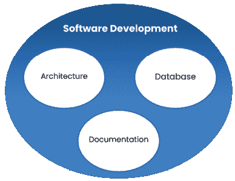

图 1.1：作为领域的软件开发

在 DDD 的语境下，业务领域是公司的主要活动区域，反映了其核心交付价值。例如，星巴克主要与咖啡相关，而亚马逊则在零售和云计算等多个领域运营。公司可以不断演进，随着时间的推移改变或扩大其业务领域。

为了管理领域的复杂性，将其细分为子领域。这些可以进一步分类为核心（core）、支持（supporting）和通用（generic）子领域。

由于软件工程师对客户业务的了解有限，领域专家（domain expert）发挥着至关重要的作用。领域专家深入理解业务的复杂细节，这些细节自然地成为了软件中的需求。

> **注意：** 最后一个术语“设计”（Design）可能很难定义，往往会导致与软件架构产生混淆。《软件架构基础基础》（The Fundamentals of Software Architecture）等经典著作将架构描述为难以改变的内容或设计，但这仍然是一个抽象概念，因为什么是难以改变的变化而异。Neal Ford 的书籍《软件架构实战指南》（Head First in Software Architecture）提供了一个更细致的视角，将架构和设计定义在一个光谱上，其中设计是关于做出塑造软件系统结构和组织的决策，以管理复杂性并创建一个连贯、可维护的架构。

下图展示了从软件架构到设计的决策光谱。它代表了设计与架构之间的紧密联系，以及设计决策如何可以是一个更容易的定义，也可以成为软件系统核心结构的内在部分。

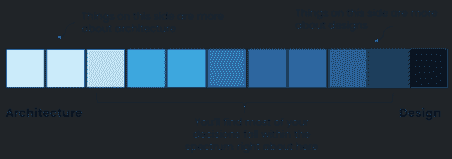

图 1.2：架构与设计的光谱

考虑到此，我们可以将 DDD 定义为对软件系统的结构和组织做出有意的决策，旨在提取并将业务知识转化为代码。

DDD 与语言无关的，可以应用于使用任何编程语言、范式或框架构建的解决方案。尽管 DDD 通常与面向对象编程（OOP）和 Java 联系在一起，但 DDD 实践也适用于根据项目需求选择的任何其他语言。

> **提示：** 本书并非取代关于 DDD 的经典文献，而是通过实用的指导来补充它们。Eric Evans 的《Domain-Driven Design: Tackling Complexity in the Heart of Software》和 Vaughn Vernon 的《Implementing Domain-Driven Design》等基础性著作是必读的，即使它们看起来具有挑战性。

DDD 有两个主要组成部分：策略（strategy）和战术（tactics）。两者对于确保良好的技术质量和正确的业务对齐都至关重要。让我们探索这两个方面之间的区别以及它们如何相互作用。

### DDD 的战略方面


DDD 是所有开发工作的基础，重点在于加深对业务、其核心领域以及构成其运营的所有子领域的理解。

DDD 中的策略是关于观察大局，识别业务中应该优先考虑并反映在软件中的最关键领域。这不仅需要协作，还需要与领域专家建立伙伴关系，他们可以传达出系统需要捕获的复杂性。战略性方法使得开发过程中的每项决策都能以对业务背景的坚实、透彻理解作为支持。它指导了整个软件项目的结构和方向。

### DDD 的战术方面

DDD 的战术方面涉及将战略洞解实际应用到代码中。

一旦明确定义了业务领域和子领域，并建立了“通用语言”（Ubiquitous Language，即领域的术语和核心概念），DDD 的战术端就上场了。它包括实现特定的设计模式和编码实践，通过软件将战略愿景变为现实。战术确保软件架构与业务模型保持一致，因为领域的抽象概念被转化为具体的、功能的系统组件。DDD 策略的标准定义通过可执行的任务准确表示，例如创建实体（entities）、值对象（value objects）、聚合根（aggregates）和存储库（repositories）。

当 DDD 中的策略和战术结合时，就创造了一种凝聚的软件开发方法。这种方法不仅是一种选择，而且是 DDD 中的必要条件。策略提供了总领的愿景并确保软件与业务需求一致，而战术则处理将该愿景转化为运行系统的实际实性工作。两者都是至关重要的；没有坚实的战略基础，软件可能无法充分解决业务的核心挑战；没有有效的战术，即使是最好的战略计划在执行中也会失败。通过整合这两个方面，DDD 能够创建出既在技术上健壮又与业务高度相关的软件。

> 提示：正如在《软件设计哲学》（A Philosophy of Software Design）中所解释的那样，战略性的软件工程师理解软件开发不仅仅是编写代码。相比之下，仅仅关注战术可能会害大于利，并获得“战术旋风”（Tactical Tornado）的绰号。

虽然软件工程师很容易对 DDD 的战术方面感到兴奋，但重要的是，有效的实施必须从策略开始。DDD 的目标是将业务知识提取并编码到软件中，使策略成为至关重要的第一步。在整书中，我们将探索可以让你你的 DDD 实践提升到新水平的核心策略和战术知识。

## 结论

本章解决了确保软件开发满足客户和利益相关者期望的关键挑战。通过探索 DDD 的核心原则，我们展示了这种方法如何使软件与业务目标一致。我们强调了理解领域、做出有意的设计决策以及成功实施 DDD 所需的战略基础的基础。本章的关键点包括 DDD 如何确保开发与业务需求一致、领域和设计在将业务知识转化为软件方面的作用，以及业务与技术团队协作的重要性。

下一章将深入研究战略 DDD，探索如何有效地识别和分类领域及子领域。这种战略洞察将提供做出明智的、符合业务的决策所需的工具，确保你的 DDD 努力为客户带来真正的价值。

- **DDD 关注业务对齐**：DDD 的首要目标是确保软件开发与业务目标保持一致并交付真实价值。
- **常见的项目失败源于对齐问题**：客户预期不明确、协作不畅以及设计过于复杂等问题通常会导致软件无法满足业务需求。
- **业务领域是 DDD 的核心**：软件的结构应该围绕实际业务领域构建，使用反映真实世界操作的概念和语言。
- **协作是关键**：业务团队与技术团队之间通过共享`通用语言`（Ubiquitous Language）进行有效沟通，可以减少误解并提高软件成果。
- **DDD 既是战略性又是战术性的**：战略方面侧于理解领域和子域，而战术方面涉及实现反映业务需求的模式和结构。
- **应该管理复杂度而非增加复杂度**：DDD 帮助将复杂系统分解为可管理的部分，确保软件保持适应性、可维护性，并与不断变化的业务需求保持一致。
- **本章为 DDD 奠定了基础**：它并没有涵盖每一个细节，而是介绍了 DDD 背后的逻辑，为您深入探索其战略和战术应用做好准备。

## 多选题

1. DDD 旨在解决的主要挑战是什么？
   - a. 降低软件开发成本
   - b. 使软件开发与业务目标一致
   - c. 提高软件交付速度
   - d. 增加软件项目的技术复杂度
   - e. 增强软件界面的审美设计

2. 以下哪不是本章讨论的 DDD 核心重点？
   - a. 领域 (Domain)
   - b. 设计 (Design)
   - c. 战术实现 (Tactical implementation)
   - d. 战略基础 (Strategic foundation)
   - e. 审美用户界面设计

3. 为什么在 DDD 中拥有战略基础至关重要？
   - a. 它有助于降低软件工具的成本。
   - b. 它确保软件架构复杂到难以更改。
   - c. 它使软件解决方案与业务目标密切一致。
   - d. 它仅关注开发的技术方面。
   - e. 它消除了对领域专家的需求。

4. 在 DDD 中，为什么业务与技术团队之间的协作至关重要？
   - a. 增加项目的复杂度
   - b. 确保按时交付软件
   - c. 培养共同的理解和语言，减少不必要的复杂度并确保软件交付业务真正需要的内容
   - d. 减少所需的技术资源并在不增加额外复杂度的情况下交付业务真正的内容
   - e. 允许技术团队独立做出所有决策

5. 专家在 DDD 中的主要角色之一是什么？
   - a. 为软件编写代码
   - b. 提供指导开发过程的深层业务知识
   - c. 管理项目的技术资源
   - d. 设计软件的用户界面
   - e. 创建详细的软件架构图

### 答案

| 题号 | 答案选项字母 |
| :--- | :--- |
| 1. | b. |
| 2. | e. |
| 3. | c. |
| 4. | d. |
| 5. | b. |

## 参考文献

1. Sinek, Simon. Start with Why: How Great Leaders Inspire Everyone to Take Action, 2009.
2. McAfee, Andrew. Now Every Company Is A Software Company, Forbes Techonomy, 2011.
3. Quidgest. Every Business Is a Software Business, Quidgest Articles, n.d.
4. Forbes Technology Council. 16 Obstacles To A Successful Software Project (And How To Avoid Them), Forbes, 2022.
5. Schwartz, Barry. The Paradox of Choice: Why More Is Less, 2004.
6. Krill, Paul. Complexity Is Killing Software Developers, InfoWorld, 2012.
7. Evans, Eric. Domain-Driven Design: Tackling Complexity in the Heart of Software, 2003.
8. Vernon, Vaughn. Implementing Domain-Driven Design, 2013.
9. Richards, Mark & Ford, Neal. Fundamentals of Software Architecture: An Engineering Approach, 2020.
10. Ford, Neal. Software Architecture: The Hard Parts, 2021.
11. Ousterhout, John. A Philosophy of Software Design, 2018.

## 加入我们的 Discord 空间

加入我们的 Discord 工作空间获取最新更新、优惠、全球技术动态、新发布以及与作者的交流会议：

[`discord.bpbonline.com`](https://discord.bpbonline.com)


# 第 2 章：战略 DDD 概念

## 引言

开发者主要关注技术实现是很常见的现象，即使在采用领域驱动设计（`DDD`）时也是如此。虽然这种关注至关重要，但它会导致忽视基础性的战略元素，结果导致软件设计不一致且存在缺陷。跳过初始的关键步骤可能会导致整个开发过程走向失败，因为设计可能需要额外的努力才能与核心业务需求和领域复杂度保持对齐。

本章将探索 `DDD` 中经常被忽视但至关重要的方面：战略设计。我们将探索核心概念，如`限界上下文`（bounded contexts）、`上下文映射`（context mapping）和`领域事件`（domain events），为有效的 `DDD` 实现奠定基础。

## 结构

在本章中，我们将探讨以下主题：

- 领域和子域
- 理解限界上下文
- 上下文映射技术
- 业务战略与软件设计的对齐

## 目标

本章通过探索如何使用`限界上下文`和`上下文映射技术`来构建复杂的系统，提供对 `DDD` 的战略性理解。通过在领域内定义清晰的边界并在上下文之间建立有效的关系，开发者可以创建与业务目标保持一致的可扩展和可维护的架构。本章将帮助读者掌握战略性 `DDD` 原则如何塑造系统设计和团队协作。

## 领域和子域

声称采用 `DDD` 的开发者往往由于对基本目标和流程缺乏理解，而误用了其原则。

对问题领域的全面视角是不可或缺的；它是成功开发的基石。这种理解领域及其子域的初始战略努力是 `DDD` 真正开始的地方。它不是关于跳入代码或选择技术模式，而是让所有参与者对业务达成共识。这包括识别`核心领域`（公司的独特价值所在）、支撑核心业务的`支撑子域`以及必要但无差异的`通用子域`。映射这些区域需要领域专家的投入、定义愿景的产品利益相关者以及将这些知识转化为软件的工程师。如果跳过这种协作探索或孤立进行，生成的系统可能在技术上是好的，但与组织的实际需求和目标脱节。

理解业务领域及其子域步骤如下：

- 领域包含公司的核心业务，分为特定的子域。
- `核心子域`将公司与竞争对手区分开来，而`通用子域`在行业内通用，不提供任何竞争优势。
- `支撑子域`增强了主要业务活动，但没有提供直接的优势。

下表通过实际示例比较了三种类型的子域——核心（core）、支撑（supporting）和通用（generic）子域，用以说明它们不同的角色。每个子域都可以被视为组织内部的战略部门，以不同的方式推动公司向前发展。该比较强调了两个关键维度：业务逻辑的复杂性和业务差异化程度（后者指的是子域对公司独特价值主张和市场竞争优势的贡献程度）。从这个来看，业务差异化并不是取决于一个子域在内部与其他子域有多不同，而是取决于它对公司在外部脱颖而出有多么关键。尽管所有子域都具有相同的战略权重，但每个对于使组织有效运作并实现其目标都起着至关重要的作用。

| 子域类型 | 角色 | 业务差异化 | 业务逻辑复杂性 | 示例 |
| :--- | :--- | :--- | :--- | :--- |
| 核心子域 | 公司独特，定义了其身份和竞争优势 | 高 | 高 | 银行的风险评估引擎 |
| 通用子域 | 可与其他公司通用，属于标准业务活动 | 低 | 高 | 薪资处理系统 |
| 支撑子域 | 支持核心业务活动但不提供直接的竞争优势 | 中 | 各异 | 客户服务管理工具 |

表 2.1：子域类型

此表直观地表示了这些子域类型之间的差异，明确了每个对整体架构的贡献。支撑子域和通用子域之间的交集代表了一个灰色区域，根据具体情况，角色可能会重叠。

下图表示了三种子域在业务差异化和业务逻辑复杂性方面的相互作用：

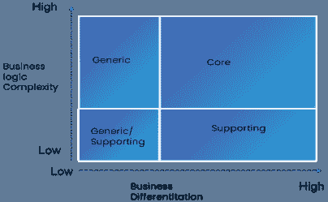

图 2.1：领域以及业务逻辑与业务差异化

理解领域类型之间的差异对于正确应用战略 DDD 原则来管理业务复杂性至关重要。

### EcoTrack Logistics 示例场景

在介绍 EcoTrack 的细节之前，鼓励读者运用他们的分析能力，从业务背景中抽象出领域洞察。目标是根据业务概述中提供的信息，识别核心领域、支撑子域和通用子域。这一练习强化了在现实场景中识别领域边界并理解其各自扮演角色的能力。识别出的子域将在概述之后立即列出以便比较。

考虑一个名为 EcoTrack Logistics 的虚构组织，其成立目的是通过可持续运营来转型物流行业。EcoTrack 的出现源于对绿色运输解决方案日益增长的需求，旨在提供满足并超过行业可持续性标准的环保物流服务。

EcoTrack 运营的核心是环保路线优化系统。这种先进算法通过分析交通状况和天气模式等实时数据，最大限度地减少碳排放和燃料消耗，在竞争激烈的市场中使 EcoTrack 脱颖而出。这项创新使 EcoTrack 成为绿色物流的领导者，事实证明其在短短一年内就为一家大型电子商务合作伙伴的交付相关排放减少了 25%。

EcoTrack 在标准的车队管理子域下高效管理其车队，支持这一核心创新。该子域处理必要但例行的任务，例如车辆维护调度、GPS 跟踪和司机管理。虽然这些操作在整个行业中都是标准的，但 EcoTrack 对高效执行这些操作的投入确保了一如既往的高水平服务，强化了公司的卓越运营。

除了物流实力外，EcoTrack 还强调建立强大的客户关系，这些关系通过客户关系管理（CRM）子域进行管理。CRM 系统通过提供实时货物跟踪、个性化更新和响应式支持来增强客户满意度。尽管该子域并不驱动物流创新，但它对于维护客户忠诚度和维持业务整体成功至关重要。

EcoTrack 通过将其运营结构化为这些不同的子域，专注于在可持续物流解决方案中提供精确和高效。

以下是识别出的领域和子域类型：

- 核心子域：环保路线优化。
- 通用子域：标准车队管理。
- 支撑子域：CRM。

下图说明了这种结构以支持对领域的理解：

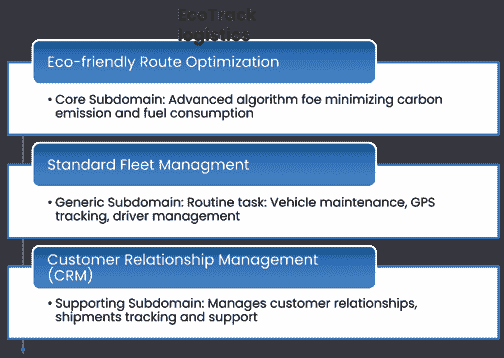

图 2.2：环保领域的表示

这家虚构公司提供了一个实用的示例，有助于理解和应用领域及其类型的概念。随着我们继续，下一步将是探索边界上下文（bounded contexts）的概念，这将基于我们对领域和子域的理解，并为有效管理领域模型的不同部分提供进一步的清晰。理解边界上下文、语言和领域之间的联系，可以让你通过清晰定义的边界有效地构建结构和管理复杂性。

## 理解边界上下文

在 DDD 中，“领域”（domain）一术指的是问题领域，涵盖了软件解决的具体问题。资深软件匠师、简化软件设计和实现的思想领袖 Vaughn Vernon 将问题空间（problem space，即识别业务挑战的地方）与解决方案（solution space）区分来。

边界上下文源于通信相关的复杂性。在将领域知识转换为软件时，有效的沟通是不可或缺的。必须建立一种通用语言（Ubiquitous Language），以确保所有团队成员、开发者、领域专家和利益相关者彻底理解该领域。这种共享语言随着与领域专家合作获得新见解而演进。

> 提示：在确定项目的通用语言（团队的指南针）时检查你是否处于正确的道路，尝试表述一个业务概念：如果你能清晰地交流它，说明你处于正确的道路上。如果你无法清晰地解释领域中常用的概念，说明你应该与专家合作重新审视领域模型。

限界上下文（Bounded context）是一个独特的领域切分，其中`通用语言`（Ubiquitous Language）的特定子集被一致地使用。它是将领域划分为更小、更易管理的部分的方法，每个部分都有由其边界清晰定义的模型和语言。每个限界上下文都有自己的名称，并是`通用语言`的一部分，这简化了对该领域的管理和推理。

限界上下文不需要完全独立；它们通常与其他上下文存在关系。这些关系会影响技术解决方案（系统将如何相互作用）和开发阶段（团队将如何协作）。

识别限界上下文之间关系最简单的方法之一是将它们归类为上游（upstream）或下游（downstream）上下文。将上下文想象成沿河流分布的城市：上游城市影响流向下游的内容。流向下游的某些内容是有价值的，下游城市必须获取它们。这个类比有助于理解变化或信息在上下文之间是如何流动的。

上下文之间的关系可以使用依赖图以图形化的方式表示，其中箭头从下游上下文指向上游上下文，或用上游 (`U`) 和下游 (`D`) 标记它们的角色：

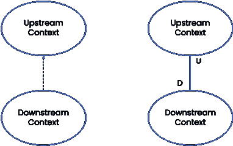

图 2.3：限界上下文图示例

一旦确定了上下文及其关系，下一步就是决定如何整合它们。这涉及回答以下关键问题：

- 上下文之间将如何进行技术通信？
- 我们如何映射不同上下文领域模型之间的语言（即从一种`通用语言`翻译成另一种）？
- 我们如何避免上游发生非意愿或破坏性变化而引起的问题？
- 我们如何避免在下游上下文中引起问题？

这些问题的答案被汇成上下文映射（context map），如图 2.4 所示。上下文映射可视化地表示了不同的限界上下文如何相互作用，以及用于管理这些交互的策略。


图 2.4：上下文映射示例

下一节将探索创建有效上下文映射的几种技术，包括共享内核（shared kernel）、客户-供应商（customer-supplier）、顺从（conformist）、反腐层（anticorruption layer）、发布语言（published language）、分离方式（separate ways）和开放主机服务（open host service）。这些技术可以作为导航集成和管理多个限界上下文复杂性的工具。

## 上下文映射技术

确定了限界上下文的重要性后，我们现在关注用于管理上下文之间交互和关系的技术。这一过程被称为上下文映射（context mapping），是 DDD 的关键组成部分，因为它确保了系统不同部分之间定义良好且易于管理的边界和连接。

上下文映射可视化地表示了系统中不同的限界上下文如何相互关联。此映射识别了上下文边界所在，并对这些上下文应该如何通信和整合提供了见解。一个良好的上下文映射使不同系统部分之间的关系显性化，帮助团队避免误解和失调。上下文映射中使用的主要模式和技术如下：


- **共享内核模式（Shared kernel pattern）**：当两个团队或上下文需要共享其领域模型的一小部分时发生。这个共享部分（内核）通常是领域中一个极小的、定义良好的子集，两个团队同意共同开发和维护。当上下文之间需要紧密集成时，`Shared kernel` 模式非常有用，但由于共同承担责任，必须小心以避免它成为瓶颈。

- **客户-供应商模式（Customer-supplier pattern）**：一个上下文（供应商）提供另一个上下文（客户）消耗的服务或功能。客户有特定的需求和预期，供应商必须确保其服务符合这些要求。这种关系通常需要密切协作，以确保供应商上下文中的更改不会对客户上下文产生负面影响。

- **顺从模式（Conformist pattern）**：当下游上下文（顺从者）被迫遵守上游上下文的模型和决策时产生，即使它更倾向于采用不同的方法。这种模式通常发生在下游上下文对上游上下文几乎没有影响，且必须顺从上游上下文的任何规定时。

- **反腐层模式（Anti-corruption layer（ACL）pattern）**：当一个上下文必须与具有不同或设计不佳模型的另一个上下文交互时使用的防御策略。`ACL` 充当保护层，在两个模型之间进行翻译，通过将下游上下文从上游上下文的复杂性或缺陷中隔离来，防止其被污染。在集成无法更改的遗留系统或外部服务时，这种模式至关重要。

- **发布语言模式（Published language pattern）**：涉及为上下文之间的通信创建一个共享语言或协议。这种语言通常是标准化并文档化的，允许不同的上下文以一致且可预测的方式进行交互。`Published language` 在多个上下文需要以松耦合的方式交换数据或命令的情况下是有益的。

- **分离方式模式（Separate ways pattern）**：当两个上下文不需要集成时采用。这些上下文独立开发和维护，没有共享模型或通信需求。这种模式通常用于集成两个上下文的成本超过了其收益的情况，允许它们各自独立演进。

- **开放主机服务模式（Open host service pattern）**：提供一个标准化的公共接口，其他上下文可以使用它与特定上下文交互。当一个上下文需要以一致且受控的方式向多个其他上下文提供服务时，这种模式是合适的。通过暴露定义良好的接口，`open host service` 模式确保了不同的上下文可以与其交互，而无需理解其内部复杂性。

每个模式都有特定的用途，并提供了一种管理系统中集成多个限界上下文复杂性的方法。模式的选择取决于上下文之间关系的性质、所需的耦合程度以及系统架构的整体目标。

这些上下文映射技术桥接了战略规划和实际实现，塑造了应用程序的不同部分将如何相互作用。每种技术都直接影响系统的集成行为，引导上下文如何通信、交换数据和处理依赖关系。这些映射不是静态的；它们可以随着组织及其需求而演进，在现有的交互不再符合应用程序目标时进行调整。将上下文映射作为实用的蓝图，指导并调整应用程序的架构，使其与组织的结构和预期结果保持一致。

精通上下文映射技术对于开发可扩展且可维护的软件系统至关重要。这些方法使各个组件能够在独立演化的同时，保持有效的协同工作。在本章中，我们将深入探讨 DDD 中的核心概念，例如限界上下文（bounded contexts）和上下文映射技术，说明这些原则如何驱动直接符合业务目标的软件架构。接下来的章节将关注将业务战略与软件设计对齐，以进一步巩固这种一致。

## 将业务战略与软件设计对齐

DDD 的核心原则之一是确保软件架构与整体业务战略紧密一致。这种一致至关重要，因为软件不仅是一种技术工具，更是业务目标和结果的直接实现者。当软件设计反映了业务的战略目标时，它可以快速适应市场变化，简化运营并提供竞争优势。

将软件设计与业务战略对齐的第一步是理解领域。这涉及到深入理解业务的核心流程、挑战和目标。通过识别组织的核心、支持和通用子域，开发者可以优先考虑最需要创新和竞争差异化的领域。将精力集中在核心子域上，可以确保软件反映业务独特的价值主张。通过标准化解决方案处理通用子域可以实现更高效的资源分配。

此外，业务利益相关者与开发者之间的通信至关重要。在领域专家和开发者之间创建一种共享语言——即 `Ubiquitous Language`（通用语言），对于让两个团队都符合业务目标至关重要。这种共同语言减少了误解，并使开发专注于交付价值。

为了有效，这种语言应该被显式地记录为一份动态词汇表，并包含在用户故事、模型名称、API 定义和视觉辅助（如图表）中。这些资源有助于确保整个项目中的清晰度和使用的一致性。

最终，通过将业务战略与软件设计对齐，组织可以创建支持其当前业务并随业务和市场需求增长而演化的系统。这种方法在软件和业务之间建立了共生关系，彼此驱动并支持对方的成功。

## 结论

在本章中，我们涵盖了 DDD 的基本概念，专注于有助于管理复杂性并将软件架构与业务目标对齐的战略元素。我们首先讨论了领域和子域，随后详细探讨了限界上下文以及共享语言的重要性。本章还介绍了上下文映射技术，这对于管理不同系统部分之间的关系、确保每个上下文在保持系统一致性的同时能够独立演化至关重要。

在下一章中，我们将重点从战略 DDD 转向战术 DDD。我们将探索 DDD 的战术实现，提供实际示例和代码来说明这些概念如何应用于软件开发中，并为您提供在项目中有效应用 DDD 原则的工具。

## 记忆点

- DDD 中的 `Domain`（领域）指的是问题空间：它代表了软件旨在解决的业务挑战。Vaughn Vernon 将其定义为问题空间和一个解决方案。
- `Bounded context`（限界上下文）定义了清晰的边界：它确保系统的不同部分使用一致的术语和模型，不受其他上下文的干扰。
- `Ubiquitous Language`（通用语言）是对齐的关键：开发者与领域专家之间的共享语言确保了通信和实现中的清晰性和一致性。
- `Context mapping`（上下文映射）有助于管理集成：它定义了不同的限界上下文如何交互，引导它们之间数据流和依赖关系的处理。
- `Context mapping techniques`（上下文映射技术）反映系统行为：这些技术塑造了应用程序根据业务需求和组织结构进行通信和演化的方式。
- 限界上下文关系影响设计决策：识别上游下游依赖有助于定义所有权、责任和潜在的集成挑战。
- `Context boundaries`（上下文边界）在需要时是灵活的：虽然最初被定义，但它们随系统和组织的变化而演变，以更好地适应业务需求。

## 多选题

1. DDD 中限界上下文（bounded context）的主要目的是什么？
   - a. 定义系统的物理边界。
   - b. 将数据库与应用程序逻辑分离。
   - c. 将领域模型拆分为更小、易管理且术语一致的模型。
   - d. 确保所有开发者使用相同的编程语言。
   - e. 管理微服务之间的网络通信。

2. DDD 中的 `Ubiquitous Language`（通用语言）有助于实现什么？
   - a. 在团队中执行严格的编码标准。
   - b. 它确保所有团队成员和领域专家对领域有共同的理解。
   - c. 它取代了对技术文档的需求。
   - d. 它标准化了用户界面设计。
   - e. 它定义了数据库模式的结构。

3. 在上下文映射中，反腐层（anticorruption layer）的作用是什么？
   - a. 防止未经访问数据库。
   - b. 将一个上下文与不同模型的外部系统隔离开。
   - c. 在两个限界上下文之间同步数据。
   - d. 在限界上下文内部标准化通信协议。
   - e. 管理团队之间的版本控制。

4. 哪种上下文映射模式涉及创建领域模型的一个小型共享子集？
   - a. `Open host service`（开放主机服务）
   - b. `Conformist`（顺从者）
   - c. `Shared kernel`（共享内核）
   - d. `Separate ways`（分离方式）
   - e. `Customer-supplier`（客户供应商）

5. 如果你很难使用 `Ubiquitous Language`（通用语言）解释一个业务概念，你应该怎么办？
   - a. 放弃这个不必要的概念。
   - b. 忽略问题并继续实施。
   - c. 通过删除细节来简化概念。
   - d. 与领域专家协作以完善语言和模型。
   - e. 用技术术语替换该词。

### 答案

| 题号 | 答案选项字母 |
| :--- | :--- |
| 1. | a. |
| 2. | b. |
| 3. | b. |
| 4. | c. |
| 5. | d. |

## 参考文献

1. Forbes Technology Council. 16 Obstacles To A Successful Software Project (And How to Avoid Them), 2022. [`www.forbes.com/councils/forbestechcouncil/2022/06/21/16-obstacles-to-a-successful-software-project-and-how-avoid-them/`](https://www.forbes.com/councils/forbestechcouncil/2022/06/21/16-obstacles-to-a-successful-software-project-and-how-avoid-them/)
2. Richards, Mark & Ford, Neal. Software Architecture: The Hard Parts, 2021.
3. Vernon, Vaughn. Implementing Domain-Driven Design, 2013.

本章对于想要将理论与实际应用的开发者来说至关重要。我们将通过 Java 模式如何如何使用战术 DDD（领域驱动设计），例如实体、值对象、服务、聚合和存储库。详细的代码示例将展示软件开发如何在有效管理复杂性的同时，反映业务领域模型。

## 章节结构

在本章中，我们将探索：

- 实体和值对象
- 聚合和聚合根
- 服务及其角色
- 存储库实现

## 技术要求

为了跟上本章中的代码示例和练习，请确保你已经准备好以下工具和环境配置：

- `Java 21`
- `Git`
- `Maven`
- 任何你偏好的 IDE

关于库配置的更多信息，请参考本章对应的 GitHub 仓库。

## 目标

本章旨在通过探索实体、值对象、聚合、服务和存储库等关键模式，对战术 DDD 提供实操性的理解。在本章结束时，你将能够构建自己的领域模型，确保清晰的边界和职责，并应用实现整洁且可维护的业务逻辑的最佳实践。通过实操示例和实现指南，你将学习如何将 DDD 原则转化为代码，同时避免常见的陷阱。

## 实体和值对象

在开始战术 DDD 时，需要关注的概念是实体（Entity）。领域建模的起点是代码中实现的核心，换句话说，就是实体。

> **提示：** 虽然实体在战术 DDD 中至关重要，但请记住，它们的设计始终应该受到在此之前所做的战略 DDD 决策的指导。

实体是数据库系统中存储信息的表示，是实现设计模式以及业务或领域定义的基础。

正如《领域驱动设计 1》书中所述，实体的核心特征是连续性（通常称为其生命周期）和身份：

> 许多对象的本质并不是由属性定义的，而是由一条连续性和身份定义的。

> -Eric Evans

身份是一个唯一且不变的特征，无论属性如何变化，它都能将实体与其他区分来。它保证了随时间推的连续性和可追溯性，通常由唯一标识符（如 `ID` 或 `code`）表示。

在 DDD 中，身份对于一致识别实体至关重要，即使它的其他属性发生了变化。例如，在一个大学入学系统中，学生的身份由唯一的 `student ID` 坚决定义，无论姓名或地址如何变化，该 ID 保持不变。这一概念对于有效的实体设计至关重要，确保它们在整个生命周期内无疑问地表示同一个对象。

实体是由其身份定义的（身份唯一地将其与其他区分），而不是由其属性。这种身份允许实体在属性变化时随时间推移保持可识别性。例如，在一个大学入学系统中，学生通过其恒定的学生 ID 来识别，无论姓名或电子邮件如何变化。这种一致的身份确保了实体在整个生命周期中的连续性。

在实现实体时，请问自己这个领域特定的问题：随着时间的推移，什么决定了这个对象仍然与之前的一样？这种理解塑造了身份如何被定义为 `entity code`。正如 Evans 指出的那样：

> 警惕那些要求通过属性匹配对象的需求。

> -Eric Evans

有时，被认为是实体的对象可能是不同的对象类型（例如值对象，这是在本章后半部分探讨的概念）。测试这一点的一种方法是检查需求是否意味着两个对象在比较时应该被视为同一个，这意味着它们被认为是相等的具有匹配的属性。在设计领域模型时，理解这种区别至关重要。让我们从探索一些陷阱开始。

### 实体陷阱

在采用战术 DDD 实践构建第一个实体时，可以避免一个典型的陷阱，特别是当将 Java 实体与普通 Java 对象（POJO）模型结合时。

最常见的错误之一是创建贫血实体（Anemic Entities）：即持有数据但不包含任何领域逻辑或封装 4 的对象。下面的代码通过一个简单的 `Traveller` 实体展示了这个问题，其中护照号充当 ID：

```java
public class Traveller {
    private String passportNumber;
    private String name;
    private Set<String> countries;
}
```

从乍看，这个设计可能足够了，因为它允许我们设置所有字段并初始化实例，如下例所示：

```java
@Test
void shouldCreateTraveller() {
    Traveller traveller = new Traveller();
    traveller.setPassportNumber("123456");
    traveller.setName("John Doe");
    traveller.setCountries(Set.of("USA", "UK"));
    Assertions.assertThat(traveller.getPassportNumber()).isEqualTo("123456");
    Assertions.assertThat(traveller.getName()).isEqualTo("John Doe");
    Assertions.assertThat(traveller.getCountries()).contains("USA", "UK");
}
```

然而，这种方法有一个明显的缺陷：在这个 POJO 实体中领域逻辑在哪里？一个 `Traveller` 在没有有效护照号或姓名的情况下存在是否有意义？这种结构的代码缺乏适当的封装。

为每个字段使用公共的 getter 和 setter 与直接暴露公共字段没有区别区别。

此外，这种 API 设计容易产生错误，从而轻易破坏数据一致性和业务规则的完整性。例如，以下代码演示了 `Traveller` 实体如何处于不一致的状态，这可能导致 `NullPointerException`：

```java
@Test
void breakingApiContract() {
    Traveller traveller = new Traveller();
    traveller.setPassportNumber("123456");
    traveller.setName("John Doe");
    traveller.setCountries(Set.of("USA", "UK"));
    traveller.setCountries(null);
    Assertions.assertThatThrownBy(() -> traveller.getCountries().contains("USA")).isInstanceOf(NullPointerException.class);
}
```

允许 `countries` 字段被设置为 `null` 不仅仅是不便，这种做法损害了 API 的完整性并带来了安全风险。从机密性、完整性和可用性（CIA）三要素 5 的角度来看，这种方法通过允许对关键字段进行不受限制的更改来破坏应用程序的完整性。即使这种问题是意外引入的，这种设计被称为贫血领域模型（Anemic Domain Model），被认为是 DDD 中的一种反模式。在篇文章中，Martin Fowler 详细阐述了贫血模型的缺点，并提倡使用富模型（Rich Models）6。富模型拥抱封装，确保业务逻辑和数据完整性在实体内部紧密耦合。

Robert C. Martin 在《洁洁代码 7 中也批评了贫血模型，解释说这种错误源于对面向对象范式的误解。他强调，对象的根本原理不仅仅是分组数据，而是暴露行为并隐藏底层数据。当实体仅由 getter 和 setter 组成而不封装行为时，它们并不是真正的对象。Martin 指出贫血模型比面向对象设计更接近过程化编程，因为它将对象视为数据结构，而不是将行为封装为真正的对象。这意味着贫血模型不被认为是完全面向对象的，并且违背了面向对象（OO）设计的核心哲学。

为了解决这个问题，对 `Traveller` 实体进行了重构，通过构造函数和方法强制执行领域逻辑，避免使用可变状态。将其转变为一个更健壮的 `Tourist` 实体，避免使用 setter 并确保通过构造函数和方法执行领域逻辑。这个版本遵循了《Effective Java》中的第 15 条，并与《Clean Code》中侧重于封装行为的原则保持一致。例如，一个 `Tourist` 在没有有效护照号码的情况下存在是没有意义的，因此我们通过以下构造函数强制执行这一点：


```java
public class Tourist {

    private String passportNumber;
    private String name;
    private Set<String> countries = new HashSet<>();

    public Tourist(String passportNumber, String name) {
        Objects.requireNonNull(passportNumber, "Passport number cannot be null");
        Objects.requireNonNull(name, "Name cannot be null");
        this.passportNumber = passportNumber;
        this.name = name;
    }

    public String getPassportNumber() {
        return passportNumber;
    }

    public String getName() {
        return name;
    }

    public Set<String> getCountries() {
        return Collections.unmodifiableSet(countries);
    }

    public void addCountry(String country) {
        Objects.requireNonNull(country, "Country cannot be null");
        countries.add(country);
    }
}
```

这个重构后的 `Tourist` 实体现在封装了数据，通过防止空值和不受控的修改来确保其完整性。构造函数保证 `Tourist` 始终拥有有效的护照号码和 `name`，且 `addCountry` 方法确保 `countries` 不为空。此外，`getCountries` 方法返回一个不可修改的集合，防止外部对内部状态进行修改。

通过设计丰富模型的实体，我们提高了应用程序的完整性和安全性，同时与战术 DDD 的核心原则一致。这种方法使 API 更加健壮，并确保领域逻辑处于设计的中心位置，避免了贫血模型（anemic models）的陷阱。

## 类和字段的命名规范

DDD 中的另一个常见错误与类和字段的命名规范有关。在《Clean Code》中，Robert C. Martin 强调了使用有意义名称并避免冗余的重要性。

这一原则适用于字段名，例如 `string nameString`，额外的 `string` 后缀没有增加任何价值。相反，名称应该是 `string name`，这样更自然且简洁。同样，应该避免诸如 `PersonEntity` 或 `CardEntity` 这样冗类的类名。

使用与领域通用语言（Ubiquitous Language）一致的清晰、简洁的命名，会让你的代码更容易读、更有关联，并且对于开发者和利益相关者都更容易维护。

同样的原则也适用于类名。通常没有必要在类名后附加 `Entity`。相反，直接根据领域术语为类命名，例如 `Person`、`Card` 或 `Team`。

这种做法提高了代码的可读性，并确保你的代码与业务语言保持紧密结合，使其更加直观。战略 DDD 的目标是确保代码的语言反映业务领域的语言，这包括类名、属性名和方法名。这种方法加强了代码与业务规则之间的联系，帮助开发者和领域专家更有效地理解和交流。

在某些项目中，`Entity` 后缀是约定的一部分，有助于识别领域对象。虽然这可以作为快速搜索的辅助，但它表明存在一种恐惧驱动的设计（fear-driven design），可能导致架构由于治理规则而变得过于僵化。必须记住，命名规范应该增强清晰度，而不是削弱它。

## 构建强大的实体模型

为了构建强大且有效的模型，避免弱模型和不必要的命名至关重要。这使我们能够专注于创建准确表示行为的全面模型。

例如，让我们考虑一个使用 `Team` 实体表示足球球队的场景。在这种情况下，球队通过唯一的 `FIFA code` 标识，该代码遵循特定规则，例如最多有 23 名球员并确保每位球员都是唯一的。

```java
public class Team {

    private final String fifaCode;
    private final String name;
    private final List<Player> players;

    private Team(String name, String fifaCode) {
        this.name = name;
        this.fifaCode = fifaCode;
        this.players = new ArrayList<>();
    }

    public String getFifaCode() {
        return fifaCode;
    }

    public String getName() {
        return name;
    }

    public List<Player> getPlayers() {
        return Collections.unmodifiableList(players);
    }

    public void add(Player player) {
        Objects.requireNonNull(player, "Player is required");
        if (players.contains(player)) {
            throw new IllegalArgumentException("Player already exists");
        } else if (players.size() >= 23) {
            throw new IllegalArgumentException("Team is full");
        }
        players.add(player);
    }

    public static Team create(String name, String fifaCode) {
        Objects.requireNonNull(name, "Name is required");
        Objects.requireNonNull(fifaCode, "FIFA code is required");
        return new Team(name, fifaCode);
    }
}
```

这种实现果断地利用了《Effective Java》中的关键原则，例如采用静态工厂方法代替构造函数，并减少可变性。通过设计 `Team` 类为除了添加球员的能力外主要是不可变的，我们显著减少了领域模型中的 Bug 风险。

某些 Java 框架（如 `JPA`）由于需要默认构造函数而无法不可变实体。清晰的解决方案是将领域模型与持久化模型分离，这允许我们在维护健壮领域模型的同时，有效解决持久化需求。

关于实体的可变性，这一决策必须植根于特定的业务背景，正如 Eric Evans 的 DDD 书中所强调的那样。在实体不频繁变化的情况下（例如书籍），不可变性不仅是合适的，而且是优选的，因为应该创建新版本而不是修改现有版本。

## 使用 `record` 实现不可变实体

引入不可变特性的有效策略是使用 Java 的 `record` 特性：

```java
public record Book(String isbn, String name, String author, int edition, Year year) {

    public Book newEdition(String isbn, Year year) {
        return new Book(isbn, name, author, edition + 1, year);
    }
}
```

在这个示例中，注意不是 `class`，而是 `record` 对象，它是一种被设计为不可变的类型。这个 `Book` 实体作为 `record`，现在是不可变的，这意味着更改会导致创建新的书籍（例如，新版本），而不是修改现有的。这种行为符合某些领域的自然演变，例如出版行业，其中新版代表重大更新而非细微修改。

- Builder 可以由某些工具和框架自动生成。
- 需要在 `build()` 方法中进行强校验，以确保所有必填字段都已设置。

## 流式 API

另一方面，流式 API（fluent API）是 Martin Fowler 在 2005 年引入的概念，旨在通过创建 DSL（领域特定语言）来提高代码的可读性。

使用流式 API，在创建新实例时，无需记住方法的调用顺序。它通过促进构建对象所需步骤的可视化，实现了一种自然、直观的编码流。

在设计流式 API 时，需要考虑以下原则：

- 每个方法都应该对输入进行验证，以便在参数无效时快速失败。
- 方法链应该返回一个有效对象以保证其完整性。

让我们通过一个 `Player` 实体的示例来更好地理解这一点：

```java
public class Player {
    private String name;
    private Year start;
    private Year end;
    private String email;
    private Position position;
    private int goal = 0;
}
```

该实体包含了如 `name`、合同的 `start` 和 `end` 年份、`position` 以及进球数等字段。其中涉及一些业务规则：

- 球员的 `name` 和 `position` 是必须的。
- 进球数不能为负数。
- 合同必须有有效的 `start` 和 `end` 日期。

为了执行这些规则，我们可以使用 Builder 或流式 API。它们各有以下权衡：

### Builder 模式

Builder 模式允许我们逐步构建对象，但我们需要确保不会遗漏任何必填字段。校验逻辑通常发生在 `build()` 方法中，如果缺少必填字段，可能会在运行时产生问题。以下是一个示例：

```java
Player player = Player.builder()
    .name("Ronaldo")
    .start(Year.of(2003))
    .end(Year.of(2020))
    .position(Position.FORWARD)
    .email("ronaldo@bahia.com")
    .build();
```

虽然这容易实现，但它没有显式地引导开发者填写必填字段。如果不小心跳过了 `name` 方法，错误只会在运行时出现。

### 流式 API

流式 API 为构建复杂实体提供了一种更直观、更具引导性的方法。API 中的每一步自然地引向下一步，并在此过程中强制业务规则。这使得过程更具可读性且领域特定化，与 DDD（领域驱动设计）术语更加契合。

```java
Player player = Player.name("Ronaldo")
    .start(Year.of(2003))
    .end(Year.of(2020))
    .position(Position.FORWARD)
    .email("ronaldo@bahia.com");
```

在这里，API 确保开发者指定了球员的 `name`、`position` 和有效的合同期限。每个方法都可以立即验证输入，确保无效参数（如负进球数或缺失 `position`）在入口处被处理，而不是在运行时。这种方法为对象创建提供了更多的清晰度和信心。

虽然这两种方法在软件设计中各有其用之处，但流式 API 可以提供与领域模型更好的对齐，提供语义上的清晰性并减少运行时错误的风险。在更复杂的情况下，流式 API 提供了直观且领域特定的开发体验，这在 DDD 中尤为重要，因为 DDD 中的术语和行为紧密地反映了业务领域。

在 `Player` 中，我们将 `email` 作为字符串使用，这意味着用户可以输入 `"banana"` 而无需任何验证；解决此问题的方法之一是使用值对象（value object），将在下一节中介绍。

## 值对象

值对象是软件设计中的不可变构造，是 DDD 的核心，它封装了特定的值而不具有任何唯一标识。值对象的主要功能是表示问题领域中不同元素的概念。一旦创建，值对象就无法更改。

这一特性通过减少与可变状态相关的风险降低了复杂性并确保了可靠性。通过集中化特定值或一组值，值对象简化了业务逻辑，并让开发者对领域模型具有更大的控制感和更高的表达力。

值对象在软件设计中具有多个优势。它们的不可变性保证了更高的可靠性，因为它们不容易引入与状态更改相关的 bug。此外，它们的模块化允许在多个系统部分之间轻松复用。这种复用性使得软件更具资源，并维护了业务逻辑的一致性。

这种复用增强了系统的模块性并促进了业务逻辑的一致性，使软件更容易维护和扩展。此外，值对象通过显式表示业务概念增强了领域模型，从而提高了代码的可读性和清晰度。

观察以下 Java 库中模式的示例，在本例中为货币 API：

```java
CurrencyUnit usd = Monetary.getCurrency("USD");
Money money = Money.of(12, usd);
```

Java 的日期和时间 API 也证明了值对象如何改进语义并符合领域的通用语言（Ubiquitous Language）。新 API 没有使用旧日 API 中通用的 `getInstance()` 方法，而是提供了如 `now()` 这样有意义的方法，如下：

```java
LocalDate localDate = LocalDate.now();
```

这种 API 的改进反映了领域思考，其中 `now` 比通用工厂方法更清晰地反映了时间的业务背景。

## `Email` 值对象

让我们使用 `Player` 实体将此概念投入实践，创建一个保证一致性和有效性的 `Email` 值对象。以下示例展示了一个 `Email` 值对象，它确保每个新的 `Email` 实例都是有效的。作为一个值对象，它是不可变的，并且在创建时强制执行校验，确保只接受有效的电子邮件地址。

注意：此类执行了基础电子邮件验证模式（local@domain）并检查了结构和顶级域名。

```java
public final class Email implements Supplier<String> {
    private static final String EMAIL_PATTERN =
        "^[_A-Za-z0-9-\\+]+(\\.[_A-Za-z0-9-\\+]+)*@"
        + "[A-Za-z0-9-]+(\\.[A-Za-z0-9]+)*(\\.[A-Za-z]{2})$";

    private static final Pattern PATTERN = Pattern.compile(EMAIL_PATTERN);

    private final String value;

    @Override
    public String get() {
        return value;
    }

    private Email(String value) {
        this.value = value;
    }

    @Override
    public boolean equals(Object o) {
        if (this == o) {
            return true;
        }
        if (o == null || getClass() != o.getClass()) {
            return false;
        }
        Email email = (Email) o;
        return Objects.equals(value, email.value);
    }

    @Override
    public int hashCode() {
        return Objects.hashCode(value);
    }

    @Override
    public String toString() {
        return value;
    }

    public static Email of(String value) {
        Objects.requireNonNull(value, "email is required");
        if (!PATTERN.matcher(value).matches()) {
            throw new IllegalArgumentException("Invalid email: " + value);
        }
        return new Email(value);
    }
}
```

从上述代码可以观察到以下几点：

- 在此 `Email` 类中，电子邮件地址一旦验证后就会存储为不可变值，创建后不允许发生进一步更改。
- `Email.of()` 工厂方法通过在提供的值不符合所需格式时抛出异常，确保创建有效的电子邮件。
- 格式使用正则表达式（regex）进行验证，以检查有效的电子邮件模式。
- 该类实现了 `Supplier<String>`，允许它在需要时提供电子邮件字符串值，从而封装了校验逻辑并将其与系统的其他部分分离。

通过使用这种方法，你可以确保每当在领域中使用电子邮件时，它都保证是有效的，从而减少了代码后续出现 bug 或不一致的风险。

除了不可变值对象外，枚举（enums）在建模领域固有的常量值时也可以起着重要作用。枚举提供了一组固定的常量，确保只使用预定义的值。在《Effective Java 第 4》中，Joshua Bloch 强调了枚举作为传统常量字段的强大替代方案。


例如，在我们的`Player`实体中，我们可以添加一个`Color`枚举来表示球员的球衣颜色。这通过提供与领域直接相关的清晰且不可更改的值，增强了领域模型，并将错误风险降至最低。

```java
import java.util.function.Supplier;

public enum Colors implements Supplier<String> {
    BLUE("#00FFFF"), WHITE("#FFFFFF"),
    BLACK("#000000"), GREEN("#008000");

    private final String value;

    Colors(String value) {
        this.value = value;
    }

    @Override
    public String get() {
        return value;
    }
}
```

对于枚举（例如示例中的`Colors`枚举），预定义的颜色值以十六进制代码表示，提供了一组易于引用的不可变常量值。该枚举还实现了`Supplier<String>`，允许它在需要时返回颜色值。通过这种方式定义颜色，我们确保了一致性，并减少了如果在代码库中使用自由字符串表示颜色时的错误风险。这种方法简化了逻辑并强制了统一性，确保领域值在整个应用中始终有效且一致。

枚举和值对象具有相同的目的，即在确保不可变性的同时，封装并验证领域逻辑。它们共同使得领域模型更具表现力、可读性，并符合业务需求。

在接之后，我们将探索聚合（aggregate）和聚合根（aggregate root）的概念。这些`DDD`构建模块通过定义边界和在相关实体之间执行业务规则，来管理你的领域模型的一致性。

## 聚合与聚合根

在讨论了战术`DDD`的核心——实体和值对象之后，是时候深入探讨一个最被误解但至关重要的概念之一了：聚合和聚合根。聚合通过定义边界并确保这些边界内的一致性，在构建领域模型方面起着至关重要的作用。

为了明确，聚合并不是：

- 仅仅是实体的集合。
- 仅仅是一个行为丰富的对象。
- 或者是一组可以存储在数据库中的实体。

正如 Martin Fowler 14 所解释的：

> 聚合是数据存储和传输的基本元素；你请求加载或保存整个聚合。事务不应该跨越聚合边界。
>
> —Martin Fowler

`DDD`引入的第一批战术元素是实体和值对象，它们各具具有以下不同的特征：

- 值对象没有身份，是不可变的，并且始终是有效的。它们封装了领域模型中的特定值。
- 实体拥有身份，其有效性取决于其状态。实体可以包含值对象作为其结构的一部分。

当我们实体和值对象结合起来时，就得到了聚合。Eric Evans 将聚合定义为一组关联对象，我们将它们视为一个数据更改的单元。聚合确保其边界内部的一致性，通常封装了领域中紧密相关的的一个或多个实体和值对象。

一个聚合有一个聚合根，它是与聚合交互的入口。聚合根控制对聚合内其他实体的控制访问，并确保对聚合的所有更改都以一致的方式发生。聚合的一个关键特性是定义良好的事务边界，这意味着聚合内部的更改要么完全成功，要么失败。它确保了跨系统的数据一致性和完整性。

让我们考虑一个足球管理应用程序中的`Team`聚合示例。`Team`是聚合根，控制对其`Player`实体的访问。每个`Team`可以拥有一个球员列表，但对`Team`的操作（如添加或删除球员）必须遵循特定规则，例如维护 23 人的最大员名单人数。

以下是`Team`聚合的示例：

```java
public class Team {
    private final String fifaCode;
    private final String name;
    private final List<Player> players = new ArrayList<>();
    private static final int MAX_PLAYERS = 23;

    public Team(String fifaCode, String name) {
        Objects.requireNonNull(fifaCode, "FIFA code is required");
        Objects.requireNonNull(name, "Team name is required");
        this.fifaCode = fifaCode;
        this.name = name;
    }

    public String getFifaCode() {
        return fifaCode;
    }

    public String getName() {
        return name;
    }

    public List<Player> getPlayers() {
        return Collections.unmodifiableList(players);
    }

    public void addPlayer(Player player) {
        Objects.requireNonNull(player, "Player is required");
        if (players.size() >= MAX_PLAYERS) {
            throw new IllegalArgumentException("Cannot add more than " + MAX_PLAYERS + " players");
        }
        players.add(player);
    }

    public void removePlayer(Player player) {
        Objects.requireNonNull(player, "Player is required");
        players.remove(player);
    }
}
```

在这个示例中，`Team`是聚合根，负责管理其内部状态并对其的`Player`实体执行规则。你只能通过`Team`聚合根添加或删除球员，这确保了团队永远不会超过最大人数，并且所有业务规则都以一致的方式执行。

聚合确保了对其内部状态的任何修改都通过根发生，并且所有更改都遵循必要的验证规则。这种方法为聚合内部提供了数据完整性。

聚合最关键的方面之一是它的事务边界。聚合内部的任何更改（无论是添加球员还是更新团队名称）必须作为单个事务的一部分发生。要么聚合内的所有更改都成功应用，要么全部失败。它保持了聚合的内部状态。

聚合通过定义清晰边界，限制系统其他部分与聚合内部细节的交互，有助于控制复杂度。系统的其他组件应该只与聚合根交互，而不应修改聚合内部实体。

正如我们看到的，聚合和聚合根定义了清晰的事务边界，并在这些边界内执行业务规则。然而，某些职责超出了聚合的处理范围，特别是在处理跨聚合交互时。这就是服务的用。服务封装了不属于聚合或实体的领域逻辑。

在下一节中，我们将探索服务及其作用，讨论它们如何通过管理跨边界的交互来补充聚合。结合聚合理解服务对于构建健壮的领域模型至关重要。

## 服务及其作用

软件开发中定义服务具有挑战性，因为这个词已广泛应用于架构概念，例如面向服务的架构（`SOA`）和微服务。但在`DDD`中，服务一词有明确定义，正如 Eric Evans 在他的`DDD`书中解释的那样：

> 如果领域中的重要过程或转换不是`ENTITY`或`VALUE OBJECT`的自然责任，请将操作作为独立接口添加到模型中声明为`SERVICE`。使用模型的语言定义接口，并确保操作名称是通用语言（Ubiquitous Language）的一部分。使`SERVICE`是无状态的。
>
> —Eric Evans

> **注意：**为了便于探讨该主题，建议读者在整个章节中假设术语一词是指`DDD`中定义的概念。

当领域逻辑不自然属于某个实体或值对象时，服务（Service）充当了关键组件。它协调不同组件（如实体、值对象和存储库）之间的交互。服务对于处理这些组件之间复杂的业务流程和交互至关重要。服务可以分为以下类型：

- **应用服务（Application services）**：作为领域层的入口点，协调实体和值对象等领域对象以满足特定的用例。它们通常不包含业务逻辑，而是负责编排领域行为并管理应用流。
- **领域服务（Domain services）**：持有不自然属于任何特定实体或值对象的业务逻辑。它们代表涉及多个实体的操作，或无法整齐地放入特定实体中的抽象领域逻辑。
- **基础设施服务（Infrastructure services）**：管理如文件处理、发送电子邮件以及与外部系统或数据库交互等技术问题。它们关注与基础设施相关的任务，通常支持领域服务或应用服务，但处于领域逻辑之外。

下表显示了不同类型的服务。需要注意的是，协同的服务可以为你的组织和项目带来巨大收益。通常，避免让单个服务处理整个类型的职责，因为这样难以维护，而且极其难以阅读和理解其业务。

| 服务类型 | 说明 | 目的 | 示例 |
| --- | --- | --- | --- |
| 应用服务 | 协调领域交互并管理应用流 | 协调领域对象以满足用例 | 通过协调`Player`、`Team`和`Finance`实体来招聘球员 |
| 领域服务 | 封装不属于特定实体的领域逻辑 | 代表跨多个实体的业务逻辑 | 根据居住国对球员工资进行货币转换 |
| 基础设施服务 | 处理技术问题和外部系统交互 | 提供技术支持（文件 I/O、电子邮件、数据库交互） | 在招聘球员时发送电子邮件通知 |

表 3.1：`DDD`中不同类型的服务

让我们通过足球队的的示例来探索这些概念，以便更好地理解服务是如何工作的。

我们将创建一个`HiringService`来处理招聘流程，与领域对象（`Player`、`Team`）和其他服务（`FinanceService`、`EmailService`）交互。该服务代表一个应用服务，因为它协调了多个实体和服务的领域逻辑来满足业务用例。

以下代码显示了`HiringService`如何作为编排器工作，充当`Team`、`Player`、`Finance`和`Notification`服务之间的桥梁：

```java
public class HiringService {

    private final FinanceService financeService;
    private final EmailService emailService;

    public HiringService(FinanceService financeService, EmailService emailService) {
        this.financeService = financeService;
        this.emailService = emailService;
    }

    public void hirePlayer(Team team, Player player, MonetaryAmount salary) {
        if (!team.canAdd()) {
            throw new IllegalStateException("Team already has maximum players");
        }
        financeService.processSalary(player, salary);
        team.add(player);
        emailService.sendHiringNotification(player, team);
        System.out.println("Player " + player.getName() + " hired for team " + team.getName());
    }
}
```

`HiringService`协调了`Team`和`Player`对象之间的交互，作为应用服务工作。它确保团队可以添加球员、通过`FinanceService`处理球员工资，并使用`EmailService`发送招聘通知。

`FinanceService`处理了不自然属于任何特定实体的工资相关业务逻辑，使其成为我们示例中领域服务的清晰例子：

```java
public class FinanceService {

    public void processSalary(Player player, MonetaryAmount salary) {
        // Process salary payment logic here
        System.out.println("Processing salary of " + salary + " for player " + player.getName());
    }
}
```

最后，我们的基础设施服务`EmailService`负责在招聘球员时发送电子邮件通知，代表了处理通信相关技术任务的基础设施服务：

```java
public class EmailService {
    public void sendHiringNotification(Player player, Team team) {
        // Email sending logic here
        System.out.println("Email sent: Player " + player.getName() + " hired by team " + team.getName());
    }
}
```

服务是编排领域逻辑和管理复杂业务流程的强大工具。然而，最终我们需要存储这些信息，这意味着使用任何数据库引擎，它们都依赖存储库（Repositories）来与持久层交互并管理数据访问。在下一节中，我们将探索如何构建存储库，使服务能够有效地持久化和检索实体及值对象。存储库在抽象数据库交互和确保清晰、可维护的代码方面至关重要。

## 实现存储库

在使用关系数据库或 NoSQL 解决方案开发软件时，我们通常需要处理数据持久化。存储库模式（Repository pattern）是`DDD`的核心，专注于抽象持久化和存储的细节，允许业务逻辑保持整洁并专注于领域关注。存储库提供了一个以领域为中心的接口来与数据交互，而不暴露数据如何存储的技术细节。正如 Eric Evans 在《领域驱动设计》中所写道：

> “存储库将从数据库检索的数据映射到一种结构中，并提供一个访问领域对象的接口。”
>
> —Eric Evans

存储库模式允许开发者在处理领域通用语言（Ubiquitous Language）的同时抽象基础设施细节。这样一来，业务逻辑就不需要考虑特定于数据库的查询、更新或数据操作。一个常见的错误是在存储库中误用术语。例如，在一个关注汽车或书籍的领域中，最好根据领域的通用语言来命名存储库，例如汽车使用`Garage`，书籍使用`Library`，而不是使用诸如`CarRepository`或`BookRepository`等技术术语。虽然添加`Repository`作为后缀使类更容易识别，但它削弱了对领域的关注。

以下是一个`Library`接口的示例，它作为管理书籍集合的存储库。提供的操作是以领域为中心的，专注于注册、查找和注销书籍，同时抽象了底层的存储机制。

```java
import java.util.Optional;

public interface Library {
    Book register(Book book); // insert into the collection
    Optional<Book> findByTitle(String title);
    void unregister(Book book); // to remove
}
```

相比之下，数据访问对象（`DAO`）模式暴露了与数据库相关的操作，如插入、更新或删除记录。`DAO`提供了较低层次的抽象并直接与数据库交互，而存储库模式专注于领域逻辑，形成对比，如下代码所示：

```java
public interface BookDAO {
    Optional<Book> findById(String id);
    void insert(Book book);
    void update(Book book);
    void deleteByTitle(String title);
}
```

下表是`DAO`和存储库模式的对比，强调了它们在关注点、抽象程度以及在应用程序中作用方面的差异：

| 维度 | DAO | Repository |
| --- | --- | --- |
| 关注点 | 技术性、与数据库相关的 | 以领域为中心，专注于业务逻辑 |
| 抽象层次 | 低层（数据库查询、操作） | 高层（抽象数据存储细节） |
| 术语使用 | 通常是技术性的（插入、更新、删除） | 通用语言（注册、查找等） |
| 直接数据处理 | 显式数据库交互 | 从领域中隐藏数据库交互 |
| 用法 | 显式处理 CRUD 操作 | 管理领域对象和状态变化 |
| 示例 | `insert(Book book)` | `register(Book book)` |

表 3.2：`DAO`与`Repository`模式的区别

`Repository`模式在`DDD`（领域驱动设计）中起着至关重要的作用，它通过抽象存储和持久化细节，允许业务逻辑专注于领域。与`DAO`（更偏向技术且直接暴露数据库操作）不同，仓库提供了一个与领域通用语言（Ubiquitous Language）一致的高级接口。这种抽象确保了领域逻辑不会被基础设施关注点污染，从而了代码的整洁和可维护性。后续，仓库将成为领域层与持久化层之间的桥梁。

## 结论


在本章中，我们探讨了 DDD 的战术方面，重点关注实体、值对象、聚合、服务和仓库等关键模式的实现。通过这些组件，我们演示了如何将 DDD 原则引入代码中，使你的应用程序反映业务领域，并且是健壮、可维护且能够处理复杂性的。从理解贫血模型的陷阱、到通过丰富的领域逻辑增强实体，再到利用值对象和服务实现更精确的关注点离，我们强调了设计与业务领域深度对齐的软件的重要性。

在你应用 DDD 时，验证和测试这些战术模式对于确保它们在系统内正确运行至关重要。在下一章中，我们将探索如何测试 DDD 组件，重点验证领域逻辑、强制业务规则并确保聚合与服务之间的数据一致性。测试这些元素将提供信心，确保 DDD 的实现满足业务需求，并在需求演变时保持灵活性。

## 记忆点

- 实体由身份而非属性定义：实体即使属性发生变化，也会随时间推保持其身份。身份确保了领域内的连续性和可追溯性。
- 值对象是不可变的且缺乏身份：它们代表完全由其属性定义的概念，在创建后不应被修改。相反，当需要更改时，应该创建一个新实例。
- 贫血模型是一种反模式：避免使用只有 `getter` 和 `setter` 的 `POJOs`。相反，将领域逻辑封装在实体内部，以确保一致性和可维护性。
- 聚合在边界内强制一致性：聚合将相关的实体和值对象组合在一起，确保它们内部的变化作为一个单个事务单元发生。
- 聚合根控制访问：只有聚合根应该管理对其内部实体的更新，防止外部组件的直接修改。
- 服务封装不属于实体的领域逻辑：使用领域服务处理跨越多个实体的业务操作，使用应用服务协调工作流。
- 仓库抽象数据持久化：仓库使用通用语言访问领域对象，确保领域模型不被数据库逻辑污染。
- DAO 关注数据库操作，而仓库以领域为中心：DAO 显式地管理 CRUD 操作，而仓库提供了关注业务逻辑的高层级抽象。
- 使用构建器（builders）或流式 API 创建复杂对象：这些模式在构建实体时确保了正确的验证并强制执行了所需的属性。
- 命名应与通用语言保持一致：避免冗余或技术性的命名，选择反映业务领域的名称以提高清晰度和可维护性。

## 单选题

1. DDD 中实体的一个关键特征是什么？

   a. 它始终是不可不可的  
   b. 它有一个唯一的身份  
   c. 它仅由属性定义  
   d. 它可以被值对象替换

2. 在 DDD 中设计实体时常见的陷阱是什么？

   a. 使用不可变对象  
   b. 创建具有领域逻辑的热模型  
   c. 使用贫血模型  
   d. 使用值对象代替实体

3. 哪种陈述最符合 DDD 中的值对象？

   a. 一个由属性定义的可变对象  
   b. 一个具有身份和生命周期的对象  
   c. 一个没有身份的不可变对象  
   d. 一个包含业务规则的数据库对象

4. Repository 在 DDD 中的主要作用是什么？

   a. 管理低级数据库查询和 CRUD 操作  
   b. 抽象存储并提供对领域对象的访问  
   c. 处理领域逻辑的验证  
   d. 管理文件 I/O 等技术关注点

5. 下哪项不是 DDD 中的服务类型？

   a. 应用服务  
   b. 基础设施服务  
   c. 工具服务  
   d. 领域服务

6. 仓库和 DAO 的主要区别是什么？

   a. 仓库以领域为中心，而 DAO 关注技术性的 CRUD 操作  
   b. 仓库处理基础设施，而 DAO 处理业务逻辑  
   c. 仓库与低级查询工作，而 DAO 抽象数据库  
   d. 仓库用于 NoSQL，而 DAO 用于关系型数据库

7. DDD 中的聚合（Aggregate）是什么？

   a. 无关对象的集合  
   b. 一组被视为整体处理的关联对象  
   c. 一个没有任何身份的富行为对象  
   d. 一个没有任何事务边界的实体簇

8. 当存在复杂业务规则时，使用哪种模式来简化对象创建？

   a. 单例模式  
   b. 原型模式  
   c. 构建器模式（Builder pattern）  
   d. 工厂模式

9. 何时你应该使用领域服务？

   a. 当操作跨越多个实体或不自然属于某个特定实体时  
   b. 当你需要管理应用流时  
   c. 当管理发送邮件等基础设施关注点时  
   d. 当验证用户输入时

10. 下哪项确保聚合内部的变化要么完全成功要么完全失败？

    a. 事务边界  
    b. 最终一致性  
    c. 应用服务  
    d. 仓库模式

### 答案

| 题号 | 选项字母 |
| :--- | :--- |
| 1. | b. |
| 2. | c. |
| 3. | c. |
| 4. | b. |
| 5. | d. |
| 6. | a. |
| 7. | b. |
| 8. | c. |
| 9. | a. |
| 10. | a. |

## 参考文献

1. Evans, Eric (2003). Domain-Driven Design: Tackling Complexity in the Heart of Software.
2. Apache Maven (n.d). Introduction to Archetypes. [`maven.apache.org/guides/introduction-to-archetypes.html`](https://maven.apache.org/guides/introduction-to-archetypes.html)
3. Apache Maven (n.d). Maven Archetype Quickstart. [`maven.apache.org/archetypes/maven-archetype-quickstart/`](https://maven.apache.org/archetypes/maven-archetype-quickstart/)
4. Bloch, Joshua (2018). Effective Java (3rd Edition).
5. TechTarget (n.d). Confidentiality, Integrity, and Availability (CIA). [`www.techtarget.com/whatis/definition/Confidentiality-integrity-and-availability-CIA`](https://www.techtarget.com/whatis/definition/Confidentiality-integrity-and-availability-CIA)
6. Fowler, Martin (2003). Anemic Domain Model. [`martinfowler.com/bliki/AnemicDomainModel.html`](https://martinfowler.com/bliki/AnemicDomainModel.html)
7. Martin, Robert C. (2008). Clean Code: A Handbook of Agile Software Craftsmanship.
8. Martin, Robert C. (2002). Principles and Patterns (Archived Article). Object Mentor. Archived link
9. Fowler, Martin (2006). When to Make a Type. IEEE Software. [`www.martinfowler.com/ieeeSoftware/whenType.pdf`](https://www.martinfowler.com/ieeeSoftware/whenType.pdf)
10. Baeldung (n.d). Java Money and Currency. [`www.baeldung.com/java-money-and-currency`](https://www.baeldung.com/java-money-and-currency)
11. Baeldung (n.d.). Java 8 日期与时间简介。[`www.baeldung.com/java-8-date-time-intro`](https://www.baeldung.com/java-8-date-time-intro)
12. Fowler, Martin (2009). DDD 聚合。[`www.martinfowler.com/bliki/DDD_Aggregate.html`](https://www.martinfowler.com/bliki/DDD_Aggregate.html)
13. Fowler, M. (2005). Fluent 接口。MartinFowler.com. 取自：[`martinfowler.com/bliki/FluentInterface.html`](https://martinfowler.com/bliki/FluentInterface.html)

# 第 4 章 测试与验证 DDD 应用

## 引言

确保复杂的规则和需求在实践中落地是一项艰巨的任务，对于使用领域驱动设计（DDD）设计的应用程序来说同样充满挑战。自动化测试的实践是确保代码反映预期结果的一种。遗憾的是，当开发者过度关注功能的行为测试时，得到的测试可能缺乏对预期业务逻辑的关键验证，并且无法确保核心领域模型反映了预期的设计。随着时间的推移，这种差距可能会导致偏离 DDD 原则。采用结构化的方法是确保交付物领域逻辑和整体架构完整性的最佳方式。

掌握有效的测试策略是你扫清障碍并专注于领域模型的方法，这不仅可以发现缺陷，还能在应用程序中强化 DDD 原则。单元测试对于保护关键组件（如 `aggregates`、`entities` 和 `value objects`）中的业务逻辑至关重要。可以使用 `ArchUnit` 等技术来确保架构与 DDD 最佳实践保持一致。通过利用测试自动化、集成和代码验证技术，你可以赋予团队自信地创建和演进复杂的 DDD 应用。

## 结构

在本章中，我们将探讨以下主题：

- DDD 中的测试简介
- DDD 组件的单元测试
- 使用 `ArchUnit` 进行架构验证

## 技术要求

本章中的示例涵盖了测试，并将依赖 `Java 21+`、`Maven` 以及 `JUnit 5` 和 `AssertJ` 等库依赖。

以下是技术要求列表：

- `Java 21`
- `Git`
- `Maven`
- 自选的 IDE

有关库配置的更多信息，请参考本章的 GitHub 仓库。

## 目标

本章旨在全面理解如何测试和验证 DDD 应用，以确保架构完整性、领域一致性和可维护的代码。通过探索单元测试、集成测试、使用 `ArchUnit` 进行架构验证以及 `Checkstyle` 和设计模式匹配器（`PMD`）等自动化代码验证工具，我们展示了如何在整个开发生命周期中保护 DDD 原则。此外，我们引入了 `jMolecules` 来增强领域建模的清晰度并强制执行 DDD 标准。在本章结束时，你将拥有知识和工具来有效地测试、验证和维护符合 DDD 标准的代码库。

## DDD 测试简介

虽然某些开发者可能认为测试是一种负担，但它在 DDD 中的价值不仅在于发现 Bug，还扩展到开发的多个方面。例如，一个健壮的测试套件在代码库和领域模型变化时充当了安全网。它允许在面对变化的业务需求时充满信心地交付，防止对代码库和相关业务规则的影响。

DDD 测试的力量在于它能够支持战术和战略性设计元素。在战术层面，单元测试验证领域构建块（如 `aggregates`、`entities` 和 `value objects`）的行为，确保领域的行为反映了预期结果。这些测试还可以作为文档的活动版本，因为可以使用通用语言（Ubiquitous Language）使用领域特定术语来命名或描述测试。在战略方面，测试验证了边界上下文（bounded contexts）之间的限制和交互，提供了边界定义、管理和跨通信的高完整性。

下一节介绍了对 DDD 组件（如聚合和实体）进行单元测试的实用技术，并学习如何构建反映领域业务逻辑的测试。

## DDD 组件的单元测试

开发者认为的最重要但也最具挑战性的能力之一，是能够理解并将业务需求转换为可运行的软件。通过一个实践示例，我们将探索使用结构化领域组件构建基础的力量，以及它是如何简化维护性并提高应用程序中领域完整性的。在实现客户忠诚计划的过程中，我们将依赖一个简化的项目来学习核心 DDD 组件，如 `value objects`、`entities` 和 `aggregates`。首先，介绍一个简单的客户忠诚计划领域模型，以说明积分累积和状态演进，客户可以通过购买获得积分，并通过不同的忠诚度类别（青铜、银色、金色和铂金）获得升级。每个类别都提供越来越好的福利，例如折扣。

下表提供了我们将详细探讨的领域模型组件概述。在这些组件中，`value objects` 在表达没有身份的概念时至关重要，纯粹关注它们的属性。在实现中，特别强调了它们的不可变性（immutable nature），这通过防止意外的副作用确保了领域模型的清晰和预测性。另一个关键特征是等性检查基于属性值集合的，这意味着如果两个实例的所有属性都相等，则它们被认为是相等的。这种行为符合值对象代表领域的描述性方面而非被跟踪的实体的原则。

| 组件 | DDD 模式 | 类型 | 属性 |
| --- | --- | --- | --- |
| `LoyaltyPoints` | 值对象 | record | `int points` |
| `Customer` | 值对象 | record | `String nameString email` |
| `CustomerCategory` | 值对象 | enum | `int pointsThresholdint discountPercentage` |
| `LoyaltyCard` | 聚合根 | class | `String idCustomer customerLoyaltyPoints loyaltyPointsboolean isPremiumCustomerCategory category` |
| `LoyaltyCardRegistration` |  | class | `String idCustomerLocalDate registrationDateCard status` |

表 4.1：单元测试中的组件

现在，让我们看看每个模型的实现方面，从值对象开始。

### 定义领域组件

首先，检查 `LoyaltyPoints` 的领域模型，这是一个代表客户累积积分数的值对象，如下代码所示：

注意：`LoyaltyPoints` 是一个不可变对象。一旦创建，无法修改。添加新积分的唯一方法是创建 `LoyaltyPoints` 的新实例。

```java
// 代表累积积分的值对象
public record LoyaltyPoints(int points) {

    public LoyaltyPoints addPoints(int additionalPoints){

        return new LoyaltyPoints(this.points + additionalPoints);
    }

    public boolean canUpgradeToPremium() {

        return this.points >= 1000;

    }

}
```

接下来，我们有 `Customer` 模型，它也是一个值对象。

```java
// 持有客户信息的值对象
public record Customer(String name, String email) {}
```

> 注意：客户的身份标识（例如证号）与忠诚计划本身无关。该身份标识相反，该类的唯一标识符是名称和电子邮件的组合。

我们将看到的下一个值对象是 `CustomerCategory`。这个 `Enum` 封装了忠诚度等级（铜牌、银牌、金色和铂金）、相关的阈值以及相应的折扣比例。`Enum` 之成为该组件的完美选择，是因为它既满足预定义这些值的需求，又能够以不可变的方式提供它们。遵循相同的模式，`CustomerCategory` 值对象的相等性完全基于它的属性、积分阈值和折扣比例。

```java
// 带有忠诚度等级、阈值和折扣的值对象

public enum CustomerCategory {
    BRONZE(0, 0),
    SILVER(1000, 5),
    GOLD(5000, 10),
    PLATINUM(10_000, 15);

    ...

    private final int pointsThreshold;
    private final int discountPercentage;

    ...

    public static CustomerCategory getCategoryByPoints(int points) {
        if (points >= PLATINUM.pointsThreshold) {
            return PLATINUM;
        } else if (points >= GOLD.pointsThreshold) {
            return GOLD;
        } else if (points >= SILVER.pointsThreshold) {
            return SILVER;
        } else {
            return BRONZE;
        }
    }
}
```

接下来的代码检查了忠诚度计划的聚合根 `LoyaltyCard`：

```java
public class LoyaltyCard {
    private final String id;
    private final Customer customer;
    private LoyaltyPoints loyaltyPoints;
    private boolean isPremium;
    private CustomerCategory category;
    ...
}
```


注意：与值对象不同，`LoyaltyCard` 是一个实体，它具有唯一标识（例如通过卡 ID），并且其状态会随着客户购买、积累积分以及提升不同的忠诚度等级而演变。`LoyaltyCard` 封装了业务规则，例如添加积分、判断客户是否符合高级状态以及升级其等级。作为聚合根，`LoyaltyCard` 确保了聚合内部各相关组件的一致性。

最后，`LoyaltyCardRegistration` 是一个聚合根，作为一个专注于忠诚卡本身生命周期的实体。它跟踪元数据，如注册日期和卡片状态（激活、非激活、挂起）。虽然它不直接管理积分或等级，但它在定义客户与计划的互动方面起着重要作用。

```java
public class LoyaltyCardRegistration {
    private final String id;
    private final Customer customer;
    private final LocalDate registrationDate;
    private CardStatus status;
    ...
}
```

通过细致地建模这些组件，我们建立了一个反映忠诚度计划业务规则的整洁领域模型。每个组件在系统中都扮演着明确的角色，值对象封装了不可变的领域值，而 `LoyaltyCard` 则作为聚合根强制执行相关组件之间的业务一致性。

## 使用测试来验证预期行为

在创建类之后，逻辑上的下一步是定义如何验证行为，并确保领域按预期方式工作。我们将从引入具有强大机制来结构化测试的测试库开始：

- `JUnit 5` (Jupiter) 提供了编写、组织和运行单元测试的高级功能，支持一系列注解和自定义配置、参数化测试、测试生命周期管理等。
- `AssertJ` 是一个流式 API，增强了测试的可读性和表达力。`AssertJ` 也可以作为 Jupiter 的组合使用，允许测试中保持自然的流向。

为了测试 `CustomerCategory`，我们可以遵循测试命名规范开始构建测试类：测试方法以 `should` 前缀开头并描述预期的行为。此外，`@DisplayName` 注解以人类可读的格式提供领域上下文，确保测试验证并记录了业务规则。让我们也利用 Jupiter 的一个名为参数化测试的功能来使用数据驱动测试 (DDT)。

DDT 是一种以测试逻辑与数据之间有清晰分离来设计测试的方法论。其优势是可以使用不同的输入来测试相同的逻辑，这种行为源于可以使用外部数据源（如电子表格、数据库和 CSV 文件）或内联参数的能力。这种做法使得测试更加灵活且可复用，确保了对多种场景的全面覆盖。

观察以下代码以及 `@ParameterizedTest` 的用法，并注意它是如何直接作为参数注入 `@ValueSource` 注解中的数据。通过参数注入的数据将用于验证测试。

```java
import org.junit.jupiter.api.DisplayName;
import org.junit.jupiter.params.ParameterizedTest;
import org.junit.jupiter.params.provider.ValueSource;
import static org.assertj.core.api.AssertionsForClassTypes.assertThat;

public class CustomerCategoryTest {

    @ParameterizedTest
    @ValueSource(ints = {-20, -10, 0, 500, 999}) // 内联数据参数
    @DisplayName("should return Bronze category for points less than 1000")
    void shouldReturnBronzeCategoryForPointsBelow1000(int points) {
        CustomerCategory category = CustomerCategory.getCategoryByPoints(points);
        assertThat(category).isEqualTo(CustomerCategory.BRONZE);
    }

    @ParameterizedTest
    @ValueSource(ints = {1000, 2000, 4999}) // 内联数据参数
    @DisplayName("should return Silver category for points between 1000 and 4999")
    void shouldReturnSilverCategoryForPointsBetween1000And4999(int points) {
        CustomerCategory category = CustomerCategory.getCategoryByPoints(points);
        assertThat(category).isEqualTo(CustomerCategory.SILVER);
    }

    @ParameterizedTest
    @ValueSource(ints = {5000, 6000, 9999}) // 内联数据参数
    @DisplayName("should return Gold category for points between 5000 and 9999")
    void shouldReturnGoldCategoryForPointsBetween5000And9999(int points) {
        CustomerCategory category = CustomerCategory.getCategoryByPoints(points);
        assertThat(category).isEqualTo(CustomerCategory.GOLD);
    }

    @ParameterizedTest
    @ValueSource(ints = {10000, 15000}) // 内联数据参数
    @DisplayName("should return Platinum category for points 10000 or more")
    void shouldReturnPlatinumCategoryForPoints10000More(int points) {
        CustomerCategory category = CustomerCategory.getCategoryByPoints(points);
        assertThat(category).isEqualTo(CustomerCategory.PLATINUM);
    }

    @ParameterizedTest
    @ValueSource(ints = {5}) // 内联数据参数
    @DisplayName("should return correct discount for Silver category")
    void shouldReturnCorrectDiscountForSilverCategory(int expectedDiscount) {
        CustomerCategory category = CustomerCategory.SILVER;
        assertThat(category.discountPercentage()).isEqualTo(expectedDiscount);
    }

    @ParameterizedTest
    @ValueSource(ints = {5000}) // 内联数据参数
    @DisplayName("should return correct points threshold for Gold category")
    void shouldReturnCorrectPointsThresholdForGoldCategory(int expectedThreshold) {
        CustomerCategory category = CustomerCategory.GOLD;
        assertThat(category.pointsThreshold()).isEqualTo(expectedThreshold);
    }
}
```

前面的测试包含了多种定义，用于验证 `CustomerCategory` `Enum` 及其多个忠诚积分阈值和折扣。观察测试并不是为了验证枚举是否工作，而是为了确保背后的业务逻辑正确反映了多种业务场景的需求。

接下来，让我们应用类似的方法测试 `LoyaltyPoints` 实体，其中不可变性和积分管理的准确性是不可或缺的：

```java
import org.junit.jupiter.api.DisplayName;
import org.junit.jupiter.params.ParameterizedTest;
import org.junit.jupiter.params.provider.ValueSource;
import static org.assertj.core.api.AssertionsForClassTypes.assertThat;

public class LoyaltyPointsTest {

    @ParameterizedTest
    @ValueSource(ints = {100, 200, 300})
    @DisplayName("should add points correctly")
    void shouldAddPointsCorrectly(int additionalPoints) {
        LoyaltyPoints points = new LoyaltyPoints(100);
    }
}
```

```java
LoyaltyPoints updatedPoints = points.addPoints(additionalPoints);

assertThat(updatedPoints.points()).isEqualTo(100 + additionalPoints);

}

@ParameterizedTest
@ValueSource(ints = {1000, 1500, 2000})
@DisplayName("should return true if points are enough for premium")
void shouldReturnTrueForPremiumEligibility(int points) {
    LoyaltyPoints loyaltyPoints = new LoyaltyPoints(points);
    assertThat(loyaltyPoints.canUpgradeToPremium()).isTrue();
}

@ParameterizedTest
@ValueSource(ints = {999, 500, 0})
@DisplayName("should return false if points are not enough for premium")
void shouldReturnFalseForPremiumEligibility(int points) {
    LoyaltyPoints loyaltyPoints = new LoyaltyPoints(points);
    assertThat(loyaltyPoints.canUpgradeToPremium()).isFalse();
}
```

在这里，`LoyaltyPointsTest` 确保了积分累加符合预期，并且会员资格能够被正确判定。最后，测试聚合根 `LoyaltyCard` 可以让我们更广泛地看到系统如何处理客户的会员状态和高级升级：

```java
import org.junit.jupiter.api.DisplayName;
import org.junit.jupiter.params.ParameterizedTest;
import org.junit.jupiter.params.provider.CsvSource;
import static org.assertj.core.api.Assertions.assertThat;

public class LoyaltyCardTest {
    @ParameterizedTest
    @CsvSource({
        "0, BRONZE",
        "999, BRONZE",
        "1000, SILVER",
        "1500, SILVER",
        "5000, GOLD",
        "7000, GOLD",
        "10000, PLATINUM",
        "15000, PLATINUM"
    })
    @DisplayName("should return the correct category based on points")
    void shouldReturnCorrectCategoryBasedOnPoints(int points, String expectedCategory) {
        Customer customer = new Customer("John Doe", "john.doe@example.com");
        LoyaltyCard card = new LoyaltyCard("1", customer);
        card.addPoints(points);
        assertThat(card.getCategory().toString()).isEqualTo(expectedCategory);
    }

    @ParameterizedTest
    @CsvSource({
        "999, false",
        "1000, true",
        "1500, true",
        "5000, true"
    })
    @DisplayName("should determine if premium status is reached")
    void shouldCorrectlyDeterminePremiumStatus(int points, boolean expectedIsPremium) {
        Customer customer = new Customer("Jane Doe", "jane.doe@example.com");
        LoyaltyCard card = new LoyaltyCard("1", customer);
        card.addPoints(points);
        assertThat(card.isPremium()).isEqualTo(expectedIsPremium);
    }
}
```

这种方法将 DDD 的核心原则与实际测试方法论结合在一起。通过保持一致的测试命名和与领域对的结构，测试可以作为业务逻辑的验证和活文档。

## 增强你的测试

编写有效的测试并设计这些测试至关重要，特别是在处理 DDD 时。理解领域的语义并探索正确的术语是成功的关键。本节将探索增强测试方法论的六个关键步骤，并引导你编写实用的测试如下：

1. **测试指南**：完善的测试指南就像指南针一样，确保项目贡献者遵循统一的测试方法。这些指南有助于保持测试在编写和维护方面的一致性，最终促进对质量的承诺。

指南通常包括以下内容：

a. **使用的工具**：定义的测试工具集，以简化测试流程并确保所有贡献的一致性。

b. **命名规范**：测试类和方法具有一致的命名规范，可以增强测试的可读性和可维护性。

c. **特定的测试创建方法**：关于测试创建方法的指南（例如软断言和广泛的断言），确保了对代码行为的全面验证。

d. **覆盖率扩展**：如变异测试（mutation testing）等技术有助于发现隐藏 Bug 并提高整体代码质量。

例如，`Jakarta Data` 中的文档概述了将使用的框架、命名规范和测试结构，为项目内的测试实践设定了标准。`JUnit 5` 等工具结合 `AssertJ` 提供了一个强大的测试框架。遵循清晰的命名规范（如 `should + 操作 + 预期结果`）也能确保测试既具有描述性又与领域对齐。以下代码展示了一个示例结构：

```java
public class LoyaltyCardTest {
    @Test
    @DisplayName("Should correctly create LoyaltyCard with default category")
    void shouldCreateLoyaltyCardWithDefaultCategory() {
        Customer customer = new Customer("John Doe", "john.doe@example.com");
        LoyaltyCard card = new LoyaltyCard("1", customer);
        assertThat(card.getCategory()).isEqualTo(CustomerCategory.BRONZE);
    }
}
```


软断言（soft assertion）允许在单个测试中进行多个断言，而不会在第一个失败处停止。与普通断言（一个断言失败就会立即终止测试）不同，软断言会继续运行并捕获所有断言失败。这在测试中验证多个条件并获取所有问题的完整视图时特别有用。例如，如果一个测试方法包含十个断言，使用 `AssertJ` 库中的 `SoftAssertions` 可以让你在一次运行中精确地看到有多少个断言失败了，而不是在第一个失败处停止并反复运行测试直到所有验证通过通过。这种方法在每次测试执行中都提供了更全面的反馈，并在诊断多个问题时节省了时间如下：

```java
assertSoftly(softly -> {
    softly.assertThat(pageable.size()).isEqualTo(20);
    softly.assertThat(pageable.page()).isEqualTo(1L);
    softly.assertThat(3);
});
```

## 现代测试库

选择现代工具对于编写有效的测试至关重要。迁移到 `JUnit 5`（`Jupiter`）带来了让测试更高效的功能，例如改进测试描述、环境特定条件和数据驱动能力。`JUnit 5` 简化了复杂的测试需求（例如通过断言和参数），而 `AssertJ` 等库通过提供 Fluent API 提高了可读性。

## 数据驱动方法

数据驱动测试涉及使用多组数据运行相同的测试逻辑，通过验证代码在不同条件下的行为提高了覆盖率和可维护性。在 `JUnit Jupiter` 中，`@ParameterizedTest` 注解通过允许注入数据来实现这种方法。这使得测试可以使用各种输入执行，确保考虑了各种场景和边界情况。例如，在 `shouldAssignCorrectBasedPoints` 测试中，积分及其对应的类别被注入为参数，系统地验证了每个可能的结果，而无需多个测试方法。

## 安排、执行、断言（AAA）模式

**Arrange（安排）**阶段，你设置必要的对象和配置。在 **Act（执行）**阶段，你执行要测试的操作（例如调用某个方法）。最后，在 **Assert（断言）**阶段，你使用断言检查结果是否符合预期。这种模式增强了可读性，并定义了测试的设置、执行和预期结果。

```java
@ParameterizedTest
@CsvSource({
    "0, BRONZE",
    "1000, SILVER",
    "5000, GOLD",
    "10000, PLATINUM"
})
@DisplayName("Should assign correct category based on points")
void shouldAssignCorrectCategoryBasedOnPoints(int points, String expectedCategory) {
    // Arrange
    Customer customer = new Customer("John Doe", "john.doe@example.com");
    LoyaltyCard card = new LoyaltyCard("3", customer);

    // Act
    card.addPoints(points);

    // Assert
    assertThat(card.getCategory().toString()).isEqualTo(expectedCategory);
}
```

这种灵活性允许与外部数据源无缝集成，提供了一种探索边界情况并确保健健性的机制。

## 覆盖扩展

为了跟踪并确保彻底的测试覆盖率，`PITest`、`JaCoCo` 和 `Cobertura` 等工具是无价的。特别是 `PITest`，它通过变异测试帮助评估测试的强度，通过在代码库中引入变异并检查测试是否捕获这些故障来发现潜在的漏洞 [6]。

最后，使用容器进行测试彻底改变了集成测试。通过 `TestContainers`，开发者可以在测试期间为数据库或其他服务启动 `Docker` 容器，确保环境隔离且一致。以下是使用 `TestContainers` 测试 `PostgreSQL` 的示例：

```java
@Testcontainers
public class LoyaltyCardRepositoryTest {
    @Container
    public PostgreSQLContainer<?> postgresContainer = new PostgreSQLContainer<>("postgres:13")
        .withDatabaseName("testdb")
        .withUsername("test")
        .withPassword("test");

    @Test
    void shouldSaveAndRetrieveLoyaltyCard() {
        // Test implementation
    }
}
```

这种方法允许在真实环境中对数据库交互进行全面测试，确保测试可靠且易于复制。可以考虑 *Effective Software Testing: A Developer’s Guide7*。这本书对于测试驱动开发、测试策略以及在软件项目中编写可靠测试的最佳实践提供了宝贵的见解。

通过采用这六个步骤：指南、现代库、数据驱动测试、覆盖扩展和容器，你可以提升测试实践的质量，确保你的 `Java` 项目是健壮、可维护且符合 `DDD` 原则的。

在下一节中，我们将探索使用 `ArchUnit` 进行架构验证，在其中你将学习如何确保你的应用程序架构始终符合 `DDD` 原则。

## 使用 ArchUnit 进行架构验证

保证应用程序的架构基于 `DDD` 原则对于长期可维护性和业务对齐至关重要。然而，随着代码库的演进，执行架构规则可能是具有挑战性的，特别是当我们我们需要手动识别或需要记忆的某些东西时；我们的基本规则是：所有我们必须记住的东西，我们都会忘记。这时 `ArchUnit` 就派上用场了。

`ArchUnit` 是一个强大的工具，允许你编写测试来强制架构约束，帮助确保你的应用程序随着时间的推移始终符合 `DDD` 原则。通过指定架构规则，`ArchUnit` 验证应用程序的结构是否遵循定义的边界，防止意外的依赖和交互。例如，你可以创建测试来验证特定包不依赖于其他包，或者只有某些层可以与特定组件交互。这种主动的方法加强了架构的完整性，并使代码库在演进过程中与 `DDD` 标准保持一致。

在 `DDD` 中，维护边界上下文（bounded contexts）、聚合（aggregates）和其他核心领域元素的完整性对于保持领域模型的纯洁至关重要。`ArchUnit` 帮助验证这些架构模式在整个代码库中得到尊重。

让我们如何使用 `ArchUnit` 在我们的忠诚计划上下文中验证架构规则。例如，我们可能希望强制 `domain` 包中的所有类都不应依赖于应用层的类。以下测试确保了领域模型不依赖于应用层：

```java
import com.tngtech.archunit.core.domain.JavaClasses;
import com.tngtech.archunit.core.importer.ClassFileImporter;
import com.tngtech.archunit.lang.syntax.ArchRuleDefinition;
import org.junit.jupiter.api.Test;

class ArchitectureTest {
    @Test
    void domainClassesShouldNotDependOnApplicationLayer() {
        String packageName = CardStatus.class.getPackageName();
        JavaClasses importedClasses = new ClassFileImporter().
            .importPackages(packageName);
        ArchRuleDefinition.noClasses()
            .that().resideInAPackage(packageName)
            .should().dependOnClassesThat().resideInAPackage("..application..")
            .check(importedClasses);
    }
}
```

虽然 `ArchUnit` 专注于架构验证，但 `jMolecules` 引入了一组 `DDD` 特有的注解和构建块，使得直接在代码中表达领域概念变得更容易。`jMolecules` 提供了诸如 `@AggregateRoot`、`@ValueObject` 和 `@Entity` 等注解，使领域模型更加显式并强制执行 `DDD` 原则。

使用 `jMolecules`，我们可以对忠诚计划领域类进行注解，以提高清晰度和与 `DDD` 的对齐性。这些注解帮助 `ArchUnit` 等工具识别核心领域组件，从而实现更精确的架构验证。

现在让我们使用 `jMolecules` 注解重写忠诚卡领域模型，以强制执行 `DDD` 概念的清晰性如下：

```java
@ValueObject
public enum CardStatus {
    ...
}

@AggregateRoot
public class LoyaltyCard {
    ...
}

@Entity
public class LoyaltyCardRegistration {
    ...
}
```

通过包含 `jMolecules` 注解，你可以验证你的设计是否连接到目标层并正确应用了这些注解。`jMolecules` 提供了多种集成选项，包括 `jQAssistant` 和 `ArchUnit` 等工具，它们可以结合使用来强制架构规则。

例如，下面的代码示例演示了如何结合 `ArchUnit` 与 `jMolecules` 使用来验证 `DDD` 特有的规则。在这个示例中，我们检查层集成，我们将在第 5 章《微服务、单体和分布式系统中的 DDD》中详细讨论层集成，以及 `DDD` 规则。这些关于 `DDD` 的规则确保实体符合 `DDD` 原则，例如具有适当注解的标识符字段。以下代码引入了 `jMolecules` 提供的验证规则，我们不仅检查层，还根据我们在类中提供的注解检查 `DDD` 验证规则：

```java
import com.tngtech.archunit.core.domain.JavaClasses;
import com.tngtech.archunit.core.importer.ClassFileImporter;
import org.jmolecules.archunit.JMoleculesArchitectureRules;
import org.jmolecules.archunit.JMoleculesDddRules;
import org.junit.jupiter.api.Test;

public class JMoleculesDddUnitTest {
    @Test
    void shouldCheckLayerIntegration() {
        String packageName = CardStatus.class.getPackageName();
        JavaClasses classes = new ClassFileImporter().
            .importPackages(packageName);
        JMoleculesArchitectureRules.ensureLayering().check(classes);
    }

    @Test
    void shouldCheckDDDIntegration() {
        String packageName = CardStatus.class.getPackageName();
        JavaClasses classes = new ClassFileImporter().
            .importPackages(packageName);
        JMoleculesDddRules.all().check(classes);
    }
}
```

本节介绍了使用 `ArchUnit` 进行架构验证以及使用 `jMolecules` 改进领域建模并强制执行 `DDD` 原则。结合这些工具为在整个项目中维护架构一致性提供了一个健壮的框架。

## 总结

在本章中，我们探讨了确保 `DDD` 实现保持架构完整性、领域清晰度和高质量代码的各种技术。从验证领域模型的测试策略到利用 `ArchUnit`、`jMolecules`、`Checkstyle` 和 `PMD` 等工具，我们看到了自动化检查如何帮助保护项目免受技术偏移，并确保其符合业务需求。这些实践减少了 Bug 和效率低下，允许团队专注于核心领域，促进长期的可持续性。

当我们继续 `DDD` 之旅时，下一章将扩展 `DDD` 如何适应不同的架构范式。无论你是在构建微服务架构还是在单体或分布式系统中工作，我们将探索如何在这些多样化的环境中有效地应用 `DDD` 原则，并维护业务逻辑与系统结构之间的平衡。

## 记忆点

- 测试对于维护符合 `DDD` 的应用程序至关重要：结构良好的测试可以验证领域逻辑、防止回归，并确保业务规则被正确执行。
- `AAA` 模式提高了测试的清晰度：该模式对测试进行了结构化处理，使其更容易阅读、维护和调试。
- 数据驱动测试增强了测试覆盖率：使用 `JUnit Jupiter` 的 `@ParameterizedTest` 可以高效地测试多种场景，而无需重复测试逻辑。
- 集成测试比以往任何时候都更易实现：通过 `Spring`、`Quarkus`、`Payara`、`Open Liberty` 和 `Helidon` 等现代框架以及 `Testcontainers` 等工具，集成测试可以实现自动化并高效执行。
- `ArchUnit` 在代码中强制架构约束：编写架构验证测试有助于维持适当的 DDD 分层，并防止意外的依赖。
- `jMolecules` 简化了代码中 DDD 概念的表达：使用 `@AggregateRoot`、`@ValueObject` 和 `@Entity` 等注解明确了领域对象的角色并有助于验证。
- `Checkstyle` 和 `PMD` 防止代码质量下降：这些工具在问题影响领域模型之前强制编码标准并检测潜在问题。
- 变异测试提升了测试的有效性：如 `PIest` 等工具通过在代码中引入受控故障，来验证测试捕真实变化的能力如何。
- 通过持续验证可以缓解软件腐化：自动化架构和代码质量检查可确保领域模型与业务需求保持一致。
- DDD 原则必须在不同的架构中通过验证：无论是在单体应用、微服务还是分布式系统中，应用测试和验证策略都能确保长期的可维护性和可扩展性。

## 单选题

1. DDD 中代码验证工具的主要目的是什么？
   - a. 编写更复杂的代码
   - b. 自动化部署过程
   - c. 确保代码符合 DDD 原则并维护代码质量
   - d. 提高数据库性能
   - e. 跳过手动测试程序

2. 为什么强制编码标准很重要，特别是在 DDD 项目中？
   - a. 让新开发者更难阅读代码
   - b. 确保领域语言在整个代码库中一致地应用
   - c. 让构建过程变慢
   - d. 创建更复杂的架构
   - e. 增加所需的测试数量

3. 以下哪项是 DDD 项目中 `Checkstyle` 可能执行的规则示例？
   - a. 架构中允许的最大微服务数量
   - b. 确保聚合根仅保存在特定的存储库中
   - c. 为领域实体强制适当的命名规范
   - d. 验证 API 端点的正确使用
   - e. 限制使用的测试数据集的大小

4. `Checkstyle` 和 `PMD` 如何有助于 DDD 合规性？
   - a. 通过自动生成领域模型
   - b. 通过强制架构规则并检测可能损害领域完整性的代码问题
   - c. 通过减少对测试的需求
   - d. 通过管理微服务通信
   - e. 通过自动编写测试用例

6. 为什么软件腐化是 DDD 中受关注的问题？
   - a. 它导致应用性能变慢
   - b. 它导致领域模型与实际实现之间的脱节
   - c. 它增加了需要的微服务数量
   - d. 它增强了代码的可读性
   - e. 它简化了测试

7. 下列哪项是 DDD 项目单元测试的关键收益？
   - a. 它自动化了领域事件创建
   - b. 它确保每个领域组件的行为符合预期并与业务规则一致
   - c. 它减少了对代码验证工具的需求
   - d. 它极地化了领域模型中聚合根的数量
   - e. 它增加了微服务的数量

7. 数据驱动测试如何增强 DDD 项目中的测试有效性？
   - a. 它提高了领域模型的性能
   - b. 它自动生成新的领域实体
   - c. 它通过使用不同的输入数据运行相同的测试逻辑，允许探索不同的场景和边界情况
   - d. 它验证代码风格的一致性
   - e. 它减少了测试领域聚合根的需求

### 答案

| 题号 | 答案选项字母 |
| :--- | :--- |
| 1. | c. |
| 2. | b. |
| 3. | c. |
| 4. | b. |
| 5. | b. |
| 6. | b. |
| 7. | c. |

## 参考文献

1. Martin Fowler. (2012). The Practical Test Pyramid. [`martinfowler.com/articles/practical-test-pyramid.html`](https://martinfowler.com/articles/practical-test-pyramid.html)


2. Alex Garcia. (2021). Rethinking the Testing Pyramid: The Balance Between Fast and Slow Tests. [`www.infoq.com/articles/testing-pyramid-slow-fast-tests/`](https://www.infoq.com/articles/testing-pyramid-slow-fast-tests/)

3. Eclipse Foundation. Jakarta Data - Testing Guideline. [`github.com/jakartaee/data/blob/main/TESTING-GUIDELINE.adoc`](https://github.com/jakartaee/data/blob/main/TESTING-GUIDELINE.adoc)

4. Eclipse Foundation. ValueWriterDecoratorTest Example – Eclipse JNoSQL. [`github.com/eclipse/jnosql/blob/main/jnosql-communication/jnosql-communication-core/src/test/java/org/eclipse/jnosql/communication/writer/ValueWriterDecoratorTest.java`](https://github.com/eclipse/jnosql/blob/main/jnosql-communication/jnosql-communication-core/src/test/java/org/eclipse/jnosql/communication/writer/ValueWriterDecoratorTest.java)

5. Datafaker Project. Datafaker. [`www.datafaker.net/`](https://www.datafaker.net/)

6. Henry Coles et al. PITest – Mutation Testing for Java. [`pitest.org/`](https://pitest.org/)

7. Effective Software Testing: A Developer’s Guide.

8. Testcontainers Team. Testcontainers: Lightweight Instances for Testing. [`testcontainers.com/`](https://testcontainers.com/)

9. Elias Nogueira. Base Class Testing Pattern – Why and How to Use. [`eliasnogueira.com/base-test-class-testing-pattern-why-how-to-use/`](https://eliasnogueira.com/base-test-class-testing-pattern-why-how-to-use/)

10. Testcontainers Documentation. Manual Lifecycle Control with JUnit 5. [`java.testcontainers.org/test_framework_integration/manual_lifecycle_control/`](https://java.testcontainers.org/test_framework_integration/manual_lifecycle_control/)

# 第 5 章 微服务、单体应用和分布式系统中的 DDD

## 引言

考虑这样一个场景：开发团队必须对一个已经在生产环境中并在组织内部使用了多年的遗留应用程序进行现代化。遇到庞大且混乱的代码库的概率很高，这会让你担心会破坏与你可能需要的特定部分修改无关的功能。软件架构当了系统如何增长、适应并满足业务需求的指南。领域驱动设计（DDD）为解决这些挑战提供了一种结构化的方法，特别是在处理复杂领域时。理解业务需求与技术本身同样重要。

本章探讨了 DDD（领域驱动设计）如何作为一种战略方法，用于管理反映复杂业务领域的软件系统复杂性。它探索了 DDD 在各种架构风格中的应用，包括单体应用、微服务和其他分布式系统模型，以支持开发功能完备、可维护且可扩展的解决方案。通过实际场景，本章强调了 DDD 如何帮助做出明智的架构决策，例如评估系统应该保持单体结构还是过渡到微服务架构。

此外，它还讨论了在重构遗留系统时如何应用 DDD 原则，为在保持业务连续性的同时使现有代码库与业务驱动模型对齐提供指导。到本章结束时，读者将清晰地理解在不同架构背景下如何以及何时有效地应用 DDD，从而做出更具深熟量且符合业务需求的软件设计选择。

## 章节结构

在本章中，我们将探索以下主题：

- 单体架构中的 DDD
- 微服务架构中的 DDD
- 对微服务的需求
- 在分布式系统中应用 DDD
- 重构遗留代码以符合 DDD 原则

## 技术要求

在本章中，我们将使用 `Java SE` 结合 `jMolecules` 框架探索这些方法。我们的目标是尽可能保持代码与框架无关，因此目前不会依赖任何特定的 Java 框架：

- `Java 21`
- `Git`
- `Maven`
- 任何首选的 IDE

## 目标

本章旨在探索 DDD 如何应用在不同的架构风格中，从单体应用到分布式系统，包括微服务、事件驱动设计和云原生架构。其目标是提供一种结构化的方法来评估何时使用每种架构、如何在保持业务连续性的同时重构遗留系统，以及如何实施架构治理以防止问题的反复发生。到本章结束时，读者将理解这些决策中涉及的权衡，以及如何在新系统和现有系统中有效应用 DDD 原则。

## 单体架构中的 DDD

软件架构与设计在实现简单性方面是一场持久的战斗，既要创建易于适应的软件，又要保持谨慎并避免软件腐化（这可能导致代码随着时间的推移变得越来越难以维护）。

正如 George Fairbanks 在 *Just Enough Software Architecture* 中解释的那样，解决方案在于分区、知识和抽象，其中抽象是把大问题拆分为较小问题的关键。这种分而治之的策略自我们面临解决复杂问题的需求以来就一直应用于工程史中。例如，我们可以参考著名建筑的设计和复杂引擎的制造（如蒸汽动力船上的引擎）。在软件行业中，这种策略通常通过分层架构的概念来实现。

软件层就像系统内部的堆栈，每层负责特定的功能。随着你深入堆栈，功能和职责变得越发细致、越详细。一个典型的例子是 `MVC` 架构，它将应用程序分为三个部分：模型（model）、视图（view）和控制器（controller）。这种分离如图所示，减少了一个层与其他层之间的影响并有助于提高解决方案的整体维护性：

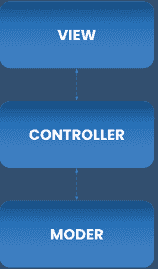

图 5.1：MVC 的表示

为了扩展这一概念，DDD 引入了四个不同层的想法，建议将系统分为四层，每层负责一个特定的区块：

- **表现层 (Presentation layer)**：负责向用户展示系统并处理他们的交互。它可以是 Web 页面、移动应用、桌面应用程序或任何其他用户界面表单。用户界面层应该是轻量且简单的，将大多数逻辑和功能委托给应用层。
- **应用层 (Application layer)**：协调系统的动作和工作流。它在用户界面和领域层之间进行调解，编排系统支持的用例和场景。这一层应保持轻量且无状态，只持有特定于应用的逻辑。
- **领域层 (Domain layer)**：系统的核心，实现本质的业务逻辑和规则。它容了领域模型，封装了实体（entities）、值对象（value objects）、聚合（aggregates）、服务以及以领域为中心的组件。领域层是 DDD 发光的地方，因为它关注业务问题的核心，允许模型随着业务需求的增长而自然演进。
- **基础设施层 (Infrastructure layer)**：提供系统所需的技术服务和外部组件，如数据库、消息中间件和 API。这一层应该是通用且自适应的，为高层提供支持而不会与它们形成紧密耦合。

> 注意：领域层与表现层隔离，基础设施层也是隔离的。尽管这种分离允许组件独立地替换或升级，但重要的是，在实践中，这种可能会在某些场景可能会可能会破坏，例如，领域实体被标记了基础设施特定的细节（例如 `JPA` 注解）。虽然遵循书籍建议是理想的，但架构涉及基于上下文的权衡。

图 5.2 展示了这些层如何协同工作的表示：

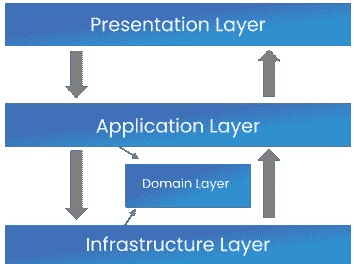

图 5.2：DDD 层的表示

在组织这些层时，常见的选择是单体应用，即单一统一的软件应用程序，它是自包含且独立于其他应用的。选择单体架构通常是因为它的简单性，在单个组件中处理所有事务可以减少部署、持续集成/持续交付或部署（`CI/CD`）流水线、日志等的复杂性。然而，单体架构的可扩展性（特别是团队的可扩展性）可能会面临挑战。例如，让成千上万名开发者在同一个仓库中工作会导致代码审查、合并和变基出现瓶颈，从而使协作效率低下。

尽管如此，单体并不是一种过时的架构选择。当设计得当时，单体架构可以是可扩展且可维护的。甚至存在一些变体，例如分布式单体和模块化单体。关键在于组织应用程序内部的层和模块，以防止被称为“大泥球”的常见陷阱，即代码变得错综且难以管理。

下图展示了两种模块化单体方法，其中单体内部的边界有助于维护秩序并防止代码腐化。分层单体将应用程序组织成不同的层，例如表示层、应用层、领域层和基础设施层，每一层负责系统的特定方面。这种结构实现了清晰的关注点分离，使得系统更容易理解和维护。相比之下，模块化单体更进一步，在单体内部引入了内部边界，将相关功能分组到模块中，这些模块可以在保留在同一代码库的同时进行独立演进。这种模块化方法允许团队工作更高效，同时减少了代码纠缠的风险。

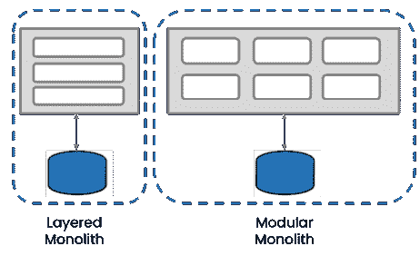

图 5.3：分层和模块化单体的架构表示表示

为了演示这种方法的应用，我们将使用分层结构创建一个作为单体应用的酒店管理系统，并采用 DDD 原来处理酒店房间预订。我们的第一步是识别领域的战略部分，该部分围绕房间可用性和预订展开。在本书中，我们还将触及如何使用故事技巧从专家那里提取领域知识，我们将在后面的章节中对此进行详细介绍。现在，至关重要的是理解几个塑造我们方法的关键点，如下：

- 酒店领域的核心围绕房间及其可用性展开。
- 只有在房间可用时，客人才能办理入住。
- 房间可用性与支付直接挂钩。
- 退房后，房间必须进行清洁并供下一位客人使用。

我们的目标是让 `Java SE` 尽可能简单且与平台无关。我们不会实现每个功能或集成外部服务。然而，我们将清楚地解释此系统如何适配 `Spring` 和 `Jakarta EE` 等更复杂的环境，特别是在 `Jakarta` 和 `MicroProfile` 生态系统中，使用如 `Quarkus` 和 `Helidon` 等提供程序。这种方法将让你深入地理解如何在各种 Java 上文中有效应用应用 DDD 原则。

我们还将集成 `jMolecules` 来清晰地定义架构中的 DDD 分层和组件，确保设计的不同方面（如实体和值对象）被显式地表示。此外，我们将利用 `MapStruct` 进行领域与其他层之间的转换，我们稍后会详细介绍这一点。

## 创建领域层并组织包

在构建 Java 项目结构时，通常会围绕包的组织产生讨论，特别是按层包（package by layer）和按功能包（package by feature）之间的争论。由于我们应用 DDD，强烈建议按功能组织包。这使代码库与领域模型对齐，并便于以后将领域的部分提取到单独的组件或微服务，我们将在后续章节中探讨这一主题。

我们在应用分层方面的第一个实际步骤是创建一个 `package-info.java` 文件。该文件将作为包的元数据，提供重要的上下文信息。此外，我们应用来自 `jMolecules` 的 `@DomainLayer` 注解将此包标记为领域层的一部分，如下：

```java
/**
* 此包包含代表酒店
* 预订边界上下文（bounded context）领域模型的类。*/

@DomainLayer
package expert.os.books.ddd.chapter04.hotels;

import org.jmolecules.architecture.layered.DomainLayer;
```

我们领域的核心是 `Room` 概念。为了本章简单起见，我们将客人表示为一个值对象，因为重点不在于支付完成后的客人详细信息。这种极简的方法允许我们专注于房间在酒店内的生命周期，而不会使设计过度复杂。以下代码定义了 `Room` 实体和 `Guest` 值对象。示例中，只有 `Room` 拥有身份标识，由其房间号表示，房间号在酒店系统中自然地充当唯一标识符。

```java
import org.jmolecules.ddd.annotation.ValueObject;
import org.jmolecules.ddd.annotation.Entity;

@ValueObject
public record Guest(String documentNumber, String name) {

}

@Entity
public class Room {
    static final Guest EMPTY_GUEST = new Guest("0", "EMPTY");

    @Identity
    private int number;

    private Guest guest;

    public int getNumber() {
        return number;
    }

    public Guest getGuest() {
        return guest;
    }

    public void setGuest(Guest guest) {
        this.guest = guest;
    }

    public void cleanRoom() {
        this.guest = EMPTY_GUEST;
    }

    public Room(int number, Guest guest) {
        this.number = number;
        this.guest = guest;
    }
}
```

在这里，`Room` 类作为具有唯一标识符 `number` 的实体存在，而 `Guest` 类是包含基本客人信息（如 `documentNumber` 和 `name`）的值对象。`Room` 实体维护房间的状态及其当前客人。在客人退房后，将调用 `cleanRoom()` 方法，重置房间状态并通过分配 `EMPTY_GUEST` 值对象将其标记为可用。该方法为管理房间可用性提供了一种简单的机制，这是我们领域的核心概念。

这种分层方法不仅围绕领域的核心元素组织代码，而且遵循了 DDD 最佳实践，确保我们在构建更多系统组件时，业务逻辑保持整洁、隔离且可扩展。

下一步，我们将介绍存储库（repository），正如在上一章关于 DDD 策略中提到的，它代表一个集合，并以领域为中心的方式处理存储交互。数据访问对象（DAO）与 DDD 存储库的关键区别在于它们的关注点。`DAO` 侧重于数据，关注增、查、改、删（CRUD）操作；而 DDD 存储库以领域为中心，利用领域的通用语言（Ubiquitous Language）为存储操作提供更自然、更面向业务的接口。

判断项目使用的是 `DAO` 还是 DDD 存储库模式的最简单方法是检查方法名。`DAO` 方法通常围绕数据库操作，如 `insert`、`update` 和 `delete`。相比之下，DDD 存储库将具有与业务领域对齐的方法。例如，在租车系统中，与其使用 `insert` 或 `delete`，存储库可能有 `park`（停车）或 `unpark`（还车）等方法。这种术语的变化反映了领域语言，并表明存储库是作为领域层的一部分而非仅仅是技术数据访问层。

我们的酒店管理系统通过 `Hotel` 实现了存储库。我们也可以将其命名为 `RoomRepository`，这在许多 Java 项目中很常见。尽管如此，`Hotel` 的语义选择专注于领域及其业务逻辑，而非底层存储操作。这种区别很重要，因为领域应该驱动整个系统使用的术语。如下面代码所示：

```java
import org.jmolecules.ddd.annotation.Repository;
import java.util.Optional;

@Repository
public interface Hotel {
    Room checkIn(Room room);
    void checkOut(Room room);
    Optional<Room> reservation(String number);
    Long countBy();
    Optional<Room> findEmptyRoom();
}
```

在此存储库接口中，我们看到了以领域为中心的方法，如 `checkIn`、`checkOut` 和 `reservation`。这些方法与酒店业务保持一致，抽象了数据操作的技术细节，转而关注酒店在现实世界中的行为。例如，`checkIn` 代表将客人分配到房间，而 `reservation` 则允许我们通过房号预订特定的房间。


我们将探索的下一个类是 `HotelService`，它负责协调存储库与其他服务之间的交互。它遵循 SOLID 原则，特别是单责任原则。通过将某些逻辑排除在实体之外，该服务类处理复杂的工作流，例如检查可用性、处理支付以及确保房间在退房后得到妥善清洁。

`HotelService` 处理客人入住和退房的关键流程，确保客人在办理入住前完成支付，并与 `PaymentService` 交互以完成交易。该服务方法封装了 `Room` 实体不应负责的业务逻辑，保持了关注点的整洁分离。需要注意的是，酒店服务在协调任务时也充当了应用层的角色，但它们本身并不定义业务规则。它负责协调领域对象与外部服务之间的交互。以下是一个简单的示例，在这种情况下，混合这些层是有意义的，但当项目变大时，你可以对层进行隔离：

```java
@Service
public class HotelService {

    private final Hotel hotel;

    private final PaymentService paymentService;

    public HotelService(Hotel hotel, PaymentService paymentService) {
        this.hotel = hotel;
        this.paymentService = paymentService;
    }

    public Room checkIn(Guest guest) {
        if (hotel.countBy() >= 100) {
            throw new IllegalStateException("Hotel is full");
        }
        var emptyRoom = hotel.findEmptyRoom().orElseThrow(() -> new
        IllegalStateException("No empty room"));
        paymentService.pay(guest);
        emptyRoom.setGuest(guest);
        return hotel.checkIn(emptyRoom);
    }

    public void checkOut(Room room) {
        Objects.requireNonNull(room, "Room is required");
        room.cleanRoom();
        hotel.checkOut(room);
    }

    public Optional<Room> reservation(String number) {
        return hotel.reservation(number);
    }
}
```

在这个 `HotelService` 类中，`checkIn` 方法验证是否有空房，并与 `PaymentService` 交互以在完成入住前处理客人的支付。`checkOut` 方法确保在客人退房后房间被清洁并恢复到可用状态。这些操作在服务层中进行协调，以保持领域实体仅关注核心业务规则。

最后，我们定义了 `PaymentService` 接口，它如下处理与支付流程的交互：

```java
@Service
public interface PaymentService {
    void pay(Guest guest);
}
```

`PaymentService` 抽象了支付的 own 方式，确保 `HotelService` 能够专注于入住和退房流程，而不会被支付逻辑所困。这使得系统保持模块化且更容易维护，因为不同的服务可以独立演进。

这种结构展示了如何实现一个清晰且模块化的领域模型，其中存储库处理持久化逻辑，而服务在遵循 DDD 原则的同时协调复杂的业务流程。

### 创建应用层

在完成领域层之后，下一步是应用层，它协调业务流的执行，而不嵌入业务规则本身。相反，它利用领域层来实现其目标。应用层负责协调工作流（这些工作流可能跨多个系统或边界上下文），并可以跟踪这些工作流的进度。

如之前提到的，`HotelService` 类承担这种协调角色，将领域逻辑暴露给表示层。在某些情况下，可能需要进一步划分职责，创建一个类来处理领域逻辑，创建另一个类来与表示层交互（例如用例）。这种划分是整洁架构（Clean Architecture）的概念，我们稍后会介绍。这种职责划分有助于防止类承担过多的角色，提高可测试性，并遵循单责任原则。然而，过早分离可能会使代码结构过于复杂，因此根据项目的复杂度找到平衡至关重要。

下一层是用户界面（表示）层，它处理来自用户或其他系统的外部请求。例如，在 Web 应用程序中，控制器的主要作用是管理传入的 HTTP 请求并将其转换为应用层可以处理的命令或查询。这一层的设计应该是将领域与用户交互隔离开，确保不会意外违反领域规则。

实现这种隔离的良好策略是使用数据传输对象（DTOs），它们作为用户界面和领域之间的中间媒介。DTO 封装了数据并保证领域实体不会直接暴露给外部世界。DTO 的术语可能随架构而异，例如 REST API 中的 `RoomRequest` 和 `RoomResponse`，或者 Jakarta Server Faces (JSF) 中的 `RoomBean`。使用 DTO 还允许我们通过排除不应暴露的字段来安全地处理敏感信息。例如，`GuestDTO` 可能会省略密码等敏感数据，你不需要这个字段，只需保留在实体中。

在我们的项目中，我们通过利用 Java records 采用了不可变 DTO，这使得我们的 DTO 简单整洁，同时确保了不可变性。以下是我们的 `GuestDTO` 和 `RoomDTO` 示例：

```java
public record GuestDTO(String documentNumber, String name) {
}

public record RoomDTO(int number, GuestDTO guest) {
}
```

### 创建控制器层

下一个部分是控制器，它作为表示层和应用层之间的桥梁。它确保领域与 DTO 直接交互，反之亦然，通过这种转换层维持层之间的隔离。控制器可以实现为 REST 资源或其他任何用户界面网关，其主要目的是暴露应用服务，同时保持领域逻辑与表示关注解耦。参考以下代码：

```java
// 暴露应用服务的控制器或资源
public class HotelController {

    private final HotelService hotelService;

    private final HotelMapper hotelMapper;

    public HotelController(HotelService hotelService, HotelMapper hotelMapper)
    {
        this.hotelService = hotelService;
        this.hotelMapper = hotelMapper;
    }

    public RoomDTO checkInRoom(GuestDTO guestDTO) {
        var guest = hotelMapper.toEntity(guestDTO);
        Room room = hotelService.checkIn(guest);
        return hotelMapper.toDTO(room);
    }

    public void checkOutRoom(RoomDTO roomDTO) {
        var room = hotelMapper.toEntity(roomDTO);
        hotelService.checkOut(room);
    }
}
```

需要注意的是，即使使用像 `MapStruct` 这样的映射框架，重命名领域对象或 DTO 中的字段也可能静默地破坏映射器。因此，为这一层编写测试至关重要，以确保重构不会引入问题。以下是使用 `MapStruct` 实现的 `HotelMapper` 接口。虽然这是一个简单的 Java SE 实现，但它可以很容易被定义为 Spring 或上下文与依赖注入（CDI）组件，从而能够与 Spring 和 Jakarta EE 等平台无缝集成。

```java
@Mapper
public interface HotelMapper {
    HotelMapper INSTANCE = Mappers.getMapper(HotelMapper.class);
    RoomDTO toDTO(Room room);
    Room toEntity(RoomDTO roomDTO);
    GuestDTO toDTO(Guest guest);
    Guest toEntity(GuestDTO guestDTO);
}
```

尽管 `HotelMapper` 类可以被归类为支持组件，但在这种语文中，我们将其视为应用层的一部分，因为它促进了表示层和领域层之间的交互。

### 创建基础设施层

我们在这里讨论的最后一层是基础设施层，它为所有其他层提供技术支持，例如持久化、消息处理或安全性。这一层提供了实现应用业务逻辑并促进其交互所需的各种能力。

除了 `HotelMapper` 之外，基础设施支持另一个例子是 `PaymentService` 的实现，它使用 `CreditCard` 类处理支付。基础设施层可能还会实现 `Hotel` 仓库，用于存储或检索房间数据。以下是 `CreditCard` 类和基于内存的 `Hotel` 仓库的简单示例：

```java
public class CreditCard implements PaymentService {
    private static final Logger LOGGER = Logger.getLogger(CreditCard.class.getName());

    @Override
    public void pay(Guest guest) {
        LOGGER.info("Payment with credit card: " + guest);
    }
}

public class MemoryHotel implements Hotel {
    // 实现类不在本书的范围内
}
```

`CreditCard` 类通过记录带有访客详情的支付日志来模拟支付过程，展示了基础设施层如何与领域交互以支持业务操作。`MemoryHotel` 类提供了 `Hotel` 仓库的简单内存实现以供演示。然而，在现实世界应用中，它可能会与数据库或外部系统交互。

通过这种结构，我们完成了对构建一个分层、领域驱动系统的基础性回顾，并在领域、应用、表示和基础设施层之间实现了清晰的关注分离。每一层都有其独特的用途，它们之间的隔离确保了系统随着演进而具有的可维护性、可扩展性和可测试性。

我们的项目已经完成。使用 DDD 构建单体应用可以确保结构组织良好且易于维护，每个层都有明确的职责。这种方法通过将领域逻辑与应用的的技术关注点分离，简化了复杂系统的开发。现在我们已经探索了 DDD 如何在单体架构中工作，我们将重点关注在微服务架构中应用这些原则，在微服务架构中，分布式系统和服务边界等额外挑战也随之而来。

### 微服务架构中的 DDD

在考虑软件架构时，单体系统在很多情况下仍然是一个有效且行的解决方案。然而，每一个架构决策都涉及权衡，特别是在扩展性方面。单体架构面临的主要挑战之一是团队扩展性。在单个仓库中协调成千上万名开发者会导致巨大的开销，因为时间通常花费在管理合并、变基（rebase）和解决冲突上。此外，随着项目的增长，单体应用的启动时间会增加，特别是在基于 Java 的反射框架中，更大的代码库需要更多时间来扫描和初始化。

这就是微服务发挥用场的地方。微服务架构将应用程序拆分为更小的、自包含的服务，允许团队在不同的系统部分上独立工作。这种分而治的方法与 DDD 非常契合，因为 DDD 帮助定义清晰的领域边界，而这些边界边界自然地适合被分离为微服务。通过微服务，你可以隔离系统的最关键部分（如核心业务逻辑），并更高效地分配资源，为独立扩展特定服务提供灵活性。请参考下表进行详细分析：

| 方面 | 单体架构 | 微服务架构 |
| :--- | :--- | :--- |
| 团队扩展性 | 由于共享代码库，难以在大规模团队中扩展 | 更容易扩展团队，因为每个服务可以由较小的团队拥有 |
| 启动时间 | 随着应用增长，由于反射和类扫描，启动速度变慢 | 由于服务较小且独立，启动速度更快 |
| 部署 | 单一部署单元，大型系统的部署较慢 | 服务独立部署，实现更快速的更新 |
| 系统复杂性 | 初始复杂度较低，但可能会变成一团大泥球 | 由于分布式特性，初始复杂度较高 |
| 通信 | 同一进程内组件之间的直接方法调用 | 需要网络通信（例如 HTTP、gRPC），引入了延迟 |
| 扩展 | 整个系统扩展，即使只有一个部分需要更多资源 | 单个服务可以被独立扩展 |

表 5.1：微服务和单体架构面临的挑战

随着软件系统复杂性的增加，管理业务领域变得越来越具有挑战性，特别在大规模分布式架构中。DDD 为业务领域建模提供了一种战略性方法，这自然地补充了微服务架构。组织通过将 DDD 原则与微服务对齐，可以将复杂系统拆分为更小、更易管理的组件，允许独立开发和部署。

DDD 与微服务之间的协同作用创建了一个镜像业务的灵活、可扩展的结构。DDD 和微服务能够自然契合的原因有以下几点：

- **限界上下文（Bounded contexts）**：在 DDD 中，每个限界上下文为业务逻辑的特定部分定义了清晰的边界。这些上下文可以实现为独立的微服务，确保每个服务专注于特定的领域。
- **自主性（Autonomy）**：微服务允许系统的每个部分独立演进，使得更容易适应不断变化的业务需求，而不影响整个系统。
- **解耦团队（Decoupled teams）**：DDD 鼓励专注于特定领域的自主团队。微服务通过允许团队在独立服务上工作，而无需跨整个应用程序协调更改，从而契合了这一点。
- **业务逻辑扩展（Scaling business logic）**：通过隔离领域，你可以为需要高性能的核心核心业务服务（如支付处理）分配更强大的资源，而不影响系统的其他部分。
- **关注点分离**：每个微服务负责领域的特定部分，降低了单个服务内部的复杂性并提高了可维护性。
- **独立演进**：每个微服务都可以按照自己的节奏进行演进，允许系统的不同部分进行更新或替换，而不影响其他服务。
- **更好的资源分配**：可以高效地分配资源，专注于系统最关键的部分，而无需扩展整个单体应用。

例如，在我们的案例中，考虑一个 `PaymentService`，它最初处理信用卡支付，后来扩展到支持如 `Stripe`、`PayPal` 等第三方提供商。通过将此功能拆分为专用的微服务，我们可以对其进行独立扩展，并添加新的支付提供商，而不会影响系统的其他部分。

虽然微服务在结合 `DDD` 使用时具有明确的优势，但它们也存在固有的挑战，可能会使系统设计和运行复杂化。管理多个独立的服务引入了分布式复杂性，使得维护数据一致性和处理服务间通信变得更具挑战。由于每个服务都需要监控、日志记录和维护，运营开销随之增加。识别并解决这些挑战对于确保向微服务的迁移不会引入比解决的问题更多的问题至关重要。尽管具有这些优势，微服务也面临以下挑战：

- **分布式复杂性**：微服务通过将系统分布在多个服务中引入新层级的复杂性。这可能导致网络延迟、服务发现和通信失败等问题。
- **数据一致性**：在多个服务之间确保数据一致性比在单体系统中困难。分布式事务和最终一致性模型会引入复杂性。
- **运营开销**：管理多个服务增加了运营开销，因为每个服务都需要独立的监控、日志记录和维护。
- **服务间通信**：与单体应用中组件通过进程方法调用进行通信不同，微服务需要基于网络的通信（`HTTP`、`gRPC`），这引入了延迟、复杂性和潜在故障。

谈到微服务时，我们可以发现这种架构能力是演进式架构的自然选择。尽管单体架构在某些情况下仍然有效，但有时将其转换为微服务是有意义的。`DDD` 的核心优势之一是它关注围绕领域本身来组织软件。在探索 `DDD` 时，类主要是按照按功能分包（package-by-feature）的结构组织的，每个功能都充当一个领域，团队自然会创建与业务对齐的边界，从而在时机成熟时向微服务的迁移更加无缝。


```text
com.example.hotel.domain

├── reservation
│   ├── model
│   │   ├── Guest.java // Value Object
│   │   ├── Room.java // Entity
│   │   └── ReservationStatus.java // Enum or status value
│   ├── service
│   │   └── ReservationService.java // Domain service
│   ├── event
│   │   └── RoomReservedEvent.java // Domain event
│   └── repository
│       └── Hotel.java // DDD Repository interface

├── payment
│   ├── model
│   │   └── PaymentMethod.java // Value Object
│   ├── service
│   │   └── PaymentService.java // Domain service interface
│   ├── event
│   │   └── PaymentConfirmedEvent.java
│   └── exception
│       └── PaymentDeclinedException.java

└── shared
    ├── exception
    │   └── BusinessException.java
    ├── event
    │   └── DomainEvent.java // Marker or base class/interface
    └── util
        └── RoomNumberValidator.java
```

一个实用的进展是从传统的单体应用开始，逐渐演变为模块化单体。在这个阶段，不同的功能或子领域被隔离到不同的模块中。这种中间结构有助于明确职责、定义集成点并巩固团队对领域的理解。一旦模块之间的边界稳定，并且在业务或技术上需要更大的独立性（例如为了扩展、团队自主性或部署灵活性），这些模块就可以转换为单独的微服务。

这种转变通常会导致发现并实现明确的边界上下文（bounded contexts），每个微服务封装了业务的特定子领域。例如，考虑一个酒店系统；预订和支付子领域之间可能会出现清晰的划分。其中任何一个都可以进一步发展为自己的边界上下文，能够作为微服务被单独开发和部署。这增强了业务目标与技术架构之间的关系，提高了系统相对于组织的可扩展性。

因此，微服务提供了许多优势，特别是在与 `DDD` 结合时，但它们也引入了复杂性和运营挑战。因此，在迁移之前，仔细评估系统是否真的受益于微服务是必要的。在下一节中，我们将探讨微服务的需求，并帮助评估这种架构是否适用于某个项目。

## 微服务的需求

微服务最近获得了巨大的流行，通常被推崇为构建可扩展、可维护系统的首选方案。然而，与任何架构选择一样，微服务也带有权衡。虽然它们可以提供明确的益处，但它们并不是万能的解决方案，仔细评估它们是否适合你的项目至关重要。

微服务著名作家 Sam Newman 在他的书籍《Building Microservices: Designing Fine-Grained Systems》和《Monolith to Microservices: Evolutionary Patterns to Transform Your Monolith》中分享了这一观点。Newman 强调，微服务并不意味着是应用程序或初创企业的最佳起点。相反，从单体应用开始可能是一个更务实的选择，使项目在早期阶段保持简单。微服务需要稳健的基础设施、自动化和可观测性流程，这些在早期就会引入显著的复杂性。

例如，如果你还没有自动化部署流水线，微服务可能会变得繁琐，因为每个服务都需要自己的部署过程。同样，可观测性在微服务架构中至关重要。在没有适当的日志记录和追踪的情况下，跨分布式服务识别问题可能会非常耗时且容易出错，特别是在调试涉及多个服务的请求时。这可能需要登录多台机器并手动跟踪请求流，这项任务在时间压力下会变成一场噩梦。

在跳入微服务之前，从单体架构开始是可以的，仅当系统的复杂性和规模确实需要时再拆分为微服务。这种演进的方法允许你的系统在增长的同时，在早期阶段保持可控性，如下表所示：

| 场景 | 何时使用单体架构 | 何时使用微服务 |
| :--- | :--- | :--- |
| 团队规模 | 可以容易协作的小型团队 | 需要独立处理系统部分的大型团队 |
| 系统复杂度 | 业务需求简单的低复杂度 | 不同领域需要独立演进的高复杂度系统 |
| 部署自动化 | 无自动化或仅极少 CI/CD 流程 | 已建立全自动的 CI/CD 流水线 |
| 扩展需求 | 全局范围扩展即可 | 特定服务需要独立扩展 |
| 可观测性 | 对分布式日志和追踪的需求较少 | 对日志记录、追踪和可观测性有强烈需求 |
| 市场上市时间 | 需要快速交付，且不想管理多个服务的开销 | 可以负担早期投入于多个服务的设置和管理的成本 |

表 5.2：何时使用微服务以及何时使用单体架构

微服务可以是一种极佳的架构选择，但仅适用于正确的语境。如果你的团队规模较小、业务领域简单，或者你尚未拥有稳健的自动化和监控工具，那么继续使用单体架构可能更好，直到你的系统需要微服务提供的灵活性和扩展性。

软件架构除了单体与微服务这种简单的二元对立之外，还有许多值得探索的内容。分布式系统涵盖了许多模式、挑战和技术，远超这两种方法的范畴。在下一节中，我们将深入探讨在分布式系统中应用 `DDD`，探索 `DDD` 原则如何指导复杂分布式系统的架构，以及在这种更广泛的背景下还需要考虑哪些额外的因素。

## 在分布式系统中应用 `DDD`

在思考分布式系统时，`DDD` 在单体架构或微服务架构以及各种其他系统架构中都起着至关重要的作用。分布式系统超越了单体与微服务的传统二元对立，`DDD` 提供了宝贵的工具来组织这些更现代、更多样的分布模式中的复杂领域。

在事件驱动架构中（例如使用 `Kafka` 或 `RabbitMQ` 等消息中间件构建的系统），设计重点在于事件触发业务流程并允许服务进行异步通信。这种方法在分布式系统中特别有价值，因为解耦对于扩展性和韧性至关重要。

`DDD` 还强调在系统内部使用领域事件，即使在单体或模块化单体架构中也是如此。这些事件代表了业务中的重大发生，并能够在无紧密耦合的情况下促进组件间的通信，从而实现更好的关注点分离。

无论事件是发送到外部系统还是在内部管理，强调领域事件有助于捕捉与领域相关的本质操作和反应。通过清晰定义哪些事件是重要的以及它们如何在边界上下文（bounded contexts）或模块中传播，`DDD` 确保了即使在复杂的分布式架构中，业务逻辑也能保持一致性。

类似的对齐也发生在 `Serverless`（无服务器）架构中，系统被分解为由特定事件触发的小型无状态函数。`Serverless` 非常适用于需要动态扩展性（系统在不使用时缩减至零）和成本效益的场景。`Serverless` 非常适合提供季节性类型用例的服务，因为它可以在用户需求增加时处理操作，并在需求降低时通过减少活跃服务来适应。`DDD` 通过确保每个函数都与特定的领域操作绑定，帮助保持对领域的关注。与其将函数视为技术代码单元，不如 `DDD` 鼓励将它们视为业务操作。每个函数在领域语言中执行一个单一的、有意义的任务。`DDD` 在这种模型中的清晰性确保了即使当扩展性和基础设施管理等基础设施关注点退到背景时，系统仍然保持对业务逻辑的关注。

在云原生架构中，扩展和管理韧性的能力至关重要。这些应用程序被设计为模块化，运行在可以处理波动需求的容器化平台上。在这里，`DDD` 提供了一种强大的方法，在基础设施演进和扩展时保持核心业务逻辑的完整性。`DDD` 对边界上下文（代表特定业务区域的系统部分）的关注，确保了每个云原生服务都有明确的职责，并且可以独立演进而不影响整个系统。即使基础设施动态变化以满足性能需求，领域逻辑仍然保持稳健，允许企业专注于交付价值，而不是管理分布式服务扩展的复杂性。

区分**架构风格**（architectural styles）和**架构模式**（architectural patterns）是非常重要的。前者描述分布式系统的整体结构，而后者指导单个应用程序的内部结构。风格的示例包括事件驱动架构、面向服务的架构（`SOA`）和 `Serverless` 设计。这些风格决定了多个服务或应用程序在更广泛的解决方案内部如何交互、通信和扩展。它们影响整个系统的组成和跨环境的部署，通常涉及异步通信、编排或基础设施层面的考虑。

相比之下，架构模式（如单体、微服务和六边形架构，也称为端口和适配器架构）关注单个应用程序的内部结构。例如，六边形架构强调业务领域与外部接口（如数据库、消息系统或 Web 控制器）之间的关注点分离。在该模式中，领域处于核心，并与技术细节隔离开，允许独立演进。`DDD` 与这种结构契合得很好，因为它强调了分离业务逻辑和清晰定义领域边界的重要性。这种分离在线分布式系统中特别有价值，因为它有助于在技术和接口发生变化时维持一致的领域模型。

最后，许多现代系统采用了混合架构，结合不同的方法以适应特定需求。例如，一个系统可能对核心业务领域使用微服务，但依赖 `Serverless` 函数处理辅助服务，或使用事件驱动模式来促进组件间的通信。`DDD` 确保即使技术实现涉及多种架构模式，领域模型也保持一致。边界上下文有助于定义系统的哪部分负责什么职责，确保无论底层基础设施如何构建，领域逻辑都是清晰的。

尽管这些架构是分布式且多样化的，但从应用 `DDD` 原则来维护整个系统的清晰度和一致性中受益匪浅。虽然领域建模至关重要，但 `DDD` 的实际价值在于它如何影响团队结构、通信路径和系统边界。通过清晰地定义边界上下文，`DDD` 帮助软件组件与组织的业务能力对齐，使团队能够专注于特定领域。这种对齐简化了协调，减少了团队之间的依赖，并培养了更加自主且有效的小组，每个小组专注于业务中一个定义良好的领域。

`DDD` 在决定何时以及如何开发新的微服务方面也起着战略作用。团队不必根据技术边界过早提取服务，而是可以根据良好的领域边界及其交互模式来做出这些决策。当服务之间需要进行通信时，`DDD` 促进使用有意义的、领域驱动的 API 合约，这些契约在反映共享通用语言（Ubiquitous Language）的同时，尊重每个子域的本地语言。这种清晰性增强了跨团队协作，改进了跨服务边界的治理，并为分布式协调模式（如 `Saga pattern`）奠定了坚实基础。

当我们结束对将 `DDD`（领域驱动设计）应用于分布式系统的探索时，必须记住，随着系统的演变，你可能会遇到不符合 `DDD` 原则的遗留代码。重构这些系统以适应 `DDD` 方法通常是必要的，以保持你的架构的可维护性和面向未来的适应能力。在接下来的章节中，我们将探索如何重构遗留代码以符合 `DDD` 原则，并在不偏离核心业务目标的前提下实现系统现代化。

# 重构遗留代码以符合 `DDD` 原则

在理想的世界里，我们总是能够从零开始，根据最新的最佳实践和架构原则来设计我们的系统。然而，我们中的大多数人都在与现有系统工作，这些系统往往深层嵌入了遗留代码。这对于企业的核心系统尤为如此，这些系统已经运行了多年，可能无法反映软件架构的最新理念。`DDD` 为这些系统的现代化提供了一种方法，但这需要一种深思熟虑且审慎的重构方法。

这一过程中最关键的元素之一是必须制定一套健壮的遗留现代化策略。重构不仅仅是为了改进代码库，更是在保持系统运行的同时，提高其可维护性、可扩展性以及与业务目标的一致性。这种平衡至关重要，因为在大多数情况下，你必须在进行大规模改造的同时维持业务运行。代码必须继续工作，而你又缓慢、小心地将其转换，以更好地反映领域和 `DDD` 原则。

在重构时，考虑人为因素至关重要。多年来维护系统的开发者可能已经习惯了现有的代码库，无论这些代码是多么错乱或低效。重大的重构可能会破坏工作流并影响团队士气。某些开发者可能会抵制这些变化，特别是当他们已经精通当前系统时。克服这一挑战的方法之一是引入架构决策记录（`ADR`）的概念，这种文档可以帮助说明架构变更背后的原因，概述拟议重构的益处和影响。通过数据和清晰的未来路线展示重构背后的逻辑，可以帮助阐明优势并向团队证明他们的顾虑得到了考虑，从而赢得开发团队的支持。

一旦你让团队在重构的必要性上达成共识，下一步就是与利益相关者进行沟通。重构需要时间，利益相关者可能关注的是即时交付物或新功能。为解决技术债争取时间和空间至关重要。通过解释长期利益（例如提高敏捷性、减少错误和提高可扩展性），你可以帮助利益相关者看到这项投资的价值。就处理技术债的时间表或频率达成一致是至关重要的，以便使其成为项目持续流程的一部分，而不是一次性的努力。

从技术上讲，重构遗留代码的第一也是最关键的一步是确保所做的任何更改都不会改变系统的现有行为，特别是在业务逻辑方面。这意味着我们需要通过建立测试来保证更改安全性，从而为行为保持不变提供信心。重构是在不影响功能的情况下改变代码的结构，而测试是维持这种平衡的关键。

遗留系统通常测试覆盖率不足，因此在开始任何重大重构之前，构建一套稳固的测试套件至关重要。一旦代码有了良好的测试覆盖，你就可以开始从小规模、增量的步骤进行重构，采取小步子策略以确保如果出现问题，很容易识别问题并回滚到之前的版本。

一次性引入许多更改会使得追踪错误溯到源头变得极其困难。通过增量式工作，你可以确保任何问题都局限在特定的版本或更改集中，最大限度地减少重构过程中产生新问题的风险。在处理任务关键型代码时，这种缓慢、有条理的方法至关重要。

重构遗留系统的下一个基本步骤是确保你正在修复的问题不会再次出现。如果允许混乱的代码库再次变得混乱，那么清理它就没什么意义了。这就是软件架构治理发挥作用的地方。通过建立规则和约束，你可以防止未来的开发者无意中重新引入你正试图解决的问题。像 `ArchUnit`、`PMD` 和 `Checkstyle` 等工具在这种背景下是非常有价值的。它们允许你在整个项目中执行架构规则、编码标准和最佳实践。例如，如果你的重构部分涉及领域逻辑与基础设施分离，你可以使用 `ArchUnit` 来确保开发者将来不会无意中将基础设施依赖引入领域层。

归结到底，重构遗留代码以符合 `DDD` 原则不仅需要技术努力，它还需要一种包含人为和技术因素的深思熟虑的策略。系统的现代化涉及构建和维护它的人，而不仅仅是代码本身。花时间在开发团队中建立共识、与利益相关者清晰沟通，并创建一个可持续的技术债处理方法至关重要。只有在解决了这些人为因素之后，你才能转向重构的技术挑战。

重构不仅仅是清理技术债，更是为了制定一个与你业务当前需求相符的长期遗留现代化策略。这样做创建了一个基础，允许系统随着行业演进而演进。这意味着不仅要关注代码，还要关注团队文化、利益相关者的预期以及将保持系统持续整洁的治理。

展望未来，在遗留系统中应用 `DDD` 原则通常需要渐进重构，而且它超越了技术层面。现在我们已经探索了如何重构遗留系统，下一步是考虑如何跨整个系统应用这些原则。

## 结论

在本章中，我们探索了 `DDD` 在各种架构风格（从单体系统到分布式系统）中的应用。我们讨论了 `DDD` 原则如何指导有效的软件开发。我们研究了采用微服务时涉及的战略决策，以及如何以一种审慎、结构化的方法重构遗留系统，在确保系统持续运行的同时，使其与 `DDD` 原则对齐。通过解决重构的技术和人为因素，我们为以领域为核心设计的遗留系统现代化奠定了基础。

在继续之后，我们必须考虑如何将 `DDD` 与其他架构模式相结合。在下一章中，我们将探索将 `DDD` 与整洁架构（Clean Architecture）相结合如何为构建可维护、可扩展的系统创建一个强大的框架，确保你的软件随着业务的演进而保持适应性。

## 重点回顾

- `DDD` 不限于微服务和单体架构：它在事件驱动、无服务器、云原生和混合架构中都有价值，因为它确保了业务逻辑的清晰。
- 单体架构仍然是一个选择：它们简化了开发和部署，特别是在自动化和可扩展性要求较低的情况下。
- 微服务带来了复杂性：它们需要强大的基础设施、部署自动化和可观测性才能发挥作用。

# 重构遗留系统

- 重构遗留系统需要策略：必须确保业务的连续性，让团队参与决策，并逐步引入更改以避免中断。
- 人性因素在重构中至关重要：开发者可能抵制变化，利益相关者在投入现代化努力之前需要看到长期收益。
- 小步、增量的重构步骤可以防止风险：一次性更改过多会增加引入难以追踪的 bug 的概率。
- 架构治理可以防止问题反复出现：如 `ArchUnit`、`PMD` 和 `Checkstyle` 等工具有助于执行最佳实践并防止技术债再次出现。
- 边界上下文（Bounded contexts）有助于管理分布式复杂性：它们在微服务和事件驱动架构中定义了清晰的服务边界，确保领域对齐。
- 可观测性对于分布式系统至关重要：如果没有中心化的日志记录和追踪，调试将变得困难且耗时。
- 使用 `DDD` 进行现代化不仅仅是技术上的变更：它是一个持续的过程，需要平衡业务需求、技术改进和团队共识。

## 多选题

1. 在单体架构中使用 `DDD` 的一个关键优势是什么？
   - a. 它简化了微服务之间的通信。
   - b. 它有助于在组织分层时保持对业务逻辑的关注。
   - c. 它增加了外部依赖的数量。
   - d. 它减少了对数据库的需求。

2. 下列哪项最好解释了为什么微服务并不总是最佳选择？
   - a. 微服务降低了架构的灵活性。
   - b. 微服务让系统更难扩展。
   - c. 微服务需要大量的设施和自动化才能进行有效管理。
   - d. 微服务限制了团队添加新功能的能力。

3. 在考虑单体架构中的团队扩展时，主要的挑战是什么？
   - a. 需要更多的数据库。
   - b. 在大型团队中处理代码合并（merges）和变基（rebases）。
   - c. 创建领域事件的复杂性。
   - d. 在多个云提供商上部署系统。

4. 哪个工具可以强制架构约束并防止在重构的遗留系统中重新引入错误？
   - a. `Gradle`
   - b. `ArchUnit`
   - c. `Maven`
   - d. `Jenkins`

5. 为什么在重构遗留代码时采取小步、增量的步骤很重要？
   - a. 避免让开发团队产生不满。
   - b. 确保代码行为不变，并且 bug 可以被轻松识别。
   - c. 尽可能减少一次性提交的代码量。
   - d. 简化数据库迁移。


## 6. DDD 如何使分布式系统中的事件驱动受益？

a. 通过简化数据库事务。

b. 通过定义捕捉有意义业务操作的领域事件并保持对领域逻辑的关注。

c. 通过消除对基础设施代码的需求。

d. 通过增加系统复杂性为了更好的控制。

## 7. 在重构过程中使用 ADR（架构决策记录）的目的是？

a. 记录关于用户界面的决策。

b. 帮助向团队传达架构变更并为其理由提供依据。

c. 追踪部署过程。

d. 减少系统中的类数量。

## 8. DAO 和 DDD Repository（仓库）的关键区别是什么？

a. `DAO` 是领域层的一部分，而仓库是基础设施层的一部分。

b. `DAO` 专注于数据库操作，而 DDD 仓库使用以业务为中心的语言并关注领域。

c. `DAO` 管理领域事件，而仓库处理安全考量。

d. `DAO` 仅用于单体架构，而仓库仅用于微服务。

## 9. 重构遗留代码以符合 DDD 原则的主要关注点是什么？

a. 改变系统的核心功能。

b. 提高系统的性能。

c. 在保持行为不变的同时转换代码结构。

d. 重写整个系统以匹配最新的技术趋势。

## 10. 在重构遗留代码时，哪个人的方面是至关重要的？

a. 说服开发者采用新技术。

b. 管理团队预期并传达变更的原因，通常使用 `ADR` 等工具。

c. 避免对系统架构的任何更改。

d. 确保利益相关者不参与过程。

### 答案

| 题目编号 | 答案选项字母 |
| :--- | :--- |
| 1. | b. |
| 2. | c. |
| 3. | b. |
| 4. | b. |
| 5. | b. |
| 6. | b. |
| 7. | b. |
| 8. | b. |
| 9. | c. |
| 10. | b. |

## 参考文献

1. Newman, Sam. (2020). Should I Use Microservices?
2. Evans, Eric. (2003). Domain-Driven Design: Tackling Complexity in the Heart of Software.

# 第 6 章：将 DDD 与洁洁架构集成

## 引言

可持续系统的设计初就考虑了清晰性和适应性。此外，可以通过结合领域驱动设计（DDD）和洁洁架构（Clean Architecture）来管理复杂性，其中 DDD 驱动由业务逻辑驱动的设计，而洁洁架构支持关注点的分离。它们共同帮助开发者创建灵活且可扩展的解决方案。

本节将探索 DDD 和洁洁架构如何协同工作，以及领域建模与架构实践之间的整合如何支持定义良好的层边界及其随而来的收益。这种探索将帮助读者理解如何使用这两种方法设计能够优雅演进并改变他们工作的软件。

## 结构

在本章中，我们将进一步探讨以下主题：

- 洁洁架构概述
- 将 DDD 与洁洁架构结合
- 为了可维护性构建代码

## 技术要求

以下是本章使用的工具，我们将使用 Java 21 或更高版本以及任何 IDE：

- `Java 21`
- `Git`
- `Maven`
- 任何 IDE

## 目标

本章旨在阐明洁洁架构和 DDD 如何互补以创建可维护、可扩展和适应性强的软件系统。在本章结束时，读者将掌握洁洁架构的原则、依赖规则的重要性，以及如何在领域逻辑与基础设施关注点之间建立清晰分离的结构化软件。此外，他们将学习 DDD 的领域建模如何契合到洁洁架构的分层方法中，确保核心业务规则与外部依赖隔离开，最终构建出更具韧性且可测试的应用程序。

## 洁洁架构概述

洁洁架构是一种软件设计哲学，它使系统的核心业务逻辑独立于任何框架或基础设施。它通过 Robert C. Martin 的书籍《洁洁架构》（Clean Architecture）广为人知，与 Alistair Cockburn 的六边形架构（Hexagonal Architecture）密切对齐。这些方法关注于通过分层设计强制执行关注点分离，创建易于理解、测试和随时间维护的系统，从而让开发者了解这种方法的优势。

洁洁架构的核心思想是依赖的方向；依赖关系始终向内流向业务逻辑，确保包含高层策略的内部层不受外部层（更具体的层）更改的影响。内部层与实现细节（如数据库或用户界面）隔离，这些细节位于最外层。

这种设计创建了一个灵活的系统，外部层（如框架或 UI 库）的变化不会影响核心业务逻辑。

洁洁架构通常将系统划分为四个同心层，每层都有特定的角色：

- **实体 (Entities)**：这些包含企业级的业务规则，是系统中最抽象的部分。你可以将它们视为领域实体，封装了独立于特定应用程序的核心业务逻辑。
- **用例 (Use cases)**：这一层包含了特定应用程序的业务规则。用例实现了应用程序的动作，并应该关注单一职责，与 DDD 所说的应用服务紧密对应。
- **接口适配器 (Interface adapters)**：这一层在用例层和外部系统之间转换数据。它包含了诸如模型-视图-控制器（`MVC`）组件，或用于与外部服务交互的网关实现，确保业务逻辑不受特定于基础设施细节的影响。
- **框架和驱动程序 (Frameworks and drivers)**：最外层，包含数据库、UI 框架或外部 API 等工具。这一层是你实现与外部服务或基础设施进行通信的地方，将其与核心业务逻辑分离开。

下图展示了环形架构：

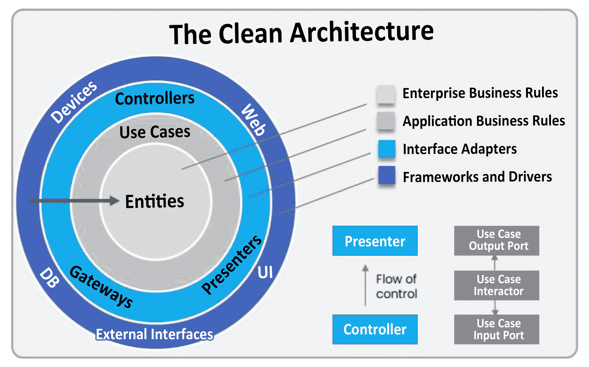

图 6.1：整洁架构插图

依赖规则是该架构的基石：源代码依赖必须指向内部（以同心圆为参考）。这条规则不仅是一项指南，而且是确保架构完整性的基本原则。内层永远不应该感知外层。函数调用、数据格式、数据结构或由外层生成的格式（如数据库模式或 API 响应格式）不应与内层共享。

遵循这一规则可以确保高层策略与低层细节之间的清晰分离，使得适应新技术或不断演变的业务需求变得更加容易，而不需要大量的重写。

虽然同心圆是一个适当的示意图，但整洁架构并不是僵板的。根据项目的复杂性，你可能需要更多或少的层。这种灵活性使你能够根据特定需求定制架构，始终确保遵循依赖规则，并保护核心业务逻辑免受外层产生不必要的耦合。

现在我们已经探索了整洁架构的结构和指导原则，我们可以探索 DDD 如何融入到这种分层方法中。在下一节中，我们将看到如何将 DDD 丰富的建模能力与整洁架构的关注点分离相结合，从而产生具有高度表现力且对变化适应性的软件系统。

## 将 DDD 与整洁架构结合

在研究六形架构和 DDD 时，显而易见的是它们自然地集成，形成了一个健壮且可维护的设计框架。六形架构（也称为端口和适配器）强调核心应用程序与外部系统的分离，这一原则与 DDD 的分层紧密一致。具体来说，DDD 的`领域层 (Domain Layer)`对应于六形中心的核心领域模型。同时，`应用层 (Application Layer)`与协调领域行为的用例或应用服务对应。这种结构上的对应强制了关注点的清晰分离，确保业务规则与用户界面、数据库和其他基础设施组件隔离。

DDD 中的领域层直接对应于六形模型中的`实体 (entities)`和`聚合根 (aggregates)`。这些代表了系统的核心业务逻辑，不受基础设施或特定框架细节的影响。这种清晰的分离确保了领域保持纯洁并聚焦于业务规则，无论外部系统如何变化。

同样，DDD 中的应用层与六形架构中的用例天然契合。用例代表系统的操作，负责协调业务逻辑但不包含它。它们充当领域模型和外部系统之间的中介，处理输入/输出、验证并调用相应的领域服务。

### 使用整洁架构和 DDD 创建定义良好的边界

为了说明这种结合，我们将继续使用上一章的酒店管理背景。此示例将转换为一个六形模型，同时引入 `jMolecules` 框架，特别是 `jmolecules-hexagonal-architecture` 模块。通过利用该模块，我们确保架构遵循清晰的边界，同时保持与 Java 无关，允许灵活地集成到你选择的任何 Java 框架中。

我们将保留 `Room`（房间）作为实体，`Guest`（客客）作为值对象，并将 `Hotel`（酒店）作为管理预订和入住/退房的仓库。然而，我们将显著改变 `HotelService`。

在上一章中，`HotelService` 同时封装了领域逻辑和应用逻辑。虽然这种方法可行，但它混淆了职责，并可能导致违反单一职责原则。整洁架构主张将此类服务拆分为用例，每个类封装了系统必须执行的特定任务的业务逻辑。这种分离不仅提高了可维护性，还增强了可测试性和可重用性。

我们现在不再拥有单一的 `HotelService`，而是有两个不同的用例：一个用于入住，另一个用于退房。这些用例中的每一个封装了一个单一、专注的任务，使代码更容易维护，并确保业务规则得到一致地应用。

`CheckOutUseCase`处理客人的离开酒店的操作。通过在专用的用例中隔离这种行为，我们确保了逻辑是可重用的，并且可以独立测试。

```java
import org.jmolecules.architecture.hexagonal.Application;

@Application
public class CheckOutUseCase {

    private final Hotel hotel;

    public CheckOutUseCase(Hotel hotel) {
        this.hotel = hotel;
    }

    public void checkOut(Room room) {
        if (room == null) {
            throw new IllegalArgumentException("Room cannot be null");
        }
        room.cleanRoom();
        hotel.checkOut(room);
    }
}
```

在这里，`CheckOutUseCase`仅负责退房过程。清理房间和移除客人的领域逻辑通过`Room`实体应用，保持了业务规则的纯洁和隔离。

`CheckInUseCase`协调入住过程，包括检查房间可用性以及通过领域服务处理支付。这种关注点的分离允许用例完全专注于协调工作，同时将领域逻辑委托给适当的服务和实体。

```java
import org.jmolecules.architecture.hexagonal.Application;

@Application
public class CheckInUseCase {

    private final Hotel hotel;
    private final PaymentService paymentService;

    public CheckInUseCase(Hotel hotel, PaymentService paymentService) {
        this.hotel = hotel;
        this.paymentService = paymentService;
    }

    public Room checkIn(Guest guest) {
        if (hotel.countBy() >= 100) {
            throw new IllegalStateException("Hotel is full");
        }
        var emptyRoom = hotel.findEmptyRoom().orElseThrow(() -> new
        IllegalStateException("No empty room available"));
        paymentService.pay(guest); // 将领域逻辑委托给 PaymentService
        emptyRoom.setGuest(guest);
        return hotel.checkIn(emptyRoom);
    }
}
```

**提示**：在示例中，我们使用了 `IllegalStateException`，但在这里你可以探索创建异常层次结构。例如，扩展自 `RuntimeException` 的 `HotelException`，以及扩展自 `HotelException` 的 `HotelFullException`。

在此用例中，办理入住逻辑侧重于业务任务，即确保酒店不会超订、找到空房以及处理支付。支付业务逻辑封装在 `PaymentService` 中，保持了应用层与领域层之间的分的分。

## 在核心应用程序与外部系统之间建立桥梁

将 DDD 与整洁架构（Clean Architecture）结合的下一步是创建在领域模型和外部系统（端口）之间进行翻译的适配器。在这种情况下，我们将使用数据传输对象（DTOs），它们负责在系统边界之间传输数据。这些 DTO 是简单的、不可变的对象，不包含业务逻辑，使它们成为用例与控制器或 API 等外部接口之间交互的理想选择。

在六边形架构中，适配器充当核心应用程序与外部系统之间的桥梁，翻译请求和响应。适配器可以将来自用户界面或 API 的输入转换为领域层理解的命令。在我们的案例中，`GuestDTO`和`RoomDTO`充当适配器，在领域对象（例如 `Guest` 和 `Room`）与外部系统之间进行数据转换。

```java
import org.jmolecules.architecture.hexagonal.Adapter;

@Adapter
public record GuestDTO(String documentNumber, String name) {
}

@Adapter
public record RoomDTO(int number, GuestDTO guest) {
}
```

这些带有 `@Adapter` 注解的 DTO 代表了数据在用例与外部世界之间的流转。它们将内部领域对象（如 `Room` 和 `Guest`）转换为更适合外部系统的格式（如 API、Web 控制器或其他接口），反之亦然。

在六边形模型中，端口（Port）定义了应用程序与外部世界之间的边界。它代表了应用程序暴露给外部系统的接口，例如控制器、API 或其他应用程序。应用程序通过用例与领域交互，而端口将这些用例暴露给外部世界。

在接下来的示例中，我们使用 `HotelController` 作为端口。该控制器是用户交互的入口点，并将业务逻辑委托给相关的用例。

```java
import expert.os.books.ddd.chapter06.hotels.CheckInUseCase;
import expert.os.books.ddd.chapter06.hotels.CheckOutUseCase;
import expert.os.books.ddd.chapter06.hotels.Room;
import org.jmolecules.architecture.hexagonal.Port;

// 这里我们有一个控制器或资源来暴露应用程序
@Port
public class HotelController {
    private final CheckInUseCase checkInUseCase;
    private final CheckOutUseCase checkOutUseCase;
    private final HotelMapper hotelMapper;

    public HotelController(CheckInUseCase checkInUseCase, CheckOutUseCase checkOutUseCase, HotelMapper hotelMapper) {
        this.checkInUseCase = checkInUseCase;
        this.checkOutUseCase = checkOutUseCase;
        this.hotelMapper = hotelMapper;
    }

    public RoomDTO checkInRoom(GuestDTO guestDTO) {
        var guest = hotelMapper.toEntity(guestDTO);
        Room room = checkInUseCase.checkIn(guest);
        return hotelMapper.toDTO(room);
    }

    public void checkOutRoom(RoomDTO roomDTO) {
        var room = hotelMapper.toEntity(roomDTO);
        checkOutUseCase.checkOut(room);
    }
}
```

这种设计确保了领域逻辑保持完好并封装在应用层中，而控制器（端口）负责管理外部交互，而不直接涉及领域实体或逻辑。

因此，以下是我们为了结合 DDD 与整洁架构而创建的所有组件：

- **领域层 (Domain layer)**：
  - `Room`：代表酒店房间的实体。
  - `Guest`：代表顾客的值对象。
  - `Hotel`：管理房间入住、退房和预订的仓库接口。
- **应用层 (Application layer)**：
  - `CheckInUseCase`：处理入住逻辑，确保房间可用性和支付处理。
  - `CheckOutUseCase`：处理退房逻辑，包括房间清洁和更新仓库。
- **适配器 (Adapters)**：
  - `GuestDTO` 和 `RoomDTO`：用于在领域与外部系统之间通信数据的 DTO。
- **端口 (Port)**：


`HotelController`：用户交互入口，将任务委托给相应的用例，并在 DTO 与领域实体之间进行数据映射。

DDD 与六边形架构的结合确保了关注点的清晰分离。核心领域逻辑不受基础设施关注点的影响，系统对于未来的变化保持了灵活性。

下一节将探索如何构建可维护的代码结构，讨论在系统演进过程中确保代码保持整洁、模块化和可扩展的策略。这将有助于确保以最小努力实现更改，同时维护架构的完整性和简单性。

## 为了可维护性而构建代码结构

在上一节中，我们看到了 DDD 原则和整洁架构如何影响用例层。影响最显著的改进是将服务拆分为两个不同的用例，这提供了清晰性和易用性。这种方法使应用程序更易理解，并改进了它的文档记录和可测试性。

然而，定义用例并不总是软件设计的起点。虽然将职责拆分到单个用例中有助于可维护性，但在每种场景下，从这项任务开始并不是强制的。

另一个可能的起点是重构，在有稳健测试套件支持的情况下，重构是软件开发中的一种强大工具。重构允许我们随着系统的演进而调整代码，防止软件腐化（代码质量随时间推移而逐渐下降）。

由于业务和产品的变化反映了市场需求，软件领域是不断万变的。在这种环境中，进行重构以维护代码质量并防止在更改时引入不可管理的复杂性至关重要。必须避免过度工程，因为过早添加过多的层或抽象会导致不必要的复杂性，即使初衷是好的。

因此，正如我们之前做的那样，通常更实用的方法是从既作为服务又是应用层的简单服务开始，只有当服务内部的职责开始分散时，才引入额外的层（如用例）。这种方法确保了清晰性和可维护性，在不过度工程的情况下保持代码库清洁。

并不是所有场景都需要拆分为不同的用例。如果特定的业务逻辑在多个操作中具有共同行为，那么维护一个共享服务可能比将其拆分为用例更有意义。例如，`HotelService` 可以作为 `CheckInUseCase` 和 `CheckOutUseCase` 共享的通用服务，如下代码段所示：

```java
@Application
public class CheckOutUseCase {
    private final Hotel hotel;
    private final HotelService hotelService;
}

@Application
public class CheckInUseCase {
    private final Hotel hotel;
    private final PaymentService paymentService;
    private final HotelService hotelService;
}
```

在这种情况下，`HotelService` 组件可以封装两个用例共享的通用逻辑，减少代码重复并保持可维护性。要决定是否使用整洁架构、DDD 或两者的结合，你需要按照如下理解各者的目的：

- **整洁架构 (Clean Architecture)**：侧重于维护不同系统层（UI、业务规则、数据访问等）之间的独立性。它强调解耦，使核心业务逻辑不受框架或外部库的影响。当你需要系统具有灵活性适应性时，它非常有用。

- **DDD**：它是一种解决复杂业务问题的策略方法。它专注于创建一个表示领域的模型，使用实体（entities）、值对象（value objects）、聚合（aggregates）和仓库（repositories）等构建块。在处理复杂领域并需要业务逻辑与软件设计深度集成时，DDD 非常有用。

在某些情况下，单独使用洁洁架构（Clean Architecture）是合理的。当主要关注解耦不同的应用程序层（如用户界面、数据访问和业务逻辑）时，洁洁架构是确保灵活性和适应性的理想选择。当业务逻辑并不复杂时，洁洁架构同样有效，允许系统保持与框架无关。它非常适合中小型应用，这些领域的复杂性尚不足以完全使用 DDD。

另一方面，当领域复杂性很高时，单独使用 DDD 有优势，因为它需要使用实体、值对象和其他丰富的领域构造来构建详细的业务逻辑模型。在策略性领域建模比解耦系统不同层更重要的场景下，这种方法是有益的。此外，当系统必须根据直接反映在代码中的复杂业务规则进行演进时，DDD 为管理这种复杂性提供了结构化的方法。

将洁洁架构和 DDD 结合起来为更复杂的系统提供了最平衡的解决方案。当系统层解耦很重要，但业务逻辑也很复杂时，这种组合是必要的。它在具有多个边界上下文（bounded contexts）的大型系统中特别有效，其目标是保护核心业务逻辑不受外部依赖的影响，同时通过适当的分层管理应用程序的复杂性。同时使用两者可以确保同时解决维护性和业务逻辑的表达力这两个问题。

### 使用和结合每种方法

我们可以结合这些方法，也可以让它们独立工作。虽然它们结合使用效果更好，但在项目的持续演进过程中，你可以从仅使用 DDD 开始，并在上下文允许合理时添加洁洁架构的分层，如下所示：

- 当解耦和灵活性是主要考虑因素且领域复杂性较低时，使用洁洁架构。

- 当领域复杂性很高且需要详细的业务逻辑建模时，使用 DDD。

- 当你需要在平衡层解耦的同时管理复杂的业务逻辑时，同时使用洁洁架构和 DDD。

下表介绍了这两种方法的视图，说明了何时你可以尝试只使用其中一种，以及最后最佳组合是你可以同时应用两者的情况：

| 维度 | 洁洁架构 | DDD | 何时同时使用 |
| --- | --- | --- | --- |
| 重点 | 解耦系统层（UI、业务规则、数据访问） | 在领域模型中捕捉业务逻辑和复杂性 | 系统层解耦 + 复杂业务领域建模 |
| 核心组件 | 应用程序服务；用例，如编排业务逻辑 | 实体、值对象、仓库、服务 | 用于逻辑编排用例 + 用于核心业务复杂的领域实体 |
| 独立性 | 业务逻辑独立于 UI、数据库/外部系统 | 软件模型对齐、业务领域和规则 | 业务逻辑独立于外部参与者 + 丰富的领域模型 |
| 复杂性 | 适用于简单的业务 | 处理复杂的业务规则、边界上下文和策略建模 | 最适合既需要关注点分离又需要领域建模的大系统 |
| 灵活性 | 高灵活性。易于更换框架、UI 层或数据库 | 低灵活性。专注于准确捕捉领域 | 框架灵活性 + 丰富且准确的领域 |
| 测试 | 孤立的用例，更容易测试 | 自包含的领域实体，可测试的领域逻辑 | 可以同时按层和按功能进行独立测试，支持跨系统的更简单维护和更大扩展性。 |
| 重构 | 由于层解耦易于重构 | 如果领域模型与基础设施紧密耦合，重构可能更困难 | 洁洁架构更易重构，DDD 保护了领域逻辑。 |

表 6.1：DDD vs. 洁洁架构

在选择洁洁架构和 DDD 之间时，没有万能的答案。决定取决于领域的复杂性和对系统灵活性的需求。

从更简单的架构开始并随着系统的增长进行演进，这是一种务实的方法，它允许你在简单性和可维护性之间取得平衡。

## 结论

本章探讨了如何将洁洁架构和 DDD 结合起来以构建可维护的代码结构。我们讨论了将服务拆分为不同的用例如何提高清晰度、简化测试并支持更好的文档。我们还比较了仅有洁洁架构就足够、需要单独使用 DDD 的场景，以及结合这两种方法如何提供处理复杂系统的强大方式。通过将重构考虑在内并仅在需要时应用分层，我们可以确保软件保持适应性和韧性。

在下一章中，我们将重点关注 DDD 数据建模的一个关键方面。我们将详细探索如何设计既能准确反映业务逻辑又能保持灵活性简单性的模型。这包括对聚合、仓库以及 DDD 概念与数据库设计的全面讨论。我们的目标是确保数据层与领域对齐，同时支持高效可扩展的操作。

## 记忆点

- `Clean Architecture`洁洁架构：强制分层结构，依赖关系始终指向内部，保护核心业务逻辑不受外部影响。

- `The dependency rule`依赖规则：确保内层独立于外层，防止特定框架细节影响领域逻辑。

- `Entities layer`实体层：包含企业级业务规则，并在洁洁架构中表示领域模型。

- `Use cases layer`用例层：编排特定特定的逻辑，而不直接实现领域规则，与 DDD 中的应用程序服务对齐。

- `Interface adapters`接口适配器：作为核心逻辑和外部系统之间的桥梁，处理数据转换和通信。

- `Frameworks and drivers layer`框架和驱动层：最外层，包含数据库、API 和 UI 框架等工具，将它们与业务逻辑分离。

- `DDD and Clean Architecture integration`DDD 与洁洁架构的集成：确保业务逻辑保持隔离，同时保持基础设施的灵活和可替换。

- `Hexagonal architecture (ports and adapters)`六角形架构（端口和适配器）：与洁洁架构自然对齐，支持模块化和可测试。

- `Decoupling business logic`解耦业务逻辑：通过分离领域关注点技术细节，允许系统在不进行重大重构的情况下进化。

- `Combining Clean Architecture with DDD`将洁洁架构与 DDD 结合：产生既有表现力又能变化的软件设计。

## 选择题

1. 洁洁架构的主要原则是什么？

a. 依赖关系始终指向外部。

b. 业务逻辑依赖外部框架。

c. 依赖关系始终指向内部。

d. 数据格式在层之间应始终保持相同。

2. 下面不是洁洁架构的典型层？

a. 实体

b. 用例

c. 接口适配器

d. 控制器

3. 洁洁架构中的哪一层包含系统的核心业务规则？

a. 用例

b. 实体

c. 接口适配器

d. 框架和驱动层

4. 在洁洁架构中，哪一层负责处理与外部系统的通信？

a. 实体

b. 用例

c. 接口适配器

d. 框架和驱动层

5. 洁洁架构中依赖规则的目的是什么？

a. 确保外部层依赖于内部层

b. 允许内部层依赖于外部层

c. 将 UI 与业务逻辑解耦

d. 防止内部层感知外部层

6. 洁洁架构如何帮助维护系统的灵活性？

a. 通过将所有业务逻辑放置在最外层

b. 通过允许依赖关系同时向内和向外流动

c. 通过将核心业务逻辑与实现细节隔离开来

d. 通过将业务逻辑与 UI 和数据库耦合

7. DDD 中的哪个概念与洁洁架构中的实体层（entities layer）最一致？

a. 仓库 (Repositories)

b. 聚合根 (Aggregates)

c. 领域实体 (Domain entities)

d. 值对象 (Value objects)

8. 洁洁架构如何确保外层的更改不会影响核心业务逻辑？

a. 通过维持没有层的扁平化结构

b. 通过使用依赖规则将内部层与外部层隔离

c. 通过将所有框架集成到核心层

d. 通过允许所有层共享访问数据库和 API

9. 将 DDD 与洁洁架构结合的主要优势是什么？

a. 它减少了应用层对用例的需求。

b. 它允许业务逻辑和基础设施关注点紧密耦合。

c. 创建既具有表达力又能对变化产生性的系统。

d. 它消除了对接口适配器的需求。

10. 在一个同时使用 DDD 和洁洁架构的系统中，你预计会在哪里找到特定领域的业务规则？

a. 在架构的最外层

b. 在用例层（use cases layer）

c. 在接口适配器层（interface adapters layer）

d. 在实体层（entities layer）

### 答案

| 题号 | 选项字母 |
| :--- | :--- |
| 1. | c. |
| 2. | d. |
| 3. | b. |
| 4. | c. |
| 5. | d. |
| 6. | c. |
| 7. | c. |
| 8. | b. |
| 9. | c. |
| 10. | d. |

## 参考文献

1. Evans, Eric. (2003). Domain-Driven Design: Tackling Complexity in the Heart of Software.

2. Newman, Sam. (2020). Should I Use Microservices?

3. Martin, Robert C. (2012). The Clean Architecture. [`blog.cleancoder.com/uncle-bob/2012/08/13/the-clean-architecture.html`](https://blog.cleancoder.com/uncle-bob/2012/08/13/the-clean-architecture.html)

4. Cockburn, Alistair. Hexagonal Architecture.

## 加入我们的 Discord 空间

加入我们的 Discord 工作区以获取最新更新、优惠、全球科技动态、新发布以及与作者的交流会议：

**[`discord.bpbonline.com`](https://discord.bpbonline.com)**


# 第 7 章 DDD 与数据建模

## 引言

鉴于数据库和应用通常使用不同的语言，且根根于不同的范式，在保持有意义的应用层的同时实现高效的数据库设计具有挑战性。在本章中，我们将应对这一挑战，引导你了解领域驱动设计（DDD）和数据库原则，以帮助弥合这些差异。

本章提供了关于在 SQL 和 NoSQL 环境下数据建模的实践见解。通过探索它们的优势和权衡，你将学会使数据库结构与你的应用需求对齐。

## 结构

在本章中，我们将更多地探讨以下主题：

- 数据建模中的 DDD 原则

- 在 SQL 数据库中进行建模

- 在 NoSQL 数据库中进行建模

## 技术要求

我们将使用关系型数据库和 NoSQL 数据库，并使用 `Hibernate` 和 `MongoDB` 驱动与 Java 通信。为了避免额外的配置，我们将使用内存数据库 `H2` 和嵌入式 `MongoDB` 实例。不过，此配置可以更改，并且可以使用 Docker 代替它来访问代码库。

- Java 21

- Git

- Maven

- 任何你偏好的 IDE

## 目标

本章将使读者具备相应的知识和策略，以设计符合 DDD 原则并利用 SQL 和 NoSQL 数据库的有效数据模型。通过探索关系型数据结构与无模式数据结构之间的差异，理解阻抗匹配（impedance mismatch），并实现映射策略，读者将学习如何创建可扩展、适应性系统，并在业务逻辑与数据存储之间保持强连接。本章使用实践示例来指导优化性能和领域完整的数据模型构建。

## 数据建模中的 DDD 原则

无论使用 SQL 还是 NoSQL 数据库，数据库和应用都在不同的范式下运行。例如在 Java 中，代码结构与数据库结构显著不同。这种差异被称为“阻抗匹配”，描述了像 Java 这样面向对象的语言与关系型及 NoSQL 数据库之间的差距。

在 Java 中，我们使用指针、封装和继承来建立关系。相比之下，SQL 数据库使用表、外键和归一化来表示数据关系。理解这些差异对于有效的数据库管理和应用开发至关重要。

下图通过一个简单的示例说明了这一概念：一个包含 `Address` 实例列表的 `Person` 类。在 Java 中，这种关系通过指针或引用创建，但在 SQL 中，相同的关系通过由外键链接的独立表来表示。

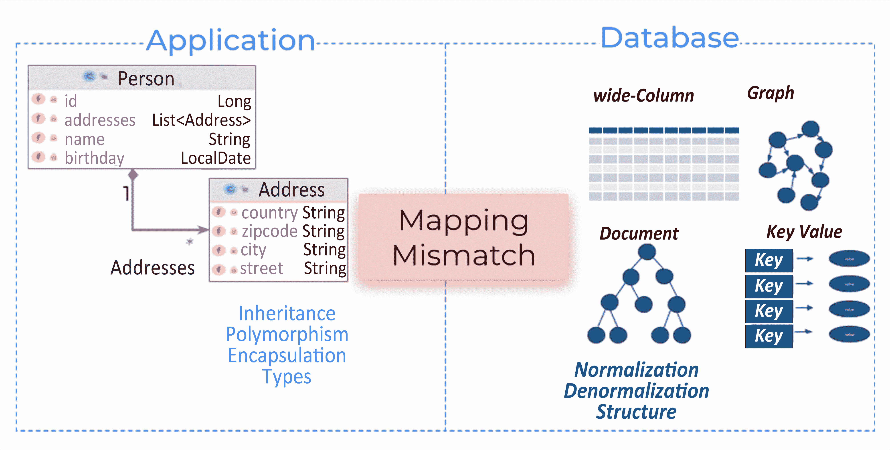

图 7.1 应用与数据库之间的距离

Java 与数据库原则之间内在缺乏一致性的阻抗匹配，体现在可以在 Java 中使用抽象、封装和继承，但在数据库中需要维护归一化或反归一化的数据。

为了弥补这一鸿沟，我们在两种范式之间引入了一个翻译器，称为映射层。该层在某种程度上缓解了大多数差异以及对应用方面的影响，例如额外的翻译开销、潜在的行为不以及较低的性能。

除了阻抗匹配，还有其他模式可以帮助数据库与应用的集成。这些模式在倾向于数据库或应用之间波动。

更靠近应用侧的模式通过面向对象编程封装数据并暴露行为来优先考虑语义。

更数据导向且更倾向于数据库侧的模式则关注不可变性和数据暴露。

下表有助于直观每种方法的权衡：

| 维度 | 面向对象编程 | 数据导向编程 |
| :--- | :--- | :--- |
| 关注点 | 行为与封装 | 数据暴露与不可变性 |
| 目标 | 隐藏数据细节；暴露行为 | 暴露数据细节；优先考虑不可变性 |
| 主要用途 | 应用级建模（例如，仓库） | 数据库级建模 |
| 权衡 | 增强的语义，可能存在复杂的抽象 | 简化的数据访问，可能的模型局限 |
| 示例 | DDD 仓库、领域服务 | SQL 表、NoSQL 集合 |

表 7.1 面向对象编程 vs. 数据导向编程

让我们关注围绕 DDD 的方面，特别是，让我们看看图中所示的仓库模式（Repository pattern）。注意，这是一个更靠近应用侧的模式，因此允许我们在 Java 中强调语义、抽象和面向对象的原则。

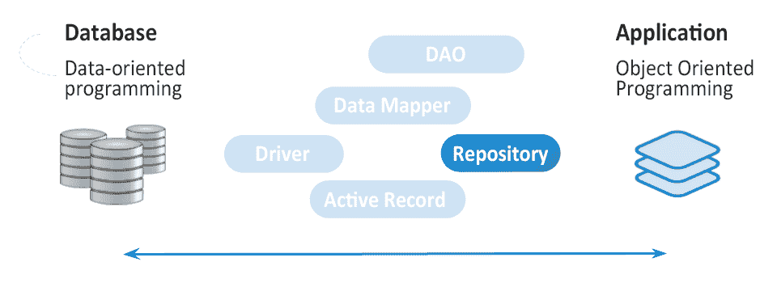

图 7.2：基于 Java 数据模式的差距和距离

考虑到阻抗不匹配（impedance mismatch），出现了一个常见问题：我们应该创建不同的实体类来将领域和数据库分开，还是应该将它们都放在同一个类中？虽然使用分离类可以提高灵活性，但也会增加复杂性，并可能引发性能方面的考虑。另一方面，重用同一个类简化了结构，但可能需要可能影响领域模型的适配，特别是在于 SQL 和 NoSQL 数据库之间切换时。根结底，没有一个万能的答案。一种务实的方法是先为两者都创建一个唯一的实体，然后随着模型的演进在必要时进行重构。

在下一节中，我们将探索如何在 SQL 数据库中进行数据建模，并研究在 SQL 结构内部处理这些差异的方法。

### 在 SQL 数据库中建模数据


当我们讨论关系型数据库时，成熟度通常是首先想到的特征。这项技术已经演变了一个多世纪，积累了丰富的知识、文献和实践案例。关系型（`SQL`）数据库通常是新项目的首选，提供了稳定性、社区支持和广泛的资源。此外，它还受益于一种标准的通信语言：`SQL`，它实现了跨系统的一致性查询。这种标准化使得 SQL 数据库兼容许多工具和应用程序，简化了数据建模和检索。此外，规范化通过将数据组织成结构化的相关表，防止冗余数据并维护数据完整性。

与关系型数据库结构化和数据驱动的范式不同，DDD 强调领域逻辑和应用语义。这种差异也是一种阻抗不匹配，因为它需要一个映射层在数据库表和面向对象的领域模型之间进行转换。

以下是 SQL 数据库与 DDD 之间区别的总结：

| 维度 | SQL 数据库 | DDD |
| :--- | :--- | :--- |
| 关注点 | 数据一致性、完整性和结构 | 领域逻辑和行为表示 |
| 数据关系 | 带外键的规范化表 | 封装的领域实体和值对象 |
| 访问模式 | 面向数据；针对查询进行了优化 | 面向行为；封装了操作 |
| 主要目的 | 数据存储和检索 | 应用中的业务逻辑表示 |
| 建模范式 | 关系型、表格化 | 面向对象、以行为为中心 |

表 7.2：SQL vs DDD

### Jakarta Persistence 实战

为了说明这种集成，让我们考虑一个实际示例。在我们的场景中，我们实现了一个 `Hotel`，它本质上是 `Room` 实体的集合，每个实体都包含对 `Guest` 的引用。为了简单起见并保持框架独立，我们将使用配合 Hibernate 的 `Jakarta Persistence`（以前称为 `JPA`）。通过不使用 `Spring` 或 `Quarkus` 生态系统的框架，你的学习将完全关注持久层及其与领域层之间的关系。

注意：在这个示例中，我们隔离了持久层以专门关注这些主题。然而，在实际应用中，`Hotel` 类可能会被结构化为 repository，因为入住和退房等操作引入了额外的业务需求，例如处理支付。为了简单起见，我们在此示例中没有使用依赖注入，这通常会简化连接池和其他基础设施问题的处理。在生产环境中，不使用依赖注入可能会导致连接泄漏等问题，但为了学习目的，它允许我们在不增加额外复杂层的情况下关注持久化机制。

在下面的代码块中，我们定义了两个实体类 `RoomJPA` 和 `GuestJPA`，代表酒店房间和客人。`RoomJPA` 类包含了与 `GuestJPA` 的 `ManyToOne` 关系，表示客人可以住在多个房间。

```java
@Entity
class RoomJPA {
    @Id
    private Long number;

    @ManyToOne
    @JoinColumn(name = "guest_id", referencedColumnName = "id")
    private GuestJPA guest;
}

@Entity
class GuestJPA {
    @Id
    @GeneratedValue(strategy = GenerationType.IDENTITY)
    private Long id;

    @Column
    private String documentNumber;

    @Column
    private String name;
}
```

接下来，我们将使用一个 mapper 来管理领域表示和数据库表示之间的结构差异。在这种情况下，我们使用 `MapStruct` 定义一个 `JPAMapper` 接口，它处理 `Room` 和 `Guest` 领域对象与其 JPA 表示 `RoomJPA` 和 `GuestJPA` 之间的转换：

```java
@Mapper
interface JPAMapper {
    GuestJPA toEntity(Guest guest);
    Guest toDomain(GuestJPA guestJPA);
    RoomJPA toEntity(Room room);
    Room toDomain(RoomJPA roomJPA);
}
```

通过利用 mapper，我们可以封装翻译逻辑，并确保领域层感知数据库架构。

在实体定义和 mapper 之后，我们现在可以实现 `HotelJPA`，它作为持久层。该类利用 JPA 与 SQL 数据交互，将领域逻辑从数据库框架的细节隔离开。在这里，我们处理入住和退房操作，在同一个类中管理房间和客人数据。在实际应用中，为 `Room` 和 `Guest` 建立独立的 repository 可能更合适，但为了简单起见，我们仅关注房间操作。

```java
public class HotelJPA implements Hotel {
    private final SessionFactory sessionFactory;
    private final JPAMapper mapper;

    public HotelJPA(SessionFactory sessionFactory, JPAMapper mapper) {
        this.sessionFactory = sessionFactory;
        this.mapper = mapper;
    }

    @Override
    public Room checkIn(Room room) {
        try (var session = sessionFactory.openSession()) {
            Transaction transaction = session.beginTransaction();
            RoomJPA roomJPA = session.get(RoomJPA.class, room.getNumber());
            if (roomJPA != null) {
                GuestJPA guestJPA = mapper.toEntity(room.getGuest());
                GuestJPA existingGuest = (GuestJPA) session
                    .createQuery("from GuestJPA where documentNumber = :documentNumber")
                    .setParameter("documentNumber", guestJPA.getDocumentNumber())
                    .uniqueResult();
                if (existingGuest == null) {
                    session.save(guestJPA);
                } else {
                    guestJPA = existingGuest;
                }
                roomJPA.setGuest(guestJPA);
                session.saveUpdate(roomJPA);
                transaction.commit();
                return mapper.toDomain(roomJPA);
            }
            transaction.rollback();
            throw new IllegalArgumentException("Room not found");
        }
    }

    @Override
    public void checkOut(Room room) {
        try (var session = sessionFactory.openSession()) {
            Transaction transaction = session.beginTransaction();
            RoomJPA roomJPA = session.get(RoomJPA.class, room.getNumber());
            if (roomJPA != null) {
                roomJPA.cleanRoom();
                session.saveUpdate(roomJPA);
                transaction.commit();
            } else {
                transaction.rollback();
                throw new IllegalArgumentException("Room not found");
            }
        }
    }

    @Override
    public Optional<Room> reservation(String number) {
        try (var session = sessionFactory.openSession()) {
            RoomJPA roomJPA = session.createQuery("from RoomJPA where number = :number", RoomJPA.class)
                .setParameter("number", Long.parseLong(number))
                .uniqueResult();
            return Optional.ofNullable(roomJPA).map(mapper::toDomain);
        }
    }

    @Override
    public Long countBy() {
        try (Session session = sessionFactory.openSession()) {
            return session.createQuery("select count(r) from RoomJPA r", Long.class).uniqueResult();
        }
    }

    @Override
    public Optional<Room> findEmptyRoom() {
        try (Session session = sessionFactory.openSession()) {
            RoomJPA emptyRoom = session.createQuery("from RoomJPA where guest is null", RoomJPA.class)
                .setMaxResults(1)
                .uniqueResult();
            return Optional.ofNullable(emptyRoom).map(mapper::toDomain);
        }
    }
}
```

我们探索的结构化持久化层有效地将领域层与底层数据库隔离离开，允许领域模型能够专注于业务逻辑，而将数据库特定的细节留给持久化基础设施。

领域模型与关系型数据库之间的阻抗差异（impedance mismatch）可以通过在持久化层隔离数据库特定组件并将领域实体映射到数据库表示来管理。这个示例演示了如何通过将关系结构与领域驱动原则对齐，实现针对 SQL 数据库的有效数据建模。通过关注归一化、映射策略和封装数据库特定细节等关键实践，这种方法确保了应用程序的适应性，同时在领域逻辑和数据库结构之间保持清晰的解耦。

在下一节“在 NoSQL 数据库中建模数据”中，我们将探索如何将 DDD 原则适配 NoSQL 数据库。NoSQL 提供了在某些场景下可能更灵活性和扩展性，我们将检查这些差异如何影响数据建模和领域对齐。

### 在 NoSQL 数据库中建模数据

当我们谈论 NoSQL 数据库时，灵活性通常是其定义特征。与遵循结构化模式和定义标准的 SQL 数据库不同，NoSQL 数据库提供了无模式结构，将适应性和性能优于严格的一致性模型。这种灵活性体现在各种 NoSQL 数据库中，包括键值对、文档、宽列、图谱和时间序列，每种类型都有其自己的数据建模方法。虽然 SQL 和 NoSQL 数据库具有相同的存储信息的根本目的，但 NoSQL 数据库在行为和设计上存在显著差异。与 SQL 数据库的原子性、一致性、隔离性和持久性（ACID）标准相比，NoSQL 数据库通常遵循基本可用、软状态和最终一致性（BASE）模型，专注于最终一致性而非严格的事务完整性。此外，NoSQL 数据库强调反规范化（denormalization），即根据访问模式建模数据以优化读操作，使得即使数据在条目之间可能重复，也能保持高效查询。

在 NoSQL 环境下应用 DDD 原则时，会出现某些挑战，特别是在封装、抽象和一致性方面。像 `MongoDB` 这样的文档数据库在某种程度上缩小了这种差距，因为它们可以在单个 JSON 类文档中存储实体及其相关数据。这允许使用反规范化的数据模型更好地与领域对齐，但在需要多个实体同步的场景下，仍需对数据一致性和更新逻辑进行仔细考虑。

以下是概述 DDD 和 NoSQL 数据库之间关键区别的对比表：

| 维度 | NoSQL 数据库 | DDD |
| :--- | :--- | :--- |
| 结构 | 无模式，灵活 | 封装的、行为驱动实体 |
| 一致性模型 | BASE（最终一致性） | 关注完整性和封装 |
| 数据建模 | 反规范化，查询优化 | 领域逻辑和行为表示 |
| 数据关系 | 嵌入文档（例如，子文档） | 封装的实体，值对象 |
| 访问模式 | 根据查询设计优化读操作 | 封装操作和业务逻辑 |

表 7.3：NoSQL vs. DDD

让我们继续使用我们的酒店示例。我们将使用基于文档的 NoSQL 数据库 `MongoDB` 来对一个包含 `Room` 实体集合的酒店进行建模。每个 `Room` 将具有一个 `Guest` 属性，以子文档的形式存储，而不是像关系型数据库那样存储在单独表中。`MongoDB` 实体的代码如下：

```java
public class RoomNoSQL {
    @BsonProperty("number")
    private Long number;
    @BsonProperty("guest")
    private GuestNoSQL guest;
}

public class GuestNoSQL {
    @BsonProperty("documentNumber")
    private String documentNumber;
    @BsonProperty("name")
    private String name;
}
```

然后，我们将使用类似于 SQL 示例的映射层，以维护领域表示和数据库表示之间映射的一致性。该层将 `Room` 和 `Guest` 领域对象转换为 `RoomNoSQL` 和 `GuestNoSQL` 实体，如下：

```java
@Mapper
interface NoSQLMapper {
    GuestNoSQL toEntity(Guest guest);
    Guest toDomain(GuestNoSQL);
    RoomNoSQL toEntity(Room room);
    Room toDomain(RoomNoSQL);
}
```

最后，我们使用 `MongoDB` 实现 `HotelMongoDB` 类来处理入住、退房和查找房间等操作。在这里，我们直接序列化 `MongoDB` 实体。尽管如此，它仍然需要构造函数、getter 和 setter。


```java
public class HotelMongoDB implements Hotel {
    private final MongoCollection<RoomNoSQL> roomCollection;
    private final NoSQLMapper mapper;

    public HotelMongoDB(MongoCollection<RoomNoSQL> roomCollection, NoSQLMapper mapper) {
        this.roomCollection = roomCollection;
        this.mapper = mapper;
    }

    @Override
    public void checkIn(Room room) {
        RoomNoSQL roomNoSQL = mapper.toEntity(room);
        Bson filter = eq("number", room.getNumber());
        roomCollection.updateOne(filter, Updates.set("guest", roomNoSQL.getGuest()), new UpdateOptions().upsert(true));
    }

    @Override
    public void checkOut(Room room) {
        Bson filter = eq("number", room.getNumber());
        roomCollection.updateOne(filter, Updates.unset("guest"));
    }

    @Override
    public Optional<Room> reservation(String number) {
        RoomNoSQL roomNoSQL = roomCollection.find(eq("number", Long.parseLong(number))).first();
        return Optional.ofNullable(roomNoSQL).map(mapper::toDomain);
    }

    @Override
    public Long countBy() {
        return roomCollection.countDocuments();
    }

    @Override
    public Optional<Room> findEmptyRoom() {
        RoomNoSQL emptyRoom = roomCollection.find(Filters.eq("guest", null)).first();
        return Optional.ofNullable(emptyRoom).map(mapper::toDomain);
    }
}
```

本章探讨了使用领域驱动设计（DDD）对 SQL 和 NoSQL 数据库进行数据建模的基础。我们研究了 SQL 的结构化、模式驱动的设计如何与 DDD 形成对比，这通常需要一个映射层来解决领域模型与数据库表之间的阻抗不匹配（impedance mismatch）。

我们强调了 NoSQL 的灵活性和无模式结构，这可以减少这种不匹配，但需要仔细的建模以维护数据完整性。通过 `Jakarta Persistence` 和 `MongoDB` 的示例，我们说明了如何将 SQL 和 NoSQL 数据模型与 DDD 对齐，并承认每种方法独特的权衡。

在下一章中，我们将探索使用 `Jakarta EE` 的企业级 Java，重点关注如何使用这个可扩展平台基于 DDD 原则开发企业级应用。我们将介绍工具、最佳实践和设计模式，用于构建集成 SQL 和 NoSQL 数据库的韧性系统，加深我们对大规模 DDD 应用的理解。

## 记忆要点

- `Impedance mismatch`（阻抗不匹配）：面向对象的应用模型与关系型数据库模式之间的结构和概念差距需要一个映射层来将它们对齐。
- `SQL 数据库遵循规范化`：在关系型数据库中，规范化减少了冗余并确保了数据完整性，但它可能需要影响性能的连接（joins）。
- `NoSQL 数据库优先考虑反规范化`：NoSQL 数据库通常倾向于反规范化，通过存储相关数据来优化查询性能，减少对连接的需求。
- `ACID vs. BASE`：SQL 数据库遵循强一致性的 `ACID` 模型，而 NoSQL 数据库使用 `BASE` 模型，优先考虑可用性和最终一致性。
- `SQL 数据建模需要模式定义`：在存储数据之前，关系型数据库需要预定义的模式，以确保结构和完整性，但降低了活性。
- `NoSQL 提供模式灵活性`：大多数 NoSQL 数据库允许无模式数据存储，能够实现灵活的结构，但需要仔细的一致性管理。
- `映射层桥接应用与数据库模型`：`JPA` 和对象文档映射器（`ODMs`）等工具促进了领域模型与数据库之间的通信。
- `NoSQL 中的嵌入与引用`：像 `MongoDB` 这样的文档数据库支持嵌入相关数据（子文档）以加快读取，但可能需要跨多个文档进行更新。
- `DDD 关注行为`：与关注数据存储的数据库不同，DDD 强调在领域模型中封装行为，以反映真实世界的业务规则。
- `数据库选择是一种权衡`：选择 `SQL` 还是 `NoSQL` 取决于一致性要求、扩展性需求、查询复杂度以及数据库模型与领域对齐的程度等因素。

## 单选题

1. 关系型数据库在数据建模中的主要优势是什么？
   - a. 模式的灵活性
   - b. 对反规范化的支持
   - c. 成熟且既定的标准
   - d. 关注 BASE 一致性模型
   - e. 不需要结构化表

2. SQL 数据库中规范化的主要目的是什么？
   - a. 增加数据冗余
   - b. 为读取优化数据
   - c. 避免重复数据并维护完整性
   - d. 将数据存储为 JSON 文档
   - e. 简化复杂的查询设计

3. 在 DDD 中，用什么术语描述面向对象模型与关系模型之间的结构差异？
   - a. 对象不匹配
   - b. 模式冲突
   - c. 设计分歧
   - d. 阻抗不匹配
   - e. 映射差距

4. `MongoDB` 是哪种类型的 NoSQL 数据库示例？
   - a. 键值存储
   - b. 文档数据库
   - c. 图数据库
   - d. 时间序列数据库
   - e. 宽列存储

5. NoSQL 建模中优化数据访问模式的常用策略是什么？
   - a. 规范化
   - b. 使用外键
   - c. 数据封装
   - d. 反规范化
   - e. 强制模式

6. 哪种一致性模型与 NoSQL 数据库最相关？
   - a. ACID
   - b. CAP
   - c. BASE
   - d. RDBMS
   - e. SQL

7. 在 `MongoDB` 示例中，将 `Guest` 作为子文档嵌入 `Room` 的目的是什么？
   - a. 减少对连接的需求
   - b. 严格遵循 ACID 原则
   - c. 支持外键约束
   - d. 增加规范化
   - e. 使模式变得僵化

8. 下列哪项最能描述 DDD 背景下 SQL 和 NoSQL 数据库的区别？
   - a. SQL 数据库通常是反规范化的。
   - b. NoSQL 数据库优先考虑查询结构而非模式。
   - c. SQL 数据库不支持 BASE 一致性。
   - d. NoSQL 数据库在供应商之间有严格的标准。
   - e. DDD 不能应用于 NoSQL 数据库。

9. 在 NoSQL 的 DDD 中，为什么你可能使用映射层？
   - a. 在表之间执行连接
   - b. 在没有外键的情况下创建直接关系
   - c. 将领域模型与文档结构对齐
   - d. 强制严格的 SQL 遵循
   - e. 实现触发器和存储过程

10. 下一章关于 DDD 将涵盖什么？
    - a. 高级 NoSQL 索引
    - b. `MongoDB` 中的模式设计模式
    - c. 使用 `Jakarta EE` 的企业级 Java
    - d. 与 NoSQL 的前端集成
    - e. SQL 调优与优化

### 答案

| 题编号 | 答案选项字母 |
| :--- | :--- |
| 1. | c. |
| 2. | c. |
| 3. | d. |
| 4. | b. |
| 5. | d. |
| 6. | c. |
| 7. | a. |
| 8. | b. |
| 9. | c. |
| 10. | c. |

# 第 8 章：使用 Jakarta EE 的企业级 Java

## 引言

在上一章于不特定 Java 的文中探索了领域驱动设计（DDD）之后，现在是时候看看这些如何在全功能平台中变为现实了。本章介绍了 `Jakarta EE`，这是一个强大的企业级平台，可以简化并优化 DDD 的实现，使其对开发者来说更加高效。你会发现与 DDD 相关的复杂性（如管理依赖、封装逻辑和处理持久化）在平台内部得到了更直观的解决。

当我们学习使用 Jakarta EE 应用 DDD 时，你会发现该平台的内置功能如何减少模板代码、通过 `Jakarta Data` 提供更好的封装，并支持 DDD 无缝集成到企业级应用中。在本章结束时，你将对 `Jakarta EE` 如何增强你的 DDD 实践有实用的理解，帮助你构建结构良好、易于维护且符合业务领域核心概念的应用。

## 结构

在本章中，我们将探索以下主题：

- 使用 `Jakarta EE` 应用 DDD
- 利用 `Jakarta Data` 实现更好的封装
- 将 DDD 集成到企业级 Java 应用中

## 技术要求

本章将使用 `Helidon` 探索上下文依赖注入（CDI）方法，这也可以同样地应用于 `Quarkus`。在本章中，我们将使用 Docker 运行 Oracle NoSQL 数据库。因此，运行一个数据库至关重要；在包括 Oracle Cloud 在内的多个环境中运行 Oracle NoSQL 数据库都是可能的，但对于本章，假设实例将在本地执行。

- Java 21
- Git
- Maven
- 任何偏好的 IDE
- Docker 正在运行
- 使用以下 Docker 命令运行 Oracle NoSQL 数据库：

```bash
docker run -d --name oracle-instance -p 8080:8080 ghcr.io/oracle/nosql:latest-ce
```

本章旨在演示 Jakarta EE 如何通过提供标准化的企业级功能来简化数据访问、依赖管理和领域封装，促进 DDD（领域驱动设计）的实现。通过实际示例，我们将探索 Jakarta EE 的关键规范，如 `Jakarta Data`、`CDI`、`Bean Validation`、`Jakarta NoSQL` 以及 `Jakarta API for RESTful Web Services (JAX-RS)`，展示如何构建清晰且可维护的 DDD 架构。在本章结束时，你将清晰地理解如何应用 Jakarta EE 构建以领域为中心的应用，减少样板代码并利用强大的企业级 Java 生态系统。

## 使用 Jakarta EE 应用 DDD

Jakarta EE 以前被称为 Java EE，它提供了一个广泛应用于 Spring、Quarkus 和 Helidon 等框架的标准化 API。这种标准化允许开发者访问一致的工具，从而降低企业级开发的复杂性。现在 Jakarta EE 由 Eclipse 基金会管理，并受益于与 MicroProfile 规范的集成，该规范扩展了 Jakarta EE 的能力以支持微服务架构。Jakarta EE 与 MicroProfile 之间这种紧密的关系建立在 `CDI`、`JSON` 和 `JAX-RS` 等核心组件之上，使 Jakarta EE 成为 Java 项目实现 DDD 的稳健基础。

`CDI` 是 Jakarta EE 中 DDD 的核心，它是一个促进对象创建和生命周期管理的规范。`CDI` 帮助管理应用程序内部的依赖，使得构建组织良好的领域层变得更容易。`CDI` 取代服务定位（service locators）和工厂等传统方法，允许你构建高测试性、可用且可维护的应用。这种能力在 DDD 中至关重要，因为领域对象通常跨跨多个请求。例如，`CDI` 的生产者方法（producer methods）实现了实体创建和资源的集中管理，确保了领域的一致性。作用域注解（Scoped annotations）为领域对象提供了额外的生命周期管理，而拦截器（interceptors）则允许你处理错误处理等交叉关注点，而不会污染领域逻辑。`CDI` 事件通过实现应用程序内的异步通信进一步支持了 DDD，鼓励模块化并减少了组件之间的耦合。

在下表中，你可以看到每个 `CDI` 特性以及你如何利用它们编写 DDD 代码：

| CDI 特性 | 在 DDD 中的角色 |
| :--- | :--- |
| 生产者方法 | 集中创建和管理领域实体及资源，促进一致性并简化测试。 |
| 作用域注解 | 管理领域对象的生命周期，有助于构建符合 DDD 边界的模块化分层架构。 |
| 拦截器 | 处理交叉关注点（如错误处理），保持领域逻辑的独立和聚焦。 |
| CDI 事件 | 实现领域对象之间的异步通信，促进松耦合并增强模块化。 |

表 8.1：CDI 特性及其在 DDD 中的使用方法

除了 `CDI` 之外，`Jakarta Bean Validation` 对于在整个应用程序中强制执行约束以维护领域对象的完整性也关重要。`Bean Validation` 允许你定义规则，以保证从传入请求到持久化层的数据一致性。这些规则确保了领域约束在服务、控制器和数据库中得到一致的应用。例如，对电子邮件字段的约束可以确保无效的电子邮件不会通过任何应用层。此外，`Bean Validation` 支持跨越多个字段的复杂约束，确保你的领域对象符合业务规则。

下表展示了更多关于如何利用 `Bean Validation` 进行 DDD 的内容，主要是在你可以使用注解驱动方法探索约束的地方：

| Bean Validation 特性 | 在 DDD 中的角色 |
| :--- | :--- |
| 基于注解的约束 | 确保领域对象中的属性根据业务规则进行验证，例如有效的电子邮件或最小年龄。 |
| 跨字段约束 | 提供跨越多个字段的高级验证逻辑，确保领域对象的整体完整性。 |
| 分组约束 | 定义验证组以应用特定上下文的规则，支持领域中的上下文驱动行为。 |

表 8.2：Bean Validation 特性及其在 DDD 中的使用方法

持久化是 DDD 的另一个关键元素。`Jakarta Persistence (JPA)` 和 `Jakarta NoSQL` 促进了领域状态的保存和检索，允许你以最小努力实现 `Repository`（仓库）模式。虽然这些规范并不直接代表 DDD 模式，但它们提供了必要的工具来封装数据并确保领域对象可以被保存。`JPA` 为关系映射提供了一套全面的功能，而 `Jakarta NoSQL` 支持更灵活的模型，对于领域对象特别有用。下表展示了如何将这些规范应用于 DDD：

| 持久化特性 | 在 DDD 中的角色 |
| :--- | :--- |
| JPA | 管理关系映射并提供基于实体的 API，支持领域聚合。 |
| Jakarta NoSQL | 简化与 NoSQL 存储的交互，适用于聚合根和复杂的领域模型。 |

表 8.3：持久化特性及其在 DDD 中的使用方法

将这些 Jakarta EE 特性与 DDD 原则相结合，可以构建反映核心业务概念的企业应用，同时减少样板代码并专注于领域的完整性。通过这些规范，Jakarta EE 赋予你创建清晰、可维护且符合业务的应用的能力，增强了你 DDD 实现的效果。

在下一节中，我们将讨论一种帮助你在 DDD 中与数据库集成的新规范。

## 利用 Jakarta Data 增强封装

`Jakarta Data` 引入了一种高效且直观的方式，直接在 Jakarta EE 平台上实现 `Repository` 模式。`Jakarta Data` 受到 DDD 的启发，通过为各种数据库类型（包括关系性和 NoSQL）提供一致的 API 来简化数据访问层。通过 `Jakarta Data`，开发者可以创建实现无缝交互的仓库，无需大量的样板代码，在基于 Jakarta 的编程模型中桥接领域概念和数据库操作。这种灵活性使得 `Jakarta Data` 在 DDD 应用中特别强大，因为仓库是领域对象的中心访问点。

如果内置的仓库方法不能满足你的需求，Jakarta Data 的自定义仓库接口提供了更高的灵活性。自定义仓库允许你构建查询以适应你的领域语言，从而清晰地对齐 DDD 的通用语言（Ubiquitous Language）。通过 `@Insert`、`@Update`、`@Delete` 和 `@Save` 等注解，你可以定义精确反映应用程序需求的领域特定方法。例如，在 `Garage` 仓库中，我们可以使用 `@Insert` 和 `@Delete` 注解以领域为中心的方式管理 `Car` 实体，如下：

```java
@Repository
public interface Garage {

    @Insert
    Car park(Car car);

    @Delete
    Car unpark(Car car);
}
```

Jakarta Data 为处理大型数据集的应用引入了分页选项，以提高数据处理效率。它支持两种分页类型：基于偏移（offset-based）和基于游标（cursor-based）。基于偏移的分页使用位置偏移计算页码，而基于游标的分页使用指针（游标）导航数据，减少了跨页时丢失或重复结果的风险。以下是一个在 `CarRepository` 中展示两种分页方式的示例：


```java
@Repository
public interface CarRepository extends BasicRepository<Car, Long> {

    Page<Car> findByTypeOrderByName(CarType type, PageRequest pageRequest);

    @Find
    @OrderBy(_Car.NAME)
    @OrderBy(_Car.VIN)
    CursoredPage<Car> type(CarType type, PageRequest pageRequest);
}
```

`Jakarta Data` 还引入了 `Jakarta Data` 查询语言（`JDQL`），这是一种为仓库方法定制的轻量级查询语言，用于跨数据存储的复杂查询。作为 `Jakarta Persistence` 查询语言（`JPQL`）的子集，`JDQL` 支持 `SQL` 和 `NoSQL` 后端，在利用 `JPQL` 熟悉语法的同时提供了一致性。通过 `@Query` 注解，开发者可以创建可以在不同存储技术中无缝工作的灵活查询。在此示例中，`BookRepository` 定义了可以在 `SQL` 或 `NoSQL` 数据库上运行的 `JDQL` 查询，如下：

```java
@Repository
public interface BookRepository extends BasicRepository<Book, UUID> {

    // 根据特定模式查找标题的书
    @Query("where title like :titlePattern")
    List<Book> booksMatchingTitle(String titlePattern);

    // 按特定作者选择书籍并按标题排序
    @Query("where author.name = :author order by title")
    List<Book> findByAuthorSortedByTitle(String author);
}
```

如你所示，开发者可以通过 `Jakarta Data` 以极小的努力让仓库模式生效，使受 `DDD` 启发的数据处理变得直观且富有表现力。

在接节，我们将使用 `NoSQL` 数据库通过实际代码示例应用 `Jakarta EE` 概念，展示如何利用 `Jakarta Data` 的能力来实现以领域为中心的数据管理方法。

## 将 DDD 集成到企业级 Java 应用

在本节中，我们将通过实现一个酒店管理微服务，采用结合 `Helidon` 和 `Oracle NoSQL` 数据库使用 `Jakarta EE` 的实用方法。在之前章节的酒店示例的基础上，我们将其扩展为微服务架构，利用 `NoSQL` 数据库存储酒店房预订和客人信息。让我们深入了解此示例所需的设置和开发步骤。

首先，使用 `Helidon` 的 Starter UI 设置项目结构，这使得配置变得简单直观，如下：

1. 访问 `Helidon Starter`（`https://helidon.io/starter/4.1.4?step=1`）。
2. 选择 `Helidon MP` 版本，并选择应用程序类型 `Quickstart`。
3. 在 `Media Support`（媒体支持）下，选择 `JSON-B`。
4. 根据项目需求定义 `groupId`、`artifactId`、`version` 和 `package name`。
5. 配置完成后，下载生成的项目并添加最新版本的 `Oracle JNoSQL` 驱动以集成数据库。

在具备初始项目结构后，配置数据库设置以便本地运行应用程序。更新 `src/main/resources/META-INF/microprofile-config.properties` 如下属性：

```properties
jnosql.keyvalue.database=hotel
jnosql.document.database=hotel
jnosql.oracle.nosql.host=http://localhost:8080
```

使用环境变量进行生产设置（符合十二要素应用方法论），可以确保凭据的安全管理，并更容易在没有硬编码值的情况下切换环境。

一旦 `Oracle NoSQL` 数据库运行，我们就可以开始定义实体了，将其丰富的关系数据库经验引入 `NoSQL` 领域。在这里，我们通过将 `Room` 视为实体并将 `Guest` 视为值对象来落实 `DDD` 原则。`Guest` 嵌入在 `Room` 中作为子文档，在简化数据模型的同时保持了我们以领域为中心的方法。注意 `Jakarta NoSQL` 注解的使用，它们与 `Jakarta Persistence` 注解类似：

```java
@Entity
public record Room (@Id String number, @Column Guest guest) {
}

@Embeddable(Embeddable.EmbeddableType.GROUPING)
public record Guest (@Column String documentNumber, @Column String name) {
}
```

定义实体后，让我们移动到仓库层。在这里，我们实现了 `Hotel` 仓库接口，利用 `@Save` 和 `@Delete` 等注解以最少的样板代码管理数据持久化。该仓库提供了入住、退房和房间预订的方法，在利用 `Jakarta EE` 仓库功能的同时捕捉了 `DDD` 概念，如下：

```java
@Repository
public interface Hotel {

    @Save
    Room checkIn(Room room);

    @Delete
    void checkOut(Room room);

    @Find
    Optional<Room> reservation(@By(expert.os.books.ddd.chapter08.hotels._Room.NUMBER) String number);

    Page<Room> findBy(PageRequest pageRequest);
}
```

最后，我们应该通过 `Helidon` 的 `CDI` 支持将这些操作暴露为 RESTful API。将仓库注入到 `HotelResource` 类中：

```java
@Path("/hotels")
@ApplicationScoped
@Produces(MediaType.APPLICATION_JSON)
@Consumes(MediaType.APPLICATION_JSON)
public class HotelResource {
    private static final Logger LOGGER = Logger.getLogger(HotelResource.class.getName());

    private final Hotel hotel;

    @Inject
    public HotelResource(Hotel hotel) {
        this.hotel = hotel;
    }

    public HotelResource() {
        this(null);
    }

    @GET
    public List<Room> rooms(@QueryParam("page") @DefaultValue("1") int page,
                            @QueryParam("size") @DefaultValue("1") int size) {
        LOGGER.info("Finding rooms page: " + page + " size: " + size);
        var pageRequest = PageRequest.ofPage(page).size(size);
        var rooms = hotel.findBy(pageRequest).content();
        LOGGER.info("Found rooms: " + rooms.size());
        return rooms;
    }

    @GET
    @Path("/{number}")
    public Room reservation(@PathParam("number") String number) {
        LOGGER.info("Finding reservation: " + number);
        return hotel.reservation(number)
                .orElseThrow(() -> new WebApplicationException("Room not found", Response.Status.NOT_FOUND));
    }

    @PUT
    public Room checkIn(Room room) {
        LOGGER.info("Check in: " + room);
        return hotel.checkIn(room);
    }

    @DELETE
    @Path("/{number}")
    public void checkOut(@PathParam("number") String number) {
        LOGGER.info("Check out: " + number);
        var room = hotel.reservation(number)
                .orElseThrow(() -> new WebApplicationException("Room not found", Response.Status.NOT_FOUND));
        hotel.checkOut(room);
    }
}
```

在代码和配置完成后，是时候本地执行应用程序了。首先通过以下命令打包并运行应用程序：

```bash
mvn package
java -jar target/hotel-reservation.jar
```

一旦应用程序运行，你可以使用 `cURL` 通过 `HTTP` 请求与其交互。以下是几个帮助你开始酒店预订微服务的示例：

- 入住客人（Check-in）：此命令通过发送包含房号和客人详情的 `JSON` 负载，将客人注册到特定房间：

```bash
curl -X PUT -H "Content-Type: application/json" -d '{"number":"101", "guest":{"name":"John Doe", "documentNumber":"12345"}}' http://localhost:8181/hotels
```

- 获取所有房间：通过此 `GET` 请求检索所有房间列表及其预留状态：

```bash
curl -X GET http://localhost:8181/hotels
```

- 退房（Check out）：要从特定房间退房，请使用以下 `DELETE` 请求并指定房号：

```bash
curl -X DELETE http://localhost:8181/hotels/101
```

这些简单的命令允许您在酒店微服务中管理房间入住、退房和房间列表。它们展示了 `Jakarta EE`、`Helidon` 和 `Oracle NoSQL` 在符合 `DDD` 设计的架构中可以提供的无缝交互。

通过这个示例，我们说明了 `Jakarta EE` 如何结合 `Helidon` 和 `Oracle NoSQL` 简化符合 `DDD` 的微服务的创建。遵循这种方法，您可以构建出可扩展、灵活且以领域为中心的应用，从而最大化 `Jakarta EE` 在微服务环境中的能力。

## 结论

本章探讨了 `Jakarta EE` 如何通过 `Jakarta Data`、`CDI` 和 `Jakarta NoSQL` 支持 `DDD` 原则。我们使用 `Helidon` 和 `Oracle NoSQL` 数据库实现了一个酒店预订微服务，展示了 `Jakarta EE` 创建关注领域的企业级应用的能力。这种方法提供了强大的存储库抽象、有效的依赖注入和无缝的数据库集成，简化了符合 `DDD` 的应用的开发和可扩展性。

下一章将使用 `Spring` 进行 `DDD`。`Spring` 的灵活性和流行使其非常适合在 Java 应用中应用 `DDD` 原则，支持模块化架构和充分的数据访问。我们将探索利用 `Spring` 进行 `DDD`，并将其方法与 `Jakarta EE` 进行比较，以突显每个平台如何增强开发。

## 重点复习

- `Jakarta EE` 是 Java 开发的企业级标准：它提供了一致一致的 API，简化了企业级应用的实现，且独立于所使用的框架。
- 上下文和依赖注入（`CDI`）增强了模块化：它有助于管理依赖关系、对象周期，并在 `DDD` 应用中实现更好的关注点分离。
- `Jakarta Data` 引入了内置和自定义存储库：它通过提供预定义的存储库接口简化了数据访问，同时允许领域特定的查询方法。
- `Jakarta Data` 原生支持存储库模式（Repository pattern）：它提供了一种与数据库交互的结构化方式，将持久化逻辑从业务规则中抽象出来。
- `Jakarta Data` 支持基于方法的查询：开发者可以使用命名规范或如 `@Insert`、`@Find` 和 `@Delete` 等注解来定义查询方法。
- `Jakarta Data` 中的分页可以是基于偏移（offset）或基于游标（cursor）的：基于偏移的分页基于位置，而基于游标的分页改进了大型数据集的一致性。
- `Jakarta Data Query Language`（`JDQL`）是 `JPQL` 的子集：它提供了一种灵活且与数据库无关的查询机制，适用于关系型和 `NoSQL` 数据库。
- `Bean Validation` 强制领域约束：它确保业务规则（如必填字段或特定格式）应用于整个应用层。
- `Jakarta NoSQL` 赋予了数据建模灵活性：它简化了 `NoSQL` 数据库交互，同时保持了 `Jakarta Persistence` 用户熟悉的结构。
- `Jakarta EE` 与 `Helidon` 和微服务无缝集成：这允许在高效应用 `DDD` 原则的同时，构建可扩展的云原生应用。

## 多选题

1. 在企业级应用背景下，`Jakarta EE` 的主要目的是什么？
   - a. 创建轻量级 Java 应用
   - b. 为企业级应用开发定义标准 API
   - c. 与 `Spring` 框架竞争
   - d. 提供仅限 Java 的微服务解决方案
   - e. 消除对数据库的需求

2. `Jakarta EE` 中的哪种规范主要负责依赖管理和周期处理？
   - a. `Jakarta Data`
   - b. `Jakarta NoSQL`
   - c. Contexts and Dependency Injection（上下文与依赖注入）
   - d. `Bean Validation`
   - e. `Jakarta RESTful Web Services`

3. 在 `DDD` 语境下，`Jakarta Data` 的主要角色是什么？
   - a. 管理应用安全
   - b. 为数据访问提供存储库抽象
   - c. 强制执行领域约束
   - d. 处理前端 UI 交互
   - e. 管理用户认证

4. 以下哪种 `Jakarta Data` 存储库类型允许开发者使用 `@Insert` 和 `@Delete` 等注解定义查询方法？
   - a. 内置存储库接口
   - b. 自定义存储库接口
   - c. 动态存储库
   - d. 外部存储库接口
   - e. 服务存储库

5. `Jakarta Data` 中的 `@Save` 注解的作用是什么？
   - a. 从数据库中删除数据
   - b. 在保存之前验证数据
   - c. 检查数据是否存在，然后相应地插入或更新
   - d. 加密数据
   - e. 执行软删除

6. `Jakarta Data` 支持哪种类型的分页来处理大型数据集？
   - a. 基于页面和基于偏移
   - b. 基于偏移和基于游标
   - c. 基于游标和基于动态
   - d. 基于页面和基于序列
   - e. 基于序列和基于偏移

7. `CDI` 的哪种功能有助于减少创建和管理领域实体的样板代码？
   - a. 拦截器器（Interceptors）
   - b. 作用域注解（Scoped annotations）
   - c. `CDI` 事件
   - d. 生产者方法（Producer methods）
   - e. 事务管理

8. `Jakarta Data` 的 `JDQL` 是什么？
   - a. `Jakarta Data Query Language`，`JPQL` 的子集，用于数据库查询
   - b. 用于 `Jakarta EE` 应用的 `JSON` 解析器
   - c. 管理微服务的新框架
   - d. 用于移动应用的 Java Query Language
   - e. 用于数据验证的 Java Quality Language

9. 描述 Data 存储 Data Data Data 模式的模式？
   - a. 将所有业务逻辑集中在数据层
   - b. 作为领域对象与底层数据库之间的桥梁
   - c. 为 CRUD 操作提供复杂的业务逻辑
   - d. 仅处理应用中的事务
   - e. 跨层验证数据

10. 哪种 `Jakarta EE` 功能有助于强制跨层的数据一致性？
    - a. `CDI`
    - b. `Jakarta NoSQL`
    - c. `Bean Validation`
    - d. `JAX-RS`
    - e. `Jakarta Messaging`

### 答案

| 题号 | 答案字母 |
|---|---|
| 1. | b. |
| 2. | c. |
| 3. | b. |
| 4. | b. |
| 5. | c. |
| 6. | b. |
| 7. | d. |
| 8. | a. |
| 9. | b. |
| 10. | c. |

## 在 Spring Boot 中应用 DDD

## 技术要求


在本章中，我们将使用 `Spring` 平台和内存数据库。这样可以避免复杂性以及基础设施的准备，例如 `Docker` 或数据库安装。但是，由于我们使用了 `JPA`，也可以使用其他数据库；要实现这一点，我们需要更新 `Driver` 并确保数据库运行正常。

## 前置条件

- `Java 21`
- `Git`
- `Maven`
- 任何你偏好的 IDE

## 目标

本章旨在演示 `Spring Framework` 如何通过为依赖注入、数据持久化和应用层暴露提供强大的抽象，从而简化企业级应用中 `DDD` 的实现。

通过实战示例，我们将探索 `Spring` 生态系统（利用 `Spring Boot`、`Spring Data JPA` 和其他关键组件）如何帮助开发者专注于业务逻辑，同时高效地管理基础设施相关问题。

在本章结束时，读者将理解如何构建一个基于 `Spring` 的 `DDD` 应用、集成持久化、通过 `RESTful API` 暴露领域逻辑，并通过全面的测试确保系统的健壮性。

## `Spring Framework` 与 `DDD` 概览

`Spring Framework` 是一个强大的模块化 Java 生态系统平台，简化了企业级应用开发。凭借其轻量级架构，`Spring` 提供了一个与 `DDD` 无缝衔接的全面工具包，使其成为构建复杂的业务驱动型应用的理想选择。

核心特性（如依赖注入、事务管理和数据访问）允许开发者专注于领域逻辑建模，而不会被基础设施问题所负担。此外，`Spring` 对注解的大量使用为 `DDD` 概念提供了方便的快捷方式，使开发者能够精确地表示领域服务、存储库和聚合。

### `Spring` 注解

`Spring` 注解简化了代码并有助于明确类和组件的领域角色。以下是一些示例：

- `@Service` 注解代表领域服务，业务逻辑和领域动作位于此处。这些服务运行在业务逻辑层，并协调跨聚合或实体的操作。
- `@Repository` 注解封装了数据的存储和检索，代表了 `DDD` 推广的 `Repository` 模式。存储库关注持久化层，在存储和检索领域对象的同时抽象了基础设施问题。
- `@Entity` 模型了具有唯一标识的领域实体，直接映射到数据库表或文档，以实现对象关系映射。
- `@Component` 是一个更通用的注解，可以支持聚合或基础设施问题，允许灵活集成非领域特定的特定组件。

正如在第 4 章《测试与验证 DDD 应用》中所讨论的，通过测试验证代码设计可以确保应用符合 `DDD` 原则。`jMolecules` 是一个强大的设计验证工具，通过在任何平台上的测试引入了设计检查。

在 `Spring` 生态系统中使用它更进一步：它的注解与 `Spring Data JPA` 和 `Spring Data MongoDB` 集成，使得面向 `DDD` 的注解能够影响代码结构和持久化行为。通过这种集成，`Spring` 将领域模型与基础设施连接，通过良好的结构强化了 `DDD` 原则。

### `Spring` 对 `DDD` 实践的支持

`Spring` 的特性天然支持 `DDD` 实践，使得创建架构良好的领域模型变得更加容易。例如，`Spring Data JPA` 简化了 `Repository` 模式和实体持久化，有助于建模存储库并管理聚合根。

同样，`Spring Data MongoDB` 允许在 `NoSQL` 数据库中对聚合根进行持久化，为非关系上下文下的 `DDD` 提供了天然契合。凭借其约定优于配置的方法，`Spring Boot` 简化了基于 `DDD` 的服务的设置并促进了整洁架构（Clean Architecture）。

`Spring Integration` 支持领域事件和消息驱动架构，这在事件驱动的 `DDD` 应用中至关重要。同时，`Spring 面向切编程 (AOP)` 管理日志和事务控制等交叉关注点，保持领域逻辑的纯洁并与基础设施问题隔离。

### 相关技术和依赖

下表介绍了 `Spring` 以及它如何使用 `DDD` 增强设计。必须强调的是，`Spring` 是一个巨大的技术栈。如果使用 `Spring`，值得检查这些元素。

| Spring 特性 | DDD 应用 |
| --- | --- |
| `Spring Data JPA` | 自动化 `Repository` 模式；简化实体持久化 |
| `Spring Data MongoDB` | 允许在 `NoSQL` 中对聚合根持久化；符合 `DDD` |
| `Spring Boot` | 约定优于配置，快速设置基于 `DDD` 的服务 |
| `Spring Integration` | 支持领域事件和消息驱动架构 |
| `Spring AOP` | 处理日志和事务控制等交叉关注点 |

表 9.1：使用 `Spring` 应用 `DDD`

### 依赖注入

`Spring` 的另一个核心特性是它的依赖注入框架，它允许将对象自动提供到需要它们的类中。`@Autowired` 注解是此过程的核心，它在无需手动配置的情况下简化了依赖管理。

依赖注入可以通过字段注入或构造函数注入实现，尽管 `Spring` 团队推荐构造函数注入，因为其具有清晰性和不可变性的益处。基于构造函数的注入在 `DDD` 背景下特别有价值，它确保了在创建对象时所有必要的依赖都是可用的。这支持了 `DDD` 对稳定、自包含领域模型的强调。

虽然字段注入是可能的，但通常不被推荐，因为它降低了可见性并可能增加测试的复杂度。通过构造函数强制执行依赖，`Spring` 有助于构建符合 `DDD` 封装和边界原则的整洁、可维护且可测试的代码库。

在 `DDD` 应用中，依赖注入通过允许将服务和存储库精确注入到需要的地方而无需直接管理依赖，促进了关注点的分离。这种方法使依赖显式化，增强了层与层之间的边界，并改进了模块化和可维护性。

在接下来的章节中，我们将从概念转向实践。我们将通过真实的代码示例看到如何用 `Spring` 实现 `DDD`，包括在服务和存储库中使用 `@Autowired` 进行构造函数注入。这种实践方法将演示如何利用 `Spring` 特性创建结构化、可扩展的 `DDD` 架构。

## 在 `Spring Boot` 中应用 `DDD`

为了演示 `Spring` 如何支持 `DDD`，我们将使用 `Spring` 和 `H2`（内存关系型数据库）构建一个酒店管理示例项目。

在实际应用中，会使用 `PostgreSQL` 等数据库；但为了学习，我们将依靠设置更简单的数据库，以便专注于与 `Spring` 的集成。

### 创建并设置新的 `Spring Boot` 项目

设置项目非常简单，这源于 `Spring` 的 `Spring Initializr`，它可以快速生成 `Spring Boot` 项目。为了支持应用的需求，我们将包含以下依赖项：

- `Spring Web`：用于启用 `RESTful` Web 服务。
- `Spring Data JPA`：用于简化数据访问。
- `H2`：用于内存数据库。

创建项目后，我们将在 `application.properties` 文件中配置 `H2` 数据库。遵循“云原生应用”（Twelve-Factor App）原则的最佳实践，`Spring` 允许配置在不同环境中灵活且易于管理。

对于本地开发，我们直接在 `application.properties` 中设置数据库属性；对于生产环境，我们可以使用环境变量覆盖它们，以确保敏感凭据的安全。以下是一个配置示例：

```properties
spring.application.name=chapter-09
spring.datasource.url=jdbc:h2:mem:testdb
spring.datasource.driverClassName=org.h2.Driver
spring.datasource.username=sa
spring.datasource.password=password
spring.jpa.database-platform=org.hibernate.dialect.H2Dialect
spring.jpa.defer-datasource-initialization=true
spring.h2.console.enabled=true
```

此配置设置了一个带有控制台界面的 `H2`，方便我们在测试应用程序时检查表和数据。

### 定义核心领域实体

配置完成后，我们可以使用以下代码为酒店管理系统定义核心领域实体：`Guest`（客人）和 `Room`（房间）。这些实体代表了关键业务概念，并包含了持久化注解。

`Guest` 实体拥有 ID、证件号和姓名，而 `Room` 实体包含房号以及客人的引用，反映了房间与客人之间的关系。

```java
@Entity
public class Guest {
    @Id
    @GeneratedValue(strategy = GenerationType.IDENTITY)
    private Long id;

    @Column
    private String documentNumber;

    @Column
    private String name;

    // Getters and Setters
}
```

在 `Guest` 实体中，我们定义了基本属性以及用于数据库标识的自动生成 ID。

```java
@Entity
public class Room {
    @Id
    @GeneratedValue(strategy = GenerationType.IDENTITY)
    private Long number;

    @ManyToOne
    @JoinColumn(name = "guest_id", referencedColumnName = "id")
    private Guest guest;

    // Getters and Setters
}
```

在 `Room` 实体中，每个房间都有唯一的编号，并可能与客人关联，代表了入住关系。

### 构建存储库和服务层

接下来，我们创建用于数据访问的存储库（Repository）接口。使用存储库模式通过集中数据操作来符合 `DDD`（领域驱动设计）的原则，而 `Spring Data JPA` 为该模式提供了内置支持。

通过扩展 `JpaRepository`，我们获得了基本的 CRUD 操作，并能够按照约定定义查询方法的灵活性，`Spring` 会自动解析并实现这些方法。

```java
@Repository
public interface GuestRepository extends JpaRepository<Guest, Long> {
    Optional<Guest> findByDocumentNumber(String documentNumber);
}
```

`GuestRepository` 接口包含一个通过证件号查找客人的方法。同样，`RoomRepository` 接口提供了检查房间是否空闲以及通过房号检索房间的方法。

```java
@Repository
public interface RoomRepository extends JpaRepository<Room, Long> {
    Optional<Room> findByGuestIsNull();
    Optional<Room> findByNumber(Long number);
}
```

为了协调跨实体的数据操作，我们实现了一个 `RoomService` 类，作为管理房间和客人的业务服务。

`Spring` 通过构造函数处理依赖注入，简化了将存储库连接到服务的过程。在这里，构造函数上的 `@Autowired` 注入了 `RoomRepository` 和 `GuestRepository`，允许 `RoomService` 执行入住、退房以及其他操作。

```java
@Service
public class RoomService {
    private final RoomRepository roomRepository;
    private final GuestRepository guestRepository;

    public RoomService(RoomRepository roomRepository, GuestRepository guestRepository) {
        this.roomRepository = roomRepository;
        this.guestRepository = guestRepository;
    }

    public List<Room> findRooms(PageRequest pageRequest) {
        Page<Room> page = roomRepository.findAll(pageRequest);
        return page.getContent();
    }

    @Transactional
    public Room checkIn(Room room) {
        Room roomEntity = roomRepository.findByNumber(room.getNumber())
            .orElseThrow(() -> new EntityNotFoundException("Room not found, the room number is " + room.getNumber()));
        Guest guest = guestRepository.findByDocumentNumber(room.getGuest().getDocumentNumber())
            .orElseGet(() -> guestRepository.save(room.getGuest()));
        roomEntity.setGuest(guest);
        return roomRepository.save(roomEntity);
    }

    @Transactional
    public void checkOut(Room room) {
        Room roomEntity = roomRepository.findByNumber(room.getNumber())
            .orElseThrow(() -> new EntityNotFoundException("Room not found, the room number is " + room.getNumber()));
        roomEntity.setGuest(null);
        roomRepository.save(roomEntity);
    }

    public Optional<Room> reservation(Long number) {
        return roomRepository.findByNumber(number);
    }

    public Long countBy() {
        return roomRepository.count();
    }

    public Optional<Room> findEmptyRoom() {
        return roomRepository.findByGuestIsNull();
    }
}
```

`RoomService` 类协调了两个存储库之间的操作。它包含了查找房间、处理入住和退房以及识别空房的方法。

`checkIn` 方法通过房号查找房间，并根据证件号检查客人是否存在。如果不存在，则创建一个新的 `Guest` 并与房间关联。`checkOut` 则清空房间的客人分配，以便未来预留。

在这个示例中，我们看到了 `Spring` 的注解和依赖注入如何简化了面向 `DDD` 系统的开发。

### 通过 `REST` 端点暴露服务

服务层完成后，我们现在可以通过 `HotelController` 将其暴露给应用层。该控制器作为 API 层，允许外部系统或前端客户端与应用程序交互。

它使用 HTTP 端点处理与房间管理相关的请求，并作为客户端与 `RoomService` 之间的桥梁。


```java
@RestController
@RequestMapping("/hotels")
public class HotelController {
    private static final Logger LOGGER = Logger.getLogger(HotelController.class.getName());
    private final RoomService roomService;

    @Autowired
    public HotelController(RoomService roomService) {
        this.roomService = roomService;
    }

    @GetMapping
    public ResponseEntity<List<Room>> getRooms(@RequestParam(defaultValue = "0") int page,
                                              @RequestParam(defaultValue = "10") int size) {
        LOGGER.info("Finding rooms page: " + page + " size: " + size);
        PageRequest pageRequest = PageRequest.of(page, size);
        List<Room> rooms = roomService.findRooms(pageRequest);
        LOGGER.info("Found rooms: " + rooms.size());
        return ResponseEntity.ok(rooms);
    }

    @GetMapping("/{number}")
    public ResponseEntity<Room> getReservation(@PathVariable Long number) {
        LOGGER.info("Finding reservation: " + number);
        var room = roomService.reservation(number)
            .orElseThrow(() -> new EntityNotFoundException("Room not found with number " + number));
        return ResponseEntity.ok(room);
    }

    @PutMapping
    public ResponseEntity<Room> checkIn(@RequestBody Room room) {
        LOGGER.info("Check in: " + room);
        Room checkedInRoom = roomService.checkIn(room);
        return ResponseEntity.ok(checkedInRoom);
    }

    @DeleteMapping("/{number}")
    public ResponseEntity<Void> checkOut(@PathVariable Long number) {
        LOGGER.info("Check out: " + number);
        Room room = roomService.reservation(number)
            .orElseThrow(() -> new EntityNotFoundException("Room not found with number " + number));
        roomService.checkOut(room);
        return ResponseEntity.noContent().build();
    }
}
```

`HotelController` 定义了对应应用程序主要操作的 RESTful 端点。`@RestController` 注解告诉 Spring 将此类视为 Web 控制器并自动将响应转换为 JSON 格式。我们使用构造函数注入将 `RoomService` 注入到 `HotelController` 中，遵循了 Spring 推荐的依赖管理最佳实践，这些资源如下：

- `GET /hotels`：获取所有房间的分页列表。
- `GET /hotels/{number}`：根据房间号获取特定的房间预订。
- `PUT /hotels`：通过为客人分配房间来处理其入住手续。
- `DELETE /hotels/{number}`：处理退房手续，从房间中清除该客人信息。

### 完善错误处理

为了处理诸如“未找到房间”之类的错误，我们将实现一个自定义的异常处理器，将这些异常转换为有意义的 HTTP 响应。在案例中，我们将使用 `EntityNotFoundException` 来表示缺失的记录，并将其映射到 `404 Not Found` HTTP 状态。

```java
@ControllerAdvice
public class CustomExceptionHandler {

    @ExceptionHandler(EntityNotFoundException.class)
    @ResponseStatus(HttpStatus.NOT_FOUND)
    public ErrorResponse handleEntityNotFoundException(EntityNotFoundException ex) {
        return new ErrorResponse("Entity not found", ex.getMessage());
    }

    public static class ErrorResponse {
        private String error;
        private String message;

        public ErrorResponse(String error, String message) {
            this.error = error;
            this.message = message;
        }

        public String getError() {
            return error;
        }

        public String getMessage() {
            return message;
        }
    }
}
```

`CustomExceptionHandler` 类使用 `@ControllerAdvice` 全局应用于应用程序。在这里，我们为 `EntityNotFoundException` 定义了一个 `@ExceptionHandler`，它返回带有自定义错误信息的 `404` 状态。这种方法提供了一种统一处理异常的方式，并确保与 API 客户端之间的清晰的通信。

### 通过单元测试确保代码行为

测试是 Spring 的显著特性之一，它使得独立或组合地测试每一层变得简单。我们将从仓库测试开始，验证自定义查询和 JPA 功能，然后是服务测试以检查业务逻辑，最后是控制器测试以模拟 HTTP 请求并验证 API 端点。

测试仓库层涉及验证数据库操作（特别是自定义查询）是否按预期工作。使用 `@DataJpaTest` 和 `H2`，我们可以用最少的设置测试数据库交互。

```java
@DataJpaTest
class GuestRepositoryTest {

    @Autowired
    private GuestRepository guestRepository;

    @BeforeEach
    void setUp() {
        guestRepository.deleteAll();
    }

    @Test
    void shouldSaveAndRetrieveGuestByDocumentNumber() {
        Guest guest = new Guest("123456789", "John Doe");
        guestRepository.save(guest);
        Optional<Guest> retrievedGuest = guestRepository.findByDocumentNumber("123456789");
        assertThat(retrievedGuest).isPresent()
            .get().extracting(Guest::getName)
            .isEqualTo("John Doe");
    }

    @Test
    void shouldReturnEmptyWhenGuestNotFoundByDocumentNumber() {
        Optional<Guest> retrievedGuest = guestRepository.findByDocumentNumber("999999999");
        assertThat(retrievedGuest).isNotPresent();
    }
}
```

服务层测试允许我们验证业务逻辑，包括仓库之间的协调。使用 `@SpringBootTest` 和 `H2`，我们可以在服务上运行集成测试。

```java
@SpringBootTest
@Transactional
class RoomServiceTest {

    @Autowired
    private RoomService roomService;
    @Autowired
    private RoomRepository roomRepository;
    @Autowired
    private GuestRepository guestRepository;

    @BeforeEach
    void setUp() {
        roomRepository.deleteAll();
        guestRepository.deleteAll();
    }

    @Test
    void shouldCheckInGuestWhenGuestExists() {
        Guest guest = guestRepository.save(new Guest("123456789", "John Doe"));
        Room room = roomRepository.save(new Room(6L, null));
        room.setGuest(guest);
        Room checkedInRoom = roomService.checkIn(room);
        assertThat(checkedInRoom.getGuest()).isEqualTo(guest);
    }

    @Test
    void shouldThrowExceptionWhenRoomNotFoundForCheckIn() {
        Room room = new Room();
        room.setNumber(3L);
        assertThatThrownBy(() -> roomService.checkIn(room))
            .isInstanceOf(EntityNotFoundException.class);
    }
}
```

控制器测试模拟 HTTP 请求并验证响应。使用 `@SpringBootTest` 和 `MockMvc`，我们可以验证 `HotelController` 是否按预期处理请求。

```java
@SpringBootTest
@AutoConfigureMockMvc
class HotelControllerTest {

    @Autowired
    private MockMvc mockMvc;
    @Autowired
    private RoomRepository roomRepository;
    @Autowired
    private GuestRepository guestRepository;

    @BeforeEach
    void setUp() {
        roomRepository.deleteAll();
        guestRepository.deleteAll();
    }

    @Test
    void shouldReturnPagedRooms() throws Exception {
        Room room = roomRepository.save(new Room());
        mockMvc.perform(get("/hotels?page=0&size=1")
            .contentType(MediaType.APPLICATION_JSON))
            .andExpect(status().isOk())
            .andExpect(jsonPath("$", hasSize(1)))
            .andExpect(jsonPath("$[0].number", is(room.getNumber())));
    }

    @Test
    void shouldCheckInGuest() throws Exception {
        Guest guest = guestRepository.save(new Guest("123456789", "John Doe"));
        Room room = roomRepository.save(new Room(6L, null));
        room.setGuest(guest);
        String checkInJson = """
        {
          "number": %d,
          "guest": {
            "documentNumber": "123456789",
            "name": "John Doe"
          }
        }
        """.formatted(room.getNumber());
        mockMvc.perform(put("/hotels")
            .contentType(MediaType.APPLICATION_JSON)
            .content(checkInJson))
            .andExpect(status().isOk())
            .andExpect(jsonPath("$.guest.documentNumber", is("123456789")))
            .andExpect(jsonPath("$.guest.name", is("John Doe")));
    }
}
```

这些测试验证了每一层都按预期工作并支持 DDD 原则。通过提供测试工具，Spring 确保了我们应用程序行为的可靠性。虽然本示例涵盖了核心概念，但 Spring 的功能还扩展到了安全、高级验证和缓存，这些可以进一步增强应用程序。通过 Spring，我们看到了如何以一种结构化、可维护的方式实现 DDD，在使代码符合业务目标的同时保持未来增长的灵活性。

- Spring 支持基于环境的配置：可以使用环境变量覆盖应用程序属性，遵循“云云原生应用”（Twelve-Factor App）方法。
- 异常处理可以集中化：`@ControllerAdvice` 注解允许全局异常处理，使错误响应更具一致。
- 测试是 Spring 的核心优势：Spring 的测试框架支持使用 `H2` 进行集成测试、服务级测试以及使用 `MockMvc` 进行控制器测试。
- Spring 关注点分离：通过将应用程序结构为仓库（repositories）、服务（services）和控制器（controllers），Spring 强制了整洁且可维护的架构。
- Spring Boot 加速设置和开发：约定优于配置（Convention-over-configuration）允许开发者专注于功能而非样板代码。
- Spring 的灵活性允许轻松切换：虽然本章使用了 `H2`，但应用程序可以轻松配置使用 `PostgreSQL`、`MySQL` 或 `MongoDB` 等数据库。

## 多选题

1. 在 DDD 应用中使用 Spring 的 `@Service` 注解的主要目的是什么？

   a. 将领域实体映射到数据库表

   b. 表示业务逻辑服务

   c. 定义数据库仓库接口

   d. 管理日志等横切关注点

   e. 处理异常过程

2. 使用哪个依赖项在 Spring 中创建 RESTful Web 服务？

   a. Spring Boot Actuator

   b. Spring Security

   c. Spring Web

   d. Spring Data JPA

   e. Spring Cloud

3. Spring 团队通常推荐使用哪种注入来管理依赖？

   a. 字段注入

   b. Setter 方法注入

   c. 构造函数注入

   d. 静态注入

   e. 接口注入

4. Spring 中使用哪个注解来在整个应用程序中定义自定义异常处理器？


a. `@ExceptionHandler`

b. `@ControllerAdvice`

c. `@RestController`

d. `@ResponseStatus`

e. `@EnableWebMvc`

5. Spring 中的 `@DataJpaTest` 注解主要支持什么？

a. 测试 Web 端点

b. 测试整个应用程序上下文

c. 服务层的单元测试

d. 测试基于 JPA 的仓库交互

e. 测试控制器逻辑

6. 以下哪项是 Spring 中构造函数注入的优点？

a. 通过隐藏依赖来简化依赖管理

b. 确保在对象创建时提供所需的依赖

c. 允许在运行时动态添加依赖

d. 隐藏依赖，使代码更安全

e. 通过消除构造函数来减少样板代码

7. `@Autowired` 注解在 Spring 服务类中如何工作？

a. 它直接管理实体实例

b. 它通过构造函数自动注入依赖

c. 它配置数据库属性

d. 它在服务内部启用缓存

e. 它将端点映射到服务方法

8. `@Repository` 在 Spring DDD 应用中的作用是什么？

a. 在数据库中存储实体并提供数据访问方法

b. 管理跨服务的业务逻辑

c. 将服务层暴露给外部系统

d. 为 HTTP 请求定义端点

e. 管理日志等横切关注点

### 答案

| 题号 | 答案选项字母 |
| :--- | :--- |
| 1. | b. |
| 2. | c. |
| 3. | c. |
| 4. | b. |
| 5. | d. |
| 6. | b. |
| 7. | b. |
| 8. | a. |

## 加入我们的 Discord 空间

加入我们的 Discord 工作区，获取最新更新、优惠、全球科技动态、新发布以及与作者的交流：

[`discord.bpbonline.com`](https://discord.bpbonline.com)


# 第 10 章 Eclipse MicroProfile 与领域驱动设计

## 引言

Eclipse MicroProfile 是一个轻量级框架，通过提供一组为云原生应用定制的规范来增强 Java 微服务。它通过配置管理、健康检查、指标测量和分布式链路追踪等功能扩展了 Jakarta EE 的能力。这些能力与领域驱动设计（DDD）原则高度契合，允许开发者在优化领域模型的同时，满足核心的企业级需求，如低资源消耗（降低成本）、高可扩展性和韧性。

本章将探索如何使用 MicroProfile 来构建遵循 DDD 原则的基于微服务的应用程序。我们将演示如何使用 MicroProfile Config 将基础设施关注点与业务逻辑解耦，以及如何通过最佳实践结构，使领域模型处于架构的核心。通过利用这些特性，开发者可以在领域纯洁性与务实的云原生实现之间取得平衡。

## 结构

在本章中，我们将深入探讨以下主题：

* 了解 Eclipse MicroProfile 及其目的
* 将 Eclipse MicroProfile 与 DDD 结合
* 微服务实战示例

## 技术要求

本章将探索 `CDI` 配合 `Helidon` 的用法。相同的概念也可以用 `Quarkus` 实现。在本章中，我们需要 `Docker` 来运行一个 `MongoDB` 数据库。

* Java 21
* Git
* Maven
* 任何首选 IDE
* Docker
* MongoDB NoSQL 数据库

要启动一个新的 `MongoDB` 实例，你可以使用 Docker CLI 并运行以下命令：

```bash
docker run -d --name mongodb-instance -p 27017:27017 mongo
```

## 目标

本章探索 Eclipse MicroProfile 如何在保持强有力 DDD 方法的同时，增强云原生 Java 微服务的开发。其目标是演示 MicroProfile 轻量级且模块化的规范（如 `Config`、`OpenAPI` 和 `Jakarta NoSQL`）如何帮助开发者构建可扩展、灵活且结构良好的微服务。到本章结束，读者将理解如何有效地整合这些技术，以创建符合业务需求的、韧性、可维护且松耦合的服务。

## 了解 Eclipse MicroProfile 及其目的

Eclipse MicroProfile 是一个轻量级框架，通过提供一组为云原生应用定制的规范来增强 Java 微服务。它包含了 Jakarta EE 的功能，并使用了配置管理、健康检查、指标测量和分布式链路追踪等功能。这些能力与领域驱动设计（DDD）原则高度契合，允许开发者在优化领域模型的同时，满足核心的企业级需求，如低资源消耗（降低成本）、高可扩展性和韧性。

> 注意：规范之间的代码重复（例如 `Jakarta Config` 和 `MicroProfile Config`）并不是理想的。虽然目标是保持 Jakarta EE 和 MicroProfile 生态系统的一致性，但目前的局限性导致了具有不同包名的重复代码。这种状况从提交者和用户的角度来看都是次优的，未来应该对其进行改进，以增强内聚性和可用性。

## Eclipse MicroProfile 架构与规范

下图展示了 Eclipse MicroProfile 7 版本的架构和规范。它展示了各种规范在 MicroProfile 生态系统中如何相互作用，并强调了对 Jakarta EE Core Profile 和独立 MicroProfile 规范的依赖。这种视觉化表示有助于开发者理解框架的结构，以及不同的规范如何处理云原生 Java 应用的不同需求。

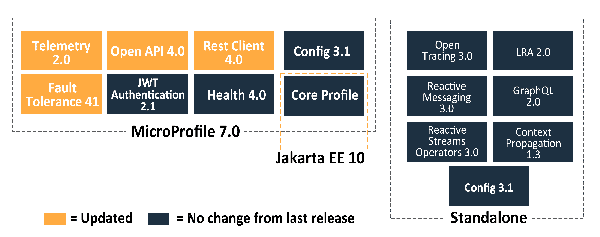

图 10.1：Eclipse MicroProfile 版本 7

除了 Jakarta EE 核心配置（core profile）之外，Eclipse MicroProfile 还包含其他关键项目，这些项目主要关注系统的架构和行为（例如微服务）。影响最大的之一的是 `Eclipse MicroProfile Config`，它允许动态配置管理和配置变量的外部化（如十二因素应用方法所提的）。除了 `Config` 之外，`Metrics` 项目也值得探索，因为它提供了开箱即用的应用程序性能和健康洞察，并为定义和暴露应用程序的新指标提供了一种简便的方法。

为了更好地理解 Eclipse MicroProfile 的功能，让我们探索它的关键规范，每种规范都旨在解决构建和维护云原生微服务的不同方面：

* `MicroProfile Config`：遵循十二因素应用方法，为应用程序提供外部化配置。
* `MicroProfile Fault Tolerance`：提供弹性机制，如重试、隔离和断路器。
* `MicroProfile Health`：定义健康检查以确保服务的可用性。
* `MicroProfile Metrics`：通过标准指标实现应用监控。
* `MicroProfile OpenAPI`：使用 OpenAPI 规范辅助 API 文档。
* `MicroProfile OpenTracing`：为微服务提供分布式追踪能力。
* `MicroProfile JWT Authentication`：启用基于 JSON Web Token 的身份验证。
* `MicroProfile Rest Client`：简化微服务之间基于 HTTP 的通信。
* `MicroProfile Reactive Messaging`：支持使用消息系统进行事件驱动通信。
* `MicroProfile GraphQL`：为 MicroProfile 应用添加对 GraphQL API 的支持。

MicroProfile 的一个关键特性是对其独立规范的支持。虽然它的许多功能基于 Jakarta EE，但有几个规范可以独立使用。这允许开发者只利用他们需要的，而无需采用整个 Jakarta EE Stack。例如，`MicroProfile Config`、`MicroProfile Metrics` 和 `MicroProfile Health` 可以集成到各种 Java 运行时，而不需要 Jakarta EE 的组件。这种模块化方法允许团队仅采用 MicroProfile 的核心部分，使其成为微服务和其他轻量部署的灵活选择。

随着进一步探索 Eclipse MicroProfile，我们将探讨每个项目如何有助于构建高效、可扩展且可维护的微服务架构。

## 将 Eclipse MicroProfile 与 DDD 集成

现代软件开发需要可扩展和可维护的架构，同时保持业务逻辑处于核心位置。DDD（领域驱动设计）提供了一种围绕业务领域构建应用程序的方法，确保了清晰性和长期适应性。与 Eclipse MicroProfile 结合时，开发者获得了强大的工具，可以在分布式、云原生环境中实现 DDD 原则。

Eclipse MicroProfile 通过提供轻量级规范扩展了 Jakarta EE，解决微服务特有的问题，例如外部化配置、可观测性和弹性。这些功能使团队能够设计专注于业务逻辑并能够处理现代分布式架构复杂性的服务。MicroProfile 为实现 DDD 模式提供了灵活的基础，确保技术问题不会掩盖核心领域模型。

虽然 DDD 强调保持领域模型的中心地位，但现实世界的实现通常需要额外的基础设施来支持扩展性、容错和监控。MicroProfile 通过关键规范弥补了这一差距，这些规范对 DDD 原则补充如下：

* `Contexts and Dependency Injection (CDI)`：作为 MicroProfile 的核心部分，`CDI` 实现了整洁代码设计，强制关注点分离并促进模块化，这对于高效组织领域逻辑至关重要。
* `MicroProfile Config`：它将配置外部化，保持领域模型的纯洁，允许业务逻辑不受特定环境设置的影响。
* `MicroProfile Fault Tolerance`：该功能使用重试、断路器和隔离保护关键领域操作免受故障影响，确保分布式环境中的领域完整性。
* `MicroProfile Metrics` 和 `Health`：通过提供领域服务行为的可视性支持可观测性。它帮助团队在影响业务流程之前监控性能并检测异常。
* `MicroProfile OpenTracing`：启用跨服务的分布式追踪，使调试领域驱动服务之间的交互变得更容易。
* `MicroProfile Reactive Messaging`：通过允许服务进行异步通信来支持事件驱动的 DDD 实现，与领域事件对齐并确保一致性。

下表说明了 Eclipse MicroProfile 规范如何有助于在微服务环境中实现 DDD。每种规范在维护纯洁领域模型的同时，有效处理配置、弹性和通信等基础设施问题都是至关重要的。通过集成这些功能，MicroProfile 允许开发者专注于业务领域，而不会被技术复杂性所困扰。

| MicroProfile 规范 | DDD 益处 |
| :--- | :--- |
| `MicroProfile Config` | 通过外部化配置将领域逻辑与基础设施分离。 |
| `MicroProfile Fault Tolerance` | 确保领域服务的弹性，防止故障传播。 |
| `MicroProfile Health` | 监控领域服务的健康状况，确保系统可靠性。 |
| `MicroProfile Metrics` | 提供领域服务行为的洞察，提高可维护性。 |
| `MicroProfile OpenTracing` | 启用跨多个微服务的领域交互追踪。 |
| `MicroProfile JWT Authentication` | 使用基于角色的访问控制保护领域服务。 |
| `MicroProfile Rest Client` | 简化微服务设置中边界上下文之间的通信。 |
| `MicroProfile Reactive Messaging` | 支持领域事件传播，实现最终一致性。 |
| `MicroProfile GraphQL` | 增强领域聚合根的查询能力。 |

表 10.1：Eclipse MicroProfile 组件

通过利用 Eclipse MicroProfile，开发者可以在现代云原生应用中有效应用 DDD（领域驱动设计）原则。强有领域模型与良好集微服务基础设施的结合，确保了业务关注点始终处于核心，同时受益于分布式系统的活性和韧性。

本节将探索如何在实践中应用这些概念。我们将使用具体的示例，演示如何利用 MicroProfile 的功能（例如 `Config`）来构建健壮的、以领域为中心的微服务。我们将看到 MicroProfile 如何通过实操实现，在真实应用中增强 DDD 原则。

## 微服务实践示例

我们将构建一个管理产品实体的微服务，用以演示如何使用 DDD 方法有效应用 Eclipse MicroProfile。Helidon 是一个提供 Eclipse MicroProfile 支持的运行时。尽管它支持多个 Jakarta EE 规范，但它不被认为是像 GlassFish 或 Open Liberty 那种完整的 Jakarta EE 实现。此实现将遵循结构化设计，在领域层、基础设施层应用层之间分离关注点，同时利用 MicroProfile 的功能（如 `OpenAPI`、`Config` 和 `Fault Tolerance`）。

在持久化方面，我们将使用 `MongoDB` 作为数据库，通过 `Jakarta NoSQL` 和 `Jakarta Data` 进行集成，并利用 `Eclipse JNoSQL` 实现。与第 8 章使用 Jakarta EE 企业级 Java 相比，配置上的主要区别在于通过驱动依赖将 `Oracle` 替换为 `MongoDB`，代码如下：

```xml
<dependency>
<groupId>org.eclipse.jnosql.databases</groupId>
<artifactId>jnosql-mongodb</artifactId>
<version>${jnosql.version}</version>
</dependency>
```

我们的微服务将遵循定义良好的结构，强制执行关注点分离，以确保模块化和可维护的架构。这种方法允许系统保持可扩展、可测试，并符合 DDD 原则，同时在多层有效利用 MicroProfile 的功能：

* 领域层：包含核心业务逻辑和领域实体。
* 基础设施层：管理数据库交互、外部依赖和配置。
* 应用层：使用 MicroProfile 特性暴露 RESTful 端点并处理 HTTP 请求。

在设置 `MongoDB` 驱动后，我们还需要更新配置以如下所示定义数据库连接：

```properties
jnosql.mongodb.url=mongodb://localhost:27017
# 必须定义数据库名称
jnosql.document.database=products
```

这是我们遇到的第一个 MicroProfile 规范：`MicroProfile Config`。它允许我们定义可以在不同环境中于修改的配置。例如，在本地运行应用时，可能不需要身份验证，但我们可以在不修改生产环境应用代码的情况下，配置安全凭据。`MicroProfile Config` 通过启用外部配置和特定环境覆盖，确保了灵活性和可维护性。

配置就绪后，下一步是定义领域模型。我们将在下一节中引入每个类并解释它们在领域包中的作用。

`Product` 类代表我们领域中的主实体。注意注解 `@Entity`，它使该类成为一个 `Jakarta NoSQL` 文档实体，并将被持久化到 `MongoDB` 中：

```java
@Entity
public class Product {
    @Id
    @Convert(ObjectIdConverter.class)
    private String id;

    @Column
    private String name;

    @Column
    private Manufacturer manufacturer;

    @Column
    private List<String> tags;

    @Column
    private Set<Category> categories;

    // Getters, equals, hashCode, and toString 方法
}
```

此类定义了一个具有 ID、名称、制造商、关联标签和类别的产品。它通过引入组合遵循了 DDD 原则，其中 `Manufacturer` 和 `Category` 类被建模为嵌入对象，而不是独立的实体。

`Manufacturer` 类代表一个值对象，意味着它没有唯一标识，是 `Product` 文档的一部分。

```java
@Embeddable(Embeddable.EmbeddableType.GROUPING)
public record Manufacturer(@Column String name, @Column String address, 
                           @Column String contactNumber) {
}
```


通过嵌入`制造商详情`，我们避免了不必要的关联并维护了自包含的产品实体。`@Embeddable(Embeddable.EmbeddableType.GROUPING)`注解确保`Manufacturer`对象作为子文档存储在`Product`文档内部，将相关信息聚合在一起。这与关系型数据库不同，在关系数据库中，嵌入对象通常会被扁平化到同一张表中。如果使用`EmbeddableType.FLAT`，则`Manufacturer`的字段将直接合并到`Product`文档中，而不是分组为子文档。

同样，`Category`类也是一个值对象，将产品分类在多个类别下。

它被标记为`@Embeddable(Embeddable.EmbeddableType.GROUPING)`，意味着它的属性将作为子文档存储在 MongoDB 的`Product`文档中。如果使用`EmbeddableType.FLAT`，其属性将作为主`Product`文档的一部分，而不是嵌套结构。

```java
@Embeddable(Embeddable.EmbeddableType.GROUPING)
public record Category(@Column String name, @Column String description) {
}
```

`ProductRepository`接口处理数据持久化。它是`Jakarta Data`规范的一部分，该规范提供了一种为 Jakarta 应用定义仓库的标准方法。扩展`BasicRepository`可以实现自动的 CRUD 功能，而无需显式实现，从而实现了简洁且声明式的数据访问方法。

```java
@Repository
public interface ProductRepository extends BasicRepository<Product, String> {
}
```

在领域模型和仓库准备完成后，下一步是实现应用层。该层使用 MicroProfile 特性（如`OpenAPI`和`Fault Tolerance`）暴露 RESTful 端点。

作为下一步，我们关注应用层，在暴露领域模型的同时确保其与外部关注点隔离。目标是提供一个清晰的接口，而不让依赖污染领域逻辑。我们使用数据传输对象（DTO）将领域模型与应用层分离来实现这一点。在示例中，我们利用`MapStruct`在实体和 DTO 之间自动转换，减少了手动映射工作并保持代码简洁。

更少的代码简化了开发并提高了可维护性，这是设计清洁架构时考虑的一个重要原则。

这种隔离的另一个方面是独立于领域模型定义`OpenAPI`文档。与其直接注解实体（可能会暴露不必要或敏感信息），我们使用 DTO 来精确控制共享的内容。

我们在`Request`和`Response`对象中使用 DTO 以确保一致性。对于如何处理这一点没有严格的行业标准，开发者采取不同的方法，包括：

- 在请求和响应中使用同一个 DTO 类。
- 创建单独的`ProductRequest`和`ProductResponse`类，并在其中封装一个`ProductDTO`。
- 在不同的`ProductRequest`和`ProductResponse`类中重复字段。

最后一种方案（重复字段）是不推荐的，因为它增加了维护负担而没有产生价值。

`CategoryDTO`类代表产品的类别，并确保通过 API 仅暴露相关信息如下：

```java
@Schema(description = "代表产品的类别.")
@JsonbVisibility(FieldVisibilityStrategy.class)
public class CategoryDTO {
    @Schema(description = "类别的名称.")
}
```

## ManufacturerDTO

`ManufacturerDTO`类封装了制造商信息，同时确保只通过 API 共享必要的细节。通过使用此 DTO，我们保持了领域模型的纯洁，并防止了领域相关逻辑无意中暴露给应用层。这种方法通过将外部表示与内部业务逻辑解耦，增强了可维护性和安全性。

```java
@Schema(description = "代表产品的制造商。")
@JsonbVisibility(FieldVisibilityStrategy.class)
public class ManufacturerDTO {

    @Schema(description = "制造商名称.")
    private String name;

    @Schema(description = "制造商的地址.")
    private String address;

    @Schema(description = "制造商的联系电话.")
    private String contactNumber;

    // Getters, setters, equals, hashCode, and toString methods
}
```

## ProductDTO

`ProductDTO`类作为产品的 DTO，确保只通过 API 暴露必要信息，同时保持内部领域模型的纯洁。通过使用此 DTO，我们将领域逻辑与外部表示解耦，防止了不必要的依赖，并降低了暴露实现细节的风险。这种结构化的方法允许在修改外部契约时保持灵活性，而不影响核心业务逻辑。

```java
@Schema(description = "代表产品。")
@JsonbVisibility(FieldVisibilityStrategy.class)
public class ProductDTO {

    @Schema(description = "产品的唯一标识符.")
    private String id;

    @Schema(description = "产品名称.")
    private String name;

    @Schema(description = "产品的制造商详情.")
    private ManufacturerDTO manufacturer;

    @Schema(description = "与产品相关的标签.")
    private List<String> tags;

    @Schema(description = "产品所属的分类.")
    private Set<CategoryDTO> categories;

    // Getters, setters, equals, hashCode, and toString methods
}
```

## ProductMapper

在领域实体和 DTO 之间转换可能是乏味且易错误的，导致产生大量的样板代码。我们使用`MapStruct`，这是一个代码生成工具，它在编译时自动生成映射逻辑，以简化这一过程。这种方法减少了手动工作，并确保映射在不同应用层之间保持一致且可维护。

```java
@Mapper(componentModel = MappingConstants.ComponentModel.JAKARTA_CDI)
public interface ProductMapper {

    ProductDTO toDTO(Product product);

    Product toEntity(ProductDTO productDTO);

    ManufacturerDTO toDTO(Manufacturer manufacturer);

    Manufacturer toEntity(ManufacturerDTO manufacturerDTO);

    CategoryDTO toDTO(Category category);

    Category toEntity(CategoryDTO categoryDTO);
}
```

## ProductService

`ProductService`类充当领域层和 API 之间的桥梁，确保业务逻辑正确执行，同时独立于 HTTP 特有的关注。该服务通过封装查询、保存和删除产品等操作，保持了职责的清晰分离，防止 REST 层直接与持久层交互。这种设计提升了可维护性、重用性和可测试性，使得未来适应和扩展系统变得更加容易。

```java
@ApplicationScoped
public class ProductService {

    private final ProductRepository repository;
    private final ProductMapper mapper;

    @Inject
    public ProductService(ProductRepository repository, ProductMapper mapper) {
        this.repository = repository;
        this.mapper = mapper;
    }

    public List<ProductDTO> findAll(PageRequest request, Order<Product> order) {
        return repository.findAll(request, order).content().stream()
                .map(mapper::toDTO)
                .toList();
    }

    public ProductDTO save(ProductDTO product) {
        return mapper.toDTO(repository.save(mapper.toEntity(product)));
    }

    public void deleteById(String id) {
        repository.deleteById(id);
    }

    public Optional<ProductDTO> findById(String id) {
        return repository.findById(id);
    }
}
```

`ProductService`类充当领域层和 API 之间的桥梁，确保业务逻辑正确执行，同时独立于 HTTP 特有的关注。该服务通过封装查询、保存和删除产品等操作，保持了职责的清晰分离，防止 REST 层直接与持久层交互。这种设计提升了可维护性、重用性和可测试性，使得未来适应和扩展系统变得更加容易。

通过使用此 DTO，我们将领域逻辑与外部表示解耦，防止了不必要的依赖，并降低了暴露实现细节的风险。这种结构化的方法允许在修改外部契约时保持灵活性，而不影响核心业务逻辑。

```java
@Schema(description = "代表产品。")
@JsonbVisibility(FieldVisibilityStrategy.class)
public class ProductDTO {

    @Schema(description = "产品的唯一标识符.")
    private String id;

    @Schema(description = "产品名称.")
    private String name;

    @Schema(description = "产品的制造商详情.")
    private ManufacturerDTO manufacturer;

    @Schema(description = "与产品相关的标签.")
    private List<String> tags;

    @Schema(description = "产品所属的分类.")
    private Set<CategoryDTO> categories;

    // Getters, setters, equals, hashCode, and toString methods
}
```

在领域实体和 DTO 之间转换可能是乏味且易错误的，导致产生大量的样板代码。我们使用`MapStruct`，这是一个代码生成工具，它在编译时自动生成映射逻辑，以简化这一过程。这种方法减少了手动工作，并确保映射在不同应用层之间保持一致且可维护。

```java
@Mapper(componentModel = MappingConstants.ComponentModel.JAKARTA_CDI)
public interface ProductMapper {

    ProductDTO toDTO(Product product);

    Product toEntity(ProductDTO productDTO);

    ManufacturerDTO toDTO(Manufacturer manufacturer);

    Manufacturer toEntity(ManufacturerDTO manufacturerDTO);

    CategoryDTO toDTO(Category category);

    Category toEntity(CategoryDTO categoryDTO);
}
```

`ManufacturerDTO`类封装了制造商信息，同时确保只通过 API 共享必要的细节。通过使用此 DTO，我们保持了领域模型的纯洁，并防止了领域相关逻辑无意中暴露给应用层。这种方法通过将外部表示与内部业务逻辑解耦，增强了可维护性和安全性。

`ManufacturerDTO`类封装了制造商信息。

```java
@Schema(description = "Represents the manufacturer of a product.")
@JsonbVisibility(FieldVisibilityStrategy.class)
public class ManufacturerDTO {

    @Schema(description = "Name of the manufacturer.")
    private String name;

    @Schema(description = "Address of the manufacturer.")
    private String address;

    @Schema(description = "Contact number of the manufacturer.")
    private String contactNumber;

    // Getters, setters, equals, hashCode, and toString methods
}
```

## ProductResource

`ProductResource`类作为 REST 层的实现。MicroProfile OpenAPI 注解提供了自动文档文档，使得端点易于发现。通过封装查询、保存和删除产品等操作，保持了职责的清晰分离，防止 REST 层直接与持久层交互。这种设计提升了可维护性、重用性和可测试性，使得未来适应和扩展系统变得更加容易。


```java
@ApplicationScoped
@Path("/products")
@Tag(name = "Products", description = "Operations related to product")
public class ProductResource {

    private final ProductService service;

    @Inject
    public ProductResource(ProductService service) {
        this.service = service;
    }

    @GET
    @Operation(summary = "Retrieve a paginated list of products")
    public List<ProductDTO> get(@QueryParam("page") @DefaultValue("1") int page,
                               @QueryParam("size") @DefaultValue("10") int size) {
        return service.findAll(PageRequest.of(page).size(size), Order.by(Sort.asc("name")));
    }

    @POST
    @Operation(summary = "Create a new product")
    public ProductDTO insert(ProductDTO product) {
        return service.save(product);
    }

    @DELETE
    @Path("{id}")
    @Operation(summary = "Delete a product by ID")
    public void delete(@PathParam("id") String id) {
        service.deleteById(id);
    }

    @GET
    @Path("{id}")
    @Operation(summary = "Find a product by ID")
    public ProductDTO findById(@PathParam("id") String id) {
        return service.findById(id)
                .orElseThrow(() -> new WebApplicationException("Product not found", Response.Status.NOT_FOUND));
    }
}
```

### Running the Application

在测试 API 之前，请确保 MongoDB 数据库正在运行，以便应用程序连接并持久化数据。

要编译并执行应用程序，请运行以下命令：

```bash
mvn clean package && java -jar target/chapter-10.jar
```

一旦应用程序运行，开发者可以访问 OpenAPI UI，通过直观的 Web 界面可视化并交互可用的端点。通过导航到：`http://localhost:8181/openapi/ui/index.html`，用户无需外部工具即可探索 API 文档、测试端点并验证请求/响应结构。下图显示了我们通过 Schema 注解生成的 Swagger：

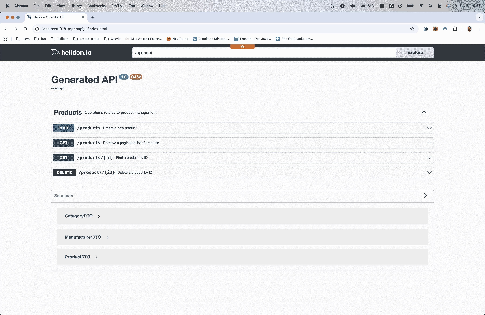

图 10.2: Helidon Open API 生成

## Conclusion

Eclipse MicroProfile 为开发具有弹性和可观测性的微服务提供了必要的工具。通过集成容错、健康检查和指标，我们确保了服务能够从故障中恢复、提供实时洞察并优化性能。这些能力对于构建在分布式环境中抵抗不可预测条件的健壮应用程序至关重要。

在后续的学习中，我们将结合 Quarkus 探索 DDD。Quarkus 是一个强大的框架，它在增强 `MicroProfile` 的同时为云原生应用优化了性能。在下一章中，我们将看到 Quarkus 如何实现更快的开发、缩启动时间并与 DDD 原则无缝集成，以构建高效可扩展的微服务。

## 记忆点

- `Eclipse MicroProfile`: 一个轻量级框架，通过扩展 `Jakarta EE` 的微服务特定能力，来增强云原生 Java 微服务。
- `MicroProfile Config`: 允许外部化配置，能够在不修改应用代码的情况下实现运行时灵活性。
- `Jakarta NoSQL`: 为集成如 `MongoDB` 等 NoSQL 数据库提供标准的 API，确保无缝的数据库交互。
- `MicroProfile OpenAPI`: 自动生成 API 文档，使 RESTful 服务更易访问并提高互操作性。
- `DTOs`: 帮助将领域逻辑与外部表示分离，防止领域模型直接暴露。
- `MapStruct`: 自动化 `DTOs` 与领域实体之间的对象映射，减少样板代码并提高可维护性。
- `Jakarta Data Repositories`: 通过提供声明式的 CRUD 操作方法来简化数据库交互，无需编写样板代码。
- `MicroProfile Rest Client`: 通过简化 HTTP 客户端实现方便微服务之间的通信。
- `Application layer isolation`（应用层隔离）：通过确保业务逻辑与基础设施关注点分离，保持领域模型的纯洁。
- `Next Step—Quarkus`：下一章将探索 Quarkus 如何增强 `MicroProfile`、改进启动时间并为云原生环境优化微服务。

## 多选题

1. `Eclipse MicroProfile` 的主要目的是什么？
   a. 用新框架替换 `Java EE`
   b. 为 Java 微服务提供轻量级的云原生能力
   c. 强制执行严格单体架构
   d. 更高效地管理关系型数据库连接
   e. 提高前端应用的性能

2. 哪种 `Jakarta EE` 规范包含在 `Eclipse MicroProfile` 中并有助于依赖注入？
   a. `Jakarta Persistence`
   b. `Jakarta Faces`
   c. `Contexts and Dependency Injection`
   d. `Jakarta Transactions`
   e. `Jakarta Batch`

3. `MicroProfile Config` 如何提高应用的灵活性？
   a. 通过将应用数据存储在关系型数据库中
   b. 通过允许配置属性外部化并在运行时覆盖
   c. 通过对环境变量执行严格的编译时检查
   d. 通过减少对任何配置文件的需求
   e. 通过自动加密所有应用设置

4. `Jakarta NoSQL` 在基于 `MicroProfile` 的应用程序中扮演角色？
   a. 它提供了与 NoSQL 数据库交互的标准 API
   b. 它强制开发者避免使用关系型数据库
   c. 它自动优化 SQL 查询以提高性能
   d. 它充作为高速数据访问的缓存机制
   e. 它完全替换了 `Jakarta Persistence`

5. 在基于 `MicroProfile` 的微服务中使用 `OpenAPI` 的主要好处是什么？
   a. 它自动生成 API 文档并提高互操作性
   b. 它通过加密 HTTP 请求增强安全性
   c. 它减少了对依赖注入的需求
   d. 它替代了 RESTful 端点的需求
   e. 它根据用户角色限制 API 访问

6. 使用 `DTOs` 对 `MicroProfile` 应用程序有什么好处？
   a. `DTOs` 替代了领域模型的需求
   b. `DTOs` 将领域模型直接暴露给 API 消费者
   c. `DTOs` 帮助将领域模型与应用层隔离
   d. `DTOs` 消除了对序列化和反序列化的需求
   e. `DTOs` 确保所有数据都存储在嵌入数据库中

7. `Jakarta Data` 中 `@Repository` 注解的目的是？
   a. 定义一个 RESTful API 端点
   b. 该类应作为 NoSQL 数据库实体
   c. 提供一个与数据库交互的接口，而无需编写样板查询
   d. 在存储库级别强制缓存
   e. 使用基于角色的访问保护数据库查询

8. 下列哪项最符合 `MapStruct` 在 `MicroProfile` 应用程序中的角色？
   a. 它自动生成领域实体与 `DTOs` 之间的映射代码
   b. 它替换了 `CDI` 作为默认的依赖注入机制
   c. 它通过优化实体关系增强数据库查询
   d. 它强制所有类都是不可变的
   e. 它为集成 `MongoDB` 提供 NoSQL 查询语言

9. 在 `MicroProfile` 应用程序中访问 `OpenAPI` UI 的正确方式是？
   a. `http://localhost:8181/api/docs`
   b. `http://localhost:8181/swagger-ui/index.html`
   c. `http://localhost:8181/openapi/ui/index.html`
   d. `http://localhost:8181/q/admin`
   e. `http://localhost:8181/open-tracing/visualizer`

10. 学习 `MicroProfile` 及其与 DDD 集成后的下一步是什么？
    a. 探索 Quarkus 如何增强 `MicroProfile` 的功能
    b. 将所有的 `MicroProfile` 配置替换为 YAML 文件
    c. 从 NoSQL 迁移到关系型数据库模型
    d. 在没有 `CDI` 支持的情况下实现微服务
    e. 移除 `Jakarta NoSQL` 以直接连接数据库

### 答案

| 题号 | 选项字母 |
| :--- | :--- |
| 1. | b. |
| 2. | c. |
| 3. | b. |
| 4. | a. |
| 5. | a. |
| 6. | c. |
| 7. | c. |
| 8. | a. |
| 9. | c. |
| 10. | a. |

本章将探索如何使用 Quarkus 进行 CDI。虽然可以使用数据库即服务（DBaaS）等外部服务运行数据库，但在本章中，关系型数据库将使用 H2 在内存中执行。

- Java 21
- Git
- Maven
- 任何优的 IDE

## 目标

本章将演示 Quarkus Panache 如何在符合 DDD 原则的同时简化数据库交互。通过探索三种不同的方法：`PanacheEntityResource`、使用 `PanacheEntity` 的活动记录（Active Record）模式，以及使用 `PanacheRepository` 的 Repository 模式，开发者可以清晰地理解如何平衡生产力、封装性和可维护性。本章提供了关于根据项目复杂度选择正确方法的实践见解，确保持久化逻辑在 DDD 架构中保持高效、可扩展且结构良好。

## Quarkus、Jakarta EE 和 MicroProfile 的集成

Quarkus 与 Jakarta EE 和 MicroProfile 紧密相，对这些规范提供了广泛支持，同时针对现代云原生环境对其进行了优化。在之前的章节中，我们探索了 Jakarta EE 如何为企业级 Java 应用提供坚实的基础，其特点是拥有依赖注入、事务管理、安全等成熟的 API。我们还讨论了 MicroProfile 如何通过引入为微服务定制的 API（如配置、容错、健康检查和指标）来增强 Java 开发。所有关于这些规范的信息都可以无缝应用到 Quarkus 中，通过对其进行高性能、快速启动和高效资源利用的优化，进一步增强了其能力。

Quarkus 核心支持广泛的 Jakarta EE API，确保了熟悉上下文和依赖注入（CDI）、Jakarta 持久化 API（JPA）、Jakarta RESTful Web Services（JAX-RS）以及 Jakarta JSON 绑定（JSON-B）等标准的开发者能够进行平滑过渡。与严重依赖运行时反射的传统企业应用运行时和框架不同，Quarkus 将大部分处理移动到了构建时（build time）。这种转变减少了内存开销并提高了执行速度，对于对启动速度和低资源消耗至关重要的容器化和无服务器环境特别有益。

MicroProfile 旨在增强用于微服务的 Jakarta EE，也被 Quarkus 全面采纳。它包含了关键规范，例如允许外部化和动态配置的 MicroProfile Config，以及能够为云原生部署提供内置就绪和存活探针的 MicroProfile Health。Quarkus 通过其统一配置模型增强了这些能力，提供了一种可重复且一致的应用程序配置方法，简化了跨环境的配置管理。MicroProfile 的观测性功能（如指标和追踪）与 Quarkus 无缝集成，使得监控和优化分布式应用程序变得更加简单。

除了兼容性，Quarkus 还积极贡献于企业 Java 的演进。像 CDI Lite 这样的功能灵感主要来自 Quarkus 高效的依赖注入模型，展示了其对广泛生态系统的影响。通过利用 GraalVM 进行原生编译，并针对云端优化 Jakarta EE 和 MicroProfile API，Quarkus 在保留其核心优势的同时使企业 Java 实现了现代化。开发者可以继续依赖众为人知的 Jakarta EE 和 MicroProfile 模式，同时从 Quarkus 的效率、灵活性云原生能力中受益。

Quarkus 并不是要取代 Jakarta EE 或 MicroProfile；而是要增强它们。它提供了两者的完美结合：企业 Java 规范的稳定性和成熟性，以及云原生开发的快速和轻量级特性。无论是构建传统应用、微服务还是无服务器函数，Quarkus 都能让开发者在利用熟悉技术的同时，充分利用现代优化优势。

Quarkus 构建在 Jakarta EE 和 MicroProfile 的坚实基础之上，使开发者可以使用熟悉的技术创建企业级应用，同时利用性能优化。让我们超越理论层面，看看 Quarkus 的实际运行。我们将探索其精简开发模型如何允许以最少的样板代码和最大的生产力来创建高效、轻量级的应用。

## Quarkus 的实战

现在我们已经探索了 Quarkus 的基础以及它与 Jakarta EE 和 MicroProfile 的连接，是时候将这些概念付诸实践了。

作为一名软件开发者，Quarkus 以简化开发和显著提高开发者生产力而闻名。它的深度集成允许毫不费力地设置，就像苹果生态系统的无缝体验一样，在 iPhone 上开始任务并在 Mac 上继续，感觉非常自然。类似地，Quarkus 简化了数据库连接。如果你添加 PostgreSQL 作为依赖项，Quarkus 可以自动启动一个基于 Docker 的实例，减少配置负担。这种程度的自动化创建了直观的开发体验，让开发者能够关注业务逻辑而非基础设施问题。

为了简化我们与数据库的集成，我们将使用 Panache，这是一个专为 Quarkus 设计的特定库，旨在简化持久化层的开发。Panache 通过减少样板代码同时保持整洁的领域模型，简化了 Quarkus 中的数据访问，使其成为 DDD 方法的极佳选择。

在示例中，我们将定义三个语义等同实体：开发者（developer）、程序员（programmer）和软件工程师（software engineer）。虽然它们在概念上代表相同的角色，但我们将使用它们来演示使用 Quarkus 构建资源结构的不同方法。探索多种方法将突出 Quarkus 如何在保持开发简洁高效的同时支持灵活性。

### 创建并设置新项目

第一步是创建一个 Quarkus 项目。你可以使用 Quarkus 网站快速生成，该网站提供了一个交互式界面来选择依赖项。对于此示例，我们将包含以下组件：

- `quarkus-rest`:在 Quarkus 中启用 RESTful API。
- `quarkus-rest-jsonb`:提供 JSON 序列化和反序列化。
- `quarkus-jdbc-h2`:配置内存 H2 数据库以便于测试。
- `quarkus-hibernate-orm-rest-data-panache`:使用 Hibernate ORM 和 Panache 简化数据访问。

项目设置完成后，我们准备好探索实现了。在下一节中，我们将定义实体并探索 Quarkus 允许我们将它们暴露为资源的不同方式。

### 配置数据库集成

在依赖项就绪后，下一步是配置应用程序属性以确保 Quarkus 正确设置数据库和 ORM 层。由于我们使用 H2 作为内存关系型数据库，我们在 `application.properties` 中定义了以下设置：

```
quarkus.datasource.db-kind=h2
quarkus.datasource.jdbc.url=jdbc:h2:file:../src/main/resources/data/database;AUTO_SERVER=true;DB_CLOSE_DELAY=-1
quarkus.hibernate-orm.dialect=org.hibernate.dialect.H2Dialect
quarkus.hibernate-orm.database.generation=drop-and-create
quarkus.hibernate-orm.log.sql=true
```


这些配置确保 Quarkus 初始化 H2 数据库实例，应用 Hibernate ORM 进行实体持久化，并记录 SQL 语句以便观察。`drop-and-create` 策略每次启动时重置数据库，非常适合开发和测试环境。

### Panache 实体和资源代码生成

让我们来看使用 Quarkus 暴露资源的第一种最直接的方法。我们只需要两个类：一个实体和一个接口，就可以在不编写额外逻辑的情况下创建一个功能完备的 REST API。

首先，我们使用 Jakarta Persistence 注解创建 `Developer` 实体。该实体扩展了 `PanacheEntity`，这是 Quarkus Panache 的一项功能，它通过提供内置的 CRUD 操作简化了实体管理。

```java
import io.quarkus.hibernate.orm.panache.PanacheEntity;

import jakarta.persistence.Column;
import jakarta.persistence.Entity;

@Entity
public class Developer extends PanacheEntity {

    @Column
    public String name;

    @Column
    public String email;

    @Column
    public String language;

    @Column
    public String city;
}
```

由于 `PanacheEntity` 已经包含一个自动生成值的 `ID` 字段，我们不需要显式地定义它。实体的字段代表了开发者的基本属性，为我们的演示提供了一个简单而实用的示例。

在 Quarkus 中，我们可以使用 `PanacheEntityResource` 将此实体作为 REST 资源暴露，从而消除了手动实现 REST 端点的需要。

我们所需要创建一个如下所示的接口：

```java
import io.quarkus.hibernate.orm.rest.data.panache.PanacheEntityResource;

public interface DevelopersResource extends PanacheEntityResource<Developer, Long> {
}
```

在定义开发者实体并使用 `PanacheEntityResource` 将其暴露为资源后，我们可以探索如何与此 API 交互。

### 验证应用程序的行为

由于 Quarkus 会自动生成必要的 RESTful 端点，我们可以在不编写额外代码的情况下执行操作。

通过发送带有所需数据的 `POST` 请求，我们可以向系统添加新开发者。使用 `curl`，我们可以执行以下命令来创建一个新的开发者条目：

```bash
curl -X POST "http://localhost:8080/developers" \
-H "Content-Type: application/json" \
-d '{
"name": "Alice",
"email": "alice@example.com",
"language": "Java",
"city": "San Francisco"
}'
```

一旦请求被处理，Quarkus 将新开发者持久化到 H2 数据库中。为了验证数据是否已正确存储，我们可以使用 `GET` 请求获取所有注册的开发者：

```bash
curl -X GET "http://localhost:8080/developers" -H "Accept: application/json"
```

如果我们需要根据 `ID` 获取特定的开发者，可以通过追加开发者的标识符来修改 `GET` 请求。假设我们创建的开发者被分配了 ID `1`，我们可以使用以下命令获取其详情：

```bash
curl -X GET "http://localhost:8080/developers/1" -H "Accept: application/json"
```

更新现有的开发者遵循类似的方法。如果 Alice 决定更改她偏好的编程语言或搬到新城市，我们可以发送带有更新后数据的 `PUT` 请求，同时保持相同的 ID：

```bash
curl -X PUT "http://localhost:8080/developers/1" \
-H "Content-Type: application/json" \
-d '{
"name": "Alice",
"email": "alice.new@example.com",
"language": "Kotlin",
"city": "New York"
}'
```

Quarkus 将更新现有记录的同时保持数据库的一致性。最后，我们可以发布一个 `DELETE` 请求从系统中删除开发者。例如，删除 ID 为 `1` 的开发者：

```bash
curl -X DELETE http://localhost:8080/developers/1
```

此命令将从数据库中删除相应的条目，确保在查询资源时它不再可用。这些简单的命令演示了 Quarkus 如何实现直观且高效的方法来处理 RESTful API。它需要极少的设置，同时保持了清晰且结构化的开发流程。现在我们已经探索了暴露资源的最直接的方法，可以转向其他实现方案，它们在利用 Quarkus 效率的同时提供了更多的控制和灵活性。

### 在 Panache 中使用 Active Record

继续上一个示例，之前我们探索了使用 `PanacheEntityResource` 将实体暴露为 REST 资源的最简单方法，现在我们转向以下方法：使用 `PanacheEntity` 使用 Active Record 模式。

> 注意：对于不熟悉 Active Record 模式的读者，这是一种设计方法，其中领域对象负责自身的持久化。这种设计模式的对象代表数据库表中的行，封装了数据库访问逻辑，同时允许将领域逻辑直接嵌入实体中。这一概念由 Martin Fowler 详尽记录，并被旨在简化持久化管理的框架广泛采用。

在此示例中，我们将遵循与之前相同的结构，但会引入一个额外的类来手动定义资源，从而对端点的行为提供更多控制。虽然我们仍然利用了 Quarkus Panache，但这种方法演示了开发者如何在保持清晰领域模型的同时构建更显式且可定制的 API。

第一步是定义 `SoftwareEngineer` 实体。与之前的示例一样，该实体扩展了 `PanacheEntity`，继承了内置的持久化方法。这意味着我们不需要手动指定 `ID` 字段或 CRUD 操作。但与之前的 `Developer` 示例不同，我们现在将依赖 `PanacheEntity` 的静态方法来查询和持久化数据。

```java
import io.quarkus.hibernate.orm.panache.PanacheEntity;

import jakarta.persistence.Column;
import jakarta.persistence.Entity;

@Entity
public class SoftwareEngineer extends PanacheEntity {

    @Column
    public String name;

    @Column
    public String email;

    @Column
    public String language;

    @Column
    public String city;
}
```

实体实体，我们现在定义资源类 `SoftwareEngineerResource` 来暴露服务。与之前使用接口不同，我们显式地实现了 REST 端点。这里的区别在于所有的 CRUD 操作都直接通过 Panache 的内置方法（如 `findById()`、`listAll()` 和 `persist()`）与 `SoftwareEngineer` 实体进行交互。

```java
import io.quarkus.panache.common.Sort;

import jakarta.enterprise.context.ApplicationScoped;
import jakarta.transaction.Transactional;
import jakarta.ws.rs.*;
import jakarta.ws.rs.core.MediaType;
import jakarta.ws.rs.core.Response;

import java.util.List;

@ApplicationScoped
@Path("software-engineers")
@Consumes(MediaType.APPLICATION_JSON)
@Produces(MediaType.APPLICATION_JSON)
public class SoftwareEngineerResource {

    @GET
    @Path("{id}")
    public SoftwareEngineer get(@PathParam("id") Long id) {
        SoftwareEngineer softwareEngineer = SoftwareEngineer.findById(id);

        if (softwareEngineer == null) {
            throw new WebApplicationException(404);
        }

        return softwareEngineer;
    }

    @GET
    public Response list() {
        List<SoftwareEngineer> softwareEngineers = SoftwareEngineer.listAll(Sort.by("name"));

        return Response.ok(softwareEngineers).build();
    }

    @GET
    @Path("/count")
    public long count() {
        return SoftwareEngineer.count();
    }

    @Transactional
    @POST
    public Response add(SoftwareEngineer softwareEngineer) {
        SoftwareEngineer.persist(softwareEngineer);

        return Response.ok(softwareEngineer).build();
    }

    @Transactional
    @PUT
    @Path("{id}")
    public Response update(@PathParam("id") Long id, SoftwareEngineer softwareEngineer) {
        if (SoftwareEngineer.findById(id) == null) {
            SoftwareEngineer.persist(softwareEngineer);

            return Response.status(Response.Status.CREATED).build();
        }

        SoftwareEngineer.persist(softwareEngineer);

        return Response.ok().build();
    }

    @Transactional
    @DELETE
    @Path("{id}")
    public void delete(@PathParam("id") Long id) {
        if (!SoftwareEngineer.deleteById(id)) {
            throw new WebApplicationException(Response.Status.NOT_FOUND);
        }
    }
}
```

> 提示：注意，`PUT` 端点被设计为等等操作，这意味着重复的相同请求将产生相同的结果且不会产生副作用，符合 REST 最佳实践。换句话说，如果该 ID 的实体存在，则进行更新；如果不存在，则创建一个。在生产环境中，务必验证严格的等等性是否符合需求。如果是，不存在的更新将通过 404 错误被拒绝。

此资源类显式地将 REST 端点映射到实体操作，在提供更大灵活性的同时，受益于 `Panache` 简化的数据访问。`SoftwareEngineer` 的静态方法执行所有数据库操作，例如获取、计数、创建、更新和删除记录。

我们可以使用与之前示例类似的 `curl` 命令来测试此 API。创建一个新的软件工程师条目可以通过以下 `POST` 请求完成：

```bash
curl -X POST "http://localhost:8080/software-engineers" \
-H "Content-Type: application/json" \
-d '{
"name": "Bob",
"email": "bob@example.com",
"language": "Python",
"city": "Berlin"
}'
```

对于获取、更新或删除 `SoftwareEngineer`，其原理与之前的示例相同，仅资源名称从 `developers` 更改为 `software-engineers`。`GET`、`PUT` 和 `DELETE` 请求遵循相同的结构，改为与 `/software-engineers` 端点进行交互。

此实现演示了活动记录（Active Record）方法如何通过直接允许实体类处理持久化逻辑来简化数据访问。虽然这种方法提供了一种快速且有效的管理数据库交互的方法，但某些应用程序需要更结构化的关注点分离。在下一步中，我们将探索另一种方法，利用存储库（Repositories）将持久化逻辑与领域模型进一步解耦，同时受益于 Quarkus `Panache` 的功能。

## 使用 Panache 使用存储库模式

探索 Quarkus Panache 的第三种也是最后的方法是使用 `PanacheRepository` 的存储库模式。与之前将持久化逻辑嵌入在实体本身的方法不同，这种方法显式地将数据库操作分离到专用存储库类中。这种方法通过将业务逻辑保持在领域层中并在独立的存储库中管理持久化问题，更符合传统的 DDD（领域驱动设计）原则。

为了演示这种方法，我们引入了 `Programmer` 实体。在结构上，它与我们之前的实体相同，但现在会将持久化操作委托给存储库，如下：

```java
import io.quarkus.hibernate.orm.panache.PanacheEntity;

import jakarta.persistence.Column;
import jakarta.persistence.Entity;

@Entity
public class Programmer extends PanacheEntity {

    @Column
    public String name;

    @Column
    public String email;

    @Column
    public String language;

    @Column
    public String city;
}
```

与之前的实现（我们使用 `PanacheEntity` 的内置方法或依赖 `PanacheEntityResource`）相比，这次我们引入了一个专用的存储库类。`ProgrammerRepository` 扩展 `PanacheRepository<Programmer>`，将所有数据库操作与领域模型独立封装：

```java
import io.quarkus.hibernate.orm.panache.PanacheRepository;

import jakarta.enterprise.context.ApplicationScoped;

@ApplicationScoped
public class ProgrammerRepository implements PanacheRepository<Programmer> {
}
```

存储库就绪后，我们现在实现通过 REST API 暴露 CRUD 操作的资源类。与依赖静态方法的 `SoftwareEngineerResource` 不同，此资源注入了 `ProgrammerRepository` 并将数据库操作委托给它：

```java
import io.quarkus.panache.common.Sort;

import jakarta.enterprise.context.ApplicationScoped;
import jakarta.inject.Inject;
import jakarta.transaction.Transactional;
import jakarta.ws.rs.*;
import jakarta.ws.rs.core.MediaType;
import jakarta.ws.rs.core.Response;

import java.util.List;

@ApplicationScoped
@Path("programmers")
@Consumes(MediaType.APPLICATION_JSON)
@Produces(MediaType.APPLICATION_JSON)
```


`public class ProgrammerResource` 是一个 JAX-RS 资源类，用于处理与 `Programmer` 实体相关的 HTTP 请求。该类通过 `@Inject` 注解注入了 `ProgrammerRepository`，并定义了多个 RESTful 端点来执行增删改查操作。

```java
public class ProgrammerResource {

    @Inject
    ProgrammerRepository repository;

    @GET
    @Path("{id}")
    @Produces("application/json")
    public Programmer get(@PathParam("id") Long id) {
        Programmer programmer = repository.findById(id);
        if (programmer == null) {
            throw new WebApplicationException(404);
        }
        return programmer;
    }

    @GET
    @Produces("application/json")
    public Response list() {
        List<Programmer> people = repository.listAll(Sort.by("name"));
        return Response.ok(people).build();
    }

    @GET
    @Path("/count")
    public long count() {
        return repository.count();
    }

    @Transactional
    @POST
    @Consumes("application/json")
    @Produces("application/json")
    public Response add(Programmer programmer) {
        repository.persist(programmer);
        return Response.ok(programmer).build();
    }

    @Transactional
    @PUT
    @Path("{id}")
    @Consumes("application/json")
    @Produces("application/json")
    public Response update(@PathParam("id") Long id, Programmer programmer) {
        if (repository.findById(id) == null) {
            repository.persist(programmer);
            return Response.status(204).build();
        }
        repository.persist(programmer);
        return Response.status(201).build();
    }

    @Transactional
    @DELETE
    @Path("{id}")
    public void delete(@PathParam("id") Long id) {
        if (!repository.deleteById(id)) {
            throw new WebApplicationException(404);
        }
    }
}
```

通过这种方法，所有数据库交互都通过 `ProgrammerRepository` 进行，使得在不修改领域实体的情况下更容易自定义和扩展持久化逻辑。存储库方法对于数据库操作需要自定义查询或不属于领域模型的逻辑复杂应用程序特别有用。

要创建一个新的程序员条目，我们可以发送以下 `POST` 请求：

```bash
curl -X POST "http://localhost:8080/programmers" \
-H "Content-Type: application/json" \
-d '{
"name": "Charlie",
"email": "charlie@example.com",
"language": "C++",
"city": "London"
}'
```

对于获取、更新或删除程序员的剩余操作与之前的示例相同。唯一的变化是资源名称，从 `developers` 或 `software engineers` 更改为 `programmers`。

此实现演示了 Quarkus Panache 中的存储库模式如何提供一种结构化且可扩展的方式来管理持久化。将数据库操作与领域模型解耦提供了更大的灵活性，同时受益于 Quarkus 的轻级持久化框架。通过此，我们探索了三种将 Quarkus Panache 集成关系型数据库的不同方法，每种方法在简单性、灵活性和架构控制之间都有不同的平衡。

最后一种方法是使用 `PanacheRepository` 的仓库模式，它引入了专用仓库类来处理持久化。将持久化逻辑与实体解耦非常符合 DDD（领域驱动设计），允许领域模型保持纯洁，同时使数据库操作相互独立。尽管这种方法比之前的方法需要更多代码，但它提供了最好的长期可维护性和扩展性，是复杂应用程序的理想选择。

### 从 DDD 视角使用 Panache

为了说明在使用 Panache 时活动记录（Active Record）模式与仓库模式之间的权衡，请考虑以下对比：

- 在 Active Record 方法中（使用 `PanacheEntity`），持久化方法直接嵌入在实体类中。这简化了简单 CRUD 操作的开发，但将领域逻辑与持久化混合在一起，可能违反 DDD 的关注点分离原则。
- 仓库模式（使用 `PanacheRepository`）将这些操作委托给单独的类，通过保持实体的纯洁，提高了复杂领域的可维护性。

下表根据生产力、封装性、性能以及与 DDD 原则的结合程度等关键因素，比较了每种方法的优点与权衡。这种对比突显了每种方法如何平衡简单性与可维护性，帮助开发者根据项目的复杂性和长期目标选择最合适的方法。

| 方法 | 生产力 | 封装性 | 定制化能力（新资源、DTO、分层分离） | DDD 结合度 |
| :--- | :--- | :--- | :--- | :--- |
| `PanacheEntityResource` | 非常高（全自动） | 低（直接暴露实体） | 非常有限（与实体紧耦合） | 低（不符合富领域模型） |
| Active Record (`PanacheEntity`) | 高（易于使用） | 中等（持久化与领域逻辑混合） | 中等（允许某些定制但仍有耦合） | 中等（嵌入的持久化可能导致领域污染） |
| 仓库模式 (`PanacheRepository`) | 中等（需要更多代码） | 高（关注点点分离） | 非常高（灵活支持 DTO、分层架构和自定义查询） | 高（非常符合富领域模型） |

表 11.1：Quarkus 方法分析

每种方法根据应用程序的复杂性和目标都有不同的用途。`PanacheEntityResource` 是快速原型开发和简单 CRUD 应用程序的理想选择，在这些情况下封装性不是主要考虑。Active Record 方法在保持简单性的同时提供了更大的活性，是需要轻量级持久化逻辑应用的极选择。尽管需要更多精力，但仓库模式为可维护、可扩展和领域驱动的应用程序提供了最好的结构。

最终，选择取决于项目需求。`PanacheEntityResource` 或 `PanacheEntity` 对于简单快速的开发很有帮助。然而，对于遵循 DDD 的应用程序，带有 `PanacheRepository` 的仓库模式是推荐的方法。这种模式将持久化逻辑与领域分离，使系统对变化更具适应性，同时保持了清晰的业务导向结构。

## 结论

本章探讨了 Quarkus Panache 如何简化 DDD 应用中的持久化，展示了三种具有不同灵活性和维护性水平的方法。我们从 `PanacheEntityResource` 开始，这是最自动化的选项，所需精力最少，但将 API 与领域模型紧密耦合在一起。随后，我们检查了 Active Record 方法，由实体管理自身的持久化，它提供了更多的控制，但将领域逻辑与数据库操作混合在一起。最后，我们实现了仓库模式，它将持久化从领域中完全解耦，为 DDD 应用程序的可维护性和扩展性提供了最好的结构。

每种方法服务于不同的需求，从快速原型设计到结构化的长期开发。虽然 `PanacheEntityResource` 和 Active Record 在简单性方面表现出色，但仓库模式为可维护的、业务驱动的应用程序提供了最好的平衡。在这一基础之上，下一章将关注 Java 最佳实践以完善 DDD 的实现，提供增强可维护性、强制领域边界和改进整体软件设计的策略。

### 记忆要点回顾

- Panache 简化了持久化：它减少了样板代码，并为 CRUD 操作提供了内置方法。
- 三种持久化方法：Quarkus 支持 `PanacheEntityResource`、`PanacheEntity`（活动记录）和 `PanacheRepository`（仓库模式）。
- `PanacheEntityResource` 最容易使用：它自动生成 REST 端点，但将 API 与实体紧密耦合在一起。
- Active Record (`PanacheEntity`) 平衡了简单性与灵活性：实体处理自身的持久化，减少了对仓库的需求，但混合了领域和持久化逻辑。
- 仓库模式 (`PanacheRepository`) 确保了关注点分离：它保持领域逻辑独立于持久化，使其成为符合 DDD 应用的最佳选择。
- 仓库模式的定制化能力最好：它允许使用 DTO、自定义查询和分层架构。
- 封装性从 `PanacheEntityResource` 提升到 `PanacheRepository`：方法越结构化，领域模型免受持久化关注问题的保护就越好。
- 所有方法的性能均保持高水平：Quarkus 高效优化数据访问，但架构选择对可维护性的影响大于原始性能。
- 根据项目复杂度选择正确的方法：简单的 CRUD 应用程序受益于 `PanacheEntityResource` 或 `PanacheEntity`，而复杂应用应使用 `PanacheRepository`。
- DDD 原则倾向于仓库模式：如果长期可维护性和扩展性是关键，将持久化逻辑分离到仓库是最佳策略。

## 单选题

1. 在 Quarkus 中使用 `PanacheEntityResource` 的主要优势是什么？
   a. 它以最少的精力完全自动化 CRUD 操作
   b. 它允许对数据库查询进行细粒度控制
   c. 它强制领域与持久化之间进行严格分离
   d. 它需要额外的配置才能正常运行
   e. 它防止实体的直接暴露

2. Active Record 模式如何与 Quarkus Panache 工作？
   a. 它完全解耦了领域逻辑与关注点
   b. 它使用静态方法将持久化逻辑嵌入实体内部
   c. 它依赖外部仓库管理数据库访问
   d. 它阻止开发者编写任何持久化代码
   e. 它仅适用于 NoSQL 数据库

3. 相比 `PanacheEntity`，使用 `PanacheRepository` 的主要优势是什么？
   a. 它不需要实体类
   b. 它确保了持久化逻辑的完全封装
   c. 与 `PanacheEntity` 相比它加快了数据库查询
   d. 它限制了定义自定义查询的灵活性
   e. 它不需要额外编码即可生成 API

4. 哪种方法为 DDD 应用提供了最好的逻辑封装？
   a. `PanacheEntityResource`
   b. 使用 `PanacheEntity` 的 Active Record
   c. 使用 `PanacheRepository` 的仓库模式
   d. 混合 `PanacheEntity` 和 `PanacheRepository`
   e. 使用没有 Quarkus Panache 的纯 JPA

5. `PanacheEntityResource` 的一个缺点是什么？
   a. 它需要手动实现 CRUD 操作
   b. 它在处理大数据集时存在性能问题
   c. 它将 API 与实体模型紧耦合
   d. 它强制使用 SQL 查询而不是 ORM
   e. 它不支持关系型数据库

6. 下列哪项最能描述 Quarkus 中的 `PanacheEntity`？
   a. 一个提供自动数据库事务的类
   b. 一种不需要注解的 JPA 替代方案
   c. 一个管理实体生命周期的内置存储库
   d. 一个通过 CRUD 操作简化实体持久化的基类
   e. 一个用于实现微服务的框架框架

## 7. 为什么在复杂应用中优先使用 Repository 模式？

a. 它消除了对持久层的需求
b. 它提供了更好的关注点分离和灵活性
c. 与 Active Record 方法相比，它需要的类更少
d. 它使应用程序独立于关系型数据库
e. 它通过移除未使用的依赖来减少内存消耗

## 8. 下哪项不是 Quarkus Panache 的特征？

a. 用最少的代码简化数据库交互
b. 允许通过 `PanacheEntityResource` 自动生成 API
c. 要求所有数据库操作都需要手动创建 SQL 查询
d. 同时支持 Active Record 和 Repository 模式
e. 为常见的 CRUD 操作提供内置方法

## 9. 使用 `PanacheEntity` 配合 Active Record 方法时，主要的权衡是什么？

a. 它完全阻止了仓库的使用
b. 它在实体中引入了领域逻辑与持久化逻辑的混合
c. 它需要大量的手动查询编写
d. 它不能与关系型数据库配合使用
e. 它仅与 NoSQL 数据库兼容

## 10. 什么时候应该考虑 `PanacheEntityResource` 而不是其他方法？

a. 需要对数据库操作进行精粒度控制时
b. 当需要以最小努力快速构建应用原型时
c. 当需要严格遵守 DDD 原则时
d. 在实现复杂的事务管理时
e. 在设计具有多个边界上下文的系统时

### 答案

| 编号 | 答案选项字母 |
| :--- | :--- |
| 1. | a. |
| 2. | b. |
| 3. | b. |
| 4. | c. |
| 5. | c. |
| 6. | d. |
| 7. | b. |
| 8. | c. |
| 9. | b. |
| 10. | b. |

## 参考文献

1. Commonhaus Foundation. (n.d.). Quarkus Project Generator. Retrieved from `https://code.quarkus.io/`
2. Fowler, M. (2003). Patterns of Enterprise Architecture: Active Record. Retrieved from `https://www.martinfowler.com/eaaCatalog/activeRecord.html`
3. `https://discordbonline.com`

![images/fm1]

# 第 12 章 DDD 的代码设计与最佳实践

## 引言

构建一个可维护且可扩展的系统需要符合领域驱动设计（DDD）原则的细致代码设计，因为领域模型的设计目标是具有表达性的、封装且防止误用的。然而，开发者往往会陷入创建“贫血模型”的陷阱，导致领域对象被简化为单纯的数据载体。本章探讨了必要的设计技术，以确保您的领域模型保持丰富、封装且具有适应性。我们首先检查贫血模型的陷阱以及如何拥抱丰富领域模型。接下来，我们将探索如 Builder 模式和流式 API 等强大的设计模式，这些模式可以增强代码的可读性和维护性。此外，我们还讨论了异常处理和日志的最佳实践，确保您的系统随时间推移保持可靠且易于调试。

长期维护性对任何软件系统都至关重要。如果不仔细关注代码质量，即使是设计良好的系统也会随着时间的推移而退化。本章涵盖了保持代码库整洁、可扩展和适应的策略。我们将专注于强化领域完整性的同时最小化技术债的重构技术。到本章结束，你将牢牢理解如何编写健壮的、以领域为中心的经受时间考验的代码。

## 结构

在本章中，我们将探索等主题：
* 贫血模型 vs 丰富模型
* DDD 中的流式 API vs. Builder 模式
* DDD 中的异常处理与日志记录
* 长期代码质量与可持续性

## 目标

本章探索了核心代码设计原则，这些原则增强了领域驱动应用的维护性和可扩展性。通过理解贫血模型和丰富模型之间的差异，利用流式 API 和 Builder 模式来实现更好的表达力，有效处理异常，并通过测试和文档确保长期的代码质量，开发者可以构建出在实际项目中平稳演进的韧性软件。

## 贫血模型 vs 丰富模型

在《洁洁代码》的作者 Robert C. Martin 在他的博客中讨论了“贫血对象”的概念，将其称为单纯的数据结构。他通过以下陈述强调了数据结构与对象之间的根本区别：“类使函数可见，同时保持数据隐式；数据结构使数据可见，同时保持函数隐式。”这种区分对于设计一个真正代表业务逻辑而非仅作为数据容器的领域模型来说至关重要。

丰富领域模型封装了状态和行为，只暴露与领域相关的操作；而贫血模型仅持有数据并将逻辑委托给外部服务。贫血模型缺乏封装，会导致业务规则分散在多个层中，导致代码重复、复杂性增加以及更高的一致性风险。考虑一个为简单网球赛进行建模的例子。

在贫血模型中，`Player` 类仅仅是一个持有数据的结构。它提供了 getter 和 setter，允许外部服务直接修改其状态。游戏逻辑并不存在于 `Player` 类内部，而是由另一个组件（如 `TennisGame` 类）在外部处理。

```java
class Player {
  private String name;
  private int score;

  public Player(String name) {
    this.name = name;
```


```
this.score = 0;
}

public String getName() {
    return name;
}

public int getScore() {
    return score;
}

public void setScore(int score) {
    this.score = score;
}

}

class TennisGame {
    private Player playerOne;
    private Player playerTwo;

    public TennisGame(Player playerOne, Player playerTwo) {
        this.playerOne = playerOne;
        this.playerTwo = playerTwo;
    }

    public void playerScores(Player player) {
        player.setScore(player.getScore() + 1);
    }

    public String getScore() {
        return playerOne.getScore() + " - " + playerTwo.getScore();
    }

}
```

虽然这种方法看起来简单，但它引入了一些设计问题。`Player` 类仅仅作为一个数据容器，没有任何管理其状态的责任。`TennisGame` 类承担了修改玩家分数的负担，这导致了游戏逻辑与数据操作之间的紧耦合。如果系统的其他部分想要更新玩家分数，它们必须遵循相同的外部模式，增加了服务之间逻辑重复的可能性。

丰富领域模型以不同的方式处理问题：

- 不再暴露原始数据，`Player` 类封装了它的状态，并提供了更新该状态的行为。
- 不再允许无限制的修改，模型规定了如何更新分数，将逻辑保持在它所属的地方。

修订后的实现确保了 `Player` 负责评分，从而产生更具内聚的设计，如下：

```java
class Player {
    private final String name;
    private int score;

    public Player(String name) {
        this.name = name;
        this.score = 0;
    }

    public String getName() {
        return name;
    }

    public int getScore() {
        return score;
    }

    public void scorePoint() {
        this.score++;
    }
}

class TennisGame {
    private final Player playerOne;
    private final Player playerTwo;

    public TennisGame(Player playerOne, Player playerTwo) {
        this.playerOne = playerOne;
        this.playerTwo = playerTwo;
    }

    public void playerScores(Player player) {
        player.scorePoint();
    }

    public String getScore() {
        return playerOne.getScore() + " - " + playerTwo.getScore();
    }
}
```

### 富领域模型（Rich Domain Model）的优势

这种方法提供了多好处。首先，状态被封装起来，确保了 `Player` 负责修改自己的得分。外部组件不需要直接操作状态，减少了更新不一致的风险。其次，这种设计通过将相关行为分组在拥有数据的实体内部增强了内聚性。`TennisGame` 类不再需要直接修改 `Player`；它简单地将得分动作委托给玩家。

贫血模型（anemic models）中的另一个常见问题是过度依赖 getter 和 setter，这导致了紧密耦合和不必要的数据暴露。当对象暴露其内部状态时，其他组件就会依赖于它们的结构，使得在不破坏现有代码的情况下很难演进模型。富模型方法通过仅提供领域上下文中有意义的操作来避免这个问题，最大限度地减少了依赖并提高了可维护性。

设计良好的富领域模型还简化了用例的实现。通过将逻辑封装在领域内部，服务类专注于业务编排，而不是直接处理业务规则。如果需要引入新的游戏规则（例如抢胜分系统），可以在 `Player` 内部实现，而不影响应用程序的其他部分。这降低了服务层的复杂性，使领域更具表达力和适应性。

在从贫血模型向富模型过渡的过程中，平衡封装与清晰度至关重要。并不是每个方法都属于实体内部。通常，只应该包含与实体本身直接相关的逻辑。特定于用例的行为仍应在服务层处理，以保持关注点分离。

下表总结了贫血模型与富模型之间的主要区别及其对 DDD 的影响：

| 特性 | 贫血模型 | 富模型 |
| :--- | :--- | :--- |
| 封装 | 缺乏封装；通过 getter/setter 暴露数据 | 封装状态；暴露行为 |
| 业务逻辑 | 业务规则存在于外部服务中 | 业务规则位于领域实体内部 |
| 内聚性 | 低内聚性；逻辑分散 | 高内聚性；逻辑局部位于对象内部 |
| 耦合性 | 高耦合：多个服务操作数据 | 低耦合：每个实体管理自己的状态 |
| 可维护性 | 由于逻辑重复，难以维护 | 更容易维护和演进 |
| 灵活性 | 难以在不影响多个组件的情况下进行修改 | 更改局部化在实体内部 |
| 与 DDD 的对齐度 | 对齐较弱，作为过程化设计 | 强对齐；自然地建模领域行为 |

表 12.1：贫血模型 vs. 富模型

封装和强领域建模是设计可维护系统的关键因素。从贫血模型向富模型转变显著改进了代码组织，使对象更加自主，并允许业务规则在更接近其所属实体的地方被执行。

通过关注行为而非仅仅数据来设计我们的领域模型，我们确保了系统对变化具有韧性，并在表示业务逻辑方面具有表达力。然而，设计这样的模型需要深思的设计技巧，特别是在处理复杂的对象创建时。为了应对这些挑战，我们可以利用像 Builder 模式和流式 API 等模式，我们将在接下来探索它们。

## DDD 中的流式 API 与 Builder 模式

编写整洁可读的代码是软件开发人员的首要任务，因为它使维护和协作变得更容易管理，并增强了代码库的整体价值。流式 API（Fluent API）是一种强大的设计方法，促进整洁且富有表达力的代码。通过允许读起来像句子的方法链，流式 API 确保了业务逻辑保持直观并与领域模型一致。

2025 年，为了提高代码可读性，Eric Evans 和 Martin Fowler 在引入流式 API 概念时创建了领域特定语言（DSL）的概念。与传统方法不同（传统方法的调用是分散的，需要开发者花费大量精力去记忆或搜索），流式 API 允许引导、自然的方法调用流。这种设计提供了一种类似于在餐厅点餐的体验；每个选择都决定了后续的步骤，确保了整个过程的一致性和正确性。

Java 生态中的几个框架利用了流式 API 设计。由 Lukas Eder 领导的框架 JOOQ 允许通过方法链构建类型安全的 SQL 查询，消除了对冗长字符串格式 SQL 语句的需求。同样，Jakarta NoSQL 为与 NoSQL 数据库交互提供了流式接口，确保了 Java 应用与各种持久层之间的平滑集成。

Builder 模式通常与流式 API 进行比较，因为两者都依赖于方法链。然而，理解它们不同的用途至关重要：

- Builder 模式专注于逐步构建复杂对象，通常将验证推迟到调用 `build()` 方法时。
- 相比之下，流式 API 强制执行结构流，防止无效状态的产生。

两者的比较如下表所示：

| 特性 | Builder 模式 | 流式 API |
| :--- | :--- | :--- |
| 主要用例 | 逐步构建复杂对象 | 提供直观且领域特定的接口 |
| 实现易用性 | 更容易实现 | 需要深思的 DSL 设计和验证 |
| 方法顺序 | 方法可以任意顺序调用 | 强制执行逻辑调用顺序 |
| 错误处理 | 依赖 `build()` 方法中的验证 | 使用即时验证防止无效状态 |
| 灵活性 | 可能允许部分构建的对象 | 确保每一步都是有效的对象状态 |

表 12.2：Builder vs. 流式 API 模式

为了说明区别，考虑一个酒店预订系统。使用 Builder 模式，`HotelBooking` 实例是逐步构建，仅在调用 `build()` 时进行验证。

```java
class HotelBooking {
    private final String guestName;
    private final int nights;
    private final boolean breakfastIncluded;

    private HotelBooking(Builder builder) {
        this.guestName = builder.guestName;
        this.nights = builder.nights;
        this.breakfastIncluded = builder.breakfastIncluded;
    }

    public static class Builder {
        private String guestName;
        private int nights;
        private boolean breakfastIncluded;

        public Builder guestName(String guestName) {
            this.guestName = guestName;
            return this;
        }

        public Builder nights(int nights) {
            this.nights = nights;
            return this;
        }

        public Builder includeBreakfast(boolean breakfastIncluded) {
            this.breakfastIncluded = breakfastIncluded;
            return this;
        }

        public HotelBooking build() {
            return new HotelBooking(this);
        }
    }

    @Override
    public String toString() {
        return guestName + " booked for " + nights + " nights. Breakfast: " +
            (breakfastIncluded ? "Yes" : "No");
    }
}
```

使用这种模式的客户端将编写以下代码：

```java
HotelBooking booking = new HotelBooking.builder()
    .guestName("Alice")
    .nights(3)
    .includeBreakfast(true)
    .build();

System.out.println(booking);
```

请注意，`Builder` 模式并不强制执行逻辑顺序。相反，流式 API（fluent API）可以确保方法调用遵循有效的流程。以下展示了如何对其进行构建：

```java
class HotelBookingFluent {
    private String guestName;
    private int nights;
    private boolean breakfastIncluded;

    private HotelBookingFluent(String guestName) {
        this.guestName = guestName;
    }

    public static HotelBookingFluent bookFor(String guestName) {
        return new HotelBookingFluent(guestName);
    }

    public HotelBookingFluent nights(int nights) {
        this.nights = nights;
        return this;
    }

    public HotelBookingFluent withBreakfast() {
        this.breakfastIncluded = true;
        return this;
    }

    public String confirm() {
        return guestName + " booked for " + nights + " nights. Breakfast: " +
            (breakfastIncluded ? "Yes" : "No");
    }
}
```

通过这种方法，可以如下所示进行预订：

```java
String confirmation = HotelBookingFluent.bookFor("Alice")
    .nights(3)
    .withBreakfast()
    .confirm();
System.out.println(confirmation);
```

设计良好的流式 API 可以防止无效的方法序列。例如，强制要求在未指定天数的情况下无法确认预订，这使得 API 具有自解释性，并消除了对额外开发者文档的需求。

在 `Builder` 模式和流式 API 之间的选择取决于用例。`Builder` 模式非常适用于构建具有可选参数的对象，而流式 API 特别适用于创建具有表达力、引导式的交互，并强制执行正确的领域逻辑。在 DDD（领域驱动设计）上下文中，流式 API 自然地契合通用语言（Ubiquitous Language）原则，确保领域操作具有可读性并受到业务规则的约束。

通过在适当的地方利用流式 API，开发者可以创建出减少认知负载、提高可维护性并使领域逻辑更加直观的接口。设计健壮且可维护的系统的下一步是理解异常处理和日志记录，确保领域模型在生产环境中保持韧性和可追溯性。

# DDD 中的异常处理与日志记录

妥善处理异常是编写可维护且可靠应用程序的基础。异常对于识别执行过程中何时出现问题至关重要，并且对于管理数据不一致、强制业务规则以及提高系统韧性也是必不可少的。在 DDD 上下文中，结构良好的异常有助于将问题追溯到特定的领域关注点，使调试和故障排除更加高效。

创建有效的异常必须考虑以下三个关键方面：

- 定义合理的异常层次结构。
- 确保消息具有意义且可追溯。
- 在暴露异常细节时避免安全风险。

### 定义异常的层次结构

设计异常的第一步是建立一个与领域模型对齐的清晰层次结构。与其将异常散落在整个代码库中，不如结构化的方法可以确保错误可以分类并追溯到特定的业务关注点。根据 DDD 原则，异常应该以对领域有意义的方式命名。例如，异常可以从通用的公司级异常到信用卡处理系统中更具体的领域相关错误。

```java
public class MyCompanyException extends RuntimeException {
    public MyCompanyException(String message) {
        super(message);
    }

    public MyCompanyException(String message, Throwable cause) {
        super(message, cause);
    }
}

public class CreditCardException extends MyCompanyException {
    public CreditCardException(String message) {
        super(message);
    }

    public CreditCardException(String message, Throwable cause) {
        super(message, cause);
    }
}

public class CreditCardNotFoundException extends CreditCardException {
    public CreditCardNotFoundException(String message) {
        super(message);
    }

    public CreditCardNotFoundException(String message, Throwable cause) {
        super(message, cause);
    }
}
```

这种层次结构确保了如果抛出异常，它可以被立即识别为信用卡领域的一部分，而它属于更广泛的业务异常框架，从而简化了不同层级的异常处理，无论是在特定服务内部、应用层还是整个系统。

### 创建可追溯的异常消息

除了结构化异常之外，提供可追溯的异常消息也是至关重要的。良好的异常消息应该指示错误的发生，并提供足够的上下文来高效诊断问题。例如，在信用卡支付服务中，在异常消息中包含信用卡 ID 可以帮助精确确定是哪笔交易失败了。


```java
public void pay(UUID creditCardId, Product product) {
    LOGGER.info("Paying with credit card: " + creditCardId);
    LOGGER.fine("Paying for product: " + product);
    findById(creditCardId).orElseThrow(() ->
        new CreditCardNotFoundException("Credit card not found with the id: " +
        creditCardId)
    );
}
```

通过这种方法，当抛出`CreditCardNotFoundException`时，它将包含特定的信用卡 ID，从而更容易理解失败的原因并进一步调查。然而，虽然提供有用的细节很重要，但也必须考虑安全因素。

### 安全地处理异常和日志

异常处理中最容易忽视的方面之一是安全。在错误消息中暴露敏感信息会导致数据泄露和安全漏洞。在向客户端返回更通用异常消息的同时，记录详细的错误信息有助于在可追溯性和安全性之间取得平衡，如下：

```java
public void pay(UUID creditCardId, Product product) {
    LOGGER.info("Paying with credit card: " + creditCardId);
    LOGGER.fine("Paying for product: " + product);
    findById(creditCardId).orElseThrow(() -> {
        LOGGER.severe("Credit card not found with id: " + creditCardId); // 详细日志
        return new CreditCardNotFoundException("Credit card not found"); // 通用消息
    });
}
```

在这里，详细日志包含了用于调试的信用卡 ID，但返回的异常消息没有披露敏感细节。这防止了潜在攻击者收集系统内部信息，同时允许开发者调查故障。

日志是软件开发的另一个关键方面，特别是在生产环境中。适当的日志提供了有关应用程序行为的价值见解，有助于诊断问题并确保系统运行良好。良好的日志策略考虑了三个核心原则：记录相关信息、确保可追溯性和防止安全风险。

在记录信息时，使用合适的日志级别来区分不同类型的消息。Java 的日志 API 提供了多个级别，每个都有特定的用途：

- `SEVERE`：用于需要立即关注的严重故障。
- `WARNING`：指示潜在问题，例如过时的 API 或性能瓶颈。
- `INFO`：提供常规操作细节，例如何时启动或完成支付。
- `FINE`：用于详细调试信息，例如请求负载和执行细节。

考虑信用卡服务的日志实现如下：

```java
public class CreditCardService {
    private static final Logger LOGGER = Logger.getLogger(CreditCardService.class.getName());

    public void pay(CreditCard creditCard, Product product) {
        try {
            LOGGER.info("Paying with credit card: " + creditCard.getId());
            LOGGER.fine("Paying for product: " + product);
        } catch (Exception e) {
            LOGGER.log(Level.SEVERE, "Payment failed: " + e.getMessage(), e);
        }
    }
}

@Deprecated
public void deprecated(CreditCard creditCard, Product product) {
}
```

```java
LOGGER.warning("Deprecated method is called, use pay() instead. It
will be removed in the next release. The id: " + creditCard.getId());
}

}
```

通过使用适当的日志级别，开发者可以根据严重性过滤日志，从而更容易识别关键错误，而不会被过量的调试信息淹没。

日志也应该是可追踪的，特别是在处理高交易量的的系统中。包含`request IDs`或`entity IDs`等唯一标识符可以确保特定事件可以追溯到源头。

```java
public void pay(CreditCard creditCard, Product product) {
    try {
        LOGGER.info("Paying with credit card: " + creditCard.getId());
        LOGGER.fine("Paying for product: " + product);
    } catch (Exception e) {
        String errorMessage = String.format(
            "Payment failed: card id: %s and product id: %s. Error message: %s",
            creditCard.getId(), product.getId(), e.getMessage()
        );
        LOGGER.log(Level.SEVERE, errorMessage, e);
    }
}
```

在这里，日志消息同时包含了信用卡 ID 和产品 ID，确保了失败可以追溯到特定的交易。然而，安全性仍然是日志中的一个主要关注问题。在日志中暴露敏感数据（如信用卡号或用户密码）可能会导致安全漏洞。对敏感数据进行掩码可以符合安全标准，例如`支付卡行业数据安全标准`（`PCI DSS`）。

```java
public class CreditCard {
    private UUID id;
    private String number; // 仅存储最后四位
    private String password;

    public UUID getId() {
        return id;
    }

    @Override
    public String toString() {
        return "CreditCard{" +
        "id=" + id +
        ", number='" + number + '\'' +
        ", password= *****" +
        '}';
    }
}
```

通过重写`toString()`方法来对`password`进行掩码，日志对于调试仍然有用，同时不会暴露敏感信息。这种做法确保了日志符合安全标准，并防止了对关键数据的未经访问。

在`DDD`上文中，妥善处理异常和日志可以确保系统保持健壮、可追溯且安全。通过构建异常层次结构、提供有意义的消息并有效利用日志，开发者可以构建出不仅具有可维护性而且在生产环境中具有韧性的应用程序。日志记录和异常处理相辅相成，能够创建用于调试的透明软件，并抵御威胁。接下来的章节将探索如何维护长期代码质量并实施最佳实践，以维持可扩展且可维护的领域模型。

## 代码质量与可持续性

软件开发中最大的障碍之一是管理复杂性。随着系统的演进，它们不可避免地变得更加复杂，但一个巨大的挑战来自于`复杂性偏见`，即假设复杂的解决方案天生更优。许多开发者和架构师都会掉入这个陷阱，认为具有多个层级、抽象工厂和复杂模式的复杂设计将使系统面向未来。事实上，过度工程引入了不必要的间接，使得系统更难理解，并增加了长期维护成本。

虽然设计可扩展的架构并预见未来的变化至关重要，但必须始终优先考虑简单。过度复杂的代码库会成为负担，使得即使是微小的修改也变得风险巨大且昂贵。这是长期项目中反复出现的问题：今天做的技术决策必须由多年后可能不再包含原始开发者的团队能够维护。

然而，在讨论长期可持续性时，大多数文献集中在编写`整洁代码`和设计可扩展系统上。很少资源探讨项目生命周期多年后会发生什么。团队应该以结构化且主动的方式处理核心技术（如`JVM`和数据库）的增量更新。架构师应该确保系统保持适应性，而不需要不断重构。这些挑战超出了编写良好代码的范围；它们涉及持续的维护、知识留存和结构化的决策。

一个长期可持续的代码库不仅关乎开始时选择最好的模式或框架；它关乎确保系统在没有不必要的摩擦的情况下易演进。除了选择正确的抽象外，测试和文档在长期维护代码质量方面起着至关重要的作用。

测试良好的代码库为未来的变化提供了信心。没有测试，每次修改都变成一种赌博：这会引入回归或破坏现有功能吗？随着项目的增长，重构是不可避免的，如果没有测试，开发者可能会因为担心引入 Bug 而犹豫于改进系统。在长期项目中，测试充当了进化的保障，确保现有行为保持完好，同时允许引入新功能。结构良好的测试使得重构、优化和使系统的不同部分现代化更加安全，而无产生回归的风险。

然而，并非所有测试都有同等的价值。团队犯的最大错误是编写与实现细节紧密耦合而非业务行为的测试。随着时间的推移，此类测试会成为维护负担，即使功能没有变化，每次微小的代码重构都会破坏它们。为了确保测试随时间推保持价值，它们应该关注验证关键业务规则。测试应尽量减少复杂的设置以提高可维护性，并确保快速、可靠的执行，特别是在一致性至关重要的`CI/CD pipelines`中。

在维护良好的项目中，测试不仅是为了发现 Bug；它们让系统能够安全地增长。没有它们，恐惧驱动开发就会占据主导，每次更改都因为风险超过了收益而被延迟或拒绝。

文档通常是开发者之间产生挫败感的常见来源。它经常被视为事后考虑，一项耗费编写实际代码时间的枯燥任务。然而，在长期项目中，文档是团队最有价值的资产之一。没有适当的文档，每个新团队成员都必须依靠口头知识传递，这通常会导致误解、历史背景的丢失和昂贵的错误。

代码可能解释某些内容是如何实现的，但很少捕获为什么做出这些决定。随着时间的推移，需求发生了变化，过去看起来合理的技术决策现在可能不再符合逻辑。如果缺少文档，未来的开发者将无法看到过去的权衡。他们可能会花费几个甚至几天的时间来逆向工程实现背后的逻辑。

与通常认为的不同，文档并不意味着解释每一行代码。相反，适当的文档应该关注架构决策的动机，记录项目的历史演变，并帮助新开发者上手。当开发者加入团队时，他们不应该去推测为什么选择特定的设计模式或为什么存在看似冗余的逻辑。

文档与代码紧密结合并共同演进时最有效。当被视为一项独立任务时，它会迅速过时变得无关。最好的方法是将文档集成到开发流中，确保它是有机维护的而非事后补。

实用的文档策略包括：

- `README` 文件，作为项目的入口，总结其目的、主要组件和如何开始。
- `CHANGELOG`，跟踪修改，明确更改了什么、何时更改以及为什么。
- `C4 模型图`，提供系统架构的高层视图，允许开发者快速了解其结构，而无需深入代码。

通过保持文档轻量化并与代码库直接相关，团队可以在不产生过度开销的情况下保持清晰度。与其使用冗长且充满文字的手手册，不如简单而有意义的文档让未来的开发者快速理解决策背后的意图，而不仅仅是其实现方式。

长期代码质量并非为了追求完美，而是为了确保可持续性。一个成功的系统必须保持适应性、可理解性和扩展性，且没有不必要的复杂性。为了实现这一点，团队必须在简单性与持久之间取得平衡，并确保他们的选择不会为未来带来技术债。

一个可持续的软件系统不仅随着时间的推移而生存，还能适应并繁荣。通过关注可维护性、避免不必要的复杂性并将测试和文档嵌入核心实践，开发者可以构建出持久且健壮的应用程序。

软件的长期成功不仅在于今天写出出色的代码，更在于确保代码在明天、明年以及未来依然优秀。秉持这些原则，你拥有了正确的工具集来确保代码不仅功能完备，而且具有可持续性。

## 结论

构建一个可维护且可扩展的系统不仅需要遵循良好的编码实践，还需要符合`DDD`原则的深度设计选择。从构建丰富的领域模型到使用`fluent APIs`构建具有表达力且直观的接口、确保健壮的异常处理、利用日志实现可观测性，以及维护长期代码质量，每一个方面对于保持系统随时间的韧性都至关重要。避免复杂性偏差并关注简单性、测试和有意义的文档，可以确保软件保持适应性、易于演进并符合业务需求。

在我们到达最后一章时，我们反思了获得的更广泛教训。设计软件是关于编写代码和做出影响长期可维护性、开发者体验和业务敏捷性的决策。在下一章中，我们将探索最后的考虑因素，讨论有效应用这些原则的心态，以及如何在现实项目中维持精良软件的文化。

## 记住的要点

- 贫血模型（Anemic models）导致业务逻辑分散：它们只暴露数据而不封装行为，使得系统更难维护并增加了代码重复。
- 丰富模型（Rich models）封装了状态和行为：它们通过将领域逻辑保持在拥有它的实体附近，契合了`DDD`原则。
- `Fluent APIs`提高了可读性：它们允许方法链式调用和自然的操作流，使代码更加直观且自解释性。
- `Builder patterns`帮助构建复杂对象：它们为对象创建提供了分步进行的方法，同时确保了不可变性和清晰度。
- 异常层次结构改进了可追溯性：根据领域结构化异常有助于分类错误并简化调试。
- 安全的异常处理防止数据泄露：在内部记录详细的错误信息，而在外部仅暴露通用信息，以保护敏感信息。
- 日志对于系统可观测性至关重要：适当的日志级别有助于跟踪问题、改进监控并提供对系统行为的洞察。
- 自动化`tests`实现了安全重构：结构良好的`tests`验证了业务逻辑，确保系统在演进过程中保持可靠性。
- 文档保留了历史背景：记录动机和架构决策有助于新开发者快速上手并防止知识流失。
- 简单性确保了长期可维护性：避免复杂性偏差和过度工程，使代码库更具适应性且更容易演进。

## 单选题

1. 在`DDD`中，贫血模型的主要问题是什么？
   - a. 它封装了太多的业务逻辑，使模型缺乏灵活性
   - b. 它导致业务逻辑在服务之间分散，增加了维护复杂性
   - c. 它强制将所有领域逻辑放入数据库，使其难以扩展
   - d. 它消除了对仓库的需求，简化了数据访问
   - e. 它通过保持模型轻量化确保了更好的性能

2. 丰富模型与贫血模型有什么区别？
   - a. 丰富模型通过 getter 和 setter 暴露所有属性
   - b. 丰富模型将业务逻辑委托给外部服务
   - c. 丰富模型封装了状态和行为，减少了重复
   - d. 丰富模型避免封装以简化数据访问
   - e. 丰富模型主要用于日志记录和异常处理

3. 使用`fluent API`的关键优势是什么？
   - a. 它消除了对方法链的需求
   - b. 它减少了对领域逻辑封装的需求
   - c. 它让 API 更具可读性且自解释
   - d. 它强制执行严格的方法顺序，降低了灵活性
   - e. 它仅对像`JOOQ`这样的查询构建框架有用

4. `Builder pattern`与`fluent API`有什么区别？
   - a. `Builder pattern`强制执行严格的方法顺序，而`fluent APIs`没有
   - b. `Builder pattern`专注于构建复杂对象，而`fluent APIs`提供了领域特定的交互
   - c. `fluent API`仅用于企业级应用，而`Builder pattern`则不然
   - d. `Builder pattern`避免封装，而`fluent APIs`强制封装
   - e. `Fluent APIs`总是使用工厂，而`Builder pattern`不使用

5. 为什么在长期项目中结构化异常层次结构是重要的？
   - a. 为了保持异常通用化并避免不必要的细节
   - b. 为了确保所有异常在单个全局处理器中被捕获
   - c. 对错误进行有意义的分类，使调试和维护更简单
   - d. 防止需要记录错误，因为结构化异常提供了所有必要信息
   - e. 为了让异常更难以理解，迫使开发者提高调试技能

6. 安全处理异常的最佳实践是什么？
   - a. 向用户显示详细的堆栈跟踪以便更好地排故障
   - b. 记录详细的错误信息，但在外部仅暴露通用信息
   - c. 始终使用检查异常（checked exceptions）来强制显式处理
   - d. 避免记录异常以防止性能开销
   - e. 将异常存储在数据库中进行长期分析，而不是记录

7. 为什么日志在长期软件项目中至关重要？
   - a. 它通过提供对系统行为的可视化来识别问题
   - b. 它取代了文档的需求，因为日志包含了所有细节
   - c. 它减慢执行速度，确保更好的性能监控
   - d. 它应该只在生产环境中使用，而不是开发环境
   - e. 它消除了对调试工具的需求

8. 自动化测试在维护长期代码质量的主要作用是什么？
   - a. 它消除了手动代码审查
   - b. 它防止所有运行时错误
   - c. 它实现了代码库的安全重构和演进
   - d. 它通过描述系统行为来取代文档
   - e. 它们仅对短期项目有用

9. 为什么文档在长期软件项目中至关重要？
   - a. 它通过解释预期行为取代了测试的需求
   - b. 它确保开发者无需阅读代码即可理解系统
   - c. 它捕捉了历史决策并帮助新开发者上手
   - d. 它应该只关注语法解释，而不是业务背景
   - e. 它主要面向非技术利益相关者，而不是开发者

10. 如何让文档保持有效并更新？
    - a. 通过编写与代码分离的详尽文档手册
    - b. 通过使用文档即代码的实践，集成`README`、`changelogs`和架构图
    - c. 依靠口头解释而非书面文档


d. 仅记录主要版本而忽略较小的更改

e. 仅关注 API 文档并跳过业务逻辑解释

### 答案

| 题 | 选项字母 |
| :--- | :--- |
| 1. | b. |
| 2. | c. |
| 3. | c. |
| 4. | b. |
| 5. | c. |
| 6. | b. |
| 7. | a. |
| 8. | c. |
| 9. | c. |
| 10. | b. |

## 参考文献

1. Martin, Robert C. (2019). Objects and Data Structures. [`blog.cleancoder.com/uncle-bob/2019/06/16/ObjectsAndDataStructures.html`](https://blog.cleancoder.com/uncle-bob/2019/06/16/ObjectsAndDataStructures.html)

# 第 13 章：最后思考

## 引言

本章总结了关键洞察，并在我们结束对 Java 领域驱动设计（DDD）的探索时展望未来。我们将讨论领域叙事（domain storytelling），这是一种通过与领域专家进行引人入胜对话来捕捉业务流程的技术。这种方法帮助我们理解真实的需求和优先级，使能够开发出有效的软件解决方案。

此外，本章涵盖了关键的安全考量和实践建议，从而为 DDD 工具包补充了必要的指导，以帮助开发结构良好、健壮且安全的应用程序。此处介绍的内容旨在支持软件工程师的持续职业发展，使他们能够能够在现实场景中有效用应用 DDD 原则。

## 本章结构

在这一章中，我们将进一步探讨以下主题：

- 领域叙事简介
- 进阶阅读与持续探索

## 技术要求

对于最后一章，我们可以看到一些关于领域叙事的示例，如下：

- Java 21
- `Git`
- `Maven`
- 任何偏好的 IDE

## 目标

本章旨在通过演示如何使用 Java 应用策略性和战术性 DDD 概念，弥补 DDD 理论与实践之间的差距。通过领域叙事的视角，本章旨在展示如何提取业务知识、与通用语言（Ubiquitous Language）对齐、定义边界上下文（bounded contexts），以及从战略思维转向具体实现。通过领域建模、存储库设计和服务编排，目标是为你提供实用的工具，以构建真实反映其服务领域的软件，确保在业务需求演变时保持清晰的适应性。

## 领域叙事简介

在对 DDD 的探索中，我们强调了战术（tactics）让我们接近代码，但真正的精通来自于理解领域的战略方面。随着开发者晋为高级（Senior）、首席（Staff）及以上的职位，我们意识到编写代码往往是较简单的一部分。真正的挑战在于理解我们为什么要写代码，以及它是如何解决复杂的现实问题的。人们很容易被战术性 DDD 吸引，即直接与实体、聚合和代码结构工作；然而，忽视策略性 DDD 会导致与业务目标产生代价昂贵的错位。领域叙事为弥补这一差距提供了解决方案。

千年来，叙事一直是人类交流的核心，使社会在文字出现出现之前就能分享知识、历史和价值观。正如叙事保留了苏格拉底的思想和古希腊的神话一样，它也有澄清复杂业务流程的力量。在《Nexus: A Brief History of Information Networks from the Stone Age to AI》一书中，历史学家尤瓦·诺亚·哈拉里描述了信息网络如何通过口头故事开始，在社区内部创造了共同的理解。领域叙事将这种古代工具应用于现代软件设计，利用叙事来弥合领域专家与开发者之间的知识差距。

领域叙事旨在通过叙述涉及的流程、角色和任务来捕捉领域的本质。通过与领域专家视觉化地映射这些故事，我们创建了共同理解，明确了目标，识别了关键实体并定义了系统中意义边界。通过叙事的视角，领域专家可以快速确认开发团队是否理解了他们的故事。这个过程减少了误解，对齐了观点，并为更清晰、更有效的解决方案铺平了道路。

### 领域叙事的目的与益处

领域叙事不仅仅是一种需求收集的技术；它是一种多功能工具，使我们能够：

- 理解领域：团队成员通过叙述和可视化流程，对领域的核心概念和工作流建立共同理解。
- 建立共同语言：它弥合了沟通鸿沟，在技术和非技术参与者之间培养了共同词汇。
- 对齐利益相关者：领域叙事对齐了所有参与者：开发者、产品所有者领域专家，确保每个人对目标都有统一视图。
- 定义领域边界：这有助于划分清晰的边界，将领域组织成内心的部分，支持团队结构和软件架构。
- 设计真实的业务流程：该技术能够设计出可行且符合业务现实的软件支持流程。
- 将需求嵌入敏捷工作流：通过叙事，领域知识自然地转化为可以无缝集成到敏捷流程中的需求。
- 优化 IT 蓝图：领域叙事揭示了领域中的交互和依赖关系，提供了现有流程的可见性，并有助于整合和优化。

在 DDD 中，掌握战略上下文至关重要，而领域叙事是有效捕获它的强有力方法。这种方法优先考虑将复杂的业务叙述翻译为技术和非技术利益相关者之间的共同理解，而不是匆忙进入代码。虽然敏捷方法通常依赖于快速的头脑风暴，但领域叙事采取了结构化和系统化的方法，增强了清晰度和协作。本节坚定地确立了领域叙事的优势，特别是在与 [Egon.io](https://Egon.io) 等工具配合时，并在策略性 DDD 的框架下果断地与敏捷头脑风暴进行了对比。

领域叙事的主要益处之一是它能够建立一个可靠的、版本化的领域知识源。例如，[Egon.io](https://Egon.io) 等工具促进了领域叙事会议，使团队能够实时、协作地可视化和结构化领域叙述。[Egon.io](https://Egon.io) 轻量，不需要账户或跟踪，并直接在浏览器中运行，允许团队导出 JSON 格式的文件（`egn` 文件）。这些导出文件可以存储在 `Git` 中进行版本控制，与 GitOps 实践保持一致，并作为单一事实来源。这种方法对于在快速演变的领域中工作的团队是无价的，因为它让他们在适应业务变化的同时，保留领域知识的历史记录。

### 领域叙事与敏捷头脑风暴的区别

领域叙事和敏捷头脑风暴各有优劣，理解何时使用每一种对于 DDD 实践者至关重要。敏捷头脑风暴通常用于激发灵感和快速划分任务，而领域叙事旨在更深思虑地探索领域的复杂性，识别影响设计决策的关系、流程和关键实体。下表强调了领域叙事与敏捷头脑风暴的区别：

| 维度 | 领域叙事 | 敏捷头脑风暴 |
| :--- | :--- | :--- |
| 目的 | 深入理解领域流程和关系 | 快速生成想法并进行优先级排序 |
| 方法 | 与领域专家进行叙述化和可视化映射 | 自由形式的想法生成和讨论 |
| 输出 | 结构化的故事和视觉图表 | 优先级排序的想法或任务列表 |
| 利益相关者参与 | 领域专家、IT 和业务利益相关者的深度参与 | 主要是团队成员，可能包括产品负责人 |
| 重点 | 详细描述真实世界的工作流和交互 | 高层级构思，细节有限 |
| 工具 | 使用如 [Egon.io](https://Egon.io) 等支持版本控制、兼容 `Git` 的叙事工具 | 白板、便利签、数字白板 |
| 修订与版本控制 | 通过 JSON 文件（`.egn` 格式）支持版本控制 | 通常缺乏内置的版本控制 |
| 更新敏捷性 | 随着领域的演进于更新和版本化 | 随时间推移难以维护或跟踪 |
| 用例适用性 | 最适合提取和记录复杂的领域知识 | 理想用于冲刺计划、待办列表细化 |
| 协作风格 | 领域专家验证的协作式叙事 | 开发团队内部的快速节奏构思 |

表 13.1: 领域叙事 vs. 敏捷头脑风暴

领域叙事的结构化方法提供了一个额外优势，即创建能够反映领域真实世界复杂性的持久化文档。通过如 [Egon.io](https://Egon.io) 等工具，开发团队可以随着业务的增长和演进迭代地更新这些叙事。将叙事输出存储为兼容 `Git` 的 JSON 文件，使得领域知识易于访问和更新，为持续的项目对齐奠定了坚实基础。

相比之下，敏捷头脑风暴会议通常适用于开发冲刺内的短期对齐。它们关注即时的、高优先级的想法，而不需要详尽的细节。这种快速节奏的方法对于任务排序或细化待办列表非常有效，但缺乏领域叙事所提供的深度和长期视角。

### 探索领域叙事

因此，领域叙事在战略性 DDD（领域驱动设计）中特别有价值，因为将业务流程与软件设计对齐既需要细节也需要灵活性。将领域叙事与敏捷头脑风暴相结合，允许团队在即时战术需求与长期战略清晰之间取得平衡，确保每次项目迭代与不断演变的领域保持一致。

来自 Egon 的示例让领域叙事生动起来，展示了协作过程：领域专家讲述故事，开发者以视觉序列将其记录，然后由专家进行评审和修正。这种循环工作流强调了 DDD 中共享理解的重要性。通过遵循这种结构化的叙事方法，团队利用了通用语言（Ubiquitous Language）和领域上下文，这使得将这些概念转换为代码变得可能。请参考下图：

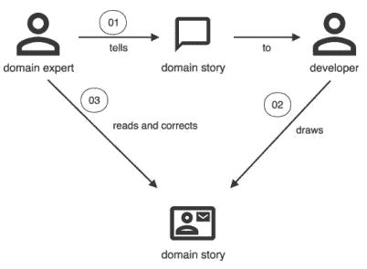

图 13.1: 使用 Egon 的领域叙事第一个示例

这张领域叙事的图表为建模此类过程所需的 Java 实体提供了宝价值的见解。在这一视觉叙事中，我们可以看到几个支撑故事结构和流程的战略性 DDD 元素。例如，由于每个角色和动作都在更广泛的领域中被上下文化，上下文映射（context mapping）变得显而易见，建立了帮助我们理解特定交互何时开始和结束的边界。它有助于定义边界（bounded contexts），即领域中概念和行为具有特定含义的独立区域。此外，通用语言（Ubiquitous Language）自然产生，因为领域专家和开发者始终使用共享的术语和定义来描述操作和实体。通过领域叙事，我们可以观察这些战略元素如何形成对领域结构的共同理解，确保所有利益相关者在深入代码之前在核心概念上达成一致。

在 DDD 的战术方面，我们可以将这种共享理解直接转换为 Java 实体，如 `DomainStory`、`DomainExpert` 和 `Developer`。每个实体代表了 Egon 图示中显示的执行者和阶段，而仓库（repositories）确保了这些演进故事的持久化存储和生命周期管理。服务（Services）则充当中介，随着领域故事通过草稿、评审和批准等各个阶段，管理交互和更新。参考以下代码：

```java
@Entity
public class Developer {
    @Identity
    private final UUID id;
    private final String name;
    @Association
    private List<DomainStory> domainStories;

    public Developer(UUID id, String name) {
        this.id = id;
        this.name = name;
    }
    ...
}

@Entity
public class DomainExpert {
    @Identity
    private final UUID id;
    private final String name;

    @Association
    private List<DomainStory> domainStories;

    public DomainExpert(UUID id, String name) {
        this.id = id;
        this.name = name;
    }
    ...
}

@AggregateRoot
public class DomainStory {
    @Identity
    private final UUID id;
    private final String title;
    private StoryStatus status;
    @Association
    private final DomainExpert domainExpert;
    @Association
    private final Developer developer;

    public DomainStory(UUID id, String title, DomainExpert domainExpert, Developer developer) {
        this.id = id;
        this.title = title;
        this.status = StoryStatus.DRAFT;
        this.domainExpert = domainExpert;
        this.developer = developer;
    }

    public void setStatus(StoryStatus storyStatus) {
        this.status = storyStatus;
    }
    ...
}

@ValueObject
public enum StoryStatus {
    DRAFT,
    REVIEWED,
    APPROVED
}
```

`DomainStoryRepository` 在维护此框架的领域故事生命周期方面起着核心作用。该仓库通过定义创建、检索、更新和删除 `DomainStory` 实体的方法，支持图中所示的领域叙事过程。仓库的设计确保了领域故事的访问抽象了存储细节，允许开发者关注领域故事的流而非持久化的复杂性。

```java
@Repository
public interface DomainStoryRepository {
    DomainStory save(DomainStory domainStory);
    Optional<DomainStory> findById(UUID id);
    List<DomainStory> findAll();
    void deleteById(UUID id);
}
```

`DomainStoryService` 作为仓库与应用程序其他部分之间的中介，协调 `DomainStory` 实体的生命周期并验证业务规则。它提供了与领域故事交互的方法，管理它们在草稿、评审和批准等各个阶段的转换。该服务层还确保对领域故事的每个操作都符合叙事过程中捕获的战略目标，维护通用语言并保持应用程序的一致性。通过封装管理领域故事的逻辑，`DomainStoryService` 允许开发者专注于实现业务叙事工作流，而无需直接处理数据持久化的细节，如下：

```java
@Service
public class DomainStoryService {
    private final DomainStoryRepository domainStoryRepository;

    public DomainStoryService(DomainStoryRepository domainStoryRepository) {
        this.domainStoryRepository = domainStoryRepository;
    }

    public DomainStory createDomainStory(DomainStory story) {
        story.setStatus(StoryStatus.DRAFT);
        return domainStoryRepository.save(story);
    }

    public DomainStory updateDomainStoryStatus(UUID storyId, StoryStatus newStatus) {
}
```

```java
DomainStory story = domainStoryRepository.findById(storyId)
    .orElseThrow(() -> new RuntimeException("DomainStory not found"));

story.setStatus(newStatus);

return domainStoryRepository.save(story);
}
```

随着 `DomainStoryRepository` 和 `DomainStoryService` 的建立，我们为在基于 Java 的 DDD 应用中实现领域故事化奠定了基础。这种配置符合上下文映射（context mapping）和通用语言（Ubiquitous Language）等战略性 DDD 原则，并通过将这些概念转化为实体（entities）、存储库（repositories）和服务（services）来支持战术性 DDD。

本书之际，关于领域故事化及其在 DDD 中应用的这些基础知识将使你能够进一步探索并掌握战略性软件设计的艺术。接受这些技术允许你将 DDD 扩展到编码策略之外，最终培养出真正与其领域产生共鸣的软件。

## 进阶阅读与持续探索

本书的结尾处邀请读者反思 DDD 更广泛的背景及其在基于 Java 的系统中的应用。这项工作并不能取代或削弱该领域既有文献的价值；而是通过提供为 Java 开发者定制的实用且注重实现的视角来对其进行补充。正如初始章节中所强调的，书中内容大量借鉴了该领域的基石著作和受尊敬的参考文献。这些来源至关重要，强烈鼓励读者查阅它们，以获得更全面、多维的 DDD 理解。一个全面的软件工程师建立在他人知识之上，这一理念被封装在“站在巨人肩膀上”的原则中。

书中反复强调的一个关键解是：在考虑如何构建之前，理解构建什么非常重要。这仍然是软件开发中最持久的挑战之一。虽然编码是软件工程不可或缺的一部分，但通过战略思维将解决方案与业务目标对齐的能力，是熟练开发者与高影响力工程师的区别。正因如此，本书在进入战术实现之前，强调了 DDD 背后的基本原理以及战略设计的作用。保持这种心态对于创建不仅具有功能，而且具有意义、可持续性并与其寻求解决的现实问题对齐的软件至关重要。

## 结论


在最后一章中，我们通过领域故事化考察了 DDD 的实际应用。我们强调了统一通用语言（Ubiquitous Language）、理解上下文边界（`context boundaries`）以及将领域结构化是创建清晰且有意义软件的基础原则。

通过分析存储库和服务的示例，我们展示了战略洞察结合战术实现如何允许开发者构建能够反映业务需求并随时间演变的系统。这种方法确保了我们的代码和架构在业务演进时保持相关性。

我们的目的是桥接理论与实践之间的鸿沟，通过实践示例让 Java 开发者能够接触 DDD。每一节都为你配备了定义实体、存储库以及管理服务的实用工具，而所有这些都在更广泛的领域上下文中。这个工具包为了你在项目中实施领域故事化和 DDD 原则。记住，DDD 是一个持续学习的过程，将帮助你在 Java 及其他领域创建适应性强的应用程序。

## 记忆点

- **先理解后编码**：软件开发中最大的错误是在没有完全理解问题的情况下跳入编码。战略性 DDD 通过关注“为什么”而不是“如何做”来帮助缓解这一点。
- **领域故事化作为桥梁**：领域故事化连接了领域专家和开发者，确保知识被准确捕捉并转换为软件设计。
- **通用语言是关键**：业务团队与开发团队之间的共享词汇可以防止误解，并保持模型与现实需求保持一致。
- **边界上下文定义了清晰的边界**：每个上下文都有自己的语言和业务逻辑，确保了清晰性并减少了大型系统中不必要的复杂性。
- **存储库处理持久化而非业务逻辑**：`Repository` 模式抽象了数据访问，允许业务规则留在领域层。
- **服务编排领域行为**：`Services` 管理领域工作流，确保实体和值对象以结构化的方式交互。
- **适应性至关重要**：DDD 是一个不断进的过程，领域会发生，软件必须设计以适应增长和转型。
- **从多个来源学习**：没有哪一本书或参考文献可以提供全景；继续探索不同的视角将加强你对 DDD 的理解。
- **DDD 不仅仅关于代码**：它关乎对领域建立深度理解，以创建能够有效解决真实业务问题的软件。

## 参考文献

1. `Nexus: A Brief History of Information Networks from the Stone Age to AI.`

## 加入我们的 Discord 空间

加入我们的 Discord 工作空间，获取最新更新、优惠、全球科技动态、新发布以及与作者的交流：

[`discord.bpbonline.com`](https://discord.bpbonline.com)


# 索引

## A

- `adapters` 适配器 98
- `aggregate` 聚合根 37
- `aggregate roots` 聚合根 35-38
- `aggregates` 聚合根 35-38
- `agile brainstorming` 敏捷头脑风暴 222
- `anemic domain model` 贫血领域模型 27
- `anemic model` 贫血模型 200
- `versus, rich model` 相比之下，富血模型 200-204
- `anti-corruption layer (ACL) pattern` 反腐败层模式 18
- `architecture decision record (ADR)` 架构决策记录 89
- `ArchUnit` 61
- `for architectural validation` 用于架构验证 61

## B

- `bounded contexts` 边界上下文 15-17
- `Builder pattern` 构建者模式 30, 31
- `business goals` 业务目标
- `connecting, with technical` 与技术连接 4

## C

- `Clean Architecture` 清洁架构 96
  - `entities` 实体 96
  - `frameworks and drivers` 框架与驱动程序 97
  - `interface adapters` 接口适配器 97
  - `use cases` 用例 97
- `code structuring` 代码结构化 103-105
- `conformist pattern` 顺从模式 17
- `context mapping` 上下文映射 17
  - `anti-corruption layer (ACL)` 反腐败层 18
  - `conformist pattern` 顺从模式 17
  - `customer-supplier pattern` 消费者-供应商模式 17
  - `open host service` 开放宿主服务 18
  - `published language` 发布语言 18
  - `separate ways` 分离方式 18
  - `shared kernel` 共享内核 17
- `Contexts and Dependency Injection (CDI)` 上下文与依赖注入 80, 163
- `continuous integration/continuous delivery (CI/CD) pipelines` 持续集成/持续交付流水线 72
- `CRUD operations` CRUD 操作 76
- `customer relationship management (CRM)` 客户关系管理 14
- `customer-supplier pattern` 消费者-供应商模式 17

# 领域驱动设计 (DDD) 1

## 核心概念 5, 6

## 重要性 2, 3

## 集成到企业 Java 应用中 133-136

## 方法论 5, 6

## 战略方面 6

## 战术方面 7

## 测试 48

## 领域 12

## 领域特定语言 (DSL) 30

# 数据建模中的 DDD

## 原则 112-114

# 分布式系统中的 DDD

## 应用 87-89

## 微服务架构中的 DDD 82-85

## 单体架构中的 DDD 70-73

## 应用层，创建 78, 79

## 控制层，创建 79, 80

## 领域层，创建 74-78

## 基础设施层，创建 81

## 包，组织 74-78

### DDD 原则

## 旧留代码，重构 89, 90

# 洁洁架构下的 DDD

## 在核心应用与外部系统之间创建桥梁 100-103

## 结合 98

## 定义良好的边界，创建 98-100

# Jakarta EE 中的 DDD

## 应用 128-130

# Spring Boot 中的 DDD

## 应用 144

## 代码行为，通过单元测试确保 151-155

## 核心领域实体，定义 145, 146

## 错误处理，精化 150, 151

## 仓库和服务，塑造 146-148

## 服务，通过 REST 端点暴露 148-150

## Spring Boot 项目，创建 144

## Spring Boot 项目，设置 144, 145

## E

- `Eclipse MicroProfile` 159, 160
  - 架构 161, 162
  - 与 DDD 集成 163, 164
  - 与 Jakarta EE 的相似之处，澄清 161
- `Eco Logistics`
  - 示例场景 14, 15
- `Egon.io` 221
- `EmailService` 41
  - 实体 24, 25
  - 陷阱 25-30
  - 异常处理 208
  - 异常层次结构 208, 209
  - 长期代码质量与可持续性 213-215
  - 可追踪消息，创建 209-213

## F

- `FinanceService` 40
- 流式 API 32, 204
  - 较于 `Builder` 模式 204-208

## H

- `HiringService` 40

## I

- 阻抗不匹配 112
- 基础设施服务 41

## Jakarta Data

- 利用以更好的封装 130-132
- `Jakarta EE` 180
- `Jakarta Persistence` 130
- 实现 115-119
- `Jakarta Server Faces (JSF)` 79

## L

- `LoyaltyCardRegistration` 52

## M

- `MicroProfile` 180
- `MicroProfile Config` 163
- `MicroProfile Fault Tolerance` 163
- `MicroProfile Metrics and Health` 163
- `MicroProfile OpenTracing` 163
- `MicroProfile Reactive Messaging` 163
- 微服务
  - 需求 86, 87
  - 实践示例 164-173
- 模型-视图-控制器 (MVC) 组件 97
- MVC 架构
  - 应用层 71
  - 领域层 71
  - 基础设施层 72
  - 表现层 71

## O

- 面向对象编程 (OOP) 6
- 开放主机服务模式 18

## P

- 纯 Java 对象 (POJO) 模型 25
- 端口 98
- 发布语言模式 18

## Q

- `Quarkus` 179-182
  - `Active Record`，配合 `Panache` 使用 185-188
  - 应用行为，验证 184, 185
  - 数据库集成，配置 182
  - `Panache` 实体和资源代码生成 182-183
  - 项目，创建 182
  - 项目，设置 182
  - 仓库，配合 `Panache` 使用 188-192

## R

### 仓库

- 实现 41, 42
- 仓库模式 41

## S

- 分离路径模式 18
- 服务面向架构 (SOA) 38, 88
- 服务 38
  - 应用服务 39
  - 领域服务 39
  - 基础设施服务 39, 40
- 共享内核模式 17

# 软件设计

## 策略，对齐 19

- `Spring` 切面编程 (AOP) 143
- `Spring Framework` 142

# 带 DDD 的 Spring Framework

## 概述 142-144

## 子领域 12, 13

## T

- DDD 中的测试 48, 49

## V

- 值对象 32-35

# 领域故事

- `DomainStoryRepository` 226
- `DomainStoryService` 226
- 领域故事 220-227
- 收益 221
- 预期行为，验证 52-57
- 测试，增强 57-61
