# 世俗与神圣：奥尼索斯宅中的罗马马赛克

*纪念 Kyriakos Nicolaou*

## 鸣谢

十多年前，塞浦路斯帕福斯狄奥尼索之家那些大胆且不寻常的马赛克所引发的问题激发了我的兴趣，并促成了导致本书的最初研究。这些构图所呈现的异常现象，特别是根据考古发现确定的罗马中晚期，为审视目前社会历史学家面临许多问题提供了难得的机会。对这些地面的细致分析为“解读”罗马室内设计提供了策略。其他地区类似的马赛克、浮雕和绘画表明，地中海社区之间存在着文化和经济交流的动态历史，我们可以从中追溯罗马化对家庭生活的影响。

在本书写作期间，我感谢许多提供帮助的个人，必须首先提到 Ernst Kitzinger，感谢他持续的建议和指导。对于研究和出版这些马赛克的最初邀请，我深感谢帕福斯遗址的发掘者故 Kyriakos Nicolaou。他慷慨且开放的态度深受同事们的感激。遵循她丈夫的遗愿并秉持自己的精神，In Nicolaou 通过分享重要的平面图和线条协助了我的工作。从早期的实地研究到出版的最后阶段，都取决于塞浦路斯文物部的合作和卓越服务。感谢他们允许我在遗址和博物馆研究并拍摄马赛克，Vassos Karageorghis 和 Athanasos Papageorghiou（塞浦路斯文物部前主任）提供了帮助。Demetrios Michaelides，朋友、同事以及马赛克爱好者，提供了支持。Stuart Swiny，塞浦路斯美国考古研究院主任，Laina Swiny 在我的多次访问期间提供了帮助。

本书与北非的马赛克有许多相似之处，我特别要感谢这些机构。突尼斯考古与艺术学院的，在项目开始之初，我感谢 Aicha Bened-Khader（突尼斯巴尔多博物馆馆长）的专业知识和时间。对于允许我研究和拍摄马赛克，我感谢 M. 突尼斯的 H. Slim。

研究资金来自威廉学院和 Fulbright 奖学金。最终出版得到了 J. 鲍罗·盖蒂信托和威廉学院的支持。当我遇到许多困难时，康奈尔大学出版社执行编辑 Bernhard Kendler 提供了有效的支持。对于对本文某些部分的细致解读，我感谢 Mirka Beneš、Bett Bergmann、Katherine Dunbapin、Miranda Marvin 和 Guy Metraux。在准备的各个阶段，我感谢 Margaret Burchenal、Anna Gonosová 和 Sharon Slodki。

对于 Frederic Wittmann 和 Lucas Wittmann，我对他们持久的耐心和善意表示最深的谢意。

C. K.

## 狄奥尼索之家平面图

新帕福斯

比例尺：0 5 10 米

| 图例 |
| --- |
| 有马赛克地板的房间 |
| 早期结构（马赛克地板下方 1 米） |
| 入口区域 |
| 餐室 |
| 西门廊 |
| 柱廊池 |
| 鱼池区域 |
| 服务区 |
| 后入口区域 |
| 厕所 |
| 卧室 |

# 第一章 引言

学术界与本书一样，都基于这样一个前提：罗马房屋的艺术和建筑表达了居住者的社会现实。¹ 它假设这些房屋——其平面图、房间的形状和装饰——不仅反映了公民的私人生活和家庭互动，也反映了他们的公共事务。由于私人事务（`res privata`）和公共事务（`res publica`）在罗马家庭内部的渗透，房屋本身是社会历史学家研究的极佳对象。在主人（`dominus`）的公共生活处于家庭的范围内，住宅（`domus`）可以作为社会政治文献。家庭生活的构建宣告了所有者赞助人的地位、其阶级抱负和成就。

¹ 关于某些近期研究，参见 Clarke 1993b 关于罗马意大利房屋的研究；Wallace-Hadrill 1988 关于罗马房屋中社会结构的研究；Wallace-Hadrill 1994 和 Thibert 1987 关于北非罗马房屋的思考；Allison 1992 关于庞贝房屋中墙面装饰与房间类型之间的关系；Neudecker 1988 关于罗马别墅中的雕塑装饰；以及 Gazda 1991 关于罗马私人艺术的选集。

财产是如何传递的，以及社会精英是如何进行自我复制的。我们的大多数证据源自中产阶级和上层阶级的住宅，因此我们的结论定位于罗马社会的特权阶层。挖掘工作（尤其是对宏伟别墅的挖掘）关注的是华丽的遗迹——接待室、浴室、大厅——而忽略了奴隶和仆人的实用区域。当我们赞叹这些充满奢华装饰（包括马赛克、雕像、纺织品和家具）的华华空间时，不应忽视这样一个事实：这些空间和装备的设计与选择是为了彰显所有者的社会和政治权力。

与 19 世纪从公共生活退回到私人起居室的中产阶级不同，罗马人将他们的室内空间视为整合了商业、社交和家庭实践的空间。尽管这些内部的某些图像可能被描述为奇幻的甚至是私人的，但它们给人一种强烈的刻意展示感，其主题和呈现方式有意识地代表了所有者并促进了他们的统治文化。

在所有类型的装饰中，马赛克提供了最丰富的证据，因此是语境研究的丰富资源。19 世纪的建筑师戈特弗里德·塞姆尔对室内装饰持有理论，特别是相关的（甚至是祖先性的）媒介——纺织品，这在我们考察马赛克的功能时很有帮助。以新兴考古证据之名，塞姆尔认为古代建筑被多色墙壁、彩色灰泥、悬挂的地毯所包裹——以至于是装饰装置而非建筑平面定义了空间。最初，室内空间是通过使用纺织品形成的：对于塞姆尔来说，是用装饰建造建筑。换句话说，空间是由装饰的语言构建的，通过其作为临时墙壁的织物（其幻象可能通过模仿石工来拆解墙体），或能通过多种指标在物理上引导访客穿过平面图的地马赛克。建筑平面、房屋结构及其装饰是三位一体的。考虑到塞姆尔的模型，可以将马赛克置于房屋的框架之内；在此，它们成为了居民与访客之间、所有者与客户之间难以捉摸的对话的雄辩见证，也是公共与私人持续交织的见证——在罗马生活中，这些界限充其量是模糊的。⁵

- 2. 沃尔特·本雅明在《19 世纪的巴黎，欧洲之都》中将生活空间描述为“世界剧场中的箱子：个人创造了一个他在此聚集场所和过去的环境”（1978, 144）。
- 3. 塞姆尔分别在《建筑的四个要素》和《风格：纺织艺术》中提出了这些观点（1989, 分别为 104, 254）。
- 4. M. Wigley 在对塞姆尔的评论中简明地指出：“建筑起源于使用织织物来定义社会空间。具体来说，是家庭空间。纺织品并非简单地放在空间内以定义某个特定的室内。相反，它们是空间本身的产物”（1992, 367）。
- ⁵. 关于罗马房屋中这些领域相互作用的纹理性初步介绍，请参见 Wallace-Hadrill 1988, 43–97，以及 1994, 17–37。
- 6. Leach 1968 对晚期共和国和奥古斯时期罗马诗歌和绘画的文学接受研究，为重建古代观察者的反应提供了两个基于理论的模型。对于这种方法的批评者，请参见 Ross 1991, 262–67；以及 Bergmann 1991, 179–81。
- 7. 这座房屋以狄尼尼索在这些马赛克中的突出地位命名；参见 K. Nikolaou 1963, 56n。该遗址获得过两次初步报告；K. Nikolaou 1965 和 1967, 392–395; 821。挖掘的年度报告（为了避免与参考文献书中这些作者的其他列表条目混淆，我列出 V Karargopoulos 的“Chronique des fouilles et fouillées archéologiques en Chypre”……如下）：BCH 87 (1973), 97; BCH 88 (1974), 892–93; BCH 89 (1975), 92。

位于帕福斯的狄尼尼索之屋及其一、二世纪（罗马中期）的地板马赛克，为研究罗马住宅（`domus`）文化提供了一个有趣的案例。我的任务不是编制塞浦路斯的地板，而是通过装饰来重建其居民的关注点和意图。尽管我涉及年代学、考古学、技术和图像学问题，但每一章的目标都是语境阐释。这在帕福斯是可能的，因为这些地板保留在一个经过考古挖掘的遗址中，拥有完整的平面图。该遗址为省份同化罗马习惯和制度的过程提供了一个异常丰富的视角。

能否通过对马赛克主题的选择、解释和组合来解读当地特质？某些设计策略具有明显的罗马特征，应被读为对赞助者欲望的文化表达。某些马赛克作为地位的象征独立存在；多个则强化了这种印象。对特定设计的识别得益于我们对古代文学文献的阅读。³ 当然，并不是每个图案或形象都是刻意选择的；工作坊实践和艺术传统在马赛克生产中起着主导作用。在我们考虑欧凡房屋马赛克主题的来源和意义时，平衡的方法被证明是最收获的。

## 遗址及其历史

1962 年偶然发现的一块马赛克地板导致了位于塞浦路斯西南岸的卡托帕福斯所谓狄尼尼索之屋的挖掘。⁷ 这栋私人住宅拥有 80 个房间，占地 2000 平方米，其巨大的规模和装饰（包括彩绘灰泥）证明了罗马精英的繁荣。该遗址为省份同化罗马习惯和制度的过程提供了一个异常丰富的视角。帕福斯的狄尼尼索之屋及其一、二世纪（罗马中期）的地板马赛克，为研究罗马住宅（`domus`）文化提供了一个有趣的案例。这座房屋以狄尼尼索在这些马赛克中的突出地位命名；参见 K. Nikolaou 1963, 56n。该遗址获得过两次初步报告；K. Nikolaou 1965 和 1967, 392–395; 821。挖掘的年度报告（为了避免与参考文献书中这些作者的其他列表条目混淆，我列出 V Karargopoulos 的“Chronique des fouilles et fouillées archéologiques en Chypre”……如下）：BCH 87 (1973), 97; BCH 88 (1974), 892–93; BCH 89 (1975), 92。

以下历史描述摘自：Mitford 1971, 194, 和 1980a, 1286–184；Hill 1940；Chapot 2012, 59–83；以及 Seyrig 2027, 139–54。

相对于这些物理现实，文学和铭文文献在罗马史路径上的相对沉默是奇奇的。³

罗马人将塞浦路斯视为帝国的一个次要元老院省，从古代历史学家对其的关注程度来看，它被认为是一个省级的落后地区。一些历史学家推测，其次要地位是因为它与托勒密埃及的密切联系；托勒密时塞浦路斯是在阿提姆战战后割让给罗马的。¹⁴ 这种联系可能解释了为什么塞浦路斯没有殖民地，且在帝国时期没有塞浦路斯人在罗马政府担任重要职务。尽管罗马公民身份并不常见，而且对于官员来说似乎也无法获得，但这些塞浦路斯名流支持城邦制度，并维护了他们的*罗马性*（`Romanitas`）。¹⁵ 考古证据则更有服力地证明了塞浦路斯的罗马化、繁荣和文化活动。壮丽的马赛克大部分来自帕福斯，支持了这样观点：在二世纪后期，即塞维鲁王朝统治时期（公元 193–235 年），繁荣程度有所上升。¹⁶ 作为帕福斯阿芙洛特崇拜及其国际闻名神庙的所在地，帕福斯从托勒密时期到罗马时期一直是岛的首府。¹⁷ 授予奥古斯塔和大都市等头衔显示了罗马统治者的青睐。¹⁸ 作为回应，帕福斯迅速采纳了奥古斯塔历并同化了罗马习俗。¹⁹ 总的来说，帕福斯与其姐妹城市文化和建筑上的亲缘关系，证明了其议事阶层在将一个希腊化城市管理为罗马化城市方面的成效。社交友谊（浴场、剧院、神庙）和城市生活的见证（公共铭文和雕像）与罗马东部的其他城市（如科斯、科林斯）相似，表明了罗马公民体验的同质性。²⁰ 这些城市在外部和内部都由*议会*（`koiton`）或市委员会治理，在每个情况下，希腊化时期的城市规划都为罗马城市奠定了轮廓，字面上为罗马建筑提供了基础。²¹ 与小亚细沿岸的贸易和往来自然地导致了文化交流。塞浦路斯也有规模较大的罗马人社区，大多是谈判者（商人），这加强了与罗马的联系。²² 从这些城市的墓葬设计和马赛克中可以出的结论是，在整个帝国的高层社会存在一种私人艺术和文化的共同性，罗马化的迹象既出现在私人领域也出现在公共领域。²³

14. Mitford 1980b, 286；以及 Mitford 1980a, 1296。
15. 关于塞浦路斯罗马公民身份的发生，见 Mitford 1980b, 284；以及 1980a, 1362–65。
16. 朱利亚王朝的宏伟也被曾视为“黄金时代”的证据；见 Michaelides 1987, 3。
17. 朱利亚王朝对阿芙洛特的崇敬自然导致了向帕福斯授予“奥古斯塔”这一头衔；见 Mitford 1980, 286。
18. 这些荣誉的竞争对手是萨拉米斯，该岛的工业中心：事实上，萨拉米斯是由罗马重建的，以获得“足以与帕福斯并论”的大都市头衔（Mitford 1980, 1312）。
19. 关于帕福斯使用奥古斯塔历的时间，见 Sherwin-White 1978, `passum`, ep. 24–28, 54–57。关于帝国早期塞浦路斯的成功财产和公共生活，见 ibid., 1419:36。关于罗马科林斯，见 Wiseman 1979, 439–54。关于罗马东部统治社会政治现实的概览，见 A. H. M. Jones 1963, 3–19。关于在历史和地理上与塞浦路斯密切相关的小亚细亚，见 C. F. Jones 1978, `passum`, ep. 65–82 关于阿帕米和塔尔苏斯。
21. 关于罗马东部城市生活的历史概述，见 Hart 1987, esp. 1–5。
22. 关于科斯的罗马人，见 Sherwin-White 1978, 52–55；关于罗马贸易社区的讨论，见 Mitford 1980a, 1297。
23. 关于罗马科斯的马赛克，见 Morericone 1950, 219–46，内有所发现马赛克的参考文献和插图。关于罗马科林斯的马赛克，见 Wiswell 1979, 297–98, nos. 16–23，其中包含了每个遗址的参考文献。

### 考古证据

狄俄尼索之屋（House of Dionysos）的挖掘工作是由塞浦路斯文物部在 K. Nicolaou 的指导下于 1962 年至 74 年完成的。考古报告的完整列表见上文。第一批马赛克均来自同一时期，根据风格标准断定于公元三世纪后期，但 J. Hayes 随后对陶器发现的分析以及对马赛克的分析表明其年代大约早一个世纪。25。不幸的是，狄俄尼索之屋的地层层被破坏了，因为这座房屋的高度比该地区其他建筑高得多，非常接近表面和被淹没的表土层。因此，狄俄尼索之屋与早期结构的关系以及其破坏时间无法精确确定。显然，这座房屋是在马赛克完成后发生的地震活动中被的。例如，位于街道东南角坍塌的墙壁（通过发现骸骨证明）是属于马赛克时期还是早期结构并不确定。公元 126 年的最晚日期与骸骨一同被发现，并提供了哈德良时期的明确证据。27 这些日期与狄俄尼索之屋外发现的陶器证据相吻，属于一世纪和二世纪。紧邻西墙（图 1）的所有房间都比马赛克地板低一米，似乎不属于狄俄尼索之屋。28 带有马赛克的房屋不太可能是被哈德良地震夷的。相反，它应该是建造在早期结构的废墟之上的。这一观点得到了马赛克风格的支持，其年代在二世纪中期之前。29 产自安提俄克的东部塞吉拉塔陶（Eastern Sigillata）在罗马东部频繁出现，J. Hayes 分析的陶器为该建筑的年代提供了最可靠的信息。30 密封层中发现的器物显示了意大利塞吉拉塔的集中，这在东部遗址是令人惊讶的。通常，它是东部主要的器物。

25. K. Nicolau (1963, 72, 以及 1967, 101) 建议的日期被许多学者接纳，基于这些马赛克的风格。
26. K. Nicolau 1967, 107–8 和图 6。K. Nicolau 本人在与我对话时质疑道墙属于狄俄尼索之屋还是早期结构。关于这些硬币的描述，见 I. Nicolau 1990, 144–46。
27. Hayes 1979, 97。
28. K. Nicolau 1967, 118。J. Hayes 告诉我，他对该区域的陶器分析支持其不属于狄俄尼索之屋的结论。西墙（图 3）最西边的房间与马赛克处于同一。
30. 关于陶器发现的后续讨论，我感谢 J. Hayes 对罗马陶瓷的博学知识。见 Hayes 1991, `passim`。

### 引言

塞浦路斯塞吉拉塔（Cypriot Sigillata），即流行的安提俄陶的当地版本，在一、二世纪取代了东部进口。¹ 塞浦路斯的仿制品与其他塞吉拉塔形成了激烈竞争，这从它们在巴勒斯坦、埃及（亚历山大）和地中海（罗德）遗址以及萨布拉塔和庞贝大量存在可以证明。帕福斯遗址的主要器物是塞浦路斯塞吉拉塔和意大利塞吉拉塔。

塞浦路斯对安提俄陶的模仿与帕福斯地板生产及其与安提俄马赛克的关系形成了有趣的平行，这将在第二章讨论。同样引人注目的是进口器物的比例异常高，包括许多东部罕见的类型，它们在马赛克下面的密封层中被发现。² 这些强烈暗示了与坎帕尼亚的直接贸易联系，并在西方艺术发展（尤其是意大利和北非）与帕福斯马赛克之间存在风格和图像上的平行关系——在书中后提到贸易。这种意大利塞吉拉塔在帕福斯的出现以及塞浦路斯塞吉拉塔在亚历山大和地中海的发现，可能表明帕福斯在罗马、亚历山大和东部后期处于此前未承认的角色。³ 这种角色无疑为马赛克和建筑中反映的文化交流提供了解释。

提供马赛克之前（`prima ante quem`）的唯一可靠证据——即房屋的最终破坏——来自在庄园远北角发现的许多葡萄酒陶瓶。⁴ 这种看起来是塞浦路斯版本的帕福斯红陶（Paphian Red Ware）器皿被 Hayes 归为二世纪，他没有发现证据表明这些类型在公元 200 年之后生产。⁵ 现代平整作业破坏了地板上方所有的陶瓶，因此这些陶瓶的年代对于房屋的年代学至关重要。缺乏二世纪前半部分的精确年代器物使得为这些陶瓶提供更确定的年代变得困难，但如果是安东王朝制造，它们可以作为储罐一直使用到晚期。根据这些破坏，Hayes 报告破坏发生在二世纪后期。

³ Hayes (1967, 65–77) 对这种当地器物及其与其他东部陶器的关系进行了详细分析。
² Hayes (1997, 99)。
³ Hayes 在个人对话中也对这一观察提出了有力的论点。这种性质贸易的佐证证据发现于新帕福斯的人造港口中用于运输的 600 个罗德类型盖章陶瓶柄；K. Nicolau 1996, 601–94。
⁴ 大量的陶瓶碎片沉积在柱廊北侧和东侧的走廊中；Hayes (1991, 205; 图 1–3 和 I.4) 提供了原位遗存的视角。
⁵ Hayes (1991, 2132; 1997, 96–97; 以及 100.7) 指出，类似的庞贝红陶材质在希腊遗址一直已知到二世纪中期。由于塞浦路斯没有证实的陶器遗址，关于这些是当地仿制的建议仍然是假设性的；见 Hayes (1991, 90)。

（狄尼索斯之家（House of Dionysos）的地震？）

这一理论得到了现场缺乏三世纪和四世纪陶器与硬币的支持，考虑到这些马赛克最初被定定在三世纪，这一事实尤为引人注目。该房屋建造在哈德里一时期破坏后的碎片之上，这些马赛克在被二世纪末一次地震掩埋之前不久，就已就位。关于狄尼索斯之家的定年问题将贯穿全书，因为对马赛克的风格和图像学讨论揭示了关于年代学的内部证据。其他遗址的定年问题将在结语部分进行回顾。

## 建筑：平面图

帕福斯可以被视为帝国统治下一个中等东方行省城市的例子，而狄尼索斯之家可以作为在希腊背景下融合罗马文化习俗的精英住宅模型。平面图的各个方面以及这座帕福斯房屋的马赛克装饰，反映了其作为“表面上亲罗马”地位的政治反映。该短语由 Mitford 1968 使用。

住宅建造在较早的希腊化时期房屋的石块基础之上。房屋经过重新设计和重建，具有该时期罗马房屋的特征，即回柱廊（庭院）、餐室（`triclinium`）（B）以及一个鱼池（E）；见平面图，图 1。

房屋的俯视图显示了一个大致 56 米乘 30 米（2000 平方米）的四形平面，拥有四十多个房间（图 3、4）。正如典型的回柱廊房屋，房间似乎从回柱廊庭院放射出来（图 1，C 区域），但布局揭示了沿南北轴线排列的三个离散区块。每个区域大致可以根据其文学、待客或家庭功能来定义；每个区域都有自己的庭院，即东部、中部或西部的庭院。

西部部分包含正门、餐室（B），其附属的辅助用间狭缩在西北角，并以一个带有水池的（F）小庭院为中心。中间区块由大型回柱廊（D）识别，它是整栋房屋的核心。这一区域接受了最奢华的装饰，回柱廊南北两侧所需的马赛克地板证明了这一点；它显然是为了满足主人的接待需求。由于餐室向回柱廊的西侧门（C）延伸，它与房屋的待客部分直接对应。

第三区域位于东翼，卧室设在鱼池附近；这一部分也发现了厕所。

### 平面图说明

| 编号 | 主题 |
|---|---|
| 1 | 纳西瑟斯 |
| 2 | 季节 |
| 3 | 孔雀 |
| 4 | 庇拉莫斯与提斯、伊卡罗斯以及狄尼索斯、波塞冬、阿波波洛与达芙涅 |
| 5 | 狄尼索斯的胜利与葡萄藤地毯 |
| 6 | 带星星的蜂巢 |
| 7 | 希波波吕特斯与菲德拉 |
| 8 | 菱形—星与方形 |
| 9 | 带有待客主题的交纹 |
| 10 | 卡尼墨德 |
| 11、12、13 | 狩猎场景 |
| 14 | 多重设计 |
| 15 | 网格 |

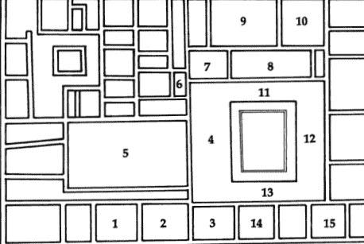

### 帕福斯的狄尼索斯之家

**图 3。** 马赛克平面图，由 J. Saltman 绘制。

比例尺：5—10 米。

平面图的功能是将宾客与居住者隔离开。受邀请的人可以进入房屋的核心，即餐室—回柱廊区域。客人可能从南街进入，穿过房间进入带有问候（`saluta`）马赛克的餐室或回柱廊，并进入沿南北两侧排列的装饰华丽的房间。我们可以看到回柱廊如何组织房屋的各个部分：实用性区域位于其西侧，居住区位于中心，预留给家庭使用的区域位于其东侧。

决定房间顺序和使用的关键因素是交通，这在很大程度上取决于入口的位置。因为发掘者 1965 年的图中没有标记任何一个入口，这项练习充其量是具有挑战性的。尽管如此，马赛克本身指示了交通流模式以及房间的顺序和功能。只要可能，我都会借助马赛克来解释建筑平面图。

由于许多最近的研究关注私人生活的物质文献，我们现在有了更好的立场来推测所有者、仆人和访客（客户、朋友）的习惯和活动，他们是“公众”观众。古代文献为这一工作提供了指导。维特鲁威（`De architectura` 6.5,1）注意房屋的私人家庭部分与那些供访客使用的部分之间的关系。普林尼（`Epistles` 2.17,10）评论了房间的装饰、位置和比例与其功能的关系。

尽管作为生活的物质文献非常迷人，房屋的西部和东部区域是夯土或铺有卵石的。然而，可以说明房屋是如何为了其多种功能进行设计和装饰的。考古证据证实用间位于西翼。该区域有一个从北街进入的独立入口（G1），通向长廊（G2）（图 3，房间 6）。

### 注释

- **36.** 这一建议回归了早期的理论，即该建筑被历史上记载的五世纪地震之一摧毁；参见 Haves 1991, 212。
- **37.** 该短语由 Mitford 1968 使用。
- **38.** K. Nicolaau 1967, 108。图 1 中的平面图是 K. Nicolaau 1967, 102，图 1 所出版平面图的简化版本（如果所有墙体都用实线表示，并非所有的墙体都存在）。为了清晰起见，本文提供了两个平面图：第一幅显示了用字母标记的房间类型（图 1）；第二个通过房间编号识别马赛克主题（图 3）。
- **39.** 关于入口的讨论见下文。
- **40.** K. Nicolaau 1967, 116。
- **41.** 见同上, 117。
- **42.** 见同上, 117。
- **44.** 见同上, 116–17。
- **45.** K. Nicolaau 1967, 101 和 103，图 2。
- **46.** Sejsemski 1979, 108；以及 McKay 1975, 115。
- **47.** D’Arms 1980, 82n–43。
- **48.** Sejsemski 1979, 110，图 17。
- **49.** K. Nicolaau 1967, 115。
- **50.** K. Nicolaau 1967, 115。

## 卧室与接待套房

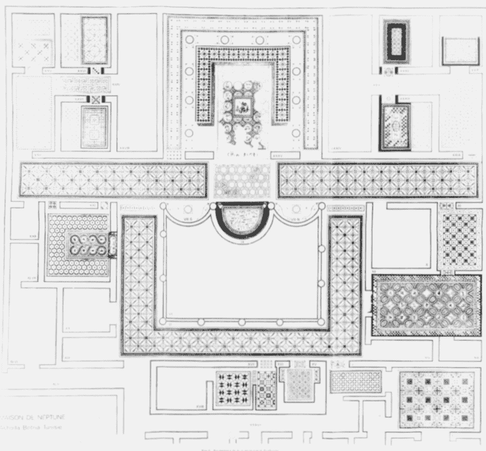

**图 5。** 阿科拉（Acholla）海王星之邸平面图，由 R. Prudhomme 绘制（由 S. Gozlan 提供）。

用于卧室或寝室（`cubicula`）。类似的布局也出现在阿科拉海王星之邸的西翼，那里两组房间对称地排列在大型厅（`oecus`）的南北两侧（图 5）。在每个翼部都有三间狭窄的房间，两侧邻着更狭窄的侧室，这些房间铺有马赛克，并由一个大型矩形房间（前厅吗？）提供服务。

- **51.** 紧邻房屋北墙较大房间 K5 的较小房间 K6 也起到某种前厅的作用；K. Nicolau 将这些房间描述为卧室（1967, 115）。
- **52.** 这些房间铺有彩色几何马赛克；关于它们的描述和平面图，请见 Gozlan 1992, 6, 114–74（关于马赛克），平面 I。另见 Thébert 1987, 352, 图 15，他将其标记为“邻接前厅或角落的卧室”。类似的布局可以在埃尔杰（El Jem）索拉里安别墅（Sollarian Domus）西翼的两间卧室（6 和 4）之间使用前厅（5）中发现；见同类文献，366, 图 23。

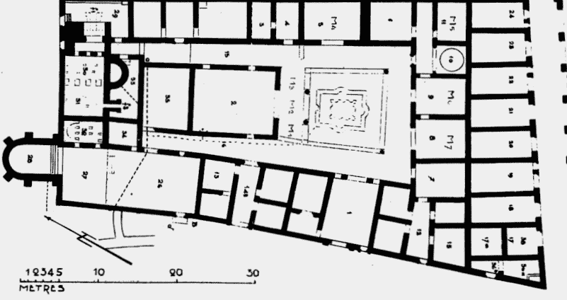

**图 6。** 沃卢比利斯（Volubilis）赫拉克勒事迹之邸平面图（参考 Etienne 1960, pl. 4）。

这栋属于 2 世纪后四分之一的北非洲房屋，与帕福斯之邸有许多其他对比点，我们将再次关注这些点。沃卢比利斯 3 世纪初的赫拉克勒事迹之邸也包含一组位于平面图东南部柱廊围的套房（图 6）。沃卢比利斯套房内增加的圆形水池（图 6，平面图第 10 号）与帕福斯的鱼池相得益彰，并证明了无论是在私人区域还是公共区域，对于水景装饰和引用的盛行品味。

一条长走廊将这些房间（10 和 11）与 6 号房间和第二个餐厅（5）连接起来，后者铺有描绘赫拉克勒斯功绩的垫形马赛克（图 73）；沃卢比利斯卧室与赫拉克勒斯（5）的垂直排列镜像了帕福斯之邸的情况，在帕福斯之邸中，东翼卧室位于柱廊北侧门廊出去的东北角客房套间（图 3、8、9 和 10）。

- **53.** 平面图请见 Etienne 1960, 32，房间编号 6、8、9、10、11，pl. IV。
- **54.** 见同类文献，32。
- **55.** 关于此接待区域的进一步讨论将在本节末尾。
- **56.** 这种套房最清晰的案例之一出现在庞贝的维提别墅（House of the Vettii），其追溯到庞贝的最后一个建筑时期；见 Richardson 1988, 329；Wallace-Hadrill 1988, 93–94，平面图见图 10；以及

## 家庭与神灵

相连的接待/卧室套房在罗马房屋中很常见，对于规模较小的平面来说，它们非常实用，因为这种房间可以包含更多私密空间。虽然假设卧室的前厅和走廊是供主人和主人的奴隶（即 `cubicularii`）使用的是有逻辑的，但它们很容易承担双重功能。A. Wallace-Hadrill 简洁地总结道：“这两个房间的并列是使用卧室的需求的结果。”这种过渡空间可以作为接待更亲密的朋友的门厅，有效地创造了隔离开区域，并安排了访客或仆人通过这些套房的进程。

由于几乎一无无存，房屋的西部和东部是独立的翼部；东侧门廊（E2 和 E3）的房间仍带有一些装饰墙壁的红色漆；朱砂颜料的价格可能表明这些房间对访客是开放的。柱廊围绕房屋中心移动，而中心是由大型柱廊（15.20 m × 11.5 m）定义的房屋核心。其重要性通过柱廊上装饰的狩猎场景长马赛克（图 172）得到了加强。

柱子、柱头、基座和线脚的发现证实它由支撑檐部的覆盖柱廊的屋顶包围。位于庭院中间的矩形庭院（7.40 m × 5.40 m × 0.50 m）导致发现者和其他人称之为水池（`impluvium`），但其围绕庭院（F1）排列的地面并非用于收集雨水。水池西端的地面并非用于收集雨水，两个出口流向柱廊下方并通向街道。另一个水池（F1）的存在确实是一个水系统的一部分，尺寸使其成为这样一个套房。

### 注释

- **57.** 关于罗马房屋服务区域的描述，请见 Wallace-Hadrill 1988, 76；以及 1994, pp. 38–44。出于兴趣，关于它告诉我们的讨论请见 Theo 1988, 79。
- **58.** 关于家庭装饰中建立等级制度对色彩的使用，请见同类文献，74。
- **59.** K. Nicolaau 1963, 59 和 62。
- **60.** 在初步报告中，K. Nicolaau 将此水池称为 `impluvium`，将庭院称为 `atrium`（中庭）（1963），59 和 67。
- **61.** 在最近的出版物中，Daszzienski 和 Michaelsen 1988b, 20；Michaelsen 1988, 14；以及 J. Baily 1981, 48–59。
- **62.** 排水系统用石灰泥衬砌，流过柱廊下方通向南方；排水系统画在房屋的早期部分，见 K. Nicolaau 1963（图 2），和 62。水池北端的深井可能属于更早的时期，但仍在使用；见同类文献，59, 图 2，关于其在发现者平面图上的位置。
- **63.** 在柱廊马赛克可能被覆盖后，柱廊和水池之间的开放区域对于功能性水池来说太宽了。
- **64.** Étienne 1960, 122，尤其是 120，在学术界对“中庭”和“水池”术语的误用。
- **65.** 一块代表海妖的 4 世纪/早期 3 世纪卵石马赛克在希腊化建筑中被发现；见 Michaelides 1987, 10, no. 1, pl. I；以及 K. Nicolaou 1967, 104。
- **66.** 关于北非洲柱廊的启发性讨论，请见 Thébert 1987, 357–64。
- **67.** Thébert 讨论了大量的平面图；特别是奥德纳（Oudna）的拉贝里别墅。

落水式和集水系统通常要求屋顶的坡度允许雨水直接排入水池（`impluvium`）。在对沃卢比利斯柱廊式房屋的研究中，R. Étienne 部分根据水系统得出结论，对于这些 3 世纪房屋中发现的形式，不能使用“中庭”或“水池”等术语，而水池的功能是装饰性的。

门厅（`vestibium`）—中庭（`atrium`）—书房（`tablinum`）复合体的轴线性和对称性是意大利住宅或别墅的标志，在帕福斯并不存在。纯的轴线关系是大型餐厅（B）与柱廊西侧（C）之间的关系。房屋的每个翼部通过自己的柱廊面向中心庭院——光和空气的来源。通过这种方式，柱廊使平面集中，同时也区分了各个部分。

帕福斯平面图的一个解释在于其希腊化基础；正如在奥林匹斯（Olynthus）和提洛斯（Delos）发现的那样。一块代表海妖的 4 世纪/早期 3 世纪卵石马赛克在希腊化建筑中被发现；见 Michaelides 1987, 10, no. 1, pl. I；以及 K. Nicolaou 1967, 104。

该平面也让人想到北非洲房屋，这些房屋的中庭被消除了，柱廊是公共与私人共存的场所。阿科拉海王星之邸的柱廊发展这一点；它可以从入口直接到达；三间大型接待室开放着它的三侧；它的柱廊铺有马赛克；大厅（`oecus`）或接待室、西侧以及面向大厅的装饰性水池之间有紧密的对齐，且私人房间邻接接待区域并共享相同的图案（图 5）。

在阿科拉的这栋房屋中，正如在帕福斯的狄尼索斯之邸一样，中庭的缺失意味着访客是在入口处的门厅和餐厅处被接待的，那里重要的客人被引导进入大厅和更私密房间内亲人的奢华区域。北非洲柱廊是全面的，可以容纳常规和特殊事件；它是组织复杂的活动——表现性和款待性的——周围的空间。

2 世纪和 3 世纪的北非洲房屋平面为意大利住宅提供了最有说服力的类比。不仅阿科拉柱廊的尺寸（11.70 m × 9.20 m）与帕福斯大相当，房间的布局也反映了类似的室内设计方法。在两者某些情况下，平面图显示出非对称的布局，这些多功能空间由柱廊式建筑排列，这种建筑为住宅（`domus`）的不同部分提供了一个中心化和规范化的焦点。

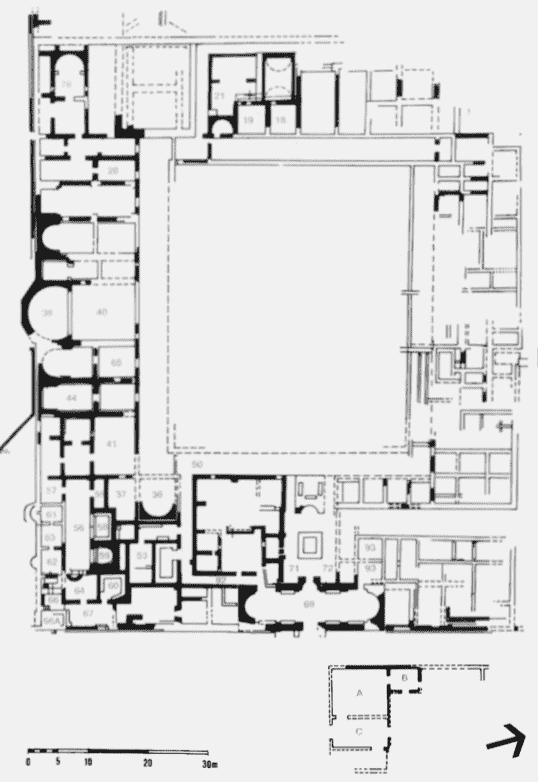

**图 7。** 帕福斯忒修斯之家平面图，截至 1984 年（参考 Daszewski 1985，图 1）。

在某些方面，这些柱廊式房屋的功能更像庭院式宫殿，而非意大利式房屋。只需看一眼迪尼俄斯之家旁边的忒修斯之家平面图，就能很好地说明这种宫殿式的结构。一个巨大的压实泥土中央庭院被走廊环围，形成四个翼楼，其中包含不少于一百个房间（图 7）。

尽管庭院规模巨大，长长的走廊创造了轴线张力，并控制了游客和居民的空间感知与流动模式。埃杰姆的狄尼俄斯游行之家、埃杰姆的索尔特里亚纳之家、乌提卡的瀑布之家（1987），325–409，各处。对于沃卢比利斯的大群柱廊式房屋，参考 Etienne 1960，各处。

该平面图可以归类为大型走廊别墅的变体，这是一种围绕庭院分组的自包含套房复合体。它包括一个与正式接待区正交设置的宏伟入口复合体、几个作为内部套房一部分的巴西会厅，以及仆人区。这些空间安排强调了忒修斯之家平面图的宫殿性质，其走廊在功能上可以与迪尼俄斯之家柱廊的门廊相比，尽管后者的规模更显私密。

另一个具有私人但宏伟柱廊的宏伟住宅例子是雅典卫城的巨人宫，它始于公元第四世纪并在第一世纪仍被建造和使用。该复合体作为皇帝偶尔访问时的官方住所而建造，由三个尺寸逐渐减小的柱廊单元定义（最大的是北庭，最小的是东南庭），在这些单元周围排列着一系列具有明确生活功能和礼仪功能的房间。

巨人宫的居住子复合体位于东南庭院周围，正是这个单元最像柱廊式房屋。从这些宫殿式示例中，可以构建出一个模型（尽管规模宏大），通过柱廊式来组织诸如帕福斯迪尼俄斯之家等住宅中多样化的室内空间。

除了平面图之外，迪尼俄斯之家的地板装饰是财力与意义的有用指标。最平庸的房间与为重要宾客或活动留的房间并列，表明空间层级是通过装饰而非建筑设计来编码的。就现存部分而言（壁画、灰膏和建筑装饰大多已丢失），地板材料的选择从总体上指示了这些房间在内部秩序和序列中的排位情况。

最简陋的区域留有压实土。卧室铺有小鹅卵石和石灰砂泥，而最公共的房间则铺有华丽的马赛克，这种对比不仅具有功能性，而且具有意义。铺面起到突出某些入口的作用，强调轴线关系，并通过其主题揭示房间的功能。事实上，地板是判断房屋中许多特征无法确定的最佳线索：墙壁已被拆毁到只剩地基。

特定位置某些主题的呈现表明建筑师和马赛克艺术家制定了一套建筑序列和装饰计划，马赛克可以用来重建古代游客和居民的行程。以马赛克作为指南的第一个行程问题是最基本的：人们是如何进入房屋的？

挖掘者尚未找到确定主入口位置的考古证据或建筑装饰。在平面图中，没有等于意大利式房屋的入口，在意大利式房屋中，入口（`fauces`）和门厅与书房（`tablinum`）对齐，从而产生从街道到房屋主体的无中断过程。

对于迪尼俄斯之家，Nicolaou 提议北侧的窄走廊（G2）是次要或后门，但他承认无法找到它。尽管如此，我们可以通过马赛克装饰中的拓扑信息结合建筑图来确定房屋主入口的位置。综合证据指向一个从南方（A）进入狭窄走廊的主入口。事实上，地板是判断房屋中许多特征无法确定的最佳线索：墙壁已被拆毁到只剩地基。

### 注释

- **68.** 有关近期的平面图，参见 Daszewski 和 Michaelides 1988b, 58，图 25。
- **69.** 费什伯恩（萨塞）提供了此类平面的绝佳示例；参见 McKay 1975, 189–90。
- **70.** 有关详尽描述和分析，参见 Frantz 1988, 95–116，图 52–54。
- **71.** 见同上，111。
- **72.** K. Nicolaou 1967, 108。

71. 见同上，111。

72. K. Nicolaou 1967, 108。

> 注：由于提供的文本中存在大量重复段落，在翻译时已根据“不要重复输出原文”的原则进行了去重处理，确保内容逻辑连贯且不冗余。

## 重新整理后的完整译文

图 7。帕福斯忒修斯之家平面图，截至 1984 年（参考 Daszewski 1985，图 1）

在某些情况下，平面图显示出非对称的布局，这种多功能空间由柱廊式建筑排列，为`住宅`（`domus`）的不同部分提供了一个中心化和规范化的焦点。

在某些方面，这些柱廊式房屋的功能更像庭院式宫殿，而非意大利式房屋。只需看一眼迪尼俄斯之家旁边的忒修斯之家平面图，就能很好地说明这种宫殿式的结构。一个巨大的压实泥土中央庭院被走廊环围，形成四个翼楼，其中包含不少于一百个房间（图 7），68。尽管庭院规模巨大，长长的走廊创造了轴线张力，并控制了游客和居民的空间感知与流动模式。埃杰姆的狄尼俄斯游行之家、埃杰姆的索尔特里亚纳之家、乌提卡的瀑布之家（1987），325–409，各处。对于沃尔卢比斯的大群柱廊式房屋，参考 Etienne 1960，各处。

68. 有关近期的平面图，参见 Daszewski 和 Michaelides 1988b, 58，图 25。

该平面图可以归类为大型走廊别墅的变体，这是一种围绕庭院分组的自包含套房复合体。69 它包括一个与正式接待区正交设置的宏伟入口复合体、几个作为内部套房一部分的巴西会厅，以及仆人区。这些空间安排强调了忒修斯之家平面图的宫殿性质，其走廊在功能上可以与迪尼俄斯之家柱廊的门廊相比，尽管后者的规模更显私密。另一个具有私人但宏伟柱廊的宏伟住宅例子是雅典卫城的巨人宫，它始于公元第四世纪并在第一世纪仍被建造和使用。⁷⁰ 该复合体作为皇帝偶尔访问时的官方住所而建造，由三个尺寸逐渐减小的柱廊单元定义（最大的是北庭，最小的是东南庭），在这些单元周围排列着一系列具有明确生活功能和礼仪功能的房间。巨人宫的居住子复合体位于东南庭周围，正是这个单元最像柱廊式房屋。⁷¹ 从这些宫殿式示例中，可以构建出一个模型（尽管规模宏大），通过柱廊式来组织诸如帕福斯迪尼俄斯之家等住宅中多样化的室内空间。

除了平面图之外，迪尼俄斯之家的地板装饰是财力与意义的有用指标。最平庸的房间与为重要宾客或活动留的房间并列，表明空间层级是通过装饰而非建筑设计来编码的。就现存部分而言（壁画、灰膏和建筑装饰大多已丢失），地板材料的选择从总体上指示了这些房间在内部秩序和序列中的排位情况。最简陋的区域留有压实土。卧室铺有小鹅卵石和石灰砂泥，而最公共的房间则铺有华丽的马赛克，这种对比不仅具有功能性，而且具有意义。铺面起到突出某些入口的作用，强调轴线关系，并通过其主题揭示房间的功能。事实上，地板是判断房屋中许多特征无法确定的最佳线索：墙壁已被拆毁到只剩地基。

特定位置某些主题的呈现表明建筑师和马赛克艺术家制定了一套建筑序列和装饰计划，马赛克可以用来重建古代游客和居民的行程。以马赛克作为指南的第一个行程问题是最基本的：人们是如何进入房屋的？挖掘者尚未找到确定主入口位置的考古证据或建筑装饰。在平面图中，没有等于意大利式房屋的入口，在意大利式房屋中，入口（`fauces`）和门厅与书房（`tablinum`）对齐，从而产生从街道到房屋主体的无中断过程。对于迪尼俄斯之家，Nicolaou 提议北侧的窄走廊（G2）是次要或后门，但他承认无法找到它。尽管如此，我们可以通过马赛克装饰中的拓扑信息结合建筑图来确定房屋主入口的位置。综合证据指向一个从南方（A）进入狭窄走廊的主入口。事实上，地板是判断房屋中许多特征无法确定的最佳线索：墙壁已被拆毁到只剩地基。

餐厅（`triclinium`）被分为三个独立的几何地毯，中间一块较短的地毯位于两块走廊长度的嵌板之间。80 较短的地毯横跨入口宽度，作为通往狄尼尼索游行（`Dionysiac procession`）的门槛——这与入口处的帕菲斯式凯旋（`Paphian Triumph`）具有显著的相似性。81

帕菲斯餐厅内人物的布局遵循了整个帝国范围内餐厅地板通用的 T 形布局（图 4）。主嵌板（T 字的竖梁）从内部阅读，入口嵌板（T 字的横梁）则从外部阅读。一个 U 形的几何围框标记了放置三张用餐卧榻的区域。帕菲斯用餐室的规模巨大，尤其是其布局以及与庭院水池的轴线协调，这一切都印证了二、三世纪安提俄的建筑特征。82 安提俄“狄尼索索胜利之宅”的餐厅，尽管目前处于破碎的保存状态，但其入口嵌板的主题与帕菲斯相同，且宽度为 8.7 米，是安提俄最大的餐厅之一，与其帕菲斯的对应物尺寸接近（8.5 米）。83

如果我们遵循这些房间在嵌板内的布局及其马赛克的图像学特征，就可以理解围绕柱廊分布的另一组房间。这些房间（8、9 且 10 号房间，图 3）构成了位于房屋东北角卧室的整体。84 位于 10 号房间中央的甘尼美德主题，以及 9 号房间中发现的不寻常客访（`xenia`，静物画）主题（见第 4 章），表明这些房间是第二个接待区。这两个区域都可以从北门廊进入，通过带有星形和菱形图案的北 8 号房间（图 3 和 4）。它们与建筑规划的关系通过 8 号与 9 号房间之间、9 号与 10 号房间之间的门柱遗迹得到了强调（图 3）。85 换句话说，人们必须经过较窄且较长的 8 号房间才能进入带有甘尼美德的房间（10 号房间）或带有客访主题的房间（9 号房间）。8 号房间充当了柱廊与房屋北墙这几间房间之间的中间空间。前厅（8 号房间）、内室（9 号房间）和内室（10 号房间）套房形成了一个规模各异但强度递增的循环动线。较大的 9 号房间与房屋西侧更具公共性的区域相关。这些房间被视为通过 8 号房间进入的套房的两个部分，为接待提供了多种选择。与餐厅宏伟的尺寸相比，9 号房间为家庭聚会提供了更为宜人的比例尺。

在柱廊周围聚集几间大小不一的接待房间在北非洲很常见，在那里，帕菲斯 8 号房间中“垫子”图案的许多平行类比在其他房间中都有发现。86 我们仅参考了两份平面图，每份平面图中都至少有三间接待厅，包括带有“垫子”图案的用餐室。在阿科拉（`Acholla`）的海王神之宅，有三个大型用餐室紧邻柱廊：位于柱廊侧的宏伟大厅（`oecus`）；南翼翼的餐厅；以及北侧一间长房间，装饰有填满客访主题的“垫子”图案（图 5）。87 3 世纪初庞贝的赫拉克勒斯功绩之宅也包括一个宏伟的大厅（2 号房间）和两间紧邻庭院的餐厅（5 号和 6 号房间）。88

晚期庞贝时期的坎帕尼亚柱廊——即最后一次喷发前的几十年——也为帕菲斯那种以庭院为主导的规划提供了类比。例如，维提别墅（`House of the Vettii`）有四个间直接面向柱廊的房间。拥有多个用餐区域是不寻常的，范围从用于正式接待的小型餐厅到私人晚餐聚会的小型房间不等。正如在安提俄发掘的东部房屋所证明的那样，它们在一个平面图内整合了多种接待区，并不一定围绕柱廊排列。在安提俄 3 世纪的米兰德之宅，至少有五间这样的房间，其中一些通过带有水池的简易柱子开放。89 假设帕菲斯房屋在柱廊旁还有另一个区域是逻辑上的；帕菲斯房屋的尺寸、位置和布局都暗示了这一点。90

- 80. Goznak 1974, 80–82。
- 81. 有关帕菲斯与阿科拉马赛克的更详细对比，请阅读第 6 章关于狄尼索索凯旋的末尾。
- 82. Stillwell 1961, 47–53。
- 83. Stillwell 研究了安提俄的房屋，注意到主房间在后期变得越来越大。他借此将“狄尼尼索胜利之宅”定定于 3 世纪，这是基于 Levi 对 2 世纪第三四分时期风格分析所得到的数据（1961, 49–50 以及 55n27, 53）。
- 84. 因为 7 号房间（图 3）绘有希波吕特和斐埃德拉的场景，它直接面向柱廊，并与西门廊的神话主题处于同一轴线上——与它似乎互补的那些模糊主题不同——因此它应该被视为处于这一组房间之外；另见图 4。希波吕特神话与西门廊的主题联系在第 5 章中探讨了。
- 85. 考古证据见 K. Nicolaou 1987, 109。
- 86. 在阿科拉的海王神之宅，有三个大型用餐室紧邻柱廊：位于柱廊侧的宏伟大厅；南翼翼的餐厅；以及北侧一间长房间，装饰有填满客访主题的“垫子”图案（图 5）。
- 87. 3 世纪初庞贝的赫拉克勒斯功绩之宅也包括一个宏伟的大厅（2 号房间）和两间紧邻庭院的餐厅（5 号和 6 号房间）。
- 88. 注：原文脚注编号可能发生偏移，此处对应。
- 89. 注：原文脚注编号可能发生偏移，此处对应。
- 90. 注：原文脚注编号可能发生偏移，此处对应。
- 91. 注：原文脚注编号可能发生偏移，此处对应。
- 92. 同上，48。
- 93. 感谢 G. Métraux 分享他对晚期建筑这一关键发展的看法。《别墅：建筑史》。此外，Ellis 的研究专门探讨了社会影响，特别是接待厅的设计和装饰中对主人（`dominus`）的体现（1991, 处处）。
- 94. Stillwell 1961, 56；以及 McKay 1975, 710,113。

通常是多柱廊的，面向柱廊—餐厅。92 这种由接待室、轴线走廊和水池组成的建筑序列建立了一个连续的整体。从功能上讲，它显然为接待客人提供了迷人的背景。这种正式且具有层次的序列在二、三世纪的省份房屋中日益受到青睐；直到四世纪才被充分利用。93 在奥斯提亚（`Ostia`）的三、四世纪房屋中，发现了餐厅与半圆形水池的类似关联，这些设计被归于叙利亚商人的影响。94 帕菲斯城镇房屋并未反映奥斯提亚房屋的形式。相反，帕菲斯规划最接近的平行类是北非的柱廊房屋。这些连接通过后续章节对马赛克设计的分析得到了强调，并表明了整个地中海范围内的各种关系。

对马赛克制作技术方面的简要介绍可能有助于我们稍后将这种艺术形式作为社会文献进行研究奠定基础。作为示例，我特别研究了两个神话场景——1 房间的纳尔辛瑟和 7 房间的希波吕托斯与斐埃德拉，以及选定的几何图案，这些图案最能说明作坊方法、模型的使用，以及通过品味和构图的扩散所体现的区域交流。在每个案例中——无论是人物还是装饰性的——传播、模型和复制的问题都得到了精确定义，并为这一文字或考古证据过于匮乏的主题提供了线索。

狄俄尼索住宅的马赛克似乎是由一群奇特的手手制作的，他们受过希腊东部的训练，又受到西方接触的影响而形成了品味。帕福斯的证据中令人惊讶且事实上具有启示意义的事实是，许多神话马赛克指向了安提俄的影响，甚至表明有安提俄工匠曾在此处；某些几何马赛克展示了对仅在西方发现的图案和纹样的不可知认知。证实与安提俄有密切接触的几何马赛克也包含在本章中。这些也包含在本章中。该建筑中的几块马赛克同样可以支持这些观察，但它们在其他章节中处理。²

1. Michaels 1998b, 272–92, 简要绘制了与安提俄及西方的对应点。许多相同的示例已在我的论文《帕福斯狄俄尼索住宅的马赛克：对罗马艺术研究的贡献》（哈佛大学，1985 年）中详细阐述，并收录在此处。Kondoleon 1994 对这些西方接触作为本土罗马化（`Romanitas`）迹象的观点进行了论证。

2. 例如，9 房间的交织“垫子”纹样和柱廊中的狄俄尼索凯旋（B 区，图 1），这些马赛克还涉及其他问题；这些问题分别在第 4 章和第 6 章中被辨析。

3. 由于锡罐刮刀受损而导致严重修复的马赛克区域包括房间的侧面（1 房间）；大部分区域（纳尔辛瑟）和 2 房间（季节）；分别参见 Nicolau 1967, 11, 114, 和 112，以及图 21。

4. 某些橄榄绿和所有的蓝色（群青色、绿松石和水族蓝）都是玻璃马赛克块。天然镶嵌块来源的列表基于 F. Koucky 生成的信息。所有的粉色、浅色调、灰色和白色都是石灰岩。棕色、红褐色（高色调）和红褐色来自具有不同矿物含量的地层沉积岩。紫色马赛克块也是取自此。绿色（浅绿色和黑绿色）是绿帘石和蛇纹石。橙色和红色是取自矿山的石灰石碎片。入口处狄俄尼索镶嵌板背景中使用的蓝灰色是从进口大理石切割而成的；有些在附近的奥耳斐斯住宅（亚马逊地区）中发现，年代可追溯到第 2 或第 3 世纪；参见 Michaelides 1994, 205。

5. 用于人物背景和身体的马赛克块范围从 10 毫米到 20 毫米不等；例如，4 和 5 房间中用于衣褶皱和人物的几何马赛克块为 0.9 毫米到 12 毫米。

6. 人物面板位于以下房间（图 1：纳尔辛瑟）（1 房间：季节）（2 房间：孔雀）（3 房间：希波吕托斯与斐埃德拉）（7 房间：甘尼墨德）（10 房间：狄俄尼索凯旋）（5 房间：奉献战车）；奥西斯、阿波罗和阿芙罗洛特位于西部（4）；狩猎场景（11、12、13）。几何地板位置如下：多重设计（1）；入口处的大正方形（2）；带星星的蜂窝状（4）；对角线设计（5）。近期出版物包括：Baily 1984, 41–22；Eliades 1986，一份描述性指南；Michaelides 1987, 24–45；Daszewicki and Michaelides 1988, 11–24；Michaelides 1988, 15。

塞浦路斯丰富的马赛克发现证明了存在一个活跃了数代的本地作坊。⁸ 这一观察被对塞浦路斯马赛克的最新研究所强调；参见 Michaelides 1987a，特别是 3–4 页，关于本地作坊的问题。狄俄尼索住宅中的地板组合为详细分析这个假设的作坊提供了机会。虽然不能确定帕福斯是否存在一个独立于岛上其他作坊的作坊，但书中处使用“帕福斯作坊”指代制作狄俄尼索住宅马赛克的工匠群体。特定的风格和图像学倾向定义了这些马赛克的特征，并有助于我们对马赛克制作机制和构图传输的理解。此外，作坊中可能还有更多来自安提俄的学徒，如下所示。

关于马赛克工匠流动性的重要证据来自克里特岛哈尼亚发现的一块 3 世纪马赛克，那里部分保存的铭文被重构为“[安提俄的]达芙妮制作”。9 Markoulaki 1986, 461–62, 图 65，用于对比铭文及其合理的重构。铭文出现在一块骑在豹子上的狄俄尼索马赛克上方，在主题选择和呈现方式上，与安提俄的马赛克有某些相似之处。感谢作者引导我关注这一重要发现。

在帕福斯（`Paphos`），一处由三部分的拉丁语名字“Gaius Pinnius Restitutus”后面紧跟着“`epoei`”，这让马赛克发掘者 D. 迈克莱德斯（D. Michaelides）认为这是该作品的赞助者的名字。¹⁰ 无论是艺术家还是赞助人，这些签名都纠正了那种可能影响了当地风格的交换观念。“安提俄工作坊”一词被用来指代在安提俄及其周边地区制作马赛克的人。要确定安提俄存在多少个工作坊，或在它们之间进行区分，并不属于本书的范畴。¹¹

当我们评估帕福斯工匠的作品时，质量问题便随之而生。在较低的生产水平下，工作坊的成员可能复制了某个模型，但对其意义或象征意义几乎无所知。他们可能会误判人物类型，导致构图混乱或稀释。对人物的有效选择取决于工匠的水平及其对主题的理解。设计者是如何获得他们的模型和人物形象的，这是一个令学者们困扰的问题。关于这个问题有两种观点：一群人认为装满了库存的模型书籍在不同工作坊之间流传；另一群人则推测，在学徒传统中训练的艺术家们开发了供自己使用的图稿或卡样画。¹² 无论帕福斯的马赛克是否拥有这些，它们都证明了模型的传递并不能说明全部。当地工作坊对继承的方案进行了重新加工，并加入了自己的解释，成功程度不一。一旦脱离了来源，他们可能会回想起并获得新的身份。这些人物的这种组合产生了一种全新的构图，丰富了现有的模型库。帕福斯的神话场景，尤其是位于西门廊的场景，以及葡萄地毯和狩猎马赛克，都是成功且非常具当地特色的创作。另一方面，“狄奥尼斯的凯旋”（`The Triumph of Dionysos`）面板充满了离奇的错误，且呈现方式枯燥且缺乏灵感。

尽管我只讨论了两个神话马赛克，但狄俄尼索之家（`House of Dionysos`）中的大部分作品都证实了帕福斯工作坊的东方身份。在整个房屋中，神话马赛克被多层边框环绕，被视为独立的画幅面板，但在每幅风景描绘中往往倾向于概括性，留下了大面积的白色背景。所代表的传说数量众多、希腊铭文的使用以及以传统的希腊化装饰画（`emblema-type`）面板的形式呈现，反映了其与东方叙利亚工作坊的紧密联盟。除了《甘尼墨德被强劫》（`The Rape of Ganymede`，图 83）在东方和西方都有广泛表现外，帕福斯的神话场景在叙利亚很少找到同类作品；相比之下，北非的题材库非常有限。在这里，西方最丰富的神话主题见于庞贝绘画中，通常不是见于马赛克中。罗马石棺中此类场景的题材非常广泛，这指向了浮雕与马赛克艺术发展中具有启发性的差异。在我们对帕福斯人物主题的整个调查中，浮雕为比较提供了重要的来源。¹³

为了确定作品的特质，特别有两块马赛克因其对安提俄模型的依赖而脱颖而出：1 号房间的纳尔喀辛（`Narcissus`）以及 7 号房间的希波吕托斯（`Hippolytos`）和费德拉（`Phaedra`）。西方还有三个神话场景——金字塔与忒伊索俄珀、波塞冬与阿米莫涅、阿波罗与达芙涅——展示了与安提俄的密切联系，但它们将在第五章中与异常的伊卡里俄（`Ikarios`）和“第一饮者”构图一起作为一个图像学整体进行处理。10 号房间的甘尼墨德与其他神话表现不同，不同之处在于它与东方没有特别的联系，它的选择很可能是由功能性考虑决定的；它在第四章中得到了充分讨论。对纳尔喀辛和费德拉马赛克的分析凸显了模型的作用、作坊之间交换的性质，以及随之而来的定义了帕福斯作品个性的风格和图像学变化。这些主题在边腊罗马艺术中的通俗演变，我们之所以关注，是因为这些大趋势可能揭示关于帕福斯描绘的特殊之处。

1 号房间的纳尔喀辛场景位于房屋的南翼，紧邻入口，被季节主题马赛克环绕。这个精美的青年（0.26 m）坐在岩石上，注视着自己的倒影（图 10 和 11）。他略微向后倾斜，左手支撑。他头上戴着一顶大帽子，向左倾斜，这种帽子被称为`kausia`。他的长袍（红色和粉色）在脖子上固定，垂落在肩膀上并聚在左腿下方。他的上身是赤裸的，横跨左胸的带子显然是为了挂剑。他伸出的左腿除了猎人的靴子外外露。倒影反映了纳尔喀辛橙红色的头发和白色帽子。背景局限于面板的下半部分，由灰色、绿色和赭石色的岩石组成，边缘长着杂草，下方是一池蓝绿色的马赛克颗粒。

图 10。纳尔喀辛全景（由塞浦路斯文物部门提供）

尽管房间地板在发掘马赛克时遭受了严重损坏，但身体的大部分保存了下来。¹14 一块碎片描绘了纳尔喀辛从腰部到脚的部分，另一块碎片描绘了上半身，尽管脸和右臂被毁了。这些部分很容易拼接。修复工作主要集中在脸上，但在腰部周围也能注意到回纹线条是用黑色和棕色的，呈浅色图案。

这个优美的青年坐在岩石上，注视着池中的倒影（图 12）。他略微向后倾斜，左手支撑；他的左腿伸直，右腿弯曲。面板的左上区域受损，但纳尔喀辛右手和前臂是抬起的。这一特征立即将帕福斯对神话的描绘与其基本来源的类型区分开来。幸运的是，安提俄有一块类似的马赛克，使我们能够重建这只丢失的手。

纳尔喀辛之家餐厅内的纳尔喀辛作品，现藏于巴尔的摩博物馆。

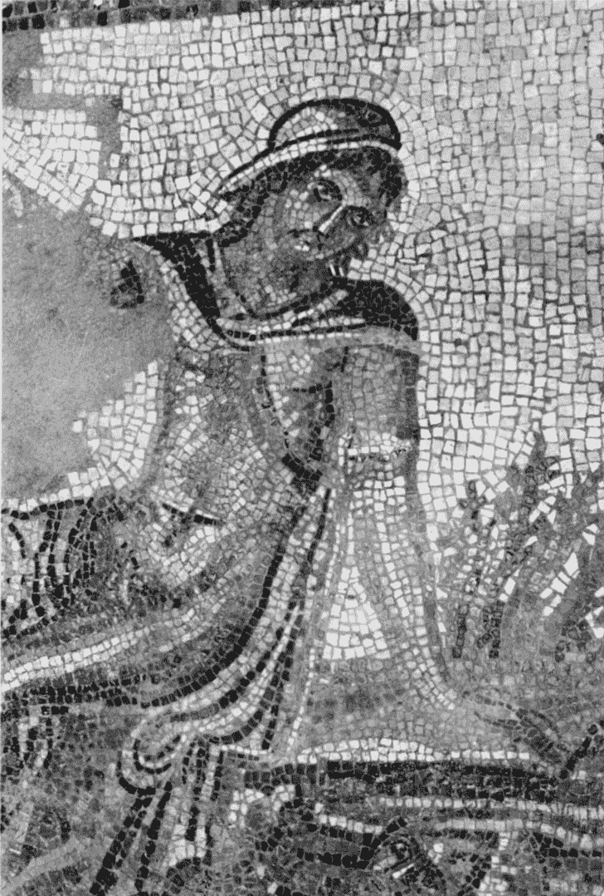

图 12。纳耳西瑟斯，人物细节（由塞浦路斯文物部提供）

其姿态和位置与帕福斯少年的形象（图 13 和 14）相似。^16 在这一件属于二世纪第二四分之一的例子中（它是安提俄克现存的四块纳耳西瑟斯马赛克中最早的一块），他的右手举向天空，“正如 D. 莱维（D. Levi）所说，‘仿佛在强调由半张的嘴巴、忧伤的眼睛和头部姿态所表达的悲痛心境’”。^17

然而，这一手势更具体地指向言语，并为奥维德描述该少年的诗句提供了生动的插图。诗中描述这个男孩自恋而痛苦，他起身伸出双臂指向树木，一边哭着哀伤的独白。^18 同样的手势，当少年伸出手指并张开手掌时，无疑也是为帕福斯纳耳西瑟斯所设计的。^19

- 16. Levi 1947, 60–66, pl. 10。
- 17. 同上, 60。
- 18. 奥维德，《变形记》3:409–42：“paulumque levatus ad circunstancias tendens sua brachia silves-ecquis, is so olive, crudelis inquitamavir”（“他稍微挺起身体，伸出手臂向树木，他喊道：噢，你们树木啊，你们比我更加残酷！”）
- 19. 关于纳耳西瑟斯右手位置的另一种变体，来自佩特拉-斯塔比亚（Petra-Stabiae）的一处乡村别墅（Villa Rustica）的石膏浮雕，现藏于卡斯泰拉马雷迪斯塔比亚（Castellammare di Stabia）博物馆。这件石膏鉴定于公元 1 世纪第三四分之一，显示了纳耳西瑟斯用右手撑起他的斗篷；我们。

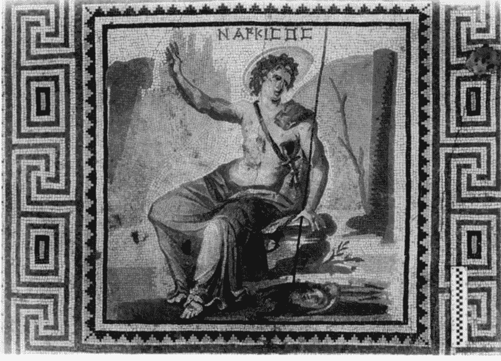

图 14。安提俄克，纳耳西瑟斯之家，纳耳西瑟斯马赛克（由普林斯顿大学艺术与考古部提供，编号 1987）。

安提俄克的地面布局由一个带有纳耳西瑟斯的彩色中心图案（`emblema`）组成，三侧被一个由细点线（红底白）组成的格栅环绕，每个部分都有一个小十字架（黑色或红色），并配有绘画面板。

在安提俄克的纳耳西瑟斯马赛克中，这种布局与帕福斯的布局最为接近。在帕福斯，一个二维图案（斯字纹-回纹）环绕着大面积的中性白色背景，与人物面板的自然主义形成对比，尽管后者与安提俄克纳耳西瑟斯的渐变色调和高光相比，显得有些被简化了。

在这两种情况下，通铺的图案都被小十字架点缀，使几何设计呈现出一种轻微的点状特征，这与绘画区域的密度形成对比。这些对比使观众将注意力集中在马赛克面板上，仿佛它像墙上的画一样。

纳耳西瑟斯的马赛克描绘确实存在一种“绘画性”意识，这引发了手绘原作的可能性。D. 莱维在对安提俄克纳耳西瑟斯系列的分析中得出结论，这些马赛克以及庞比绘画都是源自英雄、恋人和猎人的通用表现模型，这些模型并不一定与纳耳西瑟斯相关。^20

例如，庞比梅莱阿格之家（House of Meleager）的一幅画描绘了甘尼墨德（Ganymede）斜斜地坐着，身体几乎没有遮盖，手持长矛的方式也这种方式在庞比纳耳西瑟斯的画中也能见到。^21 唯有的区别特征是少年的弗里吉亚帽和一个在爱神（Eros）引导下走向甘尼墨德的天使。同样，通过池塘和倒影的存在也可以识别出纳耳西瑟斯的场景。

- 20. Levi 1947, 61。
- 21. Rizzo 1929, p. 105。
- 22. 同上, 126; 以及 Schefeld 1957, 86, 源自庞比 V, 4。
- 23. Levi 1947, 64 提出了这一合理的建议，并引用了费洛斯特图斯（Philostratus）《形象》23 中的一节。光环（nimbus）出现在纳耳西瑟斯之家的马赛克和梅安德之家（House of Meander）的马赛克中，Levi 1947, 200–201, pl. 45。后者鉴定于 3 世纪中叶，是安提俄克三块表现坐姿纳耳西瑟斯的马赛克中最晚的一块。

帕福斯纳耳西瑟斯最接近的平行作品来自庞比卢克雷菲奥之家（House of Lucrefio），那里细颈的姿态呼应了奥维德对那个没有生命的少年的描述，他可以轻易离开自己的倒影。^22

绘画中的纳耳西瑟斯采取了与塞浦路斯马赛克中少年相同的姿态；他同样危险地平衡在石台边缘，用伸出的手臂支撑着身体。尽管在位置和景观刻画上存在一些差异，但庞比绘画保持得相当一致。

纳耳西瑟斯的头部冠有月桂环，或者让他的长发露在外面，而马赛克则显示他戴着卡乌西亚（`kausia`）或光环。两件古代马赛克中环绕着他的光芒可能指的是文学描述中赋予他的光彩。^223 在庞比，纳耳西瑟斯的武器是长矛，而马赛克中包含了一把跨在胸前的带鞘剑。

在其他方面，通用特征（例如由头部、伸出腿部的强对角线以及贴身体的支撑手臂组成的金字塔形构图）在所有媒介中都是相似的。如果我们允许位置不影响基本构图的反转，那么假设存在一个共同模型，通过添加某些细节（包括帕福斯的那些细节）来适应纳耳西瑟斯的描绘是合理的，而帕福斯的人同样受益于这种继承的姿态。

- 20. Levi 1947, 61。
- 21. Rizzo 1929, p. 105。
- 22. 同上, 126; 以及 Schefeld 1957, 86, 源自庞比 V, 4。
- 23. Levi 1947, 64 提出了这一合理的建议，并引用了费洛斯特图斯《形象》23 中的一节。光环出现在纳耳西瑟斯之家的马赛克和梅安德之家的马赛克中，Levi 1947, 200–201, pl. 45。后者鉴定于 3 世纪中叶，是安提俄克三块表现坐姿纳耳西瑟斯的马赛克中最晚的一块。

剑鞘从他的侧面垂下，与斗篷的褶皱重合。剑柄以垂直倾斜的角度伸出，这可能被误认为是手臂。最后，嘴巴周围的下垂线条是为了传达一种忧伤的表情。

帕福斯纳耳西瑟斯的帽子形状让人联想到卡乌西亚。在安提俄克，整个头部的处理方式就像一个带有一个宽阔单色图案背景的预制中心图案，最明显地揭示了纳耳西瑟斯之家餐厅厅（`triclinium`）的布局。

安提俄克的马赛克中，拿着火炬的爱神与帕福斯的场景非常相似，池塘在同一个平面上。这些差异必须再次归因于工匠的无能，而非不同的模型。

- 20. Levi 1947, 61。
- 21. Rizzo 1929, p. 105。
- 22. 同上, 126; 以及 Schefeld 1957, 86, 源自庞比 V, 4。
- 23. Levi 1947, 64 提出了这一合理的建议，并引用了费洛斯特图斯《形象》23 中的一节。光环出现在纳耳西瑟斯之家的马赛克和梅安德之家的马赛克中，Levi 1947, 200–201, pl. 45。后者鉴定于 3 世纪中叶，是安提俄克三块表现坐姿纳耳西瑟斯的马赛克中最晚的一块。

## 总结

总结来说，帕福斯的纳耳西瑟斯在总体轮廓上符合早期的模型，正如庞比四十多个例子所证明的那样。这种类型在安提俄克的马赛克中很流行，也出现在二三世纪的墓葬中以及叙利亚莫法特（Moffat）附近的二世纪地下墓中，那里通过希腊铭识别出的纳耳西瑟斯方式与庞比绘画相同。

斗篷红色的选择与庞比绘画一致，也与帕福斯马赛克和安提俄克纳耳西瑟斯场景一致。在这一时期（即 2 世纪中期到 3 世纪中期），纳耳西瑟斯在西方马赛克库中似乎被忽视了，仅存了两块：一块来自图达（Tunda）的浴场，另一块来自塞维鲁斯地面。

在北部，纳耳西瑟斯以站姿出现，显然依赖于不同的模型。庞比马赛克可以通过卡乌西亚、跨在胸前的设计错误的剑柄和剑，以及举起右手做出哀伤宣告的手势，与安提俄克的例子紧密联系。

帕福斯地面的整体处理方式就像一个由宽阔单色图案背景周围的预制中心图案，最明显地揭示了餐厅厅的布局。

- 24. 需要注意的是，纳耳西瑟斯的脸部受损严重，修复可能有误导性；C. Nicolaou 1967, pl. 21,3，清晰地显示了马赛克的受损状态。
- 25. 这是安提俄克坐姿纳耳西瑟斯马赛克系列中的第二块，根据风格判断为 3 世纪前二十十年；关于年代论依据见 Levi 1947, 129，描述见 136–37, pl. 23。

……（图 13）。这件安提奥的马赛克画与我们这块面板的其他相似之处包括色彩、抬起的手臂以及带剑的束带。然而，帕福斯（Paphos）作品中加入了帽子而非光环，使得帕皮风格（Papian）更接近“宴会之家”（House of the Buffet Supper，图 15）的塞维鲁王朝时期，即公元二世纪晚期。这一建议与几何地板分析的结果非常吻合。

在帕福斯选择纳西辛斯（Narcissus）可能被认为与其装饰的房间位置有关，因为它位于入口序列的 1 号房间，随后是“季节”马赛克（2 号房间）和“孔雀”马赛克（3 号房间），尽管这种图像选择背后是否还有某种原因仍值得深究。

纳西辛斯与水、特别是与喷泉之间密不可分的联系，这可能解释了为什么他在家居装饰中如此受欢迎。在庞贝最华丽的布景之一——洛雷乌乌斯·提尔图努斯之家（House of Loreius Tiburtinus）中，纳西辛斯的画作装饰了一个水神龛（`bichlinum`）的一侧。³30 该壁画位于一个装饰性喷泉旁，泉水由回廊花园露台的长槽引入。

在另一座庞贝房屋——大祭坛之家（House of the Great Altar）中，纳西辛斯被放置在一个真实喷泉上方的龛内，他的影像倒映在水中。³31 这种用壁画延伸真实花园的幻象是庞贝装饰中典型且迷人的概念。通过纳西辛斯场景，壁画画家在现实与艺术关系的寓言上更进了一层。³32 观察者可以“看到”那个凝视自己倒影的神话少年。

菲洛斯特鲁斯（Philostrus）在《想象》（`Imagines`）中描述了一个纳西辛斯，并用池水的倒影来描述池塘，池塘上方覆盖着葡萄和常春藤，并将其与奥尼斯的巴赫仪式联系起来。³33 这三世纪的作者继续描述了这种幻影效果。考虑到餐室（`triclinium`）内壁画藤纹地毯的距离，帕福斯居民脑海中确实离奥尼斯式的花园和洞穴并不远。

可以假设，坐在池边的纳西辛斯提供了一个花园水神龛。³34 这一主题的室内表现形式（无论是画作还是马赛克）反映了罗马人对在室内唤起自然主义和田园风景风景的趣味。正如列维（Levi）所指出的，这一主题在安提奥的流行对于……来说是完全合理的。

- 30. 见自《庞贝古 II》，2.2；也被称为奥塔维奥·夸蒂翁之家。Spinazzola 1953, 400, fig. 458；Schefeld 1957, 53 以及 Jashemiwski 1979, 72。一幅皮拉莫斯和忒伊斯的画装饰了水神龛的另一侧，下将讨论。
- 31. Rizzo 1920, 127 和 Schefeld 1957, 157；源自《庞贝古 VI》，16, 15。
- 32. 这种寓言概念，特别是与菲洛斯特鲁斯在《想象》中描述的纳西辛斯场景有关，由 Conan 1987 探讨；exp. 168。
- 33. 菲洛斯特鲁斯《想象》1.23。
- 34. 在平行的发展中，水生主题深受家居花园雕塑青睐，特别是用于喷泉和池池；Hill 1981, 83–94；以及 Jashemiwski 1979, 34–41。

“以富饶的水源、泉水和浴场为傲的城市。”³35 在安提奥的“宴会之家”中，纳西辛斯马赛克的位置正对着回廊另一侧的水神龛，并紧邻用餐区，描绘了该主题与用于宴会和招待的奢华花园环境之间的联系。

帕福斯纳西辛斯位于房屋入口区域，紧邻“季节”和“孔雀”，强调了设计师和/或赞助人希望让访客将其视为一种欢迎的装饰组合。在这种背景下，帕福斯纳西辛斯的水生环境表达了对自然世界之美与丰富的喜悦，并带有与另外两个欢迎主题类似的“美好生活”内涵。

菲德拉（Phaedra）与希波利提斯（Hippolytos）悲剧的呈现位于回廊北侧的 7 号房间。场景被简化为两个主角、一个爱神（Eros）和一只狗，他们被放置在白色背景上。人物没有重叠，只有影子标记了地面（图 16 和 17）。

面板（1.00 m. × 1.78 m.）由一系列复杂的框架包围，包括由红棕色菱形和半菱形组成的外围圈；37 一条宽红带后跟着一条白带；一个黑色浪纹；带有方块的回纹连续；38 最后，紧挨环绕人物面板的是一种由三条黑-白-黑点状格栅组成的菱形图案，包含带有中心白色十字和中间黑点的菱形，颜色有粉色和红棕色。³39

这些多重边框的整体效果是将人物场景作为一个伪嵌画（`pseudo-emblema`）凸显出来，尽管面板具有中性的白色背景，这抵消了人们从“窗景画”中预期的深度幻觉。

在我们追溯这一场景的图像学细节之前，重要的是它的位置——与西侧廊对齐——以及构图的格式和大小在视觉和主题上都与西侧廊相连。人物的朝向使得从西侧廊的人可以轻松阅读到。

- 35. 在安提奥的“宴会之家”中，纳西辛斯马赛克的位置正对着回廊另一侧的水神龛，并紧邻用餐区，描绘了该主题与用于宴会和招待的奢华花园环境之间的联系。
- 36. 帕福斯纳西辛斯位于房屋入口区域，紧邻“季节”和“孔雀”，强调了设计师和/或赞助人希望让访客将其视为一种欢迎的装饰组合。
- 37. 关于回纹边框的分析，见 Levi 1947, 66。
- 38. 关于类型的分析，见 Michaelides 1978, 25。
- 39. 见 Levi 1947, 115。
- 40. 注意，7 号房间被刻意排除在由 8、9、10 号房间组成的“接待套房”之外；见第一章中的房屋平面图。

构图由两个中心人物组成：希波利提斯站在左侧，菲德拉坐在右侧椅子上。识别该场景的细节是双联画（`diptych`）和狗。

在右上角，一个带翅的爱神向左侧的菲德拉倾斜，并在向右逃离这个单相恋场景时俏皮地笑着。他除了一件灰色的披篷（`chlamys`）外赤裸，左手拿着一把弓，右手拿着一炬火焰向下的火炬。

场景的安排和人物的选择与任何单一表现形式都没有严密对应。然而，每个人物（尽管不一定出现在描绘菲德拉与希波利提斯的场景中）在安提奥的马赛克中都能找到对应物。

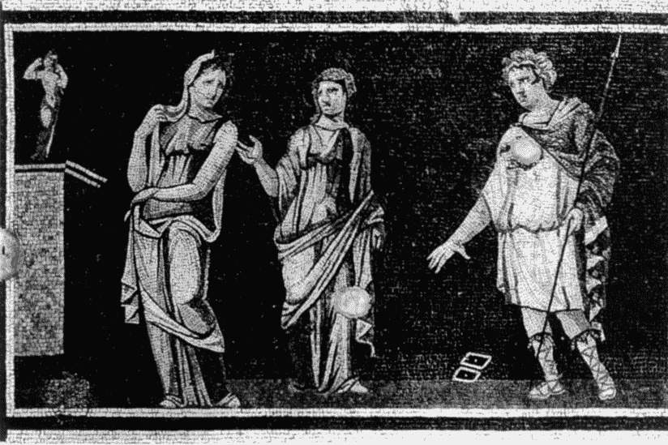

图 18。安提约克，红地砖之家，费德拉与希波吕提斯场景（摄影摄影：C. Kondoleon）

节选自该神话在图像演变过程中某一阶段的多个来源。

作为已知的关于这一悲剧的第二件马赛克描绘，帕福斯（Paphian）的案例引人入胜，值得仔细研究。第一件来自安提约克的红地砖之家（图 18）。^41 Levi 为其分析研究了该悲剧的不同版本，并得出结论：尽管存在许多许多绘画和雕塑表现形式均自的一幅原作画，但安提约克的马赛克似乎是三个不同类型人物的临时组合，这些人物“仅仅在悲剧的特定动作中并排置在一起”。^42

尽管帕福斯和安提约克的马赛克之间可以建立紧密的联系，但它们对费德拉和希波吕提斯的描绘完全不同——它们唯一的共同特征是双联画结构（`diptych`）。

与安提约克的例子不同，帕福斯版本确实对应于系列石棺上的人物，这些石棺显然反映了希腊化时期假设的原作。^43 在这些双层浮雕的左侧（图 19），费德拉以庄严的姿态坐在宝座上，面对她心爱的希波吕提斯，希波吕提斯表现为一个站在马和猎狗旁的裸体猎人。^44

这些浮雕还包括了中间人物——老奶奶士，以及聚集在费德拉周围的女侍和爱丘神（Erotes），以及希波吕提斯身边的狩猎伙伴。现存的关于该主题最精复杂的绘画是来自金宫（Domus Aurea）的一幅壁画，它与这一雕塑系列非常相似，并指向了共同模型的存在。^45

- 41. Levi 1947, 71–75, pl. 11b，定于公元 2 世纪第二季度。
- 42. 同上, 75。
- 43. 同上, 72。
- 44. 有关这些浮雕的最新讨论，见 Sichtermann and Koch 1975, 33–36, pl. 55–66, cat. nos. 26–30。
- 45. Reich 1922, 209, fig. 4；以及 Levi 1947, 72n.28。
- 46. Sichtermann and Koch 根据风格依据将其定于公元 2 世纪后期（1975, 33–34, pl. 52–56, 57, cat. no. 26）。

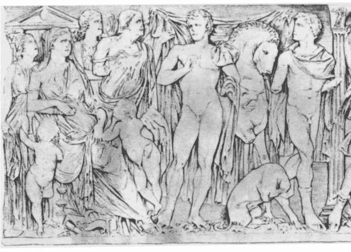

呈侧面，并直接看向右侧的希波吕提斯，后者也回了她的目光，这与许多其他浮雕上的表现不同（在那里他们是彼此避开的）。希波吕提斯的人物不仅共享了对立式（`contrapposto`）的姿态和英雄式的裸体，更具体的是，他们的斗篷以同样的方式挂在肩膀和手臂上。

从其他石棺可以推断出，帕福斯的人物左手曾握着一根长矛（现已断裂）。他的右侧有一只猎狗。因此，帕福斯马赛克的特征在石棺上的基本布局是反的。我们的马赛克中相同的姿态和位置，但人物交换了：费德拉在右侧，希波吕提斯在左侧。

这种反转迫使费德拉疯狂地转头看向希波吕提斯，使得她的身体完全可见，但头部向左倾斜。结果是马赛克中的两个人物在眼神交流时似乎在互相远离，创造了一个分化的构图，比浮雕和谐得多。

帕福斯的构图虽然减少到了最少元素且排列生硬，但可以追溯到同一处原作。与比萨的一件公元 2 世纪后期的石棺对比使得这一点非常清晰。^46 在浮雕的最左侧，费德拉以与马赛克相同的方式坐在宝座上，右肘支在宝座扶手上。

宝座的雕刻回想起了帕福斯可见的腿部的装饰，将在下文中讨论。她的装束——斗篷、头巾和头冕——与帕福斯相同。

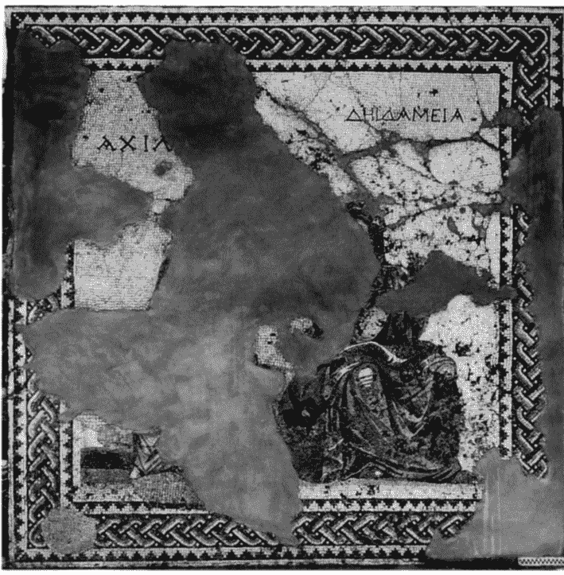

图 21。安提约克，门廊之家，代达梅亚（普林斯顿大学艺术与考古学系赠，编号 4814）

公元 2 世纪半叶（图 23）。^50 腿部由圆柱形的镀金金属上半部分组成（由帕福斯和安提俄克的黄色高光所示），支撑在一个形状像花萼（钟形）并设在高茎上的下半部分。

帕福斯的下半部分相当低劣，但它显然与这种类型有关，这种类型在庞贝画中也为人知。^51 裹在帕福斯宝座左侧的大块绿布（包括费德拉靠肘的扶手）可以与安提rium之家马赛克中覆盖宝座左侧的深棕布进行对比。^52

与安提奥克相比的第三点是带翅的爱丘斯（Eros），他在帕福斯的悲剧叙述中起着关键的辅助作用（图17）。与石棺上的同类形象不同（后者通过讨媚的姿态在菲德拉的脚下认出我们的激情），而这个爱丘斯则预示了这个故事命中注定的悲剧。⁵53 他通过将手中的火炬——激情与生命的象征——指向下方，仿佛要熄灭火焰。这一手势，以及他紧锁的眉头和离开现场的轻快动作，提醒了观众即将降临的厄运。对帕福斯爱丘斯这种解释的辅助证据来自前提到的爱丘斯，他出现在安提奥克宴会之屋（House of the Buffet Supper）的纳尔喀索面板镶嵌图中（图15）。

⁵53. 有关在带有菲德拉和希波波利特斯的石棺上使用爱丘斯，请参阅 Sauer 1890, 23，以及 Sichermann 和 Koch 1975, 33–36 中引用的所有示例，目录编号 26–30。

我们的图像虽然制作水平逊得多，但似乎是安提奥克那幅几乎完全相同的复制。两者都位于场景的最边缘，头部转向爱情的受害者，且都被捕捉到跑步的姿态，右腿伸直，重心落在转向的左腿上。他们穿着类似的、在颈部系紧的灰色斗篷，每人左手都直立拿着弓。帕福斯爱丘斯的面部表情和发型也与安提奥克的示例相对应。唯一的区别在于他们右臂的位置，这是由于火炬的功能造成的。在安提奥克的面板中，爱丘斯将右臂横跨身体，将火炬指向下方的倒影；而在帕福斯，爱丘斯则将右臂向身体外延伸，指向左侧的菲德拉。在每种情况下，火炬都代表了爱的苦难。

在安提奥克还有两个二、三世纪的爱丘斯形象来表达爱：激情的早期萌动出现在狄俄尼索斯与阿里阿德涅之屋（House of Dionysos and Ariadne）中，那里爱丘斯伸出双臂向神展示正在入睡的美人；而在红地之屋（House of the Red Pavement）中，爱丘斯是阿多尼斯和爱芙罗忒之间的媒人。

⁵54. 爱丘斯在纳尔喀索描绘中的作用 Levi 在其图像学分析（1947, 60–66）中进行了讨论。

⁵55. 同上，142–50，图 28b，定日期于罗马时期；以及同上，80–82，图 12b，分别对应。

在安提奥克的马赛克画中出现了许多其他形象，但此处描述的示例对于帕福斯这一形象的意义具有相关性。尽管庞贝的绘画和石棺为爱丘斯作为爱情欢乐或忧伤的预使者提供了丰富的证词，但安提奥克爱丘斯与我们爱丘斯之间的相似性太具体，无法用与这些示例的共同起源来解释。⁵56 帕福斯和安提奥克爱丘斯之间紧密的相似性为这些作坊之间的联系提供了强有力的论据。

这种联系可以在帕福斯和安提奥克版本的菲德拉与希波波利特斯双联画（diptych）中看到。对于现存许多绘画和石棺，这种装置的存在是不确定的，事实上，欧里庇德剧作《戴花者》（*Stephanophophoros*，所有纪念碑似乎都代表了这个）并没有提到信。⁵57 在早期阶段，这一主题被引入以封装欧里庇德戏剧的关键视觉画面，即菲德拉的建议是间接提出的。剧中的中间人是女仆，但她在帕福斯的缺席使得双联画对于正确解读场景变得不可或缺。Levi 注意到，这一主题在文学作品奥维德的《变形》（*Heroides*）中被引入，他在书中讲述了菲德拉一封浪漫情信的悲剧。⁵58 无论这种装置来源何，它是帕福斯和安提奥克作坊共有的。

最后，安提奥克和帕福斯马赛克之间一个微不足道的影响是，它们共同使用了曲线带来处理脚部的阴影。红亭之屋（House of the Red Pavilion）九宫式马赛克中的人物（已注意到其关于菲德拉和希波波利特斯的马赛克）包含了与帕福斯类似的脚部投射影。⁵59 这种技术在安提奥克马赛克中很流行，出现在许多示例中。⁶60

帕福斯的菲德拉与希波波利特斯马赛克展示了与这些马赛克制作过程密切联系。它提供了令人信服的内部证据，说明作坊使用本模型书（可能由早已脱离原始背景的人物类型组成），结合对安提奥克素材的了解，制作了悲剧的浓缩版本。

⁵56. 特别参见迪奥墨德斯别墅的纳尔喀索画（Rizzo 1929, p. 128），那里一个带翅的爱丘斯脚尖向下，忧伤地看着纳尔喀索。关于在 Steuers 1969, no. 251, pp. 111–14 中引用的对爱丘斯的通用讨论。

⁵57. Weitzmann 1941, 233–35 讨论了双联画在绘画和石棺中的出现，以及这些不同描绘与文学来源的关系。他指出只有目前保存在斯皮洛斯（Spylos）的一个石棺保留了作为双联的信，但认为其他石棺应该修复以包含双联画（3240.6）。另见于 Sichermann 和 Koch (1975, 36, p. 65, no. 30)。

⁵58. Levi 1947, 71–72。

⁵59. 同上，82–85，图 13。

⁶60. 特别参见宴会之屋（House of the Drinking）的四季，p. 33。

## 菱形星正方形图案

狄俄尼索之屋边框和中心区域装饰的选择与处理，为年代、风格传播和制作机制提供了强有力的内部证据。与人物马赛克不同，几何和植物主题的执行受外部影响要小得多。

在狄俄尼索之屋出现的所有几何图案中，菱形星正方形在帝国时代整个地中海地区是最频繁代表的。其形式在第一世纪确立，随后是一系列可以与区域发展相联系的演变。

位于北廊正北的一个长窄房间（8室，10.25 m × 3.40 m.），其中心设计是一个由切星形成正方形和较小正置正方形的图案（图24和25）。¹ 边缘有四行，每行十七个大正方形。菱形包含交替的深灰色和粉色填充，正置正方形包含相同颜色的十字纹和缺口正方形。大正方形被多样化的几何和植物主题填充。¹ 描述遵循 *Décor géométrique*, 266–67, 图 173b 中的说法。中心面板约为 9.5 m. × 2.0 m.

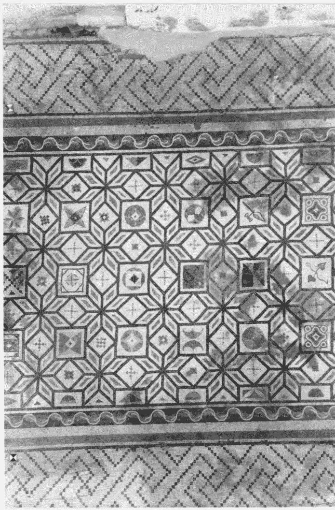

图24。8室，菱形-星形-方形马赛克地毯（塞浦路斯文物部门捐赠）

52 世俗与神性

**图25。**8室，菱形-星形-方形设计细节（塞浦路斯文物部门捐赠）

这是这一发展的较早期阶段，同时也体现了塞浦路斯工作坊的独立性。

在附近的库克利亚亚（古帕福斯）发现的一块地板（图26）为我们与帕福斯地板进行批判性比较的基础。62 在库克利亚亚，多个几何边框围成了一个由菱形-星形-方形图案装饰的中心面板。库克利亚亚与帕福斯案例之间的直接区别在于设计与背景之间的关系。在库克利亚亚，菱形由双黑线勾勒并留白，方形则填充有一套相对简单的花卉和几何纹样库，并保留了大部分白色底。填充装饰物，如所罗门结、半圆盾纹（peltae）、常春树叶、果枝和十字纹，在黑白设计中起到了色彩点缀的作用。相比之下，在帕福斯，图案通过在中性白色背景上设置深浅不一的几何和植物纹样而变得丰富。菱形的彩色填充部分深浅交替，构成了帕福斯风格的多色视觉效果。白色底仅起到了统一和平衡这些迥异部分的作用——它并不是主导元素。

62. Karageorghis 1961, 292–96, fig. 464a and b; and Mitford 1951, 59.

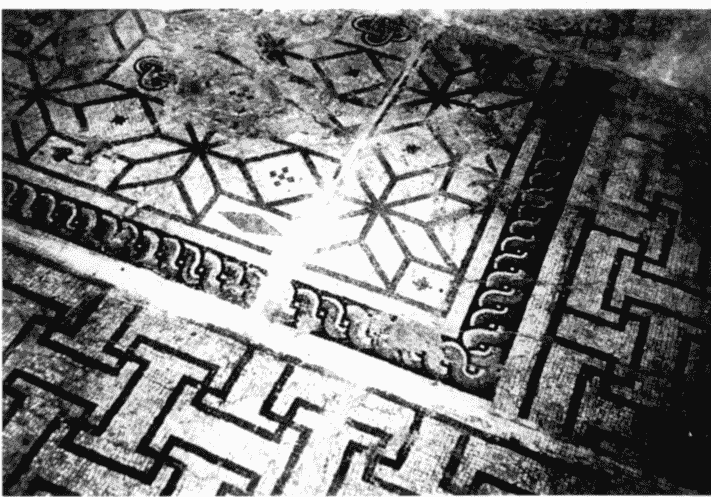

库克利亚亚案例对于判定帕福斯创新的年代和价值具有重要意义。幸运的是，库克利亚亚地板的年代不仅从其风格可以推断，还有考古证据支持。马赛克下方发现了一枚提比留皇帝钱币，提供了一个“此后之点”（terminus post quem），而庭院内排水沟的内容年代则晚于塞维鲁斯时期。从风格上说，库克利亚亚地板具有公元1世纪后期和2世纪上半叶意大利马赛克共有的质素特质。一个密切的平行案例是来自公元1世纪最后四分之一的伊莫拉马赛克（图27）。63 粗犷的几何填充物（包括万字回纹，取代了库克利亚亚的所罗门结）与植物纹样（常春树叶或果实）交替出现，但白色底和白色菱形仍是设计的主导特征。

库克利亚亚地板的外边框与我们的房屋有另一个联系：它包含位于矩形内的菱形（矩形又由一排窄菱形勾勒）。同样的边框但使用了鲜艳颜色的菱形，围绕着帕福斯14室的多设计构图（图31）。这种线性构图从公元2世纪初起安提约仅被用作边框。64

63. Blake 1930, 112, pl. 35:2; and Salies 1974, 29, 121, K244。

64. 例如，一圈连续的菱形框住了一个内刻在矩形内的菱形边框。

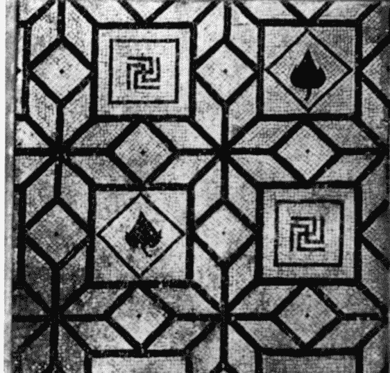

图27。伊莫拉（参考 Blake 1930, pl. 35, 2）

库克利亚亚地板证明，菱形-星形-方形图案至少在2世纪上半叶就引入了塞浦路斯，其表现形式遵循该时期的通用风格原则。帕福斯的案例则遵循一种完全不同的设计原则。

来自安提约的七个案例展示了精美多色技术下的新型菱形-星形-方形图案。由于这七件作品均可追到公元3世纪上半叶，它们为塞维鲁斯的创新提供了一个极其紧凑视角，并提供了一个可断代的系列，用以与帕福斯的解释进行比较。各种单元的比例、填充纹样的处理，似乎表明新的审美价值已在该地区生根发芽。利维根据风格理由将达夫尼（DH 25-L区）一处房屋庭院的一块马赛克定于哈德良时期，但逻辑上无法将其与塞维鲁斯案例隔离开（图28）。67 然而，这似乎确实是安提约系列中最早的，很大程度上是因为菱形的填充物尚未以幻觉式的方式进行阴影处理。三色方案包含填充有深浅交替灰色、黄色和红色星形。白色底仅起到了统一和平衡这些迥异部分的作用——它并不是主导元素。

独特的进展，以塔尔苏斯（昔拉基亚）的马赛克为例。其年代可追溯到风格演变的3世纪初，这种菱形-星形-正方形图案被用作餐室（triclinium）马赛克三个具象面板的边框；它与帕福斯（Paphos）未经装饰的菱形以及其填充图案的平铺化处理具有共同点。72

对该设计在其他东方遗址以及西方出现的简要调查，有助于将帕福斯设计置于类型学系列中。叙利亚创新的影响在北非洲可见，在塞琉尼（Cyrene）的杰森·马格努斯斯住宅（House of Jason Magnus）中，一个密集且复杂的菱形-星形-正方形图案包含了透视菱形。73 这种图案的北非洲版本是独一无二的，塞琉尼地板与其带有透视菱形的叙利亚版本密切对应于塞维鲁王朝（Severan period）晚期。74 叙利亚模型的流行在希腊也清晰可见，在安提俄（Antioch）仍发现了几个例子。在埃琉绪斯（Eleusis），一个菱形-星形-正方形马赛克是帕福斯房屋中一个房间的核心装饰。75 阴影菱形填充和中心正方形负实体的平铺效果将帕福斯与塞维鲁王朝及叙利亚联系起来。在帕特拉斯（Patras），在一个罗马房屋中发现了一块与帕福斯地板二维化方案相似的地板，目前仅部分挖掘且未定年代。76 填充图案包括彩虹、锯折线和十字花。来自奥林匹亚（Olympia）尼罗宫的一块马赛克也应被包含，因为它使用了无色菱形，以及对正方形填充图案相似且非对称的排列。77

基于相同模型的创新在希腊也同样明显，在3世纪上半叶的例子中，白色的作用从底色转变为轮廓色，从而消除了整个帝国通用的黑色轮廓。78 因此，八角星的基本元素不再占据主导，因为其深色填充部分退到了深色背景中。

72. Budde 1972, 121–26, pl. 118 and 117, 不在安塔利亚博物馆。

73. 该马赛克是房间1的主要设计；参见 Mingazzini 1966, 37–41, pl. 16 and 17；以及 Salies 1974, 59, and cat. K284。

74. 来自房屋的其他证据（如柱头、马赛克和绘画）显示了塞维鲁时期的；参见 Mingazzini 1966, 68。

76. Pappopoulos 1973, 225–26, pl. 188 and 198a。该马赛克发现于 Plateia Aloniou 和 Onados Pachaikolou 的交汇处。

77. Salies 1974, 125, K289。

78. 帕福斯一个罗马房屋的例子提供了“此以前界”（terminus ante quem），即赫罗尼墙（公元A.D. 267）显示了该房屋；Salies 1974, 63, pl. 15, K290。第二个例子来自凯法卢尼亚尼亚岛（Kephallonia）Skala 帕福斯房屋的4号房间；参见 Kallipotides 1961–62, 28, pl. 10；以及 Salies 1986, 76–78, fig. 19，他将其定为塞维鲁时期。另一个来自雅典赫罗德尼肖剧场（Odeon of Herodes）最东端的入口，同样由公元267年的赫罗德斯地板提供了“此以前”（terminus ante）；参见 Travlos 1971, 385, figs. 378 and 499。为了证明这种变体在希腊的持久性，我引用了一个来自阿斯皮莱俄（Aspylaios）的5世纪例子；参见 Peleandakis 1974, 47, pl. 48, no. 3。

## 技巧与风格

如果我们撇开图案的内部元素和安排，研究该设计的功能同样具有启发性。这种变化表明，当当地口味干预时，模型的影响是微弱的，但重要的是，这些变化直到3世纪才开始，似乎是在引入塞维鲁叙利亚模型之后。

在安提俄，菱形-星形-正方形图案被赋予了次要作用，要么作为具图构的装饰边框，要么作为长廊或门厅的表面覆盖。⁷ 在帕福斯，该图案被视为带有多个几何边框的核心地毯；它覆盖了8房间的表面，该房间紧邻北门廊，并通往9房间（与xenia交织）和10房间（格尼墨德）。在某种意义上，这个长窄房间充当了走廊空间，在柱廊与展示给接待套间之间提供了空间联系。

在西方大部分地区——例如北非洲和瑞士——倾向于中心化并因此重新调整设计的内部秩序。¹⁰ 因为菱形环绕中心正方形组织，图案被退居背景。在北非洲版本中，该设计地板与其带有透视菱形的叙利亚版本密切对应于塞维鲁王朝晚期。74 叙利亚模型的流行在希腊也清晰可见，在安提俄仍发现了几个例子。在埃琉绪斯，一个菱形-星形-正方形马赛克是帕福斯房屋中一个房间的核心装饰。75 阴影菱形填充和中心正方形负实体的平铺效果将帕福斯与塞维鲁王朝及叙利亚联系起来。在帕特拉斯，在一个罗马房屋中发现了一块与帕福斯地板二维化方案相似的地板，目前仅部分挖掘且未定年代。76 填充图案包括彩虹、锯折线和十字花。来自奥林匹亚尼罗宫的一块马赛克也应被包含，因为它使用了无色菱形，以及对正方形填充图案相似且非对称的排列。77 基于相同模型的创新在希腊也同样明显，在3世纪上半叶的例子中，白色的作用从底色转变为轮廓色，从而消除了整个帝国通用的黑色轮廓。78 因此，八角星的基本元素不再占据主导，因为其深色填充部分退到了深色背景中。这种变化表明，当当地口味干预时，模型的影响是微弱的，但重要的是，这些变化直到3世纪才开始，似乎是在引入塞维鲁叙利亚模型之后。

在某种意义上，这个长窄房间充当了走廊空间，在柱廊与展示给接待套间之间提供了空间联系。在西方大部分地区——例如北非洲和瑞士——倾向于中心化并因此重新调整设计的内部秩序。¹⁰ 因为菱形环绕中心正方形组织，图案被退居背景。

## 家庭与神性

帕福斯地板并不容易归入东方或西方组。在某种意义上，这个长窄房间充当了走廊空间，在柱廊与展示给接待套间之间提供了空间联系。在西方大部分地区——例如北非洲和瑞士——倾向于中心化并因此重新调整设计的内部秩序。¹⁰ 因为菱形环绕中心正方形组织，图案被退居背景。在北非洲版本中，该设计地板与其带有透视菱形的叙利亚版本密切对应于塞维鲁王朝晚期。74 叙利亚模型的流行在希腊也清晰可见，在安提俄仍发现了几个例子。在埃琉绪斯，一个菱形-星形-正方形马赛克是帕福斯房屋中一个房间的核心装饰。75 阴影菱形填充和中心正方形负实体的平铺效果将帕福斯与塞维鲁王朝及叙利亚联系起来。在帕特拉斯，在一个罗马房屋中发现了一块与帕福斯地板二维化方案相似的地板，目前仅部分挖掘且未定年代。76 填充图案包括彩虹、锯折线和十字花。来自奥林匹亚尼罗宫的一块马赛克也应被包含，因为它使用了无色菱形，以及对正方形填充图案相似且非对称的排列。77

### 多重设计

马赛克区域由四一组的网格分为十六个正方形（图31）。每个正方形都填充了不同的几何方案，色彩丰富，包括浅粉、深粉、红褐色，以及橄榄绿、灰色和白色（颜色 1）。有三个独立的框架。整个构图的边框是一个交替轮廓的正方形和矩形带，正方形包含一个嵌入式正方形（以白色花饰作为装饰），矩形包含一个嵌入式菱形（带有黑白内对齐正方形）。85. 第二个边框勾勒了一排正方形与

独特的进展，以塔尔苏斯（昔拉基亚）的马赛克为例。其年代可追溯到风格演变的3世纪初，这种菱形-星形-正方形图案被用作餐室（`triclinium`）马赛克三个具象面板的边框；它与帕福斯（Paphos）未经装饰的菱形以及其填充图案的平铺化处理具有共同点。72

对该设计在其他东方遗址以及西方出现的简要调查，有助于将帕福斯设计置于类型学系列中。叙利亚创新的影响在北非洲可见，在塞琉尼（`Cyrene`）的杰森·马格努斯住宅（`House of Jason Magnus`）中，一个密集且复杂的菱形-星形-正方形图案包含了透视菱形。73 这种图案的北非洲版本是独一无二的，塞琉尼地板与其带有透视菱形的叙利亚版本密切对应于塞维鲁王朝（`Severan period`）晚期。74 叙利亚模型的流行在希腊也清晰可见，在安提俄（`Antioch`）仍发现了几个例子。在埃琉绪斯（`Eleusis`），一个菱形-星形-正方形马赛克是帕福斯房屋中一个房间的核心装饰。75 阴影菱形填充和中心正方形负实体的平铺效果将帕福斯与塞维鲁王朝及叙利亚联系起来。在帕特拉斯（`Patras`），在一个罗马房屋中发现了一块与帕福斯地板二维化方案相似的地板，目前仅部分挖掘且未定年代。76 填充图案包括彩虹、锯折线和十字花。来自奥林匹亚（`Olympia`）尼罗宫的一块马赛克也应被包含，因为它使用了无色菱形，以及对正方形填充图案相似且非对称的排列。77

基于相同模型的创新在希腊也同样明显，在3世纪上半叶的例子中，白色的作用从底色转变为轮廓色，从而消除了整个帝国通用的黑色轮廓。78 因此，八角星的基本元素不再占据主导，因为其深色填充部分退到了深色背景中。这种变化表明，当当地口味干预时，模型的影响是微弱的，但重要的是，这些变化直到3世纪才开始，似乎是在引入塞维鲁叙利亚模型之后。

如果我们撇开图案的内部元素和安排，研究该设计的功能同样具有启发性。在安提俄，菱形-星形-正方形图案被赋予了次要作用，要么作为具图构的装饰边框，要么作为长廊或门厅的表面覆盖。⁷ 在帕福斯，该图案被视为带有多个几何边框的核心地毯；它覆盖了8房间的表面，该房间紧邻北门廊，并通往9房间（与`xenia`交织）和10房间（格尼墨德）。在某种意义上，这个长窄房间充当了走廊空间，在柱廊与展示给接待套间之间提供了空间联系。

在西方大部分地区——例如北非洲和瑞士——倾向于中心化并因此重新调整设计的内部秩序。¹⁰ 因为菱形环绕中心正方形组织，图案被退居背景。在北非洲版本中，该设计地板与其带有透视菱形的叙利亚版本密切对应于塞维鲁王朝晚期。74 叙利亚模型的流行在希腊也清晰可见，在安提俄仍发现了几个例子。在埃琉绪斯，一个菱形-星形-正方形马赛克是帕福斯房屋中一个房间的核心装饰。75 阴影菱形填充和中心正方形负实体的平铺效果将帕福斯与塞维鲁王朝及叙利亚联系起来。在帕特拉斯，在一个罗马房屋中发现了一块与帕福斯地板二维化方案相似的地板，目前仅部分挖掘且未定年代。76 填充图案包括彩虹、锯折线和十字花。来自奥林匹亚尼罗宫的一块马赛克也应被包含，因为它使用了无色菱形，以及对正方形填充图案相似且非对称的排列。77

### 多重设计

马赛克区域由四一组的网格分为十六个正方形（图 31）。每个正方形都填充了不同的几何方案，色彩丰富，包括浅粉、深粉、红褐色，以及橄榄绿、灰色和白色（颜色 1）。有三个独立的框架。整个构图的边框是一个交替轮廓的正方形和矩形带，正方形包含一个嵌入式正方形（以白色花饰作为装饰），矩形包含一个嵌入式菱形（带有黑白内对齐正方形）。85. 第二个边框勾勒了一排正方形与一

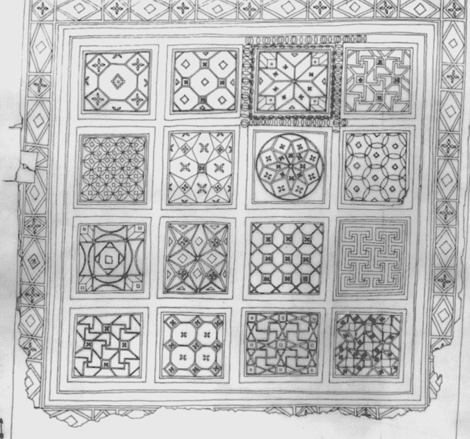

**图 31。** 第14室，多种设计的马赛克，由 M. Medič 绘制（由 I. Nicoloau 提供）。网格的编号方式如同站在房间南侧面向北侧南门廊的人所看到的一样。1号格位于左上角，4号格位于对应的右上角，5号格回到左侧（东侧），依此类推。

- **1号格**，`DG, 251, pl. 16a`，一个勾勒轮廓（带有红棕色单条边框）的正交图案，由相邻的八边形组成平衡平衡的正方形。颜色：中心八边形为红褐色，中心有一个白色的平衡断开正方形；其他四个八边形的可见部分为白色；深绿色/黑色带白色十字形纹的平衡正方形；白色绿色的平衡断开正方形。

- **2号格**，`DG, 251, pl. 16b`，描述与1号格相同，但包含五个八边形且正方形是直立的。颜色在玫瑰色（深粉色）和红褐色之间交替；正方形为橄榄绿色带有白色平衡断开正方形。

- **3号格**，`DG, 266–67, pl. 17b`，一个勾勒轮廓的正交图案，由切线菱形星组成较小的平衡正方形。颜色：星形菱形填充了深绿色、红褐色、白色和粉色；正方形体采用与菱形相同的色调，每个单元都装饰有白色的小花饰。

- **4号格**，`DG, 254–55, pl. 166`，一个勾勒轮廓（带有双白边框）的正交图案，由相邻的不规则八边形（构成正方形）组成，上面带有交替反转的内嵌万纹，营造出连续万纹叠加钥匙图案的效果。颜色：八边形为混合红褐色或深绿灰色；正方形为粉色，中心有白色小花饰。

- **5号格**，`DG, 372–73, pl. 238a`，一种交叉圆的正交图案，形成四叶草（纺锤形）和此处包含内嵌正方形的凹正方形。颜色：正方形在绿色和粉色之间交替；正方形为白色。

- **6号格**，`DG, 292–93, pl. 186d`，一种切线六边形、正方形和四角星的正交图案；这里的星形带有内嵌的小正方形。颜色：六边形在玫瑰色和白色小花饰之间交替；星形带有白色内嵌正方形，中心带有白色十字。

- **7号格**，`DG, 266–67, pl. 17b`，与3号格相同，但嵌套在圆形内。颜色：灰色、深绿色和粉色的菱形，正方形为白色、红褐色和深绿色。

- **8号格**，`DG, 390–91, pl. 247a`，一种在六点相交的圆图案，形成三叶形和作为平衡锯齿正方形的凹六边形。颜色：六边形为玫瑰色或深绿色带有白色正方形；正方形为白色。

- **9号格**，`DG, 362–63, pl. 332`，一种切线圆的勾勒图案，形成凹正方形，以及带有白色正方形隔间的叠加网格。在案例中，中心隔间带有内嵌正方形。角象限带有立方体。颜色：圆形；大正方形为红褐色；平衡正方形为玫瑰色，中心有一个白色锯齿正方形；立方体为灰色、红褐色和玫瑰色。

- **10号格**，`DG, 288–89, pl. 184b`，一种勾勒轮廓的切线四角星图案，形成内嵌平衡正方形，交替呈横卧和直立。颜色：星形为红褐色；内嵌正方形为深绿色中心带白色十字；菱形为玫瑰色或粉色的红褐色棋盘格正方形。

- **11号格**，`DG, 260, pl. 169a`，不规则八边形的勾勒图案，相邻短边构成正方形和长六边形。颜色：六边形在绿色和玫瑰色之间交替；正方形在白色和带有红色或白色小花饰的红褐色之间交替。

- **12号格**，`DG, 296–97, pl. 188d`，双纹万纹钥匙图案。颜色：粉色交替边框。

- **13号格**，`DG, 254–55, pl. 166e`，与4号格相同，由单白边框勾勒。颜色：八边形为红褐色和玫瑰色；正方形为深绿色带白色十字。

- **14号格**，`DG, 251, pl. 163a`，与1号格相同。颜色：八边形在绿色或红褐色之间交替；正方形为带白色十字的玫瑰色。

- **15号格**，`DG, 292–93, pl. 186b`，一种勾勒（带有单白边框）的切线六边形正交图案，形成内嵌正方形的正角星。每个八边形内交替反转的万纹使得这种独特的适配（参见4号和13号格的万纹效果）。颜色：万纹分为玫瑰色和红褐色部分；正方形为绿色中心带白色正方形。

- **16号格**，`DG, 292–93, pl. 186b`，一种勾勒（带有单白边框）的切线六边形正交图案，形成内嵌正方形的正角星。每个八边形内交替反转的万纹使得这种独特的适配（参见4号和13号格的万纹效果）。颜色：万纹分为玫瑰色和红褐色部分；正方形为绿色中心带白色正方形。

### 技术与风格

营造视觉上充满力的领域与塞维王朝时期推崇的幻影效果非常契合。二世纪末三世纪安提奥克推崇的等轴图案和多色彩，正如菱形

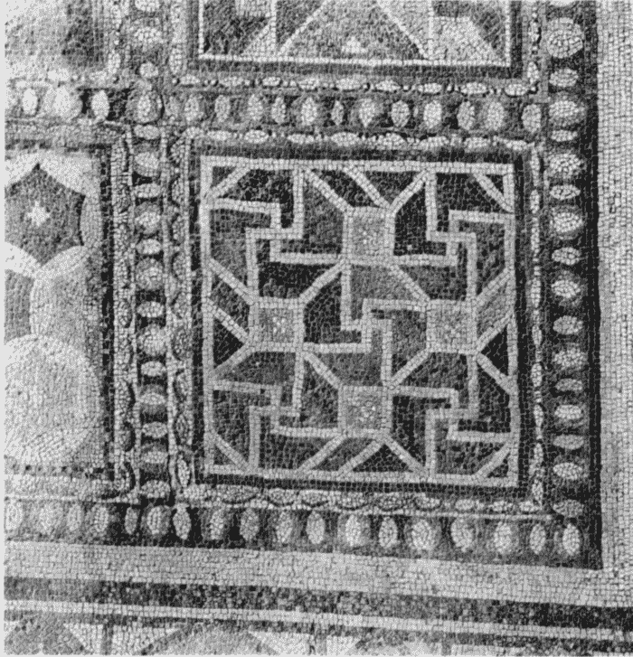

**图 32。** 第14室，第4格（由塞浦路斯文物部捐赠）

上方展示了星形与正方形马赛克。在安提俄，与我们的地板最相似的例子发现于“邪眼之家”（`House of the Evil Eye`），那里有一系列几何面板装饰着环绕中央水池的柱廊三侧（图 33）。$^{92}$ 镶板的图案，包括万字回纹、四角星和八边形、形成四叶草的交叉圆以及透视几何体，均用黑色、红色、黄色和白色执行。这些方案、填充图案和着色技术类似于帕帕福斯的几何风格，但构图的构思却完全不同。在安提俄，几何面板以宽宽的间隔分布在柱廊的长度上，像许多独立的地毯一样，背景是倾斜点黑线组成的连续格栅纹样。

> 92. `Levi 1947, 28–29, pl. 93b`。根据风格，这些马赛克被定于22世纪早期（同上, 375）。

技术与风格 65

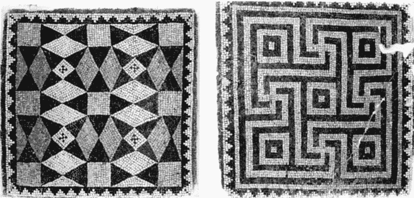

事实上，在安提俄或东部其他地方，都没有与帕福斯发现的这种几何面板网格排列的平行案例。$^{93}$

这种设置在正交网格上、装饰有植物、花卉和几何图案等各种装饰的正方形面板系统在罗马西方到处可见，而在东部，这种群体的异常外观显然是格格不入的。H. Stern 和 V. von Gonzenbach 的研究对这种构图版本引起了极大兴趣，他们分别将其称为“多重装饰”（`à décor multiple`）或“Vielsturmmosaiken”，而我称之为“多重设计”（`multiple-design`）。$^{95}$ 普遍公认的是，这种构图类型在卢罗纳河谷的作坊中得到了最丰富的诠释，时间从公元2世纪中期到3世纪中期。

帕福斯地板在构图和几何方案上最接近的对应物可以在这些作坊的范围内找到。巨大的规模——里昂的一块地板由90多个正方形组成——以及卢罗纳河谷小组为特征的丰富图案，使得这些马赛克与较为朴素的帕福斯地板有所不同。$^{97}$

^93 `Lancha 1977, 177`，认为安提俄的“灵魂之舟之家”是帕福斯之外唯一的另一个例子，但我并不这么认同。

^94 关于该类模式的通论讨论，`Sayles` 讨论了“`Quadratfeldersystem`”马赛克的广泛区域性实例（`1974: 2–3, 20–25, 38–39, 48–49`），并在她的目录（`Katalog`）中列出了它们（`95:104-1`）。另见 `Lancha 1977, 17–65`。

^95 `Stern 1965, exp. 235–38`，他在全文中使用“`à décor multiple`”一词；`von Gonzenbach (1961, 48–51; pl. 71)` 在描述昂什什马赛克时使用了“`Vielsturmmosaïk`”一词，她将其定于3世纪中期。关于这一类群的总体见 `Lancha 1977, 19–32`。`Stern 1966, 236`。

^97. 关于现位于里昂的 *Verbe Incarne* 带有90个正方形的马赛克，见 `Stern 1967, 49–51, pl. 38, no. 53`，定于3世纪早期。

^98. `Lancha 1977, 24` 勾勒了维也纳“多重装饰”马赛克的特征，这适用于卢罗纳河作坊。

^99. 对于这两种地板，见 `Stern 1969, 13–43`。另见尼姆的带有“阿德梅图斯婚礼”的 *emblema* 马赛克：`Stern 1967, fig. 5`。

### 家居与神性

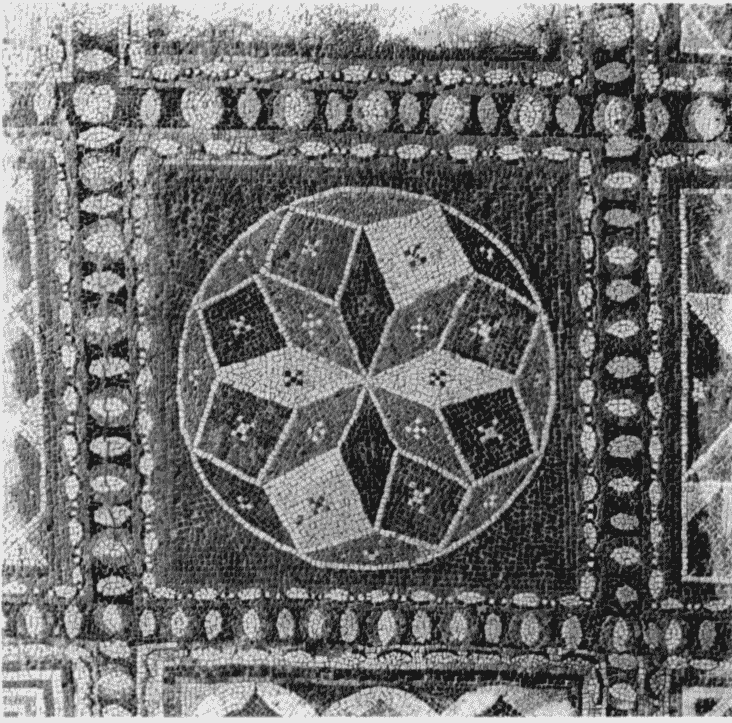

**图 34。** 第14室，第7格（由塞浦路斯文物部捐赠）

此外，高卢作坊似乎青睐圆盘与正方形的交替作为面板，而帕福斯的构图完全是几何性的，且仅包含一个圆盘（第7格，图34）。在两个壮目的案例中，多重设计包含一个 *emblema*，分别是利科梅德斯宫的阿基琉斯（图 35）和赫拉克勒。$^{99}$ 这些华丽的多色马赛克反映了高卢在塞维王朝时期实现的多重设计巅峰，但还有更多接近其源的克制例子。

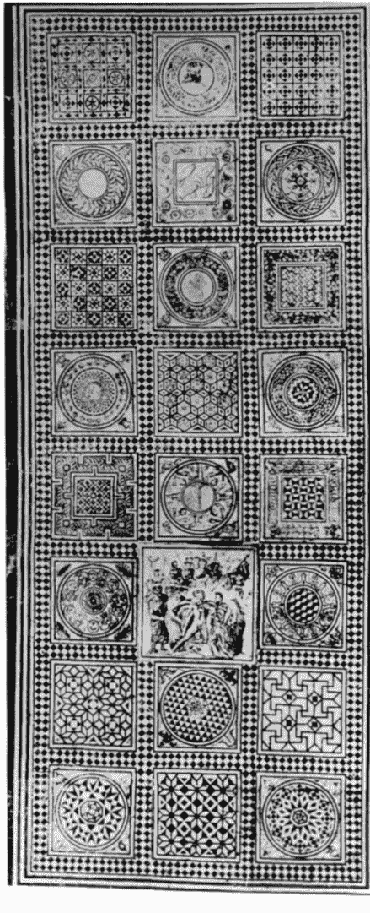

68 家居与神性

装饰性库的起源和多重设计的概念追溯到共和国晚期和帝国早期的意大利模型。在卢瓦尔河的特雷（36）附近发现的令人印象深刻的黑白马赛克证实了对意大利模型的依赖。$^{100}$ 几何方案、单色处理以及使用连续边界（相邻菱形）来形成网格线条，这种卢瓦尔地板与古尔比奥和雷焦-艾米利亚的地板相似，定于2世纪上半叶。$^{101}$ 这样的地板通常作为卢罗纳河马赛克的可能模型。事实上，它们在风格和装饰效果上与2世纪中期的的高卢地板一致。$^{102}$

所有卢罗纳河谷的多重设计马赛克与帕福斯马赛克最为相似。帕福斯明显的（尽管有些变形的）蛋形边界的功能与奥泽尔地板的黑色菱形相似。在黑色底上进行浅色着色，它们在统一整个构图和突出每个正方形的独特性方面同样有效。填充35个正方形的图案有四种。帕福斯的粉白图案（图 37）类似于奥泽尔简单的黑白纹样，并与邪眼之家（图 33）中相同图案的复杂性形成对比。同样，第10格中红棕色的四角星和粉色菱形与奥泽尔发现的黑星和白菱形同样显著。另一方面，邪眼之家通过颜色（黑、灰、黄、红）引入次级和三级阶段，分散了对主要形式——四角星的注意力。艺术家并没有转向简单。在奥泽尔，连接正方形和四角星的六边形用黑色轮廓填充。$^{103}$ 帕福斯的图案出现在第6格（图 31），易于读为白星和粉色六边形。$^{104}$

100. 同上，49–58。

101. `Lancha 1977, 15` 和 `Salies 1974, 34` 根据发掘报告将雷焦马赛克定于奥古斯时期；然而，`Salies 1974, 38–39` 将其定于安东尼时期。

102. `Stern 1967, 56`；以及 `Darmon and Lawrence 1977, 93–99, no. 46, pls. 68–69`，他们建议为塞维王朝，但给出了公元150–250年的宽泛。

103. 奥泽尔第3行第4个正格（图 36）。

104. 奥泽尔第2行第4个正格（图 36）。

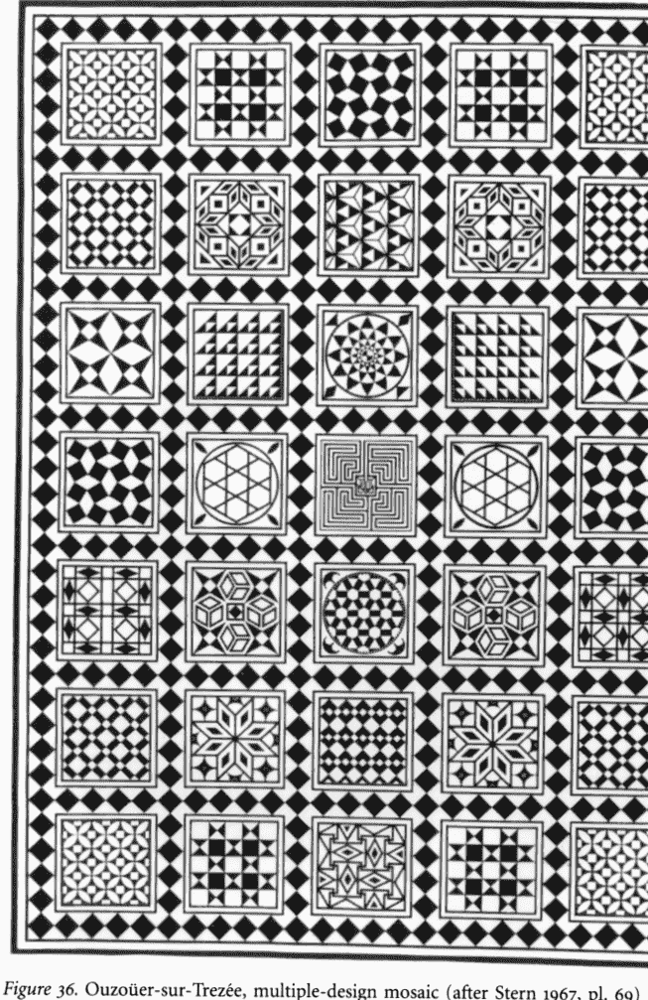

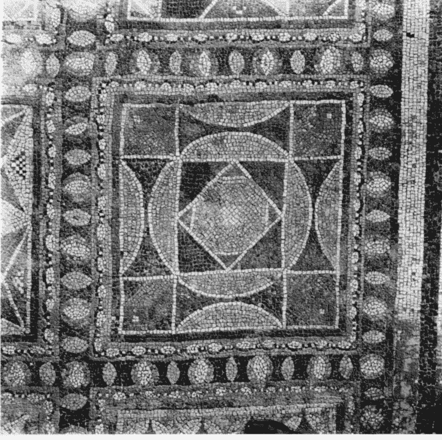

**图 37。** 第14室，第9格（由塞浦路斯文物部捐赠）

对帕福斯多重设计地板选选图案的分析表明其与2世纪上半叶的意大利模型有联系，这种联系在讨论库克里亚和帕福斯的菱形-星形-正方形图案时已经被提及。$^{105}$ 同时，多色的应用（如十字花等装饰）以及透视几何体等幻觉手段，将东部独特的帕福斯地板与安提俄作坊联系起来。然而，整体构图无疑属于多重设计组，这种关联使得帕福斯地板的独特性源于对卢罗纳河作坊及其意大利先驱共同模型的了解。

$^{105}$ 这种联系在下文对回纹边界的讨论中也被提到。

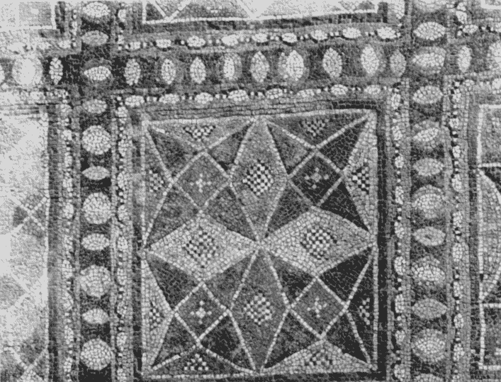

**图 38。** 第14房间，第10号庭院（由塞浦路斯文物部门提供）

在几件被归类为多设计的非洲马赛克中，位于利特滕（`Zliten`，图39）的一处以及另一处最近发现的西林（`Silin`，位于莱普提马格纳西部）别墅中的（图40），在组织上与高卢和意大利的案例相似。¹⁰⁰⁶ 在靠近利特滕的 Dar Buc Ammerna 海滨别墅中，仅由基本上单色的版本装饰，它被排列成六乘四的正方形网格，装饰有24种不同的方案（图39）。¹⁰⁷

106. 关关于非洲马赛克“多重装饰”的讨论，请参见 `Di Vita 1966, 1971:11-15`，以及 `Lancha 1977, 50–55`。在的黎波附近的 `Sidi-Messri` 发现的马赛克与利特滕的地板非常相似，一定是在同一时期制作的；参见 `Lancha 1977, 51`。西林的马赛克是最近才发现的，尚未被纳入多设计地板的研究中。`Mahjub 1998, 302` 提供的插图和描述认为，这件马赛克是由制作利特滕地板的同一工作坊制作的。

107. `Aurigemma 1926, 51–59`。图 23–28，平面图中的 N 房间，图 11。这里有一些黄色和红色镶嵌石的痕迹，因此它主要是黑白色的。一种类似的多设计马赛克同样是黑白的，原位保存在萨布拉塔（`Sabratha`）的剧场浴场（也称为海洋浴场或小浴场）；参见 `Gozani 1990, 1006, 图 25`。

## 世俗与神圣

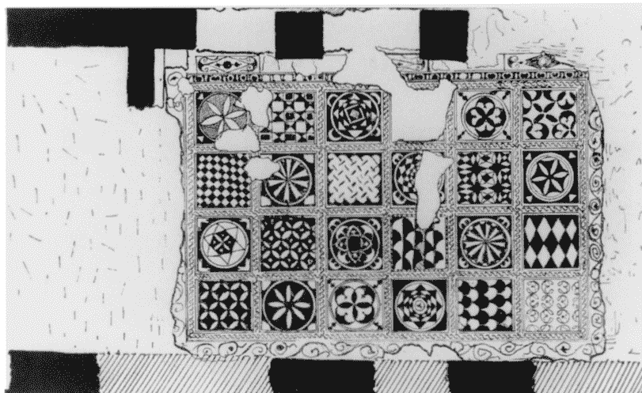

尽管这座别墅的年代尚存争议，但通过对其多设计马赛克的对比提供了有说服力的风格证据。利特滕地板与被置于安东尼时期的雷焦马赛克有几个共同特征。两个地板都使用了扭曲绳纹（装饰性或编织性）来勾勒网格并框定面板，使用黑色背景为区域提供更多视觉对比，并在面板上交替圆形和正方形图案。各个设计之间似乎甚至存在联系，特别是简化的花卉和鳞片图案。¹¹⁰⁸ 几个面板中包含了佩尔塔饰（`peltae`），尽管排列方式有些随意，但也让人想起了意大利的类比品。有了密切的意大利类比，没有必要进一步向高卢寻找利特滕马赛克的灵感或来源。¹¹⁰⁹ 关于将古尔比奥（`Gubbio`）和雷焦·埃米利亚的地板定在第二世纪上半叶的论点是有说服力的，利特滕马赛克似乎也属于这一时期。¹¹¹⁰ `Ouzouêr`

108. `E.`，六瓣和八瓣的白色花纹。参见从顶部起第三行的第一个，它位于白色圆圈内的波纹底座上（图39）。它在雷焦·埃米利亚有完全相同的对应品：`Lancha 1977, 图 14`。

109. 这一观点也在 `Lancha 1977, 51` 以及 `Di Vita 1966, 39` 中表达，但这与利特滕马赛克源于罗讷河谷工作坊直接干预的建议相矛盾；参见 `von Gozenbach 1961, 320n.9`。

110. `Salies 1974: 34` 将对背景白黑处理的模糊处理视为后期的-

技术与风格 73

利特滕地板和帕福斯多设计地板保持了它们对意大利模型的依赖，表明这些图案在约同一时期在高卢和非洲流传。

利特滕和帕福斯多设计地板保持了它们的意大利起源。高卢、特里波利和塞浦路斯马赛克之间的确切关系很难确定。可能性包括通过高卢或特里波利中介将意大利模型转移到塞浦路斯，或者共同取决于广泛流的早期意大利模型。无论何种情况，根据帕福斯房屋内对回纹图案以及第14房间多设计马赛克的处理证据，塞浦路斯的装饰库必须与安提奥克工作坊的区别来。然而，填充图案的丰富和多色的技艺反映了在安提奥克表达的塞维鲁风格的影响。在帕福斯异常出现的希腊语-多设计地板，其年代对应于雷焦·埃米利亚别墅的哈德里亚时期。在她的分析中隐含了对发掘者奥古斯塔年代的拒绝，Lancha 毫无疑问地接受了这一点（34n66）。关于利特滕马赛克年代的争议由 Dunbabin 1978, 235–37 回顾，她指出“利特滕装饰马赛克”大约在公元150年（特别是237页），反映了意大利的影响；这里给出的分析与她的日期一致。

# 世俗与神圣

在帕福斯边界中立即变得清晰的是它们在将地板组织成序列的作用。从这个意义上说，该工作坊遵循了希腊化传统。

## 边界：回纹与扭曲带

除了通用的编织纹（`guilloche`）和锯齿纹，帕福斯房屋中最常用的边界是回字纹，它出现在八个地板上，具有多种组合。¹¹¹ 在某些情况下，回纹作为表面构图（图1，右上角），而在另一些情况下它作为边界或线性构图（图16）。¹¹²

帕福斯回纹边界的特征在于它们与其框定的区域的关系。在每情况下，色彩和装饰的克制与其周围的彩色形象和几何面板形成了鲜明对比。帕福斯房屋发现的回纹变体在二世纪马赛克中找到了最接近的对应。以红棕或深灰色单色方案执行，配以简单的填充元素，加强了与第一二世纪风格发展的比较。在希腊、特里波利和比塞纳发现了许多这一时期的回字纹马赛克，证实了对这种设计的流行。尽管回纹在安提奥克的边界中清晰可见，但利特滕和埃杰姆的多处实际上为帕福斯马赛克提供了有力证据，表明非洲中心的地位不应被轻易忽视。

> ¹¹¹ 帕福斯边界在锁扣回纹的详细研究中以地形序列的形式呈现；参见 Guimier-Serberts 1983，特别是表格22。作者遵循了旧版帕福斯马赛克出版物中的错误年代，即三四世纪，显然这一误解影响了它们的年代调查。

> ¹¹² 表面案例出现在第14房间，那里的三块多设计马赛克面板装饰有回字纹图案。五种边界出现在2房间的季节马赛克（图46）；在8房间的莲花星形回纹马赛克周围（图24）；在1号餐厅的环绕区域中（图145）；在7房间作为菲埃德拉和希波利忒的宽框（图16）；以及围柱廊的北、东、南走廊（区域11,12,13）作为狩猎面板的连续环绕（图172）。值得注意的是，一些边界填充了通常用于表面的纹纹；参见 Guimier-Serbert 1983, 1966n.5。

## 技术与风格

它并不突出，也没有许多变体。对帕斐斯（Paphian）回纹类型更精确的定义将有助于描述帕斐斯工作坊的特征。

8号房间的字形回纹（`swastika-meander`）作为菱形-星形-方形构图（图24）的外框。¹¹³ 万字形的排列方式使得设计呈现倾斜状。设计线条本身由一系列倾斜放置的尖角方形组成。这种对回纹的处理可能源于早期的 `opus signinum`（红水灰）技术，在该技术中，白色大理石碎片被斜向放置在陶土色的基底中。¹¹¹⁴ `opus signinum` 中的对角线字形回纹常用于庞比的边缘、顶点和门槛。¹¹¹¹⁵

这种白底黑回纹似乎源自非洲，随后从西西里和北非传入。在公元二世纪的突尼斯、西西里和西班牙的例子中，通过 `opus tessellatum`（使用镶嵌块或切割好的石块的马赛克技术）模仿了 `signinum` 的效果。¹¹¹¹⁶ 例如，其中一个边缘与西西里北岸的 `castoreale San Blasio` 非常相似。¹¹¹¹⁷ 门厅（`tablinum`）的中央面板由一个 `opus sectile`（切割大理石碎片装饰）的六边形图案组成，由黑色镶嵌块边缘包围，三侧被倾斜于房间轴线的 `opus tessellatum` 字形回纹所环绕。这种技术的混合反映了将地板设计安排为“门槛、边缘和中心面板”等层级化单元的审美偏好。尽管帕斐斯的地板完全采用 `opus tessellatum` 制作，但在功能上，白底黑回纹边缘呈现出的蕾丝般的效果将多色中心部分与边缘及中心构图隔离开来，仿佛其本身就是装饰一般。

帕斐斯回纹与早期的意大利模型之间的联系，通过简单锁钥回纹（`latchkey meander`）的多个版本表现得最为清晰。¹¹¹¹⁸ 帕斐斯的五个回纹展示了这种图案的各种变体。

- 113. `opus` 框架宽度为 0.5 米。关于该回纹类型，请参见 `Decor géométrique`, 27, pl. 35，其中将其描述为“带有返回形状（折三角形）的倾斜万字回纹”。
- 114. 此点在 Guillier-Sorts 1983, 17 和 207 中也有，她追踪了回纹从 `opus signinum` 技术到 `opus tessellatum` 的执行过程。
- 115. 关于庞比发现的 `opus signinum` 回纹的示例；请参见 Joyce 1979, 255, no. 17-19；以及 Blake for Pompeii, House II.2.26 (1993), 25, 5.3)。
- 116. 在突尼斯，位于苏斯（Sousse）面具之家（House of the Mausks）的11角，日期为公元 180 年；参见 Go 1965, 59, p. 6；以及位于加太的海王星之家（House of Neptune）的05角，日期为公元 170-180 年，参见 Goilar 1974, 71.n. 11。在西班牙，美里达（Mérida）密特拉之家（House of the Mithraeum）的门厅；参见 Blanco Feijo 1978, 39, no. 20, pl. 42b and 438。
- 117. 门厅的照片尚未出版；关于别墅内的其他马赛克，请参见 von Boeselager 1983, 90–97, pl. 51，他将该别墅定于公元 1 世纪末或 2 世纪初。
- 118. `Decor géométrique`, 79, pl. 37c 的描述为“简单锁钥回纹，锁钥交替重卧和直立”。

它以最简单的形式（由灰色双细线勾勒，无填充装置）出现在 9 号房间中，作为彩艳且复杂的交织“垫子”（图 72）的单色边缘。这种类型的回纹也被描述为由万字形连接的矩形，因为它在狭窄交叉点之间的宽阔间隙处留下了印象。¹¹¹¹⁹ 我们无需远寻塞浦路斯这种回纹的源头：它出现在库克里亚（Kouklia），用于特征性的菱形-星形-方形构图。如所述，库克里亚的地板在考古学上可以追溯到公元二世纪上半叶，并与当时的意大利模型密切相关。

由双细线勾勒的简单锁钥回纹再次出现在 1 号房间装饰有水仙马赛克的开阔区域内（图 10）。深灰色的交叉点作为填充图案添加到万字形之间，增强了这种回纹的视觉效果。这种处理方式的精确对应物是公元二世纪的肯奈伊（Kenai）阿芙罗狄忒神庙的回廊（图 41）。尽管帕斐斯地板完全采用 `opus tessellatum` 执行，但在功能上，白底黑回纹边缘的蕾丝效果将多色中心与边缘及中心构图隔离开来。

更致密的编织效果是通过回纹在 2 号房间入口的水仙马赛克边缘实现的。¹¹¹⁴ 这种单底黑回纹（粉色/红色）的平整感成功地装饰了围椅。¹¹¹⁵

对致密且复杂的边缘的偏好用于环绕画面，体现在：

- 119. Wesley 1979, 308。虽然没有定义矩形，但这种图案回响了庞比船之家（House of Boat）的 `tablinum`（门厅）中 `opus` 0.5 米宽的边缘。
- 120. 这种“边缘”的宽度约为 0.22 米（此处原文为 0.22），是中心面板宽度的一半。
- 121. 这种设计可以在公元二世纪的伊斯斯米亚（Isthmia）回廊找到；参见 Stern 1976-78, 95。
- 122. 这种类型的回纹出现在几何图案中，参见 Stern 1979, 80, no. 12，pl. 41–4。
- 123. 在庞比船之家（House of Boat）的纪念碑式马赛克中，这种公元 50 年的字形回纹装饰了卧椅。¹¹¹² 这种风格在科林斯（Corinth）的二世纪有丰富的平行物。
- 124. 这种设计在 `Decor géométrique`, 79, pl. 37d 被描述为“双锁钥回纹，锁钥交替重卧和直立。”宽度约为 0.7 米。
- 125. 相同类型的回纹出现在比利时（Bav）发现的几何图案中，日期定于公元 1 世纪或 2 世纪；参见 Stern 1979, 80。

选择 7 号房间的反折回字形回纹（`reverse-returned swastika-meander`）非常清晰。¹¹¹⁶ 再次，与帕斐斯场景的回纹边缘一样，其宽度大约是场景面板宽度的一半。字形回纹作为线条的密集交织，将观众的注意力集中在中心面板上波吕特（Hippolyt）和菲德拉（Phaedra）人物周围的开放空间。当这种相同的图案用于装饰托勒马斯（Ptolemais）一座晚期 1 世纪别墅的 `emblema`（中心装饰）时，达到了类似的效果（图 42）。¹¹¹¹⁷ 这种设计的较浅版本（即白底更多）出现在奥斯提亚二世纪的 `Horrea Epagathiana et Epaphrodiana` 粮仓。¹¹¹¹¹⁸

另一种复杂的字形回纹被用作环绕，包裹了餐厅（`triclinarium`）T 型图案的北、南、东三侧，开启西端的面板（图 145）。¹¹¹¹¹⁹

- 126. Kraengel 1963, 244, fig. 68, pl. 59。在托勒马斯颜色为蓝白色；在帕斐斯则是陶土红色和白色。
- 127. Beccatti 1961, 17 和 280, no. 18, 19。可以从埃杰姆（El Jem）泰塔图拉之家（House of Tetartulla）11号走廊的早期示例来支持区域性的解释。深色底上的多色所罗结填充了方形。北非露台的色彩点缀以及填充图案对设计的主导地位显而易见；Foucher 1960a, 46, pl. 19b。
- 129. 这些长条界定了划分三个用餐区域的 `peltae`（盾）图案；它们的宽度约为 0.9 米。

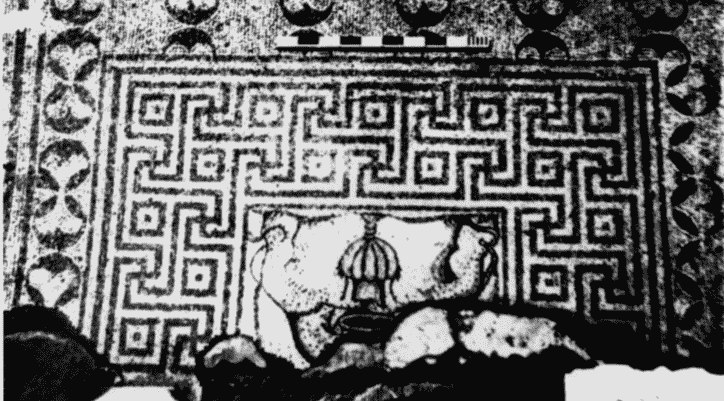

该设计由一条双线红棕色线条勾勒，并在由锁扣图案标记的矩形区域内刻有菱形（见图 43）。¹³⁰

这种完全相同的变体也出现在奥斯提亚（Ostia）造船者庙庭院中，其年代仅简单地定位于二世纪第一个十年。¹³¹ 尽管这些菱形仅有简单的轮廓，但在帕帕福斯（Paphos）和奥斯提亚，它们占据了图案的主导地位。这种处理上的相似性表明，图案向日益复杂的版本发生了广泛发展，这种趋势可以追溯到整个帝国。¹³²

在安条克（Antioch）的塞维鲁斯时期（公元193–235年），至少有四个例子将菱形嵌入万字回回文中。¹³³ 最简单的一个也是最早的，位于该世纪晚期廊柱之家（House of the Porticoes）的河流门廊。¹³⁴ 在安条克这一同一设计的后续阶段，使用了更复杂的色彩组合；菱形的一代演变成了塞维鲁斯艺术的一种幻觉技法。¹¹³⁵

> 130. 该设计未在 `Corps géométrique` 中描述；可以在 AIEMA no. 394, 88 中找到：“composition de carrets et lozenges adjacent avec en superposition deante swastikas en pannetons de clé。”
>
> 131. Beatti 1960, 94 and 33, no. 160。
>
> 132. 最早的例子位于阿肖拉（Acholla）的特拉 Trajan时期浴场，其中 cabof 纹饰的矩形部分填充了锁扣图案的区域，给人一种强烈的篮编织印象；见 Picard 1959, 79, pl. 11；以及 103。在科林斯（A. Corinth），菱形-万字回回纹出现在安东尼王朝别墅的两个房间里：见 Welling 1978, 297, cat. no. 17, 47, pl. 16。色彩被用于区分区域：丰富的纹理导致菱形、其间隙以及万字回回纹被亮紫色、紫罗色、红色和蓝色填充。这种对设计变体的色彩化处理方法似乎是希腊所特，在上述菱形与正方形的局部化改编中可见。
>
> 133. 关于这些例子的列表和讨论，请见 Guilletier-Sorben 1983，第210页表格，以及 1997 年。
>
> 134. Levi 1947, 389, pl. 99b。
>
> 135. 在 Levi 的年代学中，紧随廊柱之家之后的是 DH 23/24N 区域的房子（同上，390，pl. 97e）。在后塞维鲁斯时期，透视菱形出现在宴会之家（House of the Buffet Supper）中间层的第 1 房间（409, pl. 107b）。

## 技术与风格

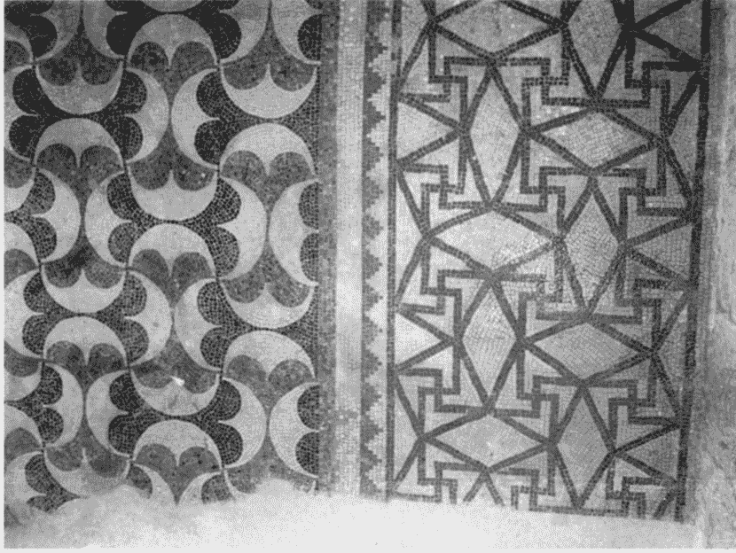

尽管安条克为我们的装饰库提供了地理上最近的对比，但奥斯提亚的马赛克在强调简单轮廓和白色底色方面与它最相似。这种对比并不假设存在与意大利的接触，但我们应该注意到帕帕福在采用这些在安条克被广泛解读的相同纹饰时表现出的帕帕福式的克制。这种保守可能继承自帕帕福工作坊的更早阶段，该工作坊创作了库尔基亚（Koulkia）马赛克。同样明显的是东方人倾向在同一地面上根据风格和技术并列不同的处理方式。例如，在帕帕福的三人厅中，大胆的三色圆盾（`peltae`）或盾牌面板与锁扣图案中的单色边缘形成对比。

在第 10 房间（图 81）格吕米修面板周围的区域内，由连续万字纹组成的锁扣纹叠加在相切八边形和正方形的设计上；万字纹填充了每隔行的八边形，¹³⁶ 中心没有万字字的八边形被深粉色和灰色的纹饰填充，包括六瓣花、棋盘正方形和深粉色圆形。正方形填充了粉色菱形。该图案在视觉上让人联想起一二世纪用万字纹连接八边形的做法，但从结构上说，帕帕福的地板完全不同，它由两个叠加的设计组成。¹³⁷ 最相似的平行物出现在早期庞贝的地板和一二世纪的米安（Amiens）。¹³⁸

帕帕福工作坊的创造性在第 14 房间多重设计组合（图 31）的四个正方形中对万字回回纹的色彩适应执行中尤为突出。¹³⁹ 在第 12 号正方形中，同样的万字回回纹以深粉色小比例重现。其他三个面板全部呈现格吕米修周围（第 10 房间）的类型，但它们的差异引发了由构图背景决定的变体问题。小面板非常紧凑，具有白色万字纹轮廓以及深棕色和深绿色的八边形重色调。它们构成了几何拼贴的单元，创造出一种丰富且密集的彩绘地毯，这对于多重设计组合是有效的。相比之下，格吕米修周围白色区域的主导地位产生了一种更轻盈的效果，在水仙花（Narcissus）面板的案例中如此。在使用（尽管并非相同）模型的情况下，帕帕福工作坊通过对每个设计功能的响应产生了完全不同的诠释。在同一栋房子内的这些变体并不意味着来源的多样性，而是暗示了一种创新精神。由 A.-M. Guimier-Soberts 汇编的锁扣万字纹类型的详尽目录为这种发展提供了一个具有启发意义的概览。从这一调查中，我们可以注意到万字纹的广泛使用。

> 136. 关于插图和描述，见 `Décor géométrique`, 254–55；pl. 166，“相邻八边形构成的正方形，每个八边形带有一个反转的万字。”
>
> 137. 关于八边形和万字设计的例子，见来自塔古拉（Tagura）尼瑞神竞赛（Contest of Nereids）的入口（1968，103）；以及另一个来自阿提亚（Athias）浴场的的相关设计（见 Foche 1964, 41–42, p. 50）。
>
> 138. 对于庞贝，见 Blake 1990, pl. 98。对于米安，见 Stern 1979, 65, 10, p. 46 和 47。
>
> 139. 这些在上述多重设计马赛克部分详细描述。这些面板的原创性由 Guimier-Soberts 1983, 208.35 评论。
>
> 140. 子的长列表和参考文献见 Guimier-Soberts 1983, 210–13；必须指出，如果作者正确地将狄奥尼索斯之家（House of Dionysos）定位于二世纪到三世纪中期，那么这组例子将密集得多。

## 新塞维鲁斯装饰风格

“新”塞维鲁斯装饰风格的某些特征在上述菱形星-正方形马赛克的分析中被注意到，特别是在安条克的对比中。在万字纹边缘处添加白色高光仅仅强调了二世纪晚期诞生的装饰复杂化运动。用不到一代的时间，新风格就成为一种偏爱装饰库方案化版本的传统。这种发展在万字纹边缘中显而易见。

> 141. 有来自安条克或 Guimier-Soberts 的例子！除了该地的阿尔格斯和科林斯例子外，见阿尔格斯和雅典希罗德之家（House of Herodot）柱廊第 1 面板（Athens 1979, 1938, cat. 8, no. 5; pl. 45）；以及从埃里杜斯（Erididus）到帕里多斯（Paridos）的（同上，299, cat. no. 26）。另见萨米（Sami）罗马别墅的马赛克（同上，302, cat. no. 44）。
>
> 142. 见安条克和凯尔基亚（Kerkchiai）列出的万字纹边缘例子（Guimier-Soberts 1983, 211）。
>
> 143. 万字边缘的许多例子在 Levi 1947, 377–471 中都有讨论。
>
> 144. 这种边缘出现在日历之家（House of the Calendar）中海洋神（Oceanus）和得提斯（Thetis）的框内，以及西西亚之家（House of Cicia）的第 3 房间；分别见 pl. 6 和 pl. 95a。
>
> 145. 同上，89, pl. 18f。该马赛克现在密歇根州立大学。
>
> 146. 同上，392。

位于安提奥克（Antioch）宴会之屋（底层）的装饰可追溯到塞维鲁王朝晚期。147 在这里，白色高光的动态效果被消除了，丝带变得更宽并向其边界水平线延伸，从而创造出更深层次的线条。这种夸张的丝带现在被弯曲色带填充，这些色带不再有微妙的阴影。在早期的帕福斯（Paphos）范例中，不规则色块的并列是一种更接近绘画原作的自然阴影处理。在随后的阶段，纹样变得更加程式化，丝带线条被拉直，弯曲色带也变直了。148 这在细微之处中显而易见，例如艺术表现从幻觉主义转向对主题抽象特质的兴趣，这种趋势在不断增加的模式化程度中看出。对图案化和变化的偏好在柱廊之家（House of the Porticoes）开始出现，而帕福斯的丝带边框正契合这一过渡阶段，菱形-星-方形图案也是如此。

帕福斯和安特洛凯尼（Antlochene）马赛克中这种独特的相似性，特别是在扭转丝带的情况下，暗示了安特洛凯尼工作坊的成员或工匠本人可能参与了狄俄尼斯之家（House of Dionysos）的制作。通过检查帕福斯房屋3房间环绕孔雀的另一处扭转丝带边框（图65），这些交流的机制变得更加清晰。它不是从白色边缘杂乱无章地跳出的短曲线，而是几条长线进入丝带的彩色环路，呈现出更平直的效果而非高光效果。尽管颜色（粉色、红色和灰色）与8房间使用的相同，但它们不再处于有序的色调范围内，起伏丝带的规律节奏也消失了。这种主题的执行呈现出某种松弛感，几乎带有随手涂鸦的特征；将这种扭转丝带分配给另一位没那么“受过训练”的匠可能是合理的，他一定见过8房间的白色高光，并试图复制其效果，但效果不佳。这无疑是一位当地手工艺，他的诠释独特且具有地方特色，对主题的原有形式或功能几乎没有概念。他的无能揭示了工作坊内的框架由几位技能各异的人手完成，而且可能更多人在安提奥克接受过训练或源自那里，并为工作坊设定了标准。

对狄俄尼斯之家边框和表面设计装饰的这种检查，为帕福斯工作坊提供了一个细致入微的画像。人们对其创作设计实践的印象并不令人意外，因为在图像学面板中也看到了许多相同的方法：两者都是源自模型的构图，并辅以即兴的创作。装饰性从经验上证实了对西方构图的选择，例如多重设计和界面“垫子”（将在第4章讨论），这些可能经过了北非的过滤，正如在赞提亚纳（Byzantana）和的黎波（Tripoli）的大量平行案例所证明的那样。对万斯字回纹和菱形-星-方形图案的克制解释，指向了与二世纪意大利案例的关系，或至少是相似性。库基亚（Koukia）菱形-星-方形马赛克的存在证明了在二世纪期间塞浦路斯使用了模型。无疑，库基亚马赛克是由制作帕福斯马赛克的同一工作坊执行的。另一方面，丝带边框的独特性，以及帕福斯和安提奥克产生了最多的钥匙形万斯字回纹变体，将帕福斯的产物拉入了安提奥克的范畴。这种关联在安提奥克发现的一系列菱形-星-方形马赛克得到了进一步强调，这些作品引导了对帕福斯范例的风格和年代归属。尽管菱形-星-方形的案例似乎太少，但它们确实暗示了一条从意大利经过北非通往希腊、塞浦路斯和安提奥克东部遗址的传播路线。

帕福斯的装饰库和神话场景都更清晰地展示了帕福斯工匠的创新精神。他们无疑沉浸在安提奥克环境的希腊化之中，这既从纳西瑟（Narcissus）场景和菲德拉与希波吕特（Phaedra and Hippolytus）场景中看出，也紧跟了西方风格的发展。他们的知识是源于一位深度参与其住宅装饰的视觉敏锐的赞助人，还是源于一位旅行经验丰富的画师（`pictor`），目前无法确定。考虑到房屋内其他马赛克的证据，我怀疑赞助人和设计师都需要非凡的才能才能产生在帕福斯发现的创新成果。

147. 同上，392，图 142c。

148. 例如，参见日期为塞维鲁王朝的伊西斯奥秘之家（House of the Mysteries of Isis）3房间，以及爱洛斯商人之家（House of the Peddler of Erotes）中同名马赛克的边框，约公元240年（分别见同上，397，图 33和403，图 43a）。

# 技术与风格

## 第三章：入口

### 季节的问候与孔雀

在狄俄尼斯之家，紧邻拟议中主入口的房间具有有意义且恰当的装饰（图1）。沿着1房间的西南部分排列了三个连续房间：1房间是纳西瑟，2房间是季节，3房间则是一只正面对的孔雀。事实上，正是2房间的装饰和铭文支持了这一假设，即引言中讨论的入口位于考古发掘无法确定入口的地方——在季节图案两侧的马赛克板上分别刻有“XAIPEI”（欢迎）和“KAICY”（你也是）。由于这些位于季节图案两侧的[此处逻辑衔接]……

## 季节

2号房间的装饰非常贴合其靠近入口的位置，即位于房屋的西南角。⁶ 核心构图由九个正方形面板（约 3 米）组成的网格组成，四个角处装饰有四季的胸像（图 45）。与季节性活动相关的体题材填充了四季像之间的四个面板。第九个面板的中心描绘着一个长发少年。黑色背景上一条连续的、透视效果的多色几何体带框定了各个面板。⁷ 一条宽大的红色卍字形回纹饰带环绕着整个构图。⁸ 所有九个面板都面向房间的西侧，那里是访客进入房间的地方。

在这一侧，几何框内镶嵌着一块黑色的 `tabula ansata`（带柄板），上面刻有“KAICY”字样（图 47）。⁹ 一个类似的设备刻有“XAIPE”字样，出现在另一端（图 46），面向东墙（邻孔雀的3号房间）。由于在平整作业期间遭受了严重破坏，原始地板仅留下了部分碎片。¹⁰ 结果，现在看到的大部分是现代修复品，面板的精确位置、胸像的细节以及它们的属性并不确定。从照片中清楚地看出，原始地板位于原位，左上角的面板（夏季）、相邻的乡村风景面板以及中央胸像都处于其原始位置（图 48）。鉴于这些面板是从碎片中重新构建的，进行详细的风格或图像学分析似乎并不恰当，但从这件异常马赛克的最一般特征中，仍然可以获益许多。

- 6. 房间尺寸为 5.75 米 × 4.85 米。
- 7. 在《Dé géométrique》154–55页，图 99e中，它们被描述为“立方体”。这些实体交替使用粉色/红色和黄色/棕色的色块。该色带宽为 0.19 米。
- 8. 这个边框宽约 0.70 米。
- 9. 板本身镶嵌在一个刻在矩形内的菱形中；所有这些形状都由双倍黑色或灰色线条勾勒；见 K. Nicolaau 1967，图 21,2；以及 1963, 16。
- 10. 见 K. Nicolaau 1967, 112。

季节在平整后被重建，被描绘为向中间侧分之四的男性胸像。其中三个穿着带有黑色斑点的无袖黄色长袍，暗示着兽皮，而冬季则裹着羊毛斗篷。如果重建是正确的，这一系列并没有遵循循环顺序。位于左上角的夏季，通过其头发中的麦穗和左肩的镰刀来识别（图 48）。夏季下方出现了一串悬挂的蔬菜——只可见朝鲜胆。夏季面向一个面板，面板里有一只羊在一棵挂着排笛（`syrinx`）的树旁吃草（图 49）。这种乡村场景逻辑性地引向右上角的春季；他头戴花冠，手里拿着一束花，右肩处有一颗石榴和一根牧羊杖（粗略地修复）（图 50）。下方，两个装满葡萄的篮子似乎倾倒了（图 51）。这些是右下角四只鸭的果实，它们头戴叶子、红芽和小白花组成的花冠（图 52）。秋季的右肩处放置着一个奇怪的长状物体（又是一个 `pedum` 吗？）¹¹。水禽（仅可见四只鸭的部分区域）填充了秋季和冬季之间的面板（图 53）。这些季节性野味补充了冬季，冬季出现在左下角，身穿厚重的深色（灰/黑/白）斗篷，留着色相相似的长发和胡须（图 54）。水从他头部右侧的一个倒置容器中流出。¹¹² 最后，中间那个四季所面向的少年裹着一件黄棕相间的斗篷（图 55）。他的长卷发或其他地方没有可以帮助识别他身份的属性，但他无疑是制作最精良的胸像。¹¹³ 他睁大的眼睛立刻吸引了读者的注意力，正如唯一具有彩色背景（灰色和黄色）的面板事实如此。

在大多数情况下，帕福斯面板遵循了标准的罗马季节图像学，因为它们的属性是经典的。例外是冬季，他通常被描绘为一个戴着兜帽、拿着芦苇和/或禽类的胡须形象。在帕福斯，增加一个倒置的水罐以吸引更多类型的河神，这表明马赛克艺术家可能将冬季与水神融合或混淆了。古代冬季的描述（`de figuris`）缺失兜帽，这强调了这种可能性。尽管在354年《历法》二月的表现中，通过从双口瓶流出的水说明了冬季的水属性。

- 11. Michaelides 将其描述为一把“画得很糟糕的修枝刀”，这似乎更合逻辑，但实际上看起来更像春季携带的 `pedum` (Dasaszewski and Michaelides 1988a, 20)。
- 12. 形状奇特，可能是由于修复。它看起来是弯曲且柔软的，以至于初这种形状可能被误认为是乌鱼。容器的黄色和棕色表明这是一个倒置的容器。
- 13. Daszewski 建议是狄奥尼索或年神（Annus），但他注意到这个头部正如我看来经过了大量；见 Daszewski and Michaelides 1988b, 34。
- 14. 见 Levi 1947, 87。在安提俄的红地砖房屋发现的冬季男性形象手中握着的长形杯（`kantharos`）可能是相关的主题（87n.126）。Levi 建议它的灵感源于土星节（`Saturnalia`）十二月份的饮酒活动，但在帕福斯，水是用蓝色平台表示的，水罐不是饮杯或双口瓶（至少修复是准确的）。
- 15. 该马赛克被定于5 世纪后半叶，展示了季节作为女性胸像，并配有动物面板，包括两匹马；见 Hanmann 1951, 154, no. 192, fig. 121。

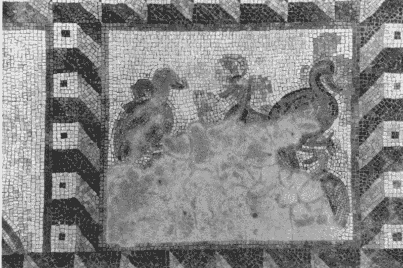

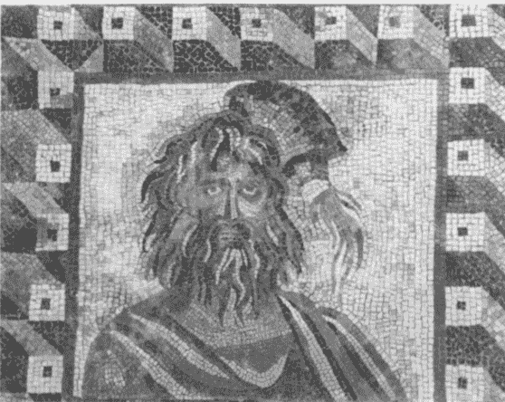

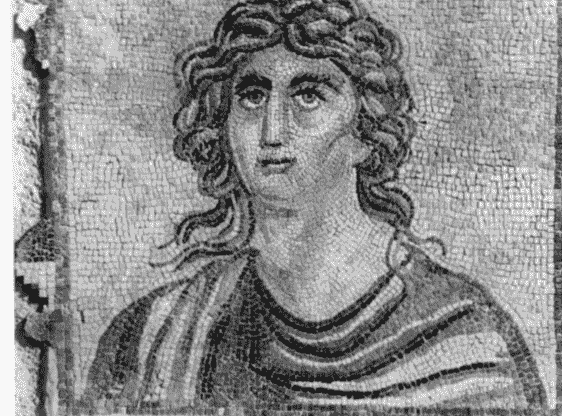

尽管艺术和文学中已有关于“季节”的详尽综述，但要将这些图像学发展（至少是马赛克）划分为不同的地理区域仍然困难。$^{16}$ 东部（尤其是希腊）罗马时期出土工作的稀乏无疑是一个因素。$^{17}$ 从目前发现的情况来看，可以客观地说，在帝国时期的西方马赛克中，女性胸像占主导地位；而在东部马赛克中，立姿男性形象和胸像出现的频率更高。$^{18}$ 这种划分仅仅是由于品味不同，还是不同起源或解释的自然结果，尚无法明确确定。

安提俄克为这些问题提供了一个有趣的案例，因为从哈德里一时期到 3 世纪中叶，一个遗址就代表了多种类型。列维（Levi）提议的大致日期对这些示例的简单列表具有启发意义：来自历法之家（House of the Calendar）历法马赛克（约公元 120 年）中带翅膀的春季和冬季女性胸像（另外两个已遗失）；$^{20}$ 位于纳尔西索斯之家（House of Narcissus）入口房间的大型男性胸像（春季？）（约公元 130 年）；$^{21}$ 来自红地铺之家（House of the Red Pavement）1 号房间的四个带翅膀的小天使（`putti`）（约公元 150 年）；$^{22}$ 来自饮酒会之家（House of the Drinking Contest）走廊的一组类似的带翅膀男性季节像（约公元 220 年）；$^{23}$ 以及来自米南德得之家（House of Menander）正餐室（`triclinium`）入口面板的一个性别不确定的冬季胸像，包含头部和胸部（约公元 240–250 年）。$^{24}$ 另一个版本出现在 4 世纪初的君士坦丁尼别墅（Constantinian Villa）中，即四位立姿女性（`Horae`）。$^{25}$ 这种多样性表明，安提俄克的艺术家可以获得全系列的马赛克范式，而且这些类型通常根据构图的装饰需求进行互换。无论如何，男性季节像的引入似乎是图拉真时期的帝国创新，如在贝内文特图姆（Beneventum）拱门的浮雕上（公元 119–121 年）所示，此后在马赛克制作师和雕塑家之间流传。$^{26}$ 安提俄克系列表明，沿着地理路线进行总结可能并没有用，也不明智。

帕福斯（Paphian）地板的元素表明，与狄尼索之家（House of Dionysos）的许多马赛克一样，与安提俄克有紧密联系。从黑色背景中光学跳出的透视立体效果是安提俄克马赛克制作者的喜用手法。类似的设计也出现在伊西斯之家（House of Mysteries of Isis）一系列充满剧具的面板周围。$^{27}$ 此外，“KAICY”铭文在安提俄克有两个重要且解释性的平行案例。$^{28}$ 考虑到附近的来源以及对帕福斯工作坊的明显影响，季节构图、`xenia` 面板或帕福斯马赛克中的单个胸像没有平行物是至关重要的。

塞浦路斯的季节在服饰和属性上更让人想起西方的女性形象；它们仅仅是从北非发现的女性类型转化过来的。$^{29}$ 帕福斯 `xenia` 面板最接近的平行物在四十年前已改为其他风格归类。事实上，利维对安提俄克的年代和风格大纲已在 J. Bali 近期对近东罗马马赛克的调查中得到证实（1981, 420）。

---

- 在早期的图像学调查中，Hansfmann 指出“马赛克没有显示出任何确定的地理分组发展”（1955, 214）。
- Levi 在对 Hansfmann 关于登巴顿橡克斯石棺研究的批判性评述中提出了这一点。
- 在这些图像的一份最新目录中，女性形象被列为 `Horae`，而男性版本列为 `Kairo`；参见 Casal 1990, "510–37" 和 "Kairo," 891–920。
- 北非最流行的形式是女性，那里已记录了 82 个例子；参见 Parrish 1984, 处处。他指出，在季节身份确定的 59 块非洲地面中……有 43 个例子是女性胸像或头部，相比之下只有 5 个是 `Horae`，14 个是男性（同上，第21 页）。他还注意到，在罗马非洲以外的马赛克中，女性与男性季节的比例也相当（同上，22, 211–32）。
- 日期取自年代表；参见 Levi 1947, 625–26。四十年前的其他风格归类发生了显著变化。
- 20. Levi, 1968, 36–37; pl. 5b.
- 21. 同上，`cod. 10a`.
- 22. 同上，85–87, pl. 13b–e.
- 23. 同上，85–87, pl. 13b–e.
- 24. 日期取自年代表，参见 Levi 1947, 625–26。
- 25. 日期取自年代表，参见 Levi 1947, 625–26。
- 26. 安提俄克系列表明，沿着地理路线进行总结可能并没有用，也不明智。
- 27. 此外，“KAICY”铭文在安提俄克有两个重要且解释性的平行案例。
- 28. 考虑到附近的来源以及对帕福斯工作坊的明显影响，季节构图、`xenia` 面板或帕福斯马赛克中的单个胸像没有平行物是至关重要的。
- 29. 塞浦路斯的季节在服饰和属性上更让人想起西方的女性形象；它们仅仅是从北非发现的女性类型转化过来的。
- 30. 从黑色背景中光学跳出的透视立体效果是安提俄克马赛克制作者的喜用手法。
- 31. Parrish 在一文中详尽地阐述了这一观点（1981a, 处处）。
- 32. 目前位于巴尔多博物馆（`inv. 3591`）的马赛克来自一个大型圆形厅；参见同上，93–94, no. 1, pl. I.
- 33. 目前位于杰姆考古博物馆的马赛克来自该住宅的 A 房间；完整的书目请参见 Parrish 1984, 147–49, no. 25, pl. 36。

- 34. 丰饶的概念通过他头上的季节性果实和环绕圆心的花环得到了华丽的暗示。

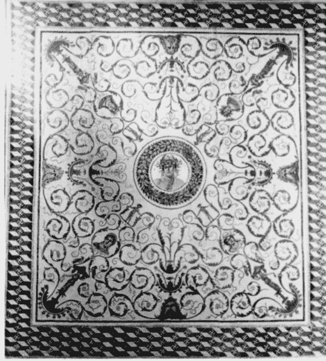

图 57. 杰姆，狄尼索游行之家，A 房间，季节，考古博物馆（C. Kondoleon 拍摄）

仅有叶子。$^{35}$ 阿科拉（Acholla）的果篮和埃杰姆（El Jem）的宇宙神灵都确立了非洲对“年”（Annus）作为全年丰产象征的理解。

在许多这些铺地板中也暗示了狄奥尼索斯（Dionysos）的存在。考虑到构图以及该房屋内对酒神的反复提及，质疑狄奥尼索斯游行之家（House of the Dionysiac Procession）季节镶嵌画中部的胸像是否实际上就是狄奥尼索斯是合理的。$^{36}$ 狄奥尼索斯身着豹皮袍（nebris）并戴着葡萄冠，在来自兰巴西（Lambasis，阿尔及利亚）的塞维王朝马赛克周围茂密的叶丛中被识别出来（图 60）。$^{37}$ 只有皇冠的不同可能导致我们将后者胸像命名为狄奥尼索斯而将前者命名为“年”。事实上，这种

- 35. 该镶嵌画现位于埃杰姆考古博物馆（A.54），发现于 5 号室；见同类书，168–71，编号 33，第 50 页。
- 36. 富歇（Foucher）也将该胸像识别为“年”，并认为这座房子是狄奥尼索斯崇拜的场所（1963, ep. 146–54）；另见 Parrish 1998b, 51–57，他对此解释持异议。
- 37. 该镶嵌画现位于阿尔及尔国家博物馆，发现于军事营 `scholae` 附近一个带有祭坛的房间内；见 Parrish 1984, 204–6，编号 50，图 69。

入口 99

**图 59。** 阿科拉，红柱之家，季节（由巴尔多国家博物馆捐赠）

狄奥尼索斯形象与季节图像的结合，揭示了早期对综合这些主题并呈现一种新秩序的尝试，即一种通过当地信仰过滤的黄金时代。帕帕福斯（Paphian）胸像缺乏任何辨识性特征，加上一系列发现的产自非洲本土的塞维王朝时期胸像，表明这种类型的中性化使得意义具有了互换性。

正如我上面提到的，未名男性胸像的加入以及季节的各个方面，将帕帕福斯镶嵌画与北非的几个例子联系起来。在至少四个（不包括上述两个）中心化构图中可以明显看到可比的男性胸像，其中三个追溯到塞维时期，一个追溯到三世纪后期。338 如果帕帕福斯正如考古证据要求的那定于公元二世纪后期，那么很难推断这一非洲系列是其灵感来源。相反，在东部并没有发现过与帕帕福斯“季节”完全相似的作品。正如埃杰姆所示，巴尔多博物馆（inv. 2729）中的（Parish 1864: 177–79, no. 37, pl. 55）；来自哈德拉（Haedra）未指定地点的某块塞维王朝马赛克，现位于巴尔多博物馆（inv. 2812）（（同上，193–94, no. 45）；后者通过藤冠的痕迹识别了狄奥尼索斯的中心胸像；来自沃卢比利斯（Volubilis）维纳斯游行之家（原址）的晚期塞维王朝马赛克（234–36, no. 65, pl. 86）；以及一块根据考古依据确认为于三世纪第三季度的马赛克，位于杜加（Dougga）狄奥尼索斯与奥德修斯之家，现位于巴尔多博物馆（inv. 2967）（（同上，136–38, no. 20, pl. 29b）。

入口 101

在狄奥尼索斯之家的几层地板中，季节构图似乎在东西方、帝国早期与季节性发展之间起到了调节作用。对整体设计和客宴画（xenia）面板的考察解释了这一点。

帕帕福斯的设计是伪徽章（pseudo-emblemata）的组合，它具有在由单独组装的马赛克组成的早期地板中发现的加法性质。在非洲场景中，最接近的平行作品是来自兹利滕（Zliten）的季节地板，其由九块面板组成的网格布局展示了季节，并两侧由四块带有客宴画（动物、鱼类、鸟类）的面板和两块尼罗河场景环绕（图 61）。³3⁹ 因为所有的兹利滕面板都是在一个陶罐中发现的，它们可以被视为真正的徽章画（emblemata），即在工作坊制作出口往某地的马赛克。⁴⁰ 尽管对兹利滕镶嵌画年代的观点不一——从第一世纪到第三世纪——但徽章画的使用（至少对于季节地板）可能表明其早期；如果该地板是塞维时期或晚晚，那么它就是刻意的古风化。⁴¹

这种印象通过兹利滕客宴画与早期的坎帕尼亚（Campanian）面板及具有相同元素的马赛克之间的相似性得到了加强。⁴² 在特里波（Tripoli）发现的其他接近希腊化化模型的精美徽章画及客宴画，表明了静物题材的流行。⁴³ 与其坎帕尼亚或特里波的对应品相比规模缩小且不那么复杂，帕帕福斯的客宴画属于这一类。

在狄奥尼索斯之家的几层地板中，季节构图似乎在东西方、帝国早期与季节性发展之间起到了调节作用。对整体设计和客宴画（xenia）面板的考察解释了这一点。

帕帕福斯的设计是伪徽章（pseudo-emblemata）的组合，它具有在由单独组装的马赛克组成的早期地板中发现的加法性质。在非洲场景中，最接近的平行作品是来自兹利滕（Zliten）的季节地板，其由九块面板组成的网格布局展示了季节，并两侧由四块带有客宴画（动物、鱼类、鸟类）的面板和两块尼罗河场景环绕（图 61）。⁳⁹ 因为所有的兹利滕面板都是在一个陶罐中发现的，它们可以被视为真正的徽章画（emblemata），即在工作坊制作出口往某地的马赛克。⁴⁰ 尽管对兹利滕镶嵌画年代的观点不一——从第一世纪到第三世纪——但徽章画的使用（至少对于季节地板）可能表明其早期；如果该地板是塞维时期或晚晚，那么它就是刻意的古风化。⁴¹

这种印象通过兹利滕客宴画与早期的坎帕尼亚（Campanian）面板及具有相同元素的马赛克之间的相似性得到了加强。⁴² 在特里波（Tripoli）发现的其他接近希腊化模型的精美徽章画及客宴画，表明了静物题材的流行。⁴³ 与其坎帕尼亚或特里波的对应品相比规模缩小且不那么复杂，帕帕福斯的客宴画属于这一类。

帕福斯（Paphos）九块伪装饰画（pseudo-emblemata）的网格布局必须被视为一种审美选择——不再是技术限制——这无疑是对带有装饰画构图的模仿。

一种与坎帕尼亚（Campanian）静物画设计类似的例子，在古科林斯附近安纳普洛加（Anaploga）的一处罗马别墅中发现。⁴⁹ 三块绘有鲜艳多彩的“宾客之礼”（xenia）主题的板画垂直排列在一个大房间的中心，作为一个接待室。每块板画周围都被一个等轴测回纹环绕，创造出与帕福斯长方体边缘类似的错视效果。这件马赛克根据考古年代定于本时代世纪末，它证明了对装饰画和/或板画的模仿在希腊时期就已经进入了马赛克作品库。这一观点得到了科林斯附近另一处罗马别墅地板的支持的支持，那里有五块带有静物场景的板画环绕着中庭的中央水池。⁵⁰ 描绘树下羊的板画可以与帕福斯泉水图中描绘羊正在啃树的场景相比较。来自别墅该区域的马赛克具有哈德良/安东尼时期的特征，并加强了这一暗示：在希腊东部早期，用伪装饰画复制世俗场景已经是一种实践。帕福斯的四季图与科林斯马赛克以及特里波利绘画一起，可以被认为是装饰画传统以及相关的坎帕尼亚绘画的派生品。

为什么这些趋势达到了帕福斯而没有出现在其他遗址（例如安提约克），目前尚无答案。⁵¹ 四季图连同帕福斯的其他地板，可以与特里波利的地马赛克以及意大利模型（如这些坎帕尼亚绘画）相比较。尚清楚特洛伊马赛克是否先于帕福斯马赛克。然而，泽利滕（Zeliten）马赛克可能与帕福斯马赛克大致同时或稍晚。这种情况为传播问题留下了悬念。⁵² 科林斯、帕福斯和特里波利是独立于亚历山大等主要中心之外的吗。不幸的是，我们对这一时期亚历山大马赛克艺术的了解太少，无法做出定义确定性的评论。关于流动希腊-埃及艺术家的有力证据发现于两段特拉维亚铭文，铭文描述了一位游迹广泛的亚历山大马赛克大师，他负责珀林斯（Perinth）提凯（Tychae）的马赛克创作。⁵³ 更符合本文讨论的是庞贝酒神之家（House of the Faun）带有静物主题的马赛克板，日期为公元前二世纪末。学者们认为，这栋庞贝别墅的装饰画是由希腊-埃及工匠创立的工作坊的产物。⁵⁴ 不知道是谁制作了这些精美的石板，它们反映了维特鲁威描述的 `xenia`（宾客之礼）希腊化绘画；后者在系列相同主题的坎帕尼亚绘画和罗马时期中也是如此。⁵⁵

应当回想起，亚历山大还是托勒密·腓拉德尔福斯（Ptolemy Philadelphus，公元前 285–42 年）狄奥尼索巡游（`Pompe`）的所在地，巡游中为希腊化观众创作了由“年”强调的拟人化“季节”实物（`realia`）。⁵⁶ 正如我在书中其他地方提到的，这种包括数千名着装群众和布景车的盛大奇观的视觉冲击已被证明进入了艺术作品库。在这场事实上很快流行的巡游中，学者建议埃尔杰姆（El Jem）的一些狄奥尼索场景回溯了这支巡行的元素，并是希腊化传统的延续。⁵⁷ 更直接的是，最近的一项研究追踪了希腊化金属器和共和时期陶瓷（作为巡游中的 `DHorae`[水罐]和 `Peneteris`[酒瓶]使用）上的四季符号学。⁵⁸ 穿着戏剧服装的“年-永恒”（Annos-Aion）肖像显示，托勒密巡游激发了一种一直持续到罗马帝国时期的艺术传统。⁵⁹

这种公共展示的奢华见证了君主赐予托勒密执统治者的恩宠。这些主题在塞维鲁斯王朝（公元 193–235 年）期间在行省非洲大量集中重新出现，预示着一个黄金时代，省份城镇根据其生产活动经历了经济活动的爆发。随之而来的建筑和装饰热潮在埃尔杰姆比任何地方都明显，那里有比例大量的季节性（约 24 块）和狄奥尼索马赛克，生动地表达了这个位于肥沃非洲海岸的城镇的繁荣。利伯（Liber）所确保的好运被狄奥尼索斯之家（House of Dionysos）不少于三间房间的原始且异常精美的马赛克所证实。这似乎是狄奥尼索斯与“季节”在帕福斯狄奥尼索斯之家中视觉和字面上的共生，伴随着对的祝福和富饶。

尽管这些谦逊的装饰公开宣告了委托它们的社会阶层，它们在塞浦路斯或非洲也出现了。在帕福斯，季节地板通过欢迎的铭文“XAIPEI”和铭文“KAICY”得到了阐明。⁶⁴ “KAICY”的保护性质在安提约克的三块马赛克中描绘得最生动。两块板画发现于另一块板画的上方；在帕福斯，在上方板画上，“KAICY”与一个矮人出现；在下方板画上，铭文设于一个驼背人上方（图 62 和 63）。这种读法得到了“KAICY”发现于盘子和饮杯上的事实支持，这些显然是为了祝福客人。⁶⁶

- 49. 参见 Miller 1972, passim, esp. fig 1 and pls 65 and 71。
- 50. 关于参考文献和简要描述，参见 Sayles 1979, 279, cat. no. 17。
- 51. 其他来自格拉斯的碎片定于安东尼时期（1980:308–91, pls 35–38, fig pls no 1 [Winter, 1901; [Autumn and 112]]），三块碎片仍然完好，现位于塞萨洛尼考古博物馆（参见 Sayles 1979, 303, no. 52, p. 51, fig 44，后者将其归于 3 世纪）。
- 52. 这些年代和传播的问题，特别是涉及特里波和意大利，是在对 14 室双层设计地板和柱廊狩猎马赛克的分析中讨论的。
- 53. 关于正文、翻译和讨论，参见 Toybee 1951, 43–44。
- 54. 关于酒神之家装饰画之间的联系，特别是 `xenia` 和 `symplema`（宴会，酒神与迈女的艺术），托勒密时期和雕塑群，参见 Parthacas 1975, 364。最近，Guier-Somber 追踪了 `xenia` 系列，其中来自酒神之家的攻击鸟板是最早的；她评论其反映了希腊化艺术（ibid., 1999, pp. 65–67）。另见此处引用的亚历山大式 `xenia`，一个来自图拉皇帝（Kom Trajan），另一个来自帕拉提尼（Palatine），以及一块来自佩拉的十二块板的大作品，反映了希腊化的构图。Dazesewski 根据世纪末浮雕铭文（ibid., 77nn97–100），为整个地中海地区装饰画以及亚历山大产品的存在提供了有力论证。在 1995 年，该作者还扩展了 Parthacas 提出的装饰画生产与在亚历山大发现的之间的联系（Dazesewski 1985, 15–22, esp. 18–22）。等轴测测量显示它由一种上类型（1998, 59）组成。
- 56. 提出这一观察基于它们对理想化元素的使用及其两部分组件的相似性；此外还有重复的部分，较小。

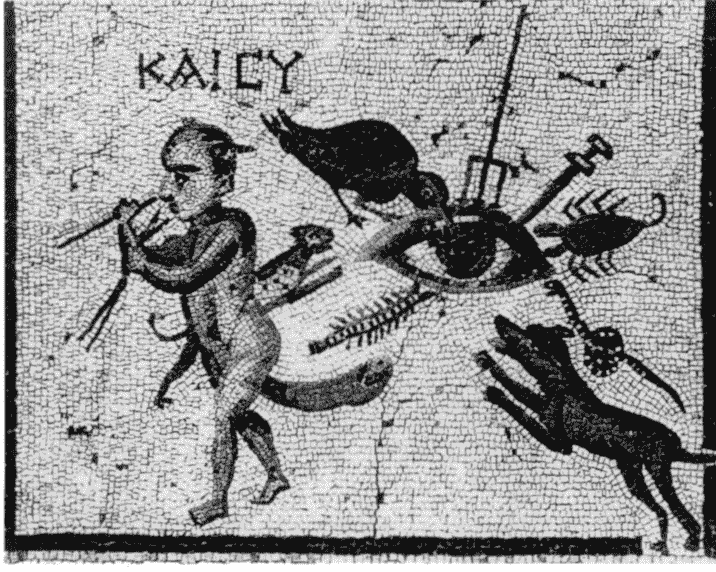

图 62. 安提约克，邪之之家，带有邪恶之眼的“KAICY”，上面板（照片由 C. Kondoleon 拍摄）

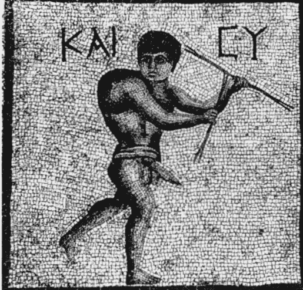

图 63. 安提约克，邪之之家，带有驼背的“KAICY”，下面板（照片由 C. Kondoleon 拍摄）

上述描述的苏斯（Sousse）马赛克与帕夫斯的符号组合形成了引人注目的平行关系，该马赛克包含了季节和客礼（`xenia`）的徽性画，以及一条铭文“MACARI”。将这个词解释为“受祝福的”是合理的，这意味着季节性祭品是所有者好运的象征，而非艺术家的签名。⁶⁸ 帕夫斯的“XIPEI”和“KAICY”等同于“MACARI”所含含福福情感，其细微差别通过其悬挂的丰饶图像得到了强调。这种形式的细微解读在科姆图尔加（Kóm Turga，埃及）的一处马赛克中，阴茎上方出现的“KAICY”得到了印证，那里的阴茎与苏斯马赛克中出现在“CHARI”（喜悦）旁边的阴茎完全相同。⁶⁹ 这种祈求的意义很大程度上取决于上下文。

季节与有益的保护符号并列呈现，证实了这些拟人形象的意义超越了它们明显的时间事务。最清晰的例子是来自罗马的一幅剪影马赛克，其中水星拿着一个钱袋，站在丰饶女神（Abundantia）旁，后者持有丰饶角和植物，季节以及与狄奥尼索斯主题自然配对在一起。⁷⁰ 庞贝罗马别墅马赛克中也有对季节的呈现，其中一个面板描绘了一对从大口瓮中饮水的虎，其上方是一个带有季节胸像的几何构图面板。⁷¹ 当它们与传统的辟邪物（apotropaion）结合时，它们的魔法价值会增强。例如，西里尼创作的晚期安东尼王朝马格斯之家（House of Magnus）中，迷宫角落的季节示例证明了它们的效力。⁷² 在同样迷信的视觉中，季节出现在东部的克诺索斯（Knossos）和西部的卡尔莫纳（Carmona），位于守护美杜莎头的圆盾对角线上，这是古代最古老的保护装置。⁷³ 在所有情况下，季节在视觉上唤醒了阿尔忒弥斯德鲁尔（Artemisidur）所总结的民间信仰，他宣称梦见季节女神预示着好运。⁷⁴

关于季节引发的多种关联的晚古时期注释，可以在突尼斯的马马之家（House of the Horses）4 世纪初的三餐室马赛克中看到。季节胸像与站立的永恒（Aion）、正在梳妆的金星、一只正面的孔雀、粟穗茎以及其他奉给繁荣与多产的符号组合在一起。⁷⁵ 这种主题在一个房间内的压缩——这些主题在早期的罗马房屋中通常分散——强调了符号在意义上的重叠程度，并强化了对幸福与丰饶的普遍感。

帕夫斯季节位于可能的入口处，这与安提约克房间或房屋入口处使用此类图像相对应。⁷⁶ 许多罗马北非洲案例在房屋入口处发现，这一事实表明该主题有着有趣的局部化适应。悬挂的问候性铭文证实了该马赛克构图被理解为对其多产的庆祝以及对家庭奢华的表达，⁷⁹ 同时起到了欢迎游客和保护门槛免受恶势力侵害的作用。与其他接待主题一样，季节马赛克具有多重含义，根据上述列举的比较，其中许多含义对罗马客人来说是为人知的。

## 孔雀

一只张开着华丽尾巴的孔雀位于房屋南部靠近入口区域的 3 号房间中心（图 64 和 65）。该房间的北侧面向西侧和南侧的柱廊，因此在垂直和物理上都与三餐室和回廊相连（图 3）。⁷⁷ 在这个原本全为白色的正方形面板底部有一个浅色（粉色/红色）区域。有两个：一个是红白相间的内框，延伸到其角之外；⁷⁸ 另一个较宽的带高光的丝带边缘。⁷⁹ 它设置在一个由切正八边形组成的大几何构图之上，这些八边形决定了四角星。⁸⁰ 白色星星带有红红色正方形的双色方案，以及填充有白色产品的红褐色八边形，产生了一种充满活力的设计，让人想起意大利的黑白风格。⁸¹ 这种设计的大胆程度实际上与鸟形象形成了竞争，尽管它的尾巴和身体用蓝绿色的玻璃嵌片闪闪生光。

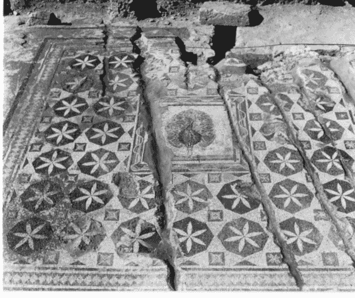

图 64. 孔雀，3 号房间，显示发现时状况的全景（塞浦路斯文物部提供）

- 68. 教区认为铭文是艺术家的签名或苏斯所有者的名字（1984, 25, no. 59）。
- 69. 关于“KAICY”，参见 Eggemann 1975, 34, no. 91, 11d；关于苏斯马赛克（苏斯博物馆，min. no. 10.903），参见 Foucher 1968, 4–5, pl. 44, no. 57.011。
- 70. 该马赛克来自 SS. Trinità，参见 Foucher 1968, 4–5, pl. 44, no. 57.011。
- 71. 庞贝罗马别墅的马赛克中季节的呈现……
- 72. 西里尼创作的晚期安东尼王朝马格斯之家中迷宫角落的季节……
- 73. 在东部的克诺索斯（Knossos）和西部的卡尔莫纳（Carmona）……圆盾……
- 74. 阿尔忒弥斯德鲁尔（Artemisidur）……Hanmann 1951, 68。
- 77. 与三餐室和回廊……
- 78. 例如，安提约之家（House of Narcissus）门厅的胸像，以及曼达尔之家（House of Meander）三餐室门槛处的……
- 79. 丝带边缘……
- 80. 几何构图，286–87, pl. 183a……
- 81. 帕夫斯设计的相当相似的版本……

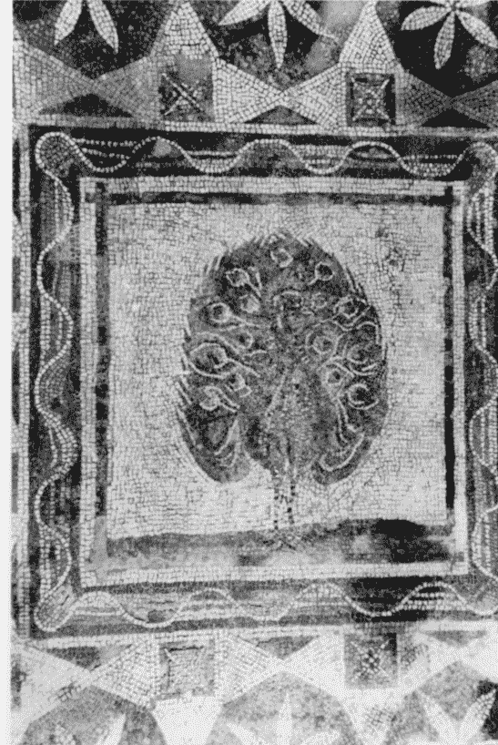

**图 65。** 孔雀，细节，重建后（由塞浦路斯文物部提供）。

一个早期的例子是散布在波吕斐墨之家（House of Polyphemus）和加拉泰亚之家（Galataea）海洋场景中的鸟类与树枝面板，根据风格判断，其年代为公元 2 世纪上半叶（图 66）。事实上，这些是安提奥克保存下来的唯一真正的镶嵌画（emblemata），而帕福斯的孔雀面板似乎是模仿这种便携式嵌板模刻的。

尽管安提奥克的马赛克中出现了几只孔雀，但它们通常与其他鸟类和酒器在一起。在红铺石之家（House of the Red Pavement）有两块带有鸟（包括孔雀）的嵌板，装饰着门廊的开口。在这两块嵌板中，孔雀都面向门廊，正如帕福斯的孔雀面向回廊一样。安提奥克的另外两个显著例子（可能属于塞维鲁王朝时期）包括装饰在宴餐室（`triclinia`）的双口水盆。这一主题对于接待区的适用性显然是罗马装饰中的常见陈调。

在自助晚餐之家（House of the Buffet Supper），在龛式用餐室的长方形面板中，增加了狩猎并用笼子捕捉鸟类的爱洛神（Erote），为这一静物主题注入了叙事性；从金属双口盆中流出的水暗示了花园的幻象，鸟类和人物在分层中的布局暗示了深度（参见图 67）。尽管孔雀位于用餐室马赛克的中心且呈正视，但在安提奥克并没有与帕福斯孔雀完全对应的例子。诚然，帕福斯的地板符合东方的时尚，即在场景面板周围环绕多条装饰带，但将孔雀作为孤立的主题处理方式在东方并不存在。

这种应用最接近的类比可以在北非洲的房屋找到，在那里，每当孔雀是主体时，都会以正面的、展开尾巴的形象出现（图 68）。单独观察每一个例子，都加强了这样印象：这种高度装饰性的图像也可能具有象征意义。展开羽毛构成的羽状拱门自然适合壁龛或半圆构图，在北非洲发现案例的物理和图像学背景表明，对孔雀的选择超越了纯粹的装饰考量。

在布拉·雷吉亚之家（Bulla Regia），一间宏大房间后方壁龛内的一只彩绘孔雀，要求人们完全关注；87 这间房间的地板部分被大理石圆盘和被称为“辟邪器物”（`apotropaic devices`）的马赛克覆盖——蛇、矛、圆盾、杆子上的月亮。在这里，孔雀可以被归类为吉祥符号，这些符号的聚集确保了所有者的幸运。

在比尔-查纳（Bir-Chana）一个2世纪晚期的例子中，一只孔雀站在装饰有常藤枝的*提尔索*（狄俄尼索杖）上方，装饰着一个面向孔雀的壁龛，这是一个不寻常的星象马赛克。邓纳宾（Dunabin）信服地提出，另一个壁龛中的孔雀面具以及带有行星神和黄道符号的马赛克应该被读作一个整体的吉祥设计。89

这种解释似乎是孔雀之家（House of the Peacock）4世纪遗迹中主题题组合所要求的（图 69）。在房屋的主房里，孔雀的羽毛勾勒出一个由宽 U 型色带形成的拱门，这个色带似乎定义了拱廊。这种类构图的底部是一条水平带，上面有四只马在吃镶嵌宝石的圆柱容器。走廊内音乐家和猎人的描绘加强了主题计划的印象。

圆形剧场和马术比赛的成功被用作一种预防手段；孔雀装饰性地点缀了这一安排，其本身必然象征着幸运。11 尽管符号的集中和意义的强化更符合晚期古典时期的审美，但迦加特的马赛克确实为它在帕福斯的问候铭文提供了注释，帕福斯的这块马赛克被认为是孔雀马赛克的副品。

埃杰姆（El Jem）和苏斯（Sousse）房屋中单只孔雀的出现强调了这一主题本身可以作为一种强大的符号发挥作用。12 事实上，学者们指出，它展开的尾羽上的“眼睛”向外突出，许多“眼睛”的展示有助于驱除邪力。在这种防御模式下，该主题特别适用于入口区域。也许上述提到的正视视角下孔雀的缺失可能指示了该主题的一种特定的西方变体——一种辟邪符号。无论如何，它在帕福斯房屋入口轴线上的出现，是东方对其保护力量进行改编的罕见例子。

无疑，最具纹章感且气势最强的构图位于埃杰姆孔雀之家，那里鸟被两只手持火炬的爱洛神（Erotes）环绕（图 68）。94 这件2世纪晚期的马赛克以孔雀羽为开头的框架，位于小房间或回廊内的一个假壁龛中。95 尽管带有火炬的爱洛神以及描绘宴餐室的狄俄尼索头像和人物似乎暗示孔雀具有崇拜意义，但房屋中其他马赛克中大量水果篮、食物和动物的静物（`xenia`）暗示了一个更中立的主题，即良好的“丰饶”（*abundanceia*）占据了主导。

此外，假壁龛紧邻回廊的位置将孔雀置于一个令人联想到庞贝花园装饰的环境中，在那里孔雀栖息在幻象的喷泉上。96 在这种背景下，带有猎犬的门槛处孔雀，掩盖了早期帝国时期动物和人类作为花园绘画主题的流行；事实上，它们经常与鸟类、喷泉和装饰性植物的壁画并列。97

孔雀之间的关联……（此处由于原文文本中断，后续内容未提供）

罗马人热于在室内创造微型的“天堂”（`paradeisos`）。99 收集野鸟和野兽是贵族阶阶的特权，但这些主题在各省份壁画和马赛克画中的出现，证明了人们对这类奢华公寓的广泛模仿。

在想象中的鸟舍、花园和*客礼*（`xenia`）装饰中，孔雀通常以侧面姿态站立，尾巴收拢。100 通常可以观察到，每当孔雀出现在鸟类组合、狄奥尼索符号或静物主题中时，它总是以侧面示人；展开的尾巴则留给招待功能。

在帕福斯的葡萄园马赛克画中，这种鸟的展示特性得到了充分利用；由于其位置，它作为问候的标志。访问者不禁在视觉上将房间一和房间三中的三千只孔雀联系起来，以增强*黄金时代*（`felicias temporum`）的感。。101

帕福斯部分以一种*伪纹章*（`pseudo-emble`）的形式呈现；它被置于大胆的几何设计的中心，产生出一种风切入地面的效果。通过这种方式，孔雀被有效地隔绝在一个极具意义的空间内，就此而言，它可以与单只孔雀的放置（无论是绘画还是马赛克）相提并论：壁龛内、古老的空间，或上述讨论的北非案例中的模拟空间。

从其紧邻“季节”马赛克的明显物理位置，以及“XAIPE”和“KAICY”铭文表明，孔雀在主题和空间上延伸了房屋主入口2号房间的问候功能。除了该主题显而易见的审美吸引力外，孔雀无论是否明确与狄奥尼索相关联，都是奢侈、繁荣和好运的象征。102

> 99. Zanker 曾对这一现象写过大量著作（1979, passim）。
>
> 100. 在许多例子中，公元3世纪早期卡尔太基鸟舍之家（House of the Aviary）庭院八角形池塘周围“季节”中的孔雀（Lavin 1963, 213–14, fig. 31–33）。另见苏斯一处公元3世纪早期鸟舍与圈养场马赛克画边缘环绕着皇帝的两只孔雀（Sousse 1960, 57:25–46,2–201, pl.）。对于静物主题中的孔雀，可见来自 El Aia 的马赛克（Barda, iv. 1979）和来自 La Chebbi 的马赛克（Barda, iv. 88）。这一规则的例外可见4世纪图布尔博马朱斯（Thuburbo Majus）三叶草之家 101 房间中，少数作为客礼主题的、展开尾巴的正面孔雀之一；Ben Abed-Ben Khader 1987, p. 20–21, and 59, medallion 33。
>
> 101. *felicitas*（幸福）与展开尾巴的孔雀的关联出现在硬币和奖章上；见 Toynbee 1944, 1650,1957, p. 29。
>
> 102. Geyer 拒绝对孔雀进行任何宗教解释（即作为不朽的象征），并提议将其解读为美、幸运和美好生活的通用符号（1978, 98–102）。

# 第 4 章 入口

## 接待套房：客礼与甘尼墨德斯马赛克

通过马赛克主题来确定房间的功能划分是难以建立的，而且很少有考古或铭文证据的支持。然而，在9号和10号房间案例中，它们在建筑平面图中的位置及其马赛克装饰暗示了它们与用餐有关（图 3）。

如果我们将这些马赛克主题嵌入功能性语境中，对其意义的解释就会扩展为一种关于威望和地位观念的文化话语。对它们在房屋内物理设置的考察，以及对“垫子”图案客礼（静物主题）和甘尼墨德斯嵌板的图像学分析，揭示了特定场域的构图。也可以超越将这些房间归类为接待活动的限制，转而考虑主客之间对话的细微差别。

9号房间和10号房间相邻，位于房屋的北墙，距离后门（G）不远，位于西侧厨房区（F2–F4）和私人休息室（`cubicula`）之间，它们共享一个厕所（H）。它们通过窄走廊（图 70）与柱廊的邻近，呼应了罗马各省份庭院周围多个接待房间的组合——有些更具公共性，另一些更私密——但北非的房间非常适合作为接待区。

这些房间的位置为解读它们的马赛克装饰提供了钥匙。尽管9号房间的交织“垫子”图案完全可以像上一章中的其他几何装饰一样被处理，但作为填充图案的客礼在引用古代待客习俗方面是不同寻常且独特的。可见包含各种食物和饮料的主题代表了提供给客人的实际供品——也称为客礼。在东方马赛克中，客礼和“垫子”图案的稀有证明了帕福斯在装饰上的刻意努力，这种装饰预设了一套使用方案。

“垫子”图案在北非洲最流行，通常装饰在餐厅。在这种情况下，几何设计及其次要主题的选择可以暗示其含义和功能。对房间与用餐相关的假设，反过来影响了对相邻的带有甘尼墨德斯神话的10号房间的解读。甘尼墨德斯神话引发对宴会和享乐的明显暗示，古代人绝不会忽视。

在帕福斯，我们得以看到神话与社会现实相互作用的罕见视角。如果我在第二章中仅从装饰角度讨论交织“垫子”图案或甘尼墨德斯马赛克，那么它们在构建家庭生活设计中的作用将不如赞助者和设计者的意图那样。

### 交织“垫子”图案中的客礼

9号房间的设计及部分填充图案的特征迎了西方模型，并加强了帕福斯几何图案中受西方影响的，特别是14号房间的多设计构图。一种不常的交织“垫子”图案覆盖了9号房间的地板，这是房屋中最大的之一（8.45米 × 5.85米）（图 71 和 72）。

该设计在白、黑、灰和粉的色调中被大胆地构思，并以次要颜色（橄榄绿、褐色和黄色）作为填充。几何区域由黑白相间的回纹图案（方胜纹样）框定。设计的基本单元由交织的辫花带（`guilloche`）和波浪带勾勒；交织线交创建了大小的切圆和凹八边形。

该设计似乎在边缘被任意裁切，导致八边形和小圆丢失了约一半的交织框架；也就是说，各个单元之间没有内部出口，每个单元的白色背景溢到了边缘。每个半粉色半褐色的较小圆都位于八边形的边缘——包含带有凹侧的白色定位正方形。

每隔一个八边形有一个波纹边缘——二十八个圆和四十个八边形填满了各种几何主题，范围从简单的元素（如单个正方形、八边形、菱形、纯色、同心圆、点状正方形、点回纹和所罗门结）到复杂的图案，包括回纹、重叠八边形、环绕菱形和正方形的透视实体、圆形迷宫、由菱形、正方形或三角形组成的各种星形、带棋盘格的正方形、不同图案的花饰，以及环和圈的网络。

这些单元中有十个包含餐具。每个角落的对角线上都设置了一个花蕾（灰色）。东方此类交织设计最接近的对比发生在晚期，晚于为帕福斯（Paphos）提出的公元2世纪末日期。

在安提俄（Antioch），类似的装饰性纹带环绕几何图案周围的排列可以追溯到5世纪下半叶。⁴ 这种图案在早期基督教教堂中流行，它包裹着各种鸟类和双饮用器⁵。在帝国时期的东方艺术库中，帕福斯式的界面是一个异类。

存在西方的例子（包括意大利和行省），其交织形成了巨大的凹八边形，通常这些设计只使用一种带子，即绳草纹（`guilloche`），而不是像帕福斯那样的带子混合。⁶ 一个来自哈德里酸别墅（Hadrian's Villa）的黑白版本呈现了一种紧绷的，由月桂叶带和植物填充组成。⁷ 这种类型——被解释为色彩的奔放与地方性的简化。

- ⁴ 这种设计采用切线交织和圆圈执行；参见《几何装饰》（Décor géométrique），230–31。该示例取自安提俄的一处马赛克，扇区 DH 2H–37；另见 Levi 1947, 317, pl. 130a。
- ⁵ 例如，参见科斯岛（Kos）奥德剧场（Odeion）附近巴西教堂马赛克中发现绳草纹和丝带装饰，其日期为公元5世纪下半叶（Pelekanisides and Ataka 1974, 66, no. 26, pl. 31-b）。
- ⁶ 参见《几何装饰》，369, pl. 236b，其中对该马赛克的描述与我们的设计相关：“由不同大小的圆圈构成的多色网格图案，通过简单的绳草纹切线交织（圆圈代表交点），形成不规则的凹八边形区域（轴线边较长）”。
- ⁷ 该马赛克装饰了哈德里酸别墅（Hadrian's Villa）*客栈（`hospitalia`）的一间客房；正如 Blake 1936, 81, 203, pl. 12.2。
- ⁸ 在许多作品中，见 Picard 1968, figs. 12–13, 18–20。

## 世俗与神圣

缺乏同时期的东方对应物令人惊讶，但这与帕福斯工作坊的整体概况是一致的。正如帕福斯多种设计图案的情况一样，9号房间的交织纹明确表明了受西方模型的影响。然而，正如狄奥尼索斯之家（House of Dionysos）的其他地方，交织纹也包含了可以追溯到安提俄的元素。

透视法实体的幻觉效果在安提俄非常流行，但它们并不是与多种设计相关的西方艺术库的一部分，这些效果出现在9号房间的两个面板中。更为突出的是五个填满了环路和圆圈网络的奖章，这些可以与“饮酒竞赛之家”（House of the Drinking Contest）餐厅（`triclinium`）中菱形-星形-正方形图案内填充方形的多色环路和圆圈进行比较。9 这少数几个共同细节仅凸显了帕福斯工作坊与安提俄之间的紧密联系，并没有否定整个构图的西方基调。

帕福斯构图的整体效果是一个带有万花筒填充装饰的密集区域。在这方面，它与罗讷河谷发现的多种设计地板非常相似。尽管所有这些地板都由正方形网格组织，但它们共享帕福斯马赛克所展示的相同冲动：填充填充物，而不考虑对称性或重复。

在多种设计马赛克中发现的特征性奖章和正方形图案也出现在帕福斯界面中。数量惊人的帕福斯马赛克充斥着（尽管是以更罕见、更简化的形式）正如高卢斯马赛克中的那样。一件来自里昂（Lyons）、日期定为公元3世纪第一季度的地板，在其九十个正方形中提供了大量的装饰样本。10

在所有的帕福斯马赛克中，迷宫设计是与西方世界联系最具暗示性的。11 迷宫设计出现在法国、瑞士和意大利的几个多种设计构图中，但在东方马赛克中不存在。12 奇怪的是，这些西方对应物中的许多日期可以追溯到公元3世纪上半叶，不能被认为与帕福斯马赛克同时。13

高卢斯法庭最早的地板——即来自乌泽尔（Ouzër）的黑白马赛克（图36）——其中心有一个迷宫，由于其意大利特征，日期被定为公元2世纪中叶。14 乌泽尔马赛克被作为帕福斯14号房间多种设计地板的重要对应物被引入；它与帕福斯几何回形容器中的其他元素一起，表明了对意大利模型的依赖。

9号房间的任何界面马赛克必须与帕福斯多种设计马赛克的特征有关。然而，帕福斯工作坊在乌泽尔地板创作后不久，收到了大多数带有附属地板多种设计构图（即迷宫）。这被看作是对西方（意大利的？）的本土适应——被解释为色彩的奔放与地方性的简化。

帕福斯工作坊的创造性通过在界面“垫”图案中应用多种设计效果，以及安提俄与罗讷河谷图案的结合得到了证明。这些价值是如何汇在一起的更难以确定。

- 9. 房屋定于公元第二个时期晚期；Levi 1947, 156–57, pl. 30。
- 10. 例如，所罗门结、带有正方形或矩形的菱形、叠加三角形组成的盾牌、各种星形和交叉，在 Stern 1967, 49–51, pl. 33, no. 53。
- 11. 这种类型：“由不同大小的圆圈构成的多色网格图案，通过简单的绳草纹切线交织（圆圈代表交点），形成不规则的凹八边形区域（轴线边较长）”。
- 12. 迷宫设计出现在法国、瑞士和意大利的几个多种设计构图中，但在东方马赛克中不存在。
- 13. 奇怪的是，这些西方对应物中的许多日期可以追溯到公元3世纪上半叶，不能被认为与帕福斯马赛克同时。
- 14. 高卢斯法庭最早的地板——即来自乌泽尔（Ouzër）的黑白马赛克（图36）——其中心有一个迷宫，由于其意大利特征，日期被定为公元2世纪中叶。
- 15. 乌泽尔马赛克被作为帕福斯14号房间多种设计地板的重要对应物被引入；它与帕福斯几何回形容器中的其他元素一起，表明了对意大利模型的依赖。

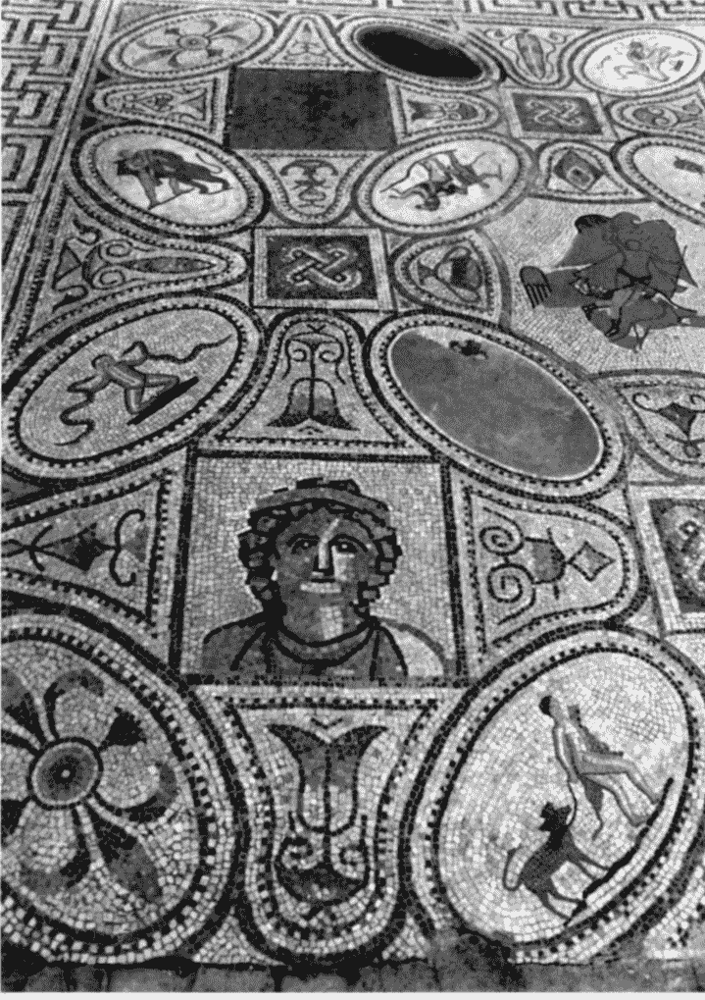

图 74. 沃尔卢比斯（Volubilis），赫拉克勒斯功绩之家，“垫子”图案细节（摄影：C. Kondoleon）

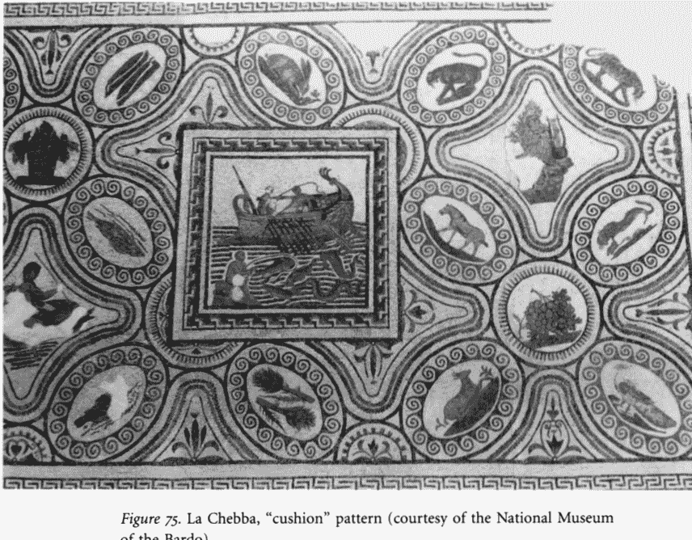

这些食物马赛克可能指代了富裕捐助者的公开慷慨行为，即食物的分配（`sportulae`）。^23 这种好客行为无论是公开还是私下的，无疑提升了主人（`dominus`）的公民声望。这些图案作为对家庭华华与财富的视觉隐喻。

点缀帕福斯（Paphian）界面的11种不同餐具与这类美食礼物有关，古代作家将其称为 `xenia` 并乐于描述它们（见图 76）。它们出现在帕福斯，进一步证明了与比扎塞纳（Byzacena）“垫子”设计的比较合理性。

这些物体大部分位于房间中心和入口附近的“垫子”和圆形内。由于这些图案中有五个面向房间的西侧，可以推断出一种偏好的朝向；有三个图案被安置为从入口处观看。

> ^23 Dunbabin 1978, 125。

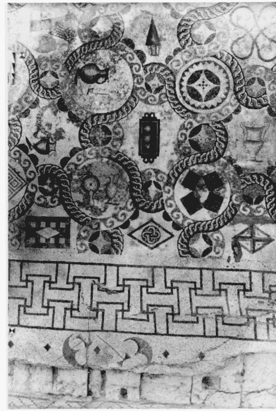

**图 76.** 9号房间，`xenia` 图案细节（由塞浦路斯文物部提供）。

（见图 71）。一个堆满葡萄和葡萄蔓的大篮子，类似于菲洛斯特鲁斯（Philostrus）在大致同时期的《想象》（*Imagines* 1.31）中描述的 *xenia* 画画中的那个，位于构图的中心并面向西侧。另一个食物图案出现在一个靠近入口的八角形内，同样面向西侧——即金属托盘（橄榄绿带灰色包边）上的三个玫瑰色水果（石榴？）。其他九件物品包括两个类似的托盘（但没有食物），设置在构图的东边缘；一个肩部尖锐、面向北墙的双口瓶；`24` 四种类型的金属饮酒盆（`craters`）；`25` 和两种类型的水壶。`26` 三个辅助图案包括一个连接在圆盘上的长柄物体——可能是一面银镜（灰色和白色），设在银壶旁并紧邻入口；陶质壶（`oinochoe`）旁一个由蓝色镶嵌颗粒（`tesserae`）构成的女性，面向西墙；`27` 一串系在黄色双耳盆一个手柄上的玫瑰花环，并面向西墙（见图 76）。`28`

这些物体可能被更恰切地称为 *apophorta*，即赠送给客人的“可以带回家”的非营利性食物。阿提奈纳乌斯（Athenaeus）在他的《博学的宴会》（*The Learned Banquet* 或 *Deipnosophaistia* V1.229）中使用了这一术语，指代克莉奥特拉给客人们赠送金银绳装饰的做法。马提亚尔（Martial）在《诗集》的 *Apophorta* 部分（14）中涵盖了大量此类餐具。这些器皿被称为 *urceini minstratorii*（用小壶）、*patella cumana*（盘）、*ligula argentea*（银匙）和 *calathi*（礼篮）。`29` 尽管这些产物并不完全相同，但每一件都足够符合 *apophorta* 的定义。事实上，马提亚尔在他的 *xenia* 诗中提到了玫瑰花环（*corona roseae*）。`30` 帕福斯中银镜的插入提醒我们，这些礼物还包括书写工具、珠宝首和其他个人物品。

具有可比性的构图还有塞拉皮斯之家（House of Serapis）用餐室（`triclinium`）哈德良时期马赛克中的方形面板。`31` 在这些面板物体中，黄色用于表示金色和红色调。每个面板都与我们的帕福斯案例非常相似，其中一个小勺子靠在一个红色的双口瓶上。`32` 每组物体都位于基准线上，为呈现增添了真实感；它们让人联想起帕福斯物体下方的深色阴影。在奥斯提亚（Ostia），六68 个面板中的许多（现已遗失）包括食物、禽类和内脏，这一选择证实了餐桌-

**注释**

- `24.` 该器物呈红色和粉色，以表示它是粘土制成的。其形状与房屋东部北角一处废墟中发现的葡萄酒双口瓶非常相似；此类器器的生产可追溯到 2 世纪中叶；参见引言中的“考古证据”。
- `25.` 在这些黄色和深棕色制成的金质或铜质制器皿中，呈深绿色和灰色调的那个可能表示青铜。
- `26.` 其中一个口较长的呈灰色和白色，表示是银器；另一个是陶质的，用红色和粉色的镶嵌颗粒制成。
- `27.` 关于镜子，见同一物体，它被识别为镜子，在米南德尔（Menander）的 Bet Mery 第 n 世纪庭院北廊中作为填充物。
- `28.` 该图案的平行物可以在面板 E 中找到，该面板位于安提约米南德尔之家（House of Menander）用餐室（2 号房间）的入口处；见 Leay 1947, 2000–201，图 75。杯（`Kantharos`）呈灰棕色，带有浅黄色和白色高光，以及红花串环。
- `29.` 见 Sep, *Epigrams* 14.9–13。术语的翻译采用 Ker 1920 (Loeb)。
- `30.` Martial, *Epigrams* 13.127。
- `31.` 详述请见 Becatti 1961, 43–49, no. 28, p. 103。
- `32.` 同上，147, p. 103。

## 家用与神圣

### 接待室 131

帕菲斯交织纹（Paphian interlace）的传输与 14 号房间的多重设计非常相似。这两种构图在东部都是反常的，它们在帕福斯（Paphos）的创作为作坊实践的独立性和复杂性提供了引人注目的暗示证据。

在我们离开这个房间之前，应该注意到其门槛周围随意放置的一对圆盾形盾（`peltae`）和双头斧（图 80）。它们出现在主入口处，可能被视为辟邪的装置，而这些装置在洛亚诺（Loano）地板上装饰有卍纹的交叉斧头和圆盾中找到了对应的对应物。彼特罗尼乌《爱情史》（*Satyricon*，30）中的一段引言对该房间的功能具有很强的暗示性：“我们进入了餐厅 . . . 惊讶地看到门柱上固定着木棒和斧头。”`38` 也许这些地位物品的展示（在这种情况下附属于民政长 `Lictors` 的职能）为此类装饰提供了最初的动力。

这些符号出现在特里马尔基奥（Trimalchio）餐厅入口处，表明它们出现在 9 号房间门槛处可能预示着类似的语境。帕菲斯房间是房子里第二房间，且位于一个房间群（8、9 和 10 室）中，这指向其具有接待功能。

> `38.` 译文自 Hesletine 和 Farmington 1913 (Loeb, 51)。

如前所述，该房间是从一个长窄的房间（8）进入的，该房间装饰有菱形-星形-方形图案，通向北侧门廊；它与东墙相邻，是一个装饰有“甘尼墨德被劫”（`Ganyemede`）图案的较小正方形房间（10）。我们已经将交织纹装饰与北非洲的“坐垫”系列主题进行了比较，那里有许多此类地板覆盖了用餐区。9 号房间中加入了供奉物（`apophoreta`）和客礼主题，这在东部马赛克作品库中非常不常，使其成为第二个用餐区的可能位置。在检查甘尼墨德马赛克时，将进一步探讨这一建议在建筑和图像学上的意义。

### 甘尼墨德

一幅鹰叼起甘尼墨德的画面是房屋东北角一个较小的近似正方形房间的焦点，该房间位于较大的矩形 9 号房间正东侧（图 3，10 室）。`39`

> `39.` 房间尺寸为 5.60 米 × 5.90 米。

场景由织纹（`guilloche`）框限，并设置在一个宽阔的卍字回纹图案中心，该回纹叠加在切线八边形和正方形之上（图 81 和 82）。`40` 这两个房间的装饰主题和空间布局表明，房屋的北部可能构成了一个在功能和设计上相关的房间套间。

人物嵌板描绘了英俊的弗里亚青年（通过其尖顶红帽辨认），他正被鹰举起（图 83）。甘尼墨德几乎呈正视，他抬头仰望，同时抬起的手臂环住鸟的脖子。他低垂的右手握着一根长而细的矛，矛尖（蓝色玻璃）指向下方。一面盾牌在空中掉落在嵌板的左侧。该青年除了靴子和一条垂在腰后的红斗篷外赤身裸体。他交叉的双腿——左后的一条略微弯曲——向右伸展并悬在空中。鹰展开的黄褐色翅膀和宽大的尾巴填充了嵌板的中心；翅膀尖，尤其是右侧的被裁剪了。`41`

> `40.` 该图案请参见 Décor géométrique, 254–55, pl. 166d。关于此回纹设计的描述和讨论，请见第三章“几何装饰”。

## 世俗与神性

这种抓捕动作通过尖利的白色爪子紧紧抓住青年腰部和大腿肉肉的方式被生动地描绘出来。

叙事性动作似乎被定格在一个编排好的瞬间，这对不自然的伴侣悬浮在地面上方。场景发生在鹰发起突然袭击惊扰青年之后，掉落的盾牌证明了这一点。向右的上升，飞行方向通过右翼被切断的程度得到了强调。此外，我们顺着甘尼墨德的目光向右看，他的捕获者转过头露出一个凶猛的侧面。这对空中的组合由鸟的大型 V 型保持稳定，这种形状填充了嵌板的中心部分。鸟那沉重的垂直轴在长矛的衬托下，与对角线以及更可见的左翼形成了对比。

`41.` 翅膀上部染成红褐色，羽毛尖端为黄色；扇状的尾巴有几处高光。

### 接待套间 136

鹰是否被理解为宙斯取决于文学来源。在《伊利亚亚史》（*Iliad*，这是该故事最早的文学来源）中，荷马将其归于“被他的美所震撼的神灵”，抓走了甘尼墨德去“执酒”。`42` 在奥维德的《变形记》（*Metamorphoses*）中，那鹰化作一支标枪偷走了皇室少年。`43` 维吉，《埃涅亚纪》5:250–55。帕菲斯的场景表明鹰实际上是宙斯，但这种关于甘尼墨德的联系在观众脑海中随处可见。极少有表现关注色情方面；相反，它们戏剧化了一个神话事件。`45`

> `42.` 此处引文自 R. Fagles, Homer: The Iliad (New York, 1990), 51; 文中第 20–74。
>
> `43.` 奥维德，《变形记》10:135–61。
>
> `44.` 维吉，《埃涅亚纪》5:250–55。
>
> `45.` 对比奥提亚朱斯庙的雕塑群；见 Gazda 1981, 172–73。

## 世俗与神性

以及那些描绘飞行的画面。`46` 帕菲斯的场景描绘了劫持，来自罗马西部遗址的马赛克，即沃卢比斯（右上角，图 74）、杰麦姆（图 84）、伊塔卡（图 85）、维也纳、奥尔比和比格诺。`47` 所有作品定位于二世纪末到三世纪初，比格诺可能追溯到三世纪末。

- `46.` 关于变体的标准分类，请参见 Sichermann 1953, nos. 1–414, 73–97; Phillips 1960, 2560.39; Foucher 1979, 15–68; Gauda 1981, 172–231.89，其引用了超过 400 个案例，包括雕塑群；以及 Sichermann 1998, 154–69，其列出了 267 个案例。
- `47.` 关于以下依赖洛卡雷（Locares）型的案例（增加了伊塔卡马赛克）。沃卢比斯的甘尼墨德残损严重，位于赫拉克勒斯功绩宅内大型餐厅马赛克中心的八边形隔间内（图 74，此处）；另见 Parrish 1984, 239–43, no. 67, pl. 93。杰麦姆的甘尼墨德被劫图位于索尔特里亚住宅（Solertiana Domus）寝室的复杂设计中心，其中包括季节和爱之场景（图 84，此处）；另见 Ibid., 165–68, no. 32, pl. 49。

庞贝贝浴场*温水浴室*（*tepidarium*）的一件灰膏浮雕也应加入这一组别，因为它复制了这些掠夺场景中伴随向上和斜向飞行的线条。`48` 尽管这些马赛克在风格上存在显著差异，但它们遵循相同的整体布局。然而，在某些情况下，腿向左侧摆动，而在其他情况下则向右侧。大多数情况下，左手手掌抬起，但在帕福斯（Paphos）和奥尔布（Orbe），右臂是抬起的。这些变化不应归因于不同的模型，而是反映了绘画过程中常见的反转现象。

掠夺主题马赛克与梵蒂冈的一尊罗马大理石小像非常相似，该小像响了利奥克拉特斯（Leochrates）著名的青铜群像，年代追溯到公元 4 世纪中期。`49` 这组希腊化时期雕塑显示，甘尼米德的脚几乎没有离开地面，头部向右抬起，而鹰则张开嘴向左转，正如帕福斯那样。除了其他共同特征外，伊塔利卡（Italica，图 85）和沃卢比利斯（Volubilis）马赛克中出现的吠狗以及梵蒂冈雕塑，证明了该组别具有共同的原型。`50` 梵蒂冈的甘尼米德抬起右臂，手势可能表示惊讶或防御，也表示向上的运动。`51` 在帕福斯，同一条手臂绕在鹰的脖子上。帕福斯马赛克中手臂的这种简单移动创造了不同的印象，因为少年似乎通过抓着捕掠者而表现出顺从。在瑞士奥尔布的塞维鲁王朝别墅案例中也发生了类似的调整。在那里，甘尼米德被安置在几个充满神性的六边形隔间之一，他的身体和头部朝右，被一只伸向鸟颈的手移动着。帕福斯的场景是该组中唯一包含盾牌的，尽管其中几个场景在甘尼米德手中放了长矛或牧羊人的杖。`52` 最可能，这些变体代表了误解或当地的适应。`53` 根据普林尼对利奥克拉特青铜像的描述以及从梵蒂冈雕像的描绘来看，熊按住爪子，其衣物保护着身体，以免刺伤他珍贵对象的皮肤。`54` 在伊塔利卡，爪子抓着膝盖下方的皮肤，正如在帕福斯一样，鹰抓着篷（`chlamys`）。尽管存在差异，但帕福斯马赛克显然描绘了一种源自希腊化时期的掠夺类型，这种类型在罗马雕塑和马赛克中得到了充分佐证。

在掠夺组别中，人物似乎漂浮在中性的白色背景上，没有地面线，而且它们非常适合隔间设计，通常是圆章（`medallions`）。将甘尼米德作为马赛克设计以及房间本身唯一的主题在掠夺组别中是不寻常的。即使在比格诺尔，当甘尼米德圆章是门厅区域北部部分的单一主题时，它的南端也与一个跳舞的美俄女马赛克相连。`55` 在围绕伊塔利卡（图 85）甘尼米德的碎片豹和老虎残骸中，也可以探测到狄奥尼索的联系。甘尼米德可能被认为增强了幸运的吉祥符号，当掠夺场景在沃卢比利斯、埃杰姆（El Jem）和维恩（Vienne）与季节搭配时，情况确实如此。`56`

灰膏大部分经过了修复，伊塔利卡带有甘尼米德的中央圆章是原作（图 85，此处）；另见 Blanco Monteiro 1978, 28–29, no. 4, p. 14。一个带有甘尼米德的大圆章位于一个设计的中心——非常像伊塔利加的那个——位于来自维也纳的地板，其中还包含了季节；另见 Lancha 1990, 35–37, esp. 10。奥尔布的罗马别墅的甘尼米德圆章被定位于公元 200–225 年；另见 Gonchar-1961, 84–94。最后，比格诺尔附近的罗马别墅的甘尼米德根据风格理由定位于公元 3 世纪；另见 Johnson 1983, 405–6, fig. 1。

- `48.` Phillips 倾向于认为这件灰膏取决于一个 3 世纪马提纳马赛克的掠夺类型，但物理证据并不支持这一观点（1960, 259n）。
- `49.` 见 Bieber 1955, 62–63。
- `50.` Phillips 认为 3 世纪的马提纳马赛克是该组别反映的共同原型（1960, esp. 260–63）。相反，Foucher 认为每个组都有独立的媒介，马提纳马赛克是掠夺场景的来源（1979, past）。
- `51.` 梵蒂冈甘尼米德在大理石板上的手臂经过了修复。
- `52.` 普林尼，《自然史》34。沃卢比利斯和伊塔利卡的马赛克都显示甘尼米德手持长矛。
- `53.` 以类似的方式，大理石浮雕上甘尼米德抬起的手经过了修复。
- `55.` 见 Johnson 1983, 405–6, fig. 1。
- `56.` （参考遗址背景）

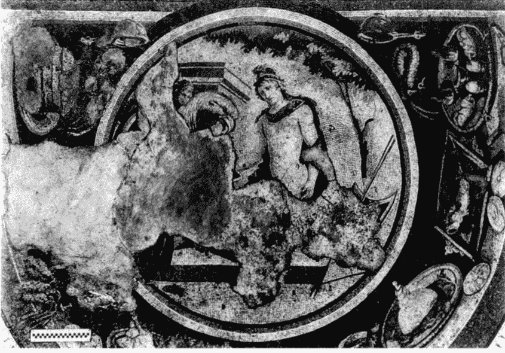

一个黑白几何设计的中心。这件来自苏斯的马赛克画在粗旷纹样的背景中，通过一个中心且孤立的圆章来呈现其神话故事，这与帕帕福斯的地板最为相似。这这两块地板可能都早于那些更为复杂的塞维鲁斯时期构图，在那些作品中，甘尼墨德是与其他主题结合在一起的。

在所有这些实例中，它们都是对主人的某种提醒。甘尼墨德不仅符合用餐活动的主题，也提醒着主人的慷慨。甘尼墨德是好客主义的神话符号，正如 *xenia*（款客之道），特别是对 *apophoreheta*（赠品）的包含，作为客人和朋友的食用和珍贵礼物的代名词，既传达了主人/房人的地位，也传达了罗马精英阶层中赠送礼物的核心地位。此类物品是否真的在帕帕福斯人之间交换，取决于观众借此识别该家庭的 *Romanitas*（罗马性）的过程。神话与静物在一个空间上构建的接待组合中汇合，它们也投影了一种罗马式的文化概念。`62`

> `62.` 布莱森关于 *xenia* 的论文中讨论了这些主题及其赞美性（`ekphrastic texts`），将其视为“文化生产”的表达（1990, 55）；他暗示性指出，对于彼特纽斯和菲洛斯特拉斯所的环境来说，“文化工作被定义为媒介与人工、表现与模拟。”
>
> `63.` 考古证据以及引言中对平面图的讨论支持这一观点。

### 世俗与神性 144

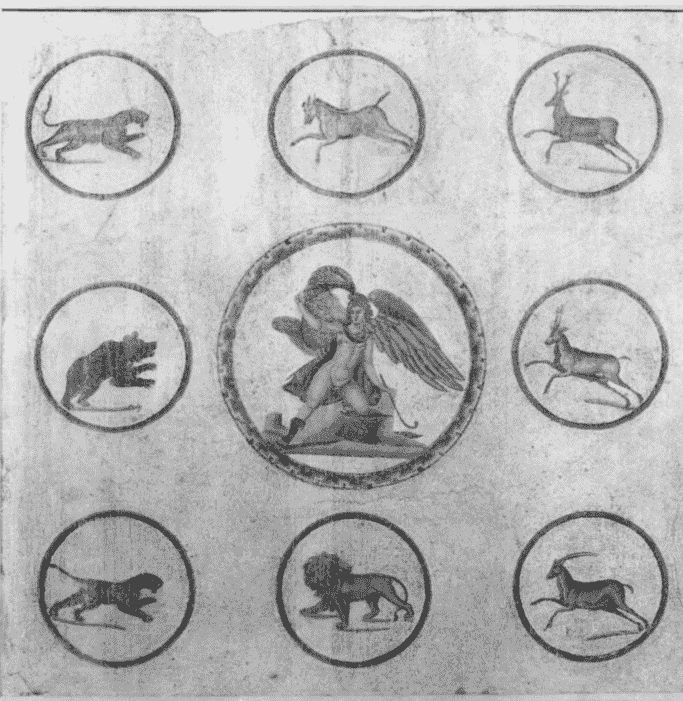

在帕帕福斯存在大量二、三世纪的甘尼墨德被劫持的平行马赛克。甚至还有其他几个例子，该场景是整个地板的唯一主题。甘尼墨德马赛克通常出现在接待区或私人卧室；通常伴随的主题指示了马赛克的意义和房间的功能。

为了理解帕帕福斯设计师的图像学意图，我们应该将 10 号房间视为一组房间（8、9 和 10 号房间）的一部分，这些房间在建筑平面图中物理上相关（图 1 和图 3）。

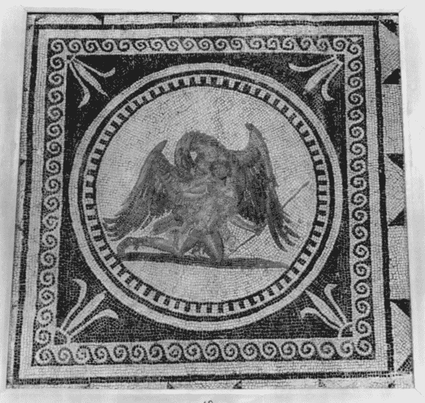

（带有菱形-星形和方形图案）作为一个类似于走廊的空间，通过回柱廊的北侧门进入 9 号和 10 号房间。在平面图中，10 号房间的方形形状和较小的尺寸在视觉上拉长了它们较邻的 9 号房间。在实际使用中，两个相邻房间之间的交流将允许它们作为一个空间单元发挥作用。它们在平面图中位置的几个方面决定了这两个房间服务于家庭多样化的接待需求：它们靠近厕所（H）和厨房（F2–4）；它们的并排关系，尤其是 10 号房间与东北角卧室区域的并列；以及它们（尤其是 9 号房间）与回柱廊和餐厅（`triclinium`）公共区域的临近。如果说它们的物理关系强调了共同的世俗功能，那么它们的装饰也可以被视为具有同等的关联性。

换句话说，9 号房间中的 *xenia* 和 *apophoreta* 主题，其对好客之道的精确指涉，以及北非洲房屋餐厅中常见的交织式“垫子”图案的微妙引用，应该被看作是对甘尼墨德被劫持的场景的互补。

### 接待套间 145

此时可以建立甘尼墨德与用餐之间的联系，这种联系在许多罗马房屋中是已知存在的。例如，沃尔比利斯赫拉克勒斯功绩馆中的大型餐厅马赛克（图 73），结合了帕帕福斯两个房间的元素，即甘尼墨德被劫持和用餐区的“垫子”图案。在东部，位于安提奥克宴会之屋圆拱形餐厅内的甘尼墨德场景是另一个例子。

带有甘尼墨德面板的较小房间可能作为更更私密的娱乐区域，也许是供主人使用的、等级分明的空间，而相邻较大的房间则服务于家庭的接待需求。`64` 接待室和卧房（`cubicula`）的并列通常围绕房屋角落布置，是非北和意大利回柱式房屋类型的共同特征。`65`

> `64.` 在倭马王朝的宫殿中发现的迪万（`diwan`）房间的大小和可能的功能，例如在耶哥附近的 Khirat al-Mafjar；见 Grabar 1973, 156, 56, 60。
>
> `65.` 在阿肖拉海普顿之宅的平面图（图 5）中（我经常引用它与帕帕福斯房屋的相似之处），私人公寓位于西南角，位于回柱廊和餐厅之间。与帕帕福斯房屋相似的私人房间的出现早于 2 世纪，这与某些学者的观点相反。

# 第 5 章

## 西柱廊

### 宴会的序曲

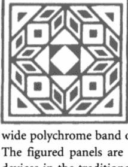

回柱廊装饰回柱廊的四个神话面板从南向北为：甘尼墨德与阿提斯贝；向甘尼墨德提供酒的狄俄尼斯与“甘尼墨德被劫持者”（长轴边面板）；波塞冬与阿甘莫尼德（轴线边框）；以及爱神斯甘尼墨德与达拉娜（图 89）。每个面板都由宽边的边框框，且所有四个面板都被精美的装饰装置所包围，决定了长方形房间。² 与安提奥克的紧密联系通过对这些故事（通过奥维德的《变形记》和许多艺术表现得到体现，这些图像在帕帕福斯的解释）的分析得到强调。这两个故事在拉丁语世界是广为人知的。

¹ 有关这些墙的描述见 Vermeux 1976, 103–110；Nicolaou 1963, 64–67，其将柱廊标识为 II 号；Balta 1984, 419–420; Daszewawki and Michaelides 1988, 23–29, 图 8–11; Michaelides 1987, 19–21, 号 16–18。

² 几何图案, 280–81, 版 10b, 被描述为“相邻正方形的边框。”有些八边形填充了花卉图案。以深粉、浅粉、灰色和棕红色为主。关于图案的发展和年代，见 Daszewawki and Michaelides 1988, 41–42；此外该图案在本文的“结论”部分进行了讨论。

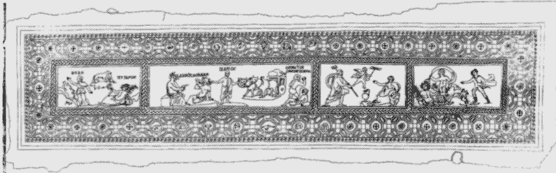

通过奥维德的《变形记》和许多艺术表现，它们在帕帕福斯的解释暗示了对东方来源（文学和图像）的强烈依赖。三个爱情故事（包括波塞冬与阿甘莫德）在西柱廊显得格格不入，尽管在古代书中充分证明，包含了不寻元素：一个被识别为甘尼墨德的河神；另一个未命名的河神躺在达拉娜旁；以及一个带着奇异特征飞向爱神。仅对某些人物进行标记尤为奇特。单独看，每个场景都揭示了帕帕福斯马赛克生产的特性。尽管与安提奥克的马赛克有明显的相似之处，这些面板似乎是全新的创作，并为了其特定的地区和家庭背景而设计的。

# 甘尼墨德与阿提斯贝

带有甘尼墨德与阿提斯贝的面板不仅证明了帕帕福斯工作室受到的广泛影响，也证明了它的独特性（图 90）。文学叙述与故事表现之间的差异表明该面板内融合了至少两种不同的传统。对这一故事的当地变体的分析将阐明罗马帝国时期希腊东方与拉丁西方之间的图像交流，以及传播和生产的机制。

甘尼墨德与阿提斯贝面板以及“甘尼墨德被劫持者”包含了

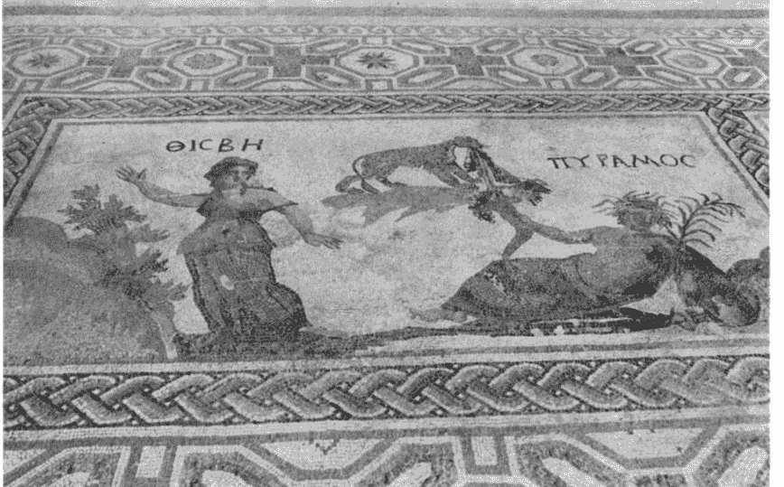

**图 90。** *皮拉莫斯与提斯比（摄影：C. Kondoleon）*

识别人物的标签。在这两种情况下，标签的使用都暗示这些是有意识的创作产物。皮拉莫斯与提斯比的场景确实有先例，而伊卡洛斯与饮酒者的面板似乎是帕帕福斯的原创作品。但正恰因为皮拉莫斯与提斯比构图的来源是可追溯的，且人物的组合似乎是随机为之的，它为艺术创作过程提供了一个罕见的视角。在画板（1.15 m. × 2.26 m.）上，提斯比站在左侧，皮拉莫斯斜卧在右侧，一只雌豹子站在他们之间的背景中。提斯比呈对立平衡式（contrapposto），抬起伸出的右手，手掌张开，脸转向皮拉莫斯，另一只手自然下垂。她穿着灰色的无袖长裙（chiton），红褐色的褶皱层层垂至脚。衣服从她的左肩滑落，露出了胸部。她戴着类似披风的头饰，头发呈四缕卷曲垂落在肩头。她站在一个带尾巴、多叶灌丛的岩石旁。相比之下，皮拉莫斯躺在地上，靠着一座山丘，用左臂支撑，左肘支在一个倒扣的水出金属水罐（hydria）上（图 91）。他用同一只手拿着一根高大的绿色河芦苇，右手则举起一个装满水果的橙黄色丰角。他的额头上戴着一个草冠，结合其他属性和他的斜卧姿势，表明他代表一位河神。一件带有深绿色褶皱的灰色长袍（himation）披在他的左臂上，遮住了他腰部以下。他转过没有胡须的脸避开提斯比。背景中，那对不幸的情人之后，一只斑纹雌豹站在灰土丘上，口中叼着提斯比的斗篷。

斗篷、豹子和少女的出现让人想起奥维德《变形记》第四卷（55–166）中的描述，在书中皮拉莫斯与提斯比是典型的悲剧恋人。这对年轻恋人因家族世仇而无法见面，在尼努斯墓旁安排了一次秘密的夜间约会。提斯比先到达，带着她新捕的猎物被狮子的走近吓跑了。她在逃跑时掉掉了斗篷，当皮拉莫斯看到斗篷被血染并被狮子撕咬时，假设了最坏的情况。他自杀了，当提斯比回来时，她发现了他的尸体，在一段令人心碎的独白后也自杀了。她的血染红了一棵桑树，在这一马赛克中可能通过一个带刺的灌丛表示，那里此前长着深红色的果实，为这对恋哀悼。

帕帕福斯的马赛克描绘了提斯比逃跑以及狮子（豹子）发现遗弃斗篷的瞬间。提斯比的恐惧通过她的姿态生动地描绘——伸出的手臂和手指、张开的手掌；惊讶的表情，睁大的眼睛和紧闭的嘴唇；以及从肩膀滑落的长裙显示出一种混乱的状态。剧中的这一处斜卧的河神形象可能代表狮子在伏击前解渴的泉水（《变形记》4.98），但“皮拉莫斯”的标签指示了另一种含义。

古代晚期沿海文献保存的一段广为人知的传说以非常不同的方式描述了皮拉莫斯与提斯比。其中最早的是农农翁的《狄俄尼斯史诗》（646–55），写于五世纪的亚历山大，无疑参考了更早的文献，在其中皮拉莫斯是一位河神。在这首诗中，皮拉莫斯与提斯比被描述为两条河流，与尼罗河、幼发拉河、阿尔费俄河和阿里忒莎河一起，被比作寻找并最终汇合的情人。从地理上看，皮拉莫斯是昔基亚的一条河流，并包含在斯特拉封的地理志》中。帕帕福斯的文献中，皮拉莫斯作为河神的出现，为这一构图提供了奥维德以外的来源。

帕帕福斯的马赛克提供了奥维德传统与东方传统的融合。狮子和斗篷可以在说明奥维德文本的庞贝画中找到，而皮拉莫斯在叙利亚马赛克中以河神的身份出现。对各自来源的考察无法解释帕帕福斯构图中选择和组合人物时涉及的随机过程。在四幅描绘皮拉莫斯与提斯比的庞贝画和罗马神圣岛（Isola Sacra）的另一处墓葬中，有几幅包含了狮子和斗篷。与帕帕福斯马赛克的相似之处仅于此。庞贝的场景展示了故事的悲剧高潮：提斯比扑过去，用伸出的左手支撑身体，与豹子一同落在剑下（图 92）。海湾（Sinus）地点由两处带有骨灰瓮的石柱标记，除一个例外外，所有的例子确实都是逃跑的年轻人。在包含狮子的实例，它位于背景中，斗篷则留在前景挂在树上。显然，从对该主题非常相似的处理方式来看，庞贝画源自一个共同的模式。尽管存在斗篷和豹子，但帕帕福斯马赛克中的差异反驳了其依赖庞贝画。

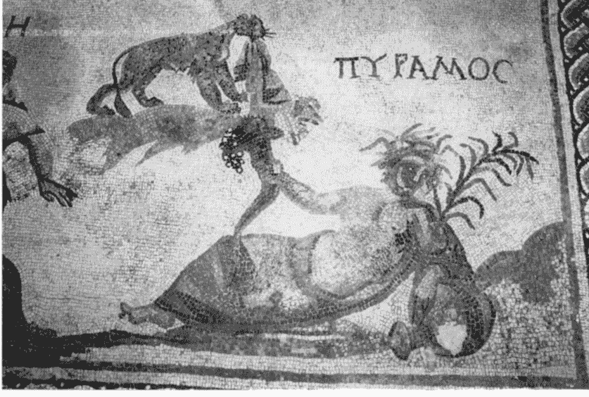

图 91. 皮拉莫斯，细节（由塞浦路斯文物部提供）

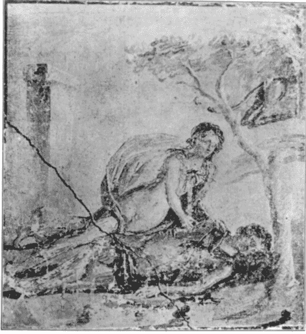

**图 92。** *皮拉莫斯与提斯比（摄影：C. Kondoleon）*

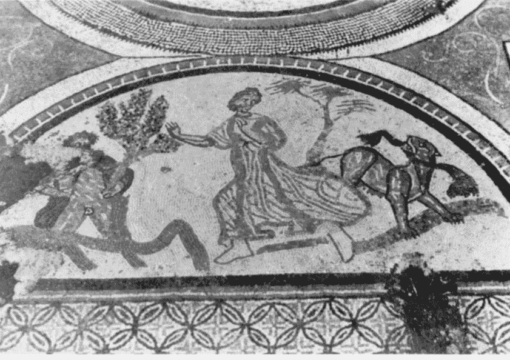

通过图像模型对奥维德的叙事非常熟悉，这些模型比文字传播更便利、更广泛。¹²

来自塞索宝藏（Sevso Treasure）的梅莱阿格盘（Meleager plate）——这是一个巨大的银盘，边缘刻有情侣冲突的场景（图 94）——初步断定于公元四、五世纪。¹³ 提斯贝（Thisbe）双臂伸出出现，正如她在帕福斯马赛克中那样，但皮拉米罗斯（Pyramos）的身体以半卧姿态低低地坐在一个女性旁。背景中央有一头母狮子跃起，口中衔着一件斗篷。皮拉米罗斯的左侧是一个坐着的河女神，她低着头，用手支撑着。皮拉米罗斯和提斯贝之间是另一位河女神；然而，她侧卧着，身体面对提斯贝，同时转过头看向皮拉米罗斯。低垂的水流和芦苇的特征将这两位女性拟人化形象识别为水神，但她们的出现令人困惑。这块银盘引入了另一种变体：在这里，这些拟人化形象似乎在模仿主角的行为，但由于两者都不是女性，因此不可能是出现在《皮拉米罗斯与提斯贝》东方版本中那些化作河流的忠实恋人。也许他们的加入是为了刻画皮拉米罗斯，也可能刻画提斯贝，如果是这样，塞索浮雕将证实奥维德版本和东方版本的记载。

有可能像诺克斯（Knox）那样，假设存在一个早于奥维德的、其故情节与帕福斯构图相关的版本。¹⁴ 然而，帕福斯马赛克、塞索盘以及西班牙马赛克中狮子和斗篷的存在，以及晚期马赛克中的桑树和盘上持剑的倒地的皮拉米罗斯，有力地证明了艺术模型在奥维德作品中是间接存在的。这种由 I·巴尔达萨雷（I. Baldassarre）提出的解释是，他在并不知情的情况下插入了奥维德故事的元素。另一方面，诺克斯拒绝将艺术惯例作为解释这些差异的手段。

至少在帕福斯，皮拉米罗斯作为男神的形象似乎取决于当地工作坊对东方版本的解读。幸运的是，来自叙利亚的三块马赛克证明了这一东方版本传说在艺术中的流行。皮拉米罗斯作为无须之神的形象在安提俄出现了两次，在基利基亚别墅和门廊中。¹⁷

- 12. 诺克斯（1989, 处处）忽略了图像模型的作用。

- 13. 索得（1990）。

- 14. 诺克斯（1989, 223–24）最近讨论了帕福斯马赛克的东方版本，奥维德改编了基利基亚传说形成了了自己的版本。尽管我们得出的结论不同，诺克斯在1985 年的讨论以及最近的Konen（1990, 109–12）中提出了许多观察。Duke（1971, 322）也暗示奥维德版本的源自北叙利亚。

- 15. 巴尔达萨雷（1985, 346）。

- 16. 针对巴尔达萨雷的提议，诺克斯（1989, 325）声称“这是一种不太可能的解释”。

## 世俗与神性

图 94。塞索宝藏，带有皮拉米罗斯和提斯贝的银盘（赠赠 Mango）

然而，在这些马赛克中，皮拉米罗斯以头戴芦苇的胸像出现，伴有其他铭文标识的河神。理解帕福斯皮拉米罗斯的关键最好源于晚二世纪的河流门廊马赛克，其中四个方形面板包含了阿尔斐斯河（Alpheus）、阿瑞图莎（Arethusa）、提斯贝和皮拉米罗斯的胸像（图 95）。阿瑞图莎和提斯贝作为女性胸像出现，证实了诺诺斯诗中描述的化作河流和泉水的这对恋人。早期二世纪的基利基亚别墅四尊胸像中仅存了两尊，皮拉米罗斯和底格河，这些可以被视为与基利基亚拟人化形象相结合的地理指标。¹⁸

帕福斯的皮拉米罗斯显然暗示了我们从诺诺斯诗中熟知的河流神。安提俄的叙利亚艺术家在来自加勒内（Galleneh，拉塔基亚地区）的四块坐姿河神马赛克中至少有一块奥特斯河（Orontes）面板代表了一对河流（图 96）。¹⁹ 铭文标识的阿尔斐斯河被描绘坐在他的伴侣阿瑞图莎（水女神）旁，她正搂着他的肩膀。²⁰ 他手里拿着一个金属制的（金色的？）丰角，她左手拿着一个（银色的？）壶。

- 17. 莱维（1947, 58, pl. 9b，以及 109-110, pl. 18c）。

- 18. 莱维暗示缺失的河流是尼多斯（Knidos）和幼发底河。

- 19. J·巴利（1977, 14-15）讨论了现位于大马士革博物馆的奥特斯河河悬挂面板。

- 20. 该马赛克位于叙利亚博物馆。

## 阿米莫涅与波塞冬

在西门廊的第三个面板（2.29 米 × 1.12 米）中，我们发现了一个描绘阿米莫涅与波塞冬神话的场景（图 97）。在左侧，一个通过过肩斜挎的三叉戟标识的胡须男子正向一个坐着的女性冲去，他的绿色斗篷在他赤裸的身体周围飘动。这位女神似乎跪在地上，肘部支在岩石凸起处。当她转身体成近乎正面的姿态时，她的脸呈四分之三侧，向波塞冬伸出手。她绿色长袍的领口滑落露出了胸部，一条红褐色的斗篷绕在她的腿部和左臂上。她脚边的窗台上放着一个大黄色壶。一个带翅膀的爱神赤裸着披着黄色短袍，在他们之间飞行，手里拿着火炬；他左手还拿着一个奇怪的物体——一个插在杆上的矩形牌，可能是旗帜。

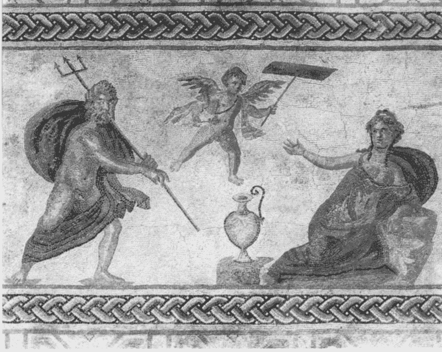

请求他救她免受牧人色邪的袭击。还是说，她邀请他与她共枕？文学记载提供了多个版本。斯特拉博（Strabo）和帕乌桑尼亚斯（Pausanias）仅提到了阿米莫妮（Amymone）是达纳纳的女儿，她为阿格利德地区勒尔纳的一个泉水取了名。两位神话学家阿波罗洛多鲁斯（Apollodorus）和希格诺斯（Hyginus）讲述，阿米莫妮在前往“口渴”的阿尔戈斯寻找水源途中遭到牧人袭击，向波塞冬（Poseidon）求救，随后这位神灵与她共枕，并涌出一股以这位仙女命名的水流。二世纪作家卢锡安（Lucian）在其《**海神对话**》（*Dialogue of the Sea-Gods*）中提供了一个最具戏剧性的描述，其中特里同（Triton）用对美丽的阿米莫妮的描述诱惑波塞冬，神热情地回应，召唤了他最快的海豚。波塞冬在仙女寻找水源时惊扰了她，然后提供一个以她命名的喷泉来换取她的恩宠。²⁶ 人认为，卢锡安幽有趣的对话受哑剧和喜剧的影响，可能是对某幅画的描述。²⁷ 另一个记载存在菲洛斯特鲁斯的《**画像集**》（*Imagines of Philostrus*）的铭文语句中，他描述了一幅画，图中波塞冬在海马（hippocamp）的护送下，发现了在伊纳科斯河（Inachos River）边的阿米莫妮并惊吓了她，导致她掉了金水杯（rhyter）。²⁸

并不意外，这些纪念性形象反映了各种场景。²⁹ 来自克里特岛哈尼亚（Chania）一座罗马房屋的3世纪马赛克，描绘了被框在一个画板内的两个片段中的传说。³⁰ 在左侧，阿米莫妮与一个牧人坐在一起，牧人正在袭击她。右侧，平静的阿米莫妮坐在一个岩台上，旁边站立着波塞冬，神也栖在岩台上，手持三叉戟。同样，在突尼斯的纳贝尔（Nabeul/Neapolis）4世纪前几十年的罗马别墅中，这两个片段都以马赛克形式描绘，尽管位于不同的房间；一个显示仙女正在抵抗牧人的进攻，另一个显示仙女与波塞冬站在水源拟人形象面前（98）。³¹ 两公鸡为了金币争斗，公鸡的战斗对该场景提供了评论，让观众将这些马赛克视为一个概念整体。³² 这种解释在纳贝尔尤为关键，因为这里的马赛克位于三个房间内。³³ 本质上，哈尼亚和纳贝尔的马赛克遵循了从牧人袭击到营救仙女的过程。少女似乎欢迎这位神灵，这对于场景的解读具有重要意义。两位神话学家都讲述阿米莫妮曾向波塞冬求救。在阿夫莫斯（Aphmos），阿米莫妮手势……

24. 斯特拉博，《**地理志**》VIII.6.8 (Jones 1917–32, 160–63); 帕乌桑尼亚斯，《**希腊志》II.37 (Frazer 1913, vol. 3: 96)。

25. 阿波罗洛多鲁斯，《**文集**》或《**图书馆**》（*Bibliotheca*）2.1.4–5 (Frazer 1921, 137–39)，存在于公元前2世纪作者的公元1/2世纪版本中；以及希格诺斯，《**寓话**》（*Fabulae*）169, 169A (Grant 1960, 132)，属于安东尼王朝。

26. 卢锡安，《**海神对话**》8(6) (Macedonio 1961, vol. 7: 205–11)。

27. Macedonio 1961, 179.

28. 少年菲洛斯特鲁斯，《**画像**》1.8 (Faustin 1931, 33)。

29. Simon 1891, 752, 注意到牧人在希腊化时期和罗马时代很少出现。

30. Berti, fig. 1, v. 5, 否定了挖掘者所说的较早日期（同上, 453），并建议3世纪中期作为与北非风格类比的依据（同上, 464–65）。

31. Sau 1982, 945, 提供了与科林斯罗马别墅风格比较的基础说明。

32. 关于位于C2卧室的仙女和阿米莫妮（第24号），请见 Darmon 1980, 95–98, 160–63, pp. 59–82；关于位于X室（邻C2卧室）与牧人搏斗的仙女阿米莫妮（第27号），请见（同上, 104–9, 175–188–90, pp. 52–54）。

33. 在哈尼亚，公鸡与阿米莫妮位于同一马赛克中；见 Berti 1975, 175, 和 1–6。在纳贝尔，公鸡组位于位于柱廊回廊处的伪镶饰中，见 Darmon 1980, 19, 79–84, pp. 79–84。

34. 关于全文，请见 Darmon 1984, 85–86。

### 世俗与神性

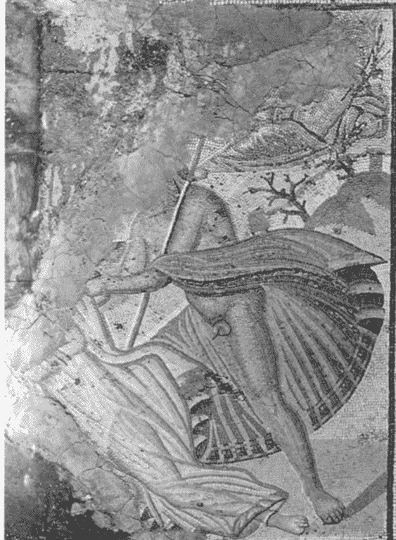

**图98.** 纳贝尔，波塞冬在仙女寻找水源时惊扰了她，然后提供一个以她命名的喷泉来换取她的恩宠。²⁶ 人认为，卢锡安幽有趣的对话受哑剧和喜剧的影响，可能是对某幅画的描述。²⁷ 另一个记载存在菲洛斯特鲁斯的《**画像集**》（*Imagines of Philostrus*）的铭文语句中，他描述了一幅画，图中波塞冬在海马（hippocamp）的护送下，发现了在伊纳科斯河（Inachos River）边的阿米莫妮并惊吓了她，导致她掉了金水杯（rhyter）。²⁸

并不意外，这些纪念性形象反映了各种场景。²⁹ 来自克里特岛哈尼亚（Chania）一座罗马房屋的3世纪马赛克，描绘了被框在一个画板内的两个片段中的传说。³⁰ 在左侧，阿米莫妮与一个牧人坐在一起，牧人正在袭击她。右侧，平静的阿米莫妮坐在一个岩台上，旁边站立着波塞冬，神也栖在岩台上，手持三叉戟。同样，在突尼斯的纳贝尔（Nabeul/Neapolis）4世纪前几十年的罗马别墅中，这两个片段都以马赛克形式描绘，尽管位于不同的房间；一个显示仙女正在抵抗牧人的进攻，另一个显示仙女与波塞冬站在水源拟人形象面前（98）。³¹ 两公鸡为了金币争斗，公鸡的战斗对该场景提供了评论，让观众将这些马赛克视为一个概念整体。³² 这种解释在纳贝尔尤为关键，因为这里的马赛克位于三个房间内。³³ 本质上，哈尼亚和纳贝尔的马赛克遵循了从牧人袭击到营救仙女的过程。少女似乎欢迎这位神灵，这对于场景的解读具有重要意义。两位神话学家都讲述阿米莫妮曾向波塞冬求救。在阿夫莫斯（Aphmos），阿米莫妮手势……

请求他救她免受牧人色邪的袭击。还是说，她邀请他与她共枕？文学记载提供了多个版本。斯特拉博（Strabo）和帕乌桑尼亚斯（Pausanias）仅提到了阿米莫妮（Amymone）是达纳纳的女儿，她为阿格利德地区勒尔纳的一个泉水取了名。两位神话学家阿波罗洛多鲁斯（Apollodorus）和希格诺斯（Hyginus）讲述，阿米莫妮在前往“口渴”的阿尔戈斯寻找水源途中遭到牧人袭击，向波塞冬（Poseidon）求救，随后这位神灵与她共枕，并涌出一股以这位仙女命名的水流。二世纪作家卢锡安（Lucian）在其《海神对话》（*Dialogue of the Sea-Gods*）中提供了一个最具戏剧性的描述，其中特里同（Triton）用对美丽的阿米莫妮的描述诱惑波塞冬，神热情地回应，召唤了他最快的海豚。波塞冬在仙女寻找水源时惊扰了她，然后提供一个以她命名的喷泉来换取她的恩宠。26 人认为，卢锡安幽有趣的对话受哑剧和喜剧的影响，可能是对某幅画的描述。27 另一个记载存在菲洛斯特鲁斯的《画像集》（*Imagines of Philostrus*）的铭文语句中，他描述了一幅画，图中波塞冬在海马（`hippocamp`）的护送下，发现了在伊纳科斯河（Inachos River）边的阿米莫妮并惊吓了她，导致她掉了金水杯（`rhyter`）。28

并不意外，这些纪念性形象反映了各种场景。29 来自克里特岛哈尼亚（Chania）一座罗马房屋的3世纪马赛克，描绘了被框在一个画板内的两个片段中的传说。30 在左侧，阿米莫妮与一个牧人坐在一起，牧人正在袭击她。右侧，平静的阿米莫妮坐在一个岩台上，旁边站立着波塞冬，神也栖在岩台上，手持三叉戟。同样，在突尼斯的纳贝尔（Nabeul/Neapolis）4世纪前几十年的罗马别墅中，这两个片段都以马赛克形式描绘，尽管位于不同的房间；一个显示仙女正在抵抗牧人的进攻，另一个显示仙女与波塞冬站在水源拟人形象面前（98）。31 两公鸡为了金币争斗，公鸡的战斗对该场景提供了评论，让观众将这些马赛克视为一个概念整体。32 这种解释在纳贝尔尤为关键，因为这里的马赛克位于三个房间内。33 本质上，哈尼亚和纳贝尔的马赛克遵循了从牧人袭击到营救仙女的过程。少女似乎欢迎这位神灵，这对于场景的解读具有重要意义。两位神话学家都讲述阿米莫妮曾向波塞冬求救。在阿夫莫斯（Aphmos），阿米莫妮手势……

24. 斯特拉博，《地理志》VIII.6.8（Jones 1917–32, 160–63）；帕乌桑尼亚斯，《希腊志》II.37（Frazer 1913, vol. 3: 96）。

25. 阿波罗洛多鲁斯，《文集》或《图书馆》（*Bibliotheca*）2.1.4–5（Frazer 1921, 137–39），存在于公元前2世纪作者的公元1/2世纪版本中；以及希格诺斯，《寓话》（*Fabulae*）169, 169A（Grant 1960, 132），属于安东尼王朝。

26. 卢锡安，《海神对话》8(6)（Macedonio 1961, vol. 7: 205–11）。

27. Macedonio 1961, 179。

28. 少年菲洛斯特鲁斯，《画像》1.8（Faustin 1931, 33）。

29. Simon 1891, 752，注意到牧人在希腊化时期和罗马时代很少出现。

30. Berti, fig. 1, v. 5，否定了挖掘者所说的较早日期（同上, 453），并建议3世纪中期作为与北非风格类比的依据（同上, 464–65）。

31. Sau 1982, 945，提供了与科林斯罗马别墅风格比较的基础说明。

32. 关于位于C2卧室的仙女和阿米莫妮（第24号），请见 Darmon 1980, 95–98, 160–63, pp. 59–82；关于位于X室（邻C2卧室）与牧人搏斗的仙女阿米莫妮（第27号），请见（同上, 104–9, 175–188–90, pp. 52–54）。

33. 在哈尼亚，公鸡与阿米莫妮位于同一马赛克中；见 Berti 1975, 175, 和 1–6。在纳贝尔，公鸡组位于柱廊回廊处的伪镶饰中，见 Darmon 1980, 19, 79–84, pp. 79–84。

34. 关于全文，请见 Darmon 1984, 85–86。

## 世俗与神性

**图98。** 纳贝尔，波塞冬在仙女寻找水源时惊扰了她……（其余文本根据逻辑流合并）

图 99. 卡兰万克、阿吕妮与厄洛斯（由 J. Arce 提供）

这一场景的一个更简化、更粗糙的版本保存在塞浦路斯岛库里翁的一块大理石浮雕上，其中一个海马人指向波塞冬，波塞冬正准备抓住跪在她水罐旁边的宁芙（图 101）。⁴³

尽管在帕帕福斯的马赛克中没有提到海洋，但出现了一个带翅膀的厄洛斯——这是一个不寻常的，仅出现在赛德浮雕和卡兰万克马赛克中。厄洛斯的出现暗示了塞浦路斯面板与菲拉斯特鲁斯/卢维安小组之间存在联系。然而，它们也存在差异。正如所指出的，阿吕妮并非感到恐惧，而是似乎在向神寻求帮助，而那位金色的请求者直直地站在构图中央，不受打扰。在大多数图像中，阿吕妮在向左奔跑逃离追逐者时跪下，追逐者从右侧冲入。在帕帕福斯，构图反转了，使得位于右侧的宁芙面对她的追逐者，而不是转头推开他；同样，那只原本贴近身体以挡他的手，现在伸出并呈现出欢迎的姿态。人物位置的反转改变了构图的含义。毫无疑问，波塞冬与阿吕妮的模型确实存在，但由于损毁过于严重，无法用于本文讨论；对于安菲波利斯的马赛克，请参阅 LIMC 1.1, 744, no. 29；对于来自埃杰姆 Terrain Jilani 宅的地板面板，请参阅 Fouchergis 1960a, 42–43, pl. 172a，他对该场景有不同的解读。

⁴³ Karageorghis 1975, 844–85. fig. 67；以及 Simon 1981, 745, no. 35，他将其定于公元 3/4 世纪。

## 世俗与神性

**图 100.** 拜亚、阿吕妮与波塞冬，石膏浮雕画（托普哈姆收藏品；经伊顿学院院长及研究员许可复制）

……是那个受惊并跪下的宁芙的形象。再次，帕帕福斯的马赛克艺术家似乎在改用传统的构图，并融入了他们自己的公式化叙述。

火炬指向阿吕妮的带翅厄洛斯的出现显然代表了*爱之神*（`pothos`），即波塞冬的情欲（图 102）。用厄洛斯拟人化欲望在刻尔赤的一个彩绘玻璃器上表现得最为明显（图 103 中，一个标记为 `pothos` 的带翅膀厄洛斯在阿波罗和一个半变形的达芙涅之间飞翔）。⁴⁴ 尽管在达芙涅或阿吕妮传奇的任何文字版本中都没有包含厄洛斯，但艺术家们已将其作为一种表现手段，这种手段在罗马艺术的神话爱情场景描绘中变得常见。⁴⁵ 然而，在罗马的绘画和马赛克中，阿吕妮通常没有厄洛斯的陪伴。⁴⁶

整个古代艺术中，带翅膀的厄洛斯用他们的火炬点燃激情——火炬向上指向代表成功的遭遇，向下指向代表命中注定的遭遇。在帕帕福斯的马赛克中，火炬水平指向阿吕妮，仿佛在引导波塞冬走向她。在意大利和雅提陶瓶上，……

> ⁴⁴ 该陶瓶收藏于柯宁玻璃博物馆（no. 55.1861）；请参阅 Cornell 1957, 165–67, no. 324。我在下文对阿波罗和达芙涅的分析中会有更多讨论。
>
> ⁴⁵ 有关厄洛斯协助的神灵与英雄联盟列表，请参阅 Stevers 1969, 109–21, 特别是 111–12。此外，M. Conan 注意到小丘经常被提及为人类欲望的寓言表现（《希腊化时代的图像》，1989年）。
>
> ⁴⁶ 在希腊陶瓶绘画中，持有双口（`hydria`）的阿吕妮经常与厄洛斯和阿芙洛忒一同出现；例如，参阅 Simon 1981 中的希腊瓶列表；以及 Milne 1992, 305–6；还有 Trendall 1977, 281–87。

图 101. 库里翁、阿吕妮与波塞冬，大理石浮雕（由塞浦路斯文物部门提供）

图 102. 阿吕妮与波塞冬，厄洛斯的细节（由塞浦路斯文物部门提供）

图 103. 刻尔赤、达芙涅水罐，爱之神的细节（由纽约玻璃博物馆提供）

厄洛斯（Erotes）除了拿着点燃火炬外，经常携带其他物品，最常见的是皇冠。有时他们带有恋人的属性；例如，持有闪电或旗帜的厄洛斯，旗帜被帕帕福斯的厄洛斯持有；在许多阿吕妮的形象中没有类似的平行，一个无翅膀的厄洛斯站在引导狄奥尼索战车的阿里阿涅背上（二世纪石棺上，图 104）。由于这种属性的军事关联，这种旗帜可能象征着海上胜利。

> ⁴⁷ 例如，参阅来自悉尼的蛋壶（`krater`）和莫斯科的皮利克斯（`pelike`）；Trendall 1977, 282, no. 2，以及 284, no. 11。
>
> ⁴⁸ Dunhabin 1978, 39 以及 Robertson 1988, 84, no. 144。
>
> ⁴⁹ 绘画来自洛里乌斯宅，显示了被两个厄洛斯环绕的阿芙洛忒；参阅 Stuver 1969, 135, pl. 18a。
>
> ⁵⁰ 该人物来自梵蒂冈的一座儿童石棺；参阅 Matz IV.2, 211, no. 92。

阿吕妮传奇的选择引发了一个关于地方神话在艺术构图选择中所起角的有趣问题。无疑，这对神组合深受希腊和罗马艺术家的青睐，但在五世纪作家农诺斯的《狄奥尼索颂》中，阿吕妮与贝罗俄的融合暗示了与帕帕福斯更具体的联系。在他关于狄奥尼索旅行的诗中，农诺对古代的贝罗俄（Berytos）赞誉有加，并用近两本书的篇幅描写贝罗俄的传奇；他们称阿吕妮源自“aphia”，并被称为“奎普里斯的女儿”或“西忒亚”，指的是她的母亲是阿芙洛忒的传说。这种宁芙与波塞冬相的描写，看起来与三世纪来自贝罗俄的带有阿吕妮的形象相似，表明在农诺写下他的诗之前，这两个宁芙是可以互换的。

> ⁵¹ Nonnos, 《Dionysiaca》41. 143–55（Rouse 1940）。
>
> ⁵² 宁芙的起源追溯到阿芙洛忒，这是一个事实。在他对贝罗俄的颂文中，农诺提出了一个大胆的主张：奎普里斯是在贝罗俄/贝罗托斯出生，而非帕帕福斯。作者甚至说：“女神从海上走来的足迹全是塞浦路斯人的谎言。”
>
> ⁵³ 显然，这些诗句反映了古代城市之间的竞争传统；这是对帕帕福斯在阿芙洛忒崇拜和神话中地位的挑战。
>
> ⁵⁴ 尽管阿吕妮与波塞冬的情节是标准图像库的一部分，但它在帕帕福斯的加入很可能是出于地方自豪感的选择。（关于利用地理和神话表达城市间竞争，请参阅 Fox 1987, 68–69。）

## 阿波罗与达芙涅

阿波罗与达芙涅马赛克（第四块，北部面板）的构图比皮拉莫斯与西比斯面板（图105和106）更直接揭示了东方来源的影响。尽管人物没有标记，但它们遵循传统形式被完全识别。两个主角有大量的平行作品，但加入男性神灵非常罕见。

在面板（2.33 m × 1.11 m）中，阿波罗从右侧向达芙涅冲去，达芙涅站在左侧卧地的河神身后；一个长着叶木丛的小丘将他们隔开。阿波罗通过他的月桂冠和右侧隐约可见箭袋被识别，除了肩上披着一件绿棕相间的披并系着凉鞋外是赤裸。他向前迈，斗篷在身后飘扬，用右手指向达芙涅。少女是赤裸的，除了一件头上方呈拱形的绿色衣服外，这指示她的逃跑突然停止。达芙涅固定在对立平衡姿态（`contrapposto`）中，她的腿变硬成月桂树的树干，叶子从右侧长出来，她转头盯着她的追逐者。她面前的胡须河神在手臂上支撑着一个流水的倾口；他左手拿着一个丰之角，手里拿着一根芦苇。他转过戴着河芦的头部，背离场景看向左侧。

在马赛克和绘画中关于该传奇的众多表现中，没有一个包含河神的形象。与皮拉莫斯与西比斯一样，帕帕福斯版本的阿波罗与达芙涅构图揭示了马赛克艺术家某种程度的独立性，他是基于当地知识创作的。从现存例子来看，庞贝画家中似乎……

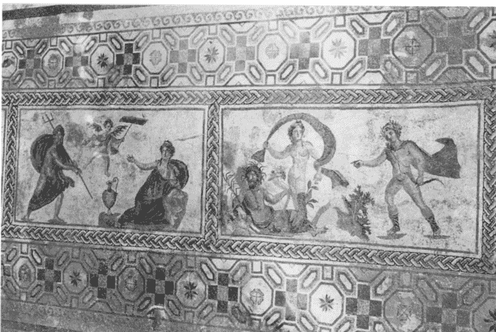

*图 105。波塞冬与阿弥莫妮、阿波罗与达芙妮（由塞浦路斯文物部捐赠）*

流传着两种场景：正如 Müller 1929 所示。一种是诱惑场景，描绘阿波罗与达芙妮对话的诱惑场面；另一种则展示了神在狂热的拥抱中抓住少女。55 尽管这些场景中没有一幅实际上描绘了变成月桂树的过程，但庞贝画家们描绘了奥维德的叙述（《变形记》1.42–56）。同样，还有一些马赛克——一块来自塞萨洛尼基某房屋的3世纪早期面板56 和一块来自埃杰姆（El Jem）某房屋的2世纪晚期面板57——并没有显示这种转化。尽管如此，在二、三世纪的几块马赛克中可以发现对叶状少女的戏剧化呈现。例如，在罗马附近的马里诺（Marino）的一块二世纪马赛克58 以及北非特贝萨（Theveste）的一块三世纪马赛克59 中，达芙妮几乎完全转化了：她的躯干变成了树干，叶子从她的头部、手臂和手指上长出来。这些马赛克似乎从字面上完全插画了奥维德的诗句（1,58-52）：“她刚这样祈祷，一种拖沓的麻木就占据了她的肢体，柔软的侧腹被薄树皮包裹。她的头发变成了叶子，手臂变成了分支。她那曾经如此敏捷的双脚，现在在缓慢的根须中扎根生长，她的头现在变成了一棵树。”

奇怪的是，在奥维德叙述中起关键作用的达芙妮之父涅俄斯（Peneios）被忽略了。毕竟，这位不屈的处女是为了躲避好色的阿波罗而逃往涅俄斯河岸，并且是向她父亲请求让她化作月桂树。马赛克和绘画中没有出现任何河神，这使得涅俄斯不太可能出现在奥维德故事的插图中。因此，几位学者对帕法斯（Paphian）马赛克中河神的识别60 预设了一个东部希腊工匠知道拉丁语诗歌——从皮亚莫（Pyamos）和提塞贝（Thisebe）面板可以看出，这种假设是不可能的。

帕法斯马赛克与希腊和叙利亚东方马赛克样本也不同。令人惊讶的是，在安提俄（Antioch）美南德之家的一块3世纪早期马赛克中，传说由两个人物插画：阿波罗伸向一个穿得整齐的，下半身是一个树干，长长的绿色新芽在前面抽而出。62 在塞萨洛尼基的一块当代马赛克中，达芙妮也穿着衣服并逃离帕法斯阿波罗的抓捕。63 尽管帕法斯阿波罗的舞台和呈现方式与安提和希腊示例相似，但西普鲁斯达芙妮的裸体与她的西方对应物更为接近。与所有现存的马赛克表现不同，帕法斯工匠通过加入河神打破了双人公式。帕法斯场景似乎是根据模型书中的人物改编以产生新构图的拼贴。

然而，在一个在克尔契（Kerch）发现并现藏于科林宁玻璃博物馆（编号 107 和 108）的白色玻璃器上的传说版本中，一位河神与阿波罗和达芙涅在一起。64 达芙妮、阿波罗、拉多斯（Ladon）和波多斯（Podos）的人物用希腊字母标识，用金色和珐琅色彩描绘。阿波罗的形象为一个伸出手手拿着丰之角并回顾的神，这揭示了帕法斯马赛克中的神灵（编号 109）。尽管该舞台发现于克里米亚，但据说它是3世纪上半叶制作的。彩绘器的存在为该传说的另一种表现提供了证据，这种表现遵循文学来源而非奥维德。在对阿卡迪亚（Arcadia）的描述中，保桑尼奥指出，关于河拉多斯的叙利亚叙述被列在三位古代作者之中。

+ 55. 关于该场景不同版本的详细讨论，请参见阿波罗坐着与其对话，或是阿波罗跳舞或反之；参见 Simon and Bauchens 1984, vol. I, 425, no. 4444 和 cill. vol. 2, 338。阿波罗扑向反抗少女的类型在狄奥斯库里斯之家（House of the Dioscuri）的一幅庞贝绘画中有很好的体现；同上，no. 444b。

+ 56. 该面板现于塞萨洛尼基考古博物馆，是来自大型地板的三幅构图之一，这块地板曾装饰过在苏格拉底发发掘塞萨洛尼基的一座罗马房屋的房间；参见 Waywell 1979, 303–4, no. 53, p. 52, fig. 46。

+ 57. 该面板是九个表现神之爱的场景之一，发现于埃杰姆（El Jem）Terrain Jani Guirat 的 A 号房屋餐厅厅（`triclinium`）；参见 Focher 1960a, 37–44, pl. 15e，他将该马赛克定于约 180–200 年间。

58. Müller 1929, 62–63, fig. 4；以及 Simon and Bauchens 1984, 425, no. 44658。

59. 一顶巨大的叶冠从达芙妮的头上长出来，几条树枝从她的手中伸出；该场景形成了一个装饰性构图中心的图像面板，该构图由填满动物、爱神（Erotes）等的圆形装饰组成；参见 Leschi 1924, pl. 1, passim；以及 Dunbabin 1978, 272。

60. 几位学者对帕法斯马赛克中河神的识别。

61. 皮亚莫和提塞贝面板。

62. 下半身是一个树干，长长的绿色新芽在前面抽而出。

63. 在塞萨洛尼基的一块当代马赛克中，达芙妮也穿着衣服并逃离帕法斯阿波罗的抓捕。

64. 科林宁玻璃博物馆（编号 107 和 108）。

65. 玻璃的年代为公元3世纪。

66. 保桑尼奥指出。

77. 弗拉乌斯·菲洛斯特留乌斯《阿波罗尼传》1.16（Coneybare 1912, 42–43）。

78. 关于他对这一传说及达芙妮阿波罗圣地的著作，请参见 Downey 1961, 82n.134；Levi 1947, 205nn.34–35；以及 Libarius，《Polygnasmata》17（Foerster 1921–22, vol. 8: 4–45）。

79. Libarius，《Orration XI》94–99（Foerster 1921–22, vol. 1: 466–68）。

80. Nonnos，《Diomysiaca》42. 387–90（Rouse 1940, vol. 3: 254–55）。

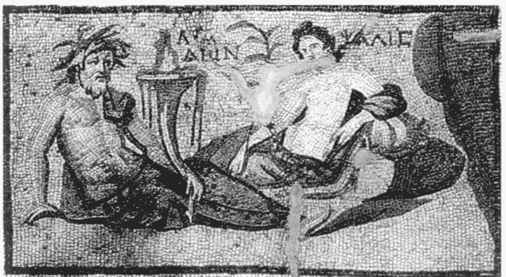

图 110。安提俄克，美南德罗斯之家，河神拉顿（Ladon）的细节（摄影：C. Kondoleon）

拉顿作为安提俄克地理中人物的重要性，通过他在3世纪初美南德罗斯之家的一幅马赛克（图110）中被描绘为河神得到了证实。71 他留着胡须，戴着芦苇花冠，左手持着丰角，斜坐在一个标记为普萨利斯（Psalis）的女性水神对面。马赛克画师将他标记为拉顿，并将其他与阿波罗和拉顿形象置于同一间房屋内，这强调了当地对叙利亚版本神话的依恋。安提俄克拉顿与帕皮亚河神之间的相似性，以及在刻尔赤（Kerch）发现的玻璃瓶，强烈暗示了帕福斯的河流神可能就是拉顿。

奇特的是，帕皮亚河神避开了场景，仿佛在强调他作为景观元素的中立角色。这些河神形象作为地点指示物的功能，加强了这样一种印象：它们并非描绘奥维的故事；也就是说，这些形象并不代表达芙妮哀求拯救的那条河流。在菲洛斯塔斯（Philostatus）、利巴纽斯（Libanius）和农莫斯（Nonmos）的文本中，达芙妮仅被称为拉顿之女儿；她并没有向他求。拉顿在帕福斯和玻璃壶上的作用，与 4 世纪纳贝尔（突尼斯的尼亚波利斯）波塞冬与阿米莫妮马赛克（图 98）中的水神角色具有可比性。^72 挖掘者`J.-P. Darmon`将该人物识别为波塞冬通过阿米莫妮产生的勒尔涅喷泉的化身。然而，`M. H. Quet`有说服力地论证，该人物更有可能是阿格戈利德（Argolid）的伊纳霍斯河（Inachos），阿米莫妮曾在那里寻找水。^73 由于河神被放置在面板的右上部分——即在体型大得阿米莫妮和波塞冬之后——他似乎代表的是一个地点（伊纳霍斯河），而非事件（即神之三戟矛击中带来的水之礼物）。同样，帕福斯的河神似乎是一个辅助角色，一个地理符号。

那么，阿波罗与达芙妮传奇的帕福斯渊源似乎取决于叙利亚版本的故事，正如古代文献所指出的，它与古老来源的版本不同。在其他任何马赛克表现中都没有河神，奥维笔下的彼涅河（Pene）不太可能以帕福斯为蓝本。事实上，在拉丁文中可以找到依赖东方来源的视觉模型流通的间接证据。在西西里卡兰迪尼广场（Piazza Carandini）的一幅 4 世纪马赛克中，达芙妮的变形与西帕里索（Cyparisos）的变形并列在一起。^74 这两个故事在奥维的书中相隔九卷。^75 菲洛斯特卢斯在描述阿波罗尼斯访问安提俄克时，在描述达芙妮阿波罗神庙的月桂树和柏树时，同时讲述了这两个故事。^76 后者的文本阐明了西西里马赛克中这两个变形配对的意义，否则这看起来只是许多古代变形故事中的一种随机对比。西西里马赛克的存在暗示了可能遵循东方来源而非奥维的表现形式。帕福斯马赛克强烈强调了这种可能性。无论如何，帕福斯的马赛克画师似乎与安提俄克的作坊紧密相连，他们在视觉化这一神话时反映了文学来源，正如皮拉莫斯和提塞贝面板一样。

## 狄尼俄斯、阿克梅、伊卡洛斯与“第一批饮酒者”

西侧中心的形象面板（4.33 m x 1.11 m）长度是该系列中其他三个的两倍（图 111）。构图分为三部分：狄尼俄斯和阿克梅坐在面板左侧；伊卡洛斯（Ikarios）站在中间，身边有一辆牛拉的推车（图 112）；右侧（北角）坐落着两个醉酒的人物。每个人物都有希腊铭文标识，包括两个被称为“第一批饮酒者”的人物。

^71. 该面板来自美南德罗斯之家上层的 13 号房间，由 Levi 定位于 3 世纪前半叶（1947, 204–5, pl. 44c）。

^72. `Darmon 1980, 95–98, no. 24, pl. 82`。

^73. `Quet 1984, 84–85`。

^74. 马赛克位于西西里阿尔梅里纳广场（Piazza Armerina）4 世纪别墅中三叶形宴厅的门槛之一：`Carandini et al. 1982, 121–23, fig. 190`。

^75. 奥维，《变形记》，`1.452–567` 和 `10.106–42`。

^76. `Flavius Philostrus`，《阿波罗尼斯传》`1.16`。

图 111。狄尼俄斯、阿克梅、伊卡洛斯与“第一批饮酒者”（文物部门提供）

场景开始于狄尼俄斯（“DIONYCOC”），坐在长椅边缘，手里拿着一串葡萄。他全神贯注地看着倒在他面前伙伴（“AKMH”）。狄尼俄斯戴着酒冠，除了围在腿部和左肩的一件粉红色长袍（himation）外，是赤裸的。年轻女性也戴着酒冠，除了围在腰部和腿部的灰棕红色织物外，是赤裸的。她将杯举到唇边，靠在伸出的手臂上。伊卡洛斯（“IKARIOC”）——光头、留着胡须、赤脚——面向这对夫妇，伸出右手，似乎是为了接受他们的礼物。雅典牧羊人呈对立平衡姿势（contrapposto），穿着一件披在左肩垂到腰间的斗篷。他左手牵着一辆装满酒皮的双轮车，车由一对牛（一头黑色，一头自然）拉。在面板的最右侧，神话以两个戴着常藤花冠的人物结束，他们只系腰裙。

图 112。伊卡洛斯与“第一批饮酒者”（文物部门提供）

一个人在前景中呈卧姿态，左臂支在灰色的酒皮上，另一只手在脑后。他留着胡子的伙伴站在他身后，身体前倾准备从右手举着的杯中饮。罗马文献记载的神话描述了雅典人伊卡洛斯如何对狄尼俄斯慷慨款待，并获得了酒作为回报。在 2 世纪的《百科》（Bibliotheca）中，`Apodorus`指出伊卡洛斯得到了一支酒，并学会了酿酒法。在另一部 2 世纪的神话集《寓言》中，希格纽（Hyginus）将礼物描述为一整皮酒。狄尼俄斯（Liber Pater, Bromios）教伊卡洛斯葡萄栽培，随后他向牧羊人提供新酒。根据`Apodorus`的，他们因为没有喝水而醉了，并以为被下毒了。他们杀了伊卡洛斯；但第二天早上清醒后，他们把他埋了。当伊卡洛斯的女儿埃格妮在狗的帮助下找到遗体时，她发誓复并在坟上自杀，以此诅其他雅典少女。

^77. 罗马文献中提到的伊卡洛斯和故事部分如下：`Apodorus`，《百科》`3.14.7`；`Hyginus`，《寓言》`130`；`Pausanias`，《希腊志》`1.2.4`；`Lucian`，《对话》`7:4`；`Nonnos`，《狄尼神操》`47:34–55`；以及 `Achilles Tatius`，《留西珀与克里托丰斯的冒险》`2.2`（G/Loeb 1917; repr. 1947）。

该传奇现存少数表现展示了不同的处理方式。事实上，帕福斯马赛克是唯一真正遵循叙事的（至少是第一部分）。我们的马赛克结束于牧羊人的醉酒，省略了埃格妮和随之而来的悲剧。雅典狄尼俄斯剧场哈德良时期的“费德鲁斯台”（Phaedrus bema）从伊卡洛斯中提取的人物代表了狄尼俄斯进入提卡。在这幅描绘中，狄尼俄斯左侧有一个带有攀缘藤的祭坛，牧神陪伴，伊卡洛斯拿着葡萄，而埃格妮和山羊（悲剧的象征/tragos）出现在另一侧。^78 该神话也出现在乌德（Oud）拉贝里罗斯之家一幅宏大的葡萄园马赛克图中（图 113）。^79 在这件世纪中世纪的马赛克中心，狄尼俄斯站在山羊旁，酒在倾倒，而伊卡洛斯留着胡须穿着短袍，将一串葡萄递给一个拿着权杖的帝国时期人物，后者正伸手去。浮雕和马赛克都没有试图讲述一个故事或说明来源。

这种故事的缺失一直持续到晚期古代：一件 4 世纪末/5 世纪初的高洛-罗马马赛克描绘了狄尼俄斯从双耳杯（kantharos）倒酒，斗篷褶皱里带着葡萄，并肩站立（图 114）。^81 维农（Vinon）马赛克与另外两个形象面板并列，它们通过马提尔的一句警句句联系在一起：`Qui ducius vult et legis libero omnibus invides vivere non tibi.`（你们这些皱眉且不善读此的人，你们人都活着，没人嫉妒你们！）这另外两个面板描绘了三女神和山羊在两个牧羊旁吃葡萄（图 115）。`L. Lavagne`使用了铭文并巧妙地将整体解释为反对嫉妒（invidia）的护身符。在这种语境下，三女神变成了收益的宝石，两个酿酒场景变成了关于狄尼俄斯奖励与惩罚的道德教训。伊卡洛斯与狄尼俄斯的面板作为系列开头，是对进入房间的客人的一种友好问候。

^78. 有完整的描述和讨论，请参见 `Sturge 1977, 37–39, fig. 3`。

^79. 马赛克位于 12 号房间，日期约为公元 160–180 年（参见 `Dunabin 1978, Oudna 266m`），并非晚期 3 世纪/早期 4 世纪，正如 `Gondicas 1990, 645` 误指的那样。

^81. 关于皇室人物身份的问题仍未解决；也许是雅典国王阿姆菲克翁，阿提奥留斯在《宴集》中多次提到他（`2,38c` 和 `5.179e`）。

**图 113。** 奥德纳（Oudna），拉贝里家族之家，狄奥尼索与伊卡洛斯，葡萄藤毯细节（由巴尔多国立博物馆提供）

这与最后一张马赛克形成对比，后者反映了马提雅尔（Martial）的另一首讽诗，诗中提到一只山羊因嫉妒的亵渎而吃掉葡萄藤，被狄奥尼索判处死亡（*《诗集》* `3.24`）。宾客受到欢迎，正如伊卡洛斯接待狄奥尼索一样，但被警告不要注视房屋中展示的奢华（铭文中的 *legis* 所指即为嫉妒）。尽管年代要晚得多，且性质更为明确，帕福斯（Paphian）马赛克相比于纳尔博讷（Narbonnaise）马赛克，伊卡洛斯扮演的角色与维农（Vinon）的“三美神”相同；他的作用是统一嵌板的两个部分，同时也使它们形成对比。在这一端，帕福斯的伊卡洛斯转向了正在闲适休息中饮酒的神圣夫妇。由于没有文学来源说明“阿克梅”（Akme）的加入，她最好被理解为一种拟人。正如维农的三美神一样，她可能体现了几层含义。在一张三世纪的比布洛（Byblos）马赛克中，一位标记为“AKMH”的女性坐在岩石上，向另一位标识为“XAPIC”的女性伸出手；在这里，与卡莉丝（Charis）的魅力相结合，她可能代表了盛年女性的青春与美丽（图 116）。在阿福斯（Aphos），她与醉酒牧羊人放荡的姿态并列暗示了更具体的含义。事实上，*akme* 在一本古代罕词词典中定义为“节制”。尽管她被描绘正在用碗饮酒，但她的镇定和`dignitas`（尊严）似乎提供了一种并非孤例的范本；这与醉酒凡人所表现出的酒精的危害形成了对比。阿克梅和“第一批饮酒者”的存在使得帕福斯的场景变得独一无二；艺术家超越了直观的叙述，对这一神话进行了诠释。

将伊卡洛斯描绘为牧羊人的做法在奥德纳和维农的马赛克以及雅典浮雕中很容易找到类比，但装满酒皮袋的牛车似乎是一个即兴发明。尽管在许多罗马葡萄采收场景中有此类推车的例子，但在帕福斯，这辆车字面上地说明了伊卡洛斯如何将礼物传遍整个提提乡村。希格纽（Hyginus）描述了伊卡洛斯和埃里戈涅（Erigone）用车装酒皮袋（《寓故事》`130`）。葡萄栽培的实物显然令古代人着迷——他们在各种媒介中了了生产和分配的具体记录。这些创作中最早且最自然主义的作品是来自谢尔歇（Cherchel）的田间劳动与葡萄采收马赛克，它们展示了塞维鲁王朝（Severan）对取材于当代生活的审美趣味；它们包括牛耕的犁，尽管画得更为精细，但在两种情况下都通过明暗对比法产生了视觉效果。尽管在行省非洲（Proconsular Africa）有大量的葡萄采收地面，但它们大多是装饰性的，没有反映出谢尔歇那种写实主义。通过一种巧妙的构图，帕福斯艺术家利用伊卡洛斯在叙事和形象安排上平衡了画面。伊卡洛斯的姿态——古代待客之道的典范——面向前方做出的开放手势，似乎在接收酒礼物的同时欢迎宾客。农诺斯（Nonnos）在《狄奥尼索颂歌》`73`中赞扬地球上的伊卡洛斯作为优雅的主人，“可与天上的甘尼墨德媲美”。有趣的是，这位英俊的侍酒者出现在帕福斯住宅（domus）北侧柱廊旁一个可能是用餐室的中心。伊卡洛斯的姿态还具有教学意义；他通过指向神圣夫妇来暗示酒的有益联结。放纵饮酒的危害（即对狄奥尼索恩赐的误用）在另一端由醉酒的牧羊人以贬低的方式描绘出来。“AKMH”——即希腊语意义上“不过过分”的节制的拟人——的加入，证实了我们被意在对比嵌板的两端。这种道德信息的早期希腊先例可以在红纹饮酒器上找到，杯内绘有醉酒（恶心、眩晕）的图像；因此饮酒者在啜饮的同时被提醒过度的后果。从更广泛的意义上说，饮酒者代表了对好客的一种不感激、不野蛮的回应；他们的过度导致了杀害伊卡洛斯。帕福斯的伊卡洛斯包含一个道德教训，在两个层面发挥作用：古代赞美了赐予狄奥尼索之花的祝福，正如餐室中的凯旋和葡萄采收场景一样；而该场景作为对宾客的警示——“不要滥我们的好客”。古代人能够理解这一道德教训的事实在维农的高卢罗马马赛克中得到了强调，那里马提雅尔的诗句提供了这样的对比。

## 家庭与神圣

**图 114。** 维农，狄奥尼索与伊卡洛斯马赛克面板（由`H. Lavagne`提供）

**图 115。** 维农，山羊与两个牧羊人的马赛克面板（由`H. Lavagne`提供）

- ^82. 该马赛克定于3世纪；见 `Chébab 1975, 371–72, pl. 177,2`，以及 `K. Nicolaau 1981, 446`。
- ^83. 该定义发现于希绪修斯（Hesychius），一位5世纪的亚历山大词典编，他的著作基于公元前1世纪的词典；见 `Adrados 1980 s.v. akme, 117`。
- ^84. 关于这些纪念性马赛克及其在写实场景发展中地位的述，见 `Dunrobin 1978, 114–15, pls. 102–5`。
- ^85. `Dunbach`列出了北非的许多葡萄地面及其缺乏写实主义（同上，117, sp. 28）。
- ^86. 在瑞士奥尔（Orbe）的“田园马赛克”中可以发现例外；见 `Gonzenbach 1961, 174–76; pp. 49–53`，定于塞维鲁时期。这里一辆牛车与帕福斯马赛克中的伊卡洛斯非常相似。葡萄场景装饰了罗马基督徒的大石棺和绘画，例如圣康斯坦丁的四世纪马赛克以及谢尔歇的作品；见 `Dunbatin 1928, 16, pp. 107–8`。
- ^87. 来自`Pedro Plano`地区附近的地面是由各种主题的马赛克面板组成的（狩猎、摔跤、醉酒的西神、奥费斯）；见 `Alvarez Martinez 1990, 37–49`；特别是45，以及 `pl. 8–12, ep. 11`。
- ^88. 许多早期帝国图像可以被描述为写实的——例如马德里的弗拉维时代银器，它说明了药品的收集和运输；见 `Garcia y Belloid 1940, 467–70, no. 493, pl. 345`。
- ^89. 示例和讨论，见 `Frontisi-Ducroux 1989, 163, fig. 228`。
- ^90. 修辞学家美南德（Menander），*《论》* `IV.106`（译本见 `Russ and Wilson 1981, 166–67`）。感谢`H. Maguire`引导我关注这段关于节制的修辞文本。

将他塑造成古代节制的典范。帕福斯（Paphos）7号房间内费埃德拉（Phaedra）与希波吕托斯（Hippolytos）马赛克的布局（图17）暗示了此类做法的平行。由于它位于西门廊的轴线上，且人物面向西方，它可能被读作其他四个神话故事的补充（图4）。作为一个构图简单的无定形片段，它可以很容易与其他三个神话壁画片段产生联系。此外，希波吕托斯回绝了继母不恰当的追求，这一事实为伊卡里奥斯（Ikarios）马赛克的警示性基调提供了一个终声——无论是情感还是饮酒，都应节制。

“第一批饮酒者”马赛克置于西门廊的青年像群中，因其长度、丰富的画面细节（人物、道具和铭文）以及中心且轴线的布局而脱颖而出。这种强调显然是刻意为之，有效地阻止了访客穿过门廊的脚步，并强调了这块马赛克面板与餐厅（triclinium，图118）之间的轴线关系。事实上，对该神话的选择及其分三部分的非寻常描绘，无疑因其位置而得到了加强。《酒的发明》为铺在餐厅地板上的宏大丰收场景提供了完美的引言，因为从空间和图像学角度来看，这块长马赛克充当了餐厅的一种门厅。^105 访客被邀请在视觉和动感上将这一场景与餐厅内的狄奥尼索凯旋（Triumph of Dionysos）和葡萄采收（图3和图4）结合起来，从而将其从其他三个神话中脱颖出来。事实上，其他面板在尺寸、主题和构图上的相似性——神圣之恋的片段——凸显了它们与伊卡里奥斯面板的不同。

阐释西门廊面板所需的视觉和文学来源配方，似乎表明制作过程相当复杂。在某些方面，我们之所以看到复杂性，是因为许多可能的东部来源已经失传，必须通过中介（如神话汇编或古代艺术剧目）来暗示。每个场景都揭示了不寻的品质，这些品质无法被轻易归类或斥为平庸的错误；这些显然是反映宅邸（domus）及其观众文化关注的刻意构图：从这些主题的选择、阐释和组合中，可以读出一种当地的心态。

西门廊面板的特殊之处强调了其在构造上一种适应且创新的方法。尽管缺乏特定来源使得这一论点有所薄弱，但可以认为这些马赛克代表了借鉴当地传统和地理传说的新视觉阐释。塞浦路斯马赛克的创新精神通过在邻近的艾翁之家（House of Aion）发现的一块马赛克得到了证实，其中六个神话场景被重塑，反映了4世纪中期的文化和神学转变。该马赛克对拟人化手法的狂热使用（往往很晦涩）以及标识性铭文，暗示了它们是有自觉意识的表述，而非平庸的复制。正如“第一批饮酒者”中一样，艾翁之家的铭文以一种更密集、更具古风的方式对其内容进行了释义。泛而言，帕福斯的马赛克（尤其是4世纪的）符合其他城市（如阿帕梅亚、安提约克等）马赛克所表现出的特征，即强迫性的标记和对寓言人物的包含。此外，根据当地传说创作马赛克这一点由两块来自阿帕梅亚的3世纪马赛克证实，它们描绘了仙后俄珀座（Cassiopeia）的神话。`J. 沃尔蒂（Balty）`信服地将这些构图追溯到具有腓尼基和叙利亚根源的神话东方变体。`W. 达谢泽夫斯基（Daszewewski）`在解释艾翁之家的仙后俄珀座面板时，对比了叙利亚和帕福斯的解释，并观察到神话美貌竞赛的场景遵循了叙利亚版本，将仙后俄珀座表现为胜利者，但将判官重塑为艾翁（Aion），而非波塞冬（Poseidon）。另一位评论家指出，帕福斯艾翁之家狄奥尼索面板内对这一新版本（可以被称为近东版本）的仙后俄珀座故事的框定，证明了一种当地的转化。这种来自叙利亚的平行证据提供了似乎反映当地传统的变体。可以毫不夸张地说，西门廊马赛克作为房屋主要接待轴线的特征，其执行时对内容有着刻意的考虑。最明显的是三个短面板之间的物理和主题联系，它们倾向于描绘来自杰姆（El Jem）一座2世纪晚期房屋餐厅中神圣伴侣的片段。尽管这些浪漫故事在古代文学和表演中是广为人知的，但并没有单一来源可以解释它们为何会在这一块北非洲铺地上汇合。值得注意的是，罗马爱情诗歌的背景通常是宴会（convivia），即用餐和饮酒的聚会，在帝国早期，诗歌与绘画之间的联系已有详尽记载；一个世纪后，这种关系试图在地板马赛克的神话表现中寻求体现。宴会文学与家庭艺术之间的联系将在下文讨论。

在希腊化时期，对自然（鸟类、鱼、风）、地理位置（城市、岛屿、河流）、当地习俗、命名法和仪式非常流行。亚历山大的卡里马科斯的著作，尤其是《事迹》（*Aetia*），便属于这一传统。^105 这些希腊化时的作品反映了一个“奇迹时代”，在这个时代，学术兴趣与科学好奇心交织在一起。在帕福斯，“OI ΠWPTOI ΟIONΝ ΠΙONTEC”这一短语的出现，似乎将伊卡里奥斯的作品置于希腊化“首次发现”的传统之中。

进一步检查，其他三块面板可能也具有水文学意义，因为每一块面板都涉及一个水域的名字。在皮拉莫斯（Pyramos）和提塞（Thiseaic）马赛克中，皮拉莫斯被描成河流，表明艺术家知道这是西细的一条河流，并且熟悉这一传说的东方版本。我们看到达芙妮脚下河神的描绘，暗示了她父亲、河神拉东（Ladon）的存在。西侧门廊的第三块面板不需要寓言人物，因为阿米莫内（Amymone）和波塞冬（Poseidon）也与水有关。传说本身声称波塞冬在阿尔戈利德的阿米莫内旁命名了一个泉水。¹

对河流拟人化的不断强调，以及每个故事都能与一个水域对应的事实，表明水的概念统一了这些不同的神话。

值得注意的是，农诺斯（Nonnos）在其八十八卷《米萨》（*Mysasaides*）中展示了对当地神话和崇拜的详细了解，特别强调水源的传奇起源。农诺斯将达芙妮称为“拉东之女”，并将皮拉莫斯和拉东描述为河流，结合阿尔忒苏（Arethus）和阿尔费斯（Alpheus），这为成熟的地区传统提供了文本证据。小亚细亚的钱币中，尤其是安提俄的，也有大量关于泉水和河流的当地传说的证据。帕福斯西侧门廊的马赛克面板在将皮拉莫斯描绘为河神，以及在达芙妮旁边增加一位留胡子的河神拉东方面，揭示了同样的当地兴趣。

老菲洛斯特拉斯（The Elder Philostratus）对绘画的描述在时间上更接近帕福斯马赛克——即三世纪的上半叶——并为地理主题的发展提供了文学和绘画的背景。菲洛斯特图斯通过几幅来自亚洲、非洲、希腊和西方的河流及其源头的画，重构了波塞冬与阿米莫内的插节。¹⁰⁷ 凯·莱曼（K. Lehmann）在重构这些绘画在坎帕尼亚别墅中的布局时，将这组画作归为“河流室”，因为其他——

### 注释

105. 欲了解其3世纪的著作及其在亚历山大学术中的地位，请参阅 Fraser 1972, 45–55。

106. 阿米莫内是古代广为人知的水源之一，正如意大利利卡（位于西班牙）的一块马赛克所示，她与她的河神女神阿尔忒苏被识别在一起；见 Simon 1981, 743, no. 3, 以及 Ill. 1.2, 59。

107. 菲洛斯特图斯，《想象》（*Imagines*）1.1–13 (Fairbanks 1931, 3–59)。

## 世俗与神性

互不相关的神话主题通过水性背景或主体连接在一起。¹⁰⁸ 同样，帕福斯西侧门廊的三块面板在地理上是相关的。每个场景都让人想起塞浦路斯附近的特定地点——小亚细亚的皮拉莫斯河和拉东河，以及腓尼基的贝里托斯（Berytos）。

如果实际上水性关联解释了这三个片段的结合，那么它们的图像学在它们沿主接待轴线的布局，以及它们与伊卡里奥斯和“酒舞者”场景的关系方面是有意义的。在建筑规划的背景下，它们具有模仿功能，因为它们唤起了通常出现在柱廊庭院、宴厅（`triclinia`）中的水池。¹⁰⁹ 这种关系在苏斯军械之家（House of the Arsenal）的一系列空间装饰中得到了很好的说明，在那里，T型餐厅铺设有伽尼米德的描绘和野兽勋章（图87），而一幅市场中渔民的大面板位于一条小走廊的外侧。¹¹⁰ 尽管帕福斯的神话水性更为微妙，但它们是形象的借代；它们是喷泉的象征，并补充了柱廊中心相邻的大池。¹¹¹ 无疑，期望这栋房子中有装饰性展示的罗马观众会认为这些故事的性质与它们在柱廊内以及对面宴厅的位置是合适的。

我认为这三个神话与“酒之发明”场景之间的另一种联系更为复杂，因为这涉及到对罗马人虚拟习惯的更具推测性的跨越。保在社会政治文学文献中所记录的饮酒艺术，是我假设的核心。阿提俄纳乌斯（Athenaeus）在其《宴会》（*Deipnosophtistae*）或《博学的宴会》中编写了一系列此类文本，其中一本包含了有关门廊组合解释的信息。阿提俄纳乌斯引用了菲洛库鲁斯（Philochorus），他讲述狄奥尼索教了雅典国王阿菲提翁（Amphictyon）如何喝加水的葡萄酒，以便人类能够站得笔直（即“文明”的，而不是像动物一样东倒西歪）。¹¹² 为了报答，这位阿提腊国王在季节神庙中为“正直的狄奥尼索斯”建造了一座祭坛，附近又建立了一座给女神的祭坛，以“提醒信徒混合”。我们随后得知，人类只能喝一口未加兑的葡萄酒，以想起“好神”的力量，之后加水并呼唤救星者宙斯（Zeus Soter）的名字作为警告。

### 注释

108. ... [text continues]

109. ... [text continues]

110. ... [text continues]

111. ... [text continues]

112. ... [text continues]

# 西侧门廊

113. ... [text continues]

114. ... [text continues]

115. ... [text continues]

116. ... [text continues]

# 第6章

## 宴客厅（`Triclinium`）的边界

### 狄尼索斯的胜利

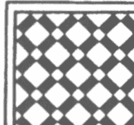

一组三部分组成的马赛克镶放在宴客厅入口——中间是一块长板绘有“狄尼索斯的胜利”，两侧各配有一块较短的板，绘有“双子座神”。对其内容的研究可以洞察马赛克构图的过程，以及这种主题组合对观众（即居民及其宾客）产生的预期效果。狄尼索斯游行的参与者值得仔细研究，因为从个体来看，他们揭示了工作坊生产的某些方面；而合在一起看，帕福斯胜利图中的人物证明了模型书籍中图形设计的使用。

学者们对于马赛克图像的确切来源存在争议。许多人支持这种观点，即库存图像通过模型书籍从一个工作坊流传到另一个工作坊；另一些人则认为使用的是设计师为了自己使用而汇装的底稿或绘画。¹

### 注释

> 1. 近期的学术界以新的兴趣关注了马赛克艺术家的技巧。在达霍利（Dapholi）的一处邻近房屋发现的奥菲斯马赛克促成了 J. Michels 对奥菲斯马赛克的研究，他证明了8世纪奥菲斯马赛克示例之间的共同特征和某些失误，证明了抄本的存在（1960年代；见480-7页）。早期的 C. Dapholi 对这个问题进行了有趣的探讨，通过追踪出现在居住卷轴纹样中的特定物种动物、鸟类和植物的描绘频率；她对一组公元4世纪至7世纪的116块地板铺进行了分类统计，并得出结论：高比例的相似描绘可以解释为在图案书籍中的主题（1978, 400页——结果是由于粗心的复制或对模型的误解，这为艺术传播提供了证据）。尽管某些差异不可避免地由于工匠的局限性，但某些修改反映了设计师、其工匠与模型之间的动态相互作用。帕福斯胜利图包含了11个人物，其中几个人在任何其他马赛克中均未见记载，为模型的执行提供了一个宝贵的测试案例。

> 2. Balme 和 Dargon 回顾了关于马赛克工作坊组织，特别是被称为 `pictor`（画家）的设计师和被称为 `tessellarii` 的镶嵌工匠的铭文和文学证据；其他观点请参见他们文章随后的讨论，48–49页。

> 3. Mat II, 222, 列出了13幅狄尼索斯马赛克及其相应的参考文献。其他元素列于以下研究中：Dunabun 1979；Dunabun 1978, 181–82；Foucher 1975, 55–61；Blanco Feixeiro 1953, 279–36；以及 Almeida 1975, pl. 31, 3。还发表了一块来自阿尔及利亚塞蒂夫（Setif）的帕福斯马赛克。在最详尽的狄尼索斯表现列表中，请见 Auge 1986, III.1, 527; no. 10，以及 III.2, 418。

> 23. art.40–8. 在对君士坦丁堡大宫场景的分析中，J. Trilling 将模型书籍作为这组基于古典图像的来源（1989, 37页）。关于相关的微型装饰艺术，T. Stevenson 得出“这些条件是必不可少的”，并假定副本的广泛存在是解释有限主题库能够持续下去的逻辑方式（1985, 199页）。另一方面，P. Brunje 拒绝了每位艺术家都创作此类收藏的观点（1984, 见269–72页）。Balme 和 Dargon 也否认了模型书籍的使用，他们主张一种更具轶事的传承方式，即从师到徒的传承，代表247页。

本章的第二部分考察了双子座神（Dioscuri）可能的意义和功能。由于马赛克并不不寻常；它们通常不会作为狄尼索斯式条纹的悬挂物出现，也不会作为接待室的主题。这些板材的放置似乎是工作坊的一种创造性表达，提醒我们某些主题可以通过它们的物理接触被赋予意义。

“狄尼索斯的胜利”是该房屋命名的两幅狄尼索斯马赛克之一，它被显著地放置在房屋主要接待室的入口处（I室，图119），并与同名的画板——即西侧门廊中绘有狄尼索斯和伊卡洛斯的“酒之入”（图184）处于轴线线上。胜利图位于一个长条形板单元中，它与两侧的双子座神板共同构成了T型装饰的横梁，这是罗马餐厅室的标准配置。

“狄尼索斯的胜利”其图像学源自古代艺术中经常被描绘的主题之一。这里大部分人物是出现在一系列罗马石棺上的原型。这些相同的狄尼索斯类型的更简单版本出现在远至葡萄牙（波尔图阿尔马 Port de Palma）和安提俄的25块地板马赛克上，但除了一块来自阿尔及利亚（塞蒂夫）的马赛克外，这些都是标准化产品的创作，似乎最终源于石棺上发育更完整的类型。³ 在石棺的图像学库中，帕福斯人物的平行作品最可能可以找到。尽管无法建立胜利小组每个成员的谱系，但浮雕展示了一种视觉公式的集合，概述了人物类型在传承过程中发生的发展、解释和误解。对这些平行作品的研究可以阐明马赛克大师以及雕塑家的工作实践，并为识别水平、赞助和象征意图提供标准。

在考虑整个构图之前，我们将单独观察胜利图的每一个成员。在帕福斯，狄尼索斯和他的主要群体位于中心，这与神灵最后或先出现的常规安排不同。他坐在一辆由豹拉的车上，由一个提着大瓮（`kraterphor`）的酒神引领（图120）。从左侧向中心的成员包括：手持提罗斯斯（`thyros`）的迈娜；拿着酒碗的迈娜；以及跳跃的色留人。从右侧向中心的成员有：吹奏双笛（`aulrios`）的酒神；另一个被束缚的色留人；带着镲器（`cymbalria`）的迈娜；以及第三个跪在神灵前的色留人。由于两侧的框景人物和几个人物转向内侧，游行的印象被削弱了。尽管马车小组和几个人物向右移动，但整个构图实际上是静态的，并以宴客厅入口为中心。板材的放置及其作为T型宴客厅横梁的功能影响了胜利图的形式安排，使得神从（`thiasos`）的成员面对访客。

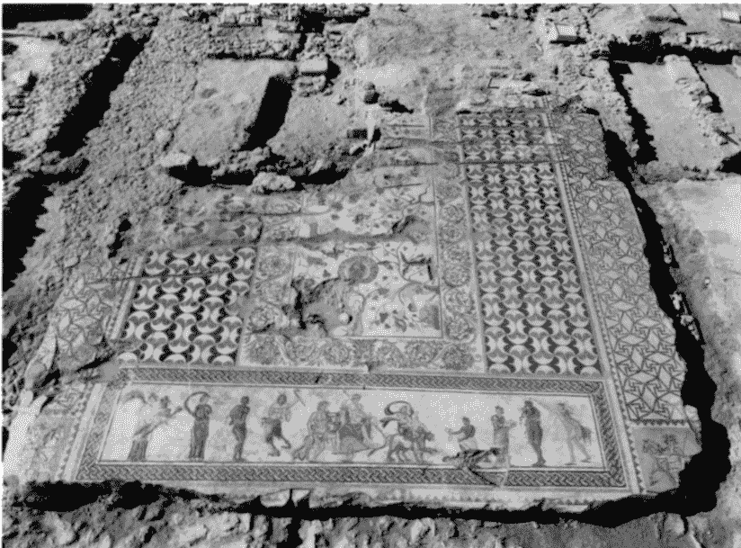

图119 狄尼索斯的胜利，宴客厅（由塞浦路文物部提供）。

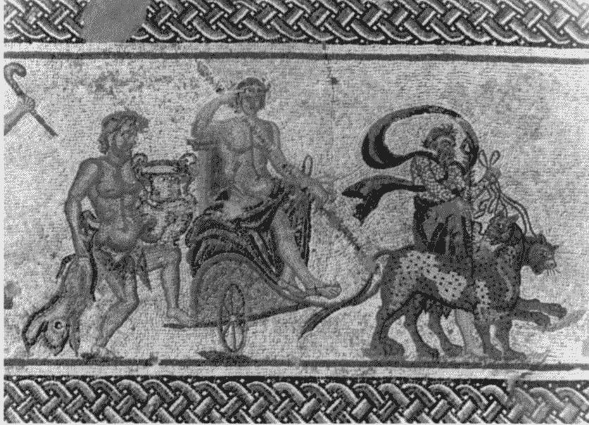

图120 狄尼索斯的胜利，狄尼索斯细节（由塞浦路文物部提供）。

F. Matz 在对狄尼索斯石棺的研究中，将印度狄尼索斯胜利的表现分为三个主要大类：最大的是“豹/虎胜利”系列，其中豹或虎是神车的动物；“半人马胜利”系列，半人马（通常吹奏乐器）拉着车；以及“大象胜利”系列，融合了豹和半人马胜利的特征。

### 生活与美酒

#### 注释

4. 有关胜利石棺的完整目录及相关信息，请见 Matz I, II, III 和 IV。此处列出的大多数示例源自 Matz 在 II 中区分的四种主要版本：带有站立狄尼索斯的虎车（212–44, nos.94–104B，以及 Matz I, 165–66, nos.58–58A）；带有站立狄尼索斯的半人马车（245–66, nos.105–29，以及 Matz I, no. 59, 16）。

狄俄尼索（Dionysos）可能以三种类别出现：坐姿、躺姿，并在人马形象可能与他的伴侣阿里阿德涅（Ariadne）一同出现。帕福斯胜利图由于其中心合唱组似乎属于豹系列，但实际上它是一件拼贴画。队伍中的十一个成员源自这三个组。

左侧第一个人物是俄底亚（`maenad`），她左手拿着俄留斯杖（`thyrsophor`），右手拿着一个性质不明的物体（彩色图2）。她头向左转，仿佛在看着一个预言性人物，身穿绿色长袍和长袖佩普斯（`peplos`），长袍从肩部飘起，表明她正在向前移动。她的头发梳成“平顶金字塔头巾”样式，并装饰有常春藤和葡萄叶的花环。这种发型在二世纪后半叶非常流行，与石棺和马赛克上同类人物的长波卷发明显不同。这基本上证实了，在与帕福斯马赛克构图和主题最接近的胜利棺合唱组上发现的标准领先人物。石棺上引导队伍的雕刻俄底亚以其精美的褶皱为特征；她们向左倾斜或转动头部，都显著地向后倾斜地拿着俄留斯杖。紧随其后的是坐在战车上的狄俄尼索，他右手拿着一根俄留斯杖，某些情况下指向前方，这种姿态暗示权杖各自的位置很容易被混淆。

带有站立姿狄俄尼索的大象战车（267–78, 编号130–41），以及人马马车类型中躺姿或坐姿的狄俄尼索（279–300, 编号142–60）。另见 Turkish 1966, 238–49 和 441–72；以及 Lehmann and Abbey (1942, 12–13, 26–35，用于图像学解释，以及 70–72；McGann 1978, 86–93, 编号95–99）。

5. Levi 1947, 529 讨论了这种发型与来自兰拜（Lambais，由 Aspagnis 创作）的日期提亚斯（`thiasos`）的关系，这被用于确定狄俄尼索胜利之家大理石提亚斯的年代。Levi (1947, 529) 将战车与公元160年左右马可·奥勒留的母亲狄俄尼西亚·露西娅（Dionysia Lucia）肖像联系起来。

6. 每个俄底亚形象的种类源自俄留斯/豹系列：Mars II 系列，编号16（Rahm, Woburn Walters 艺术馆）；编号96，图126（罗马, Casolino Rossiani）；编号97，图122.2（罗马：卡皮托利诺博物馆）；编号98，图121（罗马，朱斯蒂尼尼宫）；编号99，图124（Clivened）；编号100，图126（沃伯恩修院）；编号101，图127（里昂）。其他的源自人马系列（编号105，图134，此处位于梵蒂冈，贝尔德宫）和大象系列（编号141，图158，罗马，帕姆菲莱别墅）。

7. Mari，45型，第37页，以及47型，第38页。这些名称是 Matz 给出的标记，对应于狄俄尼索形象的不同解释。45型是 `trophopaios`，47型是 `likophoros`。

8. 例如，Matz II，编号95，图116，以及编号99，图124。

9. 关于涉及利克农（`liknon`）的最佳插图，见来自巴克斯之家的杰米拉（现位于阿尔及利亚杰米拉博物馆）的2世纪马赛克；Dubna 1978, 75–79, 256, 图17。

# 三联画入口（The Threshold of the Triclinium）

在发现于金宫（Domus Aurea）画作的16世纪水彩画（Francesco d'Olanda，Escorial 手稿）中，一个圆锥形（无疑是一个阴茎，她穿着白色外套，被一条头带环绕，并放置在两个少女携带的利克农中。¹⁰ 该场景似乎是利克农中的入教仪式，利克农和西提（`cista`，圣盒或篮子）被清晰地区分开。¹¹ 一些学者将 Paphan 手持物体鉴定为西提，这是极可能的，因为在狄俄尼索场景中，它们通常被放在地上，很少被手持；西提通常装有蛇。¹² 在头顶携带利克农的惯常方法已在石棺和马赛克的许多例子中得到证实。¹³

在来自塞提夫（阿尔及利亚）的一幅卓越马赛克（图121）中，它与沃尔特艺术馆的胜利石棺（图122）密切相关，一名少女拿着一根俄留斯杖，头顶放着装有几个物体的利克农。¹⁴ 其中一个是灰色的，似乎与之无关，表明它是用金属（银）制成的，是一个带有底座的截圆锥。帕福斯的物体没有完全的对应物，可能是工匠制作了一个阴茎插入物，将 `thyophoros` 的功能与 `likophorus` 结合，最初在密教（`mystai`）的等级顺序是不同的。¹⁵ 马赛克和石棺上带有阴茎的利克农出现，表明该物体保留了其象征意义。¹⁶ 在帕福斯的马赛克中，该物体已不再被完全理解。

还有其他少女拿着俄留斯杖和利克农的例子；出现在石棺和马赛克上，但它们与胜利图并没有严格关联。二世纪中期的狄俄尼索仪式（Dionysiac Process）

并放置在一个低矮的正方形底座上，类似于帕福斯俄底信女所持有的那种。²⁰ 与这一此前前所未有的祭坛相对应的有趣伙伴出现在位于新帕福斯的艾翁之家（House of Aion）的三餐室马赛克中，它距离我们的狄尼俄斯之家几百米（图124）。²¹ 在这幅极其大胆的马赛克中（年代追溯到4世纪第二季度），狄尼俄斯由一对半人马牵引。酒杯（`retine`）由画面右侧的一位俄底信女持有，她拿着一个橙棕色、带有蓝色条纹的锥形物体（可能是箭囊？）。²² 在如此邻近的房屋中引导凯旋巡游的俄底信女手中持着两个锥形物体，这很可能并非巧合。²³ 如果我们接受杰麦姆（Jem）的锥形物体是相关的，那么这三种表现形式就证明了狄尼俄斯秘仪（`retaileai`）中的一种神圣物品。

与其伴侣的仪式性质形成补充的是，狄尼俄斯之家中的随行者（`nextacchante`）右手持一个奠酒碗，左手举起去拿它（彩色图版2）。我们看到她穿着一件短袖红色长袍（`chiton`），从腰部到小腿处包裹在一件绿灰色的外袍（`peplos`）中。在表现运动的常用技法下，她的外袍部分向外摆动，在她面前形成了一道弧形。她短剪的发型很奇，可能反映了试图复制持灯具祭司（`thymierion`）经常戴的紧身头帽的失败尝试。根据石棺上的佐证，那名祭司也将灯具握在右手掌中（图122）。这些灯具的形状可能被误认为浅碗。

对于这种奠酒仪式，一个具有启发性的对比出现在安提俄克狄尼俄斯之家的凯旋图中，其年代为晚期安东尼时期或2世纪第三季度（图125）。²⁵ 尽管安提俄克的这幅凯旋图只残存了不到一半，但它对我们理解帕福斯人至关重要。在安提俄克的五个残缺人物中，其中一个高高举着双口杯（`kantharos`），其姿势与帕福斯的俄底信女一致。由于只残存了手和双口杯，很难从这处对比中得出更多结论，只能说该图像在狄尼俄斯凯旋的背景下提供了一个平行案例。

在帕福斯，奠酒者的姿势固定在一个皮肤呈灰色的裸体男性身上，他双腿交叉，双手用绳子反缚在身后（图126）。结合巡游中发现的另外两个深色皮肤男性，他能得到最好的理解。其中一个站在画面的远端，双腿交叉，右手被一根长长的灰色绳子系住（图127）。他将这只手举向额头，做出顺从或痛苦的姿态，而他的左手似乎叠在肩膀处露出的黄色斑点皮肤上，这些人正伴随狄尼俄斯凯旋归来。

这些被束缚的男性无疑可以被确认为凯旋石棺中的印度俘虏。这两个俘虏有几处相似之处，尽管他们通常作为一组出现。安东尼时期的一系列早期凯旋石棺其特点是没有戴冠的随从者（`thiasos`），并包含了对被缚俘虏的详细描写。26. 在这一幅画自大象和战车凯旋版本的图中，俘虏是裸体，双手像在帕福斯那样被固定在背部（图 128）。

将俘虏表现为站立群体的公式，与俘虏坐在载满战利品的大象骆驼上的公式不同，后者在凯旋图中很常见……图 129。

## 世俗与神

- 20. 当在阿波罗和阿尔忒弥斯的场景中发现形状类似的物体时，它由贝托（`baetos`）持有并与阴茎有关；参见 `DarSag, s.v. baetylia, 1.62–27`。这种物体出现在阿西西博物馆之家（`Domus Musei`）的一幅奥古斯塔时期绘画中，由一对格芬狮牵着的车车；参见 `Guarducci 1979, 28, no. 6, p. IV`。

- 21. 描述和插图，请参见 `Daszeswski 1985, 24–27`，彩色图版 3–4，但作者并未识别该锥形物。

- 22. `Daszeswski` 和 `Michaelides` 都将该物体识别为箭囊，但没有解释在狄尼俄斯图像学中的任何相似之处；参见 `Daszeswski and Michaelides 1988b, 66`，以及 `Michaelides 1987a, 31`。

- 23. 有趣的是，这两个物体都是用暖色调制作的，可能是为了模仿木头；在狄尼俄斯之家，作品是红棕色的。

**图 123.** 杰麦姆，狄尼俄斯巡游之家，三餐室巡游细节（巴尔尔多国家博物馆捐赠）

**图 124.** 帕福斯，艾翁之家，狄尼俄斯凯旋面板细节（`C. Kondoleon` 拍摄）

三餐室门槛 199

**图 125.** 安提俄克，狄尼俄斯之家，狄尼俄斯凯旋细节（后 `Levi`，图版 16c）

**图 126.** 狄尼俄斯凯旋，灰肤男性细节（塞浦路斯文物部捐赠）

**图 127.**（带有顺从姿态的被缚男性）

**图 128.**（双手背后的俘虏）

**图 129.**（群体中的俘虏）

- 24. 有趣的是，这两个物体都是用暖色调制作的，可能是为了模仿木头；在狄尼俄斯之家，作品是红棕色的。

- 25. 尽管安提俄克的这幅凯旋图只残存了不到一半，但它对我们理解帕福斯人至关重要。

- 26. 安东尼时期的一系列早期凯旋石棺其特点是没有戴冠的随从者（`thiasos`），并包含了对被缚俘虏的详细描写。

- 27. 将俘虏表现为站立群体的公式，与俘虏坐在载满战利品的大象骆驼上的公式不同，后者在凯旋图中很常见……

- 28. 关于巴提摩石棺对失传绘画的依赖，参见 `Lehmann and Olsen 1942, 72`，以及 `Ward-Perkins 1975–76, 213`，他称其为“原作的非常接近的复制”。

- 29. `Matz II, 248–49, no. 105`（梵蒂冈，贝尔维德收藏），图版 134.1。

…… 那些深肤的印度人。在狄尼索斯（`Dionysiac`）石棺的宝库中，其姿态最接近的对比是罗马一尊早期塞维里王朝时期胜利石棺上的一尊羊人（`satyr`）形象：他跪在一头载满货物的大象前，手里拿着酒器（图 130）。^30 他打破了行进的节奏，无疑是一个借用自其他狄尼索斯场景的人物.^31 与帕福斯的塑像一样，尊雕刻的羊人仅围着一条腰裙，单膝跪地，另一条腿弯曲支撑。在图像学上，跪着的俘虏的形象让人想起被征服的野蛮人向俘虏者臣服的动作，这种表现出现在精美的帝国艺术中.^32 毫无疑问，罗马胜利艺术的形象丰富了狄尼索斯巡游的宝库，而反过来又滋养了官方艺术。

另一个狄尼索斯场景中的参与者是一个调顽皮的潘（`Pan`）。在帕福斯，他位于左起第四个，明显比其他人不那么生动（图 119 和彩色图版 2）。他用羊腿跳跃着，蹄下方的阴影强调了他离开地面的距离。他右臂跨在胸前，拿着一根拉加波隆杖（`lagabolon`，牧羊杖），左手紧握着盾牌。他长着角，留着胡须，穿着崇拜所用的斑点兽皮（`nebris`）。在带有虎/豹战车的巡游系列中，他总是被表现为狄尼索斯战车的领路，正牵着缰走出来（图 122）。^33 他经常穿着皮衣，手里提着牧羊杖。这种类型的潘在安提奥克的巡游马赛克中扮演了不同的角色（图 121）。^34 在这里，他右腿抬起支撑着一个巨大的金属双口杯（`kantharos`），非常像一尊羊人持壶者（`kraterophor`），并与帕福斯巡游中的第五位成员相似。然而，他醉醉的眼神、跳跃的羊腿和蹄子、他的胡须和角，都符合传统的潘模型。尽管安提奥克和帕福斯的潘形象都包含了虎/豹战车组，但它们并不符合描绘这一版本巡游的雕塑家和其他马赛克艺术家所使用的模型。

半马人巡游中的跳跃的潘不需要领路，因为半马人会引导自己.^35 在这些巡游中，潘通常处于醉酒状态跳舞，边跳跃边旋转扭动。博物馆石棺上的潘（图 133）在跳跃时击中了一个腰鼓（`tympanum`），而这个物体在原本可能是一个不协调的盾牌。在临摹过程中，工匠误将潘的盾牌画成了腰鼓。这可能是被误解了，或者是因为他们不熟悉潘的属性。这种假设得到了二世纪罗马浴室的伊斯斯米亚黑白马赛克中类似错误的支持，在那儿，描绘了一个海神（`triton`）提着一面巨大的盾牌，而不是海洋巡游队（`thiasoi`）中通常携带的腰鼓或鼓（图 132）。^36 对帕福斯马赛克这一点的评价不应过于严苛，因为带有腰鼓的跳跃潘非常罕见；

在石棺上许多跳跃的潘之间，放置着神秘匣（`cista mystical`），其盖子露出了内部的蛇（图 131 和 133）。如此多例子的一致性似乎表明某种特定的仪式动作——事实上，潘化身为普里阿普斯精神（`Priapic spirit`）——或者是一种将注意力从崇拜的女神引向神秘匣的艺术手法。在安提奥克的马赛克（图 125）中，神秘匣位于一名女神和西勒诺斯（`Silenos`）之间。虽然这些马赛克中的两个跳跃的潘在雕塑中有相似之处，但它们要么不是直接模仿上述任何一种类型，要么是脱离背景借用的。在安提奥克马赛克中，人物的独特性显然是出自一位才华横溢且具有原创性的艺术家之手，而在帕福斯，这些特性的似乎是随意的。

潘右侧的一尊羊人抬起左腿举着巨大的蓝色双口杯，左脚踩在战车背上，身后拖着一个灰色的酒皮袋（图 120）。他结合了新雅典艺术风格浮雕中持壶者（`kraterphoros`）的经典角色（在浮雕中他抬起左腿出现），以及肩上扛着装满酒皮袋的负水者（`askophoroi`）。^38 在列出的二十个负水者/持壶者例子中，没有一个包含在豹胜利巡游组中，但有几个出现在半马人巡游系列中。狄尼索斯旁边脚踩在战车上的羊人也将帕福斯组与半马人系列联系起来，因为所有这些形象都将一个跳舞的狄尼索斯与战车里的羊人结合在一起.^39 在这些情况下，羊人（有时拿着一个双口杯，图 133）倚靠在同伴身上。^40

半马人战车与醉酒的狄尼索斯及羊人之间存在几乎排他的关系，无论主题是胜利巡游还是阿里阿德涅的发现。

**世俗与神圣**

抬起弯曲腿并举双口杯的羊人形象出现在两尊断于二世纪前六年代的石棺上，可能来自同一个作坊（其中一尊见图133）。^41 这两尊也都包含了跳跃潘，但这是它们与帕福斯巡游的唯一共同点。这些石棺通过由羊人支撑的狄尼索斯与包含俘虏群以及跳跃潘的胜利场景相关联（图 128）。^42 在帕福斯，豹战车与持壶者、跳跃潘以及俘虏群相结合，它们最初都是半马人胜利巡游组成的一部分。在某个时刻，在创作帕福斯马赛克之前，在安提奥克马赛克中发生了某种融合：豹战车、羊人支撑的狄尼索斯、以及单独出现的潘。尽管安提奥克马赛克包含了跳跃潘的组，但它们并不符合描绘这一版本巡游的雕塑家所使用的模型。

- 37. `Matz I, 64, type 111`, and `Matz II, no. 92, pl..121,1; no. 84`.

- 41. `Matz II, 247–50, no. 106, pl. 144.2`, and `no. 107, pl. 145,1`.

- 42. `Matz II, 255–56, no. 115`, and `269–71, no. 130, pl. 158,1`, dated ca. `A.D. 150` on stylistic grounds.

可以认为是原始作品的一部分。它们包括由人马牵引的大战车的人神/狄奥尼斯组合；醉酒的赫拉克勒斯或西莱诺斯被支撑着并骑在驴上或驴拉的车上；带有小爱神骑者的狮子或豹子；以及吹笛手；以及一个跳过圣篮的潘神。

人马花卉纹似乎是哈德里一时期或安东尼王朝早期的创新；证据是费兹威尔廉姆石棺（图 131），它被认为是石棺上关于“凯旋”最早的描绘之一.^44 `Matz` 认为，“被支撑的狄奥尼斯”组合是哈德里一/安东尼王朝时期的发明，因为没有任何希腊化时期的模型属于这种类型，而二世纪中期的青铜质奖章首次描绘了这种类型.^45 石棺上出现的所有位于战车中的狄奥尼斯类型都出现在奖章上，但并不一定以相同的组合出现。不难想象，构图的组成部分——例如在人马双战车中的坐姿狄奥尼斯，或在豹战车中带有胜利女神的站立狄奥尼斯——是如何可以替换的。一枚安东尼青铜奖章（139）提供了从“人神支撑的狄奥尼斯”公式向“豹拉战车中的直立狄奥尼斯”迁移的最早例子.^46 在这一奖章上，一个赤裸的狄奥尼斯靠在他的同伴身上，同伴站在由潘引导的豹拉战车中，这种设计在帕福斯结合了两种构图元素。

人马的存在可以从两个角度来看：要么是某些人马上跳跃的持壶者（`kratephoros`）扭曲动作的简化正面版本，要么是新亚提卡类型与豹战车组合的原创性此类结合。后者得到了二世纪中期一处“人马凯旋”石棺碎片上出现的新亚提卡式人神的支持。

^43 所有这些元素包含在第一组追溯到安东尼王朝早期的人马凯旋中；参见 `Matz I, 140; 67–69, no. 59, pl. 69`；以及 `Matz II, 255–256, no. 115, pl. 132; 256–57, no. 116, pl. 135.1, 135.1`。

^44 `Turcan 1966, 140; Matz II, 263–67, no. 129, pl. 144.1`，根据风格判断，定于公元 145 年左右。

^45 关于这些奖章的讨论请参见 `Matz I, 68–69, type 116, fig. 14a-f`；以及 `Matz II, 245–47`。

^46 `Matz I, 68–69.263, fig. 1b`。

# 世俗与神圣

图 134. 柏林，国立博物馆，凯旋石棺碎片（后 `Matz II, pl. 184,1`）

现位于柏林（图 134）。^47 人神在左腿支撑平衡的同时，抬起并弯曲右腿，肩上扛着一个大水瓮（`krater`）。虽然所有其他人物围绕坍塌的驴车形成了一个连贯的向心群体，但持壶者却背对他们，与动作无关。持壶者的这种离散功能也可以在葡萄牙托雷德·帕尔马（`Torre de Palma`）的一处省级凯旋马赛克中找到（图 135），定于四世纪.^48 在面板的右侧，一个人神（？）单脚站立，另一条脚抬起，面对迎面而来的行进。在这里，石棺上，他显然被移出了原始序列，或者说是从模型中摘取的，也许是以草图的形式存在的，包含了孤立的类型。持壶者始终与人马凯旋系列相关，但在该版本和其他版本的凯旋马赛克中，他却与豹/虎公式相关联。^49 因此可见，少数扩展到战车组之外马赛克凯旋——法老、安提奥克和葡萄牙凯旋——融入了创新与冲突。在这三者中，安提奥克马赛克最为复杂，而葡萄牙面板所表现出的拙劣与冲突可能倾向于一种更理想的

> 47. 这个人物被认为是人马凯旋的一部分，因为 16 世纪 `Mazzolini` 的一幅画作包含了狄奥尼斯的战车；`Matz II, 97–98, no. 157, pl. 18.1` 和 `pl. 18, 3`（16 世纪画作）。另见一处大象凯旋，其中持壶者被放在行进队伍右侧，背对靠近群体并抬起左腿；`Matz II, no. 139, pl. 160`。`Almeida 1975`；以及 `Blazquez 1980, esp. 125–32, fig. 2`；关于其年代请参见 146–48。

49 例如，请参见来自苏斯的阿塞纳尔之宅（维吉尔）的凯旋马赛克；`Dunbabin 1978, 182, 269, no. 120, pl. 182`。该人神除披着豹皮斗篷外赤裸，其左肩扛着一个大水瓮。

## 三人室（`Triclinium`）的门槛

持壶者出现在帕福斯的豹战车上，这再次说明了组装和重新组合元素的偶然性（`ad hoc`）。尽管狄奥尼斯随后出现，为了完成对他的讨论，我们将最后处理他。在帕福斯，狄奥尼斯是领队（fig. 120）。秃头胡须的人神位于背景，牵着野兽，左手拿着缰绳，右手持一根冬青杖（`thyrsos`）。他穿着一件带斑点的衣服，披着红粉色的斗篷（`himation`），斗篷在头上方盘旋。^50

> 50. 在葡萄牙马赛克的一些例子中，包含了一个人神支撑的狄奥尼斯和一个战车中的坐姿狄奥尼斯，这种组合与战车脱节，位于面板左侧。

51. 这种穿着长袍、腰间围着斗篷的人神出现在坎帕尼亚的一处浮雕上，描绘了圣篮的启示和男根符号；参见 `Nilsson 1957, 88, fig. 18`。

世俗与神圣

在服饰和性格上，与豹战车系列中的人神一致，他位于行进队伍的末端，站在狮子旁，手持冬青杖。^52 尽管豹系列中的某些石棺引入了细微变化，但它们惊人地一致。只有当雕塑家将豹公式与其他版本融合时，结合大象拉战车，才产生了一种精细且复杂的构图，即波士顿美术馆的凯旋石棺.^53 这种新阐释的活力位于人神抚摸狮子鬃发的细节中。^54 站在狮子旁的人神仅可见腰部以上，他是阿福斯，这仅仅是豹系列中位置的倒置。^55 类似的变换出现在佛罗伦斯的人马凯旋中（fig. 128），其中人神在塞美勒（`Semele`）战车后方牵着这对豹行走。^56 在这块石棺中，人马和豹的传统被结合并重新调整。人神处于了序列之外，站在战车旁，用他握冬青杖的手势来引导。在其他三个实例中，人神参加战车群体，但在其中任何一个他都不是阿福斯。狄奥尼斯出现在突尼斯埃杰姆（`El Jem`）的一处地板上，与狄奥尼斯和胜利女神同乘战车；在帕福斯的豹群靠近战车中。

52. `Matz I, 58, 79`，其中引用了23个持冬青杖的人神例子。这种类型用于早期石棺，似乎并非华尔特艺术馆凯旋或其来源的发明。

53. 波士顿美术馆石棺根据铭文定于公元 215–225 年：威尼斯圣篮、豹人马公式是潘跨过圣篮、由面纱支撑的赫拉克勒斯以及跳舞的笛手。其他细节借自豹子系列。

54. “抚摸”的概念源于华尔特艺术馆凯旋中人神骑着狮子的方法。

55. 关于豹公式中“人神与狮子”单元的例外，请参见 `Matz II, no. 139, pl. 160`，在该图中人神被放在大象战车前，随后的狮子被缩小到微型比例，几乎被大象踩踏。

56. 在这块石棺中，人马和豹的传统被结合。

77 `Matz II, 255–56, no. 115, pl. 135-2`。

58 关于埃杰姆马赛克，请参见 `Dambin 1971, pl. 13`，根据风格判断定于公元 250 年左右。对于波图马格斯（`St. Leu`），现考古博物馆，或 `ibed., sl. 56, pl. 16b`，其根据风格判断定于四帝时期。

阿尔及利亚。58 在任何情况下，这种安排都不与帕福斯（`Paphos`）的相似，除了西莱诺斯（`Silenos`）与战车的密切联系外。

第三个西莱诺斯源自大都会博物馆的一件银色浅盘柄，年代追溯到安东尼王朝或奥勒星时期，他提供了最接近的平行对照，即他走在豹子旁，因此像在帕福斯的形象中一样，只能从腰部以上可见。59 大都会博物馆的西莱诺斯拿着一根带有三个植物特征的树枝，可能是一个类似于帕福斯酒神狄绪索拿着的那种`thyrsos`（神杖）。事实上，银浮雕描绘的豹子战车与帕福斯中心战车组的四个人物提供了最接近的对比。除了西莱诺斯外，豹子群还包括一个潘（`Pan`）和一个刻有象牙獠牙的半人妖，他们在姿态和功能上都与帕福斯的对应物非常相似。潘的举起左腿，目光看向右侧，正如在帕福斯那样（尽管版本更粗糙一些）。消瘦的面部、胡须、角和强烈的眼睛与安提奥克和帕福斯的潘非常相似——只是更粗糙了。银色战车由一个拿着`lagobolon`（犬鼬棒）的半人妖引导。狄绪索保持站立，手握缰绳，正如马赛克画表现中那样。60 为了永恒，帕福斯的艺术家将走在狮子旁的战车领路西莱诺斯与牵着被缚野兽相结合。

到目前为止，整体印象是，帕福斯胜利图并非简单地遵循某一种模式，或重新构图了某个著名的原作。这一观点通过最后检查的三个人物得到了证实。除了中心人物狄绪索外，组中的另外两个成员是跟随跪地俘虏的`cymbalista`（钹手），以及结尾人物——一个向左面对群体的`aulistos`（管师）或吹号手（图127）。他们都源自新亚提克原型，且在雕塑和绘画表现中通常是酒神随从的成员。61 然而，这两个人物中没有一个被与石棺或马赛克上的胜利图人物进行完全对比。穿着长绿色`chiton`（基顿）和灰色`himation`（外袍）的女神回头看向肩膀，以一种经典的姿态举起钹手，这种姿态在安提奥克的几处马赛克中是平行的。63 她最接近的对应物[注：文本似乎被切断或在后续继续]

59. `Alexander 1995`；以及 `McCann 1978, 88, fig.` 参见。另见 `Mainz II, 221n.37`，该文暗示银质柄可能是伪品。

60. 关于这种安排的马赛克示例，请见 `Dunabin 1971, pl. 12` (Sousse, House of the Arsenal/Virgil), `pl. 138` (El Jem, House of the Hunt), 以及 `pl. 15b` (Saragossa)。

61. 关于安提奥克的管师，请见 `I, 44b, 54b`，其中他被描述为肩上披着一层薄皮，赤裸侧身行走，头上戴着皇冠或花环；对于钹手，请见 `I, 31, 30b`，其中她被描述为穿着`aiton`（短袍）和`himation`（外袍），双手持钹，向右走同时向左转。

62. 男性吹号手出现在 `Mars III, no. 213–14`，均属于狄绪索与阿里德涅的胜利图。关于胜利游行中的男性吹号手和`cymbalistria`（钹手队），请见下文从罗马讨论的`tenemus`（长器）。

63. 安提奥克有两个例子，一个是哈德良时期的，来自凤凰之屋（`House of the Phoenix`）下层，现藏普林斯顿；另一个是塞维鲁斯时期的，来自波耳修斯走廊和

# 212 世俗与神圣

胜利场景是`tympanistria`（击鼓乐手），但它们显然基于两个不同的模型。在任何胜利图的表现中都缺失管师和钹手，但在帕福斯中却存在，这支持了以下假设：工匠们根据中间模型（草图）进行创作，这些草图将脱离原始语境的元素组合在一起，并随心所欲地重新排列。

狄绪索在他豹拉大车中的核心地位，强调了通过其他帕福斯游行成员的表现所已经确定的内容。他坐在绿色垫子的椅子上，脚踝交叉，除了大腿上缠绕着红色缘边。他的头戴着常青藤，呈四分之三侧，以便所有人看到他醉醉的目光。这种慵懒的情绪通过他右臂搭在头上的吕凯俄斯姿态（Lykeos pose）得到了强调。蓝色的玻璃`神杖`随意的向后倾斜在他的左手中，左手按在膝盖上。

在这一切中，狄绪索对应于第三世纪后半叶在豹战车中斜卧或坐姿的形式（关于多里亚宫的示例，请另见 136）。64 豹子的姿态——一只回过头看向狄绪索，另一只面向前方——也出现在这组石棺中。65 飞跃和坐姿的狄绪索比三世纪中期更早，正如硬币和奖章所证明的那样。66. 吕凯俄斯姿态的卧神石棺更常与神婚礼中的阿里德涅联系在一起，年代追溯到二世纪后半叶。67. 帕福斯狄绪索一个奇特的特征是右臂，即在吕凯俄斯姿态中举起的那一只，位于一个柱形结构上，可能是为了指示战车座背。在罗马小型装饰艺术中，许多狄绪索吕凯俄斯的例子，神将空闲的一只手臂靠在支撑物上。68. 这里艺术家所提出的举起的手臂，是在在一件青铜浮雕中看到的，那里胜利被描绘在两层青铜战车上，位于罗马的保护厅。69. 这里同样拉起了狄绪索与阿里德涅的抬起的手臂。

Lee 1947, 54, respect 64. Matt II, 279–80, no. 142, pl. 170a (Villa Doria)); no. 143, pl. 172 (Louvre); no. 145, pl. 171.1 (Palazzo Doria, Rome)—最接近帕福斯；no. 146, pl. 171.2 (Villa Doria Pamphili); no. 148, pl. 168.3 (Rome, Villa Saovia)。

65. 关于豹子的位置，见前文注44。

66. 关于飞跃的豹子，见前文注。

67. 吕凯俄斯姿态的卧神更常与神婚礼中的阿里德涅联系在一起，年代追溯到二世纪后半叶。关于神婚礼中的卧神，请见 Matt II, no. 79, pl. 79.1；no. 80, pl. 86；关于豹系列，请见 no. 81–93。

68. 在罗马小型装饰艺术中，许多狄绪索吕凯俄斯的例子，将空闲的一只手臂靠在支撑物上。关于狄绪索吕凯俄斯的例子，请见 Schroder 1989；

69. H. S. Jones 1926, 179–87, cat. no. 13, pl. 10. 关于另一个狄绪索的例子，请见来自内斯的银色浅盘，现于收藏馆，

70. 关于科林斯硬币，请见 Weinberg 1960, 111–22, fig.

71. 关于狄绪索胜利图，请见阿肖拉拉的海王星英雄（Gozlan 1974, 117, fig. 54, 北室；另见 Waywell 1979, 298, cat. no. 20，其年代约为公元200年）。

## 餐厅室的门槛

狄绪索，但这种姿态并未在石棺上出现。在帕福斯，马赛克画家似乎选择了一种吕凯俄斯类型来表现他的胜利狄绪索，但由于误解或不熟悉这种姿态，为举起的手臂提供了一个支撑。胜利图占据了一幅马赛克画的核心部分，波塞冬举起三叉戟的方式与狄绪索举起`神杖`的方式非常相似。这里同样拉起了阿里德涅的对海洋的胜利更为熟悉，并拙劣地借用了狄俄尼索斯胜利的公式。^72

传统狄俄尼索斯类型的第二个例外出现在安提奥克胜利图中（图125）。^73 狄俄尼索斯的表现熟练且自信，产生了一个具有权威感的正面形象，而安提奥克胜利图中其他保留的成员反映了即兴创作过程的积极成果，即一次成功的去变形。与帕福斯一样，这块嵌板位于宴餐厅（triclinium）的入口，但在安提奥克，游行并不是为了迎接进入者，而是进入房间并面对正在用餐的宾客。

在阿霍拉和杰拉萨的另外两处马赛克——两者都处于碎片状态——包含了狄俄尼斯游行的场景，这些无疑是作为宴餐厅的欢迎面板。它们与帕福斯和安提奥克的胜利图具有风格和构图特征。作为一个整体进行考察，这四幅马赛克胜利图证实了我们对帕福斯胜利研究所得出的结论。来自杰拉萨（跨约旦）的狄俄尼斯饰带被一个精美的花园环绕，其中包含了海洋、缪斯以及诗人与哲人（图137和138）。^74 杰拉萨游行的中心是狄俄尼索斯和阿里德涅躺在半人马拉的四轮车上。与帕福斯和安提奥克其他属于豹子族的东方胜利图不同，杰拉萨的构图属于半马系列。与帕福斯和安提奥克一样，杰拉萨版本并没有严格遵循大型石棺浮雕组中已知的公式。例如，在所有情况下，马车组在游行中心的放置都是独特的，这表明它们的组合采用了类似的即兴创作过程。也许由于位于房间入口的地点需求，在帕福斯和安提奥克，它们位于T型宴餐厅横梁的位置决定了构图的格式。与更中心化的帕福斯地板相比，无法判断，因为杰拉萨的游行向右移动。在安提奥克地板的情况下，右半部分丢失了，尽管保留的地板以四分之三视角面向，给人一种静态且中心化构图的印象。

第四幅马赛克狄俄尼斯胜利图来自突尼西阿霍拉海普顿宅的大型宴餐厅，公元2世纪晚期（图139和140）。^75

> 72. 这一提议得到了在伊斯西米亚发现的一块2世纪黑白马赛克的支持（Parkado 1980），这暗示了希腊工作坊与意大利单色调马赛克作品库之间存在相似性。
>
> 73. 对于安提奥克胜利图，我们现在将其分为几件：位于橙市斯塔克艺术博物馆的十块碎片，最近在艺术市场上又出现了几块。
>
> 74. 这些马赛克最近出现在艺术市场上，被各种收藏家和机构购买；22块碎片位于柏林国立博物馆。参见 Joyce，她根据其风格和花环边框的装饰，将其年代定在安东尼王朝时期，约公元150年；她将其与来自纳尔基苏斯宅、红地砖宅和狄俄尼索斯胜利之宅的安提奥克马赛克归为一类（1980, esp. 326, n. 56）。

![img/22898a1030288fa55d3b498d879beb37_232_0.png]

*图137。杰拉萨，狄俄尼索斯胜利马赛克，酒神与狂欢女的细节（由 Barbara 和 Justin Kerr 提供）*

尽管它过于破碎，以至于无法判断它是否是一个完整的胜利图，但持神杖的狂欢女、持火炬的酒神、一个强力引导着载有祭祀器皿驴的西勒诺斯，最后是祭坛和神秘匣（`cista mystica`），这些出现强烈暗示了它与胜利游行的联系。由于中心组已丢失，无法确定意图是哪一个胜利系列。然而，人物的排列表明了一种不遵循任何特定类型的类型选择；也就是说，构图并不依赖于某一个模型。

在我们离开北非洲之前，另一处胜利需要我们关注。这块马赛克来自埃...特图拉宅的中心厅（`oecus`，I室）中心……

> 75. Gozlan 1974, 127–29, 图61和62, 宴餐厅 S；以及 Gozlan 1992, 205–8, no. 55，加上面板的两个碎片剩余，保存在突尼斯巴尔多博物馆的储藏中；同上。该房屋的马赛克年代是根据其主题和风格与阿西纽斯·鲁菲努斯宅的相似性确定的，后者通过铭文确定为公元184年左右。在北非洲发现的其他马赛克胜利图都遵循豹子胜利公式。

# 世俗与神圣

![img/22898a1030288fa55d3b498d879beb37_233_0.png]

*图138。杰拉萨，狄俄尼索斯胜利马赛克，狂欢女与潘的细节（由 Barbara 和 Justin Kerr 提供）*

![img/22898a1030288fa55d3b498d879beb37_233_1.png]

*图139。阿霍拉，海普顿宅，狄俄尼斯饰带，细节（由 Barbara 和 Justin Kerr 提供）*

宴餐厅门槛 217

![img/22898a1030288fa55d3b498d879beb37_234_0.png]

*图140。阿霍拉，海普顿宅，狄俄尼斯马赛克（由 S 提供）*

胜利图的流行——特征是异域兽象、长颈鹿、骆驼和老虎/豹，以及印度俘虏——反映了塞提胜利的选择，这些新元素并未被马赛克制作者吸收。事实上，在二十多个胜利图的表现中，吸引的是这些元素的整合。其他马赛克遵循了一条非常有限的路径，以微小的方式减少了差异。由于安提奥克只剩下五个人物的碎片，而那里显然还有五个六的空间，很难得知包含了哪些其他人物。很清楚，俘虏的存在反映了塞维鲁时期的异域风情以及对希腊化模型的意识罗马化。

令人惊讶的是，到安东尼王朝后期，凯旋式（`Triumph`）的两个主要版本已经可以互换。这些变化效果的生动例证可以从康穆德时期（公元177–192年）的作品中看出。现藏于梵蒂冈的一座石棺试图将半人马战车与豹子/老虎的构图融合在一起（图129），但失败了；另一座同样位于罗马（图130），则保留了豹子公式的轮廓。前者在执行上存在大量的误解——例如，两次重复坐在大象上的俘虏似乎在漂浮——这使其成为研究作坊程序的一个具有教育意义的例子。在一种情况下处理是清晰的；而在另一种情况下，不合逻辑的放置和重叠尽管人物有重复，却造成了混乱的表面，但这些错误只能归咎于二流之作。在一个完善的罗马作坊中，工匠有足够的进行新的组合并改造继承的形式，那么一个偏远省份的塞浦路斯马赛为何不能呢？83

如果我们回到三块在风格和构图上提供最相似对比（但不一定在图像学上）的凯旋马赛克画——即安提约、阿肖拉和格拉萨面板——就会对罗马作坊方法产生一种深刻的印象。狄奥尼索的马赛克画家与其在叙利亚、跨约旦河地区和行省领地省的同行者一样，借鉴了整个帝国盛行的模型，但他以一种近乎天才的方式使用了它们；它们虽然不如安提约这座大都市马赛克作坊那样精湛，但远胜于乡村省份。很可能，用于这些马赛克画的模型是由孤立的人物组成的。换句话说，马赛克设计师（`pictor`）可以从各种不再与其传统语境相关的马赛克画中构思凯旋场景；一旦选定，这些内容不能由马赛克画师随意修改。这种过程与产生沃尔特艺术美术馆石棺和塞提夫马赛克画的凯旋图的过程截然不同，后者无疑源于原作绘画的底稿（`cartoons`），在这些情况下，艺术家试图复制他们的构图并忠实地遵循原作。狄奥尼索的凯旋反映了雕塑中一种已知的过程，即艺术家结合形象类型，而不是遵循单一模型。某些主题作为浮雕的发展预示了它们在马赛克画上的出现（至少提前二十年），并为图像学马赛克依赖于雕塑家工作室（主要是罗马的工作室）的产品提供了证据。

狄奥尼索的凯旋表明，关于模型的两种观点可能都是被认为是准确的。84 上述的狄奥尼索石棺上人物与马赛克画上人物之间的相似之处，提议了图形设计的流通。这种媒介与地理位置分散的作坊之间的对应关系，不能仅仅归因于从师父传给学生的形式的“活态遗产”。85 正如遥远的作坊拥有共同的方法一样，凯旋主题本身以及它在罗马家庭接待室的位置，也反映了用于室内装饰的共用词汇。

至于这一主题的流行，似乎到安东尼王朝后期，对罗马凯旋式的庆祝开始与公民宗教仪式融合。这种现象在希腊国家尤为盛行，那里的希腊化精英将皇帝与神性联系起来。86 例如，在弗琉基亚的阿莫里姆发行的卡拉卡拉硬币，描绘了以狄奥尼索从印度返回形象呈现的帝国凯旋。87 许多三世纪的皇帝选择大象作为他们的战车以模仿狄奥尼索。据报道，埃加巴卢斯在他的凯旋式中穿着狄奥尼索的服饰。与此同时，狄奥尼索凯旋图在家庭马赛克中的兴起是完全合理的，因为赞助人（通常是地方名流）渴望展示一系列从他们自己所赞助的公民生活中汲取的图像。

## 双星神面板

双星神（The Dioscuri）出现在狄奥尼索巡行进入寝室（`triclinium`）入口处每个入口的两个面板中。88 这这对双胞神被描绘成全武站在马旁。尽管他们的身体是正面的，但头部以四分之三侧面向狄奥尼索巡行；他们的马呈侧面姿态，一条腿弯曲（图141和142）。每个青年都头戴花环，一只手持长矛，另一只手握缰。出现在每个带桂冠头部后的金色（黄色）星形，使其与卡斯托和波吕克斯的身份识别变得不言而喻。

两个人物都穿着短袖白色束袍，配有粉色围裙，黑色、灰色和赭石色的线条指示了二世纪罗马军团装甲特征性的头盔和金属条。89 一件长袍通过胸针固定在胸前，并垂至膝盖以下。每匹马都装饰有金属马具——`胸圆饰`（`phalerae`）环绕着侧腹，每个脖子下方挂着一个颈圈。

- 83. 欲了解安提约作坊实践的类似观点，请参 Hansmann 1939, 232。
- 84. 关于此问题的近期学术辩论综述，请见上述注释1。
- 85. E. Kitzinger 在 Balmeire 和 Damargo 1986, 24 之后的讨论部分对这一点提供了支持。根据对庞贝“神秘之屋”中5处狄奥尼索浮壁画的最新研究，不寻常的壁画是从库存图像的墙面上组装而成的；见 Clarke 199b, 104。
- 86. 证据主要来自希腊东部的钱币，这些观察基于 Hari 1987, 45–48 的分析。
- 87. 同上，48, 图 18.3。
- 88. 面板在……中简要提到。
- 89. ……的证据（注：OCR文本在此截断/重叠）

## 家庭与神性

罗马军官的使用在几个层面上都有意义。首先，它反映了鲜明的罗马品味，因为在整个古典希腊和希腊化时代，这对双胞神被描绘为英雄式的裸体。事实上，在公元世纪以前，几乎没有他们穿军装的形象。

可能，帕福斯嵌板（Paphian panels）遵循了与亚历山大硬币相同的模式。

当代制服的双生神（Dioscuri）形象遵循了罗马晚期神灵军事化和帝国化的风气，这可能解释了这两个人物与帕福斯房屋中其他神话人物在风格上的差异。95。也许最能证明这种风气的例子是迦加太马房（Horses at Carthage）圆窗处的马匹马赛克，其中许多正方形面板包含这种格纹马赛克；到3世纪初，是一系列由穿着各种类型制服的骑手陪伴的竞技马。96。被识别为火星（Mars）的人物穿着的服装与帕福斯双生神所穿的最为接近。97。迦加太马赛克中还发现了两个类似于双子座的人物，他们穿着弗里几亚服饰——长护袜、短袍和尖顶帽（图143）。98。

在一件公元5至6世纪的埃及带底边的陶质浮雕中，双生神也穿着类似的东方服饰。99。多个双口瓮（`kraters`）的存在（主要是位于盘中青少年中间的大型）以及其他形式，表明了比赛的竞技氛围。双生神与狩猎和马术竞技的联系在迦加太马赛克和展示盘中都有提及，而展示盘上的基督教铭文令人们怀疑这些神灵是否被“赋予”了新的意义，即与基督教的胜利——拯救有关。

浮雕盘的例子清楚地表明，双生神在文化上是流动的。事实上，这两个图像的表征历史表明，其含义取决于所处的语境。101。在帕福斯，嵌板的物理位置——3世纪中叶——位于餐室（`triclinium`）的入口，可能是源于一次狄尼尼索游行，或是邻近3世纪晚期哥达（Gotha）两个陶制双耳瓶上的藤蔓双生神装饰；Gury 1986, III.1, 572, no. 42，同 III.2. 460。

+ 95. 再次，Kantowicz 将这种古代晚期期的发展追溯到埃及（1965, 984–90）。
+ 96. 这些人物包括朱庇特、火星和瓦尔坎（Valcan）；见 Samson 1965, 59–63。
+ 97. 同上, 111, pl. 29, pen. 43。
+ 98. 根据 Samson 的说法，这两个人物构成了一个竞技马名称的场景插画，因为他们暗示了弗里几节的希拉里亚节（Hilaria），不应被视为对双生神的描绘；见同上, 104, pl. 250, no. 21。我发现这种观点不如其他面板的解读有说服力，很大程度上是因为双生神的出现是常态（Humphry 1986, 255, 261；以及 Kitzinger 1991, 11ANN:35–36），且迦加太马赛克中的并非每一个面板都识别为马。
+ 99. 这个矩形盘的碎片现在位于英博物馆；见 Samson 1982, 67–72；图 4, pl. 21, 1–5。
+ 100. 该物体似乎是一个带有三角形山墙的阶梯底座的矩形块；它与玻璃运动图中描绘的区域纪念非常相似：见科尔彻斯特的一个，被模糊识别为亭子/神龛（`aedicule`）(?102 在 Humphrey 1986, 189, fig. 92。
+ 101. 意义的图像，即那些带有多重含义的图像，H. Maguire 的一项研究历史；他的方法对于研究帕福斯双生神很有用（1987, 特尤其是 10–12）。

224 世俗与神性

![img/22898a1030288fa55d3b498d879beb37_233_0.png]

*图143。迦加太，马房，双生神(?)（C. Kondoleion 拍摄）*

罗马双生神在中央面板中以裸体形象出现，没有马，此外还有双口瓮、圆盾盾（`peltae`）和水果。106。尽管这处房主是一个商人，但双生神位于奥斯提亚房屋入口处（107）这一事实强调了他们的主导地位。108。对于平面图，见 Meiggs 1996, fig. 20。

106. Daszewski (Daszewski 1988b, 22) 无条件地遵循了 Geyer 的建议（1977, 128 和 134）。

103. 这种解释是普遍的。

109. 这座房屋中没有表现。

110. 西部有一幅阿芙洛德和波塞冬的绘画，但缺乏此类场景的海特征。

111. 支持这种解释的最常引用来源是 Amm Marcellinus 的描述，他提到奥斯提亚为卡斯托耳和波吕琉克斯举行了祭祀，以便他们平息风暴并让谷物进入港口；见 Meiggs 1960 (rpt. 1977) 343–45。

104. 有趣的是，希腊人将双生神崇奉为海洋神；罗马人并不经常这样做；见 Taylor 1912, 25–26。

105. Geyer 1977, 128。

## 餐室的门槛 225

罗马双生神在中央面板中以裸体呈现，没有马，此外还有双口瓮、圆盾盾和水果。

106. Bacci 1961, 117, 19。

107. Geyer 1977, 128。

111. 这种辟邪（`apotropic`）用途的早期证据来自德洛斯，那里的储物罐（`piloi`）以及阳茎和赫拉克勒以浮雕形式刻在希腊化时代的建筑上；见 Brune and Duquet 1967, no. 58, 和 120, no. 64。Geiger 1977, 134 断言道，他们位于帕福斯餐室门槛处的位置加强了他们的保护功能。

112. 第4 风格绘画发现于 VI 号房屋的门厅（96）；完整的参考文献列表，见 Gray 1966, 65, no. 34。

113. 关于这些神灵的合一，Waites 1922, 250–61; Chapoutier 1935, 313–20; 以及 Gray 1968, III.1, 609。

114. 大量神灵的选择，以及蛇和蛋，如出现在彩绘的家庭龛（`lararia`）上所示。

尽管从文学或视觉来源中无法立即看出双子座神（Dioscuri）与狄尼索斯（Dionysos）之间的关系，但一种可能的联系是通过另一组经常与双子座神混淆的神灵实现的，即卡比里神（Cabiri）。在许多中心，对卡比里神的崇拜与狄尼索斯的崇拜有关。¹¹⁵ 尽管他们出现得早得多，但被视为葡萄收获的守护者。¹¹⁶ 这种传统与帕福斯三餐室（triclinium）的布局是一致的，那里狄尼索斯睡在一棵巨大的葡萄藤上。狄尼索斯、卡比里神与双子座神之间重叠的准确性质可能无法确定；然而，这些联系的持久性从一件来自北非的五六世纪碗中得到了证实，碗上双子座神的半身像分别位于父亲神（Pater）两侧。¹¹⁷ 罗马宗教传统的折衷主义表明，这些融合是非常普遍的，甚至可能解释了这些图像的模糊性质。

希腊文学和艺术在年代上较早，可能为帕福斯马赛克的背景提供一种恰当的解释。尽管如此，神宴节（`theoxia`，一种召唤宴会的诸神节日）的表现将卡斯托（Castor）和波吕德克斯（Pollux）描绘为侍从。例如，在一个红陶水壶（hydria）上，他们引导马匹走向为宴会准备的桌子和长椅。¹¹⁸ 这些图像似乎呼应了首颂他们的第三世纪酒歌：“噢，卡斯托，还有波吕德克斯，英雄群的驯服者，神灵和客人的保护者，”¹¹⁹ 卡里马科斯在诗歌《夜祭（Panchysis）》中引用了这些诗节，并配有品达和欧几里庇德的词句，证明了这对双胞胎在神圣和凡俗宴会上的好客之道。¹²⁰ 人们很容易将帕福斯的双子座神联系在一起，它们坐落于一个铺满庞贝比风格白色地毯的餐厅门槛处；参见 Boyce 1937 年的著作，处处。关于双子座神与赫勒诺（Heleno）、朱诺（Juno）等的组合，参见 Choupautier 1935 年的著作，处处。学者还将狄尼索斯和父亲神与拉雷斯（Lares）崇拜联系起来；参见 Waites 1920 年的著作，处处。

## 三餐室的门槛

作为庆典的主人，对丰饶的隐喻；无疑，带有“狄尼索斯凯旋”的中央面板扩大了这种解读。

双胞胎面板的建筑背景也应结合开启三餐室的柱廊来考虑，该柱廊三面装饰着狩猎场景。作为马匹和马夫的守护神，卡斯托和波吕德克斯是精英阶层的保护者，这一阶层在和平时期负责商业事务。¹¹² 再次，对所有者经营关注的引用可能被暗示，但狩猎面板的接近距离暗示了另一种意义。在希腊传统中，双胞胎驾驶战车；在意大利，他们主管马场的缰绳。¹¹² 在罗马柱廊的雕塑、转弯柱、标记中，学者发现了许多关于双子座神的引用。例如，三个圆锥形碑作为转弯柱（metae），可能揭示了卡斯托、波吕德克斯和海伦这位胜利者。¹¹³ 我提到了他们与迦加太马场的联系，以及一个边缘绘有双胞胎和野兽的晚期陶碗。对狄尼索斯和马场的暗示性比喻是一件来自梅里达的四世纪马赛克：一个装满狄尼索斯舞者和图案的圆盘被两个面板环绕，每个面板上都有一个四人马车手；附带铭文是胜利的宣告。¹¹⁴ Dunbar 曾提过家庭环境中的马车手，这可以读作幸运符号，带有成功的内涵。¹¹⁵ 同样，双子座神通过他们与马场的关联以及胜利凯旋的狄尼索斯象征着胜利。

《Cygetica》中从马场到剧场的跨越归功于卡斯托发明了马术狩猎，而波吕德克斯引入了猎犬。¹¹²⁶ 一个西里留作者加强了这种印象，古代访问者可能看到帕福斯双胞胎与其位置完美融合，从这个意义上说，这些面板的建筑背景需要细致解读。

115. 关于卡比里崇拜的起源及其各种关联，参见 Waites 1920, 256–61。帕福斯人在其崇拜中心萨莫色拉斯推广了对卡比里神的崇拜，以及双子座神是亚历山大最受欢迎的希腊神（Frazer 1972, 297），这些事实在托勒密时代的卡比神崇拜中有所记载。

116. 他们在厄琉西斯被赋予这一角色；参见 Waites 1920, 257。

117. 该碗位于卢浮宫博物馆（馆号 48）；Carignon 1962, 71, p. 22–5。周围环布着星星，每个星星都带着一辆战车——其中一个可能是狄尼索斯——位于露台砖上，但这里双子座神的标志作为装饰，还包括太阳（Sol）、月亮（Luna）的半身像和一个环（参见 Gurney 1966, 113, no. 136，其于公元3世纪）。

118. 有趣的是，宴会区域被两根离子柱隔开，使得双胞胎似乎从外面走向那里。他们各戴着宽檐帽（petasos），拿着叶子；参见 Choupautier 1935, 135, fig. 7。

119. 卡里马科斯，《Diegesis》 (Typpanis 1975, 60–63)。

120. 关于这些来源以及双子座神在神宴节（`theoxia`）中的作用，参见 Choupautier。

得益于大理石贸易所促进的活跃交流，这种贸易带来了复古韵味与工艺精神的共同元素。⁴

帕福斯的胜利场景在主题上与入口处带有《狄俄尼索的胜利》的长方形画板紧密相连，并与西侧门廊中与之对齐的《伊卡里俄斯与狄尼索》画板（图118和图119）相呼应。该画板的尺寸惊人（2.02米 × 7.13米），更不用说整个餐厅（11.50米 × 8.50米），营造出一种庄严的氛围。当客人们经过入口处的胜利主题画板并在三张卧榻上就位时（推测卧榻安置在装饰有装饰佩尔塔盾的几何图案板上，⁵），他们面对的是葡萄采收的趣味性场景（146）。葡萄藤地面的布局使得每组客人（无论是进入的还是卧卧的）都能欣赏到构图中特定的视角。设计者通过将人物分组成独立的活动单元来实现这种多样化的视角：这些单元分布在四根与边缘垂直的葡萄桩之间，在南北两侧每隔 1-1/2 米一根，在东西两侧中心各围绕一根桩。在现存的 19 个人物中，有些处于残缺状态（图147）。⁶ 其中某些可以确定是带翼的小童（putty），有 8 个是酿酒师、牧羊人和猎人的成年男性。除了这种现实与理想世界的奇特结合外，这片迷人的葡萄园还充满了各种鸟类动物。

帕福斯葡萄藤构图的整体处理令人惊讶地联想起北非洲的葡萄毯，后者提供了最丰富的葡萄藤系列，也是 5 世纪末以后遍布地中海地区的早期基督教葡萄毯的前身。尽管我们对葡萄藤毯发展的认知主要由 16 块现存地板代表的北非洲系列主导，但帕福斯葡萄藤面板为这些花卉（flores）的起源和演变提供了重要证据。葡萄芽的直立排列使帕福斯的构图与整个北非洲系列区分开。帕福斯的葡萄藤生长在稳固根于地线的桩上，而不是像所有北非洲毯那样起源于放置角落的水瓮（kraters）或茛叶丛中。北非洲葡萄构图中必不可少的对角线取向在帕福斯明显缺失。这暗示了作者对北非洲作品的熟悉，但不是受某一模版的直接影响。帕福斯葡萄毯一眼揭示了其构思的原创性，同时也显现了其对古典艺术中丰富的葡萄构图传统的渊源。

葡萄毯传统的起源最好可以追溯到北非洲组中最早的作品，即来自兰拜西斯（Lambaisis）的茂盛采收场景（图148），其年代为 2 世纪第三季度。——(Dunbabin 1978, 263 and 117, n. 28, cat. Lambaisis 5; 以及 Inv. Alg. 191。关于日期的讨论，请见 Lavin 1963, 221）。安提俄克的餐厅住宅（1942, 19, 11, 图2）。该葡萄藤地面在 1962 年揭露马赛克的平整作业期间遭到严重损坏。房间西南部大部分被完全破坏；请见 K. Nicolas 1963b, 62–65, 以及 1965, 50。葡萄藤地面南侧中间一段丢失，东侧南角也丢失了（即前门廊左侧）。尽管西侧大部分已丢失，但仍可以重构该场景；下方关于酒神压葡萄的描述如下（图168）。Michaelides 1897a, 17, no. 11, pl. 4–5；以及 Dasezewski and Michaelides 1898b, 20–22, figs. 4 和 6。

⁴. 关于大理石贸易的分析，请见 Ward-Perkins 1980, 23–69。雕刻葡萄纹出现在罗马和高卢；请见 Ward-Perkins 1952, 28–29；以及 Toynbee and Ward-Perkins 1950, 24。

⁵. 安提俄克的餐厅住宅（1942, 19, 11, 图2）。

⁶. 葡萄藤地面在 1962 年揭露马赛克的平整作业期间遭到严重损坏。房间西南部大部分被完全破坏；请见 K. Nicolas 1963b, 62–65, 以及 1965, 50。葡萄藤地面南侧中间一段丢失，东侧南角也丢失了（即前门廊左侧）。尽管西侧大部分已丢失，但仍可以重构该场景；下方关于酒神压葡萄的描述如下（图168）。

**图 150。** 奥德纳（Oudna），拉贝里之宅，32 室，葡萄藤地毯（巴尔多国立博物馆捐赠）

（见图151中的面板）。埃杰姆（El Jem）3世纪后半期的两层较晚地板通过回归单一形象主题简化了构图，但它们保留了由角器瓮和葡萄藤蔓标记的对角线方向。在较早的狩猎之家中，“狄尼俄斯的胜利”占据了矩形面板的一个长边，而较小的狄尼俄斯形象则遍布在延伸出的敞卧式餐厅（`Triclinium`）藤蔓中。¹²  在 3 世纪的第三季度，醉酒的西勒诺斯（Silenos）出现在一个中央六边形内，该六边形嵌入在密集的、布满了藤蔓、采葡萄的厄洛特（Erotes）和巴克斯异域风物的表面上，位于西勒诺斯之家（图166）。¹³ 形象面板的中性背景及其中心地位几乎无法抵消周围植物带来的*恐空真空*（horror vacui），这种安排预示了后世全覆盖式地毯马赛克的发展。

埃杰姆“胜利”与采葡萄场景的结合有一个更早的先例，即苏斯（Sousse）维吉尔之家（House of Virgil）的塞维律王朝马赛克（图152）。¹⁴ 这种由人物引导的藤蔓绕着“胜利”主题的均匀卷曲，配有半身大小的人物。与其对应的作品（无疑共享同一个模型）一样，它没有边框。¹⁵ 事实上，葡萄藤完全与埃杰姆“胜利”图中的形象场景完合在一起，以至于两者之间没有清晰的界限。即使在早期阶段，面对狄尼俄斯与采葡萄之间强烈的主题吸引力，神话与装饰之间的区别也开始模糊。奥德纳和兰巴西斯（Lambaesis）的例子代表了两种方法，这两种都引入于 2 世纪第三季度。一旦引入，它们就融合了。比扎卡纳（Byzacena）的“胜利”图表明，到 3 世纪初这种融合是可能的，而且狄尼俄斯形象库进入了北非作坊的通用语，并可以根据意愿进行调整。

“胜利”、采葡萄以及毛苕卷纹边框等主要元素——在塞维律王朝早期已经在比扎卡纳作坊中确立了完善地位。¹⁶ 然而，在帕福斯（Paphos），这些作为独立的单元呈现的，这种分离可能表明帕福斯地板的铺设时期，“胜利”图和采葡萄场景更接近它们的原始模型——即 2 世纪晚期——在苏斯那样的组合发生之前。地区偏好的这一因素削弱了这一假设。尽管帕福斯作坊表现出有目证明的综合精神，但敞卧式餐厅的安排严格遵循东方对独立画框面板的偏好，这在安提俄克（Antioch）得到了充分的说明。¹⁷ 尽管如此，在“胜利”和采葡萄场景中，尽管两者都是帕福斯作坊的独立创作，却回响了比扎纳（Byzana）的形象库。拜占庭葡萄藤地毯马赛克与帕福斯采葡萄图之间的联系充其是间接的：它们并非基于相同的模型，但通过它们藤蔓生长的不同方式最清楚地表现出来。对角线构图的传统在范围内保持着活力。这些主题一直延续到 4 世纪后期，经历了细微的变化，但本质上仍然忠于其来源（图153）。¹⁸

那个时代青睐另一种完全的方法，无例外，藤蔓从树状茎干上自然生长，如以弗所（Ephesus）的那些。这些种植让人想起真实的拱门，与北非对应作品的装饰性幻想形成鲜明对比，后者可以追溯到天花板装饰。正是这种显著的区别，使得帕福斯的葡萄藤在东方少数保存的藤蔓方案案例中脱颖而出，所有这些案例都青睐自然主义的直立藤蔓。东方最突出的藤蔓方案覆盖了圣洛伦佐（San Lorenzo）石棺的三面，这是一个 3 世纪初的雅提风格产品（图154）。¹⁹ 六尊风神带着多条藤蔓短促地种在正面，其中带翅的厄洛特正在采摘多汁的葡萄和各种浆果。这种浮雕风格和这片果实的葡萄园的全覆盖特征指向了纺织品。²⁰ 事实上，嬉戏的厄洛特与奥德纳石棺（图150）上发现的最相似，但藤蔓完全不同，它们是雕刻的螺旋柱。最广为人知的是十二根螺旋柱，它们在老圣彼得教堂（Old St. Peter's）的使徒墓周围形成了一个屏障（图155）。²² 在梵蒂冈柱上，在螺旋槽之间的区域，藤蔓直接从毛苕丛中生长。这些系列中最近的补充是在以弗所的拉真纳喷泉池（Nymphaeum）区域发现的一根柱子。²³ 在以弗斯的柱体雕刻师在装饰性的毛苕环和藤干之间留出了一些空间，以产生一种茎干从地面生长的幻觉。据《教皇传》（Liber Pontificalis）记载，这些柱子认为是由君士丁从东方带来用于安置使徒墓的，因此学者们得出这些是东方工艺柱子的结论。²⁴ 这些螺旋柱的意义在于对藤蔓的处理是自然主义的；它们的茎直立生长，嫩芽自由蔓延。这种自然的藤蔓与它们的装饰性替代品形成鲜明对比，后者是勋章卷，它们通过交织藤茎演变形成的叶状圆圈将狩猎和狄尼俄斯主题围在内。²⁵ 尽管勋章卷从 1 世纪起在西方受到青睐，并与官方建筑计划相关，但自然主义藤蔓在西方并不多见。²⁶ 至于东方的葡萄藤马赛克，其遗迹的稀少通过克里特群岛梅洛斯（Melos）一个有趣的例子得到了缓解，在那里，葡萄藤地毯是装饰一条长厅的五块马赛克面板之一（图156）。²⁷ 大厅尽头的葡萄面板上设有一个祭坛，这一事实结合几处铭文，引导学者将其解释为……（此处原文不完整，翻译至此中断）。

构图，即陆地与海洋的呈现。这样的主题与狄奥尼索斯崇拜建筑并不冲突。²⁹ 本讨论关注的是米里亚葡萄蔓面板（Melian vine panel）的格式，而非其含义。四根粗壮的藤蔓从角落生长出来，赋予了矩形面板一种对角线布局。与北非洲的藤蔓不同，这些藤蔓直接从地面长出。虽然东部选择了对角线方案，但人们更倾向于从水罐（kraters）或植物丛长出的树状藤蔓。米里亚葡萄园仅由几只散落的鸟、一只公鸡和一只兔子占据；没有采酒的小爱（Erotes）、农民或狄奥尼索斯形象。

29. Geyer 1977, 141.

东部有两件私人住宅的葡萄蔓马赛克，现均位于安提奥克博物馆，追溯到 3 世纪上叶：其中一件发现于塔尔苏斯，展示了阿布罗西娅（Ambrosia）在茂盛的叶丛中穿梭；另一件来自安提奥“灵魂之船之家”，展示了吕库尔戈斯（Lycurgus）被新芽所困。³⁰ 在两种情况下，藤蔓都自然地生长在一条地面线或土丛旁。

这些马赛克通过列维（Levi）所说的“除一个单一主角外”孤立在葡萄蔓背景上的手法，表现了一个狄奥尼索斯神话。³¹ 类似的格式也出现在 2 世纪末维恩纳（Vienne）一块壮丽的地板的吕库尔戈斯描绘中（图157）。³² 这被判刑的国王独自站立，挥舞着斧头，对抗着阿布罗西娅化成的吞噬而来的藤蔓丛。

30. 关于塔尔苏斯，见 Budde 1972, 121–26, exp. 123, figs. 118 and 146。关于安提奥克，见 Levi 1947, 178–81, pl. 38a, room 3, “灵魂之船之家”，追溯至塞维鲁王朝晚期。

31. Levi 1947, 180.

32. Ibid., 531, fig. 188；以及 Lancha 1977, 185–87, pl. 4, fig. 98, 载于 no. 236，追溯至 2 世纪末，是因为发现该马赛克的罗讷河右岸的圣科伦布（Sainte-Colombe）3 世纪早期区域已损毁。

# 世俗与神圣

**图 157。** 维纳，吕库尔戈斯马赛克，R. Prudhomme 绘图（后 Lancha 1977, fig. 98）

葡萄蔓是神话不可或缺的一部分，而不仅仅是狄奥尼索斯狂欢的景观背景。然而，当艺术家本可以证明想象中的藤蔓创作时，他选择了一种自然主义的排列。蔓生的藤蔓带着果实和叶子，从三根垂直放置在两侧的粗茎中生长，并嵌入黑色框内，显然是为了营造每一侧和地面的幻觉。

维恩地毯在西方是独一无二的，它展示了东方艺术的几个层次。神话的构图与安提奥克的案例相似，其幻觉感也接近东方的绘画风格。³³ 维恩选择真实的葡萄蔓构图，与高卢尔红陶器（terra sigillata）制作者所选择的藤蔓设计相对应，它们指向了东方对高卢尔艺术的影响。雕塑证据同样具有启发性：将涂抹有采酒泥并钉住的藤蔓卷纹作为建筑装饰，在东罗马世界是很普遍的。维恩地毯与帕福斯（Paphos）的那件一样，反映了高卢尔与东罗马的频繁接触，引发了东西方之间交流的问题。两者似乎都是混合创作，虽是独立构思，但汲取了其地理范围内的资源。

帕福斯和维恩地毯马赛克的视觉透视，最好被描述为“俯视的”（katoptic），因为它们邀请观众俯瞰整个葡萄园，或者在维恩的情况下，俯瞰整片森林。在这种情况下，马赛克被视为一个整体，其构图作为一种表面覆盖装置是成功的。此外，树状排列沿着其边界将构图分为各个单元，并随着房间宾客的移动保持同步。³⁵

这种构图装置的一种独特应用使用了树木而非藤卷，出现在奥卢比利斯（Volubilis）奥耳斐斯之家 3 世纪早期的地板上（图158）。³⁶ 观众被邀请俯视一个圆形森林，奥耳斐斯坐在其中平息野兽。森林被七棵从圆周向中心生长的树分为放射状单元，它们弯曲的枝干围绕坐着的奥耳斐斯形成了一个八面体空间。大量的野兽和鸟类设在树间的空间里，在曲线八边形周围形成环。考虑到其布局和主题，这个房间很可能是一个娱乐亭。

33. 同样，兰姆齐亚（Lambazia）马赛克展现了丰富的色调和幻觉风格（图148），暗示了东方的画手。这一观察被与其一同发现的尼壬（Nereid）马赛克上的“ASPASIOS”签名所加强了。

34. Toyne and Ward-Perkins, 1990, 28–30 认为，这种希腊化主题引入西方甚至可能来自高卢，因为在泰特尔斯（Teters）的檐口上发现了最早的卷纹示例。

35. 关于北非洲，见 Dunambin 1978, (cher), pl. 107–8, 追溯至4世纪末或5世纪初；以及 ibid., ibid., 255 (cher), 追溯至约320–340年。

36. Thouvenet 1941, 42–66。

# 世俗与神圣

图 158。奥卢比利斯，奥耳斐斯之家，树纹（Violetlet 赠，巴黎）

用茂盛的葡萄藤叶和狄奥尼索斯场景装饰用餐区域的习俗，将世俗和崇拜实践联系在一起。装饰与功能之间的联系由安提奥克“自助餐之家”（House of the Buffet）半圆柱餐厅的一件塞维鲁王朝马赛克幽默地提出（图 86）；在这里，马赛克的格式遵循马蹄形桌，菜肴和食物以烹饪现实主义的方式陈列。实际的餐桌设置反映在地板上，位于宾客坐着注视中央奖章甘尼墨德（Ganymede）下方。甘尼墨德是奥林匹斯宴会的管家，他的形象将主人提升到了神圣领域。维恩那件宏大的瓶地毯暗示了主题与功能之间同样细微的关系（图 157）。设计师在弯曲的空间内填充了四个狄奥尼索斯形象，他们斜靠在藤蔓覆盖的洞穴中（在地面/绘图的部分）。马赛克的欢乐氛围显然是为了那些实际用餐的宾客奠定基调。维恩地毯与帕福斯的那个一样，反映了高卢与东罗马的频繁接触，引发了东西方交流的问题。两者似乎都是混合创作，虽是独立构思，但汲取了其地理范围内的资源。

用餐区域洞穴的再造源于一种流行的罗马习俗。这种装饰通常是为了狄奥尼索斯式的宴会。在最高水平上，我们从阿里提奥斯的作品中得知，安东尼“访问了雅典，“为了狄奥尼索斯式的宴会建造了一个脚手架，在绿色的亭棚下，与朋友们一起饮酒宴会。”阿里提奥斯在同一部作品中还描述了菲拉德费（Philadel）精美的工艺，那里被宁芙环环绕，带有一个深邃的洞穴，那里涌出酒和牛奶泉。塞贝亚马赛克（图 148）和赫尔波利斯杯（图 149）符合这段文字所构思的形象。在露天式宴会厅（stadia）或私人住宅中描绘宾客的时尚追溯到希腊化时代，被罗马皇帝采纳并在帝国流传。

从艺术描述和马赛克反映转向考古记录，我们在庞贝的世俗和崇拜建筑中发现了藤蔓覆盖设置存在的充足证据。这一材料的主要来源是一本关于庞贝花园的出版物，其中记录了庞贝房屋的卧餐室（triclinia）。这些是 U 型的。

这种结构由两层平行平台和第三层平台组成，并由由灰抹石砌柱支撑的藤架凉亭提供遮蔽。这样一个结构一定曾环绕着庞贝最大的柱廊式花园——狄奥墨德斯斯别墅（Villa of Diomedes）后方的抬高用餐区，那里仍竖立着六根支撑柱。这些石制用餐室（triclinia）中的一些被树木茂密的树枝遮蔽，这从植物种植的痕迹中可以看出。考虑到在帕福斯和东方艺术中表现的藤蔓拱，这些变体之间的差异非常显著。在这些户外用餐室旁还发现了石雕艺术，这表明户外宴会上曾举行仪式性活动。狄奥尼索与户外用餐之间的联系通过在狄奥尼索神庙前石坛两侧发现的两处石制用餐室得到了证实。这是人类首次发现仪式宴会的真实场景，尽管在此之前的其他证据已让学者在一段时间以来就推测过其存在。

庞贝房屋的建筑中，花园区域伴有与狄奥尼索堂兄弟人物相关的雕塑和浮雕。P. 格里马尔（P. Grimal）的观点认为，每个花园都旨在唤起一种神圣田园般的林地。在这些房屋中，发现代表室内用餐的神圣花园的绘画也并不为奇。

除了庞贝的主墙外，还有稀有的彩绘天花板碎片，这些碎片证明了将藤蔓拱投影到拱顶天花板上的传统。位于圣乔瓦尼和圣保罗教堂（SS. Giovanni e Paolo）下方的一座罗马房屋内，名为“青年厅”（Hall of the Ephebes）的用餐室绘画展示了藤蔓方案的灵活性。在该房间的墙壁上，优雅的裸体青年（房间以此命名）以对立平衡姿态（contraposto）站在春天、花环和各种鸟类的环绕中。这堵壁饰上方残存的足够拱顶碎片显示，天花板最初覆盖着藤蔓，这些藤蔓从角落叶茂的蓟草叶簇中生长出来，并点缀着采葡萄的小爱神（putti）和鸟类。季节棺与这间餐厅的绘画诗篇在风格上有着最接近相似之处，这些绘画可以追溯到3世纪下半叶。丧葬艺术中藤蔓主题的流行，很可能是受到了其在家庭环境中使用的启发。

这无疑反映了这些环境的多样性。同样，正如户外花园和柱廊式花园中遮蔽石制用餐室的凉亭覆盖着各种植物，藤蔓马赛克也以多样的方式排列。

帕福斯地板结合了两种藤蔓构图，代表了东西方传统的融合。将整个地板视为藤蔓地毯的处理方法将帕福斯的作品与北非系列联系起来，后者几乎完全使用源自天花板装饰的凉亭型构图。然而，使用真树作为分隔物的灵感源于“俯视式”（katoptic）花园视角，这种视角起源于地板并主要在东方被探索。帕福斯的藤架凭借其写实的藤干，生动地描绘了这种时尚：通过一系列直立的树将构图分为独立的单元，而不强加一个中心视觉焦点。

## 图像学

将帕福斯藤蔓场景处理为全铺式地毯的做法，为帕福斯工作坊与北非工人之间可能的联系提供了具有启发性的证据。然而，我们可以确定，帕福斯的马赛克艺术家显然并没有基于北非模型进行构图，原因有两个大点。第一点是对直立藤蔓植物的选择（前已讨论）。第二点是在狄奥尼索胜利的背景下，包含了成年人物所进行的乡村活动。有翼爱神的虚幻世界旨在唤起对狄奥尼索的联想，因此为入口处的狄奥尼索凯旋提供了色彩丰富的补充。乡村人物的加入证明了神话乡村写实主义的融合，并将帕福斯的藤蔓地毯区分为原创产品。

在北非，即使在塞维鲁王朝时期对写实题材的追求增强时，幻想与题材之间的区别仍然得以维持。通常，藤蔓地毯上布满了爱神并与狄奥尼索主题相关（图 150），而乡村场景则充满了从事乡村生活职业的农民（图 159）。由于爱神参与了乡村习俗，这种区分变得复杂化。藤蔓地毯和乡村场景的构图发展一直持续到4世纪，当时重叠的……

……之处，但现实与理想形象的融合仍然是一个异常。¹161 它们在帕福斯（Paphos）的结合证实了这一塞浦路斯工作坊的独立性，以及对地中海艺术共同语言（koine）的创造性改编。

对各种场景以及其细节符合既定类型的程度进行研究，可以衡量帕福斯葡萄采收场景在图像学上的原创性（图 144）。在餐室（triclinium）北侧的东端，我们看到一个穿着绿色腰布的成年男性；他伸出右臂（已修复），去抓一只停在红褐色草地上并正在啃食其上生长草的大兔子（图 140）。传统的捕兔活动通常使用篮子，这一点在几幅表现这种技术的插图中得到了证实，并与孤独的兔子安静啃食葡萄或叶子的季节性联系在一起，这种形象通常作为纺织品、马赛克和雕塑浮雕格框内的装饰图案出现。¹⁴ 与这些标准表现形式不同，帕福斯马赛克展示了猎人正准备赤手捕捉一只兔子。这种类型的密切对应存在于乌德纳（Oudna）拉贝里之家最早的葡萄藤地毯之一（图 150）。在构图右侧的中点处（即神话面板的右侧），一个带翅的厄洛斯（Eros）向前迈步，双手指向一只看起来蜷缩着的动物；不幸的是，由于其头部受损，很难验证这种动物的身份。这组人物的一侧站着一只带有条纹腹部的大鸟（鹌鹑？）。¹⁵ 尽管帕福斯和乌德纳之间存在密切相似之处，但非洲的收获场景完全由爱洛斯比特（Erotes）组成。

四个牧人和牧羊人出现在北侧和南侧，这是将传统的幻想作为现实世界的一部分进行了吸收。这种设计通过将所有陆生物放置在地面来实现——即构图的边缘和葡萄藤周围——而厄洛斯既出现在地面，也出现在空中。这些乡村人物是世俗的：大多数人穿着短长袍，提着装满葡萄的篮子，手里拿着牧羊杖（图 160）。他们身边还有一条蛇（图 161）和一个马鞍；一头驴在北侧后腿站立；房间的一侧（也是南侧）有一对拴着的狗；一个穿着短长袍的牧羊人手持木棍追赶一只乱跑的公羊（图 162）。

这些场景没有类似物，但从服装和职业来看符合 2 世纪中叶北非的题材，并在 4 世纪广泛流行。帕福斯马赛克的写实主义是不寻常的，因为神话人物和拟人化通常出现在东方马赛克中……⁶⁷ 时间上较早的例外来自科斯（Kos），那里捕鸟人和渔民无处不在的活动被描绘在 3 世纪初——

⁶⁸ 在同一地点发现的一块带有角斗士及其铭文头衔马赛克面板，加强了人们对题材场景浓厚兴趣的印象，这与这些马赛克被赋予的塞维鲁王朝（Severan）时期相符。⁶⁹ 科斯马赛克与帕福斯葡萄场景一样，也打破了东方使用具有空间幻觉的面板（emblemata）的习惯。相反，设计者将孤立的小场景置在纯背景上。这种系统更加灵活，因为它不要求一点透视；此类构图也可以根据房间的大小和形状进行扩展。即使在西方模型广为人知的哥林斯，希腊艺术家也选择装饰中庭（atrium）的……

68. 该马赛克发现于靠近小港口的城市西部区域；见 Jacopich 1928, 98–99, 图 81，以及 Atataka 1973, 34, no. 30。

69. 科斯与塞浦路斯之间的对比在《狩猎马赛克》的第 8 章中讨论。Atataka 1973, 224–25, no. 15 判定了位于哥林斯北部发现的一处哈德里真时期罗马建筑中，一个房间（中庭）的年代。

70. 见 Stead 1930, 19–26, pl. 3–5，以及 Willey 1979, 297, no. 17。

71. 科斯与塞浦路斯之间的对比在《狩猎马赛克》的第 8 章中讨论。

72. Von Gonzenbach 1961, 174–77, no. 95 (Orbe I), pl. 49–53。

73. 有趣的是，另一块来自奥尔（Orbe）的马赛克框出了送酒的场景。

74. Tzedakis 1967, 67–38, pl. 1996 以及 d. 挖掘者根据技术和风格将这块马赛克定定为公元 100–150 年左右。

尽管呈现得略显笨拙，但这幅形象显然不是一个成年人或爱洛斯（Eros）。具有爱洛斯式比例的孩子通常被描绘正在进行成年活动，这种表现手法遵循了希腊化时期在现实场景中用爱洛特（Erotes）替代男性的习惯。⁷⁵

帕福斯葡萄园中嬉皮的爱洛特，证明了人们对幻想元素的品味，除了对乡村和日常特征的喜爱。更具想象力的创作之一是站在硬毛猎人北侧的翅状人物（图 165）。这尊爱洛斯（右腿和躯干受损），除肩上披着一件绿色斗篷外赤身裸体，正准备好长矛刺一头牛（头部和前肢完好）。通常与露天剧场相关的狩猎场景，在这里由一个装成狩猎者（罗马猎人）的爱洛斯在一场胜利场景中呈现出来。这一情节体现了帕福斯作坊的综合精神。几个相关但在传统上不同的主题相互交织：嬉皮地用爱洛特替代人类；在藤蔓和缠缘草卷须内部狩猎爱洛特的纹饰；全景地毯中的狩猎；最后，还有对露天剧场的流行表现。尽管塞维律时期标志着所有主题组合的使用有所增加，但没有任何一个案例是这四个元素同时重叠的；而且事实上，这似乎与罗马建筑的第一阶段（即其作为罗马房屋时）处于同一时期，即 3 世纪后半叶。

⁷⁵ Dunbabin 1978, 85–87；以及 Kitzinger 1951, 111–12。

餐厅（Triclinium）259

互斥的。例如，尽管葡萄地毯包含了在其他田园活动中狩猎兔和鸟，但野外猎物非常稀见。骆驼、狮子和大象等异域野兽确实出现在埃尔杰姆的两幅葡萄地毯中，但它们与狄俄尼斯循环相关（图 166）。⁷⁶ 爱洛特狩猎异兽的情节可以在装饰性带和马赛克边缘的密集卷轴中找到，这些是弗拉维王朝到君士坦丁时期古典复兴的装饰性特征。⁷⁷ 在早期，在藤蔓卷须内只能看到野兽的前部分和它们的微型猎人；在古代晚期，随着卷须变得松散且叶片减少，全身形象出现在交织的藤茎中。⁷⁸

76. 较的马赛克（约公元 250 年）来自狩猎之屋（Dunrobin 1978, 257–58, El Jem 1, 以及 Inv. Tun. 67, 和图版）。第二幅马赛克来自西勒努斯之屋（Foucher 1960a, 27–30, 图 11 和 12）。

77. 每个时期的示例都可以在 Toynbee and Ward-Perkins 1950 的各处找到。

### 世俗与神性

餐厅（Triclinium）261

78. 受到抑制的檐口在东部作为边缘纹饰；马里亚姆马赛克中带有爱洛特的卷须（现位于哈马博物馆，J. Balty 1977, 164–101, 45，其年代较晚，即 4 世纪末）；以及来自纳巴卢斯的马赛克边缘，其定于 3 世纪后半叶（Dapsych 1979, 11–33, pp. 1–8）。在 6 世纪，时期卷须变成了图案设计，例如加沙的葡萄卷须地毯；见 Ay Yonhan 1975。

帕福斯葡萄地毯中爱洛斯刺牛的形象出现，预示着狩猎主题从密集的卷须边缘向主面板区域的早期迁移。类似的情况出现在位于欧比亚岛西部的一处二世纪马赛克中，那里一个正要长矛刺一头鹿的爱洛斯被包含在一个九宫格矩阵的中央正方形内。⁷⁹

这种嬉皮的融合也被用作没有卷须装饰的带和边框的装饰主题。在安提俄的伊西斯奥秘之屋（House of Mysteries of Isis）的一幅塞维律马赛克的边缘，装成狩猎者的带翅爱洛特正对阵猛兽。⁸⁰ 在帕福斯本身，这一主题的早期五世纪版本位于邻的西修斯之屋（House of Theseus），环绕着阿基勒生平的场景（图 167）。⁸¹ 爱洛特的模型，尽管这些形象大部分即使在古代晚期也被分配在边缘。帕福斯葡萄地毯的设计者是推出了狩猎爱洛斯，而非发明了它。

除了狩猎爱洛斯主题引入葡萄园景观外，帕福斯的马赛克创作者还包含了另外两个常见的形象：一个高大的爱洛斯，披着斗篷并拿着一束花，站在西北角（图 168）；在侧面的上方，一个睁大眼睛的爱洛斯窥视着奇幻孔雀绚丽的羽毛，并进入进入的宾客中（col pl. 3）。两者都属于希腊化和罗马艺术中一个既定的谱系，但它们脱离了原本的环境。前者很容易被识别为呈现泉水的带翅神灵（winged genius）的关联，如果说是真实的引用。帕福斯爱洛斯的平行案例可以在安提俄的马赛克中找到。在饮酒之屋（House of the Drinking Contest）的一条走廊里，一个被要求肩上披斗篷的爱洛斯，通过他携带的花盆被指定为春天。⁸² 他的服装、姿态和属性与帕福斯的形象相比，并再次借用了一种通常出现在季节性人化形象库中的类型。

爱洛斯和正面孔雀这种迷人的构思似乎是一个新鲜。

78. 受到抑制的檐口在东部作为边缘纹饰；马里亚姆马赛克中带有爱洛特的卷须（现位于哈马博物馆，J. Balty 1977, 164–101, 45，其年代较晚，即 4 世纪末）；以及来自纳巴卢斯的马赛克边缘，其定于 3 世纪后半叶（Dapsych 1979, 11–33, pp. 1–8）。在 6 世纪，时期卷须变成了图案设计，例如加沙的葡萄卷须地毯；见 Ay Yonhan 1975。

83. 阿里提奥，《Deipnosphiae 5.201B。

84. 同上, 1950, 95–96。

85. Stuver 1969, 90。

86. Rodenwald 1930, 116–89, 图版 6 和 7。

87. Alexander et al. 1974, 51–58, 图 33, 号 205–26；另见 Dunhabin 1978, 276, 图 146 (Utica 4)。其现位于巴尔尔多博物馆，其定于 2 世纪末或 3 世纪初。

88. Horn 1972, 28–29。

89. 1972, 28–29。关于胜利的传教背景及其文明化侧面，见 Turcan 1966, 448–56。

位于提卡浴室浴室大厅。⁸⁷ 显然，这些形象是互换的，但它们的含义随环境而异。它们在狄俄尼斯作品库中共享一个共同的遗产，最奇幻地体现在亚历山大举行的托勒密·腓法拉德福斯巡游（Pompé）中，在那里孔雀和其他从征服土地捕捉的鸟类被放在箱子里。⁸⁸ 可以推断，捕捉和骑乘孔雀代表了对被征服民族及其土地的驯服或吸收，正如石棺上的印度胜利主题中一样。⁹

问候，考虑到其位于房间的入口处。在帕法斯之宅（Paphian house）南侧入口轴线的 3 号房间，选择一只尾张开的同样雄伟的孔雀作为唯一的装饰，强化了对这种古老孔雀形象的问候性解释（图 64）。⁹⁰

狄俄尼斯式的联系在房间的对端，即西侧得到了证实，那里酒神（satyrs）正赤脚踩在草地上（图 168）。尽管破损严重，但这些男神显然穿着 `nebris`（貂皮衣），长着角，似乎正通过抓住头顶的葡萄枝来保持平衡。这种完全相同的姿态在上述讨论过的、来自赫尔穆波利斯（Hermoupolis）的弗拉维银质杯上，由三个出现在镀金浮雕中的酒神所重复（图 169）。在帝国早期，人们似乎倾向于让酒神踩踏葡萄。例如，几位在公元 1 世纪中期至 2 世纪中期制作锡红釉陶器（`terra sigillata`）浮雕器皿的高尔诗人，创作了生动的小爱神（putti）场景，但坚持使用成年男性/酒神来表现踩踏场景。¹⁹¹

这一传统的延续在西班牙的形剧场之家（House of Amphitheater）的一幅 3 世纪马赛克中得到了呼应，图中三个人手牵手踩踏葡萄，他们的脚由于连接而抬起（图 170）。⁹² 画面中显示酒流向下方的三个花瓶，而男孩们（长翅膀的）正忙于爬梯子和背篮子来采收。葡萄藤从装饰直接邻接柱廊接待室的面板四个角的角叶（canthus）中长出来。尽管在对角线处包含了双耳杯（`kantharoi`），但其构图精神上更接近世俗场景，并且像帕法斯的葡萄酒一样，将狄俄尼斯的遗产与塞维鲁王朝对写实主义的品味相结合。

整组狄俄尼斯酿酒者转化为世俗人物的变化发生在塞维鲁时期，当时自然主义的浪潮决定了一种新风格，或许受到了北非洲赞助人趣味的影响的影响。这种改变是如此彻底，以至于晚期古代和早期基督教艺术家感到可以自由挪用酿酒场景，用爱神代替成年人，而不会暗示异教倾向。例如，在断代为公元 342 年的朱尼乌斯·巴苏斯（Junius Bassus）石棺侧面，爱神正在踩踏葡萄和采收，尽管其正面描绘了明确的圣经场景。⁹⁴

另外六个人物也可以被识别为从事采收的爱神。尽管在整个希腊尼化时期和罗马艺术的所有媒介中都能唤起人们对这类人物的联想，但在特技般的姿态上，他们与奥德纳（Oudna）拉贝里二之家（House of Laberii）大厅（oecus）中环绕伊卡洛斯（Ikaros）面板的 28 个爱神有着惊人的相似之处（图 150）。⁹

正如帕法斯一样，这些爱神在葡萄枝上危险地保持平衡，以便够到果实并降给下方等待的人。伊卡洛斯面板（上文提到）右侧的一个爱神通过水平伸展身体并抓住葡萄藤支撑，展现出一种不寻常的姿态，去够拿一串葡萄。正是这样一个形象在帕法斯被另一个穿着衣服的人物复制了，那人裹着绿布，盘腿坐在一簇新葡萄藤中。不幸的是，两者的身体上半部分都已被损毁，但他们无疑属于带翅膀的战士。这一身份的确认通过另外三个保留了翅膀的灵敏爱神的存在而得到证实。

一对爱神抓着北侧上方的树枝：裸体的一个在跳跃中抓着一根藤蔓；穿衣服的那个在较高的葡萄藤上双腿交叉。在这对爱神中的，一个穿长袍（`tunic`）的爱神在树枝间荡荡，让系在葡萄篮上的绳子掉落，绳子被一个穿着 `nebris`（貂皮衣）的男性接住（图 171）。

最后一个爱神双脚着地，站在树枝后方，身后有一头驴沿着河流南侧跟随着他。帕法斯的爱神在空中采收的技巧上与奥德纳的那些具有可比性，但成年男性的加入使得帕法斯的地毯脱颖而出。帕法斯的爱神在狄俄尼斯的混合上处于奥德纳的纯想象创作与塞维鲁王朝的写实主义之间。

在类型学上，帕法斯的这种主题似乎是几种趋势的混合。在公元1至2世纪，这种葡萄主题的出现暗示它已通过锡红釉陶器媒介广泛流行。不仅帕法斯的酿酒者在锡红釉陶器中找到了对应物，采的兔子和猎人也是如此。正如帕法斯的马赛克一样，这些构图通过采收者的工具（`realia`），如梯子、篮子和镰刀，以及对神话人物的排除来加以区分。

帕法斯的马赛克代表了一种独特的创作，在葡萄马赛克传统的框架内构思，但借鉴了酿酒世界的广泛范围。一旦脱离了各自的来源，这些季节主题仅模糊地让人想起模型，并往往获得了地区特色。（这种折衷主义有助于解释这里的风格交叉。）在帕法斯的案例中，它们是垂直的葡萄藤，以及酿酒活动的分离。

与此同时，北非洲住宅接待和宴厅房的满葡萄马赛克无疑反映了富商家庭的装饰标准，这种偏好可能解释了帕法斯这种地板的选择。这种主题的流行，正如配套的胜利面板一样，是一种即兴产物。然而，这并没有保证其原始背景或来源。

### 世俗与神性

⁹⁰ 关于3号房间孔雀马赛克的功能，参见第3章。⁹¹ 特别是陶工萨托（`Satto`）的作品，参见 Delort 1948, 95–127；以及 Oswald 1936, 48, 图 24。⁹² 来自柱廊旁的39号房间（可能是餐厅/`triclinium`？），参见 Blanco Fejeiro 1978b, 44–45, no 39, 图 73。

> 93 Dunbabin 1978, 114–18。
>
> 94 Deichmann 1967, 279, no 680, 图 104。Hanfmann（1951, 184–85, cat. 540, 图 148）将左侧的隔间讨论为秋季的季节性活动，即酿酒。
>
> 9 Gauthier 1896, 2010–21, 页 32。关于伊卡洛斯面板的各种年代断定依据以及约公元160-180年的建议，参见 Dubin 1978, 1128 和 240–41, pp. 180；以及 Levin 1963, 221–25，他将其于“不早于哈德良时代”。
>
> ⁹⁰ Toynbee and Ward-Perkins 1950, 27。
>
> ⁹¹ Oswald and Pryce 1920, p. 17.4，一件刻有“SATTO FECIT”并带有兔子图像的器皿，来自 Mainspitzler；对于酿酒者，同上 101, p. 19–5，一件刻有“BIRACILLUS”的器皿，来自 Rottweil；对于猎人，同上 p. 20–5，来自 Lezoux。
>
> ⁹⁸ Jashemski 1979, fig. 309, no. 6（葡萄藤的架设法 `arbustum`）。关于这种方法，卡西古 `De rustica` 1.7，以及科隆布拉 `De rustica` 5.6；关于各省份使用的不同方法，维罗 `De agricultura` 1.8.1。

# 第8章

## 回柱廊

### 私有空间中的公共奇观

狩猎马赛克展现为东部罗马化过程中伴随的风格演变和文化发展提供了一个宽广而深刻的视角。学者们分析了其构图多样性的意义，并通常认为其图像源于当代罗马社会的习俗。通过对装饰帕帕福斯（Paphian）回柱廊三处柱廊的狩猎场景进行研究，为这些研究概述的发展理论方案提供了令人信服的新证据。通过考虑帕帕福斯狩猎马赛克在房屋平面和整体装饰中的位置，并对其构图和图像进行类比研究，可以揭示形式与功能、审美趣味与社区实践之间复杂的对话。

正如主客饭室（`triclinium`）中的葡萄藤纹地面一样，狩猎马赛克在东部马赛克库中显得不同寻常，尤其是考虑到狄尼索斯之家（House of Dionysus）被认为作于公元2世纪末或3世纪初。尽管狩猎这一主题（源自乡村题材和竞技剧场中的表演活动）在东部是为人知的，但帕帕福斯狩猎图的构图因其年代之早而令人惊讶。事实上，它与房屋内的任何其他构图都不同。

> 1. 有关各种狩猎构图的分析，请参见 Lavin 1963, passim。详细的图像处理可参阅 Dunabin 1978, 46–87；以及 Aymard 1951, passim。

除了葡萄藤地板的某些特征外，其本身也是独一无二的。狩猎场景由六名猎人和十八只野兽组成，在中庭回柱廊的三处柱廊中以带状性构图展开（图172）。第四侧即西侧柱廊装饰有四个神话面板，这些面板与主客饭室的装饰和布局相对应，且显然与狩猎主题没有直接联系。动物与猎人的节奏错有致地排列在简洁的背景上，背景仅对景观和环境有示意性的暗示，这引导着游客绕过这片宏伟的回柱廊（南北轴长15.2米，东西轴长11.75米）。² 既然回柱廊是建筑设计的核心，客因此此领略了整座房屋的整体华丽。狩猎场景的意义通过它们位于连接房屋主要区域的三处长柱廊中的位置，以及其极其巨大的表面面积得到了强调。

- 2. 这些人物的详细描述见下文。

图173. 回柱廊，北侧柱廊面板，狩猎场景，M. Medič 绘图（由塞浦路斯文物部门提供）

当客人们或居民在自然光线充足的回柱廊中漫步时，他们会遇到各种狩猎片段。三个面板被分为11个不同的场景，由追捕和攻击奇异野兽的猎人（`venatores`）组成，每个单元都包含了景观元素、引导观众分阶段跨越地板的场景装置，以及建筑元素，如拱门（例如北侧柱廊，图173）。³ 动作生动，这些场景装置鼓励观众分阶段穿过主客饭室。人物本身的朝向在不同柱廊之间变化，因此南侧和东侧面板旨在从外部观看，而内侧的则呼应了主客饭室葡萄藤地板中藤干的效果。从内侧看西侧和北侧柱廊，这种变化影响了游客移动的方式。以人物动作为引导，从左到右阅读北侧（图173），从左到右阅读东侧，南侧则从右到左。西侧和东侧的动作是连续的，这种变化影响了猎人的方向。

### 构图

帕帕福斯马赛克显然属于那一类，正如它们的几何花卉图案一样，被青睐用于走廊和柱廊。这种构图的内在逻辑在于其对任何空间的适应活性以及对功能的适用性。这种狩猎马赛克的风格和技术，与其对地板地面的装饰紧密相连。似乎帕帕福斯狩猎的马赛克描绘了大规模狩猎的发展，正如许多世纪那样。这种狩猎早期出现的解释是什么？

帕帕福斯狩猎面板的处理采用了极简主义风格，其大面积的白色背景与帕帕福斯狩猎图中人物的线条处理相对应。帕帕福斯狩猎的二维方式令人惊讶。意大利的公元2世纪的卡斯泰尔波齐亚诺（Castel Poriano）马赛克框定了四场场景，与帕帕福斯的狩猎相似（图174）。竞技剧场的场面在两个侧展示，而神话生物在两个侧嬉戏。

卡斯泰尔波齐亚诺的狩猎图中，由于猎人和动物以双层构图的形式排列，这与帕帕福斯的狩猎有所不同。那里有两种类型的猎场——攻击动物的猎人和煽动野兽内斗的兽师（`bestarii`）。罗马兽园与帕帕福斯兽园唯一的区别在于包含了鸵鸟。猎人持长矛采取类似的进攻姿态，尽管帕帕福斯狩猎中没有兽师，但在野兽互相攻击的片段中间接提到了这种类型的景观。两者的马赛克都描绘了猎犬协助猎人追捕。

卡斯泰尔波齐亚诺的狩猎图中猎人和动物以双层构图的形式排列，这与帕帕福斯的狩猎有所不同，后者严格遵循顺序性带饰构图。罗马示例的不同之处在于，除了极少的地面线和足部影子外，没有任何关于背景的指示。这些差异可以用意大利剪影风格与多色马赛克之间的区别来解释。

采用黑白技法的马赛克实际上是对希腊化多色构图模式的简化：它消除了如画般的背景设置，转而采用中性的且更具统一感的白色背景。¹正如剪影人物可以通过精湛的素描在实际上构思一样，深度也可以通过人物的巧妙安排从实心地面上比喻地刻画出来。作为多色马赛克，帕福斯狩猎图可能利用了希腊化幻幻背景的素材库，但它们无疑受到了罗马剪影马赛克潮流的影响。

奥斯提亚（Ostia）的挖掘揭示了一组八块黑白马赛克，描绘了狩猎相关的活动；跨度从哈德良时期到塞维鲁王朝早期¹²。卡斯泰尔·波齐亚诺（Castel Porziano）马赛克的年代定定与奥斯提亚组的早期作品相同，即公元二世纪上半叶¹³。奥斯提亚系列中最大、最生动的作品位于七贤者浴场（Baths of the Seven Sages）的圆形 `frigidarium` 中，其中十五个猎人和野兽在一个呈放射状排列的茛叶纹中相互追逐¹⁴。

这种马赛克构图似乎受到了竞技场狩猎的灵感，其动物种类多样，包括咆哮的公牛、狮子和豹子。可以将卷轴纹消解，为帕福斯狩猎图呈现一个合理的哈德良时期前身。叶状框架和花卉地毯的裸体标志着一种奇幻的诠释，但狩猎活动仍然源于竞技场的 `realia`。黑色卷轴的弯曲完美地占据了画面，并使奥斯提亚马赛克成为最早的花卉毯之一，其花卉特征也使其与帕福斯人物带饰区别开来¹⁵。其余奥斯提亚案例不属于此类构图讨论，而是作为图像学问题进行考虑。

最近的考古发现表明西方技术和设计存在一条向东的路径。在小亚细，意大利在拉斯索斯（Lasos）的挖掘在马赛克房屋（House of the Mosaics）中发现了一系列单色几何形状，追溯到哈德良时期或更早，表明第一、二世纪大量进口了意大利黑白风格¹¹⁶。

这种进口规模之宏大的戏剧性插图，可以在科林斯附近的伊斯提米亚（Isthemia）二世纪罗马浴场中一个独特的黑白海洋马赛克的框架中看到（图 132）¹⁷。这种由海洋生物环绕的宁瑞德（Nereids）和特里同（Tritons）构图，无疑受到了意大利单色时尚的影响，这种时尚在奥斯提亚的海洋系列中有详尽记载¹⁸。伊斯提米亚马赛克组织成多个面板和框架，创造了装饰区域的等级划分，这强调了它的黑白设计是进口的，但是由当地希腊艺术家执行的¹⁹。

这种东西方特征的结合在帕福斯狩猎图的框架中也显而易见，既有阶梯三角形边界，也有填充红棕色万字回纹和方形图案的宽带²⁰。此外，东侧门廊被一个更宽的相邻且同心的八边形框架包围，这些八边形确定了侧有六边形的方形（图 172）。在伊斯提米亚，多个边界强调了中心设计，并创造了三个独立的面板。

帕福斯狩猎场景在主题上内在联系，通过这种方式，它们是过渡性的。其设计者似乎尝试了新概念，如人物毯，但在执行上依赖传统方法，如多重框架。

意大利剪影风格的构图原则预示了多色狩猎图的风格效果，以及后来安提约的风格。伊斯提米亚清楚表明，在安东尼王朝时期非常流行的黑白设计在希腊东方也是可用的，而且它们很大程度上取决于赞助人的品味和偏好。

或许可以通过假设的赞助人的影响来解释为何在餐室（`triclinium`）中采用帕福斯狩猎图作为全毯图案。遗憾的是，赞助人潜在的决定作用回避了历史文献，必须从马赛克本身间接推测。对许多描绘竞技场事件的马赛克进行仔细研究，开始塑造我们对居民如何被反映的理解。

来自特利波里齐特尼附近布卡梅纳（Buc Ammerna）滨别墅的壮观马赛克在风格上与帕福斯的有所不同²。这种混乱源于古典连接的装饰画（`emblemata`）与氛围背景的共存，以及完全没有空间的抽象奇幻构图。

这种类型发现于竞技场马赛克，其环绕着一个带有鱼的圆形装饰画中心棋盘格、镶嵌法（`opus sectile`）面板（175和176）²³。对竞技活动的详细描述形成了一个带饰，以一系列片段展开，类似于游戏本身被反映的顺序。色彩鲜艳的人物被放置在纯白色背景上，没有影子或地面线。这种维度感与写实描的服装和技术装备形成了鲜明对比²⁴。

正是这种主题内容的组合出现在从三世纪起在整个罗马北非流行的大型地毯上。因此，如果接受弗拉维时期的日期，齐特尼（Zliten）竞技场马赛克比非洲系列早了一个世纪。这一观察以及齐特尼马赛克的其他特征令学者感到宽慰，并引发了从第一世纪到第三世纪的年代断定争论⁵。

¹ Becatti 1965, 22 and 24。

¹² 根据 Becatti 的年表和目录，奥斯提亚的狩猎图是地面：碎片的第62号，带有跳跃的马、熊、鹿和角，来自齐萨里浴场（Baths of the Cisari），年代约为公元130年（1961），40–41；第268号，带有狩猎；卡斯泰尔·波齐亚诺马赛克的年代与奥斯提亚组的早期作品相同，即公元二世纪上半叶¹³。

奥斯提亚系列中最大、最生动的作品位于七贤者浴场的圆形冷水池中，其中十五个猎人和野兽在一个呈放射状排列的茛叶纹中相互追逐¹⁴。这种马赛克构图似乎受到了竞技场狩猎的灵感，其动物种类多样，包括咆哮的公牛、狮子和豹子。可以将卷轴纹消解，为帕福斯狩猎图呈现一个合理的哈德良时期前身。

叶状框架和花卉地毯的裸体标志着一种奇幻的诠释，但狩猎活动仍然源于竞技场的现实。黑色卷轴的弯曲完美地占据了画面，并使奥斯提亚马赛克成为最早的花卉毯之一，其花卉特征也使其与帕福斯人物带饰区别开来¹⁵。其余奥斯提亚案例不属于此类构图讨论，而是作为图像学问题进行考虑。

最近的考古发现表明西方技术和设计存在一条向东的路径。在小亚细，意大利在拉斯索斯（Lasos）的挖掘在马赛克房屋中发现了一系列单色几何形状，追溯到哈德良时期或更早，表明第一、二世纪大量进口了意大利黑白风格¹¹⁶。

这种进口规模之宏大的戏剧性插图，可以在科林斯附近的伊斯提米亚（Isthemia）二世纪罗马浴场中一个独特的黑白海洋马赛克的框架中看到（图 132）¹⁷。这种由海洋生物环绕的宁瑞德和特里同构图，无疑受到了意大利单色时尚的影响，这种时尚在奥斯提亚的海洋系列中有详尽记载¹⁸。伊斯提米亚马赛克组织成多个面板和框架，创造了装饰区域的等级划分，这强调了它的黑白设计是进口的，但是由当地希腊艺术家执行的¹⁹。

这种东西方特征的结合在帕福斯狩猎图的框架中也显而易见，既有阶梯三角形边界，也有填充红棕色万字回纹和方形图案的宽带²⁰。此外，东侧门廊被一个更宽的相邻且同心的八边形框架包围，这些八边形确定了侧有六边形的方形（图 172）。伊斯提米亚，多个边界强调了中心设计，并创造了三个独立的面板。

帕福斯狩猎场景在主题上内在联系，通过这种方式，它们是过渡性的。其设计者似乎尝试了新概念，如人物毯，但在执行上依赖传统方法，如多重框架。

意大利剪影风格的构图原则预示了多色狩猎图的风格效果，以及后来安提约的风格。伊斯提米亚清楚表明，在安东尼王朝时期非常流行的黑白设计在希腊东方也是可用的，而且它们很大程度上取决于赞助人的品味和偏好。

或许可以通过假设的赞助人的影响来解释为何在餐室中采用帕福斯狩猎图作为全毯图案。遗憾的是，赞助人潜在的决定作用回避了历史文献，必须从马赛克本身间接推测。对许多描绘竞技场事件的马赛克进行仔细研究，开始塑造我们对居民如何被反映的理解。

来自特利波里齐特尼（Zlit）附近布卡梅纳（Buc Ammerna）滨别墅的壮观马赛克在风格上与帕福斯的有所不同²。这种混乱源于古典连接的装饰画（`emblemata`）与氛围背景的共存，以及完全没有空间的抽象奇幻构图。

这种类型发现于竞技场马赛克，其环绕着一个带有鱼的圆形装饰画中心棋盘格、镶嵌法（`opus sectile`）面板（175和176）²³。对竞技活动的详细描述形成了一个带饰，以一系列片段展开，类似于游戏本身被反映的顺序。色彩鲜艳的人物被放置在纯白色背景上，没有影子或地面线。这种维度感与写实描的的技术装备形成了鲜明对比²⁴。

正是这种主题内容的组合出现在从三世纪起在整个罗马北非流行的大型地毯上。因此，如果接受弗拉维时期的日期，齐特尼竞技场马赛克比非洲系列早了一个世纪。这一观察以及齐特尼马赛克的其他特征令学者感到宽慰，并引发了从第一世纪到第三世纪的年代断定争论⁵。

¹ Becatti 1965, 22 and 24。

¹² 根据 Becatti 的年表和目录，奥斯提亚的狩猎图是地面：碎片的第62号，带有跳跃的马、熊、鹿和角，来自齐萨里浴场（Baths of the Cisari），年代约为公元130年（1961），40–41；第268号，带有狩猎；卡斯泰尔·波齐亚诺马赛克的年代定与奥斯提亚组的早期作品相同，即公元二世纪上半叶¹³。

奥斯提亚系列中最大、最生动的作品位于七贤者浴场的圆形冷水池中，其中十五个猎人和野兽在一个呈放射状排列的茛叶纹中相互追逐¹⁴。这种马赛克构图似乎受到了竞技场狩猎的灵感，其动物种类多样，包括咆哮的公牛、狮子和豹子。可以将卷轴纹消解，为帕福斯狩猎图呈现一个合理的哈德良时期前身。

叶状框架和花卉地毯的裸体标志着一种奇幻的诠释，但狩猎活动仍然源于竞技场的现实。黑色卷轴的弯曲完美地占据了画面，并使奥斯提亚马赛克成为最早的花卉毯之一，其花卉特征也使其与帕福斯人物带饰区别开来¹⁵。其余奥斯提亚案例不属于此类构图讨论，而是作为图像学问题进行考虑。

¹³ Becatti 1961, 30 和 Villa 1965, 126，将卡斯泰尔·波齐亚诺的与奥斯提亚马赛克进行了对比。

¹⁴ 塞维鲁日期由 Tonbee and Ward-Perkins, 1950 提出，Becatti 定为公元 130 年（1961, 301 和 339）。

¹⁵ Lavin 1963, 217–18。

¹⁶ Levi 1969, 79, exp. 74，见 Berlio 1983, 235–46。

¹⁷ Packard 1980, 326–46, passim：根据其风格，将海洋马赛克定为公元二世纪上半叶；见 344–45。

¹⁸ 与比库斯浴场（Baths of Bicucus）冷水池（calidarium）的公元 115 年前后的特里同和宁瑞德（Triton and Nerid）进行一般比较；Beacchi 1964, 29–30, 129–130，52。

¹⁹ M. Jacob 1980, 345–46。他注了伊斯提米亚马赛克的图像学和风格特点，并认为它们与单色风格和海洋系列缺乏相似性。

²⁰ 对于阶梯三角形，de Cecco géométrique, 38–39, pl. 09（锯齿纹图案）。该边界约 24 厘米宽。对于回纹，de Cecco géométrique, 80–81, pl. 38；（每个空间内有单个旋转的万字回-回纹）。该边界约 34 厘米宽。

²¹ 方形和水平轴为红棕色，而白色六边形保持宽大。这种明暗对比揭示了伊斯提米亚黑白边界的光学效果。这种图案，de Cecco géométrique, 260, pl. 169（长边相交的正八边形轮廓，形成方形和六边形）。该图案约 45 厘米宽。关于该图案的详细分析，见 Lavagne 1929，帕福斯人物出现，其特征是方形的大小等于六边形。它由分布广泛的 90 个代表。来自维恩（Vienne）的公元三世纪例子作为多设计地板的填充图案极不寻常，与彩色区域和白色背景带之间的帕福斯图案具有某些相似性（同上，9, 3）。

²² Aurigemma 1926, passim; Aurigemma 1960, 55–60, pls. 116–74; Dunabin 1978, 278, Zliten 12a-f, pls. 42–49, 95–96。

²³ Aurigemma 1926, 131–201, 75–126, 53–54，来自平面上的 D 室，见图：11 Dunabin 1978, 278, pls. 4–49，引自齐特尼。

²⁴ 齐特尼马赛克的技术方面在以下文中讨论：Ville 1965, 147–54; August 1972, 75 fig. 3。对于狩猎图，见 Tonner 1973, passim；以及 Hönle and Henze 1981, 60–62, pl. 8。对于最详尽的描述，见 Aurigemma 1926, 131–201。

²⁵ 关于年代断定依据的彻底且周到的陈述，见 Dunabin 1978, 225–37, app. 1。她为别墅的装饰提出了几个阶段：第一阶段属于公元一世纪末或二世纪初，包括农业茛叶叶、栖居茛叶叶和竞技场。

图 175。齐利滕，Dar Buc Ammera 别墅，D 室，露天竞技场饰带（仿 Aurigemma 1926，图 78）

齐利滕的竞技场马赛克与帕福斯狩猎（Paphian hunts）提供了具有启发性的类比：在主题上——即竞技场中的“兽斗”（`venationes`）；在构图上——一种可延伸的人物饰带；在布局上——即跨越中央区域的长条窄饰带。这两种构图对于这些场景以及不寻常的“季节”主题都显得非常“早熟”；第二阶段发生在 2 世纪中期，可见于意大利几何马赛克中，最后在某个未确定的晚期出现在一项修复工程中，该工程导致了后续大量的学术上的混乱。Dunbain 并没有说明为什么意大利几何马赛克必须晚于 2 世纪中期的弗拉维亚马赛克。N 房间多种设计模式日期对于齐利滕马赛克的年代学至关重要，且至今尚未得到满意的解决（见第 2 章关于多设计的讨论）。如果毛苕卷纹能与装饰性浮雕中毛苕卷纹的发展联系起来，就可以进行更精确的定年。例如，人们可以将圣彼得教堂内圣体室（Holy Sacrament）螺旋柱的处理（其年代定于哈德良时期或可能为弗拉维时期）进行成功对比，其中包括葡萄藤纹叶片，它们与齐利滕涡纹中的人物形象非常相似；参见 Ward-Perkins 1952, 26, pl. 5。对该浮雕的描述称其效果“不取决于明暗的对比，而取决于精细建模表面的渐变以及细节的细腻”（同书，26 页），这种描述很容易适用于齐利滕的毛苕马赛克。关于年代的定判定，请另见 Vile 1965, 52–54 之后的启发性辩论。

柱廊 279

图 176。齐利滕，Dar Buc Ammera 别墅，D 室，露天竞技场饰带细节（仿 Aurigemma 1926，表 D）

考古证据在帕福斯案例中暗示了早期，而在齐利滕案例中则通过其他别墅马赛克的风格暗示了早期。为创作这种不寻常的齐利滕马赛克而提出的解释，直接或间接地指向了假设的赞助者的影响。例如，Aurigemma 提出的别墅弗拉维时期取决于这样一个假设：即齐利滕竞技场马赛克是公元 70 年为庆祝击败加拉曼特斯人（Garamantes）而举办的比赛记录。²⁶ 即使这一特定事件没有被纪念，该马赛克似乎也是基于此类事件的第一手证据，而非基于中间来源。莱普斯马纳（Lepcis Magna）、萨布拉塔（Sabratha）和奥埃亚（Oea）的竞技场距离齐利滕都在一天路程之内，很容易提供激发赞助者委托制作齐利滕马赛克的模型“竞技”（`munus`，罗马游戏）。²⁷ 马赛克，可能是来自东地中海的移民工匠承担了这项委托，并将构图视为环绕昂贵嵌石工艺（`opus sectile`）的饰带。²⁸

- 26. Aurigemma 1926, 269–78。
- 27. Honle and Henze 1981, 62。
- 28. Dunbabin 将竞技场构图称为“一种此前未研究过的类型”（1978, 237）。Signifi-

280 世俗与神性

无论齐利滕竞技场马赛克创作的最终解释是什么，在这一系列此类马赛克中，它对竞技场表演的记录无疑是最早且最详尽的。对其“早熟”本质之谜的探讨，阐明了那些难以被归入既定风格编史的原始作品和过渡性作品这一关键问题。仅根据某一个构图所谓的时代错误，就将整个齐利滕别墅的日期向后推似乎是有疑的，尤其是考虑到赞助制度的作用仍尚不明确。²⁹

在齐利滕模型的参考视角下，帕福斯狩猎的创作可能被误读了。帕福斯狩猎不符合对 2 世纪或 3 世纪东方风格发展的接受观念，也不与房子内的其他马赛克组成一个连贯的群体。它们可能是为了响应赞助者对时尚罗马主题和风格的渴望而构的。这些马赛克在赞助者的推动下，并无疑受到塞浦路斯竞技场内实际表演比赛的启发，将古典手法与叙事性插图融合在一起；而在齐利滕，这两种传统的混合产生了非常新颖的事物。这引导我们去考虑西方时尚传播的可能路径。特里波无疑是与罗马、亚历山大和东方进行海事贸易的活跃中心，想象富有的商人们互相提供款待并影响彼此的品味并不困难，就像装饰艺术从曼哈顿公寓和古董店传到巴黎再往回传一样。幸运的是，其他希腊精英阶层留存的竞技场马赛克证实了来自齐利滕和帕福斯的证据。

几处源自希腊和土耳其遗址竞技场的马赛克场景，与墓碑石和浮雕形式构成的更大证据相结合，这些证据证明了东部行省对这些鲜明的罗马娱乐活动的浓厚兴趣。在帕特拉斯（Patras），这个 2 世纪和 3 世纪阿哈卡亚（Achaea）的繁荣城市中心，有很多马赛克反映了角斗士……¹ 希腊猎人和野兽的铭文证明了这些场景根于法院，甚至可能是当地人。⁷

- 29. [原文缺失信息]
- 30. [原文缺失信息]
- 31. 参见 Papapostoulou 1989。
- 32. 同上。
- 33. Mastoropoulos and Tsaropoulos report 1982, 4–7, figs. 1–5。
- 34. [原文缺失信息]
- 35. 参见 Kiselei 1985, 14–17, no. 72。
- 36. Morricone 1990, 227, figs. 37–40; 231–32, no. 23; Robert 1940, 19–92, no. 1914; Robert 1948, 89–96。

柱廊 281

同样，在 2 世纪的一处罗马房屋中发现了全身的拳击手。猎人、野兽和猎犬一个接一个排列在框架边缘。这种高度特定的

这种趋势的进一步证实可以在一处定于 3 世纪初的多德卡尼撒群岛科斯岛（Kos）的罗马房屋中找到。在一个大厅（13.80 米 x 6.55 米）内，西部区域是一个马赛克，中心有三个带有神话场景的大方形面板（仅存有两块）。这些面板被一个源自竞技场的杂技和狩猎场景的连续饰带所环绕（图 177 和 178）。⁶ 科斯岛的饰带由野猪、牛、熊猎人和一只豹子组成；其中几个人骑着马，有些人在进行杂技表演。⁷ 挖掘者 Morricone 根据技术并将科斯岛马赛克定年为 2 世纪晚期，因为这些马赛克是在 3 世纪被拆除的，可能是为了建造浴室。

科斯（Kos）场景的自然性，除了棕色的底线和一些投射的阴影外没有任何设置，这种饰带作为图案面板的功能，使得这种希腊岛马赛克镶带在概念上与苏伊滕（Zuiten）马赛克相似。名字的出现让人想起了另一件特里波利狩猎镶带。这一件画在莱普提斯马格纳（Lepcis Magna）狩猎浴场冷水浴室（frigidarium）的南北墙上，日期于塞维鲁王朝。³⁸ 名字刻在构成这两条长镶带的猎人、狮子和豹子旁边。它们无疑是为了让人想起竞技场，并且对浴场的拟任赞助人（一个商人狩猎协会）具有特殊意义。³⁹ 再次，正如齐特（Zlit）和科斯一样，这些场景似乎反映了真实的社会实践，而非公式化的图像。

在马赛克表现真实事件的示例中展现出的叙事现实主义和原创性方面，罗马方面也有对应物。一些狩猎马赛克包含了猎犬和马的名字；她暗示这些名字可能标识了赞助人自己的猎犬和马（61）。

- 38. Ward-Perkins and Toynbee 1949, 181, and pl. 41–43. 塞维鲁的日期是基于考古、建筑和风格证据的（191–93）。
- 39. Ibid., 94–95。

柱廊（The Peristyle）283

这些竞技场镶带是位于圣·萨宾娜（S. Sabina）下方罗马房屋的一组彩色马赛克。阿文丁的设计以五个五边形面板的形式保存，包含了音乐表演和几种狩猎（`venation`）。⁴⁰ 除了角斗士战斗和用矛狩猎，它还包括兽斗士（`bestiarii`）用他们的戏剧杂技引导野兽的奇观，他们通常骑着其他动物。⁴¹ 例如，一名象夫迫使他的大象正面冲头牛，在另一个面板中，一名兽斗士骑马追赶头牛。科斯镶带中可以看到整个杂技表演，其中表演者艾瑟里斯（Aitheris）表演了跳牛（`tau-rokrokathapsia`）和狩猎。在这项运动中，骑者追赶牛以使其疲软，然后下马跳过牛头，抓住牛角。⁴³ 这种奇观在第一世纪特别流行，正如证据所证明的，但奇怪的是，它们在世纪后期以后盛行的精美马赛克中缺失了。⁴⁴

- 40. Blake 1936, 174; Blake 1940, 115, pls. 30.6 and 31.1–。
- 41. Robert 1940, 31-20。
- 42. Ibid., 192. 最近发现的一块马赛克描绘了利比亚西林（Silin）一处别墅 14 室里的一头牛和杂技演员表演跳牛戏（`tauurokrokathapsia`），日期于塞维鲁王朝；见 Mahjub 1983, 303-4, fig. 8。
- 43. Robert 1940, 318. 另见来自色雷斯（Thrace）阿普里（Apri）的浮雕（90-92, pl. 24, no. 27），那里的场景与科斯描绘的极其相似。

## 284 世俗与神圣

元素指向科斯和阿文丁马赛克具有相似的年代——即公元 2 世纪末或 3 世纪初——包括对杂技表演的描绘、自由放置在纯色背景上的大面板的小比例作品、极简的设置，以及生动的动作和活跃的姿态。⁴⁵ 阿文丁构图作为独立面板的概念让人想起了帕皮亚（Papian）的暗示，并强调了此类马赛克的过渡性特征，即它们结合了没有背景的传统框架框面板。

来自瑞士奥尔贝（Orbe）的一件狩猎镶带追溯到 3 世纪第一季度，与我们系列来自西方的第二个例子相平衡（图 179）。⁴⁶ 再次，狩猎（`venatio`）主题以一种复杂的布局描绘，用于装饰四个长面板，其中心设计由带有星期之神的 13 个奖章组成。人物一个接一个排列在白色背景上，仅有脚部阴影作为对设置的妥协。正如在帕福斯（Paphos）一样，面板是单独框架的，但在奥尔贝简单得多，带有双边。在每个面板的五六个面板中（其中两个是碎片），只有一个胜利者，其余都是野兽，包括豹、狮子、牛、马和鹿。猎人一手持矛，另一手牵着一只巨大猎犬的绳索，拉着他向前。所有野兽的跳跃姿态和这种类型的猎人强调了对猎物的追逐，而非真实的战斗、屠杀或狩猎中的挑衅。

奥尔贝马赛克中被捕动物的早期使用，代表了竞技场场景发展的重要阶段。除了竞技场的现实主义外，凶猛的野兽被中和并变成了装饰性元素（例如框架等）。在奥德纳（Oudna）拉贝里之家（House of the Laberii）的至少四个房间里，描绘两或三只动物的独立框架面板（坐姿或平静站立姿）填充了空间。

- 44. Ibid., 309-44, 其中提到来自托雷·诺瓦（Torre Nova）的极其写实的马赛克（现位于博尔盖塞博物馆）中缺失这一事件，见 4 世纪早期元素并未发生更早，且在 3 世纪后是碎片；见 Late 1944:11-35, p. 1。
- 45. 这些特征适用于齐尔（Zil），但关于这些马赛克的拟定年代见：1998:225-37. Blake 最初对晚期古罗马的阿文丁马赛克建议 2 世纪的年代，是根据纹饰（1956, 174）和风格（1940, 15）。然而，没有绝对证据表明这些没有发生得早，事实上，它们出现在切尔谢（Cherchel）马赛克的纹饰上（见 Dunrobin 1978.21）。在奥德纳，任何类型的猎人以及主题作为中心构图的重复证实了这些主题作为装饰地位早到中世纪（奥德纳的接受年代）。这类动物镶带在整个晚期古代继续被使用，特别是作为框架。⁵⁰
- 46. Von Gonzenbach 1961, 84-94, eqs. 185, 64-65. 该马赛克的日期取决于纹饰细节和陶瓷发现（1992）。

柱廊 285

179. 奥尔贝，罗马房屋，带有狩猎边框的“星期之神”（源自 von Gonzenbach 1961, pl. 60）位于柱子之间（图 180）。⁴⁷ 动物战斗和追逐在柱间空间的适用性可能源自更早的先例，即装饰坎帕尼亚（Campanian）柱廊柱子之间的镶贴面。⁴⁸ 例如，庞贝（Pompeii）米兰德之家（House of Menander）大柱廊的一面低墙屏，其中两个面板包括一只猎犬追鹿和一只狮子对峙野猪；Maiuri 1933, 82–83, figs. 38–39, pl. 98。

世俗与神圣

180. 奥德纳，拉贝里之家，7 室，狩猎面板（由比尔多国家博物馆提供）。

这些纹饰尽管是微缩比例，却唤起了意大利庄园的大型狩猎场。在奥德纳拉贝里之家的两个带廊的房间里，柱子和动物面板环绕着大型海洋构图，这些是喷泉的视觉替代品。⁴⁹ 柱廊、狩猎和海洋场景的组合强调了此类布局与花园设计的内在联系。竞技场场景也从写实设计中提取出来，以中心序列格式和作为填充几何设计的插入物出现。在特里尔（Trier）附近的内尼格（Nennig）塞维鲁时期中央接待厅内，八个八边形奖章和一个方形插入物包含了竞技场的片段，包括角斗士战斗、音乐家、狩猎和动物战斗。⁵¹ 这些紧凑、活跃的场景通过人物的重叠和短缩比镶带构图显示了更多的空间深度，但它们保留了镶带的白色背景和总结性底线。显然，竞技场素材也以这种奖章的形式传播。在梅西盆湾科雷（Kore）附近发现的一个拱顶设计马赛克的四个辅助面板中的每一个，都描绘了一名猎人对正在捕捉野兽。⁵² 孤的场景被放置在白色背景上，仅有细细的曲线线条作为地面线，就像它们在相关的带状构图中一样。在科罗尼设计中，与狄尼索斯崇拜符号并列的狩猎活动（`venatio`）被简化为一种填充图案，与真实表演中连续发生的事件并不对应。这正是狩猎饰带与奖章卷轴之间的本质区别。然而，后者为饰带的研究提供了丰富的图像学类比来源，并且在细节上最终依赖于类似的来源。

饰带中对角剧场场景和狩猎的插图似乎反映了实际事件发生时的叙述顺序。这些场景很容易被用作框架（如在安提奥克），以及作为长叙事饰带的装饰（如在帕福斯、齐尔滕、米利托斯、科斯、阿文提纳和奥尔比）。可以认为，除了齐尔滕以外，所有这些例子都可以追溯到塞维王朝时期，齐尔滕很可能追溯到第二世纪上半叶。尽管它们形成了一个小群体，但这些例子证实了竞技场表演的存在，这得到了意大利单色马赛克（尤其是卡斯托尔波齐亚诺马赛克）、当代绘画（例如莱普提斯的塞维鲁斯浴场）和浮雕的支持。⁵³

这些狩猎饰带是五、六世纪世界范围内以狩猎场景形式的人物地毯被广泛采用的序奏。这些大型二维构图的出现标志着风格的重大变化。事实上，I. 拉文（I. Lavin）主张，安提奥克人物地毯的生产决定了与古典传统的彻底决裂，并开启了一种中世纪风格。事实上东部的狩猎强烈让人想起早期的北非人，这一事实使拉文暗示，后者对东部马赛克产生了“相当重要的影响”。⁵⁴ 北非人对“地毯”设计的偏好超过了东部同代更传统的幻象式胸章（`emblemata`），预示了希腊化时期绘画遗产向国际风格的转型。

根据拉文的观点，从拉丁向西方的进口仅发生在五世纪初的一个时间点；否则文化中心将保持两极化状态。⁵⁵ 然而，帕福斯的暗示，结合上述提到的希腊语马赛克的最新发现，挑战了拉文的理论。这些发现表明，至少在二世纪中期，艺术品味就有了一条向东的路径。文化思想随之而来，有时甚至为罗马化铺了道路。在社会精英阶层（包括此类马赛克的赞助者），存在一种活跃的、狂热的模仿“富豪名流”家居布置的趋势。意大利贵族的宅邸设定了节奏，这种波动效应遍布地中海。狩猎场景可能意味着了角剧场表演的恩赐，甚至它们在家庭中的表现形式可能有助于将所有者与罗马的生活方式和公民身份（`civitas`）联系起来。

在构图方面，帕福斯的狩猎图显然与东西方地区二世纪末或三世纪初的同类作品相比并不更“早熟”，它们共同有力地证明了，东部省份采用这种带状地毯风格的时间要比拉丁地区允许的要早得多。事实上，最近在帕福斯的“四季宅屋”发现了一块新的狩猎马赛克，从风格上定于三世纪初，而且无疑是由创作那些帕福斯狩猎图的同一工作坊制作的，很可能在希腊东部还会发现其他此类构图（图181）。对它们的品味存在于文化意识中，其特定风格取决于主题本身的性质，即报告性的写实主义。镶板在柱廊中的位置有助于形成传统板式画与自由布局的人物及平面背景的连续带状饰带的结合。这些过渡性构图成功地用生动的竞技场表演序列覆盖了大部分面积表面，预示了晚期古代对“地毯公式”的广泛采用。

### 狩猎的图像学

寻找帕福斯角剧场马赛克形式安排的平行作品，需要在广泛的区域范围内进行搜寻。似乎图像学细节指向了许多相同的例子。这组角剧场狩猎图共有的语言体现在描绘的活动类型、服装、装备和道具的细节，以及对野兽的刻画上。帕福斯舞者之间的不同之处指向了对视觉呈现与社会生活关系的观察，以及此类场景可能具有意义。帕福斯狩猎图的独特特征表明，真实的表演是赞助者选择的灵感来源，也是马赛克构思时原创性和现实主义的来源。

我交叉使用“狩猎”和“角剧场”这两个词，但现在有必要区分在自然中或为了获取竞技场奇兽而进行的狩猎，与专业猎人在角剧场内进行的狩猎。57 尽管它们代表了不同的事件，但齐尔滕、科斯、帕福斯、阿文提纳和奥尔比的马赛克都反映了表演的真实。

帕福斯的狩猎代表了`venatio`表的一种有趣变化。仔细观察可以阐明塞浦路斯狩猎的不同之处。六个猎人和十八只野兽代表了狩猎事件，每个事件都由自然和建筑特征隔开。三个长板中的每一个都始于一棵自然树，位于高高的岩石台上。东侧门廊（雕刻最精美的一个）由四个场景组成（图182）。在南角，一只猎狗咬住野驴的脚踝，引向猎人（图183）。下一个场景紧随其后，没有任何地形分隔符：一只猎狗坚定地追逐山羊（图184）。猎狗从混乱的景观中出现：左侧是一棵被截断的树，右侧是类似门门的垂直柱。

南侧门廊包含三个场景，由景观图案隔开。正如结尾镶板一样，起始场景排除了人类干预：一只老虎冲向一只凶猛的猎狗（图186）。在中间场景中，一个猎人正准备刺向一只逼近的狮子（图187）。最后一个场景由岩石露分开，显示一只野猪用后腿站立，冲向向前俯扑的猎人（图188）。

北侧饰带的三个场景始于典型的景观单元（图173）。如果我们从西角向右读：我们看到一个拿着长矛的猎人面对一只张着嘴伸着舌头的狮子（图189）。下一个场景紧随其后，没有任何地形分隔符：猎人举起一个似乎是野猪的圆形物体（图190）。三层的山丘取代了最后一个场景，我们在其中见证了豹与野驴战斗的血腥结局。在这一特别恐怖的描述中，一只脖子流着血的无头驴站在一只嘴叼着野驴血头的豹身后（图191）。

图 183。围柱廊，东侧门廊嵌板，带有野驴和猎人的南端细节（由塞浦路斯文物局提供）

图 184。围柱廊，东侧门廊嵌板，中心部分为猎犬追逐北羊/籱？（由塞浦路斯文物局提供）

六位猎人均呈四分之三侧，分为两种基本姿态：面向左侧，重心在向前右腿（图188）；59 以及面向右侧，重心在左侧，但南门廊的狮子猎人除外（图189）。60 猎人（Venators）携带带有铁头的加强的长矛，称为`venabulum`；61 他们穿着短款长袖衬衣——南门廊的狮子猎人除外——大腿和膝盖盖有紧裤；62 他们的小腿由螺旋护腿（`pututes`）保护，即用带子固定并从脚踝缠绕至膝盖下方的皮套。63 这种简单的

59. 参见东门廊的豹和野驴猎人以及南门廊的狮子猎人。

60. 参见南门廊的狮子猎人以及北门廊的野猪和狮猎人。此姿态与七海浴场冷水浴室猎人的姿态相似；参见 Becatti 1996, 181。

61. 关于武器`venaria`的讨论，参见 Robert 1940, 324；以及 Aymard 1951, 119 和 201-5。

62. 他们的服装颜色如下：在东门廊，野驴猎人穿着黄色袖子的灰色衬衣，以及深灰色斗篷和护腿；豹猎人穿着黄色腰带的棕色衬衣以及深灰色紧裤和斗篷；在南门廊，狮子猎人穿着带红色缀的粉色衬衣、灰色袖子以及黄色腰带和紧裤；牛猎人穿着带紫色袖子的深灰色衬衣和黄色紧裤；在北门廊，野猪猎人穿着黑色装饰条（`clavi`）的黄色衬衣、绿色腰带以及粉灰色斗篷和袖子；狮子猎人穿着短绿色袖子的紫色衬衣，以及黄色腰带和紧裤。

63. Ville 1965, 149。

## 围柱廊

短衬衣、紧裤和护腿（或护套）的服装，与穿着更精致制服的角斗士相比，这种服装相当缺乏保护，但在第一、二世纪非常流行。64 几乎所有阿菲亚（Aphian）衬衣外佩戴的宽带，以及牛猎人手臂和膝盖处的皮带，反映了二世纪末到三世纪更为复杂的时尚潮流。65 膝盖上方和周围增加的条带，被称为`fasciae crurales`，66 这幅罗马马赛克还包括更简单、更早的服装类型，代表了猎人服装描绘中的过渡阶段。67 帕福斯（Paphos）的服装不如齐利滕（Zliten）猎人的那样简单（后者有些人甚至光脚），但更接近二世纪末科索斯剧场墙画中描绘的服装（图177 和 178）。68 同样，在阿菲亚狩猎的构图中，与帕福斯狩猎最相近的是二世纪的马赛克。

帕福斯的狩猎在识别上几乎没有问题，因为它们代表了剧场表演中最受欢迎的动物。来自卡斯尔·波齐亚（Castel Poziano）、奥斯提亚（Ostia）、齐利滕和奥尔贝（Orbe）的类似地面包含了相同的动物，如鸵鸟、羚羊和马。

> ^64. 齐利滕猎人东侧的服装；同上，148–49。
>
> ^65. Ville 1965, 149, pl. 19, 图中一个站在狮子和野牛兽兽士（`bestiarius`）穿着带有装饰条的短袖衬衣、宽腰带，护腿上缠绕着`fasciae crurales`，这种时尚与帕福斯的服装非常相似。
>
> ^66. Ville 1966, 150 展示了服装演变的时间顺序，并用此将齐利滕马赛克定位在二世纪初。
>
> ^68. 例如，名为 Andromedache 的猎人穿着带黑色装饰条的短绿色衬衣、宽腰带、手臂上的皮带和网格状护腿。参见 Robert 1940, no. 192, no. 191，他误将熊识别为豹子。

### 世俗与神性

**图 187**。围柱廊，南门廊嵌板，中心部分为狮子猎人（由塞浦路斯文物局提供）

在特定物种的选择上，无论是为了实际表演还是马赛克表现，缺乏当地偏好或地理限制的证据。事实上，这些马赛克中描绘的所有动物都出现在罗马举办的`ludi`帝国收藏列表中。69 罗马游戏设定了此类游戏的搜集和展示的标准，这种通过`Libyca fera`（即非洲游戏）采购一直延伸到希耶拉波利斯（Hierapolis）。70 除了非洲大陆相关的凶猛猫科动物外，来源还包括`bestiae`（即野兽）——牛、各种鹿、马类和野羊。帕福斯嵌板中的羊和羊在识别上产生了一些困难。东门廊倒数第二个场景中猎角的角生物被识别为塞浦路斯本土的北羊（mufflon）。它们的角确实类似于北羊；然而，短毛、短尾和粗壮的横纹将帕福斯的野兽识别为籱（`ibices`）。72 这种分类得到了来自迦太基马赛克的确认，该马赛克方便地展示了北羊具有蓬密的皮毛和长尾巴。73 这些描述的准确性由该地板纪念了一场真实的比赛（`munus`）这一事实得以确保，动物身上的数字标记证明了这一点，指的是每种动物的数量。74 山羊也出现在奥德纳（Oudna）Labii 宅柱间的装饰动物中，那里是猫科动物在追逐而非猎犬。75 奥德纳场景似乎在吸引剧场。

用猎犬骚扰草食动物有充分记载，这种表现通过齐利滕马赛克的叙事写实主义得到证实（图176）。76 在齐利滕东侧浮画的最左角，两只猎犬协助一名猎人；上面的包含一只羚羊，下面的鹿正朝着猎人座席的方向冲刺。77 齐利滕东侧和西侧（严重损坏）浮画描述了狩猎比赛（`munus venation`）。东侧浮画为帕福斯的狩猎提供了几个类比。例如，在帕福斯南门廊的光线下，一只猎犬试图捕捉一只从它身后老虎处跳落的鹿。这只鹿被准确地描绘带有白点的红棕色皮毛和角。78

帕福斯的狩猎还包括战斗中的动物，正如我们在咬着驴头的场景的生动描绘中看到的（图191）。该场景的类比以孤立事件的形式出现，显示狮子或老虎攻击或口中衔着鹿头或牛头。79 所有这些作为单个奖章或圆章的填充，因此是从浮画马赛克中所描绘的竞技场叙事中摘取的。80 在几个（事件，同样被用作填充内容），猫科动物凶猛地抓向一只驴子，这种攻击可能被视为同样致命结局的序幕。81

在竞技中同时描绘成对的动物与相同主题的叙事性饰带的传统，这两种方法无疑丰富了彼此。帕福斯（Paphos）对猫科动物的描绘遵循了整个地中海地区当代马赛克猫科动物的模式。这种统一性不仅归于模型书籍流传，还归于对这些当地物种的首手了解。在帕福斯面板中出现了两只狮子、两只豹子和两只老虎——即八只动物中有六只是猫科动物，这很有趣，因为考虑到第二和第三世纪，竞技场中出现的猫科动物数量有所下降。82 老虎在竞技场中尤为稀有，即使在罗马也是如此，有趣的是，它们在马赛克中的出现频率也最高。83 通常出现在动物战斗的背景和单一主题（图10）中，而不是叙事性饰带中，帕福斯除外。豹子和狮子在上述讨论的露剧场饰带中有许多相似之处。南北门廊的狮子（它们长着浓密的鬃毛和棕褐色的皮毛，与齐（Ziten）和奥比（Orbe）东方饰带中的狮子非常相似）。84 生动的自然主义刻画了这些潜伏的豹子和跃起的狮子（从这个意义上说，它们与奥斯蒂亚（Ostia）和科斯特港港（Cost Portiano）的单色作品可比拟）。狮子以及大斑豹的对应物出现在苏斯（Sousse）二世纪的一个马赛克喷泉中（图192）。85 一个来自露剧场的四只动物的马赛克饰带，背景为白色地面，周围散落着脚影、草丛和树木，覆盖了水池的墙壁。不仅是动物的处理方式相似，构图类型也是如此。

苏斯水池上的熊（图193）虽然构思更具实用性，但让人想起了帕福斯两只野猪的斗性性格，特别是被老虎追逐的东门廊野猪（图194）。后者与苏斯的野猪共享了用于勾勒背部脊、臀部、颈部鬃毛的深线条，以及凸出的眼睛、突出的鼻子和长着獠牙的大嘴。北门廊野猪缺乏强调鬃毛的深线条，且其颜色上的差异揭示了创作帕福斯狩猎图时参与了多种手手。野猪出现在所有类似的饰带马赛克中，因为来自科斯（Kos）的戈尔贡野猪可能是与帕福斯案例最接近的（图177）。88

北门廊中奇特的野猪场景（图190）中猎人右手拿着一个球形物体，这可以通过齐（Ziten）东方饰带中类似的图像（图176）得到解释。齐的野猪其后腿在鼻子和额头之间平衡着一个球形物体，对面是一个矮人形象，他右手也拿着另一个球形物体。88 这个小人拿着它，就像在扔球一样。这一情节可能代表了露剧场中穿插在更具生命威胁的狩猎（`venationes`）之中的喜剧戏法或杂耍。89 年轻（无胡须）的帕福斯猎人以相同的方式抓住它的动作也暗示了类似的剧场时刻。

另一个帕福斯野猪是南门廊的棕牛；它肩膀上的驼峰将其区别为一种被称为瘤牛（zebu）的亚洲牛（图188）。90

## 世俗与神圣

---

81. 示例来自Pigeranum：Kraling 1962, pl. 68，源自公元一世纪别墅的11室；以及来自埃尔杰姆（El Jem）的哈德良剧场，日期约为公元200–220年；见 Fischer 1964, pl. 44 and 45。还要注意内尼格（Nennig）七贤者（Seven Fages）中显示老虎被狗撕咬的圆章。Parasella 1959, pl. 38。

82. 1927, 83。对比，例如七贤者地的苏斯马赛克，其中八只动物中有六只是猫科动物。3世纪中期苏斯奥切（Octches）露剧场马赛克中缺失猫科动物这一点非常清晰；见 Dunabin 1978, 271, pl. 60, cat. Sousse no. 12.

83. 在竞技场中，见 Justin 1932, 77 和 Toynebee 1973, 81.

84. Saugeur 1928, no. 120 and von Gonchenbach 1961, pl. 65.

85. 七贤者浴场（Baths of the Seven Sages）休息池对八只动物的描述很容易适用于帕福斯的动物；见 Becatti 1961, 135–36, and 300–301.

86. Foucher 1960b, 23–24; pls. 10c and 11, inv. Sousse no. 57.049，将其定于二世纪末；以及 Dunabin 1978, 269 (Sousse 7)。苏斯豹子的斑点是像那样的圆圈，与齐盆上的实心黑斑不同。

87. 见西莱尼（Silene）剧场中被隐藏猎人放过的带有黑色鬃毛的灰蓝色野猪，源自科斯（Kos）晚世纪；Atzaka 1973, 323, pl. 154; 以及 Morricone 1990, 240–241, fig. 72–73.

88. 见 Aurigemma 1986 和 fig. 117，他认为球形物体是水果。这种解释的支持来自乌德纳（Oudna）Laberi7室的一个面板，那里从树上采集橙子；见 Gauckler 189。

89. Levi 1947, 276，将齐的场景解释为小丑玩球。那只带有白色獠牙的动物显然是野猪，但 Levi 识别这些圆形物体为球是正确的。虽然有表演传统，但这并不寻常。

90. Toynebee 1973, 148.

91. S.H.A., Vita Gordiani 3,7; “tauri Cypreci centum.” Jennison 1973, 89 指出这种展示是在塞维斯统治末期，这里的兽的数量远超食肉动物。见 Calpurnius Scalicus, Elogues VI.coff., 他描述了一场尼禄式的表演，出现了瘤牛（70-71）。

92. 1942, 169, pl. 38.

93. 见 Salomon 1960, 130, 371.66，将该马赛克定于公元230年左右。

94. 见 Toby 1973, 30，他看到了许多视觉对比。

95. 见 Robert 1940, 19–92，它们的名称。

96. Foucher 2006b, 42–44, 204, iv. Sousse no. 72, 以及 Dunabin 1978, 269 (Sousse 122).

97. 见 Jennison 1973, 158–8，关于各种开口的描述。

88. `Postica` 既可以是动物穴的门（其末端是拆卸的），也可以是运输它们的箱；见 Jennison 1973, 93–94。一个狮子从正方形门口跳出的场景出现在罗马国家博物馆的一件浮雕上，该浮雕展示了大马竞技场（Circus Maximus）的狩猎；见 Hönle and Henze, 1981, pl. 63。在另一幅图中，熊从位于拿坡国家博物馆的斯比亚门（Stabian Gate）外坟墓的大理石三联饰带下层的一个`postica`中跳出；见 ibid., 46, pl. 22。

图 195。柱廊、北门廊、带柱廊的东端（由塞浦路斯文物部提供）

一种特殊的奇观——而非运动员狩猎的户外环境。帕帕福斯的狩猎活动（Paphian venationes）属于一种被称为“森林”（silvae）的表演类别，这在文字文献或艺术作品中很少有描述¹199。然而，尽管证据匮乏，但有证据证实竞技场有时会被人工改造为自然狩猎地形，而且这种景观重构被艺术家所临摹¹100。皇帝普罗布斯（Probus）在公元281年庆祝他战胜日耳曼时对游戏的描述中，保留了对竞技场内创造“伪自然”环境最详尽的描述¹101。普罗布斯命令士兵拔起真树连根并植到大马场（Circus Maximus），使其看起来像一片郁郁葱葱的森林¹102。大量的草食动物（herbatica animalia）被释放进这片树林，观众也被邀请狩猎。一旦人群进入该区域，狩猎便获得了一种打破现实与幻象之间界限的力量——这个“森林”不再是人造物，而是触手可及的环境。但艺术并不总是模仿自然，有时它模仿艺术，因为我们从《奥古斯塔史》（Historia Augusta）的另一段记载中得知，当戈迪一世（Gordian I）在罗马统治一个月时，这些森林景观的灵感直接源自他祖宅内的一幅画作¹103。这两种对森林的描述因其揭示了艺术、自然与文化活动之间的关系而引人深思。

物质证据同样匮乏，但非常清楚地记录了“森林”的物理形式。一系列带有缘纹（contornate）的青铜奖章，背面铸有狩猎图像，描绘了舞台、羚羊在竞技场看台墙内的树木和灌木丛中跳跃¹104。这些“伪界标”（pseudo-metae）产于四、五世纪，作为罗马盛大游戏（ludi）的纪念品，旨在回想起（即便只是以间接的方式）真实的事件¹105。“缘纹”的确切含义尚不清楚，但背面对表演的大量引用表明，正如 J. M. C. 托恩比（J. M. C. Toynbee）所观察到的，这是字面的联系而非隐喻¹106。

尽管勾勒椭圆形区域的缘纹略显模糊，但在伦敦瓦尔布鲁克米特拉神庙（Walbrook-Mithraeum）发现的一个银匣（pyx）装饰有精细的狩猎浮雕，位于匣身和盖子下方分两层排列¹107。猎人穿着头盔和短外衣，持盾牌，野兽在几处景观元素（边缘、枯死的树木）前方。在一个场景中，一个男人被诱出一个矩形箱子——可能是一个木箱或笼子。这似乎是一场戏仿，用人类作为诱饵来吸引野兽¹108。这种狩猎可能发生在竞技场而非野外的证据之一，是其中包含了两个男人，其中一个戴着锥形头盔，他们互相握着手倚靠着。托恩比将这一手势解读为问候，但看起来他们更像是在战斗¹109。如果确实如此，那么环绕匣子的狩猎活动很可能发生在竞技场内。

马赛克也为这种“森林”提供了匮乏的证据。一位学者认为，五六世纪马赛克中的树木和岩石可能被视为这种“森林”的晚期版本¹110。五六世纪的安条狩猎马赛克可能被认为是这种森林的晚期版本。对田园主题的大量引用，以及包括鸟、蜥蜴和风在内的大量生物，表明这些狩猎并非在剧场内进行；参见 Levi 1947, 35, pp. 77–78 和 8。

## 世俗与神

“paradeisos”的概念——意大利贵族庄园上的野性狩猎场。¹¹¹⁵

换句话说，即使在简陋的镇屋中，大规模的动物场景也能引发别墅文化的特征。这种传统延伸到了省份，这一点从西班牙梅利达附近的一处罗马别墅中发现的一幅大型壁画边框得到了证实。它描绘了令人震惊的猛兽和猎人与狮子战斗的场景；岩石和树木标记了场景的划分（sig.）。¹¹¹⁶

帕菲斯的树木和灌木丛就像受竞技场实际活动启发的剧场道具。¹¹¹⁷帕菲斯狩猎作为森林（silvae）中罕见的创作，这一事实本身引发了进一步的推测，即它们可能代表了某个特定的事件。发现的多块北非洲马赛克详细描述了比赛中的“真实”瞬间，无疑是为了纪念游戏赞助人（munarius）的慷慨。¹¹¹⁸其中一位名为马格埃里乌斯（Magerius）的资助者，通过为他位于今突尼斯萨马拉特（Samarat）的家中定制一幅他的肖像，确保了他的访问者和后代能记住他的礼物。¹¹¹⁹

在这幅不寻常的马赛克中心有两根柱子，两侧都有铭文；一个年轻男子拿着四个包，每个包上标有一千第纳里的符号。左侧柱子记录了猎人家族（venatorial family）请求赞助人每只豹子支付500第纳里，右侧则是观众的回应，他们对资助人马格埃里乌斯的慷慨表示：“你将自费举办表演……这就是富有、有权力的意义。”他显然为每只豹子支付了双倍金额（托盘上的包是支付给每只豹子的钱），因为他较大的形象站在一旁，而四名猎人正与挣扎的豹子搏斗，所有动物都有拉丁语名称。据报道，该马赛克的质量与我们在剧场铭文中常见的发现相符，并强调了家居装饰可以反映社会现实的可能性。¹¹¹²

¹¹¹⁵. Zanker 1979, 510。

¹¹¹⁶. 这些壁画展示在梅利达考古博物馆。它们让人联想到在以弗所斯狩猎浴场发现的壁画，可能追溯到3世纪。

¹¹¹⁷. 关于道具使用的一个有趣先例是希腊化时期的雅典人波波（Polybius the Athenian），他提到曾有150人接受过训练，以对抗野兽和鸟类的袭击；见雅典（Athens, Athenopilet 5.20b）。我在早之前的一篇文章中总结了这一点（1991, 107–9）。

¹¹¹⁸. 关于完全或部分位于剧场内的3世纪和4世纪马赛克列表，请见 Salmonson 1960, 441–48。这是在描绘罗马马车竞技事件的马赛克中重要的平行案例。

¹¹¹⁹. Humphrey 对棕色铺地进行了详细评论，并测试了它们在马车竞技建筑方面的准确性（1986, 208–41）。

¹¹¹². 关于带有详尽铭文分析的初步出版物，请见 Beauchamp 1966, 134–57；Dunbaum 1978, 67–69, pl. 55，他的逻辑结论是马格埃里乌斯本人创作了该马赛克。最近的，Coleman 1990, 50–51 使用马格埃里乌斯马赛克说明了罗马游戏赞助人与民意之间的关系；Brown 1992, 198–200 则对构图的形式和图像学方面提供了详细描述和分析。

¹¹¹⁰. Beauchamp 1966, 139。

¹¹¹²¹. 有许多其他例子，没有一个像斯米特（Smirat）马赛克那样安静；见 Dunbaum 1978, 69–87；以及 Brown 1992, 189–207，他评论了说明竞技场事件的马赛克。

## 叙事写实主义与罗马奇观

叙事写实主义可能出于风格考虑，也是为了明确记录特定事件。两者之间的区别非常微妙，且难以确定。¹¹¹²泽利滕（Zliten）剧场的装饰带虽然缺乏铭文、标题和名字，但其构思充满了新信息的能量，且在描述大规模活动方面是无与伦比的。尽管在呈现的活动多样性上并不详尽，但无疑包含了对杂技的奇特展示。结合希腊名字，最接近的平行出现在一系列雕刻装饰带中，这些带与赞助人（munerarii）直接相关，他们将其作为剧院的纪念牌或墓葬装饰。

泽利滕马赛克的一个生动平行案例来自庞法门（Fabian Gate）外的一处墓浮雕；它描绘了表演者（ludi），即音乐家、角斗士和斗兽士（venationes），位于三个叠加的装饰带中（图197）。¹²³马赛克与浮雕之间的视觉联系暗示了类似的意图。

罗马艺术的其他例子首先要求我们理解这些马赛克所反映的各种表演的本质。罗马哑剧剧（pantomimes）和滑稽剧（mimes）是最受欢迎的戏剧表演类型，通常在角斗场游戏期间进行。¹²⁹通过这些戏剧展示，源自神话、悲剧和传说的广泛主题在罗马观众的眼前生动地呈现出来。

马尔提亚乌斯（Martial）在他的《观景记》（*De spectaculis*）中，作为其对罗马帝国庆典活动（Imperial *ludi*）描述的一部分，讲述了数场哑剧表演。在一种罗马式的“眼见为实”的表述中，马尔提亚乌斯描写其中一个场景时写道：“我们相信帕西西芙（Pasiphae）与迪卡泰的公牛交配了：我们见过它，老牌马尔提亚乌斯赢得了他的信誉。”¹³¹事实上，罗马人看到的是一个被判刑的女性罪犯扮演帕西西芙的角色，在被处决前，被迫模拟或实际上与某种形式的公牛或事物进行不自然的交配。¹³²

这种怪异的惩罚出现在阿普列留（Apuleius）的作品中，其中卢修斯（Lucius）装成驴子，要在科林斯的角斗场内与一名女杀人犯交配。¹³³马尔提亚乌斯描述了另外两个涉及动物和罪犯的神话剧（fabulae）：一个奥尔斐斯场景和一个普罗米修斯场景都曾作为处决罪犯的戏剧载体。¹³⁴这种生动的奇观显然是适应罗马惩罚目的的低级化滑稽剧形式。¹³⁵

当马尔提亚乌斯宣布“无论名誉歌颂他们什么，竞技场都为他们成就了什么”时，他无疑反映了同时代人的态度。¹³⁶这是一个非常有说服力的证词，因为这些片段不仅让图像在瞬间变得真实，而且训练了公众的视线去“看到这些事情”。参与表演的行为涉及“图像的观看”，我们在可行的情况下，应当将此类经历与视觉艺术联系起来。通过对奇观的研究，产生了一种“时代眼”（period eye）的感觉，即社会的视觉经验和习惯。¹³⁷

在罗马世界，神话主题存在着绘画传统，但也有可能流行的戏剧同时也启发了神话的构图。也许从这个角度来看，某些看似互不相关的主题组合可能会得到更好的理解。

例如，在一块来自苏斯（Sousse）的马赛克中，将甘尼墨德（Ganymede）置于中心圆章，周围环绕着八个描绘角斗场野兽的圆章（图87），这在竞技活动（*munus*）的背景下是合理的，或者更有可能是一个罪犯被塑造成英俊少年，在狩猎活动（*venatio*）中被某些野兽袭击。¹³⁸

在这些迄未解释的构图中，最引人注目的元素是奥斯提亚福图纳·安诺利亚之家（House of Fortuna Annonaria）的马赛克。它呈现了一系列八边形：四个画有角斗场野兽，另外四个显示了秃鹫撕下普罗米修斯的肝脏；另有甘尼墨德和人马。¹³⁹

+ 129. 关于滑稽剧（mimi），参见 E. Wust, RE, s.v. mimos, mosp, cols. 1727–64；Friedländer 1920, 125–29；DarSag, s.v. mimimus: Bonaria 1965；以及 Beacham 1992, 129–53。

130. 马尔提亚乌斯，*De spectaculis* 5–7, 15–16B, 和 21。关于该文本在实际竞技场表演方面的最新评论，参见 Pailler 1990, 179–83。

131. 马尔提亚乌斯，*De spectaculis* 5。

132. Toynbee 1973, 15，渴望看到模型形式的野性。Coleman 1990, 64，提供了尼禄如何让基督徒在被投入狗群之前被动物杀掉的例子。

133. 阿普列留，《变形记》2:34。另见 Horn & Henze, 1981, 58，他们指出在这些描绘此类交配的插图中（图31），用驴代替了公牛。

134. 关于奥尔斐斯片段，参见 *De spectacula*；关于普罗米修斯，参见下文。

135. 关于描述这些“致命查尔斯”的文学来源的广泛讨论，参见 Coleman 1990, 65–70。在这些奇观的列举中，Coleman 对罗马世界提供了有用的回顾，并展示了它如何在当时的公共背景下对受害者施加痛苦和羞辱（44–48）。

136. 马尔提亚乌斯，*De spectacula* 5：“quid causa facit, praestarat harena tibi.”

137. “时代”的概念由 Baxandall 1972 引入，特别是第40页。在他的研究中，他对我们研究罗马奇观提出了具有启发性的号召，并通过低矮舞（bassa danza，一种10世纪意大利流行的程式化半生产性形式）来解释绘画中的形象分组（77–80）。他展示了所提供的舞蹈为诗歌中经典主题的重新提供了构图来源。

138. Dunbabin 1978, 269 (Sousse 12a)。

139. Becatti 1961, 213–17, pp. 97–99, no. 408，源自房间3，日期于3世纪上半叶。

## 国内与神性

在构图方面，狩猎面板的“人物地毯”风格显得很异常，因为缺乏铭文证据，至少无法识别所有者的意图是回想起他与捐助游戏的政治权势精英阶层的联系。这些例子惊人地暗示了帕菲斯狩猎是否记录了某个特定事件。例如，在来自苏斯的一块马赛克中，甘尼墨德位于中心圆章，周围环绕着八个描绘角斗场野兽的圆章（图 87），这在竞技活动（`munus`）的背景下是合理的，或者更有可能是一个罪犯被塑造成英俊少年，在狩猎活动（`venatio`）中被某些野兽袭击。138 在这些迄未解释的构图中，最引人注目的元素是奥斯提亚福图纳·安诺利亚之家的马赛克，它呈现了一系列八边形：四个画有角斗场野兽，另外四个显示了秃鹫撕下普罗米修斯的肝脏；甘尼墨德和人马。139

## 国内与神性

在构图方面，狩猎面板的“人物地毯”风格显得很异常，因为缺乏铭文证据，至少无法识别所有者的意图是回想起他与捐助游戏的政治权势精英阶层的联系。这些例子惊人地暗示了帕菲斯狩猎是否记录了某个特定事件。例如，在来自苏斯的一块马赛克中，甘尼墨德位于中心圆章，周围环绕着八个描绘角斗场野兽的圆章（图 87），这在竞技活动（`munus`）的背景下是合的，或者更有可能是一个罪犯被塑造成英俊少年，在狩猎活动（`venatio`）中被某些野兽袭击。138 在这些迄未解释的构图中，最引人注目的元素是奥斯提亚福图纳·安诺利亚之家的马赛克，它呈现了一系列八边形：四个画有角斗场野兽，另外四个显示了秃鹫撕下普罗米修斯的肝脏；甘尼墨德和人马。139

在罗马世界，神话主题存在着绘画传统，但也有可能流行的戏剧同时也启发了神话的构图。也许从这个角度来看，某些看似互不相关的主题组合可能会得到更好的理解。例如，在一块来自苏斯的马赛克中，将甘尼墨德位于中心圆章，周围环绕着八个描绘角斗场野兽的圆章（图 87），这在竞技活动（`munus`）的背景下是合理的，或者更有可能是一个罪犯被塑造成英俊少年，在狩猎活动（`venatio`）中被某些野兽袭击。138 在这些迄未解释的构图中，最引人注目的元素是奥斯提亚福图纳·安诺利亚之家的马赛克，它呈现了一系列八边形：四个画有角斗场野兽，另外四个显示了秃鹫撕下普罗米修斯的肝脏；甘尼墨德和人马。139

罗马艺术的其它例子。首先，有必要理解这些马赛克所反映的各种表演的本质。罗马哑剧剧（pantomimes）和滑稽剧（mimes）是最受欢迎的戏剧表演类型，通常在角斗场游戏期间进行。129 通过这些戏剧展示，源自神话、悲剧和传说的广泛主题在罗马观众的眼前生动地呈现出来。马尔提亚乌斯（Martial）在他的《观景记》（`De spectaculis`）中，作为其对罗马帝国庆典活动（Imperial `ludi`）描述的一部分，讲述了数场哑剧表演。在一种罗马式的“眼见为实”的表述中，马尔提亚乌斯描写这些场景中的一个时道：“我们相信帕西西芙（Pasiphae）与迪卡泰的公牛交配了：我们见过它，老牌马尔提亚乌斯赢得了他的信誉。”131 事实上，罗马人看到的是一个被判刑的女性罪犯扮演帕西西芙的角色，在被处决前，被迫模拟或实际上与某种形式的公牛或事物进行不自然的交配。132 这种怪异的惩罚出现在阿普列留（Apuleius）的作品中，其中卢修斯（Lucius）装成驴子，要在科林斯的角斗场内与一名女杀人犯交配。133 马尔提亚乌斯描述了另外两个涉及动物和罪犯的神话剧（`fabulae`）：一个奥尔斐斯场景和一个普罗米修斯场景都曾作为处决罪犯的戏剧载体。134 这种生动的奇观显然是适应罗马惩罚目的的低级化滑稽剧形式。135

当马尔提亚乌斯宣布“无论名誉歌颂他们什么，竞技场都为他们成就了什么”时，他无疑反映了同时代人的态度。136 这是一个非常有说服力的证词，因为这些片段不仅让图像在瞬间变得真实，而且训练了公众的视线去“看到这些事情”。参与表演的行为涉及“图像的观看”，我们在可行的情况下，应当将此类经历与视觉艺术联系起来。通过对奇观的研究，产生了一种“时代眼”（period eye）的感觉，即社会的视觉经验和习惯。137

室内装饰中的这些竞技场场景确保了这一良好信息的有效传递。这些图像在更广泛的范围内也发挥作用，它们明显地唤起了胜利感，并由此联系到主人的成功与好运。149 固然，随着时间的推移，这些构图变得规范化，艺术家在执行时依赖于模型书籍等中间来源，但图像的选择和创作是由罗马文化经验决定的，这种经验在很大程度上是通过圆形剧场的表演被视觉感知的。

149. 参见 Humphrey 1986, 216，他遵循了 Dunbabin 对这些马术铺设的解释。

314 世俗与神性

# 第 9 章

## 结论

我在书中的目标是展示帕福斯（Paphian）铺设的视觉图像，分析其技术、图像学和风格，并将其置于其物理背景中，以理解其意义和功能。通过回顾呈现出的各种解释线索，我们对古代访客所习得的、可实的文学和艺术参考宝库有了新的认识。观察者的符号——密集的图像，并承载着对此类房屋的生理和心理反应——一直是近期研究的主题。

对帕福斯铺设的前述导致了至少两种解释路径。马赛克告诉我们关于东部省份罗马化的过程。第二条路径是质疑这些装饰是否源于一个全面的计划，该计划涵盖了所有的马赛克（至少是那些人物形象部分的）。这是一种更困难的方法，因为它在罗马研究中一直是一项难以完成的任务，且作为论点更具挑衅性和推测性。对赞助人及其社会的概况（以及对其他省份志同道合公民房屋的审视）支持了装饰计划的概念。然而，在我们讨论赞助和计划问题之前，对关于这些马赛克年代所能得出的结论进行总结是有用的。

### 帕福斯马赛克的断代

考古证据表明，马赛克的铺设于 2 世纪下半叶，房屋在不久后被毁坏。学者们在确定这一年代方面存在困难，因为马赛克的风格特征表明其年代在 3 世纪。我们对马赛克发展的年代方案仍然是草拟的，而且大量的新发现（特别是在罗马东方）其意之外的品质让许多人感到惊讶。帕福斯遗址变得异常有用且具有意义的，是铺设上下发现的陶瓷器经过仔细确定的年代。尽管陶器专家对某些器器的绝对年代存在争议，但在该址发现 3 世纪陶器的事实是不可否认的；尽管如此，分析一些用于支持较晚日期的器物也是很有启发的。

几何取向是马赛克研究中受到严格处理的一个领域。围绕神话面板的十字形、八边形和六边形图案，最早被归为 3 世纪晚期的设计，广为人知的是 4 世纪及以后。对这种设计发展的信念是如此坚定，以至于学者们使用这种特定图案暗示帕福斯马赛克为 3 世纪晚期的年代。W. Daszewski 在展示了来自安科纳（Ancona）的这种图案的两个变体后，证明了其年代不应被考虑。该设计非常简单，且是平坦的，十字形被用实心的颜色填充，而不是其他示例中发现的更复杂的填充物（彩虹、绳纹）。八边形内的面具和花卉设计设定在纯白色的背景上。在其他示例中发现的填充物的密度和变化性在这里是缺失的；帕福斯版本是次要的。

帕福斯马赛克的另一个经常被用来反对 2 世纪晚期年代的特征是，带有职业猎人的道具服装的写实细节。例如，葡萄园中的采收者似乎摘录自在古代后期更流行的题材。如果报道的准确性体现在 1 世纪的金属器上，那么我们为什么不接受帕福斯马赛克存在于 2 世纪晚期的现实呢？生活场景出现在瑞士的 Orbe 的马赛克中（图 179），以及奥德纳（Oudna）的 Laberi 房屋的大型马赛克中（图 150 和 159），后者因其细节和展示的各种活动而闻名。

对猎人的表现形式在 3 世纪和 4 世纪更为常见。最早且信息最丰富的描述之一是来自泽拉廷（Zlatin）海滨别墅的剧场马赛克（图 175）。尽管这块马赛克在第 8 章中被提过，围绕其年代的争议是相关的。它是特别相关的，因为来自同一地区的马赛克与帕福斯地板具有共同特征，即多设计（图 39）、客套和季节（图 61）。学者们对泽利坦马赛克提出了从 1 世纪到 4 世纪初的年代，其可靠的论点将我们舒适地放在 2 世纪。对于帕福斯铺设而言，这并非关键。

317 结论

确定齐利滕（Zliten）马赛克是属于早期还是塞维鲁斯时代；事实上，有人认为这些地板是分阶段铺设的。14 本书中对多种设计马赛克的分析表明，齐利滕版本定于 2 世纪。它与特里波斯其他马赛克的对应关系应当予以重视，特别是位于萨布拉塔（Sabratha）海洋浴场中的狄亚娜·卢娜半像，其面部处理方式与齐利滕“季节”马赛克非常相似。15 尽管齐利滕竞技剧场马赛克被发现许多相似之处，但它必须被视为 2 世纪北非艺术的独有之（`unicum`），特别是其纪实性的准确性。16 虽然在规模或细节上没有可比性，但在未来讨论齐利滕竞技剧场马赛克时，应当提到帕菲斯（Paphian）面板，因为它们证明了用于断代的风格标准是多么不准确。

回到帕菲斯地板的问题，以安提约克丰富的证据作为结尾是合理的，这些证据支持 2 世纪末晚期的断代。第二章对神话和几何马赛克的分析指向了与安提约克 2 世纪马赛克的联系。例如，帕菲斯的纳西瑟斯、费埃德拉与希波利特斯、特里同和狄奥尼索与安提约克类似的场景之间存在惊人的相似之处。17 独有的特征，如带有高光的扭曲带状边框和菱形—星—方形图案，表明它们与安提约克作坊共享一套视觉语汇。18

## 国内与神圣

安提约克的影响无疑显而易见，其他影响也出现在狄奥尼索之家。这些较难解释，但仍表明与西方的明确联系。几何马赛克显示，即使在图案中——似乎是刻意的装饰和潮流的影响——西方模型也是存在的。例如，回纹图案在 2 世纪的意大利马赛克中发现了最接近的相似物，而在 3 世纪的特里波斯（Tripolitania）和拜扎塞纳（Byzacena）示例中则较少。

### 注释

1. 关于 Clarke 在其罗马房屋研究中提出的密集的“会说的装饰”（talking decor）的恰当比喻，参见 Clarke 1991b, 371。该短语是 18 世纪历史学家对“建筑语言”（architecture parlante）的改编。
2. 关于一项试图重建观察者对罗马绘画中风景图像反应的挑衅性研究，特别关注文学接受理论的见解，请参见 Leach 1988，处处；以及 Bergmann 1991, 179–81 和 Ross 1991, 262–67 的评论。
3. 引言中综述了 J. Hays 的考古证据和陶器分析。
4. E.-J. Balbi 1986, 48–52, pp. 420–421，她在那里论证了 Gozlan 1990–1991, 413–44 提出的问题。
5. E. Salies, 1974, 1–187，对罗马帝国几何设计提供了最全面的研究。另见 Guille-Somber, 1985, 195，以及 Gozlan 1990a, 983–1029，后者通过对北非设计发展的断代提供了区域性研究。
6. 该图案在 Descr Geometrico, 80–81, pl. 58 中被描述为“相邻十字和正方的轮廓图案”，其具体的年代和地点在 Salies 1977, 82 和 133–134（Kreuzmeister, 1978）, no. 346–66 中清楚列出。……的年代
7. J. Balbi, 1990, 420–421；以及 Gozlan 413–414，后者正在批评 Daszewski 寻找这种图案的更早案例以支持较晚的年代。
8. Daszewski and Michalowski, 2002，关于这两块马赛克的描述。在对这项研究的评论中，Gozlan 反对对 Siphon 遗址的使用，因为十字是倾斜的，正如 Daszewski 所指出的，我赞同这与十字—八边形—六边形图案有关。尽管 Daszewski 忽略了该遗址的年代，但帕福斯版本作为神话的功能是次要的。这种扁平和平设计的质朴特征在 8 号房间发现的菱形—星—正方形图案中也被注意到，并表明其处于该图案发展的早期。
9. J. Humphrey 在其罗马年代学的权威著作中（1986, 215）；因此 Silin 的断代比 Goards（2009:399–414）不那么开放。
10. 例如，Dunbar 1978, 237 提出了一种“合理的解释”，认为最早的地板（竞技剧场、投票者和农业场景）是在 1 世纪末或 2 世纪初铺设的，而装饰性马赛克组（人们假设多种设计的马赛克描述的是意大利影响增强的时期，因此）。他判断了年代，并暗示它们是由来自房屋其他部分——东地中海的移民工人“当地人”制作的。这种情况得到了房屋某些部分重建的考古证据的支持；Aquitemge 1926, 34, 38。Dunbar 理论的一个问题是来自东地中海工人的身份；他是指的是穿过东地中海的亚历山大作坊吗；他指的是对昔兰尼（Cyrena）贝勒尼刻马赛克的分析吗，这涉及昔兰尼。如果不是，那么最近对北非马赛克的分析应该仔细对待；参见 Michaelides 1989, sp. 366–67。
11. 在这里我不同意 Parrish 1985, 143 的观点，他没必要地否定了这一世纪。然而，问题在于与 Di Viake 1966, 35–48 的一致性，后者宣称发现卢娜半像的海洋马赛克位于中期。事实上，海洋马赛克可以定在晚期，以至于卢娜半像必须推到 2 世纪。无疑，西迪特（Sidit）的新发现，如果定在 3 世纪末或早期，将为齐利滕和萨布拉塔马赛克的几何图案提供一些重要的相似之处。
12. 尽管 Parrish（1985, 151–157）将齐利滕版本与 3 世纪早期的马赛克并列，但他坚持指出，这些马赛克共享一套既定的模型语汇。我觉得 Dunbar 的观察更具说服力，即齐利滕场景的真实性表明它们是受特殊委托创作的产物，不太可能基于“过时的模型”；参见 Dunbar 1978, 236。
13. 在确立塞浦路斯和东地中海作坊的文化背景时，Michaelides 引用了安提约克和塞浦路斯许多风格的选择；参见 Michaelides 1989b, 277–79。
14. 对于带状边框，狄奥尼索斯之家（House of Dionysos）定于 2 世纪末；这栋房子包含了罗马皇帝的半像、河流，以及那些场景对于讨论帕菲斯的这一场景至关重要。
15. 对于西方思想的调查，参见上文第 2 章；对于“装饰性”，参见上文第 4 章。
16. 在对塞浦路斯马赛克西方思想的调查中，Michaelides 得出，“外来思想到达塞浦路斯（推测通过拷贝）并由当地艺术家重新创作”（Michaelides 1998b, 280–）。请参见 Gozlan，他在西班牙的一场会议上指出，存在更具体的接触和比单纯模型传授更深层的影响（1990–91, 415）。
17. 参见 Bryson 1990, 55，在那里，文化生产的过程是通过视觉和文本图像来理解的 `xenia`。

多种设计（房间14）和交织“装饰性”（房间9）的马赛克在帕菲斯的解释更为引人注目。最重要的是，对于餐厅（`triclinium`）和柱廊（`peristyle`）的壮观景观，我们必须转向特定的比亚塞纳和特里提尼亚示例。如果是这样，正如我在书中相信的，这些马赛克与其他之间的相似性表明了共同的社会现实——正如一位分析师所说，即文化如何理解自身的方式²⁰

# 赞助与计划

在前面的两个章节中，关于葡萄藤毯和狩猎马赛克，证据指向了赞助者的角色和品味，这反过来引发了关于他的身份以及是否存在系统的装饰计划的问题。由于关于狄奥尼斯之家的铭文证据是空白，我们不得不利用整个帝国相似社区的同代人的信息，并将他们的社会政治考量联系起来。对罗马化的近期研究——历史的、铭文、考古等的——支持了这种方法，因为他们的结果更精确地定义了帝国各地的精英如何通过共享的艺术、建筑和社会习惯语汇来表达他们的罗马性（`Romanitas`）。上层阶级对罗马文化特征的自我意识可以在他们的室内装饰中看到。

帕菲斯之家——其平面图和地板——反映了希腊东部行省的一种趋势，即在选择家居设计元素时表达他们的罗马性。² 在庞贝（`Pompeii`）的房屋中描绘了一个相关的过程，意大利贵族别墅文化在这里作为上层和中层阶级的物质和社会价值的模型。换句话之，这些元素反复出现，巧妙地缩小比例并或在壁画或马赛克中复制，出现在各种背景和财力的商人家中。²³ 这些特征和图像的关联效应可以通过它们在意大利大庄的起源以及在希腊化贵族宫殿中的早期原型来证明。在实际特征方面，在各种规模的镇屋中包含马赛克池、小池（`piscina`）、带有凉亭和雕塑的城市规模花园，可以被视为受到别墅中更宏大的对应物的灵感启发和驱动。壁画和地板马赛克装饰了更广泛的、用于展示这些所属关系的区域²⁴

经常出现在外墙上的大型绘画（`megalography`），描绘了在景观中悠闲散步、战斗或被狩猎的动物，为这一理论提供了生动的证明。在塞西斯·塞昆德斯之家（House of Cecius Secundus）的墙上可以看到野兽在自然栖息地中自由漫步，没有人物。²⁵ 动物绘画两侧的绘喷泉似乎排了花园真实的排水沟，揭示了罗马人通过这种风景画对室内外花园虚拟延伸的偏爱。正如花园在房子内部被幻影般重建一样，它们也被画在外墙上，以扩展……的范围。

## 注释

22. 对罗马别墅的研究有一个平行的观察：参见行省建造者和赞助者采用的建筑组件作为罗马性的表达：M. Kubelik and G. Métaux, *The Villa: An Architectural history*（即将出版，Yale University Press），chap. 2。我非常感谢 G. Métaux 允许我阅读他的手稿草。

23. P. Zanker 在其对晚期庞贝房屋的研究中对这种现象给出了详尽且令人信服的分析，他在研究中刻画了“别墅文化”并追溯了其影响，特别是在中型房屋和地震后的重建中（1979, 460–523, esp. 514–23）。

24. “别墅文化”的绘画表达在同书（`ibid.`）504–12 中得到了探讨。

25. Jashemmski 69–70, figs. 111–112；以及 Michel 1990。

# 结论

花园令人印象深刻地模仿了宏伟的庄园。²⁶ 在表现呈现的理想世界里，所有者可以通过绘画创造出一个室内花园。无疑，别墅元素——喷泉、狩猎场和鱼池——构思中最精妙的例子之一，可以在庞贝“百年庆纪念之屋”（House of the Centenary）柱廊南侧的水龛（`nymphaeum`）找到。²⁷ 作为精美马赛克喷泉的背景，一条宽阔的野兽带覆盖了四面墙，而在水体部分则变得较窄，绘有丰富的海洋生物名录。³⁸ 在阿福索斯（Aphos），赞助人实际上拥有一个功能性的鱼池，但庞贝的许多彩绘水池无疑表达了唤起别墅庄园奢华配置的相同渴望。同样，动物画是对大型野生狩猎场（即天堂，*paradisei*）的幻觉式再创造。它们都曾提到过罗马竞技场、意大利贵族庄园的狩猎保护区，以及它们的前身——波斯国王的皇家公园。²⁹

庞贝“狩猎之家”（House of the Hunt）花园墙上一幅巨型壁画中描绘的专业狩猎场景（与竞技场视角不同），这一例子为阿福索斯的柱廊的装饰带来了灵感。³⁰ 帕皮亚（Papian）柱廊的狩猎镶板既反映了唤起“天堂”宏大概念的花园装饰，也反映了竞技场的狩猎场景，这可以被视为罗马人对皇家狩猎特权所具有的罗马色彩且公共的体现。在埃拉加布卢斯皇帝（Emperor Elagabulus）极中之极的行径中，我们了解到他青睐于私人空间的公共展示。埃拉加布卢斯将从大马场（Circus Maximus）牵出的马引入宫殿，并邀请客人在他用餐时在柱廊旁驾马。³¹ 撇开这些夸张的展示不谈，马场和圆形剧场的仪式与表演在皇帝的政治和礼仪生活中起着重要作用，而马场与宫殿遗址的整合长期以来得到认可。³² 帕皮亚柱廊中狩猎镶板的放置标志着文化实践、建筑与图像学之间存在着有意的关系。

图像学。得助于它们在房屋中的位置，这些相同的马赛克有效地将赞助人与捐赠比赛的活动者联系起来，并与那些在奢华庄园上狩猎和饲养野兽者的私人快乐甚至美德联系在一起——尤其是皇帝们。

第7章所示的葡萄藤构图的演变表明，帕法斯三联寝（`triclinium`）的葡萄藤地毯马赛克也可以追溯到意大利展示并在庞贝家庭中呈现的仪式活动。葡萄藤铺装唤起了世俗和崇拜背景下的实际用餐习俗，其与功能的联系比以前暗示的更为紧密。葡萄园就像圆形剧场中的`villa`（别墅）一样，它提供了一个与居住者实践相对应的环境，无论是在用餐、观赏还是在公共或私人场合表演。

葡萄藤地毯马赛克和狩猎平原营造了充满活力的氛围，为权贵带来了生活的快乐与奢华。³³ 然而，即使第二个餐厅（9号室）中的`xenia`（客礼）等主题也能标志着声望（图 76）。具体而言，这些物体代表了馈赠（aporte），如第4章所示，并唤起了古代关于赠送珍贵礼物的记载。在这种情况下，这些主题是与地位和地位展示相联系的生活方式的象征。

随后，家庭铺装可以像学者们使用更严密的证据系统（如铭文线索）一样被采用。在一项对罗马及行省铭文的研究中，E. A. Meyer 观察到，尽管有公民身份的问题，但那种独特的“罗马式死者纪念铭文模式”在二世纪遍布于行省。³⁴ 罗马风格铭文数量的增加（特别是在北非和高卢）使她得出结论：此类墓葬标记是一个社会中的符号，在这个社会中，行省追求罗马公民身份，并迅速通过在显贵之间作为礼物交换的奢侈品形式，采纳了与其新职位相关的公共习惯和特权。³⁵ 另一种证据来自整个帝国范围的奢华。在西帝国发现的晚期古代大型银器，唤起了其所有者平等的地位。正如 K. S. Painter 所言，“晚罗马阶层顶端的同质化跨越了地理和行省的障碍，他们珍贵财产的来源也是如此。”⁶

## 家庭与神性

狄奥尼斯之家的马赛克，在它们能够揭示所有者信息的范围内，也能证明罗马化的过程。³⁷ 这里提到的构图和主题通常与精英口味相关。这些相同的赞助人负责其社区内的社会和政治机构维持⁸

在寻找狄奥尼斯之家装饰的更广泛意义时，我建议某些主题的选择是为了唤起罗马性（`Romanitas`）、意大利文化及其附属奢华。能否识别出一个超越此类事件的全屋主题？学者们已接受为罗马房屋规划性装饰的挑战，但效果各异。³⁹ 在解释学的盛宴中，J.-P. Darmon 在几乎每个主题中都发现了婚姻符号。

二、三世纪房屋中狄俄尼索主题的占主地位，使得对室内装饰的探索更具成效。在 A. 盖耶尔（A. Geyer）对帝国时期狄俄尼索图像学进行了详细的 *Realitätsbezuges*（与现实的联系）研究，确定存在一套广泛且完善的装饰体系。基本上，她通过对狄俄尼索主题马赛克的研究支持了这一言，这些马赛克位于位于大地理区域的房屋中相同位置（即主厅 `oeci` 和三联寝室的入口区域）。虽然在核心狄俄尼索主题（尤其是狄俄尼索的凯旋）中也发现了大量的次要主题（尤其是海洋和动物场景），但盖耶尔认为罗马人有一个贯穿始终的底层主题——`tryphe`（奢侈/奢华）——即丰饶与繁荣。这些概念补充了房间的接待功能，并为访客和居住者共同带来了幸福感。

在此，我根据我们对这些房屋所有者社会和历史背景的了解，进一步推进了盖耶尔的理论。事实上，他们对 `tryphe` 信息的假设与赞助人的意图之间可能存在更直接的联系。因此，从罗马属塞浦路斯中汲取关于其市政精英的证据具有重要意义。关于位于帕福斯（Paphos）狄俄尼索之家（House of Dionysos）这座富裕房屋的画像，可以从塞浦路斯萨拉米斯（Salamis）一世纪末弗拉维乌·潘克利·维拉尼努斯（Flavian Panclis Veranianus）的繁荣证据中推断出来，包括一个健身房、一座剧院和一座罗马浴场。⁴⁹ 作为他所创立的罗马精神（`Romanitas`）的表达，他建造了一座圆形剧场。他也被由于赞助在其剧院表演的戏剧活动和音乐比赛而闻名。这些行为无疑加强了他的社区地位，并与授予公民权（`civitas`）（以及赫利奥斯公民权）有关；参见 Daszewski 1985，特别是第 38–42 页。像达尔蒙（Darmon）一样，他的观众对深奥的文本（新柏拉图主义、奥尔甫教）拥有精湛的知识。尽管铭文和拟人形象的使用表明了所有者和或设计者对抽象和学术展示的兴趣，但达泽维基的理论强调了信誉；参见 Deckers 1985，特别是第 163 页。

尽管文学记录保持沉默，但考古证据生动地讲述了塞浦路斯的罗马化以及此类罗马机构的整合。例如，在库里翁（Kourion），狩猎剧院在世纪初经历了七个阶段之一的改建，同时萨拉米斯剧院被改用于水上竞技（`naumachia`）。⁵² 库里翁剧院的改建是为了满足岛上对狩猎活动（`venations`）的需求和供应。虽然对于帕福斯剧院的命运为人之较少，但帕福斯人可以很容易参加邻居的比赛——库里翁剧院仅有一天的路程。二世纪初，角斗士、狩猎人和野兽被带到岛上，用于萨拉米斯圆形剧场，那是塞浦路斯留存最久的一个。⁵³ 所需的角斗士家族（`familiae gladiatoriae`）必然由一个同源协会提供支持。⁵⁴ 这些“狩猎之友”承担了剧院的装修和装饰，并可能还捐助了比赛。⁵⁵

类似的精英组织（由原始罗马商业社区的后裔组成）支持了以狄俄尼索为保护神的表演艺术家行会。⁵⁶ 这些群体的活动在每年的某些时间点，即周期节日庆祝期间汇聚。在二世纪整个帝国的城市，随着此类节日的扩张，在节日期间举行包括戏剧表演在内的比赛，以纪念特定的荣誉人物或统治者。⁵⁷

一年的几个时期涉及狄俄尼索节庆和圆形剧场比赛。自由神节（Liberalia）献给自由之神（Liber Pater）并在传统上与狄俄尼索有关，发生在三月。⁵⁸ 九月的一半被分配给……

来自奥德纳（Oudna）拉贝里之家（House of the Laberii）的马赛克组合也同样二世纪后半叶，包含了酿酒和狩猎活动，以及正如第7章所述，葡萄藤毯覆盖了最宏大的房间，并围绕着一个中心场景，酒尼索将葡萄传给伊卡里奥斯（Ikarios），这为帕福斯（Paphos）相同主题的结合提供了唯一的对照（图 150）。⁶⁷ 四个房间柱间的装饰饰有协会狩猎的浮雕，既狂野又险峻，伴有酒尼索和葡萄藤。

尽管葡萄藤未出现在阿科拉（Acholla）海普顿星之家（House of Neptune）的马赛克收藏中（约公元170–80年），但主卧室（`oicus`）X入口处的“胜利”嵌板以及起餐室 M 的季节性水果强调了丰饶的概念，这种丰饶似乎与酒尼索内在地相连（图 5）。应当记住引言中提到的，这座房屋的平面图为帕福斯风格的建筑分析提供了一个有用的对照。

通过这三座二世纪的北非房屋突出这些内容，似乎许多相同的主分布在帕福斯酒尼索之家的多个房间内。最重要的是，起餐室中通过门槛处的“胜利”和西侧“酒之发明”引入的葡萄藤毯，预示着强烈的酒尼索图像学特征。柱廊的狩猎嵌板在物理上与西柱连接，并应与这些酒尼索主题顺序阅读。如果正如我所指出的，这些是来自竞技场的片段，那么它们与北非崇拜活动之间的对应关系是惊人的。无疑，帕福斯的孔雀在埃尔杰找到了最接近的对照，其“季节”预示着祭祀酒尼索的家庭的丰饶（另见第二个餐厅的纹样）和好运。

## 注释

26. 狩猎场景出现在庞贝花园中的频率，从 Allison 1992 记录的案例数量中可见。

27. 参见 Jasemski 1979, 110–111，图 18。

38. 在北非省份，规模较小，但苏斯盆地（Sousse basin）墙壁上的野兽马赛克带（图 192）捕捉了狩猎场（*virarium*）的资产阶级气息，正如盆地底部的鱼类马赛克名录属于鱼池（*piscina*）；参见 Foucher 1906b。

31. 参见西西丰《居鲁鲁斯亚传》第1卷第17页，其中西鲁斯的狩猎场被称为“天堂”（*paradisos*），与之对应的动物是狩猎图（*venations*）中的动物。这种解释可以应用于描绘斗兽的园林雕塑，例如“琴师之家”（House of the Citharist）中攻击野猪的青铜犬；参见 Jasemski 1979, 72，以及图 29。

30. 参见 Allison 1992，他认为“景观元素的矩形特征，包括前景岸岸用规则切割的石块，表明这是一种人工景观，也许是一个圆形剧场。”

32. SHA, *Vita Heliogabali* 27,2。

33. 参见 Downsley 1953, 111–112，关于马场与宫殿遗址之间关系的讨论。

34. 在对罗马及行省铭文的研究中，E. A. Meyer 观察到，尽管有公民身份的问题，但那种独特的“罗马式死者纪念铭文模式”在二世纪遍布于行省。

35. 罗马风格铭文数量的增加（特别是在……）使她得出结论：此类墓葬标记是一个社会中的符号，在这个社会中，行省追求罗马公民身份，并迅速通过在显贵之间作为礼物交换的奢侈品形式，采纳了与其新职位相关的公共习惯和特权。

36. 如 K. S. Painter 所言，“晚罗马阶层顶端的同质化跨越了地理和行省的障碍，他们珍贵财产的来源也是如此。”

37. 该术语借自 Brunt 1990，其《罗马帝国地方阶层的罗马化》断言了西方文化的同化。

8. 参见 Hall 1988, 3–5 以及 Brunt 1990, 273，后者指出“行省长官的教育和经济利益与老意大利阶层相似。”

39. 关于罗马艺术中规划性绘画的早期学术，参见 Lehmann 1961, 18–77；Schoen 1992 以及 Toynbee 1951, 91–95 的适当批判性评论；以及 Thompson 1960/61, 36–77。

40. 参见 Darmon 1988, 176，他指出十三块马赛克中有七块涉及神话主题，即爱神在北面采摘的玫瑰。

41. 同上，222。

42. 目前最详尽且有见地的评论是 Quet 1984, 79–104，这是另一项关于塞浦路斯马赛克的研究，其观点倾向于过度解读，但为阿伊翁之家（House of Aion）及狄俄尼索之家附近的发现的六块镶板提供了一个全面的解释。Daszewski 将这件四世纪第二季度卓越的铺装视为一种接近基督教的视觉诗；基督教的意义通过使用希腊-罗马神灵（狄俄尼索、阿波罗、宙斯）表现出来。

44. Daszewski 1985, 214。

45. 同上，211。

46. Geyer 1997，特别是第 118–22, 133–34 页。

47. 她的钥匙之一是帕福斯的狄俄尼索之家；参见同上，特别是第 126–28 页。

48. 关于古典时期和希腊化时期 `tryphe` 的概念，参见 Harvard 1982, 57–79。

49. Mitford 1980a, 1322, 1366–67。

50. 塞浦路斯罗马公民权（`civitas`）的稀有性在引言中讨论过；再次参见 Mitford 1980b，在帕福斯这座岛屿的托勒密和罗马时期首都没有此类慷慨公民的记录，这应归于偶然。⁵¹

51. 这种类型城市的可能候选人，对于我们的马赛克来说太早了；是“神庙创始人帕特罗克莱斯和为了帕福斯崇拜生活的哈德良，一位捐助者，全塞浦路斯的后裔”，Mitford 1980a, 165 以及注 396。

52. Mitford 1980a, 192。关于剧院改用于水上竞技的世俗化转化铭文；Mitford 1974, 105, no3。值得注意的是，库里翁剧院的改建显示了这种罗马的证据。

53. 角斗士、狩猎人和野兽被带到塞浦路斯萨拉米斯圆形剧场，这有记录；Robert 1940, 322。

54. 这种角斗士家族（`familiae gladiatoriae`）的说明，见 Mitford 1980a, 369。

55. 同上，1322–24。

57. 这种节日的调整，见 Harl 1987, 65。

58. 关于自由神节，见 Scullard 1981, 91–92。

59. 罗马游戏会（`Ludi Romani`），其中举行各种形式的比赛；Scullard 1981, 182–86。

60. 狄奥多西法典（`Codex Theodosianus`）允许从8月23日至10月15日的节日，Scullard 1981, 189。

61. 这种观点，Dunbar 1978, 1875:5。

62. 塞浦路斯因其卓越而赞誉；老普林尼对其赞誉有加，他从未去过那里。

63. 在狄俄尼索之家（House of Dionysos）发现了这些兴趣的极佳视觉综合，追溯到三世纪早期。

64. L. Foucher 在出版该房屋时，得出结论认为：突尼斯的一个成员——即组织自由神节的人——订制了这幅三联寝马赛克，以反映该小组的价值观和活动。季节性的月份强调了早期的……

65. 这些主题的晚晚期综合在图图尔博马尤斯（Thuburbo Maius）普托梅之家的柱廊中发现。中心嵌板是一个酒尼索采酒场景，爱神们（Erotes）在奇幻的动物战斗中采葡萄。⁶⁶

我们所描述的图景是不平衡的，因为我们的类比源自西方省份，而酒尼索之家似乎孤立于罗马东部（尤其是希腊），证明了活跃的文化交流过程。^{68} 我们之前看到，在伊斯西米亚（`Isthmia`）发现的二世纪黑白大理石马赛克，以及小亚细亚亚索斯（`Iasos`）房屋的一系列单色地面，支持了旅行艺术家和国际化审美的观点。许多新模型是葡萄藤从金银叶中向下生长的。它被四根柱子和一圈浮雕环绕，兽群经过起伏的丘陵和草地的景观。外框覆盖了房间的大部分面积，包含一个厚实、茂盛、镶满金银叶的龛，里面住着野兽，尤其是农民。在四世纪，葡萄藤不仅是酒尼索的事，也是一种涉及竞技场的影响，而此类活动字面上被好运和丰饶的幻象（孔雀和金银叶）环绕。

## 328 世俗与神圣

> 66. 有关房屋内发现的马赛克完整列表，参见 `Dunablin 1978, 265–66 (Oudna 1)`。

> 67. `Gaucker 1986, 208–21, pl. XX`。

> 68. 这些近期发现的许多在一项关于希腊罗马马赛克的研究中被收集和讨论，重点是几何设计；参见 `Salies 1986, 241–84`。作者得出结论，在帝国时期，希腊与西方保持着开放的文化接触 (284)。

被转化为当地方言。对于塔吉拉（`Tagiura`，特里波塔尼亚）的涅瑞德竞技别墅（晚于二世纪中叶），四只在海兽身上的涅瑞德彩色版本重新诠释了一种标准的意大利轮廓马赛克。^{69} 类似构图的彩色作品在西克里特岛哈尼亚（`Chania`）的一个二世纪浴室中发现，该地点确定了这些共同文化审美的地理范围。^{70}

最后一个例子引起了对克里特岛作为20世纪80年代更精彩马赛克场地的关注。特别是三个区域——克诺索（`Knos`）、哈尼亚和卡斯泰利（`Kastelli`）——产生了丰富的家庭发现，由于对意大利模型的依赖以及对酒尼索主题的偏好。^{71} 在克里特的哈尼亚和卡斯泰利基萨穆（`Kastelli Kisamou`）发现了若干令人印象深刻的黑白马赛克；这些与该世纪的意大利作品密切相关。^{72} 关于罗马的了解比塞浦斯多，是因为有大量的铭文证据记录了市政、行政和法律细节。^{73} 有趣的是，`I. F. Saunders`指出，“最大的市政铭文组涉及游戏。克里特有由爱中海世界联盟（`Koin`）组织的五年一度的活动。”^{74} 带有古代世界罗马生活的风味。

最完整且引目的罗马发现之一是克诺索的酒尼索别墅，根据考古和风格证据，其属于古代时期。^{75} 这座柱廊房屋中最大的马赛克是主卧室（`oecus`），尺寸与帕福斯的起餐室一样为8.5米。中心嵌板被分为八部分，描绘了酒尼索的追随者；中心圆描绘了神性的胸像。在另一个房间，酒尼索的浮雕与克诺索的另一个房间发现非常相似：`Goolin 1971-72, 106, figs. 38–40`。

> 66. 有关房屋内发现的马赛克完整列表，参见 `Dunablin 1978, 265–66 (Oudna 1)`。

> 67. `Gaucker 1986, 208–21, pl. XX`。

> 68. 这些近期发现的许多在一项关于希腊罗马马赛克的研究中被收集和讨论，重点是几何设计；参见 `Salies 1986, 241–84`。作者得出结论，在帝国时期，希腊与西方保持着开放的文化接触 (284)。

> 69. 参见下文关于塔吉拉涅瑞德竞技别墅的。

> 70. 类似构图的彩色作品在西克里特岛哈尼亚的一个二世纪浴室中发现，该地点确定了这些共同文化审美的地理范围。

> 71. 特别是三个区域——克诺索、哈尼亚和卡斯泰利——产生了丰富的家庭发现，由于对意大利模型的依赖以及对酒尼索主题的偏好。

> 72. 在克里特的哈尼亚和卡斯泰利基萨穆发现了若干令人印象深刻的黑白马赛克；这些与该世纪的意大利作品密切相关。

> 73. 关于罗马的了解比塞浦斯多，是因为有大量的铭文证据记录了市政、行政和法律细节。

> 74. 有趣的是，`I. F. Saunders`指出，“最大的市政铭文组涉及游戏。克里特有由爱中海世界联盟（`Koin`）组织的五年一度的活动。”

> 75. 这座柱廊房屋中最大的马赛克是主卧室，其尺寸与帕福斯的起餐室一样为8.5米。中心嵌板被分为八部分，描绘了酒尼索的追随者；中心圆描绘了神性的胸像。在另一个房间，酒尼索的浮雕与克诺索的另一个房间发现非常相似：`Goolin 1971-72, 106, figs. 38–40`。

> 76. 葡萄藤毯覆盖了最宏大的房间，并围绕着一个中心场景，酒尼索将葡萄传给伊卡里奥斯（`Ikarios`），这为帕福斯相同主题的结合提供了唯一的对照（图 150）。

> 77. 参见下文更多细节和

帕福斯也出现在克里特别墅中。^{78} 虽然克里特马赛克的主题和执行方式与帕福斯的地板大不同，但克诺索别墅提供了一种更早的精英审美表达，不受地区边界或传统的限制。

来自西克里特岛两座房屋的马赛克增强了这种印象：那里有活跃的当地工作坊，以及对扩张传统感兴趣的有钱客户。卡斯泰利基萨穆（`Kastelli Kisamou`）某房屋的起餐室以四季环绕着中心嵌板；三美神出现在嵌板的一端，另一端是受动物狩猎边界的待客（`*xenia*`）纹。^{79} 对好客和“美好生活”的明显幻象与埃尔杰酒尼索游行之家的每一个相似主题相呼应，特别是Z房间的“年份”马赛克（`Dunbash 1978,260 (El Jem 27a, pl. 60)`）；以及阿科拉海普顿星之家，那里的酒尼索浮雕与克诺索的另一个房间非常相似：`Goolin 1971-72, 106, figs. 38–40`。

> 78. 我对这些未发表嵌板的了解归于`E. Waywell`，他慷慨地给我发了照片。

> 79. `Tzedelis 1979. 397–98, pl. 203–5`。`S. Markoulak`将在即将出版的《1990年帕伦西亚-梅里达第六届古代马赛克国际会议论文集》中发表图像学研究，她在给会议的函中建议将其定在二世纪后半叶。

在帕福斯和北非也存在此类作品，但它们在同一块铺装上的并列说明了当地的适应性。在哈尼亚的一所房屋中发现的、现藏于哈尼亚考古博物馆的一组马赛克，其年代较晚——即公元3世纪的某个时期。⁸ 在这里的一个房间里，由 `Daphne Antioch` 创作的重要马赛克铭文和艺术家签名伴随着骑在豹子上的狄俄尼斯形象。⁸¹ 她指出，她所展示的来自卡斯泰利·基萨穆（`Kastelli Kisamou`）的二世纪马赛克受到了北非的影响。

+ ⁸. 参见 `Markoulaki 1986, 449–63,图 58–65`，该文献建议其年代在3世纪中期，并指出该房屋在3世纪末或4世纪初被毁。

## 结论 331

在相邻房间内发现了一幅同样宏伟的马赛克，其中多个绘有新喜剧场景的板块围绕着一个中心圆框，描绘了狄俄尼斯发现沉睡的阿里阿德涅。⁸² 铭文的存使得与安提约克马赛克的联系变得不可避免，但这种联系再次具有独创性和个性的；不应轻易排除当地艺术家的角色。

尽管克里特马赛克在质量上似乎很高，但它们被马其其尼亚迪翁（`Dion`）发现的一幅约在公元200年的壮观狄俄尼斯海洋凯旋所掩盖。⁸³ 精湛的造型和明暗法的使用在这一幅马赛克中营造了绘画效果，这种效果源于希腊化时代的传统。⁸⁴ 这些发现证实了由投身狄俄尼斯的志同道合的公民所促进的地中海艺术共同体（`koine`）概念。

我们最后的对比表明，图像和设计的借用受到重新诠释以及赞助人意图的影响。埃尔姆（`El Jem`）`Sertiana` 房屋的一幅马赛克（图 201）描绘了一个竞技场场景，展示了一个被野兽处死的被囚罪犯。⁸⁵ 这种二世纪晚期的构图反映了埃尔姆圆形剧场的真实事件。这幅马赛克被认为是赞助人委托的原创构图，可能是为了纪念马赛克中所纪念的运动会。一个类似的被束缚的人物，有四只来自圆形剧场的野兽向他跃去，出现在希腊凯法尼亚一处公元3世纪早期的房屋中（图 202）。⁸⁶ 希腊马赛克描绘了一个门厅，并配有一首诗性的格律诗，将该人物识别为 `phthonos`，即“嫉妒之神”。正如某些真实事件一样，剧场的现实被寓言化，该场景的功能是保护房屋所有主免受诽谤。⁸⁷

凯法尼亚马赛克反映的不是西方模式，而是彻底的罗马传统和社交背景。贸易和赞助积极支持了行省之间的社会和文化交流，这在二世纪末之前。帕福斯狄俄尼斯房屋的马赛克阐明了这些关注，并见证了到世纪末即使在希腊东部的小省也发生的罗马化动态过程。

+ 81. 参见第 2n.7章关于克里特铭文的讨论。

+ 82. 铭文圆框角上站在纤细藤蔓上的有翅爱洛特斯是克诺索斯的遗存；参见 `Markoulaki 1968,图 58`。

+ 83. `Palmerinis 1989, 40–45,图 42–43`，52–53页有英文摘要；参见上文，第6章。

+ 84. 相关内容涉及来自塞尔里夫的一个纪念性凯旋；第6章。似乎狄俄尼斯马赛克和科林斯那幅拙的狄俄尼斯海洋凯旋图共享相同的主题，或者后者受到了前者的启发；参见上文第6章。

+ 85. `Dunbinh 1998, 60–69, El Jem 21(b),第3室,图 5` 以及 `Foucher 1961, 19–21,图 21`。

+ 86. `Kallipolis 1992, 22–23,图 15–17`。`Salies` 在对该房屋设计的分析中提供了进一步的年代确认（1986, 75–78）。

+ 87. 关于 `phthonos` 日期的最详尽处理在 `Dunabinh 1983, ep. 8–9` 和 `33–37`；另见 `C. P. Jones 1978, 100`。

## 332 国内与神性

## 缩写

本卷使用的期刊和系列缩写为《American Journal of Archaeology》90 (1986): 384–94 中提供的。其他使用的缩写如下：

- **AIEMA**: Bulletin d'Information de l'Association internationale pour l'étude de la mosaïque antique. Fasc. IV, Repertoire graphique du décor géométrique dans la mosaïque antique. Paris, 1973.

- **Colloques I**: La mosaïque grco-romaine: Colloques internationaux du Centre national de la recherche scientifique; Paris 1963. Paris, 1965.

- **Colloque II**: La mosaïque greco-romaine II: Deuxième colloque international pour l'étude de la mosaïque antique, Vienne, 1971. Paris, 1975.

- **Colloqu III**: Colloqu internazionale su mosaico antico, Ravenna 1980. Ravenna, 1983.

- **DarSag**: `C. Daremberg` and `E. Saglio`. Dictionnaire des antiquités grecques et romaines. Paris, 1875.

- **Décor géométrique**: Le décor géométrique de la mosaïque: Répertoire graphique et descriptif des compositions linéaires et isotrop. Paris, 1985.

- **Inv. Alg.**: `F. G. Pachtere`. Inventaire des mosaïques de Gaulle et de'Afrique, III: Afrique proconsulaire, Numidie, Mauritanie (Algérie). Paris, 1911.

- **Inv. Tun.**: `P. Gauckler`. Inventaire des mosaïques de Gaule et de'Afrique, II: Afrique proconsulaire (Tunisie). Paris, 1910.

- **Matz**: `F. Matz`. Die Dionyschen Sarkophage (Die antiken Sarkophags). Band IV, Teil 1–2, Berlin, 1968. Teil 3, 1975.

## 参考文献

- `Abad Casal, L. 1990. "Horae," and "Kairoi," LIMC V.1: 510–37, and 891–92`.

- `Adrados, F. R. 1980. Diccionario Español-Griego. Madrid`.

- `Adriani, A. 1939. Le gobelet en argent des vendeurs Société royale d'archologie, Cahier no. 1`.

- `Alexander, C. 1955. "The Relationship between Wall-decoration and Room-type in Roman Houses: A Case Study of Casa Antica." JRA: 235–49`.

- `Alexander, M. A., et al. 1974. Corpus des mosaïques de Tunisie, vol.2: Utique. Tunis`.

- `Alfdi, A. 1979. Aion in Mainz und Aphrodosis`.

- `Alfdi, A., and E. Alfdi. 1976. Die Kontormat-Meda. Berlin`.

- `Allison, P. M. 1992. "Quelques mosaicos de Portugal." Colloquium II, 219–26`.

- `Almeida, F. de 1975. "Mosaicos de Mérida Nuevos Hallgos."`

- `Alvarez Martinez, J. M. 1990. Mosaicos de Mérida`.

- `Anderson, J. 1985. Hunting in the Ancient World. Berkeley`.

- `Andreiomen, A. 1954–Dionysos in Chalcidiki." ArchEph, pt: 303–13`.

- `Arce, J. 1986. "El mosaico de Metamorfosis de Carranque (Toledo)." MM 27:365–74`.

- `Ashmole, B. 1996. "Cyriac of Ancona and the Time of Hadrian." J:179–80`.

- `Ataka, P. 1973. "Catalogos Morpheus." Hellenica 26: 216–50`.

- `Augé, C. 1986. "Dionysos (in Peripheria Orientalis)." LIMC III.1: 54–31, and III.2, 406–69`.

- `Auguet, R. 1972. Cruelty and Civilization: The Roman Games`.

- `Aurigemma, M. 1926. I mosaici di Ziten. 1960. L'Italia in Africa. Le scoperte Tripoliana, I: monumenti d'arte decorativa, Parte I: Baths of Diocletian and Constantine`.

- `Avi-Yonah. 1975. "Une école de mosaïque à Gaza au sixième." Colloques II, 37–83`.

- `Aymard, J. 1951. Essai sur les chaînes romains. Paris`.

- `Bairo, M. 1965. "Mosaïques romaines du Portugal." Colloque I, 257–64`.

- `Baldassarre, I. 1981. "Piramo et Tisbe: Dal mito all’immagine." L’art décoratif de Rome à la fin de la République et au début du Principat, Collection de l’École française de Rome (Rome) 55: 337–47`.

- `Balmelle, C. 1990. "Quelques images de mosaïques à Xenia de Tunisie." Recherches franco-tunisiennes sur la mosaïque de l’Afrique antique; I, Xenia. Collections de l’École française de Rome (125): 55–66`.

- `Balmelle, C., and J.- Darmon. 1986. "L’artis-mosaïque dans l’antiquité tardive." I, Artistes, artisans et production artistique au âge moyen. I, X. Ballet, Paris, 235–49`.

- `Balty, J. 1997. "Mosaïques antiques de Syrie. Brussels.-1981. "La mosaïque antique au Proche-Orient; Des origines à la Tarchie." ANRW II.12.2: 348–429`.

- Balty, J. 1981. "Une version originale méconnue de Cassieopie." Mythologie greco-romaine. Méthodes périphériques. Études d’ographie. Paris, 95–106.
- 1978b. 梅里达的罗马马赛克。马德里。
- Blazquez, J. M. 1980. “托雷德帕尔马（葡萄牙蒙特特）的罗马马赛克。”《西班牙考古杂志》53: 125–50。
- 1982. 塞维利亚、格纳达、卡迪斯和穆西亚的马赛克。马德里。
- Bonaria, M. 1965. 罗马少女（Romani Mimi）。罗马。
- Bosanquet, R. C. 1988. “英国学校在梅洛斯的发掘：胡须厅。”`IBS 18: 60–80`。
- Bowersock, G. W. 1990. 古典晚期的希腊化。安娜堡，密歇根州。
- Boyce, G. K. 1937. 庞贝拉拉神龛集。`MAAR 14`。
- Brett, G. H. 1927. 拜占庭皇帝的伟大场所：第一报告。牛津。
- Brett, G., W. J. Macau, and R. K. Stephenson. 1947. 拜占庭皇帝的伟大场所 I。牛津。
- Brown, S. 1992. “死亡即创造：罗马马赛克中的竞技场场景。”载于希腊与罗马的拼写与复制》，A. Richlin 编。牛津，180–211。
- Bruneau, P. 1984. 谦卑笔记本中的古代别墅马赛克吗？`RA 2: 241–72`。
- Bruneau, P., and J. Ducat. 1996. 德洛斯指南。雅典。
- Brunt, P. A. 1990. 罗马帝国主题。牛津。
- Bryson, N. 1990. 审视被忽视的：关于静物画的四篇文章。剑桥。
- Budde, L. 基里基肯的古代马赛克，11: 希腊马赛克。雷克林林豪森。
- Werkert, B. 1987. 古代迷雾文化。剑桥。
- Buschhausen, H. 1971. 晚期基督教马赛克与早期基督教地区。维也纳。
- Campbell, S. 1988. 古代马赛克。15。多伦多。
- Carandini, A. 1967. “阿尔赫提那广场别墅。”`DArch 1: 93–120`。
- Carandini, A., Ricci, M. de Vos. 1982. 广场：阿尔赫提那广场别墅。帕勒莫。
- Carpoino, J. 1962. 大港的基线铺地。巴黎。
- Cesano, S. L. 1977–28. “关于古山址的论述。”`Bull 55: 101–37`。
- Chopautier, F. 1935. 茂密景观的绘画。巴黎。
- 1954. “马萨夫附近的墓葬景观绘画。”叙利亚 31: 172–211。
- Chartonides, S., Kahl, and R. Ginouvous. 1970. 黎巴嫩的马赛克。`BMbey 14–15`。米里古代艺术 6。伯尔。
- 1975. “黎巴嫩未发表的马赛克。”学术会议 II: 371–76。
- Chopot, V. 1912. “塞浦路斯的罗马风格。”`Cagnat` 合集。巴黎，59–83。
- Clarke, J. R. 1980. 罗马黑白画。纽约。
- 1991a. “奥斯提亚安提卡朱庇特与盖尼墨德之屋装饰：私人领域中转变为私人住宅，”E. K. Gazda 编。安娜堡，密歇根州，88–104。
- 1999b. 罗马意大利的房屋，公元前100年至公元250年：仪式、空间与装饰。伯克利。
- Coleman, K. M. 1990. “致命的碰撞：方法论执行者的罗马处刑。”`RS 80: 44–73`。
- Comfort, H. 1937. “来自埃及的新型特拉陶碗。”`AJA 44: 40–66`。
- Conan, M. 1987. “菲洛斯特拉斯图斯的形象。”字词与图像 3: 162–71。
- Conbyear, F. C. 1912. 菲洛斯特拉斯图斯：提亚纳阿波罗尼奥传。洛斐斯古典图书馆。伦敦和马萨诸塞州剑桥。
- 科宁玻璃博物馆。1957. 古世界的玻璃：雷·温菲尔德收藏。科宁，纽约州。
- Crawford, M. H. 1974. 罗马共和国钱币。剑桥。
- Croisille, J. M. 1982. 从尼禄到弗拉维王朝的诗歌与形象艺术：帝国时期图像学与艺术对应研究。Latomus 系列 179。布鲁塞尔。
- Cumont, F. 1972. 罗马葬礼符号的研究。考古与历史图书馆 35。
- Daltrog, G. 1969. 拉文纳附近的罗马别墅马赛克。柏林。
- Darmon, I. P. 1980. 纳波利斯房屋的铺地，突尼斯的。
- Darmon, J. P., and H. Lavagne. 1977. 高卢的马赛克集：II。里昂。
- DArms, J. 1981. 古罗马的贸易。剑桥。
- Daszewski, W. A. 1968. “波兰考古队在1965年对卡托（帕福斯）的发掘的初步报告。”`RDAC 33–61`。
- 1972. “1970年和1971年对卡托（帕福斯）的发掘。”`RDAC –33`。
- 1976. “1972–1975年帕福斯的发掘，初步报告。”`RDAC 185–222`。
- 1977. “帕福斯，II：提西的马赛克。”华沙。
- 1985. “来自埃及的马赛克集，早期罗马时期。”美因茨。
- 1986. “帕福斯的卡西俄亚——东方与西方。”`V`。
- Daszewski, W. A., and Michaelides D. 1988. 帕福斯马赛克指南。塞浦斯。
- Dauphin, C. 1978. “拜占庭图案：根据铭文重新审视问题。”艺术史 400–266。
- 1979. “关于帕福斯铺地的讨论，”A. Daszewski。”`Röm 80: 145–72`。
- Degrasi, 1965. 意大利铭文，XII：埃利亚。
- Deichmann, F. W., 编 1967. 基督教-古代目录，I。
- Delort, Emile, 1948. “利贝里庄园a。”法兰西学院回忆，梅兹，17。
- Di Vita, A. 1966. 塔里布‘加拉’别墅。古利比亚，补充卷II。
- Dceau-Vite, 1988. 突尼斯和黎巴嫩的拜占庭教堂铺地：考古与文学。卢浮-新。
- Donder, M. 1989. 古代马赛克及其经济和社会地位：埃尔朗根。
- Dorigo, W. 1966. 晚期绘画。米兰。
- Downey, G. 1953. “安提俄的奥勒留肖宫殿。”考古年鉴3:106–16。
- 1961. 从叙利亚到阿拉伯征服的安提俄史。普林斯顿。
- Duke, T. T. 1971. “奥维金字塔与提比。”`CJ 66: 320–27`。
- Dunbabin, K. 1971. “北非马赛克上的狄奥尼索胜利。”`BSR 39: 52–65`。
- 1978. 罗马北非洲马赛克。牛津。
- 1982. “马赛克及相关建筑上的胜利马车手。”`AJA 65–87`。
- 1983. “INVIDIA RUMPANatur PECTORA：希腊罗马艺术中的嫉妒/Invidia。”`JAC 26: 7–37`。
- 1991. “餐厅与侧卧室。”载于古典语境下的用餐，J. Slater 编。安娜堡，密歇根州，121–48。
- Dwyer, E. 1982. 庞贝住宅建筑：五座庞贝房屋及其内部物品研究。考古 28。
- 1991. “理论与实践中的庞贝中庭式房屋。”载于私人领域中的罗马艺术，E. K. Gazda 编。安娜堡，密歇根州，25–48。
- Eliades, G. S. 1980. “狄奥尼索之屋。”帕福斯。
- Ellis, S. 1991. “权力、建筑与装饰：晚期罗马贵族在客人面前的样子。”载于私人领域中的罗马艺术，E. K. Gazda 编。安娜堡，密歇根州，117–34。
- Engmann, J. 1975. “关于基督教与基督教中真正痛苦的准备。”
- Etienne, R. 1960. “利贝里庄园a。”
- Fisher, N. 1988. “奥斯提亚安提卡朱庇特与盖尼墨德之屋装饰：私人领域中转变为私人住宅，”E. K. Gazda 编。安娜堡，密歇根州，88–104。
- Frontis-Droux, 1989. “面具镜中。”载于图像之城：古希腊的图像学与社会。普林斯顿，151–65。
- Fox, R. L. 1987. 异教徒与基督徒。
- Frantz, A. 1988. 晚期古代：雅典广场。
- Frazier, G. J. 1953. 帕乌尼斯的希腊描述。伦敦。
- Frazer, P. M. 1972. 阿波罗多罗斯，《图书馆》。洛斐斯古典图书馆。伦敦和马萨诸塞州剑桥。
- Friedländer, L. 1920. 历史描绘。罗马。莱比锡。
- Gazda, E. K. 1981. 《盖尼米德的大理石群组与奥古斯丁时代的鹰》。收录于《密歇根大学主持的卡太基考古》第6卷，J. H. Humphrey 编，密歇根州阿伯树，125–178。
- Gazda, E. K., 等。1991. 《私有领域的罗马艺术》。密歇根州阿伯树。
- Geertz, C. 1983. 《地方性知识》。纽约。
- Germain, S. 1969. 《提姆苏克的马赛克：描述性与分析性研究》。巴黎。
- 1971. 《意大利马赛克与非洲马赛克：血缘与对立》。`Antaf 5: 55–59`。
- 1973. 《提姆苏克和希波一花卉风格马赛克的观察》。`Antaf 7: 25–74`。
- Geyer, A. 1977. 《帝国时代狄奥尼斯形象艺术中现实参照的问题》。维尔茨堡。
- Gondicas, D. 1990. 《伊卡里斯》。`LIMC V: 61–65`。
- Gozlan, S. 1971–72. 《非洲尼普顿宅：位于阿赫拉-博特里亚（突尼西）：建筑与建造模式提出的问题》。`Carthage 16: 43–89`。
- 1974. 《阿赫拉-博特里亚（突尼西）尼普顿宅的马赛克地板》。`MonPoi 59: 71–135`。
- 1981. 《铺地研究：客礼（xenia）与狄奥尼斯图像学。晚期马赛克。（巴黎）》73–87。
- 1990a. 《非洲马赛克上的若干装饰性图案》。`MEFRA 10/2: 98–103`。
- 1990b. 《若干辨识问题》。关于古代非洲马赛克的法比突尼斯研究。I. 客礼。罗马法国学院藏藏125卷: 85–106。
- 1990–91. Daszewski 与 Michalides 的作品，《塞浦路斯、拉文纳的马赛克》，以及 Daszewski 与 Michalides 的《古老马赛克指南》，尼科西亚，1988年，收录于《Bulletin dell'AIEMA》第13卷: 413–16。
- 1992. 《凯旋宅：阿赫拉尼普顿的胜利》，第一部分：罗马法国学院马赛克，第160卷：罗马。
- Grabar, O. 1973. 《伊斯兰艺术的形成》。康涅狄格州纽黑文。
- Grant, M. 1960. 《希格斯神话》。堪萨斯州劳伦斯市。
- Grimal, P. 1943. 《共和国末期至帝国初期的卫生花园对罗马自然主义的影响》。
- Guarcci, M. 1979. 《安萨门宅：阿西西一栋房屋中的希腊语和拉丁语铭文》。`Asi Memlin 23: 363`。
- Guimier-Somberts, A.-M. 1983. 《罗马马赛克中的带钥匙卡纳尼特回旋纹》。收录于《马赛克：向亨利·斯特恩致敬集》。巴黎，第195–213页。
- 1990. 《希腊化时期马赛克中的客礼纹饰》。关于古代非洲马赛克的法比突尼斯研究。I. 客礼。罗马法国学院藏125卷, 66–71。
- Gulick, B. C., 编。1927–41. 《宴谈者们》。罗伯古典图书馆。伦敦与马萨诸塞州剑桥市。
- Fury, F. 1986. 《双神斯库罗斯/卡斯托耳》。`LIMC III: 608–35`。
- Hagenow, G. 1982. 《出自古代葡萄园：诗歌、亚麻布与美因茨中的酒》。
- Hanmann, F. M. A. 1939. 《论安提俄克的马赛克》。`JAA 43: 229–46`。
- 1951. 《敦巴顿橡树园的季节石棺》。Dumbarton Oaks Studies 第2卷。马萨诸塞州剑桥市。
- 1956. 《晚期罗马玻璃绘画的杰作》。`Archaeology 9: 3–7`。
- Hanmann, G. M. A. 与 N. H. Ramage. 1978. 《萨尔狄斯的雕塑：截至1972年的发现》。马萨诸塞州剑桥市。
- Hanounine, R. 1969. 《卡太基“赛场宅”的三块马赛克地板》。`Mél. Rome 81`。
- 《布拉雷吉亚的法比突尼斯考古研究》，IV卷：马赛克。罗马。
- 1980. 《客礼档案与马赛克》。关于古代非洲马赛克的法比突尼斯研究。I. 客礼。罗马法国学院藏125卷, 66–71。
- Harl, K. W. 1982. 《罗马东部的公民钱币与公民政治》。伯克利。
- Harvard, J. V. 1982. 《希腊雕塑与赞助起源》。哈佛大学。
- Hauser, F. 1989. 《新罗马式浮雕》。斯图加特堡。
- Hayes, J. W. 1967. 《塞普鲁塔陶》。`RDAC 65–77`。
- 1977. 《狄奥尼斯宅的早期罗马墙》。`Rei Caesaris factorum XVII/VIII, 97–102`。
- 1983. 《克诺索斯狄奥尼斯宅的陶器》。`BSA 78: 97–99`。
- Abraham, A. 1982. 《身份的变化》。收录于《犹太教与基督教定义》，第三卷，B. Meyer 与 E. P. Sanders 编。华盛顿，81–94。
- Hill, D. K. 1981. 《罗马家居生活》。收录于《古代罗马花园》，E. B. McGowald 与 J. Jasheki 编，华盛顿，71–94。
- Hill, G. F. A. 1940. 《塞浦路斯史》。
- Hale, A. 与 A. Anze. 1988. 《罗马剧场》。
- Hopkins, K. 1983. 《死亡与新生》。剑桥市。
- Horn, G. H. 1972. 《皇帝时期的神秘马赛克》。波恩。
- Humphrey, I. H. 1986. 《罗马城市：马车竞技》。伯克利。
- Jacobs, G. 1928. 《风格多样性》。Clara Rhodes, 1–99。
- Jashemski, W. 1979. 《古代罗马的花园》。曼彻斯特。
- Jennings, G. 1977. 《罗马纪》。纽约。
- Jobst, W. 与 H. Vetter, 1990. 《来自以弗斯的罗马式马赛克》，第一部分：Jahrhäuser，第二/二。维也纳。
- Johnson, P. 1985. 《别墅马赛克：英国：高卢-罗马联系》。收录于《Colloquio III》，405–10。
- Jones, A. H. M. 1963. 《罗马帝国的希腊人》。`DOP 17: 3–19`。
- Jones, C. P. 1978. 《金斯斯德的罗马世界》。剑桥市。
- Hill, L. H. 1937–52. 《斯特拉托斯的地理》。8卷。罗伯古典图书馆。伦敦与马萨诸塞州剑桥市。
- Jones, H. S. 1926. 《古代雕塑目录：皇宫的雕塑》。牛津。
- Jones, W. H. S. 1938–35. 《希腊描述》。5卷。罗伯古典图书馆。伦敦与马萨诸塞州剑桥市。
- Joyce, H. 1979. 《德洛斯和庞贝的地板形式、功能与技术》。`JA 83: 253–63`。
- 1980. 《来自德克萨斯橙市的马赛克》。`RM 87/2: 307–25`。

参考文献 341

- 1983. 《二三世纪意大利的墙壁、天花板与地板装饰》。罗马。
- Kallopolis, B. G. 1962. 《凯法洛尼亚的罗马道路》。`ArchDelt. 17: 1–31`。
- Kantorowicz, E. H. 1961. 《穿着制服的神》。`TAPS 105: 368–93`。
- Karageorgis, V. 1961. 《1960年塞浦路斯考古挖掘与发现》。`BCH 85: 292–96`。
- 1975. 《1974年塞浦路斯考古报告，第8号——库里翁大教堂考古》。`BCH 99: 82–45`。
- Ker, W. C. 1920. 《材质铭文集》。罗伯古典图书馆。伦敦与纽约。
- Kitzinger, E. 1951. 《晚期古代与拜占庭地板马赛克研究；第一部分：尼科波利马赛克》。`DOP 6: 63–122`。
- 1965. 《从坦丁尼时代到朱斯丁尼时代希腊东方运动马赛克的风格发展》。收录于《Colloquio III》，405–10。
- Kings, A. 1973. 《金字塔的形成》。`B 26: 109–12`。
- Knox, P. 1989. 《法比奥·鲁福宅黑沙龙的图像学》。塞浦路斯 105–15。
- Heseline, M. 与 E. H. Hill, D. K. 1981. 《罗马家居生活》。收录于《古代罗马花园》，E. B. McGowald 与 J. Jasheki 编，华盛顿，71–94。
- Hill, G. F. A. 1940. 《塞浦路斯史》。
- Hale, A. 与 A. Anze. 1988. 《罗马剧场》。
- Hopkins, K. 1983. 《死亡与新生》。剑桥市。
- Horn, G. H. 1972. 《皇帝时期的神秘马赛克》。波恩。
- Humphrey, I. H. 1986. 《罗马城市：马车竞技》。伯克利。
- Jacobs, G. 1928. 《风格多样性》。Clara Rhodes, 1–99。
- Jashemski, W. 1979. 《古代罗马的花园》。曼彻斯特。
- Jennings, G. 1977. 《罗马纪》。纽约。
- Jobst, W. 与 H. Vetter, 1990. 《来自以弗斯的罗马式马赛克》，第一部分：Jahrhäuser，第二/二。维也纳。
- Johnson, P. 1985. 《别墅马赛克：英国：高卢-罗马联系》。收录于《Colloquio III》，405–10。
- Jones, A. H. M. 1963. 《罗马帝国的希腊人》。`DOP 17: 3–19`。
- Jones, C. P. 1978. 《金斯斯德的罗马世界》。剑桥市。
- Hill, L. H. 1937–52. 《斯特拉托斯的地理》。8卷。罗伯古典图书馆。伦敦与马萨诸塞州剑桥市。
- 1947年. 安提约克马赛克地板。普雷斯顿。
- 1953年. 对 G. M. Hanfman 的述评，《敦巴顿橡树园的季节性石棺》。
- `ArtB 35: 233–39`。
- 1969–“1969年发掘活动。”`ASatene 47: 52–25`。

Liapouna, S., 与 M. Mat’e. 1951. 《埃及各地的精美织品》。莫斯科。

Ling, R. T. 1979. “拜亚的威尼斯雕像。”《考古学》106: 33–60。

McCann, A. M. 1978. 《纽约大都会博物馆中的罗马石棺》。纽约市。

McKay, A. G. 1975. 《罗马世界的房屋、别墅与宫殿》。伦敦。

Macleod, D. M. 1966. 第VII卷。罗伯伯古典图书馆。伦敦与剑桥。

Maguire, H. 1987. 《大地与海洋：早期拜占庭艺术中的陆地世界》。大学公园与伦敦。

Mahijub, O. 1981. “萨利纳罗马别墅的马赛克。”学术研讨会III, 299–306。

Mauri, A. 1993. 《美南德罗之家及其阿根廷宝藏》。罗马。

Manselli, G. 1954. “叙利亚马赛克。”《罗马研究》51: 15–83。

Manuel Helleno. 1962. “托雷·德·帕尔马（蒙特福尔特）的卢斯塔-罗马别墅。”《葡萄牙语奥尔特加书》4: 313–38。

Marconi Bondi, J. 1940. “马尔萨拉：罗马别墅。”It 2: 89–91。

Marec, E. 1923. “两块希菲尼斯的马赛克。”Libica 1: 102–7。

Kukalski, S. 1986. “费斯托斯的哈西尼斯的奥米亚。”凯苏里安考古学编目全集。开罗, 449–62。

Mastoros, G. G., 与 A. Tsaravopoulos. 1982. “基奥的菲西迪托。”《塞浦路斯纪事》14: 4–7。

Meiggs, R. 1960. “突尼斯的西索斯蒂马赛克。”

Merlin, A. 与 L. Poissart. 1934. BAC 34: 128–76。

Meyer, E. A. 1990. “罗马帝国的史诗织物。”JRS 80: 74–96。

Myers, E. M., C. L. Meyers, 与 E. Netzver. 1992. 萨普里斯。林肯, State, Inc.

Michaelides, D. 1986a. “塞浦路斯的新型罗马马赛克。”“威尼斯与东方之间”国际考古研讨会论文集，尼科西亚，1985年9月8日至14日。尼科西亚，473–89。

—1987b. “塞浦路斯希腊化时期、罗马及基督教马赛克目录。”RDAC, 239–51。

1988c. “塞浦路斯马赛克。塞浦路斯文物局：画册第7号。尼科西亚。”

—1989a. “威尼斯与罗马塞浦尼提卡的马赛克。”《罗马非洲：第六次研究研讨会议论文》，萨萨里，1988年12月16–18日。萨萨里，357–72。

1989b. “塞浦路斯马赛克：本土传统与外部影响。”收于《塞浦路斯的早期社会》，Petenburg 编。爱丁堡，277–92。

—1990. “奥尔斐斯之家。帕福斯奥尔斐斯马赛克的保护。”圣莫尼卡，加利福尼亚；J.保罗·盖蒂基金。

Michel, D. 1990. 《罗马圆盘残片》。RM-EH 21。

Miller, M. J. 1983. 《从古典时期到希腊化时期的本土英雄》。Arbor, Mich.

Miller, S. G. 1972. “来自安纳塔利亚波利斯罗马别墅的马赛克地板。”Hesperia 41: 332–54。

Milne, M. J. 1962. “纽约的三座雅提卡红边人物。”AJA 66: 305–6。

Gingazzini, P. 1966. “尼埃莱的贾科莫街区。”《古董者杂志》31: 51–66。

Mitford, T. B. 1951. “库克利亚的挖掘。”ANRW II27,2（柏林）: 1286–1384。

—1980a. “罗马塞浦路斯。”ANRW II27。

—1980b. “罗马萨拉米斯城。塞浦路斯的萨拉米与考古，1978年。巴黎，275–88。”

Mitford, T. B., 编。1971. 库里翁铭文。

—1974. 库里翁铭文。

Moews, M. T. 1987. “Penteteris et horai。”BDa 42: 1–36。

Moricone, L. 1950. “1935–43年的挖掘与研究，初步报告。”Cronaca d'Arte, II。

Müller, J. 1929. “类型。”BDa, 44: 59–86。

Neudecker, R. 1988. 莱茵畔罗马别墅。

Nicolaau, I. 1990. 帕福斯：狄尼索之家。RDAC, 56–72。

Nikolau, K. 1963. “卡托帕福斯的马赛克。”RDAC, 56–72。

—1966. “新帕福斯的地貌。”收于 K. Michalowski 编。华沙，561–60。

—1967. “新帕福斯的挖掘：1964–1965年活动。”RDC, 100–25。

—1968a. 塞浦路斯古迹。尼科西亚。

—1968b. “帕福斯的罗马别墅。”Archaeology 21: 48–53。

—1971. “帕福斯的马赛克。”Annales archologiques antiques 22: 143–46。

—1981. “Akme。”LIMC 1, 446, 以及 II:341。

—1983. “塞浦路斯的新马赛克。”学术研讨会III, 219–25。

Nilsson, P. M. 1957. 《希腊化与罗马时代的狄尼索马赛克》。伦敦。

Nagara, B. 1910. 梵蒂冈及罗马博物馆的古代马赛克。米兰。

Obink, D. 1993. “狄尼索倾倒：古代与现代科学与文化时尚。”T. H. Carpenter 与 C. A. Farono 编。伊特卡，65–86。

Oswald, F. 《锡陶中的人物类型》。爱丁堡。

Oswald, S., 与 T. D. Bryce. 1920. 《锡陶研究导》。伦敦。

Pace, C. 1979. “彼得罗·桑蒂奥：格拉斯哥大学的罗马绘画与马赛克。”Hesperia 49: 37–55。

Packard, P. M. 1990. “诗人、王子与竞技场：关于马提亚斯的《节目集》。”Spectacula I: 斗士士与剧场。拉特斯，179–84。

Painter, K. S. 1968. “罗马银器：所有权与地位。”Argent romaine: 圆桌会议。F. Baratte 编。巴黎，97–105。

Palaga, O. 1986. “LIMC III, 344–48 以及 II.2, 255–60。”

Paldermans, D. 1999. “Akhalia。”德国考古 33（12月）。

Papastopoulos, I. A. 1973. “Akhalia。帕特拉斯的斗士纪念碑。”BCH 113: 351–401。

Parlasca, K. 1954. 对 D. Levi《古代马赛克地板》的述评，Gnomon 26: 111–14。

—1959. 德国的罗马马赛克。柏林。

—1975. “埃及的希腊罗马马赛克。”学术研讨会II, 33–69。

Parrish, D. 1981a. “罗马马赛克中的优良年。”晚期罗马。巴黎，11–25。

—1981b. “杰姆狄尼索游行之屋马赛克计划。”晚期罗马。巴黎，51–64。

—1984. “北非罗马的季节性马赛克。”罗马。

—1985. “齐滕马赛克的年代。”AntAnt 21: 17–58。

Pelekanidis, S. 1974. 《古代希腊基督教马赛克地板集，I：岛屿希腊》。塞萨洛尼基。

Pelekanidis, S., 与 P. Zaka. 1974. Hesperia 41: 332–54。

Picard, J. 1960. “一尊真实的甘尼墨德。”BDa 35: 19–46。

Picard, C. 1941. “关于……马赛克。”RM-EH 21: 1–23。

Picard, C. 1956. “……的马赛克。”古代考古纪事 22: 143–46。

Picard, C. 1959. “……的。”BDa, 44: 59–86。

Picard, C. 1961. “……的。”BDa, 44: 59–36。

Picard, C. 1963. “……的。”BDa, 44: 59–36。

Picard, C. 1965. “……的。”BDa, 44: 59–36。

Picard, C. 1968. “……的。”BDa, 44: 59–36。

Picard, C. 1971. “……的。”BDa, 44: 59–36。

Picard, C. 1974. “……的。”BDa, 44: 59–36。

Picard, C. 1978. “……的。”BDa, 44: 59–36。

Picard, C. 1980. “……的。”BDa, 44: 59–36。

Picard, C. 1982. “……的。”BDa, 44: 59–36。

Picard, C. 1983. “……的。”BDa, 44: 59–36。

Picard, C. 1984. “……的。”BDa, 44: 59–36。

Picard, C. 1985. “……的。”BDa, 44: 59–36。

Picard, C. 1987. “……的。”BDa, 44: 59–36。

Picard, C. 1988. “……的。”BDa, 44: 59–36。

Picard, C. 1990. “……的。”BDa, 44: 59–36。

Picard, C. 1991. “……的。”BDa, 44: 59–36。

Picard, C. 1992. “……的。”BDa, 44: 59–36。

Picard, C. 1993. “……的。”BDa, 44: 59–36。

Picard, C. 1994. “……的。”BDa, 44: 59–36。

Picard, C. 1995. “……的。”BDa, 44: 59–36。

Picard, C. 1996. “……的。”BDa, 44: 59–36。

Picard, C. 1997. “……的。”BDa, 44: 59–36。

Picard, C. 1998. “……的。”BDa, 44: 59–36。

Picard, C. 1999. “……的。”BDa, 44: 59–36。

Scheifold, K. 1952. `Pompejanische Malerei: Sinn und Ideengeschichte`（庞贝的绘画：意义与思想史）。巴塞尔。

—1957. `Die Wände Pompejis`（庞贝的墙壁）。柏林。

Schreiber, Th. 1894. `Alexandrinische Toretik`（亚历山大戏剧理论）。莱比锡。

Schröder, S. E. 1989. `Romische Bachsbilder in der Tradition des Apollon Lykeios: von Bildbildung und Bildgebung in Spätantisch-Römischer Zeit`（遵循阿波罗·吕凯奥斯传统的罗马浮雕画：论晚期罗马时期的图像形成与表现）。罗马。

Schüler, I. 1966. `A Note on Jewish Glass Jewels`（关于犹太玻璃珠宝的记述）。JGS 48: 6–9。

Scranton, J. W., and L. Ibrahim. 1976–78. `The Floor Mosaics`（地板马赛克）。收于 `Korchreai: Eastern Port of Corinth`（科林凯凯：科林斯的东港），91–92。

Scullard, H. H. 1891. `Festivals and Ceremonies of the Roman Republic`（罗马共和国的节日与仪式）。伊塔卡。

Semper, G. 1889. `The Four Elements of Architecture and Other Writings`（建筑的四个要素与其他著作）。H. F. McGraw 和 W. Hermann 译。剑桥。

Seyrig, H. 1927. `Inscriptions of Ceremonies`（仪式铭文）。BCH 51: 13–54。

Shear, L. 1930. `The Roman World: Corinth V`（罗马世界：科林斯五卷）。马萨诸塞州，剑桥。

Sherwin-White, S. M. 1978. `Ancient Coins`（古代钱币）。哥廷根。

Tichtmann, H. 1953. `Ganymed: Mythos und Gestaltung in der antiken Kunst`（盖尼墨德：古代艺术中的神话与设计）。柏林。

—1988. `Ganymedes`（盖尼墨德）。LCI IV, 154–69, 以及 I.2, 75–96。

Sichtmann, H., and Co. 1975. `Griechische Myhen auf gallo-römischen Sarkophagen`（高卢-罗马石棺上的希腊神话）。蒂宾根。

Simon, E. 1981. `Anonymous`（匿名作品）。LCI I, 742–52, 以及 I.2, 597–608。

Simon, E., and G. Bauchenhams. 1984. `Apollo`（阿波罗）。LCI III, 361–464, 以及 II.2, 182–621。

Soprano, P. 1950. `I trilli all'interno di Pompepei`（庞贝内部的颤音）。那波斯。

Sotheby, Y. 1990. `The Vesvio Treasure: Collection from Late Antiquity`（维苏威之宝：晚期古代收藏）。伦敦。

Spinzella, V. 1993. `Pompeii, le luoghi sacre di dell'Abbondanza`（庞贝：丰饶之地的圣地）。罗马。

Stern, G. 1965. `Mosaïques de Mont-Chevron d'Ouzour-sur-Trée`（奥祖尔苏尔特雷的蒙谢夫龙山马赛克）。Gallia 25: 49–65。

Stern, H. 1965. `Ateliers de mosaïches rhodiennes d'époque gallo-römaine`（高卢-罗马时期的罗德马赛克作坊）。Colloques I, 2, 233–43。

—1967. `Recueil general des mosaics de la Gaule, I. Lyonnaise, 1.`（高卢马赛克总集，第一卷：里昂第1部分）。巴黎。

—1969. `Des mosaiques de Viennes`（维恩的马赛克）。MonPoit 56: 13–43。

—1979. `Recueil general des mosaics de la Gaule, I.`（高卢马赛克总集，第一卷）。巴黎。

Stevenson, T. B. 1985. `Miniature Decoration in the Vatican Virgil: A Study in Late Antiquity`（梵蒂冈《维吉尔》中的微型装饰：晚期古代研究）。图像学，蒂宾根。

Stewart, A. 1974. `To Entertain an Emperor: Sperlonga, Laokoon and Tiberius at the Divine Table`（宴请皇帝：斯佩尔隆加、拉奥孔斯与神桌前的提比琉斯）。

Stillwel, R. 1961. `The Houses of Antioch`（安提俄的房屋）。DOP 15: 47–57。

Stillwell, R. 1941. `Antioch-on-the-Orontes. The Excavations of 1937–1939.`（翁河边的安提俄：1937–1939年发掘）。普林斯顿。

Strong, D. 1980. `Roman Art`（罗马艺术）。诺里奇。

Sturgeon, M. C. 1977. `The Reliefs on the Throne of Dionysos in Athens`（雅典狄尼索王座上的浮雕）。AJA 81: 31–53。

Stuveras, R. 1996. `Le verso dans l'art roman`（罗曼艺术中的背部）。布鲁塞尔。

Taylor, L. R. 1992. `The Cults of Ostia`（奥斯亚的崇拜）。Byron Mayr, P.

Thé, Y. 1987. `Private Life and Architecture in Roman Africa`（罗马非洲的私人生活与建筑）。收于 `A History of Private Life, I: From Pagan Rome to Byzantine`（私人生活史：第一卷，从异教罗马到拜占庭），V. Venyne 编。马萨诸塞剑桥及伦敦，313–410。

Thompson, M. L. 1960/61. `The Monumental and Literary Evidence for Programmatic Painting in Antiquity`（古代程序性绘画的纪念碑性与文学证据）。Marsyas 9: 36–77。

Thouven, R. 1941. `La Maison d'Orée à Volubilis`（沃卢比利斯的金色小屋）。摩洛哥古代文物局出版物 6: 42–66。

Thouven, R., and A. Luquet. 1951. `The Terms of Banasa`（巴纳萨条款）。摩洛哥古代文物出版物 9: 40–49。

Tormo, E. 1940. `desenhos das antigühas que veio Francisco d'Olanda`（弗朗西斯科·德·奥兰达带来的古迹）。马德里。

Toynbe, J. M. C. 1944. `Roman Medallions`（罗马奖章）。Numismatic Studies 5: 115–21。

—1945. Rev. of A. Alföldi, `Die Kontinuiten`（对 A. Alföldi《连续体》的评述）。JRS 35: 115–21。

— 1951. Some Notes on Artists in the Roman World（罗马世界艺术家的若干笔记）。

— 1955. Rev. of K. Scheifold, Pompejanische Malerei: Sinn und Ideengeschichte（对 K·谢费尔德《庞贝的绘画：意义与思想史》的评述）。JRS 45: 19–20。

— 1974. Animals in Life（生活中的动物）。

— 1982. “Life, Death and After on Roman Mosaics.”（罗马马赛克中的生命、死亡与之后）。Jenseits von Antike und Christentum 9: 210。

— 1986. The Treasures from the Temple of Mithras（密特拉神庙的宝藏）。

— 1950. “A Hellenistic Motif in Antiquity.”（古代中的希腊化主题）。PSR 18: 1–49。

Tran, V. 1974. *Catalogue des peintures du Louvre*（卢浮宫绘画目录）。巴黎。

Wallace, J. 1971. *Dictionary of Ancient Athens*（古代雅典字典）。

Trend, A. D. 1977. “Apollo and Amymone.”（阿波罗与阿吕墨）。收于 *Festschrift Frank Bremmer*，U. Kraiss 编，281–87。

Trilling, J. 1998. “The Soul of the Empire: Style and Meaning in Byzantine Pavement.”（帝国灵魂：拜占庭铺地的风格与意义）。DOP 43: 27–72。

Trypanis, C. 1958. *Cassimachia*（卡西马基）。

Trypanakis, 1972. “Kasteli Kisamou (Chania).”（卡斯泰利·基萨穆，哈尼亚）。Delt 27 (B2): 637–38。

Trypanakis, 1999. “Kasteli Kisamou.”（卡斯泰利·基萨穆）。Delt 24 (B2): 431–32。

Trypanakis, 1990. “Anastaseias.”（阿纳斯塔西亚）。Antioch 25 (B2): 467–68。

Trypanakis, 1997. “Oikopeto Pateraki.”（奥科佩托·帕特拉基）。ArchDel 112: 397–98。

Vermeule, C. 1976. *Greek and Roman Cyprus*（希腊罗马塞浦路斯）。

Vermeule, C., and M. B. Comstock, 1976. *Sculpture in Stone*（石雕）。

Vermeule, C. 1990. *Bread and Crust*（面包与壳）。

Ville, G. 1965. “Essai de datation de la mosaïque des gladiateurs.”（角斗士马赛克的年代测定）。Colloques I, 147–55。

Vogliano, A., F. Cumonti, and C. Alexander. 1933. “The Bacchic Inscription in the Metropolitan Museum.”（大都会博物馆的巴契铭文）。

von Blankenhagen, P. 1940. *Flavische Architektur und ihre Dekoration unter Nerva Forum*（内尔瓦广场下的弗拉维建筑及其装饰）。

von Boelhagen, D. D. 1983. *Antike Mosaiken in Sizilien*（西西里的古代马赛克）。

von Gonzalezbach, W. 1961. *Die römischen Mosaiken in Schweiz*（瑞士的罗马马赛克）。

Waag, F. O. 1941. “Lamps in Antioch-on-the-Orontes, III: The Excavations of 1937–1939.”（翁河边的安提俄之灯，第三部分：1937–1939 年发掘）。R. R. Stillwell，普林斯顿。

Waites, M. 1919. “The Meaning of the Dokana.”（多卡纳的意义）。AJA 23: 1–18。

— 1920. “The Nature of the Lares.”（拉瑞斯的本质）。AJA 24: 241–61。

Wallace-Hadrill, A. 1983. “Ut Picura Poesi? Review of J. M. Croisille, Poésie de Néron Flaviens: Recherches sur l'iconographie et la correspondance de l'art à l'époque impiale.”（绘画如诗吗？对 J. M. 克罗塞尔《弗拉维尼禄的诗：帝国时期图像学与艺术对应的研究》的评述）。JRS 73: 180–83。

— 1988. “The Social Structure of the Roman House.”（罗马房屋的社会结构）。PBSR 56: 43–97。

— 1994. *Houses and Society in Pompeii and Herculaneum.*（庞贝与赫尔拉尼姆的房屋与社会）。普林斯顿。

Ward-Perkins, J. B. 1952. “The Shrine of Saturn and Its Two Spiral Columns.”（土星神庙及其两根螺旋柱）。JRS 42: 21–33。

— 1975. “Workshops and the Dionysian Sarcophagi in Baltimore.”（巴尔的摩的作坊与狄尼索斯石棺）。Rend-Point 48: 191–238。

— 1980. “Nicomedia and the Marble Trade.”（尼米底和大理石贸易）。PBSR 48: 23–69。

Ward-Perkins, J. B., and J. M. C. Toynbee. 1949. “The Hunting Baths at Lepcis Magna.”（大莱普斯的狩猎浴）。Archae 93: 165–95。

Wellesley, S. E. 1979. “Roman Mosaics in Greece.”（希腊的罗马马赛克）。AJA 83: 293–321。

— 1983. “A Roman Villa at Crete.”（克里特岛的一座罗马别墅）。British 8: 11–13。

Wegner, M. 1969–1976. “Gewundene Säulen von Ephesos.”（以弗所的螺旋柱）。AJ 51: 48–64。

Weinberg, S. 1960. *The Roman Imperial Villa of the 1st and 2nd Centuries: Twin Basilicas*（1、2 世纪的罗马帝国别墅：双联巴西利卡）。纽约。

Weitzmann, K. 1941. “Illustrations of Euripides and Homer in Antioch-on-the-Orontes, III: The Excavations of 1937–1939...” （翁河边的安提俄的欧里庇德与荷马插图，第三部分：1937–1939 年发掘）。R. Stillwell，普林斯顿，23。

Welch, M. 1960/61. “The Monumental and Literary Evidence for Programmatic Painting in Antiquity.”（古代程序性绘画的纪念碑性与文学证据）。Marsyas 9: 36–77。

Thouven, R. 1941. “La Maison d'Orée à Volubilis.”（沃卢比利斯的金色小屋）。摩洛哥古代文物局出版物 6: 42–66。

Thouven, R., and A. Luquet. 1951. “The Terms of Banasa.”（巴纳萨条款）。摩洛哥古代文物出版物 9: 40–49。

Tormo, E. 1940. *desenhos das antigühas que veio Francisco d'Olanda*（弗朗西斯科·德·奥兰达带来的古迹）。马德里。

## 译文

Scheifold, K. 1952. *庞贝的绘画：意义与思想史》。巴塞尔。

— 1957. *庞贝的墙壁》。柏林。

Schreiber, Th. 1894. *亚历山大戏剧理论》。莱比锡。

Schröder, S. E. 1989. *遵循阿波罗·吕凯奥斯传统的罗马浮雕画：论晚期罗马时期的图像形成与表现》。罗马。

Schüler, I. 1966. “关于犹太玻璃珠宝的记述。”JGS 48: 6–9。

Scranton, J. W., and L. Ibrahim. 1976–78. “地板马赛克。”收于 *科林凯凯：科林斯的东港*，91–92。

Scullard, H. H. 1891. *罗马共和国的节日与仪式》。伊萨卡。

Semper, G. 1889. *建筑的四个要素与其他著作》。H. F. McGraw 和 W. Hermann 译。剑桥。

Seyrig, H. 1927. “仪式铭文。”BCH 51: 13–54。

Shear, L. 1930. *罗马世界：科林斯五卷》。马萨诸塞州剑桥。

Sherwin-White, S. M. 1978. *古代钱币》。哥廷根。

Tichtmann, H. 1953. *盖尼墨德：古代艺术中的神话与设计》。柏林。

— 1988. “盖尼墨德。”LCI IV, 154–69，以及 I.2, 75–96。

Sichtmann, H., and Co. 1975. *高卢—罗马石棺上的希腊神话》。蒂宾根。

Simon, E. 1981. “匿名作品。”LCI I, 742–52，以及 I.2, 597–608。

Simon, E., and G. Bauchenhams. 1984. “阿波罗。”LCI III, 361–464，以及 II.2, 182–621。

Soprano, P. 1950. “庞贝内部的颤音。”那不勒斯。

Sotheby, Y. 1990. *维苏威之宝：晚期古代收藏》。伦敦。

Spinzella, V. 1993. *庞贝：丰饶之地的圣地》。罗马。

Stern, G. 1965. “奥祖尔苏尔特雷的蒙谢夫龙山马赛克。”Gallia 25: 49–65。

Stern, H. 1965. “高卢—罗马时期的罗德马赛克作坊。”Colloques I, 2, 233–43。

— 1967. *高卢马赛克总集，第一卷：里昂第 1 部分》。巴黎。

— 1969. “维恩的马赛克。”MonPoit 56: 13–43。

— 1979. *高卢马赛克总集，第一卷》。巴黎。

Stevenson, T. B. 1985. *梵蒂冈《维吉尔》中的微型装饰：晚期古代研究》。图像学，蒂宾根。

Stewart, A. 1974. “宴请皇帝：斯佩尔隆加、拉奥孔与神桌前的提比琉斯。”

Stillwel, R. 1961. “安提俄的房屋。”DOP 15: 47–57。

Stillwell, R. 1941. *翁河边的安提俄：1937–1939 年发掘》。普林斯顿。

Strong, D. 1980. *罗马艺术》。诺里奇。

Sturgeon, M. C. 1977. “雅典狄尼索王座上的浮雕。”AJA 81: 31–53。

Stuveras, R. 1996. *罗曼艺术中的背部》。布鲁塞尔。

Taylor, L. R. 1992. *奥斯亚的崇拜》。Byron Mayr，P。

Thé, Y. 1987. “罗马非洲的私人生活与建筑。”收于 *私人生活史：第一卷，从异教罗马到拜占庭*，V. Venyne 编。马萨诸塞州剑桥及伦敦，313–410。

Thompson, M. L. 1960/61. “古代程序性绘画的纪念碑性与文学证据。”Marsyas 9: 36–77。

Toynbe, J. M. C. 1944. “罗马奖章。”Numismatic Studies 5: 115–21。

— 1945. 对 A·阿尔费尔迪《连续体》的评述。JRS 35: 115–21。

— 1951. 罗马世界艺术家的若干笔记。

— 1955. 对 K·谢费尔德《庞贝的绘画：意义与思想史》的评述。JRS 45: 19–20。

— 1974. 生活中的动物。

— 1982. “罗马马赛克中的生命、死亡与之后。”Jenseits von Antike und Christentum 9: 210。

— 1986. 密特拉神庙的宝藏。

— 1950. 古代中的希腊化主题。PSR 18: 1–49。

Tran, V. 1974. *卢浮宫绘画目录》。巴黎。

Wallace, J. 1971. *古代雅典字典》。

Trend, A. D. 1977. “阿波罗与阿吕墨。”收于 *Festschrift Frank Bremmer*，U. Kraiss 编，281–87。

Trilling, J. 1998. “帝国灵魂：拜占庭铺地的风格与意义。”DOP 43: 27–72。

Trypanis, C. 1958. *卡西马基》。

Trypanakis, 1972. “卡斯泰利·基萨穆（哈尼亚）。”Delt 27 (B2): 637–38。

Trypanakis, 1999. “卡斯泰利·基萨穆。”Delt 24 (B2): 431–32。

Trypanakis, 1990. “阿纳斯塔西亚。”Antioch 25 (B2): 467–68。

Trypanakis, 1997. “奥科佩托·帕特拉基。”ArchDel 112: 397–98。

Vermeule, C. 1976. *希腊罗马塞浦路斯》。

Vermeule, C., and M. B. Comstock, 1976. *石雕》。

Vermeule, C. 1990. *面包与壳》。

Ville, G. 1965. “角斗士马赛克的年代测定。”Colloques I, 147–55。

Vogliano, A., F. Cumonti, and C. Alexander. 1933. “大都会博物馆的巴契铭文。”

von Blankenhagen, P. 1940. *内尔瓦广场下的弗拉维建筑及其装饰》。

von Boelhagen, D. D. 1983. *西西里的古代马赛克》。

von Gonzalezbach, W. 1961. *瑞士的罗马马赛克》。

Waag, F. O. 1941. “翁河边的安提俄之灯，第三部分：1937–1939 年发掘。”R. R. Stillwell，普林斯顿。

Waites, M. 1919. “多卡纳的意义。”AJA 23: 1–18。

— 1920. “拉瑞斯的本质。”AJA 24: 241–61。

Wallace-Hadrill, A. 1983. “绘画如诗吗？对 J. M. 克罗塞尔《弗拉维尼禄的诗：帝国时期图像学与艺术对应的研究》的评述。”JRS 73: 180–83。

— 1988. “罗马房屋的社会结构。”PBSR 56: 43–97。

— 1994. *庞贝与赫尔拉尼姆的房屋与社会》。普林斯顿。

Ward-Perkins, J. B. 1952. “土星神庙及其两根螺旋柱。”JRS 42: 21–33。

— 1975. “巴尔的摩的作坊与狄尼索斯石棺。”Rend-Point 48: 191–238。

— 1980. “尼米底和大理石贸易。”PBSR 48: 23–69。

Ward-Perkins, J. B., and J. M. C. Toynbee. 1949. “大莱普斯的狩猎浴。”Archae 93: 165–95。

Wellesley, S. E. 1979. “希腊的罗马马赛克。”AJA 83: 293–321。

— 1983. “克里特岛的一座罗马别墅。”British 8: 11–13.

Wegner, M. 1969–1976. “以弗所的螺旋柱。”AJ 51: 48–64.

Weinberg, S. 1960. 《1、2世纪的罗马帝国别墅：双联巴西利卡》。纽约。

Weitzmann, K. 1941. “翁河边的安提俄的欧里庇德与荷马插图，第三部分：1937–1939年发掘……”R. Stillwell，普林斯顿，23.

Welch, M. 1960/61. “古代程序性绘画的纪念碑性与文学证据。”Marsyas 9: 36–77.

（注：后续重复条目已按指令处理翻译）

## 动物（续）

- 豹子，149, 150, 196, 223, 297
- 狩猎场景，276, 281, 285, 291, 298, 299
- 狮子，150, 151, 204, 228, 272, 283, 285, 291, 294, 296, 298, 299, 307
- 九旬老人，231
- 猎豹，143, 191, 194, 200, 205, 208–210, 149, 219, 222
- 老虎，191, 194, 200, 205, 208, 214, 220, 221, 208–210

## 安提俄克

97–105, 106, 109, 186

### 安提俄克（土耳其）

39–40, 95, 96, 274。另见

### 安提俄克工作坊：已成型的

- 门庭住宅，46–47, 234n
- 康斯蒂娜别墅，96, 274, 316n
- DH，51–55, 56, 58, 60
- 塞刻斯之家，14–163
- 狄俄尼索与阿里阿德纳之家，27, 49, 56, 67, 201n
- 米兰德德之家，23, 86, 87, 96, 170–177, 237–259
- 水仙花之家，32, 34, 34–39, 35–156, 215n
- 波吕吕穆斯与加拉泰亚之家，111
- 凤凰之舟之家，56, 60, 106, 246
- 宴会供应商之家，83
- 格尼墨墨德，位于，143, 146, 249–250
- 水仙花，位于，37, 37, 39, 40, 48–49
- 孔雀，位于，112–113
- 历法之家，551, 96
- 比酒竞赛之家，57, 55, 56, 60, 124, 283n
- 眼睛之家，66, 69, 106, 107
- 伊西斯神秘之屋，96, 255, 262, 263, 302
- 凤凰之家，221n
- 柱廊之家，40, 45–46, 47, 48–79–82, 83, 110, 115, 319, 93, 116, 191, 196, 215–228
- 红亭之家，43, 43–49, 50–51
- 狄俄尼索斯胜利之家，21, 200, 205, 218, 219
- 影响，狄俄尼索斯之家，22–38–30, 61, 84, 318–39
- 与帕福斯的平行性对比，32, 37, 42–43, 45–106, 108, 110, 132–34
- 使用的图案，54–55, 60, 61, 64–65–76, 79–80, 82, 142
- 安提俄克工作坊。另见效果：帕福斯工作坊
- 特征，54–55, 60, 61, 74
- 帕福斯工作坊与之间的联系，28–29, 30, 51–58, 83, 84, 96, 147–154–56, 174
- 定义，29
- 与帕福斯的差异，96, 268

- 阿派亚（斯里亚），185
- 爱芙洛忒特，77, 166–67, 186, 308。另见帕福斯阿芙洛忒特
- 阿波罗，309
- 阿波罗与达芙涅玻璃，163
- 狄俄尼索之家中的阿波罗与狄俄尼索风格，10, 26, 30, 147–167–174, 168, 179, 182
- 在其他地点，172, 186
- 阿波罗式的，位于，158, 197
- 阿波罗特人，位于，31–33, 145
- 阿波罗式设备，6, 8, 113–17, 132, 141–177–178, 224, 226–32
- 装饰品，位于，23, 142, 249–251–32, 305, 311
- 水渠（意大利），61
- 拱门，275, 372, 302
- 区域，151, 155, 186
- 阿里阿德纳，位于，197, 205, 217, 235, 230, 221–243
- 阿里阿德纳，103
- 古代性，28–29, 204–208, 321–332
- 阿斯卡福罗斯，266
- 古代性（神圣），198
- 雅典，位于，177, 189–190, 250
- 雅腊的，18, 19, 177, 181
- 门庭，位于，16, 86
- 门庭。见安提俄克
- 奥古斯塔，6
- 严苛，205, 208, 212–213
- 轴，132, 135
- 轴线关系（狄俄尼索斯之家），16, 301–302
- 宴会，198
- 巴克斯斯。见狄俄尼索斯
- 巴埃（意大利），161, 163
- 巴尔达萨尔，154
- 巴尔的摩（马里兰）
  - 宴会，位于，185–88
- 盆，12, 299–300, 220
- 在狄俄尼索斯之家，12, 23, 24, 86–87
- 沐浴场景，187
- 七海。见奥斯提亚
- 卧室。见立方体
- 贝勒波丰（意大利），141
- 仁慈（意大利），96
- 德国，209
- 贝罗埃，66–67, 185
- 贝托斯（叙利亚），166
- 贝托斯河（叙利亚），189
- 动物谱，275, 284。另见狩猎场景
- 图书（阿波多奥里斯），176
- 比奇米，20
- 伯明翰，137, 141
- 突尼的（突尼斯），114
- 布莱克，M.，155
- 巴尼亚（意大利）
  - 边界，阿蒙纽乌斯，161
- 波士顿美术博物馆石棺，211
- 贝托斯；德莫西乌斯；提伯河，95–106, 55
- 布尔加亚（意大利），193
- 比布鲁（黎巴农），178–179, 1
- 拜扎塞纳，影响，51, 75, 78, 231, 241, 242
- 图案，75, 82, 84, 126, 128, 131, 319
- 卡比里，227
- 卡拉提，130
- 历法，354, 90, 254
- 亚历山大的卡里马库斯，288
- 剑桥（英国）菲威廉博物馆石棺，206, 208
- 坎帕尼亚，12, 24, 39, 10–52
- 柜，98, 120, 199, 202–203, 204, 207, 219
- 卡拉卡拉，221
- 卡莫斯（西班牙），101
- 马车（西班牙），152–154, 153, 155, 160, 160–162, 186–87
- 卡尔基（突尼斯）
  - 斯奥里乌斯之家，295, 308
  - 马之家，109, 244, 225, 228
- 箱子，21, 191, 219, 220
- 卡西奥俄亚，85–86
- 卡斯尔·波尔亚诺（意大利），274–276, 275, 288, 294, 299
- 凯托，221–222
- 世纪（塞浦路斯的世纪），194, 200–206, 209–214, 215, 219–220
- 刻法卢斯，182
- 查尔基（希腊），262
- 夏拉（克里特岛），282, 159, 329, 331
- 卡里提斯，177
- 切巴（突尼斯），126, 128, 255
- 基俄斯（希腊），282, 305
- 西西亚，151, 195, 196, 188
- 塞贾拉，115, 224, 228
- 大马车场，304
- 匣子，196, 208
- 秘匣子，201, 205–6, 206, 208
- 市民。见露天剧场
- 克莉奥帕拉，130
- 服：见盔甲
- 藻花板效果，58
- 硬币，年代装置，7, 54
- 康斯坦丁尼，241
- 轮缘纹，304
- 副本，45, 170, 190–195, 211–212, 299, 314, 390
- 古林斯（希腊），25–58
  - 图案，79
  - 工作坊，330
- 克里特，28, 159, 259, 259, 330
- 卡斯利·基斯诺，258–59, 259, 329, 330
- 诺索斯，108
- 罗马化，329–32
- 卧室（位于狄俄尼索斯之家），13, 18
- 接收区域，14–15
- 它们，186–87
- 立方体，15
- 崇拜。见狄俄尼索斯
- 文化交流。见帕福斯工作坊：生产；罗马化；144n
- “文化产出，”212–143
- 辛格提卡（奥皮安斯），228
- 塞普拉斯斯，174
- 塞浦路斯。另见帕福斯：名字和其他遗址
- 古物部，4, 6
- 托勒密埃及埃及，5
- 罗马影响，5–6, 319–32
- 酒，326
- 塞琉尼（利比亚），186
- 马格努斯之家，59, 108
- 达芙涅（77–93）
- 达芙涅：见阿波罗与达芙涅
- 安提俄克（土耳其），28, 56
- 狄俄尼索斯之家，56, 58, 60
- 阿波罗庙，171, 174, 220
- 达谢拉（利比亚），78, 81, 279
- 达泽维斯基，W.，186, 173–74
- 建筑（维特鲁威），11
- 装饰。见马赛克；瓷砖
- 狄俄尼索特斯（安提俄克），130, 177, 189–90
- 狄俄尼索特斯，214
- 众。见狄俄尼索斯
- 设计师；见神话时代
- 特殊（马提亚），310–1
- 对话（卢基安），158–59
- 狄娜浴室，18
- 卧室。见基督教的
- 狄俄尼乌鲁斯，176
- 狄俄尼索斯（希腊人），155, 67, 182
- 狄俄尼索斯（农诺斯），26, 329
- 狄俄尼索斯主题，25, 26
- 在狄俄尼索斯之家，12, 23, 24, 86–87
- 沐浴场景，187
- 七海。见奥斯提亚
- 卧室。见立方体
- 贝勒波丰（意大利），141
- 仁慈（意大利），96
- 德国，209
- 贝罗埃，66–67, 185
- 贝托斯（叙利亚），166
- 贝托斯河（叙利亚），189
- 动物谱，275, 284。另见狩猎场景

## 爱厄洛斯（续）

- 波塞冬与阿米莫妮（Poseidon and Amymone），140–65, 165
- 葡萄藤场景，182, 218, 238, 239, 242, 253, 266–278
- Etienne, R.，16
- 欧弗拉底河（Euphrates, River），151
- 欧几里里得（Euclides），95, 227
- 处决，31, 132
- `edra`，114, 251, 252
- 眼睛，115–116
- 故事集（希格尼俄斯）（Fabular (Hygynios)），176, 181
- 花园，15–86
- 人物图表，228–90。另见葡萄藤装饰马赛克（vine caret mosaics）
- 填充元素，53, 55, 56, 58, 61, 64, 74–77, 78, 120, 125, 126–128, 298–99。另见顶端装饰（zenoithia）
- “第一批酒龙”（狄俄尼索宫中的马赛克），20, 31, 147, 148, 175, 176, 180, 184, 185, 187–88
- 鱼类。海产品商品
- 鱼鱼池（piscina），10, 12, 14, 84, 189, 201
- 地板，11–12
- 佛罗伦萨（意大利）（其中的狄俄尼索），204
- 食物马赛克，126, 129。另见餐具组合（tableware compositions）
- 幸运。另见辟邪神灵（apotropaic deities）
- Foucher, L.，326
- 喷泉。另见花园；装饰；酒组合；水象
- 包含庭院，22–23, 39, 40, 189, 251
- 作为罗马化的中国风，321
- 狩猎公园（paradeisos），117, 208, 321–322

## 伽尼墨德（Ganymede）

- 绑架，137–141, 144, 146
- 捕捉，136, 141, 142
- 在狄俄尼索宫中，10, 21, 22, 26, 30, 111, 119, 131, 132, 136, 138–143, 148
- 在其他地点，35, 126, 127, 139, 144–302
- 与之相关的主题，182, 250, 311

## 加拉梅特斯（Garametes），280

- 花园装饰，39–40, 112, 116, 278–320
- 另见喷泉；葡萄藤架；葡萄藤装饰马赛克；水象

## 高卢（Gaul）

- 对高尔的影响，28
- 在其对几何图案的使用，去，60, 66, 67, 69, 72, 74, 124
- 它的影响，51, 71
- 来自高尔的葡萄藤场景，265, 267
- 葡萄藤场景，104, 182, 237–259, 254, 256, 257, 259, 263–266, 268, 271, 317。另见古代的（ancient）

## 地理（斯特波 (Strabo)），151, 156

- 几何图案。另见图案（patterns）

## 杰拉萨（旦旦河 (Trans-Jordan)）（狄俄尼索的胜利于），215, 216, 217, 219, 326

- 德国，60
- Geyer, A.，225–26, 324
- Ghalallius（叙利亚），155, 157
- 礼物。另见辟邪的（apotoretic）
- 礼物，257–282, 284, 287, 308, 325
- Iordan G.，302

## 希腊（Greece）。另见希腊城市及其（its）

- 其中的蛇形纹，75, 82
- 叙利亚对其的影响，59
- 以及模型的传播，84
- Grimal, P.，250
- 古尔比奥（意大利），69, 73
- Guimier-Sorbets, A.-M.，81, 105

## 哈德良别墅（意大利）（Hadrian’s Villa），122–123

- 哈德鲁梅图（古代的）（Hadrumetum）。另见房屋（House）

## 海德拉（突尼斯的）（Haidra），97

- 发型（作为装饰性），195, 200, 218, 250, 320
- Hayes, I.，7–9
- 赫拉（Hera），308
- 赫拉克勒（Hercules），142n, 208
- 赫尔墨（Hermes），308
- 赫尔墨波利斯（来自银杯的葡萄藤场景），237–238, 237, 265, 320
- Herovides（奥维德 (Ovid)），50
- 西基乌（Hesychius），179
- 赛马场，321
- 希珀托（Hippytos），185–186。另见狄俄尼索宫中的希珀托与斯泰芬丰（Hippytos and Stephophon (in Dionysos)），10, 21, 25, 26, 30, 48–50, 41, 42, 66, 78, 144, 185, 187–88, 192
- Hippo Regius（欧里庇得斯 (Euripides)），242
- 奥古斯塔史（Historia Augusta），304
- 荷马（Homer），136
- 霍拉（Horae），105, 318
- 希珀德米亚（意大利）（Hippodromia），78
- 医院。

## 狄俄尼索宫（House of Dionysos）

- 米兰德宫（House of Meander）。另见安提俄（Antio）
- 纳瑟斯宫（House of Narcissus）。另见安提俄（Antio）
- 海王冬宫（House of Neptune）。另见安提俄（Antio）
- 奥尔甫斯宫（House of Orpheus）。另见安提俄（Antio）
- 西莱纽斯宫（House of Silenus）。另见安提俄（Antio）
- 军库宫（House of the Arsenal）。另见安提俄（Antio）
- 宴会宫（House of the Buffet）。另见安提俄（Antio）
- 饮酒竞赛宫（House of the Drinking Contest）。另见安提俄（Antio）
- 邪之眼宫（House of the Evil Eye）。另见安提俄（Antio）
- 狩猎宫（House of the Hunt）。庞贝（Pompei）
- 赫拉克勒十二功宫（House of the Labors of Heracles）。见赫拉克勒（Hercules）
- 孔雀宫（House of the Peacock）。另见安提俄（Antio）
- 柱廊宫（House of the Porticos）。另见安提俄（Antio）
- 红铺石宫（House of the Red Pavement）。另见安提俄（Antio）
- 忒修斯宫（House of Theseus）。另见安提俄（Antio）
- 狄俄尼索胜利宫（House of the Triumph of Dionysus）。另见安提俄（Antio）
- 罗马葬礼的，322
- 庆祝的，19, 85, 109, 177。另见辟邪装置（apotropaic devices）
- 伊斯西米亚（希腊）（Isthmia (Greece)），277, 205, 217, 255, 278
- 意大利（西班牙）（Italy (Spain)），137, 139, 140
- 意大利。另见意大利城市（Italian cities）51, 58, 61, 69, 72, 74, 76, 82, 104, 125–131, 124–274–278, 319, 322, 339
- 围廊住宅（peristyle house），146, 狩猎场景，225, 263, 267, 271–314, 326。另见剧场（amphitheater）
- 其中的服装，223, 294–304
- 与狄俄尼索的关联，224, 228
- 在狄俄尼索宫中（House of Dionysus），彩色图33, 彩色图4, 10, 16, 269, 232, 234, 254–255, 259, 260, 262–271, 272, 275–290, 293, 297–301, 307, 317–319, 328

- 在其他地点，275, 279, 280, 284, 286, 287, 289, 300, 301, 307
- 作为绘画主题，116, 170–320
- 希格纽斯（Hygynus），158, 159, 176, 181
- 希拉斯（托斯卡纳人）（Hylas (Tuscan)，227

## 雅里奥与狄俄尼索魔法（Iarios and Dionysos magic）

- 魔法
- 在狄俄尼索宫中（House of Dionysos），10, 20, 26, 27, 28–30, 147, 148, 175, 177, 178, 185–187, 192, 193, 221, 231
- 在其他地点，178, 179, 239, 328
- 《伊利亚特》（荷马）（The Iliad (Homer)），136
- 幻术效果，109, 246, 257–258
- 安提俄意义下，55, 56, 58, 71, 79, 96–123, 248–251, 332
- 形象师（菲洛斯塔拉斯）（Imager (Philostratos)），39, 86, 129, 159, 169
- 伊莫拉（意大利）（Imola (Italy)），54, 55, 61
- 约束系统（在狄俄尼索宫中），12–15–16
- 溅水池（`impluvium`），156
- 伊纳赫-阿尔戈斯（希腊）（Inach Argos (Greece)），174
- 印度狄俄尼索的胜利（Indian Triumph of Dionysus），194–95, 219, 221, 264。另见胜利（`triumphs`）；狄俄尼索的胜利（Triumphs of Dionysos）
- 铭文，103, 331–342。另见辟邪装置（`apotropaic devices`）
- 在克里特岛，329–331，作为日期，36, 希腊的（Greek），88, 90, 107, 170, 181, 281, 282
- 意大利中的流动性（of mobility），24, 29, 104
- 希诺索（Knossos），108, 29
- 克诺索（Knossos），12, 153, 154, 30
- 希珀托与希珀托与斯泰芬丰（狄俄尼索宫中的）（Hippytos and Hippytos and Stephophon (in Dionysos)），10, 21, 25, 26, 30, 48–50, 41, 42, 66, 78, 144, 185, 187–88, 192
- `Hippo Regius`（欧里庇得斯（Euripides）），242
- 奥古斯塔史（`Historia Augusta`），304
- 霍拉（`Horae`），105, 318
- 希珀德米亚（意大利）（Hippodromia (Italy)），78
- 医院。

## 狄俄尼索宫（House of Dionysos）

- 米兰德宫（House of Meander）。另见安提俄（Antio）
- 纳瑟斯宫（House of Narcissus）。另见安提俄（Antio）
- 海王冬宫（House of Neptune）。另见安提俄（Antio）
- 奥尔甫斯宫（House of Orpheus）。另见安提俄（Antio）
- 西莱纽斯宫（House of Silenus）。另见安提俄（Antio）
- 军库宫（House of the Arsenal）。另见安提俄（Antio）
- 宴会宫（House of the Buffet）。另见安提俄（Antio）
- 饮酒竞赛宫（House of the Drinking Contest）。另见安提俄（Antio）
- 邪之眼宫（House of the Evil Eye）。另见安提俄（Antio）
- 狩猎宫（House of the Hunt）。庞贝（Pompei）
- 赫拉克勒十二功宫（House of the Labors of Heracles）。见赫拉克勒（Hercules）
- 孔雀宫（House of the Peacock）。另见安提俄（Antio）
- 柱廊宫（House of the Porticos）。另见安提俄（Antio）
- 红铺石宫（House of the Red Pavement）。另见安提俄（Antio）
- 忒修斯宫（House of Theseus）。另见安提俄（Antio）
- 狄俄尼索胜利宫（House of the Triumph of Dionysus）。另见安提俄（Antio）
- 罗马葬礼的，322
- 庆祝的，19, 85, 109, 177。另见辟邪装置（`apotropaic devices`）
- 伊斯西米亚（希腊）（Isthmia (Greece)），277, 205, 217, 255, 278
- 意大利（西班牙）（Italy (Spain)），137, 139, 140
- 意大利。另见意大利城市（Italian cities）51, 58, 61, 69, 72, 74, 76, 82, 104, 125–131, 124–274–278, 319, 322, 339
- 围廊住宅（`peristyle house`），146, 狩猎场景，225, 263, 267, 271–314, 326。另见剧场（`amphitheater`）
- 其中的服装，223, 294–304
- 与狄俄尼索的关联，224, 228
- 在狄俄尼索宫中（House of Dionysus），彩色图3, 彩色图4, 10, 16, 269, 232, 234, 254–255, 259, 260, 262–271, 272, 275–290, 293, 297–301, 307, 317–319, 328
- 在其他地点，275, 279, 280, 284, 286, 287, 289, 300, 301, 307
- 作为绘画主题，116, 170–320
- 希格纽斯（Hygynus），158, 159, 176, 181
- 希拉斯（托斯卡纳人）（Hylas (Tuscan)，227
- `Nonnos`，151, 155, 166–67, 172, 173, 176n, 182, 188。另参见《狄俄尼索斯颂》（Dionysaca）
- 北非洲。另参见北非洲遗址名称
- 女性胸像，位于，帕福斯（Paphos）95–98
- 影响的，100–104, 231–243, 235, 255, 266, 280–288
- 神话主题，位于
- 与帕福斯建筑的比较，14, 16–17, 20–21, 23–119, 60, 72–78, 120, 125–131, 135, 145
- 来自孔雀面具，113–116
- 以及模型的传输，59, 75, 76, 84, n
- 宁芙水池（`nympham`），位于123。另参见喷泉
- 宴会厅（`symphs`），位于154, 156–67, 189
- 俄刻山斯（`Oceanus`），98, 114, 318
- 奥埃亚（Oea）（利比亚），280
- 世界（Oecos）。另参见地区
- 位于米南德之之家（House of Menander），86
- 位于海普图斯之之家（House of Neptune），13, 16, 20, 328
- 位于特尔提拉拉之家（House of Tertilla），216, 285
- 位于拉贝里之家（House of the Laberi），277, 267
- 位于赫拉克勒之之家（House of Hercules），22
- 位于狄俄尼索斯别墅（Villa of Dionysus），329
- 法国，德兰达（d'llanda），196
- 奥林匹亚（Olympia）（希腊），25
- 奥皮安（Oppian），228
- 嵌色法（`opus sectus`），76, 279, 280, 280
- 符号标记（`topus signum`），76
- 条耳曼标记（`topus teutianus`），76
- 或 `Swet`，338, 182n
- 甘尼墨德（Gangymede），位于，137, 141
- 柔和场景，位于，258, 258, 317
- 狩猎场景，位于，285, 288, 290, 294, 309
- 奥龙恩特斯河（Orontes River）（Syrilla），155, 170
- 奥尔斐斯（Orpheus），322。另参见《奥尔斐斯之家卷》（Volume: House of Orpheus）
- 奥斯提亚（Ostia）（意大利）
- 七贤的箴言，276, 293, 294, 299
- 喷泉计数，位于，23
- 埃帕加西塔仓库与埃帕弗罗迪塔仓库（Horrea Epagathitha and Epaphrodita），78
- 安诺纳福尔图纳之家（House of Fortuna Annonaria），311
- 朱比特与甘尼墨德之家（House of Jupiter and Ganymede），136
- 狄俄尼索斯之家（House of Dionysus），225–26
- 图案，位于，77, 82
- `Shipples`船只的（The Shipples of），79
- 鸵鸟，254
- 乌德纳（Oudna）（突尼斯），165
- 拉贝里家族之家（House of the Laberiii），17n, 254, 287
- 柔和场景，位于，255, 267, 317
- 狩猎场景，位于，285–87, 298, 300, 305, 321–328
- 葡萄地毯与狄俄尼索斯迈雅（Dionysos maiac），177, 178, 180, 238, 239, 241, 242, 255
- 法国，奥祖尔苏尔特雷兹（Ozouër-sur-Tréisée），69, 70, 73–124
- 奥维德（Ovid），148
- 关于阿波罗与狄俄尼索墨（on Apollo and Dionysamer），68–70, 173, 174
- 位于甘尼墨德中，136
- 位于希波吕特斯与斐德拉中（in Hippolytus and Phaedra），50
- 位于内尔修斯中（in Nercius），34
- 位于孔雀“眼”纹中（in peacock “eyes”），116
- 位于关于派莫斯与提索的作品中（in on Pyamos and Theiso），150–153, 156
- 狄俄尼索斯游行（`pagents (Dionysiac)`），105–6, 238, 250, 264
- 画家，K.，332
- 圣人。在帕福斯画作中
- 作为模型，35–38, 82, 89
- 以及来自坎帕尼亚的马赛克，12, 102, 104, 188–89, 219, 220, 238
- 待客礼物铭文（`script of xenia`），129
- 与马赛克的相似性，196, 62–20
- 帕拉哈斯（库世拉斯）（Cyrus），4。另参见帕福斯
- 帕尔米拉（Palmyra）（叙利亚），18
- 颜色，2, 193, 198, 199, 205, 6–208, 212, 218
- 萨拉斯的潘克拉斯·维里亚努斯（Pancras Verianus of Salamis），324–25
- 帕福斯阿芙洛忒（Paphian Aphrodite），6
- 工作坊：另参见狄俄尼索斯之家；
- 与安提约工作坊的联系，28–29, 50–51, 55–58, 83, 84, 116, 120, 147–148, 154–156
- 创造力，位于，32–33, 36, 37, 53, 55, 58, 61, 64, 66–67, 71, 81, 86, 103, 116, 124, 149, 180, 192, 223, 235, 256–55, 239–60, 262–65, 266–269, 281, 319
- 定义，290–30, 58–59, 75, 76, 80, 83
- 东方影响，位于，狄俄尼索斯之家，29–30, 95–96, 121–132, 147–148, 154–55, 169–172, 177, 184, 253, 318, 328–332
- 几何设计，53, 55–58–60
- 路径，位于，205, 210–214, 100–104, 北非洲，242–253, 255, 266, 288
- 实践，位于，83–84, 25–60, 262–63
- 质量，29, 36–38, 83, 191, 229
- 西方影响，位于，25, 76, 77, 84, 95–96, 115, 116, 122–124, 131–132, 170, 253, 274, 276, 288–89, 319, 323, 328
- 帕福斯（Paphos）（塞浦路斯）
- 剧场，位于，4
- 阿翁之家（House of Aion），156, 184, 186, 199, 233
- 狄俄尼索斯之家（House of Dionysos）。另参见帕福斯；房间，特征，以及更多
- 日期，6–9, 31, 53–55, 58, 82, 100–101, 182, 241–42, 319
- 毁灭，5–6
- 平面图，9–16–23
- 平面图，10–11
- 希腊式基础，9, 116
- 马赛克：位于，25–26, 61；位置，3, 5, 75, 82, 106
- 罗马方面，9, 18–32
- 罗马房屋的签名，3, 113
- 奥尔斐斯之家（House of Orpheus），4, 26–28, 229
- 四季节之家（House of the Four Seasons），4, 289
- 西西斯之家（House of Theseus），17–18, 28, 262, 331
- 作为岛屿，6
- 地图，5
- 神话中，位于，166–67
- 原始建筑，4
- 贸易，8
- 罗马影响，5–6, 32–34
- 天堂（`paradiso`）（部分），217, 207, 302–306
- 巴黎（Paris）（神话人物），8, 309
- 帕罗斯岛（Paros, D.），97
- 坎帕尼亚亚盘（`patella cumana`），130
- 帕特拉斯斯（Patras）（希腊），52
- 赞助人
- 住宅挖掘，1–3, 20, 84, 106–119, 125, 126, 128, 142, 221, 252
- 以及客人，113, 194
- 狄俄尼索斯马赛克的影响，与278, 280, 281, 285, 290, 305–6, 312–325, 330
- 占据，225
- 图案：手稿；图案，25, 61, 316–319
- 毛苕卷纹边缘，141, 241, 267
- 垫子马赛克，14, 23, 260, 125–126, 127, 184, 256
- 网格，10, 75, 121, 126, 134
- 与……的交换，10, 60, 84
- 与起始交换，10, 26
- 填充物，105–1, 117, 122, 123
- 迷宫，124–125–33, 145
- 长方形正方形，124
- 发展，81–82
- 多重设计，84, 124, 125, 132
- 保护性的，52, 81, 87, 98
- 扭纹丝带，51, 52, 53, 82–83, 109, 110, 111, 338
- 位于，53, 55, 61, 66
- 地毯马赛克，157, 170
- 孔雀马赛克，139, 326
- 位于狄俄尼索斯之家，色板3, 10, 266, 39, 83, 85, 109–110, 111, 115, 117, 245, 265, 328
- 在其他地点，112–115
- 主题，85–86, 114–17
- 执纳特斯（Penates），226
- 庇特罗斯（Pyteros），169, 173, 174
- 普特里俄（Pterios），105
- 珀林图斯（Perinthus），104
- 柱廊（位于狄俄尼索斯之家），9–10, 15–27, 63, 145, 228–214, 321
- 装饰的，272, 291–297, 303
- 彼特罗-斯塔比（Petro-Stabie）[乡村别墅]（意大利），34n
- 普特里乌（Pterius），132, 141
- 斐德拉（Phaedra）。另参见希波吕特与斐德拉马赛克
- 小瓶形（`phiolos`），105, 98–103
- 法多莫斯（Phaodomos），109
- 菲利亚·卡尔提迪莎（Philia Kartidisa）（希腊），52
- 瓶（`philos`），119
- 费利斯乌斯（Filistius），171, 188
- 年轻的费利哲（Philopher the Younger），39, 82, 149
- 狄俄尼索斯马赛克的影响，166–67, 189

罗马化。另参见神话人物名称、其特征，在省份房屋中，1–3, 10–16, 17, 19, 39, 90, 93, 116–117, 319–2，塞浦路斯的，4–5

服用庭院，11–12, 15, 18

塞提夫（非洲），192, 196, 197, 201, 214, 219, 220, 321

狄奥尼索之屋，作为游行的指引，3, 4–9, 116–117, 213, 222–279, 315–320–321

塞维鲁王朝。另参见马赛克：其年代，期间的狄俄尼斯主题，106，期间的几何反转，55–56, 58, 64–66, 69, 81–82

通过罗马凯旋艺术，203, 219

罗马（意大利），亦有石棺

阿文提尼（狩猎）马赛克–284–285, 288–290

卡西诺·罗西皮格利，203, 204, 226

康斯尔托里宫，以弗所斯厅，251–252

与之相关的财产，5–6, 106

塞沃宝藏（在金字塔和`Tbisbis`中），152，154–156

圣伊斯卡拉，151

老圣保罗教堂，223，245

多里亚宫，213，214

在此处举行凯旋的，203，219，221

西西基，79

赛德（土耳其）浮雕来自，160–62

锡器，7–8。另参见陶瓷

粮仓，193，194，206，208–212，216，240

西尔瓦（利比亚），72，74，313

森林

玫瑰，130

乡村场景。参见一般语境

萨特拉（利比亚），8，280，318

法格鲁姆世纪，7

萨米吕斯（塞浦路斯），4，324，325

欢迎仪式

奴隶，25

斯马特（突尼斯），288，306，312

社会阶级（及罗马），另参见赞助人

苏斯（突尼斯）

动物饰带，299，300，301

盖尔尼之屋，142，145

军械库之屋，142，144，189，209n，211n

石棺（罗马），266

其狄俄尼斯主题，92–95，200，203–207，208，212，215，219，228，238，255

其上的神话场景，30，42，43，45–44，48，50，166

维吉尔之屋，241

来自的马赛克盆，305

其中的图像主题，103–108，115，238

西班牙，60，76。另参见卡兰克；康普卢；梅雷迪亚

表演。参见圆形剧场对应词；角斗士

来自圣洛伦佐的，242，246

凯旋的狄奥尼索斯在，198，204，206，208，209，214

萨提里翁（彼得尼乌斯），133

牧神，98，159，177，186，193，203，206，206–12，209，214

葡萄之囚，236，238，250，264

地位，142

斯特恩，H.，66

浸浴池，250

静物画。另参见塞拉

斯特拉波，115，156，158

瑞士，60。另参见奥尔布

186–190

宴会文学

桑德斯，I. C.，139

雕塑（在泥土中），231，248，252。另参见石棺浮雕

季节。另参见马赛克

其的祭坛，189

其主题，225，254–262

马赛克的影响，23，29–30，38，59，60，151，154，155–170，174，186，188，328

其中的图案，62

和加马耶德，141–42

在狄奥尼索之屋中，10，19–20，26，30，39，40，77，81–87，98–100，102，104，106，109，117

补丁桌（图卡奇），190

桌板器马赛克，121，128–129，232–50

前厅，86

在其他地点的，68，99，100，101，213，225

其主题，85–86，115

诱惑。参见主题：爱爱的

塞琉西斯，17–72

塞墨墨勒，221

塞墨费尔，202

塞普里斯（以色列），190

带柄框，88

塔朱拉（利比亚），329

塔尔苏斯（土耳其），59，246

塞萨（非洲），169

特尔纳，211

里加塔，248，265，276

特拉里（工匠），192

在狄奥尼索之屋中的，26

索引 359

剧场表演，308–11，313，324，325

其内部主题。另参见赞助人；酒；地毯

装饰，211，142，148，153，164

其豪华程度，40，86，126，226，239，324，330。另参见节目

节目，159，177–82，84，186，187，232，234，316，319–320

其位置，2，10–19，20，21，77，145，195，232

其关系，16

入口，10，199–210

其图案，11，50，86

在狄奥尼索之屋中的，99

狄奥尼索凯旋的马赛克在，21，26n，191–221，229

狄奥尼索巡游之屋

赫拉克勒的工作，22，125–26

多个，22，133，146

托塔尼亚，51，71，74，75，84，102，278–319

其期间的葡萄藤

提尼，J. M.，304，305，224

贸易（罗马诗人的），6，232，332

传输（艺术思想的），5，24

其装饰，126，127，133，146，185

在狄奥尼索之屋中的，9，20–21，27，114，195，232

其季节，11，50，86

其救赎，11，10–11

其水，88，90

狄奥尼索巡游凯旋，另参见齐特滕

狄奥尼索凯旋，191–221，324

在狄奥尼索之屋中的，彩色图2，10，26n，116，184，190，191，193，194，202，203，228，232，241–242，259，318，328

其质量，29，45

其风格，56

在其他地点的，94–96，197，198，199，200–201，203，204，206，207，208，209，209，211，212，213，214，215–216，217，219–231，241，328，341

其类型，86，107–11，324

其类型，2290

浸浴场，208，213

水用具，130

乌提卡（突尼斯），17n，255，26

瓦罗，325

梵蒂冈

甘墨德雕像，在138–40

罗马石棺在，204，226

其中的葡萄藤柱，243–44

横向装饰。参见图案：葡萄藤

纳布，223

线条，在276，284，285，321
