# 零基础学 Java 全攻略


- 第 4 章：处理日期与时间 .......................................................... 539
- 引言 .................................................................................................................................................
- 关于本书 .................................................................................................................................................
- 假设 .................................................................................................................................................
- 本书使用的图标 .................................................................................................................................................
- 本书之外的内容 .................................................................................................................................................
- 接下来去哪里 .................................................................................................................................................

## 第一部分：Java 基础

- 第 1 章：欢迎 Java
  - 什么是 Java 以及它为什么如此伟大？
    - 平台无关性
    - 面向对象
    - Java API
    - 互联网
  - Java 与其他语言
  - Java 语言的重要特性
    - 类型检查
    - 自动内存管理
    - 异常处理
  - 缺点：Java 的局限性
    - Java 版本混乱
    - 名字是什么？
- 第 2 章：安装与使用 Java 工具
  - 下载与安装 Java 开发工具包 (JDK)
    - 下载 JDK
    - 安装 JDK
    - 使用 JDK 文件夹
    - 设置路径
  - 使用 Java 命令行工具
    - 编译程序
    - 编译多个文件
    - 使用 Java 编译器选项
    - 运行 Java 程序
    - 使用 `javap` 命令
  - 使用 Java 文档
    - Java SE API 文档
    - Java 语言规范

## 第 3 章：使用 TextPad

下载与安装 TextPad

编辑文件

编译程序

运行程序

## 第 2 本：编程基础

## 第 1 章：Java 编程基础

著名的“Hello World!”程序


处理关键字

使用语句

### 语句类型

- 空格
- 代码块
- 标识符
- 编写注释
- 行注释
- 传统注释
- JavaDoc 注释

### 面向对象编程

- 理解类和对象
- 理解静态方法
- 从类创建对象
- 使用对象的程序
- 区别在哪里？

导入 Java API 类

## 第 2 章：变量与数据类型

声明变量

- 在一条语句中声明多个变量
- 类变量
- 实例变量
- 局部变量

初始化变量

- 使用赋值语句初始化变量
- 使用初始化器变量

使用 final 变量（常量）

使用原始数据类型

- 整数类型
- 浮点类型
- char 类型
- Boolean 类型
- 包装类

使用引用类型

- 使用字符串
- 声明并初始化字符串
- 组合字符串
- 将原始类型转换为字符串
- 将字符串转换为原始类型

数值数据的转换与强制类型

- 自动转换
- 类型转换

跳出思维

理解作用域

变量遮蔽

使用 System.out 打印数据

- 使用标准输入输出流
- 使用 System.out 和 System.err.

使用 Scanner 类获取输入

- 导入 Scanner 类
- 声明并创建 Scanner 对象
- 获取输入

使用 JOptionPane 类获取输入

使用 enum 创建自定义数据类型

## 第 3 章：数字与表达式

- 使用算术运算符
- 整数除法
- 组合运算符
- 使用一元加和减运算符
- 使用递增和递减运算符
- 使用赋值运算符
- 使用复合赋值运算符
- 使用 Math 类
- 使用 Math 类中的常量
- 使用数学函数
- 创建随机数
- 四舍五入函数

数字格式化

识别 Java 数学中的奇之处

- 整数溢出
- 浮点数异常
- 除以零

## 第 4 章：做出选择

- 使用简单的布尔表达式

使用 if 语句

- 简单的 if 语句
- if-else 语句
- 嵌套语句
- else-if 语句
- 使用斯波克先生喜欢的运算符（当然是逻辑运算符）
- 使用 | 运算符
- 使用 & 和 && 运算符
- 使用 | 和 || 运算符
- 使用 ^ 运算符
- 组合逻辑运算符


- 使用条件运算符 148
- 比较字符串 149

## 第 5 章：转圈子（或者，使用循环） 151

- 使用你的基础 `while` 循环 152
- `while` 语句 152
- 计数循环 152
- 跳出循环 154
- 无限循环 154
- 让用户决定何时退出 156
- 用另一种方式让用户决定 157
- 使用 `continue` 语句 157
- 运行 `do-while` 循环 159
- 验证用户输入 161
- 使用著名的 `for` 循环 163
- 理解循环的正式格式 164
- 计数器变量的作用域 166
- 统计偶数 167
- 倒序计数 168
- 使用不带循环体的 `for` 循环 169
- 合并你的表达式 170
- 省略表达式 171
- 在 `for` 循环中使用 `break` 和 `continue` 172
- 嵌套你的循环 173
- 一个简单的嵌套 `for` 循环 173
- 一个猜数字游戏 174

## 第 6 章：大变身 179


# 第 7 章：为你的疯狂添加一些方法

## 对抗 `else-if` 怪物

## 查看一个 `example-if` 程序

## 创建一个更好的示例程序版本

## 使用 `switch` 语句

## 查看一个无聊的 `switch` 示例，附带流程图

## 在 `switch` 语句中嵌套 `if` 语句

## 创建字符分支（Character Cases）

## 故意遗漏 `break` 语句

## 使用字符串进行切换

## 方法的乐趣

## 创建方法的基础知识

## 示例

## 另一个示例

## 返回值的方法

## 声明方法的返回类型

## 使用 `return` 语句返回返回值

## 使用返回类型的方法

## 你必须有一个 `return` 语句

## 另一个猜数字游戏版本

## 带参数的方法

## 声明参数

## 参数的作用域


- 值传递 ................................................................................................................................................................................................................................................................................................................................................................. 209
- 另一个猜数字游戏版本 ................................................................................................................................................................................................................................................................................................................................................................. 210

## 第 8 章：处理异常

- 理解异常 ................................................................................................................................................................................................................................................................................................................................................................. 24
- 见证异常 ................................................................................................................................................................................................................................................................................................................................................................. 25
- 寻找罪魁祸首 ................................................................................................................................................................................................................................................................................................................................................................. 25
- 捕获异常 ................................................................................................................................................................................................................................................................................................................................................................. 26
- 一个简单的示例 ................................................................................................................................................................................................................................................................................................................................................................. 27
- 另一个示例 ................................................................................................................................................................................................................................................................................................................................................................. 28
- 先发制人的处理异常 ................................................................................................................................................................................................................................................................................................................................................................. 20
- 一次捕获所有异常 ................................................................................................................................................................................................................................................................................................................................................................. 21
- 显示异常信息 ................................................................................................................................................................................................................................................................................................................................................................. 23
- 使用 `finally` 块 ................................................................................................................................................................................................................................................................................................................................................................. 23
- 处理受检异常 ................................................................................................................................................................................................................................................................................................................................................................. 26
- 查看 `catch-or-throw` 编译错误 ................................................................................................................................................................................................................................................................................................................................................................. 26
- 捕获 `FileNotFoundException` ................................................................................................................................................................................................................................................................................................................................................................. 27
- 抛出 `FileNotFoundException` ................................................................................................................................................................................................................................................................................................................................................................. 28
- 从 `main` 方法抛出异常 ................................................................................................................................................................................................................................................................................................................................................................. 29
- 吞没异常 ................................................................................................................................................................................................................................................................................................................................................................. 29
- 抛出你自己的异常 ................................................................................................................................................................................................................................................................................................................................................................. 31
- 捕获多个异常 ................................................................................................................................................................................................................................................................................................................................................................. 32

## 第 3 卷：面向对象编程

### 第 1 章：理解面向对象编程

- 什么是面向对象编程？ ................................................................................................................................................................................................................................. 235


# 目录

- 理解对象 237
  - 对象具有标识性 237
  - 对象具有类型 238
  - 对象具有状态 239
  - 对象具有行为 240
  - 理解对象的生命周期 240
  - 处理相关类 241
  - 继承 242
  - 接口 242
  - 用对象设计程序 243
  - 使用 UML 绘制类图 244
    - 绘制类 245
    - 绘制箭头 246

## 第 2 章：创建你自己的类 249

- 声明类 249
  - 选择类名 250
  - 了解类体中包含的内容 250
  - 了解类的位置 251
- 处理成员 253
  - 理解字段 253
  - 理解方法 254
  - 理解可见性 254
  - 使用 Getter 和 Setter 255
  - 方法重载 257
- 创建构造函数 259
  - 创建基本构造函数 259
  - 创建默认构造函数 260
  - 调用其他构造函数 262
  - 寻找 `this` 关键字更多用途 263
- 使用初始化器 265

## 第 3 章：使用静态 267

- 理解静态字段和方法 267
  - 处理静态字段 269
  - 使用静态方法 269
  - 计算实例数量 270
  - 防止实例化 273
  - 使用静态初始化器 274

## 第 4 章：使用子类和继承 277

- 介绍继承 277
  - 摩托车、火车和汽车 279
  - 游戏玩法 279
  - 一个繁忙的示例 280
  - 继承层次结构 280
- 创建子类 281
- 重写方法 283
- 保护你的成员 284
- 在子类中使用 `this` 和 `super` 284
- 理解继承和构造函数 286
- 使用 `final` 287
  - `final` 方法 287
  - `final` 类 288
- 向上转型与向下转型 289
- 确定对象的类型 290
- 多态（Poly）什么？ 292
- 创建自定义异常 294
  - 追踪 `Throwable` 层次结构 294
  - 创建异常类 296
  - 抛出自定义异常 296

## 第 5 章：使用抽象类和接口 299

- 使用抽象类 299
- 使用接口 302
  - 创建基础接口 303
  - 实现接口 304
  - 将接口作为类型使用 305
  - 使用接口可以做的更多事情 306
    - 向接口中添加字段 306
    - 扩展接口 306
  - 使用接口进行回调 307
  - 使用默认方法（Default Methods） 311

## 第 6 章：使用 Object 和 Class 类 315

- 所有类的母类：`Object` 316
  - 每一个对象都是 `Object` 316
  - `Object` 作为类型 316
  - `Object` 类的方法 317
  - 基本类型不是对象 319
- `toString` 方法 319
  - 使用 `toString` 320
  - 重写 `toString` 321
- `equals` 方法 322
  - 使用 `equals` 323
  - 重写 `equals` 方法 324
- `clone` 方法 328
  - 实现 `clone` 方法 329
  - 使用 `clone` 创建浅拷贝 332
  - 创建深拷贝 333
- `Class` 类 338

## 第 7 章：使用内部类、匿名类和 Lambda 表达式 341

- 声明内部类 342
- 理解内部类 342


- 查看示例 ........................................................................................................................ 343
- 使用静态内部类 ................................................................................................ 345
- 使用匿名内部类 ............................................................................ 347
- 创建匿名类 ............................................................................................... 347
- 使用匿名类创建程序 ...................................................................... 349
- 使用 Lambda 表达式 ................................................................................................. 351

## 第 8 章：处理包和新的 Java 系统 .......................................... 353

- 处理包 ................................................................................................... 354
- 导入类和包 ................................................................................ 354
- 创建自己的包 ............................................................................................ 355
- 示例 ....................................................................................................................... 357
- 将你的类放入 JAR 文件 ........................................................................................ 358
- jar 命令行选项 ................................................................................ 359
- 归档一个包 ........................................................................................................ 360
- 将 jar 添加到 classpath ............................................................................................ 361
- 直接从归档运行程序 ................................................................ 362
- 使用 JavaDoc 为你的类编写文档 ................................................... 363
- 添加 JavaDoc 注释 ................................................................... 363
- 使用 javadoc 命令 ................................................................................ 366
- 查看 JavaDoc 页面 ....................................................................... 367
- 使用 Java 模块系统 ............................................................................... 368
- 理解模块 ........................................................................................ 369
- module-info.java 文件 ....................................................................... 369
- 为模块设置文件夹 ............................................................................ 371
- 编译模块 ............................................................................ 371
- 创建模块化 JAR 文件 ................................................................................ 372

## 第 4 卷：字符串、数组和集合 ................................................. 373

## 第 1 章：处理字符串 ....................................................................... 375

- 复习字符串 ................................................................................................ 376
- 使用 `String` 类 ........................................................................................ 378
- 字符串的长度 ......................................................................... 380
- 进行简单的字符串修改 ................................................................ 380
- 从字符串中提取字符 ................................................... 381
- 从字符串中提取子字符串 ................................................................ 382
- 分割字符串 ................................................................................................ 384
- 替换字符串部分 ............................................................................ 386
- 使用 `StringBuilder` 和 `StringBuffer` 类 ... .387
- 创建 `StringBuilder` 对象 ... .388
- 使用 `StringBuilder` 方法 ... .388
- 查看 `StringBuilder` 示例 ... .390
- 使用 `CharSequence` 接口 ... .391

## 第 2 章：使用数组 ... .393

- 理解数组 ... .393
- 创建数组 ... .394
- 初始化数组 ... .395
- 在数组中使用 `for` 循环 ... .396
- 使用数组解决家庭作业问题 ... .397
- 使用增强型 `for` 循环（for-each loop） ... .400
- 在方法中使用数组 ... .401
- 使用二维数组 ... .401
- 创建二维数组 ... .402
- 访问二维数组元素 ... .403
- 初始化二维数组 ... .405
- 使用锯齿状数组（jagged arrays） ... .405
- 跨越二维限制 ... .407
- 处理一个有趣但复杂的示例：棋盘 ... .408
- 使用 `Arrays` 类 ... .416
- 填充数组 ... .417
- 复制数组 ... .419
- 排序数组 ... .419
- 搜索数组 ... .419
- 比较数组 ... .420
- 将数组转换为字符串 ... .420

## 第 3 章：使用 `ArrayList` 类 ... .423

- 理解 `ArrayList` 类 ... .424
- 创建 `ArrayList` 对象 ... .427
- 添加元素 ... .428
- 访问元素 ... .429
- 打印数组 ... .430
- 使用迭代器（`Iterator`） ... .430
- 更新元素 ... .432
- 删除元素 ... .434

## 第 4 章：使用 `LinkedList` 类 ... .437

- 理解 `LinkedList` 类 ... .438
- 创建 `LinkedList` ... .442
- 向 `LinkedList` 添加项目 ... .443
- 从 `LinkedList` 检索项目 ... .445
- 更新 `LinkedList` 项目 ... .446
- `LinkedList` 项目 ... .447

## 第 5 章：创建泛型集合类 ................................................. 449

- 为什么使用泛型？ ................................................................................................................... 450
- 创建泛型类 .......................................................................................................................... 451
- 泛型栈类 ............................................................................................................................ 453
- 使用通配符类型参数 ................................................................... 457
- 泛型队列类 ....................................................................................................................... 458
- 使用菱运算符 ...................................................................... 462

## 第 6 章：使用集合进行批量数据操作 ................................................ 463

- 查看基础数据操作 ................................................................... 464
- 深入研究 `Stream` 接口 ...................................................................... 467
- 使用并行流 ................................................................................................... 470

## 第 5 卷：编程技巧 ................................................................................ 473

## 第 1 章：编写线程 ................................................................................ 475

- 理解线程 ................................................................................................................... 476
- 创建线程 ................................................................................................................................... 477
- 理解 `Thread` 类 ................................................................................................ 477
- 扩展 `Thread` 类 ....................................................................................................... 478
- 创建并启动线程 ............................................................................................ 480
- 实现 `Runnable` 接口 ............................................................................ 480
- 使用 `Runnable` 接口 ....................................................................................... 481
- 创建实现 `Runnable` 的类 ................................................................ 481
- 使用 `CountDownApp` 类 ................................................................................ 483
- 创建协作工作的线程 ................................................................... 485
- 使用 `Executor` ....................................................................................................................... 489
- 同步方法 ...................................................................................................... 491
- 创建锁 ................................................................................................................................... 496
- 处理线程中断 ................................................................................ 497
- 发现自己被中断 ................................................................ 498
- 终止倒计时 ................................................................... 499

## 第 2 章：使用正则表达式 ................................................................ 505

- 创建用于实验正则表达式的程序................... 506
- 执行基础字符匹配 ............................................................ 509


- 匹配单个字符 ................................................ 509
- 使用预定义字符类 .......................................... 509
- 使用自定义字符类 .......................................... 512
- 使用范围 .................................................... 513
- 使用否定匹配 ................................................ 514
- 匹配多个字符 ................................................ 514
- 使用转义字符 ................................................ 516
- 使用括号分组字符 ............................................ 516
- 使用管道符号 ................................................ 518
- 在 `Java` 程序中使用正则表达式 ............................ 519
- 理解 `String` 问题 .......................................... 519
- 在 `String` 类中使用正则表达式 ............................ 520
- 使用 `Pattern` 和 `Matcher` 类 ............................. 521

## 第 3 章：使用递归

- 计算经典的阶乘示例 ........................................ 523
- 非交换律解 .................................................. 524
- 递归解 ...................................................... 524
- 显示目录 .................................................... 526
- 编写你自己的排序程序 ...................................... 530
- 理解快速排序的工作原理 .................................... 530
- 使用 `partition` 方法 ...................................... 532
- 整合一切 .................................................... 534

## 第 4 章：处理日期和时间

- 思考时间是如何表示的 ...................................... 540
- 为你的应用程序选择正确的日期时间类 ...................... 541
- 使用 `new` 方法创建时间对象 ................................ 542
- 使用 `parse` 方法创建时间对象 .............................. 544
- 使用 `of` 方法创建时间对象 .................................. 545
- 使用 `Month` 枚举 ............................................ 545
- 使用 `ZonedDateTime` 类 ..................................... 547
- 使用 `ZoneOffset` 类 ......................................... 548
- 深入研究 `LocalDate` 类 ..................................... 548
- 获取日期信息 ................................................ 550
- 比较日期 .................................................... 551
- 日期计算 .................................................... 552
- 日期格式化 .................................................. 554
- 查看有趣的生日计算器 ...................................... 556

## 第 6 卷：`JavaFX`

## 第 1 章：你好，`JavaFX`！

- 探索 `JavaFX` 的可能性 ..................................... 564
- 查看简单的 `JavaFX` 程序 ................................... 566
- 导入 `JavaFX` 包 ............................................ 567
- 扩展 `Application` 类 ....................................... 568
- 启动应用程序 ................................................ 569
- 重写 `start` 方法 ........................................... 570
- 创建按钮 .................................................... 572
- 处理动作事件 ................................................ 573
- 创建布局面板 ................................................ 574
- 创建场景 .................................................... 576
- 设置舞台 .................................................... 576
- 检查点击计数器程序 ........................................ 577

## 第 2 章：处理事件

- 检查事件 .................................................... 584
- 处理事件 .................................................... 585
- 实现 `EventHandler` 接口 .................................... 587
- 使用内部类检查事件 ........................................ 591
- 使用匿名类处理事件 ........................................ 593
- 使用 `Lambda` 表达式处理事件 ............................... 596

## 第 3 章：设置舞台和场景布局

- 检查 `Stage` 类 ............................................. 604
- 检查 `Scene` 类 ............................................. 607
- 切换场景 .................................................... 609
- 创建警报框 .................................................. 613
- 退出，舞台向右 .............................................. 618


- 创建关闭按钮 ................................................................................................................ 619
- 处理`CloseRequest`事件 ......................................................................................... 621
- 整合所有内容 ................................................................................................................ 622

## 第 4 章：使用布局面板安排你的场景

- 使用布局面板 ................................................................................................................ 625
- 介绍`JavaFX`布局 ................................................................................................. 626
- 创建面板 ...................................................................................................................... 626
- 组合面板 ...................................................................................................................... 628
- 使用`HBox`布局 ........................................................................................................ 628
- 间距布局 ...................................................................................................................... 630
- 通过外边距添加空间 ................................................................................................. 632
- 通过节点伸缩添加空间 ............................................................................................. 633
- 使用`VBox`布局 ......................................................................................................... 635
- 在布局面板中对齐节点 ............................................................................................. 637
- 使节点宽度相同 ........................................................................................................... 638
- 使用`Flow`布局 ........................................................................................................... 639
- 使用`Border`布局 ....................................................................................................... 643
- 使用`GridPane`布局 ................................................................................................. 645
- 绘制草图计划 ............................................................................................................... 646
- 创建`grid pane` .......................................................................................................... 647
- 使用`grid pane`约束 .................................................................................................. 650
- 检查`grid pane`示例 ................................................................................................. 652

xvi 六合一教程

## 第 5 章：从用户获取输入

659


使用文本字段 660

验证数值数据 667

使用复选框 668

使用单选按钮 671

查看披萨订单应用程序 673

## 第 6 章：从列表中选择 681

### 使用选择框（Choice Boxes）681

创建一个选择框 683

设置默认值 684

获取所选项 685

处理可观察列表（Observable Lists）685

监听选择变化 688

### 使用组合框（Combo Boxes）690

创建组合框 691

获取所选项 692

处理组合框事件 693

### 使用列表视图（List Views）694

创建一个列表视图 695

获取所选项 696

### 使用树视图（Tree Views）696

构建树形结构 698

创建一个 `TreeView` 控件 701

获取所选节点 702

查看使用树形视图的完整程序 704

## 第 7 卷：WEB 编程 707

## 第 1 章：使用 Java Web Start 709

查看简单的 JavaFX 程序 709

理解 Java Web Start 712

创建 JNLP 文件 713

创建一个启动 Java 程序的 HTML 文件 715

将 Java Web Start 文件上传到你的 Web 服务器 716

使用 Java Web Start 启动 ClickMe 应用程序 717

创建一个允许 Java Web 的异常 718

启动运行的应用程序

## 第 2 章：创建 Servlets 721

理解 Servlets 721

### 使用 Tomcat 723

安装和配置 Tomcat 723

启动和停止 Tomcat 724

测试 Tomcat 725

### 创建一个简单的 Servlet 726

导入 servlet 包 726

继承 `HttpServlet` 类 726

向网页打印内容 727

使用 HTML 响应 727

运行一个 Servlet 730

改进 HelloWorld Servlet 730

从用户处获取输入 732

处理表单 732

使用 InputServlet servlet 734

在 Servlet 中类类 735

## 第 3 章：使用 JavaServer Pages（JSP）741

理解 JavaServer Pages 742

使用页面指令（Page Directives）743

使用表达式（Expressions）744


使用脚本段（Scriptlets）

使用声明（Declarations）

使用类

## 第 4 章：使用 JavaBeans

- 了解 JavaBeans

查看示例 Bean

在 JSP 页面中使用 Beans

创建 bean 实例

获取属性值

设置属性值

查看使用 bean 的 JSP 页面

设置 Bean 的范围（Scoping）

购物车应用程序

购物车页面

BookCartJavaBean

# 第 8 卷：文件与数据库

## 第 1 章：处理文件

- 使用 File 类

了解类构造函数和方法

创建 File 对象

创建一个文件

获取文件信息

获取目录内容

重命名文件

删除文件

使用命令行参数

- 在 Swing 应用中选择文件

- 创建打开对话框

- 获取选定的文件

- 使用文件过滤器


- 使用`Path`对象 792
- 使用`Paths`类创建文件 793
- 获取目录内容 794
- 使用`File Visitor`遍历文件树 795

## 第二章：处理文件流 799

- 理解流 800
- 读取字符流 801
- 创建`BufferedReader` 802
- 从字符流中读取 803
- 读取`movies.txt`文件 804
- 写入字符流 807
- 将`PrintWriter`连接到文本文件 808
- 向字符流写入 810
- 写入`movies.txt`文件 810
- 读取二进制流 813
- 创建`DataInputStream` 815
- 从数据输入流中读取 815
- 读取`movies.dat`文件 817
- 写入二进制流 820
- 创建`DataOutputStream` 822
- 向二进制流写入 824
- 写入`movies.dat`文件 826

## 第三章：数据库 827

- 定义关系型数据库 828
- 理解`SQL` 828
- 引入`SQL`语句 829
- 创建数据库 829
- 查询数据库 832
- 使用基础`select`语句 833
- 细化查询 834
- 排除行 834
- 使用单列选择 835
- 查找特定内容 835
- 使用列函数 836
- 从多个表中选择数据 837
- 消除重复项 838
- 更新和删除行 839
- 使用`delete`语句 840
- 使用`update`语句 841

## 第四章：使用`JDBC`连接数据库 845

- 设置驱动程序 845
- 连接数据库 846
- 查询数据库 848
- 执行`select`语句 849
- 遍历结果集 849
- 从结果集中获取数据 850
- 综合运用：一个从数据库读取的程序 851
- 更新`SQL`数据 855
- 使用`Updatable RowSet`对象 856
- 删除行 858
- 更新行列值 858
- 插入行 859

## 第五章：处理`XML` 861

- 定义`XML` 861
- 标签 862
- 属性 863


- XML 声明 ................................................................. 864
- `movies.xml` 文件 ................................................................. 864
- 使用 DTD ................................................................. 865
- 用两种方式处理 XML：DOM 和 SAX ................................................................. 868
- 读取 DOM 文档 ................................................................. 869
- 创建 `DocumentBuilderFactory` ................................................................. 870
- 配置 `DocumentBuilderFactory` ................................................................. 870
- 创建文档构建器和文档 ................................................................. 871
- 使用 `getDocument` 方法 ................................................................. 872
- 读取 DOM 节点 ................................................................. 872
- 处理元素 ................................................................. 874
- 获取属性值 ................................................................. 875
- 获取子元素值 ................................................................. 876
- 综合运用：一个列出电影的程序 ................................................................. 877

# 引言

欢迎阅读《Java 融通指南》（Java All-in-One for Dummies）第 5 版——这本书旨在取代你原本可能需要购买的一整排枯燥、乏味的书，一本就够了。书中包含了你入门 Java 编程所需的所有基础信息，从编写语句开始，到编写使用动画和玩游戏的程序技巧结束。在过程中，你将发现许多关于用户界面编程、与类和对象一起工作、创建 Web 应用程序以及处理文件和数据库的非基础信息。

你可以（而且最终也应该）为这些主题中的每一个单独购买专门的书。没不了多久，你的书架就会堆满了 10,000 页或更多关于 Java 编程中每一个可以想象的各种细微差别的详细信息。在你准备好深入研究这些每一个主题之前，你需要先获得一个全局视角。这正是本书所要的主题。

如果你已经拥有了 10,000 页或更多关于 Java 的信息，可能会被海量的细节所淹没，并产生疑问：“为了创建一个简单的网页，我真的需要读那 1,200 页关于 JSP 的内容吗？我真的需要一本 6 磅重的 JavaFX 书吗？”事实是，大多数 1,200 页的编程书中只有大约 200 页是有用的信息——你每天都会用的类型；而剩下的 1,000 页是痛苦的细节，这些细节只有在你编写核导弹的制导控制程序或纽约证券交易所的交易系统时才可能有用。

这里的核心思想是，我尝试编写了这些不同 Java 编程主题中约 100 页最有用的信息：设置和配置、基础编程、面向对象编程、编程技巧、JavaFX、文件和数据库编程、Web 编程以及动画和游戏编程。这样，你就获得了一本精简的书。

所以，无论你是刚开始学习 Java 编程，还是一个资深专业人士，你都找到了正确的书。

# 关于本书

《Java 融通指南》第 5 版是你在编写 Java 程序时可能需要知道的所有绝佳事项（以及一些没那么好的事情）的参考书。当然，你可以为书中涵盖的每一个编程主题各买一本厚达 1,200 页的大书。但那时，谁来帮你从书店把它们带回来？你又在哪里能找到书架空间来存放它们？你又什么时候会有时间去读它们呢？

在本书中，你所需的所有信息都方便地包装在一套书中。而且所有的信息都适用于最新的 Java 版本，即 JDK 9。本书并没有自称是关于 Java 编程相关的每一个可能主题的每一个细节的全面参考书。相反，它展示了如何快速上手并运行，以便你有更多时间去做你真正想做的事情。本书采用易于遵循的“傻瓜”（For Dummies）格式设计，帮助你不费吹力地获取所需信息。

《Java 融通指南》第 5 版是一本由九本小书组成的大书——你可以称之为“迷你书”。每本迷你书都涵盖了编程中一个元素的基础知识，例如安装 Java 和运行程序、使用基础 Java 语句，或使用 JavaFX 编写 GUI。

每当一个大整体由几个小事组成时，总存在困惑的可能性。这就是为什么这本书有多个访问点。开头有一个涵盖全书的详细目录。每本迷你书的开头都有一个简短的目录，向你展示该本迷你书中包含的内容。每页顶部会有实用的页眉，指出该页讨论的主题。页面侧面有方便的指签，帮助你快速找到每本迷你书。最后，一个全面的索引让你能在整本书的任何地方找到信息。

# 愚蠢的假设

你我从未见过面，因此很难对你为什么对这本书感兴趣做出任何假设。然而，让我们从几个假设开始：

- 你拥有或可以接触到相对现代的计算机。示例是在 Windows 电脑上创建的，但你可以在 Mac 或 Linux 电脑上同样轻松学习 Java 编程。
- 你是一个经验丰富的电脑用户。换句话说，我假设你了解电脑的基本知识，例如启动程序和处理文件系统。
- 你对学习如何用 Java 语言编写程序感兴趣。既然这是本书教的内容，这是一个合理的假设。

我没有对 Java 或任何其他编程语言的先先编程经验做任何假设。我也没有对你为什么想学习 Java 编程做任何假设。学习 Java 有各种正当理由。有些人是因为职业原因学习 Java；也许你想要成为一名专业的 Java 程序员，或者你是一个偶尔需要用 Java 工作的 C 或 C++ 程序员。另一方面，也许你认为用 Java 编程会是一件有趣的嗜爱好。

无论你的动力是什么，我假设你是一个理智的人。要精通 Java 编程，你不需要拥有高等物理学位，也不需要任何学科的学位。你只需要成为一个想要学习并且不畏尝试的人。

# 本书中使用的图标

和任何其他“傻瓜”系列书籍一样，书中充满了实用的图标，这些图标会将你的注意力吸引到特殊事项。你会在书中发现以下图标：

- 危险，罗宾逊！这个图标高亮了可能帮助你避免灾难的信息。
- 新事即将降临！这个图标高亮了新内容。
- 我提到过吗？这个图标引导你注意内容。
- 请注意此处：这个图标引导你注意细节。

# 本书之外

除了你现在阅读的印刷版或电子书外，本产品还包含了一些网络上的实用技巧。获取这些信息，请访问 `www.dummies.com/javaiofd5`。

书中使用的所有代码列表均可在 `www.dummies.com/go/javaiofd5e` 下载。

# 从何开始

无论你的动力是什么，我假设你是一个足够理智的人。你不需要拥有高等物理学位，也不需要任何学科的学位。你只需要成为一个想要学习并且不畏尝试的人。

# 1 Java 基础

## 内容概览

- 第 1 章：欢迎来到 Java ................................................ 7
- 第 2 章：安装和使用 Java ................................................ 21
- 第 3 章：使用 TextPad ................................................... 35

## 本章内容

- 发现编程
- 了解 Java
- Java 与语言对比
- 理解范围

## 第 1 章：欢迎来到 Java

本章是对 Java 世界的简单介绍。在接下来的几页中，你将了解到 Java 是什么、它来自哪里以及它将向何处发展。你还将发现 Java 的一些独特优势，以及它的缺点。此外，你还将看到 Java 与 C、C++、C# 和 Visual Basic 等语言的对比。

顺便说一下，在本章中我假设你有一定的背景。这并不意味着我假设你是一个专家或专业程序员。它只是意味着我不会花时间解释什么是计算机程序、什么是语言等基础知识。如果你完全没有编程经验，我建议你购买 Barry Burd 编写的《Java For Dummies》第 5 版或《Beginning Programming with Java Dummies》第 3 版。

在本章中，你会发现一些代码片段，以及一些用其他语言编写的代码片段。如果你不清楚这些代码意味着什么，不要惊慌。我只是想让你感受 Java 编程看起来是什么样的，以及它与其他语言编程的对比。


书中使用的所有代码列表均可在 `www.dummies.com/go/javaiofd5e` 下载。

## 什么是 Java，它为什么如此伟大？

Java 是一种继承自 C 和 C++ 传统的编程语言。因此，如果你有任何 C 或 C++ 的经验，在发现 Java 的各种特性时，通常会发现自己处于一个熟悉的领域。（有关 Java 与 C 或 C++ 之间的相似之处和差异的更多信息，请参阅本章后面的“Java 与其他语言”章节。）

然而，Java 在几个重要方面与其他编程语言不同。我将在接下来的章节中指出这些最重要的区别。

### 平台无关性

Java 如此流行的主要原因之一是它的平台无关性，这简单意味着 Java 程序可以在许多类型的计算机上运行。Java 程序可以在任何安装了 Java 运行环境（也称为 JRE）的计算机上运行。JRE 几乎适用于你能想到的每种类型的计算机：运行任何版本 Windows 的 PC、Macintosh、Unix 和 Linux 计算机、大型机以及手机。

在 Java 出现之前，其他编程语言通过为不同平台提供兼容的编译器来承诺平台无关性。（编译器是将程序从编程语言翻译成计算机上可以实际运行的形式的程序。）这种想法是你可以为每个平台编译不同版本的程序。遗憾的是，这个想法从未真正奏过。编译器在每个平台上从不是完全相同的；每个编译器都有自己的细微差别。因此，你必须为你想要支持的每个平台维护不同版本的程序。

Java 的平台无关性并不是基于为不同平台提供编译器。相反，Java 基于虚拟机的概念。你可以将 Java 虚拟机（有时称为 JVM）为一个假设的平台——一个并非以硬件形式存在的计算机。相反，JRE 是一个仿真器——该程序划分出硬盘的一部分作为计算机（即 JVM），来执行 Java 程序。

编译器并不将 Java 翻译成正在运行的程序的机器语言。相反，编译器将 Java 翻译成 JVM 的机器语言，称为字节码（bytecode）。JRE 运行 JVM 的字节码。因为有了 JVM，你可以在任何安装了 JRE 的计算机上执行 Java 程序，而无需重新编译程序。

这就是 Java 提供平台无关性的方式——信不信由，它的效果非常好。你编写的程序在运行任何版本 Windows 的 PC、Macintosh、Unix 或 Linux 机器，或任何安装了 JRE 的计算机（包括智能手机或平板电脑）上运行得良好。

当你躺着思考 Java 平台无关性的意义时，还有几点值得思考的内容：

- JRE 与 Java 编译器是分离的。因此，你不需要安装 Java 编译器就可以运行 Java 程序。你只需要 JRE。
- 当有人问你的计算机“是否有安装 Java”时，他的意思是：“你安装了 Java 运行环境吗？”（你需要 JRE 才能运行 Java 程序）。
- 平台无关性是有其局限性的。如果你有一种非常罕见的计算机系统——例如 Olivetti Programma 101——并且没有为它提供 JRE，那么你就无法在上面运行 Java 程序。


我并不是编造 Olivetti Programma 101 的。它是 20 世纪 60 年代初的一种台式计算机，它恰好是我编程的启蒙。（我的初中老师在教室后部有一台，他在午餐时间让我玩一玩。）在 Google 上搜索 Olivetti Programma 101，你就能找到几个关于它的有趣网站。

Java 的平台无关性并非完美。尽管字节码在每个安装了 JRE 的计算机上运行方式都相同，但 Java 的某些部分使用了底层操作系统提供的服务。因此，会出现细微的差异，特别是在使用图形界面的应用程序。

- 因为有一个运行时系统执行 Java 字节码，有些人误地将 Java 与 Basic 或 Perl 等解释型语言进行比较。然而，这些语言完全没有编译。相反，解释器在执行每条语句时读取并解释它。Java 是一种真正的编译型语言；它只是编译成了 JVM 的机器语言，而不是实际计算机平台的机器语言。
- 如果你感兴趣，JVM 是完全面向栈的；它没有用于存储本地数据的寄存器。（我不会解释那个术语的意思，所以如果你觉得它听不懂，请跳过它。这并不重要。对于了解栈、寄存器以及此类事物的技术人员来说，这很有趣。）


## 对象面向

Java 本质上是面向对象的，这意味着 Java 程序是由称为“对象”（objects）的编程元素组成的。简单来说（当你读计算机书时，你喜欢这种说法吗？），对象是一个代表现实世界对象或抽象概念的编程实体。

所有对象都有两个基本特征：

- 对象拥有数据，也称为状态（state）。例如，代表一本书的对象的数据有书的书名、作者和出版者。
- 对象还具有行为，这意味着它们可以执行某些任务。在 Java 中，这些任务被称为方法（methods）。代表汽车的对象可以有启动、停止、行驶和碰撞等方法。

（注：原文此处存在大量重复的 OCR 错误文本，译文已根据核心逻辑进行清理整合）

### Java API

Java 语言本身非常简单，但 Java API 拥有数千个类以及数十万个可以使用的方法。

## 互联网

Java 经常与互联网联系在一起，这理应当如此，因为阿尔尔·戈（Al Gore）在发明互联网后几天就发明了 Java。好吧，Java 并不是阿尔尔·戈发明的。它是在万网成为一种现象时期开发的，Java 专为利用网络而设计。特别是 JVM 背后的整个概念是让任何连接到互联网的计算机都能运行 Java 程序，无论它运行什么计算机或操作系统。

你可以在这里找到三种不同的 Java 程序：

- Servlet（服务器程序）：Servlet 是基于 Web 的 Java 程序，运行在服务器上而不是互联网用户的浏览器中。Servlet 是大多数（不是所有）商业网站运行的真实方式。Servlet 生成一个 HTML 页面发送到用户的计算机以便在网络浏览器中显示。如果你从在线商店请求产品信息，商店服务器将运行 Servlet 来生成包含产品信息的 HTML 页面。
- Applet（小程序）：Applet 是直接在网络浏览器内部运行的 Java 程序。要运行 applet，浏览器会启动 JVM，并给该虚拟机分配部分网页进行处理。然后，虚拟机运行 applet 的字节码。
- Web Start 应用：Web Start 是一种 Java，设计为从网页启动但在用户计算机上直接运行。Applet 最近已不再受宠，因为它们经常与不同版本的浏览器产生兼容性问题。因此，Web Start 应用在很大程度上取代了 Applet。你将在第 7 章中了解到如何创建 Servlet 和 Web Start 应用。


## Java 与其他语言

从表面上看，Java 看起来与其之前的许多编程语言非常相似，最著名的是 C 和 C++。例如，这里是用 C 语言语言编写的经典 Hello, World! 程序：

```c
main() {
    printf("Hello, World!");
}
```

该程序在计算机的控制台上显示文本“Hello, World!”这里是用 Java 编写的经典 Hello, World! 程序：

```java
public class HelloApp{
    public static void main(String[]) args {
        System.out.println("Hello, World!");
    }
}
```


虽然 Java 版本稍微冗长一些，但它们之间有几个相似之处：

- 两者都要求可执行语句以分号（`;`）结尾。
- 两者都使用大括号（`{}`）来标记代码块。
- 两者都使用名为`main`的例程作为程序的主入口点。

许多其他相似之处在这些简单的例子中并不明显，这些例子将 C 和 Java 之间的主要区别突了出来：面向对象的编程即使在简单的例子中也显了形。考虑以下几点：

- 在 Java 中，即使是最简单的程序也是一个类，所以你必须提供一行声明类名的代码。在这个例子中，该类名为`HelloApp`。`HelloApp`有一个名为`main`的方法，当程序运行时 JVM 会自动调用它。
- 在 C 示例中，`printf`是你调用的用于向控制台打印信息的库函数。在 Java 中，你使用`PrintStream`向控制台写入信息。

`PrintStream`：这个程序中并没有`PrintStream`！等一下 —— 有的。每个程序都有一个可用的`PrintStream`对象，向控制台写入信息。你可以通过调用另一个类`System`的方法获取这个`PrintStream`对象。`System.out`获取写入到控制台的`PrintStream`对象。`PrintStream`类反过来有一个名为`println`的方法，可以向控制台写入一行。`System.out.println`执行了两个件事，顺序如下：

1. 它使用`System`类的`out`字段来获取一个`PrintStream`对象。
2. 它调用该对象的`println`方法向控制台写入一行。

困惑吗？但是，当你阅读第 3 本第 1 章的面向对象编程时，一切都会变得说通。

> `void` lists 虽然在 C 示例中没有显示，但你可以在`main`函数声明上编写`void`来指示`main`函数不返回值，`void`在 Java 中具有相同的含义。但`static`呢？这意味着什么？那也是 Java 面向对象的证据。在本章中解释它的含义还为时过早，但你可以在第 2 本第 7 章找到答案。

## Java 语言的重要特性

如果你相信 Oracle 等公司推出的营销炒作，你会认为 Java 是自内存发明以来计算机所拥有的最好的东西。Java 可能不是革命性的，但它有许多使其与其他语言区分开来的内置特性。接下来的章节仅描述了让 Java 如此受欢迎的众多特性中的三个。

### 类型检查

所有编程语言都必须处理类型检查之一或另一者 —— 语言处理存储不同类型数据的变量的方式。例如，数字、字符串和日期是大多数编程语言中常用的数据类型，大多数语言还具有几种类型的数字，例如整数和实数数。

所有语言都必须检查数据类型，确保你不会尝试做没有意义的事情（例如将总产量与你的姓氏相乘）。问题是，该语言是要求你声明每个变量的类型以便在编译程序时进行类型检查，还是该语言仅在运行程序后才进行类型检查？

某些语言（如 Perl）在类型检查方面不像 Java 那么严格。例如，Perl 不要求你指示变量将包含整数、浮点数还是字符串。因此，对于名为`$a`的单个变量，允许执行以下语句：

```perl
$a = 5
$a = "Strategy"
$a = 3.14159
```

这里三种不同类型的数据 —— 整数、字符串和双精度浮被赋值给了同一个变量。

另一方面，Java 在运行时进行类型检查。因此，你必须将所有变量声明为原始类型，以便编译器确保你正确使用了这些变量。例如，下面的 Java 代码将无法编译：

```java
int a = 5;
String b = "Strategy";
String c = a * b;
```

如果你尝试编译这些行，你将收到错误消息，说明 Java 无法将整数和字符串相乘。

在 Java 中，你定义的每个类都会为语言创建一个新的数据类型。因此，你为 Java 提供的数据类型不是简单的预定义类型（例如数字和字符串）。你可以创建自己的。如果你正在编写薪资系统，你可能会创建一个`Employee`类型。然后你可以声明类型为`Employee`的变量，它们只能持有`Employee`对象。这种能力防止了许多编程错误。考虑这段代码：

```java
Employee newHire;
newHire = 21;
```

这段代码创建了一个只能持有`Employee`对象的变量（`newHire`）。它尝试将数字 21 赋值给它。Java 编译器不会让你运行这个程序，因为 21 是数字，而不是员工。

Java 一个重要的面向对象编程特性是继承，为类型检查增加了一个有趣且非常有用的转折。继承太复杂了，无法深入探讨，我会简短说明：在 Java 中，你可以创建派自其他数据类型的自定义类型。例如，员工是人，客户也是人，所以你可以创建一个`Person`类，然后创建`Employee`和`Customer`类都派自`Person`类 然后你可以写出这样的代码：

```java
Person p;
Employee e;
Customer c;
p = e; // 这是允许的，因为 Employee 也是 Person
c = e; // 这是不允许的，因为 Employee 不是 Customer
```

困惑了吗？所以，这是我的错。继承对于 Java 的第 1 章来说是一个相当深奥的话题。如果还不理解，不要慌。当你读完第 3 本第 4 章时，你就会理解了。

## 自动内存管理

内存管理是所有编程语言都必须处理的另一个细节。所有编程语言都允许你创建变量。当你创建一个变量时，语言会分配计算机的一部分内存来存储所引用的数据。具体如何分配内存是你通常可以安全忽略的细节。许多语言不让你忽略的一个细节是当你不再需要存储在内存中的数据时内存会发生什么。

在 C++ 和类似的语言中，你必须编写显式释放内存的代码以便其他程序访问。如果不这样做，你的程序可能会出现内存泄漏。在内存泄漏中，你的程序会缓慢夺其他程序的内存，直到操作系统耗尽内存且计算机停止。

在 Java 中，你不需要在使用后显式释放内存；相反，内存在不再需要时会自动释放。JVM 包含一个名为垃圾回收的特殊进程，它在虚拟机周围运行；确定数据不再被使用；并自动删除这些数据，释放它们所在的内存。

与垃圾回收相关的特性是边界检查，它保证程序不会访问不属于它们的内存。C 和 C++ 等语言没有这种安全网。结果是，C 或 C++ 中的编程错误可能会导致一个程序践踏另一个程序正在使用的内存，这反过来会导致计算机崩溃。

## 技术要点

### 异常处理

正如罗伯特·伯斯所说：“老鼠和人类最周密的计划往往也会泡汤，只留给我们悲伤和痛苦，而不是那曾经的喜悦！”当你钻研计算机编程时，你会很快发现他的含义。无论你对程序的计划和测试做得多么仔细，错误总会发生，而当错误发生时，它们威胁要让你的程序崩溃停止。

Java 有一种独特的错误处理方法，这种方法优于任何其他语言（C# 除外，正如我在本章前面部分提到的，它只是复制了 Java 的方法）。在 Java 中，JRE 会拦截并将所有类型的错误折叠到一个特殊的对象类型，称为异常对象（exception object）。毕竟，Java 是从彻头到尾的面向对象语言，那么为什么它的异常处理功能不能也是面向对象的呢？

Java 要求任何可能导致异常的语句后面都必须跟上可以捕获并处理该异常的代码。换句话说，作为程序员，你必须预料程序运行时可能发生的错误，并确保这些错误得到妥善处理。虽然这种必要性很令人烦恼，但它让结果更加可靠。

### 缺点：Java 的局限性

到目前为止，我一直在为 Java 赞誉。为了让你认为掌握如何使用它像散步一样简单，接下来的几段指出了 Java 的一些缺点（其中许多与 API 本身有关，而非语言本身）。

- **API 太庞大了。** 它包含了太多的类和方法，以至于你可能永远用不到其中的二半。Java API 的庞大规模让你无法独自在其中徘徊，并希望以此发现那个完美适合你正在解决的问题的类。
- **API 设计过度。** 在某些情况下，这种设计似乎是刻意让本该易于使用的功能变得复杂。例如，用于定义多行文本区域（multiline text-area）的 API 类没有滚动条。一个单独的类定义了带有滚动条的面板（panel）。要创建一个带有滚动条的多行文本区域，你必须同时使用这两个类。如果你想创建一个没有滚动条的文本区域，这没问题，但你永远不会这样做。Java 的设计者复杂化了文本区域和滚动面板类的设计，是为了满足一个没有人会或想使用的场景。

API 的某些角落设计得杂乱无章。大多数问题都可以追溯到 Java 的最初版本，那个版本为了赶上 20 世纪 90 年代末 Web 的浪潮而仓促上市。从那时起，API 的许多部分都经过重新设计，但它仍然充斥着 Java 早期版本的遗迹。

在我看来，Java 的一个大问题是它并不直接支持某些功能。在某些情况下，这种设计似乎是刻意让本该易于功能变得复杂。对于 Java 版本，请考虑这段代码：

```java
double x = 5;
double y = 3;
double z = x + y;
System.out.println(z);
```

## Java 版本

正如大多数产品一样，Java 也经历了多次更新：

- Java 1.6：2006 年 12 月发布，这个版本提供了一些改进。对于 Java 版本。
- Java 1.7：2011 年年中发布，这是一个相对较小的升级，对 API 进行了改进。
- Java 1.8：2014 年 2 月发布，Java 8（如它被所称的）引入了一些重大且期待已久的功能。其中最重要的功能是 Lambda 表达式（lambda expressions），这是一种简化面向对象编程的语言特性。
- Java 1.9：2017 年发布，Java 9 引入了一个重大特性——模块系统（Module System），它提供了一种全新的、改进的管理 Java 代码的方式。

## Java 基础

### 命名代表什么？

在本章中涵盖的最后一个主题是构成 Java 各个部分的名称——具体来说就是当你阅读或谈论 Java 时经常遇到的缩写，如 JVM、JRE、JDK 和 JEE。它们按重要性排序如下：

- JDK：Java 开发工具包——即开发者的工具包，包含 Java 编译器和运行时环境。编写 Java 程序需要 JDK。这个术语用于 Java 的最初版本（1.0 和 1.1），并在 1.2 版本被弃用，改为 SDK。随着 5.0、6 和 7 版本的发布，该术语正式回归。
- SDK：软件开发工具包——Sun 对 1.2、1.3 和 1.4 版本 Java 的称呼。
- JRE：Java 运行时环境——模拟 JVM 以便用户运行 Java 程序的程序。运行 Java 程序只需要 JRE。
- JVM：Java 虚拟机——由 JRE 模拟的平台无关机器。所有 Java 程序运行在 JVM 中。
- Java SE：Java 标准版——描述 Java 语言和基础 API 库的术语，用于创建可以在 Windows、Linux 和其他平台（如 Macintosh）上运行的 Java 程序。Java SE 还能创建在浏览器窗口运行的程序，称为 applet。本书大部分关注 Java SE。
- J2SE：Java 2 标准版——Java 语言和基础库（Java 1.2 到 1.5）的旧术语。
- Java EE：Java 企业版，也称为 JEE（Java 2 企业版）——提供特殊功能（如 servlet）的扩展 API 库集。

## 本章内容

- >> 从 Oracle 网站下载 Java
- >> 安装 Java
- >> 使用 Java 工具
- >> 获取帮助

## 第 2 章：安装和使用 Java 工具

Java 开发环境有两种两种基本方法。一方面，你可以使用功能复杂的集成开发环境（IDE），例如 JavaBeans 或 Eclipse。这些工具结合了功能全的源代码编辑器（允许你编辑 Java 程序文件）以及集成开发工具，包括视觉化工具（后者允许你通过将视觉组件拖放到设计表面上来创建应用程序）。

在另一个另一端，你也可以只使用从 Oracle Java 网站（`http://java.oracle.com`）免费提供的基础命令行工具。这样，当你想要创建包含 Java 程序的文本文件（称为源文件）时，你可以使用任何文本编辑器，并在命令提示符中通过输入命令来编译和运行你的程序。

作为一种折中方案，你可能想要使用一个简单的开发环境，例如 TextPad。TextPad 是一种廉价的文本编辑器，它为编辑 Java 程序提供了一些功能（如自动缩进）以及编译和运行程序的快捷键。然而，它并不会为你生成任何代码，也不会提供任何类型的视觉设计辅助。TextPad 是我开发书中所示所有示例时使用的工具。有关下载和使用 TextPad 的信息，请参阅第 1 own第 3 章。

## 下载和安装 Java 开发工具包

在开始编写 Java 程序之前，你必须为你正在使用的计算机系统下载并安装正确版本的 Java 开发工具包（JDK）。Oracle 的 Java 网站提供了 Windows、Solaris 和 Unix 版本。以下章节将向你展示如何下载和安装 JDK。

### 下载 JDK

要进入下载页面，请将浏览器指向 `http://java.oracle.com/technet/java`。然后按照相应的链接下载适用于你操作系统的 JDK 9。

当你到达下载页面时，你会发现下载 JDK 或 JRE 的链接。请点击 JDK 链接；JRE 链接仅为你提供 Java 运行环境，而不是完整的 Java 开发工具包。

JDK 下载有两个版本：一个需要活跃的 Internet 连接来安装 JDK 的在线版本，以及一个允许将 JDK 安装文件下载到计算机并在稍后安装的离线版本。

我建议你使用离线版本。它的安装速度更快，而且如果你需要，以后可以重新安装 JDK 而无需再次下载。

### 法律协议

在使用 JDK 之前，你必须批准 Java 许可协议——所有内容，包括 Oracle 法律部门精心构思的每一个字（虽然我没读过），但我可以为你为你总结一下：

- 第一部分（Oracle）授予了你原样使用 Java 的权利，并且不承诺 Java 能够产生任何作用。
- 第二部分（你）反过来承诺仅使用 Java 编写程序，不允许探究 Java 的工作原理并出售你发现的秘密。
- 你不能使用 Java 制造核弹或导弹系统（这实际上写在许可协议中）。

离线版本的具体大小取决于平台，但大多数版本在 50MB 到 60MB 之间。因此，如果你没有高速 Internet 连接，下载将需要几个小时。使用 DSL 的话，下载时间不到五分钟。

### 安装 JDK

下载 JDK 文件后，你可以通过运行下载的可执行文件来安装它。该过程会根据你操作系统的不同而略有不同，但基本上，你只需要在下载后运行 JDK 安装程序，如下：

- >> 在 Windows 系统上，打开保存安装程序的文件夹，并双击安装程序的图标。
- >> 在 Linux 或 Solaris 系统上，使用控制台命令切换到下载文件的目录，然后运行该程序。

启动安装程序后，它会提示你正确安装 JDK 所需要的任何信息，例如你想安装哪些功能以及你想将其安装在哪个文件夹中。你可以安全地为每个选项选择默认答案。

### JDK 文件夹

当 JDK 安装自身时，它会在你的硬盘上创建几个文件夹。在 32 位的 Windows 中，JDK 根目录位于 `Program Files\Java`。在 64 位的 Windows 中，根目录将是 `Program Files\Java` 或 `Program Files (x86)\Java`。JDK 根目录的名称也取决于你安装的 Java 版本。对于版本 9，根目录命名为 `jdk-9`。

表 2-1 列出了 JDK 根目录中创建的子文件夹。在你处理 Java 时，你会经常引用这些文件夹。除了这些子文件夹，JDK 在 JDK 根目录中安装了几个文件。我在表 2-2 中列出了这些文件。

#### JDK 根目录的子文件夹

| 文件夹 | 描述 |
| :--- | :--- |
| `bin` | 编译器和其他 Java 开发工具 |
| `conf` | 配置文件 |
| `include` | 此库包含将 Java 与其他语言编写的程序集成所需的文件 |
| `jmods` | Java 模块系统的模块（Java 9 新增） |
| `jre` | Java 运行环境 |
| `lib` | 库文件，包括 Java API 类库 |

#### JDK 根目录中的文件

| 文件 | 描述 |
| :--- | :--- |
| `README.html` | HTML 格式的自说明文件。 |
| `README.txt` | 再次提供的自说明文件，文本格式。 |
| `LICENSE` | 你下载 JDK 时同意的 Java 许可协议，如果你对第一次如此喜欢以至于想再读一遍。（如果你为微软工作，你可能应该再读一遍，至少。） |
| `COPYRIGHT` | 版权声明。大多数公司乐意将 Oracle Systems, Inc. 放在自说明文件的底部。不是 Oracle。它包含了出口法律。 |
| `Src.zip` | API 类的源代码。此文件夹仅在你解压 `src.zip` 文件（可能名为 `src.jar`）时创建。当你熟悉 Java 后，查看这些源文件是了解更多关于 API 类如何工作的极佳方法。 |

### 设置路径

安装 JDK 后，你需要配置你的操作系统以便能够找到 JDK 命令行工具。为了实现这一点，你必须设置用于执行程序的 `Path` 环境变量列表。要在 Windows 7 或更早的系统中执行此操作，请按照以下步骤。你需要以管理员登录以进行此程序中的更改。

1. 点击“开始”菜单，然后右键点击“计算机”。这将带你进入系统属性页。
2. 点击“高级系统设置”。
3. 点击“环境变量”按钮。

如图 2-1 所示，弹出环境变量对话框。

4. 在“系统变量”列表中滚动找到 `Path` 变量，选择它，然后点击“编辑”。弹出的一个小对话框让你编辑 `Path` 变量的值。


5. 将 JDK `bin` 文件夹添加到 `Path` 变量的开头。使用分号将 `bin` 文件夹与路径中的其他信息隔开。注意：`bin` 文件夹的名称取决于你的系统中，例如：`c:\Program Files\Java\jdk-9\bin;other directories...`

6. 连续点击三次确定退出。第一次确定返回环境变量对话框；第二次确定返回系统属性对话框；第三次确定关闭系统属性对话框。

# 使用 Java 命令行工具

Java 自带了一些命令行工具，你可以直接从命令提示符运行它们。其中最重要的两个是 `javac`（用于编译程序的 Java 编译器）和 `java`（用于运行 Java 程序的运行时命令）。无论你使用什么操作系统，这些工具的工作原理基本上都是相同的。

## 编译程序

你可以从命令提示符使用 `javac` 命令来编译程序。在此之前，你需要一个要编译的程序。请按照以下步骤操作：

1. 使用任何文本编辑器在文件中输入以下文本，并将其保存为 `HelloApp.java`：

```java
public class HelloApp {
    public static void main(String[] args) {
        System.out.println("Hello, World!");
    }
}
```

注意字母的大小写。例如，如果你输入 `Public` 而不是 `public`，程序将无法运行。如果你不想费心输入，可以从本书网站 `www.dummies.com/go/javaioofd5e` 下载示例程序。

2. 将文件保存到你的目录中。

3. 打开命令提示符，使用 `cd` 命令切换到保存程序文件的目录，然后输入命令 `javac HelloApp.java`。

此命令会编译程序（`javac`）并创建一个名为 `HelloApp.class` 的类。

假设你输入的程序完全正确，`javac` 命令不会显示任何消息。然而，如果程序包含任何错误，你会在屏幕上收到一个或多个错误消息。如果你无视我在本节之前的警告，输入了 `Public` 而不是 `public`，编译器将显示以下错误消息：

```text
C:\java\samples> javac HelloApp.java
HelloApp.java:1: error: class, interface, or enum expected
Public class HelloApp
^
1 error

C:\java\samples>
```

编译器错误消息表示 `HelloApp` 第 1 行存在错误。如果编译器报告了类似这样的错误消息，说明你的程序包含代码错误。你需要找到错误、纠正它并重新编译程序。

### 编译多个文件

通常情况下，`javac` 命令只编译你在命令行中指定的文件，但你可以通过我在后续段落中描述的任何技术来诱导 `javac` 一时编译多个文件：

- 如果你在命令行中引用了由同一文件夹中的 `java` 文件定义的另一个 `java` 类，Java 编译器会自动编译该类。
- 假设你有一个名为 `TestProgram` 的 `java` 程序，它引用了一个名为 `TestClass` 的类，且 `TestClass.java` 文件与 `TestProgram.java` 文件位于同一文件夹。当你使用 `javac` 命令编译 `TestProgram.java` 文件时，编译器会自动编译 `TestClass.java` 文件。
- 你可以在 `javac` 命令中列出多个文件名。该命令编译三个文件：

```text
TestProgram1.java TestProgram2.java TestProgram3.java
```

- 你可以使用通配符编译文件夹中的所有文件，如下：

```bash
javac *.java
```

- 如果你需要同时编译很多文件但不想使用通配符（也许你只想编译大量文件而不是文件夹中的所有文件），你可以创建一个参数文件，其中列出要编译的文件。在参数文件中，你可以输入任意数量的文件名，使用空格或换行符将其分隔。这里有一个名为 `TestPrograms` 的参数文件，其中列出了三个要编译的文件：

```text
TestProgram1.java
TestProgram2.java
TestProgram3.java
```

你可以在 `javac` 命令行中使用 `@` 字符后跟参数文件的名称来编译此文件中的所有程序，如下：

```bash
javac @TestPrograms
```

## 使用 Java 编译器选项

`java` 命令有很多选项，你可以利用它们来影响编译程序的方式。为了方便参考，我在表 2-3 中列出了这些选项。

表 2-3：

| 选项 | 描述 |
| :--- | :--- |
| `-g` | 生成所有调试信息。 |
| `-g:none` | 不生成调试信息。 |
| `-g:[lines,vars,source]` | 生成某些调试信息。 |
| `-nowarn` | 不生成警告。 |
| `-verbose` | 输出编译器正在执行的消息。 |
| `-deprecation` | 输出使用已弃 API 的源码位置。 |
| `-classpath <path>` | 指定查找用户类的位置。 |
| `-cp <path>` | 指定查找用户类的位置。 |
| `-sourcepath <path>` | 指定输入源文件的位置。 |
| `-bootclasspath <path>` | 覆盖引导类文件的位置。 |
| `-extdirs <dirs>` | 覆盖已安装扩展的位置。 |
| `-endorsedirs <dirs>` | 覆盖背书路径的位置。 |
| `-d <directory>` | 指定生成的类文件的位置。 |
| `-encoding <encoding>` | 指定源文件使用的字符编码。 |
| `-source <release>` | 提供与指定发布版本的源码兼容性。 |
| `-target <release>` | 为特定的虚拟机版本生成类文件。 |
| `-version` | 提供版本信息。 |
| `-help` | 打印标准选项的摘要。 |
| `-X` | 打印非标准选项的摘要。 |
| `-J<flag>` | 向编译器传递标志。 |

## 运行 Java 程序

当你成功编译一个 Java 程序后，可以通过输入 `java` 命令后跟类名来运行它。JRE 会加载该类，然后运行 `main` 方法。例如，运行 `HelloApp` 程序使用此命令：

```text
C:\java\samples> java HelloApp
```

程序通过显示“Hello, World!”作为响应。

类必须包含在与类同名的文件中，且文件名必须具有 `.class` 扩展。你通常不需要担心类文件名，因为它是使用 `javac` 编译程序时自动创建。因此，如果你在名为 `HelloApp.java` 的文件中编译程序，编译器会创建一个名为 `HelloApp` 的类并将其保存为 `HelloApp.class` 文件。

## 理解错误消息

如果 Java 找不到与类对应的文件，你会收到一个简单的错误消息，表示找不到该类。如果你输入 `JelloApp` 而不是 `HelloApp`，你会得到：

```text
C:\java\samples> java JelloApp
Exception in thread "main"
java.lang.ClassNotFoundException: JelloApp
```

此错误消息仅意味着 Java 找不到类名 `JelloApp`。

### 指定选项

和编译器一样，`java` 运行时命令允许你指定选项来影响其行为。表 2-4 列出了最常用的选项。

| 选项 | 描述 |
| :--- | :--- |
| `-client` | 运行客户端虚拟机。 |
| `-server` | 运行服务器虚拟机，其对服务器系统进行了优化。 |
| `-classpath directories and archives` | 列出用于搜索类文件的目录或 JAR 或 Zip 存档。 |
| `-cp <search path>` | 功能与 `-classpath` 相同。 |
| `-D name=value` | 设置系统属性。 |
| `-verbose` | 启用详细输出。 |
| `-version` | 显示 JRE 版本号后停止。 |
| `-?` 或 `-help` | 列出标准选项。 |

| 选项 | 描述 |
| :--- | :--- |
| `-X` | 列出非标准选项。 |
| `-ea` 或 `--enableassertions` | 启用断言命令。 |
| `-ea` 类或包 | 为指定的类或包启用断言。 |
| `-esa` 或 `--disablesystemassertions` | 启用系统断言。 |
| `-dsa` 或 `--disablesystemassertions` | 禁用系统断言。 |

### 使用 `java` 命令

`java` 命令被称为 java 汇编器，因为它能够拆解类文件并告诉你内部的内容。你可能不会经常使用这个命令，但有时会用它来查找特定的 `java` 语句是如何运作的。如果你没有用于创建该类的源代码，也可以用它来查找某个类提供了哪些可用方法。

以下是当你运行 `java HelloApp` 命令时，你会得到的信息：

```text
C:\java\samples\java HelloApp
Compiled from "HelloApp.java"
public class HelloApp(
    public HelloApp();
    public static void main(String args[]) {
}
```

如所示，`java` 命令表明 `HelloApp` 类是根据 `HelloApp.java` 文件编译的，并且它包含一个 `HelloApp` 公共类和一个 `main` 方法。

你可能想在使用 `java` 命令时使用两个选项。如果你使用 `-c` 选项，`java` 命令会显示编译器为类创建的实际 Java 字节码。如果你使用 `--verbose` 选项，就会显示字节码（以及关于类内部的其他有趣信息）。


如果你成为了一位 Java 大师，你可以使用这类信息来确切找出 Java 特性是如何工作的。在此之前，你可能应该让 `java` 命令闲置，除非在那些少数的时刻，你想用你对 Java 的深层知识来惊艳你的朋友。（只希望当你真的这么做时，他们不要问你 `aload` 或 `invokevirtual` 指令具体是做什么的。）

第 2 章 安装和使用 Java 工具 31

### 使用其他命令行工具

Java 还有许多其他命令行工具偶尔会派上用场。你可以在以下网站找到命令行工具的完整列表：

```text
http://download.java.net/jdk9/docs/notes/tools/index.html#basic
```

我在本书的其他地方描述了这三个额外的工具：

- `viewer`：运行 Web applet 应用程序。更多信息请参阅书籍第 7 第 1 章。
- `javadoc`：自动为你的 Java 类创建 HTML 文档。更多信息请参阅书籍第 3 第 7 章。
- `jar`：创建 Java 归档（JAR）文件，该文件将类存储在压缩文件中，类似于一个 Zip 文件。我在书籍第 3 第 7 章中涵盖了这一点。

## 使用 Java 文档

当你深入研究 Java 的时候，如果你发现自己在想，某个类是否具有我在本书中未描述的方法——或者某个类是否更适合你正在开发的应用程序，请不要惊讶。当那个时刻来临时，你需要查阅 Java 帮助页面。

Java 的完整文档可以在 Oracle Java 网站上获得：`http://download.java.net/jdk98/docs`。尽管该页面包含许多指向文档页的链接，但你最常用的两个是 Java API 文档页面和开发者指南页面。接下来的章节描述了这两个链接。

## Java SE API 文档

`http://download.java.net/java/jdk98/docs/api/index.html` 的 API 和文档链接将带你进入当前支持的 Java API 的完整文档，包括英文和日语。图 2-2 显示了英文 Java SE 8 API 文档页面。

32 书 1 Java 基础


请注意，该页面包含许多指向文档页的链接，但你最常用的两个是 Java API 文档页面和开发者指南页面。接下来的章节描述了这两个链接。

`http://download.java.net/java/jdk98/docs/api/index.html` 提供的 API 和文档链接将带你进入当前支持的 Java API 的完整文档，包括英文和日语。图 2-2 显示了英文 Java SE 8 API 文档页面。

Java SE API：

| 选项 | 描述 |
| :--- | :--- |
| `-X` | 列出非标准选项。 |
| `-ea` 或 `--enableassertions` | 启用断言命令。 |
| `-ea` 类或包 | 为指定的类或包启用断言。 |
| `-esa` 或 `--disablesystemassertions` | 启用系统断言。 |
| `-dsa` 或 `--disablesystemassertions` | 禁用系统断言。 |

### 使用 `java` 命令

`java` 命令被称为 java 汇编器，因为它能够拆解类文件并告诉你内部的内容。你可能不会经常使用这个命令，但有时会用它来查找特定的 `java` 语句是如何运作的。如果你没有用于创建该类的源代码，也可以用它来查找某个类提供了哪些可用方法。

以下是当你运行 `java HelloApp` 命令时，你会得到的信息：

```text
C:\java\samples\java HelloApp
Compiled from "HelloApp.java"
public class HelloApp(
    public HelloApp();
    public static void main(String args[]) {
}
```

如所示，`java` 命令表明 `HelloApp` 类是根据 `HelloApp.java` 文件编译的，并且它包含一个 `HelloApp` 公共类和一个 `main` 方法。

你可能想在使用 `java` 命令时使用两个选项。如果你使用 `-c` 选项，`java` 命令会显示编译器为类创建的实际 Java 字节码。如果你使用 `--verbose` 选项，就会显示字节码（以及关于类内部的其他有趣信息）。


如果你成为了一位 Java 大师，你可以使用这类信息来确切找出 Java 特性是如何工作的。在此之前，你可能应该让 `java` 命令闲置，除非在那些少数的时刻，你想用你对 Java 的深层知识来惊艳你的朋友。（只希望当你真的这么做时，他们不要问你 `aload` 或 `invokevirtual` 指令具体是做什么的。）

第 2 章 安装和使用 Java 工具 31

### 使用其他命令行工具

Java 还有许多其他命令行工具偶尔会派上用场。你可以在以下网站找到命令行工具的完整列表：

```text
http://download.java.net/jdk9/docs/notes/tools/index.html#basic
```

我在本书的其他地方描述了这三个额外的工具：

- `viewer`：运行 Web applet 应用程序。更多信息请参阅书籍第 7 第 1 章。
- `javadoc`：自动为你的 Java 类创建 HTML 文档。更多信息请参阅书籍第 3 第 7 章。
- `jar`：创建 Java 归档（JAR）文件，该文件将类存储在压缩文件中，类似于一个 Zip 文件。我在书籍第 3 第 7 章中涵盖了这一点。

## 使用 Java 文档

当你深入研究 Java 的时候，如果你发现自己在想，某个类是否具有我在本书中未描述的方法——或者某个类是否更适合你正在开发的应用程序，请不要惊讶。当那个时刻来临时，你需要查阅 Java 帮助页面。

Java 的完整文档可以在 Oracle Java 网站上获得：`http://download.java.net/jdk98/docs`。尽管该页面包含许多指向文档页的链接，但你最常用的两个是 Java API 文档页面和开发者指南页面。接下来的章节描述了这两个链接。

## Java SE API 文档

`http://download.java.net/java/jdk98/docs/api/index.html` 的 API 和文档链接将带你进入当前支持的 Java API 的完整文档，包括英文和日语。图 2-2 显示了英文 Java SE 8 API 文档页面。

32 书 1 Java 基础


请注意，该页面包含许多指向文档页的链接，但你最常用的两个是 Java API 文档页面和开发者指南页面。接下来的章节描述了这两个链接。

`http://download.java.net/java/jdk98/docs/api/index.html` 提供的 API 和文档链接将带你进入当前支持的 Java API 的完整文档，包括英文和日语。图 2-2 显示了英文 Java SE 8 API 文档页面。

Java SE API：

| 选项 | 描述 |
| :--- | :--- |
| `-X` | 列出非标准选项。 |
| `-ea` 或 `--enableassertions` | 启用断言命令。 |
| `-ea` 类或包 | 为指定的类或包启用断言。 |
| `-esa` 或 `--disablesystemassertions` | 启用系统断言。 |
| `-dsa` 或 `--disablesystemassertions` | 禁用系统断言。 |


由于你提供的文本中存在大量重复，我已按照要求进行了去重并翻译。

#### 使用 `java` 命令

`java` 命令被称为 java 汇编器，因为它能够拆解类文件并告诉你内部的内容。你可能不会经常使用这个命令，但有时会用它来查找特定的 java 语句是如何运作的。如果你没有用于创建该类的源代码，也可以用它来查找某个类提供了哪些可用方法。

以下是当你运行 `java HelloApp` 命令时，你会得到的信息：

```
C:\java\samples\java HelloApp
Compiled from "HelloApp.java"
public class HelloApp(
    public HelloApp();
    public static void main(String args[]) {
}
```

如所示，`java` 命令表明 `HelloApp` 类是根据 `HelloApp.java` 文件编译的，并且它包含一个 `HelloApp` 公共类和一个 `main` 方法。

你可能想在使用 `java` 命令时使用两个选项。如果你使用 `-c` 选项，`java` 命令会显示编译器为类创建的实际 Java 字节码。如果你使用 `--verbose` 选项，就会显示字节码（以及关于类内部的其他有趣信息）。


如果你成为了一位 Java 大师，你可以使用这类信息来确切找出 Java 特性是如何工作的。在此之前，你可能应该让 `java` 命令闲置，除非在那些少数的时刻，你想用你对 Java 的深层知识来惊艳你的朋友。（只希望当你真的这么做时，他们不要问你 `aload` 或 `invokevirtual` 指令具体是做什么的。）

第 2 章 安装和使用 Java 工具 31

#### 使用其他命令行工具

Java 还有许多其他命令行工具偶尔会派上用场。你可以在以下网站找到命令行工具的完整列表：

```
http://download.java.net/jdk9/docs/notes/tools/index.html#basic
```

我在本书的其他地方描述了这三个额外的工具：

- **viewer**：运行 Web applet 应用程序。更多信息请参阅书籍第 7 第 1 章。

- **javadoc**：自动为你的 Java 类创建 HTML 文档。更多信息请参阅书籍第 3 第 7 章。

- **jar**：创建 Java 归档 (JAR) 文件，该文件将类存储在压缩文件中，类似于一个 Zip 文件。我在书籍第 3 第 7 章中涵盖了这一点。

## 使用 Java 文档

当你深入研究 Java 的时候，如果你发现自己在想，某个类是否具有我在本书中未描述的方法——或者某个类是否更适合你正在开发的应用程序，请不要惊讶。当那个时刻来临时，你需要查阅 Java 帮助页面。

Java 的完整文档可以在 Oracle Java 网站上获得：`http://download.java.net/jdk98/docs`。尽管该页面包含许多指向文档页的链接，但你最常用的两个是 Java API 文档页面和开发者指南页面。接下来的章节描述了这两个链接。

## Java SE API 文档

`http://download.java.net/java/jdk98/docs/api/index.html` 的 API 和文档链接将带你进入当前支持的 Java API 的完整文档，包括英文和日语。图 2-2 显示了英文 Java SE 8 API 文档页面。

32 书 1 Java 基础


第 3 章 使用 TextPad 35

34 书 1 Java 基础

## 本章内容

- 获取 TextPad

- 使用 TextPad 编辑源文件

- 编译 Java 程序

- 运行 Java 程序

## 使用 TextPad

TextPad 是一个廉价的（27美元）编辑器，你可以将其与 Java 开发包 (JDK) 集成，以简化编译和运行 Java 程序的任务。它并不是真正的集成开发环境 (IDE)，因为它缺少集成调试、代码生成器和图形界面拖放工具等功能。

TextPad 是开发 Java 程序的流行工具，因为它简单快速。它是学习 Java 的理想工具，因为它不会替你生成任何代码。手动编写每一行代码似乎很麻烦，但从长远来看，这种练习是值得的，因为你对 Java 的工作原理有了更好的理解。

在安装 TextPad 之后安装 JDK，你需要按照以下步骤为 TextPad 配置 Java：

1. 选择 Configure:: Preferences（配置::首选项）打开 Preferences 对话框。

2. 点击对话框左侧树形结构的 Tools（工具）。

3. 点击 Add（添加）按钮显示选项下拉列表，然后点击 Java SDK Commands。

图 3-1 显示了安装 Java 工具后 Preferences 对话框出现的样子。如你所见，对话框左侧树形中的 Tools 项包含三个 Java 工具：Compile Java（编译 Java）、Run Java Application（运行 Java 应用）和 Run Java App（运行 Java 应用）。

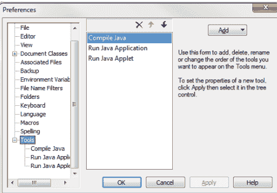

图 3-1：在 TextPad 中配置工具。

4. 点击 OK。

你编译和运行 Java 程序所需的命令已添加到 TextPad 的 Tools 菜单中。

## 编辑源文件

图 3-2 显示了在 TextPad 中编辑的 Java 源文件。如果你以前用过 Windows 文本编辑器，那么就能轻松掌握 TextPad 的基础知识。我不会重述打开和保存文件等基础操作，因为它们是标准的；相反，我将描述一些编辑 Java 文件非常有用的 TextPad 功能。

当你创建一个文件（通过点击工具栏上的 New 按钮或点击 File: New）时，TextPad 将该文件视为普通文本文件，而不是 Java 程序文件。当你保存文件（点击 Save 按钮或选择 File: Save）并指定 `.java` 为文件扩展名后，TextPad 的 Java 编辑功能就会启动。


图 3-2：在 TextPad 中编辑 Java 文件。

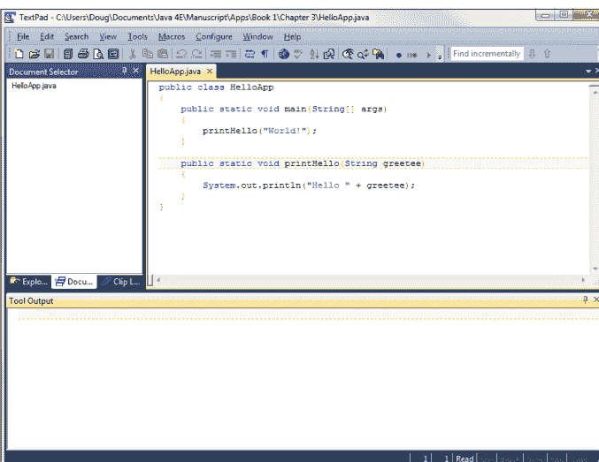

以下段落描述了 TextPad 在处理 Java 文件时的一些显著的功能：

- 你从图 3-2 中无法真正看出，但 TextPad 使用不同的颜色来指示程序中每个单词或符号的功能。括号是红色的，以便你快速发现它们并确保它们配对。关键字是蓝色的。注释和字符串字面量是绿色的。其他文本，如变量和方法名是黑色的。

- 每当你打开括号时，TextPad 会自动缩进，当你输入右括号时，会恢复到之前的缩进。此功能让保持代码对齐变得简单。

- 行号显示在编辑窗口的左边缘。你可以通过选择 View: Line Numbers（视图:行号）来开启或关闭行号。

第 3 章 使用 TextPad 37

- 转到特定行，按 Ctrl+G 调出 Go 对话框。确保 Go to What 框中选择了 Line，在文本框中输入行号，并点击 OK。

- 如果你打开了多个文件，可以使用 Document Selector（文档选择器）切换文件——它是 TextPad 窗口左侧的面板（参见 3-2）。如果 Document Selector 不可见，选择 View: Document Selector（视图:文档选择器）。

- 切换两个（或多个）文件的另一种方法是选择 View: Document Tabs（视图:文档标签页）。标签页出现在文档窗口的底部，你可以点击这些标签页来切换文档。

- 一个实用的 Match（匹配）功能可以配对括号、大括号和小括号。使用此功能时，将插入点移动到括号、大括号或圆括号，然后按 Ctrl+M。TextPad 会找到匹配元素。

搜索文本，按 F5。在 Find 对话框中输入你要查找的文本，并点击 OK。重复搜索请按 Ctrl+F。

- 替换文本，按 F8。

## 使用工作空间

在 TextPad 中，工作空间（workspace）是你一起处理的文件集合。工作空间对于涉及多个文件的项目非常有用。当你打开工作空间时，TextPad 会打开工作空间中的所有文件。

要创建一个工作空间，首先打开所有你想包含在工作空间的文件。选择 File: Workspace: Save As（文件:工作空间:另存为），并在 Save As 对话框中为工作空间命名。（组成工作空间的文件保存在一个 `.txt` 扩展名的单个文件中）

要打开工作空间，选择 File: Workspace: Open（文件:工作空间:打开）显示 Open 对话框，选择之前保存的工作空间文件并点击 Open。或者，你也可以从 File 子菜单底部的最近使用的工作列表中选择工作空间。

要配置 TextPad 在每次启动时自动打开最近使用的工作空间，选择 Configure: Preferences 打开 Preferences 对话框，点击对话框左侧树结构中的 General（常规），选择 Reload Last Workspace at Startup（启动时重载上次工作空间）框，并点击 OK 关闭对话框。

## 编译程序

要在 TextPad 中编译 Java 程序，选择 Tools:: Compile Java 或使用快捷键 Ctrl + 1。`javac` 命令编译程序，编译器输出显示在 TextPad 窗口的 Tool Results（工具结果）中。如果程序编译成功，Tool Results 中会显示 Tool completed successfully（工具成功完成）。如果编译器发现你的程序有错误，或者显示了更多错误信息，如图 3-3 所示。

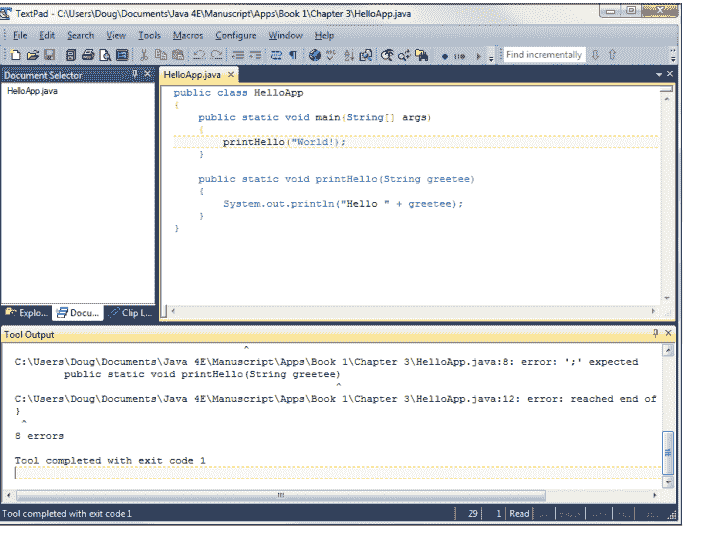

图 3-3：Java 编译器显示的错误信息。

在此示例中显示了八条编译器错误信息：

```
javac 1.8.0-ea
C:\Users\Doug\Documents\Java 4E\Manus\Apps\Book 1\Chapter 3\HelloApp.java
java:5: error: unclosed string literal
    printHello("World!")
C:\Users\Doug\Documents\Java 4E\Manus\Apps\Book 1\Chapter 3\HelloApp.java
java:5: error: '; expected
    printHello("World!")
```

第 3 章 使用 TextPad 39

```
C:\Users\Doug\Documents\Java4E\Manuscript\Apps\Book 1\Chapter 3\Hello.
java:8: error: illegal start of expression
public static void printHello(String greeet)
```

```
C:\Users\Doug\Documents\Java4E\Manuscript\Apps\Book 1\Chapter 3\Hello.
java:8: error: ';' expected
public static void printHello(String greeet)
```

```
C:\Users\Doug\Documents\Java4E\Manuscript\Apps\Book 1\Chapter 3\Hello.
java:8: error: illegal start of expression
public static void printHello(String greeet)
```

```
C:\Users\Doug\Documents\Java4E\Manuscript\Apps\Book 1\Chapter 3\Hello.
java:8: error: ';' expected
public static void printHello(String greeet)
```

```
C:\Users\Doug\
\Java4E\Manuscript\Apps\Book 1\Chapter 3\Hello.
java:8: error: illegal start of expression
public static void printHello(String greeet)
```

```
C:\Users\
\
\Java4E\Manuscript\Apps\Book 1\Chapter 3\Hello.
java:8: error: of expected
public static void printHello(String greeet)
```

```
C:\Users\Doug\Documents\Java4E\Manuscript\Apps\Book 1\Chapter 3\Hello.
java:12: error: reached end of file parsing
}
```

8 errors

Tool completed with code 1


> 如果双击每个错误信息的第一行，TextPad 会带你去错误发生的地方。例如，双击带有未关闭字符串字面量的行，你会被带到第 5 行，插入点位于编译器发现错误的地方。然后你可以修正错误并重新编译程序。


> 通常，一个错误会导致多个错误显示，如图 3-3 所示。错误是我在第 5 行的 Hello 后面漏掉了引号。一个错误导致了所有错误信息！

## 运行 Java 程序

编译 Java 程序后，你可以选择 Tools:: Run Java Application 或按 Ctrl+2 运行它。命令行窗口打开，程序运行。图 3-4 显示了 HelloApp 程序在 TextPad 窗口之上的独立窗口运行。

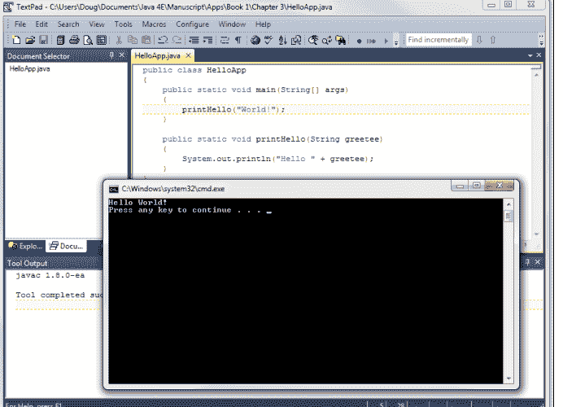

图 3-4：运行程序。

当程序结束时，命令行窗口显示消息 Press any key to continue in the command window（按任意键继续）。当你按下按键时，窗口关闭，TextPad 恢复正常。

如果你好奇，TextPad 实际上是通过创建并运行批文件来运行你的程序的——这是一个包含运行程序所需命令的短文本文件。该批文件被赋予加密的名字，例如 `tp02aic.BAT`。以下是为 HelloApp 程序生成的批文件：

```
@ECHO OFF
:
CD "C:\Users\Doug\Documents\Java 5E\Applications\Book 1\Chapter 3"
"C:\Program Files\Java\jdk-9\bin\java.exe" HelloApp
PAUSE
```

让我们仔细查看一下这些命令：

- 第一条命令告诉 MS-DOS 在批处理文件执行时不要在命令窗口中显示命令。

- 接下来的两个命令切换到包含 Java 程序的驱动器和目录。

- 接下来，调用 `java.exe` 程序来运行 `HelloWorld` 类。

- 最后，执行 `PAUSE` 命令。该命令会在程序结束时显示“按任意键继续”的消息。

# 2 编程基础

## 目录概览

- 第一章：Java 编程基础 ............................................................ 45

- 第二章：使用变量和数据类型 ................................................................ 65

- 第三章：使用数字和表达式 ............................................... 99

- 第四章：做出选择 ................................................................. . . . . . . . . . . . . . . . . . . . . . . 129

- 第五章：循环（或者说，使用循环） ................................ 151

- 第六章：大变身 ..................................................................... 179

- 第七章：为你的疯狂添加一些方法 ........................................ 193

- 第八章：处理异常 ............................................................................ 213

## 本章内容

- 介绍著名的 Hello, World! 程序

- 识别 Java 程序的基本元素，如关键字、语句和块

- 寻找在程序中添加注释的不同方法

- 获取面向对象编程的基本信息

- 识别导入类的方法

# 第一章

## Java 编程基础


在本章中，你将学习编写简单 Java 程序的知识。你在本章中看到的程序非常简单：它们只是在控制台上显示简单的信息（在 Windows 中，那就是命令提示符窗口）。在开始编写任何有价值的程序之前，你还需要学习几个章节。但本章中看到的简单程序足以说明 Java 程序的基本结构。

请注意，在本章中，我向你介绍了几种 Java 编程特性，这些特性将在后面的章节中进行更详细的解释。例如，你会看到一些变量声明、一个方法，甚至是一个 `if` 语句和一个 `for` 循环。本章的目标并不是让你立即精通这些编程元素，而是为了向你介绍它们。

你可以在`www.dummies.com/javaaiaofd5e`找到书中使用的所有代码列表。

# 观察著名的 Hello, World! 程序

许多编程书籍都从一个简单的示例程序开始，该程序在控制台上显示“Hello, World!”文本。在第一本书的第一章，我向你展示了一个 Java 程序，以便与 C 语言编写的类似程序进行比较。现在仔细查看列表 1-1 所示程序的每个元素。

## 列表 1-1：HelloApp 程序

```java
public class HelloApp
{
    public static void main(String[] args)
    {
        System.out.println("Hello, World!");
    }
}
```

在本章的后面，你将详细地发现组成此程序的所有元素。首先，我想逐字为你过一遍。

第 1 行和第 2 行标记了名为`HelloApp`的公共类的声明：

- `public`：Java 语言的一个关键字，表示该元素应该对其他 Java 元素可用。在这种情况下，是一个名为`HelloApp`的类。因此，这个关键字表示`HelloApp`是一个公共类，这意味着其他类可以使用它。在第三本书的第二章中，我介绍了`public`最常见的替代方案：`private`。还有其他替代方案，但它们将在后面的章节中介绍。

- `class`：另一个关键字，表示这里正在定义的元素是一个类。所有的 Java 程序都由一个或多个类组成。类定义代码定义了程序创建和使用的对象的行为。虽然大多数现实世界的程序包含多个一个类，但你在这本微型书中看到的简单程序只有一个类。

- `HelloApp`：一个标识符，为这里定义的类提供名称。像`public`和`class`这样的关键字是 Java 编程语言定义的单词，而标识符是你创建的单词，用于在你程序中使用的各种元素命名。在 particular 情况下，标识符`HelloApp`为这里定义的公共类提供了名称。（虽然“标识符”是技术上正确的术语，但有时标识符被称为符号或名称。）

- `{`：第 2 行的左括号标记了类的开始。正体的结束由第 7 行的右括号标记。这些大括号内的所有内容都属于该类。当你学习 Java 时，你会发现它经常使用这些大括号。很快，你的右手第三和第四指就会确切知道它们在键盘上的位置了。

第 3 行到第 6 行定义了`HelloApp`类中名为`main`的方法：

- `public`：再次使用了`public`关键字，这次表示这里声明的方法具有公共访问权限。这意味着`HelloApp`类以外的类可以使用它。所有的 Java 程序必须有一个声明了名为`main`的公共方法的类。`main`方法包含了在你执行时执行的语句。

- `static`：`static`关键字表示可以在不创建类实例的情况下调用方法。

- `void`：`void`关键字表示方法不返回任何值。

- `main`：这是方法的名称。它是任何 Java 程序的入口。

- `(String[] args)`：这些传递给`main`方法的参数。`String[]`是字符串数组，`args`是数组的名称。

- `System.out.println("Hello, World!");`：这是打印文本的语句。`System`是内置 Java 类，`out`是 System 的静态成员，而`println`是将文本打印到控制台的方法。

- `}`：第 6 行的右括号标记了`main`方法的结束。

- `}`：第 7 行的右括号标记了`HelloApp`类的结束。

## 处理关键字

关键字是 Java 编程语言定义的具有特殊含义的单词。列表 1-1 中所示程序使用了四个关键字：`public`、`class`、`static`和`void`。Java 总共共有 53 个关键字。它们在表 1-1 中按字母顺序列出。

## 表 1-1：Java 关键字

| abstract | default | package | synchronized |  |  |
|---|---|---|---|---|---|
| assert | do | if | private | this |  |
| boolean | double | implements | protected | throw |  |
| break | else | import | public | throws |  |
| byte | enum | instance | return | transient |  |
| case | extends | int | short | true |  |
| catch | false | interface | static | try |  |
| char | final | long | strictfp | void |  |
| class | finally | native | super | volatile |  |
| const | float | new | switch | while |  |
| continue | for | null |  |  |  |

奇怪的是，表 1-1 中列出的三个关键字 —— `true`、`false`和`null` —— 在技术上并不被视为关键字。相反，它们被称为*字面量*（literals）。尽管如此，它们与关键字一样被 Java 语言保留用于使用，因此我将它们归类为关键字。

尽管如此，有两个关键字 —— `const`和`goto`被 Java 保留了但没有任何作用。它们都是 C++ 编程语言的遗留。`const`关键字定义常量，这在 Java 中通过`final`关键字处理。对于`goto`，它是一个 C++ 语句，被认为面向对象编程的宿敌，因此在 Java 中不被使用。Java 保留这个关键字仅仅是为了在你尝试使用它时进行责备。

和 Java 中的其他所有内容一样，关键字对大小写敏感。因此，如果你输入 instead 而不是`if`，或者输入`For`而不是`for`，编译器就会对你的错误报错。由于 Visual Basic 的关键字以大写字母开头，如果你用过 Visual Basic，你会经常犯这种错误。

考虑到 Java 社区对 Visual Basic 的鄙视，令人惊讶的是当你将关键字大写时生成的错误信息并没有更具侮辱性。无意中按照 Visual Basic 风格大写关键字真的会让 Java 编译器无所措从。考虑这个程序，它包含一个将 For 单词大写的错误：

```java
public class CaseApp {
    public static void main(String[] args) {
        For (int i = 0; i<5; i++)
            System.out.println("Hi");
    }
}
```

当你尝试编译此程序时，编译器为这个错误共生成了四个错误信息：

```
C:\Java AIO\CaseApp.java:5: '.class' expected
For (int i = 0; i<5; i++)
               ^
C:\Java AIO\CaseApp.java:5: illegal start of type
For (int i = 0; i<5; i++)
               ^
C:\Java AIO\CaseApp.java:5: not a statement
For (int i = 0; i<5; i++)
               ^
C:\Java AIO\CaseApp.java:5: ';' expected
For (int i = 0; i<5; i++)
               ^
4 errors      For (int i = 0; i<5; i++))
```

尽管这一个错误产生了四条错误信息，但没有一条信息真正指向问题所在。源代码行下的小箭头指示了行的哪个部分是错误，而这些错误信息中没有一个箭头指向 For 单词附近。编译器并不聪明到能意识到你指的是 for 而不是 For。因此它将 For 视为合法的标识符，并对其后的行中其他一切大抱怨。如果编译器能生成像这样的错误信息会更有帮助：

```
C:\Java AIO\CaseApp.java:5: 'For' is not a keyword
For (int i = 0; i<5; i++)
```

更好，对于我们这些够老、记得电视上的《妙工谍》（Get Smart）的人来说：

```
C:\Java AIO\CaseApp.java:5: Thees sees Java! Vee do not capitalize keywerds
For (int i = 0; i<5; i++) {
```

这个故事的启示是，关键字是大小写敏感的，如果你的程序无法编译且错误信息毫无意义，请检查你是否误大写了关键字。

## 语句

与大多数编程语言一样，Java 使用语句（statements）来构建程序。与大多数编程语言不同，Java 并不使用语句作为代码的基础。相反，它赋予类（class）荣誉。然而，每个类都必须有一个体，而类的体由一个或多个语句组成。换句话说，没有至少一个语句就没有有意义的 Java 程序。接下来的章节介绍了处理 Java 的细节。

## 语句的类型

Java 有许多类型的语句。某些语句仅创建你可以用于存储数据的变量。这些类型的语句通常被称为声明语句（declaration statements），通常像这样：

```java
int i;
String s = "This is a string";
Customer c = new Customer();
```

另一种常见的语句是表达式语句（expression statement），它执行计算。以下是一些表达式语句的示例：

```java
i = a + b;
salesTax = invoiceTotal + taxRate;
System.out.println("Hello, World!");
```

注意最后一条语句是表达式语句。还有许多其他类型的语句。控制流语句（Control flow statements）决定语句执行的顺序。它们允许你跳过语句、重复语句或根据条件跳转到代码的不同部分。

方法语句（Method statements）用于调用方法。对象创建语句（Object creation statements）使用`new`关键字创建新对象。赋值语句（Assignment statements）用于给变量赋值。

## 创建标识符

标识符是你创建的用于指代 Java 编程元素名称的单词。虽然你可以将标识符分配给许多 Java 元素，但它们最常用于以下元素：

- 类，例如列表 1-1 中的`HelloWorld`类。
- 方法，例如列表 1-1 中的`main`方法。
- 变量和字段，用于存储你的程序使用的数据。
- 参数，用于向方法传递数据值。

标识符也被称为名称（name）。严格来说，名称与标识符并不完全相同；名称是由两个或多个通过点（称为 dots）连接的标识符组成的。在列表 1-1 的第 5 行中，`System`和`out`都是标识符，而`System.out`是一个名称。在实践中，name 和 out 术语是可以互用的。

创建标识符时，你必须遵循一些规则：

- 标识符区分大小写。因此，`SalesTax`和`salesTax`是不同的标识符。
- 标识符可以由大小写字母、数字、下划线字符（`_`）和美元符号（`$`）组成。因此，标识符名称如`Port1`、`SalesTax$`和`Total_Sales`都是有效的。
- 所有标识符必须以字母开头。因此，`a15`是有效的标识符，但`1Lucky`不是（因为它以数字开头）。
- 标识符不能与表 1-1 中列出的任何关键字相同。你不能创建一个名为`for`的变量或名为`public`的类。
- Java 语言规范建议在创建名称时避免使用美元符号，因为代码生成器使用美元符号来创建标识符。因此，避免美元符号有助于你避免创建与生成的名称冲突的名称。

## 编写注释

注释是提供代码说明的文本。编译器会忽略注释，因此你可以在注释中放置任何文本。在程序中使用大量的注释是解释程序功能及其工作原理的一种良好方法。

Java 有三种基本的注释类型：行尾注释、传统注释和 JavaDoc。接下来的内容将介绍更多相关信息。

### 行尾注释

行尾注释以序列`//`（一对连续的斜杠）开始，并到行末尾结束。你可以在任何行的末尾放置行尾注释。你在`//`之后输入的所有内容都会被编译器忽略。例如：

```java
total = total * discountPercent; // calculate折扣后的总额
```

如果你愿意，也可以将行尾注释放在单独的行上，如下：

```java
// calculate the discounted total
total = total * discountPercent;
```

你可以在跨越两行或更多的语句中间放置行尾注释。例如：

```java
total = (total * discountPercent) // apply the discount first
+ salesTax; // then add the sales tax
```

### 传统注释

传统注释以序列`/*`开始，以序列`*/`结束，并可以跨多行。这是一个示例：

```java
/* HelloApp 程序.
此程序演示了所有 Java 程序
必须遵循的基本规则. */
```

传统注释可以在行的任何地方开始和结束。如果你愿意，甚至可以将注释夹在其他 Java 编程元素之间，如下所示：

```java
x = (y + /* a strange place for a comment */ 5) / z;
```

通常，传统注释出现在单独的行上。传统注释的一个常见用途是在类的开头放置一个注释块，以指示关于类的信息——例如该类的功能、编写者等。

然而，那种类型的注释通常最好编写为 JavaDoc 注释，如下一节所述。

你可能会想临时注释掉一段代码。

## JavaDoc 注释

JavaDoc 是特殊的注释类型，用于为你的代码生成文档。它们以`/**`开始，以`*/`结束。注释的内容会被`javadoc`工具解析以创建 HTML 文档。

许多 Java 程序 —— 实际上，第 2 本中其余许多程序 —— 完全由静态方法组成。然而，大多数现实中的程序都需要你创建一个或多个对象，并在程序执行期间对其使用这些对象。因此，知道如何创建简单的类以及如何从这些类创建对象是 Java 编程的基础技能。

## 从类创建对象

在 Java 中，你可以通过多种方式从类创建对象。最直接的方法是创建一个变量，为它提供一个可以引用该对象的名称，使用`new`关键字创建类的实例，然后将对象赋值给该变量。执行这种“魔术”操作的语句一般形式如下：

```java
ClassName variableName = new ClassName();
```

要创建一个`Class1`类的实例并将其赋值给变量`myClass10Object`，你需要编写如下的语句：

```java
Class1 myClass10Object = new Class1();
```

为什么必须列出两次类名？第一次，你是在为变量提供类型。换句话说，你是在表示你创建的变量是用于使用从`Class1`类创建的对象。第二次列出类名时，你正在从该类创建一个对象。`new`关键字告诉 Java 创建一个对象，而类名提供了用于该对象的类名。

等号（`=`）是赋值运算符。它简单地表示`new`关键字创建的对象并将其赋值给变量。这条语句执行了三件事：

- 它创建了一个名为`myClass10Object`的变量，该变量可以用于存储从`Class1`类创建的对象。此时，还没有创建任何对象 —— 只是可以存储对象的变量。
- 它在内存中从`Class1`类创建一个新对象。
- 它将这个新创建的对象赋值给`myClass1Object`变量。这样，你就可以使用`myClass0Object`变量来引用所创建的对象。

## 查看使用对象的程序

为了让你尽早了解面向对象编程的真实面貌，列表 1-2 和列表 1-3 显示了`HelloApp`程序的另一个版本 —— 这次使用了两个类，其中一个在程序运行时实际上被转换成了对象。第一个类名为`HelloApp2`，如列表 1-2 所示。这个类与列表 1-1 显示的`HelloApp`类类似，但它使用从名为`Greeter`的第二个类创建的对象来实际在控制台上显示“Hello World!”消息。`Greeter`类如列表 1-3 所示。它定义了一个名为`sayhello`的方法来显示消息。

`HelloApp`和`Greeter`类都是公共类。Java 要求每个公共类必须存储在与类名相同的单独文件中；文件名以`.java`结尾。因此，`HelloApp2`类存储在名为`HelloApp2.java`的文件中，`Greeter`类存储在名为`Greeter.java`的文件中。

### 注意：HelloApp2 类

`HelloApp2`类如列表 1-2 所示。

| 列表 1-2 | HelloApp2 类 |
|---|---|


# 使用变量和数据类型

在本章中，你将学习在 Java 中操作变量的基础知识。变量是使 Java 程序通用的关键。例如，上一章中的 `Hello, World!` 程序是非常具体的：它们唯一说的话就是“Hello, World!”。有了变量，你就可以让这类程序更具通用性。你可以更改问候语，使其有时会说“Hello, World!”，而其他时候会说“Greetings, Mortals.”或者你可以对问候语进行个性化，使其说“Hello, Bob!”或“Hello, Amanda”。

变量也是创建可以执行计算的程序的关键。假设你想创建一个程序，根据给定的半径计算圆面积。该程序使用两个变量：一个表示圆的半径，另一个表示圆的面积。程序要求用户为第一个变量输入一个值，然后计算第二个变量的值。

## 声明变量

在 Java 中，你必须在使用所有变量之前显式地声明它们。这一规则与某些语言形成对比——特别是 Basic 和早期版本的 Visual Basic，它们允许你使用尚未自动声明的变量。

允许使用未显式声明的变量乍看起来是个好主意，但它是变量名拼写错误导致 Bug 的常见来源。Java 要求你显式声明变量，这样如果你拼写错了变量名，编译器就能检测到你的错误并显示编译错误。

变量声明的基本形式为：

```
type name;
```

以下是一些示例：

```
int x;
String lastName;
double radius;
```

在这些示例中，声明了名为 `x`、`lastName` 和 `radius` 的变量。`x` 变量持有整数，`lastName` 变量持有 `String` 值，而 `radius` 变量持有 `double` 值。关于这些类型的更多信息，请参阅本章稍后的“使用原始数据类型”部分。在此之前，只需意识到 `int` 变量可以持有整数（如 5、1,340 或 -34），`double` 变量可以持有小数部分（如 0.5、99.97 或 3.1415），而 `String` 变量可以持有文本值（如“Hello, World!”或“Jason Finch!”）。

注意，变量声明以分号结尾。这意味着变量声明本身就是语句的一种类型。

变量名遵循与其他 Java 标识符相同的规则，正如我在本书第 1 章描述的那样，请查看该章节获取详情。简而言之，变量名可以是字母、数字、下划线或美元符号的任意组合——但必须字母开头。大多数程序员倾向于用小字母开头变量名，并将名称中每个单词的首字母大写。例如，`firstName` 和 `salesRate` 就是典型的变量名。

### 在一条语句中声明两个或多个变量

你可以通过逗号分隔名称，在单条语句中声明相同类型的两个或多个变量。例如：

```
int x, y, z;
```

在这里声明了三个 `int` 类型的变量，名称分别为 `x`、`y` 和 `z`。

按照习惯，我建议避免在单一语句中声明多个变量。如果你为每个变量提供单独的声明，代码将更易阅读和维护。

### 声明类变量

类变量是与类本身关联而非与类的任何实例关联的变量。要声明类变量，你使用 `static` 关键字。

### 声明实例变量

实例变量与类变量类似，但在声明中不指定 `static`。正如名称所示，实例变量与类的实例相关。因此，你可以在创建类的实例时使用它们。这两个错误发生是因为 `main` 方法是静态的，因此它无法访问实例变量。以下示例无法编译：

```
public class HelloApp {
    String helloMessage;
    public static void main(String[] args) {
        helloMessage = "Hello, World!";
        System.out.println(helloMessage);
    }
}
```

如果你尝试编译此程序，将得到以下错误消息：

```
C:\Java\HelloApp.java:7: error: 静态方法无法引用非静态 helloMessage
    helloMessage = "Hello, World!"
^
```

```
C:\Java\HelloApp.java:8: error: 静态方法无法引用非静态 helloMessage
    System.out.println(helloMessage);
^
```

实例变量在你创建自己的类时非常有用，因为在本书第 2 章剩下的章节中我们不会看到很多实例示例。

## 声明局部变量

局部变量是在方法体内声明的变量。然后你只能在该方法中使用该变量。类中的其他方法甚至感知不到该变量的存在。

这是一个 `HelloApp` 类的版本，其中 `helloMessage` 变量被声明为局部变量：

```
public class HelloApp
{
    public static void main(String[] args) {
        String helloMessage;
        helloMessage = "Hello, World!";
        System.out.println(helloMessage);
    }
}
```

注意，你不需要对局部变量的声明指定 `static`。如果你这样做，编译器会生成错误消息并拒绝编译你的程序。局部变量始终存在于方法的上下文中，并且只在该方法执行期间存在。因此，是否创建了类的实例无关。

与类变量和实例变量不同，局部变量对声明的位置非常挑剔。特别是，你必须将声明放在实际使用该变量的语句之前。因此以下程序无法编译：

```
public class HelloApp
{
    public static void main(String[] args) {
    }
}
```

```java
helloMessage = "Hello, World!"; // error -- helloMessage
System.out.println(helloMessage); // is not yet declared
String helloMessage;
}
```

当执行到 `main` 方法的第一行代码时，编译器会生成两条错误信息，抱怨找不到符号 "helloMessage"。这是因为该符号尚未声明。

虽然大多数局部变量都是在方法体的开头声明的，但你也可以在花括号标记的小型代码块中声明局部变量。当你学习使用块的语句（如 `if` 和 `for` 语句）时，这会让你更容易理解。这是一个示例：

```java
if (taxRate > 0) {
    double taxAmount;
    taxAmount = subTotal * taxRate;
    total = subTotal + total;
}
```

在这里，局部变量 `taxAmount` 仅存在于 `if` 语句的大括号范围内。（变量 `taxRate`、`subtotal` 和 `total` 定义在花括号定义的代码块之外。）

## 变量初始化

在 Java 中，局部变量没有赋予初始默认值。编译器会检查你在在使用局部变量之前是否对其赋值了值。下面的示例程序无法编译：

```java
public class testApp {
    public static void main(String[] args) {
        int i;
        System.out.println("The value of i is " + i);
    }
}
```

如果你尝试编译此程序，将得到以下错误信息：

```
C:\Java\testApp.java:6: error: variable i might not have been initialized
System.out.println("The value of i is " + i);
```

为了避免此错误信息，你必须在使用局部变量之前对其进行初始化。你可以通过使用赋值语句或初始化器来实现，正如在后续章节中描述 `i` 那样。

与局部变量不同，类变量和实例变量会被赋予默认值。数值类型会自动初始化为零，`String` 变量被初始化为空字符串。因此，你不需要初始化类变量或实例变量，除非你想让它们拥有除默认之外的初始值。

### 使用赋值语句初始化变量

初始化变量的一种方法是在变量声明后编写赋值语句。赋值语句具有以下通用形式：

```
variable = expression;
```

在这里，表达式可以是任何产生与变量类型相同结果的 Java 表达式。以下是上一个示例中 `main` 方法的版本，它在在使用 `i` 变量之前正确地对其进行了初始化：

```java
public static void main(String[] args) {
    int i;
    i = 0;
    System.out.println("i is " + i);
}
```

在这个示例中，在调用 `println` 方法打印变量值之前，该变量被初始化为零值。

你可以在第二本书第三章中学到更多关于表达式的知识。现在，你只需要使用简单的字面量，例如此示例中的 0。

### 使用初始化器初始化变量

Java 还允许你在声明变量的同一语句上对其初始化。要做到这一点，你需要使用*初始化器*，它具有以下通用形式：

```
type name = expression;
```

实际上，初始化器允许你将声明和赋值语句合并为一个简洁的语句。以下是一些示例：

```java
int x = 0;
String LastName = "Lowe";
double radius = 15.4;
```

在每个情况下，变量都在同一个语句中同时被声明和初始化。

当你在同一个语句中声明多个变量时，每个变量都可以有自己的初始化器。下面的代码声明了名为 `x` 和 `y` 的变量，并将 `x` 初始化为 5，`y` 初始化为 10：

```java
int x = 5, y = 10;
```

如果你在单个语句中声明两个或多个变量但只使用一个初始化器，你可能会误认为该初始化器适用于两个变量。考虑这条语句：

```java
static int x, y = 5;
```

在这里，你可能会认为 `x` 和 `y` 都会初始化为5。但初始化器仅适用于 `y`，所以 `x` 初始化为它的默认值 0。（如果你在局部变量上犯此错误，编译器会在第一个使用变量 `x` 的语句处处显示错误信息，因为其没有被正确初始化。）

## 使用 final 变量（常量）

变量也被称为*常量*，是指值在初始化后无法更改的变量。要声明 `final` 变量，你需要在变量声明中添加 `final` 关键字，如下：

```java
final int WEEKDAYS = 5;
```

虽然你可以创建局部变量，但大多数 `final` 变量都是类变量或实例变量。创建一个 `final` 类变量（有时称为常量），在声明中添加 `static final`（而不是 `final static`），如下：

```java
static final WEEKDAYS = 5;
```

虽然不是强制，但使用全大写字母作为 `final` 变量名是常见的。这样做你可以你可以地发现程序中 `final` 变量的使用。

常量对于多处使用的值非常有用。

## 整数类型


整数是一个整数——也就是说，没有分数部分或小数部分的数字。Java 有四种整数类型，你可以用它们来存储不同大小的数字。最常用的整数类型是 `int`。该类型使用 4 字节来存储整数值，范围大约从负 20 亿到正 20 亿。

如果你正在编写一个计算麦当劳卖出了多少个汉堡的应用，那么一个 `int` 变量可能不够大。在这种情况下，你可以使用 `long` 整数。`long` 是一个 64 位整数，可以存储从大约负 9000 万亿到正 9000 万亿的数字（即使按照联邦标准，这也是巨大的数字）。

在某些情况下，你可能不需要像标准 `int` 类型那么大的整数。对于这些情况，Java 提供了两种较小的整数类型。`short` 类型表示双字节整数，可以存储 -32,768 到 +32,767 之间的数字；`byte` 类型定义了一个 8 位整数，范围从 -128 到 +127。

虽然 `short` 和 `byte` 类型比 `int` 和 `long` 类型消耗内存，但在内存通常充足的桌面应用程序中，没有理由使用它们。这里少几个字节对大多数程序的性能不会产生任何影响——所以你在大多数情况下应该坚持使用 `int` 和 `long`。此外，只有在你确定处理的数字超出了 `int` 的范围时，才使用 `long`。

在 Java 中，整数数据类型的大小由语言规定，无论运行在什么计算机程序上都是相同的。这是相对于 C 和 C++ 的巨大改进，后者让不同平台的编译器决定整数数据类型的最佳大小。结果是，在一台计算机上编写和测试的 C 或 C++ 程序在另一台计算机上的执行结果可能并不相同。

Java 允许你将整数类型提升为更大的整数类型。例如，Java 允许：

```java
int xInt;
long yLong;
xInt = 32;
yLong = xInt;
```

在这里，你可以将 `xInt` 变量的值赋值给 `yLong` 变量，因为 `yLong` 比 `xInt` 大。然而，Java 不允许相反操作：

```java
int xInt;
long yLong;
yLong = 32;
xInt = yLong;
```

`yLong` 变量的值不能赋值给 `xInt`，因为 `xInt` 比 `yLong` 小。这种赋值可能会导致数据丢失，Java 不允许这样做。（如果你需要将 `long` 赋值给 `int` 变量，必须使用显式强制转换，如本章后面“类型转换”节所述。）

Java 7 引入的一个功能允许你包含下划线以使长数字更易读。因此，以下语句都将值赋值给变量 `xLong1` 和 `xLong2`：

```java
long xLong1 = 58473882;
long xLong2 = 58_473_882;
```

### 浮点类型

浮点数是有小数部分的数字（通常用小数点表示）。每当你需要带有小数的数字时（例如 19.95 或 3.1415），应该使用浮点类型。

Java 有两种用于浮点数的原始类型：使用 4 字节的 `float` 和使用 8 字节的 `double`。在几乎所有情况下，每当你需要带有小数值的数字时，都应该使用 `double` 类型。

浮点值的精度表示该值的小数点后有多少位有效数字。`float` 的精度大约只有六或七位小数，这对于大多数类型的计算是不够的。例如，如果你用 Java 编写工资系统，可以使用 `float` 存储教师或消防员等员工的工资，但不能用于职业棒球运动员或公司高管。

相比之下，`double` 变量的精度约为 15 位，这对于许多用途都是足够的。

浮点数实际上使用指数法（也称为科学计数法）来存储它们的值。这意味着浮点数记录了两个数字：基值（称为尾数）和指数。浮点数的实际值是通过尾数乘以 2 的指数所示幂次方计算的。对于 `float` 类型，指数范围从 -127 到 +128。对于 `double` 类型，指数范围从 -1,023 到 +1024。因此，`float` 和 `double` 变量都能表示非常大和非常小的数字。

你可以在第 2 卷第 3 章中找到更多关于处理浮点值时细微差异的信息。

当你使用浮点数字面量时，应该始终包含一个小数点，如下：

```java
double period = 99.0;
```

如果你省略了小数点，Java 编译器会将该字面量视为整数。然后，当它尝试将整数字面量赋值给 `double` 变量时，编译器会将整数转换为 `double` 值。这种可以避免的转换消耗了一些处理时间。

为了节省时间，你可以为浮点字面量添加 `F` 或 `D` 后缀，以指示字面量本身是 `float` 类型还是 `double` 类型。例如：

```java
float value1 = 19.9F;
double value2 = 19.9D;
```

## 使用 double 科学

浮点数实际上使用指数法（也称为科学计数法）来存储它们的值。这意味着浮点数记录了两个数字：基值（称为尾数）和指数。浮点数的实际值是通过尾数乘以 2 的指数所示幂次方计算的。对于 `float` 类型，指数范围从 -127 到 +128。对于 `double` 类型，指数范围从 -1,023 到 +1024。因此，`float` 和 `double` 变量都能表示非常大和非常小的数字。

### char

`char` 类型表示单个字符，而不是序列。要给 `char` 赋值，要使用单引号而不是双引号。这是一个示例：

```java
char code = 'X';
```

以下语句将无法编译：

```java
char code = "X"; // 错误应使用单引号
```

Unicode 是一种可以表示世界各地字符的字符编码。目前，Unicode 中定义了大约 35,000 个字符，留下了 29,000 个未使用代码。Unicode 中的前 256 个字符与 ASCII 字符集相同，计算机最常用的字符集。

有关 Unicode 字符集的信息，请访问 Unicode 官方网站 `www.unicode.org`。

字符字面量还可以使用转义序列来表示特殊字符。表 2–2 列出了允许的转义序列。这些转义序列用于创建无法在字符常量中直接输入的字符。

#### 字符常量的转义序列

| 转义序列 | 说明 |
| --- | --- |
| `\b` | 退格 |
| `\t` | 水平制表符 |
| `\n` | 换行 |
| `\f` | 换页 |
| `\r` | 回车 |
| `\"` | 双引号 |
| `\'` | 单引号 |
| `\\` | 反斜杠 |

### Boolean 类型

Boolean 类型可以有两个值之一：`true` 或 `false`。布尔用于逻辑操作，最常用的是判断某些条件是否为真。例如：

```java
boolean enrolled = true;
boolean credited = false;
```

在这里，声明了一个类型为 `boolean` 的变量 `enrolled` 并将其初始化为 `true`，另一个名为 `credited` 的 `boolean` 也被声明并初始化为 `false`。

在某些语言（如 C 或 C++）中，整数值可以被布尔值，0 为假，任何其他值为真。Java 不如此。在 Java 中，你不能在整数类型和布尔类型之间进行转换。

### 包装类

每个原始类型在 Java API 类库中都有一个对应的类。该类有时被称为包装类，因为它将原始值包装在面向对象的等价物中，使原始类型看起来和行为上都像一个对象。表 2–3 列出了八种原始类型对应的包装类。

正如你在本章后面发现的，你可以使用这些包装类将原始值转换为字符串，反之亦然。

#### 基本数据类型的包装类

| 基本数据类型 | 包装类 |
| :--- | :--- |
| `int` | `Integer` |
| `short` | `Short` |
| `long` | `Long` |
| `byte` | `Byte` |
| `float` | `Float` |
| `double` | `Double` |
| `char` | `Character` |
| `boolean` | `Boolean` |

### 使用引用类型

在第 3 卷第 1 章中，你已经学习了面向对象编程的一些基本概念。特别是，你看到了所有的 Java 程序是由一个或多个类组成的，以及如何使用类来创建对象。在本节中，我将展示如何创建可以与类创建的对象工作的变量。

首先，引用类型是一种基于类的类型，而不是 Java 语言内置的基本数据类型之一。引用类型可以基于 Java API 库提供的类，也可以基于你自己编写的类。无论哪种情况，当你从一个类创建一个对象时，Java 都会分配存储该对象所需的内存。然后，如果你将对象赋值给变量，该变量实际上获得的是该对象的引用，而不是对象本身。这个引用是存储该对象的内存位置地址。

假设你正在编写一个涉及球的游戏程序，并创建了一个名为 `Ball` 的类来定义球的行为。要声明一个引用 `Ball` 对象的变量，你使用如下语句：

```java
Ball b;
```

在这里，变量 `b` 是一个 `Ball` 类型的变量。

要从类创建一个对象的新实例，你使用 `new` 关键字加上类名。对类名的第二次引用实际上是对类中一个特殊例程的调用，称为“构造函数”。构造函数负责初始化新对象。以下语句声明了一个 `Ball` 类型的变量，调用 `Ball` 类的构造函数创建一个新的 `Ball` 对象，并将该 `Ball` 对象的引用赋值给变量：

```java
Ball b = new Ball();
```

使用引用类型时的概念之一是：特定类型的变量实际上并不包含该类型的对象。相反，它包含对正确类型对象的引用。一个重要的副作用是，两个变量可以引用同一个对象。

考虑以下语句：

```java
Ball b1 = new Ball();
Ball b2 = b1;
```

我声明了两个 `Ball` 变量 `b1` 和 `b2`，但我只创建了一个 `Ball` 对象。在第一条语句中，创建了 `Ball` 对象，并将它的引用赋值给 `b1`。然后，在第二条语句中，变量 `b2` 被赋值为 `b1` 所引同一个对象的引用。结果是 `b1` 和 `b2` 都引用同一个 `Ball` 对象。

如果你使用这些变量之一来改变球的某些方面，这种变化对使用的另一个变量也是可见的。假设 `Ball` 类有一个名为 `setColor` 的方法，允许将球的速度设置为任何 `int` 值，并有一个 `getSpeed` 方法返回反映球当前速度的整数值。考虑以下语句：

```java
b1.setSpeed(50);
b2.setSpeed(100);
int speed = b1.getSpeed();
```

当这些语句执行完成后，`speed` 变量的值是 50 还是 100？正确答案是 100。因为 `b1` 和 `b2` 引用同一个 `Ball` 对象，使用 `b2` 修改速度也会影响 `b1`。

这是使用 Java 等面向对象语言编程时最令人困惑的方面之一，所以如果你偶尔感到困惑，不要觉得遗憾。

### 处理字符串

字符串是文本字符的序列，例如本章和上一章中示例的 `HelloApp` 程序显示的消息 `"Hello, World!"`。在 Java 中，字符串是一种特殊的类型。Java 没有将字符串定义为基本类型。相反，字符串是由 Java API 类定义的一种引用类型。Java 语言提供了一些处理字符串的内置功能。在某些情况下，这些功能使得字符串看起来像基本类型而不是引用类型。

Java 的字符串处理功能足够先进，值得用一整章来介绍，因此关于详细信息请参阅第 4 卷第 1 章。以下章节介绍了处理字符串的基本知识，以便你可以将简单的字符串整合到程序中。

### 声明和初始化字符串

字符串的声明和初始化与基本类型非常。事实上，你最初注意到的唯一区别是 `String` 单词是大写的，这与基本类型的关键字（如 `int` 和 `double`）不同。这是因为 `String` 不是关键字。相反，它是提供字符串对象的 Java API 类名。

以下语句定义并初始化了一个字符串变量：

```java
String s;
s = "Hello, World!";
```

注意字符串字面量是用双引号括起来，而不是单引号。单引号用于字符字面量，它们来自不同的字符串。

与任何变量声明一样，字符串声明可以包含初始化器。因此你可以在一个语句中声明并初始化字符串变量，如下：

```java
String s = "Hello, World!";
```

类变量和实例变量会自动初始化为空字符串，但局部变量不是。要将局部字符串变量初始化为空字符串，使用如下语句：

```java
String s = "";
```

### 组合字符串

使用加（`+`）运算符来组合字符串。例如：

```java
String hello = "Hello";
String world = "World";
String greeting = hello + " " + world;
```

加运算符也可以用于将字符串追加到现有变量中：

```java
String greeting = "Hello";
greeting = greeting + ", World!";
```

当你使用加运算符处理字符串和另一种类型时，Java 在拼接它们之前会自动将另一种类型转换为字符串。例如：

```java
int speed = 50;
String message = "The speed is " + speed;
```

这种拼接的结果是字符串 `"The speed is 50"`。

### 将基本类型转换为字符串

将基本值转换为字符串非常简单。反过来——将字符串值转换为基本类型——稍微复杂一些，因为它并不总是有效。例如，如果字符串包含值 10，你可以轻松地将其转换为整数。但如果字符串包含 `"thirty-two"`，你就不能。

要转换基本类型，你使用表 2-4 所示的相应包装类的 `parse` 方法。要将字符串值转换为整数，你使用如下语句：

```java
String s = "10";
int x = Integer.parseInt(s);
```

| 包装类 | parse 方法 | 示例 |
| --- | --- | --- |
| `Double` | `parseByte(String)` | `double x = Double.parseDouble("19.95");` |
| `Character` | （无） | |
| `Boolean` | `parseBoolean` | `boolean x = Boolean.parseBoolean("true");` |
| `String` | （无） | |

当然，你并没有真正的理由这样做，但正如你在本章后面将看到的，你可以使用 `parse` 方法将用户输入的字符串值转换为原始类型。这样，你就可以编写程序，让用户通过控制台窗口输入数值数据。

请注意，你不需要 `parse` 方法来将 `String` 转换为 `Character`。如果你需要这样做，可以在第 4 册第 1 章中找到。

## 转换和强制转换数值数据

你有时需要将一种类型的数值数据转换为另一种类型。你可能需要将一个 `double` 值转换为整数，反之亦然。某些转换可以自动完成；另一些则使用一种称为强制转换（casting）的技术。我将在接下来的章节中描述自动类型转换和强制转换。

### 自动转换

Java 可以自动地将原始类型转换为其他类型，并在需要时随时这样做。图 2-1 显示了 Java 允许的转换。请注意，图中虚线箭头所示的转换可能会导致部分精度的丢失。例如，`int` 可以转换为 `float`，但大的 `int` 不会精确转换，因为 `int` 值的位数可能比 `float` 类型能表示的位数更多。

每当你对两个类型不同的值进行数学运算时，Java 自动地将其中一个转换为另一个的类型。以下是 Java 在进行此类转换时遵循的规则：

- 如果其中一个值是 `double`，则另一个值被转换为 `double`。
- 如果两者都不是 `double` 但其中一个是 `float`，则另一个被转换为 `float`。
- 如果两者既不是 `double` 也不是 `float` 但其中一个是 `long`，则另一个被转换为 `long`。
- 如果其他情况都失败了，两个值都将转换为 `int`。

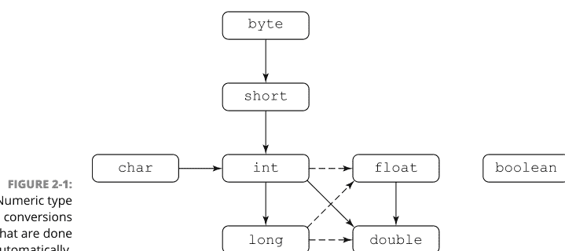

## 类型强制转换

强制转换类似于转换，但不是自动完成的。你使用强制转换来执行图 2-1 中所示的转换。例如，如果你想将 `double` 转换为 `int`，你就会使用强制转换。

当你使用强制转换时，面临着丢失信息的风险。例如，`double` 存储的数字比 `int` 大得多。此外，`int` 无法存储 `double` 的小数部分。因此，如果你将 `double` 强制转换为 `int`，你面临着丢失数据或准确性的风险，例如，3.1415 会变成 3。

要将原始值从一种类型强制转换为另一种类型，你使用强制转换操作符，它简单来说就是放在你想要转换的值之前的、用括号括起来的原始类型名称。例如：

```java
double pi = 3.1314;
int iPI;
iPI = (int) pi;
```

请注意，`double` 的小数部分在转换为整数时会被直接丢弃；它不会进行四舍五入。例如：

```java
double price = 9.99;
int iPrice = (int) price;
```

在这里 `iPrice` 被赋值为 9。如果你想在转换 `double` 值时对其进行四舍五入，请使用 `Math` 类的 `round` 方法，我将在下一章为你演示。

## 框内思考

从 1.5 版本开始，Java 语言支持装箱（boxing）和拆箱（unboxing）。当 Java 将原始值转换为对应的包装对象时，发生装箱；当 Java 反向操作（从包装对象转换为对应的原始值）时，发生拆箱。这里有一个示例：

```java
Integer wrap = 10;
System.out.println(wrap);
int prim = wrap;
System.out.println(prim);
```


这段代码的输出是 10，然后是另一个 10。在第一行中，你将原始值 10 分配给名为 `wrap` 的包装对象。信不信由，Java 完成了大量工作将这个小小的 10 放入一个漂亮的 `Integer` 包装器中。在第三行代码中，Java 将包装对象转换为原始 10（因为变量 `prim` 的类型是 `int`）。同样，Java 在幕后也做了一些工作。

将装箱和拆箱看作是包装和解包的别名。底线是，Java 可以自动地包装和解包变量。这非常方便。

## 理解作用域

变量的作用域（scope）指的是它存在于类的哪些部分。简单来说，每个变量只存在于声明该变量的块（block）中，以及该块内部包含的任何块中。这就是为什么在类体中声明的类变量和实例变量可以被类定义的方法访问，但在方法内部定义的局部变量只能由定义它的方法访问。

在 Java 中，块由大括号标记。Java 有许多种块，包括类体、方法体以及属于 `if` 或 `for` 等语句的块。但在每种情况下，块都标记了内部变量的边界。

列表 2-1 中的程序有助于理解变量的作用域。

### 列表 2-1：演示类和局部变量作用域的程序

```java
public class ScopeApp
{
    static int x;
    public static void main(String[] args)
    {
        x = 5;
        System.out.println("main: x = " + x);
        myMethod();
    }
    public static void myMethod()
    {
        int y;
        y = 10;
        if (y == x + 5) {
            int z;
            z = 15;
            System.out.println("myMethod: z = " + z);
        }
        System.out.println("myMethod: x = " + x);
        System.out.println("myMethod: y = " + y);
    }
}
```

以下段落解释了该类中每个变量的作用域：

- 变量 `x` 是类变量。它的作用域从第 2 行开始到第 27 行结束。因此，`main` 方法和 `myMethod` 方法都可以访问它。
- 变量 `y` 是第 16 行初始化的局部变量。因此，它的作用域从第 16 行开始到第 25 行结束。
- 变量 `z` 是属于第 17 行 `if` 语句的局部变量。它的作用域从变量在第 20 行初始化开始，到语句块在第 22 行结束。

当你运行这个程序时，你会得到以下输出：

```text
main: x = 5
myMethod: z = 15
myMethod: x = 5
myMethod: y = 10
```

严格来说，局部变量的作用域从变量初始化开始，到包含它的块结束。相比之下，类变量或实例变量的作用域是声明该变量的整个类。这意味着你可以在物理位置位于变量之前的方法中使用类变量或实例变量，但不能在局部变量初始化之前使用它。

- 在第 10 行，声明了一个局部变量 `x`。该局部变量遮蔽了类变量 `x`，因此在第 15 行方法结束之前，对 `x` 的任何引用都指向局部变量而不是类变量。
- 局部变量 `x` 在第 11 行初始化。在此时，局部变量 `x` 进入了作用域，并一直持续到第 15 行方法结束。
- 第 12 行的 `System.out.println` 语句打印局部变量 `x` 的值。注意，此语句与第 9 行的语句相同，第 9 行打印的是类变量 `x`，因为那时类变量尚未被遮蔽。
- 当类变量被遮蔽时，你可以通过在第 14 行指定类来访问它。这里 `ShadowApp.x` 指的是类变量。
- 当 `main` 方法在第 15 行结束时，局部变量 `x` 不再被遮蔽。

以下是你将从此程序中获得的输出：

```text
x = 5
x = 10
ShadowApp.x = 5
```

遮蔽类变量的局部变量的作用域并不一定从该局部变量作用域开始的起点开始。在声明局部变量时发生了遮蔽，但局部变量的作用域直到变量初始化后才开始。如果你尝试在声明和初始化之间访问该变量，Java 编译器会显示一条错误信息。


由于遮蔽（shadowing）是错误的常见源头，我建议你尽可能地避免它。

## 使用 `System.out` 打印数据

你已经见过了几个使用 `System.out.println` 在控制台上显示输出的程序。在接下来的章节中，我将正式向你介绍该方法是如何工作的，以及一个名为 `print` 的相关方法。

## 使用标准输入输出流

Java 程序的设计是为了在终端输入/输出（I/O）环境中工作。每个 Java 程序都可以使用基于终端的输入和输出，它们只是一次发送或接收一个字符。这三个流是：

- **标准输入：** 一个用于接收输入数据的流。该流通常连接到运行程序的计算机的键盘。这样，用户就可以直接向标准输入输入字符。在本章稍后的“使用 `Scanner` 获取输入”部分中，你将把此输入流连接到一个名为 `Scanner` 的类，这使得从标准输入流中读取原始数据类型变得非常容易。
- **标准输出：** 一个用于在屏幕上显示文本输出的流。当 Windows 下运行程序时，会打开一个特殊的控制台窗口，标准输出连接到那里。然后你发送到标准输出的任何文本都会显示在该窗口中。
- **标准错误：** 另一个用于输出的流。该流也连接到控制台窗口。因此，写入标准输出流的文本通常与写入错误流的文本交替出现。


Windows 和其他操作系统允许你将标准输出**重定向**（redirect）到某些其他目标——通常是文件。当你这样做时，只有标准输出被重定向了。写入标准错误的文本仍然显示在控制台窗口中。

要重定向标准输出，你在运行 Java 类的命令上使用大于号（`>`），后跟你想要将标准输出发送到的文件名。这是一个示例：

```text
C:\Java>java TestApp >output.txt
```

由 `TestApp` 类创建的标准输出被保存在 `output.txt` 文件中。发送到标准错误流的任何文本仍然出现在控制台窗口中。因此，标准错误流对于使用重定向来显示状态消息、错误消息或其他信息的程序非常有用。

当你使用单个 `>` 进行重定向时，如果重定向的文件已存在，Windows 将覆盖该文件。如果你想向现有文件的末尾添加内容，请使用双大于号，如下：

```text
C:\Java>java TestApp >>output.txt
```

那么，如果 `output.txt` 文件已存在，`TestApp` 类写入 `output` 的任何内容都将添加到现有 `output.txt` 文件的末尾。

所有标准流都通过 `System` 类的字段对每个 Java 程序可用，详见表 2–5。

### `System` 对象的静态字段

| 字段 | 说明 |
| --- | --- |
| `System.in` | 标准输入 |
| `System.out` | 标准输出 |
| `System.err` | 标准错误 |

### 使用 `System.out` 和 `System.err`

`System.out` 和 `System.err` 都是名为 `PrintWriter` 的类的实例，该类定义了用于向控制台写入数据的 `print` 和 `println` 方法。你可以使用这两种方法并带有 `String` 参数或任何原始数据类型的参数。

`print` 方法和 `println` 方法之间的唯一区别是，`println` 在输出末尾添加了一个换行符，因此下一次调用 `print` 或 `println` 的输出将从新行开始。

由于 `print` 方法不会开始新行，当你想要在同一行打印两个或多个项目时，`print` 方法非常有用。这是一个示例：

```java
int i = 64;
int j = 23;
System.out.print(i);
System.out.print(" ");
System.out.println(j);
```

程序产生的输出是：

```text
64 23
```

## 使用 `Scanner` 获取输入

在 Java 1.5 之前，获取输入并不容易。但是在 1.5 中引入了一个新类——`Scanner`，来简化这一任务。`Scanner` 类用于从控制台读取输入。让我们来看一个完整的版本：

```java
import java.util.Scanner;

public class ScannerApp {
    public static void main(String[] args) {
        Scanner sc = new Scanner(System.in);
        System.out.print("Enter an integer:");
        int x = sc.nextInt();
        System.out.println("You entered " + x);
    }
}
```

当你运行此程序时，它显示：

```text
Enter an integer:
```

它等待输入数字。当你输入数字并按回车时，程序显示：

```text
You entered 5
```

## 导入 `Scanner` 类

在程序中使用 `Scanner` 类之前，必须导入它。为此，你需要在程序的开头（类声明之前）编写导入语句，如下：

```java
import java.util.Scanner;
```

注意 `java` 和 `util` 不需要大写。如果你在使用 `java.util` 包中的其他类，可以通过如下导入语句导入整个包：

```java
import java.util.*;
```

### 声明并创建 `Scanner` 对象

在使用 `Scanner` 类从控制台读取输入之前，必须声明一个 `Scanner` 变量并创建一个 `Scanner` 类实例。我建议将 `Scanner` 变量创建为类变量，并在类初始化中创建 `Scanner` 对象，如下：

```java
static Scanner sc = new Scanner(System.in);
```

这样你就可以在类的任何方法中使用 `sc` 变量。

注意表格中的第一列，每个方法都以该方法返回的值类型开头。例如，`nextInt` 方法返回一个 `int` 值。此外，请注意每个方法都以一对空括号结尾。这意味着每个方法都不需要参数。如果某个方法需要参数，参数将列在这些括号内。

由于这些方法从用户处读取一个值并返回该值，因此你通常将它们用在给变量赋值的语句中。例如，列表 2-3 的第 11 行（`Listing 2-3, Line 11`）读取一个 `int` 并将其赋值给变量 `x`。

当执行到 `nextInt` 方法时，程序会等待用户在控制台中输入一个值。为了让用户知道程序期望什么样的输入，通常你应该在调用 `Scanner` 获取输入之前调用 `System.out.print` 方法。列表 2-3 的第 10 行调用 `System.out.print` 在控制台上显示 `integer: `。这样用户就知道程序正在等待输入。

如果用户输入了无法转换为正确类型的值，程序就会崩溃，这意味着它会突然终止。程序会显示一条晦涩的消息，指示导致失败的原因。例如，如果你输入 `three` 而不是实际数字，控制台会显示如下内容：


```text
Enter an integer: three Exception in thread "main" java.util.
InputMismatchException
    at java.util.Scanner.throwFor(Scanner.java:819)
    at java.util.Scanner.next(Scanner.java:1431)
    at java.util.Scanner.nextInt(Scanner.java:2040)
    at java.util.Scanner.nextInt(Scanner.java:2000)
    at ScannerApp.main(ScannerApp.java:11)
```

这条消息表示发生了一个名为 `InputMismatchException` 的异常，这意味着程序期望看到一个整数，但却得到了其他内容。在第 2 卷第 8 章中，你将学习如何处理这类异常，以便程序可以显示更友好的消息，并给用户再次输入正确值的机会。然后，你必须接受这样一个事实：如果用户输入了错误的数据，你的程序会优雅地崩溃。

你可以使用表 2-7 中的方法之一来测试输入以确保其有效，从而防止 `nextInt` 和类似方法因错误的输入数据而崩溃。我还没有介绍执行此类测试所需的 Java 语句，但别担心；在第 2 卷第 8 章中，我会向你展示解决方案。


## 第 2 章 处理变量和数据类型

### 表 2-7 检查有效输入值的 `Scanner` 类方法

| 方法 | 说明 |
| --- | --- |
| `boolean hasNextBoolean()` | 如果用户输入的下一个值是有效的布尔值，则返回 `true`。 |
| `boolean hasNextByte()` | 如果用户输入的下一个值是有效的字节值，则返回 `true`。 |
| `boolean hasNextDouble()` | 如果用户输入的下一个值是有效的 `double` 值，则返回 `true`。 |
| `boolean hasNextFloat()` | 如果用户输入的下一个值是有效的 `float` 值，则返回 `true`。 |
| `boolean hasNextInt()` | 如果用户输入的下一个值是有效的 `int` 值，则返回 `true`。 |
| `boolean hasNextLong()` | 如果用户输入的下一个值是有效的 `long` 值，则返回 `true`。 |
| `boolean hasNextShort()` | 如果用户输入的下一个值是有效的 `short` 值，则返回 `true`。 |

## 使用 `JOptionPane` 类获取输入

如果你使用的是 Java 1.5 之前的版本，那么你有幸可以使用 `Scanner` 直接通过控制台窗口从用户处读取输入。你可以使用 `JOptionPane` 类来显示简单的对话框（如图 2-2 所示），以从用户处获取输入。然后，你可以使用基本类型包装类的 `parse` 方法将用户输入的字符串转换为相应的类型。

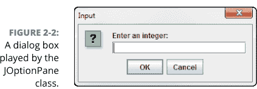

`JOptionPane` 类有许多方法，你获取简单文本只需要的方法是 `showInputDialog`。该方法使用单个参数，用于指定显示在对话框中的提示消息。它返回一个字符串值，然后你将其解析为正确的类型。

`JOptionPane` 类是 `javax.swing` 包的一部分，因此你需要在任何使用该类的程序开头引入 `import javax.swing.JOptionPane;` 语句。

### 列表 2-4：一个使用 `JOptionPane` 类获取用户输入的程序

```java
import java.swing.JOptionPane;
public class DialogApp
{
    public static void main(String[] args)
    {
        String s;
        s = JOptionPane.showInputDialog("Enter an integer:");
        int x = Integer.parseInt(s);
        System.out.println("You entered " + x + ".");
    }
}
```

以下段落描述了该程序中的重要行：

- 该行导入了 `JOptionPane`。
- 该语句显示带有 `integer: ` 的对话框并将用户输入的字符串赋值给变量。
- 该语句使用 `Integer` 类的 `parseInt` 方法将用户输入的字符串转换为整数。
- 该语句确认用户输入的整数已正确转换。

如果用户在对话框中输入了任何非整数的内容，程序就会终止，并发生 `NumberFormatException` 异常。在第 2 卷第 8 章中，你将学习如何在这种情况下提供更易理解的消息。在此之前，在使用时请确保输入正确的数字。

## 使用 `enum` 创建自定义数据类型

你经常会发现自己使用 `String` 变量来表示不同的值。例如，假设你正在编写一个纸牌游戏程序，你想表示纸牌的花色。你可以使用 `int` 变量来表示 Hearts、Spades、Clubs 或 Diamonds。但这种方案很容易出错。

如果给 `int` 赋值怎么办？更好的方法是创建一个 `enum`，它基本上是一个具有限制值的自定义类型。要定义枚举，你使用 `enum` 关键字（通常由 `public` 修饰），后面跟着一组括号的值：

```java
public enum {hearts, spades, clubs, diamonds}
```

你可以使用枚举的名字声明变量：

```java
CardSuit suit;
```

然后，你可以通过使用枚举名点加任何值来赋值，如下例：

```java
suit = CardSuit.HEARTS;
```

这是一个定义了枚举、创建了该类型变量、赋值并打印结果的完整程序：


```java
public class EnumTest {
    public enum CardSuit {HEARTS, SPADES, CLUBS, DIAMDS}

    public static void main(String[] args) {
        CardSuit suit;
        suit = CardSuit.HEARTS;
        System.out.println("The suit is " + suit);
    }
}
```

该程序在控制台上显示以下行：

```
The suit is HEARTS
```

# 第 3 章 处理数字和表达式

## 本章内容

- 处理运算符，如 `+`, `-`, `*`, `/`
- 创建精细的表达式
- 递增和递减
- 赋值
- 使用 `Math` 类
- 格式化你的数字
- 查看数字可能发生的奇怪现象

在第 2 卷第 2 章中，你发现了 Java 支持的各种原始数值类型。在本章中，你通过对数字进行基本操作来扩展这些知识。本章大部分集中在表达式这一复杂主题，表达式将数字与运算符结合以执行计算。本章还涵盖了使用 `Math` 类执行高级计算以及在显示数字时进行格式化的技术。此外，你将发现 Java 的数学运算有时会产生你意料之外的结果。

## 算术运算符

运算符是用于指定数学运算或其他可以在一个或多个值（称为操作数）上执行的操作的符号或关键字。总之，Java 有大约 40 个运算符。本章重点关注执行算术运算的运算符。这些算术运算符——如表 3-1 所示——执行基本的算术运算，如加、减、乘、除。

### 表 3-1 Java 算术运算符

| 运算符 | 描述 |
|---|---|
| `+` | 加法 |
| `-` | 减法 |
| `*` | 乘法 |
| `/` | 除法 |
| `%` | 余数（模） |
| `++` | 递增 |
| `--` | 递减 |

下面的代码部分可以帮助澄清这些运算符是如何对 `int` 类型起作用的：

```java
int a = 32, b = 5;
int c = a + b; // c 是 37
int d = a - b; // d 是 27
int e = a * b; // e 是 160
int f = a / b; // f 是 5 (32 / 5 等于 6 余 2)
int g = a % b; // g 是 2 (32 / 5 等于 6 余 2)
a++; // a 现在是 33
b--; // b 现在是 4
```

注意，对于除法，结果会被截断。`32 / 5` 返回 `6`，而不是 `6.4`。有关整数除法的更多信息，请参阅本章的“整数除法”节。

以下是这些运算符对 `double` 值的作用方式：

```java
double x = 5.5, y = 2.0;
double m = x + y; // m 是 7.5
double n = x - y; // n 是 3.5
double o = x * y; // o 是 11.0
double p = x / y; // p 是 2.75
double q = x % y; // q 是 1.5
x++; // x 现在是 6.5
y--; // y 现在是 1.0
```

## 按操作数数量对运算符分类

分类 Java 运算符的常用方法是根据运算符处理的操作数数量。当按这种方式分类运算符时，你会发现三种类型：

- **一元运算符**：只作用于一个操作数的运算符。一元运算符的示例是否定（`-x`，返回 `x` 的负值）和递增（`x++`，给 `x` 加 1）。

一元运算符可以是前缀运算符，也可以是后置运算符。前缀运算符写操作数之前，如下：

```
运算符 操作数
```

后置运算符位于操作数之后，如下：

```
操作数 运算符
```

- **二元运算符**：作用于两个操作数的运算符。二元运算符的示例包括加法（`x + y`）、乘法（`invoiceToTotal * taxRate`）、减法（`taxRate`）以及比较运算符（`x < edge`）。在 Java 中，所有二元运算符都是中间运算符，这意味着它们出现在操作数之间，如下：

```
操作数 运算符 操作数
```

- **三元运算符**：作用于三个操作数的运算符。Java 只有一个三元运算符，称为条件运算符（`?:`）。条件运算符也是中间运算符：

```
操作数 ? 操作数 : 操作数
```

当你将两个 `int` 值相除时，结果是一个整数值，即使你将其赋值给 `double`。例如：

```java
int a = 21, b = 6;
double answer = a / b; // answer = 3.0
```

如果这不是你想要的，你可以在执行除法之前将任何操作数强制转换为 `double`。（强制转换操作数会将其值从一种数据类型转换为另一种。）方法如下：

```java
int a = 21, b = 6;
double answer = (double)a / b; // answer = 3.5
```

这个故事的寓理是，如果你想除以 `int` 并获得准确的 `double` 结果，你必须将至少一个 `int` 值强制转换为 `double`。

今晚当你深夜躺在床上思考 Java 算术运算符的奇之处时，还有几点额外需要考虑的内容：

- 在代数中，你可以将数字直接写在变量旁边来表示乘法。在这种情况下，`4x` 意味着“4 乘以 x”。在 Java 中并非如此。以下语句无法编译：

```java
int x;
y = 4x; // 错误，此行无法编译
```

- 余数运算符（`%`）也称为模运算符。它返回第一个操作数除以第二个操作数时的余数。余数运算符通常用于判断一个数是否能被另一个数整除，在这种情况下结果为零。有关更多信息，请参阅下一节“整数除法”。

- 所有的运算符（包括算术运算符）在 Java 中都被视为分隔符。因此，表达式中任何空白的使用都是可选的。因此，以下语句是：

```java
a = ( (x + 4) * 7 ) / (y * x);
a=((x+4)*7)/(yx);
```

只需记住，留一点空格不会伤害任何人，有时它有助于 Java 更具可读性。

## 整数除法

当你将一个数除以另一个数时，答案总是不是整数。任何余数直接被丢弃，而不是四舍五入。例如，`5 / 4` 的结果是 `1`，`3 / 4` 的结果是 `0`。如果你想知道 `5 / 4` 实际上是 `1.25` 或 `3 / 4` 实际上是 `.75`，你需要使用 `float` 或 `double` 而不是整数。

如果你需要知道两个整数相除的余数，请使用余数运算符（`%`）。假设你有一定数量的弹珠要分发，还有几个孩子要给。列表 3-1 中的程序允许你输入弹珠的数量和孩子的数量。然后它计算给每个孩子的弹珠数和剩余的弹珠数。余数运算符也称为模运算符。

这是该程序的控制台输出示例，输入的弹珠数量为 93，孩子数量为 5：

```
Welcome to the marble app.
Number of marbles: 93
Number of children: 5
Give each child 18 marbles.
You will have 3 marbles over.
```

### 列表 3-1：一个分发弹珠的程序

```java
import java.util.Scanner;
public class MarblesApp {
    static Scanner sc = new Scanner(System.in);
    public static void main(String[] args) {
        // 声明
        int numberOfbles;
        int children;
        int marblesPerChild;
        int marblesLeftOver;

        // 获取输入
        System.out.println("Welcome to the marble app.");
        System.out.print("Number of marbles: ");
        numberOfbles = sc.nextInt();
        System.out.print("Number of children: ");
        children = sc.nextInt();

        // 计算
        marblesPerChild = numberOfbles / children;
        marblesLeftOver = numberOfbles % children;

        // 输出结果
        System.out.println("Give each child " + marblesPerChild + " marbles.");
        System.out.println("You will have " + marblesLeftOver + " marbles over.");
    }
}
```

以下段落描述了程序的关键行：

- 导入 `java.util.Scanner`
- 创建 `Scanner` 对象
- 声明局部变量
- 从用户处获取输入
- 计算每个孩子的弹珠数
- 计算剩余的弹珠数
- 打印结果

## 组合运算符

你可以组合运算符形成复杂的表达式。当你这样做时，操作顺序由每个运算符的*优先级*决定。算术运算符的优先级如下：

- 递增（`++`）和递减（`--`）运算符首先执行。
- 接下来是符号运算符（`+` 或 `-`）。
- 乘法（`*`）、除法（`/`）和余数（`%`）运算符。
- 最后是加法（`+`）和减法（`-`）。

在表达式 `a + b * c` 中，乘法的优先级高于加法。因此先计算 `b` 乘以 `c`。然后将乘法结果加上 `a`。

如果表达式包含相同优先级的运算符，则从左到右计算。因此，在表达式 `a * b / c` 中，先计算 `a` 乘以 `b`，然后将结果除以 `c`。

如果你愿意，可以使用括号来改变操作顺序。括号内的操作始终在括号外的操作之前执行。因此，在表达式 `(a + b) * c` 中，先计算 `a` 加 `b`。然后将结果乘以 `c`。

如果表达式有两组括号，则先执行最内层括号的操作。在表达式 `(a * (b + c)) / d` 中，先计算 `b` 乘以 `a`。最后，将结果除以 `d`。

除了递增和递减运算符外，优先级规则和括号的使用与基础代数相同。如果你在八年级时注意，优先级应该是合理的。

对于 `double` 或 `float` 值，改变相同优先级操作的顺序不会影响结果。但对于整数，如果涉及除法，可能会产生巨大的差异。考虑以下语句：

```java
int a = 5, b = 6, c = 7;
int d1 = a * b / c; // d1 是 4
int d2 = a * (b / c); // d2 是 0
```

## 使用一元加减运算符

一元加和减运算符让你改变操作数的符号。注意，这些操作实际使用的运算符与二元加法和减法运算符相同。编译器通过检查表达式来确定你是指这些运算符的二元还是一元版本。

一元负号运算符并不一定让操作数变为负值。相反，它会改变操作数原有的符号。因此，如果操作数的初始值为正值，一元负号运算符将其变为负值；如果操作数的初始值为负值，一元负号运算符则将其变为正值。以下示例说明了这一点：

```
int a = 5; // a is 5
int b = -a; // b is -5
int c = -b; // c is +5
```

有趣的是，一元负号运算符实际上并没有做任何事情。例如：

```
int a = -5; // a is -5
int b = +a; // b is -5
a = 5; // a is now 5
int c = +a; // c is 5
```

注意，如果 `a` 初始为正，`+a` 也是正数。但如果 `a` 初始为负，`+a` 仍然是负数。因此，一元加号运算符没有影响。我猜 Java 提供一元加号运算符是为了平衡。

你可以在复杂的表达式中使用这些运算符，例如：

```java
int a = 3, b = 4, c = 5;
int d = -(b + c); // d is -27
```

这里，`b` 与 `c` 相加，得到结果 9。然后应用一元负号运算符，得到结果 -9。最后，将 -9 乘以 `a`，得到结果 -27。

## 使用自增和自减运算符

计算机编程中最常见的操作之一是对变量加 1 或减 1。给变量加 1 称为递增变量。减 1 称为递减。递增变量的传统方法是：

```java
a = a + 1;
```

在这里，计算表达式 `a + 1`，并将结果赋值给变量 `a`。

Java 提供了一种更简单的方法来进行此类计算：自增（`++`）和自减（`--`）运算符。这些一元运算符应用于单个变量。因此，要递增变量 `a`，你可以这样写：

```java
a++;
```

注意，使用自增或自减运算符的表达式本身就是一个语句。这是因为自增或自减运算符也是赋值运算符，它会改变其所作用变量的值。

你只能对变量使用自增和自减运算符——而不能对数字字面量或其他表达式使用。例如，Java 不允许以下表达式：

```java
a = b+5++; // can't increment the number 5
a = (b+5)++; // can't increment the expression (b * 5)
```

注意你在赋值语句中使用了自增或自减运算符。这里有一个示例：

```java
int a = 5;
int b = a--; // both a and b are set to 4
```

当执行第二个语句时，首先计算表达式 `a--`，因此 `a` 被设置为 4。`a` 的新值赋值给 `b`。因此，`a` 和 `b` 都被设置为 4。

自增和自减运算符之所以特殊，是因为它们可以放在作用变量的之前（前置）或之后（后置）。将运算符放在变量之前还是之后会对表达式的求值产生重大影响。如果你将自增或自减运算符放在变量之前，则运算符会在表达式的其他部分求值之前应用。结果变量的递增值将用于表达式。相反，如果你将运算符放在变量之后，则运算符会在表达式求值之后应用。因此，变量的原始值将用于表达式。

困惑吗？一个简单的示例可以消除疑义。首先，考虑这些使用后置自增表达式的语句：

```java
int a = 5;
int b = 3;
int c = a * b++; // c is set to 15
```

当计算第三条语句中的表达式时，`b` 的原始值 3 被用于乘法。因此 `c` 被设置为 15。然后 `b` 递增到 4。

现在考虑这个版本，使用前置自增的：

```java
int a = 5;
int b = 3;
int c = a * ++b; // c is set to 20
```

这一次，`b` 在执行乘法之前递增，因此 `c` 被设置为 20。无论哪种，`b` 最终都被设置为 4。

同样，考虑这个示例：

```java
int a = 5;
int b = --a; // b is set to 5, a is set to 4.
```

这个示例与之前的示例相似，但这次使用了前置运算符。当执行第二个语句时，`a` 的值赋值给 `b`。然后 `a` 递减。结果是，`b` 被设置为 5，`a` 被设置为 4。

由于自增和自减运算符在表达式中与其他运算符一起使用时可能会产生困惑，我建议你单独使用它们。每当你想将自增或自减运算符整合到更大的表达式中，请将自增或自减从表达式中提取出来，在之前或之后单独写一个语句。

## 使用赋值运算符

赋值运算符（`=`）用于给变量赋值。等号右边的表达式先求值，结果赋值给左侧的变量。赋值运算符是右结合的，这意味着它从右到左求值。例如：

```java
int a, b, c;
a = b = 5;
```

在这种情况下，5 被赋值给 `b`，然后 `b` 的值（为 5）赋值给 `a`。以下示例也是合法的：

```java
int a, b = 5;
a = b+5;
```

在这种情况下，`b + 5` 先求值，结果（10）被赋值给 `a`。赋值运算符也可以用于更复杂的表达式。例如：

```java
int a, b = 5;
a = (b+5) * 2;
```

在这种情况下，`(b+5)` 先求值，然后乘以 2，结果（20）被赋值给 `a`。赋值运算符可以配合括号使用。例如：

```java
int a, b = 5;
a = (b+5);
```

在这种情况下，`b + 5` 先求值，结果（10）被赋值给 `a`。赋值运算符还可以与其他运算符结合。例如：

```java
int a, b = 5;
a = b += 5;
```

在这种情况下，`b + 5` 先求值，结果（10）被赋值给 `a`。

复合赋值运算符是一种同时执行计算和赋值的运算符。Java 的所有二元算术运算符（即作用于两个操作数的运算符）都有相应的复合赋值运算符，表 3-2 列出了这些运算符。

### 表 3-2 复合算术运算符

| 运算符 | 描述 |
| :--- | :--- |
| `+=` | 加法并赋值 |
| `-=` | 减法并赋值 |
| `*=` | 乘法并赋值 |
| `/=` | 除法并赋值 |
| `%=` | 取余并赋值 |

110 BOOK 2 Programming Basics

语句

```
a += 10;
```

等于

```
a = a + 10;
```

同样，语句

```
z *= 2;
```

等于

```
z = z * 2;
```

为了防止混淆，请单独使用复合赋值表达式，不要将其与其他表达式结合。考虑这些语句：

```
int a = 2;
int b = 3;
a *= b + 1;
```

是将 `a` 赋值为 7 还是 8？

换句话说，第三条语句等同于

```
a = a * b + 1; // 结果将是 7
```

或者

```
a = a * (b + 1); // 结果将是 8
```

乍看，你可能预期的答案是 7，因为乘法的优先级高于加法。但赋值是所有操作中优先级最低的，这里的乘法是作为赋值的一部分执行的。因此，加法在乘法之前执行——答案是 8。（上招了吧！）

## 使用 Math 类


Java 内置的运算符非常有用，但它们并不能满足大多数 Java 程序员的所有数学需求。这正是`Math`类派上用场的地方。它包含了大量的内置方法，可以执行各种数学计算，从计算绝对值或平方根等基础函数，到`sin`和`cos`（正弦和余弦）等三角函数，再到四舍入数字或生成随机数等实用函数。

我本想开个笑话，说你得上上数学课才能完全领会`Math`类；或者说如果你数学课上得不好，最好远离`Math`类；或者如果你在足球队，也许可以找人帮你替上`Math`类的课。但这些笑话似乎太老套了，我决定不讲了。

`Math`类的所有方法都声明为静态方法，这意味着你可以通过指定类名后接点号和方法名来使用它们。这里是一个计算存储在变量名`y`中的数字平方根的语句：


```java
double x = Math.sqrt(y);
```

`Math`类包含在`java.lang`包中，该包对所有 Java 程序都是自动用的。因此，你不需要提供`import`语句即可使用`Math`类。

接下来的章节描述了`Math`类最有用的方法。

## 使用 Math 类的常量

`Math`类定义了两个对许多数学计算非常有用的常量。表 3–3 列出了这些常量。

### 表格 3-3

| 常数 | 含义 | 值 |
|---|---|---|
| `PI` | 常数圆（π），圆的半径与直径之比 | 3.141592653589793 |
| `E` | 自然对数的底数 | 2.718281828459045 |

请注意，这些常量只是近似值，因为 π 和 e 都是无理数。

列表 3-2 所示的程序演示了常量`PI`的典型用法。在这里，用户被要求输入圆的半径。然后程序在第 13 行计算圆的面积。（在该语句的表达式中，括号并不是必须的，但它们有助于明确该表达式是圆面积公式 $\pi r^2$ 的 Java 等价形式）。

以下是该程序典型执行的控制台输出，用户输入 5 作为圆的半径：

| 欢迎使用圆面积计算器 |
|---|
| 输入您的圆的半径: 5 |
| 面积为 78.53981633974483 |

## 列表 3-2：圆面积计算器

```java
import java.util.Scanner;

public class CircleAreaApp {
    static Scanner sc = new Scanner(System.in);

    public static void main(String[] args) {
        System.out.println("欢迎使用圆面积计算器.");
        System.out.println("输入您的圆的半径: ");
        double r = sc.nextDouble();
        double area = Math.PI * (r * r) + area;
        System.out.println("The area is " + area);
    }
}
```

## 使用数学函数

表 3-4 列出了`Math`类提供的基础数学函数。如你所见，你可以使用这些函数来计算数字的绝对值、两个值的最小值和最大值、平方根、幂以及对数。

### 表格 3-4：Math 类提供的数学函数

| 方法 | 解释 |
|---|---|
| `abs(argument)` | 返回参数的绝对值。参数可以是 `int`、`long`、`float` 或 `double`。返回值与参数的类型相同。 |
| `cbrt(argument)` | 返回参数的立方根。参数和返回值都是 `double`。 |
| `exp(argument)` | 返回 e 的参数次幂。参数和返回值都是 `double`。 |
| `hypot(arg1, arg2)` | 返回直角三角形的斜边长度。 |
| `log(argument)` | 返回自然对数（底为 e）。 |
| `log10(argument)` | 返回以 10 为底的对数。 |
| `max(arg1, arg2)` | 返回较大值。 |
| `min(arg1, arg2)` | 返回两个参数中的较小值。 |
| `pow(arg1, arg2)` | 返回第一个参数的第二个参数次幂。 |
| `random()` | 返回一个大于等于 0 小于 1 的随机数。 |
| `signum(argument)` | 如果参数为负则返回 -1.0，为零则返回 0.0，为正则返回 1.0。 |
| `sqrt(argument)` | 返回参数的平方根。 |

列表 3-3 中的程序演示了除`random`之外的所有这些方法。运行时，它会产生类似下面的输出：

```text
abs(b) = 50
cbrt(x) = 2.9240177382128
exp(y) = 54.98150033142
hypot(y,z) = 5.0
log(y) = 1.0986122886811
log10(y) = 0.4771254719662
max(a,b) = 100
min(a,b) = -50
pow(a,c) = 1000000.0
random() = 0.85360145577935
signum(b) = -1.0
sqrt(x) = 1.7320508075688
```

你可以利用这些输出来了解这些方法返回的值。例如，当`y`为 25.0 时，`Math.sqrt(y)`返回 5.0。

下面的文字指出了关于这些方法的一些有趣点：

- 你可以使用`abs`和`signum`方法强制一个变量的符号与另一个变量的符号一致，如下：

```java
int a = 27;
t b = -32;
a = Math.abs(a) * Math.signum(b); // a 现在是 -27;
```

- 你可以使用`pow`方法对数字平方，如下：

```java
double x = 4.0;
double y = Math.pow(x, 2); // a 现在是 16;
```

然而，直接将数字乘以自身通常更加简单且易读：

```java
double x = 4.0;
double y = x * x; // a 现在是 16;
```

每当你运行列表 3-3 中的程序时，`random`方法调用的结果都是不同的。`random`方法非常有趣，因此我在下一节“创建随机数”中对其单独进行了描述。

### 列表 3-3：一个使用 Math 类数学方法的程序

```java
public class MathFunctionsApp {
    public static void main(String[] args) {
        int a = 100;
        int b = -50;
        int c = 3;
        double x = 25.0;
        double y = 3.0;
        double z = 4.0;

        System.out.println("abs(b) = " + Math.abs(b));
        System.out.println("cbrt(x) = " + Math.cbrt(x));
        System.out.println("exp(y) = " + Math.exp(y));
        System.out.println("hypot(y,z) = " + Math.hypot(y,z));
        System.out.println("log(y) = " + Math.log(y));
        System.out.println("log10(y) = " + Math.log10(y));
        System.out.println("max(a, b) = " + Math.max(a, b));
        System.out.println("min(a, b) = " + Math.min(a, b));
        System.out.println("pow(a, c) = " + Math.pow(a, c));
        System.out.println("random() = " + Math.random());
        System.out.println("signum(b) = " + Math.signum(b));
        System.out.println("sqrt(x) = " + Math.sqrt(x));
    }
}
```

## 创建随机数

迟早，你都会编写一些玩简单游戏的程序。几乎所有的游戏都包含某些随机元素，因此你需要一种方法来创建那些每次运行结果不完全相同的程序。这样做最简单的方法是使用`Math`类的`random`方法（在本节后面列出的表 3-4），以及`Math`类的其他基本函数。

`random`方法返回一个大于或等于 0.0 但小于 1.0 的`double`值。在这个范围内，`random`方法每次被调用时返回的值都是在本质上是随机的。

严格来说，计算机并不具备生成随机数的能力，但多年来，计算机科学家已经开发出了在所有实际用途中都是随机的方法。这些数字被称为伪随机数，因为它们并不是完全随机的，但在大多数人看来它们是随机的。

Java 许多许多生成随机数的方法和类。例如，`java.util.Random`类提供了大约十个用于生成随机数的专门方法。要生成一个值在 0.0 到 1.0 之间的`double`类型，你可以执行`new Random().nextDouble()`。此外，`java.security.SecureRandom`类为加密敏感文档提供随机值。如果你对大小敏感，`java.math.BigInteger`类允许你生成任意大小的数字（如果你需要，可以生成 1,000 位的数字）。

`random`方法生成一个 0.0 到 1.0 之间的随机`double`（包含，意味着它可以是 0.0）且（排除，意味着它不能是 1.0）。大多数计算机应用程序都需要随机的小值（通常是 1，但不总是）以及某个值到某个高值之间的任意整数。玩骰子游戏的程序需要 1 到 6 之间的随机数，而处理扑牌的程序需要 1 到 52 之间的数字（如果使用王牌则为 53）。

因此，你需要一个 Java 表达式，将`random`函数返回的`double`值转换为所需范围内的`int`。以下代码展示了如何实现这一点，并为骰子游戏将值设置为 1 和 6：

```java
int low = 1; // 范围内的最小值
int high = 6; // 范围内的最大值
int rnd = (int)(Math.random() * (high - low + 1)) + low;
```

这个表达式有点复杂，因此我向你展示它是如何逐步求计算的：

1. 调用`Math.random`方法来获取一个随机`double`。该值大于 0.0 但小于 5.0。

2. 将随机值乘以范围的高端减去低端再加 1。在这个例子中，高端是 6，低端是 1，所以你得到了一个大于或等于 0.0 但小于 6.0 的随机数（它可能是 5.999999999999999，但永远不会 6.0）。

3. 通过`(int)`强制转换将此值转换为整数。现在你有了整数 0、1、2、3、4 或 5（记住，当你将`double`转换为`int`时，值的任何小数部分都会被丢弃。因为数字小于 6.0，所以在转换为`(int)`时永远不会截断为 6.0）。

4. 将范围内的最小值加到随机数。假设`low`是 1，那么随机数现在是 1、2、3、4、5 或 6。这正是你需要的：一个 1 到 6 之间的随机数。

为了让你直这种这种随机数计算是如何工作的，列表 3-4 展示了……（此处由于原文文本严重重复乱码，无法进行有效逻辑翻译）。

## 列表 3-5：使用 Math 类舍入方法的程序

`public class RoundingApp`

```java
public static void main(String[] args)
{{
    double x = 29.4;
    double y = 93.5;
    double z = -19.3;

    System.out.println("round(x) = " + Math.round(x));
    System.out.println("round(y) = " + Math.round(y));
    System.out.println("round(z) = " + Math.round(z));
    System.out.println();

    System.out.println("ceil(x) = " + Math.ceil(x));
    System.out.println("ceil(y) = " + Math.ceil(y));
    System.out.println("ceil(z) = " + Math.ceil(z));
    System.out.println();

    System.out.println("floor(x) = " + Math.floor(x));
    System.out.println("floor(y) = " + Math.floor(y));
    System.out.println("floor(z) = " + Math.floor(z));
    System.out.println();

    System.out.println("rint(x) = " + Math.rint(x));
    System.out.println("rint(y) = " + Math.rint(y));
    System.out.println("rint(z) = " + Math.rint(z));
}}
}
```

## 数字格式化

你目前为止看到的程序大部分使用`System.out.println`或`System.out.print`方法来打印包含数字的变量值。当你将一个数字变量传递给这些方法之一时，该变量的值在打印之前会被转换为字符串。用于表示该值的精确格式并不美观：大值在打印时不会带任何逗号，而`double`或`float`值的小数位数将按照你想要的方式打印。

在很多情况下，你可能需要在打印数字之前对它们进行格式化——例如，为大值添加逗号并限制打印的小数位数。或者，如果一个数字代表货币金额，你可能想添加美元符号（或适用于你所在地区的任何货币符号）。要做到这一点，你可以使用`NumberFormat`类。表 3–6 列出了`NumberFormat`类的方法。

## 表 3-6：NumberFormat 类的方法

| 方法 | 解释 |
|---|---|
| `getCurrencyInstance()` | 静态方法，返回一个格式化货币值的`NumberFormat`对象 |
| `getPercentInstance()` | 静态方法，返回一个格式化百分比的`NumberFormat`对象 |
| `getNumberInstance()` | 静态方法，返回一个格式化基础数字的`NumberFormat`对象 |
| `format(number)` | 返回包含格式化数字的字符串 |
| `setMinimumFractionDigits(int)` | 设置小数点右侧显示的最小位数 |
| `setMaximumFractionDigits(int)` | 设置小数点右侧显示的最大位数 |

> 就像 Java 的许多方面一样，使用`NumberFormat`类的步骤有点笨拙。它的设计是为了为需要格式化大量数字的应用程序提供效率，但对于大多数应用程序来说大材小用了。

使用`NumberFormat`类格式化数字的步骤需要一点时间适应。首先，你必须调用`getXXX`方法之一来创建一个可以以特定方式格式化数字的`NumberFormat`对象。如果你需要，可以调用`setMinimumFractionDigits`或`setMaximumFractionDigits`方法设置要显示的小数位数。最后，你可以调用该`format`方法来实际格式化数字。

注意，`NumberFormat`类位于`java.text`包中，因此在任何使用`NumberFormat`的类开头，必须包含以下导入语句：

```java
import java.text.NumberFormat;
```

这是一个使用`NumberFormat`类将`double`值格式化为货币的示例：

```java
double salesTax = 2.425;
NumberFormat cf = NumberFormat.getCurrencyInstance();
System.out.println(cf.format(salesTax));
```

当你运行这段代码时，控制台会打印以下行：

```text
$2.43
```

注意，货币格式将值从 2.425 舍入为 2.43。

这是一个使用通用数字格式格式化数字并精确保留三位小数的示例：

```java
double x = 19923.3288;
NumberFormat nf = NumberFormat.getNumberInstance();
nf.setMinimumFractionDigits(3);
nf.setMaximumFractionDigits(3);
System.out.println(nf.format(x));
```

当你运行这段代码时，会打印以下内容：

```text
19,923.329
```

这里的数字使用了逗号格式化，并且值被舍入到三小数。

这是一个使用百分比格式的示例：

```java
double grade = .92;
NumberFormat pf = NumberFormat.getPercentInstance();
System.out.println(pf.format(grade));
```

当你运行这段代码时，会打印以下行：

```text
92%
```


如果你的程序格式化多个数字，请考虑将`NumberFormat`对象创建为类变量。这样，`NumberFormat`对象就被创建了。

## 列表 3-6：使用`NumberFormat`类的程序

```java
import java.text.NumberFormat;

public class NumberFormatClass {
    static NumberFormat cf = NumberFormat.getCurrencyInstance();

    public static void main(String[] args) {
        printAllowance();
        printCostOfBall();
    }

    public static void printAllowance() {
        double allowance = 5.00;
        System.out.println("My allowance: " + cf.format(allowance));
    }

    public static void printCostOfBall() {
        double costOfBall = 69.95;
        System.out.println("Cost of Ball: " + cf.format(costOfBall));
    }
}
```

## 第 3 章：处理数字

### 识别 Java 中的奇怪之处

数字在进行数学运算时是有局限性的。信你不信，计算机——即使是最强大的计算机——在进行数学运算时也有局限性。以下章节描述了在 Java 中进行数学运算时需要注意的事。

### 整数溢出

整数类型的基本问题是它们的大小是固定的。因此，`short`、`int`或`long`可以存储的数字大小有一个限制。尽管`long`可以持有巨大的数字，但迟早你会遇到大到无法放入`long`变量的数字。

现在考虑这个：

```java
int a = 1000000000;
System.out.println(a);
a += 1000000000;
System.out.println(a);
a += 1000000000;
System.out.println(a);
a += 1000000000;
System.out.println(a);
```

在这里你看到每次加法后`a`的值都在变。但这里是实际的输出：

```
1000000000
-1294967296
-1294967296
```

第一次加法看起来很正常，但之后数字变成了负数！这是因为该值已经达到了`int`数据类型的大小限制。遗憾的是，Java 并不会告诉你发生了这个错误。它只是尽可能地填满`int`变量，丢弃无法放入的内容，并希望你不要注意到。由于`int`存储负值的方式，大的正值变成了负值。

这个故事的寓意是，如果你正在处理大整数，你应该使用比`int`长的类型，因为`long`可以存储比`int`大得多的数字。如果你的程序处理的数字让`long`都产生问题，请考虑使用浮点类型。

### 浮点数的奇怪性

浮点数有自己的问题。首先，浮点数使用二进制系统（基 2）存储，但人类使用十进制系统（基 10）处理数字。遗憾的是，在这些者之间进行准确转换有时是不可能的。因为在任何进制制中，某些分数都无法精确表示。一个例子是：10 制没有方法精确表示 1/3 这个分数。你可以将其近似为 0.3333333，但你最终会达到能够存储数字数的限制，所以你必须停止。在 2 制中，恰好你无法表示的分数之一就是精确表示的小值 1/10。换句话说，浮点数（`float`）无法精确表示 0.1。

相信我的吗？试着运行这段代码：

```java
float x = 0.1f;
NumberFormat nf = NumberFormat.getNumberInstance();
nf.setMinimumFractionDigits(10);
System.out.println(nf.format(x));
```

得到的输出结果如下：

```
0.100000015
```

尽管 0.100000015 接近 0.1，但它并不是精确的。

> 在某些情况下，Java 的浮点运算足够精确，可以忽略不计。误差范围极小。如果你用 Java 来测量你房子的大小，你需要电子显微镜才能注意到这个误差。如果你正在编写处理财务交易的应用程序，普通的舍入有时会与误差作斗，导致误差变得显著。你可能会多收或少收一分销售税。在极端情况下，你的发票可能实际上存在明显的错误。


当然，整数类型是以二进制形式存储的。但整数不会受到浮点类型所相同错误的影响——因为整数根本不表示分数——所以你不需要担心整数类型的这种类型的错误。


## 除以零

根据数学的基本规则，除法是乘法的逆运算——这意味着如果 *a * b = c*，那么 a = c / b 也是成立的。如果你允许 b 为零，除法将失去意义，因为任何数乘以零都等于零。因此，a 和 c 也必须为零。简而言之，数学家们在几个世纪前就解决了这个难题，即除以零是不允许的。

那么如果你在 Java 程序中尝试将一个数除以零会发生什么？答案取决于你除的是整数还是浮点数。如果你除的是整数，那么“除以零”的语句会导致所谓的“异常”（exception），这是程序崩溃的一种极不礼貌的方式。在第 2 卷第 8 章中，你将了解到如何拦截此异常以允许程序继续运行。在此期间，你编写的任何尝试整数除以零的程序都会崩溃。

如果你尝试将浮点类型除以零，结果就不会那么突兀。相反，Java 会为浮点结果分配表 3-7 中列出的特殊值之一。接下来的段落解释了如何确定这些特殊值：

- 如果你将一个数除以零，且两个数字的符号相同，则结果为正无穷大（positive infinity）。0 除以 0 是正无穷，-34 ÷ -0 也是如此。
- 如果你将一个数除以零，且数字的符号不同，则结果为负无穷大（negative infinity）。-40 ÷ 0 除以 0 是负无穷，34 ÷ 0 也是如此。
- 如果你除以零，无论符号如何，结果都不是一个数字（NaN）。


浮点零可以是正的也可以负的。Java 认为正零和负零在数值上是相等的。

如果你尝试打印具有这些特殊值之一的浮点值，Java 会将该值转换为相应的字符串。假设你执行了以下语句：

```java
double i = 50.0;
double j = 0.0;
double k = i / j;
System.out.println(k);
```

控制台输出为：

```
Infinity
```

如果`i`是 -50.0，控制台将显示 -Infinity；如果`i`是零，控制台将显示 NaN。

## 表 3-7：`float`和`double`类的特殊常量

| 常量 | 含义 |
|---|---|
| `POSITIVE_INFINITY` | 正无穷大 |
| `NEGATIVE_INFINITY` | 负无穷大 |
| `NaN` | 不是数字 |

接下来的段落描述了我在结束本章之前想偷偷溜进去的一些最后的怪异之处：


- `NaN`不等于它自己，这可能会一些奇怪的后果。

示例：

```java
double x = Math.sqrt(-50); // 不是数字
double y = x;
if (x == y)
System.out.println("x equals y");
```

好了，我知道我在`if`语句上操之过急，因为我直到第 2 卷第 4 章才会讲解`if`语句。只是为了论证，请假设`if`语句是这样的。

## 本章内容

- 深入理解布尔表达式
- 关注基础`if`语句
- 了解`else`子句
- 考虑逻辑运算符
- 了解嵌套`if`
- 了解字符串比较的方法

# 第 4 章：选择

到目前为止，书中的所有程序都是直接运行的，没有做出决策。在本章中，`if`语句让你产生某种变化。`switch`语句让你根据值执行一个块。`if`语句严重依赖布尔表达式，布尔表达式通常产生简单的真或假结果。本章将回顾布尔表达式，向你展示如何将它们组合成更复杂的决策。

本章的大部分内容需要你动脑筋。找一把舒服的椅子，关掉电视，给自己倒杯咖啡。

## 使用简单的布尔表达式

正如你在本章后面发现的，布尔表达式可以非常复杂。但在大多数情况下，你使用的是比较变量值与其他变量、字面量或算术表达式值的简单表达式。这种比较使用了表 4-1 中列出的关系运算符。所有这些运算符都是二元运算符，这意味着它们作用于操作数。

### 表 4-1：关系运算符

| 运算符 | 描述 |
|---|---|
| `==` | 如果左表达式的值与右表达式的值相等，则返回真。 |
| `!=` | 如果左表达式的值与右表达式的值不相等，则返回真。 |
| `<` | 如果左表达式的值小于右表达式的值，则返回真。 |
| `<=` | 如果左表达式的值小于或等于右表达式的值，则返回真。 |
| `>` | 如果左表达式的值大于右表达式的值，则返回真。 |
| `>=` | 如果左表达式的值大于或等于右表达式的值，则返回真。 |

基础的 Java 布尔表达式的形式如下：

```
表达式 关系运算符 表达式
```

Java 布尔表达式时，首先评估左表达式，然后评估右表达式，最后应用关系运算符来确定整个表达式评估为真还是假。

这里有一些关系表达式的简单示例。对于每个示例，假设使用了以下语句来声明并初始化变量：

```java
int i = 5;
int j = 10;
int k = 15;
double x = 5.0;
double y = 7.5;
double z = 12.3;
```

以下是示例表达式及其对应的结果（基于提供的值）：

| 表达式 | 数值 | 解释 |
|---|---|---|
| `i == 5` | true | `i`的值为 5。 |
| `i == 10` | false | `i`的值不是 10。 |
| `i == j` | false | `i`是 5，`j`是 10，所以它们不等。 |
| `i == j - 5` | false | `i`是 5，而`j - 5`是 5。 |
| `i > 1` | true | `i`是 5，大于 1。 |
| `j == i * 2` | true | `j`是 10，`i`是 5，所以`i * 2`也是 10。 |
| `x = i` | true | 强制类型转换允许比较，5.0 等于 5。 |
| `k < z` | false | 强制类型转换允许比较，15 大于 12.3。 |
| `i * 2 < y` | false | `i * 2`是 10，不小于 7.5。 |

注意，关系运算符通过两个连续的等号（`==`）来测试相等性。单个等号是赋值运算符。当你开始学习 Java 时，可能会发现自己在想输入相等运算符时却输入了赋值运算符，如下：

```java
if (i = 5)
```

哎。但 Java 不会让你放过这一次，所以你必须纠正错误并重新编译程序。起初，这看起来似乎很麻烦。你接触的 Java 越多，就越意识到这确实是件麻烦，但它是你可以习惯的。

另一个重要的警告：不要使用表 4–1 中列出的任何关系运算符（包括相等运算符）来测试字符串。你可能会很想按如下所示的方法测试字符串：

```java
inputString == "Yes"
```

但请注意，这并不是 Java 中比较字符串的正确方法。请在本章稍后的“比较字符串”节节中了解正确的方法。

## 使用`if`语句

`if`语句是任何编程语言中最重要的语句之一，Java 也不例外。接下来的章节将描述 Java 强大的`if`语句各种形式的细节。

### 简单`if`语句

在最基本的形式中，`if`语句允许仅在布尔表达式求值为`true`时才执行单个语句或一个语句块。`if`语句的基本形式如下：

```java
if (boolean-expression)
statement
```

注意，布尔表达式必须括在括号内。此外，如果你只使用一个单独语句，它必须以分号结束。语句也可以是由大括号括起来的语句块。在这种情况下，每条语句都需要一个分号，但块本身不需要。

这里是一个典型的`if`语句示例：

```java
double commissionRate = 0.0;
if (salesTotal > 10000.0)
    commissionRate = 0.05;
```

在这个示例中，名为`commissionRate`的变量被初始化为 0.0，如果`salesTotal`大于 10000.0，则将其设置为 0.05。

有些程序员发现，将`if`语句的操作可视化为流程图是有帮助的，如图 4–1 所示。在这个流程图中，菱形符号表示条件：如果销售额大于 $10,000，则执行矩形中的语句。如果不是，则跳过它。

在`if`语句下的语句进行缩进是惯例，因为这会让你的代码结构更加明显。这并不是必须的，但一直是个好主意。


这里是一个使用块而不是单个语句的示例：

```java
double commissionRate = 0.0;
if (salesTotal > 10000.0) {
    commissionRate = 0.05;
    commission = salesTotal + commissionRate;
}
```

在这个示例中，如果`salesTotal`大于 $10,000，则执行大括号内的两条语句。否则，两条语句都不会执行。

这里是关于简单`if`语句的几点：

- 有些程序员倾向于将块语句的起始大括号写在`if`语句本身的同一行，如下：

```java
if (salesTotal > 10000.0) {
    commissionRate = 0.05;
    commission = salesTotal + commissionRate;
}
```

这仅仅是风格问题，所以这两种技术都是可以接受的。

- 缩进本身不会创建块。考虑这段代码：

```java
if (salesTotal > 10000.0) 
    commissionRate = 0.05;
    commission = salesTotal + commissionRate;
```

在这里，我没有使用大括号来标记块，但对最后一条语句进行了缩进，仿佛它是块的一部分。

这里我没有使用大括号来标记块，但对最后一条语句进行了缩进，就像它是块的一部分。

有些程序员喜欢在`if`表达式为真时，即使只有一条语句，也使用大括号来包裹`if`语句。这并不是一个坏主意，使用大括号可以使`if`语句的结构更加清晰。

有些程序员喜欢在`if`表达式为真时，即使只有一条语句，也使用大括号来包裹`if`语句。这并不是一个坏主意，使用大括号可以使`if`语句的结构更加清晰。

### `if-else`语句

`if-else`语句在布尔表达式求值为`false`时执行`else`部分。它的基本格式如下：

```java
if (boolean-expression)
statement
else
statement
```

这是一个示例：

```java
double commissionRate = 0;
if (salesTotal <= 10000.0)
    commissionRate = 0.02;
else
    commissionRate = 0.05;
```

在这个示例中，如果销售额小于等于 $10,000，则佣金比例设置为 2%，否则为 5%。图 4-2 显示了`if-else`语句的流程图。

某些情况下，可以通过调整代码来避免在`if-else`语句中使用`else`部分：

```java
double commissionRate;
if (salesTotal <= 10000.0)
    commissionRate = 0.02;
```

你可以使用块来处理`if-else`语句中的语句：

```java
double commissionRate;
if (salesTotal <= 10000.0) {
    commissionRate = 0.02;
    levelCount++;
} else {
    commissionRate = 0.05;
    levelCount++;
}
```

图 4-2：`if-else`语句的流程图。

### 嵌套`if`语句

放在`if`语句中的语句可以是任何类型的 Java 语句，包括另一个`if-else`语句。这种安排被称为嵌套，包含另一个`if-else`语句被称为嵌套语句。

嵌套`if`语句的通用形式如下：

```java
if (expression-1)
  if (expression-2)
    statement-1
  else
    statement-2
  else
    if (expression-3)
      statement-3
    else
      statement-4
```

在这个示例中，首先评估的是`expression-1`。如果它的值为`true`，则评估`expression-2`。如果`expression-1`为`true`，则执行`statement-1`；否则执行`statement-2`。如果`expression-1`为`false`，则评估`expression-3`。如果`expression-3`为`true`，则执行`statement-3`；否则执行`statement-4`。


嵌套可以根据你的需要变得复杂，但尽量保持简单。此外，确保使用缩进来表示嵌套语句的结构。

假设你的公司有两类销售代表（类 1 和类 2），这些代表在销售额低于 $10,000 时获得不同的佣金，如下表：

| 销售额 | 类 1 | 类 2 |
|---|---|---|
| $0 到 $9,999 | 2% | 2.5% |
| $10,000 及以上 | 4% | 5% |

你可以使用嵌套 `if` 语句来实现这种佣金结构：

```java
if (salesClass == 1)
  if (salesTotal < 10000.0)
    commissionRate = 0.02;
  else
    commissionRate = 0.04;
```

```java
if (salesTotal < 10000.0)
  commissionRate = 0.025;
else
  commissionRate = 0.05;
```

这个示例假设如果 `salesClass` 变量不是 1，那么它必须是 2。如果事实如此，你则需要为 2 类销售人员使用一个额外的 `if` 语句：

```java
if (salesClass == 1)
  if (salesTotal < 10000.0)
    commissionRate = 0.02;
else
  commissionRate = 0.04;
else if (salesClass == 2)
  if (salesTotal < 10000.0)
    commissionRate = 0.025;
else
  commissionRate = 0.05;
```

注意，我将这个额外的 `if` 语句与 `else` 关键字放在同一行。这是处理特殊形式嵌套语句——即 `else-if` 语句的常用做法。你可以在下一节中找到更多关于这种嵌套的知识。

当然，你也可以直接使用一对独立的语句，如下所示：

```java
if (salesClass == 1)
  if (salesTotal < 10000.0)
    commissionRate = 0.02;
else
  commissionRate = 0.04;
else if (salesClass == 2)
  if (salesTotal < 10000.0)
    commissionRate = 0.025;
else
  commissionRate = 0.05;
```

结果是相同的。然而，这种特定技术仅在 `if` 语句本身不改变所测试的变量时才有效。如果第一个语句改变了 `salesClass` 变量的值，那么这个语句就不起作用。

注意，你也可以通过在外部 `if` 语句中测试销售额，并在内部语句中测试销售人员的级别来实现佣金结构：

```java
if (salesTotal < 10000)
  if (salesClass == 1)
    commissionRate = 0.02;
else
  commissionRate = 0.04;
else
  if (salesClass == 1)
    commissionRate = 0.025;
else
  commissionRate = 0.05;
```

在嵌套 `if` 和 `else` 语句时要小心，因为很容易导致运行结果不符合你预期的语句。关键在于了解 Java 如何将 `else` 关键字与语句配对。规则实际上很简单：每个 `else` 关键字与上一个尚未与 `else` 关键字配对的 `if` 语句匹配。

抱歉——你无法通过缩进来让 Java 正确地处理 `if` 和 `else` 关键字。假设 2 类销售不获得任何佣金，或者前面的示例中的内部语句不需要 `else` 语句。你可能会想使用以下代码来计算佣金率：

```java
if (salesTotal < 10000)
  if (salesClass == 1)
    commissionRate = 0.02;
else
  if (salesClass == 1)
    commissionRate = 0.025;
```

抱歉——这不起作用。缩进产生了 `else` 关键字与第一个 `if` 语句配对的印象，但实际上，它与第二个 `if` 语句配对。结果是，对于 10,000 美元或以上的销售额没有设置佣金率。

这个问题有两个解决方案。第一个，也是首选的解决方案是使用大括号来明确结构：

```java
if (salesTotal < 10000)
{
  if (salesClass == 1)
    commissionRate = 0.02;
}
else
{
  if (salesClass == 1)
    commissionRate = 0.025;
}
```

另一个解决方案是对第一个内部 `if` 语句添加一个指定了空语句（一个单独的分号）的 `else` 语句：

```java
if (salesTotal < 10000)
  if (salesClass == 1)
    commissionRate = 0.02;
  else;
  if (salesClass == 1)
    commissionRate = 0.025;
```

空的 `else` 语句与内部 `if` 语句配对，第二个 `else` 关键字正确地与外部语句配对。

## else-if 语句

嵌套 `if` 语句的一种常见模式是有一系列 `if-else` 语句，并在每个 `else` 部分都包含另一个 `if-else` 语句：

```java
if (expression-1)
  statement-1
else if (expression-2)
  statement-2
else if (expression-3)
  statement-3
```

这些语句有时被称为 `else-if` 语句，尽管该术语是非正式的。正式来说，发生这一切只是 `else` 部分的语句恰好是另一个 `if` 语句——所以这只是嵌套 `if` 语句。它是一种特别实用的嵌套形式。

假设你想根据下表根据销售总额分配四个佣金率：

| 销售额 | 佣金 |
| --- | --- |
| 超过 $10,000 | 5% |
| $5,000 到 $9,999 | 3% |
| $1,000 到 $4,999 | 2% |
| 低于 $1,000 | 0% |

你可以轻松地实现一系列 `if-else` 语句：

```java
if (salesTotal < 10000)
  if (salesClass == 1)
    commissionRate = 0.02;
else
  commissionRate = 0.04;
else if (salesClass == 2)
  if (salesTotal < 10000)
    commissionRate = 0.025;
else
  commissionRate = 0.05;
```

图 4-3：一系列 `if-else` 语句的流程图。

等一下，上面的表格是：

| 销售额 | 佣金 |
| --- | --- |
| 超过 $10,000 | 5% |
| $5,000 到 $9,999 | 3% |
| $1,000 到 $4,999 | 2% |
| 低于 $1,000 | 0% |

## 4-2 逻辑运算符

### 基础

你必须仔细思考如何设置这些内容。从乍看之下，例如，这似乎可能有效：

```java
if (salesTotal < 10000)
  if (salesClass == 1)
    commissionRate = 0.02;
else
  if (salesClass == 1)
    commissionRate = 0.025;
```

抱歉——这不起作用。缩进产生了 `else` 关键字与第一个 `if` 语句配对的印象，但实际上，它与第二个 `if` 语句配对。结果是，对于 10,000 美元或以上的销售额没有设置佣金率。

逻辑运算符（有时称为布尔运算符）是返回布尔结果的运算符。使用逻辑运算符的表达式有时被称为复合表达式，因为它们允许将两个或多个条件组合到单个表达式中。表 4-2 列出了这些运算符。

| 运算符 | 名称 | 类型 | 描述 |
| --- | --- | --- | --- |
| `!` | 非 | 一元 | 如果操作数求值为 `false`，则返回 `true`。 |
| `&` | 与 | 二元 | 如果两个操作数都求值为 `true`，则返回 `true`。 |
| `\|` | 或 | 二元 | 如果至少一个操作数求值为 `true`，则返回 `true`。 |
| `^` | 异或 | 二元 | 如果仅有一个操作数求值为 `true`，则返回 `true`。 |
| `&&` | 条件与 | 二元 | 与 `&` 相同，但如果左侧操作返回 `false`，则返回 `false` 而不计算右侧。 |
| `\|\|` | 条件或 | 二元 | 与 `\|` 相同，但如果左侧操作返回 `true`，则返回 `true` 而不计算右侧。 |

### 使用 `!` 运算符

逻辑运算符中最简单的是非（`!`）。技术上，它是一元前缀运算符，这意味着你与一个操作数一起使用它，并将其代码放在它的前面。（技术上，这个运算符被称为补运算符，而不是*非*运算符。但在现实生活中，大多数人称之为*非*。许多程序员也称之为 *bang*。）

非逻辑运算符反转布尔表达式的值。因此这里有一个示例：

```java
!(i = 4)
```

如果 `i` 是 4 以外的任何值，此表达式求值为 *true*。**如果 `i` 是 4，它求值为 *false*。**它通过首先评估表达式 `(i = 4)` 来工作。然后反转评估结果。

> 不要将非逻辑运算符（`!`）与不等于关系运算符（`!=`）混淆。尽管这些运算符有时以相似的方式使用，但非运算符更通用。我可以把前面的示例写成：

```java
i != 4
```

结果是相同的。然而，非运算符可以应用于任何返回 `true–false` 结果的表达式，而不仅仅是等性测试。

你几乎总是必须将 `!` 运算符作用的表达式包括在括号内。考虑这个表达式：

```
! i == 4
```

假设 `i` 是一个整数变量，编译器不允许这个表达式通过，因为它看起来你正尝试将 `!` 运算符作用于变量，而不是作用于比较的结果。使用一组括号就能解决这个问题：

```
!(i == 4)
```

### 使用 `&` 和 `&&` 运算符

`&` 和 `&&` 运算符组合两个布尔表达式，并在两个表达式都为 `true` 时返回 `true`。这种操作被称为“与”（And）操作，因为只有当第一个表达式和第二个表达式都为真时，“与”才会返回真。

假设如果销售类别为 1 且销售总额达到 $10,000 或更多，销售佣金应为 2.5%。你可以通过两个独立的语句来实现（就像我在本章前面所做的那样），或者将这些测试合并成一个语句：

```
if ((salesClass == 1) && (salesTotal >= 10000.0))
   commissionRate = 0.025;
```

在这里，表达式 `(salesClass == 1)` 和 `(salesTotal >= 10000.0)` 是分别评估的。然后 `&` 运算符比较结果。如果它们都为 `true`，`&` 运算符返回 `true`。如果其中一个为 `false` 或两者都为 `false`，`&` 运算符返回 `false`。

注意我使用括号来明确一个表达式结束另一个开始的地方。使用括号并非总是，但当你使用逻辑运算符时，我建议始终使用括号来清晰地标识正在比较的表达式。

`&&` 运算符与 `&` 运算符类似，但它更多地利用了你对逻辑的知识。由于 `&` 运算符比较的两个表达式都为真时整个表达式才为真，如果第一个表达式返回 `false`，就没有理由继续评估第二个表达式。`&` 运算符并不知道这一事实，因此它在确定结果之前会盲目地评估两个表达式。`&&` 运算符足够聪明，在它知道结果时就会停止。

因此，几乎总是使用 `&&` 而不是 `&`。这里是之前的示例，这次使用 `&&` 智能地编码：

```
if ((salesClass == 1) && (salesTotal >= 10000.0))
    commissionRate = 0.025;
```

为什么你认为应该始终使用 `&&`？因为有时表达式本身具有重要的副作用。例如，第二个表达式可能涉及一个更新数据库的方法调用，而你希望无论第一个表达式求值结果是真还是假，数据库都得到更新。在这种情况下，你想要使用 `&` 而不是 `&&` 来确保两个表达式都经过评估。

依赖表达式的副作用是有风险的——你总是可以找到更好的代码写法来避免副作用。换句话说，将重要的数据库更新调用放置在 `if` 语句的复合表达式中可能不是一个好主意。

### 使用 `||` 和 `|` 运算符

`||` 运算符被称为“或”（Or）运算符，因为如果第一个表达式为真或第二个表达式为真，它们就会返回 `true`。如果两个表达式都为真，它们也会返回 `true`。（你可以在键盘的 Enter 键上方找到 `|` 符号。）

假设如果销售总额小于 $1,000 或销售类别为 3，销售代表将没有佣金。你可以通过单独的 `if` 语句来实现：

```
if (salesTotal < 1000.0)
    commissionRate = 0.0;
if (salesClass == 3)
    commissionRate = 0.0;
```

然而，使用复合条件，你可以这样实现相同的操作：

```
if ((salesTotal < 1000.0) || (salesClass == 3))
    commissionRate = 0.0;
```

为了评估这个语句，Java 首先评估 `||` 运算符两侧的表达式。然后，如果这些表达式中至少有一个为真，整个表达式为真。否则，表达式为假。

在大多数情况下，你应该使用逻辑或运算符 `||` 而不是普通或运算符 `|`，例如：

```
if (salesTotal < 1000.0) || (salesClass == 3)
   commissionRate = 0.0;
```

与逻辑与运算符 `&&` 一样，逻辑或运算符在获知结果后就会停止评估。假设销售总额为 $500。因为如果第一个表达式为真，就不需要评估第二个表达式了。如果销售总额为 $5,000，当然必须评估第二个表达式。

只有当你的程序依赖于方法调用的某些副作用时，你才使用普通或运算符。

### 使用 `^` 运算符

`^` 运算符在逻辑世界中被称为“异或”（Exclusive Or），通常缩写为 XOR。如果两个子表达式中仅有一个为真，它返回 `true`。如果两个表达式都为真或都为假，`^` 运算符返回 `false`。

大多数程序员不理会 `^` 运算符，因为它很困惑。如果你跳过这一节，我的感情不会受伤。另一种说法，如果两个子表达式的结果不同，该运算符返回 `true`。如果它们的结果相同，则返回 `false`。

假设你正在编写控制模型铁路的软件，你想找出两个开关是否设置在了可能导致碰撞的位置。如果开关由名为 `switch1` 和 `switch2` 的整数变量表示，`1` 表示开关向左切换，`2` 表示开关向右切换，你可以这样轻松测试它们：

```
if (switch1 == switch2)
   System.out.println("Trouble! The switches are different.")
else
   System.out.println("OK, the switches are different.");
```

现在，假设由于某种原因，其中一个开关由整数变量表示，`1` 表示开关向左，任何其他值表示开关向右——但另一个开关由整数变量表示，`-1` 表示开关向左，任何其他值表示开关向右。（谁知道呢——也许开关是由不同的制造商制造。）你可以使用这样的复合条件：

```
if (((switch1==1)&&(switch2==-1)) ||
    (switch1!=1)&&switch2!=1)
    System.out.println("Trouble! The switches are different.")
else
    System.out.println("OK, the switches are different.");
```

但异或运算符可以用简单的方法完成工作：

```
if (switch1==1)^(switch2==-1)
    System.out.println("Trouble! The switches are different.")
else
    System.out.println("OK, the switches are different.");
```

坦率地说，也许你应该考虑 `^` 运算符。事实上，很多书甚至没有提到它是位运算符。

### 组合逻辑运算符

你可以组合简单的表达式来创建更复杂的表达式。例如：

```
if ((salesClass == 1) && (salesTotal >= 10000.0)) || ((salesTotal < 1000.0) || (salesClass == 3))
    commissionRate = 0.0;
```

你能看出这个语句的作用吗？如果三个条件中的任何一个为真，它就会将佣金设置为零：

- 销售类别为 1 且销售总额达到 $10,000 或更多。
- 销售总额小于 $1,000。
- 销售总额小于 $1,000 且销售类别为 3。

在许多情况下，只需通过缩进它的部分就可以明确一个表达式。上述语句的版本更容易理解：


```java
if ((salesClass == 1) && (salesTotal >= 10000.0))
   commissionRate = 0.025;
else if (salesTotal < 1000.0)
   commissionRate = 0.0;
else if (salesClass == 3)
   commissionRate = 0.0;
```

然而，要弄清楚这个语句的具体作用，仍然很困难。在许多情况下，更好的方法是跳过复杂的表达式，编写独立的语句：

```java
if ((salesClass == 1) && (salesTotal >= 10000.0))
    commissionRate = 0.025;
if (salesTotal < 1000.0)
    commissionRate = 0.0;
if (salesClass == 3)
    commissionRate = 0.0;
```

### 使用条件运算符

Java 有一种特殊的运算符叫做条件运算符，它的设计目的是在某些情况下消除对`if`语句的需求。它是一个三元运算符，这意味着它包含三个操作数。使用条件运算符的通用形式为：

```java
boolean-expression ? expression-1 : expression-2
```

首先评估布尔表达式。如果求值结果为真，则评估`expression-1`，该表达式的结果将成为整个表达式的结果。如果表达式为假，则评估`expression-2`，并改用其结果。

假设你想在总销售额小于 $10,000 时给整数变量`sales`赋值为 0，而当销售额达到 $10,000 或更多时则赋值为 1。你可以使用此语句来实现：

```java
int tier = salesTotal > 10000.0 ? 1 : 0;
```

虽然不是强制要求的，但加上括号有助于该语句更易理解：

```java
int tier = (salesTotal > 10000.0) ? 1 : 0;
```

条件运算符的一个常见用途是当你使用连接来构建文本字符串时，并且有一个需要根据整数变量的值来决定单复数的单词。假设你想创建一个显示“You have x apples”的字符串，并用名为`appleCount`的变量值替换 x。如果苹果数量为 1，字符串应该是“You have 1 apple”，而不是“You have 1 apples”。

以下语句可以完成这项任务：

```java
String msg = "You have " + appleCount + " apple"
+ ((appleCount > 1) ? "s." : ".");
```

当 Java 遇到`?`运算符时，它会求值表达式`(appleCount > 1)`。如果为真，它使用第一个字符串 ("s.")。如果为假，它使用第二个字符串 (".")。

### 比较字符串

在 Java 中比较字符串需要额外小心，因为`==`运算符的工作方式并不如你预期的那样。假设你想知道名为`answer`的字符串变量是否包含值 "Yes"。你可能想写出如下所示的`if`语句：

```java
if (answer == "Yes")
    System.out.println("The answer is Yes.");
```

遗憾的是，这是不正确的。问题在于在 Java 中，字符串是引用类型，而不是基本类型；当你使用`==`运算符处理引用时，Java 比较的是对象的引用，而不是对象本身。因此，表达式`answer == "Yes"`并没有测试`answer`所包含的引用值是否为 "Yes"。相反，它测试的是该字符串和字面量字符串 "Yes" 是否指向内存中的同一个对象。在很多情况下，它们确实是同一个——有时如此，但结果很难预测。

测试字符串是否等于给定值的正确方法是使用`String`类的`equals`方法：

```java
if (answer.equals("Yes"))
    System.out.println("The answer is Yes.");
```

该方法实际上比较的是变量引用的字符串对象的值与你作为参数传递的字符串，并返回一个布尔值表示字符串是否具有相同的值。

`String`类还有另一个方法`equalsIgnoreCase`，也用于比较字符串。它比较字符串但忽略大小写，这在你测试用户输入的值时特别有用。假设你正在编写一个程序，只有当用户输入单词 End 时程序才结束。你可以使用`equals`方法来测试字符串：

```java
if (input.equals("end"))
    // 结束程序
```

在这种情况下，用户必须精确输入 end。如果用户输入 End 或 END，程序将不会结束。最好这样编写`if`语句：

```java
if (input.equalsIgnoreCase("end"))
    // 结束程序
```

这样用户就可以通过输入任何大小写变体的单词`end`来结束程序，包括`end`、`End`、`END`，甚至可以是`eNd`。

你可以在第 4 卷第 1 章中找到更多关于处理字符串的知识。目前，只需记住在`if`语句（或下一章介绍的其他控制语句之一）中测试字符串的相等性时，你必须使用`equals`或`equalsIgnoreCase`方法，而不是`==`运算符。

## 本章内容

- >> while 循环的快感
- >> 无限循环的狂喜
- >> do 循环的华丽
- >> 验证循环的喜悦
- >> for 循环的奇妙
- >> 嵌套循环的狂喜

## 第 5 章

# 圈圈转

（或者说，使用循环）

到目前为止，书中的所有程序都已启动，快速通过它们的主方法运行，然后结束。如果《绿野仙踪》中的多萝西使用这些程序，她可能会说：“天哪，这里的程序来去得真快！”

在本章中，你将学习如何编写不会来去就去的程序。它们通过使用循环来停留，这让它们能够多次执行相同的语句。

循环是编写最常见程序类型的关键：从用户处获取输入，对其进行处理，从用户处获取更多输入并再次处理，并持续进行直到用户获得足够的内容。

换句话说，循环就像指令：洗。冲洗。重复。循环依赖条件表达式来告诉它们停止。没有条件表达式，循环将永远持续。

### 使用 while 循环

Java 中最基础的循环是`while`。它是只要条件为真就会重复的循环。`while`语句的基本格式为：

```java
while (expression)
```

`while`语句首先评估表达式。如果表达式为真，则执行循环体。如果表达式为假，循环结束。

注意，循环体可以是单个语句，也可以是包含在大括号中的语句块。如果是单个语句，则不需要括号。

### 计数循环

这是一个使用`while`打印到 20 的偶数的简单程序：

```java
public class EvenCounter {
    public static void main(String[] args) {
        int number = 2;
        while (number <= 20) {
            System.out.print(number + " ");
            number += 2;
        }
        System.out.println();
    }
}
```

当你运行此程序时，控制台会显示以下内容：

| 2 | 4 | 6 | 8 | 10 | 12 | 14 | 16 | 18 | 20 |
|---|---|---|---|---|---|---|---|---|---|

图 5–1 显示了程序的流程图。这个流程图可以帮助你可视化循环决策过程。

### 跳出循环

在许多程序中，你需要为循环设置某种退出机制。Java 的退出机制是`break`语句。当循环中执行`break`语句时，循环立即结束。循环中剩余的语句被忽略，下一个执行的语句是循环之后的语句。

假设你害怕数字 12。（我不是医生，也没有在电视上扮演过医生，但我想这种状况的科学名称应该是十二恐惧症。）你可以修改上一节中的计数程序，当它遇到数字 12 时，会恐慌并中止循环：

```java
public class Dodecophobia {
    public static void main(String[] args) {
        int number = 2;
        while (number <= 20) {
            if (number == 12) {
                break;
                System.out.print(number + " ");
            }
            number += 2;
        }
        System.out.println();
    }
}
```

当你运行此程序时，控制台会显示以下内容：

2 4 8 10

### 永远循环

循环的一种常见形式被称为无限循环。它是一种永远持续的循环。你可以在 Java 中通过多种方式创建无限循环（并非都是故意的），最简单的方法是在`while`表达式中指定`true`。

这是一个示例：

```java
public class CountForever {
  public static void main(String[] args) {
    int number = 2;
    while (true) {
      System.out.print(number + " ");
      number += 2;
    }
  }
}
```

如果你运行这个程序，你的控制台窗口会迅速被数字充满并一直持续。如果你真的很喜欢偶数，那很棒，但最终你还是会厌倦这种循环并希望它停止。你可以通过任何一种方式停止无限循环：

- 关闭你的电脑。
- 用斧头或其他重物砸你的电脑。
- 关闭控制台窗口。

最后一种可能是你想要的方法。显然，无限循环是你在程序中想要避免的。因此，每当你使用始终为真的`while`表达式时，请务必加入一个`break`语句，给你的循环提供某种退出机制。你可以在`CountForever`程序中使用带有`break`语句的无限循环：

```java
public class CountForever {
  public static void main(String[] args) {
    int number = 2;
    while (true) {
      if (number == 12) {
        break;
      }
      System.out.print(number + " ");
      number += 2;
    }
  }
}
```

这个循环看起来可能会永远持续，但`break`语句会在数字达到 12 时跳出循环。

### 让用户决定退出

事实证明，当你想要让用户控制何时停止循环时，无限循环也是很有用的。假设你不知道用户害怕什么，所以你想一直数到用户说停止为止。这里有一个这样一个程序：

```java
import java.util.Scanner;

public class NumberFear {
    static Scanner sc = new Scanner(System.in);

    public static void main(String[] args) {
        int number = 2;
        String input;
        while (true) {
            System.out.println(number + " ");
            System.out.print("Do you want to keep counting? (Y or N)");
            input = sc.next();
            if (input.equalsIgnoreCase("N")) {
                break;
            }
            number += 2;
            System.out.println("\nWhew! That was close.");
        }
    }
}
```

这是该程序针对一个恐数字症患者的典型控制台输出：

| 输出 |
|---|
| Do you want to keep counting? (Y or N) 2 |
| Do you want to keep counting? (Y or N) 4 |
| Do you want to keep counting? (Y or N) 6 |
| Whew! That was close. |

### 以另一种方式让用户决定

另一种编写用户可以选择退出的循环的方法是在`while`条件中测试输入字符串。这里的唯一窍门在于，你必须先将输入字符串初始化为让循环继续的值。否则，循环根本不会执行！这里有一个名为`NumberFear2`的`NumberFear`程序变体，它使用了这种技术：

```java
import java.util.Scanner;

public class NumberFear2 {
    static Scanner sc = new Scanner(System.in);

    public static void main(String[] args) {
        int number = 2;
        String input = "Y";
        while (input.equalsIgnoreCase("Y")) {
            System.out.println(number + " ");
            System.out.println("Do you want to keep continuing? (Y or N)");
            input = sc.next();
            number += 2;
        }
        System.out.println("\nWhew! That was close.");
    }
}
```

这个程序的工作方式与之前的版本几乎相同，但有一个细微的区别。在第一个版本中，如果程序显示 6 后用户说 N，那么循环结束后`number`变量的值为 6，因为`break`语句在给`number`加 2 之前跳出了循环。但在这个版本中，`number`的值是 8。

### 使用 continue 语句

`break`语句相当强硬；它会完全跳出循环。有时这是你需要的——但很多时候，你并不退出循环；你只需要跳过循环的某一次迭代。本章之前介绍的`NumberFear`程序在达到 12 时停止循环。如果你想跳过数字 12，直接从 10 跳到 14 呢？

要做到这一点，你可以使用`break`语句更温和、更和蔼的亲戚——`continue`语句。`continue`语句将控制直接传回循环顶部，在那里再次求值表达式。如果表达式仍然为真，则再次执行循环的语句或块。这里是`NumberFear`程序的一个版本，它使用`continue`语句跳过数字 12，而不是在达到 12 时完全停止计数：

```java
public class NumberFear3 {
    public static void main(String[] args) {
        int number = 0;
        while (number < 20) {
            number += 2;
            if (number == 12) {
                continue;
            }
            System.out.print(number + " ");
        }
        System.out.println();
    }
}
```

运行这个程序，你会在控制台得到以下输出：

2 4 6 8 10 14 16 18 20

注意，为了让该程序配合`continue`语句工作，我对进行了几次修改。如果我把`break`语句替换为`continue`，程序将无法运行，因为给`number`加 2 的语句在`break`语句之后。我重新排列了循环中的语句，让`number`在前面。

### 执行 do-while 循环

`do-while`循环（有时称为`do`循环）与`while`循环相似，但有一个关键区别：在`do-while`循环中，停止循环的条件是在循环语句执行后才测试的。do-while 循环的基本为：

```java
do
  statement
while (expression);
```

注意`while`关键字和表达式在循环体之后。与`while`循环一样，`do-while`循环体可以是单个语句或用大括号括起来语句块。此外，注意表达式后面跟着分号。do-while 是唯一以分号结尾的循环语句。这里有一个使用`do-while`循环代替`while`循环的`EvenCounter`程序版本：

```java
public class EvenCounter
{
  public static void main(String[] args)
  {
    int number = 2;
    {
      System.out.print(number + " ");
      number += 2;
    } while (number <= 20);

    System.out.println();
  }
}
```


关于`do-while`循环最重要的记忆：`do-while`循环体中的语句或语句始终执行一次。相比之下，如果`while`表达式第一次求值时为假，则`while`循环体中的语句将不会执行。请查看图 5-2 中的流程图以理解我的意思。你可以看到流程从顶部开始，在循环体执行一次后通过决策测试。然后，如果决策测试为真，控制就会飞回循环顶部。否则，它会流向流程图底部。

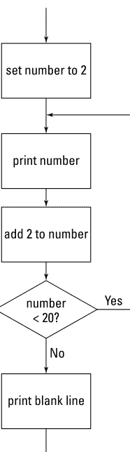

图 5-2：`do-while`循环的流程图。

关于`do-while`循环还有几点需要注意：

- 你通常可以跳过循环前表达式中出现的变量初始化，因为在循环体内的语句至少执行一次之前，表达式不会被求值。
- 你可以在`do-while`循环中使用`break`和`continue`语句，就像在`while`循环中一样。
- 一些程序员喜欢将开始循环体的大括号与`do`语句放在同一行，并将结束`do-while`循环的`while`语句与标记循环体结束的大括号放在同一行。只要你觉得方便，对我来说都可以。只要记住，编译器在处理缩进和空格问题时是不关心的即可。

## 验证用户输入

`do-while`循环在验证用户输入时特别有用。假设你正在编写一个玩赌游戏的程序，你想从控制台获取用户的投注金额。用户可以投掷任何金额（尽管仅限美元），但投注金额不能超过其银行账户的余额，且不能投负数或零。这里有一个使用`do-while`循环获取用户输入的程序：

```java
import java.util.Scanner;
public class GetBet {
    static Scanner sc = new Scanner(System.in);
    public static void main(String[] args) {
        int bank = 1000; // 假设用户有 $1,000
        int bet; // 用户输入的投注
        System.out.println("You can bet between 1 and " + bank);
        do {
            System.out.print("Enter your bet: ");
            bet = sc.nextInt();
        } while (bet < 0) || (bet > bank);
        System.out.println("Your money's good here.");
    }
}
```

`do-while`循环使用的表达式验证了用户输入的数据，这意味着它根据一组标准对数据进行检查，以确保数据是可以接受的。

`||`运算符执行“或”测试。如果运算符两侧的表达式中至少有一个为真，它就返回`true`。因此，如果投注小于等于零（`bet <= 0`），或者投注大于银行存款（`bet > bank`），该表达式将返回`true`。

这种类型的验证只检查用户是否输入了接受范围内的有效数字。如果用户输入了非有效数字（例如 Butter 或 Humperdinck），程序将会崩溃并在控制台上抛出一堆异常消息。你将在第 8 章的 Mess 2 中了解到如何清理这些。

（实际上，你可以通过使用`do`循环或`while`循环以及`Scanner`类的`hasNextDouble`方法来避免这个问题，我在第 2 卷第 2 章描述过它们。）

如果你想在用户输入错误时显示错误消息，你必须在循环内部使用`if`语句，并且这个`if`语句必须复制验证输入数据的表达式。因此，执行验证的表达式必须出现两次。例如：

```java
import java.util.Scanner;

public class GetBet2 {
    static Scanner sc = new Scanner(System.in);
    public static void main(String[] args) {
        int bank = 1000; // 假设用户有 $1,000
        int bet; // 用户输入的投注

        System.out.println("You can bet between 1 and " + bank);
        do {
            System.out.print("Enter your bet: ");
            bet = sc.nextInt();
            if ((bet <= 0) || (bet > bank)) {
                System.out.println("What, are you crazy?");
            }
        } while ((bet <= 0) || (bet > bank));
        System.out.println("Your money's good here.");
    }
}
```

在这里，如果用户尝试输入不当的投注，`if`语句会显示消息“What, are you crazy?”。

你可以通过在`do-while`循环体内添加一个布尔变量（如果数据无效则设置该变量）来避免重复执行数据验证表达式，如下例所示：

```java
import java.util.Scanner;
public class GetBet3
```


```java
static Scanner sc = new Scanner(System.in);
public static void main(String[] args)
{
    int bank = 1000; // 假设用户有 $1,000
    int bet; // 用户输入的投注
    boolean validBet; // 表示投注是否有效
    System.out.println(
        "You can bet between 1 and " + bank;
    );
    do {
        System.out.print("Enter your bet: ");
        bet = sc.nextInt();
        validBet = true;
        if ((bet <= 0) || (bet > bank)) {
            validBet = false;
            System.out.println("What, are you crazy?");
        }
    } while (!validBet);
    System.out.println("Your money's good here.");
}
```

在这个示例中，我使用布尔变量`validBet`来指示投注是否有效。

## 使用 for 循环

那些学习过计算机科学的人将计数变量称为迭代器（iterator）。他们这样做是因为认为我们不知道它的意思。但我们清楚迭代器应该放在哪里。

### 理解 for 循环的格式

我想让你了解`for`循环，以便你知道如何构造。`for`循环遵循以下基本格式：

```
for (初始化表达式; 测试表达式; 计数表达式)
```

`for`关键字括号内的三个表达式工作方式如下。后面的段落解释了这三个表达式的作用：

- 初始化表达式在循环开始之前执行。你使用此表达式来初始化计数变量。如果你在`for`语句之前没有计数变量，可以在这里声明。
- 测试表达式每次循环时都会执行，以确定是否继续循环。通常，这个表达式测试计数变量，以确保它仍然小于要计数的值。只要该表达式为`true`，循环就会执行。当测试表达式为`false`时，循环结束。
- 计数表达式每次循环时都会执行。它的工作通常是增加计数变量。

图 5-3 显示了一个流程图，帮助你可视化`for`循环的工作原理。

这里有一个简单的`for`循环，可以在控制台上显示数字 1 到 10：

```java
public class CountToTen {
    public static void main(String[] args) {
        for (int i = 1; i <= 10; i++) {
            System.out.println(i);
        }
    }
}
```

运行这个程序，你在控制台上看到：

```
1
2
3
4
5
6
7
8
9
10
```

测试表达式是`i <= 10`。结果是只要`i`小于或等于 10，循环就会继续执行。

计数表达式是`i++`。结果是循环每执行一次，变量`i`就会加 1。

循环体是单语句`System.out.println(i)`。结果是循环每执行一次，变量的值就会被打印到控制台上。


我用这些类型来描述`for`循环中的三个表达式。正式地，Java 将它们称为`ForInit`表达式（初始化表达式）、条件表达式（condition expression）和`ForUpdate`（更新表达式）。你不觉得我的术语更具描述性吗？

### 计数变量的作用域

如果你在初始化语句中声明计数器变量，那么该变量的作用范围将仅限于`for`语句本身。然后你可以使用括号内和循环体中出现的其他变量，但不能在循环外部使用它。这段示例代码会导致编译错误：

```java
public class CountToTenError
{
    public static void main(String[] args)
    {
        for (int i = 1; i <= 10; i++)
            System.out.println(i);
        System.out.println("The final value of i is " + i);
    }
}
```

这是因为`main`方法中的最后一条语句引用了变量`i`，而它由于声明在`for`循环内部已经出了作用域。不过，你并不需要在`for`语句本身中声明计数器变量。以下程序可以运行：

```java
public class CountToTenErrorFixed
{
    public static void main(String[] args)
    {
        int i;
        for (i = 1; i <= 10; i++)
            System.out.println(i);
        System.out.println("The final value of i is " + i);
    }
}
```

注意，由于变量`i`在`for`语句之前声明，初始化表达式没有指定变量的数据类型。当你运行这个程序时，控制窗口会显示以下内容：

```
1
2
3
4
5
6
7
8
9
10
The final value of i is 11
```

### 统计偶数

在本章的开头，你看到过一个统计到 20 的偶数的程序。你也可以用`for`循环来实现。你只需要调整计数表达式即可。这是一个使用`for`循环的`CountEven`程序：

```java
public class ForEvenCounter
{
    public static void main(String[] args) {
        for (int number = 2; number <= 20; number += 2)
            System.out.print(number + " ");
        System.out.println();
    }
}
```

运行这个程序，控制窗口显示了：

```
2 4 6 8 10 12 14 16 18 20
```

### 倒计时

没有规则规定`for`循环只能向前计数。要进行倒计时，你只需要调整它们的`for`表达式。通常一样，初始化表达式指定计数器的起始值。使用大于测试代替小于测试，并且计数表达式是对计数变量进行减法而非加法。例如：

```java
public class CountDown {
    public static void main(String[] args) {
        for (int count = 10; count >= 1; count--) {
            System.out.println(count);
        }
    }
}
```

运行这个程序，你将在控制窗口看到此结果：

```
10
9
8
7
6
5
4
3
2
1
```

> 如果你是在 60 年代忠诚地关注 NASA 的发射长大的（我如此），你会欣赏这个倒计时程序的变体：

```java
public class LaunchControl {
    public static void main(String[] args) {
        System.out.println("We are go for launch in T minus 10...");
        for (int count = 10; count >= 0; count--) {
            System.out.println(count);
        }
    }
}
```


168 第 2 部分 基础

（注：原文 187-189 页的 OCR 严重损坏。以下是根据提供的片段重构的逻辑。）

当你运行它时，显示的输出如下：

```
We are go for launch in T minus 10...
9...
8...
7...
6...
5...
4...
3...
2...
1...
0...
All engines running!
Liftoff! We have a liftoff!
```

你难道听不见任务控制中心吗？

### 不带主体的 for

有些程序员喜欢保持代码简洁。这里有一个没有循环体的`for`循环示例，单语句直接放在`for`循环头之后：

```java
public class Terse {
    public static void main(String[] args) {
        for (int i = 1; i <= 10; i++)
            System.out.println(i);
    }
}
```

### 组合你的表达式

关于循环的另一个特点是，三个表达式都是可选的。如果你省略了一个或多个表达式，只需保留分号作为占位符，编译器就知道发生了什么。

省略测试表达式或迭代表达式并不常见，但省略初始化表达式是很常见的。例如，你在`for`循环中递增的变量在进入循环之前可能已经声明并初始化。在这种情况下，你可以省略初始化表达式，如下所示：

```java
Scanner sc = new Scanner(System.in);
System.out.print("Where should I start?");
int a = sc.nextInt();
for (: a >= 0; a--)
    System.out.println(a);
```

这个循环简单地对用户输入的任何数字进行倒数。

如果你省略了测试表达式，最好在循环的某处放置一个`break`语句（正如本章较之前“跳出循环”节中描述的那样）。否则，你会发现自己陷入了无限循环。

如果你愿意，可以省略所有三个表达式，如下所示：

```java
for(;;)
    System.out.println("Oops");
```

这个程序同样会导致无限循环。这样做几乎没有理由，因为`while(true)`具有相同的效果且更加直观。

## 中断和继续你的 for 循环

你可以像在`while`或`do-while`循环中一样在`for`循环中使用`break`。在这里我重新回顾了本章之前的“恐 12 症”程序，这次使用了循环：

```java
public class ForDodecapaphobia{
    public static void main(String[] args)
    {
        for (int number = 2; number <=20; number += 2)
        {
            if (number == 12)
                break;
            System.out.print(number + " ");
        }
        System.out.println();
    }
}
```

和之前一样，这个版本按 2 计数直到达到 20。然而，当它遇到 12 时，它会恐慌并终止循环，因此它永远不会真正到达 14、16、18 或 20。控制台输出如下：

```
2 4 6 8 10
```

这里有一个使用`continue`语句跳过 12 而不是跳出循环的版本：


```java
public class ForDodecaphabia2
{
    public static void main(String[] args) {
        for (int number = 2; number <=20; number += 2) {
            if (number == 12)
                continue;
            System.out.print(number + " ");
        }
        System.out.println();
    }
}
```

这个版本的控制台输出如下：

```
2 4 6 8 10 14 16 18 20
```

## 嵌套你的循环

循环可以包含循环。这种现象的技术术语是“loop-de-loop”（开玩笑的）。实际上，技术术语是**嵌套循环**，它指的是完全包含另一个循环内部的循环。内部的循环被称为内层循环，外部的循环被称为外层循环。

## 一个简单的嵌套 `for` 循环

为了演示嵌套的基础，这里有一个使用对嵌套 `for` 循环的简单程序：

```java
public class NestedLoop
{
    public static void main(String[] args) 
{
  for(int x = 1; x < 10; x++) {
    for (int y = 1; y < 10; y++) {
      System.out.print(x + "-" + y + " ");
    }
    System.out.println();
  }
}
```

这个程序包含两个循环。外层循环使用`x`作为其计数变量，内层循环使用`y`。外层循环每执行一次，内层循环就会执行 10 次，并在每次通过内层循环时打印`x`和`y`的值。当内层循环结束，调用无参数的`System.out.println`会强制换行，开始新行。然后外层循环继续循环，直到打印下一行。

当你运行这个程序时，控制台显示如下：

| 1-1 | 1-2 | 1-3 | 1-4 | 1-5 | 1-6 | 1-7 | 1-8 | 1-9 |

| 2-1 | 2-2 | 2-3 | 2-4 | 2-5 | 2-6 | 2-7 | 2-8 | 2-9 |

| 3-1 | 3-2 | 3-3 | 3-4 | 3-5 | 3-6 | 3-7 | 3-8 | 3-9 |

| 4-1 | 4-2 | 4-3 | 4-4 | 4-5 | 4-6 | 4-7 | 4-8 | 4-9 |

| 5-1 | 5-2 | 5-3 | 5-4 | 5-5 | 5-6 | 5-7 | 5-8 | 5-9 |

| 6-1 | 6-2 | 6-3 | 6-4 | 6-5 | 6-6 | 6-7 | 6-8 | 6-9 |

| 7-1 | 7-2 | 7-3 | 7-4 | 7-5 | 7-6 | 7-7 | 7-8 | 7-9 |

| 8-1 | 8-2 | 8-3 | 8-4 | 8-5 | 8-6 | 8-7 | 8-8 | 8-9 |

| 9-1 | 9-2 | 9-3 | 9-4 | 9-5 | 9-6 | 9-7 | 9-8 | 9-9 |

## 本章内容

- 避免大型 `else-if` 语句带来的麻烦
- 使用 `switch` 语句
- 创建 `case` 分组
- 在 `case` 使用字符

## 第 6 章

### 玩转 `switch`

在第 2 卷第 4 章中，你了解了 Java 决策的骨干力量：布尔表达式和强大的 `if` 语句。在本章中，你将发现另一个 Java 决策工具：`switch` 语句。`switch` 语句是一个功能相当有限的野兽，但它非常擅长处理一种特定类型的决策：根据存储在整数变量中的值从几个动作中选择一个。事实证明，这种需求经常出现。当这种需求发生时，你希望`switch`语句能够随手可用。

### 对抗 `else-if` 怪物

许多应用程序需要根据某些控制一切的值，对要执行的操作进行简单的逻辑选择。正如我在第 2 卷第 4 章中描述的那样，这些情况通常通过一大串连接在一起的 `else-if` 语句链来处理。

不幸的是，这些东西可能会失控。`else-if` 链的看起来可能像 DNA 双螺旋结构，或者像《黑客矩阵》中在屏幕上流下的代码那样，有数百行代码一个接一个地串联着 `else-if`。`switch` 语句提供了一个简洁得多的替代方案。

## 查看 `else-if` 示例程序

列表 6–1 显示了一个简单的程序，可能用于解码佛罗里达州或俄亥州投票机的错误代码。

### 列表 6-1：`else-if` 版本的投票机错误解码器

```java
import java.util.Scanner;
public class VoterApp {
    static Scanner sc = new Scanner(System.in);
    public static void main(String[] args) {
        System.out.println(
            + "Welcome to the voting machine "
            + "error decoder. \n\n"
            + "If your voting machine generates "
            + "an error code, \n\n"
            + "You can use this program to determine "
            + "the exact cause of the error. \n\n");
        System.out.print("Enter error code: ");
    }
}

int err = sc.nextInt();

String msg;
if (err==1) {
    msg = "Voter marked more than one candidate. \n"
    + "Ballot rejected.";
} else if (err==2) {
    msg = "Box checked and write-in candidate "
    + "entered. \nBallot rejected.";
} else if (err==3) {
    msg = "Entire ballot was blank. \n\n"
    + "Ballot filled in according to"
    + "secret plan.";
} else if (err==4) {
    msg = "Matching unusual about the ballot. \n\n"
    + "Voter randomly selected for tax audit.";
} else if (err==5) {
    msg = "Voter filled in every box. \n\n"
    + "Ballot counted twice.";
} else if (err==6) {
    msg = "Voter drooled in voting machine. \n\n"
    + "Beginning spin cycle.";
} else if (err==7)
    msg = "Voter lied pollster after voting.\n"
    + "Voter's ballot changed \n"
    + "to matching data;";
else
    
    msg = "Voter filled out ballot correctly.\n"
    + "Ballot discarded anyway.\n";
    System.out.println(msg);
```

哇！这个程序只需要解码 7 个错误代码。如果机器有 500 个代码会怎样？

## 创建示例程序的改进版本

幸运的是，Java 有一个特殊的语句，专门为像投票机错误解码器那样的任务设计：`switch` 语句。具体来说，当你需要根据整数或字符类型的值从几个备选项中选择一个时，`switch` 语句非常有用。

列表 6-2 显示了使用 `switch` 语句代替大型 `else–if` 结构的投票机错误解码器程序版本。我认为你会同意，这个版本的程序更容易理解。`switch` 语句使得所有信息都是根据`err`变量的值选择的，清晰而易见。

### 列表 6-2：

```java
import java.util.Scanner;
public class VoterApp2
{
  static Scanner sc = new Scanner(System.in);

  public static void main(String[] args)
{
  System.out.println(
+ "Welcome to the voting machine "\n+ "error code decoder.\n"
+ "If your voter machine generates "\n+ "an error code,\n"
+ "you can use this program to determine "\n+ "the exact\ncause of the error.\n");
  System.out.print("Enter the error code: ");
}
```

（继续）

### 列表 6-2：（继续）

```java
int err = sc.nextInt();

String msg;
switch (err) {
    case 1:
        msg = "Voter marked more than one \""
        + "candidate.\nBallot rejected.";
        break;
    case 2:
        msg = "Box checked and write-in candidate \""
        + "entered.\nBallot rejected.";
        break;
    case 3:
        msg = "Entire ballot was blank.\n"
        + "Ballot filled in according to"
        + "secret plan.";
        break;
    case 4:
        msg = "Matching unusual about the ballot.\n"
        + "Voter randomly selected for tax audit.";
        break;
    case 5:
        msg = "Voter filled in every box. \n"
        + "Ballot counted twice.";
        break;
    case 6:
        msg = "Voter drooled in voting machine. \n"
        + "Beginning spin cycle.";
        break;
    case 7:
        msg = "Voter lied pollster after voting.\n"
        + "Voter's ballot changed \n"
        + "to matching data;";
        break;
    default:
        msg = "Voter filled out ballot correctly.\n"
        + "Ballot discarded anyway.\n";
        break;
}
System.out.println(msg);
```

### 使用 `switch`

`switch` 的基本形式如下：

```java
switch (expression)
{
    case constant:
        statements;
        break;
    case constant:
        statements;
        break;
    default:
        statements;
        break;
}
```

表达式必须求值为为`int`、`short`或`char`类型。它不能是`long`或浮点类型。

你可以编写任意数量的`case`分组。每个分组以`case`关键字开头，后面跟着一个常量（通常是数字字面量）和一个冒号。然后编写一个或多个语句，当表达式等于常量时执行。每个`case`分组的最后一行是`break`语句，它导致`switch`语句结束。

`default`分组是可选的，类似于全捕分组。只有当之前的 `case` 没有匹配表达式时，才会执行它的语句。

注意`case`分组不是大括号块。相反，每个`case`分组从`case`关键字开始，到下一个`case`关键字结束。然而，所有的`case`分组都定义为一组大括号块。

每个`case`分组的最后一个语句通常是`break`语句。`break`语句导致控制跳到`switch`语句的结束。如果你省略了`break`语句，控制将进入下一个分组。

## 查看带有流程图的 `switch` 示例

好了，投票机错误解码挺有趣的。这里有一个更接地气的例子。假设你需要根据整数（1、2 或 3）表示的销售类别，根据下表设置佣金：

| 类别 | 佣金 |

| --- | --- |

| 1 | 2% |

| 2 | 3.5% |

| 3 | 5% |

| 其他任何值 | 0% |

你可以使用以下`switch`语句来实现此：

```java
double commissionRate;
switch (salesClass) {
  case 1:
    commissionRate = 0.02;
    break;
  case 2:
    commissionRate = 0.035;
    break;
  case 3:
    commissionRate = 0.05;
    break;
  default:
    commissionRate = 0.0;
    break;
}
```

图 6-1 显示了描述此`switch`语句操作的流程图。你可以看到，这个流程图与图 4-3（第 2 卷第 4 章）相似，因为`switch`语句的操作与`else-if`语句的操作相似。

> 流程图让我想起了过去的日子，在那个时代，许多 COBOL 编程公司要求程序员在编写任何代码之前，必须为每个程序绘制流程图。流程图并没有真正帮助程序员写出更好的程序，但画起来很有趣。

## 在 `switch` 语句中使用 `if` 语句

你可以自由地在`case`组中包含任何你需要的语句，包括`if`语句。假设你的佣金结构取决于总销售额以及销售等级，如下表所示：

| 等级 | 销售额 < $10,000 | 销售额 $10,000 及以上 |

|---|---|---|

| 1 | 1% | 2% |

| 2 | 2.5% | 3.5% |

| 3 | 4% | 5% |

| 其他任何值 | 0% | 0% |

```java
double commissionRate;
switch (salesClass) {
  case 1:
    if (salesTotal < 10000.0)
      commissionRate = 0.01;
    else
      commissionRate = 0.02;
    break;
  case 2:
    if (salesTotal < 10000.0)
      commissionRate = 0.025;
    else
      commissionRate = 0.035;
    break;
  case 3:
    if (salesTotal < 10000.0)
      commissionRate = 0.04;
    else
      commissionRate = 0.05;
    break;
  default:
    commissionRate = 0.0;
    break;
}
```

你可以使用下面的 `switch` 语句：

在这里，每个`case`组都包含一个`if`语句。如有必要，这些语句可以是复杂的嵌套`if`语句。

各位，除了`case`组中的`if`语句外，这里没什么好关注的。请继续。

### 创建字符分支

除了有一个很不错的押韵标题外，本节还展示了你如何在`switch`语句中使用`char`变量而不是整数。当你使用`char`类型时，为每个`case`组提供两个连续的`case`常数是常见的做法，以便同时处理大和小写字母。假设你需要根据下表，根据字符代码而不是整数值为销售等级设置佣金率：

| 等级 | 佣金率 |

|---|---|

| A a | 2% |

| B b | 3.5% |

| C 或 c | 5% |

| 其他任何值 | 0% |

这里有一个可以解决问题的 `switch` 语句：


```java
double commissionRate;
switch (salesClass) {
    case 'A':
    case 'a':
        commissionRate = 0.02;
        break;
    case 'B':
        commissionRate = 0.035;
        break;
    case 'C':
    case 'c':
        commissionRate = 0.05;
        break;
    default:
        commissionRate = 0.0;
        break;
}
```

理解这个示例的关键在于意识到，你不需要为某个 `case` 组编写任何语句——如果你在某个 `case` 组中省略了 `break` 语句，控制就会贯穿（fall through）到下一个 `case` 组。因此，`case 'A'` 组不包含任何语句，但控制会贯穿到 `case 'a'` 组。

你使用单引号而不是引号来创建字符字面量。

## 有意遗漏 `break` 语句

虽然 `switch` 语句问题最常见的原因是不小心在 `case` 组的末尾漏掉了 `break` 语句，但有时你需要故意这样做。许多应用程序具有根据控制变量逐步添加的功能。例如，你当地的洗车店可能会出售不同服务的套餐，如下表所示：

| 套餐 | 服务 |
| --- | --- |
| A | 洗车、真空和手干 |
| B | 套餐 A + 打蜡 |
| C | 套餐 B + 皮革/乙烯处理 |
| D | 套餐 C + 轮胎处理 |
| E | 套餐 D + 新车香味 |

列表 6–3 显示了一个程序了当你订购特定套餐时获得的所有产品。它的工作原理是在 `switch` 语句中反序测试套餐代码（从 `case E` 开始），并将每个套餐附带的产品添加到 `details` 变量中。除了最后一个组外，没有任何 `case` 组包含 `break` 语句。结果是，控制会贯穿每个 `case` 组到下一个。因此，一旦某个 `case` 组匹配成功，`switch` 语句中的其余 `case` 组都会被执行。

### 列表 6–3：洗车应用程序

```java
import java.util.Scanner;

public class CarWashApp {
    static Scanner sc = new Scanner(System.in);

    public static void main(String[] args) {
        System.out.println("The car wash application!\n\n");
        System.out.print("Enter the package code: ");
        String s = sc.next();
        char p = s.charAt(0);

        String details = "";
        switch (p) {
          case 'E':
          case 'e':
            details += "\tNew Car Scent, plus ... \n";
          case 'D':
          case 'd':
            details += "\tire Treatment, plus ... \n";
          case 'C':
          case 'c':
            details += "\tLeather/Vinyl Treatment, plus ... \n";
          case 'B':
          case 'b':
            details += "\twax, plus ... \n";
          case 'A':
          case 'a':
            details += "\twash, vacuum, and hand dry.\n";
            break;
          default:
            details += "\tThat's one of the codes.";
            break;
        }

        System.out.println("\nThat package includes:\n");
        System.out.println(details);
    }
}
```

私下里说，编写依赖 `switch` 语句贯穿缝隙（如示例所示）的程序并不是好主意。相反，可以考虑在独立的方法中编写每个 `case` 的语句，并为每个组调用所需的方法。你可以在每个组的末尾使用 `break` 语句来防止 `switch` 语句中的贯穿。（使用贯穿来相同方式处理大和小写字母并不困惑，本程序将使用这种方法。）

### 列表 6-4：防止贯穿的洗车程序版本

```java
import java.util.Scanner;

public class CarWashApp {
  static Scanner sc = new Scanner(System.in);

  public static void main(String[] args) {
    System.out.println("The car wash application!\n\n");
    System.out.print("Enter the package code: ");
    String s = sc.next();
    char p = s.charAt(0);

    String details = "";
    switch (p) {
      case 'E':
      case 'e':
        details = packageE() + packageD() + packageC() + packageB() + packageA();
        break;
      case 'D':
      case 'd':
        details = packageD() + packageC() + packageB() + packageA();
        break;
      case 'C':
      case 'c':
        details = packageC() + packageB() + packageA();
        break;
      case 'B':
      case 'b':
        details = packageB() + packageA();
        break;
      case 'A':
      case 'a':
        details = packageA();
        break;
      default:
        details = "That's one of the codes.";
        break;
    }
    System.out.println("\nThat package includes:\n");
    System.out.println(details);
  }

  public static String packageA() {
    return "\twash, vacuum, and hand dry.\n";
  }

  public static String packageB() {
    return "\twax, plus ... \n";
  }

  public static String packageC() {
    return "\tLeather/Vinyl Treatment, plus ... \n";
  }

  public static String packageD() {
    return "\tire Treatment, plus ... \n";
  }

  public static String packageE() {
    return "\tNew Car Scent, plus ... \n";
  }
}
```

## 使用字符串进行切换

从 Java 1.7 开始，`switch` 语句中的表达式可以求值为字符串值。列表 6–5 显示了洗车程序的版本，它使用了字符串代码 PRESIDENT、ELITE、DELUXE、SUPER 和 STANDARD，而不是字母 A 到 E。注意为了允许用户以不同的方式输入这些代码，输入在与 `switch` 语句中的字符串常量对比之前已转换为全大写。

### 列表 6-5：使用字符串的洗车程序版本

```java
import java.util.Scanner;

public class CarWashStringApp {
    static Scanner sc = new Scanner(System.in);

    public static void main(String[] args) {
        System.out.println("The car wash application!\n\n");
        System.out.print("Enter the package code: ");
        String s = sc.next();

        String details = "";
        switch (s.toUpperCase()) {
            case "PRESIDENTIAL":
                details += "\tNew Car Scent, plus ... \n";
            case "ELITE":
                details += "\tTreatment, plus ... \n";
            case "DELUXE":
                details += "\tLeather/Vinyl Treatment, plus ... \n";
            case "SUPER":
                details += "\tWax, plus ... \n";
            case "STANDARD":
                details += "\tWash, vacuum, and hand dry.\n";
                break;
            default:
                details = "That's not one of the codes.";
                break;
        }
        System.out.println("\nThat package includes:\n");
        System.out.println(details);
    }
}
```

## 第 7 章：为你的 Java 添加一些方法

在 Java 中，方法是一个语句块，它有一个名称，并且可以从程序的某个其他地方通过调用（也称为 invoke）来执行。你可能没有意识到，但在使用方法方面你已经非常有经验了。例如，要在控制台打印文本，你使用 `println` 或 `print` 方法。要从用户处获取整数，你使用 `nextInt` 方法。要比较字符串值，你使用 `equals` 或 `equalsIgnoreCase` 方法。最后，所有方法中的“祖父级”方法 `main`——包含了在你运行程序时执行的语句。

到目前为止你使用的所有方法（`main` 方法除外）都是由 Java API 定义的，并属于特定的 Java 类。例如，`nextInt` 方法属于 `Scanner` 类，而 `equalsIgnoreCase` 方法属于 `String` 类。相比之下，`main` 方法属于由你的应用程序定义的类。

在本章中，你将了解到如何创建作为你应用程序类的一部分的其他方法。然后，你就可以从你的 `main` 方法中调用这些方法。你会发现，对于除了最短的 Java 程序之外的所有程序，这种技术都是非常有用的。

## 方法的乐趣

使用方法可以极大地提高你编程生活的质量。假设你的程序要解决的问题非常复杂，你至少需要 1000 条 Java 语句才能完成。你可以将所有 1000 条语句都放在 `main` 方法中，但那会占用好几页的内容。更好的做法是将你的程序分成几个定义良好的代码段，并将每个语句放置在单独的方法中。这样，你的 `main` 方法只需要按照正确的顺序调用其他方法即可。

假设你的程序需要执行某些计算，例如在月球飞行中，主火箭燃烧多久进行中途修正，且程序需要在多个地方执行此计算。如果没有方法，你就必须复制执行这些计算的语句。这种方法不仅容易出错，而且让你的程序更难测试和调试。如果你将计算放在一个方法中，你可以在需要执行计算时简单地调用该方法。这些方法可以帮助你减少重复代码。

方法的另一个良好用处是简化使用长循环的代码结构。假设你有一个体体包含 500 条语句的 `while` 循环。这种结构让你很难找到标记循环体结束的大括号。当你找到它时，你可能已经忘记这个 `while` 循环是做什么的了。你可以通过将体中的代码放在单独的方法中简化这个 `while` 循环。这样，`while` 循环只需要调用该方法即可。

此时，面向对象的狂热分子们开始流汗了。他们中的一些已经离开了礼堂，因为我正在用传统的编程术语而不是现代面向对象的编程术语来描述方法。好吧，他们是对的，但又怎样？你会发现方法的意义比仅仅将一个长方法拆分成更小的部分要大得多。即使是一些是最面向对象的程序也使用方法来防止重复代码。

## 创建方法的基础

所有方法（包括 `main` 方法）都必须以方法声明开始。以下是我在本章中提到的方法声明的基本形式：

```java
public static return-type method-name(parameter-list)
{
    statements
}
```

接下来的段落逐部分地描述了方法声明：

- **public**：此关键字表示该方法的存在应该向世界公开，任何创建（或更准确地说，使用）你的 Java 程序的任何 Java 程序都应该能够使用你的方法。你将了解到更多关于 `public` 的含义，并看到在不同情况下有用的 `public` 替代方案。
- **static**：此关键字声明该方法是静态方法，这意味着你可以在不创建其所定义类的实例的情况下调用它。`main` 方法必须始终是静态的，包含 `main` 方法的类中的任何其他方法通常也应该是静态的。
- **return-type**：在单词 `static` 之后是返回类型，它指示方法在被调用时是否返回值，如果是，返回的是什么类型。如果方法不返回值，请使用 `void`。
- **method-name**：现在是方法的名称。创建方法名称的规则与创建变量的规则相同：你可以使用字母和数字的组合，但名称必须以字母开头。此外，它还可以包含美元符号（`$`）和下划线字符（`_`）。不允许使用其他特殊字符。为你的方法选择名称时，尝试选择一个相对短但具有描述性的名称。像 `calculateAmountOfTheInvoice` 这样的方法名有点长，但仅用 `calc` 就显得很模糊。类似 `calculateTotal` 这样的名称似乎比较合理。
- **parameter list**：你可以通过在方法名后的括号中列出值向方法传递一个或多个值。方法声明中的参数列表让 Java 知道方法应该期望接收什么类型的参数，并提供方法体中的语句可以作为局部变量访问的名称。你将在本章稍后的“带参数的方法”部分学到更多关于参数的知识。如果方法不接受参数，你必须关闭包围参数列表的括号。只需留空括号即可。
- **Method body**：方法体由一组大括号包含的一个或多个 Java 语句组成。与 `if`、`while` 和 `for` 等 Java 语句不同，如果体只包含一条语句，方法体也要求使用大括号。

## 一个示例

好了，所有这些都有点抽象。现在，为了一个具体的示例，我提供一个 Hello, World! 程序的版本，其中消息不是由 `main` 方法显示的，而是由一个名为 `sayHello` 的方法显示的，该方法由 `main` 方法调用：

```java
public class HelloWorldMethod {
    public static void main(String[] args) {
        sayHello();
    }

    public static void sayHello() {
        System.out.println("Hello, World!");
    }
}
```

这个程序诚然易见，但它说明了在 Java 中使用方法的基本知识。在这里，`main` 方法中的语句调用了 `sayHello` 方法，后者随后在控制台上显示消息。

方法在你的 Java 源文件中出现的顺序并不重要。唯一的规则是所有方法必须在类体内声明——即在第一个左括号和最后一个右括号之间。这里 `HelloWorldMethod` 程序的一个版本，我反转了方法的顺序：

```java
public class HelloWorldMethod {
    public static void sayHello() {
        System.out.println("Hello, World!");
    }

    public static void main(String[] args) {
        sayHello();
    }
}
```

### 另一个示例


好了，上一个示例很愚蠢。没有正常人会创建一个只有一行代码的方法，然后从另一个同样只有一行代码的方法中调用它……

# 列表 7-1：（续）

```java
System.out.println("Let's play a guessing game!");

while (keepPlaying) {
    playRound();
    System.out.println("\nThank you for playing!");
}
public static void playRound() {
    boolean validInput;
    int number, guess;
    String answer;

    // 选取一个随机数
    number = (int)(Math.random() * 10) + 1;
    System.out.println("\nI'm thinking of a number " + "between 1 and 10.");

    // 获取猜测
    System.out.print("What do you think it is? ");
    do {
        guess = sc.nextInt();
        validInput = true;
        if ((guess < 1) || (guess > 10)) {
            System.out.print("I said, between 1 " + "and 10. Try again: ");
            validInput = false;
        }
    } while (!validInput);

    // 检查猜测
    if (guess == number) {
        System.out.println("You're right!");
    } else {
        System.out.println("You're wrong! " + "The number was " + number);
    }

    // 再次游戏？
    System.out.print("\nPlay again? (Y or N)");
    answer = sc.next();
    validInput = true;
    if (answer.equalsIgnoreCase("Y")) {
        keepPlaying = true;
    } else if (answer.equalsIgnoreCase("N")) {
        keepPlaying = false;
    }
}
```

```java
keepPlaying = false;
else
validInput = false;
while (!validInput) {}
```

关于此方法，有几个重要的细节需要注意：

- 因为 `main` 方法（第 12 行）和 `playRound` 方法（第 60 行）都必须访问 `keepPlaying` 变量，我将其声明为类变量，而不是 `main` 方法中的局部变量。
- 如果你打算从静态方法访问类变量，则类变量必须是 `static` 的。
- `main` 方法中的循环体只有一个：对 `playRound` 方法的调用。因此，每次循环重复时，程序都会与用户玩一轮游戏。
- `playRound` 方法的声明将该方法标记为 `static`，以便静态方法可以调用它。

`playRound` 方法的体与第 2 卷第 5 章所示的程序单方法版本中的循环体完全相同。如果你想复习这段代码是如何运行的，我建议你参考该章节结尾附近的列表 5-1。

## 返回值的方法

不返回任何数据就无法工作的方法在有限的情况下才有用。方法的真正用处在于它们可以执行平凡的任务（例如计算），然后将计算结果返回给调用方法，以便调用方法能够对该值进行处理。你将在接下来的章节中学习如何做到。

### 声明方法的返回类型

要创建一个返回值的方法，你只需要在方法声明中代替 `void` 关键字，指明方法所返回的值的类型。这里有一个创建一个返回 `int` 值的方法声明：

```java
public static int getRandomNumber()
```

在这里，`getRandomNumber` 方法计算一个随机数，并将该数返回给调用者。

方法的返回类型可以是 Java 的任何基本返回类型（在第 2 卷第 2 章中描述）：

```java
int
long
float
char
short
byte
double
boolean
```

或者，返回类型可以是引用类型，包括 API 定义的类（如 `String`）或你自己创建类。

### 使用 `return` 语句

当你在方法声明中指定 `void` 的返回类型时，方法体必须包含一个 `return` 语句来指定要返回的值。`return` 语句的形式如下：

```java
return expression;
```

表达式必须求出一个与方法声明中列出的类型相同的值。换句话说，如果方法返回 `int`，则 `return` 语句中的表达式必须求值为 `int`。

这里有一个使用方法确定 1 到 10 之间随机数的程序：

```java
public class RandomNumber {
    public static void main(String[] args) {
        int number = getRandomNumber();
        System.out.println("The number is " + number);
    }
    public static int getRandomNumber() {
        int num = (int)(Math.random() * 10) + 1;
        return num;
    }
}
```

在这个程序中，`getRandomNumber` 方法使用 `Math.random` 方法计算一个 1 到 10 之间的随机数。

`getGuess`：此方法获取用户的猜测，确保其在 1 到 10 之间，如果在接受范围内，则返回该猜测。

`askAnotherRound`：此方法询问用户是否再玩一轮，并返回一个布尔值以指示用户是否想继续。

# 列表 7-2：猜数字程序的另一个版本

```java
import java.util.Scanner;

public class GuessingGameMethod {
    static Scanner sc = new Scanner(System.in);

    public static void main(String[] args) {
        do {
            System.out.println("Let's play a guessing game!");
            playRound();
        } while (askAnotherRound());
        System.out.println("\nThank you for playing!");
    }

    public static void playRound() {
        boolean validInput;
        int number, guess;
        String answer;

        // Pick a random number
        number = getRandomNumber();

        // Get the guess
        System.out.println("\nI'm thinking of a number " 
            + "between 1 and 10.");
        System.out.print("What do you think it is? ");
        guess = getGuess();

        // Check the guess
        if (guess == number) {
            System.out.println("You're right!");
        } else {
            System.out.println("You're wrong!") 
                + " The number was " + number);
        }
    }

    public static int getRandomNumber() {
        return (int)(Math.random() * 10) + 1;
    }

    public static int getGuess() {
        while (true) {
            int guess = sc.nextInt();
            if ((guess < 1) || (guess > 10)) {
                System.out.print("I said, between 1 and 10. "
                + "Try again: ");
            } else {
                return guess;
            }
        }
    }

    public static boolean askAnotherRound() {
        while (true) {
            String answer;
            System.out.print("\nPlay again? (Y or N) ");
            answer = sc.next();
            if (answer.equalsIgnoreCase("Y")) {
                return true;
            } else if (answer.equalsIgnoreCase("N")) {
                return false;
            }
        }
    }
}
```

以下段落指出了该程序的关键行：

- → `main` 方法中循环的开始。`do` 循环的每次循环都玩一轮游戏。循环会持续，直到用户指示停止。
- → 调用 `playRound` 方法玩一轮游戏。
- → 调用 `askAnotherRound` 方法确定用户是否想再玩一轮。该方法返回的布尔值用于 `do` 循环的表达式。如果返回 `true`，`do` 循环就会重复。
- 18 `playRound` 方法的开始。
- 25 调用 `getRandomNumber` 方法获取一个 1 到 10 之间的随机数。该方法返回的值存储在 `number` 变量中。
- 31 调用 `getGuess` 方法来获取用户的猜测。此方法返回一个 1 到 10 之间的数字，存储在 `guess` 变量中。
- 41 `getRandomNumber` 方法的开始，该方法返回一个 `int` 值。
- 43 `getRandomNumber` 方法的 `return` 语句。使用 `Math.random` 方法计算随机数，并将此计算的结果作为 `getRandomNumber` 方法的值返回。
- 46 `getGuess` 方法的开始，该方法返回一个 `int` 值。
- 48 `getGuess` 方法使用 `while` 循环，当用户输入 1 到 10 之间的数字时退出。
- 57 `getGuess` 方法的 `return` 语句。`if` 语句检查数字是否小于或大于 10。如果数字在范围外，则不执行 `return` 语句。相反，程序显示错误消息并重复 `do` 循环。
- 61 `askAnotherRound` 方法的开始，该方法返回一个布尔值。
- 63 `askAnotherRound` 方法使用 `while` 循环，当用户输入 `Y` 或 `N` 时退出。
- 69 `askAnotherRound` 方法在输入 `Y` 时返回 `true`。
- 71 `askAnotherRound` 方法在输入 `N` 时返回 `false`。

## 带参数的方法

参数是可以传递给方法的值。方法可以像使用局部变量一样使用调用方法传递的参数。列表 7-2 中的猜数字游戏有一个返回 1 到 10 之间随机数的 `getRandomNumber` 方法：

```java
public static int getRandomNumber() {
    return (int)(Math.random() * 10) + 1;
}
```

这个方法很有用，但如果你告诉它随机数落的范围，它会更有用。这样调用方法可以获取 1 到 10 之间的随机数：

```java
int number = getRandomNumber(1, 10);
```

然后，如果你的程序需要掷骰子，可以调用同一个方法：

```java
int number = getRandomNumber(1, 6);
```

或者，为了从 52 张牌中随机抽取一张牌，你可以这样调用它：

```java
int number = getRandomNumber(1, 52);
```

也不必从 1 开始。为了获取 50 到 100 之间的随机数，你可以这样调用方法：

```java
int number = getRandomNumber(50, 100);
```

### 声明参数

在以下章节中，你编写接受参数的方法。接受参数的方法必须在声明中列出参数。参数放在方法名后的括号内。对于方法使用的每个参数，列出参数类型和名称。如果需要多个参数，用逗号分隔参数。这是一个接受参数的 `getRandomNumber` 方法版本：

```java
public static int getRandomNumber(int min, int max) {
    return (int)(Math.random() * (max - min + 1)) + min;
}
```

这里方法使用了两个类型为 `int` 的参数，分别为 `min` 和 `max`。在方法体内，这些参数可以像局部变量一样使用。你为参数使用的名称可以调用方法时传递的名称相同，但不必。你可以这样调用 `getRandomNumber` 方法：

```java
int min = 1;
int max = 10;
int number = getRandomNumber(min, max);
```

或者你可以这样调用：

```java
int low = 1;
int high = 10;
int number = getRandomNumber(low, high);
```

你可以完全省略变量，直接向方法传递字面量：

```java
int number = getRandomNumber(1, 10);
```

你还可以指定表达式作为参数值：

```java
int min = 1;
int max = 10;
int number = getRandomNumber(min * 10, max * 10);
```

在这里 `number` 被赋值为 10 到 100 之间的值。

### 参数的作用域

参数的作用域是定义参数的方法。因此，参数的名称可以与其他方法中的局部变量相同而不会引起任何冲突。考虑这个程序：

```java
public class ParameterScope {
    public static void main(String[] args) {
        int min = 4;
        int max = 10;
        int number = getRandom(min, max);
        System.out.println(number);
    }

    public static int getRandom(int min, int max) {
        return (int)(Math.random() * (max - min + 1)) + min;
    }
}
```

`main` 方法声明了名为 `min` 和 `max` 的变量，`getRandom` 方法使用 `min` 和 `max` 作为参数名。这不会引起任何冲突，因为每个作用域都限于单个方法。

### 理解值传递

当 Java 通过参数将变量传递给方法时，方法本身接收的是变量值的副本，而不是变量本身。这种拷贝被称为值传递，它有一个重要的后果：如果方法更改了它作为参数接收的值，该更改不会反映在传递方法的原始变量上。以下程序可以帮助澄清这一点：

```java
public class ChangeParameters {
    public static void main(String[] args) {
        int number = 1;
        tryChangeNumber(number);
        System.out.println(number);
    }
    public static void tryChangeNumber(int i) {
        i = 2;
    }
}
```

在这里，名为 `number` 的变量被赋值为 1，然后传递给名为 `tryChangeNumber` 的方法。该方法接收变量作为参数并将 `i` 设置为 2。而在回到 `main` 方法时，在 `tryChangeNumber` 方法返回后使用 `println` 打印 `number` 的值。

由于 `tryChangeNumber` 只得到了 `number` 的副本而不是变量本身，此程序在控制台上显示以下内容（鼓点，……）：1。

关键点在于：尽管 `tryToChangeNumber` 方法更改了参数的值，但该更改对传递给方法的原始变量没有影响。

## 尝试另一个版本的猜数字游戏

为了展示接受参数的方法用处，列表 7-3 显示了猜数字游戏的另一个版本。该版本除了 `main` 方法外，还使用了以下方法：


- `playAround`：该方法玩一轮猜数字游戏。它没有返回值，但接受两个参数 `min` 和 `max`，表示要猜数字的最小值和最大值。
- `getRandomNumber`：该方法返回传递的参数 `min` 和 `max` 值之间的随机数。
- `getGuess`：该方法也接受两个参数 `min` 和 `max`，用于限制用户猜测的范围。
- `askAnotherRound`：该方法询问用户是否玩另一轮，并返回一个布尔值来指示用户是否想继续玩。它接受一个 `String` 作为参数；该字符串显示在控制台上以提示用户回答。

| 列表 7-3 | 猜数字游戏的另一个版本 |
| :--- | :--- |

```java
import java.util.Scanner;

public class GuessingGameMethod3 {

    static Scanner sc = new Scanner(System.in);
    public static void main(String[] args) {
        System.out.println("Let's play a guessing game!");
        do {
            playAround(1, getRandomNumber(7, 12));
        } while (askAnotherRound("Try again?"));
        System.out.println("\nThank you for playing!");
    }

    public static void playAround(int min, int max) {
    }
}
```

```java
boolean validInput;
int number, guess;
String answer;
```

```java
// Pick a random number
number = getRandomNumber(min, max);
// Get the guess
System.out.println("\nI'm thinking of a number\n" + "between" + min + " and " + max + ".");
System.out.print("What do you think it is?");
guess = getGuess(min, max);
```

```java
// Check the guess
if (guess == number) {
    System.out.println("You're right!");
} else {
    System.out.println("You're wrong!\n" + max + " and " + number);
}
```

```java
public static int getRandomNumber(int min, int max) {
    return (int)(Math.random() * (max - min + 1)) + min;
}
```

```java
public static int getGuess(int min, int max) {
    while (true) {
        int guess = sc.nextInt();
        if ((guess < min) || (guess > max)) {
            System.out.print("I said, between\n" + min + " and " + max + "\n. Try again:");
        } else {
            break;
        }
    }
    return guess;
}
```

```java
public static boolean askAnotherRound(String prompt) {
    while (true) {
        String answer;
        System.out.print("\n" + prompt + " (Y or N): ");
        answer = sc.next();
        if (answer.equalsIgnoreCase("Y")) {
            return true;
        } else if (answer.equalsIgnoreCase("N")) {
            return false;
        }
    }
}
```

# 第 7 章 为你的疯狂代码添加一些方法 211

## 列表 7-3：（续）

以下段落指出了程序的关键行：

- 这一行调用了 `playAround` 方法来玩一轮游戏。`min` 和 `max` 的值作为字面量传递。为了给游戏增加一点变化性，在这里调用了 `getRandomNumber` 方法，将 `max` 的值设置为 7 到 12 之间的随机数。
- 调用 `getRandomNumber` 方法将 `min` 和 `max` 的值作为参数传递，设置随机数的范围。
- 向用户宣布计算机已选择随机数的消息使用了 `min` 和 `max` 参数来指示范围。
- 调用 `getGuess` 方法现在将允许猜测的范围传递给 `getGuess` 方法。
- `getRandomNumber` 方法的声明指定了 `min` 和 `max` 参数。
- 随机数的计算因为 `min` 可能不为 1 而变得复杂了一些。
- `getGuess` 方法的声明接受 `min` 和 `max` 参数。
- `getGuess` 方法中的 `if` 语句使用 `min` 和 `max` 值来验证用户的输入。
- 这一行是 `getGuess` 方法的返回语句。注意，该返回语句位于 `if` 语句的 `else` 部分，该语句检查数字是否小于 1 或大于 10。如果数字在接受范围之外，则执行返回语句。相反，程序显示错误消息，并重复 `while` 循环。
- `askAnotherRound` 方法接受一个字符串变量作为提示。

## 本章内容

- 当良好的程序发生糟糕情况时的对
- 了解异常
- 使用 `try`、`catch` 和 `finally`
- 从源防止异常发生

# 第 8 章 处理异常

本章介绍 Java 遇到无法处理的错误时会发生什么。多年来，计算机语言设计了许多方法处理这些问题。早期的编程语言处理方式非常粗暴，直接终止程序并打印内存的所有内容。这种输出被称为转储（dump）。

后来的编程语言尝试了各种方法保持程序运行。例如，从文件读取数据的语句在发生错误时可能会返回错误代码。其他语言则允许你创建一个特殊的处理区域，并将控制转移到该区域。

作为一种面向对象的编程语言，Java 通过在错误发生时创建异常对象来处理错误。此外，Java 有 way 特殊的语句 `try`，你必须使用它来处理异常对象。在本章中，你将找到处理异常对象的细节。

## 理解异常

异常是在 Java 程序中发生错误且无法自动修复错误时创建的对象。异常对象包含了关于所发生错误类型的信息。最重要的信息——错误原因——通过创建异常时使用的异常类名称来指示。你通常不需要处理任何异常对象，只需弄清楚是哪一个即可。

可能发生的每种异常类型都由不同的异常类表示。这里是一些典型的异常：

- `IllegalArgumentException`：你向方法传递了错误的参数。
- `InputMismatchException`：控制台输入与 `Scanner` 类方法期望的数据类型不匹配。
- `ArithmeticException`：你尝试了非法的算术操作，例如除以零。
- `IOException`：执行 I/O 操作的方法遇到了不可恢复的 I/O 错误。
- `ClassNotFoundException`：找不到必要的类。

还有许多其他类型的异常，你会在本书的后续章节中了解到其中许多。

关于异常，你还需要了解其他几点：

- 当错误发生并创建异常对象时，被称为 Java 抛出了异常。Java 拥有非常好的抛出手臂，因此异常总是被抛回导致其创建的语句。

产生异常的语句如果愿意，可以捕获异常，但如果不想，也可以不捕获。它可以躲避并让其他人来捕获。其他人是指调用当前执行方法的语句。

- 如果大家都躲避，且异常从未被程序捕获，程序将突然终止并在控制台上显示一个难看的异常消息（将在下一节中详细介绍）。

未检查异常（unchecked exception）是你可以提供处理但并非必须提供的异常。

> 到此本书为止，我避免了使用任何抛出检查异常（checked exceptions）的 Java API 方法，但我使用了可能会抛出未检查异常的方法。例如，`Scanner` 的 `nextInt()` 方法如果用户输入有效整数值以外的内容，就会抛出一个未检查异常。欲需更多信息，请继续下文。

## 见证异常

提交给你审批的是一个草草编写的 Java 程序，它快速汇完成后是为了说明某些编程细节，同时忽略了其他细节。正如俗话说，“眼不见为净”。程序与用户玩了一个猜数字游戏，通过一个名为 `Scanner` 的类接收数值输入。然而，这个程序忽略了用户可能会输入奇怪且意料之外数据的真实可能性——这些数据几乎不可能是数字，至少在传统意义上不是。时间是：现在。这个程序即将进入……异常区域（the Exception Zone）。

我在这里说的程序当然是指在最近几个章节中以多种形式出现的猜数字游戏程序。（你可以在第 2 章和第 7 章末尾找到最新版本。）该程序包含一个验证例程，防止用户做出非 1 到 10 之间的猜测。然而，该验证例程假设用户输入了一个有效的整数。如果用户输入了整数以外的值，`Scanner` 类的 `nextInt` 方法就会严重失败。

图 8 显示了当用户输入文本（如 `five`）而不是数字时，控制台的样子。用户输入的第一行显示程序遇到了一个名为 `InputMismatchException` 的异常。简而言之，这意味着用户输入的数据无法与 `Scanner` 类预期的数据类型相匹配。`nextInt` 方法预期找到一个整数，结果却发现了单词 `five`。

## 寻找元凶

通过检查显示在指示遇到何种异常的行之后的紧后的几行，你可以找到程序中导致异常发生的精确语句。这些行被称为堆栈跟踪（stack trace），它们列出了异常在你的程序被终止之前所经过的方法。通常，第一个方法位于 Java API 的深处，而最后一个方法是你应用程序的 `main` 方法。在中间某个地方，你会发现从 Java API 方法到你程序中方法的切换。那通常就是你找到程序中导致错误的语句的地方。

### `C:\WINDOWS\system32\cmd.exe`

```text
Let's play a guessing game!
I'm thinking of a number between 1 and 11.
What does throw java.util.InputMismatchException
Exception in thread "main" java.util.InputMismatchException
at java.util.Scanner.next(java.util.Scanner.java:860)
at java.util.Scanner.next(java.util.Scanner.java:1498)
at java.util.Scanner.nextInt(java.util.Scanner.java:2128)
at java.util.Scanner.nextInt(java.util.Scanner.java:2087)
at at GuessingGameMethod.main(GuessingGameMethod.java:31)
at at GuessingGameMethod.playAround(GuessingGameMethod.java:31)
at at GuessingGameMethod.main(GuessingGameMethod.java:13)
Press any key to continue .
```

图 8-1

此程序已经

slipped into the

Exception Zone.

```text
at java.util.Scanner.throwFor(Scanner, java.java:909)
at java.util.Scanner.next(Scanner, java.java:1530)
at java.util.Scanner.nextInt(Scanner, java.java:2160)
at java.util.Scanner.nextInt(Scanner, java.java:2119)
at at GuessingGameMethod.guess(GuessingGameMethod.java:51)
at at GuessingGameMethod.playAround(GuessingGameMethod.java:31)
at at GuessingGameMethod.main(GuessingGameMethod.java:13)
```

每一行不仅列出了一个类，还列出了包含该类的源代码以及异常发生的行号。因此，此堆栈跟踪的第一行表示异常在 `Scanner.java` 文件第 909 行的 `Scanner` 类的 `throw` 方法中处理。接下来的三行也指示了 `Scanner` 类的方法。指向 `GuessingGame` 类（`GuessingGameMethod3`）的第一行是第五行。它显示异常发生在 `GuessingGameMethod3.java` 文件的第 51 行。果然，那一行正是调用 `Scanner` 类的 `nextInt` 方法来从用户处获取输入的地方。

## 异常异常

当你使用可能抛出异常的语句时，你应该编写特殊代码来预测并捕获异常。这样，如果发生异常，你的程序就不会像图 8-1 所示那样崩溃。

你通过使用 `try` 语句捕获异常，其通用形式如下：

```java
try {
    可能会抛出异常的语句
}
catch (exception-type identifier) {
    抛出异常时执行的语句
}
```

在这里，你将可能抛出异常的语句放在 `try` 块中。然后你用 `catch` 块捕获异常。

关于 `try` 语句有以下几点需要注意：

- 你可以编写多个 `catch` 块。这样，如果发生了不同类型的异常，你就可以对它们进行不同的处理。
- 你还可以使用 `finally` 块来无论是否抛出或捕获了异常都执行代码。
- `finally` 块总是执行的。

### 简单示例

为了说明如何提供异常，这里有一个除两个数字的程序：

```java
import java.util.*;

public class DivideZero {
  static Scanner sc = new Scanner(System.in);
  public static void main(String[] args) {
    System.out.print("Enter first number: ");
    int a = GetInteger();
    System.out.print("Enter second number: ");
    int b = GetInteger();
    try {
      int c = a / b;
      System.out.println("The result is " + c);
    } catch (ArithmeticException e) {
      System.out.println("Oops, you divided by zero!");
    }
  }
  public static int GetInteger() {
    while (true) {
      try {
        return sc.nextInt();
      } catch (InputMismatchException e) {
        sc.next();
        System.out.print("That's not an integer. Try again: ");
      }
    }
  }
}
```

列表 8-1 显示了一个从用户有效整数的简单示例。如果用户输入不是整数的值，`catch` 块会捕获该错误并强制循环重复。

**列表 8-1：获取有效整数**

```java
import java.util.*;

public class GetInteger {
  static Scanner sc = new Scanner(System.in);
  public static void main(String[] args) {
    System.out.print("Enter integer: ");
    int i = GetInteger();
    System.out.println("You entered " + i);
  }
  public static int GetInteger() {
    while (true) {
      try {
        return sc.nextInt();
      } catch (InputMismatchException e) {
        sc.next();
        System.out.print("That's not an integer. Try again: ");
      }
    }
  }
}
```

当你运行它时，显示如下内容：

| Enter an integer: three |
| :--- |

| That's not an integer. Try again: 3.001 |
| :--- |


| That's not an integer. Try again: 3 |

| You entered 3 |

另一个处理 `ArithmeticException` 的示例：

```java
import java.util.*;

public class DivideZero {
  static Scanner sc = new Scanner(System.in);
  public static void main(String[] args) {
    System.out.print("Enter first number: ");
    int a = GetInteger();
    System.out.print("Enter second number: ");
    int b = GetInteger();
    try {
      int c = a / b;
      System.out.println("The result is " + c);
    } catch (ArithmeticException e) {
      System.out.println("Oops, you divided by zero!");
    }
  }
  public static int GetInteger() {
    while (true) {
      try {
        return sc.nextInt();
      } catch (InputMismatchException e) {
        sc.next();
        System.out.print("That's not an integer. Try again: ");
      }
    }
  }
}
```

`finally` 块对于执行必须运行的代码非常有用，例如关闭文件或数据库连接，无论是否抛出了异常。

```java
try {
    // 可能会抛出异常的代码
} catch (Exception e) {
    // 处理异常
} finally {
    // 总是执行的代码
}
```

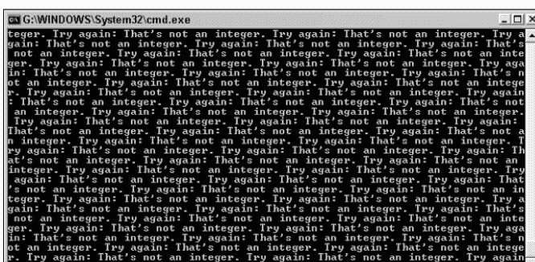

图 8-2

为什么我们调用 `next()` 来丢弃无效输入。

## 使用先发制处理异常

`try` 语句是任何 Java 程序员工具箱中一个非常有用的工具。然而，处理异常最好的方法是防止它们从源上发生。虽然这并非总是可能的，但在很多情况下是可以实现的。关键是在执行可能导致异常的操作之前对你的数据进行测试，然后跳过或绕过对有问题的数据进行操作。（我真的很讨厌有问题的东西。）

你可以通过在执行除法之前检查数据，轻松地避免因数据除法引起的 `ArithmeticException`：

```java
if (b != 0)
    nc = a / b;
```

这消除了将除法封装在 `try` 块中的必要，因为你知道不会发生除以零的情况。

你可以使用 `Scanner` 类的 `next` 方法将此技术应用于输入验证。该方法会检查下一个输入值以确保它是一个有效的整数。（`Scanner` 将下一个输入值视为一个标记，你不会在测试它。）你可以通过几种方法实现这种技术，自从列表 8-2 显示了 `getInteger` 方法的一个版本（使用 `while` 循环来避免异常），我一直在鼓励你这个问题。

### 列表 8-2：`getInteger` 方法的另一个版本

```java
import java.util.*;
public class GetInteger {
    static Scanner sc = new Scanner(System.in);
    public static void main(String[] args) {
        System.out.print("Enter an integer: ");
        int i = getAnInt();
        System.out.println("You entered " + i);
    }
    public static int getAnInt() {
        while (!sc.hasNextInt()) {
            sc.nextLine();
            System.out.print("That's not an integer. Try again: ");
        }
        return sc.nextInt();
    }
}
```

这是一个巧妙的编程技巧，你不觉得吗？`while` 语句中的条件表达式调用了 `Scanner` 的 `hasNextInt` 方法来检查下一个值是否为整数。只要该方法返回 `false`（表示下一个值不是有效的整数），`while` 循环就会重复。循环体调用 `nextLine` 来丢弃坏数据，然后显示错误消息。只有当输入流中有了良好的数据时，循环才会结束，因此 `return` 语句调用 `nextInt` 将数据解析为整数并返回结果。

## 一次捕获所有异常

Java 提供了一个名为 `Exception` 的全能捕获异常类，所有类型的异常都基于它。（不用担心我所指的这些细节。当你读第 3 卷书第 4 章时，它会更有意义。）

如果你不想在 `catch` 块中指定得太具体，可以指定 `Exception` 而不是更具体的异常类。例如：

```java
try {
  int c = a / b;
} catch (Exception e) {
  System.out.println("Oops, you can't divide by zero.");
}
```

在这个示例中，`catch` 块指定了 `Exception` 而不是 `ArithmeticException`。

如果你有某些可能会抛出几种类型异常的代码，并且你想对某些类型提供特定的处理，而对所有其他类型提供通用处理，请这样考虑 `try` 语句：

```java
try {
  // 可能会抛出几种类型异常的语句
} catch (InputMismatchException e) {
  // 处理 InputMismatchException 的语句
} catch (IOException e) {
  // 处理 IOException 的语句
} catch (Exception e) {
  // 处理所有其他异常类型的语句
}
```

在这个示例中，假设 `try` 块中的代码可能会抛出 `InputMismatchException`、`IOException` 以及可能的其他未预料的异常类型。这里这三个 `catch` 块为每种可能性提供了支持。

当你在 `try` 语句上编写多个 `catch` 块时，始终先列出具体的异常。如果你包含一个捕获 `Exception` 的 `catch` 块，请将其列在最后。


## 显示异常消息

在大多数情况下，`try` 语句的 `catch` 块对传递它的异常对象不会进行任何操作。然而，你可能偶尔想要显示错误消息；异常对象有几个有趣的方法，你可以方便地根据需要使用它们。这些方法列在表 8-1 中。

**表 8-1**

| 方法 | 描述 |
| --- | --- |
| `String getMessage()` | 用文本描述错误。 |
| `void printStackTrace()` | 将堆栈跟踪打印到标准错误流。 |
| `String toString()` | 返回异常的描述。此描述包括异常类的名称，后跟一个冒号和 `getMessage` 消息。 |

下面的示例显示了你如何在 `catch` 块中为异常打印消息：

```java
try {
  int c = a / b;
} catch (Exception e) {
  System.out.println(e.getMessage());
}
```

如果 `b` 的值为 0，这段代码将显示文本 `/ by zero`。你可以使用这行代码来获取更有趣的输出：

```
e.printStackTrace();
```

#### 使用 `finally` 块

`finally` 块是出现在 `catch` 块之后的块。无论是否抛出异常，它都会执行。它的目的是清理可能留下的任何垃圾，例如打开的文件或数据库连接。

`try` 语句带有 `finally` 块的基本框架如下：

```
try {
    可能抛出异常的语句
} catch (异常类型) {
    抛出异常时执行的语句
} finally {
    无论是否都执行的语句
}
```

列表 8-3 显示了一个简单但有用的示例，演示了如何使用 `finally`。在这个示例中，`divideNumbers` 方法尝试除法。如果第一次尝试失败（由于零），它会再次尝试除法。完全不理性，就像青少年一样。

### 列表 8-3：使用 `finally` 的程序

```java
public class CrazyWithZeros {
    public static void main(String[] args) {
        try {
            int answer = divideNumbers(5, 0);
        } catch (Exception e) {
            System.out.println("Tried twice," + " still didn't work!");
        }
    }

    public static int divideNumbers(int a, int b) throws Exception {
        int c;
        try {
            c = a / b;
            System.out.println("It worked!");
        } catch (Exception e) {
            System.out.println("Didn't work the first time.");
        } finally {
            System.out.println("Better clean up my mess.");
            System.out.println("It worked after all.");
        }
        return c;
    }
}
```

这是程序的控制台输出：

```
Didn't work the first time.
Better clean up my mess.
Tried twice, still didn't work!
```

下面的段落逐行解释发生了什么：

- `main` 方法调用 `divideNumbers` 方法，传递 5 和 0 作为参数。你已经知道方法不会成功。
- `catch` 子句捕获第 7 行抛出的任何异常。
- `divideNumbers` 方法声明它会抛出 `Exception`。
- 这是对除法的第一次尝试。
- 如果第一次尝试成功，将执行此行，并打印 "It worked!"。哎，除法抛出了异常，所以这一行永远不会执行。
- 而是，`catch` 子句捕获了异常，并显示 "Didn't work the first time."。这是控制台输出的第一行。
- `divideNumbers` 方法固执地再次尝试除那两个数字。然而，这次没有语句可以捕获错误。
- 因为由于第二次除法也抛出了异常，这一行也永远不会执行。因此你没有在控制台上看到 "It worked the second time!" 的消息。（如果你看到了，那你是在《阴影面积》剧集里）。
- `finally` 句中的这条语句无论发生什么都会执行。这就是控制台输出中第二行的来源。
- 在执行 `finally` 句后，`ArithmeticException` 会被抛回给调用方法，并在那里被第 9 行捕获。这就是控制台输出最后行的来源。
- 如果除法成功，此行将在 `try` 块结束后执行，你会在控制台上看到 "It worked after all." 这条消息。
- 随后，`return` 语句将返回除法的结果。

## 处理检查异常 (Checked Exceptions)

检查异常是 Java 设计者认为你的程序必须以某种方式对其进行处理的异常。每当你编写可能抛出检查异常的语句时，你的程序必须执行以下操作之一：

- 将语句放在 `try` 语句中，并带有一个用于该异常的 `catch` 块来捕获异常。
- 在包含该语句的方法上指定 `throws` 子句，表示你的方法不想处理该异常，因此将该异常向上传递。

这被称为“捕获或抛出”（catch-or-throw）规则。简而言之，任何包含可能抛出检查异常的语句的方法都必须承认它知道可能会抛出异常。该方法通过直接处理或将异常向上传递给其调用者来实现这一点。

为了说明检查异常的使用，我必须使用一些带有会抛出异常的方法的类。在此之前，我一直避免引入抛出检查异常的类，因此以下插图使用了一些你不熟悉的类。不要担心这些类的作用或它们是如何工作的。重点在于展示如何处理它们抛出的检查异常。


## 查看“捕获或抛出”的编译错误

这里有一个使用名为 `FileInputStream` 类的程序。要从该类创建对象，你必须传递构造函数字符串，该字符串包含计算机上存在的文件的路径和名称。如果找不到文件，`InputStream` 会抛出 `FileNotFoundException`，你必须捕获或抛出它。该类位于 `java.io` 包中，因此任何使用它的程序都必须包含 `import java.io` 语句。

考虑以下程序：

```java
import java.io.*;
public class FileException
{
    public static void main(String[] args)
    {
        openFile("C:\test.txt");
    }
    public static void openFile(String name)
    {
        InputStream f = new FileInputStream(name);
    }
}
```

该程序无法编译。编译器会发出以下错误消息：

```
unreported exception java.io.FileNotFoundException; must be caught or declared to be thrown
```

这条消息仅仅意味着你必须处理 `FileNotFoundException`。

## 捕获 `FileNotFoundException`

处理 `FileNotFoundException` 的一种方法是通过普通的 `try` 语句捕获它：

```java
import java.io.*;
public class FileException2
{
    public static void main(String[] args)
    {
        openFile("C:\test.txt");
    }
    public static void openFile(String name)
    {
        try
        {
            InputStream f = new FileInputStream(name);
        }
        catch (FileNotFoundException e)
        {
            System.out.println("File not found.");
        }
    }
}
```

在这个示例中，如果 `C:\test.txt` 文件不存在，则会显示 "File not found." 消息。

## 抛出 `FileNotFoundException`

假设你不想在 `openFile` 方法中处理这种错误情况，而是希望直接将异常传递给调用 `openFile` 的方法。

要这样做，请省略 `try` 语句。相反，在 `openFile` 方法的声明中添加 `throws` 子句。该子句表示 `openFile` 方法知道它包含一个可能抛出 `FileNotFoundException` 的语句，但不想处理该异常。相反，异常被传递给了调用者。

这里是添加了 `throws` 子句的 `openFile` 方法：

```java
public static void openFile(String name)
    throws FileNotFoundException
{
    FileInputStream f = new FileInputStream(name);
}
```

你可以看到，`throws` 子句只是列出了方法可能抛出的一个或多个异常。如果列表中有多个异常，请用逗号分隔异常：

```java
public static void readFile(String name)
    throws FileNotFoundException, IOException
```

在 `openFile` 方法中添加 `throws` 子句意味着当发生 `FileNotFoundException` 时，它会被简单传递给调用 `openFile` 的方法。这意味着调用方法（在此插图中为 `main`）必须捕获或抛出该异常。为了捕获异常，`main` 方法的代码必须写成这样：


```java
public static void main(String[] args)
{
    try {
        openFile("C:\test.txt");
    }
    catch (FileNotFoundException e) {
        System.out.println("File not found.");
    }
}
```

那么，如果文件不存在，`catch` 块会捕获异常，并显示错误消息。

## 从 `main` 方法抛出异常

如果你完全不想让程序处理 `FileNotFoundException`，可以在 `main` 方法中添加 `throws` 子句，如下所示：

```java
public static void main(String[] args)
    throws FileNotFoundException
{
    openFile("C:\test.txt");
}
```

## 吞没异常（Swallowing exceptions）

如果你什么都不做，只想捕获异常怎么办？换句话说，你只想简单地忽略它。这种技术被称为“吞没异常”（swallowing exceptions）。这是一个示例：

```java
public static void openFile(String name)
{
    try {
        InputStream f = new FileInputStream(name);
    }
    catch (FileNotFoundException e)
    {
    }
}
```

在这里，`FileNotFoundException` 被捕获了。这种技术被称为“吞没”。


如果你必须吞没异常，至少要写一条注释说明异常发生了。这样，你就会不断提醒自己程序还有未完成的细节。

注意并不是所有的吞没都是坏的。假设你想让 `openFile` 方法返回一个布尔值来指示文件是否存在，而不是抛出异常。你可以这样编写该方法：

```java
public static boolean openFile(String name)
{
  boolean fileOpened = false;
  try {
    InputStream f = new FileInputStream(name);
    fileOpened = true;
  } catch (FileNotFoundException e) {

  }
  return fileOpened;
}
```

异常并没有真的被吞没。相反，它的意义被转换为了一个从方法返回的布尔结果。

> 调用会抛出异常的方法必须捕获该异常或将其继续抛出。

> 是的，这个例子非常简单。但它说明了核心要点。

## 捕获多个异常

Java 7 引入的新功能允许你使用单个 `catch` 语句捕获两种或多种异常类型。假设你有一段可能会抛出两种不同的异常——例如 `FileNotFoundException` 和 `IOException`——而你想以相同的方式处理它们。其中一种方法是写两个 `catch` 语句（每个 `catch` 部分写一个），然后为 `catch` 块编写相同的代码，如下：

```java
try {
  // 可能会抛出 FileNotFoundException // 或 IOException
  catch (FileNotFoundException e) {
    System.out.println(e.getMessage());
  }
  catch (IOException e) {
    System.out.println(e.getMessage());
  }
}
```

这种方法虽然可行，但很笨拙。Java 允许你在 `catch` 语句中指定两个或多个异常类型。你用竖线 `|` 分隔异常类型，如下：

```java
try {
  // 可能会抛出 FileNotFoundException // 或 IOException
  catch (FileNotFoundException | IOException e) {
    System.out.println(e.getMessage());
  }
}
```

通过这种方式，你只需要一个代码块就可以处理两种异常类型。

# 3 面向对象编程

## 概览

- 第 1 章：理解面向对象编程 ................................................................ 235
- 第 2 章：创建你自己的类 ................................................................................ 249
- 第 3 章：使用静态成员 ..................................................................................... 267
- 第 4 章：使用子类和继承 ................................................................ 277
- 第 5 章：使用抽象类和接口 ....................................................... 299
- 第 6 章：使用 `Object` 和 `Class` 类 ............................................................ 315
- 第 7 章：使用内部类、匿名类和 Lambda 表达式 .......................... 341
- 第 8 章：使用包和新的 Java 模块系统 ................................................... 353

## 本章内容

- 了解什么是面向对象编程
- 理解对象和类
- 研究继承和接口
- 用对象设计程序
- 使用 UML 绘图

## 第 1 章：理解面向对象编程

本章是对面向对象编程的入门介绍。它介绍了你在掌握 Java 中面向对象编程如何运作的具体细节之前，需要了解的一些基本概念和术语。

> 提示：如果你更倾向于实践型学习方法，你可能想跳过这一章，直接看第 3 本的第 2 章，在里面你可以发现如何在 Java 中创建类。你以后可以随时回到这一章，回顾驱动面向对象编程的基本概念。这两种方式对我来说都可以。无论你是现在读这一章，还是跳过它以后回来，结果都是一样的。

## 什么是面向对象编程？

“面向对象编程”这个术语意味着许多不同的含义。但其核心是，面向对象编程是一种计算机编程，其前提是所有程序本质上都是对现实世界对象或抽象概念的计算机模拟。例如：

- 飞行模拟程序试图模仿真实飞机的行为。它们做得非常好；军事和民用飞行员都在上面进行训练。在 20 世纪 60 年代，波罗号宇员使用计算机控制的模拟器进行心理模拟。
- 许多计算机游戏是人类玩的实际游戏的模拟，例如棒球、NASCAR 赛车，甚至像《吃豆蛇》和《魔法44》这样的抽象游戏也试图模拟可能存在某处的生物和对象的行为。这些程序模拟了一种概念性游戏——一种在现实世界中无法玩，但可以通过计算机模拟的游戏。
- 业务程序可以被视为业务流程的模拟——例如接订单、客户服务、发货和账单。例如，一张发票不仅仅是一张纸；它代表了公司与其客户之间发生的一笔交易。因此，基于计算机的发票实际上只是这种交易的模拟。

编程语言具有这种前提的想法并不新鲜。传统的编程语言如 C 语言（及其前身，甚至 COBOL）是基于这样一个前提：计算机程序是实际过程的实现——电子等同于“第 1 步：将 A 卡插入 B 槽”。LISP 编程语言基于所有编程问题都可以通过操作列表的不同方式来解决的想法。而流行的数据库查询语言 SQL 将程序视为操作数学集合的方式。

关于计算机程序是现实世界对象或抽象概念模拟的观点，这里有一些额外的想法：

- 有时模拟比现实世界更好。文字处理程序最初是打字机的模拟，但现代文字处理程序优于任何打字机。
- 所有计算机程序都是某种类型模拟的想法并不新。事实上，第一种面向对象编程的语言（Simula）开发于 20 世纪 60 年代。到 1967 年，这种语言已经有了我们现在认为是面向对象编程基础的许多特性。
- 考虑起来，手动记账系统也是模拟。装满发票的文件柜并不持有实际订单；两者都是模拟。

## 理解对象

这些关于模拟的论述对我来说有点太哲学色彩了，所以现在我转向构成面向对象编程的对象的本质。对象——无论是在现实世界还是编程世界中——都是具有某些特征的实体。接章节描述了这些特征中最重要的几个：标识性、类型、状态和行为。

### 对象具有标识性

面向对象程序中的每个对象都有一个标识性。也就是说，特定类型的每个出现（称为实例）都可能与其相同类型的其他出现区分开，也可以与其他类型的对象区分开。

在现实世界中，对象的标识性是一个非常直观且明显的概念。拿起两个苹果，你知道它们都是苹果（这就是类型，在下一节描述），你知道它们不是同一个苹果。每个苹果都有独特的标识性。它们的颜色相似但并不相同。其中一个（或两个）内部可能有虫。

打开一个装满发票的文件柜，你会发现一页又页看起来相同的纸，但每页纸顶部都有发票号码。这个号码并不是真正赋予这些发票唯一的标识性，但它为你提供了一个识别每个单独发票的方法，就像你的名字标识你一样。

在面向对象编程中，每个对象在计算机内存中都有自己的位置。因此，两个对象即使类型相同，也有不同的内存位置。对象起始位置的地址提供了区分它们的方法，因为没有两个对象占据相同的内存位置。

关于 Java 中的对象标识性，这里有一些重要的想法：

- Java 保留了每个对象的标识性。也就是说，没有简单的方法获取对象的内存地址；Java 认为这与你无关，而且确实如此。如果 Java 让这些信息对你可用，你就会忍不住去捣乱它，这可能会导致各种问题，正如任何 C 或 C++ 程序员都能告诉你的那样。

Java 对象有一种被称为哈希值（hash code）的东西，这是一个为每个对象自动生成的 `int` 值，几乎代表了对象的标识。在大多数情况下，对象的哈希值基于对象的内存地址，但并不总是如此。Java 并不保证两个不同的对象不会具有相同的哈希值。

当与对象一起使用时，等号运算符（`=`）实际上是在测试两个变量或表达式的标识性。如果它们指向同一个对象实例，则这两个变量或表达式被认为是相等的。

### 对象具有类型

我记得在大学读英语专业时，学习过《部件命名》（Naming of Parts），这是亨利·里德在 1942 年写的一首优美诗：

- 今天我们为部件命名。昨天，
- 我们有每日打扫。而到了明天早上，
- 我们必须在射击后做这些事。日本花
- 今天我们为部件命名。
- 像邻近花园里的珊瑚一样闪烁，
- 而今天我们为部件命名。

诚然，这是一首优秀的反战诗之类的，但它对面向对象编程来说有一点点启发性。在第一节之后，诗歌开始命名步枪的部件：

- 这是下转环。而这个
- 是上转环，你会看到，
- 当你使用背带时。而这个是枢转环，
- 在你这里你并没有得到。

想象一个新兵们拿上步枪的世界，而教官告诉他们：“这是下转环。这是上转环……” 每个每个士兵的步枪都有这些部件之一——从面向对象的术语来说，这就是某个特定类型的对象。士兵步枪中的下转环是不同的对象，但它们都属于 `LowerSlingSwivel` 类型。

就像这首诗中的教官一样，面向对象编程允许你为程序中不同类型的对象命名。在 Java 中，类型是由类定义的。因此，当你从一个类型创建对象时，你是在说该类型的对象是由该类指定的。下面的示例语句创建了一个类型为 `Invoice` 的对象：

```java
Invoice i = new Invoice();
```

在这种情况下，该对象的标识性（即它在内存中的地址）被分配给变量 `i`，编译器知道该变量可以持有指向 `Invoice` 类型对象的引用。

### 对象具有状态

现在切换到另一位文学天才：

- 一条鱼，两条鱼，
- 红色的鱼，蓝色的

用面向对象的术语来说，苏斯博士在这里列举了一对类型为 `Fish` 的对象。该类型有两个属性；就称它们为 Number（数量）和 Color（颜色）。这两个对象在这些属性上有不同的值：

| 属性 | 对象 1 | 对象 2 |
| --- | --- | --- |
| Number | 一 | 二 |
| Color | 红 | 蓝 |

对象的类型决定了对象拥有哪些属性。因此，所有特定类型的对象具有相同的属性。然而，它们并不一定具有这些属性的值。在这个例子中，所有的 `Fish` 属性都名为 Number 和 Color，但两个 `Fish` 对象在这些属性上具有不同的值。

对象所有属性的值的组合被称为对象的状态。与它的标识性不同，对象的状态可以在其生命周期内改变。例如，某些鱼会改变颜色。特定客户的总销售额在客户每次购买另一个产品时都会发生变化。学生的平均分在每次记录新课程成绩时都会发生变化。如果员工搬家，对象的电话号码就会改变。

这里有关于对象状态的几个有趣的细节：

- 对象的某些属性是公开的，但另一些可以是私有的。私有属性对对象的内部运行至关重要，但对象外部的人不知道它们的存在。它们就像你的私有想法：它们影响你的所言所行，但没有人知道你的想法。
- 在 Java 中，对象的状态由类变量表示，这些变量被称为字段（fields）。公共字段是使用 `public` 关键字声明的字段，以便该变量对外部世界可见。

### 对象具有行为

对象的另一个特征是它们具有行为，这意味着它们可以执行某些事情。和状态一样，对象的特定行为取决于它的类型。但与状态不同，一个类型的每个实例的行为并不各不相同。假设教室里所有的学生都拥有相同类型的计算器。要求他们都拿出计算器并相加数字——任何他们自己选择的数字。所有的计算器都显示出不同的数字，但它们的操作方式都是相同的——也就是说，它们有不同的状态但具有相同的行为。

说对象具有行为的另一种方式是，它们提供了可以被其他对象使用的服务。你已经看到了许多对象向其他对象提供服务的例子。例如，从 `Format` 类创建的对象提供格式化服务，将数值转换为整齐的格式化字符串，如 $32.95。

在 Java 中，对象的行为由它的方法（methods）提供。`Format` 类的方法为 `Number` 对象提供了格式化行为。

这里有关于对象行为的一些要点：

- 类的接口（interface）是类公开的所有方法和字段，以便其他对象可以访问它们。
- 对象具体如何完成它能且应该做的事情被隐藏在对象内部。使用对象的人只需要知道对象能做什么。

## 理解对象的生命周期

在 Java 中操作对象时，理解对象是如何出生、生存和死亡的是非常重要的。这个主题被称为对象的生命周期，它的过程如下：

- 在创建对象之前，必须加载该类。要做到这一点，Java 运行时会在磁盘（类文件中）中定位该类并将其读入内存。然后，Java 会寻找任何静态初始化器，以初始化静态字段——这些字段不属于类的任何实例，而是属于类。
- 当你使用 `new` 关键字时，从类创建一个对象。为了初始化类，Java 为对象分配内存并设置一个指向对象的引用，以便运行时可以跟踪它。然后 Java 调用构造函数，构造函数类似于方法，但只会被调用一次：在创建对象时调用。构造函数负责执行初始化对象所需的任何处理——变量、打开文件或数据库等。
- 对象度过它的生命，为任何想要和需要的人提供访问公共方法和字段。
- 当对象死亡时，对象从内存中移除，Java 会丢弃对它的内部引用。你不需要自己销毁对象。Java 运行时的一个特殊部分垃圾回收器负责销毁所有不再使用的对象。

## 继承

继承是一种面向对象的编程技术，允许你使用一个类作为另一个类的基础。现有的类被称为基类、超类或父类；从它派生出的新类则被称为派生类、子类或子类。

当你创建一个子类时，该子类会自动获得其父类中定义的所有方法和字段。你可以直接使用这些方法和字段，也可以对它们进行重写以改变它们的行为。此外，你还可以添加方法和字段，以定义子类特有的数据和行为。

你可以通过继承来解决棒球/垒球问题：创建一个 `Ball`（球）类，提供所有类型球的基本特征，然后将其作为 `Baseball`（棒球）和 `Softball`（垒球）独立类的基类。这些类可以重写针对每种球不同行为的方法。

理解继承的一种方式是将其视为实现“是一种”（is-type-of）关系的方法。垒球是一种球，棒球也是。因此，继承是实现这些相关类的恰当方法。（有关继承的更多信息，请参阅第 3 本第 4 章）。

## 接口

接口是一组方法和字段，类必须提供这些内容来实现该接口。接口本身仅仅是一组被命名的公共方法和字段声明。请注意，接口并不提供实现这些方法的代码。相反，它只提供声明。实现接口的类需要为所定义的每个方法提供代码。

你可以使用接口来解决棒球/垒球问题：创建一个名为 `Ball` 的接口，指定球应该拥有的所有方法和字段。然后你可以创建 `Softball`（垒球）和 `BaseBall`（棒球）类，让它们都实现 `Ball` 接口。

接口与继承紧密相关，但有两个关键区别：

- 接口本身不提供实现其任何方法的代码。接口仅仅是一组方法和字段的签名。相比之下，基类可以提供其部分或所有方法的实现。
- 一个类只能有一个基类，但一个类可以实现任意数量的接口。

你可以在第 3 本第 5 章中了解到接口的知识。

## 使用对象设计程序

面向对象的程序通常不仅仅一个单一的对象。相反，它是一组共同工作以完成任务的对象。开发面向对象程序最重要的部分是设计用于操作程序对象的类。基本思想是将一个大问题拆分为一组类，每个类的规模和复杂性都是可控的。然后你编写 Java 代码来实现这些类。

因此，设计面向对象应用的任务可以归结为决定应用程序需要什么——以及这些每个类的公共接口应该是什么。如果你对类规划得当，实现应用程序就会很容易。如果你对类规划得很糟糕，让你的应用程序运行将会很困难。

设计面向对象应用的一种常用方法是将其分为几个不同的层或级，每层提供不同类型的功能。最常见的是三层法，如图 1-1 所示。在这里，应用程序的对象分为三层：


- **表现层（Presentation）**：这一层的对象处理与用户的所有交互。Web 应用中的 HTML 页面属于这一层，基于 GUI 的应用程序中的 Swing 页面和框架类也如此（我在第 6 本中介绍 Swing）。

- **逻辑层（Logic）**：这一层的对象代表应用程序的核心对象。对于典型的业务型应用程序，这一层包含了代表业务实体的对象，如客户、产品、订单、供应商等。这一层有时被称为*业务规则层*，因为这一层的对象负责执行管理应用程序的规则。

- **数据库层（Database）**：这一层的对象处理与应用程序所使用的任何数据存储形式交互的所有细节。例如，如果数据存储在 SQL 数据库中，这一层的对象将处理所有的 SQL。

图 1-1：三层设计。

## 使用 UML 绘制类图

自从编程开始以来，程序员就喜欢为程序绘制图表。现在面向对象编程成为主流，程序员使用名为 UML 的标准来绘制类结构图。

你可以通过多种方式绘制类图。为了给图表增加一些一致性，大多数程序员使用一种名为 UML（统一建模语言）的标准。图 1-2 显示了一个包含四个类的简单 UML 图，矩形表示类本身，而箭头表示类之间的关系。

但 UML 类图可以变得非常复杂。接下来的章节将描述创建 UML 类图的细节。

### 绘制类

类图的基本元素是类。在 UML 中，每个类都被绘制为一个矩形。矩形至少包含类名。你可以将矩形划分为三个区域，以包含额外信息，如图 1-3 所示。

| CustomerDB |
| --- |
| +connectionString |
| +connectionStatus |
| +getCustomer |
| +updateCustomer |
| +deleteCustomer |
| +addCustomer |
| +getCustomerList |

图 1-3：一个类。

类的中间区域列出变量，而底部区域列出方法。每个变量或方法的名称之前可以带有一个可见性指示符，可以是表 1-1 中列出的符号之一。（在实际操作中，通常省略可见性指示符，只列出公共可见的字段或方法。）

#### 表 1-1 类变量和方法的可见性指示符

| 指示符 | 说明 |
| --- | --- |
| + | 公有 |
| - | 私有 |
| # | 保护 |

如果你愿意，可以为变量以及方法包含类型信息。变量的类型通过在变量名后加上冒号和类型来指示：

```java
connectionString: String
```

方法的返回类型以相同方式指示：

```java
getCustomer(): Customer
```

参数列在括号内，并列出名称和类型。例如：

```java
getCustomer(custno: int): Customer
```

注意：在 UML 中省略类型和参数信息是常见的。

### 绘制箭头

除了表示类的矩形外，类图还包含箭头来表示类之间的关系。UML 使用多种类型的箭头，正如我在后续段落中所描述的那样。

一端带有空心闭箭头的实线表示继承：


箭头指向基类。一端带有空心闭箭头的虚线表示类实现了一个接口：


箭头指向接口。一端带有空箭头的实线表示关联：


关联仅表示两个类共同工作。可能是其中一个类创建了另一个类的对象，或者一个类需要另一个类的对象来执行其工作。又或者，一个类的实例包含了另一个类的实例。

你可以为关联箭头添加一个名称以指示其用途。如果箭头表示一个类的实例创建了另一个类的对象，你可以在箭头旁边放置单词 `Creates`。

## 本章内容

- 创建你自己的类
- 查看类声明的组成
- 了解类字段
- 构建构造函数
- 为你的类添加方法
- 使用 `this` 关键字

# 第 2 章：创建你自己的类

同学们，是时候学习如何创建你自己的类了。

在本章中，你将发现 Java 中创建类的基础知识。所有的 Java 程序都是类，所以你已经见过很多类的示例。你见过诸如 `public class GuessingGame` 的类头以及如 `public static void main` 的静态方法。现在，在本章中，我将向你展示如何创建包含多个类的程序。

## 声明类

所有类都必须由 `class declaration` 定义——即提供类名称和类体的代码行。以下是类声明的最基本形式：

```java
[public] class className (class-body)
```

`public` 关键字表示此类可供其他类使用。虽然它是可选的，但你通常会在类声明中包含它。毕竟，你编写类声明的主要目的是让其他类能够从你定义的类中创建对象。（在本章稍后的“查看类的去向”部分了解更多关于使用 `public` 关键字的信息。）

在本书的后续章节中，你将发现可以放入类声明的一些额外元素。我在这里描述的格式只是创建基本类的基本格式。


## 选择类名

`ClassName` 是为你的类提供名称的标识符。你可以使用任何标识符来命名类，但遵循以下三个指南会让你的生活变得简单：

- **类名以大写字母开头。** 如果类名由多个单词组成，大写每个单词：例如 `Ball`、`RetailCustomer` 和 `GuessingGame`。

- **尽可能使用名词作为类名。** 类创建对象，而名词是你用来识别对象的词。大多数类名应该是名词。

- **避免使用 Java API 类的名称。** 虽然没有规定你绝对必须这样做，但如果你创建一个与 Java API 类同名的类，你必须使用完全限定名（例如 `java.util.Scanner`）来将你的类与同名的 API 类区分开来。

Java API 类有数千个，所以避开它们是非常困难的。但至少，你应该避免常用的 Java 类名，以及你的应用程序可能使用的任何 API 类。例如，创建一个名为 `String` 或 `Math` 的类简直是自找麻烦。


## 了解类体包含的内容

类的类体是类声明末尾括号内的所有内容。类声明的 `public class className` 部分仅占一行，但类声明的体可能占据数百行（如果你写得过头，可能是几千行）。

类体可以包含以下元素：

- **字段（Fields）：** 变量声明定义类的公共或私有字段。
- **方法（Methods）：** 方法声明定义类的方法，类似于普通方法。
- **构造函数（Constructors）：** 构造函数是一段在创建实例时运行以初始化对象的代码。构造函数的名称必须与类本身相同，尽管它看起来像一个方法，但它没有返回类型。
- **初始化器（Initializers）：** 这些独立代码块仅在类初始化时运行一次。实际上有两种类型，称为静态初始化器和实例初始化器。虽然你并不经常使用它们，我会在本章稍后的“使用初始化器”部分讨论初始化器。（有关静态初始化器的信息，请参阅第 3 册第 3 章。）
- **其他类和接口：** 一个类可以包含另一个与该类同名的类。（注：原文此处有大量重复错误，翻译已清理。）

要创建一个私有字段，请用 `private` 代替 `public`：

```java
private int x_position = 0;
private int y_position = 0;
private String error_message = "";
```

字段也可以声明为 `final`：

```java
public final int MAX_SCORE = 1000;
```

`final` 字段的值在初始化后无法更改。习惯上用大写字母命名 `final` 字段（但不是强制）。

## 理解方法

你通过我在第 2 卷第 7 章中描述的技巧来为类定义方法。要声明一个供你的类用户使用的方法，请在方法声明中使用 `public` 关键字：

```java
public boolean isActive()
{
  return this.isActive();
}
```

要创建一个可以在类内部但在类外部不可见的私有方法，请使用 `private void` 关键字：

```java
private void calculateLunarTrajectory()
{
  // 获取计算出的月球轨道的代码
}
```

## 理解可见性

在前面的章节中，我提到字段和方法都可以使用 `public` 或 `private` 关键字来指示字段或方法是否可以从类外部访问。这被称为字段或方法的可见性。

所有具有 `public` 访问权限的成员组合有时被称为类的**公共接口**（public interface）。这些成员是其他对象与由你的类创建的对象进行通信的唯一手段。因此，请仔细考虑你的类声明了哪些公共字段和方法。

暴露（expose）一词有时用于指创建公共字段和方法。例如，如果一个类有一个名为 `isActive` 的公共方法，你可以说该类暴露了 `isActive` 方法。这意味着该方法对其他类可用。

你可以在类内部使用私有字段和方法——但不能从外部使用。私有字段和方法提供了可能对类运行至关重要的实现细节，这些细节不应该暴露给外部世界。私有字段和方法被称为内部成员，因为它们只能从内部访问。

## 使用 Getters 和 Setters（访问器）

面向对象编程的基本目标之一是将类的细节隐藏在类内部，同时仔细控制类的哪些方面暴露给外部世界。作为一条通用规则，你应该避免公共字段。相反，你可以将所有字段设为私有。然后你可以通过向类方法中添加访问权限，选择性地授予对数据字段的访问。

访问器有两种。`get` 访问器（也称为 `getter`）是一个获取字段值的方法，而 `set` 访问器（`setter`）是一个设置字段值的方法。这些方法通常命名为 `getFieldName` 和 `setName`。例如，如果字段名为 `count`，那么 getter 和 setter 方法被命名为 `getCount` 和 `setCount`。

这是一个使用名为 `Health` 的私有字段的类，用于表示游戏程序玩家的状况：

```java
public class Player {
    private int health;

    public int getHealth() {
        return health;
    }

    public void setHealth(int h) {
        health = h;
    }
}
```

在这里，`health` 字段本身被声明为 `private`，因此无法直接访问。相反，它只能通过 `getHealth` 和 `setHealth` 方法访问。

使用访问器而不是简单的公共字段来创建类具有以下优点：

- 你可以通过提供 `get` 访问器但不提供 `setter` 来创建一个**只读属性**。其他类可以获取该属性值——但不能更改它。

- 与其将属性值存储在私有字段中，你可以在每次调用 `get` 访问器方法时计算。假设你有一个类 `Order`，包含 `unitPrice` 和 `quantityOrdered` 字段。该类可能包含一个像这样的 `getOrderTotal` 方法：

```java
public double getOrderTotal()
{
    return unitPrice * quantityOrdered;
}
```

在这里，getter 并没有返回类字段的值，而是计算要返回的值。

- 你可以通过在属性 setter 中验证数据，或者在向方法传递无效数据时忽略或抛出异常来保护类不受坏数据的影响。假设你有一个名为 `Health` 的 `int` 属性的 `set` 访问器，其值范围从 0 到 100。以下是一个防止 `Health` 属性被设置为错误值的 setter 访问器：

```java
public void setHealth(int h)
{
    if (h < 0)
        health = 0;
    else if (h > 100)
        health = 100;
    else
        health = h;
}
```

在这里，如果用小于 0 的值调用 `setHealth` 方法，`health` 将设置为 0。同样，如果值大于 100，`health` 将被设置为 100。

关于使用访问器的更多见解，请参阅旁边的边栏“访问器模式（The Accessor pattern）”。

## 访问器模式

访问器的使用（如本章“Getters and Setters”节所述）是 Java 程序员常用的设计模式的一个示例。**访问器模式**的设计旨在提供一种一致的方法来设置或检索类字段的值，而不会将字段本身暴露给外部世界。

大多数 Java 程序员很快学会了面向对象编程的基本指南之一是避免公共字段。遗憾的是，他们经常诉诸将所有字段设为私有，而不知道自己是否需要它们。

```java
public class MyClass {
    private int fieldX;
    private int fieldY;
    public int getX() { return x; }
    public void setX(int x) { this.x = x; }
    public int getY() { return y; }
    public void setY(int y) { this.y = y; }
}
```

## 重载方法

Java 类可以包含多个同名的方法，只要这些方法接受参数不同。这种技术被称为**重载**（overloading），它是为类构建灵活性的关键之一。通过重载，你可以预测人们可能调用对象方法的方式，并为每种情况提供重载方法。

“重载”一词是准确的，但有点误导。通常，当我们说某物被重载了时，那里存在问题。我曾见过一张载了 3000 磅木材的大众 Jetta 的照片。那是通常意义上重载的经典例子。通常，你不需要担心 Java 因为重载方法过多而崩溃。

你已经熟悉几个具有重载方法的类，尽管你可能没有意识到。例如（通过 `System.out` 访问），定义了 10 个版本的 `println` 方法，允许你打印不同类型的数据。以下行显示了这些方法的声明：

```java
void println()
void println(boolean x)
void println(char x)
void println(char[] x)
void println(double x)
void println(float x)
void println(int x)
void println(long x)
void println(Object x)
void println(String x)
```

创建重载方法的基本规则是每个方法都必须具有唯一的签名。方法的签名是其名称与其接受的参数数量组合。每个 `println` 方法都有不同的签名，因为尽管方法名称相同，但每个方法接受的参数类型不同。

两点不是方法签名的一部分：

- 方法的类型：你不能编写两个名称和参数相同但返回类型不同的方法。
- 参数的名称：方法签名只取决于参数的类型以及它们出现的顺序。因此，这两个方法的签名相同：

```java
double someMethodMine(double x, boolean y)
double someMethodMine(double param1, boolean param2)
```

### 创建构造函数

构造函数是在创建对象实例时被调用的一个代码块。在许多方面，构造函数与方法相似，但它们存在以下几点不同：

- 构造函数没有返回类型。
- 构造函数的名称必须与类名相同。
- 与方法不同，构造函数不被视为类的成员。（这在涉及继承时非常重要，继承将在第 3 册第 4 章中介绍。）
- 当创建新的对象实例时，会调用构造函数。实际上，是 `new` 关键字调用了构造函数。在创建对象后，你无法再次调用它。

编写构造函数的基本格式：

```java
public ClassName(parameter-list) [throws exception...]
{
    statements...
}
```

`public` 关键字表示其他类可以访问该构造函数。这通常是你想要的，尽管在下一章中，你将看到为什么想要创建一个私有构造函数。`ClassName` 必须与包含该构造函数的类名相同。编写参数列表的方式与编写方法相同。

注意，如果构造函数遇到无法恢复的情况，它可以抛出异常。（有关抛出异常的更多信息，请参考第 2 册第 8 章。）

### 创建基础构造函数

编写构造函数最常见的原因是在创建对象时为类字段提供初始值。假设你有一个名为 `Actor` 的类，它拥有名为 `firstName` 和 `lastName` 的字段。你可以为 `Actor` 类创建一个构造函数：

```java
public Actor(String first, String last)
{
    firstName = first;
    lastName = last;
}
```

然后通过调用此构造函数来创建 `Actor` 类的实例：

`Actor a = new Actor("Arnold","Schwarzenegger");`

为 Arnold Schwarzenegger 创建了一个新对象。

与方法一样，构造函数也可以重载。换句话说，你可以为一个类提供多个构造函数，只要每个构造函数都有唯一的签名。这里是 `Actor` 类的另一个构造函数：

```java
public Actor(String first, String last, boolean good)
{
    firstName = first;
    lastName = last;
    goodActor = good;
}
```


这个构造函数允许你创建一个包含演员名称之外信息的`Actor`对象：

```java
Actor a = new Actor("Arnold","Schwarzenegger", false);
```

## 创建默认构造函数

我从小看《警匪追凶》（Dragnet）长大。我仍然记得 Joe Friday 读过他们的权利：“在审讯期间，你有权获得律师。如果你需要律师但付不起费用，将为你免费指定一名律师。”

Java 构造函数就是如此。每个类都有权拥有一个构造函数。如果你不提供构造函数，Java 就会免费为你指定一个。这个免费的构造函数被称为**默认构造函数**。它不接受任何参数，也不执行任何操作，但它允许你的类被实例化。

因此，以下两个类是相同的：

```java
public class Class1
{
    public Class1() {}
}
// 以及第二个示例
```

在第一个示例中，该类显式声明了一个不接受任何参数且体体内没有语句的构造函数。在第二个示例中，Java 创建了一个默认构造函数，其工作方式与第一个示例所示的构造函数相同。

如果你为类声明了任何构造函数，就不会创建默认构造函数。因此，如果你声明了一个接受参数的构造函数但仍然想要一个空构造函数（无参数且为空），必须显式地为类声明一个空构造函数。

一个例子可以阐明这一点。以下代码无法编译：

```java
public class BadActorApp
{
    public static void main(String[] args)
    {
        Actor a = new Actor(); // ：无法编译
    }
}
class Actor
{
    private String lastName;
    private String firstName;
    private boolean goodActor;

    public Actor(String last, String first)
    {
        lastName = last;
        firstName = first;
    }

    public Actor(String last, String first, boolean goodActor)
    {
        lastName = last;
        firstName = first;
        goodActor = goodActor;
    }
}
```

该程序将无法编译，因为它没有为`Actor`类显式提供默认构造函数；因为提供了其他构造函数，所以不会自动生成默认构造函数。

## 调用其他构造函数

构造函数可以使用特殊关键字`this`作为方法调用，来调用同类中的另一个构造函数。这种技术在你有相互构建基础的构造函数时非常常用。

考虑这个类：

```java
public class Actor {
    private String lastName;
    private String firstName;
    private boolean goodActor;

    public Actor(String last, String first) {
        lastName = last;
        firstName = first;
    }

    public Actor(String last, String first, boolean goodActor) {
        this(last, first);
        goodActor = goodActor;
    }
}
```

第二个构造函数调用第一个构造函数来设置`lastName`和`firstName`字段。然后它设置`goodActor`字段。

在使用`this`关键字作为构造函数调用时有一些限制：

- 你只能在构造函数的第一行调用另一个构造函数。因此，以下代码无法编译：

  ```java
  public Actor(String last, String first, boolean goodActor) {
      goodActor = goodActor;
      this(last, first); // ：无法编译
  }
  ```

- 你不能递归地调用另一个构造函数。尝试这样做会得到编译时错误。

- 你可以使用关键字来链式调用构造函数。这里有一个无法编译的类：

  ```java
  class CrazyClass {
      private String firstName;
      private String secondString;

      public CrazyClass(String first, String second) {
          secondString = second;
          this(first);
      }

      public CrazyClass(String first) {
          this(first, "DEFAULT"); // ：无法编译
      }
  }
  ```

第一个构造函数调用了第二个构造函数，后者调用第一个。（这个小细节在涉及继承时变得重要，继承将在第 3 册第 4 章介绍，所以现在可以忽略它。）

## 关键字的其他用途

正如在前节所述，你可以在构造函数中使用`this`关键字调用另一个构造函数。你还可以在方法体中使用`this`来引用当前对象——即调用该构造函数或方法的实例。

`this`关键字通常用于限定当前对象的实例变量引用。例如：

```java
public Actor(String last, String first)
{
    this.lastName = last;
    this.firstName = first;
}
```

在这里并不是真正需要的，因为编译器可以判断`lastName`和`firstName`指向类变量。然而，假设你使用`lastName`和`firstName`作为构造函数的参数名：

```java
public Actor(String lastName, String firstName)
{
    this.lastName = lastName;
    this.firstName = firstName;
}
```

在这里，关键字是用于区分参数`lastName`和`firstName`与同名的实例变量。例如：

你可以在方法体中使用`this`。

```java
public String getFullName()
{
    return this.firstName + " " + this.lastName;
}
```

由于这个示例没有歧义，这并不是真正需要的。许多程序员即使在不需要时也喜欢使用`this`，因为这明确了他们正在引用实例变量。

有时你会单独使用关键字将当前对象的引用作为方法参数传递。你可以使用以下语句将当前对象打印到控制台：

```java
System.out.println(this);
```

`println`方法调用`toString`方法来获取对象的表示并将其打印到控制台。默认情况下，`toString`打印创建类的名称以及对象的哈希码。如果你让`println`打印更有意义的内容，请为该类提供你自己的`toString`方法。

## 使用初始化器

初始化器（有时称为初始化器块）是一个放置在任何方法、构造函数或其他代码块之外的独立代码块。每当创建一个类的实例时，初始化器都会执行，无论使用哪种构造函数来创建该实例。

初始化块与用于初始化变量的变量初始化器相似。区别在于，在初始化块中，你可以编写多条语句。这里有一个类，它在类初始化时从用户处获取类字段的值：

```java
class PrimeClass
{
    private Scanner sc = new Scanner(System.in);

    public int x;
    {
        System.out.print("Enter the starting value for x: ");
        x = sc.nextInt();
    }
}
```

你始终可以通过其他编码技术来实现相同的效果，而且这些技术通常更直接。例如，你可以在构造函数中提示用户输入值，或者可以在字段初始化器中调用方法，如下：

```java
class PrimeClass
{
    private Scanner sc = new Scanner(System.in);

    public int x = getX();

    private int getX()
    {
        System.out.print("Enter the starting value for x: ");
        return sc.nextInt();
    }
}
```

无论哪种方法，效果都是相同的。

以下是关于初始化器的其他一些信息：

- 如果一个类包含多个初始化器，初始化器将按照它们在程序中出现的顺序执行。
- 初始化器在任何类构造函数之前执行。
- 一种特殊的初始化器块称为静态初始化器，允许你初始化静态字段。（更多信息，请参阅下一章。）
- 初始化器有时与匿名类一起使用，正如我在第 3 本第 6 章中描述的那样。

## 本章内容

- 向类中添加静态字段
- 创建静态方法
- 创建可以实例化的静态类
- 使用静态初始化器

# 第 3 章

## 静态成员

静态方法是不与类的实例关联的方法。（除非你直接跳到了这一章，否则你已经知道这一点。）相反，该方法属于类本身。因此，你可以在不先创建类实例的情况下调用该方法。在本章中，你将找到关于创建和使用静态字段及方法所需的所有知识。

## 理解静态字段和方法

根据我手头的韦伯词典，`static`一词有几种含义，其中大多数与静止或不变的概念有关。静态显示（static display）是不移动的显示。静电（static electricity）是不流动的电荷。静态设计（static design）是不改变的设计。

然而，在 Java 中，`static`一词并不意味着不变。例如，你可以创建一个静态字段，并在程序执行时为其赋值。因此，静态字段的值是可以改变的。

为了让情况更复杂，`static`一词也可以意味着干扰，如无线电杂音（radio static），阻止你从收音机上清晰地听到音乐。在 Java 中，`static`项与干扰或接收不良无关。

那么`static`在 Java 中意味着什么意思呢？它被用来描述一种特殊的字段或方法，它不与类的某个特定实例关联。相反，静态字段和方法与类本身关联，这意味着你不需要创建类的实例即可访问静态字段或方法。相反，你通过指定类名来访问静态字段或方法，而不是通过引用对象的变量。

静态字段的值在类的所有实例中都是相同的。也就是说，如果一个类有一个名为`Company`的静态字段，那么从该类创建的所有对象其`Company`值都将相同。

静态字段和方法有许多共同用途。以下是其中几个：

- 提供与类实例无关的常量或其他值：一个`Billing`类可能有一个名为`SALES_TAX_RATE`的常量，用于提供销售税率。
- 统计创建了多少个类实例：游戏中的`Ball`类可能有一个静态字段，用于计算总共有多少个球。此计数不属于`Ball`类的任何实例。
- 在业务应用程序中，跟踪分配给每个新对象实例的引用或序列号：一个`Invoice`类可能会维护一个静态字段，将发票号分配给从该类创建的新新`Invoice`对象。
- 提供创建类实例的替代方法：例如`NumberFormat`类，它有诸如`getCurrentInstance`和`getNumberInstance`等静态方法，这些方法返回以特定方式格式化数字的对象实例。你可能想使用这种技术的一个原因是创建一个只能有一个对象的类。这种类被称为**单例类**（singleton class），在本章的侧边栏“单例模式”中进行了描述。
- 提供与任何对象都不关联实用函数：Java API 库中的示例是`Math`类，它提供了大量的静态方法来执行数学计算。你可以自己编写的示例可以是`Math`类。

## 使用静态字段

静态字段是使用`static`关键字声明的字段，如下：

```java
private static ballCount;
```

注意：你不能在类方法中使用`static`关键字。因此，以下代码无法编译：

```java
private void someMethod()
{
  static int x;
}
```

你可以为静态字段提供初始值。这里有一个示例：

```java
private static String district = "Northwest";
```

静态字段在类首次加载时被创建并初始化。初始化静态字段的另一种方法是使用静态初始化器，我将在本章的“使用初始化器”部分介绍。

## 使用静态方法

`static`方法是使用`static`关键字声明的方法。像字段一样，静态方法与类本身关联，而不是与任何特定对象关联。因此，你可以在使用它们之前创建对象。

著名的静态方法是`main`，它由 Java 运行时调用以启动应用程序。`main`方法必须是静态的这意味着应用程序默认在静态环境中运行。

使用静态方法的基本规则之一是，你不能从静态方法中访问非静态方法或字段，因为静态方法没有类实例来引用方法或字段。以下代码无法编译：

```java
public class TestClass {
  private int x = 5; // 实例字段
  public static void main(String[] args) {
    int y = x; // 错误：无法编译
  }
}
```

这里`main`方法是静态的，所以它无法访问实例变量`x`。

注意：然而你可以在实例方法中访问静态方法和字段。以下代码运行正常：

```java
public class Invoice {
  private static double taxRate = 0.75;
  private double salesTotal;
  public double getTax() {
    return salesTotal * taxRate;
  }
}
```

### 实例计数

静态变量的一个常见用途是跟踪创建了多少个类实例。为了说明如何做到这一点，请考虑以下程序，见列表 3-1。此程序包含两个类。`CountTest`类是一个简单的类，用于跟踪其构造函数被调用的次数。然后`CountApp`类使用`for`循环创建 10 个该类的实例，并在每个实例创建后显示已创建的实例数量。

注意，此应用程序中的实例计数在每次应用程序运行时都会重置为零。因此，它不会记录共创建过多少个`CountTest`类实例——只记录程序某次执行期间创建了多少个。

# 列表 3-1：CountTest 应用程序

```java
public class CountTestApp {
    public static void main(String[] args) {
        printCount();
        for (int i = 0; i < 10; i++) {
            CountTest c1 = new CountTest();
            printCount();
        }
    }
    private static void printCount() {
        System.out.println("There are now " + CountTest.getInstanceCount() + " instances of the CountTest class.");
    }
}
class CountTest {
    private static int instanceCount = 0;
    public CountTest() {
        instanceCount++;
    }
    public static int getInstanceCount() {
        return instanceCount;
    }
}
```

以下段落描述了此程序的一些亮点：

- 这一行是`CountTest`类的开始，它测试`CountTest`类。
- 这一行创建了一个`CountTest`类的实例。由于此代码位于`for`循环中，因此创建了 10 个实例。
- 这一行调用`printCount`方法，该方法打印到目前为止创建的`CountTest`对象的数量。
- 这一行打印一条消息，指示到目前创建了多少`CountTest`对象。它调用`CountTest`类的静态方法`getInstanceCount`来获取实例计数。
- 这一行是`CountTest`类的开始。
- 静态变量`instanceCount`存储实例计数。
- 这一行是`CountTest`类的构造函数。注意`instanceCount`在构造函数内部增加。这样，每当创建该类的新实例时，实例计数就会加 1。
- 静态方法`getInstanceCount`简单地返回静态字段`instanceCount`的值。

# 单例模式

单例（singleton）是你用于只创建一个实例实例的类。当你尝试创建一个实例时，该类首先检查是否已经存在实例。如果是，则使用现有实例；如果没有，则创建一个新实例。

你无法使用 Java 构造函数来实现这种效果，因为在构造函数执行时，类实例已经创建了。（这就是为什么你可以在构造函数中使用`this`关键字。）因此，实现单例类的标准方法是将类的所有构造函数都声明为私有。这样，其他类就无法访问构造函数。你提供一个返回实例的静态方法。该方法要么创建一个新实例，要么返回一个现有实例。

这是一个单例类的简单示例：


```
class SingletonClass {
    private static SingletonClass instance;
}
```

```
private SingletonClass() {
}

public static SingletonClass getInstance() {
  if (instance == null) {
    instance = new SingletonClass();
  }
  return instance;
}
```

这里，`SingletonClass` 包含一个私有实例变量，维护对该类实例的引用。然后声明了一个具有私有可见性的默认构造函数，以防止构造函数在类外部被使用。最后，`getInstance` 方法在实例变量为空时调用构造函数来创建实例。然后它将实例返回给调用者。

这里是调用两次 `getInstance` 方法并比较结果的代码：

```
SingletonClass s1 = SingletonClass.getInstance();
SingletonClass s2 = SingletonClass.getInstance();
if (s1 == s2) {
  System.out.println("The objects are the same");
} else {
  System.out.println("The objects are not the same");
}
```

运行此代码时，第一次调用 `getInstance` 会创建 `SingletonClass` 类的新实例。第二次调用 `getInstance` 仅返回第一次调用时创建的实例的引用。因此，`if` 语句中的比较为真，第一条消息被打印到控制台。

# 防止实例化

有时，你想创建一个完全无法实例化的类。这种类完全由静态字段和方法组成。Java API 中一个很好的例子是 `Math` 类。它的方法提供了工具类型的函数，这些函数与特定对象没有实际关联。你可能需要创建带有静态方法的类来验证输入数据，或者创建一个具有静态方法从数据库检索数据的数据库访问类。你不需要创建任何一类类的实例。

你可以使用一个简单的技巧来防止任何人实例化类。要创建类实例，你必须至少有一个公共构造函数。如果你在类中没有提供构造函数，Java 会自动插入一个默认构造函数，而该构造函数恰好是公共的。

因此，防止创建类实例只需要提供一个私有的构造函数，如下：

```
public class Validation {
    private Validation() {} // 防止实例化
    // 静态方法和字段放在这里
}
```

现在，因为构造函数是私有的，该类无法被实例化。顺便提一下，`Math` 类使用了这种技术。这里是 `Math` 中的一个实际片段：

```
public final class Math {
    /**
     * 不要让任何人实例化此类。
     */
    private Math() {}
}
```

# 使用初始化器

在前节中，你发现了用于初始化实例变量的初始化块。初始化块直到创建类的实例时才会执行，因此你不能依靠它们初始化静态字段。Java 提供了一种名为静态初始化器的功能，专门用于初始化静态字段。静态初始化器的通用形式如下：

```
static {
    语句...
}
```

正如你看到的，静态初始化器与初始化块相似，但以 `static` 关键字开头。与初始化块一样，你在类体中（任何方法或构造函数体之外）编写初始化器。在第一次访问静态成员（如字段或方法）时，会执行初始化器——前提是你还没有创建实例。在这种情况下，初始化器会在构造函数之前执行。

如果一个类有多个静态初始化器，它们将按照出现的顺序执行。这里有一个包含静态初始化器的类示例：

```
class StaticInit {
    public static int x;
    static {
        x = 32;
    }
}
```

这个例子非常微不足道。事实上，你只需要在声明变量时将其赋值 32 就可以实现相同的效果。但是，如果你必须执行复杂的计算来确定 `x` 的值 —— 或者它的值来自数据库，那么静态初始化器可能非常有用。

### 第 4 章：使用子类和继承

## 本章内容

- 解释继承
- 创建子类
- 使用 `protected` 访问
- 创建 `final` 类
- 解密多态
- 创建自定义异常类

正如你在第 3 册第 1 章所发现的，Java 类可以基于另一个类。这时该类变成了父类的孩子：它继承了父类的所有特征，无论好坏。父类的所有字段和方法都会传递给子类，或者子类可以通过覆盖来提供自己的版本。此外，子类还可以添加自己的字段或方法。

在本章中，你将发现魔法是如何运作的，以及创建和使用继承其他类的类的基础。你还将发现一些可以充分利用继承的技巧。

# 引入继承

“继承”一词会让人想起几种非计算机含义：

- 孩子从父母那里继承某些特征。例如，我的三个孩子中有两个红头发。（理想情况下，他们 30 岁时不会秃顶）。
- 孩子可以从父母那里继承行为。正如俗话所说，苹果不离树。
- 当某人去世时，他带走了他的东西。其中一些是好东西，但另一些可能。我的孩子们在我的车库里翻找一定会很有趣，并决定由谁获得什么。
- 你继承的不仅是财产，还有身份。由于你的父母是某个国家的公民，你可能也是该国家的公民。

在 Java 中，继承（inheritance）是面向对象编程的一个特性，它允许你创建派生自其他类的类。基于另一个类的类被称为继承了另一个类。被继承的类被称为父类（parent class）、基类（base class）或超类（superclass）。执行继承的类被称为子类（child class）、派生类（derived class）或子类（subclass）。

`subclass` 和 `superclass` 似乎是 Java 专家们更倾向使用的术语。如果你想让别人知道你在说什么，请使用这些术语。此外，请注意 `subclass` 一词也可以用作动词。当你创建一个继承基类的子类时（例如），你正在对基类进行子类化（subclassing the base class）。

你需要了解关于继承的几点：

- 派生类会自动获得基类的所有行为和属性。因此，如果你需要创建几个类来描述并不相同但具有共同特征的类型，你可以创建一个定义所有共同特征的基类。然后你可以创建几个继承这些共同特征的派生类。
- 派生类可以通过定义自己的方法和字段来为基类添加功能。这是派生类区分于其基类的方式之一。
- 派生类还可以更改基类提供的行为。例如，基类可以规定所有派生自它的类都必须有一个名为 `play` 的方法，但每个类都可以自由提供 `play` 方法的自己的实现。在这种情况下，所有扩展基类的类都提供了 `play` 方法的自己的实现。
- 继承用于实现“是……的一种类型（is-a-type-of）”的关系。这里有几个例子：纸牌游戏是一种游戏类型；卡车是一种车辆类型；发票是一种交易类型。在每种情况下，特定类型的对象都是更通用类别对象的特定类型。

接下来的章节将提供更多示例，帮助说明这些点。

## 摩托车、火车和汽车

继承通常用现实世界中的物体（如汽车、摩托车或鸟类和爬行动物）来解释。考虑各种类型的车辆。汽车和摩托车是两种不同的车辆类型。如果你正在编写代表车辆的软件，可以从创建一个 `Vehicle` 类开始，该类将描述所有类型车辆的特征，例如轮子；司机；承载乘客的能力以及执行驾驶、停止、转弯和碰撞的能力。

摩托车是一种细化了 `Vehicle` 类的类型。`Motorcycle` 类将继承 `Vehicle` 类，因此它将拥有轮子；司机；可能还有乘客以及驾驶、停止、转弯和碰撞的能力。此外，它还具有使其区别于其他类型车辆的特征，例如两个轮子和用于转向控制的手把。

汽车也是一种车辆类型。`Car` 类将继承 `Vehicle` 类，因此它将拥有轮子；司机；可能还有乘客以及驾驶、停止、转弯和碰撞的能力。此外，它还会有自己的一些特征，例如四个轮子、方向盘、安全带和气囊，以及可选的自动变速箱。

## 游戏玩法

因为你不太可能编写一个模拟汽车、摩托车和其他车辆的程序，所以来看一个更常见的例子：假设你想开发一系列桌游，如《人生》（Life）、《道歉吧》（Sorry!）和《大富翁》（Monopoly）。大多数桌游都具有某些特征：

- 它们拥有一个玩家可以占据位置的游戏板。
- 它们拥有由对象表示的玩家。
- 游戏由玩家轮流进行。游戏开始后，它会一直持续直到有人获胜（如果你不相信我，去问问那些试图在获胜前停止《忌忌》游戏的孩子吧）。

每种特定类型的游戏都有这些基本特征，但添加了自己的特征。《人生》游戏增加了金钱、保险单、配偶、孩子以及棋盘中间的华丽转盘等特征。《道歉吧》有你可以抽取的卡牌来决定每次移动，以及其他玩家无法攻击你的安全区域。《大富翁》有机会卡、社区卡、房产、房屋、酒店和金钱。

如果你为这些游戏设计类，你可能会创建一个通用的 `Board Game` 类，定义所有桌游共有的基本特征，然后将其作为代表特定桌游的类的基类，例如 `LifeGame`、`SorryGame` 和 `MonopolyGame`。

## 商业示例

如果车辆或游戏不能清楚说明这一点，这里有一个来自商业世界的例子。假设你正在设计一个工资单系统，并且正在编写代表员工的类。你意识到工资单包含两类员工：薪资制员工和小时制员工。因此，你决定创建两个类，合理地命名为 `SalariedEmployee` 和 `HourlyEmployee`。

你很快发现这两个类执行的大部分工作是完全相同的。两种类型的员工都有姓名、地址、社会安全号码、年度支付总额、扣缴税额等。

员工类型之间也有重要的区别。最明显的一点是薪资制员工有年薪，而小时制员工有小时薪率。因此，你决定创建三个类而不是两个。一个名为 `Employee` 的类处理所有特征；薪资制员工拥有一种不提供小时制员工提供的福利计划。

## 继承层次结构

继承最重要的方面之一是，派生自基类的类反过来可以成为另一个派生类的基类。因此，你可以利用继承形成类的层次结构。

你已经看到如何使用 `Employee` 类来创建子类：用于薪资制员工的 `SalariedEmployee` 类和用于小时制员工的 `HourlyEmployee` 类。假设薪资制员工分为两类：管理和销售。那么你可以将 `SalariedEmployee` 类作为另外两个类的基类：`Manager` 和 `SalesPerson`。

因此，`Manager` 是 `SalariedEmployee` 的类型。因为 `SalariedEmployee` 是 `Employee` 的类型，所以 `Manager` 也是 `Employee` 的类型。所有类最终都继承自名为 `Object` 的 Java 类。任何未指定继承内容的类都被假设继承自 `Object` 类。这提供了所有 Java 类共有的一些基本功能，例如 `toString` 方法。

## 创建子类

创建子类的基本步骤非常简单：你只需要在类的声明中使用 `extends` 关键字即可。继承基类的类声明的基本格式如下：

```
public class ClassName extends BaseClass {
    // 类体
}
```

假设你有一个名为 `Ball` 的类定义了一个基础球，你想创建一个名为 `BouncingBall` 的子类来增加跳跃的能力：

```
public class BouncingBall extends Ball {
    // 为基础 Ball 对象添加跳跃功能的方法和字段：
    public void bounce() {
        // 跳跃方法
    }
}
```

在这里我正在创建一个名为 `BouncingBall` 的类，它继承了 `Ball` 类（`extends` 是 Java 中“继承”的词）。

# 委托模式

继承是 Java 等面向对象编程语言的伟大特性之一，但它并不是解决所有编程问题的良药。而且，坦率地说，许多程序员过度使用了它。在许多情况下，简单地在另一个类中包含另一个类的实例要比使用继承更简单。这种技术有时被称为**委托模式**（Delegation pattern）。

假设你需要创建一个名为 `EmployeeCollection` 的类来表示一组员工。创建此类的一种方法是扩展 Java API 提供的集合类之一，例如 `ArrayList` 类。你的 `EmployeeCollection` 类将是 `ArrayList` 类的一个特化版本，并拥有 `ArrayList` 类可用的所有方法。

然而，更简单的替代方案是在你的 `EmployeeCollection` 类中声明一个类型为 `ArrayList` 的类。然后，你可以提供方法使用这个 `ArrayList` 对象从集合中添加或检索员工。

为什么这被称为委托呢？你不需要编写实现集合功能的代码，而是将该任务**委托**给一个 `ArrayList` 对象，因为 `ArrayList` 对象已经知道如何执行这些功能了。（关于 `ArrayList` 类的更多信息，请参阅第 4 本第 3 章）。

要正确使用继承，你需要了解一些重要的细节：

- 子类继承自其基类的所有成员。然而，构造函数不被视为成员。因此，子类不会继承其基类的构造函数。
- 继承自基类的任何成员的可见性（公有或私有）在子类中是相同的。这意味着你无法访问在基类中声明为私有的子类方法或字段。
- 你可以通过在子类中声明一个具有相同签名的新成员来**重写**方法。更多信息，请参阅下一节。
- 一种称为 `protected` 的特殊可见性允许来自其他类的字段和方法，但它们对子类可见。更多信息，请参阅本章后后的“保护你的成员”部分。
- 你可以向子类添加私有的或受保护的方法或字段。例如，本节之前所示的 `BouncingBall` 类添加了一个名为 `bounce` 的公有方法。

# 重写方法

如果子类声明了一个与基类公有方法具有相同签名的方法，则子类版本的方法将**重写**基类版本的该方法。这种技术允许你修改基类的行为以适应子类的需求。

假设你有一个名为 `Game` 的基类，它有一个名为 `play` 的方法。基类不代表任何特定的游戏，它实现了这个方法：

```java
public class Game {
    public void play() {
    }
}
```

当你声明一个名为 `Chess` 的类扩展 `Game` 类并为 `play` 方法提供实现时：

```java
public class Chess extends Game {
    public void play() {
        System.out.println("I give up. You win.");
    }
}
```

在这里，当你调用 `Chess` 对象的 `play` 方法时，游戏宣布它放弃了。（我本打算为此示例提供一个真实象棋游戏的完整实现，但这会让本章变得 600 页长。所以我在在这里选择了更简单的版本。）

要重写方法，必须满足以下三个条件：

- 类必须扩展定义你想要重写方法的类。
- 该方法必须在基类中以公有访问声明。你不能重写私有方法。
- 子类中的方法必须与基类具有相同的签名。也就是说，方法的名称和参数类型必须相同。

# 保护你的成员

你已经熟悉 `public` 和 `private` 关键字，它们用于指示类成员是否在类外可见。当你继承一个类时，超类所有的公有成员对子类都是可用的，但私有成员不是。它们确实成为了派生类的一部分，但你不能在派生类中直接访问它们。

Java 提供了第三种可见性选项，在创建子类时非常有用：具有 `protected` 可见性的 `protected` 成员对子类可见，但对其他类无效。考虑这个例子：

```java
public class Ball {
    private double weight;
    protected double getWeight() {
        return this.weight;
    }
    protected void setWeight(double weight) {
        this.weight = weight;
    }
}
public class BaseBall extends Ball {
    public BaseBall() {
    }
}
```

# 在子类中使用 `this` 和 `super`

你已经知道 `this` 被用于引用当前实例，而 `super` 用于引用超类。这里是如何同时使用两者的示例：

```java
public class Ball {
    private double weight;
    public Ball(double weight) {
        this.weight = weight;
    }
    public double getWeight() {
        return weight;
    }
}

public class BaseBall extends Ball {
    private int velocity;
    public BaseBall(int velocity) {
        super(5.25);
        this.velocity = velocity;
    }
    public int getVelocity() {
        return velocity;
    }
}
```

在这个示例中，`BaseBall` 构造函数调用 `Ball` 构造函数为球提供默认重量，然后使用 `this` 关键字设置 `velocity` 字段。

# 理解继承和构造函数

当你创建一个子类时，Java 在执行子类构造函数之前会自动调用基类的默认构造函数。考虑这些类：


```java
public class Ball {
    public Ball() {
        System.out.println("Hello from the constructor");
    }
}

public class BaseBall extends Ball {
    public BaseBall() {
        System.out.println("Hello from the constructor");
    }
}
```

如果你创建一个`BaseBall`的实例，将显示这两行内容：

```
Hello from the constructor
Hello from the constructor
```

如果你愿意，可以使用`super`关键字从子类显式调用基类构造函数。由于 Java 会自动为你调用默认构造函数，因此唯一的目的是调用使用参数的基类构造函数。

# 构造函数规则

- 如果使用`super`调用超类，必须是构造函数的第一语句。
- 如果没有显式调用`super`，编译器会插入对基类构造函数的调用。在这种情况下，基类必须有一个默认构造函数。如果基类没有默认构造函数，编译器将拒绝编译程序。
- 如果超类本身也是子类，则以相同的方式调用其子类的构造函数。这一直持续到`Object`类，它没有超类。

# 使用 `final`

Java 有一个`final`关键字具有三个用途。当你对变量使用`final`时，它会创建一个初始化后无法更改的常量。常量在第 2 本第 2 章中介绍，所以我在这里不描述`final`关键字的这种用法。`final`关键字的两个用途是创建最终方法和最终类。

## Final 方法

最终方法是不能被子类重写的方法。要创建最终方法，只需在方法声明中添加`final`关键字。例如：

```java
public class SpaceShip {
}
```

```java
public final int getVelocity()
{
    return this.velocity;
}
```

`getVelocity`方法被声明为`final`。因此，任何使用`SpaceShip`类作为基类的类都不能重写`getVelocity`方法。如果尝试这样做，编译器会抛出错误信息（"Overridden final"）。

以下是关于`final`方法的一些额外细节：

- 你可能认为子类不需要重写某个方法，但并没有理由完全确定这一点。预测他人如何使用你的类是困难的。因此，除非你有充分的理由，否则通常你应该避免使用`final`方法。
- `final`方法的执行效率比非`final`方法更高，因为编译器在编译时就知道对`final`方法的调用会被其他方法重写。性能提升虽然巨大，但对于对性能至关重要的应用程序，这种提升是明显的。
- 私有方法被自动视为`final`方法，因为你无法重写你看不见的方法。


# Final 类

`final`类是一种不能作为基类的类。要将一个类声明为`final`，只需在类声明中添加`final`关键字即可：

```java
public final class Baseball
{
    // Baseball 类的成员变量放在这里
}
```

这样，没有人可以使用`Baseball`类作为另一个类的基类。

当你声明一个类为`final`时，它所有的方法也都被认为认为是`final`方法。从逻辑上讲，这是合理的。因为你不能将`final`类作为另一个类的基类，所以没有任何一个类都不可能处于重写`final`类中任何方法的位置。因此，`final`类的所有方法都是`final`。

# 向上转型和向下转型

派生类型的对象可以被视作其基类类型的对象。例如，如果`Baseball`类继承自`Ball`类，那么一个`Baseball`对象就可以被看作是一个`Ball`对象。这种安排被称为向上转型（upcasting），Java 会自动完成，所以你不需要使用强制转换符。

因此，以下代码是：

```java
Ball b = new Baseball();
```

这里创建了一个类型为`Baseball`的对象。然后将该对象的引用赋值给变量`b`，其类型是`Ball`而不是`Baseball`。

现在假设你在球类应用中有一个名为`hit`的方法，声明如下：

```java
public void hit(Ball b)
```

换句话说，此方法接受一个`Ball`类型作为参数。当你调用此方法时，你可以向它传递一个`Ball`对象或一个`Baseball`对象，因为`Baseball`是`Ball`的子类。所以以下代码可以工作：

```java
Baseball b1 = new Baseball();
hit(b1);

Ball b2 = b1;
hit(b2);
```

然而，自动转型不能反向进行。因此，你不能在需要`Baseball`对象的地方使用`Ball`对象。假设你的程序有一个如下声明的方法：

```java
public void toss(Baseball b)
```

以下代码无法编译：

```java
Ball b = new Baseball();
toss(b); // ：无法编译
```

但是，你可以像这样显式地将变量`b`强制转换为`Baseball`对象：

```java
Ball b = new Baseball();
toss((Baseball) b);
```

请注意，如果变量`b`引用的对象不是`Baseball`对象，则第二个语句会抛出`ClassCastException`类型的异常。因此，以下代码无法工作：

```java
Ball b = new Softball();
toss((Baseball) b); // 错误：b 不是一个 Softball
```

如果你想调用一个由父类变量引用的对象的子类定义的方法怎么办？假设`Softball`类有一个名为`riseBall`的方法，该方法并没有由`Ball`类定义。你如何从一个`Ball`变量调用它呢？一种方法是创建一个子类的变量，然后使用赋值语句指向该对象：


```java
Ball b = new Softball();
Softball s = (Softball)b; // 将 Ball 强制转换为 Softball
s.riseBall();
```

但有一种更好的方法：Java 允许你在同一个语句中将`Ball`对象强制转换为`Softball`并调用`riseBall`方法。你只需要额外的一组括号，而不是：

```java
Ball b = new Softball();
((Softball)b).riseBall();
```

在这里，表达式`((Softball)b)`返回变量`b`引用的对象，并作为一个`Softball`对象。然后你可以使用点运算符调用`Softball`类的任何方法。（如果`b`不是`Softball`对象，则会抛出`ClassCastException`。）

作为一条一般规则，你应该尽可能在类层次结构尽可能高处声明带有类型的方法。例如，与其分开`toss`和`Softball`对象，你可以创建一个接受`Ball`对象的单一`toss`方法。如果有必要，`toss`方法可以使用`instanceof`运算符来确定它抛出的是哪种类型的球，该运算符将在下一节中描述。


# 确定对象的类型

如前节所述，一个类型的变量可以持有另一个类型的对象。如果`SalariedEmployee`是`Employee`的子类，那么以下语句是完全合：

```java
Employee emp = new SalariedEmployee();
```

在许多情况下，你不需要担心返回的是哪种类型，但有时你需要。假设`Salaried`类扩展了`Employee`类并增加了`getSalary`方法。那么为了判断赋值给`emp`变量的对象类型，你可以使用`instanceof`运算符，它是专门为此设计的。以下使用`instanceof`重写后的代码：

```java
Employee emp = getEmployee();
String msg;

if (emp instanceof SalariedEmployee) {
    msg = "员工的薪水为：";
    msg += ((SalariedEmployee) emp).getSalary();
} else {
    msg = "员工的小时工资为：";
    msg += ((HourlyEmployee) emp).getHourlyRate();
}

System.out.println(msg);
```

# 什么是多态？

多态性术语是指 Java 使用基类变量引用子类对象的能力；跟踪哪个子类属于哪个；以及在编译时未知子类的情况下使用子类的重写方法。

这听起来很绕口，但看到示例时并不难理解。假设你正在开发一个可以玩经典的跳棋游戏的应用程序。你首先创建一个名为`Player`的类来代表一个玩家。该类有一个公共方法`move`，返回一个`int`表示玩家想要移动到棋盘的位置：

```java
class Player {
    public int move()
    {
        for (int i = 0; i < 9; i++)
        {
            System.out.println(
                "\n基础玩家说：\n            System.out.println(
                "我会选择第一个空格子！”\n            return firstOpenSquare());
        }
        return -1;
    }

    private int firstOpenSquare()
    {
        int square = 0;
        // 寻找第一个空格子的代码放在这里
        return square;
    }
}
```

现在，你需要创建一个`Player`类的子类，使用更智能的方法来选择它的下一步移动。（为了保持说明简单，我省略实际选择移动的代码。）

```java
class BetterPlayer extends Player
{}
```

```java
public int move()
{
    System.out.println("\nThe better player says:");
    System.out.println(
        "I'm looking for a good move...");
    return findBestMove();
}

private int findBestMove()
{
    int square = 0;
    // code to find the best move goes here
    return square;
}
```

如你所见，这个版本的`Player`类重写了`move`方法并使用更好的算法来选择移动。（再次为了保持简单，我没有显示实际选择移动的代码。）

接下来要编写一个使用两个`Player`类来游戏的类。这个类包含一个名为`playTheGame`的方法，它接受两个`Player`对象。它调用第一个玩家的`move`方法，然后调用第二个玩家的方法：

```java
public class TicTacToeApp{
    public static void main(String[] args)
    {
        Player p1 = new Player();
        Player p2 = new BetterPlayer();
        playTheGame(p1, p2);
    }

    public static void playTheGame(Player p1, Player p2)
    {
        p1.move();
        p2.move();
    }
}
```

注意`playTheGame`方法不知道两个玩家中哪个是基础玩家，哪个是更好的玩家。它简单地为每个`Player`对象调用`move`方法。

当你运行此程序时，控制台上会显示以下输出：

| Basic player says |
| --- |
| I'll take the first open square! |
| Better player says |
| I'm looking for a good move... |

当调用`p1`的`move`方法时，执行的是`Player`类的`move`方法。但当调用`p2`的`move`方法时，执行的是`BetterPlayer`类的`move`方法。

Java 知道`BetterPlayer`子类使用了`move`方法，这是一种名为**后期绑定**（late binding）的技术。后期绑定意味着当编译器无法确定变量引用的是什么类型的对象时，它不会在程序编译时硬编码方法调用。相反，它会等到程序执行时再确定具体要调用哪个方法。


## 创建自定义异常

本章我想涵盖的最后一个主题是如何使用继承来创建你自己的自定义异常。我在第 2 卷第 8 章涵盖了处理异常的大部分细节，但我没有探索过继承，因此在该章中没有讨论自定义异常类。我承诺在本小书中会。接下来的章节将履行这个久违的承诺。

## 追踪 `Throwable` 层次结构

如你所知，你使用`try/catch`语句来捕获异常，使用`throw`语句来抛出异常。每个可以捕获或抛出的异常类型都由不同的异常类表示。你可能没有意识到，异常类使用了相当复杂的继承链，如图 4-1 所示。

以下段落描述了该层次结构中的类：

- **Throwable：**异常层次结构的根是`Throwable`类。该类表示任何可以被`throw`语句抛出并被`catch`句捕获的对象。

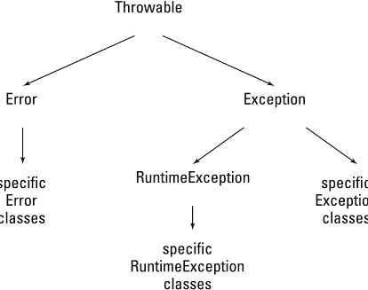

图 4-1：

异常类的层次结构。

- **Error：**这是`Throwable`的一个子类，表示合理程序无法恢复的严重错误状况。该类的子类表示可能发生的特定错误类型。例如，如果 Java 虚拟机内存不足，则会抛出`VirtualMachineError`。你不需要担心在程序中捕获这些异常。
- **Exception：**这是`Throwable`的子类，表示大多数程序应该尝试恢复的错误状况。因此，`Exception`实际上是你通过`try/catch`语句捕获的异常类型的层次结构顶端。

除了`RuntimeException`（抱歉，这是一个梗）之外，`Exception`的子类表示特定类型的**受检异常**（checked exceptions），这些异常必须被捕获或抛出。注意，其中某些子类也有自己的子类。例如，名为`IOException`的异常有 25 多个子类，代表可能发生的各种 I/O 异常。

- **RuntimeException：**这是`Exception`的子类，表示**未检异常**（unchecked exceptions）。你不需要捕获或抛出未检异常，但如果你想做也可以。`RuntimeException`的子类包括`NullPointerException`和`ArithmeticException`。

如果你的应用程序需要创建自定义异常，你可以创建一个继承此层次结构中任何类的异常。通常情况下，你会从`Exception`类开始创建自定义异常。下一节将解释如何这样做。

## 创建异常类

要创建一个自定义异常类，只需定义一个扩展 Java 异常层次结构之一类的类即可。通常扩展`Exception`来创建一个自定义的受检异常。

假设你正在开发一个从文件或数据库检索数据的类，你希望方法在遇到 I/O 错误时抛出自定义异常，而不是 Java API 提供的通用`IOException`。你可以通过创建一个继承`Exception`类的类来实现：

```java
public class ProductDataException extends Exception
{
}
```

遗憾的是，构造函数不被视为类成员，因此当你扩展一个类时它们不会被继承。结果是`ProductDataException`只有一个默认构造函数。`Exception`类本身以及大多数其他异常都有一个构造函数，允许你传递一个存储在异常中的字符串，该字符串可以通过`getMessage`方法检索。因此，你想在类中添加这个构造函数。现在`ProductDataException`看起来如下：

```java
public class ProductDataException extends Exception
{
    public ProductDataException()
    {
    }

    public ProductDataException(String message)
    {
        super(message);
    }
}
```

虽然可以这样做，但在自定义异常中添加字段或方法是不常见的。

## 抛出自定义异常


对于任何异常，你都使用 `throw` 语句来抛出自定义异常。你通常在捕获泛异常的 `catch` 块中间编写此 `throw` 语句。这里有一个从文件检索产品数据并在发生 `IOException` 时抛出 `DataException` 方法：

```java
public class ProductDB
{
    public static Product getProduct(String code)
    throws ProductDataException
    {
        try {
            Product p;
            // 从文件获取产品的代码
            // 可能抛出 IOException
            p = new Product();
            return p;
        } catch (IOException e) {
            throw new ProductDataException(
                "An IO error occurred.");
        }
    }
}
```

这里是调用 `getProduct` 方法并捕获异常的代码：

```java
try
{
    Product p = ProductDB.getProduct(productCode);
}
catch (ProductDataException e)
{
    System.out.println(e.getMessage());
}
```

在这里，如果抛出 `ProductDataException`，消息将简单地显示在控制台上。在实际程序中，你希望记录错误、通知用户，并思考在发生此数据异常的情况下如何优雅地继续运行程序。

要创建一个抽象方法，你需要指定 `abstract` 修饰符并将方法体替换为分号：

```java
public abstract int hit(int batSpeed);
```

在这里，名为 `hit` 的方法被声明为一个抽象方法，它返回一个 `int` 值并接受一个 `int` 参数。

包含至少一个抽象方法的类称为抽象类，可以在类声明中使用 `abstract` 修饰符对其进行声明。例如：

```java
public abstract class Ball
{
    public abstract int hit(int batSpeed);
}
```

如果你在类声明中省略了 `abstract` 修饰符，Java 编译器将抛出错误信息，提醒你该类必须声明为抽象。

抽象类不能实例化。因此，根据前面的声明，以下代码将无法编译：

```java
Ball b = new Ball(); // error: Ball is abstract
```

这里的问题不在于将变量 `b` 声明为 `Ball`；而是尝试使用 `new` 关键字配合 `Ball` 类来创建一个 `Ball` 对象。因为 `Ball` 是一个抽象类，你不能使用它来创建对象实例。

你可以这样从抽象类创建一个子类：

```java
public class BaseBall extends Ball
{
    public int hit(int batSpeed)
    {
        // 实现 hit 方法的代码写在这里
    }
}
```

当你对抽象类进行子类时，子类必须为抽象类中的每个抽象方法提供实现。换句话说，它必须用非抽象方法来重写每个抽象方法。（如果不这样做，该子类也将是抽象的，因此也无法被实例化。）

# 抽象工厂模式

抽象类的一个常见用途是：当你预先不知道使用哪一个子类时，提供一种获取多个子类之一实例的方法。为了实现这一点，你可以创建一个抽象工厂类，该类拥有一个或多个返回该抽象类子类的方法。

假设你想创建一个 `Ball` 对象，但你想让用户选择是创建 `SoftBall`（软垒球）还是 `Baseball`（棒球）。要使用抽象工厂模式，你得创建一个类（我称之为 `BallFactory`），它包含一个名为 `getBallInstance` 的方法。该方法接受一个 `String` 参数，如果你想创建一个 `Baseball` 对象，则设置为 `"Baseball"`；如果你想创建一个 `SoftBall` 对象，则设置为 `"SoftBall"`。

以下是类的定义：

```java
class BallFactoryInstance {
    public static Ball getBall(String s) {
        if (s.equalsIgnoreCase("Baseball")) {
            return new Baseball();
        }
        if (s.equalsIgnoreCase("SoftBall")) {
            return new SoftBall();
        }
        return null;
    }
}
```

然后，假设 `String` 变量 `userChoice` 已根据用户的选择进行了设置，你可以这样创建选定的 `Ball` 对象类型：

```java
Ball b = BallFactory.getBallInstance(userChoice);
```

在实际应用中，使用枚举（`enum`）变量比使用 `String` 变量来指示返回的对象类型更好。

当你想要创建一个通用类型作为两个或多个子类的父类时，而子类本身不代表实际的对象，那么抽象类就非常有用。例如，如果所有员工要么领薪，要么按小时计费，那么创建一个抽象的 `Employee` 类，然后将其作为 `SalariedEmployee`（薪制员工）和 `HourlyEmployee`（时制员工）子类的基类是有意义的。

关于抽象类，还有几点值得思考：

- 抽象类中的所有方法并不一定都是抽象的。一个类可以为其某些方法提供实现，而其他方法不是。事实上，即使一个类没有抽象方法，你也可以将其声明为抽象。（在这种情况下，该类不能被实例化。）

- 私有方法不能是抽象的。这是合理的，因为子类无法重写私有方法，而抽象方法必须被重写。

虽然你不能声明抽象类的实例，但你可以将抽象类声明为变量的类型。然后使用该变量来引用该抽象类任何子类的实例。

- 一个类不能既是抽象的又是最终的（`final`）。那会导致导致宇宙湮灭的逻辑悖论之一。好吧，这种影响可能是局部的。但重点是，抽象类只有在子类化时才能使用，而 `final` 类不能被子类化，因此让同一个类同时具有抽象和最终属性是没有意义的。

抽象类在 Java API 中被广泛使用。许多抽象类的名称以 `Abstract` 开头——例如 `AbstractBorder`、`AbstractCollection` 和 `AbstractMap`——但大多数抽象类并非如此。例如，`InputStream` 类（由 `System.in` 使用）就是抽象的。

# 使用接口

接口类似于抽象类，但接口只能包含抽象方法和 `final` 字段（常量），且接口不能用作基类。类通过为接口声明的每个方法提供代码来实现接口。

与继承相比，接口有两个优势：

- 接口比抽象类更容易于处理，因为你不需要担心在接口中提供任何实现细节。

- 一个类可以实现多个接口。

## 实现接口

要实现一个接口，类必须做两件事：

- 它必须在类声明中指定 `implements` 子句。

- 它必须为接口中声明的每个方法提供实现。

这里是一个实现 `Playable` 接口的类：

```java
public class TicTacToe implements Playable
{
    // 额外的字段和方法写在这里

    public void play()
    {
        // 运行游戏的代码写在这里
        // 额外的字段和方法写在这里
    }
}
```

`TicTacToe` 类的声明实现了 `Playable`。然后该类体包含了 `play` 方法的实现。

一个类可以实现多个接口：

```java
public class Hearts implements Playable, CardGame
{
    // 必须实现 Playable
    // 和 CardGame 接口的方法
}
```

在这里，`Hearts` 类实现了两个接口：`Playable` 和 `CardGame`。

类可以继承一个父类并实现一个或多个接口。这是一个示例：

```java
public class Poker extends Game
{
    // 继承 Game 类的所有成员
    // 必须实现 Playable
    // 和 CardGame 接口的方法
}
```

## 将接口作为类型

在 Java 中，接口是一种类型，就像类一样。因此，你可以将接口作为变量、参数或方法返回值的类型。

考虑这段代码片段：

```java
Playable game = getGame();
game.play();
```

在这里我假设 `getGame` 方法返回一个实现了 `Playable` 接口的对象。在第一条语句中，该对象被赋值给类型为 `Playable` 的变量。然后，第二条语句调用该对象的 `play` 方法。

另一个（稍微复杂一点）的例子，假设你有一个 `Dealable` 接口，它定义了一个 `deal` 方法，该方法接受卡牌数量作为参数：

```java
public interface Dealable {
    void deal(int cards);
}
```

现在假设你有一个名为 `startGame` 的方法，它接受两个参数：一个 `Dealable` 对象和一个指示要玩游戏的 `String`。这个方法看起来可能像：

```java
private void startGame(Dealable deck, String game) {
    if (game.equals("Poker"))
        deck.deal(5);
    else if (game.equals("Hearts"))
        deck.deal(13);
    else if (game.equals("Gin"))
        deck.deal(10);
}
```

假设你还有一个名为 `CardDeck` 的类实现了 `Dealable` 接口，你可能会使用这样的语句来开始一场红心牌游戏：

```java
Dealable d = new CardDeck();
startGame(d, "Hearts");
```

注意，变量 `d` 被声明为 `Dealable`。你可以轻松地将它声明为 `CardDeck`：

```java
CardDeck d = new CardDeck();
startGame(d, "Hearts");
```

由于 `CardDeck` 类实现了 `Dealable` 接口，因此它可以作为参数传递给 `startGame` 方法。

## 接口可以做出的更多事情

接口的功能不仅仅是创建抽象方法。接下来的章节描述了使用接口可以做的一些额外有趣的事情。继续读下去……

## 在接口中添加字段

除了抽象方法外，接口还可以包含 `final` 字段——即常量。接口字段用于提供与接口相关的常量值。例如：

```java
public interface GolfClub {
    int DRIVER = 1;
    int SPOON = 2;
    int NIBICK = 3;
    int MASHIE = 4;
}
```

在这里，任何实现 `GolfClub` 接口的类都有这四个字段（即常量）。

> 注意，接口字段被自动假设为 `static`、`final` 且 `public`。在创建接口常量时可以包含这些关键字，但不是必须。

## 扩展接口

你可以使用 `extends` 关键字来扩展接口。扩展现有接口的接口被称为子接口（subinterface），而被扩展的接口被称为父接口（superinterface）。

当你对接口使用 `extends` 关键字时，父接口的所有字段和方法都会实际上被复制到子接口中。因此，子接口由父接口的字段和方法加上子接口定义的字段和方法组成。

这是一个例子：

```java
public interface ThrowableBall {
    void throwBall();
    void catchBall();
}
public interface KickableBall {
    void kickBall();
    void catchBall();
}
public interface PlayableBall extends ThrowableBall, KickableBall {
    void dropBall();
}
```

在这里声明了三个接口。第一个名为 `ThrowableBall`，定义了两个方法：`throwBall` 和 `catchBall`。第二个名为 `KickableBall`，也定义了两个方法：`kickBall` 和 `catchBall`。第三个名为 `PlayableBall`，扩展了 `ThrowableBall` 和 `KickableBall`，并添加了自己的名为 `dropBall` 的方法。

因此，任何实现 `Playable` 接口的类必须为四个方法提供实现：`throwBall`、`catchBall`、`kickBall` 和 `dropBall`。注意 `ThrowableBall` 和 `KickableBall` 接口定义的 `catchBall` 方法签名相同，`Playable` 接口只包含一个版本的 `catchBall` 方法。

## 使用接口回调

在剧院里，回调是你参加初次试镜，他们喜欢你的表现，然后你告诉他们可以回来，以便他们再看一遍。

在 Java 中，回调类似于这样。这是一种编程技术，一个对象让另一个对象知道每当特定事件发生时，第二个对象应该调用第一个对象的某个方法。第一个对象被称为事件监听器（event listener），因为它耐心地等待另一个对象的调用。第二个对象被称为事件事件源（event source），因为它是导致调用监听器的事件源头。

好吧，我的剧院类比有点牵强。Java 中的回调并不真正像你试镜大角色时的回调那样。回调就像你需要通过电话联系某人时，当他不在时你给他打电话，并在他的语音箱里留下你的电话号码，以便他回给你电话。

Java 中的回调通过一组为此目的设计的接口来处理。回调最常见的用法是在使用 Swing 构建的图形应用程序中，其中你创建事件监听器来处理用户界面事件（例如鼠标点击）。

你将在第 6 本中了解到 Swing。现在，我通过使用 `Timer` 类来研究回调，它是 `javax.swing` 包的一部分。

# 列表 5-1:（续）

```java
Timer t = new Timer(1000, new Ticker());
t.start();
// 显示一个消息框以防止程序// 立即结束
JOptionPane.showMessageDialog(null,
    "Click OK to exit program");
}
class Ticker implements ActionListener {
    private boolean tick = true;
    public void actionPerformed(ActionEvent event) {
        if (tick) {
            System.out.println("Tick...");
        } else {
            System.out.println("Tock...");
        }
        tick = !tick;
    }
}
```

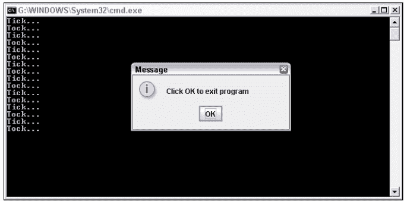

图 5-1: a 中的 Tick Tock 应用程序。

以下段落描述了该程序运行的重要细节：

- →1 `ActionListener` 接口是 `java.awt.event` 包的一部分，因此需要此导入语句。

- →2 `Timer` 类是 `javax.swing` 包的一部分，因此需要此导入语句。

- →10 这条语句创建一个新的 `Timer` 对象。计时器的间隔设置为 1,000 毫秒——等于 1 秒。将 `Ticker` 类的新实例作为第二个参数传递。计时器在每次计时跳动时都会调用该对象的 `actionPerformed` 方法——换句话说，每秒一次。

- →11 这条语句调用 `start` 方法来启动计时器。

- →15 `JOptionPane` 类用于显示对话框，告诉用户点击 OK 按钮停止应用程序。你可能认为我包含这个对话框是为了给用户一个结束程序的方法。实际上，我用它来给计时器运行的时间。如果启动计时器后只有主方法，应用程序就会结束，从而杀死计时器。因为在这里使用了 `JOptionPane`，只要对话框显示，应用程序就会运行。（有关 `JOptionPane` 的更多信息，请参见第 2 册第 2 章）。

- →20 这行是 `Ticker` 类的声明，它实现了 `ActionListener` 接口。

- →22 这行是一个私有布尔字段，用于跟踪 `Ticker` 显示的是 `Tick...` 还是 `Tock...`。每次调用 `actionPerformed` 方法时，该字段都会切换状态。

- →24 这行是 `actionPerformed` 方法，它在每个计时间隔处被调用。

- →28 这行如果为 `true`，则在控制台上打印 `Tick...`。

- →32 这行如果为 `false`，则在控制台上打印 `Tock...`。

- →34 这行切换 `ticker` 变量的值。换句话说，如果为 `true`，则将其设置为 `false`；如果是 `false`，则设置为 `true`。

## 使用默认方法


尽管接口是 Java 中一个非常有用的特性，但它们有一个固有的局限性：在定义接口并构建实现该接口的类之后，没有简单的方法可以通过添加额外方法来修改接口。

例如，假设你创建了如下接口：

```java
public interface Playable
{
    void play();
}
```

然后你构建了几个实现此接口的类。这里有一个简单的示例：

```java
class Game implements Playable
{
    public void play()
    {
        System.out.println("Good luck!");
    }
}
```

当然，这是一个相当没意义的游戏；它只是每当调用`play`方法时打印“Good luck!”消息。

现在，假设你决定`Playable`接口应该有一个额外的功能——具体来说，你想添加通过调用`quit`方法来结束游戏的能力。

你可能想直接将新方法添加到现有的接口中，如下所示：

```java
public interface Playable
{
    void play();
    void quit();
}
```

遗憾的是，这样做会破坏`Game`类，因为它没有`quit`方法的实现。

你可以通过添加`quit`方法的实现来修改`Game`类。但如果你已经写了几十个甚至上百个实现`Playable`的类呢？正如你可以想象的，一旦接口变得流行，修改它就几乎是不可能的。

为了缓解这个问题，Java 1.8 引入了一种新类型的接口方法，称为**默认方法**（default method），它提供了代码，将作为任何实现了该接口但自身没有为默认方法提供实现的类的实现。

因此，Java 8 允许你通过将`quit`方法指定为默认方法来安全地将其添加到`Playable`接口中，如下所示：

```java
interface Playable
{
    void play();
    default void quit()
    {
        System.out.println("Sorry, quitting is not allowed.");
    }
}
```

`Playable`接口规定，如果实现类没有提供`quit`方法的实现，将使用默认方法。在这种情况下，默认方法简单地打印“Sorry, quitting is not allowed.”消息。

注意，前面的示例在 1.8 之前的 Java 版本上无法编译。如果你在尝试编译使用`default`关键字的接口时遇到错误消息，请检查你的 Java 版本以确保你运行的是 1.8 或更高版本。这里有一个使用默认方法的完整示例：

```java
public class Test {
    public static void main(String[] args) {
        Playable g = new Game();
        g.play();
        g.quit();
    }
}

class Game implements Playable {
    public void play() {
        System.out.println("Good luck!");
    }
}
```

当你运行此程序时，将显示以下内容：

```
Good luck!
Sorry, quitting is not allowed.
```

由于`emp`是一个`Object`而不是`Employee`，编译器并不知道`setName`方法。

注意，你仍然可以将该对象强制转换为`Employee`：

```java
Object emp = new Employee();
((Employee)emp).setName("Smith"); // 这可以运行
```

但这样做有什么意义呢？你还不如一开始就创建一个`Employee`。

在某些情况下，将变量、参数或返回类型声明为`Object`是完全合理的。Java API 提供了一组设计用于维护对象集合的类。这些类中最常用的之一是`ArrayList`类，它有一个`add`方法，接受一个`Object`作为参数。该方法将指定的对象添加到集合中。由于参数类型是`Object`，你可以使用`ArrayList`创建任何类型对象的集合。（有关关于`ArrayList`和其他集合类的更多信息，请参阅第 4 本。）

## `Object`类的方法

表 6-1 列出了`Object`类的所有方法。通常情况下，我不会列出一个类的所有方法；我只会列出最有用的。然而，由于`Object`在面向对象编程中是一个如此重要的角色，我认为向你展示它所有的能力是最好的，尽管其中一些方法有些晦涩。

我提醒过你了——这一整章应该有一个“技术细节”（Technical Stuff）图标。

| 方法 | 作用 |
| :--- | :--- |
| `protected Object clone()` | 返回对象的副本。 |
| `boolean equals(Object obj)` | 表明此对象是否等于`obj`对象。 |
| `protected void finalize()` | 当对象被销毁时由垃圾回收器调用。 |
| `Class getClass()` | 返回表示此对象运行时类的`Class`对象。 |
| `int hashCode()` | 返回此对象的哈希码。 |
| `void notify()` | 用于多线程应用程序，唤醒等待此对象的线程。 |
| `void notifyAll()` | 用于多线程应用程序，唤醒所有等待此对象的线程。 |
| `String toString()` | 返回此对象的字符串表示。 |
| `void wait()` | 使此对象的线程等待，直到另一个线程调用`notify`或`notifyAll`。 |
| `void wait(Long timeout)` | 基本`wait`方法的变体。 |
| `void wait(Long timeout, int nanos)` | `wait`方法的另一种变体。 |

注意：这些方法中几乎有一半（`notify`、`notifyAll`以及那三个方法）与线程有关。你可以在第 5 本第 1 章中找到这些方法的完整信息。以下是其余方法的简述：

- **`clone`**：此方法通常用于创建对象的副本，在你的类中重写它并不罕见。我将在本章稍后的“克隆（The Clone）”部分详细解释述这个方法。

- **`equals`**：此方法通常用于比较对象。任何表示可以与其他对象比较对象的类都应该重写此方法。更多信息请参阅本章稍后的“equals（The equals）”部分。

- **`finalize`**：当垃圾回收器意识到一个对象不再被使用并且可以丢弃时，就会调用此方法。该方法的意图是让你在对象被丢弃之前关闭打开的文件并执行其他清理任务来完成工作。由于 Java 垃圾回收器的工作机制，无法保证`finalize`方法始终有效。因此，该方法并不常用。

- **`getClass`**：此方法有时与`Class`类配合使用，我将在本章稍后的“类（The Class）”部分描述它。

- **`hashCode`**：每一个 Java 对象都有一个哈希码，它是该类的`int`类型表示，用于一些有用的操作。在你开始处理哈希表之前，这个方法并不重要——这是一种相当高级的技术，最好留给那些口袋里插着笔并用胶带固定眼镜腿的人。

## `toString`方法

此方法是 Java 中常用的方法之一。我将在本章稍后的“toString 方法（toString Method）”部分描述它。`toString`方法返回对象的字符串表示。默认情况下，`toString`方法返回类名加上其哈希码。

## 基本类型不是对象

我需要指出，基本数据类型（如`int`和`double`）不是对象。因此，它们不继承`Object`类，并且无法访问上一节中列出的方法。

因此，以下代码无法运行：

```java
int x = 50;
String s = x.toString(); // 错误：无法编译
```

如果你想通过这种方式将`int`转换为字符串，可以使用包装类（如`Integer`）从该值创建对象，然后调用它的`toString`方法：

```java
String s = new Integer(x).toString(); // 正常
```

每个包装类还定义了一个静态的`toString`方法，你可以像这样使用它：

```java
String s = Integer.toString(x);
```

有时，使用编译器提供的快捷方式（允许在字符串拼接表达式中使用基本数据类型）会更简单：

```java
String s = "" + x;
```

在这里，`int`变量`x`与一个空字符串拼接。

这一切的意义在于，基本数据类型不是对象，所以它们不从`Object`继承任何内容。如果你想把基本类型当作对象处理，可以使用包装类（正如我在第 2 本中描述的那样）。

## 使用`toString`

这是一个让`toString`方法发挥作用的简单程序：

```java
public class TestToString {
    public static void main(String[] args) {
        Employee emp = new Employee("Martinez", "Anthony");
        System.out.println(emp.toString());
    }
}
class Employee {
    private String lastName;
    private String firstName;
    public Employee(String lastName, String firstName) {
        this.lastName = lastName;
        this.firstName = firstName;
    }
}
```

这段代码创建了一个`Employee`对象；然后将其`toString`方法的结果打印到控制台。当你运行此程序时，控制台显示以下内容：

```text
Employee@8241
```

注意：哈希码（在此例中为 8241）在你的系统中无疑是不同的。在这个例子中，显式调用`toString`并不是必要的。我可以很容易将`main`方法的第二行写成：

```java
System.out.println(emp);
```

这是因为`println`方法会自动调用传递给它的对象的`toString`方法。

## 重写`toString`

`toString`的默认实现在大多数情况下并不有用。通过查看哈希码，你无法获得关于`Employee`对象的信息。如果`toString`方法能返回对象的某些数据（例如员工姓名），不是更好吗？

要实现这一点，你必须在你的类中重写`toString`方法。事实上，Java 面向对象的基本准则之一就是重写`toString`。这里有一个重写了`toString`的`Employee`类简单程序：

```java
public class TestToString {
    public static void main(String[] args) {
        Employee emp = new Employee("Martinez", "Anthony");
        System.out.println(emp.toString());
    }
}
class Employee {
    private String lastName;
    private String firstName;
    public Employee(String lastName, String firstName) {
        this.lastName = lastName;
        this.firstName = firstName;
    }
    public String toString() {
        return "Employee[" + 
               this.firstName + " " +
               + this.lastName + "]";
    }
}
```

当你运行此程序时，控制台上显示以下行内容：

```text
Employee[Anthony Martinez]
```

上一个示例的唯一问题是类名被硬编码在`toString`方法中。你可以使用`getClass`方法在运行时获取实际的类名：

```java
public String toString() {
    return this.getClass().getName() + " ["
    + this.firstName + " "
    + this.lastName + "]";
}
```

`getClass`方法返回一个当前对象类的`Class`对象。然后使用`Class`对象的`getName`方法获取实际的类名。（你将在本章稍后部分发现更多关于`Class`知识。）

## `equals`方法

测试对象以判断它们是否相等是任何面向对象编程语言的基本任务之一。遗憾的是，Java 在这方面并不擅长。考虑这个程序：

```java
public class TestEquality {
    public static void main(String[] args) {
        Employee emp1 = new Employee("Martinez", "Anthony");
        Employee emp2 = new Employee("Martinez", "Anthony");
        if (emp1 == emp2) {
            System.out.println("These employees are the same.");
        } else {
            System.out.println("These are different employees.");
        }
    }
}
class Employee {
    private String lastName;
    private String firstName;
}
```

```java
public Employee(String lastName, String firstName)
{
    this.lastName = lastName;
    this.firstName = firstName;
}
```

`main`方法创建了两个具有相同数据的`Employee`对象并对它们进行了比较。结果比较返回了`false`。尽管`Employee`对象具有相同的数据，但它们并不被认为是相等的，因为相等运算符（`==`）比较的是对象的引用，而不是对象包含的数据。如果`emp1`和`emp2`都指向`Employee`类的同一个实例，则比较将返回`true`。

如果你想创建标识数据相同时被认为是相等的对象，你需要做两件事：

- 使用`equals`方法而不是相等运算符进行比较。
- 在你的类中重写`equals`方法，以根据数据比较对象。

接下来的章节将描述这两个步骤。

## 使用`equals`

要使用`equals`方法而不是相等运算符来测试对象，只需像这样重写比较表达式：

```java
if (emp1.equals(emp2))
    System.out.println("These employees are the same.");
else
    System.out.println("These are different employees.");
```

这里，使用了`emp1`的`equals`方法来比较`emp1`和`emp2`。

默认情况下，`equals`方法返回的结果与相等运算符相同。因此，除非你像下一节解释的那样重写了`equals`方法，否则将`==`替换为`equals`方法没有效果。

使用哪个对象的`equals`方法并不重要。因此，这里显示的`if`语句返回相同的结果：

```java
if (emp2.equals(emp1))
    System.out.println("These employees are the same.");
else
    System.out.println(
        "These are different employees.");
```

注意，这并不重要。当你重写`equals`方法时，你应该确保比较在两个方向上都是有效的。然而，粗糙的编程有时会在`equals`方法中出现`a`等于`b`但`b`不等于`a`的情况。你自己吧。

## 重写`equals`方法

你可以重写`equals`方法，以便根据值来比较对象。在这一点上，你可能认为这很容易做到。你可能会倾向于为`Employee`类编写`equals`方法，如下：

```java
// 警告 -- 这代码中有几个错误！
public boolean equals(Employee emp)
{
    if (this.getLastName().equals(emp.getLastName())
        && this.getFirstName().equals(emp.getFirstName()))
        return true;
    else
        return false;
}
```


这段代码的基本问题是——`equals` 方法的参数必须是 `Object`，而不是 `Employee`。这意味着 `equals` 方法必须准备好处理任何传入的对象。有人可能会尝试将 `Employee` 对象与 `Banana` 对象或 `null` 进行比较。

具体来说，Java API 文档规定，每当你重写 `equals` 方法时，必须确保 `equals` 方法满足五个特定条件。这些条件直接引自 API 文档：

> **反射性 (reflexive)**：对于任何非空引用值 `x`，`x.equals(x)` 应返回 `true`。

- **对称性 (symmetric)**：对于任何非空引用值 `x` 和 `y`，如果 `x.equals(y)` 返回 `true`，则当且仅当 `y.equals(x)` 也返回 `true`。

- **传递性 (transitive)**：对于任何非空引用值 `x`、`y` 和 `z`，如果 `x.equals(y)` 返回 `true` 且 `y.equals(z)` 返回 `true`，则 `x.equals(z)` 应返回 `true`。

- **一致性 (consistent)**：对于任何非空引用值 `x` 和 `y`，只要用于 `equals` 比较的信息没有被修改，多次调用 `x.equals(y)` 一致返回 `true` 或一致返回 `false`。

- **对于任何非空引用值 `x`，`x.equals(null)` 应返回 `false`。**

听起来很困惑？幸运的是，它并没有看起来那么复杂。你可以安全地忽略传递性规则，因为只要你处理好了其他规则，它就会自动发生。一致性规则基本上意味着你返回一致的结果。

这里是创建一个良好的 `equals` 方法的公式：

1. **反射性**。使用这样的语句：

```java
if (this == obj)
  return true;
```

对象必须等于它自己。

2. **非空**。使用这样的语句：

```java
if (obj == null)
  return false;
```

没有对象对象等于 `null`。

3. **同类型**。使用这样的语句：

```java
if (this.getClass() != obj.getClass())
  return false;
```

不同类型的对象永远相等。

4. **对称性**。将 `obj` 强制转换为你的类，然后比较字段：

```java
Employee emp = (Employee) obj;
return this.lastName.equals(emp.getLastName())
&& this.firstName.equals(emp.getFirstName());
```

这确保了对称性规则：如果 `x` 等于 `y`，则 `y` 也必须等于 `x`。

在通过了其他测试后，你可以假设正在比较两个不同的 `Employee` 对象，下一步是将该对象强制转换为 `Employee` 类型。

将另一个对象强制转换为 `Employee` 后，会对两个字段（`lastName` 和 `firstName`）进行比较，并返回复合比较的结果。

## clone 方法

克隆（Cloning）指的是创建一个对象的完全副本的过程。遗憾的是，在 Java 这样面向对象的语言中，这个过程实际上是一项相当困难的任务。你可能认为克隆像这样简单：

```
Employee emp1 = new Employee("Stewart", "Martha");
Employee emp2 = emp1;
```

然而，这段代码完全没有为 `Employee` 对象创建副本。你现在有两个引用同一个对象的变量，这通常不是你想要的结果。当你执行这些语句时：

```
emp1.setLastName("Washington");
emp2.setLastName("Graham");
String lastName = emp1.getLastName();
```

在这些语句执行后，`lastName` 返回的是 Washington 还是 Graham？正确答案是 Graham，因为 `emp1` 和 `emp2` 都指向同一个 `Employee` 对象。

相比之下，克隆是另一个与原始对象具有相同值的新对象。你可以使用下面的代码手动创建一个克隆：

```
Employee emp1 = new Employee("Stewart", "Martha");
Employee emp2 = new Employee();
emp2.setLastName(emp1.getLastName());
emp2.setFirstName(emp1.getFirstName());
emp2.setSalary(emp1.getSalary());
```

在这里，创建了一个新的 `Employee` 对象，并将其字段设置为与原始对象相同的值。

Java 提供了一种更优雅的方式来创建对象副本：`clone` 方法。由于继承自 `Object` 类，所有类都可以该方法。然而，正如你在接下来的章节中发现的，`clone` 方法的创建和使用可能困难。因此，你只想那些你认为确实能从克隆中受益的类中实现它。

## 实现 clone 方法

`clone` 方法由 `Object` 类定义，因此对所有 Java 类都可用，但 `clone` 在 `Object` 类中被声明为 `protected` 访问。结果是给定类的 `clone` 方法仅在该类内部可用。如果你希望其他对象能够克隆你的对象，你必须重写 `clone` 方法并将其赋予 `public` 访问。

注意，定义的 `clone` 方法返回 `Object` 类型。这是完全合理的，因为 `Object` 类不知道它重写 `clone` 方法的类类型。返回 `Object` 的一个不便副作用是，每当你为重写了 `clone` 的类的 `clone` 方法时，必须将其强制转换为所需的对象类型。

列表 6–2 提供了一个克隆 `Employee` 对象的程序示例。简而言之，该程序重写了 `Employee` 类的 `clone` 方法：它创建一个 `Employee` 对象，对其进行克隆，更改原始 `Employee` 对象的名称，并将对象打印到控制台。

### 列表 6-2：克隆示例

```
public class CloneTest {
    public static void main(String[] args) {
        Employee emp1 = new Employee(
            "Martinez", "Anthony");
        emp1.setSalary(40000.0);
        Employee emp2 = (Employee)emp1.clone();
        emp1.setLastName("Smith");
        System.out.println(emp1);
        System.out.println(emp2);
    }
}

class Employee
```

### 列表 6-2：（继续）

```java
{
    private String lastName;
    private String firstName;
    private Double salary;
    public Employee(String lastName,
        String firstName)
    {
        this.lastName = lastName;
        this.firstName = firstName;
    }
    public String getLastName()
    {
        return this.lastName;
    }
    public void setLastName(String lastName)
    {
        this.lastName = lastName;
    }
    public String getFirstName()
    {
        return this.firstName;
    }
    public void setFirstName(String firstName)
    {
        this.firstName = firstName;
    }
    public Double getSalary()
    {
        return this.salary;
    }
    public void setSalary(Double salary)
    {
        this.salary = salary;
    }
    public Object clone()
    {
        Employee emp;
        emp = new Employee(
            this.lastName, this.firstName);
        emp.setSalary(this.salary);
        return emp;
    }
    public String toString()
    {
        return this.getClass().getName() + "[\n" + this.firstName + " "
+ this.lastName + ", "
+ this.salary + "]";
    }
}
```

当你运行此程序时，控制台会显示以下行：

- Employee [Anthony Smith, 40000.0]

- Employee [Anthony Martinez, 40000.0]

正如你看到的，第二个 `Employee` 的名称被成功修改，而没有影响第一个 `Employee` 对象的名称。

以下段落让你关注程序的一些亮点：

- 为员工 Anthony Martinez 创建了第一个 `Employee` 对象。

- 设置了 Martinez 先生的薪水。

- 为 Martinez 先生创建了 `Employee` 对象的克隆。注意，返回值必须转换为 `Employee`。

# 列表 6-3：创建深拷贝

```java
public class CloneTest2
{
    public static void main(String[] args) {
        Employee emp1 = new Employee(
            "Martinez", "Anonymous");
        emp1.setSalary(40000);
        emp1.address = new Address(
            "1300 N. First Street",
            "Fresno", "CA", "93702");
        Employee emp2 = (Employee)emp1.clone();
        System.out.println(
            "**** after cloning ****\n");
        printEmployee(emp1);
        printEmployee(emp2);
        emp2.setLastName("Smith");
        emp2.address = new Address(
            "2503 N. 6th Street",
            "Fresno", "CA", "93722");
        System.out.println(
            "**** after cloning emp2 ****\n");
        printEmployee(emp1);
        printEmployee(emp2);
    }
    private static void printEmployee(Employee e) {
        System.out.println(e.getFirstName()
            + " " + e.getLastName());
        System.out.println(e.address.getAddress());
        System.out.println("Salary: " + e.getSalary());
        System.out.println();
    }
}
class Employee implements Cloneable {
    private String lastName;
    private String firstName;
    private Double salary;
    public Address address;
    public Employee(String lastName, String firstName) {
        this.lastName = lastName;
        this.firstName = firstName;
        this.address = new Address();
    }
    public String getLastName() {
        return this.lastName;
    }
    public void setLastName(String lastName) {
        this.lastName = lastName;
    }
    public String getFirstName() {
        return this.firstName;
    }
    public void setFirstName(String firstName) {
        this.firstName = firstName;
    }
    public Double getSalary() {
        return this.salary;
    }
    public void setSalary(Double salary) {
        this.salary = salary;
    }
    public Object clone() {
        Employee emp;
        try {
            emp = (Employee) super.clone();
            emp.address = (Address)address.clone();
        } catch (CloneNotSupportedException e) {
            return null; // 永远不会发生
        }
        return emp;
    }
    public String toString() {
        return this.getClass().getName() + "["
        + this.firstName + " "
        + this.lastName + ", "
        + this.salary + "]";
    }
}
class Address implements Cloneable
{
    private String street;
    private String city;
    private String state;
    private String zipcode;
    public Address() {
        this.street = "";
        this.city = "";
        this.state = "";
        this.zipcode = "";
    }
    public Address(String street, String city, String state, String zipcode) {
        this.street = street;
        this.city = city;
        this.state = state;
        this.zipcode = zipcode;
    }
    public Object clone() {
        try {
            return super.clone();
        } catch (CloneNotSupportedException e) {
            return null; // 永远不会发生
        }
    }
    public String getAddress() {
        return this.street + "\n"
        + this.city + ", "
        + this.state + " "
        + this.zipcode;
    }
}
```

→109

→133

→137

336 书 3 面向对象

`CloneTest2` 类中的 `main` 方法创建了一个 `Employee` 对象并设置了它的姓名、工资和地址。然后它创建了该对象的副本并打印了两个对象包含的数据。接下来，它更改了第二个员工的姓和地址并打印了数据。以下是该程序运行时产生的输出：


```
**** after cloning
Anthony Martinez
1300 N. First Street
Fresno, CA 93702
Salary: 40000.0
Anthony Martinez
1300 N. First Street
Fresno, CA 93702
Salary: 40000.0
**** after changing emp2 ****
Anthony Martinez
1300 N. First Street
Fresno, CA 93702
Salary: 40000.0
Anthony Smith
2503 N. 6th Street
Fresno, CA 93722
Salary: 40000.0
```

如你所见，两个 `Employee` 对象在克隆后具有相同的数据，但在第二个员工的字段更改后，它们的数据就不同了。因此，你可以安全地更改其中一个对象的数据而不影响另一个对象。

以下段落描述了该程序的一些亮点：

- →5 创建了一个名为 Anthony Martinez 的员工。
- →8 设置员工的地址。
- →11 克隆该员工（好吧，只是克隆对象，不是同事）。
- →13 打印克隆后的两个 `Employee` 对象。它们应该具有相同的数据。
- →18 更改员工的姓名。
- →19 更改员工的地址。
- →23 打印克隆后的两个 `Employee` 对象。它们应该具有相同的数据。
- →30 创建了一个名为 Anthony Martinez 的员工。
- →40 设置员工的地址。
- →46 更改员工的姓名。
- →85 更改员工的地址。
- →90 创建了一个名为 Anthony Martinez 的员工。
- →91 更改员工的姓名。
- →93 更改地址。
- →97 克隆该员工（好吧，只是克隆对象，不是同事）。
- →109 打印克隆后的两个 `Employee` 对象。它们应该具有相同的数据。
- →133 更改员工的姓名。
- →137 更改地址。

列表 6-3：（上）

（注：由于提供的原始文本存在大量重复和格式乱序，译文已根据逻辑结构进行了整理和去重，确保内容通顺。）

## 本章内容

- 使用内部类
- 创建静态内部类
- 实现匿名类
- 添加 Lambda 表达式

# 第 7 章

使用内部类、匿名类和 Lambda 表达式

在本章中，你将学习如何使用三种高级类型的类：内部类、静态内部类和匿名内部类。这三者在某些特定情况下都是非常有用的。特别是内部类和匿名内部类，经常用于使用 Swing 创建的图形化应用程序。关于 Swing 的更多信息，请参阅第 6 本。在本章中，我将重点关注创建这些类型类的机制。

你还将学习到 Java 8 中引入的一项特性，称为 lambda 表达式，它简化了创建和使用匿名类的任务。

再次强调，本章可以在每隔一段旁边贴上一个“技术细节”图标。我在本章中提供的信息的即时用性似乎值得商榷。相信我，当你开始编写 Swing 应用程序时，你需要这些内容。如果你现在想跳过这一章，也没关系。你总可以在学习 Swing 并需要了解内部类和匿名内部类如何工作时，随时回来这里。


# 声明内部类

内部类是声明在另一个内部类内部的类。因此，创建内部类的基本结构如下：

```java
class outerClassName {
    private class innerClassName {
        // 内部类体
    }
}
```

包含内部类的类被称为外部类。你可以对内部类使用可见性修饰符，以指定该类应该是公共（public）、保护（protected）还是私有（private）。这种可见性决定了其他类是否可以看到该内部类。

# 理解内部类

从表面上看，内部类只是包含在另一个类内部，但它远不止此。以下是关于内部类的一些关键点：

- 内部类自动拥有外部类的所有字段和方法，甚至是私有字段和方法。因此，内部类对其外部类的访问权限比子类对其父类的访问权限更高。（子类可以访问父类的公共和保护成员，但不能访问私有成员）。
- 内部类带有指向外部类当前实例的引用，这使其能够访问外部类的实例数据。
- 由于存在外部类实例引用，你不能从外部类的静态方法中创建或引用内部类。然而，你可以创建一个静态内部类，正如我在本章的“使用静态内部类”节中所描述的那样。
- 创建内部类的主要原因之一是创建一个仅对外部类感兴趣的类。因此，你通常将内部类声明为私有，以便其他类无法访问它们。
- 有时，内部代码需要引用其外部类的实例。要做到这一点，你使用外部类的名称后跟点运算符和 `this`。例如，如果外部类命名为 `MyOuterClass`，你将使用 `MyOuterClass.this` 来引用外部类的实例。


# 查看示例

第 3 本第 5 章介绍了一个使用 Swing 包中 `Timer` 类（`javax.swing.Timer`）的应用程序，该程序每隔一秒在控制台上显示一次 `Tick...` 和 `Tick...` 行。它使用一个名为 `Ticker` 的类，该类实现了 `ActionListener` 接口来处理 `Timer` 对象的事件。

在本章中，你将看到该应用程序三个版本。如果你不清楚该应用程序如何使用 `Timer` 类显示 `Tick...` 和 `Tick...` 消息，或者什么时候需要 `JOptionPane` 对话框，你可能想快速复习第 3 本第 5 章。


列表 7-1 显示了该应用程序的版本，它将 `Ticker` 类实现为内部类。

```java
LISTING 7-1: 使用内部类的 Tick
import java.awt.event.*;
import javax.swing.*;

public class TickTickInner {
    private String tickMessage = "Tick...";
    private String toMessage = "Tick...";

    public static void main(String[] args) {
        TickTickInner t = new TickTickInner();
        t.go();
    }
    private void go() {
        // 创建一个每隔一秒调用一次
        // Ticker 类的定时器
        Timer t = new Timer(1000, new Ticker());
        t.start();

        // 显示消息框以防止
        // 程序立即结束
        JOptionPane.showMessageDialog(null,
            "点击 OK 退出程序");
        System.exit(0);
    }
}

class Ticker implements ActionListener
{
    private boolean tick = true;

    public void actionPerformed(ActionEvent event)
    {
        if (tick) {
            System.out.println(tickMessage);
        }
        else {
            System.out.println(tickMessage);
        }
        tick = !tick;
    }
}
```

接下来的段落描述了该程序的一些亮点：

- 字符串变量 `tickMessage` 和 `toMessage`（第 7 行）包含了要打印的消息。注意，这些变量被定义为外部类的字段。

# 观察者模式

Java 中的事件监听器是 Java 委托模型（Delegation Model）的一部分，该模型是更通用的设计模式——观察者模式的实现。当你需要在发生变化时创建相互作用的对象时，这种模式非常有用。发生变化的对象被称为可观察对象，而监控变化的对象被称为观察者对象。观察者对象向可观察对象注册自身，并在状态变化时通知观察者对象。你将在第 6 本中发现更多内容。如果你感兴趣，可能想研究 Java 中的 `Observer` 和 `Observable` 接口。它们为创建简单的实现提供了标准方法。

由于内部类只能通过实例使用，因此无法在静态方法中直接使用它。结果是，程序中的 `main` 方法仅仅创建了类类的实例。这一行执行了该实例的方法。

第 11 行和第 12 行使用的技术是一种相当常见的编程技巧，允许应用程序快速从静态上下文切换到面向对象的模式。这一行是 `go` 方法，由第 12 行调用。这一行创建了 `Timer` 类的实例，定时器间隔为 1000 毫秒，`ActionListener` 设置为 `Ticker` 类的新实例。

在这里，使用 `JOptionPane` 类来显示对话框。这个对话框是必要的，以给定时器运行的机会。应用程序在用户点击 OK 时结束。这一行调用了 `System` 类的 `exit` 方法，该方法会立即关闭 Java 虚拟机。这个方法在这里并不是严格要求的，但如果你漏掉它，定时器会在你点击 OK 后继续运行几秒，JVM 才会发现应该杀死定时器。

这一行是 `Ticker` 内部类的声明。注意该类实现了 `ActionListener` 接口。`actionPerformed` 方法由 `Timer` 对象每 1000 毫秒调用一次。在这一行和第 41 行，内部类直接访问外部类的字段。

# 使用静态内部类

静态内部类与内部类相似，但它不需要外部类的实例。它的基本形式如下：

```java
class outerClassName {
    private static class innerClassName {
    }
}
```

// 内部类体

和静态方法一样，静态内部类无法访问其外部类的任何非静态字段或方法。然而，它可以访问静态字段或方法。

列表 7-2 展示了 Tick Tock 应用的一个版本，它使用了静态内部类而不是尺子类。

# 列表 7-2：使用静态内部类的 Tick Tock

```java
import java.awt.*;
import javax.swing.*;

public class TickTockStatic {
    private static String tickMessage = "Tick...";
    private static String tockMessage = "Tock...";

    public static void main(String[] args) {
        TickTockStatic t = new TickTockStatic();
        t.go();
    }

    private void go() {
        // 创建一个计时器，每隔一秒
        // 调用一次 Ticker 类
        Timer t = new Timer(1000, new Ticker());
        t.start();

        // 显示消息框以防止程序
        // 立即结束
        JOptionPane.showMessageDialog(null,
            "Click OK to exit program");
        System.exit(0);
    }

    static class Ticker implements ActionListener {
        private boolean tick = true;

        public void actionPerformed(ActionEvent event) {
            if (tick) {
                System.out.println(tickMessage);
            } else {
                System.out.println(tockMessage);
            }
            tick = !tick;
        }
    }
}
```

该版本的应用程序和列表 7-1 中的版本之间只有三个区别：

- `tickMessage` 字段被声明为 `static`。这是必要的，以便静态类可以访问它。
- `tockMessage` 字段也被声明为 `static`。
- `Ticker` 类被声明为 `static`。

## 匿名内部类

匿名内部类（通常称为匿名类）可能是 Java 编程语言中最奇怪的特性之一。当你第一次看到匿名类时，几乎肯定会犯错，认为代码根本无法编译。但它确实可以编译，并且运行良好。当你掌握了使用匿名类的方法，你会疑惑自己以前没有它们是如何生存下来的。

匿名类是直接在你想实例化它的地方定义的一个类。因为你是在需要它的地方编写类体，所以你不需要给它命名。（这就是为什么它被称为匿名类。）

## 创建匿名类

声明和实例化匿名类的基本形式如下：

```java
new ClassOrInterface() { class-body }
```

如你所见，你指定了 `new` 关键字，后面跟着类或接口的名称，用于指定由匿名类创建的对象的类型。该类或接口名称后面跟着括号，括号中可能包含传递给匿名类构造函数的参数列表。然后你编写一个用大括号括起来的类体。类体可以包含普通类包含的任何内容：字段、方法，甚至是其他类或接口。

这是一个简单的匿名类示例：

```java
public class AnonClass {
    public static void main(String[] args) {
        Ball b = new Ball() {
            public void hit() {
                System.out.println("You hit it!");
            }
        };
        b.hit();
    }

    interface Ball {
        void hit();
    }
}
```

在这个例中，我创建了一个名为 `Ball` 的接口，它有一个方法 `hit`。在 `main` 方法中，我声明了一个类型为 `Ball` 的变量并使用匿名类创建一个对象。匿名类的类体包含 `hit` 方法的实现，它简单地在控制台上显示 `You hit it!` 消息。在类实例化并赋值给变量 `b` 后，下一条语句调用了 `hit` 方法。

当你运行此程序时，控制台上会显示单行 `You hit it!`。

在使用匿名类时，有几点值得深思：

- 你可以为匿名类创建构造函数，因为匿名类没有名称。无论如何，你该给构造函数起什么名字呢？
- 如果匿名类基于接口，你可以传递参数。这是很合理的；接口没有构造函数，所以 Java 将无任何地方可以接收这些参数。
- 赋值语句可以像本例所示使用匿名类。在这种情况下，匿名类类体后面跟着一个分号，标记赋值语句的结束。注意，这个分号是赋值语句的一部分，而不是匿名类的一部分。（在下一节中，你将看到一个作为方法参数传递的匿名类示例。在那个示例中，类体后面没有分号。）
- 匿名类是一种特殊的内部类；和任何内部类一样，它自动拥有访问其外部类字段和方法的权限。
- 匿名类不能是 `static` 的。

## 使用匿名类创建程序

列表 7–3 显示了一个更复杂的匿名类示例：Tick 应用的版本，它使用匿名类作为计时器的动作监听器。

# 列表 7-3：使用匿名类的 Tick

```java
import java.event.*;
import javax.swing.*;

public class TickTickAnonymous {
    private String tickMessage = "Tick...";
    private String tockMessage = "Tock...";

    public static void main(String[] args) {
        TickTickAnonymous t = new TickTickAnonymous();
        t.go();
    }

    private void go() {
        // 创建一个计时器，每隔一秒
        // 调用一次 Ticker 类
        Timer t = new Timer(1000, new ActionListener() {
            private boolean tick = true;

            public void actionPerformed(ActionEvent event) {
                if (tick) {
                    System.out.println(tickMessage);
                } else {
                    System.out.println(tockMessage);
                }
                tick = !tick;
            }
        });
        t.start();

        // 显示消息框以防止程序
        // 立即结束
        JOptionPane.showMessageDialog(null,
```


进入`/path/to/xxx`目录，找到`xxx.json`。

在表达式`cvar = avar + bvar`中，加法运算符（`+`）将`avar`与`bvar`相加，得到它们的和`cvar`。

在`List.of(arg0, arg1, arg2)`中，`List`接口的工厂方法`of()`接受一系列的元素，返回包含它们的只读列表。

之后我们这样调用`cmd`命令：`cmd arg0 arg1 arg2`。

```
if (condVar > someVal) {console.log("xxx")}
```

---

这里的 lambda 表达式实现了一个函数式接口，其单一方法不接受参数。当调用该方法时，会打印文本“You hit it!”。

你可以在任何可以使用普通 Java 表达式的地方使用 lambda 表达式。你将它们用于赋值语句或作为传递参数。唯一的限制是，你只能在需要函数式接口实例的上下文中使用 lambda 表达式。例如，这里有一个使用 lambda 表达式实现`Ball`接口的程序：

```java
public class LambdaBall {

    public static void main(String[] args) {

        Ball b = () -> { System.out.println("You hit it!"); };

        b.hit();

    }

    interface Ball {

        void hit();

    }

}
```

lambda 表达式的通用语法如下：

```
(parameters) -> expression
```

或者：

```
(parameters) -> { statement;...}
```

如果你使用表达式，不需要分号。如果你使用一个或多个语句，这些语句必须包含在大括号中，并且每个语句的末尾需要分号。

不要忘记使用 lambda 表达式的语句本身也以分号结尾。因此，上一个示例中的 lambda 表达式有两个紧挨的分号：

```java
Ball b = () -> { System.out.println("You hit it!"); };
```

第一个分号标记调用`System.out`语句的结束；第二个分号标记将 lambda 表达式赋值给变量`b`的赋值语句的结束。

## 本章内容
- 为你的类创建包
- 将你的包归档为 JAR 文件
- 使用 JavaDocs 为你的类编写文档
- 使用 Java 模块系统

## 第 8 章 使用包和新的 Java 模块系统

本章将向你展示如何处理创建的类。具体来说，我将向你展示如何将类组织成整洁的包。包允许你将自己的类与 Java API 中的类分开，允许你在其他应用程序中重用你的类，并允许你将类分发给其他人（假设其他人可能对你的类感兴趣）。如果是的话，你可能不想发送单独的类文件。相反，将它们打包成一个名为 JAR 文件的单个文件。本章将介绍这一点。

然后，我将向你展示如何使用一种名为 JavaDocs 的功能，它可以让你为类编写注释文档。通过 JavaDocs，你可以自动构建看起来专业的文档页面。当你把 JavaDoc 页面发布到网站时，你的朋友会认为你是一个真正的 Java 大师。

最后，我将向你展示如何使用 Java 9 的新功能——Java 模块系统，它提供了一种改进的包处理方法，避免了旧 Java 包系统中常见的陷阱。

## 使用包

包（package）是一组所属的类。如果没有包，整个 Java 类宇宙将是一个巨大的、无章的混乱。想象一下，Java API 中提供的数千个类，与世界各地 Java 程序员创建的数百万 Java 类全部丢进一个大锅里。包允许你将这一大量内容组织成较小的、可管理的相关的类集合。

## 导入类和包

当你在 Java 源文件的开头使用`import`语句时，你使`import`语句中提到的包中的类在整个文件中可用（我在第 2 册第 1 章介绍过`import`语句，但这里不再重复）。

`import`语句可以使用星号通配符`*`导入包中的所有类。这里导入了`java.util`包中的所有类：

```java
import java.util.*;
```

或者，你可以一次导入一个类。这里只导入了`ArrayList`类：

```java
import java.util.ArrayList;
```

注意：你不需要使用`import`语句来使用包中的类。但如果不使用`import`语句，你必须对该类的任何引用使用完全限定名。例如，你可以在不导入`java.util`的情况下使用`ArrayList`类：

```java
java.util.ArrayList = new java.util.ArrayList();
```

由于始终写出完全限定名非常麻烦，你应该始终使用`import`语句来导入应用程序所使用的包或单个类。

你必须显式导入两个包：

- `java.lang`：此包包含了非常频繁使用的类，Java 编译器使这些类对每个程序可用。该包中的类示例包括`String`、`Exception`以及各种包装类，如`Integer`和`Boolean`。（有关此包以及书中描述的所有其他 Java 包的完整文档，请参阅 http://download.java.net/jdk8/docs/api/）。
- **默认包（The default package）**：此包包含了不特定属于任何其他包的类。到目前为止我在书中展示的所有程序都依赖默认包。

对于简单的开发和实验，使用默认包是可以接受的。但是，如果你开始开发一个严肃的 Java 应用程序，请为其创建一个单独的包，并将应用程序的所有类放在那里。你将在下一节中发现如何这样做。

即使你想这样做，也无法导入默认包。假设你有两个包——默认包和`com.lowwriter.util`包。默认包的代码包含语句`import com.lowwriter.util.*`。这是没问题的。但默认包的代码包含语句`import com.lowwriter.util.*`（注：原文 OCR 文本此处似乎有逻辑错误，但我将保留其含义）。

`package`语句（package statement）仅用于为文件中任何类所属的包提供名称。例如：

```java
package com.lowewriter.util;
```

`package`语句必须是文件中第一个非注释语句。


## 示例

假设你开发了一个名为`Console`的工具类，它包含许多方便的静态方法用于从控制台获取用户输入。例如，该类有一个名为`askYOrN`的静态方法，可以从用户处获取 Y 或 N，并返回一个布尔值表示用户输入了哪一个。你决定将此类放在名为`com.lowewriter.util`的包中，以便你和其他志同程序员可以在程序中使用它。

以下是`Console`类的源文件：

```java
package com.lowewriter.util;

import java.util.Scanner;

public class Console {

    static Scanner sc = new Scanner(System.in);

    public static boolean askYOrN(String prompt) {

        while (true) {

            String answer;

            System.out.print(prompt + " (Y or N) ");

            answer = sc.next();

            if (answer.equalsIgnoreCase("Y"))

                return true;

            else if (answer.equalsIgnoreCase("N"))

                return false;

        }

    }

}
```

好了，到目前该类只有一个方法（`askYOrN`），但某天你会为它添加许多其他有用方法。在此期间，你想设置在一个包中，以便立即开始使用它。

因此，你创建一个名为`c:\javclasses\com\lowewriter\util`的目录（如前面的节所述），并将源文件保存到该目录。然后编译程序。`Console.class`文件将存储在该目录中。接着，你将`c:\javclasses`添加到你的`ClassPath`环境变量中。

现在你可以使用以下程序来测试你的包是否已运行正常：

```java
import com.lowewriter.util.*;

public class PackageTest

{

    public static void main(String[] args)

    {

        while (Console.askYOrN("Keep going?"))

            System.out.println("D'oh!");

    }

}
```

这里的`import`语句导入了`com.lowewriter.util`包中的所有类。然后，`main`方法中的`while`循环反复询问用户是否想继续。

## 将类放入 JAR 文件

JAR 文件是一个单一文件，可以以压缩格式包含多个类，Java 运行时环境可以快速访问。（JAR 代表 Java archive，Java归档。）一个 JAR 文件可以包含几个类，也可以包含数千个类。事实上，Java API 存储在一个名为`rt.jar`的 JAR 文件中。（rt 代表 runtime，运行时）。这是一个相当大的文件——超过 35MB——考虑到它包含了超过 12,000 个类，这并不糟糕。

JAR 文件是由`jar`工具创建的，你可以在 Java 的`bin`目录下找到它，那里还有`java`和`javac`等其他 Java 命令行工具。JAR 文件类似于 Zip 文件，Zip 是一种由 PKZIP 程序流行的压缩格式。主要的区别是 JAR 文件包含一个特殊文件，称为清单文件（manifest file），它包含了关于归档中文件的信息。此清单由`jar`工具自动创建，但你也可以提供自己的清单来提供有关归档文件的额外信息。

JAR 文件是分发完成的 Java 应用程序的标准方式。完成应用程序后，从命令提示符运行`jar`命令来准备 JAR 文件。然后，另一个用户可以将 JAR 文件复制到他的计算机上。该用户可以直接从 JAR 文件运行应用程序。

JAR 文件也用于分发类库。你可以将 JAR 文件添加到`ClassPath`环境变量中。然后，JAR 文件中的类对于任何导入包含这些类的包的 Java 程序都是自动可用的。

## jar 命令行选项

`jar`命令是一个老式的 Unix 风格命令，带有一些复杂的命令行选项，如果你想让`jar`执行某些有用的操作，就必须正确设置这些选项。

`jar`命令的基本格式如下：

```
jar options jar-file [manifest-file] class-files...
```

选项指定了你让`jar`执行的基本操作，并提供了了关于你希望命令如何运行的额外信息。表 8–1 列出了这些选项。

### 表 8-1

| 选项 | 描述 |
|---|---|
| c | 创建一个新的 jar 文件。 |
| u | 更新现有的 jar 文件。 |
| x | 从现有的 jar 文件中提取文件。 |
| t | 列出 jar 文件的内容。 |
| f | 表明 jar 文件作为参数指定。你几乎总是想要使用此选项。 |
| v | 详细输出。此选项告诉`jar`命令在工作时显示额外信息。 |
| - | 在将文件添加到归档时不对其进行压缩。此选项未被使用。 |
| m | 表明提供了清单文件。它被列在 jar 文件之后的下一个参数。 |
| M | 表明不应向归档添加清单文件。此选项很少使用。 |

## 归档包

`jar`工具最常用的用途是创建归档。实现此操作的最简单方法取决于操作系统。以下是 Windows 的操作步骤：

1. 打开命令窗口。最简单的方法是点击“开始”按钮，输入`cmd`并点击确定。如果遇到困难，检查开始菜单。
2. 使用`cd`命令导航到你的包根目录。例如，如果你的包在`c:\javclasses`中，使用此命令：
```
cd \javclasses
```
3. 使用`jar`命令指定选项`cf`、文件名以及你想归档的路径。例如，要创建一个名为`utils.jar`包含`com.lowewriter.util`包中所有类的归档，使用此命令：
```
jar cf utils.jar com.lowewriter.*
```
4. 要验证 jar 文件已创建，使用`jar`命令指定`tf`和文件名。例如，如果 jar 文件是`utils.jar`，使用此命令：
```
jar tf utils.jar
```
这会列出 jar 文件的内容，你可以看到添加了哪些：
```
META-INF/
META-INF/MANIFEST.MF
com/lowewriter/util/Console.class
```
5. 完成！结束了。你可以将 jar 文件留在原处，也可以把它给你的朋友，让他们使用它包含的类。

## 直接从归档运行程序

只需少许努力，你就可以设置一个归档，让 Java 程序可以直接从其运行。你所做的只是在创建归档之前创建一个清单文件（manifest file）。然后，当你运行 jar 工具创建归档时，在 jar 命令行中包含该清单文件。

清单文件是一个简单的文本文件，包含有关归档中文件的信息。虽然它可以包含许多行信息，但只需要一行信息即可创建一个可执行的 jar 文件：

```
Main-Class: ClassName
```

类名是包含启动应用程序时执行的 main 方法类的全限定名。虽然这不是强制要求的，但通常使用 .mf 扩展名作为清单文件的后缀。

例如，假设你有一个应用程序，其主类是`GuessingGame`，且应用程序的所有类文件都在`com.lowewriter.game`包中。首先，在`com\lowewriter\game`目录下创建一个名为`game.mf`的清单文件。该文件包含以下行：

```
Main-Class: com.lowewriter.game.GuessingGame
```

然后运行 jar 命令，并带有选项`cf`、要创建的归档名称、清单文件的名称以及类文件的路径。这是一个示例：

```
jar -cf game.jar com\lowewriter\game\game.mf
```

现在，你可以通过命令行提示符使用`java`命令配合`-jar`切换和归档文件的名称直接运行应用程序。这是一个示例：

```
java -jar game.jar
```

该命令启动 JRE 并执行`game.jar`归档文件中由清单文件指定的类的 main 方法。

> 如果你的操作系统配置得当，你还可以通过双击 jar 文件的图标来运行应用程序。


## 使用 JavaDoc 为你的类编写文档

在发布你热门的新类库或应用程序之前，还剩下最后一步：为它的类准备文档。幸运的是，Java 了一个了一个名为 JavaDoc 的工具，它可以根据源文件中的注释自动创建精美的基于 HTML 的文档。你所做的只是为每个公共类、字段和方法编写注释；然后通过`javadoc`命令运行源文件；*搞定！* 你的类就有了专业的、基于网络的文档。

接下来的章节将向你如何向源文件添加 JavaDoc 注释、如何通过`javadoc`命令运行源文件，以及如何查看生成的文档页面。

## 添加 JavaDoc 注释

创建 JavaDoc 注释的基本规则是它们以`/**`开头并以`*/`结束。你可以在源文件中的三个不同位置之一放置 JavaDoc 注释：

- 紧跟公共类的声明之前
- 紧跟公共字段的声明之前
- 紧跟公共方法或构造函数的声明之前

JavaDoc 注释可以包含描述类、字段或方法的文本。多行 JavaDoc 注释的后续每行都以星号开头。JavaDoc 会忽略这个星号以及它与行首第一个单词之间的任何空白字符。

JavaDoc 注释中的文本可以包含 HTML 标记以应用精美的格式。你应该避免使用标题标签如`h1`等，因为 JavaDoc 会创建这些标签，而你的标题标签只会让情况变得复杂。你可以使用粗体和斜体的标签`b`和`i`，或者用于格式化代码示例（使用`<pre>`标签）。

此外，你还可以包含特殊的 doc 标签，这些标签提供了 JavaDoc 用于格式化文档面的特定信息。表 8-2 总结了最常用的标签。

| 标签 | 说明 |
|---|---|
| @author | 提供有关作者的信息，通常是作者姓名、电子邮件地址、网站信息等。 |
| @version | 指示版本号。 |
| @since | 用于指示此类、字段或方法被添加时的版本。 |
| @param | 提供方法或构造函数的名称和描述。 |
| @return | 提供方法返回值的描述。 |
| @throws | 指明方法或构造函数抛出的异常。 |
| @deprecated | 表示该类、字段或方法已过弃，不应使用。 |

为了让你了解 JavaDoc 注释通常是如何使用的，列表 8-1 显示了一个名为`Employee`的类，其中包含了 JavaDoc 注释。（该文件还包含`Address`类，它是`Employee`类工作所必需。为了简洁起见，我没有为`Address`类提供 JavaDoc 注释。）

## 列表 8-1：带有 JavaDoc 注释的 Employee 类

```
/** 代表一个员工。

 * @author Doug Lowe

 * @author www.LoweWriter.com

 * @version 1.5

 * @since 1.0

 */

public class Employee {
```


```java
private String lastName;

private String firstName;

private Double salary;

/** 代表员工的地址。 */
public Address address;

/**
 * 创建一个指定名称的员工。
 *
 * @param lastName 员工的姓。
 * @param firstName 员工的名字。
 */
public Employee(String lastName, String firstName) {
    this.lastName = lastName;
    this.firstName = firstName;
    this.address = new Address();
}

/**
 * 获取员工的地址。
 *
 * @return 员工的地址。
 */
public Address getAddress() {
    return address;
}

/**
 * 设置员工的地址。
 *
 * @param address 员工的地址。
 */
public void setAddress(Address address) {
    this.address = address;
}

/**
 * 获取员工的姓。
 *
 * @return 员工的姓。
 */
public String getLastName() {
    return lastName;
}

/**
 * 设置员工的姓。
 *
 * @param lastName 员工的姓。
 */
public void setLastName(String lastName) {
    this.lastName = lastName;
}

/**
 * 获取员工的名字。
 *
 * @return 员工的名字。
 */
public String getFirstName() {
    return firstName;
}

/**
 * 设置员工的名字。
 *
 * @param firstName 员工的名字。
 */
public void setFirstName(String firstName) {
    this.firstName = firstName;
}

/**
 * 获取员工的薪水。
 *
 * @return 员工的薪水。
 */
public Double getSalary() {
    return salary;
}

/**
 * 设置员工的薪水。
 *
 * @param salary 员工的薪水。
 */
public void setSalary(Double salary) {
    this.salary = salary;
}
```

```java
class Address implements Cloneable {
    public String street;
    public String city;
    public String state;
    public String zipCode;
}
```

# 使用 `javadoc` 命令

`javadoc` 命令有很多可以设置的选项，使其变得复杂。然而，你可以忽略所有这些选项创建一个基本的文档页面。只需指定你想要创建文档的 Java 文件的完整路径，如下：

```shell
javadoc com\lowewriter\*.java
```

`javadoc` 命令在当前目录创建页面，因此你可能想先切换到希望页面所在的目录。

有关使用此命令的更完整信息，请参考 Oracle 网站上的 `javadoc` 文档。你可以在这里找到：http://www.oracle.com/technetwork/articles/jsp-135444.html。

# 查看 JavaDoc 页面

运行 `javadoc` 命令后，你可以从 `index.html` 开始访问文档页面。快速显示此页面只需在运行 `javadoc` 命令后在命令行提示符输入 `index.html`。或者你可以启动浏览器，导航到创建文档页面的目录并打开 `index.html`。无论哪种方式，图 8–1 显示了一个列两个类的索引页面。

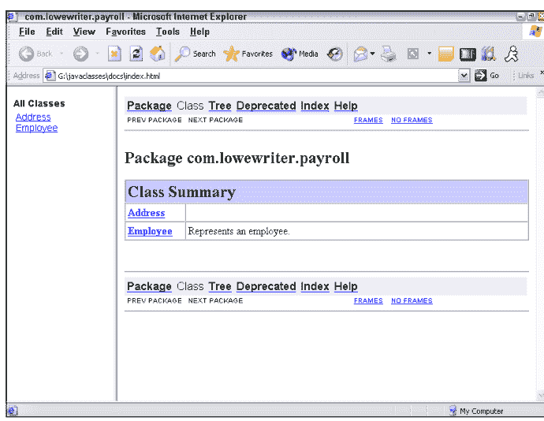

图 8–1：JavaDocs 索引页面。

如果你觉得这个页面看起来熟悉，那是因为 Java API 的文档是使用 JavaDocs 创建的。所以你应该已经知道如何在这些页面中导航。

要查看某个类的文档，点击类名的链接。会出现一个包含该类完整文档的页面。例如，图 8–2 显示了 `Employee` 类文档页的一部分。JavaDocs 从列表 8–1 所示的源文件生成了该页面。

## 使用 Java 模块系统

在本章之前，Java 包自 1995 年 Java 第一个版本发布以来，一直为 Java 程序员提供了很好的支持。在 Java 发布时，包的设计是非常先进的，但多年来它们已经显得有些过时了。例如，开发者在管理使用大量包的大型应用程序时经常会遇到问题，特别是当这些包需要不同版本的 Java 时。

包的另一个问题是它们没有提供一种简单的方法来创建轻级应用程序，其运行时仅包含实际需要的 Java 部分。这可能会限制 Java 在资源有限的设备（如嵌入式控制器或智能手机）上运行的能力。

Java 9 引入的 Java 模块系统旨在解决这两个问题，以及旧包系统的其他一些更微妙的问题。模块系统也被称为 Jigsaw 项目（Project Jigsaw），已经开发了六多年。它最初被计划在 2011 年随 Java 7 一起发布，但未能按时完成，因此被推迟到了 Java 8。当 Java 8 于 2014 年推出时，Jigsaw 项目仍未完成，因此被推迟到了 Java 9。Java 9 的发布多次推迟了 Jigsaw 项目的完成，而好消息是 Java 模块系统终于面！

Jigsaw 项目花费了如此长时间开发，证明了该项目的重要性。Jigsaw 项目的开发者想要确保他们是正确的，并且 Java 模块系统不会破坏任何依赖于经过测试的 Java 包系统的现有应用程序。事实上，Java 模块系统设计为与现有的 Java 包并行工作，因此在您准备好并愿意这样做之前，不需要将任何现有的 Java 代码转换为 Jigsaw。

考虑到这些，接下来的章节将为您介绍 Java 系统的模块。

## 理解模块

模块是分组类的新方式，它能够显式列出该模块依赖于哪些其他模块，以及模块中的哪些特定类型（即类和接口）将供其他模块使用。具体来说：

- 模块必须显式列出它的依赖项——即编译和运行该模块需要哪些其他模块。例如，如果模块中的一个或多个类需要访问数据库，则该模块必须显式指出它需要 Java 数据库模块（名为 `java.sql`）。
- 模块还必须显式列出模块内包含的任何包的可见性。如你所知，你可以在传统的包中创建公共类型，这些公共类在整个包中以及包外部都是可见的。在模块中，只有当包被显式列出为导出类型时，包中的公共类型在模块外部才可见。

如果这看起来很复杂，不要担心——它并不复杂。与传统的包一样，模块存储在 JAR 文件中。包含模块的 JAR 文件称为模块化 JAR 文件（modular JAR file）。模块化 JAR 文件和普通 JAR 文件之间的区别在于，模块化 JAR 文件包含一个特殊的类 `module-info.class`；`module-info.class` 文件标识了模块的依赖项（即需要哪些其他模块）以及对模块可见的包。这是通过一个名为 `module-info.java` 的源文件实现的，下一节将对此解释。

## `module-info.java`

`module-info.java` 文件是一个定义模块的 Java 源文件。模块是使用 Java 9 引入的若干种新 Java 语言元素组合定义的。

这是一个简单的 `module-info.java` 文件，它创建了一个模块但没有定义任何依赖项或导出包：

```java
module com.lowewriter.payroll {};
```

在这个示例中，模块的名称是 `com.lowewriter.payroll`。注意，模块的命名与包一样，通常使用反向域名表示法。换句话说，对于这个示例，我使用了自己的域名（`lowewriter.com`）的反向，后面跟着模块的名称。

要指定该模块依赖于另一个模块，你需要添加一个 `requires` 语句来指定模块的名称。例如，如果模块需要访问数据库，它将需要标准的 `java.SQL` 模块：

```java
module com.lowewriter.payroll {
    requires java.SQL;
}
```

如果模块还依赖于你创建的名为 `com.lowewriter.util` 的另一个模块，你也将为该模块添加一个 `requires` 语句：

```java
module com.lowewriter.payroll {
    requires java.SQL;
    requires com.lowewriter.util;
}
```

你还可以添加 `exports` 语句来导出模块包含的包。当你导出一个包时，该包中的任何公共类或接口对其他模块都是可见。例如：

```java
module com.lowewriter.payroll {
    requires java.SQL;
    requires com.lowewriter.util;
    exports com.lowewriter.payrolldb;
}
```

在这个示例中，由 `com.lowewriter.payrolldb` 包定义的任何公共类或接口对其他模块都是可见。

## 为模块设置文件夹

为模块设置源文件夹与设置包类似，但有一个额外要求：`module-info.java` 文件必须位于根目录中。`module-info.java` 文件存放在根目录内。

假设该包有两个文件（命名为 `Address` 和 `Employee`），完整的文件夹结构如下：

```text
com.lowewriter

module-info.java

Address

Employee
```

也许 `module-info.java` 文件中的 `exports` 命令现在更有意义了：

```java
exports com.lowewriter.payroll;
```

注意，从根目录开始的路径对应包名。

## 编译模块

要编译模块，你可以从命令提示符使用 `javac` 命令，指定要编译的所有源文件名称。首先，导航到模块的根目录（在本例中为 `com.lowewriter.payroll`）。然后使用如下 `javac` 命令：

```shell
javac module-info.java payroll/*.java
```

此命令将在模块根目录下创建一个 `module-info.class` 文件，以及 `com.lowewriter.payroll` 中所有源文件的 `.class` 文件。对于这个示例，`com.lowewriter.payroll` 文件夹中将创建两个文件：`Address.class` 和 `Employee.class`。

## 创建模块化 JAR 文件

创建模块的最后一步是将编译后的类文件（包括 `module-info.class`）组成为模块化 JAR 文件。你可以使用 `jar` 命令：

```shell
jar com.lowewriter.payroll.jar *.class payroll/*.class
```

在这个示例中，`cf` 表示创建一个 jar 文件。`cf` 后面跟着要包含的类文件。为了保持命令简单，我使用了通配符来包含模块根目录和 `com.lowewriter.payroll` 文件夹中的所有类文件。

你可以通过运行带有 `tf` 选项的 `jar` 命令来验证 Jar 文件包含的内容。例如：

```shell
C:\Java9\com.lowewriter.payroll>jar tf com.lowewriter.payroll.jar

META-INF/

META-INF/MANIFEST.MF

module-info.class

com/lowewriter/payroll/Address.class

com/lowewriter/payroll/Employee.class
```

如所示，`jar tf` 命令表明 Jar 文件包含了预期的类：`module-info.class` 以及两个 `com.lowewriter.payroll` 类。

# 4 字符串、数组与集合

## 目录摘要

- 第 1 章：处理字符串.................................................................. 375
- 第 2 章：使用数组...................................................................................... 393
- 第 3 章：使用 `ArrayList` 类................................................................... 423
- 第 4 章：使用 `LinkedList` 类.............................................................. 437
- 第 5 章：创建泛型集合类.............................................................. 449
- 第 6 章：使用集合进行批量数据操作.................................. 463

## 本章内容

- 快速回顾你已经掌握的字符串知识
- 检查字符串类方法
- 处理子字符串
- 分割字符串
- 使用 `StringBuilder` 和 `StringBuffer` 类
- 使用 `CharSequence` 接口

## 第 1 章：处理字符串

字符串是 Java 中常见的对象类型之一。在整本书中，有各种处理字符串的技巧。你已经见过如何创建字符串变量、如何拼接字符串以及如何比较字符串。但到目前为止，我只对字符串能做的操作做了浅尝的介绍。在本章中，我将深入探讨 Java 在字符串方面的功能。

我将从对目前涵盖的内容进行简要回顾，这样你就不需要翻回书去寻找基础信息。然后，我将查看 `String` 类本身以及它提供的一些处理字符串的方法。最后，我将检查两个名为 `StringBuilder` 和 `StringBuffer` 的相同类，它们提供了基本 `String` 类不具备的功能，以及一个名为 `CharSequence` 的接口，该接口被 `String`、`StringBuilder` 和 `StringBuffer` 所实现。

### 回顾字符串

为了省去你反复翻阅本书的麻烦，以下段落总结了我在前面的章节中关于字符串介绍的内容：

- 字符串是引用类型，而不是值类型（如 `int` 或 `boolean`）。因此，字符串变量持有的是由 `String` 类创建的对象的引用，而不是字符串本身的值。
- 尽管字符串不是基本类型，但 Java 编译器设计了一些功能，让你几乎可以像处理基本类型一样处理字符串。Java 允许将字符串字面量赋值给字符串变量，如下：

  ```java
  String line1 = "Oh what a beautiful morning!";
  ```

- 字符串可以包含转义序列，由一个反斜杠后另一个字符组成。最常见的转义序列是用于换行的 `\n` 和用于制表的 `\t`。如果你想在字符串中包含反斜杠，必须使用转义序列 `\\`。以下是你可以使用的所有转义序列列表：

  | 转义序列 | 解释 |
  | :--- | :--- |
  | `\n` | 换行 |
  | `\t` | 制表 |
  | `\b` | 退格 |
  | `\r` | 回车 |
  | `\f` | 换页 |
  | `'` | 单引号 |
  | `"` | 双引号 |
  | `\` | 反斜杠 |

- 字符串和字符是不同的。字符串字面量用双引号标记；字符字面量用单引号标记。因此，`"a"` 是一个长度刚好为一个字符的字符串字面量。相比之下，`'a'` 是一个字符字面量。

### 不变模式

许多应用程序从描述不可变对象的类中受益。不可变对象是一个一旦创建就永远无法改变的对象。`String` 类是不可变对象最常见的例子。当你创建一个 `String` 对象后，就无法改变它。

假设你正在设计一个游戏，游戏平面上有固定的障碍物，例如树。你可以使用不可变模式创建 `Tree` 类。`Tree` 类的构造函数可以接受定义树的大小、类型和位置的参数。但在你创建树之后，你就无法移动它了。

遵循以下三个简单规则来创建不可变对象：

- 提供一个或多个接受参数以设置对象初始的构造函数。
- 不要使用任何方法修改对象中的任何实例变量。通过构造函数设置实例变量并让其保持不变。
- 任何修改对象的方法应该通过创建一个带有修改后值的新对象来实现。然后该方法通过返回值返回新对象。

> 你可以使用 `+` 运算符组合或拼接字符串，如下：
>
> `String line2 = line1 + "\nOh what a beautiful day";`
>
> 你也可以对字符串使用 `+=` 运算符，如下：
>
> `line2 += "\nve got a beautiful feeling";`
>
> 当拼接表达式中使用基本类型时，Java 会自动将基本类型转换为字符串。Java 允许以下操作：

```java
int empCount = 50;
String msg = "Number of employees: " + empCount;
```

> 各种基本类型包装类（如 `Integer` 和 `Double`）具有可以将字符串值转换为数值类型的解析方法。这里是一个例子：

```java
String s = "50";
int i = Integer.parseInt(s);
```

你不能使用相等运算符（`=`）来比较字符串。相反，你应该使用 `equals` 方法。这是一个例子：

```java
if (lastName.equals("Lowe"))
```


`System.out.println("This is me!");`

`String` 类还有一个 `equalsIgnoreCase` 方法，用于在不考虑大小写的情况下比较字符串。这是一个例子：

```java
if (lastName.equalsIgnoreCase("lowe"))
    System.out.println("This is me again!");
```

# 使用 String 类

`String` 类是你创建字符串对象的类。它有很多且实用的方法。

## String 类方法

| 方法 | 描述 |
| :--- | :--- |
| `charAt(int)` | 返回指定位置的字符。 |
| `compareTo(String)` | 使用字母顺序比较此字符串与另一个字符串。如果此字符串在另一个字符串之前返回 -1，如果相同则返回 0，如果在之后则返回 1。 |
| `compareIgnoreCase(String)` | 类似于 `compareTo` 但忽略大小写。 |
| `contains(CharSequence)` | 如果此字符串包含参数则返回 true。 |
| `endsWith(String)` | 如果此字符串以参数结尾则返回 true。 |
| `equals(String)` | 如果此字符串与参数的值相同则返回 true。 |
| `equalsIgnoreCase(String)` | 类似于 `equals` 但忽略大小写。 |
| `indexOf(char)` | 返回字符在字符串中首次出现的索引。如果字符不在字符串中则返回 -1。 |
| `indexOf(String)` | 返回字符串参数在此字符串中首次出现的索引。如果字符串不在字符串中则返回 -1。 |
| `indexOf(String, int start)` | 类似于 `indexOf(0)`，但从指定位置开始搜索。 |
| `lastIndexOf(char)` | 返回字符在字符串中最后出现的索引。如果字符不在字符串中则返回 -1。 |
| `lastIndexOf(String)` | 返回字符串参数在此字符串中最后出现的索引。如果字符串不在字符串中则返回 -1。 |
| `lastIndexOf(String, int start)` | 类似于 `lastIndexOf(0)`，但从指定位置开始搜索。 |
| `length()` | 返回字符串的长度。 |
| `replace(char, char)` | 返回一个基于原始字符串的新字符串，但将第一个参数的每个出现处替换为第二个参数。 |
| `replaceAll(String old, String new)` | 返回一个基于原始字符串的新字符串，但将第一个字符串的每个出现处替换为第二个参数。注意第一个参数可以是正则表达式。 |
| `replaceFirst(String old, String new)` | 返回一个基于原始字符串的新字符串，但将第一个字符串的首次出现处替换为第二个参数。注意第一个参数可以是正则表达式。 |
| `split(String)` | 将字符串分割为字符串数组，使用字符串参数作为模式来确定如何分割字符串。 |
| `startsWith(String)` | 如果此字符串包含参数字符串则返回 true。 |
| `startsWith(String, int)` | 如果此字符串在 int 指定的位置包含参数字符串则返回 true。 |
| `substring(int)` | 从此字符串中提取子字符串，从 int 指定的位置开始一直到字符串末尾。 |
| `substring(int, int)` | 从此字符串中提取子字符串，从第一个参数指定的位置开始，到第二个参数前一个字符的位置结束。 |
| `toCharArray()` | 将字符串转换为单个字符数组。 |
| `toLowerCase()` | 将字符串转换为小写。 |
| `String toString()` | 将字符串作为字符串返回（在我看来，这几乎毫无意义，但所有类都必须有一个 `toString` 方法）。 |
| `String toUpperCase()` | 将字符串转换为大写字母。 |
| `String trim()` | 返回一个去除了开头和结尾所有空白字符的字符串副本。 |
| `String valueOf(primitiveType)` | 返回任何基本类型的字符串表示。 |

关于 `String` 类最重要需要记住的一点是：尽管它有数百万个方法，但其中没有一个方法可以让你以任何方式更改字符串。`String` 对象是不可变的，这意味着它不能被改变。

虽然你无法在创建字符串后更改它，但你可以使用 `String` 类的方法来创建新的字符串，作为原始字符串的变体。接下来的章节将描述你使用这些方法可以进行的一些更有趣的操作。

## 查找字符串的长度

最基本的字符串操作之一是确定字符串的长度。你可以通过 `length` 方法来实现。例如：

```java
String s = "A wonderful day for a neighbor."
int len = s.length();
```

在这里 `len` 被赋值为 31，因为字符串 `s` 包含 30 个字符。

获取字符串的长度本身通常没用，但正如你在接下来的章节中所看到的，`length` 方法在其他字符串处理中经常起着重要作用。

## 进行简单的字符串修改

`String` 类的几个方法返回原始字符串的修改版本，例如，将字符串转换为全小写字母：

```java
String s1 = "Oompa Loopa"
String s2 = s1.toLowerCase();
```

在这里 `s2` 被赋值为字符串 `oompa loopa`。`toUpperCase` 方法的工作原理相同，将字符串转换为全大写字母。

`trim` 方法移除单词开头和结尾的空白字符（空格、制表符、换行符等）。这里有一个例子：

```java
String s = " Oompa Loopa ";
String s = s.trim();
```

在这里，`Oompa Loopa` 前后的空格被删除了。因此，生成的字符串长度为十个字符。

请记住，字符串是不可变的，这些方法实际上并没有更改 `String` 对象。相反，它们会创建一个带有修改值的新 `String`。一个常见的错误——特别是对于对 Java 新手但在其他语言方面经验丰富的程序员来说——是忘记赋值其中一个方法的返回值。下述语句对 `s` 没有影响：

```java
s.trim();
```

在这里，`trim` 方法修剪了字符串——但随后程序丢弃了结果。解决办法是将该表达式的结果赋值给 `s`，如下所示：

```java
s = s.trim();
```

## 从字符串中提取字符

你可以使用 `charAt` 方法从字符串的特定位置提取字符。当你做此操作时，请记住字符串中第一个字符的索引号是 0 而不是 1。此外，在提取字符之前，你应该检查字符串的长度。如果你检查了一个超出字符串范围的索引值，将抛出 `StringOutOfBoundsException` 异常。（幸运的是，这是一个未检查异常，所以你不需要将 `charAt` 方法封装在 `try/catch` 语句中。）

这是一个使用 `charAt` 方法统计用户输入字符串中元音数量的程序示例：

```java
import java.util.Scanner;

public class CountVowels {

    static Scanner sc = new Scanner(System.in);

    public static void main(String[] args)
    {
        System.out.print("Enter a string: ");
        String s = sc.nextLine();

        int vowelCount = 0;

        for (int i = 0; i < s.length(); i++) {
            char c = s.charAt(i);
            if ((c == 'A') || (c == 'a')
                || (c == 'E') || (c == 'e')
                || (c == 'I') || (c == 'i')
                || (c == 'O') || (c == 'o')
                || (c == 'U') || (c == 'u'))
                vowelCount++;
        }
        System.out.println("That string contains " + vowelCount + " vowels.");
    }
}
```

在这里，`for` 循环检查字符串长度，以确保索引变量不会超过字符串长度。每个字符都被提取出来并用 `if` 语句检查其是否为元音。该语句中的条件表达式有点复杂，因为它必须检查不同的元音，包括大写和小写。

接下来的示例显示了如果你输入一个列出字母表所有字母的字符串，该程序创建的输出：

```
Enter a string: abcdefghijklmnopqrstuvwxyz
That string contains 5 vowels.
```

## 从字符串中提取子字符串

`substring` 方法允许你提取字符串的一部分。该方法有两种形式。第一种形式接受一个整数参数。它返回从参数指定的位置开始并延伸到字符串剩余部分的子字符串。（记住位置从 0 开始，而不是 `i`）。这里有一个例子：

```java
String s = "Baseball";
String b = s.substring(4); // "ball"
```

在这里 `b` 被赋值为字符串 `ball`。`substring` 方法的第二个版本接受两个参数，指示你想要提取的子字符串的开始和结束位置。子字符串实际上结束于第二个参数之前的字符。例如：

```java
String s = "Baseball";
String b = s.substring(2, 6); // "seba"
```

在这里 `b` 被赋值为字符串 `seba`。

### 分割字符串

`split` 命令对于根据分隔符字符将字符串拆分为单独字符串特别有用。假设你有一个由冒号分隔地址部分的字符串；如下所示：

```
1500 N. Third Street:Fresno:CA:93722
```

通过 `split` 方法，你可以轻松将此字符串拆分为四个字符串。在此过程中，冒号被丢弃。

遗憾的是，使用 `split` 方法要求使用数组，而数组将在下一章中介绍。尽管如此，我还是会继续这一节，假设你对数组了解一些基础知识。（如果不是，你可以在下一章后回来查看这一节。）

```java
String address = "1500 N. Third Street:Fresno:CA:93722";
String[] parts = address.split(":");
```

```java
for (int i = 0; i < parts.length; i++) {
    System.out.println(parts[i]);
}
```

如果你运行这段代码，控制台上将显示以下几行：

```
1500 N. Third Street
Fresno
CA
93722
```

传递给 `split` 方法的字符串实际上是一种用于模式识别的特殊字符串类型，称为“正则表达式”。你将在第 5 册中发现正则表达式。现在，这里有几个在使用 `split` 方法时可能实用的正则表达式：

| 正则表达式 | 解释 |
|---|---|
| `\t` | 制表符 |
| `\n` | 换行符 |
| `\|` | 垂直线 |
| `\s` | 任何空白字符 |
| `\s+` | 一个或多个连续的空白字符 |

此表中的最后一个正则表达式 `\s+` 对于将字符串拆分为单独的单词特别有用。下面的程序接受用户输入的字符串，将其拆分为单独的单词，然后在不同的行上显示这些单词：

```java
import java.util.Scanner;

public class ListWords {

    static Scanner sc = new Scanner(System.in);

    public static void main(String[] args) {
        System.out.print("Enter a string: ");
        String s = sc.nextLine();
        String[] word = s.split("\\s+");
        for (String w : word) {
            System.out.println(w);
        }
    }
}
```

这是该程序典型执行时的控制台输出示例：

```
Enter a string: This string has several words
This
string
has
words
```

注意，用户输入的字符串中的某些单词前面有多个一个空格字符。`split` 方法使用的 `\s+` 模式在拆分单词时，会将任何连续的空白字符视为单个分隔符。

## 替换字符串的部分

你可以使用 `replaceFirst` 或 `replaceAll` 方法将匹配模式的字符串部分替换为其他文本。这里是一个程序的主方法，它从用户处获取一行文本，并将字符串 `cat` 替换为 `dog`：

```java
public static void main(String[] args) {
    Scanner sc = new Scanner(System.in);
    System.out.print("Enter a string: ");
    String s = sc.nextLine();
    s = s.replaceAll("cat", "dog");
    System.out.println(s);
}
```

这是该程序典型执行时的控制台输出：

```
Enter a string: I love cats.
I love dogs.
```

与 `split` 方法一样，`replace` 方法的第一个参数可以是正则表达式，用于提供复杂的匹配字符串。（更多信息请参阅第 5 册第 3 章。）

再次提醒，不要忘记字符串是不可变的。因此，`replace` 方法并没有实际上修改 `String` 对象本身，而是返回一个带有修改后值的新 `String` 对象。

## 使用 StringBuilder 和 StringBuffer 类

`String` 类非常强大，但对于需要大量字符串操作的程序来说，它的效率并不高。因为 `String` 对象是不可变的，`String` 类中任何修改字符串的方法都会创建一个新的 `String`，并将原始字符串修改后的内容复制到新字符串中。如果偶尔发生这种情况还好，但在频繁执行此类操作的程序中，效率会很低。

即使是字符串拼接本质上也是低效的。考虑以下语句：

```java
int count = 5;
String msg = "There are ";
msg += count;
msg += " apples in the basket.";
```

这四个语句实际上创建了五个 `String` 对象：

- `"There are "`: 为第二个语句中的字面量创建。该变量被赋值为该字符串的引用。
- `"5"`: 用于存储 `count.toString()` 的结果。第三条语句隐式调用了 `toString` 方法，因此 `count` 与 `msg` 拼接在一起。
- `"There are 5"`: 作为第三条语句拼接的结果而创建。该对象的引用赋值给 `msg`。
- `"apples in the basket."`: 为第四条语句中的字面量创建。
- `"There are 5 apples in the basket."`: 为了存储第四条语句拼接的结果而创建。该对象的引用赋值给 `msg`。

对于仅偶尔进行字符串拼接和简单字符串操作的程序，这些低效率并不是大问题。然而，对于进行大量字符串操作的程序，Java 提供了 `String` 类的替代方案：`StringBuilder` 和 `StringBuffer` 类。

`StringBuilder` 和 `StringBuffer` 类是镜像关系。它们具有相同的方法并执行相同的字符串操作。唯一的区别在于，`StringBuffer` 在多线程应用中使用是安全的，而 `StringBuilder` 在线程应用中是不安全的，但比 `StringBuffer` 效率高。因此，除非你的应用程序使用线程，否则你应该使用 `StringBuilder` 类。（见第 5 册第 1 章）

注意：`StringBuilder` 类在 Java 1.5 版本中引入。如果你使用的是旧版本的 Java 编译器，则必须使用 `StringBuffer`。

## 创建 StringBuilder 对象

你不能像对待 `String` 那样将字符串字面量赋值给 `StringBuilder` 对象。然而，`StringBuilder` 类有一个接受 `String` 作为参数的构造函数。因此，要创建一个 `StringBuilder` 对象，可以使用如下语句：

```java
StringBuilder sb = new StringBuilder("Today is the ");
```


在内部，`StringBuilder` 维护一个存储字符串值的字符数组。缓冲区的容量是字符串的长度加 16。如果长度超过了容量，容量会自动增加。

## 使用 `StringBuilder` 方法

表 1-2 列出了 `StringBuilder` 类中最常用的方法。注意 `StringBuffer` 类使用相同的方法。如果你必须使用 `StringBuffer` 而不是 `StringBuilder`

### 表 1-2：`StringBuilder` 方法

| 方法 | 描述 |
|---|---|
| `append(primitiveType)` | 将基本类型的字符串表示添加到字符串末尾。 |
| `append(Object)` | 调用参数对象的 `toString` 方法并将结果字符串添加到字符串末尾。 |
| `append(CharSequence)` | 将字符串添加到 `StringBuilder` 字符串值的末尾。参数可以是 `String`、`StringBuilder` 或 `StringBuffer`。 |
| `charAt(int)` | 返回字符串中指定位置的字符。 |
| `delete(int, int)` | 删除从第一个整数开始到第二个整数之前字符的字符。 |
| `deleteCharAt(int)` | 删除指定位置的字符。 |
| `ensureCapacity(int)` | 确保 `StringBuilder` 的容量至少等于整数值；必要时增加容量。 |
| `capacity()` | 返回 `StringBuilder` 的容量。 |
| `indexOf(String)` | 返回指定字符串首次出现的索引。如果字符串未出现，则返回 -1。 |
| `indexOf(String, int)` | 从指定的索引位置开始，返回指定字符串首次出现的索引。如果字符串未出现，则返回 -1。 |
| `insert(int, primitiveType)` | 在指定的整数位置处插入基本类型的字符串表示。 |
| `insert(int, Object)` | 调用参数对象的 `toString` 方法并将结果字符串插入到指定的整数位置。 |
| `insert(int, CharSequence)` | 在指定的整数位置处插入字符串。第二个参数可以是 `String`、`StringBuilder` 或 `StringBuffer`。 |
| `lastIndexOf(String)` | 返回指定字符串最后一次出现的索引。如果字符串未出现，则返回 -1。 |
| `lastIndexOf(String, int)` | 从指定的索引位置开始，返回指定字符串最后一次出现的索引。如果字符串未出现，则返回 -1。 |
| `length()` | 返回此字符串的长度。 |
| `replace(int, int, String)` | 用前两个参数指示的子字符串替换第三个参数提供的字符串。 |
| `reverse()` | 反转字符顺序。 |
| `setCharAt(int, char)` | 将指定位置的字符设置为指定的字符。 |
| `setLength(int)` | 设置字符串的长度。如果长度小于当前长度，则字符串会被截断；如果大于当前长度，则会添加新字符——十六进制的零。 |
| `String substring(int)` | 提取子字符串，从 `int` 参数指定的位置开始，一直到字符串的末尾。 |
| `String substring(int, int)` | 提取子字符串，从第一个参数指定的位置开始，到第二个参数值值前一个字符的位置结束。 |
| `String toString()` | 返回当前值的 `String` 表现形式。 |
| `String trimSize()` | 减少 `StringBuilder` 的容量，以匹配字符串的大小。 |

## 查看 `StringBuilder` 示例

为了说明 `StringBuilder` 类的工作原理，这里是本章之前 `MarkVowels` 程序的 `StringBuilder` 版本：

```java
import java.util.Scanner;

public class StringBuilderApp {

    static Scanner sc = new Scanner(System.in);

    public static void main(String[] args) {

        System.out.print("Enter a string: ");

        String s = sc.nextLine();

        StringBuilder sb = new StringBuilder(s);

        int vowelCount = 0;

        for (int i = 0; i < s.length(); i++) {

            char c = s.charAt(i);

            if ((c == 'A') || (c == 'a')
                || (c == 'E') || (c == 'e')
                || (c == 'I') || (c == 'i')
                || (c == 'O') || (c == 'o')
                || (c == 'U') || (c == 'u')) {

                sb.setCharAt(i, '*');
            }
        }

        System.out.println();

        System.out.println(s);

        System.out.println(sb.toString());

    }

}
```

该程序使用 `setCharAt` 方法直接替换任何元音为星号。这比拼接子字符串（该程序 `String` 版本的工作方式）要高效得多。

## 使用 `CharSequence` 接口

Java API 包含一个名为 `CharSequence` 的有用接口。在本章讨论的所有类——`String`、`StringBuilder` 和 `StringBuffer` 都实现了这个接口。这个方法的出现主要是为了让你交替使用 `String`、`StringBuilder` 和 `StringBuffer`。

为了这个目的，`String`、`StringBuilder` 和 `StringBuffer` 类的几个方法使用 `CharSequence` 作为参数类型。对于这些方法，你可以传递 `String`、`StringBuilder` 或 `StringBuffer` 对象。注意，字符串字面量被视为 `String` 对象，因此你可以在任何调用 `CharSequence` 的地方使用字符串字面量。

如果你感兴趣，`CharSequence` 接口定义了四个方法：

- `charAt(int)`：返回指定位置的字符。
- `length()`：返回序列的长度。
- `subsequence(int start, int end)`：返回由 `start` 和 `end` 参数指定的子字符串。
- `toString()`：返回对象的 `String` 表现形式。

如果你倾向于将 `CharSequence` 作为方法的参数类型，以便该方法能够与 `String`、`StringBuilder` 或 `StringBuffer` 对象工作，请注意你只能使用这四个方法。

## 本章内容

- 基础一维数组的操作
- 使用数组初始化器设置数组的初始值
- 在数组中使用 `for` 循环
- 二维数组的操作
- 与 `Arrays` 类的操作

# 第 2 章 使用数组

数组是任何编程语言的一个重要方面，Java 也不例外。在本章中，你将发现关于使用数组所需的所有知识。我涵盖了普通的一维数组；多维数组；以及用于处理数组的两个类，分别名为 `Array` 和 `Arrays`。

## 理解数组

数组是一组变量，通过单个变量名结合索引号来引用。数组的每个项都被称为元素（element）。数组中的所有元素必须是相同类型。因此，数组本身有一个类型，规定了它可以包含什么种的元素。例如，`int` 数组可以包含 `int` 值，而 `String` 数组可以包含字符串。

索引号写在变量名后面并括在括号中。如果变量名是 `x`，你可以使用 `x[5]` 这样的表达式访问特定元素。

你可能认为 `x[5]` 指的是数组中的第五个元素。但索引从第一个元素的零开始计数，所以 `x[5]` 实际上指的是第六个元素。这个小细节是处理数组时的主要问题之一——特别是如果你在一个索引从一而不是零的语言中学习数组编程时。因此，在 Java 中，你习惯了从零开始计数而不是从一。

数组的真正威力来自于一个简单的事：你可以使用变量甚至一个完整的表达式作为数组索引。所以（例如），通过编写 `x[5]` 来引用特定的数组元素，你可以编写 `x[i]` 来引用由索引变量 `i` 指定的元素。在本章中，你会看到许多索引变量的示例。

在进入创建数组的细节之前，这里有一些关于数组的额外小知识：

- 数组本身是一个对象。你可以通过使用不带索引的数组变量名来引用整个数组对象，而不是数组的特定元素。因此，如果 `x[5]` 指向数组的一个元素，那么 `x` 指的就是数组本身。
- 数组有一个固定的长度，是在创建时设置的。这个长度决定了数组可以存储元素的数量。因此，如果你创建一个十元素的数组，你可以使用索引 0 到 9。
- 在创建数组后，无法更改其长度。
- 你可以使用数组的长度字段访问数组的长度。例如，`x.length` 返回数组的长度。

## 创建数组

在创建数组之前，你必须声明一个引用数组的变量。该变量声明应该指示存储在数组中的类型，后面跟着一组空括号：

```java
String[] names;
```

这里声明了一个名为 `names` 的变量。它的类型是 `String` 数组。

为了尽可能让你困惑，Java 也允许你将括号放在变量名而不是类型后面。这两个语句都创建 `int` 数组：

```java
int[] array1; // int 数组

int array2[]; // 另一个 int 数组
```

这两个语句的效果相同。大多数 Java 程序员倾向于将括号放在类型后面。

该语句本身并不创建数组；它只是声明了一个可以引用数组的变量。你可以通过以下方式实际创建数组：

- 使用 `new` 关键字跟随数组类型，并填充括号以指示数组可以容纳多少元素。例如：

```java
String[] names;

names = new String[10];
```

这里创建一个包含十字符串对象的数组。数组中的每个字符串都被初始化为空字符串。

- 与任何其他变量一样，你可以将声明和创建合并为一个语句：

```java
String[] names = new String[10];
```

这里在一个语句中声明变量并创建数组。

如果你不知道数组需要多少元素，可以使用变量或表达式作为数组的长度。这里有一个方法的例程序，将玩家名称存储在字符串数组中。通过询问用户团队中有多少球员。它创建一个正确大小的数组：

```java
System.out.print("How many players?");

int count = sc.nextInt(); // sc 是一个 Scanner

String[] players = new String[count];
```

## 初始化数组

初始化数组值的一种方法是简单地逐个赋值：

```java
String[] days = new String[7];

Days[0] = "Monday";

Days[1] = "Monday";

Days[2] = "Tuesday";

Days[3] = "Wednesday";

Days[4] = "Thursday";

Days[5] = "Friday";

Days[6] = "Saturday";
```

Java 有一种简便的方法来创建数组并用常量值初始化它：

```java
String[] days = { "Sunday", "Monday", "Tuesday",
"Wednesday", "Thursday",
"Friday", "Saturday" };
```

在这里列出了要分配给数组的每一个元素。这是一个 `int` 数组初始化器的示例：

```java
int[] primes = { 2, 3, 5, 7, 11, 13, 17 };
```

注意：使用初始化器创建的数组，其长度由初始化器中列出的值的数量决定。

编写初始化器的另一种代码方式是：

```java
int[] primes = new int[] { 2, 3, 5, 7, 11, 13, 17 };
```

要使用此初始化器，你使用 `new` 关键字，后跟数组类型和一组空括号。然后编写初始化器的代码即可。

## 在数组上使用 `for` 循环

处理数组最常用的方法之一是使用 `for` 循环。事实上，循环的发明专门为了处理数组。这里有一个 `for` 循环，它可以创建一个包含 100 个随机数的数组，数值范围从 1 到 100：

```java
int[] numbers = new int[100];

for (int i = 0; i < 100; i++)

numbers[i] = (int)(Math.random() * 100) + 1;
```

这是一个循环，用于用用户输入的字符串填充玩家名称数组：

```java
String[] players = new String[count];

for (int i = 0; i < count; i++) {

  System.out.print("Enter player name: ");

  players[i] = sc.nextLine(); // sc 是一个 Scanner

}
```

对于这个示例，假设 `count` 是一个 `int` 类型的变量，它存储了要输入的玩家数量。

你也可以使用 `for` 循环来打印数组的内容。例如：

```java
for (int i = 0; i < count; i++)

System.out.println(players[i]);
```

在这里，名为 `players` 的 `String` 数组的元素被打印到控制台上。

上一个示例假设在循环执行之前，数组的长度已经存储在一个变量中。如果你不确定数组长度，可以从数组的 `length` 属性获取。

```java
for (int i = 0; i < players.length; i++)

System.out.println(players[i]);
```

## 使用数组解决作业题

偶尔，数组和一或两个 `for` 循环可以帮你为孩子们解决作业问题。我曾帮我的女儿写过七年级数学课的一项艰巨的作业。题目表述如下：

> Bobo（这些题目里总有一个叫 Bobo 的命名角色）在周六访问了当地的高中，发现学校里 1,000 个储物柜都整齐地关着。他从学校的一端开始把它们全部打开。然后他回到起点，每隔一个关闭一个储物柜（2, 4, 6 等）。然后他回到起点，每隔三个碰一个储物柜。如果它是开着的，他就打开它；如果它是关着的，他就打开它。接着他每隔第四个储物柜、每隔第五个储物柜，以此类推。他整个周末都在这么做，在走廊里打开和关闭储物柜 1000 次。然后他觉得无聊回家了。学校的 1,000 个储物柜中还有多少个是打开的，是哪些？

天哪！

这个问题提出了一个挑战，作为一个电脑迷父亲，我认为现在是教我女儿学习循环和数组的时机了。我写了一个小程序，设置了一个包含 1,000 个布尔值的数组。每个值代表一个储物柜：`true` 表示打开，`false` 表示关闭。我写了一对嵌套循环来完成计算。

第 2 章 使用数组 397

我的第一次尝试告诉我，1,000 个储物柜中有 10,000 个被打开了，所以我认为我在某个地方出了错。当我查看代码时，我意识到储物柜的编号是从 1 到 1,000，但我数组中的元素编号是从 0 到 999 的，这部分内容导致了困惑，并使我的第一个答案变得荒谬。

因此，我决定创建一个包含 1,001 个元素的数组，并忽略第一个元素。这样，索引就能与储物柜编号完美对应。

在工作几个小时后，我得到了列表 2-1 中的程序。

## 列表 2-1：经典储物柜问题的解决

```java
public class BoboAndTheLockers {

    public static void main(String[] args) {

        // true = open; false = closed

        boolean[] lockers = new boolean[1001];

        // 关闭所有储物柜

        for (int i = 1; i <= 1000; i++)

            lockers[i] = false;

        for (int skip = 1; skip <= 1000; skip++) {

            System.out.println("Bobo is changing every " + skip + " lockers.");

            for (int locker = skip; locker <= 1000; locker += skip)

                lockers[locker] = !lockers[locker];

        }

        System.out.println("Bobo is bored.");

        String list = "";

        int openCount = 0;

        for (int i = 1; i <= 1000; i++) {

            if (lockers[i]) {
```


```java
openCount++;

list += i + " ";

}

}

System.out.println(openCount + " lockers are left open.");

System.out.println("They are: " + list);

}

}
```

二维数组通常用于以列和行的格式跟踪数据，就像电子表格的工作方式一样。假设你正在编写一个程序，用于某公司过去五年（2004 年至 2008 年）的销售情况，且数据按四个地区（北、南、东、西）细分。你可以创建 20 个独立的变量，命名为`sales2001North`、`sales2001South`、`sales2001East`等。

或者，你也可以创建一个包含 20 个元素的数组，如下所示：

```java
double[] sales = new double[20];
```

但这时，你该如何组织该数组中的数据，以便知道每个元素的销售额和所属地区呢？

使用二维数组，你可以创建一个每个年份对应一个元素的数组。其中每个元素都是另一个数组，该数组每个地区对应一个元素。

将二维数组设为表格或电子表格是很常见的，如下所示：

| 年份 | 北 | 南 | 东 | 西 |
| :--- | :--- | :--- | :--- | :--- |
| 2004 | 23,853 | 22,838 | 36,483 | 31,352 |
| 2005 | 25,483 | 22,943 | 38,274 | 33,294 |
| 2006 | 24,872 | 23,049 | 39,002 | 36,888 |
| 2007 | 28,492 | 23,784 | 42,374 | 39,573 |
| 2008 | 31,932 | 23,732 | 42,943 | 41,734 |

电子表格的每一行代表一年的销售额，每一列代表四个地区之一。

## 创建二维数组

要为这些销售数据声明一个二维数组，你只需要列出两组空括号，如下：

```java
double sales[][];
```

这里的`sales`是一个`double`类型的二维数组。换句话说，`sales`是一个`double`数组的数组。

要创建该数组，使用`new`关键字并为每组括号提供长度，如示例所示：

```java
sales = new double[5][4];
```

这里，第一个维度指定`sales`数组有五个元素。该数组代表表格中的行。第二个维度指定每个元素都是一个具有四个元素的`double`类型的数组。该数组代表表格中的列。

这里需要掌握的关键点是：一个实例是第一个数组，但第一个数组中的每个元素都是第二个数组的独立实例。因此，这种状态实际上创建了每个包含四个元素的`double`数组。然后使用五个数组作为第一个数组的元素。

注意，与一维数组一样，你可以在一个语句中声明并创建二维数组，如下：

```java
double[][] sales = new double[5][4];
```

在这里，`sales`数组的声明和创建都在同一个语句中完成。

## 访问二维数组元素

要访问二维数组的元素，你需要两个索引。此语句设置了 2004 年北地区的销售额：

```java
sales[0][0] = 23853.0;
```

正如你所想象的，通过硬编码索引访问二维数组中的数据会非常枯燥。难怪通常使用`for`循环来代替它。下面的代码使用`for`循环将`sales`数组的内容打印到控制台，并用制表符分隔。每一年单独打印一行，年份位于行首。销售额的标题行在销售日期（年份）之前打印。代码如下：

```java
NumberFormat cf = NumberFormat.getCurrencyInstance();

System.out.println("North\tSouth\tEast\tWest");

int year = 2004;

for (int y = 0; y < 5; y++) {

    System.out.print(year + "\t");

    for (int region = 0; region < 4; region++) {

        System.out.print(cf.format(sales[y][region]));

        System.out.print("\t");

    }

    year++;

    System.out.println();

}
```

假设`sales`数组已经初始化，这段代码会在控制台上产生以下输出：

| North | South | East | West |
| :--- | :--- | :--- | :--- |
| 2004 | $23,853.00 | $22,838.00 | $36,483.00 | $31,352.00 |
| 2005 | $25,483.00 | $22,943.00 | $38,274.00 | $33,294.00 |
| 2006 | $24,872.00 | $23,049.00 | $39,002.00 | $36,888.00 |
| 2007 | $28,492.00 | $23,784.00 | $42,374.00 | $39,573.00 |
| 2008 | $31,932.00 | $23,732.00 | $42,943.00 | $41,734.00 |

在二维数组中嵌套循环的顺序至关重要！前面的示例是每一年列一行销售额，按列排列。你可以通过反转循环嵌套顺序，让每个地区打印一行销售额，按年份排列：

```java
for (int region = 0; region < 4; region++) {

  for (int y = 0; y < 5; y++) {

    System.out.print(cf.format(sales[y][region]));

    System.out.print("\t");

  }

  System.out.println();

}
```

在这里，外层循环索引年份：

| | 北 | 南 | 东 | 西 |
| :--- | :--- | :--- | :--- | :--- |
| 2004 | $23,853.00 | $22,838.00 | $36,483.00 | $31,352.00 |
| 2005 | $25,483.00 | $22,943.00 | $38,274.00 | $33,294.00 |
| 2006 | $24,872.00 | $23,049.00 | $39,002.00 | $36,888.00 |
| 2007 | $28,492.00 | $23,784.00 | $42,374.00 | $39,573.00 |
| 2008 | $31,932.00 | $23,732.00 | $42,943.00 | $41,734.00 |

## 初始化二维数组

通过在大括号中编码值来初始化数组的技术也适用于二维数组。你只需要记住主数组的每个元素都是另一个数组。因此，你必须嵌套初始化。这是一个初始化`sales`的示例：

```java
double[][] sales = {

  {23853.0, 22838.0, 36483.0, 31352.0}, // 2004

  {25483.0, 22943.0, 38274.0, 33294.0}, // 2005

  {24872.0, 23049.0, 39002.0, 36888.0}, // 2006

  {28492.0, 23784.0, 42374.0, 39573.0}, // 2007

  {31932.0, 23732.0, 42943.0, 41734.0} // 2008

};
```

我在每行末尾添加了注释，显示该行初始化的年份。注意，整个初始化器的左括号在第二行的开头，关闭整个数组的右括号在最后一行的结尾。然后，每年的初始化器都包含各自的大括号中。

## 使用锯齿数组

当你使用诸如`new int[5][3]`的表达式创建数组时，你指定主数组的每个元素实际上是一个具有三个元素的`int`类型数组。然而，Java 允许你创建二维数组，其中主数组每个元素的长度可以不同。这有时被称为锯齿数组（jagged array），因为数组并没有形成矩形。相反，它的边缘是锯形的。

假设你需要跟踪四个团队，每个团队由二到三个人组成。团队如下：

| 团队 | 成员 |
| :--- | :--- |
| A | Henry Blake, Johnny Mulcahy |
| B | Benjamin Pierce, John McIntyre, Jonathan Tuttle |
| C | Margaret Houlihan, Frank Burns |
| D | Max Klinger, Radar O'Reilly, Igor Straminsky |

以下代码为每个团队创建一个锯齿数组：

```java
String[][] teams = {

  "Henry Blake", "Johnny Mulcahy",

  "Benjamin Pierce", "John McIntyre",

  "Jonathan Tuttle",

  "Margaret Houlihan", "Frank Burns",

  "Max Klinger", "Radar O'Reilly",

  "Igor Straminsky"

};
```

每个嵌套的数组初始化器表示每个子数组的字符串数量。第一个子数组有两个字符串，第二个有三个，以此此类推。

你可以使用嵌套循环访问锯齿数组中的单个元素。对于主数组的每个元素，你可以使用`length`属性来确定子数组中有多少条目。例如：

```java
for (int i = 0; i < teams.length; i++) {

  for (int j = 0; j < teams[i].length; j++) {

    System.out.println(teams[i][j]);

  }

  System.out.println();

}
```

注意，每个子数组的长度由表达式`teams[i].length`决定。这个`for`循环每行打印一个名字，团队之间有一个空行，如下：

- Margaret Houlihan
- Frank Burns
- Max Klinger
- Radar O'Reilly
- Igor Straminsky

- Henry Blake
- Johnny Mulcahy

- Benjamin Pierce
- John McIntyre
- Jonathan Tuttle

```java
for (String[] team : teams)

    for (String player : team)

        System.out.println(player);

    System.out.println();
```

在这里，第一个增强`for`循环语句指定变量`team`的类型为`String[]`。因此，该循环的每次迭代都会将`team`设置为主数组`teams`中的其中一个子数组。第二个增强`for`循环则访问每个子数组中的单独字符串。

## 突破二维限制

Java 并不限制你使用二维数组。数组可以嵌套在数组中，深度可以根据程序需要任意扩展。要声明一个超过两个维度的数组，你只需要根据需要指定多组空括号即可。例如：

```java
int[][][] three = new int[3][3][3];
```

这里创建了一个三维数组，每个维度都有三个元素。你可以将此数组想象成一个立方体。每个元素都需要三个索引来访问。

你可以通过指定数组所需的数量索引来访问多维数组中的元素。例如：

```java
threeD[0][1][2] = 100;
```

该语句将行 0 列 1 中的元素 2 设置为 100。

你也可以根据需要深层嵌套初始化器。例如：

```java
int[][][] threeD =

    { { 1, 2, 3 }, { 4, 5, 6 }, { 7, 8, 9 } },

    { 10, 11, 12 }, { 13, 14, 15 }, { 16, 17, 18 } },

    { 19, 20, 21 }, { 22, 23, 24 }, { 25, 26, 27 } };
```

这里使用数字 1 到 27 初始化了一个三维数组。

你还可以使用嵌套`if`语句来处理三个或更多维的数组。这里另一种用数字 1 到 27 初始化三维数组的方法：

```java
int[][][] threeD2 = new int[3][3][3];

int value = 1;

for (int i = 0; i < 3; i++)

  for (int j = 0; j < 3; j++)

    for (int k = 0; k < 3; k++)

      threeD2[i][j][k] = value;
```

## 处理一个有趣但复杂的示例：棋盘

好了，回到我的业务示例。这里有一个更有趣的例子——假设你认为国际象棋很有趣。列表 2-2 中的程序使用二维数组来表示棋盘。它的目的是计算马（对于我们中不玩国际象棋的人来说就是马）的可能移动路径及其起始位置。用户被要求输入一个起始位置（如`f1`），程序会打印出一个粗略可见的棋盘表示图，用 X 表示马的位置，用问号（?）表示每个可能的移动路径。

> 提示 如果你不熟悉国际象棋，它是在一个 8x 8 格的棋盘上下的，格子颜色深浅交替。辨别每个格子的标准方法是使用字母和数字：字母代表列（称为 file），数字代表行（称为 rank），如图 2-1 所示。马的移动模式非常有趣：它先向一个方向移动两格，然后转 90 度向左或向右移动一格。给定起始位置为 e4，马可能的移动路径被涂成深色。你可以，，马有八个可能的位置：`c3`、`c5`、`d6`、`f6`、`g5`、`g3`、`f2`和`d2`。

以下是你输入`e4`作为马的位置时，控制台显示的示例：

```text
Welcome to the Knight Move calculator.

nEnter knight's position: e4

The knight is at square e4

From here the knight can move to:
```

`c5`  
`d6`  
`f6`  
`g5`  
`g3`  
`f2`  
`d2`  
`c3`  
-  
-  
-  
-  
- ? - ? -  
- ? - ? -  
- - X -  
- ? - ? -  
- - - ? -

`Do it againain? (Y or N) n`

| a8 | b8 | c8 | d8 | e8 | f8 | g8 | h8 |
|---|---|---|---|---|---|---|---|
| a7 | b7 | c7 | d7 | e7 | f7 | g7 | h7 |
| a6 | b6 | c6 | d6 | e6 | f6 | g6 | h6 |
| a5 | b5 | c5 | d5 | e5 | f5 | g5 | h5 |
| a4 | b4 | c4 | d4 | | f4 | g4 | h4 |
| a3 | b3 | c3 | d3 | | f3 | g3 | h3 |
| a2 | b2 | c2 | d2 | e2 | f2 | g2 | h2 |
| a1 | b1 | c1 | d1 | e1 | f1 | g1 | h1 |

> 图 2-1：  
> 一个经典的棋盘。

如你所见，程序指示马从`e4`开始的合法移动是`c5`、`d6`、`f6`、`g5`、`g3`、`f2`和`c3`。此外，棋盘的表示显示了马在哪里以及它可以移动到哪里。

## 列表 2-2：国际象棋入门

```java
import java.util.Scanner;

public class KnightMoves {

    static Scanner sc = new Scanner(System.in);

    // 以下数组代表马可能的 8 种移动

    // 是一个 82 数组

    static int[][] moves = {{-2, 1},

                           {-1, 2},

                           {1, 2},

                           {2, 1},

                           {2, -1},

                           {-1, -2},

                           {-2, -1} };

    public static void main(String[] args) {

        System.out.println("Welcome to the Knight Move calculator.");

        do {

            showKnightMoves();

        } while ("Do it again?"));

    public static void showKnightMoves() {

        // 第一个维度是列（a, b, c 等）

        // 第二个维度是行（1, 2, 3 等）

        // 因此，board[3][4] 是 d5 格

        // 数值 0 表示马在某个格子

        // 1 表示马可以移动到该格子

        int[][] board = new int[8][8];

        String kSquare; // 马的位置

        Pos kPos; // 马的初始位置

        do {
```


```java
System.out.print("Enter knight's position: ");

kSquare = sc.nextLine();

kPos = convertSquareToPos(kSquare);

} while (kPos == null);

board[kPos.x][kPos.y] = 1;

System.out.println("The knight is at square " + convertPosToSquare(kPos));

System.out.println("Here the knight can move to:");

for (int move = 0; move < moves.length; move++) {
    int x, y;

    x = moves[move][0]; // 移动的 x 值
    y = moves[move][1]; // 移动的 y 值

    Pos p = calculateNewPos(kPos, x, y);

    if (p != null) {
        System.out.println(convertPosToSquare(p));
        board[p.x][p.y] = 2;
    }
}

printBoard(board);

}

public static Pos convertSquareToPos(String square) {
    int x = -1;
    int y = -1;
    char rank, file;

    file = square.charAt(0);

    if (file == 'a') x = 0;
    if (file == 'b') x = 1;
    if (file == 'c') x = 2;
    if (file == 'd') x = 3;
    if (file == 'e') x = 4;
    if (file == 'f') x = 5;
    if (file == 'g') x = 6;
    if (file == 'h') x = 7;

    rank = square.charAt(1);

    if (rank == '1') y = 0;
    if (rank == '2') y = 1;
    if (rank == '3') y = 2;
    if (rank == '4') y = 3;
    if (rank == '5') y = 4;
    if (rank == '6') y = 5;
    if (rank == '7') y = 6;
    if (rank == '8') y = 7;

    if (x == -1 || y == -1) {
        return null;
    } else {
        return new Pos(x, y);
    }
}

public static String convertPosToSquare(Pos p) {
    String file = "";

    if (p.x == 0) file = "a";
    if (p.x == 1) file = "b";
    if (p.x == 2) file = "c";
    if (p.x == 3) file = "d";
    if (p.x == 4) file = "e";
    if (p.x == 5) file = "f";
    if (p.x == 6) file = "g";
    if (p.x == 7) file = "h";

    return file + (p.y + 1);
}

public static Pos calculateNewPos(Pos p, int x, int y) {
    // 排除非法移动
    if (p.x + x < 0)
        return null;

    if (p.x + x > 7)
        return null;

    if (p.y + y < 0)
        return null;

    if (p.y + y > 7)
        return null;

    // 返回新位置
    return new Pos(p.x + x, p.y + y);
}

public static void printBoard(int[][] board) {
    for (int y = 7; y >= 0; y--) {
        for (int x = 0; x < 8; x++) {
            if (board[x][y] == 1) {
                System.out.print(" X ");
            } else if (board[x][y] == 2) {
                System.out.print(" ? ");
            } else {
                System.out.print(" - ");
            }
        }

        System.out.println();
    }
}

}
```

你必须投入思考才能理解这个程序，它的逻辑稍微有点复杂。接下来的段落可以帮助你理清这些复杂的代码行：

- 这一行声明了一个二维数组，用于存储马在 x 和 y 维度上的所有可能的移动方式。例如，马向左移动两个格子并向上移动一个格子的动作表示为 `(-2,1)`。总共有八种可能的移动方式，每种移动包含两个坐标（x 和 y）。因此，这个二维数组有 8 行 2 列。
- 获取用户输入的马起始位置并进行所有计算的代码足够复杂，我不想把它包含在主方法（main method）中，因此我将其放在了一个名为 `showMoves` 的方法里。这样，主方法中的循环就能保持简单。它会一直运行，直到调用 `getTyranny` 时用户退出。
- `showKnightMoves` 方法从这里开始。
- 该数组将棋盘表示为一个二维数组，行代表横线（ranks），八列代表象（files）。它存储了值。值为 0 表示该格子为空。马所在的格子被赋值为 1，马可以移动到的任何格子被赋值为 2。
- 这部分提示用户输入一个有效的格子来放置马。循环中包含了对 `convertSquareToPos` 方法的调用，该方法将用户的输入（如 `a4`）转换为一个 `Pos` 对象（`Pos` 类在程序后面定义；它用 x, y 对来表示棋盘位置）。如果用户输入了错误的格子（如 `a9` 或 `q4`），该方法将返回 `null`。因此，为了让用户输入有效的格子，如果 `convertSquareToPos` 返回 `null`，循环将重复。
- 用户输入的棋盘位置被设置为 1，表示马的位置。
- 使用一个循环来测试所有可能的移动在马当前位置是否有效，这里用了之前在第 10 行创建的 `moves` 数组。在循环体内，调用了 `calculateNewPos` 方法。该方法接收棋盘位置的 x 和 y 值，指示马可以移动到。如果生成的移动是合法的，它会返回一个指示移动后目标位置的 `Pos` 对象。如果移动不合法（即它会移出棋盘范围），`calculateNewPos` 方法返回 `null`。

假设 `calculateNewPos` 返回一个非空值，循环体会将高亮该格子（调用 `convertPosSquare` 将 `Pos` 对象转换为字符串，如 `c3`）。然后它将棋盘对应的位置标记为 2，表示马可以移动到那里。

在计算完所有移动后，会调用 `printBoard` 方法来打印数组。

这是 `convertTopo` 方法。它使用了一对暴力破解语句将如 `a1` 或 `e4` 的字符串转换为表示相同位置的 `Pos` 对象。我本来可以将这个方法写得更优雅一点，通过将字符串中的第一个字母转换为 `Char`，然后减去该字母的偏移量来将其转换为正确的整数。我认为暴力破解的方法更清晰，而且只需要几行代码。

注意，如果用户输入了错误的格子（如 `a9` 或 `x2`），则返回 `null`。

这是 `convertPosToSquare` 方法，它的作用与 `convertSquareTopo` 方法相反。它接受一个 `Pos` 参数并返回一个与位置对应的字符串。它使用了一系列暴力破解的 `if` 语句来确定字母，但对于列（file），它是通过简单的加法来计算横线（rank）。（`Pos` 对象的成员是一个用于其 y 位置的数组。数组索引从 0 开始计数，但象棋的横线从 1 开始。因此将 1 加到 y 位置上得到横线编号。）

`calculateNew` 方法接受起始位置、一个 x 偏移量和一个 y 偏移量。如果移动合法，它返回一个新位置；否则返回 `null`。为了找到移动路径，它将 x 和 y 偏移量加上起始的 x 和 y 位置，并检查结果是否小于 0 或大于 7。如果移动合法，它会创建一个新的 `Pos` 对象，其位置通过将起始位置的 x 和 y 值加上 x 和 y 偏移量计算得出。

`printBoard` 方法使用循环打印棋盘。外层循环倒序打印每个数组，从 7 开始到 0。这是为了确保第一横线打印在控制台输出的底部。内部循环用于打印每个横线的格子。在循环中，一个 `if` 语句检查棋盘数组元素对应格子的值是否是 X、问号还是连字符。

`getY` 方法只是显示一个提示屏幕并要求用户输入 Y 或 N。如果用户输入 Y 则返回 `true`，如果输入其他任何内容则返回 `false`，此方法会再次提示用户。

`Pos` 类定义了两个公共字段 `x` 和 `y`，用于跟踪棋盘位置。它还定义了一个接受 x 和 y 位置作为参数的构造函数。

## 使用 Arrays 类

本章的最后一个主题是 `Arrays` 类，它提供了一组对处理数组非常有用的静态方法。它位于 `java.util` 包，因此你必须使用 `import` 语句导入 `java.util.Arrays` 类或整个 `java.util.*` 包才能使用该类。表 2-1 列出了 `Arrays` 最常用的方法。

### 表 2-1 Arrays 类的实用方法

| 方法 | 说明 |
| :--- | :--- |
| `static int binarySearch(array, key)` | 在数组中搜索指定的 key 值。返回值是匹配 key 的元素索引。如果找不到 key，则方法返回 -1。 |
| `static array copyOf(array, newLength)` | 返回 arrayOriginal 的副本。如果 newLength 较大，该方法会用零填充数组。 |
| `static array copyRange(arrayOriginal, from, to)` | 基本上类似于 `copyOf` 方法，但只复制原始数组从 from 到 to 的切片。 |
| `boolean deepEquals(array1, array2)` | 如果两个数组的值相同则返回 true。此方法适用于多维数组。 |
| `boolean equals(array1, array2)` | 如果两个数组的值相同则返回 true。此方法检查一维数组。 |
| `static void fill(array, value)` | 用指定值填充数组。值和数组类型必须匹配（基本类型或对象）。 |
| `static void fill(array, from, to)` | 用指定值填充从 from 到 to 索引的元素。值和数组类型必须匹配。 |
| `static void sort(array)` | 对数组进行升序。 |
| `static void sort(array, from, to)` | 对数组的指定元素进行升序。 |
| `static String toString(array)` | 格式化数组值。每个元素值都被括起来，元素之间用逗号分隔。 |

## 列表 2-3：The Copycat.util.Arrays

```java
import java.util.Arrays;

class CopyDemo {
    public static void main(String[] args) {
        int arrayOriginal[] = {42, 55, 21};

        int arrayNew[] =
            Arrays.copyOf(arrayOriginal, 3);

        printArray(arrayNew);
    }

    static void printArray(int[] arrayNew) {
        for (int i : arrayNew) {
            System.out.print(i);
            System.out.print(' ');
        }

        System.out.println();
    }
}
```

`CopyDemo` 程序的输出如下：

```text
42 55 21
```

→ 在这一行你可以将数字 3 改为更小的数字。

你可以这样做如下，例如：

```java
int arrayNew[] = Arrays.copyOf(arrayOriginal, 2);
```

如果你这样做了，`arrayNew` 的元素将少于三个：

```text
42 55
```

你也可以将数字 3 改为更大的数字：

```java
int arrayNew[] = Arrays.copyOf(arrayOriginal, 8);
```

然后 `arrayNew` 将拥有多于三个元素：

| 42 | 55 | 21 | 0 | 0 | 0 | 0 |
| :--- | :--- | :--- | :--- | :--- | :--- | :--- |

`copyOfOfRange` 方法更加灵活。如果你执行以下指令：

```java
int arrayOriginal[] = {42, 55, 21, 16, 100, 88};

int arrayNew[] = Arrays.copyOfRange(arrayOriginal, 2, 5);
```

那么 `arrayNew` 中的值为：

```text
21 16 100
```

## 排序数组

`sort` 方法是按顺序排序数组的快速方法。这些语句创建了一个包含 100 个随机数的数组，然后对数组进行顺序排序，使得随机数有序：

```java
int[] lotto = new int[6];

for (int i = 0; i < 6; i++)
    lotto[i] = (int)(Math.random() * 100) + 1;

Arrays.sort(lotto);
```

## 搜索数组

`binarySearch` 方法是一种通过值在数组中定位项的高效方法。假设你想找到在前一个示例创建的幸运数组中的哪一个幸运数字。你可以直接使用 `for` 循环，如下：

```java
int lucky = 13;

int foundAt = -1;

for (int i = 0; i < lotto.length; i++)
    if (lotto[i] == lucky)
        foundAt = i;

System.out.println("My number came up!");

else
    System.out.println("I'm not lucky today.");
```

这里的 `for` 循环将数组中的每个元素与你的幸运数字进行比较。这段代码对于小数组运行良好，但如果数组有 1,000,000 个元素而不是 6 个呢？在这种情况下，查看每个元素将花费很长时间。

第 2 章 使用数组 419

如果数组按顺序排序，`binarySearch` 方法可以用更高效且更少的代码找到你的幸运数字：

```java
int lucky = 13;

int foundAt = Arrays.binarySearch(lotto, lucky);

if (foundAt > -1)
    System.out.println("My number came up!");
else
    System.out.println("I'm not lucky today.");
```

`binarySearch` 方法使用的技术类似于猜数字的策略。如果我说明我在想一个 1 到 100 之间的数字，你不会从 1 开始顺序猜数字。相反，你会猜 50。如果告诉我 50 太小了，你就猜 75。然后如果告诉我 75 太大了，你就猜 50 和 75 之间的中间数，以此类推，直到你找到那个数字。`binarySearch` 方法使用了类似的技术，但它只有在数组先排序的情况下才有效。

## 比较数组

如果你使用相等运算符（`==`）来比较数组变量，只有当两个变量都指向同一个数组实例时，数组变量才被视为相等。要逐元素比较两个数组，你应该使用 `Arrays.equal` 方法。例如：

```java
Arrays.equal(array1, array2)
```


`System.out.println("The arrays are equal!");`

在这里，数组`array1`和`array2`逐元素比较。如果两个数组具有相同数量的元素，且所有元素的值相同，`equals`方法返回`true`。如果元素不相等，或者一个数组的元素比另一个多，`equals`方法返回`false`。

如果数组超过一个维度，你可以使用`deepEquals`方法。它会逐元素比较任何两个子数组，以确定它们是否相同。

## 将数组转换为字符串

如果你想快速导出数组的内容查看其包含什么，`Arrays`类的`toString`方法非常有用。该方法返回一个显示括括并用逗号分隔元素的字符串。

这是一个创建一个数组、用随机数填充它然后使用`toString`打印的程序：

```java
int[] lotto = new int[6];

for (int i = 0; i < 6; i++)

    lotto[i] = (int)(Math.random() * 100) + 1;

System.out.println(Arrays.toString(lotto));
```

列表，你只需要告诉它想要插入的第 25 个元素；数组列表会处理移动工作。

> **数组列表会删除项。** 如果从数组列表中删除一个项，被删除的元素变为`null`，但该项占据的位置会保留。当从数组列表中删除一个项时，后续的所有项会自动向前移动一个位置以填充被删除项占据的槽。

> **`ArrayList`类实际上内部使用数组来存储你添加的数据。** 当你向数组添加项时，`ArrayList`类会创建一个更大的数组，并在添加新项之前将现有项复制过去。`ArrayList`类有多个构造函数和大量方法。为了参考，表 3-1 列出了`ArrayList`类的构造函数和方法。本章的其余部分介绍了如何使用这些构造函数和方法来操作`ArrayList`对象。

## 表 3-1：ArrayList 类

| 构造函数 | 解释 |
| :--- | :--- |
| `ArrayList()` | 创建一个初始容量为十元素的数组列表。 |
| `ArrayList(int capacity)` | 创建一个指定容量的数组列表。 |
| `ArrayList(Collection c)` | 创建数组列表并将集合中的所有元素复制进去。 |

| 方法 | 解释 |
| :--- | :--- |
| `add(Object element)` | 将指定对象添加到数组列表。如果你在创建数组列表时指定了类型，对象必须是正确的类型。 |
| `add(int index, Object element)` | 在指定索引位置添加对象。如果你在创建数组列表时指定了类型，对象必须是正确的类型。 |
| `addAll(Collection c)` | 将集合中的所有元素添加到数组列表。 |
| `addAll(int index, Collection c)` | 将集合中的所有元素添加到指定索引处的数组列表。 |
| `clear()` | 删除数组列表的所有元素。 |

## 表 3-1（续）

| 方法 | 解释 |
| :--- | :--- |
| `clone()` | 返回数组列表的浅拷贝。拷贝中包含的元素与原始元素是相同的实例。 |
| `contains(Object elem)` | 返回布尔值，表示指定对象在数组列表中。 |
| `containsAll(Collection c)` | 返回布尔值，表示数组列表是否包含集合中的所有对象。 |
| `ensureCapacity(int minCapacity)` | 将数组列表容量增加到指定值。（如果容量已经大于指定值，则该方法不起作用。） |
| `get(int index)` | 返回指定位置的对象。 |
| `indexOf(Object elem)` | 返回对象在数组中首次出现的索引位置。如果对象不在列表中，则返回 -1。 |
| `isEmpty()` | 返回布尔值，表示数组是否为空。 |
| `iterator()` | 返回数组列表的迭代器。 |
| `lastIndexOf(Object elem)` | 返回对象在列表中最后一次出现的索引位置。如果对象不在列表中，则返回 -1。 |
| `remove(int index)` | 指定位置的对象并返回被删除的元素。 |
| `remove(Object elem)` | 从列表中删除对象。注意，如果有多个元素引用该对象，此方法只删除其中一个。它返回布尔值，表示该对象是否在列表中。 |
| `remove(int fromIndex, int to)` | 索引在指定范围的所有对象。注意`fromIndex`和`toIndex`位置的元素不会被删除。 |
| `removeAll(Collection c)` | 从数组列表中移除集合中的所有对象。 |
| `retainAll(Collection c)` | 从数组列表中移除所有不在指定集合中的对象。 |
| `set(int index, Object elem)` | 将指定元素设置为指定对象。该位置之前的元素将作为方法的返回值返回。 |
| `size()` | 返回列表中元素的数量。 |
| `toArray()` | 将数组列表元素作为对象数组`[Object[]]`返回。 |
| `toArray(type[] array)` | 将数组列表元素作为与参数传递的类型相同的数组返回。 |

## 创建 ArrayList 对象

要创建一个数组列表，你首先声明一个`ArrayList`变量，然后调用`ArrayList`构造函数实例化`ArrayList`对象并将其赋值给变量。你可以分行执行：

```java
ArrayList signs;

signs = new ArrayList();
```

或者，你可以在一行内完成：

```java
ArrayList signs = new ArrayList();
```

关于创建数组列表有几点需要注意：

- `ArrayList`类位于`java.util`包中，因此你的程序必须导入`java.util.ArrayList`或`java.util.*`。

- 与数组不同，数组列表不会强制你指定容量——尽管如果你愿意可以这样做。这里有一个创建数组列表的语句：

```java
ArrayList signs = new ArrayList();
```

如果你没有为数组列表指定容量，初始容量被设置为 10。

- 如果你使用的是 Java 1.5 或更高版本，你还可以指定数组列表可以容的元素类型：

```java
ArrayList<String> signs = new ArrayList<>();
```

如果你在创建数组列表时指定了类型，编译器会阻止你添加错误的类型。

- `ArrayList`类还有一个构造函数允许你指定另一个集合（通常是另一个数组列表）进行复制。

## 添加元素

创建数组列表后，你可以使用`add`方法向数组列表添加对象。以下是向数组列表添加字符串的代码：

```java
signs.add("Drink Pepsi");

signs.add("No minors allowed");

signs.add("Say Pepsi, Please");

signs.add("T-Up: You Like It, It Likes You");

signs.add("Dr. Pepper");
```

在指定索引位置插入元素的`add`方法如果对象不在你指定的索引位置，则会抛出未检查异常`IndexOutOfBoundsException`。

## 访问元素

要访问数组列表（array list）中的特定元素，可以使用`get`方法，该方法指定你想要检索的元素的索引值。这里有一个打印数组列表中所有字符串的`for`循环：

```java
for (int i = 0; i < nums.size(); i++)

System.out.println(nums.get(i));
```

在这里，`size`方法用于设置`for`循环索引变量的限制。

访问数组列表中所有元素最简单的方法是使用增强型`for`语句（enhanced for statement），它让你无需理会索引或`get`方法即可检索元素。例如：

```java
for (String s : nums)

System.out.println(s);
```

在这里，`nums`数组列表中的`String`元素被打印到控制台。

如果你需要知道数组列表中某个对象的索引，并且你拥有该对象的引用，可以使用`indexOf`方法。这里有一个增强循环，在打印每个字符串的同时打印其索引号：

```java
for (String s : nums)

{

  int i = nums.indexOf("" + i + ": ");

  System.out.println("Item " + i + ": " + s);

}
```

根据数组列表的内容，此循环的输出可能如下：

- Item 0: One
- Item 1: Two
- Item 2: Three
- Item 3: Four

## 打印 ArrayList

`ArrayList`类（以及其他集合类）的`toString`方法旨在便于快速打印列表内容。它返回用括号括起来的列表内容，每个元素值之间用逗号分隔。会调用每个元素的`toString`方法来获取其值。

考虑以下语句：

```java
ArrayList<String> nums = new ArrayList<String>();

nums.add("One");

nums.add("Two");

nums.add("Three");

nums.add("Four");

System.out.println(nums);
```

当你运行这些语句时，控制台将显示如下：

`[One, Two, Three, Four]`

虽然这个输出对于实际应用来说并不有用，但对于测试目的或调试使用数组列表的程序问题非常方便。

## 使用迭代器

访问数组列表（或任何其他集合类型）所有元素的另一种方法是使用迭代器（iterator）。迭代器是一种特殊类型的对象，其唯一目的是遍历集合中的元素。

Java 1.5 引入的增强型`for`语句旨在简化使用迭代器的程序。因此，如果你使用 Java 1.5 或更高版本，可以使用增强型`for`语句代替迭代器。尽管如此，你可能会遇到使用迭代器的程序，所以你需要了解它们是如何工作的。

一个对象实现了`iterator`接口，该接口定义在`java.util`包中。要使用迭代器，必须导入`java.util.Iterator`或`java.util.*`。`Iterator`接口定义了三个方法，如 1-2 所示。这些方法是你访问集合中每个元素所需。（实际上，你只需要`hasNext`和`next`方法。`remove`方法是锦上添花。）

### 表 3-2 Iterator 接口

| 方法 | 解释 |
| --- | --- |
| `hasNext()` | 如果集合中至少有一个未检索的元素，则返回`true` |
| `next()` | 返回集合中的下一个元素 |
| `remove()` | 移除最近检索元素 |

要使用迭代器，首先调用数组列表的`iterator`方法来获取迭代器。然后使用迭代器的`hasNext`和`next`方法检索集合中的每个项。此此的标准方法是使用`while`循环。这里是一个示例：

```java
ArrayList<String> nums = new ArrayList<String>();

nums.add("One");

nums.add("Two");

nums.add("Three");
```

## 迭代器模式

Java 的迭代器遵循一种名为迭代器模式（Iterator pattern）的通用设计模式，当你需要对对象集合提供顺序访问时它非常有用。迭代器模式依赖接口，因此使用迭代器的代码不需要知道正在迭代的实际类是什么。只要类实现了迭代器接口，就可以被迭代。

`Iterator`接口本身定义了用于顺序访问的方法。该接口的通用模式是提供至少两个方法：

- `hasNext`: 返回布尔值，指示是否有其他可用项。
- `next`: 返回下一个项。

Java 还为其`Iterator`接口定义了第三个方法：`remove`，它移除最近检索的对象。

除了`Iterator`接口外，集合类本身也有获取迭代器对象的方法。它通过`iterator`方法实现，该方法简单返回集合的迭代器对象。`iterator`方法由`Iterable`接口定义。因此，任何实现`Iterable`的对象都拥有`iterator`方法，为该对象提供迭代器。

```java
nums.add("Four");

String s;

Iterator e = nums.iterator();

while (e.hasNext())

{

  s = (String)e.next();

  System.out.println(s);

}
```

在这里，前五个语句创建一个数组列表并向其添加四个字符串。调用`iterator`方法来获取`nums`数组列表的迭代器。在`while`语句中调用`next`方法，并调用`next`方法获取要打印的元素。

注意，`next`方法返回的对象必须转换为`String`。这是因为`Iterator`接口不知道集合中存储的类型。因此，它仅返回`Object`。在使用它之前，必须将此对象转换为正确的类型。

## 更新元素

你可以使用`set`方法用另一个对象替换现有对象。考虑这个示例：

```java
ArrayList<String> nums = new ArrayList<String>();

nums.clear();

nums.add("One");

nums.add("Two");

nums.add("Three");

System.out.println(nums);
```

（注：由于提供的文本包含大量重复和 OCR 错误，以上已根据逻辑流进行了清理和合并后的翻译。）

以下是代码在控制台上的输出：

```
[Gomez Addams, Andy Taylor, James Kirk]

[Gomez Addams, James Kirk]
```


如你所见，程序能够在不知道其索引位置的情况下，从列表中移除 Andy Taylor。

这里有几点需要记住的重要细节：

- `clear` 和 `remove` 方法并不会实际删除对象；它们只是从数组列表中删除了对对象的引用。与任何其他对象一样，集合中的对象会由垃圾回收器自动删除——而且仅当这些对象不再被程序引用时才会删除。
- 你可以使用 `removeRange` 方法同时删除多个元素。在该方法中，你指定了起始和结束索引数字。（请注意，你指定的元素本身不会被删除。例如，`removeRange(5, 8)` 会删除第 6 和 7 个元素，但元素 5 和 8 不会被删除。）
- 你还可以使用 `removeAll` 方法从一个集合中移除另一个集合中的所有对象。一个类似的方法 `retainAll` 则会移除不在另一个集合中的对象。


> 提示

# 第 4 章：使用 `LinkedList` 类

我在上一节中介绍的 `ArrayList` 类是一个基于数组的集合。数组有其优缺点。数组的优点是非常高效——至少在你填满它或尝试通过插入或删除元素来重新组织它之前如此。之后它就会变得非常低效。

多年来，计算机科学家开发了各种数组的替代方案，对于某些类型的访问更加高效。其中最老的是链表。对于根据索引号直接访问元素等任务，链表的效率低于数组，但需要在列表中间插入或删除元素时，链表非常有优势。

在本章中，你将学习如何使用 Java 的 `LinkedList`，它提供了基于列表的集合。你会发现，尽管 `LinkedList` 类提供了与 `ArrayList` 类许多相同的功能，但它也有自己的小技巧。

Java 1.5 引入了一个名为泛型（generics）的重要新特性，专门旨在让集合更容易使用。具体来说，泛型特性允许你创建绑定到特定数据类型（如字符串或整数）的列表对象，例如 `LinkedList`。


## 本章内容

- 介绍链表
- 比较链表与数组列表
- 创建链表
- 向链表添加项
- 从链表中检索项
- 在链表中更新和删除项

由于泛型是 Java 1.5 及更高版本中集合工作方式不可或缺的一部分，我从一开始就将泛型特性引入了本章。在沿途过程中，我会指出不使用泛型使用 `ArrayList` 的区别，以防你正在使用旧版本的 Java，或者正在处理在 Java 1.5 发布之前编写的程序。（关于泛型特性如何工作的完整解释，你可以阅读第 4 卷第 5 章。）

此外，请注意 Java 8 引入的 lambda 表达式为处理集合（包括 `LinkedList` 类）提供了一种替代方法。有关使用这些新集合特性的更多信息，请参阅本微型书籍的第 6 章。关于 lambda 表达式的更多信息，请参阅第 3 卷第 7 章。

## 理解 `LinkedList`

链表是一种集合，其中每个对象都维护一个指向列表中下一个对象的指针，以及另一个指向列表中该对象前一个对象的指针。链表中完全不涉及任何数组。相反，列表完全由这些指针管理。

> 你不需要自己进行任何这些指针管理。这一切都由 `LinkedList` 类为你处理好了。

这种安排与数组相比具有引倒性的优势：

- `ArrayList` 类使用数组存储数据，当你向列表添加项时，`ArrayList` 经常需要重新分配其数组。`LinkedList` 类则不然。链表没有任何大小限制。你可以不断向链表添加项，直到计算机内存耗尽。
- 与 `ArrayList` 类似，`LinkedList` 类允许在列表中间插入项。然而，对于 `ArrayList` 类，这种操作是无效的。它必须将插入点之后的所有项向前移动一个位置，为你要插入的项空出一个位置。`LinkedList` 类则不然。要在链表的中间插入一个项，你只需要更改前一个和后一个对象的指针即可。
- 对于数组列表，从列表中删除项是非常低效的。`ArrayList` 类必须将被删除项之后的每一个项向前移动一个位置，以填补被删除项留下的空格。`LinkedList` 类则不然。要从链表中删除一个项，只需要更新被删除项之前之后项的指针即可。


例如，如果你想从包含 10,000 个元素的列表中删除第三项，`ArrayList` 类必须复制所有项。`LinkedList` 类则不然。

链表特别适用于：

- 栈（Stacks）：一种后进先出的数据结构。
- 队列（Queues）：一种先进先出的数据结构。

## `LinkedList` 方法

| 构造方法 | 说明 |
|---|---|
| `getLast()` | 返回列表中的最后一个元素。如果列表为空，则抛出 `NoSuchElementException`。 |
| `indexOf(Object elem)` | 返回指定对象在列表中首次出现的索引位置。如果对象不在列表中，则返回 `-1`。 |
| `isEmpty()` | 返回一个布尔值，表示链表是否为空。 |
| `iterator()` | 返回一个用于链表的迭代器。 |
| `lastIndexOf(Object elem)` | 返回指定对象在链表中最后一次出现的索引位置。如果对象不在列表中，则返回 `-1`。 |
| `offer(Object elem)` | 将指定的对象添加到列表末尾。此方法返回一个布尔值，该值始终为 `true`。 |
| `offerFirst(Object elem)` | 将指定的对象添加到列表头部。此方法返回一个布尔值，该值始终为 `true`。 |
| `offerLast(Object elem)` | 将指定的对象添加到列表末尾。此方法返回一个布尔值，该值始终为 `true`。 |
| `peek()` | 返回（但不移除）列表中的第一个元素。如果列表为空，则返回 `null`。 |
| `peekFirst()` | 返回（但不移除）列表中的第一个元素。如果列表为空，则返回 `null`。 |
| `peekLast()` | 返回（但不移除）列表中的最后一个元素。如果列表为空，则返回 `null`。 |
| `poll()` | 获取第一个元素并将其从列表中移除。它返回获取的元素，或者如果列表为空，则返回 `null`。 |
| `pollFirst()` | 获取第一个元素并将其从列表中移除。它返回获取的元素，或者如果列表为空，则返回 `null`。 |
| `pollLast()` | 获取最后一个元素并将其从列表中移除。它返回获取的元素，或者如果列表为空，则返回 `null`。 |
| `pop()` | 从此列表表示的栈中弹出一个元素。 |
| `push(Object elem)` | 将一个元素推入此列表表示的栈中。 |
| `remove()` | 获取第一个元素并将其从列表中移除。它返回获取的元素。如果列表为空，则抛出 `NoSuchElementException`。 |

### 表 4-1（续）

| 构造方法 | 说明 |
|---|---|
| `remove(int index)` | 移除指定索引处的对象并返回被移除的元素。 |
| `remove(Object elem)` | 从列表中移除一个对象。注意，如果多个元素引用该列表，此方法只移除其中一个。它返回一个布尔值，表示该对象是否在列表中。 |
| `removeAll(Collection c)` | 从此链表中移除指定集合中的所有对象。 |
| `removeFirst()` | 获取第一个元素并将其从列表中移除。它返回获取的元素。如果列表为空，则抛出 `NoSuchElementException`。 |
| `removeFirstOccurrence(Object elem)` | 在列表中找到 `elem` 的首次出现处并从列表中移除该项。如果列表中没有此类出现项，则返回 `false`。 |
| `removeLast()` | 获取最后一个元素并将其从列表中移除。它返回获取的元素。如果列表为空，则抛出 `NoSuchElementException`。 |
| `removeLastOccurrence(Object elem)` | 在列表中找到 `elem` 的最后一次出现处并从列表中移除该项。如果列表中没有出现项，则返回 `false`。 |
| `retainAll(Collection c)` | 从此链表中移除所有不在指定集合中的对象。 |
| `set(int index, Object elem)` | 将指定的元素设置为指定的对象。之前该位置的元素将作为方法的返回值返回。 |
| `size()` | 返回列表中的元素数量。 |
| `toArray()` | 将链表的元素作为对象数组 `Object[]` 返回。 |
| `toArray(type[] array)` | 将链表的元素作为与参数传递的数组类型相同的数组返回。 |

## 创建 `LinkedList`

与任何类型的对象一样，创建链表是一个两步过程。首先，你声明一个 `LinkedList` 变量；然后你调用一个 `LinkedList` 构造方法来创建对象，例如所示：

```java
LinkedList officers = new LinkedList();
```

在这里，创建了一个链表并将其赋值给变量 `officers`。

如果你在使用 Java 1.5 或更高版本，可以使用泛型在声明链表时指定类型。这里有一条语句创建了一个持有字符串的链表：

```java
LinkedList<String> officers = new LinkedList<String>();
```

那么，你就可以只向此列表添加 `String` 对象了。如果你尝试添加任何其他类型的对象，编译器就会报错。（基础运行者继续进阶。）

## 向 `LinkedList` 添加项

`LinkedList` 类提供了许多向列表添加项的方法。最基本的是 `add` 方法，它的工作原理与 `ArrayList` 类中几乎相同。这里有一个示例：

```java
LinkedList<String> officers = new LinkedList<String>();

officers.add("Blake");
officers.add("Burns");
officers.add("Houlihan");
officers.add("Pierce");
officers.add("McIntyre");

for (String s : officers) {
    System.out.println(s);
}
```

`add` 方法将这些项添加到列表的末尾。因此，结果输出为：

- Blake
- Burns
- Houlihan
- Pierce
- McIntyre

`addLast` 方法的作用相同，但 `addFirst` 方法将项添加到列表的头部。考虑这些语句：

```java
LinkedList<String> officers = new LinkedList<String>();

officers.addFirst("Blake");
officers.addFirst("Burns");
officers.addFirst("Houlihan");
officers.addFirst("Pierce");
officers.addFirst("McIntyre");
```

```java
for (String s : officers) {
    System.out.println(s);
}
```

结果输出显示了官员的反顺序：

- McIntyre
- Pierce
- Houlihan
- Burns
- Blake

要向列表中的特定位置插入对象，请在 `add` 方法中指定索引，例如所示：

```java
LinkedList<String> officers = new LinkedList<String>();

officers.add("Blake");
officers.add("Burns");
officers.add("Houlihan");
officers.add("Pierce");
officers.add("McIntyre");

officers.add(2, "Tuttle");

for (String s : officers) {
    System.out.println(s);
}
```

这些语句的控制台输出为：

- Blake
- Burns
- Tuttle
- Houlihan
- Pierce
- McIntyre

> 如果你是 M\*A\*S\*H 的粉丝，Tuttle 是 Haw 和pper 在某集剧中虚构的一个官员，以便他们可以领取薪水并捐给当地的孤儿院。不幸的是，当 Tuttle 赢得勋章时，一位将军想亲自颁发，于是他们安排 Tuttle 在一次不幸的直升机事故中去世。

思考如何向列表添加元素时，还有一些需要考虑的想法：

- 如果为你创建的列表指定了类型，你添加的项应该是正确的类型。如果不是，编译器会进行检查。

## 从 `LinkedList` 获取项

与 `ArrayList` 类一样，你可以使用 `get` 方法根据索引获取项。如果你传递了无效的索引号，`get` 方法会抛出未检查的 `IndexOutOfBoundsException`。

你还可以使用增强循环获取链表中的所有项。在本节之前的示例使用了这种增强循环来打印 `officers` 链表的内容：

```java
for (String s : officers) {
    System.out.println(s);
}
```

如果你想要，可以使用 `iterator` 方法获取一个可以访问列表迭代器。（有关迭代器的更多信息，请参考第 4 卷第 3 章。）

`LinkedList` 类有很多其他从列表获取项的方法。其中某些方法在检索时移除项；某些在列表为空时抛出异常；另一些则返回 `null`。

有九种方法获取列表中的第一个项：

- `getFirst`：获取列表中的第一个项。此方法不会删除项。如果列表为空，则抛出 `NoSuchElementException`。
- `element`：与 `getFirst` 方法相同。这个命名奇怪的方法存在是因为是由 `Queue` 接口定义的，而 `LinkedList` 类实现了 `Queue`。
- `peek`：与 `getFirst` 相似，但如果列表为空，不会抛出异常。相反，它返回 `null`。（`Queue` 接口也定义了这个方法。）
- `peekFirst`：与 `peek` 相同。只是更改了方法名称以保护那些无辜的人。
- `remove`：与 `getFirst` 相似，但也会从列表中移除该项。如果列表为空，它会抛出 `NoSuchElementException`。
- `removeFirst`：与 `remove` 相同。如果列表为空，它会抛出 `NoSuchElementException`。
- `poll`：与 `removeFirst` 相似，但如果列表为空，则返回 `null`。（此方法是 `Queue` 接口定义的另一个方法。）
- `pollFirst`：与 `poll` 相同（嗯，除了方法名外完全相同）。
- `pop`：与 `removeFirst` 相同（但名字更朗朗口口）。

四个方法可以移除列表中的最后一个项：

- `getLast`：获取列表的最后一个项。该方法不会删除该项。如果列表为空，则会抛出 `NoSuchElementException`。
- `peekLast`：与 `getLast` 相似，但如果列表为空，不会抛出异常。相反，它返回 `null`。
- `removeLast`：与 `getLast` 相似，但也会移除该项。如果列表为空，它会抛出 `NoSuchElementException`。
- `pollLast`：与 `removeLast` 相似，但如果列表为空，则返回 `null`。

## 更新 `LinkedList` 项

与 `ArrayList` 一样，你可以使用 `set` 方法将链表中的一个对象替换为另一个对象。在 M\*A\*S\*H 的一集中，Hawkeye 和 Trapper 冒充了 Tuttle 上尉，当他在那场不幸的直升机事故中去世时，他们迅速为他找到了替代者。以下是 Java 如何实现：

```java
LinkedList<String> officers = new LinkedList<String>();

// 添加原始人员
officers.add("Blake");
officers.add("Burns");
officers.add("Tuttle");
```

```java
officers.add("Houlihan");
officers.add("Pierce");
officers.add("McIntyre");

System.out.println(officers);

// 用 Murdock 替换 Tuttle
officers.set(2, "Murdock");

System.out.println("\nTuttle is replaced:");
System.out.println(officers);
```

这段代码的输出如下：

```text
[Blake, Burns, Tuttle, Houlihan, Peirce, McIntyre]

Tuttle is replaced:

[Blake, Burns, Murdock, Houlihan, Peirce, McIntyre]
```

与 `ArrayList` 一样，你对从链表中获取的对象所做的任何更改都会反映在列表中。这是因为列表包含的是对象的引用，而不是对象本身。（有关此问题的更多信息，请参阅第 4 卷第 3 章。）


## 移除 `LinkedList` 项

你已经看到，从列表中获取项的方法中有几个也会移除这些项。特别是 `removeFirst` 和 `poll` 方法会从列表中移除第一个项，而 `removeLast` 方法会移除最后一个项。

你还可以通过在 `remove` 方法上指定索引号或要移除的对象的引用来移除任意项。例如，要移除第 3 个项，使用如下语句：

```java
officers.remove(3);
```


如果你有要移除的项的引用，使用 `remove` 方法，如下：

```java
officers.remove(tuttle);
```

要移除列表中的所有项，使用 `clear` 方法：

```java
officers.clear(); // 再见，永别。
```

## 本章内容

- 发现为什么发明泛型功能
- 在你自己的类中使用泛型
- 在泛型类与通配符工作
- 检查一组演示泛型的类

# 第 5 章：创建泛型集合类

在之前的两个章节中，你已经看到如何为 `ArrayList` 或 `LinkedList` 指定类型，这样编译器就可以防止你不意外向集合中添加错误类型的数据。`ArrayList` 和 `LinkedList` 类能够做到这一点是因为它们利用了称为泛型的特性。泛型是从 Java 1.5 开始提供的。

在本章中，我将向你展示泛型框架是如何工作的，以及如何将其放入你自己的类中。具体来说，你会看到两个使用 `LinkedList` 类来实现特定集合的示例。栈（stack）是一种项始终添加到列表前端并从列表前端获取的集合；第二个是队列（queue），是一种项添加到列表末尾并从前端获取的集合。

这是那种章节之一，整章都可以获得一个“技术细节”（Technical Stuff）图标。你不需要了解本章中的任何信息就可以获得它，所以如果你正在通向更有趣的内容，请尽管跳过。然而，这一章值得一看，即使你只是想了解一下 `ArrayList` 和 `LinkedList` 类如何使用新的泛型特性。你可能会发现，某天你想要创建自己的泛型类。你的朋友一定会会认为你是个天才。


为了稳妥，我不会把事情搞太复杂。如果你下份工作恰好是编写类库，你需要比本章涵盖多多的泛型知识。

# 泛型

在 Java 1.5 之前，集合类可以持有任何类型的对象。例如，`add` 方法定义如下：

```java
public boolean add(Object o)
{
    // 实现 add 方法
}
```

因此，当你从集合中检索一个项时，必须将其转换为正确的类型才能对其进行操作。例如，如果你有一个名为 `Employee` 的列表，你会使用如下语句获取第一个 `Employee`：

```java
Employee e = (Employee)empList.get(0);
```

问题是，如果列表中的第一个项不是 `Employee` 呢？由于 `add` 方法接受任何类型，无法保证可以添加某些类型的对象。这就是发明泛型原因。现在你可以这样声明 `ArrayList`：

```java
ArrayList<Employee> empList = new ArrayList<Employee>();
```

这里 `empList` 被声明为只能持有 `Employee` 类型的 `ArrayList`。`add` 方法的定义等于：

```java
public boolean add(Employee o)
{
    // 实现 add 方法
}
```

因此你可以向列表添加 `Employee` 对象。`get` 方法的定义等于：

```java
public Employee get(int index)
{
    // 实现 get 方法
}
```

因此 `get` 方法返回 `Employee` 对象。你不需要将结果转换为 `Employee`，因为编译器已经知道该对象是 `Employee`。

# 创建泛型类

泛型让你创建可以在编译时由程序员指定的任何类型的类。为了实现这一点，Java 设计师向语言引入了一个新特性，称为形式类型参数。要创建一个使用形式类型参数的类，你在类名后的角括号中列出类型参数。类型参数有一个名称——Oracle 建议使用大写字母作为类型参数名称——你可以在类中任何可以使用类型的地方使用它。

例如，这里是 `ArrayList` 类定义的简化版本：

```java
public class ArrayList<E>
```

我省略了 `extends` 和 `implements` 子句，以关注形式类型参数 `<E>`。`E` 参数指定了存储在列表中的元素类型 E。对于任何指定元素类型的参数，Oracle 建议使用类型参数 E（代表 Element）。

因此考虑此语句：

```java
ArrayList<Employee> empList;
```

这里 `E` 参数是 `Employee`，这意味着该 `ArrayList` 类实例的元素类型是 `Employee`。

现在来看 `ArrayList` 类中 `add` 方法的声明：

```java
public boolean add(E o)
{
    // 省略方法体（谢谢）
}
```

在通常你期望看到参数类型的地方，你看到的是字母 `E`。因此，此方法声明指定了参数 `o` 的类型为形式类型 `E` 所指定的类型。如果 `E` 是 `Employee`，那么意味着 `add` 方法只接受 `Employee` 对象。

到目前为止，一切顺利。让我们看看如何将形式类型参数用作返回类型。这里是 `get` 方法的声明：

```java
public E get(int index)
{
    // 省略方法体（不客气）
}
```

在这里 `E` 被指定为返回类型。这意味着如果 `E` 是 `Employee`，则该方法返回 `Employee` 对象。

在继续之前之前，你还需要了解的最后一个技术：你可以在类内部使用形式类型参数来创建任何接受形式类型参数的其它类的对象。例如，`ArrayList` 类的 `clone` 方法编写如下：

```java
public Object clone()
{
    try {
        ArrayList<E> v = (ArrayList<E>) super.clone();
        v.elementData = (E[])new Object[size];
        System.arraycopy(elementData, 0, v.elementData, 0, size);
        v.modCount = 0;
        return v;
    } catch (CloneNotSupportedException e) {
        // 这不应该发生，因为我们实现了 Cloneable
        throw new InternalError();
    }
}
```

你不需要深入研究此方法中的细节；只需注意 `try` 块中的第一个语句声明了一个类型为 `<E>` 的 `ArrayList`。换句话说，`ArrayList` 使用它自己的形式类型参数来创建另一个相同类型的数组对象。如果你仔细考虑，这是合理的。毕竟，这正是 `clone` 方法要做的：它创建了另一个这样的数组列表。

泛型的关键优势在于，这种类型检查是在编译时发生的。因此，在你指定了形式类型参数的值后，编译器就知道了如何执行该参数所隐含的类型检查。这就是它知道不让你向 `Employee` 集合中添加 `String` 对象的原因。

## 泛型栈类（A Generic Stack Class）

现在你已经看到了创建泛型类的基础，在本节中，你将看到一个实现栈的简单泛型类。栈（Stack）是一种简单的集合类型，允许你向集合顶部添加元素并从顶部移除元素。我们在本节中将此类命名为 `GenStack`，它有五个方法：

- `push`：此方法将对象添加到栈顶。
- `pop`：此方法从栈中获取顶部的元素。在此过程中，元素会被从栈中移除。如果栈为空，此方法返回 `null`。
- `peek`：此方法允许你查看栈顶部的元素。换句话说，它返回顶部的元素但不将其移除。如果栈为空，它返回 `null`。
- `hasItems`：如果栈中至少有一个元素，此方法返回布尔值 `true`。
- `size`：此方法返回一个 `int` 值，表示栈中有多少个元素。

`GenStack` 类使用 `LinkedList` 来实现栈。在大多数情况下，该类通过使用更适合栈的名称暴露了 `LinkedList` 类的各种方法。`GenStack` 类的完整代码如列表 5–1 所示。

## 列表 S-1：GenStack 类

```java
import java.util.*;

public class GenStack<E>
{
    private LinkedList<E> list = new LinkedList<E>();

    public void push(E item) {
        list.addFirst(item);
    }

    public E pop() {
        return list.poll();
    }

    public E peek() {
        return list.peek();
    }

    public boolean hasItems() {
        return !list.isEmpty();
    }

    public int size() {
        return list.size();
    }
}
```

接下来的段落强调了该类中的重要细节：

- 类声明指定了形式类型参数 `<E>`。因此，该类的用户可以指定栈元素的类型。
- 此类使用一个私有的 `LinkedList` 对象来存储在栈中的元素。`LinkedList` 声明的类型与 `GenStack` 类本身相同。因此，如果类型参数 `E` 是 `Employee`，则该 `LinkedList` 的类型就是 `Employee`。
- `push` 方法接受类型为 `E` 的参数。它使用链表的 `addFirst` 方法将元素添加到列表的开头。
- `pop` 方法返回类型为 `E` 的值。它使用链表的 `poll` 方法，该方法会移除并返回链表的第一个元素。如果列表为空，`poll` 方法——因此 `pop` 方法将返回 `null`。
- `peek` 方法也返回类型为 `E` 的值。它简单地返回链表 `peek` 方法的结果。
- `hasItems` 方法返回链表 `isEmpty` 方法的反结果。
- `size` 方法简单地返回链表 `size` 方法的结果。

就这些了。接下来的程序对 `GenStack` 进行了简单的测试，以确保其功能正常：

```java
public class GenStackTest {
    public static void main(String[] args) {
        GenStack<String> gs = new GenStack<String>();

        System.out.println("正在向栈推入四个元素.");

        gs.push("One");
        gs.push("Two");
        gs.push("Three");
        gs.push("Four");

        System.out.println("栈中有 " + gs.size() + " 个元素。");
        System.out.println("顶部的元素是: " + gs.peek());
        System.out.println("弹出所有元素:");

        while (gs.hasItems()) {
            System.out.println(gs.pop());
        }

        System.out.println("现在栈中有 " + gs.size() + " 个元素。");
        System.out.println("顶部的元素是: " + gs.peek());
    }
}
```

## 使用通配符类型参数（Using Wildcard-Type Parameters）

假设你有一个如下声明的方法：

```java
public void addItems(ArrayList<Object> list)
{
    // 方法体省略
}
```

思考：以下语句通过编译吗？

```java
addItems(new ArrayList<String>());
```

答案：不能。这令人惊讶，因为 `String` 是 `Object` 的子类型。所以你会认为一个声称接受对象 `ArrayList` 的参数应该接受字符串 `ArrayList`。

遗憾的是，在泛型参数方面，继承并不是这样工作的。相反，你必须使用泛型的另一个特性，称为通配符（wildcards）。

简而言之，如果你想创建一个接受任何类型 `ArrayList` 的方法，你必须这样编写方法：

```java
public void addItems(ArrayList<?> list)
```

在这种情况下，问号表示你可以在这里编写任何类型。

这几乎和继承一样好，但如果你实际上想将参数限制为特定超类的集合时呢？例如，假设你正在开发一个薪资系统，该系统有一个 `Employee` 超类以及两个子类 `HourlyEmployee` 和 `SalariedEmployee`，你希望此方法能接受包含 `Employee`、`HourlyEmployee` 对象或 `SalariedEmployee` 对象的 `ArrayList`？

在这种情况下，你可以在通配符上添加 `extends` 子句：

```java
public void addItems(ArrayList<? extends Employee> list)
```

那么你就可以用 `Employee`、`HourlyEmployee` 或 `SalariedEmployee` 类型的 `ArrayList` 来调用 `addItems` 方法。

现在，在你结束工作之前，让我们把这个例子更进一步：假设这个 `addItems` 方法出现在一个泛型中，该类使用形式类型参数 `<E>` 来指定类接受的元素类型，并且你希望 `addItems` 方法接受类型为 E 的 `ArrayList` 或其任何子类。为了实现这一点，你需要这样声明 `addItems` 方法：

```java
public void addItems(ArrayList<? extends E> list)
```

通配符类型参数 `<? extends E>` 意味着 `ArrayList` 的类型可以是 E 或任何扩展 E 的类型。

# 泛型队列类

现在你已经知道了如何在泛型类中使用通配符，本节介绍一个实现队列的泛型类。队列是另一种集合类型，允许你向集合的末尾添加对象并从顶部移除对象。队列广泛用于各种应用程序，从数据处理应用程序到复杂的网络系统。

该队列类命名为 `GenQueue`，具有以下方法：

- `enqueue`：此方法将对象添加到队列的末尾。
- `dequeue`：此方法从队列中获取第一个项。在此过程中，该项将从队列中移除。如果队列为空，此方法返回 `null`。
- `hasItems`：如果队列中至少有一个项，此方法返回布尔值 `true`。
- `size`：此方法返回一个 `int` 值，表示栈中有多少项。
- `addItems`：此方法接受另一个 `GenQueue` 对象作为参数。该队列中的所有项都会添加到此队列中。在此过程中，传递给方法的队列中的所有项都会被移除。`GenQueue` 参数必须与此队列的类型相同，或者是此队列类型的子类型。

`GenQueue` 类使用 `LinkedList` 来实现其队列。`GenQueue`类的完整代码如列表 5-2所示所示。

## 列表 5-2：GenQueue 类

```java
import java.util.*;

public class GenQueue<E> {
    private LinkedList<E> list = new LinkedList<E>();

    public void enqueue(E item) {
        list.addLast(item);
    }

    public E dequeue() {
        return list.poll();
    }

    public boolean hasItems() {
        return !list.isEmpty();
    }

    public int size() {
        return list.size();
    }

    public void addItems(GenQueue<? extends E> q) {
        while (q.hasItems()) {
            list.addLast(q.dequeue());
        }
    }
}
```


接下来的段落指出该类的亮点：

- →3 类声明指定了形式类型参数`<E>`。因此，该类的用户可以指定队列元素的类型。
- →5 像`GenStack`一样，该类使用一个私有的`LinkedList`对象来保存其项。
- →7 `enqueue`方法接受一个类型为`E`的参数。它使用链表的`addLast`方法将项添加到队列的末尾。
- → `dequeue`方法返回一个类型为`E`的值。与`GenStack`类的`pop`方法类似，此方法使用链表的`poll`方法返回列表中的第一个项。
- → `hasItems`方法返回链表`isEmpty`方法的反反结果。
- → `size`方法返回链表`size`方法的结果。
- → `addItems`方法接受一个参数，该参数必须是另一个`GenQueue`对象，其元素类型要么与此`GenQueue`对象元素的类型相同，要么是此`GenQueue`对象元素类型的子类型。此方法使用循环从`q`参数中移除所有项并将它们添加到此队列中。以下程序演示了`GenQueue`类：

```java
public class GenQueueTest {

    public static void main(String[] args) {

        GenQueue<Employee> empList;

        empList = new GenQueue<Employee>();

        GenQueue<HourlyEmployee> hList;

        hList = new GenQueue<HourlyEmployee>();

        hList.enqueue(new HourlyEmployee("Trump", "Donald"));

        hList.enqueue(new HourlyEmployee("Gates", "Bill"));

        hList.enqueue(new HourlyEmployee("Forbes", "Steve"));

        empList.addItems(hList);

        while (empList.hasItems()) {

            Employee emp = empList.dequeue();

            System.out.println(emp.firstName + " " + emp.lastName);

        }

    }

}

class Employee {

    public String lastName;

    public String firstName;

    public Employee() {}

    public Employee(String last, String first) {

        this.lastName = last;

        this.firstName = first;

    }

    public String toString() {

        return firstName + " " + lastName;

    }

}

class HourlyEmployee extends Employee {

    public double hourlyRate;

    public HourlyEmployee(String last, String first) {

        super(last, first);

    }

}
```

该程序首先创建一个可以包含`Employee`对象的`GenQueue`对象。该队列被赋值给名为`empList`的变量。

接下来，程序创建另一个`GenQueue`对象。这个对象可以包含`HourlyEmployee`对象（`HourlyEmployee`是`Employee`的子类），并赋值给名为`hList`的变量。

然后，创建了三个新员工并将他们添加到`hList`队列中。接着调用`empList`队列的`addItems`方法将这些员工从`hList`队列转移到`empList`队列。因为`HourlyEmployee`是`Employee`的子类，`empList`队列的`addItems`方法接受`hList`作为参数。

最后，使用`while`循环打印出`empList`中的员工。

# 第 5 章 创建泛型类 461

当运行此程序时，控制台输出：

```text
Donald Trump

Bill Gates

Steve Forbes
```

# 使用钻石运算符

处理泛型时最令人恼的问题之一是在创建泛型类型变量并实例化对象时，必须指定类型。例如，要创建一个`String`的`ArrayList`，你必须这样写：

```java
ArrayList<String> nums = new ArrayList<String>();
```

在这里，`String`类型被指定的两次。Java 7引入了一种名为钻石运算符的新功能，允许你在调用构造函数时跳过类型，如下：

```java
ArrayList<String> nums = new ArrayList<>();
```

这是另一个例子：

```java
ArrayList<String> nums;

nums = new ArrayList<>();
```

钻石运算符只需根据变量的类型推导出正确的类型。

## 本章内容

- 理解基础流操作
- 检查流接口
- 过滤和排序流
- 计算和、平均值和其他值

# 第 6 章 使用集合进行批量数据操作

对集合最常见的操作之一是进行迭代，对其所有元素执行某种操作。例如，你可能会使用`foreach`循环打印所有元素。`foreach`循环体可能包含一个`if`语句来选择要打印的元素。或者执行计算，如累计总和或计算符合给定条件的数量。

在 Java 中，`foreach`循环很容易创建且非常强大。但它们有一个明显的缺点：它们逐个迭代集合的元素，从第一个元素按顺序直到最后一个元素。结果是`foreach`循环必须在单线程中按顺序执行。

这很遗憾，因为现代计算机拥有能够同时处理多件事的多核处理器。如果你能将循环分成几个部分，每个部分都在其中一个核心上独立运行，那不是太好了吗？对于小集合，用户可能察不到差异。但如果集合非常大（例如数百万元素），释放多核处理器的力量可以让程序运行得更快。

虽然你可以在早期的 Java 版本中实现这一点，但编程过程非常棘手。你必须掌握 Java 编程中困难的方面之一：处理线程，线程就像程序中可以同时执行的独立部分。你将在第 5 册第 1 章中学习处理线程的基础知识。现在，请听我的话：编写处理大型数据集合并利用多线程的程序是一项艰巨的任务，直到 Java 8 出现之前都是如此。

使用 Java 8 或更高版本，你可以使用一种名为*批量数据操作*（bulk data operations）的功能，该功能专门为解决这个问题而设计。当你使用批量数据操作时，不要直接使用`foreach`循环遍历集合。相反，只需提供在集合的每个元素上执行的操作，并让 Java 来处理将工作分发到多个线程上所需的复杂细节。

批量数据操作功能的核心是一种称为“流”（stream）的新类型对象，它由`stream interface`定义。流是任何数据类型元素的序列，可以按顺序或并行进行处理。`stream interface`提供了许多方法，允许你执行各种操作，例如过滤元素或对每个元素执行操作。

不要将本章中的流类型与第 8 册第 2 章中描述的文件流混淆。文件流用于读写磁盘文件数据。本章描述的流用于处理从集合中提取的数据。

流依赖于 lambda 表达式来传递在流元素上执行的操作。事实上，Java 开发者将 lambda 表达式引入 Java 语言的主要原因就是为了支持流。如果你还没有读第 3 册第 7 章，我建议你现在阅读，然后再继续阅读本章。否则，你会发现自己会被贯穿本章的 lambda 表达式的奇特语法搞得彻底迷糊。

在本章中，你将学习使用流执行简单批量数据操作的基础知识。

## 观察基础批量数据操作

假设你有一个列表，包含了某个巫师使用的咒语，出于版权考虑，我们将它们称为 HP。这些咒语由名为`Spell`的类表示，定义如下：

```java
public class Spell {

    public String name;

    public SpellType type;

    public String description;

    public enum SpellType {SPELL, CHARM, CURSE}

    public Spell(String spellName, SpellType spellType) {

        name = spellName;

        type = spellType;

        description = spellDescription;

    }

    public String toString() {

        return name;

    }

}
```

如你所示，该类有三个公共字段，分别代表咒语的名称、类型（SPELL、CHARM 或 CURSE）以及描述，还有一个允许你指定咒语名称、类型和描述的构造函数。此外，`toString`方法被重写为仅返回咒语名称。

让我们看看 HP 如何在`ArrayList`中处理咒语的：

```java
ArrayList<Spell> spells = new ArrayList<>();

spells.add(new Spell("Aparecium", Spell.SpellType.SPELL, "Invisible ink appear."));

spells.add(new Spell("Avis", Spell.SpellType.SPELL, "Launches birds from your wand."));

spells.add(new Spell("Engorgio", Spell.SpellType.CHARM, "Enlarges something."));

spells.add(new Spell("Fididius", Spell.SpellType.CHARM, "Hides a secret within someone."));

spells.add(new Spell("Finite Incatatum", Spell.SpellType.SPELL, "Stops all current spells."));

spells.add(new Spell("Locomotor Mortis", Spell.SpellType.CURSE, "Locks an opponent's legs."));
```

现在，假设你想在控制台上列出每个咒语的名称。你可以使用这样的`foreach`循环：

```java
for (Spell spell : spells)

    System.out.println(spell.name);
```

使用流的等效代码如下：

```java
spells.stream().forEach(s -> System.out.println(s));
```

在这里，我首先使用流方法将`ArrayList`转换为`ArrayListstream`。所有继承`java.Collection`的类都实现了一个返回`Stream`对象的流方法。这不仅包括`ArrayList`，还包括`LinkedList`和`Stack`。

接下来，我使用`foreach`方法遍历流，传递一个 lambda 表达式为流中的每个项调用`System.out.println`。`foreach`方法处理整个流，将每个元素写入控制台。

假设你想列出咒语，而不是魔法或诅咒。使用传统的`foreach`循环，你可以这样做：

```java
for (Spell spell : spells)

{

    if (spell.type == SpellType.SPELL)

        System.out.println(spell.name);

}
```

这里通过`if`语句选择了咒语，使得魔法和诅咒不被列出。

这是使用流实现的相同功能：

```java
spells.stream()

    .filter(s -> s.type == SpellType.SPELL)

    .forEach(s -> System.out.println(s));
```

在这个示例中，流方法将`ArrayList`转换为流。然后流的`filter`方法选择了咒语。最后，`foreach`方法处理流。

# 返回流的方法

| 方法 | 说明 |
| --- | --- |
| `long count()` | 返回流中元素的个数。 |
| `Optional<T> max(Comparator<? super T>)` | 返回流中最大的元素。 |
| `Optional<T> min(Comparator<? super T>)` | 返回流中最小的元素。 |
| `OptionalDouble average()` | 返回流中元素的平均值。仅适用于`DoubleStream`、`IntStream`和`LongStream`。 |

方法`resultType sum()`返回流中元素的和。对于`DoubleStream`，结果类型为`double`；对于`IntStream`为`int`；对于`LongStream`为`long`。

`resultType summaryStatistics()`返回一个摘要统计对象，该对象拥有流中元素的`getCount`、`getSum`、`getAverage`、`getMin`和`getMax`属性。对于`IntStream`，结果类型为`IntSummaryStatistics`；对于`DoubleStream`为`DoubleSummaryStatistics`；对于`LongStream`为`LongSummaryStatistics`。

映射的常见用途是将`double`、`int`或`long`类型的数值流转换，你可以使用它来执行和或平均值等聚合计算。例如，HP 的咒语正在出售，`Spell`类包含一个名为`price`的公有属性。要计算所有咒语的价格，你必须先将`Spell`对象的流转换为`double`流。为了实现这一点，你使用`mapToDouble`方法。映射函数只需返回`price`即可：

```java
.mapToDouble(s -> s.price)
```

表 6-1 中最后一组的方法被称为终结方法（terminal methods），因为它们不返回另一个流。因此，它们总是流式流水线中最后调用的方法。

你已经看到过`forEach`方法的作用了；它提供了一个函数，该函数会对流中的每个元素调用一次。注意，在示例中，在每个元素上执行的函数只包含单个方法，因此我直接将其包含在 lambda 表达式中。如果函数更复杂，你可以将其隔离在自己的方法中。lambda 表达式应该调用定义该函数的方法。

聚合方法对流中的所有元素执行计算，然后返回结果。在聚合方法中，`count`是直观的：它只需返回流中元素的个数。其他聚合方法需要稍微解释，因为它们返回的是可选数据类型（optional data type）。可选数据类型是一个可能包含值也可能不包含值的对象。

例如，`average`方法计算整数、长整数或浮点数流的平均值，并将结果作为`OptionalDouble`返回。如果流为空，平均值未定义，因此`OptionalDouble`不包含值。你可以通过调用`isPresent`来判断`OptionalDouble`是否包含值（如果有值则返回`true`），并通过调用`getAsDouble`方法获取该值。

注意，如果没有值，`getAsDouble`将抛出异常，因此你始终应该在调用`getAsDouble`之前先调用`isPresent`。

这里有一个计算咒语价格的示例`avg`：

```java
OptionalDouble avg = spells.stream()

  .mapToDouble(s -> s.price)

  .average();
```

以下是如何将价格打印到控制台：

```java
if (avg.isPresent()) {

  System.out.println("Average = " + avg.getAsDouble());

}
```

# 使用并行流

流分为两种类型：顺序流和并行流。顺序流中的元素由流方法产生，并创建出逐个元素处理的流。相比之下，并行流通过将其元素拆分为两个或更小的流、在这些流上执行操作并重新组合分离的流来创建最终的结果流，从而充分利用多核处理器的优势。每个中间流都可以由单独的线程处理，这可以提高大型流的性能。

默认情况下，流是顺序的。但创建并行流非常简单：只需在流水线的开头使用`parallelStream`方法代替`stream`方法即可。

例如，要使用并行流打印 HP 的所有咒语，使用以下代码：

```java
spells.parallelStream()

    .forEach(s -> System.out.println(s));
```

注意，当你使用并行流时，无法预测流中每个元素被处理的顺序。因为流被拆分并运行在两个或多个线程上，处理器执行线程的顺序是不可预测的。

为了演示这一点，请考虑这个简单的示例：

```java
System.out.println("First Parallel stream: ");

spells.parallelStream()

    .forEach(s -> System.out.println(s));
```


`System.out.println("\nSecond Parallel stream: ");`

`spells.parallelStream()`

`.forEach(s -> System.out.println(s));`

当你执行这段代码时，结果可能像这样：

- First parallel stream:
  Fidelius
  Finite Incatatum
  Engorio
  Locomotor Mortis
  Apparecium
  Avis
- Second parallel stream:
  Fidelius
  Engorio
  Finite Incatatum
  Locomotor Mortis
  Avis
  Apparecium

注意，尽管每个流打印的是相同的咒语，但它们打印的顺序不同。

# 5 编程技术

## 目录

- 第 1 章：线程编程 .................................................... 475
- 第 2 章：使用正则表达式 ................................................. 505
- 第 3 章：使用递归 ............................................................ 523
- 第 4 章：处理日期和时间................................................ 539

# 第 1 章 线程编程

## 本章内容

- 检查线程
- 从 `Thread` 类创建线程
- 与 `Runnable` 接口协作
- 执行线程
- 制作线程
- 中断线程

## 理解线程

线程是较大程序中的单个可执行代码序列。到本书为止显示的所有程序都使用了一个线程——即运行程序时自动启动的主线程——但 Java 允许你创建启动额外的线程来执行特定任务。

你可能已经熟悉使用线程同时执行多个任务的程序。这里是一些常见例子：

- 网页浏览器在让你查看网页的同时下载文件。当你在网络浏览器中下载文件时，浏览器会启动一个单独线程来处理下载。
- 电子邮件程序不会等待所有消息下载完成后才读取第一条消息。相反，这些程序使用分离线程来显示和下载消息。
- 文字处理器可以在你继续工作的同时在后台打印长文档。这些程序启动一个单独线程来打印作业。
- 文字处理器还可以在你输入时检查拼写。取决于文字处理器的编写方式，可能会在单独线程中运行拼写检查。
- 游戏程序通常使用线程处理游戏的不同部分，以提高整体响应能力。
- 基于 GUI 的程序至少使用两个线程——一个运行应用程序的主逻辑，另一个监控鼠标和键盘事件。你在 Java 6 中学习了如何创建 GUI 程序。
- 事实上，Java 虚拟机本身也使用线程来执行某些内部工作。例如，垃圾回收器作为单独线程运行，以便它可以持续监控虚拟机内存的状态，并决定何时需要通过移除不再使用的对象来腾空内存。

## 创建线程

假设你正在为美国航空航天局（NASA）开发软件，负责控制载人飞行器倒计时最后 31 秒的程序。你的软件需要协调时钟到达特定点时发生的几个关键事件：

- **T 减 16 秒：** 淹淋发射场。此事件向发射场释放 350,000 加仑的水，有助于在发射期间保护航天器系统。
- **T 减 6 秒：** 启动主引擎。巨大的夹具在引擎产生推力将航天器固定在位。
- **T 减 0：** 起飞！夹具释放，航天器飞向太空。

对于这个程序，我并没有实际启动任何火箭引擎或运行大量水。我只是在控制台上显示消息来模拟这些事件。但我创建了四个独立的线程来让一切运行。一个线程负责倒计时。另外三个线程在 T 减 16 秒（淹淋发射场）、T 减 6 秒（启动引擎）和 T 减 0（发射）触发各自的事件。

在该程序的第一次尝试中，我只是让倒计时运行起来。倒计时器由 `CountdownClock` 类表示。该类确实以每 1 秒一次间隔从 20 计数到 0，并在计数过程中在控制台上显示如“T minus 20”之类的消息。这个版本的程序并没有做什么，但它演示了如何启动一个线程。我们将从查看 `Thread` 类开始。

## 理解 `Thread` 类

`Thread` 类允许你创建一个可以在多线程 Java 中作为线程运行的对象。`Thread` 类的构造函数和方法非常少，但对于大多数应用程序，你只需要使用表 1-1 中列出的那些。（注意，此表是为了让你对 `Thread` 类有一个概述并作为参考。暂时不要担心每个构造函数和方法的细节。在本章结束时，我会解释每个构造函数和方法。）

### `Thread` 类的构造函数和方法

| 构造函数 | 解释 |
| --- | --- |
| `Thread()` | 创建 `Thread` 类的实例。这是一个不带参数的基本的 `Thread` 构造函数。 |
| `Thread(String name)` | 创建 `Thread` 对象并为线程分配指定的名称。 |
| `Thread(Runnable target)` | 将任何实现了名为 `Runnable` 接口的对象转换为线程。你将在本章后面看到这个更高级的构造函数是如何使用的。 |
| `Thread(Runnable target, String name)` | 从任何实现 `Runnable` 的对象创建线程，并为线程分配指定的名称。 |
| `static int activeCount()` | 返回活动线程的数量。 |
| `static int enumerate(Thread t[])` | 用每个活动线程的拷贝填充指定的数组。返回添加到数组中的线程数。 |
| `String getName()` | 返回线程的名称。 |
| `int getPriority()` | 返回线程的优先级。 |
| `void interrupt()` | 中断此线程。 |
| `boolean isInterrupted()` | 检查线程是否被中断。 |
| `void setPriority(int priority)` | 设置线程的优先级。 |
| `void setName(String name)` | 设置线程的名称。 |
| `static void Sleep(int milliseconds)` | 使当前执行的线程（`int milliseconds`）睡眠指定的毫秒数。 |
| `void run()` | 在线程启动时被调用。将你想让线程执行的代码放在此方法中。 |
| `void start()` | 启动线程。 |
| `static void yield()` | 使当前执行的线程让位于等待执行的其他线程。 |

## 扩展 `Thread` 类

创建线程最简单的方法是编写一个继承 `Thread` 类的类。要启动线程，你只需要做的是创建你的线程类的实例并调用它的 `start` 方法。

代码 1-1 是继承 `Thread` 类的 `CountdownClock` 类版本。

### 代码 1-1：`CountdownClock` 类（版本 1）

```java
public class CountdownClock extends Thread {

    public void run() {

        for (int t = 20; t >= 0; t--) {

            System.out.println("T minus " + t);

            try {

                Thread.sleep(1000);

            } catch (InterruptedException e) {

            }

        }

    }

}
```

在此类中，需要注意的几个关键点：

- `CountdownClock` 类继承了 `Thread` 类。`Thread` 定义在 `java.language` 包中，因此你不需要提供 import 语句即可使用它。
- `CountdownClock` 类有一个方法，命名为 `run`。当倒计时器线程启动时，Java 会调用此方法。线程执行的所有处理都必须在 `run` 方法中，或者在 `run` 方法调用的其他方法中。
- `run` 方法包含一个从 20 计数到 0 的 `for` 循环。
- `CountdownClock` 类使用 `sleep` 方法暂停 1 秒。因为 `sleep` 方法会抛出 `InterruptedException`，所以使用 `try/catch` 语句处理此异常。如果捕获到，它会被简单忽略。

> 在执行的某处，`run` 方法必须调用 `sleep` 或 `yield` 以给其他线程执行的机会。

第一章 线程编程 479

## 创建并启动线程

定义了一个继承 `Thread` 的类后，你可以创建并启动线程。这里是应用程序第一个版本的主类：

```java
public class CountDownApp

{

    public static void main(String[] args)

    {

        Thread clock = new CountdownClock();

        clock.start();

    }

}
```

当你运行此程序时，线程开始每隔 1 秒倒计时，显示如下消息：

```
T minus 20
T minus 19
T minus 18
```

...一直到零。到目前为止，一切正常。

## 实现 `Runnable` 接口

继承 `Thread` 类的缺点在于一个类只能有一个父类。如果你想让线程继承其他类怎么办？在这种情况下，你可以创建一个实现 `Runnable` 接口的类，而不是继承 `Thread` 类。`Runnable` 接口标记了一个可以作为线程运行的对象。它只有一个方法 `run`，用于在线程中执行的代码。（`Thread` 类本身实现了 `Runnable`，这就是为什么 `Thread` 类有一个 `run` 方法。）

## 使用 `Runnable` 接口

使用 `Runnable` 接口创建并启动线程，你需要：

1. 创建实现 `Runnable` 的类。
2. 在第 1 步创建的类中提供 `run` 方法。
3. 创建 `Thread` 类的实例，并将 `Runnable` 对象作为参数传递给它的构造函数。
4. 调用 `Thread` 对象的 `start` 方法。

创建一个可以运行你的 `Runnable` 类的 `Thread` 对象。你的对象的 `run` 方法将被调用并在独立线程中执行。这两个步骤都很简单。技巧在于第三和第四步，因为你可以通过多种方式完成它们。这里是一种方法，假设你的 `Runnable` 类是 `RunnableClass`：

```java
RunnableClass rc = new RunnableClass();
Thread t = new Thread(rc);
t.start();
```

Java 程序员喜欢尽可能简洁，所以你经常看到这些代码压缩成类似这样的：

```java
Thread t = new Thread(new RunnableClass());
t.start();
```

或者只需：

```java
Thread(new RunnableClass()).start();
```

这种单行版本是有效的——前提是你不需要在程序的后续访问该线程对象。

## 创建实现 `Runnable` 的类

为了为 NASA 安排发射事件，我创建了一个名为 `LaunchEvent` 的 `Runnable`。该类的构造函数接受两个参数：触发事件的倒计时以及时间到达时显示的消息。该类的 `run` 方法使用 `sleep` 等待所需时间到达。然后显示该消息。

列表 1–2 显示了该类的代码。

### 列表 1-2：`LaunchEvent` 类（版本 1）

```java
public class LaunchEvent implements Runnable

{

    private int start;

    private String message;

    public LaunchEvent(int start, String message)

    {

        this.start = start;

        this.message = message;

    }

    public void run()

    {

        try {

            Thread.sleep(20000 - (start * 1000));

        } catch (InterruptedException e)

        {

            System.out.println(message);

        }

    }

}
```

接下来的段落将向介绍列表的关键行：

- 该类实现了 `Runnable` 接口。
- 构造函数接受两个参数：一个表示开始时间（秒）的整数，以及一个在时间到达时显示的字符串消息。构造函数简单地将这些参数值存储在私有字段中。
- 在 `run` 方法中，调用了 `Thread.sleep` 方法让线程睡眠，直到预定的倒计时时间到达。线程应该睡眠的时间长度通过表达式 `20000 - (start * 1000)` 计算。倒计时器从 20 秒开始，即 20,000 毫秒。该表达式只是从 20,000 中减去对应预期开始时间的毫秒数。因此，如果预期的开始时间是 6 秒，`sleep` 方法将睡眠 14,000 毫秒——即 14 秒。
- 当线程唤醒时，它会在控制台上显示通过构造函数传递的消息。

## 使用 `CountDownApp` 类

现在你已经看到了 `LaunchEvent` 和 `CountDownClock` 类的代码，列表 1-3 显示了 `CountDownApp` 类的代码，它使用这些类来发射航天器。

### 列表 1-3：`CountDownApp` 类（版本 2）

```java
public class CountDownApp {

    public static void main(String[] args) {

        Thread clock = new CountDownClock();

        Runnable flood, ignition, liftoff;

        flood = new LaunchEvent(16, "Flood the pad!");

        ignition = new LaunchEvent(6, "Start engines!");

        liftoff = new LaunchEvent(0, "Liftoff!");

        clock.start();

        new Thread(flood).start();

        new Thread(ignition).start();

        new Thread(liftoff).start();

    }

}
```

接下来的段落总结了该程序的工作原理：

- `main` 方法首先创建一个 `CountDownClock` 类的实例并将其保存在 `clock` 变量中。
- 接下来，它创建了三个 `LaunchEvent` 对象，分别在 16 秒填充发射平台、6 秒启动引擎以及 0 秒起飞。这些对象被赋值给类型为 `Runnable` 的变量，分别名为 `flood`、`ignition` 和 `liftoff`。
- 启动计时线程。倒计时开始。
- 最后，程序将三个 `LaunchEvent` 对象作为线程启动。实现方法是通过创建 `Thread` 类的新实例，将 `LaunchEvent` 对象作为参数传递给 `Thread` 构造函数，然后调用 `start` 方法启动线程。

注意，该程序在这些线程启动后不需要对它们做任何操作，因此没有费心为它们创建变量。

当你运行此程序时，控制台上会显示类似下面的输出：

```
T minus 20
T minus 19
T minus 18
T minus 17
T minus 16
Flood the pad!
T minus 15
T minus 14
T minus 13
T minus 12
T minus 11
T minus 10
T minus 9
T minus 8
T minus 7
T minus 6
Start engines!
T minus 5
T minus 4
T minus 3
T minus 2
T minus 1
Liftoff!
T minus 0
```

如你所见，`LaunchEvent` 的消息穿插在 `CountDownClock` 的消息之间。因此，发射事件在正确的时间被触发。

注意，某些消息的精确顺序可能会略有不同。例如，“Flood the pad!” 有时可能会出现在 “T minus 16” 之前，这是因为这些独立运行的线程在精确计时上存在细微差异。在本章的后续部分，“创建协作工作的线程”将向你展示如何避免这种不一致性。

你可以通过使用 `ArrayList` 存储 `Runnable` 对象来改进该类的 `main` 方法。你可以使用增强型循环启动所有的 `LaunchEvent` 线程。以下是改进后的代码：

```java
public static void main(String[] args)

{

    Thread clock = new CountDownLatch();

    ArrayList<Runnable> events = new ArrayList<Runnable>();

    events.add(new LaunchEvent(16, "Flood the pad!"));

    events.add(new LaunchEvent(6, "Start engines!"));

    events.add(new LaunchEvent(0, "Liftoff!"));

    clock.start();

    for (Runnable e : events) {

        new Thread(e).start();

    }

}
```


这种技术的优点是你不再需要为每个线程创建单独的变量。

# 创建协作工作的线程

遗憾的是，上一个版本有一个主要的缺陷：`LaunchEvent` 严格依赖于倒计时器。如果你想更改倒计时，必须重新编译 `LaunchEvent`。解决方案是使用接口作为类与之间的缓冲区。该接口定义了一个获取计时器当前状态的方法。

## 列表 1-4：协调倒计时应用程序

```java
import java.util.ArrayList;
import java.util.List;

public class CountdownApp {
    public static void main(String[] args) {
        CountdownClock clock = new CountdownClock(20);
        List<Runnable> events = new ArrayList<Runnable>();
        events.add(new LaunchEvent(16, "Flood the pad!", clock));
        events.add(new LaunchEvent(6, "Start engines!", clock));
        events.add(new LaunchEvent(0, "Liftoff!", clock));
        clock.start();
        for (Runnable e : events) {
            new Thread(e).start();
        }
    }

    interface TimeMonitor {
        int getTime();
    }

    class CountdownClock extends Thread implements TimeMonitor {
        private int t;

        public CountdownClock(int start) {
            this.t = start;
        }

        @Override
        public void run() {
            for (; t > 0; t--) {
                System.out.println("T minus " + t);
                try {
                    Thread.sleep(1000);
                } catch (InterruptedException e) {
                }
            }
        }

        @Override
        public int getTime() {
            return t;
        }
    }

    class LaunchEvent implements Runnable {
        private int start;
        private String message;
        TimeMonitor tm;

        public LaunchEvent(int start, String message, TimeMonitor monitor) {
            this.start = start;
            this.message = message;
            this.tm = monitor;
        }

        @Override
        public void run() {
            boolean eventDone = false;
            while (!eventDone) {
                try {
                    Thread.sleep(10);
                } catch (InterruptedException e) {
                }
                if (tm.getTime() <= start) {
                    System.out.println(message);
                    eventDone = true;
                }
            }
        }
    }
}
```

以下段落描述了此版本的亮点：

- 正如你在第 35 行所示，`CountClock` 类的构造函数现在接受一个参数来指定倒计的起始时间。因此，此行指定 20 为 `CountClock` 对象的起始时间。
- 使用一个包含 `LaunchEvent` 对象的 `ArrayList` 来存储每个启动事件。
- 创建 `LaunchEvent` 对象的行将 `CountClock` 对象作为参数传递给 `LaunchEvent` 构造函数。这样，`LaunchEvent` 对象在需要时就可以调用计时器的 `abort` 方法。
- 计时器启动了！
- 一个增强型 for 循环开始运行 `LaunchEvent` 对象。
- `TimeMonitor` 接口定义了一个名为 `getTime` 的方法。该方法返回一个整数，代表倒计时计时器上剩余的秒数。
- `CountClock` 类实现了 `TimeMonitor` 接口。
- 使用私有字段 `t` 来存储倒计时计时器的当前值。这样，构造函数、`run` 方法和 `getTime` 方法就可以访问当前的计时值。
- `CountClock` 类的构造函数接受倒计的起始时间作为参数。因此，这个倒计时器不需要从 20 秒开始。通过此参数传递的值保存在 `t` 字段中。
- `run` 方法中的 for 循环递减变量 `t`。但由于该变量已经初始化，所以它没有初始化表达式。
- `getTime()` 方法返回变量 `t` 的值。
- 此行是 `LaunchEvent` 类的开始。
- 使用类型为 `TimeMonitor` 的私有字段来访问倒计时计时器。该对象的引用通过其构造函数传递给 `LaunchEvent` 类。构造函数将引用存储在该字段中。
- `while` 循环包含对 `Thread.sleep` 的调用，它会睡眠 10 毫秒。因此，该循环每 10 毫秒检查一次倒计时，看时间是否到达。

第 85 语句调用倒计时计时器的 `getTime` 方法，以判断是否该开始事件了。如果是，将显示一条消息，并设置 `eventDone` 以终止线程。

## 使用 Executor

列表 1-1 到 1-4 中的倒计时应用程序使用了 Java 的原始机制——这些工具是在 20 世纪 90 年代中期（当时 Java 还在襁中时期）就已存在的。从那时，Java 程序员一直渴望更现代、更复杂的线程技术。巨大的突破出现在 2004 年 Java 1.5 的发布。Java API 获得了一大量类，用于对线程运行进行细粒度的控制。从那以后，Java 的后续版本添加了更多类，让你能更好地控制线程的执行方式。


对 Java 线程的完整讨论还需要另外 850 页。（写一本《给受虐者的 Java 线程全书》怎么样？）本章仅展示了这些 Java 线程特性的一个小样本。

列表 1-5 到 1-7 重复了列表 1-1 到 1-4 所的工作，但列表 1-5 到 1-7 使用了 Java 1.5 的线程类。

### 列表 1-5: 一个新的倒计时器

```java
public class CountdownClockNew implements Runnable
{
    int t;

    public CountdownClockNew(int t)
    {
        this.t = t;
    }

    public void run()
    {
        System.out.println("T minus " + t);
    }
}
```

第 1 章 线程线程 489

### 列表 1-6: 一个新的事件启动器

```java
public class LaunchEventNew implements Runnable
{
    private String message;

    public LaunchEventNew(String message) {
        this.message = message;
    }

    public void run() {
        System.out.println(message);
    }
}
```

### 列表 1-7: 一个新的倒计时应用程序

```java
import java.util.concurrent.ScheduledThreadPoolExecutor;
import java.util.concurrent.TimeUnit;

class CountdownAppNew {
    public static void main(String[] args) {
        ScheduledThreadPoolExecutor pool = new ScheduledThreadPoolExecutor(25);
        Runnable flood, ignition, liftoff;
        flood = new LaunchEventNew("Flood the pad!");
        ignition = new LaunchEventNew("Start engines!");
        liftoff = new LaunchEventNew("Liftoff!");
        for (int t = 20; t >= 0; t--) {
            pool.schedule(new CountClock(t), (long)(20 - t), TimeUnit.SECONDS);
            pool.schedule(flood, 3L, TimeUnit.SECONDS);
            pool.schedule(ignition, 13L, TimeUnit.SECONDS);
            pool.schedule(liftoff, 19L, TimeUnit.SECONDS);
        }
        pool.shutdown();
    }
}
```

在倒计时应用程序的新版本中，列表 1-7 完成了所有工作。该列表使用了 `ScheduledThreadPoolExecutor` 类。该类的名称已经说明了大部分情况：

490 第 5 本 编程技术

- **Scheduled**: 使用此类，你可以为未来的某个时间调度代码的运行。
- **ThreadPool**: 此类通常同时创建几个线程（一个线程池）。当你想要运行某些代码时，从池中获取一个可用的线程并使用该线程运行你的代码。
- **Executor**: `Executor` 执行某些东西。没什么好惊讶的！

列表 1-7 中的循环生成了 20 个线程。列表 1-7 中的循环通过 `pool.schedule` 调度任务：

```java
pool.schedule(new CountClock(t), (long)(20 - t), TimeUnit.SECONDS);
```

在 `pool.schedule` 调用中，`(long)(20 - t)` 是延迟时间，`TimeUnit.SECONDS` 是单位。这告诉 Java 在 `20 - t` 秒后执行 `new CountClock(t)`。它还调度了 `flood`、`ignition` 和 `liftoff` 任务：

```java
pool.schedule(flood, 3L, TimeUnit.SECONDS);
pool.schedule(ignition, 13L, TimeUnit.SECONDS);
pool.schedule(liftoff, 19L, TimeUnit.SECONDS);
```

最后调用 `pool.shutdown()` 关闭线程池。


## 代码示例 1-10: 使用 synchronized 关键字

```java
class CountDownClockSync extends Thread {
    private int start;

    public CountDownClockSync(int start) {
        this.start = start;
    }

    synchronized public void run() {
        for (int t = start; t >= 0; t--) {
            System.out.println("T minus " + t);
            try {
                Thread.sleep(1000);
            } catch (InterruptedException e) {
            }
        }
    }
}
```

这两个线程对 `run` 方法的调用不是交错的，因此输出从 20 倒计时到 0，然后再次从 20 倒计时到 0：

- T minus 20
- T minus 19
- T minus 18

以此类推，直到

- T minus 2
- T minus 1
- T minus 0
- T minus 20
- T minus 19
- T minus 18

以此类推，直到

- T minus 2
- T minus 1
- T minus 0

困难的部分在于知道哪些方法需要同步。当我说任何更新数据的方法都可以同步时，我指的并不仅仅是任何更新数据库的方法。任何更新实例变量的方法都存在风险，并且需要同步。当两个或多个线程同时运行一个方法时，这些线程拥有一个该方法实例变量的公共副本。

即使是只包含一行代码的方法也存在风险。考虑这个方法：

```java
int sequenceNumber = 0;

public int getNextSequenceNumber() {
    return sequenceNumber++;
}
```

你可能会认为这个方法只有一条语句，其他线程无法在中间中断它。遗憾的是，事实并非如此。这个方法必须获取 `sequenceNumber` 字段的值，将其加 1，将更新后的值保存回 `sequenceNumber` 字段，并返回该值。这句单条 Java 语句会被编译为 1 条字节码指令。如果该线程被另一个调用相同方法的线程抢占，序列号就会混乱。

为了安全起见，为什么不将所有方法都设置为 `synchronized` 呢？你有两个理由不要这样做：

- 同步方法需要时间。Java 必须在被同步的对象上获取锁（见下一节），运行方法并释放锁。在执行这些操作之前，它必须检查是否有其他线程已经拥有该对象的锁。所有这些工作都是耗时的。
- 更重要的是，同步你所有的方法会违背多线程的初衷，因此你应该只同步那些需要同步的方法。

`synchronized` 关键字并不访问对象。当对象被锁定时，其他线程仍然可以运行该对象的未同步方法。

`Object` 类提供了三个可以协调其活动的方法。`wait` 方法将线程置于等待状态，直到其他线程调用对象的 `notify` 或（更常见的）`notifyAll` 方法。当一个线程必须等待另一个线程完成某些操作后才能继续执行时，这些方法非常有用。经典的例子是银行系统，其中一个线程执行取款，另一个线程执行存款。

如果客户的账户余额降零，执行取款的线程可以调用 `wait`；然后执行存款的线程可以调用 `notifyAll`。这样，每次存款时，取款线程都可以重新检查客户的账户余额，查看现在是否有足够的资金让客户取款。

## 创建锁

几年前，Java 1.5 版本引入了许多新的线程特性，其中一项特性就是引入了锁（locks）。锁可以取代 Java 的 `synchronized` 关键字，但锁的功能通用得多。代码示例 1-11 和 1-12 展示了锁的使用。

### 代码示例 1-11: 创建 CountDownLock 线程（再次）

```java
import java.util.concurrent.ScheduledThreadPoolExecutor;

public class DoTwoThingsLocked {
    ScheduledThreadPoolExecutor pool =
        new ScheduledThreadPoolExecutor(2);
    CountDownClockLocked lock =
        new CountDownClockLocked();

    public static void main(String[] args) {
        new DoTwoThingsLocked();
    }

    DoTwoThingsLocked() {
        pool.execute(clock);
        pool.execute(clock);
        pool.shutdown();
    }
}
```

### 代码示例 1-12: 使用锁

```java


```java
import java.util.concurrent.locks.ReentrantLock;

public class CountDownClockLocked extends Thread {

    ReentrantLock lock = new ReentrantLock();

    public void run() {

        {
            lock.lock();

            for (int t = 20; t >= 0; t--) {
                System.out.println("T minus " + t);

                try {
                    Thread.sleep(1000);
                } catch (InterruptedException e) {
                }
            }

            lock.unlock();
        }
    }
}
```

代码示例 1-12 与代码示例 1-10 非常相似。唯一的显著区别是用对 `ReentrantLock` 方法的调用替换了 `synchronized` 关键字。

在代码示例 1-12 的开头，代码声明了变量 `lock` —— 一个 `ReentrantLock` 类的实例。这个锁对象就像加油站的厕所钥匙：一次只能有一个线程拥有锁对象。当一个线程获得锁时，其他线程必须等待。当线程释放锁时，另一个线程就可以获取。

`synchronized` 关键字并不访问对象。当对象被锁定时，其他线程仍然可以运行该对象的未同步方法。

## 处理中断

你可以通过调用 `interrupt` 方法来中断另一个线程，前提是你拥有它的引用：

```java
t.interrupt();
```

## 发现是否被中断

正如你已经看到的，许多线程会检查自己是否被中断了。通常的方法如下：

```java
public void run() {
    boolean done = false;
    boolean abort = false;

    while (!done) {
        // 执行工作

        // 完成后将 done 设置为 true

        try {
            sleep(100); // 休一下
        } catch (InterruptedException e) {
            abort = true;
        }

        if (Thread.interrupted()) {
            abort = true;
        }

        if (abort) {
            break;
        }
    }
}
```

在这里，如果抛出 `InterruptedException` 或设置了中断标志，布尔变量 `abort` 将设置为 `true`。然后，如果 `abort` 被设置为 `true`，则执行 `break` 语句退出 `while` 循环。当然，这种方案有很多变体，但它适用于大多数情况。

## 中止倒计时

为了说明如何中断线程，代码示例 1-13 显示了倒计时应用程序的另一个版本。如果任何发射事件出现问题，该版本将中止倒计时。

为了简化代码，我假设 NASA 的工作进展顺利，因此每个发射事件都会导致一个指示中止倒计时的失败。因此，每当 `LaunchEvent` 的启动时间到达，`LaunchEvent` 类就会尝试中止倒计时。不用说，在真实的控制程序中，除非出现问题，否则你不会中止发射。

### 代码示例 1-13：带有中止功能的倒计时应用程序

```java
import java.util.ArrayList;
import java.util.List;

public class CountDownApp {

    public static void main(String[] args) {
        CountClock clock = new CountClock(20);

        List<Runnable> events =
            new ArrayList<Runnable>();

        events.add(new LaunchEvent(16,
            "Flood the pad!", clock));

        events.add(new LaunchEvent(6,
            "Start engines!", clock));
    }
}
```

### 代码列表 1-13：继续

```java
events.add(new LaunchEvent(
    "Liftoff!", clock);

clock.start();

for (Runnable e : events) {
    new Thread(e).start();
}

interface TimeMonitor {
    int getTime();

    void abortCountDown();
}

class CountdownClock extends Thread
    implements TimeMonitor {

    private int t;

    public CountdownClock(int start) {
        this.t = start;
    }

    public void run() {
        boolean aborted = false;

        for (; t >= 0; t--) {
            System.out.println("T minus " + t);

            try {
                Thread.sleep(1000);
            } catch (InterruptedException e) {
                aborted = true;
            }
        }

        if (Thread.interrupted()) {
            aborted = true;

            if (aborted) {
                System.out.println(
                    "Stopping the clock!");
                break;
            }
        }
    }
}
```

```java
public int getTime() {
    return t;
}

public synchronized void abortCount() {
    Thread[] threads =
        new Thread[Thread.activeCount()];

    Thread.enumerate(threads);

    for (Thread t : threads) {
        t.interrupt();
    }
}
```

```java
class LaunchEvent implements Runnable {
    private int start;
    private String message;
    TimeMonitor tm;

    public LaunchEvent(
        int start,
        String message,
        TimeMonitor monitor
    ) {
        this.start = start;
        this.message = message;
        this.tm = monitor;
    }

    public void run() {
        boolean eventDone = false;
        boolean aborted = false;

        while (!eventDone) {
            try {
                Thread.sleep(10);
            } catch (InterruptedException e) {
                aborted = true;
            }

            if (tm.getTime() <= start) {
                System.out.println(this.message);
                eventDone = true;
                System.out.println("ABORT!!!!");

                tm.abortCountDown();
            }

            if (Thread.interrupted()) {
                aborted = true;
            }

            if (aborted) {
                System.out.println(
                    "Aborting " + message);
                break;
            }
        }
    }
}
```

接下来的段落指出了该程序的亮点：

- →3 `CountDownApp` 类本身没有改变。这就是面向对象编程的优异之处。尽管我更改了 `CountdownClock` 和 `LaunchEvent` 类的实现，但我没有更改这些类的公共接口。因此，`CountDownApp` 类不需要任何更改。
- →26 `LaunchEvent` 类需要一种方式来通知 `CountDown` 类应该中止倒计时。为了这一点，我在 `TimeMonitor` 接口中添加了 `abortCountDown` 方法。
- →40 `CountDown` 的 `run` 方法使用一个名为 `aborted` 的布尔变量来指示线程是否被中断。如果在第 50 行捕获到 `InterruptedException`，该变量将设置为 `true`。如果在第 53 行 `Thread.interrupted()` 返回为真，它也会被设置为 `true`。
- →54 如果 `aborted` 字段被设置为 `true`，则意味着线程已被中断，因此显示消息 `Stopping the clock`，并使用 `break` 语句退出循环。从而终止了线程。
- →67 `abortCountDown` 方法是同步的（`synchronized`）。这是因为任何 `LaunchEvent` 对象都可以调用它，而且无法保证它们不会同时调用它。
- →69 `abortCountDown` 方法开始时创建一个足够大的对象数组，以容纳所有活跃线程。活跃线程的数量由 `Thread` 类的 `activeCount` 方法提供。
- →70 `abortCount` 方法调用 `Thread` 类的静态方法 `enumerate`，将所有线程复制到此数组中。注意，该方法是静态的，因此你不需要任何特定线程的引用即可它。（第 69 行中使用的 `activeCount` 方法也是静态的。）
- →71 使用增强型 `for` 循环来对所有活跃线程调用 `interrupt` 方法。该方法会关闭所有操作。
- →92 与 `CountdownClock` 类似，`LaunchEvent` 使用一个布尔变量来指示线程是否被中断。如果在第 101 行捕获到 `InterruptedException` 或在第 111 行 `Thread.interrupted()` 返回 `true`，则该变量会被设置；然后如果 `aborted` 变量被设置为 `true`，线程会打印一条指示启动事件已中止的消息，并使用 `break` 语句退出循环（从而）终止线程。
- →101 当启动事件的开始时间到达时，`LaunchEvent` 类会显示消息 `ALERT!` 并调用 `abortCount` 方法。因此，当任何启动事件首次发生时，倒计时就会被中止。

当你运行这个版本的倒计时应用程序时，控制台输出将类似于所示（由于线程的同步性，可能会出现细微的差异）：

```text
T minus 20
T minus 19
T minus 18
T minus 17
```

## 列表 2-1：正则表达式测试程序

```java
import java.util.regex.*;
import java.util.Scanner;

public final class Reg {
    static String r, s;
    static Pattern pattern;
    static Matcher match;
    static boolean validRegex, doneMatching;

    private static Scanner sc =
        new Scanner(System.in);

    public static void main(String[] args) {
        System.out.println("Welcome to the " \
            + "Regex Test\n");

        do {
            do {
                System.out.print("nEnter regex: ");
                r = sc.nextLine();
                validRegex = true;

                try {
                    pattern = Pattern.compile(r);
                } catch (Exception e) {
                    System.out.println(e.getMessage());
                    validRegex = false;
                }
            } while (!validRegex);

            doneMatching = false;

            do {
                System.out.print("Enter string: ");
                s = sc.nextLine();

                if (s.length() == 0) {
                    doneMatching = true;
                } else {
                    matcher = pattern.matcher(s);

                    if (matcher.matches()) {
                        System.out.println("Match.");
                    }
                }
            } while (!doneMatching);
        } while (askAgain());
    }

    // （继续）
}
```

## 列表 2-1：继续

```java
else {
    System.out.println(
        "Does not match.");
}

} while (askAgain());

private static boolean askAgain() {
    System.out.print("Another? (Y or N)");
    String reply = sc.nextLine();

    if (reply.equalsIgnoreCase("Y")) {
        return true;
    }

    return false;
}
```


这里是该程序的运行示例。目前，不要担心正则表达式字符串的细节。只需注意，它应该匹配任何以`r`开头且中间包含`a`、`i`或`o`的三个单词。

欢迎来到正则表达式测试器

```text
Enter regex: [aio]r
Enter string: for
Match.
Enter string: fr
Match.
Enter string: fur
Does not match.
Enter string: fod
Does not match.
Enter string:
Another? (Y or N n
```

在这次测试中，我输入了正则表达式`f[aio]r`。然后我指示该字符串匹配该表达式，并询问是否输入另一个字符串。所以我输入了`fir`，它也匹配。然后，我输入了`fur`和`fod`，它们并不匹配。接下来，我输入了一个空字符串，所以程序询问我是否想要测试另一个正则表达式。我输入了`n`，程序结束结束。

此程序使用了`Pattern`和`Matcher`类，我会在章节末尾再解释它们。不过，我建议你配合使用这个程序。

然而，如果你尝试运行它们来观察其实效果，正则表达式就会变得意义得多。此外，你可以在操作过程中尝试简单的变体来学习到很多东西。（如果你不想自己输入，可以随时从书籍的网站`www.dummies.com/go/javaaiofd5e`下载此程序的源代码。）

事实上，我在本章的剩余部分使用了该程序的某些控制台输出来说说明正则表达式。没有比查看一个表达式以及一些匹配和不匹配的字符串示例更有效的方法来了解正则表达式是如何工作的了。

# 执行基础字符匹配

大多数正则表达式简单地通过匹配字符来检查字符串是否符合简单的模式。你可以检查一个字符串，看它是否符合社会安全号码（`xxx-xx-xxxx`）、电话号码（`xxx-xxxx`）或更复杂的模式（如电子邮件地址）（实际上，社会安全号码和电话号码比你想象的要复杂——更多内容请参见本章后面的“使用预定义的字符类”部分）。在接下来的章节中，你将找到如何创建用于基础字符匹配的正则模式。

## 匹配单个字符

简单的正则表达式模式精确匹配字符串字面量，例如所示：

```text
Enter regex: abc
Enter string: abc
Match.
Enter string: abcd
Does not match.
```

在这里，模式`abc`匹配字符串`abc`，但不匹配`abcd`。

## 使用预定义的字符类

字符类表示特定类型的字符，而不是特定的字符。正则表达式允许使用两种类型的字符类：预定义类和自定义类。预定义的字符类如表 2–1 所示。

### 字符类

| Regex | 匹配 |
| --- | --- |
| `\d` | 任何数字（0-9） |
| `\D` | 任何非数字（0-9以外的内容） |
| `\s` | 任何空白字符（空格、制表符、换行、回车或退格） |
| `\S` | 除空白字符以外的任何字符 |
| `\w` | 任何单词字符（a-z, A-Z, 0-9 或下划线） |
| `\W` | 除单词字符以外的任何字符 |

点是一个通配符，匹配任何字符，例如所示：

```text
Enter regex: c.t
Enter string: cat
Match.
Enter string: cot
Match.
Enter string: cart
Does not match.
```

在这里，`c.t`匹配任何以`c`开头并以`t`结尾的三字母字符串。在这个示例中，前两个字符串（`cat`和`cot`）匹配，但第三个字符串（`cart`）不匹配。

`\d`类匹配任何数字。这里有一个匹配五位数数字的示例：

```text
Enter regex: \d\d\d\d\d
Enter string: 77954
Match.
Enter string: 39940
Match.
Enter string: 779-4
Does not match.
```

`\D`类匹配任何非数字。这里有一个匹配五个非数字字符的示例：

```text
Enter regex: \D\D\D\D\D
Enter string: abcde
Match.
Enter string: abcde
Match.
Enter string: 12345
Does not match.
```

`\s`类匹配任何空白字符。这里有一个匹配两个空白字符的示例：

```text
Enter regex: \s\s
Enter string:  abc
Match.
Enter string:    abc
Match.
Enter string: abc
Does not match.
```

`\S`类匹配除空白字符以外的任何字符。这里有一个匹配三个非空白字符的示例：

```text
Enter regex: \S\S\S
Enter string: abc
Match.
Enter string: a1b
Match.
Enter string: ab c
Does not match.
```

`\w`类匹配任何单词字符。这里有一个匹配五个单词字符的示例：

```text
Enter regex: \w\w\w\w\w
Enter string: abcde
Match.
Enter string: 12345
Match.
Enter string: a_b_c
Does not match.
```

`\W`类匹配除单词字符以外的任何字符。这里有一个匹配三个非单词字符的示例：

```text
Enter regex: \W\W\W
Enter string: !#$
Match.
Enter string: 123
Match.
Enter string: abc
Does not match.
```

匹配。  
输入字符串：`bmt`  
不匹配。

在这里，模式指定字符串必须以字母`b`开头，后面是一个包含`a`、`e`、`i`、`o`或`u`中任意一个的字符类，然后是`t`。换句话说，它接受以`b`开头、以`t`结尾且中间是元音的三字母单词。

如果你想让模式同时包含大写字母和小写字母，你必须必须手动列出它们：

```text
输入正则表达式：b[aAeEiIoOuU]t
输入字符串：bat
匹配。
输入字符串：BAT
不匹配。
输入字符串：bAT
匹配。
```

你可以根据需要在一行中使用任意多个自定义分组。这里有一个示例，为第一个和最后一个字符定义了字符类，以便它们也可以大写或小写：

```text
输入正则表达式：[bB][aAeEiIoOuU] [tT]
输入字符串：bat
匹配。
输入字符串：BAT
匹配。
```

该模式指定了三个字符类。第一个可以是`b`或`B`，第二个可以是任何大写或小写元音，第三个可以是`t`或`T`。

## 使用范围

自定义字符类也可以指定字母和数字的范围，如下：

```text
输入正则表达式：[a-z] [0-5]
输入字符串：r2
匹配。
输入字符串：b9
不匹配。
```

在这里，字符串可以是两个字符长。第一个必须是`a–z`之间的字符，第二个必须是`0–5`。

你也可以在一个字符类中使用多个范围，例如：

| 输入正则表达式：`[a-zA-Z] [0-5]` |  |
| :--- | :--- |
| 输入字符串：`r2` | 匹配： |
| 输入字符串：`R2` | 匹配： |

在这里，第一个字符可以是小写的`a-z`或大写的`A-Z`。

你可以使用范围来构建一个仅接受真实单词中字符的类（与`\w`类不同，`\w`允许下划线）：


| 输入正则表达式：`[a-zA-Z0-9]` |  |
| :--- | :--- |
| 输入字符串：`a` | 匹配： |
| 输入字符串：`N` | 匹配： |
| 输入字符串：`9` | 匹配： |

## 使用取反

正则表达式可以包含匹配任何字符但排除类列出字符的类。要实现这一点，你需要在类的开头使用脱字符符号，如下：

| 输入正则表达式：`[^cf]at` |
| :--- |
| 输入字符串：`bat` |
| 匹配： |
| 输入字符串：`cat` |
| 不匹配。 |
| 输入字符串：`fat` |
| 不匹配。 |

该字符串必须是一个以`at`结尾的三字母单词，但不是`fat`或`cat`。

## 匹配多个字符

本章到为止描述的正则模式要求输入字符串中的每个位置都匹配特定的字符类。例如，模式`\d[a-z]`要求第一个位置是数字，第二个位置是空白字符，第三个位置是`a–z`字母之一。这些要求是相当死板的。

为了创建更灵活的模式，你可以使用表 2–2 列出的任何量词。量词允许你创建匹配字符串中某个位置变变数量字符的模式。

### 表 2-2：量词

| 正则表达式 | 匹配前面的元素 |
| :--- | :--- |
| `?` | 0 次或 1 次 |
| `*` | 0 次或多次 |
| `+` | 一次或多次 |
| `{n}` | 恰好`n`次 |
| `{n, }` | 至少`n`次 |
| `{n,m}` | 至少`n`次但不超过`m`次 |

要使用量词，可以紧跟在你想要应用的元素之后。这里有一个使用量词的社会号码模式版本：

```text
输入正则表达式：\d{3}-\d{2}-\d{4}
输入字符串：779-48-9955
匹配。
输入字符串：483-488-9944
不匹配。
```

该模式匹配三个数字，后面是一个连字符，然后是两个数字，接着是另一个连字符，最后是四个数字。

简单地重复元素并不使用量词一样简单，甚至更简单。` \d\1` 和`\d\{2}`一样简单。

> `?`量词允许你创建一个可选元素，该元素在字符串中可能存在也可能不存在。假设你想允许用户输入不带连字符的社会号码。你可以使用这个模式：

```text
输入正则表达式：\d{3}-\?\d{2}-\d{4}
输入字符串：779-48-9955
匹配。
输入字符串：779489955
匹配。
输入字符串：779-48-99955
```


```text
匹配。
输入字符串：77948995
不匹配。
```

问号表示连字符是可选的。注意，这个特定的允许你包含或省略每一个连字符。这里的问号表示连字符是可选的。

本章到为止描述的正则模式要求输入字符串中的每个位置都匹配特定的字符类。例如，模式`\d[a-z]`要求第一个位置是数字，第二个位置是空白字符，第三个位置是`a–z`字母之一。这些要求是相当死板的。

为了创建更灵活的模式，你可以使用表 2–2 列出的任何量词。量词允许你创建匹配字符串中某个位置变变数量字符的模式。

### 表 2-2：量词

| 正则表达式 | 匹配前面的元素 |
| :--- | :--- |
| `?` | 0 次或 1 次 |
| `*` | 0 次或多次 |
| `+` | 一次或多次 |
| `{n}` | 恰好`n`次 |
| `{n, }` | 至少`n`次 |
| `{n,m}` | 至少`n`次但不超过`m`次 |

要使用量词，可以紧跟在你想要应用的元素之后。这里有一个使用量词的社会号码模式版本：

（此处重复了示例内容，保持逻辑）

```text
输入正则表达式：\d{3}-\d{2}-\d{4}
输入字符串：779-48-9955
匹配。
输入字符串：483-488-9944
不匹配。
```

该模式匹配三个数字，后面是一个连字符，然后是两个数字，接着是另一个连字符，最后是四个数字。

简单地重复元素并不使用量词一样简单，甚至更简单。`\d\1`和`\d\{2}`一样简单。

> `?`量词允许你创建一个可选元素，该元素在字符串中可能存在也可能不存在。假设你想允许用户输入不带连字符的社会号码。你可以使用这个模式：

```text
输入正则表达式：\d{3}-\?\d{2}-\d{4}
输入字符串：779-48-9955
匹配。
输入字符串：779489955
匹配。
输入字符串：779-48-99955
```


```text
匹配。
输入字符串：77948995
不匹配。
```

问号表示连字符是可选的。注意，这个特定的允许你包含或省略每一个连字符。

## 使用转义

在正则表达式中，某些字符具有特殊含义。如果你想匹配这些字符本身，需要在它们前面加上反斜杠`\`进行转义。例如，如果你想匹配圆括号，你需要使用`\(`和`\)`。

该模式的第一部分是一个组，由两个由字符分隔的较小组组成。第一个组匹配不带括号且后跟空格的区码，第二个组匹配带括号且后跟空格的区码。外层组用问号标记，表示可选；然后模式继续由三个数字、一个连字符和四个数字组成。

# 在 Java 程序中使用正则表达式

到目前目为止，本章已经向你展示了创建正则表达式的基础知识。接下来的章节将向你展示如何在 Java 程序中使用它们。

## 理解字符串问题

在进入用于处理正则表达式的类之前，我想向你提示一个 Java 在处理包含正则表达式的字符串时遇到的问题。正如你整个本章中一直看到的，正则模式依赖于反斜杠字符来标记模式中的不同元素。坏消息是，Java 将字符串字面量中的反斜杠字符视为转义字符。因此，你不能直接在字符串字面量中引用正则表达式，Java 在这些字符到达正则表达式类之前就会“偷走”反斜杠。

在大多数情况下，编译器只会抱怨字符串字面量不正确。下面这行代码无法编译：

```java
String regex = "\d-\w\d"; // error: won't compile
```

编译器看到了字符串中的反斜杠，并期望找到一个有效的 Java 转义序列，而不是正则表达式。

遗憾的是，解决此办法的方法糟糕：你必须在出现反斜杠的地方使用双反斜杠。Java 将两个连续的反斜杠视为一个转义斜杠，并在字符串中放置单个反斜杠。你必须像示例所示那样编写语句：

```java
String regex = "\\d-\\w\\d"; // now it will

// compile
```

在这里，我在正则表达式中需要的每个反斜杠在字符串字面量中都编码为一对反斜杠。

如果你不确定字符串字面量的编写是否正确，只需使用`System.out.println`打印字符串。然后你可以检查控制台输出，确保你写了正确的字符串字面量。如果在前面的语句后面加上`System.out.println(regex)`，控制台将出现以下输出：

```text
\d-\w-\d
```

因此我知道我正确编码了正则表达式的字符串字面量。

## 与 String 类配合正则表达式

如果你想通过正则表达式仅仅是检查字符串是否匹配某种模式，可以使用`String`类的`matches`方法。该方法接受正则表达式作为参数，并返回一个布尔值，表示字符串是否匹配该模式。

这是一个验证机器人（droid）名称的静态方法：

```java
private static boolean validDroidName(String droid) {
    String regex = "\\d-\\w-\\d|(\\w-\\d-\\w)";
    return droid.matches(regex);
}
```

机器人名称通过参数传递，方法返回一个布尔值表示机器人名称是否有效。该方法从字符串字面量创建一个正则表达式，然后使用机器人的`matches`方法来匹配模式。

你还可以使用`split`方法根据匹配正则表达式的分隔符将字符串拆分为`String`对象数组。实现此点的常用方法是创建一个可以用作分隔符的自定义字符类，如本示例所示：

```java
String s = "One:Two;Three|Four\tFive";
String regex = "[:;|\\t]";
String[] strings = s.split(regex);

for (String word : strings) {
    System.out.println(word);
}
```


在这里，字符串被分成由冒号、分号、竖线或制表符标记的单词。当你运行此程序时，控制台将显示以下文本：

| One |
| Two |
| Three |
| Four |
| Five |

## 使用 `Pattern` 和 `Matcher` 类

`matches` 方法对于偶尔使用正则表达式是可以的，但如果你想让程序执行大量的匹配操作，你应该改用 `Pattern` 和 `Matcher` 类。`Pattern` 类表示一个已编译为可执行形式的正则表达式。（记住，正则表达式就像小程序。）然后，你可以使用编译后的 `Pattern` 对象来创建 `Matcher` 对象，并用它来匹配字符串。

`Pattern` 类本身非常简单。尽管它有大约十个方法，但你通常会使用这两个：

- `Pattern compile(String pattern)`：编译指定的模式。这个静态方法返回一个 `Matcher` 对象。如果模式包含错误，将抛出 `PatternSyntaxException`。
- `Matcher matcher(String input)`：创建一个 `Matcher` 对象，将此模式与指定的字符串进行匹配。

首先，你使用 `compile` 方法创建一个 `Pattern` 对象。（`Pattern` 是那些没有构造函数的奇怪类之一。它依赖于静态 `compile` 方法来创建实例。）因为 `compile` 方法会抛出 `PatternSyntaxException`，所以你在编译模式时必须使用 `try/catch` 语句来捕获此异常。

一旦有了 `Pattern` 实例，使用 `matcher` 方法创建 `Matcher` 类的实例。该类有 30 多个方法，可以让你对正则表达式执行本章未涵盖的各种操作，例如在输入字符串中查找模式的多次出现处，或用替换字符串替换匹配模式的文本。为了本书，我只关注 `matches` 方法：`static boolean matches()` 返回一个布尔值，表示整个字符串是否匹配模式。

为了说明如何使用这些方法，这里有一个 `validDroidName` 方法的增强版本，它为机器人正则创建了一个模式并将其保存在类字段中：

```java
private static Pattern droidPattern;

private static boolean validDroidName(String droid) {
    if (droidPattern == null) {
        String regex = "(\\w-\\d|\\d)|(\\w-\\d|\\w)";
        droidPattern = Pattern.compile(regex);
    }

    Matcher m = droidPattern.matcher(droid);

    return m.matches();
}
```

## 第 3 章 使用递归

递归是一种基础的编程技术，其中方法调用自身来解决某个问题。使用这种技术的方法被称为递归方法。许多编程问题只能通过递归解决，有些可以通过其他技术解决的问题通过递归解决效果更好。

我不确定，但我认为递归（recursion）一词源于拉丁语 *recurse, recurset, recursum*，意思是“反复诅咒”。我知道这正是许多程序员在处理复杂的递归编程时的真实感受。

## 计算经典的阶乘示例

引入递归的经典问题之一是计算整数的阶乘。任何整数的阶乘（我称之为 `n` 以便听起来更数学化）是从 1 到 `n` 所有整数的乘积。因此，5 的阶乘是 120：$5 \times 4 \times 3 \times 2 \times 1$。

## 非递归解决方案

你不需要使用递归来计算阶乘。相反，你可以使用简单的 `for` 循环。这里有一个接收 `int` 类型数字并返回该数字 `long` 类型阶乘的方法：

```java
private static long factorial(int n) {
    long f = 1;

    for (int i = 1; i <= n; i++) {
        f = f + i;
    }

    return f;
}
```

该方法使用 `for` 循环从 1 计数到该数字，在此过程中记录乘积。以下是该方法显示的代码片段及其结果：

```java
int n = 5;
long fact;

fact = factorial(n);

System.out.println("The factorial of " + n + " is "
    + fact + ".");
```

如果你运行这段代码，控制台将显示以下行：

The factorial of 5 is 120.

阶乘的增长非常快。你应该使用 `long` 而不是 `int` 来计算结果。此外，你应该使用 `NumberFormat` 类来格式化结果。如果将 `int` 20 代替 5，前面的代码会在控制台打印此内容：

The factorial of 20 is 243290200817664000.

如果你使用 `NumberFormat` 类来格式化结果，控制台输出将更具读性：

The factorial of 20 is 2,432,902,008,176,640,000.

## 递归解决方案

阶乘问题的非递归解决方案有效，但并不可趣。递归解决方案基于这样一个观点：只要 $n > 1$，任何数字的阶乘等于 `n` 乘以 `n-1` 的阶乘。如果 `n=1`，则阶乘为 1。

这种阶乘的定义是递归的，因为该定义包含了阶乘方法本身。它还包含了任何递归方法中最重要的部分：结束条件。结束条件指示递归方法何时停止调用自己。在这种情况下，当 `n=1` 时，我返回 1。如果没有结束条件，递归方法将无限地调用自己。

以下是阶乘方法的递归版本：

```java
private static long factorial(int n) {
    if (n == 1)
        return 1;
    else
        return n * factorial(n-1);
}
```

该方法返回的结果与前面的版本完全相同，但它使用递归来计算阶乘。

可视化递归如何工作的一种方法是想象你有五个朋友：Jordan、Jeremy、Jacob 和 Bob。你的朋友并不怎么聪明，但他们非常相似。事实上，他们使用的是同一个人的克隆体。克隆并不是完美的过程，因此这些克隆体有局限性。每个人只做一个乘法题，并向他们的一个克隆体提问。

现在假设你走到 Jordan 面前问：“Jordan，5 的阶乘是多少？”

Jordan 说：“我不知道，但我知道是 5 乘以 4 的阶乘。Jeremy，4 的阶乘是多少？”

Jeremy 说：“我不知道，但我知道是 4 乘以 3 的阶乘。Jacob，3 的阶乘是多少？”

Jacob 说：“我不知道，但我知道是 3 乘以 2 的阶乘。Justin，2 的阶乘是多少？”

Justin 说：“我不知道，但我知道是 2 乘以 1 的阶乘。嘿，Bob！1 的阶乘是多少？”

Bob 因为没有以 J 开头的名字是这群人中最聪明的，他回答道：“当然是 1。”他把答案告诉 Justin。

Justin 说：“啊—— 2 × 1 是 2。”他把答案告诉 Jacob。

Jacob 说：“谢谢—— 3 × 2 是 6。”Jacob 把答案告诉 Jeremy。

Jeremy 说：“哥们儿—— 4 × 6 是 24。”Jeremy 把答案告诉 Jordan。

Jordan 说：“很好—— 5 × 24 是 120。”他把答案告诉你。

递归大致就是这样工作的。

## 显示目录

递归非常适用于必须遍历目录结构的应用程序，例如 Windows 或 Unix 文件系统。在文件系统中，目录是文件和其他目录的列表。其中每个目录本身又是文件和其他目录的列表，以此类推。目录可以紧密地嵌套在其他目录中，且数量没有限制。

本节末尾的列表 3-1 是一个程序使用递归方法列出从给定路径开始找到的所有目录。它使用缩进来显示目录结构。

以下是我用于组织本书文档的目录的控制台输出：

```text
Welcome to the Directory Lister

Enter a path: C:\Java AIO

Listing directory tree of:

:\Java AIO

Apps

  Book 1

  Book 2

  Book 3

  Book 4

  Book 5

Manuscript

  Book 1

  Book 2

  Book 3

  Book 4

  Book 5

  Front

Plans

Another? (Y or N) n
```

正如你所看到的，我还没有做……（注：原文在此处出现重复或中断）。

# 编写你自己的排序程序

这个世界上充满了计算机科学专业的学生，他们对计算机的了解可能并不比你多，除非他们上过一门由老师讲解排序算法工作原理的课。他们可能课程成绩只得了 C，但这已经足够他们毕业了。

现在，你有机会发现自己由于没有主修计算机科学而错过了什么。我将向你展示最常用的排序技术之一是如何运作的。这种技术被称为快速排序（Quicksort），它是递归的一种非常巧妙运用。我甚至会为你展示它的一个简单 Java 实现。

快速排序无疑是本书中最技术性的部分。如果你从未想过主修计算机科学（如果你甚至不想和学这个专业的人聊天），你现在可能想跳过这一章。

对于我们大多数人来说，弄清楚快速排序等算法的工作原理仅仅是一项智力练习。Java API 已经内置了这些。（例如，查看 `Arrays.sort` 方法。）那些排序程序比你或我将写的任何程序都要好。

# 理解快速排序的工作原理

快速排序技术通过递归对值数组进行排序。其基本步骤如下：

1. 在数组数值范围内选择一个任意的基准点（pivot）。选择基准点最常见的方法是直接选择数组中的第一个值。人们为了更复杂的选择基准点方法以获得更快的排序写过博士论文。我倾向于使用数组中的第一个元素。
2. 重新排列数组中的值，使得所有小于基准点的值都位于数组的左侧，所有大于或等于基准点的值都位于数组的右侧。基准值指示了数组左侧和右侧之间的边界。它可能不在正中心，但这并不重要。这一步被称为分区（partitioning），数组的左右两侧就是分区。
3. 现在将数组的两个部分视为一个独立的数组，并对该部分重新开始步骤 1。这就是算法的递归部分。

快速排序算法中最困难的部分是分区步骤，它必须重新排列分区，使得所有小于基准点的值都在左侧，所有大于基准点的元素都在右侧。假设数组有以下十个值：

```text
38 17 58 22 69 31 88 28 86 12
```

这里的基准点是 38，分区步骤的任务是将数组重新排列成类似这样的样子：

```text
17 12 22 28 31 38 88 69 58
```

注意这些值是无序的。然而，数组已经围绕值 38 划分了：所有小于 38 的值都在 38 的左侧，所有大于 38 的值都在 38 的右侧。

现在你可以根据 38 将数组分为两个分区，并对每一侧重复该过程。基准值本身属于左分区，左分区是：

```text
17 12 22 28 31 38
```

这次，分区步骤选择 17 作为基准点，并重新排列元素如下：

```text
17 12 22 28 31 38
```

如你所见，数组的这部分现在已经排序了。遗憾的是，快速排序此时并没有意识到这一点，因此还需要几次递归才能确定。

# 使用 `sort` 方法

驱动快速排序程序的实际代码出奇地简单：

```java
public static void sort(int low, int high)
{
    if (low >= high)
        return;

    int p = partition(low, high);

    sort(low, p);
    sort(p+1, high);
}
```

该方法根据传递给它的 `sort`、`low` 和 `high` 索引值对数组的某部分进行排序。暂时忽略 `if` 语句，`sort` 方法通过调用 `partition` 方法工作。该方法将数组重新排列为两个分区，使得左分区中的所有值都小于右分区中的所有值。`sort` 方法调用自己：一次排序左分区，再次排序右分区。

要启动 `sort` 方法，你使用低位值和高位值来调用它。`sort` 方法从排序整个数组开始。每当 `sort` 方法执行时，它都会调用两次自己来排序数组的较小分区。

如果 `sort` 方法开头的语句比较低位值和高位值。如果 `low` 等于或大于 `high`，则分区只有一个元素（或可能没有元素），因此已经是排序状态。在这种情况下，`sort` 方法直接返回，不再再次调用自己。这就是结束递归的条件。

# 使用 `partition` 方法

`sort` 方法本身是快速排序技术中简单的部分。困难的部分是 `partition` 方法。该方法接受两个参数：`low` 和 `high` 索引，标记了应该排序的数组部分。`partition` 方法的基本大纲如下：

1. 选择一个基准点。
2. 将所有小于基准点的元素移动到分区的左侧。
3. 将所有大于基准点的元素移动到右侧。
4. 返回基准点的索引。

分区数组的常用技术是维护两个名为 `i` 和 `j` 的索引变量，从两端向中间移动。首先，`i` 从数组开头开始移动直到遇到一个大于基准值的值。然后 `j` 从数组的另一端向回移动直到找到一个小于基准值的值。在该点，分区方法在数组左侧有一个大于基准点的值，在右侧有一个小于基准点的值。于是交换它们。接下来，重复循环：`i` 增加直到找到另一个大于基准值的值，`j` 递减直到找到另一个小于基准值的值，直到 `j` 小于 `i`，这意味着索引已交叉，分区完成。这里是把所有内容整合在一起的代码：

```java
public static int partition(int low, int high) {
    int pivot = a[low];

    int i = low - 1;
    int j = high + 1;

    while (i < j) {
        for (i++) while (a[i] < pivot);
        for (j--) while (a[j] > pivot);

        if (i < j)
            swap(i, j);
    }

    return j;
}
```

注意在这个代码中，被排序的数组名为 `a`。`low` 和 `high` 端作为参数传入，方法通过选择第一个元素作为基准值开始。接下来，初始化索引变量 `i` 和 `j`。注意 `i` 是 `low` 值减，`j` 是 `high` 值加。循环只要 `i` 小于 `j`。这些索引变量停止后，分区完成，返回 `j` 的值。`while` 循环体内有两个特殊的循环。`for` 循环没有体，因为它们的唯一目的是移动索引值直到找到小于或大于基准值的值。第一个 `for` 循环增加 `i` 索引直到找到一个大于基准点的值。这个循环找到了可能需要移动到数组另一侧的值。接下来，`for` 循环递减 `j` 索引直到找到小于基准点的值。这个循环找到了第一个 `for` 循环找到的值。最后，`if` 语句检查索引是否交叉。假设没有交叉，调用 `swap` 方法交换元素。`swap` 方法非常简单：

```java
public static void swap(int i, int j) {
    int temp = a[i];

    a[i] = a[j];
    a[j] = temp;
}
```


该方法将 `i` 元素移动到临时变量，将 `j` 元素移动到 `i` 元素，然后将临时变量移动到 `j` 元素。

# 汇总

现在你已经看到了创建快速排序程序的基本步骤，列表 3 显示了一个运行这些方法的程序。它创建一个包含 1-100 随机数字的数组，使用之前章节所示排序方法对数组，然后打印排序后的数组。这是一个示例运行：

未排序数组：

| 65 | 51 | 38 | 47 | 93 | 88 | 35 | 36 | 77 | 58 | 22 | 92 | 46 | 60 | 99 | 28 | 38 | 29 | 27 | 8 |
|---|---|---|---|---|---|---|---|---|---|---|---|---|---|---|---|---|---|---|---|
| 66 | 76 | 48 | 99 | 98 | 30 | 35 | 34 | 30 | 7 | 41 | 45 | 41 | 17 | 36 | 63 | 52 | 65 | 50 | 77 |
| 2 | 93 | 48 | 61 | 91 | 67 | 34 | 39 | 43 | 57 | 10 | 18 | 18 | 18 | 15 | 65 | 25 | 29 | 74 | 14 |
| 55 | 35 | 27 | 28 | 95 | 96 | 66 | 89 | 27 | 28 | 28 | 29 | 9 | 29 | 77 | 32 | 31 | 11 | |
| 6 | 48 | 17 | 61 | 50 | 90 | 24 | 1 | 59 | 91 | 69 | 5 | 82 | 69 | 51 | 45 | 29 | 38 | 61 | 86 |

| 1 | 2 | 4 | 5 | 6 | 7 | 8 | 9 | 11 | 12 | 13 | 14 | 15 | 16 | 17 | 18 | 22 | 23 | 24 | 25 | 26 | 27 | 28 |
|---|---|---|---|---|---|---|---|---|---|---|---|---|---|---|---|---|---|---|---|---|---|---|
| 28 | 29 | 29 | 29 | 29 | 30 | 31 | 32 | 33 | 33 | 34 | 34 | 35 | 35 | 36 | 37 | 37 | 38 | 39 | |
| 40 | 40 | 41 | 41 | 45 | 46 | 47 | 47 | 48 | 49 | 50 | 50 | 51 | 52 | 52 | 55 | |
| 58 | 59 | 61 | 61 | 63 | 65 | 65 | 66 | 66 | 67 | 68 | 69 | 69 | 69 | 74 | 76 | |
| 77 | 77 | 82 | 86 | 87 | 88 | 88 | 88 | 90 | 90 | 91 | 91 | 92 | 93 | 98 | 99 | |

排序后的数组：

如你所见，第一个数组是随机顺序的，因为当你每次运行程序时，未排序的数组顺序不同的顺序。

# 代码列表 3-2：一个排序程序

```java
public class QuickSortApp {
    public static void main(String[] args) {
        int LEN = 100;
        int[] unsorted = new int[LEN];

        for (int i = 0; i < LEN; i++)
            unsorted[i] = (int)(Math.random() * 100) + 1;

        System.out.println("Unsorted array:");
        printArray(unsorted);

        int[] sorted = sort(unsorted);

        System.out.println("\nSorted array:");
        printArray(sorted);
    }

    private static void printArray(int[] array) {
        System.out.println();

        for (int i = 0; i < array.length; i++) {
            if (array[i] < 10)
                System.out.print(" ");

            System.out.print(array[i] + " ");

            if ((i + 1) % 20 == 0)
                System.out.println();
        }
    }

    private static int[] sort(int[] array) {
        int[] a = array;
        sort(0, a.length - 1);
        return a;
    }

    public static void sort(int low, int high) {
        if (low >= high)
            return;

        int p = partition(low, high);
        sort(low, p);
        sort(p + 1, high);
    }
}
```

（续）

# 代码列表 3-2：（续）

```java
public static int partition(int low, int high) {
    int pivot = a[low];
    int i = low - 1;
    int j = high + 1;

    while (i < j) {
        for (i++; a[i] < pivot; i++);
        for (j--; a[j] > pivot; j--);
        swap(i, j);
    }

    return j;
}

public static void swap(int i, int j) {
    int temp = a[i];
    a[i] = a[j];
    a[j] = temp;
}
```

此程序中的高亮代码已经解释过了，我在这里只需指出其中的几个高亮点：

- 此循环为数组分配了 100 个随机值。
- 调用 `printArray` 方法来打印未排序的数组。
- 调用 `sort` 方法来对数组进行排序。
- 再次调用 `printArray` 方法来打印排序后的数组。
- `printArray` 方法使用 `for` 循环打印数组元素。每个元素之间用两个空格隔开。然而，如果元素的值小于 10，会在每个元素之前打印一个额外的空格。这样数值就能对齐。此外，使用取模运算符（`%`）每 20 个元素调用一次 `println` 方法。该方法会打印 5 行，每行 20 个值。（如果数组中的最后几个值恰好是 100，它们可能不会完全对齐，但没关系）。
- 使用了一个名为 `a` 的静态变量在排序期间持有数组。
- `sort` 方法有两个版本。第一个版本以 `int` 数组作为参数，并返回一个带有排序值的 `int` 数组。该方法将静态变量设置为通过参数传递的数组，调用第二个版本的 `sort` 方法对整个数组进行排序，然后返回排序后的数组。
- 这一行是第二个 `sort` 方法。它对参数指定的划分进行排序。（该方法的操作在本章前面的“使用 sort 方法”章节进行了详细解释。）
- `partition` 方法在前面的一个节中进行了详细解释。
- `swap` 方法简单地交换两个指定的值。

还记得那个不需要临时变量即可交换两个整数值的酷炫 XOR 技术吗？你可以通过用此代码替换 `swap` 方法，略微提高你排序的性能。

```java
public static void swap(int i, int j) {
    a[i] ^= a[j];
    a[j] ^= a[i];
    a[i] ^= a[j];
}
```

## 本章内容

- 理解人类和计算机的日期与时间
- 使用 `java.time` 类表示日期和时间
- 比较日期和时间
- 对日期和时间进行计算
- 格式化日期和时间

# 第 4 章：处理日期和时间

真的有人知道现在是几点吗？真的有人在乎时间吗？

这就是芝加哥交通局（后来被简单称为芝加哥）的 Robert Lamm 在 1969 年所表达的。

我不确定 1969 年有谁很在乎时间，但我知道 1995 年设计 Java 原始版本的人并不在乎它，至少从他们在 `java.util` 包中提供的用于处理日期和时间的薄弱类中证明了这一点。Java 程序员长期以来一直与涉及日期和时间的简单计算作斗争，例如确定今天 45 天后是什么日期，或者计算两个给定日期之间的天数。

Java 随着 Java 8 的发布终于跟上了时代，它引入了一个全新的、用于处理日期和时间的框架，通常被称为日期-时间 API（Date–Time API）。这个新 API 相当复杂，涉及——

# 思考时间是如何表示的

——，它引入了一个全新的用于处理日期和时间的框架，通常被称为日期-时间 API（Date–Time API）。这个新 API 相当复杂，涉及——在本章中，我们将介绍一些重要且实用的类。

——在本章中，我们将介绍一些重要且实用的类。

——在本章中，我们将介绍一些重要且实用的类。

——在本章中，我们将介绍一些重要且实用的类。

——在本章中，我们将介绍一些重要且实用的类。

——在本章中，我们将介绍一些重要且实用的类。

——在本章中，我们将介绍一些重要且实用的类。

——在本章中，我们将介绍一些重要且实用的类。

——在本章中，我们将介绍一些重要且实用的类。

——在本章中，我们将介绍一些重要且实用的类。

——在本章中，我们将介绍一些重要且实用的类。

——在本章中，我们将介绍一些重要且实用的类。

——在本章中，我们将介绍一些重要且实用的类。

——在本章中，我们将介绍一些重要且实用的类。

——在本章中，我们将介绍一些重要且实用的类。

# 编程技巧 54

## 第 4 章：处理日期和时间

真的有人知道现在是几点吗？真的有人在乎时间吗？

这就是芝加哥交通局（后来被简单称为芝加哥）的 Robert Lamm 在 1969 年所表达的。

我不确定 1969 年有谁很在乎时间，但我知道 1995 年设计 Java 原始版本的人并不在乎它，至少从他们在 `java.util` 包中提供的用于处理日期和时间的薄弱类中证明了这一点。Java 程序员长期以来一直与涉及日期和时间的简单计算作斗争，例如确定今天 45 天后是什么日期，或者计算两个给定日期之间的天数。

Java 随着 Java 8 的发布终于跟上了时代，它引入了一个全新的、用于处理日期和时间的框架，通常被称为日期-时间 API（Date–Time API）。这个新 API 相当复杂，涉及——

——在本章中，我们将介绍一些重要且实用的类。

# 你竟然觉得千年虫很糟糕！

Java 从 1970 年 1 月 1 日开始按纳秒计算时间。为什么是那个特定的日期？事实在本章中，我们将介绍一些重要且实用的类。

#### 为你的应用程序选择正确的日期时间类

在开发必须处理日期或时间（或两者）的应用程序时，首要任务是选择一个日期时间类来表示你的日期时间值。`java.time` 包定义了用于表示不同类型日期时间的类，如表 4.1 所示。

# 表 4-1：java.time 中的十个日期-时间类

| 类 | 它代表的含义 |
|---|---|
| `LocalTime` | 一个时间（小时、分钟和秒，精度可达纳秒），且不关联时区。 |
| `LocalDate` | 一个日期（年、月、日），且不关联时区。 |
| `LocalDateTime` | 一个不关联时区的日期和时间。 |
| `OffsetTime` | 一个时间以及其相对于 UTC（协调世界时，也称为格林尼治标准时间）的偏移量，例如 `12:30:00-08:00`，这意味着时间是 12:30，且相对于 UTC 偏移 -8 小时。 |
| `OffsetDateTime` | 一个带有 UTC 偏移量的日期和时间。 |
| `ZonedDateTime` | 一个带有关联时区的日期和时间，例如 `America/Los_Angeles`。 |
| `MonthDay` | 不关联年份的月份和日期。你可以使用 `MonthDay` 对象表示生日、纪念日或节假日。 |
| `YearMonth` | 一个年份和月份，例如 2015。该年份和月份不关联具体的日期、时间或时区值。 |
| `Year` | 一个年份，例如 2038。该年份不关联月份、日期或时区值。 |
| `Instant` | 一个单一的时间点，在内部表示为自 1970 年 1 月 1 日午夜以来的纳秒数。该值假设 UTC/GMT 时间偏移量为 0。 |

这些类中的每一个都有许多不同的方法，可以让你创建日期和时间对象、对它们进行计算、进行比较，并将它们转换为人类可以显示和读取的字符串。你可以在 <http://java.net/jdk9/docs/api/index.html> 在线找到这些类的每个方法文档。

#### 使用 `now` 方法创建日期-时间对象

所有日期-时间类都有一个静态的 `now` 方法，该方法会创建一个表示当前日期和/或时间的对象。例如，要获取当前日期，你可以使用类似下面的代码：

```java
LocalDate date = LocalDate.now();
```

要获取当前的日期和时区，请使用此代码：

```java
ZonedDateTime datetime = ZonedDateTime.now();
```

以下程序使用所有十个类显示当前时间，通过 `now()` 创建每个类的对象，并使用 `toString()` 打印：

```java
import java.util.*;
import java.time.*;

public class TimeTester {
    public static void main(String[] args) {
        System.out.println("\nLocalTime: " + LocalTime.now().toString());
        System.out.println("\nLocalDateTime: " + LocalDateTime.now().toString());
        System.out.println("\nZonedDateTime: " + ZonedDateTime.now().toString());
        System.out.println("\nOffsetTime: " + OffsetTime.now().toString());
        System.out.println("\nMonthDay: " + MonthDay.now().toString());
        System.out.println("\nYearMonth: " + YearMonth.now().toString());
        System.out.println("\nInstant: " + Instant.now().toString());
    }
}
```

如果你编译并运行此程序，输出将类似于所示：

```
LocalTime: 20:56:26.325
LocalDateTime: 2013-10-07T20:56:26.388
ZonedDateTime: 2013-10-07T20:56:26.388-07:00[America/Los_Angeles]
OffsetTime: 20:56:26.388-07:00
OffsetTime: 2013-10-07T20:56:26.388-07:00
MonthDay: --10-07
YearMonth: 2013-10
Instant: 2013-10-08T03:56:26.388Z
```

从此输出中，你可以了解各种日期-时间类所代表的信息。

#### 使用 `parse` 方法创建日期-时间对象

创建日期-时间对象的另一种方法是使用静态的 `parse` 方法，它可以从表示特定日期或时间的字符串创建日期-时间对象。以下代码创建一个表示 2014 年 12 月 15 日的 `LocalDate` 对象：

```java
LocalDate d = LocalDate.parse("2014-12-15");
```

要创建一个表示特定日期上特定时间的 `LocalDateTime` 对象，请使用 `parse` 方法。这里有一个将时间设置为 2014 年 12 月 15 日下午 3:45 的示例：

```java
LocalDateTime dt;
dt = LocalDateTime.parse("2014-12-15T15:45");
```

注意 `T` 将日期与时间隔开，时间以 24 小时制格式表示。如果你需要更精确，还可以指定秒，如此例所示：

```java
dt = LocalDateTime.parse("2014-12-15T15:45:13.5");
```

这是下午 3:45 13.5 秒后的位置。如果字符串格式不正确，则会抛出异常。

```java
LocalDateTime dt;

try {
    dt = LocalDateTime.parse("2014-12-15T15:45:13.5");
} catch (DateTimeParseException ex) {
    System.out.println(ex);
}
```


在使用 `parse` 方法时，如果字符串格式不正确，将抛出 `DateTimeParseException` 异常。

在使用 `parse` 方法时，如果字符串格式不正确，将抛出 `DateTimeParseException` 异常。

在使用 `parse` 方法时，如果字符串格式不正确，将抛出 `DateTimeParseException` 异常。

在使用 `parse` 方法时，如果字符串格式不正确，将抛出 `DateTimeParseException` 异常。

在使用 `parse` 方法时，如果字符串格式不正确，将抛出 `DateTimeParseException` 异常。

在使用 `parse` 方法时，如果字符串格式不正确，将抛出 `DateTimeParseException` 异常。

在使用 `parse` 方法时，如果字符串格式不正确，将抛出 `DateTimeParseException` 异常。

在使用 `parse` 方法时，如果字符串格式不正确，将抛出 `DateTimeParseException` 异常。

在使用 `parse` 方法时，如果字符串格式不正确，将抛出 `DateTimeParseException` 异常。

在使用 `parse` 方法时，如果字符串格式不正确，将抛出 `DateTimeParseException` 异常。

在使用 `parse` 方法时，如果字符串格式不正确，将抛出 `DateTimeParseException` 异常。

在使用 `parse` 方法时，如果字符串格式不正确，将抛出 `DateTimeParseException` 异常。

在使用 `parse` 方法时，如果字符串格式不正确，将抛出 `DateTimeParseException` 异常。

在使用 `parse` 方法时，如果字符串格式不正确，将抛出 `DateTimeParseException` 异常。

在使用 `parse` 方法时，如果字符串格式不正确，将抛出 `DateTimeParseException` 异常。

在使用 `parse` 方法时，如果字符串格式不正确，将抛出 `DateTimeParseException` 异常。

在使用 `parse` 方法时，如果字符串格式不正确，将抛出 `DateTimeParseException` 异常。

在使用 `parse` 方法时，如果字符串格式不正确，将抛出 `DateTimeParseException` 异常。

在使用 `parse` 方法时，如果字符串格式不正确，将抛出 `DateTimeParseException` 异常。

在使用 `parse` 方法时，如果字符串格式不正确，将抛出 `DateTimeParseException` 异常。

在使用 `parse` 方法时，如果字符串格式不正确，将抛出 `DateTimeParseException` 异常。

在使用 `parse` 方法时，如果字符串格式不正确，将抛出 `DateTimeParseException` 异常。

在使用 `parse` 方法时，如果字符串格式不正确，将抛出 `DateTimeParseException` 异常。

在使用 `parse` 方法时，如果字符串格式不正确，将抛出 `DateTimeParseException` 异常。

在使用 `parse` 方法时，如果字符串格式不正确，将抛出 `DateTimeParseException` 异常。

在使用 `parse` 方法时，如果字符串格式不正确，将抛出 `DateTimeParseException` 异常。

在使用 `parse` 方法时，如果字符串格式不正确，将抛出 `DateTimeParseException` 异常。

在使用 `parse` 方法时，如果字符串格式不正确，将抛出 `DateTimeParseException` 异常。

在使用 `parse` 方法时，如果字符串格式不正确，将抛出 `DateTimeParseException` 异常。

在使用 `parse` 方法时，如果字符串格式不正确，将抛出 `DateTimeParseException` 异常。

在使用 `parse` 方法时，如果字符串格式不正确，将抛出 `DateTimeParseException` 异常。

在使用 `parse` 方法时，如果字符串格式不正确，将抛出 `DateTimeParseException` 异常。

在使用 `parse` 方法时，如果字符串格式不正确，将抛出 `DateTimeParseException` 异常。

在使用 `parse` 方法时，如果字符串格式不正确，将抛出 `DateTimeParseException` 异常。

在使用 `parse` 方法时，如果字符串格式不正确，将抛出 `DateTimeParseException` 异常。

第三种创建日期-时间对象的方法是使用静态的 `of` 方法，它可以根据提供的部分创建日期-时间对象。例如，你可以通过 `of` 创建日期，如下：

```java
LocalDate date
```

在使用 `parse` 方法时，如果字符串格式不正确，将抛出 `DateTimeParseException` 异常。

在使用 `parse` 方法时，如果字符串格式不正确，将抛出 `DateTimeParseException` 异常。

在使用 `parse` 方法时，如果字符串格式不正确，将抛出 `DateTimeParseException` 异常。

在使用 `parse` 方法时，如果字符串格式不正确，将抛出 `DateTimeParseException` 异常。

在使用 `parse` 方法时，如果字符串格式不正确，将抛出 `DateTimeParseException` 异常。

在使用 `parse` 方法时，如果字符串格式不正确，将抛出 `DateTimeParseException` 异常。

在使用 `parse` 方法时，如果字符串格式不正确，将抛出 `DateTimeParseException` 异常。

在使用 `parse` 方法时，如果字符串格式不正确，将抛出 `DateTimeParseException` 异常。

在使用 `parse` 方法时，如果字符串格式不正确，将抛出 `DateTimeParseException` 异常。

在使用 `parse` 方法时，如果字符串格式不正确，将抛出 `DateTimeParseException` 异常。

在使用 `parse` 方法时，如果字符串格式不正确，将抛出 `DateTimeParseException` 异常。

在使用 `parse` 方法时，如果字符串格式不正确，将抛出 `DateTimeParseException` 异常。

在使用 `parse` 方法时，如果字符串格式不正确，将抛出 `DateTimeParseException` 异常。

在使用 `parse` 方法时，如果字符串格式不正确，将抛出 `DateTimeParseException` 异常。

在使用 `parse` 方法时，如果字符串格式不正确，将抛出 `DateTimeParseException` 异常。

在使用 `parse` 方法时，如果字符串格式不正确，将抛出 `DateTimeParseException` 异常。

在使用 `parse` 方法时，如果字符串格式不正确，将抛出 `DateTimeParseException` 异常。

在使用 `parse` 方法时，如果字符串格式不正确，将抛出 `DateTimeParseException` 异常。

在使用 `parse` 方法时，如果字符串格式不正确，将抛出 `DateTimeParseException` 异常。

在使用 `parse` 方法时，如果字符串格式不正确，将抛出 `DateTimeParseException` 异常。

在使用 `parse` 方法时，如果字符串格式不正确，将抛出 `DateTimeParseException` 异常。

在使用 `parse` 方法时，如果字符串格式不正确，将抛出 `DateTimeParseException` 异常。

在使用 `parse` 方法时，如果字符串格式不正确，将抛出 `DateTimeParseException` 异常。

你可以通过 `of` 创建日期，如下所示：

```java
LocalDate date = LocalDate.of(2014, Month.DECEMBER, 15);
```

有趣的是，`Month` 枚举还有一些有趣的方法，你可能会发现。例如，你可以打印 12 月的天数：

```java
System.out.println("December hath " + Month.DECEMBER.length(false) + " days.");
```

`length` 方法中的布尔参数表示是否为闰年。请查阅 `Month` 枚举的其他方法。

#### 使用 ZonedId 类

要创建 `ZonedDateTime`，你需要使用 `ZonedId` 类创建一个时区对象。要创建一个时区，你需要知道要创建的时区的标准名称。不幸的是，有 500 多个区域 ID，而且它们会定期变化。因此在这里列出它们是不现实的，但你可以使用这段方便的代码：

```java
for (String id : ZonedId.getAvailableZoneIds()) System.out.println(id);
```

此循环会将每个 `ZonedId` 的名称写入控制台。

一旦你知道了要使用的 `ZonedId` 名称，就可以使用 `ZonedId.of` 创建它，然后像示例所示使用它来创建 `ZonedDateTime`：

```java
ZonedId z = ZonedId.of("America/Los_Angeles");

zonedDateTime date = ZonedDateTime.of(2014, 12, 15, 0, 0, 0, 0, z);
```

或者，如果你更喜欢，可以在创建 `ZonedDateTime` 时直接创建 `ZonedId`：

```java
date = ZonedDateTime.of(2014, 12, 15, 0, 0, 0, 0, ZonedId.of("America/Los_Angeles"));
```

#### 使用 ZoneOffset 类

`OffsetTime` 和 `OffsetDate` 类使用一个名为 `ZoneOffset` 的额外类来表示相对于 UTC 的偏移量。你可以通过使用 `ZoneOffset` 类的任何方法来创建 `ZoneOffset`：

- `of(String offsetId)`
- `ofHours(int hours)`
- `ofHoursMinutes(int hours, int minutes)`
- `ofMinutesSeconds(int hours, int minutes, int seconds)`
- `ofTotalSeconds(int totalSeconds)`

例如，你可以像这样创建一个偏移量为 -8 小时的 `ZoneOffset`：

```java
ZoneOffset z = ZoneOffset.ofHours(-8);
```

或者，你也可以像这个示例所示，用字符串指定偏移量：

```java
ZoneOffset z = ZoneOffset.of("-08:00");
```

请注意，当你使用字符串时，必须为小时、分钟和（可选的）秒提供两位数字。

一旦你拥有了 `ZoneOffset` 对象，就可以使用它创建一个 `OffsetTime`，如示例所示：

```java
OffsetTime time = OffsetTime.of(10, 30, 0, 0, z);
```

或者，如果你愿意，也可以直接在 `OffsetTime` 的类方法中创建 `ZoneOffset`：

```java
OffsetTime time = OffsetTime.of(10, 30, 0, 0,
    ZoneOffset.ofHours(-8));
```

#### 深入研究 LocalDate 类

一旦你学会了如何使用其他类，基础的 `java.time` 类就足够相似了。因此，在本章的剩余部分，我将只关注其中一个：`LocalDate` 类。该类表示一个日期（年、月、日），而不关联时间。在本节及后续章节中，你将学习如何使用该类的许多方法来提取有关日期的信息、比较两个日期以及对日期进行计算。

表 4-3 显示了 `LocalDate` 类最常用的方法。为了方便起见，该表还包含了创建 `LocalDate` 对象的方法，尽管这些方法在本章的前面已经介绍过了。

# 表 4-3

## LocalDate 类的方法

| 方法 | 说明 |
| --- | --- |
| **创建 LocalDate 对象的方法** | |
| `LocalDate now()` | 创建一个表示当前日期的 `LocalDate` 对象。 |
| `LocalDate.of(int year, int month, int dayOfMonth)` | 创建一个给定年、月、日的 `LocalDate` 对象。 |
| `LocalDate parse(String text)` | 通过解析字符串创建 `LocalDate` 对象。 |
| **提取日期相关信息的方法** | |
| `int getYear()` | 返回年份。 |
| `Month getMonth()` | 返回作为 `Month` 对象的月份。 |
| `int getMonthValue()` | 返回 1 到 12 之间的整数月份。 |
| `int getDayOfMonth()` | 返回一个月中的几几。 |
| `DayOfWeek getDayOfWeek(DayOfWeek day)` | 返回作为 `DayOfWeek` 对象的星期几。 |
| `int getDayOfYear()` | 返回一年中的第几天。 |
| `int lengthOfMonth()` | 返回每月的天数。 |
| `int lengthOfYear()` | 返回一年的天数。 |
| **比较日期的方法** | |
| `boolean isAfter(LocalDate other)` | 如果 `other` 在此日期之后，则返回 true。 |
| `boolean isBefore(LocalDate other)` | 如果 `other` 在此日期之前，则返回 true。 |
| `boolean isEqual(LocalDate other)` | 如果此日期和 `other` 表示同一日期，则返回 true。 |
| **执行日期计算的方法** | |
| `LocalDate plusDays(long days)` | 返回一个在指定日期基础上增加天数的 `LocalDate` 副本。 |
| `LocalDate plusMonths(long days)` | 返回一个在指定日期基础上增加月份的 `LocalDate` 副本。 |
| `LocalDate plusWeeks(long days)` | 返回一个在指定日期基础上增加周数的 `LocalDate` 副本。 |
| `LocalDate plusYears(long days)` | 返回一个在指定日期基础上增加年份的 `LocalDate` 副本。 |
| `LocalDate minusDays(long days)` | 返回一个从指定日期基础上减去天数的 `LocalDate` 副本。 |
| `LocalDate minusMonths(long days)` | 返回一个从指定日期基础上减去月份的 `LocalDate` 副本。 |
| `LocalDate minusWeeks(long months)` | 返回一个从指定日期基础上减去周数的 `LocalDate` 副本。 |
| `LocalDate minusYears(long years)` | 返回一个从指定日期基础上减去年份的 `LocalDate` 副本。 |
| `long until(LocalDate endDate, ChronoUnit unit)` | 返回此日期与指定日期之间的差。 |

#### 提取日期信息

`LocalDate` 类的几个方法允许你提取关于给定日期的有用信息。例如，以下示例展示了如何提取当前的年份、月份和日期：

```java
LocalDate date = LocalDate.now();

int year = date.getYear();

int month = date.getMonthValue();

int day = date.getDayOfMonth();
```

如果你需要知道某个特定日期是当年的第几天，可以使用此代码：

```java
LocalDate date = LocalDate.parse("2016-04-09");

System.out.println(date.getDayOfYear());
```

#### 比较日期

你不能对日期使用 Java 内置的比较运算符，因为相等运算符测试的是两个表达式是否引用同一个对象，而不是具有具有相同值的对象。要测试日期的相等性，你必须使用 `isEqual` 方法：

```java
LocalDate date1 = LocalDate.parse("2016-04-09");

LocalDate date2 = LocalDate.parse("2016-04-09");

if (date1.isEqual(date2)) {
    System.out.println("这些日期是相等的.");
}
```

同样，你必须使用 `isBefore` 或 `isAfter` 方法来确定一个日期在另一个日期之前还是之后：

```java
LocalDate date1 = LocalDate.parse("2016-04-09");

LocalDate date2 = LocalDate.parse("2016-04-10");

if (date1.isBefore(date2)) {
```


```java
System.out.println("date1 在 date2 之前.");

```

```java
if (date1.isAfter(date2)) {
    System.out.println("date1 在 date2 之后.");
}
```

要确定两个日期之间的差异，请使用 `until` 方法。它计算一个日期与第一个参数传递的日期之间的差异，并以第二个参数指定的单位进行衡量。例如，以下代码定义了 2014 年 5 月 16 日与 2014 年 12 月 15 日之间的天数：

```java
LocalDate date1 = LocalDate.parse("2014-05-16");
LocalDate date2 = LocalDate.parse("2014-12-15");

System.out.println(date1.until(date2, ChronoUnit.DAYS));
```

某些日期计算可能会有点复杂。例如，考虑一个在每月 15 号准备发票的业务。以下代码段显示了从今天到下一次发票日期的天数：

```java
LocalDate today = LocalDate.now();
LocalDate invDate = LocalDate.of(today.getYear(), today.getMonthValue(), 15);

if (invDate.getDayOfMonth() > 15)
    invDate = invDate.plusMonths(1);

long daysToInvoice = today.until(invDate, ChronoUnit.DAYS);

System.out.println(daysToInvoice + " until next invoice date.");
```

此示例的工作原理是：首先获取当前日期，然后创建一个代表当前月 15 号的新的 `LocalDate` 对象。然后，如果当前日期大于 15 号，则在发票日期上增加一个月。换句话说，如果已经是 16 号或更晚，发票将在下个月的 15 号发生，而不是本月。然后它使用 `until` 方法确定当前日期与下一次发票日期之间的天数。

`ChronoUnit` 是一个枚举，定义了日期和时间计算中使用的各种时间单位。可能的值有：

- `CENTURIES`（世纪）
- `DAYS`（天）
- `DECADES`（十年）
- `ERAS`（时代）
- `FOREVER`（永远）
- `HALF-DAYS`（半天）
- `HOURS`（小时）
- `MICROS`（微秒）
- `MILLENNIA`（千年）

其中大部分内容都是自言自懂的，但有两个比较特殊：

- `ERA`（时代）表示该日期是指公历（CE，也称为 AD）还是公元（BCE，也称为 BC）。
- `FOREVER`（永远）代表可以表示为持续时间的最大值。遗憾的是，你不会永远活着。以下代码将抛出一个异常：

```java
LocalDate birthday = LocalDate.parse("1969-05-16");

birthday = birthday.plus(1, ChronoUnit.FOREVER);
```

注意 `ChronoUnit` 位于 `java.time.temporal` 包中，因此请确保在任何使用 `ChronoUnit` 的程序顶部包含以下语句：

```java
import java.time.temporal.*;
```

## 格式化日期

如果你使用 `toString()` 方法将 `LocalDate` 转换为字符串，将得到类似 2014-10-31 的字符串。如果你想以不同的格式显示日期，例如 10-31-2014 或 October 31, 2014，该呢？为了实现这一点，你可以使用 `LocalDate` 类的 `format` 方法，并结合使用 `DateTimeFormatter` 类创建的自定义格式化器。要指定你想使用的格式，请向 `DateTimeFormatter` 类传递一个模式字符串，并使用表 4-4 中列出的格式化符号。

创建 `DateTimeFormatter` 对象最简单的方法是使用带有模式字符串的静态方法 `ofPattern`。例如：

```java
DateTimeFormatter formatter;

formatter = DateTimeFormatter.ofPattern("dd MMM YYYY");
```

### 为 DateTimeFormatter 类格式化字符

| 格式模式 | 解释 |
|---|---|
| `y` | 年份（两位或四位） |
| `M` | 月份（一位或两位，或三个或更多字母） |
| `d` | 日期（如 1, 28） |
| `H` | 小时 |
| `m` | 分钟 |
| `s` | 秒（@ 到 59） |
| `h` | 12 小时制（1 到 12） |
| `a` | AM 或 PM |
| `V` | 时区 ID（例如 America/Los_Angeles） |
| `z` | 时区名称（例如 Pacific Daylight Time） |

此格式化器会产生类似 04 SEP 2014 的格式化日期。然后你可以使用该格式化器生成如下的格式化日期字符串：

```java
LocalDate date = LocalDateTime.now();

String formattedDate = date.format(formatter);
```

这是一个简单的、以多种格式打印当前日期的程序：

```java
import java.util.*;
import java.time.*;
import java.time.format.*;

public class FormatDateTime {

    public static void main(String[] args) {
        LocalDateTime now = LocalDateTime.now();

        printDate(now, "YYYY-MM-dd");
        printDate(now, "MM-dd-YYYY");
        printDate(now, "dd MM YYYY");
        printDate(now, "MMMM d, YYYY");
        printDate(now, "HH:mm");
        printDate(now, "h:mm a");
    }
}
```

```java
public static void dateTime(LocalDateTime date, String pattern) {
    DateTimeFormatter f;
    f = DateTimeFormatter.ofPattern(pattern);

    pattern = (pattern + " _").substring(0, 14);
    System.out.println(pattern + " " + date.format(f));
}
```

当你运行此程序时，你将得到类似下面的控制台输出：

```text
YYYY-MM-dd      2013-10-09
MM-dd-YYYY      10-09-2013
dd MM YYYY      09 Oct 2013
MMMM d, YYYY    October 09, 2013
HH:mm           14:29
h:mm a           2:29 PM
```

# 第 6 章

# JavaFX

## 目录摘要

- 第 1 章：Hello, JavaFX! ................................................................ 563
- 第 2 章：处理事件 ....................................................................... 583
- 第 3 章：设置舞台和场景布局 ............................................ 603
- 第 4 章：使用布局面板安排您的场景 ............................... 625
- 第 5 章：从用户获取输入 ................................................... 659
- 第 6 章：从列表中选择 .......................................................... 681

## 本章内容

- 快速了解 JavaFX 及其能用它做什么
- 查看一个基础的 JavaFX 程序
- 导入创建 JavaFX 程序所需的类
- 创建一个继承自 JavaFX `Application` 类的类
- 使用 `Button`、`BorderPane` 和 `Scene` 等类来创建用户界面
- 创建一个在用户点击按钮时调用的事件处理器
- 检查“Click Me”程序的增强版本

## 第 1 章：Hello, JavaFX!

到本书目前为止，所有的程序都是基于控制的，就像 20 世纪 80 年代的产。基于控制的 Java 程序有其用处，特别是当你刚开始学习 Java 时。最终，你将学习与图形用户界面（GUI）交互的程序。

本章将引导你使用 Java GUI 程序包进入这一方向，创建显示简单按钮和文本标签的简单 GUI 程序。在此过程中，你将学习几个关键的 JavaFX 类，这些类允许你创建 GUI 的布局。


在 JavaFX 出现之前，Java 中创建 GUI 的主要方法是通过 Swing API。JavaFX 在许多方面与 Swing 相似，因此如果你用过 Swing 为 Java 程序创建过用户界面，那么你在学习 JavaFX 时就有一个良好的基础。

Oracle 宣布 JavaFX 最终将取代 Swing。尽管 Swing 在 Java 8 中仍然受支持，并且在可预见的未来也将继续受支持，但 Oracle 正将新功能集中在 JavaFX 上。最终，Swing 将过时。

### 探索 JavaFX 的可能性

JavaFX 的基本优势之一是它能够让你轻松创建带有所有人熟悉并喜爱的经典界面的复杂 GUI。因此，JavaFX 提供了一全系列控件——几十个，包括经典的按钮、标签、文本框、复选框、下拉列表和菜单，以及更奇特的控件，如选项页面板和手风琴面板。图 1-1 显示了一个典型的 JavaFX 用户界面，它使用了这些控件中的几个来创建一个数据输入表单。


**图 1-1：**  
典型的 JavaFX 程序。

坦率地说，图 1-1 所示的数据输入表单相当简单。例如，按钮、标签、文本字段、单选按钮和复选框的外观有点过时了。这个对话框与你 20 年前在 Windows 95 电脑上用 Visual Basic 创建的框之间的视觉差异微乎其微。

JavaFX 异彩之处在于它能够使用级联样式表（CSS）来改进用户界面的外观。CSS 允许通过将所有格式信息放在一个称为“样式表”的独立文件中，轻松地自定义界面控件外观的许多方面。样式表是一个简单的文本文件，为用户界面各种元素的格式化提供一套规则。你可以使用 CSS 控制字面上的数百个格式属性。例如，你可以轻松更改字体、大小、颜色和粗细等文本属性，还可以添加背景图像、渐变填充、边框以及阴影、模糊和光源等特殊效果。

图 1-2 显示了图 1-1 中所示表单的变体，这次使用了 CSS 进行了格式化。此表单的简单 CSS 样式（simple CSS）添加了背景图像，增强了文本格式，并修改了按钮的外观。


**图 1-2：**  
JavaFX 允许你使用 CSS 指定用户界面元素的格式。

除了 CSS，JavaFX 还提供了许多其他功能。例如：

- **视觉效果：** 你可以为界面元素添加各种视觉效果，包括阴影、反射、模糊、光照效果和透视效果。
- **动画：** 你可以指定随时间逐渐过渡的动画效果。
- **3D 对象：** 你可以绘制三维对象，如立方体、圆柱体、球体和其他复杂的形状。
- **触摸界面：** JavaFX 可以轻松处理触摸屏设备，如智能手机和平板电脑。

你可以在本书的后续章节中发现这些特征及更多内容。但现在，是时候看一个简单的 JavaFX 程序了，让你感受一下 JavaFX 程序长什么样。

### 查看一个简单的 JavaFX 程序

查看一个简单的 JavaFX 程序。

图 1-3 显示了一个非常简单程序的用户界面。

**代码列表 1-1：**

```java
import javafx.application.*;
import javafx.stage.*;
import javafx.scene.*;
import javafx.scene.layout.*;
import javafx.scene.control.*;

public class ClickMe extends Application {

    public static void main(String[] args) {
        launch(args);
    }

    Button btn;

    @Override
    public void start(Stage primaryStage) {
        btn = new Button();
        btn.setText("Click me!");

        BorderPane pane = new BorderPane();
        pane.setCenter(btn);

        Scene scene = new Scene(pane, 300, 250);

        primaryStage.setScene(scene);
        primaryStage.setTitle("JavaFX App");
        primaryStage.show();
    }
}
```

图 1-3 显示了一个非常简单程序的用户界面。

### 导入 JavaFX 包

与任何程序一样，JavaFX 程序以一系列导入语句开头，引用各种 JavaFX 包。`ClickMe` 程序包含了以下内容：

```java
import javafx.application.*;
import javafx.stage.*;
import javafx.scene.*;
import javafx.scene.layout.*;
import javafx.scene.control.*;
```

如所示，JavaFX 使用了五个不同的包：

- `javafx.application`：此包定义了所有 JavaFX 所依赖的核心类：`Application`。你将在本章后面的“扩展 Application 类”部分阅读更多关于 `Application` 类的信息。
- `javafx.stage`：此包最重要的类是 `Stage` 类，它定义了所有用户界面对象的顶层容器。`Stage` 是 JavaFX 应用程序的顶级窗口，应用程序的用户界面元素都显示在这里。
- `javafx.scene`：此包最重要的类是 `Scene` 类，它是程序显示的所有元素的容器。
- `javafx.scene.layout`：此包定义了一种特殊的用户界面元素，称为布局管理器。布局管理器的工作是确定用户界面中显示的每个控件的位置。
- `javafx.scene.control`：此包包含了定义用户界面控件的类，如按钮、文本框和标签。`ClickMe` 程序使用了该包中的一个类 `Button`，它代表用户可以点击的按钮。

### 扩展 Application 类

JavaFX 应用程序是自 `javafx.application` `Application` 类的 Java 类。因此，`ClickMe` 应用程序的主类声明如下：

```java
public class ClickMe extends Application
```

在这里，`ClickMe` 应用程序由名为 `ClickMe` 的类定义，它继承了 `Application` 类。

由于 `ClickMe` 程序的第一行导入了整个 `javafx.application` 包，因此 `Application` 类不需要完全限定。如果你省略了对 `javafx.application` 包的导入语句，`ClickMe` 类声明必须看起来像这样：

```java
public class ClickMe
    extends javafx.application.Application
```


`Application` 类负责管理所谓的 JavaFX 应用程序生命周期。该生命周期由以下步骤组成：

1. 创建 `Application` 类的实例。
2. 调用 `init` 方法。

`init` 方法的默认实现什么都不做，但你可以重写 `init` 方法，以便在应用程序用户界面显示之前执行任何你想要的处理逻辑。

3. 调用 `start` 方法。

`start` 方法是一个抽象方法，这意味着 `Application` 类中没有提供默认实现。因此，你必须提供自己的 `start` 方法版本。`start` 方法负责构建和显示用户界面。（更多信息，请参阅本章稍后的“重写 `start` 方法”部分。）

4. 等待应用程序结束，这通常发生在用户通过关闭主应用程序窗口或选择程序的退出命令来信号程序结束时。

在此期间，应用程序并不是空闲的。相反，它忙于响应用户事件执行操作，例如点击按钮或从下拉列表中选择项目。

5. 调用 `stop` 方法。

与 `init` 方法一样，`stop` 方法的默认实现什么都不做，但你可以重写它以在程序终止时执行任何必要的处理，例如关闭数据库资源或保存文件。

## 启动应用程序

如你所知，Java 程序的标准入口是 `main` 方法。这里是 Click Me 程序的 `main` 方法：

```java
public static void main(String[] args)
{
    launch(args);
}
```

如你所见，`main` 方法只包含一条语句，即对 `Application` 类 `launch` 方法的调用。

`launch` 方法实际上真正启动 Java 应用程序。`launch` 方法是一个静态方法，因此可以在 `main` 方法的静态上下文中调用。它会创建一个 `Application` 类的实例，然后启动 JavaFX 生命周期，调用 `init` 和 `start` 方法，等待应用程序完成，然后调用 `stop` 方法。

在 JavaFX 应用程序结束之前，`launch` 方法不会返回。假设你是这样写 Click Me 程序的 `main` 方法：

```java
public static void main(String[] args) {
    System.out.println("Launching JavaFX");
    launch(args);
    System.out.println("Finished");
}
```

那么，你将看到控制台窗口显示 `Launching JavaFX`，同时 JavaFX 应用程序窗口打开。当你关闭 JavaFX 应用程序窗口时，会在控制台窗口看到 `Finished`。

## 重写 `start` 方法

每个 JavaFX 应用程序必须包含一个 `start` 方法。你在 `start` 方法中编写创建程序用户将交互的用户界面元素的代码。例如，列表 1-1 中的 `start` 方法包含了显示一个文本为 "Click Me!" 按钮的代码。

当 JavaFX 应用程序启动时，JavaFX 框架会在 `Application` 类初始化后调用 `start` 方法。

Click Me 程序的 `start` 方法看起来如下：

```java
@Override
public void start(Stage primaryStage) {
    // 创建按钮
    btn = new Button();
    btn.setText("Click me please!");
    btn.setOnAction(e -> buttonClick());

    // 将按钮添加到布局面板中
    BorderPane pane = new BorderPane();
    pane.setCenter(btn);
}
```

```java
// 将布局面板添加到场景
Scene scene = new Scene(pane, 300, 250);

// 确定并显示阶段
primaryStage.setScene(scene);
primaryStage.setTitle("The Click Me App");
primaryStage.show();
```

为了为 Click Me 程序创建用户界面，`start` 方法执行了以下四个基本步骤：

1. 创建名为 `btn` 的按钮控件。按钮的文本被设置为 "Click please!"，当用户点击按钮时将调用名为 `buttonClick` 的方法。

   有关此代码的更详细的解释，请参阅本章稍后的“创建按钮”和“处理动作事件”部分。
2. 创建名为 `pane` 的布局面板并将按钮添加到其中。

   更多细节，请参阅本章稍后的“创建布局面板”部分。
3. 创建名为 `scene` 的场景并将布局面板添加到其中。

   更多细节，请参阅本章稍后的“制作场景”部分。
4. 通过设置场景、设置阶段（Stage）标题和显示阶段来完成阶段的最终设置。

   更多细节，请参阅本章稍后的“设置阶段”部分。

你将在本章稍后部分找到这些每个代码块的相关细节。在继续之前，我想指出关于 `start` 方法的几点额外细节：

> `start` 方法在 `Application` 类中定义为抽象方法，因此当你在 JavaFX 程序中包含 `start` 方法时，你实际上是在重写抽象方法。
>
> 虽然不是强制要求的，但包含 `@Override` 注解始终是一个好习惯，可以显式声明你正在重写 `start` 方法。如果你省略此注释并在拼写方法名时出错（例如使用 `Start` 而不是 `start`）或列出参数不正确，你定义了一个新方法而不是重写 `start` 方法。

> 与 `main` 方法不同，`start` 方法不是静态方法。当你从静态 `main` 方法调用 `launch` 方法时，`launch` 方法创建你的 `Application` 类的实例，然后调用 `start` 方法。

`start` 方法接受一个参数：应用程序将显示的 `Stage` 对象。当应用程序调用 `start` 方法时，它会通过 `primaryStage` 传递主阶段——即 `primaryStage`。

## 创建按钮

程序显示的按钮是使用类创建的。该类是可以用于创建用户界面控件的许多类之一。要创建一个按钮，只需定义一个 `Button` 类型的变量并这样调用构造函数：

```java
Button btn;
btn = new Button();
```

在代码 1-1 中，`btn` 变量被声明为类变量并在 `start` 方法中初始化。`start` 方法和按钮方法都可以访问该按钮。要设置按钮显示的值，调用 `setText` 方法，并将要显示的文本作为字符串传递：

```java
btn.setText("Click me please!");
```

关于按钮还有几点额外信息：

- `Button` 构造函数允许你将要显示的文本作为参数传递，在此例中：

  ```java
  btn = new Button("Click me please!");
  ```

- 如果你这样设置按钮文本，则不需要调用 `setText` 方法。

## 处理动作事件

当用户点击按钮时，会触发一个动作事件（action event）。你的程序可以通过提供事件处理器来响应事件，事件处理器仅仅是每当事件发生时执行的一段代码。Click Me 程序通过为按钮设置事件处理器来工作；事件处理器的代码更改按钮上显示的文本。

在 JavaFX 中处理事件有多种方法。最直接的方法是只需指定在事件发生时调用某个方法，然后提供该方法的代码。

要指定要调用的方法，你调用按钮类的 `setAction` 方法。这里是列表 1-1 中的实现方式：

```java
btn.setOnAction(() -> onClick());
```

如果使用的这种语法看起来有点陌生，因为它使用了 Lambda 表达式（lambda expression），这是 Java 在 1.8 版本中引入的特性。如示例所示，这种新语法有三个元素：

- 参数代表 `ActionEvent` 类型的对象，程序可以使用它获取事件的详细信息。
- Click Me 程序忽略了这个参数，所以你也可以忽略它，至少目前如此。
- 箭头运算符 (`->`) 是 Java 8 引入的用于 Lambda 表达式的新运算符。
- 方法调用 `onClick()` 仅是调用名为 `onClick` 的方法。

在本教程书的第 2 章中，你将看到更多用于处理事件的 Lambda 表达式，你可以在第三本书的第 7 章找到关于 Lambda 表达式更全面的讨论。

在将 `buttonClick` 确定为用户点击按钮时调用的方法后，下一步是编写 `buttonClick` 方法。你可以在列表 1-1 的底部找到它：

```java
public void buttonClick() {
    if (btn.getText() == "Click me please!") {
        btn.setText("You clicked me!");
    } else {
        btn.setText("Click me please!");
    }
}
```

该方法使用一个语句交替更改按钮显示的文本，显示 `You clicked me!` 或 `Click me please!`。换句话说，如果用户点击按钮时按钮的文本是 `Click me please!`，则 `buttonClicked` 方法会将文本更改为 `You clicked me!`。否则，语句会将按钮的文本改回 `Click me please!`。

`buttonClick` 方法使用了 `Button` 类的两个方法来执行工作：

- `getText`：以字符串形式返回按钮显示的文本。
- `setText`：设置按钮显示的文本。

有关处理事件的更多信息，请参阅本教程书的第 2 章。

## 创建布局窗格

按钮本身并没有什么用处。你必须实际上将其显示在屏幕上，用户才能点击它。任何真实的 JavaFX 程序都会包含多个控件。当你向用户界面添加第二个控件的瞬间，你需要一种方法来指定控件之间彼此的相对位置。

例如，如果你的应用程序有两个按钮，你是想让它们垂直堆叠（一个在另一个上面），还是并排显示？

这就是布局 Pane（layout panes）大显用场的地方。布局 Pane 是一个容器类，你可以为其添加一个或多个用户界面元素。布局 Pane 决定了这些元素之间具体的显示方式。

要使用布局 Pane，首先要创建一个窗格的实例。然后，向窗格中添加一个或多个控件。这样做时，你可以指定当窗格显示时控件的排列细节。在你将所有控件添加到窗格并安排妥当后，将窗格添加到场景（scene）中。

JavaFX 提供了共 8 种不同的布局 Pane，都定义在 `javafx.layout` 包中。Pane 使用了一种名为边框布局的（border pane）的布局，它将窗格的内容分为五个通用区域：顶部、左、右、底部和中心。`BorderPane` 类非常适合此类布局，即你在顶部有菜单和工具栏等元素，底部有状态栏，左侧有可选的任务窗格或工具栏，屏幕中心有主工作区域。

在“Click Me”窗格中，创建边框布局的行是：

```java
BorderPane pane = new BorderPane();
pane.setCenter(btn);
```

声明了一个类型为 `BorderPane` 的变量 `pane`，并调用 `BorderPane` 构造函数创建一个新的 `BorderPane` 对象。使用 `setCenter` 方法将按钮（`btn`）显示在窗格的中心区域。

以下是关于布局 Pane 的一些有趣的细节：

- 布局 Pane 会根据布局中元素的大小以及布局 Pane 显示所在空间的大小，自动调整元素的精确位置。
- 我之前提到过控件是节点（node）的一种类型，你将在本书的后续部分读到其他类型的节点。没错，你刚刚读到了一个：布局 Pane 也是一种节点。
- 边框布局的每个区域都可以包含一个节点。因为布局 Pane 本身也是节点的一种，所以边框布局的每个区域都可以包含另一个布局 Pane。例如，假设你想在中心窗格中显示三个控件。为了实现，你会创建一个第二个布局 Pane 并将三个控件添加到其中。然后，你将第二个布局 Pane 设置为要在第一个布局 Pane 中心区域区域的节点。
- 你可以在本教程书的第 4 章读到更多关于 `BorderPane` 类以及其他常用布局 Pane 的知识。


## 创建场景

在你创建一个包含想要显示的控件的布局 Pane 后，下一步是创建一个显示该布局 Pane 的场景。你可以在一行代码中完成这一点，声明一个类型为 `Scene` 的变量并调用 `Scene` 类的构造函数。这就是我在“Click Me”程序中做的：

```java
Scene scene = new Scene(pane, 300, 250);
```

`Scene` 构造函数接受三个参数：

- 一个代表场景要显示的根节点的节点对象。场景只能有一个根节点，因此根节点通常是一个布局 Pane，它反过来又包含其他要显示的控件。在“Click Me”程序中，根节点是包含按钮的边框布局 Pane。
- 场景的宽度（像素）。
- 场景的高度（像素）。

注意：如果你修改了宽度和高度，场景将根据根节点中包含的元素的大小自动调整尺寸。

你可以在本教程书的第 3 章了解 `Scene` 类的一些额外功能。

## 搭建舞台

如果说场景代表应用程序显示的节点（控件和布局 Pane），那么舞台（stage）就代表场景所在的窗口。当 JavaFX 框架调用你的 `start` 方法时，它会传递一个 `Stage` 实例，换句话说，就是窗口。

创建场景后，你现在准备好设置舞台以便显示它。为了这样做，你必须至少做两件事：

- 调用舞台的 `setScene` 方法设置场景。
- 调用舞台的 `show` 方法。

通常还会设置应用程序标题栏中的标题。你通过调用舞台的 `setTitle` 方法来实现。`start` 方法的最后三行执行：

```java
primaryStage.setScene(scene);
primaryStage.setTitle("Click Me");
primaryStage.show();
```

当最后一行执行时，窗口将变得可见。

## 检查点击程序

现在我已经解释了 Click Me 程序的每一行代码，我们来看看 Click Me 程序的一个稍微增强的版本，称为 Click Counter 程序。在本章早些显示的 Click Me 程序（列表 1-1）中，当点击按钮时按钮上的文本会变化。在 Click Counter 程序中，名为标签（label）的额外控件显示用户点击按钮的次数。

图 1-4 显示了 Click Counter 程序的运行情况。顶部的窗口显示了刚启动时的 Click Counter。你可以看到标签显示“You have not clicked the button”。第二个窗口显示了第一次点击按钮后的样子。在这里，标签显示“You have clicked the button once”。第二次点击按钮时，标签再次变化，如第三个窗口所示。在这里，标签显示“You have clicked the button 2 times”。之后，每当你点击按钮，标签显示的数字就会更新，以指示它点击了多少次。

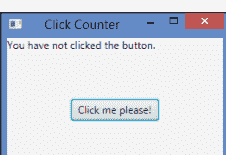

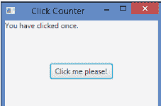


图 1-4：Click Counter 程序的运行情况。

### 列表 1-2：The Click Counter Program

```java
import javafx.application.*;
import javafx.stage.*;
import javafx.scene.*;
import javafx.scene.layout.*;
import javafx.scene.control.*;

public class ClickCounter extends Application
{
    public static void main(String[] args)
    {
        launch(args);
    }

    Button btn;
    Label lbl;
    int clickCount = 0;

    @Override
    public void start(Stage primaryStage)
    {
        // 创建按钮
        btn = new Button();
        btn.setText("Click me please!");
        btn.setOnAction(e -> buttonClick());

        // 创建标签
        lbl = new Label();
        lbl.setText("You have not clicked the button.");

        // 将标签和按钮添加到布局窗格
        BorderPane pane = new BorderPane();
        pane.setTop(lbl);
        pane.setCenter(btn);

        // 将布局窗格添加到场景中
        Scene scene = new Scene(pane, 250, 150);

        // 将阶段添加到舞台中，设置标题
        // 并显示舞台
        primaryStage.setScene(scene);
    }
}
```


`primaryStage.setTitle("Click Counter");`

`primaryStage.show();`

```java
public void buttonClick() {
    iClickCount++;
    if (iClickCount == 1) {
        lbl.setText("You have clicked once.");
    }
    else {
        lbl.setText("You have clicked " + iClickCount + " times.");
    }
}
```

以下段落解释了 Click Me 程序的关键点：

- `import` 语句引用了 Click Me 程序将使用的 `javafx` 包。
- `ClickMe` 类继承自 `javafx.application.Application`，因此指定 `ClickMe` 类是一个 JavaFX 应用程序。
- 与任何 Java 程序一样，`main` 方法是所有 JavaFX 程序的入口点。
- `main` 方法调用 `launch` 方法，该方法由 `Application` 类定义。`launch` 方法随后创建 `ClickMe` 类的实例，然后调用 `start` 方法。
- 声明了一个类型为 `javafx.scene.control.Button` 的变量 `btn` 作为类变量。代表 JavaFX 控件的变量通常定义为类变量，以便类中的任何方法都可以访问它们。
- 类型为 `javafx.scene.control.Label` 的变量 `lbl` 代表 Label 控件，以便类中的任何方法都可以访问它。
- 类变量 `iClickCount` 将被用于记录用户点击按钮的次数。
- `start` 方法的声明使用了 `@Override` 注解，表示该方法重写了由 `Application` 类提供的默认 `start` 方法。`start` 方法接收一个名为 `primaryStage` 的参数，它代表 Click Me 显示其用户界面的窗口。
- `start` 方法首先开始创建一个 `Button` 对象并将其赋值给变量 `btn`。
- 调用按钮的 `setText` 方法，将按钮显示的文本设置为 "Click Me Please!"。
- 调用 `setAction` 为按钮创建一个事件处理程序。在这里，使用了 Lambda 表达式来在每当用户点击按钮时简单地调用 `clickButton`。
- 调用 `Label` 的构造函数创建一个新标签。
- 调用标签的 `setText` 方法，将标签的初始文本值设置为 "You have not clicked the button."
- 通过调用 `BorderPane` 类的构造函数创建一个 `border pane` 对象，通过命名的窗格引用该边界窗格。该边界窗格将用于控制屏幕上控件的布局。
- 调用边界窗格的 `setTop` 方法，将标签添加到边界窗格的顶部区域。
- 调用边界窗格的 `setCenter` 方法，将按钮添加到边界窗格的中间区域。
- 通过调用 `Scene` 类的构造函数创建一个 `scene` 对象，将第 30 行创建的边界窗格传递给构造函数，以建立边界窗格为场景的根节点。此外，场景的维度设置为宽 300 像素、高 250 像素。
- 使用 `primaryStage` 的 `setScene` 方法将场景添加到主阶段（primary stage）。
- 调用 `setTitle` 方法设置阶段标题栏中显示的文本。
- 调用 `show` 方法显示主阶段。当此行代码执行时，图 2-1 中所示窗口将显示在屏幕上，用户可以与程序进行交互。
- 每当用户点击按钮时，都会调用 `buttonClick` 方法。
- 增加 `clickCount` 变量表示用户已点击按钮。
- 使用 `if` 语句来判断按钮是否被点击过一次或多次。
- 如果按钮被点击过一次，标签文本设置为 "You have clicked once..."。
- 否则，标签文本被设置为一个指示按钮被点击次数的字符串。

以上就是全部了。如果你理解了 Click Counter 程序工作原理的细节，就可以准备进入第 3 章了。如果你在某些点上仍然感到困惑，我建议你花时间复习这一章，并在 TextPad、Eclipse 或 NetBeans 中实验 Click Counter 程序。

以下段落有助于澄清可能让你对 Click Counter 程序和 JavaFX 产生困惑的一些关键点：

> 程序何时从静态切换到非静态？就像每个 Java 程序一样，JavaFX 程序的 main 入口是静态的 `main` 方法。

在大多数 JavaFX 程序中，静态的 `main` 方法只做一件事：调用 `launch` 方法来启动程序的 JavaFX 部分。`launch` 方法创建 `ClickCounter` 类的实例，然后调用 `start` 方法。在那个点上，程序不再在静态上下文中运行，因为有了一个实例。

这里有你需要了解的四个重要术语：

- **事件（Event）**：用户对组件进行某些重要操作（如点击组件）时创建的对象。
- **事件源（Event source）**：最初发生事件的对象。
- **事件目标（Event target）**：事件指向的节点。这通常是用户点击或其他操作的按钮或其他控件。（在大多数情况下，事件源和事件目标是同一个）。
- **事件处理器（Event handler）**：监听事件并在事件发生时处理事件的对象。

事件监听器对象必须实现 `EventHandler` 接口，该接口定义了一个名为 `handle` 的单方法（参见表 2-2）。`EventHandler` 接口定义在 `java.event` 包中。

表 2-2

| 方法 | 说明 |
| --- | --- |
| `void handle(T event)` | 当事件发生时被调用 |

## EventHandler 接口

现在你已经熟悉了用于事件处理的基础类和接口，准备好研究如何将它们连接起来，创建一个响应事件的程序了。

在本节中，我将讨论如何通过编写程序的 `Application` 来实现事件处理器，使其在扩展 `Application` 类的同时，也实现 `EventHandler` 接口。在本章后续章节中，我将讨论实现事件处理器的其他技术，这些技术更简洁，且在许多情况下更容易操作。

请注意，本微教程第 1 章中的程序使用了 lambda 表达式技术，本书后续的大部分程序也使用了 lambda 表达式。但了解其他技术也同样重要，这样你才能完整地理解事件处理的实际原理。

## 第 2 章 处理事件

处理 JavaFX 事件你必须采取以下三个步骤：

1. **创建事件源。**
   事件源简单来说就是一个可以生成事件的控件（例如按钮）。通常，你将引用事件源的变量声明为私有类字段，位于 `start` 方法或任何其他类方法之外：

```java
private Button btn;
```

然后，在 `start` 方法中，你可以这样创建按钮：

```java
btn = new Button();
btn.setText("Click me please!");
```

2. **创建事件处理器。**
   要创建一个事件处理器，你必须创建一个实现名为 `EventHandler` 接口的对象。该对象必须提供处理器方法的实现。

   创建事件处理器的四种方法：

- 在程序的 `Application` 类中添加 `implements EventHandler` 并提供 `handle` 方法的实现。你将在“实现 EventHandler 接口”节中学习如何使用这种技术。
- 在 `Application` 类内部创建一个实现 `EventHandler` 的内部类。你将在“使用内部类处理事件”节中学习如何使用这种技术。
- 创建一个实现 `EventHandler` 的匿名类。我将在“使用匿名内部类处理事件”节中为你展示如何使用这种技术。
- 使用 lambda 表达式来实现处理器方法。你将在“使用 Lambda 表达式处理事件”节中阅读如何使用这种技术。

3. **将事件处理器注册到事件源。**
   最后一步是将事件处理器注册到事件源，这样每当事件发生时，处理器方法就会被调用。

每个充当事件源的组件都提供了一个方法，允许你注册事件处理器来监听事件。例如，`Button` 控件提供了 `setOnAction` 方法，允许你为动作事件注册事件处理器。在 `setOnAction` 方法中，你将事件处理器对象作为参数指定。具体实现取决于你使用哪种技术来创建事件处理器。

## 实现 EventHandler 接口

为了看到所有所有元素如何在完整程序中协同工作，图 2-1 显示了名为 `AddSubstract` 的示例程序的输出。该程序显示了一个标签和两个按钮，标题分别为“Add”（加）和“Subtract”（减）。标签最初显示数字 0。用户每点击 Add 按钮，标签显示的值就会增加 1；用户每点击 Subtract 按钮，值就会减少 1。

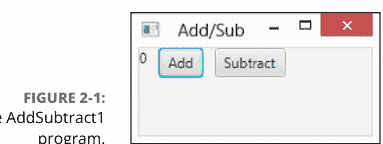

图 2-1 显示了程序的完整代码。

### 代码列表 2-1：AddSubstract1 程序

```java
import javafx.application.*;
import javafx.stage.*;
import javafx.scene.*;
import javafx.scene.layout.*;
import javafx.scene.control.*;
import javafx.event.*;

public class AddSubstract extends Application
    implements EventHandler<ActionEvent>
{
    public static void main(String[] args)
    {
        launch(args);
    } // (续)
```

### 代码列表 2-1：（续）

```java
Button btnAdd;
Button btnSubtract;
Label lbl;
int iCounter = 0;
```

```java
@Override public void start(Stage primaryStage)
{
    // 创建 Add按钮
    btnAdd = new Button();
    btnAdd.setText("Add");
    btnAdd.setOnAction(this);
```

```java
// 创建 Subtract按钮
btnSubtract = new Button();
btnSubtract.setText("Subtract");
btnSubtract.setOnAction(this);
```

```java
// 创建 Label
lbl = new Label();
lbl.setText(Integer.toString(iCounter));
```

```java
// 将按钮和标签添加到 HBox 格中
HBox pane = new HBox(10);
pane.addAll(lbl, btnAdd, btnSubtract);
```

```java
// 将布局添加到场景
Scene scene = new Scene(pane, 200, 75);
```

```java
// 将场景添加到舞台
primaryStage.setScene(scene);
primaryStage.setTitle("Add Substract");
primaryStage.show();
```

```java
@Override public void handle(ActionEvent e)
{
    if (e.getSource() == btnAdd)
    {
        iCounter++;
    }
    else if (e.getSource() == btnSubtract)
    {
        iCounter--;
    }
    lbl.setText(Integer.toString(iCounter));
}
}
```

## 使用内部类处理事件

内部类是嵌套在另一个类中的类。内部类通常用于事件处理器。这样一来，定义应用程序的类就不需要同时实现事件处理器。相反，它包含一个处理事件的内部类。

列表 2-2 显示了 AddSubtract2 程序，该程序使用内部类来处理按钮的动作事件。

## 列表 2-2：带有内部类的 AddSubtract2 程序

```java
import javafx.application.*;
import javafx.stage.*;
import javafx.scene.*;
import javafx.scene.layout.*;
import javafx.scene.control.*;
import javafx.scene.event.*;

public class AddSubtract2 extends Application {
    public static void main(String[] args) {
        launch(args);
    }

    Button btnAdd;
    Button btnSubtract;
    Label lbl1;
    int iCounter = 0;

    @Override
    public void start(Stage primaryStage)
    {
        // 创建 ClickHandler 实例
        ClickHandler ch = new ClickHandler();

        // 创建 Add 按钮
        btnAdd = new Button();
        btnAdd.setText("Add");
        btnAdd.setOnAction(ch);

        // 创建 Subtract 按钮
        btnSubtract = new Button();
        btnSubtract.setText("Subtract");
        btnSubtract.setOnAction(ch);
// (续)
```

## 列表 2-2：（续）

```java
// 创建 Label
lbl = new Label();
lbl.setText(Integer.toString(iCounter));

// 将按钮和标签添加到 HBox 中
HBox pane = new HBox(10);
pane.getChildren().addAll(lbl, btnAdd, btnSubtract);

// 将布局面板添加到场景中
Scene scene = new Scene(pane, 200, 75);

// 将阶段 添加到场景，设置标题
// 并显示阶段
primaryStage.setScene(scene);
primaryStage.setTitle("Add/Sub");
primaryStage.show();

private class ClickHandler
implements EventHandler<ActionEvent>
{
    @Override
    public void handle(ActionEvent e) {
        if (e.getSource()==btnAdd) {
            iCounter++;
        }
        else {
            if (e.getSource()==btnSubtract) {
                iCounter--;
            }
        }
        lbl.setText(Integer.toString(iCounter));
    }
}
```


此程序的工作原理与列表 2-1 显示的程序基本相同，因此不再审查每一个细节。相反，只强调差异之处：

- `AddSubtract2` 类仍然继承了 `Application`，但没有实现 `EventHandler`。
- `->23` 这条语句创建了 `ClickHandler` 类（内部类）的实例，并将其赋值给变量 `ch`。
- `->28` 这条语句将 `ch` 设置为 `Add` 按钮的动作监听器。
- `->33` 这条语句将 `ch` 设置为 `Subtract` 按钮的动作监听器。
- `->53` 通过将其声明完全放在 `AddSubtract2` 类内部，将 `ClickHandler` 类声明为内部类。`ClickHandler` 类实现了 `EventHandler` 接口，以便它可以处理事件。
- `->38` 这里的 `handle` 方法与 `AddSubtract1` 程序中的 `handle` 方法相同，但它位于内部 `ClickHandler` 类中，而不是外部类中。

## 使用匿名内部类处理事件

内部类（通常被称为匿名类）是在需要它的地方直接定义的类。因为你直接在需要的地方编写类体，所以你不需要给它命名；这就是为什么它被称为匿名类。

匿名类通常用于事件处理器，以避免由于需要创建一个显式实现 `EventHandler` 接口的单独类。

使用匿名类作为事件处理器的优势在于，你可以为每个产生事件的控件创建一个单独的处理器。这样，在这些事件处理器的 `handle` 方法中，你就可以省去检查事件源的 `if` 语句了。

考虑之前列表 2-2 中所示 `AddSubtract2` 程序的事件处理器：它必须检查事件源以确定是否递增 `iCounter` 变量。通过使用匿名类，你可以为 `Add` 和 `Subtract` 按钮创建单独的事件处理器。`Add` 按钮的事件处理器增加 `iCounter`，而 `Subtract` 按钮的事件处理器递减它。任何事件处理器都不需要检查事件源，因为只有当与处理器关联的按钮上触发事件时，事件处理器的 `handle` 方法才会被调用。

列表 2-3 显示了 `AddSubtract` 程序，该程序以此使用了匿名内部类。

## 列表 2-3：带有匿名内部类的 AddSubtract 程序

```java
import javafx.application.*;
import javafx.stage.*;
import javafx.scene.*;
import javafx.scene.layout.*;
import javafx.scene.control.*;
import javafx.event.*;

public class AddSubtract extends Application {

    public static void main(String[] args) {
        launch(args);
    }

    Button btnAdd;
    Button btnSubtract;
    Label lbl;
    int iCounter = 0;

    @Override
    public void start(Stage primaryStage) {

        // 创建 Add 按钮
        btnAdd = new Button();
        btnAdd.setText("Add");

        btnAdd.setOnAction(new EventHandler<ActionEvent>() {
            public void handle(ActionEvent e) {
                iCounter++;
                lbl.setText(Integer.toString(iCounter));
            }
        });

        // 创建 Subtract 按钮
        btnSubtract = new Button();
        btnSubtract.setText("Subtract");

        btnSubtract.setOnAction(new EventHandler<ActionEvent>() {
            public void handle(ActionEvent e) {
                iCounter--;
                lbl.setText(Integer.toString(iCounter));
            }
        });

        // 创建 Label
        lbl = new Label();
        lbl.setText(Integer.toString(iCounter));

        // 将按钮和标签添加到 HBox 中
        HBox pane = new HBox(10);
        pane.getChildren().addAll(lbl, btnAdd, btnSubtract);

        // 将布局面板添加到场景中
        Scene scene = new Scene(pane, 200, 75);

        // 将阶段添加到场景，设置标题
        // 并显示阶段
        primaryStage.setScene(scene);
        primaryStage.setTitle("Add/Sub");
        primaryStage.show();
    }
}
```

以下段落强调了该程序如何使用匿名内部类的关键点：

- 26 这条语句调用了 `Add` 按钮的 `setAction` 方法，并创建了 `EventHandler` 的匿名实例，指定 `ActionEvent` 为类型。
- 28 `handle` 方法必须在匿名类体内部定义。
- 30 因为此 `handle` 方法只有在 `Add` 按钮被点击时才调用（而不是在点击 `Subtract` 按钮时），所以不需要确定事件源。相反，方法增加计数器变量并设置标签显示新值。
- 39 这条语句调用了 `Subtract` 按钮的 `setAction` 方法，并创建了另一个 `EventHandler` 类的匿名实例。
- 41 这一次，`handle` 方法递减计数器变量并更新标签以显示计数器值。

Lambda 表达式的一个有趣之处在于，你不需要知道被调用方法的名称。这是因为与 lambda 表达式一起使用的函数式接口只能有一个抽象方法。在 `EventHandler` 接口的情况下，该方法被命名为 `handle`。

你不需要知道正在实现的接口的名称。这是因为接口是由上下文决定的。`setActive` 方法接收一个类型为 `EventHandler` 的参数。然后，当你在调用 `setAction` 时使用 lambda 表达式，Java 编译器可以推断出该 lambda 表达式将实现 `EventHandler` 接口。由于 `EventHandler` 唯一的抽象方法是 `handle` 方法，编译器就可以推断出你提供的方法就是 `handle` 方法的实现。

在某种意义上，lambda 表达式进一步扩展了匿名类的概念。当你使用匿名类设置事件处理器时，你必须知道并指定类的名称（`EventHandler`）和要调用方法的名称（`handle`），因此该类之所以被称为“匿名”，其唯一意义在于你不需要为引用它的变量提供名称。但当你使用 lambda 表达式时，你不需要知道或指定类名、方法名或用于它的变量名。本质上，你做的只需提供 `handle` 方法的体。

列表 2-4 显示了 `AddSubtract4` 程序，它使用 lambda 表达式来……

## 列表 2-4：使用 lambda 表达式的 AddSubtract4 程序

```java
import javafx.application.*;
import javafx.stage.*;
import javafx.scene.*;
import javafx.scene.layout.*;
import javafx.scene.control.*;
import javafx.event.*;

public class AddSubtract4 extends Application {

    public static void main(String[] args) {
        launch(args);
    }

    Button btnAdd;
    Button btnSubtract;
    Label lbl;
    int iCounter = 0;

    @Override
    public void start(Stage primaryStage) {

        // 创建加法按钮
        btnAdd = new Button();
        btnAdd.setText("Add");

        btnAdd.setOnAction(e -> {
            iCounter++;
            lbl.setText(Integer.toString(iCounter));
        });

        // 创建减法按钮
        btnSubtract = new Button();
        btnSubtract.setText("Subtract");

        btnSubtract.setOnAction(e -> {
            iCounter--;
            lbl.setText(Integer.toString(iCounter));
        });

        // 创建标签
        lbl = new Label();
        lbl.setText(Integer.toString(iCounter));

        // 将按钮和标签添加到 HBox 面板中
        HBox pane = new HBox(10);
        pane.getChildren().addAll(lbl, btnAdd, btnSubtract);

        // 将布局面板添加到场景（scene）
        Scene scene = new Scene(pane, 200, 75);

        // 将场景添加到舞台（stage），设置标题
        primaryStage.setScene(scene);
        primaryStage.setTitle("Add/Sub");
        primaryStage.show();
    }
}
```

该程序的工作方式与列表 2-3 所示的程序基本相同，所以直接指出与使用 lambda 表达式直接相关的特性：

- 25 这条语句使用 lambda 表达式为 `Add` 按钮添加了事件处理器。该 lambda 表达式的方法体增加了计数器变量，然后设置标签以反映更新后的值。
- 34 这条语句使用类似的 lambda 表达式为 `Subtract` 按钮创建事件处理器。此 lambda 表达式与 `Add` 按钮对应的唯一区别在于，这里的计数器变量是减少的而不是增加。

请注意，在这个示例中，两个事件处理器的 lambda 表达式是简单的，因为当此程序中的任何一个按钮被调用时，需要处理的操作非常少。如果一个或多个按钮所需的处理需要数百行 Java 代码来实现，程序会变成什么样呢？lambda 表达式将变得难以处理。由于这个原因，我更倾向于将实际处理隔离在独立方法中的事件处理器中。这样，lambda 表达式本身只包含一行调用该方法的代码。

列表 2-5 显示了使用该技术实现的另一种变体 `AddSubtract5`。请注意，列表 2-5 中使用的技术是书中其余大部分程序使用的技术。

## 列表 2-5：使用 lambda 表达式的 AddSubtract5 程序

```java
import javafx.application.*;
import javafx.stage.*;
import javafx.scene.*;
import javafx.scene.layout.*;
import javafx.scene.control.*;
import javafx.scene.event.*;

public class AddSubtract5 extends Application {

    public static void main(String[] args) {
        launch(args);
    }

    Button btnAdd;
    Button btnSubtract;
    Label lbl;
    int iCounter = 0;

    @Override
    public void start(Stage primaryStage) {

        // 创建加法按钮
        btnAdd = new Button();
        btnAdd.setText("Add");
        btnAdd.setOnAction(e -> btnAdd_Click());

        // 创建减法按钮
        btnSubtract = new Button();
        btnSubtract.setText("Subtract");
        btnSubtract.setOnAction(e -> btnSubtract_Click());

        // 创建标签
        lbl = new Label();
        lbl.setText(Integer.toString(iCounter));

        // 将按钮和标签添加到 HBox 面板中
        HBox pane = new HBox(10);
        pane.getChildren().addAll(lbl, btnAdd, btnSubtract);

        // 将布局面板添加到场景
        Scene scene = new Scene(pane, 200, 75);

        // 将场景添加到舞台，设置标题
        primaryStage.setScene(scene);
        primaryStage.setTitle("Add/Sub");
        primaryStage.show();
    }

    private void btnAdd_Click() {
        iCounter++;
        lbl.setText(Integer.toString(iCounter));
    }

    private void btnSubtract_Click() {
        iCounter--;
        lbl.setText(Integer.toString(iCounter));
    }
}
```


该程序的工作方式与列表 2-3 所示的程序基本相同，所以我直接指出与使用 lambda 表达式直接相关的特性：

- 25 这条语句使用 lambda 表达式为 `Add` 按钮添加了事件处理器。该 lambda 表达式的方法体增加了计数器变量，然后设置标签以反映更新后的值。
- 34 这条语句使用类似的 lambda 表达式为 `Subtract` 按钮创建事件处理器。此 lambda 表达式与 `Add` 按钮对应的唯一区别在于，这里的计数器变量是减少的而不是增加。

请注意，在这个示例中，两个事件处理器的 lambda 表达式是简单的，因为当此程序中的任何一个按钮被调用时，需要处理的操作非常少。如果一个或多个按钮所需的处理需要数百行 Java 代码来实现，程序会变成什么样呢？lambda 表达式将变得难以处理。由于这个原因，我更倾向于将实际处理隔离在独立方法中的事件处理器中。这样，lambda 表达式本身只包含一行调用该方法的代码。

# 表 3-1：`Stage` 类的常用方法

| 方法 | 描述 |
| --- | --- |
| `void close()` | 关闭阶段。 |
| `void initModality(Modality modality)` | 设置阶段的模态。此方法必须在调用 `show` 方法之前调用。模态可以是以下之一：<br>`Modality.NONE`<br>`Modality.APPLICATION_MODAL`<br>`Modality.WINDOW_MODAL` |
| `void initStyle(StageStyle style)` | 设置阶段的样式。此方法必须在调用 `show` 方法之前调用。样式可以是以下之一：<br>`StageStyle.DECORATED`<br>`StageStyle.UNDECORATED`<br>`StageStyle.TRANSPARENT`<br>`StageStyle.UNIFIED`<br>`StageStyle.UTILITY` |
| `void getGetHeight(double maxheight)` | 获取阶段的最大高度。 |
| `void getMaxWidth(double maxwidth)` | 获取阶段的最大宽度。 |
| `void getMinHeight(double minheight)` | 获取阶段的最小高度。 |
| `void getMinWidth(double minwidth)` | 获取阶段的最小宽度。 |
| `void setFullScreen(boolean fullscreen)` | 设置阶段的全屏状态。 |
| `void setIconified(boolean iconified)` | 设置阶段的最小化状态。 |
| `void setMaxized(boolean maximized)` | 设置阶段的最大化状态。 |
| `void setMaxHeight(double maxheight)` | 设置阶段的最大高度。 |
| `void setMaxWidth(double maxwidth)` | 设置阶段的最大宽度。 |
| `void setMinHeight(double minheight)` | 设置阶段的最小高度。 |
| `void setMinWidth(double minwidth)` | 设置阶段的最小宽度。 |
| `void setResizable(boolean resizable)` | 设置阶段是否可调整大小。 |
| `void setScene(Scene scene)` | 设置在阶段上显示的场景。 |
| `void setTitle(String title)` | 如果标题栏可见，则设置显示在阶段标题栏中的标题。 |
| `void show()` | 使阶段可见。 |
| `void showAndWait()` | 使阶段可见，并等待阶段关闭后才继续执行。 |
| `void toFront()` | 强制阶段置于前层。 |
| `void toBack()` | 强制阶段置于底层。 |

以下段落指出了使用表 3-1 中列出的 `Stage` 类方法的一些细节：

- 对于许多（如果不是大多数）应用程序来说，你只需要使用表 3-1 中的三个方法：`setScene`、`setTitle` 和 `show`。
- 每一个阶段必须拥有一个场景（`scene`）。
- 每一个阶段应该有一个标题。
- 如果你不打算向用户显示阶段，那么创建一个阶段就没有多大意义。

表中的其他方法允许你更改阶段的外观或行为，但在大多数情况下，默认设置是可以接受的。

- 如果你想防止用户调整阶段的大小，请像这样使用 `setResizable` 方法：

```java
primaryStage.setResizable(false);
```

那么，用户就无法更改窗口的大小。（默认情况下，阶段是可调整大小的。除非你想让阶段变为不可调整大小，否则不需要调用 `setResizable` 方法。）

- 如果阶段是可调整大小的，你可以为窗口设置最小和最大尺寸。例如：

```java
primaryStage.setResizable(true);

primaryStage.setMinWidth(200);
primaryStage.setMinHeight(200);

primaryStage.setMaxWidth(600);
primaryStage.setMaxHeight(600);
```

在这个示例中，用户可以调整窗口大小，最小允许尺寸是 200x200 像素，最大允许尺寸是 600x600 像素。

如果你想在最大化窗口中显示阶段，请调用 `setMaxized()`：

```java
primaryStage.setMaximized(true);
```

最大化后的窗口仍然具有通常的装饰（标题栏、窗口框、最小化、还原和关闭按钮）。如果你希望阶段完全占据屏幕且没有任何此类装饰，请改用 `setFullScreen` 方法：

```java
primaryStage.setFullScreen(true);
```

当你的阶段处于全屏模式时，JavaFX 会显示一条消息建议用户退出全屏模式。


如果出于某种原因，你想让程序以图标化的启动，请使用 `setIconified` 方法：

```java
primaryStage.setIconified(true);
```

有关 `close` 方法的更多信息，请参见本章稍后的“Exit, Stage Right”部分。

`modality` 和 `initStyle` 方法很有趣，因为它们只能在调用 `show` 方法之前调用。`modality` 方法允许你创建一个模态对话框——即一个在用户可以继续使用程序内其他功能之前必须关闭的窗口。而 `initStyle` 方法允许你创建不具有通常装饰（如标题栏或最小化、还原和关闭按钮）的窗口。当你需要在主阶段之外为应用程序创建额外的阶段时，通常会使用这些方法。你可以在本章稍后的“Creating a Dialog Box”部分阅读更多关于其工作原理。

## 检查 `Scene` 类

`Stage` 类和 `Scene` 类是 JavaFX 程序的基础。在每个 JavaFX 程序中，你都至少使用一个 `Scene` 类的实例来持有用户在使用程序时与之交互的用户界面控件。

表 3-2 列出了 `Scene` 类更常用的构造函数和方法。

## `Scene` 类的常用构造函数和方法

| 构造函数 | 描述 |
| --- | --- |
| `Scene(Parent root)` | 创建具有指定根节点的新场景。 |
| `Scene(Parent root, double width, double height)` | 创建具有指定根节点、宽度和高度的新场景。 |
| 方法 | 描述 |
| --- | --- |
| `double getHeight()` | 获取场景的高度。 |
| `double getWidth()` | 获取场景的宽度。 |
| `double getX()` | 获取场景的水平位置。 |
| `double getY()` | 获取场景的垂直位置。 |
| `setRoot(Parent root)` | 设置根节点。 |

以下段落解释了 `Scene` 类的一些有趣的细节：

- 所有的 `Scene` 构造函数都要求你指定根节点。你可以通过调用 `setRoot` 方法更改根节点，但无法在没有根节点的情况下创建场景。
- 你可能奇怪为什么根节点是 `Parent` 的实例而不是 `Node`。`Parent` 类实际上是 `Node` 的子类，它代表一个可以拥有子节点的节点；这些节点不能作为场景的根节点。
- 你可以在创建场景时通过指定 `Width` 和 `Height` 来设置场景的初始大小。如果你不设置大小，场景将根据其内容确定自己的大小。
- 你可以通过 `getHeight` 和 `getWidth` 方法获取场景的大小。并没有对应的方法可以让你设置高度或宽度。
- 通常情况下，场景的大小决定了阶段的大小，前提是它不小于阶段指定的最小尺寸或大于最大尺寸。
- 如果用户调整阶段的大小，场景的大小也会随之改变。

# 切换场景

JavaFX 程序的主阶段（或任何其他阶段）在任何时刻只能显示一个场景。然而，这并不意味着你的程序不能创建多个场景并根据需要进行切换。例如，假设你正在开发一个文字处理程序，并希望用户在编辑视图和页面预览视图之间切换。你可以通过为每个视图创建两个不同的场景来实现这一点。然后，要在视图之间切换，你只需调用阶段的 `setScene` 方法来切换场景。

在本书的第 1 章中，你学习了 `ClickCounter` 程序，其场景显示一个标签和一个按钮并更新标签以指示用户点击按钮的次数。然后在本书的第 2 章中，你看到了 `AddSubtract` 程序的几种变体，它的场景显示一个标签和两个按钮：点击时一个按钮加一，另一个减一。

Listing 3–1 显示了一个名为 `SceneSwitcher` 的程序，它将 `ClickCounter` 和 `AddSubtract` 程序的场景合并到一个程序中。图 3 显示了该程序的运行情况：

> **当 `SceneSwitcher` 程序首次运行时**，它显示如左所示的 `ClickCounter` 场景。
>
> **当用户点击 Switch 按钮时**，场景切换到如右所示的 `AddSubtract` 场景。

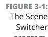

| Scene Switcher | Scene Switcher |
| --- | --- |
| 你尚未点击按钮。 | Add Subtract |
| 点击我！ | |

# LISTING 3–1：`SceneSwitcher` 程序

```java
import javafx.application.*;
import javafx.stage.*;
import javafx.scene.*;
import javafx.scene.layout.*;
import javafx.scene.control.*;
```

（续）

第 3 章 设置阶段和场景布局 609

# 列表 3-1：（续）

```java
import javafx.event.*;

public class SceneSwitcher extends Application {

    public static void main(String[] args) {
        launch(args);
    }

    // 用于点击计数器场景的类字段
    int iClickCount = 0;
    Label lblClicks;
    Button btnClickMe;
    Button btnSwitchToScene2;
    Scene scene1;

    // 用于加减法场景的类字段
    int counter = 0;
    Label lblCounter;
    Button btnAdd;
    Button btnSubtract;
    Button btnSwitchToScene1;
    Scene scene2;

    // 用于阶段的类字段
    Stage stage;

    @Override public void start(Stage primaryStage) {
        stage = primaryStage;

        // 构建点击计数器场景
        lblClicks = new Label();
        lblClicks.setText("You have not clicked the button.");

        btnClickMe = new Button();
        btnClickMe.setText("Please click me!");
        btnClickMe.setOnAction(
            e -> btnClickMe_Click()
        );

        btnSwitchToScene2 = new Button();
        btnSwitchToScene2.setText("Switch!");
        btnSwitchToScene2.setOnAction(
            e -> btnSwitchToScene2_Click()
        );
    }
}
```

```java
VBox pane1 = new VBox(10);

pane1.getChildren().addAll(
    lblClicks,
    btnClickme,
    btnSwitchToScene(2)
);

scene1 = new Scene(pane1, 250, 150);
```

```java
// 构建加减法场景

lblCounter = new Label();
lblCounter.setText(Integer.toString(iCounter));

btnAdd = new Button();
btnAdd.setText("Add");
btnAdd.setOnAction(
    e -> btnAdd_Click()
);

btnSubtract = new Button();
btnSubtract.setText("Subtract");
btnSubtract.setOnAction(
    e -> btnSubtract_Click()
);

btnSwitchToScene2 = new Button();
btnSwitchToScene2.setText("Switch!");
btnSwitchToScene2.setOnAction(
    e -> btnSwitchToScene1_Click()
);
```

```java
HBox pane2 = new HBox(10);

pane2.getChildren().addAll(
    lblCounter,
    btnAdd,
    btnSubtract,
    btnSwitchToScene(2)
);

scene2 = new Scene(pane2, 300, 75);
```

```java
// 设置阶段的场景 1 并显示阶段

primaryStage.setScene(scene1);
primaryStage.setTitle("Scene Switched");
primaryStage.show();
```

```java
// 场景 1 的事件处理器

public void btnClickMe_Click() {
    iClickCount++;

    if (iClickCount == 1) {
        lblClicks.setText("You have clicked once.");
    } else {
        lblClicks.setText(
            "You have clicked " + iClickCount + " times."
        );
    }
}

private void btnSwitchToScene2_Click() {
    stage.setScene(scene2);
}
```

```java
// 场景 2 的事件处理器

private void btnAdd_Click() {
    iCounter++;
    lblCounter.setText(Integer.toString(iCounter));
}
```

```java
private void btnSubtract_Click() {
    iCounter--;
    lblCounter.setText(Integer.toString(iCounter));
}
```

```java
private void btnSwitchToScene1_Click() {
    stage.setScene(scene1);
}
```


以下段落指出了程序的某些关键部分：

- 15：程序的部分定义了类字段，这些字段将用于程序中点击计数器部分。这些字段包括 `iClickCount`，用于计算用户点击“点击我”按钮的次数；用于显示“点击我”按钮被点击次数的标签；“点击我”按钮本身；以及用于切换到加减法场景的按钮。还包括一个名为 `scener` 的场景，将用于引用点击计数器场景。
- 22：这些行定义了程序加减法部分使用的类变量，包括计数器（`iCounter`）、用于显示计数器的标签、用于递增和减少计数器的两个按钮、用于切换回点击计数器场景的按钮，以及一个名为 `scene2` 的场景，将用于引用加减法场景。
- 31：使用一个名为 `stage` 的类来持有主阶段（primary stage）的引用，以便在整个程序中访问它。
- 35：此行设置 `stage` 类字段引用主阶段。
- 37：程序的部分构建了点击计数器场景。首先，它创建了场景显示的标签和按钮。然后它创建一个 `VBox` 布局面板（该面板在垂直堆中布局其控件），并将标签和按钮添加到面板中。最后，使用 `VBox` 面板作为根节点创建场景。
- 59：程序的部分通过创建场景显示的标签和按钮构建了加减法场景，将它们排列在 `HBox` 布局面板中，并使用 `HBox` 面板作为根节点创建场景。
- 84：这些行将点击计数器场景设置为主阶段的根节点，设置阶段，然后显示阶段。
- 91：程序的部分为点击计数器场景中的按钮提供了事件处理器。点击按钮的事件处理器会增加计数器，设置标签显示适当的消息。`btnSwitchToScene2` 的处理器将阶段切换到 `scene2`，设置标签显示适当的消息。
- 112：程序的部分为点击计数器场景中的按钮提供了事件处理器。点击按钮的事件处理器会增加计数器，设置标签显示适当的消息。`btnSwitchToScene2` 的处理器将阶段切换到 `scene2`，设置标签显示适当的消息。

# 创建警报框（Alert Box）

JavaFX 提供了一种使用 `Alert` 类显示简单对话框的方法，它类似于你在书中第 2 章中学过的 `JOptionPane`。表 3-3 显示了该类常用的构造方法。

## 表 3-3：Alert 常用的构造方法和方法

| 构造方法 | 说明 |
|---|---|
| `Alert(AlertType)` | 创建指定类型的 alert |
| `Alert(AlertType, String text)` | 创建指定类型的 alert 并设置文本 |
| `Alert(AlertType, String text, ButtonType...)` | 创建 alert 并设置显示的按钮 |
| `void setTitle(String text)` | 设置标题 |
| `Optional<ButtonType> showAndWait()` | 显示 alert 并等待用户响应，以 `ButtonType` 对象返回 |

`Alert` 类是在 Java 8.0 中引入的，因此你必须使用更高版本的 Java 才能使用。`AlertType` 参数允许你指定几种类型的 Alert：

- `AlertType.CONFIRMATION`：提示用户确认操作。
- `AlertType.ERROR`：显示错误消息。
- `AlertType.INFORMATION`：显示信息对话框。
- `AlertType.WARNING`：显示警告消息。
- `AlertType.NONE`：显示通用 alert。

下面是使用 `Alert` 类显示简单消息的代码片段：

```java
a = new Alert(AlertType.INFORMATION, "You have clicked once.");
a.showAndWait();
```

你可以通过使用可选的 `ButtonType` 参数控制 Alert 框上显示的按钮。你可以从以下类型的按钮中选择：

- `ButtonType.APPLY`
- `ButtonType.CANCEL`
- `ButtonType.CLOSE`
- `ButtonType.FINISH`
- `ButtonType.NEXT`
- `ButtonType.NO`
- `ButtonType.OK`
- `ButtonType.PREVIOUS`
- `ButtonType.YES`

通过在构造函数中简单指定多个 `ButtonType` 参数，你可以在 Alert 框上包含多个按钮。例如：

```java
Alert a = new Alert(
    AlertType.INFORMATION,
    "Are you certain?",
    ButtonType.YES,
    ButtonType.NO
);
```

这是一个判断用户是否点击了 YES 按钮的示例：

```java
Alert a = new Alert(
    AlertType.INFORMATION,
    "Are you certain?",
    ButtonType.YES,
    ButtonType.NO
);

Optional<ButtonType> r = a.showAndWait();

if (r.isPresent() && r.get() == ButtonType.YES) {
    // 用户点击了 OK！
}
```

为了演示你如何使用 `ALERT` 类，列表 3-2 显示的程序是第 2 章中最初讨论过的 `ClickCounter` 程序的变体。该程序的原始版本显示了一个标签（label）和一个按钮，使用标签来显示用户点击按钮的次数。这个版本的程序放弃了标签，转而使用 `Alert` 类来显示一条消息，指示用户点击按钮的次数。

## 列表 3-2：ClickCounterAlert 程序

```java
import javafx.application.*;
import javafx.stage.*;
import javafx.scene.*;
import javafx.scene.layout.*;
import javafx.scene.control.*;

public class ClickCounterAlert extends Application {
    public static void main(String[] args) {
        launch(args);
    }

    Button btn;
    Label lbl;
    int iClickCount = 0;

    @Override
    public void start(Stage primaryStage) {
        // 创建按钮
        btn = new Button();
        btn.setText("Click me please!");
        btn.setOnAction(e -> buttonClick());

        // 将按钮添加到布局窗格
        BorderPane pane = new BorderPane();
        pane.setCenter(btn);

        // 将布局窗格添加到场景
        Scene scene = new Scene(pane, 250, 150);

        // 将场景添加到舞台，设置标题
        // 并显示舞台
        primaryStage.setScene(scene);
        primaryStage.setTitle("Click Counter");
        primaryStage.show();
    }

    public void buttonClick() {
        iClickCount++;

        if (iClickCount == 1) {
            Alert a = new Alert(
                Alert.AlertType.INFORMATION,
                "You have clicked once."
            );
            a.showAndWait();
        } else {
            Alert a = new Alert(
                Alert.AlertType.INFORMATION,
                "You have clicked " + iClickCount + " times."
            );
            a.showAndWait();
        }
    }
}
```

此程序与第 2 章列表 2–2 中介绍的版本几乎完全相同。事实上，这里只有两处不同：

- 此程序中没有定义标签，因为使用了消息框而不是标签来显示按钮被点击的次数。
- 在第 2 章版本的 `buttonClick` 方法中，调用了标签的 `setText` 方法来显示按钮被点击的次数。在这个版本中，使用了 `Alert` 框来代替。

第 3 章 设置舞台和场景布局 617

图 3–2 显示了 `ClickCounter` 程序的新版本运行情况。在这里，你可以看到当用户第一次点击按钮时显示的警报框。（在本示例中，我将消息框向侧移动了一点，以便你看到它下方的主舞台。当你实际运行程序时，消息框将居于主舞台正上方。）

## 退出，舞台右侧

由于我在本章的开头引用了莎士比亚，我想引用斯纳格尔普夫（Snagglepuff）来结束它会很不错，他是老哈纳-巴拉动画角色中著名的粉色山狮。他经常通过说“退出，舞台左侧”或“退出，舞台右侧”来离开场景。

天哪，梅加特罗伊！

甚至退出舞台也有正确的方法和错误的方法。到目前为止，本书中介绍的所有程序没有一个采用了正确的方法。到目前为止你所看到的程序提供的唯一退出机制就是让用户点击标准的窗口关闭按钮，该按钮通常由窗口标题栏右上角的“X”表示。这始终是退出程序的错误方法。

在大多数情况下，退出程序的正确方法涉及以下细节：

- **添加一个按钮、菜单命令或其他用户信号其要关闭程序的方式。**

  许多程序包含一个标记为“退出”（Exit）或“关闭”（Close）的按钮，而使用菜单的程序通常有一个“退出”（Exit）命令。

- **可选地显示一个确认框，以验证用户是否真的想关闭程序。** 你可以通过前一节中显示的 `Confirmationbox` 或使用类似的类来实现。

  根据程序的不同，你可能只想在用户对文档、数据库或其他文件作了尚未保存的更改时才显示此对话框。

- 如果用户真的想关闭程序，程序应该执行任何必要的清理工作，例如：
  - 保存对文档、数据库或其他文件的更改。
  - 正确关闭数据库和其他资源。
- 在完成任何必要的清理工作后，可以通过调用主舞台的方法来关闭应用程序。
- 无论用户是尝试通过你在用户界面中提供的按钮或菜单关闭程序，还是通过点击内置的关闭按钮关闭，都应该采取验证和清理步骤。

在接下来的章节中，你将学习如何为你的应用程序添加一个“关闭”按钮，如何防止窗口关闭按钮无礼地终止你的应用程序，以及如何将这两个元素整合到一个完整的程序中。

## 创建关闭按钮

要添加一个按钮或其他用户界面元素允许用户关闭应用程序，你仅需要提供一个调用舞台 `close` 方法的操作处理器即可。

例如，假设你使用以下代码创建一个关闭按钮：

```java
Button btnClose = new Button();
btnClose.setText("Close");
btnClose.setOnAction(e -> primaryStage.close());
```

在这种情况下，事件处理器仅仅调用 `primaryStage.close()`。

如果你想在事件处理器中做的不仅仅是调用关闭方法，你可能想将事件处理器封装在一个单独的方法中，如下所示：

```java
btnClose.setOnAction(e -> btnClose_Click());
```

因为 `btnClose_Click` 方法需要访问主舞台来关闭它，你需要定义一个 `Stage` 类字段并用它引用主舞台。然后，你的 `btnClose_Click` 方法可以执行额外的任务。例如：

```java
private void btnClose_Click() {
    boolean reallyQuit = false;

    reallyQuit = ConfirmationBox.show(
        "Are you sure you want to quit?",
        "Confirmation",
        "Yes",
        "No"
    );

    if (reallyQuit) {
        // 执行清理任务
        // 例如保存文件或释放资源
        stage.close();
    }
}
```

## 莎士比亚最好的舞台指示

到目前为止，我引用了一次莎士比亚和一次斯纳格尔普夫。这两个引用都符合本章的主题：莎士比亚的引用涉及舞台和场景，而斯纳格尔普夫的引用涉及退出舞台的正确方法。尽管如此，像这样频繁地引用斯纳格尔普夫似乎有些失平衡。因此，我认为最好再引用一次莎士比亚，以挽回我在大学英语教授们那里仅存的一点尊重。

莎士比亚的剧本充满了舞台指示。它们大部分是简短的，例如《罗密欧与朱丽叶》中的“进入”或“退出”。有些则更详细一些，例如《罗密欧与朱丽叶》中的“双方家族进入，加入战斗”。有时它们也具有模糊性，例如《提斯安罗尼库》中的“一个带着两个头一只手的信使进入”。

在我看来，莎士比亚所有舞台指示中最有趣的是《冬剧》中的一个，当安提戈斯在海难后营救珀迪塔时受阻时：“退出，被熊追逐”。

在本示例中，程序将显示一个确认框，以确保用户确实想要退出程序。

## 处理 `CloseRequest` 事件

提供一个“关闭”（Close）按钮是允许用户整洁地退出程序的极佳方法。然而，用户可以通过关闭窗口来绕过你的退出处理——即点击窗口的关闭按钮（通常表示为窗口边界右上角的 **X**）。除非你另有说明，否则点击此按钮将无礼貌地终止应用程序，绕过你所有用于确认用户是否想要保存工作、打开任何资源或其他提供优雅退出的优良代码。

幸运的是，你可以避免这种（非）优雅退出。每当用户尝试在 JavaFX stage 中关闭窗口时，JavaFX 会生成一个 `CloseRequest` 事件并发送到该 stage。你可以通过调用 `Stage` 类的 `setOnCloseRequest` 方法为该事件提供一个事件处理器。然后，每当用户尝试关闭窗口时，该事件处理器就会被调用。

你可能想创建一个单一方法，同时作为你的关闭按钮的 `Action` 事件和 `CloseRequest` 事件的事件处理器，如下所示：

```java
btnClose.setText("Close");
btnClose.setOnAction(e -> btnClose_Click());
primaryStage.setOnCloseRequest(e -> btnClose_Click());
```

这里的意图是仅当用户点击了 `btnClose` 框时才处理 `CloseRequest` 事件。

这是一个好主意，但如果 `btnClose_Click` 事件显示确认框，并且仅在用户确认其确实想要退出程序时才关闭 stage，那么这种方法就不起作用。这是因为当 `CloseRequest` 事件的处理器执行结束时，如果处理器没有显式地关闭 stage，JavaFX 会自动关闭 stage。

为了防止这种情况发生，你可以调用 `CloseRequest` 事件对象的 `consume` 方法。消费（Consume）事件会导致其在事件处理器内部被停止，防止 JavaFX 在处理器结束时自动关闭 stage。

在传递给 `setOnCloseRequest` 方法的 Lambda 表达式中，`CloseRequest` 事件对象由参数 `e` 表示。因此，你可以通过 `e.consume()` 来消费 `CloseRequest` 事件。

第 3 章 设置 stage 和场景布局 621


提供一种同时处理关闭按钮的 `Action` 事件和 stage 的 `CloseRequest` 事件的简单方法，是为 `setOnCloseRequest` 方法编写一个 Lambda 表达式，使其在调用处理逻辑的方法之前消费该事件：

```java
btnClose.setText("Close");
btnClose.setOnAction(e -> btnClose_Click());

primaryStage.setOnCloseRequest(e -> {
    e.consume();
    btnClose_Click();
});
```

在这里，`CloseRequest` 事件的处理器首先消费该事件，然后调用 `btnClose_Click`。随后，`btnClose_Click` 方法会显示一个确认框，如果用户确认这确实是他想做的事，它就会关闭 stage。

## 整合在一起

现在你已经知道了如何向场景添加一个关闭按钮以及如何处理 `CloseRequest` 事件，我将查看一个整合了这些元素的程序，以演示退出 JavaFX 程序的正确方法。

本节介绍了 `ClickCounter` 程序的一个变体，它除了“点击我”（Click Me）按钮外，还包含了一个“关闭”按钮。当用户点击“点击我”按钮时，会显示一个消息框来指示按钮被点击了次数。当用户尝试通过点击“关闭”或直接关闭窗口来退出程序时，将使用列表 3-3 所示的 `ConfirmationBox` 类来询问用户是否想要退出程序。只有当用户点击确认框中的“是”按钮时，stage 才会被关闭。

该程序的源代码如列表 3-3 所示。

## 列表 3-3：ClickCounterExit 程序

```java
import javafx.application.*;
import javafx.stage.*;
import javafx.scene.*;
import javafx.scene.layout.*;
import javafx.scene.control.*;
import javafx.geometry.*;
import java.util.*;
```


```java
public class ClickCounterExit extends Application
{
    public static void main(String[] args)
    {
        launch(args);
    }
}
```

`Stage stage;`

`int iClickCount = 0;`

```java
@Override public void start(Stage primaryStage)
{
    stage = primaryStage;

    // 创建“点击我”按钮
    Button btnClickMe = new Button();
    btnClickMe.setText("Click me please!");
    btnClickMe.setOnAction(e -> btnClickMe_Click());

    // 创建“关闭”按钮
    Button btnClose = new Button();
    btnClose.setText("Close");
    btnClose.setOnAction(e -> btnClose_Click());

    // 将按钮添加到布局面板中
    VBox pane = new VBox(10);
    pane.getChildren().addAll(btnClickMe, btnClose);
    pane.setAlignment(Pos.CENTER);

    // 将布局面板添加到场景
    Scene scene = new Scene(pane, 250, 150);

    // 完成并显示 stage
    primaryStage.setScene(scene);
    primaryStage.setTitle("Click Counter");
    primaryStage.setOnCloseRequest(e -> 
    {
        e.consume();
        btnClose_Click();
    });
    primaryStage.show();
}
```

（未上）

第 3 章 设置 stage 和场景布局 623

| 列表 3-3：（续） |

| :--- |

```java
public void btnClickMe_Click()
{
    iClickCount++;
    if (iClickCount == 1) {
        Alert a = new Alert(AlertType.INFORMATION, "You have clicked once.");
        a.show();
    }
else {
        Alert a = new Alert(AlertType.INFORMATION, "You have clicked " + iClickCount + " times.");
        a.show();
    }
}

public void btnClose_Click()
{
    Alert a = new Alert(AlertType.CONFIRMATION, "Are you sure you want to quit?");
    Optional<ButtonType> confirm = a.show();
    if (confirm.isPresent() && confirm.get() == ButtonType.YES) {
        stage.close();
    }
}
```

图 4-1：

四种常用的布局面板类型。


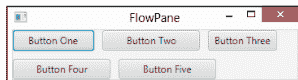

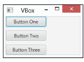

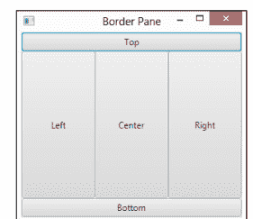

```
btnOK = new Button();
btnOK.setText("OK");
btnOK.setOnAction(e -> btnOK_Click());
btnCancel = new Button();
btnCancel.setText("Cancel");
btnCancel.setOnAction(e -> btnCancel_Click());
```

## 2. 通过调用构造函数创建布局面板。

例如：

```
HBox pane = new HBox();
```

## 3. 微调布局面板使用的可选设置。

每种类型的布局面板都有有一组独特的可选参数，用于控制节点在面板内布局的细节。例如，`HBox` 面板允许你设置用于分隔面板中每个节点间距的像素数。你可以按照如下方式设置此间距：

```
HBox.setSpacing(10);
```

## 4. 添加将显示在布局面板中的每个节点。

每种类型的布局面板都提供了一个用于向面板添加节点的方法。对于 `HBox` 面板，你必须先调用 `getChildren` 方法来获取所有已添加到面板的节点列表。然后，你可以使用 `add` 方法向面板添加一个或多个节点。例如：

```
pane.getChildren().addAll(btnOK, btnCancel);
```

第 4 章 使用布局面板安排你的场景 627

## 5. 创建场景，并将布局面板指定为场景的根节点。

例如：

```
Scene scene = new Scene(pane, 300, 400);
```

在这个示例中，`pane` 被添加为场景的根节点。

## 组合布局面板

你可以组合多个布局面板来创建比单个布局面板能提供的更复杂的布局。例如，假设你想创建一个布局，在底部有一行水平按钮，在右侧有一列垂直按钮。为了实现这一点，你可以为底部的按钮创建一个 `HBox`，并为右侧的按钮创建一个 `VBox`。然后，你可以创建一个 `BorderPane`，并将 `HBox` 添加到底部区域，将 `VBox` 添加到右侧。

这种组合是可行的，因为所有布局面板都继承自基类 `javafx.scene.layout.Pane`，而该类又继承自 `javafx.scene.node.Node`。换句话说，所有的面板也都是节点。你添加到布局中的每个节点都可以是另一个布局面板。你可以根据需要深度地嵌套面板在布局面板中，以实现你应用程序所需的确切布局。

## 使用 HBox 布局

`HBox` 类提供了 JavaFX 所有布局管理器中最简单的一种：它将一个或多个节点排列成水平行。表 4-1 展示了 `HBox` 类最常用的构造函数和方法。

`HBox` 类定义在 `javafx.scene.layout` 包中，因此在任何使用 `HBox` 的程序中都应该包含以下导入语句：

```
import javafx.scene.layout.*;
```

创建 `HBox` 最简单的方法是首先创建你想放置在 `HBox` 中的节点，然后调用 `HBox` 构造函数并将节点作为参数传递。例如：

```
Button btn1 = new Button("Button One");
Button btn2 = new Button("Button Two");
Button btn3 = new Button("Button Three");
HBox hbox = new HBox(btn1, btn2, btn3);
```

## 表 4-1 HBox 构造函数和方法

| 构造函数 | 说明 |

| --- | --- |

| `HBox()` | 创建一个空的 `HBox`。 |

| `HBox(double spacing)` | 创建一个具有指定间距的空 `HBox`。 |

| `HBox(Node... children)` | 创建一个带有指定子节点的 `HBox`。此构造函数允许你同时创建 `HBox` 并向其添加孩子。 |

| `HBox(double spacing, Node... children)` | 创建一个具有指定间距和子节点的 `HBox`。 |

| 方法 | 说明 |

| `ObservableList<Node> getChildren()` | 返回所有已添加到 `HBox` 的子节点集合。该集合以 `ObservableList` 形式返回，包含 `addAll` 方法，允许你向列表添加更多节点。 |

| `static void setAlignment(Pos alignment)` | 设置 `HBox` 内子节点的对齐方式。请参见表 4-5 关于 `Pos` 枚举的说明。更多信息请参见本章节稍后部分的“在布局面板中对齐节点”。 |

| `static void setHGrow(Node child, Priority priority)` | 设置给定子节点的增长性。请参见表 4-3 关于 `Priority` 枚举的说明。更多信息请参见本章节稍后部分的“通过增长节点添加空间”。 |

| `static void setLayout(Node child, Insets value)` | 设置给定节点的边距。请参见表 4-3 关于 `Priority` 枚举的说明（注：此处原文可能有误，通常应为 `Insets` 相关的说明）。 |

| `void setPadding(Insets value)` | 设置节点的内边距。请参见表 4-3 关于 `Priority` 枚举的说明。 |

| `static void setSpacing(double spacing)` | 设置节点的间距。请参见表 4-3 关于 `Priority` 枚举的说明。 |

第 4 章 使用布局面板安排你的场景 629

如果你想创建一个节点之间有间距的布局，请使用 `setSpacing` 方法。此示例在 `HBox` 节点之间添加间距，但没有提供节点与面板边缘之间的空间。例如，如果你将间距设置为 10 像素并添加三个按钮：

```
HBox hbox = new HBox();
hbox.setSpacing(10);
```

为了在布局面板的边缘添加空间，请使用 `setPadding` 方法。该方法接受一个 `Insets` 对象作为参数，该对象代表顶部、右、底部和左边缘的内边距大小（像素）。你可以使用表 4-2 中列出的两个构造函数之一来创建 `Insets` 对象。

要将内边距设置为统一的 10 像素，可以这样调用 `setPadding` 方法：

```
hbox.setPadding(new Insets(10));
```

要为每个边缘设置不同的内边距值，可以这样调用：

```
hbox.setPadding(new Insets(20, 10, 20, 10));
```

在这个示例中，顶部和底部的内边距设置为 20，右侧内边距设置为 10。

## 表 4-2 Insets 构造函数

| 构造函数 | 说明 |

| --- | --- |

| `Insets(double value)` | 创建一个顶部、右、底部和左边距使用相同值的 `Insets` 对象。 |

| `Insets(double top, double right, double bottom, double left)` | 创建一个使用指定的顶部、右、底部和左边距的 `Insets` 对象。 |

## 使用外边距添加空间

在布局面板中为节点周围添加空间的另一种方法是为单个节点创建外边距（margins）。这种技术允许你为布局面板中的每个节点设置不同的外边距大小，从而对每个节点的间距进行完全控制。

要创建外边距，请对每个想要添加外边距的节点调用 `setLayout` 方法。你可能认为，由于每个节点都可以有自己的外边距，`setLayout` 方法应该属于 `Node` 类。实际上，`setMargin` 方法是由 `HBox` 类定义的。`setMargin` 方法接受两个参数：

- 你想要为其添加外边距的节点

- 定义你想要添加的外边距的 `Insets` 对象

以下是一个示例，它为名为 `btn1` 的按钮的所有边设置了 10 像素的外边距：

```
HBox hbox = new HBox();
hbox.setMargin(btn1, new Insets(10));
```

`setMargin` 方法是 `HBox` 类的静态方法，因此当你调用它时，可以引用 `HBox` 类本身，而不是 `HBox` 的实例。因此，以下代码同样有效：

```
HBox.setMargin(btn1, new Insets(10));
```

（这是一个细微的区别：在第一个示例中，`hbox` 是 `HBox` 类的实例；在第二个示例中，`HBox` 是类本身。）

以下是一个为面板的每个边设置不同外边距的示例：

```
HBox.setMargin(btn1, new Insets(10, 15, 20, 10));
```

在这个示例中，顶部外边距为 10 像素，右侧为 15 像素，底部为 20 像素，左侧为 10 像素（此处注）。

请注意，外边距（margins）、间距（spacing）和内边距（padding）可以协同工作。因此，如果你为两个按钮的所有边创建一个 5 像素的外边距，添加那些间距设置为 10 像素且内边距设置为 10 像素的按钮，那么按钮之间的间距将是 20 像素，与面板内部边缘的距离将是 15 像素。

## 通过节点增长添加空间

在 `HBox` 中在节点之间添加空间的第三方法是创建一个节点，其唯一目的是在两个 `HBox` 节点之间添加空间。然后，你可以配置该空间节点，使其自动增长以填充面板内的任何额外空间。通过这种方式仅配置空间节点而不配置其他节点，空间节点将会增长。这样做的效果是将空间节点两侧的节点相互推开。

例如，假设你想创建一个包含三个按钮的 `HBox` 布局面板。你不想在面板内均匀地分布这三个按钮，而是希望前两个按钮出现在面板的左侧，第三个按钮出现在面板的右侧。第二个和第三个按钮之间的空间大小完全取决于面板的大小。因此，如果用户拖动窗口来扩展阶段（stage），第二个和第三个按钮之间的空间应该相应增加。

创建空间节点最简单的方法是使用 `Region` 类。`Region` 类是 `Control` 类的基类（`Button` 和 `Label` 等控件派生于此），它也是 `Pane` 类的基类（本章描述的所有布局面板都派生于它）。

对于我的用途，我使用 `Region` 类的简单默认构造函数来创建一个在布局面板中用作简单占位符的节点。我没有为区域提供特定的大小。相反，我配置使其在水平方向上增长以填充内容内部未使用的空间。

要实现这一点，请使用 `HBox` 类的 `setGrow` 方法，指定由名为 `Priority` 枚举定义的三个常量值之一。表 4-3 列出了这些常量及其各自的作用。

### 表 4-3：Priority 枚举

| 常量 |  |

|---|---|

| `Priority.NEVER` | 表示永远不要调整节点宽度以填充面板中的可用空间。这是默认设置。因此，默认情况下，节点不会根据包含它们的布局面板的大小调整大小。 |

| `Priority.ALWAYS` | 表示如果必要，始终应调整节点宽度以填充面板中的可用空间。如果你将两个或多个节点设置为 `ALWAYS`，则调整将平均分配给每个节点。 |

| `Priority.SOMETIMES` | 表示如果必要，可能会调整节点宽度以填充面板。然而，只有在没有其他指定 `ALWAYS` 的节点时，才会进行调整。 |

`Priority` 枚举定义在 `javafx.scene.layout` 包中；这与需要它的布局管理器位于同一个包。因此，你不需要包含额外的导入语句来使用 `Priority` 枚举。

此示例创建了三个按钮和一个占位符，将所有三个按钮的外边距设置为 10 像素，然后将这三个按钮和占位符添加到 `HBox` 中，使得前两个按钮出现在 `HBox` 的左侧，而第三个按钮出现在右侧：

```
// 创建按钮
Button btn1 = new Button("One");
Button btn2 = new Button("Two");
Button btn3 = new Button("Three");

// 创建占位符
Region spacer = new Region();

// 设置外边距
hbox.setMargin(btn1, new Insets(10));
hbox.setMargin(btn2, new Insets(10));
hbox.setMargin(btn3, new Insets(10));

// 为占位符设置 Hgrow
hbox.setHgrow(spacer, Priority.SOMETIMES);
```

等待，查看提供的文本，关于 `Priority` 枚举的描述似乎出现了混乱，我根据 JavaFX 文档修复了逻辑。（此处注：原文文本在末尾部分存在严重的乱码/错误重复，已清理）。

## 使用 VBox

`VBox` 类与 `HBox` 类似，但它不是水平排列节点，而是垂直排列。`VBox` 类定义在 `javafx.scene.layout` 包中，因此在任何程序中应包含以下导入语句：

```java
import javafx.scene.layout.*;
```

以下示例创建了三个按钮并使用 `VBox` 将它们排列成列：

```java
Button btn1 = new Button("One");
Button btn2 = new Button("Two");
Button btn3 = new Button("Three");

VBox vbox = new VBox(10);
vbox.getChildren().addAll(btn1, btn2, btn3);
```

## VBox 构造函数与方法

| 构造函数 | 描述 |

|---|---|

| `VBox()` | 创建空的 `VBox`。 |

| `VBox(double spacing)` | 创建具有指定间距的空 `VBox`。 |


# VBox 类

| 构造函数 | 描述 |
| --- | --- |
| `VBox(Node... children)` | 创建具有指定节点的 `VBox`。 |
| `VBox(double spacing, Node... children)` | 创建具有指定间距和节点的 `VBox`。 |

| 方法 | 描述 |
| --- | --- |
| `ObservableList<Node> getChildren()` | 返回所有添加到 `VBox` 的节点集合。返回的是一个 `ObservableList`，它包含 `addAll` 方法，允许添加一个或多个。 |
| `static void setAlignment(Pos alignment)` | 设置 `VBox` 内部节点的对齐方式。见表 4-5 关于 `Pos` 枚举的解释。 |
| `static void setMargin(Node child, Insets value)` | 为指定的子节点设置外边距。见 `Insets` 类构造函数的表 4-2。 |
| `void setPadding(Insets value)` | 设置 `VBox` 内部边缘的内边距。见 `Insets` 类构造函数的表 4-2。 |
| `static void setVgrow(Node child, Priority priority)` | 设置给定子节点的增长属性。见表 4-3 关于 `Priority` 枚举的解释。 |

与 `HBox` 类一样，你可以使用间距、内边距、外边距和占位符来控制 `VBox` 内部节点的间距。

```java
VBox vbox = new VBox(10, btn1, btn2, btn3);
vbox.setPadding(new Insets(10));
```

这是一个示例，它创建了一个包含三个按钮的列，其中一个按钮在列顶部，两个在底部，间距和内边距均为 10 像素：

```java
// 创建按钮
Button btn1 = new Button("One");
Button btn2 = new Button("Two");
Button btn3 = new Button("Three");

// 创建占位符
Region spacer = new Region();

// 设置占位符垂直增长
VBox.setVgrow(spacer, Priority.ALWAYS);

// 创建 VBox 布局面板
VBox vbox = new VBox(10, btn1, spacer, btn2, btn3);
vbox.setPadding(new Insets(10));
```

## 在布局面板中对齐节点

`HBox` 和 `VBox` 窗格都有一个 `setAlignment` 方法，允许你控制面板内包含的节点之间的对齐方式。`setAlignment` 方法接受单个参数，该参数是 `Pos` 枚举定义的常量之一，如表 4-5 所示。

`Pos` 枚举定义在 `javafx.geometry` 包中，在任何使用 `Insets` 的程序中都应该包含以下导入语句：

```java
import javafx.geometry.*;
```

接下来的示例展示了如何创建一个在面板居中的三按钮垂直列：

```java
Button btn1 = new Button("Number One");
Button btn2 = new Button("Two");
Button btn3 = new Button("The Third Button");
VBox vbox = new VBox(10, btn1, btn2, btn3);
vbox.setPadding(new Insets(10));
vbox.setAlignment(Pos.CENTERED);
```

第 4 章 使用布局面板安排场景 637

## Pos 枚举

| 常量 | 垂直对齐 | 水平对齐 |
| --- | --- | --- |
| `Pos.TOP_LEFT` | 顶部 | 左侧 |
| `Pos.TOP_CENTER` | 顶部 | 居中 |
| `Pos.TOP_RIGHT` | 顶部 | 右侧 |
| `Pos.CENTER_LEFT` | 居中 | 左侧 |
| `Pos.CENTER` | 居中 | 居中 |
| `Pos.CENTER_RIGHT` | 居中 | 右侧 |
| `Pos.BOTTOM_LEFT` | 底部 | 左侧 |
| `Pos.BOTTOM_CENTER` | 底部 | 居中 |
| `Pos.BOTTOM_RIGHT` | 底部 | 右侧 |
| `Pos.BASELINE_LEFT` | 基线 | 左侧 |
| `Pos.BASELINE_CENTER` | 基线 | 居中 |
| `Pos.BASELINE_RIGHT` | 基线 | 右侧 |

表 4-5

当此面板被添加到场景并在舞台（stage）中显示时，结果与图 4-3 所示的窗口相似。

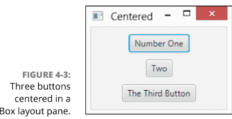

## 使节点具有相同宽度

当你将一组按钮或其他控件放在布局面板中时，你可能希望按钮具有相同的宽度，以创建整洁、均匀的外观。当你将它们放置在 `VBox` 面板的垂直列中时情况尤为如此；垂直列会使按钮宽度的任何差异变得显眼。

你可以通过将每个按钮的最大宽度设置为 `Double.MAX_VALUE` 来轻松地规定所有按钮具有相同的宽度。这里是前一个示例的修订版本，其中三个按钮被设置为相同的宽度：

```java
Button btn1 = new Button("Number One");
Button btn2 = new Button("Two");
Button btn3 = new Button("The Third Button");
btn1.setMaxWidth(Double.MAX_VALUE);
btn2.setMaxWidth(Double.MAX_VALUE);
btn3.setMaxWidth(Double.MAX_VALUE);
VBox vbox = new VBox(10, btn1, btn2, btn3);
vbox.setPadding(new Insets(10));
vbox.setAlignment(Pos.CENTERED);
```

图 4-4 显示了当面板被添加到场景并在舞台中显示时，这些按钮的外观。注意，三个按钮都采用了最宽按钮（`btn3`）的宽度。

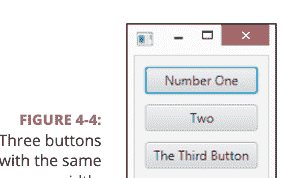

## 使用流式布局（Flow Layout）

流式布局有两种类型：水平和垂直。水平布局将子节点排列成行，直到面板的宽度达到你指定的特定尺寸。当达到该尺寸时，布局会在第一行下方开始新的一行子节点。这种流式处理持续进行，每当达到尺寸限制时开始新行，直到所有子节点都放置完毕。

垂直布局的工作方式相同，只是子节点以列的形式排列，直到达到尺寸限制。当达到限制时，会在第一列的右侧立即开始新列。

你使用 `FlowPane` 类来创建流式布局。表 4-6 显示了 `FlowPane` 类的构造函数和常用的方法。

## FlowPane 构造函数和方法

| 构造函数 | 描述 |
| --- | --- |
| `FlowPane()` | 创建一个新的水平流式布局，水平和垂直间距均设置为零。 |
| `FlowPane(double hgap, double vgap)` | 创建具有指定水平和垂直间距的空水平流式布局。 |
| `FlowPane(double hgap, double vgap, Node... children)` | 创建具有指定水平和垂直间距的空水平流式布局。 |
| `FlowPane(Orientation orientation)` | 创建水平和垂直间距设置为零的空流式布局。 |
| `FlowPane(Orientation orientation, double hgap, double vgap)` | 创建具有指定水平和垂直间距的空流式布局。 |
| `FlowPane(Orientation orientation, double hgap, double vgap, Node... children)` | 创建具有指定水平和垂直间距的空流式布局。 |
| `FlowPane(Orientation orientation, Node... children)` | 创建具有指定方向和节点的空流式布局。 |

| 方法 | 描述 |
| --- | --- |
| `ObservableList<Node> getChildren()` | 返回所有孩子的集合。 |
| `void setAlignment(Pos alignment)` | 设置面板内节点的对齐方式。 |
| `void setHgap(double value)` | 设置水平间距。对于水平布局，这是节点间的间距；对于垂直布局，这是列之间的距离。 |
| `void setVgap(double value)` | 设置垂直间距。对于垂直布局，这是节点间的间距；对于水平布局，这是行之间的距离。 |
| `void setMargin(Node child, Insets value)` | 设置特定孩子的外边距。 |
| `void setOrientation(Orientation orientation)` | 设置流式布局的方向，可以是 `Orientation.HORIZONTAL` 或 `Orientation.VERTICAL`。 |
| `void setPadding(Insets value)` | 设置流式布局内部边缘的内边距。 |
| `void setPrefWrapLength(double value)` | 设置面板的首选换行长度。对于水平布局，这代表面板的首选宽度；对于垂直布局，它代表首选高度。 |
| `void setRowAlignment(Pos alignment)` | 设置行内节点的对齐方式。 |
| `void setSpacing(double value)` | 设置流式布局中节点间的间距。 |
| `void setGap(double value)` | 设置流式布局中节点间的间隔。 |
| `void setColumnCount(Pos alignment)` | 设置列内节点的对齐方式。 |

640 BOOK 6 JavaFX

内容。因此，对于水平流布局（horizontal flow layout），封装长度（wrap length）指定了面板的首选宽度；对于垂直流布局（vertical flow layout），封装长度指定了面板的首选高度。

请注意，无论首选换行长度如何，如果你不调用此方法，封装长度将默认为 400 像素。

以下示例创建了一个水平布局，水平和垂直间距均为 10 像素，由五个按钮填充，并且首选换行长度为 300 像素：

```java
Button btn1 = new Button("Button One");
Button btn2 = new Button("Button Two");
Button btn3 = new Button("Button Three");
Button btn4 = new Button("Button Four");
Button btn5 = new Button("Button Five");
FlowPane pane = new FlowPane(Orientation.HORIZONTAL,
10, 10, btn1, btn2, btn3, btn4, btn5);
pane.setPrefWrapLength(300);
```

图 4-5 显示了当布局添加到场景（scene）并且场景在舞台（stage）中显示时，这些按钮的外观。该图还显示了当用户调整窗口大小时，流布局中的按钮是如何重新排列的。注意，前三个按钮出现在第一行，接下来两个出现在第二行。当窗口向左右拖宽时，按钮会重新流式，使得第一行有四个按钮，只有一个溢出到第二行。然后，当窗口被拖小时，第一行只出现两个按钮，并为第五个按钮创建了第三行。

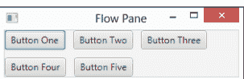

图 4-5：带有五个按钮的流面板。

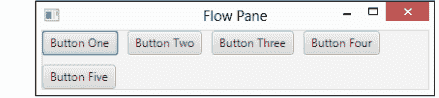

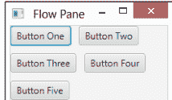

# 使用边界布局（Border Layout）

边界布局（border layout）是一种被划分为五个区域的面板：顶部（Top）、左侧（Left）、中心（Center）、右侧（Right）和底部（Bottom），如图 4-6 所示。当你将组件添加到布局时，可以指定组件位于这些区域中的哪一个。

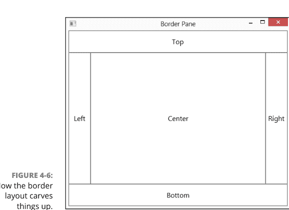

图 4-6：边界布局如何布局。

边界布局是传统窗口应用程序的理想布局管理器，在这些程序中，菜单和工具栏显示在窗口顶部，状态栏或 OK 和取消按钮显示在底部，左侧显示导航面板，右侧显示各种任务面板。

你使用 `BorderPane` 类来创建边界布局。表 4-7 列出了 `BorderPane` 类的构造函数和最常用的方法。

`BorderPane` 类定义在 `javafx.scene.layout` 包中，因此在任何使用边界布局的程序中，你都应该包含以下导入语句：

```java
import javafx.scene.layout.*;
```

# 表 4-7 BorderPane 构造函数和方法

| 构造函数 | 说明 |
| --- | --- |
| `BorderPane()` | 创建一个空的边界布局。 |
| `BorderPane(Node center)` | 创建一个带有指定中心节点的边界布局。 |
| `BorderPane(Node center, Node top, Node right, Node bottom, Node left)` | 创建一个带有指定的中心、顶部、右侧、底部和左侧节点的边界布局。 |

| 方法 | 说明 |
| --- | --- |
| `void setCenter(Node node)` | 设置中心节点。 |
| `void setTop(Node node)` | 设置顶部节点。 |
| `void setRight(Node node)` | 设置右侧节点。 |
| `void setBottom(Node node)` | 设置底部节点。 |
| `void setLeft(Node node)` | 设置左侧节点。 |
| `void setAlignment(Pos alignment)` | 设置边界面板内节点的对齐方式。`Pos` 枚举的解释请参见表 4-5。更多信息请参阅本章前面的“在布局面板中对齐节点”章节。 |
| `static void setMargin(Node child, Insets value)` | 为给定的子节点设置边距。`Insets` 类的构造函数请参见表 4-2。更多信息请参阅本章前面的“使用边距添加空间”章节。 |

该类的默认构造函数创建一个空的边界布局，你可以稍后向其添加节点，例如：

```java
Button btn1 = new Button("Button One");
Button btn2 = new Button("Button Two");
Button btn3 = new Button("Button Three");
VBox vbox = new VBox(btn1, btn2, btn3);
BorderPane pane = new BorderPane();
pane.setCenter(vbox);
```

在这里，创建了三个按钮并将它们添加到 `VBox` 中。然后创建一个边界布局，并将 `VBox` 添加到它的中心区域。

或者，你可以通过 `BorderPane` 构造函数向中心区域添加节点，如下：

```java
BorderPane pane = new BorderPane(vbox);
```

表 4-7 列出的第三个构造函数允许你一次性向所有五个区域添加节点。以下示例假设你已经创建了五个名为 `centerPane`、`topPane`、`rightPane`、`bottomPane` 和 `leftPane` 的面板：

```java
BorderPane pane = new BorderPane(centerPane, topPane, rightPane, bottomPane, leftPane);
```

这里关于 `BorderPane` 的几点：

- 默认构造函数创建一个空的边界布局，你可以稍后为其添加节点。
- 通过 `BorderPane` 构造函数向中心区域添加节点。
- 表 4-7 列出的第三个构造函数允许你一次向所有五个区域添加节点。

# 使用网格布局（Grid Layout）

网格布局管理器允许你在网格中安排节点。与流面板（flow pane）不同，网格布局会根据内容调整列和行。 以下是 `GridPane` 的重要特性：

- 你可以指定组件所在的单元格。
- 你可以创建跨行跨列的组件。
- 如果组件没有填充其区域，你可以告诉网格水平、垂直或双向拉伸它。
- 网格根据内容自动调整列和行。

# 绘制草图

在创建网格布局之前，先画一个草图，显示你希望组件在面板中的显示方式。然后将面板划分为行和列，并从左上角开始对行列编号。图 4-7 显示了一个让用户订购披萨的此类草图。

| | 0 | 1 | 2 |
| --- | --- | --- | --- |
| 名称: | | | |
| 电话: | | | |
| 地址: | | | |
| 小 | 薄 | 意大利肠 |
| 中 | 厚 | 蘑菇 |
| 大 | 厚 | 橄榄 |

图 4-7：面板草图。

规划好面板后，列出组件、它们的 x 和 y 坐标、对齐方式以及每个组件是否跨越一行或一列。这是一个示例：

| 组件 | x | y | 对齐 | 跨越 |
| --- | --- | --- | --- | --- |
| “名称”标签 | 0 | 0 | 右 | |
| “电话”标签 | 0 | 1 | 右 | |


| “地址”标签 | 0 | 2 | 右 | |
|---|---|---|---|---|
| 名称文本框 | 1 | 0 | 左 | 2 |
| 电话文本框 | 1 | 1 | 左 | 2 |
| 地址文本框 | 1 | 2 | 左 | 2 |
| 大小单选按钮 | 0 | 3 | 左 | |
| 单选按钮 | 1 | 3 | 左 | |
| 配料复选框 | 2 | 3 | 左 | |
| OK 和关闭按钮 | 2 | 4 | 右 | |

## 创建网格布局

在布局网格之后，你就可以编写代码将每个组件放在正确的位置。表 4-8 显示了 `GridPane` 类最常用的构造函数和方法，你使用它们来创建网格布局。

要创建一个基础网格布局，首先调用 `GridPane` 构造函数。然后，使用 `add` 方法将节点添加到网格的单元格中。`add` 方法的参数指定了要添加的节点、列索引和行索引。例如，以下代码段创建了一个标签，然后创建一个网格并将标签添加到第 0 列第 0 行的单元格：

```java
Label lblName = new Label("Name");
GridPane grid = new GridPane();
grid.add(lblName, 0, 0);
```

### 表 4-8 GridPane 构造函数与方法

| 构造函数 | 描述 |
|---|---|
| `GridPane()` | 创建一个网格布局（grid pane）。 |

| 方法 | 描述 |
|---|---|
| `void add(Node node, int col, int row)` | 在指定的列和行索引处添加节点。 |
| `void add(Node node, int col, int row, int colspan, int rowspan)` | 在指定的列和行索引处添加节点，并设置指定的列跨度和行跨度。 |
| `void addColumn(int col, Node... nodes)` | 添加整列节点。 |
| `void addRow(int row, Node... nodes)` | 添加整行节点。 |
| `<ObservableList> getColumnConstraints()` | 返回列约束。更多信息请参见表 11-6。 |
| `<ObservableList> getRowConstraints()` | 返回行约束。更多信息请参见表 11-7。 |
| `void setColumnSpan(Node node, int colspan)` | 为指定的节点设置列跨度。 |
| `void setRowSpan(Node node, int colspan)` | 为指定的节点设置行跨度。 |
| `void setAlignment(Node node, HPos value)` | 为节点设置水平对齐。允许的值 `HPos.LEFT`、`HPos.CENTER` 和 `HPos.RIGHT`。 |
| `void setAlignment(Node node, VPos value)` | 为节点设置垂直对齐。允许值为 `VPos.BOTTOM`、`VPos.CENTER` 和 `VPos.TOP`。 |
| `void setHgap(double value)` | 设置列与列之间间隔的大小。 |
| `void setVgap(double value)` | 设置行与行之间间隔的大小。 |
| `static void setMargin(Node node, Insets value)` | 为特定节点设置边距。`Insets` 类的解释请参见第 5 章的表 5-2。 |
| `void setPadding(Insets value)` | 设置网格布局内部边缘的内边距。`Insets` 类的解释请参见第 5 章的表 5-2。 |
| `void setMinHeight(double value)` | 设置网格布局的最小高度。 |
| `void setMaxHeight(double value)` | 设置网格布局的最大高度。 |
| `void setPrefHeight(double value)` | 设置网格布局的首选高度。 |
| `void setMinWidth(double value)` | 设置网格布局的最小宽度。 |
| `void setMaxWidth(double value)` | 设置网格布局的最大宽度。 |
| `void setPrefWidth(double value)` | 设置网格布局的首选宽度。 |

向网格布局填充节点的常用方法是为每个节点调用 `add` 方法。然而，如果你愿意，可以通过 `addColumn` 或 `addRow` 使用单个单元格添加一列或一整行节点。例如，此代码创建了一个标签（label）和一个文本字段（textfield），然后创建一个网格布局并将标签和文本添加到第一行：

```java
Label lblName = new Label("Name");
TextField txtName = new TextField();
GridPane grid = new GridPane();
grid.addRow(0, lblName, txtName);
```

如果一个节点应该跨越多个列，可以调用 `setColumnSpan` 方法来指定该节点应跨越的列数。例如：

```java
grid.setColumnSpan(txtName, 2);
```

在这里，`txtName` 节点将跨越两列。如果你需要配置一个节点跨越多行，可以类似地使用 `setRowSpan`。

要控制节点的水平对齐，请使用此示例中的 `setHAlignment` 方法：

```java
grid.setHAlignment(lblName, HPos.RIGHT);
```

在这里，`lblName` 节点在其所在的列中右对齐。`setVal` 方法的工作原理也类似。

与其他布局面板（layout panes）一样，`GridPane` 类有一许多方法用于设置间距和对齐细节。你可以使用 `setGap` 和 `setVgap` 方法设置行与列之间的间距，使布局看起来不拥挤。你可以使用 `setPadding` 和 `setMargins` 方法设置内边距和边距，它们的操作方式与其他布局面板完全相同。你还可以为网格布局设置最小、最大和首选的宽度和高度。

## 使用网格布局约束

你可以使用 `GridPane` 类的方法来控制网格布局的大多数方面，但遗憾的是，你无法控制单个列或行的大小。要实现这一点，你必须像表 4-9 和表 4-10 所示，使用 `ColumnConstraints` 或 `RowConstraints` 类。

### 表 4-9

| `ColumnConstraints` 类 | 描述 |
|---|---|
| `ColumnConstraints()` | 创建一个空的列约束对象。 |
| `ColumnConstraints(double width)` | 创建具有固定宽度的列约束。 |
| `ColumnConstraints(double min, double pref, double max)` | 创建具有指定的最小、首选和最大宽度的列约束。 |

| 方法 | 描述 |
|---|---|
| `void setMinWidth(double value)` | 设置列的最小宽度。 |
| `void setMaxWidth(double value)` | 设置列的最大宽度。 |
| `void setPrefWidth(double value)` | 设置列的首选宽度。 |
| `void setPercentWidth(double value)` | 设置宽度为网格布局总宽度的百分比。 |
| `void setHgrow(Priority value)` | 决定如果网格布局扩展，列的宽度是否增长。 |
| `void setFill(boolean value)` | 如果为真，网格布局将扩展节点。 |
| `void setAlignment(HPos value)` | 设置行的水平对齐。允许的值 `HPos.LEFT`、`HPos.CENTER` 和 `HPos.RIGHT`。 |

### `RowConstraints`

| 构造函数 | 描述 |
|---|---|
| `RowConstraints()` | 创建一个空的行约束对象。 |
| `RowConstraints(double height)` | 创建具有固定高度的行约束。 |
| `RowConstraints(double min, double pref, double max)` | 创建具有指定的最小、首选和最大高度的行约束。 |

| 方法 | 描述 |
|---|---|
| `void setHeight(double value)` | 设置行的最小高度。 |
| `void maxHeight(double value)` | 设置行的最大高度。 |
| `void setPrefHeight(double value)` | 设置行的首选高度。 |
| `void setPercentHeight(double value)` | 设置高度为网格布局总高度的百分比。 |
| `void setVgrow(Priority value)` | 决定如果网格布局扩展，行的高度是否增长。 |
| `void setAlignment(VPos value)` | 设置行的垂直对齐。允许的值 `VPos.TOP`、`VPos.CENTER`。 |

列约束非常有用的功能之一是按百分比分配网格布局列的宽度。例如，假设网格布局由三列组成，并且你希望所有列的宽度相同。以下代码实现了这一点：

```java
ColumnConstraints col1 = new ColumnConstraints();
col1.setPercentWidth(33);
ColumnConstraints col2 = new ColumnConstraints();
col2.setPercentWidth(33);
ColumnConstraints col3 = new ColumnConstraints();
col3.setPercentWidth(33);
GridPane grid = new GridPane();
grid.getColumnConstraints().addAll(col1, col2, col3);
```

在这个示例中，每列都占网格的 33%。

列或行约束设置的某些属性与通过 `GridPane` 类为单个节点设置的属性相似。例如，你可以通过调用网格布局的 `setHAlignment` 方法来设置单个节点的水平对齐。或者，你可以创建一个列约束，设置其水平对齐，然后将其应用于网格布局中的列，从而设置整列的水平对齐。

## 检查网格布局示例

列表 4-1 显示了显示图 4-8 场景的程序代码，而图 4-8 显示了该场景在程序运行时的外观。图 4-8 显示该场景的最终外观与我的草图非常接近。

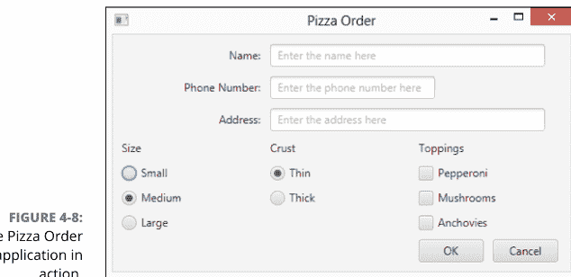

### 列表 4-1: 披萨订单应用程序

```java
import javafx.application.*;
import javafx.stage.*;
import javafx.scene.*;
import javafx.layout.*;
import javafx.scene.control.*;
import javafx.geometry.*;

public class PizzaOrder extends Application
{
    public static void main(String[] args)
    {
        launch(args);
    }
}
```

```java
Stage stage;
TextField txtName;
TextField txtPhone;
TextField txtAddress;
RadioButton rdSmall;
RadioButton rdMedium;
RadioButton rdLarge;
RadioButton rdThin;
RadioButton rdThick;
Checkbox chkPepperoni;
Checkbox chkMushrooms;
Checkbox chkAnchovies;
```

```java
@Override public void start(Stage primaryStage) {
    stage = primaryStage;
```

```java
// Create the name label and text field
Label lblName = new Label("Name:");
txtName = new TextField();
txtName.setMinWidth(100);
txtName.setFixedWidth(200);
txtName.setMaxWidth(300);
txtName.setPromptText("Enter the name here");
```

```java
// Create the phone label and text field
Label lblPhone = new Label("Phone Number:");
txtPhone = new TextField();
txtPhone.setMinWidth(60);
txtPhone.setFixedWidth(120);
txtPhone.setMaxWidth(180);
txtPhone.setPromptText("Enter the phone number here");
```

```java
// Create the address label and text field
Label lblAddress = new Label("Address:");
txtAddress = new TextField();
txtAddress.setMinWidth(100);
txtAddress.setFixedWidth(200);
txtAddress.setMaxWidth(300);
txtAddress.setPromptText("Enter the address here");
```

```java
// Create the size pane
Label lblSize = new Label("Size:");
rdSmall = new Radio("Small");
rdMedium = new Radio("Medium");
rdLarge = new Radio("Large");
rdMedium.setSelected(true);
ToggleGroup group = new ToggleGroup();
```

# 第 4 章 使用布局面板安排你的场景 653

### 列表 4-1:（续上）

```java
rdoSmall.setToggleGroup(groupSize);
rdoMedium.setToggleGroup(groupSize);
rdoLarge.setToggleGroup(groupSize);
```

```java
Vbox pane = new VBox(lblSize, rdoSmall, rdoMedium, rdoLarge);
pane.setSpacing(10);
```

```java
// Create the crust pane
lblCrust = new Label("Crust");
rdoThin = new RadioButton("Thin");
rdoThick = new RadioButton("Thick");
rdoThin.setSelected(true);
Toggle group groupCrust = new ToggleGroup();
rdoThin.setToggleGroup(groupCrust);
rdoThick.setToggleGroup(groupCrust);
```

```java
Vbox paneCrust = new VBox(lblCrust, rdoThin, rdoThick);
pane.setSpacing(10);
```

```java
// Create the toppings pane
lblToppings = new Label("Toppings");
chkPepperoni = new CheckBox("Pepperoni");
chkMushrooms = new CheckBox("Mushrooms");
chkAnchovies = new CheckBox("Anchovies");
```

```java
Vbox paneToppings = new VBox(lblToppings, chkPepperoni,
chkMushrooms, chkAnchovies);
paneToppings.setSpacing(10);
```

```java
// Create the buttons
btnOK = new Button("OK");
btnOK.setPrefWidth(80);
btnOK.setOnAction(e -> btnOK_Click());
```

```java
Button btnCancel = new Button("Cancel");
btnCancel.setPrefWidth(80);
btnCancel.setOnAction(e -> btnCancel_Click());
```

```java
HBox panes = new HBox(10, btnOK, btnCancel);
```

```java
// Create the GridPane layout
GridPane grid = new GridPane();
grid.setPadding(new Insets(10));
grid.setHgap(10);
grid.setVgap(10);
grid.setMinWidth(500);
grid.setPrefWidth(500);
grid.setMaxWidth(800);
```

654 书 6 JavaFX


```java
// Add the nodes to the pane
grid.addRow(0, lblName, txtName);
grid.addRow(1, lblPhone, txtPhone);
grid.addRow(2, lblAddress, txtAddress);
grid.addRow(3, paneCrust, paneToppings);
grid.addPane(buttons, 2, 4);
```

```java
// Set alignments and spanning
grid.setAlignment(lblName, HPos.RIGHT);
grid.setAlignment(lblPhone, HPos.RIGHT);
grid.setAlignment(lblAddress, HPos.RIGHT);
grid.setColumnSpan(txtName, 2);
grid.setColumnSpan(txtPhone, 2);
grid.setColumnSpan(txtAddress, 2);
```

```java
// Set column widths
ColumnConstraints col1 = new ColumnConstraints();
col1.setMinWidth(33);
ColumnConstraints col2 = new ColumnConstraints();
col2.setMinWidth(33);
ColumnConstraints col3 = new ColumnConstraints();
col3.setMinWidth(33);
grid.getColumnConstraints().addAll(col1, col2, col3);
```

```java
// Create the scene and the stage
Scene scene = new Scene(grid);
primaryStage.setScene(scene);
primaryStage.setTitle("Pizza Order");
primaryStage.setMinWidth(500);
primaryStage.setMaxWidth(900);
primaryStage.show();
```

```java
public void btnOK_Click() {
    // Create a message
    String msg = "Customer: ";
    msg += txtName.getText() + "\n";
    msg += txtPhone.getText() + "\n";
    msg += txtAddress.getText() + "\n";
    msg += "Size: ";
    if (rdSmall.isSelected()) {
        msg += "small";
    } else if (rdMedium.isSelected()) {
        msg += "medium";
    } else if (rdLarge.isSelected()) {
        msg += "large";
    }
    msg += "\nrust: ";
    if (rdoThin.isSelected()) {
        msg += "thin";
    } else if (rdoThick.isSelected()) {
        msg += "thick";
    }
    msg += "\ntppings:\n";
    if (chkPepperoni.isSelected()) {
        msg += "-Pepperoni\n";
    }
    if (chkMushrooms.isSelected()) {
        msg += "-Mushrooms\n";
    }
    if (chkAnchovies.isSelected()) {
        msg += "-Anchovies\n";
    }

    // Display the message
    Alert a = new Alert(AlertType.INFORMATION, msg);
    a.setTitle("Order Details");
    a.show();
}

public void btnCancel_Click() {
    stage.close();
}
```

# 第 4 章 使用布局面板安排你的场景

## 列表 4-1：（续上）

```java
if (rdSmall.isSelected()) {
    msg += "small";
} else if (rdMedium.isSelected()) {
    msg += "medium";
} else if (rdLarge.isSelected()) {
    msg += "large";
}
```

```java
if (rdoThin.isSelected()) {
    msg += "thin";
} else if (rdoThick.isSelected()) {
    msg += "thick";
}
```

```java
if (chkPepperoni.isSelected()) {
    msg += "-Pepperoni\n";
}
if (chkMushrooms.isSelected()) {
    msg += "-Mushrooms\n";
}
if (chkAnchovies.isSelected()) {
    msg += "-Anchovies\n";
}
```

```java
Alert a = new Alert(AlertType.INFORMATION, msg);
a.setTitle("Order Details");
a.showAndWait();
```

## 以下段落指出了程序的亮点

- 32：为姓名创建了标签和文本字段。
- 40：为电话号码创建了标签和文本字段。
- 48：为地址创建了标签和文本字段。
- 56：为尺寸创建了单选按钮。它们添加到 `VBox`。
- 70：为饼底类型创建了单选按钮。它们添加到 `VBox`。
- 82：为配料创建了复选框。它们添加到 `VBox`。
- 103：创建了网格布局。将内边距和水平/垂直间隙设置为 10，宽度设置为 500 到 800。
- 119：将节点添加到面板。将姓名、电话号码和地址的标签及文本字段 `VBox` 添加到第 0、1、2 行。然后将尺寸、饼底和配料 `VBox` 添加到第 3 行。（记住：行和列索引从 0 开始计数。）
- 127：创建列约束以分配列。
- 136：创建了场景并显示阶段。
- 146：当用户点击 OK 时调用 `btnOK_Click` 方法。该方法创建了订单摘要并使用 `Alert` 类显示。
- 187：`buildToppings` 只是一个简单的辅助方法，协助构建消息字符串。
- 201：当用户点击关闭按钮时关闭阶段。

# 使用文本字段

**文本字段**（text field）是一个用户可以在其中输入单行文本的框。你可以通过 `TextField` 类创建文本字段。表 5-1 显示了该类一些有趣的构造函数和方法。

## 表 5-1 用的 `TextField` 构造函数和方法

| 构造函数 | 描述 |
| --- | --- |
| `TextField()` | 创建一个新的文本字段。 |
| `TextField(String text, int cols)` | 创建一个具有初始文本值的新文本字段。 |

| 方法 | 描述 |
| --- | --- |
| `String getText()` | 获取字段输入的文本值。 |
| `void requestFocus()` | 请求将焦点移动到此字段。注意，字段必须在场景中，焦点才能生效。 |
| `void setEditable(boolean value)` | 如果为 `false`，则将字段设置为只读。 |
| `void setMaxWidth(double width)` | 设置字段的最大宽度。 |
| `void setMinWidth(double width)` | 设置字段的最小宽度。 |
| `void setPrefColumnCount(int cols)` | 设置文本字段的列数大小（即平均宽度文本字符的数量）。 |
| `void setPrefWidth(double width)` | 设置字段的首选宽度。 |
| `void setPromptText(String prompt)` | 设置字段的提示值。如果字段有文本值或字段拥有焦点，则不显示提示值。 |
| `void setText(String text)` | 设置字段的文本值。 |

`TextField` 类定义在 `javafx.scene.control` 包中，在任何使用文本字段的程序中都应该包含以下 `import` 语句：

```java
import javafx.scene.control.*;
```

创建文本字段最常见的方法是调用不带参数的构造函数，如下：

```java
TextField text1 = new TextField();
```

你可以像这样设置显示的初始值：

```java
TextField text1 = new TextField("Initial value");
```

或者，如果你稍后需要设置值，可以调用 `setText` 方法：

```java
text1.setText("Text value");
```

要获取用户输入到文本字段中的值，像这样调用 `getText` 方法：

```java
String value = text1.getText();
```

与 JavaFX 控件一样，管理文本字段的宽度可能会有点复杂。根底，JavaFX 将根据多个因素决定文本字段的宽度，包括包含阶段和场景的窗口的大小，以及对包含文本字段的面板设置的任何限制。你可以通过调用 `setMinWidth` 和 `setMaxWidth` 方法为文本字段设置最小最大限制，并通过 `setPrefWidth` 方法指定首选宽度，例如所示：

```java
TextField text1 = new TextField();
text1.setMinWidth(150);
text1.setMaxWidth(250);
text1.setPrefWidth(200);
```

设置首选宽度的另一种方法是使用 `setPrefColumnCount` 方法，它根据平均字符的大小设置宽度。例如，以下代码使字段足够显示大约 50 个字符：

```java
text1.setPrefColumnCount(50);
```

注意，`setPrefColumnCount` 方法并不限制用户输入到字段中的字符数量。相反，它限制了字段一次可以显示的字符数量。

每当你使用文本字段时，请提供一个提示，让用户知道应该在字段中输入什么数据。这样做的一种常用方法是在文本字段的左侧立即放置一个标签控件。例如：

```java
Label lbl1Name = new Label("Name:");
lbl1Name.setMinWidth(75);
TextField txtName = new TextField();
txtName.setMinWidth(200);
HBox pane = new HBox(10, lbl1Name, txtName);
```

在这里，创建了一个标签和一个文本字段，并将它们添加到 `HBox` 面板中，以便它们并排显示。

JavaFX 还允许你在文本字段内部显示提示。提示以较浅的文本颜色显示，并在字段获得焦点时消失。你使用 `setPromptText` 方法来创建这样的提示：

```java
TextField txtName = new TextField();
txtName.setPromptText("Enter the customer's name");
```

在这里，文本 `Enter the customer's name` 将出现在文本字段内部。

要获取用户输入到文本字段中的值，在此例中，你使用 `getText` 方法：

```java
String lastName = lastName.getText();
```

在这里，用户在 `lastName` 字段中输入的值被赋值给 `String` 变量 `lastName`。

图 5-1 显示了一个简单程序的操作，该程序使用文本字段允许用户输入角色名称以及扮演该角色的演员名称。假设用户在两个字段中都输入了内容，程序将显示一个警报框，指示谁将扮演该角色。如果用户省略了其中一个或两个字段，则会显示警报框以指示错误。

图 5-1 显示了该程序的主阶段的样子，以及当用户输入两个名称或当用户省略一个名称时显示的框框。该程序的 JavaFX 代码显示在列表 5-1 中。


```java
import javafx.application.*;
import javafx.scene.control.*;
import javafx.scene.layout.*;
import javafx.scene.stage.*;
import javafx.geometry.Insets;

public class RolePlayer extends Application {

    TextField txtCharacter;
    TextField txtActor;

    @Override
    public void start(Stage primaryStage) {
        Label lblCharacter = new Label("Character's Name:");
        lblCharacter.setMinWidth(75);
        txtCharacter = new TextField();
        txtCharacter.setMinWidth(200);
        HBox characterPane = new HBox(10, lblCharacter, txtCharacter);
        characterPane.setPadding(new Insets(10));

        Label lblActor = new Label("Actor's Name:");
        lblActor.setMinWidth(75);
        txtActor = new TextField();
        txtActor.setMinWidth(200);
        HBox actorPane = new HBox(10, lblActor, txtActor);
        actorPane.setPadding(new Insets(10));

        Button btnOK = new Button("OK");
        btnOK.setMinWidth(75);
        btnOK.setOnAction(e -> btnOK_Click());
        HBox buttonPane = new HBox(20, btnOK);
        buttonPane.setPadding(new Insets(10));

        VBox vPane = new VBox(10, characterPane, actorPane, buttonPane);
        Scene scene = new Scene(vPane);
        primaryStage.setScene(scene);
        primaryStage.setTitle("Role Player");
        primaryStage.show();
    }

    public static void main(String[] args) {
        launch(args);
    }

    public void btnOK_Click() {
        String errorMessage = "";

        if (txtCharacter.getText().length() == 0) {
            errorMessage += "\nCharacter is a required field.";
        }

        if (txtActor.getText().length() == 0) {
            errorMessage += "\nActor is a required field.";
            if (errorMessage.length() == 0) {
                String message = "The role of "
                        + txtCharacter.getText()
                        + " will be played by "
                        + txtActor.getText()
                        + "-";

                Alert a = new Alert(Alert.Type.INFORMATION, message);
                a.setTitle("Cast");
                a.showAndWait();
            }
        } else if (errorMessage.length() > 0) {
            Alert a = new Alert(Alert.Type.WARNING, errorMessage);
            a.setTitle("Missing Data");
            a.showAndWait();
        }
    }
}
```

- 25：这些代码创建了角色（Character）文本字段，其最小和最大宽度均为 200 像素。提示文本被设置为“在此处输入角色名称”。此文本将出现在文本字段内，但没有焦点。在图 5-1 中，角色文本字段拥有焦点，因此提示文本不可见。
- 32：这些代码创建了一个标签，用于识别演员（Actor）文本字段。与演员标签一样，演员标签的宽度设置为 100 像素，并向右对齐。
- 37：这些代码创建了演员（Actor）文本字段，将其宽度设置为 200 像素，并分配了提示文本。你可以在图 5-1 中看到提示文本，因为演员文本字段没有焦点。
- 43：这些代码创建了 OK 按钮。当用户点击按钮时，会调用 `btnOK_Click` 方法。
- 48：这些代码创建了一个 `HBox` 窗格，并将角色标签和文本添加到其中。
- 52：这些代码创建了另一个 `HBox` 窗格，并将演员标签和文本添加到其中。
- 56：这些代码创建第三个 `HBox` 窗格来放置按钮。
- 61：现在所有控件都已创建并添加到 `HBox` 窗格中，这三个窗格被添加到一个 `VBox` 窗格中，使得带有关联标签的文本框和按钮垂直堆叠。
- 64：这些行代码创建一个场景来显示 `VBox` 窗格，然后将场景添加到主舞台（primary stage）并显示舞台。
- 71：每当用户点击 OK 时，就会调用 `btnOK_Click` 方法。
- 73：`errorMessage` 变量保存任何可能需要通知用户数据缺失的错误消息。
- 75：这个 `if` 语句确保用户已经在角色文本框中输入了数据。如果没有输入任何数据，则创建一个错误消息。
- 80：这个 `if` 语句确保用户已经在演员文本框中输入了数据。如果没有输入任何数据，则会将错误消息追加到 `errorMessage` 字段中。
- 85：这个 `if` 语句通过测试 `errorMessage` 字段的长度来确定是否发生了数据验证错误。如果长度为零，则未检测到错误，程序将组装 `message` 变量以显示哪个演员将扮演哪个角色。使用 `Alert` 来显示消息。
- 98：这一行代码会在用户忘记在角色或演员文本字段中输入数据时显示错误消息。

## 验证数值数据

如果你使用文本字段从用户处获取数值数据，则需要特别小心。`getText` 方法返回一个字符串值。你可以将此值传递给原始数值类型包装类的其中一个 `parse` 方法。若要将文本框中输入的值转换为 `int`，请使用 `parseInt` 方法：

```java
int count = Integer.parseInt(txtCount.getText());
```

在这里，`getText` 方法的结果被用作 `parseInt` 方法的参数。

表 5-2 列出了各种包装类的 `parse` 方法。注意：如果字符串无法转换，这些方法中的每一个都会抛出 `NumberFormatException`。因此，你可以在 `try/catch` 块中调用 `parseInt` 方法来捕获此异常。

### 表 5-2：将字符串转换为数字的方法

| 包装类 | parse 方法 |
| :--- | :--- |
| `Integer` | `parseInt(String)` |
| `Short` | `parseShort(String)` |
| `Long` | `parseLong(String)` |
| `Byte` | `parseByte(String)` |
| `Float` | `parseFloat(String)` |
| `Double` | `parseDouble(String)` |

如果你的程序使用了两个或多个数值输入文本字段，请考虑创建独立的方法来验证用户输入。以下代码段显示了一个方法，它接受一个文本字段和一个字符串（如果字段中输入的数据无法转换为 `int`，该字符串提供要显示的错误消息）。该方法返回一个 `Boolean` 值，指示该字段是否包含有效的整数：

```java
private boolean isInt(TextField f, String msg) {
    try {
        Integer.parseInt(f.getText());
        return true;
    } catch (NumberFormatException e) {
        Alert a = new Alert(Alert.AlertType.WARNING, msg);
        a.setTitle("Invalid Data");
        a.showAndWait();
        return false;
    }
}
```

当你需要检查文本字段是否包含有效整数时，可以调用此方法。这里有一个获取 `txtCount` 字段中输入的值、并在该值是有效整数时将其显示在消息框中的方法：

```java
public void buttonOKClick() {
    if (isInt(txtCount, "You must enter an integer.")) {
        Alert a = new Alert(Alert.AlertType.INFORMATION,
            "You entered " + Integer.parseInt(txtCount.getText()),
            "Your Number");
        a.showAndWait();
    }
    txtCount.requestFocus();
}
```

调用 `isInt` 方法是为了确保用户输入的文本可以转换为 `int`。如果是，则文本被转换为 `int` 并显示在警框框中。

## 使用复选框

复选框（Check box）是一种用户可以进行勾选或清除的控件。复选框允许用户为选项指定“是”或“否”设置。图 5-2 显示了一个带有三个复选框的窗口。

严格来说，复选框有三种状态：已选中（checked）、未选中（unchecked）和未定义（undefined）。未定义状态通常与 `TreeView` 控件配合使用。

（图 5-2：三个复选框）

要创建复选框，请使用 `CheckBox` 类。其构造函数和方法见表 5-3。

### 表 5-3：`CheckBox` 构造函数和方法

| 构造函数 | 描述 |
| :--- | :--- |
| `CheckBox()` | 创建一个初始未选中的复选框 |
| `CheckBox(String text)` | 创建带有指定文本的新复选框 |
| `String getText()` | 获取文本 |
| `boolean isSelected()` | 如果已选中返回 true，未选中则返回 false |
| `void setOnAction(EventHandler<Event> value)` | 设置 `EventHandler` 来处理事件 |
| `void setSelected(boolean value)` | 如果为 true 则勾选复选框，为 false 则取消 |
| `void setText(String text)` | 设置复选框文本 |

使用 JavaFX 控件，如果你想引用复选框，请声明如下变量：

```java
CheckBoxPepperoni = new CheckBox("Pepperoni");
CheckBoxMushrooms = new CheckBox("Mushrooms");
CheckBoxAnchovies = new CheckBox("Anchovies");
```

在这里，用户选择每个披萨配料都被添加到文本字符串中。例如，如果你选择了意大利肠（pepperoni）和���鱼（anchovies），则会显示以下消息：

你订购了这些配料：

意大利肠

���鱼

在许多应用程序中，你只需等待用户点击按钮来检查复选框的状态。这里有一个方法，当用户点击 OK 时显示消息并清除复选框：

```java
public void buttonOKClick() {
    String msg = "";
    if (chkPepperoni.isSelected())
        msg += "Pepperoni\n";
    if (chkMushrooms.isSelected())
        msg += "Mushrooms\n";
    if (chkAnchovies.isSelected())
        msg += "Anchovies\n";
    if (msg.equals(""))
        msg = "你没有点任何配料。";
    else
        msg = "你订购了这些配料：\n" + msg;
    Alert a = new Alert(Alert.AlertType.INFORMATION, msg);
    a.setTitle("Your Order");
    a.showAndWait();
    chkPepperoni.setSelected(false);
    chkMushrooms.setSelected(false);
    chkAnchovies.setSelected(false);
}
```

如果在选择或取消选择复选框时提供即时反馈，请为复选框添加监听器。假设你的餐厅菜单上有���鱼，但你拒绝制作任何带���鱼的披萨。这里有一个方法，当用户尝试点击���鱼复选框时可以调用；在显示消息后，该方法会清除复选框：

```java
public void chkAnchovies_Click() {
    Alert a = new Alert(Alert.AlertType.WARNING, "我们这里不提供���鱼。");
    a.setTitle("讨厌!");
    a.showAndWait();
    chkAnchovies.setSelected(false);
}
```

要将此监听器添加到���鱼复选框，请调用它的 `setOnAction` 方法，如下：

```java
chkAnchovies.setOnAction(e -> chkAnchovies_Click());
```

## 使用单选按钮

单选按钮（Radio buttons）与复选框相似但有一个关键区别：它们成组出现，用户每组只能选择一个单选按钮。当你点击某个单选按钮进行选择时，同一组内之前选中的按钮会自动取消。图 5-3 显示了一个带有三个单选按钮的窗口。

图 5-3：带有三个单选按钮的框架。

使用单选按钮，你需要使用两个类。首先，你使用 `RadioButton` 类创建单选按钮本身，其构造函数和方法如表 5-4 所示。然后你使用 `ToggleGroup` 类为按钮创建一个组，并将按钮添加到切换组中。

`ToggleGroup` 对象实际上是将一组单选按钮关联在一起的方法，以便其中一个按钮被选中。切换组对象本身不是一个控件，且不会显示。要显示单选按钮，你需要将单个单选按钮（而不是切换组）添加到布局面板中。


### 表 5-4：`RadioButton` 构造函数和方法

| 构造函数 | 描述 |
| :--- | :--- |
| `RadioButton()` | 创建一个无文本的新单选按钮 |
| `RadioButton(String text)` | 创建一个带有指定文本的新单选按钮 |

| 方法 | 描述 |
| :--- | :--- |
| `String getText()` | 获取单选按钮显示的文本 |
| `boolean isSelected()` | 如果单选按钮被选中则返回 true，如果未被选中则返回 false |
| `void setOnClick(EventHandler<Event> value)` | 设置一个事件监听器来处理动作事件 |
| `void setSelected(boolean value)` | 如果参数为 true，则选中单选按钮；如果参数为 false，则取消选中 |
| `void setText(String text)` | 设置复选框文本 |

创建单选按钮的通常方法是声明一个类变量来引用该按钮，以便在类的任何地方访问它，如下例所示：

```java
RadioButton rdoSmall, rdoMedium, rdoLarge;
```

然后，在 `start` 方法中，你调用 `RadioButton` 构造函数来创建单选按钮：

```java
rdoSmall = new RadioButton("Small");
```

之后，你可以按照通常的方式将单选按钮添加到布局面板中。

要创建一个切换组来组合协同工作的单选按钮，请调用 `ToggleGroup` 类构造函数：

```java
ToggleGroup sizeGroup = new ToggleGroup();
```


然后调用每个单选按钮的`setGroup`方法：

```java
rdoSmall.setGroup(sizeGroup);
rdoMedium.setGroup(sizeGroup);
dorLarge.setGroup(sizeGroup);
```

切换组与单选按钮没有直接关系。要显示单选按钮，你仍然必须将它们添加到布局面板中。并没有规则规定切换组内的所有单选按钮必须位于同一个布局面板。然而，目前的做法是将同一个切换组中的所有单选按钮显示在场景中，以便用户可以方便地一起看到这些按钮。


如果你在 Swing 中中用过单选按钮，你可能注意到 JavaFX 切换组的工作方式与 Swing 按钮组的工作方式有一个重要区别。在 JavaFX 中，切换组之外的单选按钮之间是相互独立的。在 Swing 中，按钮组之外的单选按钮都是默认组的一部分。在 JavaFX 中，请始终将单选按钮添加到切换组中，即使场景中只有一个切换组。


## 查看披萨订单应用程序

本节介绍了一个相当复杂的应用程序，允许用户订购披萨。用户在文本字段中输入姓名、地址和电话号码，使用单选按钮选择披萨尺寸和饼底类型，并通过复选框选择配料。图 5-4 显示了披萨订单应用程序的主窗口。

当用户输入披萨订单数据并点击 OK 时，该程序将显示一个汇总订单的对话框，如图 5-5 所示。

## 现在订购披萨！

姓名：

电话号码：

地址：

| 尺寸 | 饼底 | 配料 |
| --- | --- | --- |
| 小号 | 薄 | 意大利肠、蘑菇 |
| 中号 | 香肠、番茄 |
| 大号 | | 意大利肠、鱱 |
| | | 橄榄 |

图 5-4：

披萨订单应用程序的主窗口。


## 订单详情

消息

客户：

Homer Simpson

742 Evergreen Terrace

355-4321

您订购了一个大号厚饼底披萨，带有以下配料：

意大利肠、香肠、意大利肠、橄榄、番茄、蘑菇、鱱。

图 5-5：

披萨订单应用程序确认了用户的订单。

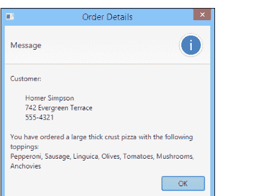

初看之下可能并不明显，但披萨订单应用程序显示的场景总共使用了 12 个布局面板来管理其控件的排列。整个场景由一个边框区域组织，其顶部区域显示标题（现在订购披萨！）。中心区域显示了文本字段、单选按钮和复选框，允许用户配置订单。底部区域包含 OK 和 Cancel 按钮。

供你参考，表 5-5 列出了用于组织场景的布局面板。

## 披萨订单应用程序中的布局面板

| 名称 | 类 | 描述 |
| --- | --- | --- |
| `paneMain` | `BorderPane` | 场景的根。 |
| `paneTop` | `HBox` | 显示标题的顶部框区域。 |
| `paneCustomer` | `VBox` | 包含姓名、电话和地址字段。 |
| `paneName` | `HBox` | 包含姓名的文本框。 |
| `panePhone` | `HBox` | 包含电话号码的文本框。 |
| `paneAddress` | `HBox` | 包含地址的文本框。 |
| `paneSize` | `VBox` | 允许用户配置尺寸的。 |
| `paneCrust` | `VBox` | 允许用户配置饼底类型。 |
| `paneToppings` | `FlowPane` | 允许用户选择配料的。 |
| `paneOrder` | `VBox` | 用于组织此内容的布局面板。 |
| `paneBottom` | `HBox` | 包含 OK 和 Cancel 按钮。 |

披萨订单应用程序的源代码如 Listing 5-2 所示。

## Listing 5-2：披萨订单应用程序

```java
import javafx.application.*;
import javafx.stage.*;
import javafx.scene.*;
import javafx.scene.layout.*;
import javafx.scene.control.*;
import javafx.scene.text.*;
import javafx.geometry.*;

public class PizzaOrder extends Application
{
    Stage stage;

    // 姓名、电话和地址字段
    TextField txtName;
    TextField txtPhone;
    TextField txtAddress;

    // 尺寸单选按钮
    RadioButton rdoSmall;
    RadioButton rdoMedium;
    RadioButton rdoLarge;

    // 饼底单选按钮
    RadioButton rdoThin;
    RadioButton rdoThick;

    // 配料复选框
    CheckBox chkPepperoni;
    CheckBox chKSausage;
    CheckBox chkLinguidas;
    CheckBox chkOlives;
    CheckBox chkMushrooms;
    CheckBox chkTomatoes;
    CheckBox chkAnchovies;

    @Override
    public void start(Stage primaryStage)
    {
        stage = primaryStage;

        // 创建顶部面板
        Text textHeading = new Text("Order Pizza Now!");
        textHeading.setFont(new Font(20));
        HBox paneTop = new HBox(textHeading);
        paneTop.setPadding(new Insets(20, 10, 20, 10));

        // 创建客户面板
        Label lblName = new Label("Name:");
        lblName.setPrefWidth(100);
        txtName = new TextField();
        txtName.setColumnCount(20);
        txtName.setPromptText("Enter your name here");
        txtName.setMaxWidth(Double.MAX_VALUE);
        HBox paneName = new HBox(lblName, txtName);

        // 创建电话号码面板
        Label lblPhone = new Label("Phone Number:");
        lblPhone.setPrefWidth(100);
        txtPhone = new TextField();
        txtPhone.setColumnCount(20);
        txtPhone.setPromptText("Enter your phone number here");
        HBox panePhone = new HBox(lblPhone, txtPhone);

        // 创建地址面板
        Label lblAddress = new Label("Address:");
        lblAddress.setPrefWidth(100);
        txtAddress = new TextField();
        txtAddress.setColumnCount(20);
        txtAddress.setPromptText("Enter your address here");
        HBox paneAddress = new HBox(lblAddress, txtAddress);

        // 创建客户面板
        VBox paneCustomer = new VBox(10, paneName, panePhone, paneAddress);

        // 创建尺寸面板 --
        Label lblSize = new Label("Size:");
        rdoSmall = new RadioButton("Small");
        rdoMedium = new RadioButton("Medium");
        rdoLarge = new RadioButton("Large");
        rdoMedium.setSelected(true);
        ToggleGroup groupSize = new ToggleGroup();
        rdoSmall.setGroup(groupSize);
        rdoMedium.setGroup(groupSize);
        rdoLarge.setGroup(groupSize);

        VBox paneSize = new VBox(lblSize, rdoSmall, rdoMedium, rdoLarge);
        paneSize.setSpacing(10);

        // 创建饼底面板 --
        Label lblCrust = new Label("Crust:");
        rdoThin = new RadioButton("Thin");
        rdoThick = new RadioButton("Thick");
        ToggleGroup groupCrust = new ToggleGroup();
        rdoThin.setGroup(groupCrust);
        rdoThick.setGroup(groupCrust);

        VBox paneCrust = new VBox(lblCrust, rdoThin, rdoThick);
        paneCrust.setSpacing(10);

        // 创建配料面板 --
        Label lblToppings = new Label("Toppings:");
        chkPepperoni = new CheckBox("Pepperoni");
        chKSausage = new CheckBox("Sausage");
        chkLinguidas = new CheckBox("Linguica");
        chkOlives = new CheckBox("Olives");
        chkMushrooms = new CheckBox("Mushrooms");
        chkTomatoes = new CheckBox("Tomatoes");
        chkAnchovies = new CheckBox("Anchovies");

        FlowPane paneToppings = new FlowPane(lblToppings, chkPepperoni, chKSausage, chkLinguidas, chkOlives, chkMushrooms, chkTomatoes, chkAnchovies);
        paneToppings.setHgap(5);
        paneToppings.setVgap(10);

        // 创建中心面板
        VBox paneCenter = new VBox(10, paneSize, paneCrust, paneToppings);
        paneCenter.setPadding(new Insets(10, 10, 10, 10));

        // 创建底部面板
        Button btnOK = new Button("OK");
        Button btnCancel = new Button("Cancel");
        HBox paneBottom = new HBox(10, btnOK, btnCancel);
        paneBottom.setAlignment(Pos.RIGHT);
        paneBottom.setPadding(new Insets(10, 10, 10, 10));

        // 创建主布局面板
        BorderPane paneMain = new BorderPane();
        paneMain.setTop(paneTop);
        paneMain.setCenter(paneCenter);
        paneMain.setBottom(paneBottom);

        Scene scene = new Scene(paneMain, 400, 400);
        primaryStage.setScene(scene);
        primaryStage.setTitle("Pizza Order");
        primaryStage.show();

        btnOK.setOnAction(e -> {
            // 处理订单逻辑（此处省略）
        });

        btnCancel.setOnAction(e -> {
            primaryStage.close();
        });
    }

    public static void main(String[] args)
    {
        launch(args);
    }
}
```

## 列表 5-2：（续）

```java
// 创建饼底面板

Label lblCrust = new Label("Crust");
rdoThin = new RadioButton("Thin");
rdoThick = new RadioButton("Thick");
rdoThin.setSelected(true);
ToggleGroup groupCrust = new ToggleGroup();
rdoThin.toggleGroup(groupCrust);
rdoThick.toggleGroup(groupCrust);
```

```java
Vbox pane = new VBox(lblCrust, rdoThin, rdoThick);
pane.setSpacing(10);
```

```java
// 创建配料面板

Label lblToppings = new Label("Toppings");
chkPepperoni = new CheckBox("Pepperoni");
chkSausage = new CheckBox("Sausage");
chkLinguica = new CheckBox("Linguica");
chkOlives = new CheckBox("Olives");
chkMushrooms = new CheckBox("Mushrooms");
chkTomatoes = new CheckBox("Tomatoes");
chkAnchovies = new CheckBox("Anchovies");
```

```java
Pane paneToppings = new Pane(Orientation.VERTICAL);
paneToppings.setPadding(new Insets(10, 0, 10, 0));
paneToppings.setGap(10);
paneToppings.setPrefWrapLength(100);
```

```java
Vbox paneTopping = new VBox(lblToppings, paneToppings);
```

```java
// 将尺寸、饼底和配料面板添加到订单面板

HBox paneOrder = new HBox(50, paneSize, paneCrust, paneTopping);
```

```java
// 创建中间面板

Vbox paneCenter = new VBox(20, paneCustomer, paneOrder);
paneCenter.setPadding(new Insets(0, 10, 0, 10));
```

```java
// 创建底部面板

Button btnOK = new Button("OK");
btnOK.setPrefWidth(80);
btnOK.setOnAction(e -> btnOK_Click());
```


```java
Button btnCancel = new Button("Cancel");
btnCancel.setPrefWidth(80);
btnCancel.setOnAction(e -> btnCancel_Click());

Region spacer = new Region();

HBox paneBottom = new HBox(10, spacer, btnOK, btnCancel);
paneBottom.setGrow(spacer, Priority.ALWAYS);
paneBottom.setPadding(new Insets(20, 10, 20, 10));
```

```java
// 完成场景设置

BorderPane paneMain = new BorderPane();
paneMain.setTop(paneTop);
paneMain.setCenter(paneCenter);
paneMain.setBottom(paneBottom);
```

```java
// 创建场景和阶段

Scene scene = new Scene(paneMain);
primaryStage.setScene(scene);
primaryStage.setTitle("Pizza Order");
primaryStage.show();
```

```java
public void btnOK_Click() {
    // 创建包含客户信息的消息字符串

    String msg = "Customer:\n";
    msg += "\t" + txtName.getText() + "\n";
    msg += "\t" + txtAddress.getText() + "\n";
    msg += "\t" + txtPhone.getText() + "\n";
    msg += "You have ordered a " +

    // 添加披萨尺寸

    if (rdoSmall.isSelected())
        msg += " small ";
    if (rdoMedium.isSelected())
        msg += " medium ";
    if (rdoLarge.isSelected())
        msg += " large ";

    // 添加饼底样式

    if (rdoThin.isSelected())
        msg += "thin crust pizza with ";
```

## 列表 5-2：（续）

```java
if (rdoThick.isSelected())
    msg += "thick crust pizza with ";

    // 添加配料

    String toppings = "";
    toppings = buildToToppings(chkPepperoni, toppings);
    toppings = buildToToppings(chkSausage, toppings);
    toppings = buildToToppings(chkLinguica, toppings);
    toppings = buildToToppings(chkOlives, toppings);
    toppings = buildToToppings(chkTomatoes, toppings);
    toppings = buildToToppings(chkMushrooms, toppings);
    toppings = buildToToppings(chkAnchovies, toppings);
    if (toppings.equals(""))
        msg += "no toppings.";
    else
        msg += "the following toppings:\n"
            + toppings;

    // 显示消息

    Alert a = new Alert(Alert.AlertType.INFORMATION,msg);
    a.setTitle("Order Details");
    a.showAndWait();

    public String buildToToppings(CheckBox chk, String msg) {
        // 用于显示配料列表的辅助方法
        if (chk.isSelected()) {
            if (!msg.equals("")) {
                msg += ", ";
            }
            msg += " " + chk.getText();
        }
        return msg;
    }

    public void btnCancel_Click() {
        stage.close();
    }
```

## 本章内容

- 使用 `ChoiceBox` 控制
- 使用 `ObservableList` 接口工作
- 监听用户选择的变化
- 使用 `ComboBox` 和 `ListView` 控制
- 使用 `TreeView` 控制

# 第 6 章：从列表中选择

本章将介绍 `ChoiceBox`、`ComboBox` 和 `ListView` 控件，这些控件允许用户从列表中选择一个或多个项目。本章还将介绍如何使用 `TreeView` 控件，以及如何处理 `ObservableList` 接口。

## 使用 ChoiceBox

`ChoiceBox` 是一个允许用户从下拉列表中选择一个项目的控件。在本章中，你将学习 `ChoiceBox`、`ComboBox` 和 `ListView`。

图 6-1：带有选择框的场景。

你可以使用 `ChoiceBox` 类来创建选择框。表 6-1 列出了该类常用的构造函数和方法。

### ChoiceBox 常用构造函数和方法

| 构造函数 | 描述 |
| :--- | :--- |
| `ChoiceBox<T>()` | 创建一个空选择列表 |
| `ChoiceBox<T>(ObservableList<T> items)` | 创建选择列表并填充值 |

| 方法 | 描述 |
| :--- | :--- |
| `ObservableList<T> getItems()` | 获取列表 |
| `void setItems(ObservableList<T> items)` | 设置列表 |
| `T getValue()` | 返回选中项 |
| `void setValue(T value)` | 设置选中项 |
| `void show()` | 显示列表 |
| `void hide()` | 隐藏列表 |
| `boolean isShowing()` | 表示列表是否可见 |

### 创建选择框

创建一个选择框非常简单。`ChoiceBox` 类是泛型的，因此要为关联的列表指定类型。例如：

```java
ChoiceBox<String> choice = new ChoiceBox<String>();
```

在这里，创建了一个显示字符串的选择框。下一步是向选择框添加项。你可以通过调用 `getItems` 方法访问列表，并调用 `add` 方法添加项：

```java
choice.getItems().add("Bashful");
choice.getItems().add("Doc");
choice.getItems().add("Dopey");
choice.getItems().add("Grumpy");
choice.getItems().add("Happy");
choice.getItems().add("Sleepy");
choice.getItems().add("Sneezy");
```

或者，你也可以调用 `addAll` 方法一次性添加所有字符串，如：

```java
choice.getItems().addAll("Bashful", "Doc", "Dopey", "Grumpy", "Happy", "Sleepy", "Sneezy");
```

你可以将任何类型的对象添加到选择框中。选择框会调用每个项目的 `toString` 方法来确定在选择列表中显示的文本。假设你有一个名为 `Astronaut` 的类，代表执行航天任务的宇航员：

```java
class Astronaut
{
    private String firstName;
    private String lastName;
```

```java
public Astronaut(String FirstName, String LastName)
{
    firstName = FirstName;
    lastName = LastName;
}

public String toString()
{
    return firstName + " " + lastName;
}
```

然后，你可以这样创建一个列出阿波罗 13 号船员的选择框：

```java
ChoiceBox<Astronaut> apollo13 = new ChoiceBox<Astronaut>();
apollo13.getItems().add(new Astronaut("Jim", "Lovell"));
apollo13.getItems().add(new Astronaut("John", "Swigert"));
apollo13.getItems().add(new Astronaut("Fred", "Haise"));
```

如果你愿意，可以在无需等待用户点击框的情况下显示选择框的内容。这样做可以调用 `show` 方法，如下：

```java
apollo13.show();
```

要隐藏列表，调用 `hide` 方法：

```java
apollo13.hide();
```

## 设置默认值

默认情况下，选择框在首次显示时没有初始选择。要设置初始值，调用 `setValue` 方法，并传递你想要作为初始选择的列表对象。

如果选择框包含字符串，你可以通过向 `setValue` 方法传递所需的字符串值来设置初始值：

```java
choice.setValue("Dopey");
```

如果指定的字符串不在列表中，则初始值将保持为未指定。

如果选择框包含对象（如上一节所示的 `Astronaut` 对象），你必须传递一个想要作为默认选择的对象的引用。例如：

```java
Astronaut lovell = new Astronaut("Jim", "Lovell");
Astronaut swigert = new Astronaut("John", "Swigert");
Astronaut haise = new Astronaut("Fred", "Haise");
ChoiceBox<Astronaut> apollo13 = new ChoiceBox<Astronaut>();
apollo13.addAll(lovell, swigert, haise);
apollo13.setValue(lovell);
```

在这里，Jim Lovell 被设置为默认宇航员。

## 获取选定项目

你可以使用 `getValue` 方法获取用户选择的项目。返回值的类型取决于你创建选择框时指定的类型。例如，如果你指定了类型 `String`，则 `getValue` 返回字符串。如果你为选择框指定了类型 `Astronaut`，则 `getValue` 方法返回宇航员。

`getValue` 方法经常用于按钮的事件处理程序。例如：

```java
public void btnOK_Click()
{
  String message = "You chose ";
  message = apollo13.getValue();
  Alert a = new Alert(Alert.AlertType.INFORMATION, message);
  a.setTitle("Your Favorite Astronaut");
  a.showAndWait();
}
```

## 使用可观察列表（Observable Lists）

正如你在上一节中看到的，`ChoiceBox` 类并不包含让你从选择框显示的列表中添加或删除项目的方法。它包含一个名为 `getItems` 的方法，该方法返回一个 `ObservableList` 类型的对象。该方法返回的对象是一个可观察列表；它代表了选择框显示的列表。

要处理选择框显示的项目，你必须先访问可观察列表，然后使用 `ObservableList` 类的方法访问列表中的各个项目。

可观察列表不仅被 `ChoiceBox` 类使用，也被其他显示列表项目的控件类使用，例如 `ComboBox` 和 `List`，你可以在本章稍后部分读到它们。这两个类都使用一个返回 `ObservableList` 的 `getItems` 方法。

可观察列表还被布局面板使用，如 `HBox` 和 `VBox`，你可以在第 5 章中阅读它们的内容。所有布局类共有的 `getChildren` 方法返回一个 `ObservableList`。

到目前为止，我只讨论了 `ObservableList` 接口的两个方法：`add` 和 `addAll`，它们允许你向可观察列表添加项目。这里是本章早些部分方法的示例：

```java
cbox.getItems().add("Bashful");
```

这里是来自第 5 章的示例，它使用 `addAll` 方法向面板添加项目：

```java
pane.getChildren().addAll(btnOK, btnCancel);
```

`ObservableList` 接口除了 `add` 和 `addAll` 之外还有许多方法。表 6-2 显示了你最可能使用的方法。

## 表 6-2：常用的 ObservableList 方法

| 方法 | 说明 |
| :--- | :--- |
| `add(E element)` | 将指定的元素添加到列表末尾。 |
| `add(int index, E element)` | 在指定的索引位置将指定的对象添加到列表中。 |
| `addAll(E...elements)` | 将所有指定的元素添加到列表末尾。 |
| `addAll(Collection<E> c)` | 将指定集合中的所有元素添加到列表末尾。 |
| `set(int index, E elem)` | 将指定的元素设置为指定的对象。该位置之前的元素将作为方法的返回值返回。 |
| `clear()` | 从数组列表中删除所有元素。 |
| `void remove(int fromIndex, int toIndex)` | 移除所有指定索引值的对象。 |
| `void removeAll(E...elements)` | 移除所有指定索引值的对象。 |
| `boolean contains(Object elem)` | 返回一个布尔值，表示该对象是否在列表中。 |
| `E get(int index)` | 返回指定索引处的对象。 |
| `int indexOf(Object elem)` | 返回对象在列表中第一次出现的索引。如果未找到，则返回 `-1`。 |
| `boolean isEmpty()` | 返回一个布尔值，表示列表是否为空。 |
| `E remove(int index)` | 指定索引处的元素。 |
| `E remove(Object elem)` | 从列表中移除指定的对象。 |
| `int size()` | 返回列表中元素的数量。 |
| `void addListener(ChangeListener listener)` | 添加一个监听器，当列表内容发生变化时会调用该监听器。 |

如果你对集合类（如 `ArrayList`）熟悉，你可能会发现表 6-2 列出的许多方法都是熟悉的。这是因为 `ObservableList` 扩展了 `List`：任何用于 `ArrayList` 的方法都可以用于 `ObservableList`。

例如，你可以像清除数组列表一样清除选择框的内容：

```java
cbox.getItems().clear();
```

如果你需要知道选择框中有多少项目，调用 `size` 方法：

```java
int count = cbox.getItems().size();
```

要从列表中移除特定项目，使用 `remove` 方法：

```java
cbox.getItems().remove("Grumpy");
```

你可以通过向 `addAll` 方法传递现有集合（如 `ArrayList`），轻松地向选择框插入项目。例如，假设你已经有一个包含要显示项的列表：

```java
fbox.getItems().addAll(list);
```

## 监听选择变化

让程序在用户更改选择框或其他列表控件的选择时立即做出响应是非常常见的，而无需等待用户点击按钮提交数据。例如，你可能有一个标签，想在用户更改选择时立即更新它的值。你可能还根据选择显示或隐藏不同的控件。

遗憾的是，选择框和其他列表控件在用户更改选择时不会产生动作事件。因此，`ChoiceBox` 类没有 `setOnAction` 方法。相反，你必须使用一系列复杂的方法调用来设置不同类型的事件监听器，称为变化监听器。

以下是序列：

1. 通过调用选择框的 `getSelectionModel` 方法获取选择模型。


`getSelectionModel` 方法返回控制器的选择模型，这是一个管理用户如何从列表中选择项目的对象。选择模型是一个实现了若干类中的之一的对象，用于扩展抽象的 `SelectionModel` 类。对于选择选择框（choice box），选择模型始终是 `SingleSelectionMode` 类型，它实现了一个允许用户一次仅从列表中选择一个项目的选择模型。

## 通过调用选择模型上的 `selectedItemProperty` 获取选中的项目

`SelectionModel` 类有一个名为 `selectedItemProperty` 的命名属性，它可以访问名为 `selectedItem` 的属性，该属性代表当前选中的项目。（属性是一种特殊的 JavaFX 对象，其值可以被监听器监控，每当属性值变化时，监听器就会被调用。）

## 通过调用 `selectedItem` 属性上的 `addListener` 方法添加监听器

当 `selectedItem` 属性的值发生变化时，监听器会被调用。更改监听器自然地实现了一个函数接口 `ChangeListener`。由于 `ChangeListener` 是一个函数接口（即它只有一个方法），你可以使用 Lambda 表达式来实现更改监听器。

你可以在一个语句中完成这三个步骤，例如此例所示：

```java
choice.getSelectionModel().selectedItemProperty()
    .addListener((v, oldValue, newValue) ->
        lbl.setText(newValue));
```

在前面的示例中，更改监听器将标签控件显示的值设置为用户新选中的新值。

由于 `ChangeListener` 是一个函数接口，它定义了一个单一的命名方法 `changed`，每当属性值发生变化时，该方法就会被调用。`changed` 方法接收三个参数：

- `observable`：值发生改变的属性
- `oldValue`：属性的旧值
- `newValue`：属性的新值

这三个参数在 Lambda 表达式开始的括号中指定。在 Lambda 表达式的体中，`newValue` 参数被赋值给标签的文本。因此，用户选中的值将由标签显示，并且每当用户更改选择框的选择时，标签都会自动更新。

## 使用组合框（Combo Boxes）

组合框（combo box）是选择框控件的一种更高级的兄弟控件。通过组合框，你获得的主要改进是：

- 组合框包含了在显示列表时限制显示项目数量的能力。如果列表中的项目数量超过限制，会自动添加滚动条，允许用户滚动查看整个列表。
- 组合框包含一个文本字段，允许用户直接输入值而不是从列表中选择值。该文本字段是可选的，且默认不显示，但你可以通过单个方法调用来添加它。
- 每当用户更改选择时，组合框都会触发一个动作事件（action event）。

与选择框相比，使用组合框设置事件处理器来响应用户选择的变化更容易。

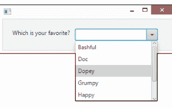

图 6-2：组合框。

你使用 `ComboBox` 类来创建组合框。表 6-3 列出了该类最常用的构造函数和方法。

### 表 6-3：`ComboBox` 构造函数和方法

| 构造函数 | 说明 |
| --- | --- |
| `ComboBox<T>()` | 创建指定类型的空组合框。 |
| `ComboBox<T>(ObservableList<T> items)` | 创建一个组合框并用指定列表中的值填充它。 |

| 方法 | 说明 |
| --- | --- |
| `void setEditable(boolean value)` | 如果为 true，则显示文本字段以允许用户直接编辑选择。 |
| `void setVisibleRowCount(int value)` | 设置显示的项目数量。 |
| `void setPromptText(String text)` | 设置最初在文本字段中显示的提示文本。 |
| `ObservableList<T> getItems()` | 获取项目列表。 |
| `void setItems(ObservableList<T> items)` | 设置项目列表。 |
| `T getValue()` | 返回当前选中的项目。 |
| `void setValue(T value)` | 设置当前选中的项目。 |
| `void show()` | 显示项目列表。 |
| `void hide()` | 隐藏项目。 |
| `void setOnAction(EventHandler handler)` | 设置每当选择更改时都会调用的事件处理器。 |
| `boolean isShowing()` | 表示项目列表当前是否可见。 |


## 创建组合框

创建组合框就像创建选择框。由于 `ComboBox` 是泛型的，请在本例中为它将包含的项目指定类型：

```java
ComboBox<String> cbox = new ComboBox<String>();
```

然后你可以使用 `getItems` 方法来访问包含组合框显示的列表内容的 `ObservableList` 对象。例如，你可以这样向列表添加项目：

```java
cbox.getItems().addAll("Bashful", "Doc", "Dopey", "Grumpy", "Happy", "Sleepy", "Sneezy");
```

关于处理 `ObservableList` 接口的更多信息，请翻阅本章前面的“使用 Observable Lists”部分。

默认情况下，不允许用户编辑文本字段。如果你想允许用户编辑文本字段，请像这样使用 `setEditable` 方法：

```java
cbo.setEditable(true);
```

如果你想限制显示的项目数量，请调用 `setVisibleRows` 方法：

```java
cbo.setVisibleRows(10);
```

这里，列表显示十个项目。如果列表超过十个项目，会自动添加滚动条允许用户滚动整个列表。

你还可以通过调用 `setPromptText` 方法指定显示在文本字段中的提示文本：

```java
cbo.setPromptText("Make a choice");
```

这里，文本字段中显示 Make a choice。

## 获取选中的项目

要获取用户选中的项目，使用 `getValue` 方法，就像处理选择框那样。你通常在响应按钮的事件处理器中这样做。例如：

```java
public void btnOK_Click() {
    String message = "You chose ";
    message += cbo.getValue();
    Alert a = new Alert(AlertType.INFORMATION, message);
    a.setTitle("Your Choice");
    a.showWait();
}
```

记住，`getValue` 方法返回的值可能不是列表中的值之一。这是因为用户可以在组合框的文本字段中输入任何内容。如果你想知道用户是从列表中选择的项目还是通过文本字段输入了另一个项目，可以使用 `ObservableList` 类的 `contains` 方法，如下：

```java
if (!cbo.getItems().contains(cbo.getValue())) {
    Alert a = new Alert(AlertType.INFORMATION, "You chose outside the box");
    a.setTitle("Good Thinking!");
}
```

这里，如果用户输入列表之外的项目，就会显示警框。

## 处理组合框事件

当用户从组合框选择一个项目时，会产生一个动作事件。在大多数应用程序中，我们只需忽略此事件，因为通常不需要在用户选择项目时立即执行任何操作。相反，选中的项目会在点击按钮时进行处理。

如果你想在用户选择项目时提供立即反馈，可以通过调用组合框的 `setOnAction` 方法来设置事件处理器。在某些情况下，简单的方法是创建一个包含你在用户选择项目时要执行的方法，并通过 Lambda 表达式将此方法传递给 `setOnAction` 方法。

例如，如果用户选择了 Dopey，以下方法将显示一个显示“My favorite too!”的对话框：

```java
public void cbo_Changed() {
    if (cbo.getValue().equals("Dopey")) {
        Alert a = new Alert(AlertType.INFORMATION, "He's my favorite too!");
        a.setTitle("Good Choice");
        a.showWait();
    }
}
```

以下是当用户更改组合框选择时调用此方法的代码：

```java
cbo.setOnAction(e -> cbo_Changed());
```

# 使用列表视图（List Views）

列表视图是一个强大的 JavaFX 控件，用于在框内显示对象列表。根据列（列表的配置方式，用户可以从列表中选择一个项或多个项。此外，你对列表项的显示方式拥有惊人的控制力。图 6-3 显示了一个带有列表视图的示例场景。

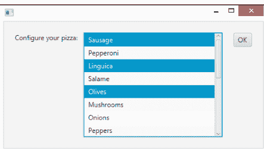

图 6-3：列表视图控件。

列表视图和组合框（combo boxes）有几个重要的区别：

- **列表视图没有允许用户编辑所选项的文本字段。**相反，用户必须直接从列表视图选择项。
- **列表视图不会展开。**相反，列表项显示在一个你可以指定大小的框中。
- **列表视图中的项可以垂直排列（默认）或水平排列。**图 6-4 显示了一个水平列表框。
- **列表视图允许用户选择多个项。**默认情况下，列表视图允许用户只选择一个项，但你可以轻松将其配置为允许多项选择。

要在列表中选择多个项，请按住 Ctrl 键并点击你想选择的项。要选择一组项，点击第一个项，按住 Shift 键，然后点击最后一个项。


图 6-4：水平列表视图控件。

使用 `ListView` 类来创建列表视图控件。表 6-4 列出了该类最常用的构造函数和方法。

### 表 6-4：Common `ListView` 构造函数和方法

| 构造函数 | 描述 |
| --- | --- |
| `ListView<T>()` | 创建指定类型的空列表视图。 |
| `ListView<T>(ObservableList<T> items)` | 创建列表视图并用指定列表中的值填充它。 |

| 方法 | 描述 |
| --- | --- |
| `ObservableList<T> getItems()` | 获取项列表。 |
| `void setItems(ObservableList<T> items)` | 设置项列表。 |
| `void setOrientation(Orientation o)` | 设置列表的方向。方向可以是 `HORIZONTAL`（水平）或 `Orientation.VERTICAL`（垂直）。 |

## 从列表中选择

## 创建列表视图

创建一个列表控件与创建一个组合框类似。以下是一个创建图 6-3 所示列表视图的示例：

```java
ListView list = new ListView();
list.getItems().addAll("Sausage", "Pepperoni",
"Linguica", "Salame", "Olives", "Mushrooms",
"Onions", "Peppers", "Pineapple", "Spinach",
"Canadian Bacon", "Tomatoes", "Kiwi",
"Anchovies", "Gummy Bears");
```

请注意，图 6-3 中所示的列表只显示了列表中的前八项。与组合框一样，如果 `items` 集合中的项总数无法完全显示，列表视图会自动添加滚动条。

默认情况下，列表控件仅允许单项选择。要允许多项选择，请添加此行：

```java
list.SelectionModel().setSelectionMode(SelectionMode.MULTIPLE);
```

要将列表水平排列而非垂直排列，请添加此行：

```java
list.setOrientation(Orientation.HORIZONTAL);
```

## 获取选定项

从列表视图控件获取选定项有点复杂。首先，你必须通过调用 `getSelectionModel()` 获取选择模型对象。然后，调用选择模型的 `getSelectedItems()` 方法。这返回一个只读的可观察列表，其中包含被选中的项。

以下示例构建了一个字符串，列出了图 6-3 所示的披萨配料列表视图中选择的所有项：

```java
String tops = ""
ObservableList<String> toppings;
tops = list.SelectionModel().getSelectedItems();
for(String topping in toppings)
{
 tops += topping + "\n"
}
```

在前面的示例中，字符串 `tops` 将包含用户选择的所有配料，并用换行符分隔。

## 使用树视图（Tree Views）

树视图是一种高级的 JavaFX 控件，以大纲形式显示分级数据，计算机将其称为“树”。树结构在计算机世界中非常常见。磁盘驱动器的文件夹结构是一棵树，JavaFX 场景图（scene graph）也是如此。

图 6-5 显示了一个包含树视图控件的 Java 场景。在这个示例中，我使用树控件来表示我喜欢的几部电视剧，以及从它们派生出的剧。


图 6-5：树视图控件。

在我介绍如何创建树控件的机制之前，你需要了解几个描述树本身元素的术语：

- **节点（Node）：**树中的每个元素都是一个**节点**。树中的每个节点由...创建。
- **根节点（Root node）：**根节点是起始节点。
- **子节点（Child node）：**子节点位于...下方。
- **父节点（Parent node）：**父节点位于...上方。
- **兄弟节点（Sibling node）：**兄弟节点处于同一层级。
- **叶子节点（Leaf node）：**叶子节点没有子节点。
- **已展开节点（Expanded node）：**已展开节点其子节点可见。
- **已折叠节点（Collapsed node）：**已折叠节点其子节点隐藏。
- **路径（Path）：**回溯到根节点的路径。

在我深入介绍如何创建树控件的机制之前，你需要知道一些描述树中元素的术语：

## 构建树

在实际创建树之前，你必须先构建它。`TreeItem` 类提供了以下三个基本特征：

- 值（value），它包含数据。
- 父节点（parent），除非节点是叶子节点。
- 子节点（children），以 `ObservableList` 形式表示。

如果节点是叶子节点，列表将为空。你可以使用 `ObservableList` 的熟悉方法来创建或获取。

### 表 6-5：`TreeItem` 类

| 构造函数 | 描述 |
| --- | --- |
| `TreeItem<T>()` | 创建空树节点。 |
| `TreeItem<T>(T value)` | 创建具有指定值的树节点。 |

| 方法 | 描述 |
| --- | --- |
| `T getValue()` | 返回节点的值。 |
| `void setValue(T value)` | 设置节点的值。 |
| `ObservableList getChildren()` | 返回表示子节点的可观察列表。 |
| `TreeItem getParent()` | 获取节点的父节点。 |
| `void setExpanded(boolean expanded)` | 指定 true 以展开节点。 |
| `boolean isExpanded()` | 返回表示节点是否已展开的布尔值。 |
| `boolean isLeaf()` | 返回表示节点是否为叶子节点的布尔值。 |
| `TreeItem nextSibling()` | 返回节点的下一个兄弟节点。如果没有兄弟节点，则返回 null。 |
| `TreeItem prevSibling()` | 返回节点的上一个兄弟节点。如果没有兄弟节点，则返回 null。 |

在本节中，我将构建一棵从三部热门电视剧派生出来的树：

- 《安迪·格里菲斯》（The Andy Griffith Show）有两个派生剧：《戈默·派尔，美国海军》（Gomer Pyle, U.S.M.）和《...
- 《家庭的一切》（All in the Family）直接派生了《杰斐逊》（The Jefferson）、《莫德》（Maude）、《格洛丽》（Gloria）和《阿奇·邦基之家》（Archie Bunker's Place）。
- 《快乐时光》（Happy Days）派生了《马克与米妮》（Mark and Mine）、《莱弗与莎莉》（Laver and Shirley）以及《乔妮爱骨科》（Joanie Loves Chiropractic）。

你可以采取许多方法来构建树，大多数方法都涉及某些递归编程。为了保持简单，我在本节中将避免递归编程，但这种避免意味着你将树的细节硬编码到程序中。

在创建树之前，你必须为每个非叶子节点声明一个 `TreeItem`。对于我的电视剧示例，我从以下代码开始：

```java
TreeItem candy, archie, happy,
george, maude;
```


这些变量可以作为`start`方法中的局部变量，因为一旦设置好树，你就不需要这些变量了。稍后我们会解释为什么不需要为叶子节点变量。

接下来，我创建了根节点并将其展开状态设置为`true`，这样在树形初始显示时它就会展开：

```java
TreeItem root = new TreeItem("Spin Offs ");
root.setExpanded(true);
```

为了简化创建所有其他节点的任务，我使用了以下方法`makeShow`：

```java
public TreeItem<String> makeShow(String title, TreeItem<String> parent) 
{
  TreeItem<String> show = new TreeItem<String>(title);
  show.setExpanded(true);
  parent.getChildren().add(show);
  return show;
}
```

该方法接受一个字符串和另一个节点作为参数，并返回一个对象被设置为该字符串参数的节点。返回的节点作为子节点添加到父节点中，并对该节点进行展开。因此，你可以调用此方法来创建一个新节点并将其置于树中。

下一步是创建一些节点。继续我的示例，我从于《安迪·格里菲秀》（The Andy Griffith Show）及其衍生剧的节点：

```java
andy = makeShow("The Andy Griffith Show", root);
makeShow("Gomer Pyle, U.S.M.C.", anyy);
makeShow("Mayberry R.F.D.", anyy);
```

在这里，调用`makeShow`为《安迪·格里菲秀》创建一个节点，并指定根节点为其父节点。该方法返回的节点保存在变量`anyy`中。再次调用两次`makeShow`来创建衍生剧，这次指定`anyy`为父节点。

由于`Gomer Pyle, U.S.M.C.`和`Mayberry R.F.D.`都没有衍生剧，因此不需要将这些节点作为父节点参数传递给`makeShow`方法。这就是为什么我没有费心去创建一个变量来引用这些节点。

在我的示例中，我创建了《全家福》（All in the Family）及其衍生剧的节点：

```java
archie = makeShow("All in the Family", root);
george = makeShow("The Jeffersons", archie);
makeShow("Checking In", george);
maude = makeShow("Maude", archie);
makeShow("Good Times", maude);
makeShow("Gloria", archie);
makeShow("Archie Bunker's Place", archie);
```

在这种情况下，杰斐森一家（The Jeffers）和莫德（Maude）有自己的子节点。因此，这两个节目需要对应的变量，以便在`makeShow`创建`Checking In`和`Good Times`节点时将它们作为结束参数传递。

最后，这里创建《快乐时光》（Happy Days）及其衍生剧节点的代码：

```java
happy = makeShow("Happy Days", root);
makeShow("Mork and Mandy", happy);
makeShow("Laverne and Shirley", happy);
makeShow("Joanie Loves Chachi", happy);
```

完整的树形结构已在内存中成功创建，因此我可以继续完成从树创建`TreeView`控件的任务。

## 创建 TreeView 控件

你使用`TreeView`类来创建一个显示树节点的组件。表 6-6 显示了该类的关键构造函数和方法。

| 构造函数 | 描述 |
| --- | --- |
| `TreeView<T>()` | 创建一个空树（如果你问我的话，这没什么用）。 |
| `TreeView<T>(TreeItem root)` | 创建一个从指定节点开始显示的树。 |

| 方法 | 描述 |
| --- | --- |
| `TreeItem getRoot()` | 获取根节点。 |
| `void setRoot(TreeItem root)` | 设置根节点。 |
| `MultipleSelectionModel<T> getSelection()` | 返回列表视图控件的选择模型。你可以通过调用`getSelectedItems`来获取一个被选中项的可观测列表。你也可以通过调用`getSelectedItem`获取最近一次选中的项。 |
| `void setRootVisible(boolean visible)` | 决定根节点是否可见。 |

创建`TreeView`控件的第一步是将`TreeView`变量声明为类的实例变量，这样你就可以在程序中的任何方法中访问它，如下：

```java
TreeView tree;
```

然后，在应用程序的`start`方法中，你调用`TreeView`构造函数来创建树控件，并将你想让显示的树的根节点作为参数传递：

```java
tree = new TreeView(root);
```

默认情况下，用户可以从树中选择一个节点。要允许用户选择多个节点，使用这个特殊的“咒语”：

```java
tree.getSelectionModel().setSelectionMode(SelectionModel.MULTIPLE);
```

在这里调用`getSelectionModel`方法来获取管理树内节点选择的选择模型。该方法返回一个`MultipleSelectionModel`类型的对象，它包含一个名为`SelectionMode`的方法，允许你设置选择节点。要允许选择多个项目，你必须传递此方法`SelectionModel.MULTIPLE`。

搞定！你现在有了一个`TreeView`控件，可以将其添加到布局面板中并在场景中显示。

> 虽然由树控件显示的的树必须有一个根节点，但在许多情况下，根节点是多余的。例如，在你正在查看的示例中，显示根节点有什么意义呢？如果你不想显示根节点，`TreeView`控件可以抑制根节点的显示。要隐藏根节点，只需调用此方法：

```java
tree.setShowRoot(false);
```

6–6 显示了根节点隐藏后树的样子。

## 获取选中的节点

有多种方法可以确定哪些节点是当前选中的。一种方法是通过调用树的选择模型来访问。`getSelectedItems`方法返回一个包含已选中项的只读观测列表。

图 6-6：隐藏根节点的树视图。

例如：

```java
String msg = "";
ObservableList<TreeItem<String>> shows =
    tree.getSelectionModel().getSelectedItems();
for(TreeItem show : shows) {
    msg += show.getValue() + "\n";
}
```

在前面的示例中，字符串`msg`将包含用户从树中选择的项目，并用换行符分隔。

另一种方法是在选择变化时添加一个事件处理器。你可以这样做：

```java
tree.getSelectionModel().selectedItemProperty()
    .addListener((v, oldValue, newValue) -> {
        tree.SelectionChanged(newValue);
    });
```

列表 6-1：衍生剧

```java
import javafx.application.*;
import javafx.scene.*;
import javafx.scene.layout.*;
import javafx.scene.control.*;
import javafx.geometry.*;

public class SpinOff extends Application {

    TreeView<String> tree;
    Label lblSourceName;
    TreeItem<String> root, anyy, archie, happy, george, maude;

    public static void main(String[] args) {
        launch(args);
    }

    @Override
    public void start(Stage primaryStage) {
        root = new TreeItem("Spin Offs ");
        root.setExpanded(true);

        andy = makeShow("The Andy Griffith Show", root);
        makeShow("Gomer Pyle, U.S.M.C.", anyy);
        makeShow("Mayberry R.F.D.", anyy);

        archie = makeShow("All in the Family", root);
        george = makeShow("The Jeffersons", archie);
        makeShow("Checking In", george);
        maude = makeShow("Maude", archie);
        makeShow("Good Times", maude);
        makeShow("Gloria", archie);
        makeShow("Archie Bunker's Place", archie);

        happy = makeShow("Happy Days", root);
        makeShow("Mork and Mandy", happy);
        makeShow("Laverne and Shirley", happy);
        makeShow("Joanie Loves Chachi", happy);

        tree = new TreeView(root);
        tree.setShowRoot(false);
        tree.getSelectionModel().setSelectionMode(SelectionMode.MULTIPLE);

        lblSourceName = new Label();
        VBox pane = new VBox(10);
        pane.setPadding(new Insets(20,20,20,20));
        pane.getChildren().addAll(tree, lblSourceName);

        Scene scene = new Scene(pane);
        primaryStage.setScene(scene);
        primaryStage.setTitle("My Favorite Spin Offs");
        primaryStage.show();
    }

    public void SelectionChanged(TreeItem<String> item) {
        if (item != null) {
            lblSourceName.setText(item.getValue());
        } else {
            lblSourceName.setText("");
        }
    }

    public TreeItem<String> makeShow(String title, TreeItem<String> parent) {
        TreeItem<String> show = new TreeItem<String>(title);
        show.setExpanded(true);
        parent.getChildren().add(show);
        return show;
    }
}
```

## 列表 6-1：续接

```java
return show;
}
public void tree_SelectionChanged(TreeItem<String> item)
{
  if (item != null)
  {
    lblShowName.setText(item.getValue());
  }
}
```

此程序中的所有代码在本章中已经展示过，因此我在这里指出重点：

- →15：树模型和列表模型被定义为类实例变量。
- →20：为根节点和每个节目定义了`TreeItem`变量，每个节目都有相应的衍生剧。
- →23：创建了文本为“Spin–Offs”的根节点。
- →26：这些行创建了《安迪·格菲斯秀》（The Andy Griffith Show）及其衍生剧的节点。
- →31：这些行创建了《全一家》（All in the Family）及其衍生剧的节点。
- →39：这些行创建了《欢乐时光》（Happy Days）及其衍生剧的节点。
- →44：这一行创建了`TreeView`，并指定了树的根节点。下一行隐藏了根节点。
- →46：这一行为选中的项目创建事件监听器。Lambda 表达式调用名为`tree_SelectionChanged`方法，每当`TreeView`的选择状态更改时就会调用该方法。
- →54：将`TreeView`控件和标签添加到`vbox`布局面板中，然后在显示阶段之前将其添加到场景中。
- →64：`makeShow`方法从字符串创建一个节点，并将该节点添加到作为父参数传递的节点中。
- →73：每当选中的节点更改时，就会调用`tree_SelectionChanged`方法。只要传递的`TreeItem`不为空，它就会在`lblShowName`标签中显示节目标题。

# 7 Web 编程

## 内容概览

- 第 1 章：使用 Java Web Start ................................................................ 709
- 第 2 章：创建 Servlets ..................................................................... 721
- 第 3 章：使用 JavaServer Pages ............................................................ 741
- 第 4 章：使用 JavaBeans ................................................................... 757

## 本章内容

- 使用 Java Web Start 从 Web 页面启动 Java 程序
- 创建 JNLP 文件以为应用程序启用 Java Web Start
- 编写 Java Web Start HTML 文件
- 修改安全设置以允许 Java Web Start

## 第 1 章：使用 Java Web Start

Java Web Start 是一种通过网页部署 Java 应用程序的方法。网页可以存在于互联网上，也可以存在本地公司局域网上。Java Web Start 允许用户通过浏览网页并点击链接来运行 Java 程序。

Java Web Start 仅用于部署具有图形用户界面（GUI）的程序。开发 GUI 程序的最佳方法是使用 JavaFX，如第 6 本所述。你也可以部署使用 Swing 开发的 GUI 程序，这是一种创建 GUI 程序的旧方法，本书中未涵盖。

在本章中，你将学习如何通过 Java Web Start 部署一个简单的 JavaFX 应用程序。

### 观察简单的 JavaFX 程序

用于说明 Java Web Start 的 JavaFX 应用程序是`ClickMe`。运行时，它仅显示图 1-1 所示的对话框。如所示，对话框包含一个标记为“Click me!”（点击我！）的按钮。当用户点击按钮时，按钮的标签变为“You clicked me!”（你点击我了！）。如果用户再次点击，按钮将恢复为“Click me please!”（请点击我！），并重复该过程直到用户点击关闭按钮（窗口右上角的 X）关闭。


图 1-1：运行中的`ClickMe`程序。

该程序的操作在第 6 本的第 1 章中详细解释。在通过 Java Web Start 部署时，你不需要了解任何关于`ClickMe`程序原理原理，但作为参考，程序的源代码显示在列表 1-1 中。列表中所示代码应保存为名为`ClickMe.java`的文件。如果你在学习如何使用 Java Web Start 部署它之前想了解更多关于该程序的信息，请参阅第 6 本第 1 章。

## 列表 1-1：`ClickMe`程序


```java
import javafx.application.*;
import javafx.stage.*;
import javafx.scene.*;
import javafx.scene.layout.*;
import javafx.scene.control.*;

public class ClickMe extends Application
{
    public static void main(String[] args)
    {
        launch(args);
        System.out.println("Done");
    }

    Button btn;

    @Override public void start(Stage primaryStage)
    {
        // 创建按钮
        btn = new Button();
        btn.setText("Click me please!");
        btn.setOnAction(e -> buttonClick());
    }
```

```java
// 将按钮添加到布局面板
BorderPane pane = new BorderPane();
pane.setCenter(btn);

// 将布局面板添加到场景
Scene scene = new Scene(pane, 300, 250);

// 将场景添加到阶段，设置标题
// 并显示阶段
primaryStage.setScene(scene);
primaryStage.setTitle("The Click Me App");
primaryStage.show();

public void buttonClick() {
    if (btn.getText().equals("Click me!")) {
        btn.setText("You clicked me!");
    } else {
        btn.setText("Click me please!");
    }
}
```

该`ClickMe.java`源文件可以使用以下命令编译：

```bash
javac ClickMe.java
```

可以使用以下命令创建`ClickMe.jar`文件：

```bash
jar cf ClickMe *.class
```

## 理解 Java Web Start

Java Web Start 的工作原理是在用户计算机上提供一个指向特殊文件的链接。当用户点击 JNLP 文件时，应用程序运行 Java 虚拟机 (JVM)。

名为 applet 的旧技术允许 Java 程序在浏览器中运行。Oracle 已正式废弃了 applet。


如果用户没有 Java 运行时，Web Start 会自动下载。通常，通过 Web Start 运行的应用程序被禁止执行用户系统上的某些操作。

使用 Web Start 设置应用程序的一流程如下：

1. 创建包含你想通过 Web Start 运行的程序的 JAR 文件。
2. 创建指定运行程序所需信息的 JNLP 文件。
3. 创建一个包含 JNLP 文件链接的 HTML 文件。
4. 将 JAR、JNLP 和 HTML 文件复制到 Web 服务器上的相应文件夹。

有关如何创建 JAR 文件的信息，请参阅第 3 本。在本章中，我们假设你已经创建了一个名为`ClickMe.jar`的 JAR 文件。

有关创建 JNLP 文件的信息，请见下一节。

## 创建 JNLP 文件

要通过 Java Web Start 部署 Java 应用程序，你必须创建一个 JNLP 文件，其中包含定位和运行应用程序所需的详细。JNLP 文件是一个很小的 XML 文件，包含了如应用程序名称、指向应用程序 JAR 文件的 URL、创建应用程序的供应商、应用程序所需的 Java 版本，以及在用户计算机未安装 Java 运行时的情况下用于下载它的 URL。

如果你尚不熟悉 XML 的基础知识，可以在第 8 本第 5 章中学习 XML 的语法要求。

JNLP 代表 Java Network Protocol，但这不会出现在考试中。

列表 1-2 显示了名为`ClickMe.jnlp`的 JNLP 文件可以从网站`www.lowewriter.com`运行 ClickMe 应用程序。

### 列表 1-2：ClickMe 程序的 JNLP 文件

```xml
<?xml version="1.0" encoding="UTF-8"?>
<jnlp specs="1.0"
  codebase="http://www.lowewriter/ClickMe"
  href="ClickMe.jnlp">
  <information>
    <title>ClickMe</title>
    <vendor>LowWriter</vendor>
    <offline-allowed/>
  </information>
  <resources>
    <!-- Application Resources -->
    <j2se version="1.6+"
      href="http://www.oracle.com/technwork/java/javase/downloads/">
    <jar href="ClickMe.jar"
      main="true" />
  </resources>
  <application-desc main-class="ClickMe">
  </application-desc>
  <update check="background"/>
</jnlp>
```

此 JNLP 文件中的大多数行对于所有 Java Web Start 应用程序都是相同的。你针对特定的 Java Web Start 应用程序需要修改的行在以下段落中描述：

- `codebase` 属性应该更改，以反映你的应用程序保存在网站上的根位置。在这种情况下，应用程序文件存储在`http://www.lowewriter/ClickMe`。虽然`codebase`属性不是绝对必须，但使用它可以简化 JNLP 文件的其余部分，因为 JNLP 文件中其他处出现的 URL 都是相对于`codebase`路径的。你将在下一个段落中看到我的意思。

- `href` 属性指示 jnlp 文件的路径。在例例中，我只指定了文件名，而不是相对于`codebase`属性给定路径的完整路径。因为 jnlp 文件位于`http://lowewriter.com/ClickMe`文件夹中，因此在此处仅指定文件名即可标识 jnlp 文件。

- `<title>` 元素提供了应用程序的名称——在这种情况下为 "ClickMe"。

- `<vendor>` 属性提供了应用程序供应商的名称——在这种情况下，为 "LoweWriter"。

- `jar` 元素的 `href` 属性提供了应用程序 JAR 文件的位置。同样，由于该文件位于`codebase`所指的文件夹中，我只指定了文件名。

- `application-desc` 元素的 `main-class` 属性指示应用程序主类的名称，该类包含了被调用以启动应用程序的主方法。在这种情况下，主类是`ClickMe`。

## 创建启动 Java 应用程序的 HTML 文件

一旦你创建了描述你的 Java Web Start 应用程序的 JNLP 文件，你就可以创建一个 HTML 文件，用户可以通过它来启动应用程序。该 HTML 文件应该包含指向 JNLP 文件的链接。提供该链接最简单的方法是使用 HTML 文件中的一个元素，如列表 1-3 所示的`ClickMe.html`文件所示。

### 列表 1-3：链接到 JNLP 文件的 HTML 文件

```html
<html>
<head>
  <title>ClickMe (Java Web Start)</title>
</head>
<body>
  <h1>ClickMe!</h1>
  <a href="ClickMe.jnlp">Run the application</a>
</body>
</html>
```

在列表 1-3 中，`<a>`元素提供了必要的链接：

```html
<a href="ClickMe.jnlp">Run the application</a>
```

图 1-2 显示了`ClickMe.html`文件在浏览器窗口中显示时的样子。第 1 章 使用 Java Web Start

## 将 Java Web Start 文件上传到你的 Web 服务器

对于这个简单的 Java Web Start 应用程序，我一共创建了五个文件：

- `ClickMe.java`：ClickMe 程序的源文件，如列表 1-1 所示。
- `ClickMe.class`：ClickMe 程序的编译后文件，由 Java 编译器编译。
- `ClickMe.jar`：包含 ClickMe 类的 JAR 文件。该文件将被上传到服务器，反而在用户从网页上启动应用程序时，它会被下载到用户的计算机上。
- `ClickMe.jnlp`：`ClickMe.jar`文件的 JNLP 文件。该文件也将上传到 Web 服务器。
- `ClickMe.html`：提供指向`ClickMe.jnlp`文件链接的 HTML 文件。这将被上传到 Web 服务器。

JAR、JNLP 和 HTML 文件都需要上传到你的 Web 服务器，以便你的用户能够通过浏览器访问它们。你可以使用任何你喜欢的方法来上传文件。如果你愿意，可以使用像 FileZilla 这样的 FTP 客户端。如果你的 Web 托管提供上传工具，可以使用它。或者，如果你的 Web 服务器位于你自己的网络中（例如，如果它是内网服务器），你可以直接使用操作系统来复制文件。

无论你如何实现，目标都是将 JAR、JNLP 和 HTML 文件放在你 Web 服务器上的一个文件夹中。对于 ClickMe 应用程序，我将文件上传到了 Web 根目录下的 ClickMe 文件夹，这样 HTML 文件就可以通过 URL 访问：`http://www.lowewriter/ClickMe/ClickMe.html`。

## 使用 Java Web Start 启动 ClickMe 应用程序

当所有文件就绪后，用户可以通过打开浏览器并导航到 HTML 页面的 URL（在我们的示例中为`http://www.lowewriter/ClickMe.html`）来访问 ClickMe 应用程序。参考图 1-2 查看该页面在浏览器窗口中的显示。

当用户点击 Run application 链接时，会弹出图 1-3 中的对话框，询问用户是否想要运行应用程序。

假设用户点击 Run，随后启动 ClickMe 应用程序，如图 1-4 所示。

## 创建异常允许 Java Web Start 应用程序运行

在某些情况下，Java 安全设置可能会阻止 Java Web Start 应用程序运行。如果发生这种情况，用户可以通过将应用程序的 URL 添加到 Java 异常列表中来解决问题。以下是在 Windows 上执行此操作的步骤：

1. **打开 Java 控制面板。** 最简单的方法是按下开始按钮，输入`java`，按回车，然后点击 Configure java。图 1-5 显示了 Java 9 的 Java 控制面板（之前的版本类似）。

2. **点击 Web Settings 选项卡。** 因为你正在更改安全设置，你可能认为需要点击 Security 选项卡。但异常列表位于 Web Settings 选项卡上，如图 1-6 所示。

3. **点击 Add。** 出一个文本输入框，你可以在其中输入 URL。

4. **输入你想添加的站点 URL 并按回车。** 在示例中，输入`http://www.lowewriter.com`。该 URL 将添加到异常列表中。

5. **点击 OK 关闭 Java 控制面板。** 现在你应该可以通过 Java Web Start 运行应用程序了。

基础的 HTTP 交互过程如下：

1. 使用运行在客户端计算机上的网络浏览器程序，指定你想要访问的文件 URL。

   在某些情况下，你实际上会输入地址的 URL，但大多数情况下，你会点击一个指定了 URL 的链接。

2. 你的网络浏览器向 URL 指向的服务器计算机发送 HTTP 请求消息。

   该请求包含了你想要检索的文件名。

3. 服务器计算机接收文件请求，检索请求的文件，并以 HTTP 响应消息的形式将文件发回给你。

4. 网络浏览器接收文件，解释其中包含的 HTML，并在屏幕上显示结果。

关于普通 Web 交互最重要的一点是它们是**静态的**。我所说的*静态*，是指发送给用户的文件内容始终是相同的。如果用户连续请求同一个文件 20 次，则相同的页面会显示 20 次。

相比之下，Servlet（`servlet`）为内容提供了动态化的方法。`servlet`来说就是一个扩展了`javax.servlet.Servlet`类的 Java 程序。`Servlet`类允许程序在 Web 服务器上运行以响应用户请求，并将 servlet 的输出作为 HTML 页面发回给 Web 用户。

当你使用 servlet 时，上述步骤中的步骤 1、2 和 4 是相同的；而关键的第三步是它们区别之处。如果用户指定的 URL 指向的是 servlet 而不是文件，第 3 步的操作如下：

3. 服务器计算机接收 servlet 请求，找到请求指向的 Java 程序，运行它，并以 HTTP 响应消息的形式返回程序的输出。

换句话说，服务器不是发送文件的内容，而是发送 servlet 程序生成的输出。通常情况下，servlet 程序会生成一些由浏览器显示的 HTML。

Servlet 的设计目标是快速完成工作并结束。每次 servlet 运行时，它都会处理一个来自浏览器的请求，生成一个发送回浏览器的页面并结束。下次你或任何其他用户再次请求同一个 servlet 时，servlet 会再次运行。

## 使用 Tomcat

遗憾的是，你不能在任何旧电脑上运行 servlet 程序。首先，你必须安装一个名为 servlet 引擎的特殊程序，将你的计算机变成能够运行 servlet 的服务器。最知名的 servlet 引擎是 Apache Tomcat，它可以从 Apache Software Foundation 的`http://tomcat.apache.org`免费获取。在本章中，我使用了 Tomcat 8 版本。

Tomcat 也可以作为一个基础 Web 服务器工作。在实际生产环境中，Tomcat 通常与专门的 Web 服务器（如 Apache 的 HTTP Server）结合使用。

## 安装和配置 Tomcat

安装 Tomcat 并不是什么火箭科学，但也不像做吐司那么简单。你可以按照以下步骤设置 Tomcat 8：

1. 从 Apache 网站（`http://tomcat.apache.org`）下载 Tomcat Zip 文件。

   虽然 Apache 也提供了用于安装 Tomcat 的可执行设置文件，但我建议你直接下载 Zip 文件。

2. 通过右键点击文件并选择“提取所有”来解压 Zip 文件内容；然后指定`c:\`为解压文件的位置。

   我知道你不想让根目录堆满一堆文件，但 Zip 文件包含一个名为`apache-tomcat-8_0_0`的文件夹（版本号可能会有所不同），因此在解压所有文件后，给它起一个稍微更容易输入的名字。我建议使用`c:\tomcat`。

3. 创建一个环境变量`JAVA_HOME`，指向你的 Java 开发工具包 (JDK) 位置。

   要创建环境变量，打开控制面板，双击“系统”图标，点击“高级系统设置 > 环境变量 > 新建”，并创建一个名为`JAVA_HOME`的变量。该变量的值需要是 JDK 安装文件夹的完整路径，例如`c:\Program Files\Java\jdk-9`。

   一个常见的错误将其设置为 bin 目录或 Java 运行环境 (JRE) 目录，而不是 JDK。如果之后 Tomcat 没有启动，请双检查`JAVA_HOME`目录。

4. 将`servlet-api.jar`文件复制到 JDK 根目录下的`jre\lib`文件夹中。

   如果你的 JDK 安装在`c:\Program Files\Java\jdk\jdk-9`，将此文件复制到`c:\Program Files\Java\jdk-9\jre\lib\ext`。你可以在`c:\tomcat\lib`中找到`servlet-api.jar`文件，假设你将 Tomcat 文件解压到了`c:\tomcat\`。

   如果你跳过了这一步或将`servlet-api.jar`文件复制到了错误的位置，你将无法编译服务器程序。如果你收到编译器报错信息称`javax.servlet`包不存在，请双检查此步骤以确保你操作正确。

## 启动和停止 Tomcat

安装并配置 Tomcat 后，你可以通过打开命令窗口、切换到`c:\tomcat\bin`目录并输入`startup.bat`来启动它。

图 2-1 显示了 Tomcat 的启动。当你看到如下行时，说明 Tomcat 已经启动：

> INFO: Server startup in 1860 ms

如果很快出现异常且窗口关闭，最可能的问题是你已经占用了 8080 端口。解决方法是编辑`c:\tomcat\conf`中的`server.xml`并寻找此标签：

```
<Connector port="8080" ...
```

要关闭 Tomcat，请从`c:\tomcat\bin`目录运行`shutdown.bat`。

## 测试 Tomcat

为了确认 Tomcat 安装正确，请打开浏览器窗口并输入此地址：

```text
http://localhost:8080
```

（如果你按照我在上一节中通过编辑`server.xml`文件更改了端口号，请使用你指定的端口号代替 8080。）


显示如图 2-2 所示页面。如果没有显示，请参考之前的“安装和配置 Tomcat”部分。

## 创建简单的 Servlet

好了，配置内容到此为止；你可以开始编写代码了。接下来的章节将介绍创建简单的 HelloWorld 类型 servlet 的基础知识。

### 导入 servlet 包

大多数 servlet 至少需要三个包：`java.servlet`、`servlet.http` 和 `java.io`。因此，你通常从以下导入语句开始：

```java
import java.io.*;
import java.servlet.*;
import java.servlet.http.*;
```

根据你的 servlet 执行的其他处理，你可能需要额外的导入语句。

### 扩展 HttpServlet 类

要创建一个 servlet，你需要编写一个扩展 `HttpServlet` 的类。表 2-1 列出了可以在 servlet 类中重写的六个方法。

| 方法 | 调用时 | 签名 |
| --- | --- | --- |
| `doDelete` | HTTP DELETE 请求 | `public void doDelete(HttpServletRequest, HttpServletResponse response) throws IOException, ServletException` |
| `doGet` | HTTP GET 请求 | `public void doGet(HttpServletRequest, HttpServletResponse response) throws IOException, ServletException` |
| `doPost` | HTTP POST 请求 | `public void doPost(HttpServletRequest, HttpServletResponse response) throws IOException, ServletException` |
| `doPut` | HTTP PUT 请求 | `public void doPut(HttpServletRequest, HttpServletResponse response) throws IOException, ServletException` |
| `init()` | servlet 首次运行时 | `public void init() throws ServletException` |
| `destroy()` | servlet 被销毁时 | `public void destroy()` |

大多数 servlet 都会重写至少 `doGet` 方法。当用户在浏览器地址栏中输入 servlet 的地址或点击指向该 servlet 的链接时，servlet 引擎会调用此方法。

`doGet` 方法接收两个参数：

- 一个 `HttpServletRequest` 对象，代表来自用户的入站请求。你主要使用该请求参数来获取用户在表单中输入的数据。你将在本章的“从用户处获取输入”章节中了解如何操作。
- 一个 `HttpServletResponse` 对象，代表返回给用户的响应。你使用响应参数来构建返回给用户的输出内容。你将在下一节中了解如何操作。

## 打印到网页

servlet 的主要工作之一是将 HTML 输出写入用户的浏览器。要实现这一点，你首先需要调用 `HttpServletResponse` 类的 `getWriter` 方法，该方法会返回一个与响应对象连接的 `PrintWriter` 对象。因此，你可以使用熟悉的 `print` 和 `println` 来写入 HTML。

下面是一个简单的 `HelloWorld` servlet 的 `doGet` 方法：

```java
public void doGet(HttpServletRequest request,
    HttpServletResponse response)
    throws IOException, ServletException
{
    PrintWriter out = response.getWriter();
    out.println("Hello, World!");
}
```

`response.getWriter()` 返回的 `PrintWriter` 对象用于向浏览器发送一个简单的文本字符串。如果你运行此 servlet，浏览器将显示文本 `Hello, World!`。

## 使用 HTML 响应

在大多数情况下，你并不希望向浏览器发送简单的文本。相反，你希望发送格式化后的 HTML。要做到这一点，你必须首先调用响应对象，并指定输出内容为 HTML 格式。你可以通过设置 `setContentType` 方法并将字符串 `"text/html"` 作为参数传递来实现。然后你就可以使用 `PrintWriter` 对象来发送 HTML 了。

列表 2-1 显示了一个发送 HTML 响应的基础 `HelloWorld` servlet。

### 列表 2-1：HelloWorld Servlet

```java
import java.io.*;
import javax.servlet.*;
import javax.servlet.http.*;
import java.util.*;
public class HelloWorld extends HttpServlet {
    public void doGet(HttpServletRequest request, HttpServletResponse response)
        throws IOException, ServletException {
        response.setContentType("text/html");
        PrintWriter out = response.getWriter();
        out.println("<html>");
        out.println("<head>");
        out.println("<title>HelloWorld</title>");
        out.println("</head>");
        out.println("<body>");
        out.println("<h1>Hello, World!</h1>");
        out.println("</body>");
        out.println("</html>");
    }
}
```

```java
switch (rand)
{
    case 1:
        return "Hello, World!";
    case 2:
        return "Greetings!";
    case 3:
        return "Felicitations!";
    case 4:
        return "Yo, Dude!";
    case 5:
        return "Whasssuup?";
    case 6:
        return "Hark!";
}
return null;
```

## 从用户获取输入

如果 servlet 被来自表单的 HTTP GET 或 POST 请求调用，你可以调用请求对象的 `getParameter` 方法来获取用户在每个表单字段中输入的值。这里有一个示例：

```java
String name = request.getParameter("name")
```

在这里，获取了名为 `name` 的表单字段中输入的值，并将其赋值给 `String` 变量 `name`。

## 处理表单

如你所见，在 servlet 中获取用户输入的数据是简单的。困难的部分是创建一个用户可以输入数据的表单。为了实现这一点，你需要使用单独 HTML 文件来创建表单。列表 2–3 显示了一个名为 `InputServlet.html` 的 HTML 文件，它显示了图 2–4 所示的表单。

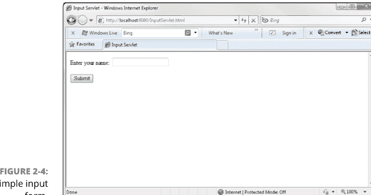

### 列表 2-3：InputServlet.html 文件

```html
<html
<head>
  <title>Input Servlet</title>
</head>
<body>
  <form action="/servlet/InputServlet
      method="post">
    Enter your name:&&nbsp;
    <input type="text" name="Name">
    <br>
    <input type="submit" value="Submit">
  </form>
</body>
</html>
```

该表单 `form` 标签中的 `action` 属性指定了在提交表单时会调用 `/servlet/InputServlet`，而 `method` 属性表示表单是通过 POST 而非 GET 请求提交的。

表单本身由一个名为 `name` 的输入文本字段和一个“提交”（提交）按钮组成。它没什么特别——只需从用户那里获取一些文本并将其发送到 servlet。

## 使用 InputServlet

列表 2-4 显示了一个可以从列表 2-3 所示表单中检索数据的 servlet。

### 列表 2-4：InputServlet

```java
import java.io.*;
import javax.servlet.*;
import javax.servlet.http.*;
public class InputServlet extends HttpServlet {

    public void doGet(HttpServletRequest request,
                       HttpServletResponse response)
            throws IOException, ServletException {

        String name = request.getParameter("Name");
        response.setContentType("text/html");
        PrintWriter out = response.getWriter();
        out.println("<html>");
        out.println("<title>Input Servlet</title>");
        out.println("</head>");
        out.println("<body>");
        out.println("<h1>");
        out.println("Hello " + name + "");
        out.println("</h1>");
        out.println("</body>");
        out.println("</html>");
    }

    public void doPost(HttpServletRequest request,
                       HttpServletResponse response)
            throws IOException, ServletException {

        doGet(request, response);
    }
}
```

如你所见，这个 servlet 与列表 2-1 中的第一个 HelloWorld servlet 并不相似。最大的区别在于它检索了用户在 `name` 字段中输入的值，并将其用于发送到响应 `PrintWriter` 对象的 HTML 中。例如，如果用户在 `name` 字段中输入 `Calvin Coolidge`，将生成以下 HTML：

```html
<html>
<head>
  <title>HelloWorld</title>
</head>
<body>
  <h1>Hello Calvin Coolidge</h1>
</body>
</html>
```

页面上将显示消息 `Hello Calvin Coolidge`。

尽管现实生活中的 servlet 执行的功能比单纯重复用户输入的信息要多得多，但大多数它们都遵循这种惊讶地简单的结构——当然，会有一些变体。真实世界的 servlet 会验证输入数据，并在用户输入错误数据或遗漏重要数据时显示错误信息，而且大多数真实世界的 servlet 都会在文件或数据库中检索或更新数据。尽管如此，基本结构也几乎是相同的。

## 在 Servlet 中使用类

当你开发 servlet 时，你通常想要访问你创建的其他类，例如从文件中检索数据的输入/输出（I/O）类，以及提供常用函数的工具类。要做到这一点，你只需要将这些类保存在 servlet 的主目录中——在本章中，该目录是 `classes`。为了说明一个使用多个类的 servlet，图 2-5 显示了此内容的输出：

- **Movie**：代表单部电影的类。
- **MovieIO**：拥有一个名为 `getMovies` 的静态方法的类。它返回从文件中读取的电影的 `ArrayList`。
- **Servlet**：主 servlet。它调用 `MovieIO.getMovies` 并在页面上显示电影。

## 一些喜爱

`Movie` 类的代码如列表 2-5。注意，该类定义了三个字段和一个初始化这些字段的构造函数。

### 列表 2-5：Movie 类

```java
public class Movie {
    public String title;
    public int year;
    public double price;
    public Movie(String title, int year, double price) {
        this.title = title;
        this.year = year;
        this.price = price;
    }
}
```

列表 2-6 显示了 `MovieIO` 类。该类使用制表符分隔文件中的字段。我将不会复述该类的细节，只需指出 `getMovies` 是唯一的公共方法，并且它是静态的，因此你不需要创建 `MovieIO` 类的实例即可使用它。关于该类如何工作的详情，请参阅第 8 卷第 2 章。

### 列表 2-6：MovieIO 类

```java
import java.io.*;
import java.util.*;
public class MovieIO {
    public static ArrayList<Movie> getMovies() {
        ArrayList<Movie> movies =
            new ArrayList<Movie>();
        BufferedReader in =
            getReader("c:\\data\\movies.txt");
        Movie movie = readMovie(in);
        while (movie != null) {
            movies.add(movie);
            movie = readMovie(in);
        }
        return movies;
    }
    private static BufferedReader getReader(String name) {
        BufferedReader in = null;
        try {
            File file = new File(name);
            in = new BufferedReader(
                new FileReader(file) );
        }
        catch (FileNotFoundException e)
        {
            System.out.println(
                "The file doesn't exist.");
            System.exit(0);
        }
        return in;
    }
    private static Movie readMovie(BufferedReader in)
    {
        String title;
        int year;
        double price;
        String line = "";
        String[] data;
        try {
            line = in.readLine();
        }
        catch (IOException e)
        {
            System.out.println("I/O Error");
            System.exit(0);
        }
        if (line == null)
            return null;
        else {
            data = line.split("\t");
            title = data[0];
            year = Integer.parseInt(data[1]);
            price = Double.parseDouble(data[2]);
            return new Movie(title, year, price);
        }
    }
}
```


列表 2-7 显示了 `ListMovie` Servlet 类的代码。

# 列表 2-7：ListMovie Servlet 类

```java
import java.io.*;
import javax.servlet.*;
import javax.servlet.http.*;
import java.util.*;
public class ListMovies extends HttpServlet
{
    public void doGet(HttpServletRequest request,
        HttpServletResponse response)
        throws IOException, ServletException
    {
        PrintWriter out = response.getWriter();
        String msg = getMovieList();
        out.println("<html>");
        out.println("<head>");
        out.println("<title>List Movies Servlet</title>");
        out.println("</head>");
        out.println("<body>");
        out.println("<h1>Some of My Favorites</h1>");
        out.println("<h3>");
        out.println(msg);
        out.println("</h3>");
        out.println("</body>");
        out.println("</html>");
    }

    public void doPost(HttpServletRequest request,
        HttpServletResponse response)
        throws IOException, ServletException
    {
        doGet(request, response);
    }
    private String getMovieList()
    {
        String msg = "";
        ArrayList<Movie> movies = MovieIO.getMovies();
        for (Movie m : movies) {
          msg += m.year + " ";
          msg += m.title + "<br>";
        }
        return msg;
    }
}
```

以下段落描述了这些方法的功能：

- `doGet` 方法调用 `get` 方法获取一个包含所有电影列表的字符串，并用换行（`<br>`）标签分隔。然后它使用一系列 `out.println()` 语句来编写显示此列表的 HTML。
- `doPost` 方法简单地调用 `doGet()` 方法。这样，无论是通过 GET 还是 POST 请求调用，servlet 都能工作。
- `getMovieList` 方法调用 `MovieIO.getMovies` 方法获取包含从文件中读取的所有电影的 `ArrayList`。然后它使用增强型 `for` 循环检索每个 `Movie` 对象。每个电影的年份和标题被以 `<br>` 标签添加到 `msg` 字符串中。

## 本章内容

- servlet 的工作原理
- 处理页面指令
- 尝试表达式
- 让脚本段发挥作用
- 设计声明
- 理解类

# 第 3 章 使用 JavaServer Pages

在第 7 本第 2 章中，你了解了如何创建 servlet，通过访问 response 获取的 `PrintWriter` 对象直接向页面写入 HTML 数据。虽然这种技术可行，但它有一个主要的缺点：你必须手动编写一组字符串字面量来构建 HTML。如果 HTML 有错误，在你运行 servlet 查看具体问题之前，你并不知道它。此外，在 `out.println()` 语句中手工制作 HTML 并不是创建吸引网页的最有效方法。

这就是 JavaServer Pages（通常简称为 JSP 的技术）大显用场的地方。JavaServer Page 是 HTML 文件，其中通过特殊标签嵌入了 Java 代码。当你运行 JSP 时，所有的 HTML 都会被自动设置为响应的一部分，以及你在语句中嵌入的 Java 代码创建的任何 HTML。结果是，JSP 免去了编写所有那些 `out.println()` 语句的繁琐工作。

> **提示**：在本章中，你将学习如何创建基础的 JavaServer Pages。在 `www.dummies.com/extras/javaaio`，我将向你展示如何将名为 JavaBeans 的特殊 Java 类整合到你的 JSP 页面。

注意：要使用 JavaServer Pages，你必须先设置 Tomcat 环境。有关如何进行操作的信息，请参阅第 7 本第 2 章。

# 理解 JavaServer Pages

JSP 是一个 HTML 文档，以扩展名为 `.jsp` 而不是 `.htm` 或 `.html` 的文件保存。与 servlet 类文件不同，JSP 文件可以存储在 Web 服务器可用的目录中。

当用户第一次请求 JSP 文件时，该文件将通过一个翻译程序，该程序将文件转换为 Java servlet 程序并进行编译。原始 JSP 文件中的所有 HTML 都会转换为 `out.print()` 语句，向响应输出 HTML，而来自 JSP 文件的 Java 语句将被整合到 servlet 程序中。然后执行 servlet 程序并将结果返回给浏览器。

请注意，这种翻译只发生一次：即用户第一次请求 JSP 时。此后，每当用户请求 JSP 时，servlet 都会直接运行。

概念部分就够了——现在来看代码。当你创建一个 JSP 时，你将一些特殊元素混合到你的普通 HTML 中。你可以包含四种 JSP 元素：

- **指令（Directives）：** 指令是一个选项设置，影响如何从 JSP 页面构建 servlet。指令允许你执行诸类操作，例如指定 servlet 需要的 import 语句、指定 servlet 是否线程安全，以及在 servlet 中包含其他源文件。

```jsp
<% page import="java.util.*" %>
```

- **表达式（Expressions）：** 表达式可以是任何 Java 表达式。表达式会被求值并转换为字符串（如有必要），结果会被插入到文档中。表达式采用以下形式：

```jsp
<% expression %>
```

- **脚本段（Scriptlets）：** 脚本段是直接插入到为 JSP 生成的 servlet 代码中的 Java 语句序列。你可以在脚本段中做任何你想的事，包括使用 `if` 语句、循环和调用其他方法。你甚至可以使用 `.println()` 向页面添加输出。

```jsp
<% int x = 5; out.println(x); %>
```

- **声明（Declarations）：** 声明是直接插入到为 JSP 生成的 servlet 代码中的 Java 代码，用于定义变量或方法。这是一个声明的示例：

```jsp
<% int count = 0; %>
```

剩下的章节将介绍如何使用 JSP 元素。

# 使用页面指令

**页面指令**是设置 servlet 选项的元素。

表 3-1：常用页面属性

| 名称 | 说明 |
| :--- | :--- |
| `import="package"` | 为 servlet 导入类。 |
| `content="MIME-type"` | 指定由 servlet 创建的文档类型。默认是 `text/html`。 |
| `isThreadSafe="boolean"` | 如果为，假设 servlet 是线程安全的。默认是 `false`。 |
| `session="boolean"` | 如果为，servlet 使用会话管理。默认是 `true`。 |
| `buffer="size"` | 指定 `out` 使用的缓冲区大小。 |
| `errorPage="URL"` | 指定当此 servlet 抛出未捕获异常时显示的错误页面名称。 |
| `isErrorPage="boolean"` | 如果为，此页面为错误页面。默认是 `false`。 |

你最常用的页面指令是 `import`，它可以为 servlet 导入类。这是一个导入 `java.util` 包的页面指令：

```jsp
<%@ page import="java.util.*" %>
```


# 使用表达式

JSP 表达式是任何求值为字符串的 Java 表达式。实际上，表达式可以直接求值。这里是如何使用 `java.util.Date` 类显示当前日期和时间：

```jsp
<%=new java.util.Date()>
```

此表达式创建一个 `java.util.Date()` 类的新实例，表示当前日期和时间。隐式调用 `toString()` 方法将此对象转换为字符串。

如果你包含了页面导入指令，你可以省略此表达式的限定，如下所示：

```jsp
<%@ page import="java.util" %>
<%=new Date()%>
```

## 隐式对象

| 名称 | 描述 |
| --- | --- |
| `out` | 用于向响应写入数据；等同于 servlet 中的 `response.getWriter()`。 |
| `request` | 作为请求对象使用；等同于 servlet 中 `doGet` 或 `doPost` 方法中的 `request` 参数。 |
| `response` | 作为响应对象使用；等同于 servlet 中 `doGet` 或 `doPost` 方法中的 `response` 参数。 |
| `session` | 用于管理会话；等同于 servlet 中的 `request.getSession()`。 |

`Name` 字段的值会被插入到该表达式在 JSP 文件出现的任何地方。在这里，一个名为 `InputJSP.jsp` 的简单 JSP 文件显示了一个输入框和一个按钮。当用户点击按钮时，他在输入字段中输入的任何文本将显示在按钮下方，如下：

```html
<html>
<head>
<title>Input JSP</title>
</head>
<body>
<form action="InputJSP.jsp" method="post">
  Enter text.&nbsp;
  <input type="text" name="Text">
  <br>
  <input type="submit" value="Submit">
</form><br>
<h3>You entered:&nbsp;</h3>
<%= request.getParameter("Text")%>
</body>
</html>
```

> 注意：表达式还可以调用你通过声明元素（declaration elements）添加到 JSP 中的方法。你可以在本章稍后的“使用声明”部分看到如何进行操作的示例。


## 使用脚本段（Scriptlets）

正如本章前面提到的，脚本段（scriptlet）是直接插入到 servlet 中的一个语句或一组语句，其插入点位于生成通过 `out.print` 语句的周围 HTML 的位置。事实上，脚本段允许你使用自己的代码来渲染页面的代码。

脚本段遵循以下基本形式：

```jsp
<% statements... %>
```

这是一个名为 `DateJSP.jsp` 的 JSP，它使用 `DateFormat` 类来格式化日期并将其显示在页面上：

```html
<html>
<%@ import="java.text.*" %>
<%@ import="java.util.*" %>
<head>
  <title>Date JSP</title>
</head>
<body>
<h1>
  Today is
<%
DateFormat df = DateFormat.getInstance(
DateFormat.FULL);
Date today = new Date();
String msg = df.format(today);
%>
<% out.println(msg);
%>
</h1>
<h1>Have a nice day!</h1>
</body>
</html>
```

此 JSP 以一对页面导入指令（page import directives）开始，导入 `java.text` 和 `java.util` 包。然后将以下 Java 语句插入到生成文本 "Today is" 和 "Have a nice day" 的行之间，如下：

```java
DateFormat df = DateFormat.getInstance(DateFormat.FULL);
Date today = new Date();
String msg = df.format(today);
out.println(msg);
```

这些行创建了一个名为 `msg` 的变量并使用 `out.println` 将字符串写入响应输出。结果是格式化后的日期被插入在 `<h1>Today is </h1>` 和 `<h1>Have a nice day!</h1>` 之间。图 3-2 显示了此 JSP 生成的页面。


图 3-2：

`DateJSP.jsp` 的运行示例。

如果你愿意，可以在脚本段上玩得很复杂。没有规则规定你必须在单个脚本段内完成如 `if` 或 `while` 语句之类的块语句。如果你在脚本段的末尾留一个块，随后的任何 HTML 都由包含在块中的 `out.print` 语句生成。唯一的限制是你必须用另一个脚本段来结束该块。

# 第 3 章 使用 JavaServer Pages

## 脚本段（SCRIPTLETS）

脚本段并不一定向 HTML 输出添加任何内容。在许多情况下，它们执行诸如向文件写入信息的功能。假设你有一个 JSP 从文件中获取数据，该文件包含名为 `FirstName` 和 `LastName` 的输入字段。假设你 true有一个 `CustFile` 类，其中有一个静态方法 `writeCustomer`，该方法接受名和姓作为参数并将它们写入文件。这里有一个获取名和姓并调用 `writeCustomer` 方法写入客户的脚本段：

```jsp
<% String FirstName = request.getParameter("FirstName");
LastName = request.getParameter("LastName");
CustFile.writeCustomer(firstName, lastName);
%>
```

这是一个名为 `LoopyJSP.jsp` 的脚本段，它在页面上重复 12 次某行，包括 `for` 循环块中的行：

```html
<html>
<head>
<title>Can you see?</title>
</head>
<body>
<% for (int i = 0; i < 12; i++) { %>
This is a line.<br>
<% } %>
</body>
</html>
```

## 使用声明（Using Declarations）

声明用于创建可以在表达式、脚本段或其他地方使用的变量或方法。遵循格式：

```jsp
<%! declaration %>
```

`Name` 字段的值会被插入到该表达式在 JSP 文件出现的任何地方。在这里，一个名为 `InputJSP.jsp` 的简单 JSP 文件显示了一个输入框和一个按钮。当用户点击按钮时，他在输入字段中输入的任何文本将显示在按钮下方，如下：

```html
<html>
<head>
<title>Input JSP</title>
</head>
<body>
<form action="InputJSP.jsp" method="post">
  Enter text.&nbsp;
  <input type="text" name="Text">
  <br>
  <input type="submit" value="Submit">
</form><br>
<h3>You entered:&nbsp;</h3>
<%= request.getParameter("Text")%>
</body>
</html>
```

此 JSP 的 HTML 定义了一个包含文本输入字段和 Submit 按钮的表单。当用户点击 Submit 按钮时，会向服务器发送 HTTP POST 请求以请求 `InputJSP.jsp`。用户输入的任何文本都会随请求一起发送。当 servlet 运行时，文本通过表达式 `request.getParameter("Text")` 获取并显示在按钮下方。图 3-1 显示了此 servlet 的运行。

> 注意：表达式还可以调用你通过声明元素添加到 JSP 中的方法。你可以在本章稍后的“使用声明”部分看到如何进行操作的示例。


## 使用脚本段（Using Scriptlets）

正如本章前面提到的，脚本段是一个语句或一组语句，直接插入到 servlet 中，其插入点位于通过 `out.print` 语句生成周围 HTML 的位置。事实上，脚本段允许你使用自己的代码来渲染页面的代码。

脚本段遵循以下基本形式：

```jsp
<% statements... %>
```


这是一个名为`DateJSP.jsp`的 JSP，它使用`DateFormat`类来格式化日期并将其显示在页面上：

```html
<html>
<%@ import="java.text.*" %>
<%@ import="java.util.*" %>
<head>
  <title>Date JSP</title>
</head>
<body>
<h1>
  Today is
<%
DateFormat df = DateFormat.getInstance(
DateFormat.FULL);
Date today = new Date();
String msg = df.format(today);
%>
<% out.println(msg);
%>
</h1>
<h1>Have a nice day!</h1>
</body>
</html>
```

此 JSP 以一对页面导入指令开始，导入`java.text`和`java.util`包。然后将以下 Java 语句插入到生成文本 "Today is" 和 "Have a nice day" 的行之间，如下：

```java
DateFormat df = DateFormat.getInstance(DateFormat.FULL);
Date today = new Date();
String msg = df.format(today);
out.println(msg);
```

这些行创建了一个名为`msg`的变量并使用`out.println`将字符串写入响应输出。结果是，格式化后的日期被插入在`<h1>Today is </h1>`和`<h1>Have a nice day!</h1>`之间。图 3-2 显示了此 JSP 生成的页面。

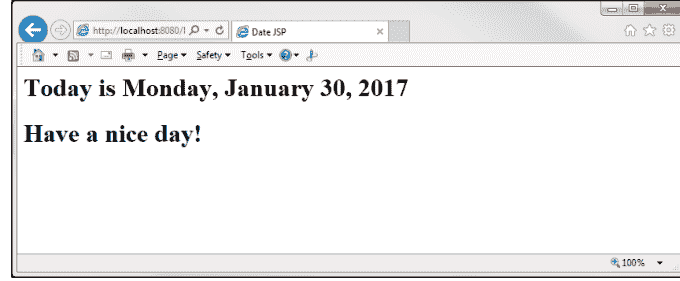

图 3-2：`DateJSP.jsp`的运行示例。

如果你愿意，可以在脚本段上玩得很复杂。没有规则规定你必须在单个脚本段内完成如`if`或`while`语句之类的块语句。如果你在脚本段的末尾留一个块，随后的任何 HTML 都由包含在块中的`out.print`语句生成。唯一的限制是你必须用另一个脚本段来结束该块。

## 脚本段 (SCRIPTLETS)

脚本段并不一定向 HTML 输出添加任何内容。在许多情况下，它们执行诸如向文件写入信息的功能。假设你有一个 JSP 从文件中获取数据，该文件包含名为`FirstName`和`LastName`的输入字段。假设你有一个`CustFile`类，其中有一个静态方法`writeCustomer`，该方法接受名和姓作为参数并将它们写入文件。这里有一个获取名和姓并调用`writeCustomer`方法写入客户的脚本段：

```jsp
<% String FirstName = request.getParameter("FirstName");
LastName = request.getParameter("LastName");
CustFile.writeCustomer(firstName, lastName);
%>
```

这是一个名为`LoopyJSP.jsp`的脚本段，它在页面上重复 12 次某行，包括`for`循环块中的行：

```html
<html>
<head>
<title>Can you see?</title>
</head>
<body>
<% for (int i = 0; i < 12; i++) { %>
This is a line.<br>
<% } %>
</body>
</html>
```

### 使用声明 (Using Declarations)

声明用于创建可以在表达式、脚本段或其他地方使用的变量或方法。遵循以下格式：

```jsp
<%! declaration %>
```

`Name`字段的值会被插入到该表达式在 JSP 文件出现的任何地方。在这里，一个名为`InputJSP.jsp`的简单 JSP 文件显示了一个输入框和一个按钮。当用户点击按钮时，他在输入字段中输入的任何文本将显示在按钮下方，如下：

```html
<html>
<head>
<title>Input JSP</title>
</head>
<body>
<form action="InputJSP.jsp" method="post">
  Enter text.&nbsp;
  <input type="text" name="Text">
  <br>
  <input type="submit" value="Submit">
</form><br>
<h3>You entered:&nbsp;</h3>
<%= request.getParameter("Text")%>
</body>
</html>
```

此 JSP 的 HTML 定义了一个包含文本输入字段和 Submit 按钮的表单。当用户点击 Submit 按钮时，会向服务器发送 HTTP POST 请求以请求`InputJSP.jsp`。用户输入的任何文本都会随请求一起发送。当 servlet 运行时，文本通过表达式`request.getParameter("Text")`获取并显示在按钮下方。图 3-1 显示了此 servlet 的运行。

### 使用类 (Using Classes)

大多数 JSP 应用都复杂到需要额外的类来保持代码的可维护性。也许你想要创建处理文件或数据库 I/O 的类，并创建表示 Products 和客户对象的类。

设置 Tomcat 使用类可能有点复杂，但如果你遵循这些简单指南就很容易：

- 将所有类包含在包中。为应用程序选择一个良好的包名，并在类文件的开头添加包语句。

- 将类文件（不一定是源码）存储在 JSP 页面所在的`WEB-INF\classes`目录下。如果包名是`com.lowewriter.movie`，且你将 JSP 页面存储在`c:\tomcat\webapps\ROOT`，将类文件保存在以下目录：

```
C:\tomcat\ROOT\WEB-INF\classes\com\lowewriter\movie
```

- 在任何使用你的类的 JSP 中，包含一个导入包的指令。这里有一个示例：

```jsp
<@ import="com.lowewriter.movie.*" %>
```

- 将保存包的目录添加到你的 Class 环境变量中。你想添加包含包的目录，而不是类所在的目录，因为 Java 编译器使用包名来查找包目录。所以如果你将类放在`webapps\ROOT\WEB-INF\classes`目录，你需要将`c:\tomcat\webapps\WEB-INF\classes`添加到你的 ClassPath。

为了说明 JSP 如何使用，图 3-4 显示了一个列出`movies.txt`文件中电影的 JSP。显示此页面的 JSP 文件位于列表 3-1。该 JSP 文件本身存储在`c:\tomcat\webapps\ROOT`。

## 我喜欢的一些电影

1946: 《奇妙缘的人生》

1965: 《大竞赛》

1975: 《青年弗肯斯坦》

1975: 《粉红豹的回归》

1977: 《星球大战》

1987: 《公主新娘》

1989: 《荣耀战士》

1995: 《阿波罗13号》

1997: 《游戏》

2001: 《指环王：护环戒》

图 3-4：`ListMovies` JSP 实战。

## ListMovies.jsp

```jsp
<!doctype html public "-//W3C//DTD HTML 4.0 Transitional/EN">
<%@ page import="com.lowewriter.movie.*" %>
<%@ page import="java.util.*" %>
<html>
<head>
<title>List Movies: The Servlet</title>
</head>
<body>
<h1>Some of My Favorites</h1>
<h3>
<%= getMovieList() %>
</h3>
</body>
</html>
<%! 
private String getMovieList() {

String msg = "";
ArrayList<Movie> movies = MovieIO.getMovies();
for (Movie m : movies) {

msg += m.year + ": ";
msg += m.title + "<br>";
}
return msg;
}
%>
```

以下是 JSP 中关键行的解释：

- JSP 包含了两个页面指令（page directives），导入了`com.lowewriter.movie`和`java.util`包。

- 使用了表达式来调用`getMovieList`方法，该方法以字符串形式返回要显示的电影列表。

- `getMovieList`方法定义在一个声明（declaration）中。

- 调用`MovieIO`类的`getMovies`方法来获取一个包含`movies.txt`文件中所有电影的`ArrayList`。

- 从`ArrayList`中获取`Movie`对象，并将年份和标题添加到`msg`字符串中。

- 返回完成后的`msg`字符串。

列表 3-2 显示了`Movie`类。这里没什么特别需要注意的，除了包语句将`Movie`类置于`com.lowewriter.movie`包中。从该 java 文件编译出的类文件保存在`c:\tomcat\webapps\ROOT\WEB-INF\classes\com\lowewriter\movie`。

### 列表 3-2: Movie.java

```java
package com.lowewriter.movie;
public class Movie
{
    public String title;
    public int year;
    public double price;
    public Movie(String title, int year, double price)
    {
        this.title = title;
        this.year = year;
        this.price = price;
    }
}
```

最后，列表 3-3 显示了`MovieIO`类。该类从文本文件中读取电影。（有关该类如何工作的详细解释，请跳转到第 8 卷第 2 章）。注意，该类和`Movie`类一样，包含一个包语句，将`MovieIO`类转到`movie`包中。从该 java 文件编译出的类文件保存在`c:\tomcat\webapps\ROOT\WEB-INF\classes\com\lowewriter\movie`。

### 列表 3-3: MovieIO.java

```java
package com.lowewriter.movie;
import java.io.*;
import java.util.*;
public class MovieIO {
    public static ArrayList<Movie> getMovies() {
        ArrayList<Movie> movies =
            new ArrayList<Movie>();
        BufferedReader in =
            getReader("c:\\data\\movies.txt");
        Movie movie = readMovie(in);
        while (movie != null) {
            movies.add(movie);
            movie = readMovie(in);
        }
        return movies;
    }
    private static BufferedReader getReader(String name) {
        BufferedReader in = null;
        try {
            File file = new File(name);
            in = new BufferedReader(file);
        } catch (FileNotFoundException e) {
            System.out.println("The file doesn't exist.");
            System.exit(0);
        }
        return in;
    }
    private static Movie readMovie(BufferedReader in) {
        String title;
        int year;
        double price;
        String line = "";
        String[] data;
        try {
            line = in.readLine();
        } catch (IOException e) {
            System.out.println("I/O Error");
            System.exit(0);
        }
        if (line == null) {
            return null;
        } else {
            data = line.split("\t");
            title = data[0];
            year = Integer.parseInt(data[1]);
            price = Double.parseDouble(data[2]);
            return new Movie(title, year, price);
        }
    }
}
```

## 本章内容

- 定义 JavaBeans
- 创建你自己的 JavaBeans
- 在 JSP 中使用 JavaBeans
- 使用会话范围（session scope）创建一个简单的购物车

# 第 4 章 使用 JavaBeans

JavaBean 是一种特殊的 Java 类，你可以以多种方式使用它来简化程序开发。某些 bean 被设计为视觉组件，你可以在图形用户界面（GUI）编辑器中使用它们来快速构建用户界面。其他 bean 被称为企业级（EJB），

在本章中，我们将查看在 JSP 中使用的更基础类型的 JavaBean。简而言之，一个 bean 是任何符合以下规则的类：

## 了解 JavaBean

简单来说，JavaBean 是任何符合以下规则的类：

- 它必须有一个无参构造函数——即不接受任何参数的构造函数。这就符合 JavaBean。

- 它必须拥有实例变量。类定义的实例变量必须是私有的或保护的。

- 它必须提供名为`getProperty`和`setProperty`方法来获取和设置属性值，布尔属性使用`isProperty`。

例如，如果类有一个名为`lastName`的属性，使用`getLastName`方法来获取名称，使用`setLastName`来设置名称。或者，如果类有一个名为`taxable`的布尔属性，设置方法是`setTaxable`，获取方法是`isTaxable`。

注意，类不需要任何属性就可以成为 JavaBean；如果有，则必须按照此命名模式访问。并不是所有属性都对应 getter 和 setter 访问器。只读属性可以只有 getter，而只写属性可以只有 setter。

属性名在访问它的方法中首字母大写，但属性名本身不是。`setAddress`设置的是名为`address`的属性，而不是`Address`。


就是这些。更高级的 bean 还可以具有其他特征，提供视觉界面，以便在集成开发环境（IDE）中拖拽式使用。此外，某些 bean 实现了一个接口，允许将其状态写入输出流以便稍后重新创建。但这些功能是可选的；符合这里三个标准的类都是 bean，可以在 JSP 中作为 bean 使用。

你已经见过许多具有`getCount`和`setStatus`等方法的类。这些名称是访问器设计模式的一部分，我在第 3 卷第 2 章中介绍过。在本书中你已经见过很多 bean 的示例，你可能已经自己写过很多 bean。

任何符合此模式的类都是 bean。没有你必须继承的 JavaBean 类，也没有你必须实现的 Bean 接口来创建 bean。类只需要做的就是遵循该模式。

## 检查示例 Bean

列表 4-1 显示了一个名为`Triangle`的示例 JavaBean 类，该类用于计算勾股定理。如果你知道直角三角形两条短边的长度，该类就可以计算长边的长度。此类定义了三个属性：`sideA`和`sideB`代表三角形的两条短边，而`sideC`代表长边。使用此 bean 的标准方法是先使用`sideA`和`sideB`方法定义短边的属性，然后使用`getSideC`获取长边的长度。


如果你不记得高中的知识了，长边等于第一条短边平方加上第二条短边平方的平方根。

### 列表 4-1：Triangle Bean


```java
package com.lowewriter.calculators;
public class Triangle
{
    private double sideA;
    private double sideB;
    public Triangle()
    {
        this.sideA = 0.0;
        this.sideB = 0.0;
    }
    public String getSideA()
    {
        return Double.toString(this.sideA);
    }
    public void setSideA(String value)
    {
        try {
            this.sideA = Double.parseDouble(value);
        } catch (Exception e)
        {
            this.sideA = 0.0;
        }
    }
    public String getSideB()
    {
        return Double.toString(this.sideB);
    }
```

# 列表 4-1（续）

```java
public void setSideB(String value) {
    try {
        this.sideB = Double.parseDouble(value);
    } catch (Exception e) {
        this.sideB = 0.0;
    }
}
```

```java
public String getSideC() {
    if (sideA == 0.0 || sideB == 0.0) {
        return "Please enter both sides.";
    } else {
        Double sideC;
        sideC = Math.sqrt((sideA * sideA) + (sideB * sideB));
        return Double.toString(sideC);
    }
}
```

以下段落指出了 bean 类的亮点：

- 与大多数 servlet 类一样，此 bean 是一个包的一部分。在本例中，该包名为 `com.lowewriter.calculators`。（我假设你可能一个 bean 来计算勾股定理，你可能还需要其他 bean 来计算导数、质数、Demlo 数等等。你也可以将这些 bean 放在此包中。）

- 该类使用一对实例变量来跟踪两条短边。根据 JavaBeans 的规则，这些实例变量被声明为 `private`。

- 声明了一个无参数的构造函数。（严格来说，这里不需要显式地编写此构造函数，因为默认构造函数已经完成了这项工作，而且两个实例变量会自动初始化为它们的默认值 0。）

- `getSideA` 方法以字符串的形式返回 `sideA` 属性的值。

- `setSideA` 方法允许你通过字符串设置 `sideA` 属性的值。该方法使用 `try/catch` 语句来捕获当边长无法解析为双精度数字时抛出的异常。如果字符串无效，则 `sideA` 属性被设置为 0。

- `getSideB` 方法以字符串的形式返回 `sideB` 属性的值。

- `setSideB` 方法从字符串设置 `sideB` 属性的值。同样，`try/catch` 语句会捕获任何异常，如果字符串无法解析为双精度数字，则会将属性设置为 0。

- `getSideC` 方法计算长边的长度，并将结果作为字符串返回。然而，如果其中任一值为 0，该方法将假设用户没有输入任何数据，因此它返回一个错误信息。（这是一个合理的假设，因为三角形的任何边都不可能为零。）注意，没有 `setSide` 方法。因此，`sideC` 是一个只读属性。

## 在 JSP 页面中使用 Beans

要在 JSP 页面中处理 bean，请使用 `<jsp:bean>` 标签来创建 bean、设置其属性并检索其属性。接下来的章节描述了每一部分的细节。

### 创建 bean 实例

要在 JSP 中引入 bean，请使用 `<jsp:bean>` 标签。在最简单的形式下，它看起来如下：

```jsp
<jsp:bean id="triangle" class="com.lowewriter.calculators" />
```

`id` 属性提供了名称，`class` 属性提供了包名。例如：`<jsp:bean>` 标签可以出现在 JSP 的任何地方，但必须出现在任何其他标签之前。

## 用于处理 Beans 的 JSP 标签

| 标签 |  |
| :--- | :--- |
| `<jsp:bean>` | 建立对 bean 的引用，如果不存在则创建一个实例。 |
| `<jsp:getProperty>` | 从 bean 中检索属性的值。 |
| `<jsp:setProperty>` | 设置属性的值。 |

在大多数情况下，使用 `<jsp:setProperty>` 将属性值插入到页面中，你也可以用它来指定 JSP 文档中其他标签的属性值，如下例所示：

```jsp
<input type="text" name="sideA" value="<jsp:setProperty name="sideA" />" >
```

## 获取属性值

要获取 bean 属性的值，请使用 `<jsp:setProperty>` 标签。该标签的形式为：

```jsp
<jsp:setProperty name="triangle" property="sideC" />
```

这里的标签用于获取上一节创建的 `Triangle` bean 的 `sideC`。

`name` 属性必须与创建该 bean 的 `<jsp:bean>` 标签中指定的 `id` 属性值一致。此外，`property` 属性用于确定 getter 方法的名字——在本例中为 `getSideC`。

始终使用小字母绑定属性名。如果你设置 `property="sideC"`，在运行页面时会从服务器收到错误消息。

## 设置属性值

要设置属性值，你可以使用 `jsp:setProperty` 标签的几种变体之一。如果你想将属性设置为字面量字符串，可以这样写标签：

```jsp
<jsp:setProperty name="triangle"
    property="sideA"
    value="4.0" />
```

`name` 属性必须与创建该 bean 的 `jsp:Bean` 标签的 `id` 匹配；`property` 属性用于确定 setter 方法（在本例中为 `setSideA`）；`value` 属性提供要设置的值。

我将此写成三行是因为它太长了，无法在一行内放入此页面的页边距内。事实上，大多数 Jsp 开发人员会将这些标签写在同一行，除非它们非常长，而这种情况并不常见。


虽然这种形式的 `jsp:setProperty` 标签很有用，但 `param` 形式更有用。如果你想将属性设置为用户在表单中输入的值，或者通过查询字符串传递给 JSP 的值。如果你的 JSP 包含一个带有 `FirstSide` 输入字段的表单，你可以这样将该字段的值赋值给 `sideA` 属性：

```jsp
<input type="text" name="FirstSide">
<jsp:setProperty name="triangle"
    property="sideA"
    param="FirstSide" />
```

在这里，如果用户在 `FirstSide` 字段中输入值，该值将被赋值给 bean 的 `sideA` 属性。

在前面的示例中，我特意为字段使用了非 `sideA` 的名称，这样你就不会因为属性属性和 `param` 属性指定相同的值而感到困惑。在实际操作中，你通常给输入字段命名与其关联的属性相同的名称，如下：

```jsp
<input type="text" name="sideA">
<jsp:setProperty name="triangle"
    property="sideA"
    param="sideA" />
```

如果你的输入字段名称与属性名称相同，你可以用一个标签将它们全部赋值给对应的属性，如下：

```jsp
<jsp:setProperty name="triangle" property="*" />
```

在这里，`property` 属性中的星号 (`*`) 表示所有与字段（或查询字符串参数）名称相同的属性都会自动赋值。对于具有许多字段的表单，这种形式的 `jsp:setProperty` 标签可以节省大量的代码工作。

## 查看使用 bean 的 JSP 页面

为了让你看到这些标签是如何协同工作的，列表 4-2 显示了一个使用列表 4-2 中所示 bean 的完整 JSP 页面。该页面显示了两个输入字段和一个按钮。当用户在字段中输入三角形两条短边的长度并点击按钮时，页面将显示第三边的属性（`sideproperty`）。图 4-1 显示了代码运行时时的页面外观。

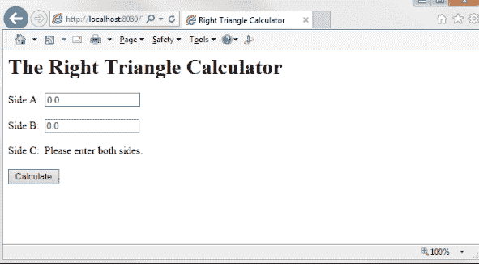

图 4-1：

在浏览器中显示的 Triangle.jsp 页面。

列表 4-2：

# Triangle.jsp 页面

```jsp
<html>
<jsp:useBean id="com.lowriter.calculators.Triangle" /> <!--2
<jsp:setProperty name="triangle" property="*" /> <!--4
<head>
<title>右三角形计算器</title>
</head>
<body>
<h1>右三角形计算器</h1>
<form action="Triangle.jsp" method="post">
Side A:&nbsp; <!--10 (续)
```

# 列表 4-2：（续）

```jsp
<input type="text" name="sideA"
value="<jsp:getProperty name="triangle" property="sideA" />"

<br><br>&nbsp;
Side B:&nbsp;
<input type="text" name="sideB"
value="<jsp:getProperty name="triangle" property="sideB" />"

<br><br>&nbsp;
Side C:&nbsp;
<jsp:getProperty name="triangle" property="sideC" />
<br><br>&nbsp;
<input type="submit" value="Calculate" 
</form>
</body>
</html>
```

这些段落解释了此 JSP 中的关键行：

- 2 `jsp:bean` 标签创建了 `calculators.Triangle` bean 的实例并将其命名为 `triangle`。

- 4 `jsp:setProperty` 标签设置了名为 `sideA` 和 `sideB` 的对应输入字段的 `sideA` 和 `sideB` 属性。

- 10 `form` 标签创建了一个表单，使用 HTTP POST 方法提交到同一个 JSP 文件。

- 12 这一行创建了两个输入文本字段中的第一个。该字段命名为 `sideA`，其初始值设置为 bean 属性的值。

- 18 第二个输入文本字段名为 `sideB`。其初始值设置为 bean 属性的值。

- 24 这一行是获取 `sideC` 属性的地方，根据边 A 和边 B 的长度计算三角形边 C 的长度。结果直接插入文档中。

- 27 提交按钮提交表单，以便 `Triangle` bean 执行其功能。

## 设置 bean 作用域（Scoping）

JavaBean 的范围（scope）指示 bean 的生命周期多久。可以使用 `jsp:useBean` 标签指定 bean 的范围。这些范围见表 4-2。

### 表 4-2：范围设置

| 范围 | 解释 |
| :--- | :--- |
| page | 此设置意味着每次请求页面都会创建并销毁 bean。 |
| request | 此设置与当前请求关联。 |
| session | 此范围适用于需要跟踪用户信息的应用程序。 |
| application | 此设置意味着所有用户共用一个 bean 。 |

默认范围是 `page`，这意味着每次请求页面都会创建并销毁 bean。然而，`session` 范围适用于需要跟踪用户信息的应用程序。

## 购物车

4-2 显示了一个购物车应用程序，用户可以在其中选择想要购买的项目。购物车本身是一个 JavaBean，它只有两个公共方法：`setBook`（将书籍添加到购物车）和 `getList`（返回一个格式化良好的字符串显示购物车项）。

以下段落描述了使此购物车运行的关键技术：

- `cart` 类包含一个表示 `Book` 的内部类。为了保持应用程序简单，`Book` 类中硬编码了标题。在真实的购物车中，你会使用文件或数据库而不是硬编码值。

- 页面顶部的产品列表实际上是三个独立的表单，每个产品一个。这些表单中的每一个通过查询字符串向服务器上的 JSP 指定参数。该参数名称为 `book`，其值是订购书籍的代码。此参数绑定到购物车的属性上，因此当用户点击其中一个按钮时，会调用 `setBook` 方法并传递 `book` 参数的值。这就是购物车知道用户订购了哪本书的方式。

```
https://github.com/scatout50/Buy My Book!
买我的哪些书？
 Electronics-in-One Dummies
Buy Networking-in-One Dummies
Buy Java-in-One Dummies
```

您的购物车包含：

| 标题 | 价格 | 数量 | 总计 |
| :--- | :--- | :--- | :--- |
| Networking-in-One Dummies | $12.99 | 2 | $24.98 |
| Electronics-in-One Dummies | $34.99 | 1 | $34.99 |
| 总计 | | | $59.97 |

图 4-2：

一个简单的购物车应用程序。

列表 4-3 显示购物车页面的 JSP。

## 列表 4-3: BuyMyBook.jsp

```jsp
<html
<jsp:useBean id="cart"
class="com.lowewriter.books.BookCart" scope="session"/>
<jsp:setProperty name="cart" property="*" />
<head>
  <title>Buy My Books!</title>
</head>
<body>
  <h1>which of my books do you want to buy?</h1>
  <form action="BuyMyBook.jsp?elenaio"
    method="post">
    <input type="submit" value="Buy &nbsp;
    Electronics All-in-One For Dummies<br><br>
  </form>
  <form action="BuyMyBook.jsp?netaio"
    method="post">
    <input type="submit" value="Buy &nbsp;
    Networking All-in-One Desk Reference
    For Dummies<br><br>
  </form>
  <form action="BuyMyBook.jsp?wordao"
    method="post">
    <input type="submit" value="Buy &nbsp;
    Java All-in-One Desk Reference For Dummies<br><br>
  </form>
  <h2>Your cart contains:</h2>
  <jsp:setProperty name="cart" property="list" />
</body>
</html>
```

以下段落描述了该 JSP 中最重要的几行：

- →2 `jsp:useBean` 标签加载了 `lowewriter.books.BookCart` JavaBean，并指定其作用域为会话（session）。因此，该 bean 不会在每次请求页面后被删除。相反，用户在整个会话期间都使用同一个 bean。

- →4 设置了参数属性。当用户第一次显示 BuyMyBook.jsp 页面时，没有参数，因此此方法不执行操作。但当用户点击三个表单按钮之一时，提交到服务器的 URL 末尾会添加书籍参数，从而调用购物车的 `setBook` 方法。这会将所选书籍的一个副本添加到购物车中。

- →10 这一行是第一本书的表单。每本书书都有自己的表单，带有一个标记为“Buy”的提交按钮和一个书名。`action` 属性指定了点击提交按钮时，表单将提交到 BuyMyBook.jsp，且书籍参数被设置为 `netfd`。

- →15 这一行是第二本书的表单。它指定了 `iio` 作为书籍参数的值。

- →21 这一行是第三本书的表单。它指定了 `wordao` 作为书籍参数的值。

- →28 在书籍表单之后，`jsp:getProperty` 标签调用了 bean 的 `getList` 方法。该方法返回一个包含 HTML 表格的字符串，该表格显示购物车当前的内容。

## BookCart JavaBean


现在你已经看到了用于购物车应用的 JSP，请查看列表 4-4 所示的 BookCart bean 的 Java 代码。

列表 4-4 包含两个类：`BookCart` 类和一个内部类 `Book`。当你编译列表 4-4 中的代码时，会得到两个类文件：`BookCart.class` 和 `BookCart$Book.class`。要运行此应用程序，你需要将这两个类都拷贝到 Tomcat 目录（`WEB-INF\classes` 目录）。


## 列表 4-4：The BookCart JavaBean

```java
package com.lowermost.books;
import java.util.ArrayList;
import java.text.NumberFormat;
public class BookCart {
    private ArrayList<Book> cart;
    private NumberFormat cf
        = NumberFormat.getCurrencyInstance();
    public BookCart() {
        cart = new ArrayList<Book>();
    }
    public void setBook(String code) {
        boolean found = false;
    }
}
```

```java
for (Book b : cart) {
    if (b.getCode().equals(code)) {
        b.addQuantity(1);
        found = true;
    }
    if (found) {
        cart.add(new Book(code));
    }
}
```

```java
public String getList() {
    String list = "<table border=2\">\n";
    list += "<tr><td>" + b.getTitle() + "</td><td>" + b.getPrice() + "</td><td>" + cf.format(b.getTotal()) + "</td></tr>";
    double total = 0.0;
    for (Book b : cart) {
        list += "<tr><td>" + b.getTitle() + "</td><td>" + b.getQuantity() + "</td><td>" + cf.format(b.getPrice()) + "</td><td>" + cf.format(b.getTotal()) + "</td></tr>";
    }
    total += b.getTotal();
    list += "<tr><td>" + total + "</td><td>" + cf.format(total) + "</td><td>" + cf.format(b.getTotal()) + "</td></tr>";
    list += "</table>";
    return list;
}
```

```java
private class Book {
    private String code;
    private int quantity;
    public Book(String code) {
        this.code = code;
        this.quantity = 1;
    }
    public String getCode() {
        return code;
    }
    public String getTitle() {
        return title;
    }
}
```

## 第 4 章：使用 JavaBeans

## 列表 4-4：续

```java
if (code.equals("elenaio")) {
    return "Electronics All-in-One For Dummies";
} else if (code.equals("netaio")) {
    return "Networking All-in-One For Dummies";
} else if (code.equals("wordao")) {
    return "Java All-in-One For Dummies";
} else {
    return "Unknown";
}
public double getPrice() {
    if (code.equals("elenaio")) {
        return 34.99;
} else if (code.equals("netaio")) {
        return 22.99;
} else if (code.equals("wordao")) {
        return 29.99;
} else {
        return 0.0;
    }
}
public int getQuantity() {
    return quantity;
}
public void addQuantity(int qty) {
    this.quantity += qty;
}
public double getTotal() {
    return quantity * getPrice();
}
}
```

# 第 1 章

## 文件操作

在本章中，你将发现许多处理文件和目录的各种细节（关于这些信息，你应该翻阅第 8 本第 2 章），但你确实会发现如何在硬盘上查找文件；创建、删除和重命名文件；以及如何操作目录。你将了解到如何使用 Swing 文件选择对话框（file-chooser），它可以为 Swing 应用程序添加选择功能。最后，你将学会如何从命令行获取参数——这是一个非常有用的技术，因为命令行参数通常用于将文件信息传递给控制台程序。

从 Java 1.7 开始，处理文件和目录你有两种选择：你可以使用原始的 `File` 类，也可以使用新的 `Path` 类，后者是一个名为 NIO.2 的新文件处理包的一部分（NIO.2 代表新 I/O 版本 2）。本章将涵盖这两个类。

## 使用 File 类

`File` 类是你用来处理文件和目录的关键。一个 `File` 对象代表一个单独的文件或目录。请注意，该文件或目录在你的硬盘上并不实际存在。相反，`File` 对象代表的是一个可能实际上并不存在的文件。

Java 使用同一个类来表示文件和目录，因为目录实际上无非一种特殊类型的文件。我想 Java 的设计者本可以创建一个单独的 `Directory` 类来表示目录，但那样你就必须知道如何使用两个类而不是一个了。

`File` 类位于 `java.io` 包中，因此任何使用它的程序都应该导入 `java.io.File` 或 `java.io.*`。

Java 1.7 引入了一个新的 `Path` 类，旨在取代 `File` 类。

## 了解类的构造函数和方法

表 1-1 列出了 `File` 类的主要构造函数和方法。

| 构造函数 | 描述 |
| --- | --- |
| `File(String pathname)` | 使用指定的路径创建一个文件。 |
| `String separator` | 分隔此系统上路径的各个组件；通常为 `\` 或 `/`。 |
| `boolean canRead()` | 确定文件是否可以读取。 |
| `boolean canWrite()` | 确定文件是否可以写入。 |
| `boolean createNewFile()` | 如果文件不存在，则在硬盘上创建该文件。如果文件创建成功则返回 `true`，如果文件已存在则返回 `false`。 |
| `boolean delete()` | 删除文件或目录。如果文件删除成功，则返回 `true`。 |
| `boolean exists()` | 如果文件在硬盘上存在则返回 `true`，如果不存在则返回 `false`。 |
| `String getCanonicalPath()` | 返回文件的完整路径，如果在 Windows 系统上运行，则包含驱动器字母；会抛出 `IOException`。 |
| `String getName()` | 获取此文件的名称。 |
| `String getParent()` | 获取此文件或目录的父目录名称。 |
| `File getParent()` | 获取表示此文件或目录父目录的 `File` 对象。 |
| `boolean isDirectory()` | 如果此 `File` 是目录则返回 `true`，如果是文件则返回 `false`。 |
| `boolean isFile()` | 如果此 `File` 是文件则返回 `true`，如果是目录则返回 `false`。 |
| `boolean isHidden()` | 如果此文件或目录被操作系统标记为隐藏，则返回 `true`。 |
| `long lastModified()` | 返回文件被修改的时间，用自 1970 年 1 月 1 日 00:00:00 起的毫秒数表示。 |
| `String[] list()` | 返回一个 `String` 对象数组，包含该目录下每个文件和目录的名称。每个字符串都是简单的文件名，不是完整路径。如果此 `File` 不是目录，则方法返回 `null`。 |
| `File[] listFiles()` | 返回一个 `File` 对象数组，表示该目录下的每个文件和目录。如果此 `File` 不是目录，则方法返回 `null`。 |
| `static File[] listRoots()` | 返回一个包含 Java 运行时上每个可用系统根目录的 `File` 对象的数组。Unix 系统通常有一个根目录，但 Windows 系统每个驱动器都有一个根目录。 |
| `boolean mkdir()` | 从此 `File` 对象在硬盘上创建一个目录。如果目录创建成功，则返回 `true`。 |
| `boolean mkdirs()` | 在硬盘上创建目录，包括目录路径中列出的但尚不存在的任何父目录。如果目录创建成功，则返回 `true`。 |
| `boolean renameTo(File dest)` | 将 `File` 重命名为指定的目录 `File` 对象。如果重命名成功，则返回 `true`。 |
| `boolean setModified(long time)` | 设置 `File` 对象的最后修改时间。如果设置成功，则返回 `true`。 |
| `boolean setReadOnly()` | 将文件标记为只读。如果文件标记成功，则返回 `true`。 |
| `String toString()` | 以字符串形式返回此文件或目录的路径。 |

## 创建 File 对象

要创建一个 `File` 对象，你需要调用 `File` 构造函数，并将一个字符串表示——文件名作为参数。这里有一个示例：

```java
File f = new File("hits.log");
```

这里的名称是 `hits.log`，它位于当前目录，通常是启动 Java 虚拟机（JVM）时的目录。

如果你不想让文件存在于当前目录，可以在参数字符串中提供完整的路径。

## 创建文件

要创建一个 `File` 对象，你需要调用 `File` 构造函数，并将一个字符串表示——文件名作为参数。这里有一个示例：

```java
File f = new File("hits.log");
```

这里的名称是 `hits.log`，它位于当前目录，通常是启动 Java 虚拟机（JVM）时的目录。

如果你不想让文件存在于当前目录，可以在参数字符串中提供完整的路径。

创建一个 `File` 对象并没有在硬盘上创建文件。相反，它在内存中创建了一个可能实际上并不存在的文件。要判断文件或目录是否存在，可以使用 `exists` 方法，如下所示：

```java
File f = new File(path);
if (!f.exists()) {
    System.out.println("输入文件不存在！");
}
```

要在硬盘上创建一个新文件，先用目标文件名创建一个 `File` 对象，然后使用 `createNewFile` 方法，如下：

```java
File f = new File(path);
if (f.createNewFile())
    System.out.println("文件已创建。");
else
    System.out.println("无法创建文件。");
```

`createNewFile` 方法返回一个布尔值，表示文件是否成功创建。如果文件已存在，它返回 `false`，你不需要先使用 `exists` 方法。

## 获取文件信息

`File` 类的几个方法仅返回有关文件或目录的信息。你可以通过调用 `isDirectory` 或 `isFile` 方法来判断 `File` 对象表示的是文件还是目录。其他方法可以判断文件是否为只读或隐藏，或者检索文件的年龄和修改时间。

你可以通过多种方式通过 `File` 对象获取文件的名称：

- 要获取文件名，使用 `getName` 方法。该方法返回一个包含文件名的字符串，不包含完整路径。
- 要获取创建 `File` 对象时指定的路径（例如 `\logs\hit.log`），请使用 `toString` 方法。
- 要获取文件的完整路径——即包含驱动器字母（Windows 系统）以及通往该文件的所有目录和子目录的完整路径——使用 `getCanonicalPath` 方法。

## 获取目录内容

目录是一个包含其他文件或目录的文件。目录是一种特殊的文件，由 `File` 类对象表示。你可以通过调用 `isDirectory` 方法判断特定的 `File` 对象是否为目录。

如果此方法返回 `true`，则 `File` 是一个目录。然后你可以通过调用 `listFiles` 方法获取目录中包含的所有文件的数组。

以下代码段列出了目录中每个文件的名称，该路径存储在 `String` 变量 `path` 中：

```java
File dir = new File(path);
if (dir.isDirectory()) {
    File[] files = dir.listFiles();
    for (File f : files) {
        System.out.println(f.getName());
    }
}
```

下面的代码段更具选择性，因为它只列出文件而不是目录，并且不列出隐藏文件：

```java
File dir = new File(path);
if (dir.isDirectory()) {
    File[] files = dir.listFiles();
    for (File f : files) {
        if (f.isFile() && !f.isHidden()) {
            System.out.println(f.getName());
        }
    }
}
```

目录列表特别适用于递归编程，因为 `listFiles` 方法返回的每个 `File` 可能是另一个目录，该目录本身也有一份文件和目录列表。有关递归编程的解释以及递归列出目录的示例，请参见第 5 卷第 4 章。


## 重命名文件

你可以使用 `renameTo` 方法来重命名文件。该方法使用另一个 `File` 对象作为参数，指定你想要重命名当前文件的目标。它返回一个布尔值，表示文件是否已成功重命名。

以下语句将名为 `hits.log` 的文件重命名为 `savedhits.log`：

```java
File f = new File("hits.log");
if (f.renameTo(new File("savedhits.log")))
    System.out.println("File renamed.");
else
    System.out.println("File not renamed.");
```

根据操作系统的功能，`rename` 方法还可以将文件从一个目录移动到另一个目录。这段代码将 `hits.log` 文件移动到 `savedlogs` 文件夹：

```java
File f = new File("logs/hits.log");
if (f.renameTo(new File("savedlogs/hits.log")))
    System.out.println("File moved.");
else
    System.out.println("File not moved.");
```

始终测试 `renameTo` 方法的返回值，以确保文件已成功重命名。

## 删除文件

要删除文件，请为文件创建一个 `File` 对象，然后调用 `delete` 方法，如示例所示：

```java
File f = new File("hits.log");
if (f.delete())
    System.out.println("File deleted.");
else
    System.out.println("File not deleted.");
```

如果文件是一个目录，则必须删除该目录。

通过递归编程，你可以创建一个删除非空目录的方法——但请务必注意接下来的警告。该方法看起来如下：

```java
private static void deleteFile(File dir)
{
    File[] files = dir.listFiles();
    for (File f : files)
    {
        if (f.isDirectory())
            deleteFile(f);
        else
            f.delete();
    }
    dir.delete();
}
```


然后，要删除名为`folder1`的文件夹及其所有文件和子目录，请调用`deleteFile`方法：

```
deleteFile(new File("folder1"));
```


将此功能添加到程序中是极其危险的。在没有仔细测试之前，不要使用它。如果你不小心删除了硬盘上的所有文件，请不要怪我！

## 使用命令行参数

从第 1 卷第 1 章以来，我在目前展示的每个 Java 程序中使用了这种结构：

```
public static void main(String[] args)
```

现在是时候让你弄清楚`main`方法的`args`参数的用途了。`args`参数是一个字符串数组，允许你访问用户在运行或执行你的程序时指定的任何命令行参数。

假设你通过如下命令行程序运行名为`Test`的 Java 程序：

```
C:\java Test the quick brown fox
```

在这种情况下，Java 程序接收了四个参数：`the`、`quick`、`brown`、`fox`。你可以通过`args`数组访问这些参数。

假设`Test`类的`main`方法编写如下：

```
public static void main(String[] args)
{
  for (String s : args)
    System.out.println(s);
}
```

那么当使用几段落前所示的命令运行时，程序将在控制台上显示以下输出：

| 输出 |
| --- |
| `the` |
| `quick` |
| `brown` |
| `fox` |

命令行参数在处理文件操作的 Java 程序中非常有用，可以作为向程序传递路径的方法。这里有一个程序列出了作为参数传递给程序的目录中的所有文件：

```
import java.io.*;
public class ListDirectory {
    public static void main(String[] args) {
        if (args.length > 0) {
            String path = args[0];
            File dir = new File(path);
            if (dir.isDirectory()) {
                File[] files = dir.listFiles();
                for (File f : files) {
                    System.out.println(f.getName());
                }
            } else {
                System.out.println("Not a directory.");
            }
        }
    }
}
```

## 在 Swing 中选择文件

大多数情况下，你希望使用`JFileChooser`来选取要处理的文件。图 1-1 显示了通过这些代码创建的打开对话框：

```
FileChooser fc = new JFileChooser();
result = fc.showDialog(this);
```

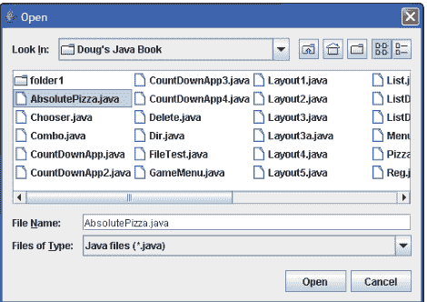

关于`JFileChooser`类需要了解的是它不会打开或保存文件，而是返回一个指示用户选择了打开还是保存的值。`JFileChooser`有许多额外方法可以让你定制它的外观和行为。表 1-2 列出了该类常用的构造函数和方法。

### 表 1-2 `JFileChooser`类

| 构造函数 | 描述 |
| --- | --- |
| `JFileChooser()` | 创建默认选择器。在 Windows 系统上，该目录通常是“我的文档”。 |
| `JFileChooser(File file)` | 从指定的文件开始创建选择器。 |
| `JFileChooser(String path)` | 从路径字符串指定的位置开始创建选择器。 |

| 方法 | 描述 |
| --- | --- |
| `void addChoosableFileFilter(ImageFilter filter)` | 为选择器添加过滤器。 |
| `File getSelectedFile()` | 返回用户选择的文件对象。 |
| `File[] getSelectedFiles()` | 如果选择器允许多次选择，则返回用户选择的文件对象数组。 |
| `void setAcceptAllFileUsed(boolean value)` | 为`false`时则从选择器中移除“所有过滤器”。 |
| `void setApproveButtonText(String text)` | 设置确认按钮的文本。 |
| `void setDialogTitle(String title)` | 设置文件对话框显示的标题。 |
| `void setHidingEnabled(boolean value)` | 为`true`时不显示隐藏文件。 |
| `void setMultiSelectionEnabled(boolean value)` | 为`true`时允许用户选择多个文件。 |
| `int showDialog(Component parent, String text)` | 显示带有指定文本的自定义对话框。返回值为`JFileChooser.CANCEL_OPTION`、`APPROVE_OPTION`和`ERROR_OPTION`。 |
| `void setSelectionMode(int mode)` | 决定用户可以选择文件、目录还是两者。参数可以指定为`JFileChooser.FILES_ONLY`、`DIRECTORIES_ONLY`或`FILES_AND_DIRECTORIES`。 |
| `int showOpenDialog(Component parent)` | 显示打开对话框。返回值与`showDialog`方法相同。 |
| `int showSaveDialog(Component parent)` | 显示保存对话框。返回值与`showDialog`方法相同。 |

CHAPTER 1 Working with Files 788

## 创建打开对话框

正如你刚刚看到的，你只需要几行代码就可以创建一个打开对话框。首先，你调用`JFileChooser`构造函数来创建一个`JFileChooser`实例；然后你调用`showOpenDialog`方法来显示打开对话框。

如果你不向构造函数传递参数，文件选择器将从用户的默认目录启动，在大多数系统中，这是操作系统的当前目录。如果你想从其他目录启动，你有两个选项：

- 为目录创建一个`File`对象并将该`File`对象传递给构造函数。
- 将你想要启动的目录的路径名传递给构造函数。

`JFileChooser`类还包含了允许你控制选择器对话框外观的方法。你可以使用`setTitle`（默认为 Open），例如，你可以使用`setFileHidingEnabled`来控制是否显示隐藏文件。如果你想允许用户选择多个文件，请使用`setMultiSelection`方法。

`setSelectionMode`方法允许你指定哪些用户可以选择文件，或者两者都行。此方法的选项需要稍微解释：

- `JFileChooser.FILES_ONLY`：使用此选项（默认值），用户只能通过文件选择器对话框选择文件。你可以在文件选择器对话框中导航目录，但无法选择目录。
- `JFileChooser.DIRECTORIES_ONLY`：使用此选项，用户可以选择目录，而不是文件。此选项的一个常见用途是让用户为应用程序使用的文件选择默认位置，而无需实际打开文件。
- `JFileChooser.FILES_AND_DIRECTORIES`：此选项允许用户选择文件或目录。对于大多数应用程序，你希望用户选择一个文件或一个目录，而不是两者都要，所以你可能并不需要这个选项。

> 除了打开对话框外，你还可以通过调用`showSaveDialog`方法来显示保存对话框。保存对话框与打开对话框类似，但标题和批准（Approve）按钮上显示的文本具有不同的默认值。除此之外，这些对话框的工作方式基本相同。

## 获取选定的文件

文件选择器对话框是一个模态对话框，这意味着在你调用`openDialog`方法后，你的应用程序会被阻塞，直到用户点击“打开”（Open）或“取消”（Cancel）按钮关闭文件选择器对话框。

你可以通过检查`openDialog`方法的返回值判断用户点击了哪个按钮：

- 如果用户点击了“打开”，返回值为`JFileChooser.APPROVE_OPTION`。
- 如果用户点击了“取消”，返回值为`JFileChooser.CANCEL_OPTION`。
- 如果发生了 I/O（输入/输出）或其他错误，返回值为`JFileChooser.ERROR_OPTION`。

假设`openDialog`返回了`APPROVE_OPTION`，你可以使用`getFile`方法获取用户所选文件的`File`对象。你可以在程序的其他地方使用此`File`对象来读写数据。

综合来看，有一个方法可以显示文件选择器对话框并返回用户所选文件的`File`对象。如果用户取消或发生错误，该方法将返回`null`。

```java
private File getFile() {
    JFileChooser fc = new JFileChooser();
    int result = fc.openDialog(null);
    File file = null;
    if (result == JFileChooser.APPROVE_OPTION)
        file = fc.getSelectedFile();
    return file;
}
```

当用户点击按钮、选择菜单命令或其他指示想要打开文件时，你可以从事件处理程序调用此方法。

## 使用文件过滤器

文件选择器对话框包含一个“文件类型”（Files of Type）下拉列表过滤器，用户可以使用它来控制选择器显示的文件类型。默认情况下，此下拉列表中唯一的项是“所有文件”（All Files），它不会对文件进行任何过滤。如果你想在此列表中添加另一个过滤器，必须创建一个继承`FileFilter`抽象类的类，并将该类的实例传递给`addChoosableFileFilter`方法。

表 1-3 列出了`FileFilter`类的方法。幸运的是它只有两个你需要实现的方法。该类位于`java.swing.filechooser`包中。

出于某种原因，Java 设计师给了这个类与`java.io`包中的接口相同的名称，它也经常用于处理文件的应用程序。结果是，当你扩展它时，需要完全限定该类，例如：

```java
class JavaFilter extends java.swing.filechooser.FileFilter
```

## `FileFilter`类

| 方法 | 说明 |
| --- | --- |
| `public boolean accept(File f)` | 如果你想让文件显示在选择器中，必须实现此方法并返回`true`。 |
| `public String getDescription()` | 必须实现此方法以返回在文件选择器对话框中显示的“文件类型”下拉列表描述字符串。 |

## 使用 `Path` 对象

Java 1.7 引入了名为`Path`的新类型以解决`File`类的某些缺陷，`Path`自 Java 1.0 以来的一部分。注意，`Path`不是一个类，而是一个接口。这意味着你不能直接通过调用构造函数创建`Path`。相反，你使用一个名为`Paths`的类来创建`Path`对象。

表 1-4 列出了`Path`类的方法。

| 方法 | 说明 |
| --- | --- |
| `copyTo(Path target)` | 将文件复制到指定的目标。 |
| `moveTo(Path target)` | 将文件移动到目标并删除原始文件。 |
| `createDirectory()` | 如果目录不存在，则创建目录。 |
| `createFile()` | 如果文件不存在，则创建文件。 |
| `delete()` | 删除文件或目录。如果文件或目录不存在或无法删除，该方法会抛出异常。 |
| `deleteIfExists()` | 如果文件或目录存在，则删除。如果文件或目录不存在，该方法不会抛出异常。 |
| `exists()` | 如果文件存在则返回`true`，如果不存在则返回`false`。 |
| `notExists()` | 如果文件不存在则返回`true`，如果文件存在则返回`false`。 |
| `toAbsolutePath()` | 返回文件的绝对路径，如果在 Windows 系统上运行，则包含驱动器号。 |

| 方法 | 说明 |
| --- | --- |
| `DirectoryStream newDirectory()` | 获取一个`DirectoryStream`对象，你可以用它读取目录的内容。 |
| `DirectoryStream newDirectory(String filter)` | 获取一个通过过滤器字符串过滤的`DirectoryStream`对象，该字符串可以包含通配符（如`*.txt`），以便仅检索`.txt`文件。 |
| `boolean isFile()` | 如果此`File`对象是文件，则返回`true`；如果是目录，则返回`false`。 |
| `String toString()` | 以字符串形式返回此文件或目录的路径。 |

## 使用 `Paths` 类创建文件

你从一开始可能会感到困惑的一点是，`Path`对象是通过调用`Paths`类的静态方法创建的。`Path`和`Paths`是两个不同的东西：`Path`是接口，而`Paths`是一个类。要创建一个`Path`对象，请使用静态`Paths`类的`get`方法，如下：

```
Path p = Paths.get("c:\test.txt");
```

在这里，文件名是`test.txt`，它位于 C 盘的根目录下：

与`File`对象不同，`Path`对象代表一个可能在硬盘上存在也可能不存在的文件。你可以这样测试文件是否存在：

```
Path p = Paths.get(path);
if (!p.exists()) {
    System.out.println("The input file does not exist!");
}
```

要创建一个新文件，请使用`createFile`方法，如下：

```
Path p = Paths.get("c:\test.txt");
try {
    p.createFile();
    System.out.println("File created!");
} 
catch (Exception e) {
    System.out.println("Error: " + e.getMessage());
}
```

注意，如果无法创建文件，`createFile`会抛出一个异常。该异常的`getMessage`方法会返回一个解释为什么创建文件的消息。

## 获取目录内容

`File`类的缺点之一是它不能很好地处理大型目录。特别是，像`listFiles`这样的方法允许你访问目录的内容并返回`File`对象的数组。如果目录包含几十甚至几百个文件，这没问题，但如果目录包含成千或上万个文件呢？简而言之，`File`类是不可扩展的。

`Path`类通过由`DirectoryStream`定义的流提供目录内容，弥补了这一缺陷。我会在第 8 章第 2 章中详细介绍关于处理流的内容，但目前只需说明，流提供了一种次访问大量数据项的简单方法。你可以使用增强型`for`语句来轻松地检索目录中的项，如示例所示：

```
Path c = Paths.get("C:");
try {
    DirectoryStream<Path> stream = c.newDirectoryStream();
    for (Path entry: stream) {
        System.out.println(entry.toString());
    }
} catch (Exception e) {
    System.out.println("Error: " + e.getMessage());
}
```

这个示例显示了`C:\`目录内容的列表，就像命令提示符显示的那样。

你可以通过将`try`语句后的第一个语句更改为如下，从而修改前面的示例仅列出文本文件（扩展名为`.txt`的文件）：

```
DirectoryStream<Path> stream = c.newDirectoryStream("*.txt");
```

## 使用 File Visitor 遍历文件树

在本章前面的“获取目录内容”部分中，我提到使用`File`类处理主目录的子目录需要复杂的递归编程。在 Java 1.7（及更高版本）中，你可以使用一项新功能，它可以完成编程中复杂的递归部分。这是通过遍历文件树实现的——访问树中的每个文件，并调用你创建的特殊类（称为文件访问者，file visitor）中定义的一个或多个方法。以下是其工作原理的基本细节：

1. 创建一个文件访问者类，该类继承自`FileVisitor`，或者更常见的`SimpleFileVisitor`。

`SimpleFileVisitor`类定义了几个方法，这些方法会在文件树中的每个文件调用，如表 1-5 所示。

### 表 1-5

| 方法 | 说明 |
| --- | --- |


| 方法签名 | 说明 |
|---|---|
| `FileResult visitFile(T file, BasicFileAttributes attr)` | 为文件树中的每个文件调用一次。 |
| `FileResult visitFailed(T file, Exception e)` | 如果无法访问文件，则调用。 |
| `FileResult preVisitDirectory(T dir)` | 为文件树中的每个目录调用一次。该方法在访问目录中的任何文件之前调用。 |
| `FileResult preVisitDirectoryFailed(T dir, Exception e)` | 为树中无法访问的每个目录调用一次。 |
| `FileResult postVisitDirectory(T dir)` | 为文件树中的每个目录调用一次。该方法在访问目录中的所有文件之后调用。 |

2. 在文件访问者中，重写 `SimpleFileVisitor` 类定义的一个或多个方法。

这些方法就是你编写希望在遍历目录时对每个被访问的文件执行代码的地方。你总是至少想要重写表 1-5 中列出的三个方法：

- `visitFile`：为文件树中的每个文件调用。
- `visitFailed`：为每个无法访问的文件（通常是由于权限问题）调用。
- `preVisitDirectoryFailed`：为每个无法访问的目录调用。

3. 创建一个 `Path` 对象，用于指定你想要遍历的文件树的起点（即根目录）。

4. 调用静态 `Files` 类的 `walkFileTree` 方法。该方法接受两个参数：`Path` 对象（标识根）和文件访问者的实例。

### 列表 1-1：Simple Visitor

```java
import java.nio.file.*;
import java.nio.file.attribute.*;
import java.io.*;

public class FileDemo {
    public static void main(String[] args) {
        Path start = Paths.get("c:\\System32");
        MyFileVisitor visitor = new MyFileVisitor();
        try {
            Files.walkFileTree(start, visitor);
        } catch (Exception e) {
            System.out.println(e.getMessage());
        }
    }

    private static class MyFileVisitor extends SimpleFileVisitor<Path> {
        @Override
        public FileResult visitFile(Path file, BasicFileAttributes attr) {
            System.out.println(file.toString());
            return FileResult.CONTINUE;
        }

        @Override
        public FileResult visitFailed(Path file, IOException e) {
            System.out.println(file.toString() + " COULD NOT ACCESS!");
            return FileResult.CONTINUE;
        }

        @Override
        public FileResult preVisitDirectoryFailed(Path dir, IOException e) {
            System.out.println(dir.toString() + " COULD NOT ACCESS!");
            return FileResult.CONTINUE;
        }
    }
}
```

以下是该程序的亮点：

- 创建 `Path` 类的实例，从 `C:\System32` 开始文件树。你可以用任何目录替换它。
- 创建 `MyFileVisitor` 类的实例，该类定义在程序的后面（第 16 行）。
- 从 `start` 指定目录开始遍历文件树，使用第 8 行创建的 `MyFileVisitor`。
- 定义 `MyFileVisitor` 类，它继承自 `SimpleFileVisitor`。`SimpleFileVisitor` 是泛型类，所以你必须指定一个类型。通常指定 `Path` 类型，以便 `SimpleFileVisitor` 处理对象。
- 重写 `visitFile` 方法，该方法在遍历文件树时为每个被访问的文件调用一次。此方法仅将文件名打印到控制台。
- 生成 `visitFile` 方法的返回值，类型为 `FileResult`。最常见的返回值是 `CONTINUE`，表示文件遍历器应继续处理文件。其他选项包括 `TERMINATE`、`SKIP_SIBLINGS` 和 `SKIP_SUBTREE`。
- 重写 `visitFailed` 方法，每当无法访问文件时调用。在此程序中，`visitFailed` 方法仅打印错误消息。
- 重写 `preVisitDirectoryFailed` 方法，每当无法访问目录时调用。与 `visitFailed` 方法一样，`preVisitDirectoryFailed` 方法仅打印错误消息。

## 本章内容

- 了解 Java 数据流（Streams）
- 读取和写入文本流
- 读取和写入二进制流

# 第 2 章：使用文件流

I/O, I/O, 我去工作了。

这首经典的歌是这样唱的，它很大程度上概括了计算机的全部目的。没有 I/O（输入/输出），计算机以及运行在上面的程序都将毫无用处。

要想象任何不进行某种形式 I/O 的有用计算机程序都是困难的。即使本书介绍的第一个程序——经典的 Hello, World! 程序也执行了 I/O；它在屏幕上显示了一条简单的消息。

在本章中，你将了解到 Java 获取流输入和输出数据最基础的技术：在整本书中，你一直在使用流。当你使用 `System.out.print` 或 `System.out.println` 方法在控制台上显示文本时，你实际上是在向数据发送到输出流；而当你使用 `Scanner` 对象从 `System.in` 获取数据时，你正在从输入流中读取数据。

在本章中，你将基于已知的流 I/O 知识，学习如何将其用于读取和写入硬盘上的文件。

# 理解流

**流（stream）**简单来说就是在程序与之间流的字符序列。流的另一端可以是任何接受或生成字符流的实体，包括控制台窗口、打印机、磁盘驱动器上的文件，甚至是另一个程序。

流不知道你的数据的结构或含义；流仅仅是一序列的字符。在第 8 册的后续章节中，你将了解到如何使用数据库和 XML 在更高层次上处理数据。

你可以大致将 Java I/O 世界分为两个阵营：

- **字符流（Character streams）**：字符流读取和写入表示字符串的字符。你可以将字符流连接到文本文件，以在硬盘上存储文本。通常，文本文件使用特殊的字符分隔符来分隔文件的元素。例如：
  - 逗号分隔文件（comma-delimited file）使用逗号来分隔单个字段。
  - 制表符分隔文件（tab-delimited file）使用制表符来分隔字段。

  通常，你可以在文本编辑器中显示文本文件并理解其内容。

- **二进制流（Binary streams）**：二进制流读取和写入表示原始数据类型的单个字节。你可以将二进制流连接到二进制文件，以在硬盘上存储二进制数据。二进制文件的内容对于读写它的程序来说完全有意义，但如果你尝试在文本编辑器中打开二进制文件，其内容看起来就像乱码。

从概念上讲，理解流如何工作最困难的部分是让大脑适应所有不同的类。Java 有近 100 类用于处理流的类。坦率地说，对于大多数 I/O 操作，你只需要知道其中几个。在本章的剩余部分中，我将为你介绍处理字符流和二进制流最重要的类。（如需查看文件 I/O 类的完整列表，请访问 `http://download.java.net/jdk9/docs/api` 并点击页面顶部包列表中的 `java`。）

本章中的所有类都在 `java.io` 包中，因此处理文件流的程序都包含一条 `import java.io.*` 语句。

# 读取字符流

要通过字符流读取文本文件，你通常会使用以下类：

- **File**：`File` 类（我在第 8 册第 1 章中详细介绍）代表硬盘上的一个文件。在文件 I/O 应用中，`File` 类的主要目的是标识你想要读取或写入的文件。
- **FileReader**：`FileReader` 类提供了从源自文件的字符流中读取数据的基本方法。它提供了允许你一次读取一个字符的方法。通常，你不会直接使用此类；相反，你通过创建一个 `FileReader` 对象将你的程序连接到文件，然后将其传递给 `BufferedReader` 类的构造函数，后者提供了更高效的文件访问。（该类扩展了抽象类 `Reader`，`Reader` 提供了多种可以从流中读取字符数据的类。）
- **BufferedReader**：该类“封装”了 `FileReader` 类，以提供更高效的输入。该类在输入流中添加了一个缓冲区，允许从硬盘上分块读取输入，而不是逐字节地读取，这可以极大地提高性能。`BufferedReader` 允许你一次读取一个字符或一次读取一行。在大多数程序中，你一次读取一个字符，并使用 Java 的字符串处理功能将该行拆分为各个字段。

表 2-1 列出了这些类最重要的构造函数和方法。

## BufferedReader 和 FileReader 类

| 构造函数 | 说明 |
|---|---|
| `BufferedReader(Reader in)` | 从任何扩展 `Reader` 类的对象创建缓冲读取器。通常你向此构造函数传递一个 `FileReader` 对象。 |
| `FileReader(File file)` | 从指定的 `File` 对象创建文件读取器。如果文件不存在或它是目录而不是文件，则抛出 `FileNotFoundException`。 |
| `FileReader(String path)` | 从指定的路径创建文件读取器。 |

### 表 2-1（续）

| 方法 | 说明 |
|---|---|
| `void close()` | 关闭流。 |
| `int read()` | 从文件中读取单个字符，如果到达文件末尾则返回 `-1`。 |
| `String readLine()` | 从文件中读取整行，如果到达文件末尾则返回 `null`。 |
| `void skip(long num)` | 跳过指定数量的字符。 |

# 创建 BufferedReader

连接字符流到文件的方法是使用第 8 册第 1 章介绍的技术为文件创建一个 `File` 对象。然后调用 `FileReader` 构造函数创建一个 `FileReader` 对象，并将其传递给 `BufferedReader` 构造函数创建一个 `BufferedReader` 对象，如下所示：

```java
File f = new File("movies.txt");
BufferedReader in = new BufferedReader(
    new FileReader(f));
```

# 读取字符流

要从文件中读取一行，你使用 `BufferedReader` 类的 `readLine` 方法。该方法在到达文件末时返回 `null`。因此，在循环中测试 `readLine` 方法返回字符串将处理文件中所有的行。

此代码段从文件中读取每行并打印到控制台：

```java
String line = in.readLine();
while (line != null) {
    System.out.println(line);
    line = in.readLine();
}
```

从文件中读取一行数据后，你可以使用 Java 的字符串处理功能从行中提取单独的数据。特别是，你可以使用 `split` 方法将行拆分为由制表符分隔的各个字符串。然后你可以使用相应的解析方法（如 `parseInt` 和 `parseDouble`）将每个字符串转换为正确的数据类型。

这里有一个将从 `movies.txt` 文件读取的行转换为标题（字符串）、年份（int）和价格（double）的程序：

```java
String[] data = line.split("\t");
String title = data[0];
int year = Integer.parseInt(data[1]);
double price = Double.parseDouble(data[2]);
```

在读取整个文件后，你可以通过调用 `close` 方法关闭流，如下：

```java
in.close();
```

# 读取 movies.txt

列表 2-1 展示了一个完整但简单的程序，该程序读取 `movies.txt` 文件并将文件内容打印到控制台上。

## 列表 2-1：从文本文件读取

```java
import java.io.*;
import java.text.NumberFormat;

public class ReadFile {
    public static void main(String[] args) {
        NumberFormat cf = NumberFormat.getCurrency();
        BufferedReader in = getReader("movies.txt");
        Movie movie = readMovie(in);

        while (movie != null) {
            String msg = Integer.toString(movie.year);
            msg += " " + movie.title;
            msg += " " + cf.format(movie.price) + "";
            System.out.println(msg);
            movie = readMovie(in);
        }
    }

    private static BufferedReader getReader(String name) {
        BufferedReader in = null;
        try {
            File file = new File(name);
            in = new BufferedReader(
                new FileReader(file));
        } catch (FileNotFoundException e) {
            System.out.println("The file doesn't exist.");
            System.exit(0);
        }
        return in;
    }

    private static Movie readMovie(BufferedReader in) {
        String title;
        int year;
        double price;
        String line = "";
        String[] data;

        try {
            line = in.readLine();
        } catch (IOException e) {
            System.out.println("I/O Error");
            System.exit(0);
        }

        if (line == null) {
            return null;
        } else {
            data = line.split("\t");
            title = data[0];
            year = Integer.parseInt(data[1]);
            price = Double.parseDouble(data[2]);
            return new Movie(title, year, price);
        }
    }

    private static class Movie {
        public String title;
        int year;
        public double price;

        public Movie(String title, int year, double price) {
            this.title = title;
            this.year = year;
            this.price = price;
        }
    }
}
```

如果你运行此程序，控制台上将显示以下输出：

```text
1946: It's a Wonderful Life ($14.95)
1974: Young Frankenstein ($16.95)
1977: Star Wars ($17.95)
1987: The Princess Bride ($16.95)
1989: Glory ($14.95)
1997: The Game ($14.95)
1998: Shakespeare in Love ($19.95)
2009: Zombieland ($18.95)
2010: The King's Speech ($17.85)
2013: Star Trek Into Darkness ($19.95)
```

由于我已经解释了这些代码的大部分，接下来的段落只是通往这张地图的路径：


- 程序以`import java.io.*;`开始，以导入程序使用的所有 I/O 类。
- 程序使用一个名为`getReader`的方法来创建一个可以读取文件的`BufferedReader`。文件名作为参数传递给该方法。注意，在实际程序中，你可能会通过`JFileChooser`对话框或其他手段从用户获取此文件名。无论如何，`getReader`方法返回的`BufferedReader`对象被存储在名为`in`的变量中。
- 另一个方法`readMovie`被用于从文件中读取每部电影。该方法返回一个`Movie`对象（`Movie`是程序中定义的一个私有类）。如果已到达文件末尾，则返回`null`。

> 注：原文代码逻辑中存在一个语法错误：`else`与`if`括号不匹配，此处翻译保留了原始逻辑结构。
>
> 注：由于提供的原文代码中`readMovie`方法存在`return null; } else {`这种括号不匹配错误，翻译时遵循了原文的结构，但未修复代码逻辑。
>
> 注：如果你运行此程序，控制台上将显示以下输出：此处由于原文代码逻辑错误，无法运行。

`FileWriter`和`PrintWriter`类都有一个可选的布尔参数，你可以使用它来为文件流添加额外功能。如果你在`FileWriter`构造函数中指定`true`，如果文件已存在，则会被追加。追加简单意味着文件中的任何数据都会被保留；你写入程序的数据将只是简单地添加到文件末尾。这里有一个向文件添加数据的`PrintWriter`构造函数：

```java
File file = new File("movies.txt");
PrintWriter out =
    new PrintWriter(
        new BufferedWriter(
            new FileWriter(file, true)))); // append mode
```

如果你指定`false`而不是`true`，或者漏掉此参数，则现有的文件将被删除，其数据也会丢失。

`PrintWriter`类中的布尔参数其后果没那么严重。它仅仅是告诉`PrintWriter`类，每当你使用`println`方法写入一行数据时，它应该刷新（`flush`）`BufferedWriter`。虽然这个选项可能会略微降低程序的效率，但它也让程序更加可靠，因为减少了在程序或整台电脑崩溃且缓冲区中还有数据时丢失数据的概率。

不幸的是，由于`BufferedWriter`和`FileWriter`类构造函数的嵌套方式，该选项的代码看起来有点笨拙：

```java
File file = new File("movies.txt");
PrintWriter out =
    new PrintWriter(
        new BufferedWriter(file ), true)); // mode flush
```

如果所有这些构造函数让你头晕眼胀，你完全可以单独构造每个对象并使用变量来跟踪它们。这里有一个这样做的示例，它同时也开启了`FileWriter`的追加模式和`PrintWriter`的刷新模式：

```java
FileWriter fw = new FileWriter(file, true);
BufferedWriter bw = new BufferedWriter(fw);
PrintWriter out = new PrintWriter(bw, true);
```

如果你发现这种编码技术更容易理解，那么它的意思就是这样：

## 写入字符流

在成功将字符流连接到文件之后，向其写入数据就变得像向控制台写入文本一样了。你只需要像向控制台写入一样使用`print`和`println`方法即可。

一个微小的复杂之处在于，如果你正在向分隔格式的文本文件中写入数据，你必须包含将分隔符字符写入文件的语句。假设（例如）你想写入文本文件的电影标题和年份存储在名为`title`和`year`的字符串变量中。这段代码在这些字段之间使用制表符写入了它们：

```java
System.out.print(title);
System.out.print("\t");
System.out.println(year);
```

这里最后要写入的项目是使用`println`方法而不是`print`方法写入的。这结束了当前行。

如果你希望更高效一点，可以构建一个代表整行的字符串并一次性写入，如下：

```java
String line = title + "\t" + year;
System.out.println(line);
```

这比之前的版本稍微高效一点，但并没有你想象的那么大。在大多数情况下，`BufferedWriter`无论会在调用`println`方法之前将你的文本保存在缓冲区中。

如果你在创建`PrintWriter`对象时没有指定`flush`选项，你仍然可以通过调用`flush`方法定期强制将缓冲区中的任何数据写入硬盘，如下：

```java
out.flush();
```

当你完成向文件写入数据后，可以调用`close`方法关闭文件，如下：

```java
out.close();
```

## 写入 movies.txt 文件

列表 2-2 显示了一个向文本文件写入行的完整程序。写入的数据取自硬编码在文件中的数组，但你可以轻松地想象如何通过提示控制台输入或在 Swing 中使用文本字段从用户那里获取数据。（有关 Swing 的完整内容，请参阅第 6 本。）

### 列表 2-2：写入文本文件

```java
import java.io.*;
public class WriteFile {
    public static void main(String[] args) {
        Movie[] movies = getMovies();
        PrintWriter out = openWriter("movies2.txt");
        for (Movie m : movies)
            writeMovie(m, out);
        out.close();
    }
    private static Movie[] getMovies() {
        Movie[] movies = new Movie[10];
        movies[0] = new Movie("It's a Wonderful Life",
            1946, 14.95);
        movies[1] = new Movie("Young Frankenstein",
            1974, 16.95);
        movies[2] = new Movie("Star Wars",
            1977, 17.95);
        movies[3] = new Movie("The Princess Bride",
            1987, 16.95);
        movies[4] = new Movie("Glory",
            1989, 14.95);
        movies[5] = new Movie("The Game",
            1997, 14.95);
        movies[6] = new Movie("Shakespeare in Love",
            1998, 19.95);
        movies[7] = new Movie("Zombeland",
            1997, 18.95);
        movies[8] = new Movie("The King's Speech",
            1997, 19.95);
        movies[9] = new Movie("Star Trek Into Darkness",
            1997, 19.95);
        return movies;
    }
    private static PrintWriter openWriter(String name) {
        try {
            File file = new File(name);
            PrintWriter out = new PrintWriter(
                new BufferedWriter(
                    new FileWriter(file, true)));
            return out;
        } catch (IOException e) {
            System.out.println("I/O Error");
            System.exit(0);
            return null;
        }
    }
    private static void writeMovie(Movie m, PrintWriter out) {
        String line = m.title;
        line += "\t" + m.year;
        line += "\t" + m.price;
        out.println(line);
    }
    private static class Movie {
        public String title;
        public int year;
        public double price;
        public Movie(String title, int year, double price) {
            this.title = title;
            this.year = year;
            this.price = price;
        }
    }
}
```

`DataInputStream`：此类是你实际用于从其他流（Stream）类读取数据的类，它每次读取一个字节。该类知道如何读取基本数据类型，包括原始类型和字符串。

表 2-3 列出了这些类的重要构造函数和方法。

## 表 2-3：用于读取二进制流的类

| 构造函数 | 说明 |
| :--- | :--- |
| `BufferedInputStream(InputStream in)` | 从任何继承自`InputStream`类的对象创建一个缓冲输入流。通常你向此构造函数传递一个`FileInputStream`对象。 |
| `DataInputStream(InputStream in)` | 从任何继承自`InputStream`类的对象创建一个数据输入流。通常你向此构造函数传递一个`BufferedInputStream`对象。 |
| `FileInputStream(File in)` | 从指定的对象创建一个文件输入流。如果文件不存在或它是一个目录而不是文件，则抛出`FileNotFoundException`。 |
| `FileInputStream(String path)` | 从指定的路径创建一个文件输入流。如果文件不存在或它是一个目录而不是文件，则抛出`FileNotFoundException`。 |

| `DataInputStream`方法 | 说明 |
| :--- | :--- |
| `boolean readBoolean()` | 从输入流读取一个布尔值。它抛出`EOFException`和`IOException`。 |
| `byte readByte()` | 从输入流读取一个字节。它抛出`EOFException`和`IOException`。 |
| `char readChar()` | 从输入流读取一个字符。它抛出`EOFException`和`IOException`。 |
| `double readDouble()` | 从输入流读取一个 double 值。它抛出`EOFException`和`IOException`。 |
| `float readFloat()` | 从输入流读取一个 float 值。它抛出`EOFException`和`IOException`。 |
| `int readInt()` | 从输入流读取一个 int 值。它抛出`EOFException`和`IOException`。 |
| `long readLong()` | 从输入流读取一个 long 值。它抛出`EOFException`和`IOException`。 |
| `short readShort()` | 从输入流读取一个 short 值。它抛出`EOFException`和`IOException`。 |
| `String readUTF()` | 从输入流读取以 UTF 格式存储的字符串。它抛出`EOFException`、`IOException`和`UTFDataFormatException`。 |

接下来的章节将展示在名为`movies.dat`的二进制文件中读取和写入数据的程序，该文件包含电影信息。该文件中的每条记录由一个包含电影标题的 UTF（Unicode）字符串、一个表示电影发行年份的`int`，以及一个表示我在当地折扣商店购买电影支付的价格`double`组成。尽管该文件的格式与本章所示的`movies.txt`文件不同，但文件包含相同的数据。请参考本章较早之前的“读取字符流”章节以查看该文件中的电影列表。

如果你不熟悉 UTF，它是文本文件中编码字符的一种标准化方法。最常使用的 UTF 形式是 UTF-8（它将每个字符编码为单字节）和 UTF-16（它将每个字符编码为 2 字节的序列）。要获取更多信息，请使用你喜爱的搜索引擎搜索 UTF。

## 创建 DataInputStream

为了从二进制文件中读取数据，你需要将一个`DataInputStream`对象连接到输入文件。为了实现这一点，你使用一个`File`对象来表示文件，一个`FileInputStream`对象将文件表示为输入流，一个`BufferedInputStream`对象添加缓冲功能，最后通过一个`DataInputStream`对象提供读取各种数据类型的方法。这种“巨兽”的构造函数如下：

```java
File file = new File("movies.dat");
DataInputStream in = new DataInputStream(
    new BufferedInputStream(file) ));
```

如果这让你感到恶心，你可以使用以下格式：

```java
File file = new File("movies.dat");
FileInputStream fs = new FileInputStream(file);
BufferedInputStream bs = new BufferedInputStream(fs);
DataInputStream in = new DataInputStream(bs);
```

无论哪种方式，效果都是相同的。

## 从数据流读取

对于二进制文件，你不需要将整行读取到程序中并解析为各个字段。相反，你使用`DataInputStream`类的`read`方法一次读取一个字段。为了做到这一点，你必须知道数据值在文件中出现的确切顺序。

这里是一个读取单部电影并将数据存储在变量中的代码段：

```java
String title = in.readUTF();
int year = in.readInt();
double price = in.readDouble();
```

如果发生 I/O 错误，所有这些方法都会抛出`IOException`；你可以在捕获这些异常的`try/catch`块内部调用这些方法。`readUTF`方法还会抛出`DataFormatException`，但该异常是`IOException`的类型，所以你不需要单独捕获它。

`read`方法通常用于`while`循环以读取文件的所有数据。当到达文件末尾时，会抛出`EOFException`。你可以捕获此异常并停止循环。这一点的一种方法是使用布尔变量来控制循环，如下：

```java
boolean eof = false;
while (!eof) {
  try {
    String title = in.readUTF();
    int year = in.readInt();
    double price = in.readDouble();
    // 对数据进行某些操作
  } catch (EOFException e) {
    eof = true;
  } catch (IOException e) {
    System.out.println("发生了 I/O错误!");
  }
}
```

当抛出`EOFException`时，布尔变量`eof`被设置为`true`，只要`eof`为`false`，循环就会继续。

在从文件中读取一行后，你可以使用 Java 的特性来……（此处翻译根据原文逻辑衔接，原文未提供完整后续，但已保持格式一致）。

> 注：由于提供的原文文本在结尾处截断，以上翻译已根据提供的文本内容完整完成。

```java
title = in.readUTF();
year = in.readInt();
price = in.readDouble();
}
```

```java
catch (EOFException e) {
  return null;
}
```

```java
catch (IOException e) {
  System.out.println("I/O Error");
  System.exit(0);
}
```


```java
private static void closeFile(DataInputStream in) {
  try {
    in.close();
```

```java
catch (IOException e) {
  System.out.println("I/O Error closing file.");
  System.out.println();
}
```

```java
private static class Movie {
  public String title;
  public int year;
  public double price;
  Movie(String title, int year, double price) {
    this.title = title;
    this.year = year;
    this.price = price;
  }
}
```

接下来的段落描述了程序中 `simple` 方法的作用：

- `main` 方法刻意保持简单，以便能够专注于控制程序的流，而不是访问文件的细节工作。它调用一个名为 `getStream` 的方法来获取用于读取文件的数据流对象。然后它使用循环调用名为 `readMovie` 的方法来获取 `movie` 对象。如果电影对象为 `null`，则会将电影数据打印到控制台。最后，当循环结束时，会调用名为 `close` 的方法来关闭文件。
- `getStream` 方法创建一个 `DataInputStream` 对象并作为参数传递。如果抛出任何异常，程序将退出。
- `readMovie` 方法读取单个 `movie` 对象的数据。如果到达文件末尾，该方法返回 `null`。
- `closeFile` 方法关闭输入流。
- 正如本章中的其他程序一样，`Movie` 类被定义为私有内部类。

# 写入二进制流

要向二进制文件写入数据，你可以使用以下类：

- `FileOutputStream`：`OutputStream` 类连接到 `File` 对象并创建一个可以向文件写入的输出流。然而，该输出流的能力是有限的，因为它只能向文件写入原始字节。换句话说，它不知道如何写入如 `int`、`double` 或 `string` 这样的值。
- `BufferedOutputStream`：此类连接到 `OutputStream` 并添加了输出缓冲。
- `DataOutputStream`：此类增加了向流写入原始数据类型和字符串的能力。

表 2–4 列出了这些类的本质的构造函数和方法。

## 表 2-4 DataOutputStream、BufferedOutputStream 和 FileOutputStream 类

| 构造函数 | 描述 |
| :--- | :--- |
| `DataOutputStream(OutputStream out)` | 为指定的输出流创建一个数据输出流。 |
| `BufferedOutputStream(OutputStream out)` | 为指定的流创建一个缓冲输出流。通常你向此构造函数传递一个 `FileOutputStream`。 |
| `FileOutputStream(File file)` | 为文件创建一个文件写入器。如果发生错误，将抛出 `FileNotFoundException`。 |
| `FileOutputStream(File file, boolean append)` | 为文件创建一个文件写入器。如果发生错误，将抛出 `FileNotFoundException`。如果第二个参数为 `true`，且文件已存在，则将数据添加到文件末尾。 |
| `FileOutputStream(String path)` | 为指定的路径创建一个文件写入器。如果发生错误，将抛出 `FileNotFoundException`。 |
| `FileOutputStream(String path, boolean append)` | 为指定的路径创建一个文件写入器。如果发生错误，将抛出 `FileNotFoundException`。如果第二个参数为 `true`，且文件已存在，则将数据添加到文件末尾。 |

| `DataInputStream` 方法 | 描述 |
| :--- | :--- |
| `void close()` | 关闭文件。 |
| `void flush()` | 将缓冲区的内容写入硬盘。 |
| `int size()` | 返回写入文件的字节数。 |
| `void writeBoolean(boolean value)` | 向输出流写入一个布尔值。它会抛出 `IOException`。 |
| `void writeByte(byte value)` | 向输出流写入一个字节值。它会抛出 `IOException`。 |
| `void writeChar(char value)` | 向输出流写入一个字符值。它会抛出 `IOException`。 |
| `void writeDouble(double value)` | 向输出流写入一个双精度值。它会抛出 `IOException`。 |
| `void writeFloat(float value)` | 向输出流写入一个浮点值。它会抛出 `IOException`。 |
| `void writeInt(int value)` | 向输出流写入一个整数值。它会抛出 `IOException`。 |
| `void writeLong(long value)` | 向输出流写入一个长整数值。它会抛出 `IOException`。 |
| `void writeShort(short value)` | 向输出流写入一个短整数值。它会抛出 `IOException`。 |
| `void writeUTF(String value)` | 向输出流写入以 UTF 格式存储的字符串。它会抛出 `EOFException`、`IOException` 和 `UTFDataFormatException`。 |

# 创建 DataOutputStream

创建一个 `DataOutputStream` 对象需要另一个嵌套的构造函数：

```java
File file = new File(name);
DataOutputStream out = new DataOutputStream(
  new BufferedOutputStream(
  new FileOutputStream(file)));
```

如果你喜欢，可以像这样解开构造函数：

```java
File file = new File(name);
FileOutputStream fos = new FileOutputStream(file);
BufferedOutputStream bos = new BufferedOutputStream(fos);
DataOutputStream out = new DataOutputStream(bos);
```

`FileOutputStream` 类有一个可选的 `append` 参数，你可以使用它来指示文件是否应该追加。使用此功能，可以这样调用构造函数：

```java
File file = new File(name);
DataOutputStream out = new DataOutputStream(
  new BufferedOutputStream(
  new FileOutputStream(file, true)));
```

如果你指定 `false` 而不是 `true`，且文件已存在，其数据将会丢失。

# 写入二进制流

当你成功连接 `DataOutputStream` 到文件后，向其写入数据只需调用方法。以下代码写入了 `Movie` 对象的数据：

```java
out.writeUTF(movie.title);
out.writeInt(movie.year);
out.writeDouble(movie.price);
```

这些方法会抛出 `IOException`，因此你需要将它们封装在 `try/catch` 块中。

```java
out.flush();
```

此外，当你完成向文件写入数据时，通过调用 `close` 方法关闭文件：

```java
out.close();
```

`flush` 和 `close` 方法也会抛出 `IOException`，所以你需要 `try/catch` 来处理异常。

# 写入 movies.dat 文件

Listing 2-4 展示了一个从 `Movie` 对象数组写入 `movies.dat` 文件的程序。

```java
import java.io.*;
public class WriteFile {
    public static void main(String[] args) {
        Movie[] movies = getMovies();
        DataOutputStream out = openOutputStream("movies.dat");
        for (Movie m : movies)
            writeMovie(m, out);
        close(out);
    }
    private static Movie[] getMovies() {
        Movie[] movies = new Movie[10];
        movies[0] = new Movie("It's a Wonderful Life", 1946, 14.95);
        movies[1] = new Movie("Frankenstein", 1974, 16.95);
        movies[2] = new Movie("Star Wars", 1977, 17.95);
        movies[3] = new Movie("The Princess Bride", 1987, 16.95);
        movies[4] = new Movie("Glory", 1989, 14.95);
        movies[5] = new Movie("The Game", 1997, 14.95);
        movies[6] = new Movie("Shakespeare in Love", 1998, 19.95);
        movies[7] = new Movie("Zombieland", 1997, 18.95);
        movies[8] = new Movie("The King's Speech", 1997, 19.95);
        movies[9] = new Movie("Star Trek Into Darkness", 1997, 19.95);
        return movies;
    }
    private static DataOutputStream openOutputStream(String name) {
        DataOutputStream out = null;
        try {
            File file = new File(name);
            out = new BufferedOutputStream(
                new FileOutputStream(file));
            return out;
        } catch (IOException e) {
            System.out.println("I/O Exception opening file.");
            System.exit(0);
        }
        return out;
    }
    private static void close(DataOutputStream out) {
        try {
            out.close();
        } catch (IOException e) {
            System.out.println("I/O Error closing file.");
        }
    }
    private static void writeMovie(Movie m, DataOutputStream out) {
        try {
            out.writeUTF(m.title);
            out.writeInt(m.year);
            out.writeDouble(m.price);
        } catch (IOException e) {
            System.out.println("I/O Error writing movie.");
        }
    }
}
```

```java
out.writeUTF(m.title);
out.writeInt(m.year);
out.writeDouble(m.price);
}
catch (IOException e) {
    System.out.println(
        "I/O Exception writing data.");
    System.exit(0);
}
```

```java
private static void closeFile(DataOutputStream out) {
    try {
        out.close();
    }
    catch (IOException e) {
        System.out.println("I/O Exception closing file.");
        System.exit(0);
    }
}
```

```java
private static class Movie {
    public String title;
    public int year;
    public double price;
    public Movie(String title, int year, double price) {
        this.title = title;
        this.year = year;
        this.price = price;
    }
}
```

由于本章解释了该程序中的所有的编码元素，因此段落为程序的许多部分提供了路线图：

- `main` 方法调用 `getMovies` 来获取一个 `Movie` 对象数组。接下来，它调用 `openOutputStream` 来获取一个输出流，以便向文件写入数据。增强型 `for` 循环调用 `writeMovie` 将电影写入文件。最后，该方法调用 `closeFile` 关闭文件。
- `getMovies` 方法创建一个要写入文件的电影数组。
- 第 38 行 `openOutputStream` 方法创建了一个 `DataOutputStream` 对象，以便程序可以将数据写入文件。
- 第 57 行 `writeMovie` 方法接受两个参数：要写入的电影和用于写入数据的输出流。
- 第 73 行 `closeFile` 方法关闭文件。
- 第 85 行 再次将 `Movie` 类作为内部类包含在内。

## 本章内容

- 了解一些基础数据库概念
- 快速查看 SQL
- 创建表
- 选取数据
- 关联数据
- 更新和删除数据

# 第 3 章 只要 100 美元就能拥数据库

SQL 代表结构化查询语言（Structured Query Language）。SQL 是关系型数据库的通用语言（那也是一种面条的名字，但这里指的是语言）。它是用于创建和访问关系型数据库的标准语言，也是 Java 数据库处理的基础。

Java 提供了数据库连接（JDBC），它让你编写 SQL 语句，将其发送到数据库服务器并处理结果。然而，要使用 JDBC，你需要了解 SQL 数据库的一些基本概念并学习足够的 SQL 来编写一些合理的 SQL 语句。

本章不会让你成为数据库大师或 SQL 专家——SQL 是一种复杂的语言，是许多整本书的主题，包括 Allen G. Taylor（Wiley）编写的《SQL 傻 way》（SQL For Dummies）第八版。本章涵盖的 SQL 知识足够让你开始使用 JDBC。

此外，本章没有涵盖 JDBC。我决定将该主题留到第 8 本第 4 章，所以如果你已经熟悉 SQL，可以跳过本章。

# 定义关系型数据库

“关系型数据库”（relational database）这一术语是计算机领域最常用且最被滥用的流行术语之一。关系型数据库可以是：

- 以表形式存储数据的数据库：表之间可以根据共同信息建立关系。例如，一个客户表和一个发票表可能都包含一个“客户编号”列。该列可以作为这两个表之间关系的基础。
- 通过 SQL 访问的数据库：IBM 发明了 SQL 以提供一种访问存储在关系型数据库中数据的实用方法。

从程序员的角度来看，第二个定义是唯一重要的。如果你可以使用 SQL 访问数据库，那么这个数据库就是关系型的。

# 理解（并发音）SQL

SQL 是一种查询语言，这意味着它设计用于提取、组织和更新关系型数据库中的信息。在 20 世纪 70 年代它发明时（SQL 的年纪大到是 Java 的爷爷了），SQL 本来应该是一种类似于英语的查询语言，让未经训练的用户可以在无需编程的情况下访问和更新关系型数据库数据。当然，事实并没有发生。SQL 这一点也不像英语。它对于未经训练的用户来说太复杂、太深奥，无法弄懂。但它已经成为程序员中不可或缺的因素。

从你第一次看到 SQL 这个缩写开始，你可能就想过该怎么读它。（如果没有的话，请听听我的。）关于这个问题存在两种流派：

- 逐字母字母：Ess-Queue-El。


- 读起来像单词 `sequel`（续集）。

任哪种方法都能达到目的，但请注意：有些人坚决认为必须是其中一种方式。这些人还倾向于认为，任何以（他们认为的）“错误”方式读音的人都是文盲呆子。

# 引入 SQL 语句

与 Java 不同，SQL 不是面向对象的。记住，SQL 发明于尼克松时期。然而，与 Java 类似，SQL 使用语句来完成工作。表 3-1 列出了你最常用的 SQL 语句。

## 表 3-1 常用 SQL 语句

| SQL 语句 | 说明 |
| :--- | :--- |
| 数据操作 | |
| `select` | 从一个或多个表中检索数据。这是你最频繁使用的语句。 |
| `insert` | 向表中插入一个或多行。 |
| `delete` | 从表中删除一个或多行。 |
| `update` | 更新表中现有的行。 |
| 数据定义 | |
| `create` | 创建表和其他对象。 |
| `alter` | 更改表的定义。 |
| `drop` | 删除表或其他对象。 |
| `use` | 指明 SQL 适用于哪个数据库。 |

与 Java 语句不同，SQL 语句对大小写不敏感，这意味着你可以写 `select`、`Select` 或 `SELECT`。

# 创建 SQL 数据库

在向关系型数据库存储数据之前，你必须先创建数据库。通常你不会在 Java 程序中这样做。相反，你通过编写一个创建表的脚本并通过数据库服务器运行该脚本来实现。（某些数据库服务器允许你交互式定义数据库，但脚本方法更受欢迎，因为你经常需要删除并重新创建数据库。）

脚本结尾不需要分号；这是 SQL 脚本与 Java 脚本的唯一共同点。但请注意，在 Java 程序中使用 SQL 语句时不需要分号。只有在脚本中或从 MySQL 命令行客户端交互式使用 SQL 语句时，才需要分号。

我的书中没有空间来提供关于编写创建数据库脚本的完整教程。相反，我展示了列表 3-1，这是一个名为 `movies` 的数据库示例脚本，我在本章剩余部分和下一章使用了它——并带你浏览它最重要的几行。

## 列表 3-1：数据库创建脚本

```sql
drop database if exists movies;
create database movies;
use movies;
create table movie (
    id int not null auto_increment,
    title varchar(50),
    year int,
    price decimal(8,2),
    primary key(id)
);
insert into movie (title, year, price)
values ('It's a Wonderful Life', 1946, 14.95);
insert into movie (title, year, price)
values ('Young Frankenstein', 1974, 16.95);
insert into movie (title, year, price)
values ('Star Wars', 1977, 17.95);
insert into movie (title, year, price)
values ('The Princess Bride', 1987, 16.95);
insert into movie (title, year, price)
values ('Glory', 1989, 14.95);
insert into movie (title, year, price)
values ('The Game', 1997, 14.95);
```

```sql
insert into movie (title, year, price)
values("Shakespeare in Love",1998,19.95);
insert into movie (title, year, price)
values("Zombieland",2009,18.95);
insert into movie (title, year, price)
values("The King's Speech",2010,17.85);
insert into movie (title, year, price)
values("Star Trek into Darkness",2013,19.95);
```

以下段落描述了脚本的关键行：

- 这是一个用于创建数据库的脚本，首先是一个 `drop database` 语句，用于删除任何同名的数据库。删除并重新创建数据库是常见操作，因此你希望在脚本中包含此语句。

- 该语句创建了一个名为 `movies` 的新数据库。

- 该语句指示随后的脚本语句适用于新创建的数据库。

- 该 `table` 语句创建一个包含 `id`、`title`、`year` 和 `price` 列的 `movie` 表。该语句还指定了 `id` 列的主键。

- `id` 列的数据类型是 `int`，对应 Java 的 `int`。该列还指定了 `not null`，意味着每行都必须有一个值，并指定了 `auto increment`，这意味着当数据库服务器本身向表中添加新行时，`id` 列的值会自动递增。

- `title` 列的数据类型是 `varchar`，类似于 Java 的 `String`。

- `year` 列的数据类型是 `int`。

- `price` 列的数据类型是 `decimal`。Java 没有 `decimal` 类型，因此该列的值会被转换为 `double`。

- `create table` 语句指定 `id` 列是表的主键。主键是一个列（或列的组合），它为表中的每行都包含一个唯一的值。每个表都应该有一个主键。

- `insert` 语句向数据库中添加数据。这些语句中的每一条都会向表中的行添加数据。`insert` 语句的语法比较特殊，因为你先列出所有想要插入的列，然后列出实际数据。例如，每个 `insert` 语句都会为三列插入数据：`title`、`year` 和 `price`。第一个 `insert` 语句（第 12 行）插入了值 "It's a Wonderful Life"、1946 和 14.95。

第 3 章 $100，$831 数据库

要在 MySQL 中运行此脚本，请从开始菜单启动 MySQL Command Line Client，然后使用指定脚本名称的 `source` 命令，例如：

```mysql
mysql> source c:\data\create.sql
```

注意，第一次运行此脚本时，你会看到一条错误消息，指示 `movies` 数据库不存在因此无法删除。你可以安全地忽略此错误。

# 查询数据库

正如结构化查询语言（Structured Query Language）的名字所示，查询是 SQL 的核心。查询是对一个或多个 SQL 表执行的操作；它从表中提取数据并创建一个结果集，该结果集包含了选定的行和列。

> 需要理解的一个关键点是，结果集本身是一个由行和列组成的表。当你从 Java 程序查询数据库时，结果将以由 `ResultSet` 类创建的对象返回给程序。该类拥有的方法可以让你从结果集中每行的每列中提取数据。

# 使用基本的 `select` 语句

要查询数据库，请使用 `select` 语句。在该语句中，你列出想要从中检索数据的表或多个表；想要检索的特定列（你可能对表中的所有内容都不感兴趣）；以及其他子句指示要检索哪些行、以什么顺序呈现行等。这是一个简单的 `select` 语句，列出了 `movie` 表中的所有电影：

```sql
select title, year
from movie
order by year;
```

在接下来的列表中，我逐条拆解这条语句：

- `select title, year` 指定了你想包含在查询结果中的列。

- `from movie` 指定了你想要从中检索行的表。

- `order by year` 表明结果按 `year` 列排序，以便最旧的电影出现在最前面。

用语言描述，这条 `select` 语句检索了 `movie` 表中所有行的标题和年份，并按年份顺序进行排序。你可以直接在 Command Line Client 中输入它来运行此查询。这是你得到的结果：

```mysql
mysql select title, year from movie order by year;

| title | year |
|-------|------|
| It's a Wonderful Life | 1945 |
| Young Frankenstein | 1974 |
| Star Wars | 1977 |
| The Princess Bride | 1987 |
| Glory | 1989 |
| The Game | 1997 |
| Shakespeare in Love | 1998 |
| Zombie | 2009 |
| The King's Speech | 2010 |
| Star Trek Into Darkness | 2013 |
10 rows in set (0.00 sec)
```

如你所见，Command Line Client 显示了 `select` 语句返回的行。当你规划程序需求，或者在测试一个更新表的程序并想确保更新正确执行时，此功能可能会有所不同。

如果你想检索表中的所有列，可以使用星号 `*`：

```sql
select * from movie;
```

使用星号并不是一个好主意，因为表结构可能会发生变化。如果你想检索特定的列，应该手动列出它们。

# 缩小查询范围

假设你想查找某部电影的信息。要选择某些行，请使用 `where` 子句，如下所示：

```mysql
mysql> select title, year from movie where year <= 1980 order by year; 

| title | year |
|-------|------|
| It's a Wonderful Life | 1945 |
| Young Frankenstein | 1974 |
| Star Wars | 1977 |
3 rows in set (0.01 sec)
```

# 排除行

也许你想要检索所有非符合条件的行。这是一个忽略 20 世纪 70 年代电影的查询：

```mysql
mysql> select title, year from movie where year > 1979 order by year;

| title | year |
|-------|------|
| It's a Wonderful Life | 1946 |
| The Princess Bride | 1987 |
| Glory | 1989 |
| The Game | 1997 |
| Shakespeare in Love | 1998 |
| Zombie | 2009 |
| The King's Speech | 2010 |
| Star Trek Into Darkness | 2013 |
8 rows in set (0.01 sec)
```

# 使用单行查询

当你想要检索特定行的信息时，在 `where` 子句中提及主键列，如下所示：

```mysql
mysql> select title, year from movie where id = 7;
| title | year |
|-------|------|
| Shakespeare in Love | 1998 |
1 row in set (0.49 sec)
```

# 查找类似的内容

假设你想检索某部电影的信息，但不完全记得名字，但你知道它包含 "princess" 这个词。`where` 子句有趣的变体之一引入了 `like` 关键字，它允许使用通配符搜索行。这是一个示例，百分号 `%` 是一个通配符：

```mysql
mysql> select title, year from movie where title like "princess%"
| title | year |
|-------|------|
| The Princess Bridge | 1987 |
1 row in set (0.01 sec)
```

# 使用列函数

如果你想统计 `movie` 表中电影的总数，或者 1970 年以前制作的电影数量？为了实现这一点，你应该使用列函数。SQL 的列函数允许你对列进行计算。

你可以计算整列的总和、平均值、最大值或最小值，或者统计整列的数值个数。

## 表 3-2 列函数

| 函数 | 说明 |
| :--- | :--- |
| `sum(column-name)` | 将列中的值相加。 |
| `avg(column-name)` | 计算列的平均值。计算时不包含空值（Null）。 |
| `min(column-name)` | 确定列中的最小值。 |
| `max(column-name)` | 确定列中的最大值。 |
| `count(column-name)` | 统计该列具有数据值的行数。 |
| `count(column-name)` | 统计该列中不同值的个数。 |
| `count(*)` | 统计结果集中的行数。 |

在 `select` 语句中使用这些函数之一时，请指定函数名而不是列名。以下 `select` 语句计算了表中的行数以及最老电影的年份：

```mysql
mysql select count(*), min(year) from movie;
+--------------------------+
| count(*) | min(year) |
+--------------------------+
| 10 | 1946 |
+--------------------------+
1 row in set (0.00 sec)
```

你可以看到，表中有十部电影，最老的一部是 1946 年的。

如果 `select` 语句包含 `where` 子句，则只有符合条件的行才会参与计算。此语句查找表中有多少部电影是在 1970 年之前制作的：

```mysql
mysql select count(*) from movie where year < 1970;
+----------------------+
| count(*) |
+----------------------+
|    1    |
+----------------------+
1 row in set (0.00 sec)
```

结果是 2。

## 从多个表选择数据

在现实世界中，大多数 `select` 语句从两个或多个表中检索数据。假设你想要获取一份你目前借给朋友的所有电影列表。为了实现这一点，你需要在数据库中创建另一张表，列出朋友的名字以及他们借过的任何电影的 ID。这里有一个创建此类表的 `create table` 语句：

```sql
create table friend (
lastname varchar(50),
firstname varchar(50),
movieid int
);
```

现在向其加载一些数据，如下所示：

```sql
insert into friend (lastname, firstname, movieid)
values("Haskell", "Eddie", 3);
insert into friend (lastname, firstname, movieid)
values("Haskell", "Eddie", 5);
insert into friend (lastname, firstname, movieid)
values("Cleaver", "Wally", 9);
insert into friend (lastname, firstname, movieid)
values("Mondello", "Lumpy", 2);
insert into friend (lastname, firstname, movieid)
values("Cleaver", "Wally", 3);
```

处理完这些后，你就可以在单个 `select` 语句中使用 `friend` 表和 `movie` 表了。你只需要在 `from` 子句中列出两张表，并在 `where` 子句中提供一个关联这些表的条件，如下所示：

```mysql
mysql> select lastname, firstname, title
  -> from movie, friend
  -> where movie.id = friend.movie;
+------------------------------------------------------+
| lastname | firstname | title |
+--------------------------------------+
| Haskell | Eddie | Star Wars |
| Haskell | Eddie | Glory |
| Cleaver | Wally | The King's Speech |
| Mondello | Lumpy | Young Frankenstein |
| Cleaver | Wally | Star Wars |
+------------------------------------------------------+
5 rows in set (0.00 sec)
```

在这里你可以看到哪些电影被借出了，以及由谁持有。注意 `where` 子句中的 `id` 和 `movie` 列使用了其所属的列名进行限定。

这里有一条列出 Eddie Haskell 借过的所有电影的语句：


```sql
mysql> select title from movie, friend
  -> where movie.id = friend.movieid
  -> and lastname = "Haskell"
+----------+
| title |
+----------+
| Star Wars |
| Glory |
+----------+
2 rows in set (0.00 sec)
```

那包含了你两部最棒的电影！

在这个示例中，你可以在`where`子句中引用`friend`表，尽管你没有检索它的任何列。然而，你仍然必须在`from`子句中提到两张表。

## 去除重复项

如果你想知道所有借了电影的朋友的名字，可以对`friend`表进行简单的`select`，如下所示：

```text
+----------------+-----------+
| lastname      | firstname |
+----------------+-----------+
| Haskell        | Eddie      |
| Haskell        | Eddie      |
| Cleaver       | Wally      |
| Mondello      | Lumpy      |
| Cleaver       | Wally      |
+----------------+-----------+
5 rows in set (0.00 sec)
```

然而，这个结果集有一个问题：Eddie Haskell 和 Wally Cleaver 被列了两次。如果可以消除重复行不是不是很好吗？你的愿望在下一段中实现了。

> 你可以通过添加`distinct`关键字来消除重复行，如下所示：

```sql
mysql> select distinct lastname, firstname from friend;
+----------------+-----------+
| lastname      | firstname |
+----------------+-----------+
| Haskell        | Eddie      |
| Cleaver        | Wally      |
| Mondello      | Lumpy      |
+----------------+-----------+
3 rows in set (0.0 sec)
```

注意每个名字在结果集中只出现一次。

## 更新和删除

你已经学会了如何创建、插入行和检索集合。剩下的就是更新和删除。对于这些，你使用`update`和`delete`语句。基本的`delete`语法如下：

```sql
mysql> delete from movie where id = 10;
Query OK, 1 row affected (0.44 sec)
```

注意通过后面的`select`电影被删除了：

```sql
mysql> select * from movie;
+----------------------++++
| id | title | year | price |
+----------------------++++
| 1 | Young Frankenstein | 1946 | 14.95 |
| 2 | Young Frankenstein | 1974 | 16.95 |
| 3 | Star Wars | 1977 | 17.95 |
| 4 | Princess Bride | 1987 | 16.95 |
| 5 | Glory | 1998 | 14.95 |
| 6 | The Game | 1997 | 14.95 |
| 7 | Shakespeare in Love | 1998 | 14.95 |
| 8 | Zombieland | 2009 | 18.95 |
| 9 | The King's Speech | 2010 | 17.95 |
+----------------------++++
9 rows in set (0.00 sec)
```

如果不包含子句，整个表将被删除。此语句删除了`movie`表中的所有行：

```sql
mysql> delete from movie;
Query OK, 9 rows affected (0.44 sec)
```

通过快速查询`movie`表确认它现在是空的，如下：

```sql
mysql> select * from movie;
Empty set (0.00 sec)
```

`where`子句选择了多行，所有被选行都已删除，如本例所示：

```sql
mysql> delete from friend where lastname = "Haskell";
Query OK, 2 rows affected (0.45 sec)
```

快速查询`friend`表显示 Eddie Haskell 的两个记录都已删除，如下所示：

```sql
mysql select * from friend;
+----------------------+------+
| lastname | firstname | movieid |
+----------------------+------+
| Cleaver | Wally         | 9 |
| Mondello | Lumpy       | 2 |
| Cleaver | Wally       | 3 |
+----------------------+------+
3 rows in set (0.00 sec)
```

## 使用`update`语句

`update`语句选择表中的一个或多行，然后修改所选行一个或多个列的值。其语法如下：

```sql
update table-name
set expressions...
where condition;
```

`set`表达式类似于 Java 的赋值语句。这里有一个语句将电影 8 的价格更改为 18.95：

```sql
mysql> update movie set price = 18.95 where id = 8;
Query OK, 1 row affected (0.44 sec)
```

你可以使用快速查询语句来验证价格是否已更改，如下文所示：

```sql
mysql> select id, price from movie;
+----+------+
| id | price |
+----+------+
| 1 | 14.95 |
| 2 | 16.95 |
| 3 | 17.95 |
| 4 | 16.95 |
| 5 | 14.95 |
| 6 | 14.95 |
| 7 | 19.95 |
| 8 | 18.95 |
| 9 | 17.85 |
+----+------+
9 rows in set (0.00 sec)
```

要更新多个列，请使用逗号分隔表达式。这里有一个更改`friend`表中 Eddie Haskell 姓名的语句：

```sql
mysql> update friend set lastname = "Bully", firstname = "Big"
  -> where lastname = "Haskell"
Query OK, 2 rows affected (0.46 sec)
Rows matched: 2 Changed: 2 Warnings: 0
```

再次通过快速查询显示这些行已正确更新，如下文所示：

```sql
mysql> select firstname, lastname from friend;
+----------------------+
| firstname | lastname |
+----------------------+
| Big       | Bully    |
| Big       | Bully    |
| Wally      | Cleaver  |
| Lumpy      | Mondello |
| Wally      | Cleaver  |
+----------------------+
5 rows in set (0.00 sec)
```

关于`update`语句你应该了解的最后一个技巧是，`set`表达式可以包含计算。以下语句将所有电影的价格提高了 10%：

```sql
mysql> update movie set price = price * 1.1;
Query OK, 10 rows affected (0.46 sec)
Rows matched: 10 Changed: 10 Warnings: 0
```

这里有一个查询语句用于验证此更新是否生效：

```sql
mysql> select id, price from movie;
+------+------+
| id | price |
+------+------+
| 1 | 16.45 |
| 2 | 18.65 |
| 3 | 19.75 |
| 4 | 16.45 |
| 5 | 16.45 |
| 6 | 16.45 |
| 7 | 21.95 |
| 8 | 20.85 |
| 9 | 19.64 |
| 10 | 21.95 |
+------+------+
10 rows in set (0.01 sec)
```

## 本章内容

- 配置 JDBC 驱动程序
- 创建连接
- 执行 SQL 语句
- 获取结果数据
- 更新和删除数据

# 第 4 章：使用 JDBC 连接数据库

JDBC — Database Connectivity（数据库连接）——是 Java 的一项功能，允许你连接到几乎任何关系数据库系统，执行 SQL 命令并处理结果，且都在 Java 程序内部完成。在本章中，你将设置 JDBC 并使用它访问 MySQL 数据库中的数据。

如果你不熟悉 SQL 的基础知识，请在处理本章之前阅读上一章。

## 设置驱动程序

在编写通过 JDBC 访问数据库的 Java 程序之前，你必须先安装一个将 Java 数据库 API 类链接到实际数据库的驱动程序。正确设置驱动程序可能很复杂，但一旦成功，访问数据库就变得简单了。

要为 MySQL 安装 JDBC 驱动程序，请访问`www.mysql.com/products/connector`并点击 JDBC Driver for MySQL (Connector/) 链接。然后按照提供的说明下载并安装安装程序的二进制版本。

## 连接数据库

在可以使用 JDBC 访问 SQL 数据库之前，你必须首先建立与数据库的连接。建立连接的第一步涉及注册驱动程序类，以便该类可用。要做到这一点，你使用`Class`的`forName`方法，指定驱动程序的包名和类名。要注册 MySQL 连接器，使用此语句：

```java
Class.forName("com.mysql.jdbc.Driver");
```

要注册标准的 ODBC 驱动程序，请使用此语句：

```java
Class.forName("sun.jdbc.odbc.JdbcOdbcDriver");
```

注意`forName`方法会抛出`ClassNotFoundException`，因此你必须将此语句封装在捕捉`ClassNotFoundException`的`try/catch`块中。

注册驱动程序类后，你可以调用`DriverManager`类的静态方法`getConnection`来打开连接。该方法接受三个`String`参数：数据库 URL、用户名和密码。这里是一个示例：

```java
String url = "jdbc:mysql://localhost/Movies";
String user = "root";
String pw = "pw";
con = DriverManager.getConnection(url, user, pw);
```

URL 参数具有以下语法：

```text
jdbc:subprotocol:subname
```

`jdbc:subprotocol:subname`其中`subprotocol`是 mysql，`subname`是数据库名称。

以下代码段展示了如何结构化处理结果集中每一行的代码：

```java
while(rows.next())
{
// 处理当前行
}
```

你只需要将注释替换为从结果集中检索数据并对其进行处理的语句，如下一节所述。

### 从结果集中获取数据

表 4-3 列出了`ResultSet`接口的各种方法，你可以使用这些方法从当前行检索数据。如你所见，这些方法都有两个版本：一个通过列名指定，另一个通过索引指定。如果你知道索引号，使用它来访问列值比使用列名更高效。

**表 4-3 `ResultSet`的获取方法**

| 方法 | 描述 |
| --- | --- |
| `BigDecimal getBigDecimal(String columnName)` | 获取指定列的`BigDecimal`类型值。 |
| `BigDecimal getBigDecimal(int columnIndex)` | 获取指定列的`BigDecimal`类型值。 |
| `boolean getBoolean(String columnName)` | 获取指定列的布尔类型值。 |
| `boolean getBoolean(int columnIndex)` | 获取指定列的布尔类型值。 |
| `Date getgetDate(String columnName)` | 获取指定列的`Date`类型值。 |
| `Date getgetDate(int columnIndex)` | 获取指定列的`Date`类型值。 |
| `double getDouble(String columnName)` | 获取指定列的`double`类型值。 |
| `double getDouble(int columnIndex)` | 获取指定列的`double`类型值。 |
| `float getFloat(String columnName)` | 获取指定列的`float`类型值。 |
| `float getFloat(int columnIndex)` | 获取指定列的`float`类型值。 |
| `int getInt(String columnName)` | 获取指定列的`int`类型值。 |
| `int getInt(int columnIndex)` | 获取指定列的`int`类型值。 |
| `long getLong(String columnName)` | 获取指定列的`long`类型值。 |
| `long getLong(int columnIndex)` | 获取指定列的`long`类型值。 |
| `short getShort(String columnName)` | 获取指定列的`short`类型值。 |
| `short getShort(int columnIndex)` | 获取指定列的`short`类型值。 |
| `String getString(String columnName)` | 获取指定列的`String`类型值。 |
| `String getString(int columnIndex)` | 获取指定列的`String`类型值。 |

以下是一段用于获取当前行标题、年份和价格的代码：

```java
String title = row.getString("title");
int year = row.getInt("year");
double price = row.getDouble("price");
```

以下代码执行相同的操作，但按顺序分配列：

```java
String title = row.getString(1);
int year = row.getInt(2);
double price = row.getDouble(3);
```

注意，与 Java 中其他所有索引不同，列索引从 1 开始，而不是从 0 开始。

### 汇总：一个从数据库读取数据的程序

现在你已经了解了构成 JDBC 查询数据库的程序所需的各种元素，列表 4-1 显示了一个从电影数据库读取数据并在控制台上列出数据的程序。当你运行此程序时，控制台上将出现以下内容：

- 1946: It's a Wonderful Life ($16.45)
- 1974: Young Frankenstein ($18.55)
- 1977: Star Wars ($19.75)
- 1987: The Princess Bride ($18.65)
- 1989: Glory ($16.45)
- 1997: The Game ($16.45)
- 1998: Shakespeare in Love ($21.95)
- 2009: Zombieland ($20.85)
- 2010: The King's Speech ($19.64)
- 2013: Star Trek Into Darkness ($21.50)

注意，你可能还会收到一条消息，建议你为 JDBC 安装 SSL 证书以便更安全地访问 MySQL 数据库。为了测试 JDBC 的目的，你可以忽略此消息。

## 列表 4-1：电影列出程序


```java
import java.sql.*;
import java.text.NumberFormat;
public class ListMovies {

    public static void main(String[] args) throws SQLException {
        NumberFormat cf = NumberFormat.getCurrencyInstance();
        ResultSet movies = getMovies();
        try {
            while (movies.next()) {
                Movie m = getMovie(movies);
                String msg = Integer.toString(m.year);
                msg += ": " + m.title;
                msg += ": (" + cf.format(m.price) + ")";
                System.out.println(msg);
            }
        } catch (SQLException e) {
            System.out.println(e.getMessage());
        }
    }
    private static ResultSet getMovies() throws SQLException {
        Connection con = getConnection();
        try {
            Statement s = con.createStatement();
            String select = "Select title, year, price from movie order by year";
            ResultSet rows = s.executeQuery(select);
            return rows;
        }
    }

    private static Connection getConnection() throws SQLException {
        Connection con = null;
        try {
            Class.forName("com.mysql.jdbc.Driver");
            String url = "jdbc:mysql://localhost/Movies";
            String user = "root";
            String pw = "password";
            con = DriverManager.getConnection(url, user, pw);
        } catch (ClassNotFoundException e) {
            System.out.println(e.getMessage());
            System.exit(0);
        }
        return con;
    }

    private static Movie getMovie(ResultSet resultSet) throws SQLException {
        String title = resultSet.getString("title");
        int year = resultSet.getInt("year");
        double price = resultSet.getDouble("price");
        return new Movie(title, year, price);
    }

    static class Movie {
        public String title;
        public int year;
        public double price;
        Movie(String title, int year, double price) {
            this.title = title;
            this.year = year;
            this.price = price;
        }
    }
}
```

以下段落描述了该程序的工作原理：

- `main` 方法通过调用 `getMovies` 方法获取要列出的电影 `ResultSet`。在循环结果集的每一行时，调用 `getMovie` 创建一个 `Movie` 对象。然后创建输出字符串并发送到控制台。该循环包含在 `try/catch` 语句中，因为该方法可能会抛出 `SQLException`。

- `getMovies` 方法负责获取数据库连接，然后查询数据库以获取电影。第一个任务委托给了 `getConnection` 方法。然后创建 `Statement` 并执行以下查询语句：

- `getConnection` 方法创建数据库的 `Connection` 对象。注意用户 ID 和密码是硬编码在该方法中的。

- `getMovie` 方法从当前行提取标题、年份和价格，并使用这些值创建 `Movie` 对象。

- `Movie` 类被创建为内部类。为了保持应用程序简单，该类使用了公共字段和一个通过传递参数初始化字段的构造函数。

## 更新 SQL 数据

除了执行 `select` 语句外，你也可以使用 `Statement` 对象执行 `insert`、`update` 或 `delete`。要这样做，请调用 `executeUpdate` 方法而不是 `executeQuery` 方法。该方法返回一个表示更新的行数的 `int`。你可以通过测试返回值来确定数据是否已正确更新。

以下是一个接受电影 ID、姓和名，并向下表插入行的方法：

```java
private static void loanMovie(int id, String lastName,
    String firstName) throws SQLException {
    Connection con = getConnection();
    try {
        Statement stmt = con.createStatement();
        String insert = "insert into friend (lastName, firstName, movieid) "
        + "\"" + lastName + "\", \\"
        + firstName + "\", ""
        + id + ");";
        int i = stmt.executeUpdate(insert);
        if (i == 1) {
            System.out.println("贷款已记录。");
        } else {
            System.out.println("贷款未记录。");
        }
    } catch (SQLException e) {
        System.out.println(e.getMessage());
        System.exit(0);
    }
}
```

在此方法开始时调用的 `getConnection` 与列表 4-1 中的 `getConnection` 方法相同。在创建连接后，会创建一个 `Statement` 对象，并使用参数值构造一个 `insert` 语句。例如，如果你传递了 `id` 3、`name` Haskell 和 `first name` Eddie，则将构建出如下 `insert` 语句：

```sql
Insert into friend (lastname, firstName, movieid)
Values("Haskell", "Eddie", 3)
```

然后调用 `executeUpdate` 方法来执行该 `insert` 语句。可以使用语句来判断行是否已插入。

你可以以相同的方式执行 `update` 或 `delete` 语句。

在测试执行由此类字符串构造的 SQL 语句的数据库代码时，抛出一个 `System.out.println` 将语句打印到控制台。这样你就可以验证语句是否被正确创建。


## 使用可更新的 ResultSet 对象

如果你在使用 JDBC 驱动程序（支持 JDBC 2.0 或更高版本），你还有另一种更新数据的方法：使用可更新的结果集（updatable result set）。通过可更新的结果集，你可以更改结果集中的数据、向结果集中添加行或从结果集中删除行。当你这样做时，更新将自动写回底层数据库。

要创建一个可更新的结果集，在创建 `Statement` 对象时，必须在 `createStatement` 方法中指定 `ResultSet.CONCUR_UPDATABLE` 字段，如下：

```java
Statement stmt = con.createStatement(
ResultSet.TYPE_SCROLL_SENSITIVE,
ResultSet.TYPE_CONCUR_UPDATABLE);
```

第一个参数表示结果集是可滚的（scrollable），这意味着你可以在结果集中前后移动光标。你可以使用表 4-4 中列出的方法来滚动结果集。该参数还表示结果集可以与数据库同步，以便他人做的任何更改都能反映在结果集中。

## 可滚动结果集的方法

| 方法 | 描述 |
| --- | --- |
| `boolean absolute(int row)` | 将光标移动到此 `ResultSet` 对象中指定的行号。 |
| `void afterLast()` | 将光标移动到此 `ResultSet` 对象的末尾，即最后一行之后。 |
| `void beforeFirst()` | 将光标移动到此 `ResultSet` 对象的开头，即第一行之前。 |
| `boolean first()` | 将光标移动到此 `ResultSet` 对象中的第一行。 |
| `boolean last()` | 将光标移动到此 `ResultSet` 对象中的最后一行。 |
| `boolean next()` | 将光标从当前位置向下移动一行。 |
| `boolean previous()` | 将光标移动到此 `ResultSet` 对象中的上一个行。 |
| `boolean relative(int rows)` | 将光标移动到相对行数的行（正或负均可）。 |

第二个参数表示结果集是可更新的，你对结果集做的任何更改都会自动写回数据库。你可以使用表 4-5 中列出的任何方法来更新结果集，并更新底层数据库。

## 可更新结果集的方法

| 方法 | 描述 |
| --- | --- |
| `void cancelRowUpdates()` | 取消对此 `ResultSet` 对象中当前行所做的更新。 |
| `void deleteRow()` | 从此 `ResultSet` 对象和底层数据库中删除当前行。 |
| `void insertRow()` | 将插入行的内容插入此 `ResultSet` 对象和数据库中。 |
| `void moveToCurrentRow()` | 将光标移动到记录的光标位置，通常是当前行。 |
| `void moveToInsertRow()` | 将光标移动到插入行。 |
| `void refreshRow()` | 使用数据库中最新的值刷新当前行。 |
| `void updateRow()` | 使用此 `ResultSet` 句中当前行的新内容更新底层数据库。 |

## 删除行

要从结果集中删除某行，请使用表 4-4 中的任意一种导航方法移动到你想要删除的行，然后使用 `deleteRow` 方法删除该行。以下是删除结果集中第三行的代码：

```java
try {
  rs.absolute(3);
  rs.deleteRow();
} catch (SQLException e) {
  System.out.println(e.getMessage());
  System.exit(0);
}
```

## 更新行列的值

要更新行列的值，请导航到想要更新的行，然后使用表 4-6 中列出的任意一种更新方法来更改一个或多个列的值。最后，调用 `updateRow` 应用更改。例如：

```java
try {
  rs.absolute(6);
  rs.updateInt("year", 1975);
  rs.updateRow();
} catch (SQLException e) {
  System.out.println(e.getMessage());
  System.exit(0);
}
```

这里，结果集中第六行的 `year` 列被更改为 1975。

## ResultSet 接口的更新方法

| 按列名更新 | 按列索引更新 |
| --- | --- |
| `void updateBigDecimal(String columnName, BigDecimal value)` | `void updateBigDecimal(int columnIndex, BigDecimal value)` |
| `void updateBoolean(String columnName, boolean value)` | `void updateBoolean(int columnIndex, boolean value)` |
| `void updateDate(String columnName, Date value)` | `void updateDate(int columnIndex, Date value)` |
| `void updateDouble(String columnName, double value)` | `void updateDouble(int columnIndex, double value)` |
| `void updateFloat(String columnName, float value)` | `void updateFloat(int columnIndex, float value)` |
| `void updateInt(String columnName, int value)` | `void updateInt(int columnIndex, int value)` |
| `void updateLong(String columnName, long value)` | `void updateLong(int columnIndex, long value)` |
| `void updateShort(String columnName, short value)` | `void updateShort(int columnIndex, short value)` |
| `void updateString(String columnName, String value)` | `void updateString(int columnIndex, String value)` |

```xml
<Movies>
  <Movie>
    <Title>It's a Wonderful Life</Title>
    <Year>1946</Year>
    <Price>14.95</Price>
  </Movie>
  <Movie>
    <Title>Young Frankenstein</Title>
    <Year>1974</Year>
    <Price>16.95</Price>
  </Movie>
</Movies>
```

名为 `Movies` 的根元素包含两个 `Movie` 元素，每个元素都包含 `Title`、`Year` 和 `Price` 元素。

尽管 XML 与 HTML 非常相似，但你会发现它们之间有两个关键区别：

- HTML 中使用的标签表示要显示的数据格式，而 XML 文档中的标签则表示数据的含义。HTML 具有如 `<b>` 和 `<i>` 这样的标签，用以指示数据是粗体还是斜体；相比之下，存储书籍信息的 XML 文档可能包含如 `<Title>` 和 `<Author>` 这样的标签，提供书籍的标题和作者。

- HTML 文档中的标签是固定的，而在 XML 文档中，你可以使用任何想要的标签。如果你正在创建一个关于汽车的 XML 文档，可以使用 `<Make>`、`<Model>` 和 `<Year>` 等标签。但如果你正在创建一个关于大学课程的 XML 文档，可以使用 `<Course>`、`<Title>`、`<Instructor>`、`<Room>` 和 `<Schedule>` 等标签。

# 属性

除了使用子元素，你还可以使用属性为元素提供数据。属性是写在元素起始标签内部的键值对。这里是一个 `Movie` 元素示例，它使用属性而不是子元素来记录年份：

```xml
<Movie year="1946">
  <Title>It's a Wonderful Life</Title>
  <Price>14.95</Price>
</Movie>
```

使用属性还是子元素在很大程度上取决于个人喜好。许多 XML 纯主义者认为你应该避免使用属性，或者只用它来标识如识别号或代码等的数据；另一些人建议自由使用属性。根据我的经验，这里那里用几个属性并无害，但在大多数情况下，我会避免使用它们。

# XML 声明

每个 XML 文件都应该以 XML 声明开头，用标识正在使用的 XML 版本。对于大多数 XML 文档，声明应该像这样：

```xml
<?xml version='1.0'?>
```

注意，XML 声明不需要结束标签。XML 声明应该是文件的第一行。

# movies.xml 文件


为了供你参考，列表 5-1 显示了`movies.xml`文件，该程序将在本章稍后出现。

- 列表 5-1：`movies.xml`文件

```xml
<?xml version='1.0'?>
<Movies>
  <Movie year='1946'>
    <Title>It's a Wonderful Life</Title>
    <Price>14.95</Price>
  </Movie>
  <Movie year='1974'>
    <Title>Young Frankenstein</Title>
    <Price>16.95</Price>
  </Movie>
  <Movie year='1977'>
    <Title>Star Wars</Title>
    <Price>17.95</Price>
  </Movie>
  <Movie year='1987'>
    <Title>The Princess Bride</Title>
    <Price>16.95</Price>
  </Movie>
  <Movie year='1989'>
    <Title>Glory</Title>
    <Price>14.95</Price>
  </Movie>
</Movies>
```

```xml
<Movie year="1997">
  <Title>The Game</Title>
  <Price>14.95</Price>
</Movie>
<Movie year="1998">
  <Title>Shakespeare in Love</Title>
  <Price>19.95</Price>
</Movie>
<Movie year="2009">
  <Title>Zombieland</Title>
  <Price>18.95</Price>
</Movie>
<Movie year="2010">
  <Title>The King's Speech</Title>
  <Price>17.95</Price>
</Movie>
<Movie year="2013">
  <Title>Star Trek Into Darkness</Title>
  <Price>19.95</Price>
</Movie>
```

# 使用 DTD

一个 XML 文档可以有一个 DTD，它详细列出了 XML 文档中可以出现哪些元素以及这些元素出现的顺序。文档类型定义（Document Type Definition），但这不会出现在考试中。

例如，一个关于电影的 XML 文档的 DTD 可以规定每个`Movie`元素必须具有`Title`和`Price`子元素，以及一个名为`year`的属性。它还可以指定根元素名为`Movies`，并包含任意数量的`Movie`元素。

DTD 的主要目的是列出 XML 文档的结构，以便文档的用户知道如何解释它。DTD 的另一个重要用途是验证文档，以确保它没有结构性错误。例如，如果你创建一个为一个电影两个标题的`Movies`文档，你可以使用 DTD 检测该错误。

你可以将 XML 文档的 DTD 存储在 XML 数据相同文件中，但更多情况下，你会将 DTD 存储在单独的文件。这样，你可以使用 DTD 来管理多个相同类型 XML 文档的格式。要指示包含 DTD 的文档名称，可以在 XML 文档中添加`<!DOCTYPE>`声明。

- 列表 5-2：`movies.xml`文件的 DTD

```xml
<?xml version="1.0" encoding="UTF-8"?>
<!DOCTYPE Movies "movies.dtd">
<!ELEMENT Movies (Movie*)>
<!ATLIST Movie year CDATA #REQUIRED>
<!ELEMENT Title (#PCDATA)>
<!ELEMENT Price (#PCDATA)>
```

如果这种表示法看起来熟悉，它是源自正则表达式。`ATLIST`标签提供了每个属性的名称。其通用格式如下：

```xml
<ATLIST element attribute type default>
```

使用表 5-1 中列出的规则来表示内容。例如，DTD 中的第一个`ELEMENT`标签表示`Movies`元素由零或多个`Movie`元素组成。

# 指定元素内容

| 内容 | 说明 |
| --- | --- |
| `element*` | 可以出现零次或多次。 |
| `element+` | 可以出现一次或多次。 |
| `element?` | 可以出现 0 次或 1 次。 |
| `element1\|element2` | 可以出现`element1`或`element2`。如果出现`element1`，后面跟着`element2`。 |
| `#PCDATA` | 允许文本。 |
| `ANY` | 允许任何子元素。 |
| `EMPTY` | 不允许任何子元素。 |

这里包含 DTD 的文档声明：

- `element`指定元素的名称。
- `attribute`提供属性的名称。
- `type`指定属性可以是任何类型。
- `default`指示属性是否可选。默认值可以是表 5-2 中的项。

# 属性类型

| 元素 | 属性值 |
| --- | --- |
| `CDATA` | 可以是任何字符字符串。 |
| `(string1\|string2)` | 可以是字符串之一。 |
| `NMTOKEN` | 必须是由字母和数字组成的名称令牌。 |
| `NMTOK` | 必须是由空格分隔的名称令牌。 |
| `ID` | 是一个唯一的名称令牌。换句话说，文档中没有其他元素具有相同的值。 |
| `IDREF` | 必须是文档其他地方使用的 ID 值。 |
| `IDREFS` | 是由空格分隔的`IDREF`值列表。 |

# 属性默认值

| 默认值 | 可选还是强制？ |
| --- | --- |
| `#REQUIRED` | 强制。 |
| `#IMPLIED` | 可选。 |
| `value` | 可选。如果省略，则使用此值。 |
| `#FIXED value` | 可选。如果包含，必须是此值；如果省略，则默认使用此值。 |

# 处理 XML 的两种方式：DOM 和 SAX

通常，你可以使用两种方法在 Java 程序中处理 XML 文档：

- **DOM**：文档对象模型（Document Object Model）。DOM 的基本是将 XML 文档从文件读取到内存中，存储为树形结构的对象集合。然后你可以以任何想要的方式处理树元素（称为节点）。如果你更改了任何节点，可以将文档写回文件。

- **SAX**：简单 XML 接口（Simple API for XML）。SAX 是一种只读的 XML 处理技术，允许你从文件读取 XML 元素并在它们出现时做出反应。由于 SAX 不需要一次性在内存中存储整个 XML 文档，因此通常用于非常大的

在本节中，我将介绍 DOM 的基础知识，用于从 XML 文档中检索信息。DOM 在内存中将简化的 DOM 树表示为`Node`对象的树。图 5-1 显示了一个具有两个`Movie`元素的 XML 文档的简化 DOM 树。注意，根元素（`Movies`）是一个节点，每个`Movie`元素是一个节点，每个`Title`和`Price`元素也是节点。此外，文本值被存储为它们所属元素的子节点。因此，`Title`和`Price`元素各有一个包含这些元素文本的子节点。

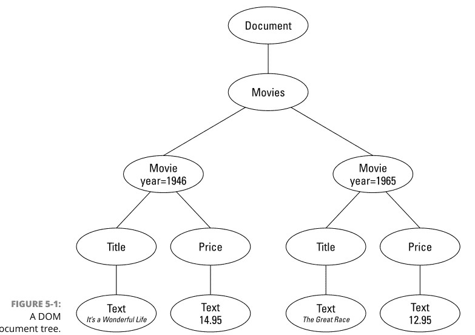

## 读入 DOM 文档

在处理 DOM 文档之前，你必须从 XML 文件将文档读取到内存中。你可能认为这是一件非常直接的任务，但遗憾的是，它涉及到一些相当奇怪的实现方式。与其过一遍你必须使用的所有类和方法，我直接看一个完整方法的实现代码，该方法接受一个包含文件名的`String`作为参数，并返回一个`document`对象作为返回值。在此过程中，你会了解到每个类和方法的作用。

这里有一个将 XML 文件读入 DOM 文档的方法：

```java
private static Document getDocument(String name) {
  try {
    DocumentBuilderFactory factory =
      DocumentBuilderFactory.newInstance();
    factory.setIgnoringComments(true);
    factory.setIgnoringElementContentWhitespace(true);
    factory.setValidating(true);
    DocumentBuilder builder =
      factory.newDocumentBuilder();
    return builder.parse(new InputSource(name));
  } catch (Exception e) {
    System.out.println(e.getMessage());
  }
  return null;
}
```

## 创建 `DocumentBuilderFactory`

上一个示例的第一语句调用了`DocumentBuilderFactory`类的`newInstance`方法来创建一个新的`DocumentBuilderFactory`对象。`DocumentBuilderFactory`的工作是创建可以读取 XML 输入并创建 DOM 文档的`DocumentBuilder`对象。

为什么不调用`DocumentBuilderFactory`的构造函数呢？事实证明`DocumentBuilderFactory`是一个抽象类，因此没有构造函数。`newInstance`是一个静态方法，它根据你的系统配置来决定创建哪个实例。

## 配置 `DocumentBuilderFactory`

在获取`DocumentBuilderFactory`后，你可以配置它来读取你所需的文档。接下来的三个语句配置了应用于此工厂对象创建的构建器的选项：

```java
factory.setIgnoringComments(true)
factory.setIgnoringElementContentWhitespace(true)
factory.setValidating(true);
```

以下是对这些语句的详细说明：

- `setIgnoringComments`方法告诉文档构建器不要为 XML 文件中的注释创建节点。大多数 XML 文件不包含注释，如果有，它们也不属于数据文档的一部分，因此可以安全地忽略。设置此选项会导致它们被自动忽略。（如果你不设置此选项，则会为文档中的每个注释创建一个节点，由于你无法预测注释会在何时出现，你的程序必须检查每个节点以确保该节点不是注释。）

- `setElementContentWhitespace`方法会导致文档构建器忽略任何不是文本值的空白字符。如果你不包含此选项，DOM 文档将包含表示空白区域的节点。这些空白节点唯一的用处就是让 DOM 文档变得更难解析，所以你应该始终设置此选项。

- `setValidating`方法告诉文档构建器在指定了 DTD 的情况下对输入的 XML 进行验证。验证输入也可以极大地简化你的程序，因为你知道 DOM 文档符合 DTD 的要求。如果你正在处理本章列表 5-1 所示的`.xml`文件，你确定`Movie`元素的第一个子元素是`Title`元素，第二个子元素是`Price`元素。如果没有验证，你只知道`Movie`元素的第一个子应该是`Title`元素，但你必须对其进行检查以确保。

## 创建文档构建器和文档

设置好选项后，你可以调用`newDocumentBuilder`方法创建一个文档构建器，如下：

```java
DocumentBuilder builder = factory.newDocumentBuilder();
```

在这里，文档构建器由名为`builder`的变量引用。

最后，你可以通过调用文档构建器的`parse`方法来创建 DOM 文档。该方法接受一个`InputSource`对象作为参数。幸运的是，`InputSource`类有一个构造函数，接受文件名参数并返回一个链接到文件的输入源。因此，你可以在一条语句中创建输入源、解析 XML 文件、创建 DOM 文档并将 DOM 文档返回给调用者：

```java
return builder.parse(new InputSource(name));
```

注意，这些方法中的几个会抛出异常。特别是，`newDocumentBuilder`抛出`ParserConfigurationException`，而`parse`抛出`IOException`。为了保持示例简单，我在一个`catch`块中捕获了所有异常，并将异常消息打印到控制台。

## 使用 `getDocument` 方法

通过添加`getDocument`方法，你可以一条语句从文件中创建 DOM 文档，如下：

```java
Document doc = getDocument("movies.xml");
```

在这里，读取了`movies.xml`文件，创建了 DOM 文档并将其赋值给变量`doc`。

另外请注意，你必须提供导入语句才能使用`getDocument`方法，如下：

```java
import javax.xml.parsers.*;
import org.w3c.dom.*;
import org.xml.sax.*;
```

`DocumentBuilder`和`DocumentFactory`位于`javax.xml.parsers`，`Document`位于`org.w3c.dom`，`InputSource`位于`org.xml.sax`。

## 读取 DOM 节点

一旦内存中有 DOM 文档，就可以从文档节点轻松检索数据。DOM API 是基于接口而非类的，文档的每个节点由实现一个或多个接口的对象表示。以下段落概述了将使用的接口：

- **Document**：整个文档由实现`Document`接口的对象表示。该接口中最常用的方法是`getElement`，它返回代表根节点的`Element`对象。获取根节点后，你可以导航到文档的其他节点。

- **Node**：`Node`接口表示 DOM 文档中的节点。该接口提供了适用于所有节点的方法。表 5-4 列出了这些方法中最用的。该表还列出了`getNode`方法可以返回的一些字段值。

### 表 5-4：`Node`接口

| 方法 | 描述 |
| --- | --- |
| `getChildren()` | 获取包含节点所有子节点的`NodeList`。 |
| `getFirstChild()` | 获取节点的第一个子节点。 |
| `getLast()` | 获取节点的最后一个子节点。 |
| `getNodeType()` | 获取一个整数，指示节点类型。该值可以是表中列出的字段之一。 |
| `getNodeValue()` | 获取节点的值（如果该节点有值）。 |
| `getNextSibling()` | 获取下一个兄弟节点。 |
| `getPrevSibling()` | 获取上一个兄弟节点。 |
| `hasChildren()` | 判断该节点是否有任何子节点。 |
| 字段 | 描述 |
| --- | --- |
| `ATTRIBUTE_NODE` | 节点是属性节点。 |
| `CDATA_SECTION_NODE` | 节点具有内容数据。 |
| `COMMENT_NODE` | 节点是注释。 |
| `DOCUMENT_NODE` | 节点是文档节点。 |
| `ELEMENT_NODE` | 节点是元素节点。 |
| `TEXT_NODE` | 节点是文本节点。 |

- **Element**：`Element`接口代表 XML 文档中元素对应的节点。`Element`扩展了`Node`，因此任何实现`Element`的对象都是`Node`。表 5-5 列出了该接口的一些最实用的方法。

# `Element`接口

| 方法 | 描述 |
| --- | --- |
| `String getAttribute(String name)` | 获取指定属性的值。 |
| `NodeList getElementsByTagName(String name)` | 获取一个`NodeList`对象，该对象包含所有在该元素内部且具有指定名称的元素节点。 |
| `boolean hasAttribute(String name)` | 确定元素是否具有指定的属性。 |

- **Text**：元素的内容并不包含在元素本身，而是存储在作为元素子节点的`Text`节点中。`Text`接口有几个你可能想要查找的继承方法，对于大多数应用程序，你只需要使用继承自`Node`接口的`getNodeValue`方法即可通过文本节点检索到文本。

- **NodeList**：`NodeList`是一个节点集合，由如`Node`接口的`getChildNodes`方法或`Element`接口的`getElementsByTagName`方法等返回。`NodeList`有两个方法：`item(int i)`，返回指定索引处的节点；以及`getLength()`，返回列表中的项目数量。（与 Java 中几乎所有其他索引一样，第一个节点的索引是 0 而不是 1。）

# 处理元素

假设你在构建文档时使用 DTD 来验证 XML 文件，你通常可以通过遍历文档来获取你需要的信息，而无需诉助于`NodeList`对象。这里有一个例程，用于在`movies.xml`文件被解析为名为`doc`的`Document`对象后（本章之前的列表 5-1 所示，计算其中所有的`Movie`元素：


```java
int count = 0;
Element root = doc.getDocumentElement();
Node movie = root.getFirstChild();
while (movie != null) {
    count++;
    movie = movie.getNextSibling();
}
System.out.println("There are " + count + " movies.");
```

此方法调用`getFirstChild`方法获取根元素的第一个子节点。然后，它使用每个子元素的`getNextSibling`方法来获取下一个也是根元素子节点的元素。

如果你运行一个包含这些行的程序，控制台上会显示以下行：

```
There are 10 movies.
```

该程序对`Movie`元素除了计数之外没有做任何操作，但在下一节（“获取属性值”）中，你将看到如何从`Movie`元素中提取数据。

处理`movies.xml`文件中所有元素的另一种方法是使用`getChildNodes`方法返回一个包含所有元素的`Node`对象。然后你可以使用`for`循环逐个访问每个元素。这是一个列出每个元素名称的代码片段：

```java
Element root = doc.getDocumentElement();
NodeList movies = root.getChildNodes();
for (int i = 0; i < movies.length(); i++) {
    Node movie = movies.item(i);
    System.out.println(movie.getNodeName());
}
```

`item`方法在`for`循环中用于检索每个`Movie`。如果你运行一个包含这些行的程序，控制台上会显示带有单词`Movie`的行。

# 获取属性值

要获取元素属性的值，请调用`getAttribute`方法并将属性的名称作为参数传递。此代码返回属性的字符串值。然后，如果有必要，你可以将此值转换为其他类型。注意，值可能包含一些空格，因此你应该对该值运行`trim`方法以去除任何多余的空格。

这是一个示例，获取`movies.xml`文件中每个电影的`year`属性，并确定集合中最老电影的年份：

```java
Element root = doc.getDocumentElement();
Element movie = (Element)root.getFirstChild();
int oldest = 9999;
while (movie != null)
{
  String s = movie.getAttribute("year");
  int year = Integer.parseInt(s);
  if (year < oldest)
    oldest = year;
  movie = (Element)movie.getNextSibling();
}
System.out.println("The oldest movie in the file "
+ " is from " + oldest + ".");
```

`year`属性是从这两行代码中提取的：

```java
String s = movie.getAttribute("year");
int year = Integer.parseInt(s);
```

第一行获取`year`属性的字符串值，第二行将其转换为`int`。

注意此方法中的类型转换。这是必要的，因为`movie`变量必须是`Element`类型，你才能使用`getAttribute`方法。然而，`getNextSibling`方法返回的是`Node`而不是`Element`。因此，除非先将其强制转换为`Element`，否则编译器不允许你将节点赋值给`movie`变量。

# 获取子元素值

你可能会惊讶地发现元素的文本内容并没有与元素一起存储。相反，它存储在类型为`Text`的子节点中。考虑以下 XML：

```xml
<Title>The Princess Bride</Title>
```

该元素在 XML 文档中产生两个节点：一个名为`Title`的`Element`节点和一个包含文本`The Princess Bride`的`Text`节点。

因此，如果你手里有一个`Title`元素，你必须在获取文本内容之前获取`Text`元素，如示例所示：

```java
Node textElement = titleElement.getFirstChild();
String title = textElement.getNodeValue();
```

如果你喜欢编写不那么繁琐的代码，可以使用辅助方法，如下所示：

```java
String title = getTextValue(titleElement);
```

其中辅助方法是：

```java
private static String getTextValue(Node n)
{
  return n.firstChild().getNodeValue();
}
```

# 整合：读取 Document

```java
import javax.xml.parsers.*;
import org.xml.sax.*;
import org.w3c.dom.*;
import java.text.*;

public class ListMovies {
    private static NumberFormat cf = NumberFormat.getInstance();

    public static void main(String[] args) {
        Document doc = getDocument("movies.xml");
        Element root = doc.getDocumentElement();
        Element movieElement = (Element)root.getFirstChild();
        while (movieElement != null) {
            Movie m = getMovie(movieElement);
            String msg = " : " + Integer.toString(m.year) + "";
            msg += " : " + cf.format(m.price) + "";
            System.out.println(msg);
            movieElement = (Element)movieElement.getNextSibling();
        }
    }

    private static Document getDocument(String name) {
        try {
            DocumentBuilderFactory factory = DocumentBuilderFactory.newInstance();
            factory.setIgnoringComments(true);
            factory.setIgnoringElementWhitespace(true);
            factory.setValidating(true);
            DocumentBuilder builder = factory.newDocumentBuilder();
            return builder.parse(new InputSource(name));
        } catch (Exception e) {
            System.out.println(e.getMessage());
        }
        return null;
    }

    private static Movie getMovie(Element e) {
        // get the year attribute
        String yearString = e.getAttribute("year");
        int year = Integer.parseInt(yearString);
        // get the Title element
        Element tElement = (Element)e.firstChild();
        String title = getTextValue(tElement).trim();
        // get the Price element
        Element pElement = (Element)tElement.getNextSibling();
        String pString = getTextValue(pElement).trim();
        double price = Double.parseDouble(pString);
        return new Movie(title, year, price);
    }

    private static String getTextValue(Node n) {
        return n.firstChild().getNodeValue();
    }

    private static class Movie {
        public String title;
        public int year;
        public double price;
        public Movie(String title, int year, double price) {
            this.title = title;
            this.year = year;
            this.price = price;
        }
    }
}
```

由于此程序中的所有代码在本书的其他地方都出现过，以下段落仅提供程序中每个方法的简单描述：

- 哇，需要导入这么多包。真希望 Java 的设计者们能把所有这些 XML 类放在一个大包里就好了。

- `main`方法开始调用`getDocument`方法从`movies.xml`获取一个`Document`对象。然后获取根元素。元素并使用`while`循环遍历所有子元素，你已知这些子元素是`Movie`元素，因为文档在解析时已经通过了验证。每处理一个`Movie`元素，它都会被传递给`getMovie`方法，该方法提取`year`属性以及`title`和`price`元素，并返回一个`Movie`对象。然后将该电影打印到控制台。

- 29 `getDocument.method`接受文件名作为参数并返回一个`Document`对象。在创建`DocumentBuilder`对象之前，它设置了配置选项，以便忽略注释和空白空白符，并对 XML 文件进行验证。由于 XML 文件经过了验证，你必须在本章较早的列表 5-2 中创建一个 DTD 文件。此外，你必须以 DOCTYPE 声明作为 XML 文件的开头（例如`<!DOCTYPE Movies SYSTEM "movies.dtd">`）。

- 49 `getMovie`方法接收一个代表`Movie`元素的元素对象。它提取`year`属性，获取`title`元素的文本值，并将`price`元素解析为`double`。然后它使用这些值创建一个新的`Movie`对象并返回给调用者。

- 65 `getText`方法只是一个简单的辅助方法，用于从节点获取文本内容。该方法假设节点拥有一个包含文本值的子节点，除非你确定情况如此，否则不应调用此方法。（由于 XML 文档经过了验证，你是确定的。）

- 70 `Movie`类是一个私有内部类，代表单部电影。它使用公共字段来持有`title`、`year`和`price`数据，并提供了一个初始化这些字段的简单构造函数。

## 索引

### 特殊字符与数字

- `-`（减号），99
- `--`（递减运算符），100
- `!`（非）逻辑运算符，141, 142–143
- `!=`（不等）关系运算符，130, 142
- `$`（美元符号），55
- `%`（百分号），99
- `%=`运算符，111
- `&`（与）逻辑运算符，141, 143–144
- `&&`（与）逻辑运算符，142, 143–144
- `*`（星号），64, 99, 765
- `*=`运算符，111
- `.`（点），361
- `/`（斜杠），99, 361
- `/=`运算符，111
- `;`（分号），12, 51, 301, 352, 830
- `\`（反斜杠），79, 376
- `^`（异异）逻辑运算符，142, 145–146
- `{`（大括号），12, 47–48, 54, 352
- `|`（或）逻辑运算符，141, 144–145
- `|`（管道符号），518–519
- `||`（逻辑与）逻辑运算符，142, 144–145
- `+`（加号），100, 370
- `++`（递增运算符），100
- `+=`运算符，111, 377
- `<`（尖括号），130
- `>`（菱）运算符，462
- `<=`运算符，130
- `==`（等号），59, 108, 131
- `-=`运算符，111
- `==`（相等），130, 131, 238, 377, 420
- `>=`（大于）符号，91
- `>=`运算符，130
- `Ø`（`jar`命令选项），359
- `'`（单引号），376
- `"`（双引号），79, 376
- `'`（单引号），89
- `3-D`对象，JavaFX，565

## A

- `a`格式模式，555
- `abortCountDown`方法，502–503
- `aborted`字段，502
- `abs`方法，114

### 抽象类

- 定义，301
- Java API，301
- 概述，299–302
- 变量声明，301

- 抽象工厂类，301
- 抽象方法，300–301, 569
- `AbstractBorder`类，301
- `AbstractCollection`类，301
- `AbstractMap`类，301
- `accept`方法，790
- getter，255–256
- JavaBeans，758
- 模式，257, 758
- setter，255–256
- `action`属性，733
- `action`事件，620
- `action`事件列表，573–554
- `ActionEvent`类，584, 589
- `ActionListener`监听器，308, 309, 311
- `actionPerformed`方法，308, 309
- `actions`，58
- `activeCount`，method，478
- Actor 程序，262
- `add`方法
  - `ArrayList`类，425, 429, 452
  - `GridPane`布局，648
  - `LinkedList`类，440, 443, 444
  - `ObservableList`类，686, 688
- `addAll`方法
  - `ArrayList`类，425
  - `ChoiceBox`类，683
  - JavaFX，627
- `addAll`方法（续）
  - `LinkedList`类，440
  - `ObservableList`类，686, 688
- `addObservableFilter`方法，787, 790
- `addColumn`方法，648
- `addFirst`方法，440
- `addItems`方法
  - `GenericQueue`类，458, 461
  - `Stack`类，458
- `addLast`方法，440, 443
- `addlistener`，488
- `addQuantity`方法，773
- `addRow`方法，648
- `addSubtract`程序
  - `EventHandler`接口，587, 590
  - 内部类，591, 593
  - lambda 表达式，597–601
- `addSubtract-class`，612–613
- `AfterLast`方法，857
- `aggregate`方法，流，468–469
- `alert`块，613
- `Alert`类
  - `AlertType`参数，314–315
  - JavaFX，613–617
- `AlertType`参数，614
- `load`指令，311
- 和（`&`）逻辑运算符，141, 143–144
- 尖括号（`()`），130
- 动画，JavaFX，565

### 内部类

- 创建，347–349
- 定义，347
- 示例，349–351
- 处理事件，593–594

### Apache Tomcat

- 配置，723–724
- 安装，723–724
- 开始，724–725
- 停止，724–725
- 测试，725
- 网站，723
- Zip 文件，723

### API，Date-Time

- 类列表，542
- Java bean，539
- `LocalDate`类，548–550
- `of`方法，545–546
- 方法，546
- `Month`枚举，545–547
- `now`方法，542–544
- `parse`方法，544–545


- `ZoneID` 类, 547, 548
- API, Java 类
- `Cloneable` 接口, 308
- 缺点, 16-17
- 文档, 32-33
- 导入类, 63-64
- 概述, 10-11
- 灾难 (`'`), 376
- `append` 方法, 389
- applet, 11, 712
- `Application` 类, 扩展, 568-569
- 作用域设置, 767
- 应用。参见程序
- `args` 参数, 784
- 参数文件, 27-28
- 算术运算符
  - 组合, 104-105
  - 复合赋值运算符, 110-111
  - 递增和减, 106-108
  - 概述, 99-102
  - 一元运算符, 105-106
- `ArithmeticException`, 214, 218, 220, 295
- array list
  - 容量, 427
  - 创建, 427
  - 定义, 424
  - 元素
    - 访问元素, 429
    - 添加元素, 428-429
    - 删除, 434-438
    - 插入, 424-425
    - 指定元素, 427
    - 更新, 432-433
  - 打印, 430
  - 大小, 424
- 数组数组, 401
- `ArrayList` 类
  - 类声明, 451–452
  - 构造函数, 425–426
  - 创建对象, 427
  - 委托模式, 282
  - 方法, 317, 425–426
  - 可观察列表, 687
  - 审核, 424–426
  - 打印, 430
- 存储数据, 225
- 数组
  - 数组的, 401
  - 棋盘示例, 408–415
  - 比较, 420
  - 转换为字符串, 420–421
  - 拷贝, 417–419
  - 创建, 394–395
  - 定义, 74, 393
  - 填充, 417
  - 初始化, 395–396
  - 锯齿, 405–406
  - 长度, 394
  - 多维, 407–408
  - 审核, 393–394
  - 学校储物柜示例, 397–400
  - 搜索, 419–420
- 二维
  - 访问元素, 303–404
  - 创建, 402–403
  - 初始化, 405
  - 审核, 401–402
  - 使用增强型循环, 400
  - 使用 `for`, 396–397
  - 使用方法, 401
- `Arrays` 类
  - `binarySearch` 方法, 419–420
  - `deepEquals` 方法, 420
  - `equals` 方法, 420
  - `fill` 方法, 417
  - 方法, 416–417
  - 审核, 416
  - `toString` 方法, 421–422
- 箭头运算符, 351
- 箭头, 246–247
- `askRound` 方法, 240
- 赋值语句, 71
- 赋值运算符
  - 复合, 110–111
  - 定义, 59
  - 审核, 108–109
- 关联, 247
- 星号 (`*`), 64, 765
- `ATTRIBUTE_NODE` 字段, 868
- 属性, 773
  - XML, 863–864
  - 默认值, 863–864
  - 类型, 867
  - 值, 875–888
- `@author` 标签, 364
- 自动内存管理, 175
- `average` 方法, 469
- avg 列, 836

## B

- `b` 转义序列, 79, 376
- 反斜杠 (`\`), 79, 376
- 反斜杠 (`()`) 转义序列, 79, 376
- `BadActor` 程序, 262
- `Ball` 类, 286–287, 301
- `BallFactory` 类, 301
- 基类类, 242, 278
- `Baseball` 类, 285, 289
- 基础构造函数, 259–260
- `beforeFirst` 方法, 857
- 行为, 10, 58, 240
- `BetterPlayer` 子类, 294
- `BigDecimal` 类, 58, 59
- `BigInteger` 类, 117
- `bin` 目录, 723
- `bin` 文件夹, JDK, 24, 25
- 二进制文件, 800
- 二进制运算符, 101, 141–142
- 二进制流
  - 用于读取, 814
  - 定义, 800
  - 读取, 813–820
  - 从数据输入读取, 815–817
  - 从文件读取, 817–820
  - 写入, 820–826
  - 写入文件, 823–827
- `binarySearch` 方法, 416, 419–420
- `BirthdayFun` 程序, 557–559
- 块-定义, 53, 87
  - 初始化器, 265–266
  - 概述, 53–54
- `Book` 类, 773
- `BookCart` 类, 770–773
- `Boolean` 表达式, 130–131
- `Boolean` 运算符, 141
- `Boolean` 类型
  - 概述, 79
  - 原始数据类型, 74
  - 包装类, 80
- `classpath` 编译器选项, 28
- `Border` 布局
  - 定义, 626
  - 概述, 643
- 边界面板, 575
- `BorderPane` 类
  - 构造函数, 644–645
  - 创建对象, 575–576
  - 方法, 644–645
  - 概述, 643
  - Pizza Order 应用, 674
- `BouncingBall` 类, 281
- 边界检查, 15
- 装箱, 87
- 大括号 (`{{`), 12, 47, 54
- `break` 语句
  - `for` 循环, 154, 155
  - `switch` 语句, 183
  - `switch` 语句中的省略, 188–191
- `addBtn` 方法, 509
- `addBtn_Click` 方法, 601
- `btn` 按钮, 620
- `btn_Click` 事件, 621
- `btn_Clicked` 方法, 618–619
- `bt0K_Click` 方法, 657, 666
- `btnSubtract` 按钮, 589
- `btnSubtract_Click` 方法, 601
- 缓冲区, 388
- `BufferedInputStream` 类, 813
- `BufferedOutputStream`
  - 描述, 821
  - 概述, 820
- `BufferedReader` 类
  - 构造函数, 801–802
  - 创建对象, 802–803
  - 方法, 801–802
  - 概述, 801
- `BufferedWriter` 类
  - 构造函数, 809
  - 描述, 807
- 批量数据操作
  - 定义, 464
  - 示例, 464–467
  - 概述, 464
  - 流, 464
- urns, Robert, 16

# C

- `jar` 命令选项, 359
- `calculateNewPos` 方法, 414
- 回调, 307-309
- 调用, 193
- `cancelRowUpdates` 方法, 857
- `canRead` 方法, 778
- `canWrite` 方法, 778
- 捕获组, 517
- `CardDeck` 类, 305-306
- `CardGame` 接口, 304
- 回车符 (`\r`) 转义序列, 79
- `CarWashApp` 程序, 188-190
- `CarStringApp` 程序, 191-192
- 级联样式表 (CSS), 564-565
- `case` 实例, 183-186
- `case` 关键字, 183
- 转换运算符, 086
- 转换
  - 操作数, 101
  - 概述, 086
- `catch` 块, 217, 219, 222, 223, 225。另见 `try` 语句
- `catchAll` 方法, 307
- `catch-or-rule` 编译器错误, 227-228
- `catch-or-rule` 规则, 227
- `cbrt` 方法, 114
- C/C
  - 整数值, 79
  - Java 背景, 7
  - Java 对比, 12-13
  - 内存泄漏, 15
  - 整数数据类型的大小, 75
- `CDATA_SECTION_NODE` 字段, 873
- `ceil` 方法, 120
- `CENTENTRIES`, 553
- 变化监听器
  - 添加, 689
  - 定义, 688
  - 选择项目, 689
  - 序列方法, 688-689
- `changed` 方法, 689
- `ChangeListener`, 689
- `ChangeParameters` 程序, 209
- `char` 类型
  - 概述, 78
  - 原生数据类型, 74
  - 在 `switch` 语句中, 185-186
  - 包装类, 080
- 字符类
  - 自定义, 512-513
  - 定义, 509
  - 范围, 513-514
- 字符流
  - 定义, 800
  - 读取, 801-806
  - 从文件读取, 803-806
  - 写入, 807-813
- 字符文本框, 665-666
- 字符
  - 提取, 380-381
  - 使用括号分组, 516-516
  - 多多个匹配, 514-516
  - 单个, 509
- 字符串值, 376
- `charAt` 方法, 381, 389, 391
- `CharSequence` 接口, 391
- 复选框
  - 选中状态, 669
  - 创建, 669-670
  - 定义, 668
  - 未定义状态, 669
- `CheckBox` 类
  - 构造函数, 669
  - 示例, 670-671
  - 方法, 669
  - 概述, 573
- 检查异常
  - `catch-or-rule` 编译器错误, 227-228
  - 定义, 214
- `FileNotFoundException`
  - 捕获, 227-228
  - 抛出, 228-229
- `Chess` 类, 283
- 棋盘示例, 408-415
- 子类, 242
- XML 子元素, 862, 876-877
- 子节点, 697, 699
- 选择框
  - 清空内容, 687
  - 创建, 683-684
  - 默认值, 684-685
  - 定义, 681
  - 已选中的项目, 685
- `ChoBox` 类
  - 构造函数, 682
  - 方法, 682
- 从列表中选择
  - 变化监听器
    - 添加, 689
    - 定义, 688
    - 选择项目, 689
    - 序列方法, 688-689
  - 选择框
    - 创建, 683-684
    - 默认值, 684-685
    - 定义, 681
    - 已选中的项目, 685
- 组合框
  - 添加项目, 691
  - 创建, 692
  - 定义, 690
  - 显示项目, 692, 692-693
  - 获取已选项目, 693
  - 处理事件, 690
- 列表视图
  - 对比组合框, 694
  - 构造函数, 695
  - 创建, 695-696
  - 定义, 694
  - 获取已选项目, 696
  - 方法, 695
  - 选择项目, 694
  - 视图控件, 694-695
- 可观察列表
  - 访问项目, 686
  - 定义, 685
  - 插入项目, 688
  - 移除项目, 687
- 树形视图
  - 构建树, 698-701
  - 子节点, 697, 699
  - 折叠的节点, 698
  - 创建控件, 699, 702
  - 定义, 697
  - 元素, 697
  - 展开的节点, 698
  - 获取选中节点, 702-704
  - 叶子节点, 698
  - 节点, 697
  - 父节点, 697, 699
  - 路径, 698
  - 根节点, 697
  - 兄弟节点, 697
  - Swing 程序, 704-706
  - 值, 699
- `ChronUnit`, 553, 类
- 抽象类
  - 定义, 301
- Java API, 301
- 概述, 299-302
- 变量声明, 301
- `ArrayList` 类
  - 类声明, 451-452
  - 构造函数, 425-426
  - 创建对象, 427
  - 委托模式, 282
  - 方法, 317, 425-426
  - 概述, 424-426
  - 打印, 430
- `BigDecimal`, 58-59
  - 实体, 47, 250-251
- 字符类
  - 自定义, 512-513
  - 定义, 509
  - 范围, 513-514
- `CheckBox` 类
  - 构造函数, 669
  - 示例, 670-671
  - 方法, 669
  - 概述, 573
- 集合, 423
- `ComboBox` 类
  - 构造函数, 691
  - 方法, 691
  - 概述, 690
- Java All-in-One Dummies
  - 基础, 259-260
  - 基础格式, 259
  - 调用, 261-262
  - 创建, 259-262
  - 默认, 260-262
  - 定义, 81, 241, 259
  - 继承, 286-287
  - 父类, 287
  - 创建对象, 59
  - 声明, 249-253
  - 定义, 57
  - 使用 UML 绘图, 243-247
  - 箭头, 246-247
  - 绘图, 245-246
  - 概述, 244
- `File` 类
  - 构造函数, 778-779
  - 创建对象, 780
  - 目录, 781-782
  - 文件, 780-784
  - 方法, 777-779
  - 概述, 777-778
  - Swing 选择器, 785-786, 788, 789-791
- `final`, 288
- `HttpServlet` 类, 726-727
  - 导入, 354-355
  - 继承, 242
  - 转换类型, 289-290
  - 构造函数, 286-287
  - 定义, 242
  - 委托模式, 282
  - `final`, 287-288
  - 游戏类比, 279-280
  - 层次结构, 280-281
  - 接口对比, 302
  - 概述, 14-15, 277-278
  - 薪资系统类比, 280
  - 多态, 291-294
  - 使用, 266
  - 车辆类比, 279
- 内部类
  - 匿名, 347-351
  - 创建, 342
  - 定义, 252, 342, 591
  - 示例, 343-347
  - 处理事件, 591-593
  - 概述, 342
  - 静态, 342
  - 实例, 58
- 接口, 240, 242-246
- `JAR` 文件, 358-362
- Javadoc 注释, 363-366
- JavaServer, 751-755
- `FileChooser` 类
  - 构造函数, 787
  - 创建对话框, 788
  - 文件过滤器, 779-791
  - 获取选选文件, 788
  - 方法, 787
  - 概述, 785-786
- Linked list 类
  - 添加项目, 443-444
  - 优势, 438
  - 插入项目, 438
  - 方法, 439-442
  - 概述, 438-439
  - 移除项目, 438-447
  - 获取选中项目, 445-446
  - 存储数据, 439
  - 更新项目, 446-447
- 成员
  - 定义, 251, 253
  - 字段, 253-254
  - 内部, 255
  - 灵活性, 254-255
- 方法
  - 抽象, 300-301
  - 访问器, 254-255
  - 实体, 196
  - 声明, 195-196
  - 默认, 299, 311-314
  - 定义, 10, 47, 193, 251
  - 字段, 254
  - `final`, 287-288
- 类 (继续）
  - 游戏示例, 203-206, 210-212
  - 命名, 195
  - 重载, 257-258
  - 重写, 283
  - 概述, 194
  - 参数列表, 196
  - 参数, 206-210
  - 按值传递, 209-210
  - 私有, 254
  - 随机, 114, 117
  - 返回语句, 201-203
  - 返回类型, 195, 200, 201, 258
  - 签名, 258


# 索引

## A

- 静态, 58, 267, 268, 269
- 使用数组, 401
- 命名, 250

## B

- `Object` 类
  - `clone` 方法, 318, 328-338
  - 定义, 315
  - `equals` 方法, 318, 322-326
  - 方法的, 317-319
  - 概述, 315, 316
  - `toString` 方法, 319, 320, 321-322
  - 使用类型, 316-317
  - 对象对比, 10, 57-58
- `Path` 类
  - 创建文件, 793-794
  - 获取目录, 794
  - 方法, 792
  - 概述, 778, 792
  - 遍历树, 795-797
  - 公有, 251-255
- `Scanner` 类
  - 异常, 215-216
  - 获取输入, 94-95
  - `hasNext` 方法, 220
  - 导入, 92-93
  - 方法, 94, 96
  - 概述, 92-93
- `Scene` 类, 607-608
  - 在 servlet 中, 735-740
- `Stage` 类
  - 方法, 605-606
  - 概述, 604
- `String` 类
  - 文档页面, 34
  - 在 `World` 程序中, 47
  - 方法, 378-380
  - 正则表达式, 520-521
- `StringBuilder` 类
  - 容量, 388
  - 创建对象, 388
  - 示例, 390-391
  - 长度, 388
  - 方法, 380-390
  - 概述, 387-388
- 子类
  - 创建, 281-282
  - 定义, 242, 278
  - 实例, 266
  - `super` 关键字, 284-285
  - `this` 关键字, 284-285
- `Treelet` 类
  - 构造函数, 698
  - 方法, 698
  - 概述, 697
- `TreeView` 类
  - 构造函数, 701
  - 方法, 701
  - 概述, 701
- `Class` 类
  - 类, 338-340, 846
  - 常量, 73
  - `class` 关键字, 在 `World!` 程序中, 46
- `Class` 对象
  - 定义, 315
  - 类变量, 声明, 67-68
- `ClassName`, 250
- `ClassNotFoundException`, 214, 846
  - `--classpath` 编译器选项, 28, 29
  - `--classpath` 选项, 30
- 类变量
  - jar 文件中的, 361
  - 根目录, 356
  - 通配符, 361
- `clear` 方法
  - `ArrayList`, 425
  - `LinkedList` 类, 440
  - 可观察列表, 686
  - 对比 `Click` 类, 612
  - `Swing` 选择器, 677
  - 编译器, 622

计算机模拟, 236

拼接, 377

条件与 (`&&`) 逻辑运算符, 142, 143–144

条件运算符, 101, 148

条件或 (`||`) 逻辑运算符, 142, 144–145

`conf` 文件夹, JDK, 24

`ConfirmationBox` 类, 618, 622

`Connection` 类, 848

`console`, 45

`Console` 类, 357–258

`console` 关键字, 49

常量. 见 `final` 变量

- 优势, 73
- `float` 和 `double` 类的, 128
- `Math` 类, 112–113
- 概览, 72–273

构造函数

- 基础, 259–260
- 基础编码格式, 259
- 调用, 261–262
- 创建, 259–262
- 默认, 260–262
- 定义的, 81, 241, 251, 259
- 实例和, 286–287
- 内边距, 631
- 超类, 287

`consume` 方法, 621

`contains` 方法

- `ArrayList` 类, 426
- `LinkedList` 类, 440
- `ObservableList` 方法, 687

`containsAll` 方法, 440

`continue` 语句, 157–158

`Control` 类, 633

`convertPosToSquare` 方法, 415

`convertSquareToPos` 方法, 415

`copyDemo` 程序, 418–419

`copyOf` 方法, 416–419

`copyOfRange` 方法, 416–417

版权, 24

`copyTo` 方法, 792

`count` 列函数, 836

`count` 表达式, 164

`count` 方法, 469

`countDistinct` 列函数, 386

`CountDown`, 168–169

`CountDownApp` 程序

- 带中止的, 499–503
- 协调的, 486–489
- 源代码, 483–484

`CountDownNew` 程序, 490

`CountDownClock` 类, 488

`CountDownClock` 程序, 478–496

`CountDownClocklocked` 程序, 496–503

`CountDownClockNew` 程序, 289

`CountDownClockSync` 程序, 494

计数变量, 166–167

`CountTestApp` 程序, 271–272

`CountToOne` 程序, 164–165

`-cp` 编译器选项, 28

`-cp` 选项, 30

崩溃, 95

`CrazyClass` 程序, 263

`CrazyWithZeros` 程序, 223–226

`create` SQL 语句方法, 829, 831

`createDirectory` 方法, 792

`jTextField` 方法, 793–794

`createNewFile` 方法, 778, 781

`createStatement` 方法, 848–849, 856

CSS (层级样式表), 564–565

大括号 (`{}`), 47–52

自定义字符类, 512–513

计数异常

- 创建, 294–297
- 可异常层次结构, 294–295
- 抛出, 296–297

`-d` 编译器选项, 28

# D

`d` 格式模式, 555

`–D` 选项, 30

`\` 正表达式, 510

`\` 正表达式, 510, 511

数据类型

- `boolean` 类型
  - 概览, 79
  - 基本数据类型, 74
  - 包装类, 80
- `byte` 类型
  - 基本数据类型, 74
  - 大小, 75
  - 包装类, 80
  - 强制转换
- `short` 类型
  - 自动数值转换, 85–86
  - 概览, 75
  - 基本数据类型, 74
  - 包装类, 80
- `char` 类型
  - 概览, 78
  - 基本数据类型, 74
  - 类型检查, 13
  - 包装类, 79–80
  - 在 `switch` 语句中, 185–186
  - 与字符串的相互转换, 83–85
- 定义的, 74
- `double` 类型
  - 指数, 76
  - 基本数据类型, 74
  - 包装类, 80
- `enum` 类型, 97–98
- `float` 类型
  - 指数, 76
  - 精度, 76
  - 基本数据类型, 74
- 引用类型
  - 定义, 74
  - 概览, 80–81
  - 返回类型, 200
- 数据库. 见也
  - 列函数, 835–837
  - 连接, 846–847
  - 创建, 829–832
  - 删除行, 840–841
  - 消除重, 838–839
  - 排除行, 834
  - 层, 243–244
  - 缩小查询, 834
  - 查询, 832–839–849
  - 关系, 828
  - 从多个类型中选择, 837–838
- `DataOutputStream`, 813, 815
- `DataOutputStream`, 820, 821
- 日和时间
  - 与二进制系统的复杂性, 119–120
  - 计算, 552–554
  - 舍入数字, 119
  - 科学计数法, 76–77
  - 值, 77
- 浮点数据类型, 125–126
- 基本数据类型, 74
- 大小, 75

## Date-Time API

- Java 8, 539
- 类列表, 542
- `LocalDate` 类, 548–550
  - `of` 方法, 545–546
  - `Month` 枚举, 545–547
  - `now` 方法, 542–544
  - `parse` 方法, 544–545
- `DateTimeFormatter` 类, 555–556
- `DateTimeParseException`, 544–545
- `DAYS`, 553
- `DECADES`, 553

JSP, 743-749

声明

- 声明类, 249-253
- 类变量, 67-68
- 局部变量, 69-70
- 方法, 207-208
- 变量
  - 类变量, 67-68
  - `final` 变量, 72-73
  - 实例变量, 68-69
  - 一个中的多个, 67

递减操作, 100, 106-108

深拷贝, 333-338

`deepEquals` 方法, 416, 420

`delete` SQL 语句, 829, 840–851

`deleteChar` 方法, 389

`deleteFile` 方法, 784

`deleteRow` 方法, 857, 858

分隔符, 800

依赖, 369

`@Deprecated` JavaDoc 标签, 36

`@deprecation` 编译器选项, 28, 29

`dequeue` 方法, 458

`drived` 类, 242, 278

`descending` 方法, 440

`destroy` 方法, 726

开发者版本, 18

图表

- 箭头, 246-247
- 绘制, 245-256
- 概览, 244

`diamond` 运算符, 462

`Dice` 类示例, 118

`Dice` 程序, 252-253

指令, 742, 781

目录, 526-527

- 获取内容, 794

`Directory` 类, 778

`DirList` 程序, 527-529

`disabions` 选项, 31

`disassembler`, 31

`DividedZero` 程序, 217-218

`do` 语句, 51

`doc` 标签, 363-364

`<!DOCTYPE>` 声明, 865-868, 879

`Document` 接口, 872-873

文档模型 (DOM)

- 创建文档, 871-872
- 定义的, 868
- `document` 树, 869-870
- 读取文档, 869-872
- 读取 DOM 节点, 827-877

document 类型定义 (DTD), 865-868

`DOCUMENT_NODE_field`, 873

文档

- `for` 类, 32
- Java SE API, 32-33
- Oracle 网站, 32

默认构造函数, 260-262

默认组, 183

默认方法, 299-314

默认包, 355

委托模型, 344

委托模式, 282

`delete` 方法

- `File` 类, 778
- `Path` 类, 792
- `StringBuilder` 类, 389

`DocumentBuilder` 类

- 配置, 870–871
- 创建构建器和文档, 871–872
- 创建对象, 869
- `getDocument` 方法, 772
- `setIgnoringComments`, 771
- `setIgnoringElementContent`, 771
- `setValidating` 方法, 771

`Element` 接口, 873–874

`element` 方法, 440, 445

`ELEMENT_NODE_field`, 873

EJB (Enterprise JavaBeans), 757

`else-if` 语句

- `switch` 语句, 179–182
- versus, 179

`Employee` 程序, 154–155

`Employee` 类, 364–366

- JavaDoc 注释, 316–317

`doGet` 方法, 726, 727, 730, 739–740

`delete` 方法, 726

`Collection` 类, 282

DOM (Document Object Model) (Extensible Markup Language)

- `-enableassertions` 选项, 31
- `-encoding` 编译器选项, 28
- defined, 868
- end condition, 525
- 行末尾注释, 56
- document 树, 869–870
- 读取方法, 869–872
- 读取 DOM 节点, 872–877

增强循环, 400, 503

`ensureCapacity`, 389, 828

`enumerate` 方法, 478

`enum` 类型, 97–98

`double` 类型, 14

`double quote`, 79, 376

`equal` (`=`), 59, 108, 131

`equality` 运算符 (`=`), 238, 377, 420

`DoubleStream` 接口, 468

`do-while` 循环, 159–160

下载

- `ArrayList` 类, 416
- `Arrays` 类, 420
- `TextPad`, 35–36

`DriverManager` 类, 846

重写, 324–326

`drop` SQL 语句, 829

`drop` 方法, 307

- 规则, 325–326
- 使用, 223–324

`equalsIgnoreCaseCase`, 378

`dump`, 213

`err` 变量, 171

`E` 常量, 112

参数, 457–458

`Error` 类, 295

`eBay`, 721

错误消息, 666

- 关键字, 50–51
- 运行程序, 30

错误流, 91

转义序列, 78–397

转义, 516

`EvenCounter` 程序, 152, 159

事件处理器

- 创建, 586
- 定义的, 573, 583, 585
- 注册, 586-587

事件监听器, 308

事件源, 308

`EventHandler` 接口, 585-590

事件

- 定义的, 127, 214
- `Exception` 类, 222-223
- `FileNotFoundException`, 227-229
- `finally` 块, 223-226
- 猜游戏示例, 215
- 处理, 16, 220–221
- `IllegalIllegalArgumentException`, 214
- `OutOfBoundsException`, 445
- `InputMatchException`, 95, 214, 219, 222
- `InterruptedException`, 498-499
- `IOException`, 214, 222, 295, 823
- Java Web Start, 718-719
- 消息, 显示, 223
- `NullPointerException`, 295
- `NumberFormatException`, 97, 667
- 对象, 16-
- 类, 584
  - 定义的, 585
  - 检查, 584
- 处理
  - 带匿名内部类的, 593-594
  - 组合框, 693-694
  - 带内部类的, 591-593
  - JavaFX, 585-587
  - 使用 lambda 表达式, 596–601
- 源, 585, 586
- 目标, 585
- 概览, 214-215
- `ProductDataException`, 296
- `RuntimeException`, 295
- `SAException`, 872
- `SQLException`, 847
- 堆栈, 215-216
- `StringOutOfBoundsException`, 381
- 吞吞, 229–230
- 从主方法抛出, 229

`Exception` 类

- 创建, 231, 296
- 描述, 295
- 用于的方法, 223
- 概览, 221–222

异常, 213

捕捉

- `ArithmeticException`, 214, 218, 220, 295
- 示例, 217–219
- 多个, 221–222, 232
- `try` 语句, 216–217
- 类型, 214-215
- 未检查, 215

`executeQuery` 方法, 848

`executeUpdate` 方法, 848, 856

执行器, 489-491

`Executor` 类, 491

`exists` 方法

- `File` 类, 778
- `Path` 类, 792

## F

- `\f` 转义序列, 79, 376
- `\f` jar 命令选项, 359
- `false`, 49
- `fExists` 方法, 792
- 字段
  - 创建, 254
  - 定义, 251
  - 在接口中, 306
  - 方法, 254
- `for` 循环
  - 阶乘
  - 定义, 523
  - 非递归方法, 524
  - 递归方法, 524–526
- 正则表达式
  - 捕获组, 517
  - 字符类, 509, 512–514
  - 定义, 385, 505
  - 转义
  - 字符分组, 516–518
  - 在 Java 程序中, 519–522
  - `Matcher` 类, 521–522
  - 字符匹配字符, 509–514
  - 否定, 514
  - 概述, 505–506
- 概述, 351–352

## L

- lambda 表达式
  - `ListMovies` 程序, 877–880
  - 动作事件, 573–574
  - `movie.xml` 文件, 864–865
  - 箭头操作符, 351
  - 概述, 861–862
  - 定义, 341
  - 处理元素, 274–875
  - 函数式接口, 351
  - SAX, 868
  - 使用处理事件, 596–601
  - 标签, 862–863
  - 介绍, 18
  - `extras.jar` 文件, 361
  - JavaFX, 573–584


- 私有的，254，255
- `Pattern` 类，521–522
- 静态字段
- 管道符号，518–519
- 定义，269
- 量词，515
- 概述，267–268
- `String` 类，520–521
- 用，268
- `String` 问题，519–520
- 文本字段，用户输入
- 测试程序，507–509
- 创建，660–663
- 测试，164
- 定义，660
- `-extdirs` 编译器选项，218
- 行内显示提示符，662
- 可扩展性标记语言（XML）
- 获取值，662
- 属性
- `RolePlayer` 类，663–666
- 定义，863–864
- 验证数字，667
- 类型，867
- `File` 类。另见 `Path`
- 值，875–878
- 构造函数，778–779
- 子元素，876–877
- 创建对象，780
- 声明，864
- 目录，获取内容
- `DOM`
- 781–782
- 创建文档，871–872
- 文件
- 定义，868
- 创建，780–781
- 文档树，869–870
- 删除，783–784
- 读取文档，869–872
- 读取 DOM 节点，872–877
- 获取相关信息，781
- `DTD`，865–868
- 元素内容，867
- 重命名，782–783

## `File` 类（续）

- 方法，778–779
- 概述，777–778
- 读取二进制流，813
- 读取字符流，801
- `Swig` 选择器
- 浮点数据类型
- 与二进制数字系统的复杂性，125–126
- 概述，76–78
- 数字四舍入，119–120
- 科学计数法，76–77
- 零值，78
- 创建对话框，788
- 文件过滤器，789–791
- 获取选定文件，788
- 概述，785–786
- 文件过滤器，789–791
- 文件访问者，795–797
- `FileClass`，790–791
- `FileInputStream`，226–227，813
- `FileNotFoundException`
  - 捕获，227–228
  - 抛出，228–229
- `floor` 方法，120
- `FlowPane` 布局
  - 构造函数，640
  - 定义，626
  - 方法，640–642
  - 概述，639
  - `Pizza Order`，674
- `flush` 方法
- `FileOutputStream` 类
  - 描述，821
  - 概述，820
- `FileReader` 类，801–802
  - 构造函数，801–802
  - 方法，801–802
  - 概述，801
- `DataOutputStream` 类，821，823
- `Printwriter` 类，808
- `for` 循环
  - 中断与继续，172–173
  - 计数器作用，166–167
  - 向后计数，168
  - 使用数字，167
  - 增强的，400
- `FileWriter` 类，807–808
  - 模式，809
  - 构造函数，809
- `FileZilla`，713
- `fill` 方法，416，417
- 过滤器方法，466–467
- `final` 类，288
- `Final Fantasy`，236
- `final` 关键字，49
- `final` 方法，287–288
- `final` 变量，72–773
- `finalize` 方法，217，223–226
- 第一个方法，857
- 格式化，164–166
- 多个表达式，170–171
- 省略表达式，171–172
- 数组，396–397
- 无主体，169–170
- `forEach` 方法，466，468
- `Ordered` 方法，468
- `forever`，553，554
- `for` 表达式，166
- `form` 转义序列，79，376
- `form` 标签，733，766
- `form` 类型，451
- `format` 方法，122
- 前斜杠（`/`），361
- `FTP` 客户端，713，717
- 函数式接口，351–352
- 飞行模拟器程序，236
- 编译器选项，28
- `float` 类型：指数，76，77
- 基本数据类型，74
- 包装类，80

## G

- `Game` 类，283，312
- 游戏程序，476
- 垃圾回收器，15，241
- 泛型
  - `diamond` 操作符，462
  - `Java 1.5`，424，437–438
  - 原因，450–451
  - 队列类，458–462
  - 栈类，454–456
- 访问器，255–256
- `get` 方法，440，687
- `getAttribute` 方法，873
- `getBigDecimal` 方法，850–856
- `getBoolean` 方法，850
- `getCanonicalPath` 方法，778，781
- `getChildren` 方法，873
- `getChildrenNodes` 方法
  - `FlowPane` 布局，640
  - `HBox` 布局，627，630
  - `Vbox` 布局，636，637
- `getClass` 方法，318，339–340
- `getColumn` 方法，648
- `getConnection` 方法，846–847，854，856
- `getCount` 方法，758
- `getCurrencyInstance` 方法，122
- `getDate` 方法，850
- `getOutOfMonth` 方法，549
- `getOutOfWeek` 方法，549
- `getOutOfYear` 方法，549
- `getDocument` 方法，872，779–880
- `getDouble` 方法，850
- `getElementsByTagName` 方法，874
- `getEmployee` 方法，291
- `getFirst` 方法，440，445
- `getFirstChild` 方法，873，875
- `getFloatRate` 方法，850
- `getFormattedRate` 方法，291
- `getFormattedSalary` 方法，291
- `getGuess` 方法，204，210
- `getHeight` 方法，608
- `getInt` 方法，851
- `getInteger` 程序，218–219，220
- `getItems` 方法
  - `ChoiceBox` 类，682，683
  - `ComboBox` 类，691
  - `ListView` 类，695，688–689
- `getLast` 方法，441，446
- `getLastChild` 方法，873
- `getLong` 方法，851
- `getMaxHeight` 方法，605
- `getWidth` 方法，605
- `getMessage` 方法，794
- `getMinHeight` 方法，605
- `getMinWidth` 方法，605
- `getMonth` 方法，549
- `getValue` 方法，549
- `getMove` 方法，880
- `getList` 方法，739–740
- `getMoves` 方法，812–813，825–826，854
- `getSetName` 方法
  - `File` 类，778，781
  - `Filter` 类，791
  - `Thread` 类，478
- `getNextSibling` 方法，873，875
- `getFlowNode` 方法，873
- `getNumberInstance` 方法，122
- `getParameter` 方法，744
- `getParent` 方法，698，799
- `getParentFile` 方法，779
- `getPercentInstance` 方法，122
- `getPreviousSibling` 方法，873
- `getPrice` 方法，773
- `getPriority` 方法，478
- `getQuantity` 方法，753
- `getRandomNumber` 方法，850
- `guessing` 游戏，210
  - `parameters`，207–208
  - `return` 类型，200–203
- `getReader` 方法，806
- `getRoot` 方法，701
- `row`
  - `GridPane` 布局，648
- `ResultSet` 接口，849
- 方法，426
- `getSelectedFile` 方法，787，789
- `getSelectedItemItems` 方法，702
- `SelectionModel`
  - `ListView` 类，695，688–689
  - `ObservableList` 类，702
  - `TreeView` 类，702
- `getShort` 方法，851
- `getStream` 方法，820
- `getString` 方法，851
- `getters`，255–256
  - `CheckBox` 类，669
  - `RadioButton` 类，672
  - `TextField` 类，660，662，667
- `getValue` 方法，877，880
- `getTime` 方法，478–489
- `getTitle` 方法，773
- `getTotal` 方法，773
  - `ChoiceBox` 类，682，685
  - `ComboBox` 类，691，692–693
  - `TreeItem` 类，698
- `getWidth` 方法，608
- `getWriter` 方法，727
- `getYear` 方法，549
- `Gmail`，721
- `Golf` 接口，306
- `Gore`，51
- `goto` 关键字，49
- greater than（`>`）符号，91
- `Grid` 类，61–63
- `GridPane` 布局，650
  - `constraints`，650–652
  - 构造函数，648–649
  - 创建网格，647–649
  - 定义，626
  - `features`，646
  - 方法，648–649
  - 概述，645–646
  - `constraints`，651
  - `string path`，646–647
- `GuessGame` 程序，175–372
- `GuessGameMethod`，197–199，204–206，210–212
- `GUI` 程序，476

## H

- `format` 模式，555
- `hash` 模式，555
- `hasAttribute` 方法，874
- `hasChildNodes` 方法，238，318
- `hashCode` 方法，238
- `hasItems` 方法，458，460
  - `Stack` 类，453
- `hasNext` 方法，431
- 成长的节点，633–635
- 带有边距的，632
- 构造函数，629
- 创建，628
- 定义，626
- 方法，629
- `Pizza Order`，674
- 间距，630–631
- `health` 字段，255–256
- `Hearts` 类，304
- `class` 关键字，46
- 标识符，46–47
- Java 与其他语言，12
- `main` 方法，46，196–197
- 概述，46–48
- `public` 关键字，46，47
- `servlets`，727–729，730–732
- `static` 关键字，47
- `String` 类，47
- `void` 关键字，47
- `HelloApp`，48，60–63，69
- `helloMessage` 变量，69–70
- `HelloServlet`，730–732
- `HelloWorld`，196–197
- 编译器选项，28，29
- `help` 选项，30
- `hide` 方法
  - `ChoiceBox` 类，682，683
  - `ComboBox` 类，691
- 继承，280–281
- `throwable`，294–295
- `hit` 方法，285，301
- 水平流布局，639
- 水平制符（`\t`）转义序列，79
- `HOURS`，553
- `href` 属性，714–715
- `HTML`（超文本标记语言）
  - 文件，713
  - 从 `servlet` 发送 HTML，727–729
  - 标签，863
- `HTTP`（超文本协议），721–722
- `HttpServlet` 类，726–727
- `HttpResponse` 对象，727
- `HttpServlet` 传输协议，721–722
- `hypot` 方法，114

## I

- `switch` 语句内部，185–186
- 嵌套，135–139
- 外部，136
- 概述，132–134
- `if-else` 语句，134–135
- `if-then` 语句，52
- `IllegalArgumentException`，214
- 不变对象，377，552
- `import` 指令，744，747
- `import` 语句
  - 类和包，354–355
- `HBox` 布局，628
- `Java API`，63–64
- `JavaFX`，567
- `include` 文件夹，JDK，24，100–108
- 递增操作符（`++`），100
- `indexOf`
  - `ArrayIndex` 类，426，449
  - `LinkedList` 类，441
  - `Observable` 类，687
  - `StringBuilder` 类，389
- `IndexOutOfBoundsException` 类，445
- 无限循环。见 `loops loops`
  - 允许用户创建，156–157
  - 定义，154
  - 停止，155
- 中缀操作符，101
- 继承
  - 转换类型，289–290
  - 构造函数和，286–287
  - 定义，242
- 委托模式
  - `final` 关键字，287–288
- 游戏模拟，279–280
- 层次结构，280–281
- 接口对比，302
- 概述，14–15，277–278
- 薪资系统模拟，280
- 多态，291–294
- 使用，266
- 车辆模拟，279
- `init` 方法
  - `HttpServlet` 类，726
  - `JavaFX`，569–570
- `iClickCount` 变量，580，612
- `iCounter` 变量，589，612
- `ID` 属性类型，867
- `IDE`（集成开发环境）
  - 定义，21
- 标识符
  - 创建，55
  - 定义，55
  - 在 Hello World! 程序中，46–47
  - 规则，55
  - 身份，237–238
- `IDREF` 属性类型，867
- `IDREFS` 属性类型，867

### 语句

- `else–if` 语句，139–141
- `if–else` 语句，134–135
- `if-then` 语句，52

- 初始化表达式，164
- 初始化块，265
- 初始化器
  - 已定义，251，265
  - 使用初始化变量，72
  - 实例，251
  - 概览，265–266
  - 静态，251，266，274–275
  - 类型，251
- `itality` 方法，605，607
- `initStyle` 方法，605，607
- 内部类
  - 匿名，347–351
  - 创建，342
  - 已定义，252，342，591
  - 示例，343–347
  - 处理事件，591–593
  - 概览，342
  - 静态，342
- `imer if` 语句，136

### 输入

- 复选框
  - 选中状态，669
  - 创建，669–670
  - 已定义，669
  - 未定义状态，669
- `JSP`
  - 表单，732–733
  - `InputServlet`，733–734
  - 概览，659
- 披萨订单应用程序
  - 布局面板，674
  - 主窗口，674
  - 概览，673
  - 源代码，675–680
  - 用户订单确认，674
- 单选按钮
  - 创建，672，673
  - 已定义，671
  - 切换组，673
- 端程序，732–735
- 文本字段
  - 创建，660–663
  - 已定义，660
  - 在内部显示提示，662
  - 获取值，662
- `RolePlayer` 程序，663–666

验证数字数据，667  
验证数字数据，667–668

- 输入流，90–91，94
- `InputElementEvent`，584
- `InputJS.Jsp`，745–746
- `InputMismatchException`，95，214，219，222
- 输入流。参见 I/O 流
- `InputServer.servlet`，734–735
- `InputServlet.html`，732–733
- `insert` 方法，389
- 插入 SQL 语句，829，831
- `insertRow` 方法，857，859
- `Insets` 枚举，631
- 循环内部，173
- 安装
  - `TextPad`，35–36
  - `Tomcat`，723–724
- 实例


- 带有 JSP 页面的`beans`, 761-763
- 类的实例, 58
- 使用静态计数实例, 270-271
- 已定义, 237
- 初始化器, 251
- 防止, 273-274
- 单例模式, 272-273
- 变量, 68-69

`Instant`类, 542

## `int`类型

- 基本数据类型, 74
- 大小, 75
- 包装类, 80

## 整数数据类型

- 除法, 102-104
- 溢出, 125
- 概览, 14, 75-76
- `parse`方法, 667
- 提升, 75
- 大小, 75

## 接口

- `ActionListener`接口, 308, 309, 311
- `CardGame`接口, 304
- `CharSequence`接口, 391
- 类图, 246
- `Cloneable`接口, 308, 332
  - 创建, 303
  - 已定义, 240, 242–243, 302
- `Document`接口, 872–873
- `DoubleStream`接口, 467, 468
- `Element`接口, 873–874
- `EventHandler`接口, 585–590
  - 扩展, 306–307
  - 内部字段, 306
  - 式的, 351–352
  - 实现, 302, 304
  - 继承对比, 302
- `IntStream`接口, 467, 468
- `Iterator`接口, 430
- `LongStream`接口, 467, 468
  - 标记, 308
- `Node`接口, 873
- `NodeList`接口, 874
- `Playable`接口, 304, 313–314
- `PlayableBall`接口, 307
- `Queue`接口, 445
- `Runnable`接口
  - 创建类, 481–482
  - 概览, 480
  - 使用, 418
  - 流, 264
- `Stream`接口, 464, 467–470
  - 子接口, 306–307
  - 父接口, 306–307
- `Text`接口, 874
- `ThrowableBall`接口, 307
- `TimeMonitor`接口, 488
  - 作为类型, 305–306
  - 回调, 307–309
  - 内部成员, 255

`Internet`, 11

`interrupt`方法, 498

`interrupted`标记, 498

`InterruptedException`, 498–499

`IntStream`接口, 467, 468

`Invoice`程序, 270

`invoking`指令, 31

调用, 193

## I/O 流

- 二进制流
  - 读取, 814
  - 已定义, 800
  - 从流读取, 815–817
  - 从文件读取, 817–820
  - 写入, 820–826
- 字符流
  - 已定义, 800
  - 从文件读取, 801–806
  - 从文件读取, 803–806
  - 写入, 807–813

`IOException`, 214, 222, 296, 283

- `isAfterMethod`, 549
- `isBeforeMethod`, 549
- `isDirectoryMethod`, 529, 779, 781
- `isEmptyMethod`, 549
- `isEqual`, 549
- `isFile`方法, 779, 793
- `isHidden`, 779
- `isInterrupted`方法, 478
- `isLeafMethod`, 698
- `CheckBox`类, 669–670
- `RadioButton`类, 672
- `Iterator`接口, 430
- `iterator`方法, 426, 430–432, 441
- `iterator`模式, 431

`J2SE` (Java 2 标准版), 已定义, 19

锯形数组, 405–406

## JAR (java archive) 文件

- 添加到类路径, 361
- 类中, 358–362
- 创建, 372, 712–713
- 已定义, 358
- `jar`命令, 359–360
- Java Web Start, 712–713
- 模块化, 372
- 概览, 358–359
- 从...运行, 362
- `jar`命令, 372
- `applet`, 11
- 自动内存管理, 15
- C/C++ 经验, 7
- C/C++对比, 12–13
- 命令工具, 26–32
- 缺点, 16–17
- 异常处理, 16
- 网络, 12
- 语言规范, 33–34
- 机器时间, 540–541
- 面对象, 9–10
- 平台无关性, 8–9
- `servlets`, 11
- 类型检查, 13–15
- 版本历史, 17–18
- 泛型, 424, 437–438
- 锁, 496
- Java 1.7 `Path`类, 778
- Java 7 菱形运算符, 462
- 批量数据操作, 464

`Date-Time API`, 539

`default`方法, 313

## Java 9

- API 文档, 32–33
- Java Module System, 353, 368–372
- Java Platform Module System, 64

## Java API

- 类名, 250
- `Cloneable`接口, 308
- 缺点, 16–17
- 文档, 32–33
- `equals`方法重写, 324–325
- 类, 63–64
- 概览, 10–11

## Java 归档 (JAR) 文件

- 添加到类路径, 361
- 类中, 358–362
- 创建, 372, 712–713
- 已定义, 358
- `jar`命令, 359–360
- Java Web Start, 712–713
- 模块化, 372
- 概览, 358–359
- 从...运行, 362

## Java 数据库连接 (JDBC)

- 连接数据库, 846–847
- 已定义, 827, 845
- 执行 `select`语句, 849
- `ListMovies`程序, 852–855
- 查询数据库, 848–849

## 结果集 (result set)

- 从获取数据, 850–851
- 导航, 849–850
- 设置驱动程序, 845–846

## 可更新结果集

- 删除行, 858
- 插入行, 859–860
- 方法, 857
- 概览, 856–857
- 更新行, 858
- 更新 SQL 数据, 855–856

## Java 开发工具包 (JDK)

- 已定义, 19
- 添加到类路径, 361
- 类中, 358–362
- 创建, 372, 712–713
- 已定义, 358
- `jar`命令, 359–360
- Java Web Start, 712–713
- 模块化, 372
- 概览, 358–359
- 从...运行, 362
- `jar`命令, 372
- `applet`, 11
- 自动内存管理, 15
- C/C++ 经验, 7
- C/C++对比, 12–13
- 命令工具, 26–32
- 缺点, 16–17
- 异常处理, 16
- 网络, 12
- 语言规范, 33–34
- 机器时间, 540–541
- 面对象, 9–10
- 平台无关性, 8–9
- `servlets`, 11
- 类型检查, 13–15
- 版本历史, 17–18
- 泛型, 424, 437–438
- 锁, 496
- Java 1.7 `Path`类, 778
- Java 7 菱形运算符, 462
- 批量数据操作, 464

`Java EE` (企业版), 已定义, 19

## Java 模块系统

- 已定义, 18
- 文件夹, 371
- 模块化, 369
- `module-info.java`文件, 369–370
- 概览, 368–369

## Java 网络协议 (JNLP)

- 创建文件, 713–715
- HTML 文件, 713
- 链接, 712

Java 平台系统, 64

`Java SE` (标准版), 已定义, 19

Java Web Start, 712

线程, 476

## Java 虚拟机 (JVM)

- 字节码, 8
- 已定义, 9
- 异常, 718–719
- 启动, 714
- 运行, 712
- 372

# JDK (Java 开发包)

- `jsp:Bean`标签, 762–763, 766
- 定义, 19

## JVM (Java虚拟机)

- 下载, 22–23
- 字节码, 8
- 文件夹, 23–24
- 定义, 8, 19
- 位置, 723
- Java Web Start 和, 712
- `servlet-api.jar`文件, 724
- 面栈栈的, 9
- 设置路径, 24–25
- 多线程, 476

## `JFileChooser`类

- 构造函数, 787
- 创建对话框, 788

`KeyEvent`类, 584

- 文件过滤器, 789–791
- 关键字
- 获取选取文件, 788
- 大写敏感性, 49–51
- 方法, 787
- 定义, 49
- 概述, 785–786
- 错误信息, 50–51

`JFrame`类, 786

- 概述, 49
- `jmods`文件夹, JDK, 24
- `KickBall`接口, 307

## JNLP (Java网络启动协议)

- `kickBall`方法, 307
- 创建文件, 713–715
- HTML 文件, 713
- 链接, 712

`JOptionPane`类, 63–64,

- `\1`正则表达式, 385
- 96–311

`Label`类, 573

- 标签, 575

`JRE` (Java运行时环境), 8

- `jre`文件夹, JDK, 24

## `lambda`表达式

## JSP (Java服务器页面)

- 事件, 573–574
- 优势, 741
- 箭头运算符, 351
- 属性, 743
- 定义, 341
- 类, 751–755
- 函数式接口, 351
- 声明, 743, 749–750
- 处理事件, 18
- 定义, 741
- 指令, 742
- 表达式, 742, 744–746
- 语言规范, 33–34

## JavaBeans 中的

- 创建实例, 761–763
- 最后方法, 849, 857

## `IndexOf`方法

- 获取属性值, 763

`ArrayList`类, 426

- `jsp:Property`标签, 764
- `LinkedList`类, 441
- `jsp:Bean`标签, 762–763
- `StringBuilder`类, 389
- 设置属性标签, 764–765
- `lastModified`方法, 779
- 查看页面, 765–766
- 启动方法, 569–570
- 概述, 741
- `LaunchEvent`, 482, 502
- 页面指令, 743–744
- 事件监听器程序, 490
- 脚本段, 742–746–749
- 布局管理器, JavaFX, 568
- 标签, 762
- `jsp:getProperty`标签, 763
- `jsp:getProperty`标签, 764, 766

## 布局面板

- 换行符 (`\n`) 转义序列, 79
- 通过节点增长添加空间, 633–635
- 通过外边距添加空间, 632

## 链表

- 定义, 438
- 在其中对齐节点, 637–638
- 队列, 439
- 栈, 439
- 合并, 628
- LinkedIn, 721
- 创建, 574–576, 626–628

## `LinkedList.class`

- 添加项, 438–444
- 优势, 438
- 插入项, 438
- 方法, 439–442
- 概述, 438–439
- 构造函数, 648–649
- 项, 445–447
- 获取项, 445–446
- 存储数据, 439
- 特性, 646
- 方法, 648–649
- 概述, 645–446
- 编程语言, 236
- `list`方法, 779

## `GridPane`布局

- 列约束, 650
- 约束, 650–652
- 创建网格面板, 647–649
- 布局布局, 638–642
- 行约束, 651
- 绘制面板面板, 646–647

## `HBox`

- 与组合框对比, 694
- 通过节点增长添加空间, 633–635
- 通过外边距添加空间, 632
- 使节点宽度一致, 638–639
- 添加, 689
- 间距, 630–631
- 内边距, 631
- 监听对象, 308
- `ListFiles`, 735
- `ListMovie`, 739–740, 752–753
- `ListMovies`, 852–855, 877–880
- `ListRoots`, 779
- 使节点宽度相同, 638–639
- 概述, 635–637

组合框

`LocalDate`, 542, 544, 546, 548–550

`LocalDateTime`, 542, 546

## 逻辑运算符

- `&&` (逻辑与), 143–144
- `|` (逻辑或), 144–145
- `|` (逻辑或), 144–145
- 二元, 141–142
- 合并, 146–147
- 方法, 95
- 一元, 141
- 视图, 694–995

## `long`类型

- 基本数据类型, 74
- 包装类, 80

## 循环

- 跳出, 154
- `continue`语句, 157–158
- `do-while`循环, 159–160
- 无限
- `for`循环
- 嵌套
- 循环（继续）
- `while`循环

## 树视图

- 构建树, 698–701
- 折叠节点, 698
- 展开节点, 698
- 叶节点, 698
- 父子节点, 697, 699
- 根节点, 697
- 兄弟节点, 697

## 方法（续）

- `getDayOfWeek`, 549
- `getDayOfYear`, 549
- `getDocument`, 872, 879–880
- `getDouble`, 850
- `getElementsByByTag`, 874
- `getEmployee`, 291
- `getFirst`, 440, 445
- `getFirstChild`, 873, 875
- `getFloat`, 850
- `getRate`, 291
- `getFormattedSalary`, 291
- `getGuess`, 204, 210
- `getHeight`, 608
- `getInt`, 851
- `getIntItems`, 682, 683, 691, 695
- `getLast`, 441, 446
- `getLastChild`, 873
- `getLong`, 851
- `getHeight`, 605
- `getWidth`, 605
- `getMessage`, 794
- `getMinHeight`, 605
- `getMinWidth`, 605
- `getMonth`, 549
- `getMonthValue`, 549
- `getMovie`, 880
- `getMoveList`, 739-740
- `getMovies`, 812–813, 825–826, 854
- `getName`, 478, 778, 781, 791
- `getNextSibling`, 873, 875
- `getNodeType`,
- `NodeValue`, 873
- `getNumberInstance`, 152
- `getParameter`, 744
- `getParent`, 698, 799
- `getParentFile`, 779
- `getPercentInstance`, 152
- `getPreviousSibling`, 873
- `getPrice`, 773
- `getPriority`, 478
- `getProperty`, 758
- `getQuantity`, 773
- `getRandomNumber`, 200–203, 206, 207–208, 210
- `getReader`, 806
- `getRoot`, 701
- `getRow`, 648, 849
- `gets`, 426
- `getSelectedFile`, 777, 789
- `getSelectedItems`, 702
- `getSelectedItemModel`, 688–689, 695, 696, 702
- `getShort`, 851
- `getStream`, 820
- `getString`, 851
- `getText`, 660, 662, 666, 667, 669, 672
- `getTextValue`, 777, 880
- `getTime`, 488–489
- `getTitle`, 773
- `total`, 773
- `totalValue`, 682, 685, 691, 692–693, 698
- `getWidth`, 608
- `getWriter`, 727
- `getYear`, 549
- `getYear`, 415
- `GridPane`布局, 648–649
- 游戏示例, 203–206, 212–210
- 猜问题程序, 197–199, 204–206, 210–212
- `hasAttribute`, 874
- `hasChildNodes`, 873
- `hashCode`, 318
- `hasItems`, 453, 458, 460
- `hasNext`, 431


# H

- `HBox` 布局, 629
- `hide`, 682, 683, 691
- `hit`, 285, 301
- `hypot`, 114

# I

- `indexOf`, 389, 426, 429, 441, 687
- `init`, 569–570, 726
- `initModality`, 605, 607
- `initStyle`, 605, 607
- `insert`, 389
- `insertRow`, 857, 859
- 整数类型, 667
- `interrupt`, 478
- `isAfter`, 549
- `isBefore`, 549
- `isDirectory`, 579, 779, 781–782
- `isEmpty`, 426, 441, 687
- `isEqual`, 549
- `isExpanded`, 698
- `isFile`, 779, 793
- `isHidden`, 779
- `isInterrupted`, 478
- `isLeaf`, 698
- `isSelected`, 666–670, 672
- `isShowing`, 682
- `iterator`, 426, 430–432, 441

# K

- `kickBall`, 307

# L

- `last`, 849, 857
- `lastIndexOf`, 389, 426, 441
- `lastModified`, 779
- `length`, 389, 391, 779
- `lengthOfMonth`, 549
- `lengthOfYear`, 549
- `list`, 779
- `listDirectories`, 529
- `listFiles`, 529, 779, 782
- `listRoots`, 779
- `log`, 114

# M

- `min`, 114, 469
- `minusDays`, 549
- `minusMonths`, 549
- `minusYears`, 549
- `mkdir`, 779
- `move`, 294
- `moveTo`, 792
- `moveToCurrent`, 857, 859
- `moveToInsert`, 857, 859
- `MultipleSelectionModel`, 701, 702

# N

- `naming`, 195
- `newDirectoryStream`, 793
- `newDocumentBuilder`, 872
- `newInstance`, 870
- `next`, 431, 849, 857
- `nextInt`, 95, 215
- `nextSibling`, 698
- `notExists`, 792
- `now`, 542–544, 549

# O

- `ObservableList`, 629
- `of`, 545–549
- `offer`, 441, 445
- `offerFirst`, 441, 445
- `offerLast`, 441, 445
- `openFile`, 230
- `openOutputStream`, 825–826
- `openWriter`, 812–813
- `OptionalDouble`, 470
- `overloading`, 257–258
- `overriding`, 283
- `overview`, 194

# P

- `parameter list`, 196
- `parameters`, 206–210
- `parse`, 377, 544–545, 549, 667
- `parseByte`, 667
- `parseDouble`, 667
- `parseFloat`, 667
- `parseInt`, 667–668
- `parseLong`, 667
- `partition`, 532–534, 337
- `parse-by-value`, 209–210
- `peek`, 441, 463
- `peekFirst`, 441, 446
- `peekLast`, 441, 446
- `play`, 312
- `playable`, 303
- `playAround`, 197–199, 203, 216
- `plusDays`, 549
- `plusMonths`, 549
- `plusWeeks`, 549
- `plusYears`, 549
- `poll`, 441, 446
- `pollFirst`, 441, 446
- `pollLast`, 441, 446
- `pop`, 441, 463
- `postVisitFailed`, 793
- `pow`, 114
- `previous`, 857
- `prevVisitDirectory`, 795, 797
- `prevSibling`, 698
- `print`, 92, 727, 808
- `printArray`, 536
- `println`, 13, 92, 264, 727, 808
- `private`, 254
- `push`, 441, 453

# Q

- `quit`, 313

# R

方法（续）

- `random`, 114, 117
- `randomInt`, 118
- `read`, 802, 808
- `readBoolean`, 814
- `readByte`, 814
- `readChar`, 814
- `readDouble`, 814
- `readFloat`, 814
- `readInt`, 802
- `readLine`, 814
- `readLong`, 814
- `readMovie`, 820
- `readShort`, 814
- `readUTF`, 814
- `retainAll`, 435, 441–442
- `return statement`, 201–203
- `return type for`, 195, 199–200, 251
- `reverse`, 399
- `rint`, 121
- `round`, 119–120, 121
- `run`, 478–055

# S

- `selectedItemProperty`, 689
- `set`, 426, 686
- `setAcceptAllImageFilterUsed`, 787, 791
- `setAlignment`, 629, 637, 640, 644
- `setAppButtonText`, 787
- `setBook`, 773
- `setBottom`, 644
- `setCenter`, 575, 580–581, 644
- `setCharAt`, 390
- `setColumnAlignment`, 640
- `setColumnSpan`, 648
- `setContentType`, 727
- `setDialogTitle`, 787, 788
- `setEditable`, 660, 691, 692
- `signature of`, 258
- `static`
  - defined, 267, 269
  - overview, 58–59, 267–268
  - uses of, 268
- `subSequence`, 391
- `sum`, 469
- `summaryStatistics`, 469
- `swap`, 534
- `synchronizing`, 491–496

# T

- `trimToSize`, 390
- `tryToChangeNumber`, 209–210

# U

- `until`, 549
- `updateBigDecimal`, 859
- `updateBoolean`, 859
- `updateDate`, 859
- `updateDouble`, 859
- `updateFloat`, 859
- `updateInt`, 859
- `updateLong`, 859
- `updateRow`, 857
- `updateShort`, 859
- `updateString`, 859
- `using arrays`, 401

# V

- `visitFile`, 795, 797
- `visitFileFailed`, 795, 797

# W

- `write`, 822
- `writeBoolean`, 821
- `writeChar`, 821
- `writeDouble`, 821
- `writeFloat`, 821
- `writeInt`, 821
- `writeLong`, 821
- `writeMovie`, 812–813, 825–826
- `writeShort`, 822
- `writeUTF`, 822

# Y

- `yield`, 478, 498

# M

- `min`, 553
- `column function`, 836
- `method`, 114, 469
- `minus sign`, 100
- `minusDays`, 549
- `minusMonths`, 549
- `minusWeeks`, 549
- `minusYears`, 549
- `missing return statement`, 202
- `mkdir`, 779
- `mkdirs`, 779
- `modal box`, 788
- `module-info.java`, 369–370
- `modules`
  - compiling, 371–372
  - defined, 369

# N

- `escape sequence`, 79, 376
- `regular expression`, 385
- `names`, 47
- `NaN constant`, 128
- `NANOS`, 554
- `negation`, 514
- `NEGATIVE_INFINITY constant`, 128
- `nested if statements`, 135–139
- `nested loops`, 173–174
- `new keyword`, 59, 259
- `newDirectoryStream method`, 793
- `newDocumentBuilder`, 872
- `newInstance method`, 870
- `newline (n) escape sequence`, 376
- `newValue parameter`, 689
- `next method`
  - `Iterator` 接口, 431
  - `ResultSet` 类, 857
  - `ResultSet` 接口, 849
- `nextInt method`, 95, 215
- `nextSibling method`, 698
- `TOKEN attribute type`, 867
- `TOENS attribute type`, 867
- `Node` 类, 608
- `Node` 接口, 873

# O

- `Object` 类
  - `clone` 方法
    - 深拷贝, 333–338
    - 定义, 318
    - 实现, 329
  - `Object` 类（续）
    - 概览, 328–329
    - 原因, 328–329
    - 允许拷贝, 332–333
    - 定义, 315
  - `equals` 方法
    - 定义, 318
    - 重写, 324–326
    - 概览, 317–319
  - `toString` 方法
    - 重写, 321–322
    - 使用, 320
  - 作为类型, 316

# 面向对象编程（OOP）

- 类, 57–58
- 对象, 59
  - 从类创建, 59
  - 概览, 57–58
  - 静态方法, 58–59
- 行为, 10, 58, 239
- 类与对象, 10, 57–58
- 比较, 326–328
- 创建, 780
- 从类创建, 59
- 定义, 10
- 为程序设计, 243–244
- 异常, 16, 213
- 哈希码, 238
- 标识, 237–238
- 不可变, 377, 552
- 生命周期, 240–241
- 方法, 10
- 可观察, 344
- 观察者, 344
- 方向, 9–10
- 概览, 57–58
- 原始数据类型, 319
- 状态, 10, 58, 239
- 同步, 495
- 类型, 238–239

# 可观察列表

- 访问项, 686
- 定义, 685
- 插入项, 688
- 移除项, 687

# 可观察对象

- 可观察对象, 344
- 可观察参数, 689
- `Observable.list` 类, 683
  - 构造器, 683
  - 方法, 629, 686–687
  - 概览, 686
- 观察者对象, 344

# 运算符

- 组合, 104–105
- 复合赋值运算符, 101–111
- 递增与递减, 106–108
- 概览, 99–102
- 一元运算符, 105–106
- 赋值, 59
- 二进制, 101
- 组合, 104–105
- 补码, 142
- 条件, 101, 148
- 递减, 106–108
- 定义, 99
- 递增, 106–108
- `if`, 101
- 逻辑
  - `&` (与), 143–144
  - `&&` (条件与), 143–146
  - `^` (异或), 145–145
  - `||` (条件或), 144–145
  - 二进制, 142–147
  - 组合, 146–147
  - 定义, 141
  - 一元, 141
- 取模, 102
- 后置, 101
- 关系运算符, 130
- 三元, 101, 148
- 一元
  - 定义, 101
  - 加与减, 105–106

# 可选数据类型

- 可选数据类型, 470
- `OptionalDouble` 方法, 470
- 或 (`||` 逻辑运算符), 142, 144–145
- `out` 字段, 123
- `out` 对象, 745
- 外部 `if` 语句, 136
- `out..print_statements`, 742, 747
- `out` 流, 90–91
- 循环外部, 173

# 包

- 定义, 63, 354
- 示例, 357–358
- 导入, 354–355
- `java.util`, 354
- 命名, 355–356
- `Pacman`, 236
- 填充, 631
- 页面指令, 743–744
- 页面范围设置, 767
- 并行流, 470–471
- `param` 属性, 764
- `@param` JavaDoc 标签, 364
- 参数列表, 47, 207
- 参数
  - 声明, 207–208
  - 定义, 206
  - 名称, 258
  - 作用域输出, 208–209
  - 参数作用域程序, 208–209

# 父类与父元素

- 父类, 242, 278
- 父元素, XML, 862
- 父节点, 697, 699
- 括号, 516–518

# P

- `parse` 方法
  - 日期时间 API, 544–545
  - `LocalDate` 类, 549
  - 包装类, 377
- `parseByte` 方法, 667
- `parseDouble` 方法, 667
- `parseEl` 方法, 667
- `parseInt` 方法, 667–668
- `parseLong` 方法, 667
- `ParserConfigurationException`, 872
- `parseShort` 方法, 667
- `partition` 方法, 532–534, 537
- 分区, 530–531
- 分区划分, 530–531
- 值传递, 209–210
- 路径, 698
- `Path` 类。另见 `File` 类
  - 创建文件, 793–794
  - 获取目录内容, 794
  - 方法, 792
  - 概览, 778, 792
  - 遍历文件树, 795–797

# P

- 包
  - 归档, 360–361
  - 创建, 355–357
- `Path` 变量, 24-25
- `Pattern` 类, 521-522
- 模式匹配。见正则表达式
- `PAUSE` 命令, 42
- `peek` 方法
  - `LinkedList` 类, 441, 446
  - `Stack` 类, 453
- `peekFirst` 类, 441, 446
- `peekLast` 类, 441, 446
- 百分号 (`%`), 100
- `Perl`
  - Java 对比, 9
  - 类型检查, 14
- `Pliant` 类, 112
- 管道符号 (`|`), 518-519
- 流水线, 467
- 轴后置, 530
- 轴值, 530
- 披萨订单应用程序
  - 布局页面, 674
  - 主窗口, 674
  - 概览, 673
  - 源代码, 652–657, 675–680
  - 用户订单确认, 64
- `PKZIP` 程序, 358
- 平台独立性, 8–9
- `play` 方法, 312
- `Playable` 接口, 304, 314
- `Playable` 方法, 303
- `PlayableBall` 接口, 307
- `playAround` 方法, 197-199, 203
- `Player` 类, 292–294
- `Player` 程序, 255–256
- 加号 (`+`), 100, 377
- `plusDays` 方法, 549


- `plusMonths` 方法，549
- `plusWeeks` 方法，549
- `plusYears` 方法，549
- 指针，74
- `poll` 方法，441, 446
- `pollFirst` 类，441, 446
- `pollLast` 方法，441, 446
- 多态
  - 定义，292
  - 井字格游戏示例，292–294
- `pop` 方法
  - `LinkedList` 类，441, 446
  - `Stack` 类，453
- `Positive` 枚举，337–338
- `POSITIVE_INFINITY` 常量，128
- 后置运算符，101
- `pow` 方法，114
- 谓词，467
- 表示层，243–244
- `previous` 方法，857
- `Visit` 方法，795, 797
- `prevSibling` 方法，698
- 主键，831
- 主阶段，604
- 主参数，580
- 主变量，581
- `Prime` 程序，265
- 基本数据类型
  - `boolean` 类型，79
  - `byte` 类型，75
  - `char` 类型，78
  - `double` 类型，76
  - `float` 类型，76
  - `int` 类型，74
  - `long` 类型，75
  - `short` 类型，74
- Java All-In-One for Dummies
  - Applets，11
  - 内存管理，15
  - C/C++ 经验，7
  - 命令行工具，26-32
  - 缺点，16-17
  - 异常处理，16
  - 连接文本文件，808-809
  - 创建数据库，829-832
  - 数据定义，829
  - 数据操作，829
  - 删除行，840-841
  - 消除重复，838-839
  - 查询数据库，832-839
  - `select` 语句，832-833
  - 多表选择，837-838
- 线程编程
  - 协调，485-489
  - 创建，476-480
  - 定义，476
  - 示例，476
  - 中断，497-503
  - 锁，496–497
  - `main`，476
  - 概览，475–476
  - 开始，480
- 程序
  - `DividedByZero` 程序，217-218
  - `Dodecapobia` 程序，154-155, 158
  - `DoTwoThingsLinked` 程序，496
  - `EvenCounter` 程序，159
  - `ForDodecapobia` 程序，172-173
  - `ForEvenCounter` 程序，167
  - `GenQueue`，458-462
  - `GetAbet` 程序，161-163
  - `GetDidEnter` 程序，218-219, 220
  - `GuessGame` 程序，175-177, 362
  - `GuessGameMethod`，197-199, 203, 210, 204-206
  - Hello World!
    - 类中的，46
    - 标识符中的，47
    - `main` 方法中的，47, 196
    - 概览，46
    - `public` 关键字中的，46, 47
    - `static` 关键字中的，47
  - `Invoice` 程序，270
  - `KnightMoves` 程序，410-413
  - `ListMoves` 程序，852-855, 877-880
  - `MarkVowels` 程序，390
  - `NumberPhobia` 程序，156
  - `PizzaOrder` 程序，652-657
  - `RolePlayer` 程序，663
  - `SceneSwitcher` 程序，609-613
  - `Singleton` 程序，272-273
  - Tick-Tock 程序
  - `Counterflow` 程序，155
  - `CountTo` 程序，164-165
  - `CountTestApp` 程序，271-272
  - `CrazyClass` 程序，263
  - `CrazyWithZeros` 程序，223-226
  - `DiceGame` 程序，252
  - `DirList`，527–529
  - `Validation` 程序，274
  - `Voter` 程序，179–182
  - `WriteFile` 程序，811-813
  - `Projectigsaw` Module
  - 属性，764
  - 绑定，583
  - 字段，583
  - JavaFX，689
  - 随机数字，116
  - 公有类，251-252
  - 公有变量，758
  - 公有接口，255
  - 关键字
    - 定义，195
    - Hello World! 程序中的，46, 47
    - 删除，252-253
  - `push` 方法
    - `LinkedList` 类，441, 446
    - `Stack` 类，453

# Q

- 量词，515
- 队列，439-462
- 队列接口，445
- 快速排序，530-531

# R

- `\r` 转义序列，79
- 单选按钮
  - 创建，672-673
  - 定义，671
  - 切换组，673
- `RadioButton` 类
  - 构造函数，672
  - 描述，672
  - 方法，672
  - 概览，573
- 随机方法，114, 117
- 随机数字，116–119
- `randomInt` 方法，118
- 范围，513-514
- `read` 方法，802, 808
- `readBoolean` 方法，814
- `readByte` 方法，814
- `readChar` 方法，814
- `readDouble` 方法，814
- `readFloat` 方法，814
- `readInt` 方法，814
- `readLine` 方法，802
- `readLong` 方法，814
- `README.html`，JDK，24
- `README.txt`，JDK，24
- `readMovie` 方法，820
- 只读属性，758
- `readShort` 方法，814
- `readUTF` 方法，814
- 递归
  - 定义，523
  - 显示目录，526–527
- 阶
  - 定义，523
  - 非递归方法，524
  - 递归方法，524-526
- 排序
  - `partition` 方法，532-534
  - 程序，535-537
  - 快速排序，530-531
  - `sort` 方法，531-532
  - 递归方法，524-526
- 引用类型
  - 定义，74
  - 概览，80–81
  - 返回类型，200
  - 反射规则，325
  - 刷新行方法，857
- `Region` 类，633
- 正则表达式
  - 捕获组，517
  - 字符类
    - 自定义，512-513
    - 定义，509
    - 范围，513–514

正则表达式（续）

- 定义, 385, 505
- 转义, 516
- 分组字符, 516-518
- 在 Java 程序中, 519-522
- `Matcher` 类, 521-522
- 匹配多个字符, 514-516
- 匹配单个字符, 509
- 否定, 514
- 概览, 505-506
- `Pattern` 类, 521-522
- 管道符号 (`|`), 518-519
- 量符, 515
- 导航方法, 849
- `updateAll` 方法, 859
- `retainAll` 方法, 435, 444-442
- `@return` JavaDoc 标签, 364
- `return` 语句, 201-203
- 类型, 195, 201, 258
- `reverse` 方法, 389
- `rint` 方法, 120
- `RoiePlayer` 类, 663-666
- 根目录, 356
- XML 根元素, 862
- `root` 代码, 608, 697
- `round` 方法, 119-120
- `RoundingApp` 类, 121
- `RowConstraints` 类
  - 构造函数, 651
  - 描述, 651
  - 示例, 652-657
- `String` 类, 520-521
- `String` 问题, 519-520
- 测试程序, 507-509
- 关系型数据库, 728。另参见 database
- 关系操作符
  - `!=`（不等于）, 142
  - 概览, 130
- `relative` 方法, 857
- `remove` 方法
  - `ArrayList` 类, 426, 435
  - `Iterator` 接口, 431
  - `LinkedList` 类, 441-442, 446
  - `ObservableList`, 687
- `removeAll` 方法
  - `ArrayList` 类, 426, 435
  - `LinkedList` 类, 441-442
  - `ObservableList`, 687
- `removeFirst` 方法, 441-442, 446
- `removeFirstOccurrence` 方法, 441-442, 446
- `removeLast` 方法, 441-442, 446
- `removeOccurrence` 方法, 441-442
- `removeRange` 方法, 435
- `renameTo` 方法, 779, 782-783
- `replace` 方法, 389
- 表示形式, 236
- `request` 对象, 744-745
- `request` 范围设置, 767
- `requestFocus` 方法, 660
- `request/response` 方法, 721
- `response` 对象, 745
- `ResultSet` 接口
  - 描述, 848
  - `get` 方法, 850-851
  - 方法, 651
  - 行
    - 删除, 840-841
    - 更新, 841-843
- `rt.jar` 文件, 358
- Run Java, 工具, Text Pad, 36
- Run Java Application 工具, Text Pad, 36
- `run` 方法, 478, 502
- `Runnable` 接口。另参见 thread
  - 创建类, 481-482
  - 概览, 480
  - 使用, 418
- 运行程序
  - 错误消息, 30
  - `java` 命令选项, 30
  - 使用 `java`, 29-30
- `RuntimeException` 类, 295

# S

- 格式模式, 555
- `\s` 正则表达式, 385
- `\s` 正则表达式, 510
- `\s` 正则表达式, 510-511
- `\s+` 正则表达式, 385-386
- `SalariedEmployee` 类, 290-291
- SAX (XML Simple API), 868
- `SAException`, 872
- `Scanner` 类
  - 定义, 559
  - 异常, 25–216
  - 获取输入, 94–95
  - `hasNext` 方法
  - 导入, 92–93
  - 方法, 94, 96
  - 概览, 92–93
- `Scene` 类, 607–608
- `Scene` 构造函数, 576
- scenes
  - 概览, 721–722
  - 打印到网页, 727
  - 使用 HTML 响应, 727
  - 运行, 730
- Tomcat
  - 配置, 723–724
  - 安装, 723–724
  - 启动, 724–725
  - 停止, 724–725
  - 测试, 725
  - 网站, 723
  - + Java, 607–608
  - 大小, 608
  - 切换, 608–613
  - `SceneSwitcherPool`, 709–613
  - `Scheduled` 类, 491
  - `ScheduledThreadPool` 类, 490
  - 科学计数法, 76–77
  - 范围, 87–89
  - scripts, 742–749
  - SDK (软件开发包), 19
  - + SECONDS, 554
  - Security prompt, 717
  - `select` 语句, 729, 832–833, 737–838, 842–843
  - `selectedItem`, 689
  - selection model, 688–689
  - `SelectionModel` 类, 689
  - `semicolon()`, 12, 352, 830
  - `sequenceNumber` 字段, 495
  - sequential stream, 470
  - server option, 722
  - `Servlet` 类
    - 类, 735–740
    - 创建, 729–729
    - 定义, 112
    - 表单, 732–733
    - + 获取输入, 732–735
    - Hello World! 程序, 727–729
    - `HelloServlet`, 730–730
    - HTTP 交互, 722
  - `HttpServlet` 类, 726–727
  - 导入包, 726
  - `InputServlet`, 734–735
  - + Zip 文件, 723
  - `session` 对象, 745
  - `session` 范围设置, 767
  - set, 255–256
  - expressions, 841
  - + `ArrayList`, 426
  - + `ObservableList`, 686
  - `setAllFilterUsed` 方法, 787, 791
  - `setAlignment` 方法, 640–644
  - `setAppButton` 方法, 787
  - `setBottom` 方法, 773
  - `setCenter` 方法, 644
  - + `BorderPane` 类, 575, 644
  - Java, 580
  - `setChar` 方法, 390
  - `setColumnAlignment` 方法, 640
  - `setColumnSpan` 方法, 648
  - `setContentType` 方法, 727
  - `setDialogTitle` 方法, 787, 788
  - `setEditable` 方法, 692
  - `setExpanded` 方法, 698
  - `setHidingEnabled` 方法, 788, 789
  - `setFileMode` 方法, 787, 788
  - `setHeight` 方法, 651
  - `setWidth` 方法, 650
  - `setFullScreen` 方法, 605
  - `setHalim` 方法, 648, 650
  - `setHgap` 方法, 641, 648
  - `setGrow` 方法, 779
  - `setVertical` 方法, 649
  - `setStatus` 方法, 758, 779
  - set-HBox layout, 629, 633, 636
  - `setIconified` 方法, 505
  - `setIgnoringComments` 方法, 871
  - `setIgnoringElementWhitespace`, 871
  - `setItees` 方法, 682
  - `setLastName` 方法, 316–317
  - `setLeft` 方法, 644
  - `setLength` 方法, 390
  - `setMargin` 方法, 644
  - `setMaxHeight` 方法, 651
  - `setMaximized` 方法, 605, 607
  - `setMaximumFractionDigits`, 122
  - `setMaxWidth` 方法, 650
  - `setMinHeight` 方法, 779
  - `setMinimumFractionDigits`, 122
  - `setMinWidth` 方法, 650
  - `setMultiSelectionEnabled` 方法, 787
  - `setName` 方法, 478
  - `setAction` 方法
    - `CheckBox` 类, 669
    - `ComboBox` 类, 693
    - JavaFX, 580
    - lambda 表达式, 601
    - nview, 573
    - `RadioButton` 类, 672
  - `setOnCloseRequest` 方法, 620, 621
  - `setOrientation` 方法
  - `setPadding` 方法
  - `setPercentHeight` 方法, 651
  - `setPercentWidth` 方法, 650
  - `setPrefColumnCount` 方法, 660, 663
  - `setPrefHeight` 方法, 648


- `setPrefWidth` 方法，650
- `setPrefWrapLength` 方法，641
- `setPriority` 方法，478
- `setPromptText` 方法
- `setProperty` 方法，758
- `setReadOnly` 方法，779
- `setResizable` 方法，650
- `setRight` 方法，644
- `setRoot` 方法，608, 701
- `setVisible` 方法，701
- `setScene` 方法，577, 605
- `setVertical` 方法，641
- `setToggle` 方法，683
- `setSelected` 方法，684
- `setSpacing` 方法，641
- `setValue` 方法，689
- `setText` 方法，660
- `show` 方法，605
- `short` 类型，80
- 单引号（`''`），272–273
- singleton selects，853
- `SingletonClass` proper，272–273
- `size` 方法，426
- `DataOutputStream` 类，821
- `GenQueue` 类，458
- `LinkedList` 类，441-442
- `ObservableList` 类，687
- `Stack` 类，458
- `skip` 方法，498
- `Softball` 类，290
- `sort` 方法
  - `Arrays` 类，416–417
  - Quicksort，531–532
  - versions，537
- sorting
  - `partition` 方法，532–534
  - program，535–537
  - Quicksort，530–531
  - `sort` 方法，531–532
- source代码，24
- `-source` 选项，28, 29
- `-sourcepath` 选项，28
- `Spinoff` 方法，704–706

# SQL（结构化查询语言）（续上）

- 删除行，840–841
- 去除重复项，838–839
- 排除行，834
- 缩小查询，834
- 概述，828
- 读音，828
- 查询数据库，832–839
- `select`，832–833
- 从多个表中选择数据，837–838
- 单例选择，835
- 更新数据，855–856
- 更新行，841–843
- `SQLEException`，849
- `sqrt` 方法，114
- 堆栈跟踪，215–216
- 栈，493–456
- stage
  - JavaFX，576–577
  - 阶段，604
  - `Stage` 类
    - 方法，605–606
    - 概述，604
    - `start` 方法
  - `CheckBox` 类，670
  - JavaFX 569–572, 580, 604
  - `Thread` 类，478
  - 启动 XML，862
  - `startGame` 方法，305
  - 状态，10, 58
  - `Statement` 接口，248
  - 语句
    - 已赋值，71
    - `break` 语句
      - 循环，154, 155
      - `switch` 语句，183
      - `switch` 语句，省略 in，188–191
    - 声明，51
    - 定义，51
    - `else–if` 语句
      - 定义，139–141
      - `switch` 语句对比，179–182
    - 表达式，51
    - `if` 语句
      - `else–if` 语句，139–141
      - `elif–else` 语句，133–135
      - `if–then` 语句，52
      - 内部，136
      - 嵌套，135–139
      - 外部，136
      - 概述，132–164
    - `return` 语句，201–203
    - `switch` 语句
      - `char` 类型，185–186
      - 佣金率示例，184–185
      - 默认组，183
      - `else–if` 语句对比，179–182
      - 内部的 `if` 语句，185–186
      - 省略 `break` 语句，188–191
      - 概述，183
      - `string` 类型 case，191–192
      - 投票机错误解码器程序，179–182
    - `try` 语句
      - 捕获异常，217, 222
      - 捕获 `FileNotFoundException`，227–228
      - 类型，51–52
      - `while`，51, 152
      - 空格，52–53
- 静态设计，267
- 静态显示，267
- 静态字段
  - 定义，269
  - 概述，267–268
  - 用途，268
- 静态初始化器
  - 定义，251, 266
  - 用途，240, 269, 274–275
- 静态内部类，342, 345–347
- `static` 关键字，47, 58, 195
- 静态方法
  - 定义，267, 269
  - 概述，58–59, 267–268
  - 用途，268
  - `stop` 方法，569
- `Stream` 类，467
- `Stream` 接口，464, 467–470
- `stream` 方法，467
- 流
  - 聚合方法，468–691
  - 二进制流
    - 用于读取的类，814
    - 定义，800
    - 读取，813–820
    - 从数据输入流读取，815–817
    - 从文件读取，817–820
    - 写入，820–826
    - 写入文件，823–827
  - 字符流
    - 定义，800
    - 读取，801–806
    - 从文件读取，803–806
    - 写入，807–813
  - 定义，464, 800
  - 接口，467–470
  - 映射方法，468
  - 概述，800
  - 并行，470–471
  - 顺序，470
  - 终端方法，468–469
- 初始化，82
  - 长度，380, 388
  - 修改，380–381
  - 概述，82, 376–378
  - 替换部分，036–387
  - 分割，384–386
  - 子字符串，382–384
- `switch` 语句，191–192
- 结构图
  - 定义，244
  - 提取字符，381–382
- 结构化查询语言 (SQL)
  - 列函数，835–837
  - 通用语句，829
  - 创建数据库，829–832
  - 数据定义，829
  - 数据操作，829
  - 定义，227
  - 删除行，840–841
  - 去除重复项，838–839
  - 排除行，834
  - 缩小查询，834
  - 概述，828
  - 读音，828
  - 查询数据库，832–839
  - `select`，832–833
  - 从多个表中选择数据，837–838
  - 单例选择，839
  - 更新数据，855–860
  - 更新行，841–843
  - 样式，564–665
- `String` 类
  - 文档页，34
  - Hello! 程序，47
  - 方法，370–380
  - 正则表达式，520–521
  - `string` 类型，14
  - 字符串字面量，82
- `StringBuilder` 类
  - 容量，383
  - 创建对象，388
  - 示例，390–391
  - 长度，388
  - 方法，380–390
  - 概述，387–388
  - App 程序，390–391
- `StringOutOfBoundsException`，381
- 字符串
  - 字符对比，376
  - 组合，83
  - 比较，149–150
  - 拼接，377
  - 转换为数组，420–421
  - 转换为数据类型，83–85
  - 声明，82
  - 转义序列，376
  - 子类
    - 创建，281–282
    - 定义，242, 278
    - 实例，266
    - `super` 关键字，284–285
    - 接口，306–307
    - `Sequence` 方法，391
    - 子字符串，382–384
  - `sum` 函数，836
  - `sum` 方法，469
  - 摘要方法，469
  - `super` 关键字，284–285
  - 父类，242, 278
  - 超接口，306–307
  - `swap` 方法，534
- `TEXT_NODE` 字段，873
- `switch` 语句
  - `char` 类型，185–186
  - 佣金率示例，184–185
  - 默认组，183
  - `else–if` 语句对比，179–182
  - 内部的 `if` 语句，185–186
  - 省略 `break` 语句，188–191
  - 概述，183
  - `string` 类型 case，191–192
  - 投票机解码器程序，179–182
- `TextField` 类
  - `char` 类型 case，185–186
  - 构造函数，660
  - 佣金率示例，184–185
  - 默认组，183
  - `else-if` 语句对比，179–182
  - 概述，573
- `TextPad`
  - 内部的 `if` 语句，185–191
  - 优势，21
  - 省略 `break` 语句，188–191
  - 颜色，373
  - 概述，183
  - 编译程序，40–42
  - `string` 类型 case，191–192
  - 配置，36
  - 投票机解码器程序，179–182
  - 下载，35–36
  - 符号，473
  - 源码功能，36–38
  - `synchronized` 关键字，494–495
  - 特性，37–38
- `System` 类，13, 64
  - 安装，35
  - 环境变量列表，25
  - 概述，35
  - `System.err`，92
  - `System.out`，13, 92
  - `System.out.println`，48, 170, 174, 466, 956, 856
- `Threadpool` 类
  - `this` 关键字，262–264, 284–285
- `Thread` 类。另见 `Runnable` 接口
  - 转义序列，79, 336
  - `jar` 命令选项，359
  - 构造函数，478
  - 正则表达式，385
  - 扩展，478–499
  - 转义序列，376
  - 方法，478
  - 分隔符分隔的文件，800
- 线程
  - 标签
    - 协调，485–489
    - HTML，863
    - 创建，476–480
    - XML，862–863
    - 定义，476
  - 编辑器，21
  - 接口，874
- `Test` 类，784
  - `main`，476
  - 测试表达式，164
  - 概述，475–476
  - `TestEquality` 程序，270
  - 启动，480
- `Throwable` 接口，307
- `throw` 方法，307
- 字段
  - `throws` 子句，228
  - 创建，660
  - `@throws` JavaDoc 标签，364
  - 定义，660
- `Tic` 程序
  - 内联显示提示，662
  - 匿名类，349
  - 获取值，662
  - 内部类，343–345
- `RolePlayer` 程序，663–666
- 时间
  - `File` 类，779
  - 生日计算器，556–559
  - 计算，552–554
  - Date-Time API
    - 概述，319
  - 类，542
  - `LocalDate` 类，548–550
  - 使用，320
  - `touch` 接口，JavaFX，665
  - 方法，546
- 树视图
  - 构建树，698–701
  - `ZoneID` 类，547, 548
- `Tomcat`
  - `TreeItem` 类
    - 配置，723–724
    - 构造函数，698
    - 安装，723–724
    - 方法，698
    - 启动，724–725
    - 概述，697
    - 停止，724–725
  - `TreeView` 类
    - 测试，725
    - 构造函数，701
    - 网站，723
    - 方法，701
- Zip 文件，723
- 工具结果面板，Text Pad，39
- 叶子节点，698
  - 父节点，697, 699
  - 根节点，697
  - 兄弟节点，697
- `Triangle Bean` 类，759–761
- `toString` 方法
  - `trimTo` 方法，390

# U

- `u` `jar` 命令选项，359
- UML（统一建模语言）
  - 定义，244
  - 类类图，243–247
  - 绘制数组，246–247
  - 绘制类，245–246
- 一元运算符
  - 定义，101
  - 逻辑运算符，141
  - 加和减，105–106
  - 解箱，87
  - 未检查的异常，215
- Unicode，78
- Unicode (UTF) 字符串，815
- 统一建模语言 (UML)
  - 定义，244
  - 绘制类图，243–247
  - 绘制数组，246–247
  - 绘制类，245–246
- Unix 操作系统，549
- `until` 方法，859
- 解封装，87
- `update` SQL 语句，829, 841–856
  - `updateBigDecimal` 方法，859
  - `updateBoolean` 方法，859
  - `updateDate` 方法，859
  - `updateDouble` 方法，859
  - `updateFloat` 方法，859
  - `updateInt` 方法，859
  - `updateLong` 方法，859
  - `updateRow` 方法，857
  - `updateShort` 方法，859
  - `updateString` 方法，859
- 用户输入
  - 复选框
    - 选中状态，669
    - 创建，669–670
    - 定义，668
    - 未定义状态，669
    - 概述，659
- 披萨订单应用程序
  - 布局平面，674
  - 主窗口，674
  - 概述，673
  - 源码，675–680
  - 用户订单确认，674
  - 单选按钮
    - 创建，672–673
    - 定义，671
    - 按钮组，673
  - Servlets，732–735
  - 文本字段
    - 创建，660–663
    - 定义，660
    - 内联显示提示，662
    - 获取值，662
  - `RolePlayer` 程序，663–666

使用赋值语句初始化，71

已定义，70–71

使用初始化器，72

作用域，87–89

变量屏蔽，89–90

已定义，11

异常，718–719

启动应用程序，717–718

概述，712

设置应用程序运行，712–713

将文件上传到 Web 服务器，716–717

周（复数），554

# VBox 布局

- 构造函数，636
- 已定义，626
- 使节点宽度相同，638–639
- 方法，636
- 概述，635–637
- 披萨点餐应用程序，674
- `Vector` 类，687


速度场，285

`where` 子句，838，840–841

`while` 循环，152–153，461–806

`while` 语句，51，152，432

空白，52–53

通配符（`*`），64

通配符，457–458

`WindowEvent` 类，584

文字处理器，476

工作区，在 `Text` 中，368

包装类，79–80

包装，87

`write` 方法，822

- `+ <version>` 属性，375
- `-verbose` 编译器选项，28，29，30
- `-version` 编译器选项，28
- `-version` JavaDoc 标签，364
- `-version` 选项，304

垂直流式布局，639

虚拟机，8

`VirtualMachineError`，295

可见性

- 已定义，254–255
- 指示器，245–246
- 继承，266
- 关键字，269
- 模块，369

`writeBoolean` 方法，821

`writeByte` 方法，821

`writeChar` 方法，821

`writeDouble` 方法，821

`writeFile` 程序，811–813

`writeFloat` 方法，821

`writeInt` 方法，821

`writeLong` 方法，821

`writeMovie` 方法，812–813，825–826

只写属性，758

`writeShort` 方法，822

`writeUTF` 方法，822

`visitFile` 方法，795，797

`visitFailed` 方法，JavaFX，565

视觉效果，在 Hello World! 程序中，47

`void` 关键字，285

`VoterApp` 程序，179–182

投票错误解码器程序，179–182

# X

`x` jar 命令选项，359

`X-Option`，31

XML（可扩展标记语言）属性

# W

`\w` 正则表达式，510–512

Web 服务器，716–717

Java 控制面板中的 Web 设置选项页，718–719

## Web Start

- 默认值，868
- 已定义，863–864
- 类型，867
- 值，875–878
- 子元素，876–877
- 声明，864

创建 HML 文件，715–716

创建 JNLP 文件，713–715

XML（可扩展标记语言）（续）

# Y

## DOM

- `y` 格式模式，555
- 创建文档，871–872
- `Year` 类，542，546
- 已定义，868
- `YearMonth` 类，542，546
- 文档树，869–872
- 年（复数），554
- 读取文档，869–872
- `yield` 方法，478，498
- 读取 DOM 节点，872–877

DTD，865–868

# Z

元素内容，867

`z` 格式模式，555

`ListMovies` 程序，877–880

## 零

`movie.xml` 文件，864–865

除以，126–128

概述，861–862

浮点值，用于78

处理元素，874–875

Zip 文件，358

SAX，868

`ZonedDateTime` 类，542，547

标签，862–863

`ZoneID` 类，547，548

Xor（`^`）逻辑运算符，142，145–146

930 Java All-in-One For Dummies
