# Java 动态代理

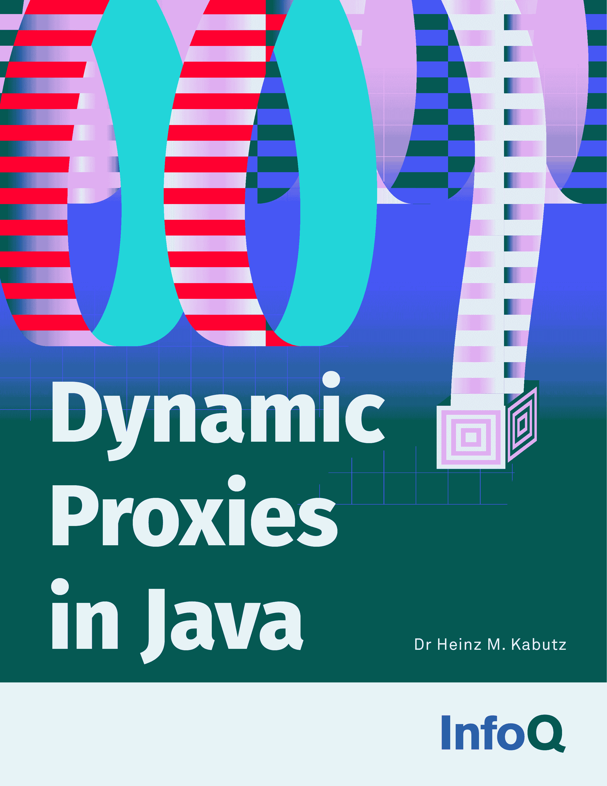

## 献辞

本书献给所有那些不得不维护我们代码的可怜灵魂。我们真的深表歉意。

## 致谢

我原以为这本书的初稿已经不错了。当我把它拿出来评审时，我并没有仅仅邀请少数技术专家，而是邀请了我的 [Java 专人士通讯报](https://www.javaspecialists.eu) 的读者们来看一看。有 500 多位热心的人提供帮助。他们剖析了这本书，并给了我 1000 多条非常有价值的意见。我采纳了几乎所有的建议，这本书现在比原来好得多。这不是我的书，这是我们的书，是由我们优秀且慷慨的 Java 专家社区共同努力的。

到为止最有价值的意见来自我的朋友 Gail Anderson、John Stephen Green 和 Joseph Ottinger。Gail 和 Joseph 充满活力地投入书中，修改了几乎所有的句子使它们变得更好。剩下的任何糟糕文本都是他们完成评审后添加的。John 费力地运行了所有的代码示例，是少数弄清楚 `VTable` 如何工作的读者之一。

我们的前 10 位超级评审员每人至少贡献了 25 条意见：

- Gail Anderson
- Alasdair Collinson
- Joseph Ottinger
- Vlad Lazurenko
- John Stephen Green
- Charles A. Sharp
- Cor Takken
- Chris Menard
- Heinz Huber
- Ronak Patel

特别感谢 [Grails Framework](https://grails.org/) 和 [Micronaut](https://micronaut.io/) 的创建者 Graeme Rocher，他阅读了书的初稿并提供了宝贵的反馈。

另一个特别感谢 Brian Goetz，我的老朋友兼畅销作家，他出色的建议推迟了这本书的发布，因为我不得不加入它们。

Kirk Pepperdine 十年来一直是我在 Java 性能方面的导师，并在一起查看某些基准测试结果方面非常有帮助。

我使用 Java 平台模块系统（JPMS）将书中的示例模块化。Simone Bordet 和 Robert Scholte 修复了项目结构以能够兼容 Maven。

此外，我想感谢以下评审员的贡献：

Manu Anand, Fabrice Aupert, Tymur Berezhnoi, Cristian Borta, Borisas Bursteinas, Robin Coe, Richard Cumberland, Thomas Darimont, Ian Darwin, Vianney Dervaux, Vlad Dinu, Wirianto Djunaidi, Mark Doppelfeld, Alex Dunwell, Dirk Estievenart, Elmar Fasel, Ondřej Fischer, Remi Forax, Kyc Fumbi, Asad Ganiev, M. Eduardo Giolo, German Gonzalez-Morris, William Goodwin, Mithun Gooty, Emmanuel Gosse, Alex Gout, Ido Green, Emmanuel Hugonnet, Enoobong Ibanga, Hans-Peter Iten, Ron Jacobs, Ulf Jährig, Harinath K., Piotr Kania, Dave Kant, Uladzimir Karabeinik, Frank Karlstrøm, Maksim Kashynski, Paul Keogh, Chandana Kithalagama, Stephen Kitt, Julian Koch, John Kostaras, Gregor Koukkoullis, Eugene Kravchenko, Michael Kuhlmann, Sanjeev Kumar, Abhi Kutty, Tim Lavers, Naga Linga S. Ala, Sina Madani, Florian Maier, Abhishek Manocha, Krzysztof Mazur, John Mermigkis, Daniel Migowski, Marijan Mihaljev, Pim Moerenhout, Milan Mrdjen, Jeff Mutonho, Maurice Naftalin, Bekezela Ncube, Andrzej Paluch, Karan Pant, Markus Peetzen, Federico Peralta Schaffner, Marcos Pinto, Morgan Pittkin, Nick Pratt, Eugene Rabii, A. N. M. Bazlur Rahman, Priya Rammohan, Alexander Rathai, Thomas Révész, Jonathan Rosenne, Leonid Rozenblyum, Krishna S., Igal Sapir, Daniel Schwering, Andrea Selva, Karthick Selvaraj, Adeel Shahzad, Sebastian Sickelmann, Martin Stefanko, Jens-Hagen Syrbe, Hasan Tahan, Simon Tenbeitel, Aleksandr Teterin, Olli Tietäväinen, Luke Torjussen, Henri Tremblay, Jesper Udby, Karel Van Der Walt, Szymon Walkowski, Torsten Werner, Alan Williamson, Kelli Wiseth, and Chris Wraith.

非常感谢。因为你们乐意帮助，这本书变得好多了。

Sven Ruppert 和我在 2015 年出版了一本关于相同主题的书，尽管是用德语。感谢 Sven 向我介绍了作者这个迷人的世界。

非常感谢 InfoQ 的编辑 Lawrence Nyveen 的帮助。

## 前言

现在是 2000 年。我们的行业度过了千年虫危机。“智能手机”也能告诉时间。Java 是一门没有泛型、Lambda 表达式或类型推断的语言。部署我们的 EAR 文件需要长时间。EAR 文件？是的，Spring 框架还有很长的路要走。程序员使用 RMI 和 CORBA。

工具生成大量的底层代码。例如，远程方法调用（RMI）使用 [`rmic`](https://docs.oracle.com/en/java/javase/13/docs/specs/man/rmic.html) 工具生成存根和骨架类以支持代理。（事实上，`rmic` 在现代发行版中仍然存在于 `JDK/bin` 目录中。）2000 年 5 月，Sun 发布了 Java 1.3——以及动态代理。不需要单独的构建步骤，通过指定要实现的接口即可动态创建新类。这些动态类的所有方法调用都路由到单个 `InvocationHandler`。底层代码使用动态代理在内存中创建存根和骨架类。

### 大收益

动态代理使代码更容易维护。与其手工编写大量类，我们编写一个动态代理。这是“不要重复”原则的加强版。

例如，一家公司用一个动态代理替换了 60 万条生成的代码语句。他们编写了一个神奇工具将他们的专有语言转换为 Java。他们的业务系统有数百个实体。他们的工具将每个实体转换为几个 Java 类。然而，在初始生成之后，程序员必须手动维护这些代码。维护工作既枯燥又容易出错。一个动态代理取代了这一切。

像 `Gradle` 这样的构建工具对模型、任务、操作和监听器使用了代理。示例包括 `BuildOperationListener`、`StandardOutputListener` 和 `ProgressListener`。Maven 通过 `MavenPluginManager` 和 `CircularDependencyProxy` 使用它们进行插件管理。

`JBoss` 和 `Spring Framework` 等应用容器使用代理进行依赖注入。示例包括 `@Inject`、`@Qualifier`、`@Autowired` 和 `@Bean`。作用域生命周期管理也使用了动态代理。

在这些容器中使用 `JPA` 进行持久化管理使用了代理——例如 `@Entity`、`@Id`、`@GeneratedValue`、`@Table` 和 `@JoinColumn`。在 Spring 中，我们可以通过扩展 `Repository` 接口派生自定义仓库。在后台，一个多接口动态装饰代理负责处理这些细节。

如果我们选择 `Hibernate` 作为 ORM，那么代理会包围 `HibernateEntityManagerFactory`、`HibernateEntityManager` 和 `EntityManagerProxy`。Spring 的 `ConnectionProxy` 是 `java.sql.Connection` 的动态代理。

同样在 Spring 中，`InitBinder` 的动态代理将 HTTP 表单字段绑定到数据模型。我们每天使用的许多框架：`Spring Framework`、`WildFly`、`NetBeans Platform`、`Apache Tomcat` 和 `OpenJDK` 等，底层都使用了动态代理。

### 等一下……

动态代理并非最好的工具。虽然非常方便，但与直接方法调用相比，动态代理上的方法调用性能开销会有略微增加。在本书中，我们将学习如何减少使用动态代理对性能的影响。

### 我们将学习什么？

在某些情况下，动态代理是特定问题的完美选择。通过深入研究它们并在各种场景中观察它们，我们将学会识别哪些地方使用它们是合理的。我们将学会识别它们的优缺点。

这使得使用动态代理的系统调试变得更加容易。

### 简单来说？

即使是像这样的微型书籍也需要几天时间来阅读和完全理解。为了让这些材料更易于获取，我创建了一个[自学课程](https://javaspecialists.teachable.com/p/dynamic-proxies-in-java)，对每个构建模块进行了详细解释。课程每个章节都有练习题，并附有模型答案。

### Java 版本

我们使用 Java 11 LTS 编译了本书的代码。在使代码更清晰的地方，我们对局部变量使用了 Java 10 的 `var` 关键字。

虽然我们在书中使用了浅反射，但尽量避免使用深反射。Mark Reinhold 在 OpenJDK [JPMS（JSR 376）专家组邮件列表](http://mail.openjdk.java.net/pipermail/jpms-spec-experts/2016-October/000431.html)上定义了这些术语。

- **浅反射访问**是通过核心反射 API（`java.lang.reflect`）在运行时进行的访问，而不使用 `setAccessible`。只能访问已导出包中的公共元素。
- **深反射访问**是在运行时通过核心反射 API 进行访问，并使用 `setAccessible` 方法来进入非公共元素。任何包中的任何元素，无论是否公共，无论是否已导出，都可以访问。深反射访问包含了浅反射访问。

### 玩得愉快！

我希望你会喜欢这本书，并发现它既实用又能激发智力。也许有时还会有趣。

尝试书中的概念；在旁边放上一杯热的 java 效果最好。在你的 IDE 中尝试这些概念。书中的所有代码示例均可在 [`github.com/kabutz/dynamic-proxies-samples`](https://github.com/kabutz/dynamic-proxies-samples) 获得。

Heinz M. Kabutz 博士

# 设计模式的亲戚

建筑师是规划、设计和审查建筑建造的人。他们的成品本身很难改变，因为从字面上讲，它是浇在混凝土里的。软件一直在变化，即使在安装多年后也是如此，因此，建筑师克里斯托弗·亚历山德（Christopher Alexander）1977 年的著作 [*A Pattern Language: Towns, Buildings, Construction*](https://www.goodreads.com/en/book/show/79766.A_Pattern_Language) 对软件行业的影响之令人惊讶。亚历山德的书关于建筑的永恒方式。他提炼了历史上反复出现的栖息模式——例如第 159 号模式，被称为“每个房间两侧的光线”。由于其描述性的名称，我们可以很容易地视觉化这种模式。

在 20 世纪 90 年代，软件行业采纳了亚历山德提出的原理并应用于软件设计。面向对象设计模式的概念在 Erich Gamma、Richard Helm、Ralph Johnson 和 John Vlissides 编写的 [*Design Patterns: Elements of Reusable Object-Oriented Software*](https://www.oreilly.com/library/view/design-patterns-elements/0201633612/) 中被永化。这四位作者通常被称为“四人帮”（Gang of Four）或简单称为 GoF。

模式最重要的标识符之一是它的名称。在《Timeless Way of Building》中，亚历山德写道：“寻找名称是发明或发现模式过程的基本组成部分。只要模式有一个很弱的名称，就意味着它不是一个清晰的概念，你不能让我去制造‘一个’。”

设计模式同样为常见的编码技术命名，使得意图的传达更加容易。了解模式有助于我们更快地理解现有设计。遗憾的是，GoF 的模式名称没有亚历山德的那么丰富。“像 wrapper（包装器）这样的名称可能意味着任何意思。因此，我们也依赖意图来清晰地识别每个模式。

在书中，我们将主要关注四个模式：`proxy`、`adapter`、`decorator` 和 `composite`。它们都是结构性模式，这意味着它们不描述行为或对象的创建，而是类和对象如何相互作用。

我们的四个模式具有类似的类层次结构，因此只需一点努力就可以使用动态代理来实现它们。它们的外观如此相似，以至于我们可以称之为“模式亲戚”。

## 代理模式

意图：“为对象提供代理或占位符以控制对其的访问。”（GoF 1994, p.207）

在代理模式中，客户端通过替代品（代理）进行通信，就像腹语木偶（如 *Trailer Boys* 中的 Conky）。


标准的 GoF 结构如图 1 所示。`Client` 使用 `Subject`，它可以是 `RealSubject` 或是 `Proxy`。`Client` 不知道，不在乎。在标准的 GoF 结构中，`Proxy` 指向 `RealSubject`。代理结构的一种变体是让 `Proxy` 指向 `Subject`。这允许我们实现级联代理。我们将在下一章末尾详细检查级联代理。

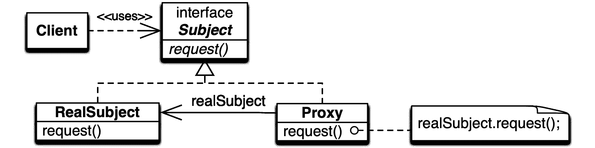

图 1 代理设计模式的结构。

代理有几种用例：

- **虚拟代理**按需创建昂贵对象。示例是 Spring Framework 中的 `LazyConnectionDataSourceProxy`，它在创建第一个 `Statement` 时延迟创建真实的 JDBC `DataSource`。
- **远程代理**为位于不同地址空间（例如远程机器上）的对象提供本地表示。注意，远程代理没有远程对象的真实指针，而是通过 RPC、RMI、Thrift、ProtoBuf、gRPC、REST、HTTP、TCP/UDP 或不同的远程调用机制调用方法。
- **保护代理**控制对原始对象的访问。这可能是为了访问控制或线程安全。示例是 `Collections.synchronizedCollection()`，它返回一个受竞态条件保护的新 `Collection`。

## 适配器模式

意图：“将一个类的接口转换为客户端期望的另一个接口。适配器允许那些因接口不兼容而无法工作的类共同工作。”（GoF 1994, p. 139）

适配器模式的目标是让对象协同工作，即使它们的接口不兼容。它是模式中的“外交官”。适配器模式既可以实现为使用组合的对象适配器，也可以实现为使用继承的类适配器。

在图 2 中，`Adapter` 实现了 `Target` 接口，并将请求委托给我们想要适配的类，在本例中为 `Adaptee`。由于我们的被适配对象是适配器内部的一个对象，我们称之为“对象适配器”。对象适配器使用组合来适配 `Adaptee`。

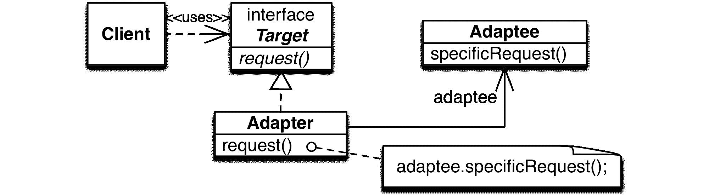

图 2。对象适配器设计模式的结构。

Java 中对象适配器的示例是 `InputStreamReader`，它将 `InputStream` 适配为 `Reader`。

另一种较少使用的适配器形式出现在我们的 `Adapter` 继承 `Adaptee` 并实现 `Target` 接口时。由于被适配对象是我们的适配器的父类，我们称之为“类适配器”，如图 3 所示。类适配器使用继承来适配 `Adaptee`。

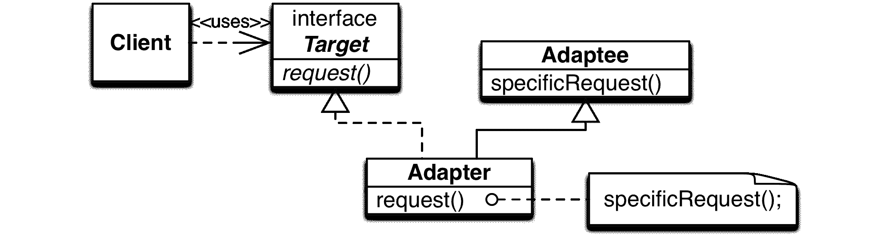

图 3。类适配器设计模式的结构。

类适配器的一个优点是它更容易修改被适配对象的部分。遗憾的是，权衡是适配一个对象层次结构变得更加困难。在后面的章节中，我们将看到如何使用动态代理来获得类适配器的扩展性和对象适配器的灵活性。

### 对象适配器与代理有什么相似之处？

在代理模式中，`RealSubject` 实现了 `Subject` 接口。如果我们去掉这种继承关系，它还是代理吗，还是会变成适配器？同样，如果一个适配器中的 `Adaptee` 恰好实现了 `Target`，那么该模式会变成代理吗？


这取决于意图。例如，在 EJB 的话 bean 中，实现 bean 并不直接继承远程接口，因为这些方法会抛出不兼容的异常。远程接口会抛出 `RemoteException`，而实现 bean 会抛出业务异常。

对象适配器的结构与代理相似。在两种情况下，客户端都使用顶层接口 `Target` 或 `Subject`。我们在 `Adapter` 或 `Proxy` 中拥有该的实现。

## 装饰器模式

意图：“动态地给对象附加额外的责任。装饰器为通过子类扩展功能提供了灵活的替代。” (GoF 1994, p. 175)

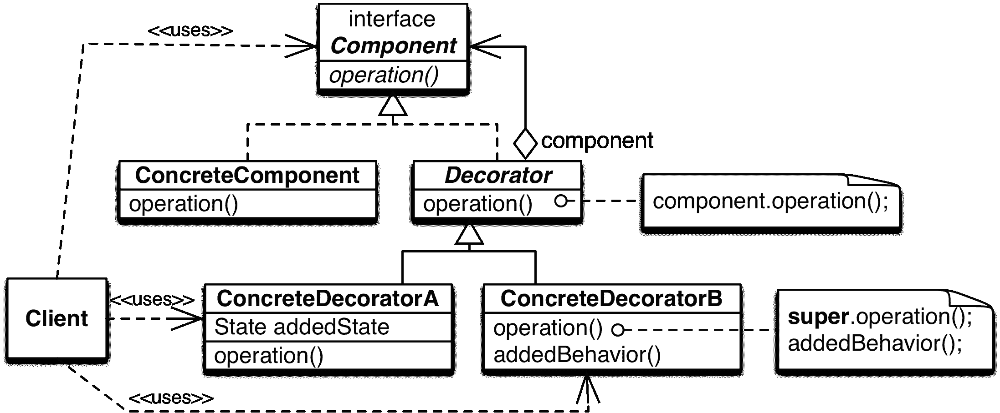

图 4。装饰器设计模式的结构。

当我们想要向一个类添加新方法时，最简单的方法是将它们添加到子类中。然而，这可能导致笨拙的类层次结构，并由于无法扩展多个父类而面临代码重复的风险。更好的方法是装饰器模式，通过这种模式我们用更丰富的类来装饰对象，从而“附加额外的责任”。我们还可以使用这种模式移除我们不想支持的方法。这被称为“过滤”。

装饰器的一个著名例子是 `java.io.InputStream` 及其相关类，其设计拷贝自 C++。具体组件包括 `FileInputStream` 和 `SocketInputStream`。我们还有许多装饰器，例如用于添加 I/O 缓冲的 `BufferedInputStream`，用于以小端格式读取原始数据的 `DataInputStream`，以及用于序列化读取 Java 对象的 `ObjectInputStream`。甚至还有一个 `ProgressMonitorInputStream`，如果读取输入超过两秒，它会打开一个 Swing 进度对话框。

在列表 1.1 中，我们创建一个指向文件 `data.bin.gz` 的 `FileOutputStream`。我们用 `GZIPOutputStream`、`BufferedOutputStream` 和 `DataOutputStream` 对其进行装饰。链中的每个环节都增加了一个功能。然后我们写入了 0 到 1,000 之间的 1000 万个随机整数。

```java
//:~ core/src/main/.../ch01/InputStreamDemo.java
try (var out = new DataOutputStream(
    new BufferedOutputStream(
        new GZIPOutputStream(
            new FileOutputStream(
                "data.bin.gz"))))) {
  // 向 data.bin.gz 写入 0 到 1000 之间的千万个随机整数
  // 并实时使用 GZIP 对文件进行压缩
  ThreadLocalRandom.current().ints(10_000_000, 0, 1_000)
      .forEach(i -> {
        try {
          out.writeInt(i);
        } catch (IOException e) {
          throw new UncheckedIOException(e);
        }
      });
  out.writeInt(-1); // 我们的 EOF 标记
}
```

列表 1.1：写入 `DataOutputStream`。

在列表 1.2 中，我们从 `DataInputStream` 读取，它反过来又从 `BufferedInputStream`、`GZIPInputStream` 和 `FileInputStream` 读取。

```java
//:~ core/src/main/.../ch01/InputStreamDemo.java
try (
    // 分别声明 "fis" 以确保它被关闭，
    // 即使文件不包含正确的 GZIP 头
    var fis = new FileInputStream("data.bin.gz");
    var in = new DataInputStream(
        new BufferedInputStream(
            new GZIPInputStream(fis)))) {
  long total = 0;
  int value;
  // 持续读取直到 value == -1，我们的 EOF 标记
  while ((value = in.readInt()) != -1) {
    total += value;
  }
  // 我们期望 total 为 50 亿
  System.out.println("total = " + total);
}
```

列表 1.2：从 `DataInputStream` 读取。

（我们单独声明 `FileInputStream` 的原因是 `GZIPInputStream` 会读取文件头以验证是否为 gzip 文件。如果头部错误，`GZIPInputStream` 的构造函数将抛出异常，在这种情况下 `FileInputStream` 将无法自动关闭。）

### 装饰器与代理有什么相似之处？

装饰器在结构上与代理最相似。`Component` 是 `Subject`，`Decorator` 类似于 `Proxy`，而 `ConcreteComponent` 类似于 `RealSubject`。一个区别在于客户端看到的类。装饰器通常将组件作为构造参数。

## 组合模式

意图：“将对象组合成树形结构以表示部分整体关系。组合允许客户端统一地处理单个对象和对象的组合。” (GoF 1994, p. 163)

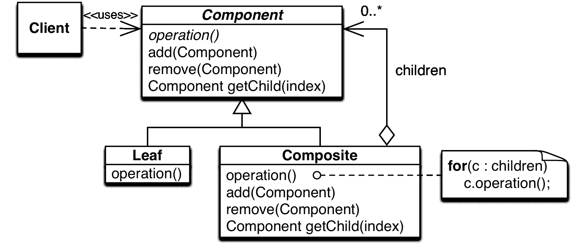

图 5。组合设计模式的结构。

这种结构再次类似于代理和对象适配器。区别在于组合与组件之间存在一对多的关系。客户端与顶层组件类交互。

### 组合与代理有什么相似之处？

在组合模式和代理模式中，客户端都会使用顶层接口 `Subject` 或 `Component`。然而，组合模式在 `Composite` 和 `Component` 之间是一一对多的关系，而代理模式在 `Proxy` 和 `Subject` 之间是一对一的关联。

## 责任链模式

意图：“通过给多个对象处理请求的机会，避免请求发送者与其接收者之间的耦合。将接收对象链接起来并沿链传递请求，直到某个对象处理它为止。” (GoF 1994, p. 223)


图 6。责任链设计模式的结构。

我们使用责任链模式使方法处理代码更易于理解。当代码具有列表 1.3 所示的形式时，这种模式非常有用。

```java
//:~ core/src/main/.../ch01/ChainDemo.java
public void handleWithoutChain(
    String key, Consumer<String> processor) {
  var item = map1.get(key);
  if (item != null) processor.accept(item);
  else {
    item = map2.get(key);
    if (item != null) processor.accept(item);
    else {
      item = map3.get(key); // 循环
    }
  }
}
```

Listing 1.3: 嵌套的 if-else-if 结构。

我们没有使用多条件 `if-else` 语句，而是创建了一个抽象的 `Handler` 类。`handle()` 的默认实现是将调用沿着链向下传递给下一个处理程序。

```java
//:~ core/src/main/.../ch01/Handler.java
public abstract class Handler {
  private final Handler next;
  public Handler(Handler next) {
    this.next = next;
  }
  public void handle(String key, Consumer<String> processor) {
    if (next != null) next.handle(key, processor);
  }
}
```

Listing 1.4: 责任链处理程序。

我们的 `MapHandler` 包含了具体的实现：如果在我们的 map 中找到了该项，则调用 `process(item)`；否则，调用 `super.handle(key)`。

```java
//:~ core/src/main/.../ch01/MapHandler.java
public class MapHandler extends Handler {
  private final Map<String, String> map;
  public MapHandler(Map<String, String> map, Handler next) {
    super(next);
    this.map = map;
  }
  @Override
  public void handle(String key, Consumer<String> processor) {
    String item = map.get(key);
    if (item != null) processor.accept(item);
    else super.handle(key, processor);
  }
}
```

Listing 1.5: `Map` 的具体处理程序。

在我们的类内部，我们将按照 Listing 1.6 所示的方式设置链。

```java
//:~ core/src/main/.../ch01/ChainDemo.java
private final Handler chain =
    new MapHandler(map1,
        new MapHandler(map2,
            new MapHandler(map3, null)));
```

Listing 1.6: 作为字段的处理程序链。

与 Listing 1.3 中复杂的 `if-else-if` 结构相比，我们可以这样写：

```java
//:~ core/src/main/.../ch01/ChainDemo.java
private void handleWithChain(
    String key, Consumer<String> processor) {
  chain.handle(key, processor);
}
```

Listing 1.7: 使用责任链处理程序。

该模式使得复杂的 `if-else-if` 方法变得易于理解。该模式的一个已知缺点是，如果没有找到合适的处理程序，请求可能会在链的末端丢失。在第 4 章中，我们将学习这种模式如何帮助我们处理方法调用。我们还将看到如何防止请求从链的末端掉。

# 手工代理

由于我们的书名中包含“代理（proxies）”，我们应该更详细地检查代理设计模式。代理有多种形式和类型。例如，我们提到过用于延迟初始化的虚拟代理、用于访问远程地址空间对象的远程代理以及用于添加安全层的保护代理。

提醒一下，GoF 书中的代理设计模式结构如图 7 所示。


图 7. 代理结构。

## 使用虚拟代理进行延迟初始化

在某些情况下，我们可能希望在绝对需要时才延迟创建对象。推迟甚至可以完全节省对象创建的成本。此类高成本创建对象示例包括线程、数据库连接、大型数组和文件。

例如，一个新的 `HashMap` 占用 48 字节，不包括其条目数组。该数组传统上从长度 16 开始，并在占用率超过 75% 时增长。一个包含 16 个对象的数组又占用 80 字节。这意味着，在包含任何元素之前，一个新的 `HashMap` 的组合成本就达到了 128 字节。

### CustomMap

`CustomMap` 接口包含了 `java.util.Map` 定义的方法子集。在代理设计模式结构中，`CustomMap` 是 `Subject` 接口的一个示例。

```java
//:~ core/src/main/.../ch02/virtual/CustomMap.java
public interface CustomMap<K, V> {
  int size();
  V get(Object key);
  V put(K key, V value);
  V remove(Object key);
  void clear();
  void forEach(BiConsumer<? super K, ? super V> action);
  // 等等
}
```

Listing 2.1: `CustomMap` 接口。

我们 `CustomMap` 的类结构如图 8 所示。

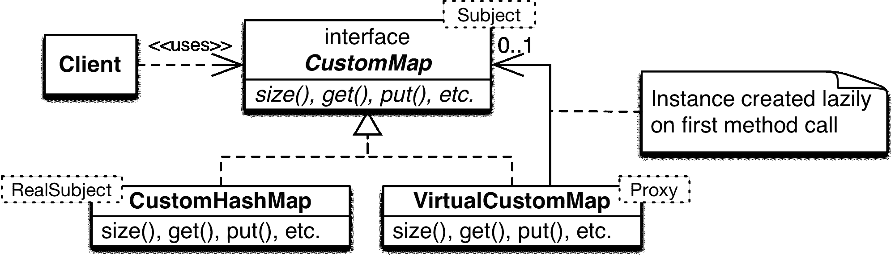

图 8. `CustomMap` 结构。

### CustomHashMap

`CustomHashMap` 实现了 `CustomMap`。由于我们不想重造轮子，我们将所有方法委托给 `java.util.HashMap`。在代理设计模式结构中，`CustomHashMap` 是 `RealSubject` 类的一个示例。

```java
//:~ core/src/main/.../ch02/virtual/CustomHashMap.java
public class CustomHashMap<K, V> implements CustomMap<K, V> {
  private final Map<K, V> map;
  public CustomHashMap() {
    this.map = new HashMap<>();
  }
  @Override
  public int size() {
    return map.size();
  }
  @Override
  public V get(Object key) {
    return map.get(key);
  }
  @Override
  public V put(K key, V value) {
    return map.put(key, value);
  }
  @Override
  public V remove(Object key) {
    return map.remove(key);
  }
  @Override
  public void clear() {
    map.clear();
  }
  @Override
  public void forEach(BiConsumer<? super K, ? super V> action) {
    map.forEach(action);
  }
  @Override
  public String toString() {
    return map.toString();
  }
}
```

Listing 2.2: `CustomHashMap` 类。

### VirtualMap

最后，我们创建了虚拟代理 `VirtualMap`。

```java
//:~ core/src/main/.../ch02/virtual/VirtualMap.java
public class VirtualMap<K, V> implements CustomMap<K, V> {
  private final Supplier<CustomMap<K, V>> supplier;
  private CustomMap<K, V> realMap;

  public VirtualMap(Supplier<CustomMap<K, V>> supplier) {
    this.supplier = supplier;
  }

  private CustomMap<K, V> getRealMap() {
    if (realMap == null) {
      realMap = supplier.get();
    }
    return realMap;
  }

  @Override
  public int size() {
    return getRealMap().size();
  }
  @Override
  public V get(Object key) {
    return getRealMap().get(key);
  }
  @Override
  public V put(K key, V value) {
    return getRealMap().put(key, value);
  }
  @Override
  public V remove(Object key) {
    return getRealMap().remove(key);
  }
  @Override
  public void clear() {
    getRealMap().clear();
  }
  @Override
  public void forEach(BiConsumer<? super K, ? super V> action) {
    getRealMap().forEach(action);
  }
  @Override
  public String toString() {
    return getRealMap().toString();
  }
}
```

Listing 2.3: `VirtualMap` 代理类。


让我们看看如何使用它。我们的局部变量 `map` 指向一个 `VirtualMap` 实例。在第一次调用诸如 `put()` 或 `get()` 方法之前，真正的 `HashMap` 不会被创建。当我们这样做时，供应器会被调用，`HashMap` 被创建。之后，所有的调用都路由到包含的 `HashMap` 中。

```java
//:~ core/src/main/.../ch02/virtual/VirtualProxyDemo.java
publicMapDemo {
  public static void main(String[] args) {
    CustomMap<String, Integer> map =
        new VirtualMap<>(CustomHashMap::new);
    System.out.println("Virtual Map created");
    map.put("one", 1);
    map.put("life", 42);
    System.out.println("map.get(\"life\") = " + map.get("life"));
    System.out.println("map.size() = " + map.size());
    System.out.println("clearing map");
    map.clear();
    System.out.println("map.size() = " + map.size());
  }
}
```

Listing 2.4: `VirtualProxyDemo`。

# 使用远程代理调用远程方法

大使馆是远程国家的本地代表。当我们申请签证、续换护照，或者在不乘坐飞机的情况下与远程实体（该国政府）交互时，就会访问它们。大使馆有点就像远程代理。

假设我们想申请访问加拿大的签证。

```java
//:~ core/src/main/.../ch02/remote/Canada.java
public interface Canada {
  boolean canGetVisa(String name,
                     boolean married,
                     boolean rich);
}
```

列表 2.6：`Canada`。

我们的实现类定义在 `RealCanada` 内部，它检查最关键的属性。该类名听起来像某种啤酒的名字：“Real Canada - 入口极其顺滑。啊。扑灭最深处的渴…………​。”

```java
//:~ core/src/main/.../ch02/remote/RealCanada.java
public class RealCanada implements Canada {
  @Override
  public boolean canGetVisa(String name,
                            boolean married,
                            boolean rich) {
    return married && rich || !married && rich || rich;
    // 每个国家都喜欢富有的游客 ... :-)
  }
}
```

列表 2.7：`RealCanada`。

我们将使用 [Jetty Web 服务器](https://github.com/eclipse/jetty.project) 发布它。

```java
//:~ core/src/main/.../ch02/remote/ServicePublisher.java
/**
 * @author Simone Bordet
 */
public class ServicePublisher extends AbstractHandler {
  private static final Pattern PATTERN =
      Pattern.compile("/canGetVisa/" +
                          "(?<name>[^/]+)/" +
                          "(?<married>[^/]+)/" +
                          "(?<rich>[^/]+)");
  private final Canada canada;

  public ServicePublisher(Canada canada) {
    this.canada = canada;
  }

  @Override
  public void handle(String target, Request jettyRequest,
                     HttpServletRequest request,
                     HttpServletResponse response)
      throws IOException {
    jettyRequest.setHandled(true);
    var matcher = PATTERN.matcher(request.getRequestURI());
    if (matcher.matches()) {
      var name = matcher.group("name");
      var married = Boolean.valueOf(matcher.group("married"));
      var rich = Boolean.valueOf(matcher.group("rich"));
      var canGetVisa = canada.canGetVisa(name, married, rich);
      response.getOutputStream().print(canGetVisa);
    } else {
      response.setStatus(HttpServletResponse.SC_NOT_FOUND);
    }
  }

  public static void main(String... args) throws Exception {
    Canada canada = new RealCanada();
    var server = new Server(8080);
    server.setHandler(new ServicePublisher(canada));
    server.start();
  }
}
```

列表 2.8：远程代理发布者。

服务器端就此了。当我们运行 `ServicePublisher` 时，它会创建一个我们可以连接的 REST 服务。

接下来，我们创建一个远程代理，连接到该 REST 服务并调用方法。

```java
//:~ core/src/main/.../ch02/remote/CanadianEmbassy.java
public class CanadianEmbassy implements Canada {
  private final HttpClient httpClient =
      HttpClient.newBuilder().build();

  @Override
  public boolean canGetVisa(String name,
                            boolean married,
                            boolean rich) {
    try {
      var encodedName = URLEncoder.encode(name,
          StandardCharsets.UTF_8);
      var url = "http://0.0.0.0:8080/canGetVisa/" +
                    encodedName + "/" +
                    married + "/" + rich;
      var req = HttpRequest.newBuilder()
                    .uri(URI.create(url))
                    .build();
      var res = httpClient.send(
          req, HttpResponse.BodyHandlers.ofString());
      return res.statusCode() == HttpURLConnection.HTTP_OK &&
                 Boolean.parseBoolean(res.body());
    } catch (IOException e) {
      throw new UncheckedIOException(e);
    } catch (InterruptedException e) {
      Thread.currentThread().interrupt();
      throw new CancellationException("interrupted");
    }
  }
}
```

列表 2.9：我们的 `CanadianEmbassy`。

`Client` 看起来就是普通的 Java 代码，完全感知不到远程实现。

```java
//:~ core/src/main/.../ch02/remote/Client.java
public class Client {
  public static void main(String... args) {
    Canada canada = new CanadianEmbassy();
    boolean visaObtained = canada.canGetVisa(
        "Heinz Kabutz", true, false);
    System.out.println("visaObtained = " + visaObtained);
    System.out.println("Wins lottery ...");
    visaObtained = canada.canGetVisa(
        "Heinz Kabutz", true, true);
    System.out.println("visaObtained = " + visaObtained);
  }
}
```

列表 2.10：`Client`。

我们通过以下方式运行此示例：首先启动 `ServicePublisher` 类，然后运行我们的 `Client`。

```
visaObtained = false
Wins lottery ...
visaObtained = true
```

列表 2.11：我们拿到签证了吗？

# 使用保护代理实现安全性

安全性要么在它工作正常时极其无聊，要么在它出问题时超级令人兴奋（以糟糕的方式）。

我们需要保护对象，就像保护资产。保护代理可以防止以下情况：

- 并发访问导致的竞态条件。
- 未经授权的修改。
- 对敏感状态的非法访问。

我们将查看不同的保护代理。

## `SynchronizedMap`

我们的 `HashMap` 在列表 2.2 中不是线程安全的。它依赖于 `java.util.HashMap`，这无法在并发访问保护状态。为了说明，考虑列表 2.12。我们使用并行流向 `map` 放入 46,000 个条目。然后通过 `forEach()` 遍历 `map` 并统计有多少条目。最后，我们打印出值。

```java
//:~ core/src/test/.../ch02/protection/ConcurrentTest.java
public class ConcurrentTest {
  public static final int SQUARES = 46_000;

  public void check(Map<Integer, Integer> map) {
    System.out.println("Checking " + map.getClass().getSimpleName());
    try {
      IntStream.range(0, SQUARES)
          .parallel()
          .forEach(i -> map.put(i, i));
    } catch (Exception e) {
      System.err.println(e);
    }

    // count actual entries
    var entries = new LongAdder();
    map.forEach((k, v) -> entries.increment());

    System.out.println("entries = " + entries);
    System.out.println("map.size() = " + map.size());

    assertTrue("entries=" + entries + ", " +
               "map.size=" + map.size(),
        entries.intValue() == map.size());
  }
}
```

列表 2.12：`ConcurrentTest` 使用并行流并发修改 `map`。

我们的 `CustomHashMapTest` 为 `ConcurrentTest` 提供了 `CustomHashMap`。

```java
//:~ core/src/test/.../ch02/protection/CustomHashMapTest.java
public class CustomHashMapTest extends ConcurrentTest {
  @Test
  public void testCustomHashMap() {
    try {
      check(new CustomHashMap<>()); // 不工作
    } catch (AssertionError error) {
      System.err.println(error);
    }
  }
}
```

列表 2.13：`CustomHashMapTest`。

在配备 6 核心的 2018 款 MacBook Pro (i9) 上多次运行此代码，统计出的 `entries` 从未等于 `map.size()`。计数也不等于 46,000。例如，列表 2.14 是其中一次运行的输出。

```
CustomHashMap constructed
Checking CustomHashMap
entries = 35474
map.size() = 41663
java.lang.AssertionError: entries=35474, map.size=41663
```

列表 2.14：来自 `CustomHashMapTest` 的输出。

为了解决 `CustomHashMap` 中的竞态条件，我们将使用 `SynchronizedCustomMap` 对其进行代理。在委托给 `CustomMap` 方法之前，我们将所有方法都标记为 `synchronized`。

```java
//:~ core/src/main/.../ch02/protection/SynchronizedCustomMap.java
public class SynchronizedCustomMap<K, V>
    implements CustomMap<K, V> {
  private final CustomMap<K, V> map;

  public SynchronizedCustomMap(CustomMap<K, V> map) {
    this.map = map;
  }

  @Override
  public synchronized int size() {
    return map.size();
  }

  @Override
  public synchronized V get(Object key) {
    return map.get(key);
  }

  @Override
  public synchronized V put(K key, V value) {
    return map.put(key, value);
  }

  @Override
  public synchronized V remove(Object key) {
    return map.remove(key);
  }

  @Override
  public synchronized void clear() {
    map.clear();
  }

  @Override
  public synchronized void forEach(
      BiConsumer<? super K, ? super V> action) {
    map.forEach(action);
  }
}
```

Listing 2.15: `SynchronizedCustomMap` 使用 `synchronized` 来保证线程安全。

我们的 `SynchronizedTest` 创建了一个代理自 `CustomHashMap` 的 `SynchronizedCustomMap`，并将其传递给 `ConcurrentTest`。


```java
//:~ core/src/test/.../ch02/protection/SynchronizedTest.java
public class SynchronizedTest extends ConcurrentTest {
  @Test
  public void testSynchronizedCustomMap() {
    check(new SynchronizedCustomMap<>(new CustomHashMap<>()));
  }
}
```

Listing 2.16: 用于测试 `SynchronizedCustomMap` 的 `SynchronizedTest`。

正如预期，当我们使用 `synchronized` 保护对 `CustomMap` 的所有访问时，我们就消除了竞态条件。

### `UnmodifiableCustomMap`

直接从方法返回的集合往往是 bug 的根源。当调用者更改这些集合时，到底会发生什么并不总是清楚的。原始集合应该被修改，还是更改不应该产生影响？推荐的方法之一是返回一个不可修改的集合，也就是说如果调用了会修改集合内容的方法，该方法将抛出 `UnsupportedOperationException`。我们的 `CustomMap` 是通过 `put()`、`remove()` 和 `clear()` 方法修改的。

如果我们想确保任何获取了 map 的人无法修改它，我们可以发送给他们一个 `UnmodifiableCustomMap`（不可修改自定义 map）。每当我们调用如 `put()` 等修改方法时，它都会抛出 `UnsupportedOperationException`。

```java
//:~ core/src/main/.../ch02/protection/UnmodifiableCustomMap.java
public class UnmodifiableCustomMap<K, V>
    implements CustomMap<K, V> {
  private final CustomMap<K, V> map;
  public UnmodifiableCustomMap(CustomMap<K, V> map) {
    this.map = map;
  }
  @Override
  public int size() {
    return map.size();
  }
  @Override
  public V get(Object key) {
    return map.get(key);
  }
  @Override
  public V put(K key, V value) {
    throw new UnsupportedOperationException("unmodifiable");
  }
  @Override
  public V remove(Object key) {
    throw new UnsupportedOperationException("unmodifiable");
  }
  @Override
  public void clear() {
    throw new UnsupportedOperationException("unmodifiable");
  }
  @Override
  public void forEach(BiConsumer<? super K, ? super V> action) {
    map.forEach(action);
  }
}
```

Listing 2.17: `UnmodifiableCustomMap` 对修改方法抛出 `UnsupportedOperationException`。

我们的 `UnmodifiableTest` 检查了使用之前展示的 `ConcurrentTest` 尝试修改 `UnmodifiableCustomMap` 时会发生什么。

```java
//:~ core/src/test/.../ch02/protection/UnmodifiableTest.java
public class UnmodifiableTest extends ConcurrentTest {
  @Test
  public void testUnmodifiableCustomMap() {
    check(new UnmodifiableCustomMap<>(new CustomHashMap<>()));
  }
}
```

Listing 2.18: `UnmodifiableTest`。

正如预期，调用 `put()` 会导致 `UnsupportedOperationException`。

```
CustomHashMap constructed
Checking UnmodifiableCustomMap
java.lang.UnsupportedOperationException: unmodifiable
entries = 0
map.size() = 0
```

Listing 2.19: `UnmodifiableTest` 的输出。

## 级联代理

原始的 GoF 代理类图有一个从 `Proxy` 到 `RealSubject` 的关联。一种更灵活的方法是让 `Proxy` 指向 `Subject` 接口。这正是我们迄为止编写每个代理示例的方式。通过指向 `Subject`，我们可以对代理进行级联：一个保护代理可能会指向一个虚拟代理，而虚拟代理反过来可能指向一个远程代理，然后指向 `RealSubject`。

例如，让我们之前的 `SynchronizedCustomMap` 与我们的 `VirtualCustomMap` 结合。

```java
//:~ core/src/test/.../ch02/protection/SynchronizedVirtualTest.java
public class SynchronizedVirtualTest extends ConcurrentTest {
  @Test
  public void testSynchronizedVirtualMap() {
    check(new SynchronizedCustomMap<>(new VirtualCustomMap<>()));
  }
}
```

Listing 2.20: 级联保护代理与虚拟代理。

为了实现这种透明性，让我们首先完善代理的 `equals()` 方法。请注意，委托给 `map` 与我们之前编写代理方法的方法一致。

```java
//:~ core/src/main/.../ch02/equals/FixedEqualsInHandCraftedProxy.java
@Override
public boolean equals(Object o) {
  return map.equals(o);
}
@Override
public int hashCode() {
  return map.hashCode();
}
```

列表 2.24：一致的代理 `equals()` 方法。

`CustomHashMap` 需要更多的一些工作。

1.  我们确保参数是 `CustomMap` 的实例。当参数为 `null` 或不是 `CustomMap` 的其他对象时，它将返回 `false`。

2.  我们检查参数的类是否为 `CustomHashMap`。如果是同一个类，则进行向下类型转换并比较两个 `map` 字段。最佳实践是将 `CustomHashMap` 中的 `equals()` 方法标记为 `final`，以防止意外的重写，因为这会导致非对称的 `equals()` 方法。由于 `hashCode()` 需要与 `equals()` 配对使用，我们也将其标记为 `final`。

3.  否则，我们返回反转 `equals` 条件的结果，即 `o.equals(this)`。如果不反转，我们将陷入无限循环。由于 `equals()` 要求具有对称性，`o.equals(this)` 的结果必须与 `this.equals(o)` 相同。

```java
//:~ core/src/main/.../ch02/equals/FixedEqualsInCustomHashMap.java
@Override
public final boolean equals(Object o) {
  if (this == o) return true;
  if (!(o instanceof CustomMap)) return false;

  if (o instanceof CustomHashMap) {
    CustomHashMap<?, ?> that = (CustomHashMap<?, ?>) o;
    return this.map.equals(that.map);
  }
  return o.equals(this); // 反转 equals() 条件
}
@Override
public final int hashCode() {
  return map.hashCode();
}
```

列表 2.25：正确的 `CustomHashMap.equals()`。

我们在 `CustomMapEqualsTest` 中看到了 `equals()` 方法的实际应用。要查看更完整的测试集，请访问 [github.com/kabutz/dynamic-proxies-samples](https://github.com/kabutz/dynamic-proxies-samples/tree/master/core/src/test/java/eu/javaspecialists/books/dynamicproxies/ch02/equals)。

```java
//:~ core/src/test/.../ch02/equals/CustomMapEqualsTest.java
public class CustomMapEqualsTest {
  @Test
  public void testEqualsContract() {
    var real = new CustomHashMap<Integer, Integer>();
    for (int i = 0; i < 10; i++) real.put(i, i * i);
    var proxy1 = new UnmodifiableCustomMap<>(real);
    var proxy2 = new UnmodifiableCustomMap<>(real);
    var empty = new CustomHashMap<Integer, Integer>();

    // 自反性
    assertEquals(real, real);
    assertEquals(proxy1, proxy1);
    assertEquals(proxy2, proxy2);

    // 对称性
    assertEquals(real, proxy1);
    assertEquals(proxy1, real);
    assertEquals(proxy1, proxy2);
    assertEquals(proxy2, proxy1);

    // 传递性
    if (real.equals(empty) && empty.equals(proxy2))
      assertEquals(real, proxy2);
    if (real.equals(proxy1) && proxy1.equals(proxy2))
      assertEquals(real, proxy2);
  }
}
```

列表 2.26：`equals()` 示例。

搞定！我们有了一个满足所有上述要求的 `equals()` 方法，并允许我们的真实主体变得“可代理”。它具有自反性、对称性和传递性。此外，如果我们将对象与它的代理进行比较，我们将得到预期的结果 `true`。

# 动态代理

到为止，我们都是通过手工编写代理类。当每种代理在结构和功能上都是唯一的时，手工编写是有意义的。然而，大多数代理实现都是相似的。例如，远程代理必须在参数和返回值之间进行传递。Java RMI 以存根（stubs）和骨架（skeletons）的形式为远程代理生成胶代码。IDE 会为我们生成委托模板代码，但我们仍然需要阅读所有这些代码来理解它们在做什么。

代码生成可以是静态的或动态的。静态生成不太方便，因为它需要额外的构建步骤。动态生成在运行时创建一个新的代理类。它非常方便且灵活。在本章中，我们将学习 Java 中动态代理是如何工作的。

## `Proxy.newProxyInstance()`

我们使用静态工厂方法 `newProxyInstance()` 通过以下三个参数来构造动态代理：

*   `ClassLoader loader` 是加载我们新代理类的地方。`ClassLoader` 需要能够看到我们想要实现的接口。例如，引导程序类加载器知道 Java 接口（`java.lang.Runnable`、`java.util.Collection` 等），但不知道应用程序接口。我们的类是使用系统类加载器（也称为 `AppClassLoader`）加载的。

*   `Class<?>[] interfaces` 是一个包含代理对象需要实现的所有接口的数组。

*   `InvocationHandler` 是一个函数接口，每当调用任何方法时都会被调用。

### `InvocationHandler`

在代理对象上调用的任何方法都会派发到 `InvocationHandler` 的 `invoke()` 方法。

```java
//:~ core/src/main/.../ch03/InvocationHandlerDeclaration.java
public interface InvocationHandler {
  public Object invoke(Object proxy,
                       Method method,
                       Object[] args) throws Throwable;
}
```

列表 3.4：`InvocationHandler`。

`invoke()` 方法有三个参数：

- `Object proxy` 是调用 `invoke()` 的动态代理类的实例。我们将在稍后的章节中使用它。

- `Method method` 是一个 `java.lang.reflect.Method` 对象，对应被调用的方法。该方法要么来自创建动态代理时所使用的接口之一，要么来自 `Object` 类的三个公共非 final 方法之一，即 `hashCode()`、`equals(Object)` 或 `toString()`。

- `Object[] args` 是传递给该方法的参数数组。当方法没有任何参数时，该数组为 `null`。

`invoke()` 方法声明它会抛出 `Throwable`。然而，方法应该只抛出那些在其方法签名中声明的受检异常（checked exceptions）。这是动态代理如何具有动态性的另一个例子——静态类型系统显示为 `Throwable`，但对于它们可以抛出哪些异常存在着动态约束。

### `LoggingInvocationHandler`

让我们来看如何创建我们自己的 `InvocationHandler`。在我们的 `LoggingInvocationHandler` 中，我们记录了方法调用以及它们消耗的时间。我们假设 `Object obj` 实现了与动态代理相同的接口。因此，我们通过 `return method.invoke(obj, args)` 将方法调用委托给 `obj`，并在周围包裹我们的日志代码。

大部分代码都是自而易懂的，除了 `logFine` 优化部分。`System.nanoTime()` 是一个昂贵的系统调用，除非在启用细粒日志（fine logging），否则我们希望避免调用它。由于级别在我们调用 `method.invoke()` 期间可能会发生，我们将原始设置写入一个 `final` 局部变量 `logFine` 中。再次，`method.invoke()` 是动态代理如何具有动态性的一个例子——我们经常委托给底层功能，并且通过反射来实现这一点。


```
/*:~ core/src/main/.../handlers/LoggingInvocationHandler.java */
public final class LoggingInvocationHandler
    implements InvocationHandler {
  private final Logger log;
  private final Object obj;
  public LoggingInvocationHandler(Logger log, Object obj) {
    this.log = log;
    this.obj = obj;
  }
  @Override
  public Object invoke(Object proxy, Method method,
                       Object[] args) throws Throwable {
    log.info(() -> "Entering " + toString(method, args));
    // optimization - nanoTime() is an expensive native call
    final boolean logFine = log.isLoggable(Level.FINE);
    long start = logFine ? System.nanoTime() : 0;
    try {
      return method.invoke(obj, args);
    } finally {
      long nanos = logFine ? System.nanoTime() - start : 0;
      log.info(() -> "Exiting " + toString(method, args));
      if (logFine) log.fine(() -> "Time " + nanos + "ns");
    }
  }
  private String toString(Method method, Object[] args) {
    return String.format("%s.%s(%s)",
        method.getDeclaringClass().getCanonicalName(),
        method.getName(),
        args == null ? "" :
            Stream.of(args).map(String::valueOf)
                .collect(Collectors.joining(", ")));
  }
}
```

列表 3.5：`LoggingInvocationHandler`。

在列表 3.6 的 `LoggingProxyDemo` 中，我们创建了一个 `LoggingInvocationHandler`，它将所有方法调用记录到 `ConcurrentHashMap` 中。

然后，我们通过调用 `Proxy.newProxyInstance()` 创建一个动态代理，传入 `Map` 的类加载器（即引导程序类加载器）、一个包含 `Map` 接口的数组以及我们的 `LoggingInvocationHandler` 实例。

`newProxyInstance()` 用的结果类型为 `Object`，我们需要手动将其强制转换为正确的类型，在我们的例子中是 `Map<String, Integer>`。这是一个动态代理如何具有动态性的例子——静态类型系统显示为 `Object`，但动态类型更窄。

一个动态代理可能实现很多接口，因此并不清楚我们想要强制转换为哪一个。

一旦我们将我们的动态代理对象强制转换为 `Map`，我们在其上调用的所有方法都会被记录，连同它们的执行时间。

```
//:~ core/src/main/.../ch03/logging/LoggingProxyDemo.java
var handler = new LoggingInvocationHandler(
    Logger.getGlobal(), new ConcurrentHashMap<>());
@SuppressWarnings("unchecked")
var map = (Map<String, Integer>)
              Proxy.newProxyInstance(
                  Map.class.getClassLoader(),
                  new Class<?>[] {Map.class},
                  handler);
map.put("one", 1);
map.put("two", 2);
System.out.println(map);
map.clear();
```

列表 3.6：`map` 的日志方法。

## 动态类的名称

动态代理的类名是什么？例如，考虑列表 3.7 中的 `ISODateParser` 接口，它解析 `yyyy-MM-dd` 格式的日期。这等同于图 7 中的 `Subject` 接口。

```
//:~ core/src/main/.../ch03/ISODateParser.java
/**
 * 解析 yyyy-MM-dd 格式的字符串并返回 LocalDate。
 */
public interface ISODateParser {
  LocalDate parse(String date) throws ParseException;
}
```

列表 3.7：`ISODateParser` 接口。

我们创建一个动态代理并将类名打印到 `System.out`。

```
//:~ core/src/main/.../ch03/ProxyName.java
public class ProxyName {
  public static void main(String... args) {
    System.out.println(
        Proxy.newProxyInstance(
            ISODateParser.class.getClassLoader(),
            new Class<?>[] {ISODateParser.class},
            (proxy, method, arguments) -> null
        ).getClass()
    );
  }
}
```

列表 3.8：`ProxyName`。

输出显示类名为 `com.sun.proxy.$Proxy0`。

```
class com.sun.proxy.$Proxy0
```

列表 3.9：`ProxyName` 输出。

动态代理通常命名为 `$Proxy` 后跟数字。当所有接口都是公共的，包通常是 `com.sun.proxy`，但在你的操作系统和 JDK 上可能是另一个包。类名和包可能会随版本之间甚至运行之间变化。当我们从模块内部未导出的包创建动态代理时，包名会有不同。如果至少有一个接口是非公共的，代理类将位于该接口所在的包中。无法为位于不同包的非公共接口创建动态代理。

## 析 `$Proxy0`

我们可以通过系统属性 `-Djdk.proxy.ProxyGenerator.saveGeneratedFiles=true`（Java 9+）或较早版本 Java 中的 `-Dsun.misc.ProxyGenerator.saveGeneratedFiles=true` 将生成的代理类转储到当前工作目录。

例如，列表 3.10 显示了从 `ISODateParser` 接口生成的动态代理。我们可以看到 `$Proxy0` 派自 `java.lang.reflect.Proxy`，后者存储了 `InvocationHandler` 实例 `h`。公共接口方法以及 `java.lang.Object` 的 `hashCode()`、`equals()` 和 `toString()` 都有关联的静态字段 `Method` 对象。这些字段在类加载时在静态初始化块中初始化。在每个方法实现中，代理实例、`Method` 实例和包含参数的数组被传递给 `InvocationHandler`。例如，查看 `parse(String)` 的实现。

```java
package com.sun.proxy;

//:~ core/src/main/.../ch03/generated/$Proxy0.java
import eu.javaspecialists.books.dynamicproxies.ch03.*;

import java.lang.reflect.*;
import java.text.*;
import java.time.*;

public final class $Proxy0 extends Proxy
    implements ISODateParser {
  private static Method m0;
  private static Method m1;
  private static Method m2;
  private static Method m3;

  public $Proxy0(InvocationHandler h) {
    super(h);
  }

  public final LocalDate parse(String s) throws ParseException {
    try {
      return (LocalDate) h.invoke(this, m3, new Object[] {s});
    } catch (RuntimeException | ParseException | Error e) {
      throw e;
    } catch (Throwable e) {
      throw new UndeclaredThrowableException(e);
    }
  }

  public final int hashCode() {
    try {
      return (Integer) h.invoke(this, m0, (Object[]) null);
    } catch (RuntimeException | Error e) {
      throw e;
    } catch (Throwable e) {
      throw new UndeclaredThrowableException(e);
    }
  }

  public final boolean equals(Object o) {
    try {
      return (Boolean) h.invoke(this, m1, new Object[] {o});
    } catch (RuntimeException | Error e) {
      throw e;
    } catch (Throwable e) {
      throw new UndeclaredThrowableException(e);
    }
  }

  public final String toString() {
    try {
      return (String) h.invoke(this, m2, (Object[]) null);
    } catch (RuntimeException | Error e) {
      throw e;
    } catch (Throwable e) {
      throw new UndeclaredThrowableException(e);
    }
  }

  static {
    try {
      m0 = Class.forName("java.lang.Object")
               .getMethod("hashCode");
      m1 = Class.forName("java.lang.Object")
               .getMethod("equals",
                   Class.forName("java.lang.Object"));
      m2 = Class.forName("java.lang.Object")
               .getMethod("toString");
      m3 = Class.forName(
          "eu.javaspecialists.books.dynamicproxies.ch03" +
              ".ISODateParser")
               .getMethod("parse",
                   Class.forName("java.lang.String"));
    } catch (NoSuchMethodException e) {
      throw new NoSuchMethodError(e.getMessage());
    } catch (ClassNotFoundException e) {
      throw new NoClassDefFoundError(e.getMessage());
    }
  }
}
```

列表 3.10：`$Proxy0` 类的外观。

我们可以看到，动态代理并不是魔法。

## 加速反射方法

传递给 `InvocationHandler` 的 `invoke()` 方法的参数之一是所调用的 `Method`。我们经常需要使用反射来调用这个 `Method`，并希望尽可能快。由于代理实现了公共方法，我们还知道存储在动态代理类中的任何 `Method` 字段也是公共的。公共方法是可访问的，但遗憾的是，反射会遭受“健忘症”。每次我们在 `Method` 对象上调用 `invoke()` 时，它都会从栈检查调用类是谁以及它是否具有正确的权限。我们可以通过对每个 `Method` 字段调用 `setAccessible(true)` 来关闭此检查。这减少了使用反射时的方法调用开销。

例如，这里是我们的 `MethodTurboBooster`。如果由于某种原因得到了异常，我们将返回原始代理对象。默认开启了加速功能，但我们可以通过 `-Deu.javaspecialists.books.dynamicproxies.util.MethodTurboBooster.disabled=true` 禁用它。


```java
//:~ core/src/main/.../util/MethodTurboBooster.java
/**
 * 默认开启方法加速。我们对 Method 对象调用了
 * setAccessible(true)。异常会被静默忽略。
 * <p>
 * 可以通过以下
 * -Deu.javaspecialists.books.dynamicproxies.util.\
 * MethodTurboBooster.disabled=true 禁用方法加速。
 */
public final class MethodTurboBooster {
  private final static Booster BOOSTER =
      Boolean.getBoolean(
          MethodTurboBooster.class.getName() + ".disabled") ?
          new BoosterOff() : new BoosterOn();

  public static <E> E boost(E proxy) {
    return BOOSTER.turboBoost(proxy);
  }

  public static Method boost(Method method) {
    return BOOSTER.turboBoost(method);
  }

  private interface Booster {
    <E> E turboBoost(E proxy);
    Method turboBoost(Method method);
  }

  private static class BoosterOn implements Booster {
    @Override
    public <E> E turboBoost(E proxy) {
      if (!(proxy instanceof Proxy))
        throw new IllegalArgumentException(
            "只能对 Proxy 实例进行加速"
        );
      try {
        for (var field : proxy.getClass().getDeclaredFields()) {
          if (field.getType() == Method.class) {
            field.setAccessible(true);
            turboBoost((Method) field.get(proxy));
          }
        }
        return proxy;
      } catch (IllegalAccessException | RuntimeException e) {
        // 无法加速 -返回原始对象
}      }
    }
    @Override
    public Method turboBoost(Method method) {
      try {
        method.setAccessible(true);
      } catch (RuntimeException e) {
        // 无法加速 -返回原始方法
      }
      return method;
    }
  }

  private static class BoosterOff implements Booster {
    @Override
    public <E> E turboBoost(E proxy) {
      return proxy;
    }

    @Override
    public Method turboBoost(Method method) {
      return method;
    }
  }
}
```

列表 3.11：`MethodTurboBooster`。

## 解包装 `InvocationTargetException`

`InvocationHandler.invoke()` 声明抛出 `Throwable`，但正如我们在 `$Proxy0` 类中所看到的，任何异常会被封装在 `UndeclaredThrowableException` 中。考虑列表 3.12 中的代码。仔细检查代码可以发现我们在反射调用 `method.invoke()` 中反转了比较。因此，我们正在将 `String` 与我们的代理进行比较，这将导致 `ClassCastException`。

```java
//:~ core/src/main/.../ch03/gotchas/RecastingBroken.java
Comparable<String> comp =
    (Comparable<String>) Proxy.newProxyInstance(
        Comparable.class.getClassLoader(),
        new Class<?>[] {Comparable.class},
        (proxy, method, params) ->
            method.invoke(params[0], proxy));
System.out.println(comp.compareTo("hello"));
```

列表 3.12：`RecastingBroken`。

当我们运行这段代码时，看到的而是三个链在一起的异常。

```text
Exception in thread "main" java.lang.reflect.UndeclaredThrowableException
	at com.sun.proxy.$Proxy0.compareTo(Unknown Source)
	at ...ch03.gotchas.RecastingBroken.main
Caused by: java.lang.reflect.InvocationTargetException
	at ...
	at ...ch03.gotchas.RecastingBroken.lambda$main$0
Caused by: java.lang.ClassCastException: class com.sun.proxy.$Proxy0
     cannot 转换为 class java.lang.String
```

列表 3.13：来自 `RecastingBroken` 的输出。

如果我们直接抛出 `ClassCastException`，由于它是 `RuntimeException`，我们的代理代码将将其传递给调用者。因此，如果我们在 `InvocationHandler.handle()` 方法中使用反射，我们需要抛出包含在 `InvocationTargetException` 内部异常。为了方便起见，我们在列表 3.14 中编写了一个 `ExceptionUnwrappingInvocationHandler`。

```java
//:~ core/src/main/.../handlers/ExceptionUnwrappingInvocationHandler.java
public final class ExceptionUnwrappingInvocationHandler
    implements InvocationHandler, Serializable {
  private static final long serialVersionUID = 1L;
  private final InvocationHandler handler;
  public ExceptionUnwrappingInvocationHandler(
      InvocationHandler handler) {
    this.handler = handler;
  }
  @Override
  public Object invoke(Object proxy, Method method,
                       Object[] args) throws Throwable {
    try {
      return handler.invoke(proxy, method, args);
    } catch (InvocationTargetException ex) {
      throw ex.getCause();
    }
  }
  public InvocationHandler getNestedInvocationHandler() {
    return handler;
  }
}
```

Listing 3.14: `ExceptionUnwrappingInvocationHandler`。

将此应用于我们之前列表 3.12 中的示例只需要极少的工作。我们简单地包装了 `InvocationHandler`。

```java
//:~ core/src/main/.../ch03/gotchas/RecastingExceptionsFixed.java
Comparable<String> comp =
    (Comparable<String>) Proxy.newProxyInstance(
        Comparable.class.getClassLoader(),
        new Class<?>[] {Comparable.class},
        new ExceptionUnwrappingInvocationHandler(
            (proxy, method, params) ->
                method.invoke(params[0], proxy)));
System.out.println(comp.compareTo("hello"));
```

Listing 3.15: `RecastingExceptionsFixed`。

这一次，当我们运行它时，输出是单个 `ClassCastException`。正是我们需要的！

```text
Exception in thread "main" java.lang.ClassCastException: class
      com.sun.proxy.$Proxy0 cannot be cast to class java.lang.String
	at java.base/java.lang.String.compareTo(String.java:134)
    at ...
```

Listing 3.16: `RecastingExceptionsFixed` 的输出。

## 强制转换（Casting）

本节包含了我们在本书其余部分将将使用的静态工厂方法。

在列表 3.6 中，我们必须手动将代理实例强制转换为 `Map<String, Integer>`。但强制转换已经是上个世纪的事了。相反，泛型可以为我们完成转换。

```java
//:~ core/src/main/.../Proxies.java
/**
 * @param intf    要实现并强制转换的接口
 * @param handler 所有方法的 InvocationHandler
 */
@SuppressWarnings("unchecked")
public static <S> S castProxy(Class<? super S> intf,
                              InvocationHandler handler) {
  Objects.requireNonNull(intf, "intf==null");
  Objects.requireNonNull(handler, "handler==null");
  return MethodTurboBooster.boost(
      (S) Proxy.newProxyInstance(
          intf.getClassLoader(),
          new Class<?>[] {intf},
          new ExceptionUnwrappingInvocationHandler(handler)));
}
```

Listing 3.17: `Proxies.castProxy()`。

为了演示，我们还定义了 `Proxies.simpleProxy()` 来创建一个将所有方法调用委托给包装对象的动态代理。

```java
//:~ core/src/main/.../Proxies.java
public static <S> S simpleProxy(
    Class<? super S> subjectInterface, S subject) {
  return castProxy(subjectInterface,
      (InvocationHandler & Serializable)
          (proxy, method, args) -> method.invoke(subject, args)
  );
}
```

Listing 3.18: `Proxies.simpleProxy()`。

我们现在将在列表 3.19 中的 `RealISODateParser` 类中使用它，该类实现了我们在列表 3.7 中的 `ISODateParser` 接口。

```java
//:~ core/src/main/.../ch03/RealISODateParser.java
public class RealISODateParser implements ISODateParser {
  private static final DateTimeFormatter formatter =
      DateTimeFormatter.ISO_LOCAL_DATE;
  @Override
  public LocalDate parse(String date) throws ParseException {
    try {
      return LocalDate.parse(date, formatter);
    } catch (DateTimeParseException e) {
      throw new ParseException(e.toString(), e.getErrorIndex());
    }
  }

  @Override
  public String toString() {
    return getClass().getSimpleName();
  }
}
```

Listing 3.19: `RealISODateParser` 示例。

为了创建我们的动态代理，我们调用 `Proxies.simpleProxy()` 方法并传入我们想要实现的接口，以及我们想要包装的对象。`simpleProxy(Class<? super S> subjectInterface, S subject)` 的泛型规范确保实例 `subject` 匹配接口。我们使用 `castProxy()` 方法在内部为我们完成转换。

```java
//:~ core/src/main/.../ch03/DynamicProxies.java
ISODateParser parser = Proxies.simpleProxy(
    ISODateParser.class, new RealISODateParser());
LocalDate palindrome = parser.parse("2020-02-02");
System.out.println("palindrome = \"" + palindrome + "\"");
System.out.println(parser);
LocalDate funnyDate = parser.parse("2020-04-31");
```

Listing 3.20: 使用 `Proxies` 创建简单代理。

```text
palindrome = "2020-02-02"
RealISODateParser
Exception in thread "main" java.time.format.DateTimeParseException: 2020-04-31
```

Listing 3.21: 代理的输出。

## 虚拟代理（Virtual proxy）

在列表 2.3 的手工代理中，我们忘记了代理 `toString()`。通过动态代理，我们可以创建一个接受 `Supplier<? extends S>` 作为参数的 `VirtualProxyHandler`。


```java
//:~ core/src/main/.../handlers/VirtualProxyHandler.java
public final class VirtualProxyHandler<S>
    implements InvocationHandler, Serializable {
  private static final long serialVersionUID = 1L;
  private final Supplier<? extends S> subjectSupplier;
  private S subject;

  public VirtualProxyHandler(
      Supplier<? extends S> subjectSupplier) {
    this.subjectSupplier = subjectSupplier;
  }
  private S getSubject() {
    if (subject == null) subject = subjectSupplier.get();
    return subject;
  }
  @Override
  public Object invoke(Object proxy, Method method,
                       Object[] args) throws Throwable {
    return method.invoke(getSubject(), args);
  }
}
```

Listing 3.22: `VirtualProxyHandler`。

我们可以为我们的`Proxies` Facade添加一个静态工厂方法。

```java
//:~ core/src/main/.../Proxies.java
public static <S> S virtualProxy(
    Class<? super S> subjectInterface,
    Supplier<? extends S> subjectSupplier) {
  Objects.requireNonNull(subjectSupplier,
      "subjectSupplier==null");
  return castProxy(subjectInterface,
      new VirtualProxyHandler<>(subjectSupplier));
}
```

Listing 3.23: `Proxies.virtualProxy()`。

我们的虚拟代理测试现在通过`Proxies.virtualProxy(CustomMap.class, CustomHashMap::new)`创建`CustomMap`。

```java
//:~ core/src/main/.../ch03/virtual/VirtualProxyDemo.java
CustomMap<String, Integer> map =
    Proxies.virtualProxy(CustomMap.class,
        CustomHashMap::new);
System.out.println("Virtual Map created");
map.put("one", 1); // 作为副作用创建 CustomHashMap
map.put("life", 42);
System.out.println("map.get(\"life\") = " + map.get("life"));
System.out.println("map.size() = " + map.size());
System.out.println("clearing map");
map.clear();
System.out.println("map.size() = " + map.size());
```

Listing 3.24: `VirtualProxyDemo`。

输出与我们在列表 2.5 中的手工虚拟代理完全相同。

## 同步动态代理（Synchronized dynamic proxy）

我们不需要像在列表 2.15 中那样手工制作一个同步保护代理，而是编写一个`SynchronizedHandler`。它会同步所有对`subject`方法的调用，并使用`proxy`作为我们的监视锁。

```java
//:~ core/src/main/.../handlers/SynchronizedHandler.java
public final class SynchronizedHandler<S>
    implements InvocationHandler, Serializable {
  private static final long serialVersionUID = 1L;
  private final S subject;
  public SynchronizedHandler(S subject) {
    this.subject = subject;
  }
  @Override
  public Object invoke(Object proxy, Method method,
                       Object[] args) throws Throwable {
    // 对代理实例（proxy）进行同步处理，这类似于
    // Vector 和 Collections.synchronizedList() 的工作方式
    synchronized (proxy) {
      return method.invoke(subject, args);
    }
  }
}
```

Listing 3.25: `SynchronizedHandler`。

我们的`Proxies`外部类现在有了一个静态工厂方法`synchronizedProxy()`。

```java
//:~ core/src/main/.../Proxies.java
public static <S> S synchronizedProxy(
    Class<? super S> subjectInterface, S subject) {
  Objects.requireNonNull(subject, "subject==null");
  return castProxy(subjectInterface,
      new SynchronizedHandler<>(subject));
}
```

Listing 3.26: `Proxies.synchronizedProxy()`。

我们可以通过来自 Listing 2.16 的`SynchronizedTest`来验证同步工作是否符合预期。

```java
//:~ core/src/test/.../ch03/protection/SynchronizedTest.java
public class SynchronizedTest extends ConcurrentTest {
  @Test
  public void testDynamicSynchronizedProxy() {
    check(Proxies.synchronizedProxy(
        CustomMap.class, new CustomHashMap<>()
    ));
  }
}
```

Listing 3.27: `SynchronizedTest`。

我们的`SynchronizedTest`的输出证明了它可能运行正常。是的，这是一种谨慎的措辞，但很难证明 Bug 的不存在，尤其是在并发代码中。

```
CustomHashMap constructed
Checking $Proxy0
entries = 46000
map.size() = 46000
```

Listing 3.28: `SynchronizedTest`的输出。

### 级联多个动态代理

在上一章中，我们级联了一个同步保护代理和一个虚拟代理。我们可以对新创建的动态代理执行同样的操作。注意，我们需要在调用`virtualProxy()`时添加一个类型证言（type witness），以指定泛型类型`S`是`CustomMap<Integer, Integer>`。否则，编译器会将我们的虚拟代理转换为`CustomHashMap`，导致`ClassCastException`。

```java
//:~ core/src/test/.../ch03/protection/SynchronizedVirtualTest.java
public class SynchronizedVirtualTest extends ConcurrentTest {
  @Test
  public void testDynamicSynchronizedVirtualProxy() {
    CustomMap<Integer, Integer> map =
        Proxies.synchronizedProxy(CustomMap.class,
            Proxies.<CustomMap<Integer, Integer>>virtualProxy(
                CustomMap.class, CustomHashMap::new));
    check(map);
    System.out.println("map = " + map);
  }
}
```

Listing 3.29: `SynchronizedVirtualTest`。

我们的`SynchronizedVirtualTest`的输出如 Listing 3.30 所示。

```
Checking $Proxy0
CustomHashMap constructed
entries = 46000
map.size() = 46000
map = {0=0, 1=1, 2=4, 3=9, 4=16, 5=25, ..., 45999=2115908001}
```

Listing 3.30: 级联动态代理的输出。

这一次，`toString()`方法由我们的动态代理自动地路由了。

## 带有动态代理的`EnhancedStream`

我最近发现了动态代理的一个很棒用例。Java 8 的 streams 在如何实现`distinct()`方面观点相当狭隘。如果两个对象是`equal()`，那么它们就是不同的，且通常保留第一个元素并丢弃后续元素。

如果我们想要一种不同的相等性定义呢？仿照乔治·奥威尔的《动物农场》的话说，当两个对象相等时，一个对象能比另一个更“相等”吗？

例如，`ArrayDeque`有两个`clone()`方法，一个返回`Object`，另一个返回`ArrayDeque`。在决定保留哪一个时，我们应该选择返回类型派生得最多的那个：`ArrayDeque clone()`。`Stream`中普通的`distinct()`方法无法做出这种选择。

`Stream`的优秀特性之一是它的流式接口。一旦我们有了一个`Stream`，许多方法都会返回相同的`Stream`类型，这样我们就可以链式调用方法。如果我们增强流，那么这些方法也应该返回我们的`EnhancedStream`。

我们在 Listing 3.31 中的接口`EnhancedStream`扩展了`Stream`并添加了一个新的`distinct()`方法。它还重写了所有返回`Stream`的方法，改为返回`EnhancedStream`。最后，我们有两个用于创建流的静态工厂方法。

```java
//:~ core/src/main/.../ch03/enhancedstream/EnhancedStream.java
/**
 * The Java Specialists Newsletters 中描述：
 * https://www.javaspecialists.eu/archive/Issue274.html
 * https://www.javaspecialists.eu/archive/Issue275.html
 */
public interface EnhancedStream<T> extends Stream<T> {
  // 新的增强 distinct
  EnhancedStream<T> distinct(ToIntFunction<T> hashCode,
                             BiPredicate<T, T> equals);
  EnhancedStream<T> distinct(Function<T, ?> keyGenerator,
                             BinaryOperator<T> merger);

  // 增强的继承方法
  EnhancedStream<T> filter(Predicate<? super T> predicate);
  <R> EnhancedStream<R> map(Function<? super T, ? R> mapper);
  <R> EnhancedStream<R> flatMap(Function<? super T, ? extends R>> mapper);
  EnhancedStream<T> distinct();
  EnhancedStream<T> sorted();
  EnhancedStream<T> sorted(Comparator<? super T> comparator);
  EnhancedStream<T> peek(Consumer<? super T> action);
  EnhancedStream<T> limit(long maxSize);
  EnhancedStream<T> skip(long n);
  EnhancedStream<T> takeWhile(Predicate<? super T> predicate);
  EnhancedStream<T> dropWhile(Predicate<? super T> predicate);
  EnhancedStream<T> sequential();
  EnhancedStream<T> parallel();
  EnhancedStream<T> unordered();
  EnhancedStream<T> onClose(Runnable closeHandler);

  // 静态工厂方法
  @SafeVarargs
  @SuppressWarnings("varargs")
  static <E> EnhancedStream<E> of(E... elements) {
    return from(Stream.of(elements));
  }
  @SuppressWarnings("unchecked")
  static <E> EnhancedStream<E> from(Stream<E> stream) {
    return (EnhancedStream<E>) Proxy.newProxyInstance(
        EnhancedStream.class.getClassLoader(),
        new Class<?>[] {EnhancedStream.class},
        new EnhancedStreamHandler<>(stream)
    );
  }
}
```

Listing 3.31: `EnhancedStream<T>`。


```java
//:~ core/src/main/.../ch03/enhancedstream/EnhancedStreamHandler.java
public class EnhancedStreamHandler<T>
    implements InvocationHandler {
  private Stream<T> delegate;

  public EnhancedStreamHandler(Stream<T> delegate) {
    this.delegate = delegate;
  }

  @Override
  @SuppressWarnings("unchecked")
  public Object invoke(Object proxy, Method method,
                       Object[] args) throws Throwable {
    if (method.getReturnType() == EnhancedStream.class) {
      if (method.equals(ENHANCED_DISTINCT)) {
        distinct((ToIntFunction<T>) args[0],
            (BiPredicate<T, T>) args[1],
            (BinaryOperator<T>) args[2]);
      } else if (method.equals(ENHANCED_DISTINCT_WITH_KEY)) {
        distinct((Function<T, ?>) args[0],
            (BinaryOperator<T>) args[1]);
      } else {
        Method match = methodMap.get(method);
        this.delegate = (Stream<T>) match.invoke(delegate, args);
      }
      return proxy;
    } else {
      return method.invoke(this.delegate, args);
    }
  }

  private void distinct(ToIntFunction<T> hashCode,
                        BiPredicate<T, T> equals,
                        BinaryOperator<T> merger) {
    distinct(t -> new Key<>(t, hashCode, equals), merger);
  }

  private void distinct(Function<T, ?> keyGen,
                        BinaryOperator<T> merger) {
    delegate = delegate.collect(Collectors.toMap(keyGen::apply,
        Function.identity(), merger, LinkedHashMap::new))
                   .values()
                   .stream();
  }

  private static final class Key<E> {
    private final E e;
    private final ToIntFunction<E> hashCode;
    private final BiPredicate<E, E> equals;

    public Key(E e, ToIntFunction<E> hashCode,
               BiPredicate<E, E> equals) {
      this.e = e;
      this.hashCode = hashCode;
      this.equals = equals;
    }

    @Override
    public int hashCode() {
      return hashCode.applyAsInt(e);
    }

    @Override
    public boolean equals(Object obj) {
      if (!(obj instanceof Key)) return false;
      @SuppressWarnings("unchecked")
      Key<E> that = (Key<E>) obj;
      return equals.test(this.e, that.e);
    }
  }

  private static final Method ENHANCED_DISTINCT;
  private static final Method ENHANCED_DISTINCT_WITH_KEY;

  static {
    try {
      ENHANCED_DISTINCT =
          EnhancedStream.class.getMethod(
              "distinct", ToIntFunction.class, BiPredicate.class,
              BinaryOperator.class);
      ENHANCED_DISTINCT_WITH_KEY =
          EnhancedStream.class.getMethod(
              "distinct", Function.class, BinaryOperator.class);
    } catch (NoSuchMethodException e) {
      throw new Error(e);
    }
  }

  // methodMap contains a map from all non-static Stream methods
  // to the matching EnhancedStream methods
  private static final Map<Method, Method> methodMap =
      Stream.of(Stream.class.getMethods())
          .filter(m -> !Modifier.isStatic(m.getModifiers()))
          .collect(Collectors.toUnmodifiableMap(
              EnhancedStreamHandler::getEnhancedStreamMethod,
              Function.identity()));

  // since EnhancedStream is a subclass of Stream, it has to
  // contain all the methods of Stream. We can safely do the
  // lookup, throwing an Error if we cannot find a method
  private static Method getEnhancedStreamMethod(Method m) {
    try {
      return EnhancedStream.class.getMethod(
          m.getName(), m.getParameterTypes());
    } catch (NoSuchMethodException e) {
      throw new Error(e);
    }
  }
}
```

列表 3.32：`EnhancedStreamHandler<T>`。

例如，`EnhancedStreamDemo` 展示了当我们使用增强型流为 `ArrayDeque` 和 `ConcurrentSkipListSet` 创建去重方法时发生的情况。

```java
//:~ core/src/main/.../ch03/enhancedstream/EnhancedStreamDemo.java
public class EnhancedStreamDemo {
  public static void main(String... args) {
    System.out.println("Normal ArrayDeque clone() Methods:");
    Stream.of(ArrayDeque.class.getMethods())
        .filter(method -> method.getName().equals("clone"))
        .distinct()
        .forEach(EnhancedStreamDemo::print);

    System.out.println();

    System.out.println("Distinct ArrayDeque:");
    EnhancedStream.of(ArrayDeque.class.getMethods())
        .filter(method -> method.getName().equals("clone"))
        .distinct(HASH_CODE, EQUALS, MERGE)
        .forEach(EnhancedStreamDemo::print);

    System.out.println();

    System.out.println("Normal ConcurrentSkipListSet:");
    Stream.of(ConcurrentSkipListSet.class.getMethods())
        .filter(method -> method.getName().contains("Set"))
        .distinct()
        .sorted(METHOD_COMPARATOR)
        .forEach(EnhancedStreamDemo::print);

    System.out.println();

    System.out.println("Distinct ConcurrentSkipListSet:");
    EnhancedStream.of(ConcurrentSkipListSet.class.getMethods())
        .filter(method -> method.getName().contains("Set"))
        .distinct(HASH_CODE, EQUALS, MERGE)
        .forEach(EnhancedStreamDemo::print);
  }

  private static void print(Method m) {
    System.out.println(
        Stream.of(m.getParameterTypes())
            .map(Class::getSimpleName)
            .collect(Collectors.joining(", ", m.getName() + "(", ")"))));
  }

  public static final ToIntFunction<Method> HASH_CODE =
      method -> method.hashCode();

  public static final BiPredicate<Method, Method> EQUALS =
      (method1, method2) ->
          method1.getName().equals(method2.getName()) &&
              method1.getParameterCount() == method2.getParameterCount() &&
              Arrays.equals(method1.getParameterTypes(),
                  method2.getParameterTypes());

  public static final BinaryOperator<Method> MERGE =
      (method1, method2) -> {
        if (method1.getReturnType().isAssignableFrom(method2.getReturnType()))
          return method2;
        if (method2.getReturnType().isAssignableFrom(method1.getReturnType()))
          return method1;
        throw new IllegalArgumentException(
            "Conflicting return types "
                method1.getReturnType().getCanonicalName() +
                " and " +
                method2.getReturnType().getCanonicalName());
      };

  public static final Comparator<Method> METHOD_COMPARATOR =
      Comparator.comparing(Method::getName)
          .thenComparing(method ->
                             Arrays.toString(
                                 method.getParameterTypes()));
}
```

列表 3.33：`EnhancedStreamDemo`。

输出显示我们的 `EnhancedStream` 返回按名称和参数唯一的方法。此外，它总是保留返回类型更具体的方法。因此，`ArrayDeque clone()` 和 `NavigableSet headSet(Object)` 被保留，而 `Object clone()` 和 `SortedSet headSet(Object)` 被丢弃了。

```text
Normal ArrayDeque clone() Methods:
  ArrayDeque clone()
  Object clone()

Distinct ArrayDeque:
  ArrayDeque clone()

Normal ConcurrentSkipListSet:
  NavigableSet descendingSet()
  NavigableSet headSet(Object, boolean)
  SortedSet headSet(Object)
  NavigableSet headSet(Object)
  NavigableSet subSet(Object, boolean, Object, boolean)
  NavigableSet subSet(Object, Object)
  SortedSet subSet(Object, Object)
  NavigableSet tailSet(Object, boolean)
  SortedSet tailSet(Object)
  NavigableSet tailSet(Object)

Distinct ConcurrentSkipListSet:
  NavigableSet descendingSet()
  NavigableSet headSet(Object, boolean)
  NavigableSet headSet(Object)
  NavigableSet subSet(Object, boolean, Object, boolean)
  NavigableSet subSet(Object, Object)
  NavigableSet tailSet(Object, boolean)
  NavigableSet tailSet(Object)
```

列表 3.34：`EnhancedStreamDemo` 的输出。

在 [The Java Specialists' Newsletter 274](https://www.javaspecialists.eu/archive/Issue274.html) 中，我们读到如何手工构建一个 `EnhancedStream` 装饰器。这是非常单调且重复的工作。我们必须实现所有方法并费力地对它们进行委托。我们的动态代理解决方案只有一个方法 `invoke()`，其中包含了针对三种不同类型方法的逻辑。

我们的动态代理方法也存在一些缺点。对于某些被代理的方法，可能会有轻微的方法调用开销。例如，每当我们的返回类型为 `EnhancedStream` 时，都需要进行一次 `map` 查找。我们将在下一章中学习如何使用一种特殊的 `map`（我们称之为 `VTable`）来提高速度。现在，我们可以沉浸在避免了反复重复编写相同代码段的满足感中。

## 动态代理的局限性

### 请仅限接口

最大的限制之一是，我们只能代理接口，因为它们派生自 `java.lang.reflect.Proxy`。Java 不支持多类继承。

当类由我们自己时，我们可以尝试将类重构为接口。但当我们尝试代理第三方类时，这将无济于事。

像 `CGLib` 这样的工具可以创建类的动态代理，但它们并不是标准 JDK 的。


### `UndeclaredThrowableException`

虽然`invoke()`方法定义为抛出任何`Throwable`，但我们允许抛出在代理方法中声明的检查异常（checked exceptions）。

```java
//:~ core/src/main/.../ch03/gotchas/UndeclaredExceptionThrown.java
public class UndeclaredExceptionThrown {
  public static void main(String... args) {
    Runnable job = Proxies.castProxy(
        Runnable.class,
        (proxy, method, params) -> {
          // 将封装为 UndeclaredThrowableException
          throw new IOException("bad exception");
        });
    job.run();
  }
}
```

Listing 3.35: `UndeclaredExceptionThrown`。

当我们在`Runnable`上调用`run()`时，检查异常`IOException`被包装在未检查异常`UndeclaredThrowableException`中。这仅适用于不属于代理接口方法签的检查异常。

```text
Exception in "main" java.lang.reflect.UndeclaredThrowableException
	at com.sun.proxy.$Proxy0.run(Unknown Source)
	at UndeclaredExceptionThrown.main()
Caused by: java.io.IOException: bad exception
	at UndeclaredExceptionThrown.lambda$main$0()
	... 2 more
```

Listing 3.36: 异常导致了未检查的`UndeclaredThrowableException`。

### 神秘的`com.sun.proxy.Proxy$0`类

如所述，代理类的名称通常遵循命名约定：公共接口使用`com.sun.proxy.Proxy$0`，包级访问接口使用`packagename.Proxy$0`。当接口未从模块中导出时，代理位于一个非导出的包中：例如`com.sun.proxy.jdk.proxy1`。

```java
//:~ core/src/main/.../ch03/gotchas/ProxyNaming.java
public class ProxyNaming {
  public interface PublicNotExported {
    void open();
  }
  interface Hidden {
    void mystery();
  }
  public static void main(String... args) {
    show(BaseComponent.class); // 从模块导出
    show(PublicNotExported.class);
    show(Hidden.class);
  }
  private static void show(Class<?> intf) {
    System.out.println(Proxies.simpleProxy(
        intf, null).getClass());
  }
}
```

Listing 3.37: `ProxyNaming`。

输出很可能是我们在 Listing 3.38 中看到的。

```text
class com.sun.proxy.$Proxy0
class com.sun.proxy.jdk.proxy1.$Proxy1
class eu.javaspecialists.books.dynamicproxies.ch03.gotchas.$Proxy2
```

Listing 3.38: `ProxyNaming`的输出。

Java 语言规范并没有规定代理必须遵循此命名约定，但这是 OpenJDK 目前的实现方式。请注意，当我们为公共接口创建代理时，这些类会被添加到`com.sun.proxy`包中。然而，当我们为非公共接口创建代理时，类必须与接口处于同一个包中——在我们的示例中，是`eu.javaspecialists.books.dynamicproxies.ch03`。

### 更深的调用栈

我们的调用栈也可能包含对`$Proxy0`和反射方法调用的引用。像 [IntelliJ IDEA](https://www.jetbrains.com/idea/) 这样的 IDE 可能会隐藏这些细节，如图 9 所示。

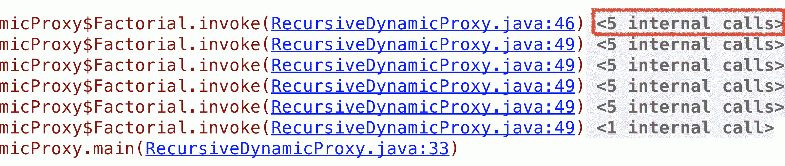

图 9: 代理方法调用的堆栈跟踪。

这是一个使用递归动态代理计算阶的示例。在德语中，我们将这个例子称为“an den Haaren herbeigezogen”，意思是我们是揪着头发把它拉过来的。换句话说，这是一种编写阶代码代码极不实际的方法，仅用于说明递归动态代理调用可能是什么样子。请不要写这样的代码！

```java
//:~ core/src/main/.../ch03/gotchas/RecursiveDynamicProxy.java
/**
 * 展示递归调用的荒谬示例。
 * 请不要写这样的代码！
 */
public class RecursiveDynamicProxy {
  public static void main(String... args) {
    IntFunction<BigInteger> factorial =
        Proxies.castProxy(IntFunction.class,
            new Factorial());
    System.out.println(factorial.apply(5));
  }

  private static class Factorial implements InvocationHandler {
    private final MethodKey apply =
        MethodKey(IntFunction.class, "apply");

    @Override
    public Object invoke(Object proxy, Method method, Object[] params) throws Throwable {
      if (new MethodKey(method).equals(apply)) {
        int n = (int) params[0];
        if (n == 0) {
          Thread.dumpStack();
          return BigInteger.ONE;
        }
        BigInteger other = (BigInteger) method.invoke(
            proxy, n - 1);
        return BigInteger.valueOf(n).multiply(other);
      } else {
        throw new UnsupportedOperationException(
            "only apply(int) supported");
      }
    }
  }
}
```

Listing 3.39: `RecursiveDynamicProxy`。

输出类似于 3.40。为了适应输出，省略了堆栈跟踪的某些细节。

```text
java.lang.Exception: Stack trace
    at java.base/Thread.dumpStack()
    at RecursiveDynamicProxy$Factorial.invoke()
    at com.sun.proxy.$Proxy0.apply(Unknown Source)
    at java.base/NativeMethodAccessor.invoke0()
    at java.base/NativeMethodAccessor.invoke()
    at java.base/DelegatingMethodAccessor.invoke()
    at java.base/Method.invoke()
    at RecursiveDynamicProxy$Factorial.invoke()
    at com.sun.proxy.$Proxy0.apply(Unknown Source)
    at java.base/NativeMethodAccessor.invoke0()
    at java.base/NativeMethodAccessor.invoke()
    at java.base/DelegatingMethodAccessor.invoke()
    at java.base/Method.invoke()
etc.
```

Listing 3.40: 得益于动态代理和反射的深层调用栈。

调用栈中的额外的行可能只会造成轻小的困扰。如果它们导致了`StackOverflowError`，那么在那种情况下，避免使用代理或通过 JVM 参数`-Xss`增加线程栈的大小是合适的。

### 泄露的抽象

动态代理目前被视为普通的 Java 类，尽管是动态创建的。这使得基础设施代码泄露给了用户。如果能够从用户处隐藏这些类将会更好。

在写作时，[JEP 371](https://openjdk.java.net/jeps/371) 的目标是 Java 15，并建议引入`hidden classes`（隐藏类）。这些类无法被其他类的字节码直接使用，而是通过框架代码通过反射来访问。

`hidden classes`有许多优点：它们的方法不会出现在堆栈跟踪轨迹中。它们更容易被卸载。访问控制更加精细且严格。

### 共享代理类

Java 试图尽量减少其创建的动态代理类的数量。每当我们调用`Proxy.newProxyInstance()`时，它都会检查之前是否已经为给定的类加载器和目标接口组合创建过动态代理。接口在数组内部存储的顺序是有重要的。如果找到了动态代理类，则将使用它来创建代理对象。`InvocationHandler`总是被传递给`java.lang.reflect.Proxy`超类，所有的动态代理类都派生自该类。

例如，考虑列表 3.41 中的`ProxyClassesByInterface`。`Collection`继承自`Iterable`，因此我们可以认为由`Collection`和`Iterable`组合成的代理等同于仅包含`Collection`的代理。然而，我们看到对于每种接口组合，都会创建唯一的代理类。

```java
//:~ core/src/main/.../ch03/gotchas/ProxyClassesByInterface.java
public class ProxyClassesByInterface {
  static final InvocationHandler BLANK = (p, m, a) -> null;
  public static void main(String... args) {
    test(Iterable.class, Collection.class); // $Proxy0
    test(Iterable.class, Collection.class); // $Proxy0
    test(Iterable.class); // $Proxy1
    test(Collection.class); // $Proxy2
    test(Collection.class, Iterable.class); // $Proxy3
    test(Iterable.class, Collection.class); // $Proxy0
  }
  private static void test(Class<?>... targetInterfaces) {
    Object proxy = Proxy.newProxyInstance(
        ProxyClassesByInterface.class.getClassLoader(),
        targetInterfaces,
        BLANK
    );
    System.out.println(proxy.getClass());
  }
}
```

列表 3.41：`ProxyClassesByInterface`。

Java 在其动态代理类的缓存中使用弱引用，以确保我们不会发生类加载器泄漏。

### 动态代理的性能

动态代理属于基础设施和框架代码领域。我们的动态代码极有可能被调用数十亿次。因此，了解如何对这类代码进行基准测试并确保它们运行足够快至关重要。

调用动态代理的方法可能较慢，原因有几点：

- 原始返回类型和参数需要装箱为相应的包装对象。当原始值超出它们的缓存范围时，这可能会增加对象创建的开销。
- 参数需要封装进数组。如果该数组逃逸了`InvocationHandler.invoke()`方法，则可能无法通过逃逸分析被消除。
- `Method`类存在健忘症问题——它在每次调用时都会检查权限。我们尝试通过列表 3.11 所示的加速（turbo-boost）机制来消除这种代价。
- 所有动态代理都派生自单一的`java.lang.reflect.Proxy`类，该类存储了我们`InvocationHandler`的引用。当一个字段始终持有接口的一种实现时，调用该字段值上方法的调用点是单态的（monomorphic），而不是多态的（polymorphic）。HotSpot 编译器对单态和双态有优化。对于单态，编译器可以在运行时内联方法调用。然而，由于动态代理可以持有`InvocationHandler`的多个实现之一，HotSpot 可能无法内联到`invoke()`方法调用，从而使其变为元态的（megamorphic）。关于多态性能的更多信息，请参阅 [The Java Specialists' Newsletter](https://www.javaspecialists.eu/) 中的 [“Polymorphism Performance Mysteries”](https://www.javaspecialists.eu/archive/Issue157.html) 和 [“Polymorphism Performance Mysteries Explained”](https://www.javaspecialists.eu/archive/Issue158.html)。

想要编写性能关键代码的程序员需要知道如何对代码进行基准测试。运行基准测试的推荐工具是 [Java Microbenchmark Harness](https://openjdk.java.net/projects/code-tools/jmh/) (JMH)。

对于我们的实验，我们定义了一个带有两个方法的`Worker`接口：`increment()`和`consumeCPU()`。`increment()`方法返回一个`long`，它将通过自动装箱转换为`Long`对象。`consumeCPU()`方法返回`void`，因此不需要创建对象。

```java
//:~ benchmark/src/main/.../ch03/benchmarks/Worker.java
public interface Worker {
  long increment();
  void consumeCPU();
}
```

列表 3.42：`Worker`。

我们的`RealWorker`实现`Worker`。在`increment()`方法中，它递增一个`long`类型字段并返回新值。在`consumeCPU()`方法中，它使用 JMH 的`Blackhole`类来消耗几个 CPU 周期。

```java
//:~ benchmark/src/main/.../ch03/benchmarks/RealWorker.java
public class RealWorker implements Worker {
  private long counter = 0;
  @Override
  public long increment() {
    return counter++;
  }
  @Override
  public void consumeCPU() {
    Blackhole.consumeCPU(2);
  }
}
```

列表 3.43：`RealWorker`。

我们的`ProxyWorker`遵循代理模式并指向`RealWorker`。

```java
//:~ benchmark/src/main/.../ch03/benchmarks/ProxyWorker.java
public class ProxyWorker implements Worker {
  private final RealWorker worker = new RealWorker();
  @Override
  public long increment() {
    return worker.increment();
  }
  @Override
  public void consumeCPU() {
    worker.consumeCPU();
  }
}
```

列表 3.44：`ProxyWorker`。


在我们的`MethodCallBenchmark`中，有五种调用`increment()`和`consumeCPU()`的方式：

- `directCall`直接在`RealWorker`实例上调用方法。
- `staticProxy`调用`ProxyWorker`实例的方法，然后它将调用委托给`RealWorker`。
- `dynamicProxyThenDirectCall`创建`Worker`的动态代理，但直接委托给`RealWorker`的方法。
- `dynamicProxyThenReflectiveCall`（turbo）是我们`Worker`的动态代理，它使用给定的`method`参数通过反射调用将方法委托给`RealWorker`实例。该动态代理实例经过了加速（turbo-boosted）。
- `dynamicProxyThenReflectiveCall`（no turbo）与上相同，但没有加速。

```java
//:~ benchmark/src/main/.../ch03/benchmarks/MethodCallBenchmark.java
@Fork(value = 3, jvmArgsAppend = "-XX:+UseParallelGC")
@Warmup(iterations = 5, time = 3)
@Measurement(iterations = 10, time = 3)
@BenchmarkMode(Mode.AverageTime)
@OutputTimeUnit(TimeUnit.NANOSECONDS)
@State(Scope.Benchmark)
public class MethodCallBenchmark {
  // direct call to RealWorker
  private final RealWorker realWorker = new RealWorker();

  // static proxies
  private final Worker staticProxy = new ProxyWorker();

  //   dynamic proxies
  private final Worker dynamicProxyDirectCallIncrement =
      Proxies.castProxy(Worker.class,
          (proxy, method, args) -> realWorker.increment());
  private final Worker dynamicProxyDirectCallConsumeCPU =
      Proxies.castProxy(Worker.class,
          (proxy, method, args) -> {
            realWorker.consumeCPU();
            return null;
          });
  private final Worker dynamicProxyReflectiveCall =
      Proxies.castProxy(Worker.class,
          (proxy, method, args) ->
              method.invoke(realWorker, args));

  @Benchmark
  public long directCallIncrement() {
    return realWorker.increment();
  }
  @Benchmark
  public long staticProxyIncrement() {
    return staticProxy.increment();
  }
  @Benchmark
  public long dynamicProxyDirectCallIncrement() {
    return dynamicProxyDirectCallIncrement.increment();
  }
  @Benchmark
  public long dynamicProxyReflectiveCallIncrement() {
    return dynamicProxyReflectiveCall.increment();
  }

  @Benchmark
  public void directCallConsumeCPU() {
    realWorker.consumeCPU();
  }
  @Benchmark
  public void staticProxyConsumeCPU() {
    staticProxy.consumeCPU();
  }
  @Benchmark
  public void dynamicProxyDirectCallConsumeCPU() {
    dynamicProxyDirectCallConsumeCPU.consumeCPU();
  }
  @Benchmark
  public void dynamicProxyReflectiveCallConsumeCPU() {
    dynamicProxyReflectiveCall.consumeCPU();
  }
}
```

Listing 3.45: `MethodCallBenchmark`。

我们的`MethodCallBenchmark`结果运行在配备六核 i9 的 MacBook Pro（2018）上，使用 Java 14+36-1461 并带有吞吐量收集器。所有单位均为纳秒/操作。

### `increment()`的结果

我们的结果表显示，在 Java 14 中，`dynamicProxyDirectCall`比`staticProxy`慢了约 1.4 纳秒。在 Java 13 中，差异大约为 2.6 纳秒，因为`increment()`返回的每个原始`long`都装箱为`Long`对象，每次方法调用产生 24 字节垃圾。

在`dynamicProxyReflectiveCall`中通过反射调用`Method`对象又增加了 3.1 纳秒，如果我们关闭睿频加速（turbo boost），该值会进一步增加 1.4 纳秒。在我们尝试过的所有 Java 版本中，`dynamicProxyReflectiveCall`都会为返回的`Integer`为方法调用分配 24 字节。

| Benchmark 测试`increment()` | ns/op ± 误差 |
| :--- | :--- |
| `directCall` | 1.957 ± 0.004 |
| `staticProxy` | 2.369 ± 0.018 |
| `dynamicProxyDirectCall` | 3.726 ± 0.016 |
| `dynamicProxyReflectiveCall`（turbo） | 6.853 ± 0.201 |
| `dynamicProxyReflectiveCall`（no turbo） | 8.238 ± 0.282 |

### `consumeCPU()`的结果

`consumeCPU()`的结果接近得多，因为我们没有装箱成本。`dynamicProxyDirectCall`比`staticProxy`慢约 0.7 纳秒。在`dynamicProxyReflectiveCall`中通过反射调用`Method`对象仅增加 0.8 纳秒，如果我们关闭睿频加速，这会进一步增加 1.7 纳秒。

| Benchmark 测试`consumeCPU()` | ns/op ± 误差 |
| :--- | :--- |
| `directCall` | 3.270 ± 0.028 |
| `staticProxy` | 3.788 ± 0.018 |
| `dynamicProxyDirectCall` | 4.461 ± 0.020 |
| `dynamicProxyReflectiveCall`（turbo） | 5.231 ± 0.053 |
| `dynamicProxyReflectiveCall`（no turbo） | 6.960 ± 0.409 |

### 基准结果总结

对于`increment()`，4.5 纳秒和对于`consumeCPU()`，1.4 纳秒的方法调用开销在典型的业务逻辑中很少被察觉到。尽管如此，意识到方法调用开销略高是有好的，并且对于性能敏感的代码可能会避免使用动态代理，特别是当我们在密集循环中调用被代理的方法时。

# 动态装饰器（Dynamic Decorator）

装饰器在不创建子类的情况下，动态地为对象附加额外的职责。正如我们在第 1 章中看到的，装饰器用于向裸流添加功能。在本章中，我们将看到如何创建一个动态装饰器。

## 装饰器模式

到为止，我们一直使用 Java 的动态代理来实现代理模式。我们也可以使用相同的机制创建装饰器或过滤器。图 10 显示了《四人行》（Gang-of-Four）书中描述的装饰器模式的经典结构。


图 10. 装饰器结构。

装饰器也被称为过滤器（filter）。在我看来，装饰器是“添加”，而过滤器是“取走”。如果我们想要一个真正的不可变集合，可以创建一个不包含任何变器方法的过滤器接口。以列表 4.1 中的`ImmutableIterable`为例。在其中，我们去掉了`iterator()`方法，因为`Iterator`包含了`remove()`方法。我们当然可以让`iterator()`方法返回一个`ImmutableIterator`，但我将此留给读者作为练习。

```java
//:~ core/src/main/...ch04/immutablecollection/ImmutableIterable.java
public interface ImmutableIterable<E> {
  void forEach(Consumer<? super E> action);
  Spliterator<E> spliterator();

  // 来自 Iterable 的变器方法
  //    Iterator<E> iterator();
}
```

列表 4.1：`ImmutableIterable`。

我们的`ImmutableCollection`还过滤掉了任何可能更改集合的方法。我们添加了一个默认方法`printAll()`。动态代理实现了接口的所有公共方法，甚至是默认方法。在 Java 中，可以在子类中使用`super`关键字调用父类方法，但从外部无法这样做。例如，当类重写了`hashCode()`时，该类的用户无法调用默认的`Object.hashCode()`方法。由于这个原因，Java 提供了`System.identityHashCode()`，以防我们需要生成与`Object.hashCode()`相同的哈希值。这让我们遇到了麻烦。如果该方法没有在生成的动态代理中被重写，我们可以调用默认方法，它将引导我们进入方法。幸运的是有一种技巧允许我们在接口上调用默认方法，我们在查看`VTable`时会看到。

```java
//:~ core/src/main/...ch04/immutablecollection/ImmutableCollection.java
public interface ImmutableCollection<E>
    extends ImmutableIterable<E> {
  int size();
  boolean isEmpty();
  boolean contains(Object o);
  Object[] toArray();
  <T> T[] toArray(T[] a);
  <T> T[] toArray(IntFunction<T> generator);
  boolean containsAll(Collection<?> c);
  Stream<E> stream();
  Stream<E> parallelStream();

  // 为了尝试默认方法
  default void printAll() {
    forEach(System.out::println);
  }

  // 过滤掉来自 Collection 的变器方法
  //    boolean add(E e);
  //    boolean remove(Object o);
  //    boolean addAll(Collection<? extends E> c);
  //    boolean removeAll(Collection<?> c);
  //    boolean removeIf(Predicate<? super E> filter);
  //    boolean retainAll(Collection<?> c);
  //    void clear();
}
```

列表 4.2：`ImmutableCollection`。

为了展示如何使用它来过滤现有集合，让我们编写`HandcodedFilter`。`ImmutableCollection`内部的每个方法都委托给封装的`Collection`。你可能会同意编写这样的代码相当平庸。

```java
//:~ core/src/main/.../ch04/immutablecollection/HandcodedFilter.java
public class HandcodedFilter<E>
    implements ImmutableCollection<E> {
  private final Collection<E> c;

  public HandcodedFilter(Collection<E> c) {
    this.c = c;
  }

  @Override
  public int size() {
    return c.size();
  }
  @Override
  public boolean isEmpty() {
    return c.isEmpty();
  }
  @Override
  public boolean contains(Object o) {
    return c.contains(o);
  }
  @Override
  public Object[] toArray() {
    return c.toArray();
  }
  @Override
  public <T> T[] toArray(T[] a) {
    return c.toArray(a);
  }
  @Override
  public <T> T[] toArray(IntFunction<T[]> generator) {
    return c.toArray(generator);
  }
  @Override
  public boolean containsAll(Collection<?> c) {
    return this.c.containsAll(c);
  }
  @Override
  public Spliterator<E> spliterator() {
    return c.spliterator();
  }
  @Override
  public Stream<E> stream() {
    return c.stream();
  }
  @Override
  public Stream<E> parallelStream() {
    return c.parallelStream();
  }
  @Override
  public void forEach(Consumer<? super E> action) {
    c.forEach(action);
  }
}
```

Listing 4.3：`HandcodedFilter`。

以下是如何使用`HandcodedFilter`来过滤掉我们不需要支持的方法。

```java
//:~ core/src/main/.../ch04/immutablecollection/HandcodedFilterDemo.java
ImmutableCollection<String> names =
    new HandcodedFilter<>(
        Arrays.asList("Peter", "Paul", "Mary"));
// names.remove("Peter"); // 无法编译
System.out.println(names);
System.out.println("Is Mary in? " + names.contains("Mary"));
System.out.println("Are there names? " + !names.isEmpty());
System.out.println("Printing the names:");
names.forEach(System.out::println);
System.out.println("Class: " +
                       names.getClass().getSimpleName());

names.printAll();
```

Listing 4.4：`HandcodedFilterDemo`。当我们运行代码时，我们会在 Listing 4.5 中看到输出。

```
eu.javaspecialists.HandcodedFilter@1bfb97
Is Mary in? true
Are there names? true
Printing the names:
Peter
Paul
Mary
Class: HandcodedFilter
Peter
Mary
```

Listing 4.5：来自`HandcodedFilter`的输出。

## 使用动态代理实现过滤器


与其手动编写装饰器（decorator），我们可以使用 Java 的动态代理（dynamic proxy）来创建一个装饰器。我们的规则如下：

- 我们将从一个接口和一个对象创建过滤器。
- 我们将过滤器的每个公共方法映射到该对象上。
- 为了简单起见，我们只考虑方法名和参数类型。返回类型必须匹配，否则我们将拒绝该方法。
- 我们需要包含对默认方法（default methods）的支持。
- 如果对象不具备过滤器中的所有方法，则构建动态过滤器应该失败。

Listing 4.6 显示了 `FilterHandler`。我们编写了自己的 `VTable` 来实现虚方法表（virtual method table），这是面向对象中用于将虚方法路由到正确接收者的概念。我稍后会详细解释 `VTable` 和 `FilterHandler`。现在，知道 `VTable` 用于匹配无关接口之间的方法（包括默认方法）就足够了。`FilterHandler` 使用[责任链设计模式](https://javaspecialists.com/p/d5)来链接多个 `VTable` 查找。在我们链的构建过程中，我们还验证了过滤器中的所有方法都有相应的处理器。

```java
//:~ core/src/main/.../handlers/FilterHandler.java
public final class FilterHandler implements InvocationHandler {
  private final InvocationHandler chain;

  public FilterHandler(Class<?> filter, Object component) {
    VTable vt = new VTable(component.getClass(), filter);
    VTable defaultVT = vt.getDefaultMethods(filter);

    chain = new ChainedInvocationHandler(vt, defaultVT);

    chain.checkAllMethodsHandled();
  }

  @Override
  public Object invoke(Object proxy, Method method, Object[] args) throws Throwable {
    return chain.invoke(proxy, method, args);
  }
}
```

Listing 4.6：`FilterHandler`。我们现在可以使用 `filter()` 方法创建动态过滤器。

```java
//:~ core/src/main/.../Proxies.java
public static <F> F filter(Class<? super F> filter, Object component) {
  Objects.requireNonNull(component);
  return (F) proxy(filter, component);
}
```

Listing 4.7：`Proxies.filter()`。我们可以使用动态创建的类来过滤掉我们不想支持的方法。

```java
//:~ core/src/main/.../ch04/immutablecollection/DynamicFilterDemo.java
ImmutableCollection<String> names =
    Proxies.filter(
        ImmutableCollection.class,
        Arrays.asList("Peter", "Paul", "Mary"));
// names.remove("Peter"); // 无法编译
System.out.println(names);
System.out.println("Is Mary in? " + names.contains("Mary"));
System.out.println("Are there names? " + !names.isEmpty());
System.out.println("Printing the names:");
names.forEach(System.out::println);
System.out.println("Class: " +
                       names.getClass().getSimpleName());
```

Listing 4.8：`DynamicFilterDemo`。当我们运行代码时，我们会在 Listing 4.9 中看到输出。

```
[Peter, Paul, Mary]
Is Mary in? true
Are there names? true
Printing the names:
Peter
Paul
Mary
Class: Proxy0
```

Listing 4.9：来自 `DynamicFilter` 的输出。

## `InfiniteRandomDouble` 装饰器

假设我们希望生成无限的 `Double` 实例，因此我们在 Listing 4.10 中编写了 `InfiniteRandomDouble` 类。

```java
//:~ core/src/main/.../ch04/initerandom/InfiniteRandomDouble.java
/**
 * 与 Iterator 接口没有关系。
 */
public class InfiniteRandomDouble {
  public boolean hasNext() {
    return true;
  }
  public Double next() {
    return ThreadLocalRandom.current().nextDouble();
  }
}
```

Listing 4.10：`InfiniteRandomDouble`。在后续阶段，我们意识到如果能用 `Iterator<Double>` 来装饰它就好了。与其让 `InfiniteRandomDouble` 类实现接口，不如通过 `Proxies.filter(Iterator.class, new InfiniteRandomDouble())` 创建 `Iterator`。如果我们在 JPMS 模块中运行，我们需要显式地开放 `java.base` 模块的 `java.util` 包。如果我们的模块是 `javaspecialists.books.dynamicproxies`，那么我们需要使用 JVM 参数 `--add-opens java.base/java.util=javaspecialists.books.dynamicproxies`。

```java
/**
 * 如果我们在模块内部，我们需要显式向我们的模块打开
 * java.base 模块内的 java.util 包。我们可以通过 JVM 参数
 * --add-opens \
 * java.base/java.util=javaspecialists.books.dynamicproxies
 * 这一点。否则，VTable 将不会包含默认方法。
 */
public class DefaultMethodCallDemo {
  public static void main(String... args) {
    Iterator<Double> filter = Proxies.filter(
        Iterator.class, new InfiniteRandomDouble());

    System.out.println(filter.hasNext());
    System.out.println(filter.next());

    try {
      filter.remove();
      throw new AssertionError(
          "Expected an UnsupportedOperationException");
    } catch (UnsupportedOperationException expected) {
      System.err.println(expected);
    }

    System.out.println("Iterating forever ...");

    filter.forEachRemaining(System.out::println);
  }
}
```

Listing 4.11：`DefaultMethodCallDemo`。在没有 `--add-opens` 参数的情况下运行会抛出 `IllegalArgumentException`，因为默认方法 `remove()` 和 `forEachRemaining()` 只有在 `java.util` 包开放时才能被包含。

```
Exception in thread "main" java.lang.IllegalArgumentException: \
    Unhandled methods: [ \
      public default void java.util.Iterator.remove(), \
      public default void java.util.Iterator.forEachRemaining( \
        java.util.function.Consumer)]
  at eu.javaspecialists.books.dynamicproxies/...
```

Listing 4.12：未使用 `--add-opens` 时的 `DynamicFilterDemo` 输出。

然而，当我们在运行 `DefaultMethodCallDemo` 并带上 `--add-opens java.base/java.util=eu.javaspecialists.books.dynamicproxies` 时，它如预期般工作。

```
true
0.9833487941165752
java.lang.UnsupportedOperationException: remove
Iterating forever ...
0.07265625125554698
0.49716358229383684
0.44842977216243907
0.44363950828146614
0.5560995018129454
0.9779642433900788
0.7941409326858004
... etc.
```

Listing 4.13：使用 `--add-opens` 时的 `DynamicFilterDemo` 输出。

本章的剩余部分将展示 `VTable` 如何工作的底层细节，以及我们的 `ChainedInvocationHandler`。这些工具将在下一个模式中用到，但你可以随心跳过本章的剩余部分，也许在以后阶段再回来查看。

## `VTable`

`ImmutableCollection` 接口与 `Collection` 之间没有继承关系。然而，我们仍然需要将接口中的方法匹配到装饰对象。为了实现这一点，我们创建了一个 `VTable`，它根据给定的接口方法返回匹配的方法。它相当长且复杂，我们首先需要介绍以下几项：

1. `ParameterTypesFetcher` 帮助提高方法匹配的性能。
2. `MethodKey` 通过名称和参数类型比较方法。
3. `VTable` 匹配目标方法和接收者方法，包括默认接口方法。
4. `VTable.Builder` 是一个 [Effective Java](https://www.oreilly.com/library/view/effective-java-3rd/9780134686097/) 构建器模式，用于构建 `VTable`。
5. `VTables` 是用于构建最常见 `VTable` 配置的 facade。

### `ParameterTypesFetcher`

匹配方法时的一个巨大成本是调用 `getParameterTypes()`，它在每次调用时都会克隆内部的 `Class<?>[]`。`ParameterTypesFetcher` 让我们能够直接访问内部的数组。我们可以通过 JVM 参数 `-Deu.javaspecialists.books.dynamicproxies.util.ParameterTypesFetcher.enabled=true` 来启用此性能优化。

我们使用[策略设计模式](https://javaspecialists.teachable.com/p/dpc5)来决定如何返回参数类型。当 `ParameterTypesFetcher` 类加载时，我们将 `PARAMETER_FETCHER` 绑定到正确的策略类型。由于我们在一个 JVM 内只使用一种策略，HotSpot 编译器可以激进地优化这些方法，可能内联代码从而消除方法调用开销。

```java
//:~ core/src/main/.../util/ParameterTypesFetcher.java
/**
 * 默认禁用快速获取参数类型数组，
 * 可以通过以下方式启用：
 * -Deu.javaspecialists.books.dynamicproxies.util. \
 * ParameterTypesFetcher.enabled=true
 */
public final class ParameterTypesFetcher {
  private final static ParameterFetcher PARAMETER_FETCHER =
      Boolean.getBoolean(
          ParameterTypesFetcher.class.getName() + ".enabled") ?
          new FastParameterFetcher() :
          new NormalParameterFetcher();

  /**
   * 警告：当启用“快速参数获取”时，
   * 返回的数组是存储在 Method
   * 对象内部的实际数组。不要修改它！
   */
  public static Class<?>[] get(Method method) {
    return PARAMETER_FETCHER.getParameterTypes(method);
  }

  @FunctionalInterface
  private interface ParameterFetcher {
    Class<?>[] getParameterTypes(Method method);
  }

  /**
   * 通过调用方法参数上的 getParameterTypes()
   * 返回参数类型。这应该始终有效。
   */
  private static class NormalParameterFetcher
      implements ParameterFetcher {
    @Override
    public Class<?>[] getParameterTypes(Method method) {
      return method.getParameterTypes(); // 克隆数组
    }
  }

  /**
   * 创建一个直接指向 Method 内部存储的
   * 私有字段 parameterTypes 的 VarHandle。由于 VarHandle
   * 被声明为 final static，读取它的成本与
   * 读取普通字段的相同。
   */
  private static class FastParameterFetcher
      implements ParameterFetcher {
    private final static VarHandle METHOD_PARAMETER_TYPES;

    static {
      try {
        METHOD_PARAMETER_TYPES = MethodHandles.privateLookupIn(
            Method.class, MethodHandles.lookup()
        ).findVarHandle(Method.class, "parameterTypes",
            Class[].class);
      } catch (ReflectiveException e) {
        // 异常处理
      }
    }

    @Override
    public Class<?>[] getParameterTypes(Method method) {
      return (Class<?>[]) METHOD_PARAMETER_TYPES.get(method);
    }
  }
}
```

Listing 4.14：`ParameterTypesFetcher`。

### `MethodKey`

`MethodKey` 在 4.15 中根据名称和参数类型比较方法对象。


```java
//:~ core/src/main/.../util/MethodKey.java
/**
 * MethodKey 根据名称和参数类型比较方法。
 * 它实现了 equals(), hashCode() 和 toString()。
 * 可以作为 map 的键。它不知道方法的返回类型。
 */
public final class MethodKey implements Comparable<MethodKey> {
  private final String name;
  private final Class<?>[] paramTypes;

  public MethodKey(Method method) {
    name = method.getName();
    paramTypes = ParameterTypesFetcher.get(method);
  }

  public MethodKey(Class<?> clazz, String name,
                   Class<?>... paramTypes) {
    try {
      // 检查类是否存在方法
      var method = clazz.getMethod(name, paramTypes);
      // 方法名在 JVM 中是内化的
      this.name = method.getName();
      this.paramTypes = Objects.requireNonNull(paramTypes);
    } catch (NoSuchMethodException e) {
      throw new IllegalArgumentException(e);
    }
  }

  @Override
  public boolean equals(Object obj) {
    if (!(obj instanceof MethodKey)) {
      return false;
    }
    // name 和 paramTypes 不为空
    var other = (MethodKey) obj;
    return name == other.name && // 方法是内化的
               equalTypes(paramTypes, other.paramTypes);
  }

  /**
   * 使用 == 而不是 .equals() 比较类。我们知道
   *数组不会为空。因此可以避免
   * Arrays.equals() 中的某些检查。
   */
  private boolean equalTypes(Class<?>[] params1,
                            Class<?>[] params2) {
    if (params1.length == params2.length) {
      for (int i = 0; i < params1.length; i++) {
        if (params1[i] != params2[i])
          return false;
      }
      return true;
    }
    return false;
  }

  @Override
  public int hashCode() {
    return name.hashCode() + paramTypes.length;
  }

  @Override
  public int compareTo(MethodKey that) {
    int result = this.name.compareTo(that.name);
    if (result != 0) return result;
    return Arrays.compare(this.paramTypes,
        that.paramTypes,
        Comparator.comparing(Class::getName));
  }

  @Override
  public String toString() {
    return Stream.of(paramTypes)
               .map(Class::getName)
               .collect(Collectors.joining(", ",
                   name + "(", ")"));
  }
}
```

Listing 4.15：`MethodKey`。`VTable` 和 `VTable.Builder`

`VTable` 创建了一个自定义哈希表，根据名称和参数类型查找方法。普通方法使用 `lookup(Method)` 查找，而默认接口方法则使用 `lookupDefaultMethod(Method)` 查找。

我们使用 `VTable.Builder` 创建 `VTable` 实例，并参考了 [Effective Java](https://www.oreilly.com/library/view/effective-java-3rd/9780134686097/) 中的构建器模式。

更多的注释已在 `VTable` 源码中。我鼓励你花一点时间阅读这些代码，但如果你觉得太困难，也可以先跳过，稍后再回来。


```java
//:~ core/src/main/.../util/VTable.java
/**
 * VTable 的作用是在接口方法与接收者类方法之间
 * 构建一个快速映射器。为了减少对象的创建，
 * 我们避免使用普通的 HashMap，而是选择将
 * 所有元素存储在等大小的数组中。我们还尝试
 * 通过方法名 + 参数数量进行哈希处理来
 * 减少表中的冲突。此外，我们会记录某个名称
 * 在表中是否是唯一的。如果是，我们就不再检查
 * 参数是否匹配。
 * <p>
 * 从性能角度来说，最重要的方法是
 * lookup() 和 lookupDefaultMethod()。
 */
public final class VTable {
  private final Method[] entries;
  private final Class<?>[][] paramTypes;
  private final boolean[] distinctName;
  private final MethodHandle[] defaultMethods;
  private final int size;
  private final int mask;

  /**
   * 根据方法集合构建 VTable。
   * 此构造函数的输入是在 Builder
   * 类中创建的。
   *
   * @param methods               所有需要包含在
   *                              此 VTable 中的方法
   * @param distinctMethodNames   未被重载的
   *                              方法的名称
   * @param includeDefaultMethods 是否想要包含
   *                              接口的默认
   *                              方法
   */
  private VTable(Collection<Method> methods,
                 Set<String> distinctMethodNames,
                 boolean includeDefaultMethods) {
    this.size = methods.size();
    mask = Math.max(
        (-1 >>> Integer.numberOfLeadingZeros(size * 4 - 1)),
        127);
    entries = new Method[mask + 1];
    paramTypes = new Class<?>[entries.length][];
    distinctName = new boolean[entries.length];
    defaultMethods = new MethodHandle[entries.length];
    for (var method : methods) {
      put(method,
          distinctMethodNames.contains(method.getName()),
          includeDefaultMethods);
    }
    methods.forEach(MethodTurboBooster::boost);
  }

  /**
   * 在 VTable 中查找方法。如果未找到则
   * 返回 null。
   */
  public Method lookup(Method method) {
    int index = findIndex(method);
    return index < 0 ? null : entries[index];
  }

  /**
   * 在 VTable 中查找接口默认方法。
   * 如果未找到则返回 null。
   */
  public MethodHandle lookupDefaultMethod(Method method) {
    int index = findIndex(method);
    return index < 0 ? null : defaultMethods[index];
  }

  /**
   * 返回 VTable 中的条目数量。
   * 大小不会改变，并在构造时固定。
   */
  public int size() {
    return size;
  }

  /**
   * 返回来自此 VTable 的 Method 对象流。
   * 由 ChainedInvocationHandler 使用，以验证
   * 目标中的所有方法是否已被不同的 VTables
   * 覆盖。
   */
  public Stream<Method> stream() {
    return Stream.of(entries).filter(Objects::nonNull);
  }

  /**
   * 返回此 VTable 中我们拥有接口默认方法的
   * Method 对象流。由 ChainedInvocationHandler 使用
   * 以验证目标中的所有方法是否已被
   * 不同的 VTables 覆盖。
   */
  public Stream<Method> streamDefaultMethods() {
    // Heinz: 这是我第一次找到 iterate() 的用例
    return IntStream.iterate(0, i -> i < entries.length,
        i -> i + 1)
               .filter(i -> defaultMethods[i] != null)
               .mapToObj(i -> entries[i]);
  }

  /**
   * 为条目寻找一个空位置，然后将值
   * 插入 entries、paramTypes、distinctName 数组中，
   * 可选的 defaultMethods。不允许重复方法，
   * 并将抛出 IllegalArgumentException。
   */
  private void put(Method method, boolean distinct,
                   boolean includeDefaultMethods) {
    int index = findIndex(method);
    if (index >= 0)
      throw new IllegalArgumentException(
          "Duplicate method found: " + new MethodKey(method));
    index = ~index; // 再次翻转位寻找空隙
    entries[index] = method;
    paramTypes[index] = ParameterTypesFetcher.get(method);
    distinctName[index] = distinct;
    if (includeDefaultMethods && method.isDefault()) {
      defaultMethods[index] = getDefaultMethodHandle(method);
    }
  }

  /**
   * 返回接口默认方法的 MethodHandle，
   * 如果该方法已声明且该模块对我们的模块开放；
   * 否则返回 null。
   */
  private MethodHandle getDefaultMethodHandle(Method method) {
    try {
      Class<?> target = method.getDeclaringClass();
      if (isTargetClassInOpenModule(target)) {
        // Thanks Thomas Darimont 提供的想法
        MethodHandles.Lookup lookup = MethodHandles.lookup();
        return MethodHandles.privateLookupIn(target, lookup)
                   .unreflectSpecial(method, target)
                   // asSpreader() 避免了调用 invokeArguments()
                   // 速度快了 10 倍
                   .asSpreader(Object[].class,
                       method.getParameterCount());
      }
      return null;
    } catch (IllegalAccessException) {
      throw new IllegalArgumentException(e);
    }
  }

  /**
   * 如果方法在开放模块中则返回 true；
   * 否则返回 false。例如，如果我们的 VTable
   * 在 javaspecialists.books.dynamicproxies 内部且
   * 使用 java.util 中的默认方法，我们需要
   * 显式打开该模块。
   */
  private boolean isTargetClassInOpenModule(Class<?> target) {
    Module targetModule = target.getModule();
    String targetPackage = target.getPackageName();
    Module ourModule = VTable.class.getModule();
    return targetModule.isOpen(targetPackage, ourModule);
  }

  /**
   * 返回方法的索引；未找到返回负值。
   * 一旦找到同名方法，我们会检查该方法
   * 是否重载。如果没有，则返回 offset。
   */
  private int findIndex(Method method) {
    int offset = offset(method);
    Class<?>[] methodTypes = null;
    Method match;
    while ((match = entries[offset]) != null) {
      if (match.getName() == method.getName()) {
        if (distinctName[offset]) return offset;
        if (methodTypes == null)
          methodTypes = ParameterTypesFetcher.get(method);
        if (matches(paramTypes[offset], methodTypes))
          return offset;
      }
      offset = (offset + 1) & mask;
    }
    // 未找到方法，返回负值
    // 通过再次翻转位，我们知道数组中第一个可用索引
    return ~offset;
  }

  /**
   * 根据名称和参数数量返回方法的
   *初始 offset。
   */
  private int offset(Method method) {
    return (method.getName().hashCode() +
                method.getParameterCount()) & mask;
  }

  /**
   * 参数类型的快速数组比较。
   * 类可以使用 == 代替 equals() 进行比较。
   */
  private boolean matches(Class<?>[] types1, Class<?>[] types2) {
    if (types1.length != types2.length) return false;
    for (int i = 0; i < types1.length; i++) {
      if (types1[i] != types2[i]) return false;
    }
    return true;
  }

  public static class Builder {
    private static final BinaryOperator<Method> MOST_SPECIFIC =
        (method1, method2) -> {
          var r1 = method1.getReturnType();
          var r2 = method2.getReturnType();
          if (r2.isAssignableFrom(r1)) {
            return method1;
          }
          if (r1.isAssignableFrom(r2)) {
            return method2;
          } else {
            throw new IllegalStateException(
                method1 + " and " + method2 +
                    " have incompatible return types");
          }
        };
    private static final Method[] OBJECT_METHODS;
    static {
      try {
        OBJECT_METHODS = new Method[] {
            Object.class.getMethod("toString"),
            Object.class.getMethod("hashCode"),
            Object.class.getMethod("equals", Object.class),
        };
      } catch (NoSuchMethodException e) {
        throw new Error(e);
      }
    }
    private final Map<MethodKey, Method> receiverClassMap;
    private List<Class<?>> targetInterfaces = new ArrayList<>();
    private boolean includeObjectMethods = true;
    private boolean includeDefaultMethods = false;
    private boolean ignoreReturnTypes = false;

    /**
     * @param receiver 接收实际方法调用的类
     *                 不需要与动态代理接口相关。
     */
    public Builder(Class<?> receiver) {
      receiverClassMap = createPublicMethodMap(receiver);
    }

    /**
     * equals(Object), hashCode() 和 toString() 方法
     * 不会被添加到 VTable。
     */
    public Builder excludeObjectMethods() {
      this.includeObjectMethods = false;
      return this;
    }

    public Builder includeDefaultMethods() {
      this.includeDefaultMethods = true;
      return this;
    }

    public Builder ignoreReturnTypes() {
      this.ignoreReturnTypes = true;
      return this;
    }

    /**
     * 我们希望映射映射的目标接口之一。
     */
    public Builder addTargetInterface(Class<?> targetIntf) {
      if (!targetIntf.isInterface())
        throw new IllegalArgumentException(
            targetIntf.getCanonicalName() +
                " is not an interface");
      this.targetInterfaces.add(targetIntf);
      return this;
    }

    public VTable build() {
      // 构建来自目标接口的所有方法集合，
      // 以及三个包含的默认方法。
      Collection<Method> allMethods =
          targetInterfaces.stream()
              .flatMap(clazz -> Stream.of(clazz))
              .filter(Objects::nonNull)
              .collect(Collectors.toList());
      if (includeObjectMethods) {
        for (Method method : OBJECT_METHODS) {
          allMethods.add(method);
        }
      }
      // 找到所有名称唯一的方法，
      // 因此加速匹配。
      Set<String> distinctMethodNames =
          allMethods.stream()
              .collect(Collectors.groupingBy(Method::getName),
                  Collectors.counting()))
              .keySet(); // 简化逻辑
      // 最后我们只包含那些与目标方法
      //set 的方法。
      Collection<Method> matchedMethods =
          allMethods.stream()
              .map(this::filterReturnType)
              .filter(Objects::nonNull)
              .collect(Collectors.toList());

      return new VTable(matchedMethods, distinctMethodNames,
          includeDefaultMethods);
    }
  }
}
```


## 列表 4.16：`VTable` 和 `VTable.Builder`

### `VTables` Facade

`VTable` 最常见的用例是映射无关接口之间的方法，以及映射默认接口方法。我们的 `VTables` Facade 包含了静态工厂方法，用于构建此类 `VTable` 实例。

```java
//:~ core/src/main/.../util/VTables.java
public final class VTables {
  private VTables() {}

  public static VTable newDefaultMethodVTable(Class<?> clazz) {
    return newVTableBuilder(clazz, clazz)
               .excludeObjectMethods()
               .includeDefaultMethods()
               .build();
  }

  public static VTable newVTable(Class<?> receiver,
                                 Class<?>... targets) {
    return newVTableBuilder(receiver, targets).build();
  }

  public static VTable newVTableExcludingObjectMethods(
      Class<?> receiver, Class<?>... targets) {
    return newVTableBuilder(receiver, targets)
               .excludeObjectMethods()
               .build();
  }

  private static VTable.Builder newVTableBuilder(
      Class<?> receiver, Class<?>... targets) {
    VTable.Builder builder = new VTable.Builder(receiver);
    for (Class<?> target : targets) {
      builder.addTargetInterface(target);
    }
    return builder;
  }
}
```

列表 4.17：`VTables` Facade。

例如，为了在 `List` 和 `ArrayDeque` 之间建立一个 `VTable`，我们只需编写列表 4.18 中的代码即可。

```java
//:~ core/src/test/.../util/VTablesDemo.java
public class VTablesDemo {
  public static void main(String... args) {
    VTable vt = VTables.newVTable(ArrayDeque.class, List.class);
    vt.stream().forEach(System.out::println);
  }
}
```

列表 4.18：`VTablesDemo`。

输出显示了 `ArrayDeque` 中同样出现在 `List` 中的所有方法。

```text
public boolean java.util.ArrayDeque.add(java.lang.Object)
public boolean java.util.ArrayDeque.isEmpty()
public int java.util.ArrayDeque.size()
public boolean java.util.ArrayDeque.contains(java.lang.Object)
public boolean java.util.AbstractCollection.containsAll(java.util.Collection)
public boolean java.util.ArrayDeque.remove(java.lang.Object)
public java.lang.Object[] java.util.ArrayDeque.toArray()
public void java.util.ArrayDeque.clear()
etc.
```

列表 4.19：`VTablesDemo` 的输出。

### `ChainedInvocationHandler`

我们在第 1 章中简要介绍了责任链模式（chain-of-responsibility pattern）。我们还提到它有一个已知的缺点：当没有找到合适的处理器时，请求可能会在链的末端丢失。

我们的 `ChainedInvocationHandler` 是该模式中的根处理器。除了将请求传递给链中的下一个处理器外，如果没有发现合适的方法，它还会抛出一个 `AssertionError`。我们鼓励此类的用户在链链后调用 `checkAllMethodsAreHandled(Class<?>… targets)`，以验证该链能够处理目标接口中的所有方法。

```java
//:~ core/src/main/.../util/chain/ChainedInvocationHandler.java
/**
 * 用于调用处理器的责任链设计模式。
 * invoke 方法默认将调用传递给
 * 链中的下一个元素。如果没有人可以处理
 * 该调用，
 * 那么就会抛出 AssertionError。一旦构建了完整的链，
 * 我们应该通过调用 #checkAllMethodsAreHandled(targets)
 * 检查目标接口中的所有方法是否都能被我们的链所处理。
 */
public abstract class ChainedInvocationHandler
    implements InvocationHandler {
  private final ChainedInvocationHandler next;

  public ChainedInvocationHandler(
      ChainedInvocationHandler next) {
    this.next = next;
  }

  @Override
  public Object invoke(Object proxy, Method method,
                       Object[] args) throws Throwable {
    if (next != null) return next.invoke(proxy, method, args);
    // 我们不允许某个方法不被处理
    throw new AssertionError(
        "No InvocationHandler for " + method);
  }

  /**
   * 在一切设置完成后，应在链的第一个节点上调用。
   * 如果任何方法未被我们的链处理，则抛出 IllegalArgumentException。
   *
   * @throws UnhandledMethodException 如果 targets 中的任何方法
   *                                  都未被链
   *                                  处理的
   * @throws IllegalArgumentException 如果目标之一
   *                                  不是接口
   */
  public void checkAllMethodsAreHandled(Class<?>... targets) {
    if (Stream.of(targets)
        .anyMatch(Predicate.not(Class::isInterface)))
      throw new IllegalArgumentException(
          "target classes must be interfaces");
    Collection<Method> unhandled =
        findUnhandledMethods(targets)
            .collect(Collectors.toList());
    if (!unhandled.isEmpty())
      throw new UnhandledMethodException(unhandled);
  }

  /**
   * 链中的最后一个处理器返回一个包含
   * 给定目标接口中所有方法的 Stream。子类
   * 应调用 super.findUnhandledMethods(targets) 然后
   * 过滤掉被处理器处理的方法。
   */
  protected Stream<Method> findUnhandledMethods(
      Class<?>... targets) {
    if (next != null) return next.findUnhandledMethods(targets);
    return Stream.of(targets)
               .map(Class::getMethods)
               .flatMap(Stream::of)
               .filter(m -> !Modifier.isStatic(m.getModifiers()));
  }
}
```

列表 4.20：`ChainedInvocationHandler`。

我们还定义了一个名为 `UnhandledMethodException` 的新异常，如 4.21 所示。它是 `IllegalArgumentException` 的特殊类型，只能在 `chain` 包内实例化。

```java
//:~ core/src/main/.../util/chain/UnhandledMethodException.java
public final class UnhandledMethodException
    extends IllegalArgumentException {
  private final Collection<Method> unhandled;

  UnhandledMethodException(Collection<Method> unhandled) {
    super("Unhandled methods: " + unhandled);
    this.unhandled = List.copyOf(unhandled);
  }

  public Collection<Method> getUnhandled() {
    return unhandled;
  }
}
```

列表 4.21：`UnhandledMethodException`。

我们的 `VTableHandler` 接收参数：用于调用方法的 `receiver` 对象、用于将目标接口方法映射到接收器类的 `vtable`，以及链中的 `next` 链接。

```java
//:~ core/src/main/.../util/chain/VTableHandler.java
public final class VTableHandler
    extends ChainedInvocationHandler {
  private final VTable vtable;
  private final Object receiver;

  public VTableHandler(Object receiver, VTable vtable,
                       ChainedInvocationHandler next) {
    super(next);
    this.receiver = Objects.requireNonNull(receiver);
    this.vtable = Objects.requireNonNull(vtable);
  }

  @Override
  public Object invoke(Object proxy, Method method,
                       Object[] args) throws Throwable {
    Method match = vtable.lookup(method);
    if (match != null) return match.invoke(receiver, args);
    return super.invoke(proxy, method, args);
  }

  @Override
  protected Stream<Method> findUnhandledMethods(
      Class<?>... targets) {
    return super.findUnhandledMethods(targets)
               .filter(method -> vtable.lookup(method) == null);
  }
}
```

列表 4.22：`VTableHandler`。

默认接口方法的调用方式略有不同。它们不是在接收者对象上调用的，而是在传入 `invoke()` 方法的 `proxy` 参数上调用的。因此，我们的 `VTableDefaultMethodsHandler` 仅通过查找默认接口方法的 `vtable` 和链中的 `next` 处理器来构建。很有可能，这个处理器将是链中的最后一个。

如果我们在 `vtable` 中找到了默认接口方法的匹配项，我们将使用我们的 `proxy` 参数和提供的 `args` 数组调用 `MethodHandle`。

与我们在 `VTableHandler` 中的做法类似，我们还需要从流中过滤掉任何该处理器匹配到的方法。

```java
//:~ core/src/main/.../util/chain/VTableDefaultMethodsHandler.java
public final class VTableDefaultMethodsHandler
    extends ChainedInvocationHandler {
  private final VTable vtable;

  public VTableDefaultMethodsHandler(
      VTable vtable, ChainedInvocationHandler next) {
    super(next);
    this.vtable = Objects.requireNonNull(vtable);
  }

  @Override
  public Object invoke(Object proxy, Method method,
                       Object[] args) throws Throwable {
    MethodHandle match = vtable.lookupDefaultMethod(method);
    if (match != null)
      return match.invoke(proxy, args);
    return super.invoke(proxy, method, args);
  }

  @Override
  protected Stream<Method> findUnhandledMethods(
      Class<?>... targets) {
    return super.findUnhandledMethods(targets)
               .filter(
                   method -> vtable.lookupDefaultMethod(method)
                                 == null);
  }
}
```

列表 4.23：`VTableDefaultMethodsHandler`。

细心的读者会注意到，之前的两个类看起来非常相似。为了好玩，我们使用泛型和 lambda 将这两种查找方法统一为了一个。它行得通，但在书中解释起来会更具挑战性。代码位于我们 GitHub 上 [dynamic-proxies-samples](https://github.com/kabutz/dynamic-proxies-samples) 仓库的 `core/src/test/…​/util/chain` 包中。

# 动态对象适配器

## Rapper 包装器（Rapper wrappers）

想象一个歌手的类层次结构：低音、男中音和高音。他们都属于一个合唱团。

Cacophony 是希腊语，意为“难听的声音”。


现在想象一个 rapper 站在合唱团旁边，显得孤孤伶单。这个 rapper 想要加入合唱团，但不能。只允许歌手，抱歉。

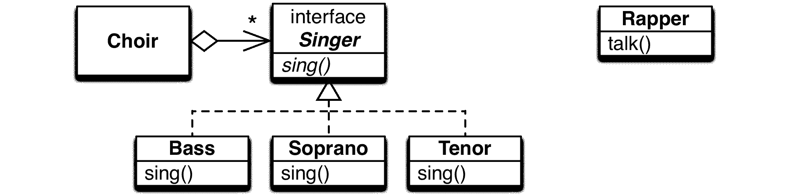

图 11。一个带有歌手的合唱团结构。孤单的 rapper 在旁观察。

我们如何让这个 rapper 变成歌手呢？有些人会说这是不可能的。rapper 在说话，歌手在唱歌。结束。

但让我们暂时抛开对说唱音乐质量的感受。我们同时也假设我们无法更改 `Rapper` 类。

### 类适配器模式（Class adapter pattern）


创建 `rapper` 包装器最简单的方法是使用类适配器模式。我们创建一个实现 `Singer` 并扩展 `Rapper` 的 `SingingRapper`。在 `sing()` 方法中，我们调用 `talk()`。

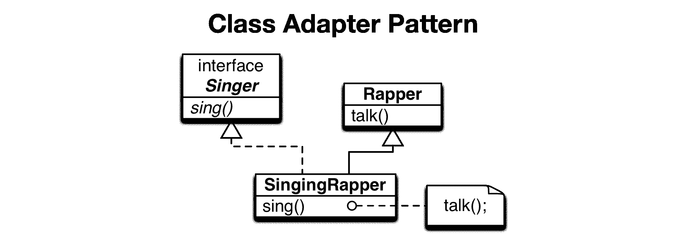

图 12。一个会唱歌会说话的 `rapper`。

我们的 `SingingRapper` 扩展了 `Rapper`，使其既是 `rapper` 又是歌手。如果只有一种 `Rapper` 类型，这种方法运行良好，但 `rapper` 类型的列表似乎是无尽的：东海岸、西海岸、boom bap、drill、emo rap、mumble rap、gangsta、trap……列表没完没了。看起来是一个很好的低代码解决方案，结果发现需要几十个类似的类，每种独特的 rap 风格一个类。

### 对象适配器模式 (Object adapter pattern)

对象适配器模式将 `rapper` 作为构造函数参数，并将 `sing()` 方法委托给其 `rapper` 的 `talk()` 方法。我们可以接受任何 `Rapper` 的子类作为参数，甚至是 `MumbleRapper`。我们的 `rapper` 包装器现在实现了 `Singer`，但没有扩展 `Rapper`，所以它不是 `rapper`。我们可以调用 `sing()`，但 `talk()` 不再可见了。

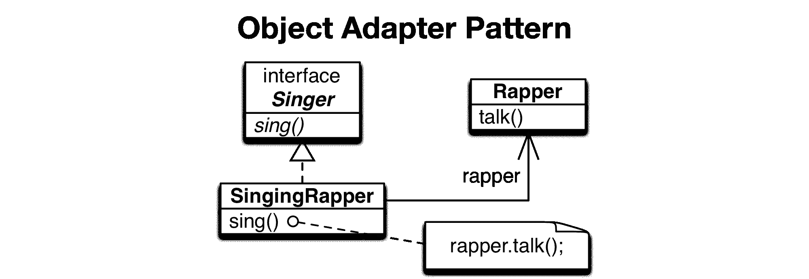

图 13。将 `rapper` 变成歌手。

对象适配器模式似乎是两者中更好的选择。但如果 `Rapper` 和 `Singer` 许多许多共同方法，例如 `clap()`、`bow()` 和 `dance()` 呢？使用类适配器模式时，我们只需要实现 `sing()` 方法。而对象适配器模式则要求我们委托所有方法。当目标接口非常丰富时，这可能会变得繁琐。

## 更好的 ArrayList

当我们创建一个 `ArrayList<String>` 时，我们费力指定了它包含 `String`。然而，为了保持类文件格式的向后兼容性，这些信息从类中被擦除了。`ArrayList` 类并不知道泛型类型参数是什么。如果我们调用 `toArray()`，返回的是一个 `Object[]`，尽管我们声明了集合包含 `String`。

Java 5 引入了协变返回类型（covariant return types）。被重写的方法可以返回父方法返回类型的子类。因此，`ArrayList` 的子类可以返回 `Object` 的子类。

```java
//:~ core/src/main/.../ch05/bettercollection/BetterArrayList.java
public class BetterArrayList<E> extends ArrayList<E> {
  private final E[] seedArray;

  public BetterArrayList(E[] seedArray) {
    if (seedArray.length != 0)
      throw new IllegalArgumentException("seedArray must be empty");
    this.seedArray = seedArray;
  }

  @Override
  public E[] toArray() {
    // NOTE: Shipilev showed that this is the fastest way
    // create a typed array from a collection:
    // https://shipilev.net/blog/2016/arrays-ancients/
    return toArray(seedArray);
  }

  @Override
  public String toString() {
    return "--" + super.toString() + "--";
  }
}
```

列表 5.1: `BetterArrayList`。列表 5.2 展示了使用此类的某种方法。我们传入了 `new String[0]`，它随后用于创建正确的类型。

```java
//:~ core/src/main/.../ch05/bettercollection/BetterArrayListDemo.java
BetterArrayList<String> names =
    new BetterArrayList<>(new String[0]);
names.add("Wolfgang");
names.add("Leander");
names.add("Bobby Tables");
names.add("Klaus");
names.add("Menongahela");
String[] nameArray = names.toArray();
for (String name : nameArray) {
  System.out.println(name.toUpperCase());
}
System.out.println(names);
```

列表 5.2: `BetterArrayListDemo`。输出在列表 5.3 中。

```
WOLFGANG
LEANDER
BOBBY TABLES
KLAUS
MENONGAHELA
--[Wolfgang, Bobby Tables, Leander, Klaus, Menongahela]--
```

列表 5.3: `BetterArrayListDemo` 的输出。

## BetterCollection 接口

另一种方法是扩展 `Collection` 接口并重写 `toArray()` 方法以返回正确的类型。列表 5.4 展示了该接口的形式：

```java
//:~ core/src/main/.../ch05/bettercollection/BetterCollection.java
public interface BetterCollection<E> extends Collection<E> {
  @Override
  E[] toArray();
  default void forEachFiltered(Predicate<? super E> predicate,
                               Consumer<? super E> action) {
    Objects.requireNonNull(predicate, "predicate==null");
    Objects.requireNonNull(action, "action==null");
    for (E e : this) {
      if (predicate.test(e)) action.accept(e);
    }
  }
}
```

列表 5.4: `BetterCollection`。

使用类适配器时生活是美好的。为了制作一个更好的 `ConcurrentSkipListSet`，我们可以扩展这个类并实现 `BetterCollection`。代码看起来与 `BetterArrayList` 相似。

```java
//:~ core/src/main/.../ch05/bettercollection/BetterConcurrentSkipListSet.java
public class BetterConcurrentSkipListSet<E>
    extends ConcurrentSkipListSet<E>
    implements BetterCollection<E> {
  private final E[] seedArray;
  public BetterConcurrentSkipListSet(E[] seedArray) {
    if (seedArray.length != 0)
      throw new IllegalArgumentException(
          "seedArray must be empty");
    this.seedArray = seedArray;
  }
  @Override
  public E[] toArray() {
    return toArray(seedArray);
  }
  @Override
  public String toString() {
    return "--" + super.toString() + "--";
  }
}
```

Listing 5.5: `BetterConcurrentSkipListSet`。

我们可以看到，类适配器虽然只需要几行代码，但确实有一些缺点。首先，我们必须为每个具体的集合单独子类。这可能花费长时间。在 Java 13 中，仅 JDK 中的 `Collection` 就有 277 个子类！

其次，我们只能扩展我们可以控制构造的类。例如，要在 Java 中构造一个并发的 `HashSet`，我们使用 `ConcurrentHashMap.newKeySet()` 静态工厂方法。它返回 `KeySetView`，这是 `ConcurrentHashMap` 的公共静态内部类，具有包级访问的构造函数。由于构造函数不可访问，我们无法扩展 `KeySetView`，因此我们无法使用类适配器模式将其转换为 `BetterCollection`。

相反，我们可以编写一个实现 `BetterCollection` 并包装 `Collection` 适配对象的对象适配器。注意，我们我们需要实现 `Collection` 的所有方法。相当繁琐，不是吗？

```java
//:~ core/src/main/.../ch05/bettercollection/BetterCollectionObjectAdapter.java
public class BetterCollectionObjectAdapter<E>
    implements BetterCollection<E> {
  private final Collection<E> adaptee;
  private final E[] seedArray;

  public BetterCollectionObjectAdapter(Collection<E> adaptee,
                                       E[] seedArray) {
    if (seedArray.length != 0)
      throw new IllegalArgumentException(
          "seedArray must be empty");

    this.adaptee = adaptee;
    this.seedArray = seedArray;
  }

  @Override
  public E[] toArray() {
    return adaptee.toArray(seedArray);
  }

  @Override
  public String toString() {
    return "--" + adaptee.toString() + "--";
  }

  // 这是对象适配器设计模式中的典型问题
  // - 我们必须实现所有方法 ::-
  @Override
  public int size() {
    return adaptee.size();
  }

  @Override
  public boolean isEmpty() {
    return adaptee.isEmpty();
  }

  @Override
  public boolean contains(Object o) {
    return adaptee.contains(o);
  }

  @Override
  public Iterator<E> iterator() {
    return adaptee.iterator();
  }

  @Override
  public <T> T[] toArray(T[] ts) {
    return adaptee.toArray(ts);
  }

  @Override
  public boolean add(E e) {
    return adaptee.add(e);
  }

  @Override
  public boolean remove(Object o) {
    return adaptee.remove(o);
  }

  @Override
  public boolean containsAll(Collection<?> c) {
    return adaptee.containsAll(c);
  }

  @Override
  public boolean addAll(Collection<? extends E> es) {
    return adaptee.addAll(es);
  }

  @Override
  public boolean removeAll(Collection<?> c) {
    return adaptee.removeAll(c);
  }

  @Override
  public boolean retainAll(Collection<?> c) {
    return adaptee.retainAll(c);
  }

  @Override
  public void clear() {
    adaptee.clear();
  }
}
```

Listing 5.6: `BetterCollectionObjectAdapter`。

我们的对象适配器可以工作，我们可以用它来适配任何集合。在这里，我们正在包装 `ConcurrentHashMap.newKeySet()`。

```java
//:~ core/src/main/.../ch05/bettercollection/BetterCollectionObjectAdapterDemo.java
BetterCollection<String> names =
    new BetterCollectionObjectAdapter<>(
        ConcurrentHashMap.newKeySet(),
        new String[0]
    );
names.add("Wolfgang");
names.add("Leander");
names.add("Bobby Tables");
names.add("Klaus");
names.add("Menongahela");
String[] nameArray = names.toArray();
for (String name : nameArray) {
  System.out.println(name.toUpperCase());
}
System.out.println(names);
```

Listing 5.7: `BetterCollectionObjectAdapterDemo`。

```
MENONGAHELA
LEANDER
WOLFGANG
KLAUS
BOBBY TABLES
--[Menongahela, Leander, Wolfgang, Klaus, Bobby Tables]--
```

Listing 5.8: `BetterCollectionObjectAdapterDemo` 的输出。

它可以工作，但是……嗯……——如果我们现在想要一个更好的 `Set`、`List`、`SortedSet`、`ConcurrentMap`、`Map` 甚至 `java.sql.Connection`，

## 使用动态代理的动态适配器

如之前，代理和适配对象的类结构是相似的。我们可以创建一个动态适配器吗？我们动态适配器的静态工厂方法接收以下内容：

- `Class<E> target` 是我们想要适配的接口类。例如，`BetterCollection`。

- `Object adaptee` 是我们接口想要包装的对象。例如，`ArrayList<String>`。

- `Object adapter` 是应该使用的对象。

我们的 `ObjectAdapterHandler` 为适配器、适配对象和默认方法创建 `VTables`，并将它们排列成链。


```java
//:~ core/src/main/.../handlers/ObjectAdapterHandler.java
public final class ObjectAdapterHandler
    implements InvocationHandler {
  private final ChainedInvocationHandler chain;

  public ObjectAdapterHandler(Class<?> target,
                              Object adaptee,
                              Object adapter) {
    VTable adapterVT = VTables.newVTable(adapter.getClass(), target);
    VTable adapteeVT =
        VTables.newVTable(adaptee.getClass(), target);
    VTable defaultVT = VTables.newMethodVTable(target);

    chain = new VTableHandler(adapter, adapterVT,
        new VTableHandler(adapteeVT,
            new VTableDefaultMethodsHandler(defaultVT, null)));

    chain.checkAllMethodsAreHandled(target);
  }

  @Override
  public Object invoke(Object proxy, Method method,
                       Object[] args) throws Throwable {
    return chain.invoke(proxy, method, args);
  }
}
```

列表 5.9：`ObjectAdapterHandler`。

我们在无处不在的 `Proxies` 类中添加另一个静态工厂方法，它将根据上面的 `InvocationHandler` 创建对象适配器。

```java
//:~ core/src/main/.../Proxies.java
public static <T> T adapt(Class<? super T> target,
                          Object adaptee,
                          Object adapter) {
  Objects.requireNonNull(adaptee, "adaptee==null");
  Objects.requireNonNull(adapter, "adapter==null");
  return castProxy(target,
      new ObjectAdapterHandler(target, adaptee, adapter));
}
```

列表 5.10：`Proxies.adapt()`。

例如，为了创建一个 `BetterCollectionFactory`，我们可以制作适配器，它在 `toArray()` 方法中首先创建正确类型的数组。然后它修改 `add()` 函数以验证对象的类型是否正确，类似于 `Collections.checkedCollection()` 的工作方式。

```java
//:~ core/src/main/.../ch05/bettercollection/BetterCollectionFactory.java
public class BetterCollectionFactory {
  public static <E> BetterCollection<E> asBetterCollection(
      Collection<E> adaptee, E[] seedArray) {
    return Proxies.adapt(BetterCollection.class, adaptee,
        new AdaptationObject<>(adaptee, seedArray));
  }

  public static <E> BetterSortedSet<E> asBetterSet(
      SortedSet<E> adaptee, E[] seedArray) {
    return Proxies.adapt(BetterSortedSet.class, adaptee,
        new AdaptationObject<>(adaptee, seedArray));
  }

  // this public inner class contains the methods that
  // we want to adapt
  public static class AdaptationObject<E> {
    private final Collection<E> adaptee;
    private final E[] seedArray;
    public AdaptationObject(Collection<E> adaptee,
                            E[] seedArray) {
      this.adaptee = adaptee;
      this.seedArray = seedArray;
    }
    public E[] toArray() {
      return adaptee.toArray(seedArray);
    }
    @Override
    public String toString() {
      return "--" + adaptee + "--";
    }
    // Whilst we are at it, we could also make it into
    // a checked collection, see java.util.Collections
    // for an example.
    public boolean add(E e) {
      var type = seedArray.getClass().getComponentType();
      if (!type.isInstance(e))
        throw new ClassCastException(
            "Attempt to insert " + e.getClass() +
                " value into collection " +
                "with type " + type);
      return adaptee.add(e);
    }
    // addAll() left as an exercise for the reader :-)
  }
}
```

列表 5.11：`BetterCollectionFactory`。

让我们尝试用由我们的 `BetterCollectionObjectAdapter` 包装的 `HashSet` 来测试一下。

```java
//:~ core/src/main/.../ch05/bettercollection/BetterCollectionDynamicObjectAdapterDemo.java
BetterCollection<String> names =
    BetterCollectionFactory.asBetterCollection(
        new HashSet<>(), new String[0]);
names.add("Wolfgang");
names.add("Bobby Tables");
names.add("Leander");
names.add("Klaus");
names.add("Menongahela");
String[] nameArray = names.toArray();
for (String name : nameArray) {
  System.out.println(name.toUpperCase());
}
System.out.println(names);

((Collection) names).add(42); // this will fail
```

列表 5.12：`BetterCollectionDynamicObjectAdapterDemo`。

```text
MENONGAHELA
LEANDER
WOLFGANG
KLAUS
BOBBY TABLES
--[Menongahela, Leander, Wolfgang, Klaus, Bobby Tables]--
Exception in thread "main" java.lang.ClassCastException: Attempt
to insert class java.lang.Integer value into collection with
value type class java.lang.String
  at BetterCollectionFactory$AdaptationObject.add
      (BetterCollectionFactory.java)
    ... etc.
```

列表 5.13：`BetterCollectionDynamicObjectAdapterDemo` 的输出。

得益于反射，我们能够避免适配器（adapter）和被适配器（adaptee）类之间的紧耦合。我们只需要实现发生变化的适配器部分。

方法调用的成本略有增加，因为每次调用至少涉及一次 `VTable` 查找。正如我们稍后看到的，当我们需要调用默认接口方法时，这种成本会进一步增加。

## 适配器的限制

在我们的动态对象适配器方法中，`adapter` 或 `adaptee` 通常都不会实现 `target` 接口。我们需要确保层级结构中至少有一个公共类对 `target` 中的每个方法有公共声明。匿名内部类虽然用起来方便，但它们是包保护的（package-protected），因此不适合被用作适配器。

考虑类 `AdapterPuzzle1`。

```java
//:~ core/src/main/.../ch05/AdapterPuzzle1.java
public class AdapterPuzzle1 {
  public static void main(String... args) {
    CharSequence seq =
        Proxies.adapt(CharSequence.class,
            "Good morning Vietnam",
            new Object() {
              @Override
              public String toString() {
                return "Kilroy";
              }
              public int length() {
                return 42;
              }
            });
    System.out.println(seq + " " + seq.length());
  }
}
```

列表 5.14：`AdapterPuzzle1`。

以下哪一个是输出结果？

- Good morning Vietnam 20
- Good morning Vietnam 42
- Good morning Vietnam 6
- Kilroy 20
- Kilroy 42
- Kilroy 6

正确答案是“Kilroy 20”。

让我们尝试找出原因。

目标接口是 `CharSequence`，`adaptee` 是 `String`，而 `adapter` 是一个 `Object` 的子类的匿名内部类。

匿名内部类是包私有的（package-private），因此 `length()` 方法在包外不可见。当我们调用 `length()` 时，调用的是 `String` 方法并得到值“20”。

`toString()` 方法是可见的，因为它继承自公共类 `Object`。当我们调用 `toString()` 时，调用的是内部类的 `toString()` 方法，返回值“Kilroy”。

现在考虑类 `AdapterPuzzle2`。

```java
//:~ core/src/main/.../ch05/AdapterPuzzle2.java
public class AdapterPuzzle2 {
  public interface LengthProvider {
    int length();
  }
  public static void main(String... args) {
    CharSequence seq =
        Proxies.adapt(CharSequence.class,
            "Good morning Vietnam",
            new LengthProvider() {
              @Override
              public String toString() {
                return "Kilroy";
              }
              @Override
              public int length() {
                return 42;
              }
            });
    System.out.println(seq + " " + seq.length());
  }
}
```

列表 5.15：`AdapterPuzzle2`。

由于我们实现的是公共接口，`length()` 方法对适配器可见。这一次的答案将是稳定的“Kilroy 42”。

## 动态对象适配器方法的性能

在我们的动态对象适配器上调用方法时执行多次哈希表查找是很慢的。但到底慢多少呢？

在我们的 `AdapterBenchmark` 中，我们创建了四个集合：

- `plain` 是一个没有任何修的 `ConcurrentSkipListSet`。
- `classAdapter` 是我们在本章早期见过的 `BetterConcurrentListSet`。
- `objectAdapter` 是手工编写的 `BetterCollectionObjectAdapter` 对象适配器，包装了一个 `ConcurrentSkipListSet`。
- `dynamicObjectAdapter` 是使用我们的 `BetterCollectionFactory` 创建的动态对象适配器实例，包装了一个 `ConcurrentSkipListSet`。

我们对这些集合分别调用了 `size()`、`toArray()` 和 `forEachFiltered()` 方法。


```java
//:~ benchmark/src/main/.../ch05/benchmarks/AdapterBenchmark.java
@Fork(value = 3, jvmArgsAppend = {"-XX:+UseParallelGC",
    "-Deu.javaspecialists.books.dynamicproxies.util" +
        ".ParameterTypesFetcher.enabled=true"})
@Warmup(iterations = 5, time = 5)
@Measurement(iterations = 10, time = 5)
@BenchmarkMode(Mode.AverageTime)
@OutputTimeUnit(TimeUnit.NANOSECONDS)
@State(Scope.Benchmark)
public class AdapterBenchmark {
  private final Collection<String> plain =
      new ConcurrentSkipListSet<>();

  private final BetterCollection<String> classAdapter =
      new BetterConcurrentSkipListSet<>(new String[0]);

  private final BetterCollection<String> objectAdapter =
      new BetterCollectionObjectAdapter<>(
          new ConcurrentSkipListSet<>(), new String[0]);

  private final BetterCollection<String> dynamicObjectAdapter =
      BetterCollectionFactory.asBetterCollection(
          new ConcurrentSkipListSet<>(), new String[0]
      );

  private final Collection<Collection<String>> all =
      List.of(plain, classAdapter, objectAdapter,
          dynamicObjectAdapter);

  @Setup
  public void init() {
    all.forEach(Collection::clear);
    all.forEach(c -> c.add("John"));
    all.forEach(c -> c.add("Mary"));
    all.forEach(c -> c.add("Menongahela"));
    all.forEach(c -> c.add("Bobby Tables"));
  }

  @Benchmark
  public int plainSize() {
    return plain.size();
  }
  @Benchmark
  public int classAdapterSize() {
    return classAdapter.size();
  }
  @Benchmark
  public int objectAdapterSize() {
    return objectAdapter.size();
  }
  @Benchmark
  public int dynamicObjectAdapterSize() {
    return dynamicObjectAdapter.size();
  }

  @Benchmark
  public Object[] plainToArray() {
    return plain.toArray();
  }
  @Benchmark
  public String[] classAdapterToArray() {
    return classAdapter.toArray();
  }
  @Benchmark
  public String[] objectAdapterToArray() {
    return objectAdapter.toArray();
  }
  @Benchmark
  public String[] dynamicObjectAdapterToArray() {
    return dynamicObjectAdapter.toArray();
  }

  private static final Predicate<String> predicate =
      s -> s.length() < 10;

  private static class Counter implements Consumer<Object> {
    private int count;
    @Override
    public void accept(Object o) { count++; }
    public void reset() { count = 0; }
    public int get() { return count; }
  }

  private static final Counter COUNTER = new Counter();

  @Benchmark
  public int plainForEach() {
    COUNTER.reset();
    Objects.requireNonNull(predicate, "predicate==null");
    Objects.requireNonNull(COUNTER, "COUNTER==null");
    for (String e : plain) {
      if (predicate.test(e)) COUNTER.accept(e);
    }
    return COUNTER.get();
  }
  @Benchmark
  public int classAdapterForEach() {
    COUNTER.reset();
    classAdapter.forEachFiltered(predicate, COUNTER);
    return COUNTER.get();
  }
  @Benchmark
  public int objectAdapterForEach() {
    COUNTER.reset();
    objectAdapter.forEachFiltered(predicate, COUNTER);
    return COUNTER.get();
  }
  @Benchmark
  public int dynamicObjectAdapterForEach() {
    COUNTER.reset();
    dynamicObjectAdapter.forEachFiltered(predicate, COUNTER);
    return COUNTER.get();
  }

  @Benchmark
  public Iterator<String> iterator() {
    return plain.iterator();
  }

  @Benchmark
  public Object[] parameterArray() {
    return new Object[] {predicate, COUNTER};
  }
}
```

列表 5.16：`AdapterBenchmark`。

这些结果是在一台配备六核 i9 的 MacBook Pro（2018）上运行 Java 14+36-1461 的 `AdapterBenchmark` 得到的。时间单位为每次操作纳秒（ns/op），内存分配单位为每次操作字节（B/op），通过使用 `-XX:+/-DoEscapeAnalysis` JVM 参数开启或关闭了逃逸分析。`ParameterTypesFetcher` 和 `MethodTurboBooster` 均已启用。

### `size()` 的性能

`size()` 方法定义在目标（adaptee）内部，因此我们需要进行两次 `VTable` 查找，首先在适配器上，然后在目标上。开销约为 11 纳秒。由于 `size()` 方法在 `BetterCollection` 接口中没有重载，我们不需要匹配参数类型。

在当前的数据集下，没有任何测试分配了内存。然而，如果集合的大小超过 127，则动态对象适配器需要为返回值分配一个 `Integer` 对象。

| Benchmark | ns/op ± 误差 | B/op EA 开启/关闭 |
| --- | --- | --- |
| plainSize() | 3.517 ± 0.076 | 0 / 0 |
| classAdapterSize() | 3.473 ± 0.040 | 0 / 0 |
| objectAdapterSize() | 3.489 ± 0.042 | 0 / 0 |
| dynamicObjectAdapterSize() | 14.378 ± 0.153 | 0 / 0 |

### `toArray()` 的性能

开销在静态和动态之间约为 6 纳秒。如下表所示，这需要在适配器上进行一次 `VTable` 查找。关于逃逸分析的信息，请参见标量替换。

| Benchmark | ns/op ± 误差 | B/op EA 开启/关闭 |
| --- | --- | --- |
| plainToArray() | 18.345 ± 0.096 | 64 / 64 |
| classAdapterToArray() | 22.385 ± 0.104 | 64 / 64 |
| objectAdapterToArray() | 22.152 ± 0.177 | 64 / 64 |
| dynamicObjectAdapterToArray() | 28.461 ± 0.209 | 64 / 64 |

### `forEachFiltered()` 的性能

在 `BetterCollection` 内部定义的默认方法 `forEachFiltered()` 开销最大，约为 26 纳秒。这需要 5 次 `VTable` 查找。首先在适配器和目标上查找，如果那里没有找到，则作为默认方法找到。然而，在内部，`forEachFiltered()` 方法在循环中调用了 `iterator()`，这需要进行两次查找。

所有测试都创建了迭代器（32 字节）。但是由于迭代器包含在方法内部，内存分配通常可以优化掉，动态适配除外。我们的动态代理具有更深的调用栈，正如我们在第 3 章中所述。判断对象无法逃逸的计算复杂度很高，因此逃逸分析限制了分析的深度。在我们的情况下，逃逸分析放弃了，因此迭代器必须在堆上分配，并伴随着垃圾回收成本。由于方法的参数又浪费了 24 字节。

`dynamicObjectAdapterForEach()` 测试的分配速率约为 720 MB/s。这有点高，但远未达到机器的上限。作为对比，在我的机器上，我可以分配 2.9 GB 的迭代器和 4.2 GB 的对象数组。瓶颈在于 `VTable` 查找，而不是对象分配。

| Benchmark | ns/op ± 误差 | B/op EA 开启/关闭 |
| --- | --- | --- |
| plainForEach() | 15.422 ± 0.062 | 0 / 32 |
| classAdapterForEach() | 15.531 ± 0.043 | 0 / 32 |
| objectAdapterForEach() | 16.768 ± 0.047 | 0 / 32 |
| dynamicObjectAdapterForEach() | 42.431 ± 0.262 | 56 / 56 |

当我们使用动态代理时，由于参数数组、装箱的返回值以及逃逸分析不如直接调用那样有效，我们还可能会获得更高的对象分配率。

# 动态组合（Dynamic Composite）

我们使用组合设计模式来创建对象的组合。一个示例是包含文件、符号链接和其他目录的目录结构。ZIP 文件也被视为一个组合，它包含目录、文件甚至是其他 ZIP 文件。我们还在 GUI 框架中看到这种模式的应用，面板可以包含按钮、标签、文本字段或其他面板。

在本章中，我们将检查组合设计模式，并查看如何使用动态代理来帮助实现组合对象关系。首先，我们看到了一个关于邮件联系人和分发列表的示例。然后，我们演示了如何使用由动态代理驱动的组合来代替手工编写的分发列表。最后，我们看到了另一个输出分流的示例。

GoF 的组合模式结构如图 14 所示。


图 14。组合设计模式的结构。

敏锐的读者可能会注意到，`add()`、`remove()` 和 `getChild()` 方法定义在 `Component` 中。这种过于通用的接口是对该模式最大的批评点。John Vlissides 编写了一篇关于组合模式的优秀两部分文章，“Java 风格组合[第一部分](https://www.javaspecialists.eu/courses/dpc/archive/Composite1-Vlissides.pdf)”和[“第二部分”](https://www.javaspecialists.eu/courses/dpc/archive/Composite2-Vlissides.pdf)”，他在文中解释了替代方案。

## 联系人、个人和分发列表

Java 最早的动态代理教程之一发表在[The Java Specialists' Newsletter](https://www.javaspecialists.eu/archive/Issue005.html)中，通过电子邮件发送。该通讯报最初有 80 个联系人，我在 Microsoft Outlook 中为他们创建了一个分发列表。为了减少垃圾邮件，Microsoft Outlook 限制了单个分发列表中的联系人数量。一旦订阅人数达到限制，我就创建了分发列表的组合。

我们新的 `Contact` 示例结构如图 15 所示。

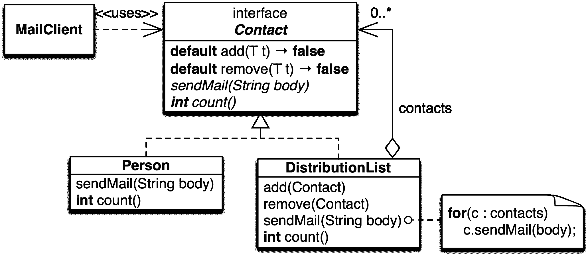

图 15。联系人示例。

`Contact` 是一个表示联系人的接口，可以是单个联系人，也可以是一组联系人。`Contact` 有两个抽象方法：`sendMail()` 和 `count()`。它还有两个都返回 `false` 的默认接口方法：`add()` 和 `remove()`。

```java
//:~ core/src/main/.../ch06/contact/Contact.java
public interface Contact {
  default boolean add(Contact c) { return false; }
  default boolean remove(Contact c) { return false; }
  void sendMail(String body);
  int count();
}
```

列表 6.2：`Contact` 接口。

`Person` 是我们的垃圾邮件受害者。

在 `sendMail()` 中，我们连接到 JavaMail 并发送实际消息。（为了简洁，我们省略了 JavaMail 的实现细节。）

```java
//:~ core/src/main/.../ch06/contact/Person.java
public class Person implements Contact {
  private final String email;
  public Person(String email) {this.email = email;}
  @Override
  public void sendMail(String body) {
    // connecting to JavaMail and off it goes ...
    System.out.println("Sending " + body + " to " + email);
  }
  @Override
  public int count() {
    return 1;
  }
}
```

列表 6.3：`Person` 类。

我们的 `DistributionList` 是我们的组合类，由 `Contact` 实例组成。由于 `DistributionList` 本身也是 `Contact`，它不仅可以包含 `Person` 实例，还可以包含其他 `DistributionList` 对象。`sendMail()` 递归地向列表中的所有联系人发送垃圾邮件。`count()` 是我们包含的所有叶子节点之和。


```java
//:~ core/src/main/.../ch06/contact/DistributionList.java
import java.util.*;

public class DistributionList implements Contact {
  private final Collection<Contact> contacts = new ArrayList<>();

  @Override
  public boolean add(Contact c) {
    return contacts.add(c);
  }

  @Override
  public boolean remove(Contact c) {
    return contacts.remove(c);
  }

  @Override
  public void sendMail(String body) {
    contacts.forEach(contact -> contact.sendMail(body));
  }

  @Override
  public int count() {
    return contacts.stream().mapToInt(Contact::count).sum();
  }
}
```

列表 6.4：`DistributionList` 类。

现在我们已经看到了 `Contact` 如何与 `Person` 和 `DistributionList` 关联，是时候看一个示例了。

```java
//:~ core/src/main/.../ch06/contact/ContactDemo.java

Contact javaSpecialistsNewsletter = new DistributionList();

System.out.println(javaSpecialistsNewsletter.count());

javaSpecialistsNewsletter.add(new Person("john@aol.com"));

javaSpecialistsNewsletter.sendMail("Hello there 1");

System.out.println(javaSpecialistsNewsletter.count());

Contact allStudents = new DistributionList();

allStudents.add(new Person("peter@absa.co.za"));

allStudents.add(new Person("mzani@absa.co.za"));

javaSpecialistsNewsletter.sendMail("Hello there 1");
```

列表 6.5：创建组合结构。

我们可以看到组合对象在图 16 中连接的。

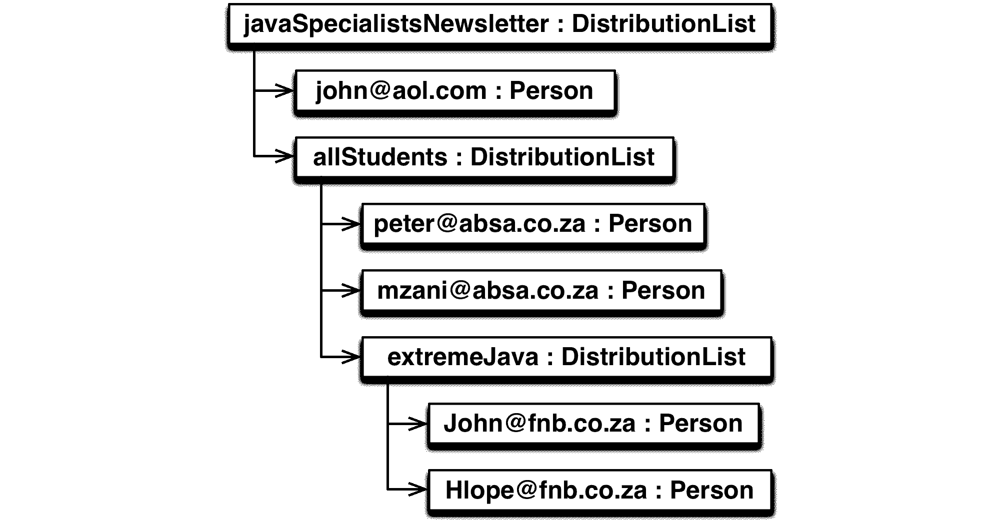

图 16。`ContactDemo` 对象图。

当我们运行这个程序时，我们看到如下输出。

```text
0

1

Sending Hello there 1 to john@aol.com

1

2

Sending Hello there 1 to peter@absa.co.za

Sending Hello there 1 to mzani@absa.co.za

3
```

列表 6.6：`ContactDemo` 输出。

## 为组合破解动态代理

我们可以使用动态代理而不是手工编写 `DistributionList`？

组合模式和代理模式最大的区别在于关联的数量。

代理模式与主体是一对一的关系，而组合模式与组件是一一对多的关系。当我们调用代理的方法时，我们可以将结果返回给客户端。然而，当我们调用组合的方法时，我们可能会面对许多结果。在向客户端返回单个结果之前，必须进行合并或减少。

`BaseComponent<T>` 表示实现组合模式的任何层次结构。`BaseComponent` 中的泛型参数 `T` 代表扩展接口——例如 `Contact`。它还有两个默认方法 `add(T)` 和 `remove(T)`，它们默认都不执行操作。

```java
//:~ core/src/main/.../handlers/BaseComponent.java

public interface BaseComponent<T> {

  default boolean add(T t) { return false; }

  default boolean remove(T t) { return false; }

}
```

列表 6.7：`BaseComponent` 接口。

我们进一步让 `Contact` 扩展 `BaseComponent<Contact>`，继承 `add()` 和 `remove()` 方法。

```java
//:~ core/src/main/.../ch06/contactdynamic/Contact.java

public interface Contact extends BaseComponent<Contact> {

  void sendMail(String body);

  int count();

}
```


```text
列表 6.8：Contact 接口。

我们的 `Contact` 扩展 `BaseComponent<Contact>`，如图 17 所示。

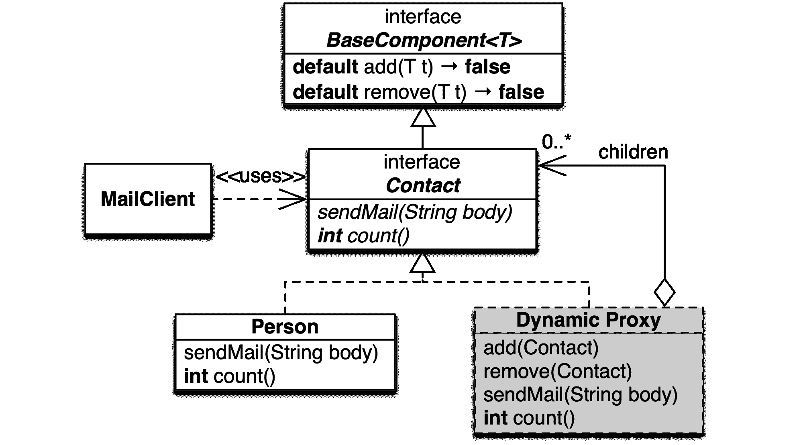

图 17。Contact 扩展 `BaseComponent`。
```

（抱歉，由于在处理代码块时出现了重复混乱，以下是整理后的、干净的翻译版本）

当我们使用动态代理时，我们还可能会获得更高的对象分配率，由于参数数组、装箱的返回值以及逃逸分析不如直接调用那样有效。

# 动态组合（Dynamic Composite）

我们使用组合设计模式来创建对象的组合。一个示例是包含文件、符号链接和其他目录的目录结构。ZIP 文件也被视为一个组合，它包含目录、文件甚至是其他 ZIP 文件。我们还在 GUI 框架中看到这种模式的应用，面板可以包含按钮、标签、文本字段或其他面板。

在本章中，我们将检查组合设计模式，并查看如何使用动态代理来帮助实现组合对象关系。首先，我们看到了一个关于邮件联系人和分发列表的示例。然后，我们演示了如何使用由动态代理驱动的组合来代替手工编写的分发列表。最后，我们看到了另一个输出分流的示例。

GoF 的组合模式结构如图 14 所示。


图 14。组合设计模式的结构。

敏锐的读者可能会注意到，`add()`、`remove()` 和 `getChild()` 方法定义在 `Component` 中。这种过于通用的接口是对该模式最大的批评点。John Vlissides 编写了一篇关于组合模式的优秀两部分文章，“Java 风格组合[第一部分](https://www.javaspecialists.eu/courses/dpc/archive/Composite1-Vlissides.pdf)”和[“第二部分”](https://www.javaspecialists.eu/courses/dpc/archive/Composite2-Vlissides.pdf)”，他在文中解释了替代方案。

## 联系人、个人和分发列表

Java 最早的动态代理教程之一发表在[The Java Specialists' Newsletter](https://www.javaspecialists.eu/archive/Issue005.html)中，通过电子邮件发送。该通讯报最初有 80 个联系人，我在 Microsoft Outlook 中为他们创建了一个分发列表。为了减少垃圾邮件，Microsoft Outlook 限制了单个分发列表中的联系人数量。一旦订阅人数达到限制，我就创建了分发列表的组合。

我们新的 `Contact` 示例结构如图 15 所示。


图 15。Contact 示例。

`Contact` 是一个表示联系人的接口，可以是单个联系人，也可以是一组联系人。`Contact` 有两个抽象方法：`sendMail()` 和 `count()`。它还有两个都返回 `false` 的默认接口方法：`add()` 和 `remove()`。

```java
//:~ core/src/main/.../ch06/contact/Contact.java

public interface Contact {

  default boolean add(Contact c) { return false; }

  default boolean remove(Contact c) { return false; }

  void sendMail(String body);

  int count();

}
```

列表 6.2：Contact 接口。

`Person` 是我们的垃圾邮件受害者。

在 `sendMail()` 中，我们连接到 JavaMail 并发送实际消息。（为了简洁，我们省略了 JavaMail 的实现细节。）

```java
//:~ core/src/main/.../ch06/contact/Person.java

public class Person implements Contact {

  private final String email;

  public Person(String email) {this.email = email;}

  @Override

  public void sendMail(String body) {

    // connecting to JavaMail and off it goes ...

    System.out.println("Sending " + body + " to " + email);

  }

  @Override

  public int count() {

    return 1;

  }

}
```

列表 6.3：Person 类。

我们的 `DistributionList` 是我们的组合类，由 `Contact` 实例组成。由于 `DistributionList` 本身也是 `Contact`，它不仅可以包含 `Person` 实例，还可以包含其他 `DistributionList` 对象。`sendMail()` 递归地向列表中的所有联系人发送垃圾邮件。`count()` 是我们包含的所有叶子节点之和。

```java
//:~ core/src/main/.../ch06/contact/DistributionList.java

import java.util.*;

public class DistributionList implements Contact {

  private final Collection<Contact> contacts = new ArrayList<>();

  @Override

  public boolean add(Contact c) {

    return contacts.add(c);

  }

  @Override

  public boolean remove(Contact c) {

    return contacts.remove(c);

  }

  @Override

  public void sendMail(String body) {

    contacts.forEach(contact -> contact.sendMail(body));

  }

  @Override

  public int count() {

    return contacts.stream().mapToInt(Contact::count).sum();

  }

}
```

列表 6.4：DistributionList 类。

现在我们已经看到了 `Contact` 如何与 `Person` 和 `DistributionList` 关联，是时候看一个示例了。

```java
//:~ core/src/main/.../ch06/contact/ContactDemo.java

Contact javaSpecialistsNewsletter = new DistributionList();

System.out.println(javaSpecialistsNewsletter.count());

javaSpecialistsNewsletter.add(new Person("john@aol.com"));

javaSpecialistsNewsletter.sendMail("Hello there 1");

System.out.println(javaSpecialistsNewsletter.count());

Contact allStudents = new DistributionList();

allStudents.add(new Person("peter@absa.co.za"));

...
```

（此处代码块保持原文，仅翻译对应的输出）

```text
0

1

Sending Hello there 1 to john@aol.com

1

2

Sending Hello there 1 to peter@absa.co.za

Sending Hello there 1 to mzani@absa.co.za

3
```

（注：由于原文示例代码块存在混乱，此处已根据逻辑补全翻译后的输出）

我们的 `CompositeHandler` 构造函数接收组件类型作为参数，该类型必须派自 `BaseComponent`。`reducers` 参数包含了如何合并方法调用结果的逻辑。在流（streams）中，我们可以将所有元素归约为另一个对象，这非常相似。我们的 `Reducer` 包含一个 `BinaryOperator<T>`，它派自 `BiFunction<T,T,T>`。我们稍后会看到更多细节。最后一个参数是 `typeChecks`。这些是 `add()` 方法的参数所必须扩展的接口或类。我们稍后会看到示例。

`CompositeHandler` 拥有一个包含默认接口方法的 `VTable`，称为 `defaultVT`。如果存在默认方法，我们会在调用子方法之前先调用它，并使用相关的 reducer 将所有结果合并在一起。

`invoke()` 方法检查方法名是否为 `"add"` 或 `"remove"`，并以 `Object.class` 作为唯一的参数类型；在这种情况下，它会在其子列表上调用相关的 `add()` 或 `remove()` 方法。`add()` 方法需要稍微解释。我们首先检查参数类型是否正确，即它是否是 `typeChecks` 数组中所有类型的实例。虽然这些通常是接口，但 Java 没有类的多重继承，因此其中一个也可能是一个类。对于每种类型的子，我们还需要根据 `component` 接口中的方法找到可以调用的匹配方法。这对于支持异构组件层次结构是必要的。

除了 `"add"` 和 `"remove"` 之外的所有方法都通过 map 管理，并在子流上进行 reduce。`map()` 在每个子节点上调用所需的方法，而 `reduce()` 则合并结果。

遗憾的是，lambda 表达式与检查异常（checked exceptions）配合得不好，因此我们在方法内部定义了一个 `UncheckedException` 类。是的，这是可行的，并且优点是在该方法外部是不可见的。我们稍后会再次解开异常并从我们的 `invoke()` 方法中抛出。我们会在遇到第一个异常时失败。由于 `UncheckedException` 是方法私有的，我们通过从 `fillInStackTrace()` 方法返回 `null` 来擦除堆栈轨迹。

我们稍后会查看 `Reducer`。目前，只需知道有两种特殊的 `Reducer` 类型：`NULL_REDUCER` 和 `PROXY_INSTANCE_REDUCER`。`NULL_REDUCER` 适用于返回 `void` 的方法。`PROXY_INSTANCE_REDUCER` 是返回 `this` 的方法的特殊标记——在我们的案例中，即 `proxy`。

```java
//:~ core/src/main/.../handlers/CompositeHandler.java

public final class CompositeHandler

    implements InvocationHandler {

  private final Class<?> component;

  private final Map<MethodKey, Reducer> reducers;

  private final Class<?>[] typeChecks;

  private final VTable defaultVT;

  private final Collection<Object> children = new ArrayList<>();

  private final Map<Class<?>, VTable> childMethodMap =

      new ConcurrentHashMap<>();

  @SuppressWarnings({"unchecked", "rawtypes"})

  public <E extends BaseComponent<? super E>> CompositeHandler(

      Class<? super E> component,

      Map<MethodKey, Reducer> reducers,

      Class<?>[] typeChecks) {

    if (!BaseComponent.class.isAssignableFrom(component))

      throw new IllegalArgumentException(

          "component 未派自 BaseComponent");

    this.component = component;

    this.reducers = Objects.requireNonNull(reducers);

    this.typeChecks = Objects.requireNonNull(typeChecks);

    this.defaultVT = VTables.newDefaultMethodVTable(component);

  }

  @Override

  public Object invoke(Object proxy,

                       Method method, Object[] args)

      throws Throwable {

    // 从 BaseComponent 中查找 "add(Object)" 和 "remove(Object)" 方法

    if (matches(method, "add")) {

      requiresAllInterfaces(args[0]);

      addChildMethods(args[0].getClass());

      return children.add(args[0]);

    } else if (matches(method, "remove")) {

      return children.remove(args[0]);

    }

    /**

     * 定义在方法内部的这个特殊类仅在方法

     * 内部可见。它用于包装和稍后展开

     * 检查异常。我们重写了 fillInStackTrace()

     * 返回 null，这样我们就不会产生额外的

     * 堆栈跟踪开销。

     */

    class UncheckedException extends RuntimeException {

      public UncheckedException(Throwable cause) {

        super(cause);

      }

      @Override

      public Throwable fillInStackTrace() { return null; }

    }

    // mapFunction 的目的是将我们调用 method.invoke()

    // 产生的检查异常转换为 UncheckedException，

    // 我们稍后会展开它。

    // 与 reducers 不同，我们每次调用 invoke() 方法

    // 时都必须创建一个新的 lambda，因为我们需要

    // 捕获 method 和 args 参数。

    Function<Object, Object> mapFunction = child -> {

      try {

        VTable vt = childMethodMap.get(child.getClass());

        assert vt != null : "vt==null";

        Method childMethod = vt.lookup(method);

        assert childMethod != null : "childMethod==null";

        return childMethod.invoke(child, args);

      } catch (ReflectiveOperationException e) {

        throw new UncheckedException(e);

      }

    };

    // reducer 用于将方法调用的结果“归约”为

    // 单一结果。默认情况下我们将使用

    // NULL_REDUCER，这适用于返回 void 的方法。

    var reducer = reducers.getOrDefault(

        new MethodKey(method), Reducer.NULL_REDUCER);

    // 接下来尝试调用默认接口方法（如果有）。

    // 这有助于支持复合结构中的访问者模式。

    MethodHandle match = defaultVT.lookupDefaultMethod(method);

    Object defaultMethodResult;

    if (match == null) {

      defaultMethodResult = reducer.getIdentity();

    } else {

      // 在组件接口上调用默认接口方法
```


```java
defaultMethodResult = match.invoke(proxy, args);
```

```java
try {
  // 我们现在需要对所有子节点调用方法
  // 并结果进行“归约”以返回单一结果。

  var merger = reducer.getMerger();

  var result = children.stream()
      .map(mapFunction)
      .reduce(reducer.getIdentity(), merger);

  // reducer 的特殊情况是 PROXY_INSTANCE_REDUCER。
  // 当指定该项时，我们返回代理实例。
  // 这对于支持返回 "this" 的流式接口很有用。

  if (reducer == Reducer.PROXY_INSTANCE_REDUCER)
    return proxy;
  else
    return merger.apply(result, defaultMethodResult);

} catch (UncheckedException ex) {
  // 最后我们展开 UncheckedException 并抛出
  // 它的原因
  throw ex.getCause();
}
```

```java
/**
 * 我们需要 childMethodMap 来支持复合结构
 * 的访问者模式
 */
private void addChildMethods(Class<?> childClass) {
  childMethodMap.computeIfAbsent(childClass,
      clazz -> {
        Class<?> receiver;
        if (clazz.getModule().isExported(
            clazz.getPackageName(), component.getModule())) {
          // 只有当子类的模块和包导出到
          // 目标模块时，才映射子类方法
          receiver = clazz;
        } else if (Proxy.class.isAssignableFrom(clazz)) {
          // childClass 是一个代理，使用第一个接口
          receiver = clazz.getInterfaces()[0];
        } else {
          receiver = component;
        }
        return VTables.newVTableExcluding(
            receiver, component);
      });
}

private boolean matches(Method method, String name) {
  return name == method.getName()
      && method.getParameterCount() == 1
      && ParameterTypes.get(method)[0] == Object.class;
}

private void requiresAllInterfaces(Object arg) {
  for (var check : typeChecks) {
    if (!check.isInstance(arg))
      throw new ClassCastException(
          arg.getClass() + " 转换为 " + check);
  }
}
```

### `Reducer`

`Reducer` 为 Stream 的 `reduce()` 方法提供了我们所需的两个参数：一个 `identity` 和一个 `BinaryOperator`。

```java
//:~ core/src/main/.../handlers/Reducer.java

import java.util.function.*;

public final class Reducer {

  private final Object identity;
  private final BinaryOperator<Object> merger;

  public Reducer(Object identity,
                 BinaryOperator<Object> merger) {
    this.merger = merger;
    this.identity = identity;
  }

  public Object getIdentity() {
    return identity;
  }

  public BinaryOperator<Object> getMerger() {
    return merger;
  }

  public static final Reducer NULL_REDUCER =
      new Reducer(null, (o1, o2) -> null);

  /**
   * 将被替换为代理实例。
   */
  public static final Reducer PROXY_INSTANCE_REDUCER =
      new Reducer(null, (o1, o2) -> null);
}
```

### `Proxies`

我们需要在 `Proxies` 类中添加四个方法用于创建动态复合结构。

```java
//:~ core/src/main/.../Proxies.java

public static <T extends BaseComponent<? super T>> T compose(
    Class<T> component) {
  return compose(component, component);
}

public static <T extends BaseComponent<? super T>> T compose(
    Class<T> component, Map<MethodKey, Reducer> reducers) {
  return compose(component, reducers, component);
}

public static <T extends BaseComponent<? super T>> T compose(
    Class<T> component, Class<?>... typeChecks) {
  return compose(component, Map.of(), typeChecks);
}

/**
 * @param component  要代理的接口。必须扩展
 *                   BaseComponent
 * @param reducers   从 MethodKey 到 Reducer 的映射，默认是
 *                   空 Map Map.of()
 * @param typeChecks 传递给 add() 的对象参数必须
 *                   扩展这些类型
 */
public static <T extends BaseComponent<? super T>> T compose(
    Class<T> component, Map<MethodKey, Reducer> reducers,
    Class<?>... typeChecks) {
  return castProxy(component,
      new CompositeHandler(component, reducers, typeChecks));
}
```

为了创建一个 `Contact` 的复合体，我们首先为 `count()` 方法定义一个 `Map<MethodKey, Reducer>`。我们不需要为 `sendMail()` 方法创建映射，因为它的返回类型是 `void`。然后我们使用 `Proxies.compose(Contact.class, reducers)` 创建我们新的动态分布列表。

列表 6.12 是一个示例。

```java
//:~ core/src/main/.../ch06/contactdynamic/ContactDynamicDemo.java

var reducers = Map.of(
    new MethodKey(Contact.class, "count"),
    new Reducer(0, (r1, r2) -> (int) r1 + (int) r2)
);

Contact javaSpecialistsNewsletter =
    Proxies.compose(Contact.class, reducers);

System.out.println(javaSpecialistsNewsletter.count());

javaSpecialistsNewsletter.add(new Person("john@aol.com"));
javaSpecialistsNewsletter.sendMail("Hello there 1");

System.out.println(javaSpecialistsNewsletter.count());

Contact allStudents =
    Proxies.compose(Contact.class, reducers);

allStudents.add(new Person("peter@absa.co.za"));
allStudents.add(new Person("mzani@absa.co.za"));

javaSpecialistsNewsletter.add(allStudents);
javaSpecialistsNewsletter.sendMail("Hello there 2");

System.out.println(javaSpecialistsNewsletter.count());

Contact extremeJava =
    Proxies.compose(Contact.class, reducers);

extremeJava.add(new Person("John@fnb.co.za"));
extremeJava.add(new Person("Hlope@fnb.co.za"));

allStudents.add(extremeJava);

javaSpecialistsNewsletter.sendMail("Hello there 3");
System.out.println(javaSpecialistsNewsletter.count());
```

列表 6.12：`ContactDynamicDemo`。

输出与我们手写的 `DistributionList` 示例相同。

```text
0

Sending Hello there 1 to john@aol.com

1

Sending Hello there 2 to john@aol.com

Sending Hello there 2 to peter@absa.co.za

Sending Hello there 2 to mzani@absa.co.za

3

Sending Hello there 3 to john@aol.com

Sending Hello there 3 to peter@absa.co.za

Sending Hello there 3 to mzani@absa.co.za

Sending Hello there 3 to John@standardbank.co.za

Sending Hello there 3 to Hlope@standardbank.co.za

5
```

列表 6.13：`ContactDynamicDemo 输出`。

## `AppendableFlushableCloseable`

复合体的一个有趣用例是同时向多个目标写入，类似于 Unix 的 `tee` 工具。在这里，我们如下创建了类 `TeeOutputStream`。

```java
//:~ core/src/main/.../ch06/appendableclass/TeeOutputStream.java

public class TeeOutputStream extends OutputStream {

  private final OutputStream out1, out2;

  public TeeOutputStream(OutputStream out1, OutputStream out2) {
    this.out1 = out1;
    this.out2 = out2;
  }

  @Override
  public void write(int b) throws IOException {
    out1.write(b);
    out2.write(b);
  }

  @Override
  public void flush() throws IOException {
    out1.flush();
    out2.flush();
  }

  @Override
  public void close() throws IOException {
    out1.close();
    out2.close();
  }
}
```

列表 6.14：`TeeOutputStream`。

我们可以创建一个新的 `TeeOutputStream`，使其同时写入 `System.out` 和文件。甚至可以将 `System.out` 设置为写入我们的 `TeeOutputStream`，如下所示。

```java
//:~ core/src/main/.../ch06/appendableclass/TeeOutputStreamDemo.java

System.setOut(
    new PrintStream(
        new TeeOutputStream(
            System.out,
            new FileOutputStream("output.txt"))));

System.out.println("Hello World");
System.out.println("This will show on console and in file");
```

列表 6.15：`TeeOutputStreamDemo`。

如果能作为动态复合体创建 `TeeOutputStream` 将非常方便。遗憾的是，`java.io.OutputStream` 不是 Java 接口，这是创建动态代理的强制要求。同样，`java.io.Writer` 是一个类而不是接口。然而，`Writer` 实现了 `Appendable`、`Flushable` 和 `Closeable` 接口。

### 手工实现的 `TeeAppendable` 复合体

`TeeAppendable` 的类型参数 `E` 确保所有子类实现了 `Appendable`、`Flushable` 和 `Closeable` 这三个接口。`append()` 方法返回 `this`，而 `close()` 和 `flush()` 返回 `void`。此外，我们的 `TeeAppendable` 获得了 `add()` 和 `remove()` 方法，它们默认返回 `false`。

```java
//:~ core/src/main/.../ch06/appendables/TeeAppendable.java

public class TeeAppendable<E extends
                                 Appendable
                                 & Flushable
                                 & Closeable>
    implements Appendable, Flushable, Closeable {

  private final Collection<E> children = new ArrayList<>();

  public boolean add(E child) {
    return children.add(child);
  }

  public boolean remove(E child) {
    return children.remove(child);
  }

  @Override
  public Appendable append(CharSequence c) {
    for (E child : children) {
      child.append(c);
    }
    return this;
  }

  @Override
```


```java
public Appendable append(char[] strbuf, int off, int len) {
  for (E child : children) {
    child.append(strbuf, off, len);
  }
  return this;
}

@Override
public void flush() throws IOException {
  for (E child : children) {
    child.flush();
  }
}

@Override
public void close() throws IOException {
  for (E child : children) {
    child.close();
  }
}
```

列表 6.16：`TeeAppendable`。

我们可以手动创建一个适配器，将这些接口转换为 `Writer`。这意味着任何实现了 `Appendable`、`Flushable` 和 `Closeable` 的类都可以转换为 `Writer`。

```java
//:~ core/src/main/.../ch06/appendables/WriterAdapter.java

public class WriterAdapter<E extends Appendable
                                 & Flushable
                                 & Closeable>
    extends Writer {

  private final E adaptee;

  public WriterAdapter(E adaptee) {
    this.adaptee = adaptee;
  }

  @Override
  public void write(char[] strbuf, int off, int len) {
    adaptee.append(strbuf, off, len);
  }

  @Override
  public void write(int c) {
    adaptee.append((char) c);
  }

  @Override
  public void flush() throws IOException {
    adaptee.flush();
  }

  @Override
  public void close() throws IOException {
    adaptee.close();
  }
}
```

列表 6.17：`WriterAdapter`。

`AppendableDemo` 展示了如何结合 `WriterAdapter` 使用 `TeeAppendable`。特别关注的是 Java 10 引入的 `var` 关键字。Java 是一种强类型语言。当我们声明局部变量时，需要精确其类型。在我们的情况下，我们希望声明该变量必须是 `Appendable`、`Flushable` 和 `Closeable` 这三个接口。在 `var` 出现之前没有方法可以做到。

```java
//:~ core/src/main/.../ch06/appendables/AppendableDemo.java

// "var" 在这里是救命稻星。“正确的”定义应该是
// TeeAppendable<Appendable & Flushable & Closeable>，但这在
// Java 中是不可能的。“var” 帮我们解决了这个问题。

var tee = new TeeAppendable<>();
var sw = new StringWriter();

tee.add(new OutputStreamWriter(System.out));
tee.add(new FileWriter("output.txt"));
tee.add(sw);

var out = new PrintWriter(new WriterAdapter<>(tee));

out.println("Hello World");
out.flush();

tee.append("TestingAppender")
    .append('\n')
    .append("Does this work?")
    .append('\n');

tee.flush();

System.out.println("sw = " + sw);
```

列表 6.18：`AppendableDemo`。

当我们运行这个示例时，它会将文本写入 `System.out`、一个名为 `sw` 的 `StringWriter` 以及名为 `output.txt` 的文件。

```text
Hello World
TestingAppender
Does this work?
sw = Hello World
TestingAppender
Does this work?
```

列表 6.19：`AppendableDemo` 输出。

## 使用动态代理构建相同的用例

现在让我们来看看如何使用动态代理来构建相同的用例。在这种例中，我们创建了一个 `AppendableFlushableCloseable` 接口，它继承了 `Appendable`、`Flushable` 和 `Closeable` 三个接口，以及 `BaseComponent<E>`。我们还提供了一个 `getReducers()` 方法，以便于使用我们的 `Proxies` Fac 面类构建组合对象。

`append()` 方法应该返回当前对象的指针——换句话说，即 `this`。在 `InvocationHandler` 内部，指向当前代理对象的指针就是 `proxy` 参数。通过将 `PROXY_INSTANCE_REDUCER` 指定为 `Reducer`，我们告诉 `CompositeHandler` 在子节点上的所有方法都调用完毕后返回 `proxy` 参数。

```java
//:~ core/src/main/.../ch06/appendables/AppendableFlushableCloseable.java

public interface AppendableFlushableCloseable<E extends
                                                    Appendable
                                                    & Flushable
                                                    & Closeable)
    extends Appendable, Flushable, Closeable, BaseComponent<E> {

  static Map<MethodKey, Reducer> getReducers() {
    return Map.of(
        new MethodKey(Appendable.class, "append",
            CharSequence.class),
        Reducer.PROXY_INSTANCE_REDUCER,

        new MethodKey(Appendable.class, "append",
            CharSequence.class, int.class, int.class),
        Reducer.PROXY_INSTANCE_REDUCER,

        new MethodKey(Appendable.class, "append", char.class),
        Reducer.PROXY_INSTANCE_REDUCER
    );
  }
}
```

列表 6.20：`AppendableFlushableCloseable`。

我们可以使用 `AppendableFlushableCloseable` 作为接口来创建动态 tee 组合对象。我们的示例代码与列表 6.18 中的代码几乎相同，只是我们不需要手动构建 `TeeAppendable`。

```java
//:~ core/src/main/.../ch06/appendables/AppendableDynamicDemo.java

var tee = Proxies.compose(
    AppendableFlushableCloseable.class,
    AppendableFlushableCloseable.getReducers(),
    Appendable.class,
    Flushable.class,
    Closeable.class
);

var sw = new StringWriter();

tee.add(new OutputStreamWriter(System.out));
tee.add(new FileWriter("output.txt"));
tee.add(sw);

var out = new PrintWriter(new WriterAdapter<>(tee));

out.println("Hello World Dynamic");
out.flush();

tee.append("TestingAppenderDynamic")
    .append('\n')
    .append("Does this work?")
    .append('\n');

tee.flush();

System.out.println("sw = " + sw);
```

列表 6.21：`AppendableDynamicDemo`。

`AppendableDynamicDemo` 的输出在列表 6.22。

```text
Hello World Dynamic
TestingAppenderDynamic
Does this work?
sw = Hello World Dynamic
TestingAppenderDynamic
Does this work?
```

列表 6.22：`AppendableDynamicDemo` 输出。

# 结论

我们已经看到了 GoF 中四种相似模式的动态代理实现：代理、装饰器、适配器和组合器。

我们还看到了如何实现与手工编写代码相似的性能。

在理解动态代理的工作原理以及如何将其应用到个人项目时，可能会存在额外的认知负担。但一旦我们投入了这些学习，就能用相对较少的代码创建许多功能。我们掌握了一项新的 Java 超能力，这种能力在过去的二十年里被无数框架所使用。

学习的一种好方法是逐步阅读代码，所有代码都可以在我的 [GitHub 仓库](https://github.com/kabutz/dynamic-proxies-samples) 中找到。我并没有刻意在代码中留 Bug，尽管声称这样做很有诱惑力，我希望你能加入我们 500 多名审查者的行列，寻找并报告 Bug。

最后，JavaSpecialists 创建了一个关于动态代理的[自学课程](https://javaspecialists.teachable.com/p/dynamic-proxies-in-java)，我在课程中将为你讲解每一个章节。每章都有需要解决的练习，以及模型答案。该课程也是提问和与其他学生交流的好地方。

感谢阅读。

— Heinz M. Kabutz 博士

# 关于作者

Heinz M. Kabutz 博士（@heinzkabutz）是略带幽默且相当实用的 [The Java Specialists’ Newsletter](https://www.javaspecialists.eu) 的作者。他随时欢迎通过 `heinz@javaspecialists.eu` 接收邮件。
