# 土袋建筑：用袋子筑你的梦想家（绿色房屋建筑）（第 3 卷）

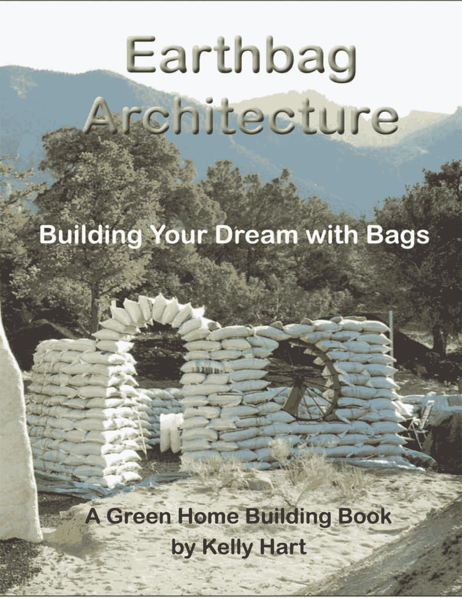

## 序言

Kelly Hart | Owen Geiger 博士

自从 Kelly Hart 和我决定创建`EarthbagBuilding.com`已经过去了十年，不久后又成立了土袋建筑博客（后来更名为`NaturalBuildingBlog.com`）。与 Kelly 合作是一件荣幸，也是荣誉。

## 引言

1996年，我和妻子 Rosana 坐着一辆被我改装成移动房屋的 40 英尺巴士在美西南部旅行。我当时正在为一个名为“替代住房”（Alternative Homes）的节目收集信息和视频。

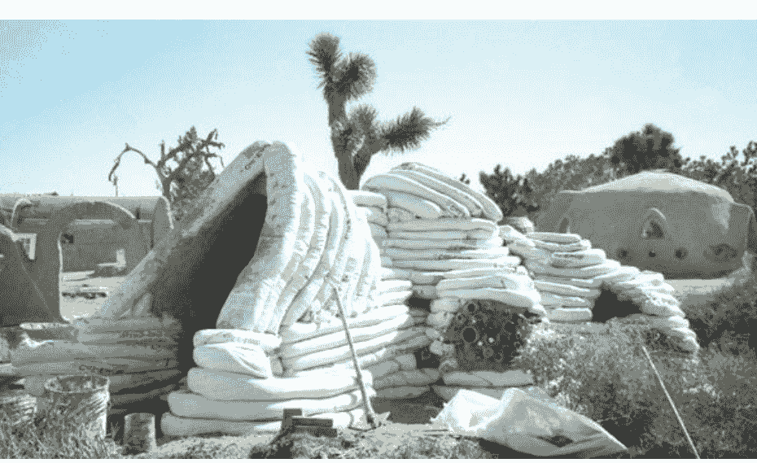

我很快发现，一位出生于伊朗的建筑师 Nader Khalili 负责推广通过堆叠填充土壤的袋（或管）来建造建筑的想法。他将这种技术称为“超级土袋”（Superadobe）。

自从完成土袋房屋（大约在2000年）以来，我参与了许多其他土袋建筑项目，包括池塘的小水坝、一个用于车库/商店/办公室复合体的大拱顶、一个小型露天剧场项目、一个嵌入式储藏室以及几个独立的小圆顶。我将随着故事的进展描述所有这些建筑。我从这些经验中学到了很多知识，并将它们与你们分享。

在建造土袋房屋期间，我继续收集实际施工过程的视频素材，这耗时近三个时间。最后，我制作了另一个视频节目（后转为DVD），标题为《用袋建筑：我们如何制作我们的实验性土袋/纸石混凝土房屋》。

在我完工土袋房屋左右，我开始为我们位于科罗拉多州的当地报纸撰写了一系列关于可持续建筑的文章。在某个时刻，我曾想过将这些文章结成一本书，但随后意识到一个致力于同一主题的网站可能会吸引全球更多的读者。这便是`www.greenhomebuilding.com`的诞生，它一直繁荣发展至今。

作为这个成功网站的补充，我创立了`www.dreamgreenhomes.com`，将几位绿色建筑师和设计师的才华汇聚在一个绿色房屋设计图的市场中。

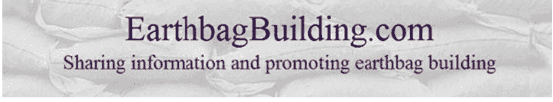

这些设计师之一是奥恩·盖格博士（Dr. Owen Geiger），他是我的私人朋友，也是一个被“土袋病毒”侵中的人。我们讨论过一起合写一本关于土袋建筑的书，但后来选择启动另一个网站：`http://www.earthbagbuilding.com`。奥恩随后还撰写了一本土袋建筑指南，以及一个关于该主题的教学DVD。

与土袋建筑网站同步，我们分享了一个关于同一主题的博客，现在它已演变为`http://www.naturalbuildingblog.com`。奥恩负责了该博客的大部分文章，但我偶尔也会进行记录。

所有这些资源结合在一起提供了丰富的信息，不仅关于土袋建筑，还关于一般的普持续建筑。你可以通过上述网站购买到提到的大多数书籍和DVD。

你可以预见到在下一章中读到关于土袋建筑的历史。接后，我将深入探讨如果你想尝试这种建筑方式，需要了解的基础知识。在此之后，我将详细描述我在各种项目中的许多直接经验。多年来，我们一直在网上发布关于世界各地开展的丰富多样的土袋建筑信息；现在我将总结其中一些内容，以便你理解这种革命性建筑技术的范围竟有多广。关于所有这些，我们可以观察可能性的基础，并对土袋建筑的未来可能是什么样子提出建议。

希望当你读完这本书时，你对用土袋能做的事情有一个良好的了解，并对操作它的基础知识有所理解。当然，没有任何东西可以取代直接经验，我鼓励你尝试一下，从一些小项目开始，或者参加某地的工作坊。然而，请记住，任何建筑都涉及风险。正如你稍后读到的，我遇到过许多必须克服的挫折，其中一些可能导致受伤。我或 Hartworks, Inc. 对因使用此书中发现的任何信息而导致的损失、损坏或伤害不承担任何责任。我希望你像我一样喜欢建筑的过程！

# 土袋建筑的历史

通过堆叠装有沙或土的袋子建造墙壁的想法已经存在了一个多世纪。最初，沙袋被用于防洪和军事地堡，因为它们易于运输到使用地点、组装快、廉价，并且在抵御水和子弹的任务上非常有效。起初使用黄麻等天然材料制造袋子；最近，织造聚丙烯因其优越的强度而成为首选材料。

沙袋的使用通常与临时结构或屏障的建造有关。使用沙袋建造房屋或永久性结构是一项相对较新的创新。

1976年，德国卡斯塞尔理工学院实验建筑研究实验室的格恩诺特·米克（Gernot Minke）开始研究如何利用沙子和碎石等天然建筑材料建造房屋，而无需使用粘结剂来固化材料。发现使用织物包装散装材料是一种具有成本效益的方法。他们使用浮石填充在袋中，因为比普通的沙子和碎石更轻，且具有更好的隔热性能。他们的第一次成功实验是叠涩圆顶形状（倒悬链线），这是通过一个安装在结构中心的旋转垂直模板实现的。

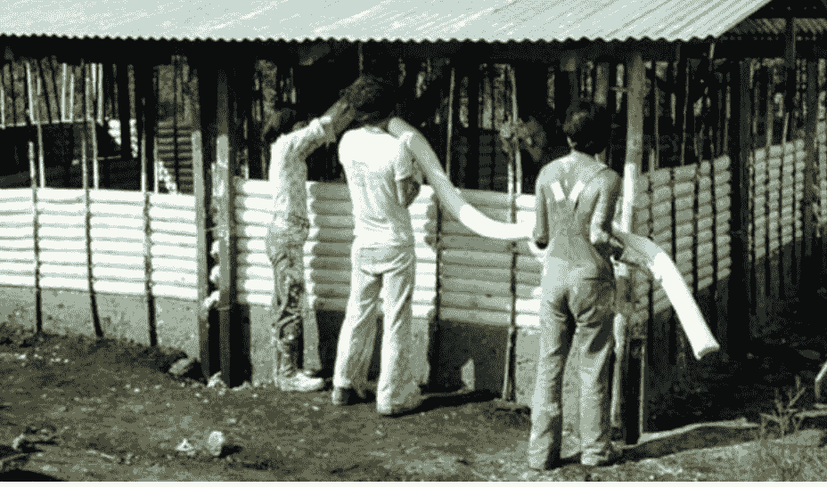

1978年，在格恩诺特·米克的指导下，在危地拉建造了一座使用抗震堆叠袋式结构的原型房屋。他们使用浸泡过石灰水的棉袋来保护材料免受腐烂和虫害侵害。压平时，袋子的尺寸约为 3 X 4 英寸（8 X 10 厘米）。放在袋子两侧的垂直竹竿并用线环连接为堆叠的袋子提供了稳定性。竹杆固定在基础和顶部的水平拉梁上。

伊朗裔建筑师纳德尔·哈里里（Nader Khalili）普及了用装有土壤材料的袋子建造永久结构的想法。实际上，他的第一个概念是向袋子里填充月尘！在参加1984年NASA关于如何在月球建造避难所的研讨会时，哈里里将旧沙袋的想法与他家乡中东的古代土砖圆顶和拱门建筑方法相结合。他意识到填充月球“土”的袋子可以堆成圆顶或拱顶以提供住所。

哈里里对这一地球建筑概念进行了进一步的改进：对于一个永久的、抗震的结构，在袋层之间不放置铁丝网，从而将外壳统一成一个更具整体性的结构？

起初，哈里里用沙漠沙填充他的实验袋子，但随后演变了了他的“超级土袋”（Superadobe）构想，即聚丙烯材料的袋子将填充润湿的土砖土壤或水泥固化的土壤，这些土壤会干燥成大土砖块。在这种情况下，原始的袋子材料仅仅是初始形式，并不一定是结构中不可缺的一部分。

在这些首次实验后，哈里里开始通过媒体宣传他的工作，并就这些技术举办工作坊。许多读到他工作的人、访问他在加州赫斯珀利亚（Hesperia）的庄园，或在那里学习的人，都决定进行自己的实验。

这些早期者中包括乔·肯尼迪（Joe Kennedy）、保琳娜·沃杰霍肖斯科卡（Paulina Wojciechowska）、卡基·亨特（Kaki Hunter）和唐尼·基夫梅耶（Doni Kiffmeyer）、井上英雄以及我。我认为是乔·肯尼迪创造了“土袋”（earthbag）这一术语，暗示袋子可以包含各种土壤材料。

保琳娜·沃杰霍肖斯科卡是第一个对土袋建筑主题撰写整本书的人：《用土构筑：柔性成型土袋建筑指南》于2001年出版。该书中介绍了她在哈里里的 CalEarth 期间进行的一些早期实验，以及其他几个案例研究。

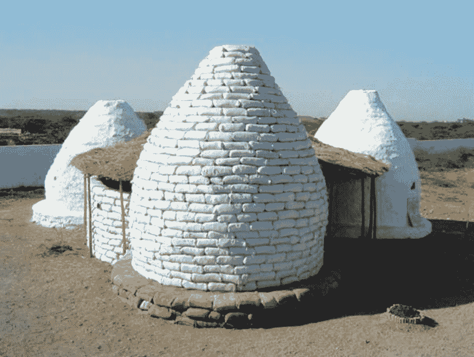

来自日本天理大学的井上英雄（Akio Inoue）在大学校园内以及印度和非洲对土袋建筑进行了广泛的实验。上面的照片是许多帮助建立援助计划的项目之一。

卡基·亨特（Kaki Hunter）和她的丈夫唐尼·基夫梅耶（Doni Kiffmeyer）在向哈里里学习后对土袋建筑着迷，并为他们自己和客户开展了各种项目。2004年，他们撰写并出版了另一本书《土质建筑：工具、技巧与技术》，基于他们的特定经验。

与此同时，纳德尔·哈里里继续推广他的超级土袋技术，并决定对该想法申请专利，他于1999年在美国获得了专利，使用了非常通用的术语，涵盖了使用任何材料制成的袋子填充几乎任何材料，并在袋层之间结合铁丝网。

我们中许多一直在致力于推广土袋建筑的人曾收到过 Khalili 的联系，并被要求他签订合同以继续我们的工作。经过少少研究就发现，他的专利很容易被取消资格，因为在申请专利之前，他至少已经在四年的时间通过各种媒体公开了他的技术。专利法明确规定，任何在专利申请前一年内发生的此类公开将导致其失去考虑资格。

因此，现在任何人都可以采用这一概念并大加开展，而且全球范围内有越来越多的人正在这样做。虽然 Khalili 和他的大多数学生主要关注如何使用这些袋来形成大型土坯砖块，但其他人也尝试在里面填充各种其他材料，例如碎屑火山岩、碎屑珊瑚、非土坯砖土壤、砾石和稻壳。

Nader Khalili 于 2008 年去世，但他的家人继续运营 CalEarth，在那里举办工作坊，并在全球范围内推广超级土袋（Superadobe）概念。如果没有这位远见者的奉献和工作，土袋建筑今天绝不会像现在这样流行。

土袋建筑在所有其他建筑技术中是独特的，因为它可以根据袋中填充的内容既作为隔热层，也可以作为热质量层。隔热倾向于将室内空间与室外空气隔离，而热质量会将室外温度缓慢传递到室内。这是一个非常重要的区别，因为墙体的这些特性将很大地影响任何特定系统的舒适性、经济性和生态性。

安全是所有建筑技术的首要考虑问题，已经进行了大量的实验和测试，为许多建筑方法建立了指南。Khalili 与加利福尼亚州赫斯斯利亚（Hesperia）的建筑部门建立了关系，CalEarth 就位于那里，这是一个地震自然威胁巨大的地区。1993 年，在 CalEarth 的若干圆顶土袋结构上进行了活荷载测试，以模拟地震、雪载和风载，这些测试结果超过了规范要求的 200%。

1995 年，对计划建设的赫斯斯利亚博物馆和自然中心的几个原型进行了动态和静态载荷测试，该中心计划使用 Khalili 的超级土袋概念，并采用圆顶和拱形形状。所有这些测试都超过了 ICBO 和赫斯斯利亚市的要求。

2006 年，应可持续建筑 Geiger 研究所 Owen Geiger 博士的请求，美国西点军学院土木与机械工程系进行了若干受控和计算机监控的测试，以确定填充沙子、当地土壤和碎石的聚丙烯土袋承受垂直载荷的能力。他们的书面报告得出：“总体而言，土袋显示出一种低成本建筑替代方案。非常便宜且易于建造，事实证明在单体住宅常见的荷载下具有耐用性。更多的测试将证明土袋的可靠性和实用性。”

尽管这些测试取得了成功，但土袋建筑概念尚未被纳入《国际住宅建筑规范》。显然，需要对土袋建筑已证明的可行性获得更广泛的接受！

目前很难知道已经建造了多少住宅和其他土袋结构，肯定有成百个，甚至有成千上万个。我们中许多人一直在推广这项技术作为应急避难所，并已为此建造了一些。人们很容易接受这种建造临时避难所的方式，因为它符合沙袋使用的历史模型。

但我们中许多人也使用土袋建造了坚固的房屋，在此过程中我们意识到这项技术是多么多功能且可持续的。如果许多此类土袋房屋在与其同时建造的传统建筑解体多年后仍然屹立着，我不会感到惊讶。

## 为什么要用土袋建造？

当我考虑“为什么要用土袋建造？”这个问题时，“多功能性”是我我脑海中浮出的第一个词。我想不出任何其他建筑技术（无论是传统的还是替代性的）在建筑风格和材料行为方面提供如此多的功能性。

土袋可以用于制作直的或弯曲的垂直墙，也可以堆叠成各种形状的圆顶，而且这些形状可以组合成非常有趣的体积，如上图所示。

土袋既可以在地面上，也可以用于地下，因为常用的聚丙烯袋材料不受潮湿损坏。可以使用各种填充材料，取决于墙体对隔热或热质量的需求，以及是否需要抵抗潮湿损坏。

考虑土袋的另一个好理由是建筑过程可以极其生态。基础、墙体甚至屋顶（圆顶的情况下）都可以不使用工业材料（袋本身和一些铁丝之外），甚至不需要木材（木材通常不是可持续采集的）。

土袋建筑可以做得非常有经济效益；大部分所需材料可以从现场免费获取，并且可以消除对基础大量混凝土的需求。当然，所有的常规用品都有，但袋子的成本是主要的支出。如果你知道去哪里寻找，大多数袋子可以免费或低价获得。

土袋建筑很容易学习，但需要一些努力才能做对。最重要的是确保袋子装得紧实，墙体抹灰得正确。如果你这样做，你的建筑将持续很长时间。

# 基础

## 什么样的袋子？

麻布是土袋建筑中最常用的材料，因为它透气且廉价。然而，如果暴露在自然环境中太久，它容易腐烂。聚丙烯袋要耐用得多，且抗腐烂、防潮。然而，它们不透气，如果墙体没有适当通风，就会出现问题。

土袋项目的最佳尺寸是 50 磅的饲料袋。它们平铺时宽约 18 英寸，长 32 英寸。这个尺寸很好，但精确尺寸并不关键；袋子可以大一点或小一点，但我不会做得太小，否则墙的稳定性可能会受到影响。抹灰后，墙厚大约为 18 英寸。如果你有较大的袋子，可以用于底部；如果你有较小的袋子，可以用在墙或圆顶的顶部。

然后就有是否购买插袋（gusseted bags）的问题。插边（缝在袋底部的褶皱）可以使袋子在填充和敲实到位时，其轮廓均匀地保持在一个平面。如果没有插边，袋底的尖角往往会凸出来，使随后的抹灰变得更加困难。有些人喜欢仔细地折叠并钉住袋子底部以避免这种情况，但我更倾向于在抹灰前用锤子将尖角敲平。另一个技巧是把袋子反过来用以避开尖角。

Nader Khalili 开创了使用与制造单个袋子相同的聚丙烯材料制成的长管状部分，用于叠在墙体。这些管子可以根据需要切割以完成特定的墙段，套在坚硬的填充管或漏斗上，然后就位填充。这通常需要几个人才能高效完成，但结果会非常美观、坚固，且完工速度快。

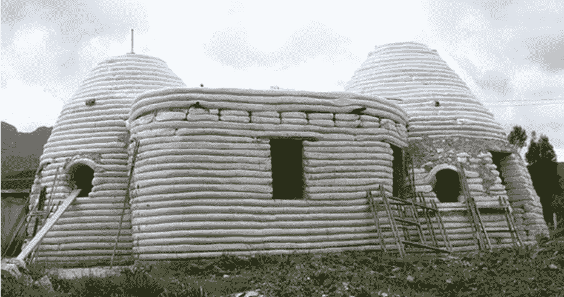

管材材料可以以大卷形式购买（通常直接从工厂购买），长度可达 6000 英尺。出于某种原因，购买大卷装比购买单个袋子在经济上通常没有优势，尽管制造这些袋子显然增加了生产时间和材料成本。

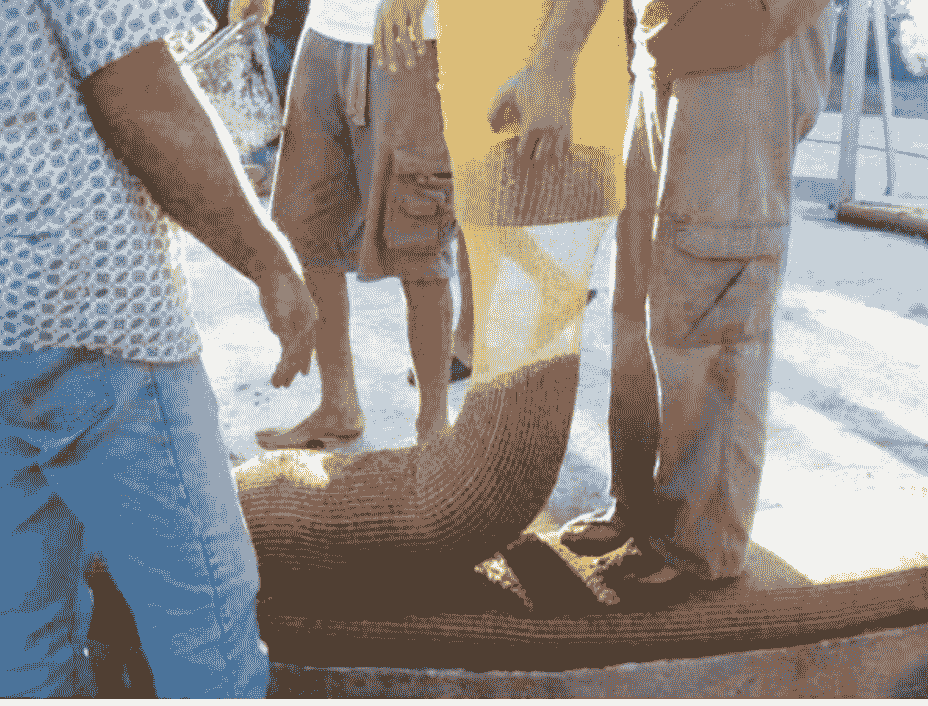

袋装材料的一项近期创新是使用通常包装水果的开放式网袋。这种网格也可以以长卷形式购买，并以与聚丙烯管类似的方式使用。这种技术由巴西工程师费尔南多·帕切科（Fernando Pacheco）引入，他称之为“Hyperadobe”（超级土坯）。网袋通常是拉丝织的，纤维是聚丙烯或其他合成纤维。

Hyperadobe 将 Superadobe 提升了一个全新的高度，具有许多独特优势。网袋装通常比织造聚丙烯材料便宜；填充物干燥和固化速度更快；在垂直墙设计中可能不需要铁丝网；由于层之间的直接粘结，它创造了一个更具整体性的结构；更容易将管子收集在罐上进行填充；砂浆的粘附性更好；网格提供了自动的砂浆加筋。唯一的缺点是由于溢漏，无法用于松散填充材料。

# 填充材料

最常见的热质量填充材料是沙子和粘土的混合物，其比例接近其他土墙系统（如土砖、泥板墙和夯土）中使用的比例，其中 30% 的粘土和 70% 的沙子混合最为理想。由于土壤被封装在坚固的袋子里，当用于土袋时，这种土壤混合物的精确配方可以具有更大的变活性。目标是使其在润湿、捣实到位位并干燥后不再移动。土袋几乎可以使用任何土壤，但最好避免沉重的粘土或细小的、湿滑的沙子。只要你移除了大部分较大的岩石和有机碎片，就没问题。这意味着通常可以使用建筑现场地下的土壤。还有什么比这更可持续的呢？

袋子在墙中的使用方式可能会决定最佳填充材料是什么。垂直墙通常比圆顶更具容错性，圆顶确实需要用实心材料块建造。使用形状变化的填充物创建圆顶可能会变得不稳定并坍塌，除非有适当的加固。

选择填充材料的另一个决定因素是对可能的水问题的暴露，例如地下环境或在潮湿气候下建造的圆顶。

如果没有足够的粘土来结合土壤，可以使用波特兰水泥或建筑石灰进行稳定。大约 10% 的这些稳定剂可能足够了，但最好对你的土壤进行一些测试以确定这一点。对于圆顶，特别是在过量水分可能是问题的气候下，建议用水泥稳定土壤，以确保填充物永远不会软到变形。我们建议人们避免在雨水气候下建造圆顶，或者至少为圆顶提供一个额外的、独立的屋顶以将水引开。

其他成功使用的隔热填充材料还包括浮石和火山渣岩（两者都是轻质火山岩）、珍珠岩，甚至稻壳壳。人们还可以实验回收聚苯乙烯泡沫（EPS泡沫）或碎塑料瓶作为填充物。当然，在设计墙体时，你必须考虑这些材料可能的压缩性。

适当填充材料的一个特殊情况是地基或墙底的第一层或两层。在这里，你希望墙体绝对不会在潮湿条件下恶化，也不希望墙体会水分向上渗透到松散碎石的水平。因此，我们通常建议在这一层使用松散材料填充袋子。由于这种松散材料绝不漏出至关重要，我们建议使用两个袋子（一个套一个）以双重确保其安全。良好的稳定砂浆对于保护这些袋子至关重要。

# 基础

土袋本身就是很好的基础，并已用于许多其他建筑系统，例如草捆墙、绳木墙、泥板墙等。在这种情况下，袋子被建造到合适的护脚墙高度，使墙的其余部分至少高于地面一英尺，远高于雪面或可能撞击地面后反溅的水。

所有基础系统都必须考虑到底层土壤因寒冷天气冻胀或因水分膨胀而隆起的可能性，沉重的膨胀性粘土也是如此。避免这些问题的常用方法是挖掘到该地区冰冻深度以下的水平，或者在任何重型粘土层以下。

规范性建筑标准通常要求符合特定条件和尺寸的连续混凝土基础。这种基础可以用于土袋建筑，只要混凝土基础的顶部足够宽，能够容纳在顶部压实后土袋的整个宽度。在这种情况下，在基础墙顶部放置隔潮层可能是个好主意，或者从一层填充碎石的袋子开始，以避免混凝土将水分渗透到上方的墙中。

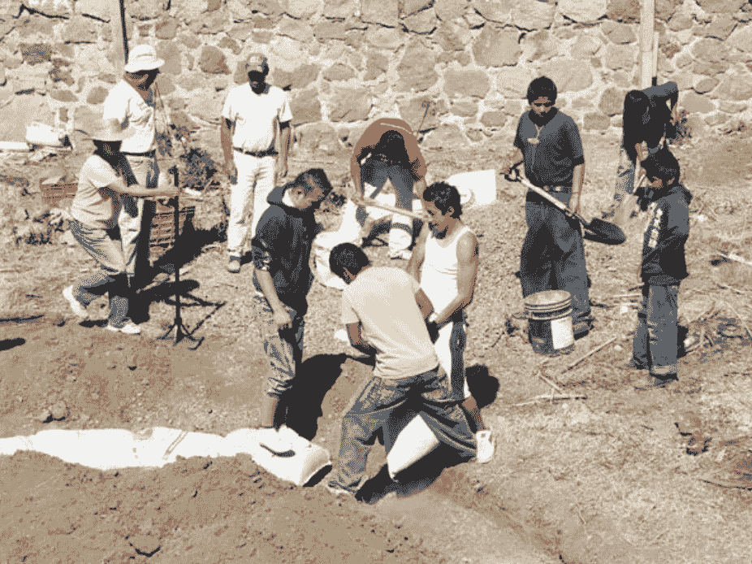

土袋（earthbags）的另一种生态基础是在碎石沟上上砌筑细固的石块。这可能是出于美学考虑，也可以为了避免使用填充满碎石的袋子。与混凝土基础一样，在砌好的石块和第一层袋子之间放置防潮层是明智之举。

## 填充与铺设土袋

人们使用了多种简单的方法来让填充袋变得更方便。一种常见的方法是切掉 5 加仑塑料桶的底部，用上部分作为漏斗，用来撑开袋口。我们曾使用一个略微锥形的金属圆柱（它是商用喂鸡器的一部分）来达到同样的目的。我见过用金属制成的支架，它们可以支撑起整个袋子，并让填充物被推进去。无论你如何操作，在填充时，一种保持袋口开启的方法是有帮助的。对于长连续软管材料，必须有某种滑槽来收集松散的布料，以便让填充物能放置在末端，然后根据需要从滑槽中释放更多的软管。

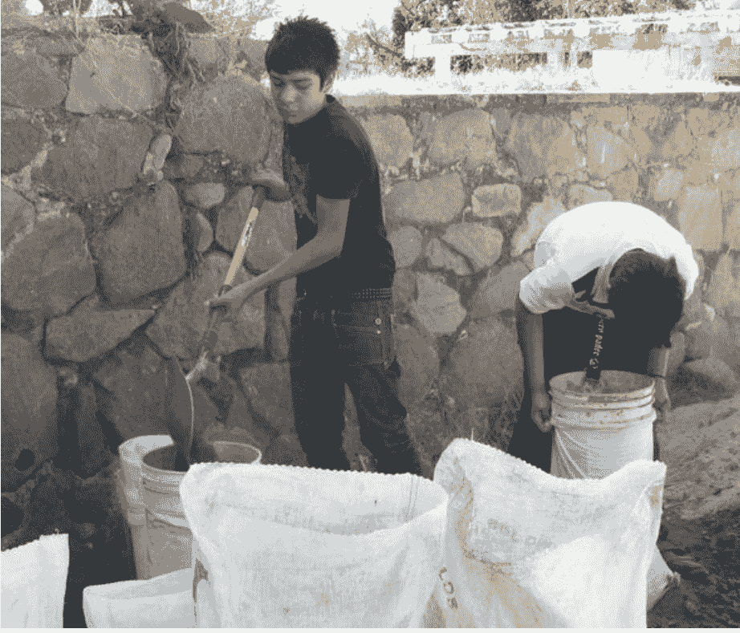

除非你使用的是轻质填充材料，否则我建议直接在正在建造的墙上原地填充袋子。这样你只需要搬运较小的桶或铲子里的材料，从而保护你的背部。一袋土的重量可以轻易超过 100 磅，让搬运或抬起的任务变得异常艰辛。

由于袋底已经缝合上，最好将底部朝向墙上的任何开口处，以确保没有东西会漏出来。关闭袋口最简单的方法是在顶部留出足够的空间，以便折叠袋子并使其挤压在之前铺设的袋子上；大约 8 到 10 英寸即可。这会浪费袋子一些用于填充的潜在长度，因此你可能更倾向于物理上封住袋口。如果该缝合处将顶住另一个袋子，一种简单的密封方法是使用钉子、铁丝或绳扣钉将其固定。

利用袋子的全长度的好处是，当按照铺设砖墙时典型的这种错缝图案进行铺设时，较长的袋子会有空间相互重叠。这使得墙体更加稳定，而且最终在建造墙体时使用的袋子更少。

在某些情况下，袋子的两端都可能暴露并需要安全地密封。我曾通过实际上折叠顶部并用粗线缝合（使用非常宽的针脚）来实现这一点。另一种可能更快的方法是使用足够硬的金属丝，只需在几处穿过折叠缝缝，然后折叠金属丝末端以固定。

在封口袋子之前，可以将顶部的填充物削成锥形，使其符合小直径圆弧所形成的任何角度，从而使两个相邻袋子之间贴得更紧密。此外，在袋子顶部两侧稍微推一下，会更容易折叠或固定袋子材料。一旦你进入了这种工作节奏，这一切都会变成一种本能。

在墙上原地填充袋子时，我通常将袋底放在它最终所在的位置附近，这样一旦它装满并在顶部固定，就可以简单地推过去，与之前铺设的袋子对齐。这样就完全不需要抬起那个沉重的袋子了。用手或脚推一下就能让袋子到位，以便稍后进行夯实。

## 夯实土袋

为了固实填充材料并让袋子原地平整，它们在铺设后很快就需要进行夯实。我通常会等铺设好几个、甚至一整层袋子后再这样做，因为一旦开始了夯实，一次性夯实整个区域会更容易。

用脚踩袋子可以起到一定的夯实作用，但使用专用的夯实设备要高效且彻底得多。这些设备可以在一些五金商店购买，也可以通过各种方式制造。

我最喜欢的夯实器是自制的，一个金属管手柄焊接在废弃的厚钢上。这个工具的重量是一个优势，因为它增加了向下的夯实推力；虽然抬起来重一点，但我发现这比一直用力产生向下的推力要省力。夯实刃的宽度与标准袋子一样宽，所以每次夯实动作大约可以覆盖袋子的 25%。商用夯实器通常没有那么宽，因此需要更多地移动才能完成任务。

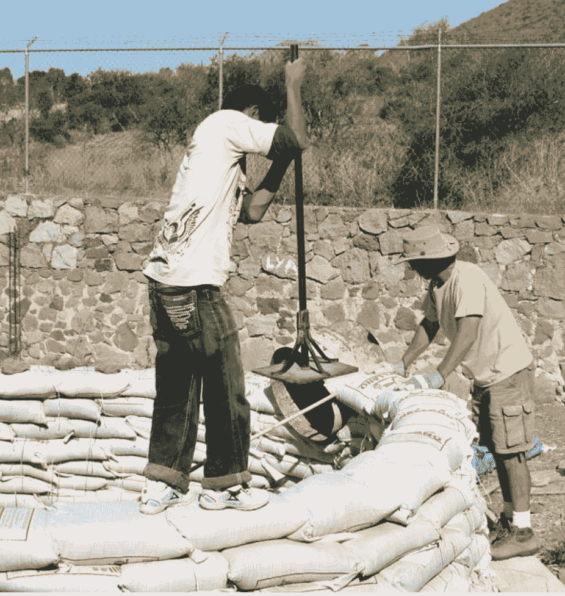

自制夯实器的另一种方法是在一大罐湿水泥中嵌入一个长手柄并让其固化，创建一个沉重的圆形夯实器。我从未用过这种，但我认为它们可能没有那么好，因为它们倾向于产生细小的圆形凹痕，可能不够均匀平整，而且为了达到良好效果，每个袋子需要更多的夯实次数。

有些人还喜欢敲击袋子的侧面来让墙更平整，这样覆盖的灰泥就更少。我没有这样做，因为我喜欢袋子之间较深的缝隙，有助于灰泥的抓紧。这在程度上是一个审美问题，取决于你喜欢更平滑的墙还是

## 刺丝网

在大多数情况下，最好在每层土袋之间放置刺丝网，理想情况下是放置两根相互排列的平行线。这样做有几个原因。首先，丝网上的刺倾向于固在袋子的布料中，从上将它们缝合成一个整体。另一个主原因是丝网提供了袋子缺乏的拉强度。这对于圆顶结构尤为重要，因为它们会对袋子施加外压力。

通常情况下，刺丝网将一切固定在一个矩阵中，防止袋子移位。

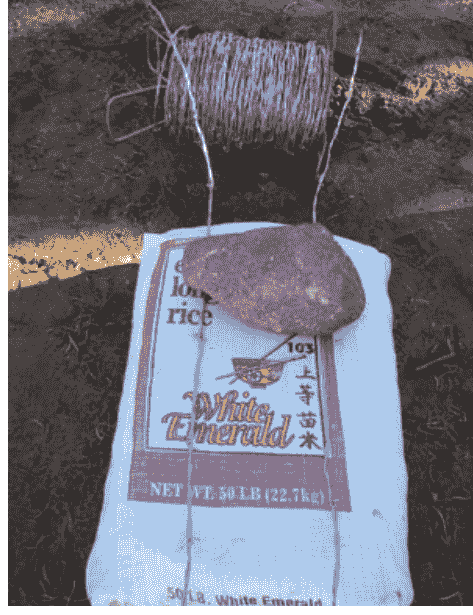

处理刺丝网是非常棘手的。它似乎有自己的主意，并且很容易割伤手。在使用它时我总是戴着厚实的皮手套。

为了让每个袋子更完美地定位到位，一个金属“滑器”会非常有用。这是一块切割成与袋子大小相似的板金，一端有一个 90 度的抓握手。这种做法是将这个滑器放在要放置下一个袋子的区域的刺丝网上。然后，一旦袋子装好并放在预定位置，你可以用一只手按住袋子，用力拉金属滑器将其取出，让袋子掉到位。否则，袋子不可避免会偏离需要的位置，然后卡在刺丝网上，如果不捡起来就无法移动，这真的非常麻烦。

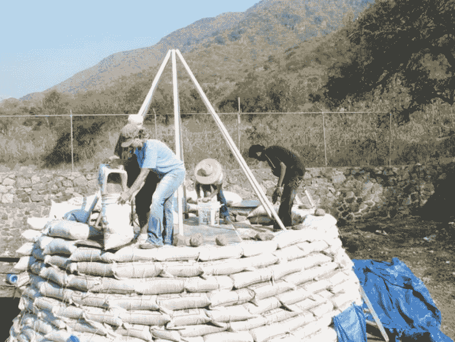

我不再在袋子之间放置刺丝网的情况，是我相信重力定律将起作用并防止墙体裂开时。一个例子是我在地下建造的向外倾斜墙体的地下室。我认为重力会保持那些墙倾斜。另一个例子是小型地下圆顶，周围土壤的内压力会抵消圆顶自身的向外压力，整个结构将通过压缩保持在一起。

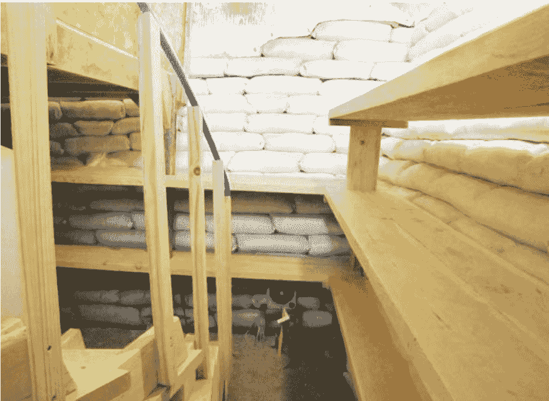

## 保护墙体

我提到过，聚丙烯在暴露于阳光紫外线时会发生降解，即使使用了抗紫外袋也是如此。因此，尽可能保护袋子免受这种危害至关重要。这一点我怎么强调都不为过；我收到过无数封邮件，那些人发现由于让墙体暴露时间过长，导致墙壁正在解体。这种情况通常只需要几周就会开始发生，过了一段时间，你甚至可以用手指戳破材料。

有时我会在项目上方撑起帆布并将其系好，以在白天提供阴凉。这可能非常有效，但当大风刮起想要把帆布吹走时，就很难固定了。一种更安全的方法是将帆布直接覆盖在墙体上，并放置重物将其固定。这样，你就可以只取你正在作业的那部分墙面的帆布，并在完成后将其放回去。

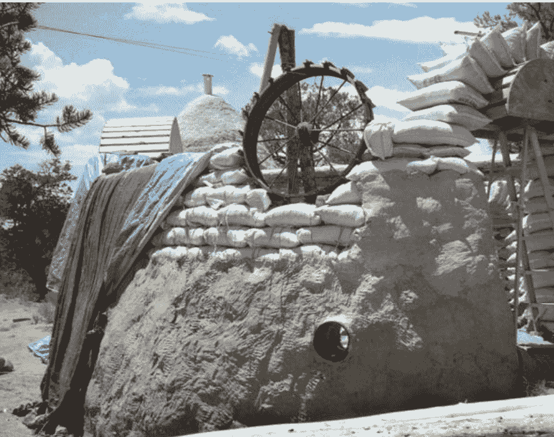

有时在墙体完全完成之前就开始在其上涂抹底层灰泥，以帮助防止阳光照射到这些脆弱的材料。

我听过有人在墙体立好后用旧油漆给土袋涂上一层临时的保护层，我相信这确实有帮助。

一旦墙体被完全覆盖无法被阳光照射，袋子就可以维持很长时间。没有人真正知道它们能持续多久，因为这种合成材料存在的时间还不够长以得出结论。测试表明，聚丙烯不会被水或大多数化学品降解。我回到那些留了近二十年没有抹灰泥的内墙，它们看起来依然像我放它们的那天一样坚固、柔韧且亮丽。当我挖开检查一些作为池塘大坝一部分的土袋时，它们被厚塑料和石头保护着；尽管有一些树根设入了部分袋子，但聚丙烯材料本身依然如初般柔软。

## 有哪些可能的形状？

土袋建筑非常多样化，但在合理尝试的范围内存在一些固有的局限性。垂直墙（无论是弯的还是直的）总是可能的，尽管直墙可能需要加扶壁（后文将讨论）。弯形垂直墙往往更稳定，因为它们具有自支撑性。

垂直墙的潜在高度受与其他土墙系统相同的比例限制。墙高与底座厚度的比例至少为 10:1，因此底部宽度为 15 英寸的土袋墙不应超过 150 英寸（即 12.5 英尺）。如果你想更高，你需要使用更宽的袋子，至少在墙底部是。

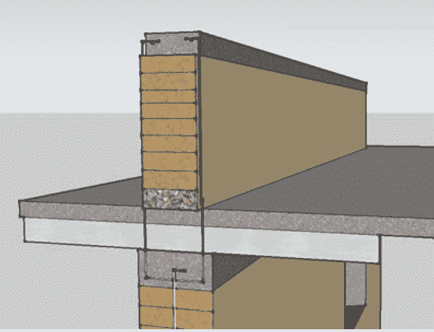

带有垂直墙的双层建筑又如何？这是可能的，但必须经过非常仔细的工程设计。图中所示了一个由工程师建议的双层建筑概念，在某些地方可能符合建筑规范。你可以看到第一层比第二层宽，以及钢锚固如何包裹整个第二层墙体，并嵌入每层墙顶部的混凝土胶结梁中。总的来说，大多数带垂直墙的土袋建筑最好只保持单层。

圆顶通常用土袋建造，既有简单的孤立圆顶也有复杂的互连圆顶。直径在不损害圆顶完整性的情况下是有限制的；这个限制似乎在 6 到 7 码（或米）左右。最好坚持圆形圆顶模式；我确实做过一个大型椭圆圆顶，但正如你稍后读到的，保持它的稳定遇到了很多困难。

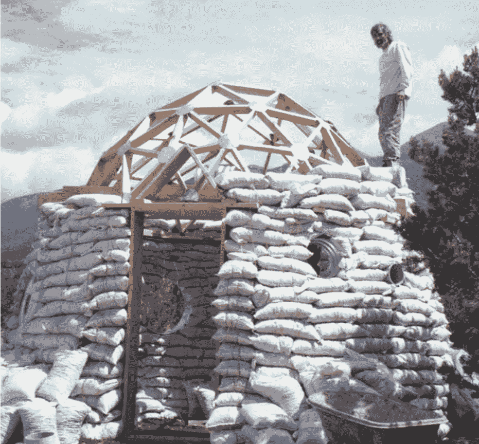

半球形圆顶需要额外的支撑结构来帮助保持形状。我曾设计过一个带有木制测窝子结构的圆顶，效果非常好。

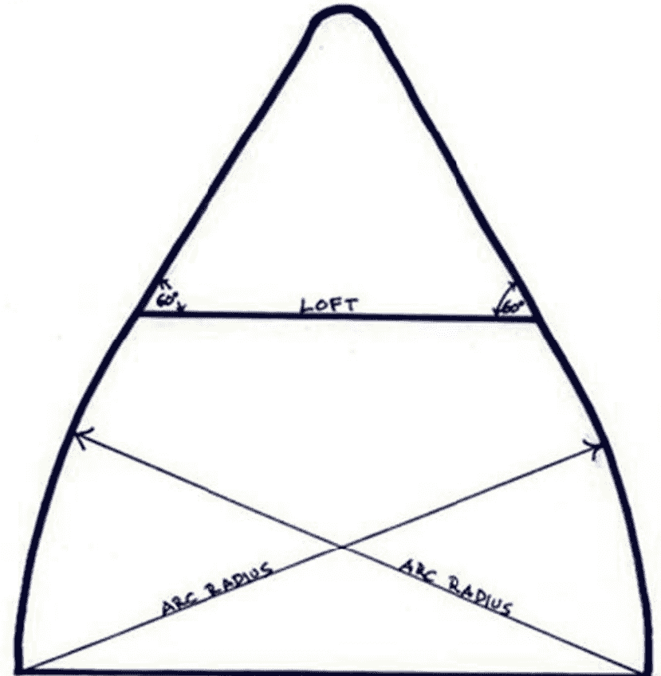

自支撑圆顶更好的形状是悬线拱，或类似于这种形状。悬线拱通常被描述为悬挂链条两端处于同一高度时所形成的形状；如果将这种形状倒置，你就得到了悬线圆顶的形状。图显示了实现这种形状的一种方法，我成功建造过几次。

有一种常见的误解，认为气袋拱顶或倒 U 形隧道很容易制作且相当稳定。事实上，这种形状应该被避免，除非宽度非常小（可能不大于 6 英尺宽）。原因是，在没有巨大扶壁的情况下，袋子对拱顶上部分相对于下部分的向外压力很容易使形状变形，导致顶部塌陷，造成相当的危险。纳德尔·哈里里（Nader Khalili）确实使用土袋作为侧面的垂直茎墙建造了一些拱顶结构，但拱顶部分实际上是用钢筋混凝土制作的。

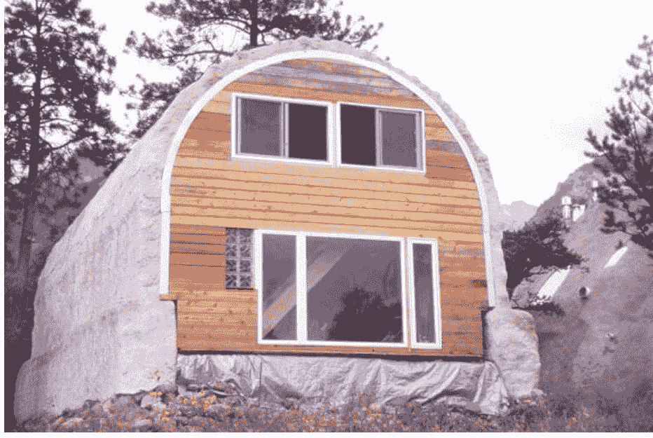

我曾建造过一个拱顶结构，拱顶部分实际上是用钢筋混凝土制作的。我将在书中稍后描述。

## 扶壁

某些类型的墙本身并不足够稳定，需要帮助。通常情况下，圆形或弯形墙足够稳定，不需要扶壁。这就是为什么蜿蜒或蛇形围墙如此坚固；即使在受到侧压力时也不会倾倒。圆形房屋可以在没有内部隔墙或外部扶壁的情况下围成巨大的空间。

直墙通常需要某种形式的扶壁来帮助稳定。扶壁基本上是附着在墙上的短墙段，通常呈 90 度角，以防止其倾倒。扶壁需要与墙整体连接，这样它们就不会分离。

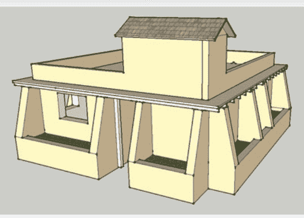

将扶壁放置在墙开口（如门窗）附近是有益的，可以帮助稳定它们。扶壁只需要从外墙向外延伸几英尺即可有效。而且它们不需要一直到达顶部；也许墙高的 2/3 即可。这些扶壁可以随着高度升高而变窄；事实上，它们可以提供装饰风格，就像圆形结构上那些阶梯式扶壁一样。

看到墙角带有扶壁的设计并不常见，如上所示。我认为这部分是出于风格考虑，另一部分是因为发现土坯建筑的墙角容易受到地震损坏，而扶壁可以缓解这种影响。对于土袋建筑，可以通过从墙顶向墙角处打入钢筋桩来加固墙角。由于这个原因，我认为墙角扶壁是没有必要的。

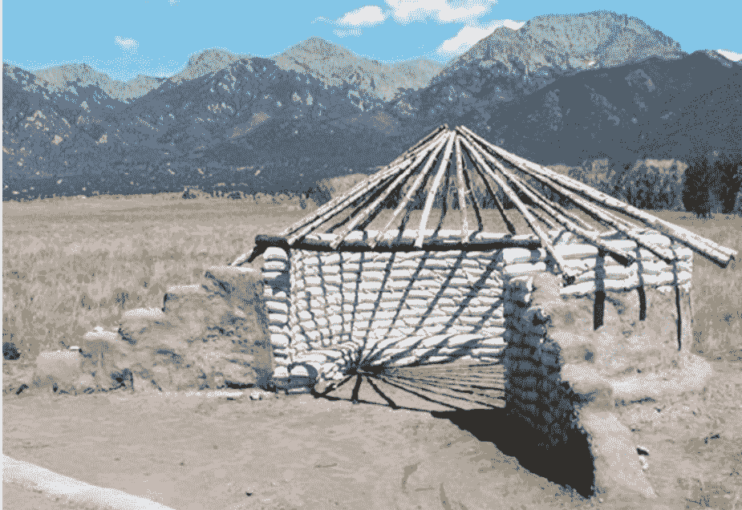

圆顶在门口可能需要一个内部扶壁，以便安装垂直门。要么这样，要么需要安排一个外部拱顶或屋顶区域，使安装垂直门成为。

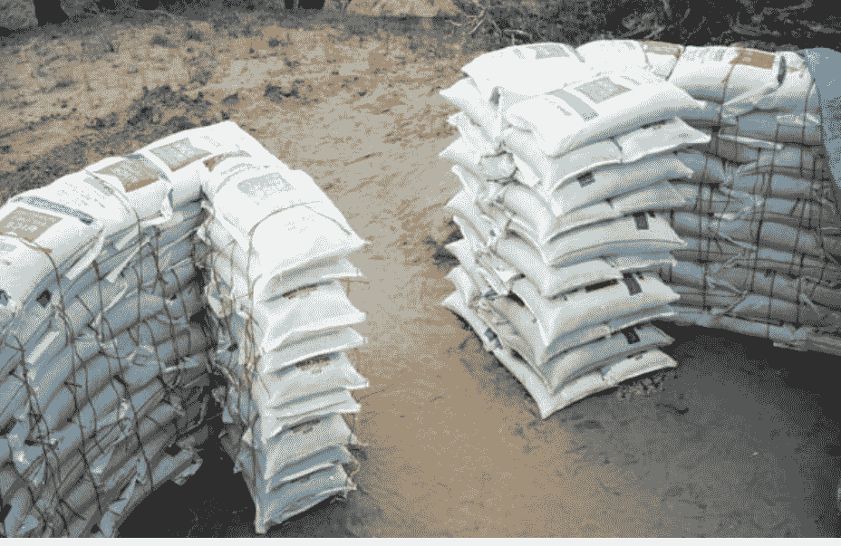

# 开口

门和窗户给土袋墙的完整性带来了挑战。任何开口都会导致墙体的结构（某种程度上）被撕裂，因此开口的边缘需要进行加固。有多种方法可以实现这种加固。

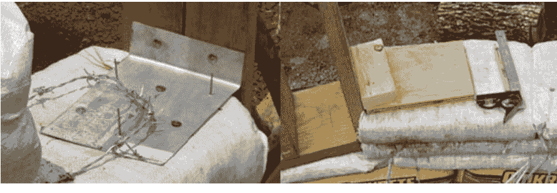

通过在门周围创建一个金属或木质制成的框架，并将其与土袋墙整体连接，可以使门变得刚固。这个“门框（door buck）”随后便可用于安装门本身。将门框与土袋连接的一种好方法是在砌墙过程中在墙内定期提供锚固板。这些板材可以是胶板或金属板，其一端连接有一块木头，或者金属边缘转了 90 度。可以从两个方向向它们钉入许多钉子，使其嵌入上方和下方的土袋中。木头或金属边缘暴露在门洞口，与门框处于同一平面，从而可以安装在门上。窗框也可以以门门框的方式制作并安装。

简单的门或窗框在框架顶部可能不够坚固，无法支撑上方可能存在的墙或屋顶的重量。重要的是确保提供足够的“过梁（header）”来支撑这种重量，即一根足够宽以支撑土袋的粗大木梁。在某些情况下，当门或窗的顶部非常靠近墙顶时，这根梁本身就可以充当足够的过梁。处理门窗上方墙重量的另一种方法是制作拱形开口。

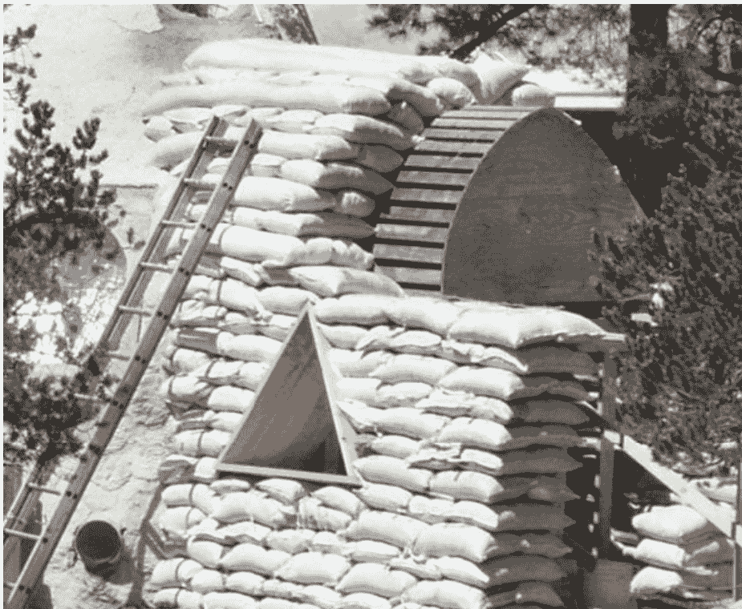

窗户可以制作矩形以外的形状，如圆形或三角形。在这种情况下，可以在砌墙时为这些形状插入合适的框架，并将土袋挤压在上面。我曾对不同直径的截面这样做过。可以用木头制作一个简单的三角形作为窗户框，如照片所示。除了用框架加固门窗开口外，另一个好是在开口边缘附近的土袋中插入金属杆或钢筋桩，使它们避开墙内的任何锚固板。这些桩最终可以整合到墙顶的构造梁（bond beam）中。

我可能需要提醒，对于土袋圆顶，需要小心不要在上面布太多的窗门。因为圆顶依靠铁丝丝提供墙的抗拉强度，过多的孔会损害这种强度并给墙体引入弱点。有时在土袋工程中使用可开启的窗户并不方便，因此可能需要另一种引入良好通风的方法。我曾通过在战略性的高位置位置管道来实现。一段大直径管道可以达到此目的；我既用过金属也用过塑料。位于圆顶顶部的通风口打开时可以产生相当的对流。为这些口密封的一种简单方法是使用与管道匹配的充气球。

说到开口话题，我想提到，一旦墙完成后，想要回过来改造墙以安装门或窗是非常困难的。切开土袋墙可能会非常混乱，甚至很危险。因此，我建议你在施工阶段就为你预计未来某个时刻可能需要的任何门窗空间预留框架。这些空间可以进行处理，使其不明显，但如果需要，你会知道它们就在那里候着。

# 拱

使用拱是创建和稳定墙体开口的一种有效且优雅的方法。我见过许多这种方法，但几乎总是在建造拱时采用某种形式的临时支撑。这些拱支撑可以用任何刚性材料制成，形状取决于你想要的最终拱形状。一旦释放支撑，它就可以在其他地方使用。

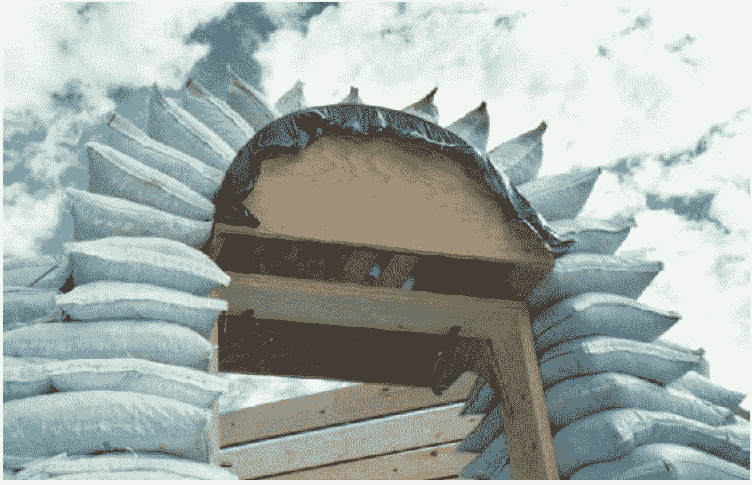

上面的拱形是由两块切割成半圆形状的胶板制成的，并用短的 2x4 英寸木条连接在一起。然后将其夹紧在已经就位的门框顶部。最方便的方法是最初将模板固定，这样很容易敲掉一些垫块，让模板下降足够低，以便将其拉出并从拱形土袋处移开。否则，土袋对模板的重量和摩擦力会让这变得困难。

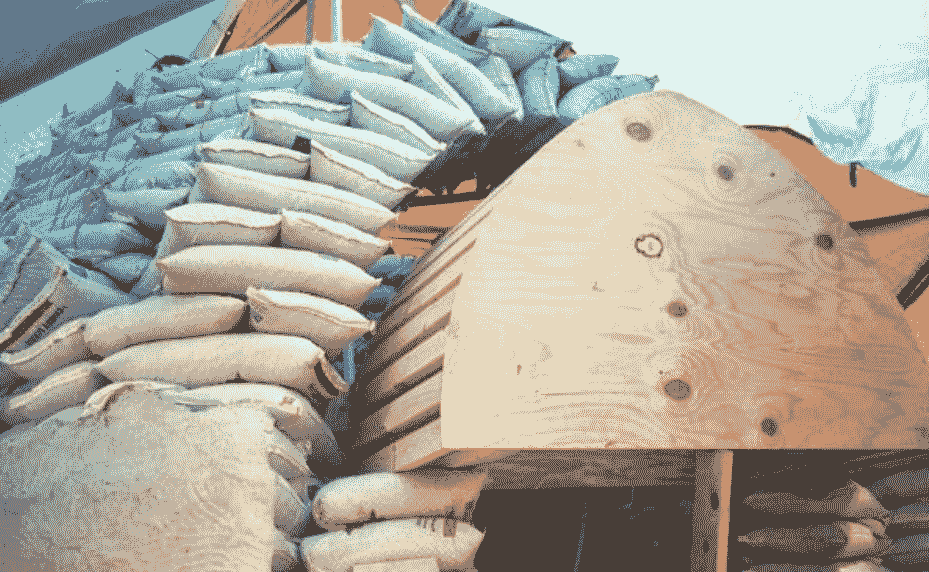

我发现半圆拱在约三英尺的跨度内效果良好，但比这宽得多的跨度它们似乎容易坍塌。对于六六英尺的宽跨度，我认为尖哥特式拱形更安全。

堆叠土袋的简单径向图案（如第一张照片所示）很常见。在这样做时，显然必须非常牢固地固定土袋顶部，以确保没有溢漏。堆叠土袋的方法是从两侧交替堆叠，直到有空间放置一个“盖石”袋，这块袋必须被牢固地压实到位，以确保压力以后不会将其移位。

在尝试移除拱模板之前，最好在拱的两侧砌好墙体，直到构成拱的土袋没有任何侧向移动的可能性。事实上，如果拱是沿着墙的，可以在拱袋和墙袋之间绕过铁丝网，从而将整个组件作为一个单元固定起来。

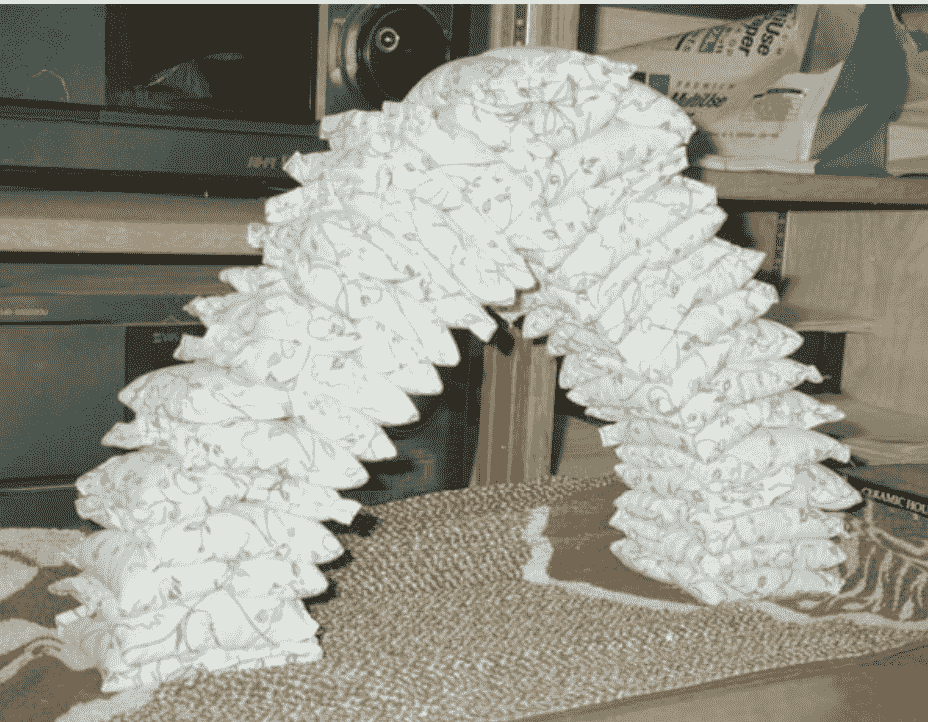

你会注意到左侧的照片显示了不同的堆叠模式。事实上我发现，如上面的模型所示，这种拱可以在没有墙体支撑的情况下存在。当使用填充材料的长管状土袋时，可以用不同的方法制作拱。这些方法仍然利用模板来建造拱，但方法可以简化。照片展示的方法可以创建出与墙厚度相同的拱。单袋法或双袋法也可以在开口上方创建过眉石。

我构出了另一种为直墙建筑制作连接梁（bond beams）的方法，这种方法还能为墙和屋顶框架提供一定的防风和地震保护。同时，这种方法会自动在门窗上方提供坚固的过梁。

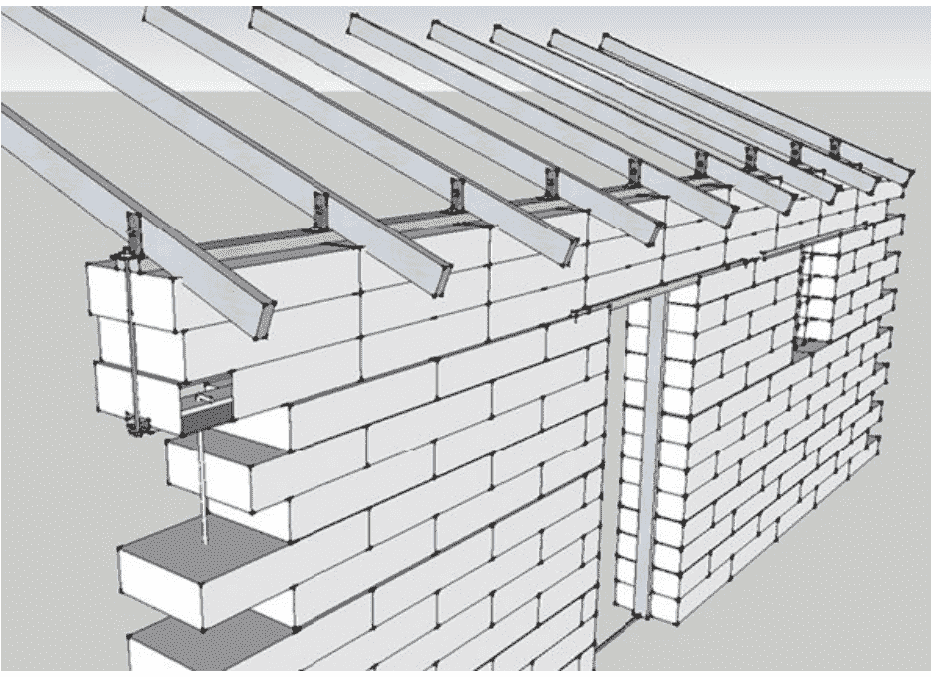

这种方法的理念是：在施工过程中，一旦你达到了任何门或窗户顶部的高度（假设它们的高度相同），就在最后一排土袋的正上方放置一根空心矩形截面钢管。也可以使用尺寸稍大的木材来实现，但我更倾向于使用金属，因为它在特性上更坚固、更可靠。它的长度应该和墙一样长，从一个角的中心延伸到另一个角的中心。在大多数地区，你可以买到长达 6 米（20 英尺）的钢管，如果有必要，可以使用焊接或螺栓固定的连接板将两段连接在一起。这种钢管的尺寸有多种，取决于墙的长短，但我建议通常使用约 1 1/2" X 4" 的规格。

最好通过捣实或甚至垫平一些土袋，使该区域尽可能平整，这样钢梁就能尽可能平整地放置。在放置第一段钢管之前，应该在金属长边方向的中心，预先钻出贯穿金属双侧的孔，每隔 1 英尺钻一个 1/2" 的孔。

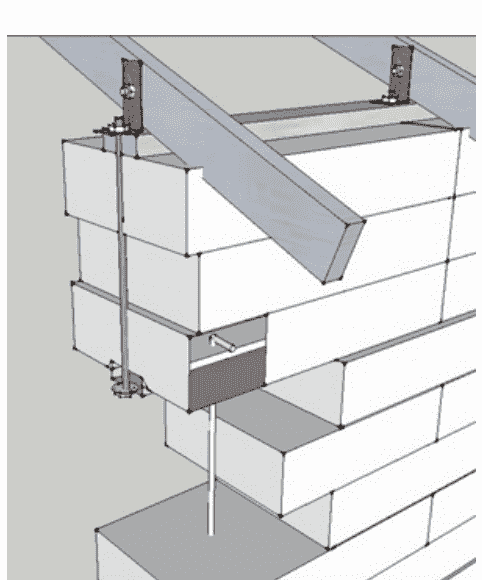

如果你看上面的横面细节图，可以看到有一段长度约 2 英尺的 3/8" 钢筋，一端弯折了 90 度。这种钢筋可以每隔一个孔敲入并固定到下方的土袋中。但先不要把它们全部敲进去，因为你还想在剩下的空孔中垂直安装 2 英尺长的螺纹杆（有时称为“全丝螺杆”）。这些螺纹杆需要在梁下方用钢垫圈和螺母固定，以防它们被拔出。当所有螺纹杆到位后，你就可以完成敲入钢筋锚固的工作。现在，整个组件应该保持固定在位置上。

在门窗上方的螺纹杆处，你可能需要在梁顶部的螺纹杆上拧一个螺母，并在梁的下侧钻一个足够大的孔使其凹入，以便其他窗框或门框组件能与梁平齐连接。现在，你可以在梁的两侧门窗洞口上方额外放置一些相同类型的管状金属件，使其长度足够长，向两侧各延伸约 1/2 英尺。这些也可以用类似的钢筋固定在位。这将成为一个平台，土袋将放置在其上方。

在两个连接梁相汇的角，可以使用每根梁两侧的 90 度角码牢固地连接金属梁，以类似的方式通过贯穿螺栓固定。这将使结构成为整体连接，能够抵抗地震或大风带来的巨大力量。

到此时，你已经准备好开始铺设土袋了。这些土袋在填充并捣实到位后长度应为 2 英尺。这意味着如果材料不足以进行折叠密封，则可能需要在袋顶部进行卷边或缝合。它们将直接放置在螺纹杆之间，以保持土袋交错的类似砖块的层叠。由于这些土袋最终会夹紧在一起形成连接梁，所以它们是否交错其实并不太重要。在大多数情况下，可以这样排列三排土袋，但取决于墙的预定高度，只要螺纹杆足够长并延伸到梁上方，你也可以铺设更少或更多排。

这根钢梁需要预备并钻出 1/2" 的孔，使其图案与下方梁的孔位完全匹配，以便将其放置在最顶层土袋的中间，让螺纹杆的末端完全贯穿而出。在这种情况下，没有真正必要将钢筋钉敲穿土袋，因为整个组件将作为一个单元紧紧锁住，所以上梁需要的钻孔较少。

在将垫圈和螺母安装到杆上之前，你需要在放置椽子或楼板的地方放置金属 `L` 型架。这些支架将以一种稳固而灵活的方式将这些屋顶构件连接到连接梁上。当你拧紧所有螺纹杆上的螺母时，务必检查梁的水平度，确保它尽可能平整，这样屋顶本身才是平整的。可能需要比其他螺母拧得更紧一些。你希望整个组件紧紧夹在一起，这样任何土袋都不会脱落落，但不要让金属过度弯曲或产生应力。

# 抹灰

在准备抹灰墙时，你应该尝试让表面尽可能处于同一个平面。这时应该捣实任何凸出的土袋角，并压平明显凸出的土袋。你还可以用腻子刀或螺丝刀将任何松动的土袋材料塞进去，这些材料可能会影响砂灰与墙之间的良好结合。

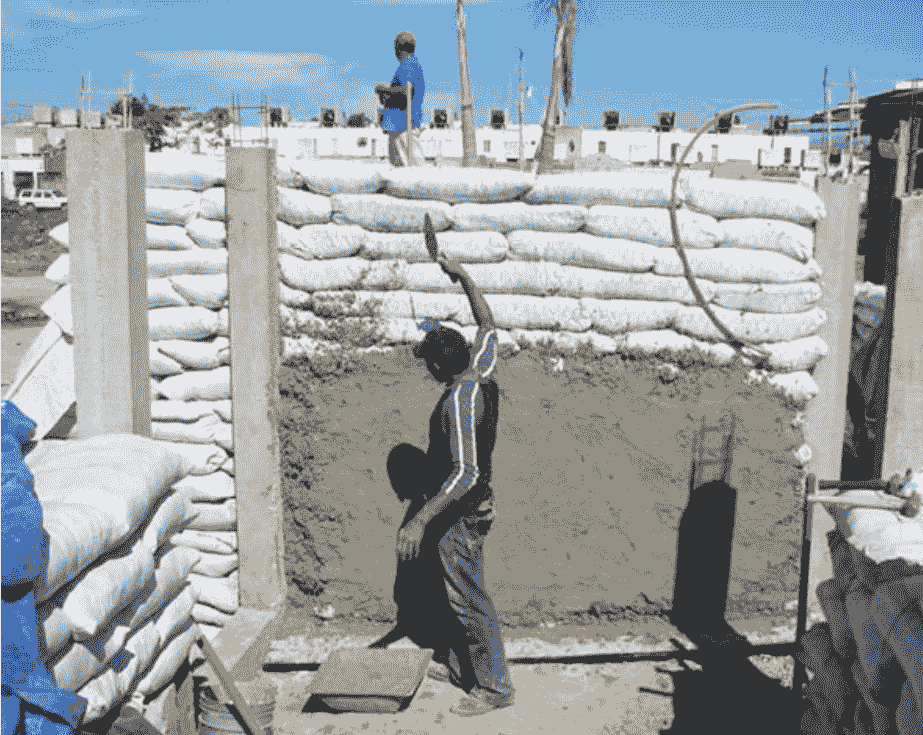

在大多数情况下，使用抹灰网是一个好主意；网有助于砂灰在固化期间保持在位，并随着时间的推移帮助保持在那里。铁丝网（1 或 2 英寸网孔均可）、抹灰网，甚至合成鱼网都曾用于此目的。

将网固定在墙上的一种方法是使用自制的 `U` 型钉。这些钉可以从足够硬的钢丝上剪成，以便用锤敲到位。长度为 3 或 4 英寸的钉脚应该足以将网固定在墙上。

抹灰通常分两或三层进行，第一层留粗，以为下一层提供良好的“抓地力”。最后一层是面层或平光层。确保第一层良好粘附在网之外的墙上的一个方法是用刮板将砂灰“扔”在墙上。如果你对准土袋之间的缝隙，那里是砂灰抓牢墙面的最佳机会。

室内抹灰可以是任何能良好覆盖墙面且你喜欢的材料。这可以是土质抹灰（砂子和粘土）、石灰、水泥、灰泥，甚至是纸浆。

# 屋顶

几乎任何传统的屋顶系统都可以用于土袋建筑建筑。显然，将包含圆形或圆顶形状的设计与直线形形状相结合，会给屋顶设计带来更多挑战。我更倾向于使用坡屋顶而不是平屋顶（或近乎平屋顶）；它们在排除水分和保持墙体干燥方面通常更好。

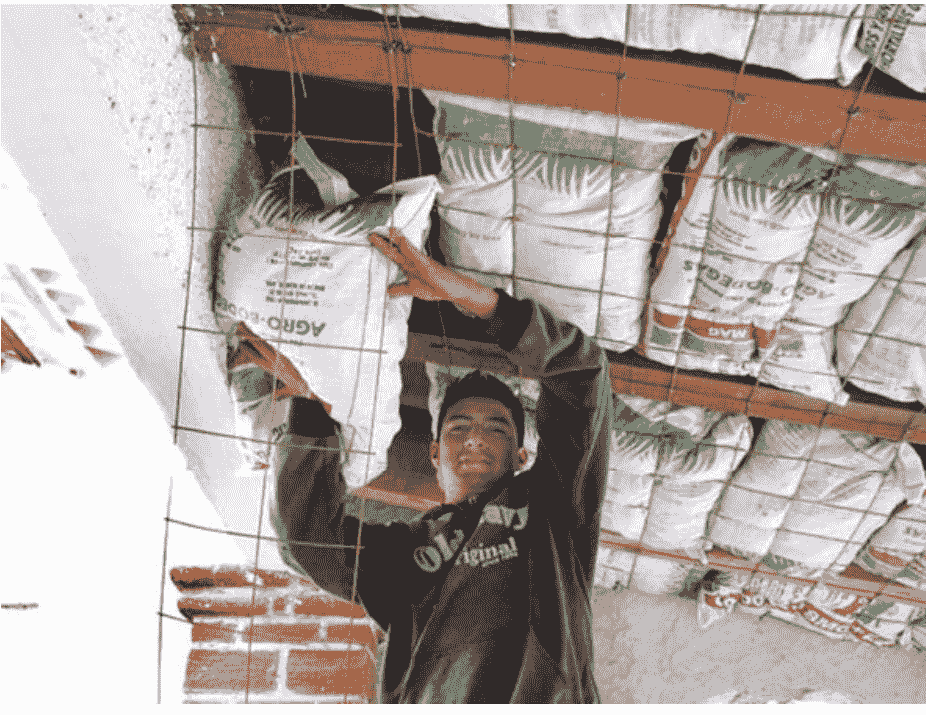

除了圆顶和极小的拱顶外，土袋不能直接用于屋顶。可以使用填充了隔缘材料的土袋为其他屋顶系统隔缘，我已经这样做过几次。在照片中，土袋填充了浮石，这是一种轻质的天然隔缘材料。

在讨论圈梁时，我提到了一些将屋顶框架构件连接到圈梁上的方法。在大多数情况下，这些细节与任何其他墙体系统的细节相似，即有一个顶板可以用于连接椽子、桁架等。有时在可能存在风威胁的地方，会使用抗风连接件来固定。

# 地面

大多数土袋项目的地面位于物业地面高度或附近，高度差可能只多了一个台阶。混凝土垫层无疑是一种地板选择，但并非唯一选择。地板也可以用板岩、砖、铺路石、浇筑土坯或夯土制成。在任何一种这些材料上都可以铺设地毯，但瓷砖可能需要坚实的混凝土基础。照片显示了右侧是板岩，左侧是经过刻痕处理看起来像石材的浇筑土坯；两者都涂了油光漆。

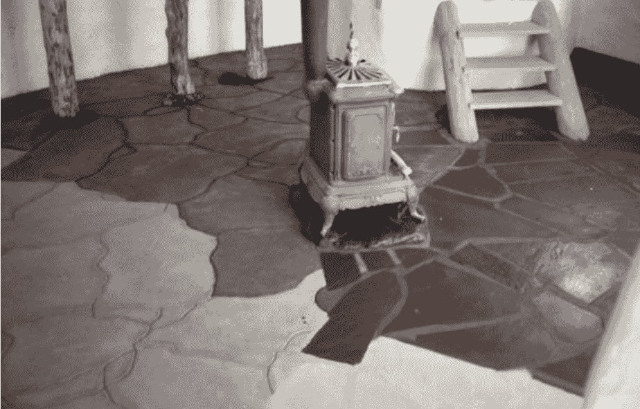

在铺设地板之前，先放置一些隔缘材料通常是一个好主意。这会将地板与下方的土地隔离开，否则土壤倾向于吸走热量并消耗能量。可以使用商业硬泡沫隔缘材料来实现此目的，但我使用过的一种更自然的替代品是碎浮石，这是一种轻质的火山石。

如果你想要一个下方有空隙的架空地板，这也是可能的。要做到这一点，最好在地板高度下方创建一个圈梁，在那里制作一个底板将地板固定在其上。就可以添加标准的地板楼条和其他地板材料。可以在楼条之间填充更多的土袋，以继续向上延伸墙体。

# 辅助设施

在土袋房屋中如何处理电气和水路？

在土袋抹灰之前，可以在土袋之间布电线，可以使用电线管或可以使用允许直接埋在抹灰层中的 `UF` 线。如果电线或电线管塞在土袋之间的缝隙中，就不会干扰抹灰的施工。

安装电线盒时，你只需要在想要放置的土袋上钉入一些长尖头木桩，留出足够的长度以便用螺丝固定电线盒。对于填充较松松的情况，这很容易做到，而且非常牢固。在某些土壤中这可能更难做到，尤其是经过加固的土壤。一旦木桩钉入，它们就会惊人地稳固，不会摇晃，而且，抹灰会让它们固定得更牢固。

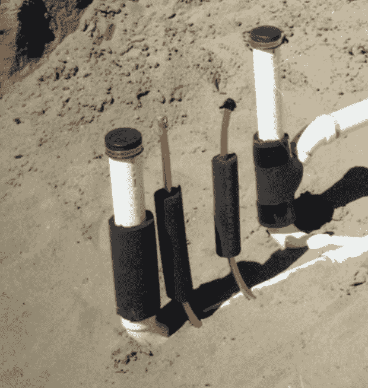

通常，将水路引入房屋内部木框架隔断墙更简单，否则将排水管等布在地板下方（如上所示）。在我的土袋房屋中，我将主水管引入到防冻层以下，然后向上连接到框架内墙的管路上。这避免了管道冻裂的任何问题。你可以在土袋之间的裂隙中布设水管。

如果霜冻不是问题，那么可以在建筑时直接将管道穿过墙体，甚至在完工后锤入一段钢管。或者你也可以在合适的位置留出较大直径的管道，作为以后管道的走线槽。

马桶的黑水需要排到合适的化粪池或下水道。如果你需要，淋浴和和洗手池的排水管可以连接到灰水箱以供可能的重复使用。

# 挂柜等

如何将柜子等物体固定在土袋墙上？

答案在某种程度上取决于你在土袋里填充什么。如果你使用含有某些粘土的类土坯土壤，你实际上可以使用非常长的螺丝，它们可以承受相当大的重量。对于其他较松的土壤或材料，你需要另一种策略。

如果连接得当，土袋墙可以承受巨大的重量。你可以在想要挂柜子的地方将木材或钢材嵌入墙中。这可以在筑墙时完成，也可以以后通过简单将桩钉入墙内来实现。这在已有轻微空隙的地方（例如土袋之间或土层之间）可能更容易做到。

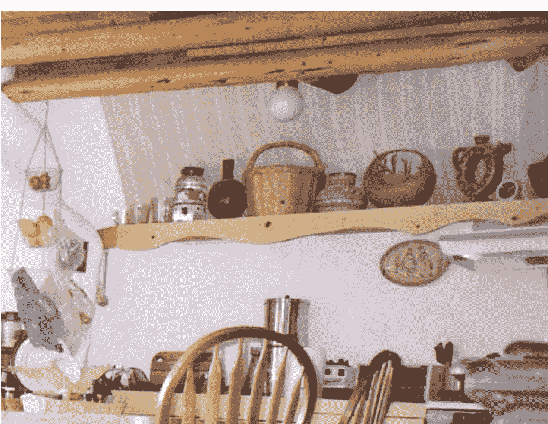

你可以轻松地将长段螺纹杆完全穿过土袋，然后在两侧螺上木块（即使是 `2" X 4"` 的），这样会非常稳固。如果它们足够长，就可以在上面挂一整排柜子。穿透地球

# 宁静谷

我们选择了一个离计划建筑地点不远的地方，并平整了一个足够容纳圆顶的区域。我在中心钉了一个木桩，用线绳作为 7 英尺半径，画出一个直径 14 英尺（内径）的圆。另一个半径大 1.5 英尺的圆描述了圆顶的外轮。

然后我们在两个圆线之间挖了一个深约 1 英尺的沟，增加了一个带有侧扶的入口空间，并准备好用碎石填沟作为基础。我们本想深挖到防冻层以下（该地区约 5 英尺），但由于沙子排水良好，这似乎并没有意义。

很快，我开始用堆好的沙子填充土袋，将它们堆在墙上并在层与层之间放置铁丝网。当我不工作时，我会用帆布覆盖墙体。看到这座建筑主要从下方的土地中逐渐形成，是多么令人兴奋！

# Riceland

我们购买的大多数丙烯袋都标有“Riceland”字样（一种米品牌），所以我们开始这样称为这个圆顶。当时（1996 年）还没有书籍指导我如何用这种方式建造，但我已经见过成功的土袋圆顶，所以我有些头绪。

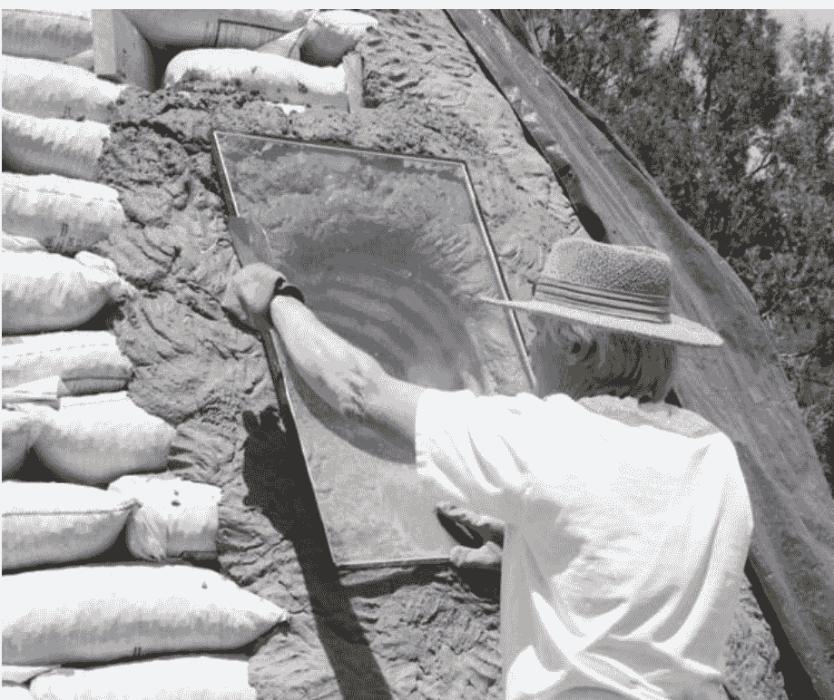

起初墙体几乎直立上升，所以直到高度达到 3 英尺时才注意到曲率。我使用一根 14 英尺的塑料杆作为半径，定义墙体上升曲线的弧度。我会将这根杆放在墙底座，然后穿过圆顶的虚拟中心轴，检查我放置土袋的位置是否准确。每当完成一层时，我都会在墙周围的几个位置这样做。

我们找到了一些涵涵接头，用它们作为模具，在这个小圆顶中制作出圆窗。它们和袋子一样宽，当袋子压住波纹表面时，它们就牢固地锁在了墙上。

你可能会注意到，建造这个圆顶时，我在在袋子之间放置铁丝网的同时，用麻绳绕在袋子上。这是为了让墙体更具整体性，我想额外的麻绳有助于将灰层粘固在墙上。后来我放弃了这种做法，认为没有必要。

一天，当我正快乐地提着一桶桶沙子爬梯去填充在位 `way` 袋子时，我的眼睛注意到顶层袋子在完美的圆形外观上有一处偏差。我觉得这很奇怪，因为我确定自己已经用杆子检查过那一层墙了。当我站在墙顶时，我感到下方在移动，我看到墙正在向内塌陷！我立即跳出圆顶以确保安全，眼睁睁看着几乎整个结构坍塌到地面。这就像在看一个慢动作波在波动，从墙的一侧扩散到另一侧。

天哪！我很安全，但这是一场大灾难；一堆袋子、沙子、铁丝网、弯曲的梯子和涵涵接头杂乱在一起。门口的扶壁让那部分没有坍塌，大约一英尺高的墙也是好的。但到底哪里出问题了？

我花了好几天才清理完这些摊子，我的信心受到了严重打击。我有充足的时间思考这个问题，最终意识到我的错误是使用了当地沙子，这种沙子非常细且滑……一个真正的“变形龙”。基本上，一旦我把墙砌得足够高，重力就会通过移动袋子里的沙子来拉倒墙体。这就是为什么在建造圆顶时，使用能够固结成更坚实质量的填充材料如此重要。现在我知道了！

我一直的意图是用碎火山岩来填充我们圆顶房屋的袋子，因为它轻便、当地开采，而且由于火山岩空隙中充满了空气，提供了相当好的隔热性能。因此在里塞尔兰（Riceland）这个阶段，我们决定改用火山岩填充袋子，看看它作为填充物是否真的有效。但在之前，我先用火山岩做了一个微圆顶来测试这个理论。照片显示我站在完工的测试圆顶内微笑，我有足够的信心继续重建里塞尔兰。

由于重量较轻，使用火山岩实际上要容易得多。我可以在地面上填充袋子并轻松地将它们搬到墙上，因为每个袋子只重约 35 磅。我细致地捣实每一层墙，让松散的火山岩压实成一种足够坚固以保持形状的块体。没多久，我就回到了坍塌发生时的高度，一切正常。

我第一次尝试用堆叠单层袋子来制作门口周围的扶壁，这太不稳固了。于是我尝试使用这种图案：两个袋子并排放置，并交替成交叉图案，这要稳定得多。在建造扶壁时，我插入了穿过 `1/2` 英寸纹螺丝杆的木块，螺丝杆伸在袋子之间。

这允许我最终将木门框牢固地固定在扶壁上。

当我爬到门顶的高度时，是时候为门上方的拱窗设置模具了。我按照之前在“建造拱门”章节中描述的方法，制作拱形，使用铺在模具上的单层袋子。

计划是在圆顶顶部建造一个半阁楼，可以睡觉或作为额外的储物空间。我通过简单地将 `2x6` 英寸的楼梁横跨整个圆顶并让它们靠在墙顶上搭建了这个阁楼的框架。我使用木垫确保阁楼是平整且处于一个平面内。然后我用更多的火山岩袋子填充了楼梁之间的空隙。我注意到，一旦阁楼框架固定到位，整个结构就变得刚性，不像当我在顶层袋子上走动时震得那么厉害了。

在纸混凝土（`papercrete`）还是湿的时候将玻璃盖在开口处，这样我就可以在玻璃周围刻痕，并挖出足够的纸混凝土将其嵌入固定位置。稍后，等纸混凝土固化后，我在玻璃周围打了填胶。

# 卧室

在成功完成一个小圆顶后，罗萨娜（Rosana）和我感到有足够的信心来开始建造我们真正的房子了。我们等到第二年春天才开始这项工作，之前我们撤退到一个更温暖的南方地区，在我们的大巴（作为家）里度过冬。

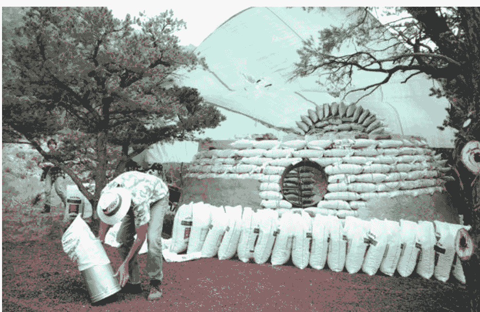

这一次，我们直接开始向袋子里填充火山岩（`scoria`）。事实上，我们意识到，考虑到当地沙土的排水性非常好，其实不需要碎石沟基础。相反，我们在圆顶的整个轮廓范围内铺设了约 6 英寸厚的火山岩（在上面的图中看到的红色石头）。我们这样做主要是为了帮助地板本身与下方的地面隔热。

这次我们没有在墙上铺设防水布，而是将防水布拉在整个圆顶上，创建一个遮阳结构。这效果很好，但在大风天气里，我们经常不得不维修，所以这可能给我们增加了更多工作。

在照片中，你可以看到有人将袋子套在金属漏斗（鸡饲器的一部分）上，我们用它来填充袋子。他后面的几排袋子已经装满了火山岩，等待上墙。

对于这个卧室圆顶，我们将内径做为 16 英尺，比“里兰德”（Riceland）稍大一点。它在部分上方架设了一个楼阁，在楼板之间放置了火山岩袋。一个涵管接头充当了窗户。外墙的一部分已经用纸混凝土抹了灰。

在远端，你可以看到一个跨度为 6 英尺的大拱门，这是我们尝试通过将单袋堆叠在一个临时模板上完成的，那个模板只是通过在下方按我们想要的形状堆叠更多的袋子制成的。我们很快发现这样做时犯了几个错误。第一个错误是认为形成跨度为 6 英尺半圆拱的单袋会有足够的强度来保持其形状。

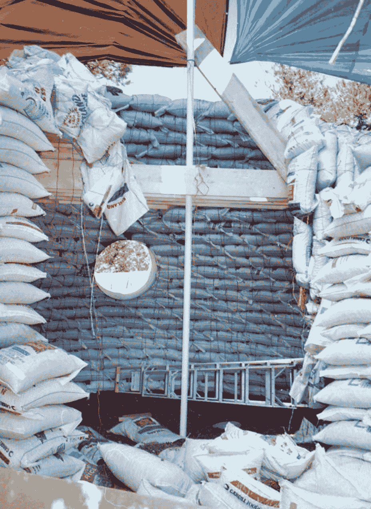

如你在上面的照片所示，那个拱门发生了严重的故障，导致连接在上面的相邻墙也坍塌了。显然，那种制作跨越该距离拱的方法需要改进。

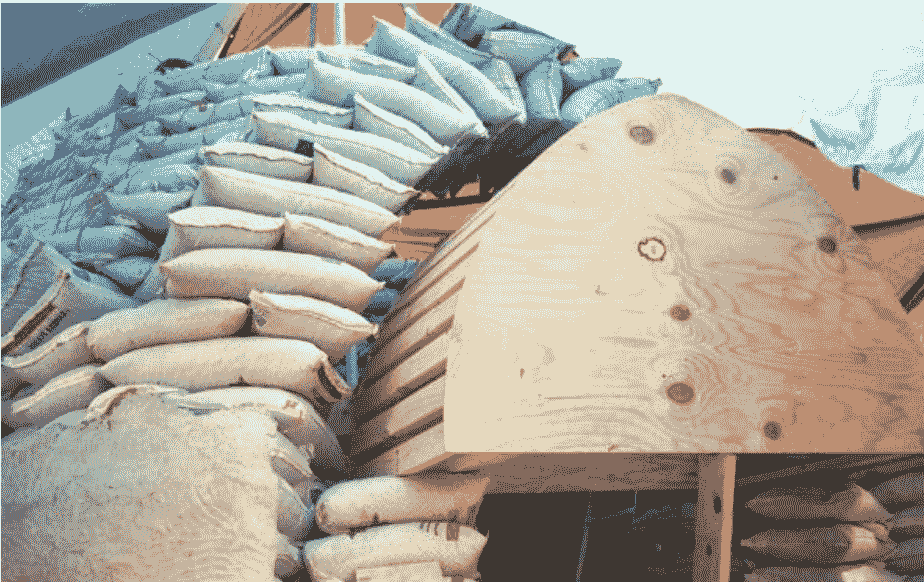

就在这时，我想出了双交叉法（`double crosshatch method`）来形成拱门，正如我之前在讨论制作拱门时建议的那样。这实际上是利用双交叉袋制作门两侧扶壁想法的延伸。这两种方法结合得很好，因为拱门有了一个非常坚固且宽阔的平台作为支撑。

此外，我制作了一个新的木制拱形模板，更像哥特式的尖拱。这两种改变相结合确实创造了一个非常稳固的拱门，我在建造这栋房子时在其他几个地方也使用了同样的方法。

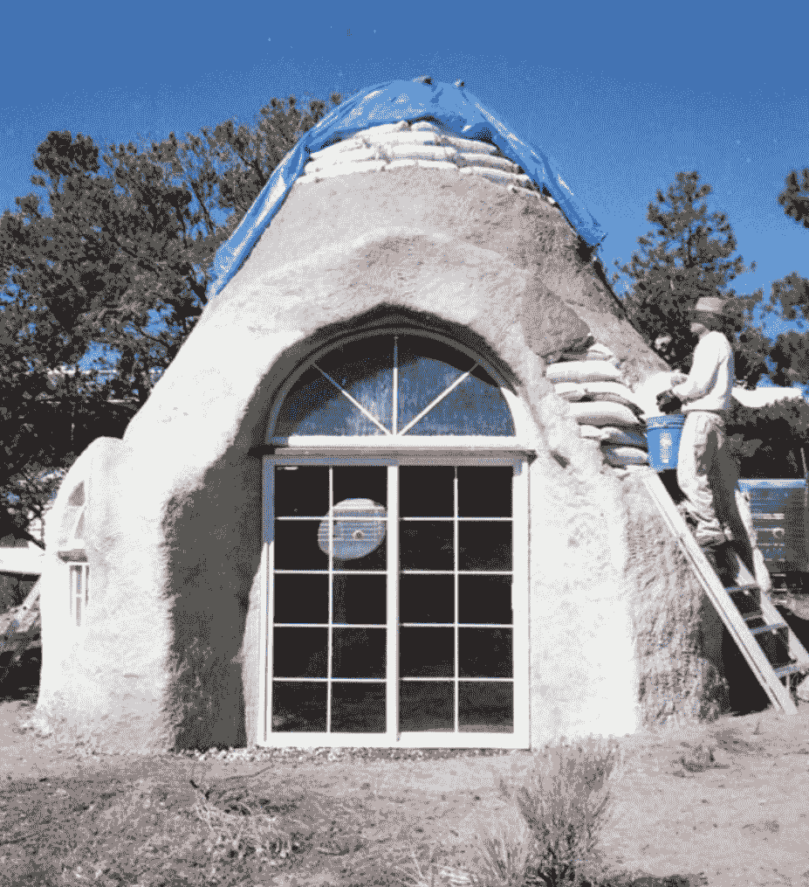

我们想要一个跨度为 6 英尺的开口，因为我们的计划在卧室安装一个大滑动玻璃门，以增强该房间的被动太阳能加热潜力。我们购买了商用乙烯门和一个配套的半圆窗，并将它们嵌入纸混凝土灰层中。

我们还希望卧室有一个可以开启的窗户用于通风，所以我们买了一个配套的小滑动窗，上方有一个半圆窗，在下面的照片中门左侧可见。像在“里兰德”一样，我在圆顶的最顶部放置了一个 8 英寸的 `PVC` 气口作为空气出口。

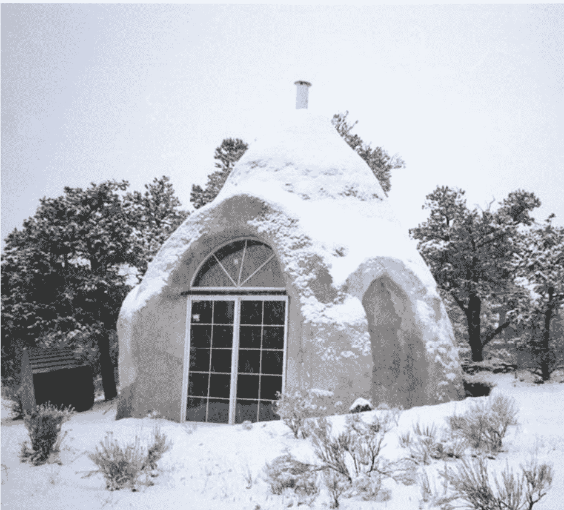

等雪花开始飘落时，我们已经把卧室密封地抹好灰并准备好过冬。准备了一个 3 英尺宽的门洞从卧室通往房子的其他部分，但由于我们需要留过冬，所以给那个门洞装了袋，并在上面抹了临时灰层。

# 蒙特西托

下一个建筑季节带我们进入了这个纪念碑项目中最复杂、最具挑战性的部分。这是一个大型椭圆顶，将组成我们的厨房/餐厅/客厅以及楼阁办公室。它的短轴约为 20 英尺，长轴约为 30 英尺。它位于卧室圆顶约 20 英尺处，和卧室一样，有一个 6 英尺的玻璃入口，以及几个用于被动太阳能热的圆窗。

开始施工不久，我们就给这个圆顶命名为“蒙特西托”（Montecito），西班牙语中意为“小山”，因为我们意识到圆顶本身将是一座名副其实的袋子山。

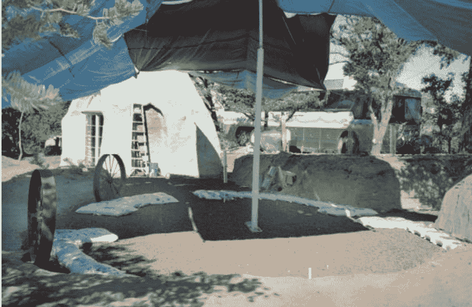

对于蒙特西托（Montecito）阁楼以上的第二层，我觉得需要创建一个某种临时框架来引导袋墙的形状。因此，我这样做的方法是首先竖起一个三脚架，支撑一个类似船形的结构，这个结构在某种类似于顶部的椭圆形。我从这里连接了 `2x6` 英寸的支撑柱到现有的墙体边缘。我的想法是在建造期间使用它，等一旦圆顶完成后就将其完全移除。

很快，我又开始快乐地堆叠浮石袋了；这些袋子非常轻，我可以搬着它们爬上梯子，在墙上找到它们的位置。我们在阁楼上方的窗户处使用了几个较小的古董马车轮。

随着蒙特西托重量的增加，我注意到墙体形状出现了一些令人困扰的异常。其中一个是北侧阁楼下方的一个区域，墙壁有向外凸出的趋势。在下面的照片中，你可以看到我如何使用一根原木配合液压千斤顶试图推回原状。最终，我决定通过安装一根永久垂直立柱来支撑两根阁楼横梁（`vigas`），从而减轻该区域的下压力。

这根垂直支撑物最终变成了一个架子结构的一部分。在上面的照片中，你可以看到从东侧的入口如何进入房屋到达一个平台，然后通过几级简单的阶梯通往阁楼。形成平台的袋子里填充了当地沙子，因为该区域不需要隔热，而且事实上，房屋的热性能会因为内部有更多的热质量而受益。我在其他几个地方也这样做了，例如在扶壁的某些。

我坚持将袋子堆叠到临时模具的最顶端，甚至在顶部安装了两根通风管。然后，我发现了一些确实非常麻烦的问题。墙体相对平坦的部分（尤其是北侧）正沉重地压在临时引导框架上。我越是分析这种情况，就越意识到如果我移除那些支撑性的 `2x6` 柱，整面墙可能会坍塌！换句话说，我试图用土袋创造的椭圆形本质上是不稳定的。对于圆形圆顶，圆周上所有的力都是平衡的，但对于这种椭圆，长边对短端的施加的压力更大。这种效应被我在顶部创建的船形形状放大了，导致最终结果是，除非这些长墙被某种方式固定住，否则它们可能会直接倒塌。

在意识到这一切后，我度过了一个失眠的夜晚，到了早上，我得出结论：最好的办法是移除阁楼以上的整个上层。这是一个相当令人沮丧的想法，部分是因为我知道冬季即将来临，我想在在那之前把蒙特西托密封好。

因此，我小心地开始拆除几周的工作，将装满浮石的袋子掉到阁楼下方的地板。大部分袋子在掉落中幸存，并可以重复使用。我仔细地卷起铁丝以备后用。

为了制作永久支撑框架，我首先制作了一个金属椭圆环，并在上面跨了一些木柱以保持其形状。这个金属带通过径向立柱支撑在圆顶顶部，立柱向下延伸到阁楼层的袋墙边缘。每根立柱都用拉螺栓固定在金属环上。

在底部，立柱要么连接在阁楼的其中一个横梁上，要么连接在一个从袋墙本身延伸出来的木板上。照片所示，这块木板用一段钢筋固定在墙上。

作为额外的保险措施，我在每根立柱距离底部约 4 英尺的地方钻了孔，这样我就可以用重型电缆绕过整个结构，就像蒙古包包那样，以防止屋顶椽木向外扩张。在拧紧并固定这根电缆之前，我在每根垂直立柱之间固定了一些水平横柱。这些在右侧的照片中可以看到。

我很有远见地用工业级透明透明塑料膜包裹了所有的木柱，这样就可以保护木材，免受我知道最终会被抹在上面覆盖柱子之间袋子的石灰的影响。我想……

实际上，土袋墙在第一层之前进展得相当顺利，主要是因为这部分几乎是垂直的。北侧墙体将进行大量的土堤处理，因此底部的土袋填充了土壤以提供热质性，然后在上面放置了浮石作为隔热。在进行回填之前，铺设了一层黑色塑料裙以保护整个结构免受水分侵袭。

我通过将地板/天花板横梁连接到已经固定在两个圆顶之间的大梁（`viga`），进一步加固了后墙。几根立柱支撑着这个平台。

随着墙体进一步向内弯曲，第二层很快变得更有挑战性，此时重力正与我作对。需要定期使用支撑以防止墙体倒塌。两个圆形涵接器窗也被支撑在位子上，土袋堆叠在它们周围。

当墙体达到安装屋顶椽子的高度时，我将这些椽子连接到底部的大梁，并在它们与土袋墙相交的地方，我用木制钢筋钉穿过椽子并深插土袋墙。这有助于将墙固定在我想要的位置，同时也固定了椽子。

当我完成所有椽子的定位时，后墙已经能够在没有支撑的情况下独立站立，然而，为了安全起见，我还是安装了几个永久支撑。

为了让屋顶准备好接受计划安装的金属屋顶，我只需要在椽子之间钉上一些 `1 X 4` 的龙骨。这是一个非常陡的屋顶，因为我希望它具有让太阳能板发挥最佳性能的完美角度。我也希望上方空间留有足够的头部空间。

在金属屋顶下方，我创建了一个延伸的区域作为温室床。这里将紧邻厨房，方便取用新鲜蔬菜。温室上方小屋顶的中心也安装了玻璃，以便植物生长。这部分屋顶装有铰链，可以稍微抬起以保持良好的通风。金属屋顶和圆顶的纸混凝土（`papercrete`）之间有金属防水板。

# 储藏室

储藏室的设计理念是大部分位于地下，位于建筑北侧，这样它很少接收到直射阳光并保持凉爽。它基本上是另一个小土袋圆顶（直径约 14 英尺），紧贴着 Montecito 建筑，所以实际上只比半个圆顶多一点。

我们用当地土壤填充了底部的土袋直到地面水平，因为我们希望它与土地直接结合，这样越有利于保持凉爽。然后我们切换到填充浮石，以帮助房间隔绝外界的环境空气。

当我们把土袋堆叠到大约地面以上的高度后，我决定用柱子提供一个锥形支撑结构。这是因为我知道我们会在储藏室上方放置更多的土壤，所以顶部的坡度需要足够浅，以至于这些土壤不会滑落。柱子只是靠在土袋上，通过在木头上钻的孔用钢筋钉固定在它们中。顶部有一个小环用于连接柱子顶部。我在柱子周围绕了一些同心铁丝，以帮助将土袋固定到位。

在回填土壤之前，整个结构上都覆盖了两层 6 密耳的黑色塑料。在右侧可以看到一根 4 英寸的 PVC 进气通风管，最终在圆顶顶端安装了一个 6 英寸的 PVC 通风管。

## 泥卫室入口

这栋房子原始设计的最后一个元素是通往街道的泥卫室入口空间。想法是用土袋做一个小拱顶，我坚心要找到一种方法来实现。我已经成功使用土袋的双交叉网格模式跨越了六英尺，我想如果我使用制作那些拱门时用的模具，它就能行。但我希望底部的跨度达到 8 英尺，所以我使用了土袋的双交叉网格模式将底部的跨度增加到 8 英尺。

## 完成后的室内

建造外壳只是工作一半，因为室内细节需要几年时间来实现。我们卧室的这个视角展示了通往阁楼的土袋楼梯。卧室的饰层是光滑的纸混凝土，并采用了乳漆染的染色处理。

在储藏室里，我们留下了未抹灰的土坯袋，因此那里变成了一种“真理之室”。我们展示了一些我们使用过的打印错误的袋子。

蒙特西托（Montecito）的室内抹灰是在纸混凝土上用抹灰刀抹的一层薄薄的石灰。这产生了亮白色的效果，只需涂一点石灰水即可轻松修复。

我找到了一根自然弯曲的树枝，非常适合作为通往我办公室的栏杆。

除了作为办公室外，蒙特西托的阁楼还是我们的电视视室，偶尔也作为客房。

整栋房子（包括阁楼区域）的面积（或者用我们开玩笑说的“圆英尺”）大约 1300 平英尺。最终花费了我三年的劳动才完成，这让我非常有成就感。游客几乎总是评论说，由于所有的曲线特征，他们立刻感到被这个空间拥抱；这里没有任何尖角。

拍摄这张照片时，项目已接近完成。屋顶上的太阳能电电池板提供的电力足够运行我们所有的灯以及冰箱/冷冻。它们下面的空间留给安装太阳能热能板，用于加热我们的生活用水和热水缸。照片的右下角可以看到那些等待安装的热能板。

这栋房子的总成本（包括所有主要家电器但不包括土地）约为 35,000 美元；这是在 2000 年完成的。然后，命运似乎，大约五年后，当我们搬到墨西哥住几年时卖掉了这栋房子。那时，外面的纸混凝土表面开始出现侵蚀迹象，特别是窗户下方平坦处以及拱形入口和其他较平的区域。

在我的建议下，新房主雇了一支抹灰队，用有色水泥砂灰对整个结构进行了重新表面处理。在重新处理期间，窗户上方建造了特殊的“眉形结构”，进一步保护了它们。定制的圆形双层窗取代了我最初安装的矩形窗。

瑞西兰（Riceland）变成了一间迷人的客栈。

我预计这栋房子在百年后依然会傲然屹立。

# 池塘（The Pond）

宁静谷（Peaceful Valley）有一处宁静的水流。我们经常认为建造一个池塘会很好，利用这种水流建造一个小池塘。我们决定建造一个土袋结构的池塘，以利用这种自然的水流。我们最终决定用土袋结构来建造这个池塘。随着池塘高度的增加，我们向内收拢土袋，以加固这个池塘。在池塘区域，我们交替建造了土袋结构。为了保护池塘，我们在池塘周围铺设了聚乙烯膜。为了让池塘不漏水，我们在池塘周围堆砌了石子。在我们建造这些土袋结构时，池塘大约五英尺深。我们在池塘周围的露台区域铺满了碎石。这个池塘变成了我们最喜欢的冥想场所。喜欢水的昆虫也发现了这里。

一切都很宁静，直到有一天发生了一场暴雨，几乎冲走了当地的街道。那场同样的暴雨冲来了大量的沙子和泥沙，填满了我们建造的集水池，整个池塘都消失了，冲到了下游。真可惜……但至少在灾难发生前，我们享受了几年。土袋结构确实很坚固！

# 车库（Carriage House）

宁静谷缺少的是一个良好的工作间/车库以及额外的存储空间。当我们卖掉巴士后买了一辆小旅行车，我们需要一个地方让它远离风雨；我们需要一个车库。

在考虑了一些方案后，我们决定订购一个预制的钢结构，类似于战后流行的圆顶金属棚屋。我们在网上找到了一个 16 英尺 x 30 英尺的单元，价格为 2,000 美元。钢结构被放置在一个基础墙上，墙体厚有两个土袋厚。一旦钢结构全部螺栓固定好，我就横向安装了 2 英寸 x 10 英寸的木梁作为二楼地板。这些木梁具有双重功能，还能固定钢结构，防止由于上方土袋重量的增加而变形。

在施工的过程中，我将土袋放入肋骨的槽内，两侧交替施工以保持力量平衡。然后我用纸混凝土对其进行了抹灰（后来增加了水泥砂灰）。这种隔热效果非常好，即使在炎热的日子，触摸内部的金属也会感到凉。我用回收材料建造了端墙。地板是纤维增强混凝土。这栋 900 平英尺建筑的总成本约为 5,000 美元！

等一下，当地的一个灵性团体问我是否能帮助他们举办一个工作坊，为为期一周的会议参与者提供一些趣味和锻炼。参与者的活动大部分是坐着的，所以我构思了一个概念，让他们在团体的土地上建造某种土袋纪念碑。我们讨论了不同的可能位置和建筑设计，最终确定在一个可以对自然山坡进行梯田化的场地，以创建一个露天剧场的座椅。露天剧场的舞台还是一个放松的遮阳结构，作为人们聚集或冥想的焦点。这种类型的遮阳结构在西班牙语中被称为“Gloreta”，所以我们决定命名它。

用于填充土袋的沙子是在形成露天剧场梯田时从山坡挖掘出来的，梯台上的座椅同样是用沙袋制成的。我们在每层墙之间放置了铁丝网，但并没有尝试去稳定沙子。我觉得有了这些垂直墙，这已经足够稳定了……而且它经受住了时间的考验。

有这么多人的帮手让凉亭（Glorietta）的建造变得非常快，它是一个完美的圆形结构，两侧都建造了长凳。几个巨大的下沉式扶壁从舞台区域向外延伸，显得非常欢迎。

我们给志愿者们分配了不同的任务，一些人从山上挖掘沙子，另一些人通过手推将沙子运到凉亭。沙子通过水桶传给在墙上工作的人，由他们填充并放置沙袋，然后有人会拿着夯实器过来。另一组小组则负责测量、切割和放置铁丝网，为下一层沙袋做准备。

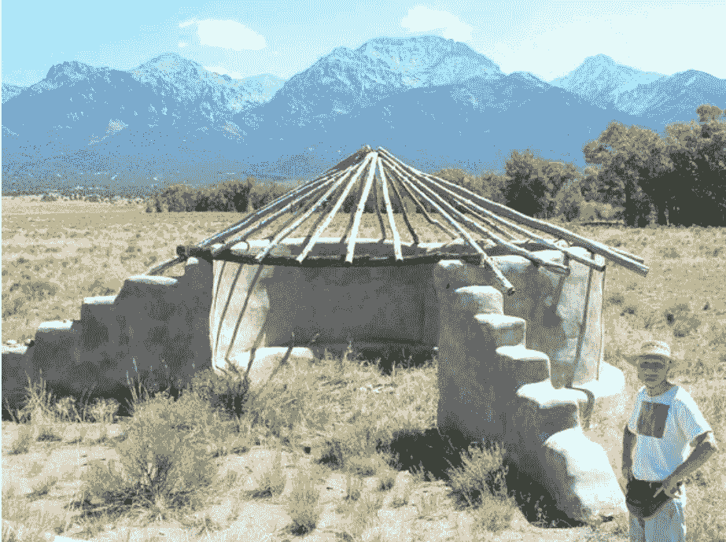

工作坊结束时，我们已经堆好了所有的沙袋，并在上面抹上了一些石灰/水泥/砂浆混合，并用铁丝网作为网格。我们没有时间安装遮阳屋顶的椽子（屋顶本应通过在椽子上缠绕小树枝制作，就像编篮子一样，所以我以后又安装了柱子）。我们之后还请了一支专业的灰泥队来完成抹面工作。

这次经历是他们参加会议的高光时刻。他们离开时，对土袋建筑的可能性有了更深入的理解，对真正可持续的建筑有了更多的赞赏。毕竟，我们创造了一个持久、功能性且美观的结构，使用的仅仅是现场挖掘的土壤和一些在附近水道旁收集的枯立树木木子。

# 墨西哥圆顶与模型房屋

在我们住在墨西哥恰帕拉湖（Lake Chapala）和瓜达拉哈拉（Guadalajara）附近的小村庄生活期间，我参与了当地一个推广可持续生活方式的绿色小组。我做了几场关于绿色建筑的演讲，包括使用土袋的建筑，这引起了许多人的兴趣。

其中一名协调员问我，是否可以做一个土袋建筑的实际案例，用以展示其可行性并向当地人培训这项技术。我考虑了这种可能性，最后向一位经营天寄宿学校的当地神父请教，他是否有兴趣在学校校园内举办一个土袋项目。他觉得这个主意很有，建议我向学生全体做一次演讲，看看是否有足够的兴趣。

演讲当天我有点紧张，因为我的西班牙语水平有限，但在一些说明我解说内容的大照片帮助下，我成功地让大家理解了我的意思。在场的老师和学生似乎都感兴趣，当我要求大家举手示意有多少人可能参与项目工作时，超过半的人举起了手，其中包括许多年轻女孩。

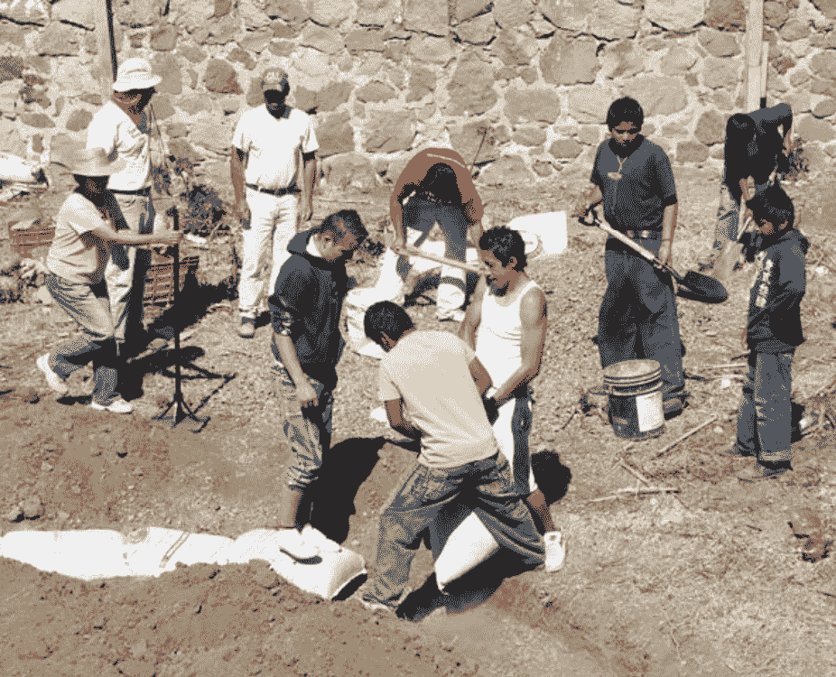

在这些鼓励下，我继续进行并安排在学校土地上开始建造一个类似于里塞尔兰德（Riceland）的小圆顶。我们在每个周六上午（即没有正常上课的时间）留出几个小时来投入这个项目。除了学生之外，我还邀请了绿色小组的成员加入我们，使这成为一场跨文化、跨年龄的活动。我们永远不知道某个周六谁会出现，但往往会有多达十二名各样的志愿者。

我特别想吸引这所学校的学生，因为他们大多数是土著墨西哥人，来自由于、贫困的小村庄，在那里，这种廉价且耐用的建筑可能很受到欢迎。

事实证明，尽管一些女孩表现出了兴趣，但学生志愿者几乎完全是男性，我相信这是一种对性别适当活动的文化偏见。

我们挖掘了碎石填沟基础，然后用碎石填充了前几层沙袋，以防止水分向上渗透。

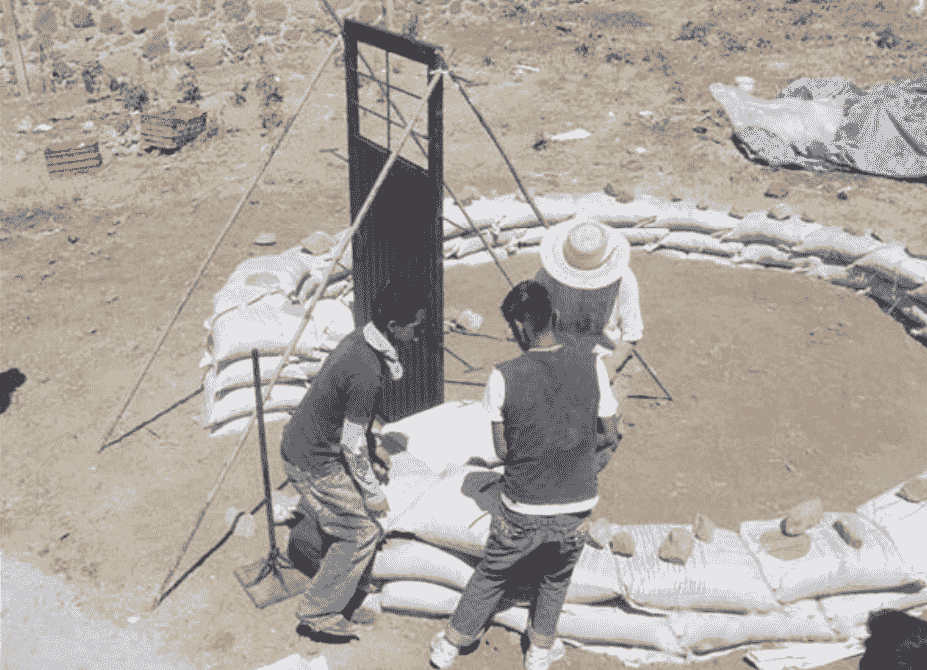

墨西哥通常使用焊接钢门，所以我定做了一个，门框侧面伸出几根长长的金属杆，这些金属杆可以在墙体上升时被嵌入土袋中。

我试图鼓励孩子们在原地填充沙袋，这样他们就不用抬起沉重的沙袋了。我甚至准备了金属滑块，以便更完美地定位放置在铁丝网上方。但有几个小男孩喜欢通过在地上填充沙袋然后将它们举到墙上来展示他们的力量。大男子主义（Machismo）在墨西哥仍然非常盛行！

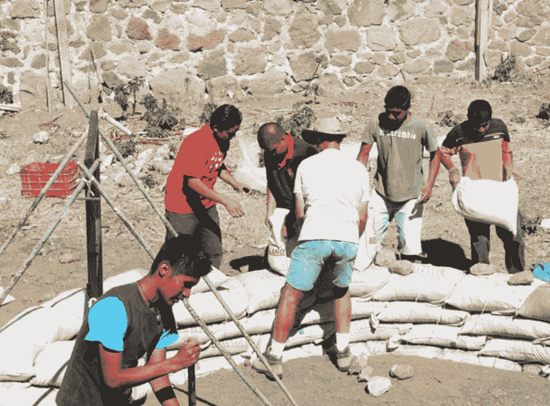

大部分沙袋都填充了某种路基，我们把它们倒在那儿，这样比尝试在现场挖掘土壤要容易得多。而且，我认为只要稍微加水，它们就能压得很结实。

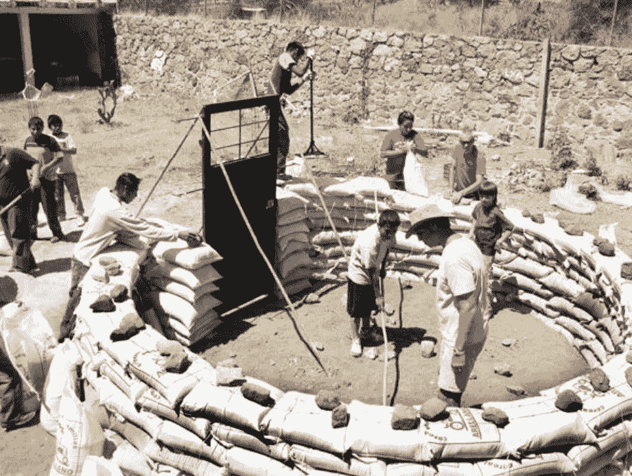

圆顶中心的男孩用一根长竹子来确保墙体上升时曲率是正确的。有些孩子喜欢爬在墙上，使用我们特制的那种特殊夯实器。

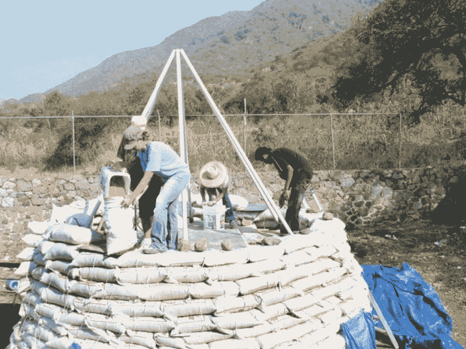

和里塞尔兰德一样，我们建造了一个小阁楼来帮助稳定结构，并作为继续砌墙工作的平台。作为这个圆顶锥形顶部的引导，我架设了一个 PVC 管三脚架。一桶桶土壤要么传过来，要么运出去填充沙袋。

当我们注意到墙体的完美形状似乎有些扭曲时，我建议在润湿土壤之前先开始混合一些石灰，这样沙袋会变得更加坚固。

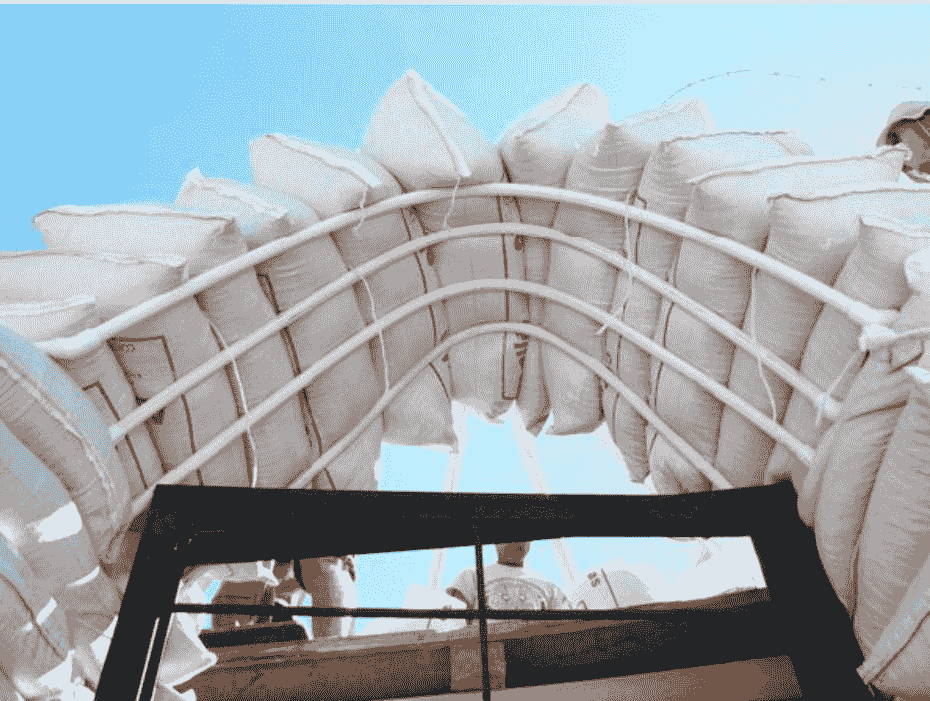

我尝试了通过简单地将一些 PVC 管弯成拱形来创建拱形结构。这在某种程度上有效，但并不理想。

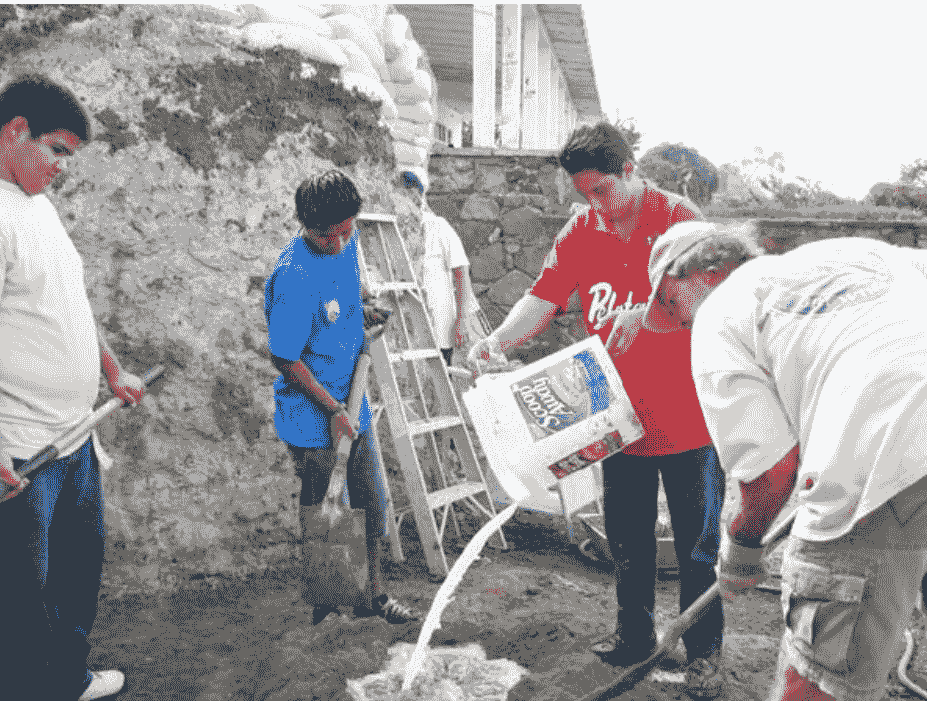

对于外墙层，我们决定使用水泥基灰泥，这在墨西哥非常常见。除了水泥、石灰和砂，我们还添加了液态乳胶使其更加防水。这些都是在地上混合的，通过将液体放在土堆中间的凹处，这是墨西哥的惯常做法。

首先我们涂了一层粗糙的底粉，然后用刮刀抹平了一层面层。在内部，我们使用了更环保的石灰抹灰。

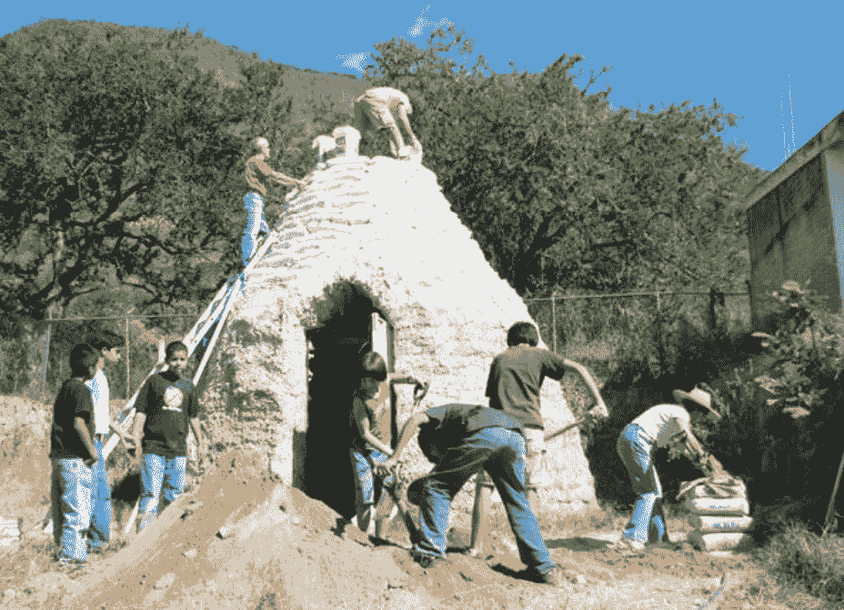

墨西哥这个地区有明显的雨季，因此让圆顶尽可能隔水至关重要。所以，在防水灰泥之外，我们还会涂一层墨西哥用于粉刷平坦混凝土屋顶的特殊屋顶漆。理想情况下，每隔几年更新一次。

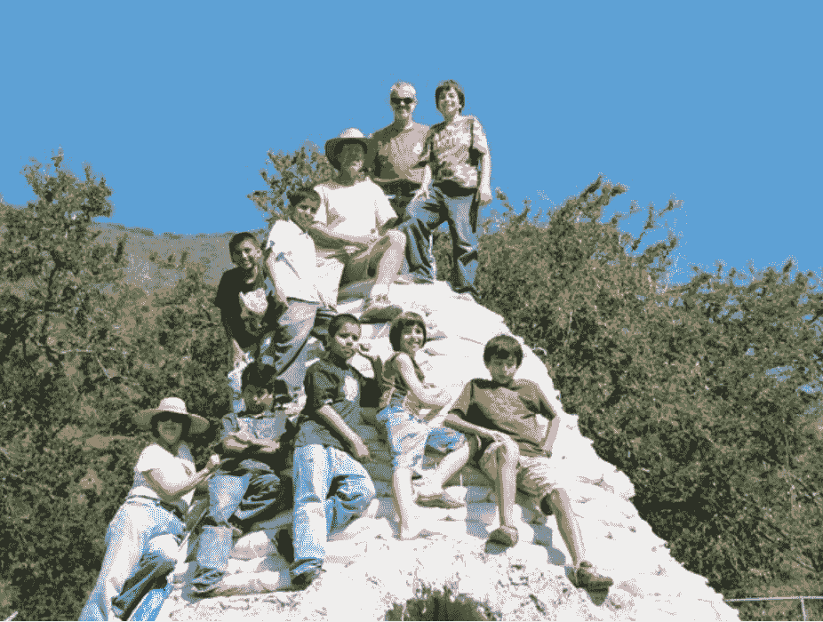

当最后一袋沙袋放在圆顶顶部时，我们忍不住聚在一起拍了张合影。

用于建造房屋，既为了贫困的墨西哥家庭，也为了那些在波尔华瓦尔塔寻找舒适但廉价居住场所的美国人。我们对这些可能性进行了多次讨论，我鼓励他追求他心中那种模型化土袋（earthbag）房屋的设计。

几个月后，他再次来电，请求我前往波尔华瓦尔塔帮助他实际建造这座模型房屋。他愿意支付我的路费，并支持我进行几周的现场咨询。我觉得，考虑到根据这个模型可能建造出许多房屋，做这件事是值得的。于是我很快飞回了墨西哥。

我之前根据我们讨论过的想法完成了一些重要的设计工作，制作了一个数字模型，如上所示。这个理念是：原始房屋将类似于这张图，但在屋顶露台所示的地方有增加二楼的潜力。扶墙有助于容纳一些外墙花箱。

当我到达时，项目已经进展顺利，大部分墙体的高度已经超过了一个英尺。他们正在向相当大的袋子（主要是当地烘包店的回收面粉袋）里填充从附近运河挖出的天然粘土。建造模型房屋的土地是一家大型起重机公司设备堆场的一部分，这座房子最终将成为业主的私人住所。

负责项目的人员是由垃圾回收社区的志愿者和该机构雇佣的建筑工人组成的。我能够对他们的方法提供一些细微的改进建议，但基本上他们的路线是正确的。再次，许多人倾向于搬起非常重的袋子将它们放在墙上。妇女们则满足于向袋子里填土。

工人并没有依靠土袋来支撑屋顶的重量，而是选择在结构的战略位置浇筑钢筋混凝土柱。这是他们熟悉的建筑方法，我看不出有什么理由行不通，而且它有助于加固结构。

对于室内抹灰，我让他们使用石灰；对于外部，他们使用了传统的水泥灰泥，并在最后一层漆中加入了一些色料。

当我准备好回家时，他们几乎已经准备好按照墨西哥的标准浇筑混凝土屋顶了。

## 嵌入式储藏室

在有了和平谷（Peaceful Valley）那个极度凉爽的储藏室后，我们怀念这个设施，并想尽快实现另一个。因此，当我们从墨西哥回来为在科罗拉州购买的预制房屋设计扩建时，我们包含了一个嵌入式储藏室。它将邻接房屋的一个大型新谷库/库，所以不像在和平谷那样方便，但它还能起到其他几个功能。

首先，我们让一台挖掘机挖了一个大约 4 英尺深、略大于储藏室占地面积的。我希望储藏室本身位于地下 6 英尺处，但我认为可以使用坑底留下的沙土来填充袋子。这意味着我需要在坑的四周挖一条沟，一直延伸到储藏室实际预期的地板平面。

下一步是开始在沟中填充和铺设袋子。当我这么做时，我在袋子外侧放置了一层 6 密（mil）黑色塑料内衬。这既可以作为储藏室的隔潮层，也可以在我不忙于项目时保护袋子免受阳光照射的方便方法。随着墙体的升高，我会绕一圈并在塑料和袋子旁进行回填，固定整个组件。

这些储藏室的墙实际上并不是垂直的；我让它们稍微向外倾斜，这样它们的重量就会朝土坡落下。

这避免了在内部加固墙的必要。事实上，我非常这些这些储藏室的墙是安全的，即使使用细沙土作为填充物，在大部分情况下，我也省略了在层之间使用铁丝网。

对于靠近车库的墙，我确实使用了铁丝网，以及长钢筋桩来帮助稳定它，即使有向外的倾斜。这是因为有重型车辆停在墙边，我意识到会对该墙产生额外的压力。

在其中一个角落附近，我使用 PVC 管段为储藏室安装了一个入口。这根管将从屋顶引水并进入水箱。安装在内部水箱上的地下溢流管直向集水，所以不用担心有太多水进入水箱。

由于我们希望能够从谷库/库在地面水平进入储藏室，我们利用了这一点创造了更多的存储空间。这意味着储藏室的一部分墙将位于地面以上，那些墙需要良好的隔热；沙子袋是无法完成这项工作的。

在其中一个角落附近，我使用 PVC 管段为储藏室安装了一个排气口。这根管将从屋顶引气并进入水箱。安装在内部水箱上的地下溢流管直向集水，所以不用担心有太多水进入水箱。

这是我为储藏室计划制作的 3D 草图。大圆柱体代表水箱，你可以看到通往它的螺旋。

在这个点我本可以改用浮石填充袋子，但对于地面以上的墙，我决定尝试木墙（cordwood）建筑。我将木材切割成与下方土袋基础相同的厚度，约 15 英寸。木墙在内外石墙之间有一个空腔，里面填了锯屑，所以这里以及木材本身就是隔热来源。当然，我也对结构的屋顶进行了隔热。

到目前为止，这个凉爽储藏室的理念在两个冬季里运行良好。空间内没有出现过结冻，尽管有时接近。为了安全起见，我在温控器上安装了一个小型电加热器，当温度降至34华氏度时它会开启，并在升高几度后关闭。这位于科罗拉州海拔8000英尺的地方，那里的冬季相当严酷。

在这里你可以看到完成后的储藏室外观，安装了来自谷库/库屋顶的集水系统。巨大的青色管道设计用于收集屋顶上可能受污染的初期水，防止其进入溢流进入水箱。在每场暴雨后，脏水会被排出，以便系统为下一次暴风雨做好准备。

## 一个小型地下圆顶

这个土袋项目发生在我和 Rosana 离开科罗拉多州度过冬天期间，位于新墨西哥州南部。我们在多年前在一次县税收拍卖中买了几英亩的沙漠土地；除了为了开辟的一条用于停车的小车道外，那里从未进行过开发。基本上，多年来我们只是利用这片土地进行定期的露营。

我经常在想，这个地区地下 6 英尺处的温度是多少。这里夏天非常炎热，冬季相当温和，因此挖掘地下可能是开发一个全年宜人且几乎不需要额外能量投入的住宅的好方法。为了测试这个理论，我想，在地下深处埋入一个记录温度计会提供有用的信息。

许多人问过关于埋设土袋圆顶的问题，遗憾的是，他们很少了解实际的案例。所以我想，一个有趣且富有启发意义的实验是在我们的土地上在建造一个小型地下土袋圆顶，将记录温度计放在里面，然后完全密封一年。

为了这个实验，我在合适的位置勾勒出一个直径 8 英尺的圆，然后又向外延伸约 15 英寸又画了另一个圆。接着，我开始挖掘两条线之间的土壤，挖出一个足够宽的可以放置土袋的壕沟。我希望可以这样轻松地继续挖掘，直到达到 5 英尺深。

顶部的几英尺是相当松散的粘土土，可以作为最终土袋工作的极佳填料。但挖得越深，土壤就变得越紧实、石头越多。然而，我坚持了下来，通过向壕沟里倒水让其渗透土壤，使挖掘变得更容易。我通过这种方法下降了近五英尺；在上面的照片中几乎看不到铲子的柄。

我算出，在内部圆柱顶部高度处圆顶的合适直径比底部少近一英尺，所以我从圆柱边缘挖掉了等量的土壤到壕沟底部，并开始使用这些土壤来填充我在最底部铺设的第一批土袋。

我的意图是通过最终消耗掉整个圆柱土壤来向上建造圆顶。在实践中，这个概念效果非常好。很容易将袋子靠在内壁上作为引导，只需从中心将土壤铲进袋里。为了保持土壤湿润以便于压实并让挖掘更轻松，我偶尔会在圆柱的空腔内放水让其向下渗透。

在铺设第一层土袋后，我用一块黑色塑料绕在土袋外面，并通过在塑料和壕沟外侧填充土壤将其固定。但为了能将塑料铺设并跨越壕沟外，我需要将其切成几段，如上所示。这也能让我只暴露我正在处理的那部分袋墙，而且它最终会在圆顶外部提供一个防潮层。

圆顶完成后，我需要一种进入它的方法，我想一种简单有效的入口方法是使用一段大型金属涵涵。我找到了一个直径约 4 英尺的完美产品，是为这个项目回收的。

袋子铺设到三层后，我觉得是时候将涵涵固定到位了。这需要更多的挖掘来创造足够的空间。我把它安置在一个位置，使其能够支撑放置在上面的袋子。然后，只需随着墙的增加，将袋子紧紧地压在它上即可。

每当我完成一层袋子的铺设时，我都会小心地从外面向上压实土壤。随着墙体的升高，我不希望圆顶墙的向外推力移位任何袋子。这尤为重要，因为我选择不在层与层之间使用刺刺丝，认为一旦整个圆顶被埋，它就无法扩张，也不需要铁丝的抗拉强度来固定它。

在圆顶内部挖得越深，暴露的墙体就越多，很快在底部靠近涵涵的地方出现了一个台阶。

最后，我需要用梯子用桶把土运起来倒进袋子里。很快，我就用完了所有的内部可用土壤，需要开始使用一些堆在外部的土壤。看到圆顶即将完成非常令人兴奋。我非常小心地压实土壤（主要是用脚），以确保整个结构在上升过程中是坚固的。在顶部，袋子变得更多是呈连续的螺旋图案，而不是离散的层。

我帮助我的朋友 Baraka 为她居住的科罗拉多州气候设计了这栋土袋袋房屋。她对形状和房间布局有非常具体的想法，但希望就土袋建筑的实用性以及如何完成许多施工细节获得建议。像“宁静谷”一样，袋子里填充的是浮石。工人们通常对施工做法有自己的主意，有时这些想法会占据主导。这导致几处墙体并不完全垂直，还出现了其他一些问题。尽管如此，这栋房子的结构基本上非常稳固，在未来应该能很好地服务她。

位于犹他州布夫（Bluff）的一座 700 平英尺 BLM 许可站，其墙厚度在 15 到 24 英寸之间，形成了热质量，产生了一个隔音且节能的结构。土袋建筑防火、防水、防腐，是保险费用较低的永久性结构。建筑用土经过细砂处理，含有 10% 的粘土。外墙覆盖了 OSB 板（通过插入袋子之间的塑料紧固件固定）和 2 英厚的泡沫。传统的水泥抹灰提供了类似于旧土坯建筑略微不规则的外观。使用当地采集的粘土调配的天然土抹灰，使建筑内部与外部环境同样契合。

上述 1,000 平英尺的土袋房屋由业主兼建造者 Alison Kennedy 在犹他州莫阿布（Moab）以极低预算建造。它是犹他州第一栋获得许可的土袋房屋。它是一个木框架结构，内部填充了土袋。基础是现浇混凝土和传统的混凝土块。袋子里填充了从当地碎石石场运来的“废弃沙”。墙顶砌筑了一圈混凝土块联结梁。外墙先覆盖了土抹灰，然后添加了两层石灰抹灰以增加额外的防侵蚀保护。Alison 采集了野生粘土，将其制成油漆涂在新鲜石灰粉的表面。

下方左侧 500 平英尺的房屋由业主 John Capillo 设计，并在肯塔基州贝雷亚（Berea）建造。代码官员毫不费力地就发给了 John 许可证。他的设计有一个 16 英尺的圆顶，圆顶延伸出一个较大的圆，并配有木屋顶。结构的下部分比上部分的墙厚，以产生支撑作用。使用了几英里外采石场的密实级“石灰粉”作为填充物；石灰固化后变得像岩石一样。房屋背部被埋了四英尺。他们使用了厚重的 6 角塑料隔层，并在结构周围使用了法式排水沟。最初几周，每天有 7 人工作，之后人数减少到每天 2 或 3 人。这个结构的袋装工作大约花了三个月。成本大约在 15,000 美元。

位于墨西哥下加利福州的圆顶房屋（DOME HOME）基于神圣几何原理、斐波纳契数列和深生态学。由大师建造者/设计师 Rah Rysak 实现了高水平的美学细节。土抹灰使用了仙掌、芦胶和木纤维素；这是一个无水泥和无 VOC（挥发性有机化合物）的材料区域。

土质小屋 2.0 应急避难所由华盛顿州的 Eco Friendly Shelters 设计。用于填充的土壤来自现场挖掘；使用的木材回收自当地的森林火灾；土掩护屋顶保护其免受烈日和寒风的侵害；光线来自管状天窗。这个 1,200 平英尺的避难所成本低于 5,000 美元。

这栋 280 平英尺的房屋主要由俄亥俄州的两个女性建造，花费约 10,000 美元。它度过了一场将树吹倒在上面的大风，仅损坏了纸浆抹灰。他们使用了 3/4 英寸的碎石灰岩细粉作为填充。

“加拿大土袋人”建造了三个高度不一的圆形房间，配有两个卧室处汇合的双坡屋顶。他们认为自己是“住在加拿大阿尔伯塔省偏远地区的几个改造过的城市孩子，试图为自己规划可持续的生活”。

这栋房屋是由 Martin Cubak 在爱达荷州自建的。一楼是一个直径 22 英尺的土袋圆屋。在那上面，他做了一个木框架的卧室，并计划进一步扩大房屋，增加更多的卧室和温室。他利用工作之余的休息完成了这一切，花费了约 5,000 美元。

Kent Kaufman 位于蒙大拿州的土袋小屋用便携式水泥搅拌机混合的土、水和草进行抹灰。这些抹灰被涂抹在墙上，确保行缝和裂缝都填充良好。他在一天内就完成了整个外南墙的抹灰。

这栋位于尼加拉瓜的房屋建造在山坡上，为了通风、视野并减少昆虫。他们很幸运，拥有极好的土壤，这些土壤在润湿并夯实后会非常紧密。地基是由河石和火山岩混合而成的碎石沟。它是一个大约 12×14 米的椭圆形设计。构造梁和屋顶似乎将整个房子紧密地结合在了一起。第一层灰泥使用了牛粪、粘土、木屑和干草。第二层是45%的粘土、45%的沙和10%的水泥。最后一层是30%粘土、30%沙、30%石灰灰和10%的水泥。

在计划于贝利兹建造土袋房屋时，Jesse Loving 决定先建一个储藏室。这栋建筑 99.9% 可生物降解。它建造成本低廉、耐用、提供非机械冷却，且美观。建筑与其自然环境融合得很好。没有使用混凝土或石油基产品；仅使用了极量的化石燃料运输材料，用电也极少。

La Casa de Tierra（大地之屋）是一座位于哥斯达黎南太平洋南岸 Ojochal 的租赁房屋，也称为托尔图加滩（海龟海滩）。土袋内填充了高粘土含量土壤和沙子的混合物。在会呼吸的土墙上添加了土灰泥。

位于危地马拉的 Somos 儿童村有几栋用土袋建造的漂亮家庭住宅，有需要的家庭在停留期间居住在那里。前两栋房屋由危地马拉建筑师 Cecilia Rodriguez 设计。它们配有太阳能热水器，并回收了灰水。房屋在寒冷的夜晚保持着舒适的温度，不需要供暖。该村庄为有需要的人提供了安全保障和希望的未来。

## 南美

这处住宅由 José Andrés Vallejo 设计，在哥伦比亚波哥大仅用 5 个月就建成。La Casa Vergara 的设计探索了以 Superadobe（超级土袋）作为建筑技术的抗震潜力以及当代设计。Superadobe 使用了三种元素：土/混凝土、管状袋和铁丝网。使用这种方法建造的整体结构建筑具有创建有机且灵活空间的能力。

Gabriel Raia Carneiro 是一位在巴西工作的绿色建筑师、生态设计师和永续农业专家。这处住宅的地基是碎石沟。使用塑料将地基与上方的墙分开，墙内填充了纯土。这个项目利用了 Superadobe 中曲线呈现的可能性，因为它们表达了感性并提供了强度。

这栋位于巴塔哥尼亚的房屋由 Paul 和 Konomi Coleman 建造，由填充了土的土袋制成。它具有一个包含浮石的双层墙系统。人们通过手工搬运了 500 吨土。房屋下方温暖的土壤和周围的草皮墙调节了室内温度。二楼的墙由火山岩制成，这种岩石非常非常轻，有很多空气孔，作为隔热层效果非常好。房屋的设计类似于冰岛的草皮屋。夏天时，墙上覆盖满了花，小屋看起来像一片花花的草甸。

Hyperadobe 由巴西 EcoOca 的 Fernando Pacheco 开发。Hyperadobe 没有使用实心编织聚丙烯布，而是使用了针织 Raschel 网布（用于水果包装的相同网眼材料），价格更便宜。浇筑了混凝土基础，并开始铺设 Hyperadobe 层，土壤通常含有 70% 的沙和 30% 的粘土，具有良好的含水量。Raschel 留了“粗面”状态以接受天然灰泥。由于是垂直墙，层与层之间不需要铁丝网，因为开口网使底层的土壤会与上方的新层融合。

这所位于秘鲁的社区中心是由 Pisco Sin Fronteras 组织的志愿者团队建造的。由于地下水位高，它建在混凝土垫面上。土袋作业是典型的，有夯实的粘土土、铁丝网和定期的垂直钢筋桩。他们用三根钉子封住袋子。他们使用了带有垂直垂直钢筋的袋子。在顶部，他们浇了一层水泥。这一个一个，覆盖了石灰抹灰。

这一个位于 theia 的土袋项目是在 Pedro Ramirez 的指导下建造的。它有四个圆顶，包括一个主卧室、一个大客厅。

这栋位于阿根廷科尔多瓦的房屋由 Leo 分阶段建造的。它有一个太阳能加热器。他们组装了用于屋顶的构件，一个屋顶。

这个位于巴西米纳斯吉拉斯州的土袋项目受到了广泛关注，并深受居住者的喜爱。它是一个在……建造的土袋项目原型，带一个。

## 欧洲

这个项目在波兰建造，作为廉价建筑技术的演示。它是由 Paulina Wojciechowska 创立的“手与房屋”组织发起的许多项目之一。在瓦片屋顶下方是一个半地下圆顶，带有一个壁炉。

三天内，20个人建造了一个内径两米的土袋 Superadobe 圆顶，带有一个入口拱顶。这是在 Earth Hands and Houses 举办的一次工作坊期间的。他们使用了大约。这本打算在英国萨塞建造一个地下室。使用了富粘土的土壤来填充袋子。五天后，灰泥小组用土/稻草/粘土对项目进行了抹灰处理。

Atulya Bingham 建造了这栋土袋圆形房屋，俯瞰土耳其地中海壮丽的奥林匹山谷。它位于半英亩土地上，位于山坡上，经过一条颠簸刺骨的土路，没有自来水，没有电，也没有电话线。她使用从自己土地上挖的土来填充袋子。考虑到未来的扩张，她框架了一个额外的门，并给房屋盖了一个平顶，为她建造二层提供了可能。

房子覆盖了石灰灰泥。Bingham 选用了一种对我们的地球影响尽可能小的生活，努力自产自用所需。

Small Earth 在 Hounslow Heath School 的协助下，在英国的萨斯班克海沃德美术馆创作了这个“地球生物”。它是为户外学习而设计的。长条织物管内填充了生土、水泥或石灰。

这所学校位于希斯罗机场一条跑道的飞径下方，他们找到了一种缓解儿童玩耍噪音的极佳方法：他们建造了一个圆顶的超级土袋（Superadobe）结构，让孩子们在噪音过大时可以躲进去。这些圆顶没有门，但有效地减少了噪音。

## 非洲

一个由两位建筑师和八位教授组成的团队，在日本天理大学井上昭（Akio Inoue）的指导下，在东非乌干达维多利亚湖边实施了生态村的建设。这个生态村旨在缓解贫困，并展示土袋的可持续建筑技术。它由三个建筑群组成，中心有一个水塔。每个群由四个居住单元组成，每个单元都有一个客厅、两个卧室、一个厨房、一个厕所、淋浴间和一个冥想室。每个单元都配有生物质厕和一个供电的风力发电机。建筑表面涂有水泥抹灰。

南非的 Eternally Solar 公司开创了一种新颖的土袋建筑方法。长被缝成三个隔间，外两个隔间填充生土或沙子，中间通道则留空，或填充钢筋和混凝土作为过梁或连接梁。这栋房屋特色在于：太阳能热水器、集成灰水系统、太阳能照明系统、再生纤维天花板隔热层以及一个用灰水灌溉的永续农业花园。

在南非开发的另一种独特土袋建筑技术由三个元素组成：生态梁（Eco-Beams）框架（形成土袋墙框架的木材和梁）；特种配制的织物袋，填充沙子并堆叠在梁之间；以及最后用铁丝网和抹灰、木材或石膏板对梁进行包层。完成的结构防水、防火且隔音。

Brandon Rogers 的土袋项目位于加纳。这是一间带有一个卧室的客栈，一个作为生活/用餐/厨房区域的主空间，以及一个作为工作室的多功能房间。墙厚达 20 英寸，能够抵御天气变化。Rogers 和他的团队浇筑了楼板，并开始了填充、缝合、夯实和将聚丙烯袋移到位的过程。大部分墙体在大约三周内飞快建成。外部涂有水泥饰面以减少维护，并用石头进行了细节处理。

在乌干达的基图姆镇，Far Reaching Ministries 使用土袋为员工、工人和工作人员人员建造了房屋。照片中是他们根据传统建筑建造的第一座茅草屋。这些土袋房屋的建造也变成了一个分享他们信仰和土袋建筑技术的绝佳机会，因为人们聚在一起观看他们的成果。最终，他们为社区的许多孤儿提供了家园。

NextAid 组织在 Joe Kennedy 的协助下，在南非约翰内斯堡郊外创建了一个儿童支持中心。该中心为“有愿景的青年”小组服务，帮助应对非洲艾滋病毒危机中数百万的孤儿。他们使用了土壤等当地材料来降低成本，并让当地社区能够使用这些建筑系统。照片中是建筑群的行政办公室。

该项目由 Earthen Hand 的 Scott Howard 制作并领导。它是马里第一个土袋圆顶，作为该地区许多村庄的图书馆。项目在建设期间聘用了几名当地人。一个为期两周的工作坊完成了大部分结构。它是一个悬线圆弧，高度接近 17 英尺，并有一个阁楼。

国际工程部（Engineering Ministries International）在泰国靠近缅甸边境举办了一场建筑研讨会，介绍了土袋建筑（earthbag building）和名为 HyPar 的薄壳乳胶混凝土屋顶系统。该建筑是为需要医疗设施的自由缅游击队（Free Burma Rangers）设计的。

Edge of Seven 和 Small World Nepal 在尼泊尔的 Phuleli 村建造了一座两间教室的中学。该村深处喜马拉雅山脉，步行8小时路程内没有道路或机场。任何现场无法提供的材料都必须人工运入。他们铺设了石块和水泥地基及地面。前两层土袋袋填充了从现场挖掘的大石块上用锤子击碎的小碎石。剩下的袋子则填充了筛过的挖掘出的粘土。使用水泥砂灰配合鸡丝网格进行抹面，随后进行了刷白。2015年春季摧毁了尼泊尔许多地区的地震，这所学校幸免一难，而该村的大多数房屋都倒塌了。

渡边纪光（Kikuma Watanabe）的另一个设计是位于约旦的 Al-Jawasreh 协会的这个社区中心。这是一个提供教育和职业培训项目的公共设施。它包含三个建筑部分：尼泊尔传统的石质建筑、现代钢筋混凝土以及作为生态建筑备受目的土袋建筑。被动式太阳能系统为室内营造了舒适的环境。

加沙地区的人被剥夺了许多建筑材料，他们开始使用土袋建筑。他们连接了许多具有方形垂直墙基的结构，然后向上收缩形成圆顶屋顶。这使得在一系列连接的圆顶中空间得到最大利用。

在巴基斯坦遭受灾难性的地震和洪水后，各种项目都关注了土袋建筑，包括这个20 x 12英尺的结构。后墙上有一个扶壁。它建造在碎石沟槽上，然后他们在前两排袋子填充了6%的水泥，其余的填充沙子和粘土。在达到18英尺的高度后，他们将水泥含量减少到3%。房屋的高度约为9英尺。这栋房子耗时17天建成，他们计划共建造多达500间房屋。

来自泰国清道的马吉·麦克隆（Maggi McKerron）一直在尝试使用填充稻壳的袋子为客人建造圆顶屋。这些房子具有与草捆包类似的隔缘性能，但稻壳不吸水，因此是季风地区理想的建筑材料。稻壳通常被丢弃，且非常难燃烧（这是将其用作墙的另一个优点）。它们非常廉价，甚至是免费的。另一个很棒的因素是它们很轻；你一次可以搬几袋。但它们它们不具承重能力。为了使用它们，你需要制作一个支撑屋顶、门、窗户等的框架。她主要使用竹子和一些钢筋，并用铁丝系扎在一起作为框架。

# 岛屿

Konbit Shelter 组织为海地的 Monique 她的她的两个小女儿设计并建造了这栋房子。主空间的内径为18.5英尺，带有扇形的半圆部分，其内径延伸至22.5英尺。他们每天完成四层，向管子内填充水泥稳定土，并在九天内达到了20英尺的最终高度。大部分劳动力由海地人提供。

海地建造的第一批土袋房屋之一是 Marc Boisvertt 神父（Father Marc Boisvertt）经营的天主教孤儿院校园内的“阳光屋”。他们使用了回收袋、当地粘土和来自附近河床的沙子。岩石和砂浆用于地基，并浇筑了混凝土垫作为地面。他们缝合了袋子以减少袋子数量，并制作了重金属夯实器。混凝土圈梁固定了墙顶和屋顶。饰面层是涂漆的灰泥。

这是日本新潟县的一座神社，由渡边纪光设计。它建造在一块空地上。结构是土袋制。

海地勒甘的希望学校（Children of Hope School）在马根（Matt Gunn）的指导下，建造在碎石沟槽上，然后他们在前两排袋子填充了6%的水泥，其余的填充沙子和粘土。在达到18英尺的高度后，他们将水泥含量减少到3%。房屋的高度约为9英尺。这栋房子耗时17天建成，他们计划共建造多达500间房屋。

不会产生有害气体，这有助于保持空气清新。也可以使用土质抹灰；即使是制造过程中会产生二氧化碳的石灰泥，在固化过程中也会重新吸收这些气体。土袋建筑并不一定依赖木材施工，从而保护了吸收二氧化碳的树木。

土袋建筑具有极度耐用的潜力，因为使用的材料很少会随时间而变质。在寿命结束时，填充材料通常只需回到其来源的土地。显然，从环境角度来看，如今土袋建筑优于标准的建筑方式。

从经济上来说，使用土袋建造可能是可用成本最低的方法之一。无疑，筑墙的材料可能非常廉价。除此之外，具体成本还取决于建筑风格、尺寸和设施配置。正如任何建筑项目一样，业主愿意投入的工作量，以及他们寻找廉价供应源的能力都会对成本产生巨大影响。土袋本身在全球范围内都很容易获得；而且通常可以从之前的使用中回收。

几乎不需要花钱就能用土袋建造简易住房。正如我展示的建造小型地下圆顶的那样，成本仅仅是袋子和一张塑料布的钱。当然，袋子本身也可能是回收的，完全免费。理论上，你完全拿着一把铲子和一个装满塑料袋的背包，进入荒野创造一个小居所！另一方面，你也可以用土袋建筑建造真正的豪宅；这种灵活性正是我喜爱土袋建筑的原因。

从政治角度看，未来难以预测。由于对世界上任何地方走向的不确定性，土袋建筑所代表的灵活性是一种美德。而且，土袋墙可以保护家庭免受穿透性子弹，这会让许多人感到安心。甚至可以完全地下并几乎消失在视野中，正如许多生存主义者梦梦想的那样。所以，无论你的观点如何，土袋建筑可能在你和家人的未来中占有一席。

## 资源

## 作者网站

- `www.earthbagbuilding.com` 是作者的综合网站，致力于土袋相关的所有事物。

- `www.greenhomebuilding.com` 是作者的关于可持续建筑的网站。

- `www.dreamgreenhomes.com` 是作者的网站，提供一些可以用土袋建造的方案。查看关于材料/土地/土袋的链接。

- `www.naturalbuildingblog.com` 是一个博客，由 Owen Geiger 博士撰写，包含大量土袋信息，并由作者偶尔提供意见。

- `www.earthbagstructures.com` 专注于为灾区提供土袋解决方案。

## 书籍

- Earthbag Building Guide，Owen Geiger 著，2011，数字 PDF 版。（通过作者网站获取）

- Emergency Sandbag Shelter，Nader Khalili 著，2008，Cal Earth Press。

- Earthbag Building: The Tools, Tricks and Techniques，Kaki Hunter, Donald Kiffeyer 著，2004，New Society.

- Building with Earth: A Guide to Flexible-Form Earthbag Construction，Paulina Wojciechowska 著，2001，Chelsea-Green Publishing

## DVD

- Basic Earthbag Building: a Step-by-Step Guide，Owen Geiger。（通过作者网站获取）

- Building with Bags: How We Made Our Experimental Earthbag/Paper House 1/2 hr., Kelly Hart 制作。（通过作者网站获取）

- A Sampler of Alternative Homes: Approaching Sustainable Architecture 2 hr., Kelly Hart 制作。（通过作者网站获取）

- Emergency Shelter，Cal-Earth Institute 制作。

## 工作坊

- `www.AuwaEarth.com` 在澳大利亚和巴西提供土袋和土建工作坊。

- `www.calalearth.org` Nader Khalili 的土袋作品。

- `www.earthbaghouse.com` 通用信息、工作/贸易机会、工作坊等。

- `www.earthenhand.com` 主要在美国西北部举办工作坊，但也遍布全球。

- `www.earthsandssandouses.org` 位于欧洲。

- `www.guidingstarcreations.blogspot.com` 主要在澳大利亚和巴厘提供土袋工作坊。

- `www.homegrownhidehideaways.org` 主要在肯塔基州定期举办工作坊。

- `www.naturalhomes.org` 列出了全球工作坊。

- `www.permastructure.com.au` 澳大利亚。

- `www.phanganearthworks.com` 泰国。

- `www.superadobedelsur.blogspot.com` 位于阿根廷，在整个南美举办土袋工作坊。

- `www.tsatsa-house.com` 位于印度和日本。

- `www.ulewatitan.com` 在危地马拉的提兰湖提供工作坊和住宿。

- `www.unitedearthbuilders.com` 提供有关土袋房屋的教育和慈善服务。

## 在线袋子供应

- `www.ace-bag.com` 新袋子

- `www.agriculturebag.com` 新袋子

- `www.allinsafety.com` 新袋子

- `www.bagsupplies.ca` 新袋子及印刷袋子、管子

- `www.bagsupplies.com` 网袋和管子

- `www.centralbagcompany.com` 新袋子和管子

- `www.chinawovenbag.com` 新袋子和管子

- `www.commercialbagssupply.com` 新袋子

- `www.eclatindustries.com` 新袋子

- `www.esandbags.com` 新袋子

- `www.farberg.com` 新袋子

- `www.innpack.com` 新袋子

- `www.jumbosack.com` 新袋子

- `www.maxkatzbag.com` 新袋子

- `www.nmirdbags.com` 新袋子

- `www.jyp-corp.com` 新袋子和管子

- `www.onlinefabricstore.net` 新袋子

- `www.pac-packaging.com` 新袋子及印刷袋子

- `www.polytex.com` 新袋子

- `www.rich-source.com` 网袋和管子

- `www.sandbagsexpress.com` 新袋子

- `www.suncoastpkg.com` 新袋子及印刷袋子

- `www.superpoly.ca` 新袋子及印刷袋子

- `www.syfilco.on.ca` 网袋和管子

- `www.unitedbags.com` 新袋子

- `www.wftonghui.com` 新袋子和管子

- `www.whitebag.com` 新袋子及印刷袋子
