# Java 轻松学：Java 初学者指南

杨虎 (YANG HU)

生活的复杂性是因为他们不懂如何化繁为简，化复杂为简单是智慧的开始。

从实践本质出发，简要解释概念并生动地培养编程兴趣，本书深入分析了 Java 面对象编程，结合实践中的场景解读，体验编程的乐趣。

http://en.verejava.com

- 13. 文件 IO
  - 13.1 `File`
  - 13.2 文件与文件夹
  - 13.3 `FileInputStream` 读取文件
  - 13.4 `FileOutputStream` 写入文件
  - 13.5 `FileWriter` 写入字符
  - 13.6 `FileReader` 以字符形式读取文件
  - 13.7 `InputStreamReader` 字节流转字符流
  - 13.8 文件复制
- 14. Java 网络编程
  - 14.1 TCP 协议
  - 14.2 UDP 协议

# 安装 Java JDK

## 1. 下载 JDK (Java 开发包)

https://drive.google.com/open?id=181nylTxnl0o2TmBTQ4I7ndDaa-HFFe

有 3 个 JDK 版本。我们使用 `jdk-6u45-windows-i586` 作为示例。

- `jdk-6u45-windows-i586`
- `jdk-7u79-windows-x64`
- `jdk-8u91-windows-x64`

## 2. 安装 JDK

解压 `jdk-6u45-windows-i586`。

点击 `jdk-6u45-windows-i586.exe` 继续下一步完成安装。

# Java(TM) SE Development Kit 6 Update 45 - 设置

此向导将引导您完成 Java Development Kit 6 Update 45 的安装。

安装路径：`C:\Program Files (x86)\Java\jdk1.6.0_45`

## 自定义设置

选择要安装的程序功能。

从列表中选择要安装的功能。安装后可以通过控制面板中的“添加或删除程序”更改功能选择。

| 功能 | 说明 |
| :--- | :--- |
| Java(TM) SE Development Kit 6 Update 45，包含私有 JRE 6 Update 45。这将占用您的硬盘 300MB 空间。 | |
| 开发工具 | 源代码 |
| 公共 JRE | |

安装到：

`C:\Program Files (x86)\Java\jdk1.6.0_45\`

在窗口 7 中配置环境变量：

右键点击 -> 电脑 -> 属性


点击高级系统设置


点击高级 -> 环境变量


点击“新建”按钮创建 3 个环境变量。

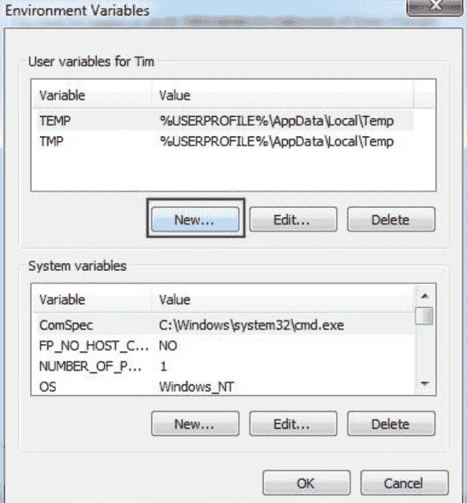

`JAVA_HOME=C:\Program Files (x86)\Java\jdk1.6.0_45\`

`CLASSPATH=%JAVA_HOME%\lib;%JAVA_HOME%\bin`

`PATH=%JAVA_HOME%\bin`

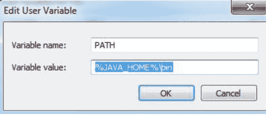

点击下一步完成安装。


点击完成结束。

```java
System.out.print("is the half of the success");
}
```

## 输出结果:

| Hello Word |
| 事半成功 |

## 标识符 (Identifier)

> /**

标识符的命名规则：

1. 它由字母、数字、下划线 `_` 和美元符号 `$` 组成
2. 不能以数字开头
3. 区分大小写
4. 不能是 Java 的关键字

*/

```java
public class TestIdentifier{
    public static void main(String[] args){
        // 不能以数字开头
        // int 1number=1;

        // 标识符区分大小写
        int var1=2;
        int VAR1=3;
        System.out.println(var1);
        System.out.println(VAR1);
        // 不能是 Java 的关键字
        //int class=4;

        int salary=20000;
        // 两个字符串通过加号 + 拼接
        System.out.println("Your salary is:"+salary);
    }
}
```

## 输出结果:

```
2
3
Your salary is:20000
```

## 变量 (Variable)

> 

1. 变量命名不允许重复
2. 变量的命名规则：由字符、下划线、`$`、数字组成，第一个字母必须是字符、下划线或 `$`，不能是数字

*/

```java
public class TestVariable {
    public static void main(String[] args) {
        // 变量定义：系统分配的用于存储数据的内存区域
        //String:
            被双引号 "" 包围的字符
        //cup:
            变量名。
        // =;
            将数据 "mineral water" 存储在名为 cup 的内存区域中。
        String cup = "mineral water";

        // 将变量 cup 内存区域的数据打印到控制台
        System.out.println(cup);

        // 修改变量的值
        cup = "cola";
        System.out.println(cup);

        // 清空变量，清空 cup 的内存数据
        cup = "";
        System.out.println(cup);

        // 给 null 赋值以删除变量
        // cup 变量将自动回收分配的内存空间
        cup = null;
        System.out.println(cup);

        // 变量名不能重复定义。
        //String cup="ice black tea";
        //System.out.println(cup);
    }
```

```java
    // 变量命名规则：由字符、下划线、$、数字组成，
    // 第一个字母必须是字符、下划线或 $
    // 不能是数字
    //String 1var="a"
    //System.out.println(1var);

    String $var = "b";
    System.out.println($var);

    String _var = "_var";
    System.out.println(_var);
}
```

## 输出结果:

```
mineral water
cola
null
b
_var
```

## 基本数据类型 (Basic Data Types)

```java
/**

Java 有 8 种数据类型。

1. 整数型 (`byte`, `short`, `int`, `long`)
2. 浮点型 (`float`, `double`)
3. 字符类型 (`char`)
4. 布尔型 (`boolean`)

*/
```

```java
public class BaseDataType {
    public static void main(String[] args){
        byte a1=1; //byte 占用 1 字节 = 8 位 -2^7~2^7-1(-128~127)
        short a2=10; //short 占用 16 字节 = -2^15~2^15
        int a3=1000; //int 4 字节 = 32 位 -2^31~2^31
        long a4=10000; //long 占用 8 字节 = 64 位 -2^63~2^63
        System.out.println(a1);
        System.out.println(a2);
        System.out.println(a3);
        System.out.println(a4);

        //1. 如果整数超出存储范围，编译报错，丢失精度。
    }
}
```

```java
        //float 类型, double
        double b1=10.1; //double 占用 8 字节 = 64 位
        float b2=12.2f; //float 占用 4 字节 = 32 位
        float b3=(float)13.3;
        System.out.println(b1);
        System.out.println(b2);
        System.out.println(b3);

        //1. 浮点数据默认是 double 类型。如果你想将
        // 值赋值给 float，必须进行强制类型转换。
        // 浮点数的强制类型转换有两种方法。
        // 一种：在末尾直接加 f。另一种：在前面加 (float)。

        //char 是一个用单引号包围的单个字符
        char c1='a'; // char 占用 2 字节 = 16 位
```

```java
        char c2='1';
        System.out.println(c1);
        System.out.println(c2);

        //boolean
        boolean d1=true; // boolean 占用 1 字节 = 8 位
        boolean d2=false;
        System.out.println(d1);
        System.out.println(d2);

        //1. 布尔类型 true 不能等于 1，false 不等于 0。这与 C 语言不同。
    }
}
```

```java
/**

总结：

1. 基本数据类型变量：8 种基本数据类型 (`byte`, `short`, `int`, `long`, `float`, `double`, `boolean`, `char`)
2. `String` 不是基本数据类型。它是一个引用类型。

*/
```

## 输出结果:

```
1
10
100
1000
10.1
12.2
13.3
a
1
true
false
```

## 常量 (Constant)

```java
/*

Java 中的常量：

1. 整数常量
2. 浮点常量
3. 字符常量
4. 布尔常量
5. 字符串常量

*/
```

```java
public class FinalVariable {
    public static void main(String[] args) {
        // 不能修改的变量
        //1. 整数常量
        final int UP = 0;
        final int DOWN = 1;
        final int LEFT = 2;
        final int RIGHT = 3;
        System.out.println(UP);
        System.out.println(DOWN);
        System.out.println(LEFT);
        System.out.println(RIGHT);

        //1. 常量的定义通常使用大写字母。
        //2. 浮点常量
        final float PI = 3.14f;
        System.out.println(PI);
```

```java
        //3. 布尔常量
        final boolean RUN = true;
        System.out.println(RUN);
```

```java
        //4. 字符常量
        final char A = 'A';
        System.out.println(A);
        System.out.println("r");
        System.out.println("\");
        System.out.println("\"");
        System.out.println("\\");
```

```java
        //5. 字符串常量
        final String CONST = "love for forever";
        System.out.println(CONST);
    }
}
```

```java
/**

总结：

1. 常量的命名规则与变量相同
2. 常量通常使用大写
3. 在常量前添加 `final` 关键字
4. 常量的值不能改变

*/
```

## 输出结果:

```
0
1
2
3
3.14
true
A
'
"
```

## 数据转换 (Data Conversion)

```java
/**

数据转换：

1. 整数类型转换
2. 浮点类型转换
3. 布尔类型转换
4. 字符类型转换

*/
```

```java
public class TypeConvert {
    public static void main(String[] args) {
        byte varByte = 1;
        int varInt = 2;
        // 小整数转整数
        varInt = varByte;
        System.out.println(varInt);

        byte varByte2 = 1;
        int varInt2 = 2;
        int varInt3 = 128;
        // 大整数类型转换为小整数类型，需要强制转换，
        // 并丢失精度。高位会被截断。
        varByte2 = (byte) varInt2;
        varByte2 = (byte) varInt3;
        System.out.println(varByte2);

        byte c1 = 1;
        float c2 = 10.3f;
        // 整数转浮点类型，直接转换
        c2 = c1;
        System.out.println(c2);

        byte d1 = 1;
        float d2 = 10.3f;
        float d3 = 128.2f;
        // 浮点类型舍入直接去掉小数部分，
        // 需要强制转换，并可能丢失精度
        d1 = (byte) d2;
        d1 = (byte) d3;
        System.out.println(d1);

        char f1 = 'a';
        int f2 = 1;
        char f3 = 'b';
        int f4 = 'b' + 1;
        // 整数可以转换为字符类型，需要强制转换，
        // 整数可以转换为字符。根据 ASCII 转换规则：
        f1 = (char) f2;
        f2 = f3;
        System.out.println(f1);
        System.out.println(f2);

        char f5 = 'b' + 1;
        // 整数加字符结果为整数，需要强制转换为 char
        f5 = (char) f4;
        System.out.println(f5);

        String str = "Perseverance in the ordinary";
        String str2 = str + 1;
        String str3 = str + 2.5;
        String str4 = str + true;
        String str5 = str + 'F';
        // String 加其他基本类型，其他类型会自动
        // 转换为字符串
        System.out.println(str2);
        System.out.println(str3);
```


`System.out.println(str4);`

`System.out.println(str5);`

```java
}
}
```

```java
/**
摘要：
1. 类型转换从小值到大值的转换
byte<short<int<float<long<double
*/
```

输出结果：

```
1
-128
1.0
-128
98
99
c
平凡中的坚持1
平凡中的坚持2.5
平凡中的坚持true
平凡中的坚持F
```

## 算术运算符

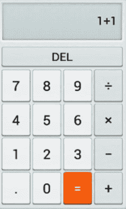

```java
/**
* 算术运算：
* 加 + , 减 - , 乘 * , 除 / , 取模 % , 递减 --
* 增增 ++
 */
```

```java
public class ArithmeticOperator {
    public static void main(String[] args) {
    int a = 1;
    int b = 2;
    int c = 3;
    int d = 4;
    System.out.println(a + b);
    System.out.println(a - b);
    System.out.println(a * b);
    System.out.println(b / a);
    System.out.println(a / b);
    // 取模是除法后的余数
    System.out.println(c % b);
    System.out.println(d % b);
    System.out.println(4 % -3);
    System.out.println(-4 % -3);
    System.out.println(4 % 3);
    System.out.println(d++);
    System.out.println(++d);
    System.out.println(d--);
    System.out.println(--d);
}
```

**摘要：**

- 1. 除法时小数部分会自动截断。
- 2. 取模时，正负结果值取决于被除数的符号。
- 3. 变量后置 `++` 是先输出变量再加 1，如果 `++` 放在变量前面，则先加 1 再输出。
- 4. 变量后面的 `--` 是先输出变量再减 1。如果它放在变量前面，则先减 1 再输出。

## 输出结果：

```
3
-1
2
2
0
1
0
1
-1
-1
4
6
6
4
```

## 赋值运算符

```java
public class AssignmentOperator {
  public static void main(String[] args) {
    int var = 10;
    var = var + 1;
    var++;
    var += 1;
    var /= 2;
    var %= 2;
    var *= 2;
    System.out.println(var);

    short s = 10;
    s = (short) (s + 5);
    s += 5;
    System.out.println(s);
  }
}
```

输出结果：

```
0
20
```

## 关系运算符

```java
/** 关系运算符 只有两种结果：true , false
包括：
大于 > , 大于等于 >=
小于 < , 小于等于 <=
等于 == , 不等于 !=
*/
```

```java
public class RelationalOperator {
    public static void main(String[] args) {
        System.out.println(100 > 200);
        System.out.println(100 >= 100);
        System.out.println(100 < 200);
        System.out.println(100 <= 200);
        System.out.println(100 == 100);
        System.out.println(100 != 200);
        System.out.println(100 == 100.0);
        System.out.println('A' == 65);

        // true 不等于 1 且 false 不等于 0
        System.out.println(true==1);
    }
}
```

## 输出结果：

```
false
true
true
true
true
true
true
```

## 逻辑运算符

```java
/**
包含：
与 && , 或或 || , 非 !
1. && 当操作两侧都为真时，则返回 true，否则返回 false
2. || 当操作两侧都为假时，结果为 false，否则
3. ! 操作返回真，则结果为假，否则为真
*/
```

```java
public class LogicalOperator {
    public static void main(String[] args) {
        System.out.println(true && false);
        System.out.println(false && true);
        System.out.println(false && false);
        System.out.println(true && true);

        System.out.println("--------------------");

        System.out.println(true || false);
        System.out.println(false || true);
        System.out.println(true || true);
        System.out.println(false || false);

        System.out.println("--------------------");

        System.out.println(!true);
        System.out.println(!false);

        System.out.println("--------------------");

        boolean b = true;
        System.out.println(b);
        System.out.println(1 > 2 && (b = 3 > 4));
        System.out.println(b);
        System.out.println(2 > 1 && (b = 3 > 4));
        System.out.println(b);
        // && 的短路特性：因为程序是从
        // 从上下、从左到右执行，当左侧被判断为假时
        // && 的结果已经注定为假，所以后续的
        // 判断将不会执行。
        System.out.println("----------");

        boolean b1 = true;
        System.out.println(b1);
        System.out.println(2 > 1 || 3 > 4);
        System.out.println(2 > 1 || (b1 = 3 > 4));
        System.out.println(b1);
        System.out.println(1 > 2 || (b1 = 3 > 4));
        System.out.println(b1);
        // || 的短路特性：因为程序是从
        // 左到右执行，当左侧被判断为真时，
        // 返回结果已经注定为真，所以后续的
        // 判断不执行。
    }
}
```

## 输出结果：

```
false
false
false
true
----------------
true
true
true
false
----------------
false
true
----------------
true
false
true
false
false
----------
true
true
true
true
false
false
```

## 三元运算符

```java
public class TrinocularOperator {
    public static void main(String[] args) {
        int score = 90;
        String result = score >= 60 ? "通过" : "未通过";
        System.out.println(result);
    }
}
```

输出结果：

```
通过
```

## if 条件语句

```java
/**
条件语句
包含：
1. if(表达式){语句}
2. if (表达式) { 语句 } else { 语句 }
3. if (表达式) { 语句 } else if { 语句 }

主题：
税额 = (基本工资 -3500) * 税率
级别：
-- 2000 $: 10% 税率
5000 $: 15% 税率
10000 $: 20% 税率
20000 $: 30% 税率
*/
public class IfStatement {
    public static void main(String[] args) {
        int salary = 5000; // 基本工资
        double taxRate;    // 税率
        if (salary <= 2000) {
            taxRate = 0.10;
        } else if (salary <= 5000) {
            taxRate = 0.15;
        } else if (salary <= 10000) {
            taxRate = 0.20;
        } else {
            taxRate = 0.30;
        }
        double taxAmount = (salary - 3500) * taxRate;
        System.out.println("税额=" + taxAmount);
    }
}
```

输出结果：

```
税额=225.0
```

## switch 语句

```java
/**
switch 语句
包含：
1. switch (表达式) { ... }
2. case 值: 语句;
3. break: 防止穿透
4. default: 如果没有匹配的项
*/
public class SwitchStatement {
    public static void main(String[] args) {
        int day = 2;
        switch (day) {
            case 1:
                System.out.println("周一");
                break;
            case 2:
                System.out.println("周二");
                break;
            case 3:
                System.out.println("周三");
                break;
            default:
                System.out.println("其他日期");
        }
    }
}
```

输出结果：

```
周二
```

## while 循环

```java
/**
While(表达式){
    语句;
}
如果表达式为真则继续执行，否则退出循环
*/

主题：
2006年培训了 8,000 名学生，每年增长 25%。
根据这个增长率，多少年后学生人数将
达到 20,000 人
```

2006年 : `sum=8(1+0.25)^0`

2007年 : `sum=8*1.25=8(1+0.25)^1`;

2008年 : `sum=8(1+0.25) + 8(1+0.25)*0.25=8(1+0.25)(1+0.25)=8(1+0.25)^2`

n年 : `sum=8(1+0.25)^n`

```java
public class WhileStatement {

    public static void main(String[] args) {

        int sum = 8;

        int n = 0; //总人数将达到 20,000

        while (n < 20) //条件为真时执行，否则循环终止

        {

            sum = (int) (sum * (1 + 0.25));

            n++;

            System.out.println("" + n + "年后学生人数将达到 200,000");

        }

    }

}
```

输出结果：

```
5年后学生人数将达到 200,000
```

## do while循环


```java
/**
do{
  语句;
  while (表达式):
    当 while 表达式求值为 false 时退出循环
*/
```

```java
import java.util.Scanner;

public class DoWhileStatement {
  public static void main(String[] args) {

    /*
      切水果游戏：
      键盘输入 1: 西瓜，2: 香蕉，3: 桃子,-1: 雷电
      输入数字打印对应的水果，如果输入 -1 则
      结束游戏
    */

    System.out.println("Keyboard Input 1: Watermelon, 2: Banana, 3: Peach, -1: Thunder");

    Scanner in = new Scanner(System.in);

    int num = 0; //定义了一个变量

    do {

      num = in.nextInt();//变量的生命周期

      if (num == 1) {

        System.out.println("你切了西瓜");

      } else if (num == 2) {

        System.out.println("你切了香蕉");

      } else if (num == 3) {

        System.out.println("你切了桃子");

      } else if (num == -1) {

        System.out.println("你切了雷电，游戏结束");

      }

    } while (num != -1); //如果你输入 -1 则结束游戏

  }
}
```

## 输出结果：

```
Keyboard Input 1: Watermelon, 2: Banana, 3: Peach, -1: Thunder
你切了香蕉
你切了西瓜
3
你切了桃子
-1
你切了雷电，游戏结束
```

## do while循环 2

```java
/**
 * 持续输入学生姓名，输入 "q" 退出系统
 */
import java.util.Scanner;

public class DoWhileStatement2 {
    public static void main(String[] args) {
        Scanner in = new Scanner(System.in);
        System.out.println("请输入学生姓名，直到输入 q 退出系统");
        String name = "";
        do {
            name = in.nextLine();
        } while (!name.equals("q"));
        System.out.println("退出系统");
    }
}
```

## 输出结果：

```
请输入学生姓名，直到输入 q 退出系统
grace
q
退出系统
```

## for循环语句

```java
/**
for 循环定义：
for (初始化变量; 判断条件; 更新循环变量更新){
  语句;
}

实现过程：
1. 初始化变量
2. 执行判断条件。如果为真则继续执行，
   执行后，更新循环变量，然后判断条件。
   直到条件为假时退出循环
*/

public class ForStatement {

    public static void main(String[] args) {

        // 打印 0-9

        /*
实现过程：
1. 初始化 i=0;
2. 执行 i<10，如果为真，则执行 System.out.println(inAfter)；执行后，i++ 然后通过 i<10 判断该循环，直到 i>=10 退出循环。
        */

        for (int i = 0; i < 10; i++) {

            System.out.print(i + ", ");

        }

    }

}
```

## 输出结果：

```
0,1,2,3,4,5,6,7,8,9,
```


# for循环语句 2

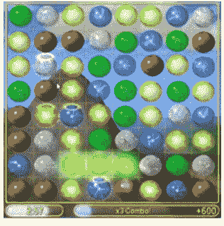

```java
public class ForStatement {
    public static void main(String[] args) {
/*
    在泡泡游戏中，
    游戏从 64 个球开始，每行需要 8 个球。*
代表性球
    打印 (1 -- 64)
*/
    for (int i = 1; i <= 64; i++) {
        System.out.print("*");
        if (i % 8 == 0) // 8%8==0, 16%8==0, 24%8==0, 32%8==0, 48%8==0, 64%8==0 {
            System.out.println("");//换行
        }
    }
}
```

输出结果：

```
*****\*\*\*\*\*
*\*\*\*\*\*\*
*\*\*\*\*\*\*
``` (注：此处示例输出存在星号转义，实际应为 * )

# 一维数组

| 0 | 1 | 2 | 3 | 4 | 5 |
|---|---|---|---|---|---|
| 90 | 70 | 50 | 80 | 60 | 85 |

```java
public class oneArray {
    public static void main(String[] args) {
    // 一维数组的定义和初始化
    // 静态定义一个一维数组
    int[] scores = { 90, 70, 50, 80, 60, 85 };
    // 动态定义一个一维数组
    int[] arr = new int[6];
    arr[0] = 90;
    arr[1] = 70;
    arr[2] = 50;
    arr[3] = 80;
    arr[4] = 60;
    arr[5] = 85;

    // 打印 scores 数组
    for (int i = 0; i < scores.length; i++) {
        System.out.print(scores[i] + " , ");
    }
    System.out.println("\n------------------------------------");

    // 打印 arr 数组
    for (int i = 0; i < arr.length; i++) {
        System.out.print(arr[i] + " , ");
    }
}
}
```

输出结果：

```
90,70,50,80,60,85,

----------

90,70,50,80,60,85,
```

# 一维数组添加元素

在一维数组 `scores` 的末尾添加一个学生的成绩。

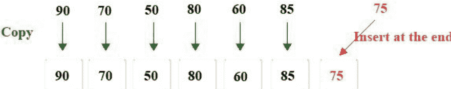

> 步骤：
> 1. 首先创建一个比原 `scores` 数组长度更大的临时数组 `tempArray`
> 2. 将 `scores` 数组的每个值拷贝到 `tempArray`
> 3. 然后为 `tempArray` 的新最后一个索引位置赋值成绩 75
> 4. 最后将 `tempArray` 的地址指针引用赋值给 `scores`

```java
public class ArrayAppend{
    public static void main(String[] args) {
        int[] scores = {90, 70, 50, 80, 60, 85 };

        int[] tempArray = new int[scores.length + 1];
        for (int i = 0; i < scores.length; i++) {
            tempArray[i] = scores[i];
        }
        tempArray[scores.length] = 75;
    }
scores = tempArray;

// 打印 scores
for (int i = 0; i < scores.length; i++) {
    System.out.print(scores[i] + ", ");
}
}
```

输出结果：

```
90,70,50,80,60,85,75,
```

# 一维数组删除元素

从一维数组中删除一个元素。


> 标题：从 `scores` 中删除索引的值
> 步骤：
> 1. 创建一个比原 `scores` 数组长度更小的临时数组 `tempArray`
> 2. 将索引之前的数据拷贝到 `tempArray`
> 3. 将索引之后的数组拷贝到 `tempArray` 的末尾
> 4. 将 `tempArray` 的地址指针引用赋值给 `scores`
> 5. 打印 `scores`

```java
import java.util.Scanner;

public class ArrayDelete {

    public static void main(String[] args) {

        int[] scores = { 90, 70, 50, 80, 60, 85 };

        System.out.println("请输入要删除的索引:");

        Scanner in = new Scanner(System.in);

        int index = in.nextInt();

        int[] tempArray = new int[scores.length - 1];

        for (int i = 0; i < scores.length; i++) {

            if (i < index) {

                tempArray[i] = scores[i];

            } else if (i > index) {

                tempArray[i - 1] = scores[i];

            }

        }

        scores = tempArray;

        for (int i = 0; i < scores.length; i++) {

            System.out.print(scores[i] + ", ");

        }

    }

}
```

输出结果：

```
请输入要删除的索引：
2
90,70,80,60,85,
```

# 一维数组查找元素

请输入要查找的值：70

index=1

| 90 | 70 | 50 | 80 | 60 | 85 |

```java
/**
标题：在 scores 中查找给定值
步骤：
1. 遍历 scores 数组的值，
如果发现与给定值相等，打印当前索引
否则打印 -1 未找到
*/

import java.util.Scanner;

public class ArraySearch {

    public static void main(String[] args) {

        int[] scores = { 90, 70, 50, 80, 60, 85 };

        System.out.println("请输入要查找的值:");

        Scanner in = new Scanner(System.in);

        int value = in.nextInt();

        boolean isSearch = false;

        int i = 0;

        for (i = 0; i < scores.length; i++) {

            if (scores[i] == value) {

                isSearch = true;

                System.out.println("找到值：" + value + "，索引为：" + i);

                break;

            }

        }

        if (!isSearch) {

            System.out.println("在 scores 数组中未找到该值：" + value);

        }

    }

}
```

输出结果：

```
请输入要查找的值：
70
找到值：70，索引为：1
```

# 冒泡排序算法

**第一次排序（外轮）：**
1. 从第一个元素开始。
2. 如果前一个数据比后一个数据大，则交换位置直到循环结束，然后最大的数据将位于数组的最后一个位置。

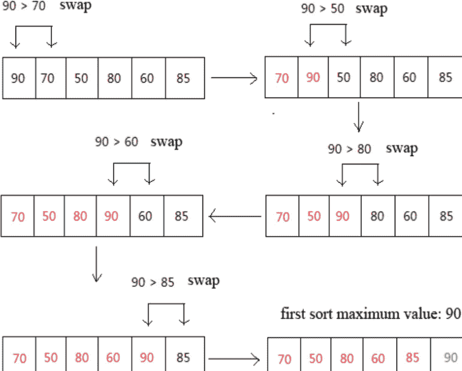

> 泡沫排序算法：
> 将结果数组输出从小到大排序
> 步骤：
> 首先排序
> 1. 从第一个元素开始。
> 2. 如果前一个数据大于后一个数据，则交换位置，直到循环结束，最大的数据将被放置在数组的最后一个位置。
> 3. 此此类比，未排序的 `n-i` 个元素将再次执行 1, 2 过程，
> 因此在循环 `n` 次结束后，元素将按从小到大进行排序。

```java
public class BubbleSort {

    public static void sort(int[] arrays) {

    // 第一个循环 n-1 次

    for (int i = 0; i < arrays.length - 1; i++) {

      // 第二个循环每次比较的元素个数为 n

      for (int j = 0; j < arrays.length - i - 1; j++) {

        if (arrays[j] > arrays[j + 1]) {

          int flag = arrays[j];

          arrays[j] = arrays[j + 1];

          arrays[j + 1] = flag;

        }

      }

    }

    }

    public static void main(String[] args) {

        int[] scores = { 90, 70, 50, 80, 60, 85 };

        sort(scores);

        // 输出排序后的分数

        for (int i = 0; i < scores.length; i++) {

          System.out.print(scores[i] + ",");

        }

    }

}
```

## 输出结果：

```
50,60,70,80,85,90,
```

# 二维数组

| | 0 | 1 | 2 |
|---|---|---|---|
| 0 | 10 | 20 | 30 |
| 1 | 40 | 50 | 60 |
| 2 | 70 | 80 | 90 |

```java
public class BinaryArray {

    public static void main(String[] args) {

        // 二维数组的定义和初始化

        int[][] arr = {

            { 10, 20, 30 },

            { 40, 50, 60 },

            { 70, 80, 90 }

        };

        // i: 行索引, j: 列索引

        for (int i = 0; i < arr.length; i++) {

            for (int j = 0; j < arr[i].length; j++) {

                System.out.print(arr[i][j]);

            }

            System.out.println("");

        }

        // 增强 for 循环是 jdk 5.0 之后才有的新功能

        String[] names = { "Joseph", "James", "Grace" };

        for (String name : names) {

            System.out.print(name + " ");

        }

        // 定义课程的二维表格结构

        String[][] courses = {

            { "C001", "English" },

            { "C002", "Mathematics" },

            { "C003", "Java Programming" }

        };

        System.out.println("\n----------------------------");

        //输出

        for (String[] rows : courses) {

            for (String col : rows) {

                System.out.print(col + ", ");

            }

            System.out.println("");

        }

    }

}
```

## 输出结果：

```
10 20 30
40 50 60
70 80 90
Joseph,James,Grace,

C001,English,
C002,Mathematics,
C003,Java Programming,
```

# 示例：扫雷

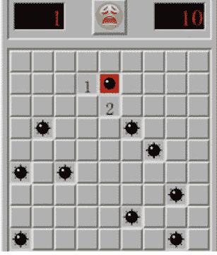

```java
/**
 扫雷游戏：
 1: 无雷 2: 有雷
 键盘输入行号和列号，确定是否扫到了雷。
 */
```

```java
import java.util.Scanner;

public class BinaryArrayMine {

    public static void main(String[] args) {
        int[][] thunders = {
            { 1, 1, 1, 1},
            { 1, 1, 1, 1},
            { 1, 2, 1, 1},
            { 1, 1, 1, 1}
        };
        Scanner in = new Scanner(System.in);
        System.out.println("请输入行号:");
        int row = in.nextInt();
        System.out.println("请输入列号:");
        int col = in.nextInt();
        int value = thunders[row][col]; // 从数组中获得的值

        // 判断是否扫到了雷
        for (int i = 0; i < thunders.length; i++) {
          for (int j = 0; j < thunders[i].length; j++) {
            // 如果数组中存在值且等于 2
            if (value == thunders[i][j] && value == 2) {
              System.out.print(" * 雷 ");
            } else {
              System.out.print("* ");
            }
          }
          System.out.println("");
        }
    }
}
```

## 输出结果：

```
请输入行号:
2
请输入列号:
1
****
****
* 雷 **
****
```

# 封装

| Person |
|---|
| name :String |
| age :integer |
| say() |


## 泡沫排序算法

将结果数组输出从小到大排序。

**步骤：**

1. 从第一个元素开始。
2. 如果前一个数据大于后一个数据，则交换位置，直到循环结束，最大的数据将被放置在数组的最后一个位置。
3. 以此类推，未排序的 `n-i` 个元素将再次执行步骤 1、2，因此在循环 `n` 次结束后，元素将按从小到大进行排序。

```java
public class BubbleSort {
    public static void sort(int[] arrays) {
        // 第一个循环 n-1 次
        for (int i = 0; i < arrays.length - 1; i++) {
            // 第二个循环每次比较的元素个数为 n
            for (int j = 0; j < arrays.length - i - 1; j++) {
                if (arrays[j] > arrays[j + 1]) {
                    int flag = arrays[j];
                    arrays[j] = arrays[j + 1];
                    arrays[j + 1] = flag;
                }
            }
        }
    }

    public static void main(String[] args) {
        int[] scores = { 90, 70, 50, 80, 60, 85 };

        sort(scores);

        // 输出排序后的分数
        for (int i = 0; i < scores.length; i++) {
            System.out.print(scores[i] + ",");
        }
    }
}
```

**输出结果：**

```
50,60,70,80,85,90,
```

## 二维数组

|   | 0 | 1 | 2 |
|---|---|---|---|
| 0 | 10 | 20 | 30 |
| 1 | 40 | 50 | 60 |
| 2 | 70 | 80 | 90 |

```java
public class BinaryArray {
    public static void main(String[] args) {
        // 二维数组的定义和初始化
        int[][] arr = {
            { 10, 20, 30 },
            { 40, 50, 60 },
            { 70, 80, 90 }
        };

        // i: 行索引, j: 列索引
        for (int i = 0; i < arr.length; i++) {
            for (int j = 0; j < arr[i].length; j++) {
                System.out.print(arr[i][j]);
            }
            System.out.println("");
        }

        // 增强 for 循环是 jdk 5.0 之后才有的新功能
        String[] names = { "Joseph", "James", "Grace" };
        for (String name : names) {
            System.out.print(name + " ");
        }

        // 定义课程的二维表格结构
        String[][] courses = {
            { "C001", "English" },
            { "C002", "Mathematics" },
            { "C003", "Java Programming" }
        };

        System.out.println("\n----------------------------");

        // 输出
        for (String[] rows : courses) {
            for (String col : rows) {
                System.out.print(col + ", ");
            }
            System.out.println("");
        }
    }
}
```

**输出结果：**

```
10 20 30
40 50 60
70 80 90
Joseph,James,Grace,
C001,English,
C002,Mathematics,
C003,Java Programming,
```

## 示例：扫雷

```java
/**
 扫雷游戏：
 1: 无雷 2: 有雷
 键盘输入行号和列号，确定是否扫到了雷。
 */
```

```java
import java.util.Scanner;

public class BinaryArrayMine {

    public static void main(String[] args) {

        int[][] thunders = {

            { 1, 1, 1, 1},

            { 1, 1, 1, 1},

            { 1, 2, 1, 1},

            { 1, 1, 1, 1}

        };

        Scanner in = new Scanner(System.in);

        System.out.println("请输入行号:");

        int row = in.nextInt();

        System.out.println("请输入列号:");

        int col = in.nextInt();

        int value = thunders[row][col]; // 从数组中获得的值

        // 判断是否扫到了雷

        for (int i = 0; i < thunders.length; i++) {

          for (int j = 0; j < thunders[i].length; j++) {

            // 如果数组中存在值且等于 2

            if (value == thunders[i][j] && value == 2) {

              System.out.print(" * 雷 ");

            } else {

              System.out.print("* ");

            }

          }

          System.out.println("");

        }

    }

}
```

**输出结果：**

```
请输入行号:
2
请输入列号:
1

****
****
* 雷 **
****
```

## 封装

| Person |
| :--- |
| name :String |
| age :integer |
| say() |

```java
/**
**
步骤：
1. 如果你想访问 Person 类
 */
public class TestEncapsulation {

    public static void main(String[] args) {

        // 对象的实例化：p 是指向 new Person() 生成的对象的引用名

        Person p = new Person();

        // 使用 p 访问属性和方法

        p.name = "Joseph";

        p.age = 22;

        p.say();

        Person p2 = new Person();

        p2.name = "Joseph";

        p2.age = 22;

        p2.say();

    }

}
```

```java
System.out.println("Person is instantiated");
```

```java
// 定义带参数的构造函数
public Person(String name, int age) {
  this.name = name;
  this.age = age;
}
```

```java
public void say() {
  System.out.println("My name is : " + name + ", this year: " + age + " years old");
}
```

> 构造函数的特点：
> 1. 当实例化对象时，构造函数会被自动调用。
> 2. 当类中没有定义无参数的构造函数时，Java 虚拟机会自动创建一个构造函数来实例化它。
> 3. 如果定义了带参数的构造函数，虚拟机就不会自动生成无参数的构造函数，必须手动添加。
>
> 构造函数重载：
> 在同一个类中，方法名相同，但参数的数量或类型不同。

**输出结果：**

```
My name is: Joseph, this year 22 years old
My name is: David, this year 23 years old
```

## 方法重载

| 计算器 (Calculator) |
| :--- |
| add(a : integer, b : integer) : integer |
| add(a : Double, b : Double) : Double |

```java
package com.test2;

public class TestOverload {
```


# 方法重载

| 计算器 (Calculator) |
| :--- |
| `add(a : integer, b : integer) : integer` |
| `add(a : Double, b : Double) : Double` |

```java
package com.test2;

public class TestOverload {

    public static void main(String[] args) {

        Calculator c = new Calculator();

        int result = c.add(10, 20);

        System.out.println(result);

    }

}
```

```java
// 调用不同参数类型的重载方法

double result2 = c.add(30.5, 40.2);

System.out.println(result2);
```

```java
/**

方法重载：

 在同一个类中，存在同名的方法，但参数数量或类型不同。

方法重载的特征：

 当调用方法时，它会自动调用对应的重载方法。

*/
```

```java
class Calculator {

    // 输入两个要相加的数字，返回和

    public double add(double a, double b) {

        return a + b;

    }

public int add(int a, int b) {

    return a + b;

    }

}
```

输出结果：

```
30
70.7
```

# 引用传递

| 计数 (Count) |
| :--- |
| `value : String` |
| `setValue(value : String)` |
| `getValue() : String` |

| 工具类 (Utils) |
| :--- |
| `increment(count : Integer)` |
| `increment(count : Count)` |

```java
package com.test3;

/**

* 引用传递：

1. 方法参数引用传递

2. 对象与对象之间的引用传递

3. this 指针对象的引用传递

 */

public class Testrefenence {

    public static void main(String[] args) {

        Utils utils = new Utils();

        // 定义一个计数变量

        int count = 1;

        System.out.println(count);

        utils.increment(count);

        System.out.println(count); // 值未改变

        // 定义一个计数类变量

        Count value = new Count();

        value.setValue(1);

        System.out.println(value.getValue());

        utils.increment(value);

        System.out.println(value.getValue()); // 值已改变

    }

class Utils {

    public void increment(int count) {

        count++;

    }

    public void increment(Count count) {

        count.setValue(count.getValue() + 1);

    }

}

class Count {

    private int value;

    public int getValue() {

        return this.value;

    }

    public void setValue(int value) {

        this.value = value;

    }

}

}
```

## 输出结果：

```
1

1

2
```

# static 关键字

| 用户 (User) |
| :--- |
| `static count : integer` |

```java
package com.test4;

public class TestStatic {

    public static void main(String[] args) {

    // 静态变量可以直接通过类名访问

    User.count++;

    System.out.println("users count: " + User.count);

    }

}

class User {

    public static int count;

    public User(){

    }

}
```

```java
/**

普通变量与静态变量的区别：

1. 普通变量是在运行时动态赋值的。

2. 静态变量在编译时被赋予初始值。

3. 普通变量必须通过实例对象引用访问

 静态变量可以直接通过类名访问

*/
```

输出结果：

```
users count: 1
```

# 代码块

```java
public class CodeBlock {

    // 构造块

    public CodeBlock() {

        System.out.println("Construct code block Initialization");

    }

    // 静态块

    static {

        System.out.println("Static code block Initialization");

    }

    public static void main(String[] args) {

        new CodeBlock();

    }

}
```

```java
/**

静态块在类加载时执行，构造块在实例化时执行

 */
```

输出结果：

```
Static code block Initialization
Construct code block Initialization
```

# 继承

| Count |
| :--- |
| `value : String` |
| `setValue(value : String)` |
| `getValue() : String` |

| Utils |
| :--- |
| `increment(count : Integer)` |
| `increment(count : Count)` |

```java
package com.test3;

/**

* 引用传递：

1. 方法参数引用传递

2. 对象与对象之间的引用传递

3. this 指针对象的引用传递

 */

public class Testrefenence {

    public static void main(String[] args) {

        Utils utils = new Utils();

        // 定义一个计数变量

        int count = 1;

        System.out.println(count);

        utils.increment(count);

        System.out.println(count); // 值未改变

        // 定义一个计数类变量

        Count value = new Count();

        value.setValue(1);

        System.out.println(value.getValue());

        utils.increment(value);

        System.out.println(value.getValue()); // 值已改变

    }

class Utils {

    public void increment(int count) {

        count++;

    }

    public void increment(Count count) {

        count.setValue(count.getValue() + 1);

    }

}

class Count {

    private int value;

    public int getValue() {

        return this.value;

    }

    public void setValue(int value) {

        this.value = value;

    }

}

}
```

# 构造函数

```java
System.out.println("Person is instantiated");
```

```java
// 定义带参数的构造函数

public Person(String name, int age) {

  this.name = name;

  this.age = age;

}
```

```java
public void say() {

  System.out.println("My name is : " + name + ", this year: " + age + " years old");

}
```

```java
/**

构造函数的特点：

1. 当实例化对象是构造函数时，它会被自动调用。

2. 当类中没有定义无参数的构造函数时，Java虚拟机会自动创建一个构造函数来实例化它。

3. 如果定义了带参数的构造函数，虚拟机就不会自动生成无参数的构造函数。它必须手动添加。

构造函数重载：

在同一个类中，方法名相同，但参数的数量或类型不同

*/
```

## 输出结果：

```
My name is: Joseph, this year 22 years old
My name is: David, this year 23 years old
```


`System.out.println("Person is instantiated");`

}

```

```java
// 定义带参数的构造函数
public Person(String name, int age) {
  this.name = name;
  this.age = age;
}
```

```java
public void say() {
  System.out.println("My name is : " + name + ", this year: " + age + " years old");
}
```

> 构造函数的特点：
> 1. 当实例化对象时，构造函数会被自动调用。
> 2. 当类中没有定义无参数的构造函数时，Java 虚拟机会自动创建一个构造函数来实例化它。
> 3. 如果定义了带参数的构造函数，虚拟机就不会自动生成无参数的构造函数，必须手动添加。

构造函数重载：
在同一个类中，方法名相同，参数的数量或类型不同。

## 输出结果

```
My name is: Joseph, this year 22 years old
My name is: David, this year 23 years old
```

## 方法重载

| 计算器 (`Calculator`) |
| :--- |
| `add(a : integer, b : integer) : integer` |
| `add(a : Double, b : Double) : Double` |

```java
package com.test2;

public class TestOverload {
    public static void main(String[] args) {
        Calculator c = new Calculator();
        int result = c.add(10, 20);
        System.out.println(result);
    }
}
```

```java
// 调用不同参数类型的重载方法
double result2 = c.add(30.5, 40.2);
System.out.println(result2);
```

```java
/**
方法重载：
 在同一个类中，存在同名的方法，但参数数量或类型不同。

方法重载的特征：
 当调用方法时，它会自动调用对应的重载方法。
*/
```

```java
class Calculator {
    // 输入两个要相加的数字，返回和
    public double add(double a, double b) {
        return a + b;
    }

    public int add(int a, int b) {
        return a + b;
    }
}
```

输出结果：
```
30
70.7
```

## 引用传递

| 计数 (`Count`) |
| :--- |
| `value : String` |
| `setValue(value : String)` |
| `getValue() : String` |

| 工具类 (`Utils`) |
| :--- |
| `increment(count : Integer)` |
| `increment(count : Count)` |

```java
package com.test3;

/**
* 引用传递：
1. 方法参数引用传递
2. 对象与对象之间的引用传递
3. this 指针对象的引用传递
 */

public class Testrefenence {
    public static void main(String[] args) {
        Utils utils = new Utils();

        // 定义一个计数变量
        int count = 1;
        System.out.println(count);
        utils.increment(count);
        System.out.println(count); // 值未改变

        // 定义一个计数类变量
        Count value = new Count();
        value.setValue(1);
        System.out.println(value.getValue());
        utils.increment(value);
        System.out.println(value.getValue()); // 值已改变
    }
}

class Utils {
    public void increment(int count) {
        count++;
    }

    public void increment(Count count) {
        count.setValue(count.getValue() + 1);
    }
}

class Count {
    private int value;

    public int getValue() {
        return this.value;
    }

    public void setValue(int value) {
        this.value = value;
    }
}
```

## 输出结果

```
1
1
2
```

## static 关键字

| 用户 (`User`) |
| :--- |
| `static count : integer` |

```java
package com.test4;

public class TestStatic {
    public static void main(String[] args) {
        // 静态变量可以直接通过类名访问
        User.count++;
        System.out.println("users count: " + User.count);
    }
}

class User {
    public static int count;

    public User() {
    }
}
```

普通变量与静态变量的区别：
1. 普通变量是在运行时动态赋值的。
2. 静态变量在编译时被赋予初始值。
3. 普通变量必须通过实例对象引用访问，静态变量可以直接通过类名访问。

输出结果：
```
users count: 1
```

## 代码块

```java
public class CodeBlock {
    // 构造块
    public CodeBlock() {
        System.out.println("Construct code block Initialization");
    }

    // 静态块
    static {
        System.out.println("Static code block Initialization");
    }

    public static void main(String[] args) {
        new CodeBlock();
    }
}
```

静态块在类加载时执行，构造块在实例化时执行。

输出结果：
```
Static code block Initialization
Construct code block Initialization
```

## 继承

```java
public String getFruit() {
    return this.fruit;
}
```

```java
// 声明你想要买水果
public abstract void buy(String fruit);
```

```java
class Son extends Father {
    private String name;

    public Son(String name) {
        super();
        this.name = name;
    }

    // 儿子完成了他父亲买水果的要求
    public void buy(String fruit) {
        this.fruit = fruit;
    }

    public String getName() {
        return this.name;
    }
}
```

总结：
1. 抽象方法不能有方法体实现，只能有方法声明。
2. 当类中声明了抽象方法时，该类必须加上 `abstract` 关键字表示该类是一个抽象类。
3. 如果子类继承抽象类，子类必须实现父类所有的抽象方法。
4. 抽象方法也可以声明实现方法。
5. 抽象类不能直接实例化，必须通过子类来实例化。

## 输出结果

```
爸爸，爸爸，我买了一磅：水果
```

## instanceof

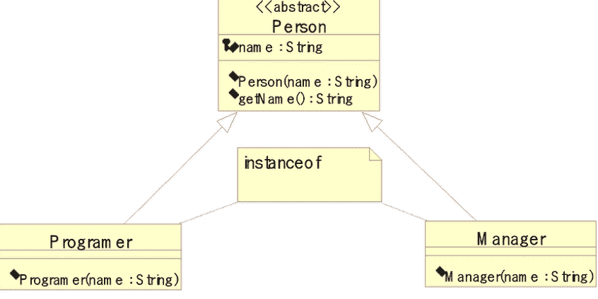

```java
package com.test8;

/**
**/

标题：
为 Oracle 会议导出人员分类信息步骤：
1. 抽象类：`Person` {程序员, 经理}
2. 建立和谐社会，服务人民
*/

public class TestInstance {
    public static void main(String[] args) {
        // 会议可以容纳 1000 人。
        Person[] persons = new Person[1000];

        // 开始注册
        persons[0] = new Programmer("Joseph");
        persons[1] = new Programmer("james");
        persons[2] = new Manager("Page");
        persons[3] = new Manager("Joe");

        // 打印
        for (int i = 0; i < persons.length; i++) {
            if (persons[i] != null) {
                if (persons[i] instanceof Programmer) {
                    System.out.println(persons[i].getName() + " 属于程序员");
                }
                if (persons[i] instanceof Manager) {
                    System.out.println(persons[i].getName() + " 属于经理");
                }
            }
        }
    }
}
```

```java
abstract class Person {
    protected String name;

    public Person(String name) {
        this.name = name;
    }

    public String getName() {
        return this.name;
    }
}
```

```java
class Programmer extends Person {
    public Programmer(String name) {
        super(name);
    }
}
```

```java
class Manager extends Person {
    public Manager(String name) {
        super(name);
    }
}
```

## 输出结果

```
Joseph 属于程序员
james 属于程序员
Page 属于经理
Joe 属于经理
```

## interface

```java
package com.test9;

/**
interface 是一种约定

标题：
步骤：
1. 接口：主席, 总理
2. 建立和谐社会，服务人民
*/

public class TestInterface {
    public static void main(String[] args) {
        System.out.println("开始会议...");
        Governor g1 = new Governor("Governor");
        g1.buildHarmonyCommunity("Education");
        g1.serviceForPeople("Charitable");
    }
}
```

```java
interface ChairMan {
    String name = "ChairMan";
    void buildHarmonyCommunity(String method);
}
```

```java
interface PrimeMinister {
    String name = "PrimeMinister";
    void serviceForPeople(String method);
}
```

```java
class Governor implements ChairMan, PrimeMinister {
    private String name;

    public Governor(String name) {
        this.name = name;
    }

    public void buildHarmonyCommunity(String method) {
        System.out.println(name + " 通过 " + method + "建设和谐社区");
    }

    public void serviceForPeople(String method) {
        System.out.println(name + " 通过" + method + " 服务人民");
    }

    public String getName() {
        return this.name;
    }
}
```

总结：
1. 使用 `interface` 关键字声明接口。
2. 接口中不允许有定义方法的实现。
3. 接口中的方法声明可以省略 `abstract`，抽象类中的方法不能省略。
4. 接口中的方法默认都是 `public` 的。
5. 接口中的属性是静态常量。`static` 关键字不允许使用 `private`、`protected` 修饰符。
6. 实现类必须实现接口中所有的声明方法，就像抽象类一样。
7. 接口不能实例化，必须间接地通过它的实现类，就像抽象类一样。
8. 如果你想实现多个接口，用逗号隔开它们。
9. 接口可以继承多个接口，而抽象类不能。

输出结果：
```
ChairMan
开始会议...
Governor 通过 Education 建设和谐社区
Governor 通过 Charitable 服务人民
```

## final 关键字

```java
package com.test10;

/**
final 关键字：
1. final 关键字修饰的变量是常量，不能被修改。
2. final 关键字修饰的方法，子类不能重写。
3. final 关键字修饰的类不能被继承。
*/

public class TestInstance {
    public static void main(String[] args) {
        // final 关键字修饰的变量是常量，不能被修改。
        final double PI = 3.14;

        // final 关键字修饰的方法，子类不能重写。
        Father f = new Father();
        f.work();

        // final 关键字修饰的类不能被继承。
        Son s = new Son();
        s.study();
    }
}
```

```java
class Father {
    // final 关键字修饰的方法，子类不能重写。
    public final void work() {
        System.out.println("工作");
    }
}

class Son extends Father {
    // final 关键字修饰的类不能被继承。
    public void study() {
        System.out.println("学习");
    }
}
```

## 输出结果

```
3.14
工作
学习
```

## enum


# 枚举类型

```java
package com.test11;

/**
enum: 是一种特殊的常量类型
标题:
在画板上绘制圆
 */
public class TestEnum {
    public static void main(String[] args) {
        // r=5
        Circle red = new Circle(5, Color.RED);
        red.draw();

        // r=10
        Circle green = new Circle(10, Color.GREEN);
        green.draw();

        // r=20
        Circle blue = new Circle(20, Color.BLUE);
        blue.draw();
    }
}

// 定义枚举
enum Color {
    RED, GREEN, BLUE
}

class Circle {
    double r; // 半径
    final double PI = 3.14; // 常量
    Color color; // 

    public Circle(double r, Color color) {
        this.r = r;
        this.color = color;
    }

//计算圆的面积
    public double getArea() {
        return PI * r * r;
    }

//绘制圆
    public void draw() {
        String colorName = "";
        if (color == Color.RED) {
            colorName = "Red";
        }
        if (color == Color.GREEN) {
            colorName = "Green";
        }
        if (color == Color.BLUE) {
            colorName = "Blue";
        }
        System.out.println("绘制圆面积: " + getArea() + " 颜色: " + colorName);
    }
}
```

## 输出结果

```
绘制圆面积: 78.5 颜色: Red
绘制圆面积: 314.0 颜色: Green
绘制圆面积: 1256.0 颜色: Blue
```

# instanceof

```java
package com.test12;

/**
 * 多态：
 * 三种类型：方法重载、方法重写、对象的向上向下转换
 */
```

转换

总结：
1. 子类对象可以转换为父类对象，但子类的属性和方法不可见。
2. 当子类重写父类的方法时，子类转换为父类后执行的是重写后的方法。

```java
public class TestPolymorphism {

    public static void main(String[] args) {

        //向上转换子类的属性和方法不可见。

        Person p = new Student("David");

        p.say();

        //对象向下转型类

        Student s = (Student) p;

        s.say();

        s.study();

    }

}

class Person {

    public void say() {

        System.out.println("人类说话");

    }

}

class Student extends Person {

    private String name;

    public Student(String name) {

        this.name = name;

    }

    public void say() {

        System.out.println("学生说英语");

    }

    public void study() {

        System.out.println("学生学习");

    }

}
```

```java
public void study() {

    System.out.println("study");

}
```

## 输出结果

```
学生说英语
学生说英语
study
```

# 多态示例

## 婴儿

- `name` : String
- `fruit` : Fruit

## 水果

- `name` : String
- `getName()` : String
- `Fruit(name : String)`

## 苹果

- `Apple(name : String)`

## 葡萄

- `Grape(name : String)`

```java
package com.test13;

/**

标题：

孩子吃水果（苹果、葡萄）

步骤：

1. 类：Baby, Fruit (Apple, Grape)

2. 关系：Fruit -> Child (apple, grape) 是水果的分类

3. 属性：Baby (name, fruit 引用)

4. 方法：eat(Fruit fruit)

*/

public class TestPolymorphism {

    public static void main(String[] args) {

        Baby baby = new Baby("Gajia");

        Apple apple = new Apple("Red apple");

        Grape grape = new Grape("Black grape");

        baby.eat(apple);

        System.out.println(baby.getName() + " eat " + baby.getFruit().getName());

        baby.eat(grape);

        System.out.println(grape.getName() + " eat " + grape.getFruit().getName());

    }

}
```

```java
class Baby {

    private Fruit fruit;

    private String name;

    public Baby(String name) {

        this.name = name;

    }

    public String getName() {

        return this.name;

    }

    public Fruit getFruit() {

        return this.fruit;

    }

    public void eat(Fruit fruit) {

        this.fruit = fruit;

    }

}
```

```java
class Fruit {

    private String name;

    public Fruit(String name) {

        this.name = name;

    }

    public String getName() {

        return this.name;

    }

}
```

```java
class Apple extends Fruit {

    public Apple(String name) {

        super(name);

    }

}
```

```java
class Grape extends Fruit {

    public Grape(String name) {

        super(name);

    }

}
```

## 输出结果

```
Gajia eat Red apple
Gajia eat Black grape
```

# 内部类

| 母亲 |
| :--- |
| `name` : String |
| `body` : String |
| `Mother(name : String)` |
| `eat(body : String)` |

| <<内部类>> |
| :--- |
| `Baby` |
| `eat()` |

```java
package com.test14;

/**

标题：

母亲怀孕了，母亲的营养决定婴儿的健康成长

步骤：

1. 类：Mother, Baby

2. 关系：母亲内部的 Baby

3. 方法：母亲吃 (eat)

*/

public class TestInnerClass {

    public static void main(String[] args) {

        Mother mother = new Mother("Lucy");

        mother.eat("Apple");

        //婴儿从苹果中吸收营养

        Mother.Baby baby = mother.new Baby();

        baby.eat();

    }

}
```

```java
class Mother {

    private String name;

    private String food;

    public Mother(String name) {

        this.name = name;

    }

    public void eat(String food) {

        this.food = food;

        System.out.println(this.name + " eat " + this.food);

    }

}

// 孩子是母亲的内部类
class Baby {

    public void eat() {

        System.out.println("Baby absorb nutrients from the mother's " + food);

    }

}
```

## 输出结果

```
Lucy eat Apple
Baby absorb nutrients from the mother's Apple
```

# 静态内部类

| 母亲 |
| :--- |
| `name` : String |
| `body` : String |
| `Mother(name : String)` |
| `eat(body : String)` |

| <<静态内部类>> |
| :--- |
| `Baby` |
| `eat()` |

```java
package com.test15;

/**

标题：

母亲怀孕了，母亲的营养决定婴儿的健康成长

步骤：

1. 类：Mother, Baby

2. 关系：母亲内部的 Baby

3. 方法：母亲吃 (eat)

*/

public class StaticInnerClass {

    public static void main(String[] args) {

    Mother mother = new Mother("Lucy");

    mother.eat("Apple");

    //婴儿从苹果中吸收营养

    Mother.Baby.eat();

    }

}
```

```java
class Mother {

    private String name;

    private static String food;

    public Mother(String name) {

        this.name = name;

    }

    public String getName() {

        return this.name;

    }

    public void setName(String name) {

        this.name = name;

    }

    public void eat(String food) {

        this.food = food;

        System.out.println(this.name + " eat " + this.food);

    }

    // 孩子是母亲的静态内部类
    static class Baby {

        public static void eat() {

            System.out.println("Baby absorb nutrients from the mother's " + food);

        }

    }

}
```

## 输出结果

```
Lucy eat Apple
Baby absorb nutrients from the mother's Apple
```

# 基本数据包装类

```java
package com.test16;

/**

 * 包装类：

 * byte -> Byte

 * short -> Short

 * int -> Integer

 * long -> Long

 * float -> Float

 * double -> Double

 * char -> Character

 * boolean -> Boolean

 */

public class WrapClass {

    public static void main(String[] args) {

    Byte a = 1;

    byte b = 10;

    a = b;

    System.out.println(a.byteValue());

    System.out.println(Integer.valueOf(b));

    // Integer 转 double

    int c = 100;

    Integer d = new Integer(c);

    System.out.println(d.doubleValue());

    // Integer 转 long

    System.out.println(d.longValue());

    // Integer 转字符串

    String str = d.toString();

    }

}
```

## 输出结果

```
1
10
100.0
100
100
```

# 匿名类

```java
package com.test17;

/**

标题：

匿名类

步骤：

1. 接口：Runnable

2. 关系：内联实现 Runnable

3. 方法：run()

*/

public class TestAnonymous {

    public static void main(String[] args) {

        Runnable r = new Runnable() {

            public void run() {

                System.out.println("Running anonymous class");

            }

        };

        r.run();

    }

}
```

```java
interface Runnable {

    void run();

}
```

```java
interface Runnable {

    public void run();

}
```

## 输出结果

```
Running anonymous class
```

# 多线程

```java
}
}
}
```

## 输出结果

```
Main Thread 0
Main Thread 1
Main Thread 2
MyThread 0
Main Thread 3
MyThread 1
Main Thread 4
Main Thread 5
Main Thread 6
Main Thread 7
MyThread 2
Main Thread 8
Main Thread 9
MyThread 3
MyThread 4
MyThread 5
MyThread 6
MyThread 7
MyThread 8
MyThread 9
```

# Runnable

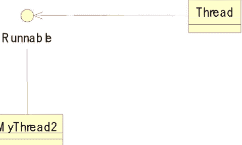

```java
package com.thread;
```

/** 因为 java 是单继承的，为了提高可扩展性，通常使用第二种实现方式 Runnable。 */

```java
public class TestRunnable {

    public static void main(String[] args) {

        MyThread2 t = new MyThread2();

        Thread thread = new Thread("Car thread");

        thread.start(); // 启动线程，run() 将被自动调用

        Thread thread2 = new Thread("Train thread");

        thread2.start(); // 启动线程，run() 将被自动调用

        try {

            for (int i = 0; i < 10; i++) {
```


`System.out.println(Thread.currentThread().getName() + i);`

`Thread.sleep(1000);` // 休睡眠 1 秒 = 1000 毫秒

```
} catch (Exception e) {
    e.printStackTrace();
}
```

```
class MyThread2 implements Runnable {
    @Override
    public void run() {
        try {
            for (int i = 0; i < 10; i++) {
                System.out.println(Thread.currentThread().getName() + i);
                Thread.sleep(1000);
            }
        } catch (Exception e) {
            e.printStackTrace();
        }
    }
}
```

## Output Result:

```
main0
Car thread0
Train thread0
Train thread1
Car thread1
main1
Train thread2
Car thread2
main2
Train thread3
main3
Car thread3
Train thread4
Car thread4
main4
Train thread5
main5
Car thread5
Train thread6
Car thread6
main6
Train thread7
main7
Car thread7
Car thread8
Train thread8
main8
Train thread9
main9
Car thread9
```

## Exception

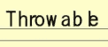

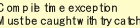

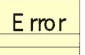

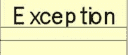

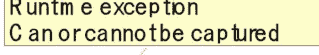

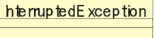

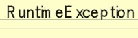

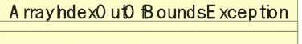

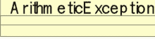

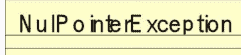

## Runtime exception

```java
public class TestException {
    public static void main(String[] args) {
        // 对于运行时异常，我们可以捕获也可以不捕获
        int[] scores = { 60, 70, 80 };
        // java.lang.ArrayIndexOutOfBoundsException
        try {
            System.out.println(scores[3]);
        } catch (ArrayIndexOutOfBoundsException e) {
            System.out.println("An array out of bounds exception occurred");
        }
    }
}
```

## Output Result:

```
An array out of bounds exception occurred
```

## Compile-time exception

```java
public class TestCompileTimeException {
    public static void main(String[] args) {
        for (int i = 0; i < 5; i++) {
            System.out.println(i);
        }

        // 编译时异常，必须放置在 try-catch 中
        try {
            Thread.sleep(1000); // 休睡眠 1 秒 = 1000 毫秒
        } catch (InterruptedException e) {
            e.printStackTrace();
        }
    }
}
```

## Output Result:

```
0
1
2
```

## finally

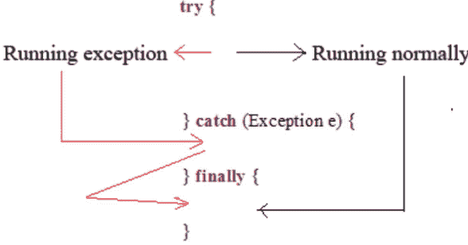

```java
package com.exception;
public class TestFinally {
    public static void main(String[] args) {
        Calculator c = new Calculator();
        c.div(10, 2); // 正常运行
        // c.div(10, 0); // 运行异常
        System.out.println("div finished execution");
    }
}

class Calculator {
    public int div(int a, int b) {
        int result = 0; // 局部变量需要赋值
        try {
            // 在 try catch 中定义的局部变量无法从外部访问
            // 当 try 中发生异常执行时，
            result = a / b;
            System.out.println("Result: " + result);
        } catch (Exception e) {
            System.out.println("Divisor cannot be zero");
        } finally {
            System.out.println("div finished execution");
        }
    }
}
```

## Output Result:

```
Result: 2
div finished execution
```

## String assignment and comparison

```java
package com.str;
public class TestEquals {
    public static void main(String[] args) {
        String str = "hello";
        String str1 = "hello";
        String str2 = "Hello";
        System.out.println(str.equals(str1));
        System.out.println(str.equals(str2));
        System.out.println(str.equalsIgnoreCase(str2));
    }
}
```

## Output Result:

```
true
false
true
```

## String judgment operation

| Method | Description |
|---|---|
| `equals(Object obj)` | 比较字符串的相等性 |
| `equalsIgnoreCase(String str)` | 忽略大小写的比较 |
| `compareTo(String str)` | 比较两个字符串的大小 |
| `compareIgnoreCase(String str)` | 忽略大小写比较大小 |
| `startsWith(String prefix)` | 判断是否以指定的前缀开头 |
| `endsWith(String suffix)` | 判断是否以指定的后缀结尾 |

```java
package com.str;
/**
 * 1. 比较字符串时，字母是根据第一个字母的 ASCII 码进行比较，然后逐个比较后续字母。
 * 2. 如果前面的字符相同，则通过长度来比较大小。
 */
public class TestStringCompare {
    public static void main(String[] args) {
        String str1 = "hello";
        String str2 = "hello";
        String str3 = "Hello";
        System.out.println(str1.compareTo(str2));
        System.out.println(str1.compareTo(str3));

        String str4 = "hallow";
        System.out.println(str1 = "hello");
        System.out.println(str1.compareTo(str4));
        System.out.println(str1.compareToIgnoreCase(str3));

        String str = "Children's songs";
        System.out.println(str.startsWith("Children"));

        String fileName = "c:/media/amazing.mp3";
        System.out.println(fileName.endsWith(".mp3"));
    }
}
```

## 字符串替换

| String |
| :--- |
| `replace(oldChar:char, newChar :char) : String` |
| `replaceFirst(regex : String, replacement : String) : String` |

```java
package com.str;

/**
1. String replace(char oldChar,char newChar) //用新字符替换旧字符
2. String replaceFirst(String regex,String replacement); //替换第一个符合条件的字符串
*/
public class TestStringReplace {
    public static void main(String[] args) {
        String article = "The dog run under the gardenland";
        System.out.println(article);

        article = article.replace("dog", "horses");
        System.out.println(article);

        article = article.replaceFirst("gardenland", "grassland");
        System.out.println(article);
    }
}
```

输出结果：

```
The dog run under the gardenland
The horses run under the gardenland
The horses run under the grassland
```

## 字符串搜索与切片

| String |
| :--- |
| `substring(beginindex : int) : String` |
| `indexOf(char) : int` |
| `lastIndexOf(char) : int` |

```java
package com.str;

/**
1. String substring(int beginIndex) 从 beginIndex 索引处截取的字符串
2. int indexOf(char ch) 从头开始查找字符 ch 在字符串中的索引位置，如果未找到返回 -1
3. int lastIndexOf(char ch) 从尾开始查找字符 ch 在字符串中的索引位置，如果未找到返回 -1
 */
import java.util.Scanner;

public class TestStringSub {
    public static void main(String[] args) {
    //键盘输入文件地址，截取文件名和扩展名
    System.out.println("Please enter the address of the file...");
    Scanner in = new Scanner(System.in);
    String filePath = in.nextLine();

    filePath = filePath.trim();//去除前后的空格

    //截取文件扩展名
    String fileExtension = filePath.substring(filePath.indexOf('.'));
    System.out.println(fileExtension);

    //判断文件是否仅为 .png, .gif, .jpg 格式
    String checks = ".png .gif .jpg";
    fileExtension = fileExtension.toLowerCase();
    if (!checks.contains(fileExtension)) {
        System.out.println("You are not entering an image file");
    }

    //截取文件名
    String fileName = filePath.substring(filePath.lastIndexOf('\\') + 1);
    System.out.println(fileName);
    }
}
```

## 输出结果：

```
Please enter the address of the file...
e:\book\music.mp3
.mp3
You are not entering an image file
music.mp3
```

## 字符串分割

| String |
| :--- |
| `split(regex : String) : String[]` |

```java
package com.str;

/**
 * 1. String[] split(String regex) 使用正则表达式将字符串分割为数组
 */
import java.util.Scanner;

public class TestStringSplit {
    public static void main(String[] args) {
        //输入学生的语言、数学和物理成绩，用分号
        semicolon;
        System.out.println("Please enter the student name...");
        Scanner in = new Scanner(System.in);
        String name = in.nextLine();

        System.out.println("Enter a student's language, mathematics, and physics scores separated by ;");
        String scores = in.nextLine();
        //用分号分割学生成绩
        String[] scoreArray = scores.split(":");

        System.out.println(name + " language=" + scoreArray[0] + " " + mathematics=" + scoreArray[1] + " physics=" + scoreArray[2]);
    }
}
```

## 输出结果：

```
Please enter the student name...
Grace
Enter a student's language, mathematics, and physics scores separated by ;
100;98;95
Grace language=100 mathematics=98 physics=95
```

## StringBuffer and StringBuilder


# StringBuffer、StringBuilder 与常用类

## StringBuffer 与 StringBuilder

```java
package com.str;
/**
* StringBuffer StringBuilder 通常用于连接大量字符串时
* StringBuffer 是线程安全的
* StringBuilder 线程是不安全的
*/
public class TestBufferStringStringBuilder {
    public static void main(String[] args) {
        String str = "";
        StringBuilder strBuffer = new StringBuilder();
        for (int i = 0; i < 10; i++) {
            str += i + "";
            strBuffer.append(i).append(",");
        }
        System.out.println(strBuffer.toString());

        //1. String append
        StringBuilder buffer = new StringBuilder();
        buffer.append("How");
        buffer.append(" you");
        System.out.println(buffer.toString());

        //2. 字符串替换
        buffer.replace(4, 9, "you");
        System.out.println(buffer.toString());

        //3. 在索引 3 之后插入 "are"
        buffer.insert(3, " are");
        System.out.println(buffer.toString());

        //4. 字符串切片
        System.out.println(buffer.substring(0, 4));
    }
}
```

### 输出结果

```
0,1,2,3,4,5,6,7,8,9,
How you
How you
How are you
How
```

## 数组

```java
package com.test18;
import java.util.Arrays;
public class TestArrays {
    public static void main(String[] args) {
        int[] arr = { 1, 4, 3, 7, 5, 6 };
        Arrays.sort(arr);
        System.out.println(Arrays.toString(arr));

        // 在已排序数组中查找指定值
        System.out.println(Arrays.binarySearch(arr, 4));
    }
}
```

### 输出结果

```
[1, 3, 4, 5, 6, 7]
2
```

## 日历

```java
package com.test18;

import java.util.Calendar;
import java.util.GregorianCalendar;

public class TestCalendar {
    public static void main(String[] args) {
        Calendar c = new GregorianCalendar();
        //输出年、月、日、时、分
        System.out.println(c.get(Calendar.YEAR));
        // 历历从1月从0开始，所以加 1
        System.out.println(c.get(Calendar.MONTH) + 1);
        System.out.println(c.get(Calendar.DATE));
        System.out.println(c.get(Calendar.HOUR));
        System.out.println(c.get(Calendar.MINUTE));
        System.out.println(c.get(Calendar.SECOND));
        System.out.println(c.get(Calendar.MILLISECOND));

        //获取当前日期
        System.out.println(DateTime.getDate());
        //获取当前时间
        System.out.println(DateTime.getTime());
        //获取当前时间戳
        System.out.println(DateTime.getTimestamp());
    }
}

class DateTime {

    public static String getDate() {
        Calendar c = new GregorianCalendar();
        StringBuffer buffer = new StringBuilder();
        buffer.append(addZero(c.get(Calendar.MONTH) + 1)).append("--");
        buffer.append(addZero(c.get(Calendar.DATE))).append("--");
        buffer.append(c.get(Calendar.YEAR));
        return buffer.toString();
    }

    public static String getTime() {
        Calendar c = new GregorianCalendar();
        StringBuffer buffer = new StringBuffer();
        buffer.append(addZero(c.get(Calendar.MONTH) + 1)).append("--");
        buffer.append(addZero(c.get(Calendar.DATE))).append("--");
        buffer.append(addZero(c.get(Calendar.YEAR))).append(":-");
        buffer.append(addZero(c.get(Calendar.HOUR))).append(":-");
        buffer.append(addZero(c.get(Calendar.MINUTE))).append(":-");
        buffer.append(addZero(c.get(Calendar.SECOND))).append(":-");
        return buffer.toString();
    }

    public static long getTimeStamp() {
        Calendar c = new GregorianCalendar();
        return c.getTime().getTime();
    }

    //如果月、日、时、分、秒小于 10，在前面加 0
    public static String addZero(int value) {
        String str = Integer.toString(value);
        if (str.length() < 2)
            return "0" + str;
        return str;
    }
}
```

### 输出结果

```
2019
3
27
11
4
58
163
03-27-2019
03-27-2019 11:04:58
1553706298165
```

## Date

```java
package com.test20;
import java.util.Date;
import java.text.SimpleDateFormat;

public class DateTest {
    public static void main(String[] args) {
        //获取系统的当前日期
        Date date = new Date();
        System.out.println(date);

        //获取当前时间戳
        System.out.println(date.getTime());

        //获取当前时间
        System.out.println(CDate.getCurrentDateTime());

        System.out.println(CDate.stringToDate("12-12-2019 00:00:00"));
    }
}
class CDate {
    public static String getCurrentDateTime() {
        Date date = new Date();
        //日期格式化
        SimpleDateFormat df = new SimpleDateFormat("MM-dd-yyyy HH:mm:ss");
        String dateStr = df.format(date).toString();
        return dateStr;
    }

    public static Date stringToDate(String dateStr) {
        SimpleDateFormat df = new SimpleDateFormat("MM-dd-yyyy HH:mm:ss");
        return df.parse(dateStr);
    }
}
```

```java
SimpleDateFormat df = new SimpleDateFormat("MM-dd-yyyy\nHH:mm:ss");
  String dateStr = df.format(date).toString();
  return dateStr;
}
```

```java
public static Date stringTo(String dateStr) {
  try {
    SimpleDateFormat df = new SimpleDateFormat("MM-dd-yyyy\nHH:mm:ss");
    return df.parse(dateStr);
  } catch (Exception e) {
    e.printStackTrace();
    return null;
  }
}
```

## Math

```java
package com.test20;

public class TestMath {
  public static void main(String[] args) {
    // 绝对值
    System.out.println(Math.abs(-2));

    // 大于小数的最小整数
    System.out.println(Math.ceil(1.6));
    System.out.println(Math.ceil(1.1));

    // 小于小数的最大整数
    System.out.println(Math.floor(1.6));
    System.out.println(Math.floor(1.1));
  }
```

```java
// 小数部分四舍五入
System.out.println(Math.round(1.6));
System.out.println(Math.round(1.1));

// 两个数之间的最大值
System.out.println(Math.max(1, 2));
// 两个数之间的最小值
System.out.println(Math.min(1, 2));

// 生成 0.0 到 1.0 之间的随机数
System.out.println(Math.random());
}
```

### 输出结果

```
2
2.0
2.0
1.0
1.0
2
1
2
0.36441889007455386
```

## Comparable

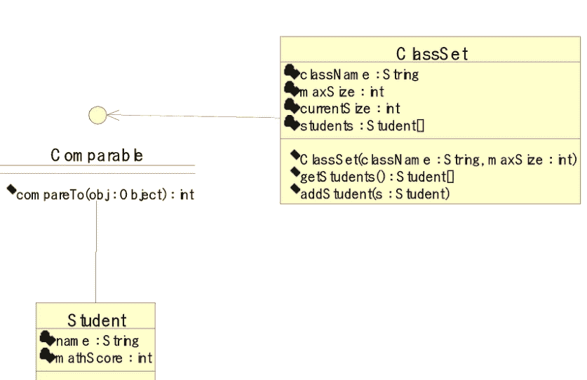

```java
package com.test20;

/**
 *标题:
按照数学成绩从小到大对班级学生进行排序
步骤:
1. 类：
1.1 班级 (ClassSet)
1.2 学生 (Student)
2. 关系：
2.1 学生属于班级 -> ClassSet (多对一)
3. 属性：
3.1 ClassSet (name, size)
3.2 Student (name, score)
4. 方法：
4.1 ClassSet{addStudent(Student s)}
4.2 ClassSet{sortScore()}
 */
```

```java
import java.util.Arrays;

public class TestComparable {

    public static void main(String[] args) {

        ClassSet c = new HashSet("HighClass", 4);

        c.addStudent(new Student("Lida", 90));

        c.addStudent(new Student("Mathew", 80));

        c.addStudent(new Student("Timothy", 95));

        c.addStudent(new Student("John", 70));

        Student[] students = c.getStudents();

        for (Student s : students) {

            if (s != null) {

                System.out.println(s.getName() + "," + s.getMathScore());

            }

        }

        System.out.println("\n按学生成绩排序");

        Arrays.sort(students);

        for (Student s : students) {

            if (s != null) {

                System.out.println(s.getName() + "," + s.getMathScore());

            }

        }

    }

}
```

```java
class ClassSet {

    private String className;

    private int maxSize;

    private int currentSize;

    private Student[] students;//所有学生的数组

    public ClassSet(String className, int maxSize) {

        this.className = className;

        this.maxSize = maxSize;

        students = new Student[maxSize];

    }
```

```java
public Student[] getStudents() {

  return this.students;

}
```

```java
public void addStudent(Student s) {

  for (int i = 0; i < students.length; i++) {

    if (students[i] == null) {

      students[i] = s;

      currentSize++;

      break;

    }

  }

}
```

```java
class Student implements Comparable {

  private String name;

  private int mathScore;

  public Student(String name, int mathScore) {

    this.name = name;

    this.mathScore = mathScore;

  }

  public String getName() {

    return this.name;

  }

  public int getMathScore() {

    return this.mathScore;

  }

}
```

```java
/**
 * 实现 Comparable 以重写 compareTo(T o)
 * 如果从小到大排序
 * 大于返回 1
 * 小于返回 -1
 * 等于返回 0
 */
```

如果从大到小排序
大于返回 -1
小于返回 1
等于返回 0

```java
public int compareTo(Object obj) {

  if (obj instanceof Student) {

    Student s = (Student) obj;
```


## 学生成绩排序示例

输入数据：

```
Lida,90
Mathew,80
Timothy,95
John,70
```

按学生成绩排序后：

```
John,70
Mathew,80
Lida,90
Timothy,95
```

## Comparator

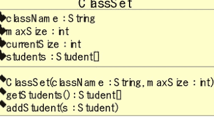

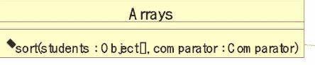

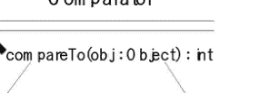

| 学生升序比较器 | 学生降序比较器 |

```java
package com.test21;

/**
 * 标题:
 * 按照数学成绩从小到大对班级学生进行排序
 *
 * 步骤:
 * 1. 类：
 *   1.1 班级 (ClassSet)
 *   1.2 学生 (Student)
 * 2. 关系：
 *   2.1 学生属于班级 -> ClassSet (多对一)
 * 3. 属性：
 *   3.1 ClassSet (name, size)
 *   3.2 Student (name, score)
 * 4. 方法：
 *   4.1 ClassSet{addStudent(Student s)}
 *   4.2 ClassSet{sortScore()}
 */
```

```java
Random rn = new Random();
for (int i = 0; i < 10; i++) {
    System.out.println(rn.nextInt(10));
}
```

输出结果：

```
0
8
1
5
1
0
8
5
0
0
```

## Timer TimerTask

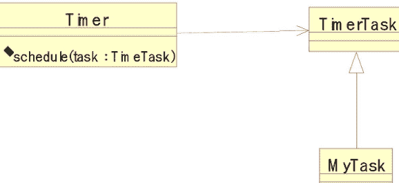

```java
package com.test21;

import java.text.SimpleDateFormat;
import java.util.Date;
import java.util.Timer;
import java.util.TimerTask;

public class TestTimer {
    private Timer timer;

    public TestTimer() {
        timer = new Timer();
        // 每1秒显示一次当前时间
        timer.schedule(new MyTask(), new Date(), 1000);
    }

    class MyTask extends TimerTask {
        public void run() {
            // 打印当前日期时间
            SimpleDateFormat df = new SimpleDateFormat("MM-dd-yyyy HH:mm:ss");
            System.out.println(df.format(new Date()));
        }
    }

    public static void main(String[] args) {
        new TestTimer();
    }
}
```

输出结果：

```
03-27-2019 23:47:35
03-27-2019 23:47:36
03-27-2019 23:47:37
03-27-2019 23:47:38
```

## List and ArrayList


Collection

List

| ArrayList |
| :--- |
| `add(e : Object) : boolean` |
| `get(index : int) : Object` |
| `size() : int` |
| `contains(obj : Object) : boolean` |
| `isEmpty() : boolean` |

- 1. `ArrayList` 按照先进先出的顺序。
- 2. `ArrayList` 可以添加重复元素。
- 3. `ArrayList` 也可以添加 `null` 值。
- 4. `ArrayList` 内部实现为对象数组。

```java
/**
 * 1. ArrayList 按照先进先出的顺序。
 * 2. ArrayList 可以添加重复元素
 * 3. ArrayList 也可以添加 null 值
 * 4. ArrayList 内部实现为对象数组
 */
package com.test21;

import java.util.ArrayList;
import java.util.List;

public class TestArrayList {
    public static void main(String[] args) {
        List list = new ArrayList();
        list.add(1);
        list.add(1);
        list.add(null);
        list.add(2.5);
        list.add(true);
        list.add("David");
        list.add('A');
        list.add(new Cat("Persian Cat"));

        Object david = list.get(3);
        System.out.println("get(3): " + david);

        System.out.println("size: " + list.size());

        System.out.println("contains david: " + list.contains("David"));

        System.out.println("isEmpty: " + list.isEmpty());

        list.set(4, 'B');
        System.out.println("get(4): " + list.get(4));

        // 打印 list 的所有元素
        for (int i = 0; i < list.size(); i++) {
            Object obj = list.get(i);
            System.out.print(obj + ", ");
        }

        list.remove(4);
        System.out.println("\nremove(4) ---------------");
        for (int i = 0; i < list.size(); i++) {
            Object obj = list.get(i);
            System.out.print(obj + ", ");
        }

        list.clear();
        System.out.println("\nclear ---------------");
        System.out.println(list.size());
        System.out.println(list.isEmpty());

        for (int i = 0; i < list.size(); i++) {
            Object obj = list.get(i);
            System.out.print(obj + ", ");
        }
    }
}

class Cat {
    private String name;

    public Cat(String name) {
        this.name = name;
    }

    public String getName() {
        return name;
    }

    public void setName(String name) {
        this.name = name;
    }

    public String toString() {
        return name;
    }
}
```

输出结果：

```
get(3): 2.5
size: 8
contains david: true
isEmpty: false
get(4): B
1, null, 2.5, David, A, Persian Cat, 
remove(4) ----------------
1, null, 2.5, David, A, Persian Cat, 
clear() --------------------
```

## LinkedList

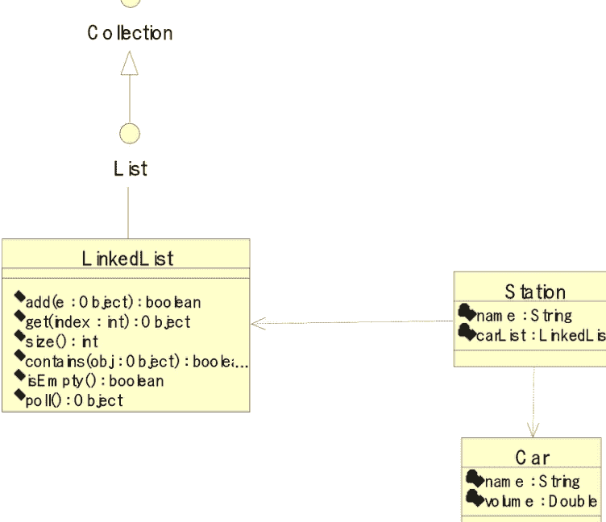

```java
package com.test21;

import java.util.LinkedList;
import java.util.List;

/**
 * Title: LinkedList 内部实现为对象数组。
 * LinkedList 按照先进先出的顺序进入。
 */
public class TestLinkedList {
    public static void main(String[] args) {
        List<String> list = new LinkedList<>();
        list.add("Berkeley");
        list.add("Stanford");
        list.add("MIT");

        System.out.println("List size: " + list.size());
        System.out.println("First element: " + list.get(0));
        System.out.println("Last element: " + list.get(list.size() - 1));

        System.out.println("All elements:");
        for (String s : list) {
            System.out.print(s + " ");
        }
        System.out.println();

        list.removeFirst(); // 移除第一个元素
        System.out.println("\nAfter removeFirst():");
        for (int i = 0; i < list.size(); i++) {
            System.out.print(list.get(i) + " ");
        }
        System.out.println();

        list.addLast("Harvard"); // 在最后添加元素
        System.out.println("\nAfter addLast(Harvard):");
        for (int i = 0; i < list.size(); i++) {
            System.out.print(list.get(i) + " ");
        }
        System.out.println();

        list.clear(); // 清空列表
        System.out.println("\nAfter clear(), size: " + list.size());
    }
}
```

输出结果：

```
List size: 3
First element: Berkeley
Last element: MIT
All elements:
Berkeley Stanford MIT 
After removeFirst():
Stanford MIT 
After addLast(Harvard):
Stanford MIT Harvard 
After clear(), size: 0
```

```java
public String getName() {
    return name;
}

public void setName(String name) {
    this.name = name;
}
```

输出结果：

```
变形钢，狮子王，加勒比比海，
枚举----------------------------
变形钢，狮子王，加勒比比海，
```

## 集合 (Collections)

| 集合 |
| :--- |
| `sort(comparable : Comparable)` |
| `Comparable` |
| `compareTo(o : Object) : int` |

**产品**

标题：按价格对商户的产品进行排序

```java
package com.test22;

import java.util.ArrayList;
import java.util.Collections;
import java.util.Comparator;
import java.util.List;

public class TestCollections {
    public static void main(String[] args) {
        List<Product> list = new ArrayList<>();
        list.add(new Product("ASUS Computer", 400));
        list.add(new Product("Toshiba computer", 350));
        list.add(new Product("Lenovo", 500));

        for (int i = 0; i < list.size(); i++) {
            Product p = (Product) list.get(i);
            System.out.println(p.getName() + " " + p.getPrice());
        }

        Collections.sort(list);
        System.out.println("After sorting result:");
        for (int i = 0; i < list.size(); i++) {
            Product p = (Product) list.get(i);
            System.out.println(p.getName() + " " + p.getPrice());
        }
    }
}

class Product implements Comparable<Product> {
    private String name;
    private double price;

    public Product(String name, double price) {
        this.name = name;
        this.price = price;
    }

    public String getName() {
        return name;
    }

    public void setName(String name) {
        this.name = name;
    }

    public double getPrice() {
        return price;
    }

    public void setPrice(double price) {
        this.price = price;
    }

    @Override
    public int compareTo(Object o) {
        Product p = (Product) o;
        if (this.price < p.getPrice()) {
            return 1;
        } else if (this.price > p.getPrice()) {
            return -1;
        }
        return 0;
    }
}
```

输出结果：

```
ASUS Computer, 400.0
Toshiba computer, 350.0
Lenovo, 500.0
排序后的结果:----------------------------
Lenovo, 500.0
ASUS Computer, 400.0
Toshiba computer, 350.0
```

## Set TreeSet

| HashSet |
| :--- |
| `add(obj : object) : boolean` |
| `get(index : int) : object` |
| `size() : int` |
| `contains(obj : object) : boolean` |
| `isEmpty() : boolean` |


# `iterator()` : `iterator`

```java
public class TestHashSet {
    public static void main(String[] args) {
        Set<Ticket> set = new HashSet<>();
        set.add(new Ticket("The Matrix", 300));
        set.add(new Ticket("Beautiful Soul", 100));
        set.add(new Ticket("Forrest Gump", 200));
        set.add(new Ticket("Firemen", 200));

        Iterator iter = set.iterator();
        while (iter.hasNext()) {
            Object obj = iter.next();
            System.out.println(obj + " ");
        }
    }
}

class Ticket {
    private String name;
    private double price;

    public Ticket(String name, double price) {
        this.name = name;
        this.price = price;
    }

    public String getName() {
        return name;
    }

    public void setName(String name) {
        this.name = name;
    }

    public double getPrice() {
        return price;
    }

    public void setPrice(double price) {
        this.price = price;
    }

    public String toString() {
        return name + " " + price;
    }
}
```

输出结果:

`Beautiful Soul, 100.0,`

`Firemen, 200.0,`

`The Matrix, 300.0,`

`Forrest Gump, 200.0,`

## `Map`、`HashMap`、`Hashtable`

`Hashtable` // 线程安全

`HashMap` // 线程不安全

```java
package com.test22;

import java.util.HashMap;
import java.util.Hashtable;
import java.util.Iterator;
import java.util.Map;
import java.util.Set;

public class TestHashMap {
    public static void main(String[] args) {
        Map<String, User> map = new HashMap<>();
        map.put("grace", new User("Grace", "111111"));
        map.put("renia", new User("Renia", "222222"));
        map.put("david", new User("David", "333333"));

        Set<Map.Entry> set = map.entrySet();
        Iterator iter = set.iterator();
        while (iter.hasNext()) {
            Map.Entry entry = (Map.Entry) iter.next();
            Object key = entry.getKey();
            Object value = entry.getValue();
            User user = (User) value;
            System.out.println(user.getUsername() + " " + key);
        }
    }
}

class User {
    private String username;
    private String password;

    public User(String username, String password) {
        this.username = username;
        this.password = password;
    }

    public String getUsername() {
        return username;
    }

    public void setUsername(String username) {
        this.username = username;
    }
}
```

## 输出结果:

`Grace 111111`

`Renia 222222`

`David 333333`

## `Map` 用户示例

主题：键值对，每当用户被添加到 `Map` 中时，记录已登录的用户名。

```java
package com.test22;

import java.util.HashMap;
import java.util.Iterator;
import java.util.Map;
import java.util.Set;
import java.util.Scanner;

public class TestMap {
    private boolean flag = true;
    Map<String, String> map = new HashMap<>();
    private String currentUser;

    public void TestMap() {
        Scanner in = new Scanner(System.in);
        while (flag) {
            System.out.println("请输入：1: 登录 2: 打印在线信息 3: 退出");
            String action = in.nextLine();
            if ("1".equals(action)) {
                String[] strs = action.split(":");
                String username = strs[0];
                String password = strs[1];
                map.put(username, password);
            } else if ("2".equals(action)) {
                System.out.println("在线用户 ");
                Set<String> set = map.keySet();
                Iterator iter = set.iterator();
                while (iter.hasNext()) {
                    System.out.println(iter.next());
                }
            } else if ("3".equals(action)) {
                System.out.println("当前信息");
                String password = map.get(currentUser).toString();
                System.out.println(currentUser + "=" + password);
            } else if ("-1".equals(action)) {
                flag = false;
            }
        }
    }
}
```

```java
import java.util.ArrayList;
import java.util.HashMap;
import java.util.Iterator;
import java.util.List;
import java.util.Map;
import java.util.Map.Entry;
import java.util.Set;

public class TestGeneric {
    public static void main(String[] args) {
        Person<String> p = new Person<>("Grace", "30");
        List<String> list = new ArrayList<String>();
        list.add("1");
        list.add("David");
        Map<String, String> map = new HashMap<String, String>();
        map.put("1", "100");
        map.put("John", "Baggage");
        Set<Entry<String, String>> entrySet = map.entrySet();
        Iterator<Entry<String, String>> iter = entrySet.iterator();
        while (iter.hasNext()) {
            Entry<String, String> entry = iter.next();
            System.out.println(entry.getKey() + " = " + entry.getValue());
        }
    }
}

// 泛型：目的是用于传递各种数据类型
class Person<T> {
    private String name;
    private T age;

    public Person(String name, T age) {
        this.name = name;
        this.age = age;
    }

    public String getName() {
        return name;
    }

    public void setName(String name) {
        this.name = name;
    }

    public T getAge() {
        return age;
    }

    public void setAge(T age) {
        this.age = age;
    }
}
```

## 输出结果:

| 1 | 100 |
| John | Baggage |

## 泛型租用示例

| 公司 | 房屋 |
| :--- | :--- |
| 名称 : `String` | 所有者 : `String` |
| 房屋列表 : `List<House>` | 价格 : `Double` |
| `add(House)` | 描述 : `String` |
| `updateByOwner(House)` : `boolean` | |
| `findByOwner(String)` : `House` | |
| `deleteByOwner(String)` : `boolean` | |

房地产公司对租赁房屋的管理（信息：所有者、价格、描述）

1. 添加房屋
2. 列出所有关于房屋的所有信息
3. 根据所有者名称修改房屋
4. 根据所有者名称搜索房屋
5. 根据所有者名称删除房屋

```java
package com.test2;

import java.util.ArrayList;
import java.util.List;

public class TestHouse {
    public static void main(String[] args) {
        Company company = new Company("房地产中介公司");
        List<House> student1 = new ArrayList<>();
        company.add(new House("Faith", 1500, "单间"));
        company.add(new House("Danie", 3000, "一室"));
        company.add(new House("Mathew", 4000, "两室"));

        // 根据所有者名称修改房屋
        company.updateByOwner(new House("Mathew", 4500, "两室"));

        // 根据所有者名称搜索房屋
        House house = company.findByOwner("Danie");
        if (house != null) {
            System.out.println("Danie的房屋信息:" + house.getOwner() + "," + house.getPrice() + "," + house.getDescription());
        }

        // 根据所有者名称删除房屋
        company.deleteByOwner("Faith");

        // 列出所有关于房屋的所有信息
        List<House> houseList = company.getHouseList();
        for (int i = 0; i < houseList.size(); i++) {
            House h = houseList.get(i);
            System.out.println(h.getOwner() + "," + h.getPrice() + "," + h.getDescription());
        }
    }
}

class House {
    private String owner;
    private double price;
    private String description;

    public House(String owner, double price, String description) {
        this.owner = owner;
        this.price = price;
        this.description = description;
    }

    public String getOwner() {
        return owner;
    }

    public void setOwner(String owner) {
        this.owner = owner;
    }

    public double getPrice() {
        return price;
    }

    public void setPrice(double price) {
        this.price = price;
    }

    public String getDescription() {
        return description;
    }

    public void setDescription(String description) {
        this.description = description;
    }
}

class Company {
    private String name;
    private List<House> houseList;

    public Company(String name) {
        this.name = name;
        this.houseList = new ArrayList<House>();
    }

    // 1. 添加房屋
    public void add(House h) {
        houseList.add(h);
    }

    // 2. 列出所有关于房屋的所有信息
    public List<House> getHouseList() {
        return houseList;
    }

    // 3. 根据所有者名称修改房屋
    public boolean updateByOwner(House h) {
        for (int i = 0; i < houseList.size(); i++) {
            House house = houseList.get(i);


## 文件操作

### 代码示例

```java
if (house.getOwner().equals(h.getOwner())) {
    houseList.set(i, h);
    return true;
}
return false;
```

### 4. 根据所有者名称搜索房屋

```java
public House findByOwner(String owner) {
    for (int i = 0; i < houseList.size(); i++) {
        House h = houseList.get(i);
        if (h.getOwner().equals(owner)) {
            return h;
        }
    }
    return null;
}
```

### 5. 根据所有者名称删除房屋

```java
public boolean deleteByOwner(String owner) {
    for (int i = 0; i < houseList.size(); i++) {
        House h = houseList.get(i);
        if (h.getOwner().equals(owner)) {
            houseList.remove(i);
            return true;
        }
    }
    return false;
}
```

## 输出结果

```
CLASS1 学生信息:
David,10
Grace,11

CLASS2 学生信息:
Luke,9
Sala,11
```

## 文件

```java
package com.test23;

import java.io.File;
import java.io.IOException;

public class TestFile {
    public static void main(String[] args) {
        File f = new File("test.txt");
        try {
            // 如果文件不存在，则创建一个新的空文件
            f.createNewFile();
            // 获取文件的绝对路径
            System.out.println(f.getAbsolutePath());
            // 获取文件名
            System.out.println(f.getName());
            // 获取文件中内容的大小
            System.out.println(f.length());
            // 重命名文件
            f.renameTo(new File("rename.txt"));
            // 判断是否为文件
            System.out.println(f.isFile());
            // 判断此文件是否存在
            System.out.println(f.exists());
            // 删除文件
            System.out.println(f.delete());
        } catch (IOException ex) {
            ex.printStackTrace();
        }
    }
}
```

## 输出结果

```
E:\Workspace\test.txt
test.txt
0
false
false
false
```

## 文件与文件夹

```java
package com.test.23;

import java.io.File;

public class TestDirectory {
    public static void main(String[] args) {
        File dir = new File("dir2/test"); // File也可以表示目录
        dir.mkdir(); // 创建目录
        dir.mkdirs(); // 可以创建多级目录
        System.out.println(dir.getAbsolutePath()); // 获取目录的绝对路径
        System.out.println(dir.getName()); // 获取目录的名字
        dir.renameTo(new File("dir2/newtest")); // 重命名目录
        // 判断是否为目录
        System.out.println(dir.isDirectory());
        // 判断文件或目录是否存在
        System.out.println(dir.exists());
        // 只能删除空目录
        File dir3 = new File("dir");
        dir3.delete();
        File dir4 = new File("dir2");
        dir4.delete();
    }
}
```

## 输出结果

```
E:\Workspace\dir2\test
test
false
false
```

## FileInputStream 读取文件

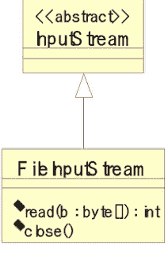

1. 创建一个文本文件

`C:/Users/tim/Desktop/english.txt`

```
every day is good day
```

2. `FileInputStream` 读取 `english.txt`

```java
package com.test23;

import java.io.*;

public class TestInputStream {
    public static void main(String[] args) {
        InputStream is = null;
        try {
            // 建立与 english.txt 的连接
            is = new FileInputStream("C:/Users/tim/Desktop/english.txt");
            // 读取数据
            byte[] data = new byte[1024];
            // 将文件中的所有数据读到数据数组中
            is.read(data);
            System.out.println(new String(data));
        } catch (Exception e) {
            e.printStackTrace();
        } finally {
            // 关闭文件
            try {
                is.close();
            } catch (IOException e) {
                e.printStackTrace();
            }
        }
    }
}
```

## 输出结果

```
every day is good day
```

## FileOutputStream 写入文件

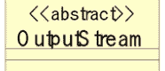

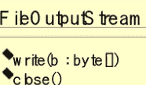

```java
package com.test23;

import java.io.*;

public class TestOutputStream {
    public static void main(String[] args) {
        OutputStream os = null;
        try {
            os = new FileOutputStream(new File("c:/res/test.txt")); // 文件路径
            // 目录必须存在
            // 将数据写入文件
            String content = "good morning";
            byte[] data = content.getBytes();
            os.write(data);
        } catch (Exception e) {
            e.printStackTrace();
        } finally {
            // 关闭输出流
            try {
                os.close();
            } catch (IOException e) {
                e.printStackTrace();
            }
        }
    }
}
```

## FileWriter 写入字符

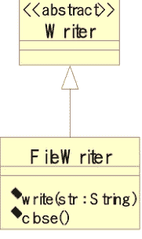

```java
package com.test23;

import java.io.*;

public class TestFileWriter {
    public static void main(String[] args) {
        Writer writer = null;
        try {
            writer = new FileWriter(new File("C:/Users/tim/Desktop/english.txt"));
            // 目录必须存在
            // 将数据写入文件
            String content = "good morning";
            writer.write(content);
        } catch (Exception e) {
            e.printStackTrace();
        } finally {
            // 关闭输出流
            try {
                writer.close();
            } catch (IOException e) {
                e.printStackTrace();
            }
        }
    }
}
```

## FileReader 以字符形式读取

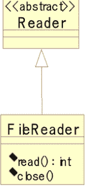

1. 创建一个文本文件

2. `FileReader` 读取

```java
package com.test23;

import java.io.*;

public class TestFileReader {
    public static void main(String[] args) {
        Reader reader = null;
        try {
            // 建立与 english.txt 的连接
            reader = new FileReader("C:/Users/tim/Desktop/english.txt");
            // 读取数据
            int i;
            while ((i = reader.read()) != -1) {
                System.out.print((char) i);
            }
        } catch (Exception e) {
            e.printStackTrace();
        } finally {
            // 关闭文件
            try {
                reader.close();
            } catch (IOException e) {
                e.printStackTrace();
            }
        }
    }
}
```

## 网络编程

### 读取输入流

```java
InputStream is = socket.getInputStream();
byte[] b = new byte[1024];
int l = is.read(b);
String message = new String(b, 0, l);
System.out.println(message);
```

### 发送输出流

```java
PrintWriter pw = new PrintWriter(socket.getOutputStream(), true);
pw.println("<h1>hello</h1>");
```

### 异常处理

```java
} catch (IOException e) {
    e.printStackTrace();
}
```

## 1. 客户端

```java
package com.tcp;

import java.io.BufferedReader;
import java.io.IOException;
import java.io.InputStream;
import java.io.PrintWriter;
import java.net.Socket;
import java.net.UnknownHostException;

public class IE {
    public static void main(String[] args) throws Exception {
        Socket socket = new Socket("localhost", 8888);
        PrintWriter pw = new PrintWriter(socket.getOutputStream(), true);
        pw.println("GET /1.html /HTTP/1.1");
        pw.println("Accept: */*");
        pw.println("Host: localhost:8888");
        pw.println("Connection: Keep-Alive");
        pw.println("");
    }
}
```

### 读取响应

```java
BufferedReader br = new BufferedReader(new InputStreamReader(socket.getInputStream()));
String str = null;
while ((str = br.readLine()) != null) {
    System.out.println(str);
}
```

1. 首先运行浏览器，然后运行 `IE`

## 输出结果

```
<h1>hello</h1>
```

## UDP 协议

### 客户端

### 服务端

```java
DatagramSocket ds = new DatagramSocket(9000);
String content = "hello";
byte[] b = content.getBytes();
DatagramPacket dp = new DatagramPacket(b, 0, b.length);
dp.setPort(9001);
dp.setAddress(InetAddress.ByName("localhost"));
ds.send(dp);

byte[] b2 = new byte[1024];
DatagramPacket dp2 = new DatagramPacket(b2, 0, b2.length);
dp.receive(dp2);
```

```java
listen

DatagramSocket ds = new DatagramSocket(9001);
byte[] b = new byte[1024];
DatagramPacket dp = new DatagramPacket(b, 0, b.length);
ds.receive(dp);

byte[] b2 = "ok".getBytes();
DatagramPacket dp2 = new DatagramPacket(b2, 0, b2.length);
dp2.setPort(dp.getPort());
dp2.setAddress(dp.getAddress());
ds.send(dp2);
```

## 1. 服务端

```java
package com.udp;

import java.io.IOException;
```


# UDP 通信示例

以下代码演示了基于 `DatagramSocket` 和 `DatagramPacket` 的 UDP 通信。

## 服务端

```java
import java.net.DatagramPacket;
import java.net.DatagramSocket;
import java.net.SocketException;

public class UDPServer {

    public static void main(String[] args) throws {

        try {

            DatagramSocket ds = new DatagramSocket(9001);

            System.out.println("The server listens on port 9001...");

            byte[] b = new byte[1024];

            DatagramPacket dp = new DatagramPacket(b, 0, b.length);

            ds.receive(dp);

            byte[] data = dp.getData();

            String content = new String(data, 0, dp.getLength());

            System.out.println(content);

            byte[] b2 = "ok".getBytes();

            DatagramPacket dp2 = new DatagramPacket(b2, 0, b2.length);

            dp2.setPort(dp.getPort());

            dp2.setAddress(dp.getAddress());

            dp2.send(dp2);

            ds.close();

        } catch (SocketException e) {

            e.printStackTrace();

        } catch (IOException e) {

            e.printStackTrace();

        }

    }

}
```

## 1. 客户端

```java
package com.udp;

import java.io.IOException;
import java.net.DatagramPacket;
import java.net.DatagramSocket;
import java.net.InetAddress;
import java.net.SocketException;

public class UDPClient {

    public static void main(String[] args) {

        try {

            DatagramSocket ds = new DatagramSocket(9000);

            System.out.println("The client listens on port 9000...");

            String content = "hello";

            byte[] b = content.getBytes();

            DatagramPacket dp = new DatagramPacket(b, 0, b.length);

            dp.setPort(9001);

            dp.setAddress(InetAddress.ByName("localhost"));

            ds.send(dp);

            byte[] b2 = new byte[1024];

            DatagramPacket dp2 = new DatagramPacket(b2, 0, b2.length);

            ds.receive(dp2);

            byte[] data2 = dp2.getData();

            content = new String(data2, 0, dp2.getLength());

            System.out.println(content);

            ds.close();

        } catch (SocketException e) {

            e.printStackTrace();

        } catch (IOException e) {

            e.printStackTrace();

        }

    }

}
```
