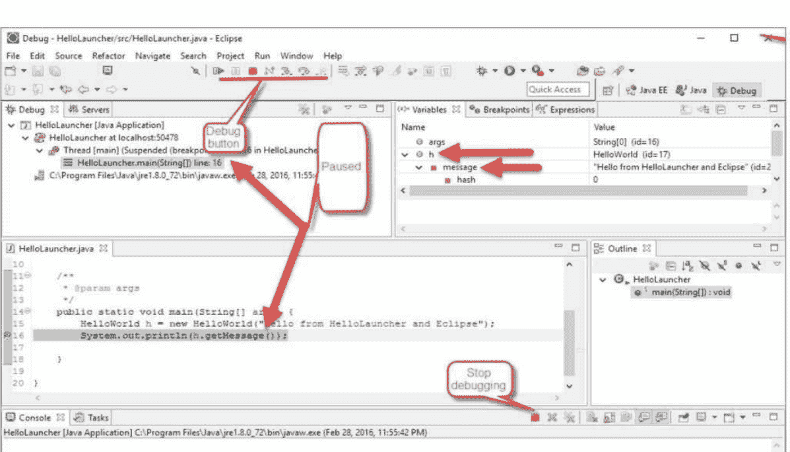
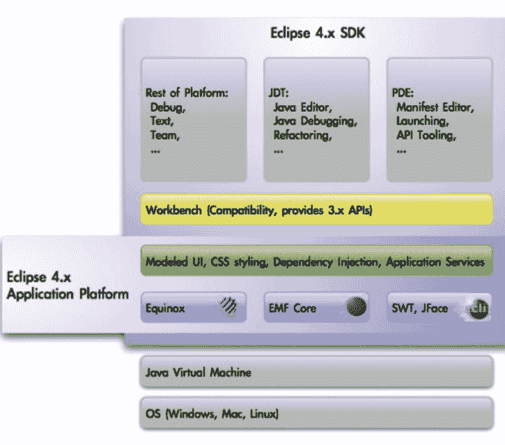
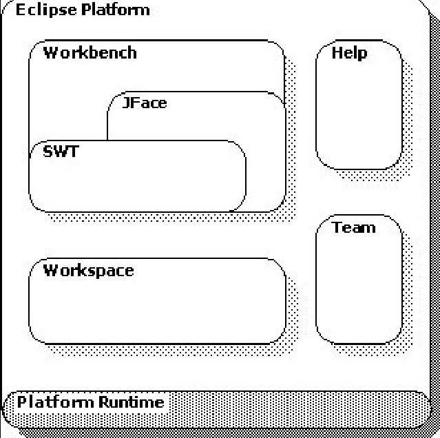
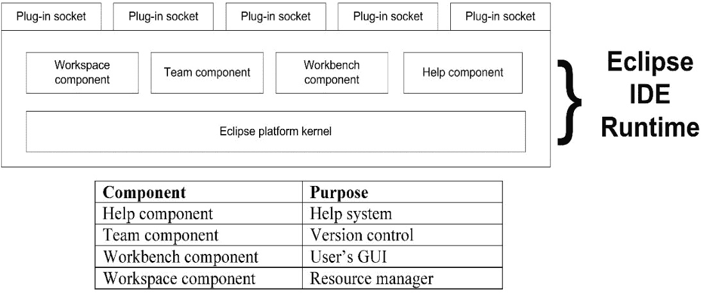
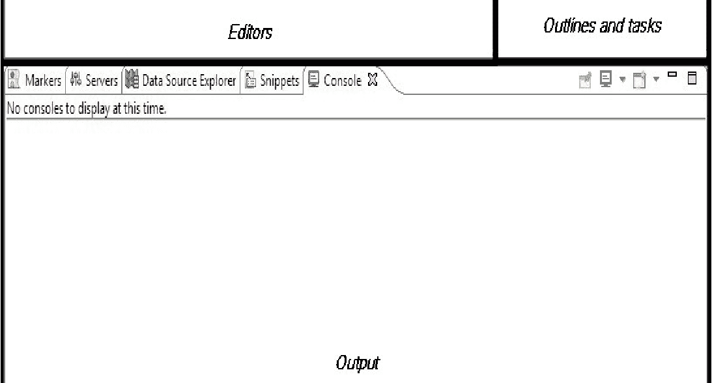
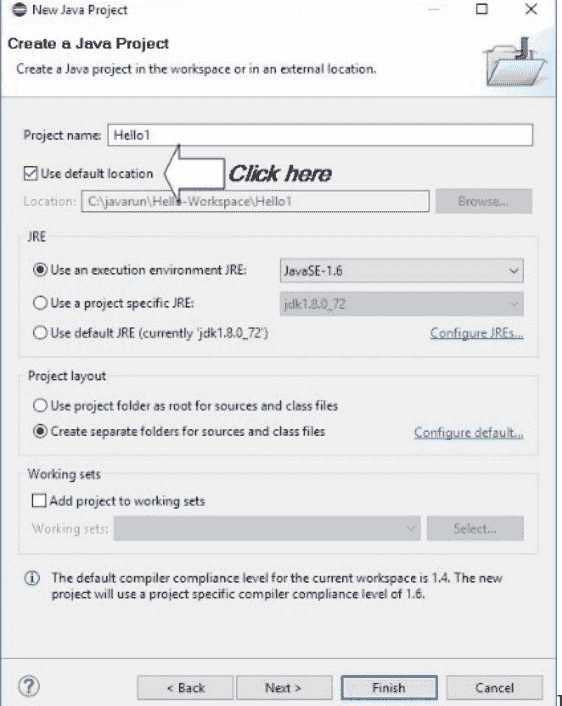
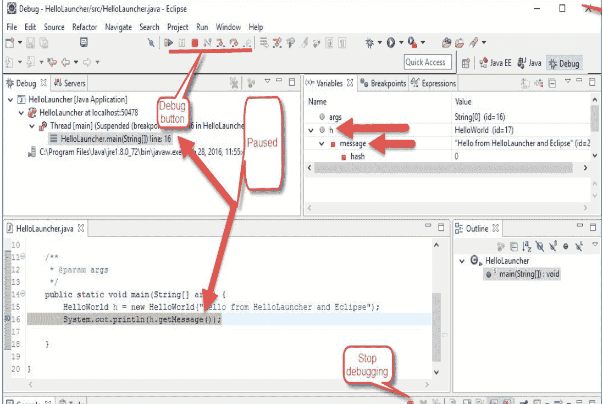

# Java 开发者 Eclipse 4.5 入门指南 - 十个版本的 HelloWorld 演示 Eclipse IDE 的强大

十个版本的 Hello World 展示了 Eclipse IDE 的强大



## John R. Hines, Software Consulting Engineer, Inc.

一门八至十二小时的继续教育课程

John R. Hines, Software Consulting Engineer, Inc., 1125 Country Club Rd, Lucas, TX 75002 (JRHinLucas@Gmail.com)

> “抄袭是作者从一个来源窃取；学术研究是作者从多个来源窃取。” —— 匿名

> “事实是顽固的实物；无论我们的愿望、倾向或情感的驱使是如何，我们都无法改变事实和证据的状态。” —— 约翰·亚当斯

Oholiable 第一定律：西装精英对计算能力的需求不断扩张，直到所有极客的服务器在工作时间内运行数据库查询和打印报告时达到 100% 利用。

Oholiable 第一定律的推论：只有当没有人想要服务器时，开发人员才能访问为开发购买的服务器。

警告：如果你不够聪明无法从这些笔记中区分出珍珠和垃圾，你就没有权限阅读它们！

# 使用 Eclipse 创建基础 Java 应用

## 附录

录 I：问题答案

第 7 章

第 8 章

第 10 章

第 12 章

作者简介

`a|b` a 或 b

`[]` 可选选择

`{}` 必选选择

`...` 项目列表

`+` 可以重复

截图和关键点击均来自 Eclipse 4.5.1 EE。

截图和关键点击来自 Windows 10 专业版。Windows 7 和 Windows 8.1 的外观（以及点击效果）会有所不同。如果你运行的是 Windows 8（而非 8.1），你可能会遇到问题（其他人都是这样）。

## 这些笔记中的练习题来自哪里？

我第一次看到一组更多且复杂的 Hello 程序集合，它们最终在一份归属于 Rebecca Ong 的 PDF 文件中强调了 Spring 框架。从那以后，我看到与其他开发者相关的类似的 Hello 程序集合。最后一个练习题来自来自科林林县社区学院继续教育部的 Oz Brown。

我的大多数示例示例都略有不同，因为我的目标是教授 Eclipse 和编辑，而不是教授面向对象的编程。但是，还是要感谢 Rebecca 和 Oz。

这些笔记是三十年编程和二十年搜索的结果。这意味着某些章节不是最新、最完美的。然而，它们描述了完成工作的方法。

（对于一个从 GW Basic 开始编程并在 Windows 1.0 中写下第一本书的人来说，你能期待他什么？）

你可能想要复制和粘贴这本书。我建议你使用 Calibre 将这本书转换为 DOCX。你可以放大图像以便更清楚地看到它们。

顺便说一下：如果你希望在你的公司开设 Eclipse 课程，请向 JRHInLucas@Yahoo.com 向我发送电子邮件。

一本好书是 Lars Vogel 的 [Eclipse IDE](http://www.amazon.com/Eclipse-IDE-vogella-Lars-Vogel-ebook/dp/B0060IJ39S/ref=sr_1_3?s=books&ie=UTF8&qid=145759814&sr=1-3&keywords=lars+vogel)。

一本非常贵但很棒书是 Ram Kulkarni 的 [Java EE Development with Eclipse](http://www.amazon.com/Java-Development-Eclipse-Ram-Kulkarni-ebook/dp/B014HFBN40/ref=sr_1_13&s=books&ie=UTF8&qid=145759962&sr=1-13&keywords=eclipse+computer)。

一本在几乎无用的过时格式中很有用的复杂书籍是 Kate Thompson 的 [Zero Bugs and Program Faster](http://www.amazon.com/Zero-Bugs-Program-Faster-Thompson/dp/099619308/ref=sr_1_38?s=books&ie=UTF8&qid=145780123&sr=1-38&keywords=eclipse+computer)。仅推荐给视力良好的资深程序员。

在 2014 年（去年可可用），Eclipse（免费）占据了 48% 的 IDE 市场，IntelliJ（昂贵）占据了 33%，NetBeans（免费）占据了 10%，而 Spring（免费，基于 Eclipse）占据了 4%。除非你想使用同一个（嗯，类似的）IntelliJ IDE 同时开发 Java 和 Android 应用，否则 Eclipse 是首选工具，特别是在经费紧张的公司中。（Eclipse 是免费的）。

它是基于 Java 8 的第二个 Eclipse 版本。它稳健且可靠。

## Eclipse 项目是如何管理的？

Eclipse 的所有工作都在顶级项目下组织好的子项目和组件中完成。顶级项目由 PMC（项目管理委员会）管理。

- 4.2 Juno 第一个 Eclipse 4
- 4.3 Kepler Maven 集成
- 4.4 Luna Java 8 集成
- 4.5 Mars 支持 Java lambda 表达式
- 4.6 Neon 预计于 2016 年 6 月发布。现已提供预发布版本。

## 什么是向导（wizard）？

一个通过填写框的窗口，简化了创建内容的过程。Eclipse 非常重视向导的使用。

## 什么是 Eclipse？

一个由软件开发者组成的开源社区，专注于构建一个具有可扩展框架、工具和运行时开放开发平台，用于在整个软件生命周期中构建、部署和管理软件。另一种说法：Eclipse 平台。

## 什么是 Eclipse 的“大局图”？



大局图的另一种视角如下所示：



## 什么是 Eclipsepedia？

Eclipsepedia (http://wiki.eclipse.org/Main_Page) 是关于 Eclipse 的百科。

## 什么是开源（open source）？

开源是指允许他人查看并修改源代码的应用程序。

## Eclipse 3 和 4 的区别是什么？

Eclipse 3 是 3.7，Eclipse 4 是 4.5。Eclipse 3 支持 CSS 样式、依赖注入和模型，Eclipse 4 桌面支持 Java 7。

## 什么是 Eclipse 架构（architecture）？

Eclipse 运行时



## 什么是 Eclipse 平台（platform）？

由 Eclipse 项目开发的具有可扩展性的 IDE。

## 什么是 Eclipse 工作区（workbench）？

Eclipse 平台。“Workbench”是用于桌面的术语。最初被称为桌面。

## 什么是 Wiki？

使用 Wiki 引擎的网站。访问者可以添加、删除。

## Eclipse 何时集成了 Java 7？

Eclipse 3.7。

## Eclipse 何时集成了 Java 8？

Eclipse 4.4 有一些小问题。

## 我是否设置 JAVA_HOME 环境变量？

右键点击“开始”->“系统”。当“系统”窗口出现时，点击“高级设置”。当“系统属性”弹出时，滚动到“系统变量”。如果没有 `JAVA_HOME`，点击“新建”。变量值应该是你的 jdk 位置。点击所有“确定”按钮保存并返回“系统”窗口。点击右上角的“x”关闭窗口。

## 我有什么版本的 Java？

右键点击开始图标并选择“命令提示符（管理员）”。当 cmd 窗口弹出时，输入 `java -version`。它应该显示 1.8 版本的 SE 运行时环境。（如果没有，请从 http://www.oracle.com/technet/java/downloads/index.html 下载 jdk）。

## 什么是命令行界面（command line interface）？

非图形用户界面，命令行在显示器上显示字符。通常由闪烁的光标跟随 `$`、`>` 或驱动器名称和反斜杠标识。

## 什么是发布版本（release）？

Eclipse 的不同版本。（差异大到你最好阅读文档。）

## 什么是可视化 IDE（visual IDE）？

允许开发者通过指向、点击和拖放进行编程。

## 什么是 WIMP-图标？

窗口-图标-鼠标-下拉菜单的缩写，允许用户在不离开环境的情况下创建、编辑、调试和部署类、组件、小程序和应用程序。命令行界面开发者认为 WIMP 用户界面是弱鸡（效率低）。

## 什么是工作区（workspace）？

管理一组 Eclipse 资源，无论它们位于何处。工作区包含 Eclipse 项目。Eclipse 平台通常有一个工作区。然而，新版本的 Eclipse往往会覆盖旧需要的信息，你可能为你使用的每个 Eclipse 版本准备工作区。

## 如何使用预定义的工作区启动 eclipse？

创建一个批处理文件，内容只有一行：`"C:\eclipse\Mars 4.5.1 EE \eclipse.exe" -data C:\MyCode\workspace-mars-hello`。

集成开发环境（Integrated Development Environment）的缩写，一种带有 WIMP 界面的开发工具。

安装在在哪里、安装哪个版本的 Eclipse IDE、32 位还是 64 位 Windows、以及包含工作区（workspaces）的目录。警告：不要在文件名或目录名中使用空格。这可能没紧要，但可能会产生影响。不要这样做！

| 选项 | 建议 |
|---|---|
| 我应该将 Eclipse 安装在哪里？ | 在一个名为 Eclipse 的根目录下。你可以在此目录下安装多个版本的 Eclipse。 |
| 我应该安装哪个版本的 Eclipse？ | Mars EE (Eclipse 4.5.1) |
| 我的 Windows 是 32 位还是 64 位的？ | 你需要通过运行“系统信息”来确定。 |
| 哪个目录将包含工作区？ | 为了避免权限问题，在 C 盘下创建一个名为 MyCode 的根目录（无空格）。 |
| 你应该避免在名称中使用空格吗？ | 绝对应该。这可能没害，但可能会有影响。 |

**警告：所有安装的基本规则是：不要更改任何你不能完全理解的内容。**

### 步骤 1：安装哪个发布版本（版本）？

安装当前版本的 Eclipse（Eclipse 4.5.1，2016 年 1 月发布的 Mars）或你公司使用的任何版本。警告：在任何新版本（任何类型的软件）发布两个三个月之前，永远不要安装新版本。（“永远不要使用 x.o 版本”）。Eclipse 在 6 月发布，因此请在 6 月和 7 月安装上一个版本。

如果你安装 4.3 或更高版本，默认将使用 Java 8。如果你安装 4.2 或 3.7 版本，默认将使用 Java 7。

在进入步骤 2 之前，你应该知道你想要安装的 Eclipse 版本。

### 步骤 2：安装哪种类型（classic ide、标准 ide、Java ide 还是 Java EE ide）？

如果你安装“经典”版本的 Eclipse (3.7, 4.2)，你必须手动安装构建系统、桌面开发工具、Java 开发工具、版本控制系统和 XML 工具。（不推荐。）

如果你安装“标准”版本的 Eclipse (4.3)，你必须手动安装构建系统和 XML 工具。（不推荐。）

如果你安装 Java ide 版本的 Eclipse (4.3 或更高版本)，你不需要手动安装上述任何内容。（如果你计划进行数据库或 Web 开发，则不推荐这样做。）

如果你安装 Java EE ide 版本的 Eclipse，你还会获得数据工具和一组 Web 开发工具。该 IDE 稍微复杂一点，但如果你必须迁移到 EE，就不需要学习略有不同的 IDE 了。

在进入步骤 3 之前，你应该知道版本和类型（Classic ide、Standard ide、Java ide 或 Java EE ide）。

### 步骤 3：32 位或 64 位 Windows？

如果你正在运行 Windows，你需要知道你运行的是 32 位还是 64 位的 Windows。点击开始图标，点击“所有应用->Windows 管理工具->系统信息”。查找“系统类型”。

在进入步骤 4 之前，你应该知道你使用的是的是种版本的 Windows。

访问 https://www.eclipse.org/ide/

Eclipse 以我们的 Java 集成开发环境 (IDE) 而闻名，但你的 C/C++ IDE 和 PHP IDE 也非常酷。你可以将语言支持和其他功能整合到我们的任何默认包中，并且 Eclipse Marketplace 允许几乎无限制的自定义。


选择 Java IDE 或 Java EE（推荐）。选择你想要的版本。

| | | |
|---|---|---|
| 面 Java 开发人员 Eclipse IDE | 275 MB - 已下载 2,237,908 次 | Windows 32位 64位 Mac 64位 Linux 32位 64位 |
| 面 C/C++ 开发人员 Eclipse IDE | 176 MB - 已下载 1,908,741 次 | Windows 32位 64位 Mac 64位 Linux 32位 64位 |
| 面嵌入式开发人员 Eclipse IDE 4.5.1 | 241 MB - 已下载 434,074 次 | Windows 32位 64位 Mac 64位 Linux 32位 64位 |
| 面 PHP 开发人员 Eclipse IDE | 153 MB - 已下载 276,840 次 | Windows 32位 64位 Mac 64位 Linux 32位 64位 |
| 面 Java 和 DSL 开发人员 Eclipse IDE | 296 MB - 已下载 168,315 次 | Windows 32位 64位 Mac 64位 Linux 32位 64位 |

选择操作系统。

任何 Java 开发的必备工具，包括 Java IDE、Git 客户端、用于集 Web 工具和 WebBuilder。此包包含：

- Eclipse Git Team
- Eclipse Development Tools
- Maven Integration
- Mylyn Task List
- 面 Java 开发人员的 代码提醒工具
- Windows Core
- Eclipse XML 编辑器工具

详细功能

维护者：Eclipse Packaging Project

下载 Eclipse。警告：你可能会收到其中一个成员的“礼物”。为了避免麻烦，请点击左侧的向下按钮。

注意：文件名 (win32-x86_64.zip) 告诉你将下载文件的 64 位版本。耐心等待！（顺便说：捐赠是自愿的）。

在文件管理器中，进入下载目录，右键点击 zip 文件并选择“解压所有文件”，然后选择默认目标。你可能会发现将 eclipse 文件系统放在名为 Eclipse 的目录中会有所帮助。当 eclipse 发布新版本时，你可以在当前版本旁边安装新版本。

找到 `eclipse.exe`。双击它。等一下！当你选择一个工作区（workspace）时，会出现欢迎界面。注意：文件名 (win32-x86_64.zip) 告诉你将下载文件的 64 位版本。耐心等待！（顺便说：捐赠是自愿的）。

### 步骤 7：查看欢迎界面

当你选择了工作区后，欢迎界面就会出现。浏览页面上的链接。

### 步骤 8：查看帮助

当工作台弹出时，点击“帮助”。浏览帮助内容。

### 步骤 9：查看你的工作区

（这可能需要调整权限。）使用文件管理器查看你的工作区。`.metadata` 文件夹表示你处于工作区。你可能还会看到一个名为 RemoteSystemsFiles 的目录。这是远程系统创建的一份免费礼物。忽略它。

### 步骤 10：设置常用值

点击“Windows-首选项”。浏览顶级首选项。你大部分时间将花在 Java 顶级选项上，其余在常规。目前忽略其他。

进入“常规-启动和关闭-工作区”，并选择你的项目工作区，然后点击“应用”。缩小常规 子选项。

进入“Java-类路径-已的 JRE-执行环境”。点击“JavaSE-1.8”（兼容更高版本的 jdk），然后勾选环境中安装的 jre 旁的复选框。

点击“确定”关闭首选项窗口。

### 步骤 11：查看所有下拉菜单并将鼠标悬停在图标上

你可能需要点击工具栏上的空白处来关闭下拉菜单或工具弹出（没有程序是完美的）。灰色的下拉菜单和按钮当前不可用。

### 步骤 12：完成

你已成功安装了 eclipse。恭喜。

**哪里可以找到 mars 的在线帮助？**

访问 http://help.eclipse.org/mars/index.jsp。

**哪里可以找到 mars 图标的含义？**

查看 http://help.eclipse.org/mars/index.jsp?topic=%2org.eclipse.jdt.doc.user%2FPreference%2Fref-icons.htm。

### 什么是构建 (build，名词)？

由构建器（builder）通过该项目的其他资源创建的项目资源。构建（动词）是构建器的操作。

### 什么是构建器 (builder)？

一种将项目中的一个或多个资源转换为项目中的另一种资源（称为构建）的工具。所有的 Eclipse 构建器都是增量的——在全量构建（有时称为“build all”）之后，构建器只构建自上次构建以来更改的内容（有时称为“rebuild”）。构建器始终与项目相关。

### 什么是全量构建 (full build)？

对项目中所有的资源都进行的构建。


## 什么是自动构建（autobuild）？

由于以下原因自动触发的增量构建：（1）资源发生了变化；（2）自动构建功能已开启。注意：除非你正在进行特殊操作，否则应该开启自动构建！

## 什么是增量构建（incremental build）？

一种从上一次构建的结果开始的部分构建，仅修改更改的部分。速度更快！

## 什么是包（bundle）？

一种用于内容分组、交付和管理的机制。将包视为 Eclipse 中组件的实现。在 Eclipse 中，包（bundles）和插件（plug-ins）之间没有区别。注意：每个包都有自己的类加载器和它自己的`manifest.mf`文件。

## 什么是面（facet）？

面是一个可以添加到项目中的功能单元。Java 就是一个面。（也是一个功能，以及其他许多东西。）

## 什么是功能（feature）？

一组相关的插件。（例如，JDT 就一个一个功能。）

## 什么是文件（file）？

与 Eclipse 工作区中的项目或项目中的文件夹关联的虚拟（或实际）文件。

## 什么是文件夹（folder）？

与 Eclipse 工作区中的项目关联的虚拟（或实际）目录。文件夹是分层存储项目资源的有用工具。

## 什么是视角（perspective）？

具有某些共同目的的编辑器（editors）和视图（views）的集合。

## 什么是当前视角？

工具栏最右侧高亮的视角。当前视角控制主窗口的外观。

## 什么是插件（plug-in/plugin）？

Eclipse 平台的基础构建块。JDT 是插件的集合。

## 什么是项目（project）？

一个将资源分组为可构建、可重用单元的容器。

## 什么是资源（resource）？

项目、文件夹或文件。项目可以包含文件夹和文件文件。文件夹可以包含文件。

## 什么是标签（tag）？

放在代码中的标记（特殊文本），用于指示稍后在标签位置完成的工作。Eclipse 标签可以通过 Task 标签页（Task view）找到。

## 什么是任务列表（task list）？

与错误跟踪器关联的任务列表。

## 什么是任务视图（task view/任务标签页）（标签视图）？

源文件中需要被代码替换的标签列表。

## 什么是视图（view）？

一个带有 Eclipse 资源图形化显示的窗口。Eclipse 不认为视图与显示它的视角之间有区别。

## 什么是编辑器（editor）？

资源的可编辑视图。它为操作由资源所表示的数据提供了自定义行为。不同的编辑器与不同类型的文件关联。当你通过在某个导航视图中双击文件以进行编辑时，Workbench 会在 Workbench 中打开关联的编辑器。如果资源没有关联的编辑器，Workbench 将尝试在 Workbench 之外启动一个适当的外部编辑器。

## 什么是“内置的”（baked-in）？

内置的委婉说法（由 eclipse 开发，而非第三方开发）。

## 什么是 JDT（Java 开发工具）？

JDT 是让 Eclipse Java IDE 不同于 Eclipse C/C++ IDE 的东西……顺便说：JDT 是一个功能，而不是插件。不过，许多开发者误用了功能一词。

## 什么是构建路径（build path）？

指定完成项目所需的所有依赖项。代码和其他资源（在源文件夹中）、关联的 jar 和类文件夹，以及项目引用（需要）的类和库。

## 第 5 章：Eclipse 4 文件系统

Eclipse 平台如何组织信息？Eclipse 工作台（workbench）如何组织信息？

工作台按工作区、然后按该工作区中的项目来组织信息。当 Eclipse 工作台启动时，如果用户没有选择默认工作区，它会要求用户选择一个工作区。Eclipse 将该工作区中的所有项目加载到 Project Explorer（项目管理器）。

### 工作区目录包含有什么？

- `.metadata`：在此查找错误日志！
- `.recommenders`：JSON 文件
- `.settings`：各种设置
- `.bin`：二进制文件
- `.src`：源目录
- `.target`：目标目录
- `.classpath`：配置文件
- `.project`：项目文件
- `.pom.xml`：Maven 文件
- `.log`：错误日志

### 文件夹包含有什么？

- `.metadata`：在此查找错误日志！
- `.recommenders`：JSON 文件
- `.settings`：各种设置
- `.bin`：二进制文件
- `.src`：源目录
- `.target`：目标目录
- `.classpath`：配置文件
- `.project`：项目文件
- `.pom.xml`：Maven 文件
- `.log`：错误日志

Eclipse 平台如何组织信息？Eclipse 工作台（workbench）如何组织信息？

### 工作区目录包含有什么？

- `.metadata`：在此查找错误日志！
- `.recommenders`：JSON 文件
- `.settings`：各种设置
- `.bin`：二进制文件
- `.src`：源目录
- `.target`：目标目录
- `.project`：项目文件
- `.pom.xml`：Maven 文件
- `.log`：错误日志
- `.metadata`：在此查找错误日志！
- `.recommenders`：JSON 文件
- `.settings`：各种设置
- `.bin`：二进制文件
- `.src`：源目录
- `.target`：目标目录
- `.classpath`：配置文件
- `.project`：项目文件
- `.pom.xml`：Maven 文件
- `.log`：错误日志



### 项目资源管理器（Project Explorer）视图和包资源管理器（Package Explorer）视图有什么区别？

项目资源管理器是工作区中制品的分级视图（根据你工作区的特定配置自定义）。它可以用于许多语言和项目类型。额外的插件为项目资源管理器视图提供了“额外信息”，使其变得更加“复杂”。例如，当项目资源管理器安装了 JDT（Java 开发者插件）时，当用于 Java 项目时，包资源管理器（JDT 的）中的许多功能会出现在项目资源管理器中。

**大纲视图（outline view）是什么？**

在 Java 和 Java EE 视图中，大纲和任务区域的大纲标签页显示当前选中的类。它在这些视图中始终可见的。

### 问题视图（problem view，问题选项卡）是什么？

在 Java 和 Java EE 视图中，输出区域的问题选项卡显示错误和警告。你通常需要点击“窗口(Window)->显示视图(Show View)->其他(Other)->常规(General)->问题(Problems)”来调出问题视图。

### 我可以在哪里找到 IDE 中使用的图标信息？

对于 Mars 版本，请查看 http://help.eclipse.org/mars/index.jsp?topic=org.eclipse.jdt.doc.user/preference/ref-icons.htm。对于 Luna 版本，请查看 http://help.eclipse.org/luna/index.jsp?topic=org/eclipse/jdt.doc.user/reference/ref-icons.htm。

我可以在哪里找到 Eclipse 的在线帮助？

尝试访问 http://help.eclipse.org/mars/index.jsp?topic=org.eclipse.jdt.doc.user/preference/ref-icons.htm。

### 我可以在哪里找到 eclipse 错误日志？

查看`.metadata`文件夹。

### 启动 Eclipse

当你启动 Eclipse 时，欢迎（Welcome）标签页不应该出现。（你在安装期间已经关闭了它）。如果它出现了，请将其关闭。点击“文件(File)”。当下拉菜单出现时，点击“切换工作区(Switch Workspace)”并选择你的 Hello 工作区（我使用的是`C:\MyCode\workspace-mars-hello`）。

### 错误图标看起来什么样？

Java 编辑器视图左侧有一个带有“!”的红色三角形圆圈。三角形位于右下角。❌（可快速修复的错误）或 ❌（更复杂的错误）。

### 警告图标看起来什么样？

Java 编辑器视图左侧有一个带有“!”的黄色三角形圆圈。三角形位于右下角。⚠️（可快速修复的警告）或 ⚠️（更复杂的警告）。

### 什么是折叠（folding）？

允许用户隐藏和显示文本块——通常带有命名。通常这样做是为了让用户能够更清楚地看到文档或程序的结构。

### 什么是警告（warning）？

发送给用户构建的消息，警告存在某些（通常是异常的）情况，这些情况并不严重到会抛出异常并终止执行。程序将运行，但可能不会产生预期的结果。

### 什么是错误（error）？

发送给用户构建的消息，警告某些错误，这些错误严重到足以抛出异常并终止执行，可能严重到阻止程序继续。在程序运行之前必须修复。

### 什么是执行环境 JRE？

目标（目标）上旧的 JRE。用于构建应用程序的 JRE 版本可以比运行时版本新，因为构建时知道 JRE 是什么。

### 什么是 JDK 环境？

Java 1.0、1.1 或（有时）兼容的目标。

### 什么是 Java2SE-1x 环境？

Java2SE 1.1、... 或兼容的目标。

### 什么是 JavaSE-1x 环境？

Java2SE 1.6 或 1.7 执行环境。

### 什么是代码折叠（code folding）？

编辑器压缩和展开代码、标记和块的能力。代码折叠简化了在大文件中的导航。

### 什么是“钻取（drill down）”？

在树形结构中（如文件系统），点击节点以进入某些特殊地方。例如，点击 C 驱动器查看根目录，然后点击 Windows 查看目录，点击 System32 查看软件。

### 什么是 Javadoc？

一种用于解析一组源文件中的声明和文档注释的工具，并生成一组描述类、接口、方法和字段的 HTML 页面。

### 我如何识别 Javadoc 注释？

以`/**`开头，多行，并以`*/`结束。（与以`/*`开头以`*/`结束的注释不同）。

### 我如何查看 Javadoc？

打开 Javadoc 视图。（点击“窗口(Window)”）。当下拉菜单出现时，点击“显示视图(Show View)->Javadoc”。Javadoc 标签页将出现在输出区域。

### 什么是范围（scope）？

类型或数据项的特征，描述了类型或数据项可以安全使用而不产生冲突或混淆的区域。类范围、局部范围和模块范围。

### 闭的项目、打开的项目和展开的项目之间有什么区别？

在项目资源管理器中，关闭的项目是带有关闭文件夹图标和项目名称的单行；打开的项目是带有“>” 图标、打开的文件图标和项目名称的单行；展开的项目是多行的，带有向下箭头图标、打开的文件图标（项目名称在第一行，然后在项目正下方直接列出资源列表）。

### 我如何将关闭的项目更改为打开的项目？

双击关闭的文件夹图标。

### 我如何将打开的项目更改为展开的项目？

双击打开的文件夹图标。或者，只需点击“>”图标。顺便说一下：通常情况下，点击“>” 意味着“显示下一层”。

### 我如何将打开或展开的项目更改为关闭的项目？

右键点击项目名称。当下拉菜单出现时，点击“关闭项目(Close Project)”。

### 项目资源管理器和包资源管理器有什么区别？

项目资源管理器显示所有项目。包资源管理器显示单个项目。

### 练习 7-1：创建一个 Hello1

你在“图片”区域的项目资源管理器标签页中创建项目。

### 可能的失误 7-1

右键点击项目资源管理器主窗口顶部的标签页。弹出一个带有“关闭(close)”选项的下拉菜单。点击“关闭”。发生了什么？顺便说一下：你可以通过右键点击最右侧的“Java EE”图标并选择“重置(reset)”返回默认的 IDE 区域和格式。



## 练习 7-2：创建一个包含 main 方法和注释的 Hello 项目

重复练习 7-1，但将项目名称改为“Hello”。不要忘记创建 java 文件“HelloWorld”（相同的名称，不同的项目！听起来像是个范围问题，不是吗）。当“Java Class”窗口出现时，勾选“public static void main...”和“Generate comments”旁边的复选框。

## 练习 7-3：比较 HelloWorld.java 和 Hello1.java

在项目管理器中，Hello1 和 Hello 应该都是打开的项目。点击“>”图标让两个项目都处于打开并展开状态。找到 HelloWorld 类。双击 HelloWorld.java，它会出现在默认区域的“Editors”面板中。双击 Hello1.java，它会出现在“Editors”面板的第二个标签页中。我们可以同时看到这两个文件，点击并按住 Hello1.java 的标签，将其向左拖动，直到出现一个较小的面板，松开鼠标按钮。你看到了什么区别？HelloWorld.java 具有 Javadocs 结构和一个允许该类独立运行的 main 方法。HelloWorld1.java 则没有。

## 折叠的注释

```
/**
 * @author JohnR_000
 */
public class HelloWorld {
    /** Javadoc for method
    /**
     * @param args
     */
    public static void main(String[] args) {
        // TODO Auto-generated
    }
}
```

在编辑器中 Hello 项目的 HelloWorld.java 的左侧（最左侧），你会看到 Javadoc 注释和块（通常是方法）旁边有带有 + 的深圆和或带有 - 的浅圆。带 + 的深圆表示代码折叠，带 - 的浅圆表示没有代码折叠。点击文件顶部的圆（类 Javadoc 的开头）。圆会变成深色，且只显示注释或块中的一个。**不要**认为任何内容丢失了。点击深色圆，它会变成浅色，并显示整个内容或块。

在项目管理器中，Hello 和 Hello1 都应该是打开的。（如果不是，请打开关闭的那个）。右键点击 Hello。当下拉菜单出现时，点击“Close Project”。对 Hello1 执行同样的操作。

在项目管理器中，右键点击 Hello1 项目。当下拉菜单出现时，点击“Delete”。当出现“Delete Resources”弹出框时，检查项目位置以确认这是你想要删除的项目。如果“Delete project”旁边的复选框已勾选，则点击“OK”。在工作空间和 IDE 中，项目都消失了！永久消失。它无法（轻易地）恢复。

在项目管理器中，将 Hello 项目设为展开状态。将 HelloWorld.java 加载到 Java 编辑器中。注意 main 方法内部的 TODO 注释。现在查看“Outlines and tasks”区域中的 Outlines 面板。你不需要搜索编辑器来寻找 TODO：它们已在 Outlines 面板中列出。

找到并高亮“//TODO in main (.. )”，然后输入“System.”（你需要那个点！）

在 Eclipse 中按 ENTER（或双击），“out”将变为“System.”。再输入另一个点（.）。找到并高亮“out”，在“System.out”之后立即按 ENTER。Eclipse 弹出 PrintStream 类文档。找到并高亮“println”，并按 ENTER。现在你看到括号内有`System.out.println("Hello from HelloWorld and Eclipse")`。现在没有错误指示了。（如果你看到一个蓝色笔图标，可以点击它可以查看消息。）

右键点击 HelloWorld.java 编辑器的主面板。当下拉菜单出现时，点击“save”。关闭 HelloWorld.java 编辑器标签页。

在项目管理器中，右键点击 Hello 项目。当下拉菜单出现时，点击“Run as ->” Java application。注意“output”区域打开了一个控制台，Console 中出现了字符串“Hello World from Java and Eclipse”。点击“Problems”标签，注意没有列出错误。

在项目管理器中，如果点击 Hello 项目，你可能会在项目名称之间看到一个项目警告图标（带有黄色三角形和感叹号的文件夹）。深入找到 HelloWorld.java 文件。如果你在输出区域没有看到“Problems”标签，请点击“Window->Show View->Other...Problems”。现在你看到了项目警告。如果信息是“...no compatible”，请忽略该项目。

在项目管理器中，右键点击 Hello 项目。当下拉菜单出现时，点击“Close Project”。项目图标现在是一个关闭的文件夹。

假设项目是一个已展开的项目。

- 创建新项目的两种方法是什么？
- 打开 HelloWorld.java 的两种方法是什么？
- 关闭编辑器的方法是什么？
- 保存 HelloWorld.java 的方法有哪些？
- 运行项目的方法有哪些？
- 关闭项目的方法有哪些？
- Eclipse 是从哪里获取 @author 标签的？

从零开始创建一个新项目需要很多步骤。如果你有一个相似的项目，复制该项目来创建一个新项目通常更简单。Eclipse 有一个重构工具，可以简化对现有项目副本的修改。

### 什么是限定名（qualified name）？

带有路径的对象名称。

### 什么是重构（refactoring）？

对软件进行持续重新设计以提高其对变化的响应能力。也指 IDE 中的一种工具。


一种使用带有 `main` 方法的类来启动应用程序的设计模式。通常应用程序中的其他类没有 `main` 方法，以防止它们被误用。

## 什么是启动器（launcher）？

带有 `main` 方法且几乎没有其他内容的类。它的唯一作用是启动应用程序。

## 误操作 8-1

如果 `Hello` 是关闭的，在项目管理器主窗口中右键点击它。当下拉菜单出现时，点击“Open Project”（或者，双击 `Hello`）。在项目管理器主窗口中右键点击 `Hello` 项目。当下拉菜单出现时，点击“Copy”。在项目下方的空白区域右键。当下拉菜单出现时，点击“Paste”。当出现“Copy Project”弹出框时，输入项目名称“HelloArgs”然后点击“Finish”。

## 误操作 8-2

如果你正在一个与另一个打开的项目相似的项目工作，很容易意外修改错误的项目。通过右键点击你想要工作的项目来避免这个问题。当下拉菜单出现时，点击“Close Unrelated Projects”。当出现“Close Unrelated Projects”弹出框时，点击“OK”。

点击 `HelloArgs` 前的“>”图标以展开项目。找到 `HelloWorld.java`，然后点击它。当下拉菜单出现时，点击“Refactor>Rename”。当出现“Rename Compilation Unit”弹出框时，输入新名称 `HelloWorldArgs`，勾选“Update textual ...”复选框，然后点击“Finish”（完成）按钮（如果类包含 `main` 方法，请忽略警告并再次点击“Finish”）。文件名和类名已更改为合适的名称，且文件内部已进行了相应的更改。双击 `HelloWorldArgs.java` 在 Java 编辑器中显示它。将文本“Hello ...”替换为 `args[0]`，然后保存文件。

如何添加命令行参数？点击 project（项目）。当下拉菜单出现时，点击“Run As...->Run Configurations ...”。当“Create, manage and run configurations”向导弹出时，点击“Java Application”。当右侧窗口发生变化时，输入主类名“HelloWorld”，点击“Arguments”（参数）选项卡。当该选项卡选中时，在“Program arguments”（程序参数）窗口中点击“Hello from HelloWorldArgs and Eclipse”，然后点击“Run”（运行）按钮。弹出“Create ...”向导，“Hello from HelloWorldArgs and Eclipse”出现在输出的“Console”（控制台）选项卡中。

## 练习 8-2：将 Hello 项目复制 HelloLauncher

如果 `HelloArgs` 仍然打开，请将其关闭。打开并复制 `Hello` 项目，将其命名为 `HelloLauncher`。右键点击 `HelloLauncher`。当下拉菜单出现时，点击“Close Unrelated Projects”（关闭无关项目）（只有当 Project Explorer 中有两个或多个项目时才会出现）。将 `HelloLauncher` 设置为展开项目，向下查找 resource 文件夹直到找到“default package”。右键点击“default package”。当下拉菜单出现时，点击“New->Class”。当“New Class”向导弹出时，输入名称“HelloLauncher”。不要忘记点击“...main...”和“Generate ...”标签旁的复选框。点击“Finish”。当 `HelloLauncher.java` 在 Java 编辑器中出现时，将 TODO 注释替换为语句：

```
HelloWorld h = HelloWorld (“Hello from HelloLauncher and Eclipse”);
```

语句的最左侧会出现一个错误（准确地说，是一个快速错误消息）。当你点击错误图标时，会弹出 Quick Fix（快速修复）。顺便说：语句右侧滚动条中的红线也是一条错误消息。在大文件中，点击细红线将直接带你到错误语句。此外，你还可以通过计算细红线的数量来估算文件中的错误数量。然而，点击细红线不会弹出 Quick Fix。

在这种情况下，Quick Fix 只有部分帮助。问题是 `HelloWorld` 没有一个接受字符串作为参数的构造函数，因此你必须修改 `HelloWorld.java`。保存 `HelloWorld.java`。

打开 `HelloWorld` 编辑器窗口。

在类内部、`main` 方法的 Javadoc 注释上方添加成员：

```
private String message;
```

顺便说一下：注意看 Outline 选项卡中 detail 和 task 区域刚刚发生了什么。如果语句格式化不正确，右键点击该行。当下拉菜单出现时，点击“Source->Format element”。注意该变化。

右键点击数据成员下方的行。当下拉菜单出现时，点击“Source->Generate Getters and Setters”。当“Generate getters and setters”向导弹出时，勾选“message”和“Generate method comments”复选框，然后点击“OK”按钮。注意源码和 Outline 选项卡中的更改。

右键点击 `main` 方法 Javadoc 注释上方的行。当下拉菜单出现时，点击“Source->Generate constructor using fields”。构造函数已创建。

最后，高亮 `main` 方法体并将其删除。

保存 `HelloWorld.java` 然后重新打开 `HelloLauncher.java` 编辑器。如果你仍然看到错误，可能需要通过再次保存文件来刷新编辑器。现在，你不应该再看到错误了。但在编辑窗口的最左侧有一个快速修复图标（带有“i”的黄色三角形）。将鼠标悬停其上查看消息。噢，是的，`h` 被创建但从未被使用。在创建 `h` 的语句下方插入此语句：

```
System.out.println( h.getMessage() );
```

警告图标消失了，因为 `h` 现在在 `println` 方法中被使用了！（如果你仍然看到警告，保存文件后警告将会消失。）选择整个方法，右键点击它。当下拉菜单出现时，格式化该方法。

右键点击项目。当下拉菜单出现时，点击“Run As->Java Application”。弹出“Select Java Application”对话框，是因为你项目中有两个带有 `main` 方法的类。顺便说一下：如果你还没有保存对 `HelloWorld.java` 的更改，会弹出“Save and Launch”（保存并启动）对话框。高亮 `HelloWorldLauncher` 类并点击“OK”。你应该会在 Console 中看到欢迎信息。如果没有看到任何错误或警告指示，说明你成功了。

你有两个带有 `main` 方法的类。如果你右键点击项目并使用“Run As->Java Application”，哪个类会运行？在这种情况下，很容易看出：`HelloWorld` 没有 `main` 方法体，所以如果运行它，Console 选项卡中不会显示任何内容；`HelloWorld` 有 `main` 方法体，所以如果运行它，“Hello...”应该出现在 Console 选项卡中。再次试一次。Eclipse 会保护你：弹出“Select Java Application”并显示两个带有 `main` 方法的类。你必须在运行程序之前选择其中一个。

为了避免这个问题，移除鼠标所在位置断点。“Save and Run”向导启动了 `HelloLauncher.java`。这正是我们所希望的。

所有这些问题都假设项目是打开的。

还有什么其他方法可以打开关闭的项目？

为什么“File->Close”不关闭已打开的项目？

### 什么是调试

识别程序中的错误、定位错误原因并修复这些错误的过程。

### 什么是断点 (break point)？

源代码中某个位置的位置和条件，调试器在此处临时停止执行，以便开发者检查变量值。

### “Toggle breakpoint”（切换断点）意味着什么？

如果光标处没有断点，则在该处开启断点；如果已有开启的断点，则将其禁用。

在 Project Explorer 中，展开“HelloLauncher”并打开 `HelloLauncher.java`。右键点击编辑器最左侧对应 `main` 方法中“System...”语句的横条。当下拉菜单出现时，点击“Toggle breakpoint”，条上会出现一个带有小箭头的深色圆圈（表示激活的断点）。右键点击箭头。当下拉菜单出现时，点击“Toggle breakpoint”，断点将消失。设置断点后，右键点击它。当下拉菜单出现时，选择“Disable breakpoint”，条上会出现一个浅色圆。第三次，点击“Enable breakpoint”，圆将再次变深。

在 Project Explorer 中，右键点击 `HelloLauncher` 项目。当下拉菜单出现时，选择“Debug as ->Java Application”。当弹出“Confirm Perspective Switch”窗口时，点击“Yes”（不要勾选“Remember my decision”旁边的复选框）。视图分组中添加了第三视图“Debug”，并成为当前视图。然后，Project Explorer 的“main”区域被切换为 Debug 的“main”区域。

下方显示了一张图片。研究你所获得的新信息。鼠标悬停所有七个调试按钮上。悬停在“Console”选项卡右侧的图标上。



点击“Terminate debugging”（终止调试）按钮。你仍处于“Debug”视图。为了清除混乱，右键点击“Debug”视图。当下拉菜单出现时，点击“Close”（关闭），然后点击“Java EE”视图图标。

（更多但更小的类）

警告：游戏规则改变了：如果你已经被教过如何做某事，那么你将必须自己找到在哪里以及如何做。我只会教你如何做新事物。

## 什么是 @Override

通知编译器你打算重写父类中的某个方法。如果编译器在其中一个父类中没有发现该方法，它将生成一个错误。

注意：快速识别拼写错误或 API 变化。

## 什么是耦合？

代码元素之间接口的相对复杂度（代码元素之间的相对独立性）。松耦合”描述的是简单或最小耦合（复杂度较小）（良好的设计），而“紧耦合”描述的是复杂或最大耦合（复杂度很高）（坏设计）。它描述了模块之间的相对独立性（这是一好事）。

## 什么是提供者（provider）？

提供其他类需要（通常是信息）的类或方法。

替代方案：一个可交换工厂的工厂（实现抽象工厂模式）。

减少耦合。

## 什么是渲染器（renderer）？

以其他类或方法可以理解的格式对信息进行编码和解码的类或方法。减少耦合。

## 什么是 SoR（职责分离）？

一个类应该：(1) 负责软件功能的某一部分，并且 (2) 该职责应该完全由类封装。它所有的服务都应该与该职责紧密对齐。替代方案：每个类应该做非常少的事情，并完全地完成它们。

## 什么是注解（annotation）？

元数据的形式，提供关于程序的信息，但这些信息不是程序本身的一部分（对被注解代码的运行没有直接影响）。(1) 给编译器的信息（它可以使用它们来检测错误或抑制警告），(2) 编译时和部署时的处理（软件工具可以处理注解信息以生成代码、XML 文件）以及 (3) 运行时处理（可以在运行时进行检查）。注意：Java 和 Android 注解以 "at" (@) 开头。

## 练习 10-1：改进 Hello 分离（减少 Hello 耦合）

（解耦 Hello）

将 `HelloLauncher` 复制到 `HelloSeparation`。（你是否将 `HelloSeparation` 设为打开展开的项目？你是否关闭了 `HelloLauncher`？）向项目中添加空类 `HelloMessageProvider` 和 `HelloMessageRenderer`。（你是否将它们放在默认包中？你是否添加了 Javadoc 注释？）（两个类在 Java 编辑器中都打开了吗？如果没有，请打开它们。）在 `HelloMessageProvider` 中添加空行和以下方法：

```java
public String getMessage() {
    return "Hello from HelloSeparation and Eclipse!";
}
```

在项目资源管理器（Project Explorer）中，选中 `HelloMessageProvider.java` 然后右键点击它。当下拉菜单出现时，点击“Source->Format”。当 Eclipse 完成格式化后，将其关闭。

在 `HelloMessageRenderer` 中添加以下语句：

```java
private HelloMessageProvider messageProvider = null;
public void render() {
    if (messageProvider == null) {
        throw new RuntimeException("Set the property messageProvider of class:" + HelloMessageRenderer.class.getName());
    }
    System.out.println(messageProvider.getMessage());
}
```

为 `HelloMessageRenderer` 生成 setter 和 getter。

在项目资源管理器中，选中 `HelloMessageRenderer.java` 然后右键点击它。当下拉菜单出现时，点击“Source->Format”。当 Eclipse 完成 `HelloMessageRenderer.java` 的格式化后，保存并关闭它。

将 `HelloLauncher.java` 的 `main()` 体替换为：

```java
HelloMessageRenderer hmr = new HelloMessageRenderer();
HelloMessageProvider hmp = new HelloMessageProvider();
hmr.setMessageProvider(hmp);
hmr.render();
```

在项目资源管理器中，选中 `HelloMessageRenderer.java` 然后右键点击它。当下拉菜单出现时，点击“Source->Format”。当 Eclipse 完成 `HelloLauncher.java` 后，保存并关闭它。

运行 `HelloSeparation`。它运行了。但是，`HelloMessageRenderer` 和 `HelloMessageProvider` 在项目中是硬编码的（在 `HelloLauncher` 中）。更改消息文本将很困难。

## 可能的错误 10-1

`HelloWorld.java` 是否在 `HelloSeparation` 项目中使用了？没有，它被 `HelloLauncher`、`HelloMessageProvider` 和 `HelloMessageRenderer` 替换了。

从项目中删除 `HelloWorld.java`。运行 `HelloSeparation`。它运行了。稍微整洁了一些。

## 练习 10-2；通过接口改进 Hello 分离

将 `HelloSeparation` 复制到 `HelloSeparationWithInterfaces`。（你是否关闭了 `HelloSeparation`？你是否将 `HelloSeparationWithInterfaces` 设为打开展开的项目？）我们（最终）将能够通过让 `HelloServiceProvider` 和 `HelloMessageRender` 实现接口来更改消息。但那是未来的事。

在 `HelloSeparationWithInterfaces` 项目中，右键点击 `HelloMessageProvider.java`。当下拉菜单出现时，点击“Refactor-> Extract Interface”。当“Extract Interface”弹出窗口出现时，输入名称 "MessageProvider"，点击 `getMessage()` 旁边的复选框然后点击“OK”。注意接口的图标是一张纸，右上角有一个球，里面有一个大大的 J 和小小的 I。打开 "MessageProvider.java"。

在 "HelloMessageRenderer.java" 之后...（注：此处原文存在大量重复和乱码，似乎是由于源文本提取错误导致的，翻译时已根据指令跳过逻辑重复部分）...

保存已更改的文件并关闭。

这段代码是做什么的？如果 `msf.properties` 中发现了 `HelloMessageProvider` 和 `HelloMessageRenderer`，`MessageSupportFactory` 就可以创建这些对象，且代码运行正常。但它也可以创建任何实现了 `MessageProvider` 和 `MessageRenderer` 的类，取决于 `msf.properties` 中的内容，代码运行可能会有所不同。

双击 `HelloMessageProvider.java`。将返回的消息改为 "Hello from HelloSeparationWithInterfacesAndFactory" 并关闭它。保存并关闭。

现在创建 `msf.properties` 文件。右键点击 `HelloSeparationWithInterfacesAndFactory`。当下拉菜单出现时，点击“New-File”（新建文件）。输入文件名“msf.properties”，然后点击“Finish”（完成）。在文件中输入以下文本。保存并关闭。顺问一下：文件在项目结构中在哪里？

```
## msf.properties
renderer.class=HelloMessageRenderer
provider.class=HelloMessageProvider
```

最后，编辑 `HelloMessageProvider.java` 中的消息，使其显示为 "Hello From HelloSeparationWithInterfacesAndFactory"。


运行`HelloSeparationWithInterfacesAndFactory`。它运行并显示一条适当的消息。

## 练习 11-2：通过添加工厂改进 Hello 分离（第二部分）

将`HelloSeparationWithInterfacesAndFactory`复制为`HelloSeparationWithInterfacesFactory2`。

在`HelloSeparationWithInterfacesFactory2`项目中，右键点击`HelloMessageProvider.java`，当下拉菜单出现时，点击“Copy”（复制）。右键点击“default package”（默认包），使用`GoodbyeMessageProvider.java`作为新类。双击它在编辑器窗口中打开。将字符串改为"Goodbye from HelloSeparationWithInterfacesFactory2 and Eclipse"。保存并关闭。双击`msf.properties`在编辑器窗口中打开。修改以`provider.class`开头的行以使其保存：

```
provider.class=GoodbyeMessageProvider
```

保存并关闭。

运行`HelloSeparationWithInterfacesFactory2`。它运行并给出一个不同的消息。因此，可以通过简单地更改文本文件来更改应用程序的行为。无需编译！

## 问题

所有问题均假设项目是一个打开并展开的项目。

## 第 12 章：使用更智能的工厂进一步减少耦合

### 什么是 Spring？

Spring 框架家族的所有者，包括一个轻量级开源服务器，简化了 Java 企业级应用的开发。以前被称为 SpringSource（[http://www.springource.org](http://www.springource.org)）。

### 什么是用户库（user library）？

具有共同用途的有用外部 jar 包集合。

### 什么是 appender（附件）？

在 Log4j 中，日志文件数据的输出目标。

### 什么是外部 jar？

不是由工作区中的项目构建的 Jar 文件，通常由某些外部提供的 API jar。

## 练习 12-1：使用 Spring 框架的工厂改进 Hello Spring

要访问 Spring 框架，你需要下载 Spring Framework 3.2.16 (zip) ALL Binary，来自 [http://olex.openlogic.com/packages/spring/3.2.16](http://olex.openlogic.com/packages/spring/3.2.16)。使用“Extract all”（全部解压）或某些 zip 程序将 Spring jars 解压到`c:\MyCode`某个地方，哪里都行，因为你找不到它。

将`HelloSeparationInterfacesAndFactory`复制为`HelloSeparationInterfacesAndSpring`。

右键点击`HelloSeparationInterfacesAndProject`。当下拉菜单出现时，点击“Build Path -> Configure Build Path”（构建路径 -> 配置构建路径）。当“Java Build Path”向导弹出时，点击“Add Library...”（添加库）按钮。当“Add Library”向导弹出时，双击“User Library”（用户库）。当“User Library”向导弹出时，点击“User Libraries...”按钮。当“User Libraries”向导弹出时，输入名称“Spring 3.2.16”，然后点击“OK”（确定）。回到“User Libraries”向导，“Spring 3.2.16”库应该被高亮显示。点击“Add External JARS...”（添加外部 Jar 包）按钮。当 Jar 选择弹出时，转到你解压 Spring Framework jars 的位置。双击文件夹中的`libs`，高亮`spring-beans.3.2.16.RELEASE-javocs`和`spring-core-3.2.16.RELEASE-RELEASE-javocs`，并点击“Open”（打开）。回到“User Libraries”，查看结果然后点击“OK”。回到“User Library”，点击“Finish”。回到“Java Build Path”，点击“Apply”（应用）然后点击“OK”。注意`HelloSeparationInterfacesAndProject`中的变化。顺问一下：如果你遇到任何 oophelps，只需点击“OK”。你不应该遇到，但是……

在编辑器中打开`OpenLauncher.java`。将`main`方法内部的代码替换为代码块：

```
BeanFactory factory = getBeanFactory();
MessageRenderer mr = (MessageRenderer) factory.getBean("renderer");
MessageProvider mp = (MessageProvider) factory.getBean("provider");
mr.setProvider(mp);
mr.render();
```

点击`BeanFactory`右右侧带有红色 x 且下方有波浪线的小文件夹。当悬停帮助弹出时，双击高亮的“import 'BeanFactory' ...”。注意添加到`HelloLauncher.java`顶部的导入语句。是的，`getBeanFactory()`仍然有问题——它还不存在。将以下方法在`HelloLauncher.java`的`main()`方法下方：

```java
private static BeanFactory getBeanFactory() throws Exception {
// 获取 bean 工厂
DefaultListableBeanFactory factory = new DefaultListableBeanFactory();
// 创建定义
DefaultListableBeanFactory factory = new DefaultListableBeanFactory();
// 使用属性
PropertiesDefinitionReader rdr = new PropertiesBeanDefinitionReader(props);
// 加载配置
Properties props = new Properties();
props.load(new FileInputStream("beans.properties"));
// 注册定义
rdr.registerBean(factory);
return factory;
}
```

删除`msf.properties`和`MessageSupportFactory.java`。

没有错误，运行应用程序。一切看起来运行正常，但你得到的消息是“Hello from HelloSeparationWithInterfacesAndSpring and Eclipse!”而不是“...Spring2...”。在`HelloMessageProvider.java`中修改消息字符串。

没有错误，运行应用程序。一切看起来运行正常。

## 问题

所有这些问题都假设项目是一个已展开的项目。

## 第 13 章：使用 DI（依赖注入）进一步减少耦合

程序员可能会认为，在编译代码之前，仍然必须为每种不同的消息创建并添加新类。对于`HelloSeparationWithInterfacesAndFactory2`中使用的简单工厂类来说，确实如此。但是通过更智能的工厂（例如 Spring Framework 提供的），可以通过编辑文本文件无需重新编译即可更改消息。

## 什么是已弃（deprecated）？

过时的，不推荐（但可能仍然支持）。顺便说一句：如果你使用了已弃类或方法，当这些类或方法不再被支持的那一天，人们会埋怨你的。

## 什么是 DI（依赖注入）？

一种实现软件库控制反转（IoC）的设计模式。调用者将发现和导入由调用者指定或“注入”的服务模块的控制权委托给外部框架。依赖注入有三种常见形式：基于 setter 的注入、基于接口的和基于构造函数的注入，其中注入依赖的责任分别由客户端、服务或构造方法承担。Spring 广泛使用了 DI。

## 练习 13-1：使用 SpringAndSpring2 改进 Hello 分离

复制`HelloSeparationWithInterfacesAndDI`。在`HelloMessageProvider.java`中修改消息字符串。如果没有错误，运行应用程序。如果一切看起来运行正常，则继续。否则，修复问题。

在与 "src" 同级目录下创建一个空的`beans.xml`，并插入以下行：

```xml
<xml version="1.0" encoding="UTF-8"?>
<!DOCTYPE beans PUBLIC "-//Spring//DTD Spring Beans 2.0//EN" "http://www.springframework.org/dtd/spring-beans.dtd">
<beans>
  <bean id="renderer" class="HelloRenderer">
    <property name="messageProvider">
      <ref local="provider"/>
    </property>
  </bean>
  <bean id="provider" class="HelloMessageProvider"/>
</beans>
```

## 可能的失误 13-1

当你将 xml 粘贴到`beans.xml`时，格式丢失了。你是通过手动编辑 xml 来修复它的吗？如果是，你就浪费了时间。你处于 xml 编辑器中，所以它知道如何格式化 xml。选中这些行，然后右键点击高亮部分。当弹出菜单时，点击“Source->Format”。xml 格式就会重新出现。

（为什么这有效？.xml 文件是由 Xml 编辑器而不是 Java 编辑器编辑的。它当然知道如何格式化 xml。）保存并关闭`beans.xml`。

在 Java 编辑器中打开`HelloLauncher.java`。将`main()`中的代码替换为以下语句：

```java
BeanFactory factory = getBeanFactory();
MessageRenderer mr = (MessageRenderer) factory.getBean("renderer");
mr.render();
```

将`getBeanFactory`替换为以下方法：

```java
private static BeanFactory getBeanFactory() throws Exception {
    // get the bean factory
    BeanFactory factory = new XmlBeanFactory(new FileSystemResource("beans.xml"));
    return factory;
}
```

对`XmlBeanFactory`类的引用生成了错误。Eclipse 没有提示导入`XmlBeanFactory`需要哪个 jar 包。然而，Google 建议使用`org.springframework.beans.factory.xml.XmlBeanFactory`。

`import org.springframework.beans.factory.xml.XmlBeanFactory;`

在导入列表的底部，错误消失了。但是，为什么`XmlFactory`下有波浪线？Eclipse 警告`XmlBeanFactory`已弃用。但仍然支持。此外，`FileSystemResource`处的错误可以通过右键点击“import 'org.springframework.core.io.FileSystemResource'”来解决。错误消失了。

你看到任何错误了吗？你看到了警告（如“factory can only be null”）之类的吗？运行它。一切似乎运行正常。

## 练习 13-2：使用 Spring, DI 和 Xml 改进 Hello 分离

将`HelloSeparationWithInterfacesSpringDIAndXml`复制为`HelloSeparationWithInterfacesSpringDIAndMoreXml`。

将`HelloMessageProvider`的内容替换为：

```java
private String message = "Hello from HelloSeparationWithInterfacesSpringDIAndMoreXml and Eclipse!";
/**
 * (non-Javadoc)
 * @see MessageProvider#getMessage()
 */
@Override
public String getMessage() {
    return message;
}

public HelloMessageProvider (String message){
    this.message = message;
}
```

为数据成员`message`和构造函数添加 Javadoc 注释。

打开`beans.xml`。将 bean provider 替换为：

```xml
<bean id="provider" class="HelloMessageProvider">
  <constructor-arg>
    <value>This is a configurable message</value>
  </constructor-arg>
</bean>
```

保存并关闭。如果没有错误，则继续。否则，修复错误。

运行应用程序。注意控制台中的消息。文件`beans.xml`控制着消息！

## 问题

所有这些问题都假设项目是一个已展开的项目。

## 附录

## 附一：问题解答

## 第7 章

创建新项目还有哪两种方法？提示：点击 File（文件）。查看下拉菜单，然后将鼠标悬停在工具栏图标上。

点击“File->New”。点击工具栏条最左侧的“New”图标（带有黄色加号的蓝白矩形），点击“New”。

在 Java 编辑器中打开`HelloWorld.java`还有哪两种方法？

在 Project Explorer（项目资源管理器）选项卡中双击`HelloWorld.java`。右键点击`HelloWorld.java`。当下拉菜单出现时，点击“Open”（打开）。顺便问一下：点击“Open With...”（打开方式）会发生什么？

关闭 Java 编辑器还有哪些方法？

点击编辑器栏上的“X”。

保存`HelloWorld.java`文件还有哪些方法？

点击编辑器栏上的“X”并回答弹出的提示。

运行 Hello 项目还有哪些方法？

点击 Run（运行）菜单下的“Run”（或“Run As”）。点击 Run（运行）图标（带有白色指向三角形的绿色球）。顺便问一下：点击启动图标左侧的下拉菜单（下方带有工具箱的带有白色指向三角形的绿色球）会发生什么？

关闭 Hello 项目还有哪些方法？

选中项目，点击 Project（项目）菜单，然后选择“Close Project”（关闭项目）。

当你看到一个带有三个点的下拉菜单时，它意味着什么？

点击该项目将出现另一个菜单。

Eclipse 从哪里获取 @author 标签的文本？

打开文件管理器并查看“Users”（用户）下的名称。

## 第8 章

打开已关闭的项目还有什么其他方法？

在“Project Explorer”中选择项目。点击“Project->Open Project”（项目->打开项目）。

为什么“File-> Close”（文件->关闭）不关闭打开的项目？

关闭编辑窗口。

## 第10 章

我如何为新添加的方法添加 Javadoc 注释？

`/** ... */`

为什么“Source->Generate Element Comment”（源->生成元素注释）不为方法添加注释？

我不确定。它似乎失效了。

## 第12 章

除了点击带有红色 x 的小文件夹来获取帮助外，你还可以做什么？

点击 Help（帮助）菜单。

## 作者简介

John R Hines 拥有两所州立大学的学位（科罗拉多大学和亚利桑那州立大学）。他曾是半导体工程师、程序员、作家和老师。他现在退休于德克萨斯州的卢卡斯。

20世纪80年代，美国商标局授予了他六项专利，他开始使用计算机写作来解决问题。他写了一本关于电路仿真的书，并在世界500强公司教过 SPICE（集成电路重点强调仿真程序）课程。

20世纪90年代，他在《Electronic Test》和《Design Automation》等流行行业杂志以及《IEEE Spectrum》等学术杂志上开设计算机相关专栏，并教授 C、C++、Delphi 和 Java。

2000年代，他是美国最好的电话公司的 Java 开发人员。

2014年，他退休了。他现在编写电子书，并寻找兼职的 Android 编程工作。你可以搜索 JR Hines、John Hines 和 John R Hines。

他之前出版过两本大书和电子字典（《主要是 Java – 分布式计算字典》、《17-19世纪浪漫小说和海军小说读者的词典》、《CCNA R&S 字典》），两本关于电子预订的小型电子书（《带有表格和文本通信的 EPUB 文档创建》），关于日历的短记（《格里高利日历笔记》和一个 Calibre 课程。（他认为现在更聪明了，因此之前的书将重写并重新发行。）


他学会了编写 iPhone 和 iPad，编写了两本关于 iOS 8 编程的小型电子书《OS X Yosemite 文件系统笔记：Windows 程序员的 OS X 文件系统指南（Mac 就像一个听不懂的美国人说中文第一册）》和《Xcode 6 iOS 图解书（在 Mac 上编程的 Windows 程序员就像一个听不懂的美国人说中文第二册）》。他不怎么喜欢苹果编程。

他的下一本书将是一本关于 Maven 和 Eclipse 短课程的教材，“面向 Java 开发者的 Maven 和 Eclipse 4.6”。

## 目录

- 入门指南

- 第0 章：入门指南

    - 前提条件

    - 术语

    - 字体

    - 本书使用了哪个版本的 Eclipse？

    - 本书使用了哪个版本的 Windows？

    - 这些笔记中的练习题来自哪里？

    - 这些笔记来自哪里？

    - 为什么这本电子书没有版权保护？

- 第1 章：为什么用 Eclipse 4.5？

    - 我应该读哪些书？

    - 为什么要用 Eclipse IDE？

    - 为什么要用 Eclipse 4.5？

- 第2 章：开始使用 Eclipse

    - Eclipse 项目是如何管理的？

    - Eclipse 的 4.x 版本是什么？

    - 什么是向导（wizard）？

    - 什么是 Eclipse？

    - 什么是 Eclipse 的“全景”？

    - 什么是 Eclipsepedia？

    - 什么是开源？

    - Eclipse 3 和 Eclipse 4 之间的区别是什么？

    - Eclipse 架构是什么？

    - 什么是 Eclipse 平台？

    - 什么是 Eclipse 工作台（workbench）？

    - 什么是 Wiki？

    - Eclipse 什么时候集成了 Java 7？

    - Eclipse 什么时候集成了 Java 8？

- 第3 章：安装 Eclipse

    - 我有 JAVA_HOME 环境变量吗？

    - 我有的是哪个版本的 Java？

    - 什么是命令行界面？

    - 什么是发布版（版本）？

    - 什么是视觉化 IDE？

    - 什么是 WIMP 界面？

    - 什么是工作空间（workspace）？

    - 什么是 IDE？

    - 在开始安装之前我应该知道什么？

    - 安装

    - 我在哪里可以找到 mars 的在线帮助？

    - 我在哪里可以找到 mars 的 Eclipse 图含义？

- 第4 章：Eclipse 4 术语

    - 什么是构建（build名词）？

    - 什么是包（bundle）？

    - 什么是特性（facet）？

    - 什么是功能（feature）？

    - 什么是文件（file）？

    - 什么是文件夹（folder）？

    - 什么是视角（perspective）？

    - 什么是插件（plug-in）？

    - 什么是项目（project）？

    - 什么是资源（resource）？

    - 什么是标签（tag）？

    - 什么是任务列表（task list）？

    - 什么是任务视图（任务标签页）（标签视图）？

    - 什么是视图（view）？

    - 什么是编辑器（editor）？

    - 什么是“内置的”（baked-in）？

    - 什么是 JDT（Java 开发工具）？

    - 什么是构建路径（build path）？

- 第5 章：Eclipse 4 文件系统

    - Eclipse 如何组织信息？Eclipse 如何在工作空间目录中组织信息？

    - 项目目录里有什么？

    - 工作空间中的 .metadata 文件夹里有什么？

- 第6 章：Eclipse 4 IDE

    - Java EE IDE 看起来和 Java IDE 不同吗？

    - IDE 中的三个区域是什么？

    - “菜单和工具栏”里有什么？

    - 项目资源管理器和包资源管理器有什么区别？

    - 什么是大纲视图（outline）？

    - 什么是问题视图（问题标签页）？

    - 在哪里可以找到 IDE 中图标的信息？

    - 在哪里可以找到错误日志？

## 使用 Eclipse 创建应用程序

## 第7 章：使用 Eclipse 创建、构建和运行 HelloWorld

    - 启动 Eclipse

    - 错误图标是什么样子的？

    - 警告图标是什么样子的？

    - 什么是折编辑器？

    - 什么是警告？

    - 什么是错误？

    - 什么是执行环境 JRE？

    - 什么是代码折叠？

    - 什么是“下钻”（drill down）？

什么是 Javadoc (JavaDoc)？

什么是范围（scope）？

关闭项目、打开项目和展开项目有什么区别？

项目资源管理器和包资源管理器有什么区别？

    - 练习 7-1：创建一个 Hello1 项目

    - 练习 7-2：创建一个带有 main 方法和注释的 项目

    - 练习 7-3：比较 HelloWorld.java 和 Hello1.java

    - 练习 7-4：关闭 Hello 和 Hello1

    - 练习 7-5：删除 Hello1 项目

    - 练习 7-6：在 Hello 项目的 main 方法添加方法

    - 练习 7-7：运行 Hello 项目

    - 练习 7-8：为什么 Hello 项目警告？

    - 练习 7-9：关闭 Hello 项目

## 第8 章：从新项目

什么是全限定名？什么是重构？什么是启动器模式（设计模式）？

什么是启动器（launcher）？

    - 练习 8-1：复制 Hello 项目并命名为 HelloArgs

    - 练习 8-2：将 Hello 项目复制为 HelloLauncher

## 第9 章：调试 HelloLauncher

什么是调试（debugging）

什么是断点（breakpoint）？

“切换断点？”意味着什么？

    - 练习 9-1：调试 HelloLauncher 项目

## 第10 章：通过职责减少耦合（更多、更小的类）

什么是 @Override

什么是耦合？

什么是提供者（provider）？

什么是渲染器（renderer）？

什么是 SoR（职责分离）？

什么是注解（annotation）？

    - 练习 10-1：改进 Hello 分（减少 Hello 耦合）（解耦 Hello）

    - 练习 10-2：通过接口改进 Hello 分

## 第11 章：添加工厂以改进 Hello 分

类引用可以赋值什么？

接口引用可以赋值什么？

什么是子类？

什么是工厂（工厂类）？

什么是父类？

什么是引用？

什么是类引用？

什么是接口引用？

我为什么要关心类引用和接口引用？

练习 11-1：通过添加工厂改进 Hello 的分离

练习 11-2：通过添加工厂改进 Hello 的分离（部分2）

## 第 12 章：即使使用更智能的工厂也能降低耦合

- 什么是 Spring？

- 什么是用户库？

- 什么是附录？

- 什么是外部 jar？

- 练习 12-1：使用 Spring Framework 的工厂改进 Hello 的分离

- 练习 12-2：清理 Hello 的分离

## 第 13 章：即使使用 DI（依赖注入）也能降低耦合

- 什么是装饰的？

- 什么是 DI（依赖注入）？

- 练习 13-1：使用 Spring 和 DI 改进 Hello 的分离

- 练习 13-2：使用 Spring、DI 和 改进 Hello 的分离

## 第 14 章：导出现有项目，导入现有项目

- Eclipse 中的导出（export）意味着什么？

- Java 中的导出（export）意味着什么？

- Eclipse 中的导入（import）意味着什么？

- Java 中的导入（import）意味着什么？

- 什么是 EAR 文件格式？

- 什么是 JAR 文件格式？

- 什么是 WAR 文件格式？

- 什么是 Jar（Java ARArchive）？

- 什么是可执行文件？

- 什么是 EAR（Ear file）（EAR file）（Enterprise ARArchive）？

- 什么是提取所需的库

- 什么是包所需的库

问题

## 附录

## 附录 1：问题解答

- 第 7 章

- 第 8 章

- 第 10 章

- 第 12 章

## 作者简介
