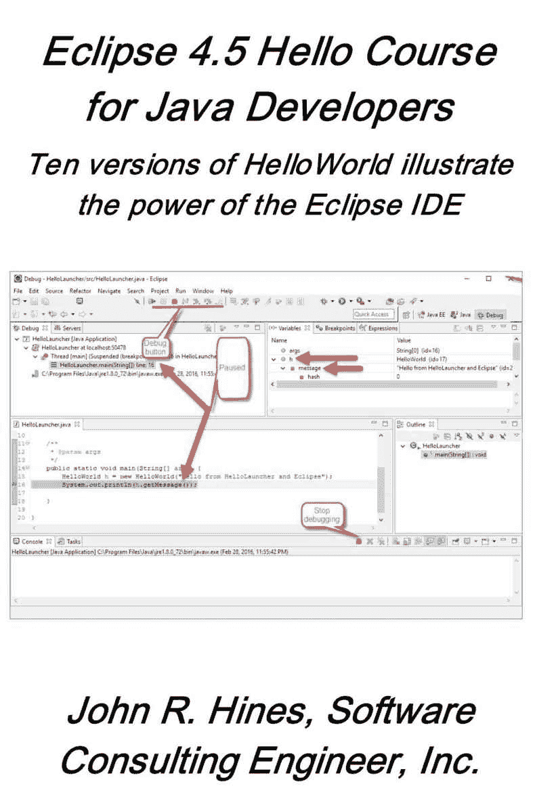

# Java 开发者 Eclipse 4.5 入门指南：十个版本的 HelloWorld 展现 Eclipse IDE 的强大功能



“抄窃是作者从一个来源窃取；学术积累是作者从多个来源汲取。” —— 匿名

“事实是固执的；无论我们的愿望、倾向或情感的驱动如何，它们都无法改变事实和证据的状态。” —— 约翰·亚当斯

Oholiab 第一定律：管理层对计算能力的需求会不断扩张，直到所有极客的服务器在工作时间内都 100% 地满用于运行数据库查询和打印报告。

Oholiab 第一定律的推论：只有在没有人想要服务器时，开发人员才能访问为开发购买的服务器。

**警告：** 如果你不够聪明，无法从这些笔记中分辨出珍珠和牛粪，那么你没有权限阅读它们！

| :--- | :--- |

```
System.out.println(messageProvider.getMessage());
```

为 `HelloMessageRenderer` 生成 setter 和 getter。

在 Project Explorer 中，右键点击 `HelloMessageRenderer`。当下拉菜单出现时，点击“Source->Format”。当 Eclipse 完成格式化 `HelloMessageRenderer.java` 后，保存并关闭。

将 `HelloLauncher.java` 的 `main()` 体替换为：

```java
HelloMessageRenderer hmr = new HelloMessageRenderer();
HelloMessageProvider hmp = new HelloMessageProvider();
hmr.setMessageProvider(hmp);
hmr.render();
```

在 Project Explorer 中，右键点击 `HelloLauncher`。当下拉菜单出现时，点击“Source->Format”。当 Eclipse 完成格式化 `HelloLauncher.java` 后，保存并关闭。

运行 `HelloSeparation`。运行成功。然而，`HelloMessageRender` 和 `HelloMessageProvider` 被硬编码在项目中（在 `HelloLauncher` 中）。更改消息将将困难。

> 可能的误步骤 10-1

> `HelloWorld.java` 是否被项目 `HelloSeparation` 使用？不，它被 `HelloLauncher`、`HelloMessageProvider` 和 `HelloRender` 替换了。

从项目中删除 `HelloWorld.java`。运行 `HelloSeparation`。运行成功。整洁了一些。

### 练习 10-2：使用接口改进 Hello 分离

将 `HelloSeparation` 复制到 `HelloSeparationWithInterfaces`。（你关闭 `HelloSeparation` 了吗？你已经将 `HelloSeparationWithInterfaces` 设置为打开展开的项目了吗？）我们（最终）将能够通过让 `HelloMessageProvider` 和 `HelloMessageRender` 实现接口来更改消息。

在 `HelloSeparationWithInterfaces` 项目中，右键点击 `HelloMessageProvider.java`。当下拉菜单出现时，点击 `"Refactor-> Extract Interface"`。当出现 `"Extract Interface"` 弹出窗口时，输入名称 `MessageProvider`，点击 `getMessage()` 旁的复选框，然后点击 `"OK"`。顺便说：注意接口的图标是一张纸，右上角有一个球，里面有一个大写的 `J` 和一个小写的 `I`。在并排的 Java 编辑器中打开 `MessageProvider.java` 和 `HelloMessageProvider.java`。这里不需要做其他，只需在 `HelloMessageProvider.java` 中将消息更改为 `"Hello from HelloSeparationWithInterfaces and Eclipse"` 并保存文件。

重复上述操作，从 `HelloMessageRenderer.java` 提取接口。在并排的 Java 编辑器中打开 `MessageRenderer.java` 和 `HelloMessageRenderer.java`。忽略注解（以 `@` 开头的行）。

运行 `HelloSeparationWithInterfaces`。它运行并显示了适当的消息。

### 问题

所有这些问题都假设项目是一个打开展开的项目。

### 我如何为我添加的新方法添加 Javadoc 注释？
输入 `/**` [ENTER]，然后输入 `*/` [ENTER]

### 为什么 `"Source->Generate Element Comment"` 没有给方法添加注释？
它本应该起作用的，但并没有生效。

## 第 11 章：添加工厂以改进 Hello 分离

### 类引用可以赋值什么？
`null` 或该类的对象，或该类的某个子类的对象。父类对象不能赋值给该引用。警告：该引用唯一能做的是调用原始接口中的方法。

### 接口引用可以赋值什么？
`null` 或实现该接口的某个（已定义的）类的对象、该类的某个子类的对象，或实现该接口子类的某个类的对象。实现父接口的类对象不能赋值该引用。警告：该引用唯一能做的是调用原始接口中的方法。

### 什么是子类？
子类别的另一个名称。

### 什么是工厂（工厂类）？
通过组合或扩展创建其他类或对象的类或对象。

### 什么是父类？
超类的另一个名称。

### 什么是引用？
具有类型的数据元素，其值是该类型对象或其子类型对象（在堆上）的地址。以前的 C 语言程序员可能将引用想为具有自控制功能的指针。

### 什么是类引用？
指向对象的引用，该引用只知道该对象的（已存在的）类或某个父类的特征和行为。

### 什么是子引用（子类引用）？
指向某个（已定义的）子类对象的引用。

### 什么是父引用（父类引用）？
指向父类（超类）的引用。父类引用可以赋值给子类对象，但它只能访问对象继承自其父类的部分。

### 什么是接口引用？
指向对象的引用，该引用只知道对象所在的类所实现的某些接口的行为。

### 我为什么要关心类引用和接口引用？
它们可以减少耦合并简化编码。

### 练习 11-1：通过添加工厂改进 Hello 分离

将 `HelloSeparationWithInterfaces` 复制到 `HelloSeparationWithInterfacesAndFactory`。

在 `HelloSeparationWithInterfacesAndFactory` 项目中，右键点击 `"(default package)"`。当下拉菜单出现时，点击 `"New->Class"`。使用名称 `MessageSupportFactory`。（你点击 `"Generate comments"` 旁的复选框了吗？）将下面的代码插入到 `MessageSupportFactory` 的体中。

```java
private static MessageSupportFactory instance = null;
private Properties props = null;
private MessageRenderer renderer = null;
private MessageProvider provider = null;

private MessageSupportFactory() {
    props = new Properties();
    try {
        props.load(new FileInputStream("msf.properties"));
        // get the implementation classes
        String rendererClass = props.getProperty("renderer.class");
        String providerClass = props.getProperty("provider.class");
        renderer = (MessageRenderer) Class.forName(rendererClass).newInstance();
        provider = (MessageProvider) Class.forName(providerClass).newInstance();
    } catch (Exception ex) {
        ex.printStackTrace();
    }
}

static {
    instance = new MessageSupportFactory();
}
```

出现了很多错误。点击第一次使用 `Properties` 右侧带有红色 `x` 的球。当帮助窗口弹出时，双击 `"import 'Properties' (java.util)"`。在编辑器窗口顶部注释正下方插入 `"import java.util.Properties"` 后，大部分错误都消失了。在第一次使用 `FileInputStream` 右侧带有红色 `x` 的球处重复操作。双击导入 `'FileInputStream' (java.io)`。不再有错误了！右键点击 public class 右侧的文本 `"MessageSupportFactory"` 并重新格式化类。注意该类假设我们会创建一个用于读取的 `msf.properties` 文件。

右键点击 `"MessageSupportFactory"`。当下拉菜单出现时，点击 `"Source->Generate Getters and Setters"`。选择 `instance`、`provider` 然后点击 `"OK"`。我们不会使用 setter 方法，所以把它们删除。

保存 `MessageSupportFactory.java`。双击 `HelloLauncher.java`。将 `main` 方法体替换为以下代码：

```java
MessageRenderer mr = MessageSupportFactory.getInstance().getRenderer();
MessageProvider mp = MessageSupportFactory.getInstance().getProvider();
mr.setMessageProvider(mp);
mr.render();
```

保存更改后的文件并关闭它。这段代码做什么的？如果在 `msf.properties` 中找到了 `HelloMessageProvider` 和 `HelloMessageRenderer`，`MessageSupportFactory` 就可以创建这些对象，代码运行方式如之前。但它也可以创建任何实现了 `MessageProvider` 和 `MessageRenderer` 的其他类，如果是那样，代码运行可能会不同。

双击 `HelloMessageProvider.java`。将返回消息更改为 `"Hello from HelloSeparationWithInterfacesFactory and Eclipse."` 保存并关闭。

现在创建 `msf.properties` 文件。右键点击 `HelloSeparationWithInterfacesFactory`。当下拉菜单出现时，点击 `"New->File"`。输入文件名 `"msf.properties"` 然后点击 `"Finish"`。在文件中输入以下文本。保存并关闭文件。顺便问：文件在项目结构中哪里？

```properties
# msf.properties
renderer.class=HelloMessageRenderer
provider.class=HelloMessageProvider
```

最后，编辑 `HelloMessageProvider.java` 中的消息，使其显示为 `"Hello From HelloSeparationWithInterfacesFactory"`。

运行 `HelloSeparationWithInterfacesFactory`。它运行并显示了适当的消息。

### 练习 11-2：通过添加工厂改进 Hello 分离 部分 2

将 `HelloSeparationWithInterfacesAndFactory` 复制到 `HelloSeparationWithInterfacesAndFactory2`。

在 `HelloSeparationWithInterfacesAndFactory2` 项目中，右键点击 `HelloMessageProvider.java`，当下拉菜单出现时，点击 `"Copy"`。右键点击 `"default package"`——当下拉菜单出现时，选择 `"Paste"`。为新类使用 `GoodbyeMessageProvider.java`。双击它在编辑器窗口中打开。将字符串更改为 `"Goodbye from HelloSeparationWithInterfacesFactory and Eclipse."` 保存并关闭。双击 `"msf.properties"` 在编辑器窗口中打开。更改以 `provider` 开头的行，使其变为

`provider.class=GoodbyeMessageProvider`

保存并关闭。

运行 `HelloSeparationWithInterfacesAndFactory2`。它运行并给出了不同的消息。因此，通过简单的文本文件更改应用程序的行为是可能的。无需编译！

### 问题

所有这些问题都假设项目是一个开放扩展的项目。

## 第 12 章：使用更智能的工厂进一步减少耦合

### 什么是 Spring？
Spring 框架家族的所有者，包括一个简化 Java 企业级应用开发的轻量级开源应用程序服务器。以前被称为 SpringSource (`http://www.springsource.org`)

### 什么是用户库 (user library)？
共同用途的有用外部 jar 包集合。

### 什么是 appender？
在 `Log4j` 中，日志文件数据的输出目标。

### 什么是外部 jar？
不是由工作区项目构建的 Jar 文件，通常由某些外部网站提供的 API Jar 文件。

### 练习 12-1：使用 Spring Framework 中的工厂改进 Hello 分离

要访问 Spring Framework，你需要从 `http://olex.openlogic.com/packages/spring/3.2.16` 下载 Spring Framework `3.2.16` (zip) ALL Binary。使用“解压所有”或某些 zip 程序将 Spring jars 解压到 `c:\MyCode`（或类似的地点，只要你不忘记放在哪里即可）。

将 `HelloSeparationWithInterfacesAndFactory` 复制到 `HelloSeparationWithInterfacesAndSpring`。

右键点击 `HelloSeparationWithInterfacesAndSpring` 项目。当下拉菜单出现时，点击“Build Path -> Configure Build Path”。当 `Java Build Path` 向导弹出时，点击 `Add Library…` 按钮。当 `Add Library` 向导弹出时，双击 `User Library`。当 `User Library` 向导弹出时，点击 `User Libraries…` 按钮。当 `User Libraries` 向导弹出时，点击 `New…` 按钮。当 `New User Library` 向导弹出时，输入名称 `Spring 3.2.16` 然后点击 `OK`。回到 `User Libraries` 向导，`Spring 3.2.16` 用户库应被选中。点击 `Add External JARs…` 按钮。当 Jar Selection 向导弹出时，转到解压 Spring Framework jars 的位置。双击 `libs` 文件夹。在文件夹中，高亮 `spring-beans.3.2.16.RELEASE`、`spring-beans.3.2.16.RELEASE-javadocs`、`spring-core-3.2.16.RELEASE` 和 `spring-core-3.2.16.RELEASE-javadocs` jars 并点击 `Open`。回到 `User Libraries`，查看结果后点击 `OK`。回到 `User Library`，点击 `Finish`。回到 `Java Build Path`，点击 `Apply` 然后点击 `OK`。注意 `HelloSeparationWithInterfacesAndSpring` 项目的变化。顺便说：如果你收到任何 Oomph 弹出窗口，只需点击 `OK`。你不应该收到，但是……

在编辑器窗口中打开 `HelloLauncher.java`。将 `main` 内部的代码替换为下面的代码：

```java
BeanFactory factory = getBeanFactory();
MessageRenderer mr = (MessageRenderer) factory.getBean("renderer");
MessageProvider mp = (MessageProvider) factory.getBean("provider");
mr.setMessageProvider(mp);
mr.render();
```


点击“BeanFactory with a red squiggle underneath”最右侧带有红色 x 图标的小文件夹。当帮助信息弹出时，双击高亮的 `import 'BeanFactory' …` 行。注意添加到 `HelloLauncher.java` 顶部的导入语句。是的，`getBeanFactory()` 仍然存在问题 - 它还不存在。将下面的方法粘贴到 `HelloLauncher.java` 的 `main()` 下方。

```java
private static BeanFactory getBeanFactory() throws Exception {

  // 获取 bean 工

  DefaultListableBeanFactory factory = new DefaultListableBeanFactory();

  // 创建定义读取器

  PropertiesBeanDefinitionReader rdr = new PropertiesBeanDefinitionReader(factory);

  // 加载配置选项

  Properties props = new Properties();

  props.load(new FileInputStream("beans.properties"));

  rdr.registerBeanDefinitions(props);

  return factory;

}
```

添加缺失的导入语句以消除编辑器向你显示的错误。

你仍然在 `getBeanFactory()` 上存在问题。再次点击带有红色 x 图标的小文件夹。哦，这只是一个未处理的异常。注意帮助提供了两个选项。在 `main()` 中添加 `throws Exception` 错误信息，或者用 `try/catch` 包围。由于 `main` 启动应用程序，你没有选择：你必须使用 `try/catch`，所以双击那个选项。不幸的是，你现在面临 `factory` 可能未初始的问题。一个拙劣但快速的解决方案是将 `factory` 初始化为 null：

```java
BeanFactory factory = null ;
```

你没有编译错误，所以可以运行程序。然而，你确实得到了一个文件 io 错误，因为没有 `beans.properties` 文件。这很容易修复。右键点击项目。当下拉菜单出现时，选择 "New->File"。当 File 向导出现时，输入文件名 `beans.properties` 然后点击 `Finish`。

你没有错误所以可以运行程序。现在你遇到了一个困惑的错误：找不到 `LogFactory`。除非你浪费大量时间阅读 Spring 文档，否则这很困惑。Spring 使用了 Apache Log4j 和。

你需要从 `http://logging.apache.org/log4j/1.2/download.html` 下载 `log4j-1.2.17.zip`。使用“解压所有”或某些 zip 程序将 Spring jars 解压到 `c:\MyCode`（或类似的地点，只要你不忘记放在哪里即可）。

回到 "Build Path->Configure Build Path"，创建一个 `User Library`，将 `log4j` 和 `commons-logging` 添加到库。你没有错误所以可以运行程序。但你有一个困惑的错误：找不到 bean `renderer`。然后你想起 `beans.properties` 是空的。在 `beans.properties` 中放置以下代码：

```properties
# renderer
renderer.class=HelloRenderer
# 让 Spring 将 provider bean 分配给
# renderer bean
renderer.ref=provider
# Message provider
provider.class=HelloProvider
```

再次，没有错误所以可以运行程序。这次，你遇到了类似 "log4j:WARN No appenders could be found for logger (org.springframework.core.Environment)" 的警告。经验丰富的 Log4j 用户会意识到你需要添加一个文件，并提供如下示例：

```properties
log4j.rootLogger = ERROR, myConsole
log4j.logger.com.spring = DEBUG, myFile, myConsole
log4j.additivity.com.spring = false
log4j.appender.myConsole = org.apache.log4j.ConsoleAppender
log4j.appender.myFile = org.apache.log4j.FileAppender
log4j.appender.myFile.file = myFile.log
log4j.appender.myConsole.layout = org.apache.log4j.SimpleLayout
log4j.appender.myFile.layout = org.apache.log4j.PatternLayout
#log4j.appender.myFile.layout.ConversionPattern=%r %p %c %x - %m%n
log4j.appender.myFile.layout.ConversionPattern=%-5p : %m %d{dd-MM-yy HH:mm:ss}%n
```

右键点击 "(default package)"。当下拉菜单出现时，点击 "New->Other..."。当 "Select a wizard" 弹出时，点击 "General->File" 然后点击 "Next" 按钮。当 "File" 弹出时，输入 `Log4j.properties` 然后点击 `Finish`。当 `Log4j.properties` 出现在文本编辑器视图中，将上述行粘贴到文件中。如果你没有看到任何错误，保存并关闭。顺便说：这个文件可能可能不会在 Log4j 的 myFile 中保存你想要的信息。但是，你可以测试并查看记录了什么！

再次，没有错误，你可以运行应用程序。你在“控制台”（Console）中看到了错误的信息：“…Factory…”。在 Java 编辑器中打开 `HelloMessageProvider`，将 `…Factory…` 替换为 `…Spring…`。

再次，没有错误，你可以运行应用程序。一切看起来正常。

### 练习 12-2：改进 Hello 分离清理

将 `HelloSeparationWithInterfacesAndSpring` 复制到 `HelloSeparationWithInterfacesAndSpring2`。

删除 `msf.properties` 和 `MessageSupportFactory.java`。

没有错误，运行应用程序。一切看起来正常，但你得到的是“ Hello from HelloSeparationWithInterfacesAndSpring and Eclipse!”而不是“…Spring2…”。在 `HelloMessageProvider.java` 中编辑消息字符串。

没有错误，运行应用程序。一切看起来正常。

### 问题

所有这些问题都假设项目是一个打开的扩展项目。

## 第 13 章：通过 DI（依赖注入）进一步减少耦合

程序员可能会认为，在编译代码之前，他仍然为每种不同的消息创建并添加一个新类。对于 `HelloSeparationWithInterfacesAndFactory2` 中使用的简单工厂类来说是如此的。但是，通过更智能工厂（例如 Spring Framework 提供的）XML，可以通过编辑文本文件无需重新编译即可消息。

### 什么是已弃（deprecated）？

过时的，不推荐（但可能仍然受支持）。顺便说：如果你使用了已弃类或方法，人们会在该已弃类或方法不再支持的那天诅咒你。

### 什么是 DI（依赖注入）？

用于软件库实现控制反转的设计模式。调用者将控制流委托给外部框架，用于发现和导入由调用者指定或“注入”的服务或软件模块。依赖注入有三种常见形式：基于 setter 的注入、基于接口的注入和基于构造函数的注入，其中注入依赖的责任分别由客户端、服务或构造方法承担。Spring 广泛使用 DI。

### 练习 13-1：使用 Spring 和 DI 改进 Hello 分离

将 `HelloSeparationWithInterfacesAndSpring2` 复制到 `HelloSeparationWithInterfacesSpringAndDI`。在 `HelloMessageProvider.java` 中编辑消息字符串。没有错误，运行应用程序。如果一切看起来正常，则继续。否则，修复问题。

在与 `src` 和库相同的层级创建一个空的 `beans.xml`。插入以下行：

```xml
<?xml version="1.0" encoding="UTF-8"?>
<!DOCTYPE beans PUBLIC "-//SPRING//DTD BEAN//EN" "http://www.springframework.org/dtd/spring-beans.dtd">
<beans>
<bean id="renderer" class="HelloMessageRenderer">
<property name="messageProvider">
<ref local="provider"/>
</property>
</bean>
<bean id="provider" class="HelloMessageProvider"/>
</beans>
```

### 可能的误操作 13-1

当你将 xml 粘贴到 `beans.xml` 时，格式消失了。你通过手动编辑 xml 修复它了吗？如果是这样，你就浪费了一些时间。你当时在 xml 编辑器中，所以它知道如何格式化 xml。高亮这些行，然后右键点击高亮部分。当鼠标弹出时，点击“Source->Format”。xml 格式就会重新出现。

（为什么这有效？`.xml` 文件是由 Xml 编辑器编辑的，而不是 Java 编辑器。当然，它知道如何格式化 Xml。）保存并关闭 `beans.xml`。

在 Java 编辑器中打开 `HelloLauncher.java`。将 `main()` 中的代码替换为以下语句：

```java
BeanFactory factory = getBeanFactory() ;
MessageRenderer mr = (MessageRenderer) factory.getBean("renderer");
mr.render();
```

将 `getBeanFactory` 替换为以下方法：

```java
private static BeanFactory getBeanFactory() throws Exception {
    // get the bean factory
    BeanFactory factory = new XmlBeanFactory(new FileSystemResource("beans.xml"));
    return factory;
}
```

对类 `XmlBeanFactory` 的引用产生了错误。Eclipse 没有提示我们需要为 `XmlBeanFactory` 哪个 jar 文件。然而，google 建议使用 `org.springframework.beans.factory.xml.XmlBeanFactory`。插入：

```java
import org.springframework.beans.factory.xml.XmlBeanFactory;
```

在导入列表的底部，错误消失了。但是，为什么 `XmlBeanFactory` 被划了线？Eclipse 正在警告你 `XmlBeanFactory` 已被弃。但仍然受支持。此外，`FileSystemResource` 处的错误可以通过右键点击 `FileSystemResource` 来解决。选择项目“import 'org.springframework.core.io.FileSystemResource'”。错误消失了。

你没有看到任何错误，但看到了警告（“factory can only be null”或类似的）。运行它。一切看起来运行正常。

### 练习 13-2：使用 Spring、DI 和更多 Xml 改进 Hello 分离

将 `HelloSeparationWithInterfacesSpringDIAndXml` 复制到 `HelloSeparationWithInterfacesSpringDIandMoreXml`。

将 `HelloMessageProvider` 的内容替换为：

```java
private String message = "Hello from HelloSeparationWithInterfacesSpringDIAndMoreXml and Eclipse!";

/** (nonJavadoc)
 * @see MessageProvider#getMessage()
 */
@Override
public String getMessage() {
    return message;
}

public HelloMessageProvider(String message){
    this.message = message;
}
```

为数据成员和构造函数添加 Javadoc 注。打开 `beans.xml`。将 bean provider 替换为以下：

```xml
<bean id="provider" class="HelloMessageProvider">
    <constructor-arg>
        <value>This is a configurable message</value>
    </constructor-arg>
</bean>
```


保存并关闭。如果没有错误，则继续。否则，修复问题。运行应用程序。注意控制台中的消息。文本文件`beans.xml`控制消息！

### 问题

所有这些问题都假设项目是一个打开的扩展项目。除了点击带有红色 x 的小文件夹，你还可以做什么帮助？

## 第 14 章：导出现有项目，导入现有项目

在 Eclipse 中导出什么？

将现有的 Eclipse 格式的文件或文件系统转换为非 Eclipse 格式（或其他其他 Eclipse 格式）。警告：你必须区分 Java 导出和 Eclipse 导出。

在 Java 中导出什么？

将现有的未压缩文件或文件系统转换为 Java 压缩格式（通常是 EAR、JAR 或 RAR）。你必须区分 Java 导出和 Eclipse 导出。

在 Eclipse 中导入什么？

将现有的 Eclipse 文件或文件系统或非 Eclipse 文件系统转换为某种格式（通常是项目）。你必须区分 Java 导入和 Eclipse 导入。

在 Java 中导入什么？

将现有的某种压缩 Java 文件格式转换为 (1) 未压缩格式或 (2) 其他压缩 Java 格式。你必须区分 Java 导入和 Eclipse 导入。

什么是 EAR 文件格式？

包含运行企业应用程序所需的所有类文件和其他资源的编译封装的平台无关格式。通常用作企业应用或 J2EE 企业应用的同义词。Ear 文件部署在应用程序服务器上。

什么是 JAR 文件格式？

一种将许多文件聚合成一个的编译封装的平台无关格式。多个 Java 类及其所需的组件（`.class`文件、图像、声音和其他资源文件）可以封装在 JAR 文件中，并随后通过单个 HTTP 事务下载到客户端。该格式支持文件压缩和数字签名。

什么是 WAR 文件格式？

一种包含目录结构的编译封装的平台无关 Web 应用程序。war 文件部署在 Web 服务器上。一种 jar 文件类型。

什么是 Jar (Java ARchive)？

一种跨平台文件格式，它将多个类文件以及图形、声音文件等其他文件分组（并可能压缩）到一个文件中。通过单个 HTTP 事务即可下载整个`JAR`文件。EJB Jar 是`JAR`的一种特殊形式，包含一个 EJB。

### 什么是 JAR 文件 (.jar file)？

一种基于`PKZIP`格式的压缩格式（JAR 文件格式），将许多文件聚合到一个文件中。Java 可以在不解压的情况下直接读取`JAR`文件。它可以具有（通常具有）相对目录结构。可以使用`ZIP`查看器查看（但不能由其创建）。可以使用像`WinZip`或`7UP`等更强大的`ZIP`工具创建。

### 什么是可执行 jar 文件？

包含一个清单文件（manifest file）的 Jar 文件，该文件列出了主类。在命令行输入文件名即可启动主类的 main 方法。

## 什么是 EAR（Ear 文件）（EAR 文件）（企业级归档文件）？

包含了企业级应用运行所需的所有类和其他资源。通常作为企业级应用或 J2EE 企业级应用的同义词`Ear`文件部署在应用程序服务器上。

### 什么是提取所需的库？

将所需的类复制到可执行 jar 中。

### 什么是打包所需的库

将整个库文件`jars`复制到可执行 jar 中。

### 问题

所有这些问题均假设项目是一个打开的项目。

## 附录

### 附录 I：问题解答

### 第 7 章

创建新项目的两种方法是什么？提示：点击`File`。查看下拉菜单，然后在工具栏图标上悬停。

点击`File->New`。点击工具栏最左侧带有黄色加号的蓝色白色矩形图标`New`，然后点击`New`。

在 Java 编辑器中打开`HelloWorld.java`的两种方法是什么？

双击`HelloWorld.java`。右键点击`HelloWorld.java`。当下拉菜单出现时，点击`Open`。顺便问一下：点击`Open With`会发生什么？

关闭 Java 编辑器的另一种方法是什么？

点击编辑器标签页上的`X`。

保存修改后的`HelloWorld.java`文件的另一种方法是什么？

点击编辑器标签页上的`X`并回答弹出的提示。

运行 Hello 项目的另一种方法是什么？

点击`Run`菜单下的`Run`（或`Run As`）。点击`Run`图标（带有白色右三角形的绿球）。顺便问一下：点击启动图标左侧的下拉列表（带有工具箱的带有白色右三角形的绿球）会发生什么？

关闭 Hello 项目的另一种方法是什么？

高亮显示该项目，点击`Project`菜单，然后选择`Close Project`。

当你看到带有三个点的菜单下拉列表项时，它意味着什么？

点击该项后将出现另一个菜单。

Eclipse 从哪里获取`@author`标签的文本？

打开文件管理器并查看`Users`文件夹下的名称。

#### 第 8 章

打开已关闭项目的其他方法是什么？

在`Project Explorer`中选择项目。点击`Project->Open Project`。

为什么`File-> Close`不关闭已打开的项目？

关闭的是编辑窗口。

### 第 10 章

我如何为我添加的新方法添加 Javadoc 注释？

输入`/**[ENTER]`，然后输入`*/[ENTER]`。

为什么`Source->Generate Element Comment`没有给方法添加注释？

我不确定。它似乎失效了。

### 第 12 章

除了点击带有红色 x 的小文件夹来获取帮助，你还可以做什么？

点击`Help`菜单。

## 作者简介

John R Hines 拥有两所州立大学的学位（科罗拉多大学和亚利桑那州立大学）。他曾担任半导体工程师、程序员、作家和教师。他现在退休于德克萨斯州的卢卡斯。

20 世纪 80 年代，美国专利商标局授予六项专利，他开始编写关于使用计算机解决问题的。他写了一本关于电路仿真的书，并在世界 500 强公司教授过 SPICE（集成电路强调仿真程序）课程。

20 世纪 90 年代，他在 Electronic Test 和 Design Automation 等流行行业杂志以及 IEEE Spectrum 等学术术杂志上撰写了计算机相关的专栏，并教授 C、C++、Delphi 和 Java。

2000 年代，他是美国最佳电话公司的 Java 开发人员。

2014 年，他退休了。他编写电子书并正在寻找兼职的 Android 编程工作。可以在 JR Hines、John Hines 和 John R Hines 下搜索他。

Eclipse 4.5 Hello 课程是他第十三本自出版的书。

他之前出版过两本大型和一本小型的电子词典（主要是 Java - 分布式计算字典、面向浪漫小说和海军小说读者的 17-19 世纪术语字典以及 CCNA R&S 词典），两本关于电子预订的小型电子书（使用表格创建 EPUB 文档与屏幕文本通信），一份关于日历的短记（格列哥日历笔记），和一个 Calibre 课程。（他认为自己现在更聪明了，所以之前的书籍将重写并重新发行。）

他学会了编写 iPhone 和 iPad 代码，并编写了两本关于 iOS 8 编程的小型电子书《OS X Yosemite 文件系统笔记：一个 Windows 程序员：他并不太喜欢它》。

### 什么是命令行界面？
### 什么是发布（版本）？
### 什么是视觉化 IDE？
### 什么是 WIMP 界面？
### 什么是工作空间？
### 什么是 IDE？
### 在开始安装之前我应该了解什么？
### 安装
### 在哪里可以找到 mars 的在线帮助？
### 在哪里可以找到 mars 图标的含义？

## 第 4 章：Eclipse 4 术语
### 什么是构建（名词）？
### 什么是包（bundle）？
### 什么是特性（facet）？
### 什么是功能（feature）？
### 什么是文件（file）？
### 什么是文件夹（folder）？
### 什么是透（perspective）？
### 什么是插件（plug-in）？
### 什么是项目（project）？
### 什么是资源（resource）？
### 什么是标签（tag）？
### 什么是任务列表（task list）？
### 什么是任务视图（任务标签页）（标签视图）？
### 什么是视图（view）？
### 什么是编辑器（editor）？
### 什么是“内置的”（baked-in）？
### 什么是 JDT（Java 开发工具）？
### 什么是构建路径（build path）？

## 第 5 章：Eclipse 4 文件系统
### Eclipse 平台是如何组织信息的？Eclipse 工作区是如何组织信息的？
### 工作空间目录中包含什么？
项目目录中包含什么？
### 工作空间中的 .metadata 文件夹包含什么？

## 第 6 章：Eclipse 4 IDE
### Java EE IDE 看起来和 Java IDE 不一样吗？
### IDE 中的三个区域是什么？
### “菜单和工具栏区域”中有什么？
### 项目资源管理器视图（Project Explorer）和包管理器视图（Package Explorer）有什么区别？
### 什么是大纲视图（outline view）？
### 什么是问题视图（问题标签页）？
### 在哪里可以找到 IDE 中图标的信息？
### 在哪里找到 eclipse 错误日志？

### 使用 Eclipse 创建基础 Java 应用

## 第 7 章：使用 Eclipse IDE 创建、构建并运行 HelloWorld
### 启动 Eclipse
### 错误图标是什么样子的？
### 警告图标是什么样子的？
### 什么是折叠编辑器（folding editor）？
### 什么是警告（warning）？
### 什么是错误（error）？
### 什么是执行 JRE（execution JRE）？
### 什么是代码折叠（code folding）？
### 什么是“钻取”（drill down）？
### 什么是 Javadoc？
### 什么是作用域（scope）？
### 关闭的项目、打开的项目和展开的项目有什么区别？
### 项目资源管理器（Project Explorer）和包管理器（Package Explorer）有什么区别？
### 练习 7-1：创建一个 Hello1 项目
### 练习 7-2：创建一个带有 main 的 Hello 项目
### 练习 7-3：比较`HelloWorld.java`和`Hello1.java`
### 练习 7-4：关闭`Hello`和`Hello1`
### 练习 7-5：删除`Hello1`项目
### 练习 7-6：在`Hello`项目的`main`方法内部添加方法调用
### 练习 7-7：运行`Hello`项目
### 练习 7-8：为什么`Hello`项目会有警告？
### 练习 7-9：关闭`Hello`项目

## 第 8 章：从 Hello 项目创建新项目
### 什么是全限定名（fully qualified name）？
### 什么是重构（refactoring）？
### 什么是启动模式（设计模式）？
### 什么是启动器（launcher）？
### 练习 8-1：复制`Hello`项目并将其命名为`HelloArgs`
### 练习 8-2：将`Hello`项目复制为`HelloLauncher`

# 第 9 章：调试 HelloLauncher
### 什么是调试（debugging）？
### 什么是断点（breakpoint）？
### “切换断点”（Toggle breakpoint）意味着什么？
### 练习 9-1：调试`HelloLauncher`项目

# 第 10 章：通过职责分离减少耦合（更多但更小的类）
### 什么是`@Override`
### 什么是耦合（coupling）？
### 什么是提供者（provider）？
### 什么是渲染器（renderer）？
### 什么是 SoR（职责分离）？
### 什么是注解（annotation）？
### 练习 10-1：改进 Hello 分离（减少 Hello 耦合）（解耦 Hello）
### 练习 10-2：通过接口改进 Hello 分离

## 第 11 章：添加工厂以改进 Hello 分离
### 类引用可以赋值给什么？
### 接口引用可以赋值给什么？
### 什么是子类（child class）？
### 什么是工厂（工厂类）？
### 什么是父类（parent class）？
### 什么是引用（reference）？
### 什么是类引用（class reference）？

### 什么是接口引用？
### 为什么我关注类引用和接口引用？
### 练习 11-1：通过添加工厂改进 Hello 的解耦
### 练习 11-2：通过添加工厂改进 Hello 的解耦（第二部分）

## 第 12 章：通过更智能工厂进一步降低耦合
### 什么是 Spring？
### 什么是用户库？
### 什么是 appender（追加器）？
### 什么是外部 jar 包？
### 练习 12-1：使用 Spring Framework 的工厂改进 Hello 的解耦
### 练习 12-2：改进 Hello 的解清理
### 问题

## 第 13 章：通过 DI（依赖注入）进一步降低耦合
### 什么是废弃？
### 什么是 DI（依赖注入）？
### 练习 13-1：使用 Spring 和 DI 改进 Hello 的解耦
### 练习 13-2：使用 Spring、DI 和更多的改进 Hello 的解耦
### 问题

## 第 14 章：导出项目，导入现有项目
### Eclipse 中的 export（导出）意味着什么？
### Java 中的 export（导出）意味着什么？
### Eclipse 中的 import（导入）意味着什么？
### Java 中的 import（导入）意味着什么？
### 什么是 EAR 文件格式？
### 什么是 JAR 文件格式？
### 什么是 WAR 文件格式？
### 什么是 Jar（Java 存档）？
### 什么是可执行 jar 文件？
### 什么是 EAR（企业级存档文件）？
### 什么是提取所需的库？
### 什么是包所需的库
### 问题

## 附录
### 附录 I：问题解答
### 第 7 章
### 第 8 章
### 第 10 章
### 第 12 章

## 作者简介
