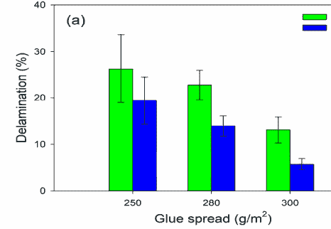
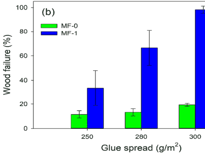

# 冷固三胺基胶水涂布分布对 Jabon 木基交层胶木材粘接强度、分层及木材失效的影响

**单位与联系方式：**

- <sup>1</sup>生物质与生物生产研究中心，国家研究与创新机构，Cibubong 16911, West Java, Indonesia
- <sup>2</sup>林产品系，森林与环境学院，IPB大学，Bogor 1648, West Java, Indonesia
- 联系邮箱：`yusuf07@brin.go.id` (Y.A.); `karlinasari@apps.ipb.ac.id` (L.K.)

**摘要：** 交叉层积材（CLT）因其创新特性和快速发展已成为一种流行的工程木材，涉及多种木材种类和胶剂的使用。本研究旨在评估在使用Jabon木和冷固型三胺类胶剂时，在三种不同涂布率（250、280和300 g/m²）下，胶水应用对CLT粘接强度、分层和木材失效的影响。该胶剂由三胺甲醛、添加5%柠檬酸、3%聚聚型4,4'-亚甲基二苯异氰酸酯（pMDI）和10%小麦粉组成。这些成分的加入增加了粘度并降低了强度。根据16531/2021标准对使用三胺类胶剂压胶工艺制成的CLT样品进行评估。结果显示，较高的胶涂布量会导致更大的粘接强度、更少的分层和更高的木材失效。与密度和粘接强度相比，胶涂布量对木材失效的影响更大。在CLT上应用300 g/m²的胶涂布量使其产品符合标准。使用改性MDF生产了一种可持续产品，从较低的热能消耗来看，它是CLT生产的一种种可行方案。

**关键词：** 粘接强度；柠檬酸；Jabon木；三胺甲醛；pMDI

文章

引用：Amin, Y.; Adji, R.P.; Rahulis, M.A.R.; Nugroho, N.; Bakhtri, E.; Diwanto, W.; Karlinasari, L Effect of Glue Spread on Bonding Strength, Delamination, and Wood Failure of Jabon Wood-Based Cross-Laminated Timber. 2023, *15*, 2349. `https://doi.org/10.3390/polym1552349`

学术编辑：Hiroshi Yoshihara

# 1. 引言

由于对环保建筑材料的需求日益增加以及全球发展的发展[1–4]，工程木制品已变得流行。交叉层积材（CLT）是这类产品的一种示例，它是一种通过胶合木材层压生产的可行建筑材料，每层相互正交排列并用结构胶水粘合[5,6]。作为结构应用的建筑材料[7,8]，其具有的交叉层积材（CLT）机械和物理学特性优于胶合木材、定向刨板等其他类型。

最近，CLT在欧洲以外的市场引起了关注[4,9–11]。即使日本已开始生产CLT，而马来西亚和印度尼西亚等国处于发展早期[10]。需要大量的研究和开发来生产高质量的本地CLT产品。必须考虑原材料等因素，以确保质量、强度、粘接特性和耐久性[12]。

由于树种种类和可用胶剂的不同，各国的生产工艺可能有所不同。因此，应探索本地树种生产CLT的参数，包括胶剂类型、胶水消耗量和压力[7]。

使用木材层生产CLT以提高效率并改善质量。胶剂的选择是一个关键的因素。用于制造CLT的胶剂包括酚醛、三胺甲醛（MF）、聚氰酸盐和聚氨酯[13]，而在欧洲，酚醛和异氰酸盐被广泛使用[2]。胶剂被广泛用于CLT生产是因为其成本相对较低、粘接良好且耐湿性[14]。然而，作为热固性胶剂，MF通常采用热压，这涉及额外的能源成本。Marine等[18]显示三胺胶剂的固化温度为140–160 °C。热处理期间会产生甲醛释放[19]。需要改性三胺类胶剂以在不降低CLT产品机械强度的情况下进行冷压应用。在本研究中，使用了Artocarpus Rox. japon和改性三胺类胶剂来制造CLT[20]。

为了提高交叉层积材（CLT）的生产，开发了一种含有亚甲基甲醛（MF）4,4'-亚甲基二苯异氰酸酯（PDI）的新冷固型胶剂配方。PDI树脂在生产中密度密度板方面证明了其有效性[23]。制造CLT时使用的胶剂量也应是决定机械性能和成本的变量。本研究旨在评估基于MF和PDI的冷固型胶剂制成的Jabon木CLT产品的分层、粘接强度和木材失效，涂布量分别为250 g/m²、280 g/m²和300 g/m²。

# 2. 材料与方法

## 2.1. 材料

商业三胺胶（MF-0）由PTolite, Proboling, East Java供应。小麦粉、工业级柠檬酸和聚型4,4'-亚甲基二苯异氰酸酯（PDI）从市场上获得并由国家研究与创新机构（BRIN），Cibubong, Indonesia提供。生产CLT的原材料来自西爪Bogor地区的Jabon木。木材密度为0.44 g/cm³，含水量为12%。为了制作CLT木材，准备了长度300 mm × 宽度110 mm × 厚度20 mm的尺寸。

## 2.2. 三胺类胶剂的制备

准备了两种三胺类胶剂：作为对照的商业胶（MF-0）和改性胶（MF-1）。为了改性化学胶剂（MF-1），添加了多种成分：小麦粉作为填充剂、柠檬酸作为催化剂以及PDI作为交联剂。柠檬酸和PDI的5%和3%。小麦粉占总混合物的10%。混合物在27 ± °C下手动搅拌1-2分钟，得到合适的冷固型三胺类胶剂。

## 2.3. 胶剂的表征

使用日本京都Horiba数字pH计测量MF-0和MF-1的pH水平。将约50 g胶剂样品放在100 ml玻璃杯中，3-5分钟后记录pH值，重复3次[26]。

为了确定MF-0和MF-1的非挥发性固体含量，将每种胶剂2 g放在箔纸并在105 °C下干燥3小时。干燥后，通过初始重量测量烘干胶剂的重量，并三次测量固体含量[27]。

为了测量胶剂的粘度，将每种胶剂的约20 ml放在量杯（德国Anton Paar）中并放在旋转黏度计（RheoQC, Anton Paar）上。使用桨型圆柱在剪切速率15 s/s和温度25 °C下测量胶剂的平均粘度。使用Rheocom软件（版本1.30, Anton Paar）获得粘度值；在150 s/s的恒定剪切速率下持续200分钟测量强度型胶剂的动态粘度和内聚力。

为了确定三胺类胶剂的凝胶时间，利用凝胶计（Tech GT-6, Colevern, Franklin Hills, IL, USA）。将胶剂样品放在管中，并将针浸入。测量胶剂在100 ± 3 °C下固化的时间并记录三次。MF-0和MF-1的凝胶时间也使用相同的方法进行了验证。

## 2.4. CLT 的制备

CLT 的制造基于木结构标准 EN 16531:2021—CLT 要求 [29]。三层皂木（jabon）CLT 使用甲醛树胶剂制造。在研究中，纵向层胶由尺寸为 330 mm × 110 mm × 20 mm 的山毛木组成，总共使用了 18 根木材。还使用了由 27 根尺寸为 110 mm × 110 mm 的木材组成的横向层胶。用用 MF 胶剂粘接的 CLT 在 250、280 和 300 g/m² 的不同胶涂量下，在 1 MPa 压力下冷压 2-4 小时，并在 100 °C 下进行热处理制备（图 1）。MF-0 本身不能作为冷固胶剂；因此，CLT 必须通过热压（热处理）来制备。相比之下，根据初步试验和之前的研究 [12,30]，粘接 MF-1 的 CLT 是在 1 MPa 下冷压 2 小时制的。与 MF-0 胶剂一样，MF-1 粘接 CLT 使用了不同的胶涂量，分别为 250、280 和 300 g/m²。用冷固甲醛树胶剂（MF-1）粘接的 CLT 制备过程如图 2 所示。

`(img/6decd15101152cf788f8cb0286b2f312_3_0.png)`

- 商用 MF 胶剂 (MF-0)
- 皂木材的制备
- 胶涂量 (250, 280, 300 g/m²)
- 木材层层（3 层，与相邻层垂直）
- MF-0 粘接 CLT
- 热处理 (100 °C, 2h)
- 压力与夹紧 (1 MPa)

图 1. 使用热处理制备 MF-0 粘接的 CLT。

`(img/6decd15101152cf788f8cb0286b2f312_3_1.png)`

- 冷固甲醛树胶剂 (MF-1): MF-0 + 柠檬酸 + pMDI + 小麦粉
- 皂木材的制备
- 胶涂量 (250, 280, 300 g/m²)
- 冷固甲醛树胶 CLT
- CLT 的冷压 (1 MPa, 2 h)
- 木材层层（3 层，与相邻层垂直）

图 2. 使用冷压制备 MF-1 粘接的 CLT。

## 2.5. CLT 性能评估

为了根据 EN 16531:2021 [29] 进行层间剥离测试，将 CLT 样本切割成 100 mm × 100 mm × 60 mm。每种胶涂量测试三个试样，并将其浸没在压力容器内的常温水中。应用 85 kPa 的真空并保持 30 分钟，然后释放并施加 600–700 kPa 的压力，保持 2 小时。之后，测试试件在 65 °C 温度下干燥约 12–20 分钟。对于每个试样，记录了总剥离和最大剥离量，并使用公式 (1) 和 (2) 计算剥离百分比 [12]。

```
Delamination_{tot} = 100 \frac{tot_{delam}}{tot_{glue\_line}} (1)
```

```
Delamination_{max} = 100 \frac{max_{delam}}{glue\_line} (2)
```

其中 `tot_{delam}` 是总剥离长度，`tot_{glue\_line}` 是剥离试样中所有胶线的和，`max_{delam}` 是最大剥离长度，`glue\_line` 是剥离试样中一条胶线的周长。

通过之前发表的方法 [31] 对交叉层胶木 (CLT) 的粘接强度进行评估。将 CLT 切成剪切试样（如图 3 所示），使用 50 kN 万用试验机（50 kN, Shimadzu, Kyoto）在 2 mm/min 的横跨速度下进行剪切测试。此外，根据 EN 16531 标准，评估了三个剪切试样的粘接强度。

`(img/6decd15101152cf788f8cb0286b2f312_4_0.png)`

图 3. 基于 Zhou 等 [31] 的 CLT 剪切测试图 (a) 和 (b)。

## 2.6. 统计分析

该研究使用方差分析 (ANOVA) 比较了 MF-1 生成的交叉层胶木 (CLT) 的剥离平均值、粘接强度和失效宽度。在 `\alpha=0.05` 的显著水平下进行 Duncan 测试，以确定胶涂量对剥离和粘接强度的影响。使用 SPSS 软件（SPSS Inc., Chicago）进行统计分析。

# 3. 结果与讨论

## 3.1. 冷固甲醛胶剂的性能

表 1 显示了胶剂的特性。MF-0 和 MF-1 的固体含量分别为 51 和 48。这代表了粘接产品的总固体。根据之前发表的研究 [32]，甲醛胶剂的固体含量随甲醛浓度的增加而增加。MF-1 中加入柠檬酸、pMDI 和小麦粉导致了固体含量的减少。这一结果与之前的研究一致，即加入 NH4Cl 作为固化时甲醛胶剂的固体含量减少。

表 1. 冷固甲醛胶剂的性能。

| 胶剂类型 | 固体含量 (%) | 凝胶时间 (min, T=100 °C) | 粘度 (mPa·s, T=25 °C) | pH |
| :--- | :--- | :--- | :--- | :--- |
| MF-0 | 51.89 ± 0.36 | 30.27 ± 0.13 | 484.51 ± 3.69 | 7.67 ± 0.58 |
| MF-1 | 48.58 ± 0.08 | 6.90 ± 0.10 | 570.45 ± 14.80 | 6.67 ± 0.58 |

木胶剂中的凝胶时间是指胶剂形成胶的时间。这种胶的形成建立了分子间更强的连接，导致更强的粘接。随着胶的形成，胶剂的粘度增加，流动性变差。这种粘度极高且胶剂形成胶的点被称为凝胶点。发现 MF-0 的凝胶时间是 MF-1 的五倍，这种差异归于使用柠檬酸催化剂或 pMDI 交联剂。MF-1 通过添加柠檬酸和 pMDI 。这些催化剂和交联剂的加入促进了长链的形成。这一发现与之前的研究一致，即加入 NH4Cl 时甲醛胶剂的凝胶时间会减少。[31] 的一项研究报道加入 1–2% 的 pMDI 可以缩短甲醛胶剂的凝胶时间。

MF-1 中加入 5% 的柠檬酸和 3% 的 pMDI 导致其 pH 低于 MF-0，分别为 6.67 和 7.67。这种差异可归于柠檬酸中的羧基 (–COOH) 和 pMDI 中的异氰酸基 (–NCO)，它们可以与甲醛 (HCHO) 和甲基基 (–CH2OH) 反应形成甲醛胶剂中的交联聚合物。

平均粘度是抗压能力的衡量。对于液体胶剂，平均粘度与液体的厚度有关。对照胶剂 MF-0 的粘度为 484.51 mPa·s，而 MF-1 的粘度更高，这是由于柠檬酸和 pMDI 的作用形成了更大的分子链。最近的研究 [35] 报道加入 2% pMDI 后甲醛胶剂的粘度增加。

使用旋转粘度计分析了甲醛胶剂的动态粘度和凝聚强度，如图 4a 所示。与平均粘度一致，MF-1 的动态粘度高于 MF-0。在 200 分钟内，动态粘度处于 545–587 mPa·s 范围内，而 MF-0 约为 473–489 mPa·s。这一结果显示 MF-1 的粘度在 200 分钟内与 MF-0 相比显著增加。此外，MF-0 的分子在 200 分钟内相对稳定。胶剂的凝聚力与

Polymers 2023, 15, 2349

粘度，粘度越高意味着抗变形能力越强，这会导致粘剂内部形成更强的内键。在这项研究中，MF-1 较高的粘度导致其内聚强度达到 82-89 Pa，高于 MF-0 的 71-73 Pa（图 4b）。因此，预计使用 MF-1 粘接的 CLT 具有比 MF-0 更好的性能。

`(img/6decd15101152cf788f8cb0286b2f312_6_0.png)`

图 4. 冷固三聚甲胶剂的 (a) 动态粘度和 (b) 内聚强度。

粘胶剂类型以及伯级胺中官能团（如 –N-H$_2$、C-H、C=O 和 –N-H）的变化通过其 3235、2960、1640 和 1565 cm$^{-1}$ 的光谱波数被识别。FTIR 光谱未检测到三聚甲胶剂之间的任何差异（图 5）。然而，固化过程中，由于三聚甲胶剂、催化剂和交联剂之间的反应形成了三维网络，官能团发生了微移。固化后，在 3225 cm$^{-1}$ 观察到 –N-H$_2$ 强度降低，而伯级胺的 C-H、C=O 和 N-H 官能团在 2960、1640 和 1566 cm$^{-1}$ 被检测到。理论上，三聚甲胶剂中的交联聚合物是通过柠檬酸中的 –COOH 和 pMDI 中的 –NCO 与 HCHO$_{free}$ 以及 –CH$_2$OH 基团反应形成的 [26,27]。

`(img/6decd15101152cf788f8cb0286b2f312_6_1.png)`

图 5. 冷固三聚甲胶剂的 FTIR 光谱。

进行 DMA 测试是为了探索三聚甲胶剂的热力学特性，如图 6 所示。该方法评估了粘弹性物质在不同温度下振荡时的机械响应。此外，比较了粘剂的储能模量 (E')、损耗模量 (E'') 和 tan delta（E'' 与 E' 的比值）。E' 参数衡量材料中储存的能量量，它取决于温度类型和振荡频率。另一方面，E'' 评估了由于分子部分在粘性流中耗散的能量量 [28]。MF-1 在 38.4 °C 时检测到最大 E' 为 467.9 GPa，并随温度升高而增加。E' 的初始下降归于温度降低时的弛豫。此外，E' 向峰值增加，这可能归于粘剂的胶凝过程，在该过程中形成了广泛的分子网络。此外，E' 在达到最大值后增加，这一发现也通过 tan delta 反映了胶化过程。这种反应导致了网络的形成，从而导致了有效的耗散。然而，未能检测到 MF-0 的最大 E'，可能是由于没有催化剂和交联剂的情况下没有发生硬化和交联反应。

`(img/6decd15101152cf788f8cb0286b2f312_7_0.png)`

图 6. 冷胶化三聚甲胶剂的 DMA 曲线 (a) (MF-0) 和 (b) (MF-1)。

## 3.2. 粘接强度与分层

对于 CLT 制造商和消费者，最重要的因素是结合完整性，涉及粘接强度和分层 [5,34]。结合完整性是指两层之间的粘接强度，受粘剂类型、木材种类和表面处理的影响。粘接强度可以通过抗剪强度测试来确定。需要开发一种新的粘剂格式，因为商业 MF 无法直接应用于 CLT 压。我们的试验表明商业 MF 的粘接效果良好。作为结果，使用三聚甲胶剂制造的 CLT (MF-0) 在 1 MPa 下粘接并在 100 °C 下固化 2 小时，如图 1 所示。通过冷压成功测试了使用 MF-1 的 CLT 性能。抗剪测试显示 MF-0 在 300 g/m² 涂胶量下的粘接强度分别为 2.13 MPa、1.94 MPa 和 1.03 MPa（图 7）。

使用 MF-1 的 CLT 的最高粘接强度为 3.14 MPa，分别在 300 g/m² 和 250 g/m² 的涂胶量下实现。图 7b 显示了 MF-1 的抗剪强度和负载-位移曲线。随着涂胶量的增加，在更大的位移处观察到更大的载荷。使用 300 g/m² 涂胶量的 MF-1 在 8.3 mm 位移处达到约 9750 N 的最大载荷，280 g/m² 涂胶量在 5.9 mm 位移处产生最大载荷 5506 N，250 g/m² 涂胶量在 3.6 mm 位移处产生最大载荷 3400 N。

`(img/6decd15101152cf788f8cb0286b2f312_8_0.png)`

**图 7.** 不同涂胶量下使用三聚甲胶剂粘接的 CLT 抗剪强度 (a) 对照 (MF-0) 和改性 MF (MF-1)，以及 MF-1 的抗剪强度负载-位移曲线 (b)。


CLT 的粘接可以通过 5% 柠檬酸和 3% PMDI 增强，这通过 MF、柠檬酸和 PMDI 的相互作用形成了较大的分子链。使用 `MF-1` 粘剂的 CLT 粘接强度大于 `MF-0`，由于 `MF-1` 广泛的分子链和高内聚强度的形成。300 `g/m²` 的涂胶量和 1 MPa 的压力使 `MF-1` 的 CLT 抗剪强度值 (3.14 MPa) 优于层压竹和木材 (CLT) (2 MPa)。Yang 等人 [34] 也报告说，200 `g/m²` 涂胶量和 1 MPa 粘接压力下 CLT 在主方向上的抗剪强度为 2.47 MPa。`MF-1` 在 280 和 300 `g/m²` 涂胶量下的 CLT 抗剪强度分别为由云杉-松-冷杉木的聚氨酯、异氰酸乳酯和甲酚树脂胶制成的 CLT 数值。

CLT 板的剪切性能是板材失效的关键因素，因为层之间承受的应力垂直于板的主轴 [8]。在 CLT 抗剪测试中，主要的失效模式是垂直于纹理的，导致与相同层压木材相比抗剪强度较低。研究表明，`MF-0` 和 `MF-1` 粘接的 CLT 抗剪强度不符合 `EN 16531:2021` 的规定 [25]，该标准规定粘接强度至少为 6 MPa。

图 8 显示了不同涂胶量下使用 `MF-0` 和 `MF-1` 粘剂粘接的 CLT 分层值，图 8b 显示了测试后抗剪样本的木材失效模式。`MF-0` 的三种不同涂胶量（250、280 和 300 `g/m²`）分别为 26.30–13.07%。在粘接强度方面，随着涂胶量的增加，分层随之减少 [25]。`MF-0` 的分层百分比和木材失效百分比低于 20%。这些值不符合 `EN 16531:2021` 标准规定的值 [29]。`MF-0` 粘剂粘接的 CLT 抗剪测试样本仅发现了一个胶损坏，如图 9a 所示。同时，`MF-1` 的分层百分比和木材失效百分比优于 `MF-0`。抗剪测试后的损坏被鉴定为木材失效（图 9b），`MF-1` 粘接的 CLT 百比几乎是 `MF-0` 的 3–5 倍，如图 8b 所示。应用 300 `g/m²` 的涂胶量 (`MF-1`) 导致最低和最高的分层和木材失效百分比，分别为 5.70% 和 98.33%。`MF-1` 粘接的日本 CLT (300 `g/m²`) 分层和木材失效百分比符合 `EN 16531:2021` 标准。该标准规定分层至少为 90%。同时，280 `g/m²` 和 250 `g/m²` 的涂胶量产生的 CLT 分别具有 13.91% 和 19.42% 的分层以及 66.67% 和 33.33% 的木材失效。





图 9. 不同涂胶量下使用 `MF-0` 和 `MF-1` 粘剂粘接的 CLT 分层 (a) 和 `MF-1` 的抗剪强度 (b)。

Polymers 2023, 15, 2349

11/13

表 2 展示了统计分析，旨在评估胶水涂布量如何影响应用于 jabon 木交叉胶层木材（CLT）的冷固性树胶（`MF-1`）的结合强度、分层和木材失效。统计分析显示，木材失效受胶水涂布的影响的影响，与结合强度和分层相比，其 `R²` 值较高（0.8729），`p` 值较低（0.0002），F 值较高（48.0947）。相反，结合强度受影响较小，因为标准差较大，`R²` 值为 0.4728。使用邓肯（Duncan's）事后多重检验表明，使用 300 `g/m²` 涂布量产生的 CLT 在结合强度、分层和木材失效方面优于 250 `g/m²` 和 280 `g/m²` 的值。

表 2. 具有不同性能的 `MF-1` 粘胶 CLT 的方差分析（ANOVA）和邓肯多重范围检验。

| 属性 | SS | MS | F-Value | p-Value | `R²` |
|---|---|---|---|---|---|
| 结合强度 | 1796750 | 1 | 1796754 | 6.2785 | 0.0406 | 0.4728 |
| 分层 | 2944840 | 1 | 2944840 | 24.1056 | 0.0017 | 0.0779 |
| 木材失效 | 3317150 | 1 | 3317150 | 48.0947 | 0.0002 | 0.8729 |

试件表现出高胶胶载量和较低的分层比例，表明了结合完整性的形成，这取决于木材与粘胶结合的完整性 [13]。Libus 等人 [33] 的一项研究发现，通过添加柠檬酸和 pMDI，可以增强改性 MF 基粘胶的性能和反应活性。我们在冷固性应用中添加 5% 柠檬酸和 3% pMDI 对改性 MF 粘胶的研究，为生产高性能产品以及通过在 CLT 过程中高效消耗热能来支持环保计划提供了一种有前景的方法。

# 4. 结论

本研究开发了在冷固性应用中添加 5% 柠檬酸和 3% pMDI 的改性 MF 粘胶的 jabon 木 CLT。这种添加增加了树胶胶的粘度和凝聚强度，并降低了固体含量、凝胶长度和 pH 值。研究了涂布量分别为 250、280 和 300 `g/m²` 的各种 CLT，以表征其结合强度、分层和木材失效百分比。研究结果表明，较高的胶水涂布量会导致结合强度增加、分层值降低以及木材失效百分比提高。统计分析发现，胶水涂布量对木材失效的影响比结合强度分层更为显著。通过我们的研究，柠檬酸和 pMDI 是一种很有前景的冷固性粘胶，能够节省 CLT 过程中使用的热能。

作者贡献：概念化、起草、撰写，Y.A. 和 L.K.；评审、编辑、监督，L.K., M.A.R.L., E.T.B. 和 W.D.；实验室和工作、数据整理，Y.A. 和 R.P.A.；初稿准备，Y.A., L.K. 和 M.A.R.L.；监督，L.K., W.D., N.S 和 E.T.B.；最终分析，Y.A., L.K. 和 M.A.R.L.。所有作者均已阅读发表的版本。

资助：教育、文化、研究和技术部（KEMENDIKBU-RISTEK）和 IPB 大学通过2022 财年博士研究资助支持本研究（合同号：3798/IT3.L1/PT.03/B2）。

机构委员会声明：不适用。

数据可用性声明：作者确认研究数据包含在文中。原始数据可根据作者的要求提供。

Polymers 2023, 15, 2349

12/13

致谢：作者感谢教育、文化、研究和部通过博士研究资助提供的支持（合同号：3798/IT3.L1/PT.03/B2022）。作者还感谢国家研究创新机构（BRIN）和科学协会（JSPS）通过 JSPS 提供的帮助。此外，作者感谢 Sudamarto 和 Nastisa 提供的实验室工作。

利益冲突：作者声明无利益冲突。

# 参考文献

1. Lestari, RY CLT（交叉胶层木材）：特性与生产。J. Ind. 2017, 91–95.
2. Wiener, F; Kippel, M; Dagenais, C.; Dunn, A.; Östman, A.; Jansens, M.: 木制品的要求及其对结构的影响。工程会议，首尔，韩国，2003。
3. Fontani, G.; O’Zario, D.; Barbares, L.: 胶层木空间的声学舒适度。Build. Acoust. 2019, 26, 12.
4. Espinoza, O.; Trujillo, Y.; Lagualdo, M.F.; Buchholm, U.: 欧洲的研究与需求。Bioresources 2016, 11, 281–295.
5. Li, H.; Wang, L.; Wei, Y.; Wang, J.: 胶层木材和胶接梁的结合性能：综合调查。J. Build. Eng. 2022, 45, 04327.
6. Zhang, J.; Sun, Y.: APA 工程木材协会性能等级的影响。塔科马，美国。https://www.apawood.org（2023年5月12访问）。
7. Gong, Y.; Yu, G.; Ren, H.: 使用平均密度或胶层复合强度预测 CLT 的平均压缩强度。Bioresources 2022, 13, 591.
8. Ceallagh, O.; Sikora, K.; Harte, A.: 叠层对 CLT 建筑性能和滚剪切强度的影响。2018, 38(8), 10240–10250.
9. Li, H.; Bai, Y.; Wei, P.; Wang, L.: 中国交叉胶层木材（CLT）：现状。Bioresources 2019, 14, 8098.
10. Brandlner, F.; Gaster, P.; Ringinger, A.; Schholz, G.; Thiel, A. 交叉胶层木材（CLT）：概述与开发。Eur. J. Wood Prod. 2007, 74, 331–355.
11. Yusuf, M.; Sci, Y.; Yusuf, N.; Tah, P.; Lee, S.H.; Khan, M.A.; Muhammad, R.; James, S.: 使用不同类型木材提取物的树胶的机械和物理性能。J. Sci. 2019, 65, 20.
12. Li, M.; Zhang, S.; Yang, Y.; Zheng, H.: Lauli Merkamies 制交叉胶层木材（CLT）的结合技术对性能和机械性能的影响。2021, 13, 133.
13. Lan, P.; Yang, R.; Mao, H-Y; Cui, J.; B.: 利用乙二醇和樟脑浸渍生产高疏水性、稳定性和长寿命甲醛树脂。Composite Build. Mater. 2015, 65, 4–8.
14. Santos, J.; Pereira, J.; Paiva, N.; Ferreira, J.G.; Martins, M.;J.; de Carvalho, L.H. 甲醛树脂固化程度对自身及高性能胶层板最终性能的影响。Proc. Ind. Mech. Eng. Part A J. Chem. 2021, 432, 446–496.
15. Ku, S.H.; Sulaiman, S.H.: 天然产交叉胶层木材（CLT）在分层测试中的评估。Build. Mater. 2017, 133, 219–225.
16. Merline, D.J.; Vukusic, S.; Abdalla, A.A. 甲醛树脂固化：强度与反应机制。Polym. 2013, 45, 413–419.
17. Ganesh Gopal, M.T.; Nath, S.K.; Sujatha, D.; Rangaraju, T.S. 用于胶合板的PMDI（聚聚甲基二苯异氰酸酯）胶粘剂。IOSR J. Appl. Chem. 2016, 59-61. [CrossRef]
18. Wong, G.; Cheng, Y.; Mae, J.; Jun, L.E.; Kim, H. 胶层组成和胶粘剂类型对 Ply-Lam CLT 1 粘接剪切强度的研究。K. Korean Wood Sci. Technol. 2020, 48, 791-806.
19. Yadav, S.M.; A, Y.; Malik, Park, R. 不同方法的胶合性能及其在脲-甲醛胶合板中的应用。Wood Mater Sci. Eng. 2021, 17, 734-743.
20. Hidayat, A.; Priyanka, A.; Asmar, Bakri, S.; Hidayati, S.; Munawan, I.; Iswanto, A.H. 室内应用中采用无甲醛天然橡胶胶剂的农业工业残渣制环保颗粒板性能。Polymers, 2022, 42, 23222-23233. [CrossRef]
21. EN 16351; 木结构-胶层胶合木-欧洲标准。利斯本，捷克，2021。
22. Yosuf, N.; Timur, P.; Lee, S.H.; Saburuddin, F.A.; James, R.M.; Aswanto, M.; Lee-Cheng, H.; Rosmael, A. 两种结构胶粘接的胶合板的热性能。Modern. Sci. Technol. 2021, 23, 1-10.
23. Zhou, J.; Liu, K.; Wu, C.; Chen, Z.; Xu, L. 室内级板材中三胺-醛和酚-间苯酚胶剂的粘接性能。Jon. Acad. Sci. 2017, 36, 2630-2639.
24. Sia, M.J.; Jeong, B.; Park, B.D.; Lee, S.M.; Kang, E.C. 三胺-脲-甲醛树脂合成方法和含量对胶合板的影响。J. Korean Wood Sci. Technol. 2019, 47, 579-586. [CrossRef]
25. Lubis, M.A.R.; Park, B. 封堵PMDI/三胺-脲-甲醛树脂复合胶剂用于胶合板表面胶层的性能。J. Korean Wood Sci. Technol. 2019, 47, 203-209. [CrossRef]
26. Yang, S.; Li, J. 交叉胶合竹材与 CLT 的粘接质量和粘接。Forests, 2023, 12, 12721. [CrossRef]
27. Song, D.; Kim, K. 使用聚氨酯胶粘剂制造混合交叉胶合木的环保脱层研究。J. Korean Wood Sci. Technol. 2022, 50, 167-178. [CrossRef]
28. White, S.; Khan, P.; Arup, Y.; Lee, S.H.; Hussain, K.; Khalider, M.O. 木材种类、夹紧和涂布率对热带硬木制造的交叉胶合木（CLT）粘接性能的影响。Const. Build. Mater. 2021, 273, 121721. [CrossRef]
29. Liang, Z.; Chen, G.; Wang, Y.; Wang, G. T. 用材和 OSB 制造的复合 CLT 的尺寸稳定性和粘接性能。Building Materials, 2022, 16, 10689. [CrossRef]
30. Lin, H.; Tang, S.; Wang, J. 经矿铜碱 C 型（MCA-C）处理的交叉胶合木胶粘剂系统性能。Const. Build. Mater. 2020, 232, 117208. [CrossRef]
31. Han, Y.; Park, Y.; Wang, C.; Chung, H. 蒸蒸热处理（SST）层落松制成的交叉胶合木（CLT）板的剪切强度、木材失效百分比和湿脱层的影响。Holzforstung 2017, 7. [CrossRef]

免责声明/出版者注：所有文章中包含的声明、观点和数据由个人作者和贡献者自行负责，而非 MPDI 和/或编辑的责任。MPDI 和/或编辑对使用这些内容可能导致的任何人员伤害或财产损失不承担任何责任。
