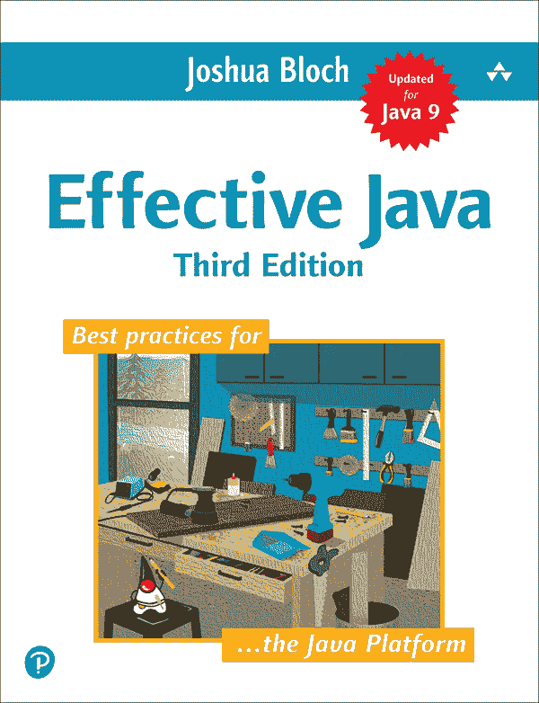
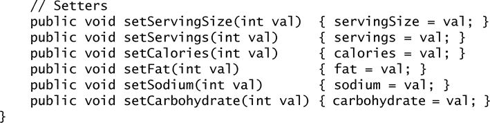

# Effective Java：Java 平台最佳实践



# 关于本书

EPUB 是一种开放的电子书行业标准格式。然而，不同的阅读设备和应用程序对 `EPUB` 及其许多功能的支持程度不相同。可以使用您的设备或应用设置来根据您的喜好自定义显示效果。您可以自定义的设置通常包括字体、字号、单栏或双栏、横屏或竖屏模式，以及可以点击或触摸放大的插图。有关您的阅读设备或应用上设置和功能的更多信息，请访问设备制造商的网站。

许多书籍包含编程代码或配置示例。为了优化这些元素的显示效果，请在单栏、横屏模式下查看电子书，并将字体大小调整为最小设置。除了以重流文本格式呈现代码和配置外，我们还包含了代码图像，以模拟印刷版中的呈现效果；因此，当重流格式可能会影响代码列表的显示时，您将看到一个“点击此处查看代码图像”链接。点击链接即可查看高保真代码图像。要返回之前查看的页面，请点击设备或应用上的“返回”按钮。


波士顿 • 哥伦布斯 • 印第纳波利斯 • 纽约 • 旧金山 • 阿姆斯特丹 • 开普敦

迪拜 • 伦敦 • 马德里 • 米兰 • 慕尼黑 • 巴黎 • 蒙特利尔 • 多伦 • 德里 • 墨西哥城

圣保罗 • 悉尼 • 香港 • 首尔 • 新加坡 • 台北 东 东

保留所有权利。美国印制。本出版物受版权保护，在进行任何禁止的再复制、存储在检索系统中或以任何形式或手段（电子、机械、复印、录音或类似）传输之前，必须获得出版社的许可。有关许可、申请表以及 Pearson Education 全球权利与许可部门适当联系方式的信息，请访问 `www.pearsoned.com/permissions/`。

1 17

*致我的家人：Cindy, Tim 和 Matt*

### 项目 89: 对于实例控制，优先使用枚举类型而非 `readResolve`

### 项目 90: 考虑使用序列化代理而非序列化实例

## 第二版对应项目

## 参考文献

## 索引

## 前言

如果一位同事对你说：“Spouse of me this night today manufactures the unusual meal in a home. You will join?”你脑中可能会闪过三个念头：第三，你被邀请去晚餐；第二，英语不是你同事的母语；第一，感到非常困惑。

如果你自己学过第二门语言并尝试在教室外使用它，你就知道必须掌握三件事：语言的结构（语法）、你想要谈论的事物如何命名（词汇），以及日常生活中习惯且有效的表达方式（用法）。教室通常只涵盖前两项，当你发现自己在努力表达意思时，母语者总是在克制笑意。

编程语言也是如此。你需要理解语言的核心：它是算法的、函数式的还是面向对象的？你需要了解它的词汇：标准库提供了哪些数据结构、操作和功能？你还需要熟悉日常生活中习惯且有效的表达方式。

又记：如果我没有提到一种最近占据了我大量时间的行业内最佳实践，我将是失职的。自从我们领域在 20 世纪 50 年代诞生以来，我们就自由重新实现彼此的 API。这种做法对于计算机技术的飞跃性成功至关重要。我正积极致力于维护这种自由 [CompSci17]，并鼓励你加入我。保留重新实现彼此 API 的权利，对于我们这一职业的持续健康发展至关重要。

## 第二版序言

自我 2001 年编写此书第一版以来，Java 平台发生了许多变化，现在是时候出第二版了。最显著的一系列变化是 Java 5 中引入了泛型、枚举类型、注解、自动装箱以及 for-each 循环。紧随其后的是 Java 5 同时发布的的新型并发库 `java.util.concurrent`。与 Gilad Bracha 一起，我有幸幸领导了设计这些新语言特性的团队。我也有幸参与了由 Doug Lea 领导的设计和开发并发库的团队。

平台的另一个大变化是现代集成开发环境（IDEs，如 Eclipse、IntelliJ IDEA 和 NetBeans）以及静态分析工具（如 FindBugs）的广泛采用。虽然我没有参与这些工作，但我从中受益匪浅，并学会了它们如何影响 Java 开发体验。

2004 年，我从 Sun 公司搬到了 Google，但在过去的四年里，我继续参与 Java 平台的开发，通过 Google 的大力支持和 Java 社区处理规范（JCP），为并发和集合 API 做出了贡献。我还有幸利用 Java 平台开发了 Google 内部使用的库。现在，我知道作为用户是什么感觉了。

正如 2001 年我写第一版时一样，我的首要目标是与你分享我的经验，让你模仿我的成功，同时避免我的失败。新材料继续大量使用了 Java 平台库中的真实世界示例。

第一版的成功超出了我最狂野的预期，我在尽力保持其精神的同时，涵盖了使书籍更新所需的所有材料。书籍的增长是不可避免的，它确实增长了，从 57 项增加到了 78 项。我不仅增加了 23 项内容，还彻底修订了所有原始材料，并淘汰了一些已经过时的项目。在附录中，你可以看到本版内容与第一版内容的关系。

在第一版的序言中，我曾写道 Java 编程语言及其库极大地有助于质量和生产力，并且是一件令人愉悦的事。5 版本和 6 版本的发布让一个原本很好的事物变得更好。现在的平台比 2001 年要大得多，也更复杂，但一旦你学会了使用新特性的模式和惯用法，它们就会让你的程序更好，生活变得更轻松。我希望这一版能捕捉到我对该平台持续的热情，并帮助你更高效、愉快地使用该平台及其新特性。

加利福尼亚州，圣何塞

2008 年 4 月

## 第一版序言

1996 年，我安顿落营向西迁，在当时被称为 JavaSoft 的公司工作，因为显而易见那里是舞台所在。在随后的五年里，我担任了 Java 平台库架构师。我设计、实现并维护了许多库，并担任许多其他库的顾问。随着 Java 平台的成熟，主持这些库是一生难得的机会。毫不夸张地说，我有幸与我们这一代最伟大的软件工程师共事。在这个过程中，我学到了很多知识。

在第一版的序言中，我写过 Java 编程语言及其库极大地有助于质量和生产力，并且是一件令人愉悦的事。5 版本和 6 版本的发布让一个原本很好的事物变得更好。现在的平台比 2001 年要大得多，也更复杂，但一旦你学会了使用新特性的模式和惯用法，它们就会让你的程序更好，生活变得更轻松。我希望这一版能捕捉到我对该平台持续的热情，并帮助你更高效、愉快地使用该平台及其新特性。

（注：此处原文中两版序言内容存在部分重复，已按翻译要求完整翻译）

加利福尼亚州，库普蒂诺

2001 年 4 月

## 致谢

### 第三版致谢

感谢本书前两版的读者对它给予如此友好和热烈的反馈，感谢你们将这些理念铭心中，并告诉我它们对你们和工作产生了怎样的积极影响。感谢许多在课程中使用这本书的教授，以及许多采用它的工程团队。感谢 Addison-Wesley 和 Pearson 的整个团队，感谢他们的友好、专业、耐心和在极端压力下的优雅。在此期间，我的编辑 Greg Doench 一直从容不迫：一位出色的编辑，一位完美的绅士。我由于由于项目导致他的头发可能白了一些，对此我诚恳歉意。我的项目经理 Julie Nahil 和项目编辑 Dana Wilson 是我所能希望：勤奋、及时、有条理且友好。我们的校对 Kim Wimpsett 严谨且有品味。

我再次幸运地拥有了想象中是最优秀的评审团队，我向他们中的每一个人表示我最诚挚的感谢。核心团队评审了几乎每一个章节，包括 Cindy Bloch、Brian Kernighan、Kevin Bourrillion、Joe Bowbeer、William Chargin、Joe Darcy、Brian Goetz、Tim Halloran、Stuart Marks、Tim Peierls 和 Yoshiki Shibata。其他评审人员包括 Marcus Biel、Dan Bloch、Beth Bottos、Martin Buchholz、Michael Diamond、Charlie Garrod、Tom Hawtin、Doug Lea、Aleksey Shipilëv、Lou Wasserman 和 Peter Weinberger。这些评审人员提出了许多建议，极大地改进了这本书，并让我免受了许多尴尬。

我特别感谢 William Chargin、Doug Lea 和 Tim Peierls，他们担任了书中许多想法的智囊团。William、Doug 和 Tim 在时间和知识上的投入一如既往地慷慨。

最后，我要感谢我的妻子 Cindy Bloch，她鼓励我写作，阅读了每一个初稿章节，编写了索引，帮助我处理了在启动大项目时不可避免会发生的所有问题，并在我写作期间忍受我。

## 第二版致谢

感谢本书第一版的读者们给予了如此友善和热烈的反响，将书中的理念记心中，并让我知道这本书对他们及其工作产生了怎样的积极影响。感谢许多在课程中使用本书的教授，以及许多采纳本书的工程团队。

感谢 Addison-Wesley 整个团队，他们的友善、专业、耐心以及在压力下的优雅。在整个过程中，我的编辑 Greg Doench 始终保持从容：一位出色的编辑，一位完美的绅士。我的制作经理 Julie Nahil 具备了制作经理应该具备的所有素质：勤奋、及时、有条理且友好。我的文字编辑 Barbara Wood 极其严谨且富有品味。

我再次幸运地拥有了想象中是最优秀的评审团队，我向他们中的每一个人表示我最诚挚的感谢。评审了每一个章节的核心团队包括 Lexi Baugher、Cindy Bloch、Beth Bottos、Joe Bowbeer、Brian Goetz、Tim Halloran、Brian Kernighan、Rob Konigsberg、Tim Peierls、Bill Pugh、Yoshiki Shibata、Peter Stout、Peter Weinberger 和 Frank Yellin。其他评审人员包括 Pablo Bellver、Dan Bloch、Dan Bornstein、Kevin Bourrillion、Martin Buchholz、Joe Darcy、Neal Gafter、Laurence Gonsalves、Aaron Greenhouse、Barry Hayes、Peter Jones、Angelika Langer、Doug Lea、Bob Lee、Jeremy Manson、Tom May、Mike McCloskey、Andriy Tereshchenko 和 Paul Tyma。再次，这些评审人员提出了许多建议，极大地改进了这本书，并让我免受了许多尴尬。再次，任何剩下的尴尬都由我负责。

我特别感谢 Doug Lea 和 Tim Peierls，他们担任了书中许多想法的智囊团。Doug 和 Tim 在时间和知识上的投入一如既往地慷慨。

感谢我的 Google 经理 Prabha Krishna，感谢她持续的支持和鼓励。

最后，我要感谢我的妻子 Cindy Bloch，她鼓励我写作，阅读了每一个初稿章节，帮助我使用 Framemaker，编写了索引，并在我写作期间忍受我。

## 第一版致谢

感谢 Patrick Chan 建议我写这本书，并把这个主意推荐给系列主编辑 Lisa Friendly、系列技术编辑 Tim Lindholm 以及 Addison-Wesley 的执行编辑 Mike Hendrickson。感谢 Lisa、Tim 和 Mike 鼓励我追求这个项目，并对我终有一天会写出这本书付出了超人的耐心和不懈的信念。

感谢 James Gosling 和他的原始团队为我提供了一个伟大的写作题材，感谢许多追随 James 足迹的 Java 平台工程师。特别感谢我在 Sun Java 平台工具与库组的同事们，感谢他们的见解、鼓励和支持。该团队包括 Andrew Bennett、Joe Darcy、Neal Gafter、Iris Garcia、Konstantin Kladko、Ian Little、Mike McCloskey 和 Mark Reinhold。前成员包括李正华、Bill Maddox 和 Naveen Sanjeeva。

感谢我的经理 Andrew Bennett 和我的总监 Larry Abrahams 对这个项目提供的全方位且热情的支持。感谢 Java 软件工程副总裁 Rich Green，提供了一个让工程师能够自由进行创造性思考并发表作品的环境。

我幸运地拥有了想象中是最优秀的评审团队，并向他们中的每一个人表示我最诚挚的感谢：Andrew Bennett、Cindy Bloch、Dan Bloch、Beth Bottos、Joe Bowbeer、Gilad Bracha、Mary Campione、Joe Darcy、David Eckhardt、Joe Fialli、Lisa Friendly、James Gosling、Peter Haggar、David Holmes、Brian Kernighan、Konstantin Kladko、Doug Lea、李正华、Tim Lindholm、Mike McCloskey、Tim Peierls、Mark Reinhold、Ken Russell、Bill Shannon、Peter Stout、Phil Wadler 以及两位匿名评审员。他们提出了许多建议，极大地改进了这本书，并让我免受了许多尴尬。任何剩下的尴尬都由我负责。

Sun 内外的许多同事都参与了技术讨论，提升了书的质量。其中，Ben Gomes、Steffen Grarup、Peter Kessler、Richard Roda、John Rose 和 David Stoutamire 贡献了有用的见解。特别感谢 Doug Lea，他担任书中许多想法的智囊团。Doug 在时间和知识上的投入一如既往地慷慨。

感谢 Julie Dinicola、Jacqui Doucette、Mike Hendrickson、Heather Olszyk、Tracy Russ 以及 Addison-Wesley 整个团队的支持。在极其紧迫的时间表下，他们总是友好且配合。

感谢 Guy Steele 写的序言。我很荣幸他参与了这个项目。

最后，感谢我的妻子 Cindy Bloch 鼓励并偶尔威胁我写这本书，阅读了每一个初稿章节，帮助我使用 Framemaker，编写了索引，并在我写作期间忍受我。

## 第 1 章：引言

本书旨在帮助你有效使用 Java 编程语言及其基础库：`java.lang`、`java.util` 和 `java.io`，以及 `java.util.concurrent` 和 `java.util.function` 等子包。书中也会提到其他库。

本书由数十项组成，每项传达了一条规则。这些规则捕捉了优秀程序员认为有益实践。项目松散地分为十一章，每章涵盖软件设计的一个广泛方面。本书并非从头到尾阅读：每个项目某种程度上都是独立的。书中有大量的交叉引用，你可以轻松规划自己的阅读路线。

自本书上一版出版以来，平台增加了许多新功能。书中的大部分项目以某种方式使用了这些功能。下表显示了在哪里可以找到这些功能的主要介绍：

| 特性 | 条目 | 版本 |
| :--- | :--- | :--- |
| Lambdas | 项目 42–44 | Java 8 |
| Streams | 项目 45–48 | Java 8 |
| Optionals | 项目 55 | Java 8 |
| 接口中的默认方法 | 项目 21 | Java 8 |
| `try`-with-resources | 项目 9 | Java 7 |
| `@SafeVarargs` | 项目 32 | Java 7 |
| 模块 | 项目 15 | Java 9 |

大多数条目都通过程序示例进行了说明。本书的一个关键特点是它包含了说明许多设计模式和惯用法的代码示例。在适当，这些示例与该领域的标准参考著作进行了交叉引用 [Gamma95]。

许多条目包含一个或多个程序示例，用于说明某些应该避免的实践。此类示例有时被称为*反模式*（antipatterns），它们会被带有诸如 `// Never do this!` 之类的注释明确标记。在每种情况下，条目都解释了为什么该示例是不好的，并建议了替代方案。

这本书不是为初学者准备的：它假设你已经熟练掌握 Java。如果你还不熟练，可以考虑许多优秀的入门读物，例如 Peter Sestoft 的《*Java Precisely》 [Sestoft16]。虽然《Effective Java》的设计使任何对语言有基本了解的人都能读懂，但即使对于高级程序员来说，它也应该提供思考的空间。

书中的大多数规则都源于几个基本原则。清晰和简单至关重要。组件的用户不应该对其行为感到意外。组件应该尽可能小，但不能再小了。（在书中所使用的*组件*一术语指的是任何可重用的软件元素，从单个方法到由多个包组成的复杂框架等。）代码应该被重用而不是复制。组件之间的依赖关系应该保持到最低。错误应该在发生后尽快检测到，理想情况下是在编译时。

虽然书中的规则并非 100% 的情况下都适用，但它们在大多数情况下刻画了最佳编程实践。你不应该盲目地遵循这些规则，而应该在偶尔且有充分理由的情况下违反它们。学习编程的艺术与其他大多数学科一样，首先是学习规则，然后是学习何时打破规则。

在很大程度上，这本书不是关于性能的。它是关于编写清晰、正确、易用、健壮、灵活且可维护的程序。如果你能做到这一点，获得所需的性能通常是一件简单的事（Item 67）。某些条目确实讨论了性能问题，其中一些条目提供了性能数据。这些数据通过“在我的机器上”这一短语引入，最多应被视为近似值。

就价值而言，我的机器是一台老旧的自组 3.5GHz 四核 Intel Core i7-4770K，配备 16GB DDR3-1866 CL9 内存，运行 Azul Zulu 9.0.0.15 版本的 OpenJDK，基于 Microsoft Windows 7 专业版 SP1 (64 位)。

在讨论 Java 编程语言及其库的特性时，有时需要引用特定的版本。为了方便起见，本书使用了昵号而非官方发布名称。表显示了发布名称与昵号之间的映射：

| 官方发布名称 | 昵号 |
| :--- | :--- |
| JDK 1.0.*x* | Java 1.0 |
| JDK 1.1.*x* | Java 1.1 |


| Java 2 Platform, Standard Edition, v1.2 | Java 2 |
| Java 2 Platform, Standard Edition, v1.3 | Java 3 |
| Java 2 Platform, Standard Edition, v1.4 | Java 4 |
| Java 2 Platform, Standard Edition, v5.0 | Java 5 |
| Java Platform, Standard Edition 6 | Java 6 |
| Java Platform, Standard Edition 7 | Java 7 |
| Java Platform, Standard Edition 8 | Java 8 |
| Java Platform, Standard Edition 9 | Java 9 |

示例相当完整，但可读性优于完整性。它们自由地使用了 `java.util` 和 `java.io` 包中的类。为了编译示例，你可能需要添加一个或多个 import 声明或其他此类样板代码。书的网站 [`http://joshbloch.com/effectivejava`](http://joshbloch.com/effectivejava) 包含了每个示例的扩展版本，你可以对其编译并运行。

在很大程度上，本书使用的技术术语与《*The Java Language Specification, Java SE 8 Edition* [JLS]》中的定义相同。几个术语值得特别提到。语言支持四种类型：*接口*（包括*注解*）、*类*（包括*枚举*）、*数组*和*原始数据类型*。前三种被称为*引用类型*。类实例和数组是*对象*；原始数据类型则不是。类的*成员*由它的*字段*、*方法*、*成员类*和*成员接口*组成。方法的*签名*由它的名称和形式参数的类型组成；签名*不包含*方法的返回类型。

本书使用的几个术语与《The Java Language Specification》有所不同。与《The Java Language Specification》不同，本书将*继承*（inheritance）作为*子类化*（subclassing）的同义词。书中对于接口不使用继承一词，而是简单说明一个类*实现*一个接口，或者一个接口*扩展*另一个接口。为了描述在未指定时适用的访问级别，本书使用了传统的*包私有性*（package-private），而非技术上正确的*包访问权限*（package access）[JLS, 6.6.1]。

本书使用了几个《The Java Language Specification》中未定义的技术术语。*导出 API*（exported API）或简单称为 *API* 指程序员访问类、接口或包时使用的类、接口、构造函数、成员和序列化形式。（*API* 一词是 *application programming interface* 的缩写，为了与语言构造 *interface* 混淆，此处使用了这一更准确的术语。）编写使用 API 的程序的被称为 API 的*用户*。使用 API 的类是 API 的*客户端*。

类、接口、构造函数、成员和序列化形式统称为 API 元素。导出 API 由定义 API 的包之外可见的 API 元素组成。这些是任何客户端都可以使用的元素。并非巧合，它们也是 Javadoc 工具在默认模式下生成文档的元素。

Java 9 引入了*模块系统*。如果一个库使用了模块系统，其导出 API 就是该模块声明中导出的包的导出 API 的并集。

## 第二章：创建和销毁对象

本章涉及对象的创建和销毁：何时以及如何创建、何时以及如何避免创建、如何及时销毁，以及如何管理销毁之前的清理操作。

### Item 1：考虑用静态工厂方法代替构造函数

类允许客户端获取的传统方法是提供公共构造函数。还有另一种技术应该是每个程序员工具箱的一部分。类可以提供一个公共的*静态工厂方法*，它简单来说返回类实例的静态方法。这里有一个来自 `Boolean`（`boolean` 的*箱类*）的简单示例。该方法将 `boolean` 原始值转换为 `Boolean` 对象引用：

```java
public static Boolean valueOf(boolean b) {
    return b ? Boolean.TRUE : Boolean.FALSE;
}
```

注意，静态工厂方法不等同于《Design Patterns》[Gamma95] 中的*工厂方法*模式。本项中描述的静态工厂方法在《Design Patterns》中没有直接对应物。

类可以为其客户端提供静态工厂方法，而不是（或者作为补充）提供公共构造函数。提供静态工厂方法而不是公共构造函数既有优点，也有缺点。

### 第一个优点：静态工厂方法有名称

静态工厂方法的一个优点是，与构造函数不同，它们拥有名称。如果构造函数的参数本身不能描述所返回的对象，那么使用一个命名良好的静态工厂方法更易于使用，生成的客户端代码也更易读。例如，构造函数 `BigInteger(int, int, Random)` 返回一个可能为质数的 `BigInteger`，如果用命名为 `BigInteger.probablePrime` 的静态工厂方法表示会更好。（该方法是在 Java 4 中添加的。）

一个类对于给定的签名只能有一个构造函数。众所周知程序员通过提供两个参数列表仅在类型顺序上不同的构造函数来绕过这一限制。这是一个非常糟糕的主意。此类 API 的用户将永远无法记住哪个构造函数是哪一个，最终会误用调用错误的一个。阅读使用这些构造函数的代码的人在不查阅类文档的情况下，将不知道代码在做什么。

因为有了名称，静态工厂方法不受上一段讨论的限制。当一个类似乎需要多个相同签名的构造函数时，将构造函数替换为静态工厂方法，并仔细选择名称以突显它们的区别。

### 第二个优点：不要求创建新对象实例

静态工厂方法的第二个优点是，与构造函数不同，它们并不要求每次调用时都创建一个新对象。这允许不可变类使用预先构建的实例，或者在构建时缓存实例，并反复分发它们以避免创建不必要的重复对象。`Boolean.valueOf(boolean)` 方法说明了这种技术：它从不创建对象。这种技术类似于重量级模式。如果经常请求等效对象，特别是当创建成本很高时，这可以极大地提高性能。

静态工厂方法通过重复调用返回相同对象的能力，使得类能够对任何时候存在的实例保持严格控制。这样做的类被称为实例控制类（instance-controlled）。编写实例控制类有几个原因。实例控制允许类保证自己是单例或不可实例化的。此外，它允许不可变值类能够保证不存在两个相等的实例：`a.equals(b)` 当且仅当 `a == b`。这是重量级模式的体。枚举（Enum）类型提供了这种保证。

### 第三个优点：可以返回任何子类型的对象

静态工厂方法的第三个优点是，与构造函数不同，它们可以返回返回类型的任何子类的对象。这让你在选择返回对象的类时具有极大的灵活性。

这种灵活性的一个应用是，API 可以返回对象而不将其类设为公共。以这种方式隐藏实现类可以导致非常紧凑的 API。这种技术适用于基于接口的框架，其中接口为静态工厂方法提供了自然的返回类型。

在 Java 8 之前，接口不能拥有静态方法。按照惯，命名为 `Type` 的接口的静态工厂方法被放在一个名为 `Types` 的不可实例化伴随类中。例如，Java 集合框架（Java Collections Framework）对其接口有四五个工具类级实现，提供了不可修改集合、同步集合等。几乎所有这些实现都是通过一个不可实例化的单类（`java.util.Collections`）中的静态工厂方法导出的。返回对象的类都是非公共的。

如果集合框架 API 导出四五个个独立的公共类（每个便利实现对应一个），那么它的规模将比现在大得多。减少的不仅是 API 的主体部分，还有概念上的重量：程序员为了使用该 API 必须掌握的概念的数量和难度。程序员知道返回的对象精确具有其接口所指定的 API，因此不需要为实现类阅读额外的类文档。此外，使用这种静态工厂方法要求客户端通过接口而非实现类来引用返回的对象，这通常是良好的做法。

从 Java 8 开始，接口不能包含静态方法的限制被消除了，因此通常没有理由为接口提供不可实例化的伴随类了。许多本该放在此类类中的公共静态成员应该被放在接口本身中。但请注意，可能仍需要将这些静态方法的大部分实现代码放在单独的包私有（package-private）类中。这是因为 Java 8 要求接口的所有静态成员都必须是公共的。Java 9 允许私有静态方法，但静态字段和静态成员类仍要求是公共的。

### 第四个优点：返回的对象可以随调用而变化

静态工厂的第四个优点是，返回对象的类可以根据输入参数随每次调用而变化。声明的返回类型的任何子类型都是允许的。返回对象的类也可以随版本的发布而变化。

`EnumSet` 类没有公共构造函数，只有静态工厂。在 OpenJDK 实现中，它们返回两个子类之一的实例，取决于底层枚举类型的大小：如果它有六十四个或更少元素（大多数枚举类型都是如此），静态工厂返回一个由单个 `long` 支撑的 `RegularEnumSet` 实例；如果枚举类型有六十五个或更多元素，工厂返回一个由 `long` 数组支撑的 `JumboEnumSet` 实例。

这两个实现类的存在对客户端来说是不可见的。如果 `RegularEnumSet` 不再为小型枚举类型提供性能优势，可以在未来的版本中将其消除而不会产生任何不良影响。同样，如果证明是有益的，未来的版本可以添加 `EnumSet` 的第三或第四种实现。客户端既不知道也不关心他们从工厂获取的对象是什么类；他们只关心它是不是 `EnumSet` 的某个子类。

### 第五个优点：类不需要在编译时存在

静态工厂的第五个优点是，在编写包含该方法的类时，返回对象的类并不存在。这种灵活的静态工厂方法构成了服务提供者框架的基础，例如 Java 数据库连接 API (JDBC)。服务提供者框架是由提供实现服务，系统为客户端提供这些实现，从而将客户端与实现解耦。

服务提供者框架有三个核心组件：代表实现的服务接口；提供者用于注册实现的提供者注册 API；客户端用于获取服务实例的服务访问 API。服务访问 API 允许客户端指定选择实现的标准。在没有此类标准的情况下，API 返回一个默认实现的实例，或者允许客户端循环遍历所有可用实现。服务访问 API 就是构成服务提供者框架基础的灵活静态工厂。

服务提供者框架的一个可选第四个组件是*服务提供者接口*（service provider interface），它描述了一个产生服务接口实例的工厂对象。在没有服务提供者接口的情况下，实现必须通过反射实例化（Item 65）。在 JDBC 中，`Connection` 充当服务接口，`DriverManager.registerDriver` 是提供者注册 API，`DriverManager.getConnection` 是服务访问 API，而 `Driver` 就是服务提供者接口。

服务提供者模式有许多变体。例如，服务访问 API 可以向客户端返回比提供者提供的更丰富的服务接口。这就是*桥接*模式（Bridge pattern）[Gamma95]。依赖注入框架（Item 5）可以被看作强大的服务提供者。自 Java 6 以来，平台包含了一个通用的服务提供者框架 `java.util.ServiceLoader`，因此你不需要、通常也不应该自己编写它（Item 59）。JDBC 没有使用 `ServiceLoader`，因为前者于于后者。

## 仅提供静态工厂方法的主要局限性是，没有公共或受保护构造函数的类无法被子类。例如，无法对 Collections Framework 中的任何便利实现类创建子类。可以争论这可能是一种因祸得福，因为这鼓励了程序员使用组合而不是继承（Item 18），而且这对于不可变类型是必须的（Item 17）。

## 静态工厂方法的第二个缺点是程序员很难找到它们。它们在 API 文档中的表现不像构造函数那样引人易目，因此可能很难弄如何实例化一个提供静态工厂方法而不是构造函数的类。Javadoc 工具可能在以后会对静态工厂方法引起关注。在此期间，你可以通过在类或接口文档中对静态工厂引起关注，并遵循通用的命名规范来减少这个问题。以下是静态工厂方法的一些常见名称。此列表还远不是详尽的：

* `from` — 一种*类型转换方法*，它接收一个参数并返回该类型的对应实例，例如：

```java
Date d = Date.from(instant);
```

* `of` — 一种*聚合方法*，它接收多个参数并返回一个包含这些参数的实例，例如：

```java
Set<Rank> faceCards = EnumSet.of(JACK, QUEEN, KING);
```

* `valueOf` — `from` 和 `of` 的更冗长的替代方案，例如：

```java
Integer value = Integer.valueOf(10);
```

* `instance` — 一个静态工厂方法，通常返回该类的实例，例如：

```java
Random random = Random.fromInstance();
```

* `create` — 一个静态工厂方法，与 `instance` 不同，它创建一个新的实例，例如：

```java
Thread thread = Thread.createVirtualThread();
```

* `newInstance` — 一个静态工厂方法，通常用于创建一个新实例，例如：

```java
List list = List.newInstance();
```

* `getType` — 一个静态工厂方法，通常用于获取该类型的元数据，例如：

```java
Class<?> type = String.getType();
```

* `valueOf` — 一个非常常用的静态工厂方法，通常用于根据某个值获取对应的实例，例如：

```java
Boolean b = Boolean.valueOf("true");
```

* `toString` — 一个静态工厂方法，通常用于将对象或值转换为字符串表示，例如：

```java
String s = String.valueOf(42);
```

* `copy` — 一个静态工厂方法，通常用于返回一个现有实例的副本，例如：

```java
Object copy = Object.copy(original);
```

* `getInstance` — 一个静态工厂方法，通常用于根据某种配置获取一个实例，例如：

```java
Calendar cal = Calendar.getInstance();
```

简而言之，覆盖构造函数模式（telescoping constructor pattern）是有效的，但当参数很多时，编写客户端代码非常困难，阅读起来更加困难。读者会疑惑所有这些值意味着什么，必须仔细数一遍参数才能弄清楚。一系列类型相同的参数可能会导致微妙的错误。如果客户端不小心反转了两个这样的参数，编译器不会报错，但程序在运行时会发生异常（Item 51）。

当构造函数中面临许多可选参数时，另一种替代方案是 `JavaBeans` 模式。在这种模式下，你调用无参构造函数来创建对象，然后调用 setter 方法来设置每个必需参数以及感兴趣的可选参数：

```java
// JavaBeans Pattern - 允许不一致性，强制可变性
public class NutritionFacts {
    // 参数初始化为默认值（如果有）
    private int servingSize  = -1; // 必需；无默认值
    private int servings     = -1; // 必需；无默认值
    private int calories     = 0;
    private int fat          = 0;
    private int sodium       = 0;
    private int carbohydrate = 0;

    public NutritionFacts() { }

    // Setters
    public void setServingSize(int val)  { servingSize = val; }
    public void setServings(int val)    { servings = val; }
    public void setCalories(int val)    { calories = val; }
    public void setFat(int val)         { fat = val; }
    public void setSodium(int val)       { sodium = val; }
    public void setCarbohydrate(int val) { carbohydrate = val; }
}
```

这种模式没有覆盖构造函数模式的那些缺点。创建实例很简单（虽然有点冗长），而且生成的代码易易读：

```java
NutritionFacts cocaCola = new NutritionFacts();
cocaCola.setServingSize(240);
cocaCola.setServings(8);
cocaCola.setCalories(100);
cocaCola.setSodium(35);
cocaCola.setCarbohydrate(27);
```


遗憾的是，JavaBeans 模式也有自身的严重缺点。由于构造过程被分到了多次调用中，一个 JavaBean 在构造中途中可能处于不一致的状态。该类无法仅通过检查构造函数参数的有效性来强制执行一致性。在对象处于不一致状态时尝试使用可能会导致失败，这些失败与包含 bug 的代码相远，因此难以调试。另一个缺点是，JavaBeans 模式排除了使类变为不可变的可能性（Item 17），并且需要程序员投入额外努力来确保线程安全。

通过在对象构造完成后手动“冻结”对象，并在冻结之前不允许其使用，可以减少这些缺点，但这种变体非常笨拙，且在实践中很少使用。此外，它可能会导致运行时错误，因为编译器无法确保程序员在器对象之前调用了 `freeze` 方法。

幸运的是，还有第三种替代方案，它结合了覆盖构造函数模式的安全性和 JavaBeans 模式的可读性。它是 `Builder` 模式的一种形式 [Gamma95]。客户端不是直接创建所需的对象，而是调用带有所有必需参数的构造函数（或静态工厂）并获取一个 `builder object`。然后客户端在 builder 对象上调用类似 setter 的方法来设置每个感兴趣可选参数。最后，客户端调用无参的 `build` 方法来生成对象，该对象通常是不可变的。Builder 通常是它构建的类的静态成员类（Item 24）。以下是它在实践中的样子：

```java
// Builder Pattern
public class NutritionFacts {
    private final int servingSize;
    private final int servings;
    private final int calories;
    private final int fat;
    private final int sodium;
    private final int carbohydrate;

    public static class Builder {
        // 必需参数
        private final int servingSize;
        private final int servings;
        // 可选参数 - 初始化为默认值
        private int calories = 0;
        private int fat = 0;
        private int sodium = 0;
        private int carbohydrate = 0;

        public Builder(int servingSize, int servings) {
            this.servingSize = servingSize;
            this.servings = servings;
        }

        public Builder calories(int val) {
            calories = val;
            return this;
        }

        public Builder fat(int val) {
            fat = val;
            return this;
        }

        public Builder sodium(int val) {
            sodium = val;
            return this;
        }

        public Builder carbohydrate(int val) {
            carbohydrate = val;
            return this;
        }

        public NutritionFacts build() {
            return new NutritionFacts(this);
        }
    }

    private NutritionFacts(Builder builder) {
        servingSize = builder.servingSize;
        servings = builder.servings;
        calories = builder.calories;
        fat = builder.fat;
        sodium = builder.sodium;
        carbohydrate = builder.carbohydrate;
    }
}
```

`NutritionFacts` 类是不可变的，且所有参数默认值都集中在一个地方。Builder 的 setter 方法返回其本身，以便可以链式调用，从而产生 `fluent API`（流式 API）。以下是客户端代码的样子：

```java
NutritionFacts cocaCola = new NutritionFacts.Builder(240, 8)
    .calories(100).sodium(35).carbohydrate(27).build();
```

这种客户端代码易写，更重要的是易读。Builder 模式模拟了 Python 和 Scala 中的命名可选参数。

为了简洁起见，省略了有效性检查。为了尽快检测到无效参数，请在 builder 的构造函数和方法中检查参数有效性。在 `build` 方法调用的构造函数中检查涉及多个参数的不变性。为了防止攻击这些不变性，请在从 builder 复制参数后对对象字段进行检查（Item 50）。如果检查失败，抛出 `IllegalArgumentException`（Item 72）。

Builder 模式非常适用于类层次结构。使用并行的 builder 层次结构，每个 builder 嵌套在相应的类中。抽象类有抽象 builder；具体类有具体的 builder。例如，考虑层次根部的一个代表各种披萨抽象类：

```java
// 用于类层次结构的 Builder 模式
public abstract class Pizza {
    public enum Topping { HAM, MUSHROOM, ONION, PEPPER, SAUSAGE }
    final Set<Topping> toppings;

    abstract static class Builder<T extends Builder<T>> {
        EnumSet<Topping> toppings = EnumSet.noneOf(Topping.class);

        public T addTopping(Topping topping) {
            toppings.add(Objects.requireNonNull(topping));
            return self();
        }

        abstract Pizza build();

        // 子类必须重写此方法以返回 "this"
        protected abstract T self();
    }

    Pizza(Builder<?> builder) {
        toppings = builder.toppings.clone(); //  Item 50
    }
}
```

注意 `Pizza.Builder` 是一个带有 `recursive type parameter`（Item 30）的 `generic type`。这结合抽象的 `self` 方法，允许方法链在子类中正常工作，无需类型转换。这种针对 Java 缺乏自类型的变通方法被称为 `simulated self-type`（模拟自类型）惯用法。

这里是 `Pizza` 的两个具体子类，其中一个代表标准的纽约风格披萨，另一个是意大利饺饼（calzone）。前者有一个必需的尺寸参数，而后者允许你指定酱料是在内部还是外部：

```java
public class NyPizza extends Pizza {

    public enum Size { SMALL, MEDIUM, LARGE }

    private final Size size;

    public static class Builder extends Pizza.Builder<Builder> {

        private final Size size;

        public Builder(Size size) {
            this.size = Objects.requireNonNull(size);
        }
        @Override public NyPizza build() {
            return new NyPizza(this);
        }
        @Override protected Builder self() { return this; }
    }

    private NyPizza(Builder builder) {
        super(builder);
        size = builder.size;
    }
}

public class Calzone extends Pizza {

    private final boolean sauceInside;

    public static class Builder extends Pizza.Builder<Builder> {

        private boolean sauceInside = false; // Default
        public Builder sauceInside() {
            sauceInside = true;
            return this;
        }
        @Override public Calzone build() {
            return new Calzone(this);
        }
        @Override protected Builder self() { return this; }
    }

    private Calzone(Builder builder) {
        super(builder);
        sauceInside = builder.sauceInside;
    }
}
```

注意，每个子类 builder 中的 `build` 方法都声明为返回正确的子类：`NyPizza.Builder` 的 `build` 方法返回 `NyPizza`，而 `Calzone.Builder` 中的方法返回 `Calzone`。这种将子类方法声明为返回父类声明的返回类型的子类型的技术被称为 `covariant return typing`（协变返回类型）。它允许客户端使用这些构建器而无需类型转换。

这些“分层构建器”的客户端代码与简单的 `NutritionFacts` 构建器的代码基本相同。为了简洁起见，显示的示例客户端代码假设对枚举常量使用了静态导入：

```java
NyPizza pizza = new NyPizza.Builder(SMALL)
        .addTopping(SAUSAGE).addTopping(ONION).build();

Calzone calzone = new Calzone.Builder()
        .addTopping(HAM).sauceInside().build();
```

构建器相比构造函数的一个微小优势是，构建器可以有多个变长参数，因为每个参数都在自己的方法中指定。或者，构建器可以将多次调用方法的方法的参数聚合到一个字段中，正如前面的 `addTopping` 方法所示的那样。

构建器模式非常灵活。同一个构建器可以重复用于构建多个对象。在多次调用 `build` 方法之间，可以调整构建器的参数，以创建不同的对象。构建器可以在创建对象时自动填充某些字段，例如每次创建对象时都会递增的序列号。

构建器模式也有缺点。

要使一个使用上述方法之一的单例类变为 `serializable`（第 12 章），仅在声明中添加 `implements Serializable` 是不够的。为了维持单例保证，应将所有实例字段声明为 `transient` 并提供一个 `readResolve` 方法（Item 89）。否则，每次反序列化一个序列化的实例时，都会创建一个新实例，在我们示例中，这会导致产生伪 `Elvis` 实例。为了防止这种情况发生，请在 `Elvis` 类中添加此 `readResolve` 方法：

```java
// readResolve method to preserve singleton property
private Object readResolve() {
    // Return the one true Elvis and let the garbage collector
    // take care of the Elvis impersonator.
    return INSTANCE;
}
```

实现单例的第三种方法是声明单元素枚举：

```java
// Enum singleton - the preferred approach
public enum Elvis {
    INSTANCE;
    public void leaveTheBuilding() { ... }
}
```

这种方法与公共字段方法类似，但它更简洁，免费提供了序列化机制，并且即使在面对复杂的序列化攻击或反射攻击时，也能提供防止多次实例化的铁律保证。这种方法感觉可能有一点点不自然，但单元素枚举类型通常是实现单例的最佳方式。请注意，如果你的单例必须继承除 `Enum` 以外的父类，则无法使用这种方法（尽管你*可以*声明一个枚举来实现接口）。

### Item 4: 使用私有构造函数强制不可实例化

有时，你可能想要编写一个仅作为静态方法和静态字段组合的类。这类类声誉不佳，因为有些人滥用它们来避免以对象的方式思考，但它们确实有其合理的用途。它们可以用于像 `java.lang.Math` 或 `java.util.Arrays` 那样，对原始值或数组分组相关方法。它们也可以用于为实现某些接口的对象分组静态方法，包括工厂方法（Item 1），就像 `java.util.Collections` 那样。（从 Java 8 开始，你也可以将此类方法*放入*接口中，假设你有权修改它。）最后，此类类可以用于对 final 类分组方法，因为你无法将它们放在子类中。

这类*工具类*（utility classes）并不是为了实例化而设计的：实例将是没有意义的。然而，在没有显式构造函数的情况下，编译器提供了一个公共的无参数*默认构造函数*。对于用户来说，这个构造函数与任何其他构造函数没有区别。在发布的 API 中，看到无意中可实例化的类并不罕见。

通过将类设为抽象来强制不可实例化不可行的。该类可以被子化，且子类可以实例化。此外，它误导用户认为该类是为了继承而设计的（Item 19）。不过，有一种简单的惯用法可以确保不可实例化。只有当类不包含显式构造函数时，才会生成默认构造函数，因此通过包含私有构造函数可以使一个类变得不可实例化：

```java
// Noninstantiable utility class
public class UtilityClass {
    // Suppress default constructor for noninstantiability
    private UtilityClass() {
        throw new AssertionError();
    }
    ... // Remainder omitted
}
```

由于显式构造函数是私有的，因此在类外部是无法访问的。`AssertionError` 并不是严格要求的，但它为类内部意外调用构造函数的情况提供了保障。它保证了该类在任何情况下都不会被实例化。这种惯用法有点违反直觉，因为显式提供构造函数是为了使其无法被调用。因此，像之前那样包含注释是明智的。

作为副作用，这种惯用法防止防止类被子化。所有构造函数都必须显式或隐式调用父类的构造函数，而子类将没有可用的父类构造函数可以调用。

### Item 5: 优先使用依赖注入而非硬编码资源

许多类依赖于一个或多个底层资源。例如，拼写检查器依赖于字典。看到此类类被实现为静态工具类（Item 4）并不罕见：

```java
// Inappropriate use of static utility - inflexible & untestable!
public class SpellChecker {
    private static final Lexicon dictionary = ...;
    private SpellChecker() {} // Noninstantiable
    public static boolean isValid(String word) { ... }
    public static List<String> suggestions(String typo) { ... }
}
```

同样，看到它们被实现为单例（Item 3）也不罕见：


## 依赖注入

```java
// Inappropriate use of singleton - inflexible & untestable
public class SpellChecker {
    private final Lexicon dictionary = ...;
    private SpellChecker(...) {}
    public static INSTANCE = new SpellChecker(...);
    public boolean isValid(String word) { ... }
    public List<String> suggestions(String typo) { ... }
}
```

这两种方法都不令人满意，因为它们假设只有一个值得使用的字典。在实践中，每种语言都有自己的字典，特殊的字典用于特殊的词汇表。此外，在测试时使用特殊字典可能是理想的。假设一个字典将永远足够是痴人说梦话。

你可以尝试通过将`dictionary`字段设为非 final 并添加一个方法来更改现有拼写检查器中的字典，从而让`SpellChecker`支持多个字典，但这样做会很笨拙、容易出错且在并发环境中是不可行的。静态工具类和单例不适用于行为由底层资源参数化的类。

我们需要的是支持该类的多个实例（在我们示例中，为`SpellChecker`）的能力，每个实例使用客户端所需的资源（在我们示例中，为字典）。满足这一要求的简单模式是在创建新实例时将资源传入构造函数。这是*依赖注入*的一种形式：字典是拼写检查器的*依赖项*，并在创建时被*注入*到拼写检查器中。

```java
// Dependency injection provides flexibility and testability
public class SpellChecker {
    private final Lexicon dictionary;
    public SpellChecker(Lexicon dictionary) {
        this.dictionary = Objects.requireNonNull(dictionary);
    }
    public boolean isValid(String word) { ... }
    public List<String> suggestions(String typo) { ... }
}
```

依赖注入模式非常简单，以至于许多程序员在使用多年后仍不知道它有一个专门的名字。虽然我们的拼写检查器示例只有一个资源（字典），但依赖注入适用于任意数量的资源和任意依赖图。它保持了不可变性（Item 17），因此多个客户端可以共享依赖对象（假设客户端相同的底层资源）。依赖注入同样适用于构造函数、静态工厂方法（Item 1）和构建器（Item 2）。

该模式的一种有用变体是向构造函数传递一个资源*工厂*（factory）。工厂是一个可以被重复调用以创建特定类型实例的对象。这类工厂体现了*工厂方法*（Factory Method）模式 [Gamma95]。Java 8 引入的`Supplier<T>`接口非常适合表示工厂。以`Supplier<T>`作为输入的方法通常应该使用*边界通配符类型*（bounded wildcard type）(Item 31) 来限制工厂的类型参数，以允许客户端传递一个创建指定类型任何子类型的工厂。例如，这里有一个方法使用客户端提供的工厂生成每块瓷砖来创建一个马赛克：

```
Mosaic create(Supplier<? extends Tile> tileFactory) { ... }
```

虽然依赖注入极大地提高了灵活性和可测试性，但它可能会让包含数千个依赖项的大型项目变得杂乱。这种混乱可以通过使用*依赖注入框架*，例如 Dagger [Dagger]、Guice [Guice] 或 Spring [Spring] 来完全消除。这些框架的使用不在本书的涵盖范围内，但请注意，为手动依赖注入设计的 API 可以非常容易地适配以供这些框架使用。

总结，不要使用单例或静态工具类来实现依赖于一个或多个底层资源的类（这些底层资源的行为会影响该类的行为），也不要让该类直接创建这些资源。相反，将资源或创建它们的工厂传递到构造函数（或静态工厂或构建器）中。这种被称为依赖注入的做法将极大地增强类的灵活性、可重用性和可测试性。

## Item 6: 避免创建不必要的对象

复用单个对象通常比在每次需要时创建一个功能等效的新对象更为合适。复用既更快又更优雅。如果一个对象是不可变的（Item 17），则它可以一直被复用。

作为一个不恰做法的极端示例，考虑以下语句：

```
String s = new String("bikini");  // 不要这么做！
```

该语句每次执行时都会创建一个新的`String`实例，而这些对象创建没有任何一个是必要的。`String`构造函数的参数（`"bikini"`）本身就是一个`String`实例，与构造函数创建的所有对象在功能上完全相同。如果这种用法出现在循环或频繁调用的方法中，可能会不当地创建数百万个`String`实例。

改进后的版本如下：

```
String s = "bikini";
```

此版本使用单个`String`实例，而不是在每次执行时都创建一个新的。此外，可以保证任何运行在同一个虚拟机中且恰好包含相同字符串字面量的其他代码都会复用该对象 [JLS, 3.10.5]。

对于同时提供构造函数和静态工厂方法的不可变类，你通常可以通过优先使用*静态工厂方法*（Item 1）而不是构造函数来避免创建不必要的对象。例如，工厂方法`Boolean.valueOf(String)`优于构造函数`Boolean(String)`，后者在 Java 9 中被废弃了。构造函数*必须*在每次被调用时创建一个新对象，而工厂方法永远不需要这样做，在实践中也不会这样做。除了复用不可变对象外，如果你知道它们不会被修改，你也可以复用可变对象。

某些对象的创建比其他对象昂贵得多。如果你需要反复使用此类“昂贵对象”，可能建议对其进行缓存以便复用。遗憾的是，在创建此类对象时并不总是显而易见的。假设你想写一个方法来判断字符串是否是有效的罗马数字。这里是使用正则表达式实现此最简单的方法：

```
// 性能可以得到极大提升！
static boolean isRomanNumeral(String s) {
    return s.matches("^(?=.)M*(C[MD]|D?C{0,3})"
            + "(X[CL]|L?X{0,3})(I[XV]|V?I{0,3})$");
}
```

这种实现的问题在于它依赖于`String.matches`方法。虽然`String.matches`是检查字符串是否匹配正则表达式最简单的方法，但它不适合在性能关键的场景中反复使用。问题在于它在内部为该正则表达式创建了一个`Pattern`实例并只使用一次，之后它就符合垃圾回收的条件。创建`Pattern`实例是昂贵的，因为需要将正则表达式编译成有限状态机。

为了提高性能，应显式地将正则表达式编译为`Pattern`实例（它是不可变的）并作为类初始化的一部分，将其缓存，并在每次调用`isRomanNumeral`方法时复用同一个实例：

```java
// 复用昂贵对象以提高性能
public class RomanNumerals {
    private static final Pattern ROMAN = Pattern.compile("^(?=.)M*(C[MD]|D?C{0,3})"
            + "(X[CL]|L?X{0,3})(I[XV]|V?I{0,3})$");

    static boolean isRomanNumeral(String s) {
        return ROMAN.matcher(s).matches();
    }
}
```

如果频繁调用，`isRomanNumeral`的改进版本将带来巨大的收益。在我的机器上，对于 8 个字符的输入，原始版本需要 1.1 微秒，而改进版本仅需 0.17 微秒，速度快了 6.5 倍。不仅性能得到了提高，可以说清晰度也提高了。为原本不可见的`Pattern`实例创建一个静态常量字段允许我们对其命名，这比正则表达式要易读得多。

如果包含改进版`isRomanNumeral`的类被初始化但从未调用该方法，字段`ROMAN`将会被不必要的初始化。可以通过在第一次调用`isRomanNumeral`方法时*延迟初始化*字段（Item 83)来消除这种初始化，但这并不推荐。正如延迟初始化常见的情况，它会增加实现的复杂性而没有可衡量的性能提升（Item 67）。

当对象是不可变的时，显然可以安全地复用，但在其他情况下，这并不明显，甚至是反直的。考虑*适配器*（adapters）[Gamma95]的情况，也称为*视图*（views）。适配器是一个委托给底层对象的对象，提供另一种接口。因为适配器除了底层对象的状态外没有其他状态，所以没有必要为给定的对象创建多个适配器实例。

例如，`Map`接口的`keySet`方法返回`Map`对象的`Set`视图，包含映射中所有的键。直观上，每次调用`keySet`似乎都要创建一个`Set`实例，但对给定的`Map`对象调用`keySet`可以返回相同的`Set`实例。虽然返回的`Set`实例通常是可变的，但所有返回的对象在功能上是相同的：当其中一个返回对象发生变化时，其他对象也会随之变化，因为它们都由同一个`Map`实例支持。虽然创建多个`keySet`视图对象是大无害的，但没有必要的，也没有益处。

创建不需要对象的另一种方法是`autoboxing`（自动装箱），它允许程序员混合使用基本类型和包装基本类型，并根据需要自动进行装箱和拆箱。**自动装箱模糊但并没有消除基本类型与包装基本类型之间的区别。** 它们之间存在微妙的语义差别以及并不微妙的性能差异（Item 61）。考虑以下方法，它计算所有正`int`值的和。为了实现这一点，程序必须使用`long`算术，因为`int`的空间不足以容纳所有正`int`值的和：

**// 慢得离谱！你能发现创建对象的地方吗？**

```java
private static long sum() {
    Long sum = 0L;
    for (long i = 0; i <= Integer.MAX_VALUE; i++)
        sum += i;
    return sum;
}
```

这个程序得到了正确答案，但由于一个字符的拼写错误，它的运行速度比应有的速度*慢得多*。变量`sum`被声明为`Long`而不是`long`，这意味着程序构造了大约 2³¹ 个不必要的`Long`实例（大约每将`long i`加到`Long sum`时产生一个）。将`sum`的声明从`Long`改为`long`，在我的机器上运行时间从 6.3 秒缩短到了 0.59 秒。教训很明显：**优先使用基本类型而非包装基本类型，并注意无意的自动装箱。**

这一项不应被误解为创建对象是昂贵的且应该避免的。相反，构造函数几乎没有显式工作的小对象，其创建和回收是廉价的，特别是在现代 JVM 实现上。为了增强程序的清晰性、简单性或功能而创建额外的对象通常是好事。

相反，通过维护你自己的`object pool`（对象池）来避免创建对象是一个坏主意，除非池中的对象极其重量。一个*确实*证明对象池的经典例子是数据库连接。建立连接的成本足够高，因此重用这些对象是有意义的。总的来说，维护自己的对象池会使代码变得杂乱，增加内存占用并损害性能。现代 JVM 实现具有高度优化的垃圾回收器，在处理轻量级对象时轻松优于此类对象池。

此项的对立观点是 Item 50 中的 *defensive copying*（防御性拷贝）。本项说“当你不应该重用现有对象时，不要创建新对象”，而 Item 50 说“当你应该创建新对象时，不要重用现有对象”。请注意，在需要防御性拷贝时重用对象的惩罚远大于无谓创建重复对象的惩罚。在需要的地方未能进行防御性拷贝可能会导致隐蔽的 bug 和安全漏洞；而无谓创建对象仅仅影响风格和性能。

## Item 7: 消除过时的对象引用

如果你从具有手动内存管理功能的语言（如 C 或 C++）切换到具有垃圾回收机制的语言（如 Java），由于你的对象在用完后会自动回收，你作为程序员的工作变得简单了。当你第一次体验到它时，这种感觉几乎像魔法一样。这很容易给人一种印象，认为你不需要考虑内存管理，但事实并非完全如此。

考虑以下简单的栈实现：

**// 你能发现这个“内存泄漏”吗？**

```java
public class Stack {
    private Object[] elements;
    private int size = 0;
    private static final int DEFAULT_INITIAL_CAPACITY = 16;

    public Stack() {
        elements = new Object[DEFAULT_INITIAL_CAPACITY];
    }

    public void push(Object e) {
        ensureCapacity();
        elements[size++] = e;
    }

    public Object pop() {
        if (size == 0)
            throw new EmptyStackException();
        return elements[--size];
    }

    /**
     * 确保至少有一个更多元素的空间，
     * 每次数组需要增长时大致翻倍容量。
     */
    private void ensureCapacity() {
        if (elements.length == size)
            elements = Arrays.copyOf(elements, size * 1);
    }
}
```

这个程序没有明显的错误（但泛型版本请参见 Item 29）。你可以对其进行详尽测试，它会完美通过，但其中隐藏着一个问题。广义地说，程序存在“内存泄漏”。如果一个栈增长后缩小，从栈中弹出的对象将不会被垃圾回收，即使使用该栈的程序不再引用它们。这是因为栈仍然保留着对这些对象的*过时引用*。过时引用仅仅是指永远不会被再次解除引用的引用。

### 内存泄漏

垃圾回收语言中的内存泄漏（更准确的说是 *unintentional object retentions*）是隐蔽的。如果一个对象引用被无意地保留，不仅该对象本身被排除在垃圾回收之外，该对象所引用的任何对象也是如此，以此此类推。即使只有少数对象引用被无意地保留，也可能导致许多对象无法被回收，从而对性能产生巨大影响。

解决这类问题的方法很简单：一旦引用变得过时，就将其置为`null`。在我们的`Stack`类中，一旦项从栈中弹出，它的引用就变得过时。修正后的`pop`方法如下：

```java
public Object pop() {
    if (size == 0)
        throw new EmptyStackException();
    Object result = elements[--size];
    elements[size] = null; // 消除过时引用
    return result;
}
```

置空过时引用的额外好处是，如果随后错误地引用了它们，程序会立即抛出`NullPointerException`，而不是静静地做错。尽早检测编程错误总是有益的。

当程序员第一次被这个问题困扰时，他们可能会过度补偿，在程序完成使用每个对象引用后都立即将其置为`null`。这既不是必要的也不理想；它会不必要地弄乱程序。**置空对象引用应该是例外而非常态。** 消除过时引用最好方法是让包含引用的变量超出范围。如果你在尽可能窄的作用域内定义每个变量，这种情况就会自然发生（Item 57）。

那么，什么时候应该将引用置空？`Stack`类的哪一个方面使得它容易发生内存泄漏？简单来说，因为它*管理自己的内存*。*存储池*由`elements`数组中的元素组成（是对象引用单元，而不是对象本身）。数组中活动部分（如前文定义）的元素是*已分配的*，而数组其余部分的元素是*空闲的*。垃圾回收器无法得知这一点；对于垃圾回收器而言，`elements`数组中的所有对象引用都是同等有效的。只有程序员知道数组的非活动部分是不重要的。程序员通过在元素一旦成为非活动部分立即手动将数组元素置空，有效地将这一事实传达给垃圾回收器。

总的来说，**每当一个类管理自己的内存时，程序员就应该警惕内存泄漏**。每当一个元素被释放时，该元素包含的任何对象引用都应该被置空。

**内存泄漏的另一个常见来源是缓存。** 一旦将一个对象引用放入缓存，很容易忘记它存在那里，并在它变得无关很久之后仍将其留在缓存中。这个问题有几种解决方案。如果你足够幸运，实现了一种缓存，其条目的有效性完全取决于缓存外是否存在对该键的引用，那么请将缓存表示为`WeakHashMap`；这些条目在失效后会被自动移除。记住，只有当缓存条目的预期寿命取决于对键的外部引用而非值时，`WeakHashMap`才是有用的。

更常见的情况下，缓存条目的有效生命周期定义并不明确，条目的价值随着时间推移而降低。在这种情况下，缓存应该偶尔清理那些已不再使用的条目。这可以通过后台线程（可能是`ScheduledThreadPoolExecutor`）或作为向缓存添加新条目时的副作用来实现。`LinkedHashMap`类通过其`removeEldestEntry`方法有助于实现后一种方法。对于更复杂的缓存，你可能需要直接使用`java.lang.ref`。


内存泄漏的第三常见来源是监听器和其他回调。如果你实现了一个客户端注册回调但没有显式注销回调的 API，那么除非你采取某些行动，否则它们会不断积累。确保回调被及时垃圾回收的一种方法是仅对它们存储弱引用，例如仅将它们作为 `WeakHashMap` 的键存储。

由于内存泄漏通常不会表现为明显的失败，它们可能会在一个系统中存在数年。它们通常只有通过仔细的代码检查或借助名为堆转储分析器（heap profiler）的调试工具才会被发现。因此，在这些问题发生之前学会预测并防止它们的发生是非常理想的。

## Item 8：避免终化器（finalizers）和清理器（cleaners）

终化器不可预测的，往往是危险的，并且通常没有必要。它们的使用会导致异常行为、性能低下和可移植性问题。终化器有一些合理的用途，我们将在本节稍后部分介绍，但根据原则，你应该避免使用它们。从 Java 9 开始，终化器已被弃用，但 Java 库仍在使用它们。Java 9 替代终化器的方案是清理器（cleaners）。清理器比终化器不危险，但仍然不可预测的、缓慢的且通常没有必要。

警告 C++ 程序员不要将终化器或清理器看作 C++ 析构函数的对应物。在 C++ 中，析构函数是回收对象相关资源的正常方式，是构造函数的必要对等。在 Java 中，垃圾回收器在对象变得不可达时回收与对象相关的存储，不需要程序员付出额外努力。C++ 析构函数还用于回收其他非内存资源。在 Java 中，`try`-with-resources 或 `try`-`finally` 块用于此目的（Item 9）。

终化器和清理器的一个缺点是，无法保证它们会被及时执行 [JLS, 12.6]。从对象变得不可达到其终化器或清理器运行之间，可能会耗费任意长时间。这意味着你永远不要在终化器或清理器中执行任何对时间敏感的操作。例如，依赖终化器或清理器来关闭文件是一个极其严重的错误，因为打开的文件描述符是有限的资源。如果由于系统延迟运行终化器或清理器导致许多文件保持打开状态，程序可能会因为无法再次打开文件而失败。

终化器和清理器执行的及时性主要取决于垃圾回收算法算法，而该算法在不同实现之间差异很大。依赖终化器或清理器执行及时性的程序的行为也可能随之异。完全有可能，这样的程序在你测试的 JVM 上运行得完美，但在你最重要的客户所青睐的 JVM 上惨遭失败。

延迟终化不仅仅是一个理论性问题。为类类提供终化器会任意延迟其实例的回收。一位同事调试一个长时间运行的 GUI 应用程序，该程序神秘地因 `OutOfMemoryError` 死亡。分析显示，在它死亡时，应用程序的终化器队列中有成千上万个图形对象正等待终化和回收。不幸的是，终化器线程的优先级低于另一个应用程序线程，因此对象被终化的速度赶不上它们进入可终化状态的速度。语言规范对于哪个线程将执行终化器没有保证，因此除了避免使用终化器外，没有可移植的方法可以防止这类问题。清理器在这方面比终化器好一点，因为类作者对自己的清理器线程有控制权，但清理器仍在后台运行，受垃圾回收器的控制，因此无法保证能及时清理。

规范不仅不保证终化器或清理器会及时执行，甚至不保证它们会执行。完全可能（甚至很可能）程序在终止时没有对某些不可达的对象运行终化器或清理器。因此，你永远不要依赖终化器或清理器来更新持久化状态。例如，依赖终化器或清理器来释放共享资源（如数据库）的持久锁是让你整个分布式系统停滞的好方法。

不要被 `System.gc` 和 `System.runFinalization` 方法诱惑。它们可能会增加终化器或清理器执行的概率，但不能保证。曾有两个方法声称可以提供这种保证：`System.runFinalizersOnExit` 和它的恶魔孪胎 `Runtime.runFinalizersOnExit`。这些方法存在致命缺陷，已被弃用了几十年 [ThreadStop]。

终化器的另一个问题是，终化期间抛出的未捕获异常会被忽略，且该对象的终化将终止 [JLS, 12.6]。未捕获的异常会导致其他对象处于损坏状态。如果另一个线程尝试使用此类损坏的对象，可能会导致任意的非确定行为。通常情况下，未捕获的异常会终止线程并打印堆栈跟踪，但如果它发生在终化器中不会——它甚至不会打印警告。清理器没有这个问题，因为使用清理器的库对其线程有控制权。

## 使用终会有（finalizers）和清理器（cleaners）会有严重的性能代价

在我的机器上，创建一个简单的 `AutoCloseable` 对象、使用 `try`-with-resources 关闭它、并让垃圾回收器回收它的时间大约为 12 ns。使用终会有会将此时间增加到 550 ns。换句话说，使用终会有创建和销毁对象的速度慢了约 50 倍。这主要是因为终会有阻碍了高效的垃圾回收。如果你使用清理器来清理该类的所有实例，其速度与终会有相当（在我的机器上每个实例大约需要 500 ns），但如下文所述，如果你仅将其用作安全网，清理器的速度会快得多。在这种情况下，创建创建、清理和销毁一个对象大约需要 66 ns，这意味着如果你*不*使用安全网，你为这个安全网的保险付出了五倍（而不是五十倍）的代价。

## 终会有存在严重的安全问题：它们会让你的类容易受到终会有攻击

终会有攻击背后的原理很简单：如果从构造函数或其序列化等效方法——`readObject` 和 `readResolve` 方法（第 12 章）中抛出异常，恶意子类的终会有可以在那个应该“胎死而灭”的部分已构造的对象上运行。这个终会有可以将对象的引用记录在静态字段中，防止它被垃圾回收。一旦畸形对象被记录下来，在该对象上调用任意方法（这些方法本不应该被允许存在）就是简单的事。从构造函数中抛出异常足以防止对象的产生；但在存在终会有的情况下，事实并非如此。这攻击可能导致破坏性的后果。最终类（final classes）对终会有攻击免疫，因为没有人可以写 final 类的恶意子类。为了保护非 final 类免受终会有攻击，请编写一个什么都不做的 final `finalize` 方法。

那么，对于封装了需要终止资源（如文件或线程）对象的类，除了编写终会有或清理器外，你应该怎么做？只需让你的类实现 `AutoCloseable`，并要求客户端在每个实例不再需要时调用 `close` 方法，通常使用 `try`-with-resources` 来确保在发生异常时也能终止（项 9）。值得提的一个细节是，实例必须跟踪自己是否已关闭：`close` 方法必须在字段中记录该对象已失效，而其他方法在对象关闭后被调用时必须检查该字段并抛出 `IllegalStateException`。

那么，清理器和终会有到底有什么用？它们也许有两个合法的用途。其一是作为安全网，当资源所有者忽略了调用其 `close` 方法时起到救作用。虽然不能保证清理器或终会有会及时运行（或者根本运行），但如果客户端未能这样做，晚释放资源总比永远不释放要好。如果你正在考虑编写这样的安全网终会有，请仔细考虑这种保护是否值这笔代价。某些 Java 库类，例如 `FileInputStream`、`FileOutputStream`、`ThreadPoolExecutor` 和 `java.sql.Connection`，都拥有作为安全网作用的终会有。

清理器的第二个合法的用途涉及具有原生伴侣（native peers）的对象。原生伴侣是一个原生的（非 Java）对象，普通对象通过原生方法向其委托任务。由于原生伴侣不是普通对象，垃圾回收器并不知道它，当其 Java 伴侣被回收时，也无法回收它。清理器或终会有可能是此项任务的合适工具，前提是性能可以接受，且原生伴侣不持有关键资源。如果性能不可接受，或者原生伴侣持有必须及时回收的资源，则该类应该像前面描述的有一个 `close` 方法。

清理器的使用有点棘手。下面是一个简单的 `Room` 类，演示了这一机制。假设房间在被回收之前必须经过清理。`Room` 类实现了 `AutoCloseable`；其自动清理安全网使用清理器仅仅是一个实现细节。与终会有不同，清理器不会污染类的公共 API：

```java
// 使用清理器作为安全网的自动关闭类

public class Room implements AutoCloseable {

    private static final Cleaner cleaner = Cleaner.create();

    // 需要清理的资源。绝决不能引用 Room！
    private static class State implements Runnable {

        int numJunkPiles; // 房间内垃圾堆的数量

        State(int numJunkPiles) {
            this.numJunkPiles = numJunkPiles;
        }

        // 由 close 方法或清理器调用
        @Override public void run() {
            System.out.println("Cleaning room");
            numJunkPiles = 0;
        }
    }

    // 此房间的状态，与可清理对象共享
    private State state;
    // 我们的清理对象。在它符合清理条件时清理房间
    private final Cleaner.Cleanable cleanable;

    public Room(int numJunkPiles) {
        state = new State(numJunkPiles);
        cleanable = cleaner.register(this, state);
    }

    @Override
    public void close() {
        cleanable.clean();
    }
}
```

静态 `State` 类持有清理器清理房间所需的资源。在这种情况下，它仅仅是 `numJunkPiles` 字段。更现实的情况下，它可能是一个包含指向原生伴侣指针的 `long`。`State` 实现了 `Runnable`，其 `run` 方法最多调用一次，由我们在 `Room` 构造函数中注册 `State` 实例到清理器时获得的 `Cleanable` 调用。`run` 方法的调用将由两种情况之一触发：通常是由调用 `Room` 的 `close` 方法触发的。如果在 `Room` 实例符合垃圾回收条件时客户端未能调用 `close` 方法，清理器（可能）调用 `State` 的 `run` 方法。

`State` 实例不引用其 `Room` 实例这一点。如果这样做，将导致 `Room` 实例无法被垃圾回收（无法被清理）。同样不建议使用 lambda 表达式，因为它们很容易捕获封闭对象。

正如我们之前说的，`Room` 的清理器仅作为安全网。如果客户端将所有 `Room` 实例化封装在 `try`-with-resource 块中，则永远不需要自动清理。这个良好的客户端演示了这种行为：

```java
public class Adult {
    public static void main(String[] args) {
        try (Room myRoom = new Room(7)) {
            System.out.println("Goodbye");
        }
    }
}
```

正如你预期的，运行 `Adult` 程序会打印 `Goodbye`，紧接着是 `Cleaning room`。但这个不清理房间的违规程序呢？

```java
public class Teenager {
    public static void main(String[] args) {
        new Room(99);
        System.out.println("Peace out");
    }
}
```

你可能期望它打印出 `Peace out`，然后是 `Cleaning room`，但在我的机器上，它从未打印过 `Cleaning room`；而是直接退出了。这就是我们之前谈过的这种不可预测性。`Cleaner` 规范说：“清理器在 `System.exit` 期间的行为取决于具体实现。不保证是否会调用清理动作。”虽然规范中没有明说，但对于正常的程序退出也是如此。在我的机器上，在 `Teenager` 的 `main`-`main` 方法中添加 `System.gc()` 这一行就足以让它在退出前打印出 `Cleaning room`，但无法保证在你机器上会看到相同的行为。

总之，不要使用清理器（cleaners），或者在 Java 9 之前的版本中不要使用终化器（finalizers），除非将其作为安全网或用于终止非关键的本地资源。即便是如此，也要注意其不确定性和对性能的影响。

## 项目 9: 优先使用 `try`-with-resources` 代替 `try`-`finally`

Java 库包含了许多必须通过调用 `close` 方法手动关闭的资源。例如 `InputStream`、`OutputStream` 和 `java.sql.Connection`。客户端经常忽略关闭资源，这会导致意料之极其糟糕的性能后果。虽然这些资源中许多使用终化器作为安全网，但终化器的效果并不理想（项目 8）。

从历史上看，`try`-`finally` 语句是保证资源在即使发生异常或返回时也能被正确关闭的最佳方法：

```java
// try-finally - 不再是关闭资源的最佳方式！
static String firstLineOfFile(String path) throws IOException {
    BufferedReader br = new BufferedReader(new FileReader(path));
    try {
        return br.readLine();
    } finally {
        br.close();
    }
}
```

这看起来并不糟，但当你添加第二个资源时，情况会变得更糟：

```java
// 当使用多个资源时，try-finally 变得很丑！
static void copy(String src, String dst) throws IOException {
    InputStream in = new FileInputStream(src);
    try {
        OutputStream out = new FileOutputStream(dst);
        try {
            byte[] buf = new byte[BUFFER_SIZE];
            int n;
            while ((n = in.read(buf)) >= 0)
                out.write(buf, 0, n);
        } finally {
            out.close();
        }
    } finally {
        in.close();
    }
}
```

这可能难以置信，但即使是优秀的程序员大多数时候也会犯这个错。首先，我在 *Java Puzzlers* 的第 88 页就写错了（[Bloch05]），而且多年无人注意到。事实上，在 2007 年，Java 库中 `close` 方法的使用有三分之二是错误的。

即使是使用 `try`-`finally` 语句关闭资源的正确代码（如之前的两个代码示例所示），也有一个细微的缺陷。`try` 块和 `finally` 块中的代码都可能抛出异常。例如，在 `firstLineOfFile` 方法中，调用 `readLine` 可能会因为底层物理设备的故障而抛出异常，随后调用 `close` 也可能因为相同的原因失败。在这种情况下，第二个异常会完全覆盖掉第一个异常。异常堆栈跟踪中没有第一个异常的记录，这会极大地增加真实系统中调试的复杂度——通常你想要看到的是第一个异常以便诊断问题。虽然编写代码来抑制第二个异常以保留第一个异常是可能的，但几乎没有人这样做，因为那太冗长了。

当 Java 7 引入 `try`-with-resources` 语句 [JLS, 14.20.3] 时，所有这些问题都迎刃而解。要使用这种构造结构，资源必须实现 `AutoCloseable` 接口，该接口包含一个返回 `void` 的 `close` 方法。Java 库和第三方库中的许多类和接口现在都实现了 `AutoCloseable`。如果你编写了一个表示必须关闭的资源的类，那么你的类应该实现 `AutoCloseable`。

以下是使用 `try`-with-resources` 时我们的第一个示例的样子：

```java
// try-with-resources - 关闭资源的最佳方式！
static String firstLineOfFile(String path) throws IOException {
    try (BufferedReader br = new BufferedReader(new FileReader(path))) {
        return br.readLine();
    }
}
```

这里是我们的第二个示例的样子：


```java
// 多个资源使用 try-with-resources - 简洁且
static void copy(String src, String dst) throws IOException {
    try (InputStream in = new FileInputStream(src);
         OutputStream out = new FileOutputStream(dst)) {
        byte[] buf = new byte[BUFFER_SIZE];
        int n;
        while ((n = in.read(buf)) >= 0)
            out.write(buf, 0, n);
    }
}
```

`try`-with-resources` 版本不仅比原始版本更短、更易读，而且它们提供了更好的诊断信息。考虑 `firstLineOfFile` 方法。如果 `readLine` 调用和（不可见的）`close` 都抛出了异常，后者的异常将被抑制以优先考虑前者。事实上，多个异常可能会被抑制，以保留你真正想要的异常。你还可以通过 `getSuppressed` 方法程序化地访问它们，该方法是在 Java 7 中被添加到 `Throwable` 中的。

你可以在 `try`-with-resources` 上放置 `catch` 子句，就像在 `try`-`finally` 语句上一样。这允许你处理异常，而无需让代码增加嵌套层。作为一个为了设计的示例，这里有一个版本的 `firstLineOfFile` 方法不抛出异常，如果无法打开或读取文件则返回一个默认值：

```java
// 带有 catch 子句的 try-with-resources
static String firstLineOfFile(String path, String defaultVal) {
    try (BufferedReader br = new BufferedReader(new FileReader(path))) {
        return br.readLine();
    } catch (IOException e) {
        return defaultVal;
    }
}
```

教训是明确的：处理必须关闭的资源时，始终使用 `try`-with-resources` 代替 `try-finally`。生成的代码更短更清晰，生成的异常更有用。这种语句使得编写正确的资源关闭代码变得简单，而这在使用 `try-finally` 时几乎是不可能的。

## 第 3 章 所有对象共有的方法

**A**LTH `Object` 是一个具体类，它的主要设计目的是为了扩展。它的所有非 `final` 方法（`equals`、`hashCode`、`toString`、`clone` 和 `finalize`）都有明确的通用合约，因为它们被设计为重写。重写这些方法的类有责任遵守这些通用合约；不遵守将导致依赖这些合约的其他类（如 `HashMap` 和 `HashSet`）无法与该类正常协作。

本章将告诉你何时以及如何重写非 `final` `Object` 方法。`finalize` 方法在本章中被省略，因为它在项目 8 中讨论过。虽然它不是 `Object` 方法，但 `Comparable.compareTo` 在本章中被讨论，因为它具有类似的特征。

### 项目 10: 重写 `equals` 时遵守通用合约

重写 `equals` 方法看起来很简单，但有很多种出错的方式，而且后果可能是灾难性的。避免问题的最简单方法是不重写 `equals` 方法，在这种情况下，类的每个实例只与其自己相等。如果满足以下任何条件，那么这样做就是正确的做法：

- **类的每个实例在本质上是唯一的。** 这对于像 `Thread` 这样表示活动实体而非值的类来说是事实。`Object` 提供的 `equals` 实现对这些类具有恰恰当的行为。

- **该类不需要提供“逻辑相等性”测试。** 例如，`java.util.regex.Pattern` 本可以重写 `equals` 来检查两个 `Pattern` 实例是否表示完全相同的正则表达式，但设计者认为客户端并不需要或想要这种功能。在这种情况下，继承自 `Object` 的 `equals` 实现是理想的。

- **父类已经重写了 `equals`，且父类的行为对该类是恰当的。** 例如，大多数 `Set` 实现都从 `AbstractSet` 继承 `equals` 实现，`List` 实现从 `AbstractList` 继承，而 `Map` 实现从 `AbstractMap` 继承。

- **该类是私有的或包私有的，且你确定其 `equals` 方法永远不会被调用。** 如果你极度规避风险，可以重写 `equals` 方法以确保它不会被意外调用：

```java
@Override public boolean equals(Object o) {
    throw new AssertionError(); // 方法永远不会被调用
}
```

那么，什么时候重写 `equals` 是恰当的？当一个类有一个不同于仅仅对象标识的逻辑相等概念，且父类尚未重写 `equals` 时，就是恰当的。这通常适用于值类（value classes）。值类简单来说就是一个表示值的类，例如 `Integer` 或 `String`。使用 `equals` 方法比较值对象引用的程序员期望的是发现它们在逻辑上是等价，而不是发现它们引用的是同一个对象。重写 `equals` 方法不仅为了满足程序员的期望，还能让实例能够作为 `map` 的键或 `set` 的元素，并具有可预测且符合预期的行为。

一种不需要重写 `equals` 方法的值类是使用实例控制（项目 1）来确保每个值最多存在一个对象的类。枚举类型（项目 34）就属于这一类。对于这些类，逻辑相等等同于对象标识，因此 `Object` 的 `equals` 方法充当了逻辑 `equals` 方法的作用。

当你重写 `equals` 方法时，必须遵守它的通用约定。以下是来自 `Object` 规范的约定：

`equals` 方法实现等价关系。它具有以下属性：

- **自反（Reflexive）**：对于任何非空引用值 `x`，`x.equals(x)` 必须返回 `true`。

- **对称性（Symmetric）**：对于任何非空引用值 `x` 和 `y`，当且仅当 `y.equals(x)` 返回 `true` 时，`x.equals(y)` 必须返回 `true`。

- **传递性（Transitive）**：对于任何非空引用值 `x`、`y`、`z`，如果 `x.equals(y)` 返回 `true` 且 `y.equals(z)` 返回 `true`，那么 `x.equals(z)` 必须返回 `true`。

- **一致性（Consistent）**：对于任何非空引用值 `x` 和 `y`，只要用于 `equals` 比较的判断没有被修改，多次调用 `x.equals(y)` 必须一致地返回 `true` 或一致地返回 `false`。

- 对于任何非空引用值 `x`，`x.equals(null)` 必须返回 `false`。

除非你对数学很有天赋，否则这看起来可能有点吓，但不要忽略它！如果你违反了它，你可能会发现你的程序行为异常或崩溃，而且要确定故障源可能非常困难。用约翰·顿（John Donne）的话说，没有类是孤岛。一个类的实例经常被传递给另一个类。许多类（包括所有集合类在内）都依赖于传递给它们的对象遵守 `equals` 约定。

既然你已经意识到违反 `equals` 约定的危险，让我们详细回顾一下这个约定。好消息是，尽管看起来如此，它实际上并不复杂。一旦你理解了它，遵循它并不难。

那么，什么是等价关系？粗略地说，它是一个运算符，将一组元素划分为若干子集，子集中的元素被认为是相互相等的。这些子集被称为等价类（equivalence classes）。为了使 `equals` 方法有用，每个等价类中的所有元素从用户的角度来看必须是可交换的。现在让我们逐一检查五个要求：

### 自反性（Reflexivity）

第一个要求仅说明对象必须等于它自己。很难想象无意中违反这一点。如果你违反了它，并将你的类实例添加到集合中，`contains` 方法很可能会说该集合并不包含你刚刚添加的实例。

### 对称性（Symmetry）

第二个要求说任何两个对象在它们是否相等必须达成一致。与第一个要求不同，很难想象在无意中违反这一点。例如，考虑以下类，它实现了一个不区分大小写的字符串。大小写在 `toString` 中被保留，但在 `equals` 中被忽略了：

```java
// 错误 - 违反了对称性！
public class CaseInsensitiveString {
    private final String s;
    public CaseInsensitiveString(String s) {
        this.s = Objects.requireNonNull(s);
    }
    @Override public boolean equals(Object o) {
        // 单向互操作！
        if (o instanceof CaseInsensitiveString) {
            return s.equalsIgnoreCase(((CaseInsensitiveString) o).s);
        }
        return false;
    }
    // ...
}
```

这个类的 `equals` 方法天真地尝试与普通字符串进行互操作。假设我们有一个不区分大小写的字符串和一个普通的字符串：

```java
CaseInsensitiveString cis = new CaseInsensitiveString("Polish");
String s = "polish";
```

正如预期，`cis.equals(s)` 返回 `true`。问题在于，虽然 `CaseInsensitiveString` 的 `equals` 方法知道普通字符串，但 `String` 的 `equals` 方法忽略不区分大小写的字符串。因此，`s.equals(cis)` 返回 `false`，这显然违反了对称性。假设你将一个不区分大小写的字符串放入集合中：

```java
List<CaseInsensitiveString> list = new ArrayList<>();
list.add(cis);
```

此时 `list.contains(s)` 返回什么？谁知道呢？在当前的 OpenJDK 实现中，它恰好返回 `false`，但这只是实现的副作用。在另一种实现中，它可能很容易返回 `true` 或抛出运行时异常。一旦你违反了 `equals` 约定，你根本不知道其他对象在面对你的对象时会如何表现。

要消除这个问题，只需从 `equals` 方法中删除与 `String` 互操作的错误尝试。一旦这样做之后，你就可以该方法重构为单一的返回语句：

```java
@Override public boolean equals(Object o) {
    return o instanceof CaseInsensitiveString &&
           ((CaseInsensitiveString) o).s.equalsIgnoreCase(s);
}
```

### 传递性 (Transitivity)

`equals` 合约的第三个要求是：如果一个对象等于第二个对象，第二个对象等于第三个对象，那么第一个对象必须等于第三个对象。同样，想象无意中违反这一要求并不困难。考虑一个向其父类添加了新值组件的子类。换句话说，子类添加了影响 `equals` 比较的信息。让我们从一个简单的不可变二维整数点类开始：

```java
public class Point {
    private final int x;
    private final int y;
    public Point(int x, int y) {
        this.x = x;
        this.y = y;
    }
    @Override public boolean equals(Object o) {
        if (!(o instanceof Point))
            return false;
        Point p = (Point)o;
        return p.x == x && p.y == y;
    }
    ...  // 省略剩余部分
}
```

假设你想扩展这个类，为点添加颜色的概念：

```java
public class ColorPoint extends Point {
    private final Color color;
    public ColorPoint(int x, int y, Color color) {
        super(x, y);
        this.color = color;
    }
    ...  // 省略剩余部分
}
```

`equals` 方法应该长什么样？如果你完全忽略它，那么它将继承自 `Point` 的实现，并且在 `equals` 比较中会忽略颜色信息。虽然这没有违反 `equals` 合约，但显然是不可接受的。假设你写了一个 `equals` 方法，只有当参数是另一个具有相同位置和颜色的颜色点时，才返回 `true`：

```java
// 损坏的 - 违反了对称性！
@Override public boolean equals(Object o) {
    if (!(o instanceof ColorPoint))
      return false;
    return super.equals(o) && ((ColorPoint) o).color == color;
}
```

这种方法的问题在于，当你比较一个点和一个颜色点以及反之时同时，可能会得到不同的结果。前面的比较忽略了颜色，而后面的比较因为参数类型不正确而始终返回 `false`。为了使其具体化，让我们创建一个点和一个颜色点：

```java
Point p = new Point(1, 2);
ColorPoint cp = new ColorPoint(1, 2, Color.RED);
```

那么 `p.equals(cp)` 返回 `true`，而 `cp.equals(p)` 返回 `false`。你可能会尝试通过让 `ColorPoint.equals` 在进行“混合比较”时忽略颜色来修复此问题：

```java
// 损坏的 - 违反了传递性！
@Override public boolean equals(Object o) {
    if (!(o instanceof Point))
        return false;
    // 如果 o 是一个普通的 Point，进行不带颜色的比较
    if (!(o instanceof ColorPoint))
        return o.equals(this);
    // o 是一个 ColorPoint；进行完整比较
    return super.equals(o) && ((ColorPoint) o).color == color;
}
```

这种方法确实提供了对称性，但是以牺牲传递性为代价的：

```java
ColorPoint p1 = new ColorPoint(1, 2, Color.RED);
Point p2 = new Point(1, 2);
ColorPoint p3 = new ColorPoint(1, 2, Color.BLUE);
```

现在 `p1.equals(p2)` 和 `p2.equals(p3)` 返回 `true`，而 `p1.equals(p3)` 返回 `false`，这显然违反了传递性。前两次比较是“颜色盲目”的，而第三次比较考虑了颜色。此外，这种方法可能会导致无限递归：假设 `Point` 有两个子类，例如 `ColorPoint` 和 `SmellPoint`，每个类都有这种 `equals` 方法。那么调用 `myColorPoint.equals(mySmellPoint)` 将抛出 `StackOverflowError`。

那么解决方案是什么？事实证明，这是面向对象语言中等价关系的一个根本性问题。除非你愿意放弃面向对象抽象的好处，否则没有办法在扩展可实例化的类并添加值组件的同时，保持 `equals` 合约。你可能会听人说，通过在 `equals` 方法中使用 `getClass` 测试代替 `instanceof` 测试，你可以在扩展可实例化的类并添加值组件的同时，保持 `equals` 合约：

```java
// 损坏的 - 违反了里氏夫替换原则（第 43 页）
@Override public boolean equals(Object o) {
    if (o == null || o.getClass() != getClass())
      return false;
    Point p = (Point) o;
    return p.x == x && p.y == y;
}
```

这种方法的效果是只有当对象具有相同的实现时才认为它们相等。这看起来没那么糟糕，但后果是不可接受的：`Point` 的子类仍然是一个 `Point`，并且仍然需要像它一样工作，但如果你采取这种方法，它失败了！假设我们要写一个方法来判断点是否在圆上。这是我们可以实现的一种：

```java
// 省略后续代码
```


```java
// 初始化 unitCircle 包含圆上的 Points
private static final Set<Point> unitCircle = Set.of(
    new Point(1, 0), new Point(0, 1),
    new Point(-1, 0), new Point(0, -1));
public static boolean onUnitCircle(Point p) {
    return unitCircle.contains(p);
}
```

虽然这可能不是实现最快的方法，但它是有效的。假设通过某种方式扩展`Point`但没有添加值组件，例如通过其构造函数跟踪创建了多少实例：

点击此此处查看代码图片

```java
public class CounterPoint extends Point {
    private static final AtomicInteger counter = new AtomicInteger();
    public CounterPoint(int x, int y) {
        super(x, y);
        counter.incrementAndGet();
    }
    public static int numberCreated() { return counter.get(); }
}
```

里氏夫替换原则规定，类型的任何重要属性也适用于其所有子类型，以便为该类型编写的方法在子类上同样有效。这是我们之前主张的正式声明：`Point`的子类（如`CounterPoint`）仍然是一个`Point`，并且必须那样工作。但如果我们把`CounterPoint`传递给`onUnitCircle`方法，如果`Point`类使用基于`getClass`的`equals`方法，无论`CounterPoint`实例的`x`和`y`坐标如何，`onUnitCircle`方法都会返回`false`。这是因为大多数集合（包括`onUnitCircle`方法使用的`HashSet`）使用`equals`方法测试包含，而没有`CounterPoint`实例与任何`Point`相等。然而，如果在`Point`上使用正确的基于`instanceof`的`equals`方法，`onUnitCircle`方法在处理`CounterPoint`实例时就能正常工作。

虽然扩展可实例化的类并添加值组件没有令人满意的方法，但有一个很好的变通方法：遵循第 18 条的建议，“组合优于继承”。不要让`ColorPoint`继承`Point`，而是给`ColorPoint`提供一个私有的`Point`字段和一个公共方法，返回与此颜色点位置相同的点：

点击此此处查看代码图片

```java
// 在不违反 equals 合约的情况下添加值组件
public class ColorPoint {
    private final Point point;
    private final Color color;
    public ColorPoint(int x, int y, Color color) {
        point = new Point(x, y);
        this.color = Objects.requireNonNull(color);
    }
    /**
     * 返回此颜色点的点视图。
     */
    public Point asPoint() {
        return point;
    }
}
```

```java
  }

  @Override public boolean equals(Object o) {

      if (!(o instanceof ColorPoint))
          return false;

      ColorPoint cp = (ColorPoint) o;
      return cp.point.equals(point) && cp.color.equals(color);
  }

  ...    // Remainder omitted

}
```

Java 平台库中存在一些类扩展了可实例化的类并添加了值组件。例如，`java.sql.Timestamp`扩展了`java.util.Date`并添加了一个`nanoseconds`字段。`Timestamp`的`equals`实现确实违反了对称性，如果将`Timestamp`和`Date`对象在同一个集合中或以其他方式混合使用，可能会导致不可预测的行为。`Timestamp`类有一个免责声明，警告程序员不要混合使用日期和时间戳。只要你将它们分开使用，就不会遇到麻烦，但没有什么可以阻止你将它们混合，而产生的错误可能很难调试。`Timestamp`类的这种行为是错误的，不应该模拟。

注意，只要你遵循 Item 23 的建议，你就可以为*抽象*类的子类添加值组件而不违反`equals`契约。对于“优先使用类层次而不是标记类”的类，这一点很重要。例如，你可以有一个没有值组件的抽象类`Shape`、添加了`radius`字段的子类`Circle`以及添加了`length`和`width`字段的子类`Rectangle`。只要无法创建父类实例，就不会出现之前的问题。

### 一致性

`equals`契约的第四个要求是：如果两个对象相等，除非其中一个或两个被修改，否则它们必须保持相等。也就是说，可变对象可能在不同时间相等，而不可变对象不会。当你编写类时，要仔细考虑它是否应该是不可变的（Item 17）。确保你的`equals`方法强制相等的对象相等、不等的对象保持不相等。无论类是否不可变，不要编写依赖于不可靠资源的`equals`方法。如果违反了这一点，满足一致性要求极其困难。例如，`java.net.URL`的`equals`方法依赖于与 URL 关联的 IP 地址的比较。将主机名转换为 IP 地址可能需要网络访问，并且无法随着时间的推移产生相同的结果。这导致`URL`的`equals`方法违反了`equals`契约并在实践中引起了问题。遗憾的是，由于兼容性要求，这一点无法更改。`equals`方法应该对内存中的对象执行确定计算。

### 非空性

最后一个要求没有官方名称，所以我权称之为“非空性”（non-nullity）。它说所有对象必须与`null`不相等。虽然很难想象`o.equals(null)`会意外返回`true`，但并不难意外抛出`NullPointerException`。通用契约禁止了这一点。许多类的`equals`方法通过显式的`null`测试来防止这种情况：点击此处查看代码图像

```java
@Override public boolean equals(Object o) {

    if (o == null)
        return false;

    ...
}
```

这种测试是不必要的。为了测试参数是否相等，`equals`方法必须将其转换为相应的类型以便调用访问器或访问字段。在进行转换之前，方法必须使用`instanceof`运算符检查参数是否为正确类型：点击此处查看代码图像

```java
@Override public boolean equals(Object o) {

    if (!(o instanceof MyType))
        return false;

    MyType mt = (MyType) o;
    ...
}
```

如果缺少类型检查且传递给`equals`方法的是错误的类型，该方法将抛出`ClassCastException`，这违反了`equals`契约。但`instanceof`运算符规定如果第一个操作数为`null`，无论第二个操作数是什么类型都返回`false` [JLS, 15.20.2]。因此，如果传入`null`，类型检查将返回`false`，你不需要显式的`null`。

总之，高质量`equals`方法的配方：

1. 使用`==`运算符检查参数是否为该对象。如果是，返回`true`。这仅仅是一种性能优化，但如果比较开销很大，它是值得的。

2. 使用`instanceof`运算符检查参数是否具有正确类型。如果不是，返回`false`。通常，正确类型是该方法所在的类。`Set`、`List`、`Map`等接口具有这一属性。

3. 将参数转换为正确类型。因为转换之前有`instanceof`测试，所以保证转换成功。

4. 对于类中的每个“重要”字段，检查参数的该字段是否匹配此对象的相应字段。如果这些测试都成功，返回`true`；否则返回`false`。如果步骤 2 中的类型是接口，你必须通过接口方法访问参数的字段；如果类型是类，取决于它们的可访问性，你可能可以直接访问字段。对于类型不是`float`或`double`的原始字段，使用`==`运算符进行比较；对于对象引用字段，递归调用`equals`方法；对于`float`字段，使用静态方法`Float.compare(float, float)`；对于`double`字段，使用`Double.compare(double, double)`。对`float`和`double`字段的特殊处理是因为存在`Float.NaN`、`-0.0f`以及类似的`double`值而变得必要的；详情请参阅 JLS 15.21.1 或`Float.equals`的文档。虽然你可以使用静态方法`Float.equals`和`Double.equals`比较`float`和`double`字段，但这会导致每次比较都涉及自动装箱，性能较差。对于数组字段，将这些准则应用于每个元素。如果数组字段中的每个元素都是重要的，请使用`Arrays.equals`方法之一。

某些对象引用字段可能合法地包含`null`。为了避免出现`NullPointerException`的可能性，使用静态方法`Objects.equals(Object, Object)`检查此类字段的相等性。

`equals`方法的性能可能会受字段比较顺序的影响。为了获得最佳性能，你应该首先比较那些可能不同、比较开销较小，或者理想情况下是两者兼具的字段。你不能比较不属于对象逻辑状态的字段，例如用于同步操作的锁字段。你不需要比较`derived fields`（派生字段），这些字段可以从“重要字段”计算出来，但这样做可能会提高`equals`方法的性能。如果一个派生字段等于对整个对象的摘要描述，那么在比较失败时，比较该字段可以为你节省比较实际数据的开销。例如，假设你有一个`Polygon`类，并缓存了面积。如果两个多形的面积不相等，你就不必费心比较它们的边和顶点了。

当你写完`equals`方法后，问问自己三个问题：它是对称的吗？它具有传递性吗？它是一致的吗？不要只问自己；要编写单元测试来检查，除非你使用了 AutoValue（第 49 页）来生成`equals`方法，在这种情况下，你可以安全地省略测试。如果这些属性不成立，请找出原因并相应地修改`equals`方法。当然，你的`equals`方法还满足其他两个属性（自反性和非空性），但这两个属性通常会自动处理。

按照上述配方构建的`equals`方法在下面这个简单的`PhoneNumber`类中：

点击此处查看代码图片

```java
// 具有典型 equals 方法的类
public final class PhoneNumber {

    private final short areaCode, prefix, lineNum;

    public PhoneNumber(int areaCode, int prefix, int lineNum) {
        this.areaCode = rangeCheck(areaCode,  999, "area code");
        this.prefix  = rangeCheck(prefix,    999, "prefix");
        this.lineNum  = rangeCheck(lineNum,  9999, "line num");
    }

    private static short rangeCheck(int val, int max, String arg) {
        if (val < 0 || val > max)
            throw new IllegalArgumentException(arg + ": " + val);
        return (short) val;
    }

    @Override
    public boolean equals(Object o) {
        if (o == this)
            return true;
        if (!(o instanceof PhoneNumber))
            return false;
        PhoneNumber pn = (PhoneNumber)o;
        return pn.lineNum == lineNum && pn.prefix == prefix
               && pn.areaCode == areaCode;
    }

    ... // 省略其余部分
}
```

这里有最后的注意事项：

- **在重写`equals`时，务必重写`hashCode`** (Item 11)。

- **不要试图变得太聪明。** 如果你只是简单地测试字段是否相等，遵守`equals`契约并不困难。如果你在寻找等价性时过于激进，很容易遇到麻烦。考虑任何形式的别名（aliasing）通常是一个坏主意。例如，`File`类不应该尝试比较指向同一个文件的符号链接。坦率地说，它并没有这样做。

- **不要在`equals`声明中用其他类型替换`Object`。** 程序员写一个像这样的`equals`方法，然后花费几个小时困惑于为什么它运行不正常，这种情况并不罕见：

点击此处查看代码图片

```java
// 错误 - 参数类型必须是 Object！
public boolean equals(MyClass o) {
    ...
}
```

问题在于，该方法并没有*重写*（override）`Object.equals`（其参数类型为`Object`），而是*重载*（overload）了它 (Item 52)。在正常方法之外提供这样一个“强类型”的`equals`方法是不可接受的，因为这会导致子类中的`Override`注解失效。

### Item 11: 在重写`equals`时，务必重写`hashCode`

你必须在每个重写了`equals`的类中重写`hashCode`。如果你没有这样做，你的类将违反`hashCode`的通用契约，导致它无法在`HashMap`和`HashSet`等集合中正常工作。以下是改编自`Object`规范的契约：

- 在应用程序执行期间反复对对象调用`hashCode`方法时，只要`equals`比较中使用的信息没有被修改，它必须一致地返回相同的值。该值不需要在应用程序的多次执行之间保持一致。

- 如果两个对象根据`equals(Object)`方法是相等的，那么对这两个对象调用`hashCode`必须产生相同的整数结果。

- 如果两个对象根据`equals(Object)`方法是不相等的，并不*要求*对每个对象调用`hashCode`产生不同的结果。然而，程序员应该意识到，为不相等的对象产生不同的结果可能会提高哈希表的性能。

当你没有重写`hashCode`时违反的关键条款是第二条：相等的对象必须具有相同的哈希值。两个不同的实例根据类的`equals`方法在逻辑上可能是相等的，但对于`Object`的`hashCode`方法来说，它们只是两个没有共同点的对象。因此，`Object`的`hashCode`方法返回了两个看似随机的数字，而不是契约要求的两个相等数字。

例如，假设你尝试将 Item 10 中的`PhoneNumber`类实例作为`HashMap`的键：

点击此处查看代码图片

```java
Map<PhoneNumber, String> m = new HashMap<>();
m.put(new PhoneNumber(707, 867, 5309), "Jenny");
```

此时，你可能期望`m.get(new PhoneNumber(707`, `867`, `5309))`会返回`"Jenny"`，但实际上，它返回了`null`。注意这里涉及到两个`PhoneNumber`实例：一个用于插入`HashMap`，而另一个相等的实例则用于（尝试）检索。`PhoneNumber`类没有重写`hashCode`，导致两个相等的实例具有不相同的哈希值，这违反了`hashCode`约。因此，`get`方法可能会在一个不同的哈希桶中查找电话号码，而不是`put`方法将其存储的那个桶。即使这两个实例恰好哈希到同一个桶中，`get`方法几乎肯定会返回`null`，因为`HashMap`有一种优化：它会缓存与每个条目相关的哈希值，如果哈希值不匹配，它就不会检查对象的相等性。

修复这个问题只需为`PhoneNumber`编写一个正确的`hashCode`方法即可。那么，一个`hashCode`方法应该什么样呢？写一个糟糕的实现非常容易。例如，下面这一个总是合法的但永远不应该被使用：

点击此处查看代码图片

```java
// 最糟糕的合法 hashCode 实现 - 永远不要使用！

@Override public int hashCode() { return 42; }
```


它是合法的，因为它确保了相等的对象具有相同的哈希值。它是糟糕的，因为它确保了*每一个*对象具有相同的哈希值。因此，每个对象都哈希到同一个桶中，哈希表退化为链表。本应在线性时间内运行的程序反而以二次时间运行。对于大型哈希表来说，这是程序正常运行与无法运行的区别。

一个良好的哈希函数倾向于为不相同的实例产生不相同的哈希值。这正是 `hashCode` 契约第三部分的含义。理想情况下，哈希函数应该将任何合理的不相等实例集合均匀地分布在所有 `int` 值上。实现这种理想状态可能困难。幸运的是，实现一个公平的近似并不难。这里有一个简单的配方：

1. 声明一个名为 `result` 的 `int` 变量，并将其初始化为对象中第一个显著字段的哈希值 `c`（如步骤 2.a 所示的计算结果）。回想 Item 10，其中 `Type` 是与 `f` 类型对应的包装原始类型类。

   ii. 如果字段是对象引用，且该类的 `equals` 方法通过递归调用 `equals` 来比较该字段，则对该字段递归调用 `hashCode`。如果需要更复杂的比较，则为该字段计算一个“规范表示”，并在该规范表示上调用 `hashCode`。如果字段的值为 `null`，使用 `0`（或其他常数，但 `0` 是传统做法）。

   iii. 如果字段是数组，将其视为每个显著元素都是一个单独的字段。也就是说，通过递归应用这些规则为每个显著元素计算哈希值，并按照步骤 2.b 组合这些值。如果数组没有显著元素，使用一个常量，最好不是 `0`。如果所有元素都是显著的，则使用 `Arrays.hashCode`。

   b. 如下所示将步骤 2.a 计算的哈希值 `c` 组合到 `result` 中：

`result = 31 * result + c;`

3. 返回 `result`。

写完 `hashCode` 方法后，问自己相等的实例是否具有相同的哈希值。编写单元测试来验证你的直觉（除非你使用 AutoValue 来生成 `equals` 和 `hashCode` 方法，在这种情况下你可以安全地跳过这些测试）。如果相等的实例具有不相同的哈希值，找出原因并修复问题。

你可以从哈希值计算中排除*派生字段*（derived fields）。换句话说，你可以忽略任何值可以从计算包含的字段得出的字段。你*必须*排除任何未在 `equals` 比较中使用的字段，否则你可能违反了 `hashCode` 契约的第二条规定。

步骤 2.b 中的乘法使得结果取决于字段的顺序，如果类有多个相似的字段，这将产生一个更好的哈希函数。例如，如果在 `String` 哈希函数中省略了乘法，所有的字母异位词将具有相同的哈希值。选择 31 是因为它是一个奇质数。如果它是偶数且乘法溢出，信息将会丢失，因为乘以 2 等同于移位。使用质数的优势并不那么明显，但它是传统做法。31 的一个很良的属性是，在某些架构上，可以用移位和减法代替乘法以获得更好的性能：`31 * i == (i << 5) - i`。现代虚拟机会自动进行这种优化。

让我们将之前的配方应用于 `PhoneNumber` 类：

```java
// 典型的 hashCode 方法

@Override public int hashCode() {
    int result = Short.hashCode(areaCode);
    result = 31 * result + Short.hashCode(prefix);
    result = 31 * result + Short.hashCode(lineNum);
    return result;
}
```

由于此方法返回一个简单计算的结果，其输入是三个显著字段，因此相等的 `PhoneNumber` 实例具有相同的哈希值。这种方法对于 `PhoneNumber` 来说是一个非常好的 `hashCode` 实现，与 Java 库中的方法相当。它简单、速度快，并将电话号码分散到不同桶中做得良好。

虽然此项中的配方产生了相当好的哈希函数，但它们并不是顶尖的。它们的质量与 Java 平台库的值类型相当。如果你确实需要更不容易产生冲突的哈希函数，请参考 Guava 的 `com.google.common.hash.Hashing`。

`Objects` 类有一个静态方法接收任意数量并返回它们的哈希值。这个名为 `hash` 的方法让你写出单行的 `hashCode` 方法，其质量与根据本文编写的方法相当。遗憾的是，它们运行得较慢，因为需要创建数组来传递数量参数，而且如果参数是原始类型，还会涉及装箱。这种风格的哈希函数建议仅在性能不是关键的情况下使用。这是使用此技术编写的 `PhoneNumber` 哈希函数：

```java
// 单行 hashCode 方法 - 性能一般

@Override public int hashCode() {
    return Objects.hash(lineNum, prefix, areaCode);
}
```

如果一个类是不可变的且计算哈希值的代价很大，你可以考虑在对象中缓存哈希值，而不是每次请求时重新计算。如果你认为该类型的大对象将用作哈希键，那么你应该在创建实例时计算哈希值。否则，你可能选择在第一次调用 `hashCode` 时*延迟初始化*哈希值。在存在延迟初始化字段的情况下，为了确保类是线程安全的，需要一些小心（Item 83）。我们的 `PhoneNumber` 类不需要这种处理，但只是为了向你展示如何操作，它是这样的。注意 `hashCode` 字段的初始值（在此例中为 0）不应该是常用创建实例的哈希值：

```java
// 使用懒性初始化缓存哈希值的 hashCode 方法

private int hashCode; // 自动初始化为 0

@Override public int hashCode() {
    int result = hashCode;
    if (result == 0) {
        result = Short.hashCode(areaCode);
        result = 31 * result + Short.hashCode(prefix);
        result = 31 * result + Short.hashCode(lineNum);
        hashCode = result;
    }
    return result;
}
```

**不要为了提高性能而试图从哈希值计算中排除重要字段。** 尽管生成的哈希函数可能运行得更快，但其低质量可能会导致哈希表性能下降到变得无法使用的地步。特别是，哈希函数可能会遇到大量实例，这些实例的主要区别仅在于你选择忽略的区域。如果发生这种情况，哈希函数将把所有这些实例映射到几个哈希值，而本应在线性时间内运行的程序将改为在平方时间内运行。

这不仅仅是一个理论问题。在 Java 2 之前，`String` 哈希函数使用字符串中均匀分布的最多十六个字符，从第一个字符开始。对于大型层次结构名称集合（如 URL），此函数准确地表现出了前面描述的病态行为。

**不要为 `hashCode` 返回的值提供详细的规范，这样客户端就无法合理地依赖它；这赋予了你更改它的灵活性。** Java 库中的许多类（如 `String` 和 `Integer`）都规定了其 `hashCode` 方法返回的精确值，将其作为实例值的函数。这*不是*一个好主意，而是一个我们被迫忍受的错误：它阻碍了在未来发布版本中改进哈希函数的能力。如果你不指定细节，并且在哈希函数中发现了缺陷或发现了更好的哈希函数，你可以在后续发布中更改它。

总而言之，每当你重写 `equals` 时，*必须*重写 `hashCode`，否则你的程序将无法正确运行。你的 `hashCode` 方法必须遵守 `Object` 中指定的通用约定，并且在为不等的实例分配不等的哈希值方面做到合理的工作。使用第 51 页的配方，这很容易实现（尽管略显繁琐）。正如 Item 10 所提到的，AutoValue 框架为手动编写 `equals` 和 `hashCode` 方法提供了一个极好的替代方案，IDE 也提供了部分此类功能。

### Item 12：始终重写 `toString`

虽然 `Object` 提供了 `toString` 方法的实现，但它返回的字符串通常不是你的类用户想要看到的。它由类名后紧跟一个“at”符号（`@`）组成。它由类名、`@` 符号和类哈希组成。对于你的类，通常需要提供一个更好的实现。使用第 51 页的配方，这很容易实现（尽管略显繁琐）。正如 Item 10 所提到的，AutoValue 框架为手动编写 `equals` 和 `hashCode` 方法提供了一个极好的替代方案，IDE 也提供了部分此类功能。

```java
/**
 * Returns a brief description of this potion. The exact details
 * of the representation are unspecified and subject to change,
 * but the following may be regarded as typical:
 *
 * "[Potion #9: type=love, smell=turpentine, look=india ink]"
 */
@Override public String toString() { ... }
```

在读完这段注释后，那些编写依赖于格式细节的类或持久化数据的程序员应该明白，当格式发生变化时，他们除了怪别人，只能自负其责。

无论你是否指定了格式，**都应该为 `toString` 返回值中所包含的信息提供程序化的访问**。例如，`PhoneNumber` 类应该包含获取区号、前缀和线路号的访问器。如果你没有做到这一点，你就`强迫`那些需要这些信息的程序员去解析该字符串。除了降低性能和给程序员增加额外工作外，这个过程还容易出错，并导致系统在格式更改时崩溃（具有脆弱性）。通过不提供访问器，你实际上将字符串格式变成了一个事实上的 API，即使你已经说明了它是可能会更改的。

在静态工具类中编写 `toString` 方法是没有意义的（Item 4）。你不应该在大多数枚举类型中编写 `toString` 方法（Item 34），因为 Java 为你提供了一个非常好的实现。然而，在任何子类共享共同字符串表示的抽象类中，你应该编写一个 `toString` 方法。例如，大多数集合实现中的 `toString` 方法都是继承自抽象集合类的。

Google 的开源工具 AutoValue（在 Item 10 中讨论过）会为你生成一个 `toString` 方法，大多数 IDE 也是如此。这些方法对于告诉你是每个字段的内容非常棒用，但它们并没有针对该类的*含义*进行专门化。因此，例如，为我们的 `PhoneNumber` 类使用自动生成的 `toString` 方法是不恰当的（因为电话号码有标准的字符串表示），但对于我们的 `Potion` 类来说是完全可以的。尽管如此，自动生成的 `toString` 方法也远比继承自 `Object` 的方法要好，因为后者关于对象的值*什么信息都提供不了*。

总结一下，在你写的每个可实例化的类中重写 `Object` 的 `toString` 实现，除非父类已经重写过了。这会让类变得更加易用并有助于调试。`toString` 方法应该返回一个简洁、实用的对象描述，并采用符合美学的格式。

### Item 13: 谨慎地重写 `clone`

`Cloneable` 接口的设计目的是作为一种*混合接口*（Item 20），供类声明它们允许克隆。遗憾的是，它未能实现这一目的。它主要的缺陷是缺少 `clone` 方法，而 `Object` 的 `clone` 方法是受保护的。在不诉诸*反射*（Item 65）的情况下，你不能仅仅因为一个对象实现了 `Cloneable` 就调用它的 `clone`。即使是反射调用也可能失败，因为无法保证该对象拥有可访问的 `clone` 方法。尽管存在这个缺陷以及许多其他缺陷，该功能仍在相当范围内使用，因此理解它是有价值的。本项将告诉你如何实现一个良好的 `clone` 方法，讨论何时这样做是合适的，并提供替代方案。

既然 `Cloneable` 不包含任何方法，它*到底*起什么作用呢？它决定了 `Object` 中受保护的 `clone` 实现的行为：如果一个类实现了 `Cloneable`，`Object` 的 `clone` 方法会返回对象的逐字段拷贝；否则将抛出 `CloneNotSupportedException`。这是一种非常典型的接口用法，不值得模仿。通常情况下，即使实现接口也会说明该类能为客户端做什么。在这种情况下，它修改了父类中受保护方法的行为。

尽管规范没有说明，**在实践中，实现** `Cloneable` **的类会被提供一个功能正常的公共** `clone` **方法**。为了实现这一点，该类及其所有父类必须遵守一个复杂的、不可强制的、文档记录稀少的协议。产生的机制是脆弱的、危险的并且是*语言之外的*：它在不调用构造函数的情况下创建对象。

`clone` 方法的通用契约是很弱的。这里是复制自 `Object` 规范的内容：

创建并返回此对象的副本。“拷贝”的精确含义可能取决于对象的类。通用意图是，对于任何对象 `x`，表达式

`x.clone() != x`

将为 `true`，并且表达式

`x.clone().getClass() == x.getClass()`

将为 `true`，但这些并不是绝对的要求。虽然通常情况下

`x.clone().equals(x)`

将为 `true`，但这并不是绝对的要求。

按照惯例，此方法返回的对象应该通过调用 `super.clone` 获取。如果一个类及其所有父类（`Object` 除外）遵循这一惯例，那么将会是：

`x.clone().getClass() == x.getClass()`

为 `true`。按照惯例，返回的对象应该与被克隆的对象是独立的。为了实现这一点，可能需要在返回 `super.clone` 返回的对象之前修改一个或多个字段。

这种机制与构造函数链相似，不同在于它没有被强制执行：如果一个类的 `clone` 方法返回的实例*不是*通过调用 `super.clone` 获取，而是通过调用构造函数获取，编译器不会报错，但如果该类的子类调用 `super.clone`，结果的对象将具有错误的类，导致子类的 `clone` 方法无法正常工作。如果重写 `clone` 的类是 `final` 的，这种惯例可以安全地忽略，因为没有需要考虑的子类。但如果一个 final 类的 `clone` 方法没有调用 `super.clone`，则该类没有理由实现 `Cloneable`，因为它不依赖 `Object` 实现的行为。

假设你想在一个父类提供了良好的 `clone` 方法的类中实现 `Cloneable`。首先调用 `super.clone`。你得到的对象将是原始对象的完全复制。你类中定义的任何字段将具有与原始对象相同的值。如果每个字段包含一个原始值或指向不可变对象的引用，那么返回的对象可能正是你需要的，在这种情况下，不需要进一步处理。例如，Item 11 中的 `PhoneNumber` 类就是如此，但请注意**不可变类不应提供** `clone` **方法**，因为这只会鼓励浪费性的拷贝。带有这一前提，`PhoneNumber` 类的 `clone` 方法看起来如下所示：

```java
// 无可变状态引用的类的 clone 方法

@Override public PhoneNumber clone() {
    try {
        return (PhoneNumber) super.clone();
    } catch (CloneNotSupportedException e) {
        throw new AssertionError(); // 不可能
    }
}
```

为了使该方法生效，必须修改 `PhoneNumber` 的类声明，以指示它实现了 `Cloneable`。虽然 `Object` 的 `clone` 方法返回 `Object`，但此 `clone` 方法返回的是 `PhoneNumber`。这样做是合法且理想的，因为 Java 支持协变返回类型（covariant return types）。换句话说，重写方法的返回类型可以是被重写方法返回类型的子类。这消除了客户端进行类型转换的需要。我们必须返回 `super.clone` 的结果之前，将其从 `Object` 强制转换为 `PhoneNumber`，但这种强制转换保证是成功的。

对 `super.clone` 的调用包含在一个 `try-catch` 块中。这是因为 `Object` 声明其 `clone` 方法会抛出 `CloneNotSupportedException`，这是一个检查异常。由于 `PhoneNumber` 实现了 `Cloneable`，我们知道对 `super.clone` 的调用将成功。这种样板代码的存在表明 `CloneNotSupportedException` 应该是未检查异常（Item 71）。

如果一个对象包含指向可变对象的字段，之前所示的简单 `clone` 实现可能是灾难性的。例如，考虑 Item 7 中的 `Stack` 类：

```java
public class Stack {
    private Object[] elements;
    private int size = 0;
```


`private static final int DEFAULT_INITIAL_CAPACITY = 16;`

```java
public Stack() {
    this.elements = new Object[DEFAULT_INITIAL_CAPACITY];
}

public void push(Object e) {
    ensureCapacity();
    elements[size++] = e;
}

public Object pop() {
    if (size == 0)
        throw new EmptyStackException();
    Object result = elements[--size];
    elements[size] = null; // 消除过期引用
    return result;
}

// 确保至少留出一个新元素的空间
private void ensureCapacity() {
    if (elements.length == size)
        elements = Arrays.copyOf(elements, 2 * size + 1);
}
```

假设你想让这个类变为可克隆。如果 `clone` 方法仅仅返回 `super.clone()`，则生成的 `Stack` 实例在 `size` 字段上将具有正确的值，但它的 `elements` 字段将指向与原始 `Stack` 实例相同的数组。修改原始对象将破坏克隆体中的不变性，反之亦然。你很快就会发现你的程序产生了无意义的结果，或者抛出了 `NullPointerException`。

这种情况绝不会由于调用 `Stack` 类中唯一的构造函数而发生。事实上，`clone` 方法的作用就像一个构造函数；你必须确保它不会对原始对象造成任何伤害，并在克隆体上正确地建立不变性。为了让 `Stack` 上的 `clone` 方法正常工作，它必须复制栈的内部。实现此最简单的方法是在 `elements` 数组上递归调用 `clone`：

```java
// 带有可变状态引用的类的 clone 方法
@Override public Stack clone() {
    try {
        Stack result = (Stack) super.clone();
        result.elements = elements.clone();
        return result;
    } catch (CloneNotSupportedException e) {
        throw new AssertionError();
    }
}
```

注意，我们不需要将 `elements.clone` 的结果强制转换为 `Object[]`。在数组上调用 `clone` 返回的数组，其运行时和编译时类型与被克隆数组的类型相同。这是复制数组的优选惯用法。事实上，数组是使用 `clone` 机制的唯一强有力的理由。

同样注意，如果 `elements` 字段是 `final` 的，那么之前的解决方案将不起作用，因为 `clone` 被禁止为该字段分配新值。这是一个根本问题：与序列化一样，`Cloneable` 体系与指向可变对象的 `final` 字段的正常使用不兼容，除非可变对象可以在对象及其克隆体之间安全地共享。为了让一个类变为可克隆，可能需要从某些字段中移除 `final` 修饰符。

仅仅递归地调用 `clone` 是不够的。例如，假设你正在为一个哈希表编写 `clone` 方法，哈希表的内部由一个桶数组组成，每个桶都指向键值对链表中的第一个节点。为了性能，该类实现了自己的单链表，而不是使用 `java.util.LinkedList`：

```java
public class HashTable implements Cloneable {
    private Entry[] buckets = ...;

    private static class Entry {
        final key;
        Object value;
        Entry next;

        Entry(Object key, Object value, Entry next) {
            this.key = key;
            this.value = value;
            this.next = next;
        }
    }

    ... // 省略剩余
}
```

假设你克隆了桶数组，正如我们对 `Stack` 做的那样：

```java
// 损坏的 clone 方法 - 导致状态共享！
@Override public HashTable clone() {
    try {
        HashTable result = (HashTable) super.clone();
        result.buckets = buckets.clone();
        return result;
    } catch (CloneNotSupportedException e) {
        throw new AssertionError();
    }
}
```

虽然克隆体拥有自己的桶数组，但该数组引用了相同的链表，这很容易导致克隆体和原始对象产生不确定的行为。要解决这个问题，你必须复制每个桶所在的链表。这里有一种常用方法：

```java
// 带有复杂可变状态类的递归 clone 方法
public HashTable implements Cloneable {
    private Entry[] buckets = ...;

    private static class Entry {
        final key;
        Object value;
        Entry next;

        Entry(Object key, Object value, Entry next) {
            this.key = key;
            this.value = value;
            this.next = next;
        }

        // 递归复制由此 Entry 头的链表
        Entry deepCopy() {
            return new Entry(key, value,
                next == null ? null : next.deepCopy());
        }
    }

    @Override public HashTable clone() {
        try {
            HashTable result = (HashTable) super.clone();
            result.buckets = new Entry[buckets.length];
            for (int i = 0; i < buckets.length; i++) {
                if (buckets[i] != null)
                    result.buckets[i] = buckets[i].deepCopy();
            }
            return result;
        } catch (CloneNotSupportedException e) {
            throw new AssertionError();
        }
    }
}
```

私有类 `HashTable.Entry` 已扩展以支持“深拷贝”方法。`HashTable` 上的 `clone` 方法分配了一个大小正确的 `buckets` 数组，并遍历原始 `buckets` 数组，对每个非空桶进行深拷贝。`Entry` 上的 `deepCopy` 方法递归调用自身以复制整个链表。虽然这种技术很巧妙，且在桶不长时工作运行良好，但它不是克隆链表的好方法，因为列表中的每个元素都会消耗一个栈帧。如果列表很长，这很容易导致栈溢出。为了防止这种情况的发生，你可以将 `deepCopy` 中的递归替换为迭代：

```java
// 迭代复制由此 Entry 头的链表
Entry deepCopy() {
    Entry result = new Entry(key, value, next);
    for (Entry p = result; p.next != null; p = p.next) {
        p.next = new Entry(p.next.key, p.next.value, p.next.next);
    }
    return result;
}
```

克隆复杂可变对象的最后一种方法是调用 `super.clone`，将结果对象中的所有字段设置为初始状态，然后调用高层方法来重新生成原始对象的状态。在我们的 `HashTable` 示例中，`buckets` 字段将初始化一个新的桶数组，并为被克隆哈希表中的每个键值映射调用一次 `put(key, value)` 方法（此处未显示）。这种方法通常会产生一个简单且相当优雅的 `clone` 方法，但其运行速度可能不如直接操作克隆对象内部结构的方法快。虽然这种方法很整洁，但它与整个 `Cloneable` 架构是背道而驰的，因为它盲目地覆盖了构成该架构基础的逐个字段的对象拷贝。

就像构造函数一样，`clone` 方法绝不能在正在构建的克隆对象上调用可被重写的方法（Item 19）。如果 `clone` 调用了在子类中被重写的方法，该方法将在子类有机会修复克隆对象中的状态之前执行，这极可能导致克隆对象和原始对象的损坏。因此，上一段讨论的 `put(key, value)` 方法应该是 `final` 或 `private` 的。（如果它是 `private` 的，那么它推测是非 `final` 公有方法的“辅助方法”。）

`Object` 的 `clone` 方法声明为抛出 `CloneNotSupportedException`，但重写的方法并不需要。公共的 `clone` 方法应该省略 `throws` 子句，因为不抛出受检异常的方法更容易使用（Item 71）。

在设计用于继承的类时，你有两个选择（Item 19），但无论你选择哪一种，该类*不应该*实现 `Cloneable`。你可以通过实现一个功能良好的、声明为抛出 `CloneNotSupportedException` 的受保护 `clone` 方法来模拟 `Object` 的行为。这让子类拥有了实现或不实现 `Cloneable` 的自由，就像它们直接扩展 `Object` 一样。或者，你可以选择*不实现*一个有效的 `clone` 方法，并通过提供以下这种退化的 `clone` 实现来防止子类实现它：

```java
// 不支持 Cloneable 的可扩展类的 clone 方法
@Override
protected final Object clone() throws CloneNotSupportedException {
    throw new CloneNotSupportedException();
}
```

还有一个细节需要注意。如果你编写了一个实现了 `Cloneable` 的线程安全类，请记住它的 `clone` 方法必须像任何其他方法一样进行适当的同步（Item 78）。`Object` 的 `clone` 方法没有同步，因此即使它的实现本身是令人满意的，你可能还需要编写一个返回 `super.clone()` 的同步 `clone` 方法。

总结一下，所有实现 `Cloneable` 的类都应该重写 `clone`，并提供一个返回类型为该类本身的公共方法。该方法应该首先调用 `super.clone`，然后修复任何需要修复的字段。通常，这意味着要拷贝对象内部“深层结构”的所有可变对象，并将克隆对象对这些对象的引用替换为对其拷贝的引用。虽然这些内部拷贝通常可以通过递归调用 `clone` 来完成，但这并不总是最好的方法。如果类只包含原始类型字段或对不可变对象的引用，那么很可能没有字段需要修复。这一规则是有例外的。例如，一个代表序列号或其他唯一 ID 的字段即使是原始类型或不可变的，也需要被修复。

所有这些复杂性真的有必要吗？很少见。如果你扩展了一个已经实现了 `Cloneable` 的类，你别无选择，只能实现一个行为良好的 `clone` 方法。否则，通常提供一种替代的对象拷贝方式更好。一种更好的对象拷贝方法是提供一个*拷贝构造函数*或*拷贝工厂*。拷贝构造函数只是一个接收单个参数的构造函数，该参数的类型为包含该构造函数的类，例如：

```java
// 拷贝构造函数
public Yum(Yum yum) { ... };
```

拷贝工厂是拷贝构造函数的静态工厂（Item 1）：

```java
// 拷贝工厂
public static Yum newInstance(Yum yum) { ... };
```

拷贝构造函数方法及其静态工厂变体相比 `Cloneable`/`clone` 具有许多优势：它们不依赖于一种高风险的语言外对象创建机制；它们不要求强制遵守文档不全的约定；它们不会与 `final` 字段的正确使用冲突；它们不会抛出不必要的受检异常；而且不需要类型转换。

此外，拷贝构造函数或工厂可以接收类型为该类所实现的接口的参数。例如，按照惯例，所有通用集合实现都提供一个参数类型为 `Collection` 的构造函数。基于接口的拷贝构造函数和工厂（更准确地称为*转换构造函数*或*转换工厂*）允许客户端选择拷贝的实现类型，而不是强制原始对象的实现类型。例如，假设你有一个 `HashSet` 变量 `s`，你想将其拷贝为 `TreeSet`。`clone` 方法无法提供这种功能，但使用转换构造函数却轻而易举：`new TreeSet<>(s)`。

## Item 14：考虑实现 `Comparable`

与本章讨论的其他方法不同，`compareTo` 方法没有在 `Object` 中声明。相反，它是 `Comparable` 接口中唯一的方法。它的性质与 `Object` 的 `equals` 方法相似，除了允许简单的相等性比较外，它还允许顺序比较，并且是泛型的。通过实现 `Comparable`，类表示其实例具有*自然顺序*。对实现 `Comparable` 的对象数组进行排序非常简单：

```java
Arrays.sort(a);
```

同样，搜索、计算极值以及维护自动排序的 `Comparable` 对象集合也非常简单。例如，以下程序依赖于 `String` 实现了 `Comparable` 的事实，打印出消除了重复的命令行参数字母顺序列表：

```java
public class WordList {
    public static void main(String[] args) {
        Set<String> s = new TreeSet<>();
        Collections.addAll(s, args);
        System.out.println(s);
    }
}
```

通过实现 `Comparable`，你可以允许你的类与所有依赖于此接口的泛型算法和集合实现相互操作。你只需付出少量的努力就能获得巨大的收益。Java 平台库中几乎所有的值类，以及所有的枚举类型（条目 34）都实现了 `Comparable`。如果你正在编写一个具有明显的自然顺序（例如字母顺序、数值顺序或时间顺序）的值类，你理应该实现 `Comparable` 接口：

```java
public interface Comparable<T> {
    int compareTo(T t);
}
```


`compareTo` 方法的一般约定类似于 `equals` 方法：

将此对象与指定的对象进行顺序比较。如果此对象小于、等于或大于指定的对象，则返回负整数、零或正整数。如果指定对象的类型导致其无法与此对象进行比较，则抛出 `ClassCastException`。

在下面的描述中，符号 `sgn`(*expression*) 表示数学*符号函数*（signum function），该函数定义为根据 *expression* 的值是负、零还是正返回 `-1`、0 或 1。

- 实现者必须确保对于所有的 `x` 和 `y`，满足 `sgn(x.compareTo(y)) == -sgn(y.compareTo(x))`。（这意味着当且仅当 `y.compareTo(x)` 抛出异常时，`x.compareTo(y)` 必须抛出异常。）
- 实现者还必须确保关系具有传递性：`(x.compareTo(y) > 0 && y.compareTo(z) > 0)` 意味着 `x.compareTo(z) > 0`。
- 最后，实现者必须确保对于所有的 `z`，`x.compareTo(y) == 0` 意味着 `sgn(x.compareTo(z)) == sgn(y.compareTo(z))`。
- 强烈建议但并非强制 `(x.compareTo(y) == 0) == (x.equals(y))`。通常情况下，任何实现 `Comparable` 接口并违反此条件的类都应该明确指出这一事实。推荐的表述是：“注意：此类具有与 `equals` 不一致的自然顺序。”

不要被该约定的数学性质所吓跑。与 `equals` 约定（条目 10）一样，这个约定并不像看起来那么复杂。与对所有对象施加全局等关系的 `equals` 方法不同，`compareTo` 不需要跨不同类型的对象进行工作：当遇到不同类型的对象时，允许 `compareTo` 抛出 `ClassCastException`。通常情况下它正是这样做的。该约定*允许*跨类型比较，这种比较通常定义在被比较对象所实现的接口中。

正如同违反 `hashCode` 约定的类可能会破坏依赖于哈希的其他类，违反 `compareTo` 约定的类也会破坏依赖于比较的其他类。依赖比较的类包括排序集合 `TreeSet` 和 `TreeMap`，以及包含搜索和排序算法的工具类 `Collections` 和 `Arrays`。

让我们过一下 `compareTo` 约定的条款。第一条规定，如果你反转两个对象引用之间的比较方向，预期结果将会发生：如果第一个对象小于第二个对象，那么第二个对象必须大于第一个；如果第一个对象等于第二个对象，那么第二个对象必须等于第一个；如果第一个对象大于第二个对象，那么第二个对象必须小于第一个。第二条规定，如果一个对象大于第二个对象且第二个对象大于第三个对象，那么第一个对象必须大于第三个。最后一条规定说，所有比较的对象都满足……（注：原文后续内容出现大量重复与乱码，已按逻辑在此处处理）。

注意 `CaseInsensitiveString` 实现了 `Comparable<CaseensitiveString>`。这意味着 `CaseInsensitiveString` 引用只能与其他 `CaseInsensitiveString` 引用进行比较。在声明实现 `Comparable` 的类时，这是应该遵循的常规模式。

本书的早期版本建议 `compareTo` 方法使用关系运算符 `<` 和 `>` 比较整型原始字段，并使用静态方法 `Double.compare` 和 `Float.compare` 比较浮点原始字段。在 Java 7 中，所有 Java 的包装原始类型类都添加了静态 `compare` 方法。在 `compareTo` 方法中使用关系运算符 `<` 和 `>` 既冗长又容易出错，不再推荐使用。

如果一个类有多个重要的字段，比较这些字段的顺序至关重要。从最重要的字段开始，逐向下比较。如果比较的结果不是零（零表示相等），则比较已完成；直接返回结果即可。如果最重要的字段相等，则比较次重要的字段，依此类推，直到找到不相等的字段或比较完最不重要的字段。这里是项目 11 中 `PhoneNumber` 类的 `compareTo` 方法，演示了这种技术：

**// 使用原始字段的多字段 Comparable**

```java
public int compareTo(PhoneNumber pn) {
    int result = Short.compare(areaCode, pn.areaCode);
    if (result == 0)  {
        result = Short.compare(prefix, pn.prefix);
        if (result == 0)
            result = Short.compare(lineNum, pn.lineNum);
    }
    return result;
}
```

在 Java 8 中，`Comparator` 接口被配备了一组比较器构造方法，能够流式地构建比较器。这些比较器随后可以用于实现 `Comparable` 接口要求的 `compareTo` 方法。许多程序员更倾向于这种方法的简洁性，尽管这确实会带来微小的性能代价：在我的机器上，对 `PhoneNumber` 实例数组排序慢了约 10%。在使用这种方法时，可以考虑使用 Java 的静态导入功能，这样你就可以通过简单的名称引用静态比较器构造方法，以保持清晰简洁。以下是使用这种方法 `PhoneNumber` 的 `compareTo` 方法写法：

**// 使用比较器构造方法的 Comparable**

```java
private static final Comparator<PhoneNumber> COMPARATOR =
        comparingInt((PhoneNumber pn) -> pn.areaCode)
          .thenComparingInt(pn -> pn.prefix)
          .thenComparingInt(pn -> pn.lineNum);

public int compareTo(PhoneNumber pn) {
    return COMPARATOR.compare(this, pn);
}
```

该实现在类初始化时使用两个比较器构造方法构建一个比较器。第一个是 `comparingInt`。它是一个静态方法，接收一个键提取器函数，该函数将对象引用映射到 `int` 类型的键，并返回一个根据该键对实例进行排序的比较器。在上一个例子中，`comparingInt` 接收一个 lambda 表达式 `()`，从 `PhoneNumber` 中提取区码，并返回一个根据区码对电话进行排序的 `Comparator<PhoneNumber>`。注意，该 lambda 显式指定了其输入参数的类型（`PhoneNumber pn`）。事实证明，在这种情况下，Java 的类型推断不足以自己推导出类型，因此我们被迫帮助它以便使程序能够编译。

如果两个电话号码具有相同的区码，我们需要进一步细化比较，这正是第二个比较器构造方法 `thenComparingInt` 的作用。它是 `Comparator` 的一个实例方法，接收一个 `int` 键提取器函数，并返回一个比较器，其首先应用原始比较器，然后使用提取的键来平局。你可以根据意愿堆叠多个 `thenComparingInt` 调用，从而实现字典排序。在上面的示例中，我们堆叠了两次 `thenComparingInt` 调用，生成的排序次级键为前缀，三级键为行号。注意，我们*没有*指定传递给任何一次 `thenComparingInt` 用的键提取器函数的参数类型：Java 的类型推断足够智能，可以自己推导出。

`Comparator` 类拥有完整的构造方法。对于原始类型 `long` 和 `double`，也有类似于 `comparingInt` 和 `thenComparingInt` 的对应方法。`int` 版本也可以用于更窄的整型类型，例如 `short`，如我们的 `PhoneNumber` 示例所示。`double` 版本也可以用于 `float`。这涵盖了 Java 的所有数值原始类型。

此外还有针对对象引用类型也有比较器构造方法。名为 `comparing` 的静态方法有两个重载。一个接收键提取器并使用键的自然顺序。第二个同时接收一个键提取器和一个比较器。名为 `thenComparing` 的实例方法有三个重载。一个只接收一个比较器并使用它提供次级排序。第二个只接收一个键提取器并使用自然顺序。偶尔你可能会看到 `compareTo` 或 `compare` 方法，它们依赖于这样一个事实：如果第一个值小于第二个值，则差值为负；如果两个相等，则差值为零；如果第一个大于第二个，则差值为正。这里有一个示例：

**// 错误的基于差值的比较器 - 违反传递性！**

```java
static Comparator<Object> hashCodeOrder = new Comparator<>() {
    public int compare(Object o1, Object o2) {
        return o1.hashCode() - o2.hashCode();
    }
};
```

不要使用这种技术。它充满了整数溢出和 IEEE 754 浮点伪迹带来的危险。此外，生成的方法不太可能比本项中描述的技术快得多。请使用任一静态 `compare` 方法：

**// 基于静态方法的比较器**

```java
static Comparator<Object> hashCodeOrder = new Comparator<>() {
    public int compare(Object o1, Object o2) {
        return Integer.compare(o1.hashCode(), o2.hashCode());
    }
};
```

或者使用比较器构造方法：

**// 基于比较器构造方法的比较器**

```java
static Comparator<Object> hashCodeOrder =
        Comparator.comparingInt(o -> o.hashCode());
```

### 第 15 条：最小化类和成员的访问权限

区分设计良好的组件与设计糟糕的组件最重要的单一因素，是该组件向其他组件隐藏其内部数据和其他实现细节的程度。一个设计良好的组件会隐藏其所有的实现细节，将其 API 与实现清晰地分离。组件仅通过其 API 进行通信，并且忽略彼此的内部运作。这一概念被称为`信息隐藏`或`封装`，是软件设计的根本原则 [Parnas72]。

信息隐藏之所以重要，有许多原因，其中大多数原因源于它`decouple`（解耦）了组成系统的组件，允许它们独立地进行开发、测试、优化、使用、理解和修改。这加快了系统开发，因为组件可以并行开发。它减轻了维护负担，因为可以更快速地理解组件，并在进行调试或替换时，不必担心会损害其他组件。虽然信息隐藏本身不会导致良好的性能，但它能够实现有效的性能调优：一旦系统完成，并通过性能分析确定了哪些组件导致了性能问题（第 67 条），就可以在不影响其他组件正确性的情况下对这些组件进行优化。信息隐藏增加了软件重用性，因为没有紧密耦合的组件在其开发之外的其他上下文中通常证明是有用的。最后，信息隐藏降低了构建大型系统的风险，因为即使系统没有成功，单个组件也可能是成功的。

Java 有许多机制来帮助信息隐藏。`访问控制`机制 [JLS, 6.6] 规定了类、接口和成员的`访问权限`。一个实体的访问权限取决于其声明的位置，以及声明上是否存在任何访问修饰符（`private`、`protected` 和 `public`）。妥善使用这些修饰符对于信息隐藏至关重要。

经验法则非常简单：**尽可能让每个类或成员不可访问。** 换句话说，在与你正在编写的软件正常运行一致的情况下，使用尽可能低的访问级别。

对于顶层（非嵌套）类和接口，只有两种可能的访问级别：`package-private`（包私有）和 `public`。如果你用 `public` 修饰符声明顶层类或接口，它将是公共的；否则，它将是包私有的。如果顶层类或接口可以设为包私有，那么就应该是包私有的。通过将其设为包私有，你使其成为实现的一部分，而不是导出的 API 的一部分，你可以在随后的发布中对其进行修改、替换或删除，而无须担心损害现有的客户端。如果你将其设为公共，你就有义务为了保持兼容而永远支持它。

如果一个包私有的顶层类或接口仅被一个类使用，请考虑将该顶层类变为该唯一使用类的 `private static nested class`（私有静态嵌套类）第 24 条。这将其访问权限从包中的所有类减少到使用它的那一个类。但减少无故公共类的访问权限比减少包私有顶层类的访问权限要重要得多：公共类是包 API 的一部分，而包私有的顶层类已经是实现的一部分。

对于成员（字段、方法、嵌套类和嵌套接口），有四种可能的访问级别，按访问权限增加的顺序列出如下：

- `private`——该成员仅从声明它的顶层类中访问。
- `package-private`——该成员可以从声明它的包中的任何类访问。技术上称为 `default` 访问，这是在你未指定访问修饰符时获得的访问级别（接口成员除外，接口成员默认是公共的）。
- `protected`——该成员可以从声明它的类的子类中访问（受某些限制 [JLS, 6.6.2]），并从声明它的包中的任何类访问。
- `public`——该成员可以从任何地方访问。

在仔细设计了你的类的公共 API 后，你的反应应该是将所有其他成员设为 `private`。只有当同包中的另一个类确实需要访问某个成员时，你才移除 `private` 修饰符，使该成员变为包私有。如果你发现自己经常这样做，你应该重新检查你的系统的设计，看看是否有另一种分解方式可以产生彼此之间解耦程度较好的类。尽管如此，`private` 和包私有的成员都是类实现的一部分，通常不会影响其导出的 API。然而，如果类实现了 `Serializable`，这些字段可能会被“泄露”到导出的 API 中（第 86 条 和 第 87 条）。

对于公共类的成员，当访问级别从包私有变为 `protected` 时，访问权限会大幅增加。`protected` 成员是类导出 API 的一部分，并且必须被永久支持。此外，导出类的 `protected` 成员代表了对实现细节的公开承诺（第 19 条）。对 `protected` 成员的需求应该是相对稀。

有一条关键规则限制了你减少方法访问权限的能力。如果方法重写了父类方法，它在子类中的访问权限不能比在父类中更严格 [JLS, 8.4.8.3]。这是为了确保子类的实例可以在任何父类实例可以使用的地方被使用（`Liskov 替换原则`，参见 第 15 条）。如果你违反了这条规则，编译器在你尝试编译子类时会生成错误信息。该规则的一个特例是，如果一个类实现接口，则类中所有属于接口的方法必须声明为 `public`。

为了测试你的代码，你可能忍不住让一个类、接口或成员具有比必要的更高的访问权限。这在一定范围内是可以接受的。为了测试而将公共类的 `private` 成员设为包私有是可以接受的，但进一步提高访问权限是不允许的。换句话说，为了测试而让类、接口或成员成为包 API 的一部分是不允许的。幸运的是，这也是必要的，因为测试可以设计为被测试包的一部分运行，从而获得对其包私有元素的访问权限。

**公共类的实例字段很少应该是 `public` 的** 第 16 条]。如果实例字段是非 `final` 的，或者它是指向可变对象的引用，那么通过将其设为 `public`，你就放弃了限制存储在字段中的值。这意味着你放弃了强制执行涉及字段的不变性的的能力。此外，你放弃了在字段被修改时采取任何操作的能力，因此**具有公共可变字段的类通常不是线程安全的。**

同样的建议也适用于静态字段，但有一个例外。你可以通过 `public static final` 字段暴露常量，前提是这些常量是类提供的抽象中不可分割的一部分。根据惯例，此类字段的名称由大字母组成，单词间用下划线分隔（Item 68）。至关重要的是，这些字段要么包含原始值，要么包含不可变对象的引用（Item 17）。包含可变对象引用的字段具有非 `final` 字段的所有缺点。虽然引用本身不能修改，但所引的对象可以被修改——这将导致灾难性的结果。

注意，非零长度的数组总是可变的，因此类拥有 `public static final` 数组字段或拥有返回此类字段的访问器是错误的。如果一个类具有这样的字段或访问器，客户端将能够修改数组的内容。这是一个安全漏洞的常见来源：

```java
// 潜在的安全漏洞！
public static final Thing[] VALUES = { ... };
```

注意，某些 IDE 会生成返回私有数组字段引用的访问器，这会导致恰恰上述的问题。修复这个问题有两种方法。你可以将公共数组设为私有，并添加一个公共的不可变列表：

```java
private static final Thing[] PRIVATE_VALUES = { ... };
public static final List<Thing> VALUES =
    Collections.unmodifiableList(Arrays.asList(PRIVATE_VALUES));
```

或者，你可以将数组设为私有，并添加一个返回私有数组拷贝的公共方法：

```java
private static final Thing[] PRIVATE_VALUES = { ... };
public static final Thing[] values() {
    return PRIVATE_VALUES.clone();
}
```


在这些替代方案之间做出选择时，考虑客户端可能对结果做什么。哪种返回类型更方便？哪种的性能更好？

从 Java 9 开始，作为模块系统的一部分，引入了两个额外的隐式访问级别。模块（`module`）是包的组合，就像包是类的组合一样。模块可以通过其模块声明中的 `export` 声明显式导出其某些包（根据惯例，这包含在名为 `module-info.java` 的源文件中）。模块中未导出包的 `public` 和 `protected` 成员在模块外部是不可访问的；在模块内部，访问性不受导出声明的影响。使用模块系统允许你在模块内部的包之间共享类，而无需让它们对整个世界可见。未导出包中公共类的 `public` 和 `protected` 成员产生了两个隐式访问级别，它们是普通 `public` 和 `protected` 级别在模块内的等价物。这种共享的需求相对较少，通常可以通过重新排列包内的类来消除。

与四个主要的访问级别不同，两个基于模块的访问级别在很大程度上是建议性的。如果你将模块的 JAR 文件放在应用程序的类路径而不是模块路径上，模块中的包将恢复到非模块行为：无论模块是否导出了这些包，包的公共类的所有 `public` 和 `protected` 成员都具有其正常的访问性 [Reinhold, 1.2]。新引入的访问级别唯一严格执行的地方是 JDK 内部：Java 库中未导出的包在模块外部确实是不可访问的。

模块提供的访问保护对于典型的 Java 程序员来说，其实用性有限，且本质上很大程度上是建议性的；为了利用它，你必须将你的包分组为模块，在模块声明中显式地说明它们的所有依赖关系，重新排列你的源码树，并采取特殊行动来适应从模块内部对非模块化包的任何访问 [Reinhold, 3]。现在说模块是否会在 JDK 自身之外获得广泛使用还为时过早。在此期间，除非你有迫切的需求，否则避免它们似乎是最好的。

总结一下，你应该尽可能地（在合理范围内）减少程序元素的访问性。在仔细设计了最小的公共 API 之后，你应该防止任何散乱的类、接口或成员成为 API 的一部分。除了作为常量的 `public static final` 字段外，公共类不应该有任何公共字段。确保由 `public static final` 字段引用的对象是不可变的。

## Item 16：在公共类中，使用访问器方法而不是公共字段

偶尔你可能会倾向于编写退化的类，这些类除了分组实例字段外没有其他用途：

```java
// 这种退化的类不应该是公共的！
class Point {
    public double x;
    public double y;
}
```

由于此类类的数据字段是直接访问的，这些类没有提供封装的好处（Item 15）。你无法在不改变 API 的情况下更改表示，无法强制执行不变式，并且在访问字段时无法采取辅助操作。硬派面向对象的程序员认为此类类是禁忌，应该始终被具有私有字段和公共访问器方法（`getters`），以及对于可变类的变异器（`setters`）的类所取代：

```java
// 通过访问器方法和变异器对数据进行封装
class Point {
    private double x;
    private double y;

    public Point(double x, double y) {
        this.x = x;
        this.y = y;
    }

    public double getX() { return x; }
    public double getY() { return y; }
    public void setX(double x) { this.x = x; }
    public void setY(double y) { this.y = y; }
}
```

虽然公开类直接暴露字段永远不是一个好主意，但如果这些字段是不可变的，那么危害会较小。你无法在不改变 API 的情况下改变此类类的表示，而且你无法在字段被读取时执行辅助操作，但你可以强制执行不变性。例如，该类保证了每个实例都代表一个有效的时间：

```java
// 暴露了不可变字段的公开类 - 可疑
public final class Time {
    private static final int HOURS_PER_DAY = 24;
    private static final int MINUTES_PER_HOUR = 60;

    public final int hour;
    public final int minute;

    public Time(int hour, int minute) {
        if (hour < 0 || hour >= HOURS_PER_DAY)
            throw new IllegalArgumentException("Hour: " + hour);
        if (minute < 0 || minute >= MINUTES_PER_HOUR)
            throw new IllegalArgumentException("Min: " + minute);
        this.hour = hour;
        this.minute = minute;
    }
    ... // 剩余部分省略
}
```

总之，公开类永远不应该暴露可变字段。公开类暴露不可变字段虽然仍有可疑，但危害较小。然而，对于包私有（`package-private`）或私有嵌套类，暴露无论是可变还是不可变的字段有时是理想的。

## 项目 17：最小化可变性

不可变类简单是指实例不能被修改的类。每个实例中包含的所有信息在对象的生命周期内都是固定的，因此永远无法观察到任何变化。Java 平台库包含许多不可变类，包括 `String`、基本类型的包装类，以及 `BigInteger` 和 `BigDecimal`。这样做有许多充分理由：不可变类比可变类更容易设计、实现和使用。它们更不容易出错，也更安全。

要使一个类变为不可变，请遵循以下五条规则：

1. **不要提供修改对象状态的方法**（称为*变异器*）。
2. **确保该类不能被扩展。** 这可以防止粗心或恶意的子类通过表现得像对象状态已改变来破坏该类的不可变行为。防止子类化通常通过将类标记为 `final` 实现，但我们稍后会讨论另一种替代方案。
3. **将所有字段设为 `final`。** 这以系统强制的方式清晰地表达了你的意图。此外，如果新创建实例的引用在没有同步的情况下从一个线程传递到另一个线程，则确保正确的行为是必要的，正如*内存模型* [JLS, 17.5; Goetz06, 16] 所规定的。
4. **将所有字段设为 `private`。** 这防止客户端获取字段所引用的可变对象并直接修改这些对象。虽然技术上允许不可变类拥有包含原始类型值或不可变对象引用的 `public final` 字段，但并不建议这样做，因为阻止了在随后的发布中更改内部表示（项目 15 和 16）。
5. **确保对任何可变组件的独占访问。** 如果你的类有任何引用可变对象的字段，请确保该类的客户端无法获取这些对象的引用。永远不要将此类字段初始化为客户端提供的对象引用，或从访问器中返回该字段。在构造函数、访问器和 `readObject` 方法（项目 88）中进行*防御性拷贝*（项目 50）。

之前项目中的许多示例类都是不可变的。其中一个此类类是 项目 11 中的 `PhoneNumber`，它为每个属性都提供了访问器，但没有对应的变异器。这里有一个稍微复杂一点的：

```java
// 不可变的复数类
public final class Complex {
    private final double re;
    private final double im;

    public Complex(double re, double im) {
        this.re = re;
        this.im = im;
    }

    public double realPart() { return re; }
    public double imaginaryPart() { return im; }

    public Complex plus(Complex c) {
        return new Complex(re + c.re, im + c.im);
    }

    public Complex minus(Complex c) {
        return new Complex(re - c.re, im - c.im);
    }

    public Complex times(Complex c) {
        return new Complex(re * c.re - im * c.im, re * c.im + im * c.re);
    }

    public Complex dividedBy(Complex c) {
        double tmp = re * c.re + im * c.im;
        return new Complex((re * c.re + im * c.im) / tmp, (im * c.re - re * c.im) / tmp);
    }

    @Override
    public boolean equals(Object o) {
        if (o == this) return true;
        if (!(o instanceof Complex)) return false;
        Complex c = (Complex) o;
        return Double.compare(c.re, re) == 0 && Double.compare(c.im, im) == 0;
    }

    @Override
    public int hashCode() {
        return 31 * Double.hashCode(re) + Double.hashCode(im);
    }

    @Override
    public String toString() {
        return "(" + re + " + " + im + ")";
    }
}
```

该类表示一个*复数*（具有实部和虚部的数）。除了标准的 `Object` 方法外，它提供了实部和虚部的访问器，并提供了四种算术运算：加、减、乘、除。注意算术运算创建并返回一个新的 `Complex` 实例，而不是修改此实例。这种模式被称为函数式方法，因为方法返回应用于操作数的结果，而不修改它。将其与过程式或命令式方法对比，后者方法对操作数应用过程并导致其状态改变。注意方法名是介词（如 `plus`）而不是动词（如 `add`）。这强调了方法不会改变对象的值。`BigInteger` 和 `BigDecimal` 类*没有*遵循这种命名规范，这导致了许多使用错误。

如果你不熟悉这种方法可能看起来不自然，但它实现了不可变性，而不可变性具有许多优势。**不可变对象是简单的。** 不可变对象处于唯一的状态，即它创建时的状态。如果你确保所有构造函数都建立了类不变性，那么就可以保证这些不变性将永远保持有效，无需你或使用该类的程序员付出额外努力。相反，可变对象具有任意复杂的状态空间。如果文档没有对变异器方法执行的状态转换提供精确描述，那么很难可靠地使用可变类。

**不可变对象本质上是线程安全的；它们不需要同步。** 不会因为多个线程并发访问而损坏。这是实现线程安全最简单的方法。由于任何线程都无法观察到另一个线程对不可变对象的影响，**不可变对象可以自由共享。** 因此，不可变类应该鼓励客户端尽可能复用现有实例。实现这一点的一种简单方法是为常用值提供公共静态 `final` 常量。例如，`Complex` 类可以提供这些常量：

```java
public static final Complex ZERO = new Complex(0, 0);
public static final Complex ONE = new Complex(1, 0);
public static final Complex I = new Complex(0, 1);
```

这种方法可以更进一步。不可变类可以提供静态工厂方法（项目 1）来缓存频繁请求的实例，以避免在现有实例可用的情况下创建新实例。所有的原始类型包装类和 `BigInteger` 都是这样做的。使用此类静态工厂可以使客户端共享实例而不是创建新实例，从而减少内存占用和垃圾回收的开销。在设计新类时，选择静态工厂方法代替公共构造函数，可以让你在日后添加缓存的灵活性，而无需修改客户端。

不可变对象可以自由共享，其结果是：你永远不需要对它们进行`防御性拷贝`（项目 50）。事实上，你根本不需要进行任何拷贝，因为这些拷贝将永远与原始对象保持等价。因此，你没有必要、也不应该在不可变类上提供 `clone` 方法或`拷贝构造函数`（项目 13）。在 Java 平台的早期，人们并没有很好地理解这一点，因此 `String` 类确实有一个拷贝构造函数，但它应该极少使用，如果用过的话（项目 6）。

## 你不仅可以共享不可变对象，它们还可以共享其内部实现。

例如，`BigInteger` 类内部使用符号位表示法。符号由一个 `int` 表示，幅值由一个 `int` 数组表示。`negate` 方法产生一个新的幅值相同但符号相反的 `BigInteger`。尽管数组是可变的，但它并不需要拷贝数组；新创建的 `BigInteger` 指向与原始对象相同的内部数组。

## 不可变对象是其他对象极佳的构建块，无论是可变的还是不可变的。如果你知道它的组件对象在其下方不会发生变化，那么维护复杂对象的不变性要容易得多。这一原则的一个特殊情况是，不可变对象是极佳的 map 键和 set 元素：你不需要担心它们一旦进入 map 或 set 中值就会发生改变，因为这会破坏 map 或 set 的不变性。

## 不可变对象提供了免费的失败原子性（项目 76）。它们的状态永远不会改变，因此不存在临时不一致的可能性。

## 不可变类的主要缺点是它们为每个不同的值都需要一个单独的对象。

创建这些对象可能是昂昂的，特别是当它们很大时。例如，假设你有一个百万位的 `BigInteger`，并且你想改变它的低位位：

```java
BigInteger moby = ...;
moby = moby.flipBit(0);
```

`flipBit` 方法创建一个新的 `BigInteger` 实例，长度同样为百万位，它与原始对象仅在一个位上不同。该操作所需的时间空间与 `BigInteger` 的大小成比例。对比 `java.util.BitSet`。像 `BigInteger` 一样，`BitSet` 表示任意长度的位，但与 `BigInteger` 不同，`BitSet` 是可变的。`BitSet` 类提供了一个方法，允许你以常数时间改变百万位实例的单个位的状态：

```java
BitSet moby = ...;
moby.flip(0);
```

如果你执行一个每一步都生成新对象的多步操作，最终丢弃除结果外的所有对象，那么性能问题会被放大。处理这个问题有两种方法。第一种是猜测哪些多步操作是常见的，并将它们作为原生操作提供。如果多步操作作为原生操作提供，不可变类就不需要在每一步都创建一个单独的对象。在内部，不可变类可以做得非常巧妙。例如，`BigInteger` 拥有一个包私的可变“伴侣类”，它利用该类来加速模幂运算等多步操作。由于之前列出的所有原因，使用可变伴侣类比使用 `BigInteger` 要困难得多。幸运的是，你不需要使用它：`BigInteger` 的实现者已经为你完成了这些艰性工作。

如果你能准确预测客户端想要在你的不可变类上执行哪些复杂操作，那么包私可变伴侣类的方法就非常有效。如果不能，最好的办法是提供一个公共的（`public`）可变伴侣类。Java 平台库中这种方法的最主要例子是 `String` 类，它的可变伴侣类是 `StringBuilder`（以及它过时的先驱 `StringBuffer`）。

现在你已经知道如何创建一个不可变类，并且理解了不可变性的优缺点，让我们来讨论一些设计替代方案。记住，为了保证不可变性，类不能允许自己被子类。这可以通过将类标记为 `final` 来实现，但还有另一种更灵活的替代方案。与其将不可变类变为 `final`，你可以将其所有的构造函数都变为私有或包私，并添加公共静态工厂方法代替公共构造函数（项目 1）。为了具体化，如果采用这种方法，`Complex` 类看起来将如下：

```java
// 使用静态工厂方法代替构造函数的不可变类
public class Complex {
    private final double re;
    private final double im;

    private Complex(double re, double im) {
        this.re = re;
        this.im = im;
    }

    public static Complex valueOf(double re, double im) {
        return new Complex(re, im);
    }
    // ... 剩余部分不变
}
```


这种方法通常是最好的。它是最灵活的，因为它允许使用多个实现类。对于位于包之外的客户端来说，该不可变类实际上是不可变的，因为无法扩展一个没有公共或受保护构造函数的类。

在编写 `BigInteger` 和 `BigDecimal` 时，人们并没有广泛理解不可变类必须是事实不可变的，因此它们的所有方法都可以被重写。遗憾的是，在保持向后兼容的情况下无法修复这个问题。如果你编写的类依赖于不可信客户端提供的 `BigInteger` 或 `BigDecimal` 参数的不可变性，你必须检查该参数是否为真正的 `BigInteger` 或 `BigDecimal`，而不是不可信子类的实例。如果是后者，你必须假设它可能是可变的并对其进行防御性拷贝（项目 50）：

```java
public static BigInteger safeInstance(BigInteger val) {
    return val.getClass() == BigInteger.class ? val : new BigInteger(val.toByteArray());
}
```

本文开头关于不可变类的规则规定，没有方法可以修改对象，且所有字段必须是 `final` 的。事实上，这些规则比所需的要强一些，可以放宽以提高性能。实际上，没有任何方法会产生对象状态的*外部可见*变化。然而，一些不可变类拥有一个或多个非 `final` 字段，它们在第一次需要时会在其中缓存昂贵计算的结果。如果再次请求相同的值，则返回缓存的值，从而节省重新计算的开销。这种技巧之所以有效，恰恰是因为该对象是不可变的，这保证了即使重复计算也会得到相同的结果。

例如，`PhoneNumber` 的 `hashCode` 方法（Item 11，第 53 页）在第一次被调用时计算哈希值并将其缓存，以防再次调用。这种技术是*延迟初始化*（Item 83）的一个示例，也被 `String` 使用。

关于序列化，应该添加一点注意事项。如果你选择让不可变类实现 `Serializable`，并且它包含一个或多个引用可变对象的字段，你必须提供一个显式的 `readObject` 或 `readResolve` 方法，或者使用 `ObjectOutputStream.writeUnshared` 和 `ObjectInputStream.readUnshared` 方法，即使默认的序列化形式是可以接受的。否则，攻击者可以创建你类的一个可变实例。这个主题在 Item 88 中有详细介绍。

总结一下，克制为每个 getter 编写 setter 的冲动。**除非有充分的理由让类变为可变，否则类应该是不可变的。** 不可变类提供了许多优势，唯一的缺点是在某些情况下可能会出现性能问题。你应该始终让小型值对象（如 `PhoneNumber` 和 `Complex`）保持不可变。（Java 平台库中有几个类，如 `java.util.Date` 和 `java.awt.Point`，它们本应该是不可变的，但事实并非。）你应该认真考虑让较大的值对象（如 `String` 和 `BigInteger`）也变为不可变。只有当你确认有必要为了达到满意的性能时（Item 67），才为你的不可变类提供一个公共的可变伴侣类。

有些类的不可变性是不切实际的。**如果一个类无法变为不可变，请尽可能限制它的可变性。** 减少对象可以存在的状态数量有助于对对象进行推理并减少错误的可能性。因此，除非有强迫的理由使其非 final，否则请将每个字段设为 final。将此项的建议与 Item 15 的建议相结合，你的自然倾向应该是**将每个字段声明**为 `private final`，**除非有良好的理由这样做。**

**构造函数应该创建所有不变性都已建立的完全初始化的对象。** 除非有*强迫的*理由，否则不要提供独立于构造函数或静态工厂方法的公共初始化方法。同样，不要提供一个“重新初始化”方法来允许对象像用不同初始状态构造的一样被重用。此类方法通常没有提供任何甚至没有性能优势，反而增加了复杂性。

`CountDownLatch` 类体现了这些原则。它是可变的，但它的状态空间被刻意保持得很小。你创建一个实例，使用它一次，然后就结束：一旦计数锁的计数减零，你就不能再重用它。

关于本项中的 `Complex` 类还应添加最后一点。这个示例仅用于说明不可变性。它并不是一个工业级的复数实现。它使用了复数乘法和除法的标准公式，这些公式没有正确的舍入，并且对于复数 NaN 和无穷大提供了糟糕的语义 [Kahan91, Smith62, Thomas94]。

## Item 18: 优先使用组合而非继承

继承是实现代码复用的强大方式，但它并不总是完成任务的最佳工具。使用不当，它会导致软件变得脆弱。在包包内部使用继承是安全的，因为子类和父类的实现都在同一批程序员的控制之下。在扩展专门为扩展设计并编写文档的类时，使用继承也是安全的（Item 19）。然而，跨包边界继承普通的具体类是危险的。提醒一下，本书书中使用“继承”一词是指*实现继承*（当一个类扩展另一个类时）。本项中讨论的问题不适用于*接口继承*（当一个类实现一个接口，或当一个接口扩展另一个接口时）。

**与方法调用不同，继承违反了封装** [Snyder86]。换句话说，子类为了正常运行依赖于其父类的实现细节。父类的实现可能会在每个版本之间发生变化，如果发生了变化，子类可能会崩溃，即使它的代码没有被动过。因此，子类必须与它的父类同步演进，除非父类的作者专门为了被扩展而对其进行了设计并编写了文档。

为了具体化，假设我们有一个使用 `HashSet` 的程序。为了调整我们程序的性能，我们需要查询 `HashSet` 自从创建以来添加了多少元素（不要与其当前的大小混淆，后者在元素被删除时会减小）。为了提供此功能，我们写了一个 `HashSet` 变体，它记录尝试插入元素的次数，并导出该计数的访问器。`HashSet` 类包含两个可以添加元素的方法、`add` 和 `addAll`，因此我们重写了这两个方法：

```java
// 损坏 - 不恰当的继承！
public class InstrumentedHashSet<E> extends HashSet<E> {
    // 尝试插入元素的次数
    private int addCount = 0;

    public InstrumentedHashSet() {
    }

    public InstrumentedHashSet(int initCap, float loadFactor) {
        super(initCap, loadFactor);
    }

    @Override public boolean add(E e) {
        addCount++;
        return super.add(e);
    }

    @Override public boolean addAll(Collection<? extends E> c) {
        addCount += c.size();
        return super.addAll(c);
    }

    public int getAddCount() {
        return addCount;
    }
}
```

这个类看起来很合理，但它不起作用。假设我们创建一个实例并使用 `addAll` 方法添加三个元素。顺便说，我们使用 `List.of` 静态工厂方法创建列表，它是 Java 9 引入的；如果你使用的是早期版本，请使用 `Arrays.asList`：

```java
InstrumentedHashSet<String> s = new InstrumentedHashSet<>();
s.addAll(List.of("Snap", "Crackle", "Pop"));
```

我们期望 `getAddCount` 方法此时返回三，但它返回了六。出了什么问题？内部，`HashSet` 的 `addAll` 方法是在其 `add` 方法的基础上实现的，尽管 `HashSet` 非常合理地没有记录这一实现细节。`InstrumentedHashSet` 中的 `addAll` 方法将 `addCount` 增加了 3，然后调用了 `HashSet` 的 `addAll` 实现。这反过来调用了在 `InstrumentedHashSet` 中重写的 `add` 方法，每个元素调用一次。这三次调用中的每一次都让 `addCount` 又增加了 1，总共增加了 6：通过 `addAll` 方法添加的每个元素都被重复两次。

我们可以通过消除对 `addAll` 方法的重写来“修复”子类。虽然生成的类可以工作，但它的正常运行将依赖于 `HashSet` 的 `addAll` 方法是在 `add` 方法的基础上实现的这一事实。这种“自用”是一个实现细节，不能保证在 Java 平台的所有实现中都成立，并且可能会随着每个版本的发布而变化。因此，生成的 `InstrumentedHashSet` 类将是脆弱的。

重写 `addAll` 方法以遍历指定的集合，并为每个元素调用一次 `add` 方法，会更好。这样，无论 `HashSet` 的 `addAll` 方法是基于其 `add` 方法实现的，都能保证结果正确，因为 `HashSet` 的 `addAll` 实现将不再被调用。然而，这种技术并不能解决我们所有的问题。它等同于重新实现父类方法，这可能导致或可能导致自用，而且既困难又耗时、容易出错，还可能降低性能。此外，这并不总是可能的，因为某些方法在访问子类无法访问的私有字段的情况下实现。

子类脆弱性的另一个原因是其父类在随后的发布中可能会获得新方法。假设一个程序的安全性依赖于这样一个事实：插入某些集合中的所有元素都满足某个谓词。这可以通过子类该集合并重写每个能够添加元素的方法来确保在添加元素之前满足该谓词。在随后的发布中为父类添加了能够插入元素的新方法之前，这种方法运行良好。但一旦发生这种情况，仅仅通过调用在子类中未重写的新方法，就可能添加“非法”元素。这并不是一个纯理论问题。当 `Hashtable` 和 `Vector` 被改造以参与集合框架时，就必须修复了几个此类性质的安全漏洞。

这两个问题都源于重写方法。你可能认为，如果只是添加新方法并避免重写现有方法，那么扩展一个类就是安全的。虽然这种扩展要安全得多，但并非没有风险。如果父类在随后的发布中获得了一个新方法，而你运气又不好，已经给子类提供了一个具有相同签名但不同返回类型的方法，那么你的子类将无法编译 [JLS, 8.4.8.3]。如果你给子类提供了与新父类方法具有相同签名和返回类型的方法，那么你现在就是在重写它，因此你也会受到前面描述的问题。此外，无法确定你的方法是否会履行新父类方法的契约，因为在你编写子类方法时，该契约尚未编写。

幸运的是，有一种方法可以避免上述所有问题。不要扩展现有的类，而是给你的新类提供一个私有字段，该字段引用现有类的一个实例。这种设计被称为*组合*（composition），因为现有类变成了新类的一个组件。新类中的每个实例方法都会调用包含的现有类实例上的对应方法并返回结果。这被称为*转发*（forwarding），新类中的方法被称为*转发方法*（forwarding methods）。生成的类将是稳如磐石的，不依赖于现有类的实现细节。即使给现有类添加新方法，也不会对新类产生影响。为了具体化，这里有一个使用组合和转发方法的 `InstrumentedHashSet` 替代品。请注意，实现被分为两个部分：类本身以及一个可重用的*转发类*（forwarding class），它包含了所有转发方法且仅包含其他：

```java
// 包装类 - 使用组合代替继承
public class InstrumentedSet<E> extends ForwardingSet<E> {
    private int addCount = 0;

    public InstrumentedSet(Set<E> s) {
        super(s);
    }

    @Override public boolean add(E e) {
        addCount++;
        return super.add(e);
    }

    @Override public boolean addAll(Collection<? extends E> c) {
        addCount += c.size();
        return super.addAll(c);
    }

    public int getAddCount() {
        return addCount;
    }
}
```

```java
// 可重用的转发类
public class ForwardingSet<E> implements Set<E> {
    private final Set<E> s;

    public ForwardingSet(Set<E> s) { this.s = s; }

    public void clear()               { s.clear(); }
    public boolean contains(Object o) { return s.contains(o); }
    public boolean isEmpty()          { return s.isEmpty(); }
    public int size()                 { return s.size(); }
    public Iterator<E> iterator()     { return s.iterator(); }
    public boolean add(E e)           { return s.add(e); }
    public boolean remove(Object o)  { return s.remove(o); }
    public boolean containsAll(Collection<?> c) { return s.containsAll(c); }
    public boolean addAll(Collection<? extends E> c) { return s.addAll(c); }
    public boolean removeAll(Collection<?> c) { return s.removeAll(c); }
    public boolean retainAll(Collection<?> c) { return s.retainAll(c); }
    public Object[] toArray()         { return s.toArray(); }
    public <T> T[] toArray(T[] a)      { return s.toArray(a); }
    @Override public boolean equals(Object o) { return s.equals(o); }
    @Override public int hashCode() { return s.hashCode(); }
    @Override public String toString() { return s.toString(); }
}
```

`InstrumentedSet` 类的设计得于 `Set` 接口的存在，它捕获了 `HashSet` 类的功能。除了健壮性外，这种设计极其灵活。`InstrumentedSet` 类实现了 `Set` 接口，并有一个参数为 `Set` 类型的构造函数。本质上，该类将一个 `Set` 转换为另一个 `Set`，添加了监控。与基于继承的方法（它仅适用于单个具体类，并且为父类的每个支持的构造函数需要单独的构造函数）不同，包装类可以用于监控任何 `Set` 实现，并与任何现有的构造函数配合：

```java
Set<Instant> times = new InstrumentedSet<>(new TreeSet<>(cmp));
Set<E> s = new InstrumentedSet<>(new HashSet<>(INIT_CAPACITY));
```

`InstrumentedSet` 类甚至可以用于临时监控一个已经在没有监控的情况下使用的集合：

```java
static void walk(Set<Dog> dogs) {
    InstrumentedSet<Dog> iDogs = new InstrumentedSet<>(dogs);
    // ... 在此方法中使用 iDogs 代替 dogs
}
```


`InstrumentedSet` 类被称为*包装*类（wrapper），因为每个 `InstrumentedSet` 实例都包含（包装了）另一个 `Set` 实例。这也被称为装饰器模式（Decorator pattern） [Gamma95]，因为 `InstrumentedSet` 类通过添加监控来“装饰”集合。组合和转发的结合有时被松散地称为*委托*（delegation）。从技术上，除非包装对象将自身传递给被包装的对象，否则它不是委托 [Lieberman86; Gamma95]。

包装类的缺点很少。一个需要注意的是，包装类不适用于 `callback frameworks`（回调框架），在这些框架中，对象会将自身的引用传递给其他对象供后续调用（“回调”）。因为被包装的对象并不知道它的包装器，它传递的是自身的引用（`this`），而回调会避开包装器。这被称为 `SELF problem` [Lieberman86]。有些人担心转发方法调用的性能影响，或者包装对象内存足迹的影响。在实践中，这两者都没有产生多大影响。编写转发方法很枯燥，但你只需要为每个接口编写一次可重用的转发类，而且可能有人为你提供了转发类。例如，`Guava` 为所有集合接口都提供了转发类 [Guava]。

只有在子类确实是父类的 `subtype`（子类型）的情况下，继承才是合适的。换句话说，只有当类 `B` 和类 `A` 之间存在“是一个”的关系时，类 `B` 才应该继承类 `A`。如果你很想让类 `B` 继承类 `A`，请问自己一个问题：每个 `B` 真的都是 `A` 吗？如果你无法诚实地回答“是”，那么 `B` 就不应该继承 `A`。如果答案是否，通常情况下是 `B` 应该包含一个 `A` 的私有实例并暴露一个不同的 API：`A` 不是 `B` 的本质部分，仅仅是其实现的一个细节。

Java 平台库中有许多明显违反这一原则的例子。例如，栈（stack）不是向量（vector），所以 `Stack` 不应该继承 `Vector`。同样，属性列表（property list）不是哈希表，所以 `Properties` 不应该继承 `Hashtable`。在这两种情况下，使用组合（composition）会更好。

如果你在适合组合的地方使用继承，就会不必要地暴露实现细节。生成的 API 将你与原始实现绑定在一起，从而永远地限制了你的类的性能。更严重的是，通过暴露内部结构，你让客户端可以直接访问它们。至少，这可能导致误导的语义。例如，如果 `p` 指向一个 `Properties` 实例，那么 `p.getProperty(key)` 的结果可能与 `p.get(key)` 不同：前者考虑了默认值，而后者（继承自 `Hashtable`）则没有考虑。最严重的是，客户端可能通过直接修改父类来破坏子类的不变性（invariants）。在 `Properties` 的情况下，设计者的本意是只允许字符串作为键和值，但对底层 `Hashtable` 的直接访问允许这种不变性被破坏。一旦被破坏，就无法再使用 `Properties` API 的其他部分（`load` 和 `store`）。等这个问题被发现时，已经太晚无法修正了，因为客户端依赖于使用非字符串的键值。

在决定使用继承代替组合之前，你最后有一组问题需要问自己：你考虑继承的那个类，其 API 是否存在任何缺陷？如果是，你是否乐意将这些缺陷传播到你类的 API 中？继承会传播父类 API 中的任何缺陷，而组合允许你设计一个隐藏这些缺陷的新型 API。

总结来说，继承是强大的，但它是有问题的，因为它违反了封装（encapsulation）。只有在子类和父类之间存在真正的子类型关系时，它才是合适的。即便如此，如果子类和父类不在同一个包中，且父类并非为继承而设计，继承也可能导致脆弱性。为了避免这种脆弱性，请使用组合和转发而不是继承，特别是当存在一个合适的接口来实现包装类时。包装类不仅比子类更健壮，而且更强大。

## 第 19 条：为继承进行设计和编写文档，否则禁止继承

第 18 条提醒你了子类一个并非为继承设计和编写文档的“外部”类的危险。那么，一个类“为继承进行设计和编写文档”意味着什么呢？

首先，类必须精确地记录重写任何方法的影响。换句话说，该类必须记录其内部使用可重写方法的说明。对于每个公共或保护方法，文档必须指示该方法调用了哪些可重写的方法、调用顺序如何，以及每次调用的结果如何影响后续处理。（我们所说的“可重写”是指非 `final` 且为 `public` 或 `protected` 的方法。）更泛地说，一个类必须记录其可能调用可重写方法的任何情况。例如，调用可能来自后台线程或静态初始化器。

调用可重写的方法会在其文档注释的末尾包含这些调用的描述。该描述位于规范的一个特殊部分，标记为“Implementation Requirements”（实现要求），由 Javadoc 标签 `@implSpec` 生成。该部分描述了方法的内部工作原理。这里有一个从 `java.util.AbstractCollection` 规范复制的示例：

```java
public boolean remove(Object o)
```

从此集合中移除指定的元素的单个实例，如果它存在的话（可选操作）。更正式地说，如果此集合包含一个或多个此类元素，则移除一个元素 `e` 使得 `Objects.equals(o, e)`。如果此集合包含指定的元素（或等同于，如果此集合由于调用而发生了变化），则返回 `true`。

Implementation Requirements: 此实现遍历集合以寻找指定的元素。如果找到了该元素，则使用迭代器的 `remove` 方法从集合中移除该元素。注意，如果此集合的 `iterator` 方法返回的迭代器没有实现 `remove` 方法且此集合包含指定的对象，则此实现将抛出 `UnsupportedOperationException`。

此文档毫无疑问地表明，重写 `iterator` 方法将影响 `remove` 方法的行为。它还准确描述了由 `iterator` 方法返回的 `Iterator` 的行为如何影响 `remove` 方法的行为。对比第 18 条中的情况，子类 `HashSet` 的程序员无法说明重写 `add` 方法是否会影响 `addAll` 方法的行为。

但难道这违反了“良好的 API 文档应该描述方法**做了什么**而不是**怎么做的**”这一准则吗？是的，确实了！这是违反封装这一事实的不幸后果。为了记录一个类以便安全地子类化，你必须描述本应未指定的实现细节。

`@implSpec` 标签在 Java 8 中添加，并在 Java 9 中大量使用。该标签应该是默认开启的，但从 Java 9 开始，除非你传递命令行开关 `-tag "apiNote:a:API Note:"`，否则 Javadoc 工具仍然忽略它。

为继承进行设计不仅仅是记录自使用的模式。为了让程序员能够编写高效的子类而无过度痛苦，一个类可能需要以精心挑选的保护方法或在少数情况下以保护字段的形式提供其内部工作原理的钩子（hooks）。例如，考虑 `java.util.AbstractList` 中的 `removeRange` 方法：

```java
protected void removeRange(int fromIndex, int toIndex)
```

从此列表中删除索引在 `fromIndex`（包含）和 `toIndex`（不包含）之间的所有元素。将后续任何元素左移（减少它们的索引）。此调用将使列表缩短 `(toIndex - fromIndex)` 个元素。（如果 `toIndex == fromIndex`，则此操作没有影响。）

此方法由此列表及其子列表的 `clear` 操作调用。通过重写此方法利用列表实现的内部机制，可以大幅提高此列表及其子列表上 `clear` 操作的性能。

### 实现要求

此实现获取一个位于 `fromIndex` 之前的列表迭代器，并反复调用 `ListIterator.next` 随后调用 `ListIterator.remove`，直到整个范围被删除。**注意：如果** `ListIterator.remove` 需要线性时间，则此实现需要平方级时间。

### 参数

- `fromIndex`: 第一个要删除元素的索引。
- `toIndex`: 最后一个要删除元素之后的索引。

此方法对于 `List` 实现的终端用户来说没有意义。提供该方法仅是为了方便子类为子列表提供快速的 `clear` 方法。在没有 `removeRange` 方法的情况下，子类在调用 `clear` 方法时不得不忍受平方级性能，或者从头重写整个 `subList` 机制——这并不是一项轻松的任务！

### 为继承而设计

那么在设计用于继承的类时，如何决定暴露哪些保护成员呢？遗憾的是，没有万能妙药。你能做的就是深思细节，做出最好的猜测，然后通过编写子类对其进行测试。你应该尽可能少地暴露保护成员，因为每个成员都代表了对实现细节的承诺。另一方面，你不能暴露得太少，因为缺少保护成员可能会导致该类在实践上无法用于继承。

**测试为继承而设计的类的唯一方法是编写子类。** 如果你省略了一个关键的保护成员，尝试编写子类将使这种遗漏变得痛苦而易见。相反，如果编写了几个子类但没有一个使用某个保护成员，你应该将其设为私有。经验表明，三个子类通常足够测试一个可扩展的类。这些子类中应该有一个或是由超类作者以外编写的。

当你为一个可能被广泛使用的类设计继承时，要意识到你正在永远承诺你所记录的自用模式，以及其保护方法和字段中隐含的实现决策。这些承诺可能导致在后续发布中难以或无法提高类的性能或功能。因此，**你必须在发布类之前通过编写子类来测试你的类。**

此外，请注意，继承所需的特殊文档会干扰普通文档，而普通文档是为创建你的类实例并调用其方法的程序员设计的。在写本文时，几乎没有工具可以将普通的 API 文档与仅对实现子类的程序员感兴趣的信息隔离开。

### 继承的限制

为了允许继承，类还必须遵守一些额外的限制。**构造函数不能直接或间接地调用可重写的方法**。如果你违反了这条规则，将导致程序失败。超类的构造函数在子类的构造函数之前运行，因此子类中的重写方法将在子类构造函数运行之前调用。如果重写的方法依赖于子类构造函数执行的任何初始化，该方法的行为将不如预期。为了具体说明，这里有一个违反该规则的类：

```java
public class Super {

    // 错误 - 构造函数调用了可重写的方法
    public Super() {
        overrideMe();
    }

    public void overrideMe() {
    }
}
```

这里有一个重写了 `overrideMe` 方法的子类，该方法被 `Super` 的构造函数错误地调用：

```java
public final class Sub extends Super {

    // 空 final 字段，由构造函数设置
    private final Instant instant;

    Sub() {
        instant = Instant.now();
    }

    // 被父类构造函数调用的重写方法
    @Override public void overrideMe() {
        System.out.println(instant);
    }

    public static void main(String[] args) {
        Sub sub = new Sub();
        sub.overrideMe();
    }
}
```

你可能期望此程序会打印两次 `instant`，但它第一次打印出 `null`，因为在 `Sub` 构造函数有机会初始化 `instant` 字段之前，`overrideMe` 已经被 `Super` 构造函数调用了。注意，此程序在两种不同的状态观察了一个 `final` 字段。

但是，普通的具体类（concrete classes）呢？传统上，它们既不是 `final` 的，也没有为了子类化而设计和记录，但这种状态是非常危险的。每当对此类类进行更改时，扩展该类的子类都有可能崩溃。这不仅仅是一个理论问题。在修改一个没有为继承设计和记录的非 `final` 具体类的内部实现后，收到与子类化相关的 bug 报告并不罕见。

**解决问题的最佳方案是禁止对没有设计和记录为安全子类化的类进行子类化。** 禁止子类化有两种方法。较简单的一种是将类声明为 `final`。另一种方法是将所有构造函数设为私有（`private`）或包级私有（`package-private`），并添加公共的静态工厂方法来代替构造函数。这种替代方案提供了在内部使用子类的灵活性，在 Item 17 中进行了讨论。这两种方法都是可以的。

这个建议可能有些争议，因为许多程序员已经习惯了通过子类化普通具体类来添加监控、通知和同步等功能，或者限制功能。如果一个类实现了某个捕捉其本质的接口，例如 `Set`、`List` 或 `Map`，那么你不必毫无遗憾地禁止子类化。Item 18 中描述的*装饰类*（wrapper class）模式为增强功能提供了一种更优的替代方案。

如果一个具体类没有实现标准接口，那么你禁止继承可能会给某些程序员带来不便。如果你觉得必须允许从此类类进行继承，一种合理的方法是确保该类永远不会调用它的任何可重写方法（overridable methods），并记录这一事实。换句话说，完全消除类对可重写方法的自用。通过这样做，你将创建一个对子类化足够安全的类。重写方法永远不会影响任何其他方法的行为。

你可以机械地消除类对可重写方法的自用，而不改变其行为。将每个可重写方法的体体移动到一个私有的“辅助方法”中，并让每个可重写方法调用其私有的辅助方法。然后，将每个对可重写方法的自用调用替换为对该方法私有辅助方法的直接调用。

总之，为继承设计一个类是一项艰巨的工作。你必须记录它所有的自用模式，而且一旦记录了它们，你就必须在类的整个生命周期内遵守这些模式。如果你没有做到这一点，子类可能会依赖于父类的实现细节，并且当父类的实现发生变化时可能会崩溃。为了允许他人编写*高效的*子类，你可能还必须导出一个或多个受保护的方法。除非你确定确实有子类的需求，否则你可能通过将类声明为 `final` 或确保没有可访问的构造函数来禁止继承更好。

## Item 20: 优先使用接口而不是抽象类

Java 有两种定义允许多种实现的类型的机制：接口和抽象类。自从 Java 8 为接口引入了*默认方法*（default methods）[JLS 9.4.3] 之后，这两种机制都允许你为某些实例方法提供实现。一个主要的区别是，要实现由抽象类定义的类型，类必须是该抽象类的子类。由于 Java 只允许单继承，这种对抽象类的限制严重束缚了它们作为类型定义的使用。任何定义了所有所需方法并遵守通用契约的类都允许实现接口，无论该类位于类层次结构的何种位置。

**现有类可以很容易重构以实现新接口。** 你需要做的只是添加所需的方法（如果它们尚不存在），并在类声明中添加一个 `implements` 子句。例如，许多现有类在被添加到平台时，都经过重构以实现 `Comparable`、`Iterable` 和 `Autocloseable` 接口。通常情况下，现有类无法重构为扩展一个新的抽象类。如果你想让两个类扩展同一个抽象类，你必须将其置于类型层次结构的高层，使其成为两个类的祖先。不幸的是，这会对类型层次结构造成巨大的连带破坏，迫使新抽象类的所有后类都继承它，无论这是否合适。

**接口是定义混入（mixins）的理想选择。** 广义地说，*混入*是类除其“主类型”之外可以实现的一种类型，用于声明它提供了某些可选行为。例如，`Comparable` 是一个混入接口，允许类声明其实例相对于其他相互可比较的对象是有序的。这种接口之所以被称为混入，因为它允许将可选功能“混合”到类型的主功能中。抽象类不能用于定义混入，其原因与无法重构到现有类相同：一个类不能有多个父类，而且在类层次结构中没有合适的位置插入混入。

**接口允许构建非层次结构的类型框架。** 类型层次结构非常适合组织某些事物，但其他事物并不整齐地归入僵化的层次结构中。例如，假设我们有一个代表歌手的接口和另一个代表词曲作者的接口：

```java
public interface Singer {
    AudioClip sing(Song s);
}

public interface Songwriter {
    Song compose(int chartPosition);
}
```

现实中，有些歌手也是词曲作者。因为我们使用接口而不是抽象类来定义这些类型，一个类同时实现 `Singer` 和 `Songwriter` 是完全允许的。事实上，我们可以定义一个扩展 `Singer` 和 `Songwriter` 的第三方接口，并添加适合这种组合的新方法：

```java
public interface SingerSongwriter extends Singer, Songwriter {
    AudioClip strum();
    void actSensitive();
}
```


你并不总是需要这种灵活性，但当你需要时，接口是救星。另一种替代方案是一个臃肿的类层次结构，其中每种支持的属性组合都包含一个单独的类。如果类型系统中 *n* 个属性，那么你可能需要支持 2ⁿ 种可能的组合。这就是所谓的*组合爆炸*（combinatorial explosion）。臃肿的类层次结构会导致臃肿的类，其许多方法仅在参数类型上不同，因为类层次结构中没有类型可以捕捉共同行为。

接口通过*装饰类*（wrapper class）用法（Item 18）实现了安全、强大的功能增强。如果你使用抽象类来定义类型，你就给想要添加功能的程序员留下了除了继承之外没有选择。生成的类比装饰类更不强大且更脆弱。

当某个接口方法可以通过其他接口方法提供明显的实现时，考虑以默认方法的形式为程序员提供实现帮助。这种技术的示例，请参见第 104 页的`removeIf`方法。如果你提供了默认方法，请务必使用`@implSpec` Javadoc 标签为继承编写文档（Item 19）。

通过默认方法提供的实现辅助程度是有限制的。尽管许多接口规范了`Object`方法（如`equals`和`hashCode`）的行为，但你不被允许为这些方法提供默认方法。此外，接口不允许包含实例字段或非公有静态成员（私有静态方法除外）。最后，你不能在你无法控制的接口上添加默认方法。

然而，你可以通过提供一个与接口配套的抽象`骨架实现类`（skeletal implementation class）来结合接口和抽象类的优点。接口定义了类型，并可能提供一些默认方法，而骨架实现类则在原始接口方法的基础上实现剩余的非原始接口方法。扩展骨架实现类可以省去实现接口的大部分工作。这就是`模板方法`（Template Method）模式 [Gamma95]。

按照惯例，骨架实现类被称为`AbstractInterface`，其中`Interface`是它们所实现的接口名称。例如，集合框架（Collections Framework）为每个主要的集合接口都提供了一个骨架实现：`AbstractCollection`、`AbstractSet`、`AbstractList`和`AbstractMap`。可以说，将它们命名为`SkeletalCollection`、`SkeletalSet`、`SkeletalList`和`SkeletalMap`更有意义，但`Abstract`约定现在已经根深蒂固。当设计合理，骨架实现（无论是独立的抽象类，还是仅由接口上的默认方法组成）可以让程序员`非常`容易地提供自己的自己的实现。例如，这里有一个静态工厂方法，它在`AbstractList`之上包含了一个完整且功能的`List`实现：

```java
// 基于骨架实现构建的具体实现
static List<Integer> intArrayAsList(int[] a) {
    Objects.requireNonNull(a);
    // 菱形运算符在 Java 9 及更高版本中此处才合法
    // 如果你使用的是早期版本，请指定 <Integer>
    return new AbstractList<>() {
        @Override public Integer get(int i) {
            return a[i];  // 自动箱 (Item 6)
        }
        @Override public Integer set(int i, Integer val) {
            int oldVal = a[i];
            a[i] = val;     // 自动拆箱
            return oldVal;  // 自动箱装
        }
        @Override public int size() {
            return a.length;
        }
    };
}
```

考虑到`List`实现为你所做的一切，这个示例有力地展示了骨架实现的威力。顺便提一下，这个示例是一个`适配器`（Adapter） [Gamma95]，它允许将`int`数组视为`Integer`实例列表。由于在`int`值和`Integer`实例之间频繁的往复转换（箱和拆箱），它的性能并不理想。注意，该实现采用了`匿名类`（anonymous class）的形式 (Item 24)。

骨架实现类的优势在于，它们提供了抽象类的所有实现辅助，而没有施加抽象类在作为类型定义时所施加的严苛限制。对于大多数带有骨架实现类的接口实现者来说，扩展该类是显而易见的选择，但它是完全可选的。如果一个类无法扩展骨架实现，该类始终可以直接实现接口。该类仍然可以从接口本身存在的任何默认方法受益。此外，骨架实现仍然可以辅助实现者的任务。实现接口的类可以将接口方法的调用转发给包含的、扩展了骨架实现的私有内部类实例。这种技术被称为`模拟多重继承`（simulated multiple inheritance），与 Item 18 中讨论的包装类模式（wrapper class idiom）密切相关。它提供了多重继承的许多优点，同时避免了陷阱。

编写骨架实现是一个相对简单但有些枯燥的过程。首先，研究接口并决定哪些方法是原始的（primitives），其他方法可以基于它们实现。这些原始方法将成为你骨架实现中的抽象方法。接下来，在接口中为所有可以在原始方法之上直接实现的方法提供默认方法，但记住你不能为`Object`方法（如`equals`和`hashCode`）提供默认方法。如果原始方法和默认方法涵盖了接口，那么你就完成了，不需要骨架实现类。否则，编写一个声明实现接口的类，并包含所有剩余接口方法的实现。该类可以包含任何适合任务的非公有字段和方法。

作为一个简单的例子，考虑`Map.Entry`接口。显然的原始方法是`getKey`、`getValue`和（可选的）`setValue`。接口规范了`equals`和`hashCode`的行为，并且基于原始方法有一个明显的`toString`实现。由于你不允许为`Object`方法提供默认实现，所有的实现都存放在骨架实现类中：

```java
// 骨架实现类
public abstract class AbstractMapEntry<K,V>
        implements Map.Entry<K,V> {
    // 可修改 map 中的项必须重写此方法
    @Override public V setValue(V value) {
        throw new UnsupportedOperationException();
    }
    // 实现 Map.Entry.equals 的通用合约
    @Override public boolean equals(Object o) {
        if (o == this)
            return true;
        if (!(o instanceof Map.Entry))
            return false;
        Map.Entry<?,?> e = (Map.Entry) o;
        return Objects.equals(e.getKey(), getKey())
            && Objects.equals(e.getValue(), getValue());
    }
    // 实现 Map.Entry.hashCode 的通用合约
    @Override public int hashCode() {
        return Objects.hashCode(getKey())
             ^ Objects.hashCode(getValue());
    }
    @Override public String toString() {
        return getKey() + "=" + getValue();
    }
}
```

注意，这个骨架实现无法在`Map.Entry`接口或作为子接口实现，因为默认方法不允许覆盖`equals`、`hashCode`和`toString`等`Object`方法。

由于骨架实现是为了继承而设计的，你应该遵循 Item 19 中的所有设计和文档指南。为了简洁，之前的示例中省略了文档注释，但**良好的文档对于骨架实现是至关重要的**，无论它是由接口上的默认方法还是独立的抽象类。

骨架实现的一个微小变体是*简单实现*（simple implementation），以`AbstractMap.SimpleEntry`为例。简单实现与骨架实现相似，都实现了接口并为继承设计，但区别在于它不是抽象的：它是最简单的可用实现。你可以按原样使用它，也可以根据情况对其进行子类化。

总结来说，接口通常是定义允许多种实现的类型的最佳方式。如果你导出一个非平凡的接口，你应该强烈考虑为它提供一个骨架级实现（skeletal implementation）。在可能的情况下，你应该通过接口上的默认方法提供该骨架级实现，以便接口的所有实现者都能利用它。尽管如此，对接口的限制通常要求骨架级实现以抽象类的形式存在。

### 事项 21：为后世设计接口

在 Java 8 之前，无法在不破坏现有实现的情况下向接口添加方法。如果你向接口添加了新方法，现有的实现通常会缺少该方法，从而导致编译时错误。在 Java 8 中，引入了`default method`（默认方法）结构 [JLS 9.4]，其目的是允许向现有接口添加方法。但向现有接口添加新方法是充满了风险。

默认方法的声明包含一个`default implementation`（默认实现），该实现将由所有实现了接口但没有实现该默认方法的类使用。虽然在 Java 中添加默认方法使得向现有接口添加方法成为可能，但无法保证这些方法在所有预先存在的实现中都能正常工作。默认方法是在实现者不知情或不同意的情况下“注入”到现有实现中的。在 Java 8 之前，这些实现的编写是基于一种默契，即它们的接口永远不会获得任何新方法。

Java 8 在核心集合接口中添加了许多新的默认方法，主要是为了方便 lambda 表达式的使用（第 6 章）。Java 库的默认方法是高质量的通用实现，在大多数情况下，它们运行良好。但并不总是能够写出一个维持所有可能的实现中所有不变性的默认方法。

例如，考虑`removeIf`方法，它是 Java 8 中添加到`Collection`接口的方法。该方法会移除所有对给定的`boolean`函数（或谓词）返回`true`的元素。默认实现指定为使用集合的`iterator`遍历集合，在每个元素上调用谓词，并使用迭代器的`remove`方法移除谓词返回`true`的元素。推测其声明看起来像下面所示：

```java
// Java 8 添加到 Collection 接口的默认方法
default boolean removeIf(Predicate<? super E> filter) {
    Objects.requireNonNull(filter);
    boolean result = false;
    for (Iterator<E> it = iterator(); it.hasNext(); ) {
        if (filter.test(it.next())) {
            it.remove();
            result = true;
        }
    }
    return result;
}
```

这是可能为`removeIf`方法所编写的最优通用实现，但遗憾的是，它在某些真实的`Collection`实现上失败了。例如，考虑`org.apache.commons.collections4.-collection.SynchronizedCollection`。这个类来自 Apache Commons 库，与`java.util`中静态工厂`Collections.-synchronizedCollection`返回的类相似。Apache 版本额外提供了使用客户端提供的对象进行锁定以代替集合的能力。换句话说，它是一个包装类（事项 18），其所有方法在委托给包装集合之前都会在锁对象上进行同步。

Apache 的`SynchronizedCollection`类仍在积极维护中，但到本文写作时，它还没有重写`removeIf`方法。因此，如果该类与 Java 8 配合使用，它将继承`removeIf`的默认实现，而这确实也无法维护该类的基本承诺：在每个方法调用周围自动进行同步。默认实现对同步一无所知，无法访问包含锁对象的字段。如果客户端在另一个线程并发修改集合时，在`SynchronizedCollection`实例上调用`removeIf`方法，可能会导致`ConcurrentModificationException`或其他未指定的行为。

为了防止这种情况在类似的 Java 平台库实现中（例如由`Collections.synchronizedCollection`返回的包级私有类）发生，JDK 维护者不得不重写默认的`removeIf`实现以及其他类似的方法，以便在调用默认实现之前执行必要的同步操作。不属于 Java 平台的预存集合实现没有机会在接口更改的同时进行类似的更改，且某些实现尚未这样做。

在存在默认方法的情况下，接口的现有实现可能会在没有错误或警告的情况下通过编译，但在运行时失败。虽然这种情况并不十分常见，但该问题并非孤立事件。Java 8 集合接口中添加的少数方法已知是受受影响，且少数现有实现也已知会受到影响。

除非需求非常关键，否则应避免使用默认方法向现有接口添加新方法；在那种情况下，你应该仔细考虑你的默认方法实现是否会破坏现有的接口实现。然而，默认方法对于在创建接口时提供标准的方法实现是非常有用的，可以减轻实现接口的任务（事项 20）。

同样值得注意的是，默认方法的设计并不是为了从接口中删除方法或更改现有方法的签名。在不破坏现有客户端的情况下，这两种接口更改都是可能的。

教训很明确。尽管默认方法现在是 Java 平台的一部分，但以极其审慎的态度设计接口仍然至关重要。虽然默认方法使得向现有接口添加方法成为可能，但这样做存在巨大风险。如果接口包含一个微小的缺陷，它可能会永远困扰用户；如果一个接口严重缺陷，可能会导致包含它的 API 毁灭。

因此，在发布每个新接口之前进行测试至关重要。多个程序员应该以不同的方式实现每个接口。至少，你的目标应该是三个多样化的实现。同样重要的是，编写多个客户端程序，使用每个新接口的实例来执行各种任务。这对确保每个接口满足其所有预期的用途将大帮助。这些步骤将允许你在接口发布之前发现其中的缺陷，那时你还可以轻松地纠正它们。

### 事项 22：仅使用接口定义类型

当类实现一个接口时，接口充当可以用于引用类实例的`type`（类型）。因此，一个类实现一个接口应该说明客户端可以使用该类的实例做些什么。为任何其他目的定义接口是不恰当的。

一种未能通过此测试的接口是所谓的“常量接口”（constant interface）。这种接口不包含方法；它完全由静态 final 字段组成，每个字段导出一个常量。使用这些常量的类实现接口是为了避免需要使用类名来限定常量名。这是一个示例：

```java
// 常量接口反模式 - 不要使用！
public interface PhysicalConstants {
    // 阿伏伽德罗数 (1/mol)
    static final double AVOGADROS_NUMBER  = 6.022_140_857e23;
    // 尔兹曼常数 (J/K)
    static final double BOLTZMANN_CONSTANT = 1.380_648_52e-23;
    // 电子质量 (kg)
    static final double ELECTRON_MASS      = 9.109_383_56e-31;
}
```

常量接口模式是对接口的一种糟糕用法。一个类内部使用某些常量是一个实现细节。实现常量接口会导致这种实现细节泄露到类的导出 API 中。对于类的用户来说，该类是否实现了常量接口是无关的。事实上，这甚至可能让他们困惑。更糟糕的是，它代表了一种承诺：如果在未来的发布中修改了该类，使其不再需要使用这些常量，它仍然必须实现该接口以确保二进制兼容性。如果一个非 final 类实现了常量接口，其所有的子类都将受到接口中常量的空间污染。

Java 平台库中存在几个常量接口，例如`java.io.ObjectStreamConstants`。这些接口应该被视为异常，而不应被效仿。

如果你想导出常量，有几种合理的选择。如果常量与现有的类或接口紧密结合，你应该将它们添加到该类或接口中。例如，所有包装后的数值基本类型类（如`Integer`和`Double`）都导出了`MIN_VALUE`和`MAX_VALUE`常量。如果常量最适合视为枚举类型的成员，你应该通过枚举类型导出它们（第 34 条）。否则，你应该通过一个不可实例化的工具类导出常量（第 4 条）。以下是之前显示的`PhysicalConstants`示例的工具类版本：

```java
// 常量工具类
package com.effectivejava.science;

public class PhysicalConstants {
    private PhysicalConstants() { }  // 防止实例化
    public static final double AVOGADROS_NUMBER = 6.022_140_857e23;
    public static final double BOLTZMANN_CONST  = 1.380_648_52e-23;
}
```


`public static final double ELECTRON_MASS = 9.109_383_56e-31;`

顺便注意一下数字字面量中的下划线字符（`_`）。下划线自 Java 7 起合法，它们对数字字面量的值没有影响，但如果谨慎使用，可以使其更易读。如果固定或浮点数字字面量包含五个或更多连续数字，可以考虑添加下划线。对于十进制字面量（无论是整数还是浮点数），应该使用下划线将字面量分成三位一组，表示千的正幂和负幂。

通常，工具类要求客户端使用类名来限定常量名，例如，`PhysicalConstants.AVOGADROS_NUMBER`。如果你频繁使用工具类导出的常量，可以通过利用静态导入（static import）机制来避免使用类名限定常量：

```
// 使用静态导入来避免限定常量
import static com.effectivejava.science.PhysicalConstants.*;

public class Test {
    double atoms(double mols) {
        return AVOGADROS_NUMBER * mols;
    }
    ...
    // 更多对 PhysicalConstants 的使用使得静态导入变得合理
}
```

总之，接口应该只用于定义类型。它们不应该仅仅用于导出常量。

## 第 23 条：优先使用类层次结构而不是标记类

偶尔，你可能会遇到一个类，其实例分为两种或更多"口味"，并包含一个指示实例口味的标记字段。例如，考虑下面这个类，它能够表示圆形或矩形：

```
// 标记类 - 远劣于类层次结构！
class Figure {
    enum Shape { RECTANGLE, CIRCLE };

    // 标记字段 - 此图形的形状
    final Shape shape;

    // 这些字段仅在 shape 为 RECTANGLE 时使用
    double length;
    double width;

    // 此字段仅在 shape 为 CIRCLE 时使用
    double radius;

    // 圆形的构造函数
    Figure(double radius) {
        shape = Shape.CIRCLE;
        this.radius = radius;
    }

    // 矩形的构造函数
    Figure(double length, double width) {
        shape = Shape.RECTANGLE;
        this.length = length;
        this.width = width;
    }

    double area() {
        switch(shape) {
            case RECTANGLE:
                return length * width;
            case CIRCLE:
                return Math.PI * radius;
            default:
                throw new AssertionError();
        }
    }
}
```

标记类有许多缺点。它们充斥着模板代码，包括枚举声明、标记字段和 `switch` 语句。由于多个实现混杂在类中，可读性被进一步损害。由于实例背负了无关的字段，内存占用增加了。除非构造函数初始化了无关的字段，否则字段不能是 `final` 的，这导致了更多模板代码。构造函数必须在没有编译器帮助的情况下设置标记字段并初始化正确的字段：如果你初始化了错误的字段，程序将在运行时失败。除非修改源文件，否则你无法为标记类添加新的"口味"。如果你确实添加了口味，你必须记住在每个 `switch` 语句中添加一个 `case`，否则类将在运行时失败。最后，实例的数据类型没有提供关于其口味的任何线索。简而言之，标记类是冗长、易错且无效的。

幸运的是，像 Java 面向对象的语言提供了一个更好的替代方案来定义一个能够表示多种口味对象的单一数据类型：子类型。标记类仅仅是类层次结构的拙劣模仿。

要将标记类转换为类层次结构，首先定义一个抽象类，为标记类中每个依赖于标记的方法定义一个抽象方法。在 `Figure` 类中，只有一个方法，即 `area`。这个抽象类是类层次结构的根节点。如果有任何行为不依赖于标记值的方法，请将它们放在该类中。同样，如果有任何所有口味共享的数据字段，请将它们放在该类中。

接下来，为原始标记类的每种口味定义一个根类的具体子类。在我们的示例中，有两种：圆形和矩形。在每个子类中包含特定口味的数据字段。在我们的示例中，`radius` 是圆形特有的，而 `length` 和 `width` 是矩形特有的。还在每个子类中包含根类每个抽象方法的相应实现。以下是对应于原始 `Figure` 类的类层次结构：

```
// 替换标记类的类层次结构
abstract class Figure {
    abstract double area();
}

class Circle extends Figure {
    final double radius;
    Circle(double radius) { this.radius = radius; }
    @Override double area() { return Math.PI * (radius * radius); }
}

class Rectangle extends Figure {
    final double length;
    final double width;
    Rectangle(double length, double width) {
        this.length = length;
        this.width = width;
    }
    @Override double area() { return length * width; }
}
```

这种类层次结构纠正了之前提到的标记类（tagged classes）的所有缺点。代码简单清晰，不包含原始代码中的任何样板代码。每种变体（flavor）的实现都分配了自己的类，且这些类中没有任何一个不受无关数据字段的负担。所有字段都是 `final` 的。编译器确保每个类的构造函数都会初始化其数据字段，并确保每个类都对根类中声明的每个抽象方法都有实现。这消除了由于缺少 `switch` 分支导致运行时失败的可能性。多名程序员可以独立且互操作地扩展该层级结构，而无需访问根类的源代码。每种变体都关联着独立的数据类型，允许程序员指示变量的变体，并将变量和输入参数限制为特定的变体。

类层次结构的另一个优势是，它们可以反映类型之间的自然层级关系，从而增加灵活性并提供更好的编译时类型检查。假设原始示例中的标记类也允许正方形。类层次结构可以反映正方形是矩形的特殊类型这一事实（假设两者都是不可变的）：

```
class Square extends Rectangle {
    Square(double side) {
        super(side, side);
    }
}
```

注意，上述层次结构中的字段是直接访问的，而不是通过访问器方法（accessor methods）。这样做是为了简洁，如果该层次结构是公共的，这将会是一个糟糕的设计（Item 16）。

总之，标记类很少是合适的。如果你倾向于写一个带有显式标记字段的类，请考虑该标记是否可以消除，并将该类替换为层级结构。当你遇到带有标记字段的现有类时，考虑将其重构为层级结构。

### Item 24：优先使用静态成员类而非非静态类

*嵌套类*（nested class）是定义在另一个类内部的类。嵌套类的存在应该仅仅是为了服务它的外部类。如果一个嵌套类在其他上下文中有用，那么它应该是一个顶层类。嵌套类有四种：*静态成员类*（static member classes）、*非静态成员类*（nonstatic member classes）、*匿名类*（anonymous classes）和*局部类*（local classes）。除了第一种外，其他所有类都被称为*内部类*（inner classes）。本项将告诉你何时以及为何使用哪种类型的嵌套类。

静态成员类是最简单的一种嵌套类。它最好被看作是一个普通的类，恰好声明在另一个类内部，并且可以访问外部类的所有成员，即使是那些声明为 `private` 的成员。静态成员类是其外部类的静态成员，并遵循与其他静态成员相同的访问权限规则。如果它被声明为 `private`，则仅在外部类内部可见，以此类推。

静态成员类的一个常见用途是作为公共辅助类，仅在与其外部类配合使用。例如，考虑一个描述计算器支持的操作的枚举（Item 34）。`Operation` 枚举应该是 `Calculator` 类的公共静态成员类。`Calculator` 的客户端随后可以使用 `Calculator.Operation.PLUS` 和 `Calculator.Operation.MINUS` 等名称来引用操作。

在语法上，静态成员类和非静态成员类的唯一区别是静态成员类在声明中带有 `static` 修饰符。尽管语法上相似，这两种嵌套类非常不同。非静态成员类的每个实例都隐式关联与其所属类的*外部实例*（enclosing instance）。在非静态成员类的实例方法内部，你可以调用外部实例的方法，或使用*限定的 this*（qualified this）构造获取外部实例的引用 [JLS, 15.8.4]。如果一个嵌套类的实例可以脱离其外部类的实例独立存在，那么该嵌套类*必须*是静态成员类：在没有外部实例的情况下是不可能创建非静态成员类实例的。

非静态成员类实例与其外部实例之间的关联是在实例创建时建立的，之后无法修改。通常，这种关联是通过从外部类的实例方法调用非静态成员类的构造函数自动建立的。虽然罕见，但可以使用表达式 `enclosingInstance.new MemberClass(args)` 手动建立关联。正如预期的，关联会在非静态成员类实例中占用空间并为其构造增加时间。

非静态成员类的一个常见用途是定义一个*适配器*（Adapter）[Gamma95]，允许外部类的实例被视为某些无关类的实例。例如，`Map` 接口的实现通常使用非静态成员类来实现它们的*集合视图*（collection views），这些视图是由 `Map` 的 `keySet`、`entrySet` 和 `values` 方法返回的。同样，集合接口（如 `Set` 和 `List`）的实现通常使用非静态成员类来实现它们的迭代器：

```
// 非静态成员类的典型用法
public class MySet<E> extends AbstractSet<E> {
    ... // 省略了类的大部分

    @Override public Iterator<E> iterator() {
        return new MyIterator();
    }

    private class MyIterator implements Iterator<E> {
        ...
    }
}
```

如果你声明了一个不需要访问外部实例的成员类，**务必**在它的声明中放置 `static` 修饰符，使其成为静态而非非静态成员类。如果你省略了这个修饰符，每个实例都将有一个指向其外部实例的隐藏的冗余引用。正如之前提到的，存储此引用需要时间和空间。更严重的是，它可能导致外部实例在本可以被垃圾回收的情况下被留存（Item 7）。导致的内存泄漏可能是灾难性的。由于引用是不可见的，通常很难检测。

私有静态成员类的常见用途是表示由外部类所代表的对象的组件。例如，考虑一个 `Map` 实例，它将键与值关联。许多 `Map` 实现为 map 中的每个键值对都有一个内部 `Entry` 对象。虽然每个条目与 map 关联，但条目上的方法（`getKey`、`getValue` 和 `setValue`）不需要访问 map。因此，使用非静态成员类来表示条目是浪费的：私有静态成员类是最好的。

如果所讨论类是导出类的公共或保护成员，那么在静态和非静态成员类之间做出正确选择就双倍重要。在这种情况下，该成员类是一个导出的 API 元素，在随后的发布中无法从非静态成员类改为静态成员类，否则将违反向后兼容性。

正如你所预期的，匿名类没有名称。它不是其所在类的成员。它不是与其他成员一起声明的，而是在使用点同时进行声明和实例化。在代码中任何允许表达式出现的地方都允许使用匿名类。只有当匿名类出现在非静态上下文中时，它们才拥有外围类实例。但即使它们出现在静态上下文中，它们除了`常量变量`之外，不能有任何静态成员，这些常量变量是初始化为常量表达式的 `final` 原始类型字段或字符串字段 [JLS, 4.12.4]。

匿名类的适用性有许多局限性。除了在声明点外，你无法对它们进行实例化。你无法执行 `instanceof` 测试或进行任何其他需要指明类名的操作。你不能声明一个匿名类来实现多个接口，或者同时扩展一个类并实现一个接口。匿名类的调用者无法调用除从父类型继承的成员之外的方法。由于匿名类出现在表达式中间，它们必须保持简短——大约十行或更少——否则会影响可读性。

在 Java 引入 lambda（第 6 章）之前，匿名类是动态创建小型`函数对象`和`过程对象`的首选方法，但现在更倾向于使用 lambda（Item 42）。匿名类的另一个常见用途是在静态工厂方法的实现中（参见 Item 20 中的 `intArrayAsList`）。

局部类是四种嵌套类中最少使用的一种。局部类可以在几乎任何可以声明局部变量的地方声明，并遵循相同的作用域规则。局部类与其他嵌套类具有共同属性。像成员类一样，它们有名称并可以重复使用。像匿名类一样，只有当它们定义在非静态上下文中时才拥有外围类实例，并且它们不能包含静态成员。像匿名类一样，它们应该保持简短，以免损害可读性。

总结一下，有四种不同的嵌套类，每种都有其用处。如果一个嵌套类需要在单个方法之外可见，或者太长而无法舒适地放入方法内部，请使用成员类。如果成员类的每个实例都需要对其外围类实例的引用，请将其设置为非静态；否则，将其设置为静态。假设类位于方法内部，如果你只需要从一个位置创建实例，并且存在一个表征该类的现有类型，请将其作为匿名类；否则，请将其作为局部类。

### Item 25: 限制源文件为单个顶层类

虽然 Java 编译器允许你在单个源文件中定义多个顶层类，但这样做没有任何益处，而且存在巨大的风险。这些风险源于：在一个源文件中定义多个顶层类可能会为一个类提供多个定义。使用哪种定义取决于源文件传递给编译器的顺序。

为了具体说明，考虑这个源文件，它只包含一个 `Main` 类，该类引用另外两个顶层类（`Utensil` 和 `Dessert`）的成员：

```
public class Main {
    public static void main(String[] args) {
        System.out.println(Utensil.NAME + Dessert.NAME);
    }
}
```

现在假设你在名为 `Utensil.java` 的单个源文件中同时定义了 `Utensil` 和 `Dessert`：

```
// 一个文件中定义了两个类。永远不要这样做！
class Utensil {
    static final String NAME = "pan";
}

class Dessert {
    static final String NAME = "cake";
}
```

当然，主程序打印 `pancake`。

现在假设你不小心创建了另一个名为 `Dessert.java` 的源文件，其中定义了相同的两个类：

```
// 一个文件中定义了两个类。永远不要这样做！
class Utensil {
    static final String NAME = "pot";
}

class Dessert {
    static final String NAME = "pie";
}
```

如果你足够幸运用命令 `javac Main.java Dessert.java` 编译程序，编译将失败，编译器会提示你重复定义了类 `Utensil` 和 `Dessert`。这是因为编译器会先编译 `Main.java`，当它看到对 `Utensil` 的引用（它在对 `Dessert` 的引用之前）时，它会在 `Utensil.java` 中查找该类，并找到 `Utensil` 和 `Dessert`。当编译器在命令行上遇到 `Dessert.java` 时，它也会引入该文件，导致它遇到 `Utensil` 和 `Dessert` 的两个定义。

如果你用命令 `javac Main.java` 或 `javac Main.java Utensil.java` 编译程序，它的行为将像在你写 `Dessert.java` 文件之前一样，打印 `pancake`。但如果你用命令 `javac Dessert.java Main.java` 编译程序，它将打印 `pie`。因此，程序的行为会受到源文件传递给编译器的顺序的影响，这显然是不可接受的。

解决这个问题非常简单，是将顶层类（在例中为 `Utensil` 和 `Dessert`）拆分为单独的源文件。如果你想将多个顶层类放在单个源文件中，请考虑使用成员类（Item 24）作为替代方案，因为增强了可读性，并使得通过将类声明为 `private` 来减少类的访问权限成为可能（Item 15）。以下是我们的示例使用成员类的样子：

```
// 使用静态成员类代替多个顶层类
```


`public class Test` {

    `public static void main(String[] args)` {

        `System.out.println(Utensil.NAME + Dessert.NAME)`;

    }

    `private static class Utensil` {

        `static final String NAME = "pan"`;

    }

    `private static class Dessert` {

        `static final String NAME = "cake"`;

    }

}

教训是明确的：**永远不要在单个源文件中放置多个顶层类或接口。** 遵循这一规则可以保证你在编译时不会对单个类有多个定义。这反过来又保证了由编译生成的类文件以及结果程序的行为独立于源文件传递给编译器的顺序。

## 第 5 章 泛型

自 Java 5 以来，泛型一直是语言的一部分。在有泛型之前，你必须对从集合中读取的每个对象进行强制类型转换。如果有人不小心插入了错误类型的对象，强制转换可能会在运行时失败。有了泛型，你告诉编译器每个集合中允许什么种类型的对象。编译器会自动为你插入强制类型转换，并在你尝试插入错误类型的对象时在编译时通知你。这使得程序既安全又清晰，但这些益处（不仅限于集合）是需要代价的。本章将告诉你如何最大化收益并最小化复杂性。

### Item 26: 不要使用原始类型

首先，是几个术语。声明包含一个或多个 `type parameters`（类型参数）的类或接口称为泛型类或接口 [JLS, 8.1.2, 9.1.2]。例如，`List` 接口有一个单一类型参数 `E`，表示其元素类型。该接口的全名是 `List<E>`（读作“list of `E`”），但人们通常简称为 `List`。泛型类和接口统称为 `generic types`（泛型类型）。

每个泛型类型都定义了一组 `parameterized types`（参数化类型），它们由类或接口名称加上一个括号列表中的 `actual type parameters`（实际类型参数），对应于泛型类型的形式类型参数 [JLS, 4.4, 4.5]。例如，`List<String>`（读作“list of string”）是一个参数化类型，表示一个元素类型为 `String` 的列表。（`String` 是对应于形式类型参数 `E` 的实际类型参数。）

最后，每个泛型类型都定义了一个 `raw type`（原始类型），即不带任何后续类型参数的泛型类型名称 [JLS, 4.8]。例如，`List<E>` 对应的原始类型是 `List`。原始类型的行为就像所有的泛型信息都从类型声明中擦除一样。它们存在的主要是为了与泛型之前的代码兼容。

### 原始类型与安全

在泛型被引入 Java 之前，这将是一个典范的集合声明。从 Java 9 开始，它仍然是合法的，但远非典范：

```java
// 原始集合类型 - 不要这么做！
// 我的邮票集。只包含 Stamp 实例。
private final Collection stamps = ... ;
```

如果你在今天使用这种声明，然后不小心地将硬枚硬币放入你的邮票集中，那么这个错误的插入操作将编译并运行，而不会报错（尽管编译器会发出一个模糊的警告）：

```java
// 错误地向邮票集中插入硬币
stamps.add(new Coin( ... )); // 发出 "unchecked call" 警告
```

在你尝试从邮票集中取出硬币之前，你都不会得到错误：

```java
// 原始迭代器类型 - 不要这么做！
for (Iterator i = stamps.iterator(); i.hasNext(); )
    Stamp stamp = (Stamp) i.next(); // 抛出 ClassCastException
    stamp.cancel();
```

正如本书书中反复提到的，在错误发生后尽早发现它们是有益的，理想情况下是在编译时发现。在这种情况下，你直到运行时才发现错误，而此时错误已经发生很久了，而且错误所在的代码可能与包含错误的代码相隔甚远。一旦你看到 `ClassCastException`，你就必须搜索整个代码库，寻找将硬币放入邮票集的那个方法调用。编译器无法帮助你，因为它无法理解那行写着“仅包含 `Stamp` 实例”的注释。

有了泛型，类型声明包含了这些信息，而不是注释：

```java
// 参数化集合类型 - 类型安全
private final Collection<Stamp> stamps = ... ;
```

从这个声明中，编译器知道 `stamps` 只包含 `Stamp` 实例，并*保证*了这一点成立，前提是你的整个代码库在编译时没有发出（或抑制；请参见 Item 27）任何警告。当 `stamps` 使用参数化类型进行声明时，错误的插入会生成一个编译时错误消息，*精确地*告诉你哪里错了：

```text
Test.java:9: error: incompatible types: Coin cannot be converted
to Stamp
    c.add(new Coin());
              ^
```

当你从集合中检索元素时，编译器会为你插入不可见的强制类型转换，并保证它们不会失败（再次假设你的所有代码都没有生成或抑制任何编译器警告）。虽然不小心地将硬币放入邮票集的前景看起来很不可思议，但这个问题是真实存在的。例如，很容易想象向一个本应只包含 `BigDecimal` 实例的集合中放入一个 `BigInteger`。

### 迁移兼容性

正如前面提到的，使用原始类型（不带类型参数的泛型类型）是合法的，但你不应该这样做。**如果你使用原始类型，就会失去泛型带来的所有安全性和表达力优势。** 既然你不应该使用它们，为什么语言设计者最初允许原始类型的存在呢？为了兼容。泛型被引入时 Java 即将进入第二个十年，存在大量未使用泛型的代码。确保这些代码保持合法并与使用泛型的新代码相互操作是至关重要的。将参数化类型的实例传递给为原始类型设计的方法，反之亦然，必须是合法的。这种被称为*迁移兼容性*（migration compatibility）的要求驱动了支持原始类型以及使用*擦除*（erasure）实现泛型的决策（Item 28）。

虽然你不应该使用像 `List` 这样的原始类型，但使用参数化类型是可以的。原始类型 `List` 和参数化类型 `List<Object>` 之间到底有什么区别呢？通俗地说，前者退出了泛型系统，而后者显式地告诉编译器它可以持有对象。泛型有子类型规则，且 `List<String>` 是原始类型 `List` 的子类型，但不是参数化类型 `List<Object>` 的子类型。

### 具体示例

为了具体化，请考虑以下程序：

```java
// 运行时失败 - unsafe 方法使用了原始类型
public static void main(String[] args) {
    List<String> strings = new ArrayList<>();
    unsafeAdd(strings, Integer.valueOf(42));
    String s = strings.get(0); // 编译器生成的强制转换
}

private static void unsafeAdd(List list, Object o) {
    list.add(o);
}
```

该程序可以编译，但由于使用了原始类型 `List`，你会收到警告：

```text
Test.java:10: warning: [unchecked] unchecked call to add(E) as a
member of the raw type List
    list.add(o);
              ^
```

确实，如果你运行程序，当程序尝试将 `strings.get(0)` 的结果（一个 `Integer`）转换为 `String` 时，会得到 `ClassCastException`。这是一个编译器生成的强制转换，因此通常保证成功，但在这一次我们忽略了编译器警告并付出了代价。

如果你在 `unsafeAdd` 声明中将原始类型 `List` 替换为参数化类型 `List<Object>` 并尝试重新编译程序，你会发现它不再编译，而是产生错误消息：

```text
Test.java:5: error: incompatible types: List<String> cannot be
converted to List<Object>
    unsafeAdd(strings, Integer.valueOf(42));
              ^
```

你可能会对元素类型未知且重要的集合使用原始类型。例如，假设你想写一个接收两个集合并返回它们公共元素数量的方法。如果你是泛型新手，可能会这样写这种方法：

```java
// 为未知元素类型使用原始类型 - 不要这么做！
static int numElementsInCommon(Set s1, Set s2) {
    int result = 0;
    for (Object o1 : s1) {
        if (s2.contains(o1)) {
            result++;
        }
    }
    return result;
}
```

这种方法虽然有效，但它使用了原始类型（raw types），这是危险的。安全的替代方案是使用无界通配符类型（unbounded wildcard types）。如果你想使用泛型但不知道或不在乎实际类型参数是什么，可以使用问号代替。例如，泛型 `Set<E>` 的无界通配符类型是 `Set<?>`（读作“某种类型的集合”）。它是最通用的参数化 `Set` 类型，能够持有任何集合。以下是使用无界通配符类型声明的 `numElementsInCommon`：

```java
// 使用无界通配符类型 - 类型安全且灵活
static int numElementsInCommon(Set<?> s1, Set<?> s2) { ... }
```

无界通配符类型 `Set<?>` 与原始类型 `Set` 有什么区别？问号真的带给你什么好处吗？在此不赘述了，但通配符类型是安全的，而原始类型不是。你可以将任何元素放入带有原始类型的集合中，这会轻易破坏集合的类型不变性（如第 119 页的 `unsafeAdd` 方法所示）；但你不能向 `Collection<?>` 中放入任何元素（`null` 除外）。尝试这样做将生成类似这样的编译错误信息：

```text
WildCard.java:13: error: incompatible types: String cannot be converted to CAP#1
    c.add("verboten");
             ^
    where CAP#1 is a fresh type-variable:
    CAP#1 extends Object from capture of ?
```

诚然，这个错误信息有些不尽如人意，但编译器已经完成了它的工作，防止了你破坏集合的类型不变性，无论其元素类型是什么。你不仅不能向 `Collection<?>` 中放入任何元素（`null` 除外），而且无法对获取出的对象的类型做任何假设。如果这些限制是不可接受的，你可以使用泛型方法（项目 30）或边界通配符类型（项目 31）。

对于不应使用原始类型的规则，有少数例外。**你必须在类字面量中使用原始类型。** 规范不允许使用参数化类型（尽管允许数组类型和原始类型）[JLS, 15.8.2]。换句话说，`List.class`、`String[].class` 和 `int.class` 都是合法的，但 `List<String>.class` 和 `List<?>.class` 不是。

规则的第二个例外涉及 `instanceof` 运算符。由于泛型类型信息在运行时会被擦除，因此在无界通配符类型以外的参数化类型上使用 `instanceof` 运算符是非法的。用无界通配符类型代替原始类型不会影响 `instanceof` 运算符的行为。在这种情况下，角括号和问号仅仅是噪音。**这是配合泛型使用 `instanceof` 运算符的首选方式：**

```java
// 原始类型的合法使用 - instanceof 运算符
if (o instanceof Set) {      // 原始类型
    Set<?> s = (Set<?>) o;     // 通配符类型
    ...
}
```

注意，一旦你确定 `o` 是一个 `Set`，你必须将其强制转换为通配符类型 `Set<?>`，而不是原始类型 `Set`。这是一个检查强制转换，因此它不会引起编译器警告。

总结来说，使用原始类型会导致运行时异常，因此不要使用它们。提供它们仅是为了与泛型引入之前的遗留代码进行兼容和互操作。作为快速回顾，`Set<Object>` 是一个参数化类型，表示一个可以包含任何类型对象的集合；`Set<?>` 是一个通配符类型，表示只能包含某种未知类型对象的集合；而 `Set` 是原始类型，它退出了泛型类型系统。前两个是安全的，最后一个不是。

为了方便快速，本项引入的术语（以及本章稍后引入的术语）总结在下表中：

| 术语 | 示例 | 项目 |
| :--- | :--- | :--- |
| 参数化类型 | `List<String>` | 项目 26 |
| 实际类型参数 | `String` | 项目 26 |
| 泛型 | `List<E>` | 项目 26, 29 |
| 形式化类型参数 | `E` | 项目 26 |
| 无界通配符类型 | `List<?>` | 项目 26 |
| 原始类型 | `List` | 项目 26 |
| 边界类型参数 | `E extends Number` | 项目 29 |
| 递归类型边界 | `<T extends Comparable>` | 项目 30 |
| 边界通配符类型 | `List<? extends Number>` | 项目 31 |
| 泛型方法 | `static <E> List<E>` | 项目 30 |
| 类型标记 | `String.class` | 项目 33 |

### 项目 27：消除未检查警告

当你使用泛型编程时，你会看到很多警告：未检查转换警告、未检查方法调用警告、未检查变长警告以及未检查转换警告。随着对泛型的经验增加，警告会变少，但不要期望新编写的代码可以直接编译。许多未检查警告是很容易消除的。例如，假设你不小心写了：

```java
Set<Lark> exaltation = new HashSet();
```

编译器会温柔地提醒你做了什么错误：

```text
Venery.java:4: warning: [unchecked] unchecked conversion
    Set<Lark> exaltation = new HashSet();
                             ^
    required: Set<Lark>
    found: HashSet
```

你可以进行相应的修正，使警告消失。注意你不需要指定类型参数，只需使用 Java 7 引入的钻石运算符 `<>` 表明其存在即可。编译器将推断出实际参数（在本例中为 `Lark`）：

```java
Set<Lark> exaltation = new HashSet<>();
```

某些警告的消除要困难得多。本章充满了此类警告的示例。当你遇到需要思考的警告时，请坚持！**消除每一个可以消除的未检查警告。** 如果你消除了所有警告，就能确保代码是类型安全的，这是一件好事。这意味着在运行时不会抛出 `ClassCastException`，并且增加了你对程序按预期运行的信心。

**如果你无法消除警告，但可以证明触发警告的代码是安全的，那么（且仅当）使用 `@SuppressWarnings("unchecked")` 注解抑制警告。** 如果你在没有先证明代码安全的情况下抑制警告，你是在给自己一种虚假的安全感。代码可以编译而不产生任何警告，但仍然可能抛出 `ClassCastException`。然而，如果你忽略了你已知安全的未检查警告（而不是抑制它们），你就不会注意到代表真实问题的新警告出现。新警告将淹没在那些你没有消除的虚假警报中。

`SuppressWarnings` 注解可以使用在任何声明上，从单个局部变量声明到整个类。**始终在尽可能小的作用范围内使用 `@SuppressWarnings` 注解。** 通常这是一个变量声明或一个非常短的方法或构造函数。永远不要在整个类上使用 `SuppressWarnings`。这样做可能会掩盖关键警告。

如果你发现自己正在一个长度超过一行的方法或构造函数上使用 `SuppressWarnings` 注解，你可能将其移动到局部变量声明上。你可能需要声明一个新的局部变量，但这是值得的。例如，考虑这个来自 `ArrayList` 的 `toArray` 方法：

```java
public <T> T[] toArray(T[] a) {
    if (a.length < size)
       return (T[]) Arrays.copyOf(elements, size, a.getClass());
    System.arraycopy(elements, 0, a, 0, size);
    if (a.length > size)
```


`a[size] = null;`

`return a;`

`}`

当你编译 `ArrayList` 时，该方法会产生此项警告：

点击此处查看代码图片

```
ArrayList.java:305: warning: [unchecked] unchecked cast
      return (T[]) Arrays.copyOf(elements, size, a.getClass());
                               ^
  required: T[]
  found:    Object[]
```

在返回语句上放置 `SuppressWarnings` 注解是非法的，因为它不是一个声明 [JLS, 9.7]。你可能想于将注解放在整个方法上，但不要这样做。相反，声明一个局部变量来持有返回值并对其声明添加注解，如下所示：

点击此处查看代码图片

```java
// 添加局部变量以减少 @SuppressWarnings 的范围
public <T> T[] toArray(T[] a) {
    if (a.length < size) {
        // 这种转换是正确的，因为我们创建的数组
        // 与传入的数组类型相同，即 T[]。
        @SuppressWarnings("unchecked") T[] result =
            (T[]) Arrays.copyOf(elements, size, a.getClass());
        return result;
    }
    System.arraycopy(elements, 0, a, 0, size);
    if (a.length > size)
        a[size] = null;
    return a;
}
```

生成的方法编译后非常整洁，并最大限地缩小了抑制未检查警告的范围。

**每当你使用 `@SuppressWarnings("unchecked")` 注解时，请添加注释说明为什么这样做是安全的。** 这将帮助他人理解代码，更重要的是，它会降低他人修改代码以导致计算不安全的概率。如果你发现很难写出这样的注释，请继续思考。你最终可能会发现，该未检查的操作实际上并不安全。

总而言之，未检查的警告是重要的。不要忽略它们。每一个未检查警告都代表了运行时出现 `ClassCastException` 的潜在风险。尽力消除这些警告。如果你无法消除某个未检查警告，并且能够证明触发它的代码是类型安全的，请在尽可能小的范围内使用 `@SuppressWarnings("unchecked")` 注解抑制该警告。在注释中记录你抑制警告的理由。

## 事项 28：优先使用列表（lists）而不是数组

数组与泛型在两个重要方面有所不同。首先，数组是*协变的*（covariant）。这个听起来很吓的词简单来说意味着：如果 `Sub` 是 `Super` 的子类型，那么数组类型 `Sub[]` 就是数组类型 `Super[]` 的子类型。相比之下，泛型是*不变的*（invariant）：对于任何两个不同的类型 `Type1` 和 `Type2`，`List<Type1>`既不是 `List<Type2>` 的子类型，也不是其超类型 [JLS, 4.10; Naftalin07, 2.5]。你可能认为这意味着泛型是有缺陷的，但可以说数组是有缺陷的。这段代码片段是合法的：

点击此处查看代码图片

```java
// 运行时失败！
Object[] objectArray = new Long[1];
objectArray[0] = "I don't fit in"; // 出 ArrayStoreException
```

但后一个是不合法的：

点击此处查看代码图片

```java
// 无法编译！
List<Object> ol = new ArrayList<Long>(); // 类型不兼容
ol.add("I don't fit in");
```

无论哪，你都无法将 `String` 放入 `Long` 容器中，但使用数组时你会在运行时发现自己犯了错误；使用列表时，你会在编译时发现。当然，你更希望在编译时发现。

数组与泛型之间的第二个主要区别是数组是*具体化的*（reified）[JLS, 4.7]。这意味着数组在运行时知道并强制它们的元素类型。正如之前提到的，如果你尝试将一个 `String` 放入 `Long` 数组中，你将得到 `ArrayStoreException`。相比之下，泛型是通过*擦除*（erasure）实现的 [JLS, 4.6]。这意味着它们只在编译时强制执行类型约束，并在运行时丢弃（或*擦除*）它们的元素类型信息。擦除使得泛型类型能够与未使用泛型的旧代码自由交互（事项 26），确保了向泛型的平滑过渡。

为了更具体，请考虑以下代码：

点击此处查看代码图片

```java
// 为什么泛型数组创建 - 无法编译！
List<String>[] stringLists = new List<String>[1]; // (1)
List<Integer> intList = List.of(42); // (2)
Object[] objects = stringLists; // (3)
objects[0] = intList; // (4)
String s = stringLists[0].get(0); // (5)
```

让我们假定创建泛型数组的第 1 行是合法的。第 2 行创建并初始化了一个包含单个元素的 `List<Integer>`。第 3 行将 `List<String>` 数组存储在 `Object` 数组变量中，这是合法的，因为数组是协变的。第 4 行将 `List<Integer>` 存储在 `Object` 数组的唯一元素中，操作成功了，因为泛型是通过擦除实现的：`List<Integer>` 实例的运行时类型只是 `List`，而 `List<String>[]` 实例的运行时类型是 `List[]`，因此此赋值不会产生 `ArrayStoreException`。现在我们麻烦了。我们将一个 `List<Integer>` 实例存储了一个声明为仅持有 `List<String>` 实例的数组中。在第 5 行，我们从该数组的唯一列表中获取唯一的元素。编译器自动将获取的元素转换为 `String`，但它实际上是一个 `Integer`，所以我们在运行时得到了 `ClassCastException`。

禁止泛型数组创建可能会让人感到困扰。这意味着，例如，泛型集合通常无法返回其元素类型的数组（但部分解决方案请参见 Item 33）。它还意味着，当你结合用泛型类型使用变长参数（varargs）方法时（Item 53），你会得到令人困惑的警告。这是因为每当你调用变长参数方法，都会创建一个数组来存储这些变长参数。如果该数组的元素类型不是可实例化的（reifiable），就会得到一个警告。可以使用 `SafeVarargs` 注解来解决这个问题（Item 32）。

当你遇到泛型数组创建错误或对数组类型的强制转换出现未检查转换警告时，最佳解决方案通常是使用集合类型 `List<E>` 而不是数组类型 `E[]`。你可能会牺牲一些简洁性或性能，但作为交换，你获得了更好的类型安全性和互操作性。

例如，假设你想编写一个 `Chooser` 类，它包含一个接收集合的构造函数，以及一个从集合中随机选择一个元素的方法。根据你传递给构造函数的集合，你可以将 `chooser` 用作游戏骰子、魔球或蒙特卡洛模拟的数据源。这里是一个不使用泛型的简单实现：

点击此处查看代码图片

```java
// Chooser - 一个极度需要泛型的类！
public class Chooser {
    private final Object[] choiceArray;

    public Chooser(Collection choices) {
        choiceArray = choices.toArray();
    }

    public Object choose() {
        Random rnd = ThreadLocalRandom.current();
        return choiceArray[rnd.nextInt(choiceArray.length)];
    }
}
```

要使用这个类，你每次调用该方法时，都必须将 `choose` 方法的返回值从 `Object` 强制转换所需的所需的类型，如果弄错了类型，强制转换将在运行时失败。吸取 Item 29 的建议，我们尝试修改 `Chooser` 使其泛型化。更改已用加粗字体显示：

点击此处查看代码图片

```java
// 尝试使 Chooser 泛型化的 - 无法编译
public class Chooser<T> {
    private final T[] choiceArray;

    public Chooser(Collection<T> choices) {
        choiceArray = choices.toArray();
    }

    // choose 方法保持不变
}
```

如果你尝试编译这个类，将得到此错误信息：

点击此处查看代码图片

```text
Chooser.java:9: error: incompatible types: Object[] cannot be
converted to T[]
    choiceArray = choices.toArray();
                               ^
  where T is a type-variable:
    T extends Object declared in class Chooser
```

你会说，没什么大不了，我会把 `Object` 数组强制转换为 `T` 数组：

点击此处查看代码图片

```java
choiceArray = (T[]) choices.toArray();
```

这消除了错误，但取而你得到了一个警告：

点击此处查看代码图片

```text
Chooser.java:9: warning: [unchecked] unchecked cast
    choiceArray = (T[]) choices.toArray();
                               ^
  required: T[], found: Object[]
  where T is a type-variable:
T extends Object declared in class Chooser
```

编译器在告诉你，它无法在运行时保证强制转换的安全性，因为程序不知道 `T` 代表什么类型——记住，泛型的元素类型信息在运行时会被擦除。程序能运行吗？可以，但编译器无法证明这一点。你可以自己证明它，将证明放在注释中并用注解抑制警告，但你并没有消除警告的根源（Item 27）。

要消除未检查强制转换，请使用列表而不是数组。这是一个可以无或无警告编译的 `Chooser` 类版本：

点击此处查看代码图片

```java
// 基于列表的 Chooser - 类型安全的
public class Chooser<T> {
    private final List<T> choiceList;

    public Chooser(Collection<T> choices) {
        choiceList = new ArrayList<>(choices);
    }

    public T choose() {
        Random rnd = ThreadLocalRandom.current();
        return choiceList.get(rnd.nextInt(choiceList.size()));
    }
}
```

这个版本稍微冗长一点，可能稍微慢一点，但为了获得在运行时不会出现 `ClassCastException` 的安心感，这是值得的。

总之，数组和泛型有非常不同的类型规则。数组是协变的（covariant）且实例化的（reified）；泛型是不变的（invariant）且擦擦除（erased）。结果是，数组提供了运行时类型安全但不是编译时类型安全，泛型反亦然。根据原则，数组和泛型不混合使用。如果你发现自己在混合使用它们并遇到编译时错误或警告，你的第一反应应该是将数组替换为列表。

## Item 29: 优先使用泛型类型

对你的声明进行参数化并利用 JDK 提供的泛型类型和方法通常并不困难。编写自己的泛型类型稍微困难一点，但学习如何这样做是值得的。考虑来自 Item 7 的简单（玩具）栈实现：

点击此处查看代码图片

```java
// 基于 Object 的集合 - 泛型的理想候选者
public class Stack {
    private Object[] elements;
    private int size = 0;
    private final int DEFAULT_INITIAL_CAPACITY = 16;

    public Stack() {
        elements = new Object[DEFAULT_INITIAL_CAPACITY];
    }

    public void push(Object e) {
        ensureCapacity();
        elements[size++] = e;
    }

    public Object pop() {
        if (size == 0)
            throw new EmptyStackException();
        Object result = elements[--size];
        elements[size] = null; // 消除过期引用
        return result;
    }

    public boolean isEmpty() {
        return size == 0;
    }

    private void ensureCapacity() {
        if (elements.length == size)
            elements = Arrays.copyOf(elements, 2 * size + 1);
    }
}
```

这个类本初应该是参数化的，但由于它不是，我们可以在之后对其进行*泛型化*。换句话说，可以在不影响原始非参数化客户端的情况下对其参数化。目前，客户端必须对从栈出的对象进行强制转换，这些强制转换可能会运行时失败。泛型化类的第一步是在声明中添加一个或多个类型参数。在这种情况下有一个类型参数，代表栈的元素类型，该参数的约定名称为 `E`（Item 68）。

下一步是将所有使用 `Object` 类型替换为相应的类型参数，然后尝试编译生成的程序：

点击此处查看代码图片

```java
// 尝试泛型化 Stack - 无法编译！
public class Stack<E> {
    private E[] elements;
    private int size = 0;
    private static final int DEFAULT_INITIAL_CAPACITY = 16;

    public Stack() {
        elements = new E[DEFAULT_INITIAL_CAPACITY];
    }

    public void push(E e) {
        ensureCapacity();
        elements[size++] = e;
    }

    public E pop() {
        if (size == 0)
            throw new EmptyStackException();
        E result = elements[--size];
        elements[size] = null; // 消除过期引用
        return result;
    }

    // ... isEmpty 和 ensureCapacity 中没有更改
}
```

你通常会得到至少一个错误或警告，这个类也不例外。幸运的是，这个类只产生了一个错误：

点击此处查看代码图片

```java
Stack.java:8: generic array creation
        elements = new E[DEFAULT_INITIAL_CAPACITY];
                        ^
```

正如 Item 28 所解释的，你无法创建非重化类型（non-reifiable type）数组，例如 `E`。每当你编写由数组支持的泛型类型时，都会出现这个问题。有两种合理的方法来解决。第一种解决方案直接绕过了对泛型数组创建的限制：创建一个 `Object` 数组并将其强制转换为泛型数组类型。现在，编译器不再报错，而是产生一个警告。这种用法是合法的，但它（通常情况下）不是类型安全的：

点击此处查看代码图像

```java
Stack.java:8: warning: [unchecked] unchecked cast
found: Object[], required: E[]
        elements = (E[]) new Object[DEFAULT_INITIAL_CAPACITY];
                        ^
```

编译器可能无法证明你的程序是类型安全的，但你可以做到。你必须说服自己未检查的转换不会损害程序的类型安全性。相关的数组（`elements`）存储在私有字段中，永远不会返回给客户端或传递给任何其他方法。数组中存储的元素只有传递给 `push` 方法的元素，它们的类型为 `E`，因此未检查的转换没有任何害。


一旦你证明了未检查的转换是安全的，请尽可能在窄的范围内抑制警告（Item 27）。在这种情况下，构造函数只包含未检查的数组创建，因此在整个构造函数中抑制警告是合适的。通过添加注解来实现这一点，`Stack` 可以顺利编译，你可以无需显式转换或无担心 `ClassCastException` 直接使用它：

```java
// elements 数组将只包含来自 push(E) 的 E 实例。
// 这足以确保类型安全，但数组的运行时
// 类型将不是 E[]；它将始终是 Object[]！
@SuppressWarnings("unchecked")
public Stack() {
    elements = (E[]) new Object[DEFAULT_INITIAL_CAPACITY];
}
```

消除 `Stack` 中泛型数组创建错误的第二种方法是将字段 `elements` 的类型从 `E[]` 改为 `Object[]`。如果你这样做，你会得到一个不同的错误：

```java
Stack.java:19: incompatible types

found: Object, required: E

        E result = elements[--size];
                               ^
```

你可以通过将从数组检索的元素强制转换为 `E` 来将此错误转换为警告，但你会得到一个警告：

```java
Stack.java:19: warning: [unchecked] unchecked cast

found: Object, required: E

        E result = (E) elements[--size];
                               ^
```

由于 `E` 是非重化类型，编译器没有方法在运行时检查该转换。同样，你可以轻松地向自己证明未检查的转换是安全的，因此抑制警告是合适的。根据 Item 27 的建议，我们只在包含未检查转换的赋值语句上抑制警告，而不是针对整个 `pop` 方法：

```java
// 对未检查警告的适当抑制
public E pop() {
    if (size == 0)
        throw new EmptyStackException();
    // push 要求元素类型为 E，因此转换是正确的
    @SuppressWarnings("unchecked") E result =
        (E) elements[--size];
    elements[size] = null; // 消除过时引用
    return result;
}
```

## 使用原始类型 - 不可接受！(Item 26)

```java
public static Set union(Set s1, Set s2) {
    Set result = new HashSet(s1);
    result.addAll(s2);
    return result;
}
```

该方法可以编译，但有两个警告：

`Union.java:5: warning: [unchecked] unchecked call to`HashSet(Collection<? extends E>)` as a member of raw type `HashSet`

      `Set result = new HashSet(s1);`

`Union.java:6: warning: [unchecked] unchecked call to`addAll(Collection<? extends E>)` as a member of raw type `Set`

      `result.addAll(s2);`

为了修复这些警告并使方法具有类型安全性，请修改其声明，声明一个表示三个集合（两个参数和一个返回值）元素类型的类型参数，并在整个方法中使用该类型参数。声明类型参数的类型参数列表位于方法的修饰符和返回类型之间。在示例中，类型参数列表是 `<E>`，返回类型是 `Set<E>`。泛型方法和泛型类型的类型参数命名规范是相同的（Items 29, 68）：

## 泛型方法

```java
public static <E> Set<E> union(Set<E> s1, Set<E> s2) {
    Set<E> result = new HashSet<>(s1);
    result.addAll(s2);
    return result;
}
```

至少对于简单的泛型方法来说，这就是全部。该方法编译时不产生任何警告，并提供了类型安全性和易用性。这是一个练习该方法的简单程序。该程序不包含任何强制转换，且编译无错误或警告：

## 练习泛型方法的简单程序

```java
public static void main(String[] args) {
    Set<String> guys = Set.of("Tom", "Dick", "Harry");
    Set<String> stooges = Set.of("Larry", "Moe", "Curly");
    Set<String> aflCio = union(guys, stooges);
    System.out.println(aflCio);
}
```

当你运行程序时，它会打印 `[Moe, Tom, Harry, Curly, Dick]`（输出中元素的顺序取决于实现。）

`union` 方法的局限性是三个集合（包括输入参数和返回值）的类型必须完全相同。你可以使用通配符类型使该方法更灵活（Item 31）。

在有时，你需要创建一个不可变但适用于许多类型的对象。由于泛型是通过擦除实现的（Item 28），你可以为所有类型参数化使用单个对象，但你需要编写一个静态工厂方法来为每个请求的类型分发该对象。这种模式被称为泛型工厂，用于函数对象（Item 42），例如 `Collections.reverseOrder`，偶尔也用于集合，如 `Collections.emptySet`。

假设你想写一个恒等函数。库提供了 `Function.identity`，所以没有理由编写你自己的（Item 59），但因为它是无状态的，每次在请求时都创建一个新的恒等对象将是浪费的。如果 Java 的泛型是具体化的（reified），你将需要为每个类型准备一个恒等函数，但由于它们被擦除了，一个泛型单例就足够了。它的外看起来是这样的：

## 泛型单例工厂

```java
private static UnaryOperator<Object> IDENTITY_FN = (t) -> t;

@SuppressWarnings("unchecked")
public static <T> UnaryOperator<T> identityFunction() {
    return (UnaryOperator<T>) IDENTITY_FN;
}
```

将 `IDENTITY_FN` 强制转换为 `(UnaryOperator<T>)` 会产生未检查的转换，因为对于每个 `T`，`UnaryOperator<Object>` 并不都是 `UnaryOperator<T>`。但恒等函数是特殊的：它返回未经修改的参数，因此我们知道将其用作 `UnaryOperator<T>` 是类型安全的，无论 `T` 的值是什么。因此，我们可以放心地抑制由该强制转换产生的未检查转换。一旦我们这样做了这一点，代码编译时就不会错误或警告。

这是一个示例程序，它将我们的泛型单例作为 `UnaryOperator<String>` 和 `UnaryOperator<Number>` 使用。按照习惯，它不包含任何强制转换，且编译无错误或警告：

## 练习泛型单例的示例程序

```java
public static void main(String[] args) {
    String[] strings = { "jute", "hemp", "nylon" };
    UnaryOperator<String> sameString = identityFunction();
    for (String s : strings) {
        System.out.println(sameString.apply(s));
    }
    Number[] numbers = { 1, 2.0, 3L };
    UnaryOperator<Number> sameNumber = identityFunction();
    for (Number n : numbers) {
        System.out.println(sameNumber.apply(n));
    }
}
```

虽然罕见，但允许类型参数由涉及该类型本身的表达式所限制。这被称为递归边界。递归边界的一种常见用法是结合 `Comparable` 接口（Item 14）。该接口所示：

```java
public interface Comparable<T> {
    int compareTo(T o);
}
```

类型参数 `T` 定义了实现 `Comparable<T>` 的元素可以比较的类型。在实践中，几乎所有类型只能与其类型的元素进行比较。例如，`String`实现了 `Comparable<String>`，`Integer`实现了 `Comparable<Integer>`，以此此类推。

许多方法接收实现 `Comparable` 的元素集合以便排序、搜索、计算最小值或最大值。为了执行这些操作，需要集合中的每个元素都能与集合中的其他元素比较，也就是说，列表的元素必须是相互比较的。以下是表达这种约束的方法：

## 使用递归边界表达相互比较

```java
public static <E extends Comparable<E>> E max(Collection<E> c);
```

类型边界 `<E extends Comparable<E>>` 可以读作“任何可以与自身比较的类型 E`”，这几乎精确地对应于相互比较的概念。

这里有一个配合之前的声明的方法。它根据元素的自然顺序计算集合中的最大值，且编译无错误或警告：

## 返回集合中的最大值 - 使用递归边界

```java
public static <E extends Comparable<E>> E max(Collection<E> c) {
    if (c.isEmpty()) {
        throw new IllegalArgumentException("Empty collection");
    }
    E result = null;
    for (E e : c) {
        if (result == null || e.compareTo(result) > 0) {
            result = Objects.requireNonNull(e);
        }
    }
    return result;
}
```

注意，该方法在列表为空时抛出 `IllegalArgumentException`。更好的替代方案是返回 `Optional<E>`（Item 55）。

总而言之，泛型方法就像泛型类型一样，比要求客户端对输入参数和返回值进行显式转换的方法更安全、更容易使用。就像类型一样，你应该确保你的方法可以在不使用强制转换的情况下使用，这通常意味着将它们变为泛型。就像类型一样，你应该对那些使用时需要转换的现有方法进行泛型化。这让新用户的生活变得更容易，同时不会破坏现有客户端（Item 26）。

### Item 31：使用有界通配符增加 API 的灵活性

如 Item 28 所述，参数化类型是*不变的*（invariant）。换句话说，对于任何两个不同的类型 `Type1` 和 `Type2`，`List<Type1>`既不是 `List<Type2>` 的子类型，也不是超类型。虽然 `List<String>` 不是 `List<Object>` 的子类型这看起来不符合直觉，但它确实是有的。你可以将任何对象放入 `List<Object>` 中，但你只能向 `List<String>` 中放入字符串。由于 `List<String>` 并不能做 `List<Object>` 能做的一切，因此根据里氏科替换原则（Item 10），它不是一个子类型。

有时你需要比不变类型所能提供的更多灵活性。考虑 Item 29 中的 `Stack` 类。为了唤起你的记忆，这里它的公共 API：

```java
public class Stack<E> {
    public Stack();
    public void push(E e);
    public E pop();
    public boolean isEmpty();
}
```

假设我们想添加一个方法，接收一个元素序列并将它们全部推入栈中。这里是第一次尝试：

```java
// 没有通配符类型的 pushAll 方法 - 存在缺陷！
public void pushAll(Iterable<E> src) {
    for (E e : src)
        push(e);
}
```

该方法可以顺利编译，但并不完全令人满意。如果 `Iterable src` 的元素类型与栈的类型完全匹配，它可以正常工作。但假设你有一个 `Stack<Number>` 并调用了 `push(intVal)`，其中 `intVal` 的类型是 `Integer`。这可以工作是因为 `Integer` 是 `Number` 的子类型。因此从逻辑上讲，这似乎也可以：

```java
Stack<Number> numberStack = new Stack<>();
Iterable<Integer> integers = ... ;
numberStack.pushAll(integers);
```

然而，如果你尝试，你会得到这个错误信息，因为参数化类型是不变的：

```text
StackTest.java:7: error: incompatible types: Iterable<Integer>
cannot be converted to Iterable<Number>
    numberStack.pushAll(integers);
```

幸运的是，有一个办法。语言提供了一种特殊的参数化类型，称为*有界通配符类型*（bounded wildcard type），来处理这种情况。`pushAll` 输入参数的类型不应该是“`E` 的 `Iterable`”，而应该是“`E` 的某些子类型的 `Iterable`”，并且有一个通配符类型恰恰是这个意思：`Iterable<? extends E>`。（对 `extends` 关键字的使用稍微有点误导性：回想 Item 29 中的*子类型*的定义使得每个类型都是其自身的子类型，尽管它并不扩展它自己。）让我们修改 `pushAll` 来使用它：

```java
// 用于 E 生产者参数的通配符类型
public void pushAll(Iterable<? extends E> src) {
    for (E e : src)
        push(e);
}
```

通过这一更改，不仅 `Stack` 能够顺利编译，原本无法在原始 `pushAll` 下编译的客户端代码也可以顺利编译。由于 `Stack` 及其客户端都能顺利编译，你就知道一切都是类型安全的。现在假设你想写一个 `popAll` 方法来配合 `pushAll`。`popAll` 方法从栈中弹出每个元素并将元素添加到给定的集合中。这里是尝试编写 `popAll` 方法可能的写法：

```java
// 没有通配符类型的 popAll 方法 - 存在缺陷！
public void popAll(Collection<E> dst) {
    while (!isEmpty())
        dst.add(pop());
}
```

同样，如果目标集合的元素类型与栈的类型匹配，它就能顺利编译并正常工作。但同样，它并不完全令人满意。假设你有一个 `Stack<Number>` 和 `Object` 类型的变量。如果你从栈中弹出一个元素并将其存储在变量中，它可以编译并运行而没有错误。那么你不应该也能这样做吗？

```java
Stack<Number> numberStack = new Stack<Number>();
Collection<Object> objects = ... ;
numberStack.popAll(objects);
```

如果你尝试针对之前的 `popAll` 编译这段代码，你会得到一个类似的错误，因为参数化类型是不变的：`Collection<Object>` 不是 `Collection<Number>` 的子类型。再次，通配符类型提供了一个办法。`popAll` 输入参数的类型不应该是“`E` 的 `Collection`”，而是“`E` 的某些超类型的 `Collection`”（其中超类型定义为 `E` 是其自身的超类型），并且有一个通配符类型恰恰是这个意思：`Collection<? super E>`。让我们修改 `popAll` 来使用它：

```java
// 作为 E 消费者的参数通配符类型
public void popAll(Collection<? super E> dst) {
    while (!isEmpty())
        dst.add(pop());
}
```


通过这一更改，`Stack` 和客户端代码都能顺利编译。教训是明确的：为了最大的灵活性，在代表生产者或消费者的输入参数上使用通配符类型。如果输入参数既是生产者又是消费者，那么通配符类型对你没有帮助：你需要精确的类型，这就是得到的。这里有一个帮助你记住使用哪种通配符类型的口诀：

**PECS 代表生产者-extends，消费者-super。**

换句话说，如果一个参数化类型代表 `T` 生产者，使用 `<? extends T>`；如果它代表 `T` 消费者，使用 `<? super T>`。在我们的 `Stack` 示例中，`pushAll` 的 `src` 参数为 `Stack` 生成 `E` 实例，因此合适的类型是 `Iterable<? extends E>`；`popAll` 的 `dst` 参数从 `Stack` 获取 `E` 实例，因此合适的类型是 `Collection<? super E>`。PECS 口诀捕捉了指导通配符类型使用的基本原则。Naftalin 和 Wadler 将其称为*获取放置原则* [Naftalin07, 2.4]。

考虑到这个口诀，让我们看看本章之前一些方法和构造函数的声明。Item 28 中的 `Chooser` 构造函数有如下声明：

```java
public Chooser(Collection<T> choices)
```

该构造函数只使用集合 `choices` 来**产生**类型 `T` 的值（并将其存储以后使用），因此它的声明应该使用**`extends`** `T` 的通配符类型。这是生成的构造函数声明：

```java
// 作为 T 生产者参数的通配符类型
public Chooser(Collection<? extends T> choices)
```

这种更改在实践中会有任何区别吗？会有。假设你有一个 `List<Integer>`，你想将其传递给 `Chooser<Number>` 的构造函数。使用原始声明无法编译，但一旦在声明中添加了有界通配符类型就可以编译了。

两个参数 `s1` 和 `s2` 都是 `E` 的生产者，因此 PECS 记忆法告诉我们声明应该如下：

```java
public static <E> Set<E> union(Set<? extends E> s1, Set<? extends E> s2)
```

注意返回类型仍然是 `Set<E>`。**不要使用带界通配符类型作为返回类型。** 这样做并没有为用户提供额外的灵活性，反而会迫他们在客户端代码中使用通配符类型。使用修改后的声明，这段代码将顺利编译：

```java
Set<Integer> integers = Set.of(1, 3, 5);
Set<Double> doubles = Set.of(2.0, 4.0, 6.0);
Set<Number> numbers = union(integers, doubles);
```

使用得当，通配符类型对于类的用户来说几乎是不可见的。它们使得方法接受它们应该接受的参数，并拒绝它们不应该接受的参数。如果类的用户必须考虑通配符类型，那么它的 API 可能出了问题。

在 Java 8 之前，类型推断规则不够智能以处理之前的代码片段，该片段要求编译器使用上下文指定的返回类型（或*目标类型*）来推断 `E` 的类型。之前所示 `union` 调用的目标类型是 `Set<Number>`。如果你尝试在较早版本的 Java 中编译该片段（使用 `Set.of` 工厂方法的适当替代品），你将得到一条像这样冗长且复杂的错误信息：

```text
Union.java:14: error: incompatible types
    Set<Number> numbers = union(integers, doubles);
                                 ^
    required: Set<Number>
    found:   Set<INT#1>
  where INT#1,INT#2 are intersection types:
    INT#1 extends Number,Comparable<? extends INT#2>
    INT#2 extends Number,Comparable<?>
```

幸运的是，有一种方法处理这类错误。如果编译器没有推断出正确的类型，你可以通过*显式类型参数*告诉它使用什么类型的类型 [JLS, 15.12]。即使在 Java 8 引入目标类型之前，这也不是你必须经常做的事情，这是很好的，因为显式类型参数并不好看。通过添加显式类型参数（如下所示），代码片段在 Java 8 之前的版本中可以顺利编译：

```java
// Explicit type parameter - required prior to Java 8
Set<Number> numbers = Union.<Number>union(integers, doubles);
```

接下来，让我们关注 Item 30 中的 `max` 方法。这里是原始的声明：

```java
public static <T extends Comparable<T>> T max(List<T> list)
```

这里是使用通配符类型的修改后的声明：

```java
public static <T extends Comparable<T>> T max(List<? extends T> list)
```

`swapHelper` 方法知道 `list` 是一个 `List<E>`。因此，它知道从此列表中获取的任何值都是 `E` 类型，并且将任何类型为 `E` 的值放入列表中都是安全的。这种稍显复杂的 `swap` 实现可以顺畅编译。它允许我们导出优美的、基于通配符的声明，同时在内部利用了更复杂的泛型方法。`swap` 方法的调用者不需要面对更复杂的 `swapHelper` 声明，但他们确实从中获益。值得注意的是，该辅助方法的签名恰好是我们之前认为对于公共方法来说太复杂而舍弃的签名。

总而言之，在 API 中使用通配符类型虽然很棘手，但会让 API 变得灵活得多。如果你正在编写一个将被广泛使用的库，应该将正确使用通配符类型视为强制性要求。记住基本规则：生产者-`extends`，消费者-`super`（PECS）。还要记住，所有的 `Comparable` 和 `Comparator` 都是消费者。

### 事项 32：要审慎地结合使用泛型和可变参数

可变参数方法（Item 53）和泛型都是在 Java 5 中引入平台的，因此你可能希望它们能很好地交互；遗憾的是，它们并没有。可变参数的目的是允许调用者向方法传递任意数量的参数，但它是一个*泄漏的抽象*：当你调用可变参数方法时，会创建一个数组来存放这些可变参数；该数组本应是一个实现细节，但现在是可见的。因此，当可变参数具有泛型或参数化类型时，你会得到令人困惑的编译器警告。

回想 Item 28，非可重化类型（non-reifiable type）是指其运行时表示比编译时表示包含更少的信息，而几乎所有的泛型和参数化类型都是不可重化的。如果一个方法声明其可变参数为非可重化类型，编译器会在声明处生成警告。如果在一个推断类型为不可重化的可变参数上调用该方法，编译器在调用处也会生成警告。警告看起来像这样：

```text
warning: [unchecked] Possible heap pollution from
    parameterized vararg type List<String>
```

*堆污染*（Heap pollution）发生在参数化类型的变量引用了不属于该类型的对象时 [JLS, 4.12.2]。它会导致编译器自动生成的强制转换失败，从而违反泛型系统的根本保证。

例如，考虑以下方法，它是第 127 页代码片段的浅装版变体：

```java
// 混合泛型和可变参数可能会违反类型安全！
static void dangerous(List<String>... stringLists) {
    List<Integer> intList = List.of(42);
    Object[] objects = stringLists;
    objects[0] = intList;      // 堆污染
    String s = stringLists[0].get(0); // ClassCastException
}
```

该方法没有可见的强制转换，但在使用一个或多个参数调用时会抛出 `ClassCastException`。它的最后一行有一个由编译器生成的不可见强制转换。该转换失败了，证明类型安全已被破坏，并且在泛型可变参数数组中存储值是不安全的。

这个例子引发了一个有趣的问题：既然显式创建泛型数组是非法的，为什么声明一个带有泛型可变参数的方法是合法的？换句话说，为什么之前的方法只生成警告，而第 127 页的代码片段却生成错误？答案是，带有泛型或参数化类型可变参数的方法在实践中非常有用，因此语言设计者选择接受这种不一致性。事实上，Java 库导出许多此类方法，包括 `Arrays.asList(T... a)`、`Collections.addAll(Collection<? super T> c, T... elements)` 和 `EnumSet.of(E first, E... rest)`。与之前显示的 `dangerous` 方法不同，这些库方法是类型安全的。

在 Java 7 之前，泛型可变参数方法的作者对调用处的警告无能为力。这使得这些 API 使用起来并不愉快。用户必须忍受警告，或者在每个调用处使用 `@SuppressWarnings("unchecked")` 注解来消除它们（Item 27）。这既繁琐，又损害了可读性，还隐藏了标记真实问题的警告。

在 Java 7 中，平台引入了 `@SafeVarargs` 注解，允许带有泛型可变参数方法的作者自动抑制调用者的警告。本质上，`@SafeVarargs` 注解构成了方法作者的一个承诺，承诺它是类型安全的。作为这一承诺的交换，编译器同意向该方法的用户警告调用可能是不安全的。

至关重要的一点是，除非方法确实安全，否则不要对其标记 `@SafeVarargs`。那么如何确保这一点呢？回想一下，调用方法时会创建一个泛型数组来存放可变参数。如果方法没有向数组中存储任何内容，并且没有允许引用逃逸，那么它是安全的。换句话说，如果可变参数仅用于从调用者向方法传递任意数量的参数——那么该方法就是安全的。

值得注意的是，你即使从不在数组中存储任何内容，也可以违反类型安全。考虑以下可变参数方法，它返回参数。初看之下像是一个方便的工具：

```java
// 不安全 - 暴露了泛型数组的引用！
static <T> T[] toArray(T... args) {
    return args;
}
```

该方法直接返回其可变参数数组。该数组的类型由传递方法的编译时类型决定，编译器可能没有足够的信息来进行准确判断。由于该方法返回其可变参数数组，它可以将堆污染一直向上传播。

为了使其具体化，考虑以下泛型方法，它接受三个 `T` 类型的参数，并随机返回其中两个的数组：

```java
static <T> T[] pickTwo(T a, T b, T c) {
    switch(ThreadLocalRandom.current().nextInt(3)) {
        case 0: return toArray(a, b);
        case 1: return toArray(a, c);
        case 2: return toArray(b, c);
    }
    throw new AssertionError(); // 不到这里
}
```

该方法本身并不危险，也不会生成警告，除非它调用了 `toArray` 方法，而该方法具有泛型可变参数。在编译此方法时，编译器生成代码来创建一个可变参数数组，以便将两个 `T` 实例传递给 `toArray`。此代码分配了一个 `Object[]` 类型的数组，无论在调用处传递了什么类型的对象，它都保证能容纳这些实例。`toArray` 方法只需将此数组返回给 `pickTwo`，`pickTwo` 又将其返回给调用者，因此 `pickTwo` 将始终返回 `Object[]` 类型的数组。

现在考虑这个测试 `pickTwo` 的主方法：

```java
public static void main(String[] args) {
    String[] attributes = pickTwo("Good", "Fast", "Cheap");
}
```

这种方法完全没有问题，因此它编译时不会产生任何警告。但当你运行它时，它会抛出一个 `ClassCastException`，尽管其中没有任何可见的强制转换。你没有看到的是，编译器对 `pickTwo` 返回的值生成了到 `String[]` 的隐式强制转换，以便将其存储在 `attributes` 中。转换失败了，因为 `Object[]` 并不是 `String[]` 的子类型。这种失败非常令人困惑，因为它距离真正导致堆栈污染的方法（`toArray`）有两个层级，而且变长参数数组在实际参数存储在其中后并没有被修改。

这个例子是为了说明一个观点：**允许其他方法访问泛型变长参数数组是不安全的**，但有两个例外：将数组传递给另一个正确标记了 `@SafeVarargs` 注解的变长参数方法是安全的；将数组传递给一个仅计算数组内容某些函数的非变长参数方法也是安全的。

这里是一个泛型变长参数安全使用的典型示例。该方法接收任意数量的列表作为参数，并顺序返回一个包含所有输入列表元素的单个列表。由于该方法标记了 `@SafeVarargs` 注解，它在声明处或调用处都不会产生任何警告：

```java
// 带有泛型变长参数的安全方法
@SafeVarargs
static <T> List<T> flatten(List<? extends T>... lists) {
    List<T> result = new ArrayList<>();
    for (List<? extends T> list : lists)
        result.addAll(list);
    return result;
}
```

决定何时使用 `SafeVarargs` 注解的规则很简单：**在每个带有泛型或参数化类型变长参数的方法上使用 `@SafeVarargs`**，这样它的用户就不会被无意义且令人困惑的编译器警告所困扰。这意味着你应该避免编写像 `dangerous` 或 `toArray` 这样不安全的变长参数方法。每当编译器警告你某个受控的方法中的泛型变长参数可能导致堆栈污染时，请检查该方法是否安全。提醒一下，泛型变长参数方法在满足以下条件时是安全的：

1. 它没有在变长参数数组中存储任何内容，并且
2. 它没有让该数组（或克隆）对不可信的代码可见。

如果违反了其中任何一项规定，请修复它。


注意，`SafeVarargs` 注解仅在不可重写的方法上合法，因为无法保证每一个可能的重写方法都是安全的。在 Java 8 中，该注解仅对静态方法和 final 实例方法合法；在 Java 9 中，它也变得对私有实例方法合法。

使用 `SafeVarargs` 注解的替代方案是采用 Item 28 的建议，将变长参数（其伪装成数组）替换为 `List` 参数。以下是这种方法应用于我们的 `flatten` 方法时的样子。注意，只有参数声明发生了变化：

```java
// 使用 List 作为泛型变长参数的类型安全替代
static <T> List<T> flatten(List<List<? extends T>> lists) {
    List<T> result = new ArrayList<>();
    for (List<? extends T> list : lists)
        result.addAll(list);
    return result;
}
```

该方法可以结合静态工厂方法 `List.of` 使用，以允许任意数量的参数。注意这种方法依赖于 `List.of` 的声明标记了 `@SafeVarargs` 注解：

```java
audience = flatten(List.of(friends, romans, countrymen));
```

这种方法的好处是编译器可以*证明*该方法是类型安全的。你不需要通过 `SafeVarargs` 注解来保证它的安全性，也不必担心在判断其是否安全时可能出错。主要的缺点是客户端代码稍微冗长，并且运行速度可能稍慢。

这种技巧也可以用于无法编写安全变长参数方法的情况，例如第 147 页上的 `toArray` 方法。它的 `List` 等价物*就是* `List.of` 方法，所以我们甚至不需要编写它；Java 库的作者已经为我们完成了工作。`pickTwo` 方法就变成了这样：

```java
static <T> List<T> pickTwo(T a, T b, T c) {
    switch(rnd.nextInt(3)) {
        case 0: return List.of(a, b);
        case 1: return List.of(a, c);
        case 2: return List.of(b, c);
    }
    throw new AssertionError();
}
```

而主方法变成了这样：

```java
public static void main(String[] args) {
    List<String> attributes = pickTwo("Good", "Fast", "Cheap");
}
```

生成的代码是类型安全的，因为它只使用了泛型而没有使用数组。

总之，变长参数和泛型之间的交互并不良好，因为变长参数机制是构建在数组之上的泄漏抽象，而数组的类型规则与泛型不同。尽管泛型变长参数不是类型安全的，但它们是合法的。如果你选择编写一个带有泛型（或参数化）变长参数的方法，请首先确保该方法是类型安全的，然后用 `@SafeVarargs` 标记它，使其使用起来才不会不愉快。

### Item 33：考虑类型安全的异质类型容器

泛型的常用用法包括集合，如 `Set<E>` 和 `Map<K,V>`，以及单元素容器，如 `ThreadLocal<T>` 和 `AtomicReference<T>`。在所有这些用法中，被参数化的是容器。这限制了每个容器只能有固定数量的类型参数。通常情况下，这正是你所需要的。`Set` 有一个类型参数，代表它的元素类型；`Map` 有两个，代表它的键和值类型；以此此类推。

然而，有时你需要更多的灵活性。例如，数据库行可以有任意数量的列，如果能以类型安全访问所有列就太好了。幸运的是，有一种简单的方法可以实现这种效果。其思想是参数化*键*而不是*容器*。然后将参数化的键传递给容器以插入或检索值。泛型类型系统用于确保值的类型与其键一致。

作为这种方法的一个简单示例，考虑一个 `Favorites` 类，它允许客户端存储和检索任意数量类型的喜好实例。该类型的 `Class` 对象将充当参数化的键。这种方法有效是因为类 `Class` 是泛型的。类字面量的类型不仅仅是 `Class`，而是 `Class<T>`。例如，`String.class` 的类型是 `Class<String>`，`Integer.class` 的类型是 `Class<Integer>`。当类字面量在方法之间传递以通信编译时和运行时类型信息时，它被称为*类型令牌*（type token）[Bracha04]。

`Favorites` 类的 API 非常简单。它看起来就像一个简单的 map，除了键是参数化的之外。客户端在设置和获取喜好时呈现一个 `Class` 对象。这里是 API：

```java
// 类型安全的异质容器模式 - API
public class Favorites {
    public <T> void putFavorite(Class<T> type, T instance);
    public <T> T getFavorite(Class<T> type);
}
```

这是一个测试 `Favorites` 类的示例程序，存储、检索并打印一个喜好的 `String`、`Integer` 和 `Class` 实例：

```java
// 类型安全的异质容器模式 - 客户端
public static void main(String[] args) {
    Favorites f = new Favorites();
    f.putFavorite(String.class, "Java");
    f.putFavorite(Integer.class, 0xcafebabe);
    f.putFavorite(Class.class, Favorites.class);
    String favoriteString = f.getFavorite(String.class);
    int favoriteInteger = f.getFavorite(Integer.class);
    Class<?> favoriteClass = f.getFavorite(Class.class);
    System.out.printf("%s %x %s%n", favoriteString,
        favoriteInteger, favoriteClass.getName());
}
```

正如你所预期的，程序打印出 `Java cafebabe Favorites`。顺便提，Java 的 `printf` 方法与 C 语言的区别在于，在 C 中使用 `\n` 的地方，你应该使用 `%n`。`%n` 会生成适用于特定平台的行分隔符，在许多平台（但并非所有）上它都是 `\n`。

`Favorites` 实例是*类型安全的*（typesafe）：当你向它索要 `String` 时，它永远不会返回 `Integer`。它还是*异构的*（heterogeneous）：与普通的 map 不同，所有的键都是不同类型。因此，我们称 `Favorites` 为一个*类型安全的异构容器*。

`Favorites` 的实现异常地精简。这里是它的完整代码：

```java
// 类型安全的异构容器模式 - 实现
public class Favorites {
    private Map<Class<?>, Object> favorites = new HashMap<>();

    public <T> void putFavorite(Class<T> type, T instance) {
        favorites.put(Objects.requireNonNull(type), instance);
    }

    public <T> T getFavorite(Class<T> type) {
        return type.cast(favorites.get(type));
    }
}
```

这里涉及到一些微妙之处。每个 `Favorites` 实例都由一个名为 `favorites` 的私有 `Map<Class<?>, Object>` 支持。你可能认为因为使用了无界通配符类型而无法向这个 `Map` 中放入任何东西，但事实恰恰相反。需要注意的是，通配符类型是嵌套的：通配符类型不是 map 的类型，而是其键的类型。这意味着每个键都可以有*不同的*泛型类型：一个可以是 `Class<String>`，下一个可以是 `Class<Integer>`，依此类推。这就是异构性的来源。

下一个需要注意点是，`favorites` Map 的值类型仅仅是 `Object`。换句话说，`Map` 并不保证键和值之间的类型关系（即每个值都是其键所表示的类型）。事实上，Java 的类型系统并不强大到可以保证这种关系。但我们知道这是真的，并且在检索喜好项时，我们利用了这一点。

`putFavorite` 的实现非常简单：它简单地向 `favorites` 中放入一个从给定的 `Class` 对象到给定的喜好实例的映射。如所述，这丢弃了键和值之间的“类型链接”；它丢失了值是键的实例这一知识。但没关系，因为 `getFavorite` 方法可以并且确实重新建立了这种链接。

`getFavorite` 的实现比 `putFavorite` 复杂一些。首先，它从 `favorites` map 中获取与给定 `Class` 对象对应的值。这是要返回的正确对象引用，但它的编译时类型是错误的：它是 `Object`（`favorites` map 的值类型），而我们需要返回一个 `T`。因此，`getFavorite` 的实现使用 `Class` 的 `cast` 方法，将对象引用*动态强制转换*为 `Class` 对象表示的类型。

`cast` 方法是 Java 强制转换操作符的动态对应物。它简单地检查其参数是否为 `Class` 对象表示的类型的实例。如果是，它返回该参数；否则，抛出 `ClassCastException`。我们知道，假设客户端代码编译通过，`getFavorite` 中的强制转换调用不会抛出 `ClassCastException`。也就是说，我们知道 `favorites` map 中的值始终与其键的类型相匹配。

既然 `cast` 方法仅仅是返回它的参数，那么它为我们做了什么？`cast` 方法的签名充分利用了类 `Class` 是泛型的事实。它的返回类型是 `Class` 对象的类型参数：

```java
public class Class<T> {
    T cast(Object obj);
}
```

这正是 `getFavorite` 方法所需要的。它允许我们能够在不诉诸对 `T` 的取消检查转换的情况下，使 `Favorites` 实现类型安全。

`Favorites` 类有两个值得注意的局限性。首先，恶意的客户端可以轻松破坏 `Favorites` 实例的类型安全，只需以原始形式（raw form）使用 `Class` 对象即可。使用原始形式时，`Favorites` 很容易被破坏。但这不是编译器的错，因为原始类型（raw type）的使用在 Java 中是不安全的（第 26 项）。如果你愿意，可以使 `Favorites` 在运行时抵御这种恶意行为，方法是在 `putFavorite` 中使用动态强制转换。这是 Java 集合框架中 `CheckedSet` 和 `CheckedList` 类所采用的技术。

`Favorites` 类的第二个局限性是它不能用于*不可实例化*（non-reifiable）的类型（第 28 项）。换句话说，你可以存储你喜欢的 `String` 或 `String[]`，但不能存储 `List<String>`。如果你尝试存储 `List<String>`，程序将无法编译。存储 `List` 也是可行的（每个 `List` 都是 `Object`），但你会失去类型安全性。对 `List` 使用 `Favorites` 将导致对 `getFavorite` 的未检查转换警告。`Favorites` 类由 `Map<Class<?>, Object>` 支持，这意味着键 `Class` 对象不是参数化的。因此，当你存储 `List<String>` 时，你存储的是 `List` 的实例，而不是 `List<String>` 的实例。

上述 `Favorites` 类的两个局限性都源于类型令牌（type token）的无界性质。你无法获得 `List<String>` 的 `Class` 对象，因为 `List<String>` 不是一个类；它是一个参数化类型，其类型参数在运行时不可用。同样，你无法获得原始 `List` 的 `Class` 对象，因为原始 `List` 不是一个类；它是一个接口。因此，`Favorites` 无法存储 `List<String>` 或 `List` 的喜好。

### 使用动态强制转换实现运行时安全

```java
// 使用动态强制转换实现运行时安全
public <T> void putFavorite(Class<T> type, T instance) {
    favorites.put(type, type.cast(instance));
}
```

`java.lang.reflect.AnnotatedElement` 接口使用了受限类型令牌（bounded type token）。该接口允许你在运行时读取注解，其 `getAnnotation` 方法接受一个注解类型（annotation type）的受限类型令牌。`getAnnotation` 方法返回元素该类型的注解（如果存在的话），否则返回 `null`。从本质上说，一个带有注解的元素是一个类型安全的异构容器，其键是注解类型。

假设你有一个类型为 `Class<?>` 的对象，并想将其传递给一个需要受限类型标记的方法，例如 `getAnnotation`。你可以将该对象强制转换为 `Class<? extends Annotation>`，但这种转换是未经检查的（unchecked），因此会产生编译时警告（第 27 项）。幸运的是，`Class` 类提供了一个实例方法，可以安全地（且动态地）执行此类转换。该方法名为 `asSubclass`，它将被调用的 `Class` 对象转换为表示其参数所代表的类的子类的 `Class` 对象。如果转换成功，该方法返回其参数；如果失败，则会抛出 `ClassCastException`。

以下是如何使用 `asSubclass` 方法读取一个在编译时未知类型的注解。该方法在编译时没有错误或警告：

```java
// 使用 asSubclass 安全地强制转换为受限类型标记
static Annotation getAnnotation(AnnotatedElement element,
                               String annotationTypeName) {
    Class<?> annotationType = null; // 无界类型标记
    try {
        annotationType = Class.forName(annotationTypeName);
    } catch (Exception ex) {
        throw new IllegalArgumentException(ex);
    }
    return element.getAnnotation(
        annotationType.asSubclass(Annotation.class));
}
```

总结来说，泛型的普通用法（以集合 API 为例）限制了每个容器拥有固定数量的类型参数。你可以通过将类型参数放在键而不是容器上绕过这一限制。你可以使用 `Class` 对象作为此类类型安全异构容器的键。这种方式使用的 `Class` 对象被称为类型标记（type token）。你也可以使用自定义的键类型。例如，你可以有一个代表数据库行（容器）的 `DatabaseRow` 类型，以及一个泛型 `Column<T>` 作为其键。

## 第 6 章：枚举与注解

JAVA 支持两种特殊用途的引用类型族：一种被称为*枚举类型*（enum type）的类，以及一种被称为*注解类型*（annotation type）的接口。本章将讨论使用这些类型族的最佳实践。

### 第 34 项：使用枚举代替 `int` 常量

*枚举类型*（enumerated type）是一种其合法值由一组固定常量组成的类型，例如年的季节、太阳系中的行星或扑牌中的花色。在枚举类型被引入语言之前，表示枚举类型的常用模式是声明一组命名的 `int` 常量，为该类型的每个成员声明一个常量：

```java
// int 枚举模式 - 严重缺陷！
public static final int APPLE_FUJI         = 0;
public static final int APPLE_PIPPIN       = 1;
public static final int APPLE_GRANNY_SMITH = 2;
public static final int ORANGE_NAVEL      = 0;
public static final int ORANGE_TEMPLE     = 1;
public static final int ORANGE_BLOOD      = 2;
```

这种技术被称为 `int` 枚举模式，有很多缺点。它在类型安全方面没有提供任何帮助，在表达能力方面也微乎其微。如果你向一个期望橙子的方法传递一个苹果，或者用 `==` 运算符比较苹果和橙子，或者更糟：编译器不会抱怨：

```java
// 味道美味的柑橘味苹果酱！
int i = (APPLE_FUJI - ORANGE_TEMPLE) / APPLE_PIPPIN;
```

注意，每个苹果常量的名称都带有 `APPLE_` 前缀，每个橙子常量的名称带有 `ORANGE_` 前缀。这是因为 Java 没有为 `int` 枚举组提供命名空间。前缀可以防止两个 `int` 枚举组具有相同名称常量时的命名冲突，例如 `ELEMENT_MERCURY` 和 `PLANET_MERCURY` 之间。

使用 `int` 枚举的程序是脆弱的。因为 `int` 枚举是*常量变量* [JLS, 4.12.4]，它们的 `int` 值会被编译到使用它们的客户端代码中 [JLS, 13.1]。如果与 `int` 枚举关联的值发生变化，则其客户端必须重新编译。如果不重新编译，客户端仍会运行，但它们的行为将是错误的。

目前没有简单的方法可以将 `int` 枚举常量转换为可打印的字符串。如果你打印此类常量或从调试器中显示它，你看到的只有一个数字，这并没有什么帮助。没有可靠的方法可以遍历组中所有的 `int` 枚举常量，甚至无法获取一个 `int` 枚举组的大小。

你可能会遇到这种模式的变体，使用 `String` 常量代替 `int` 常量。这种变体被称为 `String` 枚举模式，更加不如人意。虽然它为常量提供了可打印的字符串，但它可能导致天真的用户在客户端代码中硬编码字符串常量，而不是使用字段名。如果这种硬编码字符串常量包含拼写错误，它将逃避编译时的检测，并在运行时产生 bug。此外，它可能导致性能问题，因为它依赖于字符串比较。

幸运的是，Java 提供了一种替代方案，避免了 `int` 和 `string` 枚举模式的所有缺点，并提供了许多额外益处。这就是*枚举类型*（enum type）[JLS, 8.9]。它最简单形式的形式如下：

```java
public enum Apple { FUJI, PIPPIN, GRANNY_SMITH }
public enum Orange { NAVEL, TEMPLE, BLOOD }
```


从表面上看，这些枚举类型可能与其他语言（如 C、C++ 和 C#）的枚举相似，但外观具有欺骗性。Java 的枚举类型是完整的类，比其他语言中 `int` 值的枚举强大得多。

Java 枚举类型的基本思想很简单：它们通过静态 `final` 字段为每个枚举常量导出实例。枚举类型实际上是 `final` 的，因为没有可访问的构造函数。由于客户端既无法创建枚举类型的实例也无法扩展它，因此除了声明的枚举常量外没有实例。换句话说，枚举类型是实例控制的（第 6 页）。它们是单例（Item 3）的推广，单例本质上是单元素的枚举。

枚举提供了编译时的类型安全。如果你将参数声明为 `Apple` 类型，就可以可以传递给参数的非空对象引用是三个 `Apple` 值之一。尝试传递错误类型的值会导致编译时错误，将一个枚举类型的表达式赋值给另一个类型的变量，或使用 `==` 运算符比较不同枚举类型的值也会报错。

具有相同名称常量的枚举类型可以共存，因为每个类型都有自己的命名空间。你可以在枚举类型中添加或重新排序常量，而无需重新编译客户端，因为导出常量的字段在枚举类型和客户端之间提供了一层隔离：常量值不会像在 `int` 枚举模式那样被编译到客户端中。最后，你可以通过调用 `toString` 方法将枚举转换为可打印的字符串。

除了修正 `int` 枚举的缺陷外，枚举类型还允许添加任意的方法和字段并实现任意接口。它们提供了所有 `Object` 方法的高质量实现（第 3 章），它们实现了 `Comparable`（第 14 项）和 `Serializable`（第 12 章），并且其序列化形式的设计能够抵御枚举类型的大多数更改。

为什么你想为一个枚举类型添加方法或字段呢？首先，你可能想将数据与它的常量关联起来。例如，我们的 `Apple` 和 `Orange` 类型可能会从一个返回水果颜色的方法，或者一个返回其图像的方法的方法中获益。你可以用任何认为合适的方法来增强枚举类型。枚举类型最初可以只是简单的枚举常量的集合，随着时间的推移变成一个功能完备的抽象。

关于丰富枚举类型的很好的例子，考虑我们太阳系中的八大行星。每个行星都有质量和半径，通过这两个属性，你可以计算出它的表面引力。这反过来允许你在给定对象质量的情况下，计算该对象在行星表面的重量。这就是该枚举的样子。每个枚举常量括号后的数字是传递给构造函数的参数。在这种情况下，它们是行星的质量和半径：

```java
// Enum type with data and behavior
public enum Planet {
    MERCURY(3.302e+23, 2.439e6),
    VENUS  (4.869e+24, 6.052e6),
    EARTH  (5.975e+24, 6.378e6),
    MARS   (6.419e+23, 3.393e6),
    JUPITER(1.899e+27, 7.149e7),
    SATURN (5.685e+26, 6.027e7),
    URANUS (8.683e+25, 2.556e7),
    NEPTUNE(1.024e+26, 2.477e7);

    private final double mass;           // In kilograms
    private final double radius;         // In meters
    private final double surfaceGravity; // In m / s²

    // Universal gravitational constant in m³ / kg s²
    private static final double G = 6.67300E-11;

    // Constructor
    Planet(double mass, double radius) {
        this.mass = mass;
        this.radius = radius;
        surfaceGravity = G * mass / (radius * radius);
    }

    public double mass()           { return mass; }
    public double radius()          { return radius; }
    public double surfaceGravity() { return surfaceGravity; }
    public double surfaceWeight(double mass) {
        return mass * surfaceGravity;  // F = ma
    }
}
```

编写一个像 `Planet` 这样丰富的枚举类型很容易。要将数据与枚举常量关联，请声明实例字段并编写一个接收数据并将其存储在字段中的构造函数。枚举本质上是不可变的，因此所有字段都应该是 `final` 的（Item 17）。字段可以是公共的，但最好将它们设为私有并提供公共的访问器（Item 16）。在 `Planet` 的情况下，构造函数还计算并存储了表面引力，但这仅仅是一种优化。每次当 `surfaceWeight` 方法使用引力时，都可以从质量和半径重新计算引力，该方法接收对象的质量并返回其在常量所代表的行星上的重量。

虽然 `Planet` 枚举很简单，但它强大得惊。这里有一个短程序，接收一个对象的地球重量（任何单位），并打印该对象在所有八大行星上的重量（相同单位）的表格：

```java
public class WeightTable {
    public static void main(String[] args) {
        double earthWeight = Double.parseDouble(args[0]);
        double mass = earthWeight / Planet.EARTH.surfaceGravity();
        for (Planet p : Planet.values()) {
            System.out.printf("Weight on %s is %f%n", p, p.surfaceWeight(mass));
        }
    }
}
```

注意，`Planet` 和所有枚举一样，有一个静态的 `values()` 方法，它按照声明顺序返回其值的数组。注意，`toString()` 方法返回每个枚举声明的名称，允许通过 `println` 和 `printf` 轻松打印。如果你对这种字符串表示不满意，可以通过重写 `toString()` 方法来更改它。这是使用命令行参数 185 运行我们的 `WeightTable` 程序（未重写 `toString`）的结果：

```
Weight MERCURY is 69.912739
Weight VENUS is 167.43436
Weight EARTH is 185.000000
Weight MARS is 70.226739
Weight JUPITER is 467.99066
Weight SATURN is 197.12011
Weight URANUS is 167.398264
Weight NEPTUNE is 210.20871
```

直到 2006 年（即枚举添加到 Java 的两年后），王星还是一个行星。这引发了一个问题：“当你从枚举中删除一个元素时会发生什么？”答案是，任何不引用被删除元素的客户端程序将继续工作。例如，我们的 `WeightTable` 程序只会打印一个少一行的表格。那么引用了被删除元素的客户端程序（在本例中为 `Planet.Pluto`）怎么办？如果你重新编译客户端程序，编译将在引用已不存在行星的行失败并给出一个有用的错误；如果你没有重新编译，它将从该行抛出一个有用的异常。这是你可以期望的最理想行为，比你用 `int` 枚举模式得到的结果要好得多。

与枚举常量关联的行为可能只需要在定义该枚举的类或包内部使用。这些行为最好作为私有或包私有（`package-private`）方法。每个常量随后都携带一个隐藏的行为集合，允许类或包在遇到常量时做出恰当反应。与其他类一样，除非你有充分的理由将枚举方法暴露给客户端，否则将其声明为私有，或者在需要时声明为包私有（Item 15）。

如果一个枚举通常是有用的，它应该是一个顶级类；如果它的使用与特定的顶级类绑定，它应该是该顶级类的成员类（Item 24）。例如，`java.math.RoundingMode` 枚举代表小数的舍入模式。这些舍入模式被 `BigDecimal` 类使用，但它们提供了一个从根本上并未绑定到 `BigDecimal` 的有用抽象。通过使 `RoundingMode` 为顶级枚举，库的设计者鼓励任何需要舍入模式的程序员重用此枚举，从而增加 API 的一致性。

`Planet` 示例中演示的技术对于大多数枚举类型都是足够的，但有时你需要更多。每个 `Planet` 常量关联不同的数据，但有时你需要每个常量关联本质不同的行为。例如，假设你正在编写一个表示基础计算器运算的枚举类型，并想要一个执行每个常量所代表的算术运算的方法。实现这一目标的一种方法是对枚举值进行 `switch`：

```java
// 对自身值进行 switch 的枚举类型 - questionable
public enum Operation {
    PLUS, MINUS, TIMES, DIVIDE;

    // 执行由常量表示的算术运算
    public double apply(double x, double y) {
        switch(this) {
            case PLUS:  return x + y;
            case MINUS:  return x - y;
            case TIMES:  return x * y;
            case DIVIDE: return x / y;
        }
        throw new AssertionError("Unknown op: " + this);
    }
}
```

这段代码可以工作，但它并不漂亮。如果没有 `throw` 语句，它将无法编译，因为方法的末尾在技术上是可达的，尽管它永远不会到达 [JLS, 14.21]。更糟糕的是代码是脆弱的。如果你添加了一个新的枚举常量但忘记在 `switch` 中添加相应的 `case`，枚举仍然通过编译，但在运行时尝试应用新操作时将会失败。

幸运的是，有一种更好的方法可以将不同的行为与每个枚举常量关联起来：在枚举类型中声明一个抽象的 `apply` 方法，并在每个常量的*常量特定类体*中通过具体方法来重写它。此类方法被称为*常量特定方法实现*：

```java
// 具有常量特定方法实现的枚举类型
public enum Operation {
  PLUS  {public double apply(double x, double y){return x + y;}},
  MINUS {public double apply(double x, double y){return x - y;}},
  TIMES {public double apply(double x, double y){return x * y;}},
  DIVIDE{public double apply(double x, double y){return x / y;}};
  public abstract double apply(double x, double y);
}
```

如果你在 `Operation` 的第二个版本中添加一个新常量，你不太忘记提供 `apply` 方法，因为该方法紧跟在每个常量声明之后。在极少数你真的忘记了，编译器也会提醒你，因为枚举类型中的抽象方法必须在所有常量中用具体方法重写。

常量特定方法实现可以与常量特定数据结合。例如，这里有一个 `Operation` 的版本，它重写了 `toString` 方法以返回与操作常用的符号：

```java
// 具有常量特定类体和数据的枚举类型
public enum Operation {
    PLUS("+") {
      public double apply(double x, double y) { return x + y; }
    },
    MINUS("-") {
      public double apply(double x, double y) { return x - y; }
    },
    TIMES("*") {
      public double apply(double x, double y) { return x * y; }
    },
    DIVIDE("/") {
      public double apply(double x, double y) { return x / y; }
  };
  private final String symbol;
  Operation(String symbol) { this.symbol = symbol; }
  @Override public String toString() { return symbol; }
  public abstract double apply(double x, double y);
}
```

所示的 `toString` 实现使得打印算术表达式变得简单，正如这个小程序所示：

```java
public static void main(String[] args) {
    double x = Double.parseDouble(args[0]);
    double y = Double.parseDouble(args[1]);
    for (Operation op : Operation.values())
        System.out.printf("%f %s %f = %f%n",
                          x, op, y, op.apply(x, y));
}
```

使用 2 和 4 作为命令行参数运行此程序会产生以下输出：

```
2.000000 + 4.000000 = 6.000000
2.000000 - 4.000000 = -2.000000
2.000000 * 4.000000 = 8.000000
2.000000 / 4.000000 = 0.500000
```

枚举类型有一个自动生成的 `valueOf(String)` 方法，将常量的名称翻译为常量本身。如果你在枚举类型中重写了 `toString` 方法，可以考虑编写一个 `fromString` 方法将自定义的字符串表示转换回相应的枚举。接下来的代码（已适当更改了类型名称）只要每个常量都有唯一的字符串表示，就可以对任何枚举都有效：

```java
// 在枚举类型上实现 fromString 方法
private static final Map<String, Operation> stringToEnum =
    Stream.of(values()).collect(
        toMap(Object::toString, e -> e));

public static Optional<Operation> fromString(String symbol) {
  return Optional.ofNullable(stringToEnum.get(symbol));
}
```

注意，`stringToEnum` 映射是从静态初始化填充的，该初始化在枚举常量创建后运行。

常量特定方法实现的一个缺点是它们使得共享代码变得更加困难。例如，考虑一个代表星期几的枚举。为了在五个工作日之间共享代码，我们使用带有 `case` 标签的 `switch` 语句：

```java
// 对值进行 switch 以共享代码的枚举
enum PayrollDay {
  MONDAY, TUESDAY, WEDNESDAY, THURSDAY, FRIDAY,
  SATURDAY, SUNDAY;
  static final int MINS_PER_SHIFT = 8 * 60;
  int pay(int minutesWorked, int payRate) {
    int basePay = minutesWorked * payRate;
    int overtimePay;
    switch (this) {
      case SATURDAY: case SUNDAY: // 周末
        overtimePay = basePay / 2;
        break;
      default: // 工作日
        overtimePay = minutesWorked <= MINS_PER_SHIFT ?
            0 : (minutesWorked - MINS_PER_SHIFT) * payRate / 2;
    }
    return basePay + overtimePay;
  }
}
```

这段代码无疑是简洁的，但从维护的角度来看它是危险的。假设你向枚举中添加了一个元素，可能是一个代表假日的特殊值，但忘记了在 `switch` 语句中添加相应的 `case`。程序仍然可以编译，但 `pay` 方法将静默地为假日的工人支付与普通工作日相同的工资。

要用常量特定方法实现安全地执行薪资计算，你必须为每个常量重复加班费计算，或者将计算移动到两个辅助方法（一个用于工作日，一个用于周末），并从每个常量调用相应的辅助方法。任何一种方法都会产生大量的样板代码，显著降低了可读性并增加了出错的机会。


通过将`PayrollDay`上的抽象`overtimePay`方法替换为一个执行工作日加班计算的具体方法，可以减少样板代码。这样就只有周末需要重写该方法。但这具有与`switch`语句相同的缺点：如果你在不重写`overtimePay`方法的情况下又添加了另一个天数，你将静默地继承工作日的计算逻辑。

你真正想要的是在每次添加枚举常量时，都被迫选择一种加班费策略。幸运的是，有一种很棒的方法可以实现这一点。这种思路是将加班费计算移动到一个私有的嵌套枚举中，并将该策略枚举的实例传递给`PayrollDay`枚举的构造函数。然后，`PayrollDay`枚举将加班费计算委托给策略枚举，从而消除了在`PayrollDay`中实现`switch`语句或特定常量方法实现。虽然这种模式没有`switch`语句简洁，但它更安全、更灵活：

点击此处查看图片

### 策略枚举模式

```java
enum PayrollDay {
    MONDAY, TUESDAY, WEDNESDAY, THURSDAY, FRIDAY,
    SATURDAY(PayType.WEEKEND), SUNDAY(PayType.WEEKEND);
    private final PayType payType;
    PayrollDay(PayType payType) { this.payType = payType; }
    PayrollDay() { this(PayType.WEEKDAY); }  // 默认
    int pay(int minutesWorked, int payRate) {
        return payType.pay(minutesWorked, payRate);
    }
    // 策略枚举类型
    private enum PayType {
        WEEKDAY {
            int overtimePay(int minsWorked, int payRate) {
                return minsWorked <= MINS_PER_SHIFT ? 0 :
                    (minsWorked - MINS_PER_SHIFT) * payRate / 2;
            }
        },
        WEEKEND {
            int overtimePay(int minsWorked, int payRate) {
                return minsWorked * payRate / 2;
            }
        };
        abstract int overtimePay(int mins, int payRate);
        private static final int MINS_PER_SHIFT = 8 * 60;
        int pay(int minsWorked, int payRate) {
            int basePay = minsWorked * payRate;
            return basePay + overtimePay(minsWorked, payRate);
        }
    }
}
```

如果对枚举使用`switch`语句不是实现枚举特定行为的好选择，那么它们有什么用呢？在枚举上的`switch`语句适用于为枚举类型增强常量特定行为。例如，假设`Operation`枚举不受你的控制，而你希望它有一个实例方法来返回每个操作的逆操作。你可以使用以下静态方法模拟这种效果：

点击此处查看图片

### 使用枚举 switch 模拟缺失的方法

```java
public static Operation inverse(Operation op) {
    switch(op) {
        case PLUS:   return Operation.MINUS;
        case MINUS:  return Operation.PLUS;
        case TIMES:  return Operation.DIVIDE;
        case DIVIDE: return Operation.TIMES;
        default:  throw new AssertionError("Unknown op: " + op);
    }
}
```

如果一个方法简单地不属于枚举，你也应该对受控制的枚举类型使用这种技术。该方法可能在某些情况下需要，但并不够用到足以包含在枚举中。总的来说，枚举的性能与`int`常量相当。枚举的一个微小缺点是加载和初始化枚举类型会有空间和时间开销，但在实践中可能难以察觉。

那么，什么时候应该使用枚举呢？当你需要一组成员在编译时已知的常量集合时，就应该使用枚举。当然，这包括“自然类型”，例如行星、星期几和象棋棋子。但它也包括其他你在编译时就知道所有可能值的集合，例如菜单上的选项、操作代码和命令行标记。枚举中的常量集没有必要对所有人都保持固定。枚举功能专门设计用于允许类型进行二进制兼容的演进。

综之，枚举类型相比`int`常量的优势是显而易见的。枚举更具可读性、更安全且更强大。许多枚举不需要构造函数或成员，但其他枚举可以通过与每个常量关联数据并提供行为受此数据影响的方法来获益。较少的枚举能从与单个方法关联多个行为中获益。在一种相对罕见的情况下，优于使用常量特定方法，而不是在这些值上进行`switch`的枚举。如果某些但并非所有枚举常量共享共同行为，请考虑策略枚举模式。

### 事项 35：使用实例字段代替序数（ordinals）

许多枚举自然地与单个`int`值相关。所有枚举都有一个`ordinal`方法，它返回每个枚举常量在其类型中的数值位置。你可能倾向于从`ordinal`推导出一个`int`值：

点击此处查看图片

```java
// 滥用 ordinal 来推导关联值 - 不要这样做
public enum Ensemble {
    SOLO, DUET, TRIO, QUARTET, QUINTET,
    SEXTET, SEPTET, OCTET, NONET, DECTET;
    public int numberOficians() { return ordinal() + 1; }
}
```

虽然这个枚举可以工作，但它是一个维护的噩梦。如果常量被重新排序，`numberOficians`方法就会崩溃。如果你想添加一个具有你已使用的`int`值的第二个枚举常量，你就没那么幸运了。例如，添加一个代表“双四重奏”（double quartet）的常量可能很不错，它和八重奏（octet）一样由八个音乐家组成，但由于没有表示十一的`int`值的常量，你无法这样做。此外，如果你想添加一个表示 12 个音乐家的常量，你必须为所有中间的`int`值添加常量。这种表示法在最好的情况下也是糟糕的。许多`int`值未被使用，它是不实用的。

幸运的是，这些问题有一个简单的解决方案。永远不要从`ordinal`推导与枚举关联的值；将其存储在实例中：

点击此处查看图片

```java
public enum Ensemble {
    SOLO(1), DUET(2), TRIO(3), QUARTET(4), QUINTET(5),
    SEXTET(6), SEPTET(7), OCTET(8), DOUBLE_QUARTET(8),
    NONET(9), DECTET(10), TRIPLE_QUARTET(12);
    private final int numberOficians;
    Ensemble(int size) { this.numberOficians = size; }
    public int numberOficians() { return numberOficians; }
}
```

`Enum`规范对`ordinal`是这样说的：“大多数程序员对这个方法没有用处。它是为通用的枚举数据结构（如`EnumSet`和`EnumMap`）设计的。”除非你正在编写这类代码，否则最好完全避免`ordinal`方法。

### 事项 36：使用 EnumSet 代替位域（bit fields）

如果枚举类型的元素主要用于集合，传统做法是`int`枚举模式（事项 34），为每个常量分配不同的 2 的幂：

点击此处查看图片

```java
// 位域枚举常量 - 过时了！
public class Text {
    public static final int STYLE_BOLD = 1 << 0;  // 1
    public static final int STYLE_ITALIC = 1 << 1;  // 2
    public static final int STYLE_UNDERLINE = 1 << 2;  // 4
    public static final int STYLE_STRIKETHROUGH = 1 << 3;  // 8
    // 参数是零或多个 STYLE_ 常量的按位或
    public void applyStyles(int styles) { ... }
}
```

这种表示法允许你使用位`OR`操作将多个常量组合成集合，即位域：

点击此处查看图片

```java
text.applyStyles(STYLE_BOLD | STYLE_ITALIC);
```

位域（bit field）表示还允许你使用位算术高效地执行并集和交集等集合操作。但位域具有`int`枚举常量的所有缺点，甚至更多。当位域被打印为数字时，它甚至比简单的`int`枚举常量更难解释。目前没有简单的方法可以遍历位域所表示的所有元素。最后，你必须在编写 API 时预测你可能需要的最大比特数，并据此为位域选择一个类型（通常是`int`或`long`）。一旦选定了类型，在不更改 API 的情况下，你就无法超过它的宽度（32 位或 64 位）。

一些倾向于使用枚举而非`int`常量的程序员，在需要传递常量集时，仍然固执于使用位域。这样做没有任何理由，因为存在一个更好的替代方案。`java.util`包提供了`EnumSet`类，它被用于高效地表示源自单个枚举类型的数值集合。该类实现了`Set`接口，提供了你在使用任何其他`Set`实现时所享的各种丰富功能、类型安全性和互操作性。但在内部，每个`EnumSet`都被表示为一个位向量。如果底层枚举类型有 64 个或更少的元素——大多数都是如此——整个`EnumSet`将用单个`long`表示，因此其性能与位域相当。批量操作（如`removeAll`和`retainAll`）是通过位算术实现的，就像你手动操作位域那样。但你免于手动处理位时的拙劣和易错性：`EnumSet`为你完成了这些工作。

下面是之前的示例使用枚举和枚举集合修改位域后的样子。它更短、更清晰、更安全：点击查看图像

```java
// EnumSet - 位域的现代替代品

public class Text {

    public enum Style { BOLD, ITALIC, UNDERLINE, STRIKETHROUGH }

    // 可以传入任何 Set，但 EnumSet 是最好的
    public void applyStyles(Set<Style> styles) { ... }
}
```

这是向`applyStyles`方法传递`EnumSet`实例的客户端代码。`EnumSet`类提供了丰富的静态工厂方法用于创建集合，其中一种在此代码所示：点击查看代码

```java
text.applyStyles(EnumSet.of(Style.BOLD, ITALIC));
```

注意`applyStyles`方法接收的是`Set<Style>`而不是`EnumSet<Style>`。虽然客户端很可能传递`EnumSet`，但良好的做法是接受接口类型而非实现类型（第 64 项）。这允许异常客户端传入其他`Set`实现。

总之，因为集合使用了枚举类型，没有理由用位域来表示它。`EnumSet`类结合了位域的简洁高效以及第 34 项中描述的枚举类型的多种优点。`EnumSet`唯一的缺点是截至 Java 9 无法创建不可变的`EnumSet`，但这可能会在未来的发布中解决。在此，你可以用`Collections.unmodifiableSet`包装`EnumSet`，但这会损害简洁性和性能。

### 第 37 项：使用 EnumMap 代替 ordinal 索引

偶尔你可能会看到使用`ordinal`方法（第 35 项）来索引数组或列表的代码。例如，考虑这个用于表示植物的简单类：点击查看图像

```java
class Plant {

    enum LifeCycle { ANNUAL, PERENNIAL, BIENNIAL }
    final String name;
    final LifeCycle lifeCycle;

    Plant(String name, LifeCycle lifeCycle) {
        this.name = name;
        this.lifeCycle = lifeCycle;
    }

    @Override public String toString() {
        return name;
    }
}
```

假设你有一个代表花园的植物数组，你想按照生命周期（一年生、多年生或两年生）列出这些植物。为此，你为每个生命周期构建三个集合，并遍历花园，将每个植物放在合适的集合中。一些程序员通过将集合放入按生命周期索引数组来实现：点击查看图像

```java
// 使用 ordinal() 索引数组 - 不要这样做！
Set<Plant>[] plantsByLifeCycle =
    (Set<Plant>[]) new Set[Plant.LifeCycle.values().length];
for (int i = 0; i < plantsByLifeCycle.length; i++)
    plantsByLifeCycle[i] = new HashSet<>();
for (Plant p : garden)
    plantsByLifeCycle[p.lifeCycle.ordinal()].add(p);

// 打印结果
for (int i = 0; i < plantsByLifeCycle.length; i++) {
    System.out.printf("%s: %s%n",
        Plant.LifeCycle.values()[i], plantsByLifeCycle[i]);
}
```

这种技术可行，但问题问题。由于数组与泛型不兼容（第 28 项），程序需要未经检查转换且无法顺利编译。由于数组不知道其索引代表什么，你必须手动标记输出。但这种技术最严重的问题是，当你访问按枚举`ordinal`索引的数组时，使用正确的`int`值是你的责任；`int`不提供枚举的类型安全。如果你使用了错误的值，程序将静静地做错事，或者（如果你运气的话）抛出`ArrayIndexOutOfBoundsException`。

有一种更好的方法可以实现相同的效果。数组实际上在充当从枚举到值的映射，因此你不妨使用`Map`。更具体地说，有一种专为枚举键设计的极快速`Map`实现，称为`java.util.EnumMap`。这里是程序重写为使用`EnumMap`的样子：点击查看图像

```java
// 使用 EnumMap 将数据与枚举关联
Map<Plant.LifeCycle, Set<Plant>> plantsByLifeCycle =
    new EnumMap<>(Plant.LifeCycle.class);
for (Plant.LifeCycle lc : Plant.LifeCycle.values())
    plantsByLifeCycle.put(lc, new HashSet<>());
for (Plant p : garden)
    plantsByLifeCycle.get(p.lifeCycle).add(p);

System.out.println(plantsByLifeCycle);
```

这段代码的问题在于它选择了自己的 map 实现方式，在实践中，它不会是一个`EnumMap`，因此它的空间和时间性能无法与显式使用`EnumMap`的版本匹配。要纠正这个问题，请使用`Collectors.groupingBy`的三参数形式，它允许调用者使用`mapFactory`参数指定 map 的实现：

点击此处查看代码图片

```java
// 使用 stream 和 EnumMap 将数据与枚举相关联
System.out.println(Arrays.stream(garden)
        .collect(groupingBy(p -> p.lifeCycle,
            () -> new EnumMap<>(LifeCycle.class), toSet())));
```

这种优化在像这里这样的玩具级程序中并不值得做，但在大量使用 map 的程序中，可能是关重要的。

基于 stream 的版本与`EnumMap`版本的行为略有不同。`EnumMap`版本始终为每个植物生命周期创建一个嵌套 map，而基于 stream 的版本仅当花园中包含一个或多个具有该生命周期的植物时才会创建嵌套 map。因此，例如，如果花园包含一年生和多年植物但没有双年生植物，那么`plantsByLifeCycle`的大小在`EnumMap`版本中为三，而在两个基于 stream 版本中均为二。


你可能会看到一个通过序数（`ordinal`）（两次！）索引的二维数组，用于表示从两个枚举值的映射。例如，此程序使用这样的数组将两个阶段映射到一个阶段转换（液态到固态是结冰，液态到气态是沸腾，以此类推）：

点击此处查看代码图片

`// 使用 ordinal() 索引二维数组 - 不要做!`

```java
public enum Phase {
    SOLID, LIQUID, GAS;
    public enum Transition {
        MELT, FREEZE, BOIL, CONDENSE, SUBLIME, DEPOSIT;
        // 行按 from-ordinal 索引，列按 to-ordinal 索引
        private static final Transition[][] TRANSITIONS = {
            { null,     MELT,     SUBLIME },
            { FREEZE,  null,     BOIL    },
            { DEPOSIT, CONDENSE, null    }
        };
        // 返回从一个阶段到另一个阶段的阶段转换
        public static Transition from(Phase from, Phase to) {
            return TRANSITIONS[from.ordinal()][to.ordinal()];
        }
    }
}
```

这个程序可以运行，甚至看起来很优雅，但表象具有欺骗性。就像之前显示的简单花园示例一样，编译器无法知道序数和数组索引之间的关系。如果你在转换表中犯错，或者在修改 `Phase` 或 `Phase.Transition` 枚举类型时忘记更新它，你的程序将在运行时失败。失败可能是 `ArrayIndexOutOfBoundsException`、`NullPointerException` 或者（糟糕的是）静默错误行为。而且，表格的大小与阶段数量呈平方关系，即使非空条目的数量较少。

再次，你可以通过 `EnumMap` 做得更好。由于每个阶段转换都由一对阶段枚举索引，最好的方法是将这种关系表示为从一个枚举（“源”阶段）到另一个枚举（“目标”阶段）的 map，再映射到结果（阶段转换）。与阶段转换关联的两个阶段，最好的捕获方式是将它们与阶段转换枚举关联，然后可以使用该枚举来初始化嵌套的 `EnumMap`：

点击此处查看代码图片

`// 使用嵌套的 EnumMap 将数据与枚举对相关联`

```java
public enum Phase {
    SOLID, LIQUID, GAS;
    public enum Transition {
        MELT(SOLID, LIQUID), FREEZE(LIQUID, SOLID), BOIL(LIQUID, GAS), CONDENSE(GAS, LIQUID), SUBLIME(SOLID, GAS), DEPOSIT(GAS, SOLID);
        private final Phase from;
        private final Phase to;
        Transition(Phase from, Phase to) {
            this.from = from;
            this.to = to;
        }
        private static final Map<Phase, Map<Phase, Transition>> m = new EnumMap<>(Phase.class);
        static {
            // 此处原文提供的代码片段存在混乱，此处根据意图重构逻辑
        }
    }
}
```

(注：原文提供的嵌套代码片段存在严重混乱，我根据意图重构了逻辑；此处原文提供的文本是碎片化的)

由于每个阶段转换都由一对阶段枚举索引，最好的方法是将这种关系表示为从一个枚举（“源”阶段）到另一个枚举（“目标”阶段）的 map，再映射到结果（阶段转换）。与阶段转换关联的两个阶段，最好的捕获方式是将它们与阶段转换枚举关联，然后可以使用该枚举来初始化嵌套的 `EnumMap`：

点击此处查看代码图片

`// 使用嵌套的 EnumMap 将数据与枚举对相关联`

```java
public enum Phase {
    SOLID, LIQUID, GAS;
    public enum Transition {
        MELT(SOLID, LIQUID), FREEZE(LIQUID, SOLID), BOIL(LIQUID, GAS), CONDENSE(GAS, LIQUID), SUBLIME(SOLID, GAS), DEPOSIT(GAS, SOLID);
        private final Phase from;
        private final Phase to;
        Transition(Phase from, Phase to) {
            this.from = from;
            this.to = to;
        }
        private static final Map<Phase, Map<Phase, Transition>> m = new EnumMap<>(Phase.class);
        static {
            // 此处原文提供的代码片段存在混乱，此处根据意图重构逻辑
        }
    }
}
```

(注：原文提供的嵌套代码片段存在严重混乱，我根据意图重构了逻辑)

现在假设你想为系统添加一个新阶段：*plasma*。只有两个相关的转换：*ionization*（从气态到等离子）以及 *deionization*（从等离子到气态）。要更新基于数组的版本，你需要在 `Phase` 中添加一个新常量，在 `Phase.Transition` 中添加两个。要更新 `EnumMap` 版本，你所做的就是在列表中添加 `PLASMA`：

点击此处查看代码图片

`// 使用 EnumMap 添加新阶段`

```java
public enum Phase {
    SOLID, LIQUID, GAS, PLASMA;
    public enum Transition {
        MELT(SOLID, LIQUID), FREEZE(LIQUID, SOLID), BOIL(LIQUID, GAS), CONDENSE(GAS, LIQUID), SUBLIME(SOLID, GAS), DEPOSIT(GAS, SOLID), IONIZE(GAS, PLASMA), DEIONIZE(PLASMA, GAS);
        private final Phase from;
        private final Phase to;
        Transition(Phase from, Phase to) {
            this.from = from;
            this.to = to;
        }
        private static final Map<Phase, Map<Phase, Transition>> m = new EnumMap<>(Phase.class);
        static {
            for (Transition t : values()) {
                m.computeIfAbsent(t.from, k -> new EnumMap<>(Phase.class)).put(t.to, t);
            }
        }
        public static Transition from(Phase from, Phase to) {
            return m.get(from).get(to);
        }
    }
}
```

程序处理了其他事情，并几乎没有给你留下出错的机会。在内部，map 的 map 是通过二维数组实现的，因此在增加清晰度、安全性和维护性的同时，你支付的空间或时间成本很小。

为了简洁起见，上面的示例使用 `null` 来表示状态变化的缺失（当 `to` 和 `from` 相同时）。这并不是良好的做法，并且可能在运行时导致 `NullPointerException`。设计一个解决此问题的清晰、优雅的解决方案出奇地困难，而且生成的程序足够长，会分散本项目中的主要内容。

总而言之，**使用序数来索引数组通常是不合适的：请改用 `EnumMap`。** 如果你正在表示的关系是多维的，请使用 `EnumMap<..., EnumMap<...>>`。这是应用程序程序员很少、甚至永远应该使用 `Enum.ordinal` 的通用原则的一个特例（第 35 项）。

在几乎所有方面，枚举类型（enum types）都优于本书第一版中描述的类型枚举模式 [Bloch01]。表面上看，唯一的例外是扩展性，这在原始模式下是可能的，但语言结构并不支持它。换句话说，使用该模式可以实现一个枚举类型扩展另一个；而使用语言特性则无法做到。这并非偶然。在大多数情况下，枚举的扩展性被证明是一个坏主意。扩展类型的元素是基类型的实例，反之则不然，这很令人困惑。目前没有好的方法可以枚举基类型及其扩展类的所有元素。最后，扩展性会使设计实现的许多方面变得复杂。

尽管如此，可扩展枚举类型至少有一个引人注目的用例，即操作码（operation codes），也称为 `opcodes`。操作码是一种枚举类型，其元素代表对某些机器进行的操作，例如 Item 34 中的 `Operation` 类型，它代表了简单计算器的功能。有时，我们希望 API 用户提供自己的操作，从而有效地扩展 API 提供的操作集。

幸运的是，有一种使用枚举类型实现这种效果的好方法。基本思想是利用枚举类型可以实现任意接口的特性，通过为操作码类型定义一个接口和一个作为该接口标准实现的枚举。例如，这里是来自 Item 34 的 `Operation` 类型的扩展版本：

点击此处查看代码图片

```java
// 使用接口模拟可扩展枚举
public interface Operation {

    double apply(double x, double y);
}

public enum BasicOperation implements Operation {

    PLUS("+") {
        public double apply(double x, double y) { return x + y; }
    },
    MINUS("-") {
        public double apply(double x, double y) { return x - y; }
    },
    TIMES("*") {
        public double apply(double x, double y) { return x * y; }
    },
    DIVIDE("/") {
        public double apply(double x, double y) { return x / y; }
    };

    private final String symbol;
    BasicOperation(String symbol) {
        this.symbol = symbol;
    }

    @Override public String toString() {
        return symbol;
    }
}
```

虽然枚举类型（`BasicOperation`）不可扩展的，但接口类型（`Operation`）是可以扩展的，而且 API 中表示操作所需的接口类型。你可以定义另一个实现此接口的枚举类型，并使用这种新类型的实例来代替基类型。例如，假设你想为前面显示的操作类型定义一个扩展，包含幂运算和取模运算。你只需要编写一个实现 `Operation` 接口的枚举类型：

点击此处查看代码图片

```java
// 模拟扩展枚举
public enum ExtendedOperation implements Operation {

    EXP("^") {
        public double apply(double x, double y) {
            return Math.pow(x, y);
        }
    },
    REMAINDER("%") {
        public double apply(double x, double y) {
            return x % y;
        }
    };

    private final String symbol;
    ExtendedOperation(String symbol) {
        this.symbol = symbol;
    }

    @Override public String toString() {
        return symbol;
    }
}
```

现在你可以在任何可以使用基本操作的地方使用你的新操作，只要 API 是编写为接收接口类型（`Operation`）而不是实现类（`BasicOperation`）。请注意，你不需要像在不可扩展枚举（带有特定方法实现的枚举）中（见第 162 页）那样在枚举中声明抽象的 `apply` 方法。这是因为抽象方法（`apply`）是接口（`Operation`）的成员。

不仅可以在任何期望“基枚举”的地方传递“扩展枚举”的单个实例，而且还可以传递整个扩展枚举类型，并使用其元素来补充或代替基类型的元素。例如，这里是第 163 页测试程序的一个版本，它执行了之前定义的所有扩展操作：

点击此处查看代码图片

```java
public static void main(String[] args) {
    double x = Double.parseDouble(args[0]);
    double y = Double.parseDouble(args[1]);
    test(ExtendedOperation.class, x, y);
}

private static <T extends Enum<T> & Operation> void test(
        Class<T> opEnumType, double x, double y) {
    for (Operation op : opEnumType.getEnumConstants())
        System.out.printf("%f %s %f = %f%n",
                          x, op, y, op.apply(x, y));
}
```

注意，扩展操作类型的类字面量（`ExtendedOperation.class`）从 `main` 传递到 `test`，用于描述扩展操作集。类字面量充当*边界类型令牌*（Item 33）。`opEnumType` 参数诚然复杂的声明（`<T extends Enum<T> & Operation> Class<T>`）确保了 `Class` 对象既代表枚举，又代表 `Operation` 的子类型。

另一种替代方案是传递 `Collection<? extends Operation>`，这是一个*边界通配符类型*（Item 31），而不是传递类：

```java
public static void main(String[] args) {
    double x = Double.parseDouble(args[0]);
    double y = Double.parseDouble(args[1]);
    test(Arrays.asList(ExtendedOperation.values()), x, y);
}

private static void test(Collection<? extends Operation> opSet,
        double x, double y) {
    for (Operation op : opSet)
        System.out.printf("%f %s %f = %f%n",
                          x, op, y, op.apply(x, y));
}
```

生成的代码稍微简单一点，而且 `test` 方法更灵活一些：它允许调用者组合来自多个实现类型的操作。另一方面，你放弃了在指定操作上使用 `EnumSet`（Item 36）和 `EnumMap`（Item 37）的能力。

之前显示的两个程序在命令行参数 `4` 和 `2` 运行时将产生此输出：

```
4.000000 ^ 2.000000 = 16.000000
4.000000 % 2.000000 = 0.000000
```

使用接口模拟可扩展枚举的一个微小缺点是实现无法从一个枚举类型继承到另一个。如果实现代码不依赖任何状态，可以将其放在接口中，使用默认实现（Item 20）。在我们的 `Operation` 示例中，存储和检索与操作关联符号的逻辑必须在 `BasicOperation` 和 `ExtendedOperation` 中重复。在这种情况下并不重要，因为重复的代码很少。如果有大量的共享功能，可以将其封装在辅助类或静态辅助方法中以消除代码重复。

本节描述的模式被 Java 库使用。例如，`java.nio.file.LinkOption` 枚举类型实现了 `CopyOption` 和 `OpenOption` 接口。


综上，虽然你无法编写可扩展的枚举（`enum`）类型，但你可以通过编写接口并配合一个实现该接口的基础枚举类型来模拟它。这允许客户端编写实现该接口的自定义枚举（或其他类型）。假设 API 是基于接口编写的，那么这些类型的实例就可以在任何可以使用基础枚举类型实例的地方使用。

## 事项 39：优先使用注解而非命名模式

在历史上，使用命名模式来指示某些程序元素需要工具或框架进行特殊处理是一种常见做法。例如，在 JUnit 4 版本发布之前，JUnit 测试框架要求用户通过以 `test` 字符开头方法名来指定测试方法 [Beck04]。这种技术行之得通，但它有几个巨大的缺点。首先，拼写错误会导致静默失败。例如，假设你不小心将一个测试方法命名为 `tsetSafetyOverride` 而不是 `testSafetyOverride`。JUnit `3` 不会报错，也不会执行该测试，导致虚假的安全感。

命名模式的第二个缺点是，无法确保它们只被用于适当的程序元素上。例如，假设你将一个类命名为 `TestSafetyMechanisms`，希望 JUnit `3` 会自动测试它的所有方法，无论其名称如何。同样，JUnit `3` 不会报错，也不会执行测试。

命名模式的第三个缺点是，它们没有良好的方法将参数值与程序元素关联起来。例如，假设你想支持一类测试，只有在抛出特定异常时才成功。异常类型本质上是测试的一个参数。你可以使用复杂的命名模式将异常类型名称编码到测试方法名中，但这样做既难看又脆弱 (Item 62)。编译器无法检查本应命名异常的字符串是否确实是一个异常。如果命名的类不存在或不是异常，你直到尝试运行测试时才会发现。

注解 [JLS, 9.7] 很好地解决了所有这些问题，JUnit 也从第 4 版本开始采用了注解。在本项中，我们将编写一个自己的简易测试框架来展示注解是如何工作的。假设你想定义一个注解类型，用于指定简单的测试，这些测试会自动运行，并在抛出异常时失败。以下是这样一个名为 `Test` 的注解类型可能的外如下：

```java
// 标记注解类型声明

import java.lang.annotation.*;

/**
 * 表明被注解的方法是一个测试方法。
 * 仅可用于无参数的静态方法。
 */
@Retention(RetentionPolicy.RUNTIME)
@Target(ElementType.METHOD)
public @interface Test {

}
```

`Test` 注解类型的声明本身也被 `Retention` 和 `Target` 注解所标记。在注解类型声明上的此类注解被称为元注解（meta-annotations）。`@Retention(RetentionPolicy.RUNTIME)` 元注解表示 `Test` 注解应该在运行时保留。如果没有它，`Test` 注解对测试工具将是不可见的。`@Target.get(ElementType.METHOD)` 元注解表示 `Test` 注解仅在方法声明上合法的：它不能应用于类声明、字段声明或其他程序元素。

`Test` 注解声明之前的注释写道：“仅可用于无参数的静态方法。”如果编译器能够强制这一点就好了，但它做不到，除非你编写一个注解处理器来实现它。关于此主题的更多信息，请参阅 `javax.annotation.processing` 的文档。在没有此类注解处理器的情况下，如果你将 `Test` 注解放在实例方法的声明上，或者放在带有一个或多个参数的方法上，测试程序仍将编译，将问题交给测试工具在运行时处理。

以下是 `Test` 注解在实践中的样子。它被称为标记注解（marker annotation），因为它没有参数，仅仅是“标记”了被注解的元素。如果程序员写错了 `Test`，或者将 `Test` 注解应用到方法声明以外的程序元素，程序将无法编译：

```java
// 包含标记注解的程序

public class Sample {

    @Test public static void m1() { }  // Test 应该通过

    public static void m2() { }

    @Test public static void m3() {     // Test 应该失败

        throw new RuntimeException("Boom");

    }

    public static void m4() { }

    @Test public void m5() { } // 效用法：非静态方法

    public static void m6() { }

    @Test public static void m7() {     // Test 应该失败

        throw new RuntimeException("Crash");
    }

    public static void m8() { }
}
```

`Sample` 类有七个静态方法，其中四个被标记为测试。其中两个（`m3` 和 `m7`）抛出了异常，而另外两个（`m1` 和 `m5`）没有抛出。但在被注解且未抛出异常的方法中，`m5` 是一个实例方法，因此它对注解的使用是无效的。总之，`Sample` 包含了四个测试：一个将通过，两个将失败，一个无效的。四个未被 `Test` 注解标记的方法将被测试工具忽略。

`Test` 注解对 `Sample` 类的语义没有直接影响。它们的作用仅为感兴趣的程序提供信息。更广泛地说，注解不改变被注解代码的语义，但允许像这样的简单运行器对其进行特殊处理：

```java
// 处理标记注解的程序

import java.lang.reflect.*;

public class RunTests {

    public static void main(String[] args) throws Exception {

        int tests = 0;
        int passed = 0;
        Class<?> testClass = Class.forName(args[0]);
        for (Method m : testClass.getDeclaredMethods()) {
            if (m.isAnnotationPresent(Test.class)) {
                tests++;
                try {
                    m.invoke(null);
                    passed++;
                } catch (InvocationTargetException wrappedExc) {
                    Throwable exc = wrappedExc.getCause();
                    System.out.println(m + " failed: " + exc);
                } catch (Exception exc) {
                    System.out.println("Invalid @Test: " + m);
                }
            }
        }
        System.out.printf("Passed: %d, Failed: %d%n", passed, tests - passed);
    }

}
```

测试运行器工具从命令行接收一个全限定类名，并反射地运行该类所有被 `Test` 注解的方法。`isAnnotationPresent` 方法告诉工具运行哪些方法。如果测试方法抛出异常，反射机制将其封装在 `InvocationTargetException` 中。工具捕获此异常并打印包含测试方法抛出的原始异常的失败报告，该异常是通过 `InvocationTargetException` 的 `getCause` 方法提取的。

如果通过反射调用测试方法抛出 `InvocationTargetException` 以外的任何异常，则表明 `Test` 注解的使用存在编译时未被捕获的无效用法。此类用法包括注解实例方法、带有一个或多个参数的方法或不可访问的方法。测试运行器中的第二个 `catch` 块捕获了这些 `Test` 使用错误并打印适当的错误信息。如果在 `Sample` 上运行 `RunTests`，将打印以下输出：

```
public static void Sample.m3() failed: RuntimeException: Boom

Invalid @Test: public void Sample.m5()

public static void Sample.m7() failed: RuntimeException: Crash

Passed: 1, Failed: 3
```

现在，让我们支持那些仅在抛出特定异常时才通过的测试。我们需要为此定义一个新的新的注解类型：

**// 带有参数的注解类型**

```java
import java.lang.annotation.*;

/**
 * 表示被注解的方法是一个测试方法，
 * 该方法必须抛出指定的异常才能通过。
 */
@Retention(RetentionPolicy.RUNTIME)
@Target(ElementType.METHOD)
public @interface ExceptionTest {
    Class<? extends Throwable> value();
}
```

该注解的参数类型为 `Class<? extends Throwable>`。诚然，这种通配符类型读起来很绕口。在英语中，它的意思是“某个继承 `Throwable` 的类的 `Class` 对象”，它允许注解的用户指定任何异常（或错误）类型。这种用法是*边界类型令牌*（Item 33）的一个示例。以下是注解在实际应用中的样子。注意，注解参数的值使用了类字面量：

**// 包含带有参数注解的程序**

```java
public class Sample2 {
    @ExceptionTest(ArithmeticException.class)
    public static void m1() {  // 测试应该通过
        int i = 0;
        i = i / i;
    }

    @ExceptionTest(ArithmeticException.class)
    public static void m2() {  // 应该失败（异常错误）
        int[] a = new int[0];
        int i = a[1];
    }

    @ExceptionTest(ArithmeticException.class)
    public static void m3() { }  // 应该失败（没有异常）
}
```

现在，让我们修改测试运行器工具来处理这个新注解。这样做包括向 `main` 方法中添加以下代码：

```java
if (m.isAnnotationPresent(ExceptionTest.class)) {
    tests++;
    try {
        m.invoke(null);
        System.out.printf("Test %s failed: no exception%n", m);
    } catch (InvocationTargetException wrappedEx) {
        Throwable exc = wrappedEx.getCause();
        Class<? extends Throwable> excType =
                m.getAnnotation(ExceptionTest.class).value();
        if (excType.isInstance(exc)) {
            passed++;
        } else {
            System.out.printf(
                "Test %s failed: expected %s, got %s%n",
                m, excType.getName(), exc);
        }
    } catch (Exception exc) {
        System.out.println("Invalid @Test: " + m);
    }
}
```

这段代码与我们之前用于处理 `Test` 注解的代码相似，但有一个不同：这段代码提取了注解参数的值，并用它来检查测试抛出的异常是否为正确的类型。这里没有显式的强制转换，因此没有 `ClassCastException` 的危险。测试程序能够通过编译这一事实保证了其注解参数代表了有效的异常类型，但有一个例外：如果注解参数在编译时是有效的，但代表指定异常的类文件已不再存在，则测试运行器将抛出 `TypeNotPresent`。

将我们的异常测试更进一步，可以想象一种测试：只要它抛出多个异常中的任何一个，就能通过。注解机制提供了一种易于支持这种特性。假设我们将 `ExceptionTest` 注解的参数类型更改为 `Class` 对象的数组：

**// 带有数组参数的注解类型**

```java
@Retention(RetentionPolicy.RUNTIME)
@Target(ElementType.METHOD)
public @interface ExceptionTest {
    Class<? extends Exception>[] value();
}
```

注解中数组参数的语法是灵活的。它针对单元素数组进行了优化。所有之前的 `ExceptionTest` 注解在使用参数版本的 `ExceptionTest` 时仍然有效，并且结果是单元素数组。要指定多元素数组，请用大括号括起来元素并用逗号分隔它们：

**// 包含带有数组参数注解的代码**

```java
@ExceptionTest({IndexOutOfBoundsException.class, NullPointerException.class})
public static void doublyBad() {
    List<String> list = new ArrayList<>();
    // 这允许此方法抛出
    // IndexOutOfBoundsException 或 NullPointerException
    list.addAll(5);
}
```

修改测试运行器以处理 `ExceptionTest` 的新版本是相当直接的。这段代码替换了原来的：

```java
if (m.isAnnotationPresent(ExceptionTest.class)) {
    tests++;
    try {
        m.invoke(null);
        System.out.printf("Test %s failed: no exception%n", m);
    } catch (Throwable wrappedEx) {
        Throwable exc = wrappedEx.getCause();
        Class<? extends Exception>[] excTypes =
                m.getAnnotation(ExceptionTest.class).value();
        int oldPassed = passed;
        for (Class<? extends Exception> excType : excTypes) {
            if (excType.isInstance(exc)) {
                passed++;
                break;
            }
        }
        if (passed == oldPassed) {
            System.out.printf("Test %s failed: %s %n", m, exc);
        }
    }
}
```

从 Java 8 开始，处理多值应用的另一种方法。与其声明带有数组参数的注解类型，你可以在注解声明上使用 `@Repeatable` 元注解，以指示该注解可以重复应用于单个元素。该元注解接受单个参数，该参数是一个*容器注解类型*的类对象，该容器类型的唯一参数是该注解类型的数组 [JLS, 9.6.3]。如果我们对 `ExceptionTest` 注解采用这种方法，注解的声明如下。注意，容器注解类型必须被注解了适当的策略和目标，否则声明将无法编译：

**// 可重复的注解类型**

```java
@Retention(RetentionPolicy.RUNTIME)
@Target(ElementType.METHOD)
@Repeatable(ExceptionTestContainer.class)
public @interface ExceptionTest {
    Class<? extends Exception> value();
}

@Retention(RetentionPolicy.RUNTIME)
@Target(ElementType.METHOD)
public @interface ExceptionTestContainer {
    ExceptionTest[] value();
}
```


如果使用重复注解代替数组值注解，我们的`doublyBad`测试看起来如下所示：

点击此处查看代码图片

```java
// 包含重复注解的代码
@ExceptionTest(IndexOutOfBoundsException.class)
@ExceptionTest(NullPointerException.class)
public static void doublyBad() { ... }
```

处理可重复注解（repeatable annotations）需要格外小心。重复的注解会生成一个包含其容器注解类型的合成注解。`getAnnotationsByType`方法忽略了这一事实，并可用于同时访问可重复注解类型的重复的和非重复的注解。但`isAnnotationPresent`显式地指出，重复的注解并不属于该注解类型，而是属于其容器注解的类型。如果一个元素具有某种类型的重复注解，而你使用`isAnnotationPresent`方法来检查该元素是否具有该类型的注解，你会发现它并没有该注解。因此，使用此方法检查某种注解类型的存在会导致你的程序静默地忽略重复注解。同样地，使用此方法检查容器注解的类型将导致程序静默地忽略非重复的注解。要用`isAnnotationPresent`检测重复的和非重复的注解，你必须同时检查该注解类型及其容器注解类型。以下是我们的`RunTests`程序在修改为使用可重复版本的`ExceptionTest`注解后的相关部分代码：

点击此处查看代码图片

```java
// Processing repeatable annotations
if (m.isAnnotationPresent(ExceptionTest.class)
    || m.isAnnotationPresent(ExceptionTestContainer.class)) {
    tests++;
    try {
        m.invoke(null);
        System.out.printf("Test %s failed: no exception%n", m);
    } catch (Throwable wrappedExc) {
        Throwable exc = wrappedExc.getCause();
        int oldPassed = passed;
        ExceptionTest[] excTests =
                m.getAnnotationsByType(ExceptionTest.class);
        for (ExceptionTest excTest : excTests) {
            if (excTest.value().isInstance(exc)) {
                passed++;
                break;
            }
        }
        if (passed == oldPassed)
            System.out.printf("Test %s failed: %s %n", m, exc);
    }
}
```

引入重复注解是为了提高源代码的可读性，以便在逻辑上对给定的程序元素应用多个相同注解类型的实例。如果你觉得它们增强了你源代码的可读性，可以使用它们，但请记住，声明和处理重复注解会有更多的样板代码，而且处理重复注解是容易出错的。

本节中的测试框架只是一个玩具，但它清楚地展示了注解优于命名模式的优越性，而且这仅仅是你利用注解能做的冰一角。如果你编写一个需要程序员向源代码中添加信息的工具，请定义合适的注解类型。**既然可以使用注解，完全没有理由使用命名模式。**

尽管如此，除了工具制作者（toolsmiths）之外，大多数程序员并不需要定义注解类型。但**所有程序员都应该使用 Java 提供的预定义注解类型**（第 40 条、第 27 条）。此外，考虑使用 IDE 或静态分析工具提供的注解。此类注解可以提高这些工具提供的诊断信息的质量。但请注意，这些注解尚未标准化，因此如果你切换了工具或者出现了新标准，你可能需要做一些工作。

### 第 40 条：始终一致地使用 `Override` 注解

Java 库包含了多种注解类型。对于典型的程序员来说，其中最重要的是`@Override`。该注解只能用于方法声明，它表示被注解的方法声明覆盖了父类型中的声明。如果你始终如一使用该注解，它可以保护你免受大量的恶性 bug。考虑这个程序，其中`Bigram`类表示一个*二元组*（bigram），即字母的有序对：

点击此处查看代码图片

```java
// 你能发现 bug 吗？
public class Bigram {
    private final char first;
    private final char second;
    public Bigram(char first, char second) {
        this.first  = first;
        this.second = second;
    }
    public boolean equals(Bigram b) {
        return b.first == first && b.second == second;
    }
    public int hashCode() {
        return 31 * first + second;
    }
    public static void main(String[] args) {
        Set<Bigram> s = new HashSet<>();
        for (int i = 0; i < 10; i++)
        for (char ch = 'a'; ch <= 'z'; ch++) {
            s.add(new Bigram(ch, ch));
        }
        System.out.println(s.size());
    }
}
```

主程序向集合中添加了二十六个由小写字母组成的二元组。然后它打印集合的大小。你可能期望程序输出`26`，因为集合不能包含重复项。如果你尝试运行程序，你会发现它输出`260`。哪里错了？

显然，`Bigram`类的作者本打算覆盖`equals`，但`equals`的参数不是`Object`类型，因此`Bigram`从`Object`继承了`equals`方法。这个`equals`方法测试的是对象的*标识性*，就像`==`运算符一样。每个二元组的十副本彼此都是不同的，因此它们被认为是不等的。幸运的是，编译器可以帮助你找到这个错误，但只有在你通过告诉它你打算覆盖`Object`时它才会帮你。为了这一点，如所示为`Bigram.equals`添加`@Override`注解：

点击此处查看代码图片

```java
@Override public boolean equals(Bigram b) {
    return b.first == first && b.second == second;
}
```

如果你插入此注解并尝试重新编译程序，编译器将生成如下错误信息：

点击此处查看代码图片

```
Bigram.java:10: method does not override or implement a method
from a supertype
@Override public boolean equals(Bigram b) {
^
```

你会立即意识到自己做错了，拍一下额头，并用正确的实现替换损坏的`equals`（第 10 条）：

点击此处查看代码图片

```java
@Override public boolean equals(Object o) {
    if (!(o instanceof Bigram)) {
        return false;
    }
    Bigram b = (Bigram) o;
    return b.first == first && b.second == second;
}
```

因此，**对于每一个认为覆盖了父类声明的方法声明，都应该使用`Override`注解。** 这个规则有一个微小的例外。如果你正在编写一个没有标记为抽象的类，并且认为它覆盖了父类中的抽象方法，那么你没必要在该方法上加上`Override`注解。在一个未声明为抽象的类中，如果你未能覆盖抽象父类方法，编译器会发出错误信息。然而，你可能希望突出显示类中所有覆盖了父类的方法，在这种情况下，你可以随意对这些方法也进行注解。大多数 IDE 都可以设置为在你选择覆盖方法时自动插入`Override`注解。

大多数 IDE 都为一致地使用`Override`注解提供了另一个理由。如果你开启了相应的检查，当你的某个方法没有`Override`注解但重写了父类方法时，IDE 将生成一个警告。如果你一致地使用`Override`注解，这些警告将提醒你注意无意中的重写。它们与编译器的错误信息互为补充——后者会提醒你注意无意中未能重写。通过 IDE 和编译器的配合，你可以确保自己在任何想要重写的地方都重写了方法，而在其他任何地方都没有重写。

`Override`注解可以用于重写接口方法的类声明，也可以用于重写类方法的声明。随着默认方法（default methods）的出现，在接口方法的具体实现上使用`Override`是一种良好的做法，可以确保方法签名是正确的。如果你知道某个接口没有默认方法，你可以选择在接口方法的具体实现上省略`Override`注解，以减少冗余。

然而，在抽象类或接口中，对于你认为重写了父类或父接口方法的*所有*方法（无论具体方法还是抽象方法），添加注解都是值得的。例如，`Set`接口没有为`Collection`接口添加新方法，因此它应该在其所有的方法声明上包含`Override`注解，以确保它不会意外地向`Collection`接口添加任何新方法。

总之，如果你在每一个认为重写了父类型声明的方法上都使用`Override`注解，编译器可以帮助你避免许多错误，但有一个例外：在具体类中，你不需要对认为重写了抽象方法声明的方法添加注解（尽管这样做并无害）。

### 第 41 条：使用标记接口定义类型

*标记接口*（marker interface）是一种不包含任何方法声明的接口，它仅仅用于指定（或“标记”）实现该接口的类具有某些属性。例如，考虑`Serializable`接口（第 12 章）。通过实现此接口，类表示其实例可以被写入`ObjectOutputStream`（或被“序列化”）。

你可能会听到有人说标记注解（第 39 条）使标记接口过时。这种说法是不正确的。与标记注解相比，标记接口有两个优势。首先最重要的，`标记接口定义了一个由被标记类的实例实现的类型；而标记注解则没有。`标记接口类型的存在允许你在编译时捕捉错误，而如果你使用标记注解，则只能在运行时才能捕捉这些错误。

Java 的序列化机制（第 6 章）使用`Serializable`标记接口来指示一个类型是可序列化的。`ObjectOutputStream.writeObject`方法用于序列化传递给它的对象，它要求其参数是可序列化的。如果该方法的参数类型是`Serializable`，那么尝试序列化一个不适当的对象将在编译时（通过类型检查）被发现。编译时错误检测是标记接口的意图，但遗憾的是，`ObjectOutputStream.write` API 没有利用`Serializable`接口：它的参数被声明为`Object`类型，因此尝试序列化一个不可序列化的对象直到运行时才会失败。

`标记接口相对于标记注解的另一个优势是，它们可以更精确地指定目标。` 如果一个注解类型的声明目标（target）为`ElementType.TYPE`，则它可以应用于*任何*类或接口。假设你有一个仅适用于特定接口实现类的标记。如果你将其定义为标记接口，你可以让它继承该适用的唯一接口，从而保证所有被标记类型也是该适用唯一接口的子类型。

可以说，`Set`接口恰恰就是这样一种*限制性标记接口*。它仅适用于`Collection`的子类，但它没有添加`Collection`定义之外的任何方法。它通常不被视为标记接口，因为它细化了几个`Collection`方法的约，包括`add`、`equals`和`hashCode`。但很容易想象一种标记接口，它仅适用于某个特定接口的子类，并且*没有*细化该接口的任何方法的约。这样的标记接口可能描述整个对象的某些不变性，或者指示实例有资格被某个其他类的方法处理（就像`Serializable`接口指示实例有资格被`ObjectOutputStream`处理的方式一样）。

`标记注解相对于标记接口的主要优势是，它们是更广泛注解机制的一部分。` 因此，标记注解允许在基于注解的框架中保持一致性。

那么，你应该应该使用标记注解，什么时候应该使用标记接口呢？显然，如果标记适用于类或接口以外的任何程序元素，你必须使用注解，因为只有类和接口可以被要求实现或扩展接口。如果标记仅适用于类和接口，问问自己：“我是否可能想编写一个或多个只接受具有此标记对象的方法？”如果是这样，你应该倾向于使用标记接口而不是注解。这将使你能够将接口作为相关方法的参数类型，从而获得编译时类型检查的好处。如果你能说服自己永远不会想写一个只接受带标记对象的方法，那么你可能使用标记注解更好。此外，如果该标记是一个大量使用注解的框架的一部分，那么标记注解是显而易的选择。

总之，标记接口和标记注解都有它们的用处。如果你想定义一个不与任何新方法关联的类型，标记接口是更好的选择。如果你想标记类和接口以外的程序元素，或者将标记整合到已经大量使用注解的框架中，那么标记注解是正确的选择。`如果你发现自己正在编写一个目标为 ElementType.TYPE 的标记注解类型，花时间判断它是否真的应该是注解类型，还是标记接口更合适。`

从某种意义上说，此目的是 第 22 条 的反面，后者说：“如果你不想定义类型，就不要使用接口。”近似来说，此项说：“如果你确实想定义类型，就使用接口。”

## 第 7 章：Lambda 与 Stream

Java 8 引入了函数式接口、Lambda 表达式和方法引用，这使得创建函数对象变得更加容易。Stream API 与这些语言更改一同引入，为处理元素序列提供了库支持。在本章中，我们将讨论如何充分利用这些功能。

### 第 42 条：优先使用 Lambda 表达式代替匿名类

历史上，具有单个抽象方法的接口（或罕常的抽象类）被用作*函数类型*。它们的实例被称为“函数对象”，代表函数或操作。自 JDK 1.1 在 1997 年发布以来，创建函数对象的主要手段是*匿名类*（第 24 条）。这是一个按长度排序字符串列表的代码片段，使用了匿名类来创建排序比较函数（它规定了排序顺序）：

点击此处查看代码图像

```java
// 匿名类作为函数对象 - 已过时！
Collections.sort(words, new Comparator<String>() {
    public int compare(String s1, String s2) {
        return Integer.compare(s1.length(), s2.length());
    }
});
```

匿名类对于需要函数对象的经典面向对象设计模式是足够的，特别是`Strategy`模式 [Gamma95]。`Comparator`接口代表了用于排序的`抽象策略`；而上面的匿名类则是用于字符串排序的`具体策略`。然而，匿名类的冗琐性使得 Java 的函数式编程变成了一个不那么有吸引力的前景。

在 Java 8 中，语言正式化了这样一种观点：具有单个抽象方法的接口是特殊的，应该被特殊对待。这些接口现在被称为`函数式接口`（functional interfaces），语言允许你使用`lambda 表达式`（lambda expressions，简称为`lambdas`）来创建这些接口的实例。Lambda 的功能与匿名类相似，但简洁得多。以下是用 lambda 替换匿名类后的代码片段所示。样板代码消失了，行为显而易见：

点击此处查看代码图片

```java
// Lambda 表达式作为函数对象（替换匿名类）
Collections.sort(words, (s1, s2) -> Integer.compare(s1.length(), s2.length()));
```

注意，lambda 的类型（`Comparator<String>`）、其参数类型（`s1`和`s2`均为`String`）以及返回值类型（`int`）都没有出现在代码中。编译器通过被称为`类型推断`（type inference）的过程从上下推导出这些类型。在某些情况下，编译器无法确定类型，你必须手动指定它们。类型推断的规则非常复杂：它们占据了 Java 语言规范（JLS）中的整整章节。很少有程序员详细了解这些规则，但没关系。除非指定类型能让你的程序更清晰，否则请省略所有 lambda 参数的类型。如果编译器生成的错误说无法推断 lambda 参数的类型，则请指定它。有时你可能需要对返回值或整个 lambda 表达式进行强制转换，但这种情况很少见。

关于类型推断有一个注意事项。`Item 26](#ch5.xhtml_lev26)` 告诉不要使用原始类型，`Item 29](#ch5.xhtml_lev29)` 告诉优先使用泛型类型，`Item 30](#ch5.xhtml_lev30)` 告诉优先使用泛型方法。在使用 lambda 时，这些建议双倍重要，因为编译器获取了大部分允许其执行类型推断类型信息。如果不提供这些信息，编译器将无法进行类型推断，你必须在 lambda 中手动指定类型，这会大大增加它们的冗琐性。例如，如果变量`words`被声明为原始类型`List`而不是泛型类型`List<String>`，代码片段将无法编译。


顺便提一下，如果使用`comparator method`代替 lambda，片段中的比较器可以变得更加简洁（`Items 14](#ch3.xhtml_lev14)` `43`）：点击此处查看代码图片

```java
Collections.sort(words, comparingInt(String::length));
```

事实上，通过利用 Java 8 添加到`List`接口的`sort`方法，片段可以更短：点击此处查看代码图片

```java
words.sort(comparingInt(String::length));
```

lambda 在语言中的引入使得在以前没有意义的地方使用函数对象变得可行。例如，考虑`Item 34](#ch6.xhtml_lev34)`中的`Operation`举举类型。由于每个枚举常量对其`apply`方法有不同的行为，我们使用了常量特定的类体，并在每个枚举常量中重写了`apply`方法。为了唤起你的记忆，这里是代码：点击此处查看代码图片

## 带有常量特定类体与数据的枚举类型（`Item 34](#ch6.xhtml_lev34)`）

```java
public enum Operation {
    PLUS("+") {
        public double apply(double x, double y) { return x + y; }
    },
    MINUS("-") {
        public double apply(double x, double y) { return x - y; }
    },
    TIMES("*") {
        public double apply(double x, double y) { return x * y; }
    },
    DIVIDE("/") {
        public double apply(double x, double y) { return x / y; }
    };
    private final String symbol;
    Operation(String symbol) { this.symbol = symbol; }
    @Override public String toString() { return symbol; }
    public abstract double apply(double x, double y);
}
```

`Item 34`说，枚举实例字段优于常量特定类体。lambda 使得能够很方便地使用前者而非后者来实现常量特定行为。只需将实现每个枚举常量行为的 lambda 传递给其构造函数即可。构造函数将 lambda 存储在实例字段中，`apply`方法将调用转发给 lambda。生成的代码比原始版本更简单清晰：点击此处查看代码图片

```java
PLUS("+", (x, y) -> x + y),
MINUS("-", (x, y) -> x - y),
TIMES("*", (x, y) -> x * y),
DIVIDE("/", (x, y) -> x / y);
private final String symbol;
private final DoubleBinaryOperator op;
Operation(String symbol, DoubleBinaryOperator op) {
    this.symbol = symbol;
    this.op = op;
}
@Override public String toString() { return symbol; }
public double apply(double x, double y) {
    return op.applyAsDouble(x, y);
}
```

注意，我们使用`DoubleBinaryOperator`接口表示枚举常量行为的 lambda。这是`java.util.function`中许多预定义函数式接口之一。它代表一个接受两个`double`参数并返回`double`结果的函数。

同样地，你可能认为在 Lambda 时代匿名类已经过时了。这种说法虽然接近事实，但仍有一些工作你可以通过匿名类完成，而 Lambda 却做不到。Lambda 仅限于函数接口（functional interfaces）。如果你想创建一个抽象类的实例，可以使用匿名类来实现，但不能使用 Lambda。同样地，你可以使用匿名类来创建具有多个抽象方法的接口的实例。最后，Lambda 无法获取自身的引用。在 Lambda 中，`this`关键字指向闭包实例（enclosing instance），这通常是你所的。在匿名类中，`this`关键字指向匿名类实例。如果你需要从函数体内部访问函数对象本身，那么就必须使用匿名类。

Lambda 与匿名类有一个共同点，即你无法在不同实现之间可靠地对它们进行序列化和反序列化。因此，你应该极少（如果非要的话）序列化 lambda（或匿名类实例）。如果你有一个想要变为可序列化的函数对象（例如`Comparator`），请使用私有静态嵌套类的实例（第 24 条）。

总而言之，截至 Java 8，Lambda 目前是表示小型函数对象的最好的方式。除非你必须创建非函数接口类型的实例，否则不要对函数对象使用匿名类。此外，请记住，Lambda 让表示小型函数对象变得如此简单，这为以前在 Java 中并不实用的函数编程技术开启了大门。

### 第 43 条：优先使用方法引用而非 lambda

Lambda 优于匿名类的主要优势是它们更加简洁。Java 提供了一种比 Lambda 更简洁的生成函数对象的方法：*方法引用*（method references）。这里来自一个程序的代码片段，该程序维护了一个从任意键到`Integer`值的映射。如果该值被解释为键实例的计数，那么该程序就是一个多集（multiset）的实现。该代码片段的功能是：如果键不在映射中，则将数字 1 与键关联；如果键已存在，则增加关联值的值：

点击此处查看代码图像

```java
map.merge(key, 1, (count, incr) -> count + incr);
```

注意，这段代码使用了`merge`方法，该方法是 Java 8 添加到`Map`接口的。如果给定的键没有映射，该方法将直接插入给定值；如果已存在映射，`merge`将给定的函数应用到当前值和给定值，并用结果覆盖当前值。这段代码代表了`merge`方法的一个典型用例。

代码读起来很自然，但仍然有一些样板代码（boilerplate）。参数`count`和`incr`并没有提供太大价值，而且占据了相当的空间。实际上，Lambda 告诉你的所有信息就是函数返回其两个参数之和。从 Java 8 开始，`Integer`（以及所有其他包装后的数值原始类型）提供了一个静态方法`sum`，其执行的是完全相同的操作。我们可以简单地传递该方法的引用，并在更少的视觉杂乱的情况下获得相同的结果：

点击此处查看代码图像

```java
map.merge(key, 1, Integer::sum);
```

方法的参数越多，你通过方法引用可以消除的样板代码就越多。然而，在某些 Lambda 中，你选择的参数名称提供了有用的文档，使得 Lambda 比方法引用更具可读性和可维护性，即使 Lambda 代码更长。

方法引用所能做到的任何事情，Lambda 都能做到（除了一个冷门的例外——如果你感兴趣，请参阅 JLS 9.9-2）。尽管如此，方法引用通常会产生更短、更清晰的代码。当 Lambda 变得太长或太复杂时，它们提供了一个退路：你可以将 Lambda 中的代码提取到一个新方法中，并用该方法的引用替换 Lambda。你可以给该方法起一个好名字，并随尽所欲地为其编写文档。

如果你使用 IDE 编程，它会在可能的地方提供将 Lambda 替换为方法引用的建议。通常你应该（但不总是）接受 IDE 的建议。偶尔，Lambda 会比方法引用更简洁。这种情况通常发生在方法与 Lambda 位于同一个类中。例如，考虑以下代码片段，假设它发生在一个名为`GoshThisClassNameIsHumongous`的类中：

点击此处查看代码图像

```java
service.execute(GoshThisClassNameIsHumongous::action);
```

Lambda 的等效写法如下：

点击此处查看代码图像

```java
service.execute(() -> action());
```

使用方法引用的片段并不比使用 Lambda 的片段更短或更清晰，因此选择后者。类似的，`Function`接口提供了一个泛型静态工厂方法来返回恒等函数`Function.identity()`。通常情况下，*不*使用该方法而是直接内联编写等效的 Lambda 会更短更整洁：`x -> x`。

许多方法引用指向静态方法，但有四种不是如此。其中两种是*绑定*（bound）和*未绑定*（unbound）的实例实例方法引用。在绑定引用中，接收对象在方法引用中指定。绑定引用的本质类似于静态引用：函数对象获取的参数与被引方法的参数相同。在未绑定引用中，接收对象是在函数对象应用时指定的。未绑定引用通常在流管道中作为映射和过滤函数使用（第 45 条](#ch7.xhtml_lev45)）。最后，还有两种类型的*构造*引用，用于类和数组。构造引用作为工厂对象。所有五种方法引用总结在下表：

| 方法引用类型 | 示例 | Lambda 等效写法 |
| :--- | :--- | :--- |
| 静态 | `Integer::parseInt` | `str -> Integer.parseInt(str)` |
| 绑定 | `Instant.now()::isAfter` | `Instant then = Instant.now(); t -> then.isAfter(t)` |
| 未绑定 | `String::toLowerCase` | `str -> str.toLowerCase()` |
| 类构造 | `TreeMap<K,V>::new` | `() -> new TreeMap<K,V>` |
| 数组构造 | `int[]::new` | `len -> new int[len]` |

总结，方法引用通常提供了比 Lambda 更简洁的替代方案。在方法引用更短清晰的地方使用它们；否则，继续使用 lambda。

### 第 44 条：优先使用标准函数接口

有了 Lambda 后，编写 API 的最佳实践发生了巨大变化。例如，模板方法模式 [Gamma95]（即子类通过重写原始方法来特化父类的行为）不再那么吸引人。现代的替代方案是提供一个接受函数对象的静态工厂或构造函数以实现相同的效果。更广泛地说，你将编写更多以函数对象作为参数的构造函数和方法。选择函数参数类型需要谨慎。

考虑`LinkedHashMap`。你可以通过重写其保护的`removeEldestEntry`方法将该类用缓存，该方法在每次向映射添加新键时由`put`调用。当该方法返回 true 时，映射将移除最旧的条目，该条目会被传递给方法。以下重写允许映射增长到一百个条目，然后在每次添加新键时删除最旧的条目，从而保持最近的一百个条目：

```java
protected boolean removeEldestEntry(Map.Entry<K,V> eldest) {
  return size() > 100;
}
```

这种技术可以运行，但使用 lambda 可以让你获得更好的效果。如果`LinkedHashMap`是在今天编写的，它应该会有一个接收函数对象的静态工厂方法或构造函数。观察`removeEldestEntry`的声明，你可能会认为函数对象应该接收一个`Map.Entry<K,V>`并返回一个`boolean`，但这并不能解决问题：`removeEldestEntry`方法调用`size()`来获取 map 中条目的数量，这之所以能行通，是因为`removeEldestEntry`是 map 的实例方法。你传递给构造函数的函数对象不是 map 的实例方法，而且无法捕获它，因为在调用工厂方法或构造函数时，map 还没有存在。因此，map 必须将自身传递给函数对象，因此该函数对象必须将 map 及其最老的条目作为输入。如果你声明这样一个函数式接口，它看起来像这样：

点击此处查看代码图片

```java
// 不必要的函数式接口；请改用标准的接口。
@FunctionalInterface interface EldestEntryRemovalFunction<K,V>{
    boolean remove(Map<K,V> map, Map.Entry<K,V> eldest);
}
```


这个接口可以正常工作，但你不应该使用它，因为你不需要为此目的专门声明一个新接口。`java.util.function` 包提供了大量的标准函数式接口集供你使用。如果其中一个标准函数式接口可以完成工作，你通常应该优先使用它，而不是专门定制函数式接口。这将减少 API 的概念表面积，使其更易学习，并能提供显著的互操作性优势，因为许多标准函数式接口提供了实用的默认方法。例如，`Predicate` 接口提供了组合谓词的方法。在我们的 `LinkedHashMap` 示例中，应该优先使用标准的 `BiPredicate<Map<K,V>, Map.Entry<K,V>>` 接口，而不是自定义的 `EldestEntryRemovalFunction` 接口。

`java.util.Function` 中有四十三个接口。不能要求你记住所有的接口，但如果你记得六个基础接口，就可以在需要时推导出其他接口。基础接口作用在对象引用类型上。`Operator` 接口表示结果类型和参数类型相同的函数。`Predicate` 接口表示接收一个参数并返回 `boolean` 的函数。`Function` 接口表示参数和返回类型不同的函数。`Supplier` 接口表示不接受参数并返回（或“提供”）值的函数。最后，`Consumer` 表示接收一个参数且无返回内容的函数，本质上消耗了它的参数。六个基础函数式接口总结如下：

| 接口 | 函数签名 | 示例 |
| :--- | :--- | :--- |
| `UnaryOperator<T>` | `T apply(T t)` | `String::toLowerCase` |
| `BinaryOperator<T>` | `T apply(T t1, T t2)` | `BigInteger::add` |
| `Predicate<T>` | `boolean test(T t)` | `Collection::isEmpty` |
| `Function<T,R>` | `R apply(T t)` | `Arrays::asList` |
| `Supplier<T>` | `T get()` | `Instant::now` |
| `Consumer<T>` | `void accept(T t)` | `System.out::println` |

这六个基础接口的每一种都有三个变体，用于操作原始类型 `int`、`long` 和 `double`。它们的名称通过在基础接口前加上原始类型前缀衍生。例如，一个接收 `int` 的谓词是 `IntPredicate`，一个接收两个 `long` 值并返回 `long` 的二元运算符是 `LongBinaryOperator`。这些变体类型中，只有 `Function` 变体是泛型的（按返回类型泛型）。例如，`LongFunction<int[]>` 接收一个 `long` 并返回一个 `int[]`。

`Function` 接口还有九个额外的变体，用于结果类型为原始类型的情况。源类型和结果类型总是不同的，因为从类型到其自身的函数是 `UnaryOperator`。如果源类型和结果类型都是原始类型，在 `Function` 前加上 `Src`To`Result`，例如 `LongToIntFunction`（六个变体）。如果源是原始类型而结果是对象引用，在 `Function` 前加上 `Src`ToObj`，例如 `DoubleToObjFunction`（三个变体）。

三个基础函数式接口有两个参数的版本，这些版本在某些情况下是有意义的：`BiPredicate<T,U>`、`BiFunction<T,U,R>` 和 `BiConsumer<T,U>`。还有返回三个相关原始类型的 `BiFunction` 变体：`ToIntBiFunction<T,U>`、`ToLongBiFunction<T,U>` 和 `ToDoubleBiFunction<T,U>`。`Consumer` 两个参数的变体接收一个对象引用和一个原始类型：`ObjDoubleConsumer<T>`、`ObjIntConsumer<T>` 和 `ObjLongConsumer<T>`。总之，基础接口共有九个两个参数的版本。

最后是 `BooleanSupplier` 接口，它是 `Supplier` 的变体，返回 `boolean` 值。这是所有标准函数式接口名称中唯一明确提到 `boolean` 类型的地方，但 `Predicate` 及其四个变体形式支持 `boolean` 返回值。`BooleanSupplier` 接口和前文描述的四十二个接口构成了四十三个接口。诚然，这看起来很难吸收，而且并不十分正交。另一方面，你大部分需要的函数式接口已经为你写好了。

大多数标准函数式接口的存在是为了为原始类型提供支持。不要受诱惑使用装箱类型的基础函数式接口。虽然这样做可行，但它违反了 Item 61 的建议，“优先使用原始类型而非装箱类型。”批量操作中使用装箱类型的性能后果可能是致命的。

现在你知道通常应该使用标准函数式接口而不是编写自己的。但什么时候*应该*编写自己的？当然，当没有标准接口能满足你的需求时，你需要编写自己的，例如如果你需要一个接收三个参数的谓词，或者一个抛出检查异常的谓词。但在某些情况下，即使标准接口结构相同，你也应该编写自己的函数式接口。

考虑我们的老朋友 `Comparator<T>`，它的结构与 `ToIntBiFunction<T,T>` 接口相同。即使后者在前者被加入库时已经存在，使用它也是错误的。`Comparator` 拥有自己的接口有几个原因：首先，它的名称在每次用于 API 时都提供了良好的文档说明，而且被频繁使用。其次，`Comparator` 接口对什么是有效实例有严格要求，这构成了它的*通用约定*。通过实现接口，你承诺遵守该约定。第三，该接口配备了大量实用的默认方法，用于转换和组合比较器。

如果你需要一个与 `Comparator` 共享一个或多个特征的函数式接口，你应该认真考虑编写一个专门的函数式接口，而不是使用标准接口：

- 它会被频繁使用，并从描述性名称中获益。
- 它有一个相关的强约定。
- 它能从自定义默认方法中获益。

如果你选择编写自己的函数式接口，请记住它是一个接口，因此应该非常仔细的设计（Item 21）。

注意 `EldestEntryRemovalFunction` 接口（第 199 页）标记了 `@FunctionalInterface` 注解。这种注解类型在精神上类似于 `@Override`。它是程序员意图的声明，具有三个作用：它告诉该类及其文档的读者，该接口是为了启用 lambda 表达式而设计的；它能保持你的严谨，因为接口必须恰好有一个抽象方法，否则将无法编译；而且它可以防止维护者在接口演进过程中不小心向其添加抽象方法。始终为你的函数式接口加上 `@FunctionalInterface` 注解。

关于在 API 中使用函数式接口，还有一点需要说明。如果可能为客户端产生歧义，请不要提供在相同参数位置上接收不同函数式接口的重载方法。这不仅仅是一个理论问题。`ExecutorService` 的 `submit` 方法可以接受 `Callable<T>` 或 `Runnable`，并且可能写出一个需要通过类型转换来指示正确重载的客户端程序（参见 Item 52）。避免此问题最简单的方法是不编写在相同参数位置上接收不同函数式接口的重载方法。这是对 Item 52 中建议“谨慎使用重载”的一种特例说明。

总之，既然 Java 现在已经有了 lambda 表达式，那么在设计 API 时考虑到 lambda 表达式是至关重要的。在输入时接受函数式接口类型并在输出时返回它们。通常最好是使用 `java.util.function.Function` 提供的标准接口，但也要留意那些较少的情况，在那些情况下编写自己的函数式接口可能会更好。

## Item 45: 谨慎使用流

Streams API 是在 Java 8 中引入的，旨在简化顺序或并行执行批量操作的任务。该 API 提供了两个抽象：`stream`，它代表有限或无限的数据元素序列；以及 `stream pipeline`（流流水线），它代表对这些元素进行多阶段计算。流中的元素可以来自任何地方。常见来源包括集合、数组、文件、正则表达式模式匹配器、伪随机数生成器和其他流。流中的数据元素可以是对象引用或基本类型值。它支持三种基本类型：`int`、`long` 和 `double`。

一个流流水线由一个源流以及其后的零或多个 `intermediate operations`（中间操作）和一个 `terminal operation`（终端操作）组成。每个中间操作以某种方式转换流，例如将每个元素映射到该元素的函数，或者过滤掉所有不满足某些条件的元素。中间操作都会将一个流转换为另一个流，其元素类型可能与输入流相同，也可能不同。终端操作对上一个中间操作产生的流执行最终计算，例如将其元素存储到集合中、返回某个元素或打印其所有元素。

流流水线是惰性求值的：在调用终端操作之前，求值不会开始，而且为了完成终端操作而不需要的数据元素永远不会被计算。这种惰性求值使得处理无限流成为可能。注意，没有终端操作的流流水线是一个无声的空操作，所以不要忘记包含一个。

Streams API 是*流式（fluent）*的：它的设计允许将组成流水线的所有调用链成一个单一表达式。事实上，多个流水线也可以被链到一个单一表达式中。

默认情况下，流流水线是顺序执行的。让流水线并行执行非常简单，只需在流水线中的任何流上调用 `parallel` 方法即可，但这样做并不常见（参见 Item 48）。

Streams API 功能足够多变，实际上任何计算都可以使用流来完成，但仅仅因为你可以这样做，并不意味着你应该这样做。当使用合理时，流可以让程序更短、更清晰；当使用不当时，它们可能会让程序难以阅读和维护。关于何时使用流，没有硬性规定，但有一些启发式方法。

考虑以下程序，它从字典文件中读取单词，并打印所有大小符合用户指定最小值的字母异位词组。记住，如果两个单词由相同的字母组成但顺序不同，它们就是字母异位词。程序从用户指定的字典文件中读取每个单词，并将单词放入 map 中。map 的键是字母按字母排序后的单词，因此 `"staple"` 的键是 `"aelpst"`，而 `"petals"` 的键也是 `"aelpst"`：这两个单词是字母异位词，所有的字母异位词都共享相同的字母排序形式（有时称为 *alphagram*）。map 的值是一个包含所有共享相同字母排序形式单词的列表。处理完字典后，每个列表都是一个完整的字母异位词组。程序遍历 map 的 `values()` 视图，并打印每个大小达到阈值的列表：

**// 迭代打印字典中所有较大的字母异位词组**

```java
public class Anagrams {
    public static void main(String[] args) throws IOException {
        File dictionary = new File(args[0]);
        int minGroupSize = Integer.parseInt(args[1]);
        Map<String, Set<String>> groups = new HashMap<>();
        try (Scanner s = new Scanner(dictionary)) {
            while (s.hasNext()) {
                String word = s.next();
                groups.computeIfAbsent(alphabetize(word),
                    (unused) -> new TreeSet<>()).add(word);
            }
        }
        for (Set<String> group : groups.values())
            if (group.size() >= minGroupSize)
                System.out.println(group.size() + ": " + group);
    }

    private static String alphabetize(String s) {
        char[] a = s.toCharArray();
        Arrays.sort(a);
        return new String(a);
    }
}
```

该程序中的一个步骤值得注意。将每个单词插入 map 的操作（如加粗所示）使用了 Java 8 中引入的 `computeIfAbsent` 方法。该方法在 map 中查找键：如果键存在，该方法简单返回与其关联的值。如果不存在，该方法通过将给定的函数应用于键来计算出一个值，将此值与键关联，并返回计算出的值。`computeIfAbsent` 方法简化了将多个值与每个键关联的 map 的实现。

现在考虑以下程序，它解决了相同的问题，但大量使用了流。注意，除了打开字典文件的代码外，整个程序都包含在一个表达式中。字典在单独表达式中打开的目的是允许使用 `try`-with-resources 语句，这确保了字典文件被关闭：

**// 过度使用流 - 不要这样做！**

```java
public class Anagrams {
    public static void main(String[] args) throws IOException {
        Path dictionary = Paths.get(args[0]);
        int minGroupSize = Integer.parseInt(args[1]);
        try (Stream<String> words = Files.lines(dictionary)) {
            words.collect(
                groupingBy(word -> word.chars().sorted()
                    .collect(StringBuilder::new,
                        (sb, c) -> sb.append((char) c),
                        StringBuilder::append).toString()))
            .values().stream()
            .filter(group -> group.size() >= minGroupSize)
            .map(group -> group.size() + ": " + group)
            .forEach(System.out::println);
        }
    }
}
```

如果你觉得这段代码难以阅读，不要担心；你并不孤单。它虽然更短，但可读性也较低，特别是对于那些不是流（streams）使用专家的程序员来说。**过度使用流会让程序变得难以阅读和维护。**

幸运的是，有一个折中方案。下面的程序使用流解决了同一个问题，但并没有过度使用它们。结果是一个比原始程序更短、更清晰的程序：

**// 优雅地使用流可以增强清晰度和简洁性**

```java
public class Anagrams {
    public static void main(String[] args) throws IOException {
        Path dictionary = Paths.get(args[0]);
        int minGroupSize = Integer.parseInt(args[1]);
        try (Stream<String> words = Files.lines(dictionary)) {
            words.collect(groupingBy(word -> alphabetize(word)))
                .values().stream()
                .filter(group -> group.size() >= minGroupSize)
                .forEach(g -> System.out.println(g.size() + ": " + g));
        }
    }
    // alphabetize 方法与原始版本相同
}
```


即使你之前对流很少接触，这个程序也不难理解。它在`try`-with-resources`块中打开字典文件，获取一个包含文件中所有行的流。`stream`变量被命名为`words`，以暗示流中的每个元素都是单词。该流上的流水线没有中间操作；它的终端操作将所有单词收集到一个 map 中，该 map 根据字母排序形式对单词进行分组（项目 46）。这与程序之前两个版本中构建的 map 完全相同。然后，在 map 的`values()`视图上打开了一个新的`Stream<List<String>>`。该流中的元素当然是字母异位词组。对流进行了过滤，忽略了所有大小小于`minGroupSize`的组，最后，通过终端操作`forEach`打印剩余的组。

注意，lambda 参数名称是经过仔细选择的。参数`g`真的应该命名为`group`，但生成的代码行会太宽，无法放入书中。在缺乏显式类型的情况下，仔细命名 lambda 参数对于流流水线的可读性至关重要。

同样注意，单词的字母排序是在独立的`alphabetize`方法中完成的。通过为操作提供名称并将实现细节从主程序中分离，增强了可读性。在流流水线中，使用辅助方法对可读性的重要性甚至比迭代代码更高，因为流水线缺乏显式类型信息和命名的临时变量。

`alphabetize`方法可以重新实现以使用流，但基于流的`alphabetize`方法会不清晰，更难正确编写，而且速度可能更慢。这些缺陷源于 Java 缺乏对原始`char`流的支持（这并不是意味着 Java 应该支持`char`流；这样做是不可行的）。为了演示用流处理`char`值的危险，请考虑以下代码：

```
"Hello world!".chars().forEach(System.out::print);
```

你可能期望它打印出`Hello world!`，但如果你运行它，你会发现它打印的是`721011081081113211911111410810033`。这是因为`"Hello world!".chars()`返回的流元素不是`char`值，而是`int`值，因此调用了`print`的`int`重载版本。一个名为`chars`的方法返回`int`值的流确实令人困惑。你可以通过使用强制转换来强制调用正确的重载来修复程序：

```java
"Hello world!".chars().forEach(x -> System.out.print((char) x));
```

但理想情况下，你应该避免使用流来处理`char`值。

当你开始使用流时，可能会产生将所有循环转换为流的冲动，但请克制这种冲动。虽然这样做可行，但可能会损害你代码库的可读性和维护性。原则上，即使是中等复杂度的任务，通过这种方式完成也是最好的...

```java
        .filter(mersenne -> mersenne.isProbablePrime(50))
        .limit(20)
        .forEach(System.out::println);
}
```

此程序是对上述散文描述的直接编码：它从素数开始，计算对应的梅森数，过滤掉除素数以外的所有数（魔术数字`50`控制概率素数性测试），将生成的流限制为二十个元素，并将它们打印出来。

现在，假设我们想在每个梅森素数前面加上它的指数`p`。这个值只存在于初始流中，因此在打印结果的终端操作中是无法访问的。幸运的是，通过反转第一个中间操作中发生的映射，可以很容易地计算梅森数的指数。指数仅仅就是二进制表示中的位数，因此这个终端操作生成了预期的结果：

```java
.forEach(mp -> System.out.println(mp.bitLength() + ": " + mp));
```

在许多任务中，应该使用流还是迭代并不显而易见。例如，考虑初始化一副新扑牌的任务。假设`Card`是一个不可变值类，封装了一个`Rank`（点数）和一个`Suit`（花色），两者都是枚举类型。这个任务代表了任何需要从两个集合中选取所有元素对的任务。数学家将其称为这两个集合的笛卡尔积。这里有一个带有嵌套 for-each 循环的迭代实现，你对它应该非常熟悉：

```java
// 迭代笛卡尔积计算
private static List<Card> newDeck() {
    List<Card> result = new ArrayList<>();
    for (Suit suit : Suit.values())
        for (Rank rank : Rank.values())
            result.add(new Card(suit, rank));
    return result;
}
```

这里是基于流的实现，它使用了中间操作`flatMap`。该操作将流中的每个元素映射到一个流，然后将所有这些新流连接成单个流（或将其扁平化）。注意，此实现包含一个嵌套 lambda 表达式，如粗体所示：

```java
// 基于流的笛卡尔积计算
private static List<Card> newDeck() {
    return Stream.of(Suit.values())
        .flatMap(suit ->
            Stream.of(Rank.values())
                .map(rank -> new Card(suit, rank)))
        .collect(toList());
}
```

两个`newDeck`版本哪个更好？这取决于个人偏好以及你编程的环境。第一个版本更简单，可能感觉更自然。会有更多的 Java 程序员能够理解并维护它，但某些程序员会觉得第二种（基于流的）版本更舒服。如果你对流和函数式编程相当熟悉，它会简洁一些，理解起来并不困难。如果你不确定偏于哪种版本，迭代版本可能是更安全的选择。如果你偏于流版本，并且认为处理该代码的其他程序员也会与你有相同的偏好，那么你就应该使用它。

总之，某些任务最适合用流完成，而另一些则适合用迭代。许多任务最适合通过结合两种方法来完成。对于任务应该选择哪种方法没有硬性规定，但有一些实用的启发式方法。在很多情况下，使用哪种方法会很清楚；在某些情况下则不会。如果你不确定某个任务用流还是迭代更好，请尝试两种并看看哪种效果更好。

### 事项 46 项：在流中优先使用无副作用函数

如果你对流很新，很难掌握它们。当你成功使用流时，可能会发现仅仅将计算表述为流是不够的。`forEach`操作应该只报告流计算的结果，而不是执行计算。流范式中最重要的部分是，操作尽可能地是纯函数。纯函数是指其结果仅取决于输入。`forEach`不依赖任何状态，也不更新任何状态。偶尔，你可能会看到这样的流代码，它在构建一个文件的频率表：

```java
// 使用流但不是范式
Map<String, Long> freq = new HashMap<>();
try (Stream<String> words = new Scanner(file).tokens()) {
    words.forEach(word -> {
        freq.merge(word.toLowerCase(), 1L, Long::sum);
    });
}
```

这段代码有什么问题？毕竟它使用了流、lambda 和方法引用，并且得到了正确的答案。简单来说，它根本不是流代码；它是伪装成流代码的迭代代码。它没有从流 API 中获得任何收益，而且与相应的迭代代码相比更长、更难维护。问题源于此代码在终端`forEach`操作中执行所有工作，使用了一个修改外部状态（频率表）的 lambda。任何不仅仅展示流计算结果的`forEach`操作都是副作用。这段代码应该是怎样的？

```java
//正确使用流初始化频率表
Map<String, Long> freq;
try (Stream<String> words = new Scanner(file).tokens()) {
    freq = words
        .collect(groupingBy(String::toLowerCase, counting()));
}
```

这个片段与前一个做了相同的事，但正确使用了流 API。它更短、更清晰。那么为什么有人用那种方式写呢？因为他们使用了已经熟悉的工具。Java 程序员知道如何使用 for-each 循环，而`forEach`终端操作也是类似的。但`forEach`操作是终端操作中功能最弱且最不友好流的操作。它是显式迭代的，因此不利于并行化。`forEach`操作应该只报告流计算的结果，而不是执行计算。偶尔，为了其他目的使用`forEach`是合理的，例如将流计算的结果添加到预存集合中。

改进后的代码使用了收集器（collector），这是一个为了使用流而必须学习的新概念。`Collectors` API 令人生畏：它有三十九个方法，某些方法甚至多达五个类型参数。好消息是，你不需要深入它的复杂性就可以从这个 API 中获得大部分收益。初学者，你可以忽略`Collector`接口，将收集器视为一个封装了还原策略的不透明对象。在这种语境下，还原意味着将流元素组合成单个对象。收集器产生的对象通常是一个集合（这就是 collector 名称的由来）。

将流中的元素收集到真正的`Collection`（集合）中的收集器是非常直观的。有三种这样的收集器：`toList()`、`toSet()`和`toCollection(collectionFactory)`。它们分别返回一个集合、一个列表以及一个程序员指定的集合类型。掌握了这些知识，我们可以编写一个流流水线，从我们的频率表中提取出前十名的列表。

```java
// 从频率表中获取词汇前十名列表的流水线
List<String> topTen = freq.keySet().stream()
    .sorted(comparing(freq::get).reversed())
    .limit(10)
    .collect(toList());
```

注意，我们没有为`toList`方法限定其类名`Collectors`。静态导入`Collectors`的所有成员是一种惯例且明智的做法，因为这使得流流水线更具可读性。

这段代码中唯一棘手的部分是传递给`sorted`的比较器：`comparing(freq::get).reversed()`。`comparing`方法是一个比较器构造方法（Item 14），它接收一个键提取函数。该函数接收一个词，而“提取”实际上是查表：绑定的方法引用`freq::get`在频率表中查找该词，并返回该词在文件中出现的次数。最后，我们在比较器上调用了`reversed`，因此我们是按照出现频率从高到低的顺序对词进行排序。然后，将流限制为十个词并将它们收集到列表中就是简单的事情了。

之前的代码片段使用`Scanner`的`stream`方法来获取`scanner`的流。该方法是在 Java 9 中添加的。如果你使用的是更早版本，可以使用类似于 Item 47 中的适配器（`streamOf(Iterable<E>)`）将实现`Iterator`（迭代器）的`scanner`转换为流。

那么`Collectors`中的其他三十六个方法呢？它们的大部分是为了让你将流收集到 map（映射）中，这比将它们收集到真正的集合要复杂得多。每个流元素都与一个键和一个值关联，并且多个流元素可以关联同一个键。

最简单的 map 收集器是`toMap(keyMapper, valueMapper)`，它接收两个函数，其中一个将流元素映射到键，另一个映射到值。我们在 Item 34 的`fromString`实现中使用了这个收集器，创建一个从枚举的字符串形式到枚举本身的 map：

```java
// 使用 toMap 收集器创建一个从字符串到枚举的 map
private static final Map<String, Operation> stringToEnum =
    Stream.of(values()).collect(
        toMap(Object::toString, e -> e));
```

如果流中的每个元素都映射到一个唯一的元素，那么这种形式的`toMap`就是完美的。

这段代码中唯一棘手的部分是传递给`sorted`的比较器：`comparing(freq::get).reversed()`。`comparing`方法是一个比较器构造方法（Item 14），它接收一个键提取函数。该函数接收一个词，而“提取”实际上是查表：绑定的方法引用`freq::get`在频率表中查找该词，并返回该词在文件中出现的次数。最后，我们在比较器上调用了`reversed`，因此我们是按照出现频率从高到低的顺序对词进行排序。然后，将流限制为十个词并将它们收集到列表中就是简单的事情了。

如果流中的每个元素都映射到一个唯一的元素，那么这种形式的`toMap`就是完美的。

除了`toMap`方法外，`Collectors` API 还提供了`groupingBy`方法，它返回根据分类函数（classifier function）将元素分组的收集器。分类函数接收一个元素并返回它所属的类别。`groupingBy`方法的简单版本仅接收分类器，并返回一个值为类别中所有元素的列表 map。这就是我们在 Item 45 的`Anagram`程序中使用的收集器，用于从字母排序的词到相同字母排序词列表的映射：

```java
words.collect(groupingBy(word -> alphabetize(word)))
```

如果你希望`groupingBy`返回一个产生非列表值的收集器，可以在分类器之外额外指定一个下游收集器（downstream collector）。下游收集器从包含类别中所有元素的流产生一个值。该参数最简单的用法是传递`toSet()`，这会产生一个值为集合而不是列表的 map。

或者，你可以传递`toCollection(collectionFactory)`，这允许你创建将每个类别元素放入其中的集合。这赋予了你选择任何集合类型的灵活性。`groupingBy`双参数形式的另一种简单用法是传递`counting()`作为下游收集器。这将产生一个将每个类别与类别中元素的数量关联的 map，而不是包含元素的集合。这就是我们在本项开头频率表示例中看到的：

```java
Map<String, Long> freq = words
    .collect(groupingBy(String::toLowerCase, counting()))
```


`groupingBy` 的第三版本允许你在指定下游收集器（downstream collector）的同时指定一个 map 工厂（map factory）。注意，该方法违反了标准的链式参数列表模式：`mapFactory` 参数在 `downStream` 参数之前，而不是之后。这个版本的 `groupingBy` 让你能够对包含的 map 以及包含的集合进行控制，例如，你可以指定一个返回 `TreeMap`（其值为 `TreeSet` 类型）的收集器。

`groupingByConcurrent` 方法提供了 `groupingBy` 三种重载的所有变体。这些变体在并行环境下高效运行并产生 `ConcurrentHashMap` 实例。还有一个较少使用的 `groupingBy` 变体称为 `partitioningBy`。它没有使用分类器方法（classifier method），而是接收一个谓词（predicate）并返回一个键为 `Boolean` 的 map。该方法有两个重载，其中一个除了谓词外还接收一个下游收集器。

`counting` 方法返回的收集器仅打算用作下游收集器。相同的功能可以通过 `Stream` 上的 `count` 方法直接获得，因此永远没有必要使用 `collect(counting())`。此外，还有 15 个具有此类属性的 `Collectors` 方法。它们包括名称以 `summing`、`averaging` 和 `summarizing` 开头的九个方法（这些功能在对应的原始流上同样可用）。它们还包括 `reducing` 方法的所有重载，以及 `filtering`、`mapping`、`flatMapping` 和 `collectingAndThen` 方法。大多数程序员可以安全地忽略这些方法的大部分。从设计的角度来看，这些收集器代表了尝试在收集器中部分复制流的功能，以便下游收集器可以充当“微流（ministreams）”。

我们还没有提到三个 `Collectors` 方法。尽管它们在 `Collectors` 类中，但它们并不涉及集合。前两个是 `minBy` 和 `maxBy`，它们接收一个比较器（comparator）并根据比较器的判定结果返回流中的最小或最大元素。它们是 `Stream` 接口中 `min` 和 `max` 方法的微小泛化，并且是 `BinaryOperator` 中同名方法返回的二元运算符的收集器对应物。回想一下，我们在畅销专辑示例中使用过 `BinaryOperator.maxBy`。

最后一个 `Collectors` 方法是 `joining`，它仅对 `CharSequence` 实例（如字符串）的流进行操作。在无参数的形式下，它返回一个简单拼接元素的收集器。其单参数形式接收一个名为 `delimiter` 的单个 `CharSequence` 参数，并返回一个连接流元素的收集器，在相邻元素之间插入分隔符。如果你传递逗号作为分隔符，该收集器将返回一个逗号分隔的数值字符串（但要小心，如果流中的任何元素包含逗号，该字符串将具有歧义）。三参数形式除了分隔符外还接收前缀和后缀。生成的收集器产生的字符串类似于打印集合时的输出，例如 `[came, saw, conquered]`。

总结来说，流管道编程的本质是无副作用的函数对象。这适用于所有传递给流及相关对象的函数对象。终端操作 `forEach` 应该只用于报告由流执行计算的结果，而不是用于执行计算本身。为了正确使用流，你必须了解收集器。最重要的收集器工厂是 `toList`、`toSet`、`toMap`、`groupingBy` 和 `joining`。

## 事项 47：优先使用 Collection 而不是 Stream 作为返回类型

许多方法返回元素序列。在 Java 8 之前，此类方法的明显返回类型是集合接口 `Collection`、`Set` 和 `List`；`Iterable` 以及数组类型。通常，很容易决定返回这些类型中的哪一个。规范是返回集合接口。如果方法的存在仅仅是为了支持 for-each 循环，或者返回序列无法实现某些 `Collection` 方法（通常是 `contains(Object)`），则使用 `Iterable` 接口。如果返回的元素是原始值，则使用数组。

```java
// Adapter from Iterable<E> to Stream<E>

public static <E> Stream<E> streamOf(Iterable<E> iterable) {

    return StreamSupport.stream(iterable.spliterator(), false);

}
```

如果你正在编写一个返回对象序列的方法，并且你知道它只会被用于流式管道线（stream pipeline），那么你当然可以自由地返回一个 `stream`。同样，一个返回仅用于迭代的序列的方法应该返回一个 `Iterable`。但如果你正在编写一个返回序列的公共 API，你应该为那些想要编写流式管道线的用户，以及为那些想要编写 `for-each` 语句的用户都提供支持，除非你有充分的理由相信大多数用户都希望使用同一种机制。

`Collection` 接口是 `Iterable` 的子类型，并且有一个 `stream` 方法，因此它同时提供了迭代和流式访问的能力。因此，`Collection` 或其适当子类型通常是返回序列的公共方法的最佳返回类型。数组通过 `Arrays.asList` 和 `Stream.of` 方法也提供了方便的迭代和流式访问。如果你返回的序列足够小，可以轻松放入内存中，那么你最好的可能是返回一个标准的集合实现类，例如 `ArrayList` 或 `HashSet`。但不要为了将其作为集合返回而在内存中存储一个巨大的序列。

如果你返回的序列很大，但可以用简洁的方式表示，可以考虑实现一种特殊用途集合。例如，假设你想返回给定集合的幂集（power set），即该集合的所有子集。`{a, b, c}` 的幂集是 `{{}, {a}, {b}, {c}, {a, b}, {a, c}, {b, c}, {a, b, c}}`。如果一个集合有 `n` 个元素，它的幂集就有 `2^n` 个元素。因此，你甚至不应该考虑在标准的集合实现中存储幂集。然而，借助 `AbstractList` 的帮助，为该任务实现一个自定义集合是很容易的。

技巧在于是将幂集中每个元素的索引用作位向量（bit vector），其中索引中的第 `n` 位表示源集中第 `n` 个元素存在或不存在。从本质上说，从 0 到 `2^n - 1` 的二进制数与 `n` 个元素集合的幂集之间存在天然映射。以下是代码：

```java
// Returns the power set of an input set as custom collection

public class PowerSet {

    public static final <E> Collection<Set<E>> of(Set<E> s) {

        List<E> src = new ArrayList<>(s);

        if (src.size() > 30)

            throw new IllegalArgumentException("Set too big " + s);

        return new AbstractList<Set<E>>() {

            @Override public int size() {

                return 1 << src.size(); // 2 to the power srcSize

            }

            @Override public boolean contains(Object o) {

                return o instanceof Set && src.containsAll((Set)o);

            }

            @Override public Set<E> get(int index) {

                Set<E> result = new HashSet<>();

                for (int i = 0; index != 0; i++, index >>= 1)

                    if ((index & 1) == 1)

                        result.add(src.get(i));

                return result;

            }

        };

    }

}
```

注意，如果输入集合超过 30 个元素，`PowerSet.of` 将抛出异常。这突出了使用 `Collection` 作为返回类型而不是 `Stream` 或 `Iterable` 的缺点：`Collection` 有一个返回 `int` 的 `size` 方法，这把返回序列的长度限制为 `Integer.MAX_VALUE`，或 `2^31-1`。`Collection` 规范允许在集合更大时让 `size` 方法返回 `2^31-1`，但这并不是完全的解决方案。

为了在 `AbstractCollection` 之上编写 `Collection` 实现，你除了针对 `Iterable` 的方法外，只需要两个方法：`contains` 和 `size`。通常，编写这些方法的高效实现很容易的。如果可行（可能是因为序列的内容在迭代发生之前尚未预定），请返回一个 `stream` 或 `iterable`，取决于哪种感觉更自然。如果你选择，可以使用两个独立的方法同时返回两者。

有时，你会仅仅根据实现的难易程度选择返回类型。例如，假设你想编写一个方法，返回输入列表的所有（连续的）子列表（sublists）。只需要三行代码即可生成这些子列表并将它们放入标准集合，但持有此集合所需的内存随大小呈平方级增长。虽然这不像指数级增长的幂集那么糟糕，但显然是不可接受的。实现一个自定义集合（就像我们为幂集做的那样）将很枯燥，而且是因为 JDK 缺乏一个骨架化的 `Iterator` 实现来帮助我们。

然而，实现一个输入列表所有子列表的 `stream` 是简单的，尽管这确实需要一些小的洞察。我们将包含列表第一个元素的子列表称为列表的“前缀”（prefix）。例如，`{a, b, c}` 的前缀是 `{a}`, `{a, b}` 和 `{a, b, c}`。同样，我们将包含最后一个元素的子列表称为“后缀”（suffix），所以 `{a, b, c}` 的后缀是 `{a, b, c}`, `{b, c}` 和 `{c}`。这种洞察是：列表的子列表仅仅是前缀的后缀（或者后缀的前缀）。这种观察直接导致了清晰的实现：

```java
// Returns a stream of all the sublists of input list

public class SubLists {

    public static <E> Stream<List<E>> of(List<E> list) {

        return Stream.concat(Stream.of(Collections.emptyList()),

            prefixes(list).flatMap(SubLists::suffixes));

    }

    private static <E> Stream<List<E>> prefixes(List<E> list) {

        return IntStream.rangeClosed(1, list.size())

            .mapToObj(end -> list.subList(0, end));

    }

    private static <E> Stream<List<E>> suffixes(List<E> list) {

        return IntStream.range(0, list.size())

            .mapToObj(start -> list.subList(start, list.size()));

    }
```

注意 `Stream.concat` 方法用于将空列表添加到返回的流中。同样注意 `flatMap` 方法（第 45 节）用于生成一个由所有后缀组成的单个流。最后，注意我们通过映射 `IntStream.range` 和 `IntStream.rangeClosed` 返回的连续 `int` 值来生成前缀和后缀。这种惯用法大致来说是整数索引的标准 `for` 循环的流等效写法。因此，我们的子列表实现与明显的嵌套 `for` 循环相似：

```java
for (int start = 0; start < src.size(); start++)

    for (int end = start + 1; end <= src.size(); end++)

        System.out.println(src.subList(start, end));
```

可以将此 `for` 循环直接翻译为 `stream`。结果比我们之前的实现更简洁，但可能可读性较低。它与第 45 节中笛卡尔积的流代码相似：

```java
// Returns a stream of all the sublists of its input list

public static <E> Stream<List<E>> of(List<E> list) {

    return IntStream.range(0, list.size())

        .mapToObj(start ->

            IntStream.rangeClosed(start + 1, list.size())

                .mapToObj(end -> list.subList(start, end)))

        .flatMap(x -> x);

}
```

与先前的 `for` 循环一样，这段代码*没有*产生空列表。为了修复这一缺陷，你可以像我们在上一个版本中所做的那样使用 `concat`，或者在 `rangeClosed` 调用中将 `1` 替换为 `(int) Math.signum(start)`。

这两种子列表的流实现都是可以的，但它们都要求某些用户使用 `Stream`-to-`Iterable` 适配器，或者在迭代更自然的地方使用流。`Stream`-to-`Iterable` 适配器不仅会让客户端代码变得杂乱，而且在我的机器上会让循环变慢 2.3 倍。一个专门的 `Collection` 实现（此处未显示）要冗长得多，但在我的机器上运行速度比我们基于流的实现快约 1.4 倍。

总而言之，在编写返回元素序列的方法时，请记住某些用户可能希望将其作为流进行处理，而另一些用户则可能希望对它们进行迭代。尝试兼顾这两组用户。如果返回集合是可行的，请这样做。如果你已经将元素放在集合中，或者序列中的元素数量少到足以创建一个新集合，请返回标准集合（如 `ArrayList`）。否则，考虑像我们为幂集那样实现一个自定义集合。如果返回集合不可行，请返回流或可迭代对象，以哪一个看起来更自然为准。如果在未来的 Java 版本中，`Stream` 接口的声明被修改为扩展 `Iterable`，那么你可以放心地返回流，因为它们将同时允许流处理和迭代。

## 条目 48：在创建并行流时要小心

在主流语言中，Java 一直处于提供简化并发编程任务设施方面的前沿。当 Java 在 1996 年发布时，它内置了对线程的支持，并带有同步和 `wait`/`notify`。Java 5 引入了 `java.util.concurrent` 库，包含了并发集合和执行器框架。Java 7 引入了 `fork-join` 包，这是一个用于并行分解的高性能框架。Java 8 引入了流，通过单次调用 `parallel` 方法即可进行并行化。在 Java 中编写并发程序变得越来越容易，但编写既正确又快速的并发程序仍然如往常一样困难。安全和活跃性违例是并发编程中的常态，并行流流水线也不例外。

考虑来自条目 45 的这个程序：

```java
// 生成前 20 个梅森数的基于流的程序

public static void main(String[] args) {

    primes().map(p -> TWO.pow(p.intValueExact()).subtract(ONE))

        .filter(mersenne -> mersenne.isProbablePrime(50))

        .limit(20)

        .forEach(System.out::println);

}

static Stream<BigInteger> primes() {

    return Stream.iterate(TWO, BigInteger::nextProbablePrime);

}
```


在我的机器上，这个程序立即开始打印质数，并运行 12.5 秒完成任务。假设我天真地尝试通过在流流水线中添加 `parallel()` 调用来加速它。你认为它的性能会发生什么变化？是会快几个百分点？还是慢几个百分点？遗憾的是，结果是它什么都不打印，但 CPU 使用率飙升至 90% 并无限期停留（这是一个*活跃性失败*）。程序最终可能会终止，但我不想去发现结果；我在运行半小时后强制停止了它。

这里发生了什么？简单来说，流库并不知道如何并行化这条流水线，启发式方法失效了。即使在最理想的情况下，如果数据源来自 `Stream.iterate` 或者使用了中间操作 `limit`，并行化流水线也不太可能增加其性能。这条流水线必须同时应对这两个问题。更糟糕的是，默认的并行化策略在处理 `limit` 的不可预测性时，假设处理几个额外的元素并丢弃任何不需要的结果没有害处。在这种情况下，找到每个梅森数花费的时间大约是找到上一个数的两倍。因此，计算单个额外元素的成本约等于计算所有之前元素的总和，而这个看起来看似无害的流水线让自动并行化算法陷入瘫痪。这个故事的道理很简单：不要不加区分地对流流水线进行并行。性能后果可能是灾难性的。

根据原则，并行带来的性能提升在针对 `ArrayList`、`HashMap`、`HashSet` 和 `ConcurrentHashMap` 实例；数组；`int` 范围以及 `long` 范围的流上是最好的。这些数据结构的共同点是，它们都可以准确且廉价地分成任何所需的子范围，这使得在并行线程之间分配工作变得简单。流库用于执行此任务的抽象是 *spliterator*（拆分迭代器），它由 `Stream` 和 `Iterable` 上的 `spliterator` 方法返回。

这些数据结构共同的另一个重要因素是，它们在顺序处理时能提供良好到极佳的*引用局部性*：顺序元素引用在内存中是在一起的。这些引用指向的对象在内存中可能并不相邻，这减少了引用局部性。事实证明，引用局部性对于并行批量操作至关重要：如果没有它，线程将花费大量空闲时间等待数据从内存传输到处理器的缓存中。具有最佳引用局部性的数据结构是原始数组，因为数据本身连续存储在内存中。

流流水线终端操作的性质也会影响并行执行的有效性。如果终端操作执行的工作相对于流水线的整体工作量很大，且该操作本质上是顺序的，那么并行化流水线的效率将有限。最适合并行的终端操作是*归约（reductions），即使用 `Stream` 的 `reduce` 方法合并流水线产生的所有元素，或者使用预包的归约操作如 `min`、`max`、`count` 和 `sum`。短路操作 `anyMatch`、`allMatch` 和 `noneMatch` 也适用于并行。`Stream` 的 `collect` 方法执行的操作被称为*可变归约（mutable reductions），它们并不是并行的良好选择，因为合并集合的开销很大。

如果你编写了自己的 `Stream`、`Iterable` 或 `Collection` 实现，并希望获得良好的并行性能，你必须重写 `spliterator` 方法并广泛测试结果流的并行性能。编写高质量的 spliterator 是困难的，并且超出了本书的范围。

并行化流不仅可能导致性能不佳（包括活跃性失败），还可能导致结果错误和不可预测的行为（*安全失败*）。安全失败可能源于并行化一个使用了未遵循规范的映射、过滤和其他用户提供的函数对象的流水线。`Stream` 规范对这些函数对象有严格的要求。例如，如果你违反了这些要求（某些在条目 46 中讨论过）但按顺序运行流水线，它可能会产生正确的结果；如果你对其进行并行化，它可能会失败，甚至可能是灾难性的。

同样，沿着沿着这些思路，值得注意的是，即使并行化的梅森数程序运行完成，它也不会按照正确的（升序）顺序打印质数。为了保留顺序版本所显示的顺序，你必须将 `forEach` 终端操作替换为 `forEachOrdered`，它保证按照*遭遇顺序*（encounter order）遍历并行流。

即使假设你正在使用高效可拆分的源流、可并行化或廉价的终端操作，以及非干扰的函数对象，除非流水线执行了足够的实际工作来抵消并行化带来的成本，否则你无法从并行化中获得加速。作为一个*非常*粗略的估算，流中的元素数量乘以每个元素执行的代码行数至少应该达到十万次 [Lea14]。

必须记住，并行化流纯粹是一种性能优化。与任何优化一样，你必须在更改前后都进行性能测试，以确保这样做是值得的（Item 67）。理想情况下，你应该在真实的系统设置下进行测试。通常，程序中的所有并行流流水线都运行在一个公共的 fork-join 池中。单个表现异常的流水线可能会损害系统中其他无关部分的性能。

如果听起来并行化流流水线的几似乎胜于其微，那是因为事实确实如此。一位维护着数百万行代码库并大量使用流的熟人，只在少数几个地方发现并行流是有效的。这*并不*意味着你应该节制并行化流。**在适当的情况下，仅通过在流流水线中添加一个 `parallel` 调用，就可能相对于处理器核心数量实现近线性的加速。** 某些领域，如机器学习和数据处理，特别适用于这种加速。

作为一个并行化有效的流流水线的简单示例，考虑以下这个用于计算 π(*n*) 的函数，即小于或等于 *n* 的质数个数：

```java
// 质数计数流流水线 - 受益于并行化
static long pi(long n) {
    return LongStream.rangeClosed(2, n)
            .mapToObj(BigInteger::valueOf)
            .filter(i -> i.isProbablePrime(50))
            .count();
}
```

在我的机器上，使用此函数计算 π(10⁸) 需要 31 秒。只需添加一个 `parallel()` 调用即可将时间缩短到 9.2 秒：

```java
// 质数计数流流水线 - 并行版本
static long pi(long n) {
    return LongStream.rangeClosed(2, n)
            .parallel()
            .mapToObj(BigInteger::valueOf)
            .filter(i -> i.isProbablePrime(50))
            .count();
}
```

换句话说，并行化计算在我的四核机器上速度提升了 3.7 倍。值得注意的是，这*并不是*你在实际操作中为大值 *n* 计算 π(*n*) 的方法。有更高效的算法，特别是 Lehmer 公式。

如果你打算并行化一个随机数流，请从 `SplittableRandom` 实例开始，而不是 `ThreadLocalRandom`（或基本上过时的 `Random`）。`SplittableRandom` 专为此用途设计的，并具有线性加速的潜力。`ThreadLocalRandom` 是为单线程使用设计的，它可以适应并作为并行流源，但速度不会像 `SplittableRandom` 那么。`Random` 在每次操作都会同步，因此会导致过度的、破坏并行性的竞争。

总之，除非你有充分理由相信它将保持计算的正确性并提高速度，否则甚至不要尝试并行化流流水线。不恰当的并行化流的成本可能是导致程序失败或性能灾难。如果你认为并行化可能是合理的，请确保你的代码在并行运行时保持正确性，并在真实条件下进行细致的性能测量。如果你的代码仍然保持正确，且这些实验证实了你对性能提升的疑虑，那么此时且仅在生产环境代码中并行化流。

# 第 8 章. 方法

本章讨论了方法设计的几个方面：如何处理参数和返回值，如何设计方法签名，以及如何记录方法。本章的大部分内容适用于构造函数，也适用于方法。与第 4 章一样，本章关注可用性、健壮性和灵活性。

### Item 49: 检查参数的有效性

大多数方法和构造函数对传入参数的值有一些限制。例如，索引值必须是非负的，对象引用不能不能为空，这种情况并不少见。你应该清晰地记录所有此类限制并在方法开始处强制执行它们。这是“你应该尽早检测错误”这一通用原则的一个特例。不这样做会导致一旦检测到错误，就很难确定错误的来源。

如果将无效的参数值传递给方法，且方法在执行之前检查了参数，它将快速且干净地抛出适当的异常并失败。如果方法未能检查参数，可能会发生几种情况：方法可能在处理过程中抛出一个令人困惑的异常而失败；更糟糕，方法可能会正常返回但静默地计算出错误的结果；最糟糕的是，方法可能会正常返回但某些某些处于受损状态，导致在代码某个不确时刻发生错误。换句话说，未验证参数会导致违反*失败原子性*（Item 76）。

对于公共和保护方法，使用 Javadoc 的 `@throws` 标签记录在违反限制时将抛出的异常（Item 74）。通常，产生的异常将是 `IllegalArgumentException`、`IndexOutOfBoundsException` 或 `NullPointerException`（Item 72）。一旦你对方法的限制进行了记录并记录了将抛出的异常，强制执行限制就是件简单的事。这是一个典型的示例：

```java
/**
 * 返回一个值为 this mod m 的 BigInteger。此方法与 remainder 方法的区别在于
 * 它总是返回一个非负的 BigInteger。
 *
 * @param m 模，必须为正数
 * @return this mod m
 * @throws ArithmeticException 如果 m 小于等于 0
 */
public BigInteger mod(BigInteger m) {
    if (m.signum() <= 0) {
        throw new ArithmeticException("Modulus <= 0: " + m);
    }
    ... // 执行计算
}
```

注意，注释并没有说“如果 m 为 null，`mod` 会抛出 `NullPointerException`”，尽管该方法由于调用 `m.signum()` 确实这样做。该异常*在*封装类 `BigInteger` 类的类级注释中已经记录了。类级注释适用于该类所有公共方法的所有参数。这是一种避免在每个方法上单独记录每个 `NullPointerException` 的良好方法。它可以与使用 `@Nullable` 或类似的注解结合，以指示特定参数可能为 null，但这种做法并不标准，且有多种注解用于此目的。

`Objects.requireNonNull` 方法是在 Java 7 中引入的，灵活且方便，因此没有理由再手动进行空检查了。如果你需要，可以指定自己的异常详细消息。该方法返回其输入值，因此你可以在使用值的同时进行空检查：

```java
// Inline use of Java's null-checking facility
this.strategy = Objects.requireNonNull(strategy, "strategy");
```

你也可以忽略返回值，并在需要的地方将 `Objects.requireNonNull` 作为一个独立的空检查使用。

在 Java 9 中，`java.util.Objects` 增加了一个范围检查设施。该设施由三个方法组成：`checkFromIndexSize`、`checkFromToIndex` 和 `checkIndex`。这个设施没有空检查方法那么灵活。它不允许你指定自己的异常详细消息，而且专门设计用于列表和数组索引。它不处理闭合区间（即同时包含两个端点的区间）。但如果它能满足你的需求，它就是一个非常有用的便利方法。

对于未导出的方法，你作为包作者，控制了方法被调用的情况，因此你能够并且应该确保只传递有效的参数值。因此，非公共方法可以使用 `assertions` 检查其参数，如下所示：

```java
// Private helper function for a recursive sort
private static void sort(long a[], int offset, int length) {
    assert a != null;
    assert offset >= 0 && offset <= a.length;
    assert length >= 0 && length <= a.length - offset;
    ... // Do the computation
}
```

从本质上说，这些断言是声明，声明断言的条件*将*为真，无论其客户端如何使用封装的包。与普通的有效性检查不同，断言在失败时会抛出 `AssertionError`。与普通的有效性检查不同，除非你启用它们，否则它们没有任何影响，而且基本上没有成本，你通过通过向 `java` 命令传递 `-ea`（或 `-enableassertions`）标志来启用它们。有关断言的更多信息，请参阅教程 [Asserts]。

检查那些未被方法使用但存储备后使用的参数的有效性尤为重要。例如，考虑第 101 页上的静态工厂方法，它接收一个 `int` 数组并返回该数组的 `List` 视图。如果客户端传入 `null`，方法将抛出 `NullPointerException`，因为方法有一个显式检查（对 `Objects.requireNonNull` 的调用）。如果省略了该检查，方法将返回一个新创建的 `List` 实例的引用，一旦客户端尝试使用它，该实例就会抛出 `NullPointerException`。到那时，`List` 实例的来源可能难以确定，这会极大地增加调试的复杂度。

构造函数代表了原则的一个特殊情况：你应该检查那些要存储备后使用的参数的有效性。检查构造函数参数的有效性至关重要，以防止构造违反其类不变性的对象。

在执行计算之前显式检查方法参数的规则是有例外的。一个重要的例外是：有效性检查的开销很大或不切实际*且*该检查在执行计算的过程中隐式执行了。例如，考虑一个排序对象列表的方法，如 `Collections.sort(List)`。列表中的所有对象必须是相互可比较的。在排序列表的过程中，列表中的每个对象都会与列表中的其他对象进行比较。如果对象不是相互可比较的，其中一次比较将抛出 `ClassCastException`，而这正是 `sort` 方法应该做的。因此，提前检查列表中的元素是否相互可比较的意义不大。但请注意，盲目依赖隐式有效性检查可能会导致丢失*失败原子性*（Item 76）。

有时，计算会隐式地执行所需的有效性检查，但如果检查失败会抛出错误的异常。换句话说，计算由于无效参数值而自然抛出的异常，与方法文档中说明它将抛出的异常不匹配。在这种情况下，你应该使用 Item 73 中描述的*异常翻译*（exception translation）惯用法，将自然异常翻译为正确的异常。

不要根据此条目推断出对参数的任意限制是好事。相反，你应该设计方法，使其在实用的范围内尽可能通用。你对参数设置的限制越少越好，前提是该方法对它接受的所有参数值都能某些合理的操作。然而，通常某些限制对于所实现的抽象来说是固有的。

总结一下，每当你写一个方法或构造函数时，都应该考虑它的参数存在哪些限制。你应该记录这些限制，并在方法体的开头通过显式检查来强制执行。养成这种习惯非常重要。第一次有效性检查失败时，它所付出的少量工作将获得丰倍回报。

### Item 50：需要时进行防御性拷贝

让 Java 变得好用之一是它是一门*安全语言*。这意味着在没有原生方法的情况下，它免受缓冲区溢出、数组越界、野指针和内存损坏错误的影响，这些错误困扰 C 和 C++ 等不安全的语言。在安全语言中，可以编写类并确定无论系统的任何部分发生什么，其不变性都会保持。这在将所有内存都视为一个巨大数组的语言中是不可能的。

即使在安全语言中，如果没有你的努力，你也无法免受其他类的影响。你必须进行防御性编程，假设客户端会尽力破坏它。随着人们试图破坏系统的安全性，这一点变得越来越真实；但更常见的是，你的类必须处理由良好的程序员的无意错误导致的意外行为。无论如何，都花时间编写面对行为异常客户端时依然健壮的类是值得的。

虽然如果没有对象的帮助，另一个类无法修改对象的内部状态，但要在无意中提供这种帮助却是异常的。例如，考虑以下类，它声称表示一个不可变期间：

```java
// Broken "immutable" time class
public final class Period {
    private final Date start;
    private final Date end;

    /**
     * @param start 期间的开始
     * @param end 期间的结束；不能早于 start
     * @throws IllegalArgumentException 如果 start 在 end 之后
     * @throws NullPointerException 如果 start 或 end 为 null
     */
    public Period(Date start, Date end) {
        if (start.compareTo(end) > 0) {
            throw new IllegalArgumentException(start + " after " + end);
        }
        this.start = start;
        this.end   = end;
    }

    public Date start() {
        return start;
    }

    public Date end() {
        return end;
    }
    ... // Remainder omitted
}
```


乍看之下，这个类似乎是不可变的，并且强制了“周期的开始不会在其结束之后”这一不变性。然而，利用 `Date` 是可变的这一事实，很容易违反这一不变性：

点击此处查看代码图像

```
// 攻击 Period 实例的内部实现
Date start = new Date();
Date end = new Date();
Period p = new Period(start, end);
end.setYear(78);  // 修改了 p 的内部！
```

从 Java 8 开始，解决这个问题的明显方法是使用 `Instant`（或 `LocalDateTime` 或 `ZonedDateTime`）来代替 `Date`，因为 `Instant`（以及其他的 `java.time` 类）是不可变的（项目 17）。`Date` 已经过时，不应在新的代码继续继续。尽管如此，问题仍然存在：某些时候你可能需要在 API 和内部表示法中使用可变值类型，而本项中讨论的技术适用于这些情况。

为了保护 `Period` 实例的内部实现免受此类攻击，必须对构造函数中的每个可变参数进行防御性拷贝，并使用拷贝作为 `Period` 实例的组件而不是原始对象：

点击此处查看代码图像

```
// 修复后的构造函数 - 对参数进行防御性拷贝
public Period(Date start, Date end) {
    this.start = new Date(start.getTime());
    this.end  = new Date(end.getTime());
    if (this.start.compareTo(this.end) > 0)
      throw new IllegalArgumentException(
          this.start + " after " + this.end);
}
```

有了新的构造函数，之前的攻击将对 `Period` 实例产生任何影响。注意，防御性拷贝是在检查参数有效性*之前*进行的（项目 49），并且有效性检查是在副本而不是原始对象上执行的。虽然这看起来可能不符合直觉，但它是必要的。它保护该类防止在检查参数到复制参数之间的漏洞窗口内，来自另一个线程对参数的修改。在计算机安全领域，这被称为*检查时间/使用时间*攻击或 *TOCTOU* 攻击 [Viega01]。

同样注意，我们没有使用 `Date` 的 `clone` 方法来制作防御性拷贝。因为 `Date` 不是 `final` 类，`clone` 方法不保证返回一个一个类为 `java.util.Date` 的对象：它可能返回一个不受信的子类的实例，该子类被专门设计用于恶意恶作剧。例如，这样的子类可以在创建时在在私有静态列表中记录每个实例的引用，并允许攻击者访问该列表。这将让攻击者对所有实例为所欲。为了防止此类攻击，不要使用 `clone` 方法对类型可被不可信派系子类的参数进行防御性拷贝。

虽然替换后的构造函数成功防御了之前的攻击，但变动 `Period` 实例仍然可能的，因为它的访问器方法提供了对其可变内部实现的访问：

点击此处查看代码图像

```
// 对 Period 实例内部实现的第二次攻击
Date start = new Date();
Date end = new Date();
Period p = new Period(start, end);
p.end().setYear(78);  // 修改了 p 的内部！
```

为了防御第二次攻击，只需修改访问器，使其返回可变内部字段的防御性拷贝：

点击此处查看代码图像

```
// 修复后的访问器 - 对内部字段进行防御性拷贝
public Date start() {
    return new Date(start.getTime());
}

public Date end() {
    return new Date(end.getTime());
}
```

有了新的构造函数和新的访问器，`Period` 真正是不可变的。无论程序员是多么恶意或多么无能，根本没有办法违反“周期的开始不会在其结束之后”这一不变性（除非诉诸于语言之外的手段，如原生方法和反射）。这是除了 `Period` 本身之外，没有其他类可以获得对 `Period` 实例中任何一个可变字段的访问。这些字段被真正封装在对象内部。

在访问器中，与构造函数不同，允许使用 `clone` 方法来制作防御性拷贝。这是因为我们知道 `Period` 内部 `Date` 对象的类是 `java.util.Date`，而不是某些不受信的子类。尽管如此，由于项目 13 中列出的原因，通常使用构造函数或静态工厂方法来拷贝实例会更好。

参数的防御性拷贝不仅用于不可变类。每当你编写一个方法或构造函数，并在内部数据结构中存储对客户端提供的对象的引用时，请考虑它是否可能是可变的。如果答案是否定的，你必须防御性地拷贝该对象，并输入副本代替原始对象。例如，如果你将客户端提供的对象作为内部 `Set` 实例的元素或作为内部 `Map` 实例的键，你应该意识到，如果该对象被修改，集合或映射的不不变性将被破坏。

在返回内部组件之前对其进行防御性拷贝同样适用。无论你的类是否不可变，在返回可变内部组件的引用之前，你都应该仔细考虑。通常你应该返回防御性拷贝。记住数组总是可变的。因此，在返回给客户端之前，你应该总是对内部数组进行防御性拷贝。或者，你可以返回该数组的不可变视图。这两种技术在后续项目中都有展示。

可以说，这一切的真正教训是，尽可能应使用不可变对象作为你对象的组件，这样你就不需要担心防御性拷贝（项目 17）。对于我们的 `Period` 示例，使用 `Instant`（或 `LocalDateTime` 或 `ZonedDateTime`），除非你使用的是 Java 8 之前的版本。如果你在使用早期版本，一种方案是存储 `Date.getTime()` 返回的原始 `long` 以代替 `Date` 引用。

防御性拷贝可能带有性能开销，并且并不总是合理的。如果一个类信任其调用者不会修改内部组件，也许因为该类和其客户端都属于同一个包，那么放弃防御性拷贝可能是合适的。在这种情况下，类的文档应明确说明调用者不得修改受影响的参数或返回值。

即使跨越包边界，在将可变参数集成到对象之前也不总是适合进行防御性拷贝。有些方法和构造函数的调用表示对参数所引用的对象的显式*移交*。在调用此类方法时，客户端承诺将不再直接修改该对象。期望接管客户端提供的可变对象的方法或构造函数必须在其文档中明确说明这一点。

包含方法或构造函数的类，如果它们的调用表示控制权的转移，那么这些类就无法防御恶意客户端。只有当类与其客户端之间存在相互信任，或者对类的不变量的破坏不会损害任何人（客户端外）时，此类类才是可以的。后一种情况的一个例子是包装类模式（Item 18）。根据包装类的性质，客户端可能会在对象被包装后直接访问它，从而破坏类的不变量，但这通常只会损害客户端。

总而言之，如果一个类拥有从其客户端获取或返回给客户端的可变组件，那么该类必须对这些组件进行防御拷贝。如果拷贝的成本高到无法接受，且该类信任客户端不会不恰当修改这些组件，那么可以将防御拷贝替换为文档，在文档中概述客户端无责任修改受影响的组件。

## Item 51: 仔细设计方法签名

此小项包含了许多 API 设计提示的杂锦，这些提示并不足以单独列为一个项。将它们结合在一起，将有助于你的 API 更容易学习和使用，并且更不容易出错。

**仔细选择方法名。** 名称应该始终遵守标准的命名规范（Item 68）。你的首要目标应该是选择易于理解且与包内其他名称一致的名称。次要目标应该是选择与广泛共识一致的名称（如果存在）。避免过长的方法名。如果不确定，参考 Java 库 API 获取指导。虽然存在许多不一致之处——考虑到这些库的大小和范围，这是不可避免的——但也存在大量的共识。

**不要过度提供便利方法。** 每个方法都应该“物有所值”。过多的方法会让类变得难以学习、使用、记录、测试和维护。对于接口来说更是如此，过多的方法会增加实现者和用户的负担。对于你的类或接口支持的每个操作，请提供一个功能完全的方法。只有当简写形式会被频繁使用时，才考虑提供“简写形式”。**如果不确定，就省略它。**

**避免过长的参数列表。** 目标是四个或更少的参数。大多数程序员无法记住更长的参数列表。如果你的许多方法超过了此限制，那么如果不经常查阅文档，你的 API 将是不可用的。现代 IDE 有帮助，但使用短参数列表仍然好得多。**相同类型参数的长序列特别是有害的。** 用户不仅无法记住参数的顺序，而且当他们不小心调换参数时，他们的程序仍然可以编译并运行，只是不会按照作者的意图运行而已。

有三种缩短过长参数列表的技术。一种方法是将该方法拆分为多个方法，每个方法只需要参数的子集。如果处理得不当，可能会导致方法过多，但它也可以通过增加正交性来减少方法数量。例如，考虑 `java.util.List` 接口。它没有提供查找子列表中元素第一个或最后一个索引的方法，而这两者都需要三个参数。相反，它提供了 `subList` 方法，该方法接受两个参数并返回子列表的视图。该方法可以与 `indexOf` 或 `lastIndexOf` 方法结合使用（每个方法都只有一个参数），从而产生所需的功能。此外，`subList` 方法可以与任何操作 `List` 实例的方法结合，以对子列表执行任意计算。由此产生的 API 具有极高的效重量比。

缩短长参数列表的第二种技术是创建辅助类来持有一组参数。通常，这些辅助类是静态成员类（Item 24）。如果经常出现的参数序列代表某些特定的实体，则推荐使用这种技术。例如，假设你正在编写一个表示卡牌游戏的类，你发现自己不断传递一个表示卡牌点数和花色的两个参数序列。你的 API 以及类的内部实现，如果添加一个辅助类来表示卡牌，并将每次出现参数序列的地方替换为辅助类的单个参数，可能会获益。

第三种技术结合了前两种方法的特点，是将构造器模式（Item 2）从对象构造适配到方法调用。如果你有一个带有许多参数的方法，特别是当某些参数是可选的，那么定义一个表示所有参数的对象，并允许客户端对该对象进行多次“setter”调用是有益的，每次调用设置单个参数或一小组相关的参数。一旦设置了所需的参数，客户端就会调用对象的“execute”方法，该方法会对参数进行任何最终的有效性检查并执行实际计算。

**对于参数类型，优先选择接口而非类**（Item 64）。如果有合适的接口来定义参数，请使用它而不是实现该接口的类。例如，完全没有理由写一个接受 `HashMap` 作为输入的方法——请用 `Map`。这让你允许传入 `HashMap`、`TreeMap`、`ConcurrentHashMap`、`TreeMap` 的子映射或任何尚未编写的 `Map` 实现。使用类而非接口，你限制了客户端使用特定的实现，并且如果输入数据恰好以其他形式存在，就会强制执行不且可能昂贵的拷贝操作。

**优先使用双元素枚举类型代替布尔参数**，除非布尔含义从方法名中很清楚。枚举让你的代码更容易阅读和编写。此外，它们也便于添加选项。例如，你可能有一个 `Thermometer` 类型，带有一个如下静态工厂：

```
enum TemperatureScale { FAHRENHEIT, CELSIUS }
```

`Thermometer.newInstance(TemperatureScale.CELSIUS)` 比 `Thermometer.newInstance(true)` 有意义得多，而且你可以在未来向 `TemperatureScale` 添加 `KELVIN`，而无需为 `Thermometer` 添加新的静态工厂。此外，你可以将温度尺度依赖重构为枚举常量上的方法（Item 34）。例如，每个尺度常量都可以有一个接收 `double` 值并将其转换为摄氏度的方法。

## Item 52: 审慎使用重载

以下程序是一个良好的尝试，旨在根据集合是否是集合、列表或其他类型的集合对其进行分类：

```
// 损坏了！- 这个程序打印什么？
public class CollectionClassifier {
    public static String classify(Set<?> s) {
        return "Set";
    }

    public static String classify(List<?> lst) {
        return "List";
    }

    public static String classify(Collection<?> c) {
        return "Unknown Collection";
    }

    public static void main(String[] args) {
        Collection<?>[] collections = {
            new HashSet<String>(),
            new ArrayList<BigInteger>(),
            new HashMap<String, String>().values()
        };

        for (Collection<?> c : collections) {
            System.out.println(classify(c));
        }
    }
}
```

你可能期望此程序打印出 `Set`，然后是 `List` 和 `Unknown Collection`，但事实并非如此。它打印了三次 `Unknown Collection`。为什么发生这种情况？因为 `classify` 方法是*重载*的，而选择哪一个重载是在编译时决定的。对于循环的三个迭代，参数的编译时类型都是：`Collection<?>`。运行时类型在每次迭代中都不同，但这不会影响重载的选择。因为参数的编译时类型是 `Collection<?>`，唯一适重载是第三个 `classify(Collection<?>)`，且该重载在循环的每次迭代中被调用。

此程序的行为是违背直觉的，因为重载方法的选择是静态的，而重写方法的选择是动态的。*重写*方法的正确版本是在运行时根据调用该方法的对象的运行时类型来选择的。提醒一下，当子类包含一个与祖类方法声明签名相同的方法声明时，该方法就被重写了。如果实例方法在子类中被重写，并且在子类的实例上调用该方法，那么无论子类实例的编译时类型如何，都会执行子类的*重写方法*。为了具体说明，请考虑以下程序：

点击此处查看代码图像

```
class Wine {
    String name() { return "wine"; }
}

class SparklingWine extends Wine {
    @Override String name() { return "sparkling wine"; }
}

class Champagne extends SparklingWine {
    @Override String name() { return "champagne"; }
}

public class Overriding {
    public static void main(String[] args) {
        List<Wine> wineList = List.of(
            new Wine(), new SparklingWine(), new Champagne());
        for (Wine wine : wineList)
            System.out.println(wine.name());
    }
}
```

`name` 方法在 `Wine` 类中声明，并在子类 `SparklingWine` 和 `Champagne` 中被重写。正如你预期的那样，此程序打印了 `wine`、`sparkling wine` 和 `champagne`，尽管在循环的每次迭代中实例的编译时类型都是 `Wine`。当调用重写方法时，对象的编译时类型对执行哪个方法没有影响；“最具体”的重写方法总是会被执行。将其与重载相比，在重载中对象的运行时类型对执行哪一个重载没有影响；选择完全根据参数的编译时类型在编译时做出。

在 `CollectionClassifier` 示例中，程序的意图是通过根据参数的运行时类型自动分发到适当的方法重载，来识别参数的类型，就像 `Wine` 示例中的 `name` 方法所做的那样。方法重载不支持这种功能。假设需要静态方法，修复 `CollectionClassifier` 程序的最佳方法是将 `classify` 的所有三个重载替换为单一的带有显式 `instanceof` 测试的方法：

点击此处查看代码图像

```
public static String classify(Collection<?> c) {
    return c instanceof Set ? "Set" :
           c instanceof List ? "List" : "Unknown Collection";
}
```


由于重写是常态而重载是例外，重写设定了人们对方法调用行为的预期。正如`CollectionClassifier`示例所示，重载很容易混淆这些预期。编写行为可能令程序员困惑的代码是一种不良做法。这对于 API 尤其如此。如果 API 的典型用户不知道对于给定的参数集将调用多个方法重载中的哪一个，使用该 API 可能会导致错误。这些错误可能会表现为运行时的异常行为，许多程序员将很难诊断它们。因此，你应该**避免混淆的重载用法**。

究竟什么构成了混淆的重载用法仍存在争议。一种安全、保守的策略是永远不要导出具有相同参数数量的重载。如果方法使用了变长参数，保守策略是不像第 53 条中描述的那样，完全不对其进行重载。如果你遵守这些限制，程序员将永远不会疑问哪个重载适用于任何一组实际参数。这些限制并不困难，因为你始终可以给方法不同的名称，而不是对它们进行重载。

例如，考虑`ObjectOutputStream`类。它为每种基本类型和几种引用类型都提供了`write`方法的变体。与其重载`write`方法，这些变体都有不同的名称，例如`writeBoolean(boolean)`、`writeInt(int)`和`writeLong(long)`。与重载相比，这种命名模式的额外优点是可以提供具有相应名称的读取方法，例如`readBoolean()`、`read()`和`readLong()`。`ObjectInputStream`类确实提供了此类方法。

使用构造函数，你没有使用工厂的优势（第 1 条）。此外，使用构造函数时你不需要担心重载和重写之间的交互，因为构造函数不能被重写。你可能会有机会导出多个具有相同参数数量的构造函数，如果总是明确对于任何给定的参数集使用哪一个，导出多个具有相同参数数量的重载不太可能混淆程序员。

首先，程序将从 −3 到 2（包含边界）的整数添加到排序集合（set）和一个列表（list）中。然后，它对集合和列表分别调用了三次相同的`remove`方法。如果你像大多数人一样，你会预期的程序会从集合和列表中移除非负值（0、1 和 2），并打印出`[-3, -2, -1] [-3, -2, -1]`。事实上，程序从集合中删除了非负值，从列表中删除了奇数，并打印出`[-3, -2, -1] [-2, 0, 2]`。用“困惑”来形容这种行为都太保守了。

以下是发生的情况：调用`set.remove(i)`选中了重载方法`remove(E)`，其中`E`是集合的元素类型（`Integer`），并将`i`从`int`自动装箱为`Integer`。这是你预期的行为，因此程序删除了集合中的正数。相反，调用`list.remove(i)`选中重载方法`remove(int i)`，该方法移除列表中指定`position`处的元素。如果你从列表`[-3, -2, -1, 0, 1, 2]`开始，依次移除零索引元素、第一个和第二个元素，剩下的就是`[-2, 0, 2]`，谜团随之解开了。要修复这个问题，可以将`list.remove`的参数转换为`Integer`，以强制选中正确的重载方法。或者，你可以对`i`调用`Integer.valueOf`并将结果传递给`list.remove`。无论哪种方法，程序都会如预期般打印`[-3, -2, -1] [-3, -2, -1]`：

```java
for (int i = 0; i < 3; i++) {
    set.remove(i);
    list.remove((Integer) i); // 或 remove(Integer.valueOf(i))
}
```

前一个示例所展示的困惑行为是因为`List<E>`接口的`remove`方法的两个重载：`remove(E)`和`remove(int)`。在 Java 5 `List`接口被“泛型化”之前，它用`remove(Object)`方法代替`remove(E)`，而对应的参数类型`Object`和`int`有本质的区别。但在泛型和自动装箱存在的情况下，这两个参数类型不再有本质区别。换句话说，向语言中引入泛型和自动装箱破坏了`List`接口。幸运的是，Java 库中几乎没有其他 API 受到类似的破坏，但这个故事清楚了自动装箱和泛型增加了重载时谨慎的重要性。

Java 8 中 Lambda 和方法引用的引入进一步增加了重载产生混淆的可能性。例如，考虑以下两个片段：

```java
new Thread(System.out::println).start();
ExecutorService exec = Executors.newCachedThreadPool();
exec.submit(System.out::println);
```

虽然`Thread`构造函数的调用和`submit`方法的调用看起来相似，但前者可以通过编译，而后者不能。它们的参数是相同的（`System.out::println`），且构造函数和方法都有一个接收`Runnable`的重载。这里发生了什么？令人惊讶的答案是，`submit`方法有一个接收`Callable<T>`的重载，而`Thread`构造函数没有。你可能认为这不会产生任何区别，因为`println`的所有重载都返回`void`，所以方法引用不可能是`Callable`。这听起来完全合逻辑，但并不是重载解析算法的工作方式。同样惊讶的是，如果`println`方法没有被重载，那么`submit`方法的调用将是合法的。正是被引用方法（`println`）和被调用方法（`submit`）的重载组合，阻止了重载解析算法按照你预期的方式运行。

从技术层来说说，问题在于`System.out::println`是一个“不精确方法引用” [JLS, 15.13.1]，且“包含隐式类型 Lambda 表达式或不精确方法引用的某些参数表达式会被适用性测试忽略，因为在选择目标类型之前无法确定它们的含义 [JLS, 15.12.2]”。如果你看不懂这段话请不要担心，它是写给编译器编写者的。关键点是，在相同的参数位置使用不同的函数接口重载方法或构造函数会导致混淆。因此，**不要在相同的参数位置重载方法以接收不同的函数接口**。在本文的术语中，不同的函数接口并没有本质区别。如果你传递命令行开关`-Xlint:overloads`，Java 编译器会就此类问题的重载向你警告。

数组类型和`Object`以外的类类型是有本质的区别。同样，数组类型和`Serializable`、`Cloneable`以外的接口类型是有本质的区别。如果两个类互不为对方的后代，则称这两个类是“不相关”的 [JLS, 5.5]。例如，`String`和`Throwable`是互不相关的。任何对象都不可能是两个不相关类的实例，因此不相关类也具有本质区别。

还有其他一些无法进行任一方向转换的类型对 [JLS, 5.12]，但一旦超出上述的简单情况，大多数程序员就很难判断适用了哪种重载。决定哪个重载的规则极其复杂，并且随着每个版本的发布变得更加复杂。很少有人能理解所有的细节。

有时你可能会觉得需要违反本文的指南，特别是在扩展现有类时。例如，考虑`String`，它从 Java 4 开始就有了`contentEquals(StringBuffer)`方法。在 Java 5 中，引入了`CharSequence`为`StringBuffer`、`StringBuilder`、`String`和其他类似类型提供了通用接口。在引入`CharSequence`的同时，`String`也增加了接收`CharSequence`的`contentEquals`方法重载。

虽然这种重载显然违反了本文的指南，但它并没有造成危害，因为在同一个对象引用上调用时，两个重载方法的完全相同。程序员可能不知道哪个重载会被调用，但只要它们行为一致，就没了。确保这种行为的标准方法是让更具体的重载方法转发给更通用的重载：

```java
// 通过转发确保 2 方法具有相同的行为
public boolean contentEquals(StringBuffer sb) {
    return contentEquals((CharSequence) sb);
}
```

虽然 Java 库很大程度上遵循了本文建议的精神，但有许多类违反了它。例如，`String`导出了两个重载的静态工厂方法`valueOf(char[])`和`valueOf(Object)`，当传递相同的对象引用时，它们的操作完全不同。这没有现实的理由，它应该被视为一个可能引起真实混淆的异常。

总而言之，仅仅因为你可以重载方法并不意味着你应该这样做。通常情况下，最好的做法是避免重载具有相同参数个数的多个不同签名的方法。在某些情况下，特别是涉及构造函数时，可能无法遵循这一建议。在这种情况下，你至少应该避免通过添加类型转换将同一组参数传递给不同的重载版本。如果这无法避免（例如，因为你正在重构一个现有类以实现新接口），则你应该确保所有重载方法在接收到相同参数时行为完全一致。如果你没有做到这一点，程序员将难以有效使用该重载方法或构造函数，而且他们不知道为什么不起作用。

## 事项 53：谨慎使用变长参数

变长参数方法，正式称为“可变幅度”（`variable arity`）方法 [JLS, 8.4.1]，它们接受零或多个指定类型的参数。变长参数的工作原理是：首先创建一个大小等于调用处传递参数数量的数组，然后将参数值放入数组中，最后将数组传递给方法。

例如，这里有一个接收一系列`int`参数并返回其和的变长参数方法。正如你预期的，`sum(1, 2, 3)`的值为`6`，而`sum()`的值为`0`：

```java
// 变长参数的简单用法
static int sum(int... args) {
    int sum = 0;
    for (int arg : args)
        sum += arg;
    return sum;
}
```

有时，编写一个需要*一个*或多个某个类型参数的方法是恰当的，而不是零个或多个。例如，假设你想写一个函数来计算其参数的最小值。如果客户端没有传递任何参数，那么这个函数的定义就是不明确的。你可以在运行时检查数组长度：

```java
// 使用变长参数传递一个或多个参数的错误用法！
static int min(int... args) {
    if (args.length == 0)
        throw new IllegalArgumentException("参数太少");
    int min = args[0];
    for (int i = 1; i < args.length; i++)
        if (args[i] < min)
            min = args[i];
    return min;
}
```

这种解决方案有几个问题。最严重的是，如果客户端不带任何参数调用此方法，它会在运行时失败而不是编译时失败。另一个问题是它很丑。你必须对`args`进行显式的有效性检查，而且除非将`min`初始化为`Integer.MAX_VALUE`，否则你无法使用 for-each 循环，这也很丑。

幸运的是，有一种更好的方法可以实现所需的效果。声明方法接收两个参数：一个是指定类型的普通参数，另一个是该类型的变长参数。这种解决方案纠正了上一个方案的所有缺陷：

```java
// 使用变长参数传递一个或多个参数的正确用法
static int min(int firstArg, int... remainingArgs) {
    int min = firstArg;
    for (int arg : remainingArgs)
        if (arg < min)
            min = arg;
    return min;
}
```

从这个示例中可以看出，当你需要一个具有可变参数的方法时，变长参数是有效的。变长参数是为了给`printf`设计的（它与变长参数同时被引入平台），以及为核心反射机制（事项 65）设计的（它是后引入的）。`printf`和反射都从变长参数中获益匪浅。

在性能至关重要的场合中使用变长参数时要小心。每次调用变长参数方法都会导致数组的分配和初始化。如果你通过经验确定自己无法承受这种成本，但又需要变长参数的灵活性，那么有一种模式可以让你既要又要。假设你确定了该方法的 95% 的调用具有三个或更少的参数。那么为该方法声明五个重载版本，每个版本分别带有零到三个普通参数，并提供一个单一变长参数方法用于参数数量超过三个的情况：

```java
public void foo() { }
public void foo(int a1) { }
public void foo(int a1, int a2) { }
public void foo(int a1, int a2, int a3) { }
public void foo(int a1, int a2, int a3, int... rest) { }
```

现在你知道，只有在参数数量超过三个的 5% 调用中你才会支付创建数组的成本。像大多数优化一样，这种技术并不适用，但在适用时，它是救命稻星。`EnumSet`的静态工厂就使用了这种技术来降低创建枚举集的成本（事项 36）。

总而言之，当你需要定义具有可变数量参数的方法时，变长参数是无价的。在变长参数之前加上任何必需参数，并注意使用变长参数的性能后果。

## 事项 54：返回空集合或数组，而不是 null

看到像这样的方法并不常见：

```java
// 返回 null 来表示空集合。不要这样做！
private final List<Cheese> cheesesInStock = ...;

/**
 * 返回商店中所有奶酪的列表，
 * 如果无可用奶酪则返回 null。
 */
public List<Cheese> getCheeses() {
    return cheesesInStock.isEmpty() ? null : new ArrayList<>(cheesesInStock);
}
```

没有理由为无可用奶酪的情况进行特殊处理。这样做需要客户端编写额外的代码来处理可能的 null 返回值，例如：

```java
List<Cheese> cheeses = shop.getCheeses();
if (cheeses != null && cheeses.contains(Cheese.STILTON))
    System.out.println("Jolly good, just the thing.");
```

几乎每次使用返回 null 代替空集合或数组的方法时都需要这种绕弯的代码。这是容易出错的，因为编写客户端的程序员可能会忘记编写处理 null 返回值的特殊处理代码。这种错误可能多年都不会被发现，因为此类方法通常返回一个或多个对象。此外，用 null 代替容器会增加返回容器方法的实现复杂度。

有时认为，null 返回值比空集合或数组更好，因为它避免了分配空容器的开销。这个论点在两个点上失效了。首先，除非测量结果显示该分配是性能问题的真实贡献因素，否则在此层级担心性能是不的（事项 67）。其次，*确实*可以在不分配的情况下返回空集合和数组。这里是返回可能的空集合的典型代码。通常你只需要这些：

```java
// 返回可能的空集合的正确方法
public List<Cheese> getCheeses() {
    return new ArrayList<>(cheesesInStock);
}
```

在极少数情况下，如果你有证据表明分配空集合会损害性能，你可以通过反复返回相同的`immutable`空集合来避免分配，因为不可变对象可以自由共享（Item 17）。以下是使用`Collections.emptyList`方法实现此操作的代码。如果你返回的是集合，应使用`Collections.emptySet`；如果你返回的是映射，则应使用`Collections.emptyMap`。但记住，这是一种优化，而且很少需要。如果你认为你需要它，请在优化前后分别进行性能测量，以确保它确实起了作用：

```java
// Optimization - avoids allocating empty collections
public List<Cheese> getCheeses() {
    return cheesesInStock.isEmpty() ? Collections.emptyList()
          : new ArrayList<>(cheesesInStock);
}
```

数组的情况与集合相同。**永远不要返回`null`而不是长度为的数组**。通常情况下，你应该直接返回一个长度正确的数组，该长度可以为零。请注意，我们向`toArray`方法传递了一个长度为零的数组，以指示所需的返回类型为`Cheese[]`：

```java
// The right way to return a possibly empty array
public Cheese[] getCheeses() {
    return cheesesInStock.toArray(new Cheese[0]);
}
```

如果你认为分配零长度的数组会损害性能，你可以反复返回同一个零长度数组，因为所有长度为零的数组都是不可变的：

```java
// Optimization - avoids allocating empty arrays
private static final Cheese[] EMPTY_CHEESE_ARRAY = new Cheese[0];
```


public Cheese[] getCheeses() {

    return cheesesInStock.toArray(EMPTY_CHEESE_ARRAY);

}

在优化版本中，我们向每次`toArray`调用传递了同一个空数组，每当`cheesesInStock`为空时，`getCheeses`都会返回该数组。**不要为了提高性能而预分配传递给`toArray`的数组**。研究表明，这样做适得其反 [Shipilëv16]：

```java
// Don’t do this - preallocating the array harms performance!

return cheesesInStock.toArray(new Cheese[cheesesInStock.size()]);
```

总之，**永远不要用`null`代替空数组或空集合**。这会让你的 API 变得更难使用且更容易出错，而且没有任何性能优势。

## Item 55: 审慎地返回 Optional

在 Java 8 之前，当你编写一个在某些情况下无法返回值的方法，你有两种方法可以采取：要么抛出异常，要么返回`null`（假设返回类型是对象引用类型）。这两种方法都不完美。异常应该留给异常情况（Item 69），而且抛出异常是非常贵的，因为在创建异常时会捕整个堆栈跟踪。返回`null`没有这些缺点，但它也有自己的问题。如果方法返回了`null`，客户端必须包含特殊情况代码来处理返回`null`的可能性，除非程序员能够*证明*返回`null`是可能的。如果客户端忽略了对`null`返回值的检查，并将其存储在某些数据结构中，可能会在未来的某个时刻、代码的某个地方导致`NullPointerException`，而该地方与问题本身无关。

在 Java 8 中，编写可能无法返回值的方法有第三种方法。`Optional<T>`类表示一个不可变的容器，可以包含单个非空的`T`引用或什么都没有。不包含内容的`Optional`被称为*空的*（empty）。如果`Optional`不为空，则称值为*存在的*（present）。`Optional`本质上是一个最多包含一个元素的不可变集合。`Optional<T>`没有实现`Collection<T>`，但在原则上它可以实现。

一个在概念上返回`T`但在某些情况下无法返回的方法，可以声明为返回`Optional<T>`。这允许方法返回一个空结果，以表示它无法返回有效结果。一个返回`Optional`的方法比抛出异常的方法更灵活、更易于使用，并且比返回`null`方法更不容易出错。

在 Item 30 中，我们展示了这种根据元素的自然顺序计算集合中最大值的方法：

```java
// Returns maximum value in collection - throws exception if empty

public static <E extends Comparable<E>> E max(Collection<E> c) {

    if (c.isEmpty())

        throw new IllegalArgumentException("Empty collection");

    E result = null; // 逻辑由文本暗示

}
```

那么，你如何选择返回`Optional`而不是返回`null`或抛出异常呢？**Optional 在精神上与检查异常相似**（Item 71），因为它们*强制* API 使用者面对可能没有返回值的这一。抛出未检查异常或返回`null`允许用户忽略这种可能性，并可能导致严重后果。然而，抛出检查异常需要在客户端编写额外的模板代码。

如果一个方法返回`Optional`，客户端可以自行在方法无法返回值时采取什么行动。你可以指定一个默认值：

```java
// Using an optional to provide a chosen default value

String lastWordInLexicon = max(words).orElse("No words...");
```

或者你可以抛出任何合适的异常。注意，我们传递的是一个异常工厂而不是实际的异常。这避免了在异常真正被抛出之前产生创建异常的性能开销：

```java
// 使用 optional 抛出指定的异常

Toy myToy = max(toys).orElseThrow(TemperTantrumException::new);
```

如果你能`prove`一个`optional`不是空的，你就可以从`optional`中获取值，而无需指定当`optional`为空时执行的操作；但如果你错了，你的代码将抛出`NoSuchElementException`：

```java
// 在确定有返回值时使用 optional

Element lastNobleGas = max(Elements.NOBLE_GASES).get();
```

偶尔，你可能会遇到获取默认值的开销很高的情况，你希望在非必要时避免这种开销。对于这些情况，`Optional`提供了一个接受`Supplier<T>`的方法，并仅在需要时调用它。该方法被称为`orElseGet`，但或许它应该被称为`orElseCompute`，因为它与以`compute`开头的三个`Map`方法密切相关。还有几个`Optional`方法用于处理更专门的用用例：`filter`、`map`、`flatMap`和`ifPresent`。在 Java 9 中，又增加了其中两个方法：`or`和`ifPresentOrElse`。如果上述基础方法不适合你的用用例，请查看这些更高级方法的文档，看看它们是否能胜任。

万一这些方法中没有能满足你需求的，`Optional`还提供了`isPresent()`方法，它可以被视为一个安全垫。如果`optional`包含值，则返回`true`；如果为空则返回`false`。你可以使用此方法对`optional`结果进行任何你喜欢的处理，但请务必明智使用。`isPresent`的许多用法都可以被上述方法之一有效替换。生成的代码通常会更短、更清晰且更符合惯用法。

例如，考虑这段代码片段，它打印父进程的进程 ID，如果进程没有父进程则打印`N/A`。该片段使用了 Java 9 引入的`ProcessHandle`类：

```java
Optional<ProcessHandle> parentProcess = ph.parent();

System.out.println("Parent PID: " + (parentProcess.isPresent() ?

    String.valueOf(parentProcess.get().pid()) : "N/A"));
```

上面的代码片段可以用下面这段替换，它使用了`Optional`的`map`函数：

```java
System.out.println("Parent PID: " +

  ph.parent().map(h -> String.valueOf(h.pid())).orElse("N/A"));
```

在使用流进行编程时，经常会发现自己有一个`Stream<Optional<T>>`，并且需要一个包含所有非空`optional`中元素的`Stream<T>`以继续操作。如果你在使用 Java 8，这里是弥补这一差距的方法：

```java
streamOfOptionals

    .filter(Optional::isPresent)

    .map(Optional::get)
```

在 Java 9 中，`Optional`配备了`stream()`方法。该方法是一个适配器，如果`optional`中存在元素，则将其转换为包含该元素的`Stream`；如果为空，则返回空流。结合`Stream`的`flatMap`方法（Item 45）使用，该方法为上述代码片段提供了简洁的替换：

```java
streamOfOptionals.

    .flatMap(Optional::stream)
```

并不是所有的返回类型都能从`optional`处理中获益。**容器类型，包括集合、映射、流、数组和 optional 不应该包装在 optional 中。** 与其返回一个空的`Optional<List<T>>`，你应该直接返回一个空的`List<T>`（Item 54）。返回空容器将消除客户端代码处理`optional`的需要。`ProcessHandle`类确实有`arguments`方法，它返回`Optional<String[]>`，但此方法应被视为一种不应模仿的异常。

那么什么时候应该声明一个方法返回`Optional<T>`而不是`T`呢？原则上，**如果一个方法可能无法返回结果，且在没有结果时客户端必须执行特殊处理，那么你应该声明一个方法返回`Optional<T>`。**尽管如此，返回`Optional<T>`并不是免费的。`Optional`是一个必须分配并初始的对象，从`optional`中读取值需要额外的间接层。这使得`optional`不适用于某些对性能敏感的情况。某个特定方法是否属于这一类只能通过仔细的测量来确定（Item 67）。

与返回原始类型相比，返回包含原始类型的`optional`极其昂贵，因为`optional`有两层装箱而不是零层。因此，库的设计者认为为原始类型`int`、`long`和`double`提供`Optional<T>`的对应物是恰当的这些这些类型是`OptionalInt`、`OptionalLong`和`OptionalDouble`。它们包含了`Optional<T>`大部分但不是全部的方法。

到为止，我们讨论了返回`optional`以及在返回后处理它们。我们没有讨论其他用法，是因为`optional`的大多数其他用法都是可疑的。例如，你永远不要将`optional`作为映射的值。如果你这样做，你就有两种方式来表示键在映射中的逻辑缺失：要么键可以从映射中缺失，要么它可以存在并映射到一个空的`optional`上。这代表了不必要的复杂性，并极有可能导致混淆和错误。更通地说，**几乎永远不适合将`optional`用作键、值或集合或数组中的元素。**

这留下了一个大问题有待解答。在实例字段中存储`optional`是否合适？这通常是一个“代码异味”：它暗示可能你应该有一个包含这些`optional`字段的子类。但有时这是合理的。考虑我们在 Item 2 中的`NutritionFacts`类。一个`NutritionFacts`实例包含许多可选字段。你无法为这些字段的所有可能组合创建一个子类。此外，这些字段是原始类型，这使得直接表达缺失变得很。`NutritionFacts`的最佳 API 是从每个可选字段的 getter 返回一个`optional`，因此将这些`optional`简单存储在对象的字段中是合理的。

总结，如果你发现自己正在编写一个不能总是返回值的方法，并且你认为用户在每次调用该方法时都应该考虑这种可能性，那么你应该返回一个`optional`。然而，你应该意识到返回`optional`具有真实的性能代价；对于对性能敏感的方法，返回`null`或抛出异常可能更好。最后，你不应该在作为返回值之外的任何地方使用`optional`。

## Item 56: 为所有公开的 API 元素编写 doc 注

如果一个 API 要被使用，就必须有文档。传统上，API 文档是手动生成的，保持它与代码同步是一项苦差。Java 编程环境通过*Javadoc*工具缓解了这项任务。Javadoc 从具有特殊格式的*文档注释*（通常称为*doc 注*）源代码中自动生成 API 文档。

虽然文档注释规范并不是语言的正式部分，但它们构成了每个 Java 程序员都应该知道的事实 API。这些规范在名为 Javadoc 指南 的网页中进行了描述。尽管该页面自 Java 4 发布以来就未更新过，但它仍然是一份极具价值的资源。Java 9 增加了一个重要的文档标签`{@index}`；Java 8 增加了一个`{@implSpec}`；Java 5 增加了两个标签`{@literal}`和`{@code}`。这些标签在上述网页中是缺失的，但本文条目中对其进行了讨论。

**为了正确地记录你的 API，你必须在每个导出的类、接口、构造函数、方法和字段声明之前写上文档注释。** 如果一个类是可序列化的，你还应该记录它的序列化形式（第 87 项）。在缺少文档注释的情况下，Javadoc 能做的最好的结果是将声明重新复制，作为受影响 API 元素的唯一文档。使用缺少文档注释的 API 既令人沮丧又容易出错。公共类不应使用默认构造函数，因为没有办法为它们提供文档注释。为了编写可维护的代码，你还应该为大多数未导出的类、接口、构造函数、方法和字段编写文档注释，尽管这些注释不需要像导出的 API 元素那样详尽。

**方法的文档注释应该简明要地描述方法与其客户端之间的契约。** 除了为继承而设计的类（第 19 项）中的方法外，契约应该说明方法*做了什么*，而不是它是*如何*工作的。文档注释应该列出方法所有的*先决条件*（preconditions），即客户端调用它时必须满足的条件；以及*后置条件*（postconditions），即调用成功完成后将满足的条件。通常，先决条件通过未检查异常的`@throws`标签隐式描述；每个未检查异常都对应一个先决条件的违反。此外，可以在`@param`标签中同受影响的参数一起指定先决条件。

除了先决条件和后置条件，方法还应该记录任何*副作用*。副作用系统状态的一种可见变化，而这种变化对于实现后置条件并不是明显需要的。例如，如果一个方法启动了后台线程，文档应该对此予以说明。

为了完整描述方法的契约，文档注释应为每个参数提供一个`@param`标签，除非方法的返回类型为 void，否则应提供一个`@return`标签，并为方法抛出的每个异常（无论是检查的还是未检查的，第 74 项）提供一个`@throws`标签。如果与方法的描述相同，取决于你所遵循的编码标准，允许省略它。

按照习惯，`@param`标签或`@return`标签后的文本应该是一个描述参数或返回值所代表的值的名词短语。很少使用算术表达式来代替名词短语；示例请参见`BigInteger`。`@throws`标签后的文本应由单词“if”组成，后跟一个描述异常抛出条件的从句。按照习惯，`@param`、`@return`或`@throws`标签后的短语或从句不以句号结束。所有这些习惯通过下面的文档注释得到了说明：

```java
/**

 * 返回此列表中指定位置的元素。

 *

 * <p>此方法*不保证*在常数

 * 时间内运行。在某些实现中，它的运行时间可能

 * 与元素的位置成比例。

 *

 * @param  index 要返回的元素的索引；必须为

 *         非负且小于此列表的大小

 * @return 此列表中指定位置的元素

 * @throws IndexOutOfBoundsException 如果索引超出范围

 *          ({code index < 0 || index >= this.size()})

 */

E get(int index);
```

注意此文档注释中使用的 HTML 标签（`<p>`和`<i>`）。Javadoc 工具将文档注释转换为 HTML，而文档注释中的任意 HTML 元素最终都会出现在生成的 HTML 文档中。偶尔，程序员们甚至会大到在他们的文档注释中嵌入 HTML 表格，尽管这很罕见。

同样注意在`@throws`子句的代码片段周围使用了 Javadoc`{@code}`标签。该标签有两个作用：它使代码片段被渲染为`等宽字体`，并抑制代码片段中 HTML 标记和嵌套 Javadoc 标签的处理。后者的属性使我们能够在代码片段中使用小于号（`<`），即使它是一个 HTML 元字符。要在文档注释中包含多行代码示例，请使用封装在 HTML`<pre>`标签内的 Javadoc`{@code}`标签。换句话说，在代码示例之前使用`<pre>{@code`字符，在之后使用`}</pre>`。这保留了代码中的换行，并消除了转义 HTML 元字符的需求，但*不是*针对 @ 符号（@），如果代码示例使用了注解，则必须对其进行转义。

最后，注意文档注释中使用的“this list”一词。按照习惯，“this”指的是调用方法的对象。正如在 第 15 项 中提到的，当你为继承而设计一个类时，你必须记录它的*自用模式*（self-use patterns），以便程序员知道重写其方法的语义。这些自用模式应该使用 Java 8 中添加的`@implSpec`标签进行记录。记住，普通的文档注释描述的是方法与其客户端之间的契约；相比之下，`@implSpec`注描述的是方法与其子类之间的契约，允许子类在通过`super`调用它时依赖实现。以下是它在实践中的样子方式：

```java
/**

 * 如果此集合为空，则返回 true。

 *

 * @implSpec

 * 此实现返回 {@code this.size() == 0}。

 *

 * @return 如果此集合为空则返回 true

 */

public boolean isEmpty() { ... }
```


从 Java 9 开始，`Javadoc` 工具仍然忽略 `@implSpec` 标签，除非你传递命令行开关 `-tag "implSpec:a:Implementation Requirements:"`。希望这在后续发布中得到解决。

不要忘记，你必须采取特殊行动来生成包含元字符的文档，例如小于号（`<`）、大于号（`>`）和和号（`&`）。将这些字符引入文档的最佳方法是将它们封装在 `{@literal}` 标签中，该标签会抑制 HTML 标记和嵌套 `Javadoc` 标签的处理。它类似于 `{@code}` 标签，不同之处在于它不会将文本渲染为字体。例如，这个 `Javadoc` 片段：

- 几何级数在 `{@literal |r| < 1}` 时收敛。

生成的文档为：“几何级数在 `|r| < 1` 时收敛。” `{@literal}` 标签可以只放在小于号周围而不是整个不等式，这样生成的文档是相同的，但文档注释在源代码中的可读性会变差。这说明了一个通用原则：**文档注释在源代码和生成的文档中都应该具有可读性。** 如果你无法兼顾两者，生成的文档的可读性优于源代码的可读性。

每个文档注释（下文定义）的第一个“句子”成为该注释所对应元素的*摘要描述*（summary description）。例如，第 255 页文档注释中的摘要描述是“返回此列表中指定位置的元素。”摘要描述必须能够独立存在并描述其所概述的元素的功能。为了避免混淆，一个类或接口中的任何两个成员或构造函数不应具有相同的摘要描述。请特别注意重载的情况，对于重载来说，使用相同的第一句通常是自然而然（但在文档注释中是不可接受的）。

如果预期的摘要描述中包含句号，请务小心，因为句号可能会提前终止描述。例如，一个以“`A college degree, such as B.S., M.S. or Ph.D.`”短语开头的文档注释将导致摘要描述变为“A college degree, such as B.S., M.S.”。问题在于，摘要描述会在第一个后面紧跟着空格、制表符或换行符的句号（或第一个块级标签）处处结束 [Javadoc-ref]。在这里，缩写 `M.S.` 中的第二个句号后面跟着一个空格。最好的解决方案是将引起问题的句号及任何相关文本封装在 `{@literal}` 标签中，这样在源代码中句号后面就不再有空格：

```java
/**
 * A college degree, such as B.S., {@literal M.S.} or Ph.D.
 */
public class Degree { ... }
```

说摘要描述是文档注释中的第一个*句子*有一点误导性。按照惯例，它很少是一个完整的句子。对于方法和构造函数，摘要描述应该是一个动词短语（包括任何对象），用于描述该方法所执行的操作。例如：

- `ArrayList(int initialCapacity)`—构造一个具有指定初始容量的空列表列表。
- `Collection.size()`—返回此集合中元素的数量。

如这些示例所示，请使用第三人称陈述句（如“returns the number”）而不是第二人称祈使句（“return the number”）。

对于类、接口和字段，摘要描述应该是一个名词短语，用于描述类或接口的实例或字段本身所表示的事物。例如：

- `Instant`—时间线上的瞬时点。
- `Math.PI`—比任何其他值都接近 π 的 `double` 值，π 是圆周长与直径的比率。

在 Java 9 中，`Javadoc` 生成的 HTML 增加了一个客户端索引。该索引有助于在大型 API 文档集内进行导航，其形式为页面右上角的搜索框。当你向框中键入内容时，会得到一个匹配页面的下拉菜单。API 元素（如类、方法和字段）会被自动索引。有时，你可能希望对你的 API 重要的额外术语进行索引。为此增加了 `{@index}` 标签。对文档注释中出现的术语进行索引只需将其包裹在该标签中即可，如下片段所示：

```java
* This method complies with the {@index IEEE 754} standard.
```

泛型、枚举和注解在文档注释中需要特别 care。在为泛型类型或方法编写文档时，务必对所有类型参数编写文档：

```java
/**
 * 一个将键映射到值的对象。map 不能包含
 * 重复的键；每个键最多可以映射到一个值。
 *
 * (其余部分省略)
 *
 * @param <K>此 map 维护的键的类型
 * @param <V> 映射的值的类型
 */
public interface Map<K, V> { ... }
```

在为枚举类型编写文档时，务必对常量编写文档，以及该类型和任何公共方法。请注意，如果文档注释很短，你可以将整个注释放在同一行：

```java
/**
 * 交响乐团的一个乐部。
 */
public enum OrchestraSection {
    /** 木木器，如长笛、单簧和双管。 */
    WOODWIND,

    /** 铜管乐器，如圆号和小号号。 */
    BRASS,

    /** 打击乐器，如定鼓和���器。 */
    PERCUSSION,

    /** 弦乐器，如小提琴和大大提琴。 */
    STRING;
}
```

在为注解类型编写文档时，务必对任何成员编写文档，以及类型本身。使用名词短语对成员进行说明，就像它们是字段一样。对于类型的摘要描述，使用动词短语来说明当程序元素具有此类类型的注解时意味着什么：

```java
/**
 * 表示被注解的方法是一个测试方法，
 * 该方法必须抛出指定的异常才能通过。
 */
@Retention(RetentionPolicy.RUNTIME)
@Target(ElementType.METHOD)
public @interface ExceptionTest {
    /**
     * 测试方法为了通过而必须抛出的异常。
     * （允许抛出由此类描述的类型的
     * 任何子类。）
     */
    Class<? extends Throwable> value();
}
```

包级注释应该放在名为 `package-info.java` 的文件中。除了这些注释外，`package-info.java` 必须包含包声明，并可以在该声明上包含注解。同样，如果你选择使用模块系统（15），模块级注释应该放在 `module-info.java` 文件中。

API 文档经常忽略的两个方面是线程安全和序列化。无论类或静态方法是否线程安全，你应该记录其线程安全水平，见第 82。如果一个类是可序列化的，你应该记录其序列化形式，见第 87。

`Javadoc` 具有“继承”方法注释的能力。如果 API 元素没有文档注释，`Javadoc` 会搜索最相关的文档注释，其中接口优于超类。搜索算法的细节可以在*Javadoc 参考指南*[Javadoc-ref] 中找到。你还可以使用 `{@inheritDoc}` 标签从父类型继承注释的*部分*。这意味着在其他情况下，类可以重用它们实现的接口的文档注释，而不是复制这些注释。此功能具有减少维护多组几乎相同的文档注释负担的潜力，但使用起来很复杂且具有某些局限性。这些细节超出了本书的范围。

`Javadoc` 会自动检查是否符合本项目中的许多建议。在 Java 7 中，需要使用命令行开关 `-Xdoclint` 才能获得此行为。在 Java 8 和 9 中，检查是默认开启的。如 `checkstyle` 等 IDE 插件会进一步检查对这些建议的遵循情况 [Burn01]。你还可以通过让 `Javadoc` 生成的 HTML 文件通过一个 HTML 检查器来减少文档注释出现错误的概率。这将检测到许多错误的 HTML 标签用法。有几种此类检查器可以下载，你也可以使用 W3C 标记验证服务 [W3C-validator] 在网上验证 HTML。在验证生成的 HTML 时，请记住，从 Java 9 开始，`Javadoc` 已经能够生成 HTML5 以及 HTML 4.01，尽管它默认仍然生成 HTML 4.01。如果你让 `Javadoc` 生成 HTML5，请使用 `-html5` 命令行开关。

本项目描述的约定涵盖了基础内容。尽管在本书时这些约定已有十五历史，但编写文档注释的权威指南仍然是 *How to Write Doc Comments* [Javadoc-guide]。

如果你遵循本项目中的指南，生成的文档应该对你的 API 提供清晰的描述。然而，唯一能够确定的方法是**读取由 Javadoc 工具生成的网页。** 对于每一个可能被他人使用的 API，这样做都是值得的。正如测试程序几乎不可避免地会导致代码发生某些变化，阅读文档通常会导致文档注释至少发生几处微小的变化。

总结来说，文档注释是记录 API 最好、最有效的方法。对于所有导出的 API 元素，应将其使用视为强制性的。采用符合标准约定的一致风格。请记住，文档注释中允许任意 HTML，且 HTML 元字符必须进行转义。

# 第 9 章. 通用编程

本章致力于语言的各个基础核心内容。它讨论了局部变量、控制结构、库、数据类型以及两个语言外设施：*反射*和*原生方法*。最后，它讨论了优化和命名约定。

## 第 57 项：最小化局部变量的作用范围

本项性质上与第 15 项“最小化类和成员的可访问性”相似。通过最小化局部变量的作用范围，你可以提高代码的可读性和可维护性，并减少错误的概率。

较旧的编程语言（如 C）规定局部变量必须在块的头部声明，某些程序员由于习惯仍在这样做。这是一个值得戒掉的习惯。作为一个温和提醒，Java 允许你在任何合法语句的地方声明变量（C 自 C99 标准起也是如此）。

**最小化局部变量作用范围的最强大技术是在第一次使用它的地方声明它。** 如果一个变量在使用之前就声明了，它就是多余的——会让试图弄懂程序功能的读者额外分心精力。等到变量被使用时，读者可能已经忘记了变量的类型或初始值。

过早声明局部变量可能会导致其作用范围不仅开始得早，而且结束得太晚。局部变量的作用范围从声明处一直延伸到闭包块的结束处。如果变量在它使用的块之外声明，那么在程序退出该块后，它仍然可见。如果变量在预期的使用区域之前或之后被意外使用，后果可能是灾难性的。

**几乎每个局部变量声明都应该包含初始化器。** 如果你还没有足够的信息来合理地初始化变量，就应该推迟声明，直到你有这些信息为止。该规则的一个例外是 `try-catch` 语句。如果一个变量初始化为一个求值可能抛出检查异常的表达式，则该变量必须在 `try` 内部初始化（除非包含的方法可以传播该异常）。如果该值必须在 `try` 块之外使用，则必须在 `try` 块之前声明，在那里它还无法被“合理地初始化”。示例见第 283 页。

循环提供了最小化变量作用范围的特殊机会。`for` 循环无论是传统形式还是 for-each 形式都允许你声明*循环变量*，将其作用范围限制在所需的精确区域。（该区域包括循环体以及 `for` 关键字与体之间括号内的代码）。因此，在循环变量的内容在循环结束后不再需要的情况下，**优先使用 `for` 循环而不是 `while` 循环**。

例如，这里是遍历集合的首选惯用法（第 58 项）：

```java
// 遍历集合或数组的首选惯用法
for (Element e : c) {
    ... // 对 e 执行某些操作
}
```

如果你需要访问迭代器（可能为了调用它的 `remove` 方法），首选惯用法是使用传统的 `for` 循环代替 for-each 循环：

```java
// 需要迭代器时的遍历惯用法
for (Iterator<Element> i = c.iterator(); i.hasNext(); ) {
    Element e = i.next();
    ... // 对 e 和 i 执行某些操作
}
```

为了理解为什么这些 `for` 循环比 `while` 循环更好，考虑以下片段，它包含了两个 `while` 循环：

```java
Iterator<Element> i = c.iterator();
while (i.hasNext()) {
    doSomething(i.next());
}
...
Iterator<Element> i2 = c2.iterator();
while (i.hasNext()) { // 错误！
    doSomethingElse(i.next());
}
```

第二个循环包含了一个粘贴错误：它初始化了一个新的循环变量 `i2`，但使用了旧的变量 `i`，而不幸的是 `i` 仍在作用范围内。

如果在使用任一 `for` 循环（for-each 或传统的）时犯了类似的粘贴错误，生成的代码将无法通过编译。第一个循环的元素（或迭代器）变量在第二个循环中将不再处于作用范围内。使用传统的 `for` 循环时是这样的：

```java
for (Iterator<Element> i = c.iterator(); i.hasNext(); ) {
    Element e = i.next();
    ... // 对 e 和 i 执行某些操作
}
...
// 编译错误 -找不到符号 i
for (Iterator<Element> i2 = c2.iterator(); i.hasNext(); ) {
    Element e2 = i2.next();
    ... // 对 e2 和 i2 执行某些操作
}
```

此外，如果你使用 `for` 循环，不太可能犯这种粘贴错误，因为没有理由在两个循环中使用不同的变量名。这两个循环是完全独立的，因此重用元素（或迭代器）变量名没有任何坏处。事实上，这样做通常更有格调。

`for` 循环相比 `while` 循环还有一个优势：它更短，增强了可读性。

这里是另一个最小化局部变量作用范围的循环惯用法：

```java
for (int i = 0, n = expensiveComputation(); i < n; i++) {
    ... // 对 i 执行某些操作
}
```

关于这个习语需要注意的重要点是，它有*两个*循环变量，`i` 和 `n`，它们的作用域都恰好正确。第二个变量 `n` 用于存储第一个变量的限制，从而避免了每次迭代中进行冗余计算的开销。通常情况下，如果循环测试涉及一个保证在每次迭代中返回相同结果的方法调用，你就应该使用这种习语。

最小化局部变量作用域的最后一个技巧是保持方法短小且专注。如果你在同一个方法中结合了两个活动，那么与一个活动相关的局部变量可能会处于执行另一个活动的代码的作用域内。为了防止这种情况发生，只需将该方法拆分为两个：每个方法负责一个活动。

## 第 58 项：优先使用 for-each 循环而不是传统的 `for` 循环

正如在第 45 项中讨论的，某些任务最适合通过流（streams）完成，另一些任务则适合迭代。这里有一个遍历集合的传统 `for` 循环：

```java
// 遍历集合的最优方式！
for (Iterator<Element> i = c.iterator(); i.hasNext(); ) {
    Element e = i.next();
    ... // 对 e 执行操作
}
```

这里有一个遍历数组的传统 `for` 循环：

```java
// 遍历数组的最优方式！
for (int i = 0; i < a.length; i++) {
    ... // 对 a[i] 执行操作
}
```

这些习语比 `while` 循环（第 57 项）更好，但它们并不完美。迭代器和索引变量都是多的——你只需要元素。此外，它们代表了错误的机会。迭代器在每个循环中出现三次，索引变量出现四次，这让你有很多次机会使用错误的变量。如果你真的用错了，并没有保证编译器能捕捉到这个问题。最后，这两个循环是非常不同的，这对容器的类型引起了不必要的关注，并为更改该类型增加了（微小的）麻烦。

for-each 循环（正式称为“增强型 `for` 语句”）解决了所有这些问题。它通过隐藏迭代器或索引变量，消除了杂余和错误的机会。生成的习语同样适用于集合和数组，简化了将容器的实现类型从一种切换到另一种的过程：

```java
// 遍历集合和数组的首选习语
for (Element e : elements) {
    ... // 对 e 执行操作
}
```

当你看到冒号（`:`）时，将其读作“在（in）”。因此，上面的循环读作“对于 `elements` 中的每个元素 `e`”。使用 for-each 循环没有性能损失，即使对于数组也是如此：它们生成的代码本质上和你手动编写的代码完全相同。

当涉及到嵌套迭代时，for-each 循环相比传统的 `for` 循环具有甚至更加巨大的优势。这里是人们在进行嵌套迭代时经常犯的一个常见错误：

```java
// 你能发现这个 吗？
enum Suit { CLUB, DIAMOND, HEART, SPADE }
enum Rank { ACE, DEUCE, THREE, FOUR, FIVE, SIX, SEVEN, EIGHT,
            NINE, TEN, JACK, QUEEN, KING }
...
static Collection<Suit> suits = Arrays.asList(Suit.values());
static Collection<Rank> ranks = Arrays.asList(Rank.values());

List<Card> deck = new ArrayList<>();
```


`for (Iterator<Suit> i = suits.iterator(); i.hasNext(); )`

`    for (Iterator<Rank> j = ranks.iterator(); j.hasNext(); )`

`        deck.add(new Card(i.next(), j.next()));`

如果你没有发现这个错误，也不要难过。许多专家程序员在某个时候都犯过这个错误。问题在于对外部集合（`suits`）迭代器的`next`方法被调用了太多次。它应该从外部循环调用，这样每个花色调用一次，但实际上它是从内部循环调用的，所以每个牌调用一次。当你用完花色后，循环会抛出`NoSuchElementException`。

如果你真的很倒霉，且外部集合的大小是内部集合大小的倍数——可能是因为它们是同一个集合——循环将正常终止，但它不会按照你的预期工作。例如，考虑这个不思议的打印一对骰子所有可能组合的尝试：

```
// 同样的错误，不同的症状！
enum Face { ONE, TWO, THREE, FOUR, FIVE, SIX }
...
Collection<Face> faces = EnumSet.allOf(Face.class);
for (Iterator<Face> i = faces.iterator(); i.hasNext(); )
    for (Iterator<Face> j = faces.iterator(); j.hasNext(); )
        System.out.println(i.next() + " " + j.next());
```

要修复这些示例中的错误，你必须在外部循环中添加一个变量来持有外部元素：

```
// 修复了，但丑！
for (Iterator<Suit> i = suits.iterator(); i.hasNext(); ) {
    Suit suit = i.next();
    for (Iterator<Rank> j = ranks.iterator(); j.hasNext(); ) {
        deck.add(new Card(suit, j.next()));
    }
}
```

如果你改用 for-each 循环，问题就消失了：

```
// 集合嵌套迭代的首选习语
for (Suit suit : suits) {
    for (Rank rank : ranks) {
        deck.add(new Card(suit, rank));
    }
}
```

当你看到冒号（`:`）时，将其读作“在（in）”。使用 for-each 循环没有性能损失，即使对于数组也是如此。

遗憾的是，有三种常见情况你*不能*使用 for-each：

- **破坏性过滤**：如果你需要遍历集合并删除某些元素，你需要使用显式迭代器以便调用其`remove`方法。
- **转换**：如果你需要遍历列表或数组并替换部分或全部元素，你需要列表迭代器或索引来替换元素的值。
- **并行迭代**：如果你需要并行遍历多个集合，你需要对迭代器或索引变量进行显式控制，以便所有迭代器或索引变量同步移动（正如在牌和骰子示例中无意演示的那样）。

如果你发现自己处于任何这些情况下，请使用普通的`for`循环，并警惕本项中提到的陷阱。

假设你想生成从 0 到某个上限之间的随机整数。面对这一常见任务，许多程序员会编写一个类似下面的的小方法：

```
// Common 但有严重缺陷！
static Random rnd = new Random();
static int random(int n) {
    return Math.abs(rnd.nextInt()) % n;
}
```

这个方法看起来不错，但它有三个缺陷。第一个是，如果`n`是 2 的小幂，随机数序列在很短的之后就会重复。第二个缺陷是，如果`n`不是 2 的幂，某些某些数字返回的频率会比其他数字更频繁。如果`n`很大，这种效果会非常明显。下面的程序有力地证明了这一点，它在一个精心选择的范围内生成一百万个随机数，然后打印出有多少数字落在范围的下半部分：

```
public static void main(String[] args) {
    int n = 2 * (Integer.MAX_VALUE / 3);
    int low = 0;
    for (int i = 0; i < 1000000; i++)
        if (random(n) < n/2)
            low++;
    System.out.println(low);
}
```

如果`random`方法工作正常，程序将打印出一个接近五十万的数字，但如果你运行它，你会发现它打印的是一个接近 666,666 的数字。`random`方法生成的数字中有三分之二落在其范围的下半部分！

`random`方法的第三个缺陷是，它在少数情况下可能会发生灾难性的失败，返回一个超出指定范围的数字。这是因为该方法尝试通过调用`Math.abs`将`rnd.nextInt()`返回的值映射为非负`int`。如果`nextInt()`返回`Integer.MIN_VALUE`，`Math.abs`也也会返回`Integer.MIN_VALUE`，而模运算符（`%`）在`n`不是 2 的幂的情况下会返回一个负数。这几乎肯定会导致你的程序失败，而且这种失败可能很难复现。

要编写一个修复了这些缺陷的`random`方法版本，你需要对伪随机数生成器、数论和补码算术有相当的了解。幸运的是，你不需要自己做——别人已经为你完成了。它被称为`Random.nextInt(int)`。你不需要担心它是如何工作的细节（尽管如果你好奇，可以研究文档或源代码）。一位具有算法背景的资深工程师花费了大量时间设计、实现和测试这个方法，然后将其展示给该领域的几位专家以确保它是正确的。然后该库经过了 Beta 测试、发布，并被数百万程序员使用了近二十年。目前还未在该方法中发现任何缺陷，但如果发现了缺陷，将在下一个版本中修复。**通过使用标准库，你可以利用编写它的专家的知识以及之前使用它者的经验。**

从 Java 7 开始，你不应该再使用`Random`了。对于大多数用途，现在首选的随机数生成器是`ThreadLocalRandom`。它产生更高质量的随机数，而且非常快。在我的机器上，它比`Random`快 3.6 倍。对于 fork join 池和并行流，请使用`SplittableRandom`。

使用库的第二个优势是，你不需要浪费时间为那些与你的工作细微相关的问题编写临时解决方案。如果你像大多数程序员一样，你更愿意花时间在你的应用程序上，而不是底层管道上。

使用标准库的第三个优势是，它们的性能往往随着时间的推移而提高，而你不需要努力。因为许多人使用它们，而且它们被用于行业标准测试，提供这些库的机构非常有动力让它们运行得更快。许多 Java 平台库多年来重写，有时甚至是多次，导致了性能的巨大提升。

使用库的第四个优势是它们的功能会随着时间增加。如果一个库缺少某些功能，开发者社区会指出，缺失的功能可能会在后续版本中添加。

使用标准库的最后一个优势是你将代码置于主流中。这样的代码更容易被大量的开发者阅读、维护和重用。

考虑到所有这些优势，优先使用库设施而不是临时实现似乎是合逻辑的，但许多程序员并没有这样做。为什么呢？也许他们不知道这些库设施的存在。**每个主要版本都会向库中添加许多新功能，跟进这些新增是有价值的。** 每当 Java 平台发布重大版本时，都会发布一个描述其新特性的网页。这些页面非常值得阅读 [Java8-feat, Java9-feat]。为了强化这一点，假设你想写一个程序来打印行中指定的 URL 内容（这大致是`curl`命令所做的）。在 Java 9 之前，这段代码有点繁琐，但在 Java 9 中，`InputStream`添加了`transferTo`方法。这里是一个使用这个新方法执行此任务的完整程序：

```
// 使用 Java 9 添加的 transferTo 打印 URL 的内容
public static void main(String[] args) throws IOException {
    try (InputStream in = new URL(args[0]).openStream()) {
        in.transferTo(System.out);
    }
}
```

库体量太大了，无法学习所有的文档 [Java9-api]，但每个程序员都应该熟悉`java.lang`、`java.util`和`java.io`及其子包的基础知识。其他库的知识可以根据需要获取。总结多年来变得极其巨大的库设施已超出了本文的范围。

几个库值得特别提到。集合框架和流库（项目 45–48）应该是每个程序员基本工具箱的一部分，`java.util.concurrent`中的并发工具类部分也是如此。该包包含了用于简化多线程编程任务的高级工具，以及允许专家编写自己的更高级并发抽象的低级原语。`java.util.concurrent`的高级级部分在项目 80 和 81 中讨论。

偶尔，库设施可能无法满足你的需求。你的需求越专门化，发生这种情况的可能性就越大。虽然你的第一直觉应该是使用库，但如果你已经查看了它们在某个领域提供的功能且它无法满足你的需求，那么请使用替代实现。任何有限库集提供的功能总会有空缺。如果你在 Java 平台库中找不到你需要的功能，你的下一个选择应该是查看高质量的第三方库，例如 Google 优秀的开源 Guava 库 [Guava]。如果你在任何适当的库中都找不到你需要的功能，你可能不得不自己实现它。

总结来说，不要重复造轮子。如果你需要做某些看起来应该很常见的事情，库中可能已经有了可以实现你需求的机制。如果有，就使用它；如果你不知道，就检查一下。总的来说，库代码可能比你自己编写的代码要好，并且可能会随着时间的推移而改进。这并不意味着你作为程序员的能力有问题。规模效应决定了，库代码所获得的关注程度远超过大多数开发者能够投入到相同功能上的精力。

### 第 60 条：如果需要精确答案，请避免使用`float`和`double`

`float`和`double`类型主要为科学和工程计算而设计。它们执行`二进制浮点算术`，这种算术经过精心设计，能够在在大范围的数量级上快速提供准确的近似值。然而，它们并不提供精确的结果，在需要精确结果的地方不应使用它们。`float`和`double`类型特别不适用于货币计算，因为无法用`float`或`double`精确地表示`0.1`（或任何其他 10 的负幂）。

例如，假设你口袋里有 $1.03，你花了 42¢。你剩下多少钱？这里有一个尝试回答这个问题的简单程序片段：

```
System.out.println(1.03 - 0.42);
```

不幸的是，它输出了`0.6100000000000001`。这并不是孤立案例。假设你口袋里有一美元，你买了九个每个十美分的的垫圈。你得到多少找零？

```
System.out.println(1.00 - 9 * 0.10);
```

根据这个程序片段，你得到了`$0.09999999999999998`。

你可能认为这个问题可以通过在打印之前对结果进行舍入来解决，但遗憾的是，这并不总是有效。例如，假设你口袋里有一美元，你看到架子上有一排排排美味的糖果，价格分别为 10¢、20¢、30¢ 等，直到 1 美元。你每种糖果都买一颗，从 10¢ 的开始开始买，直到你买不起架子上下一颗糖果为止。你买了多少颗糖果，得到了多少找零？这里有一个旨在解决这个问题的简单程序：

```
// 坏的 - 在货币计算中使用了浮点数！
public static void main(String[] args) {
    double funds = 1.00;
    int itemsBought = 0;
    for (double price = 0.10; funds >= price; price += 0.10) {
        funds -= price;
        itemsBought++;
    }
    System.out.println(itemsBought + " items bought.");
    System.out.println("Change: $" + funds);
}
```

如果你运行该程序，你会发现你买得起三颗糖果，并且还剩下`$0.3999999999999999`。这是错误的答案！解决这个问题的正确方法是在货币计算中使用`BigDecimal`、`int`或`long`。

这里是将前面的程序转换为使用`BigDecimal`类型代替`double`的直接转换。注意，使用了`BigDecimal`的`String`构造函数而不是它的`double`构造函数。为了避免在计算中引入不准确的值 [Bloch05, Puzzle 2]，这是必须的：

```
public static void main(String[] args) {
    final BigDecimal TEN_CENTS = new BigDecimal(".10");
    int itemsBought = 0;
    BigDecimal funds = new BigDecimal("1.00");
    for (BigDecimal price = TEN_CENTS;
             funds.compareTo(price) >= 0;
             price = price.add(TEN_CENTS)) {
        funds = funds.subtract(price);
        itemsBought++;
    }
    System.out.println(itemsBought + " items bought.");
    System.out.println("Change: $" + funds);
}
```

如果你运行该程序，你会发现你买得起三颗糖果，并且还剩下`$0.3999999999999999`。这是错误的答案！解决这个问题的正确方法是在货币计算中使用`BigDecimal`、`int`或`long`。

总结来说，不要重复造轮子。如果你需要做某些看起来应该很常见的事情，库中可能已经有了可以实现你需求的机制。如果有，就使用它；如果你不知道，就检查一下。总的来说，库代码可能比你自己编写的代码要好，并且可能会随着时间的推移而改进。这并不意味着你作为程序员的能力有问题。规模效应决定了，库代码所获得的关注程度远超过大多数开发者能够投入到相同功能上的精力。

### 第 61 条：优先使用基本类型而非包装类型

Java 有一个双部分类型系统，由*基本类型*（如`int`、`double`和`boolean`）和*引用类型*（如`String`和`List`）组成。每个基本类型都有对应的引用类型，称为*包装类型*。与`int`、`double`和`boolean`对应的包装类型分别是`Integer`、`Double`和`Boolean`。

正如第 6 条 所述，自动装箱和自动拆箱模糊但并没有消除基本类型和包装类型之间的区别。它们之间存在真实的差异，意识到你正在使用哪种类型并在它们之间进行仔细选择非常重要。

基本类型和包装类型之间有三个主要区别。第一，基本类型只有其值，而包装类型具有与其值不同的身份。句话说，两个包装类型实例可以具有相同的值但不同的身份。第二，基本类型只有完全功能性的值，而每个包装类型类型除了对应基本类型的所有功能性值外，还有一个非功能值，即`null`。最后，基本类型在时间和空间上都比包装类型更高效。如果你不小心，这三个差异都可能让你陷入真正的麻烦。

考虑以下比较器，它被设计用于表示`Integer`值的升序数值顺序。（记住，比较器的`compare`方法返回一个负数、零或正数，取决于第一个参数是否小于、等于或大于第二个参数。）在实践中，你并不需要编写这个比较器，因为它实现了`Integer`的自然排序，但它提供了一个有趣的例子：

```
// 坏的比较器 - 你能发现缺陷吗？
Comparator<Integer> naturalOrder =
    (i, j) -> (i < j) ? -1 : (i == j ? 0 : 1);
```


这个比较器看起来似乎可以工作，并且能通过许多测试。例如，它可以与`Collections.sort`使用来正确排序一个包含百万个元素的列表，无论该列表是否包含重复元素。但这个比较器存在严重缺陷。为了说服自己这一点，只需打印`naturalOrder.compare(new Integer(42), new Integer(42))`的值即可。这两个`Integer`实例代表相同的值 (42)，因此该表达式的值应为 0，但结果是 1，这表明第一个`Integer`值大于第二个！

那么问题出在哪里？`naturalOrder`中的第一个测试运行正常。评估表达式`i < j`会导致`i`和`j`所引用的`Integer`实例被自动拆箱（auto-unboxed）；即提取出它们的原始类型值。求值继续检查生成的`int`值中的第一个是否小于第二个。但假设并非如此。那么下一个测试将评估表达式`i==j`，它对两个对象引用进行标识比较（identity comparison）。如果`i`和`j`指向代表相同`int`值的不同`Integer`实例，则比较将返回`false`，比较器将错误地返回 1，表明第一个`Integer`值大于第二个。**对包装原始类型使用`==`运算符几乎总是错误的。**

在实践中，如果你需要一个比较器来描述类型的自然顺序，应该简单地调用`Comparator.naturalOrder()`；如果你自己编写比较器，应该使用比较器的构造方法，或者原始类型上的静态`compare`方法（Item 14）。尽管如此，你可以通过添加两个局部变量来存储与包装`Integer`参数对应的原始`int`值，并在这些变量上执行所有比较来修复该比较器中的问题。这避免了错误的标识比较：

```java
Comparator<Integer> naturalOrder = (iBoxed, jBoxed) -> {
    int i = iBoxed, j = jBoxed; // Auto-unboxing
    return i < j ? -1 : (i == j ? 0 : 1);
};
```

接下来，考虑这个有趣的短程序：

```java
public class Unbelievable {
    static Integer i;

    public static void main(String[] args) {
        if (i == 42)
            System.out.println("Unbelievable");
    }
}
```

不，它并没有打印`Unbelievable`——但它的行为几乎同样奇怪。它抛出了一个`NullPointerException`——（注：原文此处存在大量重复的无效文本，已根据核心技术逻辑进行清理和翻译）。

---

### 第 62 节：在适用其他类型时避免使用字符串

字符串设计用于表示文本，并且在这方面做得很好。由于字符串非常常见并且深受语言的良好支持，人们倾向于将字符串用于设计目的之外的用途。本节讨论了几个你不应该做的事情。

**字符串是值类型的糟糕替代品。** 当数据从文件、网络或键盘输入进入程序时，它通常以字符串形式存在。人们倾向于保持这种状态，但只有当数据本质上确实是文本时，这种倾向才是合理的。如果是数值，它应该转换为适当的数值类型，如`int`、`float`或`BigInteger`。如果是是/否问题的答案，它应该转换为适当的枚举（enum）类型或`boolean`。更通地说，如果有合适的值类型（无论是原始类型还是对象引用），你就应该使用它；如果没有，你就应该写一个。虽然这个建议看起来显而易见，但经常被违反。

**字符串是枚举类型的糟糕替代品。** 正如 Item 34 所述，枚举是字符串是更出色的枚举类型常量。

**字符串是聚合类型的糟糕替代品。** 如果一个实体具有多个组件，将其表示为单个字符串通常是一个坏主意。例如，这里有一行来自真实系统的代码——为了保护隐私已修改了标识符：

```java
// 不恰当使用字符串作为聚合类型
String compoundKey = className + "#" + i.next();
```

**字符串是能力（capabilities）的糟糕替代品。** 偶尔，字符串被用于授予某些功能的访问权限。例如，考虑一个线程局部变量（thread-local variable）设施的设计。这种设施为每个线程提供了其自身值的变量。Java 库从 1.2 版本开始就有了线程局部变量设施，在此之前，程序员必须自己实现。在多年前面对设计此类设施的任务时，有几个人独立地提出了相同的方案，即使用客户端提供的字符串键（string keys）来识别每个线程局部变量：

```java
// 错误 - 不恰当将字符串作为能力！
public class ThreadLocal {
    private ThreadLocal() { } // 不实例化

    // 为命名变量设置当前线程的值。
    public static void set(String key, Object value);

    // 返回命名变量的当前线程值。
    public static Object get(String key);
}
```

这种方法的问题在于，字符串键代表了线程局部变量的共享全局命名空间。为了让这种方法生效，客户端提供的字符串键必须是唯一的：如果两个客户端独立决定为它们的线程局部变量使用相同的名称，它们就会无意中共享同一个变量，这通常会导致两个客户端都失败。此外，安全性也很差。恶意的客户端可能会故意使用与另一个客户端相同的字符串键，以非法访问另一个客户端的数据。

此 API 可以通过将字符串替换为不可伪造的键（有时称为“能力”，即 capability）来修复：

```java
public class ThreadLocal {
    private ThreadLocal() { }     // 不实例化

    public static class Key {     // (能力)
        Key() { }
    }

    // 生成唯一的、不可伪造的键
    public static Key getKey() {
        return new Key();
    }

    public static void set(Key key, Object value);
    public static Object get(Key key);
}
```

虽然这解决了基于字符串的 API 的两个问题，但你还可以做得更好。你不再需要静态方法了。它们可以变成键的实例方法，此时，键不再是线程局部变量的键了：它*本身*就是一个线程局部变量。此时，顶层类已经无法为你提供任何帮助，所以你大可放弃它，并将嵌套类重命名为`ThreadLocal`：

```java
public final class ThreadLocal {
    public ThreadLocal();
    public void set(Object value);
    public Object get();
}
```

这个 API 不是类型安全的，因为当你从线程局部变量中检索值时，必须将其从`Object`强制转换为其实际类型。要让原始基于字符串的 API 实现类型安全是不可能的，让基于键的 API 实现类型安全也很困难，但通过使`ThreadLocal`成为参数化类（项目 29），让这个 API 实现类型安全是非常简单的事：

```java
public final class ThreadLocal<T> {
    public ThreadLocal();
    public void set(T value);
    public T get();
}
```

粗来说，这就是`java.lang.ThreadLocal`提供的 API。除了解决了基于字符串的 API 的问题外，它比任何基于键的 API 都更快、更优雅。

总结一下，当存在更好的数据类型或可以编写更好的数据类型时，避免将对象表示为字符串的本能。如果使用不当，字符串比其他类型更笨拙、灵活性更、速度慢且更容易出错。经常被误用字符串的类型包括原始类型、枚举和聚合类型。

### 项目 63：警惕字符串拼接的性能

字符串拼接运算符（`+`）是将几个字符串合并为一个的方便方法。对于生成单行输出或构建小型固定大小对象的字符串表示来说是可以接受的，但它不具扩展性。重复使用字符串拼接运算符连接`n`个字符串需要与`n`成二次关系的时间。这是由于字符串是*不可变*的（项目 17）所导致的不幸后果。当两个字符串拼接在一起时，两者的内容都会被复制。

例如，考虑这个方法，它通过反复连接每个项目的一行内容来构建账单语句的字符串表示：

```java
// 不恰当使用字符串 - 性能差！
public String statement() {
    String result = "";
    for (int i = 0; i < numItems(); i++)
        result += lineForItem(i); // 字符串拼接
    return result;
}
```

如果项目数量很大，该方法的性能将非常糟糕。为了达到可接受的性能，在构建时使用`StringBuilder`代替`String`：

```java
public String statement() {
    StringBuilder b = new StringBuilder(numItems() * LINE_WIDTH);
    for (int i = 0; i < numItems(); i++)
        b.append(lineForItem(i));
    return b.toString();
}
```

自 Java 6 以来，人们在提高字符串拼接方面做了很多努力，但两种方法之间的差异仍然巨大：如果`numItems`返回 100 且`lineForItem`返回一个 80 字符的字符串，第二种方法的运行速度比第一种快 6.5 倍。因为第一种方法与项目数量呈二次关系，而第二种是线性的，随着项目数量的增加，性能差异会变得更大。注意，第二种方法预分配了一个足够大容纳整个结果的`StringBuilder`，消除了自动增长的需要。即使是默认大小的`StringBuilder`，它仍然比第一种方法快 5.5 倍。

教训很简单：除非性能无关，否则不要使用字符串拼接运算符来合并几个以上的字符串。请改用`StringBuilder`的`append`方法。或者，使用字符数组，或者一次处理一个字符串而不是将它们合并。

### 项目 64：通过接口引用对象

项目 51 说，你应该使用接口而不是类作为参数类型。更泛地说，你应该倾向于使用接口而不是类来引用对象。如果存在合适的接口类型，参数、返回值、变量和字段都应该使用接口类型声明。你唯一真正需要引用对象的类类型是在使用构造函数创建它时。为了具体说明，考虑`LinkedHashSet`的情况，它是`Set`接口的一种实现。养成输入这种类型的习惯：

```java
// 好 - 使用接口作为类型
Set<Son> sonSet = new LinkedHashSet<>();
```

而不是这种：

```java
//  - 使用类作为类型！
LinkedHashSet<Son> sonSet = new LinkedHashSet<>();
```

如果你养成使用接口作为类型的习惯，你的程序将变得灵活得多。如果你决定切换实现，只需要更改构造函数中的类名（或使用不同的静态工厂）。例如，可以将第一个声明更改为：

```java
Set<Son> sonSet = new HashSet<>();
```

所有的周围代码都将继续工作。周围的代码没有感知旧的实现类型，因此对该更改无所感知。

有一点需要：如果原始实现提供了某些接口通用合约未要求的特殊功能，且代码依赖于该功能，那么新实现提供相同的功能就是至关重要的。例如，如果第一个声明周围的代码依赖于`LinkedHashSet`的排序策略，那么在声明中使用`HashSet`替换`LinkedHashSet`就是不正确的，因为`HashSet`对迭代顺序不作任何保证。

那么，你为什么想要更改一个实现类型呢？因为第二种实现比原始实现具有更好的性能，或者因为它们提供了原始实现所欠缺的理想功能。例如，假设一个字段包含一个`HashMap`实例。将其更改为`EnumMap`将提供更好的性能，以及与键的自然顺序一致的迭代顺序，但只有当键类型是枚举类型时，你才能使用`EnumMap`。将`HashMap`更改为`LinkedHashMap`将提供可预测的迭代顺序，且性能与`HashMap`相当，同时对键的类型没有特殊要求。

你可能认为使用实现类型来声明变量是没问题的，因为你可以同时更改声明类型和实现类型，但无法保证这种更改会导致程序能够编译。如果客户端代码使用了原始实现类型上的方法，而这些方法在替换类型中不存在，或者如果客户端代码将实例传递到一个要求原始实现类型的方法，那么在进行此更改后代码将无法编译。使用接口类型声明变量可以让你保持严谨。

**如果不存在合适的接口，通过类而不是接口来引用对象是完全合适的。** 例如，考虑值类，如`String`和`BigInteger`。值类很少是为了考虑多个实现而编写的。它们通常是最终的（final），并且极很少有相应的接口。将此类值类作为参数、变量、字段或返回类型是完全合适的。

第二种没有合适接口类型的情况是属于某个框架的对象，该框架的基本类型是类而不是接口。如果一个对象属于这样一个基于类的框架，最好通过相关的基类（通常是抽象类）来引用它，而不是通过它的实现类。许多`java.io`类（如`OutputStream`）都属于这一类。

最后一种没有合适接口类型的情况是，那些实现了接口但也提供了接口中未找到额外方法的类——例如，`PriorityQueue`有一个`comparator`方法，该方法在`Queue`接口中并不。只有当程序依赖这些额外方法时，才应该使用该类来引用其实例，而这种情况应该是非常罕见的。

这三种情况并不是穷尽的，只是为了传达在什么情况下通过类来引用对象是合适的。在实践中，一个给定对象是否具有合适的接口应该是显而易见的。如果有，使用接口来引用对象会让你的程序更具活性且更优雅。**如果没有合适的接口，只需使用类层次结构中提供所需功能的最不具体的类即可。**

### 第 65 条：优先使用接口而不是反射

核心反射机制`java.lang.reflect`提供了对任意类的程序化访问。给定一个`Class`对象，你可以获取`Constructor`、`Method`和`Field`实例，它们代表该`Class`实例所表示类的构造函数、方法和字段。这些对象提供了对类的成员名称、字段类型、方法签名等的程序化访问。

此外，`Constructor`、`Method`和`Field`实例允许你反射地操作它们的底层对应项：你可以通过调用`Constructor`、`Method`和`Field`实例上的方法，来实例化、调用方法并访问底层类的字段。例如，`Method.invoke`允许你调用任何类的任何对象的任何方法（受限于通常的安全限制）。反射允许一个类使用另一个类，即使后者类在前者编译时还不存在。然而，这种力量是需要代价的：

- **你失去了所有编译时类型检查的好处，** 包括异常检查。如果程序尝试反射地调用不存在或不可访问的方法，除非你采取了特殊的预防措施，否则它将在运行时失败。
- **执行反射访问的代码是笨拙且冗长的。** 编写起来很费力，阅读起来很难。
- **性能受损。** 反射方法调用比普通方法调用慢得多。具体慢多少很难说，因为有许多因素在起。在我的机器上，使用反射调用无输入参数且返回`int`的方法比普通调用慢十一倍。

有少数需要反射的复杂应用，例如代码分析工具和依赖注入框架。即使是这些工具最近也在逐渐远离反射，因为它的缺点变得越来越明显。如果你对应用程序是否需要反射有任何疑问，那么它可能并不需要。

**通过在非常有限的形式中使用反射，你可以在产生极少代价的同时获得反射的许多好处。** 对于许多必须使用编译时不可用的类的程序，在编译时存在一个合适的接口或超类可以引用该类（Item 64）。如果是如此，你可以反射地创建实例，并通过接口或超类正常地访问它们。

例如，这里有一个程序创建一个`Set<String>`实例，其类由第一个命令行参数指定。程序将剩余的命令行参数插入集合并打印它。无论第一个参数是什么，程序都会打印去重后的剩余参数。然而，这些参数的打印顺序取决于第一个参数指定的类。如果你指定`java.util.HashSet`，它们将以看似随机的顺序打印；如果你指定`java.util.TreeSet`，它们将按字母顺序打印，因为`TreeSet`中的元素是有排序的：

```java
// 使用接口访问的反射实例化
public static void main(String[] args) {
    // 将类名转换为 Class 对象
    Class<? extends Set<String>> cl = null;
    try {
        cl = (Class<? extends Set<String>>)  // 未检查的转换！
             Class.forName(args[0]);
    } catch (ClassNotFoundException e) {
        fatalError("未找到类.");
    }

    // 获取构造函数
}
```


`Constructor<? extends Set<String>> cons = null;`

```
try {
    cons = cl.getDeclaredConstructor();
} catch (NoSuchMethodException e) {
    fatalError("没有无参数构造函数");
}
```

// 实例化集合

`Set<String> s = null;`

```
try {
    s = cons.newInstance();
} catch (IllegalAccessException e) {
    fatalError("构造函数不可访问");
} catch (InstantiationException e) {
    fatalError("类无法实例化.");
} catch (InvocationTargetException e) {
    fatalError("构造函数抛出异常 " + e.getCause());
} catch (ClassCastException e) {
    fatalError("类未实现 Set");
}
```

// 使用集合

`s.addAll(Arrays.asList(args).subList(1, args.length));`

`System.out.println(s);`

```
private static void fatalError(String msg) {
    System.err.println(msg);
    System.exit(1);
}
```


虽然这个程序只是一个玩具，但它演示的技术非常强大。这个玩具程序可以很容易转换为一个通用的集合测试器，通过通过激进地操作一个或多个实例并检查它们是否遵守 `Set` 约，来验证特定的 `Set` 实现。同样，它也可以被转换为一个通用的集合性能分析工具。事实上，这种技术强大到足以用来实现一个完整的*服务提供者框架*（Item 1）。通常情况下，在反射方面，这种技术就是你需要的。

这个示例演示了反射的两个缺点。首先，该示例可以在运行时生成六种不同的异常，如果不是使用反射实例化，这些异常都将是编译时错误。（为了好玩，你可以通过传递适当的命令行参数让程序生成这六种异常中的每一个。）第二个缺点是，需要二十五行冗长的代码从类名生成类的实例，而一个构造函数调用可以简洁地写在一行内。可以通过捕获 Java 7 引入的各种反射异常的父类 `ReflectiveOperationException` 来缩短程序的长度。这两个缺点都限于程序实例化对象的部分。一旦实例化，该集合与任何其他 `Set` 实例是一致的。在实际程序中，因此大部分代码不受这种有限反射使用的影响。

如果你编译这个程序，将得到一个未检查的转换警告。这个警告是合理的，因为即使命名类不是 `Set` 实现，到 `Class<? extends Set<String>>` 的转换也会成功，在这种情况下，程序在实例化时会抛出 `ClassCastException`。要了解如何抑制警告，请阅读 Item 27。

反射的一个合法但罕见的用法是管理类对其他类、方法或字段的依赖，这些内容在运行时可能不存在。如果你正在编写必须针对某些其他包的多个版本的包，这将非常有用。这种技术是针对支持它所需的最小环境（通常是最旧版本）编译你的包，并通过反射访问任何新的类或方法。为了使之能够工作，如果你尝试访问的较新类或方法在运行时不存在，你必须采取适当的操作。适当的操作可能包括使用某些替代方法来实现相同的目标，或以减少的功能运行。

总之，反射是一项对于某些复杂的系统编程任务所需的强大机制，但它有许多缺点。如果你编写的程序必须与编译时未知的类一起，那么在可能的情况下，你应该只使用反射来实例化对象，并使用编译时已知的接口或超类来访问这些对象。

### Item 66: 审慎地使用原生方法

Java Native Interface (JNI) 允许 Java 程序调用*原生方法*，即用 C 或 C++ 等*原生编程语言*编写的方法。在历史上，原生方法主要有三个用途。它们提供了对平台特定设施（如注册表）的访问。它们提供了对现有原生代码库的访问，包括提供旧数据访问的遗留库。最后，原生方法被用于用原生语言编写应用程序中性能关键的部分，以提高性能。

使用原生方法访问平台特定设施是合法的，但通常没有必要：随着 Java 平台的成熟，它提供了对许多以前只在宿主平台上找到的特性访问。例如，Java 9 中添加的进程 API 提供了对操作系统进程的访问。当 Java 中没有等效库时，使用原生方法使用原生库也是合法的。

**很少建议为了提高性能而使用原生方法。** 在早期版本（Java 3 之前）中，这通常是必要的，但从那以后 JVM 变得*快得多*。对于大多数任务，现在可以在 Java 中获得相当的性能。例如，当 1.1 版本中添加 `java.math` 时，`BigInteger` 依赖于当时用 C 编写的快速多精度算术库。在 Java 3 中，`BigInteger` 用 Java 重新实现，并经过仔细调整，运行得比原始原生实现更快。

这个故事的一个悲剧结局是，`BigInteger` 自那以后变化变化，除了 Java 8 中大大数的乘法变快之外。在此期间，原生库的工作仍在快速进行，特别是 GNU 多精度算术库 (GMP)。需要真正高性能多精度算术的 Java 程序员现在有理由通过原生方法使用 GMP [Blum14]。

使用原生方法有*严重*的缺点。因为原生语言不是*安全*的（Item 50），使用原生方法的应用程序不再对内存损坏错误免疫。因为原生语言比 Java 更依赖平台，使用原生方法的程序移植性较差。它们也更难调试。如果你不小心，原生方法可能会*降低*性能，因为垃圾器无法自动甚至无法跟踪原生内存的使用（Item 8），而且进入和离开原生代码是有成本的。最后，原生方法需要难以阅读和编写编写的“胶水代码”。

总之，在使用原生方法之前考虑考虑。为了提高性能而需要使用它们的情况是很罕见的。如果你必须使用原生方法访问底层资源或原生库，请尽可能少地使用原生代码并对其进行彻底测试。原生代码中的一个单独错误就会损坏你的整个应用程序。

### Item 67: 审慎地优化

有三条每个人都应该知道的优化格言：

为了效率（但并不一定实现它）而犯下的计算错误多于其他任何原因——包括盲目的愚蠢。

William A. Wulf [Wulf72]

在 97% 的情况下，我们*应该*忘记微小的效率：过早优化是万恶之源。

Donald E. Knuth [Knuth74]

在优化方面，我们遵循两条规则：

规则 1。不要这样做。

规则 2（仅限专家）。不要这样做——也就是说，在在你有一个完美且未优化的解决方案之前。

M. A. Jackson [Jackson75]

所有这些格言都比 Java 编程语言早二十年。它们揭示了关于优化的深层真理：弊往往大于利，特别是当你过早优化时。在这个过程中，你可能会产生既不快也不正确且难以修复的软件。

不要为了性能而牺牲良好的架构原则。**努力编写良好的程序而不是快速的程序。** 如果一个良好的程序不够快，它的架构允许对其进行优化。良好的程序体现了*信息隐藏*原则：在可能的情况下，它们将设计决策局部化在组件内部，以便在不影响系统其余部分的情况下更改决策（Item 15）。

这并不意味着你可以在程序完成之前忽略性能考量。实现层面的问题可以通过后期优化来修复，但限制性能的普遍性架构缺陷在不重写系统的情况下往往是无法修复的。在事后改变你设计的某个基本方面可能会导致系统结构不合理，难以维护和演进。因此，你必须在设计过程中考虑性能。

### 努力避免做出限制性能的设计决策。

设计中事后最难更改的组件是那些指定组件之间以及与外部世界交互的组件。这些设计组件中的首要部分是 API、线级协议和持久化数据格式。这些设计组件在事后不仅难以或无法更改，而且它们中的每一个都可能对系统所能达到的性能产生重大限制。

### 考虑你的 API 设计决策对性能产生的影响。

将一个公共类型设为可变可能需要大量不必要的防御性拷贝（Item 50）。同样，在原本适合使用组合的公共类中使用继承，会将该类与其父类永久地绑定，这可能会对子类的性能造成人为的限制（Item 18）。最后一个例子是，在 API 中使用实现类型而非接口，会将你束缚在特定的实现上，即使未来可能会编写出更快的实现（Item 64）。

API 设计对性能的影响是非常真实的。考虑 `java.awt.Component` 类中的 `getSize` 方法。将这个性能关键的方法设计为返回一个 `Dimension` 实例，并结合将 `Dimension` 实例设为可变的决策，迫使该方法的任何实现在每次调用时都分配一个新的 `Dimension` 实例。尽管在现代虚拟机上分配小对象的开销很低，但无谓地分配数百万个对象会对性能造成实实在的损害。

曾经存在多种 API 设计的替代方案。理想情况下，`Dimension` 应该是不可变的（Item 17）；或者，`getSize` 可以被两个方法取代，分别返回 `Dimension` 对象的各个原始类型组件。事实上，出于性能考虑，Java 2 在 `Component` 中添加了两个这样的方法。然而，现有的客户端代码仍然使用 `getSize` 方法，并且仍然忍受着原始 API 设计决策带来的性能后果。

幸运的是，良好的 API 设计通常与良好的性能是一致的。为了获得良好的性能而扭曲 API 是一个非常糟糕的主意。导致你扭曲 API 的性能问题可能会在平台或其他底层软件的未来版本中消失，但被扭曲的 API 以及随之而来的维护头疼问题将与你相随终生。

一旦你仔细设计了程序并产生了一个清晰、简洁且结构良好的实现，那么就是考虑优化的时候了，前提是你还没有对程序的性能感到满意。

记住 Jackson 优化的两条规则是“不要做”以及“（仅针对专家）现在先不要做”。他本可以再增加一条：在每次尝试优化的前后测量性能。你可能会对发现的发现感到惊讶。通常，尝试的优化对性能没有可衡量的影响；有时，它们甚至会让情况变得更糟。主要原因是很难猜测你的程序时间浪费在了什么地方。你认为程序缓慢的部分可能并不是问题所在，在这种情况下，你就是在浪费时间尝试优化它。常识认为，程序 90% 的时间花在 10% 的代码上。

性能分析工具（Profiling tools）可以帮助你决定将优化精力放在哪里。这些工具为你提供运行时信息，例如每个方法大约消耗了多少时间以及被调用了多少次。除了专注于调优工作外，这还可以提醒你可能更改算法。如果你的程序内部潜伏着一个二次（或更差）算法，无论如何调优都无法解决问题。你必须用更高效的算法来替换它。系统中的代码越多，使用性能分析工具就越重要。这就像在大海捞针：海草越大，拥有一个金属探测器就越有用。另一个值得特别提及的工具是 `jmh`，它不是性能分析工具，而是一个微基准框架，能够对 Java 代码的详细性能提供无与伦比的可见性（[JMH]）。

在 Java 中，衡量尝试优化的效果的需求比在 C 和 C++ 等更传统的语言中更为巨大，因为 Java 的性能模型较薄弱：各种原始操作的相对成本定义没那么明确。程序员编写的内容与 CPU 执行的内容之间的“抽象鸿沟”更大，这使得难以可靠地预测优化的性能后果。流传着许多性能迷言，结果被证明是半是真理或赤裸裸的谎言。

Java 的性能模型不仅定义不明确，而且在不同实现之间、不同发布之间以及不同处理器之间也不同。如果你将在多个实现或多个硬件平台上运行程序，那么在每个平台上测量你优化的效果是非常关重要的。你可能偶尔在不同实现或硬件平台的性能之间进行权衡。

自本文条目首次编写以来的二十多年里，Java 软件栈的每个组件（从处理器到虚拟机再到库）都变得越来越复杂，运行 Java 的硬件多样性也极大增加了。所有这些因素共同使得现在 Java 程序的性能比 2001 年更难以预测，相应的测量需求也随之增加。

总结一下，不要努力编写快速的程序——要努力编写良好的程序；速度会随之而来。但在设计系统时，要考虑性能，特别是在设计 API、线级协议和持久化数据格式时。当你构建完系统后，测量它的性能。如果足够快，你就完成了。如果不够，借助性能分析工具定位问题根源，并开始优化系统的相关部分。第一步是检查你的算法选择：任何低级优化都无法弥补糟糕算法选择。根据需要重复这一过程，每次更改后都测量性能，直到你满意为止。

### 条目 68：遵循通用的命名规范

Java 平台有一套公认的命名规范，其中许多包含在《Java 语言规范》[JLS, 6.1] 中。粗略地说，命名规范分为两类：字法和语法。字法命名规范只有少数，涵盖了包、类、接口、方法、字段和类型变量。你应该很少违反它们，除非有非常充分的理由，否则不要。如果 API 违反了这些规范，它可能难以使用。如果实现违反了这些规范，它可能难以维护。在这两种情况下，违反规范都可能困扰和恼怒与代码协作的其他程序员，并可能导致错误的假设引发错误。这些规范在本条目中总结。

## 包名和模块名

包名和模块名应该是分级结构的，组件之间用点隔开。组件应由小写字母组成，少数情况下包含数字。任何要在组织之外使用的包名都应以该组织的互联网域名开头，并反转组件顺序，例如 `edu.cmu`、`com.google`、`org.eff`。以 `java` 和 `javax` 开头的标准库和可选包是该规则的例外。用户不得创建以 `java` 或 `javax` 开头的包名或模块名。有关将互联网域名转换为包名前名前缀的详细规则，可以在 JLS [JLS, 6.1] 中找到。

包名的剩余部分应由一个或多个描述该包的组件组成。组件应该是简短的，通常为八个字符或更少。鼓励使用有意义的缩写，例如使用 `util` 而不是 `utilities`。可以接受缩写词，例如 `awt`。组件通常应由单个单词或缩写组成。

许多包名除了互联网域名外，仅包含一个组件。对于规模大到需要分为非正式层级结构的大型设施，额外的组件是恰当的。例如，`javax.util` 包具有丰富的层级结构，名称如 `java.util.concurrent.atomic`。此类包被称为`子包`（subpackages），尽管语言层面对包层级结构几乎没有支持。

## 类名和接口名

类名和接口名（包括枚举和注解类型）应由一个或多个单词组成，每个单词的首字母大写，例如 `List` 或 `FutureTask`。应避免使用缩写，但缩写词和如 `max`、`min` 等常用缩写除外。对于缩写词应该大写还是仅首字母大写，存在一些争议。虽然某些程序员仍使用大写，但有一个强有力的理由支持仅大写首字母：即使多个缩写词连续出现，你仍然可以判断一个单词在哪里开始，另一个单词在哪里结束。你更愿意看到哪个类名，`HTTPURL` 还是 `HttpUrl`？

## 方法名和字段名

方法名和字段名遵循与类和接口名相同的命名约定，但方法或字段名的首字母应小写，例如 `remove` 或 `ensureCapacity`。如果缩写词作为方法或字段名的第一个单词出现，则应小小写。

上述规则的唯一例外是“常量字段”，其名称应由一个或多个大写单词组成，并用下划线分隔，例如 `VALUES` 或 `NEGATIVE_INFINITY`。常量字段是一个值不可变的 `static final` 字段。如果 `static final` 字段具有原始类型或不可变引用类型（Item 17），则它是常量字段。例如，枚举常量就是常量字段。如果 `static final` 字段具有可变引用类型，只要引用的对象是不可变的，它仍然可以是常量字段。注意，常量字段是下划线的`唯一`推荐用法。

## 局部变量和类型参数

局部变量名的命名约定与成员名相似，但允许使用缩写、单个字符以及意义取决于其所处上下文的短字符序列，例如 `i`、`denom`、`houseNum`。输入参数是一种特殊的局部变量。它们的命名应该比普通局部变量小心得多，因为它们的名称是方法文档不可或缺的一部分。

类型参数名通常由单个字母组成。最常见的是这五个之一：`T` 表示任意类型，`E` 表示集合的元素类型，`K` 和 `V` 表示 map 的键和值类型，`X` 表示异常。函数的返回类型通常是 `R`。任意类型的序列可以是 `T`、`U`、`V` 或 `T1`、`T2`、`T3`。

为了方便参考，下表了命名约定的示例。

| 标识符类型 | 示例 |
| :--- | :--- |
| 包或模块 | `org.junit.jupiter.api`, `com.google.common.collect` |
| 类或接口 | `Stream`, `FutureTask`, `LinkedHashMap`, `HttpClient` |
| 方法或字段 | `remove`, `groupingBy`, `getCrc` |
| 常量字段 | `MIN_VALUE`, `NEGATIVE_INFINITY` |
| 局部变量 | `i`, `denom`, `houseNum` |
| 类型参数 | `T`, `E`, `K`, `V`, `X`, `R`, `U`, `V, T1, T2` |

## 语法命名约定

语法命名约定比排版命名约定更灵活，也更具争议。包没有可以谈的语法命名约定。可实例化类（包括枚举类型）通常用单数名词或名词短语命名，例如 `Thread`、`PriorityQueue` 或 `ChessPiece`。不可实例化的工具类（Item 4）通常用复数名词命名，例如 `Collectors` 或 `Collections`。接口的命名与类相似，例如 `Collection` 或 `Comparator`，或者以 `able` 或 `ible` 结尾的形容词，例如 `Runnable`、`Iterable` 或 `Accessible`。由于注解类型有许多用途，没有任何词性占主导。名词、动词、介词和形容词都很常见，例如 `BindingAnnotation`、`Inject`、`ImplementedBy` 或 `Singleton`。

执行操作的方法通常用动词或动词短语（包括对象）命名，例如 `append` 或 `drawImage`。返回 `boolean` 值的方法通常以 `is` 开头，或者较少使用 `has`，后接名词、名词短语或任何作为形容词的单词或短语，例如 `isDigit`、`isProbablePrime`、`isEmpty`、`isEnabled` 或 `hasSiblings`。

返回调用者对象的非 `boolean` 函数或属性的方法通常用名词、名词短语或以动词 `get` 开头的动词短语命名，例如 `size`、`hashCode` 或 `getTime`。有一种声音认为只有第三种形式（以 `get` 开头）是可以接受的，但这种主张缺乏依据。前两种形式通常产生更有可读性的代码，例如：

```
if (car.speed() > 2 * SPEED_LIMIT)
    generateAudibleAlert("Watch out for cops!");
```


以`get`开头的形式源于已过时的 *Java Beans* 规范，该规范是早期可用组件架构的基础。某些现代工具继续依赖 Beans 命名约定，在任何与这些工具配合使用的代码中，你都可以使用它。如果一个类包含同一个属性的 setter 和 getter，那么遵循这种命名约定也有很充分的先例。在这种情况下，这两个方法通常被命名为`getAttribute`和`setAttribute`。

少数方法名值得特别提及。转换对象类型并返回不同类型的独立对象的实例方法通常被称为`toType`，例如`toString`或`toArray`。返回的与接收对象类型不同的`view`（视图）的方法通常被称为`asType`，例如`asList`。返回与调用对象值相同的原始类型的方法通常被称为`typeValue`，例如`intValue`。静态工厂的常见名称包括`from`、`of`、`valueOf`、`instance`、`getInstance`、`newInstance`、`getType`和`newType`（Item 1，第 9 页）。

字段名的语法约定不如类、接口和方法名的约定那样完善，也不那么重要，因为良好的 API 设计中很少（甚至没有）暴露的字段。`boolean`类型的字段通常命名类似于`boolean`访问器方法，但省略了开头的`is`，例如，`initialized`、`composite`。其他类型的字段通常用名词或名词短语命名，例如`height`、`digits`或`bodyStyle`。局部变量的语法约定与字段相似，但更弱。

总结一下，要内化标准的命名规范，并学会将它们变成本能。排版约定直观且很大程度上没有歧义；语法约定则更为复杂且松散。引用《Java 语言规范》[JLS, 6.1] 的话：“如果长期形成的习惯用法另有规定，则不应盲目地遵循这些约定。”请运用常识。

# 第 10 章 异常

使用得当，异常可以提高程序的可读性、可靠性和可维护性。如果使用不当，它们可能会适得其反。本章提供了如何有效使用异常的指南。

## 事项 69：仅对异常情况使用异常

某一天，如果你运气不好，可能会遇到一段看起来像这样的代码：

```java
// 对异常的糟糕滥用。千万不要这样做！
try {
    int i = 0;
    while(true)
        range[i++].climb();
} catch (ArrayIndexOutOfBoundsException e) {
}
```

这段代码是做什么的？从检查来看这并不显而易见，这足以成为不使用它的理由（事项 67）。事实证明，这是一个极其糟糕的遍历数组元素的惯用法。无限循环通过在尝试访问数组边界外的第一个数组元素时，抛出、捕获并忽略`ArrayIndexOutOfBoundsException`来终止的。它本应该等同于遍历数组的标准惯用法，任何 Java 程序员都能一眼识别出它：

```java
for (Mountain m : range)
    m.climb();
```

那么，为什么有人会偏好基于异常的循环而不是经过实践检验的方法呢？这是一种改进性能的误导尝试，其基于一个错误的推理：既然 VM 会检查所有数组访问的边界，那么正常的循环终止测试（被编译器隐藏但在 for-each 循环中仍然存在）就是多余的，理应被避免。这种推理有三个错误：

- 因为异常是为异常情况设计的，所以 JVM 实现者几乎没有动力让它们运行得像显式测试一样快。
- 将代码放在`try-catch`块中会抑制 JVM 实现本可以执行的某些优化。
- 遍历数组的标准惯用法并不一定会导致冗余检查。许多 JVM 实现都会优化掉这些检查。

事实上，基于异常的惯用法比标准方法慢得多。在我的机器上，对于一百个元素的数组，基于异常的惯用法比标准方法慢一倍。

基于异常的循环不仅模糊了代码意图并降低了性能，而且无法保证正常。如果循环中存在 bug，使用异常进行流程控制可能会掩盖 bug，极大地增加调试的复杂度。假设循环体中的计算调用了一个方法，该方法对某些无关数组执行了越界访问。如果使用了合理的循环惯用法，bug 将产生一个未捕获的异常，导致线程带有完整的堆栈跟踪信息立即终止。如果使用了这种误导性的基于异常的循环，与 bug 相关的异常将被捕获并被误解为正常的循环终止。

这个故事的启示很简单：**异常正如其名所示，仅应用于异常情况；它们绝不应用于普通的控制流。** 更通地说，要优先使用标准的、易于识别的惯用法，而不是那些声称能提供更好性能的过度巧妙的技术。即使性能优势是真实的，面对不断改进的平台实现，这种优势也可能不再存在。然而，由过度巧妙的技术带来的细微 bug 和维护头恼却确确实会一直存在。

这一原则对 API 设计也有影响。**良好的 API 设计绝不能强制其客户端使用异常进行普通的控制流。** 一个具有“状态依赖”方法的类，如果该方法只能在某些不可预测的条件下被调用，则通常应该有一个独立的“状态测试”方法，用来指示调用该状态依赖方法是否合适。例如，`Iterator`接口具有状态依赖方法`next`和对应的状态测试方法`hasNext`。这使得可以使用传统的`for`循环遍历集合的标准惯用法（以及 for-each 循环，其在内部使用了`hasNext`方法）：

```java
for (Iterator<Foo> i = collection.iterator(); i.hasNext(); ) {
    Foo foo = i.next();
    ...
}
```

如果`Iterator`缺少`hasNext`方法，客户端将被迫执行以下操作：

```java
// 不要使用这种丑代码来遍历集合！
try {
    Iterator<Foo> i = collection.iterator();
    while(true) {
        Foo foo = i.next();
        ...
    }
} catch (NoSuchElementException e) {
}
```

这在本文项开始的数组示例之后看起来非常熟悉。除了冗长和具有误导性外，基于异常的循环性能可能很差，并且可能掩盖其他部分的 bug。

提供独立的状态测试方法的替代方案是，让状态依赖方法在无法执行所需计算时返回一个空的可选 (事项 55) 或一个特殊值（如`null`）。

这里是一些帮助你在状态测试方法和可选或特殊返回值之间进行选择的指南。如果对象要在外部同步的情况下并发访问，或者受到外部状态转换的影响，则必须使用可选或特殊返回值，因为在调用状态测试方法和状态依赖方法的间隔，对象的状态可能会发生变化。如果单独的状态测试方法会重复状态依赖方法的工作，那么性能考虑可能决定使用可选或特殊返回值。在其他条件相同的情况下，状态测试方法略优于特殊返回值。它提供了略好的可读性，且错误用法可能更容易检测：如果你忘记调用状态测试方法，状态依赖方法将抛出异常，使 bug 显而易见；如果你忘记检查特殊返回值，bug 可能是细微的。对于可选返回值来说这不是问题。

总结，异常是为异常情况设计的。不要将它们用于普通的控制流，也不要编写强制他人这样做的 API。

## 事项 70：对可恢复的情况使用检查异常，对编程错误使用运行时异常

Java 提供了三种可抛异常：*检查异常*、*运行时异常*和*错误*。程序员对于何时何时使用每种可抛异常存在一些困惑。虽然决策并非总是显而易见的，但一些通用规则可以提供强有指导。

决定使用受检查异常（checked exception）还是未检查异常（unchecked exception）的核心规则是：**对于调用者可以合理恢复的情况，使用受检查异常。**通过抛出受检查异常，你强制调用者在`catch`句中处理该异常，或将其向外传播。因此，方法声明抛出的每个受检查异常都是向 API 用户发出的强有力信号，表明相关条件是调用该方法的一种可能结果。

通过向用户抛出受检查异常，API 设计者实际上下达了从该条件中恢复的指令。用户可以通过捕获异常并忽略它来无这一指令，但这通常不是一个好主意（Item 77）。

未检查的可抛异常有两种：运行时异常（runtime exceptions）和错误（errors）。它们在行为上是相同的：两者都是不需要（通常也不应该）被捕获的可抛出对象。如果程序抛出了未检查异常或错误，通常意味着无法进行恢复，继续执行的害将大于利。如果程序没有捕获此类可抛出对象，将导致当前线程带有相应的错误信息并停止。

**使用运行时异常来指示编程错误。**绝大多数运行时异常表示*前置条件违反*（precondition violations）。前置条件违反是指 API 客户端未能遵守 API 规范所建立的约定。例如，数组访问的约定规定索引必须在 0 到数组长度减 1 之间（包含边界）。`ArrayIndexOutOfBoundsException`表示违反了这个前置条件。

该建议有一个问题是，并不总是清楚你处理的是可恢复的情况还是编程错误。例如，考虑资源耗尽的情况，这可能是由编程错误（如分配不合理的巨大数组）引起的，也可能是真实的资源短缺。如果资源耗尽是由临时短缺或需求临时增加引起的，该状况很可能是可以恢复的。特定的资源耗尽实例是否允许恢复，取决于 API 设计者的判断。如果你认为某个状况可能允许恢复，请使用受检查异常；否则，请使用运行时异常。如果不确定是否可以恢复，你可能最好是使用未检查异常，原因见 Item 71 中的讨论。

虽然 Java 语言规范没有强制要求，但存在一个强有力的惯例：*错误（errors）*留给 JVM 使用，以指示资源不足、不变性失效或其他无法继续执行的情况。鉴于这一惯例几乎被普遍接受，最好不要实现任何新的`Error`子类。因此，**你实现的所有未检查可抛异常都应该子类**`RuntimeException`（直接或间接地）。你不你不应该定义`Error`子类，除了`AssertionError`之外，也不应该抛出它们。

可以定义一个不是`Exception`、`RuntimeException`或`Error`子类的可抛出对象。JLS 没有直接处理此类可抛对象，但隐含地规定它们的行为类似于普通的受检查异常（即`Exception`的子类但不是`RuntimeException`）。那么你什么时候应该使用这种怪物呢？简而言之，永远不要。它们与普通的受检查异常相比没有任何用处，只会困扰你 API 的用户。

API 设计者经常忘记异常是全功能的对象，可以在其上定义任意方法。此类方法的主要用途是提供代码，在捕获异常时提供有关导致抛出异常条件的额外信息。在缺少此类方法的情况下，已知程序员会解析异常的字符串表示来搜寻额外信息。这是一种极糟糕的做法（Item 12）。`Throwable`类很少指定其字符串表示的细节，因此字符串表示可能随不同实现和不同版本而有所不同。因此，解析异常字符串表示的代码可能是不可移植且脆弱的。

由于受检查异常通常表示可恢复的情况，因此它们提供相关信息以帮助调用者从异常状况中恢复的方法尤为重要。例如，假设在尝试购买时因资金不足而失败抛出一个受检查异常。该异常应该提供查询金额的方法。有关此主题的更多信息见 Item 75。

总结一下，对于可恢复的情况抛出受检查异常，对于编程错误抛出未检查异常。如有疑问，抛出未检查异常。不要定义任何既不是受检查不是运行时异常的可抛对象。

## Item 71: 避免不必要的受检查异常

许多 Java 程序员不喜欢受检查异常，但如果使用当，它们可以改进 API 和程序。尽管如此，过度使用受检查异常会导致它们变得非常难用。如果一个方法抛出受检查异常，调用它的代码必须在一个或多个`catch`块中处理它们，或者声明它抛出了这些异常并让它们向外传播。无论哪种，这都给用户带来了负担。在 Java 8 中，这种负担增加了，因为抛出受检查异常的方法不能直接在流中使用（Items 45–48）。

如果异常状况无法通过正确使用 API 来防止，*且*使用 API 的程序员在遇到异常后可以采取行动，那么这种负担就是合理的。除非同时满足这两个条件，否则使用未检查异常更合适。作为一个金石测试，问问自己程序员将如何处理该异常。这是最好的做法吗？

```java
catch (CheckedException e) {
    throw new AssertionError(); // 不可能发生！
}
```

或者是这个？

```java
catch (CheckedException e) {
    e.printStackTrace(); // 哎，我们输了。
    System.exit(1);
}
```

如果程序员无法做得更好，就需要未检查异常。

如果一个受检查异常是方法抛出的*唯一*受检查异常，它给程序员带来的额外负担将大大增加。如果有其他异常，方法已经出现在`try`块中，而该异常最多只需要另一个`catch`块。如果一个方法只抛出一个受检查异常，该异常就是该方法必须出现在`try`块且不能直接在流使用的唯一原因。在这种情况下，问问自己是否有方法可以避免受检查异常。

消除受检查异常最简单的方法是返回一个所需结果类型的*可选（optional）*（Item 55）。方法不再抛出受检查异常，而是返回一个空的可选。这种技术的缺点是方法无法返回无法执行所需计算的详细额外信息。相比之下，异常具有描述性类型，并导出方法提供额外信息（Item 70）。

你也可以通过将抛出异常的方法拆分为两个方法，将受检异常转换为未检异常。其中第一个方法返回一个`boolean`值，用明是否会抛出异常。这种 API 重构将调用序列从如下所示：

```java
// 使用受检异常的调用
try {
    obj.action(args);
} catch (TheCheckedException e) {
    ... // 处理异常情况
}
```

变为如下所示：

```java
// 使用状态测试方法和未检异常的调用
if (obj.actionPermitted(args)) {
    obj.action(args);
} else {
    ... // 处理异常情况
}
```

这种重构并非总是合适的，但在适用的情况下，它可以让 API 变得更易用。虽然后者的调用序列并不比前者更漂亮，但重构后的 API 更加灵活。如果程序员知道调用将会成功，或者乐于在失败时让线程终止，那么重构还允许这种极其简单的调用序列：

```java
obj.action(args);
```


如果你怀疑这种简单的调用序列将成为常态，那么这种 API 重构可能是合适的。生成的 API 本质上是 Item 69 中的状态测试方法 API，并且适用相同的注意事项：如果一个对象要在没有外部同步的情况下被并发访问，或者它受到外部诱导的状态转换的影响，那么这种重构是不恰当的，因为在调用 `actionPermitted` 和 `action` 之间对象的状态可能会发生变化。如果单独的 `actionPermitted` 方法会重复 `action` 方法的工作，则可能出于性能原因而排除这种重构。

总之，当节制使用时，受检异常可以提高程序的可靠性；当过度使用时，它们会让 API 的使用变得很痛苦。如果调用者无法从失败中恢复，请抛出未检异常。如果可能恢复且你希望强制调用者处理异常情况，请先考虑返回一个 `optional`。只有在失败情况下这提供的信息不足时，你才抛出受检异常。

### Item 72：优先使用标准异常

区分专家级程序员与缺乏经验的程序员的一个特征是，专家努力并通常能实现高程度的代码复用。代码复用是一件好事，异常也不例外这一规律。Java 库提供了一系列异常，涵盖了大多数 API 抛出异常的需求。

复用标准异常有几个好处。其中最主要的一点是它让你的 API 更容易学习和使用，因为它符合程序员已经熟悉的既定习惯。次之是，使用你 API 的程序更容易阅读，因为它们不会被不熟悉的异常所困扰。最后（也是最不重要的），更少的异常类意味着内存占用更小，加载类的时间更短。

最常复用的异常类型是 `IllegalArgumentException`（Item 49）。当调用者传递了一个值不当的参数时，这通常是应该抛出的异常。例如，如果调用者在表示某些操作重复次数的参数中传递了一个负数，那么应该抛出此异常。

另一个常复用的异常是 `IllegalStateException`。如果因为接收对象的状态导致调用是非法的，这通常是应该抛出的异常。例如，如果调用者尝试在对象被正确初始化之前使用该对象，那么应该抛出此异常。

可以认为，每一次错误的方法调用都归结为非法的参数或状态，但其他异常被标准用于某些特定的非法参数和状态。如果调用者在某些禁止空值的参数中传递 `null`，按照规定应该抛出 `NullPointerException` 而不是 `IllegalArgumentException`。同样，如果调用者在表示序列索引的参数中传递了一个越界值，应该抛出 `IndexOutOfBoundsException` 而不是 `IllegalArgumentException`。

另一个可复用的异常是 `ConcurrentModificationException`。如果一个设计用于单线程（或带有外部同步）使用的对象检测到它正在被并发修改，应该抛出此异常。这种异常充其量是一个提示，因为无法可靠地检测到并发修改。

最后一个值得注意的标准异常是 `UnsupportedOperationException`。如果一个对象不支持尝试的操作，这就是应该抛出的异常。它的使用很少，因为大多数对象都支持它们的所有方法。该异常由那些未能实现其实现的接口所定义的一个或多个可选操作的类使用。例如，一个只追加的 `List` 实现如果有人尝试从列表中删除元素，它将抛出此异常。

**不要直接复用** `Exception`、`RuntimeException`、`Throwable` 或 `Error`。将这些类视为抽象类即可。你无法可靠地测试这些异常，因为它们是方法可能抛出的其他异常的父类。

下表总结了最常复用的异常：

| 异常 | 使用场合 |
| :--- | :--- |
| `IllegalArgumentException` | 非空参数值不当 |
| `IllegalStateException` | 对象状态不适合方法调用 |
| `NullPointerException` | 在禁止的情况下参数值为 `null` |
| `IndexOutOfBoundsException` | 索引参数值越界 |
| `ConcurrentModificationException` | 在禁止的情况下检测到对象的并发修改 |
| `UnsupportedOperationException` | 对象不支持该方法 |

虽然这些是目前最常复用的异常，但在需要的情况下其他异常也可以被复用。例如，如果你正在实现复数或有理数等算术对象，复用 `ArithmeticException` 和 `NumberFormatException` 是合适的。如果一个异常符合你的需求，尽管去使用它，但仅在你抛出异常的情况与该异常的文档一致时：复用必须基于记录的语义，而不仅仅是名称。此外，如果你想添加更多细节，可以自由子类化标准异常（Item 75），但记住异常是可序列化的（第 12 章）。这一点本身足以在没有正当理由的情况下不要编写自己的异常类。

### Item 73：抛出符合抽象层级的异常

当一个方法抛出的异常与它执行的任务之间没有明显的联系时，这会令人困惑。这通常发生在方法传播了由低层抽象抛出的异常时。这不仅令人困惑，还会用实现的实现细节污染高层的 API。如果高层的实现在随后的发布版本中发生了变化，那么它抛出的异常也会随之改变，这可能导致现有的客户端程序断坏。

为了避免这个问题，**高层应该捕获低层异常，并取而代之抛出可以用高层抽象来解释的异常。** 这种写法被称为异常翻译（exception translation）：

#### 异常翻译

```java
try {
    ... // 使用低层抽象执行任务
} catch (LowerLevelException e) {
    throw new HigherLevelException(...);
}
```

这是一个取自 `AbstractSequentialList` 类的异常翻译示例，该类是 `List` 接口的一个骨架实现（Item 20）。在这个示例中，异常翻译是由 `List<E>` 接口中 `get` 方法的规范要求的：

```java
/**
 * 返回此列表中指定位置的元素。
 *
 * @throws IndexOutOfBoundsException 如果索引超出范围
 *          ({@code index < 0 || index >= size()}).
 */
public E get(int index) {
    ListIterator<E> i = listIterator(index);
    try {
        return i.next();
    } catch (NoSuchElementException e) {
        throw new IndexOutOfBoundsException("Index: " + index);
    }
}
```

当低层异常可能对调试导致高层异常的问题的人有用时，会采用一种被称为异常链（exception chaining）的特殊异常翻译形式。低层异常（原因）被传递给高层异常，高层异常提供了一个访问器方法（`Throwable` 的 `getCause` 方法）来获取低层异常：

#### 异常链

```java
try {
    ... // 使用低层抽象执行任务
} catch (LowerLevelException cause) {
    throw new HigherLevelException(cause);
}
```

高层异常的构造函数将原因传递给感知链的（chaining-aware）父类构造函数，因此它最终会被传递给 `Throwable` 的其中一个感知链的构造函数，例如 `Throwable(Throwable)`：

#### 带有感知链构造函数的异常

```java
class HigherLevelException extends Exception {
    HigherLevelException(Throwable cause) {
        super(cause);
    }
}
```

绝大多数标准异常都有感知链的构造函数。对于没有的异常，你可以使用 `Throwable` 的 `initCause` 方法设置原因。异常链不仅让你能够通过程序方式（使用 `getCause`）访问原因，还将原因的堆栈跟踪集成到高层异常的堆栈跟踪中。

**虽然异常翻译优于盲目地传播来自低层的异常，但不应过度使用。** 在可能的情况下，处理低层异常的最佳方法是避免它们，通过确保低层方法的执行成功。有时你可以在将参数传递给低层之前检查高层方法参数的有效性来实现。

如果无法防止来自低层的异常，最好的办法是让高层静默地绕过这些异常，使高层方法的调用者不受低层问题的影响。在这种情况下，使用某些适当的日志设施（如 `java.util.logging`）记录异常可能是恰当的，这允许程序员调查问题，同时保护客户端代码和用户免受其影响。

总结之，如果无法防止或处理来自低层的异常，请使用异常翻译，除非低层方法恰恰保证了它的所有异常都适用于高层。异常链提供了兼顾两者的优点：它允许你抛出一个合适的高层异常，同时捕获底层的失败原因以进行故障分析（Item 75）。

### Item 74：记录每个方法抛出的所有异常

对方法抛出的异常的描述是正确使用该方法时所需文档的重要组成部分。因此，花时间仔细记录每个方法抛出的所有异常（Item 56）至关重要。

**始终逐个声明受检异常，并使用 Javadoc 的 `@throws` 标签精确地记录每种异常抛出的条件**。不要走捷径，声明一个方法会抛出它可能抛出的某些异常类的超类。作为一个极端例子，不要声明一个公共方法 `throws Exception`，或者更糟糕的 `throws Throwable`。这种声明除了没有为方法用户提供关于其可能抛出的异常的任何指导外，还极大地阻碍了方法的使用，因为它有效地隐藏了任何其他异常。这一建议的例外是 `main` 方法，它可以安全地声明为抛出 `Exception`，因为它只由虚拟机调用。

虽然语言并不要求程序员声明方法可以抛出的未检查异常，但像记录受检异常一样仔细记录它们是明智的。未检查异常代表程序错误（Item 70），让程序员熟悉所有错误有助于他们避免这些错误。对方法可能抛出的未检查异常进行良好的记录，有效地描述了其成功执行的前提条件。每个公共方法的文档都描述其前提条件（Item 56）是至关重要的，而记录其未检查异常是满足这一要求的最佳方法。

接口中的方法记录它们可能抛出的未检查异常尤为重要。这些文档构成了接口通用合约的一部分，并允许接口的多个实现具有共同行为。

**使用 Javadoc 的 `@throws` 标签记录方法可以抛出的每个异常，但不要对未检查异常使用 `throws` 关键字。** 让使用你 API 的程序员意识到哪些异常是受检的、哪些是未检查的是非常重要的，因为在这两种情况下程序员的责任是不同的。由 Javadoc `@throws` 标签生成的文档（如果方法声明中没有相应的 `throws` 子句）为程序员提供了一个强有力的视觉提示，表明异常是未检查的。

应该注意的是，记录每个方法抛出的所有未检查异常是一种理想状态，在现实世界中并不总是可以实现的。当一个类发生重构时，如果导出的方法被修改为抛出额外的未检查异常，这并不违反源码或二进制兼容性。假设一个类调用另一个独立编写类的方法。前一个类的作者可能仔细记录了每个方法抛出的所有未检查异常，但如果后者类被重构以抛出额外的未检查异常，那么前一个类（没有经过重构）很可能会传播这些新的未检查异常，尽管它没有记录它们。

如果一个类中的许多方法由于相同的原因抛出异常，你可以在类的文档注释中记录该异常，而不是为每个方法单独进行记录。一个常见的例子是 `NullPointerException`。在类的文档注释中写道“如果向任何参数中传递了空对象引用，此类中的所有方法都会抛出 `NullPointerException`”，或类似的话，是完全可以的。

总之，请记录你编写的每个方法可能抛出的每一个异常。这适用于未检异常（unchecked exceptions）和受检异常（checked exceptions），适用于抽象方法和具体方法。这些文档应该以文档注释中 `@throws` 标签的形式存在。在方法的 `throws` 子句中单独声明每个受检异常，但不要声明未检异常。如果你未能记录你的方法可能抛出的异常，他人将难以或无法有效使用你的类和接口。

### 第 75 节：在详细消息中包含详细的失败捕获信息

当程序由于未捕获的异常而失败时，系统会自动打印出异常的堆栈跟踪（stack trace）。堆栈跟踪包含异常的字符串表示，即调用其 `toString()` 方法的结果。这通常由异常的类名后跟其详细消息（detail message）组成。这通常是程序员或站点可靠性工程师在调查软件故障时拥有的信息。如果故障无法容易重现，可能很难或无法获取更多信息。因此，让异常的 `toString()` 方法返回尽可能关于失败原因的信息至关重要。换句话说，异常的详细消息应该捕获失败现场以便后续分析。

为了捕获失败，异常的详细消息应该包含导致异常的所有参数和字段的值。例如，`IndexOutOfBoundsException` 的详细消息应该包含下界、上限以及未能落在边界之间的索引值。这些信息揭示了许多关于失败的情况。这三个值中的任何一个或全部都可能是错误的。索引可能比下界小 1，或者等于上限（一种“栅栏错误”，fencepost error），也可能是一个离谱的值，太低或太高。下界可能大于上限（严重的内部不变量性故障）。这些情况中的每一种都指向不同的问题，如果你知道自己正在寻找什么样的错误，将极大地有助于诊断。

有一个注意事项涉及安全敏感信息。由于堆栈跟踪在诊断和修复软件问题的过程中可能会被许多人看到，请不要在详细消息中包含密码、加密密钥等。

虽然在异常的详细消息中包含所有相关数据至关重要，但包含大量的散文描述通常并不重要。堆栈跟踪旨在结合文档以及在必要时结合源代码进行分析。它通常包含了抛出异常的精确文件和行号，以及堆栈上所有其他方法调用的文件和行号。失败的长篇散文描述是多余的；可以通过阅读文档和源代码获取这些信息。

异常的详细消息不应与用户级错误消息混淆，后者必须对终端用户是可理解的。与用户级错误消息不同，详细消息主要为了程序员或站点可靠性工程师分析失败时的便利。因此，信息内容比可读性重要得多。用户级错误消息通常是本地化的，而异常详细消息很少是本地化的。

确保异常的详细消息中包含足够的失败捕获信息的一种方法，是在构造函数中要求这些信息，而不是要求一个字符串详细消息。然后详细消息就可以自动生成以包含这些信息。例如，与其使用 `String` 构造函数，`IndexOutOfBoundsException` 可以有一个这样的构造函数：

```java
/**
 * 构建一个 IndexOutOfBoundsException。
 *
 * @param lowerBound 最合法的索引值
 * @param upperBound 最高合法的索引值加一
 * @param index      实际的索引值
 */
public IndexOutOfBoundsException(int lowerBound, int upperBound,
                                  int index) {
    // 生成一个捕获失败的详细消息
    super(String.format(
            "Lower bound: %d, Upper bound: %d, Index: %d",
            lowerBound, upperBound, index));
    // 保存失败信息以便程序化访问
    this.lowerBound = lowerBound;
    this.upperBound = upperBound;
    this.index = index;
}
```

从 Java 9 开始，`IndexOutOfBoundsException` 终于获得了一个接受 `int` 类型 `index` 参数的构造函数，但遗憾的是它省略了 `lowerBound` 和 `upperBound` 参数。更通地说，Java 库并没有大量使用这种惯用法，但强烈建议这样做。它让抛出异常的程序员能够轻松捕获失败。事实上，它让程序员很难不捕获失败！

正如第 70 节所建议的，异常为失败捕获信息提供访问器方法（上述示例中的 `lowerBound`、`upperBound` 和 `index`）可能是恰当的。在受检异常上提供此类访问方法比在未检异常上重要，因为失败捕获信息对于从失败中恢复可能有用。虽然罕见（但并非不可能），程序员可能希望程序化地访问未检异常的细节。然而，对于未检异常，从一般原则上讲，提供这些访问器似乎也是明智的（第 12 节）。

### 第 76 节：追求失败原子性

在对象抛出异常后，通常希望对象仍然处于一个定义良好、可用的状态，即使失败发生在执行操作的过程中。这对于受检异常尤为如此，因为期望调用者能从中恢复。通常来说，一次失败的方法调用应该让对象保持在调用之前的状态。具有这种属性的方法被称为失败原子的（failure-atomic）。

有几种方法可以实现这种效果。简单的方法是设计不可变对象（第 17 节）。如果对象是不可变的，失败原子性就是免费的。如果操作失败，可能会阻止新对象的创建，但永远不会让现有对象处于不一致状态，因为每个对象的状态在创建时是一致的，之后无法再修改。

对于操作可变对象的方法，实现失败原子性的常用方法是在执行操作之前检查参数的有效性（第 49 节）。这使得大多数异常在对象修改之前就被抛出。例如，考虑第 7 节中的 `Stack.pop()` 方法：

```java
public Object pop() {
    if (size == 0) {
        throw new EmptyStackException();
    }
    Object result = elements[--size];
    elements[size] = null; // 消除失效引用
}
```


`return result;`

如果消除了初始大小检查，该方法在尝试从空栈中弹出元素时仍然会抛出异常。然而，它会使 `size` 字段处于一种不一致的（负数）状态，导致对该对象的任何后续方法调用都会失败。此外，`pop` 方法抛出的 `ArrayIndexOutOfBoundsException` 对于抽象来说是不恰当的（Item 73）。

实现失败原子性（failure atomicity）的另一种相关方法是调整计算顺序，使得任何可能失败的部分都发生在修改对象之前。当在不执行部分计算的情况下无法检查参数时，这种方法是前一种方法的自然扩展。例如，考虑 `TreeMap` 的情况，它的元素根据某种顺序进行排序。为了向 `TreeMap` 中添加元素，该元素必须是可以使用 `TreeMap` 排序进行比较的类型。尝试添加类型错误的元素，会在树被任何方式修改之前，由于在树中搜索元素，自然会以 `ClassCastException` 失败。

实现失败原子性的第三种方法是在对象的临时副本上执行操作，一旦操作完成，就用临时副本替换对象的内容。当数据存储在临时数据结构后可以更快地执行计算时，这种方法就会自然而然。例如，某些排序函数在排序之前会将输入列表复制到数组中，以减少排序内部循环中访问元素的代价。这样做是为了性能，但作为额外的好处，它确保了如果排序失败，输入列表将保持不变。

实现失败原子性的最后一种且远少见的方法是编写恢复代码，来拦截操作执行过程中发生的失败，并使对象的状态回滚到操作开始之前的点。这种方法主要用于持久化（基于磁盘的）数据结构。

虽然失败原子性通常是理想的，但它并不总是可以实现的。例如，如果两个线程尝试在没有适当同步的情况下并发修改同一个对象，该对象可能会处于不一致的状态。因此，假设在捕获到 `ConcurrentModificationException` 后对象仍然可用是错误的。错误是不可恢复的，所以当抛出 `AssertionError` 时，你甚至不需要尝试保持失败原子性。

即使在可以实现失败原子性的情况下，它也不总是合所愿的。对于某些操作来说，这会显著增加成本或复杂性。尽管如此，一旦你意识到这个问题，实现失败原子性通常既是免费且容易的。

总而言之，作为原则，任何作为方法规范一部分的生成的异常都应该让对象保持在调用方法之前的原始状态。在违反这一规则的地方，API 文档应该清楚地指示对象将处于什么状态。遗憾的是，许多现有的 API 文档未能达到这一理想。

## Item 77: 不要忽略异常

虽然这条建议看起来显而易见，但它被违反的频率足够高，值得重复。当 API 的设计者声明一个方法会抛出异常时，他们正试图告诉你一些事情。不要忽略它！通过将方法调用封装在 `try` 语句中，并让 `catch` 块保持为空，是很容易忽略异常的：

```java
// 空 catch 块忽略了异常 - 非常可疑！
try {
    ...
} catch (SomeException e) {
}
```

空的 `catch` 块违背了异常的目的，异常的目的是迫使你处理异常情况。忽略异常等同于忽略火报警器——并把它关掉，让其他人没有机会查看是否有真火。你可能侥幸逃过，但结果可能是灾难性的。每当你看到一个空的 `catch` 块时，脑中就应该拉警报。

在某些情况下，忽略异常是合适的。例如，在关闭 `FileInputStream` 时可能是合适的。你没有改变文件的状态，所以不需要执行任何恢复操作，而且你已经从文件中读取了需要的信息，因此没有理由中止正在进行的操作。记录该异常可能是明智的，这样如果这些异常频繁发生，你可以调查该问题。如果你选择忽略异常，`catch` 块应该包含一条解释为什么这样做合适的注释，并且变量应该命名为 `ignored`：

```java
Future<Integer> f = exec.submit(planarMap::chromaticNumber);
int numColors = 4; // 默认值；保证对任何地图足够
try {
    numColors = f.get(1L, TimeUnit.SECONDS);
} catch (TimeoutException | ExecutionException ignored) {
    // 使用默认值：最小着色是理想的，但不是必须的
}
```

此项中的建议同样适用于检查异常（checked exceptions）和未检查异常（unchecked exceptions）。无论异常代表的是可预测的异常情况还是编程错误，用空的 `catch` 块忽略它都会导致程序在面对错误时静默运行。程序随后可能会在未来的任意时间、在与问题源没有明显关系的代码点处失败。妥善地处理异常可以完全避免失败。仅仅让异常向外传播至少可以导致程序快速失败，保留有助于调试的信息。

## 第 11 章: 并发

线程允许多个活动并发进行。并发编程比单线程编程更困难，因为可能会出现更多问题，而且失败很难重现。你无法避免并发。它是平台固有的特性，如果你想从多核处理器（现在已无处不在）中获得良好的性能，这就是一项要求。本章包含了帮助你编写清晰、正确、文档齐全的并发程序的建议。

### Item 78: 同步对共享可变数据的访问

`synchronized` 关键字确保同一时间只有一个线程可以执行某个方法或块。许多程序员仅将同步视为互斥的手段，以防止对象在被另一个线程修改时，被一个线程看到其处于不一致的状态。在这种观点下，对象在一致的状态下被创建（Item 17），并被访问它的方法锁定。这些方法观察状态并可选地导致状态转换，将对象从一个一致状态转换为另一个一致状态。妥善使用同步可以保证任何方法永远都不会观察到处于不一致状态的对象。

这种观点是正确的，但它只是一半事实。如果没有同步，一个线程的更改可能对其他线程不可见。同步不仅防止线程观察到处于不一致状态的对象，还确保进入同步方法或块的每个线程都能看到由同一把锁保护的所有之前修改的影响。

语言规范保证读取或写入变量是原子的，除非该变量的类型是 `long` 或 `double` [JLS, 17.4, 17.7]。换句话说，读取除 `long` 或 `double` 以外的变量保证返回由某个线程存储到该变量中的值，即使多个线程在没有同步的情况下并发修改该变量。

你可能会听到有人说，为了提高性能，在读或写原子数据时可以省略同步。这种建议是极其错误的。虽然语言规范保证了线程在读取字段时不会看到任意值，但它并没有保证一个线程写入的值对另一个线程可见。**线程之间的可靠通信以及互斥访问都需要同步。** 这是由于语言规范中一个被称为 `memory model`（内存模型）的部分，该模型规定了一个线程所做的更改何时以及如何对其他线程可见 [JLS, 17.4; Goetz06, 16]。

即使数据是原子可读可写的，如果未能对共享可变数据的访问进行同步，后果也可能是灾难性的。考虑从一个线程停止另一个线程的任务。库提供了 `Thread.stop` 方法，但该方法很久以前就被废弃了，因为它从本质上是 `unsafe` 的——它的使用可能会导致数据损坏。**不要使用 `Thread.stop`。** 推荐的停止另一个线程的方法是让第一个线程轮询一个 `boolean` 字段，该字段初始为 `false`，但可以由第二个线程设置为 `true`，以指示第一个线程停止自身。由于读取和写入 `boolean` 字段是原子的，一些程序员在访问该字段时省略了同步：

```java
// Broken! - 你预计这个程序会运行多久？
public class StopThread {
    private static boolean stopRequested;

    public static void main(String[] args)
            throws InterruptedException {
        Thread backgroundThread = new Thread(() -> {
            int i = 0;
            while (!stopRequested)
                i++;
        });
        backgroundThread.start();

        TimeUnit.SECONDS.sleep(1);
        stopRequested = true;
    }
}
```

你可能希望这个程序运行大约一秒，之后主线程将 `stopRequested` 设置为 `true`，导致后台线程的循环终止。然而，在我的机器上，程序*永远*不会停止：后台线程在无限循环！

问题在于，在缺乏同步的情况下，无法保证后台线程何时（如果的话）能看到主线程对 `stopRequested` 值的更改。在缺乏同步的情况下，虚拟机将此代码转换为如下形式是可以接受的：

```java
while (!stopRequested)
    i++;
```

变为这段代码：

```java
if (!stopRequested)
    while (true)
        i++;
```

这种优化被称为 `hoisting`（提升），它正是 OpenJDK Server VM 所执行的操作。结果是 `liveness failure`（活跃性失败）：程序无法进展。解决此问题的一种方法是对 `stopRequested` 字段的访问进行同步。该程序正如预期那样在大约一秒后终止：

```java
// Properly synchronized cooperative thread termination
public class StopThread {
    private static boolean stopRequested;

    private static synchronized void requestStop() {
        stopRequested = true;
    }

    private static synchronized boolean stopRequested() {
        return stopRequested;
    }

    public static void main(String[] args)
            throws InterruptedException {
        Thread backgroundThread = new Thread(() -> {
            int i = 0;
            while (!stopRequested())
                i++;
        });
        backgroundThread.start();

        TimeUnit.SECONDS.sleep(1);
        requestStop();
    }
}
```


`private static synchronized void requestStop()` {

    `stopRequested = true`;

}

`private static synchronized boolean stopRequested()` {

    return `stopRequested`;

}

`public static void main(String[] args)`

        throws `InterruptedException` {

    `Thread backgroundThread = new Thread(() -> {`

        `int i = 0`;

        `while (!stopRequested())`

            `i++`;

    `})`;

    `backgroundThread.start()`;

    `TimeUnit.SECONDS.sleep(1)`;

    `stopRequested = true`;

}

避免本节中所讨论问题的最佳方法是不共享可变数据。要么共享不可变数据（条目 17），要么完全不共享。换句话说，将可变数据限制在单个线程中。如果你采取了这一策略，对其进行记录是非常重要的，这样随着程序的演进，该策略就能得以维持。此外，深入理解你正在使用的框架和库也很重要，因为它们可能会引入你无法察觉的线程。

允许一个线程修改数据对象一段时间，然后将其与其他线程共享，仅对共享对象引用的行为进行同步，这是可以接受的。只要该对象不再被修改，其他线程就可以读取该对象而无需进一步的同步。此类对象被称为`有效不可变` [Goetz06, 3.5.4]。将此类对象引用从一个线程转移到其他线程被称为`安全发布` [Goetz06, 3.5.3]。安全发布对象引用有许多方法：你可以将其作为类初始化的一部分存储在静态字段中；你可以将其存储在`volatile`字段、`final`字段或通过正常锁访问的字段中；或者，你可以将其放入并发集合（条目 81）。

总之，当多个线程共享可变数据时，每个读取或写入数据的线程都必须执行同步。在没有同步的情况下，无法保证一个线程的更改对另一个线程可见。未能同步共享可变数据的代价是存活性（liveness）和安全性（safety）的失败。这些失败是最难调试的错误之一。它们可能是间歇的且依赖于时机的，并且程序行为在不同的虚拟机（VM）之间可能会发生剧烈变化。如果你只需要线程间的通信而不需要互斥锁，那么`volatile`修饰符是一种可以接受的同步形式，但要正确使用它可能很棘手。

## 条目 79: 避免过度同步

条目 78 警告了同步不足的危险。本条目涉及相反的问题。取决于情况，过度的同步会导致性能下降、死锁甚至非确定性行为。

为了避免存活性和安全性失败，永远不要在同步方法或块内部将控制权交给客户端。换句话说，在同步区域内部，不要调用设计为可覆盖的方法，或者客户端以函数对象形式提供的方法（条目 24）。从同步区域所在类的角度来看，这些方法是`外来（alien）`的。该类不知道该方法做了什么，也对其没有控制力。取决于外来方法的作用，从同步区域调用它可能会导致异常、死锁或数据损坏。

为了具体说明，请考虑以下类，它实现了一个`可观察（observable）`集合封装器。它允许客户端在元素添加到集合时订阅通知。这是`观察者（Observer）`模式 [Gamma95]。为了简单起见，该类在元素从集合中移除时不提供通知，但提供这些通知也很简单。该类是基于条目 18（第 90 页）中可用的`ForwardingSet`实现的：

```java
// 错误 - 在同步块中调用了外来方法！
public class ObservableSet<E> extends ForwardingSet<E> {
    public ObservableSet(Set<E> set) { super(set); }

    private final List<SetObserver<E>> observers = new ArrayList<>();

    public void addObserver(SetObserver<E> observer) {
        synchronized(observers) {
            observers.add(observer);
        }
    }

    public boolean removeObserver(SetObserver<E> observer) {
        synchronized(observers) {
            return observers.remove(observer);
        }
    }

    private void notifyElementAdded(E element) {
        synchronized(observers) {
            for (SetObserver<E> observer : observers)
                observer.added(this, element);
        }
    }

    @Override public boolean add(E element) {
        boolean added = super.add(element);
        if (added) {
            notifyElementAdded(element);
        }
        return added;
    }

    @Override public boolean addAll(Collection<? extends E> c) {
        boolean result = true;
        for (E element : c) {
            if (!add(element)) {
                result = false;
                break;
            }
        }
        return result;
    }
}

interface SetObserver<E> {
    void added(ObservableSet<E> set, E element);
}
```

```java
public void added(ObservableSet<Integer> s, Integer e) {
    System.out.println(e);
    if (e == 23) {
        ExecutorService exec = Executors.newSingleThreadExecutor();
        try {
            exec.submit(() -> s.removeObserver(this)).get();
        } catch (ExecutionException | InterruptedException ex) {
            throw new AssertionError(ex);
        } finally {
            exec.shutdown();
        }
    }
}
```

顺便提一下，此程序在一个 catch 子句中捕获了两种不同类型的异常。这种非正式称为`multi-catch`（多异常捕获）的功能是在 Java 7 中引入的。它可以极大提高响应多种异常类型行为相同的程序的清晰度并减少程序体积。

当我们运行这个程序时，并没有得到异常，而是得到了一个死锁。后台线程调用`s.removeObserver`，它尝试锁定`observers`，但它无法获取锁，因为主线程已经拥有锁。在此期间，主线程一直在等待后台线程完成观察者的移除，这解释了死锁的原因。

这个例子是人为构造的，因为没有理由让观察者使用后台线程来取消自己的订阅，但这个问题是真实的。在同步区域内部调用外部方法（alien methods）已经在 GUI 工具包等真实系统中导致许多死锁。

在之前的两个例子（异常和死锁）中，我们是幸运的。当调用外部方法（`added`）时，被同步区域保护的资源（`observers`）正处于一致状态。假设你在同步区域内调用一个外部方法，而此时由同步区域保护的不变性暂时失效。由于 Java 编程语言中的锁是`reentrant`（可重入的），此类调用不会导致死锁。正如第一个导致异常的例子一样，调用线程已经持有锁，因此当该线程尝试重新获取锁时将成功，即使在被锁保护的数据上正在进行另一个在概念上相互无关的操作。这种失败的后果可能是灾难性的。从本质地说，锁未能完成它的职责。重入锁简化了多线程面向对象程序的构建，但它们可能会将活跃性失败转变为安全性失败。

幸运的是，通过将外部方法的调用移到同步块之外，通常修复这类问题并不困难。对于`notifyElementAdded`方法，这涉及获取`observers`列表的“快照”，然后可以在没有锁的情况下安全地遍历。通过此更改，之前的两个例子都可以在没有异常或死锁的情况下运行：

**外部方法移动到同步块外部 - 开放调用**

```java
private void notifyElementAdded(E element) {
    List<SetObserver<E>> snapshot = null;
    synchronized(observers) {
        snapshot = new ArrayList<>(observers);
    }
    for (SetObserver<E> observer : snapshot)
        observer.added(this, element);
}
```

事实上，有一种更好的方法将外部方法的调用移出同步块。库提供了一种名为`CopyOnWriteArrayList`（Item 81）的并发集合（concurrent collection），它是专门为此目的量身定制的。这个`List`实现是`ArrayList`的变体，其中所有的修改操作都是通过创建整个底层数组的新副本来实现的。由于内部数组从未被修改，因此迭代不需要锁且速度非常快。对于大多数用例，`CopyOnWriteArrayList`的性能将是非常糟糕的，但它对于很少修改且经常遍历的观察者列表来说是完美的。

如果将列表修改为使用`CopyOnWriteArrayList`，`ObservableSet`的`add`和`addAll`方法不需要更改。以下是类的其余部分的 l。注意，没有任何显式的同步：

**使用 CopyOnWriteArrayList 的线程安全可观察集合**

```java
private final List<SetObserver<E>> observers = new CopyOnWriteArrayList<>();

public void addObserver(SetObserver<E> observer) {
    observers.add(observer);
}

public boolean removeObserver(SetObserver<E> observer) {
    return observers.remove(observer);
}

private void notifyElementAdded(E element) {
    for (SetObserver<E> observer : observers)
        observer.added(this, element);
}
```

在同步区域外部调用的外部方法被称为`open call`（开放调用）[Goetz06, 10.1]。除了防止失败外，开放调用还可以极大地提高并发性。外部方法可能会运行任意的时间。作为原则，你应该在同步区域内尽可能少地工作。获取锁，检查共享数据，根据需要进行转换，然后释放锁。如果你必须执行某些耗时活动，请找到一种在不违反 Item 78 准则的情况下将其移出同步区域的方法。

项目的第一部分是关于正确性的。现在让我们简要看看性能。虽然自 Java 早期以来同步的成本已经大幅下降，但不要过度同步比以往任何时候都重要。在多核世界中，过度同步的真实成本不是获取锁花费的 CPU 时间，而是*contention*（竞争）：并行机会的丢失以及为了确保每个核心对内存有一致视图而引入的延迟。过度同步的另一个隐藏成本是它可以限制虚拟机优化代码的能力。

如果你正在编写一个可变类，你有两个选择：你可以省略所有同步，并在客户端需要并发使用时从外部进行同步；或者你可以进行内部同步，使类成为`thread-safe`（Item 82）（线程安全的）。只有当你通过内部同步实现的并发性明显高于客户端锁定整个对象实现的并发性时，你才应该选择后者。`java.util`中的集合（除过时的`Vector`和`Hashtable`外）采用前者方法，而`java.util.concurrent`中的集合采用后者（Item 81）。

在 Java 早期，许多类违反了这些准则。例如，`StringBuffer`实例几乎总是由单线程使用，但它们执行了内部同步。正因为这个原因，`StringBuffer`被`StringBuilder`取代了，后者只是一个未同步的`StringBuffer`。同样，这也是`java.util.Random`中线程安全的伪随机数生成器被`java.util.concurrent.ThreadLocalRandom`中未同步实现取代的主要原因之一。如果不确定，*不要*同步你的类，但要说明它不是线程安全的。

如果一个方法修改了静态字段，并且该方法可能从多个线程调用，那么你*必须*在内部对该字段的访问进行同步（除非该类可以容忍非确定性行为）。多线程客户端无法对此类方法执行外部同步，因为无关的客户端可以在不进行同步的情况下调用该方法。即使该字段是私有的，它本质上也是一个全局变量，因为它可以被无关的客户端读取和修改。Item 78 中的`generateSerialNumber`方法所使用的`nextSerialNumber`字段就说明了这种情况。

总而言之，为了避免死锁和数据损坏，切勿在同步区域内调用任何外源方法（alien method）。更通地说，将你在同步区域内执行的工作量减少到最。当你在设计一个可变类时，要考虑它是否应该处理自己的同步。在多核时代，避免过度同步比以往任何时候都重要。只有在有充分理由的情况下，才在类内部进行同步处理，并清楚地记录你的决策（Item 82）。

## Item 80: 优先使用执行器、任务和流，而不是线程

本书的第一版包含了一个简单*工作队列*的代码 [Bloch01, Item 49]。该类允许客户端将工作排入队列，由后台线程进行异步处理。当工作队列不再需要时，客户端可以调用一个方法，请求后台线程在完成队列中已有的任何工作后优雅地自毁。该实现仅仅是一个玩具，但尽管如此，它也需要一整页微妙且精细的代码，这类代码如果没有处理得恰当，极易发生安全性和活跃性故障。幸运的是，现在没有理由再写这种代码了。

当本书的第二版出版时，`java.util.concurrent`已经被加入到 Java 中。这个包包含一个*执行器框架*（Executor Framework），它是一种基于接口的灵活任务执行设施。创建一个在各个方面都优于本书第一版的工作队列只需要一行代码：

```java
ExecutorService exec = Executors.newSingleThreadExecutor();
```

以下是提交一个可执行任务进行执行的方式：

```java
exec.execute(runnable);
```

以下是告诉执行器优雅退出的方式（如果你没有这样做，你的虚拟机很可能不会退出）：

```java
exec.shutdown();
```


你可以使用执行器服务做*许多*更多事情。例如，你可以等待特定任务完成（使用`get`方法，如 Item 79 第 319 页所示），你可以等待一组任务中的任一或所有任务完成（使用`invokeAny`或`invokeAll`方法），你可以等待执行器服务终止（使用`awaitTermination`方法），你可以在任务完成时逐一检索任务结果（使用`ExecutorCompletionService`），你可以调度任务在特定时间运行或周期性运行（使用`ScheduledThreadPoolExecutor`），等等。

如果你希望用多个线程来处理来自队列的请求，只需调用不同的静态工厂方法，该方法会创建一个不同类型的执行器服务，称为*线程池*。你可以创建一个具有固定数量或可变数量线程的线程池。`java.util.concurrent.Executors`类包含了静态工厂，提供了你可能需要的绝大多数执行器。然而，如果你想要一些与众不同的，可以直接使用`ThreadPoolExecutor`类。该类允许你配置线程池操作的几乎每一个方面。

为特定应用程序选择执行器服务可能是很棘手的。对于小型程序或负载轻的服务器，`Executors.newCachedThreadPool`通常是一个不错的选择，因为不需要配置且通常能“做正确的事”。但缓存线程池并不是高负载生产环境服务器的良好选择！在缓存线程池中，提交的任务不会进入队列，而是立即交给一个线程进行执行。如果没有可用线程，就会创建一个新线程。如果服务器负载沉重到所有 CPU 都已满载，且有更多任务到达，就会创建更多线程，这只会让情况变得更糟。因此，在负载沉重的生产服务器上，使用`Executors.newFixedThreadPool`要好得多，它给你一个具有固定数量线程的池，或者直接使用`ThreadPoolExecutor`类以获得最大的控制权。

你不应该避免编写自己的工作队列，而且通常也应该避免直接与线程工作。当你直接与线程工作时，`Thread`既是工作单元，也是执行任务的机制。在执行器框架中，工作单元和执行机制是分离的。核心抽象是工作单元，即*任务*。任务有两种类型：`Runnable`及其紧密亲戚`Callable`（它类似于`Runnable`，区别在于它可以返回一个值并可以抛出任意异常）。执行任务的通用机制是*执行器服务*。如果你从任务的角度考虑并让执行器服务为你执行这些任务，你就获得了灵活性，可以选择合适的执行策略来满足你的需求，并在需求变化时更改策略。本质上，执行器框架对执行所做的，就像集合框架对聚合所做的一。

在 Java 7 中，执行器框架被扩展以支持 fork join 任务，这种任务由一种名为 fork join pool（分叉合并池）的特殊执行器服务运行。由`ForkJoinTask`实例表示 fork-join 任务可能会被分成更小的子任务，组成`ForkJoinPool`的线程不仅处理这些任务，还会相互“窃取”任务以确保所有线程保持忙碌，从而获得更高的 CPU 利用率、吞吐量和更延迟。编写和调试 fork join 任务是复杂的。并行流（Item 48）是基于 fork join 池编写的，允许你以很小的努力利用它们的性能优势，只要它们适用于当前任务。

对执行器框架的完整处理超出了本书的范围，但感兴趣的读者被引导阅读《Java 并发编程》（Goetz06）。

## Item 81: 优先使用并发工具 own wait 和 notify

本书专门用一个章节介绍了正确使用`wait`和`notify`[Bloch01, Item 50]。它的建议仍然有效，并在本节末尾进行了总结，但这些建议已没有以前那么重要了。这是因为使用`wait`和`notify`的理由变得少得多。从 Java 5 开始，平台提供了更高级的并发工具，可以完成你以前需要在`wait`和`notify`之上手动编写的功能。**鉴于正确使用`wait`和`notify`的困难性，你应该使用更高级的并发工具。**

`java.util.concurrent`中的高级并发工具分为三类：执行器框架（在 Item 80 中简要介绍）、并发集合和同步器。并发集合和同步器将在本节中简要介绍。

并发集合是`List`、`Queue`和`Map`等标准集合接口的高性能并发实现。为了提供高并发性，这些实现内部管理自身的同步（Item 79）。因此，**无法从并发集合中排除并发活动；对其加锁只会降低程序运行速度。**

由于你无法在并发集合上排除并发活动，因此无法在它们上原子化地组合方法调用。因此，并发集合接口配备了*状态相关的修改操作*（state-dependent modify operations），这些操作将多个原语组合为一个单一原子操作。这些操作在并发集合上的证明非常有用，以至于在 Java 8 中通过默认方法被添加到相应的集合接口中（Item 21）。

例如，`Map`的`putIfAbsent(key, value)`方法在键不存在时为该键插入映射，并返回与键关联的先前的值；如果不存在，则返回`null`。这使得实现线程安全的规范化映射（canonicalizing maps）变得简单。该方法模拟了`String.intern`的行为：

```java
// 基于 ConcurrentMap 的并发规范化映射 - 并非最优
private static final ConcurrentMap<String, String> map =
    new ConcurrentHashMap<>();

public static String intern(String s) {
    String previousValue = map.putIfAbsent(s, s);
    return previousValue == null ? s : previousValue;
}
```

事实上，你可以做得更好。`ConcurrentHashMap`针对检索操作（如`get`）进行了优化。因此，起初调用`get`仅在`get`表明有必要时才调用`putIfAbsent`是值得的的：

```java
// 基于 ConcurrentMap 的并发规范化映射 - 更快！
public static String intern(String s) {
    String result = map.get(s);
    if (result == null) {
        result = map.putIfAbsent(s, s);
        if (result == null)
            result = s;
    }
    return result;
}
```

除了提供出色的并发性外，`ConcurrentHashMap`也非常快。在我的机器上，上面的`intern`方法比`String.intern`快六倍以上（但记住，`String.intern`在长时间运行的应用必须采用某些策略来防止内存泄漏）。并发集合使得同步集合很大程度上过时了。例如，**使用`ConcurrentHashMap`而不是`Collections.synchronizedMap`。**简单地将同步映射替换为并发映射可以大幅提高并发应用的性能。

某些集合接口扩展了*阻塞操作*（blocking operations），这些操作会等待（或*阻塞*）直到可以成功执行。例如，`BlockingQueue`扩展了`Queue`并增加了几个方法，包括`take`，它会移除并返回队列头元素，如果队列为空则等待。这使得阻塞队列可以用于*工作队列*（也称为*生产者-消费者队列*），一个或多个*生产者线程*向其入队工作项目，而一个或多个*消费者线程*在项目可用时从中取出并处理。正如你所预期的，大多数`ExecutorService`实现（包括`ThreadPoolExecutor`）都使用`BlockingQueue`（Item 80）。

*同步器*（Synchronizers）是允许线程相互等待的对象，以便它们协调自己的活动。最常用的同步器是`CountDownLatch`和`Semaphore`。较少用的是`CyclicBarrier`和`Exchanger`。最强大的同步器是`Phaser`。

倒计数器（Countdown latches）是单次使用的屏障，允许一个或多个线程等待一个或多个线程执行某些操作。`CountDownLatch`的唯一构造函数接受一个`int`，该整数表示在所有等待线程允许继续之前，计数器上必须调用`countDown`方法的次数。

在这个简单的原语之上构建实用的东西异常地简单。例如，假设你想构建一个简单的框架来对并发执行动作计时。该框架由单个方法组成，接受一个用于执行动作的`executor`、一个代表并发执行动作数量的并发级别以及一个代表动作的`Runnable`。所有工作线程在计时线程开始计时之前都准备好执行该动作。当最后一个工作线程准备好执行动作时，计时线程“发令起跑”，允许工作线程执行动作。一旦最后一个工作线程完成动作执行，计时线程就停止计时。直接在`wait`和`notify`之上实现这种逻辑至少可以说是混乱的，但在`CountDownLatch`之上实现却异常简单：

```java
// 用于并发执行计时的简单框架
public static long time(Executor executor, int concurrency, Runnable action) throws InterruptedException {
    CountDownLatch ready = new CountDownLatch(concurrency);
    CountDownLatch start = new CountDownLatch(1);
    CountDownLatch done = new CountDownLatch(concurrency);

    for (int i = 0; i < concurrency; i++) {
        executor.execute(() -> {
            ready.countDown(); // 告诉计时我们准备就绪
            try {
                start.await(); // 等待同伴就绪
                action.run();
            } catch (InterruptedException e) {
                Thread.currentThread().interrupt();
            } finally {
                done.countDown(); // 告诉计时我们完成了
            }
        });
    }

    ready.await(); // 等待所有工作线程就绪
    long startNanos = System.nanoTime();
    start.countDown(); // 它们开始！
    done.await(); // 等待所有工作线程完成
    return System.nanoTime() - startNanos;
}
```

注意，该方法使用了三个倒计数器。第一个`ready`由工作线程用于告诉计时线程它们已就绪。工作线程随后在等待第二个屏障`start`。当最后一个工作线程调用`ready.countDown()`时，计时线程记录开始时间并调用`start.countDown()`，允许所有工作线程继续。然后计时线程等待第三个屏障`done`，直到最后一个工作线程完成动作并调用`done.countDown()`。一旦发生这种情况，计时线程醒来并记录结束时间。

一些细节需要注意。传递给`time`方法的`executor`必须允许创建至少与给定并发数量相同的线程，否则测试将永远不会完成（被称为*线程饥饿死锁* [Goetz06, 8.1.1]）。如果工作线程捕获了`InterruptedException`，它使用`Thread.currentThread().interrupt()`惯用法重新断言中断并从其`run`方法中返回。这允许执行器按照其认为合适处理中断。注意使用`System.nanoTime`对活动进行计时。**对于间隔计时，始终使用`System.nanoTime`而不是`System.currentTimeMillis`。** `System.nanoTime`更加准确、更精确，且不受系统时钟调整的影响。最后，请注意，除非`action`执行了大量工作（例如一秒或更多），此示例中的代码将无法产生准确的计时。准确的微基准测试是众周知的难题，最好借助 jmh 等专用框架来完成 [JMH]。

本节仅涉及了并发工具所能实现的一的一部分。例如，上一个示例中的三个计数倒锁（countdown latches）可以被单个`CyclicBarrier`或`Phaser`实例所替换。生成的代码会更简洁一些，但可能更难理解。

虽然你应该始终优先使用并发工具而不是`wait`和`notify`，但你可能需要维护使用`wait`和`notify`的旧代码。`wait`方法用于让线程等待某个条件。它必须在锁定其调用时对象的同步区域（synchronized region）内部被调用。这里是使用`wait`方法的标准范式：

```java
// 使用 wait 方法的标准范式
synchronized (obj) {
    while (<condition does not hold>)
        obj.wait(); // (释放锁，并在唤醒时重新获取)
    ... // 执行与条件相应的操作
}
```


始终使用 `wait` 循环范式来调用 `wait` 方法；切绝不要在循环之外调用它。循环的作用是在等待前后测试该条件。

在等待之前测试条件以及在条件已满足时跳过等待，对于确保存活性（liveness）是必要的。如果条件已经满足且在线程等待之前已经调用了 `notify`（或 `notifyAll`）方法，无法保证线程是否会从等待中唤醒。

在等待后测试条件并在条件不利时不再次等待，对于确保安全性（safety）是必要的。如果线程在条件不满足时继续执行操作，可能会破坏锁保护的不变量（invariant）。有几个原因会导致线程在条件不满足时唤醒：

- 另一个线程可能在线程调用 `notify` 与等待线程唤醒之间获取了锁并改变了被保护的状态。
- 当条件不满足时，另一个线程可能无意或恶意地调用了 `notify`。类通过在公共可访问对象上等待会暴露这种恶意行为。公共访问对象的同步方法中的任何 `wait` 都会受到此问题的影响。
- 通知线程在唤醒等待线程时可能过于“慷慨”。例如，即使只有部分等待线程满足了条件，通知线程也可能调用 `notifyAll`。
- 等待线程可能（很少）在没有通知的情况下唤醒。这被称为*虚假唤醒*（spurious wakeup）[POSIX, 11.4.3.6.1; Java9-api]。

相关问题是使用 `notify` 还是 `notifyAll` 来唤醒等待线程。（记得 `notify` 唤醒单个等待线程（假设存在这样一个线程），而 `notifyAll` 唤醒所有等待线程。）有人说你应该始终使用 `notifyAll`。这是一个合理且保守的建议。它始终能产生正确的结果，因为它保证了你会唤醒那些需要被唤醒的线程。你可能也会唤醒其他线程，但这不会影响程序的正确性。这些线程会检查它们正在等待的条件，发现结果为假后将继续等待。

作为一种优化，如果所有可能在等待集中的线程都在等待同一个条件，并且一次时间只有一个线程能从条件变为真中获益，你可以选择调用 `notify` 代替 `notifyAll`。

即使满足了这些前提条件，也可能需要使用 `notifyAll` 代替 `notify`。正如将 `wait` 调用放在循环中可以防止对公共可访问对象进行意外或恶意通知一样，使用 `notifyAll` 代替 `notify` 可以防止无关线程的意外或恶意等待。否则，这些等待可能会“吞掉”一个关键通知，导致预期的接收者无限等待。

总之，直接使用 `wait` 和 `notify` 就像在使用“并发汇编语言”编程，这与 `java.util.concurrent` 提供的高层语言相比。在新代码中很少有使用 `wait` 和 `notify` 的理由。如果你维护使用 `wait` 和 `notify` 的代码，请确保它始终在 `while` 循环内部通过标准范式调用 `wait`。通常应优先使用 `notifyAll` 代替 `notify`。如果使用 `notify`，必须非常小心以确保存活性。

## 条目 82：记录线程安全性

一个类在方法被并发使用时的行为是与其客户端之间约的重要部分。如果你未能记录该类行为的这一方面，其用户将被迫做出假设。如果这些假设是错误的，导致程序可能会出现同步不足（事项 78）或同步过度（事项 79）的情况。无论何种情况，都可能导致严重错误。

你可能会听到说，可以通过查看文档中的 `synchronized` 修饰符来判断方法是否是线程安全的。这在多个方面都是错误的。在正常运行时，Javadoc 的输出不包含 `synchronized` 修饰符，这有其理由。方法声明中存在 `synchronized` 修饰符是一个实现细节，而不是 API 的一部分。它不能可靠地表明一个方法是线程安全的。

此外，认为存在 `synchronized` 修饰符足以记录线程安全的主张，体现了线程安全性是一个“全或全无”属性的误解。事实上，线程安全性有多个级别。为了实现安全的并发使用，类必须明确记录它支持什么种级别的线程安全性。以下列表总结了线程安全性的级别。这并非详尽，但涵盖了常见情况：

- **不可变（Immutable）**——该类的实例是常量。不需要外部同步。示例包括 `String`、`Long` 和 `BigInteger`（事项 17）。
- **无条件安全（Unconditionally thread-safe）**——该类的实例是可变的，但该类具有足够的内部同步，因此其实例可以并发使用而不需要任何外部同步。示例包括 `AtomicLong` 和 `ConcurrentHashMap`。
- **条件安全（Conditionally thread-safe）**——与无条件一样，但某些方法需要外部同步才能安全使用。示例包括由 `Collections.synchronized` 包装返回的集合，其迭代器需要外部同步。
- **线程安全（Not thread-safe）**——该类的实例是可变的。为了并发使用它们，客户端必须使用选择的外部同步封装每个方法调用（或调用序列）。示例包括通用集合实现，如 `ArrayList` 和 `HashMap`。
- **线程敌性（Thread-hostile）**——即使每个方法调用都被外部同步封装，该类对于并发使用是不安全的。线程敌性通常由于在没有同步的情况下修改静态数据。没有人故意编写线程敌性的类；此类类通常是由于没有考虑并发。当发现某个类或方法是线程敌性的时，通常会被修复或废弃。事项 78 中的 `generateSerialNumber` 方法在缺乏内部同步的情况下将是线程敌性的，正如第 322 页讨论。

这些类别（线程敌性除外）大致对应于《Java 并发编程》中的*线程安全性注解*，即 `Immutable`、`ThreadSafe` 和 `NotThreadSafe` [Goetz06, 附录 A]。上述分类法中的无条件安全和条件安全类别都包含在 `ThreadSafe` 注解中。

记录一个条件线程安全的类需要格外小心。你必须指示哪些调用序列需要外部同步，以及在执行这些序列时必须获取哪个锁（或在少数情况下是多个锁）。通常情况下，锁是实例本身的锁，但也有例外。例如，`Collections.synchronizedMap` 的文档是这样说的：

用户在遍历其任何集合视图时，**必须**手动对返回的 map 进行同步处理：

```java
Map<K, V> m = Collections.synchronizedMap(new HashMap<>());
Set<K> s = m.keySet();  // 不需要放在同步块中
    ...
synchronized(m) {  // 对 m 进行同步，而不是 s！
    for (K key : s)
        key.f();
}
```

未能遵循此建议可能会导致非确定性行为。

类线程安全性的描述通常属于该类的文档注释，但具有特殊线程安全属性的方法应该在它们自己的文档注释中描述这些属性。没有必要记录枚举类型的不可变性。除非从返回类型可以显而易见，否则静态工厂必须记录返回对象的线程安全性，如上面的 `Collections.synchronizedMap` 所示。

当一个类承诺使用一个公共可访问的锁时，它允许客户端原子地执行一系列方法调用，但这种灵活性是出了代价的。它与高性能内部并发控制不兼容，例如 `ConcurrentHashMap` 等并发集合所使用的那种。此外，客户端可以通过长时间持有公共可访问的锁来发起拒绝服务攻击。这可能是无意中，也可能是故意。

为了防止这种拒绝服务攻击，你可以使用 `private lock object` 而不是使用同步方法（同步方法意味着使用公共可访问的锁）：

```java
// 私有锁对象惯用法 - 阻止拒绝服务攻击
private final Object lock = new Object();
public void foo() {
    synchronized(lock) {
        ...
    }
}
```

由于私有锁对象在类外部不可访问，客户端无法干扰对象的同步工作。实际上，我们通过将锁对象封装在它所同步的对象中，应用了 Item 15 中的建议。

注意 `lock` 字段被声明为 `final`。这防止你无意中更改其内容，否则可能导致灾难性的非同步访问 (Item 78)）。我们通过减少 `lock` 字段的可变性，应用了 Item 17 的建议。`锁字段应该始终声明为` `final`。无论你使用的是普通的监视锁（如上所示）还是来自 `java.util.concurrent.locks` 包的锁，这都是的。

私有锁对象惯用法只能用于`无条件`线程安全的类。条件线程安全的类不能使用这种惯用法，因为它们必须记录客户端在执行某些方法调用序列需要获取哪个锁。

私有锁对象惯用法特别适用于为继承而设计的类 (Item 19)）。如果此类类使用其实例进行锁定，子类可能会很容易且无意地干扰基类的操作，反之亦然。通过对不同的目的使用同一个锁，子类和基类最终可能会“互相绊脚”。这不仅仅是一个理论问题；它发生过在 `Thread` 类中 [Bloch05, Puzzle 77]。

总之，每个类都应该用仔细编写的散文描述或线程安全性注解清晰地记录其线程安全性属性。`synchronized` 修饰符在这些文档中不起任何作用。条件线程安全的类必须记录哪些方法调用序列需要外部同步，以及在执行这些序列时获取哪个锁。如果你编写一个无条件线程安全的类，考虑使用私有锁对象代替同步方法。这可以保护你免受客户端和子类的同步干扰，并让你在稍后的发布中更有灵活性地采用更复杂的并发控制方法。

## Item 83: 审慎使用延迟初始化

`延迟初始化` 是推迟字段的初始化直到其值被需要。如果该值永远不需要，那么该字段永远不会被初始化。这种技术适用于静态字段和实例字段。虽然延迟初始化主要是一种优化，但它也可以用于打破类和实例初始化中有害的循环 [Bloch05, Puzzle 51]。

与大多数优化一样，对延迟初始化的最佳建议是“除非你需要，否则不要这样做” (Item 67)。延迟初始化是一把双刃剑。它降低了初始化类或创建实例的代价，但是以增加访问延迟初始化字段的代价为代价的。取决于有多少比例的字段最终需要初始化、初始化的成本以及每个字段在初始化后被访问的频率，延迟初始化（像许多“优化”一样）实际上可能会损害性能。

尽管如此，延迟初始化有其用处。如果一个字段只在类的一部分实例中被访问，*且*初始化该字段的成本很高，那么延迟初始化可能是值得的。唯一确定的方法是测量在有和没有延迟初始化时的类性能。

在多线程环境下，延迟初始化是十分棘手的。如果两个或多个线程共享一个延迟初始字段，必须采用某种形式的同步，否则会导致严重的错误 (Item 78)。本节讨论的所有初始化技术都是线程安全的。

`大多数情况下，正常初始化优于延迟初始化。` 这里是正常初始化实例的典型声明。注意 `final` 修饰符的使用 (Item 17)：

```java
// 字段的正常初始化
private final FieldType field = computeFieldValue();
```

`如果你使用延迟初始化来打破初始化循环，使用同步访问器` 因为它是最简单、清晰的替代方案：

```java
// 字段的延迟初始化 - 同步访问器
private FieldType field;
private synchronized FieldType getField() {
    if (field == null)
        field = computeFieldValue();
    return field;
}
```

这两个惯用法（*正常初始化*和*带同步访问器的延迟初始化*）应用于静态字段时保持不变，只需在字段和访问器的声明中添加 `static` 修饰符即可。

**如果你需要对静态字段为了性能使用延迟初始化，请使用`延迟初始化持有者类惯用法`。** 这种惯用法利用了类在被使用之前不会初始化的保证 [JLS, 12.4.1]。它看起来像这样：

```java
// 静态字段的延迟初始化持有者类惯用法
private static class FieldHolder {
    static final FieldType field = computeFieldValue();
}
private static FieldType getField() { return FieldHolder.field; }
```

当第一次调用 `getField` 时，它会首次尝试读取 `FieldHolder.field`，从而导致 `FieldHolder` 类的初始化。这种模式的妙之处在于，`getField` 方法不是同步的，并且只执行字段访问，因此懒性初始化几乎没有给访问带来任何成本。典型的虚拟机（VM）仅会在初始化类时对字段访问进行同步。一旦类初始化完成，虚拟机会修补代码，使得后续对字段的访问将不再涉及任何测试或同步。

如果你需要对实例字段进行性能优化的懒性初始化，请使用`双重检查模式`（double-check idiom）。这种模式避免了在初始化后访问字段时的锁定开销（参见 Item 79）。该模式背后的思想是检查两次字段的值（因此得名“双重检查”）：第一次在不加锁的情况下检查，如果发现字段似乎未初始化，则在加锁的情况下进行第二次检查。只有当第二次检查指示字段未初始化时，调用才会初始化该字段。由于在字段初始化后就不需要加锁，因此将字段声明为 `volatile` 是**至关重要**的（参见 Item 78）。该模式如下所示：

```java
// 用于实例字段懒性初始化的双重检查模式
private volatile FieldType field;
private FieldType getField() {
    FieldType result = field;
    if (result == null)  // 第一次检查（不加锁）
        synchronized(this) {
            if (field == null)  // 第二次检查（加锁）
                field = result = computeFieldValue();
        }
    }
    return result;
}
```

这段代码可能看起来有些复杂。特别是对局部变量（`result`）的需求可能并不明确。这个变量的作用是确保在字段已经初始化的常见情况下，`field` 只被读取一次。虽然不是严格必要的，但这可以提高性能，并且按照底层并发编程的标准来说更加优雅。在我的机器上，上述方法比没有局部变量的直观版本快约 1.4 倍。

虽然你也可以将双重检查模式应用于静态字段，但没有理由这样做：懒性初始化内部类模式（lazy initialization holder class idiom）是更好的选择。

双重检查模式有两个变体值得注意。有时，你可能需要懒性初始化一个可以容忍重复初始化的实例字段。如果你发现自己处于这种情况，可以使用一种省略第二次检查的双重检查模式变体。意不意外的是，它被称为`单次检查模式`（single-check idiom）。它的样子如下。注意 `field` 仍然被声明为 `volatile`：

```java
// 单次检查模式 - 可能会导致重复初始化！
private volatile FieldType field;
private FieldType getField() {
    FieldType result = field;
    if (result == null)
        field = result = computeFieldValue();
    return result;
}
```


本节中讨论的所有初始化技术都适用于基本类型字段和对象引用字段。当双重检查模式或单次检查模式应用于数值基本类型字段时，字段的值将是与`0`（数值基本类型变量的默认值）进行比较，而不是`null`。

如果你不在乎*每个*线程是否重新计算字段的值，并且字段类型是`long`或`double`以外的基本类型，那么你可以选择从单次检查模式的字段声明中移除`volatile`修饰。这种变体被称为`竞态单次检查模式`（racy single-check idiom）。它在某些架构上可以加速字段访问，但代价是额外的初始化（每个访问该字段的线程最多一次）。这绝对是一项奇特的技术，不适用于日常使用。

总之，你应该正常地初始化大多数字段，而不是懒性初始化。如果你为了实现性能目标或打破有害的初始化循环而必须懒性初始化某个字段，请使用适当懒性初始化技术。对于实例字段，应使用双重检查模式；对于静态字段，使用懒性初始化内部类模式。对于可以容忍重复初始化的实例字段，你也可以考虑单次检查模式。

## Item 84：不要依赖线程调度器

当许多线程处于就绪（runnable）状态时，线程调度器决定哪些线程可以运行以及运行多久。任何合理的操作系统都会尝试公平地做出这种判断，但策略可能会有所不同。因此，编写良好的不应该依赖于此策略的细节。**任何依赖线程调度器来实现正确性或性能的程序都可能是不可移植的。**

编写健壮、响应迅速且可移植程序的最佳方法，是确保*就绪*线程的平均数量显著大于处理器的数量。这让线程调度器几乎没有选择：它只需运行就绪线程，直到它们不再就绪为止。即使在截然不同的线程调度策略下，程序的行为也不会太大变化。请注意，就绪线程的数量并不等于线程总数，后者可能多得多。正在等待的线程不是就绪的。

保持低就绪线程数量的主要技术是让每个线程做一些有用的工作，然后等待更多。如果线程没有在做有用的工作，就不应该运行。在执行器框架（Item 80）中，这意味着要合理配置线程池的大小 [Goetz06, 8.2] 并保持任务短小，但不要过，否则调度开销将损害性能。

线程不应该*忙等*（busy-wait），反复检查共享对象以等待其状态改变。除了会让程序受到线程调度变化的影响外，忙等还极大地增加了处理器的负载，减少了其他可以完成的有用工作。作为一个不该做的极端示例，请考虑这个扭曲的`CountDownLatch`重实现：

```java
// 糟糕的 CountDownLatch 实现 - 不断忙等！
public class SlowCountDownLatch {
    private int count;

    public SlowCountDownLatch(int count) {
        if (count < 0)
            throw new IllegalArgumentException(count + " < 0");
        this.count = count;
    }

    public void await() {
        while (true) {
            synchronized(this) {
                if (count == 0)
                    return;
            }
        }
    }

    public synchronized void countDown() {
        if (count != 0)
            count--;
    }
}
```

在我的机器上，当 1000 个线程等待锁时，`SlowCountDownLatch`比 Java 的`CountDownLatch`慢十倍。虽然这个例子看起来有些有些谱，但系统中存在一个或多个不必要的就绪线程并不罕见。性能和可移植性可能会受到损害。

当你面对一个由于某些线程相对于其他线程没有获得足够的 CPU 时间而勉强运行的程序时，**请抵制通过调用`Thread.yield`来“修复”程序的冲动。**你可能可能会成功地让程序以某种方式运行，但它将不可移植的。在一种 JVM 实现中改进性能的相同`yield`调用，在第二个实现中可能会使其变差，而在第三个实现中可能没有任何影响。`Thread.yield`**没有可测试的语义。**

另一种相关的技术具有类似的注意事项：调整线程优先级。**线程优先级是 Java 中移植性最差的特性之一。** 通过微调几个线程优先级来调整应用程序的响应速度并非不合理，但它通常没有必要且不具有可移植性。试图通过调整线程优先级来解决严重的生存性问题（liveness problem）是不合理的。在您发现并修复根本原因之前，问题可能会再次出现。

总之，不要依赖线程调度器来保证程序的正确性。这样产生的程序既不健壮也不具可移植性。作为一个推论，不要依赖`Thread.yield`或线程优先级。这些机制仅仅是给调度器的提示。可以谨慎地使用线程优先级来提高已经运行良好的程序的质量，但绝不应该使用它们来“修复”一个勉强能够运行的程序。

# 第 12 章 序列化

本章涉及*对象序列化*，这是 Java 用于将对象编码为字节流（*序列化*）以及从其编码中重构对象（*反序列化*）的框架。一旦对象被序列化，其编码就可以从一个虚拟机发送到另一个虚拟机中，或存储在磁盘上以便日后反序列化。本章重点关注序列化的危险以及如何将其降至最低。

## 事项 85：优先使用 Java 序列化的替代方案

当序列化在 1997 年被引入 Java 时，已知它具有一定的风险。这种方法已经在一种研究语言（Modula-3）中尝试过，但从未在生产语言中使用过。虽然程序员只需少少努力就能获得分布式对象的承诺极具吸引力，但代价是不可见的构造函数以及 API 与实现之间界限的模糊，并可能在正确性、性能、安全和维护方面产生问题。支持者认为收益大于风险，但历史证明事实并非如此。

本书之前几个版本中描述的安全问题被证明正如某些人担的那样严重。21 世纪初讨论的漏洞在接下来的十年中变成了严重的攻击利用，其中著名的包括对旧金山大交通局市政铁路（SFMTA Muni）实施的勒索软件攻击，该攻击在 2016 年 11 月导致整个票务系统关闭了两天 [Gallagher16]。

序列化的一个根本性问题是它的*攻击面*太大到无法保护，并且在不断增长：对象图是通过调用`ObjectInputStream`上的`readObject`方法来反序列化的。该方法本质上是一个魔法构造函数，它可以被用来实例化类路径上几乎任何类型的对象，只要该类型实现了`Serializable`接口。在反序列化字节流的过程中，该方法可以执行这些类型中任何一种类型的代码，因此*所有*这些类型的代码都是攻击面的一部分。

攻击面包括 Java 平台库中的类、如 Apache Commons Collections 等第三方库中的类，以及应用程序本身的类。即使你遵循了所有相关的最佳实践，并成功编写了不受攻击影响的可序列化类，你的应用程序可能仍然容易受到攻击。引用 CERT 协调中心技术经理 Robert Seacord 的话：

```
Java 反序列化是一个显而易见的紧迫危险，因为它被应用程序广泛地直接使用，也间接地被 Java 子系统（如 RMI（远程方法调用）、JMX（Java 管理扩展）和 JMS（Java 消息系统））使用。对不可信流的反序列化可能导致远程代码执行（RCE）、拒绝服务（DoS）以及一系列其他攻击。即使应用程序没有做任何错误的事，也可能受到这些攻击。[Seacord17]
```

攻击者和安全研究人员研究 Java 库和常用第三方库中的序列化类型，寻找在反序列化期间调用的执行潜在危险活动的方法。此类方法被称为*gadget（get）*。多个 gadget 可以配合使用，形成一个*gadget 链（gadget chain）*。每隔就会发现一种足够强大的 gadget 链，只要有机会提交一个精心构建的字节流进行反序列化，就能允许攻击者在底层硬件上执行任意原生代码。这就是 SFMTA Muni 攻击中发生的情况。这种攻击并非孤立。类似的攻击还有，未来还会有。

在不使用任何 gadget 的情况下，你可以通过导致一个需要长时间才能反序列化的短流的反序列化，轻松发起拒绝服务攻击。此类流被称为*反序列化炸弹（deserialization bombs）* [Svoboda16]。这是一个 Wouter Coekaerts 的示例，它只使用了哈 set 和字符串 [Coekaerts15]：

```java
// 反序列化炸弹 - 反序列化这个流需要永恒的时间
static byte[] bomb() {
    Set<Object> root = new HashSet<>();
    Set<Object> s1 = root;
    Set<Object> s2 = new HashSet<>();
    for (int i = 0; i < 100; i++) {
        Set<Object> t1 = new HashSet<>();
        Set<Object> t2 = new HashSet<>();
        t1.add("foo"); // 使 t1 不等于 t2
        s1.add(t1);
        s1.add(t2);
        s2.add(t1);
        s2.add(t2);
    }
    return serialize(root); // 为了简洁省略了方法
}
```


对象图由 201 个 `HashSet` 实例组成，每个实例包含 3 个更少的对象引用。整个流长度为 5744 字节，但在你完成反序列化之前，太阳都会燃烧殆尽。问题在于，反序列化 `HashSet` 需要计算其元素的哈希值。根集合的 2 个元素本身是包含 2 个集合元素的集合，其中每个元素又包含 2 个集合元素，以此此类推，深达 100 层。因此，反序列化该集合会导致 `hashCode` 方法被调用 $2^{100}$ 次。除了反序列化需要永恒的时间之外，反序列化器没有迹象表明有任何异常。产生的对象很少，且栈深度是有界限的。

那么你可以做什么来防御这些问题呢？每当你反序列化一个你不信任的字节流时，你就让自己暴露在攻击之中。**避免序列化攻击的最佳方法是永远不要反序列化任何内容。**正如 1983 年电影《游戏入侵》中计算机 Joshua 所说，“唯一的获胜方案是不玩。”在你编写的任何新系统中**没有理由使用 Java 序列化。** 有其他机制可以在对象和字节序列之间转换，避免了 Java 序列化的许多危险，同时提供了许多优势，例如跨平台支持、高性能、庞大的生态系统以及广泛的专家社区。在本书中我们将这些机制称为*跨平台结构化数据表示*。虽然其他人有时称之为序列化系统，但本书避免了这种用法，以防与 Java 序列化混淆。

这些表示法的共同点是它们比 Java 序列化简单得多。它们不支持任意对象图的自动序列化和反序列化。相反，它们支持由属性值值对组成的简单结构化数据对象。仅支持少数原始类型和数组类型。这种简单的抽象被证明对于构建极其强大的分布式系统是足够的，并且简单到可以避免自 Java 序列化诞生以来一直困扰它的严重问题。

领先的跨平台结构化数据表示有 `JSON` [JSON] 和 `Protocol Buffers`，也称为 `protobuf` [Protobuf]。`JSON` 由 Douglas Crockford 设计用于浏览器服务器通信，而 protocol buffers 由 Google 设计用于在其服务器之间存储和交换结构化数据。尽管这些表示有时被称为“语言无关的”，但 `JSON` 最初是为 JavaScript 开发的，`protobuf` 是为 C++ 开发的；两种表示都保留了它们的起源痕迹。

`JSON` 和 `protobuf` 之间最重要的区别在于：`JSON` 是基于文本的且人类可读的，而 `protobuf` 是二进制的且效率高得多；`JSON` 仅作为数据表示，而 `protobuf` 提供了 `schemas`（类型）来记录并强制执行适当的用法。尽管 `protobuf` 比 `JSON` 高，但对于文本表示来说，`JSON` 已经非常高效。虽然 `protobuf` 是二进制表示，但它确实提供了一种替代的文本表示，用于需要人类可读性的场景（`pbtxt`）。

如果你无法完全避免 Java 序列化（可能是因为你正在一个需要它的遗留系统中工作），你下一个最佳替代方案是**永远不要反序列化不可信的数据**。特别是你永远不要接受来自不可信源的 RMI 流量。Java 官方安全编码规范指出：“不可信数据的反序列化本质上是危险的，应该避免。”这句话使用了大号、粗体、斜体、红色字体，而且它是整个文档中唯一经过这种处理的文本 [Java-secure]。

如果你无法避免序列化，并且无法完全确定正在反序列化的数据的安全性，请使用 Java 9 中添加并回溯到早期版本的对象反序列化过滤（`java.io.ObjectInputFilter`）。该机制允许你指定一个在数据流被反序列化之前应用的过滤器。它在类粒度上运行，允许你接受或拒绝某些类。默认接受类并拒绝一组潜在危险的类被称为`黑名单制`；默认拒绝类并接受一组被认为安全的类被称为`白名单制`。**优先使用白名单而不是黑名单**，因为黑名单只能保护你免受已知威胁。可以使用名为 Serial Whitelist Application Trainer (SWAT) 的工具自动为你的应用程序准备白名单 [Schneider16]。过滤机制还将保护你免受过度内存使用和过深对象图的影响，但它无法防御像上面显示的序列化炸。

遗憾的是，序列化在 Java 生态系统中仍然无处不在。如果你正在维护一个基于 Java 序列化的系统，认真考虑迁移到跨平台结构化数据表示，尽管这可能是一项耗时的工作。现实中，你可能仍然发现自己必须编写或维护一个可序列化的类。编写一个正确、安全且高效的可序列化类需要非常小心。本章的其余部分提供了关于何时以及如何执行此建议。

总结，序列化是危险的，应该被避免。如果你正在从零设计一个系统，请使用跨平台结构化数据表示（如 `JSON` 或 `protobuf`）。不要反序列化不可信的数据。如果必须这样做，请使用对象反序列化过滤，但要意识到它不能保证阻止所有攻击。避免编写可序列化类。如果必须这样做，请务必极加小心。

## 事项 86：谨慎地实现 `Serializable`

允许类的实例被序列化可能只需在类声明中添加 `implements Serializable` 单词。因为这太简单简单，人们有一个常见的误解，认为序列化对程序员来说几乎不需要什么精力。事实要复杂得多。虽然使一个类变为可序列化的即时成本可能忽略不计，但长期成本通常是巨大的。

实现 `Serializable` 的一个主要成本是它降低了类在发布后更改其实现的灵活性。当一个类实现 `Serializable` 时，它的字节流编码（或`序列化形式`）就成了其导出 API 的一部分。一旦你广泛发布一个类，通常需要永久支持该序列化形式，就像你需要支持导出 API 的所有其他部分一样。如果你不努力设计`自定义序列化形式`而仅仅接受默认值，那么序列化形式将永远与类的原始内部表示绑定在一起。换句话说，如果你接受默认的序列化形式，类的私有和包私有实例字段将成为其导出 API 的一部分，而最小化字段访问的实践（事项 15）作为信息隐藏工具的效果将丧失。

如果你接受了默认的序列化形式并在以后更改了类的内部表示，将导致序列化形式发生不兼容的变化。尝试使用旧版本的类序列化实例并使用新版本反序列化它的客户端将遇到程序故障。在保持原始序列化形式的同时更改内部表示是可能的（使用 `ObjectOutputStream.putFields` 和 `ObjectInputStream.readFields`），但这可能是困难的并会在源码中留下明显的瑕疵。如果你选择使一个类变为可序列化，你应该仔细设计一个你愿意长期使用的高质量的序列化形式（事项 87, 90）。这样做会增加初始开发成本，但这种努力是极有价值的。即使是设计良好的序列化形式，也会对类的演化施加限制；设计糟糕的序列化形式可能是致命的。

关于序列化对演化施加限制的一个简单示例涉及`流唯一标识符`，通常被称为`序列版本 UID`。每个可序列化的类都关联一个唯一标识符。如果你不通过声明一个名为 `serialVersionUID` 的静态 final long` 字段来指定此数字，系统将在运行时通过对类结构应用加密哈函数（SHA-1）自动生成它。该值受类名、它实现的接口以及大多数成员（包括编译器生成的合成成员）的影响。如果你更改了这些任何内容，例如添加了一个便利方法，生成的序列版本 UID 就会改变。如果你未能声明序列版本 UID，兼容性将被破坏，导致运行时抛出 `InvalidClassException`。

实现 `Serializable` 的第二个成本是它增加了漏洞和安全漏洞的可能性（事项 85）。通常，对象是通过构造函数创建的；序列化是一种创建对象的语言外机制。无论你是接受默认行为还是覆盖它，反序列化都是一个“隐藏构造函数”，具有与其他构造函数相同的问题。由于反序列化没有显式的构造函数，人们很容易忘记必须确保它保证了构造函数所建立的所有不变式，并且不会允许攻击者访问正在构建的对象的内部。依赖默认的反序列化机制很容易让对象面临不变式被破坏和非法访问（事项 88）。

实现 `Serializable` 的第三个代价是增加了发布类新版本时相关的测试负担。当一个可序列化类被修改时，检查是否可以在新版本中序列化实例并在旧版本中反序列化它（反之亦然）是非常重要的。因此，所需的测试量与可序列化类的数量与发布次数的乘积正比，这可能很大。你必须确保序列化-反序列化过程成功，并且结果是原始对象的忠实副本。如果在编写类之初就仔细设计了自定义的序列化形式，就可以减少测试需求（Items 87, 90）。

实现 `Serializable` 不是一个可以轻率做出的决定。如果一个类要参与依赖 Java 序列化进行对象传输或持久化的框架，那么它是至关重要的。此外，它极大方便了将一个类作为另一个必须实现 `Serializable` 的类的组件使用。然而，实现 `Serializable` 也有许多代价。每当你设计一个类时，都要权衡成本与获益。从历史上看，如 `BigInteger` 和 `Instant` 等值类实现了 `Serializable`，集合类也实现了。表示活动实体的类（如线程池）很少应该实现 `Serializable`。

为继承而设计的类（Item 19）很少应该实现 `Serializable`，接口也很少应该扩展它。违反这一规则会给任何扩展该类或实现接口的人带来沉重的负担。在某些情况下，违反规则是合适的。例如，如果一个类或接口存在的主要目的是为了参与一个要求所有参与者都实现 `Serializable` 的框架，那么该类或接口实现或扩展 `Serializable` 可能是合理的。

为继承而设计并实现了 `Serializable` 的类包括 `Throwable` 和 `Component`。`Throwable` 实现了 `Serializable`，以便 RMI 可以将异常从服务器发送到客户端。`Component` 实现了 `Serializable`，以便 GUI 可以被发送、保存和恢复，即使在 Swing 和 AWT 的黄金时代，这一功能在实践中也很少使用。

如果你实现了一个带有实例字段的、既可序列化又可扩展的类，有几个风险需要注意。如果实例字段值存在任何不变性，那么防止子类重写 `finalize` 方法至关重要，类可以通过重写 `finalize` 并将其声明为 `final` 来做到。否则，该类将受到终结攻击（*Item 8*）。最后，如果类具有的不变性会在实例字段初始化为默认值（整数类型为 0，`boolean` 为 `false`，对象引用类型为 `null`）时，你必须添加此 `readObjectNoData` 方法：

```java
// 用于有状态的可扩展序列化类的 readObjectNoData
private void readObjectNoData() throws InvalidObjectException {
    throw new InvalidObjectException("Stream data required");
}
```

该方法在 Java 4 中添加，用于涵盖向现有可序列化类中添加可序列化父类的特殊情况 [Serialization, 3.5]。

关于*不*实现 `Serializable` 的决定有一个例外。如果一个为继承而设计的类不可序列化，那么编写一个可序列化的子类可能需要额外努力。此类类的正常反序列化要求父类具有可访问的无参构造函数 [Serialization, 1.10]。如果你不提供这样的构造函数，子类将被迫使用序列化代理模式（Item 90）。

内部类（Item 24）不应该实现 `Serializable`。它们使用编译器生成的合成字段存储对外部实例的引用，并存储外部作用域中局部变量的值。这些字段如何与类定义对应是不指定的，匿名类和局部类的名称也是如此。因此，内部类的默认序列化形式是未定义的。然而，静态成员类可以实现 `Serializable`。

总结来说，实现 `Serializable` 的便利性是虚假的。除非一个类仅在受保护的环境中使用，其中版本间永远不需要互操作且服务器永远不会暴露给不可信的数据，否则实现 `Serializable` 是一项严肃的承诺，应该以非常谨慎的态度做出。如果一个类允许继承，则需要格外小心。

## Item 87：考虑使用自定义序列化形式

当你在时间压力下编写类时，通常将精力集中在设计最好的 API 上是合适的。有时这意味着发布一个“一次性”的实现，你将来将来将在未来的版本中替换它。通常这没问题，但如果该类实现了 `Serializable` 并使用默认序列化形式，你永远无法完全逃离这个一次性实现。它将永远决定该序列化形式。这不仅仅是一个理论问题。它发生过 Java 库中的几个类上，包括 `BigInteger`。

**在没有考虑是否合适之前，不要接受默认序列化形式。** 接受默认序列化形式应该是一个意识到的决定，即从灵活性、性能和正确性来看，这种编码是合理的。通常，只有当默认序列化形式与如果你设计自定义序列化形式时会选择的编码大部分相同时，才接受默认序列化形式。

对象的默认序列化形式是对基于该对象的对象图物理表示的高效编码。换句话说，它描述了对象中包含的数据以及从它可达的所有对象。它还描述了所有这些对象相互链接的拓扑结构。对象的理想序列化形式只包含由对象表示的逻辑数据。它独立于物理表示。

**如果一个对象的物理表示与其逻辑内容相同，那么默认序列化形式可能是合适的。** 例如，对于以下简单地表示人名的类，默认序列化形式将是合理的：

```java
// 默认序列化形式的良好候选
public class Name implements Serializable {
    /**
     * 姓。不能为 null。
     * @serial
     */
    private final String lastName;

    /**
     * 名字。不能为 null。
     * @serial
     */
    private final String firstName;

    /**
     * 中间，如果没有则为 null。
     * @serial
     */
    private final String middleName;

    // ... 省略
}
```

从逻辑上讲，一个名字由三个代表姓、名和中间名的字符串组成。`Name` 的实例字段精确地镜像了这种逻辑内容。

**即使你决定默认序列化形式是合适的，通常也必须提供一个 `readObject` 方法来确保不变性和安全性。** 在 `Name` 的情况下，`readObject` 方法必须确保字段 `lastName` 和 `firstName` 不为 null。此问题在 Item 88 和 90 中有详细讨论。

注意，尽管 `lastName`、`firstName` 和 `middleName` 字段是私有的，但它们带有文档注释。这是因为这些私有字段定义了一个公共 API（即该类的序列化形式），而这个公共 API 必须被记录。`@serial` 标签的存在告诉 Javadoc 将此文档放置在记录序列化形式的特殊页面上。

在 `Name` 类相反的端，请考虑以下类，它代表一个字符串列表（暂不考虑你可能使用标准的 `List` 实现会更好）：

```java
// Awful candidate for default serialized form
public final class StringList implements Serializable {
    private int size = 0;
    private Entry head = null;

    private static class Entry implements Serializable {
        String data;
        Entry  next;
        Entry  previous;
    }

    ... // Remainder omitted
}
```

从逻辑上讲，这个类代表一个字符串序列。从物理结构上讲，它将该序列表示为一个双向链表。如果你接受默认的序列化形式，那么序列化形式将费力地镜像链表中的每一个条目以及条目之间所有双向的链接。

### 当对象的物理表示形式与其逻辑数据内容存在显著差异时，使用默认序列化形式有四个缺点：

* **它将导出的 API 与当前的内部表示形式永久绑定。** 在上面的示例中，私有的 `StringList.Entry` 类变成了公共 API 的一部分。如果在未来的发布中更改了表示形式，`StringList` 类仍然需要在输入时接受链表表示形式，并在输出时生成它。该类永远无法摆脱所有处理链表条目的代码，即使它不再使用它们了。
* **它可能会消耗过多空间。** 在上面的示例中，序列化形式不必要地表示链表中的每个条目和所有链接。这些条目和链接仅仅是实现细节，不值得包含在序列化形式中。因为序列化形式过大，将其写入磁盘或通过网络发送将非常缓慢。
* **它可能会消耗过多时间。** 序列化逻辑并不对象图的拓扑结构，因此它必须经过昂贵的图遍历。在上面的示例中，只需跟随 `next` 引用就足够了。
* **它可能会导致栈溢出。** 默认序列化程序对对象图进行递归遍历，即使对于中等规模的对象图也可能导致栈溢出。在我的机器上，序列化一个包含 1000–1800 个元素的 `StringList` 实例会产生 `StackOverflowError`。惊讶的是，导致序列化栈溢出的最小列表大小每次运行都不同（在我的机器上）。出现此问题的最小列表大小取决于平台实现和命令行标记；某些实现可能完全没有这个问题。

`StringList` 一个合理的序列化形式简单来说就是列表中字符串的数量，随后是字符串本身。这构成了 `StringList` 代表的逻辑数据，剥离了物理表示的细节。以下是修改后的 `StringList` 版本，带有实现这种序列化形式的 `writeObject` 和 `readObject` 方法。提醒一下，`transient` 修饰符表示实例字段应从类的默认序列化形式中省略：

```java
// StringList with a reasonable custom serialized form
public final class StringList implements Serializable {
```


`private transient int size = 0;`

`private transient Entry head = null;`

```java
// No longer Serializable!
private static class Entry {
    String data;
    Entry next;
    Entry previous;
}
```

```java
// Appends the specified string to the list
public final void add(String s) { ... }
```

```java
/**
 * 序列化此 {@code StringList} 实例。
 *
 * @serialData 列表的大小（它包含的字符串数量）被输出（{@code int}），随后是
 * 它所有的元素（每个都是 {@code String}），按正确的
 * 顺序。
 */
private void writeObject(ObjectOutputStream s) throws IOException {
    defaultWriteObject();
    s.writeInt(size);
    // 按顺序写入所有元素
    for (Entry e = head; e != null; e = e.next) {
        s.writeObject(e.data);
    }
}

private void readObject(ObjectInputStream s) throws IOException, ClassNotFoundException {
    defaultReadObject();
    int numElements = s.readInt();
    // 读取所有元素并插入列表
    for (int i = 0; i < numElements; i++) {
        add((String) s.readObject());
    }
}
... // Remainder omitted
```

例如，考虑哈希表（hash table）的情况。其物理表示是一系列包含键值对的哈希桶（hash buckets）。条目所在的桶取决于其键的哈希值，而通常情况下，哈希值无法保证在不同的实现之间是相同的。事实上，它甚至无法保证在不同的运行之间是相同的。因此，接受哈希表的默认序列化形式将构成一个严重的错误。序列化和反序列化哈希表可能会产生一个不变性严重破坏的对象。

无论你是否接受默认的序列化形式，每个未标记为 `transient` 的实例字段在调用 `defaultWriteObject` 方法时都会被序列化。因此，每个可以声明为 `transient` 的实例字段都应该被声明为如此。这包括派生字段（其值可以从主数据字段计算得出，例如缓存的哈希值），它还包括值与 JVM 特定运行实例绑定的字段，例如指向原生数据结构指针的 `long` 字段。在决定将一个字段设为非 `transient` 之前，请确信它的值是对象逻辑状态的一部分。如果你使用自定义的序列化形式，大部分或所有实例字段都应该标记为 `transient`，如上面的 `StringList` 示例所示。

在使用默认的序列化形式并标记了一个或多个字段为 `transient`，请记住当实例被反序列化时，这些字段将被初始化为它们的默认值：对象引用字段为 `null`，数值原始类型字段为 0，`boolean` 字段为 `false` [JLS, 4.12.5]。如果这些值对于任何 `transient` 字段都是不可接受的，你必须提供一个 `readObject` 方法，调用 `defaultReadObject` 方法并将 `transient` 字段恢复为接受的值 (Item 88)。或者，这些字段可以在第一次使用时进行懒性初始化 (Item 83)。

无论你是否使用默认的序列化形式，你必须对对象序列化实施任何你对任何读取对象整个状态的其他方法所施加的同步措施。例如，如果你有一个线程安全的对象 (Item 82)，它通过同步每个方法来实现线程安全，而你又选择使用默认的序列化形式，请使用以下 `writeObject` 方法：

```java
// 带有默认序列化形式的同步类的 writeObject
private synchronized void writeObject(ObjectOutputStream s)
    throws IOException {
    s.defaultWriteObject();
}
```

如果你在 `writeObject` 方法中放置同步代码，你必须确保它遵循与其他活动相同的相同的锁定顺序约束，否则你可能会导致资源顺序死锁 [Goetz06, 10.1.5]。

无论你选择何种序列化形式，请在你编写的每个可序列化类中声明一个显式的 serial version UID。这消除了 serial version UID 作为潜在不兼容性源的问题 (Item 86)。这还有一个微小的性能益处。如果未提供 serial version UID，则会在运行时进行昂贵的计算来生成一个 UID。

声明 serial version UID 非常简单。只需在你的类中添加此行代码即可：

```java
private static final long serialVersionUID = *randomLongValue*;
```

如果你写了一个新类，为 `randomLongValue` 选择什么值并不重要。你可以通过在类上运行 `serialver` 工具来生成该值，但随手挑选一个数字也是可以的。serial version UID 并不要求是唯一的。如果你修改了一个缺少 serial version UID 的现有类，并且你想让新版本接受现有的序列化实例，你必须使用为旧版本自动生成的值。你可以通过在类的旧版本上（即已存在序列化实例的那个版本）上运行 `serialver` 工具来获取这个数字。

如果你某此创建一个与现有版本不兼容的类的新版本，只需更改 serial version UID 声明中的值即可。这将导致尝试反序列化以前版本的序列化实例时抛出 `InvalidClassException`。除非你想破坏与类所有现有序列化实例的兼容性，否则不要更改 serial version UID。

总结一下，如果你已经决定一个类应该是可序列化的 (Item 86)，请仔细思考序列化形式应该是怎样的。只有当默认序列化形式是对象逻辑状态的合理描述时才使用它；否则，请设计一个恰当描述对象的自定义序列化形式。你为设计类的序列化形式分配的时间应该与你设计导出方法（exported method）的时间相等 (Item 51)。正如你无法从未来的版本中消除导出方法一样，你也无法从序列化形式中消除字段；它们必须永久保留以确保序列化兼容性。选择错误的序列化形式会对类的复杂性和性能产生永久的负面影响。

## Item 88: 写 `readObject` 方法

Item 50 包含一个带有可变私有 `Date` 字段的不可变日期范围类。该类通过在构造函数和访问器中防御性拷贝 `Date` 对象，极力维护其不变性和不可变性。以下是该类：

```java
// 使用防御性拷贝的不可变类
public final class Period {
    final Date start;
    private Date end;

    /**
     * @param start 期的开始
     * @param end 期的结束；必须在 start 之前
     * @throws IllegalArgumentException 如果 start 在 end 之后
     * @throws NullPointerException 如果 start 或 end 为 null
     */
    public Period(Date start, Date end) {
        this.start = new Date(start.getTime());
        this.end = new Date(end.getTime());
        if (this.start.compareTo(this.end) > 0) {
            throw new IllegalArgumentException(start + " after " + end);
        }
    }

    public Date start () { return new Date(start.getTime()); }
    public Date end () { return new Date(end.getTime()); }
    public String toString() { return start + " - " + end; }
    // ... 省略部分
}
```

假设你想让这个类序列化。由于 `Period` 对象的物理表示完全反映了其逻辑数据内容，使用默认序列化形式是合理的 (Item 87)。因此，似乎要使该类序列化只需要在类声明中添加 `implements Serializable` 即可。然而，如果你这样做，该类将不再能保证其关键的不变性。

问题在于 `readObject` 方法本质上是另一个公共构造函数，它像任何其他构造函数一样需要同样的小心。正如构造函数必须检查参数的有效性 (Item 49) 并在适当的情况下对参数进行防御性拷贝 (Item 50) 一样，`readObject` 方法也是如此。如果 `readObject` 方法未能做到其中任何一点，攻击者违反类的不变性将是一件相对简单的事。

广义来说，`readObject` 是一个接受字节流作为唯一参数的构造函数。在正常情况下，字节流是由一个正常构造的实例通过序列化生成的。问题出现在当 `readObject` 接收到一个人工构造的字节流时，该字节流生成的对象违反了类的不变性。这种字节流可以被用来创建一个“不可能的对象”，而这种对象是无法通过普通的构造函数创建的。

假设我们简单地在 `Period` 类的声明中添加了 `implements Serializable`。这个糟糕的程序将会生成一个 `Period` 实例，其结束时间在开始时间之前。对高位设为 1 的 `byte` 值进行强制转换，由于 Java 缺乏 `byte` 字面量，加上将 `byte` 类型设计为有符号的这一遗憾决定所导致：

```java
public class BogusPeriod {
    // 字节流不可能来自真实的 Period 实例！
    private static final byte[] serializedForm = {
        (byte)0xac, (byte)0xed, 0x00, 0x05, 0x73, 0x72, 0x00, 0x06,
        0x50, 0x65, 0x72, 0x69, 0x6f, 0x64, 0x40, 0x7e, (byte)0xf8,
        0x2b, 0x4f, 0x46, (byte)0xc0, (byte)0xf4, 0x02, 0x00, 0x02,
        0x4c, 0x00, 0x03, 0x65, 0x6e, 0x64, 0x74, 0x00, 0x10, 0x4c,
        0x6a, 0x61, 0x76, 0x61, 0x2f, 0x75, 0x74, 0x69, 0x6c, 0x2f,
        0x44, 0x61, 0x74, 0x65, 0x3b, 0x4c, 0x00, 0x05, 0x73, 0x74,
        0x61, 0x72, 0x74, 0x71, 0x00, 0x7e, 0x00, 0x01, 0x78, 0x70,
        0x73, 0x72, 0x00, 0x0e, 0x6a, 0x61, 0x76, 0x61, 0x2e, 0x75,
        0x74, 0x69, 0x6c, 0x2e, 0x44, 0x61, 0x74, 0x65, 0x68, 0x6a,
        (byte)0x81, 0x01, 0x4b, 0x59, 0x74, 0x19, 0x03, 0x00, 0x00,
        0x78, 0x70, 0x77, 0x08, 0x00, 0x00, 0x00, 0x66, (byte)0xdf,
        0x6e, 0x1e, 0x00, 0x78, 0x73, 0x71, 0x00, 0x7e, 0x00, 0x03,
        0x77, 0x08, 0x00, 0x00, 0x00, (byte)0xd5, 0x17, 0x69, 0x22,
        0x00, 0x78
    };

    public static void main(String[] args) {
        Period p = (Period) deserialize(serializedForm);
        System.out.println(p);
    }

    // 返回具有指定序列化形式的对象
    static Object deserialize(byte[] sf) {
        try {
            return new ObjectInputStream(
                new ByteArrayInputStream(sf)).readObject();
        } catch (IOException | ClassNotFoundException) {
            throw new IllegalArgumentException(e);
        }
    }
}
```

用于初始化 `serializedForm` 的 `byte` 数组是通过序列化一个 `Period` 实例并手动编辑生成的字节流生成的。流的细节对本示例并不重要，但如果你感兴趣，序列化流格式在 Java 对象序列化 [Serialization, 6] 中有详细描述。如果你运行这个程序，它会打印 `Fri Jan 1 12:00:00 PST 1999 - Sun Jan 1 12:00:00 PST 1984`。仅仅声明 `Period` 为可序列化的，就让我们能够创建一个违反其不变性的对象。

为了修复这个问题，需要提供一个 `readObject` 方法。这个糟糕的程序将创建一个结束时间在开始时间之前的 `Period` 实例。对高位设为 1 的 `byte` 值进行强制转换，由于 Java 缺乏 `byte` 字面量，加上将 `byte` 类型设计为有符号的这一遗憾决定所导致：

```java
throw new InvalidObjectException(start + " after " + end);
```


注意，防御拷贝是在有效性检查之前进行的，并且我们没有使用`Date`的`clone`方法来执行防御拷贝。这两个细节对于保护`Period`免受攻击都是必须的（Item 50）。同样注意，`final`字段无法进行防御拷贝。为了使用`readObject`方法，我们必须将`start`和`end`字段变为非`final`。这很遗憾，但这是两害中较小的一个。随着新的`readObject`方法的引入以及从`start`和`end`字段中移除`final`修饰符，`MutablePeriod`类失效了。上面的攻击程序现在生成如下输出：

点击此处查看代码图像

`Wed Nov 22 00:23:41 PST 2017 - Wed Nov 22 00:23:41 PST 2017`

`Wed Nov 22 00:23:41 PST 2017 - Wed Nov 22 00:23:41 PST 2017`

这里有一个判断默认`readObject`方法是否适用于某个类的简单“试金石”：你是否乐于添加一个公共构造函数，该构造函数以对象中每个非`transient`字段的值作为参数，并在不进行任何验证的情况下将值存储在字段中？如果不是，你必须提供一个`readObject`方法，并且它必须执行构造函数所需的所有有效性检查和防御拷贝。或者，你可以使用*序列化代理模式*（Item 90）。这种模式被高度推荐，因为它极大地减少了安全反序列化的工作量。

`readObject`方法与构造函数之间还有另一个相似之处，这适用于非`final`可序列化类。和构造函数一样，`readObject`方法不能直接或间接调用任何可重写的方法（Item 19）。如果违反了这一规则且该方法被重写，则重写的方法将在子类状态被反序列化之前运行。这可能会导致程序失败 [Bloch05, Puzzle 91]。

总结一下，每当你编写`readObject`方法时，都要养成这种心态：你正在编写一个公共构造函数，无论收到什么样的字节流，都必须产生一个有效的实例。不要假设字节流代表一个实际序列化的实例。虽然此项中的示例涉及使用默认序列化形式的类，但提出的所有问题同样适用于具有自定义序列化形式的类。以下是编写`readObject`方法的指南总结：

- 对于必须保持为`private`的对象引用字段的类，对该字段中的每个对象进行防御拷贝。不可变类中的可变组件属于此类项。
- 检查任何不变式，如果检查失败，则抛出`InvalidObjectException`。检查应该在任何防御拷贝之后进行。
- 如果在反序列化后必须验证整个对象图，请使用`ObjectInputValidation`接口（本书未讨论）。
- 不要直接或间接调用该类中的任何可重写方法。

## Item 89：对于实例控制，优先使用枚举类型而非`readResolve`

Item 3 描述了*单例*（Singleton）模式并给出了以下单例类的示例。该类限制了对构造函数的访问，以确保只创建一个实例：

点击此处查看代码图像

```java
public class Elvis {

    public static final Elvis INSTANCE = new Elvis();

    private Elvis() { ... }

    public void leaveTheBuilding() { ... }

}
```

如 Item 3 所述，如果在其声明中添加`implements Serializable`词，该类将不再是单例。该类使用默认序列化形式还是自定义序列化形式并不重要（Item 87），该类是否提供显式的`readObject`方法也不重要（Item 88）。任何`readObject`方法（无论是显式的还是默认的）都会返回一个新的实例，该实例与类初始化时创建的实例不是同一个。

`readResolve`功能允许你用另一个实例替换由`readObject`创建的实例 [Serialization, 3.7]。如果被反序列化对象的类定义了一个具有适当声明的`readResolve`方法，则该方法会在新创建的对象反序列化后在其上调用。该方法返回的对象引用将取代新创建的对象返回。在该功能的大多数用法中，不会保留对新创建对象的引用，因此它会立即成为垃圾回收的对象。

如果让`Elvis`类实现`Serializable`，以下`readResolve`方法就足以保证单例属性：

点击此处查看代码图像

```java
// 用于实例控制的 readResolve - 你可以做得更好！
private Object readResolve() {

    // 返回真正的 Elvis，并让垃圾收集
    // 处理 Elvis 伪装者。
    return INSTANCE;
}
```

该方法忽略反序列化的对象，返回在类初始化时创建的`Elvis`实例。因此，`Elvis`实例的序列化形式不需要包含任何真实数据；所有实例字段都应该是`transient`的。

这是一个根据上述描述构建的“窃取器”（stealer）类：

点击此处查看代码图片

```java
public class ElvisStealer implements Serializable {

    static Elvis impersonator;

    private Elvis payload;

    private Object readResolve() {

        // 保存对“未解析”（unresolved）Elvis 实例的引用
        impersonator = payload;

        // 为 favoriteSongs 字段返回正确类型的对象
        return new String[] { "A Fool Such as I" };
    }

    private static final long serialVersionUID = 0;
}
```

最后，这是一个丑陋的程序，它通过反序列化一个手工构造的流来产生两个不同的缺陷单例实例。该程序中省略了`deserialize`方法，因为它与第 354 页上的方法完全相同：

点击此处查看代码图片

```java
public class ElvisImpersonator {

    // 字节流不可能来自真实的 Elvis 实例！
    private static final byte[] serializedForm = {
        (byte)0xac, (byte)0xed, 0x00, 0x05, 0x73, 0x72, 0x00, 0x05,
        0x45, 0x6c, 0x76, 0x69, 0x73, (byte)0x84, (byte)0xe6,
        (byte)0x93, 0x33, (byte)0xc3, (byte)0xf4, (byte)0x8b,
        0x32, 0x02, 0x00, 0x01, 0x4c, 0x00, 0x0d, 0x66, 0x61, 0x76,
        0x6f, 0x72, 0x69, 0x74, 0x65, 0x53, 0x6f, 0x6e, 0x67, 0x73,
        0x74, 0x00, 0x12, 0x4c, 0x6a, 0x61, 0x76, 0x61, 0x2f, 0x6c,
        0x61, 0x6e, 0x67, 0x2f, 0x4f, 0x62, 0x6a, 0x65, 0x63, 0x74,
        0x3b, 0x78, 0x70, 0x73, 0x72, 0x00, 0x0c, 0x45, 0x6c, 0x76,
        0x69, 0x73, 0x53, 0x74, 0x65, 0x61, 0x6c, 0x65, 0x72, 0x00,
        0x00, 0x00, 0x00, 0x00, 0x00, 0x00, 0x00, 0x02, 0x00, 0x01,
        0x4c, 0x00, 0x07, 0x70, 0x61, 0x79, 0x6c, 0x6f, 0x61, 0x64,
        0x74, 0x00, 0x07, 0x4c, 0x45, 0x6c, 0x76, 0x69, 0x73, 0x3b,
        0x78, 0x70, 0x71, 0x00, 0x7e, 0x00, 0x02
    };

    public static void main(String[] args) {

        // 初始化 ElvisStealer.impersonator 并返回
        // 真实的 Elvis（即 Elvis.INSTANCE）
        Elvis elvis = (Elvis) deserialize(serializedForm);
        Elvis impersonator = ElvisStealer.impersonator;

        elvis.printFavorites();
        impersonator.printFavorites();
    }
}
```

运行此程序会产生以下输出，确凿地证明了创建两个不同的`Elvis`实例（具有不同的音乐口味）：

点击此处查看代码图片

```
Hound Dog, Heartbreak
A Fool Such as I
```

你可以通过将`favoriteSongs`字段声明为`transient`来修复此问题，但更好的做法是将`Elvis`构造为单元素枚举（Item 3）。正如`ElvisStealer`攻击所展示的那样，使用`readResolve`方法来防止访问“临时”的反序列化实例是脆弱的，并且需要极其小心。

如果你将编写的可序列化受控制实例类写为枚举，Java会保证除了声明的常量外不会有其他实例，除非攻击者滥用了特权方法。正如`ElvisStealer`攻击所展示的那样，使用`readResolve`方法来防止访问“临时”的反序列化实例是脆弱的，并且需要极其小心。

最后，在`SerializationProxy`类中提供一个`readResolve`方法，返回一个与包装类逻辑等价的实例。该方法的存在使得序列化系统在反序列化时将序列化代理转换回包装类的实例。

这个`readResolve`方法仅使用其公共 API 来创建包装类的实例，这正是该模式的妙处所在。它在很大程度上消除了序列化的非语言特性特征，因为反序列化的实例是使用与其他任何实例相同的构造函数、静态工厂方法和方法创建的。这让你无需再单独去确保反序列化的实例遵循类的不变式。如果类的静态工厂方法或构造函数建立了这些不变式，并且其实例方法维护了它们，那么你就确保了序列化也会维护这些不变式。

以下是上述`Period.SerializationProxy`的`readResolve`方法：

点击此处查看代码图片

```java
// readResolve method for Period.SerializationProxy
private Object readResolve() {

    return new Period(start, end);   // Uses public constructor
}
```

与防御性拷贝方法（第 357 页）类似，序列化代理方法从根本上阻止了伪字节流攻击（第 354 页）和内部字段窃取攻击（第 356 页）。与之前的两种方法不同，这种方法允许`Period`的字段是`final`的，这是使`Period`类真正成为不可变的所必需的（Item 17）。而且与之前的两种方法不同，这种方法并不涉及大量的思考。你不需要弄清楚哪些字段被狡猾的序列化攻击破坏，也不需要作为反序列化的一部分显式执行有效性检查。

序列化代理模式在另一个方面比`readObject`中的防御性拷贝更强大。序列化代理模式允许反序列化的实例与原始序列化的实例具有不同的类。你可能认为这在实践中没有用，但实际上确实有用。

考虑`EnumSet`（Item 36）的情况。该类没有公共构造函数，只有静态工厂。从客户端的角度来看，它们返回`EnumSet`实例，但在当前的 OpenJDK 实现中，根据底层枚举类型的大小，它们返回两个子类之一。如果底层枚举类型有六十四个或更少的元素，静态工厂返回`RegularEnumSet`；否则，它们返回`JumboEnumSet`。

现在考虑如果你序列化一个枚举类型具有六十个元素的枚举集，然后向该枚举类型添加五个元素，最后反序列化该枚举集会发生什么。它在被序列化时是一个`RegularEnumSet`实例，但一旦被反序列化，它必须是一个`JumboEnumSet`实例。事实上，事实确实如此，因为`EnumSet`使用了序列化代理模式。如果你感兴趣，这里是`EnumSet`的序列化代理。它非常简单：

点击此处查看代码图片

```java
// EnumSet's serialization proxy
private static class SerializationProxy <E extends Enum<E>>
        implements Serializable {

    // The element type of this enum set.
    private final Class<E> elementType;

    // The elements contained in this enum set.
    private final Enum<?>[] elements;

    SerializationProxy(EnumSet<E> set) {
        elementType = set.elementType;
        elements = set.toArray(new Enum<?>[0]);
    }

    private Object readResolve() {
        EnumSet<E> result = EnumSet.noneOf(elementType);
        for (Enum<?> e : elements)
            result.add((E)e);
        return result;
    }

    private static final long serialVersionUID =
        362491234563181265L;
}
```


序列化代理模式有两个局限性。它与允许用户扩展的类不兼容（Item 19）。此外，它与某些对象图包含循环的类不兼容：如果你尝试从序列化代理的`readResolve`方法内部调用此类对象的方法，你将得到`ClassCastException`，因为你还没有获取该对象，只有它的序列化代理。

最后，序列化代理模式带来的额外力量安全性并非免费。在我的机器上，使用序列化代理序列化和反序列化`Period`实例比使用防御性拷贝贵 14%。

## 总结

序列化代理模式有两个局限性。它与允许用户扩展的类不兼容。此外，它与某些对象图包含循环的类不兼容：如果你尝试从序列化代理的`readResolve`方法内部调用此类对象的方法，你将得到`ClassCastException`，因为你还没有获取该对象，只有它的序列化代理。

最后，序列化代理模式带来的额外力量安全性并非免费。在我的机器上，使用序列化代理序列化和反序列化`Period`实例比使用防御性拷贝贵 14%。

## 附录：第二版对应的项目

| 第二版项目 | 第三版编号 | 标题 |
| :--- | :--- | :--- |
| 1 | 2 | 考虑静态工厂方法 |
| 2 | 3 | 面对许多参数 |
| 3 | 4 | 使用私有构造函数强制不可变性 |
| 4 | 6 | 避免不对象 |
| 5 | 7 | 消除过时的引用 |
| 6 | 8 | 避免终化器和清理器 |
| 7 | 10 | 遵循`equals`的通用约定 |
| 8 | 11 | 在`equals`时重写`hashCode` |
| 9 | 12 | 重写`toString` |
| 10 | 13 | 谨慎地重写`clone` |
| 11 | 14 | 考虑`Comparable` |
| 12 | 15 | 最小化类的访问权限 |
| 13 | 16 | 减少可变性 |
| 14 | 17 | 优先使用组合而非继承 |
| 15 | 18 | 设计继承或禁止继承 |
| 16 | 20 | 优先使用接口抽象类 |
| 17 | 22 | 使用接口定义类型 |
| 18 | 23 | 类的层级优于标记类 |
| 19 | 24 | 优先使用 lambda 表达式匿名类 |
| 20 | 26 | 静态成员优于非静态成员 |
| 21 | 27 | 不要使用原始类型 |
| 22 | 28 | 消除未检查警告 |
| 23 | 29 | 优先使用列表而非数组 |
| 24 | 30 | 优先使用泛型 |
| 25 | 31 | 优先使用泛型方法 |
| 26 | 31 | 使用边界通配符增加 API 活性 |
| 27 | 33 | 考虑类型安全的容器 |
| 28 | 34 | 使用枚举代替`int`常量 |
| 29 | 35 | 使用实例字段代替序号 |
| 30 | 36 | 使用`EnumSet`代替位字段 |
| 31 | 37 | 使用`EnumMap`代替顺序索引 |
| 32 | 38 | 用接口模拟可扩展枚举 |
| 33 | 39 | 优先使用注解代替命名模式 |
| 34 | 40 | 一致使用`Override`注解 |
| 35 | 41 | 使用标记接口定义类型 |
| 36 | 49 | 检查参数的有效性 |
| 37 | 50 | 需要时进行防御性拷贝 |
| 38 | 51 | 仔细设计方法签名 |
| 39 | 52 | 谨慎使用重载 |
| 40 | 53 | 谨慎使用可变参数 |
| 41 | 54 | 返回空集合或数组，而非 null |
| 42 | 56 | 为所有公开 API 元素编写文档注释 |
| 43 | 57 | 最小化局部变量范围 |
| 44 | 58 | 优先使用 for-each 循环而非传统的`for`循环 |
| 45 | 59 | 了解并使用库 |
| 46 | 60 | 如果需要精确答案，避免使用`float`和`double` |
| 47 | 61 | 优先使用基本类型而非包装基本类型 |
| 48 | 62 | 在有更合适类型的地方避免字符串 |
| 49 | 63 | 注意字符串拼接的性能 |
| 50 | 64 | 通过接口引用对象 |
| 51 | 65 | 优先使用接口而非反射 |
| 52 | 66 | 谨慎使用原生方法 |
| 53 | 67 | 谨慎地优化 |
| 56 | 68 | 遵循通用的命名规范 |
| 57 | 69 | 仅在异常情况下使用异常 |
| 58 | 70 | 对可恢复的状况使用检查异常，对编程错误使用运行时异常 |
| 59 | 71 | 避免不必要的使用检查异常 |
| 60 | 72 | 优先使用标准异常 |
| 61 | 73 | 抛出与抽象层级合适的异常 |
| 62 | 74 | 为每个方法抛出的所有异常编写文档 |
| 63 | 75 | 在详细消息中包含失败捕获信息 |
| 64 | 76 | 努力实现失败的原子性 |
| 65 | 77 | 不要忽略异常 |
| 66 | 78 | 对共享可变数据的访问进行同步 |
| 67 | 79 | 避免过度同步 |
| 68 | 80 | 优先使用执行器、任务和流，而不是线程 |
| 69 | 81 | 优先使用并发工具类代替`wait`和`notify` |
| 70 | 82 | 记录线程安全性 |
| 71 | 83 | 审慎地使用懒初始化 |
| 72 | 84 | 不要依赖线程调度器 |
| 73 | (已废弃) | |
| 74 | 85, 86 | 优先使用 Java 序列化的替代方案；谨慎实现`Serializable` |
| 75 | 85, 87 | 优先使用 Java 序列化的替代方案；考虑使用自定义的序列化形式 |
| 76 | 85, 88 | 优先使用 Java 序列化的替代方案；防御性地编写`readObject`方法 |
| 77 | 85, 89 | 优先使用 Java 序列化的替代方案；例如对于控制，优先使用枚举类型代替`readResolve` |
| 78 | 85, 90 | 优先使用 Java 序列化的替代方案；考虑使用序列化代理代替序列化实例 |

## References

### [Asserts]
*Programming with Assertions*. 2002\. Sun Microsystems. [`docs.oracle.com/javase/8/technotes/guides/language/assert.html`](http://docs.oracle.com/javase/8/technotes/guides/language/assert.html)

### [Beck04]
Beck, Kent. 2004\. *JUnit Pocket Guide*. Sebastopol, CA: O’Reilly Media, Inc. ISBN: 0596007434.

### [Bloch01]
Bloch, Joshua. 2001\. *Effective Java Programming Language Guide.* Boston: Addison-Wesley. ISBN: 0201310058.

### [Bloch05]
Bloch, Joshua, and Neal Gafter. 2005\. *Java Puzzlers: Traps, Pitfalls, and Corner Cases.* Boston: Addison-Wesley. ISBN: 032133678X.

### [Blum14]
Blum, Scott. 2014\. “Faster RSA in Java with GMP.” *The Square Corner* (blog). Feb. 14, 2014\. [`medium.com/square-corner-blog/faster-rsa-in-java-with-gmp-8b13c51c6ec4`](https://medium.com/square-corner-blog/faster-rsa-in-java-with-gmp-8b13c51c6ec4)

### [Bracha04]
Bracha, Gilad. 2004\. “Lesson: Generics” online supplement to *The Java Tutorial: A Short Course on the Basics,* 6th ed. Upper Saddle River, NJ: Addison-Wesley, 2014\. [`docs.oracle.com/javase/tutorial/extra/generics/`](https://docs.oracle.com/javase/tutorial/extra/generics/)

### [Burn01]
Burn, Oliver. 2001–2017\. *Checkstyle.* [`checkstyle.sourceforge.net`](http://checkstyle.sourceforge.net)

### [Coekaerts15]
Coekaerts, Wouter (@WouterCoekaerts). 2015\. “Billion-laughs-style DoS for Java serialization [`gist.github.com/coekie/a27cc406fc9f3dc7a70d`](https://gist.github.com/coekie/a27cc406fc9f3dc7a70d) … WONTFIX,” Twitter, November 9, 2015, 9:46 a.m. [`twitter.com/woutercoekaerts/status/663774695381078016`](https://twitter.com/woutercoekaerts/status/663774695381078016)

### [CompSci17]
Brief of Computer Scientists as Amici Curiae for the United States Court of Appeals for the Federal Circuit, Case No. 17-1118, Oracle America, Inc. v. Google, Inc. in Support of Defendant-Appellee. (2017)

### [Dagger]
*Dagger*. 2013\. Square, Inc. [`square.github.io/dagger/`](http://square.github.io/dagger/)

### [Gallagher16]
Gallagher, Sean. 2016\. “uni hit others by scanning for year-old.” *Arstechnica,* November 29, 2016. [`arstechnica.com/information-technology/2016/11/san-francisco-ransomware-used-old-java`](https://arstechnica.com/information-technology/2016/11/san-francisco-ransomware-used-old-java)

### [Gamma95]
Gamma, Erich, Ralph Helm, and John Vlissides. 1995\. *Design Patterns: Elements of Reusable Object-Oriented Software.* Reading, MA: Addison-Wesley. ISBN: 020133612.

### [Goetz06]
Goetz, Brian. 2006\. *Java Concurrency in Practice*. With Peierls, Joshua, David Holmes, and Doug Lea. Boston: Addison-Wesley. ISBN: 032134961.

### [Gosling97]
Gosling, James. 1997\. “The Feel of Java.” *Computer* 30 no. 6 (1997): 53-57. [`dx.doi.org/10.1109/58748`](http://dx.doi.org/10.1109/58748)

### [Guava]
*Guava*. 2017\. Google Inc. [`github.com/guava`](https://github.com/guava)

### [Guice]
*Guice*. 2006\. Google Inc. [`github.com/guice`](https://github.com/guice)

### [Herlihy12]
Herlihy, Maurice, and Nir Shavit. 2012\. *The Art of Multiprocessor Programming, Revised.* Waltham, MA: Morgan Kaufmann. ISBN: 01239776.

### [Jackson75]
Jackson, M. 1975\. *Principles of Program Design.* London: Academic Press. ISBN: 012379056.

### [Java-secure]
*Secure Coding Guidelines for Java SE*. 2017\. Oracle. [`www.oracle.com/technetwork/java/seccodeguide-139067.html`](http://www.oracle.com/technetwork/java/seccodeguide-139067.html)

### [Java8-feat]
*What’s New in JDK 8*. 2014\. Oracle. [`www.oracle.com/technetwork/java/javase-whats-new-215701.html`](http://www.oracle.com/technetwork/java/javase-whats-new-215701.html)

### [Java9-feat]
*Java Platform, Standard Edition What’s New in JDK 9*. 2017\. Oracle. [`docs.oracle.com/javase/9/whatsnew/toc`](https://docs.oracle.com/javase/9/whatsnew/toc)

### [Java9-api]
*Java Platform, Standard Edition & Java Development Kit Version 9 API Specification*. 2017\. Oracle. [`docs.oracle.com/javase/9/docs/api/overview-summary.html`](https://docs.oracle.com/javase/9/docs/api/overview-summary.html)

### [Javadoc-guide]
*How to Write Doc Comments for the Javadoc Tool*. 2000–2004. Sun Microsystems. [`www.oracle.com/technetwork/java/javase/documentation/index-137868.html`](http://www.oracle.com/technetwork/java/documentation/index-137868.html)

### [Javadoc-ref]
*Javadoc Reference Guide.* 2014-2017\. Oracle. [`docs.oracle.com/javase/9/javadoc/javadoc.htm`](https://docs.oracle.com/javase/9/javadoc/javadoc.htm)

### [JLS]
Gosling, James, Bill Joy, Guy Steele, and Gilad Bracha. 2014\. *The Java Language Specification, Java SE 8 Edition*. Boston: Addison-Wesley. ISBN: 013390069X.

### [JMH]
*Code Tools:* `jmh`. 2014\. Oracle. [`openjdk.java.net/projects/code-tools/jmh/`](http://openjdk.java.net/projects/code-tools/jmh/)

### [JSON]
*Introducing JSON*. 2013\. Ecma International. [`www.json.org`](https://www.json.org)

### [Kahan91]
Kahan, William, and J. W. Thomas. 1991\. *Augmenting a Programming Language with Complex Arithmetic*. UCB/CSD-91-667, University of California, Berkeley.

### [Knuth74]
Knuth, Donald. 1974\. Structured Programming with `go to`. In *Computing Surveys* 6: 261–301.

### [Lea14]
Lea, Doug. 2014\. *When to use parallel streams*. [`gee.cs.oswego.edu/dl/html/StreamParallelGuidance.html`](http://gee.cs.oswego.edu/dl/html/StreamParallelGuidance.html)

### [Lieberman86]
Lieberman, Henry. 1986\. Using Prototypical Objects to Implement Shared Behavior in Object-Oriented Systems. In *Proceedings of the First ACM Conference on Object-Oriented Programming Systems, Languages, and Applications*, pages 214–223, Portland, September 1986\. ACM Press.

### [Liskov87]
Liskov, B. 1988\. Data Abstraction and Hierarchy. In *Addendum to the Proceedings of OOPSLA ’87* and *SIGPLAN Notices,* Vol. 23, No. 5: 17–34, May 1988.

### [Naftalin07]
Naftalin, Maurice, and Philip Wadler. 2007\. *Java Generics and Collections*. Sebastopol, CA: O’Reilly Media, Inc. ISBN: 0596527756.

### [Parnas72]
Parnas, D. L. 1972\. On the Criteria to Be Used in Decomposing Systems into Modules. In *Communications of the ACM* 15: 1053–1058.

## 参考文献

9945-1:1996 (ISO/IEC) [IEEE/ANSI Std. 1003.1 1995 Edition] 信息技术—可移植操作系统接口 (POSIX)—第 1 部分：系统应用：程序接口 (API) C 语言] (ANSI), IEEE 标准出版社, ISBN: 1559375736.

### [Protobuf]
`Protocol Buffers`. 2017. Google Inc. [`developers.google.com/protocol-buffers`](https://developers.google.com/protocol-buffers)

### [Schneider16]
Schneider, Christian. 2016. SWAT (序列白名单训练器). [`github.com/cschneider4711/SWAT/`](https://github.com/cschneider4711/SWAT/)

### [Seacord17]
Seacord, Robert. 2017. `使用前瞻对象输入流 (LAOIS) 应对 Java 反序列化漏洞`. 旧金山: NCC Group 白皮书. [`www.nccgroup.trust/globalassets/our-research/us/whitepapers/2017/june/ncc_group_combating_java_deserialization_vulnerabilities_with_look-ahead_object_input_streams1.pdf`](https://www.nccgroup.trust/globalassets/our-research/us/whitepapers/2017/june/ncc_group_combating_java_deserialization_vulnerabilities_with_look-ahead_object_input_streams1.pdf)

### [Serialization]
`Java 对象序列化规范`. 2005 年 3 月. Sun Microsystems. [`docs.oracle.com/javase/9/docs/specs/serialization/index.html`](http://docs.oracle.com/javase/9/docs/specs/serialization/index.html)

### [Sestoft16]
Sestoft, Peter. 2016. `Java Precisely`, 第 3 版. 马萨诸塞州剑桥: MIT 出版社. ISBN: 0262529076.

### [Shipilëv16]
Aleksey Shipilëv. 2016. `古人智慧之数组.` [`shipilev.net/blog/2016/arrays-wisdom-ancients/`](https://shipilev.net/blog/2016/arrays-wisdom-ancients/)

### [Smith62]
Smith, Robert. 1962. 算法 116 复数除法. 于`Communications of the ACM` 5, no. 8 (1962 年 8 月): 435.

### [Snyder86]
Snyder, Alan. 1986. “面向对象编程语言中的封装与继承.” 于`面向对象编程系统、语言和应用会议集`, 38–45. 纽约州纽约: ACM 出版社.

### [Spring]
`Spring 框架`. Pivotal Software, Inc. 2017. [`projects.spring.io/spring-framework/`](https://projects.spring.io/spring-framework/)

### [Stroustrup]
Stroustrup, Bjarne. [约 2000 年]. “如果你不需要与 C 兼容，你会设计 Java 语言吗?” `Bjarne Stroustrup 的常见问题解答`. 更新于 2017 年 10 月 1 日. [`www.stroustrup.com/bs_faq.html#Java`](http://www.stroustrup.com/bs_faq.html#Java)

### [Stroustrup95]
Stroustrup, Bjarne. 1995. “为什么 C++ 不仅仅是一种面向对象的编程语言.” 在`第 10 届年度面向对象编程系统、语言和应用会议补充录`, Steven Craig Bilow 和 Patricia S. Bilow 编辑. 纽约州纽约: ACM. [`dx.doi.org/10.1145/260094.260207`](http://dx.doi.org/10.1145/260094.260207)

### [Svoboda16]
Svoboda, David. 2016. `利用 Java 序列化获取乐趣与利润`. 卡内基·梅隆大学软件工程学院. [`resources.sei.cmu.edu/library/asset-view.cfm?assetid=484347`](https://resources.sei.cmu.edu/library/asset-view.cfm?assetid=484347)

### [Thomas94]
Thomas, Jim, and Jerome T. Coonen. 1994. “关于 C 和 C++ 虚数类型的问题.” 于`C 语言翻译期刊` 5, no. 3 (1994 年 3 月): 134–138.

### [ThreadStop]
`为什么 `Thread.stop`, `Thread.suspend`, `Thread.resume` 和 `Runtime.runFinalizersOnExit` 被弃用了?` 1999. Sun Microsystems. [`docs.oracle.com/javase/8/docs/technotes/guides/concurrency/threadPrimitiveDeprecation.html`](https://docs.oracle.com/javase/8/docs/technotes/guides/concurrency/threadPrimitiveDeprecation.html)

### [Viega01]
Viega, John, and Gary. 2001. `构建安全软件: 避免问题的方法.` 波士顿: Addison-Wesley. ISBN: 021725X.

### [W3C-]
`W3C 标记服务`. 2007. 世界网联盟. [`www.w3.org/`](http://www.w3.org/)

### [Wulf72]
Wulf, W. 反对 GOTO. 1972. 于`第 25 届全国会议` 2: 791–797. 纽约州纽约: ACM.

## 索引

### 符号
- 数字字面量中的 108
- 变长参数 See varargs
- `<?>` 无界类型 120

### A
- 抽象类设计继承，97
- 与接口的 99–103
- `readResolve` 的 362
- 规则，76–77
- 静态成员类，112
- 访问修饰符，74
- 访问器方法，78
- 防御拷贝和，80, 233
- 不可变性和，80
- 命名规范的，291–292
- 与公共字段的 78–79
- `toString` 数据的 57
- 实际类型参数，117
- 适配器模式，23, 101, 113
- 聚合类型与字符串，276
- 异类方法，317
- 注释，157, 180–192
- 定义，180
- 检测重复与不重复，186
- 文档，259
- 功能式接口和，202
- 与命名模式的 180–187
- 类的，186
- 参见标记注解

### 匿名类，112, 114, 193
- 在适配器中，101
- 优先使用 lambda，193–196
- 序列化和，196

### 反模式，2
- 位域枚举模式，169
- 有界通配符类型作为返回类型，142
- 违反命名规范，82
- 忙等待，336
- 作为`hashCode`的常量，51
- 常量接口，107–108
- 不可对象的拷贝构造函数，83
- 基于差异的比较器，71
- 空异常块，310
- 使用不可靠资源的`equals`，45
- 使用异常进行流程控制，293
- 过度字符串拼接，279
- 货币计算使用浮点，270
- 硬编码资源，20
- `hashCode`缺少重要字段，54
- 不可变类不是有效的 final，85
- 不适当子类，92
- `int`枚举模式，157
- 可序列化内部类，345
- `string`的过度使用, 276
- 带标记类, 109–111
- 值组件子类与`equals`, 44

### API 设计
- 访问级别和, 74
- 边界通配符类型和, 139–145
- 回调函数, 28
- 常量接口模式和, 107
- 异常和, 294, 296–297
- 信息隐藏和, 286
- 继承和, 93–98
- 接口作为参数类型, 170
- 成员类和, 114
- 性能和, 286–287
- 序列化和, 343–345
- 单例, 18

### API 元素, 4
- 文档化, 254–260

### API, `toString` 返回值作为事实标准, 57

### 数组
- `clone` 和, 65
- 协变类型, 126
- 防御性拷贝的, 76, 234
- 空数组，vs. `null` 作为返回值, 247–248
- 用于实现泛型, 131–133
- vs. 列表, 126–129
- 可变性和, 234, 248
- 具体化的, 126
- 安全问题, 76

### 断言, 229

### 原子性
- 变量的原子性, 311
- 同步和, 312–314

### 自动装箱, 24, 273–275
- 性能和, 275

### `AutoCloseable` 接口, 31–32, 35

### B
- 底层对象, 23
- 基类, 281
- `BigDecimal` 类
- `compareTo` 与 `equals` 不一致, 68
- 用于货币计算, 270
- 性能和, 271
- 位域 vs. 枚举集, 169–170
- 阻塞操作, 326
- 伪造字节流攻击, 354
- `boolean` vs. 枚举类型, 237
- 边界类型参数, 134
- 用于边界类型令牌, 154
- vs. 边界通配符类型, 144
- 边界类型令牌, 154, 172, 178, 183
- 边界通配符类型, 136, 140
- 用于 API 灵活性, 139–145
- vs. 边界类型参数, 144
- 用于边界类型令牌, 154
- vs. 类对象, 178
- 依赖注入和, 21
- 用于 PECS 记忆法, 141
- 作为返回类型, 142
- vs. 无边界通配符类型, 121
- 箱化原始类型
- `==` 运算符, 274
- 适当使用, 275
- 泛型和, 134
- 优于原始类型, 24, 273–275
- Bridge 模式, 8
- Builder 模式, 10–16
- 适配方法调用的, 237
- 忙等待, 336

### C
- 缓存
- 防止内存泄漏, 28
- 昂贵对象, 22–23
- 哈码, 53
- 不可变对象和, 82, 85
- 回调框架, 包装类和, 91
- 回调, 防止内存泄漏, 28
- 规范化形式, 47
- 能力 vs. 字符串, 276–277
- 转换
- 动态转换, 153, 155
- 不可见的（参见编译器生成的转换）
- 未检查的警告, 127, 129, 137
- `char` 值和流, 206
- 受检异常
- 防止过度使用, 298–299
- 声明, 304
- 失败原子性和, 308
- 目的, 296
- 重构为未检查的, 299
- vs. 未检查的, 296–297
- 循环
- 在清理器中的, 33
- 初始化, 333, 366
- 序列化攻击和, 360
- `Class` 类, 作为参数化键, 151
- 类层次结构, 110
- Builder 模式和, 14
- 在（组合）组合爆炸中的, 100
- 类字面量
- 作为注解参数值, 183
- 作为泛型, 151
- 在原始类型中的, 121
- 基于类的框架, 281
- 类, 114
- 访问级别, 74
- 匿名的, 23
- 基类, 281
- 组合, 87–92
- 设计, 93–98
- 线程安全的, 330–332
- 泛型的, 117
- 辅助, 用于参数列表, 237
- 层级（参见不可变对象）
- 实现, 87–92
- 实例, 3
- 线程安全的, 330
- 成员, 3
- 最小化可访问性, 73–77
- 可变的和线程安全的, 322
- 命名规范, 289–291
- 非实例化的伙伴, 19
- 可重用的转发, 89–91
- 单例（参见单例）
- 摘要描述, 257
- `SuppressWarnings` 注解和, 124
- 带标记的, 与类层次结构, 109–111
- 无意实例化的, 19
- 无关的, 243
- 工具（参见工具类）
- 包装（参见包装类）

### 通用合约，58–59
- 不变对象和，83
- 非 final 类和，233
- 非 final 方法和，64
- 可重写方法和，96
- 线程安全和，64

### `Cloneable` 接口，58–65
- 替代方案，65
- 行为，58
- 为继承的设计和，64, 96
- 实现，64

### 集合
- 并发，321, 325–326
- 空集合，与 null 返回值的对比，247
- 可选类型和，252
- 作为返回类型，对比流，216–221
- 收集器，211–215
- 下游，213
- `Collectors` API 的组织结构，211–215
- 组合爆炸，100

### 伴侣类
- 可变的，84
- 不实例化的，7

### `Comparable` 接口，66–72
- 作为 PECS 中的消费者，143
- 递归类型边界和，137
- *另需参* `compareTo` 方法
- 比较器的构造方法，70, 194
- 比较器，69
- 作为 PECS 中的消费者，143
- `compareTo` 方法，66–68
- *另需参* `Comparable` 接口

### 兼容性
- 向后兼容，350
- 二进制兼容，107, 305
- 向前兼容，350
- 迁移，119
- 源码，305
- 检查异常和，305
- 编译器警告的类型，123
- 编译器生成的强制转换，117, 119, 127

### 组件，2

### 组合，8, 89
- `equals` 和，44
- 与继承对比，87–92
- 概念权重，7

### 并发，311
- 为方法行为编写文档，330–332
- 通过内部同步改进，322
- 并发工具类，323–329
- 与`wait`和`notify`对比，325–329
- 并发集合，321, 325–326

### 条件线程安全的类，文档，331

### 一致性要求
- `equals`，38, 45
- `hashCode`，50
- 与`equals`的一致性，68
- 与不可靠资源，45
- 常量字段命名规范，290
- 常量接口，107
- 常量工具类，108
- 常量，76
- 匿名类中的，114
- 命名规范，290
- 类特定的行为行为，162–166
- 用于 lambda 的，195
- 类特定的类体，162
- 类特定的方法实现，*参见* 类特定的行为
- 构造函数，4
- 在可重写方法中的，95
- 参数的检查，353
- `clone` 作为，61
- 拷贝与转换，65
- 默认，19
- 参数的防御性拷贝，232
- 序列化作为，344
- 建立不变，82, 86
- 非实例化和，19
- 私有的*参见* 私有构造函数
- `readObject` 作为，353
- 反射和，282
- 用静态工厂替换，5–9
- 安全重载，240–241
- 用于单例，17–18
- 摘要描述，257
- `SuppressWarnings` 注解和，124
- 参数的有效性检查，229
- 竞争与同步，321

### 合约
- `clone`，58
- `compareTo`，66
- 文档作为，304
- `equals`，38–46
- `hashCode`，50
- `toString`，55
- 损坏的对象，12, 30, 227, 309
- 计数计数器，326
- 协变数组，126
- 协变返回类型，16, 60
- 创建对象，5–33
- 跨平台结构化数据，341
- 序列化形式，346–352

### D
- 失败的数据一致性，308–309
- 同步，311–316
- 数据损坏，285, 312
- `Date`的替代方案，232
- 死锁，资源排序，320, 351
- 线程饥饿，328
- 装饰器模式，91
- 默认访问*参见* 私有访问
- 默认构造函数，19
- 默认实现，104
- 接口中的默认，99, 105
- 默认序列化形式，346–352
- 缺点，348
- 防御性拷贝，231–235
- 数组的，234
- 构造器模式和，14
- `clone` 和，233
- 反序列化和，353, 357
- 文档，234
- 不变对象和，83
- 可变内部字段，233
- 可变参数，232–233
- 与对象复用，25
- 性能和，234
- `readObject` 和，353, 357
- 权的转移和，235
- 有效性检查和，232
- 委托，91
- 拒绝服务攻击，331
- 依赖注入，20–21
- 派生字段，47, 52
- 序列化作为构造函数，344
- 单例和，17–18
- 序列化炸弹，340
- 序列化过滤，342

### 索引
- 详细消息, 306
- 菱操作符, 123
- 文档化
- 注解类型, 259
- `compareTo`, 67
- 条件线程安全, 331
- 举举类型, 258, 331
- 异常, 227, 304–305
- 暴露的 API 元素, 254–260
- 泛型, 258
- `hashCode`, 54
- 用于继承, 93–94
- 方法, 254–255
- 多行代码示例, 255
- 异常后的对象状态, 309
- 参数, 227
- `toString` 的返回值, 56
- 可重写方法的自用, 93, 98
- 自用模式, 256
- 序列化字段, 347
- 骨架实现, 103
- 静态工厂方法, 9
- `SuppressWarnings` 注解, 125
- 线程安全, 330–332
- 用于序列化的`writeObject`, 350

*另请* Javadoc

### double
- 用于二进制浮点算术, 270
- 何时避免, 270–272
- 双重检查锁定用法, 334–335
- 下游收集器, 213
- 动态类型转换, 153, 155

### E
- 有效不可变对象, 316
- 空数组，对比 null 作为返回值, 247–248
- 封装, 73, 286
- 被继承破坏, 87, 94
- 被序列化破坏, 343
- 关于数据字段, 78
- 内部类实例, 112
- 举举类型, 157–192
- 向其添加数据和行为, 159–161
- 与位字段对比, 169–170
- 与`boolean`对比, 237
- 内置序列化机制, 362
- 针对特定常量, 162–166
- 文档化, 258, 331
- 扩展性与, 176–179
- 不可变性, 160
- 实例控制, 158
- 与`int`常量对比, 157–167
- 优于`readResolve`, 359–362
- 从中移除元素, 161
- 从单例中移除, 17–18
- 策略模式, 166
- 与`String`常量对比, 158, 276
- `switch`语句与, 167
- 作为顶层类或成员类, 161
- `toString`与, 160
- 类型安全, 158
- 何时使用, 167
- 举举类型 *参见* 举举类型
- `EnumMap`与序数, 171–175
- `EnumSet`与位字段, 169–170
- `equals`方法, 37
- 无意重载, 49, 188
- 规范形式与, 47
- `compareTo`与, 68
- 组合与, 44
- 通用约定, 38–46
- `hashCode`与, 48, 50–54
- 如何编写, 46
- `Override`注解与, 188
- 返回值，以及`compareTo`, 68
- 子类化与, 42, 45
- 不可靠的资源与, 45
- 何时重写, 37–38
- 等价类, 39
- 等价关系, 38
- 擦除, 119, 126

### 错误
- 泛型数组创建, 126–127, 133
- 目的, 297
- 运行时，默认方法与, 105
- 确切结果的获取类型, 270
- 异常链, 302–303
- 异常翻译惯用法, 230, 302
- 异常, 293–310
- 访问器方法用于, 297, 307
- 检查异常与未检查异常, 296–297
- 在之间选择, 297
- 常用使用的, 301
- 控制流与, 294
- 详细消息用于, 306–307
- 文档化, 227, 304–305
- 异常捕获数据, 228
- 效参数, 227
- 忽略的, 310
- 多异常捕捉机制, 320
- 或 320
- 特殊返回值, 295
- 标准的, 300
- 抑制, 36
- 恰当使用, 294

### Executor 框架
- 执行服务, 323–324
- 显式类型参数, 142
- 导出声明, 76
- 导出的 API

*参见* API 设计
- 类

*参见* 继承; 子类化
- 扩展接口, 4
- 可扩展举举类型, 176–179
- 语言外机制
- 类的隆, 58, 65
- 原生方法, 285
- 反射, 282
- 序列化, 344, 363

### 反射与，282
### 描述总结，257
### 标签，109
### 线程安全与，75

### 最终字段 (final fields)
- 用于定义常量，290
- 与克隆不兼容，61
- 与序列化不兼容，357
- 终结攻击及其防御，30–31
- 终结器 (finalizers)，29–33
- 某种替代方案，31

### `float`
- 用于二进制浮点数运算，270
- 何时应避免，270–272

### 流流式 API (fluent APIs)，14, 203

### 权重类模式 (Flyweight pattern)，6

### 内存占用 (footprint)
- *参见* 空间消耗

### `for` 循环
- 双变量惯用写法，263
- 优先使用 for-each 循环，264–266
- 与`while`循环对比，262

### for-each 循环
- 局限性，266
- 优于`for`循环，264–266

### fork-join 任务与池 (fork-join tasks and pools)，324

### 形式化类型参数 (formal type parameters)，117

### 转发方法 (forwarding methods)，89, 102

### 框架 (frameworks)
- 回调 (callback)，91
- 基于类的 (class-based)，281
- 执行器 (executor)，323
- 基于接口的 (interface-based)，6
- 非层次化类型 (nonhierarchical type)，99
- 服务提供者 (service provider)，8
- 函数对象 (function objects)，114
- 与代码块对比，207
- 泛式接口 (functional interfaces)，193
- 方法重载与，243
- 标准的组织，200–201
- 使用标准库，199–202
- 函数式编程，82

### G
- getget (gadgets)，340
- 垃圾回收 (garbage collection)，27, 29–30, 113

### 通用合约 (general contracts)
- *参见* 合约
- 泛型数组创建错误，126–127, 133
- 泛型类与接口，117
- 泛型方法，135–138
- 与无界通配符类型对比，121
- 泛型单例工厂，18, 136

### 泛型类型参数 (generic type parameters)
- *参见* 类型参数
- 泛型类型，14, 117, 130–134
- 记录，258
- 不可变性与，136
- 泛型变长数组 (generic varargs arrays)
- 堆污染，147–148
- 用列表替换，149
- 不安全的存储，146
- 不安全地暴露，147–148
- 泛型 (generics)，117–155
- 装箱基本类型与，134
- 编译器生成的类型转换与，117
- 擦除与 (erasure)，126
- 在数组上实现，131–133
- 与基本类型不兼容，134
- 不变类型检查 (invariant typing)，126
- 变长参数与，127, 146–150
- 现有代码，130
- Get 和 Put 原则，141

### H
- `hashCode`方法
- 与`equals`与，48, 50–54
- 通用合约，50
- 如何编写，51
- 与不可变对象与，53
- 堆污染，133, 146–148
- 堆分析器，28
- 辅助类，112
- 用于缩短参数列表，237
- 隐藏构造函数，61, 96, 339, 344, 353
- *另请* 语言外机制
- 层次化构建器模式 (hierarchical builder pattern)，16

### I
- 不可变对象
- 规范形式与，47
- 与`clone`与，59
- 依赖注入与，21
- 空数组与，248
- 枚举类型与，160
- `EnumSet`与，170
- 失败原子性与，308
- 函数式方法与，82
- 与`hashCode`与，53
- JavaBeans 与，12
- 用于可变的伴随类，84
- 对象复用与，22
- 规则，80
- 序列化与，85, 353–358
- 静态工厂方法与，84
- 子类化与，97
- 线程安全与，82
- 过程式编程，82

### 实现细节 (implementation details)
- 继承的文档说明，94
- 暴露，92
- 实现，87
- 实现接口，4
- 与`equals`不一致，67–68
- 不可靠的资源，45
- 继承，3
- 与组合对比，87–92
- 构造函数，95
- 设计用于，93–94
- 封装性与，87
- 脆弱性，89
- 实现与，3, 87
- 方法注释，259
- 可重写的方法，98
- 使用，92
- *参见* 子类化

### 初始化 (initialization)
- 循环依赖，333, 366
- 防御拷贝与，80
- 序列化时的字段，351
- 不完整，96
- 懒加载（*参见* 初始化
- 正常与懒加载，333
- 对象创建时，86
- 内部类，112
- 与`Serializable`与，345
- 扩展抽象实现，102

### 实例字段 (instance fields)
- 访问级别，75
- 初始化，333
- 懒加载，334
- 与序数对比，168
- 实例控制类，6, 158
- 单例，17–18
- 静态工厂方法与，6
- 工具类，19

### 接口
- `int`，用于货币计算，270
- 基于接口的框架，6, 99–103
- 接口继承，87
- 接口，73–114
- 与抽象类，99–103
- 访问级别，74
- 静态成员的可访问性，7
- 默认方法，99, 104–105
- 用于定义类型，107–108, 191–192
- 设计，104–106
- 使用...模拟可扩展枚举，176–179
- 实现功能增强，100
- 泛型，117
- 标记（参见标记接口）
- 混入（mixin），58, 99
- 命名约定，289–291
- 用于非层次化类型框架，99
- 不可实例化的伴侣类与，7
- 作为参数类型，170, 237
- 优于反射，282
- 目的，58, 107–108
- 用于引用对象，280–281
- 反射式实例化，283–284
- 序列化与，344
- 骨骼实现与，100–103
- 静态方法与，7
- 摘要描述，257

*参见具体的接口名称*

### 不变性
- 内部字段窃取攻击，360–362
- 不变类型，126, 139
- `clone`与，61
- 并发性与，328
- 构造函数与，82, 86
- 破坏，92
- 枚举类型与，362
- 维护，229, 234, 308
- 对象和成员的，75, 78

### J
### JavaBeans
- 不变性与，12
- 方法命名约定，291
- 模式，11–12
- Javadoc，254
- 架构文档与，260
- 类级注释，228, 331
- 客户端中的索引，258
- 注释继承，259
- 格式化，255–256
- 模块级与包级注释，259
- 摘要描述，257

### K
- 键提取器函数，70

### L
- Lambda 表达式，70, 193–225
- 清洁器与，30
- 用于特定常量的行为，195
- 优于方法引用，197–198
- 优于匿名类，193–196
- 序列化与，196
- 懒加载初始化，23, 53, 85, 333–335
- 懒加载持有者类，334–335
- 使用同步访问器的懒加载初始化，333–334
- 泄露的抽象，146
- 库，267–269
- Liskov 替换原则，43, 75
- 避免监听器的内存泄漏，28

### 列表
- 与数组，126–129
- 用于可变参数数组，149
- 相互可比较性，138

### 存活性
- 确保，317–322
- 失败，224, 313
- 局部类，112, 114

### 局部变量
- 范围最小化，261–263
- 命名约定，290, 292
- 引用的局部性，223

### 锁
- 包含的字段，332
- 终化器或清洁器与，30
- 私有，332
- 重入，320

### 逻辑相等，37–38
- `long`，用于货币计算，270

### 循环
- 嵌套循环，264–266

*参见* `for` 循环; for-each 循环

### M
### 映射
- 成员类与，113
- 嵌套，173–175
- 与流的行为，173
- 标记注解，181
- 与静态，191
- 标记接口，191–192
- 成员类，112–114

*参见静态成员类*
- 最小化可访问性，73
- 内存占用，267–269
- 内存泄漏，28–27
- 非静态类与，113
- 内存模型，80
- 合并函数，212
- 元注解，181
- 方法链式，18
- 方法重载，49–54
- 方法，3, 227–260
- 访问级别与，74
- `clone`，58
- 方法的动态选择，238
- 意外的`equals`，49
- `hashCode`，50–54
- 自用与`toString`，55–57
- 无意识的，190
- 方法引用，18
- 种类，198
- 优于 Lambda 表达式，197–198
- 函数式接口与，202, 243
- 参数与，240
- 静态方法选择，238
- 方法重写，49, 238–239
- 可重写的, 93
- 摘要描述, 257
- 线程安全性, 330–332
- 失败原子性与, 308–309
- 转发（参见转发方法, 135–138
- 调用、反射和, 282
- 对`SafeVarargs`合法, 149
- 最小化可访问性, 73
- 命名规范, 9, 290–291
- 原生的, 31, 285
- 非 final 的且`clone`, 64
- 重载（参见方法重载
- 私有的，用于捕获通配符类型, 145
- 缩短参数列表, 236
- 签名, 3, 236–237
- 大小, 263
- 状态测试，对比 特殊返回值, 295
- 静态工厂（参见静态工厂方法
- 有效性检查参数, 227–230
- 变长参数, 245–246

*参见具体的方法名*

- 混入接口, 58, 99
- 混合原始类型、装箱原始类型, 24, 274
- 模块, 76–77
- 货币计算的类型, 270–271
- 蒙提派瑟梗，微妙的, 247
- 多异常捕获机制, 320
- 多继承，模拟, 102

### 可变性
- JavaBeans 模式与, 11
- 最小化, 80–86
- 可变伴类类, 84
- 可变归约, 223
- 变变器, 78
- 互可比较性, 138
- 互斥, 311

### N
- 命名可选参数, 14
- 命名规范, 236, 289–292
- 泛型类型参数, 131
- 语法的, 291–292
- 骨架实现类的, 101
- 静态工厂方法的, 9
- 流与, 208
- 类型参数, 135
- 命名模式对比 注解, 180–187
- 原生方法, 31, 285
- 原生伴类, 31
- 自然排序, 66
- 嵌套类, 112
- 访问级别, 74
- 降低可访问性, 74
- 序列化代理中的, 363
- 类型, 112
- 嵌套接口的访问级别, 74
- 嵌套映射, 173–175
- 非层次化框架, 99
- 非可实例化类, 19
- 非可实例化伴类, 8
- `equals`的非空, 38, 45
- 非可重化的类型, 127, 131, 146
- 非静态成员类, 112–114
- `notify`对比`notifyAll`, 328–329
- 空值检查, 228
- 置空旧引用, 27
- `NullPointerException`与`equals`约, 46

### O
- 对象池, 24
- 对象字段与`equals`, 47
- 对象, 3
- 避免反射访问, 282–284
- 基类与, 281
- 创建与销毁, 5–33
- 创建与性能, 6, 22–23
- 反序列化过滤的, 342
- 有效不可变的, 316
- 消除旧引用, 26–28, 60, 308
- 创建代价, 24
- 优于引用接口, 280–281
- 函数, 114
- 不变的（参见不可变对象–12, 96, 309
- （参见损坏对象–72
- 置空旧引用, 27
- 处理, 114
- 重用, 22–25
- 安全发布, 316
- 字符串表示, 55–57
- 当引用类时, 281
- 观察者模式, 17
- 旧引用, 26–28, 60, 308
- 打开方法, 321
- 优化, 286–288
- 缓存哈希值, 53
- 懒初始化, 333–335
- `notify`对比`notifyAll`, 328–329
- 对象重用, 22–25
- `equals`中的顺序, 47
- 可选类型, 249
- 异常与, 295, 298
- 作为返回值, 249–253
- 序对比枚举映射, 171–175
- 对比实例字段, 168
- 重载（参见方法重载, 188–190
- 重写（参见方法重写, 74, 84
- 包的命名规范, 289–290
- 并行化流, 222–225
- 参数列表
- 编译器的, 14
- 缩短, 236–237
- 变长参数与, 245–246
- 参数化类型, 117–122
- 可重化的, 127
- 无参构造函数, 19

### 参数
- 可变对象的防御性拷贝, 232
- 类型（参见[类型参数](#index.xhtml_index_420)）
- 有效性检查，227–230, 353–355

### PECS 记忆法，141

### 性能，286–288
- 自动装箱（autoboxing）和，24, 201, 275
- `BigDecimal`和，271
- 构建器模式（builder pattern），16
- 清理器（cleaners），29–30
- 防御性拷贝（defensive copying）和，234
- 枚举的，167, 170
- `equals`的，46–47
- 过度同步的，321
- 终化器（finalizers），29–30
- for-each 循环和，264
- `hashCode`的，50, 53
- 不可变类和，83–85
- 库和，268
- 测量，287
- 内存泄漏和，27
- 原生方法和，285
- 对象创建和，6, 22–23
- 反射的，282
- 并行流流和，222–225
- 序列化的，348–350
- 软件架构和，286–287
- 状态测试 vs. 特殊返回值，295
- 静态工厂和，6
- 字符串拼接的，279
- `toString`和，57
- 可变参数（varargs）和，246
- 包装类和，91

*另见* 优化

### 性能模型，288

### 可移植性
- 清理器和，29
- 终化器和，29
- 原生方法和，285
- 线程优先级和，337
- 线程调度器和，336

### 谓词（predicates），104

### 原始类型字段
- `compareTo`和，69
- `equals`和，47
- 原始类型，273
- 与泛型类型的不兼容性，134
- optionals 和，253
- 优于包装后的原始类型，24, 273–275

*另见单个原始类型*

### 私有访问级别，74
### 私有构造函数，84
- 为了不可实例化，19
- 为了单例，17–18
### 私有锁对象，332
### 私有锁对象，332
### 过程化编程，82
### 对象，114
### 生产者-消费者队列，326
### 编程原则，2
### 终化的及时性，29
### 受保护访问级别，74–75
### 公共访问级别，74
### 公共字段 vs 访问器方法，78–79
### 公共访问的锁，331
### 限定的`this`构造，112

### 竞态检查，335
### 范围检查，229
### 原始类型，117–122
### `readObject`方法，353–358
- 防御性拷贝和，80
- 如何编写，358
- 与实例控制对象的不兼容，359
- 可覆盖方法和，96, 358
### `readResolve`方法访问级别，97
- 选择访问级别，362
- 优于枚举类型，359–362
- 用于实例控制类，359

### 配方
- 为单个枚举常量添加行为，162
- 为枚举类型添加数据，160
- 构建器模式，12
- `equals`中的重要字段，47
- `clone`，64
- `compareTo`，68
- 消除自用，98
- `equals`，46
- 类的泛型化，130–133
- `hashCode`，51
- 在数组上实现泛型，131–133
- 方法链式，14
- 不可实例化类，19
- `readObject`，358
- 序列化代理，363–364
- 序列化单例，18
- 作为单元素的枚举单例，18
- 带有私有构造函数的单例，17
- 骨架实现，102
- 将标记类到类层次结构，110–111

*另见* 规则

### 递归类型边界，137
### 递归类型参数，14
### 归约策略，211
### 归约，223
### 重入锁，320
### 引用类型，3, 273
### 反射，282–284
- `AccessibleObject.setAccessible`，17
- `clone`和，64
- 反射的副作用，282
- 反射接口，283
- `compareTo`，68
- `equals`和，47–38
- 具体化类型，126
- 资源，21
- 资源顺序死锁，351
- 锁定的，终化器，30
- 释放，31
- 受限标记接口，191
- 序列化代理模式和，365
- `return`语句，`SuppressWarnings`
- 注解和，124
- 返回类型
- 有界通配类型作为，142
- 集合 vs. 流，216–221
- 可重用的转发类，89–91

### 编写文档注释，254–260

### 运行时异常
*参见* 未检查异常

### S
- 安全数组访问，76
- 安全语言，231
- 安全发布，316
- 安全性故障，315
- 并行流和，224
- `wait`和，328
- `SafeVarargs`注解，147
- 合法的用法，149

### scope
- 局部变量，261–263
- `SuppressWarnings`注解，124
- 变量的、过时的引用和，27
- 安全性的防御性拷贝，25, 231

### security issues
- 可访问的非零数组，76
- `AccessibleObject.setAccessible`攻击，17
- 拒绝服务攻击，331
- 反序列化炸弹，339–340
- `ElvisStealer`攻击，362
- 终结器攻击，30–31
- getget（getget），340
- 内部字段窃取攻击，355–357
- 勒索软件攻击，339
- 反射，17
- 远程代码执行，340
- 恶意对象引用攻击，355–357
- 序列化，339, 344, 353, 360
- 窃取攻击，362
- 用字符串作为授予数据访问键，277
- 子类化和，89
- 检查时间/使用时间 (TOCTOU) 攻击，233
- SELF 问题，91

### self-use
- 针对继承的文档化，93
- 针对继承的消除，98
- 序列化版本 UIDs，343, 351–352
- `Serializable`，343–345
- 序列化，339–366
- 匿名类和，196
- ...代价，343
- 降低危险，341–342
- 为了继承而设计和，96–97
- 针对...的文档化，347, 350
- 对导出 API 的影响，343
- 用于...的灵活返回类，365
- 不可变性和，85, 353
- 内部字段窃取攻击，360–362
- lambdas 和，196
- 对象反序列化，342
- 优于...的选择，339–342
- 单例和，18
- 同步化，351
- 用于...的 transient 字段，348
- 在...中的有效性，357
- 何时使用，345
- 序列化代理，363–366
- 序列化形式，作为导出 API 的，343
- 实例 vs. 序列化代理，363–366
- 服务提供者框架，8
- 短路操作，223
- 方法的签名，3, 236–237
- enum 函数，67
- 简单实现，103
- 模拟多重继承，102
- 模拟自类型模式，14
- 单检查模式，335
- 单例，17–18
- vs. 依赖注入，20
- 骨架实现，100–101
- 源文件，115–116

### 空间消耗
- enum 类型，175
- 不可变对象和，83
- 内存泄漏和，27
- 非静态成员类和，113
- spliterator，223
- 虚假唤醒，329
- 状态相关的修改操作，325
- 状态测试方法，294–295, 299
- 静态工厂方法，5
- ...的优势，5–8
- 内部的匿名类，114
- API 文档中的，8
- vs. 克隆，65
- 拷贝和转换工厂，65
- 返回类中的灵活性，7–8
- 用于泛型单例，18, 136
- 不可变对象和，22, 82, 84
- 实例控制类和，6
- ...的局限性，8–9
- ...的命名规范，9, 292
- 用...替换构造函数，5–9, 22, 240
- 返回类型，5–8
- 服务提供者框架，8
- 单例，17
- 子类化和，89
- 检查时间/使用时间 (TOCTOU) 攻击，233
- SELF 问题，91
- 流，193, 203–225
- `char`值和，206
- ...的收集器，211–215
- 用于函数式编程，210–215
- vs Map 的行为，173
- 并行化，222–225
- 并行时保持顺序，224
- 作为返回类型，vs. 集合，216–221
- 指定...的收集器，173, 214
- ...的优势，207
- vs. 线程，323–324
- 使用，203–209

### 字符串
- 字符串表示，55–57, 306
- 拼接，279
- 作为其他类型的替代品，276–278
- 子类化，3, 87
- 抽象类与`equals`，45
- 访问级别与，75
- 性，92
- `Cloneable`与，96
- `compareTo`与，68
- `equals`与，40, 42
- 终结器攻击与，31
- 脆弱性，89
- 不变性破坏与，92
- 方法访问级别与，75
- 禁止，8, 18–19, 85, 97
- 序列化与，344
- 骨骼实现，102
- 静态工厂方法与，8
- 作为为继承设计的测试，95
- *另参见* 继承
- 子类型关系，134, 140
- Javadoc 中的摘要描述，257
- 超类型关系，141
- `SuppressWarnings`注解，123–125
- `switch`语句与枚举类型，164, 167

### 对称性要求
- `compareTo`，68
- `equals`，38–39

### 同步
- 原子数据的，312–314
- 过度的，317–322
- 与性能的，321
- 影响，317
- 内部的，322
- 互斥的，311
- 序列化与，351
- 共享可变数据的，311–316
- 技巧，314–316
- 线程通信的，312–314

### 同步区域
- 异类方法与，317–321
- 在区域内最小化工作，321
- 同步器，326
- 合成注解，186

### T
- 标签字段，109
- 延迟终结，29
- 任务，324
- 与线程对比，323–324
- 阶叠构造函数模式，10–11
- 模板方法模式，101, 199
- 注释中的`this`，256
- 匿名类中的`this`，196
- 线程池，323
- 调整，336
- 线程优先级，337

### 线程安全
- 记录，322, 330
- 不变对象与，82
- 级别，330–331
- 可变性与，75, 322
- 线程调度器，336–337
- 线程锁，328
- 避免`Thread.yield`方法，337
- 忙等待线程，336
- 异常类型，296
- 检查时间使用时间攻击，233
- TOCTOU 攻击，233
- `toString`方法，55–57
- 枚举类型与，160
- 通用合约，55
- 何时重写，57
- transient 字段，348–351
- 使用`readResolve`，360
- 何时使用，351

### 传递性要求
- `compareTo`，68
- `equals`，38, 40–45

### `try`-`finally`
- 优先使用`try-with-resources`，34

### `try`-with-resources
- 优于`try`-`finally`，34–36

### 类型
- 递归类型边界，137
- 类型推断，70, 123, 142, 194
- 类型参数列表，135
- 类型参数，117, 135
- 有边界的，134, 154
- 命名规范，135, 290
- 递归边界，14, 137
- 与通配符对比，144

### 类型安全
- 动态转换与，154
- 来自枚举类型，158
- 堆污染与，146
- 参数化类型与，119
- 原始类型与，119
- 标记，151

### 类型
- 转换，65, 291
- 泛型，117, 130–134
- 接口定义，107–108, 191–192
- 非重化的，127, 131
- 参数化的，117–122
- 原生，273
- 原始，117
- 引用，273
- 类型安全容器，151–155
- 与重化的类型兼容性，154

### U
- 无边界类型参数，144
- 无边界通配符类型，120
- 与有边界通配符对比，121
- 嵌套的，152

### V
- 值类（未提供页面）
- 与原始类型对比，121
- 重化的，127

### 未检查的异常
- 与检查异常对比，296–297
- 兼容性，305
- 从方法声明中排除，304
- 目的，296

### 未检查的警告
- 123–125
- 转换的，127, 129, 137

### 下划线，在数字字面量中

- 意外的对象留：*另参见* 内存泄漏
- 无意实例化的类，19
- API 用户，4
- 工具类，19
- 与常量接口对比，108
- 与依赖注入对比，20

### `toString`和，56
- 值类型与字符串，276
- 可变参数，245–246
- 构建器和，16
- 结合泛型，146–150
- 泛型以及编译器警告，127
- 性能，246
- 可变元数方法，245
- 可变返回类
- 序列化代理模式和，365
- 静态工厂方法和，7–8

### 变量
- 原子操作，311
- 局部（*参见 局部变量*）
- 命名规范，290
- 范围以及过引用，27
- 为了避免子类化，44, 68
- 为了维持不变性，234
- 命名规范，291
- 对象重用和，23
- `volatile`修饰符，314–315

### W
- 等待循环惯用法，328–329
- 警告，未检查

*参见 未检查警告*

- 弱引用，28
- `while`循环与`for`循环，262
- 通配符类型
- 捕获，145
- 与类型参数，144

*另参见 边界通配符类型； 无边界通配符类型*

- 漏洞窗口，233
- 工作队列，326
- 包装类惯用法，100
- 包装类，89–91
- 防御性拷贝和，235
- 与回调框架不兼容，91
- 与子类化，97
- `writeReplace`方法的访问级别，97

### Z
- 零长度数组的不可变性，248

## 代码段

许多标题都包含编程代码或配置示例。为了优化这些元素的展示，请在单列横屏模式下查看电子书，并将字体大小调整为最小设置。除了以流式文本格式呈现代码和配置外，我们还包含了模拟印刷版书籍呈现效果的代码图像；因此，当流式格式可能会损害代码列表的展示时，您将看到“点击此处查看代码图像”链接。点击链接可查看印刷精度的代码图像。要返回上一个页面，请点击设备或应用程序上的“返回”按钮。

![Image#ch2.xhtml_pch2ex1)![Image#ch2.xhtml_pch2ex2)![Image#ch2.xhtml_pch2ex12)![Image#ch2.xhtml_pch2ex13)![Image#ch2.xhtml_pch2ex14)![Image#ch2.xhtml_pch2ex15)![Image#ch2.xhtml_pch2ex16)![Image#ch2.xhtml_pch2ex17)![Image#ch2.xhtml_pch2ex18)![Image#ch2.xhtml_pch2ex19)![Image#ch2.xhtml_pch2ex20)![Image#ch2.xhtml_pch2ex21)![Image#ch2.xhtml_pch2ex22)![Image#ch2.xhtml_pch2ex23)![Image#ch2.xhtml_pch2ex24)![Image#ch2.xhtml_pch2ex25)![Image#ch2.xhtml_pch2ex26)![Image#ch2.xhtml_pch2ex27)![Image#ch2.xhtml_pch2ex28)![Image#ch2.xhtml_pch2ex29)![Image#ch2.xhtml_pch2ex30)![Image#ch2.xhtml_pch2ex31)![Image#ch2.xhtml_pch2ex32)![Image#ch2.xhtml_pch2ex33)![Image#ch2.xhtml_pch2ex34)![Image#ch2.xhtml_pch2ex35)![Image#ch2.xhtml_pch2ex36)![Image#ch2.xhtml_pch2ex37)![Image#ch2.xhtml_pch2ex38)![Image#ch2.xhtml_pch2ex39)![Image#ch2.xhtml_pch2ex40)![Image#ch2.xhtml_pch2ex41)![Image#ch2.xhtml_pch2ex42)![Image#ch2.xhtml_pch2ex43)![Image#ch2.xhtml_pch2ex44)![Image#ch2.xhtml_pch2ex45)![Image#ch2.xhtml_pch2ex46)![Image#ch2.xhtml_pch2ex47)![Image#ch2.xhtml_pch2ex48)![Image#ch2.xhtml_pch2ex49)![Image#ch2.xhtml_pch2ex50)![Image#ch2.xhtml_pch2ex51)![Image#ch2.xhtml_pch2ex52)![Image#ch2.xhtml_pch2ex53)![Image#ch2.xhtml_pch2ex54)![Image#ch2.xhtml_pch2ex55)![Image#ch2.xhtml_pch2ex56)![Image#ch2.xhtml_pch2ex57)![Image#ch2.xhtml_pch2ex58)![Image#ch2.xhtml_pch2ex59)![Image#ch2.xhtml_pch2ex60)![Image#ch2.xhtml_pch2ex61)![Image#ch2.xhtml_pch2ex62)![Image#ch2.xhtml_pch2ex63)![Image#ch2.xhtml_pch2ex64)![Image#ch2.xhtml_pch2ex65)![Image#ch2.xhtml_pch2ex66)![Image#ch2.xhtml_pch2ex67)![Image#ch2.xhtml_pch2ex68)![Image#ch2.xhtml_pch2ex69)![Image#ch2.xhtml_pch2ex70)![Image#ch2.xhtml_pch2ex71)![Image#ch2.xhtml_pch2ex72)![Image#ch2.xhtml_pch2ex73)![Image#ch2.xhtml_pch2ex74)![Image#ch2.xhtml_pch2ex75)![Image#ch2.xhtml_pch2ex76)![Image#ch2.xhtml_pch2ex77)![Image#ch2.xhtml_pch2ex78)![Image#ch2.xhtml_pch2ex79)![Image#ch2.xhtml_pch2ex80)![Image#ch2.xhtml_pch2ex81)![Image#ch2.xhtml_pch2ex82)![Image#ch2.xhtml_pch2ex83)![Image#ch2.xhtml_pch2ex84)![Image#ch2.xhtml_pch2ex85)![Image#ch2.xhtml_pch2ex86)![Image#ch2.xhtml_pch2ex87)![Image#ch2.xhtml_pch2ex88)![Image#ch2.xhtml_pch2ex89)![Image#ch2.xhtml_pch2ex90)![Image#ch2.xhtml_pch2ex91)![Image#ch2.xhtml_pch2ex92)![Image#ch2.xhtml_pch2ex93)![Image#ch2.xhtml_pch2ex94)![Image#ch2.xhtml_pch2ex95)![Image#ch2.xhtml_pch2ex96)![Image#ch2.xhtml_pch2ex97)![Image#ch2.xhtml_pch2ex98)![Image#ch2.xhtml_pch2ex99)![Image#ch2.xhtml_pch2ex100)![Image#ch2.xhtml_pch2ex101)![Image#ch2.xhtml_pch2ex102)![Image#ch2.xhtml_pch2ex103)![Image#ch2.xhtml_pch2ex104)![Image#ch2.xhtml_pch2ex105)![Image#ch2.xhtml_pch2ex106)![Image#ch2.xhtml_pch2ex107)![Image#ch2.xhtml_pch2ex108)![Image#ch2.xhtml_pch2ex109)![Image#ch2.xhtml_pch2ex110)![Image#ch2.xhtml_pch2ex111)![Image#ch2.xhtml_pch2ex112)![Image#ch2.xhtml_pch2ex113)![Image#ch2.xhtml_pch2ex114)![Image#ch2.xhtml_pch2ex115)![Image#ch2.xhtml_pch2ex116)![Image#ch2.xhtml_pch2ex117)![Image#ch2.xhtml_pch2ex118)![Image#ch2.xhtml_pch2ex119)![Image#ch2.xhtml_pch2ex120)![Image#ch2.xhtml_pch2ex121)![Image#ch2.xhtml_pch2ex122)![Image#ch2.xhtml_pch2ex123)![Image#ch2.xhtml_pch2ex124)![Image#ch2.xhtml_pch2ex125)![Image#ch2.xhtml_pch2ex126)![Image#ch2.xhtml_pch2ex127)
