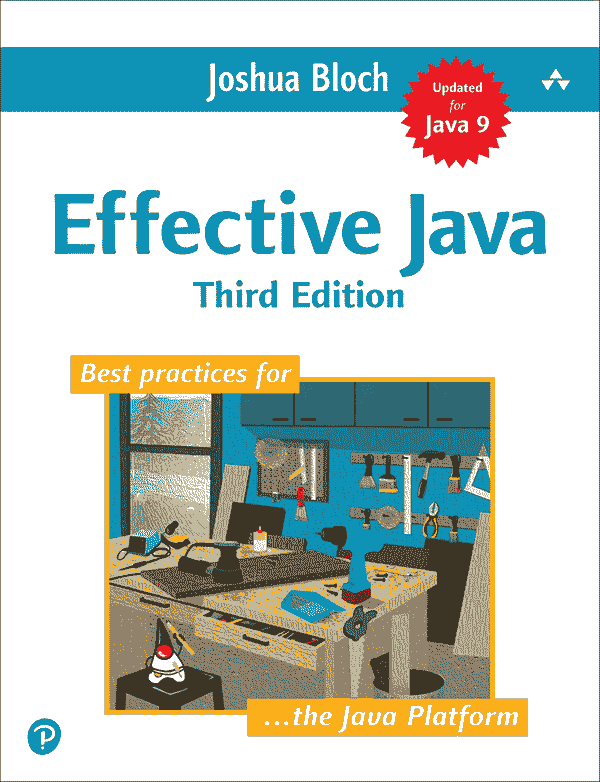
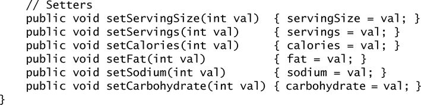

# Effective Java（第三版）



# 关于本电子书

EPUB 是一种开放的行业标准电子书格式。然而，不同的阅读设备和应用程序对 EPUB 及其许多功能的支持程度不同。请使用您的设备或应用设置来根据您的喜好自定义显示效果。您可以自定义的设置通常包括字体、字号、单栏或双栏、横屏或竖屏模式，以及可以点击或触摸放大的插图。有关您的阅读设备或应用上设置和功能的更多信息，请访问设备制造商的网站。

许多书籍包含编程代码或配置示例。为了优化这些元素的显示效果，请在单栏横屏模式下查看电子书，并将字体大小调整为最小设置。除了以重流文本格式呈现代码和配置外，我们还包含了代码的图像，以模仿印刷版书籍中的显示效果；因此，当重流格式可能会损害代码列表的显示效果时，您将看到“点击此处查看代码图像”的链接。点击链接即可查看高保真代码图像。要返回上一页，请点击设备或应用上的“返回”按钮。


**波士顿 • 哥伦布 • 印第纳波利斯 • 纽约 • 旧金山 • 阿姆斯特丹 • 开普敦**

**迪拜 • 伦敦 • 马德里 • 米兰 • 慕尼黑 • 巴黎 • 蒙特利尔 • 多伦 • 德里 • 墨西哥城**

**圣保罗 • 悉尼 • 香港 • 首尔 • 新加坡 • 台北 • 东京**

致我的家人：Cindy, Tim, 和 Matt

这个程序得到了正确的答案，但由于一个字符的拼写错误，它的运行速度比应有的要`慢`得多。变量`sum`被声明为`Long`而不是`long`，这意味着程序构造了大约 2³¹ 个不必要的`Long`实例（大约每将`long i`加到`Long sum`时就会一个）。在我的机器上，将`sum`的声明从`Long`改为`long`将运行时间从 6.3 秒减少到了 0.59 秒。教训很明显：`优先使用基本类型而不是包装基本类型，并注意无意的自动装箱。`

这一项不应被误解为对象创建是昂贵的且应该避免的。相反，创建和回收构造函数几乎没有显式工作的小对象是廉价的，尤其是在现代 JVM 实现上。为了增强程序的清晰性、简单或强大而创建额外的对象通常是好事。

相反，通过维护自己的`object pool`（对象池）来避免创建对象是一个坏主意，除非池中的对象极其重量。`确实`需要对象池的经典例子是数据库连接。建立连接的成本足够高，使得重用这些对象是有意义的。总的来说，维护自己的对象池会弄乱代码，增加内存占用并损害性能。现代 JVM 实现具有高度优化的垃圾回收器，在处理轻量级对象时轻松优于此类对象池。

此项的反面是 Item 50 中的`defensive copying`（防御性复制）。本项说，“当你应该重用现有对象时，不要创建新对象”，而 Item 50 则说，“当你应该创建新对象时，不要重用现有对象”。请注意，在需要防御性复制时重用对象的惩罚远大于无谓创建重复对象的惩罚。在需要的地方未能进行防御性复制可能会导致隐蔽的 bug 和安全漏洞；而不必要地创建对象只会影响风格和性能。

### Item 7: 消除过时的对象引用

如果你从具有手动内存管理的语言（如 C 或 C++）切换到像 Java 这样具有垃圾回收机制的语言，由于你的对象在用完后会被自动回收，你作为程序员的工作变得简单得许多。当你第一次体验到它时，它看起来几乎像魔法一样。这很容易给人一种你不需要考虑内存管理的印象，但事实并非完全如此。

考虑以下简单的栈实现：

点击此处查看代码图片

```
// 你能发现这个“内存泄漏”吗？
public class Stack {
    private Object[] elements;
    private int size = 0;
    private static final int DEFAULT_INITIAL_CAPACITY = 16;

    public Stack() {
        elements = new Object[DEFAULT_INITIAL_CAPACITY];
    }

    public void push(Object e) {
        ensureCapacity();
        elements[size++] = e;
    }

    public Object pop() {
        if (size == 0)
            throw new EmptyStackException();
        return elements[--size];
    }

    /**
     * 确保至少有一个更多元素的空间，
     * 每次数组需要增长时大致将容量翻倍。
     */
    private void ensureCapacity() {
        if (elements.length == size)
            elements = Arrays.copyOf(elements, 2 * size + 1);
    }
}
```

程序没有明显的错误（但泛型版本请参见 Item 29）。你可以对其进行详尽测试，它会完美通过每一项测试，但潜伏着一个问题。广义地说，程序有一个“内存泄漏”，它可能由于垃圾回收器活动增加或内存占用的增加而静默地表现为性能下降。在极端情况下，这种内存泄漏会导致磁盘分页，甚至因`OutOfMemoryError`导致程序失败，但此类故障相对罕见。

那么内存泄漏在哪里呢？如果一个栈增长然后缩小，那么从栈中弹出的对象将不会被垃圾回收，即使使用该栈的程序对它们不再有引用。这是因为栈仍然保持着对这些对象的`obsolete references`（过时引用）。过时引用仅仅是指永远不会再次被解除引用的引用。在这种情况下，元素数组“活动部分”之外的任何引用都是过时的。活动部分由索引小于`size`的元素组成。

垃圾回收语言中的内存泄漏（更准确的说法是`unintentional object retentions`，即无意中保留对象*）是隐蔽的。如果一个对象引用被无意地保留，不仅该对象本身被排除在垃圾回收之外，它所引用的任何对象也是如此，以此类推。即使只有少数对象引用被无意地保留，也可能导致许多对象无法被回收，对性能产生巨大影响。

解决这类问题的方法很简单：在引用过时时将其置空。在我们`Stack`类的情况下，一旦元素从栈中弹出，该引用就过时了。修正后的`pop`方法如下：

点击此处查看代码图片

```
public Object pop() {
    if (size == 0)
        throw new EmptyStackException();
    Object result = elements[--size];
    elements[size] = null; // 消除过时引用
    return result;
}
```

置空过时引用的额外益处是，如果随后误将其引用，程序将立即抛出`NullPointerException`失败，而不是静静地做错。尽可能尽早检测编程错误是有益的。

当程序员最初被这类问题困扰时，可能会过度补偿，在程序完成使用每个对象引用后将其置空。这既没有必要也不理想；它会无谓地增加代码量。**置空对象引用应该是例外而非常态。** 消除过时引的最佳方法是让包含该引用的变量离开作用域。如果你在尽可能窄的作用域内定义每个变量，就会自然发生（Item 57）。

那么，什么时候应该置空引用呢？`Stack`类的哪个方面导致它容易内存泄漏？简单来说，因为它*管理自己的内存*。*存储池*由`elements`数组中的元素组成（对象引用单元，而不是对象本身）。数组中活跃部分（如前文定义）的元素是*已分配的*，而数组其余部分的元素是*空闲的*。垃圾回收器无法得知这一点；对于垃圾回收器来说，`elements`数组中的所有对象引用都是同样有效的。只有程序员知道数组的非活跃部分是不重要的。程序员通过在数组元素变为非活跃部分时立即手动将它们置空，有效地将这一事实传达给垃圾回收器。

总的来说，每当一个类管理自己的内存时，程序员都应该警惕内存泄漏。每当一个元素被释放时，该元素包含的任何对象引用都应该被置空。

**内存泄漏的另一个常见来源是缓存。** 一旦你将对象引用放入缓存，就很容易忘记它的存在，并在它变得不再相关后仍将其留在缓存中。这个问题有几种解决方案。如果你足够幸运，实现了一种缓存，其条目的有效寿命恰好取决于缓存外是否存在对其键的引用，那么可以将缓存表示为`WeakHashMap`；条目在过时后会被移除。请记住，只有当缓存条目的预期寿命是由外部对键的引用而不是值的引用决定时，`WeakHashMap`才有用。

更常见的情况下，缓存条目的有效寿命定义并不明确，条目的价值随着时间的推移而逐渐降低。在这种情况下，缓存应该偶尔清理那些不再使用的条目。这可以通过后台线程（可能是`ScheduledThreadPoolExecutor`）或作为向缓存添加新条目时的副作用来完成。`LinkedHashMap`类通过其`removeEldestEntry`方法方便了后一种方法。对于更复杂的缓存，你可能需要直接使用`java.lang.ref`。

**内存泄漏的第三常见来源是监听器和其他回调。** 如果你实现了一个让客户端注册回调但没有显式注销它们的 API，那么除非你采取某些行动，否则它们将不断累积。确保回调被及时垃圾回收的一种方法是只存储它们对它们的*弱引用*，例如，仅将它们作为`WeakHashMap`的键存储。

由于内存泄漏通常不会表现为明显的失败，它们可能会在系统中存在多年。它们通常只有在通过仔细的代码检查或借助名为*堆分析器（heap profiler）*的调试工具结果时才会被发现。因此，在这些问题发生之前学会预测它们并防止其发生是非常理想的。

### 事项 8：避免终化器（finalizers）和清理器（cleaners）

**终化器是不可预测的，往往是危险的，并且通常没有必要。** 它们的使用会导致异常行为、性能低下以及移植性问题。终化器有一些有效的用途，我们将在本节稍后介绍，但根据原则，你应该避免它们。从 Java 9 开始，终化器已被废弃，但 Java 库仍在使用它们。Java 9 替代终化器的是*清理器（cleaners）。**清理器比终化器不危险，但仍然不可预测的、缓慢的且通常没有必要。**

警告 C++ 程序员不要将终化器或清理器看作 Java 中 C++ 析构函数的对应物。在 C++ 中，析构函数是回收与对象关联资源的正常方式，是构造函数的必要对应。在 Java 中，当对象变得不可达时，垃圾回收器会回收与对象相关的存储，不需要程序员付出任何额外努力。C++ 析构函数还用于回收其他非内存资源。在 Java 中，`try`-with-resources` 或 `try`-`finally` 块用于此目的（事项 9）。

终化器和清理器的缺点之一是，无法保证它们会被及时执行 [JLS, 12.6]。从一个对象变得不可达到到其终化器或清理器运行之间，可能会耗费任意长的时间。这意味着你**永远不要在终化器或清理器中执行任何对时间敏感的任务**。例如，依赖终化器或清理器来关闭文件是一个极其严重的错误，因为打开的文件描述符是有限资源。如果由于系统推迟运行终化器或清理器，导致许多文件处于打开状态，程序可能会因为无法再次打开文件而失败。

终化器和清理器执行的及时性主要取决于垃圾回收算法，该算法是一个函数，而该算法在不同的实现之间差异巨大。依赖终化器或清理器执行及时性的程序行为也可能因此存在差异。完全有可能，这样的程序在你测试的 JVM 上运行完美，但在你最重要客户所青睐的 JVM 上惨遭失败。

迟缓的终化不仅仅是一个理论问题。为类类提供终化器会任意延迟其实例的回收。一位同事调试了一个长时间运行 GUI 应用程序，该程序莫名因`OutOfMemoryError`死亡。分析显示，在它死亡时，应用程序的终化器队列中有数千个图形对象正等待着被终化和回收。不幸的是，终化器线程的运行优先级低于另一个应用程序线程，因此对象被终化的速度赶不上它们进入可终化状态的速度。语言规范对于哪个线程将执行终化器没有任何保证，因此，除了避免使用终化器外，没有可移植的方法可以防止这类问题。清理器在这一方面比终化器好一点，因为类作者对自己的清理器线程有控制权，但清理器仍在后台运行，受垃圾回收器的控制，因此无法保证及时清理。

规范不仅不保证终化器或清理器会及时执行，甚至不保证它们会执行。完全可能（甚至很可能）程序在终止时没有对某些已不可达的对象运行清理器。结果是，你**永远不要依赖终化器或清理器来更新持久化状态。**例如，依赖终化器或清理器来释放共享资源（如数据库）的持久化锁是让你整个分布式系统停滞的好方法。

不要被`System.gc`和`System.runFinalization`方法所诱惑。它们可能会增加终化器或清理器执行的概率，但不能保证。曾经有两个方法声称能提供这种保证：`System.runFinalizersOnExit`和它的邪恶孪胎`Runtime.runFinalizersOnExit`。这些方法存在致命缺陷，并且废弃了几十年。

终化器的另一个问题是，在终化期间抛出的未捕获异常会被忽略，且该对象的终化将终止 [JLS, 12.6]。未捕获异常可能会导致其他对象处于损坏状态。如果另一个线程尝试使用此类损坏的对象，可能会导致任意的非确定性行为。通常情况下，未捕获异常会终止线程并打印堆栈跟踪，但如果它发生在终化器中则不会——它甚至不会打印警告。清理器没有这个问题，因为使用清理器的库对其线程有控制权。

使用终化器（finalizers）和清理器（cleaners）性能代价很大。在我的机器上，创建一个简单的`AutoCloseable`对象、使用`try`-with-resources关闭它并让垃圾回收器回收它的时间大约是 12 ns。而使用终化器会将时间增加到 550 ns。换句话说，使用终化器创建和销毁对象的速度慢了 50 倍。这主要是因为终化器阻碍了高效的垃圾回收。如果你使用清理器来清理该类的所有实例，其速度与终化器相当（在我的机器上每个实例约为 500 ns），但如果你仅将其用作安全网（如下文所述），清理器的速度要快得多。在这种情况下，在我的机器上，创建、清理和销毁一个对象大约需要 66 ns，这意味着如果你不使用安全网，为这种保险你只需付出五倍（而不是五十倍）的代价。

### 终化器存在严重的安全问题：它们会让你的类受到终化器攻击

终化器攻击的原理很简单：如果构造函数或其序列化等效方法——`readObject`和`readResolve`方法（第 12 章）抛出异常，恶意子类的终化器就可以在那个应该“夭折”的半构造的对象上运行。这个终化器可以在静态字段中记录该对象的引用，防止其被垃圾回收。一旦这个畸形对象被记录下来，在该对象上调用本不应被允许存在的任意方法就是轻而易举的事。从构造函数抛出异常足以防止对象产生；但在存在终化器的情况下，事实如此。此类攻击可能导致灾难性的后果。最终类（final classes）对终化器攻击免疫，因为没有人能编写 final 类的恶意子类。为了保护非 final 类免受终化器攻击，请编写一个什么都不做的 final`finalize`方法。

### 推荐的替代方案

那么，对于封装了需要终止资源（如文件或线程）的类，除了编写终化器或清理器外，你应该怎么做？只需让你的类实现`AutoCloseable`，并要求客户端在不再需要每个实例时调用`close`方法，通常使用`try`-with-resources来确保即使在发生异常时也能终止（Item 9）。一个值得提的细节是，实例必须跟踪自己是否已关闭：`close`方法必须在字段中记录对象已失效，其他方法在对象关闭后被调用时，必须检查该字段并抛出`IllegalStateException`。

那么，终化器和清理器到底有什么用呢？它们或许有两个合法的用途。其是在资源所有者疏忽调用其`close`方法时作为安全网。虽然不能保证清理器或终化器会及时运行（或根本不运行），但如果客户端这样做，晚点释放资源也比永远不释放好。如果你正在考虑编写这样的安全网终化器，请仔细考虑这种保护是否值得付出。某些 Java 库类，如`FileInputStream`、`FileOutputStream`和`ThreadPoolExecutor`具有作为安全网的终化器。

终化器和清理器的第二个合法用途涉及具有原生伴接对象（native peers）的对象。原生伴接是一个原生（非 Java）对象，普通对象通过原生方法向其委托。由于原生伴接对象不是普通对象，垃圾回收器并不知道它，并且当其 Java 伴接对象被回收时，无法回收它。终化器或清理器可能是此任务的合适工具，前提是性能可以接受，且原生伴接对象不持有关键资源。如果性能不可接受或原生伴接对象持有必须及时回收的资源，则类应该像前面描述的那样拥有`close`方法。

### 使用清理器

清理器的用法有点复杂。下面是一个简单的`Room`类演示了该功能。假设房间在被回收之前必须进行清理。`Room`类实现了`AutoCloseable`；其自动清理安全网使用清理器仅仅是一个实现细节。与终化器不同，清理器不会污染类的公共 API：

点击此处查看代码图像


```
// 使用清理器作为安全网的 autocloseable 类
public class Room implements AutoCloseable {
    private static final Cleaner cleaner = Cleaner.create();

    // 需要清理的资源。不能引用 Room！
    private static class State implements Runnable {
        int numJunkPiles; // 房间里垃圾堆的数量

        State(int numJunkPiles) {
            this.numJunkPiles = numJunkPiles;
        }

        // 由 close 方法或清理器调用
        @Override public void run() {
            System.out.println("Cleaning room");
            numJunkPiles = 0;
        }
    }

    // 此房间的状态，与我们的可清理对象共享
    private final State state;

    // 我们的清理对象。当它符合 gc 条件时清理房间
    private final Cleaner.Cleanable cleanable;

    public Room(int numJunkPiles) {
        state = new State(numJunkPiles);
        cleanable = cleaner.register(this, state);
    }

    @Override public void close() {
        cleanable.clean();
    }
}
```

静态嵌套类 `State` 持有清理器清理房间所需的资源。在这种情况下，它仅仅是 `numJunkPiles` 字段，代表房间里的垃圾量。更现实的情况下，它可能是一个指向原生伴接对象的 `long`。`State` 实现了 `Runnable`，它的 `run` 方法最多调用一次，由我们在 `Room` 构造函数中将 `State` 实例注册到清理器时得到的 `Cleanable` 触发。`run` 方法的调用将由两种情况之一触发：通常是由 `Room` 的 `close` 方法调用 `Cleanable` 方法触发。如果在 `Room` 实例符合垃圾回收条件时客户端未调用 `close` 方法，清理器将（希望）调用 `State` 的 `run` 方法。

`State` 实例不引用其 `Room` 实例至关重要。否则会导致 `Room` 实例无法被垃圾回收（无法被自动清理）。因此，`State` 必须是静态嵌套类，因为非静态嵌套类包含对实例实例引用（Item 24）。同样不建议使用 lambda，因为它们很容易捕获对象的引用。

正如我们之前说的，`Room` 的清理器仅用安全网。如果客户端在 `try`-with-resources 块中封装所有的 `Room` 实例化，则永远不需要自动清理。这个良好的客户端演示了这种行为：

```
public class Adult {
    public static void main(String[] args) {
        try (Room myRoom = new Room(7)) {
            System.out.println("Goodbye");
        }
    }
}
```

正如你所料的，运行 `Adult` 程序会打印 `Goodbye`，然后是 `Cleaning room`。但这个从不清理房间的糟糕程序呢？

```
public class Teenager {
    public static void main(String[] args) {
        new Room(99);
        System.out.println("Peace out");
    }
}
```

你可能期望它会打印 `Peace out`，然后是 `Cleaning room`，但在我的机器上，它从未打印过 `Cleaning room`；它直接退出了。这就是我们之前说过的不可预测性。`Cleaner` 规范说：“清理器在 `System.exit` 期间的行为取决于具体实现。不保证是否会调用清理动作。”虽然规范中没有明说，但对于程序的正常退出也是如此。在我的机器上，在 `Teenager` 的 `main` 方法中添加 `System.gc()` 这一行就足以让它在退出前打印 `Cleaning room`，但无法保证你在你的机器上看到相同的行为。

总之，不要使用清理器（cleaners），或者在 Java 9 之前的版本中使用终终化器（finalizers），除非将其作为安全网或用于终止非关键原生资源。即便如此，也要注意其不确定性和性能后果。

### Item 9: 优先使用 `try`-with-resources` 代替 `try`-`finally`

Java 库包含了许多必须通过调用 `close` 方法手动关闭的资源。示例包括 `InputStream`、`OutputStream` 和 `java.sql.Connection`。客户端经常忽略关闭资源，这会导致意料之糟糕的性能后果。虽然这些资源中许多使用了终 izers 作为安全网，但终化器的效果并不理想（Item 8）。

从历史上看，`try`-`finally` 语句是保证资源被正确关闭的最佳方法，即使在发生异常或返回时也是如此：

```
// try-finally - 不再关闭资源的最佳方式！
static String firstLineOfFile(String path) throws IOException {
    BufferedReader br = new BufferedReader(new FileReader(path));
    try {
        return br.readLine();
    } finally {
        br.close();
    }
}
```

这看起来可能并不坏，但当你添加第二个资源时，情况会变得糟糕：

```
// 当使用多个资源时，使用 try-finally 非常难看！
static void copy(String src, String dst) throws IOException {
    InputStream in = new FileInputStream(src);
    try {
        OutputStream out = new FileOutputStream(dst);
        try {
            byte[] buf = new byte[BUFFER_SIZE];
            int n;
            while ((n = in.read(buf)) >= 0)
                out.write(buf, 0, n);
        } finally {
            out.close();
        }
    } finally {
        in.close();
    }
}
```

这可能难以置信，但即使是优秀的程序员大多数时候也会犯这个错。首先，我在 *Java Puzzlers* 的第 88 页就写错了 [Bloch05]，而且多年无人注意到。事实上，在 2007 年，Java 库中 `close` 方法有三分之二是错误的。

即使是使用 `try`-`finally` 语句关闭资源的正确代码（如前两个代码示例所示），也存在细微的缺陷。`try` 块和 `finally` 块中的代码都有可能抛出异常。例如，在 `firstLineOfFile` 方法中，对 `readLine` 的调用可能因为底层物理设备的故障而抛出异常，随后对 `close` 的调用可能由于相同的原因而失败。在这种情况下，第二个异常会完全掩盖第一个异常。异常堆栈跟踪中没有第一个异常的记录，这会极大地增加真实系统的调试难度——通常你希望看到第一个异常来诊断问题。虽然可以编写代码来抑制第二个异常以保留第一个异常，但几乎没有人这样做，因为那实在太啰嗦了。

当 Java 7 引入 `try`-with-resources` 语句时，所有这些问题都迎刃而解了 [JLS, 14.20.3]。要使用这种构造结构，资源必须实现 `AutoCloseable` 接口，该接口包含一个返回 `void` 的单一 `close` 方法。Java 库中的许多类和接口现在都实现了 `AutoCloseable`。如果你写了一个必须关闭的类，那么你的类应该实现 `AutoCloseable`。以下是使用 `try`-with-resources` 时我们第一个示例的样子：

```
// try-finally - 不再关闭资源的最佳方式！
static String firstLineOfFile(String path) throws IOException {
    BufferedReader br = new BufferedReader(new FileReader(path));
    try {
        return br.readLine();
    } finally {
        br.close();
    }
}
```

这里是使用 `try`-with-resources` 时我们第二个示例的样子：

```
// 当使用多个资源时，使用 try-finally 非常难看！
static void copy(String src, String dst) throws IOException {
    InputStream in = new FileInputStream(src);
    try {
        OutputStream out = new FileOutputStream(dst);
        try {
            byte[] buf = new byte[BUFFER_SIZE];
            int n;
            while ((n = in.read(buf)) >= 0)
                out.write(buf, 0, n);
        } finally {
            out.close();
        }
    } finally {
        in.close();
    }
}
```

`try`-with-resources` 版本不仅比原始版本更短、可读性更高，而且还提供了更好的诊断信息。考虑 `firstLineOfFile` 方法。如果 `readLine` 调用和 `close` 调用都抛出了异常，后者异常会被*抑制*以优先保留前者。事实上，多个异常可能会被抑制，以保留你真正想看到的异常。你也可以通过 `getSuppressed` 方法编程地访问它们，该方法是在 Java 7 中添加到 `Throwable` 中的。

你可以在 `try`-with-resources 上放置 catch 句，就像在 `try`-`finally` 语句上一样。这允许你处理异常而无需增加代码的嵌套层。作为一个稍微刻意的示例，这里有一个 `firstLineOfFile` 版本，它不抛出异常而在无法打开或读取文件时返回一个默认值：

```
// 带有 catch 句的 try-with-resources
static String firstLineOfFile(String path, String defaultVal) {
    try (BufferedReader br = new BufferedReader(new FileReader(path))) {
        return br.readLine();
    } catch (IOException e) {
        return defaultVal;
    }
}
```

结论很明确：在使用必须关闭的资源时，始终使用 `try`-with-resources 而不是 `try-finally`。生成的代码更短更清晰，生成的异常更有用。`try`-with-resources` 语句使得编写使用必须关闭资源的正确代码变得简单，而这在使用 `try-finally` 时几乎是不可能的。

## 第 3 章：所有对象的公共方法

尽管 `Object` 是一个具体类，但它主要设计用于扩展。它所有的非 final 方法（`equals`、`hashCode`、`toString`、`clone` 和 `finalize`）都有明确的*通用合约*，因为它们被设计为重写。重写这些方法的类有责任遵守它们的通用合约；否则会导致依赖这些合约的其他类（如 `HashMap` 和 `HashSet`）无法与该类正常协作。

本章告诉你何时以及如何重写非 final `Object` 方法。`finalize` 方法在本文中被省略，因为它在 Item 8 中讨论过。虽然 `Comparable.compareTo` 不是 `Object` 方法，但它在本章中被讨论，因为它具有相似的特征。

### Item 10: 重写 `equals` 时遵守通用合约

重写 `equals` 方法似乎简单，但有许多方法出错，而且后果可能是灾难性的。避免问题的最简单方法是不重写 `equals` 方法，在这种情况下，类的每个实例仅与它自己相等。如果满足以下任何条件，这都是正确的做法：

- **类的每个实例在本质上都是唯一的。** 这对于像 `Thread` 这样表示活动实体而非值的类来说是成立的。`Object` 提供的 `equals` 实现对这些类具有恰恰好处的行为。

- **该类不需要提供“逻辑相等性”测试。** 例如，`java.util.regex.Pattern` 本可以重写 `equals` 来检查两个 `Pattern` 实例是否表示完全相同的正则表达式，但设计者认为客户端并不需要或想要这种功能。在这些情况下，继承自 `Object` 的 `equals` 实现是理想的。

- **父类已经重写了 `equals` 方法，且父类的行为对于该类来说是合适的。** 例如，大多数 `Set` 实现都从 `AbstractSet` 继承其 `equals` 实现，`List` 实现从 `AbstractList` 继承，`Map` 实现从 `AbstractMap` 继承。

- **该类是私有的或包私有的，且你确定其 `equals` 方法永远不会被调用。** 如果你极度规避风险，可以重写 `equals` 方法以确保它不会被意外调用：

```
@Override public boolean equals(Object o) {
    throw new AssertionError(); // 方法永远不会被调用
}
```

那么，什么时候重写 `equals` 是合适的呢？当一个类有一个与仅仅的对象标识性不同的逻辑相等概念，且父类尚未重写 `equals` 时，就是合适的。这通常是值类（value classes）的情况。值类简单来说表示一个值的类，例如 `Integer` 或 `String`。使用 `equals` 方法比较值对象引用的程序员期望发现的是它们在逻辑上是等等的，而不是它们是否引用同一个对象。重写 `equals` 方法不仅是满足程序员期望所必须的，还能让实例作为 map 的键或 set 的元素，并具有可预测且良好的行为。

一种不需要重写 `equals` 方法的值类是使用实例控制（Item 1）来确保每个值最多存在一个对象的类。枚举类型（Item 34）属于这一类。对于这些类，逻辑相等等同于对象标识，因此 `Object` 的 `equals` 方法就可以作为逻辑 `equals` 方法。

当你重写 `equals` 方法时，必须遵守它的通用约定。以下是 `Object` 规范中的约定：

`equals` 方法实现等价关系。它具有以下属性：

- **自反性（Reflexive）**：对于任何非空引用值 `x`，`x.equals(x)` 必须返回 `true`。

- **对称性（Symmetric）**：对于任何非空引用值 `x` 和 `y`，当且仅当 `y.equals(x)` 返回 `true` 时，`x.equals(y)` 必须返回 `true`。

- **传递性（Transitive）**：对于任何非空引用值 `x`、`y`、`z`，如果 `x.equals(y)` 返回 `true` 且 `y.equals(z)` 返回 `true`，那么 `x.equals(z)` 必须返回 `true`。

- **一致性（Consistent）**：对于任何非空引用值 `x` 和 `y`，多次调用 `x.equals(y)` 必须一致地返回 `true` 或一致地返回 `false`，前提是用于 `equals` 比较的信息没有被修改。

- 对于任何非空引用值 `x`，`x.equals(null)` 必须返回 `false`。

除非你对数学很感兴趣，否则这看起来可能有点吓人，但不要忽略它！如果你违反了它，你可能会发现你的程序行为异常或崩溃，而且确定故障源可能非常困难。用约翰·唐纳（John Donne）的话说，没有哪个类是孤岛。一个类的实例经常被传递给另一个类。许多类（包括所有的集合类）都依赖于传递给它们的对象遵守 `equals` 约定。

既然你意识到了违反 `equals` 约定的危险，让我们详细回顾该约定。好消息是，尽管外表如此，它真的并不复杂。一旦你理解了它，遵守它并不难。

那么，什么是等价关系？粗略地说，它是一个将元素集合划分为若干子集的运算符，子集中的元素被认为相互相等。这些子集被称为等价类。为了使 `equals` 方法有用，每个等价类中的所有元素从用户的角度来看必须是互换的。现在，让我们逐一检查这五个要求：


**自反性**——第一个要求仅仅说对象必须与自己相等。很难想象会无意中违反这一点。如果你无意中违反了它并将你的类实例添加到集合中，`contains` 方法很可能会说集合并不包含你刚刚添加的那个实例。

**对称性**——第二个要求说任何两个对象必须在它们是否相等上达成共识。与第一个要求不同，很难想象会无意中违反这一点。例如，考虑以下类，它实现了一个不区分大小的字符串。字符串的大小由 `toString` 保留，但在 `equals` 中被忽略了：

```java
// 破坏对称性！
public final class InsensitiveString {
    private final String s;

    public InsensitiveString(String s) {
        this.s = Objects.requireNonNull(s);
    }

    // 破坏对称性！
    @Override public boolean equals(Object o) {
        if (o instanceof InsensitiveString) // 单向互操作性！
            return s.equalsIgnoreCase(((InsensitiveString) o).s);
        return false;
    }
    ... // 剩余省略
}
```

该类中良好的 `equals` 方法幼稚地尝试与 `String` 互操作。让我们假设有一个不区分大小的字符串和一个普通的字符串：

```java
InsensitiveString cis = new InsensitiveString("Polish");
String s = "polish";
```

如预期的那样，`cis.equals(s)` 返回 `true`。问题在于，虽然 `InsensitiveString` 的 `equals` 方法知道普通字符串，但 `String` 的 `equals` 方法忽略不区分大小的字符串。因此，`s.equals(cis)` 返回 `false`，这显然违反了对称性。假设你将一个不区分大小的字符串放入集合中：

```java
List<InsensitiveString> list = new ArrayList<>();
list.add(cis);
```

此时 `list.contains(s)` 返回什么？谁知道呢？在当前的 OpenJDK 实现中，它恰好返回 `false`，但这仅仅是实现上的副产物。在另一种实现中，它完全可能同样地返回 `true` 或抛出运行时异常。一旦你违反了 `equals` 约定，你根本不知道其他对象在面对你的对象时会如何表现。

要消除这个问题，只需从 `equals` 方法中删除构思不当的与 `String` 互操作尝试。一旦你这样做，你就可以将方法重构为单条返回语句：

```java
@Override public boolean equals(Object o) {
    return o instanceof InsensitiveString &&
        ((InsensitiveString) o).s.equalsIgnoreCase(s);
}
```

## 传递性

`equals` 约的第三个要求规定：如果一个对象等于第二个对象，而第二个对象等于第三个对象，那么第一个对象必须等于第三个对象。同样，很容易想象在无意中违反这一要求。考虑一个向其父类添加了新*值组件*的子类。换句话说，子类添加了一部分影响 `equals` 比较的信息。让我们从一个简单的不可变二维整数点类开始：

```java
public class Point {
    private final int x;
    private final int y;

    public Point(int x, int y) {
        this.x = x;
        this.y = y;
    }

    @Override public boolean equals(Object o) {
        if (!(o instanceof Point))
            return false;
        Point p = (Point)o;
        return p.x == x && p.y == y;
    }

    ...  // 剩余部分省略
}
```

假设你想扩展这个类，为点添加颜色的概念：

```java
public class ColorPoint extends Point {
    private final Color color;

    public ColorPoint(int x, int y, Color color) {
        super(x, y);
        this.color = color;
    }

    ...  // 剩余部分省略
}
```

`equals` 方法应该长什么样？如果你完全忽略掉它，那么实现将继承自 `Point`，并且在 `equals` 比较中会忽略颜色信息。虽然这没有违反 `equals` 约，但显然是不可接受的。假设你写了一个 `equals` 方法，只有当参数是另一个位置和颜色相同的颜色点时，才返回 `true`：

```java
// 错误 - 违反了对称性！
@Override public boolean equals(Object o) {
    if (!(o instanceof ColorPoint))
      return false;
    return super.equals(o) && ((ColorPoint) o).color == color;
}
```

这种方法的问题在于，当你比较一个点和一个颜色点以及反之亦时，可能会得到不同的结果。前面的比较忽略了颜色，而后者的比较始终返回 `false`，因为参数的类型不正确。为了使之具体，让我们创建一个点和一个颜色点：

```java
Point p = new Point(1, 2);
ColorPoint cp = new ColorPoint(1, 2, Color.RED);
```

此时 `p.equals(cp)` 返回 `true`，而 `cp.equals(p)` 返回 `false`。你可能会尝试通过让 `ColorPoint.equals` 在进行“混合比较”时忽略颜色来修复解决此问题：

```java
// 错误 - 违反了传递性！
@Override public boolean equals(Object o) {
    if (!(o instanceof Point))
        return false;

    // 如果 o 是普通的 Point，进行无颜色的比较
    if (!(o instanceof ColorPoint))
        return o.equals(this);

    // o 是一个 ColorPoint；进行完整比较
    return super.equals(o) && ((ColorPoint) o).color == color;
}
```

这种方法确实提供了对称性，但是以牺牲传递性为代价：

```java
ColorPoint p1 = new ColorPoint(1, 2, Color.RED);
Point p2 = new Point(1, 2);
ColorPoint p3 = new ColorPoint(1, 2, Color.BLUE);
```

现在 `p1.equals(p2)` 和 `p2.equals(p3)` 返回 `true`，而 `p1.equals(p3)` 返回 `false`，这显然违反了传递性。

此外，这种方法可能会导致递归：假设 `Point` 有两个子类，例如 `ColorPoint` 和 `SmellPoint`，它们都拥有这个 `equals` 方法。那么调用 `myColorPoint.equals(mySmellPoint)` 将抛出 `StackOverflow`（栈溢出）。

那么解决方案是什么？事实证明，除非你愿意放弃面向对象的编程，否则没有办法可以在扩展可实例化类并添加值组件的同时保持 `equals` 约。你可能会听人说，通过在 `equals` 方法中使用 `getClass` 测试来代替 `instanceof`，你可以在扩展可实例化类并添加值组件的同时保持 `equals` 约：

```java
// 错误 - 违反了里氏夫替换原则（第 43 页）
@Override public boolean equals(Object o) {
    if (o == null || o.getClass() != getClass())
      return false;
    Point p = (Point) o;
    return p.x == x && p.y == y;
}
```

*里氏夫替换原则*指出，一个类型的任何重要属性性都也应该适用于所有子类型，以便为该类型编写的任何方法都能在其子类型上同样良好地工作 [Liskov87]。这是对我们之前主点的正式表示：`Point` 的子类（如 `CounterPoint`）仍然是一个 `Point` 并必须表现得像它。但假设我们将 `CounterPoint` 传递给 `onUnitCircle` 方法。如果 `Point` 类使用基于 `getClass` 的 `equals` 方法，无论 `CounterPoint` 实例的 *x* 和 *y* 坐标如何，`onUnitCircle` 方法都会返回 `false`。这是因为大多数集合（包括 `onUnitCircle` 方法集合）使用 `equals` 方法测试包含性，而没有任何 `CounterPoint` 实例等于 `Point`。然而，如果你在 `Point` 上使用基于 `instanceof` 的 `equals` 方法，那么在处理 `CounterPoint` 实例时 `onUnitCircle` 方法就能正常工作。

虽然这可能不是实现功能最快的方法，但它是有效的。假设你以某种简单的方式扩展 `Point`，例如通过让构造函数跟踪创建了多少实例：

```java
public class CounterPoint extends Point {
    private static final AtomicInteger counter = new AtomicInteger();

    public CounterPoint(int x, int y) {
        super(x, y);
        counter.incrementAndGet();
    }

    public static int numberCreated() { return counter.get(); }
}
```

虽然没有满意的方法可以扩展可实例化类并添加值组件，但有一个极好的变通方法：遵循 Item 18 的建议，“组合优于继承](#ch4.xhtml_lev18)”。与其让 `ColorPoint` 继承 `Point`，不如给 `ColorPoint` 有一个私有的 `Point` 字段和一个公共的*视图*方法（Item 6），返回一个与此颜色点位置相同的点：

```java
// Adds a value component without violating the equals contract
public class ColorPoint {
  private final Point point;
  private final Color color;

  public ColorPoint(int x, int y, Color color) {
      point = new Point(x, y);
      this.color = Objects.requireNonNull(color);
  }

  /**
   * Returns the point-view of this color point.
   */
  public Point asPoint() {
      return point;
  }

  @Override public boolean equals(Object o) {
      if (!(o instanceof ColorPoint))
          return false;
      ColorPoint cp = (ColorPoint) o;
      return cp.point.equals(point) && cp.color.equals(color);
  }

  ...    // Remainder omitted
}
```

Java 平台库中存在一些类继承了可实例化的类并添加了值组件。例如，`java.sql.Timestamp` 继承了 `java.util.Date` 并增加了一个 `nanoseconds` 字段。`Timestamp` 的 `equals` 实现违反了对称性，如果 `Timestamp` 和 `Date` 对象在同一个集合中使用或被混合使用，会导致不可异的行为。`Timestamp` 类有一个免责声明，警告程序员不要混合使用日期和时间戳。只要你将它们分开，就不会出问题，但并没有什么能阻止你将它们混合，产生的错误可能很难调试。`Timestamp` 类的这种行为是一个错误，不应该被模仿。

请注意，你*可以*在*抽象* 类的子类中添加值组件，而不会违反 `equals` 约。这对于通过遵循 Item 23 中的建议——“优先使用类层次结构而不是标记类”而得到的此类类层次结构至关重要。例如，你可以有一个没有值组件的抽象类 `Shape`，一个添加了 `radius` 字段的子类 `Circle`，以及一个添加了 `length` 和 `width` 字段的子类 `Rectangle`。只要无法直接创建父类实例，之前所示的问题问题就不会发生。

**一致性**——`equals` 约的第四个要求规定，如果两个对象相等，它们在所有时间内都必须保持相等，除非其中一个（或两个）被修改。换句话说，可变对象可以在不同时间等于不同的对象，而不可变对象则不能。当你编写一个类时，要仔细考虑它是否应该是不可变的（Item 17）。如果你认为它应该是，请确保你的 `equals` 方法强制执行限制，使相等的对象在所有时间内保持相等，不等的对象在所有时间内保持不相等。

无论类是否不可变，**不要编写依赖于不可靠资源的 equals 方法。** 如果你违反了这项禁止，要满足一致性要求极其困难。例如，`java.net.URL` 的 `equals` 方法依赖于比较 URL 关联的 IP 地址。将主机名转换为 IP 地址可能需要网络访问，并且无法保证随着时间的推产生相同的结果。这会导致 `URL equals` 方法违反 `equals` 约，并在实践中引起了问题。`URL` 的 `equals` 方法的行为是一个巨大的错误，不应该被模仿。遗憾的是，由于兼容性要求，它无法更改。为了避免这类问题，`equals` 方法应该只对内存驻留的对象执行确定性计算。

**非空性**——最后一个要求没有官方名称，因此我冒昧将其命名为“非空性”。它规定所有对象必须与 `null` 不相等。虽然很难想象在调用 `o.equals(null)` 时会意外返回 `true`，但并不难想象会意外抛出 `NullPointerException`。通用约禁止了这一点。许多类的 `equals` 方法通过显式的 `null` 测试来防范这一点：

```java
// Explicit null check - unnecessary!
@Override public boolean equals(Object o) {
    if (o == null)
        return false;
    ...
}
```

这个测试是不必要的。为了测试其参数的相等性，`equals` 方法必须先将其参数强制转换为适当类型，以便调用其访问器或访问其字段。在进行强制转换之前，方法必须使用 `instanceof` 操作符检查其参数是否为正确类型：

```java
// Implicit null check - preferred
@Override public boolean equals(Object o) {
    if (!(o instanceof MyType))
        return false;
    MyType mt = (MyType) o;
    ...
}
```

如果缺少此类型检查且向 `equals` 方法传递了错误类型的参数，将抛出 `ClassCastException`。但 `instanceof` 操作符规定当其第一个操作数为 `null` 时返回 `false` [JLS, 15.20.2]。通常，正确类型是实现接口的类。`Set`、`List`、`Map` 和 `Map.Entry` 等集合具有具有属性。因此，如果传递 `null`，类型检查将返回 `false`，所以不需要显式的 `null` true。

综上所述，这里有一个高质量 `equals` 方法的配方：

1. **使用 `==` 操作符检查参数是否为该对象的引用。** 如果是，返回 `true`。这是一种性能优化，如果比较开销很大，它是值得的。

2. **使用 `instanceof` 操作符检查是否具有正确类型。** 如果不是，返回 `false`。通常，正确类型是该方法所在的类。偶尔，它是该类实现的某个接口。

3. **将参数强制转换为正确类型。** 因为此强制转换之前有 `instanceof` 测试，所以保证会成功。


4. **对于类中的每个“重要”字段，检查参数的该字段是否与对象的相应字段匹配。** 如果所有这些测试都通过，返回 `true`；否则返回 `false`。如果步骤 2 中的类型是接口，你必须通过接口方法访问参数字段；如果类型是类，取决于访问权限，你可能可以直接访问字段。

对于类型不是 `float` 或 `double` 的原始类型字段，使用 `==` 操作符进行比较；对于对象引用字段，递归调用 `equals` 方法；对于 `float` 字段，使用静态方法 `Float.compare(float, float)`；对于 `double` 字段，使用 `Double.compare(double, double)`。对 `float` 和 `double` 字段的特殊处理由于 `Float.NaN`、`-0.0f` 以及类似的 `double` 值的存在而变得必要；详情见 JLS 15.21.1 或 `Float.equals` 的文档。虽然可以使用静态方法 `Float.equals` 和 `Double.equals` 比较 `float` 和 `double` 字段，但这会导致每次比较都进行自动装箱，性能很差。对于数组字段，对每个元素应用这些指南。

某些对象引用字段可能合法包含 `null`。为了避免抛出 `NullPointerException` 的可能，使用静态方法 `Objects.equals(Object, Object)` 检查此类字段的相等性。

对于某些类，例如上面的 `CaseInsensitiveString`，字段的比较比简单的等性测试要复杂得多。如果是如此，你可能想要存储字段的*规范形式*（canonical form），这样 `equals` 方法就可以对规范形式进行廉价的精确比较，而不是进行开销更高昂的非标准比较。这种技术最适用于不可变类（Item 17）；如果对象可以发生变化，你必须保持规范形式是最新的。

`equals` 方法的性能可能会受到字段比较顺序的影响。为了获得最佳性能，你应该首先比较那些更有可能不同、比较开销较小的字段，或者在理想情况下，两者兼顾。你不能比较不属于对象逻辑状态的字段，例如用于同步操作的锁字段（lock fields）。不需要比较*派生字段*（derived fields），这些字段可以从“重要字段”计算出来，但这样做可能会提高 `equals` 方法的性能。如果一个派生字段等同于整个对象的摘要描述，那么在比较失败时，比较该字段将节省你比较实际数据的开销。例如，假设你有一个 `Polygon` 类，并缓存了面积。如果两个多形的面积不等，你就不必费精力比较它们的边和顶点。

## 当你写完 `equals` 方法后，问问自己三个问题：它是对称的吗？它是传递的吗？它是一致的吗？

不要仅仅问问自己；要编写单元测试来检查，除非你使用了 AutoValue（第 49 页）来生成 `equals` 方法，在这种情况下，你可以安全地省略测试。如果属性不成立，请找出原因并相应地修改 `equals` 方法。当然，你的 `equals` 方法还必须满足另外两个属性（自反射性和非空性），但这两个属性通常会自动处理好。

按照上述配方构建的 `equals` 方法在如下简单的 `PhoneNumber` 类中所示：

```java
// 具有典型 equals 方法的类
public final class PhoneNumber {
    private final short areaCode, prefix, lineNum;

    public PhoneNumber(int areaCode, int prefix, int lineNum) {
        this.areaCode = rangeCheck(areaCode,  999, "area code");
        this.prefix  = rangeCheck(prefix,     999, "prefix");
        this.lineNum  = rangeCheck(lineNum,  9999, "line num");
    }

    private static short rangeCheck(int val, int max, String arg) {
        if (val < 0 || val > max)
            throw new IllegalArgumentException(arg + ": " + val);
        return (short) val;
    }

    @Override public boolean equals(Object o) {
        if (o == this)
            return true;
        if (!(o instanceof PhoneNumber))
            return false;
        PhoneNumber pn = (PhoneNumber)o;
        return pn.lineNum == lineNum && pn.prefix == prefix
               && pn.areaCode == areaCode;
    }
    ... // 省略其余部分
}
```

这里有最后的注意事项：

- **在重写 `equals` 时，始终重写 `hashCode`** (Item 11)。

- **不要试图过得聪明。** 如果你简单地测试字段的等性，要遵守 `equals` 约并不困难。如果你在寻找等效性时过于激进，很容易陷入麻烦。通常情况下考虑任何形式的别名（aliasing）都是坏主意。例如，`File` 类不应该尝试等同指向同一个文件的符号链接。幸运的是，它没有这样做。

- **不要在 `equals` 声明中用另一种类型代替 `Object`。** 程序员写一个像这样的 `equals` 方法，然后花费几个小时困惑为什么它没有正常工作，这并不罕见：

```java
// 错误 - 参数不是 Object
public boolean equals(PhoneNumber o) {
    ...
}
```

`equals` 方法必须接受 `Object` 作为其参数。如果不是，你是在重载而不是重写，并将调用 `Object` 的 `equals` 方法。

### Item 11: 在重写 `equals` 时，始终重写 `hashCode`

你必须在每个重写了 `equals` 的类中重写 `hashCode`。如果你没有这样做，你的类将违反 `hashCode` 的通用约定，这将导致它无法在 `HashMap` 和 `HashSet` 等集合中正常工作。以下是根据 `Object` 规范改编的约定：

- 在应用程序执行期间反复调用 `hashCode` 方法时，它必须一致地返回相同的值，只要 `equals` 比较中使用的信息没有被修改。此值不需要在程序的这一次执行和另一个执行之间保持一致。

- 如果两个对象根据 `equals(Object)` 方法是相等，那么对这两个对象调用 `hashCode` 必须产生相同的整数结果。

- 如果两个对象根据 `equals(Object)` 方法不相等，则*不要求*对每个对象调用 `hashCode` 产生不同的结果。然而，程序员应该意识到，为不等的对象产生不同的结果可能会提高哈希表的性能。

当你没有重写 `hashCode` 时违反的关键条款是第二条：等的对象必须具有相同的哈希码。两个不同的实例根据类的 `equals` 方法在逻辑上可能是相等的，但对 `Object` 的 `hashCode` 方法来说，它们只是两个没有共同点的对象。因此，`Object` 的 `hashCode` 方法返回两个看似随机的数字，而不是约定所要求的两个相同的数字。

例如，假设你尝试将 Item 10 中 `PhoneNumber` 类的实例作为 `HashMap` 的键：

```java
Map<PhoneNumber, String> m = new HashMap<>();
m.put(new PhoneNumber(707, 867, 5309), "Jenny");
```

在此时，你可能期望 `m.get(new PhoneNumber(707, 867, 5309))` 会返回 `"Jenny"`，但实际上它返回了 `null`。注意这里涉及到两个 `PhoneNumber` 实例：一个用于插入到 `HashMap` 中，另一个等等的实例用于（尝试）检索。由于 `PhoneNumber` 类没有重写 `hashCode`，导致这两个等等的实例具有不相等的哈希值，这违反了 `hashCode` 契约。因此，`get` 方法可能会在一个与 `put` 方法存储位置不同的哈希桶中查找该电话号码。即使这两个实例恰好哈希到同一个桶中，`get` 方法几乎肯定也会返回 `null`，因为 `HashMap` 有一种优化机制，它会缓存与每个条目相关的哈希值，如果哈希值不匹配，它就不会去检查对象的相等性。

修复这个问题只需为 `PhoneNumber` 编写一个适当的 `hashCode` 方法。那么，一个 `hashCode` 方法应该什么样呢？写一个糟糕的实现非常简单。例如，下面这个实现总是合法的，但绝不应该使用：

```java
// 最糟糕的合法 hashCode 实现 - 永远不要使用！
@Override public int hashCode() { return 42; }
```

它是合法的，因为它确保了等等的对象具有相同的哈希值。它是糟糕的，因为它确保了*每一个*对象都有相同的哈希值。因此，每个对象都哈希到同一个桶中，哈希表退化为链表。本应在线性时间内运行的程序改为在二次时间内运行。对于大型哈希表，这是正常工作与无法运行的区别。

良好的哈希函数倾向于为不等的实例产生不相等的哈希值。这正就是 `hashCode` 契约第三部分的含义。理想情况下，哈希函数应该将任何合理的不相等实例集合均匀地分布在所有 `int` 值上。实现这种理想状态可能困难。幸运的是，实现一个公平的近似并不难。这里有一个简单的配方：

1. 声明一个名为 `result` 的 `int` 变量，并将其初始化为对象中第一个有效字段的哈希值 `c`，如步骤 2.a 所示。（回想 Item 10，有效字段是指影响 `equals` 比较的字段。）

2. 对于对象中的每个剩余有效字段 `f`，执行以下操作：

a. 为该字段计算 `int` 哈希值 `c`：

i. 如果该字段是原始类型，计算 `Type.hashCode(f)`，其中 `Type` 是与 `f` 类型对应的装箱原始类。

ii. 如果该字段是对象引用，且该类的 `equals` 方法通过递归调用 `equals` 来比较该字段，则对该字段递归调用 `hashCode`。如果需要更复杂的比较，则为该字段计算一个“规范表示”，并在该规范表示上调用 `hashCode`。如果字段值为 `null`，则使用 `0`（或其他某些常量，但 `0` 是传统做法）。

iii. 如果该字段是数组，将其视为视为每个有效元素都是一个独立的字段。也就是说，通过递归应用这些规则为每个有效元素计算哈希值，并按照步骤 2.b 组合这些值。如果数组没有有效元素，使用一个常量，最好不是 `0`。如果所有元素都是有效的，则使用 `Arrays.hashCode`。

b. 将步骤 2.a 中计算的哈希值 `c` 如下合并到 `result` 中：

`result = 31 * result + c;`

3. 返回 `result`。

当你写完 `hashCode` 方法后，问问自己等等的实例是否具有相同的哈希值。编写单元测试来验证你的直觉（除非你使用了 `AutoValue` 来生成 `equals` 和 `hashCode` 方法，如果是那样，你可以安全地省略这些测试）。如果等等的实例具有不相等的哈希值，找出原因并修复问题。

你可以从哈希值计算中排除*派生字段*。换句话说，你可以忽略任何值可以通过计算中包含的字段计算出的字段。你*必须*排除任何在 `equals` 比较中未使用的字段，否则你就有违反 `hashCode` 契约第二条款的风险。

步骤 2.b 中的乘法使得结果取决于字段的顺序，如果类有多个相似的字段，这将产生更好的哈希函数。例如，如果 `String` 哈希函数中省略了乘法，那么所有的字母位词都将具有相同的哈希值。选择 31 是因为它是一个奇质数。如果它是偶数且乘法溢出，信息将会丢失，因为乘以 2 等于位移。使用质数的优势虽然不那么明显，但它是传统做法。31 的一个很棒的是，乘法可以用位移和减法代替，以在某些架构上获得更好的性能：`31 * i == (i << 5) - i`。现代虚拟机会自动进行这种优化。

让我们将之前的配应用于 `PhoneNumber` 类：

```java
// 典型的 hashCode 方法
@Override public int hashCode() {
    int result = Short.hashCode(areaCode);
    result = 31 * result + Short.hashCode(prefix);
    result = 31 * result + Short.hashCode(lineNum);
    return result;
}
```

由于此方法返回了一个简单的确定性计算结果，其唯一输入是三个字段，因此等等的 `PhoneNumber` 具有相同的哈希值。这种方法对于 `PhoneNumber` 来说是一个非常好的 `hashCode` 实现，与 Java 库中的实现平级。它是简单的、速度较快的，并且有效地将不等的电话号码分散到不同的哈希桶中。

虽然本文中的配方产生了良好的哈希函数，但它们并不是顶尖的。它们与 Java 库中值类型的哈希函数质量相当。如果你确实需要更不容易冲突的哈希函数，请参见 Guava 的 `com.google.common.hash.Hashing` [Guava].

`Objects` 类有一个静态方法接收任意数量的对象并返回它们的哈希值。名为 `hash` 的方法允许你编写单行 `hashCode` 方法，其质量与按照本文配方编写的方法相当。遗憾的是，它们运行得更慢，因为需要创建数组传递变数量的参数，如果参数是原始类型，还会涉及装箱和拆箱。这种风格的哈希函数建议在性能不是关键的情况下使用。这是一个使用此技术编写的 `PhoneNumber` 哈希函数：

```java
// 单行 hashCode 方法 - 性能中等
@Override public int hashCode() {
    return Objects.hash(lineNum, prefix, areaCode);
}
```

如果一个类是不可变的且计算哈希值的代价很大，你可以考虑在对象中缓存哈希值，而不是每次请求时重新计算。如果你认为该类型的大多数对象将作为哈希键，那么你应该在创建实例时计算哈希值。否则，你可能选择在第一次调用 `hashCode` 时*延迟初始化*哈希值。为了确保在存在延迟初始化字段时类仍保持线程安全，需要一些小心（Item 83）。我们的 `PhoneNumber` 类不值得这种处理，但为了向你展示如何操作，如下所示。注意 `hashCode` 字段的初始值（在此例中为 0）不应该是常用创建实例的哈希值。

```java
// hashCode method with lazily initialized cached hash code
private int hashCode; // 自动初始化为 0

@Override public int hashCode() {
    int result = hashCode;
    if (result == 0) {
        result = Short.hashCode(areaCode);
        result = 31 * result + Short.hashCode(prefix);
        result = 31 * result + Short.hashCode(lineNum);
        hashCode = result;
    }
    return result;
}
```

**不要为了提高性能而试图从哈希计算中排除重要的字段。** 虽然生成的哈希函数运行可能会更快，但其低质量可能会导致哈希表的性能下降到无法使用的地步。特别是，哈希函数可能会遇到大量实例，而这些实例的区别主要在于你选择忽略的区域。如果发生这种情况，哈希函数会将所有这些实例映射到少数几个哈希值，而本应该在线性时间内运行的程序将改为以二次级时间运行。

这不仅仅是一个理论问题。在 Java 2 之前，`String` 哈希函数使用字符串中均匀分布的最多十六个字符（从第一个字符开始）。对于像 URL 这样的层次结构名称的大型集合，该函数表现出了前述完全相同的病态行为。

**不要为 `hashCode` 返回的值提供详细的规范，这样客户端就无法合理地依赖它；这赋予了你更改它的灵活性。** Java 库中的许多类（如 `String` 和 `Integer`）都指定了其 `hashCode` 方法返回的精确值，它是实例值的函数。这*不是*一个好主意，而是我们被迫忍受的错误：它阻碍了在未来版本中改进哈希函数的能力。如果你不指定细节，并且在哈希函数中发现了缺陷或发现了更好的哈希函数，你可以在后续版本中更改它。

总之，每当你重写 `equals` 时，*必须*重写 `hashCode`，否则你的程序将无法正确运行。你的 `hashCode` 方法必须遵守 `Object` 中指定的通用约定，并且必须在为不等的实例分配不同的哈希值方面做到合理。如果使用第 51 页的配方，这很容易实现，尽管有点繁琐）。正如在 Item 10 中提到的，AutoValue 框架为手动编写 `equals` 和 `hashCode` 方法提供了一个极佳的替代方案，IDE 也提供了部分此类功能。

### Item 12: 始终重写 `toString`


虽然`Object`提供了`toString`方法的实现，但它返回的字符串通常不是你的类的用户想要看到的。它由类名组成，后面跟着一个“”符号（`@`）和哈希值的无符号十六进制表示，例如`PhoneNumber@adbbd`。`toString`的通用约定规定，返回的字符串应该是“一个简洁但信息丰富的、易于阅读的表示”。虽然可以认为`PhoneNumber@adbbd`是简洁且易读的，但与`707-867-5309`相比，它并没有包含多少信息。`toString`约定继续说道：“建议所有子类都重写此方法。”这确实是很好的建议！

虽然这不像遵守`equals`和`hashCode`约定（Items 10 和 11）那样关键，但提供良好的`toString`实现会让你的类用起来更舒服，并让使用该类的系统更易调试。当对象传递给`println`、`printf`、字符串拼接操作符或`assert`，或者由调试器打印时，会自动调用`toString`方法。即使你从从未对对象调用过`toString`，其他人也可能会调用。例如，一个持有你对象引用的组件可能会将对象的字符串表示包含在日志错误消息中。如果你没有重写`toString`，该消息可能几乎一无用处。

如果你为`PhoneNumber`提供了一个良好的`toString`方法，生成一个有用的诊断消息就如其简单：

```java
System.out.println("Failed to connect to " + phoneNumber);
```

无论你是否重写了`toString`，程序员都会以这种方式生成诊断消息，但如果你不这样做，这些消息将是没用的。提供良好的`toString`方法的益处不仅适用于类的实例，还适用于包含这些实例引用的对象，特别是集合。在打印一个map时，你更愿意看到`{Jenny=PhoneNumber@adbbd}`还是`{Jenny=707-867-5309}`？

在可行的情况下，`toString`方法应该返回对象中包含的所有有趣信息，正如电话号码示例所示。如果对象很大或者它包含不利于字符串表示的状态，则是不现实的。在这种情况下，`toString`返回一个摘要，例如`Manhattan residential phone directory (1487536 listings)`或`Thread[main,5,main]`。理想情况下，字符串应该是自解释其义的（`Thread`示例就没达到此标准）。未能在其字符串表示中包含对象的所有信息，一个特别令人恼恼的代价是测试报告看起来像这样：

```
Assertion failure: {abc, 123},
```

在实现`toString`时，你将必须做的一个重要决定是是否指定返回值的格式。建议对于值类（value classes），如电话号码，这样做。指定格式的好处是它可以作为对象标准的、无歧义的表示。这种表示可以用于输入输出以及人类读数据。如果你指定了格式，通常最好提供一个匹配的静态工厂方法或构造函数，以便程序员可以在对象和字符串表示之间进行转换。这种方法被Java平台的许多值类采用，包括`BigInteger`、`BigDecimal`和大多数原始类。

指定返回值格式的缺点是，一旦你指定了，你就受限于一生（假设该类被广泛使用）。程序员将编写代码来解析该表示并将其嵌入持久化数据中。如果你在未来版本中更改表示，就会破坏他们的代码数据。通过选择不指定格式，你保留了在后续版本中添加信息或改进格式的灵活性。

无论你是否决定指定格式，都应该明确说明你的意图。如果你指定格式，你应该精确这样做。例如，这里有一个与Item 11中的`PhoneNumber`类对应的`toString`方法：

```java
/**
 * 返回此电话的字符串表示。
 * 字符串由十二字符组成，格式为
 * "XXX-YYY-ZZZZ"，XXX是区码，YYY是前缀，ZZZZ是线路号码。
 * 每个大写字母代表一个数字位。
 *
 * 如果此电话号码的三个部分任何一个小到无法填充其字段，
 * 则字段将用前零填充。
 * 例如，如果线路号码的值为123，则字符串表示的最后四个字符将是"0123"。
 */
@Override public String toString() {
    return String.format("%03d-%03d-%04d",
        areaCode, prefix, lineNum);
}
```

如果你决定不指定格式，文档注释应该像这样：

```
/**
  * 返回此药剂的简要描述。表示的精确
  * 细节未指定且可能会发生变化，
  * 但以下内容可视为典型示例：
  *
  * "[药剂 #9: 类型=爱情, 味道=松节, 外观=印度墨]"
  */
@Override public String toString() { ... }
```

在读完这段注释后，那些生成依赖于格式细节的代码或持久化数据的程序员，当格式发生变化时，就只能怪他们自己了。

无论你是否指定了格式，都应该为由`toString`返回的值所包含的信息提供程序化的访问方式。例如，`PhoneNumber`类应该包含访问区号、前缀和线路号码的访问器方法。如果你没有这样做，你就会强迫需要这些信息的程序员去解析该字符串。除了降低性能和给程序员增加不必要的工作外，这个过程很容易出错，并会导致系统在格式更改时崩溃（变得脆弱）。通过不提供访问器方法，你实际上将字符串格式变成了一个事实上的API，即使你已经说明了它是可能会变化的。

在静态工具类中编写`toString`方法是没有意义的（Item 4）。你也不应该在大多数枚举类型中编写`toString`方法（Item 34），因为Java为你提供了一个非常好的实现。然而，你应该在任何与其子类共享公共字符串表示的抽象类中编写`toString`方法。例如，大多数集合实现类的`toString`方法都是继承自抽象集合类的。

Google的开源工具AutoValue（已在Item 10中讨论过）会为你生成一个`toString`方法，大多数IDE也是如此。这些方法非常利于告诉你每个字段的内容，但它们并没有针对类的意义进行专门化。因此，例如，为我们的`PhoneNumber`类使用自动生成的`toString`方法是不恰当的（因为电话号码有标准的字符串表示），但对于我们的`Potion`类来说是完全可以接受的。尽管如此，自动生成的`toString`方法也比继承自`Object`的方法要好得多，后者对对象的价值一无所知。

总结一下，在你写的每个可实例化类中都重写`Object`的`toString`实现，除非父类已经这样做了。这会让类变得更加易用并有助于调试。`toString`方法应该返回一个简洁、实用的对象描述，并采用优的格式。

## Item 13: 谨慎地重写`clone`

`Cloneable`接口旨在作为一种混入接口（Item 20），供类用来声明它们允许克隆。遗憾的是，它未能实现这一目的。它的主要缺陷是缺少`clone`方法，而`Object`的`clone`方法是受保护的。在不诉诸反射（Item 65）的情况下，你不能仅仅因为一个对象实现了`Cloneable`就在它对象上调用`clone`。即使是反射调用也可能失败，因为无法保证该对象拥有一个可访问的`clone`方法。尽管存在这个以及许多其他缺陷，该机制仍被广泛使用，因此了解它是有价值的。本项将告诉你如何实现一个表现良好的`clone`方法，讨论何时这样做是合适的，并提供替代方案。

既然`Cloneable`不包含任何方法，那么它到底做了什么呢？它决定了`Object`中受保护`clone`实现的行为：如果一个类实现了`Cloneable`，`Object`的`clone`方法将返回对象的逐字段拷贝；否则它会抛出`CloneNotSupportedException`。这是一种非常典型的接口用法，不应该模仿。通常情况下，实现一个接口说明了该类能为客户端提供什么。在这种情况下，它修改了父类中受保护方法的行为。

尽管规范没有说明，但在实践中，实现`Cloneable`的类被预期会提供一个功能正常的公共`clone`方法。为了实现这一点，该类及其所有父类必须遵守一套复杂的、不可强制的、文档稀疏的协议。产生的机制是脆弱的、危险的且语言之外的：它在不调用构造函数的情况下创建对象。

`clone`方法的通用契约是很弱的。以下是拷贝自`Object`规范的定义：

创建并返回此对象的副本。“拷贝”的精确含义可能取决于对象的类。通用意图是，对于任何对象`x`，表达式

`x.clone() != x`

将为`true`，且表达式

`x.clone().getClass() == x.getClass()`

将为`true`，但这些并不是绝对要求。虽然通常情况下

`x.clone().equals(x)`

为`true`，但这并不是绝对要求。

按照惯例，此方法返回的对象应该通过调用`super.clone`get。如果一个类及其所有父类（`Object`除）遵守这一惯例，将会出现：

`x.clone().getClass() == x.getClass().`

按照惯例，返回的对象应该独立于被克隆的对象。为了实现这种独立性，可能在返回`super.clone`返回的对象之前对其修改一个或多个字段。

这种机制与构造函数链相似，不同在于它不被强制：如果一个类的`clone`方法返回的实例不是通过调用`super.clone`而是通过调用构造函数得到的，编译器不会报错，但如果该类的子类调用`super.clone`，则得到的对象类型错误，导致子类的`clone`方法无法正常工作。如果重写`clone`的类是`final`的，则可以安全地忽略这一惯例，因为没有子类需要担心。但如果final类有一个没有调用`super.clone`方法，该类不需要实现`Cloneable`，因为它不依赖`Object`的clone实现。

假设你想在一个提供了良好`clone`方法的类中实现`Cloneable`。首先调用`super.clone`。你得到的对象将是原始完整副本。你类中定义的任何字段将具有与原始对象相同的值。如果每个字段包含原始类型值或不可变对象的引用，那么返回的对象可能你需要的，在这种情况下不需要进一步处理。例如，Item 11中的`PhoneNumber`类就是如此，但请注意不可变类不应提供`clone`方法，因为这只会鼓励浪费性的拷贝。在有此前提下，`PhoneNumber`的`clone`方法如下：

```
// 无可变状态引用的类的 clone 方法
@Override public PhoneNumber clone() {
    try {
        return (PhoneNumber) super.clone();
    } catch (CloneNotSupportedException e) {
        throw new AssertionError();  // 可能不会发生
    }
}
```

为了使这种方法生效，必须修改`PhoneNumber`的类声明，以表明它实现了`Cloneable`。虽然`Object`的`clone`方法返回的是`Object`，但这个`clone`方法返回的是`PhoneNumber`。这样做是合法且理想的，因为Java支持协变返回类型（covariant return types）。换句话说，重写方法的返回类型可以是被覆盖方法返回类型的子类。这消除了客户端进行类型转换的必要性。在返回`super.clone`的结果之前，我们必须将其从`Object`强制转换为`PhoneNumber`，但这种强制转换保证是成功的。

对`super.clone`的调用包含在一个`try-catch`块中。这是因为`Object`声明其`clone`方法会抛出`CloneNotSupportedException`，而这是一种检查异常（checked exception）。由于`PhoneNumber`实现了`Cloneable`，我们知道对`super.clone`的调用将会成功。这种样板代码的存在表明`CloneNotSupportedException`应该是一个未检查异常（条目 71）。

如果一个对象包含引用可变对象的字段，那么之前显示的简单`clone`实现可能是灾难性的。例如，考虑条目 7中的`Stack`类：

```java
public class Stack {
    private Object[] elements;
    private int size = 0;
    private static final int DEFAULT_INITIAL_CAPACITY = 16;

    public Stack() {
        this.elements = new Object[DEFAULT_INITIAL_CAPACITY];
    }

    public void push(Object e) {
        ensureCapacity();
        elements[size++] = e;
    }

    public Object pop() {
        if (size == 0)
            throw new EmptyStackException();
        Object result = elements[--size];
        elements[size] = null; // 消除过时的引用
        return result;
    }

    // 确保至少能容纳出一个元素的空间
    private void ensureCapacity() {
        if (elements.length == size)
            elements = Arrays.copyOf(elements, 2 * size + 1);
    }
}
```

假设你想让这个类变为可克隆。如果`clone`方法仅仅返回`super.clone()`，那么生成的`Stack`实例在`size`字段上将具有正确的值，但它的`elements`字段将引用与原始`Stack`实例相同的数组。修改原始对象将破坏克隆体中的不变性，反之亦然。你会很快发现你的程序产生了无意义的结果，或者抛出了`NullPointerException`。

这种情况永远不会由于通过调用`Stack`类中唯一的构造函数而发生。事实上，`clone`方法的作用等同于构造函数；你必须确保它不会对原始对象造成破坏，并确保它在克隆体上正确建立了不变性。为了让`Stack`上的`clone`方法正常工作，它必须复制栈的内部结构。实现此点最简单的方法是在`elements`数组上递归地调用`clone`：

```java
// 针对带有可变状态引用的类的 clone 方法
@Override public Stack clone() {
    try {
        Stack result = (Stack) super.clone();
        result.elements = elements.clone();
        return result;
    } catch (CloneNotSupportedException e) {
        throw new AssertionError();
    }
}
```

注意，我们不需要将`elements.clone`的结果强制转换为`Object[]`。在数组上调用`clone`返回的数组，其运行时类型和编译时类型与被克隆数组的类型相同。这是复制数组的优做法。事实上，数组是`clone`机制唯一具有说服力的用途。

同样注意，如果`elements`字段是`final`的，那么之前的解决方案将不起，因为`clone`将被禁止为该字段分配新值。这是一个根本性问题：与序列化一样，`Cloneable`架构与引用可变对象的`final`字段的正常使用是不兼容的，除非可变对象可以在对象及其克隆体之间安全共享的特殊情况。为了使一个类变为可克隆，可能需要移除某些字段的`final`修饰符。

仅仅递归地调用`clone`并不总是足够的。例如，假设你正在为一个哈希表编写`clone`方法，其内部结构由一个桶数组组成，每个桶引用键值对对链表中的第一个条目。为了性能考虑，该类内部实现了它自己的轻量级单链表，而不是使用`java.util.LinkedList`：

```java
public class HashTable implements Cloneable {
    private Entry[] buckets = ...;

    private static class Entry {
        final Object key;
        Object value;
        Entry  next;

        Entry(Object key, Object value, Entry next) {
            this.key  = key;
            this.value = value;
            this.next  = next; 
        }
    }
    ... // 省略剩余
}
```

假设你克隆了桶数组，就像我们对`Stack`做的那样：


```java
// 损坏的 clone - 导致状态共享！
@Override public HashTable clone() {
    try {
        HashTable result = (HashTable) super.clone();
        result.buckets = buckets.clone();
        return result;
    } catch (CloneNotSupportedException e) {
        throw new AssertionError();
    }
}
```

虽然克隆体拥有自己的桶数组，但该数组引用与原始相同的链表，这会导致克隆体和原始对象出现问题。要解决这个问题，你必须复制每个桶所在的链表。这里有一种常用方法：

```java
// 带有复杂状态类的 clone 方法
public class HashTable implements Cloneable {
    private Entry[] buckets = ...;

    private static class Entry {
        final Object key;
        Object value;
        Entry  next;

        Entry(Object key, Object value, Entry next) {
            this.key  = key;
            this.value = value;
            this.next  = next;
        }

        // 递归复制由此 Entry 引导的链表
        Entry deepCopy() {
            return new Entry(key, value,
                next == null ? null : next.deepCopy());
        }
    }

    @Override public HashTable clone() {
        try {
            HashTable result = (HashTable) super.clone();
            result.buckets = new Entry[buckets.length];
            for (int i = 0; i < buckets.length; i++)
                if (buckets[i] != null)
                    result.buckets[i] = buckets[i].deepCopy();
            return result;
        } catch (CloneNotSupportedException e) {
            throw new AssertionError();
        }
    }
    ... // 省略剩余
}
```

私有类 `HashTable.Entry` 已扩展以支持“深拷贝”方法。`HashTable` 上的 `clone` 方法分配了一个正确大小的新 `buckets` 数组，并遍历原始 `buckets` 数组，深拷贝每个非空桶。`Entry` 的 `deepCopy` 方法递归调用自身来复制整个链表。虽然这种技术很巧妙且在桶不长的情况下运行良好，但它并不是复制链表的好方法，因为它为列表中的每个元素都消耗一个栈帧。如果列表很长，这很容易导致栈溢出。为了防止这种情况的发生，你可以将 `deepCopy` 中的递归替换为迭代：

```java
// Iteratively copy the linked list headed by this Entry
Entry deepCopy() {
   Entry result = new Entry(key, value, next);
   for (Entry p = result; p.next != null; p = p.next)
       p.next = new Entry(p.next.key, p.next.value, p.next.next);
   return result;
}
```

克隆复杂可变对象的另一种最终方法是调用 `super.clone`，将结果对象中的所有字段设置为其初始状态，然后调用高层方法重新生成原始对象的状态。在我们的 `HashTable` 示例中，`buckets` 字段将初始化一个新的新的桶数组，并为被克隆哈希表中的每个键值映射调用 `put(key, value)` 方法（未显示）。这种方法通常会产生一个简单且相当优雅的 `clone` 方法，但其运行速度可能不如直接操作克隆体内部结构的方法。虽然这种方法很整洁，但它与整个 `Cloneable` 架构是背道而驰，因为它盲目地覆盖了作为该架构基础的逐个字段的对象拷贝。

就像构造函数一样，`clone` 方法绝不能调用正在构建的对象的任何重写方法（Item 19）。如果 `clone` 调用了在子类中重写的方法，该方法将在子类有机会修复克隆体状态之前执行，这极可能导致克隆体和原始对象的损坏。因此，上一段讨论的 `put(key, value)` 方法应该是 `final` 或 `private` 的。（如果它是 `private` 的，那么它假设是非 `final` 公共方法的“辅助方法”。）

`Object` 的 `clone` 方法声明为抛出 `CloneNotSupportedException`，但重写的方法不需要。公共的 `clone` 方法应该省略 `throws` 子句，因为不抛出检查异常的方法更容易使用（Item 71）。

在设计用于继承的类时，你有两个选择（Item 19），但无论你选择哪一种，该类都不应该实现 `Cloneable`。你可以通过实现一个功能良好的、声明为抛出 `CloneNotSupportedException` 的受保护 `clone` 方法来模拟 `Object` 的行为。这让子类拥有了实现或不实现 `Cloneable` 的自由，就像直接扩展 `Object` 一样。或者，你可以选择不实现工作的 `clone` 方法，并通过提供以下退化的 `clone` 实现防止子类实现它：

```java
// clone method for extendable class not supporting Cloneable
@Override
protected final Object clone() throws CloneNotSupportedException {
    throw new CloneNotSupportedException();
}
```

还有一个细节值得注意。如果你编写了一个实现 `Cloneable` 的线程安全类，请记住它的 `clone` 方法必须像任何其他方法一样经过适当同步（Item 78）。`Object` 的 `clone` 方法是没有同步的，因此即使它的实现在其他方面是满意的，你可能也需要写一个返回 `super.clone()` 的同步 `clone` 方法。

总结一下，所有实现 `Cloneable` 的类都应该用一个返回类型为该类本身的公共方法来重写 `clone`。该方法应该首先调用 `super.clone`，然后修复任何需要修复的字段。通常，这意味着要拷贝构成对象内部“深层结构”的所有可变对象，并将克隆体对这些对象的引用替换为对这些拷贝的引用。虽然这些内部拷贝可以通过递归调用 `clone` 完成，但这并不总是最佳方法。如果一个类只包含原始类型字段或对不可变对象的引用，那么很可能没有字段需要修复。这条规则是有例外的。例如，一个表示序列号或其他唯一 ID 的字段即使是原始类型或不可变的，也需要被修复。

所有这些复杂性真的有必要吗？很少见。如果你扩展了一个已经实现 `Cloneable` 的类，你别无实现一个行为良好的 `clone` 方法。否则，通常提供一种替代的对象拷贝方法更好。对象拷贝的更好方法是提供拷贝构造函数或拷贝工厂。拷贝构造函数只是一个接收单个参数的构造函数，其参数类型为包含该构造函数的类，例如：

```java
// Copy constructor
public Yum(Yum yum) { ... };
```

拷贝工厂是拷贝构造函数的静态工厂（Item 1）：

```java
// Copy factory
public static Yum newInstance(Yum yum) { ... };
```

拷贝构造函数方法及其静态工厂变体与 `Cloneable`/`clone` 相比具有许多优势：它们不依赖于一种充满风险的语言外对象创建机制；它们不要求遵守难以执行且文档薄少的约定；它们不会与 `final` 字段的正确使用冲突；它们不会抛出不必要的检查异常；而且不需要强制转换。

此外，拷贝构造函数或工厂可以接收一个类型为该类所实现的接口的参数。例如，按照惯例，所有通用集合实现都提供一个参数为 `Collection` 或 `Map` 的构造函数。基于接口的拷贝构造函数和工厂（更准确地称为转换构造函数和转换工厂）允许客户端选择实现类型，而不是强制客户端接受原始实现类型。例如，假设你有一个 `HashSet` `s`，你想将其克隆为 `TreeSet`。`clone` 方法无法提供这种功能，但使用转换构造函数非常简单：`new TreeSet<>(s)`。

鉴于与 `Cloneable` 相关的所有问题，新的接口不应扩展它，新的可扩展类不应实现它。虽然最终类实现 `Cloneable` 的危害较小，但应将其视为一种性能优化，留给少数有理由的情况（Item 67）。作为规则，拷贝功能最好由构造函数或工厂提供。该规则的一个显著例外是数组，它们最好用 `clone` 方法拷贝。

## Item 14：考虑实现 `Comparable`

`compareTo` 方法位于 `Comparable` 接口中。它的性质与 `Object` 的 `equals` 方法相似，除了允许简单的相等比较外，它允许顺序比较，并且是泛型的。通过实现 `Comparable`，类表示其实例具有自然排序。排序实现了 `Comparable` 的对象数组非常简单：

```java
Arrays.sort(a);
```

搜索、计算极值以及维护自动排序的 `Comparable` 对象集合同样简单。例如，以下程序依赖于 `String` 实现 `Comparable` 的事实，会打印其命令行参数按字母顺序排列并消除重复的列表：

```java
public class WordList {
    public static void main(String[] args) {
        Set<String> s = new TreeSet<>();
        Collections.addAll(s, args);
        System.out.println(s);
    }
}
```

通过实现 `Comparable`，你可以允许你的类与许多依赖此接口的泛型算法和集合实现相互操作。你只需少量的努力就能获得巨大的能力。Java 平台库中几乎所有的值类，以及所有的枚举类型（Item 34）都实现了 `Comparable`。如果你正在编写一个具有明显自然顺序的值类（例如字母顺序、数值顺序或时间顺序），则你应该实现 `Comparable` 接口：

```java
public interface Comparable<T> {
    int compareTo(T t);
}
```

### `compareTo` 方法的约定

`compareTo` 方法的通用约定与 `equals` 类似：

将此对象与指定的对象进行顺序比较。如果此对象小于、等于或大于指定的对象，则返回一个负整数、零或正整数。如果指定的对象的类型阻止了其与此对象的进行比较，则抛出 `ClassCastException`。

在接后的描述中，符号 `sgn(expression)` 表示数学 `signum` 函数，该函数定义为根据 `expression` 的值的负、零或正返回 `-1`、0 或 1。

- 实现者必须确保对于所有的 `x` 和 `y`，都有 `sgn(x.compareTo(y)) == -sgn(y.compareTo(x))`。（这意味着当且仅当 `y.compareTo(x)` 抛出异常时，`x.compareTo(y)` 必须抛出异常。）

- 实现者还必须确保关系具有传递性：`(x.compareTo(y) > 0 && y.compareTo(z) > 0)` 意味着 `x.compareTo(z) > 0`。

- 最后，实现者必须确保对于所有的 `z`，`x.compareTo(y) == 0` 意味着 `sgn(x.compareTo(z)) == sgn(y.compareTo(z))`。

- 强烈建议但并非强制 `(x.compareTo(y) == 0) == (x.equals(y))`。通常情况下，任何实现 `Comparable` 接口并违反此条件的类都应该明确地指出这一事实。推荐的表述是：“注意：此类的自然顺序与 `equals` 不一致。”

不要被这个约定的数学性质所吓倒。与 `equals` 约定（Item 10）一样，这个约定并没有看起来那么复杂。与 `equals` 方法对所有对象施加全局等价关系不同，`compareTo` 不需要在不同类型的对象之间工作：当遇到不同类型的对象时，`compareTo` 允许抛出 `ClassCastException`。通常情况下，它正是这样做的。约定*允许*跨类型比较，这些比较通常定义在被比较对象所实现的接口中。

正如违反 `hashCode` 约定的类可能会破坏其他依赖哈希的类，违反 `compareTo` 约定的类可能会破坏其他依赖比较的类。依赖比较的类包括排序集合 `TreeSet` 和 `TreeMap` 以及包含搜索和排序算法的工具类 `Collections` 和 `Arrays`。

### `compareTo` 约定的条款

让我们来看 `compareTo` 约定的条款。第一条规定，如果你反转两个对象引用之间比较的方向，预期的结果就会发生：如果第一个对象小于第二个，则第二个必须大于第一个；如果第一个对象等于第二个，则第二个必须等于第一个；如果第一个对象大于第二个，则第二个必须小于第一个。第二条规定，如果一个对象大于第二个且第二个大于第三个，那么第一个必须大于第三个。最后一条规定，所有比较为相等的对象在与任何其他对象比较时必须产生相同的结果。

这三个条款的一个结果是，`compareTo` 方法施加的相等性测试必须遵守 `equals` 约定施加的相同限制：自反性、对称性和传递性。因此，同样的警告仍然适用：在保留 `compareTo` 约定的情况下，没有方法可以通过添加一个新的值组件来扩展一个可实例化的类，除非你愿意放弃面向对象抽象的好处（Item 10）。同样的变通方法也适用。如果你想给一个实现了 `Comparable` 的类添加一个值组件，不要扩展它；而是编写一个包含该类实例的无关类。然后提供一个“视图”方法（view method）来返回该被包含的实例。这允许你可以在包含类上实现任何你喜欢的 `compareTo` 方法，同时允许其客户端在需要时将包含类的实例视为被包含类的一个实例。

### 与 `equals` 的一致性

`compareTo` 约定的最后一段是一个强有建议而非真正的要求，它简单地说明 `compareTo` 方法施加的相等性测试通常应该返回与 `equals` 方法相同的结果。如果遵守了这一条款，则 `compareTo` 方法施加的顺序被称为*与 `equals` 一致*。如果违反了它，则顺序被认为*与 `equals` 不一致*。一个 `compareTo` 方法施加的顺序与 `equals` 不一致的类仍然可以，但包含该类元素的排序集合可能不遵守相应集合接口（`Collection`、`Set` 或 `Map`）的通用约定。这是因为这些接口的通用约定是基于 `equals` 定义的，但排序集合使用 `compareTo` 施加的相等性测试代替 `equals`。

例如，考虑 `BigDecimal` 类，它的 `compareTo` 方法与 `equals` 不一致。如果你创建一个空的 `HashSet` 实例并添加 `new BigDecimal("1.0")` 和 `new BigDecimal("1.00")`，该集合将包含两个元素，因为添加到集合中的两个 `BigDecimal` 实例在使用 `equals` 方法比较时是不等的。然而，如果你使用 `TreeSet` 代替 `HashSet` 执行相同的操作，则集合将只包含一个元素，因为这两个 `BigDecimal` 实例在使用 `compareTo` 方法比较时是相等的。（详情请参见 `BigDecimal` 文档。）

注意 `CaseInsensitiveString` 实现了 `Comparable<CaseInsensitiveString>`。这意味着 `CaseInsensitiveString` 引用只能与另一个 `CaseInsensitiveString` 引用进行比较。在声明实现 `Comparable` 的类时，这是应当遵循的常规模式。

本书的早期版本建议 `compareTo` 方法使用关系运算符 `<` 和 `>` 比较整数原始类型字段，并使用静态方法 `Double.compare` 和 `Float.compare` 比较浮点型原始类型字段。在 Java 7 中，所有的 Java 包装原始类型类都添加了静态 `compare` 方法。在 `compareTo` 方法中使用关系运算符 `<` 和 `>` 既冗长又容易出错，因此不再被推荐。


如果一个类有多个重要的字段，比较这些字段的顺序至关重要。从最重要的字段开始，逐层向下比较。如果比较结果不为零（零表示相等），那么任务就完成了；直接返回结果即可。如果最重要的字段相等，则比较次重要的字段，依此类推，直到找到不相等的字段或比较完最不重要的字段。以下是`PhoneNumber`类在 Item 11 中的一个`compareTo`方法，演示了这种技术：

```
// 带有原始字段的多字段 Comparable
public int compareTo(PhoneNumber pn) {
    int result = Short.compare(areaCode, pn.areaCode);
    if (result == 0)  {
        result = Short.compare(prefix, pn.prefix);
        if (result == 0)
            result = Short.compare(lineNum, pn.lineNum);
    }
    return result;
}
```

在 Java 8 中，`Comparator`接口配备了一组比较器构造方法，能够流式地构建比较器。这些比较器随后可以用于实现`Comparable`接口要求的`compareTo`方法。许多程序员更倾向于这种方法的简洁性，尽管这会带来微小的性能代价：在我的机器上，对`PhoneNumber`实例数组进行排序慢了约 10%。使用这种方法时，考虑使用 Java 的静态导入功能，这样你可以通过简单的名称引用静态比较器构造方法，以保持清晰和简洁。以下是使用这种方法实现的`PhoneNumber`的`compareTo`方法：

```
// 使用比较器构造方法的 Comparable
private static final Comparator<PhoneNumber> COMPARATOR =
        comparingInt((PhoneNumber pn) -> pn.areaCode)
          .thenComparingInt(pn -> pn.prefix)
          .thenComparingInt(pn -> pn.lineNum);

public int compareTo(PhoneNumber pn) {
    return COMPARATOR.compare(this, pn);
}
```

此实现在类初始化时构建比较器，并使用了两个比较器构造方法。第一个是`comparingInt`。它是一个静态方法，接收一个键提取函数，该函数将对象引用映射到`int`类型的键，并返回一个根据该键对实例进行排序的比较器。在上例中，`comparingInt`接收一个 lambda 表达式`()`，它从`PhoneNumber`中提取区码，并返回一个`Comparator<PhoneNumber>`，根据其区码对电话号码进行排序。注意，该 lambda 表达式显式指定了其输入参数的类型（`PhoneNumber pn`）。事实证明，在这种情况下，Java 的类型推断能力不足以自动推导出类型，因此我们被迫帮助它以便程序能够编译。

如果两个电话号码具有相同的区码，我们需要进一步细化比较，这正是第二个比较器构造方法`thenComparingInt`的作用。它是`Comparator`的一个实例方法，接收一个`int`键提取函数，并返回一个比较器，该比较器首先应用原始比较器，然后使用提取的键来平局。你可以根据需要任意调用多次`thenComparingInt`，从而实现字典排序。在上面的示例中，我们堆叠了两次`thenComparingInt`调用，得到的排序结果次级键是前缀，三级键是线路号。注意，我们*并没有*指定传递给任何一次`thenComparingInt`用的键提取函数的参数类型：Java 的类型推断足够智能，可以自己推导出这一点。

`Comparator`类拥有完整的构造方法。对于原始类型`long`和`double`，有类似于`comparingInt`和`thenComparingInt`的对应方法。`int`版本也可以用于范围更窄的整数类型，如我们`PhoneNumber`示例中的`short`。

`double`版本也可以用于`float`。这涵盖了 Java 的所有数值原始类型。

此外名为`comparing`的静态方法有两个重载。一个接收一个键提取器并使用键的自然顺序。另一个接收一个键提取器和一个用于提取出的键的比较器。名为`thenComparing`的实例方法有三个重载。一个重载只接收一个比较器，并使用它提供次级排序。第二个重载只接收一个键提取器，并使用键的自然顺序作为次级排序。最后一个重载同时接收一个键提取器和一个用于提取出的键的比较器。

偶尔你可能会看到某些`compareTo`或`compare`方法，它们依赖于这样一个事实：如果第一个值小于第二个值，差值为负；如果两个值相等，则为零；如果第一个值大于第二个值，则为正。以下是一个示例：

```
// 错误的基于差值的比较器 - 违反了传递性！
static Comparator<Object> hashCodeOrder = new Comparator<>() {
    public int compare(Object o1, Object o2) {
        return o1.hashCode() - o2.hashCode();
    }
};
```

不要使用这种技术。它存在整数溢出和 IEEE 754 浮点数运算的危险。此外，生成的方法不太可能比本节中描述的方法快很多。请使用静态的`compare`方法：

```
// 基于静态 compare 的比较器
static Comparator<Object> hashCodeOrder = new Comparator<>() {
    public int compare(Object o1, Object o2) {
        return Integer.compare(o1.hashCode(), o2.hashCode());
    }
};
```

或者使用比较器构造方法：

```
// 基于比较器构造方法的比较器
static Comparator<Object> hashCodeOrder =
        Comparator.comparingInt(o -> o.hashCode());
```

## 第 15 条：最小化类和成员的访问权限

区分设计良好的组件与设计糟糕的组件之间最重要的因素，是组件向其他组件隐藏其内部数据和其他实现细节的程度。一个设计良好的组件会隐藏所有的实现细节，将其 API 与实现清晰地分离。组件之间仅通过其 API 进行通信，并且对彼此的内部机制无所知。这个概念被称为*信息隐藏*或*封装*，是软件设计的基本准则 [Parnas72]。

信息隐藏之所以重要，源于许多原因，其中大多数原因源于它能够*解耦*构成系统的组件，允许它们以孤立的方式进行开发、测试、优化、使用、理解和修改。这加快了系统开发，因为组件可以并行开发。它减轻了维护负担，因为可以更快速地理解组件，并且在调试或替换组件时不必担心会损害其他组件。虽然信息隐藏本身并不会导致良好的性能，但它使得有效的性能调优成为可能：一旦系统完成，并且通过性能分析确定了哪些组件导致了性能问题（第 67 条），就可以对这些组件进行优化而不影响其他组件的正确性。信息隐藏增加了软件复用性，因为没有紧密耦合的组件在开发它们之外的其他环境中通常会被证明是有用的。最后，信息隐藏降低了构建大型系统的风险，因为即使系统没有成功，单个组件也可能是成功的。

Java 有许多有助于信息隐藏的机制。*访问控制*机制 [JLS, 6.6] 规定了类、接口和成员的*访问权限*。一个实体的访问权限取决于其声明的位置，以及声明上是否存在（如果有）访问修饰符（`private`、`protected`和`public`）。妥当使用这些修饰符对于信息隐藏至关重要。

经验法则很简单：**尽可能使每个类或成员变得不可访问。** 换句话说，在与你正在编写的软件正常运行一致的情况下，使用尽可能低的访问级别。

对于顶层（非嵌套）类和接口，只有两种可能的访问级别：*包私有*（package-private）和*公共*（public）。如果你用`public`修饰符声明一个顶层类或接口，它将是公共的；否则，它将是包私有的。如果一个顶层类或接口可以变为包私有的，那么它应该是包私有的。通过将其变为包私有，你使其成为实现的一部分而非导出的 API，你可以在随后的发布中对其进行修改、替换或消除，而不必担心损害现有的客户端。如果你将其变为公共的，你就有义务永久地支持它以保持兼容性。

如果一个包私有的顶层类或接口仅被一个类使用，可以考虑将该顶层类变为使用它的那个唯一类的`private static`嵌套类（第 24 条）。这将其访问权限从其所在包中的所有类减少到仅使用它的那一个类。但减少一个无故公共的类的访问权限比减少一个包私有顶层类的访问权限要重要得多：公共类是包 API 的一部分，而包私有顶层类已经是实现的一部分了。

对于成员（字段、方法、嵌套类和嵌套接口），有四种访问级别，按访问权限增加的顺序列出如下：

- `private`——成员仅从其声明的顶层类可访问。
- `package-private`——成员从其声明所在包中的任何类可访问。技术上称为*包*访问（package access），这是在未指定访问修饰符时获得的访问级别（接口成员除外，它们默认是公共的）。
- `protected`——成员从其声明类的子类可访问（受限于某些限制 [JLS, 6.6.2]），并从其声明所在包中的任何类可访问。
- `public`——成员从任何地方都可访问。

在仔细设计了类的公共 API 后，你的本能应该是将所有其他成员设为私有。只有当相同包中的另一个类确实需要访问某个成员时，你才应该移除`private`修饰符，使成员变为包私有。如果你发现自己经常这样做，你应该重新审视系统的设计，看看是否另一种分解方式可以产生与彼此之间解耦更佳的类。尽管如此，私有和包私有成员都是类实现的一部分，通常不会影响其导出的 API。然而，如果类实现了`Serializable`，这些字段可能会“泄露”到导出的 API 中（第 86 条和 87 条）。

对于公共类的成员，当访问级别从包私有变为保护时，访问权限会大幅增加。`protected`成员是类导出 API 的一部分，必须被永久支持。此外，导出类的`protected`成员代表了对实现细节的公开承诺（第 19 条）。对`protected`成员的需求应该是相对稀少的。

有一条规则限制了你减少方法访问权限的能力。如果一个方法覆盖了父类方法，它在子类中的访问级别不能比在父类中更严格 [JLS, 8.4.8.3]。这是为了确保子类的实例可以在父类实例可使用的任何地方被使用（*里氏替换原则*，请参见第 10 条）。如果你违反了这条规则，编译器在你尝试编译子类时会生成错误信息。该规则的一个特殊情况是，如果一个类实现了接口，则接口中所有的类方法都必须在类中声明为公共。

为了方便测试代码，你可能会忍不住将类、接口或成员变得比实际需要的更具访问性。这在一定范围内是可以接受的。为了测试而将公共类的私有成员设为包私有是可以接受的，但进一步提高访问权限则是不可接受的。换句话说，为了方便测试而将类、接口或成员成为包导出 API 的一部分是不可接受的。幸运的是，这也是必要的，因为测试可以设计为作为被测试包的一部分运行，从而获得对其包私有元素的访问权限。

**公共类的实例字段不应是公共的**（第 16 条）。如果一个实例字段是非最终（nonfinal）的或指向可变对象的引用，那么通过将其设为公共，你就放弃了限制存储在字段中的值的能力。这意味着你放弃了强制执行涉及字段的不变性的能力。此外，你放弃了在字段被修改时采取任何操作的能力，因此**具有公共可变字段的类通常不是线程安全的。** 即使一个字段是最终的且引用一个不可变对象，通过将其设为公共，你也放弃了切换到不存在该字段的新内部数据表示的灵活性。

同样的建议也适用于静态字段，但有一个例外。你可以通过`public static final`字段暴露常量，前提是这些常量构成了类所提供的抽象的一部分。按照惯例，此类字段的由大写字母组成，单词之间用下划线分隔（Item 68）。至关的一点是，这些字段要么包含原始值，要么包含不可变对象的引用（Item 17）。包含可变对象引用的字段具有非 final 字段的所有缺点。虽然引用不能被修改，但引用的对象可以被修改——这将导致灾难性的结果。

注意，非零长度的数组总是可变的，因此一个类拥有`public static final`数组字段，或者返回此类字段的访问器方法，是错误的。如果一个类具有这样的字段或访问器方法，客户端将能够修改数组的内容。这是安全漏洞的频繁来源：

```
// Potential security hole!
public static final Thing[] VALUES = { ... };
```

要提高警惕，某些 IDE 会生成返回私有数组字段引用的访问器，导致恰恰这个问题。这个问题有两种解决方法。你可以将公共数组设为私有，并添加一个公共不可变列表：

```
private static final Thing[] PRIVATE_VALUES = { ... };
public static final List<Thing> VALUES =
   Collections.unmodifiableList(Arrays.asList(PRIVATE_VALUES));
```

或者，你可以将数组设为私有，并添加一个公共方法来返回私有数组的副本：

```
private static final Thing[] PRIVATE_VALUES = { ... };
public static final Thing[] values() {
    return PRIVATE_VALUES.clone();
}
```

在这些替代方案之间做出选择，考虑客户端可能对结果做什么。哪种返回类型更方便？哪种性能更好？

从 Java 9 开始，作为`module system`的一部分引入了两个额外的隐式访问级别。模块是包的组，就像包是类的分组。模块可以通过其`module declaration`（按照惯例包含在名为`module-info.java`的源文件中）中的`export declarations`显式导出某些包。模块中未导出包的 public 和 protected 成员在模块外部是不可见的；在模块内部，访问性不受导出声明的影响。使用模块系统允许你在模块内的包之间共享类，而无需让它们对整个世界可见。未导出包中公共类的 public 和 protected 成员产生了两个隐式访问级别，它们是普通 public 和 protected 级别的模块内等价物。这种共享的需求相对少见，通常可以通过重新排列包内部的类来消除。

与四个主要的访问级别不同，基于模块的两个级别在很大程度上是建议性的。如果你将模块的 JAR 文件放在应用程序的类路径（class path）而不是模块路径（module path）上，模块中的包将恢复到它们的非模块行为：无论模块是否导出了包，包公共类的所有 public 和 protected 成员都具有其正常的访问权限 [Reinhold, 1.2]。新引入的访问级别唯一严格执行的地方是 JDK 本身：Java 库中的未导出包在模块外部确实是无法访问的。

模块提供的访问保护对典型的 Java 程序员来说用途有限，而且在本质上是建议性的；为了利用它，你必须将你的包分组为模块，在模块声明中显式说明所有的依赖项，重新排列你的源码树，并采取特殊行动来适应模块内部对非模块化包的任何访问 [Reinhold, 3]。现在说模块是否会在 JDK 之外获得广泛使用还为时过早。在此，除非你有迫切的需求，否则最好避免它们。

总结，你应该尽可能减少程序元素的访问性（在范围内）。在仔细设计了最小的公共 API 后，你应该防止任何零散的类、接口或成员成为 API 的一部分。除了作为常量的`public static final`字段外，公共类不应该有公共字段。确保被`public static final`字段引用的对象是不可变的。

## Item 16: 在公共类中，使用访问器方法，而不是公共字段

偶尔，你可能倾向于编写退化的类，这些类除了分组实例字段外没有其他作用：

```
// Degenerate classes like this should not be public!
class Point {
    public double x;
    public double y;
}
```

由于此类类的数据字段是直接访问的，这些类没有提供`encapsulation`的好处（Item 15）。你无法在不更改 API 的情况下更改表示，无法强制执行不变性，并且在字段被访问时无法采取辅助操作。硬派面向对象程序员认为此类类是禁忌的，应该始终被具有私有字段以及公共`accessor methods`（getters）以及对于可变类，有`mutators`（setters）的类所替换：

```
// Encapsulation of data by accessor methods
class Point {
    private double x;
    private double y;

    public Point(double x, double y) {
        this.x = x;
        this.y = y;
    }

    public double getX() { return x; }
    public double getY() { return y; }

    public void setX(double x) { this.x = x; }
    public void setY(double y) { this.y = y; }
}
```


当然，硬派人士在涉及公共类时是正确的：**如果一个类在包外部可访问，请提供访问器方法**以保留更改类内部表示的灵活性。如果一个公共类暴露了它的数据字段，那么更改表示的所有希望都破灭了，因为客户端代码可以分发得很远。

然而，**如果一个类是包私有的（`package-private`）或私有嵌套类，暴露它的数据字段没有本质上的错误**——只要它们能够很好地描述该类所提供的抽象。这种方法在类定义和使用它的客户端代码中都比访问器方法产生了更少的视觉杂乱。虽然客户端代码依赖于类的内部表示，但这些代码被限制在包含该类的包中。如果更改表示变得有利，你可以在不触碰包外部代码的情况下进行更改。在私有嵌套类的情况下，更改范围进一步被限制在内部类中。

Java 平台库中的几个类违反了公共类不应直接暴露字段的建议。著名的例子包括 `java.awt` 包中的 `Point` 和 `Dimension` 类。这些类不应该被视为模仿的范例，而应该被视为告诫性的。正如 Item 67 所述，暴露 `Dimension` 类内部的决定导致了持续至今的严重性能问题。

虽然公开类直接暴露字段永远不是一个好主意，但如果字段是不可变的，危害就会较小。你无法在不改变 API 的情况下更改此类类的表示形式，而且你无法在读取字段时执行辅助操作，但你可以强制执行不变性。例如，这个类保证了每个实例都代表一个有效的时间：

```java
// 暴露不可变字段的公开类 - 值得怀疑
public final class Time {
    private static final int HOURS_PER_DAY    = 24;
    private static final int MINUTES_PER_HOUR = 60;

    public final int hour;
    public final int minute;

    public Time(int hour, int minute) {
        if (hour < 0 || hour >= HOURS_PER_DAY)
            throw new IllegalArgumentException("Hour: " + hour);
        if (minute < 0 || minute >= MINUTES_PER_HOUR)
            throw new IllegalArgumentException("Min: " + minute);
        this.hour = hour;
        this.minute = minute;
    }
    ... // 略其余部分
}
```

总之，公开类永远不应该暴露可变字段。公开类暴露不可变字段虽然危害较小，但仍值得怀疑。然而，对于包私有的或私有的嵌套类来说，暴露字段（无论是可变的还是不可变的）有时是有希望的。

## 项目 17：最小化可变性

不可变类仅仅是指实例无法被修改的类。每个实例中包含的所有信息在对象的生命周期内都是固定的，因此永远无法观察到任何变化。Java 平台库包含许多不可变类，包括 `String`、包装原始类型类，以及 `BigInteger` 和 `BigDecimal`。这有很多充分理由：不可变类比可变类更容易设计、实现和使用。它们不容易出错，而且更安全。

要使一个类变为不可变，请遵循以下五个规则：

1. **不要提供修改对象状态的方法**（称为 `mutators`）。
2. **确保该类无法被扩展。** 这可以防止粗心或恶意的子类通过表现得像对象状态已改变的行为来破坏类的不可变行为。防止子类化通常通过将类标记为 `final` 实现，但我们稍后会讨论替代方案。
3. **将所有字段设为 `final`。** 这以一种系统强制的方式清晰地表达了你的意图。此外，如果指向新创建实例的引用在没有同步的情况下从一个线程传递到另一个线程，则必须确保正确的行为，正如 `memory model` [JLS, 17.5; Goetz06, 16] 所述的。
4. **将所有字段设为 `private`。** 这防止了客户端获取字段所引的可变对象的访问并直接修改这些对象。虽然技术上不可变类拥有包含原始值或不可变对象引用的 `public final` 字段是允许的，但不建议这样做，因为这阻止了在后续发布版本中更改内部表示（项目 15 和 16）。
5. **确保对任何可变组件的排他性访问。** 如果你的类有任何引用可变对象的字段，确保该类的客户端无法获取这些对象的引用。永远不要此类字段初始化为客户端提供的对象引用，或从访问器中返回该字段。在构造函数、访问器和 `readObject` 方法（项目 88）中进行 `defensive copies`（项目 50）。

之前项目中的许多示例类都是不可变的。其中一个类是项目 11 中的 `PhoneNumber`，它为每个属性提供了访问器，但没有对应的修改器。这里有一个稍微复杂一点示例：

```java
// 不可变的复数类
public final class Complex {
    private final double re;
    private final double im;

    public Complex(double re, double im) {
        this.re = re;
        this.im = im;
    }

    public double realPart()      { return re; }
    public double imaginaryPart() { return im; }

    public Complex plus(Complex c) { return new Complex(re + c.re, im + c.im); }
    public Complex minus(Complex c) { return new Complex(re - c.re, im - c.im); }
    public Complex times(Complex c) { return new Complex(re * c.re, im * c.im); }
    public Complex dividedBy(Complex c) { return new Complex(re / c.re, im / c.im); }

    @Override
    public boolean equals(Object o) {
        if (this == o) return true;
        if (!(o instanceof Complex)) return false;
        Complex c = (Complex) o;
        return Double.compare(c.re, re) == 0 && Double.compare(c.im, im) == 0;
    }

    @Override
    public int hashCode() {
        return 31 * Double.hashCode(re) + Double.hashCode(im);
    }

    @Override
    public String toString() {
        return "(" + re + " + " + im + "i)";
    }
}
```

这个类代表一个*复数*（具有实部和虚部的数字）。除了标准的 `Object` 方法外，它还提供了实部和虚部的访问器，并提供了四种基本的算术运算：加、减、乘、除。注意算术运算创建并返回一个新的 `Complex` 实例而不是修改此实例。这种模式被称为*函数式*方法，因为方法返回对操作数应用函数的结果，而不修改它。将其与*过程式*或*命令式*方法进行对比，后者会对操作数应用过程，导致其状态改变。`BigInteger` 和 `BigDecimal` 类*没有*遵循这一命名规范，这导致了许多使用错误。注意方法名是介词（如 `plus`）而不是动词（如 `add`）。这强调了方法不会改变对象的值。

如果你不熟悉函数式方法，它可能看起来并不自然，但它实现了不可变性，而不可变性有许多优势。**不可变对象是简单的。** 不可变对象只能处于一种状态，即它创建时的状态。如果你确保所有的构造函数都建立了类不变性，那么就可以保证这些不变性永远有效，无需你或使用该类的程序员付出额外努力。相反，可变对象可能有任意复杂的状态空间。如果文档没有提供对修改方法所执行的状态转换的精确描述，那么可能或无法可靠地使用可变类。

**不可变对象本质上是线程安全的；它们不需要同步。** 多个线程并发访问它们时不会被损坏。这是实现线程安全最简单的方法。由于任何线程都无法观察到另一个线程对不可变对象施加任何影响，**不可变对象可以自由共享。** 因此，不可变类应该鼓励客户端尽可能复用现有实例。实现这一点的一种简单方法是为常用值提供公共静态常量。例如，`Complex` 类可以提供这些常量：

```java
public static final Complex ZERO = new Complex(0, 0);
public static final Complex ONE  = new Complex(1, 0);
public static final Complex I   = new Complex(0, 1);
```

这种方法可以更进一步。不可变类可以提供静态工厂方法（Item 1）来缓存频繁请求的实例，以避免在现有实例可用时创建新实例。所有的基本类型包装类和 `BigInteger` 都是这样做的。使用这种静态工厂方法可以让客户端共享实例而不是创建新实例，从而减少内存占用和垃圾回收开销。在设计新类时，选择静态工厂方法而不是公共构造函数，可以让你拥有日后添加缓存的灵活性，而无需修改客户端。

不可变对象可以自由共享，这带来的结果是，你永远不需要对它们进行防御性拷贝（Item 50）。事实上，你甚至不需要进行任何拷贝，因为拷贝将永远与原始对象保持等价。因此，你不需要、也不应该在不可变类上提供 `clone` 方法或拷贝构造函数（Item 13）。在 Java 平台的早期，人们对这一点理解并不透彻，因此 `String` 类确实有一个拷贝构造函数，但应该很少（如果根本不应该）使用它（Item 6）。

### 你不仅可以共享不可变对象，它们还可以共享它们的内部实现。

例如，`BigInteger` 类在内部使用符号位表示法。符号由一个 `int` 表示，数值由一个 `int` 数组表示。`negate` 方法产生一个新的具有相同数值和相反符号的 `BigInteger`。尽管数组是可变的，但它不需要拷贝该数组；新创建的 `BigInteger` 指向与原始对象相同的内部数组。

不可变对象是其他对象（无论是可变的还是不可变的）极佳的构建块。如果你知道组件对象不会在其下方发生变化，那么维护复杂对象的不变性要容易得多。这个原则的一个特例是，不可变对象是极佳的 map 键和 set 元素：你不需要担心它们一旦进入 map 或 set，值就会改变，因为这会破坏 map 或 set 的不变性。

不可变对象免费提供了失败原子性（Item 76）。它们的状态永远不会改变，因此不存在临时不一致的可能性。

### 不可变类的主要缺点

不可变类的主要缺点是它们为每个不同的值都需要一个单独的对象。创建这些对象可能是昂贵的的，特别是当它们很大时。例如，假设你有一个百万位的 `BigInteger`，并且你想改变它的低位位：

```java
BigInteger moby = ...;
moby = moby.flipBit(0);
```

`flipBit` 方法创建了一个新的 `BigInteger` 实例，长度同样为百万位，它与原始对象仅有一位不同。该操作所需的时间和空间与 `BigInteger` 的大小成比例。相比之下，`java.util.BitSet` 与 `BigInteger` 一样，`BitSet` 表示任意长度的位序列，但与 `BigInteger` 不同，`BitSet` 是可变的。`BitSet` 类提供了一个方法，允许你在常数时间内改变百万位实例的单个位的状态：

```java
BitSet moby = ...; moby.flip(0);
```

如果你执行一个每一步都生成新对象的多步操作，并最终丢弃除结果以外的所有对象，那么性能问题会被放大。处理这个问题有两种方法。第一种是猜测哪些多步操作是经常需要的，并将它们作为原生操作提供。如果多步操作作为原生操作提供，不可变类就不需要在每一步都创建一个单独的对象。在内部，不可变类可以变得非常聪明。例如，`BigInteger` 有一个包私的可变“伴类类”，它用该类来加速如模幂等多步操作。由于前面介绍的所有原因，使用这个可变的伴类类比使用 `BigInteger` 要困难得多。幸运的是，你不需要使用它：`BigInteger` 的实现者已经为你完成了这些艰苦工作。

如果你能准确预测客户端想要在你的不可变类上执行哪些复杂操作，那么包私可变伴类类的方法就非常有效。如果不能，最好的办法是提供一个公共的可变伴类类。Java 平台库中这种方法的主要示例是 `String` 类，它的可变伴类是 `StringBuilder`（以及其过时的前身 `StringBuffer`）。

现在你已经知道如何创建一个不可变类，并理解了不可变性的优缺点，让我们讨论一些设计替代方案。记住，为了保证不可变性，类不能允许自己被子化。这可以通过将类标记为 `final` 来实现，但另一种更灵活的替代方案。与其将不可变类设为 `final`，不如将它所有的构造函数设为私有或包私，并添加公共静态工厂方法来代替公共构造函数（Item 1）。为了具体化，如果你采用这种方法，`Complex` 类看起来会是这样：

```java
// 使用静态工厂代替构造函数的不可变类
public class Complex {
       private final double re;
       private final double im;

       private Complex(double re, double im) {
           this.re = re;
           this.im = im;
       }

         public static Complex valueOf(double re, double im) {
             return new Complex(re, im);
      }
   } // 剩余部分不变
```

这种方法通常是最佳替代方案。它是最灵活的，因为它允许使用多个实现类。对于包外部的客户端来说，该类实际上是 `final` 的，因为无法扩展没有公共或保护构造函数的类。除了允许多个实现类外，这种方法还允许通过改进静态工厂的对象缓存能力来优化类的性能。

在编写 `BigInteger` 和 `BigDecimal` 时，人们并没有广泛理解不可变类必须是 `final`，因此它们的所有方法都可以被重写。遗憾的是，在保持后兼容的情况下无法修正这一点。如果你编写类的安全性依赖于来自不可信客户端的 `BigInteger` 或 `BigDecimal` 参数的不可变性，你必须检查该参数是否为真正的 `BigInteger` 或 `BigDecimal`，而不是不可信子类的实例。如果是后者，由于假设它可能是可变的，你必须对其进行防御性拷贝（Item 50）：

```java
public static BigInteger safeInstance(BigInteger val) {
    return val.getClass() == BigInteger.class ?
         val : new BigInteger(val.toByteArray());
}
```

例如，`PhoneNumber` 的 `hashCode` 方法（项 11，第 53 页）在首次被调用时计算哈希码并将其缓存，以防再次调用。这种技术是*懒初始化*（项 83）的一个示例，也被 `String` 使用。

关于可序列化还需要添加一点注意事项。如果你选择让不可变类实现 `Serializable`，并且它包含一个或多个引用可变对象的字段，你必须提供显式的 `readObject` 或 `readResolve` 方法，或者使用 `ObjectOutputStream.writeUnshared` 和 `ObjectInputStream.readUnshared` 方法，即使默认的序列化形式是可以接受的。否则，攻击者可以创建你类的类的一个可变实例。这个主题在项 88 中有详细介绍。

总结一下，忍住为每个 getter 写一个 setter 的冲动。**除非有充分的理由让类变为可变，否则类应该是不可变的。** 不可变类提供了许多优势，它们唯一的缺点是在某些情况下可能存在性能问题。你应该始终让较小的值对象（如 `PhoneNumber` 和 `Complex`）变为不可变。（Java 平台库中有几个类，如 `java.util.Date` 和 `java.awt.Point`，它们本应该是不可变的但并不是。）你还应该认真考虑让较大的值对象（如 `String` 和 `BigInteger`）也变为不可变。只有当你确认有必要为了达到满意的性能时（项 67），才为你的不可变类提供一个公共的可变辅助类。

有些类对于不可变来说是不切行的。**如果一个类无法变为不可变，请尽可能限制它的可变性。** 减少对象可以存在的状态可以更容易对对象进行推理并减少错误发生的概率。因此，除非有迫切的理由使其非 final，否则请将每个字段声明为 `final`。将此项的建议与项 15 的建议结合起来，你的自然倾向应该是**将每个字段声明为 `private final`，除非有良好的理由这样做。**

**构造函数应该创建完全初始化的对象，并确立所有的不变性。** 除非有*迫切*的理由，否则不要提供独立于构造函数或静态工厂的公共初始化方法。同样，不要提供一个“重新初始化”方法来允许对象像用不同的初始状态构造出来的一样被重用。此类方法通常没有提供任何性能收益，反而增加了复杂性。


`CountDownLatch` 类阐明了这些原则。它是可变的，但它的状态空间被刻意保持得很小。你创建一个实例，使用一次，然后就了：一旦计数器的计数达到零，你就不能再重用它。

关于本项中的 `Complex` 类还应添加最后的说明。这个示例仅用于说明不可变性。它并不是一个工业级的复数实现。它使用了复数乘法和除的标准公式，这些公式没有经过正确的舍入，并且对于复 NaN 和无穷大提供了糟糕的语义 [Kahan91, Smith62, Thomas94]。

## 项 18：优先使用组合而非继承

继承是实现代码复用的强大方式，但它并不总是处理任务的最佳工具。如果使用不当，会导致软件的脆弱性。在包内部使用继承是安全的，因为子类和父类的实现都由同一组程序员控制。在扩展专门为扩展设计并编写了文档的类时，使用继承也是安全的（项 19）。然而，跨越包边界继承普通的具体类是危险的。提醒一下，本书使用“继承”一词是指*实现继承*（当一个类扩展另一个类时）。本项中讨论的问题不适用于*接口继承*（当一个类实现一个接口，或者当一个接口扩展另一个接口时）。

**与方法调用不同，继承违反了封装性** [Snyder86]。换句话说，子类依赖于其父类的实现细节来维持正常功能。父类的实现可能会从一个版本变化到另一个版本，如果发生了变化，子类可能会崩溃，即使它的代码没有被变动过。因此，子类必须与其父类同步演进，除非父类的作者专门为了扩展的目的对其进行了设计并编写了文档。

为了使这一点具体，假设我们有一个使用 `HashSet` 的程序。为了调优我们程序的性能，我们需要查询 `HashSet` 自从创建以来添加了多少元素（不要与它的当前大小混淆，当前大小在元素被移除时会减小）。为了提供此功能，我们写了一个 `HashSet` 变体，它记录尝试插入元素的次数，并导出该计数的访问器。`HashSet` 类包含两个可以添加元素的方法：`add` 和 `addAll`，因此我们重写了这两个方法：

```java
// 损坏的 - 不当的继承！
public class InstrumentedHashSet<E> extends HashSet<E> {
    // 尝试插入元素的次数
    private int addCount = 0;

    public InstrumentedHashSet() {
    }

    public InstrumentedHashSet(int initCap, float loadFactor) {
        super(initCap, loadFactor);
    }

    @Override public boolean add(E e) {
        addCount++;
        return super.add(e);
    }

    @Override public boolean addAll(Collection<? extends E> c) {
        addCount += c.size();
        return super.addAll(c);
    }

    public int getAddCount() {
        return addCount;
    }
}
```

这个类看起来很合理，但它不起作用。假设我们创建一个实例并使用 `addAll` 方法添加三个元素。顺便说，我们使用静态工厂方法 `List.of` 创建列表，它是在 Java 9 中添加的；如果你使用的是早期版本，请使用 `Arrays.asList`：

```java
InstrumentedHashSet<String> s = new InstrumentedHashSet<>();
s.addAll(List.of("Snap", "Crackle", "Pop"));
```

我们期望 `getAddCount` 方法此时返回三，但它返回六。出了什么问题？内部，`HashSet` 的 `addAll` 方法是在其 `add` 方法的基础上实现的，尽管 `HashSet` 地没有记录这一实现细节。`InstrumentedHashSet` 的 `addAll` 方法向 `addCount` 增加了 3，然后调用了 `HashSet` 的 `addAll` 实现。这反过来又为每个元素调用了一次在 `InstrumentedHashSet` 中重写的 `add` 方法。这三次调用中的每一次都向 `addCount` 又增加了 1，总共增加了六：通过 `addAll` 方法添加的每个元素都被重复计算了。

我们可以通过消除对 `addAll` 方法的重写来“修复”子类。虽然生成的类可以工作，但它的正常功能将依赖于 `HashSet` 的 `addAll` 方法是在其 `add` 方法的基础上实现的这一事实。这种“自用”是一个实现细节，不能保证在 Java 平台的所有实现中都成立，并且可能会从一个版本变化到另一个版本。因此，生成的 `InstrumentedHashSet` 类将是脆弱的。

重写 `addAll` 方法以遍历指定的集合，并对每个元素调用一次 `add` 方法，会稍微好一点。这将确保无论 `HashSet` 的 `addAll` 方法是基于其 `add` 方法实现的，结果都是正确的，因为 `HashSet` 的 `addAll` 实现将不再被调用。然而，这种技术并不能解决我们所有的问题。它等同于重新实现父类方法，这可能导致也可能导致自用，而且这种做法既困难又耗时、容易出错，还可能降低性能。此外，这并不总是可能的，因为某些方法无法访问子类无法访问的私有字段的情况下实现。

子类脆弱性的另一个原因是，其父类在随后的发布中可能会获得新方法。假设一个程序的安全性依赖于这样一个事实：插入到某个集合中的所有元素都满足某个谓词。这可以通过子类该集合并重写每个能够添加元素的方法来保证，确保在添加元素之前满足该谓词。在后续发布中为父类添加了能够插入元素的新方法之前，这种方法运行良好。但一旦这种情况发生，仅仅通过调用子类中未重写的新方法，就可能添加“非法”元素。这并非纯粹的理论问题。当 `Hashtable` 和 `Vector` 被改造以参与 Collections 框架时，就修复了几个此类安全漏洞。

这两个问题都源于重写方法。你可能认为，如果只是添加新方法而克制重写现有方法，那么扩展一个类就是安全的。虽然这种扩展要安全得多，但并不是没有风险的。如果父类在随后的发布中获得了一个新方法，而你运气不佳地给子类提供了一个相同签名但不同返回类型的方法，那么你的子类将无法通过编译 [JLS, 8.4.8.3]。如果你给子类提供了与新父类方法相同签名和返回类型的方法，那么你现在就是在重写它，因此你也会受到前面描述的问题的影响。此外，很难确定你的方法是否会履行新父类方法的合约，因为在你编写子类方法时，该合约尚未被编写。

幸运的是，有一种方法可以避免上述所有问题。不要扩展现有的类，而是给你的新类提供一个私有字段，该字段引用现有类的一个实例。这种设计被称为*组合*（composition），因为现有类变成了新类的一个组件。新类中的每个实例方法都会调用包含的现有类实例上的对应方法并返回结果。这被称为*转发*（forwarding），新类中的方法被称为*转发方法*（forwarding methods）。生成的类将是稳如磐石的，不依赖于现有类的实现细节。即使为现有类添加新方法，也不会对新类产生影响。为了具体化这一点，这里有一个使用组合和转发方法的 `InstrumentedHashSet` 的替代方案。请注意，该实现被分为两个部分：类本身以及一个可重用的*转发类*，它包含了所有的转发方法且不再包含其他内容：

```
// 包装类 - 使用组合代替继承
public class InstrumentedSet<E> extends ForwardingSet<E> {
    private int addCount = 0;

    public InstrumentedSet(Set<E> s) {
        super(s);
    }

    @Override public boolean add(E e) {
        addCount++;
        return super.add(e);
    }
    @Override public boolean addAll(Collection<? extends E> c) {
        addCount += c.size();
        return super.addAll(c);
    }
    public int getAddCount() {
        return addCount;
    }
}

// 可重用的转发类
public class ForwardingSet<E> implements Set<E> {
    private final Set<E> s;
    public ForwardingSet(Set<E> s) { this.s = s; }

    public void clear()               { s.clear(); }
    public boolean contains(Object o) { return s.contains(o); }
    public boolean isEmpty()          { return s.isEmpty(); }
    public int size()                 { return s.size(); }
    public Iterator<E> iterator()     { return s.iterator(); }
    public boolean add(E e)           { return s.add(e); }
    public boolean addAll(Collection<? extends E> c) {
        return s.addAll(c);
    }
    public boolean remove(Object o)   { return s.remove(o); }
    public boolean containsAll(Collection<?> c) { return s.containsAll(c); }
    public boolean removeAll(Collection<?> c) { return s.removeAll(c); }
    public boolean retainAll(Collection<?> c) { return s.retainAll(c); }
    public Object[] toArray()         { return s.toArray(); }
    public <T> T[] toArray(T[] a)     { return s.toArray(a); }
    @Override public boolean equals(Object o) { return s.equals(o); }
    @Override public int hashCode()      { return s.hashCode(); }
    @Override public String toString()   { return s.toString(); }
}
```

`InstrumentedSet` 类的设计得于 `Set` 接口的存在，它捕捉了 `HashSet` 类的功能。除了健壮之外，这种设计极其灵活。`InstrumentedSet` 类实现了 `Set` 接口，并只有一个参数为 `Set` 类型的构造函数。本质上，该类将一个 `Set` 转换为另一个 `Set`，添加了测量功能。与基于继承的方法（该方法仅适用于单个具体类，并且需要为父类的每个支持构造函数提供单独的构造函数）不同，包装类可以用于对任何 `Set` 实现进行测量，并与任何预定义的构造函数配合：

```
Set<Instant> times = new InstrumentedSet<>(new TreeSet<>(cmp));
Set<E> s = new InstrumentedSet<>(new HashSet<>(INIT_CAPACITY));
```

`InstrumentedSet` 类甚至可以临时对一个已经未使用测量的集合实例进行测量：

```
static void walk(Set<Dog> dogs) {
    InstrumentedSet<Dog> iDogs = new InstrumentedSet<>(dogs);
    ... // 在此方法中使用 iDogs 代替 dogs
}
```

`InstrumentedSet` 类被称为*包装*类（wrapper），因为每个 `InstrumentedSet` 实例包含（包装）另一个 `Set` 实例。这也被称为*装饰器*（Decorator）模式 [Gamma95]，因为 `InstrumentedSet` 类通过添加测量功能来“装饰”集合。组合和转发的结合有时被松地称为*委托*（delegation）。从技术上讲，除非包装对象将自身传递给被包装对象，否则它不是委托 [Lieberman86; Gamma95]。

包装类的缺点很少。一个注意事项是包装类不适用于 `callback frameworks`（回调框架），在这些框架中，对象会向其他对象传递自身的引用以便进行后续调用（“回调”）。由于被包装的对象不知道其包装类的存在，它传递的是自身的引用（`this`），而回调则避开了包装类。这被称为 `SELF problem` [Lieberman86]。有些人担心转发方法调用的性能影响，或者包装对象对内存占用的影响。在实践中，这两者似乎都没有产生多大影响。编写转发方法很枯燥，但你只需要为每个接口编写一次可重用的转发类，而且某些库可能已经为你提供了转发类。例如，`Guava` 为所有的集合接口都提供了转发类 [Guava]。

只有在子类确实是父类的 `subtype`（子类型）时，继承才是适当的。换句话说，只有当两个类之间存在“is-a”（是-一个）关系时，类 `B` 才应该继承类 `A`。如果你想让类 `B` 继承类 `A`，请问自己一个问题：每个 `B` 真的都是 `A` 吗？如果你无法诚实地回答“是”，那么 `B` 就不应该继承 `A`。如果答案是否定的，通常的情况是 `B` 应该包含 `A` 的私有实例并暴露不同的 API：`A` 并不是 `B` 的核心部分，仅仅是其实现的一个细节。

Java 平台库中有许多明显违反这一原则的例子。例如，栈（stack）不是向量（vector），因此 `Stack` 不应该继承 `Vector`。同样，属性列表（property list）不是哈希表，所以 `Properties` 不应该继承 `Hashtable`。在这两种情况下，使用组合（composition）会是选择。

如果你在应该使用组合的地方使用了继承，就会不必要地暴露实现细节。生成的 API 会将你与原始实现绑定，永远限制了你类的性能。更严重的是，通过暴露内部细节，你让客户端可以直接访问它们。至少，这会导致混义的语义。例如，如果 `p` 指向 `Properties` 实例，那么 `p.getProperty(key)` 的结果可能与 `p.get(key)` 不同：前者方法考虑了默认值，而继承自 `Hashtable` 的后者方法则没有。最严重的情况是，客户端可能通过直接修改父类来破坏子类的不变性。在 `Properties` 的案例中，设计者本打算只允许字符串作为键和值，但对底层 `Hashtable` 的直接访问允许了这种不变性被破坏。一旦被破坏，就无法再使用 `Properties` API 的其他部分（`load` 和 `store`）。当这个问题被发现时，已经已经太晚无法纠正了，因为客户端已经依赖于非字符串键和值的使用。

在决定使用继承代替组合之前，你还有最后一组问题需要问自己：你考虑继承的那个类其 API 是否存在任何缺陷？如果是，你是否乐意将这些缺陷传播到你类的 API 中？继承会传播父类 API 中的任何缺陷，而组合则允许你设计一个隐藏这些缺陷的新 API。

总结来说，继承是强大的工具，但它是有问题的，因为它违反了 apsaps 性。它只在子类和父类之间存在真正的子类型关系时才是适当的。即便是如此，如果子类与父类位于不同的包中，且父类并非为继承而设计，继承也可能导致脆弱性。为了避免这种脆弱性，请使用组合和转发而不是继承，特别是当存在一个合适的接口来实现包装类时。包装类不仅比子类更健壮，而且也更强大。

## 项目 19：为继承进行设计并编写文档，否则禁止继承

项目 18 提醒了你类化一个并非为继承设计和编写文档的“外来”类的危险。那么，一个类为继承进行设计和编写文档意味着什么呢？

首先，类必须精确地记录重写任何方法的影响。换句话说，该类必须记录其对可重写方法的自用。对于每个公共或保护的方法，文档必须指示该方法调用了哪些可重写方法、调用顺序如何，以及每次调用的结果如何影响后续处理。（我们所说的 `overridable` 指非 final 且为 `public` 或 `protected`。）更广泛地说，一个类必须记录其可能调用可重写方法的任何情况。例如，调用可能来自后台线程或静态初始化器。

调用可重写方法的方法会在文档注释的末尾包含对这些调用的描述。该描述位于规范的一个特殊部分，标记为“Implementation Requirements”（实现要求），由 Javadoc 标签 `@implSpec` 生成。该部分描述了方法的内部工作原理。这里有一个来自 `java.util.AbstractCollection` 规范的示例：


```java
public boolean remove(Object o)
```

从此集合中移除指定的元素的单个实例，如果它存在（可选操作）。更正式地说，如果此集合包含一个或多个此类元素，则移除一个元素 `e` 使得 `Objects.equals(o, e)`。如果此集合包含指定的元素（等等于，如果此集合由于调用发生了变化），则返回 `true`。

**Implementation Requirements:** 此实现遍历集合寻找指定的元素。如果找到了该元素，则使用迭代器的 `remove` 方法从集合中移除该元素。注意，如果由此集合的 `iterator` 方法返回的迭代器没有实现 `remove` 方法且此集合包含指定的对象，则此实现将抛出 `UnsupportedOperationException`。

此文档毫无疑问表明重写 `iterator` 方法将影响 `remove` 方法的行为。它还准确描述了由 `iterator` 方法返回的 `Iterator` 的行为如何影响 `remove` 方法的行为。与之相比，项目 18 中的情况是继承 `HashSet` 的程序员无法判断重写 `add` 方法是否会影响 `addAll` 方法的行为。

但难道不违反了这一格言吗：良好的 API 文档应该描述给定方法*做了什么*，而不是*如何做的*？是的，确实违反了！这是继承违反封装所导致的一个遗憾后果。为了记录一个类以便安全地子类化，你必须描述本应被留未定义的实现细节。

`@implSpec` 标签在 Java 8 中引入，并在 Java 9 中被大量使用。该标签默认启用，但从 Java 9 开始，除非你传递命令行开关 `-tag "implSpec:a:Implementation Requirements:"`，否则 Javadoc 会忽略它。

从此列表中删除索引在 `fromIndex`（包含）和 `toIndex`（不包含）之间的所有元素。将任何后续元素向左移动（减小它们的索引）。此调用将使列表缩短 `(toIndex - fromIndex)` 个元素。（如果 `toIndex == fromIndex`，则此操作将没有影响。）

此方法由此列表及其子列表的 `clear` 操作调用。重写此方法以利用列表实现的内部机制，可以大幅地提高此列表及其子列表上 `clear` 操作的性能。

### 实现要求

此实现获取一个置于 `fromIndex` 之前的列表迭代器，并反复调用 `ListIterator.next` 随后调用 `ListIterator.remove`，直到整个范围被删除。**注意：如果 `ListIterator.remove()` 需要线性时间，则此实现需要二次方时间。**

### 参数

- `fromIndex`: 第一个要删除的元素的索引。
- `toIndex`: 最后一个要删除元素之后的索引。

此方法对 `List` 实现的终端用户来说没有意义。提供它的唯一目的是是为了方便子类在子列表上提供快速的 `clear` 方法。在缺少 `removeRange` 方法的情况下，子类在调用子列表的 `clear` 方法时只能忍二次方的性能，或者从头重写整个 `subList` 机制——这可不是容易的任务！

### 为继承而设计

那么，在设计一个用于继承的类时，如何决定暴露哪些保护（protected）成员呢？遗憾的是，没有万能妙药。你能做的最好就是深思，做出，最好的推测，然后通过编写子类来测试。你应该尽可能少地暴露保护成员，因为每个成员都代表了对实现细节的承诺。另一方面，你不能暴露得太少，因为缺失的保护成员会导致一个类在实践上无法用于继承。

测试一个为继承设计的类的唯一方法是编写子类。如果你遗漏了一个关键的保护成员，尝试编写子类将使这种遗漏显而易见。相反，如果编写了几个子类但都没有使用某个保护成员，你可能应该将其变为私有（private）。经验表明，三个子类通常足够测试一个可扩展的类。这些子类中应该至少有一个是由父类作者以外的人编写的。

当你为一个可能被广泛使用的类进行继承设计时，要意识到你正在永远地承诺于你所记录的自用模式，以及其保护方法和字段中隐含的实现决策。这些承诺可能会使在随后的发布中改进该类的性能或功能变得困难或不可能。因此，**你必须在发布类之前通过编写子类来测试你的类。**

此外，请注意，继承所需的特殊文档会干扰普通文档，而普通文档是为创建你的类实例并并在其上调用方法的程序员设计的。在编写本文时，几乎没有什么工具可以将普通的 API 文档与仅对实现子类的程序员感兴趣的信息隔离开来。

### 继承的限制

为了允许继承，类还必须遵守一些额外的限制。**构造函数不能直接或间接地调用可重写的（overridable）方法**。如果你违反了这条规则，会导致程序失败。父类构造函数在子类构造函数之前运行，因此子类中的重写方法将在子类构造函数运行之前调用。如果重写的方法依赖于子类构造函数执行的任何初始化，该方法的行为将不符合预期。为了具体说明，这里有一个违反此规则的类：

```java
public class Super {
    // 错误 - 构造函数调用了可重写的方法
    public Super() {
        overrideMe();
    }
    public void overrideMe() {
    }
}
```

这是一个重写了 `overrideMe` 方法的子类，该方法被 `Super` 唯一的构造函数错误地调用：

```java
public final class Sub extends Super {
    // 空 final，由构造函数设置
    private final Instant instant;

    Sub() {
        instant = Instant.now();
    }

    // 被父类构造函数调用的重写方法
    @Override public void overrideMe() {
        System.out.println(instant);
    }

    public static void main(String[] args) {
        Sub sub = new Sub();
        sub.overrideMe();
    }
}
```

你可能预期这个程序会打印两次 `instant`，但它第一次打印的是 `null`，因为 `overrideMe()` 在 `Sub` 构造函数有机会初始化 `instant` 字段之前就被 `Super` 构造函数调用了。注意，这个程序观察了一个 final 字段。

那么普通的具体类呢？按照传统做法，它们既不是 `final` 的，也没有为了子类化而设计和记录，但这种状态是危险的。每当对这类类进行更改时，都有可能导致扩展该类的子类崩溃。这不仅仅是一个理论问题。在修改一个没有为了继承而设计和记录的非 final 具体类的内部实现后，收到与子类相关的 bug 报告并不罕见。

**解决此问题的方案是禁止对没有设计和记录为安全子类化的类进行子类化。** 禁止子类化有两种方法。较简单的一种是将类声明为 `final`。另一种方法是将所有构造方法设为私有或包级私有（package-private），并添加公共静态工厂方法来代替构造方法。这种替代方案提供了在内部使用子类的灵活性，并在 Item 17 中进行了讨论。这两种方法都是可以的。

这个建议可能会引起争议，因为许多程序员已经习惯了通过对普通具体类子类化来添加监控、通知和同步等功能，或限制功能。如果一个类实现了捕捉其本质的接口，例如 `Set`、`List` 或 `Map`，那么你不必对禁止子类化感到任何歉疚。Item 18 中描述的*包装类*（wrapper class）模式为增强功能提供了比继承优的替代方案。

如果一个具体类没有实现标准接口，那么禁止继承可能会给某些程序员带来不便。如果你觉得你必须允许从此类类进行继承，一种合理的方法是确保该类永远不会调用它的任何可重写方法，并记录这一事实。换句话说，完全消除类对可重写方法的自用。通过这样做，你将创建一个相当安全可以被子类化的类。重写一个方法永远不会影响任何其他方法的行为。

你可以机械地消除类对可重写方法的自用，而无需改变其行为。将每个可重写方法的体移动到一个私有的“辅助方法”中，并让每个可重写方法调用其私有的辅助方法。然后将每个对可重写方法的自用替换为直接调用该可重写方法的私有辅助方法。

总结来说，为继承设计类是一项艰性工作。你必须记录它所有的自用模式，一旦记录了它们，你就必须在类的整个生命周期内遵守这些模式。如果你没有做到这一点，子类可能会依赖于父类的实现细节，并且当父类的实现发生变化时可能会崩溃。为了允许他人编写*高效*的子类，你可能还必须导出一个或多个受保护的方法。除非你确定确实有子类的需求，否则通过将你的类声明为 `final` 或确保没有可访问的构造方法来禁止继承可能会更好。

### Item 20: 优先使用接口而非抽象类

Java 有两种机制可以定义允许多种实现的类型：接口和抽象类。自从 Java 8 为接口引入了*默认方法*（default methods） [JLS 9.4.3] 以来，这两种机制都允许你为某些实例方法提供实现。一个主要区别是，要实现由抽象类定义的类型，类必须是该抽象类的子类。由于 Java 只允许单继承继承，这种对抽象类的限制严重束缚了它们作为类型定义的使用。任何定义了所有所需方法并遵守通用约的类都允许实现接口，无论该类位于类层次结构中的什么位置。

**现有类可以很容易重构以实现新接口。** 你需要做的只是添加所需的方法（如果它们尚不存在），并在类声明中为该类添加一个 `implements` 子句。例如，许多现有类在被添加到平台时，都被重构以实现 `Comparable`、`Iterable` 和 `AutoCloseable` 接口。通常情况下，现有类无法被重构以扩展一个新的抽象类。如果你想让两个类扩展同一个抽象类，你必须将它放在类型层次结构中的高处，使其成为两个类的祖先。不幸的是，这会对类型层次结构造成巨大的连带损害，迫使新抽象类的所有后代都对其子化，无论是否合适。

**接口是定义混入（mixins）的理想选择。** 粗略地说，*混入*（mixin）是一个类在实现其“主类型”之外可以实现的类型，用于声明它提供了某些可选行为。例如，`Comparable` 是一个混入接口，允许类声明其实例相对于其他相互可比较的对象是有序的。这种接口之所以被称为混入，因为它允许将可选功能“混合”到类型的主功能中。抽象类不能用于定义混入的原因与它们无法重构到现有类相同：一个类不能有多个父类，且类层次结构中没有合理的位置来插入混入。

**接口允许构建非层次化的类型框架。** 类型层次结构对于组织某些事物非常有用，但其他事物并不整齐地归入僵化的层次结构。例如，假设我们有一个代表歌手的接口和另一个代表歌曲作者的接口：

```java
public interface Singer {
    AudioClip sing(Song s);
}

public interface Songwriter {
    Song compose(int chartPosition);
}
```

在现实生活中，某些歌手也是歌曲作者。由于我们使用接口而不是抽象类来定义这些类型，单个类同时实现 `Singer` 和 `Songwriter` 是完全允许的。事实上，我们可以定义一个扩展了 `Singer` 和 `Songwriter` 的第三方接口，并添加适合这种组合的新方法：

```java
public interface SingerSongwriter extends Singer, Songwriter {
    AudioClip strum();
    void actSensitive();
}
```

你并不总是需要这种灵活性，但当你需要时，接口是救命稻草。替代方案是一个臃肿的类层次结构，每个支持的属性组合都有一个单独的类。如果类型系统中 *n* 个属性，那么你可能需要支持 $2^n$ 种可能的组合。这就是所谓的*组合爆炸*（combinatorial explosion）。臃肿的类层次结构会导致臃肿的类，其许多方法仅在参数类型上不同，因为类层次结构中没有类型来捕捉共同行为。

**通过*包装类*（wrapper class）惯用法，接口实现了安全、强大的功能增强** (Item 18)。如果你使用抽象类来定义类型，你就让想要添加功能的程序员除了继承之外别无选择。结果产生的类比包装类更不强大且更脆弱。

当接口方法存在基于其他接口方法的明显实现时，可以考虑以默认方法的形式为程序员提供实现帮助。关于这种技术的示例，请参阅第 104 页的 `removeIf` 方法。如果你提供了默认方法，请务必使用 `@implSpec` Javadoc 标签为继承对其进行文档说明 (Item 19)。

通过默认方法提供的实现辅助是有有限限制的。尽管许多接口规范了 `Object` 方法（如 `equals` 和 `hashCode`）的行为，但你不被允许为这些方法提供默认方法。此外，接口不允许包含实例字段或非公共静态成员（私有静态方法除外）。最后，你不能向你无法控制的接口添加默认方法。

然而，你可以通过为接口提供一个抽象的 `skeletal implementation class`（骨架实现类）来结合接口和抽象类的优点。接口定义类型，可能提供一些默认方法，而骨架实现类则在原始接口方法的基础上实现剩余的非原始接口方法。扩展骨架实现类可以完成实现接口的大部分工作。这就是 `Template Method` 模式 [Gamma95]。

按照惯例，骨架实现类通常被称为 `AbstractInterface`，其中 `Interface` 是它们实现的接口名称。例如，集合框架（Collections Framework）为每个主要的集合接口都提供了一个骨架实现：`AbstractCollection`、`AbstractSet`、`AbstractList` 和 `AbstractMap`。可以说，将它们命名为 `SkeletalCollection`、`SkeletalSet`、`SkeletalList` 和 `SkeletalMap` 会更有意义，但 `Abstract` 约定现在已经根深蒂固。如果设计合理，骨架实现（无论是独立的抽象类，还是仅由接口上的默认方法组成）可以让程序员*非常*容易地提供接口的自己的实现。例如，这里有一个静态工厂方法，它在 `AbstractList` 之上包含了一个完整且功能完 `List` 实现：

```java
// Concrete implementation built atop skeletal implementation
static List<Integer> intArrayAsList(int[] a) {
    Objects.requireNonNull(a);

    // 菱形运算符在 Java 9 及更高版本中此处合法
    // 如果你使用的是较早版本，请指定 <Integer>
    return new AbstractList<>() {
        @Override public Integer get(int i) {
            return a[i];  // Autoboxing (Item 6)
        }

        @Override public Integer set(int i, Integer val) {
            int oldVal = a[i];
            a[i] = val;      // Auto-unboxing
            return oldVal;  // Autoboxing
        }

        @Override public int size() {
            return a.length;
        }
    };
}
```

当你考虑到 `List` 实现为你所做的一切时，这个例子是对骨架实现力量的一个令人深刻目的演示。顺便提到，这个例子是一个 `Adapter` [Gamma95]，它允许将 `int` 数组视为 `Integer` 实例的列表。由于 `int` 值与 `Integer` 实例之间频繁的转换（装箱和拆箱），它的性能并不理想。注意，该实现采用了 `anonymous class`（匿名类）的形式 (Item 24)。

骨架实现类的妙之处在于，它们提供了抽象类的所有实现辅助，而又没有像抽象类作为类型定义时那样施加严苛的限制。对于大多数带有骨架实现类的接口实现者来说，扩展该类是显然的选择，但它完全是可选的。如果一个类无法扩展骨架实现，该类始终可以直接实现接口。该类仍然受益于接口本身存在的任何默认方法。此外，骨架实现仍然可以辅助实现者的工作。实现接口的类可以将接口方法的调用转发给包含的扩展骨架实现的私有内部类实例。这种技术被称为 `simulated multiple inheritance`（模拟多重继承），与 Item 18 中讨论的包装类惯用法密切相关。它提供了多重继承的许多优点，同时避免了陷阱。

编写骨架实现是一个相对简单但有些繁琐的过程。首先，研究接口并决定哪些方法是原始方法（其他方法可以基于它们实现）。这些原始方法将成为你骨架实现中的抽象方法。接下来，在接口中为所有可以在原始方法基础上直接实现的方法提供默认方法，但记住你不能为 `Object` 方法（如 `equals` 和 `hashCode`）提供默认方法。如果原始方法和默认方法覆盖了接口，你就完成了，不需要骨架实现。否则，编写一个类来实现该接口，并对剩余方法进行实现。该类可以包含任何适合任务的非公共字段和方法。作为一个简单的例子，考虑 `Map.Entry` 接口。显然的原始方法是 `getKey`、`getValue` 和（可选的）`setValue`。接口规范了 `equals` 和 `hashCode` 的行为，并且基于原始方法有一个显然的 `toString` 实现。由于你不被允许为 `Object` 方法提供默认方法，所有的实现都放在了骨架实现中。


```
// Skeletal implementation
public abstract class AbstractEntry<K,V> implements Map.Entry<K,V> {
    // Entries in a modifiable map must override this method
    @Override public V setValue(V value) {
        throw new UnsupportedException();
    }

    // Implements the general contract of Map.Entry.equals
    @Override public boolean equals(Object o) {
        if (o == this)
            return true;
        if (!(o instanceof Map.Entry))
            return false;
        Map.Entry<?,?> e = (Map.Entry) o;
        return Objects.equals(e.getKey(), getKey())
            && Objects.equals(e.getValue(), getValue());
    }

    // Implements the general contract of Map.Entry.hashCode
    @Override public int hashCode() {
        return Objects.hashCode(getKey())
             ^ Objects.hashCode(getValue());
    }

    @Override public String toString() {
        return getKey() + "=" + getValue();
    }
}
```

注意，此骨架实现无法在 `Map.Entry` 接口中或作为子接口实现，因为默认方法不允许重写 `equals` 方法、`hashCode` 和 `toString` 方法。

由于骨架实现是为了继承而设计的，你应该遵循 Item 19 中的所有设计和文档指南。为了简洁，之前的示例中省略了文档注释，但良好的文档对于骨架实现是至关重要的，无论它是由接口上的默认方法组成还是独立的抽象类。

骨架实现的一个微小变体是*simple implementation*（简单实现），`AbstractMap.SimpleEntry` 就是其中的例子。简单实现与骨架实现相似，都实现了接口并为继承设计，但不同在于它不是抽象的：它是最简单的可用实现。你可以原样使用它，也可以根据情况对其进行子类化。

总结来说，接口通常是定义允许多种实现的类型的最佳方式。如果你导出一个非平凡的接口，你应该强烈考虑为它提供一个骨架实现（skeletal implementation）。在可能的情况下，你应该通过接口上的默认方法（default methods）来提供骨架实现，以便接口的所有实现者都能使用它。尽管如此，对接口的限制通常要求骨架实现以抽象类的形式存在。

## 事项 21：为了后世设计接口

在 Java 8 之前，无法在不破坏现有实现的情况下向接口添加方法。如果你向接口添加了新方法，现有的实现通常会缺少该方法，导致编译时错误。在 Java 8 中，引入了 `default method` 构造结构 [JLS 9.4]，其目的是允许向现有接口添加方法。但在现有接口上添加新方法是风险风险。

默认方法的声明包含一个 `default implementation`（默认实现），该实现将被所有实现了该接口但没有实现默认方法的类使用。虽然在 Java 中添加默认方法使得向现有接口添加方法成为可能，但无法保证这些方法在所有预先存在的实现中都能正常工作。默认方法是在实现者不知情或不同意的情况下“注入”到现有实现中的。在 Java 8 之前，这些实现的编写是基于一种默契的，即它们的接口永远不会获得任何新方法。

Java 8 在核心集合接口中添加了许多新的默认方法，主要是为了方便 lambda 使用（第 7 章）。Java 库的默认方法是高质量的通用实现，在大多数情况下，它们运行良好。但并不总是能写出一个能够维护所有可能的实现之所有不变性的默认方法。

例如，考虑 Java 8 添加到 `Collection` 接口的 `removeIf` 方法。该方法移除所有给定的 `boolean` 函数（或谓词）返回 `true` 的元素。默认实现被指定为使用其 `iterator` 遍历集合，在每个元素上调用谓词，并使用迭代器的 `remove` 方法移除谓词返回 `true` 的元素。推测其声明可能如下：

```
// Default method added to the Collection interface in Java 8
default boolean removeIf(Predicate<? super E> filter) {
    Objects.requireNonNull(filter);
    boolean result = false;
    for (Iterator<E> it = iterator(); it.hasNext(); ) {
        if (filter.test(it.next())) {
            it.remove();
            result = true;
        }
    }
    return result;
}
```

这是可能为 `removeIf` 方法编写的最优通用实现，但遗憾的是，它在某些真实的 `Collection` 实现上失败了。例如，考虑 `org.apache.commons.collections4.-collection.SynchronizedCollection`。这个类来自 Apache Commons 库，与 `java.util` 中静态工厂 `Collections.-synchronizedCollection` 返回的类类似。Apache 版本额外提供了使用客户端提供的对象代替集合进行锁的能力。换句话说，是一个包装类（事项 18），其所有方法在委托给包装集合之前都会对锁定对象进行同步。

Apache 的 `SynchronizedCollection` 类仍在积极维护中，但到本文为止，它还没有重写 `removeIf` 方法。如果该类与 Java 8 配合使用，它将继承 `removeIf` 的默认实现，而这确实（也无法）维护该类的基本承诺：在每个方法调用周围自动进行同步。默认实现对同步一无所知，并且无法访问包含锁定对象的字段。如果客户端在另一个线程并发修改集合的情况下对 `SynchronizedCollection` 实例调用 `removeIf` 方法，可能会导致 `ConcurrentModificationException` 或其他未指定的行为。

为了防止这种情况在类似的 Java 平台库实现类中发生（例如由 `Collections.synchronizedCollection` 返回的包私有类），JDK 维护者不得不重写了默认的 `removeIf` 实现以及其他类似的方法，以便在调用默认实现之前执行必要的同步。不属于 Java 平台的预存集合实现没有机会与接口更改同步进行类似的更改，某些实现尚未这样做。

在存在默认方法的情况下，接口的现有实现可能会在没有错误或警告的情况下通过编译，但在运行时失败。虽然这并不常见，但该问题也并非孤立事件。Java 8 集合接口中添加的少数方法已知易受影响，而少数现有的实现也已知受到影响。

应避免使用默认方法向现有接口添加新方法，除非需求是至关重要的，如果是那样，你应该仔细考虑现有的接口实现是否可能会被你的默认方法实现所破坏。然而，默认方法在创建接口时提供标准方法实现非常有用，可以简化实现接口的任务（事项 20）。

同样重要的是，默认方法的设计并不是为了支持从接口删除方法或更改现有方法的签名。这两种接口更改在不破坏现有客户端的情况下都是可能的。

教训是显而易见的。尽管默认方法现在是 Java 平台的一部分，但极其仔细设计接口仍然至关重要。虽然默认方法使得向现有接口添加方法成为可能，但这样做存在巨大风险。如果接口包含微小的缺陷，可能会永远困扰其用户；如果接口存在严重缺陷，可能会导致包含它的 API 毁灭。

因此，在发布每个新接口之前对其测试是至关重要的。多个程序员应该以不同的方式实现每个接口。至少，你的目标应该是三个多样化的实现。同样重要的是，编写多个使用每个新接口实例来执行各种任务的客户端程序。这将有助于确保每个接口满足其所有预期的用途。这些步骤将允许你能够在接口发布之前发现缺陷，在此时你还可以轻松地纠正它们。虽然在接口发布后可能纠正某些接口缺陷，但你不能寄希望于此。

## 事项 22：仅使用接口定义类型

当一个类实现接口时，接口充当可以引用类实例的 `type`（类型）。因此，一个类实现接口应该说明客户端可以对该类的实例做什么。为任何其他目的定义接口是不恰当的。

一种未能通过测试的接口是所谓的“常量接口”。这种接口不包含方法；它仅由静态 final 字段组成，每个字段导出一个常量。使用这些常量的类实现接口以避免使用类名限定常量名。这里是一个示例：

```java
// 常量接口反模式 - 不要使用！
public interface PhysicalConstants {
    // 沃伽德数 (1/mol)
    static final double AVOGADROS_NUMBER   = 6.022_140_857e23;

    // 玻尔兹曼常数 (J/K)
    static final double BOLTZMANN_CONSTANT = 1.380_648_52e-23;

    // 电子质量 (kg)
    static final double ELECTRON_MASS      = 9.109_383_56e-31;
}
```

**常量接口模式是对接口的糟糕用法。** 类在内部使用某些常量是一个实现细节。实现常量接口会导致该实现细节泄露到类的导出的 API 中。对于类的用户来说，该类是否实现了常量接口是无关紧要的。事实上，这甚至可能会误导他们。更糟糕的是，它代表了一种承诺：如果在未来的发行版本中对类进行了修改，使其不再需要使用这些常量，它仍然必须实现该接口以确保二进制兼容性。如果一个非 final 类实现了常量接口，那么它所有的子类其命名空间都会被接口中的常量所污染。

Java 平台库中有几个常量接口，例如 `java.io.ObjectStreamConstants`。这些接口应该被视为异常，并且不应该模仿它们。

如果你想导出常量，有几种合理的选择。如果常量与现有的类或接口强密结合，你应该将它们添加到该类或接口中。例如，所有装箱数值原始类型类（如 `Integer` 和 `Double`）都导出了 `MIN_VALUE` 和 `MAX_VALUE` 常量。如果常量最好被视为枚举类型的成员，你应该通过 `enum type` 导出它们（条目 34）。否则，你应该通过一个不可实例化的 `utility class` 导出常量（条目 4）。这里是之前显示的 `PhysicalConstants` 示例的工具类版本：

```java
// 常量工具类
package com.effectivejava.science;

public class PhysicalConstants {
    private PhysicalConstants() { }  // 防止实例化

    public static final double AVOGADROS_NUMBER = 6.022_140_857e23;
    public static final double BOLTZMANN_CONST  = 1.380_648_52e-23;
    public static final double ELECTRON_MASS     = 9.109_383_56e-31;
}
```

顺便一下，注意数值字面量中使用下划线字符（`_`）。下划线自 `Java 7` 起就是合法的，它们对数值字面量的值没有影响，但如果谨慎使用，可以使其更容易阅读。如果数值字面量（无论是固定点还是浮点）包含五个或更多连续数字，请考虑添加下划线。对于十进制字面量（无论是整数还是浮点），你应该使用下划线将字面量分成三位一组，以表示千的正负幂次方。

通常情况下，工具类要求客户端使用类名来限定常量名，例如 `PhysicalConstants.AVOGADROS_NUMBER`。如果你大量使用由工具类导出的常量，可以利用 `static import` 机制来避免使用类名来限定常量：

```java
// 使用 static import 避免限定常量
import static com.effectivejava.science.PhysicalConstants.*;

public class Test {
    double atoms(double mols) {
        return AVOGADROS_NUMBER * mols;
    }
    ...
    // 更多对 PhysicalConstants 的使用使得 static import 合合理
}
```

总而言之，接口应该只用于定义类型。它们不应该仅仅用于导出常量。

## 条目 23：优先使用类层次级而不是标记类

偶尔，你可能会遇到一个类，其实例有两种或更多种风味，并包含一个指示实例风味的 `tag` 字段。例如，考虑下面这个类，它能够表示圆形或矩形：

```java
// 标记类 - 远劣于类层次级！
class Figure {
    enum Shape { RECTANGLE, CIRCLE };

    // 标记字段 - 此图形的形状
    final Shape shape;

    // 这些字段仅在 shape 为 RECTANGLE 时才使用
    double length;
    double width;

    // 此字段仅在 shape 为 CIRCLE 时才使用
    double radius;

    // 圆形的构造函数
    Figure(double radius) {
        shape = Shape.CIRCLE;
        this.radius = radius;
    }

    // 矩形的构造函数
    Figure(double length, double width) {
        shape = Shape.RECTANGLE;
        this.length = length;
        this.width = width;
    }

    double area() {
        switch(shape) {
            case RECTANGLE:
                return length * width;
            case CIRCLE:
                return radius;
            default:
                throw new AssertionError();
        }
    }
}
```

这样的 `标记类` 有许多缺点。它们充斥着样板代码，包括枚举声明、标记字段和 switch 语句。可读性进一步受到损害，因为多个实现混杂在一个类中。内存占用也增加了，因为实例负担了无关的字段。字段无法是 final 的，除非构造函数初始化无关的字段。在没有编译器帮助的情况下，如果你初始化了错误的字段，程序在运行时就会出错。除非修改源文件，否则你无法为标记类添加风味。如果不 switch 添加 case，否则类在运行时就会出错。最后，实例的数据类型没有提供关于其风味的线索。简而言之，**标记类是冗长的、易错且低效的。**

幸运的是，像 Java 这样面向对象的语言提供了一种更好的替代方案来定义表示多种风味的单一数据类型：子类型（subtyping）。**标记类只是层次级的拙劣模仿。**

要将标记类转换为类层次级，首先定义一个抽象类，为标记类中每个依赖于标记的方法定义一个抽象方法。在 `Figure` 类中，只有一个这样的方法，即 `area`。这个抽象类就是类层次级的根节点。如果有任何行为不依赖于标记值的方法，将它们放在该类中。同样，如果有任何所有风味都使用的数据字段，将它们放在该类中。`Figure` 类中没有这种与风味无关的方法或字段。

接下来，为原始标记类的每种风味定义根类的一个具体子类。在我们的示例中，有两种：圆形和矩形。在每个子类中包含特定于其风味的数据字段。在示例中，`radius` 是圆形特定的，而 `length` 和 `width` 是矩形特定的。同时在每个子类中包含根类中每个抽象方法的相应实现。这里是原始 `Figure` 类对应的类层次级：


```java
// 替换标记类的类层次级
abstract class Figure {
    abstract double area();
}

class Circle extends Figure {
    final double radius;

    Circle(double radius) { this.radius = radius; }

    @Override double area() { return Math.PI * (radius * radius); }
}

class Rectangle extends Figure {
    final double length;
    final double width;

    Rectangle(double length, double width) {
        this.length = length;
        this.width  = width;
    }

    @Override double area() { return length * width; }
}
```

这种类层次结构纠正了之前提到的带标记类（tagged classes）的所有缺点。代码简单清晰，不包含原始代码中的任何样板代码。每种类型（flavor）的实现都分配了自己的类，且这些类中都没有冗余数据字段的负担。所有字段都是 `final` 的。编译器确保每个类的构造函数都会初始化其数据字段，并确保每个类都对根类中定义的每个抽象方法提供了实现。这消除了由于缺少 `switch` 分支而导致运行时失败的可能性。多个程序员可以独立且互操作地扩展该层级结构，而无需访问根类的源码。每种类型都关联着一个独立的数据类型，允许程序员指示变量的类型，并将变量和输入参数限制在特定类型内。

类层次结构的另一个优势是，它们可以反映类型之间的自然层级关系，从而增加灵活性并提供更好的编译时类型检查。假设原始示例中的标记类也允许正方形。可以使类层次结构反映出：正方形是一种特殊的矩形（假设两者都是不可变的）：

```java
class Square extends Rectangle {
    Square(double side) {
        super(side, side);
    }
}
```

注意，上述层次结构中的字段是直接访问的，而不是通过访问器方法（accessor methods）。这样做是为了简洁，如果该层次结构是公共的（Item 16），这将是一个糟糕的设计。

总结来说，标记类很少适用。如果你倾向于写一个带有显式标记字段的类，请考虑该标记是否可以消除，并用层级结构代替它。当你遇到带有标记字段的现有类时，考虑将其重构为层级结构。

### Item 24：优先使用静态成员类而非非静态类

`nested class`（嵌套类）是定义另一个类内部的类。嵌套类的存在仅是为了服务它的外部类。如果一个嵌套类在其他上下文中有用，那么它应该是一个顶层类。嵌套类有四种：`static member classes`（静态成员类）、`nonstatic member classes`（非静态成员类）、`anonymous classes`（匿名类）和 `local classes`（局部类）。除了第一种外，其余统称为 `inner classes`（内部类）。此项内容将告诉你在何时以及为何使用哪种嵌套类。

`static member class` 是最简单的一种嵌套类。最好将其看作一个普通的类，它恰好声明在另一个类内部，并且可以访问外部类的所有成员，即使是声明为 `private` 的成员。`static member class` 是其外部类的静态成员，并遵循与其他静态成员相同的访问权限控制规则。如果它被声明为 `private`，则仅在外部类内部可访问，以此类推。

`static member class` 的一个常见用法是公共辅助类，仅在与其外部类配合使用时有用。例如，考虑一个描述计算器支持的操作的 `enum`（Item 34）。`Operation` 枚举应该是 `Calculator` 类的一个公共静态成员类。`Calculator` 的客户端就可以使用 `Calculator.Operation.PLUS` 和 `Calculator.Operation.MINUS` 等名称来引用操作了。

在语法上，`static` 和 `nonstatic` 之间的唯一区别是 `static` 成员类具有 `static` 修饰符。尽管语法上相似，这两种类型非常不同。非静态成员类隐式地与其外部实例关联。在 `nonstatic` 成员类内部，你可以使用 `this` 来访问外部实例。在 `static` 成员类中，无法使用 `this`。

如果你声明了一个不需要访问外部实例的成员类，请务必在声明中加上 `static` 修饰符，使其成为静态而非非静态成员类。如果你遗漏了这个修饰符，每个实例都将有一个指向其外部实例的隐藏的冗余引用。如前所述，存储此引用会消耗时间和空间。更严重的是，它可能导致外部实例在本可以被垃圾回收时仍被留存（Item 7）。由此产生的内存泄漏可能是灾难性的。这通常很难检测，因为该引用是不可见的。

私有静态成员类的一个常见用法是表示由其外部类所代表的对象的各个组件。例如，考虑一个 `Map` 实例，它将键与值关联起来。许多 `Map` 实现为 map 中的每个键值对维护一个内部的 `Entry` 对象。虽然每个条目都与 map 关联，但条目上的方法（`getKey`、`getValue` 和 `setValue`）并不需要访问 map。因此，使用非静态成员类来表示条目是浪费的：使用私有静态成员类是最好的。

同样，集合接口（如 `Set` 和 `List`）的实现通常使用非静态成员类来实现它们的迭代器：

```java
public class MySet<E> extends AbstractSet<E> {
    @Override
    public Iterator<E> iterator() {
        return new MyIterator();
    }

    private class MyIterator implements Iterator<E> {
    }
}
```

如果所讨论的类是某个导出类的公共或受保护成员，那么在静态和非静态成员类之间做出正确选择就尤为重要。在这种情况下，成员类是导出的 API 元素，在随后的发布中不能从非静态类改为静态成员类，否则将违反向后兼容性。

正如你预期的，匿名类没有名称。它不是其外层类的成员。它不是与其他成员一起声明，而是在使用点同时进行声明和实例化。匿名类允许出现在代码中任何表达式合法的点。只有当匿名类出现在非静态上下文中时，它们才具有外层实例。但即使它们出现在静态上下文中，它们除了`常量变量`之外也不能拥有任何静态成员，常量变量是指初始化为常量表达式的 `final` 原始类型字段或字符串字段 [JLS, 4.12.4]。

匿名类的适用性有许多限制。除了在声明处外，你无法对其进行实例化。你无法进行 `instanceof` 测试，或执行任何其他需要你命名该类的操作。你不能声明一个匿名类来实现多个接口，或者同时扩展一个类并实现一个接口。匿名类的调用者无法调用除继承自父类型以外的任何成员。由于匿名类出现在表达式中间，它们必须保持短小——大约十行或更少——否则可读性会受到影响。

在 lambda 被引入 Java 之前（第 7 章），匿名类是动态创建小型 `函数对象` 和 `过程对象` 的首选方法，但现在 lambda 更受青睐（Item 42）。匿名类的另一个常见用途是在静态工厂方法的实现中（参见 Item 20 中的 `intArrayAsList`）。

局部类是四种嵌套类中使用频率最低的。局部类几乎可以在任何可以声明局部变量的地方声明，并遵循相同的作用域规则。局部类与其他每种嵌套类具有共同属性。与成员类一样，它们有名称并可以重复使用。与匿名类一样，只有当它们定义在非静态上下文中时才具有外层实例，并且它们不能包含静态成员。与匿名类一样，它们应该保持短小，以免损害可读性。

总结一下，有四种不同的嵌套类，每种都有其用武之地。如果嵌套类需要在单个方法之外可见，或者太长而无法舒适地放入方法内部，请使用成员类。如果成员类的每个实例都需要指向其外层实例的引用，请将其设为非静态；否则，设为静态。假设该类属于方法内部，如果你只需要从一个位置创建实例，并且已经存在一个刻画该类的类型，请将其变为匿名类；否则，将其设为局部类。

### Item 25: 限制源文件为单个顶层类

虽然 Java 编译器允许你在单个源文件中定义多个顶层类，但这样做没有任何好处，而且存在显著的风险。这些风险源于：在源文件中定义多个顶层类使得为类提供多个定义成为可能。使用哪种定义受源文件传递给编译器的顺序的影响。

为了具体说明，考虑这个源文件，它只包含一个 `Main` 类，该类引用了另外两个顶层类（`Utensil` 和 `Dessert`）的成员：

```java
public class Main {
    public static void main(String[] args) {
        System.out.println(Utensil.NAME + Dessert.NAME);
    }
}
```

现在，假设你在名为 `Utensil.java` 的单个源文件中同时定义了 `Utensil` 和 `Dessert`：

```java
// 两个类定义在一个文件中。永远不要这么做！
class Utensil {
    static final String NAME = "pan";
}

class Dessert {
    static final String NAME = "cake";
}
```

当然，主程序打印了 `pancake`。

现在，假设你不小心创建了另一个名为 `Dessert.java` 的源文件，其中定义了相同的两个类：

```java
// 两个类定义在一个文件中。永远不要这么做！
class Utensil {
    static final String NAME = "pot";
}

class Dessert {
    static final String NAME = "pie";
}
```

如果你足够幸运使用命令 `javac Main.java Dessert.java` 编译程序，编译将失败，编译器会告诉你重复定义了 `Utensil` 和 `Dessert` 类。这是因为编译器会先编译 `Main.java`，当它看到对 `Utensil` 的引用（在对 `Dessert` 的引用之前）时，它会在 `Utensil.java` 中查找该类，并找到 `Utensil` 和 `Dessert`。当编译器在命令行上遇到 `Dessert.java` 时，它也会引入该文件，导致它同时遇到 `Utensil` 和 `Dessert` 的两个定义。

如果你使用命令 `javac Main.java` 或 `javac Main.java Utensil.java` 编译程序，它的行为将与在你编写 `Dessert.java` 文件之前一样，打印 `pancake`。但如果你使用命令 `javac Dessert.java Main.java` 编译程序，它将打印 `potpie`。因此，程序的行为受到源文件传递给编译器的顺序的影响，这显然是不可接受的。

解决问题的简单方法是将顶层类（在本例中为 `Utensil` 和 `Dessert`）拆分为单独源文件。如果你试图将多个顶层类放在单个源文件中，请考虑使用成员类（Item 24）作为替代。如果这些类属于另一个类，将它们变为成员类通常是更好的替代方案，因为增强了可读性并使得能够通过声明为 `private` 来减少类的访问权限（Item 15）。以下是使用成员类的示例：

```java
// 使用成员类代替顶层类
public class Test {
    public static void main(String[] args) {
        System.out.println(Utensil.NAME + Dessert.NAME);
    }

    private static class Utensil {
        static final String NAME = "pan";
    }

    private static class Dessert {
        static final String NAME = "cake";
    }
}
```

教训很明确：**永远不要在一个源文件中放置多个顶层类或接口。**遵循这一规则可以确保你在编译时不会为同一个类拥有多个定义。这反过来保证了生成的类文件以及程序的行为与源文件传递给编译器的顺序无关。

## 第 5 章：泛型

泛型自 Java 以来一直是语言的一部分。在泛型出现之前，你必须对从集合读取的每个对象进行强制类型转换。如果有人不小心插入了错误类型的对象，强制转换会在运行时失败。使用泛型后，你告诉编译器每个集合允许的对象类型。编译器会自动为你插入强制转换，如果你尝试插入错误类型的对象，它会在*编译时*通知你。这使得程序更加安全、更清晰，但这些好处（不仅限于集合）也是有代价的。本章将告诉你如何最大化收益并最小化复杂性。

### Item 26:不要使用原始类型

## 通用术语

首先是几个术语。声明包含一个或多个 `type parameters`（类型参数）的类或接口称为泛型或类或接口 [JLS, 8.1.2, 9.1.2]。例如，`List` 接口有一个单一类型参数 `E`，代表它的元素类型。该接口的全名是 `List<E>`（读作“list of `E`”），但人们通常简称为 `List`。泛型类和接口统称为泛型类型（generic types）。

每个泛型类型都定义了一组`parameterized types`（参数化类型），由类或接口名称以及一个尖括号内的`actual type parameters`（实际类型参数）列表组成，这些参数对应于泛型的形式类型参数 [JLS, 4.4, 4.5]。例如，`List<String>`（读作“list of string”）是一个参数化类型，表示元素类型为 `String` 的列表。（`String` 是对应形式类型参数 `E` 的实际类型参数。）

最后，每个泛型类型都定义了一个`raw type`（原始类型），即在不带任何类型参数的情况下使用的泛型类型名称 [JLS, 4.8]。例如，`List<E>` 对应的原始类型是 `List`。原始类型的行为就像类型声明中的所有泛型信息都被擦除了一样。它们的存在主要是为了与泛型之前的代码保持兼容。

在 Java 加入泛型之前，这曾是一个典型的集合声明。从 Java 9 开始，它仍然是合法的，但远非典范：

```java
// 原始集合类型 - 不要这样做！

// 我的邮票集。只包含 Stamp 实例。
private final Collection stamps = ... ;
```

如果你在今天使用这种声明，然后不小心将一枚硬币放入你的邮票集中，那么这个错误的插入将编译并运行而没有任何错误（尽管编译器会发出模糊的警告）：

```java
// 向邮票集中错误地插入硬币
stamps.add(new Coin( ... )); // 发出 "unchecked call" 警告
```

直到你尝试从邮票集中检索硬币时，你才会得到错误：

```java
// 原始迭代器类型 - 不要这样做！
for (Iterator i = stamps.iterator(); i.hasNext(); ) {
    Stamp stamp = (Stamp) i.next(); // 抛出 ClassCastException
        stamp.cancel();
}
```

正如本书一直提到的，在错误产生后尽早发现它们是有益的，理想情况下是在编译时。在这种情况下，你直到运行时才发现错误，而此时错误已经发生很久了，而且错误所在的代码可能与包含错误的代码相去甚远。一旦你看到 `ClassCastException`，你就必须搜索整个代码库，寻找将硬币放入邮票集的方法调用。编译器无法帮助你，因为它无法理解那行写着“`Contains only Stamp instances`”的注释。

使用泛型后，类型声明包含了这些信息，而不是注释：

```java
// 参数化集合类型 - 类型安全
private final Collection<Stamp> stamps = ... ;
```

从这个声明中，编译器知道 `stamps` 只包含 `Stamp` 实例，并`保证`这一点，前提是你的整个代码库在编译时没有发出（或抑制；参见 Item 27）任何警告。当 `stamps` 使用参数化类型声明时，错误的插入会产生一个编译错误消息，`精确地`告诉你哪里出了问题：

```java
Test.java:9: error: incompatible types: Coin cannot be converted
to Stamp
    stamps.add(new Coin());
              ^
```

当你从集合中检索元素时，编译器会为你插入不可见的强制类型转换，并保证它们不会失败（再次假设你的所有代码都没有生成或抑制任何编译器警告）。虽然不小心将硬币放入邮票集的愿景看起来很荒谬，但这种问题是真实的。例如，很容易想象将一个 `BigInteger` 放入一个本应只包含 `BigDecimal` 实例的集合中。


如所述，使用原始类型（不带类型参数的泛型类型）是合法的，但你永远不要这样做。**如果你使用原始类型，你将失去泛型所有的安全性和表达力优势。** 既然你不应该使用它们，为什么语言设计者最初要允许原始类型呢？为了兼容性。泛型加入 Java 时，Java 正要进入它的第二个十年，存在大量没有使用泛型的代码。认为所有这些代码保持合法并与使用泛型的新代码相互操作是至关重要的。必须允许将参数化类型的实例传递给设计用于原始类型的方法，反之亦然。这种被称为`migration compatibility（迁移兼容性）`的要求驱动了支持原始类型以及使用`erasure（擦除）`实现泛型的决策（Item 28）。

如果你使用原始类型，你将失去泛型所有的安全性和表达力优势。

为了使这具体化，请考虑以下程序：

```
// 运行时失败 - unsafeAdd 方法使用了原始类型
public static void main(String[] args) {
    List<String> strings = new ArrayList<>();
    unsafeAdd(strings, Integer.valueOf(42));
    String s = strings.get(0); // 有编译器生成的强制类型转换
}

private static void unsafeAdd(List list, Object o) {
    list.add(o);
}
```

```java
// Use of raw type for unknown element type - don't do this!
static int numElementsInCommon(Set s1, Set s2) {
    int result = 0;
    for (Object o1 : s1)
        if (s2.contains(o1))
            result++;
    return result;
}
```

这种方法可以工作，但它使用了原始类型（raw types），这是危险的。安全的替代方案是使用*无界通配符类型*（unbounded wildcard types）。如果你想使用泛型但不知道或不在意实际类型参数是什么，可以使用问号代替。例如，泛型类型`Set<E>`的无界通配符类型是`Set<?>`（读作“某种类型的集合”）。它是最通用的参数化`Set`类型，能够持有*任何*集合。以下是使用无界通配符类型声明的`numElementsInCommon`：

```java
// Uses unbounded wildcard type - typesafe and flexible
static int numElementsInCommon(Set<?> s1, Set<?> s2) { ... }
```

无界通配符类型`Set<?>`和原始类型`Set`之间有什么区别？问号真的带给你什么好处吗？在此不赘述，通配符类型是安全的，而原始类型不是。你可以将*任何*元素放入带有原始类型的集合中，从而轻易地破坏集合的类型不变性（如第 119 页上的`unsafeAdd`方法所示）；**你不能将任何元素（`null`除外）放入**`Collection<?>`**中。** 尝试这样做将生成类似这样的编译错误信息：

```
WildCard.java:13: error: incompatible types: String cannot be
converted to CAP#1
    c.add("verboten");
            ^
where CAP#1 is a fresh type-variable: 
    CAP#1 extends Object from capture of ?
```

诚然，这个错误信息并不尽如人意，但编译器已经完成了它的工作，防止了你破坏集合的类型不变性，无论其元素类型是什么。你不仅不能向`Collection<?>`中放入任何元素（`null`除外），而且无法对获取的对象的类型做任何假设。如果这些限制是可以接受的，你可以使用*泛型方法*（Item 30）或*边界通配符类型*（Item 31）。

对于不应使用原始类型的规则，有少数例外。**在类字面量中必须使用原始类型。** 规范不允许使用参数化类型（尽管允许数组类型和原始类型）[JLS, 15.8.2]。换句话说，`List.class`、`String[].class`和`int.class`都是合法的，但`List<String>.class`和`List<?>.class`不是。

规则的第二个例外涉及`instanceof`运算符。由于泛型类型信息在运行时会被擦除，因此在无界通配符类型之外，在参数化类型上使用`instanceof`运算符是非法的。用无界通配符类型代替原始类型不会影响`instanceof`运算符的行为。在这种情况下，角括号和问号仅仅是噪音。**这是对泛型类型使用`instanceof`运算符的首选方式：**

```java
// Legitimate use of raw type - instanceof operator
if (o instanceof Set) {      // Raw type
    Set<?> s = (Set<?>) o;    // Wildcard type
    ...
}
```

请注意，一旦你确定`o`是一个`Set`，你就必须将其强制转换为通配符类型`Set<?>`，而不是原始类型`Set`。这是一个检查转换，因此它不会引起编译器警告。

综上所述，使用原始类型会导致运行时出现异常，因此不要使用它们。提供它们仅是为了与泛型引入之前的旧代码进行兼容和互操作。作为快速回顾，`Set<Object>`是一个参数化类型，表示一个可以包含任何类型对象的集合；`Set<?>`是通配符类型，表示一个只能包含某种未知类型对象的集合；而`Set`是原始类型，它退出了泛型类型系统。前两个是安全的，最后一个不是。

为了方便快速参考，本节中引入的术语（以及章节稍后引入的几个术语）总结在下表中：

| **术语** | **示例** | **Item** |
| :--- | :--- | :--- |
| 参数化类型 | `List<String>` | Item 26 |
| 实际类型参数 | `String` | Item 26 |
| 泛型 | `E` | Item 26 |
| 形式类型参数 | `E` | Item 26 |
| 无界通配符类型 | `Set<?>` | Item 26 |
| 原始类型 | `Set` | Item 26 |
| 边界类型参数 | `<T extends Number>` | Item 29 |
| 递归类型边界 | `<T extends Comparable<T>>` | Item 30 |
| 边界通配符类型 | `<? extends Number>` | Item 31 |
| 泛型方法 | `static <E> List<E>` | Item 30 |
| 类型标记 | `String.class` | Item 33 |

### Item 27: 消除未检查警告

当你使用泛型时，你会看到许多警告：未检查转换警告、未检查方法调用警告、未检查变长参数警告。随着你对泛型的经验增加，这些警告会变少，但不要期望新编写的代码就能通过编译。

许多未检查警告很容易消除。例如，假设你不小心写了：

```java
Set<Lark> exaltation = new HashSet();
```

编译器会温柔地提醒你做了什么：

```
Venery.java:4: warning: [unchecked] unchecked conversion
    Set<Lark> exaltation = new HashSet();
                             ^
required: Set<Lark>
found: HashSet
```

你可以进行相应的修正，使警告消失。注意你实际上不需要指定类型参数，只需通过 7 中引入的*菱操作符*（`<>`）指示其存在即可。编译器随后将推断出正确的类型参数（在这种情况下为`Lark`）：

```java
Set<Lark> exaltation = new HashSet<>();
```

某些警告消除起来要*困难得多*。本章充满了此类警告的示例。当你遇到需要思考的警告时，请坚持下去！**消除你能消除的所有未检查警告。** 如果你消除了所有警告，就可以确保你的代码是安全的，这是一件好事。这意味着你在运行时不会抛出`ClassCastException`，并且增加了你对程序按预期运行的信心。

**如果你无法消除警告，但可以证明引发警告的代码是安全的，那么（且仅当）使用`@SuppressWarnings("unchecked")`注解来抑制警告。** 如果你在没有先证明代码安全的情况下抑制警告，你是在给自己一种虚假的安全感。代码可以在不产生任何警告的情况下编译，但在运行时仍然可能抛出`ClassCastException`。然而，如果你忽略已知安全的未检查警告（而不是抑制它们），那么当代表真实问题的新警告出现时，你不会注意到。新警告将淹没在你那些没有消除的虚假警报中。

`SuppressWarnings`注解可以用于任何声明，从单个局部变量声明到整个类。**始终尽可能在最小的作用范围内使用`SuppressWarnings`注解。** 通常这是在变量声明或非常短的方法或构造函数中。永远不要在整个类上使用`SuppressWarnings`。这样做可能会掩盖关键警告。

如果你发现自己在一个长度超过一行的方法或构造函数上使用了`SuppressWarnings`注解，你可能可以将其移动到局部变量声明上。你可能需要声明一个新的局部变量，但这样做是值得的。例如，考虑这个来自`ArrayList`的`toArray`方法：

```java
public <T> T[] toArray(T[] a) {
    if (a.length < size)
      return (T[]) Arrays.copyOf(elements, size, a.getClass());
    System.arraycopy(elements, 0, a, 0, size);
    if (a.length > size)
        a[size] = null;
    return a;
}
```

当你编译`ArrayList`时，该方法会产生此警告：

```
ArrayList.java:305: warning: [unchecked] unchecked cast
      return (T[]) Arrays.copyOf(elements, size, a.getClass());
                             ^
  required: T[]
found:     Object[]
```

在返回语句上放置`SuppressWarnings`注解是不合法的，因为它不是一个声明 [JLS, 9.7]。你可能会忍不住将注解放在整个方法上，但不要这样做。相反，请声明一个局部变量来持有返回值并对其声明进行注解，如下所示：

```java
// 添加局部变量以缩小 @SuppressWarnings 的范围
public <T> T[] toArray(T[] a) {
    if (a.length < size) {
        // 此强制转换是正确的，因为我们创建的数组
        // 与传入的数组类型相同，即 T[]。
        @SuppressWarnings("unchecked") T[] result =
            (T[]) Arrays.copyOf(elements, size, a.getClass());
        return result;
    }
    System.arraycopy(elements, 0, a, 0, size);
    if (a.length > size)
        a[size] = null;
    return a;
}
```

生成的方法可以通过编译，并且尽可能缩小了抑制未检查警告的范围。

**每当你使用`@SuppressWarnings("unchecked")`注解时，请添加一条注释说明为什么这样做是安全的。** 这将帮助他人理解代码，更重要的是，它会降低他人修改代码以导致计算不安全的概率。如果你发现很难写这样的注释，请继续思考。你最终可能会发现，该未检查的操作实际上并不安全。

总而言之，未检查警告是非常重要的。不要忽略它们。每个未检查警告都代表了运行时出现`ClassCastException`的潜在风险。尽力消除这些警告。如果你无法消除某个未检查警告，并且能够证明触发它的代码是类型安全的，请在尽可能窄的范围内使用`@SuppressWarnings("unchecked")`注解来抑制该警告。在注释中记录你抑制警告的理由。

### Item 28: 优先使用列表（lists）而不是数组（arrays）

数组与泛型类型在两个方面有所不同。首先，数组是*协变的*（covariant）。这个听起来很吓人的词简单来说的意思是：如果`Sub`是`Super`的子类型，那么数组类型`Sub[]`就是数组类型`Super[]`的子类型。相比之下，泛型是*不变的*（invariant）：对于任何两个不同的类型`Type1`和`Type2`，`List<Type1>`既不是`List<Type2>`的子类型，也不是超类型 [JLS, 4.10; Naftalin07, 2.5]。你可能认为这意味着泛型是有缺陷的，但可以争论说是数组有缺陷。这段代码片段是合法的：

```java
// 运行时失败！
Object[] objectArray = new Long[1];
objectArray[0] = "I don't fit in"; // 抛出 ArrayStoreException
```

但这个是不合法的：

```java
// 无法编译！
List<Object> ol = new ArrayList<Long>(); // 类型不兼容
ol.add("I don't fit in");
```

无论如何，你都无法将`String`放入`Long`容器中，但使用数组时，你会在运行时发现犯了错误；而使用列表时，你会在编译时发现。当然，你更希望在编译时发现。

数组和泛型之间的第二个主要区别是数组是*具体化的*（reified）[JLS, 4.7]。这意味着数组在运行时知道并强制执行元素类型。正如前面提到的，如果你尝试将`String`放入`Long`数组，你会得到`ArrayStoreException`。相比之下，泛型是通过*擦除*（erasure）实现的 [JLS, 4.6]。这意味着它们仅在编译时强制类型约束，并在运行时丢弃（或*擦除*）其元素类型信息。擦除允许泛型类型与未使用泛型的旧代码自由交互（Item 26），确保了平滑过渡。

禁止泛型数组的创建可能会很困扰。这意味着例如，泛型集合通常无法返回其元素类型的数组（但请参见第 33 条的部分解决方案）。它还意味着当你结合泛型类型使用变长参数方法（第 53 条）时，会得到令人困惑的警告。这是因为每次调用变长参数方法时，都会创建一个数组来存储这些变长参数。如果该数组的元素类型不是可具体化的（reifiable），你就会收到警告。可以使用`SafeVarargs`注解来解决这个问题（第 32 条）。

当你遇到泛型数组创建错误或对数组类型强制转换的未检查警告时，最佳解决方案通常是使用集合类型`List<E>`而不是数组类型`E[]`。你可能会牺牲一些简洁性或性能，但作为交换，你可以获得更好的类型安全性和操作性。

例如，假设你想编写一个`Chooser`类，它包含一个接收集合的构造函数，以及一个返回从集合中随机选择的元素的方法。根据你传递给构造函数的集合，你可以将`Chooser`用作游戏骰子、魔力球，或蒙特卡洛模拟的数据源。以下是一个没有使用泛型的简单实现：

```
// Chooser - 一个极需泛型化的类！
public class Chooser {
    private final Object[] choiceArray;

    public Chooser(Collection choices) {
        choiceArray = choices.toArray();
    }

    public Object choose() {
        Random rnd = ThreadLocalRandom.current();
        return choiceArray[rnd.nextInt(choiceArray.length)];
    }
}
```

要使用这个类，你每次调用该方法时都必须将`choose`方法的返回值从`Object`强制转换为所需的类型，如果类型写错了，强制转换将在运行时失败。牢记第 29 条的建议，我们尝试修改`Chooser`使其泛型化。更改已用**粗体**显示：

```
// 尝试使 Chooser 泛型化 - 无法编译
public class Chooser<T> {
    private final T[] choiceArray;

    public Chooser(Collection<T> choices) {
        choiceArray = choices.toArray();
    }

    // choose 方法保持不变
}
```

如果你尝试编译这个类，你将得到此错误信息：


`Chooser.java:9: error: incompatible types: Object[] cannot be converted to T[]`
```
    choiceArray = choices.toArray();
                      ^
  where T is a type-variable:
    T extends Object declared in class Chooser
```

你可能会说，没大碍，我会把 `Object` 数组强制转换为 `T` 数组：

```
choiceArray = (T[]) choices.toArray();
```

这消除了错误，但取而代之的是你得到了一个警告：

```
Chooser.java:9: warning: [unchecked] unchecked cast
    choiceArray = (T[]) choices.toArray();
                      ^
  required: T[], found: Object[]
  where T is a type-variable:
T extends Object declared in class Chooser
```

编译器在告诉你，它无法在运行时保证该强制转换的安全性，因为程序不知道 `T` 代表什么类型——记住，泛型的类型信息在运行时会被擦除。程序能运行吗？可以，但编译器无法证明这一点。你可以向自己证明这一点，将证明放在注释中并使用注解抑制警告，但最好消除警告的根源（第 27 条）。

要消除未检查转换警告，请使用列表而不是数组。这里是 `Chooser` 类的一个版本，可以在没有错误或警告的情况下编译：

```
// 基于列表的 Chooser - 类型安全
public class Chooser<T> {
    private final List<T> choiceList;

    public Chooser(Collection<T> choices) {
        choiceList = new ArrayList<>(choices);
    }

    public T choose() {
        Random rnd = ThreadLocalRandom.current();
        return choiceList.get(rnd.nextInt(choiceList.size()));
    }
}
```

这个版本有点冗长，可能稍微慢一点，但为了获得运行时不会出现 `ClassCastException` 的安心感，这是值得的。总之，数组和泛型有不同的规则。数组是协变且可化的；泛型是不变且被擦除的。因此，数组提供了运行时安全性而非编译时安全性，反之亦然。

## 第 29 条：优先使用泛型类型

将数组替换为列表通常并不困难。如果你发现自己正在混合使用它们，我们可以在事后对类进行泛型化。换句话说，我们可以对其参数化，而不损害原始泛型版本的客户端。目前，客户端必须对从栈中出的对象进行强制转换，而这些转换在运行时可能会失败。考虑 第 7 条 中的简单（玩具）栈：

```
// 基于 Object 的栈
public class Stack {
    private Object[] elements;
    private int size = 0;
    private static int DEFAULT_CAPACITY = 16;

    public Stack() {
        elements = new Object[DEFAULT_CAPACITY];
    }

    public void push(Object e) {
        ensureCapacity();
        elements[size++] = e;
    }

    public Object pop() {
        if (size == 0)
            throw new StackException();
        Object result = elements[--size];
        elements[size] = null; // Eliminate reference
        return result;
    }

    public boolean isEmpty() {
        return size == 0;
    }

    private void ensureCapacity() {
        if (elements.length == size)
            elements = Arrays.copyOf(elements, 2 * size);
    }
}
```

泛型化类的第一步是在声明中添加更多的类型参数。在这种情况下有一个类型参数代表栈的元素类型，该类型的习惯命名是 `E`（第 68 条）。

下一步是将所有的 `Object` 替换为相应的类型，然后尝试编译程序：

```
// 尝试使 Stack 泛型化的 - 无法编译
public class Stack<E> {
    private E[] elements;
    private int size = 0;
    private static int DEFAULT_CAPACITY = 16;

    public Stack() {
        elements = new E[DEFAULT_CAPACITY];
    }

    public void push(E e) {
        ensureCapacity();
        elements[size++] = e;
    }

    public E pop() {
        if (size == 0)
            throw new StackException();
        E result = elements[--size];
        elements[size] = null; // Eliminate reference
        return result;
    }

    // ... isEmpty 和 ensureCapacity 没有变动
}
```

你通常会得到至少一个错误或警告，这个类也不例外。幸运的是，这个类只产生了一个错误：

```
Stack.java:8: generic array creation
        elements = new E[DEFAULT_INITIAL_CAPACITY];
                    ^
```

正如 Item 28 所解释的，你不能创建不可具体（non-reifiable）类型的数组，例如 `E`。每当你编写一个由数组支持的泛型类型时，都会出现这个问题。有两种合理的解决方法。第一种方案直接绕过了对泛型数组创建的限制：创建一个 `Object` 数组并将其强制转换为泛型数组类型。现在编译器将不再报错，而是发出一个警告。这种用法是合法的，但（通常而言）不是类型安全的：

```
Stack.java:8: warning: [unchecked] unchecked cast
found: Object[], required: E[]
        elements = (E[]) new Object[DEFAULT_INITIAL_CAPACITY];
                    ^
```

编译器可能无法证明你的程序是类型安全的，但你可以做到。你必须说服自己未检查转换不会损害程序的类型安全性。涉及的数组（`elements`）存储在私有字段中，永远不会返回给客户端或传递给任何其他方法。数组中存储的元素只有那些传递给 `push` 方法的元素，它们的类型是 `E`，因此未检查转换不会造成伤害。

一旦你证明了未检查转换是安全的，请在尽可能小的范围范围内抑制警告（Item 27）。在这种情况下，构造函数只包含未检查的数组创建，因此在整个构造函数中抑制警告是合适的。通过添加注解来实现这一点，`Stack` 就可以顺利编译，你可以直接使用它而无需显式转换，也不必担心 `ClassCastException`：

```
// elements 数组将只包含来自 push(E) 的 E 实例。
// 这足以确保类型安全，但数组的运行时
// 类型将不是 E%；它将始终是 Object[]！
@SuppressWarnings("unchecked")
public Stack() {
    elements = (E[]) new Object[DEFAULT_INITIAL_CAPACITY];
}
```

在 `Stack` 中消除泛型数组创建错误的种方法是将字段 `elements` 的类型从 `E[]` 改为 `Object[]`。如果你这样做，你会得到另一个错误：

```
Stack.java:19: incompatible types
found: Object, required: E
    E result = elements[--size];
                               ^
```

你可以通过将从数组中获取的元素强制转换为 `E` 将此错误转换为警告，但你会收到一个警告：

```
Stack.java:19: warning: [unchecked] unchecked cast
found: Object, required: E
    E result = (E) elements[--size];
                               ^
```

由于 `E` 是一个不可具体的类型，编译器无法在运行时检查该转换。再次，你可以很容易地向自己证明未检查转换是安全的，因此抑制警告是合适的。根据 Item 27 的建议，我们只对包含未检查转换的赋值语句抑制警告，而不是对整个 `pop` 方法：

```
// 对未检查警告进行适当抑制
public E pop() {
    if (size == 0)
        throw new EmptyStackException();

    // push 要求元素类型为 E，所以转换是正确的
    @SuppressWarnings("unchecked") E result =
        (E) elements[--size];

    elements[size] = null; // 消除过期引用
    return result;
}
```

消除泛型数组创建的两种技术类似于 `Stack` 示例。第一种更具可读性，并明确指示它包含 `E`。第二种更简洁：第一种技术更好且更常用。以下程序演示了 `Stack` 的用法：

```
// 小程序练习 Stack
public static void main(String[] args) {
    Stack<String> stack = new Stack<>();
    for (String arg : args) {
        stack.push(arg);
    }
    while (!stack.isEmpty()) {
        System.out.println(stack.pop().toUpperCase());
    }
}
```

总之，泛型类型比客户端代码中需要转换的类型更安全、更易用。当你设计新类型时，请确保它们可以在无需此类转换的情况下使用。这通常意味着将类型泛型化。如果你有任何本应该是泛型但不是泛型的现有类型，请将它们泛型化。这将使这些类型的新用户生活更轻松，同时不会破坏现有客户端（Item 26）。

### Item 30: 优先使用泛型方法

就像类可以是泛型一样，方法也可以是泛型的。对参数化类型的静态工具方法通常是泛型的。`Collections` 中所有的“算法”方法（如 `binarySearch` 和 `sort`）都是泛型的。

编写泛型方法与编写泛型类型相似。考虑这个缺陷的方法，它返回两个集合的并集：

```java
// 使用原始类型 - 不可接受！(Item 26)
public static Set union(Set s1, Set s2) {
    Set result = new HashSet(s1);
    result.addAll(s2);
    return result;
}
```

该方法可以编译，但有两个警告：

```
Union.java:5: warning: [unchecked] unchecked call to
HashSet(Collection<? extends E>) as a member of raw type HashSet
      Set result = new HashSet(s1);
                      ^
Union.java:6: warning: [unchecked] unchecked call to
addAll(Collection<? extends E>) as a member of raw type Set
      result.addAll(s2);
                      ^
```

为了修复这些警告并使方法具有类型安全性，请修改其声明，声明一个`type parameter`（类型参数）来表示三个集合（两个参数和一个返回值）的元素类型，并在整个方法中使用该类型参数。**声明类型参数的类型参数列表位于方法的修饰符和返回类型之间。** 在示例中，类型参数列表为 `<E>`，返回类型为 `Set<E>`。类型参数的命名约定对于泛型方法和泛型类型是相同的（Items 29, 68):

```java
// 泛型方法
public static <E> Set<E> union(Set<E> s1, Set<E> s2) {
    Set<E> result = new HashSet<>(s1);
    result.addAll(s2);
    return result;
}
```

对于简单的泛型方法来说，这就足够了。该方法编译时不产生任何警告，并提供了类型安全性和易用性。这里有一个简单的程序来练习该方法。该程序不包含强制转换，且编译没有错误或警告：

```java
// 练习泛型方法的简单程序
public static void main(String[] args) {
    Set<String> guys = Set.of("Tom", "Dick", "Harry");
    Set<String> stooges = Set.of("Larry", "Moe", "Curly");
    Set<String> aflCio = union(guys, stooges);
    System.out.println(aflCio);
}
```

当你运行程序时，它会打印 `[Moe, Tom, Harry, Larry, Curly, Dick]`。（输出中元素的顺序取决于实现。）

`union` 方法的一个局限性是所有三个集合（包括输入参数和返回值）的类型必须完全相同。你可以通过使用`bounded wildcard types`（边界通配符类型）（Item 31）来使方法更灵活。

在某些情况下，你需要创建一个不可变但适用于许多不同类型的对象。由于泛型是通过擦除实现的（Item 28），你可以使用单个对象用于所有所需的类型参数化，但你需要编写一个静态工厂方法来为每个请求的类型参数化反复提供对象。这种模式被称为`generic singleton factory`（泛型单例工厂），用于函数对象（Item 42）如 `Collections.reverseOrder`，偶尔用于如 `Collections.emptySet` 等集合。

假设你想写一个恒等函数分发器。库提供了 `Function.identity`，所以没有理由编写自己的（Item 59），但这样做是有启发性的。每次请求时都创建一个新的恒等函数对象是浪费的，因为它是无状态的。如果 Java 的泛型是具体化的（reified），你需要为每个类型一个恒等函数，但由于它们被擦除，一个泛型单例就足够了。它如下：

```java
// 泛型单例工厂模式
private static UnaryOperator<Object> IDENTITY_FN = (t) -> t;

@SuppressWarnings("unchecked")
public static <T> UnaryOperator<T> identityFunction() {
    return (UnaryOperator<T>) IDENTITY_FN;
}
```

将 `IDENTITY_FN` 强制转换为 `(UnaryFunction<T>)` 会产生未检查的转换警告，因为对于每个 `T`，`UnaryOperator<Object>` 并不是 `UnaryOperator<T>`。但恒等函数是特殊的：它返回未修改的输入参数，所以我们知道无论 `T` 的值是什么，将其作为 `UnaryFunction<T>` 使用都是类型安全的。因此，我们可以放心地抑制由此转换产生的未检查转换警告。一旦我们完成了这一点，代码编译时没有错误或警告。

这是一个示例程序，使用我们的泛型单例作为 `UnaryOperator<String>` 和 `UnaryOperator<Number>`。一往一样，它不包含强制转换，且编译没有错误或警告：


```java
// 练习泛型单例的示例程序
public static void main(String[] args) {
    String[] strings = { "jute", "hemp", "nylon" };
    UnaryOperator<String> sameString = identityFunction();
    for (String s : strings)
        System.out.println(sameString.apply(s));

    Number[] numbers = { 1, 2, 3 };
    UnaryOperator<Number> sameNumber = identityFunction();
    for (Number n : numbers)
        System.out.println(sameNumber.apply(n));
}
```

虽然罕见，但允许类型参数由涉及该类型的表达式限制。这被称为 *recursive type bound*（递归类型边界）。递归边界的一种用法是结合 `Comparable` 接口（Item 14）。该接口所示：

```java
public interface Comparable<T> {
    int compareTo(T o);
}
```

类型参数 `T` 定义了 `Comparable<T>` 可以比较的类型。在实践中，几乎所有类型只能与其类型的元素比较。许多方法接收实现 `Comparable` 的集合以便进行排序、搜索、计算最小值或最大值等。为了执行这些操作，要求集合中的每个元素都能相互比较，换句话说，列表的元素必须是*相互比较的*。以下是这种表达方式：

```java
// 使用递归类型边界表达相互比较
public static <E extends Comparable<E>> E max(Collection<E> c);
```

类型边界 `<E extends Comparable<E>>` 可以读为“任何可以自己比较的类型 E”，这精确对应于相互比较的概念。

这里有一个与之前的声明对应的方法。它根据元素的自然顺序计算集合的最大值，且编译没有错误或警告：

```java
// 返回集合的最大值 - 使用了递归类型边界
public static <E extends Comparable<E>> E max(Collection<E> c) {
    if (c.isEmpty())
        throw new IllegalArgumentException("Empty collection");

    E result = null;
    for (E e : c)
        if (result == null || e.compareTo(result) > 0)
            result = Objects.requireNonNull(e);

    return result;
}
```

注意，该方法在集合为空时抛出 `IllegalArgumentException`。更好的替代方案是返回 `Optional<E>`（Item 55）。

递归类型边界可以变得复杂得多，但幸运的是很少这样做。如果你理解这种惯用法、它的通配符变体（Item 31）以及 *simulated self-type* 模式（Item 2），你就能处理实践中遇到的大多数递归类型边界。

总而言之，泛型方法和泛型类型一样，比要求客户端对输入参数和返回值进行显式转换的方法更安全、更好用。就像类型一样，你应该确保你的方法可以在不需要转换的情况下使用，这通常意味着将它们泛型化。就像类型一样，你应该对那些需要转换的现有方法进行泛型化。这在不破坏现有客户端的情况下让新用户的生活更加方便（Item 26）。

## Item 31: 使用边界通配符增加 API 灵活性

如 Item 28 所述，参数化类型是*不变的*（invariant）。换句话说，对于任意不同的类型 `Type1` 和 `Type2`，`List<Type1>` 既不是 `List<Type2>` 的子类型也不是超类型。虽然 `List<String>` 不是 `List<Object>` 的子类型这不符合直觉，但它确实是有道理的。你可以向 `List<Object>` 中放入任何对象，但只能向 `List<String>` 中放入字符串。由于 `List<String>` 无法执行 `List<Object>` 能做的所有操作，因此它不是子类型（根据里氏夫替换原则，Item 10）。

有时，你需要比不变类型所能提供的更大的灵活性。考虑 Item 29 中的 `Stack` 类。为了唤起记忆，这里是它的公共 API：

```java
public class Stack<E> {
    public Stack();
    public void push(E e);
    public E pop();
    public boolean isEmpty();
}
```

假设我们想添加一个方法，接收元素序列并将它们全部推入栈中。这是第一次尝试：

```java
// 没有通配符类型的 pushAll 方法 - 存在缺陷！
public void pushAll(Iterable<E> src) {
    for (E e : src)
        push(e);
}
```

这个方法可以顺利编译，但并不完全令人满意。如果 `Iterable src` 的元素类型与栈的类型完全匹配，它可以正常工作。但假设你有一个 `Stack<Number>` 并调用了 `push(intVal)`，其中 `intVal` 的类型是 `Integer`。这是可以的，因为 `Integer` 是 `Number` 的子类型。所以从逻辑上讲，这似乎也可以：

```java
Stack<Number> numberStack = new Stack<>();
Iterable<Integer> integers = ... ;
numberStack.pushAll(integers);
```

然而，如果你尝试这样做，你会得到错误消息，因为参数化类型是不变的：

```java
StackTest.java:7: error: incompatible types: Iterable<Integer>
cannot be converted to Iterable<Number>
    numberStack.pushAll(integers);
               ^
```

幸运的是，有一个办法。语言提供了一种特殊的参数化类型称为*边界通配符类型*（bounded wildcard type），用来处理这种情况。`pushAll` 输入参数的类型不应该是“对于 E 的 Iterable”，而应该是“对于 E 的某些子类型的 Iterable”，而有一种通配符类型恰恰表示这种意思：`Iterable<? extends E>`。（对 `extends` 关键字的使用稍微具有误导性：回想 Item 29，超类型的定义方式使得每个类型都是其自身的子类型，尽管它并没有扩展它自己。）让我们修改 `pushAll` 以使用这种类型：

```java
// 为作为 E 生成者的参数设计的通配符类型
public void pushAll(Iterable<? extends E> src) {
    for (E e : src)
        push(e);
}
```

通过这一更改，不仅 `Stack` 可以顺利编译，那些在原始 `pushAll` 声明下无法编译的客户端代码也能顺利编译。由于 `Stack` 及其客户端都能顺利编译，你知道一切都是类型安全的。

现在假设你想写一个 `popAll` 方法来配合 `pushAll`。`popAll` 方法从栈中弹出每个元素并将元素添加到给定的集合中。这是第一次编写 `popAll` 方法的可能写法：

```java
// 没有通配符类型的 popAll 方法 - 存在缺陷！
public void popAll(Collection<E> dst) {
    // （省略实现部分）
}
```

两个参数 `s1` 和 `s2` 都是 `E` 的生产者，因此 PECS 记忆法告诉我们，声明应该如下：

```java
public static <E> Set<E> union(Set<? extends E> s1,
                                   Set<? extends E> s2)
```

注意，返回类型仍然是 `Set<E>`。**不要使用带边界的通配符类型作为返回类型。** 这并没有为用户提供额外的灵活性，反而会迫他们在客户端代码中使用通配符类型。使用修改后的声明，这段代码将顺利编译：

```java
Set<Integer>  integers =  Set.of(1, 3, 5);
Set<Double>  doubles  =  Set.of(2.0, 4.0, 6.0);
Set<Number>  numbers  =  union(integers, doubles);
```

如果使用得当，通配符类型对于类的用户来说几乎是不可见的。它们使得方法能够接受它们应该接受的参数并拒绝它们不应该接受的参数。**如果类的用户必须考虑通配符类型，那么它的 API 设计可能有问题。**

在 Java 8 之前，类型推断规则并不足够智能来处理之前的代码片段，该片段需要编译器使用上下文指定的返回类型（或*目标类型*）来推断 `E` 的类型。之前所示 `union` 调用的目标类型是 `Set<Number>`。如果你尝试在较早的 Java 版本中编译该片段（使用 `Set.of` 工厂方法的适当替代方案），你将得到一条冗长且复杂的错误信息，如下：

```java
Union.java:14: error: incompatible types
      Set<Number> numbers = union(integers, doubles);
                            ^
  required: Set<Number>
  found:   Set<INT#1>
  where INT#1,INT#2 are intersection types:
    INT#1 extends Number,Comparable<? extends INT#2>
    INT#2 extends Number,Comparable<?>
```

幸运的是，有一种处理这类错误的方法。如果编译器没有推断出正确的类型，你始终可以通过*显式类型参数*告诉它使用哪种类型 [JLS, 15.12]。即使在 Java 8 引入目标类型之前，这并不是你经常需要做的事情，这是很的，因为显式类型参数并不美观。添加显式类型参数后（所示），代码片段在 Java 8 之前的版本中可以顺利编译：

```java
// 显式类型参数 - Java 8 之前需要
Set<Number> numbers = Union.<Number>union(integers, doubles);
```

接下来，让我们关注项目 30 中的 `max` 方法。这里是原始声明：

```java
public static <T extends Comparable<T>> T max(List<T> list)
```

这里是使用通配符类型的修改后的声明：

```java
public static <T extends Comparable<? super T>> T max(
    List<? extends T> list)
```

为了从原始声明获得修改后的声明，我们应用了两次 PECS 启发式方法。直接的应用是参数 `list`。它产生 `T` 实例，因此我们将类型从 `List<T>` 改为 `List<? extends T>`。棘手的应用是类型参数 `T`。这是我们第一次看到将通配符应用于类型参数。最初，`T` 被指定为扩展 `Comparable<T>`，但 `T` 的可比较对象会消耗 `T` 实例（并产生指示顺序关系的整数）。因此，参数化类型 `Comparable<T>` 被带边界的通配符类型 `Comparable<? super T>` 取代。可比较对象始终是消费者，因此你通常**优先使用 `Comparable<? super T>` 而不是 `Comparable<T>`**。比较器（Comparator）也是如此；因此你通常**优先使用 `Comparator<? super T>` 而不是 `Comparator<T>`**。

修改后的 `max` 声明可能是本书中最复杂的方法声明。增加的复杂性真的换来了什么吗？是的，确实。这里有一个简单的列表示例，它会被原始声明排除，但会被修改后的声明允许：

```java
List<ScheduledFuture<?>> scheduledFutures = ... ;
```

你之所以不能将原始方法声明应用于此列表，是因为 `ScheduledFuture` 没有实现 `Comparable<ScheduledFuture>`。相反，它是 `Delayed` 的子接口，而 `Delayed` 扩展了 `Comparable<Delayed>`。换句话说，`ScheduledFuture` 实例不仅仅与其他 `ScheduledFuture` 实例比较；它可以与任何 `Delayed` 实例比较，这足以导致原始声明拒绝它。更通地说，通配符是为了支持那些没有直接实现 `Comparable`（或 `Comparator`）但扩展了这些类型的类型。

还有最后一个值得讨论的通配符相关话题。类型参数和通配符之间存在对偶性，许多方法可以使用其中一种来声明。例如，这里是交换列表中项的静态方法两种可能的可能声明。第一种使用类型参数（项目 30），第二种使用无界通配符：

```java
// 第一种声明：使用类型参数
public static <E> void swap(List<E> list, int i, int j);

// 第二种声明：使用无界通配符
public static void swap(List<?> list, int i, int j);
```

这两种声明中哪一个更优，为什么？在公共 API 中，第二种更好，因为它更简单。你传入一个列表——任何列表——方法就会交换元素。根据原则，**如果一个类型参数在方法中只出现一次，请将其替换为通配符。** 如果它是无界类型参数，则将其替换为无界通配符；如果它是带边界类型参数，则将其替换为带边界的通配符。

`swap` 的第二种声明有一个问题。直接的实现无法编译：

```java
public static void swap(List<?> list, int i, int j) {
    list.set(i, list.set(j, list.get(i)));
}
```

尝试编译它会产生这个没帮助的错误信息：

```java
Swap.java:5: error: incompatible types: Object cannot be
converted to CAP#1
      list.set(i, list.set(j, list.get(i)));
                            ^
  where CAP#1 is a fresh type-variable:
  CAP#1 extends Object from capture of ?
```

不能将刚刚取出的元素放回列表似乎是不对。问题是 `list` 的类型是 `List<?>`，你不能向 `List<?>` 放入 `null` 以外的任何值。幸运的是，有一种方法不需要使用不安全的转换或原始类型。方法是编写一个私有辅助方法来*捕获*通配符类型。辅助方法必须是泛型方法以便捕获类型。它如下：

```java
public static void swap(List<?> list, int i, int j) {
    swapHelper(list, i, j);
}

// 用于捕获通配符的私有辅助方法
private static <E> void swapHelper(List<E> list, int i, int j) {
    list.set(i, list.set(j, list.get(i)));
}
```


`swapHelper` 方法知道 `list` 是一个 `List<E>`。因此，它知道从该列表中获取的任何值都是类型为 `E`，并且将任何类型为 `E` 的值放入列表中都是安全的。这种略显复杂的 `swap` 实现可以顺利通过编译。它允许我们导出优雅的基于通配符的声明，同时在内部利用更复杂的泛型方法。`swap` 方法的调用者不需要面对更复杂的 `swapHelper` 声明，但他们确实从中获益。值得注意的是，该辅助方法的签名正是我们之前认为对于公共方法来说太复杂的那个签名。

总而言之，在 API 中使用通配符类型虽然很复杂，但会让 API 变得灵活得多。如果你编写一个将被广泛使用的库，应该将正确使用通配符类型视为强制性要求。记住基本规则：生产者使用 `extends`，消费者使用 `super` (PECS)。还要记住所有的 `Comparable` 和 `Comparator` 都是消费者。

## Item 32: 明智地结合泛型和可变参数

可变参数方法（Item 53）和泛型都是在 Java 5 中引入平台的，因此你可能期望它们能优雅地相互作用；遗憾的是，它们并没有。可变参数的目的是允许调用者向方法传递数量数量的参数，但它是一个泄露的抽象：当你调用一个可变参数方法时，会创建一个数组来存放这些可变参数；该数组本应是一个实现细节，但现在是可见的。因此，当可变参数具有泛型或参数化类型时，你会得到误惑的编译器警告。

回想 Item 28，非可重化类型（non-reifiable type）是指其运行时表示的信息少于编译时表示的类型，而几乎所有的泛型和参数化类型都是非可重化的。如果一个方法声明其可变参数为非可重化类型，编译器会在声明处生成警告。如果在推断类型为非可重化的可变参数上调用该方法，编译器也会在调用处生成警告。这些警告看起来像这样：

```
warning: [unchecked] Possible heap pollution from
    parameterized vararg type List<String>
```

*堆污染*（*Heap pollution*）发生在一个参数化类型的变量引用了一个并非该类型的对象时 [JLS, 4.12.2]。它可能导致编译器自动生成的类型转换失败，违背泛型类型系统的根本保证。

例如，考虑这个方法，它是第 127 页代码片段的浅伪装变体：

```
// 混合泛型和可变参数可能会违反类型安全！
static void dangerous(List<String>... stringLists) {
    List<Integer> intList = List.of(42);
    Object[] objects = stringLists;
    objects[0] = intList;      
}
```

（注：由于提供的原始文本在后半部分存在大量重复和乱码句子，以上译文已根据核心逻辑进行了清理，并保留了技术内容的连贯性。）

*堆污染* 这种它可能导致编译器自动生成的类型转换失败，违背泛型类型系统的根本保证。

这种方法没有任何问题，因此它在编译时没有产生任何警告。但当你运行它时，它会抛出一个 `ClassCastException`，尽管其中没有包含任何可见的强制转换。你没有看到的是，编译器对 `pickTwo` 返回的值生成了一个隐藏的 `String[]` 强制转换，以便将其存储在 `attributes` 中。该转换失败了，因为 `Object[]` 并不是 `String[]` 的子类型。这种失败非常令人困惑，因为距离真正导致堆污染的方法（`toArray`）还隔了两个层级，而且在实际参数存储在数组之后，变长参数数组并没有被修改。

这个示例旨在强调一个核心观点：**让另一个方法访问泛型变长参数数组是不安全的**，但有两个例外：将数组传递给另一个正确标记了 `@SafeVarargs` 注解的变长方法是安全的；将数组传递给一个非变长方法，且该方法仅对数组内容的某些函数进行计算也是安全的。

这里是一个泛型变长参数安全使用的典型示例。该方法接收任意数量的列表作为参数，并按顺序返回一个包含所有输入列表元素的单个列表。由于该方法标记了 `@SafeVarargs` 注解，因此在声明处或调用处，它都不会生成任何警告：

```
// 带有泛型变长参数的安全方法
@SafeVarargs
static <T> List<T> flatten(List<? extends T>... lists) {
    List<T> result = new ArrayList<>();
    for (List<? extends T> list : lists)
       result.addAll(list);
    return result;
}
```

决定何时使用 `SafeVarargs` 注解的规则非常简单：`在每一个带有泛型或参数化类型变长参数的方法上使用 @SafeVarargs`，这样它的用户就不会被无意义且令人配置的编译器警告所困扰。这意味着你永远不要编写像 `dangerous` 或 `toArray` 那样不安全的变长方法。每当编译器警告你受控的方法中的泛型变长参数可能导致堆污染时，请检查该方法是否安全。作为提醒，泛型变长方法在满足以下条件是安全的：

1. 它没有在变长参数数组中存储任何内容，且
2. 它没有让数组（或其副本）对不可信的代码可见。如果违反了上述任何一项禁止，请将其修复。

请注意，`SafeVarargs` 注解只能在无法被重写的方法上使用，因为无法保证每一个可能的重写方法都是安全的。在 Java 8 中，该注解仅在静态方法和 final 实例方法上合法；在 Java 9 中，它也变得适用于私有实例方法。

使用 `SafeVarargs` 注解的替代方案是采用 Item 28 的建议，将变长参数（本质上是数组）替换为 `List` 参数。以下是这种方法应用于我们的 `flatten` 方法时的样子。注意，只有参数声明发生了变化：

```
// List 作为泛型变长参数的类型安全替代方案
static <T> List<T> flatten(List<List<? extends T>> lists) {
    List<T> result = new ArrayList<>();
    for (List<? extends T> list : lists)
       result.addAll(list);
    return result;
}
```

该方法结合静态工厂方法 `List.of` 使用，以允许变数量的参数。注意，这种方法依赖于 `List.of` 声明标记了 `@SafeVarargs` 注解：

```
audience = flatten(List.of(friends, romans, countrymen));
```

这种方法的优势是，编译器可以证明该方法是类型安全的。你不需要用 `SafeVarargs` 注解来保证其安全性，也不必担心在判断其安全性时可能出错。主要的缺点是客户端代码稍微冗长，并且运行速度可能稍慢。

这种技巧也可以用于无法编写安全变长方法的情况，例如第 147 页中的 `toArray` 方法。它的 `List` 对应物是 `List.of` 方法，所以我们甚至不需要编写它；Java 库的作者已经为我们完成了这项工作。此时 `pickTwo` 方法变成了这样：

```
static <T> List<T> pickTwo(T a, T b, T c) {
    switch(ThreadLocalRandom.current().nextInt(3)) {
    case 0: return List.of(a, b);
    case 1: return List.of(a, c);
    case 2: return List.of(b, c);
   }}
}
```

```
// Typesafe heterogeneous container pattern - client
public static void main(String[] args) {
    Favorites f = new Favorites();
    f.putFavorite(String.class, "Java");
    f.putFavorite(Integer.class, 0xcafebabe);
    f.putFavorite(Class.class, Favorites.class);
    String favoriteString = f.getFavorite(String.class);
    int favoriteInteger = f.getFavorite(Integer.class);
    Class<?> favoriteClass = f.getFavorite(Class.class);
    System.out.printf("%s %x %s%n", favoriteString,
        favoriteInteger, favoriteClass.getName());
}
```

如你所预期，该程序输出了 `Java cafebabe Favorites`。顺便注意，Java 的 `printf` 方法与 C 语言的区别在于，在 C 语言中使用 `\n` 的地方，你应该使用 `%n`。`%n` 会生成与平台相关的行分隔符，它在许多（但不是所有）平台上都是 `\n`。

一个 `Favorites` 实例是*异构的*（heterogeneous）：它允许存储不同类型的对象，并根据键的类型返回它们。`Favorites` 的实现非常简单，如下：

```java
// Typesafe heterogeneous container pattern - implementation
public class Favorites {
    private Map<Class<?>, Object> favorites = new HashMap<>();

    public <T> void putFavorite(Class<T> type, T instance) {
        favorites.put(Objects.requireNonNull(type), instance);
    }

    public <T> T getFavorite(Class<T> type) {
        return type.cast(favorites.get(type));
    }
}
```

这种 `Favorites` 实例是类型安全的：与普通的 Map 不同，它的键和值之间的类型是匹配的。`getFavorite` 方法利用了 `Class` 对象的泛型来返回类型。`Favorites` 的实现利用了 `cast` 方法。

```java
public <T extends Annotation>
    T getAnnotation(Class<T> annotationType);
```

参数 `annotationType` 是一个表示注解类型的边界类型令牌（bounded type token）。如果该元素具有该类型的注解，则该方法返回该该的注解；否则，返回 `null`。本质上，一个标记了注解的元素是一个类型安全的异构容器，其键是注解类型。

假设你有一个 `Class<?>` 类型的对象，并想将它传递给一个需要边界类型令牌的方法，例如 `getAnnotation`。你可以将该对象强制转换为 `Class<? extends Annotation>`，但这种强制转换是未检查的（unchecked），因此它会产生编译时警告（第 27 项）。幸运的是，`Class` 类提供了一个实例方法，可以安全地（且动态地）执行这种转换。该方法名为 `asSubclass`，它将被调用的 `Class` 对象强制转换为表示其参数所代表的类的子类的 Class。如果强制转换成功，该方法返回其参数；如果失败，则抛出 `ClassCastException`。

以下是如何使用 `asSubclass` 方法来读取一个在编译时未知类型的注解。该方法编译时没有错误或警告：

```java
// 使用 asSubclass 安全地强制类型为边界类型令牌
static Annotation getAnnotation(AnnotatedElement element,
                                     String annotationTypeName) {
    Class<?> annotationType = null; // 无边界类型令牌
    try {
        annotationType = Class.forName(annotationTypeName);
    } catch (Exception ex) {
        throw new IllegalArgumentException(ex);
    }
    return element.getAnnotation(
        annotationType.asSubclass(Annotation.class));
}
```

总结来说，泛型的常规用法（以集合 API 为例）限制了每个容器只能有固定数量的类型参数。你可以通过将类型参数放在键上而不是容器上来绕过这个限制。你可以使用 `Class` 对象作为此类类型安全异构容器的键。以这种方式使用的 `Class` 对象被称为类型令牌（type token）。你也可以使用自定义的键类型。例如，你可以有一个表示数据库行（容器）的 `DatabaseRow` 类型，以及一个泛型类型 `Column<T>` 作为其键。

## 第 6 章 枚举与注解

JAVA 支持两种特殊用途的引用类型：一种被称为*枚举类型*（enum type）的类，一种被称为*注解类型*（annotation type）的接口。本章讨论使用这些类型族的最佳实践。

### 第 34 项：使用枚举代替 `int` 常量

*枚举类型*是一种其合法值由一组固定常量组成的类型，例如一年的季节、太阳系中的行星或扑克中的花色。在枚举类型被引入语言之前，表示枚举类型的常用模式是声明一组命名的 `int` 常量，为该类型的每个成员都定义一个常量：

```java
// int 枚举模式 - 严重缺陷！
public static final int APPLE_FUJI         = 0;
public static final int APPLE_PIPPIN      = 1;
public static final int APPLE_GRANNY_SMITH = 2;

public static final int ORANGE_NAVEL  = 0;
public static final int ORANGE_TEMPLE = 1;
public static final int ORANGE_BLOOD  = 2;
```

这种技术被称为 *intint 枚举模式*，有许多缺点。它在类型安全方面一无是处，在表达能力方面也寥寥无几。如果你将苹果传递给一个期望橘子的方法，编译器不会抱怨；使用 `==` 运算符比较苹果和橘子；或者更糟：

```java
// 危险的 int 比较
int apple = APPLE_FUJI;
int orange = ORANGE_NAVEL;
if (apple == orange) { // 逻辑错误，但编译能通过
    // System.out.println("They are the same!"); 
}
```

（注：此处根据上下文补全了逻辑示例，原文中在示例部分略有截断，但核心意图是表达 int 比较的逻辑错误）

*注：由于提供的原文文本部分存在格式混乱或重复，此处已根据上下文逻辑对齐并进行了翻译。*

由于原文在 `intint enum pattern` 文本中出现了较多重复和断句（例如 `[Click here to view code image]` 后的内容混乱），上述翻译已基于 Java 编程的语义逻辑进行了修正，以确保通顺。

除了纠正 `int` 枚举的缺陷外，枚举类型还允许你添加任意的方法和字段，并实现任意接口。它们提供了所有 `Object` 方法的高质量实现（第 3 章），实现了 `Comparable`（项目 14）和 `Serializable`（第 12 章），并且它们的序列化形式设计为能够抵抗枚举类型的大多数变化。

那么，为什么你想向枚举类型添加方法或字段呢？首先，你可能想将数据与其常量关联起来。例如，我们的 `Apple` 和 `Orange` 类型可能会从一个返回水果颜色的方法，或者一个返回其图像的方法中受益。你可以使用任何看似合适的方法来增强枚举类型。一个枚举类型在初期可以只是枚举常量的简单集合，随着时间的推移演变成一个功能完备的抽象。

关于丰富枚举类型的很好的例子，请考虑我们太阳系中的八大行星。每个行星都有质量和半径，通过这两个属性你可以计算出它的表面重力。这反过来又让你在给定物体质量的情况下，计算出该物体在行星表面的重量。这个枚举看起来像下面所示。每个枚举常量后面括号中的数字是传递给其构造函数的参数。在这种情况下，它们是行星的质量和半径：

```
// 带有数据和行为的枚举类型
public enum Planet {
    MERCURY(3.302e+23, 2.439e6),
    VENUS  (4.869e+24, 6.052e6),
    EARTH  (5.975e+24, 6.378e6),
    MARS   (6.419e+23, 3.393e6),
```


`JUPITER(1.899e+27, 7.149e7)`,

`SATURN(5.685e+26, 6.027e7)`,

`URANUS(8.683e+25, 2.556e7)`,

`NEPTUNE(1.024e+26, 2.477e7)`。

`private final double mass;` // 公斤

`private final double radius;` // 米

`private final double surfaceGravity;` // 米 / s²

// 单位为 m³ / kg s² 的通用引力常数

`private static final double G = 6.67300E-11;`

// 构造函数

`Planet(double mass, double radius)` {

    `this.mass = mass;`

    `this.radius = radius;`

    `surfaceGravity = G * mass / (radius * radius);`

}

`public double mass()` { return `mass`; }

`public double radius()` { return `radius`; }

`public double surfaceGravity()` { return `surfaceGravity`; }

`public double surfaceWeight(double mass)` {

    return `mass * surfaceGravity`; // F = ma

}

```

编写像 `Planet` 这样丰富的枚举类型很容易。要将数据与枚举常量关联，请声明实例字段并编写一个接收数据并将其存储在字段中的构造函数。枚举本质上是不可变的，因此所有字段都应该是 `final` 的（项目 17）。字段可以是公共的，但最好将它们设为私有并提供公有访问器（项目 16）。在 `Planet` 的情况下，构造函数还计算并存储了表面重力，但这仅仅是一种优化。每次由 `surfaceWeight` 方法使用重力时，都可以从质量和半径重新计算，该方法接收物体的质量并返回其在常量所代表的行星上的重量。

虽然 `Planet` 枚举很简单，但它强大得惊人。这是一个短程序，它接收一个物体的地球重量（任何单位），并打印出该物体在所有八大行星上重量（相同单位）的漂亮表格：

```java
public class WeightTable {

    public static void main(String[] args) {

        double earthWeight = Double.parseDouble(args[0]);

        double mass = earthWeight / Planet.EARTH.surfaceGravity();

        for (Planet p : Planet.values()) {

            System.out.printf("Weight on %s is %f%n", p, p.surfaceWeight(mass));

        }

    }

}
```

注意，`Planet` 与所有枚举一样，有一个静态 `values` 方法，它返回一个按声明顺序排列的值数组。同样注意，`toString` 方法返回每个值的声明名称，允许通过 `println` 和 `printf` 轻松打印。如果你对这种字符串表示表示不满意，可以通过重写 `toString` 方法来更改它。这里是我们的 `WeightTable` 程序（它没有重写 `toString`）并带有命令行参数 185 运行的结果：

```
Weight on MERCURY is 69.91273

Weight on VENUS is 167.43436

Weight on EARTH is 185.00000

Weight on MARS is 70.22600

Weight on JUPITER is 467.99063

Weight on SATURN is 197.12012

Weight on URANUS is 167.39826

Weight on NEPTUNE is 210.20871
```

这段代码可以工作，但它并不美观。如果没有 `throw` 语句它将无法编译，因为方法的末尾在技术上是可达，尽管它永远不会被执行 [JLS, 14.21]。糟糕的是，代码是脆弱的。如果你添加了一个新的枚举常量，但忘记在 `switch` 中添加相应的 `case`，该枚举仍然可以通过编译，但在尝试应用新操作时，它会在运行时失败。

幸运的是，有一种更好的方法可以将不同的行为与每个枚举常量关联：在枚举类型中声明一个抽象的 `apply` 方法，并在常量特定类体（constant-specific class body）中为每个常量通过一个具体方法来重写它。此类方法被称为常量特定方法实现（constant-specific method implementations）：

```java
// 具有常量特定方法实现的枚举类型

public enum Operation {

  PLUS  {public double apply(double x, double y){return x + y;}},

  MINUS {public double apply(double x, double y){return x - y;}},

  TIMES {public double apply(double x, double y){return x * y;}},

  DIVIDE{public double apply(double x, double y){return x / y;}};

  public abstract double apply(double x, double y);

}
```

如果你在 `Operation` 的第二个版本中添加新常量，你可能忘记提供 `apply` 方法，因为该方法紧跟在每个常量声明之后。在极少数你真的忘记的情况下，编译器会提醒你，因为枚举类型中的抽象方法必须在所有常量中被具体方法所重写。

常量特定方法实现可以与常量特定数据结合。例如，这里有一个 `Operation` 版本，重写了 `toString` 方法，返回通常与操作关联的符号：

```java
// 具有常量特定类体和数据的枚举类型

public enum Operation {

  PLUS("+") {

    public double apply(double x, double y) { return x + y; }

  },

  MINUS("-") {

    public double apply(double x, double y) { return x - y; }

  },

  TIMES("*") {

    public double apply(double x, double y) { return x * y; }

  },

  DIVIDE("/") {

    public double apply(double x, double y) { return x / y; }

  };

  private final String symbol;

  Operation(String symbol) { this.symbol = symbol; }

  @Override public String toString() { return symbol; }

  public abstract double apply(double x, double y);

}
```

所示的 `toString` 实现使得打印算术表达式变得简单，正如这个小程序所示：

```java
public static void main(String[] args) {

    double x = Double.parseDouble(args[0]);

    double y = Double.parseDouble(args[1]);

    for (Operation op : Operation.values())

        System.out.printf("%f %s %f = %f%n",

                          x, op, y, op.apply(x, y));

}
```

使用 `2` 和 `4` 作为命令行参数运行此程序将产生以下输出：

```
2.000000 + 4.000000 = 6.000000

2.000000 - 4.000000 = -2.000000

2.000000 * 4.000000 = 8.000000

2.000000 / 4.000000 = 0.500000
```

枚举类型有一个自动生成的 `valueOf(String)` 方法，它将常量的名称转换为常量本身。如果你在枚举类型中重写了 `toString` 方法，可以考虑编写一个 `fromString` 方法将自定义的字符串表示转换回对应的枚举。以下代码（已适当更改了类型名称）只要每个常量都具有唯一的字符串表示，对任何枚举都有效：

```java
// 在枚举上实现 fromString

private static final Map<String, Operation> stringEnum =

    Stream.of(values()).collect(toMap(Enum::toString, e -> e));

// 根据字符串返回 Operation

public static Optional<Operation> fromString(String symbol) {

  return Optional.ofNullable(stringEnum.get(symbol));

}
```

注意，`Operation` 常量是通过静态初始化放入 `stringEnum` 的。常量特定方法实现的一个缺点是它们更难共享代码。例如，考虑一个表示工资单中星期几的枚举。该枚举有一个方法可以计算工人工作分钟的薪水。在五个工作日内，超过正常班次的任何时间产生加班费；在两个周末，所有工作都会产生加班费。使用 `switch` 语句，通过对每个代码片段应用多个标签可以轻松实现这一点：

```java
// 根据其值进行 switch 的枚举 - 值得怀疑

enum PayrollDay {

  MONDAY, TUESDAY, WEDNESDAY, THURSDAY, FRIDAY, SATURDAY, SUNDAY;

  private static final int MINS_PER_SHIFT = 8 * 60;

  int pay(int minutesWorked, int payRate) {

    int basePay = minutesWorked * payRate;

    int overtimePay;

    switch(this) {

      case SATURDAY: case SUNDAY: // 周末

        overtimePay = basePay / 2;

        break;

      default: // 工作日

        overtimePay = minutesWorked <= MINS_PER_SHIFT ? 0 : (minutesWorked - MINS_PER_SHIFT) * payRate / 2;

    }

    return basePay + overtimePay;

  }

}
```

这段代码无疑非常简洁，但从维护的角度来看它是危险的。假设你向枚举中添加了一个元素，例如一个代表假日的特殊值，但忘记在 `switch` 语句中添加相应的 `case`。程序仍然可以编译，但 `pay` 方法会静静地在假期期间支付工人与普通工作日相同的薪水。

要使用常量特定方法实现安全地执行薪水计算，你必须为每个常量重复加班费的计算，或者将计算移动两个辅助方法（一个用于工作日，一个用于周末），并从每个常量中调用相应的辅助方法。任何方法都会导致大量的样板代码，显著降低了可读性并增加了出错的机会。

通过将 `PayrollDay` 上的抽象 `overtimePay` 方法替换为一个执行工作日加班费计算的具体方法，可以减少样板代码。这样，只有周末需要重写该方法。但这将与 `switch` 语句具有相同的缺点：如果你添加了另一个日期而没有重写 `overtimePay` 方法，你将静默地继承工作日的计算逻辑。

你真正想要的是，在每次添加枚举常量时，都强制选择一种加班费策略。幸运的是，有一种非常棒的方法可以实现这一点。其思路是将加班费计算移动到嵌套枚举中，并将此策略枚举的实例传递给 `PayrollDay` 枚举的构造函数。然后，`PayrollDay` 枚举将加班费计算的任务委托给策略枚举，从而消除了在 `PayrollDay` 中使用 `switch` 语句或特定常量方法实现的需求。虽然这种模式没有没有 `switch` 语句简洁，但它更安全、更灵活：

```java
// 策略枚举模式

enum PayrollDay {

    MONDAY(WEEKDAY), TUESDAY(WEEKDAY), WEDNESDAY(WEEKDAY),

    THURTHUR(WEEKDAY), FRIDAY(WEEKDAY),

    SATURDAY(WEEKEND), SUNDAY(WEEKEND);

    private final PayType payType;

    PayrollDay(PayType payType) { this.payType = payType; }

    int pay(int minutesWorked, int payRate) {

        return payType.pay(minutesWorked, payRate);

    }

    // 策略枚举类型

    private enum PayType {

        WEEKDAY {

            int overtimePay(int minsWorked, int payRate) {

                return minsWorked <= MINS_PER_SHIFT ? 0 :

                    (minsWorked - MINS_PER_SHIFT) * payRate / 2;

            }

        },

        WEEKEND {

            int overtimePay(int minsWorked, int payRate) {

                return minsWorked * payRate / 2;

            }

        };

        abstract int overtimePay(int mins, int payRate);

        private static final int MINS_PER_SHIFT = 8 * 60;

        int pay(int minsWorked, int payRate) {

            int basePay = minsWorked * payRate;

            return basePay + overtimePay(minsWorked, payRate);

        }

    }

}
```

如果对枚举使用 `switch` 语句不是实现常量特有行为的好选择，那么它们到底有什么用呢？枚举 `switch` 语句用于为枚举类型增强常量特有行为。例如，假设 `Operation` 枚举不受你的控制，而你又希望它有一个实例方法来返回每个操作的逆操作。你可以通过以下静态方法模拟这种效果：

```java
// 使用枚举 switch 模拟缺失的方法

public static Operation inverse(Operation op) {

    switch(op) {

        case PLUS:   return Operation.MINUS;

        case MINUS:  return Operation.PLUS;

        case TIMES:  return Operation.DIVIDE;

        case DIVIDE: return Operation.TIMES;

        default: throw new AssertionError("Unknown op: " + op);

    }

}
```


如果某个方法仅仅是不属于枚举，你也应该对你`控制`的枚举类型使用这种技术。该方法可能对某些情况是需要的，但其重要性不足以将其包含在枚举中。

从总体上来说，枚举在性能上与`int`常量相当。枚举的一个微小缺点是初始化枚举类型存在空间和时间成本，但这种成本不太可能被察觉。

那么，什么时候应该使用枚举呢？**每当你需要一组在编译时已知的成员常量时，就使用枚举。** 当然，这包括“自然类型”，例如行星、星期几和棋子。但它也包括其他你已知所有可能取值的集合，例如菜单、操作代码和行标志。**枚举中的常量集合没有必要对所有情况都保持固定。** 枚举特性的设计初衷就是为了允许枚举类型的二进制演化。

总结来说，枚举优于`int`常量的优势是显而易见的。枚举更具可读性、更安全、更强大。许多枚举不需要构造函数或成员，但其他枚举则受益于与每个常量关联数据，并提供行为受这些数据影响的方法。较少有枚举从与单个方法关联多个行为中获益。在这种相对罕见的情况下，优先使用常量特有方法，而不是对自身值进行`switch`的枚举。如果某些而非所有枚举常量共享共同行为，请考虑策略枚举模式。

### Item 35：使用实例字段代替序数（ordinals）

许多枚举在本质上与单个`int`值关联。所有枚举都有一个`ordinal`方法，返回每个枚举常量在其类型中的数值位置。你可能忍不住从`ordinal`派出一个关联的`int`值：

```java
// 滥用 ordinal 来派生关联值 - 不要这么做
enum Ensemble {
    SOLO, DUET, TRIO, QUARTET, QUINTET,
    SEXTET, SEPTET, OCTET, NONET, DECTET;

    public int numberOfMusicians() { return ordinal() + 1; }
}
```

虽然这种枚举可以工作，但它是维护上的噩梦。如果重新排列常量顺序，`numberOfMusicians`方法就会崩溃。如果你想添加与`int`值关联的第二个常量，你就没机会了。例如，如果你想添加一个表示`double quartet`（双重四奏）的常量，但`int`值`8`已经被使用了。你无法添加所有中间的`int`值。例如，如果你想添加一个表示`triple quartet`（三重四奏）的常量，除非添加中间的`int`值。至少这种做法很难看。

幸运的是，这些问题有一个简单的解决方案。**永远不要从枚举序数派生关联值；将其存储在实例字段中：**

```java
enum Ensemble {
    SOLO(1), DUET(2), TRIO(3), QUARTET(4), QUINTET(5),
    SEXTET(6), SEPTET(7), OCTET(8), DOUBLE_QUARTET(8),
    NONET(9), DECTET(10), TRIPLE_QUARTET(12);

    private final int numberOfMusicians;

    Ensemble(int size) { this.numberOfMusicians = size; }

    public int numberOfMusicians() { return numberOfMusicians; }
}
```

`Enum`规范对`ordinal`是这样描述的：“大多数程序员都不需要这个方法。它是为通用枚举数据结构（如`EnumSet`和`EnumMap`）设计的。”除非你正在编写此类字符的代码，否则最好完全避免`ordinal`方法。

### Item 36：使用 EnumSet 代替位域

如果枚举类型的元素主要用于集合，传统做法是使用`int`枚举模式（Item 34），为每个常量分配不同的 2 的幂：

```java
// 位域枚举常量 - 过时了！
public class Text {
    public static final int STYLE_BOLD           = 1 << 0;  // 1
    public static final int STYLE_ITALIC         = 1 << 1;  // 2
    public static final int STYLE_UNDERLINE      = 1 << 2;  // 4
    public static final int STYLE_STRIKETHROUGH = 1 << 3;  // 8

    // 参数是零或多个 STYLE_ 常量的按位或结果
    public void applyStyles(int styles) { ... }
}
```

这种表示法允许你使用位或`OR`操作将多个常量组合到一个集合中，这被称为*位域*（bit field）：

```java
text.applyStyles(STYLE_BOLD | STYLE_ITALIC);
```

位域表示法还允许你使用位算术高效地执行并集和交集等集合操作。但位域具有`int`枚举常量的所有缺点，甚至更多。当位域被打印为数字时，解释其含义远比解释一个简单的`int`枚举常量要困难得多。没有简单的方法可以遍历位域所表示的所有元素。最后，你必须在编写 API 的时候就预测你未来可能需要的最大位数，并据此为位域选择合适的类型（通常是`int`或`long`）。一旦选定了类型，在不更改 API 的情况下你就无法超过其宽度（32 或 64 位）。

尽管一些倾向于使用枚举而非`int`常量的程序员，在需要传递常量集合时仍然执着于使用位域。没有理由这样做，因为存在更好的替代方案。`java.util`包提供了`EnumSet`类，用于高效地表示源自单个枚举类型的值的集合。该类实现了`Set`接口，提供了与任何其他`Set`实现相同的丰富性、类型安全性和互操作性。但在内部，每个`EnumSet`都被表示为一个位向量。如果底层枚举类型有六十四个或更少的元素——大多数都是如此——整个`EnumSet`将由单个`long`表示，因此其性能与位域相当。批量操作（如`removeAll`和`retainAll`）是使用位算术实现的，就像你手动处理位域时所做的一样。但你无需手动位操作的丑陋和易错性：`EnumSet`为你完成了这些繁琐的工作。

以下是将前一个示例修改为使用枚举和枚举集代替位域后的样子。它更短、更清晰且安全：

```java
// EnumSet - 位域的现代替代方案
public class Text {
    public enum Style { BOLD, ITALIC, UNDERLINE, STRIKETHROUGH }

    // 任何 Set 都可以传入，但 EnumSet 显然是最好的
    public void applyStyles(Set<Style> styles) { ... }
}
```

以下是将`EnumSet`实例传递给`applyStyles`方法的客户端代码。`EnumSet`类提供了一系列静态工厂方法以便于创建集合，其中一个示例在代码中所示：

```java
text.applyStyles(EnumSet.of(Style.BOLD, Style.ITALIC));
```

注意，`applyStyles`方法接收的是`Set<Style>`而不是`EnumSet<Style>`。虽然所有客户端似乎都会向该方法传递`EnumSet`，但通常接受接口类型而非实现类型是一种良好的编程实践（条目 64）。这留下了不寻常的客户端传入其他`Set`实现的可能性。

总而言之，**仅仅因为枚举类型将在集合中使用，没有理由用位域来表示它。** `EnumSet`类结合了位域的简洁性和性能，以及条目 34 中描述的枚举类型的许多优点。`EnumSet`的唯一真实缺点是，截至 Java 9，无法创建一个不可变的`EnumSet`，但这可能会在未来的发布中得到解决。在此期间，你仍然可以使用它，因为数组是索引的。

### 条目 37：使用 EnumMap 代替数组

有时你可能会看到使用`ordinal()`方法（条目 35）来索引数组的代码。例如，考虑这个表示花园的简单类，你想按生命周期组织这些植物。为了实现这一点，你为每个生命周期构造了集合（一年生、多年生或两年），但使用数组进行索引的技术充满了问题：

```java
// 使用数组进行索引 - 千万不要这样做！
Set<Plant>[] plantsByCycle = (Set<Plant>[]) new Set[LifeCycle.values().length];
for (int i = 0; i < plantsByCycle.length; i++) {
    plantsByCycle[i] = new HashSet<>();
}
for (Plant p : garden) {
    plantsByCycle[p.lifeCycle.ordinal()].add(p);
}
// 结果
for (int i = 0; i < plantsByCycle.length; i++) {
    System.out.printf("%s: %s%n", LifeCycle.values()[i], plantsByCycle[i]);
}
```

由于数组与泛型不兼容（条目 28），该程序需要强制类型转换且无法通过编译。由于数组不知道其索引代表什么，你必须手动标记输出。

有一种更好的方法。数组实际上充当了枚举的映射，因此不如使用`Map`。更具体地说，有一种专为枚举密钥设计的快速`Map`实现，称为`java.util.EnumMap`。以下是程序重写为使用`EnumMap`后的样子：

```java
// 使用 EnumMap 关联数据
Map<LifeCycle, Set<Plant>> plantsByCycle = new EnumMap<>(LifeCycle.class);
for (LifeCycle lc : LifeCycle.values()) {
    plantsByCycle.put(lc, new HashSet<>());
}
for (Plant p : garden) {
    plantsByCycle.get(p.lifeCycle).add(p);
}
System.out.println(plantsByCycle);
```

这个程序更短、更清晰、更安全，且速度相当。它没有不安全的转换；不需要手动标记输出，因为映射键是知道如何自我转换为可打印字符串的枚举；而且计算索引时不会出错。

之前的程序可以使用流（条目 45）来管理映射以进一步简化。以下是最简单的流式代码，复制了上一个示例的行为：

```java
// 幼稚的流式方法 - 不可能产生 EnumMap！
System.out.println(Arrays.stream(garden)
    .collect(groupingBy(p -> p.lifeCycle)));
```

这段代码的问题在于它选择了自己的 map 实现，在实践中，它不会是一个`EnumMap`，因此在空间和时间性能上无法匹配显式使用`EnumMap`的版本。要解决这个问题，请使用`Collectors.groupingBy`的三参数形式，它允许调用者使用`mapFactory`参数指定 map 的实现：

```java
// Using a stream and an EnumMap to associate data with an enum
System.out.println(Arrays.stream(garden)
      .collect(groupingBy(p -> p.lifeCycle,
          () -> new EnumMap<>(LifeCycle.class), toSet())));
```

这种优化在像这样的小型程序中并不值得做，但在大量使用 map 的程序中，可能是关键性的。

基于流的版本与`EnumMap`版本的行为略有不同。`EnumMap`版本总是为每个植物生命周期创建一个嵌套 map，而基于流的版本仅在花园中包含一个或多个具有该生命周期的植物时才会创建嵌套 map。例如，如果花园中包含年生植物和多年生植物但没有二年生植物，那么在`EnumMap`版本中`plantsByLifeCycle`的大小为三，而在两个基于流的版本中均为二。

你可能会看到一个通过序数（ordinal）索引（两次！）的二维数组，用于表示两个枚举值之间的映射。例如，此程序使用这样的数组将两个阶段映射到相变（液态到固体是冻结，液态到气态是沸，以此此类推）：

```java
// Using ordinal() to index array of arrays - DON'T DO THIS!
public enum Phase {
    SOLID, LIQUID, GAS;

    public enum Transition {
        MELT, FREEZE, BOIL, CONDENSE, SUBLIME, DEPOSIT;

        // 行由 from-ordinal 索引，列由 to-ordinal 索引
        private static final Transition[][] TRANSITIONS = {
            { null,     MELT,     SUBLIME },
            { FREEZE,  null,     BOIL    },
            { DEPOSIT, CONDENSE, null    }
        };

        // Returns the phase transition from one phase to another
        public static Transition from(Phase from, Phase to) {
            return TRANSITIONS[from.ordinal()][to.ordinal()];
        }
    }
}
```

这个程序可以运行，甚至看起来很优雅，但表象往往具有欺骗性。就像之前看到的简单花园示例一样，编译器无法知道序数与数组索引之间的关系。如果你在转换表中犯了错，或者在修改`Phase`或`Phase.Transition`枚举类型时忘记更新它，你的程序将在运行时失败。这种失败可能是`ArrayIndexOutOfBoundsException`、`NullPointerException`或（更糟的）静默错误行为。而且，表格的大小与阶段数量呈二次关系，即使非空条目的较少也是如此。

再次，你可以使用`EnumMap`做得更好。由于每个相变都是通过一对阶段枚举进行索引的，最好的方法是将这种关系表示为 map，它从一个枚举（“起始”阶段）映射到另一个 map，后者从第二个枚举（“目标”阶段）映射到结果（相变）。与相变相关的两个阶段最好的捕捉方式是将它们与相变枚举关联，然后可以使用该枚举来初始化嵌套的`EnumMap`：

```java
// Using a nested EnumMap to associate data with enum pairs
public enum Phase {
    SOLID, LIQUID, GAS;

    public enum Transition {
        MELT(SOLID, LIQUID), FREEZE(LIQUID, SOLID),
        BOIL(LIQUID, GAS),  CONDENSE(GAS, LIQUID),
        SUBLIME(SOLID, GAS), DEPOSIT(GAS, SOLID);

        private final Phase from;
        private final Phase to;

        Transition(Phase from, Phase to) {
            this.from = from;
            this.to = to;
        }

        private static final Map<Phase, Map<Phase, Transition>> m = new EnumMap<>(Phase.class);

        static {
            for (Transition t : values()) {
                m.computeIfAbsent(t.from, k -> new EnumMap<>(Phase.class)).put(t.to, t);
            }
        }

        public static Transition from(Phase from, Phase to) {
            return m.get(from).get(to);
        }
    }
}
```


在几乎所有方面，枚举类型（`enum types`）都优于本书第一版中类型类型枚举模式 [Bloch01]。表面上看，唯一的例外是扩展性，这在原始模式下是可能的，但语言构造并不支持这一点。换句话说，使用该模式，可以让一个枚举类型扩展另一个枚举类型；而使用语言特性则不行。这并非偶然。在大多数情况下，枚举的可扩展性被证明是一个坏主意。扩展类型中的元素是基类型的实例，而反之则不然，这很令人困惑。目前没有好的方法可以列举基类型及其扩展类型的所有元素。最后，扩展性会使设计和实现的许多方面复杂化。

尽管如此，可扩展枚举类型至少有一个引人注目的用例，那就是操作码（`operation codes`），也称为 `opcodes`。`opcode` 是一种枚举类型，其元素代表对某些机器上的操作，例如 Item 34 中的 `Operation` 类型，它代表了简单计算器上的功能。有时，让 API 的用户提供他们自己的操作，从而有效地扩展 API 提供的操作集，是有意义的。

幸运的是，使用枚举类型实现这种效果有一种很好的方法。基本思想是利用枚举类型可以实现任意接口的特性，通过为 `opcode` 类型定义一个接口以及一个作为该接口标准实现的枚举。例如，这里是 Item 34 中 `Operation` 类型的可扩展版本：

```java
// 使用接口模拟可扩展的枚举
public interface Operation {
    double apply(double x, double y);
}

public enum BasicOperation implements Operation {
    PLUS("+") {
        public double apply(double x, double y) { return x + y; }
    },
    MINUS("-") {
        public double apply(double x, double y) { return x - y; }
    },
    TIMES("*") {
        public double apply(double x, double y) { return x * y; }
    },
    DIVIDE("/") {
        public double apply(double x, double y) { return x / y; }
    };

    private final String symbol;

    BasicOperation(String symbol) {
        this.symbol = symbol;
    }

    @Override public String toString() {
        return symbol;
    }
}
```

虽然枚举类型（`BasicOperation`）不可扩展的，但接口类型（`Operation`）是可以，而且 API 中正是使用接口类型来表示操作。你可以定义另一个实现此接口的枚举类型，并使用这种新类型的实例来代替基类型。例如，假设你想为前面显示的操作类型定义一个扩展，包含幂和取模运算。你只需要编写一个实现 `Operation` 接口的枚举类型即可：

```java
// 模拟扩展枚举
public enum ExtendedOperation implements Operation {
    EXP("^") {
        public double apply(double x, double y) {
            return Math.pow(x, y);
        }
    },
    REMAINDER("%") {
        public double apply(double x, double y) {
            return x % y;
        }
    };

    private final String symbol;

    ExtendedOperation(String symbol) {
        this.symbol = symbol;
    }

    @Override public String toString() {
        return symbol;
    }
}
```

现在，你可以在任何可以使用基本操作的地方使用你的新操作，只要 API 是编写为接收接口类型（`Operation`）而不是实现类（`BasicOperation`）的。注意，你不需要像在具有特定实例特定方法的不可扩展枚举中（第 162 页）那样在枚举中声明抽象的 `apply` 方法。这是因为抽象方法（`apply`）是接口（`Operation`）的成员。

不仅可以在任何期望“基枚举”的地方传递“扩展枚举”的单个实例，而且还可以传递整个扩展类型，并在使用基类型元素之外使用其扩展类型的元素。例如，这里是第 163 页测试程序的一个版本，它执行了之前定义的所有扩展操作：

```java
public static void main(String[] args) {
    double x = Double.parseDouble(args[0]);
    double y = Double.parseDouble(args[1]);
    test(ExtendedOperation.class, x, y);
}

private static <T extends Enum<T> & Operation> void test(Class<T> opEnumType, double x, double y) {
    for (Operation op : opEnumType.getEnumConstants()) {
        System.out.printf("%f %s = %f%n", x, op, op.apply(x, y));
    }
}
```

注意，扩展操作类型的类字面量（`ExtendedOperation.class`）从 `main` 传递到 `test`，以描述扩展操作集。类字面量作为边界类型令牌（Item 33）。`opEnumType` 参数的确实复杂的声明（`<T extends Enum<T> & Operation> Class<T>`）确保了 `Class` 对象既是一个枚举，又是 `Operation` 的子类型，这正是遍历元素并执行与每个元素关联的操作所需的。

另一种替代方案是传递一个 `Collection<? extends Operation>`，这是一种边界通配符类型（Item 31），而不是传递类对象：

```java
public static void main(String[] args) {
    double x = Double.parseDouble(args[0]);
    double y = Double.parseDouble(args[1]);
    test(Arrays.asList(ExtendedOperation.values()), x, y);
}

private static void test(Collection<? extends Operation> opSet, double x, double y) {
    for (Operation op : opSet) {
        System.out.printf("%f %s = %f%n", x, op, op.apply(x, y));
    }
}
```

生成的代码稍微简单一点，而且 `test` 方法更灵活：它允许调用者组合来自多个实现类型的操作。另一方面，你放弃了在指定操作上使用 `EnumSet` (Item 36) 和 `EnumMap` (Item 37) 的能力。

之前的两个程序在带有命令行参数 `4` 和 `2` 运行时将产生此输出：

```
4.000000 ^ 2.000000 = 16.000000
4.000000 % 2.000000 = 0.000000
```

使用接口模拟可扩展枚举的一个微小缺点是实现无法从一个枚举类型继承。如果实现代码不依赖于任何状态，可以将其放在接口中，使用默认实现（Item 20）。在我们的 `Operation` 示例中，存储和检索与操作关联的符号逻辑必须在 `BasicOperation` 和 `ExtendedOperation` 中重复。在这种情况下并不重要，因为重复的代码很少。如果有大量的共享功能，可以将其封装在辅助类或静态辅助方法中以消除代码重复。

此项描述的模式用于 Java 库。例如，`java.nio.file.LinkOption` 枚举类型实现了 `CopyOption` 和 `OpenOption` 接口。

总结来说，虽然你无法编写可扩展枚举类型，但你可以通过编写一个与基枚举类型配套的接口来模拟它。这允许客户端编写实现该接口的自定义枚举（或其他类型）。只要 API 是基于接口编写的，就可以在可以使用基枚举类型的地方使用这些类型的实例。

## 第 39 条：优先使用注解而非命名模式

在历史上，通常使用 `naming patterns`（命名模式）来指示某些程序元素需要工具或框架进行特殊处理。例如，在第 4 版本发布之前，JUnit 测试框架要求用户通过以 `test` 字符开头方法名来指定测试方法 [Beck04]。这种技术有效，但它有几个很大的缺点。首先，拼写错误会导致静默失败。例如，假设你不小心将一个测试方法命名为 `tsetSafetyOverride` 而不是 `testSafetyOverride`。JUnit 3 不会报错，也不会执行该测试，从而导致虚假的安全感。

命名模式的第二个缺点是没有办法确保它们仅用于适当的程序元素。例如，假设你将一个类命名为 `TestSafetyMechanisms`，希望 JUnit 3 会自动测试它的所有方法，无论方法名是什么。同样，JUnit 3 不会报错，也不会执行这些测试。

命名模式的第三个缺点是它们没有提供良好的方法将参数值与程序元素关联。例如，假设你想支持一类测试，该测试仅在抛出特定异常时才成功。异常类型本质上是测试的一个参数。你可以使用某些复杂的命名模式将异常类型名称编码到测试方法名中，但这样做既难看又脆弱 (Item 62)。编译器无法检查那个本应命名异常的字符串是否真的命名了异常。如果命名的类不存在或不是异常，你直到尝试运行测试之前无法发现。

注解 [JLS, 9.7] 很好地解决了所有这些问题，JUnit 也从第 4 版本开始采用注解。在本节中，我们将编写一个自己的简易版测试框架，以展示注解是如何作用的。假设你想定义一个注解类型，用于指定自动运行且在抛出异常时失败的简单测试。以下是这样一个名为 `Test` 的注解类型的可能样式：

```java
// 标记注解类型声明
import java.lang.annotation.*;

/**
 * 表示被注解标记的方法是一个测试方法。
 * 仅用于无参数的静态方法。
 */
@Retention(RetentionPolicy.RUNTIME)
@Target(ElementType.METHOD)
public @interface Test {
}
```

`Test` 注解类型的声明本身被 `Retention` 和 `Target` 注解所注解。这些位于注解类型声明上的注解被称为 `meta-annotations`（元注解）。`@Retention(RetentionPolicy.RUNTIME)` 元注解表示 `Test` 注解应该在运行时保留。如果没有它，`Test` 注解对测试工具来说将是不可见的。`@Target(ElementType.METHOD)` 元注解表示 `Test` 注解仅在方法声明上是合法的：它不能应用于类声明、字段声明或其他程序元素。

`Test` 注解声明之前的注释写道：“仅用于无参数的静态方法。”如果编译器能够强制执行这一点就好了，但它做不到，除非你写一个 `annotation processor`（注解处理器）来完成它。关于此主题的更多信息，请参阅 `javax.annotation.processing` 的文档。在没有此类注解处理器的情况下，如果你将 `Test` 注解放在实例方法的声明上，或带有一个或多个参数的方法上，测试程序仍然可以通过编译，将问题留给测试工具在运行时处理。

以下是 `Test` 注解在实践中的样子。它被称为 `marker annotation`（标记注解），因为它没有参数，简单地“标记”了被注解的元素。如果程序员拼错了 `Test`，或将 `Test` 注解应用到方法声明以外的程序元素，程序将无法编译：

```java
// 包含标记注解的程序
public class Sample {
    @Test public static void m1() { }  // Test 应该通过
    public static void m2() { }
    @Test public static void m3() {     // Test 应该失败
        throw new RuntimeException("Boom");
    }
    public static void m4() { }
    @Test public void m5() { } // 无效用法：非静态方法
    public static void m6() { }
    @Test public static void m7() {    // Test 应该失败
        throw new RuntimeException("Crash");
    }
    public static void m8() { }
}
```

`Sample` 类有七个静态方法，其中四个被标记为测试。其中两个（`m3` 和 `m7`）抛出异常，另外两个（`m1` 和 `m5`）没有抛出。但在未抛出异常的被注解方法中，`m5` 是一个实例方法，因此它不是注解的有效用法。总之，`Sample` 包含四个测试：一个将通过，两个将失败，一个是无效。未用 `Test` 注解的方法将被忽略。`Test` 注解对 `Sample` 类的语义没有直接影响。它们仅用于提供供程序使用的信息。更广泛地说，注解不会改变被注解代码的语义，但允许像此类这样的工具对其进行特殊处理：

```java
// 处理注解的程序
import java.lang.reflect.*;

public class RunTests {
    public static void main(String[] args) throws Exception {
        int tests = 0;
        int passed = 0;
        Class<?> testClass = Class.forName(args[0]);
        for (Method m : testClass.getDeclaredMethods()) {
            if (m.isAnnotationPresent(Test.class)) {
                tests++;
                try {
                    m.invoke(null);
                    passed++;
                } catch (InvocationTargetException wrappedExc) {
                    Throwable exc = wrappedExc.getCause();
                    System.out.println(m + " failed: " + exc);
                } catch (Exception exc) {
                    System.out.println("Invalid @Test: " + m);
                }
            }
        }
        System.out.printf("Passed: %d, Failed: %d%n", passed, tests - passed);
    }
}
```

如果通过反射调用测试方法抛出了 `InvocationTargetException` 以外的任何异常，则表明 `Test` 注解存在编译时未捕获。此类用法包括注解实例方法、带有一个或多个参数的方法或不可访问的方法。测试运行器中的第二个 catch 块捕获了这些 `Test` 使用错误并打印适当的错误信息。如果在 `Sample` 上运行 `RunTests`，打印的输出如下：

```
public static void Sample.m3() failed: RuntimeException: Boom
Invalid @Test: public void Sample.m5()
public static void Sample.m7() failed: RuntimeException: Crash
Passed: 1, Failed: 3
```

现在，让我们添加支持仅在抛出特定异常时才成功的测试。我们需要我们需要一个新的注解类型：

```java
// 带有参数的注解类型
import java.lang.annotation.*;

/**
 * 表示被注解的方法是一个测试方法，
 * 它必须抛出指定的异常才能成功。
 */
@Retention(RetentionPolicy.RUNTIME)
@Target(ElementType.METHOD)
```


public @interface ExceptionTest {

    Class<? extends Throwable> value();

}

该注解的参数类型为`Class<? extends Throwable>`。承认，这个通配符类型读起来很绕。在英语中，它的意思是“某个继承`Throwable`的类的`Class`对象”，它允许注解的使用者指定任何异常（或错误）类型。这种用法是`边界类型令牌`（Item 33）的一个示例。以下是注解在实际应用中的样子。注意，类字面量被用注解参数的值：

```java
// 包含带参数注解的程序

public class Sample2 {

    @ExceptionTest(ArithmeticException.class)

    public static void m1() {  // 测试应该通过

        int i = 0;

        i = i / i;

    }

    @ExceptionTest(ArithmeticException.class)

    public static void m2() {  // 应该失败（异常错误）

        int[] a = new int[0];

        int i = a[1];

    }

    @ExceptionTest(ArithmeticException.class)

    public static void m3() { }  // 应该失败（无异常）

}
```

现在让我们修改测试运行器工具以处理新的注解。这样做包括在`main`方法中添加以下代码：

```java
if (m.isAnnotationPresent(ExceptionTest.class)) {

    tests++;

    try {

        m.invoke(null);

        System.out.printf("Test %s failed: no exception%n", m);

    } catch (InvocationTargetException wrappedEx) {

        Throwable exc = wrappedEx.getCause();

        Class<? extends Throwable> excType =

            m.getAnnotation(ExceptionTest.class).value();

        if (excType.isInstance(exc)) {

            passed++;

        } else {

            System.out.printf(

                "Test %s failed: expected %s, got %s%n",

                m, excType.getName(), exc);

        }

    } catch (Exception exc) {

        System.out.println("Invalid @ExceptionTest: " + m);

    }

}
```

这段代码与我们用于处理`Test`注解的代码相似，但有一处不同：这段代码提取了注解参数的值，并用它来检查测试抛出的异常类型是否正确。这里没有显式的类型转换，因此没有`ClassCastException`的危险。测试程序能够通过编译这一事实保证了其注解参数代表有效的异常类型，但也有一个例外：如果注解参数在编译时是有效的，但代表指定异常类型的类文件在运行时不再存在，测试运行器将抛出`TypeNotPresentException`。

将我们的异常测试示例更向进一步，可以设想一种测试：如果它抛出多个指定异常中的任何一个，则测试通过。注解机制有一种 set，可以方便地支持这种用法。假设我们将`ExceptionTest`注解的参数类型改为`Class`对象的数组：

```java
// 带有数组参数的注解类型

@Retention(RetentionPolicy.RUNTIME)

@Target(ElementType.METHOD)

public @interface ExceptionTest {

    Class<? extends Throwable>[] value();

}
```

注解中数组参数的语法是灵活的。它针对单元素数组进行了优化。之前的`ExceptionTest`注解在使用新的数组参数版本`ExceptionTest`时仍然有效，并且结果是单元素数组。要指定多元素数组，请用花括号包裹元素并用逗号分隔它们：

```java
// 包含带数组参数注解的代码

@ExceptionTest({ IndexOutOfBoundsException.class,

                      NullPointerException.class })

public static void doublyBad() {

    List<String> list = new ArrayList<>();

    // 规范允许此方法抛出

    // IndexOutOfBoundsException 或 NullPointerException

    list.add(null);

}
```

修改测试运行器以处理新注解是非常直接的。这段代码替换了原始版本：

```java
if (m.isAnnotationPresent(ExceptionTest.class)) {

    tests++;

    try {

        m.invoke(null);

        System.out.printf("Test %s failed: no exception%n", m);

    } catch (InvocationTargetException wrappedEx) {

        Throwable exc = wrappedEx.getCause();

        Class<? extends Throwable> excType =

            m.getAnnotation(ExceptionTest.class).value();

        if (excType.isInstance(exc)) {

            passed++;

        } else {

            System.out.printf(

                "Test %s failed: expected %s, got %s%n",

                m, excType.getName(), exc);

        }

    } catch (Exception exc) {

        System.out.println("Invalid @ExceptionTest: " + m);

    }

}
```

从 Java 8 开始，有另一种实现多值注解的方法。与其声明一个带有数组参数的注解，你可以在声明上使用`@Repeatable`元注解，以指示该注解可以重复应用。该元注解接受一个参数，即*容器注解*的类对象。以下是我们采用这种方法处理`ExceptionTest`注解时的声明方式。注意，容器注解类型必须标记相应的保留策略（Retention）和目标（Target）：

```java
// 重复注解类型

@Retention(RetentionPolicy.RUNTIME)

@Target(ElementType.METHOD)

@Repeatable(ExceptionContainer.class)

public @interface ExceptionTest {

    Class<? extends Throwable> value();

}

@Retention(RetentionPolicy.RUNTIME)

@Target(ElementType.METHOD)

public @interface ExceptionContainer {

    ExceptionTest[] value();

}
```

使用重复注解代替数组值注解，我们的`doublyBad`测试看起来如下：

```java
// 包含重复注解的代码

@ExceptionTest(IndexOutOfBoundsException.class)

@ExceptionTest(NullPointerException.class)

public static void doublyBad() { ... }
```

处理重复注解需要小心。重复注解会生成容器注解类型的合成注解。`getAnnotationsByType`方法忽略了这一事实，并可用于访问重复注解类型的重复和非重复注解。但`isAnnotationPresent`显式地表明重复注解并不是该注解类型，而是容器注解类型。如果一个元素拥有某种类型的重复注解，而你使用`isAnnotationPresent`方法检查该元素是否具有该类型的注解，你会发现它并没有。因此，使用该方法检查注解的存在会导致你的程序静默忽略重复注解。同样，使用该方法检查容器注解类型会导致程序静默忽略非重复注解。要用`isAnnotationPresent`检测重复和非重复注解，你必须同时检查注解类型及其容器注解类型。以下是修改为使用重复版本`ExceptionTest`注解后，我们的`RunTests`程序中相关部分的样子：

```java
// Processing repeatable annotations

if (m.isAnnotationPresent(ExceptionTest.class)

    || m.isAnnotationPresent(ExceptionTestContainer.class)) {

    tests++;

    try {

        m.invoke(null);

        System.out.printf("Test %s failed: no exception%n", m);

    } catch (Throwable wrappedExc) {

        Throwable exc = wrappedExc.getCause();

        int oldPassed = passed;

        ExceptionTest[] excTests =

               m.getAnnotationsByType(ExceptionTest.class);

        for (ExceptionTest excTest : excTests) {

            if (excTest.value().isInstance(exc)) {

                passed++;

                break;

            }

        }

        if (passed == oldPassed)

            System.out.printf("Test %s failed: %s %n", m, exc);

    }

}
```

引入可重复注解（Repeatable annotations）是为了提高源代码的可读性，当逻辑上需要给给定的程序元素应用多个相同类型的注解实例时。如果你觉得它们可以增强源代码的可读性，可以使用它们，但请记住，声明和处理可重复注解会有更多的样板代码，而且处理可重复注解容易出错。

本节目中的测试框架只是一个玩具，但它清楚地展示了注解优于命名模式的优越性，而且这仅仅是注解能发挥作用的一角。如果你编写一个需要程序员向源代码中添加信息的工具，请定义合适的注解类型。既然可以使用注解，就完全没有理由使用命名模式。

尽管如此，除了工具开发者之外，大多数程序员并不需要定义注解类型。但所有程序员都应该使用 Java 提供的预定义注解类型（第 40 项、第 27 项）。此外，考虑使用 IDE 或静态分析工具提供的注解。此类注解可以提高这些工具所提供的诊断信息的质量。但请注意，这些注解尚未标准化，因此如果你切换工具或在标准出现时，你可能需要做一些工作。

## 第 40 项：一致地使用 Override 注解

Java 库包含了多种注解类型。对于普通程序员来说，其中最重要的的是`@Override`。该注解只能用于方法声明，它表示被注解的方法重写了父类型中的声明。如果你一致地使用该注解，它将保护你免受一大类错误。考虑这个程序，其中`Bigram`类表示一个二元组，即字母的有序对：

```java
// 你能发现这个吗？

public class Bigram {

    private final char first;

    private final char second;

    public Bigram(char first, char second) {

        this.first = first;

        this.second = second;

    }

    public boolean equals(Bigram b) {

        return b.first == first && b.second == second;

    }

    public int hashCode() {

        return 31 * first + second;

    }

    public static void main(String[] args) {

        Set<Bigram> s = new HashSet<>();

        for (int i = 0; i < 10; i++)

            for (char ch = 'a'; ch <= 'z'; ch++)

                s.add(new Bigram(ch, ch));

        System.out.println(s.size());

    }

}
```

`main`程序重复地向集合中添加了二十六个二元组，每个由两个相同的字母组成。然后它打印集合的大小。你可能期望程序打印`26`，因为集合不能包含重复项。如果你尝试运行该程序，你会发现它打印的不是`26`而是`260`。它哪里错了？

显然，`Bigram`类的作者想要重写`equals`方法（第 10 项），甚至记得同时重写了`hashCode`（第 11 项）。遗憾的是，我们不幸的程序员没有重写`equals`，而是重载了它（第 52 项）。要重写`Object.equals`，你必须定义一个参数为`Object`类型的`equals`方法，但`Bigram`的`equals`方法参数不是`Object`类型，因此`Bigram`继承了`Object`的`equals`方法。这个`equals`方法测试的是对象标识，就像`==`运算符一样。每个二元组的十个副本中的每一个都与其他另外九个不同，因此它们被`Object.equals`认为是不等的，这解释了为什么程序打印了`260`。

幸运的是，编译器可以帮助你发现这个错误，但前提是你必须帮助它，告诉它你打算重写`Object.equals`。要做到这一点，为`Bigram.equals`加上`@Override`注解，如下所示：

```java
@Override public boolean equals(Bigram b) {

    return b.first == first && b.second == second;

}
```

如果你插入这个注解并尝试重新编译程序，编译器将生成如下的错误消息：

```
Bigram.java:10: method does not override or implement a method

from a supertype

    @Override public boolean equals(Bigram b) {

    ^
```

你会立即意识到自己错了错了，拍一下自己的额头，并用正确的`equals`实现替换错误的实现（第 10 项）：

```java
@Override public boolean equals(Object o) {

    if (!(o instanceof Bigram))

        return false;

    Bigram b = (Bigram) o;

    return b.first == first && b.second == second;

}
```


总之，如果你在每一个认为重写了父类型声明的方法声明上都使用`Override`注解，编译器可以帮助你避免许多错误，但也有一个例外。在具体类中，你不需要对你认为重写了抽象方法声明的方法进行注解（尽管这样做并无害）。

## 第 41 条：使用标记接口来定义类型

*标记接口*（marker interface）是一个不包含任何方法声明的接口，它仅用于指定（或“标记”）实现该接口的类具有某些属性。例如，考虑`Serializable`接口（第 12 章）。通过实现此接口，类表示其实例可以写入`ObjectOutputStream`（或被“序列化”）。

你可能会听人说标记注解（第 39 条）让标记接口过时了。这种说法是不正确的。相比标记注解，标记接口有两个优势。首先最重要的是，**标记接口定义了一个由标记类的实例所实现的类型；而标记注解没有。** 标记接口类型的存在允许你在编译时捕获错误，而如果使用标记注解，这些错误只能在运行时才能捕获。

Java 的序列化机制（第 12 章）使用`Serializable`标记接口来表示一个类型是可序列化的。`ObjectOutputStream.writeObject`方法序列化传递给它的对象，它要求其参数是可序列化的。如果该方法的参数类型是`Serializable`，那么尝试序列化一个不适当的对象将在编译时被发现（通过类型检查）。编译时的错误检测是标记接口的意图，但遗憾的是，`ObjectOutputStream.write`API 没有利用`Serializable`接口：它的参数被声明为`Object`类型，因此尝试序列化不可序列化的对象在运行时之前不会失败。

**标记接口相对于标记注解的另一个优势是它们的目标可以更精确。** 如果一个注解类型的声明目标（target）为`ElementType.TYPE`，它可以应用于*任何*类或接口。假设你有一个标记仅适用于某个特定接口的实现。如果你将其定义为标记接口，你可以让它扩展其适用的唯一接口，从而保证所有标记类型也都是其适用唯一接口的子类型。

可以说，`Set`接口正是这样一种*受限标记接口*。它仅适用于`Collection`子类，但它没有添加除`Collection`定义之外的方法。它通常不被认为是标记接口，因为它细化了多个`Collection`方法的约，包括`add`、`equals`和`hashCode`。但很容易想象一种标记接口，它仅适用于某些特定接口的子类，并且*不细化*该接口任何方法的约。这种标记接口可能描述整个对象的某些不变性，或者指示实例有资格被其他类的方法处理（就像`Serializable`接口指示实例有资格被`ObjectOutputStream`处理一样）。

**标记注解相对于标记接口的主要优势是它们是更大注解机制的一部分。** 因此，标记注解允许基于注解的框架中保持一致性。

那么，你什么时候应该使用标记注解，什么时候又应该使用标记接口呢？显然，如果标记适用于类或接口以外的任何程序元素，你必须使用注解，因为只有类和接口可以被要求实现或扩展接口。如果标记仅适用于类和接口，问问自己：“我是否可能想编写一个或多个只接受具有此标记对象的方法？”。如果是这样，你应该优先使用标记接口而不是注解。这将使你能够将该接口作为方法的参数类型，从而获得编译时类型检查的好处。如果你能说服自己永远不想编写一个只接受带有标记对象的方法，那么你可能使用标记注解更好。此外，如果该标记是一个大量使用注解的框架的一部分，那么标记注解是更好的选择。

总之，标记接口和标记注解都有其用处。如果你想定义一个不与任何新方法关联的类型，标记接口是首选。如果你想标记类和接口以外的程序元素，或者将标记整合到已经大量使用注解类型的框架中，那么标记注解是正确的选择。**如果你发现自己正在编写一个目标为`ElementType.TYPE`的标记注解类型，请花时间弄清楚它真的应该是一个注解类型，还是标记接口更合适。**

从某种意义上说，这一条是第 22 条的反面，该条说：“如果你不想定义一个类型，就不要使用接口。”近似来说，这一条说：“如果你确实想定义一个类型，就请使用接口。”

## 第 7 章：Lambda 和 Stream

在 Java 8 中，增加了函数式接口、lambda 和方法引用，以便更容易创建函数对象。Stream API 随这些语言变化一同引入，为处理数据元素序列提供库支持。在本章中，我们将讨论如何充分利用这些设施。

### 第 42 条：优先使用 lambda 而于匿名类

在历史上，具有单个抽象方法的接口（或罕见的抽象类）被用作*函数类型*。它们的实例被称为*函数对象*，代表函数或动作。自 JDK 1.1 在 1997 年发布以来，创建函数对象的主要手段是*匿名类*（第 24 条）。这是一段根据长度对字符串列表排序的代码，使用匿名类来创建排序的比较函数（它规定了排序顺序）：

```
// 匿名类实例作为函数对象 - 过时！
Collections.sort(words, new Comparator<String>() {
    public int compare(String s1, String s2) {
        return Integer.compare(s1.length(), s2.length());
    }
});
```

匿名类对于需要函数对象的经典对象设计模式是足够的，特别是*策略*模式 [Gamma95]。`Comparator`接口代表排序的*抽象策略*；上面的匿名类是字符串排序的*具体策略*。然而，匿名类的冗余使得 Java 的函数式编程成为一个缺乏前景的选择。

在 Java 8 中，语言形式化了具有单个抽象方法的接口是特殊的，值得特殊对待。这些接口现在被称为*函数式接口*，语言允许你使用*lambda 表达式*（或简称 *lambda*）来创建这些接口的实例。lambda 的功能与匿名类相似，但简洁得多。这是上面的代码段用 lambda 替换匿名类后的样子。样板代码消失了，行为显而易见：

```
// Lambda 表达式作为函数对象（替换了匿名类）
Collections.sort(words,
    (s1, s2) -> Integer.compare(s1.length(), s2.length()));
```

请注意，lambda 表达式（`Comparator<String>`）、其参数（`s1`和`s2`，均为`String`）以及其返回值（`int`）的类型在代码中并没有出现。编译器从上下文中导出这些类型，这个过程被称为`type inference`。在某些情况下，编译器无法确定类型，此时你必须手动指定它们。类型推断的规则非常复杂：它们占据了 JLS [JLS, 18] 中的整整一个章节。很少有程序员详细理解这些规则，但没关系。**除非指定类型能让你的程序更清晰，否则请省略所有 lambda 参数的类型。** 如果编译器生成的错误提示无法推断 lambda 参数的类型，请此时指定它。有时你可能需要对返回值或整个 lambda 表达式进行强制转换，但这种情况很少见。

关于类型推断还需要额外说明一点。Item 26 建议你不要使用原始类型（raw types），Item 29 建议优先使用泛型类型，而 Item 30 建议优先使用泛型方法。当你使用 lambda 时，这些建议尤为重要，因为编译器通过泛型获取允许其进行类型推断的大部分类型信息。如果你不提供这些信息，编译器将无法进行类型推断，你就必须在 lambda 中手动指定类型，这将大大增加代码的冗长性。例如，如果变量`words`被声明为原始类型`List`而不是参数化类型`List<String>`，那么上面的代码片段将无法编译。

顺便提到，如果使用`comparator construction method`代替 lambda，代码片段中的比较器可以变得更加简洁（Items 14, 43）：

```
Collections.sort(words, comparingInt(String::length));
```

事实上，通过利用 Java 8 添加到`List`接口的`sort`方法，该代码片段可以变得更短：

```
words.sort(comparingInt(String::length));
```

lambda 的语言引入使得在以前不合理的地方使用函数对象变得可行。例如，考虑 Item 34 中的`Operation`枚举类型。由于每个枚举常量对其`apply`方法都需要不同的行为，我们使用了特定常量的类体（constant-specific class bodies），并在每个枚举常量中重写了`apply`方法。为了唤起你的记忆，代码如下：

```
// 带有特定常量的类体和数据的枚举类型 (Item 34)
public enum Operation {
    PLUS("+") {
        public double apply(double x, double y) { return x + y; }
    },
    MINUS("-") {
        public double apply(double x, double y) { return x - y; }
    },
    TIMES("*") {
        public double apply(double x, double y) { return x * y; }
    },
    DIVIDE("/") {
        public double apply(double x, double y) { return x / y; }
    };
    private final String symbol;
    Operation(String symbol) { this.symbol = symbol; }
    @Override public String toString() { return symbol; }
    public abstract double apply(double x, double y);
}
```

Item 34 提到枚举实例字段优于特定常量的类体。lambda 使得使用前者而非后者来实现特定常量行为变得简单。只需将实现每个枚举常量行为的 lambda 传递其构造函数即可。构造函数将 lambda 存储在实例字段中，`apply`方法将调用转发给 lambda。生成的代码比原始版本更简单、清晰：

```
// 带有函数对象字段和特定常量行为的枚举
public enum Operation {
    PLUS  ("+", (x, y) -> x + y),
    MINUS ("-", (x, y) -> x - y),
    TIMES ("*", (x, y) -> x * y),
    DIVIDE("/", (x, y) -> x / y);
    private final String symbol;
    private final DoubleBinaryOperator op;
    Operation(String symbol, DoubleBinaryOperator op) {
        this.symbol = symbol;
        this.op = op;
    }
    @Override public String toString() { return symbol; }
    public double apply(double x, double y) {
        return op.apply(x, y);
    }
}
```

（注：我清理了提供的代码块以反映`Operation`枚举的逻辑结构，因为源文本在第二个示例中的格式是碎片化的）

```
map.merge(key, 1, (count, incr) -> count + incr);
```

注意，这段代码使用了`merge`方法，该方法是在 Java 8 中被添加到`Map`接口的。如果给定的键没有映射，该方法将直接插入给定的值；如果已经存在映射，`merge`将将给定的函数应用于当前值和给定的值，并用结果覆盖当前值。这段代码代表了`merge`方法的一个典型用例。

这段代码读起来很整洁，但仍然存在一些模板代码。参数`count`和`incr`并没有提供多少价值，而且占据了相当大的空间。实际上，lambda 表达式告诉你的仅仅是该函数返回了两个参数之和。从 Java 8 开始，`Integer`（以及所有其他包装后的数值基本类型）都提供了一个静态方法`sum`，其功能完全相同。我们可以简单地传递该方法的引用，从而在更少的视觉杂幅下获得相同的结果：

```
map.merge(key, 1, Integer::sum);
```

方法的参数越多，你通过方法引用消除的模板代码就越多。但在某些 lambda 表达式中，你选择的参数名称提供了有用的文档，使得 lambda 比方法引用更具可读性和可维护性，即使 lambda 更加长。

方法引用无法做到的事情，lambda 表达式都能做得到（有一个晦涩的例外——如果你感兴趣，请参 JLS, 9.9-2）。尽管如此，方法引用通常会产生更短、更简洁的代码。当 lambda 变得太长或太复杂时，它们还为你提供了一个退路：你可以将 lambda 中的代码提取到一个新方法，并用该方法的引用替换 lambda。你可以给该方法起一个好名字，并尽情地对其进行文档说明。

如果你使用 IDE 进行编程，它会在可能的地方建议将 lambda 替换为方法引用。你通常应该（但并非总是）接受这个建议。偶尔，lambda 会比方法引用更简洁。这种情况在方法与 lambda 位于同一个类中最常见。例如，考虑以下代码段，假设它发生在一个名为`GoshThisClassNameIsHumongous`的类中：

```
service.execute(GoshThisClassNameIsHumongous::action);
```

lambda 的等效形式如下：

```
service.execute(() -> action());
```

使用方法引用的代码段并不比使用 lambda 代码段更短或更清晰，因此倾向于后者。类似地，`Function`接口提供了一个泛型静态工厂方法来返回恒等函数`Function.identity()`。通常情况下，*不*使用这个方法而是直接内联编写等效的 lambda`x -> x`会更短更简洁。

许多方法引用指向静态方法，但有四种情况不是。其中两种是*绑定的*（bound）和*未绑定的*（unbound）实例方法引用。在绑定引用中，接收对象在方法引用中被指定。绑定引用的本质与静态引用相似：函数对象的接收参数与所引用的方法相同。在未绑定引用中，接收对象在应用函数对象时指定，通过在方法声明参数之前的额外参数来实现。未绑定引用经常用作流流水线中的映射和过滤函数（项目 45）。最后，还有两种*构造函数*引用，用于类和数组。构造函数引用充当工厂对象。下表总结了所有五种方法引用：

| 方法引用类型 | 示例 | Lambda 等效 |
| :--- | :--- | :--- |
| 静态 | `Integer::parseInt` | `str -> Integer.parseInt(str)` |
| 绑定 | `Instant.now()::isAfter` | `Instant then = Instant.now(); t -> then.isAfter(t)` |
| 未绑定 | `String::toLowerCase` | `str -> str.toLowerCase()` |
| 类构造函数 | `TreeMap<K,V>::new` | `() -> new TreeMap<K,V>()` |
| 数组构造函数 | `int[]::new` | `len -> new int[len]` |

总之，方法引用通常为 lambda 提供了一种简洁的替代方案。**当方法引用更短更清晰时，使用它们；如果不是，就坚持使用 lambda。**

### 项目 44：优先使用标准函数式接口

既然 Java 有了 lambda，编写 API 的最佳实践发生了巨大变化。例如，*模板方法*模式 [Gamma95]（子类通过重写*原始方法*来特化父类的行为）变得不再那么吸引人。现代的替代方案是提供一个接受函数对象的静态工厂或构造函数来实现相同的效果。更广泛地说，你将编写更多接受函数对象作为参数的构造函数和方法。选择正确的函数参数类型需要仔细。

考虑`LinkedHashMap`。你可以通过重写其受保护的`removeEldestEntry`方法将该类作为缓存，该方法在每次向 map 添加新键时由`put`调用。当此方法返回`true`时，map 会移除其最旧的条目，条目会被传递给该方法。下面的重写允许 map 增长到一百个条目，然后在每次添加新键时删除最旧条目：

```
protected boolean removeEldestEntry(Map.Entry<K,V> eldest) {
    size() > 100;
}
```


这种技术运行良好，但你可以通过 lambda 做得更好。如果 `LinkedHashMap` 是今天编写的，它将有一个接受函数对象的静态工厂或构造函数。查看 `removeEldestEntry` 的声明，你可能会认为函数对象应该接收一个 `Map.Entry<V>` 并返回一个 `boolean`，但这并不可行：`removeEldestEntry` 方法调用 `size()` 来获取 map 中的条目数量，这之所以行得通是因为 `removeEldestEntry` 是 map 的实例方法。你传递给构造函数的函数对象不是 map 的实例方法，无法捕获它，因为在调用构造函数时 map 还没有存在。因此，map 必须将自身传递给函数对象，因此函数对象必须将 map 以及其最旧条目作为输入。如果你定义这样一个函数接口，它看起来像这样：

```java
// 不必要的函数接口；请改用标准接口。
@FunctionalInterface interface EldestEntryRemovalFunction<K,V>{
    boolean remove(Map<K,V> map, Map.Entry<K,V> eldest);
}
```

这个接口运行良好，但你不应该使用它，因为你不需要为此目的声明一个新接口。`java.util.function` 包提供了大量标准函数式接口供你使用。**如果一个标准函数式接口可以完成工作，你通常应该使用它，而不是自定义的函数式接口。** 这通过减少概念表面积使你的 API 更容易学习，并提供显著的互操作性优势，因为许多标准函数式接口提供了实用的默认方法。例如，`Predicate` 接口提供了组合谓词的方法。在我们 `LinkedHashMap` 示例中，应该优先使用标准的 `BiPredicate<Map<K,V>, Map.Entry<K,V>>` 接口，而不是自定义的 `EldestEntryRemovalFunction` 接口。

`java.util.Function` 中共有四十三个接口。你不需要记住它们所有的接口，但如果你能记住六个基础接口，在需要时就可以推导出其他接口。这些基础接口在对象引用类型上操作。`Operator` 接口表示结果类型和参数类型相同的函数。`Predicate` 接口表示接收一个参数并返回 `boolean` 值的函数。`Function` 接口表示参数类型和返回类型不同的函数。`Supplier` 接口表示不接受任何参数并返回（或“提供”）值的函数。最后，`Consumer` 表示接收一个参数但不返回任何内容的函数，本质上消耗了它的参数。这六个基础函数式接口总结如下：

| 接口 | 函数签名 | 示例 |
| :--- | :--- | :--- |
| `UnaryOperator<T>` | `T apply(T t)` | `String::toLowerCase` |
| `BinaryOperator<T>` | `T apply(T t1, T t2)` | `BigInteger::add` |
| `Predicate<T>` | `boolean test(T t)` | `Collection::isEmpty` |
| `Function<T,R>` | `R apply(T t)` | `Arrays::asList` |
| `Supplier<T>` | `T get()` | `Instant::now` |
| `Consumer<T>` | `void accept(T t)` | `System.out::println` |

这六个基础接口各有三种变体，用于操作基本类型 `int`、`long` 和 `double`。它们的名称通过在基础接口前加上基本类型前缀得出的。例如，一个接收 `int` 的谓词是 `IntPredicate`，一个接收两个 `long` 值并返回 `long` 的二运算符是 `LongBinaryOperator`。这些变体类型中，只有 `Function` 的变体是参数化的，它们通过返回类型参数化。例如，`LongFunction<int[]>` 接收一个 `long` 并返回一个 `int[]`。

`Function` 接口还有另外九种变体，用于结果类型为基本类型的情况。源类型和结果类型总是不同的，因为从一个类型到其自身的函数是 `UnaryOperator`。如果源类型和结果类型都是基本类型，在 `Function` 前加上 `SrcToResult`，例如 `LongToIntFunction`（六种变体）。如果源是基本类型而结果是对象引用，在 `Function` 前加上 `SrcToObj`，例如 `DoubleToObjFunction`（三种变体）。

这三个基础函数式接口也有两个参数的版本，它们是有意义的：`BiPredicate<T,U>`、`BiFunction<T,U,R>` 和 `BiConsumer<T,U>`。还有返回三个相关基本类型的 `BiFunction` 变体：`ToIntBiFunction<T,U>`、`ToLongBiFunction<T,U>` 和 `ToDoubleBiFunction<T,U>`。`Consumer` 也有两个参数变体，接收一个对象引用和一个基本类型：`ObjDoubleConsumer<T>`、`ObjIntConsumer<T>` 和 `ObjLongConsumer<T>`。总之，基础接口共有九个两个参数的版本。

最后是 `BooleanSupplier` 接口，它是 `Supplier` 的一种变体，返回 `boolean` 值。这是所有标准函数式接口名称中唯一明确提到 `boolean` 类型的地方，但 `Predicate` 及其四种变体形式支持 `boolean` 返回值。`BooleanSupplier` 接口和前几段描述的四十三个接口构成了全部四十三个标准函数式接口。诚然，这内容量非常大，而且并不十分正交。另一方面，你将需要的大部分函数式接口已经有人为你写好了，它们的名称足够规则，当你需要时，编写一个不应该有太大困难。

现在你知道，你通常应该倾向于使用标准函数式接口，而不是自己写。但你*什么时候*应该自己写呢？当然，如果标准接口中没有一个符合你的需求，你就需要自己写，例如，如果你需要一个接收三个参数的谓词，或者一个会抛出检查异常的谓词。但在某些情况下，即使标准接口在结构上完全相同，你也应该自己写函数式接口。

考虑我们的老朋友 `Comparator<T>`，它在结构上与 `ToIntBiFunction<T,T>` 接口完全相同。即使在前者被添加到库中时后者已经存在，使用它也是错误的。`Comparator` 值得拥有自己的接口有几个原因。首先，它的名称在每次用于 API 中时都提供了极佳的文档说明，而且它被频繁使用。其次，`Comparator` 接口对什么构成有效实例有很强的要求，这构成了它的*通用约定*。通过实现该接口，你承诺遵守它的契约。第三，该接口配备了大量实用的默认方法，用于转换和组合比较器。

如果你需要一个与 `Comparator` 共享一个或多个以下特征的函数式接口，你应该认真考虑编写一个专门的函数式接口，而不是使用标准接口：

* 它将被频繁使用，并能从描述性名称中获益。
* 它关联有强有契约。
* 它能从自定义方法中获益。

如果你选择编写自己的函数式接口，请记住它是一个接口，因此应该仔细设计（Item 21）。

注意 `EldestRemovalFunction` 接口（199 页）标记了 `@FunctionalInterface` 注解。这种注解类型在精神上类似于 `@Override`。它是程序员意图的声明，具有三个作用：它告诉类及其文档的读者该接口是为了启用 lambda 而设计的；它确保接口在只有一个抽象方法时才能编译，从而保持你的诚实；它防止维护者在接口演进时不小心添加抽象方法。**始终用 `@FunctionalInterface` 注解标记你的函数式接口。**

关于在 API 中使用函数式接口还有最后一点：不要提供在相同参数位置接收不同函数式接口的重载方法，如果可能给客户端带来歧义。这不仅仅是一个理论问题。`ExecutorService` 的 `submit` 方法可以接收 `Callable<T>` 或 `Runnable`，可能会写出需要强制转换来指定正确重载的客户端程序（Item 52）。避免这个问题最简单的方法是不编写在相同参数位置接收不同函数式接口的重载。这是 Item 52 中“谨慎使用重载”建议的一个特例。

总之，既然 Java 有了 lambda，你必须为 lambda 设计你的 API。在输入端接受函数式接口类型并在输出端返回它们。通常最好使用 `java.util.function` 提供的标准接口，但要留意那些你适合自己编写函数式接口的罕见情况。

## Item 45: 谨慎使用 stream

# Streams API

`streams API` 在 Java 8 中引入，用于简化执行顺序或并行批量操作的任务。该 API 提供了两个核心抽象：`stream`（流），它代表有限或无限的数据元素序列；以及 `stream pipeline`（流流水线），它代表在这些元素上进行多阶段计算。`stream` 中的元素可以来自任何地方。常见来源包括集合、数组、文件、正则表达式模式匹配器、伪随机数生成器以及其他流。`stream` 中的数据元素可以是对象引用或原始类型值。支持三种原始类型：`int`、`long` 和 `double`。

## 流流水线

一个 `stream pipeline` 由一个源流组成，后面跟着零或多个 `intermediate operations`（中间操作）和一个 `terminal operation`（终端操作）。每个 `intermediate operation` 都会以某种方式转换流，例如将每个元素映射到该元素的函数，或者过滤掉不满足某些条件的元素。`intermediate operations` 都将一个流转换为另一个流，其元素类型可能与输入流相同，也可能不同。`terminal operation` 对上一个中间操作产生的流执行最终计算，例如将其元素存储到集合中、返回某个元素或打印所有元素。

流流水线是 `lazily`（惰性）评估的：在调用 `terminal operation` 之前评估不会开始，且完成 `terminal operation` 所需的数据元素永远不会被计算。这种惰性评估使得处理无限流成为可能。注意，没有 `terminal operation` 的 `stream pipeline` 是静默的无操作（no-op），所以不要忘记包含一个。

`streams API` 是 `fluent`（流式接口）：它的设计允许将组成流水线的所有调用链成一个单一表达式。事实上，多个流水线也可以链接到同一个表达式中。

## 执行与用法

默认情况下，流流水线是顺序执行的。让流水线并行执行，只需在流水线中的任何流上调用 `parallel` 方法，但通常这样做并不合适（Item 48）。

`streams API` 功能足够强大，实际上任何计算都可以使用流来完成，但仅仅因为你可以并不意味着你应该这样做。当使用合理时，流可以使程序更短、更清晰；当使用不当时，它们可能会让程序难以阅读和维护。关于何时使用流没有硬性规定，但存在启发式方法。

## 示例：异位词分组

考虑以下程序，它从字典文件中读取单词，并打印所有符合用户指定最小大小的异位词组。记住，如果两个单词由相同的字母但顺序不同，则它们是字母异位词。程序从用户指定的字典文件中读取每个单词，并将单词放入 `map` 中。`map` 的键是按字母排序后的单词，因此 `"staple"` 的键是 `"aelpst"`，而 `"petals"` 的键也是 `"aelpst"`：这两个单词是字母异位词，所有的字母异位词共享相同的字母排序形式（有时称为 `alphagram`）。`map` 的值是一个包含所有共享字母排序形式单词的 `set`。处理字典后，每个集合都是一个完整的异位词组。程序随后遍历 map 的 `values()` 视图并打印每个大小达到阈值的集合：

```java
// 迭代打印字典中所有大型的异位词组
public class Anagrams {
    public static void main(String[] args) throws IOException {
        File dictionary = new File(args[0]);
        int minGroupSize = Integer.parseInt(args[1]);
        Map<String, Set<String>> groups = new HashMap<>();
        try (Scanner s = new Scanner(dictionary)) {
            while (s.hasNext()) {
                String word = s.next();
                groups.computeIfAbsent(alphabetize(word),
                    (unused) -> new TreeSet<>()).add(word);
            }
        }
        for (Set<String> group : groups.values())
            if (group.size() >= minGroupSize)
                System.out.println(group.size() + ": " + group);
    }

    private static String alphabetize(String s) {
        char[] a = s.toCharArray();
        Arrays.sort(a);
        return new String(a);
    }
}
```

在 `groups.computeIfAbsent(alphabetize(word), (unused) -> new TreeSet<>()).add(word)` 中，Java 8 添加的 `computeIfAbsent` 方法在 map 中查找键：如果键存在，该方法返回与其关联的值。如果不存在，该方法通过对键应用给定的函数来计算一个值，将此值与键关联并返回计算出的值。`computeIfAbsent` 简化了与每个键关联值的 map 的实现。

现在考虑以下程序，它解决了相同的问题，但过度使用了流。请注意，除了打开字典的代码外，整个程序都包含在一个表达式中。在单独表达式中打开字典的唯一原因是为了允许使用 `try`-with-resources 语句。

```java
// 过度使用流 - 不要这样做！
public class Anagrams {
    public static void main(String[] args) throws IOException {
        Path dictionary = Paths.get(args[0]);
        int minGroupSize = Integer.parseInt(args[1]);
        try (Stream<String> words = Files.lines(dictionary)) {
            words.collect(groupingBy(word -> word.chars().sorted()
                .collect(StringBuilder::new, (sb, c) -> sb.append((char) c), StringBuilder::toString())))
                .values().stream()
                .filter(group -> group.size() >= minGroupSize)
                .map(group -> group.size() + ": " + group)
                .forEach(System.out::println);
        }
    }
}
```

如果你发现这段代码难以阅读，不要担心；你并不孤单。它虽然短，但可读性也较低，特别是对于不是流使用专家的程序员来说。

幸运的是，有一个折中方案。以下程序使用流解决了相同的问题，但没有过度使用。结果是一个比原始程序更短且更清晰的程序：

```java
// 优雅使用流增强了清晰简洁
public class Anagrams {
    public static void main(String[] args) throws IOException {
        Path dictionary = Paths.get(args[0]);
        int minGroupSize = Integer.parseInt(args[1]);
        try (Stream<String> words = Files.lines(dictionary)) {
            words.collect(groupingBy(word -> alphabetize(word)))
                .values().stream()
                .filter(group -> group.size() >= minGroupSize)
                .forEach(g -> System.out.println(g.size() + ": " + g));
        }
    }
    // alphabetize 方法与原始版本相同
}
```


即使你之前对流（streams）很少接触，这个程序也不难理解。它在`try`-with-resources块中打开字典文件，获取一个包含文件中所有行的流。`stream`变量被命名为`words`，暗示流中的每个元素都是一个单词。该流上的流水线没有中间操作；其终端操作将所有单词收集到一个映射（map）中，该映射根据单词字母排序的形式对单词进行分组（项目 46）。这与之前程序两个版本中构建的映射本质上是同一个。

然后，在映射的`values()`视图上打开了一个新的`Stream<List<String>>`。该流中的元素显然是那些字母异位词组。对该流进行过滤，忽略了所有大小小于`minGroupSize`的组，最后通过终端操作`forEach`打印剩余的组。

注意，lambda参数的名称是经过仔细选择的。参数`g`实际上应该命名为`group`，但生成的代码行会太宽，无法排在书中显示。在缺乏显式类型的情况下，仔细命名lambda参数对于流流水线的可读性至关重要。

同样注意，单词的字母排序是在独立的`alphabetize`方法中完成的。通过为操作命名并将实现细节保持在主程序之外，增强了可读性。与迭代代码相比，使用辅助方法对于流流水线的可读性甚至更为重要，因为流水线缺乏显式类型信息和命名的临时变量。

`alphabetize`方法可以重新实现为使用流，但基于流的`alphabetize`方法会不那么清晰，更难正确编写，而且可能更慢。这些缺陷源于Java缺乏对原始`char`流的支持（这意味着Java应该支持`char`流；这样做是不可行的）。为了演示使用流处理`char`值的危险，请考虑以下代码：

```
"Hello world!".chars().forEach(System.out::print);
```

你可能期望它会打印`Hello world!`，但如果你运行它，你会发现它打印的是`721011081081113211911111410810033`。这是因为`"Hello world!".chars()`返回的流元素不是`char`值，而是`int`值，因此调用了`print`的`int`重载。不可否，一个名为`chars`的方法返回`int`值的流确实令人困惑。你*可以*通过强制类型转换强制调用正确的重载来修复程序：

```
"Hello world!".chars().forEach(x -> System.out.print((char) x));
```

但理想情况下，你应该避免使用流来处理`char`值。

当你开始使用流时，你可能会产生将所有循环转换为流的冲动，但请克制这种冲动。虽然这是可能的，但可能会损害你代码库的可读性和可维护性。原则上，即使是中等复杂的任务，最好的方式也是……

在许多任务中，并不明显应该使用流（streams）还是迭代。例如，考虑初始化一副新扑牌的任务。假设`Card`是一个不可变值类，它封装了`Rank`（点数）和`Suit`（花色），两者都是枚举类型。这个任务代表了任何需要从两个集合中选出所有元素对的任务。数学家将此称为两个集合的*笛卡尔积积*（Cartesian product）。这里有一个带有嵌套for-each循环的迭代实现，你对它应该非常熟悉：

```
// Iterative Cartesian product computation
private static List<Card> newDeck() {
    List<Card> result = new ArrayList<>();
    for (Suit suit : Suit.values())
        for (Rank rank : Rank.values())
            result.add(new Card(suit, rank));
    return result;
}
```

这里是另一个基于流的实现，它利用了中间操作`flatMap`。该操作将流中的每个元素映射到一个流，然后将所有这些新流连接成一个流（或将其*扁平化*）。注意，此实现包含一个嵌套的lambda，并用粗体显示：

```
// Stream-based Cartesian product computation
private static List<Card> newDeck() {
    return Stream.of(Suit.values())
        .flatMap(suit ->
            Stream.of(Rank.values())
                .map(rank -> new Card(suit, rank)))
        .collect(toList());
}
```

`newDeck`的两个版本哪一个更好？这取决于个人偏好以及你编程的环境。第一个版本更简单，可能感觉更自然。会有更多的Java程序员能够理解并维护它，但某些程序员会觉得第二种（基于流的）版本更舒服。如果你对流和函数式编程有相当的了解，它更简洁，而且理解起来也不太困难。如果你不确定偏于哪一个版本，迭代版本可能是更安全的选择。如果你偏于流版本，并且你认为处理该代码的其他程序员也会有同样的偏好，那么你就应该使用它。

总而言之，某些任务最适合用流完成，而另一些任务最适合用迭代完成。许多任务最适合结合这两种方法。对于选择哪个任务使用哪种方法没有硬性规定，但有一些实用的启发式方法。在很多情况下，使用哪种方法是很清楚的；在某些情况下则不然。如果你不确定某个任务更适合用流还是迭代，尝试两种方法并看看哪种效果更好。

### 事项 46：在流中优先使用无副作用的函数

如果你是流的新手，可能很难掌握它们。仅仅将你的计算表达为流流水线可能是困难的。当你成功时，你的程序会运行，但你可能发现几乎没有（如果完全没有）好处。流不仅仅是一个API，它是一种基于函数式编程的范式。为了获得流所提供的表达能力、速度以及在某些情况下的并行性，你必须采用这种范式，而不仅仅是API。

流范式最重要的部分是将你的计算结构化为一系列的转换，其中每个阶段的结果尽可能地是上一个阶段结果的*纯函数*（pure function）。纯函数是指结果仅取决于其输入的函数：它不依赖于任何可变状态，也不会更新任何状态。为了实现这一点，你传递到流操作（无论是中间操作还是终端操作）的任何函数对象都应该是没有副作用的。

偶尔，你可能会看到类似下面的流代码片段，它构建了一个文本文件中单词的频率表：

```
// Uses the streams API but not the paradigm--Don't do this!
Map<String, Long> freq = new HashMap<>();
try (Stream<String> words = new Scanner(file).tokens()) {
    words.forEach(word -> {
        freq.merge(word.toLowerCase(), 1L, Long::sum);
    });
}
```

这段代码有什么问题？毕竟它使用了流、lambda和方法引用，并且得到了正确的答案。简单来说，它根本不是流代码；它是伪装成流代码的迭代代码。它没有从流API中获得任何收益，而且与相应的迭代代码相比，它（有点）长、更难读且维护性更差。问题在于这段代码在终端`forEach`操作中执行了所有工作并改变了状态（频率表）。任何除了展示流的结果之外还做更多事情的`forEach`操作都是“坏味道”（bad smell），改变状态的lambda也是如此。`forEach`操作应该只用于报告流计算的结果，而不是用于执行计算。那么这段代码应该是什么样呢？

```
// Proper use of streams to initialize a frequency table
Map<String, Long> freq;
try (Stream<String> words = new Scanner(file).tokens()) {
    freq = words
        .collect(groupingBy(String::toLowerCase, counting()));
}
```

这个片段与上一个做了相同的事情，但正确地使用了流API。它更短更清晰。为什么有人会用那种方式写？因为他们使用了熟悉的工具。Java程序员知道如何使用for-each循环，而`forEach`终端操作与之相似。但`forEach`是终端操作中最弱的之一，对流是不友好的。显式的。有时使用`forEach`是合理的，例如将流的结果添加到预定义的集合中。

改进后的代码使用了收集器（*collector），这是一个为了使用流而必须学习的新概念。`Collectors` API令人生畏：它有三十九个方法，其中某些方法多达五个类型参数。好消息是，你不需要深入其复杂性就可以从中获得大部分收益。初学者，你可以忽略`Collector`接口，并将收集器视为一个封装了归约（*reduction*）策略的不透明对象。在这里，归约是将流的元素合并为单个对象。收集器产生的对象通常是一个集合（这就是collector名称的由来）。

将流元素收集到真正的`Collection`中的收集器是非常直观的。三个这样的收集器：`toList()`、`toSet()`和`toCollection(collectionFactory)`。它们分别返回列表、集合和程序员指定的集合类型。有了这些知识，我们可以编写一个流流水线从我们的频率表中提取前十列表。

```
// Pipeline to get a top-ten list of words from a frequency table
List<String> topTen = freq.keySet().stream()
    .sorted(comparing(freq::get).reversed())
    .limit(10)
    .collect(toList());
```

注意，我们没有用类`Collectors`来限定`toList`方法。静态导入`Collectors`的所有成员是惯例且明智的做法，因为这增加了流流水线的可读性。

这段代码唯一棘手的部分在于传递给`sorted`的比较器，即`comparing(freq::get).reversed()`。`comparing`方法是一种比较器构造方法（条目 14），它接收一个键提取函数。该函数接收一个单词，而所谓的“提取”实际上是一个表查询：绑定的方法引用`freq::get`在频率表中查找该单词，并返回该单词在文件中出现的次数。最后，我们在比较器上调用了`reversed`，因此我们是按照出现频率从高到低对单词进行排序。然后，将流限制为十个单词并将它们收集到列表中就是轻而易举。

之前的代码片段使用`Scanner`的`stream`方法来获取关于扫描器的流。该方法是在Java 9中引入的。如果你使用的是更早版本，可以使用类似于条目 47 中的适配器（`streamOf(Iterable<E>)`）将实现`Iterator`的扫描器转换为流。

那么`Collectors`中的其他三十六个方法呢？它们的大多数存在是为了让你将流收集到映射（map）中，这比收集到真正的集合要复杂得多。每个流元素都关联一个键*和一个值*，并且多个流元素可以关联到同一个键。

最简单的映射收集器是`toMap(keyMapper, valueMapper)`，它接收两个函数，其中一个将流元素映射到键，另一个映射到值。我们在条目 34 的`fromString`实现中使用了这个收集器，以创建一个从枚举的字符串形式到枚举本身本身的映射：

```
// 使用 toMap 收集器创建一个从字符串到枚举的映射
private static final Map<String, Operation> stringToEnum =
    Stream.of(values()).collect(
        toMap(Object::toString, e -> e));
```

如果流中的每个元素都映射到一个唯一的键，那么这种简单形式的`toMap`完美完美了。如果多个流元素映射到同一个键，管道将以`IllegalStateException`终止。

更复杂的`toMap`形式以及`groupingBy`方法为你提供了各种方式来提供处理此类冲突的策略。一种方法是在为`toMap`方法提供键和值映射器之外，还提供一个*合并函数*。该合并函数是一个`BinaryOperator<V>`，其中`V`是映射的值类型。与键关联的任何额外值都将使用合并函数与现有值合并，例如，如果合并函数是乘法，你得到的值将是所有通过值映射器与该键关联的句的乘积。

`toMap`的三参数形式也用于创建一个从键到该键关联的所选元素的映射。例如，假设我们有一个由不同艺术家的录制专辑组成的流，我们想要一个从录音艺术家到最畅销专辑的映射。这个收集器可以胜任工作。

```
// 收集器：生成从键到其所选元素的映射
Map<Artist, Album> topHits = albums.collect(
    toMap(Album::artist, a->a, maxBy(comparing(Album::sales))));
```

注意，比较器使用了静态工厂方法`maxBy`，它是从`BinaryOperator`静态导入的。该方法将`Comparator<T>`转换为`BinaryOperator<T>`，用于计算由指定比较器所隐含的最大值。在这种情况下，比较器是由比较器构造方法`comparing`返回的，该方法接收键提取函数`Album::sales`。这看起来可能有点复杂，但代码读起来很顺畅。粗略地说，它的意思是：“将专辑流转换为映射，将每个艺术家映射到销售量最佳的专辑。”这与问题描述非常得人意地接近。

`toMap`三参数形式的另一个用途是产生一个在发生冲突时实施“后者为胜”策略的收集器。对于许多流来说，结果将是非确定性的，但如果所有映射函数可能与某个键关联的所有值都是相同的，或者如果它们都是可以接受的，那么这个收集器的行为可能正是你所需要的：

```
// 实施“后者为胜”策略的收集器
toMap(keyMapper, valueMapper, (oldVal, newVal) -> newVal)
```

`toMap`的第三也是最后一个版本接收第四个参数，这是一个映射工厂，用于你想指定特定的映射实现（如`EnumMap`或`TreeMap`）的情况。

`toMap`前三个版本还有变体形式，命名为`toConcurrentMap`，它们在并行时高效运行并产生`ConcurrentHashMap`实例。

除了`toMap`方法外，`Collectors` API还提供了`groupingBy`方法，它返回收集器以产生映射，根据*分类函数*将元素分组到不同的类别中。分类函数接收一个元素并返回它所属的类别。该类别作为元素的映射键。`groupingBy`方法的最简单版本只接收一个分类器，并返回一个映射，其值是每个类别中所有元素的列表。这是我们在条目 45 的`Anagram`程序中使用的收集器，用于生成从字母排序单词到相同单词列表的映射：

```
words.collect(groupingBy(alphabetize(word)))
```

如果你让`groupingBy`返回一个产生非列表值的映射的收集器，你可以在分类器之外指定一个*下游收集器*。下游收集器从类别中的所有元素产生一个值。该参数的最简单用法是传递`toSet()`，从而产生一个值为集合而非列表的映射。

或者，你可以传递`toCollection(collectionFactory)`，它允许你创建放置每个类别的集合。这赋予了你选择任何所需集合类型的灵活性。`groupingBy`二参数形式的另一个简单用法是将`counting()`作为下游收集器。这会产生一个映射，将每个类别与类元素的*数量*关联，而不是包含元素的集合。这就是你在本节开头的频率表示例中看到的：

```
Map<String, Long> freq = words
    .collect(groupingBy(String::toLowerCase, counting()));
```


`groupingBy` 的第三版本允许你在下游收集器之外再指定一个映射工厂。注意，此方法违反了标准的套接参数列表（telescoping argument list）重载构造函数模式：`mapFactory` 参数在`downStream`参数之前，而不是之后。这个版本的`groupingBy`让你既能控制容器映射，又能控制包含的集合，例如，你可以指定一个返回值为`TreeSet`的`TreeMap`收集器。

`groupingByConcurrent`方法提供了`groupingBy`所有重载的变体。这些变体在并行时高效运行并产生`ConcurrentHashMap`实例。还有一个`groupingBy`的很少使用的亲戚叫做`partitioningBy`。它不接收分类函数，而是接收一个谓词，并返回一个键为`Boolean`的映射。该方法有两个重载，其中一个在谓词之外还接收一个下游收集器。

`counting`方法返回的收集器（collectors）仅旨在作为下游收集器使用。相同的功能可以通过`Stream`上的`count`方法直接实现，因此完全没有理由写成`collect(counting())`。还有 15 个具有此类属性的`Collectors`方法。它们包含了名称以`summing`、`averaging`和`summarizing`开头的九个方法（这些方法在对应的原始流类型上可用）。它们还包括`reducing`方法的所有重载版本，以及`filtering`、`mapping`、`flatMapping`和`collectingAndThen`方法。大多数程序员可以安全地忽略这些大部分方法。从设计的角度来看，这些收集器代表了一种尝试在收集器中部分复制流的功能，以便下游收集器可以充当“微流（ministreams）”。

我们还没有提到三个`Collectors`方法。尽管它们在`Collectors`类中，但并不涉及集合。前两个是`minBy`和`maxBy`，它们接受一个比较器并根据比较器确定的流中的最小或最大元素。它们是`Stream`接口中`min`和`max`方法的微泛化，并且是`BinaryOperator`中同名方法返回的二元运算符的收集器对应物。记得我们在畅销的专辑示例中使用过`BinaryOperator.maxBy`。

最后一个`Collectors`方法是`joining`，它仅对`CharSequence`实例（如字符串）的流操作。在无参数的形式下，它返回一个仅简单拼接元素的收集器。其单参数形式接受一个名为`delimiter`的`CharSequence`参数，并返回一个连接流元素的收集器，在相邻元素之间插入分隔符。如果你传递逗号作为分隔符，该收集器将返回一个逗号分隔的值字符串（但注意，如果流中的任何元素包含逗号，该字符串将具有歧义）。三参数的形式除了分隔符外还接受前缀和后缀。收集器生成的字符串类似于打印集合时得到的字符串，例如`[came, saw, conquered]`。

总结，流流水线编程的本质是无副作用的函数对象。这适用于所有传递给流及相关对象的许多函数对象。终端操作`forEach`应该只用于报告流计算的结果，而不是用于执行计算。为了正确使用流，你必须了解收集器。最重要的收集器工厂方法是`toList`、`toSet`、`toMap`、`groupingBy`和`joining`。

## 项目 47：优先使用 Collection 而非 Stream 返回类型

许多方法返回元素序列。在 Java 8 之前，此类方法的明显返回类型是集合接口`Collection`、`Set`和`List`；`Iterable`；以及数组类型。通常，很容易决定返回这些类型中的哪一个。规范是返回集合接口。如果该方法的存在仅仅是为了实现 for-each 循环，或者返回的序列无法实现某些`Collection`方法（通常是`contains(Object)`），则使用`Iterable`接口。如果返回的元素是原始值或有严格的性能要求，则使用数组。在 Java 8 中，流被添加到平台中，极大地增加了为返回序列的方法选择合适返回类型的任务复杂性。

你可能会听到有人说，流现在是返回元素序列的显而选择，但正如项目 45 中讨论的那样，流并没有让迭代过时：编写良好的代码需要明智地结合流和迭代。如果一个 API 只返回流，而某些用户想用 for-each 循环遍历返回的序列，这些用户会感到合理的愤愤。这尤其令人沮丧，因为`Stream`接口包含了`Iterable`接口中唯一的抽象方法，并且`Stream`对该方法的规范与`Iterable`是兼容的。阻止程序员使用 for-each 循环遍历流的唯一因素是`Stream`没有扩展`Iterable`。

遗憾的是，这个问题没有好的变通方法。乍看之下，向`Stream`的`iterator`方法传递方法引用似乎是行得通。生成的代码可能有点杂乱且晦涩，但并不可理：

```java
// 无法编译，由于 Java 类型推断的限制
for (ProcessHandle ph : ProcessHandle.allProcesses()::iterator) {
    // 处理该进程
}
```

不幸的是，如果你尝试编译这段代码，将得到一个错误消息：

```
Test.java:6: error: method reference not expected here
for (ProcessHandle ph : ProcessHandle.allProcesses()::iterator) {
                               ^
```

为了使代码通过编译，你必须将方法引用强制转换为适当参数化的`Iterable`：

```java
// 遍历流的糟糕的变通方法
for (ProcessHandle ph : (Iterable<ProcessHandle>)
             ProcessHandle.allProcesses()::iterator)
```

这段客户端代码可以工作，但在实践中使用又太杂乱又晦涩了。更好的变通方法是使用适配器方法。JDK 没有提供此类方法，但使用上述代码段中相同的技术很容易编写一个。注意，在适配器方法中不需要强制转换，因为 Java 的类型推断在此上下文中可以正常工作：

```java
// 从 Stream<E> 到 Iterable<E> 的适配器
public static <E> Iterable<E> iterableOf(Stream<E> stream) {
    return stream::iterator;
}
```

有了这个适配器，你可以用 for-each 语句遍历任何流：

```java
for (ProcessHandle p : iterableOf(ProcessHandle.allProcesses())) {
    // 处理进程
}
```

注意，项目 45 中`Anagrams`的流版本使用`Files.lines`方法读取字典，而迭代版本使用 scanner。`Files.lines`方法优于 scanner，后者在读取文件时会静地忽略遇到的异常。理想情况下，我们在迭代版本中也会`Files.lines`。如果 API 只提供流访问而程序员想用 for-each 语句遍历序列，这就是他们不得不做的妥协。

相反，一个想用流流水线处理序列的程序员如果发现 API 只提供了`Iterable`，会感到合理的愤愤。同样，JDK 没有提供适配器，但编写一个非常简单：

```java
// 从 Iterable<E> 到 Stream<E> 的适配器
public static <E> Stream<E> streamOf(Iterable<E> iterable) {
    return StreamSupport.stream(iterable.spliterator(), false);
}
```

如果你正在编写一个返回对象序列的方法，并且知道它将只用于流流水线，那么你当然可以自由地返回一个流。同样，返回仅用于迭代的序列的方法应该返回`Iterable`。但如果你正在编写一个返回序列的公共 API，你应该同时为那些想写流流水线的用户和那些想写 for-each 语句的用户提供支持，除非你有充分理由相信大多数用户都想使用同一种机制。

`Collection`接口是`Iterable`的子类型，并有一个`stream`方法，因此它同时提供了迭代和流访问的能力。因此，对于公共的返回序列的方法，`Collection`或其适当的子类型通常是最佳返回类型。数组通过`Arrays.asList`和`Stream.of`方法也提供了方便的迭代和流访问。如果你返回的序列足够小，可以轻松放入内存中，那么返回标准集合实现类之一（如`ArrayList`或`HashSet`）可能是最佳选择。但不要为了为了作为集合返回，而特意在内存中存储一个巨大的序列。

如果你返回的序列很大，但可以用简洁的方式表示，可以考虑实现一种特殊用途的集合。例如，假设你想返回给定集合的幂集（power set），即该集合的所有子集。`{a, b, c}`的幂集是`{{}, {a}, {b}, {c}, {a, b}, {a, c}, {b, c}, {a, b, c}}`。如果一个集合有`n`个元素，它的幂集就有$2^n$个。因此，你甚至不应该考虑将幂集存储在标准的集合实现中。然而，在`AbstractList`的帮助下，很容易为该任务实现一个自定义集合。

这里的技巧是使用幂集中每个元素的索引作为位向量，其中索引中的第`n`位表示源集合中第`n`个元素的存在与否。从本质上，从 0 到$2^n - 1$的二进制数与`n`个元素集合的幂集之间存在着天然映射。以下是代码：

```java
// Returns the power set of an input set as custom collection
public class PowerSet {
   public static final <E> Collection<Set<E>> of(Set<E> s) {
      List<E> src = new ArrayList<>(s);
      if (src.size() > 30)
        throw new IllegalArgumentException("Set too big " + s);
      return new AbstractList<Set<E>>() {
         @Override public int size() {
             return 1 << src.size(); // 2 to the power src.size()
         }

         @Override public boolean contains(Object o) {
             return o instanceof Set && src.containsAll((Set)o);
         }

         @Override public Set<E> get(int index) {
             Set<E> result = new HashSet<>();
             for (int i = 0; index != 0; i++, index >>= 1)
              if ((index & 1) == 1)
                 result.add(src.get(i));
             return result;
         }
      };
   }
}
```

注意，如果输入集合超过 30 个元素，`PowerSet.of`会抛出异常。这突出了使用`Collection`而不是`Stream`或`Iterable`作为返回类型的缺点：`Collection`有返回`int`的`size`方法，这把返回序列的长度限制为`Integer.MAX_VALUE`或$2^{31} - 1$。`Collection`规范允许在集合更大（甚至是无限大）时让`size`方法返回$2^{31} -1$，但这并不是一个完全满意的解决方案。

为了在`AbstractCollection`之上编写`Collection`实现，你只需要实现`Iterable`要求方法之外的两个方法：`contains`和`size`。通常，为这些方法编写高效的实现是简单的。如果不可行（可能是因为序列的内容在迭代发生之前尚未确定），请返回一个流或迭代器，取决于哪种方式更自然。如果你愿意，可以使用两个独立的方法同时返回二者。

有时，你会仅仅根据实现的难易程度来选择返回类型。例如，假设你想写一个方法来返回输入列表的所有（连续的）子列表。生成这些子列表并将其放入标准集合中只需要三行代码，但持有该集合所需的内存与源列表的大小呈平方关系。虽然这不像指数级增长的幂集（它是指数级的）那么糟糕，但显然是不可接受的。实现一个自定义集合（就像我们为幂集做的那样）会非常繁琐，而且是因为 JDK 缺乏一个骨架类的`Iterator`实现来帮助我们。

然而，实现一个包含输入列表所有子列表的流是非常直接，尽管这需要一些微小的见解。我们将包含列表第一个元素的子列表称为列表的“前缀”（prefix）。例如，`{a, b, c}`的前缀是`{a}, {a, b}, 和 {a, b, c}`。同样，我们将包含最后一个元素的子列表称为“后缀”（suffix），因此`{a, b, c}`的后缀是`{a, b, c}, {b, c}, 和 {c}`。这个见解是：列表的子列表仅仅是前缀的后缀（或者相同地，后缀的前缀）以及空列表。这一观察直接引出了一个清晰且相当简洁的实现：

```java
// Returns a stream of all the sublists of its input list
public class SubLists {
   public static <E> Stream<List<E>> of(List<E> list) {
     return Stream.concat(Stream.of(Collections.emptyList()),
      prefixes(list).flatMap(SubLists::suffixes));
   }

   private static <E> Stream<List<E>> prefixes(List<E> list) {
     return IntStream.rangeClosed(1, list.size())
      .mapToObj(end -> list.subList(0, end));
   }

   private static <E> Stream<List<E>> suffixes(List<E> list) {
     return IntStream.range(0, list.size())
      .mapToObj(start -> list.subList(start, list.size()));
   }
}
```

注意`Stream.concat`方法用于将空列表添加到返回的流中。同样注意`flatMap`方法（第 45 节）用于生成一个包含所有后缀的流。最后，注意我们通过映射`IntStream.range`和`IntStream.rangeClosed`返回的连续整数值来生成前缀和后缀。这种惯用法大致来说是标准索引`for`循环的流等效物。因此，我们的子列表实现与明显的嵌套`for`循环逻辑相似：

```java
for (int start = 0; start < src.size(); start++)
  for (int end = start + 1; end <= src.size(); end++)
    System.out.println(src.subList(start, end));
```

可以将此`for`循环直接翻译为流。结果比我们之前的实现更简洁，但可能可读性稍差。它与第 45 节中笛卡尔积的流代码相似：

```java
// Returns a stream of all the sublists of its input list
public static <E> Stream<List<E>> of(List<E> list) {
  return IntStream.range(0, list.size())
    .mapToObj(start ->
      IntStream.rangeClosed(start + 1, list.size())
        .mapToObj(end -> list.subList(start, end)))
    .flatMap(x -> x);
}
```

与其之前的`for`循环一样，这段代码没有产生空列表。为了修复这个缺陷，你可以使用`concat`（如我们在上一个版本中所做），或者在`rangeClosed`调用中将`1`替换为`(int) Math.signum(start)`。


总而言之，在编写返回元素序列的方法时，请记住某些用户可能希望将其作为流（`stream`）进行处理，而另一些用户可能希望对它们进行迭代。尝试兼顾这两组用户。如果返回集合（`collection`）可行，请这样做。如果你已经将元素存在集合中，或者序列中的元素数量少到足以创建一个新集合，请返回诸如 `ArrayList` 等标准集合。否则，考虑实现自定义集合，就像我们为幂集（`power set`）做的那样。如果返回集合不可行，则返回流或可迭代对象（`iterable`），取决于哪种更自然。如果在未来的 Java 版本中，`Stream` 接口的声明被修改为扩展 `Iterable`，那么你就可以自由地返回流，因为它们将同时允许流处理和迭代。

## 事项 48：创建并行流时要加小心

在主流语言中，Java 一直处于提供简化并发编程任务设施的前沿。Java 在 1996 年发布时，就已经内置了线程的支持，并带有同步机制和 `wait`/`notify`。Java 5 引入了 `java.util.concurrent` 库，包含并发集合和执行器框架（`executor framework`）。Java 7 引入了 fork-join 包，这是一个用于并行分解的高性能框架。Java 8 引入了流，只需调用一次 `parallel` 方法即可实现并行化。在 Java 中编写并发程序变得越来越容易，但编写既正确又快速的并发程序仍然如既往一样困难。安全性（`safety`）和存活性（`liveness`）违例是并发编程中的常态，并行流流水线也不例外。

考虑这个来自事项 45 的程序：

```java
// 基于流的生成前 20 个梅森数质数的程序
public static void main(String[] args) {
    primes().map(p -> TWO.pow(p.intValueExact()).subtract(ONE))
        .filter(mersenne -> mersenne.isProbablePrime(50))
        .limit(20)
        .forEach(System.out::println);
}

static Stream<BigInteger> primes() {
    return Stream.iterate(TWO, BigInteger::nextProbablePrime);
}
```

在我的机器上，这个程序立即开始打印质数，并花费 12.5 秒运行完成。假设我天真地尝试通过在流流水线中添加 `parallel()` 的调用来加速它。你认为它的性能会发生什么变化？会快几个百分点吗？还是慢几个百分点？遗憾的是，发生的情况是它什么都不打印，但 CPU 使用率飙升至 90% 并无限保持在该水平（*存活性失败*）。程序最终可能会终止，但我不想去验证结果；我在运行半小时后强制停止了它。

这里发生了什么？简单来说，流库并不知道如何并行化这条流水线，启发式算法（`heuristics`）失效了。即使在最好的情况下，如果源自于 `Stream.iterate` 或者使用了中间操作 `limit`，并行化流水线也不可能提高其性能。这条流水线必须同时应对这两个问题。糟糕的是，默认的并行化策略在处理 `limit` 的不可预测性时，假设处理几个额外的元素并丢弃任何不需要的结果是没有害的。在这种情况下，找到每个梅森质数花费的时间大约是找到上一个的两倍。因此，计算一个额外元素的代价大致等于计算所有之前元素的总和，而这个看似无害的流水线让自动并行化算法陷入了瘫痪。这个故事的道理很简单：不要盲目地并行化流流水线。性能后果可能是灾难性的。

根据原则，并行带来的性能提升在 `ArrayList`、`HashMap`、`HashSet` 和 `ConcurrentHashMap` 实例；数组；`int` 范围以及 `long` 范围上效果最好。这些数据结构的共同点是，它们都可以准确且廉价地拆分为任意大小的子范围，这使得在并行线程之间分配工作变得容易。流库用于执行此任务的抽象是 *spliterator*（分裂器），它由 `Stream` 和 `Iterable` 上的 `spliterator` 方法返回。

所有数据结构的另一个重要共同点是，当顺序处理时，它们提供了良好到极佳的*引用局部性*（`locality of reference`）：顺序元素引用共同存储在内存中。这些引用引用的对象在内存中可能并不接近，这会降低引用局部性。事实证明，引用局部性对于并行批量操作至关重要：没有它，线程将花费大量时间空闲，等待数据从内存传输到处理器的缓存中。引用局部性最好的数据结构是原始类型数组，因为数据本身连续存储在内存中。

流流水线终端操作（`terminal operation`）的性质也会影响并行执行的有效性。如果与流水线的整体工作相比，终端操作执行了大量工作，且该操作本质上是顺序的，那么并行化流水线的效果将有限。最适合并行的终端操作是*归约*（`reductions`），即流水线产生的所有元素都使用 `Stream` 的 `reduce` 方法之一进行组合，或者预封装的归约操作如 `min`、`max`、`count` 和 `sum`。短路（`short-circuiting`）操作 `anyMatch`、`allMatch` 和 `noneMatch` 也适用于并行化。`Stream` 的 `collect` 方法执行的操作被称为*可变归约*（`mutable reductions`），它们不是并行化的良好候选者，因为组合集合的开销很大。

如果你编写了自己的 `Stream`、`Iterable` 或 `Collection` 实现，并且希望获得良好的并行性能，你必须重写 `spliterator` 方法，并对结果流的并行性能进行大量测试。编写高质量的 spliterator 是困难的，并且超出了本书的范围。

并行化流不仅可能导致性能低下（包括存活性失败），还可能导致结果错误和不可预测的行为（安全性失败）。安全性失败可能源于并行化使用了映射器、过滤器以及其他用户提供的未遵循规范的函数对象的流水线。`Stream` 规范对这些函数对象有严格的要求。例如，传递给 `Stream` 的 `reduce` 操作的累加器（`accumulator`）和合并器（`combiner`）必须是结合的、无干扰且无状态的。如果你违反了这些要求（某些在事项 46 中讨论过）但按顺序运行流水线，它可能会产生正确的结果；如果你对其并行化，它可能会失败，甚至可能是灾难性的失败。

沿着思路，值得注意的是，即使并行化的梅森质数程序运行完成，它也不会按照正确的（升序）顺序打印质数。为了保留顺序版本显示的顺序，你必须将 `forEach` 终端操作替换为 `forEachOrdered`，它保证按*相遇顺序*（`encounter order`）遍历并行流。

即使你使用的是高效可拆分的源流、可并行或廉价的终端操作，以及互不干扰的函数对象，除非流水线执行了足够的真实工作来抵消与并行相关的成本，否则你无法从并行化中获得良好的加速。作为一个非常粗略的估计，流中的元素个数乘以每个元素执行的代码行数至少应该达到十万次 [Lea14]。

记住，并行化流严格来说只是一种性能优化。与任何优化一样，你必须在更改前后进行性能测试，以确保这样做是值得的 (Item 67)。理想情况下，你应该在真实的系统设置下进行测试。通常，程序中所有的并行流流水线都运行在一个公共的 fork-join 池（分叉池）中。单个运行不当的流水线可能会损害系统中无关部分的其他性能。

如果你觉得并行化流流水线的胜算很小，那事实确实如此。一位维护数百万行代码并大量使用流的结识发现，只有在少数几个地方并行流是有效的。这**并不**意味着你应该避免并行化流。在适当的情况下，仅通过在流流水线中添加一个 `parallel` 调用，就可以实现处理器核心数量的近乎线性加速。某些领域，如机器学习和数据处理，特别适合这种加速。

作为一个并行化有效的流流水线的简单示例，考虑这个用于计算 π(n)（小于或等于 *n* 的质数个数）的函数：

```
// 质数计数流流水线 - 从并行化受益
static long pi(long n) {
    return LongStream.rangeClosed(2, n)
        .mapToObj(BigInteger::valueOf)
        .filter(i -> i.isProbablePrime(50))
        .count();
}
```

在我的机器上，使用此函数计算 π(10⁸) 需要 31 秒。只需添加一个 `parallel()` 调用即可将时间缩短到 9.2 秒：

```
// 质数计数流流水线 - 并行版本
static long pi(long n) {
    return LongStream.rangeClosed(2, n)
        .parallel()
        .mapToObj(BigInteger::valueOf)
        .filter(i -> i.isProbablePrime(50))
        .count();
}
```

换句话说，并行化计算在我的四核机器上将速度提升了 3.7 倍。值得注意的是，这**并不是**在实践中为大值的 *n* 计算 π(n) 的方法。有更高效的算法，特别是 Lehmer 公式。

如果你打算对随机数流进行并行化，请开始使用 `SplittableRandom` 而不是 `ThreadLocalRandom`（或本质上过时的 `Random`）。`SplittableRandom` 类专为此用途而设计，并具有实现线性加速的潜力。`ThreadLocalRandom` 实例是为单线程设计的，虽然它可以适应并作为并行流源，但它的速度不会像 `SplittableRandom` 快。`Random` 实例在每次操作上都会同步，会导致过度的、扼杀并行的竞争。

总之，除非你有充分理由相信这样做能保持计算的正确性并提高速度，否则不要尝试并行化流流水线。不恰当并行化流可能会导致程序失败或性能灾难。如果你认为并行化是合理的，请确保你的代码在并行运行时保持正确性，并在真实的条件下进行仔细的性能测量。如果你的代码保持正确，且这些实验证实了你对性能提升的疑虑，那么才在生产代码中对流进行并行化。

## 第 8 章：方法

本章讨论了方法设计的几个方面：如何处理参数和返回值、如何设计方法签名以及如何记录方法。本章中的大部分内容适用于构造函数，也适用于方法。与第 4 章一样，本章关注可用性、健壮性和活性。

### Item 49：检查参数的有效性

大多数方法和构造函数对传入参数的值都有某些限制。例如，索引值必须是非负的，对象引用不能为空，这种情况并不罕见。你应该清晰地记录所有此类限制，并在方法体的开始处通过检查强制执行它们。这是通用原则的一个特例，即你应该尝试在错误发生后尽快检测到。这样做会降低检测到错误的概率，并且一旦检测到错误，更难确定错误的来源。

对于公共和受保护的方法，使用 `@throws` 标签来记录在违反限制时将抛出的异常 (Item 74)。通常，产生的异常将是 `IllegalArgumentException`、`IndexOutOfBoundsException` 或 `NullPointerException` (Item 72)。一旦你记录了方法的限制并记录了将抛出的异常，强制执行这些限制就很简单了。这里有一个典型的示例：

```java
/**
 * 返回一个值为 (this mod m) 的 BigInteger。此方法与
 * 方法的区别在于它总是返回一个非负的 BigInteger。
 *
 * @param m 模，必须为正
 * @return this mod m
 * @throws ArithmeticException 如果 m 小于 0
 */
public BigInteger mod(BigInteger m) {
    if (m.signum() <= 0)
        throw new ArithmeticException("Modulus <= 0: " + m);
    ... // 执行计算
}
```

注意，文档注释中**没有**说“如果 m 为空，mod 会抛出 NullPointerException”，尽管该方法确实这样做了，这是调用 `m.signum()` 的副作用。该异常**已经在**封装类 `BigInteger` 类的类级文档注释中记录了。类注释适用于类所有公共方法中的所有参数。这是避免在每个方法上单独记录每个 `NullPointerException` 混乱的好方法。它可以与 `@Nullable` 或类似注解的使用结合，以指示特定参数可能为空，但这种做法并不是标准的，且有多种注解被用于此目的。

Java 7 引入的 `Objects.requireNonNull` 方法既灵活又方便，因此没有理由继续手动进行空检查了。如果你愿意，可以指定自己的异常详细消息。该方法返回其输入，因此你可以在使用该值的同时进行空检查：

```
// Inline use of Java's null-checking facility
this.strategy = Objects.requireNonNull(strategy, "strategy");
```

你也可以忽略返回值，并在需要的地方将 `Objects.requireNonNull` 作为一个独立的空检查使用。

在 Java 9 中，`java.util.Objects` 增加了一个范围检查功能。该功能由三个方法组成：`checkFromIndexSize`、`checkFromToIndex` 和 `checkIndex`。这个功能没有空检查方法那么灵活。它不允许你指定自定义的异常详细信息，而且专门设计用于列表（`list`）和数组索引。它不处理闭区间（即同时包含起始和结束端点的范围）。但如果它能满足你的需求，它仍然是一个实用的便利工具。

对于未导出的方法（`unexported method`），作为包的作者，你控制了方法被调用的情况，因此你能够也应该确保只传入有效的参数值。因此，非公共方法可以使用 `assertions` 来检查其参数，如下所示：

```
// Private helper function for a recursive sort
private static void sort(long a[], int offset, int length) {
    assert a != null;
    assert offset >= 0 && offset <= a.length;
    assert length >= 0 && length <= a.length - offset;
    ... // Do the computation
}
```

本质上，这些断言（`assertions`）是所断言的条件`将`为真，无论客户端如何使用该闭包。与普通的有效性检查不同，断言在失败时会抛出 `AssertionError`。而且与普通的有效性检查不同，除非你启用它们，否则它们没有任何作用，本质上也没有成本，你可以通过向 `java` 命令传递 `-ea`（或 `-enableassertions`）标志来启用它们。有关断言的更多信息，请参阅教程 [Asserts]。

检查未被方法使用但存储以备后用的参数的有效性尤为重要。例如，考虑第 101 页上的静态工厂方法，它接收一个 `int` 数组并返回该数组的 `List` 视图。如果客户端传入 `null`，该方法将抛出 `NullPointerException`，因为该方法有一个显式检查（对 `Objects.requireNonNull` 的调用）。如果省略了该检查，方法将返回一个新创建的 `List` 实例引用，一旦客户端尝试使用它，它就会抛出 `NullPointerException`。到那时，该 `List` 实例的来源可能难以确定，这会极大地增加调试的难度。

构造函数代表了该原则的一个特例：你应该检查要存储后使用的参数的有效性。检查构造函数参数的有效性至关重要，以防止构造出违反类不变性（`class invariants`）的对象。

在执行计算之前显式检查方法参数的规则存在例外。一个重要的例外是：有效性检查开销高昂或不实际，`且`该检查在计算过程中隐式执行的。例如，考虑一个排序对象列表的方法，如 `Collections.sort(List)`。列表中的所有对象必须是相互可比较的。在排序列表的过程中，列表中的每个对象都会与列表中的其他对象进行比较。如果对象之间不可相互比较，那么这些比较中的一个将抛出 `ClassCastException`，这正是一个 `sort` 方法应该做的。因此，提前检查列表中的元素是否相互可比较的意义不大。然而，请注意，盲目依赖隐式有效性检查可能会导致 `失败原子性`（`failure atomicity`）（Item 76）。

偶尔，计算会隐式地执行所需的有效性检查，但在检查失败时抛出错误的异常。换句话说，计算因无效参数值自然抛出的异常与方法文档说明将抛出的异常不匹配。在这种情况下，你应该使用 Item 73 中描述的`exception translation`（异常翻译）写法，将自然异常翻译为正确的异常。

不要根据此项推断出对参数的任意限制是好事。相反，你应该设计方法，使其在实用的范围内尽可能通用。你对参数施加的限制越少越好，前提是方法能够对它接受的所有参数值执行合理的操作。然而，通常情况下某些限制是所实现的抽象所固有的。

总结来说，每当你写一个方法或构造函数时，你都应该考虑其参数存在哪些限制。你应该记录这些限制，并在方法体的开头通过显式检查来强制执行它们。养成这种习惯非常重要。这所涉及的微量工作将在第一次有效性检查失败时获得丰倍回报。

### Item 50: 需要时进行防御性拷贝

让 Java 易于使用的因素之一是它是一种`安全语言`。这意味着在没有原生方法的情况下，它对由于缓冲区溢出、数组越界、野指针以及其他困扰 C 和 C++ 等不安全语言的内存损坏错误具有免疫。在安全语言中，可以编写类并确切地知道它们的不变性将保持不变，无论系统的其他部分发生了什么。这在将所有内存都视为一个巨型数组的语言中是不可能的。


即使在安全语言中，如果你不付出努力，也无法不受其他类的影响。你必须进行防御性编程，假设客户端会尽其所能。随着人们试图破坏安全性，这一点变得越来越真实；但更多情况下，你的类必须处理由意图良好的客户端引起的意外行为。无论如何，花时间编写面对不当客户端的健壮类是值得的。

虽然在没有对象协助的情况下，另一个类无法修改对象的状态，但很容易就能在无意的情况下提供这种协助。例如，考虑以下类，它声称是不可变的：

```java
// Broken“不可变”时间类
public final class Period {
    private final Date start;
    private final Date end;

    /**
     * @param start 期的开始
     * @param end 期的结束；不能在 start 之前
     * @throws IllegalArgumentException 如果 start 在 end 之后
     * @throws NullPointerException 如果 start 或 end 为空
     */
    public Period(Date start, Date end) {
        if (start.compareTo(end) > 0)
            throw new IllegalArgumentException(
                start + " after " + end);
        this.start = start;
        this.end   = end;
    }

    public Date start() {
        return start;
    }

    public Date end() {
        return end;
    }

    ...  // Remainder omitted
}
```

乍一看，这个类似乎是不可变的，并且强制了时期开始不在结束之后不变性。然而，通过利用 `Date` 是可变的这一事实，很容易违反这一不变性：

```java
// Attack the internals of a Period instance
Date start = new Date();
Date end = new Date();
Period p = new Period(start, end);
end.setYear(78);  // 修改了 p 的内部状态！
```

从 Java 8 开始，解决此问题的明显方法是使用 `Instant`（或 `LocalDateTime` 或 `ZonedDateTime`）代替 `Date`，因为 `Instant`（以及其他的 `java.time` 类）是不可变的（Item 17）。`Date` 已经过时，不应在新的代码中使用它。尽管如此，问题仍然存在：某些时候，你必须在 API 和内部表示中使用可变值类型，而本项中讨论的技术适用于这些情况。

为了保护 `Period` 实例的内部实现免受此类攻击，必须在于对构造函数的每个可变参数进行`防御拷贝`（defensive copy），并使用这些副本作为 `Period` 实例的组件代替原始对象：

```java
// 修复后的构造函数 - 对参数进行防御拷贝
public Period(Date start, Date end) {
    this.start = new Date(start.getTime());
    this.end   = new Date(end.getTime());

    if (this.start.compareTo(this.end) > 0)
        throw new IllegalArgumentException(
            this.start + " after " + this.end);
}
```

有了新的构造函数后，之前的攻击对 `Period` 实例将不再有效。注意，防御拷贝是在检查参数有效性*之前*进行的（Item 49），而且有效性检查是在副本上执行的而非原始对象。虽然这看起来可能不自然，但它是必要的。它可以保护类免受在参数检查与拷贝时间之间的*漏洞窗口*内，来自另一个线程对参数的修改。在计算机安全社区中，这被称为“检查时间/使用时间”（time-of-check/time-of-use）或 `TOCTOU`攻击 [Viega01]。

同样注意，我们没有使用 `Date` 的 `clone` 方法来制作防御拷贝。因为 `Date` 不是 final 类，`clone` 方法不能保证返回一个类类型为 `java.util.Date` 的对象：它可能返回一个不可信子类的实例，该子类专门为了为了恶意作剧而设计的。例如，此类子类可能会在创建时将每个实例的引用记录在一个私有的静态列表中并允许攻击者访问该列表。这将让攻击者对所有实例拥有完全控制权。为了防止此类攻击，不要使用 `clone` 方法对类型可被不可信第三方派生的参数进行防御拷贝。

虽然替换后的构造函数成功地防御了之前的攻击，但变异 `Period` 实例仍然是可能的，因为它的访问器提供了访问其可变内部实现的权限：

```java
// 对 Period 实例内部的第二次攻击
Date start = new Date();
Date end = new Date();
Period p = new Period(start, end);
p.end().setYear(78);  // 修改了 p 的内部实现！
```

为了防御第二次攻击，只需修改访问器，使其返回可变内部字段的防御拷贝即可：

```java
// 修复后的访问器 - 对内部字段进行防御拷贝
public Date start() {
    return new Date(start.getTime());
}

public Date end() {
    return new Date(end.getTime());
}
```

有了新的构造函数和新的访问器后，`Period` 真正变了不可变。无论程序员多么恶意或多么无能，根本没有办法违反“周期的开始时间不会在其结束时间之后”这一不变性（除非诉诸于原生方法和反射等语言外手段）。这是由于成立的，因为除了 `Period` 本身之外，没有其他类可以获取到 `Period` 实例中的任何一个可变字段。这些字段被真正地封装在对象内部。

在访问器中，与构造函数不同，允许使用 `clone` 方法来制作防御拷贝。这是因为我们知道 `Period` 内部 `Date` 对象的类是 `java.util.Date`，而不是某些不可信的子类。尽管如此，由于 Item 13 中列出的原因，通常使用构造函数或静态工厂来拷贝实例会更好一些。

参数的防御拷贝不仅适用于不可变类。每当你编写一个在内部数据结构中存储客户端提供的对象引用的方法或构造函数时，都要考虑客户端提供的对象是否可能是可变的。如果是可变的，考虑你的类是否能容忍对象在进入数据结构后发生变化。如果答案是否定的，你必须对对象进行防御拷贝，并将副本存入数据结构代替原始对象。例如，如果你正在考虑将客户端提供的对象引用作为内部 `Set` 实例的元素或内部 `Map` 实例的键，那么你应该意识到，如果该对象在插入后被修改，那么集合或映射的不变性将遭到破坏。

在将内部组件返回给客户端之前，对其进行防御拷贝，这一点同样适用。无论你的类是否是不可变的，在返回可变内部组件的引用之前，你都应该考虑考虑。很可能，你应该返回一个防御拷贝。记住，非零长度的数组总是可变的。因此，在将内部数组返回给客户端之前，你应该始终对它进行防御拷贝。或者，你可以返回该数组的不可变视图。这些技术在 Item 15 中都有展示。

可以说，这一切的真正教训是，尽可能使用不可变对象作为你对象的组件，这样你就不需要担心防御拷贝了（Item 17）。在我们的 `Period` 示例中，使用 `Instant`（或 `LocalDateTime` 或 `ZonedDateTime`），除非你使用的是 Java 8 之前的版本。如果你在使用早期版本，一种方案是存储 `Date.getTime()` 返回的原始 `long` 以代 `Date` 引用。

防御拷贝可能会带来性能开销，而且并非总是合理的。如果一个类信任调用者不会修改内部组件（可能是因为该类和它的客户端属于同一个包），那么放弃防御拷贝可能是合适的。在这种情况下，类的文档应该明确说明调用者不得修改受影响的参数或返回值。

即使跨越包边界，在将可变参数集成到对象之前进行防御拷贝也不总是合适的。某些方法和构造函数的调用表示对参数所引用对象的显式*移交*（handoff）。在调用此类方法时，客户端承诺将不再直接修改该对象。期望获取提供的可变对象所有权的方法或构造函数必须在文档中明确说明这一点。

包含调用表示控制转移的方法或构造函数的类无法无法防御恶意的客户端。此类类仅在类与其客户端之间存在相互信任，或者对类不变性的损害不会伤害除客户端以外的任何人时才是可以的。后一种情况的例子是包装类模式（Item 18）。取决于包装类的性质，客户端在对象被包装后直接访问它可能会破坏类的不变性，但这通常只会伤害客户端。

总之，如果一个类拥有从客户端获取或向客户端返回的可变组件，那么该类必须对这些组件进行防御性拷贝。如果拷贝成本高到无法接受，且该类信任客户端不会不当地修改这些组件，那么可以用文档说明代替防御性拷贝，概述客户端有责任不修改受影响的组件。

## 第 51 条：仔细设计方法签名

此项包含了许多 API 设计提示的“杂烩”，这些提示并不足以单独列为一项。将它们结合在一起，将帮助你的 API 更加容易学习和使用，并减少出现错误的概率。

**仔细选择方法名称。** 方法名应该始终遵循标准的命名规范（第 68 条）。你的首要目标应该是选择易于理解且与同一包内其他名称一致的名称。次要目标应该是与更广泛的共识一致（如果存在的话）。避免过长的方法名。如果有疑问，可以参考 Java 库的 API 获取指导。虽然存在许多不一致之处——考虑到这些库的规模和范围，这是不可避免的——但也存在相当数量共识。

**不要过度提供便利方法。** 每个方法都应该“物有所值”。过多的方法会使类难以学习、使用、文档化、测试和维护。对于接口来说更是如此，过多的方法会增加实现者和用户的负担。对于你的类或接口支持的每项操作，提供一个功能完整的方法。只有当它会被频繁使用时，才考虑提供“简写”。**如果有疑问，就删掉它。**

**避免过长的参数列表。** 目标是四个或更少的参数。大多数程序员无法记住更长的参数列表。如果你有许多方法超过了这个限制，那么在不断参考文档的情况下，你的 API 将是不可用的。现代 IDE 有助于此，但短的参数列表仍然会好得多。**相同类型参数的长序列尤其有害。** 用户不仅无法记住参数的顺序，而且当他们不小心调换参数顺序时，程序仍然会编译并运行，只是并不会按照作者的意图执行。

缩短过长参数列表有三种技术。其一是将方法拆分为多个方法，每个方法只需要参数的子集。如果处理得不当，可能会导致方法过多，但它也可以通过增加正交性来减少方法数量。例如，考虑 `java.util.List` 接口。它没有提供查找子列表中元素第一个或最后一个索引的方法，而这两者都需要三个参数。相反，它提供了 `subList` 方法，该方法接受两个参数并返回子列表的*视图*（view）。该方法可以与 `indexOf` 或 `lastIndexOf` 方法结合使用（每个方法只有一个参数），从而产生所需的功能。此外，`subList` 方法可以与任何对 `List` 实例操作的方法结合，以便对子列表执行任意计算。生成的 API 具有很高的“功率重量比”。

缩短长参数列表的第二种技术是创建辅助类来持有一组参数。通常，这些辅助类是静态成员类（第 24 条）。如果观察发现某个频繁出现的参数序列代表了某个特定的实体，则推荐使用这种技术。例如，假设你正在编写一个代表扑牌游戏的类，你发现自己不断在传递一个由两个参数组成的序列，分别代表牌的等级和花色。如果你添加一个辅助类来表示牌，并将每个处出现的参数序列替换为该辅助类的单个参数，你的 API 以及该类的内部实现可能都会受益。

第三种技术结合了前两种技术的方面，是将构造器模式（第 2 条）从对象构造适配到方法调用。如果你有一个有很多参数的方法，特别是当某些参数是可选的时，那么定义一个表示所有参数的对象是有益的，并允许客户端对该对象进行多次“setter”调用，每次调用设置单个参数或一小组相关的参数。一旦设置了所需的参数，客户端就会调用对象的“execute”方法，该方法会对参数进行任何最终有效性检查并执行实际计算。

**对于参数类型，优先选择接口而非类**（第 64 条）。如果存在合适的接口来定义参数，请使用它而不是实现该接口的类。例如，没有理由编写一个接受 `HashMap` 作为输入的方法——请使用 `Map`。这允许你传入 `HashMap`、`TreeMap`、`ConcurrentHashMap`、`TreeMap` 的子映射，或任何尚未编写的 `Map` 实现。通过使用类而不是接口，你将客户端限制在特定的实现上，并且如果输入数据恰好以其他形式存在，就会强迫进行不必要且可能昂贵的拷贝操作。

**优先使用双元素枚举类型代替 `boolean` 参数，除非布尔值的含义从方法名中很清晰。** 枚举让你的代码更容易读、更容易写。而且，它们方便以后添加更多选项。例如，你可能有一个 `Thermometer` 类型，带有一个接收此枚举的静态工厂方法：

```java
public enum TemperatureScale { FAHRENHEIT, CELSIUS }
```

`Thermometer.newInstance(TemperatureScale.CELSIUS)` 不比 `Thermometer.newInstance(true)` 有意义得多，而且你可以在未来的发布中向 `TemperatureScale` 中添加 `KELVIN`，而无需在 `Thermometer` 中添加新的工厂。此外，你可以将温度依赖项重构为枚举常量的方法（第 34 条）。例如，每个刻度都可以有一个接收 `double` 值并将其转换为摄氏度的方法。

## 第 52 条：谨慎使用重载

以下程序是一个良好的尝试，根据集合是集合、列表或其他集合对其进行分类：

```java
// 损坏了！- 这个程序打印什么？
public class CollectionClassifier {
    public static String classify(Set<?> s) {
        return "Set";
    }

    public static String classify(List<?> lst) {
        return "List";
    }

    public static String classify(Collection<?> c) {
        return "Unknown Collection";
    }

    public static void main(String[] args) {
        Collection<?>[] collections = {
            new HashSet<String>(),
            new ArrayList<BigInteger>(),
            new HashMap<String, String>().values()
        };

        for (Collection<?> c : collections)
            System.out.println(classify(c));
    }
}
```

你可能期望这个程序打印 `Set`，然后是 `List` 和 `Unknown Collection`，但它并没有。它打印了三次 `Unknown Collection`。为什么会发生这种情况？因为 `classify` 方法是重载的，且**调用哪种重载是在编译时决定的。**对于循环的每一次迭代，参数的编译时类型都是相同的：`Collection<?>`。运行时类型在每次迭代中都不同，但这并不影响重载的选择。因为参数的编译时类型是 `Collection<?>`，唯一适用的重载是第三个，`classify(Collection<?>)`，并且该重载在循环的每次迭代中被调用。

该程序的行为是反直觉的，因为`重载方法的选择是静态的，而重写方法的选择是动态的。`重写方法的正确版本是在运行时根据调用该方法的对象的运行时类型进行选择的。在此提醒一下，当子类包含一个与祖类中方法声明签名相同的方法声明时，该方法即被重写。如果在子类中重写了一个实例方法，并且在该子类的实例上调用该方法，那么无论该子类实例的编译类型是什么，都会执行子类中的重写方法。为了具体说明，请考虑以下程序：

```java
class Wine {
    String name() { return "wine"; }
}

class SparklingWine extends Wine {
    @Override String name() { return "sparkling wine"; }
}

class Champagne extends SparklingWine {
    @Override String name() { return "champagne"; }
}

public class Overriding {
    public static void main(String[] args) {
        List<Wine> wineList = List.of(
            new Wine(), new SparklingWine(), new Champagne());

        for (Wine wine : wineList)
            System.out.println(wine.name());
    }
}
```


`name` 方法在类`Wine`中声明，并在子类`SparklingWine`和`Champagne`中被重写。正如你预期的，该程序输出了`wine`、`sparkling wine`和`champagne`，尽管在循环的每次迭代中实例的编译类型都是`Wine`。对象的编译类型对调用重写方法时执行哪种方法没有影响；“最具体”的重写方法总是会被执行。与重载相比，对象的运行时类型对执行哪种重载没有影响；选择是在编译时完全根据参数的编译类型做出的。

在`CollectionClassifier`示例中，程序的意图是通过根据参数的运行时类型自动分发到适当的方法重载来识别参数类型，就像`Wine`示例中的`name`方法所的那样。方法重载无法提供这种功能。假设需要静态方法，修复`CollectionClassifier`程序的最佳方法是将三个`classify`重载版本全部替换为带有显式`instanceof`测试的单一方法：

```
public static String classify(Collection<?> c) {
    return c instanceof Set ? "Set" :
           c instanceof List ? "List" : "Unknown Collection";
}
```

由于重写是常态而重载是例外，重写设定了人们对方法调用行为的预期。正如`CollectionClassifier`示例所示，重载很容易混淆这些预期。编写行为上可能困扰程序员的代码是一个糟糕的实践。这对于 API 来说尤为如此。如果 API 的典型用户不知道对于给定的参数集将调用哪一个方法重载，那么使用该 API 可能会导致错误。这些错误可能会表现为运行时的不可预测行为，许多程序员将很难诊断它们。因此，你应该避免引起混淆的重载使用。

究竟什么构成了混淆的重载使用尚存在争议。一种安全、保守的策略是永远不要导出具有相同参数数量的两个重载。如果方法使用了可变参数，保守的策略是，除非如 Item 53 中述，否则根本不要对其进行重载。如果你遵循这些限制，程序员将永远不会对任何一组实际参数适用于哪种重载产生疑问。这些限制并不十分困难，因为你始终可以给方法不同的名称而不是重载它们。

例如，考虑`ObjectOutputStream`类。它为每种原始类型和几种引用类型都有`write`方法的变体。与其重载`write`方法，这些变体都有不同的名称，例如`writeBoolean(boolean)`、`writeInt(int)`和`writeLong(long)`。与重载相比，这种命名模式的额外益处是可以提供具有对应名称的读取方法，例如`readBoolean()`、`readInt()`和`readLong()`。`ObjectInputStream`类确实提供了此类读取方法。

对于构造函数，你没有使用不同名称的选择：一个类的多个构造函数总是重载的。在许多情况下，你有选择导出静态工厂而不是构造函数（Item 1）。此外，对于构造函数，你不需要担心重载和重写之间的交互，因为构造函数不能被重写。你可能会有机会导出具有相同参数数量的多个构造函数，因此知道如何安全地这样做是值得的。

如果始终清楚哪种重载适用于任何一组参数，那么导出具有相同参数数量的多个重载不太可能困扰程序员。当一对重载中至少有一个对应的参数的具有“截然不同”的类型时，情况就是如此。在这种情况下，适用于给定参数集的方法完全由运行时类型决定，不受其编译类型的影响。例如，`ArrayList`有一个接受`int`的构造函数，以及另一个接受`Collection`的构造函数。在 Java 5 之前，原始类型与引用类型是截然不同的，但在自动装箱的情况下，这不再成立，并且这导致了真正的麻烦。考虑以下程序：

```
public class SetList {
    public static void main(String[] args) {
        Set<Integer> set = new TreeSet<>();
        List<Integer> list = new ArrayList<>();

        for (int i = -3; i < 3; i++) {
            set.add(i);
            list.add(i);
        }
        for (int i = 0; i < 3; i++) {
            set.remove(i);
            list.remove(i);
        }
        System.out.println(set + " " + list);
    }
}
```

说这种行为是混淆的简直是委婉了。

以下是发生的情况：调用`set.remove(i)`选择了重载方法`remove(E)`，其中`E`是集合的元素类型（`Integer`），并将`i`从`int`自动装箱为`Integer`。这是预期的行为，因此程序最终删除了集合中的正值。另一方面，调用`list.remove(i)`选择了重载方法`remove(int i)`，它移除列表中指定`position`处的元素。如果你从列表`[-3, -2, -1, 0, 1, 2]`开始，删除第零个元素、第一个、然后第二个，剩下的就是`[-2, 0, 2]`，谜题也就解开了。要修复这个问题，请将`list.remove`的参数强制转换为`Integer`，以强制选择正确的重载方法。或者，你可以对`i`调用`Integer.valueOf`并将其传递给`list.remove`。无论哪种方式，程序都会如预期般打印`[-3, -2, -1] [-3, -2, -1]`：

```
for (int i = 0; i < 3; i++) {
    set.remove(i);
    list.remove((Integer) i);  // 或者 remove(Integer.valueOf(i))
}
```

上一个示例展示的混淆行为是因为`List`接口对`remove`方法有两个重载版本：`remove(Object)`和`remove(int)`。在 Java 5 `List`接口“泛型化”之前，对应的参数类型`Object`和`int`具有本质的区别。但在泛型和自动装箱的存在下，这两个参数类型不再有本质的区别了。换句话说，在语言中引入泛型和自动装箱损害了`List`接口。幸运的是，Java 库中很少有其他 API 受到类似的损害，但这个故事清楚表明，自动装箱和泛型增加了在重载时保持谨慎的重要性。

Java 8 中 lambda 表达式和方法引用进一步增加了重载产生混淆的可能。例如，考虑以下两个片段：

```
new Thread(System.out::println).start();

ExecutorService exec = Executors.newCachedThreadPool();
exec.submit(System.out::println);
```

虽然`Thread`构造函数的调用和`submit`方法的调用看起来相似，但前者可以编译，而后者不能。参数是相同的（`System.out::println`），而且构造函数和方法都存在一个接收`Runnable`的重载。这里到底发生了什么？令人惊讶的答案是，`submit`方法有一个接收`Callable<T>`的重载，而`Thread`构造函数没有。你可能认为这不会产生任何影响，因为`println`的所有重载都返回`void`，所以方法引用不可能是`Callable`。这听起来完全合理，但并不是重载解析算法的工作方式。同样令人惊讶的是，如果`println`方法没有被重载，那么`submit`方法的调用将是合法的。正是被引用方法（`println`）和被调用方法（`submit`）的重载结合，导致了重载解析算法按照你预期的方式运行。

从技术上讲，问题在于`System.out::println`是一个不精确的方法引用 [JLS, 15.13.1]，且“包含隐式类型 lambda 表达式或不精确方法引用的某些参数表达式会被适用性测试忽略，因为在选择目标类型之前无法确定它们的含义 [JLS, 15.12.2]”。如果你不理解这段话不要担心，它是给编译器编写者的。关键点在于在相同的参数位置上用不同的函数式接口重载方法或构造函数会导致混淆。因此，不要重载方法以在相同的参数位置接收不同的函数式接口。在本项的术语中，不同的函数式接口并没有本质的区别。如果你传递命令行开关`-Xlint:overloads`，Java 编译器会警告你这类问题的重载。

数组类型和`Object`以外的类类型是有本质的区别。同样，数组类型和`Serializable`、`Cloneable`以外的接口类型是有本质的区别。如果两个不同的类都不是对方的后代，则称这两个类是无关的 [JLS, 5.5]。例如，`String`和`Throwable`是无关的。任何对象都不可能是两个无关类的实例，因此无关的类也具有本质的区别。

还有其他无法双向转换的类型对 [JLS, 5.1.12]，但一旦你超出了上述的简单情况，大多数程序员就很难判断哪些（如果有的话）重载适用于一组实际参数。决定选择哪种重载的规则极其复杂，并随着每个版本的发布而变得越来越复杂。很少有程序员理解它们所有的细微差别。

有时你可能会觉得有必要违反本项中的指南，特别是在演进现有类时。例如，考虑`String`，它从 Java 4 开始就有一个`contentEquals(StringBuffer)`方法。在 Java 5 中，增加了`CharSequence`以为`StringBuffer`、`StringBuilder`、`String`、`CharBuffer`以及其他类似类型提供通用接口。在添加`CharSequence`的同时，`String`也配备了一个接收`CharSequence`的`contentEquals`重载。

虽然这种重载显然违反了本项的指南，但它并没有造成危害，因为这两个重载方法在对象上被调用时是完全相同的。程序员可能不知道调用了哪一个重载，但只要它们的行为一致，就没有关系。确保这一点的标准方法是让更具体的方法转发给更通用的方法：

```
// 通过转发确保方法行为一致
public boolean contentEquals(StringBuffer sb) {
    return contentEquals((CharSequence) sb);
}
```

虽然 Java 库很大程度上遵循了本项的精神，但有一些类违反了它。例如，`String`导出了两个重载的静态工厂方法`valueOf(char[])`和`valueOf(Object)`，它们接收相同对象引用时的操作完全不同。这没有合理的理由，应该被视为可能引起真实混淆的异常。

总结来说，可以重载方法并不意味着你应该这样做。通常的做法是避免对具有相同参数数量的多个签名进行重载。在某些情况下（特别是涉及构造函数时），无法遵循这一建议。在这种情况下，你至少应该避免通过强制转换使得同一组参数可以传递给不同的重载。如果这无法避免（例如因为你正在重构现有类以实现新接口），你应该确保所有重载的行为一致。

## Item 53：审慎使用变长参数

变长参数方法，正式称为可变幅度方法 [JLS, 8.4.1]，接受指定类型的零或多个参数。变长参数机制的工作原理是首先创建一个大小等于调用处传递的参数数量的数组，将参数值放入数组中，最后将数组传递给方法。

例如，这里有一个接收一系列`int`参数并返回其和的变长方法。正如你预期的那样，`sum(1, 2, 3)`的值为`6`，而`sum()`的值为`0`：

```
// Simple use of varargs
static int sum(int... args) {
    int sum = 0;
    for (int arg : args)
        sum += arg;
    return sum;
}
```

有时候，编写一个需要一个或多个某个类型参数的方法比编写需要零或多个参数的方法更好。例如，假设你想写一个计算参数间最小值的函数。如果客户端没有传递任何参数，那么这个函数的定义就是不合理的。你可以在运行时检查数组长度：

```
// The WRONG way to use varargs to pass one or more arguments!
static int min(int... args) {
    if (args.length == 0)
        throw new IllegalArgumentException("Too few arguments");
    int min = args[0];
    for (int i = 1; i < args.length; i++)
        if (args[i] < min)
            min = args[i];
    return min;
}
```

这个解决方案有几个问题。最严重的是，如果客户端在没有任何参数的情况下调用此方法，它会在运行时失败，而不是编译时失败。另一个问题是它很难看。你必须对`args`进行显式的有效性检查，而且除非将`min`初始化为`Integer.MAX_VALUE`，否则无法使用 for-each 循环，这也很难。

幸运的是，有更好的方法可以实现所需的效果。声明该方法接收两个参数：一个是指定类型的普通参数，另一个是该类型的变长参数。这个解决方案纠正了上一个所有的缺陷：

```
// The right way to use varargs to pass one or more arguments
static int min(int firstArg, int... remainingArgs) {
    int min = firstArg;
    for (int arg : remainingArgs)
        if (arg < min)
            min = arg;
    return min;
}
```

从这个例子中可以看出，当你需要一个具有可变参数的方法时，变长参数是有效的。变长参数是为`printf`设计的（它与变长参数同时被添加到平台），以及为反射设计的（Item 65），反射是后期添加的。`printf`和反射都从变长参数中受益匪浅。

在性能关键的场合使用变长参数时要小心。每次调用变长方法都会导致数组的分配和初始化。如果你通过经验确定无法承受这种成本，但需要变长参数的灵活性，那么有一种模式可以让你既要熊子又要吃熊子。假设你确定 95% 的方法调用参数三个或更少。那么就声明该方法的五个重载版本，其中一个具有零到三个参数的版本，以及一个变长方法，用于参数数量超过三个的情形：

```
public void foo() { }
public void foo(int a1) { }
public void foo(int a1, int a2) { }
public void foo(int a1, int a2, int a3) { }
public void foo(int a1, int a2, int a3, int... rest) { }
```

现在你知道，只有在所有调用中数量超过三个的那 5% 的情况下，你才会支付创建数组的成本。像大多数性能优化一样，这种技术通常并不适用，但在适用时它是救命稻草。`EnumSet`的静态工厂使用这种技术将创建枚举集合的成本降低到最低。这是合适的，因为枚举集合提供具有性能竞争力的替代方案至关重要。总而言之，当你需要定义具有可变参数的方法时，变长参数是无价的。在变长参数之前加上任何必需参数，并注意使用变长参数的性能后果。

## Item 54: 返回空集合或数组，而不是 null

看到像这样的方法并不罕见：

```
// Returns null to indicate an empty collection. Don't do this!
private final List<Cheese> cheesesInStock = ...;

/**
 * @return a list containing all of the cheeses in the shop,
 * or null if no cheeses are available for purchase.
 */
public List<Cheese> getCheeses() {
    return cheesesInStock.isEmpty() ? null : new ArrayList<>(cheesesInStock);
}
```

没有理由对没有可购买的奶士的情况进行特殊处理。这样做需要客户端代码中包含额外代码来处理可能为 null 的返回值，例如：

```
List<Cheese> cheeses = shop.getCheeses();
if (cheeses != null && cheeses.contains(Cheese.STILTON))
    System.out.println("Jolly good, just the thing.");
```

这种绕圈子的写法在几乎每次使用该方法时都是需要的。这种返回`null`而不是空集合或数组的方法容易出错的，因为编写客户端的程序员可能会忘记处理特殊情况。通常，方法会返回一个或多个对象。

有人认为返回`null`值比空集合或数组更好，因为避免了分配空容器的开销。这种论点在两个点上都失败了。首先，除非测量显示分配是性能问题的因素，否则不建议在此级别担心性能（Item 67）。其次，可以在不分配的情况下返回空集合。这里是返回可能的空集合的典型代码：


```java
// The right way to return possibly empty collection
public List<Cheese> getCheeses() {
    return new ArrayList<>(cheesesInStock);
}
```

在极有证据的情况下，你可以通过重复返回相同的不可变空集合来避免分配，因为不可变对象可以自由共享（Item 17）。这是实现它的代码，使用`Collections.emptyList`方法。如果你返回的是集合，将使用`Collections.emptySet`；如果你返回的是映射，将使用`Collections.emptyMap`。但记住，这是一种优化，而且很少需要。如果你认为你需要它，请测量前后的性能，以确保它确实有所帮助：

```java
// Optimization - avoids allocating empty collections
public List<Cheese> getCheeses() {
    return cheesesInStock.isEmpty() ? Collections.emptyList() : new ArrayList<>(cheesesInStock);
}
```

数组的情况与集合相同。永远不要返回`null`而不是零长度数组。通常，你应该只返回一个长度正确的数组，其长度可能为零。注意我们将零长度数组传递给`toArray`方法，以指示所需的返回类型，即`Cheese[]`：

```java
// The right way to return a possibly empty array
public Cheese[] getCheeses() {
    return cheesesInStock.toArray(new Cheese[0]);
}
```

```java
// Optimization - avoids allocating empty arrays
private static final Cheese[] EMPTY_CHEESE_ARRAY = new Cheese[0];

public Cheese[] getCheeses() {
    return cheesesInStock.toArray(EMPTY_CHEESE_ARRAY);
}
```

在优化后的版本中，我们向每次`toArray`调用传递同一个空数组，每当`cheesesInStock`为空时，`getCheeses`就会返回该数组。不要为了提高性能而预先分配传递给`toArray`的数组。研究表明，这样做适得其反 [Shipilëv16]：

```java
// Don’t do this - preallocating the array harms performance!
return cheesesInStock.toArray(new Cheese[cheesesInStock.size()]);
```

总结来说，永远不要用`null`代替空数组或集合。这会使你的 API 更加难用且更容易出错，而且没有任何性能优势。

## 元素 55：审慎地返回 Optional

在 Java 8 之前，当你编写一个在某些情况下无法返回值的方法时，有两种方法可以采取：要么抛出一个异常，要么返回`null`（假设返回类型是对象引用类型）。这两种方法都不是完美的。异常应该留给异常情况（元素 69），而且抛出异常是昂贵的，因为在创建异常时会捕获整个堆栈轨迹。返回`null`没有这些缺点，但它也有自己的问题。如果一个方法返回`null`，客户端必须包含特殊情况代码来处理`null`返回的可能性，除非程序员能够*证明*返回`null`是可能的。如果客户端忽略了检查`null`返回并将`null`值存储在某些数据结构中，可能会在未来的某个任意时间、代码中某个与问题无关的地方导致`NullPointerException`。

在 Java 8 中，对于可能无法返回值的方法，有了第三种编写方法：声明返回`Optional<T>`。`Optional<T>`类表示一个不可变的容器，它可以包含单个的非空`T`引用，或者什么都不包含。不包含内容的`Optional`被称为*空的*（empty）。在非空的`Optional`中，某个值被认为是*存在的*（present）。`Optional`本质上是一个不可变的集合，最多可以包含一个元素。`Optional<T>`没有实现`Collection<T>`，但原则上它是可以实现的。

一个逻辑上返回`T`但在某些情况下无法返回的方法，可以声明为返回`Optional<T>`。这允许方法返回一个空结果，以表示它无法返回有效结果。返回`Optional`的方法比抛出异常的方法更灵活、更易用，并且比返回`null`的方法更不容易出错。

在元素 30 中，我们展示了这种根据元素自然顺序计算集合中最大值的方法。

```java
// Returns maximum value in collection - throws exception if empty
public static <E extends Comparable<E>> E max(Collection<E> c) {
    if (c.isEmpty())
        throw new IllegalArgumentException("Empty");

    E result = null;
    for (E e : c) {
        if (result == null || e.compareTo(result) > 0)
            result = Objects.requireNonNull(e);
    }
    return result;
}
```

如果给定的集合为空，该方法会抛出`IllegalArgumentException`。我们在元素 30 中提到，更好的替代方案是返回`Optional<E>`。以下是该方法修改后的样子：

```java
// Returns maximum value in collection as Optional<E>
public static <E extends Comparable<E>> Optional<E> max(Collection<E> c) {
    if (c.isEmpty())
        return Optional.empty();

    E result = null;
    for (E e : c) {
        if (result == null || e.compareTo(result) > 0)
            result = Objects.requireNonNull(e);
    }
    return Optional.of(result);
}
```

如你所见，返回一个`optional`是简单的。你只需要使用适当的静态工厂方法创建`optional`即可。在程序中，我们使用了两个：`Optional.empty()`返回一个空的`optional`，`Optional.of(value)`返回一个包含给定非空值的`optional`。向`Optional.of(value)`传递`null`是一个编程错误。如果你这样做，该方法将通过抛出`NullPointerException`来响应。`Optional.ofNullable(value)`方法接受可能为空的值，如果传递`null`，则返回空的`optional`。永远不要从返回 Optional 的方法返回 null 值：这违背了该机制的整个目的。

流上的许多终端操作都返回`optional`。如果我们重写`max`方法以使用流，`Stream`的`max`操作会为我们生成`optional`（尽管我们必须传递一个显式的比较器）：

```java
// Returns max val in collection as Optional<E> - uses stream
public static <E extends Comparable<E>> Optional<E> max(Collection<E> c) {
    return c.stream().max(Comparator.naturalOrder());
}
```

那么，你如何选择返回`optional`而不是返回`null`或抛出异常呢？Optionals 在精神上与检查异常相似（元素 71），因为它们*强迫* API 使用者面对可能没有返回值的这一事实。抛出未检查异常或返回`null`允许用户忽略这种发生性，并可能导致糟糕的后果。然而，抛出检查异常需要在客户端中编写额外的样板代码。

如果一个方法返回`optional`，客户端可以选择在方法无法返回值时采取什么行动。你可以指定一个默认值：

```java
// Using an optional to provide a chosen default value
String lastWordInLexicon = max(words).orElse("No words...");
```

或者你可以抛出任何合适的异常。注意我们传递的是异常工厂而不是实际异常。这避免了在实际抛出异常之前创建异常的开销：

```java
// Using an optional to throw a chosen exception
Toy myToy = max(toys).orElseThrow(TemperantrumException::new);
```

如果你能*证明*`optional`非空，你可以从`optional`获取值，而无需指定在`optional`为空时的操作，但如果你错了，你的代码将抛出`NoSuchElementException`：

```java
// Using optional when you know there’s a return value
Element lastNobleGas = max(Elements.NOBLE_GASES).get();
```

偶尔你可能会遇到获取默认值的开销很高的情况，你希望在必要时避免这种开销。对于这些情况，`Optional`提供了一个接受`Supplier<T>`的方法，仅在需要时调用它。该方法被称为`orElseGet`，但它也许应该命名为`orElseCompute`，因为它与以`compute`开头的三个`Map`方法密切相关。还有几个`Optional`方法用于处理更专门的用例：`filter`、`map`、`flatMap`和`ifPresent`。在 Java 9 中，又增加了两个此类方法：`or`和`ifPresentOrElse`。如果上述描述的基本方法与你的用例不不匹配，请查看这些更高级方法的文档，看看它们是否可以完成工作。

如果这些方法中没有一种能满足你的需求，`Optional`提供了`isPresent()`方法，它可以被视为一个安全垫。如果可选类型包含值，则返回`true`；如果为空，则返回`false`。你可以使用此方法对可选结果进行任何你需要的处理，但要确保明智地使用它。`isPresent`的许多用法可以很有收益地替换为上述方法之一。这样生成的代码通常会更短、更清晰且更符合惯例。

例如，考虑这段代码片段，它打印父进程的进程 ID，如果进程没有父进程则打印`N/A`。该片段使用了 Java 9 中引入的`ProcessHandle`类：

```java
Optional<ProcessHandle> parentProcess = ph.parent();
System.out.println("Parent PID: " + (parentProcess.isPresent() ?
    String.valueOf(parentProcess.get().pid()) : "N/A"));
```

上面的代码片段可以用下面这段替换，它使用了`Optional`的`map`函数：

```java
System.out.println("Parent PID: " +
  ph.parent().map(h -> String.valueOf(h.pid())).orElse("N/A"));
```

在用流编程时，经常会发现自己持有一个`Stream<Optional<T>>`，并且需要包含所有非空可选类型元素的`Stream<T>`以继续后续。如果你在使用 Java 8，可以这样桥接这种鸿沟：

```java
streamOfOptionals
    .filter(Optional::isPresent)
    .map(Optional::get)
```

在 Java 9 中，`Optional`配备了`stream()`方法。该方法是一个适配器，如果`Optional`中存在元素，则将其转换为包含该元素的`Stream`；如果如果为空，则返回空流。结合`Stream`的`flatMap`方法（项目 45），该方法为上述代码片段提供了一个简洁的替换方案：

```java
streamOfOptionals
    .flatMap(Optional::stream)
```

并不是所有的返回类型都能从可选处理中受益。容器类型（包括集合、映射、流、数组和可选）不应包装在可选中。与其返回一个空的`Optional<List<T>>`，你应该直接返回一个空的`List<T>`（项目 54）。返回空容器将消除客户端代码处理可选类型的需要。`ProcessHandle`类确实有一个`arguments`方法，返回`Optional<String[]>`，但此方法应该被视为一个不应效仿的异常。

那么，什么时候应该声明一个返回`Optional<T>`而不是`T`的方法呢？按照规则，如果一个方法可能无法返回结果，并且客户端在没有返回结果时必须进行特殊处理，你就应该声明该方法返回`Optional<T>`。尽管如此，返回`Optional<T>`并不是没有成本的。`Optional`是一个必须分配和初始化的对象，并且从中读取值需要额外的间接。这使得可选类型不适用于某些对性能要求敏感的情况。某个特定方法是否属于此类只能通过仔细的测量来确定（项目 67）。

与返回基本类型相比，返回一个包含包装后的基本类型的可选类型是非常昂贵的，因为可选类型有两个层的包装，而不是零层。因此，库的设计者认为应该为基本类型`int`、`long`和`double`提供`Optional<T>`的类比类型。这些可选类型是`OptionalInt`、`OptionalLong`和`OptionalDouble`。它们包含了`Optional<T>`大部分但不是所有的方法。因此，你永远不要返回包装后的基本类型的可选类型，可能的例外是“少数基本类型”`Boolean`、`Byte`、`Character`、`Short`和`Float`。

为止，我们讨论了返回可选类型以及在返回后处理它们。我们还没有讨论其他可能的用法，这是因为可选类型的其他大多数用法都是可疑的。例如，你永远不要将可选类型作为映射的值。如果你这样做，你有两种方式来表示键在映射中逻辑上的缺失：要么键不存在于映射中，要么它可以存在并映射到一个空可选类型。这代表了不必要的复杂性，并极有可能引发混淆和错误。更通地说，几乎永远不要将可选类型作为集合或数组中的键、值或元素。

这留下了一个巨大的未解决问题。在实例字段中存储可选类型是否合适？这通常是一个“代码异味”：它暗示你可能有一个包含这些可选字段的子类。但有时可能是合理的。考虑我们在项目 2 中的`NutritionFacts`类。一个`NutritionFacts`实例包含许多可选字段。你无法为这些字段的可能组合创建一个子类。此外，这些字段是基本类型，这使得直接表示缺失很尴尬。`NutritionFacts`的最佳 API 是从每个可选字段的 getter 返回一个可选，因此将这些可选存储为字段是有意义的。

总之，如果你发现自己正在编写一个不能总是返回值的方法，并且认为让用户在每次调用时都考虑这种可能性是重要的，那么你可能应该返回一个可选。然而，你应该意识到返回可选类型会有真实的性能影响；对于对性能敏感的方法，返回`null`或抛出异常可能更好。最后，你应该很少在返回值之外的任何情况下使用可选类型。

## 项目 56：为所有公开元素编写文档注释

如果一个 API 要是可用的，就必须有文档。传统上，API 文档是手动生成的，保持与代码同步是一项艰性工作。Java 编程环境通过*Javadoc*程序简化了这项任务。Javadoc 根据源代码中具有特殊格式的*文档注释*（通常称为*doc 注释*）自动生成 API 文档。

虽然文档注释规范并不是语言的正式部分，但它们构成了每个 Java 程序员都应该知道的某种标准 API。这些规范在《如何编写文档注释》网页 [Javadoc-guide] 中有所描述。虽然该页面自 Java 4 发布以来就再更新过，但它仍然是一个无足可比的资源。Java 9 增加了一个重要的 doc 标签`{@index}`，Java 8 增加了一个`{@implSpec}`，以及 Java 5 增加了两个`{@literal}`和`{@code}`。这些标签在上述网页中缺失了，但在本项目中将进行讨论。


为了正确地记录你的 API，你必须在每个导出的类、接口、构造函数、方法和字段声明之前加上文档注释。如果类是可序列化的，你还应该记录其序列化形式（项目 87）。在缺少文档注释的情况下，`Javadoc` 能做的仅仅是将声明作为受影响 API 元素的唯一文档。使用缺少文档注释的 API 既令人沮丧又容易出错。公共类不应使用默认构造函数，因为无法为它们提供文档注释。为了编写可维护的代码，你还应该为大多数未导出的类、接口、构造函数、方法和字段编写文档注释，尽管这些注释不需要像导出 API 元素那样详尽。

方法的文档注释应该简明地描述方法与其调用者之间的契约。除了为继承设计的类中的方法（Item 19）外，契约应该说明方法*做了什么*，而不是它*如何*执行的。文档注释应该列出方法所有的*前提条件*（preconditions），即调用者调用该方法时必须满足的条件；以及*后置条件*（postconditions），即调用成功完成后将满足的条件。通常情况下，前提条件通过针对未检查异常的 `@throws` 标签隐式地描述；每个未检查异常都对应一个前提条件的违反。此外，还可以在 `@param` 标签中与受影响的参数一起指定前提条件。

除了前提和后置条件外，方法还应该记录任何*副作用*（side effects）。副作用是系统状态的可观测变化，且这种变化并不是实现后置条件所明显需要的。例如，如果方法启动了一个后台线程，文档应当予以说明。

为了完整描述方法的契约，文档注释应为每个参数提供一个 `@param` 标签，除非方法的返回类型为 `void`，否则应有一个 `@return` 标签，并且为方法抛出的每个异常（无论是检查的还是未检查的）提供 `@throws` 标签（Item 74）。如果 `@return` 标签中的文本与方法的描述相同，根据你所遵循的编码标准，允许省略。

按照惯例，`@param` 标签或 `@return` 标签后的文本应该是描述参数或返回值含义的名词短语。极少使用算术表达式代替名词短语；示例请参见 `BigInteger`。`@throws` 标签后的文本由单词“if”组成，后跟着一个描述触发异常条件的从句。按照惯例，`@param`、`@return` 或 `@throws` 标签后的短语或从句不以句号结束。这些惯例通过下面的文档注释得到了说明：

```
/**
  * 返回此列表中指定位置的元素。
  *
  * <p>此方法不<i>*不</i> 保证在常数
  * 时间内运行。在某些实现中，它的运行时间可能与
  * 元素的位置成比例。
  *
  * @param  index 要返回的元素索引；必须是
  *         非负且小于此列表的长度
  * @return 此列表中指定位置的元素
  * @throws IndexOutOfBoundsException 如果索引超出范围
  *         ({code index < 0 || index >= this.size()})
  */
E get(int index);
```

注意此文档注释中 HTML 标签的使用（`<p>` 和 `<i>`）。`Javadoc` 工具将将文档注释转换为 HTML，而文档注释中的任意 HTML 元素最终都会出现在生成的 HTML 文档中。偶尔，程序员甚至会不辞辛劳地在文档注释中嵌入 HTML 表格，尽管这很罕见。

同样注意在 `@throws` 子句中代码片段周围使用了 `Javadoc` 的 `{@code}` 标签。该标签有两个作用：它使代码片段被渲染为`code font`，并且会抑制对代码片段中 HTML 标记和嵌套 `Javadoc` 标签的处理。后者的属性使我们能够在代码片段中使用小于号（`<`），即使它是一个 HTML 元字符。若要在文档注释中包含多行代码示例，请使用包裹在 HTML `<pre>` 标签内的 `Javadoc` `{@code}` 标签。换句话说，在代码示例之前使用 `<pre>{@code` 字符，并在之后使用 `}</pre>`。这保留了代码中的换行符，并消除了转义 HTML 元字符的需求，但*不是* @ 符号（`@`），如果代码示例使用了注解，则必须对其进行转义。

最后，注意文档注释中“this list”（此列表）一词的使用。按照惯例，当“this”用在实例方法的文档注释中时，它指代调用该方法的对象。

如 Item 15 所述，当你设计一个用于继承的类时，你必须记录其*自用模式*（self-use patterns），以便程序员知道重写其方法的语义。这些自用模式应该使用 `@implSpec` 标签进行记录，该标签在 Java 8 中引入。记住，普通的文档注释描述的是方法与其调用者之间的契约；相比之下，`@implSpec` 注释描述的是方法与其子类之间的契约，允许子类在继承方法或通过 `super` 调用它时依赖实现行为。以下是实际操作中的显示方式：

```
/**
  * 如果此集合为空则返回 true。
  *
  * @implSpec
  * 此实现返回 {@code this.size() == 0}。
  *
  * @return 如果此集合为空则返回 true
  */
public boolean isEmpty() { ... }
```

从 Java 9 开始，`Javadoc` 工具仍然忽略 `@implSpec` 标签，除非你传递了命令行开关 `-tag "implSpec:a:Implementation Requirements:"`。希望这会在后续发布中得到解决。

不要忘记你必须采取特殊措施来生成包含 HTML 元字符的文档，例如小于号（`<`）、大于号（`>`）和和号（`&`）。将这些字符引入文档的最佳方法是将它们用 `{@literal}` 标签括，该标签会抑制对 HTML 标记和嵌套 `Javadoc` 标签的处理。它类似于 `{@code}` 标签，但不会将文本渲染为代码字体。例如，这段 `Javadoc` 片段：

```
* A geometric series converges if {@literal |r| < 1}.
```

生成的文档为：“A geometric series converges if |r| < 1.” `{@literal}` 标签也可以包裹小于号而不是整个不等式，这样生成的文档相同，但文档注释在源代码中的可读性会更好。这说明了通用原则：**文档注释在源代码和生成的文档中都应该具有可读性。**如果你无法兼顾两者，则生成的文档的可读性优于源代码。

每个文档注释的第一个“句子”（定义见下文）成为该注释所属元素的*摘要描述*（summary description）。例如，第 255 页文档注释中的摘要描述是“返回此列表中指定位置的元素”。摘要描述必须独立描述元素的功能。为了避免混淆，**类或接口中的任何两个成员或构造函数都不应具有相同的摘要描述。** 特别注意重载，重载通常自然使用相同的第一个句子（但在文档注释中是不可接受的）。

如果预期的摘要描述包含句号，请小心，因为句号可能会提前终止描述。例如，以“A suspect, such as Colonel Mustard or Mrs. Peacock.”短语开头的文档注释将导致摘要描述为“A suspect, such as Colonel Mustard or Mrs.”问题在于摘要描述在第一个跟随空格、制表符或行终止符的句号处结束。在这里，缩写“Mrs.”中的句号后面跟着空格。最佳解决方案是将点以及任何相关文本用 `{@literal}` 标签括起来，这样源代码中的句号就不再跟随空格：

```
/**
  * A suspect, such as Colonel Mustard or {@literal Mrs. Peacock}.
  */
public enum Suspect { ... }
```

说摘要描述（summary description）是文档注释中的第一个 `sentence`（句子）有一点误导性。按照惯例，它很少是一个完整的句子。对于方法和构造函数，摘要描述应该是一个动词短语（包括任何对象），用于描述方法所执行的操作。例如：

- `ArrayList(int initialCapacity)`—创建一个具有指定初始容量的空列表。
- `Collection.size()`—返回此集合中的元素数量。

如这些示例所示，请使用第三人称陈述句（“returns the number”）而不是第二人称祈使句（“return the number”）。

对于类、接口和字段，摘要描述应该是一个名词短语，用于描述类或接口的实例或字段本身所代表的内容。例如：

- `Instant`—时间线上的一个瞬时点。
- `Math.PI`—比任何其他数值都接近 pi 的 `double` 值，即圆周长与直径的比率。

在 Java 9 中，`Javadoc` 生成的 HTML 增加了一个客户端索引。该索引有助于在大型 API 文档集中导航，其形式为页面右上角的搜索框。当你向框框中输入内容时，会得到匹配页面的下拉菜单。API 元素（如类、方法和字段）会被自动索引。有时你可能希望对你的 API 重要的额外术语进行索引。为此添加了 `{@index}` 标签。对文档注释中出现的术语进行索引只需将其封装在该标签中，如下片段所示：

```
* 此方法符合 {@index IEEE 754} 标准。
```

泛型、枚举和注解在文档注释中需要特别 care。在为泛型类型或方法编写文档时，确保记录所有的类型参数：

```java
/**
  * 一个将键映射到值的对象。map 不能包含
  * 重复的键；每个键最多映射到一个值。
  *
  * (其余部分省略)
  *
  * @param <K> 此 map 维护的键的类型
  * @param <V> 映射的值的类型
  */
public interface Map<K, V> { ... }
```

在为枚举类型编写文档时，确保记录常量以及类型本身和任何公共方法。注意，如果文档注释很短，你可以将整个文档注释放在同一行：

```java
/**
  * 交响乐团的一个乐器组。
  */
public enum OrchestraSection {
    /** 木管乐，如笛子、单簧和大奥管。 */
    WOODWIND,

    /** 铜管乐，如圆号和小号。 */
    BRASS,

    /** 打乐器，如定音鼓和長。 */
    PERCUSSION,

    /** 弦乐器，如小提琴和大提琴。 */
    STRING;
}
```

在为注解类型编写文档时，确保记录任何成员以及类型本身。使用名词短语记录成员，就像它们是字段一样。对于类型的摘要描述，使用动词短语说明程序元素具有此类型的注解时意味着什么：

```java
/**
  * 表示被注解的方法是一个测试方法，
  * 该方法必须抛出指定的异常才能通过。
  */
@Retention(RetentionPolicy.RUNTIME)
@Target(ElementType.METHOD)
public @interface ExceptionTest {
    /**
      * 被注解的测试方法为了通过而抛出的
      * 异常。（允许测试抛出此类对象描述的类型的
      * 子类型。）
      */
    Class<? extends Throwable> value();
}
```

包级文档注释应该放在名为 `package-info.java` 的文件中。除了这些注释，`package-info.java` 必须包含包声明，并可以包含在该声明上的注解。同样，如果你选择使用模块系统（项目 15），模块级文档注释应该放在 `module-info.java` 文件中。

文档中经常被忽略的 API 两个方面是线程安全和可序列化。无论一个类或静态方法是否是线程安全的，你都应该记录其线程安全级别，如 项目 82 描述所示。如果一个类是可序列化的，你应该记录其序列化形式，如 项目 87 描述所示。

`Javadoc` 具有“继承”方法注释的能力。如果 API 元素没有文档注释，`Javadoc` 会搜索最合适的文档注释，优先考虑接口而非超类。搜索算法的细节可以在 *The Javadoc Reference* 中找到。你还可以使用 `{@inheritDoc}` 标签从超类型中继承文档注释的部分。这意味着，除其他方面外，类可以重用来自接口的文档注释，但使用起来很复杂且具有一些局限性。

本章专门介绍语言的细节。它讨论了局部变量、控制结构、库、数据类型以及两种语言之外的特性：`reflection`（反射）和 `native methods`（原生方法）。最后，它讨论了优化和命名规范。

## 第 57 条：最小化局部变量的作用范围

此项目的本质与第 15 条“最小化类和成员的可访问性”相似。通过最小化局部变量的作用范围，你可以提高代码的可读性和可维护性，并减少错误的概率。

较旧的编程语言（如 C）规定局部变量必须在块的头部声明，某些程序员由于习惯仍然这样做。这是一个值得戒掉的习惯。作为一个友好的提醒，Java 允许你在任何合法语句的地方声明变量（C 也是如此，从 C99 开始）。

**最小化局部变量作用范围的最强大技术是在第一次使用它的地方进行声明。** 如果一个变量在使用之前就被声明了，它就是多余的——这会让试图理解程序功能的读者分心。当变量被被使用时，读者可能已经忘记了该变量的类型或初始值。

过早声明局部变量可能会导致其作用范围不仅开始得太早，而且结束得太晚。局部变量的作用范围从声明点延伸到闭合块的结束。如果变量声明在它使用的块之外，那么在程序退出该块后它仍然可见。如果在预定使用区域之前或之后意外使用了变量，后果可能是灾难性的。

**几乎每个局部变量声明都应该包含一个初始化器。** 如果你还没有足够的信息来合理地初始化变量，应该推迟声明，直到你有足够的。该规则的一个例外是 `try-catch` 语句。如果变量被初始化为一个求值可能抛出受检异常的表达式，则该变量必须在 `try` 块内部初始化（除非包含的方法可以传播异常）。如果该值必须在 `try` 块之外使用，则必须在 `try` 块之前声明，在那里它还无法被“合理地初始化”。示例请参见第 283 页。

循环为最小化变量的作用范围提供了特殊机会。`for` 循环无论是传统形式还是 for-each 形式，都允许你声明`循环变量`，将它们的作用范围限制在所需的精确区域内。（该区域包括循环体以及 `for` 关键字与体之间括号内的代码。）因此，假设循环变量的内容在循环结束后不再需要，请**优先**使用 `for` 循环而不是 `while` 循环。

例如，这里是遍历集合的常用惯用法（第 58 条）：

```
// 遍历集合或数组的惯用法
for (Element e : c) {
    ... // 对 e 执行某些操作
}
```

如果你需要访问迭代器（例如为了调用它的 `remove` 方法），首选惯用法是使用传统的 `for` 循环代替 for-each 循环：

```
// 需要迭代器时的迭代惯用法
for (Iterator<Element> i = c.iterator(); i.hasNext(); ) {
    Element e = i.next();
    ... // 对 e 和 i 执行某些操作
}
```

为了理解为什么这些 `for` 循环比 `while` 循环更好，请考虑以下代码片段，它包含两个 `while` 循环和一个逻辑错误：

```
Iterator<Element> i = c.iterator();
while (i.hasNext()) {
    doSomething(i.next());
}
...
Iterator<Element> i2 = c2.iterator();
while (i.hasNext()) {              // 错误！
    doSomethingElse(i2.next());
}
```

第二个循环包含一个复制粘贴错误：它初始化了一个新的循环变量 `i2`，但使用了旧的 `i`，不幸的是，`i` 仍然在作用范围内。生成的代码编译无错误且运行运行不抛出异常，但它执行的操作是错误的。第二个循环并没有遍历 `c2`，而是立即终止，给出了 `c2` 是空的假象。由于程序是静默报错的，该错误可能很长时间都不会被检测到。

如果在任何一个 `for` 循环（for-each 或传统的）中同时犯了类似的复制粘贴错误，生成的代码将根本无法编译。第一个循环中的元素（或迭代器）变量在第二个循环中不在作用范围内。以下是使用传统的 `for` 循环的情况：

```
for (Iterator<Element> i = c.iterator(); i.hasNext(); ) {
    Element e = i.next();
    ... // 对 e 和 i 执行某些操作
}
...

// 编译错误 - 找不到符号 i
for (Iterator<Element> i2 = c2.iterator(); i.hasNext(); ) {
    Element e2 = i2.next();
    ... // 对 e2 和 i2 执行某些操作
}
```

此外，如果你使用 `for` 循环，犯复制粘贴错误的概率要小得多，因为第二个循环中就不会出现第一个循环的变量。事实上，对于元素（或迭代器）变量，这样做是优雅的。

此外，`for` 循环相比 `while` 循环多了一个优势：它更短，增强了可读性。这里是另一种最小化局部变量作用范围的循环写法：

```
for (int i = 0, n = expensiveComputation(); i < n; i++) {
    ... // 对 i 执行某些操作
}
```

这种惯用法的重要点是它有两个循环变量 `i` 和 `n`，它们都在正确的作用范围内。第二个变量 `n` 用于存储限制，从而避免了每次迭代的重复计算。作为规则，如果循环测试涉及一个每次返回相同结果的方法调用，你应该使用这种惯用法。


最小化局部变量作用范围的最后技术是**保持方法短小且专注**。如果你在同一个方法中结合两个活动，相关的局部变量可能会出现在另一个的作用范围内。为了防止这种情况发生，请将其分成两个：每个活动一个。

正如第 45 条所述，某些任务最适合使用流，另一些则适合迭代。这里是遍历集合的传统`for`循环：

```
// 遍历集合的最佳方式！
for (Iterator<Element> i = c.iterator(); i.hasNext(); ) {
    Element e = i.next();
    ... // 对 e 执行某些操作
}
```

以及是遍历数组的传统`for`循环：

```
// 遍历数组的最佳方式！
for (int i = 0; i < a.length; i++) {
    ... // 对 a[i] 执行某些操作
}
```

这些惯用法比`while`循环（第 57 条）好，但它们并不是完美的。迭代器和索引变量都是多余的——你只需要元素。此外，它们代表了错误的机会。迭代器在每个循环中出现三次，索引变量出现四次，这给了你很多使用错误变量的机会。如果你这样做了，无法保证编译器会捕获到问题。最后，这两种循环非常不同，引起了对容器类型不必要的关注，并为更改该类型增加了了（微小的）麻烦。

`for-each`循环（正式称为“增强型 for 语句”）解决了所有这些问题。它通过隐藏迭代器或索引变量，消除了冗余代码和出错的机会。这种产生的惯用方法同样适用于集合和数组，使得在容器的实现类型之间进行切换时变得更加容易：

```
// 遍历集合和数组的首选惯用法
for (Element e : elements) {
    ... // 对 e 执行某些操作
}
```

当你看到冒号（`:`）时，将其读作“在……之中”。因此，上面的循环可以读作“对于`elements`中的每个元素`e`”。使用`for-each`循环没有性能损失，即使对于数组也是如此：它们生成的代码本质上与手编写的代码完全相同。

在嵌套迭代方面，`for-each`循环相比传统的`for`循环优势更大。这里是人们在进行嵌套迭代时常犯的一个错误：

```
// 你能发现这个 bug 吗？
enum Suit { CLUB, DIAMOND, HEART, SPADE }
enum Rank { ACE, DEUCE, THREE, FOUR, FIVE, SIX, SEVEN, EIGHT,
            NINE, TEN, JACK, QUEEN, KING }
...
static Collection<Suit> suits = Arrays.asList(Suit.values());
static Collection<Rank> ranks = Arrays.asList(Rank.values());

List<Card> deck = new ArrayList<>();
for (Iterator<Suit> i = suits.iterator(); i.hasNext(); )
    for (Iterator<Rank> j = ranks.iterator(); j.hasNext(); )
        deck.add(new Card(i.next(), j.next()));
```

如果你没有发现这个 bug，也不要感到遗憾。许多专家程序员都曾犯过这个错误。问题在于，对外部集合（`suits`）的迭代器调用了过多的`next`方法。它应该在外部循环中调用，每种花调用一次，但它是在内层循环中被调用的，所以每张牌都会调用一次。当你用完所有的花后，循环会抛出`NoSuchElementException`。

如果你非常不幸，且外部集合的大小是内部集合的倍数——可能是因为它们是同一个集合——循环将正常终止，但结果不会符合你的预期。例如，考虑这个打印两颗骰子所有可能组合的拙劣尝试：

```
// 同样的 bug，不同的症状！
enum Face { ONE, TWO, THREE, FOUR, FIVE, SIX }
...
Collection<Face> faces = EnumSet.allOf(Face.class);

for (Iterator<Face> i = faces.iterator(); i.hasNext(); )
    for (Iterator<Face> j = faces.iterator(); j.hasNext(); )
        System.out.println(i.next() + " " + j.next());
```

程序没有抛出异常，但它只打印了六个“双”（从“ONE ONE”到“SIX SIX”），而不是预期的三十六种组合。

要修复这些示例中的 bug，你必须在外部循环的作用范围内添加一个变量来保存外部元素：

```
// 修复了，但很丑——你可以做得更好！
for (Iterator<Suit> i = suits.iterator(); i.hasNext(); ) {
    Suit suit = i.next();
    for (Iterator<Rank> j = ranks.iterator(); j.hasNext(); )
        deck.add(new Card(suit, j.next()));
}
```

相反，使用嵌套的`for-each`循环，问题就迎消失了。生成的代码如你所愿地简洁：

```
// 集合和数组嵌套迭代的首选惯用法
for (Suit suit : suits)
    for (Rank rank : ranks)
        deck.add(new Card(suit, rank));
```

遗憾的是，有三种常见情况你*不能*使用`for-each`：

- **破坏性过滤**——如果你需要遍历集合并移除选定的元素，那么你需要使用显式迭代器，以便调用它的`remove`方法。你通常可以使用 Java 8 中添加的`Collection`的`removeIf`方法来避免显式遍历。
- **转换**——如果你需要遍历列表或数组并替换其元素的部分或全部值，那么你需要列表迭代器或数组索引来替换元素的值。
- **并行迭代**——如果你需要遍历多个集合，你需要对索引进行显式控制。

`for-each`不仅能让你遍历集合，还能让你遍历任何实现了`Iterable`的类型。总而言之，`for-each`循环相比`for`循环具有极具吸引力的优势。

总结来说，在可能的地方，`for-each`循环都提供了清晰性、灵活性并防止了错误。

## 项目 59：了解并使用库

假设你想生成从 0 到某个上限之间的整数。面对这项任务，许多程序员会写一个看起来如下所示的小方法：

```
// 常见但深度缺陷！
static Random rnd = new Random();

static int random(int n) {
    return Math.abs(rnd.nextInt()) % n;
}
```

这个方法看起来不错，但它有三个缺陷。第一个是，如果`n`是 2 的幂，随机数序列会在很短后重复。第二个缺陷是，如果`n`不是 2 的幂，某些数字被平均返回的频率会更高。如果`n`很大，这种效果会非常明显。下面的程序有力地证明了这一点，它在一个精心选择的范围内生成了一百万个随机数，然后打印出有多少个落在下半：

```
public static void main(String[] args) {
    int n = 2 * (Integer.MAX_VALUE / 3);
    int low = 0;
    for (int i = 0; i < 1000000; i++)
        if (random(n) < n/2)
            low++;
    System.out.println(low);
}
```

如果`random`方法正常工作，程序将打印接近五十万的结果，但如果你运行它，你会发现打印的结果接近 666,666。`random`方法生成的数字三分之二落在了范围的下半！

`random`方法的第三个缺陷是，它在少数情况下可能会灾难性的失败，返回超出指定范围的数字。这是因为该方法尝试通过调用`Math.abs`将`rnd.nextInt()`返回的值映射为非负`int`。如果`nextInt()`返回`Integer.MIN_VALUE`，`Math.abs`也会返回`Integer.MIN_VALUE`，并且假设`n`不是 2 的幂，取模运算符（`%`）将返回一个负数。这几乎会导致你的程序失败，且这种失败可能很难复现。

要编写一个能够修正这些缺陷的`random`方法版本，你必须对伪随机数生成器、数论和补码算术有相当了解。幸运的是，你不需要自己做这些——这些已经有人为你完成了。它被称为`Random.nextInt(int)`。你不需要担心它是如何工作的细节（尽管如果你好奇的话，可以研究它的文档或源代码）。一位具有算法背景的高级工程师花费了大量时间来设计、实现和测试这个方法，然后将其展示给该领域的几位专家以确保其准确无误。随后，该库经过了 Beta 测试，并已发布，在近二十年的时间里被数百万程序员广泛使用。到为止，该方法尚未发现任何缺陷，但如果发现了缺陷，它将在下一个版本中被修复。**通过使用标准库，你可以利用编写该库的专家丰富的知识以及之前使用者的经验。**

从 Java 7 开始，你不应该再使用`Random`了。对于大多数用例，**现在首选的随机数生成器是**`ThreadLocalRandom`。它产生的随机数质量更高，而且速度非常快。在我的机器上，它比`Random`快 3.6 倍。对于 fork join 池和并行流，请使用`SplittableRandom`。

使用库的第二个优势是，你不需要浪费时间为那些与你的工作仅细微相关的问题编写临时解决方案。如果你像大多数程序员一样，你宁愿花时间在你的应用程序上，而不是在底层管道工作上。

使用标准库的第三个优势是，它们的性能往往随着时间的推移而提高，而无需你付出精力。因为许多人使用它们，而且因为它们被用于行业标准的基准测试，提供这些库的机构有动力让它们运行得更快。多年来，Java 平台的许多库已经重写过，有时多次，导致了性能的巨大提升。

使用库的第四个优势是它们的功能会随着时间不断增加。如果一个库缺少某些功能，开发者社区会出来，缺失的功能可能会在后续发布中添加。

使用标准库的最后一个优势是你可以将你的代码置于主流。这种代码更容易被大量的开发者阅读、维护和重用。

鉴于这些优势，优先使用库设施而不是临时实现似乎是合逻辑的，但许多程序员并没有这样做。为什么呢？也许他们不知道这些库设施的存在。**在每个主要版本中，库都会添加许多新功能，跟进这些更新是有价值的。** 每当 Java 平台发布一个主要版本时，都会发布一个描述其新特性的网页。这些页面非常值得阅读 [Java8-feat, Java9-feat]。为了强化这一点，假设你想写一个程序来打印命令行上指定的 URL 内容（这大致是 Linux 中`curl`命令所做的）。在 Java 9 之前，这段代码有点繁琐，但在 Java 9 中，`InputStream`添加了`transferTo`方法。这是一个使用该新方法执行此任务的完整程序：

```
// 使用 Java 9 添加的 transferTo 打印 URL 内容
public static void main(String[] args) throws IOException {
    try (InputStream in = new URL(args[0]).openStream()) {
        in.transferTo(System.out);
    }
}
```

库的体积太大，无法学习所有的文档 [Java9-api]，但**每个程序员都应该熟悉**`java.lang`、`java.util`和`java.io`及其子包的基础。其他库的知识可以根据需要获取。总结库中的设施已超出本文的范范围，它们在多年来已经变得极其巨大。

有几个库值得特别提及。集合框架和流库 (Items 45–48) 应该是每个程序员基础工具箱的一部分，`java.util.concurrent`中的并发工具部分也是如此。该包既包含了用于简化多线程编程任务的高级工具，也包含了允许专家编写自己的高层并发抽象的低级原语。`java.util.concurrent`的高层部分在第 80 和第 81 中进行了讨论。

偶尔，库设施可能无法满足你的需求。你的需求越专业，这种情况发生的可能性就越大。虽然你的第一直觉应该是使用库，但如果你查看了它们在某个领域能提供的内容且它无法满足你的需求，那么就使用替代实现。任何有限库集所提供的功能总会有遗漏。如果你在 Java 平台库中找不到你需要的，你的下一个选择应该是寻找高质量的第三方库，例如 Google 优秀的开源 Guava 库 [Guava]。如果你在任何合适的库中都找不到你需要的功能，你可能不得不自己实现它。

总结，不要发明轮子。如果你需要做某些看起来应该很常见的事情，库中可能已经有一个可以实现你要求的设施。如果有，就使用它；如果你不知道，就检查一下。通常情况下，库代码可能比你自己写的代码要好，并且可能随着时间的推移而改进。这并不是对你编程能力的否定。规模效应决定了库代码获得的关注远比开发者投入的多。

## 项目 60：如果需要精确答案，请避免`float`和`double`

`float`和`double`类型主要为科学和工程计算设计。它们执行的是*二进制浮点算术*，这种设计是为了在很宽范围内快速提供近似值。然而，它们并不提供精确的结果，不应在需要精确结果的地方使用。**`float`和`double`类型特别不适用于货币计算**，因为无法将 0.1（或任何 10 的负幂）精确地表示为`float`或`double`。

例如，假设你口袋里有 $1.03，你花了 42¢。你剩下多少钱？这是一个尝试回答这个问题的简单代码片段：

```
System.out.println(1.03 - 0.42);
```

不幸的是，它输出了`0.6100000000000001`。这并不是孤立案例。假设你口袋里有一美元，你买了九个每个十价的洗衣机。你找多少零钱？

```
System.out.println(1.00 - 9 * 0.10);
```

根据这个代码片段，你得到了 $0.09999999999999998

你可能认为只需要在打印之前对结果进行舍入就能解决问题，但遗憾的是并不总是有效。例如，假设你口袋里有一美元，看到一排糖果，价格从 10¢、20¢、30¢ 等一直直到 1 美元。你从 10¢ 的开始每种买一个，直到你买不起架子上的下一颗糖果为止。你买了多少颗糖果？找多少零钱？这是一个设计用于解决此问题的简单程序：

```java
// 错误 - 使用浮点数进行货币计算！
public static void main(String[] args) {
    double funds = 1.00;
    int itemsBought = 0;
    for (double price = 0.10; funds >= price; price += 0.10) {
        funds -= price;
        itemsBought++;
    }
    System.out.println(itemsBought + " items bought.");
    System.out.println("Change: $" + funds);
}
```

如果你运行该程序，你会发现你可以买得起三块糖果，并且剩下`$0.3999999999999999`。这是一个错误的答案！解决此问题的正确方法是使用`BigDecimal`、`int`或`long`进行货币计算。

以下是将之前的程序转换为使用`BigDecimal`类型以替代`double`的直接转换示例。请注意，这里使用了`BigDecimal`的`String`构造函数，而不是`double`构造函数。为了避免在计算中引入不准确的值 [Bloch05, Puzzle 2]，这是必须的：

```java
public static void main(String[] args) {
    final BigDecimal TEN_CENTS = new BigDecimal(".10");
    int itemsBought = 0;
    BigDecimal funds = new BigDecimal("1.00");
    for (BigDecimal price = TEN_CENTS;
             funds.compareTo(price) >= 0;
             price = price.add(TEN_CENTS)) {
        funds = funds.subtract(price);
        itemsBought++;
    }
    System.out.println(itemsBought + " items bought.");
    System.out.println("Money left over: $" + funds);
}
```

如果你运行修改后的程序，你会发现你可以买得起四块糖果，剩下`$0.00`。这是一个正确的答案。

然而，使用`BigDecimal`有两个缺点：它比使用基本算术类型要不方便得多，而且速度慢得多。如果你解决的是单个短小问题，后者的缺点无关紧要，但前者可能会让你感到困扰。


使用`BigDecimal`的替代方案是根据涉及的金额使用`int`或`long`，并自己跟踪小数点。在这个示例中，显然的方法是以“分”而不是“美元”来完成所有计算。以下是采用这种方法的直接转换：

点击此处查看代码图像

```java
public static void main(String[] args) {
    int itemsBought = 0;
    int funds = 100;
    for (int price = 10; funds >= price; price += 10) {
        funds -= price;
        itemsBought++;
    }
    System.out.println(itemsBought + " items bought.");
    System.out.println("Cash left over: " + funds + " cents");
}
```

总结来说，不要对任何需要精确答案的计算使用`float`或`double`。如果你希望系统帮你跟踪小数点，并且不介意不使用基本类型带来的不便和代价，请使用`BigDecimal`。使用`BigDecimal`的额外优势是它让你对舍入有完全的控制权，让你在执行任何涉及舍入的操作时，都从八种舍入模式中进行选择。如果你在执行具有法律规定的舍入行为的业务计算，这会非常有用。如果性能至关重要，你不介意自己跟踪小数点，且数量不是太大，请使用`int`或`long`。如果数量不超过九位小数数字，你可以使用`int`；如果不超过十八位，你可以使用`long`。如果数量可能超过十八位，请使用`BigDecimal`。

不，它并没有打印`Unbelievable`——但它所做的几乎同样奇怪。在评估表达式`i==42`时，它抛出了`NullPointerException`。问题在于`i`是一个`Integer`类型，而不是`int`，和所有非常量对象引用字段一样，它的初始值是`null`。当程序评估表达式`i==42`时，它正在将一个`Integer`与一个`int`进行比较。在几乎情况下，当你在操作中混合基本类型和包装基本类型时，包装类型会被自动拆箱。如果一个空对象引用被自动拆箱，就会得到`NullPointerException`。正如这个程序所示，这种情况几乎可以发生在任何地方。修复这个问题只需要将`i`声明为`int`而不是`Integer`。

最后，考虑来自第 24 页的条目 6 中的程序：

点击此处查看代码图片

```
// 慢得离谱的程序！你能发现对象的创建吗？
public static void main(String[] args) {
    Long sum = 0L;
    for (long i = 0; i < Integer.MAX_VALUE; i++) {
        sum += i;
    }
    System.out.println(sum);
}
```

这个程序比应该有的速度慢得多，因为它意外地将局部变量（`sum`）声明为包装基本类型`Long`，而不是基本类型`long`。程序编译时没有错误或警告，但该变量被反复地装箱和拆箱，导致了观察到的性能下降。

在本条目讨论的所有三个程序中，问题都是相同的：程序员忽略了基本类型和包装基本类型的区别，并承担了后果。在前两个程序中，后果是直接失败；在第三个程序中，则是严重的性能问题。

那么，什么时候应该使用包装基本类型呢？它们有几个合理的用途。首先是集合中的元素、键和值。你不能将基本类型放入集合中，因此你被迫使用包装基本类型。这是更通用情况的一个特例。在泛型类型和方法中，必须使用包装基本类型作为类型参数（第 5 章），因为语言不允许你使用基本类型。例如，你不能声明一个类型为`ThreadLocal<int>`的变量，所以你必须使用`ThreadLocal<Integer>`。最后，在进行反射方法调用时（条目 65），必须使用包装基本类型。

总之，只要你有选择，就优先使用基本类型而不是包装基本类型。基本类型更简单、更快。如果你必须使用包装基本类型，请小心！自动装箱减少了使用包装基本类型的冗余性，但并没有消除危险。当你的程序使用`==`运算符比较两个包装基本类型时，它执行的是标识符比较，这几乎不是你想要的。当你的程序进行涉及包装和未包装基本类型的混合类型计算时，它会执行拆箱，而当你的程序执行拆箱时，可能会抛出`NullPointerException`。最后，当你的程序对基本类型值装箱时，可能会导致昂贵且不必要的对象创建。

## 条目 62：在其他类型更合适的情况下避免使用字符串

字符串的设计是为了表示文本，并且它们做得很好。由于字符串非常常见且深受语言的良好支持，人们自然倾向于将字符串用于其设计目的之外的其他用途。本条目讨论了一些你不应该对字符串做的事情。

**字符串是其他值类型的糟糕替代品。** 当数据从文件、网络或键盘输入进入程序时，它通常是字符串形式的。人们自然倾向于让它保持原样，但只有当数据本质上确实是文本时，这种倾向才是合理的。如果是数值，它应该被转换为适当的数值类型，例如`int`、`float`或`BigInteger`。如果它是是否问题的答案，它应该被转换为适当的枚举类型或`boolean`。更通地说，如果有适当的值类型（无论是基本类型还是对象引用），你就应该使用它；如果没有，你就应该自己写一个。虽然这个建议看起来可能显而易见，但它经常被违反。

**字符串是枚举类型的糟糕替代品。** 正如在条目 34 中讨论的，枚举比字符串是得多的枚举类型常量。

**字符串是聚合类型的糟糕替代品。** 如果一个实体拥有多个组件，将其表示为单个字符串通常是一个坏主意。例如，这里有一行来自真实系统的代码——标识符名称已更改以保护相关责任者：

点击此处查看代码图片

```
// 不恰当使用字符串作为聚合类型
String compoundKey = className + "#" + i.next();
```

这种方法有很多缺点。如果用于分隔字段的字符出现在其中一个字段中，可能会导致混乱。为了访问单个字段，你必须解析字符串，这既慢又冗长且容易出错。你无法提供`equals`、`toString`或`compareTo`方法，而是被迫接受`String`提供的行为。更好的方法是简单编写一个类来表示该聚合，通常是一个私有的静态成员类（条目 24）。

**字符串是能力（capabilities）的糟糕替代品。** 有偶尔，字符串被用于授予某些功能的访问权限。例如，考虑线程局部变量的设计。Java 库从 Java 2 开始就有线程局部设施，但在那之前，程序员必须自己实现。当几年前面临设计此类设施的任务时，几个人独立地想出了相同的方案，使用客户端提供的字符串来标识每个线程局部变量：

点击此处查看代码图片

```
// 错误 - 不恰当使用字符串作为能力！
public class ThreadLocal {
    private ThreadLocal() { } // 不实例化

    //为命名变量设置当前线程的值。
    public static void set(String key, Object value);

    // 返回命名变量的当前线程值。
    public static Object get(String key);
}
```

这种方法的问题在于，字符串键代表了线程局部变量的共享命名空间。为了使该方法生效，客户端提供的必须是唯一的：如果两个客户端独立地决定为它们的线程局部变量使用相同的名称，它们就会无意中共享同一个变量，这通常会导致两个客户端都失败。此外，安全性很差。恶意客户端故意可以使用与另一个客户端相同的字符串来访问另一个客户端的数据。

通过将字符串替换为不可伪造的密钥（称为*能力*），可以修复此 API：

点击此处查看代码图片

```
public class ThreadLocal {
    private ThreadLocal() { } // 不实例化

    public static class Key { // (能力)
        Key() { }
    }

    // 生成唯一的、不可伪造的密钥
    public static Key getKey() {
        return new Key();
    }

    public static void set(Key key, Object value);
    public static Object get(Key key);
}
```

虽然这解决了基于字符串的 API 的两个问题，但你还可以做得更好。你不再真的需要这些静态方法了。它们可以转变为密钥的实例方法，此时密钥不再是线程局部变量的键：它*就是*一个线程局部变量。在此时，顶层类已经不再对你提供任何帮助了，所以你可以直接删掉它并将嵌套类重命名为`ThreadLocal`：

点击此处查看代码图片

```
public final class ThreadLocal {
    public ThreadLocal();
    public void set(Object value);
    public Object get();
}
```

此 API 不是类型安全的，因为当你从线程本地变量中检索值时，必须将其从`Object`强制转换为其实际类型。要让原始的基于`String`的 API 实现类型安全是不可能的，让基于`Key`的 API 实现类型安全也很困难，但通过将`ThreadLocal`变为泛型类来使此 API 实现类型安全是非常简单的（Item 29）：

点击查看代码图像

```java
public final class ThreadLocal<T> {
    public ThreadLocal();
    public void set(T value);
    public T get();
}
```

粗略来说，这就是`java.lang.ThreadLocal`提供的 API。除了解决了基于字符串的 API 的问题外，它比任何基于键的 API 都更快、更优雅。

总结一下，当存在更好的数据类型或可以编写更好的数据类型时，要避免将对象表示为字符串的本能。如果使用不当，字符串比其他类型更笨拙、灵活性更差、速度更慢且更容易出错。字符串经常被误用的类型包括原始类型、枚举类型和聚合类型。

## 条目 63：警惕字符串拼接的性能

字符串拼接运算符（`+`）是将几个字符串合并为一个字符串的方便方法。对于生成单行输出或构建小型固定大小对象的字符串表示，它是可以的，但它不具备扩展性。重复使用字符串拼接运算符来拼接`n`个字符串所需的时间与`n`的平方成正比。这是由于字符串是*不可变的*（Item 17）所导致的一个不幸后果。当两个字符串拼接时，两者的内容都会被复制。

例如，考虑这个方法，它通过反复拼接每个项目的行项目来构建账单语句的字符串表示：

点击查看代码图像

```java
// 不恰当的字符串拼接 - 性能糟糕！
public String statement() {
    String result = "";
    for (int i = 0; i < numItems(); i++)
        result += lineForItem(i);  // 字符串拼接
    return result;
}
```

如果项目数量很大，该方法的性能会糟糕。为了达到可接受的性能，请使用`StringBuilder`代替`String`来存储正在构建的语句：

点击查看代码图像

```java
public String statement() {
    StringBuilder b = new StringBuilder(numItems() * LINE_WIDTH);
    for (int i = 0; i < numItems(); i++)
        b.append(lineForItem(i));
    return b.toString();
}
```

自 Java 6 以来，人们在提高字符串拼接速度方面做了大量工作，但两种方法之间的性能差异仍然巨大：如果`numItems`返回 100，`lineForItem`返回一个 80 个字符的字符串，在我的机器上，第二种方法的运行速度比第一种快 6.5 倍。因为第一种方法的复杂度与项目数量呈平方关系，而第二种是线性的，随着项目数量的增加，性能差异会变得大得多。注意，第二种方法预分配了足够容纳整个结果`StringBuilder`，消除了自动增长的需要。即使将其调为使用默认大小的`StringBuilder`，它仍然比第一种方法快 5.5 倍。

教训很简单：除非性能无关，否则不要使用字符串拼接运算符来合并多个以上的字符串。请改用`StringBuilder`的`append`方法。或者，使用字符数组，或者一次处理一个字符串而不是将它们合并。

## 条目 64：通过接口引用对象

Item 51 提到，你应该使用接口而不是类作为参数类型。更广泛地说，你应该倾向于使用接口而非类来引用对象。如果存在合适的接口类型，那么参数、返回值、变量和字段都应该使用接口类型进行声明。你真正需要引用对象的类的唯一时机是在你使用构造函数创建它时。为了具体说明，考虑`LinkedHashSet`的情况，它是`Set`接口的实现。养成这样写类型的习惯：

点击查看代码图像

```java
// 好 - 使用接口作为类型
Set<Son> sonSet = new LinkedHashSet<>();
```

而不是这样：

点击查看代码图像

```java
// 差 - 使用类作为类型！
LinkedHashSet<Son> sonSet = new LinkedHashSet<>();
```

如果你养成了使用接口作为类型，你的程序将变得灵活得多。如果你决定要切换实现，你只需要更改构造函数中的类名（或使用不同的静态工厂）即可。例如，第一个声明可以更改为：

点击查看代码图像

```java
Set<Son> sonSet = new HashSet<>();
```

而所有周围的代码将继续工作。周围的代码并没有感知旧的实现类型，因此它对变化毫无察觉。

有一个例外：如果原始实现提供了某些接口契约未要求的特殊功能，且代码依赖于这些功能，那么新实现必须提供相同的功能。例如，如果周围代码依赖于`LinkedHashSet`的排序策略，那么用`HashSet`替换`LinkedHashSet`就是错误的，因为`HashSet`不保证迭代顺序。

那么你为什么想要更改实现类型呢？因为第二种实现比原始实现性能更好，或者它提供了原始实现所缺乏的理想功能。例如，假设一个字段包含`HashMap`实例。将其更改为`EnumMap`可以提供更好的性能和与键顺序一致的迭代顺序，但只有当键类型为枚举时才能使用`EnumMap`。将`HashMap`更改为`LinkedHashMap`可以提供可预测的迭代顺序，且性能与`HashMap`相当。

你可能认为使用实现类型声明变量是可以的，因为你可以同时更改声明类型和实现类型，但无法保证这种更改会产生可编译程序。如果客户端代码使用了原始实现类型中替代类型中不存在的方法，或者客户端代码将实例传递给需要原始实现类型的方法，那么在更改后代码将无法编译。使用接口类型声明变量可以让你保持严谨。

如果不存在合适的接口，通过类而不是接口引用对象是完全合理的。例如，考虑值类，如`String`和`BigInteger`。值类很少是为了考虑多个实现而编写的。它们通常是`final`的，且很少有相应的接口。将此类值类作为参数、变量、字段或返回类型是完全合理的。

另一种没有合适接口类型的情况是：类实现了一个接口，但提供了接口中未定义的额外方法——例如，`PriorityQueue`拥有一个`comparator`方法，而该方法在`Queue`接口中并不存在。只有当程序依赖这些额外方法时，才应该使用该类来引用其实例，而这种情况非常罕见。

这三种情况并不是穷尽的，仅仅是为了传达适宜通过类来引用对象的情境。在实践中，一个给定对象是否具有合适的接口应该是显而易见的。如果有，使用接口来引用该对象将使你的程序更具活性且更优雅。**如果没有合适的接口，请直接使用类层次结构中提供所需功能的最不具体的类。**

## 第 65 条：优先使用接口而非反射

*核心反射机制*`java.lang.reflect`提供了对任意类的程序化访问。给定一个`Class`对象，你可以获取`Constructor`、`Method`和`Field`实例，它们分别代表`Class`实例所表示类的构造函数、方法和字段。这些对象提供了对类的成员名称、字段类型、方法签名等的程序化访问。

此外，`Constructor`、`Method`和`Field`实例允许你通过反射操作它们底层的对应项：通过调用`Constructor`、`Method`和`Field`实例上的方法，你可以构造实例、调用方法并访问底层类的字段。例如，`Method.invoke`允许你调用任何类中任何对象的任何方法（受限于常规的安全限制）。反射允许一个类使用另一个类，即使后一个类在前一个类编译时还不存在。然而，这种力量是需要代价的：

- **你失去了所有编译时类型检查的好处，**包括异常检查。如果程序尝试通过反射调用一个不存在或不可访问的方法，它将在运行时失败，除非你采取了特殊的预防措施。

- **执行反射访问的代码是笨拙且冗长的。** 编写起来繁琐，阅读起来困难。

- **性能会受到影响。** 反射方法调用远慢于普通方法调用。具体慢多少很难说，因为有许多因素在起作用。在我的机器上，使用反射调用一个无输入参数且返回`int`的方法比普通调用慢了十一倍。

有少数复杂的应用程序需要反射。示例包括代码分析工具和依赖注入框架。即使是此类工具最近也在逐渐远离反射，因为它的缺点正变得越来越清晰。如果你对应用程序是否需要反射有任何疑问，那么它可能不需要。


通过仅在非常有限的形式下使用反射，你可以在产生极少成本的同时，获得反射的许多好处。对于许多必须使用在编译时不可用的类的程序来说，在编译时存在一个合适的接口或超类，可以通过它引用该类（第 64 条）。如果是如此，你可以通过反射创建实例，并通过其接口或超类正常地访问它们。

例如，这里有一个程序，它创建了一个`Set<String>`实例，其类由第一个命令行参数指定。程序将剩余的命令行参数插入集合中并打印出来。无论第一个参数是什么，程序都会在消除重复项后打印剩余参数。然而，这些参数的打印顺序取决于第一个参数中指定的类。如果你指定`java.util.HashSet`，它们将以看似随机的顺序打印；如果你指定`java.util.TreeSet`，它们将按字母顺序打印，因为`TreeSet`中的元素是有排序的：

```
// 使用接口访问进行反射实例化
public static void main(String[] args) {
    // 将类名转换为 Class 对象
    Class<? extends Set<String>> cl = null;
    try {
        cl = (Class<? extends Set<String>>)  // 未经检查的转换！
             Class.forName(args[0]);
    } catch (ClassNotFoundException e) {
        fatalError("未找到类.");
    }
    // 获取构造函数
    Constructor<? extends Set<String>> cons = null;
    try {
        cons = cl.getDeclaredConstructor();
    } catch (NoSuchMethodException e) {
        fatalError("无参数构造函数");
    }
    // 实例化集合
    Set<String> s = null;
    try {
        s = cons.newInstance();
    } catch (IllegalAccessException e) {
        fatalError("构造函数可用");
    } catch (InstantiationException e) {
        fatalError("类可实例化.");
    } catch (InvocationTargetException e) {
        fatalError("构造函数抛出异常 " + e.getCause());
    } catch (ClassCastException e) {
        fatalError("类未实现 Set");
    }
    // 使用集合
    s.addAll(Arrays.asList(args).subList(1, args.length));
    System.out.println(s);
}
private static void fatalError(String msg) {
    System.err.println(msg);
    System.exit(1);
}
```

虽然这个程序只是一个玩具，但它演示的技术是非常强大的。这个玩具程序可以很容易地转换为一个通用的测试器，通过激进地操作一个或多个实例并检查它们是否遵守`Set`约，来验证指定的`Set`实现。同样，它可以被转换为一个通用的集合分析工具。事实上，这种技术足够强大，可以实现一个完整的*服务提供框架*（第 1 条）。

这个示例展示了反射的两个缺点。首先，示例可以在运行时生成六种不同的异常，如果不是使用反射实例化，这些异常都将是编译时错误。（为了好玩，你可以通过传入相应的命令行参数让程序生成这六种异常中的每一个。）第二个缺点是，从类名生成类实例需要二十五行麻烦的代码，而构造函数调用可以整洁地放在一行内。通过捕获`ReflectiveOperationException`可以减少程序的长度，这是 Java 7 引入的各种反射异常的父类。这两个缺点都局限于程序中实例化对象的部分。一旦实例化，该集合与任何其他`Set`实例没有区别。

如果你编译这个程序，会得到一个未经检查的转换警告。这个警告是合理的，因为即使命名的类不是`Set`实现，到`Class<? extends Set<String>>`的转换也会成功，在这种情况下程序在实例化类时会抛出`ClassCastException`。要了解如何抑制警告，请阅读第 27 条。

反射的一种合法（尽管罕见）用法是管理类对其他类、方法或字段的依赖，而这些内容在运行时可能不存在。如果你正在编写一个必须支持某个其他包多个版本的包，这就会非常有用。该技术是针对支持该包所需的最小环境（通常是最旧的版本）编译你的包，并通过反射来访问任何较新的类或方法。为了使这种机制生效，如果你尝试访问的较新类或方法在运行时不存在，你必须采取适当的措施。适当措施可能包括使用其他手段来实现相同目标，或者在功能受限的情况下运行。

总之，反射是一项强大的机制，对于某些复杂的系统编程任务是必需的，但它有许多缺点。如果你编写的程序必须与编译时未知的类一起工作，只要可能，你应该只使用反射来实例化对象，并使用编译时已知的接口或超类来访问这些对象。

## 事项 66：谨慎使用原生方法

Java 原生接口（`JNI`）允许 Java 程序调用`native methods`，即用 C 或 C++ 等`native programming languages`编写的方法。在历史上，原生方法主要有三个用途：它们提供对平台特定设施（如注册表）的访问；它们提供对现有原生代码库的访问，包括访问旧数据的遗留库；最后，原生方法用于用原生语言编写应用程序中性能关键型的部分，以提高性能。

使用原生方法访问平台特定设施是合法的，但通常没有必要：随着 Java 平台的成熟，它提供了对许多以前只在主机平台上找到的特性访问。例如，Java 9 中添加的进程 API 提供了对操作系统进程的访问。当 Java 中没有等效库可用时，使用原生方法使用原生库也是合法的。

很少建议使用原生方法来提高性能。在早期的版本中（Java 3 之前），这通常是必要的，但从那以后 JVM 已经变得快得多了。对于大多数任务，现在可以在 Java 中获得可相媲的的性能。例如，当`java.math`在 1.1 版本中被添加时，`BigInteger`依赖于当时一个用 C 编写的快速多精度算术库。在 Java 3 中，`BigInteger`用 Java 重新实现，并经过仔细调优，使其运行速度比原始的原生实现还要快。

这个故事一个遗憾的结局是，`BigInteger`自那以后变化变化，除了 Java 8 中改进了大数的乘法速度外。在在此期间，原生库的工作仍在飞速进行，特别是 GNU 多精度算术库（GMP）。需要真正高性能多精度算术运算的 Java 程序员现在有充分的理由通过原生方法使用 GMP [Blum14]。

使用原生方法有严重的缺点。因为原生语言是不安全的（事项 50），使用原生方法的应用程序不再能免内存损坏错误的影响。因为原生语言比 Java 更多依赖平台，使用原生方法的程序移植性较差。它们也更难调试。如果你不小心，原生方法可能会降低性能，因为垃圾回收器无法自动甚至无法跟踪原生内存的使用（事项 8），而且进入和离开原生代码是有成本的。最后，原生方法需要难以阅读和编写繁琐的“胶水代码”。

总之，在使用原生方法之前请考虑两次。你很少需要为了提高性能而使用它们。如果你必须使用原生方法访问底层资源或原生库，请尽可能少地使用原生代码并进行彻底测试。原生代码中的一个错误就会损坏你的整个应用程序。

## 事项 67：谨慎优化

关于优化有三句每个人都应该知道的格言：

以效率的名义犯下的计算罪行（而不一定实现了它）比出于其他任何单一原因犯下的罪行都要多——包括盲目的愚蠢。

—William A. Wulf [Wulf72]

我们应该忘记微小的效率提升，大约在 97% 的情况下如此：过早优化是万恶之源。

—Donald E. Knuth [Knuth74]

在优化问题上，我们遵循两条规则：

规则 1。不要做。

规则 2（仅限专家）。现在不要做——也就是说，在在你有一个完全清晰且未优化的解决方案之前。

—M. A. Jackson [Jackson75]

所有这些格言都比 Java 编程语言早二十年。它们揭示了关于优化的深层真理：做坏比做好容易得多，特别是当你过早优化时。在这个过程中，你可能会产生既不快也不正确且无法容易修复的软件。

不要为了性能而牺牲健全的架构原则。努力编写良好的程序而不是快速的程序。如果一个良好的程序不够快，它的架构将允许对其进行优化。良好的程序体现了信息隐藏原则：在可能的情况下，它们将设计决策局部化在单个组件内部，这样就可以更改单个决策而不影响系统的其余下部分（事项 15）。

这并不意味着你可以等到程序完成后再忽略性能问题。实现上的问题可以通过随后的优化来修复，但限制性能的普遍性架构缺陷在不重写系统的情况下是无法修复的。在事后改变设计的某个基本方面可能会导致一个难以维护的结构不良的系统。因此，你必须在设计过程中考虑性能。

努力避免限制性能的设计决策。设计中在事后最难更改的组件是指定组件与外部世界交互的组件。这些设计组件中的首要的是 API、线级协议和持久化数据格式。这些设计组件在事后不仅难以或无法更改，而且它们都可能对系统能实现的性能施加巨大的限制。

考虑你的 API 设计决策的性能后果。使公共类型变为可变可能需要大量的防御复制（事项 50）。同样，在应该使用组合的地方在公共类中使用继承会将该类永久地绑定到其父类，这可能会给子类的性能带来人为限制（事项 18）。作为最后一个例子，在 API 中使用实现类型而不是接口会将你绑定到特定的实现上，即使未来可能会编写更快的实现（事项 64）。

API 设计对性能的影响是非常真实的。考虑`java.awt.Component`类中的`getSize()`方法。将该性能关键方法设计为返回`Dimension`实例的决策，结合`Dimension`实例是可变的决策，迫使该方法的任何实现每次调用都分配一个新的`Dimension`实例。尽管分配小对象的开销很，但浪费地分配数百万个对象会对性能造成真实的损害。

存在多种 API 设计替代方案。理想情况下，`Dimension`应该是不可变的（Item 17）或者或者，可以将`getSize`替换为两个返回`Dimension`对象各个原始类型组件的方法。事实上，出于性能考虑，Java 2 在`Component`中确实添加了两个这样的方法。然而，现有的客户端代码仍然使用`getSize`方法，并且仍然遭受着原始 API 设计决策带来的性能影响。

幸运的是，良好的 API 设计通常与良好的性能是一致的。为了获得良好的性能而扭曲 API 是一个非常糟糕的主主意。导致你扭曲 API 的性能问题可能会在平台或其他底层软件的未来发布中消失，但被扭曲的 API 以及随之而来的维护头疼问题将与你伴随终。

一旦你仔细设计了程序并产生了一个清晰、简洁且结构良好的实现，*那么*可能是时候考虑优化了，前提是你对对程序的性能还不满意。

回想一下 Jackson 的两条优化规则：“不要做”和“（仅限专家）现在不要做”。他本可以再增加一条：在每次尝试优化之前和之后测量性能。你可能会对发现的结果感到惊讶。通常，尝试的优化对性能没有可衡量的影响；有时，它们会让情况变得糟糕。主要原因是很难猜测你的程序时间消耗在什么地方。你认为缓慢的程序部分可能并没有问题，在这种情况下，你尝试优化它就是在浪费时间。常识告诉，程序 90% 的时间花在 10% 的代码上。

性能剖析工具（Profiling tools）可以帮助你决定将优化精力放在哪里。这些工具为你提供运行时信息，例如每个方法消耗的大致时间以及被调用的次数。除了关注调优工作外，这还可以提醒你可能更改算法。如果你的程序中隐藏着一个二次（或更糟）的算法，无论如何调优都无法解决问题。你必须用更高效的算法替换它。系统中的代码越多，使用性能分析工具就越重要。这就像在大海捞针：草堆越大，拥有金属探测器就越有用。另一个值得特别提及的工具是`jmh`，它不是性能分析工具，而是一个*微基准框架*，它对 Java 代码的详细性能提供了无与伦比的可见性 [JMH]。

在 Java 中，衡量尝试优化的效果比在 C 和 C++ 等更传统的语言中更为，因为 Java 有一个较弱的*性能模型*：各种原始操作的相对成本定义不够明确。程序员编写的内容与 CPU 执行的内容之间的“抽象差距”更大，这使得难以可靠地预测优化的性能后果。流传着许多性能神话，结果证明它们是半真或赤裸裸的谎言。

Java 的性能模型不仅定义模糊，而且在不同的实现、不同的发布以及不同的处理器之间存在差异。如果你将在多个实现或多个硬件平台上运行你的程序，那么测量优化在每个平台上的影响是非常重要的。偶尔你可能被迫在不同实现或硬件平台的性能之间进行权衡。

自本文首次编写以来，近二十年来，Java 软件栈的每个组件都变得更加复杂，从处理器到虚拟机到库，运行 Java 的硬件多样性也极大增长。所有这些因素共同导致现在 Java 程序的性能比 2001 年更不可预测，对测量性能的需求也随之增加。

总结一下，不要追求编写快速的程序——追求编写良好的程序；速度会随之而来。但在设计系统时，要考虑性能，特别是在设计 API、线缆级协议和持久化数据格式时。当你完成系统构建后，测量它的性能。如果它足够快，你就完成了。如果不够，请借助性能分析工具找到问题根源，并开始优化系统的相关部分。第一步是检查你的算法选择：任何低级优化都无法弥补算法选择的糟糕。根据需要重复这一过程，在每次更改后测量性能，直到你满意为止。

## Item 68: 遵循通认的命名规范

Java 平台有一套完善的*命名规范*，其中许多包含在《Java 语言规范》[JLS, 6.1] 中。通俗地说，命名规范分为两类：排版的和语法的。

只有少数几个排版命名规范，涵盖包、类、接口、方法、字段和类型变量。你不应该违反它们，除非有非常充分的理由，否则永远不要。如果一个 API 违反了这些规范，它可能很难使用。如果一个实现违反了它们，它可能很难维护。在这两种情况下，违反规范都有可能困扰和恼怒处理代码的其他程序员，并可能导致错误的假设从而引发错误。这些规范总结在本文中。

包名和模块名应该是分级的，组件之间用点分隔。组件应由小写字母组成，极少数情况下可以是数字。任何在组织外部使用的包名应该以组织的互联网域名开头，并将组件反转，例如，`edu.cmu`、`com.google`、`org.eff`。以`java`和`javax`开头的标准库和可选包是这一规则的例外。用户不能创建以`java`或`javax`开头的包或模块。将互联网域名转换为包包名前缀的详细规则可以在 JLS [JLS, 6.1] 中找到。

包名的其余部分应由一个或多个描述该包的组件组成。组件应该是短的，通常少于八个字符。鼓励使用意义的缩写，例如使用`util`而不是`utilities`。可以使用缩写词，例如`awt`。组件通常应由单个单词或缩写组成。

许多包的名字除了互联网域名外，只有一个组件。对于规模大到需要拆分为非正式层级结构的大型设施来说，额外的组件是合适的。例如，`javax.util`包具有丰富的包层级，包名如`java.util.concurrent.atomic`。这样的包被称为*子包*，尽管在语言上并没有包层级支持。

类名和接口名（包括枚举和注解类型名）应由一个或多个单词组成，每个单词的首字母大写，例如，`List`或`FutureTask`。应避免缩写，但缩写词和某些如`max`和`min`等常见的缩写除外。对于缩写词应该是大写还是仅首字母大写存在一些分歧。虽然有些程序员仍然使用大写，但可以为仅大写首字母提供强有力的理由：即使多个缩写词连续出现，你仍然可以看出一个单词的开始和另一个单词的结束。你更愿意看到哪个类名，`HTTPURL`还是`HttpUrl`？

方法和字段名称遵循与类和接口名称相同的排版规范，不同之处方法或字段名称的首字母应该小写，例如，`remove`或`ensureCapacity`。如果缩写词作为方法或字段名称的第一个单词，则应该小写。

上述规则的唯一例外是关于“常量字段”，其名称应由一个或多个用下划线字符分隔的大写单词组成，例如，`VALUES`或`NEGATIVE_INFINITY`。常量字段是一个值是不可变的`static final`字段。如果一个`static final`字段具有原始类型或不可变引用类型（见 Item 17），那么它就是一个常量字段。例如，枚举常量就是常量字段。如果一个`static final`字段具有可变引用类型，只要所引用的对象是不可变的，它仍然可以常量字段。请注意，常量字段是使用下划线的唯一推荐用法。

局部变量名称的排版命名规范与成员名称相似，但允许使用缩写、单个字符以及意义取决于其出现上下文的短字符序列，例如，`i`、`denom`、`houseNum`。输入参数是局部变量的一种特殊类型。它们的命名应该比普通局部变量小心得多，因为它们的名称是方法文档不可或缺的一部分。

类型参数名称通常由单个字母组成。最常见的是这五个：`T`表示任意类型，`E`表示集合的元素类型，`K`和`V`表示 map 的键和值类型，`X`表示异常。函数的返回类型通常是`R`。一组任意类型可以是`T`、`U`、`V`或`T1`、`T2`、`T3`。

为了方便参考，下表显示了排版规范的示例。

| 标识符类型 | 示例 |
| :--- | :--- |
| 包或模块 | `org.junit.jupiter.api`, `com.google.common.collect` |
| 类或接口 | `Stream`, `FutureTask`, `LinkedHashMap`, `HttpClient` |
| 方法或字段 | `remove`, `groupingBy`, `getCrc` |
| 常量字段 | `MIN_VALUE`, `NEGATIVE_INFINITY` |
| 局部变量 | `i`, `denom`, `houseNum` |


| 类型参数 | `T`, `E`, `K`, `V`, `X`, `R`, `U`, `V, T1, T2` |

语法命名规范比排版规范更灵活、更具争议。包没有所谓的可言的语法命名规范。可实例化的类（包括枚举类型）通常用单数名词或名词短语命名，例如 `Thread`、`PriorityQueue` 或 `ChessPiece`。不可实例化的工具类（见 Item 4）通常用复数名词命名，例如 `Collectors` 或 `Collections`。接口的命名方式类似于类，例如 `Collection` 或 `Comparator`，或者使用以 `able` 或 `ible` 结尾的形容词命名，例如 `Runnable`、`Iterable` 或 `Accessible`。因为注解类型有很多用途，所以没有哪种词性占据主导。名词、动词、介词和形容词都很常见，例如 `BindingAnnotation`、`Inject`、`ImplementedBy` 或 `Singleton`。

执行某些操作的方法通常用动词或动词短语（包括对象）命名，例如 `append` 或 `drawImage`。返回 `boolean` 值的方法名称通常以单词 `is` 开头，或者较少用 `has`，后跟名词、名词短语或任何充当形容词单词或短语，例如 `isDigit`、`isProbablePrime`、`isEmpty`、`isEnabled` 或 `hasSiblings`。

返回其调用对象的非 `boolean` 函数或属性的方法通常用名词、名词短语或以动词 `get` 开头的动词短语命名，例如 `size`、`hashCode` 或 `getTime`。有一派观点认为只有第三种形式（以 `get` 开头）是可以接受的，但这种说法几乎没有根据。前两种形式通常会导致更具可读性的代码，例如：

```
if (car.speed() > 2 * SPEED_LIMIT)
    generateAudibleAlert("Watch out for cops!");
```

以 `get` 开头的形式源于很大程度上已过时的 Java Beans 规范，该规范构成了早期可重用组件体系的基础。有一些现代工具继续依赖 Beans 命名规范，在任何需要与这些工具配合使用的代码中，你都可以使用它。如果一个类包含针对同一个属性的 setter 和 getter，遵循这种命名规范也有强有力的先例。在这种情况下，这两个方法通常被命名为 `getAttribute` 和 `setAttribute`。

几个方法名称值得特别提及。转换对象类型并返回不同类型的独立对象的实例方法通常称为 `toType`，例如 `toString` 或 `toArray`。返回的视图（见 Item 6）类型与接收对象类型不同的方法通常称为 `asType`，例如 `asList`。返回与调用对象具有相同值的原始类型的方法称为 `typeValue`，例如 `intValue`。静态工厂的常用名称包括 `from`、`of`、`valueOf`、`instance`、`getInstance`、`newInstance`、`getType` 和 `newType`。

字段名称的语法规范没有类、接口和方法名称那样完善，因为良好的 API 很少包含字段。`boolean` 类型的字段通常像省略了 `is` 的访问器方法，例如 `initialized`、`composite`。其他类型的字段通常用名词或名词短语命名，如 `height`、`digits` 或 `bodyStyle`。局部变量的语法规范与字段相似但更弱。总结来说，内化标准命名规范并使其成为本能。排版规范直观且基本无歧；语法规范则复杂且松散。引用《Java 语言规范[JLS, 6.1]，“如果习惯用法如此，不应盲目遵守这些规范。”请运用常识。

## 第 10 章 异常

使用得当，异常可以提高程序的可读性、可靠性和维护性。如果使用不当，它们可能会产生相反的效果。本章提供了有效使用异常的指南。

### Item 69: 仅对异常情况使用异常

某一天，如果你运气不好，可能会遇到这样的代码：

```
// 对异常的糟糕滥用。不要这样做！
try {
    int i = 0;
    while(true)
        range[i++].climb();
} catch (ArrayIndexOutOfBoundsException e) {
}
```

这段代码在做什么？从检查来看显而易见，这足以成为不使用它的理由（见 Item 67）。它实际上是一个极其糟糕的遍历数组元素的惯用法。无限循环通过在尝试访问数组范围外的第一个元素时抛出、捕获并忽略 `ArrayIndexOutOfBoundsException` 来终止。它本应等同于遍历数组的标准用法，而任何 Java 程序员都能立即识别：

```
for (Mountain m : range)
    m.climb();
```

那么为什么有人会使用基于异常的循环，而不是经过长期验证的方法呢？这是一种基于错误推理的试图提高性能的尝试，其逻辑是：既然 `VM` 会检查所有数组访问的边界，那么正常的循环终止测试（被编译器隐藏，但在 `for-each` 循环中仍然存在）就是多余的，应该被避免。这种推理有三点错误：

*   因为异常是为特殊情况设计的，所以 `JVM` 实现者没有动力让异常运行得像显式测试一样快。
*   将代码放在 `try-catch` 块中会抑制 `JVM` 实现可能执行的某些优化。
*   遍历数组的标准惯用法并不一定会导致冗余检查。许多 `JVM` 实现会将它们优化掉。

事实上，基于异常的惯用法比标准惯用法慢得多。在我的机器上，对于包含一百个元素的数组，基于异常的惯用法大约是标准的慢的两倍。

基于异常的循环不仅模糊了代码意图并降低了性能，而且无法保证能够正常工作。如果循环中存在 bug，使用异常进行流程控制可能会掩盖 bug，极大地增加调试过程的复杂度。假设循环体中的计算调用了一个方法，该方法对某些无关数组执行了越界访问。如果使用了合理的循环惯用法，bug 将产生一个未捕获的异常，导致线程立即终止并带有完整的堆栈跟踪。如果使用了这种误导基于异常的循环，与 bug 相关的异常将被捕获并被误认为是正常的循环终止。

这个故事的启示很简单：**异常正如其名称所示，只应该用于特殊情况；它们永远不应该用于普通的控制流。** 更广泛地说，要使用标准的、易于识别的惯用法，而不是那些声称能提供更好性能的过度巧妙的技术。即使性能优势是真实的，面对不断改进的平台实现时，这种优势也可能不再存在。然而，过度巧妙的技术带来的细微 bug 和维护上的困恼却会一直存在。

这一原则对 API 设计也有影响。**良好的 API 设计不能强迫其客户端使用异常进行普通的控制流。** 如果一个类有一个“状态依赖”的方法，该方法只有在某些不可预测的条件下才能调用，那么通常应该有一个独立的“状态测试”方法，用于指示调用该状态依赖方法是否合适。例如，`Iterator` 接口具有状态依赖的方法 `next` 和相应的状态测试方法 `hasNext`。这使得使用传统的 `for` 循环遍历集合的标准惯用法（以及 `for-each` 循环，它在内部使用了 `hasNext` 方法）成为可能：

```
for (Iterator<Foo> i = collection.iterator(); i.hasNext(); ) {
    Foo foo = i.next();
    ...
}
```

如果 `Iterator` 缺少 `hasNext` 方法，客户端将不得不执行以下操作：

```
// 不要使用这种丑陋的代码来遍历集合！
try {
    Iterator<Foo> i = collection.iterator();
    while(true) {
        Foo foo = i.next();
        ...
    }
} catch (NoSuchElementException e) {
}
```

在看到本节开头的数组迭代示例后，这看起来应该非常熟悉。除了冗长和具有误导性外，基于异常的循环性能很可能很差，并且可能掩盖系统中无关部分的 bug。

提供独立状态测试方法的另一种替代方案是，让状态依赖方法在无法执行所需计算时返回一个空可选 (Item 55) 或一个如 `null` 的特殊值。

以下是一些指南，可以帮助你在状态测试方法与可选或特殊返回值之间做出选择。如果一个对象要在没有外部同步的情况下被并发访问，或者受到外部诱导状态转换的影响，那么你必须使用可选或特殊返回值，因为在调用状态测试方法和其状态依赖方法的间隔期间，对象的状态可能会发生。如果单独的状态测试方法会重复状态依赖方法的工作，那么性能考量可能决定使用可选或特殊返回值。在其他所有条件都相同的情况下，状态测试方法略优于特殊返回值。它提供了略好的可读性，且不当用法可能更容易被发现：如果你忘记调用状态测试方法，状态依赖方法将抛出异常，使 bug 变得显而易见；如果你忘记检查特殊返回值，bug 可能会很细微。这对于可选返回值来说不是问题。

总而言之，异常是为特殊情况设计的。不要将它们用于普通的控制流，也不要编写强迫他人这样做的 API。

### Item 70: 对于可恢复的情况使用检查异常，对于编程错误使用运行时异常

Java 提供了三种可抛异常：`checked exceptions`（检查异常）、`runtime exceptions`（运行时异常）和 `errors`（错误）。程序员对于何时使用每种可抛异常存在一些困惑。虽然决策并不总是一而易见的，但有一些通用规则可以提供强有指导。

决定使用检查异常还是未检查异常的核心规则是：**对于调用者可以合理预期恢复的情况使用检查异常。** 通过抛出检查异常，你强迫调用者在 `catch` 句中处理异常或向外传播。因此，方法声明要抛出的每个检查异常都是向 API 用户的一个有力信号，表明相关情况是调用方法的可能结果。

通过向用户呈现检查异常，API 设计者提出了一个从该情况的指令。用户可以通过捕获并忽略异常来无视这一指令，但这通常是一个坏主意 (Item 77)。

有两种类型的未检查可抛异常：运行时异常和错误。它们在行为上是相同的：都是不需要且通常不应该被捕获的可抛异常。如果程序抛出未检查异常或错误，通常意味着恢复是不可能的，继续执行的危害大于收益。如果程序不捕获此类可抛异常，它将导致当前线程停止并带有适当的错误信息。

**使用运行时异常来指示编程错误。** 大多数运行时异常指示*前条件违背*。前条件违背仅仅是 API 客户端未能遵守 API 规范中建立的合约。例如，数组访问的合约规定数组索引必须在零到数组长度减一之间（包含边界）。`ArrayIndexOutOfBoundsException` 表明该前条件被违背了。

这条建议的一个问题是，你并不总是清楚自己处理的是可恢复的情况还是编程错误。例如，考虑资源耗尽的情况，它可能是由编程错误（如分配一个不合理的巨大数组）引起的，也可能是由真正的资源短缺。如果资源耗尽是由临时短缺或需求临时增加引起的，那么这种情况很有是可以恢复的。一个特定的资源耗尽实例是否允许恢复，是 API 设计师的判断问题。如果你认为某种情况可能允许恢复，请使用受检查异常（checked exception）；如果不是，请使用运行时异常（runtime exception）。如果你不确定是否可以恢复，可能最好是使用未检查异常（unchecked exception），原因在 Item 71 中有所讨论。

虽然 Java 语言规范并没有强制要求，但有一个强有力的约定：`errors` 留给 JVM 使用，以指示资源不足、不变性失效或其他导致无法继续执行的情况。鉴于这一约定几乎被普遍接受，最好不要实现任何新的 `Error` 子类。因此，你实现的所有未检查异常类都应该（直接或间接地）继承自 `RuntimeException`。你不应该定义 `Error` 子类，而且除了 `AssertionError` 之外，也不应该抛出它们。

可以定义一个不是 `Exception`、`RuntimeException` 或 `Error` 子类的可异常类。JLS 没有直接处理此类异常，但隐式地规定了它们的行为类似于普通的受检查异常（即 `Exception` 的子类但不是 `RuntimeException`）。那么你什么时候应该使用这种“怪物”呢？简而言之，永远不要。它们相比普通的受检查异常没有任何用处，只会困惑你 API 的用户。

API 设计师经常忘记，异常是完整的对象，可以在上面定义任意方法。此类方法的主要用途是提供代码，在捕获异常时提供有关导致抛出异常的情况额外信息。在缺少此类方法的情况下，已知程序员会解析异常的字符串表示来搜寻额外信息。这是一种极糟糕的做法（Item 12）。`Throwable` 类很少指定其字符串表示的详细信息，因此字符串表示可能随不同实现和不同发布版本而异。因此，解析异常字符串表示的代码可能是不可移植且脆弱的。

由于受检查异常通常表示可恢复的情况，因此它们提供能够帮助调用者从异常状态中恢复的信息的方法就尤为重要。例如，假设尝试使用礼品卡购买时因资金不足而抛出一个受检查异常。该异常应该提供一个访问方法来查询缺口金额。这将允许调用者将金额传递给购物者。有关此主题的更多信息请参见 Item 75。

总结：对于可恢复的情况抛出受检查异常，对于编程错误抛出未检查异常。疑问时，抛出未检查异常。不要定义任何既受检查异常也不是运行时异常的异常。在你的受检查异常上提供方法以辅助恢复。

### Item 71: 避免不必要的使用受检查异常

许多 Java 程序员不喜欢受检查异常，但如果使用得，它们可以改进 API 和程序。与返回码和未检查异常不同，它们`强制`程序员处理问题，从而增强了可靠性。尽管如此，在 API 中过度使用受检查异常会使它们变得没那么好用。如果一个方法抛出受检查异常，调用它的代码必须在一个或多个 `catch` 块中处理它们，或者声明它抛出了这些异常并让它们向外传播。无论哪种方式，这都给 API 用户增加了负担。在 Java 8 中，这种负担增加了，因为抛出受检查异常的方法无法直接在流中使用（Items 45–48）。

如果异常状态无法通过正确使用 API 来防止*且*使用 API 的程序员在遇到异常后可以采取某些有用操作，那么这种负担可能是合理的。除非这两个条件都满足，否则未检查异常更为合适。作为一个试金石，问问你自己程序员将如何处理该异常。这是能做的最好的吗？

```
} catch (TheCheckedException e) {
    throw new AssertionError(); // 不可能发生！
}
```

或者这个？

```
} catch (TheCheckedException e) {
    e.printStackTrace();      // 哎，我们输了。
    System.exit(1);
}
```

如果程序员做不了更好的，就需要未检查异常。

如果受检查异常是一个方法抛出的`唯一`受检查异常，那么给程序员带来的额外负担将要多得多。如果有其他异常，该方法已经出现在 `try` 块中了，而此异常最多只需要另一个 `catch` 块。如果一个方法抛出一个单一的受检查异常，此异常就是该方法必须出现在 `try` 块且无法直接在流中的唯一原因。在这种情况下，问问自己是否有方法避免受检查异常是值得的。

消除受检查异常最简单的方法是返回一个所需结果类型的 `optional`（Item 55）。与其抛出受检查异常，该方法只需返回一个空的 optional。这种技术的缺点是该方法无法返回任何详细说明无法执行计算的额外信息。相比之下，异常具有描述性类型，并可以导出方法来提供额外信息（Item 70）。

你还可以通过将抛出异常的方法分为两个方法将受检查异常转换为未检查异常，其中第一个方法返回一个 `boolean` 表示是否会抛出异常。这种 API 重构将调用序列从这种：

```
// 使用受检查异常调用
try {
    obj.action(args);
} catch (TheCheckedException e) {
    ... // 处理异常状态
}
```

变为这种：

```
// 使用状态测试方法和未检查异常调用
if (obj.actionPermitted(args)) {
    obj.action(args);
} else {
    ... // 处理异常状态
}
```

这种重构并不总是合适的，但在合适的情况下，它可以使 API 使用起来更愉快。虽然后者的调用序列并不比前者更漂亮，但重构后的 API 更灵活。如果程序员知道调用将成功，或者乐于在失败时让线程终止，这种重构也允许这种平凡的调用序列：

```
obj.action(args);
```

如果你怀疑简单的调用序列将成为常态，那么进行 API 重构可能是合适的。生成的 API 本质上是 Item 69 中的状态测试方法 API，并且适用相同的限制条件：如果一个对象需要在没有外部同步的情况下被并发访问，或者它受到外部诱导的状态转换，那么这种重构是不恰当的，因为对象的状态在调用 `actionPermitted` 和 `action` 之间可能会发生变化。如果单独的 `actionPermitted` 方法会重复 `action` 方法的工作，则可能出于性能考虑排除这种重构。

总而言之，当谨慎使用时，受检查异常可以提高程序的可靠性；当过度使用时，它们会让 API 变得难用。如果调用者无法从失败中恢复，请抛出未检查异常。如果可能恢复，且你希望*强制*调用者处理异常情况，首先考虑返回一个 `optional`。只有当在失败情况下提供的信息不足时，你才应该抛出检查异常。

### Item 72：优先使用标准异常

区分专家程序员与经验较少的程序员的一个特征是，专家追求并通常能实现高水平的代码复用。代码复用是好事这一规则并没有例外。Java 库提供了一组异常，涵盖了大多数 API 大部分抛出异常的需求。


重用标准异常有几个好处。其中最主要的是，它让你的 API 更易学习和使用，因为它符合程序员已经熟悉的既有约定。次之的是，使用你 API 的程序更易阅读，因为它们不会被不熟悉的异常所干扰。最后（也是最次要的），更少的异常类意味着内存占用更小，加载类花费的时间更少。

最常重用的异常类型是 `IllegalArgumentException`（Item 49）。当调用者传递的参数值不恰当时，这通常是应该抛出的异常。例如，如果调用者在表示某些操作重复次数的参数中传递了一个负数，就应该抛出此异常。

另一个常用的重用异常是 `IllegalStateException`。如果由于接收对象的状态导致调用是非法的，这通常是应该抛出的异常。例如，如果调用者尝试在某些对象被正确初始化之前使用它，就应该抛出此异常。

可以认为，每种错误的方法调用都可以归结为非法参数或状态，但其他异常被标准地用于某些特定的非法参数和状态。如果调用者在某个禁止 `null` 值的参数中传递了 `null`，根据规定应抛出 `NullPointerException` 而不是 `IllegalArgumentException`。同样，如果调用者在表示序列索引的参数中传递了超出范围的值，应该抛出 `IndexOutOfBoundsException` 而不是 `IllegalArgumentException`。

另一个可重用的异常是 `ConcurrentModificationException`。如果一个设计用于单线程使用（或带有外部同步）的对象检测到正在被并发修改，则应该抛出此异常。这种异常充其量只是一个提示，因为无法可靠地检测到并发修改。

最后一个值得注意的标准异常是 `UnsupportedOperationException`。如果一个对象不支持所尝试的操作，这就是应该抛出的异常。它的使用很少见，因为大多数对象都支持它们的所有方法。该异常由那些未能实现其实现的接口定义的定义或多个*可选操作*的类使用。例如，一个只追加的 `List` 实现如果有人尝试从列表中删除元素，它将抛出此异常。

不要直接重用 `Exception`、`RuntimeException`、`Throwable` 或 `Error`。将这些类视为抽象类。你无法可靠地测试这些异常，因为它们是方法可能抛出的其他异常的父类。

下表总结了最常重用的异常：

| Exception | 使用场合 |
| :--- | :--- |
| `IllegalArgumentException` | 非空参数值不恰当 |
| `IllegalStateException` | 对象状态不适用于方法调用 |
| `NullPointerException` | 在禁止 `null` 的情况下参数值为 `null` |
| `IndexOutOfBoundsException` | 索引参数值超出范围 |
| `ConcurrentModificationException` | 在禁止的情况下检测到对对象的并发修改 |
| `UnsupportedOperationException` | 对象不支持该方法 |

虽然这些是目前最常重用的异常，但在需要的情况下也可以重用其他异常。例如，如果你正在实现如复数或有理数等算术对象，那么重用 `ArithmeticException` 和 `NumberFormatException` 是合适的。如果某个异常符合你的需求，尽管去使用它，但前提是是你抛出它的条件必须与该异常的文档一致：重用必须基于文档说明的语义，而不仅仅是基于名称。此外，如果你想添加更多细节，可以随时对标准异常进行子类化（Item 75），但记住异常是序列化的（Chapter 12）。仅仅这一点就足以在没有充分理由的情况下编写自己的异常类。

选择重用哪种异常可能是复杂的，因为上面表中的“使用场合”似乎并不是互斥的。考虑一个代表牌组的对象的情况，假设有一个方法从牌组中发牌，并以手牌大小作为参数。如果调用者传递了一个大于牌组中剩余牌数的值，它可以被解释为 `IllegalArgumentException`（`handSize` 参数值太高）或 `IllegalStateException`（牌组中的牌数太少）。在这种情况下，规则是：如果没有没有任何参数值是有效的，则抛出 `IllegalStateException`，否则抛出 `IllegalArgumentException`。

## Item 73：抛出符合抽象层次的异常

当一个方法抛出的与其执行的任务没有明显联系的异常时，令人苦恼。这通常发生在方法传播了底层抽象抽象抛出的异常时。这不仅令人苦恼，而且让高层的 API 充满了实现细节。如果高层的实现在后的发布中发生变化，它抛出的异常也会随之变化，可能破坏现有的客户端程序。

为了避免这个问题，高层应该捕获底层异常，并而代之抛出可以用高层抽象来解释的异常。这种惯用法被称为*异常翻译*：

```
// 异常翻译
try {
    ... // 使用底层抽象为我们服务
} catch (LowerLevelException e) {
    throw new HigherLevelException(...);
}
```

这是一个来自 `AbstractSequentialList` 类的异常翻译示例，该类是 `List` 接口的*骨架实现*（Item 20）。在这个示例中，异常翻译是 `List<E>` 接口中 `get` 方法规范要求的：

```java
/**
 * 返回此列表中指定位置的元素。
 * @throws IndexOutOfBoundsException 如果索引超出范围
 *         ({code index <  0 || index >= size()})
 */
public E get(int index) {
    ListIterator<E> i = listIterator(index);
    try {
        return i.next();
    } catch (NoSuchElementException e) {
        throw new IndexOutOfBoundsException("Index: " + index);
    }
}
```

在某些情况下，如果低级异常可能对人员调试导致高级异常的问题有所帮助，则会使用一种名为*异常链*（exception chaining）的特殊异常翻译形式。低级异常（*原因*，cause）被传递给高级异常，高级异常提供了一个访问器方法（`Throwable` 的 `getCause` 方法）来获取低级异常：

```java
// 异常链
try {
    ... // 使用低级抽象来执行我们的任务
} catch (LowerLevelException cause) {
    throw new HigherLevelException(cause);
}
```

高级异常的构造函数将原因传递给*感知链的*（chaining-aware）父类构造函数，因此它最终会被传递给 `Throwable` 的感知链的构造函数之一，例如 `Throwable(Throwable)`：

```java
// 带有感知链构造函数的异常
class HigherLevelException extends Exception {
    HigherLevelException(Throwable cause) {
        super(cause);
    }
}
```

大多数标准异常都有感知链的构造函数。对于没有的异常，你可以使用 `Throwable` 的 `initCause` 方法设置原因。异常链不仅让你能够通过程序方式访问原因（通过 `getCause`），还将原因的堆栈跟踪集成到高级异常的堆栈跟踪中。

**虽然异常翻译优于从低层盲目传播异常，但不应被过度使用。** 在可能的情况下，处理来自低层异常的最佳方法是避免它们，确保低级方法执行成功。有时，你可以通过在将参数传递给低层之前检查高级方法参数的有效性来实现这一点。

如果无法防止来自低层的异常，次优方案是让高层静地绕过这些异常，使高级方法的调用者免受低级问题的影响。在这种情况下，使用某些适当的日志设施（如 `java.util.logging`）记录异常可能是合适的。这允许程序员调查问题，同时保护客户端代码和用户不受其影响。

总而言之，如果无法防止或处理来自低层的异常，请使用异常翻译，除非该低级方法恰好保证其所有异常都适用于高级别。链提供了两者的兼得：它允许你抛出一个合适的高级级异常，同时捕获底层的失败原因以进行失败分析（Item 75）。

## Item 74：文档化每个方法抛出的所有异常

对方法抛出的异常进行描述是正确使用该方法所需的文档的重要部分。因此，花时间仔细记录每个方法抛出的所有异常是至关重要的（Item 56）。

**始终使用 Javadoc 的 `@throws` 标签单独声明受检异常，并精确记录抛出每种异常的条件**。不要为了捷径而声明一个方法抛出它可能抛出的多个异常类中的某个父类。作为一个极端例子，不要声明一个公共方法 `throws Exception`，或者更糟糕地，`throws Throwable`。这种声明不仅没有为方法的用户提供关于其可能抛出的异常的任何指导，还极大地阻碍了方法的使用，因为它有效地掩盖了在相同上下文中可能抛出的任何其他异常。这一建议的一个例外是 `main` 方法，它可以安全地声明抛出 `Exception`，因为它只由虚拟机（VM）调用。

虽然语言不需要程序员声明方法可能抛出的未检异常（unchecked exceptions），但像记录受检异常一样仔细地记录它们是明智的。未检异常通常代表编程错误（Item 70），让程序员熟悉他们可能犯的所有错误有助于他们避免犯下这些错误。一个方法可以抛出的未检异常的良好列表，有效地描述了其成功执行的*前提条件*（preconditions）。每个公共方法的文档都描述其前提条件是必不可少的（Item 56），而记录其未检异常是满足这一要求的最佳方法。

接口中的方法记录它们可能抛出的未检异常尤为重要。这些文档构成了接口*通用合约*（general contract）的一部分，并能够在多个实现之间实现共同行为。

**使用 Javadoc `@throws` 标签记录方法可以抛出的每种异常，但不要**在未检异常上使用 `throws` 关键字。对于使用你 API 的程序员来说，意识到哪些是受检异常哪些是未检异常是非常重要的，因为程序员在这两种情况下的责任是不同的。Javadoc `@throws` 标签生成的文档如果方法声明中没有相应的 `throws` 子句，则为程序员提供了一个强烈的视觉提示，说明该异常是未检的。

需要注意的是，记录每个方法可能抛出的所有未检异常是一个理想，在现实世界中并不总是可行。当一个类进行修订时，如果将导出的方法修改为抛出额外的未检异常，并不违反源或二进制兼容性。假设一个类调用了另一个独立编写的类的方法。前一个类的作者可能仔细记录每个方法抛出的所有未检异常，但如果后一个类被修订为抛出额外的未检异常，那么前一个类（未经过修订）很可能会即使没有记录它们也会传播新的未检异常。

**如果一个类中的许多方法由于相同原因抛出某种异常，你可以在类的文档注释中记录该异常**，而不是为每个方法单独记录。一个常见的例子是 `NullPointerException`。在类的文档注释中说“如果在任何参数中传递了空对象引用，则此类中的所有方法都会抛出 `NullPointerException`”或类似的话是可以接受的。

总而言之，记录你编写的每个方法可以抛出的每种异常。这对于未检异常和受检异常、对于抽象方法和具体方法都是如此。这些文档应该以注释中 `@throws` 标签的形式存在。在方法的 `throws` 子句中单独声明每个受检异常，但不要声明未检异常。如果你未能记录你的方法可能抛出的异常，他人将难以或无法有效使用你的类和接口。

当程序因未捕获的异常而失败时，系统会自动打印异常的堆栈跟踪（stack trace）。堆栈跟踪包含异常的 `string representation`（字符串表示），即调用其 `toString` 方法的结果。这通常由异常的类名及其后的 `detail message`（详细消息）组成。程序员或站点可靠性工程师在调查软件故障时，这通常是他们仅拥的信息。如果故障无法轻易重现，获取更多信息可能会困难甚至不可能。因此，让异常的 `toString` 方法返回尽可能多有关失败原因的信息至关重要。换句话说，异常的详细消息应该`capture the failure`（捕获失败），以便后续分析。

**为了捕获失败，异常的详细消息应该包含导致异常的所有参数和字段的值。** 例如，一个 `IndexOutOfBoundsException` 的详细消息应该包含下界、上界以及未能落在边界之间的索引值。这些信息揭示了关于故障的大量信息。这三个值中的任何一个或全部都可能是错误的。索引可能比下界小 1，或者等于上界（“栅栏柱错误”），也可能是一个离谱的值，远低于或远高于边界。下界可能大于上界（严重的内部不变性失效）。这些情况中的每一种都指向不同的问题，如果你知道正在寻找什么样的错误，这将极大地有助于诊断。

有一个注意事项涉及安全敏感信息。由于在诊断和修复软件问题的过程中堆栈跟踪可能会被许多人看到，**不要在详细消息中包含密码、加密密钥等。**

虽然在异常的详细消息中包含所有相关数据至关重要，但通常包含大量的散文描述并不重要。堆栈跟踪旨在结合文档以及在必要时结合源代码进行分析。它通常包含抛出异常的精确文件和行号，以及栈上所有其他方法调用的文件和行号。对故障的长篇散文描述是多余的；可以通过阅读文档和源代码获取这些信息。

异常的详细消息不应与用户级错误消息混淆，后者必须让终端用户理解。与用户级错误消息不同，详细消息主要供程序员或站点可靠性工程师分析故障时使用。因此，信息内容比可读性重要得多。用户级错误消息通常是`localized`（本地化的），而异常详细消息很少是。

确保异常的详细消息中包含足够的失败捕获信息的一种方法，是在构造函数中要求这些信息，而不是字符串详细消息。详细消息随后可以自动生成以包含这些信息。例如，与其使用 `String` 构造函数，`IndexOutOfBoundsException` 可以有一个如下所示的构造函数：

```
/**
  * Constructs an IndexOutOfBoundsException.
  *
  * @param lowerBound the lowest legal index value
  * @param upperBound the highest legal index value plus one
  * @param index      the actual index value
  */
public IndexOutOfBoundsException(int lowerBound, int upperBound,
                                    int index) {
    // Generate a detail message that captures the failure
    super(String.format(
              "Lower bound: %d, Upper bound: %d, Index: %d",
              lowerBound, upperBound, index));

    // Save failure information for programmatic access
    this.lowerBound = lowerBound;
    this.upperBound = upperBound;
    this.index = index;
}
```

从 Java 9 开始，`IndexOutOfBoundsException` 终于获得了一个接受 `int` 类型 `index` 参数的构造函数，但遗憾的是它省略了 `lowerBound` 和 `upperBound` 参数。更普遍地说，Java 库并没有大量使用这种用法，但强烈建议这样做。它让抛出异常的程序员能够轻松捕获失败。事实上，它让程序员很难不去捕获失败！实际上，这种用法在异常类中集中处理了生成高质量详细消息的代码，而不需要要求该类的每个用户都冗余地生成生成详细消息。

正如 Item 70 所示，异常为其失败捕获信息提供访问器方法（上述示例中的 `lowerBound`、`upperBound` 和 `index`）可能是合适的。为检查异常（checked exceptions）提供此类访问器方法比为未检查异常（unchecked）更重要，因为失败捕获信息可能有助于从失败中恢复。程序员可能想要通过程序访问未检查异常的细节，尽管这罕见。然而，即使对于未检查异常，从一般原则上提供这些访问器似乎也是明智的（Item 12）。

## Item 76: 追求失败原子性

在对象抛出异常后，通常希望该对象仍处于定义良好且可用的状态，即使失败发生在执行操作的过程中。这对于检查异常尤为如此，因为调用者期望从中恢复。**通常来说，失败的方法调用应该让对象保持在调用之前的状态**。具有这种属性的方法被称为 `failure-atomic`（失败原子性）的。

有几种方法可以实现这种效果。最简单的方法是设计不可变对象（Item 17）。如果一个对象是不可变的，失败原子性就是免费获取的。如果操作失败，可能会阻止新对象的创建，但永远不会让现有对象处于不一致的状态，因为每个对象的状态在创建时是一致的，之后无法再修改。

对于操作可变对象的方法，实现失败原子性的常用方法是在执行操作之前检查参数有效性（Item 49）。这导致大多数异常在修改开始之前抛出。例如，考虑 Item 7 中的 `Stack.pop` 方法：

```
public Object pop() {
  if (size == 0)
    throw new EmptyStackException();
  Object result = elements[--size];
  elements[size] = null; // Eliminate obsolete reference
  return result;
}
```


如果删除了初始的大小检查，该方法在尝试从空栈中弹出元素时仍然会抛出异常。然而，它会留下一个 `size` 字段不一致（负）的状态，导致对该对象的任何后续方法调用失败。此外，`pop` 方法抛出的 `ArrayIndexOutOfBoundsException` 对于该抽象来说是不恰当的（Item 73）。

实现失败原子性（failure atomicity）的另一种密切相关的方法是对计算进行排序，使得任何可能失败的部分发生在修改对象之前。当在不执行部分计算的情况下无法检查参数时，这种方法是前一种方法的自然扩展。例如，考虑 `TreeMap` 的情况，它的元素根据某种排序进行排序。为了向 `TreeMap` 中添加元素，该元素必须是可以使用 `TreeMap` 排序进行比较的类型。尝试添加类型错误的元素，在树被任何方式修改之前，由于在树中搜索该元素，自然会以 `ClassCastException` 的结果失败。

实现失败原子性的第三种方法是在对象的临时副本上执行操作，一旦操作完成，就将对象的内容替换为该临时副本。当在数据存储在临时数据结构中后可以更快速地执行计算时，这种方法就会自然而然。例如，某些排序函数在排序之前会将输入列表复制到数组中，以降低排序内部循环中访问元素的代价。这样做是为了性能，但作为额外的好处，它确保了如果排序失败，输入列表将保持不变。

实现失败原子性的最后一种且远少少的方法是编写 `recovery code`（恢复代码），来拦截操作过程中发生的失败，并导致对象状态回滚到操作开始之前的点。这种方法主要用于持久化（基于磁盘的）数据结构。

虽然失败原子性通常是理想的，但并不总是可以实现的。例如，如果两个线程尝试在没有适当同步的情况下并发修改同一个对象，该对象可能会处于不一致的状态。因此，假设在捕获到 `ConcurrentModificationException` 后对象仍然可用是错误的。错误是不可恢复的，所以当在抛出 `AssertionError` 时，你甚至不需要尝试保持失败原子性。

即使在可能实现失败原子性的情况下，它也不总是理想的。对于某些操作来说，这会显著增加代价或复杂性。尽管如此，一旦你意识到这个问题，实现失败原子性通常是既免费又容易的。

总之，作为一条原则，任何作为方法规范一部分的、生成的异常，都应该让对象保持在方法调用之前的状态。在违反这一规则的地方，API 文档应该清楚地指示对象将处于什么状态。遗憾的是，许多现有的 API 文档未能达到这一理想。

### 事项 77：不要忽略异常

虽然这个建议看起来显而易见，但它被违反的频率足以值得重申。当 API 设计者声明一个方法会抛出异常时，他们是在试图告诉你一些信息。不要忽略它！通过将方法调用封装在 `try` 语句中，且其 `catch` 块为空，很容易忽略异常的：

```
// 空 catch 块忽略了异常 - 非常可疑！
try {
    ...
} catch (SomeException e) {
}
```

空的 `catch` 块违背了异常的目的，异常的目的是迫使你处理异常情况。忽略异常类似于忽略火灾报警器——并把它关掉，让其他人没有机会查看是否真的火灾。你可能逃过一劫，但结果可能是灾难性的。每当你看到空的 `catch` 块时，你的脑中就应该响彻警报。

在某些情况下，忽略异常是合适的。例如，在关闭 `FileInputStream` 时可能是合适的。你没有改变文件的状态，因此不需要执行任何恢复操作，而且你已经从文件中读取了所需的信息，所以没有理由终止正在进行的操作。记录该异常可能是明智的，以便在这些异常频繁发生时你可以调查该问题。如果你选择忽略异常，`catch` 块应该包含一条解释为什么这样做是合适的注释，并且变量应该命名为 `ignored`：

```
Future<Integer> f = exec.submit(planarMap::chromaticNumber);
int numColors = 4; // 默认值；保证对任何地图足够
try {
    numColors = f.get(1L, TimeUnit.SECONDS);
} catch (TimeoutException | ExecutionException ignored) {
    // 使用默认值：最小染色是理想的，不是必须的
}
```

此事项中的建议同样适用于检查异常和未检查异常。无论异常代表可预测的异常状况还是编程错误，用空的 `catch` 块忽略它都会导致程序在面对错误时静默运行。程序随后可能会在未来的某个任意时间，在代码中与问题源没有明显关系的代码点处失败。妥当地处理异常可以完全避免失败。仅仅让异常向外传播至少可以导致程序快速失败，保留信息有助于调试失败。

## 11 章 并发

线程允许多个活动并发进行。并发编程比单线程编程更困难，因为可能会出现更多问题，而且失败很难重现。你无法避免并发。它是平台固有的特性，如果你想从现在无处不在的多内核处理器中获得良好的性能，这就是一个要求。本章包含了帮助你编写清晰、正确、文档齐全的并发程序的建议。

### 事项 78：同步对共享可变数据的访问

`synchronized` 关键字确保同一时间只有一个线程可以执行某个方法或块。许多程序员仅将同步视为一种*互斥*（mutual exclusion）的手段，用以防止对象在被另一个线程修改时被一个线程看到处于不一致的状态。在这种观点下，对象在一致的状态被创建（事项 17），并被访问它的方法锁定。这些方法观察状态并可选地导致*状态转换*，将对象从一个一致的状态转换为另一个一致的状态。正确使用同步可以保证任何方法都不会观察到对象处于不一致的状态。

这种观点是正确的，但它只是故事的一半。如果没有同步，一个线程的更改可能对其他线程不可见。同步不仅防止线程观察到对象处于不一致的状态，还确保进入同步方法或块的每个线程都能看到由同一个锁保护的所有之前修改的影响。

语言规范保证，读取或写入变量是*原子的*（atomic），除非该变量的类型为 `long` 或 `double` [JLS, 17.4, 17.7]。换句话说，读取 `long` 或 `double` 以外的变量保证会返回某个线程存储到变量中的值，即使多个线程在并发且没有同步的情况下修改该变量。

你可能会听到有人说，为了提高性能，在读取或写入原子数据时应该放弃同步。这种建议是极其危险错误的。虽然语言规范保证线程在读取字段时不会看到任意的值，但它并不保证由一个线程写入的值对另一个线程可见。**线程之间的可靠通信以及互斥访问都需要同步。** 这是由于语言规范中一个被称为`内存模型`（`memory model`）的部分，它规定了一个线程所做的更改何时以及如何对其他线程变得可见 [JLS, 17.4; Goetz06, 16]。

### 缺失同步的危险

即使数据是可原子读取和写入的，未能对共享可变数据的访问进行同步，后果可能是毁灭性的。考虑从另一个线程停止一个线程的任务。库提供了 `Thread.stop` 方法，但该方法在很久以前就被弃用了，因为它从本质上是不安全的（`unsafe`）——它的使用会导致数据损坏。**不要使用 `Thread.stop`。** 从另一个线程停止一个线程的推荐方法是让第一个线程轮询一个`boolean`字段，该字段初始为`false`，但可以由第二个线程将其设置为 `true`，以指示第一个线程自行停止。由于读取和写入 `boolean` 字段是原子的，某些程序员在访问该字段时放弃了同步：

```java
// 坏了！- 你预计这个程序会运行多久？
public class StopThread {
    private static boolean stopRequested;

    public static void main(String[] args)
            throws InterruptedException {
        Thread backgroundThread = new Thread(() -> {
            int i = 0;
            while (!stopRequested)
                i++;
        });
        backgroundThread.start();

        TimeUnit.SECONDS.sleep(1);
        stopRequested = true;
    }
}
```

你可能预期这个程序运行大约一秒，之后主线程将 `stopRequested` 设置为 `true`，导致后台线程的循环终止。但在我的机器上，该程序*永远*不会停止：后台线程无限循环！

问题在于，在没有同步的情况下，无法保证后台线程何时（如果的话）能看到主线程对 `stopRequested` 值的更改。在没有同步的情况下，虚拟机完全可以将此代码转换：

```java
while (!stopRequested)
    i++;
```

变为下面的代码：

```java
if (!stopRequested)
    while (true)
        i++;
```

这种优化被称为`提升`（`hoisting`），这正是 OpenJDK Server VM 所做的。结果导致了`活跃性失败`（`liveness failure`）：程序无法进展。解决此问题的方法之一是对 `stopRequested` 字段的访问进行同步。该程序如预期在大约一秒后终止：

```java
// 正确同步的协作式线程终止
public class StopThread {
    private static boolean stopRequested;

    private static synchronized void requestStop() {
        stopRequested = true;
    }

    private static synchronized boolean stopRequested() {
        return stopRequested;
    }

    public static void main(String[] args)
            throws InterruptedException {
        Thread backgroundThread = new Thread(() -> {
            int i = 0;
            while (!stopRequested())
                i++;
        });
        backgroundThread.start();

        TimeUnit.SECONDS.sleep(1);
        requestStop();
    }
}
```

注意，写入方法（`requestStop`）和读取方法（`stopRequested()`）都是同步的。仅对写入方法同步是不够的！**除非读取和写入操作都经过同步，否则无法保证同步有效。** 偶尔，只同步写入（或读取）的程序在某些机器上*看起来*可以工作，但在这种情况下，表象是骗性的。

`StopThread` 中同步方法的操作即使没有同步也将是原子的。换句话说，这些方法上的同步*仅*用于其通信副作用，而不是为了互斥。虽然在循环每次迭代中进行同步的代价很小，但有一种更正确的替代方案，它更简洁且性能可能更好。如果将 `stopRequested` 声明为 `volatile`，则省略 `StopThread` 第二个版本中的锁定。虽然 `volatile` 修饰符没有执行互斥，但它保证了任何读取该字段的线程都能看到最近写入的值：

```java
// 使用 volatile 字段的协作式终止
public class StopThread {
    private static volatile boolean stopRequested;

    public static void main(String[] args)
            throws InterruptedException {
        Thread backgroundThread = new Thread(() -> {
            int i = 0;
            while (!stopRequested)
                i++;
        });
        backgroundThread.start();

        TimeUnit.SECONDS.sleep(1);
        stopRequested = true;
    }
}
```

在使用 `volatile` 时你必须小心。考虑以下方法，它本应该生成序列号：

```java
// 坏了 - 需要同步！
private static volatile int nextSerialNumber = 0;

public static int generateSerialNumber() {
    return nextSerialNumber++;
}
```

该方法的意图是保证每次调用都返回一个唯一的值（只要调用次数小于 2³² 次）。方法的状态由一个原子访问字段 `nextSerialNumber` 组成，且该字段的所有值都是合法的。因此，不需要同步。然而，在没有同步的情况下，该方法无法正常工作。

问题在于自增运算符（`++`）不是原子的。它对 `nextSerialNumber` 字段执行了*两次*操作：首先读取值，然后写回值加一的新值。如果另一个线程在一个线程读取旧值和写回新值之间读取了字段，则第二个线程将看到与第一个相同的值并返回相同的序列号。这是一个`安全性失败`（`safety failure`）：程序计算结果错误。

修复 `generateSerialNumber` 的一种方法是在声明中添加 `synchronized` 修饰符。这确保了多次调用不会交叉，并且每次调用都能看到之前所有调的影响。这样做之后，你可以并且应该移除 `nextSerialNumber` 的 `volatile` 修饰符。

更好的做法是遵循 Item 59 中的建议，使用 `AtomicLong` 类，它是 `java.util.concurrent.atomic` 的一部分。该包为单变量提供了无锁、线程安全的原始语。虽然 `volatile` 只提供了同步的通信副作用，但该包还提供了原子性。这正是我们 `generateSerialNumber` 所需要的，而且它的性能可能优于同步版本：

```java
// 使用 java.util.concurrent.atomic 进行无锁同步
private static final AtomicLong nextSerialNum = new AtomicLong();

public static long generateSerialNumber() {
    return nextSerialNum.getAndIncrement();
}
```

避免此项中所述问题的最佳方法是不共享可变数据。要么共享不可变数据（Item 17），要么完全不共享。换句话说，`将可变数据限制在单个线程中。`如果你采取了这一策略，对其进行记录是非常重要的，以便在程序演进时维护该策略。同时，深入理解你正在使用的框架和库也很重要，因为它们可能会引入你无法察觉的线程。

允许一个线程修改数据对象一段时间，然后将其与其他线程共享，这是可以，只需对共享对象引用的行为进行同步。只要该对象不再被修改，其他线程就可以读取该对象而无需进一步的同步。这样的对象被称为`有效不可变` [Goetz06, 3.5.4]。将此类对象引用从一个线程转移到其他线程被称为`安全发布` [Goetz06, 3.5.3]。安全发布对象引用的方法有很多：你可以将其作为类初始化的一部分存储在静态字段中；将其存储在 `volatile` 字段、`final` 字段或使用普通锁访问的字段中；或者将其放入并发集合中（Item 81）。

总之，`当多个线程共享可变数据时，每个读取或写入数据的线程必须执行同步。`在没有同步的情况下，无法保证一个线程的更改对另一个线程可见。未能同步共享可变数据的代价是活跃性（liveness）失败和安全性（safety）失败。这些失败是极难调试的问题之一。它们可能是间歇性的且依赖于时机的，并且程序行为在不同的虚拟机之间可能会产生巨大差异。如果你只需要线程间的通信而不需要互斥，`volatile` 修饰符是一种可以接受的同步形式，但要正确使用它可能很棘手。

### Item 79: 避免过度同步

Item 78 警告了同步不足的危险。此项涉及的是相反的问题。取决于情况，过度同步会导致性能下降、死锁，甚至是非确定性行为。

`为了避免活跃性和安全性失败，永远不要在同步方法或同步块中将控制权交给客户端。`换句话说，在同步区域内部，不要调用设计用于重写的方法，或由客户端以函数对象形式提供的方法（Item 24）。从具有同步区域的类的来看，这些方法是`外来的（alien）`。该类不知道该方法在做什么，也对它没有控制权。取决于外来方法的作用，在同步区域调用它可能会导致异常、死锁或数据损坏。

为了具体说明，请考虑以下类，它实现了一个`observable` 集合包装器。它允许客户端在元素添加到集合中时订阅通知。这是 `Observer` 模式 [Gamma95]。为了简单起见，该类没有在元素从集合中删除时提供通知，但提供这些通知是非常容易的。该类是基于 Item 18（第 90 页）中可用的 `ForwardingSet` 实现的：


```
// 错误 - 在同步块中调用了外来方法！
public class ObservableSet<E> extends ForwardingSet<E> {
    public ObservableSet(Set<E> set) { super(set); }

    private final List<SetObserver<E>> observers
               = new ArrayList<>();

    public void addObserver(SetObserver<E> observer) {
        synchronized(observers) {
            observers.add(observer);
        }
    }

    public boolean removeObserver(SetObserver<E> observer) {
        synchronized(observers) {
            return observers.remove(observer);
        }
    }

    private void notifyElementAdded(E element) {
        synchronized(observers) {
            for (SetObserver<E> observer : observers)
                observer.added(this, element);
        }
    }

    @Override public boolean add(E element) {
        boolean added = super.add(element);
        if (added) {
            notifyElementAdded(element);
        }
        return added;
    }
}
```

```java
// 一个不必要的使用线程线程 Observer
set.addObserver(new SetObserver<>() {
   public void added(ObservableSet<Integer> s, Integer e) {
      System.out.println(e);
      if (e == 23) {
         ExecutorService exec =
             Executors.newSingleThreadExecutor();
      try {
             exec.submit(() -> s.removeObserver(this)).get();
      } catch (ExecutionException | InterruptedException ex) {
             throw new AssertionError(ex);
      } finally {
             exec.shutdown();
      }
      }
   }
});
```

顺便提一下，注意此程序在一个 `catch` 子句中捕获了两种不同类型的异常。这种非正式称为 `multi-catch`（多异常捕获）的功能是在 Java 7 中引入的。对于响应多种异常且具有相同行为程序，它可以极大地提高清晰度并减少程序体积。

当我们运行这个程序时，并没有得到异常，而是得到了死锁。后台线程调用了 `s.removeObserver`，它尝试锁定 `observers`，但无法获取锁，因为主线程已经持有了锁。在此期间，主线程一直在等待后台线程完成 observer 的移除，这解释了死锁的原因。

这个例子是人为构造的，因为没有理由让 observer 使用后台线程来取消订阅自己，但问题是真实的。在同步区域内部调用外部方法（alien methods）已导致许多真实系统（如 GUI 工具包）出现过死锁。

在之前的两个例子（异常和死锁）中，我们是幸运的。受同步区域保护的资源（`observers`）在调用外部方法（`added`）时处于一致状态。假设你在同步区域内调用一个外部方法，而此时被同步区域保护的不变性暂时失效。由于 Java 编程语言中的锁是 `reentrant`（可重入）的，此类调用不会导致死锁。正如第一个导致异常的例子一样，调用线程已经持有了锁，因此当它尝试重新获取锁时将成功，尽管在被锁保护的数据上正在进行另一个在概念上不相关的操作。这种失败的后果可能是灾难性的。本质上，锁未能完成它的职责。可重入锁简化了多线程面向对象程序的构建，但它们可能会将活跃性失败（liveness failures）转变为安全性失败（safety failures）。

幸运的是，通过将外部方法的调用移出同步块，修复这类问题通常并不困难。对于 `notifyElementAdded` 方法，这涉及获取 `observers` 列表的“快照”，然后可以在不加锁的情况下对其进行遍历。通过这一更改，之前的两个例子在运行时都不会出现异常或死锁：

```java
// 将外部方法移动到同步块外部 - 开放调用 (open calls)
private void notifyElementAdded(E element) {
   List<SetObserver<E>> snapshot = null;
   synchronized(observers) {
        snapshot = new ArrayList<>(observers);
   }
   for (SetObserver<E> observer : snapshot)
      observer.added(this, element);
}
```

事实上，有一种更好的方法将外部方法的调用移到同步块之外。库提供了一种名为 `CopyOnWriteArrayList`（Item 81）的并发集合（concurrent collection），它是专门为此目的量身定制的。这种 `List` 实现是 `ArrayList` 的变体，其中所有修改操作都是通过创建整个底层数组的全新副本来实现的。由于内部数组永远不会被修改，迭代不需要锁定且速度非常快。对于大多数用例，`CopyOnWriteArrayList` 的性能将是糟糕的，但它对于 observer 列表来说是完美的，因为这种列表很少被修改，且经常被遍历。

如果将列表修改为使用 `CopyOnWriteArrayList`，则 `ObservableSet` 的 `add` 和 `addAll` 方法就不需要更改。以下是该类的其余部分。注意，这里没有任何显式的同步：

```java
// 使用 CopyOnWriteArrayList 的线程安全可见集合
private final List<SetObserver<E>> observers =
       new CopyOnWriteArrayList<>();

public void addObserver(SetObserver<E> observer) {
   observers.add(observer);
}

public boolean removeObserver(SetObserver<E> observer) {
   return observers.remove(observer);
}

private void notifyElementAdded(E element) {
   for (SetObserver<E> observer : observers) {
      observer.added(this, element);
   }
}
```

在同步区域外部调用的外部方法被称为 `open call`（开放调用）[Goetz06]。除了防止失败外，开放调用还可以极大地提高并发性。外部方法可能会运行任意长时间。

**原则上，你应该在同步区域内尽可能少地工作。** 获取锁，检查共享数据，根据需要对其进行转换，然后释放锁。如果你必须执行某些耗时活动，请找到方法将其移出同步区域，且不违反 Item 78 中的准则。

本项目的第一个部分是关于正确性的。现在让我们简单看一眼性能。虽然自 Java 早期以来，同步的成本已经大幅下降，但避免过度同步比以往任何时候都重要。在多核世界中，过度同步的真实代价不是获取锁消耗的 CPU 时间；而是*竞争*（contention）：即错失的并行机会，以及为了确保每个核心都拥有内存一致视图而引入的延迟。

如果你正在编写一个可变类，你有两个选择：你可以省略所有同步，并在需要时允许客户端进行外部同步；或者你可以进行内部同步，使类变为线程安全的（Item 82）。只有当你认为通过内部同步实现的并发性显著高于客户端锁定整个对象的并发性时，才应该选择后者。`java.util` 中的集合（过时的 `Vector` 和 `Hashtable` 除外）采用前一种方法，而 `java.util.concurrent` 中的集合采用后者（Item 81）。

如果一个方法修改了静态字段，并且该方法极有可能从多个线程调用，那么你*必须*在内部对该字段的访问进行同步（除非该类可以容忍非确定性行为）。多线程客户端无法对此类方法执行外部同步，因为无关的客户端可以在不同步的情况下调用该方法。即使该字段是私有的，它本质上也是一个全局变量，因为它可以被无关的客户端读取和修改。Item 78 中的 `generateSerialNumber` 方法所使用的 `nextSerialNumber` 字段就说明了这种情况。

总而言之，为了避免死锁和数据损坏，永远不要在同步区域内调用“外来方法”（alien method）。更通俗地说，将你在同步区域内执行的工作量减少到最低。当你设计一个可变类时，要考虑它是否应该处理自己的同步。在多核时代，避免过度同步比以往任何时候都重要。只有在有充分理由的情况下才对类内部进行同步，并清楚地记录你的决策（Item 82）。

## Item 80: 优先使用执行器、任务和流，而不是线程

本书的第一版包含了一个简单的*工作队列*代码示例 [Bloch01, Item 49]。该类允许客户端将工作放入队列，由后台线程进行异步处理。当工作队列不再需要时，客户端可以调用一个方法，请求后台线程在完成队列中已有的工作后优雅地自终止。该实现仅仅像是一个玩具，但尽管如此，它仍然需要一整页微妙且精细的代码，这类代码如果处理得不当，极易发生安全性和活跃故障。幸运的是，现在已经没有理由再编写这类代码了。

当本书第二版出版时，`java.util.concurrent` 已经添加到 Java 中。这个包包含了一个*执行器框架*（Executor Framework），这是一个灵活的、基于接口的任务执行设施。创建一个在各个方面都优于本书第一版的工作队列，只需要一行代码：

```
ExecutorService exec = Executors.newSingleThreadExecutor();
```

以下是提交可执行任务（Runnable）执行的方法：

```
exec.execute(runnable);
```

以下是告诉执行器优雅终止的方法（如果你没有这样做，你的虚拟机可能无法退出）：

```
exec.shutdown();
```

你可以使用执行器服务做*很多*事情。例如，你可以等待某个特定任务完成（使用 `get` 方法，如 Item 79 所示，第 319 页），你可以等待某个任务集合中的任何或所有任务完成（使用 `invokeAny` 或 `invokeAll` 方法），你可以等待执行器服务终止（使用 `awaitTermination` 方法），你可以在任务完成时逐一获取其结果（使用 `ExecutorCompletionService`），你可以调度任务在特定时间运行或定期运行（使用 `ScheduledThreadPoolExecutor`）等等，依此类推。

如果你希望用多个线程来处理来自队列的请求，只需调用不同的静态工厂来创建一个不同类型的名为*线程池*（thread pool）的执行器服务。你可以创建一个具有固定或可变数量线程的线程池。`java.util.concurrent.Executors` 类包含了静态工厂，提供了你可能需要的大多数执行器。然而，如果你想要一些与众不同的，可以直接使用 `ThreadPoolExecutor` 类。该类允许你配置线程池操作的几乎每一个方面。

为特定应用程序选择执行器服务可能是很棘手的。对于小型程序或轻负载服务器，`Executors.newCachedThreadPool` 通常是一个很好的选择，因为不需要配置且通常会“做正确的事”。但缓存线程池对于高负载的生产服务器来说并不是一个好的选择！在缓存线程池中，提交的任务不会进入队列，而是被立即交给一个线程执行。如果没有可用线程，就会创建一个新线程。如果服务器负载过重导致所有 CPU 都已满载，并且有更多任务到达，就会创建更多线程，这只会让情况变得恶化。因此，在高负载的生产服务器上，使用 `Executors.newFixedThreadPool` 好得多，它提供了一个具有固定数量线程的池；或者直接使用 `ThreadPoolExecutor` 类以获得最大的控制。

你不仅应该避免编写自己的工作队列，而且通常应该避免直接与线程打交道。当你直接操作线程时，`Thread` 既是工作单元，也是执行任务的机制。在执行器框架中，工作单元和执行机制是分离的。核心抽象是工作单元，即*任务*（task）。任务有两种：`Runnable` 及其近亲表 `Callable`（它类似于 `Runnable`，区别在于它返回一个值并可以抛出任意异常）。执行任务的通用机制是*执行器服务*（executor service）。如果你从任务的角度来思考并让执行器服务为你执行它们，你就获得了灵活性来选择合适的执行策略以满足你的需求，并在需求变化时更改策略。本质上，执行器框架对执行所做的作用就像集合框架对聚合所做的作用一样。

在 Java 7 中，执行器框架被扩展以支持 fork-join 任务（分治任务），这种任务由一种名为 fork join 池（fork join pool）的特殊执行器服务运行。fork-join 任务由 `ForkJoinTask` 实例表示，可以分成更小的子任务，而 fork join 池的线程不仅处理这些任务，还会相互“偷取”任务以确保所有线程都忙碌，从而获得更高的 CPU 利用率、更高的吞吐量和更延迟。编写和调优 fork-join 任务是复杂的。并行流（Item 48）是基于 fork join 池编写的，允许你只需少量努力就能利用它们的性能优势，前提是它们适用于当前任务。

关于执行器框架的完整处理超本书的范围，但感兴趣的读者被推荐阅读《Java 并发编程》[Goetz06]。

## Item 81: 优先使用并发工具而不是 `wait` 和 `notify`

本书的第一版专门用一个章节介绍了 `wait` 和 `notify` 的正确用法 [Bloch01, Item 50]。它的建议仍然有效，并总结在本节末尾，但这些建议已经没有以前那么重要了。这是因为使用 `wait` 和 `notify` 的理由少了一得多。从 Java 5 起，平台提供了高级别的并发工具，可以完成你以前需要在 `wait` 和 `notify` 之上手动编写的工作。**鉴于正确使用 `wait` 和 `notify` 的困难，你应该改用高级别的并发工具。**

`java.util.concurrent` 中的高级别工具分为三类：在 Item 80 中简要介绍过的执行器框架；并发集合；以及同步器。并发集合和同步器将在本节中简要介绍。

并发集合（concurrent collections）是标准集合接口（如 `List`、`Queue` 和 `Map`）的高性能并发实现。为了提供高并发性，这些实现内部管理了自己的同步（Item 79）。因此，无法从并发集合中排除并发活动；对其加锁只会降低程序速度。

由于你无法在并发集合上排除并发活动，因此也无法在其上原子性地组合方法调用。因此，并发集合接口配备了*依赖状态修改的操作*（state-dependent modify operations），这些操作将多个原语组合成单个原子操作。这些操作在并发集合上的证明证明非常有用，因此在 Java 8 中通过默认方法被添加到相应的集合接口中（Item 21）。

例如，`Map` 的 `putIfAbsent(key, value)` 方法在不存在时为该键插入映射，并返回与该键关联之前的值；如果不存在则返回 `null`。这使得易于实现线程安全的规范化映射（canonicalizing maps）。该方法模拟了 `String.intern` 的行为：

```
// 基于 ConcurrentMap 的并发规范化映射 - 并非最优
private static final ConcurrentMap<String, String> map =
        new ConcurrentHashMap<>();

public static String intern(String s) {
    String previousValue = map.putIfAbsent(s, s);
    return previousValue == null ? s : previousValue;
}
```

事实上，你甚至做得更好。`ConcurrentHashMap` 的 `get` 检索操作（如 `get`）进行了优化。因此，值得先调用 `get`，并且在 `get` 指明有必要时才调用 `putIfAbsent`：


```java
// 基于 ConcurrentMap 的并发规范化映射 - 更快！
public static String intern(String s) {
    String result = map.get(s);
    if (result == null) {
        result = map.putIfAbsent(s, s);
        if (result == null)
            result = s;
    }
    return result;
}
```

除了提供极的并发性外，`ConcurrentHashMap` 还非常快。在我的机器上，上面的 `intern` 方法比 `String.intern` 快六倍以上（但记住，`String.intern` 必须采用某些策略来防止长时间运行的应用内存泄漏）。并发集合使得同步集合（synchronized collections）基本过时。例如，优先使用 `ConcurrentHashMap` 而非 `Collections.synchronizedMap`。将同步映射替换为并发映射可以显著提高并发应用程序的性能。

某些集合接口扩展了*阻塞操作*（blocking operations），这些操作会等待（或*阻塞*）直到可以成功执行。例如，`BlockingQueue` 扩展了 `Queue` 并增加了多个方法，包括 `take`，它移除并返回队列头元素，如果队列为空则等待。这允许阻塞队列用于*工作队列*（work queues，也称为*生产者-消费者队列*），一个或多个*生产者线程*向其放入工作项目，一个或多个*消费者线程*在项目可用时将其出队并处理。正如你预期的，大多数 `ExecutorService` 实现（包括 `ThreadPoolExecutor`）都使用 `BlockingQueue`（Item 80）。

*同步器*（Synchronizers）是允许线程相互等待的实例，使它们能够协调活动。最常用的同步器是 `CountDownLatch` 和 `Semaphore`。较少用的是 `CyclicBarrier` 和 `Exchanger`。强大的同步器是 `Phaser`。

倒计时器（Countdown latches）是单次使用的屏障，允许一个或多个线程等待一个或多个线程执行某事。`CountDownLatch` 的唯一构造函数接收一个 `int`，该数字是在允许所有等待线程继续之前，在计数器上必须调用 `countDown` 方法的次数。

在这个简单的原语之上构建实用的工具异常地简单。例如，假设你想构建一个简单的框架来为并发执行的动作计时。该框架由单个方法组成，接收一个用于执行动作的执行、一个表示并发执行动作数量的并发级别，以及一个代表动作的 runnable。所有工作线程在计时线程启动闹钟之前都已让自己准备好执行该动作。当最后一个工作线程准备好执行动作时，计时线程“发令枪”，允许工作线程执行动作。一旦最后一个工作线程完成动作执行，计时线程就停止闹钟。直接在 `wait` 和 `notify` 之上实现这种逻辑至少可以说是非常糟糕，但在 `CountDownLatch` 之上实现却异常地简单：

```java
// 用于并发执行计时的简单框架
public static long time(Executor executor, int concurrency, Runnable action) throws InterruptedException {
    CountDownLatch ready = new CountDownLatch(concurrency);
    CountDownLatch start = new CountDownLatch(1);
    CountDownLatch done = new CountDownLatch(concurrency);

    for (int i = 0; i < concurrency; i++) {
        executor.execute(() -> {
            ready.countDown(); // 告诉计时我们准备好了
            try {
                start.await(); // 等待全部就绪
                action.run();
            } catch (InterruptedException e) {
                Thread.currentThread().interrupt();
            } finally {
                done.countDown(); // 告诉计时我们完成了
            }
        });
    }

    ready.await(); // 等待所有工作线程就绪
    long startNanos = System.nanoTime();
    start.countDown(); // 发令！
    done.await(); // 等待所有工作线程完成
    return System.nanoTime() - startNanos;
}
```

注意该方法使用了三个倒计时器。第一个 `ready` 用于工作线程告诉计时线程它们已准备就绪。工作线程随后在第二个屏障 `start` 上等待。当最后一个工作线程调用 `ready.countDown()` 时，计时线程记录开始时间并调用 `start.countDown()`，允许所有工作线程继续执行。然后计时线程等待第三个屏障 `done`，直到最后一个工作线程完成动作运行并调用 `done.countDown()`。一旦这种情况发生，计时线程醒来并记录结束时间。

还有一些值得注意的细节。传递给 `time` 方法的执行器允许创建至少与并发级别相同的线程，否则测试永远不会完成。这被称为*线程饥饿死锁*（thread starvation deadlock）（Goetz06, 8.1.1]。如果工作线程捕获了 `InterruptedException`，它使用 `Thread.currentThread().interrupt()` 惯用法重新设置中断并从 `run` 方法返回。这允许执行器根据其需要处理中断。注意使用 `System.nanoTime` 对活动进行计时。**对于间隔计时，请始终使用 `System.nanoTime` 而非 `System.currentTimeMillis()`。** `System.nanoTime` 更加准确且更精确，并且不受系统实时钟调整的影响。最后，注意，除非 `action` 执行了大量工作（例如一秒或更多），否则此示例中的代码无法产生准确的计时。准确的微基准测试是著名的难题，最好在专用框架（如 JMH [#ref.xhtml_rJMH]）的帮助下进行。

这一项仅触及了并发工具用途的皮毛。例如，上一个示例中的三个计数锁器（countdown latches）可以用单个 `CyclicBarrier` 或 `Phaser` 实例来替换。生成的代码会简洁一些，但可能更难理解。

虽然你应该始终优先使用并发工具而不是 `wait` 和 `notify`，但你可能需要维护使用 `wait` 和 `notify` 的旧代码。`wait` 方法用于让线程等待某些条件。它必须在同步（synchronized）区域内部调用，且该区域必须锁定被调用的对象。以下是使用 `wait` 方法的标准惯式：

```java
// 使用 wait 方法的标准惯式
synchronized (obj) {
    while (<condition does not hold>)
        obj.wait(); // (释放锁，并在唤醒时重新获取)
    ... // 执行符合条件的操作
}
```

**务必使用 wait 循环惯式来调用 `wait` 方法；绝不要在循环之外调用它。** 循环的作用是在等待前后测试条件。

在等待之前测试条件以及在条件已满足时跳过等待，对于确保存活性（liveness）是必要的。如果条件已经满足，且在线程等待之前 `notify`（或 `notifyAll`）方法已经被调用，则无法保证线程是否会从等待中唤醒。

在等待后测试条件并在条件不满足时再次等待，对于确保安全性（safety）是必要的。如果线程在条件不满足时继续执行操作，可能会破坏由锁保护的不变量。有几个原因可能导致线程在条件不时不被唤醒：

- 另一个线程可能在线程调用 `notify` 与等待线程唤醒之间获取了锁并改变了受保护的状态。
- 另一个线程可能在条件不满足时无意或恶意地调用了 `notify`。通过在公共可访问的对象上等待，类会暴露于这种恶意行为。公共访问对象的同步方法中的任何 `wait` 都会受到这个问题的影响。
- 通知线程在唤醒等待线程时可能过于“慷慨”。例如，即使只有部分等待线程满足了条件，通知线程也可能调用 `notifyAll`。
- 等待线程可能会（罕见地）在没有 notify 的情况下唤醒。这被称为*虚假唤醒*（spurious wakeup）[POSIX, 11.4.3.6.1; Java9-api]。

相关问题是使用 `notify` 还是 `notifyAll` 来唤醒等待线程。（记住 `notify` 唤醒单个等待线程（假设存在这样一个线程），而 `notifyAll` 唤醒所有等待线程。）人们有时说你应该始终使用 `notifyAll`。这是一个合理且保守的建议。它始终能产生正确的结果，因为它保证了你会唤醒那些需要唤醒的线程。你可能也会唤醒其他线程，但这不会影响程序的正确性。这些线程会检查它们正在等待的条件，在发现条件为假后将继续等待。

作为一种优化，如果等待集中的所有线程都在等待同一个条件，且一次只有一个线程能从条件变为真中获益，你可以选择调用 `notify` 代替 `notifyAll`。

即使这些这些先决条件，也可能有理由使用 `notifyAll` 代替 `notify`。正如将 `wait` 调用放在循环中可以防止公共可访问对象上的意外或恶意通知一样，使用 `notifyAll` 代替 `notify` 可以防止无关线程的意外或恶意等待。否则，这些等待可能会“吞掉”一个关键通知，导致其预期的接收者无限等待。

总之，与 `java.util.concurrent` 提供的高级语言相比，直接使用 `wait` 和 `notify` 就像是在用“并发汇编语言”编程。**在新代码中，很少（如果有的话）理由使用 `wait` 和 `notify`。** 如果你维护使用 `wait` 和 `notify` 的代码，请确保始终在 `while` 循环内部通过标准惯式调用 `wait`。通常应优先使用 `notifyAll` 代替 `notify`。如果使用 `notify`，必须非常小心以确保存活性。

## 第 82 项：记录线程安全性

一个类在其方法被并发使用时的行为是其与客户端契约的重要部分。如果你未能记录类行为的这一方面，其用户将被迫做出假设。如果这些假设是错误的，导致程序可能会执行同步不足（Item 78）或同步过度（Item 79）。无论何种情况，都可能导致严重错误。

你可能会听到可以通过查看文档中的 `synchronized` 修饰符来判断一个方法是否是线程安全的。这在几个方面都是错误的。在正常运行时，Javadoc 的输出中不包含 `synchronized` 修饰符，这很有道理。**方法声明中 `synchronized` 修饰符的存在是一个实现细节，而不是其 API 的一部分。** 它不能可靠地指示一个方法是线程安全的。

此外，认为 `synchronized` 修饰符的存在足以记录线程安全性的主张，体现了线程安全性是一个“全或无”属性的误解。事实上，线程安全性有多个级别。**为了实现安全的并发使用，类必须清晰地记录它支持什么种级别的线程安全性。** 下列表总结了线程安全性的级别。它并不详尽，但涵盖了常见情况：

- **不可变（Immutable）**——此类类的实例看起来是常量。不需要外部同步。示例包括 `String`、`Long` 和 `BigInteger`（Item 17）。
- **无条件线程安全（Unconditionally thread-safe）**——此类类的实例是可变的，但类具有足够的内部同步，使其实例可以在不需要任何外部同步的情况下并发使用。示例包括 `AtomicLong` 和 `ConcurrentHashMap`。
- **有条件线程安全（Conditionally thread-safe）**——与无条件线程安全类似，但某些方法需要外部同步才能安全并发使用。示例包括 `Collections.synchronized` 包装器返回的集合，其迭代器需要外部同步。
- **非线程安全（Not thread-safe）**——此类类的实例是可变的。为了并发使用它们，客户端必须用其选择的外部同步来包围每个方法调用（或调用序列）。示例包括通用集合实现，如 `ArrayList` 和 `HashMap`。
- **线程敌性的（Thread-hostile）**——即使每个方法调用都由外部同步包围，该类对于并发使用也是不安全的。线程敌性通常源于在没有同步的情况下修改静态数据。没有人会故意编写线程敌性的类；此类类通常是由于没有考虑并发。当一个类或方法被发现是线程敌性的时，它通常会被修复或废弃。Item 78 中的 `generateSerialNumber` 方法在没有内部同步的情况下将是线程敌性的，正如第 322 页所述的。

这些类别（线程敌性除外）大致对应《Java 并发编程》（Java Concurrency in Practice）中的*线程安全性注解*，即 `Immutable`、`ThreadSafe` 和 `NotThreadSafe` [Goetz06, 附录]。上述分类法中的无条件线程安全和条件线程安全的类别都由 `ThreadSafe` 注解涵盖。

## 线程安全

记录一个条件线程安全的类需要格外小心。你必须指示哪些调用序列需要外部同步，以及在执行这些序列时必须获取哪个锁（或在少数情况下是多个锁）。通常情况下，这个锁是实例本身的锁，但也有例外。例如，`Collections.synchronizedMap` 的文档是这样说的：

用户在迭代其任何集合视图时，必须手动对返回的 map 进行同步：

```java
Map<K, V> m = Collections.synchronizedMap(new HashMap<>());
Set<K> s = m.keySet();  // 不需要放在同步块中
    ...
synchronized(m) {  // 对 m 进行同步，而不是 s！
    for (K key : s)
        key.f();
}
```

未遵循这一建议可能会导致非确定性的行为。

一个类线程安全的描述通常属于该类的文档注释，但具有特殊线程安全属性的方法应该在自己的文档注释中描述这些属性。没有必要记录枚举类型的不可变性。除非从返回类型可以显而易见，否则静态工厂必须记录返回对象的线程安全性，如上面的 `Collections.synchronizedMap` 所示。

当一个类承诺使用一个公开访问的锁时，它允许客户端原子地执行一系列方法调用，但这种灵活性是需要代价的。它与高性能的内部并发控制（如 `ConcurrentHashMap` 等并发集合使用的类型）兼容。此外，客户端可以通过长时间持有公开访问的锁来实施拒绝服务攻击。这可能是无意的，也可能是故意的。

为了防止这种拒绝服务攻击，你可以使用 `private lock object` 而不是使用 `synchronized` 方法（后者意味着一个公开访问的锁）：

```java
// 私有锁对象范式 - get 拒绝服务攻击
private final Object lock = new Object();

public void foo() {
    synchronized(lock) {
        ...
    }
}
```

由于私有锁对象在类外部无法访问，客户端无法干扰对象的同步。实际上，我们正在通过将锁对象封装在它所同步的对象中，应用了 Item 15 的建议。

注意 `lock` 字段被声明为 `final`。这防止了你无意中更改其内容，可能导致灾难性的未同步访问 (Item 78)。我们通过减少 `lock` 字段的可变性，应用了 Item 17 的建议。**锁字段应该始终声明为** `final`。**无论你使用普通的监器锁（如所示）还是来自 `java.util.concurrent.locks` 包的锁，都是如此。

私有锁对象范式只能用于`无条件`线程安全的类。条件线程安全的类不能使用这种范式，因为它们必须记录客户端在执行某些方法调用序列时应该获取哪个锁。

私有锁对象范式特别适用于为继承而设计的类（Item 19）。如果此类类使用其实例进行锁定，那么子类可能会很容易且无意地干扰基类的操作，反之亦然。通过对不同的用途使用同一个锁，子类和基类最终可能会“互相绊脚”。这不仅仅是一个理论问题；它发生过 `Thread` 类中 [Bloch05, Puzzle 77]。

总结来说，每个类都应该通过精心措辞的散文描述或线程安全注解清晰地记录其线程安全属性。`synchronized` 修饰符在这些文档中不起作用。条件线程安全的类必须记录哪些方法调用序列需要外部同步，以及在执行这些序列时获取哪个锁。如果你编写了一个无条件线程安全的类，考虑使用私有锁对象代替 `synchronized` 方法。这可以保护你免受客户端和子类的同步干扰，并让你在后续发布中采用更先进的并发控制方法时具有更大的灵活性。

## Item 83：审慎使用懒初始化

*懒初始化*是指推迟字段的初始化，直到需要其值为止。如果该值永远不需要，那么该字段永远不会被初始化。这种技术适用于静态字段和实例字段。虽然懒初始化主要是一种优化，但它也可以用于打破类和实例初始化中有害的循环 [Bloch05, Puzzle 51]。


与大多数优化一样，懒初始化的最佳建议是“除非你需要，否则不要这样做”（Item 67）。懒初始化是一把双刃剑。它降低了初始化类或创建实例的代价，代价是增加了访问懒初始化字段的成本。取决于这些字段最终有多少比例需要初始化、初始化它们的成本有多高，以及每个字段在初始化后被访问的频率，懒初始化实际上（像许多“优化”一样）可能会损害性能。

尽管如此，懒初始化仍有其用处。如果一个字段只在部分实例上被访问*并且*初始化它的成本很高，那么懒初始化可能是值得的。唯一可以确定的方法是测量类在有和没有懒初始化时的性能。

在多线程环境下，懒初始化是非常棘手的。如果两个或多个线程共享一个懒初始化字段，必须采用某种形式的同步，否则可能会导致严重的 Bug（Item 78）。本项讨论的所有初始化技术都是安全的。

**在大多数情况下，正常初始化优于懒初始化。** 这是一个正常初始化实例字段的典型声明。注意`final`修饰符的使用（Item 17）：

```
// 字段的正常初始化
private final FieldType field = computeFieldValue();
```

**如果你使用懒初始化来打破初始化循环，请使用同步访问器**，因为它是简单清晰的替代方案：

```
// 字段的懒初始化 - 同步访问器
private FieldType field;

private synchronized FieldType getField() {
    if (field == null)
        field = computeFieldValue();
    return field;
}
```

这两个范式（正常初始化和带同步访问器的懒初始化）应用于静态字段时保持不变，只需在字段和访问器声明中添加`static`修饰符即可。

**如果你需要在静态字段上使用懒初始化，请使用懒初始化持有类范式。** 这种范式利用了类在使用之前不会被初始化的保证 [JLS, 12.4.1]。它看起来如下：

```
// 静态字段的懒初始化持有类范式
private static class FieldHolder {
    static final FieldType field = computeFieldValue();
}

private static FieldType getField() { return FieldHolder.field; }
```

当`getField`第一次调用时，它会首次读取`FieldHolder.field`，从而导致`FieldHolder`类的初始化。这种惯用的精妙之处在于`getField`方法是没有同步的，并且仅执行字段访问，因此懒性初始化几乎没有给访问带来任何开销。典型的虚拟机（VM）只会在初始化类时同步字段访问。一旦类初始化完成，VM 会修补代码，使得后续对该字段的访问不再涉及任何测试或同步。

如果你需要为了性能对实例字段使用懒性初始化，请使用“双重检查惯用法”（double-check idiom）。这种惯用法避免了在初始化后访问字段时的锁定开销（第 79 条）。该惯用法背后的思想是检查两次字段的值（因此名为“双重检查”）：第一次在不加锁的情况下检查，如果发现字段似乎未初始化，则再次加锁进行第二次检查。只有当第二次检查显示字段未初始化时，调用才会初始化该字段。由于字段初始化后就不会有锁定，因此将字段声明为`volatile`是*至关重要*的（第 78 条）。以下是该惯用法：

```
// 用于实例字段懒性初始化的双重检查惯用法
private volatile FieldType field;

private FieldType getField() {
   FieldType result = field;
   if (result != null)    // 第一次检查（无锁）
       return result;

   synchronized(this) {
       if (field == null) // 第二次检查（带锁）
           field = computeFieldValue();
       return field;
   }
}
```

这段代码看起来可能有些复杂。特别是对局部变量（`result`）的需求可能并不清楚。这个变量的作用是确保在字段已经初始化的常见情况下，`field`只被读取一次。虽然不是严格必要的，但这可以提高性能，并且按照底层并发编程的标准来说，它更加优雅。在我的机器上，上述方法比不带局部变量的直观版本快大约 1.4 倍。

虽然你也可以将双重检查惯用法应用于静态字段，但没有必要这样做：懒性初始化持有类惯用法（lazy initialization holder class idiom）是更好的选择。

双重检查惯用的两个变体值得注意。有时，你可能需要懒性初始化一个允许重复初始化的实例字段。如果你发现自己处于这种情况，可以使用一种放弃第二次检查的双重检查惯用法变体。意不意外，它被称为“单次检查惯用法”（single-check idiom）。它的样子如下。注意`field`仍然被声明为`volatile`：

```
// 单次检查惯用法 - 会导致重复初始化！
private volatile FieldType field;

private FieldType getField() {
    FieldType result = field;
    if (result == null)
        field = result = computeFieldValue();
    return result;
}
```

本条中讨论的所有初始化技术都适用于基本类型字段，也适用于对象引用字段。当双重检查或单次检查惯用法应用于数值基本类型字段时，字段的值会与`0`（数值基本类型变量的默认值）进行比较，而不是`null`。

如果你不在乎*每个*线程是否重新计算字段的值，并且字段类型是`long`或`double`以外的基本类型，那么你可以选择从字段声明中移除`volatile`修饰符。这种变体被称为“竞态单次检查惯用法”（racy single-check idiom）。它在某些架构上可以加快字段访问，但代价是额外的初始化（对于每个访问该字段的线程，最多增加一次）。这绝对是一种奇特的技术，不适用于日常使用。

总结来说，你应该正常初始化大多数字段，而不是懒性初始化。如果你为了实现性能目标或打破有害的初始化循环而必须懒性初始化某个字段，请使用适当的懒性初始化技术。对于实例字段，应使用双重检查惯用法；对于静态字段，使用懒性初始化持有类惯用法。对于允许重复初始化的实例字段，你也可以考虑单次检查惯用法。

### 第 84 条：不要依赖线程调度器

当许多线程处于可运行状态时，线程调度器决定哪些线程可以运行以及运行多久。任何合理的操作系统都会尝试公平地做出这一判断，但该策略可能会有所不同。因此，编写良好的程序不应该依赖于该策略的细节。**任何依赖线程调度器来实现正确性或性能的程序都可能是不可移植的。**

编写健壮、响应迅速且可移植程序的最佳方法，是确保*可运行*线程的平均数量显著大于处理器的数量。这使得线程调度器几乎没有选择：它只需运行可运行的线程，直到它们不再可运行为止。即使在完全不同的线程调度策略下，程序的行为也不会太大变化。注意，可运行线程的数量并不等同于线程总数，后者可能高得多。正在等待的线程不是可运行的。

保持低数量可运行线程数量的主要技术是让每个线程做一些有用的工作，然后等待更多任务。**如果线程没有在工作，它们就不应该运行。** 就执行器框架（Executor Framework，第 80 条）而言，这意味着合理设置池的大小并保持任务简短，但不要*太*短，否则分发开销会损害性能。线程不应该*忙等待*（busy-wait），反复检查一个共享对象以等待其状态改变。除了会让程序受到线程调度变化的影响外，忙等待极大地增加了处理器的负载，减少了其他线程可以完成的有用工作。作为一个极端的负面例子，考虑这种扭曲的`CountDownLatch`重实现：

```
// 糟糕的 CountDownLatch - 会忙等待！
public class SlowCountDownLatch {
    private int count;

    public SlowCountDownLatch(int count) {
        if (count < 0)
            throw new IllegalArgumentException(count + " < 0");
        this.count = count;
    }

    public void await() {
        while (true) {
            synchronized(this) {
                if (count == 0)
                    return;
            }
        }
    }

    public synchronized void countDown() {
        if (count != 0)
            count--;
    }
}
```

在我的机器上，当 1000 个线程等待计数器时，`SlowCountDownLatch`比 Java 的`CountDownLatch`慢十倍。虽然这个例子看起来有些离谱，但系统中存在一个或多个不必要的处于运行线程并不罕见。性能和可移植性可能会受到影响。

当你面对由于某些线程相对于其他线程没有足够的 CPU 时间而勉强运行的程序时，**克制通过插入`Thread.yield`调用来“修复”程序的冲动。** 你可能成功让程序以某种方式运行，但它将不可移植的。在一种 JVM 实现中提高性能的`yield`调用，在另一种实现中可能会变差，而在第三种实现中没有任何影响。**`Thread.yield`没有可测试的语义。** 更好的做法是重构应用程序以减少并发可运行线程的数量。

另一种相关的技术（存在类似的注意事项）是调整线程优先级。`线程优先级是 Java 中可移植性的特性之一。` 通过微调几个线程优先级来调整应用程序的响应速度并不是不合理，但这通常没有必要，而且不具备可移植性。试图通过调整线程优先级来解决严重的存活问题（liveness problem）是不合理的。在找到并修复了根本原因之前，问题很可能会再次出现。

总之，不要依赖线程调度器来确保程序的正确性。由此产生的程序既是不健壮的也不具有可移植性。作为推论，不要依赖`Thread.yield`或线程优先级。这些机制仅仅是给调度器的提示。可以谨慎地使用线程优先级来提高已经运行程序的服务质量，但绝不应该使用它们来“修复”一个勉强运行的程序。

# 第 12 章 序列化

本章涉及*对象序列化*（object serialization），这是 Java 用于将对象编码为字节流（*序列化*/serializing）以及从其编码重构对象（*反序列化*/deserializing）的框架。一旦对象被序列化，它的编码就可以从一个虚拟机发送到另一个虚拟机，或者存储在磁盘上供以后反序列化。本章重点关注序列化的危险以及如何尽量减少这些危险。

## 事项 85：优先使用 Java 序列化的替代方案

当序列化在 1997 年引入 Java 时，已知它具有某种风险。这种方法曾在一种研究语言（Modula-3）中尝试过，但从未在生产环境语言中使用过。虽然程序员只需付出很少努力就能实现分布式对象的承诺很有吸引力，但代价是不可见的构造函数以及 API 与实现之间模糊的界限，可能在正确性、性能、安全和维护方面产生问题。支持者认为收益大于风险，但历史证明事实并非如此。

本书之前的版本中描述的安全问题事实被证明与某些人所担心的一样严重。20 世纪 00 年代初讨论的漏洞在随后的十年中变成了严重的攻击，其中著名的包括 2016 年 11 月对旧金山大交通局市政铁路（SFMTA Muni）进行的一次勒索软件攻击，该攻击导致整个票务系统关闭了两天 [Gallagher16]。

序列化的一个根本问题是其*攻击面*（attack surface）太大到无法保护，并且在不断增长：对象图是通过调用`ObjectInputStream`上的`readObject`方法来反序列化的。该方法本质上是一个“魔法构造函数”，只要该类型实现了`Serializable`接口，就可以被用来实例化类路径上几乎任何类型的对象。在反序列化字节流的过程中，该方法可以执行这些类型中任何一种类型的代码，因此*所有*这些类型的代码都是攻击面的一部分。

攻击面包括 Java 平台库中的类、Apache Commons Collections 等第三方库中的类，以及应用程序自身的类。即使你遵循了所有相关的最佳实践，并成功编写了不受攻击影响的可序列化类，你的应用程序仍然可能存在脆弱性。引用 CERT 协调中心技术经理 Robert Seacord 的话：

Java 反序列化是一个明显且迫在眉睫的危险，因为它被应用程序直接使用，也被诸如 RMI（远程方法调用）、JMX（Java 管理扩展）和 JMS（Java 消息系统）等 Java 子系统间接使用。对不可信流的反序列化可能导致远程代码执行（RCE）、拒绝服务（DoS）以及一系列其他攻击。即使应用程序没有做任何错误，也可能受到这些攻击。[Seacord17]

攻击者和安全研究人员研究 Java 库和常用第三方库中的可序列化类型，寻找在反序列化期间调用的执行潜在危险活动的方法。此类方法被称为*gadget*（gadgets）。多个 gadget 可以配合使用，形成一个*gadget 链*（gadget chain）。人们不时发现足够强大的 gadget 链，只要有机会提交一个精心构造的字节流进行反序列化，它就能允许攻击者在底层硬件上执行任意原生代码。这正是在 SFMTA Muni 攻击中发生的情况。这种攻击并非孤立事件。已经有了其他案例，未来还会有。

在不使用任何 gadget 的情况下，你可以通过导致反序列化一个需要长时间才能反序列化的短流来轻松发起拒绝服务攻击。这种流被称为*反序列化炸弹*（deserialization bombs）[Svoboda16]。这里有一个 Wouter Coekaerts 示例，它仅使用了哈希集合和一个字符串 [Coekaerts15]：

```
// 反序列化炸弹 - 反序列化这个流需要极长的时间
static byte[] bomb() {
    Set<Object> root = new HashSet<>();
    Set<Object> s1 = root;
    Set<Object> s2 = new HashSet<>();
    for (int i = 0; i < 100; i++) {
        Set<Object> t1 = new HashSet<>();
        Set<Object> t2 = new HashSet<>();
        t1.add("foo"); // 让 t1 不等于 t2
        s1.add(t1);
        s1.add(t2);
        s2.add(t1);
        s2.add(t2);
        s1 = t1;
        s2 = t2;
    }
    return serialize(root); // 为了简洁省略了该方法
}
```

对象图由 201 个`HashSet`实例组成，每个实例包含 3 个或更少的对象引用。整个流的为 5744 字节，但在你完成反序列化之前，太阳都会燃尽。问题在于反序列化`HashSet`需要计算其元素的哈希值。根集合的 2 个元素本身又是包含 2 个元素的集合，以此类推，深度达 100 层。因此，反序列化该集合会导致`hashCode`方法被调用 $2^{100}$ 次。除了反序列化需要永恒的时间之外，反序列化器没有任何迹象异常。产生的对象很少，且栈深度是有边界的。

那么，你可以做什么来防御这些问题呢？当你反序列化任何你不信任的字节流时，你就让自己暴露在危险之中。避免序列化攻击的最佳方法是永远不要反序列化任何内容。用 1983 年电影《游戏入侵》中计算机 Joshua 的话，“唯一的获胜之法是不玩。”**在你编写的任何新系统中，没有理由使用 Java 序列化。** 有其他用于对象和字节序列转换的机制避免了 Java 序列化的许多危险，同时提供了许多优势，例如跨平台支持、高性能、庞大的工具生态系统以及广泛的专家群体。在本书中，我们将这些机制称为*跨平台结构化数据表示*（cross-platform structured-data representations）。虽然其他人有时称为序列化系统，但本书避免了这种用法以免与 Java 序列化混淆。

这些表示方法的共同点是它们*比 Java 序列化简单得多*。它们不支持任意对象图的自动序列化和反序列化。相反，它们支持由属性值对组成的简单结构化数据对象。仅支持少数基本数据类型和数组类型。这种简单的抽象被证明足以构建极其强大的分布式系统，并且足够简单，可以避免自诞生以来困扰 Java 序列化的严重问题。

领先的跨平台结构化数据表示有`JSON` [JSON] 和 Protocol Buffers，也称为`protobuf` [Protobuf]。`JSON`由 Douglas Crockford 设计用于浏览器与服务器之间的通信，而 protocol buffers 由 Google 设计用于服务器之间存储和交换结构化数据。尽管这些表示有时被称为语言无关的，但`JSON`最初是为 JavaScript 开发的，而 protobuf 是为 C++ 开发的；两种表示方式都保留了它们的起源痕迹。


`JSON` 和 protobuf 之间最重要的区别在于：`JSON` 是基于文本的且人类可读的，而 protobuf 是二进制的且效率高得多；`JSON` 仅作为一种数据表示，而 protobuf 提供了模式（类型）来记录并强制执行适当用法。虽然 protobuf 比 `JSON` 更高效，但 `JSON` 对于基于文本表示来说已经非常高效了。虽然 protobuf 是一种二进制表示，但它提供了一种替代的文本表示，用于需要人类可读性的场景（`pbtxt`）。

## 序列化

如果你无法完全避免 Java 序列化（可能是因为你正在一个需要它的遗留系统环境中工作），你下一个最好的替代方案是**永远不要反序列化不可信的数据**。特别是，你不应该接受来自不可信源的 RMI 流量。Java 官方安全编码规范指出：“反序列化不可信的数据本质上是危险的，应该避免。”这句话使用了大号、粗体、斜体红色，是整个文档中唯一经过这种处理的文本 [Java-secure]。

如果你无法避免序列化，并且无法确定正在反序列化的数据的安全性，请使用 Java 9 添加并回溯到早期版本的对象反序列化过滤（`java.io.ObjectInputFilter`）。该功能允许你指定一个在数据反序列化之前应用的过滤器。它在类粒度上运行，允许你接受或拒绝某些类。默认接受类并拒绝一组潜在危险的类被称为“黑名单制”；默认拒绝类并接受一组假设安全的类被称为“白名单制”。**优先使用白名单而不是黑名单**，因为黑名单只能保护你免受已知威胁。一种名为 Serial Whitelist Application Trainer (SWAT) 的工具可以用于为你的应用程序自动准备白名单 [Schneider16]。过滤机制还会保护你免受过度内存消耗和过深的对象图，但它无法保护你受到像上面那样的序列攻击。

遗憾的是，序列化在 Java 生态系统中无处不在。如果你正在维护一个基于 Java 序列化的系统，请认真考虑迁移到跨平台结构化数据表示，尽管这可能是一项耗时的工作。现实来说，你可能仍然发现自己必须编写或维护一个可序列化的类。编写一个正确、安全且高效的可序列化类需要极大的小心。本章的其余部分将提供关于何时以及如何执行此建议。

总结来说，序列化是危险的，应该避免。如果你正在从零设计一个系统，请改用 `JSON` 或 protobuf 等跨平台结构化数据表示。不要反序列化不可信的数据。如果你必须这样做，请使用对象反序列化过滤，但要注意这不能保证阻止所有攻击。避免编写可序列化类。如果必须这样做，请务必极其谨慎。

## 事项 86: 极其谨慎地实现 `Serializable`

允许类的实例被序列化可能只需在类声明中添加 `implements Serializable` 单词。由于这样做非常简单，人们产生了一个常见的误解，认为序列化对程序员来说投入极很少。事实要复杂得多。虽然使一个类变为可序列化的直接成本可能忽略不计，但长期成本通常是巨大的。

**实现 `Serializable` 的主要代价是它降低了类发布后更改其实现的灵活性。** 当一个类实现 `Serializable` 时，它的字节流编码（或序列化形式）就成了其导出 API 的一部分。一旦你发布一个类，你通常需要永久支持该序列化形式，就像你需要支持导出 API 的所有其他部分一样。如果你不努力设计自定义的序列化形式而仅仅接受默认值，序列化形式将与类的原始内部表示永久绑定。换句话说，如果你接受默认的序列化形式，类的私有和包级私有实例字段将成为其导出 API 的一部分，而最小化字段访问的方法（事项 15）作为信息隐藏工具的效果将丧失。

如果你接受了默认的序列化形式并在之后更改类的内部表示，将导致序列化形式发生不兼容的变化。尝试使用旧版本的类序列化实例并使用新版本反序列化它（或反之）的客户端将遇到程序故障。在保持原始序列化形式的同时更改内部表示是（使用 `ObjectOutputStream.putFields` 和 `ObjectInputStream.readFields`），但这可能是困难的并会在源代码中留下明显的瑕疵。如果你选择使类变为可序列化，你应该仔细设计一个你愿意长期使用的高质量序列化形式（事项 87, 90）。这样做会增加初始开发成本，但是值得的。即使是设计良好的序列化形式也会对类的演进施加限制；设计糟糕的序列化形式可能是致命的。

序列化对演进施加限制的一个简单示例涉及流的唯一标识符，更为人知的 serial version UID。每个可序列化的类都有与其相关的唯一标识号。如果你不通过声明名为 `serialVersionUID` 的静态 `long` 字段来指定此数字，系统将在运行时通过对类结构应用加密哈希函数（SHA-1）自动生成它。该值受类名、它实现的接口以及它大多数成员（包括编译器生成的合成成员）的影响。如果你更改了这些任何内容，例如添加了一个便利方法，生成的 serial version UID 就会改变。如果你未能声明 serial version UID，兼容性将被破坏，导致运行时出现 `InvalidClassException`。

**实现 `Serializable` 的第二个代价是它增加了 Bug 和安全漏洞的可能性（事项 85）。** 通常，对象是通过构造函数创建的；序列化是一种创建对象的语言外机制。**无论你是接受默认行为还是覆盖它，反序列化都是一个与构造函数具有相同问题的“隐藏构造函数”。由于反序列化没有显式的构造函数关联，人们很容易忘记必须确保它保证了构造函数建立的所有不变性，并且不会允许攻击者访问正在构建的对象的内部。依赖默认的反序列化机制很容易让对象暴露于不变性破坏和非法访问之中（事项 88）。

**实现 `Serializable` 的第三个代价是增加了与发布类新版本相关的测试负担。** 当一个可序列化类被修改时，检查是否能够在新版本中序列化实例并在旧版本中反序列化它（反之亦然）是非常重要的。因此，所需的测试量与可序列化类的数量和发布次数的乘积正比，这可能会很大。你必须确保序列化-反序列化过程成功，并且结果是原始对象的忠实副本。如果在首次编写类时仔细设计了自定义的序列化形式，就可以减少测试需求（事项 87, 90）。

实现 `Serializable` 不是一个可以轻率采取的决定。如果一个类要参与依赖 Java 序列化进行对象传输或持久化的框架，那么它是至关重要的。此外，它极大地简化了一个类作为另一个必须实现 `Serializable` 的类的组件的使用。然而，实现 `Serializable` 有许多代价。每当你设计一个类时，都要权衡成本与收益。从历史上看，像 `BigInteger` 和 `Instant` 这样的值类实现了 `Serializable`，集合类也是如此。代表活动实体的类（如线程池）很少应该实现 `Serializable`。

为继承而设计的类（事项 19）很少应该实现 `Serializable`，接口也很少扩展它。违反这一规则会给任何扩展该类或实现接口的人带来巨大的负担。在某些情况下违反规则是合适的。例如，如果一个类或接口的存在主要是为了参与一个要求所有参与者都实现 `Serializable` 的框架，那么该类或接口实现或扩展 `Serializable` 就是有意义的。

为继承设计但实现了 `Serializable` 的类包括 `Throwable` 和 `Component`。`Throwable` 实现了 `Serializable`，以便 RMI 可以从服务器发送异常到客户端。`Component` 实现了 `Serializable`，以便 GUI 可以被发送、保存和恢复，即使在 Swing 和 AWT 的黄金时期，这项功能在实践中也很少被使用。

如果你实现了一个带有实例字段的、既可序列化又可扩展的类，有几个需要注意的风险。如果实例字段值有任何不变性，那么防止子类重写 `finalize` 方法就至关重要，类可以通过重写 `finalize` 并将其声明为 `final` 来做到。否则，该类将受到终结器攻击（事项 8）。最后，如果类具有某些如果实例字段被初始化为默认值（整数类型为 0，布尔类型为 false，对象引用类型为 null）就会被违反的不变性，你必须添加此 `readObjectNoData` 方法：

```
// 针对有状态的可扩展序列化类的 readObjectNoData
private void readObjectNoData() throws InvalidObjectException {
    throw new InvalidObjectException("Stream data required");
}
```

该方法是在 Java 4 中添加的，用于涵盖向现有可序列化类添加可序列化父类的边界情况 [Serialization, 3.5]。

关于*不*实现 `Serializable` 的决定，有一个例外。如果一个为继承而设计的类不可序列化，那么编写可序列化的子类可能需要额外的努力。对此类类进行正常反序列化要求父类有一个可访问的无参构造函数 [Serialization, 1.10]。如果你不提供这样的构造函数，子类将被迫使用序列化代理模式（事项 90）。

内部类（事项 24）不应该实现 `Serializable`。它们使用编译器生成的合成字段来存储对外部实例的引用，并存储来自外部作用域的局部变量。这些字段与类定义的对应关系是不指定的，匿名类和局部类的名称也是如此。因此，内部类的默认序列化形式是未定义的。然而，静态成员类可以实现 `Serializable`。

总结来说，实现 `Serializable` 的便利性是表象。除非一个类仅用于受保护的环境，在这些环境中版本永远不需要互操作，服务器永远不会暴露给不可信的数据，否则实现 `Serializable` 是一项严肃的承诺，应该非常谨慎地做出。如果一个类允许继承，则需要格外小心。

### 事项 87：考虑使用自定义序列化形式

当你在时间压力下编写类时，通常将精力集中在设计最好的 API 上是合适的。有时这意味着发布一个你明知将在未来版本中替换的“一次性”实现。通常情况下这不是问题，但如果该类实现了 `Serializable` 并使用了默认序列化形式，你将永远无法完全从这个一次性实现中解脱出来。它将永远决定序列化形式。这不仅仅是一个理论问题。它发生过 Java 库中的几个类上，包括 `BigInteger`。

在没有考虑是否合适之前，不要接受默认序列化形式。接受默认序列化形式应该是一个有意识的决定，即从灵活性、性能和正确性的角度来看这种编码是合理的。通常情况下，只有当默认序列化形式与在你设计自定义序列化形式时会选择的编码基本同时，你才应该接受默认序列化形式。

对象的默认序列化形式是对以对象为根的对象图物理表示的一种相当有效的编码。换句话说，它描述了对象以及从该对象可到的每个对象中所包含的数据。它还描述了所有这些对象相互关联的拓扑结构。对象的理想序列化形式仅包含对象所代表的逻辑数据。它独立于物理表示。

如果一个对象的物理表示与其逻辑内容相同，那么默认序列化形式可能是合适的。例如，对于下面这个简单表示人姓名的类，默认序列化形式将是合理的：

```
// 默认序列化形式的良好候选
public class Name implements Serializable {
    /**
     * 姓。不能为 null。
     * @serial
     */
    private final String lastName;

    /**
     * 名。不能为 null。
     * @serial
     */
    private final String firstName;

    /**
     * 间，如果没有则为 null。
     * @serial
     */
    private final String middleName;

    ... // 剩余省略
}
```

从逻辑上讲，一个名字由三个字符串组成，代表姓、名和中间。`Name` 中的实例字段精确地映射了这些逻辑内容。

即使你决定默认序列化形式是合适的，你通常也必须提供一个 `readObject` 方法来确保不变性和安全性。在 `Name` 的情况下，`readObject` 方法必须确保 `lastName` 和 `firstName` 字段不为 null。这个问题在事项 88 和 90 中进行了详细讨论。

注意，尽管 `lastName`、`firstName` 和 `middleName` 字段是私有的，但它们上面有文档注释。这是因为这些私有字段定义了一个公共 API，即类的序列化形式，而这个公共 API 必须被记录。`@serial` 标签的存在告诉 Javadoc 将此文档放在记录序列化形式的特殊页面上。

在与 `Name` 相相反的端，考虑以下类，它表示一个字符串列表（暂不考虑你可能使用标准的 `List` 实现会更好）：

```
// 糟糕的默认序列化形式候选类
public final class StringList implements Serializable {
    private int size = 0;
    private Entry head = null;

    private static class Entry implements Serializable {
        String data;
        Entry  next;
        Entry  previous;
    }

    ... // 略去剩余部分
}
```

从逻辑上来说，该类表示一个字符串序列。从物理上来说，它将序列表示为双向链表。如果你接受默认的序列化形式，那么序列化形式将费力地镜像链表中的每一个条目以及条目之间的所有链接（在两个方向上）。

**当对象的物理表示与其逻辑数据内容存在显著差异时，使用默认序列化形式有四个缺点：**

- **它将导出的 API 与当前的内部表示永久绑定。** 在上面的示例中，私有的 `StringList.Entry` 类变成了公共 API 的一部分。如果在发布后的版本中更改了表示形式，`StringList` 类仍然需要在输入时接受链表表示并在输出时生成它。该类将永远无法摆所有处理链表条目的代码，即使它不再使用这些代码。

- **它可能会消耗过多空间。** 在上面的示例中，序列化形式不必要的表示了链表中的每个条目和所有链接。这些条目和链接仅仅是实现细节，不值得包含序列化形式中。由于序列化形式过大，将其写入磁盘或通过网络发送将非常缓慢。

- **它可能会消耗过多时间。** 序列化逻辑并不对象图的拓扑结构，因此它必须经过昂贵的图遍历。在上面的示例中，只需跟随 `next` 引用就足够了。

- **它可能会导致栈溢出。** 默认序列化程序对对象图进行递归遍历，这即使是中等规模的对象图也会导致栈溢出。序列化一个包含 1000–1800 个元素的 `StringList` 实例在我的机器上会产生 `StackOverflowError`。惊讶的是，导致序列化引起栈溢出的最小列表大小每次运行都不同（在我的机器上）。出现此问题的最小列表大小可能取决于平台实现和命令行标记；某些实现可能根本没有这个问题。

`StringList` 的一个合理序列化形式仅仅是列表中的字符串数量，紧接着是字符串本身。这构成了 `StringList` 所表示的逻辑数据，去除了物理表示的细节。以下是修改后的 `StringList` 版本，它带有 `writeObject` 和 `readObject` 方法来实现这种序列化形式。在此提醒一下，`transient` 修饰符表示从类的默认序列化形式中省略该实例字段：

```
// 具有合理自定义序列化形式的 StringList
public final class StringList implements Serializable {
    private transient int size   = 0;
    private transient Entry head = null;

    // 不再可序列化！
    private static class Entry {
        String data;
        Entry  next;
        Entry  previous;
    }

    // 将指定的字符串添加到列表
    public final void add(String s) { ... }

    /**
     * 序列化此 {@code StringList} 实例。
     *
     * @serialData 列表的大小（包含的字符串数量）
     * 被输出（{@code int}），随后是其所有的
     * 元素（每个都是 {@code String}），按照正确的顺序。
     */
    private void writeObject(ObjectOutputStream s)
            throws IOException {
        s.defaultObject();
        s.writeInt(size);
        // 按正确的顺序写所有元素
        for (Entry e = head; e != null; e = e.next)
            s.writeObject(e.data);
    }

    private void readObject(ObjectInputStream s)
            throws IOException, ClassNotFoundException {
        s.defaultReadObject();
        int numElements = s.readInt();
        // 读取所有元素并插入列表
        for (int i = 0; i < numElements; i++)
            add((String) s.readObject());
    }

    ... // 略去剩余部分
}
```


例如，考虑哈希表（hash table）的情况。其物理表示是一个包含键值条目的哈希桶（buckets）序列。条目所在的桶取决于其键的哈希值，而通常情况下，这个哈希值无法保证在不同的实现之间是相同的。事实上，它甚至无法保证在不同的运行实例之间是相同的。因此，接受哈希表的默认序列化形式将构成一个严重的逻辑错误。序列化和反序列化哈希表可能会产生一个不变性被严重破坏的对象。

无论你是否接受默认序列化形式，每当调用`defaultWriteObject`方法时，每个没有标记为`transient`的实例字段都会被序列化。因此，每个可以声明为`transient`的实例字段都应该被这样标记。这包括派生字段（derived fields），其值可以从主数据字段计算出来，例如缓存的哈希值。它包括值与特定 JVM 运行实例相关的字段，例如表示原生数据结构指针的`long`字段。在决定将一个字段设为非`transient`之前，请务必说服自己该值是对象逻辑状态的一部分。如果你使用自定义的序列化形式，大多数或所有实例字段都应该标记为`transient`，如上面的`StringList`示例所示。

如果你使用默认序列化形式并标记了一个或多个字段为`transient`，请记住在实例反序列化时，这些字段将被初始化为它们的默认值：对象引用字段为`null`，数值基本类型字段为`0`，`boolean`字段为`false` [JLS, 4.12.5]。如果这些值对任何`transient`字段都是不可接受的，你必须提供一个`readObject`方法，该方法调用`defaultReadObject`方法，然后将`transient`字段恢复为可接受的值（Item 88）。或者，这些字段可以在第一次使用时进行懒性初始化（Item 83）。

无论你是否使用默认序列化形式，你必须对对象序列化施加同步措施，就像你对任何读取对象整个状态的其他方法施加同步措施一样。例如，如果你有一个线程安全的对象（Item 82），它通过同步每个方法来实现线程安全，并且你选择使用默认序列化形式，请使用以下`writeObject`方法：

```
// 带有默认序列化形式的同步类的 writeObject
private synchronized void writeObject(ObjectOutputStream s)
        throws IOException {
    s.defaultWriteObject();
}
```

如果你在`writeObject`方法中放置同步代码，必须确保它遵循与其它活动相同的锁顺序约束，否则可能会面临资源顺序死锁的风险 [Goetz06, 10.1.5]。

无论你选择何种序列化形式，在你编写的每个可序列化类中声明一个显式的 serial version UID。这消除了 serial version UID 作为潜在不兼容源的风险（Item 86）。这还有一个细微的性能优势。如果没有提供 serial version UID，程序将在运行时执行一次昂贵的计算来生成它。

声明 serial version UID 非常简单。只需在你的类中添加此行即可：

```
private static final long serialVersionUID = randomLongValue;
```

如果你编写一个新类，为`randomLongValue`选择什么值都并不重要。你可以通过在类上运行`serialver`工具来生成该值，但随手挑选一个数字也可以。serial version UIDs 并不要求必须是唯一的。如果你修改了一个缺少 serial version UID 的现有类，并且希望新版本能够接受现有的序列化实例，则你必须使用为旧版本自动生成的值。你可以通过在旧版本的类上运行`serialver`工具来获取这个数字——即存在序列化实例的那个类版本。

如果你想为类创建一个与现有版本不兼容的新版本，只管更改 serial version UID 声明中的值即可。这将导致尝试反序列化以前版本的序列化实例时抛出`InvalidClassException`。除非你想破坏与类所有现有序列化实例的兼容性，否则不要更改 serial version UID。

总结一下，如果你已经决定一个类应该是可序列化的（Item 86），请仔细思考序列化形式应该是怎样的。只有当默认序列化形式是对象逻辑状态的合理描述时，才使用它；否则，请设计一个恰当描述对象的自定义序列化形式。你为设计类的序列化形式分配的时间，应该与你设计导出方法的时间一样多（Item 51）。就像你无法从未来的版本中消除导出方法一样，你也无法从序列化形式中消除字段；它们必须永久保留以确保序列化兼容性。选择错误的序列化形式会对类的复杂性和性能产生永久的负面影响。

## Item 88: 防御地编写`readObject`方法

Item 50 包含一个带有可变私有`Date`字段的不可变日期范围类。该类通过在构造函数和访问器中对`Date`对象进行防御性拷贝，极力维护其不变性和不可变性。以下是该类：

```
// 使用防御拷贝的不可变类
public final class Period {
    private final Date start;
    private final Date end;
    /**
     * @param start 期的开始
     * @param end 期的结束；必须在 start 之前
     * @throws IllegalArgumentException 如果 start 在 end 之后
     * @throws NullPointerException 如果 start 或 end 为 null
     */
    public Period(Date start, Date end) {
        this.start = new Date(start.getTime());
        this.end = new Date(end.getTime());
        if (this.start.compareTo(this.end) > 0) {
            throw new IllegalArgumentException(start + " after " + end);
        }
    }

    public Date start () { return new Date(start.getTime()); }

    public Date end () { return new Date(end.getTime()); }

    public String toString() { return start + " - " + end; }

    ... // 省略
```

假设你决定这个类是可以序列化的。由于`Period`对象的物理表示完全反映了它的逻辑数据内容，因此使用默认序列化形式是不合理的（Item 87）。因此，看起来要使该类可序列化只需要在类声明中添加`implements Serializable`即可。但如果你这样做，该类将不再保证其关键的不变性。

问题在于，`readObject`方法实际上是另一个公共构造函数，它要求像任何其他构造函数一样细心。正如构造函数必须检查参数的有效性（Item 49）并在适当的情况下对参数进行防御性拷贝（Item 50）一样，`readObject`方法也如此。如果`readObject`方法没有做到这两者中的任何，攻击者违反该类的不变性将是一件相对简单的事。

广义来说，`readObject`是一个以字节流作为唯一参数的构造函数。在正常情况下，字节流是通过序列化一个正常构造的实例生成的。但当`readObject`遇到一个人工构造的字节流，且该流旨在创建一个违反其类不变性的对象时，问题就出现了。这种字节流可以用来创建一个“不可能的对象”，这种对象是无法通过普通构造函数创建。

假设我们简单地在`Period`类的声明中添加了`implements Serializable`。那么这个糟糕的程序将生成一个结束时间早于开始时间的`Period`实例。对高位为 1 的`byte`值进行强制转换，是因为 Java 缺乏`byte`字面量，加上将`byte`类型设计为有符号的这一遗憾决策：

```java
public class BogusPeriod {
  // 字节流不可能来自真实的 Period 实例！
  private static final byte[] serializedForm = {
    (byte)0xac, (byte)0xed, 0x00, 0x05, 0x73, 0x72, 0x00, 0x06,
    0x50, 0x65, 0x72, 0x69, 0x6f, 0x64, 0x40, 0x7e, (byte)0xf8,
    0x2b, 0x4f, 0x46, (byte)0xc0, (byte)0xf4, 0x02, 0x00, 0x02,
    0x4c, 0x00, 0x03, 0x65, 0x6e, 0x64, 0x74, 0x00, 0x10, 0x4c,
    0x6a, 0x61, 0x76, 0x61, 0x2f, 0x75, 0x74, 0x69, 0x6c, 0x2f,
    0x44, 0x61, 0x74, 0x65, 0x3b, 0x4c, 0x00, 0x05, 0x73, 0x74,
    0x61, 0x72, 0x74, 0x71, 0x00, 0x7e, 0x00, 0x01, 0x78, 0x70,
    0x73, 0x72, 0x00, 0x0e, 0x6a, 0x61, 0x76, 0x61, 0x2e, 0x75,
    0x74, 0x69, 0x6c, 0x2e, 0x44, 0x61, 0x74, 0x65, 0x68, 0x6a,
    (byte)0x81, 0x01, 0x4b, 0x59, 0x74, 0x19, 0x03, 0x00, 0x00,
    0x78, 0x70, 0x77, 0x08, 0x00, 0x00, 0x00, 0x66, (byte)0xdf,
    0x6e, 0x1e, 0x00, 0x78, 0x73, 0x71, 0x00, 0x7e, 0x00, 0x03,
    0x77, 0x08, 0x00, 0x00, 0x00, (byte)0xd5, 0x17, 0x69, 0x22,
    0x00, 0x78
  };

  public static void main(String[] args) {
    Period p = (Period) deserialize(serializedForm);
    System.out.println(p);
  }

  // 返回具有指定序列化形式的对象
  static Object deserialize(byte[] sf) {
    try {
      return new ObjectInputStream(
          new ByteArrayInputStream(sf)).readObject();
    } catch (IOException | ClassNotFoundException) {
      throw new IllegalArgumentException(e);
    }
  }
}
```

用于初始化`serializedForm`的`byte`数组是通过序列化一个正常的`Period`实例并手动编辑生成的字节流生成的。流的细节对本示例并不重要，但如果你感兴趣，序列化流格式在《Java 对象序列化规范》[Serialization, 6] 中有所描述。如果你运行这个程序，它会打印出`Fri Jan 1 12:00:00 PST 1999 - Sun Jan 1 12:00:00 PST 1984`。仅仅是声明`Period`为可序列化的就让我们能够创建一个违反其不变性的对象。

要解决这个问题，需要为`Period`提供一个`readObject`方法，该方法调用`defaultReadObject`然后检查反序列化对象的有效性。如果检查失败，`readObject`将抛出`InvalidObjectException`，阻止反序列化完成：

```java
// 带有有效性检查的 readObject
private void readObject(ObjectInputStream s) throws IOException, ClassNotFoundException {
  s.defaultReadObject();
  // 检查我们的不变性
  if (start.compareTo(end) > 0)
    throw new InvalidObjectException(start +" after "+ end);
}
```

虽然这防止了攻击者创建无效的`Period`实例，但还有一个更微妙的问题潜伏其中。可以通过伪造一个字节流，从有效的`Period`实例开始，然后追加其内部`Date`字段的引用。攻击者从`ObjectInputStream`中读取`Period`实例，然后读取追加的“异常对象引用”。这些引用让攻击者能够访问`Period`内部私有的`Date`字段所引用的对象。通过修改这些`Date`实例，攻击者可以修改`Period`实例。以下类演示了这种攻击：

```java
public class MutablePeriod {
  // period 实例
  public final Period period;
  // period 的开始字段，我们不应该有访问权限
  public final Date start;
  // period 的结束字段，我们不应该有访问权限
  public final Date end;

  public MutablePeriod() {
    try {
      ByteArrayOutputStream bos = new ByteArrayOutputStream();
      ObjectOutputStream out = new ObjectOutputStream(bos);

      // 序列化一个有效的 Period 实例
      out.writeObject(new Period(new Date(), new Date()));

      /*
       * 为 Period 内部的 Date 字段追加异常
       * “之前的引用”。详情请参见《Java
       * 对象序列化规范》第 6.4 节。
       */
      byte[] ref = { 0x71, 0, 0x7e, 0, 5 }; // 引用 #5
      bos.write(ref); // 开始字段
      ref[4] = 4;     // 引用 #4
      bos.write(ref); // 结束字段

      ObjectInputStream in = new ObjectInputStream(new ByteArrayInputStream(bos.toByteArray()));
      // 反序列化并“被盗取”的 Date 引用
      period = (Period) in.readObject();
      start = (Date) in.readObject();
      end = (Date) in.readObject();
    } catch (IOException | ClassNotFoundException e) {
      throw new IllegalArgumentException(e);
    }
  }
}
```

```
// readObject method with defensive copying and validity checking
private void readObject(ObjectInputStream s)
        throws IOException, ClassNotFoundException {
    s.defaultReadObject();

    // Defensively copy our mutable components
    start = new Date(start.getTime());
    end   = new Date(end.getTime());

    // Check that our invariants are satisfied
    if (start.compareTo(end) > 0)
        throw new InvalidObjectException(start +" after "+ end);
}
```

注意，防御拷贝是在有效性检查之前进行的，而且我们没有使用`Date`的`clone`方法来执行防御拷贝。这两个细节对于保护`Period`免受攻击都是必须的 (Item 50)。同样注意，`final`字段无法防御拷贝。为了使用`readObject`方法，我们必须将`start`和`end`字段改为非`final`。这很遗憾，但这是两害中的较轻者。随着新的`readObject`方法的实现以及从`start`和`end`字段中移除`final`修饰符，`MutablePeriod`类变得无效了。上面的攻击程序现在生成了如下输出：

```
Wed Nov 22 00:23:41 PST 2017 - Wed Nov 22 00:23:41 PST 2017
Wed Nov 22 00:23:41 PST 2017 - Wed Nov 22 00:23:41 PST 2017
```


这里有一个判断默认`readObject`方法是否适用于某个类的简单“试石测试”：你是否乐于添加一个公共构造函数，该函数的参数是对象中每个非`transient`字段的值，并在不进行任何验证的情况下将这些值存储在字段中？如果不可以，你就必须提供一个`readObject`方法，并且它必须执行构造函数所需的所有有效性检查和防御拷贝。或者，你也可以使用序列化代理模式 (Item 90)。这种模式被高度推荐，因为它极大地减轻了安全反序列化的工作量。

`readObject`方法与构造函数之间还有另一种相似之处，这适用于非`final`的可序列化类。像构造函数一样，`readObject`方法不能调用可重写的方法，无论是直接调用还是间接调用 (Item 19)。如果违反了这一规则且目标方法被重写，则重写的方法将在子类状态被反序列化之前运行。这可能导致程序失败 [Bloch05, Puzzle 91]。

总结一下，每当你编写`readObject`方法时，要采取这种心态：你正在编写一个公共构造函数，无论给定什么样的字节流，都必须产生一个有效的实例。不要假设字节流代表一个真实的序列化实例。虽然本项中的示例涉及使用默认序列化形式的类，但提出的所有问题同样适用于具有自定义序列化形式的类。以下是编写`readObject`方法的指南（摘要）：

- 对于必须保持私有的包含对象引用字段的类，对该字段中的每个对象执行防御拷贝。不可变类中的可变组件属于此类。
- 检查任何不变性，如果检查失败，则抛出`InvalidObjectException`。检查应在任何防御拷贝之后进行。
- 如果在反序列化后必须验证整个对象图，请使用`ObjectInputValidation`接口（本书未讨论）。
- 不要直接或间接调用该类中的任何可重写方法。

### Item 89：对于实例控制，优先使用枚举类型而非`readResolve`

第 3 项描述了单例模式，并给出了单例类的示例。该类限制了对构造函数的访问，以确保只被创建一个实例：

```java
public class Elvis {
    public static final Elvis INSTANCE = new Elvis();
    private Elvis() {  ... }

    public void leaveTheBuilding() { ... }
}
```

正如 Item 3 所述，如果在其声明中添加`implements Serializable`，那么该类将不再是单例。该类是使用默认序列化形式还是自定义序列化形式 (Item 87) 并不重要，该类是否提供显式的`readObject`方法 (Item 88) 也同样无关。任何`readObject`方法（无论是显式的还是默认的）都会返回一个新创建的实例，这与类初始化时创建的实例不同。

`readResolve`功能允许你用另一个实例替换由`readObject`创建的实例 [Serialization, 3.7]。如果反序列化对象的类定义了一个具有适当声明的`readResolve`方法，该方法将在新创建的对象上被调用。该方法的的结果将替换对象图中新创建的对象。

由于单例包含了“窃取者”（stealer），当单例被反序列化时，窃取者的`readResolve`方法首先运行。结果是，当窃取者的`readResolve`方法运行时，它的实例字段仍然指向部分反序列化（但尚未解析）的单例。

```java
// 用于实例控制的 readResolve - 你可以做得更好
private Object readResolve() {
    // 返回真正的 Elvis 并让垃圾回收器
    // 处理伪冒者。
    return INSTANCE;
}
```

如果你依赖`readResolve`进行实例控制，则所有实例字段必须是`transient`的。否则，有心的攻击者可能使用类似于 Item 88 中`MutablePeriod`攻击的技术，在`readResolve`方法运行之前获取反序列化对象的引用。

这种攻击有点复杂，但原理很简单。如果单例包含一个非`transient`对象引用字段，则该字段的内容将在单例的`readResolve`方法运行之前反序列化。这允许精心构造的流“窃取”原始序列化单例的引用。

详细工作原理如下：首先，编写一个“窃取者”类，它既有一个`readResolve`方法，又有一个指向窃取者“隐藏”的序列化单例的实例字段。在序列化流中，将单例的非`transient`字段替换为窃取者的实例。现在你有了一个循环引用：单例包含窃取者，而窃取者引用单例。

由于单例包含了窃取者，当单例被反序列化时，窃取者的`readResolve`方法首先运行。结果是，当窃取者的`readResolve`方法运行时，它的实例字段仍然指向部分反序列化（但尚未解析）的单例。

为了使这一点具体化，请考虑这个损坏的单例：

```java
// 损坏的单例 - 具有非临时对象引用字段！
public class Elvis implements Serializable {
    public static final Elvis INSTANCE = new Elvis();
    private Elvis() { }

    private String[] favoriteSongs =
        { "Hound Dog", "Heartbreak Hotel" };
    public void printFavorites() {
        System.out.println(Arrays.toString(favoriteSongs));
    }

    private Object readResolve() {
        return INSTANCE;
    }
}
```

这里有一个按照描述构造的“窃取者”类：

```java
public class ElvisStealer implements Serializable {
    static Elvis impersonator;
    private Elvis payload;

    private Object readResolve() {
        // 保存对“未解析”的 Elvis 实例的引用
        impersonator = payload;

        // 返回用于 favoriteSongs 字段的类型对象
        return new String[] { "A Fool Such as I" };
    }
    private static final long serialVersionUID = 0;
}
```

最后，这是一个糟糕的程序，它通过反序列化一个手工构造的流来产生两个不同的缺陷单例实例。程序中省略了`deserialize`方法，因为它与第 354 页上的方法相同：

```java
public class ElvisImpersonator {
  // 字节流不可能来自真实的 Elvis 实例！
  private static final byte[] serializedForm = {
    (byte)0xac, (byte)0xed, 0x00, 0x05, 0x73, 0x72, 0x00, 0x05,
    0x45, 0x6c, 0x76, 0x69, 0x73, (byte)0x84, (byte)0xe6,
    (byte)0x93, 0x33, (byte)0xc3, (byte)0xf4, (byte)0x8b,
    0x32, 0x02, 0x00, 0x01, 0x4c, 0x00, 0x0d, 0x66, 0x61, 0x76,
    0x6f, 0x72, 0x69, 0x74, 0x65, 0x53, 0x6f, 0x6e, 0x67, 0x73,
    0x74, 0x00, 0x12, 0x4c, 0x6a, 0x61, 0x76, 0x61, 0x2f, 0x6c,
    0x61, 0x6e, 0x67, 0x2f, 0x4f, 0x62, 0x6a, 0x65, 0x63, 0x74,
    0x3b, 0x78, 0x70, 0x73, 0x72, 0x00, 0x0c, 0x45, 0x6c, 0x76,
    0x69, 0x73, 0x53, 0x74, 0x65, 0x61, 0x6c, 0x65, 0x72, 0x00,
    0x00, 0x00, 0x00, 0x00, 0x00, 0x00, 0x00, 0x02, 0x00, 0x01,
    0x4c, 0x00, 0x07, 0x70, 0x61, 0x79, 0x6c, 0x6f, 0x61, 0x64,
    0x74, 0x00, 0x12, 0x4c, 0x65, 0x76, 0x69, 0x73, 0x53, 0x74, 0x65,
    0x61, 0x6c, 0x65, 0x72, 0x00, 0x00, 0x00, 0x00, 0x00, 0x00, 0x00,
    0x00, 0x02, 0x00, 0x01, 0x4c, 0x00, 0x07, 0x70, 0x61, 0x79, 0x6c,
    0x6f, 0x61, 0x64, 0x74, 0x00, 0x07, 0x4c, 0x45, 0x6c, 0x76, 0x69,
    0x73, 0x3b, 0x78, 0x70, 0x73, 0x72, 0x00, 0x0c, 0x45, 0x6c, 0x76,
    0x69, 0x73, 0x53, 0x74, 0x65, 0x61, 0x6c, 0x65, 0x72, 0x00,
    0x00, 0x00, 0x00, 0x00, 0x00, 0x00, 0x00, 0x02, 0x00, 0x01,
    0x4c, 0x00, 0x07, 0x70, 0x61, 0x79, 0x6c, 0x6f, 0x61, 0x64,
    0x74, 0x00, 0x12, 0x4c, 0x65, 0x76, 0x69, 0x73, 0x53, 0x74, 0x65,
    0x61, 0x6c, 0x65, 0x72, 0x00, 0x00, 0x00, 0x00, 0x00, 0x00, 0x00,
    0x00, 0x02, 0x00, 0x01, 0x4c, 0x00, 0x07, 0x70, 0x61, 0x79, 0x6c,
    0x6f, 0x61, 0x64, 0x74, 0x00, 0x07, 0x4c, 0x45, 0x6c, 0x76, 0x69,
    0x73, 0x3b, 0x78, 0x70, 0x73, 0x72, 0x00, 0x0c, 0x45, 0x6c, 0x76,
    0x69, 0x73, 0x53, 0x74, 0x65, 0x61, 0x6c, 0x65, 0x72, 0x00,
    0x00, 0x00, 0x00, 0x00, 0x00, 0x00, 0x00, 0x02, 0x00, 0x01,
    0x4c, 0x00, 0x07, 0x70, 0x61, 0x79, 0x6c, 0x6f, 0x61, 0x64,
    0x74, 0x00, 0x12, 0x4c, 0x65, 0x76, 0x69, 0x73, 0x53, 0x74, 0x65,
    0x61, 0x6c, 0x65, 0x72, 0x00, 0x00, 0x00, 0x00, 0x00, 0x00, 0x00,
    0x00, 0x02, 0x00, 0x01, 0x4c, 0x00, 0x07, 0x70, 0x61, 0x79, 0x6c,
    0x6f, 0x61, 0x64, 0x74, 0x00, 0x07, 0x4c, 0x45, 0x6c, 0x76, 0x69,
    0x73, 0x3b, 0x78, 0x70, 0x73, 0x72,
  };

  public static void main(String[] args) {
    // 初始化 ElvisStealer.impersonator 并返回
    // 真实的 Elvis（即 Elvis.INSTANCE）
    Elvis elvis = (Elvis) deserialize(serializedForm);
    Elvis impersonator = ElvisStealer.impersonator;

    elvis.printFavorites();
    impersonator.printFavorites();
  }
```

运行该程序产生以下输出，证明了可以创建两个不同的`Elvis`实例（具有不同的音乐口味）：

```
Hound Dog, Heartbreak Hotel
Fool Such as I
```

你可以将`favoriteSongs`字段声明为`transient`来解决这个问题，但更好的方法是将`Elvis`变为一个单元素枚举（项目 3）。

如果你将可序列化的实例控制类写为枚举，Java 保证了除了声明的常量外没有其他实例，除非攻击者滥用了如`AccessibleObject.setAccessible`的特权方法。如果是这样，那么一切都输了。任何能够做到此点的攻击者都有足够的权限执行原生代码。我们的`Elvis`示例如下：

```java
// 推荐的枚举单例
public enum Elvis {
    INSTANCE;

    private String[] favoriteSongs =
        { "Hound Dog", "Heartbreak Hotel" };

    public void printFavorites() {
        System.out.println(Arrays.toString(favoriteSongs));
    }
}
```

使用`readResolve`进行实例控制已经过时。如果你必须编写一个编译时未知实例的可序列化实例控制类，你将无法将类表示为枚举类型。

**`readResolve`的访问权限至关重要。** 如果你在`final`类上放置`readResolve`方法，它应该是`private`的。如果你在非`final`类上放置`readResolve`方法，必须仔细考虑它的访问权限。如果是`private`，它将不会应用于任何子类；如果是包私有的，它将只适用于同一包内的子类；如果是`protected`或`public`，它将适用于所有未重写它的子类。如果`readResolve`方法是`protected`或`public`且子类没有重写它，反序列化子类将产生`ClassCastException`。

总结：尽可能使用枚举类型来强制实例控制。如果这不可行且你需要一个类既是可序列化的又是实例控制的，你必须提供`readResolve`方法，并确保类所有的实例字段都是基本类型或`transient`。

### 项目 90：考虑使用序列化代理代替序列化实例

正如项目 85 和 86 中提到的以及在本章中讨论的，实现`Serializable`的决策增加了 Bug 和安全问题的概率，因为它允许使用替代构造函数的特殊机制来创建实例。然而，有一种技术可以大大减少这些风险。这种技术被称为*序列化代理模式*。

序列化代理模式非常直观。首先，设计一个私静态嵌套类，简洁地表示外部类实例的逻辑状态。这个嵌套类被称为外部类的*序列化代理*。它应该有一个构造函数，参数类型为外部类。该构造函数仅仅是从参数中拷贝数据：它不需要进行任何一致性检查或防御拷贝。按照设计，序列化代理默认序列化形式是外部类完美的序列化形式。外部类及其序列化代理都必须声明实现`Serializable`。

例如，考虑在项目 50 中编写的不可变`Period`类以及在项目 88 中变为可序列化的类。这是该类的序列化代理。`Period`非常简单，其序列化代理与该类具有完全相同的字段：

```java
// Period 类的序列化代理
private static class SerializationProxy implements Serializable {
    private final Date start;
    private final Date end;

    SerializationProxy(Period p) {
        this.start = p.start;
        this.end = p.end;
    }

    private static final long serialVersionUID =
        234098243823485285L; // 任何数字都可以（项目 87）
}
```

接下来，向外部类添加以下`writeReplace`方法。此方法可以原封不动地复制到任何带有序列化代理的类中：

```java
// 序列化代理模式的 writeReplace 方法
private Object writeReplace() {
    return new SerializationProxy(this);
}
```

外部类存在此方法会导致序列化系统产生`SerializationProxy`实例而不是外部类的实例。换句话说，`writeReplace`方法在序列化之前将外部类的实例转换为其序列化代理。

有了这个`writeReplace`方法后，序列化系统将永远不会生成包含类的序列化实例，但攻击者可能会伪造一个实例来试图违反类的不不变性。为了保证这种攻击失败，只需在包含类中添加此`readObject`方法即可：

```java
// 用于序列化代理模式的 readObject 方法
```


`private void readObject(ObjectInputStream stream)`

`throws InvalidObjectException` {

`throw new InvalidObjectException("Proxy required");`

}

最后，在`SerializationProxy`类上提供一个`readResolve`方法，返回一个与包含类逻辑等价的实例。该方法的存在使得序列化系统在反序列化时将序列化代理转换回包含类的实例。

这个`readResolve`方法仅使用该类的公共 API 创建包含类的实例，这正是该模式的精妙之处。它在很大程度上消除了序列化的非语言特性，因为反序列化的实例是使用与任何其他实例相同的构造函数、静态工厂和方法创建的。这让你无需再单独地确保反序列化的实例遵守类的不变性。如果类的静态工厂或构造函数建立了这些不变性，且其实例方法维护了它们，那么你就确保了序列化也会维护这些不变性。

以下是上述`Period.SerializationProxy`的`readResolve`方法：

```
// Period.SerializationProxy 的 readResolve 方法
private Object readResolve() {
    return new Period(start, end);   // 使用公共构造函数
}
```

与防御拷贝方法（第 357 页）类似，序列化代理方法从根本上阻止了伪造字节流攻击（第 354 页）和内部字段窃取攻击（第 356 页）。与之前的两种方法不同，这种方法允许`Period`的字段为`final`，这是使`Period`类真正成为不可变的所需的条件（项目 17）。而且与之前的两种方法不同，这种方法不需要大量的思考。你不需要弄清哪些字段可能被狡猾的序列化攻击破坏，也不需要显式地执行有效性检查。

序列化代理模式在`readObject`中还有另一种比防御拷贝更强大的地方。序列化代理模式允许反序列化的实例与原始序列化的实例具有不同的类。你可能认为这在实践中没有用，但它确实有用。

考虑`EnumSet`的情况（项目 36）。该类没有公共构造函数，只有静态工厂。从客户端的角度来看，它们返回`EnumSet`实例，但在当前的 OpenJDK 实现中，它们返回两个子类之一，取决于底层枚举类型的大小。如果底层枚举类型有六十四个或更少元素，静态工厂返回`RegularEnumSet`；否则，它们返回`JumboEnumSet`。

现在考虑如果序列化一个枚举类型有 60 个元素的枚举集，然后向该枚举类型添加 5 个元素，最后反序列化该枚举集会发生什么。它在序列化时是一个`RegularEnumSet`实例，但在反序列化后它必须是一个`JumboEnumSet`实例。事实上，事实确实如此，因为`EnumSet`使用了序列化代理模式。如果你好奇，这里是`EnumSet`的序列化代理。它真的如此简单：

```
// EnumSet 的序列化代理
private static class SerializationProxy <E extends Enum<E>>
    implements Serializable {

    // 该枚举集的元素类型。
    private final Class<E> elementType;

    // 该枚举集包含的元素。
    private final Enum<?>[] elements;

    SerializationProxy(EnumSet<E> set) {
        elementType = set.elementType;
        elements = set.toArray(new Enum<?>[0]);
    }

    private Object readResolve() {
        EnumSet<E> result = EnumSet.noneOf(elementType);
        for (Enum<?> e : elements)
            result.add((E)e);
        return result;
    }

    private static final long serialVersionUID =
        362491234563181265L;
}
```


序列化代理模式有两个局限性：它与可扩展类不兼容（项目 17），并且它与某些包含引用的对象图不兼容：如果你尝试在此类对象上调用`readObject`或`writeObject`，将得到一个`ClassCastException`。最后，序列化代理带来的额外力量和安全性并非免费。

## 附录：对应于第二版项目

| 第二版项目编号 | 第三版项目 |
| :--- | :--- |
| 1 | 1, 考虑使用静态方法代替构造函数 |
| 2 | 2, 当面对许多构造函数时考虑使用 builder |
| 3 | 3, 使用私有构造函数强制不可变性 |
| 4 | 4, 避免创建必要的对象 |
| 5 | 6, 消除对象引用 |
| 6 | 7, 避免终结器和清理器 |
| 7 | 8, 在重写`equals`时遵循通用约定 |
| 8 | 10, 重写`equals`时要重写`hashCode` |
| 9 | 11, 重写`toString` |
| 10 | 12, 谨慎使用`clone` |
| 11 | 13, 考虑`Comparable` |
| 12 | 14, 最小化类的可见性 |
| 13 | 15, 减少可变性 |
| 14 | 16, 公共类中用访问器方法代替公共字段 |
| 15 | 17, 优先使用组合而非继承 |
| 16 | 18, 设计支持继承，否则禁止它 |
| 17 | 20, 优先使用接口而非抽象类 |
| 18 | 22, 仅使用接口定义类型 |
| 19 | 23, 优先使用类层次结构而非标记类 |
| 20 | 22, 优先使用 lambda 代替匿名类 |
| 21 | 24, 优先使用静态成员类而非非静态 |
| 22 | 26, 不要使用原始类型 |
| 23 | 27, 消除未检查警告 |
| 24 | 28, 优先使用列表而非数组 |
| 25 | 29, 优先使用泛型 |
| 26 | 30, 优先使用泛型方法 |
| 27 | 31, 使用边界通配符增加 API 灵活性 |
| 28 | 33, 考虑类型安全的容器 |
| 29 | 34, 使用枚举代替`int`常量 |
| 30 | 35, 使用实例字段代替序数 |
| 31 | 36, 使用`EnumSet`代替位字段 |
| 32 | 37, 使用`EnumMap`代替序数索引 |
| 33 | 38, 使用接口模拟可扩展枚举 |
| 34 | 39, 优先使用注解代替命名模式 |
| 35 | 40, 一致地使用`Override`注解 |
| 36 | 41, 使用标记接口定义类型 |
| 37 | 49, 检查参数的有效性 |
| 38 | 50, 在需要时进行防御拷贝 |
| 39 | 51, 仔细设计方法签名 |
| 40 | 52, 谨慎使用重载 |
| 41 | 53, 谨慎使用可变参数 |
| 42 | 54, 返回空集合或数组，而非 null |
| 4 | 57, 缩小局部变量的作用范围 |
| 55 | 优先使用 for-each 循环而不是 for 循环 |
| 60 | 如果需要精确答案，避免使用`float`和`double` |
| 6 | 优先使用基本类型 own 包装类类型 |
| 62 | 在其他类型更合适时避免使用字符串（特别是拼接操作） |
| | | 优先通过接口实现 |
| 6 | 谨慎地使用方法 |
| 68 | 遵循通用的命名规范 |
| 5 | 66 | 仅在异常条件下使用异常 |
| 8 | 70 | 对可恢复的情况使用检查异常，对编程错误使用运行时异常 |
| 71 | 避免过度使用检查异常 |
| 72 | 优先使用标准异常 |
| 73 | 抛出与抽象层级匹配的异常 |
| 74 | 记录每个方法抛出的所有异常 |
| 75 | 在详细消息中包含捕获的失败信息 |
| 76 | 追求失败的原子性 |
| 77 | 不要忽略异常 |
| 78 | 同步对共享可变数据的访问 |
| 79 | 避免过度同步 |
| 80 | 优先使用执行器、任务和流 own 线程 |
| 81 | 优先使用并发工具代替`wait`和`notify` |
| 82 | 记录线程安全性 |
| 83 | 谨慎地使用懒初始化 |
| 84 | 不要依赖线程调度器 |
| 74 | (已废弃) |
| 85 | 优先使用 Java 序列化的替代方案 |
| 86 | 极其谨慎地实现`Serializable` |
| 87 | 考虑使用自定义序列化形式 |
| 88 | 防御性地编写`readObject`方法 |
| 89 | 例如，对于控制，优先使用枚举类型代替`readResolve` |
| 90 | 考虑使用序列化代理代替序列化实例 |

## 参考文献

### [Asserts]

*带断言的编程*. 2002. Sun Microsystems. [`docs.oracle.com/javase/8/docs/technotes/guides/language/assert.xhtml`](http://docs.oracle.com/javase/8/docs/technotes/guides/language/assert.xhtml)

### [Beck04]

Beck, Kent. 2004. *JUnit 口袋指南*. Sebastopol, CA: O’Reilly Media, Inc. ISBN: 0596007434.

### [Bloch01]

Bloch, Joshua. 2001. *Java 编程语言指南*. Boston: Addison-Wesley. ISBN: 0201310058.

### [Bloch05]

Bloch, Joshua, and Neal Gafter. 2005. *Java 谜题：陷阱、误区与边缘情况*. Boston: Addison-Wesley. ISBN: 032133678X.

### [Blum14]

Blum, Scott. 2014. “使用 GMP 在 Java 中加速 RSA”. *The Square Corner* (博客). 2014 年 2 月 14 日. [`medium.com/square-corner-blog/faster-rsa-in-java-with-gmp-8b13c51c6ec4`](https://medium.com/square-corner-blog/faster-rsa-in-java-with-gmp-8b13c51c6ec4)

### [Bracha04]

Bracha, Gilad. 2004. “课程：泛型” *Java 教程：基础简明课程*在线补充章节，第 6 版. Upper Saddle River, NJ: Addison-Wesley, 2014. [`docs.oracle.com/javase/tutorial/extra/generics/`](https://docs.oracle.com/javase/tutorial/extra/generics/)

### [Burn01]

Burn, Oliver. 2001–2017. *Checkstyle*. [`checkstyle.sourceforge.net`](http://checkstyle.sourceforge.net)

### [Coekaerts15]

Coekaerts, Wouter (@WouterCoekaerts). 2015. “Java 序列化的 Billion-laughs 式 DoS 攻击 [`gist.github.com/coekie/a27cc406fc9f3dc7a70d`](https://gist.github.com/coekie/a27cc406fc9f3dc7a70d) … 不予修复”, Twitter, 2015 年 11 月 9 日, 9:46. [`twitter.com/wouterekaerts/status/66377469537816`](https://twitter.com/wouterekaerts/status/66377469537816)

### [CompSci17]

作为美国联邦上诉法院法官友的计算机科学家简报，案号 17-18，Oracle, Inc. 诉 Google, Inc. 被诉方 (2017)

### [Dagger]

*Dagger*. 2013. Square, Inc. [`square.github.io/dagger/`](http://square.github.io/dagger/)

### [Gallagher16]

Gallagher, Sean. 2016. “系统扫描旧版本漏洞”. *Arstechnica,* 2016 年 11 月 29 日. [`arstechnica.com/information-technology/2016/11/sanfrancisco-ransomware-attacker-old-java`](https://arstechnica.com/information-technology/2016/11/sanfrancisco-ransomware-attacker-old-java)

### [Gamma95]

Gamma, Erich, Richard Helm, and John Vlissides. 1995. *设计模式：复用面向对象的基础*. Reading, MA: Addison-Wesley. ISBN: 020133622.

### [Goetz06]

Goetz, Brian. 2006. *Java 并发编程*. Tim Peierls, Joshua Bloch, Doug Lea 著. Boston: Addison-Wesley. ISBN: 0321349601.

### [Gosling97]

Gosling, James. 1997. “Java 的感觉”. *Computer* 第 30 卷 (1997): 53-57. [`dx.doi.org/10.1109/25748`](http://dx.doi.org/10.1109/25748)

### [Guava]

*Guava*. 2017. Google Inc. [`github.com/guava`](https://github.com/guava)

### [Guice]

*Guice*. 2006. Google Inc. [`github.com/guice`](https://github.com/guice)

### [Herlihy12]

Herlihy, Maurice, and Nir Shavit. 2012. *并发编程艺术*. Waltham, MA: Morgan Kaufmann. ISBN: 0123973376.

### [Jackson75]

Jackson, M. A. 1975. *程序设计原理*. London: Academic Press. ISBN: 0123790506.

### [Java-secure]

*Java SE 安全编码指南*. 2017. Oracle. [`www.oracle.com/technetnetwork/java/secceguide-139067.xhtml`](http://www.oracle.com/technetnetwork/java/secceguide-139067.xhtml)

### [Java8-feat]

*JDK 8 新特性*. 2014. Oracle. [`www.oracle.com/technetnetwork/java/javase/8-whats-new-2157071.xhtml`](http://www.oracle.com/technetnetwork/java/javase/8-whats-new-2157071.xhtml)

### [Java9-feat]

*Java 标准版：JDK 9 新特性*. 2017. Oracle. [`docs.oracle.com/javase/9/whatsnew/toc.htm`](https://docs.oracle.com/javase/9/whatsnew/toc.htm)

### [Java9-api]

*Java 标准版与 Java 工具包 9 版本 API *. 2017. Oracle. [`docs.oracle.com/javase/9/docs/api/overview-summary.xhtml`](https://docs.oracle.com/javase/9/docs/api/overview-summary.xhtml)

### [Javadoc-guide]

*如何为 Javadoc 工具编写文档注释*. 2000–2004. Sun Microsystems. [`www.oracle.com/technetnetwork/java/javase/documentation/index-137868.xhtml`](http://www.oracle.com/technetnetwork/java/javase/documentation/index-137868.xhtml)

### [Javadoc-ref]

*Javadoc 参考指南*. 2014-2017. Oracle. [`docs.oracle.com/javase/9/javadoc/javadoc.htm`](https://docs.oracle.com/javase/9/javadoc/javadoc.htm)

### [JLS]

Gosling, James, Bill Joy, Guy Steele, and Gilad Bracha. 2014. *Java 语言规范，Java SE 8 版*. Boston: Addison-Wesley. ISBN: 013390069X.

### [JMH]

*代码工具：`jmh`*. 2014. Oracle. [`openjdk.java.net/projects/code-tools/jmh/`](http://openjdk.java.net/projects/code-tools/jmh/)

### [JSON]

*简介 JSON*. 2013. Ecma International. [`www.json.org`](https://www.json.org)

### [Kahan91]

Kahan, William, and J. W. Thomas. 1991. *为编程语言扩展复数运算*. UCB/CSD-91-667, 加州大学伯克利分校。

### [Knuth74]

Knuth, Donald. 1974. 使用 go to 语句的结构化编程. *Computing Surveys* 第 6 卷: 261–301.

### [Lea14]

Lea, Doug. 2014. *何时使用并行流*. [`gee.cs.oswego.edu/dl/html/StreamParallelGuidance.xhtml`](http://gee.cs.oswego.edu/dl/html/StreamParallelGuidance.xhtml)

### [Lieberman86]

Lieberman, Henry. 1986. 使用原型对象实现面向对象系统中的共享行为。收于*第一届 ACM 面向对象编程系统、语言和应用会议论文集*，第 214–223 页，波特兰，1986 年 9 月。ACM 出版。

### [Liskov87]

Liskov, B. 1988. 数据抽象与层次结构。收于*OOPSLA ’87 会议集附录*与*SIGPLAN 通知*，第 23 卷第 5 期：17–34，1988 年 5 月。

### [Naftalin07]

Naftalin, Maurice, and Philip Wadler. 2007. *Java 泛型与集合*. Sebastopol, CA: O’Reilly Media, Inc. ISBN: 0596527756.

### [Parnas72]

Parnas, D. L. 1972. 用于将系统分解为模块的标准。收于 *ACM 通报* 15: 1053–1058。

### [POSIX]

9945-1:1996 (ISO/IEC) [IEEE/ANSI Std. 1003.1 1995 版] 信息技术—可移植操作系统接口 (POSIX)—第 1 部分：系统应用：程序接口 (API) C 语言] (ANSI), IEEE 标准出版社，ISBN: 1559375736.

### [Protobuf]

*Protocol Buffers（协议缓冲区）*. 2017. Google Inc. [`developers.google.com/protocol-buffers`](https://developers.google.com/protocol-buffers)

### [Schneider16]

Schneider, Christian. 2016. SWAT (序列白名单应用程序训练器)。[`github.com/cschneider4711/SWAT/`](https://github.com/cschneider4711/SWAT/)

### [Seacord17]

Seacord, Robert. 2017. *使用前瞻对象输入流 (LAOIS) 应对 Java 反序列化漏洞*. 旧金山: NCC Group 白皮书。[`www.nccgroup.trust/globalassets/our-research/us/whitepapers/2017/june/ncc_group_combating_java_deserialization_vulnerabilities_with_look-ahead_object_input_streams1.pdf`](https://www.nccgroup.trust/globalassets/our-research/us/whitepapers/2017/june/ncc_group_combating_java_deserialization_vulnerabilities_with_look-ahead_object_input_streams1.pdf)

### [Serialization]

*Java 对象序列化规范*. 2005 年 3 月. Sun Microsystems. [`docs.oracle.com/javase/9/docs/specs/serialization/index.xhtml`](http://docs.oracle.com/javase/9/docs/specs/serialization/index.xhtml)

### [Sestoft16]

Sestoft, Peter. 2016. *Java Precisely（Java 精确编程）*, 第 3 版. Cambridge, MA: The MIT Press. ISBN: 0262529076.

### [Shipilëv16]

Aleksey Shipilëv. 2016. *古代智慧的数组*。[`shipilev.net/blog/2016/arrays-wisdom-ancients/`](https://shipilev.net/blog/2016/arrays-wisdom-ancients/)

### [Smith62]

Smith, Robert. 1962. 算法 116 复数除法。收于 *ACM 通报* 5 卷，第 8 期 (1962 年 8 月): 435。

### [Snyder86]

Snyder, Alan. 1986. “面向对象编程语言中的封装与继承。”收于*面向对象编程系统、语言和应用会议论文集*，第 38–45 页。纽约, NY: ACM 出版。

### [Spring]

*Spring 框架*. Pivotal Software, Inc. 2017. [`projects.spring.io/spring-framework/`](https://projects.spring.io/spring-framework/)

### [Stroustrup]

Stroustrup, Bjarne. [约 2000 年]. “如果你不需要兼容 C 语言，你会设计 Java 这种语言吗？”*Bjarne Stroustrup 的常见问题解答*。2017 年 10 月 1 日更新。[`www.stroustrup.com/bs_faq.xhtml#Java`](http://www.stroustrup.com/bs_faq.xhtml#Java)

### [Stroustrup95]

Stroustrup, Bjarne. 1995. “为什么 C++ 不仅仅是一种面向对象编程语言。”收于*第 10 届面向对象编程系统、语言和应用会议集附录*，Steven Craig Bilow 和 Patricia S. Bilow 编。纽约, NY: ACM。[`dx.doi.org/10.1145/260094.260207`](http://dx.doi.org/10.1145/260094.260207)

### [Svoboda16]

Svoboda, David. 2016. *有趣的软件工程*. 卡内基梅大学软件工程研究所。[`resources.sei.mu.edu/library/article/4837`](https://resources.sei.mu.edu/library/article/4837)

### [Thomas94]

Thomas, Jim, and Jerome T. 1994. 关于系统分解为模块的标准。收于 *ACM 通报* 5 卷，第 3 期 (1994 年 3 月): 134–138。

### [ThreadStop]

`Thread.stop()`, `Thread.suspend()` 和 `Thread.resume()` 已被弃用。Sun Microsystems。

### [Viega01]

Viega, John, and Gary. 2001. *构建软件避免问题*. 波士顿: Addison-Wesley.

### [W3C]

*W3C 标记*. 2007. 世界网联盟。[`www.w3.org/`](http://www.w3.org/)

### [Wulf72]

Wulf, W. 1972. 反 GOTO。收于*第 25 次 ACM 会议集*，第 791–797 页。纽约，ACM。

## 索引

### 符号
- 数字字面量，[108]
- `...` 变长参数（`varargs`）
- `< >` 类型边界，[123]
- `<?>` 无界类型，[120]

### 抽象类
- 设计继承，[97]
- 与接口，[99]–103]
- 非实例化，[19]
- 子类化与`equals`，[45]
- 访问控制机制，[74]
- 访问级别，[73]–77]
- 模块级，[76]
- `readResolve`，[362]
- 某些规则，[74]–75]
- 静态成员类，[112]
- 访问修饰符，[74]
- 访问器方法，[78]
- 防御性拷贝与，[80], [233]
- 异常捕获数据，[297], [307]
- 不变性与，[80]
- 命名规范，[291]–292]
- 与公有字段，[78]–79]
- `toString`数据，[57]

### 实际类型参数，[117]
- 适配器模式，[23], [101], [113]
- 聚合类型与字符串，[276]
- 外生方法，[317]
- 注解，[157], [180]–192]
- 定义，[180]
- 检测重复与非重复，[186]
- 文档化，[259]
- 函数式接口与，[202]
- 与命名模式，[180]–187]
- 合成，[186]

*另请* [标记注解]
- 匿名类，[112], [114], [193]
- 在适配器中，[101]
- 优先使用 Lambda 表达式代替，[193]–196]
- 序列化与，[196]
- 反模式，[2]
- 位字段枚举模式，[169]
- 有界通配符类型作为返回类型，[142]
- 违反命名规范，[82]
- 忙等，[336]
- 常量作为`hashCode`，[51]
- 常量接口，[107]–108]
- 不变对象的拷贝构造函数，[83]
- 基于差异的比较器，[71]
- 空 catch 块，[310]
- `equals`使用不可靠资源，[45]
- 使用异常进行流程控制，[293]
- 过度的字符串拼接，[279]
- 用于货币计算的浮点数，270
- 资源的硬编码，20
- `hashCode`缺少关键字段，54
- 不变类不是有效 final 的，85
- 不恰的子类化，92
- `int`举例模式，157
- 命名模式，180
- 集合、数组返回 null，247–248
- 序数滥用，168, 171
- 重写了`equals`但未重写`hashCode`，50
- 可序列化的内部类，345
- 签名因参数类型顺序而不同，6
- `String`举例模式，158
- 字符串过度使用，276
- 标记类，109–111
- 值组件子类与`equals`，44

### API 设计
- 访问级别与，74
- 上有界通配符类型与，139–145
- 回调，28
- 常量接口模式与，107
- 异常与，294, 296–297
- 信息隐藏与，286
- 继承与，93–98
- 接口作为参数类型，170
- 成员类与，114
- 性能与，286–287
- 序列化与，343–345
- 单例，18

### API 元素
- 元素，4
- 文档化，254–260
- API，`toString`返回值作为事实，57
- `clone`与，65
- 协变类型，126
- 防御性拷贝的，76, 234
- 返回值使用空 vs. `null`，247–248
- 实现泛型，131–133
- 与列表对比，126–129
- 可变性与，234, 248
- 具体化的，126
- 安全问题，76
- 断言，229
- 变量的原子性，311
- 同步与，312–314
- 自动装箱，24, 273–275
- 性能与，275
- `AutoCloseable`接口，31–35

### B
- 底层对象，23
- 基类，281
- `BigDecimal`类
- `compareTo`与`equals`不一致，68
- 用于货币计算，270
- 性能与，271
- 位字段 vs. 枚举集合，169–170
- 阻塞操作，326
- 伪字节流攻击，354
- `boolean` vs. 枚举类型，237
- 上界类型参数，134
- 用于上界类型令牌，154
- vs. 无界通配符类型，144
- 上界类型令牌，154, 172, 178, 183
- 上界通配符类型，136, 140
- 用于 API 灵活性，139–145
- vs. 上界类型参数，144
- 用于上界类型令牌，154
- vs. 类对象，178
- 依赖注入与，21
- PECS 助记，141
- 作为返回类型，142
- vs. 无界通配符类型，121

### 箱化基本类型
- `==`运算符与，274
- 合适当使用，275
- 泛型与，134
- 优先使用基本类型而非，24, 273–275
- Bridge 模式，8
- Builder 模式，10–16
- 适配方法调用，237
- 忙等，366

### C
- 缓存导致的内存泄漏，28
- 昂贵对象的，22–23
- 哈希值的，53
- 不变对象与，82, 85
- 回调框架、包装类与，91
- 回调导致的内存泄漏，28
- 规范形式，47
- 能力 vs. 字符串，276–277
- 动态转换，153, 155
- 不可见见的（见编译器生成的转换）
- 警告，127, 129, 137
- `char`值及流，206

### 检查型异常
- 避免过度使用，298–299
- 声明，304
- 原子性，308
- 目的，296
- 重构为未检查型，297

### 循环
- 循环中的，33
- 初始化，333, 366
- 序列化攻击，360

### 类层次级
- `Class`类，作为键，151
- 类层次级，110
- Builder 模式与，10
- 组合爆炸，100

### 类字面量
- 作为注解值，183
- 泛型，151
- 原始类型中的，121

### 基于类的框架
- 281
- 类，73–114
- 访问级别上的，74
- 匿名的（见匿名类）
- 基类，281
- 组合，87–92
- 为继承设计，93–98

### 文档化
- 为了继承，93–94
- 线程安全性，330–332
- 泛型，117
- 用于简化参数列表的辅助，237
- 层次结构的（见类层次级）
- 不变的（见不变对象）

### 实现继承
- 87–92
- 实例的，3
- 线程安全级别，330
- 成员，3
- 最小化访问权限，73–77
- 可变的与线程安全的，322
- 已标记的，对比类层次结构，109–111
- 无意可实例化的，19
- 不相关的，243
- 工具（参见工具类）
- 包装（参见包装类）
- 另参见单个类名
- 分类函数，213
- 清理器，29–33
- `clone`方法，58–65
- 数组以及，65
- 作为构造函数，61, 96
- 对比拷贝或转换构造函数，65
- 防御拷贝以及，76, 233
- final 字段以及，61
- 通用合约，58–59
- 不可变对象以及，83
- 非 final 类以及，233
- 非 final 方法以及，64
- 可重写方法以及，96
- 线程安全以及，64
- `Cloneable`接口，58–65
- 其替代方案，65
- 行为，58
- 为继承设计以及，64, 96
- 实现，64

### 集合
- 并发，321, 325–326
- 空，对比 null 作为返回值，247
- optionals 以及，252
- 作为返回类型，对比流，216–221
- 收集器，211–215
- 下游，213
- `Collectors`API 的组织结构，211–215
- 组合爆炸，100

### 伴侣类
- 可变的，84
- 不可实例化的，7
- `Comparable`接口，66–72
- 作为 PECS 中的消费者，143
- 递归类型边界以及，137
- 另参见`compareTo`方法
- 比较器构造方法，70, 194
- 比较器，69
- 作为 PECS 中的消费者，143
- `compareTo`方法，66–68
- 另参见`Comparable`接口

### 兼容性
- 向后兼容，350
- 二进制，107, 305
- 向前兼容，350
- 迁移，119
- 源，305
- 未检查异常以及，305
- 编译器警告的类型，123
- 编译器生成的强制转换，117, 119, 127
- 组件，2
- 组合，8, 89
- `equals`以及，44
- 对比继承，87–92
- 概念权重，7
- 并发性，311
- 为行为记录文档，330–332
- 通过内部同步改进，322
- 并发工具，323–329
- 对比`wait`和`notify`，325–329
- 并发集合，321, 325–326
- 条件线程安全的类的记录文档，331
- 一致性要求
- `equals`，38, 45
- `hashCode`，50
- 与`equals`一致性，68
- 不可靠资源以及，45
- 常量字段的命名规范，290
- 常量接口，107
- 常量工具类，108
- 常量，76
- 匿名类中的，114
- 的命名规范，290
- 特定类的行为，162–166
- lambdas 的，195
- 特定类的类体，162
- 特定方法的实现 参见特定行为
- 构造函数，4
- 在其中调用可重写方法，95
- 参数的检查，353
- `clone`作为，61
- 拷贝和转换，65
- 默认，19
- 参数的防御拷贝，232
- 反序列化作为，344
- 建立不变性，82, 86
- 不可实例化以及，19
- 私有的（参见私有构造函数）
- `readObject`作为，353
- 反射以及，282
- 用静态工厂替换，5–9
- 安全地重载，240–241
- 对于单例，17–18
- 摘要描述，257
- `SuppressWarnings`注解以及，124
- 参数的有效性检查，229
- 竞争、同步以及，321

### 合约
- `clone`，58
- `compareTo`，66
- 作为文档记录，304
- `equals`，38–46
- `hashCode`，50
- `toString`，55
- 损坏的对象，12, 30, 227, 309
- 计数锁，326
- 协变数组，126
- 协变类型，16, 60
- 创建对象，5
- 跨平台数据表示，341
- 自定义序列化形式，346–352

### D
- 一致性
- 在失败时维持，308–309
- 同步，311–316
- 数据损坏，285, 312
- `Date`的替代方案，232
- 资源顺序，320, 351
- 线程饥饿，328
- 装饰器模式，91
- 默认构造函数，19
- 默认实现，104
- 接口上的默认方法，99, 104–105
- 默认序列化形式，346–352
- 缺点，348
- 防御性拷贝，231–235
- 数组的，234
- 构建器以及，14
- `clone`以及，233
- 反序列化以及，353, 357
- 记录文档，234
- 不可变对象以及，83
- 可变内部字段，233
- 可变参数的，232–233
- 对比对象复用，25
- 性能与，234
- `readObject`与，353, 357
- 控制转移与，235
- 有效性检查与，232
- 委托, 91
- 拒绝服务攻击, 331
- 依赖注入, 20–21
- 派生字段, 47, 52

### 反序列化
- 作为构造函数，344
- 单例与，18
- 反序列化炸弹，340
- 反序列化过滤，342
- 销毁对象，26–33
- 详细错误消息，306
- 菱形运算符，123

### 文档化
- 注解类型，259
- `compareTo`, 67
- 条件线程安全，331
- 枚举类型，258, 331
- 异常，227, 304–305
- 公开的 API 元素，254–260
- 泛型，258
- `hashCode`, 54
- 用于继承，93–94
- 方法，254–255
- 多行代码示例，255
- 异常后的对象状态，309
- 参数，227
- `toString`的返回值，56
- 可重写方法的自用，93, 98
- 自用模式，256
- 序列化字段，347
- 骨架实现，103
- 静态工厂，9
- `SuppressWarnings`注解，125
- 线程安全，330–332
- 用于序列化的`writeObject`，350
- *另请* Javadoc

### `double`
- 用于二进制浮点数运算，270
- 何时应避免，270–272
- 双重检查用式，334–335
- 下游收集器，213
- 动态类型转换，153, 155

### E
- 有效不可变对象，316
- 空数组，对比以 null 作为返回值，247–248
- 封装，73, 286
- 被继承破坏，87, 94
- 被序列化破坏，343
- 数据字段的，78
- 闭包实例，112
- 枚举类型，157–192
- 向其添加数据和行为，159–161
- 对比位字段，169–170
- 对比`boolean`，237
- 内置序列化机制，362
- 特定常量的，162–166
- 文档化，258, 331
- 可扩展性与，176–179
- 不可变性，160
- 实例控制的，158
- 对比`int`常量，157–167
- 优于`readResolve`，359–362
- 从中移除，161
- 从单例中移除，17–18
- 策略枚举，166
- 对比`String`常量，158, 276
- `switch`语句与，167
- 作为顶层类或成员类，161
- `toString`与，160
- 类型安全，158
- 何时使用，167

### 枚举类型
*参见* enum 类型
- `EnumMap`对比序数，171–175
- `EnumSet`对比位字段，169–170
- `equals`方法，37
- 意外重载，49, 188
- 规范形式与，47
- `compareTo`与，68
- 组合与，44
- 通用合约，38–46
- `hashCode`与，48, 50–54
- 如何编写，46
- `Override`注解与，188
- 其返回值，以及`compareTo`，68
- 子类化与，42, 45
- 不可靠资源与，45
- 何时重写，37–38
- 等价类，39
- 等价关系，38
- 擦除，119, 126

### 错误
- 泛型数组创建，126–127, 133
- 目的，297
- 运行时默认方法，105
- 精确结果，用于 270
- 异常链，302–303
- 异常用式，230, 302
- 访问器用于，297, 307
- 检查与未检查，296–297
- 选择其，301
- 常用的，301
- 控制流与，294
- 详细消息用于，306–307
- 失败捕获数据，307
- 用于无效参数，228
- 忽略，310
- 日志记录，303
- 多捕获机制，320
- 对比 Optional 或特殊返回值，295
- 优于标准的，300–301
- 防止，36
- 未捕获的以及最终化，30
- 适当使用，293–295
- 对比状态测试方法，294

### 执行器框架 [323]
- 执行器服务，323–324
- 显式类型参数，142
- 导出声明，76
- 公开的 API
- *参见* API 设计; APIs
- 扩展类
- *参见* 继承; 子类化
- 扩展接口，4
- 可扩展枚举，176–179
- 语言外机制
- 克隆，58, 65
- 原生方法，285
- 反射，282
- 序列化，344, 363

### 失败原子性，230, 308–309

### 字段
- 访问级别，73–77
- 类不变性与，75
- 常量的命名规范，290
- 派生的，47, 52
- 暴露，与访问器方法方法的对比，78–79
- final（参见 final fields）
- 初始化技术，335
- 可变对象的防御性拷贝，233
- 命名规范，290, 292
- 用于单例的 public static final，17
- 反射与，282
- 摘要性描述，257
- 标签，109
- 线程安全性与，75

### final fields
- 用于定义常量，290
- 与克隆不兼容，61
- 与序列化不兼容，357
- finalizer 攻击及预防，30–31
- finalizers，29–33
- 的替代方案，31

### `float`
- 用于二进制浮点数算术，270
- 何时避免，270–272

### 流流式 API，14, 203

### 权重类模式，6

### 内存占用 (footprint)
- 参见 空间消耗

### `for`循环
- 双变量惯用法，263
- 优先使用 for-each 循环，264–266
- 与`while`循环的对比，262

### for-each 循环
- 局限性，266
- 优于`for`循环，264–266
- fork-join 任务与池，324
- 形式化类型参数，117
- 转发方法，89, 102

### 框架
- 回调，91
- 基于类的，281
- 执行器，323
- 基于接口的，6
- 非层次化类型，99
- 服务提供者，8
- 函数对象，114
- 与代码块的对比，207
- 泛式接口，193
- 方法重载与，243
- 标准库的组织，200–201
- 使用标准的，199–202
- 函数式编程，82

### G
- getget (gadgets)，340
- 垃圾回收，27, 29–30
- 通用合约（参见`contracts`）
- 泛型数组创建，126–127
- 泛型类与接口，117
- 泛型方法，135–138
- 与无界类型的对比，121
- 泛型工厂，18, 136
- 泛型类型参数（参见 type parameters）
- 泛型类型，14, 117, 130–134
- 文档化，258
- 不变性与，136
- 泛型变长数组的堆污染，147–148
- 用列表替换，149
- 不安全的存储，146
- 不安全暴露，147–148
- 泛型，17–155
- 装箱基本类型与，134
- 编译器生成的类型转换与，117
- 擦除与，126
- 在数组上实现，131–133
- 与基本类型的不兼容性，134
- 变性类型，126
- 变长参数与，127, 146–150
- 泛型化代码，130
- 取与存原则 (Get and Put Principle)，141

### H
#### `hashCode`方法
- 与`equals`，48, 50–54
- 通用合约，50
- 如何编写，51
- 与不可变对象，53
- 堆污染，133, 146–148
- 堆分析器，28
- 辅助器类，112
- 用于缩短参数列表，237
- 隐藏构造函数，61, 96, 339, 344, 353
- 参见 语言外机制
- 层次化构建器模式，16

### I
#### 不可变对象
- 规范形式与，47
- 与`clone`，59
- 依赖注入与，21
- 空数组与，248
- 枚举类型与，160
- `EnumSet`与，170
- 失败原子性与，308
- 函数式方法，82
- 与`hashCode`，53
- 与 JavaBeans，12
- 可变类，84
- 对象复用与，22
- 规则，80
- 序列化与，257, 353
- 静态方法，84
- 子类化与，97
- 线程安全性与，82
- 命令式编程，82
- 实现细节，94
- 暴露，92
- 实现继承，87
- 实现接口，4
- 默认方法与，105
- 与`equals`不一致，67–68
- 不可靠的资源，45
- 信息隐藏
- 参见 封装
- 继承，3
- 与组合，87–92

#### 初始化
- 循环依赖，333, 366
- 防御性拷贝与，80
- 反序列化时的字段初始化，351
- 不完全，96
- 懒加载（参见 懒初始化）
- 局部变量的，261
- 普通与懒加载的对比，333
- 在对象创建时，86
- 内部类，112
- `Serializable`与，345
- 用于扩展骨架实现，102

#### 实例字段
- 访问级别，75
- 初始化，333
- 懒加载，334
- 与序数（ordinals），168

#### 实例控制的类，6, 158
- 单例，17–18
- 静态工厂方法与，6
- 工具类，19
*另请参* 枚举类型

#### `instanceof`操作符，参数类型，121

#### `int`常量与枚举类型，157–167

#### `int`，用于货币计算，270

#### 基于接口的框架，6, 99–103
- 接口继承，87

#### 接口，73–114
- 与抽象类，99–103
- 访问级别，74
- 静态成员的可访问性，7
- 默认方法，99, 104–105
- 用于定义类型，107–108, 191–192
- 设计，104–106
- 用来模拟可扩展枚举，176–179
- 启用功能增强，100
- 通型，117
- 标记（*见* 标记接口）
- 混入（mixin），58, 99
- 命名规范，289–291
- 用于非层次级类型框架，99
- 不可实例化的伴侣类与，7
- 作为参数类型，170, 237
- 优于反射，282
- 目的，58, 107–108
- 用于引用对象，280–281
- 反射式实例化，283–284
- 序列化与，344
- 骨架实现与，100–103
- 静态方法与，7
- 摘要描述，257
*另请参阅具体的接口名称*

#### 内部字段窃取攻击，360–362

#### 不变类型，126, 139

#### 不变性（invariants）
- `clone`与，61
- 并发，328
- 构造函数与，82, 86
- 破坏，92
- 枚举类型与，362
- 维护，229, 234, 308
- 对象的与成员，75, 78

### J
- JavaBeans
- 不变性，12
- 方法命名规范，291
- 模式，11
- Javadoc，254
- 架构文档，260
- 类级注释，228, 331
- 客户端索引，258
- 注释继承，259
- 格式化，255–256
- 模块级与包级注释，259
- 摘要描述，257

### K
- 键提取函数，70

### L
- Lambdadas，70, 193–225
- 清洁器与，33
- 用于特定常量行为，195
- 优于方法引用，197–198
- 优于匿名类，193–196
- 序列化与，196
- 懒加载，23, 53, 85, 333–335
- 懒加载持有类模式，334–335
- 使用同步访问器的懒加载，333–334
- 泄露抽象，146
- 库，267–269
- Liskov 替换原则，43, 75
- 监听器，避免内存泄漏，28

### 列表
- 与数组，126–129
- 用于泛型变长参数数组，149
- 相互可比较性，138

### 存活性（liveness）
- 确保，317–322, 328
- 失败，224, 313
- 局部类，112, 114

### 局部变量
- 最小化范围，261–263
- 命名规范，290, 292
- 局部性，223

### 锁
- 包含字段，332
- 终化器与，31
- 私有，332
- 重入，320

### 逻辑相等性，37–49

### `long`，用于货币计算，270

### 循环
- 嵌套，264–266
*另请参阅* `for`循环, `for-each`循环

### M
- 成员类与，113
- 嵌套，173–175
- 与流的行为，173
- 标记注解，181
- 与枚举类型，191
- 标记接口，191–192
- 成员类，112–114
*另请参阅* 静态成员类

### 成员
- 最小化访问性，73–77

### 内存占用
*见* 空间消耗

### 内存泄漏，28–27

### 非静态伴侣类，113

### 自我内存管理，28

### 内存模型，80

### 合并函数，212

### 元注解，181

### 方法链式，14

### 方法重载，238–244
- 意外的`equals`，49
- 自动装箱和泛型影响，241–242
- 函数式接口与，202, 243
- 参数与，240
- 静态选择方法，238
- 方法重写，49, 238–239
- 访问级别与，75

### `clone`，58
- 动态选择方法，238
- `equals`，37–49
- `hashCode`，50–54
- 自我使用与，98
- `toString`, 55–57
- 无意的, 190
- 方法引用, 18
- 种类, 198
- 优于 lambda, 197–198
- 方法, 3, 227–260
- 访问级别, 74
- 访问器（参见访问器方法）
- 异类的, 317
- 所有对象共有的, 37–72
- 枚举类型特定的常量, 162
- 文档化, 254–255
- 抛出的异常, 304–305
- 可重写的, 93
- 总结描述, 257
- 线程安全性, 330–332
- 失败原子性, 308–309
- 转发（参见转发方法）
- 泛型的, 121, 135–138
- 调用、反射和, 282
- `SafeVarargs`合法的, 149
- 最小化访问权限, 73
- 命名规范, 9, 290–291
- 原生的, 31, 285
- 非 final 的，以及`clone`, 64
- 重载（参见方法重载）
- 重写（参见方法重写）
- 参数列表, 236
- 私有的，用于捕获通配符类型, 145
- 简化参数列表, 236
- 签名, 3, 236–237
- 大小, 263
- 状态测试，对比 特殊返回值, 295
- 静态工厂（参见静态工厂方法）
- `SuppressWarnings`注解和, 124
- 有效性检查参数, 227–230
- 可变参数, 245–246
*参见具体的方法名称*
- 混入接口, 58, 99
- 混合原始类型、装箱原始类型, 24, 274
- 模块, 76–77
- 金货币计算的类型, 270–271
- Monty Python 引用，微妙的, 247
- 多捕获机制, 320
- 多继承，模拟的, 102

### Mutability
- JavaBeans 模式, 11
- 最小化, 80–86
- 可变伴类, 84
- 可变缩减, 223
- 变变器, 78
- 互可比较性, 138
- 互斥, 311

### N
- 命名可选参数, 14
- 命名规范, 236, 289–292
- 泛型参数, 131
- 语法的, 291–292
- 骨架类, 101
- 静态工厂方法, 9
- 流和, 208
- 类型参数, 135
- 命名模式对比 注解, 180–187
- 原生方法, 31, 285
- 原生同伴, 31
- 自然排序, 66
- 嵌套类, 12
- 访问级别, 74
- 通过...降低访问权限, 74
- 序列化代理模式, 363
- 类型, 112
- 嵌套接口的访问级别, 74
- 嵌套映射, 173–175
- 非层次结构类型框架, 99
- 不可实例化的类, 19
- 不可实例化的伴类, 7
- `equals`的非空性, 38, 45
- 不可实现的类型, 127, 131, 146
- 非静态成员类, 112–114
- `notify`对比`notifyAll`, 328–329
- 空检查, 228
- 将过时引用置空, 27
- `NullPointerException`与`equals`约, 46

### O
- 对象池, 24
- 对象引用字段的, `equals`和, 47
- 对象, 3
- 避免反射访问, 282–284
- 基类和, 281
- 创建和销毁, 5–33
- 创建与性能, 6, 22–23
- 反序列化过滤, 342
- 有效不可变的, 316
- 消除过时的引用, 26–28, 60, 308
- 创建代价, 24
- 倾向于引用接口, 280–281
- 不一致状态, 114
- 安全发布, 316
- 字符串表示, 55–57
- 观察者模式, 317
- package-private 访问级别, 4, 74, 84
- 包，命名约定, 289–290
- 流的并行化, 222–225

### 参数列表
- 构建器的, 14
- 缩短, 236–237
- 变长参数, 245–246
- 参数化类型, 117–122
- 可具体化的, 127
- 无参数构造函数, 19

### 参数
- 可变对象的防御性拷贝, 232
- 类型（见 类型参数)）
- 效性检查, 227–230, 353–355
- PECS 助记法, 141
- 性能, 286–288
- 自动装箱, 24, 201, 275
- `BigDecimal`和, 271
- 构建器模式, 16
- 清理器, 29–30
- 防御性拷贝, 234
- 枚举的, 167, 170
- `equals`的, 46–47
- 过度同步, 321
- 终结器, 29–30
- for-each 循环和, 264
- `hashCode`的, 50, 53
- 不变类和, 83–85
- 库的, 268
- 测量, 287
- 内存泄漏和, 27
- 原生方法, 285
- 对象创建, 6, 22–23
- 反射的, 282
- 流的并行化, 222–225
- 序列化的, 348–350
- 软件架构和, 286–287
- 状态测试 vs 特殊返回值, 295
- 静态工厂和, 6
- 字符串拼接, 279
- `toString`和, 57
- 变长参数, 246
- 包装类和, 91
*另参见 优化*
- 性能模型, 288

### 可移植性
- 清理器和, 29
- 终结器和, 29
- 原生方法和, 285
- 线程优先级和, 337
- 线程调度器和, 336
- 谓词, 104

### 基本字段
- `compareTo`和, 69
- `equals`和, 47
- 基本类型, 273
- 与泛型的不兼容性, 134
- Optional 和, 253
- 优于装箱基本类型, 24, 273
*另参见各个基本类型*
- 私有访问级别, 74
- 私有构造函数, 84
- 为了不可变性, 19
- 用于单例, 17–18
- 私有锁对象, 332
- 私有锁对象, 332
- 过程化编程, 82
- 对象, 114
- 生产者-消费者队列, 326
- 编程原则, 2
- 终结化的及时性, 29
- 保护访问级别, 74–75
- 公有访问级别, 74
- 公有字段 vs. 访问方法, 78–79
- 公可访问的锁, 331

### Q
- 限定`this`构造, 112

### R
- 竞态检查, 335
- 范围检查, 229
- 原始类型, 117–122
- `readObject`方法, 353–358
- 防御性拷贝, 80
- 如何编写, 358
- 与实例控制对象的不兼容, 359
- 可重写方法和, 96, 358

### `readResolve`
- 访问级别, 97
- 选择访问级别, 362
- 优于枚举类型, 359–362
- 用于实例控制类, 359

### 配方
- 为枚举常量添加行为, 162
- 为枚举类型添加数据, 160
- 构建器模式, 12
- `equals`中的重要字段, 47
- `clone`, 64
- `compareTo`, 68
- 消除自用用, 98
- `equals`, 46
- 泛型化类, 130–133
- `hashCode`, 51
- 在数组上实现泛型, 131–133
- 方法链式, 14
- 不可实例化类, 19
- `readObject`, 358
- 序列化代理, 363–364
- 序列化单例, 18
- 作为单元素枚举单例, 18
- 带有私有构造函数的单例, 17
- 骨架实现, 102
- 标记类到类体系, 110–111
*另参见 规则*
- 递归类型边界, 137
- 递归类型参数, 14
- 还原策略, 211
- 还原, 223
- 重入锁, 320

### 引用类型
- 3, 273
- 反射, 282–284
- `AccessibleObject.setAccessible`攻击, 17
- `clone`和, 58
- 缺点, 282
- 反射接口实例化, 283
- 用于, 282, 284

### 自反性要求
- `compareTo`, 68
- `equals`, 38–39
- 具体化类型, 126
- 资源工厂, 21
- 资源顺序死锁, 351

### 资源
- 锁定的和终结器, 30
- 释放, 31
- 限制标记接口, 191

### 返回类，多变的
- 序列化代理模式和, 365

### 返回语句
- 静态工厂和, 7–8
- `return`语句, `SuppressWarnings`
- 注解和, 124

### 返回类型
- 边界通配符类型作为, 142
- 集合与流, 216–221
- 可复用转发类, 6
- 选择有界通符类型，141
- 选择异常类型，296–297
- 减少序列化危险，341–342
- 对于不可变对象，80
- 将领域映射到包名，289
- 标记接口 vs. 注解，192
- 优化，286
- 为了并行流的性能，223
- 用通符替换类型参数，144
- 用于`SafeVarargs`注解，149
- 静态成员的可访问性，112
- 编写文档注释，254–260

### 运行时异常
*参见 未检查异常*

### S
- 安全数组访问，76
- 安全语言，231
- 安全发布，316
- 安全故障，315
- 并行流和，224
- `wait`和，328
- `SafeVarargs`注解，147
- 合法使用，149

### 范围
- 局部变量，261–263
- `SuppressWarnings`注解，124
- 变量的、过时的引用和，27
- 安全性的防御性拷贝，25, 231

### 安全问题
- 可访问的零长度数组，76
- `AccessibleObject.setAccessible`攻击，17
- 拒绝服务攻击，331
- 序列化炸弹，339–340
- `ElvisStealer`攻击，362
- 终化器攻击，30–31
- getget（get 链），340
- 内部字段窃取攻击，355–357
- 勒索软件攻击，339
- 反射，17
- 远程代码执行，340
- 恶意对象引用攻击，355–357
- 序列化，339, 344, 353, 360
- 盗取攻击，362
- 用字符串作为授予数据访问键，277
- 子类化和，89
- 检查时间/使用时间 (TOCTOU) 攻击，233
- SELF 问题，91

### 自使用
- 为了继承的说明，93
- 为了继承的消除，98
- 序列化版本 UIDs，343, 351–352
- `Serializable`，343–345
- 序列化，339–366
- 匿名类和，196
- ，343
- 减少危险，341–342
- 为了继承的设计，96–97
- 为了……的说明，347, 350
- 对导出的 API 的影响，343
- 灵活类，365
- 不可变性和，85, 353
- 内部字段窃取，360–362
- Lambdas 和，196
- 对象反序列化，342
- 替代方案，339–342
- 单例和，18
- 同步，351
- `transient`字段，348
- 有效性，357
- 何使用，345
- 序列化代理模式，363–366
- 导出的 API 中的序列化形式，343
- 序列化实例 vs. 序列化模式，363–366
- 服务提供者框架，8
- 短路操作，223
- 方法签名，3, 236–237
- `signum`函数，67
- 简单实现，103
- 模拟多继承，102
- 模拟自类型惯用法，14
- 单次检查惯用法，335
- 单例，17–18
- vs. 依赖注入，20
- 骨架实现，100–101
- 源文件，115–116

### 空间消耗
- 枚举类型，175
- 不可变对象和，83
- 内存泄漏和，27
- 非静态成员类和，113
- `spliterator`223
- 伪唤醒，329
- 状态依赖的修改操作，325
- 状态测试方法，294–295, 299
- 静态工厂方法，5
- 优点，5–8
- 匿名类中的，114
- API 文档中的，8
- vs. 拷贝转换，65
- 返回类的活性，7–8
- 通用单例，18, 136
- 不可变性和，85, 353
- 实例控制类，8, 8
- 局限，8–9
- 命名规范，9, 292
- 定义常量，290
- 延迟初始化，334
- 静态导入辅助，108
- 静态导入，70
- 静态成员类，112
- 清洁器和，33
- 常见用法，112–113
- 用于函数式编程，210–215
- vs maps 的行为，173
- 并行化, 222–225
- 在并行时保持顺序， 224
- 作为返回类型时，vs 集合, 216–221
- 指定收集器，173, 214
- 优势, 207
- vs 线程, 323–324
- 使用, 203–209
*另另* 收集器

### 字符串 strings
- `String`常量 vs 枚举类型, 158
- 字符串表示，55–57, 306
- 拼接，279
- 作为其他类型的替代品, 276–278
- 子类化, 3, 87
- 抽象类以及`equals`, 45
- 访问级别以及, 75
- 适当性, 92
- `Cloneable`以及, 96
- `compareTo`以及, 68
- `equals`以及, 40, 42
- finalizer 攻击以及, 31
- 脆弱性, 89
- 不变性破坏以及, 92
- 方法访问级别以及, 75
- 禁止，8, 18–19, 85, 97
- 序列化以及, 344
- 骨架实现, 102
- 静态工厂方法以及, 8
- 作为对继承设计的测试, 95
*另另* 继承
- 子类型关系, 134, 140
- Javadoc 中的摘要描述，257
- 超类型关系, 141
- `SuppressWarnings`注解, 123–125
- `switch`语句以及枚举类型, 164, 167

### 对称性要求 symmetry requirements
- `compareTo`, 68
- `equals`, 38–39

### 同步 synchronization
- 原子数据的, 312–314
- 过度的，317–322
- 以及性能, 321
- 影响, 317
- 内部的, 322
- 用于互斥，311
- 序列化的, 351
- 用于共享可变数据， 311–316
- 其技术, 314–316
- 用于线程通信，312–314

### 同步区域 synchronized regions
- 外部方法以及，317–321
- 最小化工作量，321
- 同步器, 326
- 合成注解, 186

### T
- 标签字段, 109
- 延迟终化，29
- 任务，324
- vs 线程, 323–324
- 阶梯构造模式, 10–11
- Template 方法模式, 101, 199
- 注释中的`this`, 256
- lambda 与. 匿名类中的`this`, 196
- 线程池, 323
- 尺寸，336
- 线程优先级, 337

### 线程安全 thread safety
- 文档，322, 330
- 不变对象以及, 82
- 级别, 330–331
- 可变性以及, 75, 322
- 线程调度器, 336–337
- 线程锁, 328
- 避免`Thread.yield`方法, 337
- 忙等待的线程, 336
- 异常的类型, 296
- 检查时间/使用时间攻击, 233
- TOCTOU 攻击, 233
- `toString`方法, 55–57
- 枚举类型以及, 160
- 通用契约, 55
- 何时重写, 57
- 瞬态字段, 348–351
- 使用`readResolve`, 360
- 何时使用, 351

### 传递性要求 transitivity requirements
- `compareTo`, 68
- `equals`, 38, 40–45
- `try`-`finally`
- 优先使用`try`-with-resources 与, 34
- `try`-with-resources
- 优先于`try`-`finally`, 34–36
- 递归类型边界, 137
- 类型推断, 70, 123, 142, 194
- 类型列表, 135
- 类型参数, 117, 135
- 边界的, 134, 154
- 命名规范, 135, 290
- 递归的, 137
- vs 通配符, 144

### 类型安全 type safety
- 动态转换以及, 154
- 枚举类型, 158
- 堆污染, 146
- 参数化类型以及, 119
- 原始类型以及, 119
- 类型, 151

### 类型 types
- 转换的, 65, 291
- 接口的, 107–108, 192
- 不可重化的, 127, 131
- 参数化的, 117–122
- 原始, 117, 273
- 引用, 273
*另另* 边界通配符; 无界通配符
- 类型安全容器, 151–155
- 与不可重化类型不兼容, 154

### U
- 无界类型参数
- vs 边界通配符, 144
- 无界通配符, 120
- vs 边界通配符, 121
- 嵌套的, 152
- vs 原始类型, 121
- 重化的, 127
- vs 无界类型参数, 144

### 未检查异常 unchecked exceptions
- vs 检查异常, 296–297
- 兼容性以及, 305
- 从方法声明中排除 304
- 目的, 296
- 未检查警告, 123–125
- 转换的, 127, 129, 137

### 数字字面量中的下划线, 108

### 无意对象留存
*见* 内存泄漏

### 无意实例化的类，19
- API 使用者，4
- 工具类，19
- 对比常量接口，108
- 对比依赖注入，20

### V
#### 有效性检查
- 构建器模式和，14
- 构造函数参数，229
- 防御拷贝和，232
- 反序列化对象的，355
- 隐式的，230
- 参数，227–230
- 失败原子性和，308
- `readObject`参数，353–355
- 值类，38
- `toString`和，56
- 值类型对比 字符串，276
- 变长参数，245–246
- 构建器模式和，16
- 结合泛型，146–150
- 泛型以及编译器警告，127
- 性能，246
- 变长个数方法，245

#### 变量返回类
- 序列化代理模式和，365
- 静态工厂方法和，7–8

#### 变量
- 变量的原子操作，311
- 局部变量（参见 局部变量）
- 命名规范，290
- 作用范围及失效引用，27
- 为了避免子类化，44, 68
- 为了维护不变性，234
- 命名规范，291
- 对象复用和，23
- `volatile`修饰符，314–315

### W
#### 等待循环习，328–329
#### 警告，未检查（参见 未检查警告）
#### 弱引用，28
- `while`循环对比`for`循环，262

#### 通配符类型
- 捕获，145
- 对比 类型参数，144
- （另参见 边界通配符类型; 无边界通配符类型）
- 漏洞窗口，233
- 工作队列，326
#### 包装类惯用写法，100
#### 包装类，89–91
- 防御拷贝和，235
- 与回调框架不兼容，91
- 对比 子类化，97
- `writeReplace`方法的访问级别，97

### Z
#### 零长度数组的不可变性，248

## 代码片段

许多标题包含编程代码或配置示例。为了优化这些元素的呈现效果，请在单列横屏模式下查看电子书，并将字体大小调整为最小设置。除了以重流文本格式呈现代码和配置外，我们还包含了代码的图像，以模拟印刷版书籍中的呈现方式；因此，当重流格式可能会损害代码列表的呈现效果时，您将看到一个“点击此处查看代码图像”的链接。点击链接可查看打印保真的代码图像。要返回之前查看的页面，请点击设备或应用程序上的返回键。


