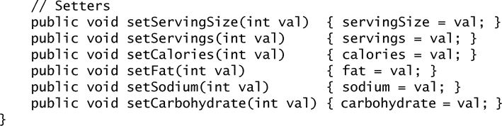

# Effective Java [Java 9 更新版]

## 关于本电子书

EPUB 是一种开放的行业标准电子书格式。然而，不同阅读设备和应用程序对 EPUB 及其许多功能的支持程度不异。请使用您的设备或应用设置按照您的喜好自定义显示效果。您可以自定义的设置通常包括字体、字号、单栏或双栏、横屏或竖屏模式，以及可以点击或触摸以放大的图片。有关您的阅读设备或应用上的设置和功能的更多信息，请访问设备制造商的网站。

许多书目包含了编程代码或配置示例。为了优化这些元素的显示效果，请在单栏、横屏模式下查看电子书，并将字体大小调整为最小设置。除了以重流文本格式呈现代码和配置外，我们还包含了代码的图像，以模拟印刷书中的呈现效果；因此，当重流格式可能会影响代码列表的显示时，您将看到一个“点击此处查看代码图像”的链接。点击链接可查看高真度的代码图像。要返回之前查看的页面，请点击设备或应用上的“返回”按钮。

给我的家人：Cindy, Tim, 和 Matt

## 前序

如果一位同事对你说：“我的配偶今晚在家里做不寻常的晚餐。你要加入吗？”你脑海中可能会闪过三个想法：第三，你被邀请去吃晚饭；第二，英语不是你同事的母语；第一，还有相当大的困惑。

如果你自己学过第二门语言并尝试在教室外使用它，你就知道你必须掌握三件事：语言是如何构建的（语法），如何命名你想要讨论的话题（词汇），以及表达日常事的习惯且有效的方法（用法）。课堂上往往只涵盖了前两点，当你发现试图让别人理解自己的意思时，母语者总是在克制忍笑。

编程语言也是如此。你需要理解核心语言：它是算法的、函数式的，还是面向对象的？你需要了解它的词汇：标准库提供了哪些数据结构、操作和功能？而且，你需要熟悉表达日常事的习惯且有效的方法。

## 前言

### 第三版序言

1997 年，Java 刚问世时，James Gosling（Java 之父）将其描述为一种“蓝领级语言”，并且“相当简单”。大约同时，Bjarne Stroustrup（C++ 之父）将 C++ 描述为一种“多范式语言”，它“故意与支持单一编程方式的语言不同”。Stroustrup 警告道：

Java 的相对简单性——就像大多数新语言一样——部分是幻象，部分由于其不完整性。随着时间的推移，Java 的规模和复杂性将显著增加。它的规模会翻倍或三倍，并增长实现相关的扩展或库。现在，二十年后，可以说 Gosling 和 Stroustrup 都是正确的。现在的 Java 已经变得庞大且复杂，从并行执行、迭代到日期时间表示，许多事情都有多种抽象。

我仍然喜欢 Java，尽管随着平台的发展，我的热情已经冷却了一些。鉴于其规模和复杂性的增加，一份实时的最佳实践指南变得尤为关键。在《Effective Java》的第三版中，我尽力为你提供了这样一份指南。我希望这一版在满足需求的同时，依然保持前两个版本的精神。

附记：如果我不提到最近占据了我大量时间的一项行业最佳实践，我将是不负责的。自 20 世纪 50 年我们领域诞生以来，我们一直在自由地重新实现彼此的 API。这种做法对于计算机技术的飞跃式成功至关重要。我正积极致力于维护这种自由 [CompSci17]，并鼓励你加入我。保留重新实现彼此 API 的权利，对于我们这一职业的持续健康至关重要。

### 第二版序言

自我 2001 年编写这本书的第一版以来，Java 平台发生了许多变化，现在是时候出第二版了。最重大的变化是 Java 5 中引入了泛型、枚举类型、注解、自动装箱以及 for-each 循环。紧随其后的是 Java 5 同时发布的新的并发库 `java.util.concurrent`。与 Gilad Bracha 一起，我有幸领导了设计这些新语言特性的团队。我也非常荣幸参与服务了由 Doug Lea 领导的、负责设计和开发并发库的团队。

平台的另一个大变化是现代集成开发环境（IDE，如 Eclipse、IntelliJ IDEA 和 NetBeans）以及静态分析工具（如 FindBugs）的广泛采用。虽然我没有参与这些工作，但我从中获益匪浅，并学会了它们如何影响 Java 开发体验。

2004 年，我从 Sun 公司跳槽到了 Google，但在过去的四年里，我继续参与了 Java 平台的开发，通过 Google 和 Java 社区处理程序（Java Community Process）为并发和集合 API 贡献了力量。我还有幸利用 Java 平台开发了 Google 内部使用的库。现在我体会到当用户是什么感觉了。

正如 2001 年我写第一版时一样，我的首要目标是与你们分享我的经验，这样你们就可以模仿我的成功，避免我的失败。新材料继续大量使用了 Java 平台库中的真实示例。

第一版的成功超出了我最疯狂的预期，我在尽力保持其精神的同时，涵盖了使书籍跟时所需的所有新内容。书籍的增长是不可避免的，它确实增长了，从 57 项增加到了 78 项。我不仅增加了 23 项内容，还彻底修订了所有原始材料，并淘汰了一些已经过时的条目。在附录中，你可以看到本版内容与第一版内容的关系。

在第一版序言中，我写道 Java 编程语言及其库极大地有助于质量和生产力，并且是一项令人愉快的工作。第 5 和 6 版本的发布让原本很好的事物变得更好。现在的平台比 2001 年大得多，也复杂得多，但一旦你学会了使用这些新特性的模式和惯用法，它们就能让你的程序更好，让生活更轻松。我希望这一版能捕捉到我对平台持续的热情，并帮助你们在使用该平台及其新功能时更加高效、愉快。

加利福尼亚州，圣何塞

2008 年 4 月

### 第一版序言

1996 年，我带着行李前往西部在当时被称为 JavaSoft 的公司工作，因为显而易见那里是风中心。在随后的五年里，我担任了 Java 平台库架构师。我设计、实现并维护了许多库，并担任许多其他库的顾问。在 Java 平台成熟的过程中主持这些库是一次难生难逢的机会。毫不夸张地说，我有幸与我们这一代一些伟大的软件工程师共事。在这个过程中，我学了许多关于 Java 编程语言的知识——什么是有效的，什么是无效的，以及如何使用这种语言及其库以达到最佳效果。

本书尝试与你们分享我的经验，这样你们就可以模仿我的成功，避免我的失败。我借用了 Scott Meyers 的 *Effective C++* 格式，它由 50 项内容组成，每项都传达了一个改进程序和设计的特定规则。我发现这种格式非常有效，希望你们也这么认为。

在许多情况下，我自豪地用 Java 平台库中的真实示例来说明这些条目。在描述某些可以做得更好的事情时，我试着挑剔我自己写的代码，但偶尔也会挑剔同事写的代码。如果尽管我尽了最大努力仍然冒犯了任何人，我诚挚地道歉。引用反面示例不是为了指责某人，而是出于合作精神，以便我们所有人都能够从前人的经验中获益。

虽然这本书并不完全只针对可重用组件的开发者，但它不可避免地染了我过去二十年编写此类组件的经验色彩。我自然地从导出的 API（应用程序编程接口）的角度来思考，并鼓励你们也这样做。即使你们没有在开发可重用组件，用这些术语思考往往也能提高你们所写软件的质量。此外，在不知情的情况下编写可重用组件并不稀奇：你写了一些有用的东西与隔壁的同事分享，不久之后你有六个用户了。此时，你不再具有随心所欲 API 的灵活性，并感激你在最初编写软件时为设计 API 所付的所有精力。

我对 API 设计的关注对于新软件开发方法论（如*极限编程*）的信徒来说可能似乎有些不自然。这些方法论强调编写尽可能简单的程序。如果你正在使用这些方法论之一，你会发现对 API 设计的关注在你的`重构`过程中非常有帮助。重构的基本目标是改进系统结构和避免代码重复。如果没有设计良好的组件 API，这些目标是无法实现的。

没有语言是完美的，但有些是优秀的。我发现 Java 编程语言及其库极大地有助于质量和生产力，并且是一项令人愉快的工作。我希望这本书能捕捉我的热情，并帮助你们使用该语言更加高效、愉快。

加利福尼亚州，库比蒂诺

2001 年 4 月

## 致谢

### 第三版致谢

感谢本书前两个版本的读者给予了如此亲切和热烈的反响，将这些理念付诸实践，并让我知道这对他们和他们的工作产生了多么积极的影响。感谢许多在课程中使用这本书的教授，以及许多采纳了它的工程团队。

感谢 Addison-Wesley 和 Pearson 的整个团队，感谢他们的善良、专业、耐心以及在极端压力下的优雅。在此期间，我的编辑 Greg Doench 一直保持冷静：一位出色的编辑，一位完美的绅士。我担心由于这个项目他的头发可能白了一些，我向他诚恳道歉。我的项目经理 Julie Nahil 和项目编辑 Dana Wilson 是我所能期待的：勤奋、及时、组织良好且友好。我的校对编辑 Kim Wimpsett 严谨且有品味。

我再次有幸拥有了想象中最好的评审员团队，我向他们每一个人致以最诚挚的谢意。核心团队评审了几乎每一个章节，包括 Cindy Bloch、Brian Kernighan、Kevin Bourrillion、Joe Bowbeer、William Chargin、Joe Darcy、Brian Goetz、Tim Halloran、Stuart Marks、Tim Peierls 和 Yoshiki Shibata。其他评审员还包括 Marcus Biel、Dan Bloch、Beth Bottos、Martin Buchholz、Michael Diamond、Charlie Garrod、Tom Hawtin、Doug Lea、Aleksey Shipilëv、Lou Wasserman 和 Peter Weinberger。这些评审员提出了许多建议，使这本书得到了极大的改进，并使我免于许多尴尬。

我特别感谢 William Chargin、Doug Lea 和 Tim Peierls，他们为书中许多想法担任了听风者。William、Doug 和 Tim 在时间和知识上的投入一如既往地慷慨。

最后，我要感谢我的妻子 Cindy Bloch，她鼓励我写作，阅读了每一个初稿条目，编写了索引，帮助我处理启动大项目时不可避免会出现的所有问题，并在我写作期间忍受我。

### 第二版致谢

感谢本书第一版的读者们给予了如此友好和热烈的反响，将书中的理念记心中，并让我知道它对他们和工作产生了怎样的积极影响。感谢许多在课程中使用本书的教授，以及许多采用这本书的工程团队。

感谢 Addison-Wesley 的整个团队，感谢他们的善意、专业、耐心以及在压力下的从容。在整个过程中，我的编辑 Greg Doench 始终从容不迫：一位出色的编辑，一位完美的绅士。我的制作经理 Julie Nahil 具备制作经理应该具备的所有品质：勤奋、准时、有组织性且友好。我的文字编辑 Barbara Wood 严谨且富有品味。

我再次有幸拥有了想象中最好的评审员团队，我向他们每一个人致以最诚挚的谢意。核心团队评审了每一个章节，包括 Lexi Baugher、Cindy Bloch、Beth Bottos、Joe Bowbeer、Brian Goetz、Tim Halloran、Brian Kernighan、Rob Konigsberg、Tim Peierls、Bill Pugh、Yoshiki Shibata、Peter Stout、Peter Weinberger 和 Frank Yellin。其他评审员还包括 Pablo Bellver、Dan Bloch、Dan Bornstein、Kevin Bourrillion、Martin Buchholz、Joe Darcy、Neal Gafter、Laurence Gonsalves、Aaron Greenhouse、Barry Hayes、Peter Jones、Angelika Langer、Doug Lea、Bob Lee、Jeremy Manson、Tom May、Mike McCloskey、Andriy Tereshchenko 和 Paul Tyma。再次，这些评审员提出了许多建议，使这本书得到了极大的改进，并使我免于许多尴尬。再次，任何剩下的尴尬都是我的责任。

我特别感谢 Doug Lea 和 Tim Peierls，他们为书中许多想法担任了听风者。Doug 和 Tim 在时间和知识上的投入一如既往地慷慨。

感谢我的 Google 经理 Prabha Krishna 她的持续支持和鼓励。

最后，我要感谢我的妻子 Cindy Bloch，她鼓励我写作，阅读了每一个初稿条目，帮助我使用 Framemaker，编写了索引，并在我写作期间忍受我。

### 第一版致谢

感谢 Patrick Chan 建议我写这本书，并把这个想法推销给了系列主编辑 Lisa Friendly、系列技术编辑 Tim Lindholm 以及 Addison-Wesley 的执行编辑 Mike Hendrickson。感谢 Lisa、Tim 和 Mike 鼓励我追求这个项目，并对我终有一天写出这本书付了超人的耐心和坚定的信念。

感谢 James Gosling 和他的原始团队给我提供了一个伟大的的话题来写，也感谢许多追随 James 足迹的 Java 平台工程师们。特别感谢我在 Sun Java 平台工具与库组的同事，感谢他们的见解、鼓励和支持。该团队包括 Andrew Bennett、Joe Darcy、Neal Gafter、Iris Garcia、Konstantin Kladko、Ian Little、Mike McCloskey 和 Mark Reinhold。前成员包括李正华、Bill Maddox 和 Naveen Sanjeeva。

感谢我的经理 Andrew Bennett 和我的主管 Larry Abrahams 对此项目提供的全面且热烈的支持。感谢 Java Software 的工程副总裁 Rich Green 提供了一个让工程师能够自由进行创造性思考并发表成果的环境。

我有幸拥有了想象中最好的评审员团队，我向他们每一个人致以最诚挚的谢意：Andrew Bennett、Cindy Bloch、Dan Bloch、Beth Bottos、Joe Bowbeer、Gilad Bracha、Mary Campione、Joe Darcy、David Eckhardt、Joe Fialli、Lisa Friendly、James Gosling、Peter Haggar、Brian Kernighan、Konstantin Kladko、Doug Lea、李正华、Tim Lindholm、Mike McCloskey、Tim Peierls、Mark Reinhold、Ken Russell、Bill Shannon、Peter Stout、Phil Wadler 以及两位匿名评审员。他们提出了许多建议，使这本书得到了极大的改进，并使我免于许多尴尬。任何剩下的尴尬都是我的责任。

Sun 内部外的许多同事参与了提高本书质量的技术讨论。其中，Ben Gomes、Steffen Grarup、Peter Kessler、Richard Roda、John Rose 和 David Stoutamire 贡献了有用的见解。特别感谢 Doug Lea，他为书中许多想法担任了听风者。Doug 在时间和知识上的投入一如既往地慷慨。

我感谢 Julie Dinicola、Jacqui Doucette、Mike Hendrickson、Heather Olszyk、Tracy Rust 以及 Addison-Wesley 的整个团队提供的支持和专业精神。即使在极其紧迫的时间表下，他们总是保持友好和配合。

感谢 Guy Steele 撰写序言。我很荣能参与这个项目。

最后，我要感谢我的妻子 Cindy Bloch 鼓励我（并偶尔威胁我）写作，阅读了每一个初稿条目，帮助我使用 Framemaker，编写了索引，并在我写作期间忍受我。

# 第 1 章：引言

本书旨在帮助你有效使用 Java 编程语言及其基础库：`java.lang`、`java.util` 和 `java.io`，以及 `java.util.concurrent` 和 `java.util.function` 等子包。书中也会提到其他库。

本书由九十项组成，每项传达了一个规则。这些规则是经验丰富的程序员认为有益的实践。项目被松地分为十一章，每个章节涵盖软件设计的一个方面。本书不需要从头到尾阅读：每个项目都可以独立。项目之间有大量的交叉引用，你可以轻松规划自己的路线。

自本书上一版出版以来，平台新增了许多功能。书中的大多数项目都以某种方式使用了这些功能。下表显示了在哪里可以找到关键功能的主要覆盖：

| 功能 | 条目 | 版本 |
| :--- | :--- | :--- |
| Lambdas | 42–44 | Java 8 |
| Streams | 45–48 | Java 8 |
| Optionals | 55 | Java 8 |
| 接口中的默认方法 | 21 | Java 8 |
| `try`-with-resources | 9 | Java 7 |
| `@SafeVarargs` | 32 | Java 7 |
| 模块 | 15 | Java 9 |

大多数章节都通过程序示例进行了说明。本书的一个核心特点是它包含了说明许多设计模式和惯用法的代码示例。在适当的情况下，这些示例与该领域的标准参考著作进行了交叉引用 [Gamma95]。

许多章节包含一个或多个程序示例，用于说明某些应该避免的实践。此类示例有时被称为 `antipatterns`（反模式），并会通过通过诸如 `// Never do this!` 这样的注释进行清晰标记。在每个情况下，该章节都解释了为什么该示例是不好的，并建议了替代方案。

本书不是为初学者准备的：假设你已经熟练掌握了 Java。如果你还不，请考虑许多优秀的入门读物，例如 Peter Sestoft 的 *Java Precisely* [Sestoft16]。虽然《Effective Java》的设计旨在让任何拥有语言基础知识的人读懂，但即使对于高级程序员来说，它也应该提供思考的空间。

书中的大多数规则都源于几个基本原则。清晰和简单至关重要。组件的用户不应该对它的行为感到意外。组件应该尽可能小，但不能更小。（在本书中，`component` 一词指的是任何可重用的软件元素，从单个方法到由多个包组成的复杂框架。）代码应该被重用而不是复制。组件之间的依赖应该保持到最低。错误应该在发生后尽快检测到，理想情况下是在编译时。


虽然书中的规则并非 100% 的情况下都适用，但它们在大多数情况下刻画了最佳编程实践。你不应该盲从地遵循这些规则，而应该只偶尔在有充分理由的情况下违反它们。学习编程的艺术，与其他大多数学科一样，是由首先学习规则，然后学习在何时打破规则组成的。

在很大程度上，本书并不是关于性能的。它是关于如何编写清晰、正确、易用、健壮、灵活且易于维护的程序。如果你能做到这一点，获得所需的性能通常是一件简单的事（Item 67）。某些章节确实讨论了性能问题，少数章节提供了性能数据。这些数据通过“在我的机器上”这一短语引入，最多也应被视为近似值。

就其价值而言，我的机器是一台老旧的自制 3.5GHz 四核 Intel Core i7-4770K，配备 16GB DDR3-1866 CL9 内存，运行 Azul 发布的 OpenJDK 9.0.0.15 版本，基于 Microsoft Windows 7 专业版 SP1 (64 位)。

在讨论 Java 编程语言及其库的特性时，有时需要引用特定的版本。为了方便起见，本书使用昵号而非官方发布名称。下表显示了发布名称与昵号之间的映射：

| 官方发布名称 (Official Release Name) | 昵号 (Nickname) |
| :--- | :--- |
| JDK 1.0.*x* | Java 1.0 |
| JDK 1.1.*x* | Java 1.1 |
| Java 2 Platform, Standard Edition, v1.2 | Java 2 |
| Java 2 Platform, Standard Edition, v1.3 | Java 3 |
| Java 2 Platform, Standard Edition, v1.4 | Java 4 |
| Java 2 Platform, Standard Edition, v5.0 | Java 5 |
| Java Platform, Standard Edition 6 | Java 6 |
| Java Platform, Standard Edition 7 | Java 7 |
| Java Platform, Standard Edition 8 | Java 8 |
| Java Platform, Standard Edition 9 | Java 9 |

示例是相当完整的，但优先考虑可读性而非完整性。它们自由地使用了 `java.util` 和 `java.io` 包中的类。为了编译示例，你可能需要添加一个或多个 import 声明，或其他类似的样板代码。本书的网站 [`http://joshbloch.com/effectivejava`](http://joshbloch.com/effectivejava) 包含了每个示例的扩展版本，你可以对其进行编译和运行。

在很大程度上，本书使用的技术术语与 *The Java Language Specification, Java SE 8 Edition* [JLS] 中的定义一致。有几个术语值得特别提到。语言支持四种类型：`interfaces`（包括 `annotations`）、`classes`（包括 `enums`）、`arrays`（数组）和 `primitives`（基本数据类型）。前三种被称为 `reference types`（引用类型）。类实例和数组是 `objects`（对象）；基本类型值不是。一个类的 `members` 由它的 `fields`、`methods`、`member classes` 和 `member interfaces` 组成。方法的 `signature`（签名）由它的名称和形式参数的类型组成；签名不包括方法的返回类型。

本书使用的几个术语与 *The Java Language Specification* 不同。与 *The Java Language Specification* 不同，本书将 `inheritance`（继承）作为 `subclassing`（子类化）的同义词。对于接口不再使用继承一词，而是简单说明一个类 `implements` 一个接口，或者一个接口 `extends` 另一个接口。为了描述在未指定时适用的访问级别，本书使用了传统的 `package-private` 而非技术上正确的 `package access` [JLS, 6.6.1]。

本书使用了几个 *The Java Language Specification* 中未定义的技术术语。`exported API` 或简单称为 `API` 指的是程序员访问类、接口或包的类、接口、构造函数、成员和序列化形式。（`API` 一词是 *application programming interface* 的缩写，为了避免与语言构造 *interface* 混淆而使用了此术语。）使用 API 的程序员被称为 API 的 `user`。使用 API 的类是 API 的 `client`。

类、接口、构造函数、成员和序列化形式统称为 `API elements`。导出 API 由定义包外部可见的 API 元素组成。这些是任何客户端都可以使用的 API 元素。在 Java 9 中，引入了 `module system`。如果一个库使用了模块系统，它的导出 API 就是该模块声明的所有包的导出 API 的并。

## 第二章：创建和销毁对象

本章涉及对象的创建和销毁：何时以及如何创建、何时以及如何避免、如何确保及时销毁，以及在销毁之前必须执行的清理操作。

### Item 1：考虑用静态工厂方法代替构造函数

类允许客户端获取实例传统方法是提供公共构造函数。还有另一种技术应该是每个程序员工具箱的一部分。类可以提供一个公共 `static factory method`，它仅仅是一个返回类实例的静态方法。这里有一个来自 `Boolean`（`boolean` 的 *boxed primitive* 类）的简单示例。该方法将 `boolean` 基本值转换为 `Boolean` 对象引用：

```java
public static Boolean valueOf(boolean b) {
  return b ? Boolean.TRUE : Boolean.FALSE;
}
```

注意，静态工厂方法与 *Design Patterns* [Gamma95] 中的 *Factory Method* 模式不同。本项中描述的静态工厂方法在 *Design Patterns* 中没有直接对应物。

类可以为它的客户端提供静态工厂方法，而不是（或者除此之外）提供公共构造函数。提供静态工厂方法而不是公共构造函数既有优点也有缺点。

### 静态工厂方法的优点

**静态工厂方法的一个优点是，与构造函数不同，它们有名称。** 如果构造函数的参数本身不能描述所返回的对象，那么一个命名良好的静态工厂方法比构造函数更容易使用，生成的客户端代码也更易读。例如，构造函数 `BigInteger(int, int, Random)` 返回一个可能为质数的 `BigInteger`，这如果用一个命名为 `BigInteger.probablePrime` 的静态工厂方法表示会更好。（该方法在 Java 4 中添加。）

一个类对于给定的签名只能有一个构造函数。众所周知程序员通过提供两个参数列表仅在参数类型顺序上不同的构造函数来绕过这一限制。这是一个非常糟糕的主意。此类 API 的用户永远无法记住哪个构造函数是哪一个，最终会不小心地调用错误的一个。阅读使用这些构造函数的代码的人，如果不查阅类文档，将不知道代码在做什么。

因为静态工厂方法有名称，所以它们不受上一段落中讨论的限制。在一个类似乎需要多个相同签名的构造函数的情况下，将构造函数替换为静态工厂方法，并仔细选择名称以突出它们的区别。

**静态工厂方法的第二个优点是，与构造函数不同，它们并不要求每次调用时都创建一个新对象。** 这允许不可变类（Item 17）使用预先构建的实例，或者在构建时缓存实例并反复提供，以避免创建不必要的重复对象。`Boolean.valueOf(boolean)` 方法说明了这种技术：它从不创建对象。*这种技术类似于*重量模式*（Flyweight）[Gamma95]。如果经常请求等效对象，特别是当创建对象的开销很大时，这种技术可以极大提高性能。

静态工厂方法通过重复调用返回相同对象的能力使得类能够对任何时候存在的实例保持严格控制。做到点的类的被称为*实例控制的*（instance-controlled）。编写实例控制类有几个原因。实例控制允许类保证其本身是单例的（Item 3）或不可实例化的（Item 4）。此外，它允许不可变值类（Item 17）保证不存在两个相等实例：`a.equals(b)` 当且仅当 `a == b`。这是*重量模式*[Gamma95]的基础。枚举类型（Item 34）提供了这种保证。

**静态工厂方法的第三个优点是，与构造函数不同，它们可以返回返回类型的任何子类型的对象。** 这在选择返回对象的类时提供了巨大的灵活性。

这种灵活性的一种应用是 API 可以在不公开其类的情况下返回对象。以这种方式隐藏实现类会导致非常紧凑的 API。这种技术适用于*基于接口的框架*（Item 20），其中接口为静态工厂方法提供了自然的返回类型。

在 Java 8 之前，接口不能拥有静态方法。按照惯例，名为 `Type` 的接口的静态工厂方法被放在一个名为 `Types` 的不可实例化伴类中（Item 4）。例如，Java 集合框架拥有其接口的四五种工具类实现，提供了不可修改集合、同步集合等。几乎所有这些实现都是通过一个不可实例化的类（`java.util.Collections`）中的静态工厂方法导出的。返回对象的类都是非公共的。

集合框架的 API 相比于如果它导出四五个个独立的公共类（每个类对应一个便利实现）要小得多。它减少的不仅仅是 API 的*主体*（bulk），还有*概念重量*（conceptual weight）：即程序员为了使用该 API 必须掌握的概念的数量和难度。程序员知道返回的对象恰好拥有其接口所指定的 API，因此不需要为实现类阅读额外的类文档。此外，使用这种静态工厂方法要求客户端通过接口而不是实现类来引用返回的对象，这通常是良好的实践（Item 64）。

从 Java 8 开始，接口不能包含静态方法的限制已经被消除了，因此通常没有理由为接口提供不可实例化的伴类。许多本该放在此类类中的公共静态成员应该应该放在接口本身中。然而，请注意，可能仍然需要将这些静态方法的大部分实现代码放在单独的包私有类中。这是因为 Java 8 要求接口的所有静态成员都必须是公共的。Java 9 允许私有静态方法，但静态字段和静态成员类仍要求是公共的。

**静态工厂的第四个优点是，返回对象的类可以根据输入参数随每次调用而变化。** 声明返回类型的任何子类型都是允许的。返回对象的类也可以随着版本的发布而变化。

`EnumSet` 类（Item 36）没有公共构造函数，只有静态工厂。在 OpenJDK 实现中，它们返回两个子类之一的实例，取决于底层枚举类型的大小：如果它有六十四个或更少的元素（大多数枚举类型都是如此），静态工厂返回 `RegularEnumSet` 实例，由单个 `long` 支持；如果枚举类型有六十五个或更多元素，它们返回 `JumboEnumSet` 实例，由 `long` 数组支持。

这两个实现类的存在对客户端来说是不可见的。如果 `RegularEnumSet` 不再对小枚举类型提供性能优势，可以在未来的版本中将其消除而不产生任何不良影响。同样，如果证明对 `EnumSet` 的第三种或第四种实现对性能有益，未来的版本也可以添加它们。客户端既不知道也不关心从工厂获取的对象的类；它们只关心它是 `EnumSet` 的某个子类。

**静态工厂的第五个优点是，在编写包含方法的类时，返回对象的类并不存在。** 这种灵活的静态工厂方法形成了*服务提供框架*的基础，例如 Java 连接 API (JDBC)。服务提供框架是一个系统，其中提供者实现服务，系统将实现提供给客户端，从而将客户端与实现解耦。

服务提供框架包含三个基本组件：*服务接口*（表示实现）、*提供者注册 API*（提供者用于注册实现）以及*服务访问 API*（客户端用于获取服务实例）。服务访问 API 允许客户端指定选择实现的标准。在缺乏标准的情况下，API 返回默认实现的实例，或者允许客户端遍历所有可用实现。

服务提供者框架的一个可选第四个组件是`service provider interface`，它描述了一个产生服务接口实例的工厂对象。在没有服务提供者接口的情况下，必须通过反射实例化实现（Item 65）。在`JDBC` 中，`Connection` 充服务的角色，`DriverManager.registerDriver` 是提供者注册 API，`DriverManager.getConnection` 是服务访问 API，而 `Driver` 就是服务提供者接口。

服务提供者模式有很多变体。例如，服务访问 API 可以向客户端返回比提供者提供的更丰富的服务接口。这就是`Bridge`模式 [Gamma95]。依赖注入框架（Item 5）可以被强大的服务提供者。从 Java 6 开始，平台包含了一个通用的服务提供者框架 `java.util.ServiceLoader`，因此你不需要通常也不应该自己编写（Item 59）。JDBC 没有使用 `ServiceLoader`，因为前者早于后者。

### 仅提供静态工厂方法的主要局限性是类无法被没有公共或保护构造函数的子类化

例如，无法对 Collections Framework 中的任何便利实现类进行子类化。这可能是一个无尽之福，因为它鼓励了程序员使用组合而不是继承（Item 18），并且对于不可变类型是必须的（Item 17）。

### 静态工厂方法的第二个缺点是程序员很难找到

它们在 API 文档中不像构造函数那样引人注目，因此可能很难弄清楚如何实例化提供静态工厂方法而非构造函数的类。Javadoc 工具有一天可能会引起静态工厂方法的关注。在此期间，你可以通过在类或接口文档中对静态工厂引起关注，并遵循通命名规范来减少这个问题。以下是一些静态工厂方法的常用名称。此列表远不是详尽的：

- `from`—一种`类型转换方法`，它接受一个参数并返回该类型的对应实例，例如：

```
Date d = Date.from(instant);
```

- `of`—一种`聚合方法`，它接受多个参数并返回一个包含这些参数的该类型实例，例如：

```
Set<Rank> faceCards = EnumSet.of(JACK, QUEEN, KING);
```

- `valueOf`—`from` 和 `of` 的更冗冗的替代方案，例如：

```
BigInteger prime = BigInteger.valueOf(Integer.MAX_VALUE);
```

- `instance` 或 `getInstance`—返回一个由其参数（如果有）描述的实例，但不能说它具有相同的值，例如：

```
StackWalker luke = StackWalker.getInstance(options);
```

- `create` 或 `newInstance`—与 `instance` 或 `getInstance` ，区别在于该方法保证每次调用都返回一个新的实例，例如：

```
Object newArray = Array.newInstance(classObject, arrayLen);
```

- `getType`—与 `getInstance` 类似，但用于工厂方法位于不同类中的情况。`Type` 是工厂方法返回的对象的类型，例如：

```
FileStore fs = Files.getFileStore(path);
```

- `newType`—与 `newInstance` 类似，但用于工厂方法位于不同类中的情况。`Type` 是工厂方法返回的对象的类型，例如：

```
BufferedReader br = Files.newBufferedReader(path);
```

- `type`—`getType` 和 `newType` 的简洁替代方案，例如：

```
List<Complaint> litany = Collections.list(legacyLitany);
```

总之，静态工厂方法和公共构造函数都有它们自己的用处，理解它们的相对优点是值得的。通常静态工厂是更优的，因此避免在没有先考虑静态工厂的情况下就提供公共构造函数的反射性。

### Item 2: 当面对许多构造器参数时，考虑使用构建器

静态工厂和构造函数共享一个局限性：它们对于大量可选参数的扩展性不好。考虑一个代表包装食品上营养成分标签的类。这些标签有几个必填字段——份量、每容器份数和每份卡路里，以及二十多个可选字段——总脂肪、饱和脂肪、反式式脂肪、胆固醇、钠等。大多数产品只有这些可选字段中的几个具有非零值。

对于这样的类，你应该编写什么样的构造函数或静态工厂？传统上，程序员使用`伸缩构造函数`模式，在那种模式中，你提供一个只包含必需参数的构造函数，另一个包含单个可选参数的构造函数，第三个包含两个可选参数的构造函数，依此类推，最后是一个包含所有可选参数的构造函数。它在实践中是这样的。为了简洁起见，只显示了四个字段：


# 伸缩构造函数模式

```java
// 伸缩构造函数 - 不扩展！
class NutritionFacts {
    private final int servingSize; // 必填
    private final int servings;    // 必填
    private final int calories;    // 必填
    private final int fat;         // 可选

    public NutritionFacts(int servingSize, int servings) {
        this.servingSize = servingSize;
        this.servings = servings;
    }

    public NutritionFacts(int servingSize, int servings, int calories) {
        this.servingSize = servingSize;
        this.servings = servings;
        this.calories = calories;
    }

    public NutritionFacts(int servingSize, int servings, int calories, int fat) {
        this.servingSize = servingSize;
        this.servings = servings;
        this.calories = calories;
        this.fat = fat;
    }

    public NutritionFacts(int servingSize, int servings, int calories, int fat, int sodium) {
        this.servingSize = servingSize;
        this.servings = servings;
        this.calories = calories;
        this.fat = fat;
        this.sodium = sodium;
    }

    public NutritionFacts(int servingSize, int servings, int calories, int fat, int sodium, int carbohydrate) {
        this.servingSize = servingSize;
        this.servings = servings;
        this.calories = calories;
        this.fat = fat;
        this.sodium = sodium;
        this.carbohydrate = carbohydrate;
    }
}
```

当你想要创建一个实例时，使用包含所有想要设置的参数的最短参数列表的构造函数：

```java
NutritionFacts cocaCola = new NutritionFacts(240, 8, 100, 0, 35, 27);
```

通常这种构造调用需要许多你不想设置的参数，但你仍然被迫为它们传递值。在这种情况下，我们为`fat`传递了值`0`。对于“只有”六个参数这可能看起来并不糟糕，但随着参数数量的增加，它很快就会失控。

简而言之，伸缩构造器模式（telescoping constructor pattern）有效，但当参数很多时，编写客户端代码很困难，阅读起来更加困难。读者会疑惑这些值的含义是什么，必须仔细数参数才能找到。多个连续相同类型的参数会导致微妙的错误。如果客户端不小心反转了两个这样的参数，编译器不会报错，但程序会在运行时表现异常（Item 51）。

# JavaBeans 模式

当构造函数面临许多可选参数时，另一种替代方案是`JavaBeans`模式。在该模式中，你调用无参数构造函数来创建对象，然后调用 setter 方法来设置每个必需参数以及感兴趣的可选参数：

```java
// JavaBeans Pattern - 允许不一致，强制可变性
public class NutritionFacts {
    // 参数初始化为默认值（如果有）
    private int servingSize  = -1; // 必需；无默认值
    private int servings     = -1; // 必需；无默认值
    private int calories     = 0;
    private int fat          = 0;
    private int sodium       = 0;
    private int carbohydrate = 0;

    public NutritionFacts() { }

    // Setters
    public void setServingSize(int val)  { servingSize = val; }
    public void setServings(int val)    { servings = val; }
    public void setCalories(int val)    { calories = val; }
    public void setFat(int val)          { fat = val; }
    public void setSodium(int val)      { sodium = val; }
    public void setCarbohydrate(int val) { carbohydrate = val; }
}
```

这种模式没有伸缩构造器模式的任何缺点。创建实例很容易（虽然有点冗长），而且阅读生成的代码也很容易：

```java
NutritionFacts cocaCola = new NutritionFacts();
cocaCola.setServingSize(240);
cocaCola.setServings(8);
cocaCola.setCalories(100);
cocaCola.setSodium(35);
cocaCola.setCarbohydrate(27);
```

遗憾的是，`JavaBeans`模式也有其严重的缺点。由于构造过程被分成了多次调用，`JavaBean`在构造过程途中可能处于不一致的状态。该类无法仅通过检查构造函数参数的有效性来强制执行一致性。在对象处于不一致状态时尝试使用可能会导致与包含错误的代码相径远的失败，因此难以调试。另一个缺点是，`JavaBeans`模式排除了使类变为不可变的可能性（Item 17），并要求程序员付出额外努力来确保线程安全。

可以通过在对象构造完成后手动“冻结”对象，并在冻结之前不允许其使用，从而减少这些缺点，但这种变体非常笨重，且在实践中很少使用。此外，它可能会在运行时引起错误，因为编译器无法确保程序员在对象使用之前调用了冻结方法。

# Builder 模式

幸运的是，有第三种替代方案，它结合了伸缩构造器模式的安全性和`JavaBeans`模式的可读性。它是`Builder`模式的一种 [Gamma95]。客户端不再直接创建所需的对象，而是调用带有所有必需参数的构造函数（或静态工厂）并获取一个 builder 对象。然后，客户端在 builder 对象上调用类似 setter 的方法来设置每个感兴趣的可选参数。最后，客户端调用无参数的`build`方法来生成对象，该对象通常是不可变的。builder 通常是它所构建的类的静态成员类（Item 24）。以下是它在实践中的实现方式：

```java
// Builder Pattern
public class NutritionFacts {
    private final int servingSize;
    private final int servings;
    private final int calories;
    private final int fat;
    private final int sodium;
    private final int carbohydrate;

    public static class Builder {
        // 必需参数
        private final int servingSize;
        private final int servings;
        // 可选参数 - 初始化为默认值
        private int calories = 0;
        private int fat = 0;
        private int sodium = 0;
        private int carbohydrate = 0;

        public Builder(int servingSize, int servings) {
            this.servingSize = servingSize;
            this.servings = servings;
        }

        public Builder calories(int val) {
            calories = val;
            return this;
        }

        public Builder fat(int val) {
            fat = val;
            return this;
        }

        public Builder sodium(int val) {
            sodium = val;
            return this;
        }

        public Builder carbohydrate(int val) {
            carbohydrate = val;
            return this;
        }

        public NutritionFacts build() {
            return new NutritionFacts(this);
        }
    }

    private NutritionFacts(Builder builder) {
        servingSize = builder.servingSize;
        servings = builder.servings;
        calories = builder.calories;
        fat = builder.fat;
        sodium = builder.sodium;
        carbohydrate = builder.carbohydrate;
    }
}
```

`NutritionFacts`类是不可变的，所有参数默认值都在一个地方。builder 的 setter 方法返回其本身，以便可以链式调用，形成流式 API。客户端代码如下所示：

```java
NutritionFacts cocaCola = new NutritionFacts.Builder(240, 8)
    .calories(100).sodium(35).carbohydrate(27).build();
```

这种客户端代码很容易编写，更重要的是容易阅读。`Builder`模拟了 Python 和 Scala 中的命名可选参数。

省略了有效性检查。为了尽早检测无效参数，请在 builder 的构造函数和方法中检查参数有效性。涉及多个参数的不变性检查放在`build`方法调用的构造函数中。为了确保这些不变性不受攻击，请在从 builder 复制参数后进行检查（Item 50）。如果检查失败，抛出`IllegalArgumentException`（Item 72），其详细信息应指示哪些参数是无效的（Item 75）。

`Builder`模式非常适合类层次结构。使用并行的 builder 层级，每个都嵌套在相应的类中。抽象类有抽象 builder；具体类有具体 builder。例如，考虑层次结构根部代表各种披萨抽象类：

```java
// 类层次结构的 Builder 模式
public abstract class Pizza {
    public enum Topping { HAM, MUSHROOM, ONION, PEPPER, SAUSAGE }
    final Set<Topping> toppings;

    abstract static class Builder<T extends Builder<T>> {
        EnumSet<Topping> toppings = EnumSet.noneOf(Topping.class);

        public T addTopping(Topping topping) {
            toppings.add(Objects.requireNonNull(topping));
            return self();
        }

        abstract Pizza build();

        // 子类必须重写此方法以返回 "this"
        protected abstract T self();
    }

    Pizza(Builder<?> builder) {
        toppings = builder.toppings.clone(); // 见 Item 50
    }
}
```

注意`Pizza.Builder`是一个带有`recursive type parameter`（Item 30）的`generic type`。这配合抽象的`self`方法，使得方法链可以在子类中正常工作，而无需进行类型转换。这种针对 Java 缺乏自类型的一种变通方法被称为`simulated self-type`（模拟自类型）惯用法。

这里是`Pizza`的两个具体子类，其中一个代表标准的纽约风格披萨，另一个代表卡尔乔尼饼（calzone）。前者有一个必需的尺寸参数，而后者允许你指定酱汁是在内部还是外部：

```java
public class NyPizza extends Pizza {

    public enum Size { SMALL, MEDIUM, LARGE }

    private final Size size;

    public static class Builder extends Pizza.Builder<Builder> {

        private final Size size;

        public Builder(Size size) {
            this.size = Objects.requireNonNull(size);
        }
        @Override public NyPizza build() {
            return new NyPizza(this);
        }
        @Override protected Builder self() { return this; }
    }

    private NyPizza(Builder builder) {
        super(builder);
        size = builder.size;
    }
}

public class Calzone extends Pizza {

    private final boolean sauceInside;

    public static class Builder extends Pizza.Builder<Builder> {

        private boolean sauceInside = false; // Default

        public Builder sauceInside() {
            sauceInside = true;
            return this;
        }
        @Override public Calzone build() {
            return new Calzone(this);
        }
        @Override protected Builder self() { return this; }
    }

    private Calzone(Builder builder) {
        super(builder);
        sauceInside = builder.sauceInside;
    }
}
```

注意每个子类 builder 中的`build`方法都声明为返回正确的子类：`NyPizza.Builder`的`build`方法返回`NyPizza`，而`Calzone.Builder`中的`build`方法返回`Calzone`。这种将子类方法声明为返回父类声明的返回类型的子类型的技术被称为`covariant return typing`（协变返回类型）。它允许客户端使用这些构建器而无需类型转换。

这些“分层构建器”的客户端代码与简单的`NutritionFacts`构建器的代码本质上相同。接下来所示的示例客户端代码为了简洁起见，假设对枚举常量进行了静态导入：


```java
NyPizza pizza = new NyPizza.Builder(SMALL)
        .addTopping(SAUSAGE).addTopping(ONION).build();

Calzone calzone = new Calzone.Builder()
        .addTopping(HAM).sauceInside().build();
```

构建器相比构造函数的一个微小优势是构建器可以拥有多个变长参数，因为每个参数都在自己的方法中指定。或者，构建器可以将多次调用方法传递的参数聚合到一个字段中，正如前面的`addTopping`方法所示。

`Builder`模式是非常灵活的。单个构建器可以重复使用来构建多个对象。在多次调用`build`方法之间，可以调整构建器的参数以创建不同的对象。构建器可以在创建对象时自动填充某些字段，例如每次创建对象时都会递增的序列号。

`Builder`模式也有缺点。

要使一个使用上述任一方法的单例类变为可序列化的（第 12 章），仅仅在类声明中添加`implements Serializable`是不够的。为了维持单例保证，应将所有实例字段声明为`transient`并提供一个`readResolve`方法（项目 89）。否则，每当序列化实例被反序列化时，都会创建一个新实例，在我们的示例中，这将导致伪的`Elvis`出现。为了防止这种情况发生，请在`Elvis`类中添加此`readResolve`方法：

```
// readResolve method to preserve singleton property
private Object readResolve() {
    // Return the one true Elvis and let the garbage collector
    // take care of the Elvis impersonator.
    return INSTANCE;
}
```

实现单例的第三种方法是声明一个单元素枚举：

```
// Enum singleton - the preferred approach
public enum Elvis {
    INSTANCE;
    public void leaveTheBuilding() { ... }
}
```

这种方法与公共字段的方法类似，但它更简洁，免费提供了序列化机制，并且即使在面对复杂的序列化攻击或反射攻击时，也能提供防止多次实例化的铁律保证。这种方法感觉可能有点不自然，但单元素枚举类型通常是实现单例的最佳方式。请注意，如果你的单例必须继承`Enum`以外的父类，则不能使用这种方法（尽管你可以声明一个枚举来实现接口）。

## 项目 4：使用私有构造函数强制不可实例化

有时，你可能想编写一个仅由静态方法和静态字段组合的类。这类类获得的声誉不佳，因为某些人滥用它们来避免以对象的方式进行思考，但它们确实有其价值。它们可以用于对原始值或数组进行相关方法分组，类似于`java.lang.Math`或`java.util.Arrays`。它们还可以用于为实现某些接口的对象分组静态方法（包括工厂方法，`java.util.Collections`所示，项目 1）。（从 Java 8 开始，你也可以将此类方法放在接口中，假设你有权修改它。）最后，此类类可以用于对`final`类进行方法分组，因为你无法将它们放在子类中。

此类工具类（utility classes）的设计并不是为了被实例化：实例化它将是没有意义的。然而，在缺乏显式构造函数的情况下，编译器提供了一个公共的、无参数的默认构造函数。对于用户来说，这个构造函数与其他任何构造函数没有区别。在发布的 API 中，看到无意中实例化的类并不罕见。

尝试通过将类设为抽象来强制不可实例化是不可行的。该类可以被子化，并且子类可以实例化。此外，它会误导用户，认为该类是为了继承而设计的（项目 19）。然而，有一种简单的惯用法可以确保不可实例化。只有当类不包含任何显式构造函数时，才会生成默认构造函数，因此通过包含私有构造函数可以使类变得不可实例化：

```
// Noninstantiable utility class
public class UtilityClass {
    // Suppress default constructor for noninstantiability
    private UtilityClass() {
        throw new AssertionError();
    }
    ... // Remainder omitted
}
```

由于显式构造函数是私有的，因此在类外部是无法访问的。`AssertionError`并不是严格要求的，但它为从类内部意外调用构造函数的情况提供了保障。它保证了该类在任何情况下都不会被实例化。这种惯用法有点违背直觉，因为显式提供构造函数是为了让它无法被调用。因此，如之前所示包含注释是明智的。

作为副作用，这种惯用法还防止了类被子化。所有的构造函数都必须显式或隐式调用父类构造函数，而子类将没有可调用的父类构造函数。

## 项目 5：优先使用依赖注入而非硬编码资源

许多类依赖于一个或多个底层资源。例如，拼写检查器依赖于字典。看到此类类被实现为静态工具类（项目 4）并不罕见：

```
// Inappropriate use of static utility - inflexible & untestable!
public class SpellChecker {
    private static final Lexicon dictionary = ...;
    private SpellChecker() {} // Noninstantiable
    public static boolean isValid(String word) { ... }
    public static List<String> suggestions(String typo) { ... }
}
```

同样，看到它们被实现为单例（项目 3）也不罕见：

```
// Inappropriate use of singleton - inflexible & untestable!
public class SpellChecker {
    private final Lexicon dictionary = ...;
    private SpellChecker(...) {}
    public static INSTANCE = new SpellChecker(...);
    public boolean isValid(String word) { ... }
    public List<String> suggestions(String typo) { ... }
}
```

这两种方法都不令人如意，因为它们假设只有一个值得使用的字典。在实践中，每种语言都有自己的字典，并且特殊的字典用于特殊的词汇表。此外，在测试时使用特殊字典可能是理想的。假设一个字典永远足够是痴人说梦。

你可以尝试通过将`dictionary`字段设为非`final`并添加一个更改现有拼写检查器中字典的方法来让`SpellChecker`支持多个字典，但这样做会很尴尬、容易出错，并在并发环境下是不可行的。对于行为由底层资源参数化的类，静态工具类和单例是不合适的。

我们需要支持该类的多个实例（在我们的示例中为`SpellChecker`），每个实例都使用客户端所需的资源（在我们的示例中为字典）。满足这一要求的简单模式是在创建新实例时将资源传入构造函数。这是依赖注入的形式：字典是拼写检查器的依赖项，并在创建它时被注入到拼写检查器中。

```
// Dependency injection provides flexibility and testability
public class SpellChecker {
    private final Lexicon dictionary;
    public SpellChecker(Lexicon dictionary) {
        this.dictionary = Objects.requireNonNull(dictionary);
    }
    public boolean isValid(String word) { ... }
    public List<String> suggestions(String typo) { ... }
}
```

依赖注入模式非常简单，以至于许多程序员在使用多年后仍并不知道它有一个名字。虽然我们的拼写检查器示例只有一个资源（字典），但依赖注入适用于任意数量的资源和任意的依赖图。它保持了不变性（项目 17），因此多个客户端可以共享依赖对象（假设客户端所需的底层资源）。依赖注入同样适用于构造函数、静态工厂（项目 1）和构建器（项目 2）。

该模式的一种实用变体是将资源工厂（factory）传递给构造函数。工厂是一个可以被重复调用以创建特定类型实例的对象。这种工厂体现了工厂方法（Factory Method）模式 [Gamma95]。Java 8 引入的`Supplier<T>`接口非常适合表示工厂。以`Supplier<T>`作为输入的方法通常应该使用边界通配符类型（bounded wildcard type）来限制工厂的类型参数（Item 31），以便允许客户端传递一个创建指定类型任何子类的工厂。例如，这里有一个使用客户端提供的工厂生成每个瓷砖来制作马赛克的方法：

```
Mosaic create(Supplier<? extends Tile> tileFactory) { ... }
```

尽管依赖注入极大地提高了灵活性和可测试性，但它可能会让大型项目变得混乱，因为这些项目通常包含数千个依赖项。通过使用依赖注入框架可以几乎消除这种混乱，例如`Dagger` [Dagger]、`Guice` [Guice]或`Spring` [Spring]。这些框架的使用超出了本书书的范围，但请注意，为手动依赖注入设计的 API 可以很容易地适配以供这些框架使用。

总之，不要使用单例或静态工具类来实现依赖于一个或多个底层资源的类（如果这些资源的行为会影响该类的话），也不要让该类直接创建这些资源。相反，将资源或创建它们的工厂传递给构造函数（或静态工厂方法或构建器）。这种做法被称为依赖注入，将极大地增强类的灵活性、可重用性和可测试性。

## Item 6：避免创建不必要的对象

复用单个对象通常比每次需要时都创建一个功能等效的新对象更为合适。复用既可能更快也更有格调。如果一个对象是不可变的（Item 17），则它总是可以被复用。

作为一个不当做法的极端示例，考虑以下语句：

```
String s = new String("bikini");  // 别这么做！
```

该语句每次执行时都会创建一个新的`String`实例，而这些对象创建中没有一个是必要的。`String`构造函数的参数（`"bikini"`）本身就是一个`String`实例，在功能上与构造函数创建的所有对象完全相同。如果这种用法出现在循环或频繁调用的方法中，可能会不必要地创建数以百万个`String`实例。

改进后的版本简单如下：

```
String s = "bikini";
```

此版本使用了单个`String`实例，而不是每次执行时都创建一个新实例。此外，可以保证对于任何在同一台虚拟机中运行的、且恰好包含相同字符串字面量的其他代码，该对象都将被其复用 [JLS, 3.10.5]。

对于同时提供两者的不可变类，通常可以优先使用静态工厂方法（Item 1）而不是构造函数，从而避免创建不必要的对象。例如，工厂方法`Boolean.valueOf(String)`优于在 Java 9 中已废弃的构造函数`Boolean(String)`。构造函数每次被调用时必须创建一个新对象，而工厂方法并不总是这样做，而且在实践中也不会这样做。除了复用不可变对象外，如果你知道它们不会被修改，你也可以复用可变对象。

某些对象的创建开销比其他大得多。如果你需要反复使用这种“昂贵对象”，建议对其进行缓存以便复用。遗憾的是，在创建此类对象时并不总是很明显。假设你想写一个方法来判断字符串是否为有效的罗马数字。以下是使用正则表达式实现此最简单的方法：

```
// 性能可以得到极大提升！
static boolean isRomanNumeral(String s) {
    return s.matches("^(?=.)M*(C[MD]|D?C{0,3})"
            + "(X[CL]|L?X{0,3})(I[XV]|V?I{0,3})$");
}
```

这种实现的问题在于它依赖于`String.matches`方法。虽然`String.matches`是检查字符串是否匹配正则表达式的最简单方法，但它并不适用于在性能敏感的场景中重复使用。问题在于它在内部会为正则表达式创建一个`Pattern`实例并只使用一次，之后它就变得可以被垃圾回收了。创建`Pattern`实例是开销的，因为需要将正则表达式编译为有限状态机。

为了提高性能，可以在类初始化时显式地将正则表达式编译为`Pattern`实例（它是不可变的）作为类初始化的一部分，将其缓存，并在每次调用`isRomanNumeral`方法时复用同一个实例：

```java
// 复用昂贵对象以提高性能
public class RomanNumerals {
    private static final Pattern ROMAN = Pattern.compile("^(?=.)M*(C[MD]|D?C{0,3})"
            + "(X[CL]|L?X{0,3})(I[XV]|V?I{0,3})$");

    static boolean isRomanNumeral(String s) {
        return ROMAN.matcher(s).matches();
    }
}
```

如果频繁调用，`RomanNumeral`的改进版本将带来显著收益。在我的机器上，对于 8 个字符的输入，原始版本需要 1.1 微，而改进版本仅需 0.17 微，速度快了 6.5 倍。不仅性能得到了提高，可以说清晰度也提高了。为原本不可见的`Pattern`实例创建一个静态字段允许我们对其命名，这比正则表达式更具可读性。

如果包含`RomanNumeral`改进版本的类被加载但从未调用过方法，字段`ROMAN`将被不必要的初始化。可以通过在第一次调用`isRomanNumeral`方法时对字段进行延迟初始化（Item 83）来消除这种初始化，但这并不推荐。正如延迟初始化一样，这会增加实现的复杂性而没有带来可衡量的性能提升（Item 67）。

当对象是不可变的时，显然可以安全地复用，但在其他情况下，这并不明显，甚至是反直觉的。考虑适配器（adapters）[Gamma95]的情况，也称为视图（views）。适配器是一个委托给底层对象的对象，提供另一种接口。由于适配器除了底层对象的状态外没有其他状态，因此没有必要为给对象创建多个适配器实例。

例如，`Map`接口的`keySet`方法返回`Map`对象的`Set`视图，包含映射中所有的键。直观来看，每次调用`keySet`似乎都必须创建一个`Set`实例，但对给定的`Map`对象每次调用`keySet`可能返回相同的`Set`实例。虽然返回的`Set`实例通常是可变的，但所有返回的对象在功能上是相同的：当其中一个对象发生变化时，其他对象也会随之变化，因为它们都由同一个`Map`实例支持。虽然创建多个`keySet`视图对象在大体上无害，但没有必要的，也没有益处。

创建不必要对象的另一种方法是自动装箱（autoboxing），它允许程序员混合基本类型和包装基本类型，并根据需要自动进行装箱和拆箱。自动装箱模糊并没有消除基本类型与包装基本类型之间的区别。它们之间存在微妙的语义差别以及并不微妙的性能差异（Item 61）。考虑以下方法，它计算所有正数`int`值的和。为了实现这一点，程序必须使用`long`算术，因为`int`的空间不足以容纳所有正`int`值的和：

**// 慢得离谱！你能发现对象创建在哪里了吗？**

```java
private static long sum() {
    Long sum = 0L;
    for (long i = 0; i <= Integer.MAX_VALUE; i++)
        sum += i;
    return sum;
}
```

这个程序得到了正确答案，但由于一个字符的拼写错误，它比应该的要慢得多。变量`sum`被声明为`Long`而不是`long`，这意味着程序构造了大约 $2^{31}$ 个不必要的`Long`实例（大约每将`long i`加到`Long sum`时就会创建一个）。将`sum`的声明从`Long`改为`long`在我的机器上运行时间从 6.3 秒缩短到了 0.59 秒。教训很明显：优先使用基本类型而不是包装后的基本类型，并注意无意的自动装箱。

这一项不应被误解为对象创建是昂贵的且应该避免的。相反，构造函数几乎不做显式工作的小对象的创建和回收是廉价的，尤其是在现代 JVM 实现上。为了增强程序的清晰性、简单性或功能而创建额外的对象通常是件好事。

相反，通过维护自己的`object pool`（对象池）来避免对象创建是一个坏主意，除非池中的对象极其重量。一个值得使用对象池的经典例子是数据库连接。建立连接的成本足够高，因此重用这些对象是有意义的。但通常来说，维护自己的对象池会弄乱代码，增加内存占用并损害性能。现代 JVM 实现具有高度优化的垃圾回收器，在处理轻量对象时远优于此类对象池。


此项的反对观点是关于防御性拷贝（defensive copying）的 Item 50。本项说，“当你不应该重用现有对象时，不要创建新对象”，而 Item 50 说，“当你不应该创建新对象时，不要重用现有对象”。请注意，在需要防御性拷贝时重用对象的代价远大于无谓创建重复对象的代价。在需要的地方未能进行防御性拷贝可能会导致隐蔽的 bug 和安全漏洞；而无不必要地创建对象只会影响风格和性能。

## 第 7 项：消除过时的对象引用

如果你从具有手动内存管理的语言（如 C 或 C++）切换到具有垃圾回收的语言（如 Java），由于你的对象在用完后会被自动回收，你作为程序员的工作就变得简单得多了。当你第一次体验到它时，感觉几乎就像魔法一样。这很容易给你一种你不需要考虑内存管理的印象，但事实并非完全如此。

考虑以下简单的栈（stack）实现：

```java
public class Stack {
    private Object[] elements;
    private int size = 0;
    private static final int DEFAULT_INITIAL_CAPACITY = 16;
    public Stack() {
        elements = new Object[DEFAULT_INITIAL_CAPACITY];
    }

    public void push(Object e) {
        ensureCapacity();
        elements[size++] = e;
    }

    public Object pop() {
        if (size == 0)
            throw new EmptyStackException();
        return elements[--size];
    }

    /**
     * 确保至少留出一个更多元素的空间，
     * 每次数组需要增长时大约翻倍容量。
     */
    private void ensureCapacity() {
        if (elements.length == size)
            elements = Arrays.copyOf(elements, size + 1);
    }
}
```

这个程序没有明显的错误（但通用版本请参阅 Item 29）。你可以对它进行详尽测试，它会完美通过，但其中潜伏着一个问题。泛泛地说，程序存在“内存泄漏”，这可能表现为由于内存占用增加而导致性能下降。在极端情况下，这种内存泄漏会导致磁盘分页甚至由于 `OutOfMemoryError` 导致程序失败，但此类故障相对罕见。

那么这算内存泄漏吗？如果一个栈增长后又缩小，被弹出的对象将不会被回收，即使使用该栈的程序不再对它们有引用。这是因为栈保留了对这些对象的引用。过时的引用仅仅是指将不再被引用的引用。在这种情况下，任何在活跃部分之外的引用都是过时的。

垃圾回收语言中的内存泄漏（更准确的说法是*无意对象保留*）是隐蔽的。如果一个对象引用被无意保留，不仅该对象被排除在垃圾回收之外，它引用的任何对象也是如此，以此类推。即使只有少量对象引用被无意保留，许多对象也可能无法回收，会对性能产生巨大影响。

解决这类问题的方法很简单：一旦引用过时就将其置空。在我们的 `Stack` 类中，一旦元素从栈弹出，引用就过时了。修正后的 `pop` 方法如下：

```java
public Object pop() {
    if (size == 0)
        throw new EmptyStackException();
    Object result = elements[--size];
    elements[size] = null; // 消除过时引用
    return result;
}
```

将过时引用置空的额外好处是，如果随后被误引用，程序会立即抛出 `NullPointerException` 失败，而不是静静地执行错误的操作。越早检测到编程错误是有益的。

当程序员最初被这类问题困扰时，可能会过度补偿，在程序用完每个对象引用后立即将其置空。这既没有必要，也不理想；它会无谓地干扰代码。**置空对象引用应该是例外而非常态。**消除过时引用的最佳方法是让包含引用的变量离开作用域。如果你在尽可能窄的作用域内定义每个变量，这种情况就会自然发生（Item 57）。

那么，什么时候应该置空引用呢？`Stack` 类的哪个方面导致它容易发生内存泄漏？简单来说，就是它`管理自己的内存`。`storage pool`由 `elements` 数组中的元素组成（对象引用单元，而不是对象本身）。数组活动部分（如前文定义）中的元素是 `allocated`（已分配的），而数组其余部分的元素是 `free`（空闲的）。垃圾回收器无法得知这一点；对于垃圾回收器来说，`elements` 数组中的所有对象引用都是同等有效的。只有程序员知道数组的非活动部分是不重要的。程序员通过在元素一旦成为非活动部分就手动将数组元素置空，有效地将这一事实传达给垃圾回收器。

总而言之，**每当一个类管理自己的内存时，程序员就应该警惕内存泄漏**。每当一个元素被释放时，元素中包含任何对象引用都应该被置空。

**内存泄漏的另一个常见来源是缓存。**

一旦你将一个对象引用放入缓存，就很容易忘记它的存在，并在它变得不再相关很久后仍将其留在缓存中。这个问题有几种解决方案。如果你足够幸运，实现了一种缓存，其条目的有效性完全取决于缓存外部是否存在对该键的引用，那么可以将缓存表示为一个 `WeakHashMap`；条目在失效后会被自动移除。记住，只有当缓存条目的预期寿命是由对键的外部引用而非值决定时，`WeakHashMap` 才有用。

更常见的情况下，缓存条目的有效寿命定义得并不明确，条目的价值随着时间的推移而逐渐降低。在这种情况下，缓存应该偶尔清理那些已不再使用的条目。这可以通过后台线程（可能是 `ScheduledThreadPoolExecutor`）或作为向缓存添加新条目时的副作用来实现。`LinkedHashMap` 类通过其 `removeEldestEntry` 方法有助于后一种方法。对于更复杂的缓存，你可能需要直接使用 `java.lang.ref`。

**内存泄漏的第三个常见来源是监听器和其他回调。**

如果你实现了一个客户端注册回调但没有显式注销它们的 API，除非你采取某些行动，否则它们将会累积。确保回调被及时垃圾回收的一种方法是只存储对它们的 `weak references`（弱引用），例如，仅将它们存储为 `WeakHashMap` 的键。

由于内存泄漏通常不会表现为明显的故障，它们可能在系统中存在多年。它们通常只有通过仔细的代码检查或借助名为 `heap profiler`（堆内存分析器）的调试工具才会被发现。因此，在问题发生之前学会预测此类问题并防止其发生是非常理想的。

## 第 8 项：避免终结器（finalizers）和清理器（cleaners）

**终器是不可预测的、往往是危险的，并且通常没有必要。**

它们的使用会导致异常行为、性能低下的以及可移植性问题。终器有几个合理的用途，我们将在本节稍后的部分介绍，但原则上，你应该避免使用它们。从 Java 9 开始，终器已被弃用，但 Java 库仍在使用它们。Java 9 替代终结器的方案是 `cleaners`。**清理器比终器不危险，但仍然是不可预测的、缓慢的且通常没有必要的。**

警告 C++ 程序员不要将终器或清理器看作 C++ 析构函数的模拟。在 C++ 中，析构函数是回收对象相关资源的标准方式，是构造函数的必要对应。在 Java 中，垃圾回收器在对象变得不可达时回收与对象相关的存储，不需要程序员付出额外努力。C++ 析构函数还用于回收其他非内存资源。在 Java 中，`try`-with-resources 或 `try`-`finally` 块被用于此目的（第 9 项）。

终器和清理器的一个缺点是，无法保证它们会被及时执行 [JLS, 12.6]。从对象变得不可达到其终结器或清理器运行之间，可能会跨越任意长的时间。这意味着你**永远不要在终器或清理器中执行任何对时间敏感的操作。**例如，依赖终结器或清理器来关闭文件是一个严重的错误，因为打开的文件描述符是有限的资源。如果由于系统延迟运行终器或清理器，导致许多文件一直处于打开状态，程序可能会因为无法再次打开文件而失败。

终器和清理器执行的及时性主要取决于垃圾回收算法，而而该算法在不同实现之间差异很大。依赖终器或清理器执行及时性的程序行为也可能存在差异。完全有可能，这样的程序在测试测试的 JVM 上运行完美，但在你最重要客户所青睐的 JVM 上却失败得惨惨。

延迟终结不仅仅是一个理论问题。为类类提供终器会任意延迟其实例的回收。一位同事调试过一个长时间运行 GUI 应用程序，该程序其妙地因 `OutOfMemoryError` 崩溃。分析显示，在崩溃时，应用程序的终器队列中有数千个图形对象正等待着被终结和回收。不幸的是，终器线程的优先级低于另一个应用程序线程，因此对象被终结的速度赶不上它们符合终结条件的速度。语言规范对于哪个线程将执行终器没有任何保证，因此除了避免使用终器之外，没有可移植的方法可以防止这类问题。清理器在这一方面比终器好一点，因为类作者对自己的清理器线程有控制权，但清理器仍在后台运行，受垃圾回收器的控制，因此无法保证及时清理。

规范不仅不保证终器或清理器会及时执行；甚至不保证它们会执行。完全可能，甚至很可能，程序在终止时没有对某些已不可达的对象运行这些程序。结果，你**永远不要依赖终器或清理器来更新持久化状态。**例如，依赖终结器或清理器来释放数据库等共享资源的持久化锁，是导致你的整个分布式系统陷入停滞的好方法。

不要被 `System.gc` 和 `System.runFinalization` 方法诱导。它们可能会增加终器或清理器执行的概率，但不能保证这一点。曾有两个方法声称可以提供这种保证：`System.runFinalizersOnExit` 和它的邪恶孪胎 `Runtime.runFinalizersOnExit`。这些方法有致命缺陷，并且已经被弃用了几十年。

终器的另一个问题是，在终结期间抛出的未捕获异常会被忽略，并且该对象的终结将终止 [JLS, 12.6]。未捕获的异常可能会导致其他对象处于损坏状态。如果另一个线程尝试使用这种损坏的对象，可能会导致任意的非确定性行为。通常情况下，未捕获的异常会终止线程并打印堆栈跟踪，但如果它发生在终器中则不会——它甚至不会打印警告。清理器没有这个问题，因为使用清理器的库对它的线程有控制权。

使用终化器（finalizers）和清理器（cleaners）会有严重的性能影响。在我的机器上，创建一个简单的 `AutoCloseable` 对象、使用 `try`-with-resources 关闭它，并让垃圾回收器收回它的时间大约为 12 ns。使用终化器会将此时间增加到 550 ns。换句话说，使用终化器创建和销毁对象的速度慢了约 50 倍。这主要是因为终化器阻碍了高效的垃圾回收。如果你使用清理器来清理该类的所有实例，其速度与终化器相当（在我的机器上每个实例大约需 500 ns），但正如下文所述，如果你仅将其作为安全网，清理器的速度要快得多。在这种情况下，在我的机器上创建、清理和销毁一个对象大约需要 66 ns，这意味着如果你*不*使用它，为安全网的保险付出了五倍（而不是五十倍）的代价。

### 终化器存在严重的安全问题：它们让你的类容易受到终化器攻击

终化器攻击的原理很简单：如果构造函数或其序列化等价方法——`readObject` 和 `readResolve` 方法（第 12 章）抛出异常，恶意子类的终化器就可以在一个本该“夭折在篮”的半构造对象上运行。这个终化器可以将对象的引用记录在静态字段中，从而防止其被垃圾回收。一旦畸形对象被记录下来，在该对象上调用本不应被允许存在的任意方法就是容易的事。从构造函数中抛出异常本足以防止对象产生；但在存在终化器的情况下，并非如此。此类攻击可能导致灾难性的后果。最终类（final classes）对终化器攻击是免疫的，因为没人能写最终类的恶意子类。为了保护非 final 类免受终化器攻击，可以写一个什么都不做的 final `finalize` 方法。

### 你应该怎么做？

那么，对于对象封装了需要终止的资源（如文件或线程）的类，除了编写终化器或清理器，你应该怎么做？只需让你的类实现 `AutoCloseable`，并要求客户端在不再需要每个实例时调用其 `close` 方法，通常使用 `try`-with-resources 来确保即使发生异常也能确保终止（项目 9）。一个值得注意的细节是，实例必须跟踪自己是否已关闭：`close` 方法必须在字段中记录对象已不再有效，其他方法在对象被关闭后被调用时，必须检查该字段并抛出 `IllegalStateException`。

### 清理器和终化器有什么用？

它们也许有两个合法的用途。

其中一个是作为一种安全网，以防资源所有者忽略了调用其 `close` 方法。虽然不能保证清理器或终化器会及时运行（或根本不运行），但如果客户端未能这样做，晚些释放资源总比永远不释放好。如果你正在考虑编写这样的安全网终化器，请务必仔细考虑这种保护是否值得投入付出的代价。某些 Java 库类，例如 `FileInputStream`、`FileOutputStream`、`ThreadPoolExecutor` 和 `java.sql.Connection`，都具有作为安全网的终化器。

清理器的第二个合法用途涉及具有原生对接器（native peers）的对象。原生对接器是一个原生（非 Java）对象，普通对象通过原生方法向其委托。由于原生对接器不是普通对象，垃圾回收器不知道它，并且当其 Java 对接器被收回时无法回收它。清理器或终化器可能是执行此任务的合适工具，前提是性能可以接受且原生对接器不持有关键资源。如果性能不可接受，或者原生对接器持有必须及时回收的资源，则该类应该如前所述拥有一个 `close` 方法。

### 正确使用清理器

清理器的使用有些棘手。下面是一个简单的 `Room` 类，演示了这一功能。假设房间在被收回之前必须清理。`Room` 类实现了 `AutoCloseable`；其自动清理安全网使用清理器仅仅是一个实现细节。与终化器不同，清理器不会污染类的公共 API：

```java
// 使用清理器作为安全网的 autocloseable 类
public class Room implements AutoCloseable {

    private static final Cleaner cleaner = Cleaner.create();

    // 需要清理的资源。不能引用 Room！
    private static class State implements Runnable {

        int numJunkPiles; // 此房间里的垃圾堆数量
        State(int numJunkPiles) {
            this.numJunkPiles = numJunkPiles;
        }

        // 由 close 方法或清理器调用
        @Override public void run() {
            System.out.println("Cleaning room");
            numJunkPiles = 0;
        }
    }

    // 此房间的状态，与我们的可清理对象共享
    private final State state;

    // 我们的可清理对象。当它符合 gc 条件时清理房间
    private final Cleaner.Cleanable cleanable;

    public Room(int numJunkPiles) {
        state = new State(numJunkPiles);
        cleanable = cleaner.register(this, state);
    }

    @Override
    public void close() {
        cleanable.clean();
    }
}
```

静态嵌套的 `State` 类持有清理器清理房间所需的资源。在这种情况下，它仅仅是 `numJunkPiles` 字段。更现实的情况下，它可能是一个包含指向原生对接器指针的 `long`。`State` 实现了 `Runnable`，其 `run` 方法最多被调用一次，由我们在将 `State` 实例注册到清理器时获得的 `Cleanable` 调用。

对 `run` 方法的调用将由两种情况之一触发：通常，它是通过调用 `Room` 的 `close` 方法来调用 `Cleanable` 的 `clean` 方法触发的。如果客户端在 `Room` 实例符合垃圾回收条件时未能调用 `close` 方法，清理器将（希望）调用 `State` 的 `run` 方法。

`State` 实例不引用其 `Room` 实例，这一点至关重要。如果这样做，它将创建一个循环引用，导致 `Room` 实例无法符合垃圾回收条件（并且无法被清理）。同样，不建议使用 lambda 表达式，因为它们可以很容易捕获闭包对象的引用。


正如我们之前说的，`Room` 的清理器仅用作安全网。如果客户端将所有 `Room` 的实例化都放在 `try`-with-resource 语句块中，则永远不需要自动清理。这个良好的客户端演示了这种行为：

```java
public class Adult {
    public static void main(String[] args) {
        try (Room myRoom = new Room(7)) {
            System.out.println("Goodbye");
        }
    }
}
```

正如你预期的那样，运行 `Adult` 程序会打印 `Goodbye`，然后是 `Cleaning room`。但这个从不清理房间的糟糕程序呢？

```java
public class Teenager {
    public static void main(String[] args) {
        new Room(99);
        System.out.println("Peace out");
    }
}
```

你可能期望它会打印 `Peace out`，然后是 `Cleaning room`，但在我的机器上，它从未打印过 `Cleaning room`；而是直接退出了。这就是我们之前谈过的这种不可预测性。`Cleaner` 规范说：“清理器在 `System.exit` 期间的行为取决于具体实现。不保证是否会调用清理动作。”虽然规范中没有这样明说，但对于程序的正常退出也是同样的。在我的机器上，在 `Teenager` 的 `main` 方法中添加 `System.gc()` 这一行足以让它在退出前打印 `Cleaning room`，但不能保证你在你的机器上看到相同的行为。

总之，不要使用清理器（cleaners），或者在 Java 9 之前的版本中使用不要终化器（finalizers），除非将其作为安全网或终止非关键的本地资源。即便如此，也要注意其不确定性和对性能的影响。

### 事项 9：优先使用 `try`-with-resources 替代 `try`-`finally`

Java 库中包含了许多必须通过调用 `close()` 方法手动关闭的资源。例如 `InputStream`、`OutputStream` 和 `java.sql.Connection`。客户端经常忽略关闭资源，这会导致意料之糟糕的性能后果。虽然这些资源许多使用终化器作为安全网，但终化器的效果并不理想（事项 8）。

从历史上看，`try`-`finally` 语句是确保资源即使在发生异常或返回时也能被正确关闭的最实践方法：

```java
// try-finally - 不再是关闭资源的最佳方式！
static String firstLineOfFile(String path) throws IOException {
    BufferedReader br = new BufferedReader(new FileReader(path));
    try {
        return br.readLine();
    } finally {
        br.close();
    }
}
```

这看起来可能并不糟糕，但当你添加第二个资源时，情况就会变得更糟：

```java
// 当使用多个资源时，try-finally 变得很丑！
static void copy(String src, String dst) throws IOException {
    InputStream in = new FileInputStream(src);
    try {
        OutputStream out = new FileOutputStream(dst);
        try {
            byte[] buf = new byte[BUFFER_SIZE];
            int n;
            while ((n = in.read(buf)) >= 0)
                out.write(buf, 0, n);
        } finally {
            out.close();
        }
    } finally {
        in.close();
    }
}
```

这可能难以置信，但即使优秀的程序员在大多数时候也会犯这个错。首先，我在 *Java Puzzlers* 的第 88 页 [Bloch05] 中写错了，而且多年来没有人注意到。事实上，在 2007 年，Java 库中 `close()` 方法的使用有三分之二是错误的。

即使是使用 `try`-`finally` 语句关闭资源的正确代码（如之前的两个代码示例所示），也存在细微的缺陷。`try` 块和 `finally` 块中的代码都可能抛出异常。例如，在 `firstLineOfFile` 方法中，由于底层物理设备的故障，调用 `readLine()` 可能会抛出异常，随后调用 `close()` 可能由于同样的原因失败。在这种情况下，第二个异常会完全覆盖掉第一个异常。异常堆栈追踪中没有第一个异常的记录，这会极大地增加真实系统中调试的复杂性——通常你想看到第一个异常来诊断问题。虽然可以编写代码来抑制第二个异常以保留第一个异常，但几乎没有人这样做，因为那实在太冗长了。

当 Java 7 引入 `try`-with-resources` 语句时 [JLS, 14.20.3]，所有这些问题都迎刃而解了。要使用这种结构，资源必须实现 `AutoCloseable` 接口，该接口由一个返回 `void` 的 `close()` 方法组成。Java 库和第三方库中的许多类和接口现在都实现了 `AutoCloseable`。如果你编写了一个必须关闭的类，你的类也应该实现 `AutoCloseable`。以下是使用 `try`-with-resources 时我们的第一个示例的样子：

```java
// try-with-resources - 最佳方式！
static String firstLineOfFile(String path) throws IOException {
    try (BufferedReader br = new BufferedReader(new FileReader(path))) {
        return br.readLine();
    }
}
```

这里是使用 `try`-with-resources 时我们的第二个示例的样子：

```java
// 多个资源上的 try-with-resources - 简洁高效
static void copy(String src, String dst) throws IOException {
    try (InputStream in = new FileInputStream(src);
         OutputStream out = new FileOutputStream(dst)) {
        byte[] buf = new byte[BUFFER_SIZE];
        int n;
        while ((n = in.read(buf)) >= 0)
            out.write(buf, 0, n);
    }
}
```

`try`-with-resources 版本不仅比原始版本短且更易读，而且它们提供了更好的诊断信息。考虑 `firstLineOfFile` 方法。如果 `readLine()` 调用和（不可见的）`close()` 都抛出了异常，后者会被抑制以优先前者。事实上，多个异常可能会被抑制以保留你真正想要的异常。你还可以通过 `getSuppressed()` 方法程序地访问它们，该方法在 Java 7 中被添加到 `Throwable` 中。

你可以像 `try`-`finally` 语句一样在 `try`-with-resources 语句上放置 `catch` 子句。这允许你在不给代码增加嵌套层次的情况下处理异常。作为一个稍微人为的示例，这里版本的 `firstLineOfFile` 方法不再抛出异常，而是在无法打开或读取文件时返回一个默认值：

```java
// 带有 catch 子句的 try-with-resources
static String firstLineOfFile(String path, String defaultVal) {
    try (BufferedReader br = new BufferedReader(new FileReader(path))) {
        return br.readLine();
    } catch (IOException e) {
        return defaultVal;
    }
}
```

结论很明确：在处理必须关闭的资源时，始终使用 `try`-with-resources 替代 `try-finally`。生成的代码更短清晰，生成的异常更有用。

# 第 3 章 所有对象共有的方法

尽管 `Object` 是一个具体类，但它主要设计用于扩展。它所有非 final 方法（`equals`、`hashCode`、`toString`、`clone` 和 `finalize`）都有明确的*通用约定*，因为它们的设计初衷就是被重写。任何重写这些方法的类都有责任遵守它们的通用约定；未能遵守将导致依赖这些约定的其他类（如 `HashMap` 和 `HashSet`）无法与该类正常协作。

本章将告诉你何时以及如何重写非 final 的 `Object` 方法。`finalize` 方法在本章中省略，因为它在事项 8 中讨论过。虽然 `Comparable.compareTo` 不是 `Object` 方法，但因为它具有相似的特征，在本章中进行了讨论。

重写 `equals` 方法似乎非常简单，但有很多方法会出错，而且后果可能是灾难性的。避免问题最简单的方法是不重写 `equals` 方法，在这种情况下，类的每个实例只与其自己相等。如果满足以下任一条件，这样做就是正确的做法：

- **类的每个实例在本质上都是唯一的。** 这对于像 `Thread` 这样表示活动实体而非值的类来说是事实。`Object` 提供的 `equals` 实现对这些类具有恰恰正确的行为。

- **类不需要提供“逻辑相等性”测试。** 例如，`java.util.regex.Pattern` 本可以重写 `equals` 来检查两个 `Pattern` 实例是否表示完全相同的正则表达式，但设计者认为客户端并不需要或想要这种功能。在这些情况下，继承自 `Object` 的 `equals` 实现是理想的。

- **父类已经重写了 `equals`，且父类的行为适用于该类。** 例如，大多数的 `Set` 实现从 `AbstractSet` 继承其 `equals` 实现，`List` 实现从 `AbstractList` 继承，`Map` 实现从 `AbstractMap` 继承。

- **类是私有的或包私有的，且你确定其 `equals` 方法永远不会被调用。** 如果你极度规避风险，可以重写 `equals` 方法以确保它不会被意外调用：

```java
@Override public boolean equals(Object o) {
    throw new AssertionError(); // 方法永远不会被调用
}
```

那么，什么时候重写 `equals` 是合适的呢？当一个类具有不同于仅仅对象标识的逻辑相等性概念，且父类尚未重写 `equals` 时，它就是合适的。这通常是值类（value classes）的情况。值类简单来说就是表示一个值的类，例如 `Integer` 或 `String`。使用 `equals` 方法比较值对象引用的程序员期望的是发现它们在逻辑上是否等价，而不是发现它们是否引用了同一个对象。重写 `equals` 方法不仅对于满足程序员的期望是必要的，还能让实例作为 map 的键或 set 的元素时，具有可预测的、理想的行为。

不需要重写 `equals` 方法的一类值类是使用实例控制（Item 1）来确保每个值最多存在一个对象的类。枚举类型（Item 34）属于这一类。对于这些类，逻辑相等等于对象标识，因此 `Object` 的 `equals` 方法充当了逻辑 `equals` 方法。

当你重写 `equals` 方法时，必须遵守它的通用约定。以下是来自 `Object` 规范的约定：

`equals` 方法实现了一种关系。它具有以下属性：

- **自反（Reflexive）**：对于任何非空引用值 `x`，`x.equals(x)` 必须返回 `true`。

- **对称（Symmetric）**：对于任何非空引用值 `x` 和 `y`，当且仅当 `y.equals(x)` 返回 `true` 时，`x.equals(y)` 返回 `true`。

- **传递（Transitive）**：对于任何非空引用值 `x`、`y`、`z`，如果 `x.equals(y)` 返回 `true` 且 `y.equals(z)` 返回 `true`，那么 `x.equals(z)` 必须返回 `true`。

- **一致（Consistent）**：对于任何非空引用值 `x` 和 `y`，多次调用 `x.equals(y)` 必须一致返回 `true` 或一致返回 `false`，前提是用于 `equals` 比较的信息没有被修改。

- 对于任何非空引用值 `x`，`x.equals(null)` 必须返回 `false`。

除非你对数学很感兴趣，否则这看起来可能有点吓，但不要忽略它！如果你违反了它，你可能会发现你的程序行为异常或崩溃，而且定位故障源可能非常困难。用约翰·多恩的话说，没有一个类是一个孤岛。一个类的实例经常被传递给另一个类。许多类（包括所有的集合类）都依赖于传递给它们的对象遵守 `equals` 约定。

既然你已经意识到了违反 `equals` 约定的危险，让我们详细回顾一下这个约定。好消息是，尽管表象如此，它真的并不复杂。一旦你理解了它，遵守它并不难。

那么什么是等价关系呢？通俗地说，它是一个将元素集合划分为若干子集的运算符，子集中的元素被认为是相互等的。这些子集被称为等价类。为了使 `equals` 方法有用，每个等价类中的所有元素从用户的角度来看必须是可交换的。现在让我们逐一检查这五个要求：

### 自反性（Reflexivity）

第一个要求——它仅仅说对象必须与其自身相等。很难想象在无意中违反这一条。如果你违反了它，并将你的类的一个实例添加到集合中，`contains` 方法可能会说该集合并不包含你刚刚添加的实例。

### 对称性（Symmetry）

第二个要求——它说任何两个对象必须在是否相等上达成一致。与第一个要求不同，很难想象在无意中违反这一点。例如，考虑以下类，它实现了一个不区分大小写的字符串。字符串的大小通过 `toString` 保留，但在 `equals` 比较中被忽略了：

```java
// 违反了对称性！
public final class CaseInsensitiveString {
    private final String s;
    public CaseInsensitiveString(String s) {
        this.s = Objects.requireNonNull(s);
    }

    // 违反了对称性！
    @Override public boolean equals(Object o) {
        if (o instanceof CaseInsensitiveString)
            return s.equalsIgnoreCase(((CaseInsensitiveString) o).s);
        // 单向互操作！
        return false;
    }
    ... // 剩余省略
}
```

这个类中良好的 `equals` 方法天真地尝试与 `String` 交互。假设我们有一个不区分大小写的字符串和一个普通的字符串：

```java
CaseInsensitiveString cis = new CaseInsensitiveString("Polish");
String s = "polish";
```

正如预期的，`cis.equals(s)` 返回 `true`。问题在于，虽然 `CaseInsensitiveString` 的 `equals` 方法认识字符串，但 `String` 的 `equals` 方法忽略不区分大小写的字符串。因此，`s.equals(cis)` 返回 `false`，这显然违反了对称性。假设你把一个不区分大小写的字符串放入集合中：

```java
List<CaseInsensitiveString> list = new ArrayList<>();
list.add(cis);
```

此时 `list.contains(s)` 返回什么？谁知道呢？在当前的 OpenJDK 实现中，它恰好返回 `false`，但这仅仅是实现层面的产产物。在另一种实现中，它完全可能返回 `true` 或抛出运行时异常。一旦你违反了 `equals` 约定，你根本不知道其他对象在面对你的对象时会表现如何。

要消除这个问题，只需仅仅从 `equals` 方法中删除与 `String` 交互的错误尝试即可。一旦你这样做，你就可以将该方法重构为单条返回语句：

```java
@Override public boolean equals(Object o) {
    return o instanceof CaseInsensitiveString && ((CaseInsensitiveString) o).s.equalsIgnoreCase(s);
}
```


## 传递性 (Transitivity)

`equals` 合约的第三个要求是：如果一个对象等于第二个对象，且第二个对象等于第三个对象，那么第一个对象必须等于第三个对象。同样，很难想象会在无意中违反这一要求。考虑一个为其父类添加了新值组件的子类。换句话说，子类添加了影响 `equals` 比较的信息。让我们从一个简单的不可变二维整数点类开始：

```java
public class Point {
    private final int x;
    private final int y;
    public Point(int x, int y) {
        this.x = x;
        this.y = y;
    }
    @Override public boolean equals(Object o) {
        if (!(o instanceof Point))
            return false;
        Point p = (Point)o;
        return p.x == x && p.y == y;
    }
    ...  // 省略其余部分
}
```

假设你想扩展这个类，为点引入颜色的概念：

```java
public class ColorPoint extends Point {
    private final Color color;
    public ColorPoint(int x, int y, Color color) {
        super(x, y);
        this.color = color;
    }
    ...  // 省略其余部分
}
```

`equals` 方法应该长什么样？如果你完全不写它，它将继承自 `Point` 的实现，并且在 `equals` 比较中会忽略颜色信息。虽然这没有违反 `equals` 合约，但它显然是不可接受的。假设你写了一个 `equals` 方法，只有当参数是另一个位置相同且颜色相同的颜色点时才返回 `true`：

```java
// 错误 - 违反了对称性！
@Override public boolean equals(Object o) {
    if (!(o instanceof ColorPoint))
      return false;
    return super.equals(o) && ((ColorPoint) o).color == color;
}
```

这种方法的问题在于，当你比较一个点和一个颜色点以及反之时，可能会得到不同的结果。前者的比较忽略了颜色，而后者的比较因为参数类型不正确始终返回 `false`。为了让这一点具体化，让我们创建一个点和一个颜色点：

```java
Point p = new Point(1, 2);
ColorPoint cp = new ColorPoint(1, 2, Color.RED);
```

那么 `p.equals(cp)` 返回 `true`，而 `cp.equals(p)` 返回 `false`。你可能会尝试通过让 `ColorPoint.equals` 在进行“混合比较”时忽略颜色来修复这个问题：

```java
// 错误 - 违反了传递性！
@Override public boolean equals(Object o) {
    if (!(o instanceof Point))
        return false;
    // 如果 o 是普通的 Point，进行不区分颜色的比较
    if (!(o instanceof ColorPoint))
        return o.equals(this);
    // o 是一个 ColorPoint；进行完整比较
    return super.equals(o) && ((ColorPoint) o).color == color;
}
```

这种方法确实提供了对称性，但是以牺牲传递性为代价的：

```java
ColorPoint p1 = new ColorPoint(1, 2, Color.RED);
Point p2 = new Point(1, 2);
ColorPoint p3 = new ColorPoint(1, 2, Color.BLUE);
```

现在 `p1.equals(p2)` 和 `p2.equals(p3)` 返回 `true`，而 `p1.equals(p3)` 返回 `false`，这显然违反了传递性。前两次比较是“颜色盲的”，而第三个比较考虑了颜色。此外，这种方法可能会导致无限递归：假设 `Point` 有两个子类，例如 `ColorPoint` 和 `SmellPoint`，每个类都有这种 `equals` 方法。那么调用 `myColorPoint.equals(mySmellPoint)` 将抛出 `StackOverflowError`。

那么解决方案是什么？事实证明，这是面向对象语言中等价关系的一个基本问题。除非你愿意放弃面向对象抽象的好处，否则没有办法在扩展可实例化的类并添加值组件的同时保留 `equals` 合约。你可能会听到说，可以通过在 `equals` 方法中使用 `getClass` 测试代替 `instanceof` 测试，从而在扩展可实例化的类并添加值组件的同时保留 `equals` 合约：

```java
// 错误 - 违反了 Liskov 原则（第 43 页）
@Override public boolean equals(Object o) {
    if (o == null || o.getClass() != getClass())
      return false;
    Point p = (Point) o;
    return p.x == x && p.y == y;
}
```

这种方法的效果是，只有当对象具有相同的实现类时它们才被视为相等。这看起来并不糟糕，但后果是不可接受的：`Point` 的子类仍然是 `Point`，并且需要像 `Point` 一样工作，但如果你采取这种方法，它失败了！假设我们想写一个方法来判断点是否在圆周。这里有一种实现方法：

```java
// 初始化 unitCircle 包含圆上的 Points
private static final Set<Point> unitCircle = Set.of(
    new Point(1, 0), new Point(0, 1),
    new Point(-1, 0), new Point(0, -1));
public static boolean onUnitCircle(Point p) {
    return unitCircle.contains(p);
}
```

虽然这可能不是实现功能最快的方法，但它可以正常工作。假设你以某种简单的方式扩展 `Point`，例如通过其构造函数跟踪创建了多少实例：

```java
public class CounterPoint extends Point {
    private static final AtomicInteger counter = new AtomicInteger();
    public CounterPoint(int x, int y) {
        super(x, y);
        counter.incrementAndGet();
    }
    public static int numberCreated() { return counter.get(); }
}
```

Liskov 替换原则规定，类型的任何重要属性也适用于其所有子类型，以便为该类型编写的方法在子类型上同样有效。这是我们之前主张的形式表述：`Point` 的子类（如 `CounterPoint`）仍然是 `Point` 并必须像 `Point` 一样运行。但假设我们将 `CounterPoint` 传递给 `onUnitCircle` 方法。如果 `Point` 类使用基于 `getClass` 的 `equals` 方法，无论 `CounterPoint` 实例的 `x` 和 `y` 坐标如何，`onUnitCircle` 方法都会返回 `false`。这是因为大多数集合（包括 `onUnitCircle` 方法使用的 `HashSet`）都使用 `equals` 方法测试包含性，而没有任何 `CounterPoint` 实例等于任何 `Point`。然而，如果你对 `Point` 使用适当的基于 `instanceof` 的 `equals` 方法，相同的方法在处理 `CounterPoint` 实例时就能正常工作。

虽然没有满意的方法来扩展可实例化的类并添加值组件，但有一个很好的变通方案：遵循第 18 条物品的建议，“组合优于继承”。不要让 `ColorPoint` 继承 `Point`，而是给 `ColorPoint` 一个私有的 `Point` 字段，以及一个返回与该颜色点位置相同的公共视图方法：

```java
// 在不违反 equals 合约的情况下添加值组件
public class ColorPoint {
    private final Point point;
    private final Color color;
    public ColorPoint(int x, int y, Color color) {
        point = new Point(x, y);
        this.color = Objects.requireNonNull(color);
    }
    /**
     * 返回此颜色点的点视图。
     */
    public Point asPoint() {
        return point;
    }
}
```

```java
  }

  @Override public boolean equals(Object o) {

      if (!(o instanceof ColorPoint))
          return false;

      ColorPoint cp = (ColorPoint) o;
      return cp.point.equals(point) && cp.color.equals(color);
  }

  ...    // Remainder omitted
}
```

Java 平台库中的某些类继承了可实例化的类，并添加了一个值组件。例如，`java.sql.Timestamp` 继承了 `java.util.Date` 并增加了一个 `nanoseconds` 字段。`Timestamp` 的 `equals` 实现违反了对称性，如果将 `Timestamp` 和 `Date` 对象在同一个集合中使用或或其他方式混合使用，可能会导致不可预测的行为。`Timestamp` 类有一个警告声明，警告程序员不要将日期和时间戳混合使用。只要你将它们分开，就不会遇到麻烦，但没有什么可以阻止你将它们混合在一起，而产生的错误可能很难调试。`Timestamp` 类的这种行为是一个错误，不应该被模仿。

请注意，你*可以*在*抽象*类的子类中添加值组件，而不会违反 `equals` 合约。对于通过遵循 Item 23 中的建议“优先使用类层次结构而不是标记类”而获得的类层次结构，这是重要的。例如，你可以有一个没有值组件的抽象类 `Shape`，一个增加了 `radius` 字段的子类 `Circle` 以及一个增加了 `length` 和 `width` 字段的子类 `Rectangle`。只要无法直接创建父类实例，就不会发生早期所示的问题。

**一致性**——`equals` 合约的第四个要求是，如果两个对象相等，它们在所有时间内都必须保持相等，除非其中一个（或两个）被修改了。换句话说，可变对象可以在不同的时间等于不同的对象，而不可变对象不能。当你编写一个类时，要仔细考虑它是否应该是不可变的（Item 17）。如果你认为应该是不可变的，请确保你的 `equals` 方法强制执行限制：相等的对象始终保持相等，不相等的对象始终保持不相等。

无论类是否不可变，**不要编写依赖于不可靠资源的 `equals` 方法。** 如果违反了这一禁令，要满足一致性要求极其困难。例如，`java.net.URL` 的 `equals` 方法依赖于与 URL 关联的主机 IP 地址的比较。将主机名转换为 IP 地址可能需要网络访问，并且无法保证随着时间的推移产生相同的结果。这可能导致 `URL equals` 方法违反 `equals` 合约，并在实践中引起问题。`URL` 的 `equals` 方法的行为是一个巨大的错误，不应该被模仿。遗憾的是，由于兼容性要求，它无法被更改。为了避免这类问题，`equals` 方法应该只对驻留在内存中的对象执行确定性计算。

**非空性——** 最后一个要求缺乏官方名称，因此我自行将其命名为“非空性”。它规定所有对象都不能等于 `null`。虽然很难想象在调用 `o.equals(null)` 时会意外返回 `true`，但要想象意外抛出 `NullPointerException` 并不困难。通用合约禁止了这一点。许多类的 `equals` 方法通过对显式的 `null` 测试来防止这种情况的发生：

```java
@Override public boolean equals(Object o) {

    if (o == null)
        return false;

    ...
}
```

这种测试是不必要的。为了测试其参数的相等性，`equals` 方法必须先将参数强制转换为适当的类型，以便调用其访问器或访问其字段。在进行强制转换之前，方法必须使用 `instanceof` 运算符检查其参数是否为正确类型：

```java
@Override public boolean equals(Object o) {

    if (!(o instanceof MyType))
        return false;

    MyType mt = (MyType) o;
    ...
}
```

如果缺少此类型检查，并且向 `equals` 方法传递了错误的类型参数，`equals` 方法将抛出 `ClassCastException`，这违反了 `equals` 合约。但 `instanceof` 运算符规定，如果其第一个操作数是 `null`，则返回 `false`，无论第二个操作数中是什么类型 [JLS, 15.20.2]。因此，如果传入 `null`，类型检查将返回 `false`，所以你不需要显式的 `null` 测试。

综上所述，这里有一个编写高质量 `equals` 方法的配方：

1. **使用 `==` 运算符检查参数是否是此对象的引用。** 如果是，返回 `true`。这仅仅是一种性能优化，但如果比较可能开销很大，它是值得的。

2. **使用 `instanceof` 运算符检查参数是否具有正确类型。** 如果不是，返回 `false`。通常情况下，正确类型是方法所在的类。

3. **将参数强制转换为正确类型。** 因为在强制转换之前有一个 `instanceof` 测试，所以它保证会成功。

4. **对于类中的每个“重要”字段，检查参数的该字段是否与此对象的对应字段匹配。** 如果所有这些测试都成功，返回 `true`；否则，返回 `false`。如果步骤 2 中的类型是接口，你必须通过接口方法访问参数；如果类型是类，取决于其访问权限，你可以直接访问字段。

对于类型不是 `float` 或 `double` 的原始类型字段，使用 `==` 运算符进行比较；对于对象引用字段，递归调用 `equals` 方法；对于 `float` 字段，使用静态方法 `Float.compare(float, float)`；对于 `double` 字段，使用 `Double.compare(double, double)`。对 `float` 和 `double` 字段的特殊处理由于存在 `Float.NaN`、`-0.0f` 以及相应的 `double` 值而变得必要；详情请参见 JLS 15.21.1 或 `Float.equals` 的文档。虽然你可以使用静态方法 `Float.equals` 和 `Double.equals` 比较 `float` 和 `double` 字段，但每次比较都会自动装箱，性能很差。对于数组字段，将这些指南应用于每个元素。如果数组字段中的每个元素都是重要的，使用 `Arrays.equals` 方法之一。

某些对象引用字段可能合法地包含 `null`。为了避免抛出 `NullPointerException` 的可能，使用静态方法 `Objects.equals(Object, Object)` 检查此类字段的相等性。

对于某些类，例如上面的 `CaseInsensitiveString`，字段比较比简单的相等测试要复杂。如果是，你可能希望存储字段的*规范形式*，以便 `equals` 方法可以对规范形式进行廉价的精确比较，而不是更昂贵的非标准比较。这种技术最适用于不可变类（Item 17）；如果对象可以改变，你必须保持规范形式是最新的。

`equals` 方法的性能可能会受到比较顺序的影响。为了获得最佳性能，你应该首先比较那些更有可能不同、比较开销较小的字段，或者理想情况下，两者兼具的字段。你不能比较不是对象逻辑状态部分的字段，例如用于同步操作的锁字段。你不需要比较`派生字段`（这些字段可以从“重要字段”计算出来），但这样做可能会提高 `equals` 方法的性能。如果一个派生字段等同于整个对象的摘要描述，那么在比较失败时，比较该字段将节省你比较实际数据的开销。例如，假设你有一个 `Polygon` 类，并缓存了面积。如果两个多边形的面积不等，你就不必费心比较它们的边和顶点。


当你写完`equals`方法后，问问自己三个问题：它是对称的吗？它是传递的吗？它是一致的吗？不要仅仅问问自己；要编写单元测试来检查，除非你使用了`AutoValue`（第 49 页）来生成`equals`方法，在这种情况下你可以安全地省略测试。如果这些属性不成立，请找出原因并相应地修改`equals`方法。当然，你的`equals`方法还必须满足另外两个属性（自反性和非空性），但这两个属性通常会自动处理好。

按照上述配方构建的`equals`方法所示在这个简单的`PhoneNumber`类中：

点击此处此处查看代码图片

```java
// 具有典型 equals 方法的类
public final class PhoneNumber {

    private final short areaCode, prefix, lineNum;

    public PhoneNumber(int areaCode, int prefix, int lineNum) {
        this.areaCode = rangeCheck(areaCode,  999, "area code");
        this.prefix  = rangeCheck(prefix,    999, "prefix");
        this.lineNum  = rangeCheck(lineNum,  9999, "line num");
    }

    private static short rangeCheck(int val, int max, String arg) {
        if (val < 0 || val > max)
            throw new IllegalArgumentException(arg + ": " + val);
        return (short) val;
    }

    @Override
    public boolean equals(Object o) {
        if (o == this)
            return true;
        if (!(o instanceof PhoneNumber))
            return false;
        PhoneNumber pn = (PhoneNumber)o;
        return pn.lineNum == lineNum && pn.prefix == prefix
               && pn.areaCode == areaCode;
    }

    ... // 省略其余部分
}
```

这里有几个最后的注意事项：

- **在重写`equals`时，务必重写`hashCode`** (Item 11)。
- **不要试图得太聪明。** 如果你只是测试字段的相等性，要遵守`equals`合约并不困难。如果你在寻找等价性时过于激进，很容易陷入麻烦。考虑任何形式的别名通常是一个坏主意。例如，`File`类不应该尝试比较指向同一个文件的符号链接。坦率地说，它并没有这样做。
- **不要在`equals`声明用其他类型代替`Object`。** 程序员写一个像这样的`equals`方法，然后花费几个小时去苦恼于为什么它运行不正常，这并不罕见：

点击此处此处查看代码图片

```java
// 错误 - 参数类型必须是 Object！
public boolean equals(MyClass o) {
    ...
}
```

问题在于，该方法并没有*重写*`Object.equals`（后者的参数类型是`Object`类型），而是*重载*了它 (Item 52)。即使在正常方法之外，提供这样一个“强类型”的`equals`方法也是不可接受的，因为这可能导致子类中的`Override`注解产生假阳性结果，并提供虚假的安全感。

正如本章节内容所示，一致使用`Override`注解将防止你犯这种错误 (Item 40)。这个`equals`方法将无法编译，错误信息将准确地告诉你问题出在哪里：

点击此处此处查看代码图片

```java
// 仍然错误，但无法编译
@Override
public boolean equals(MyClass o) {
    ...
}
```

编写和测试`equals`（以及`hashCode`）方法是枯燥的，生成的代码也很平庸。手动编写和测试这些方法的极佳替代方案是使用 Google 的开源`AutoValue`框架，它通过类上的单个注解触发并为你生成这些方法。在大多数情况下，`AutoValue`生成的方法与你自己编写的方法本质相同。

IDE 也有生成`equals`和`hashCode`方法的功能，但生成的源代码比使用`AutoValue`的代码更冗长、可读性更差，不会自动跟踪类的变化，因此需要测试。尽管如此，让 IDE 生成`equals`和`hashCode`通常比手动实现要好。

总结来说，除非必要，否则不要重写`equals`方法：在很多情况下，继承自`Object`的实现完全符合你的要求。如果你确实重写了`equals`，请确保比较类所有的重要字段，并以保留`equals`合约所有五个条款的方式进行比较。

### Item 11：在重写`equals`时，务必重写`hashCode`

在每一个重写了`equals`的类中，你必须重写`hashCode`。如果你没有这样做，你的类将违反`hashCode`的通用合约，这将导致它无法在`HashMap`和`HashSet`等集合中正常工作。以下是适配自`Object`规范的合约：

- 在应用程序执行期间多次调用`hashCode`方法时，只要用于`equals`比较的信息没有被修改，它必须一致地返回相同的值。该值不需要在应用程序的多次不同执行过程之间保持一致。
- 如果两个对象根据`equals(Object)`方法是相等的，那么对这两个对象调用`hashCode`必须产生相同的整数结果。
- 如果两个对象根据`equals(Object)`方法是不等的，则*不要求*对每个对象调用`hashCode`必须产生独特的结果。但是，程序员应该意识到，为不等的对象产生独特的结果可能会提高哈希表的性能。

当你没有重写`hashCode`时，违反的关键条款是第二条：相等的对象必须具有相同的哈希码。两个不同的实例根据类的`equals`方法在逻辑上可能是相等的，但对于`Object`的`hashCode`方法来说，它们只是两个没有共同点的对象。因此，`Object`的`hashCode`方法返回两个看似随机的数字，而不是合约要求的两个相等的数字。

例如，假设你尝试将 Item 10 中的`PhoneNumber`类实例作为`HashMap`的键：

```java
Map<PhoneNumber, String> m = new HashMap<>();

m.put(new PhoneNumber(707, 867, 5309), "Jenny");
```

在此时，你可能期望`m.get(new PhoneNumber(707`, `867`, `5309))`会返回`"Jenny"`，但实际上，它返回了`null`。注意这里涉及到两个`PhoneNumber`实例：一个用于插入`HashMap`，而另一个相等的实例用于（尝试）检索。由于`PhoneNumber`类没有重写`hashCode`，导致两个相等的实例具有不相同的哈希值，这违反了`hashCode`契约。因此，`get`方法可能会在`put`方法存储其所在的不同哈希桶中查找电话号码。即使这两个实例恰好哈到同一个桶中，`get`方法几乎肯定也会返回`null`，因为`HashMap`拥有一种优化措施：它会缓存与每个条目相关的哈希值，如果哈希值不匹配，它就不会去检查对象的相等性。

修复这个问题只需为`PhoneNumber`编写一个适当的`hashCode`方法。那么，`hashCode`方法应该长什么样呢？写一个糟糕的实现非常容易。例如，下面这个实现总是合法的，但永远不被使用：

点击此处查看代码图片

```java
// 最糟糕的合法 hashCode 实现 - 永远不要使用！
@Override public int hashCode() { return 42; }
```

它是法的，因为它确保了相等的对象具有相同的哈希值。它是可怕的，因为它确保了*每一个*对象具有相同的哈希值。因此，每个对象都哈到同一个桶中，哈希表退化为链表。本应在线性时间内运行的程序改为在二次时间内运行。对于大型哈希表，这是程序正常运行与无法运行的区别。

一个良好的哈希函数倾向于为不等的实例产生不等的哈希值。这正是`hashCode`契约第三部分的含义所在。理想情况下，哈希函数应该将任何合理的不相等实例集合均匀地分布在所有`int`值上。实现这种理想状态可能很困难。幸运的是，实现一个合理的近似并不难。这里有一个简单的配方：

1. 声明名为`result`的`int`变量，并将其初始化为对象中第一个显著字段的哈希值`c`，如步骤 2.a 所示计算。（回想第 Item 10 条，显著字段是指影响 equals 比较的字段。）
2. 对于对象中的每个剩余显著字段`f`，执行以下操作：
   a. 为该字段计算一个`int`哈希值`c`：
   - i. 如果该字段是原始类型，则计算`Type.hashCode(f)`，其中`Type`是`f`类型对应的装箱原始类型类。
   - ii. 如果该字段是对象引用，且该类的`equals`方法通过递归调用`equals`来比较该字段，则对该字段递归地调用`hashCode`。如果需要更复杂的比较，则为该字段计算一个“规范表示”，并在该规范表示上调用`hashCode`。如果字段的值为`null`，则使用`0`（或其他常数，但`0`是传统做法）。
   - iii. 如果该字段是数组，则将其视为每个显著元素都是一个独立的字段。也就是说，通过递归应用这些规则为每个显著元素计算一个哈希值，并按照步骤 2.b 合并这些值。如果数组没有显著元素，使用一个常量，最好不是`0`。如果所有元素都是显著的，则使用`Arrays.hashCode`。
   b. 将步骤 2.a 计算的哈希值`c`如下方式合并到`result`中：

```java
result = 31 * result + c;
```

3. 返回`result`。

完成`hashCode`方法的编写后，问问自己相等实例是否具有相同的哈希值。编写单元测试来验证你的直觉（除非你使用`AutoValue`生成了`equals`和`hashCode`方法，你可以安全地跳过这些测试）。如果相等实例具有不相同的哈希值，请找出原因并修复问题。

你可以从哈希值的计算中排除*派生字段*。换句话说，你可以忽略任何可以从计算中包含的字段计算出的字段。你*必须*排除任何未在`equals`比较中使用的字段，否则你可能会违反`hashCode`契约的第二条规定。

步骤 2.b 中的乘法使得结果取决于字段的顺序，如果类有多个相似的字段，这将产生得更好的哈希函数。例如，如果在`String`的哈希函数中省略乘法，那么所有的字母位词（anagrams）都具有相同的哈希值。选择 31 是因为它是一个奇质数。如果它是偶数且乘法溢出，信息将会丢失，因为乘以 2 等同于移位。使用质数的优势并不那么明显，但它是传统做法。31 的一个很棒特性是，在某些架构上可以用移位和减法代替乘法以获得更好的性能：`31 * i == (i << 5) - i`。现代虚拟机会自动进行这种优化。

让我们将之前的配方应用于`PhoneNumber`类：

点击此处查看代码图片

```java
// 典型的 hashCode 方法
@Override public int hashCode() {
    int result = Short.hashCode(areaCode);
    result = 31 * result + Short.hashCode(prefix);
    result = 31 * result + Short.hashCode(lineNum);
    return result;
}
```

由于此方法返回了一个简单计算的结果，其输入是`PhoneNumber`的三个显著字段，因此相等的`PhoneNumber`实例具有相同的哈希值。这个方法对于`PhoneNumber`来说是一个非常好的`hashCode`实现，与 Java 库中的方法并肩。它简单、足够快，并在分散不等数字到哈希桶方面做得很好。

虽然本节提供的配方产生了良好的哈希函数，但它们并非顶级。它们的质量与 Java 库中的值类型相当，对于大多数用途都是足够的。如果你确实需要不易产生冲突的哈希函数，请参见 Guava 的`com.google.common.hash.Hashing` [Guava]。

`Objects`类有一个静态方法可以接收任意数量的对象并返回它们的哈希值。这个方法名为`hash`，允许你编写单行的`hashCode`方法，其质量与本节编写的方法。遗憾的是，它们运行得更慢，因为为了传递变长参数需要创建数组，如果任何参数是原始类型，还会装箱和拆箱。这种风格的哈希函数建议仅用于性能不是关键的情况。这是一个使用这种技术编写的`PhoneNumber`哈希函数：

点击此处查看代码图片

```java
// 单行 hashCode 方法 - 性能平庸
@Override public int hashCode() {
    return Objects.hash(lineNum, prefix, areaCode);
}
```

如果一个类是不可变的且计算哈希值的代价很大，你可以考虑在对象中缓存哈希值，而不是每次请求时都重新计算。如果你认为该类型的多数对象都将用作哈希键，那么你应该在创建实例时计算哈希值。否则，你可能会选择在第一次调用`hashCode`时*延迟初始化*哈希值。在存在延迟初始化字段的情况下，需要一些额外工作来确保类是线程安全的（参见 Item 83）。我们的`PhoneNumber`类不需要这种处理，但为了向你展示如何操作，它在这里。注意，`hashCode`字段的初始值（在本例中为 0）不应该是常用创建实例的哈希值：

点击此处查看代码图片

```java
// 使用懒性初始化缓存哈希值的 hashCode 方法
private int hashCode; // 自动为 0

@Override public public int hashCode() {
    int result = hashCode;
    if (result == 0) {
        result = Short.hashCode(areaCode);
        result = 31 * result + Short.hashCode(prefix);
        result = 31 * result + Short.hashCode(lineNum);
        hashCode = result;
    }
    return result;
}
```

**不要为了提高性能而试图从哈希值计算中排除重要的字段。** 虽然生成的哈希函数运行速度可能更快，但其糟糕的质量可能会导致哈希表的性能下降到无法使用的程度。特别是，哈希函数可能会遇到大量实例，而这些实例的区别主要在于你所选择忽略的某些区域。如果发生这种情况，哈希函数会将所有这些实例映射到少数几个哈希值，而本应该以线性时间运行的程序将改为以二次方时间运行。

这不仅仅是一个理论性问题。在 Java 2 之前，`String`的哈希函数使用字符串中均匀分布的最多十六个字符，从第一个字符开始。对于层次结构名称（如 URL）的大型集合，该函数表现出了与上述完全相同的病态行为。

**不要为`hashCode`返回的值提供详细的规范，这样客户端就无法合理地依赖它；这赋予了你更改它的灵活性。** Java 库中的许多类（如`String`和`Integer`）都指定了其`hashCode`方法返回的精确值，它是实例值的函数。这*不是*一个好主意，而是我们被迫接受的一个错误：它阻碍了在未来版本中改进哈希函数的能力。如果你不指定细节，并且在哈希函数发现了缺陷或发现了更好的哈希函数，你可以在随后的发布中对其更改。

总之，每当你重写`equals`时，*必须*重写`hashCode`，否则你的程序将无法正确运行。你的`hashCode`方法必须遵守`Object`中指定的通用约定，并且在为不相等的实例分配不同的哈希值方面尽到职责。使用第 51 页的配方，这很容易实现，尽管有点繁琐。正如条目 10 所提到的，`AutoValue`框架为手动编写`equals`和`hashCode`方法提供了一个很好的替代方案，IDE 也提供了这类部分功能。

## 条目 12：始终重写 toString

虽然`Object`提供了`toString`方法的实现，但它返回的字符串通常不是类用户想要看到的。它由类名组成，后面跟着一个“at”符号（`@`）和哈希值的无符号十六进制表示，例如`PhoneNumber@163b91`。`toString`的通用约定规定，返回的字符串应该是“一个简洁但丰富的易于人类阅读的表示”。虽然可以认为`PhoneNumber@163b91`是简洁且易读的，但与`707-867-5309`相比，它并没有多少信息。`toString`约定继续说：“建议所有子类都重写此方法”。这真是很好的建议！


虽然这不像遵守`equals`和`hashCode`约定（条目 10 和 11）那样关键，但**提供良好的`toString`实现会让你的类用起来更加愉快，并让使用该类的系统更容易调试**。当对象传递给`println`、`printf`、字符串拼接操作符或`assert`，或者由调试器打印时，会自动调用`toString`方法。即使你从未对对象调用过`toString`，其他人也可能调用。例如，拥有你对象引用的组件可能会将对象的字符串表示包含在记录的错误消息中。如果你未能重写`toString`，该消息可能几乎毫无用处。

如果你为`PhoneNumber`提供了一个良好的`toString`方法，生成有用的诊断信息就像这样简单：

```
System.out.println("Failed to connect to " + phoneNumber);
```

程序员会以这种方式生成诊断消息，但除非你也这样做，否则这些信息将毫无用处。提供良好的`toString`方法的好处不仅适用于类的实例，还适用于包含这些实例引用的对象，特别是集合。在打印 map 时，你更倾向于看到`{Jenny=PhoneNumber@163b91}`还是`{Jenny=707-867-5309}`？

**在可行的情况下，`toString`方法应该返回对象中包含*所有*有趣的信息**，如电话号码示例所示。如果对象很大，或者它包含不利于字符串表示的状态，则是不现实的。在这种情况下，`toString`应该返回摘要，例如`Manhattan residential phone directory (1487536 listings)`或`Thread[main,5,main]`。理想情况下，该字符串应该是自解释的。如果未能将对象的所有信息包含在它的字符串表示中，一个特别恼人的代价是测试报告看起来像这样：

```
断言失败: {abc, 123}。
```

实现`toString`时你必须做的一个重要决定是是否要指定格式。建议对值类（如电话号码）这样做。指定格式的优点是它可以作为一种标准的、无歧义的人类可读表示。这种表示可以用于输入、输出以及持久化数据。如果你指定了格式，最好提供一个匹配的静态工厂方法或构造函数，以便程序员轻松地在对象和字符串表示之间转换。这种方法被 Java 平台中的许多值类采用，包括`BigInteger`、`BigDecimal`和大部分包装类。

指定`toString`返回值的缺点是，一旦你指定了它，你就得受一生（假设你的类被广泛使用）。程序员将编写代码来解析该表示、生成它并将其嵌入持久化数据。如果你在未来的发布中更改了表示，就会破坏他们的代码和数据，他们会叫的。如果你指定了格式，你应该非常精确。例如，这里有一个与条目 11 中的`PhoneNumber`类对应的`toString`方法：

```java
/**
 * 返回此电话的字符串表示。
 * 字符串由十二字符组成，格式为 "XXX-YYY-ZZZZ"，其中 XXX 是区码，YYY 是前缀，ZZZZ 是线路号码。每个大写字母代表一个十进制数字。
 *
 * 如果电话的三个部分任何一个太小而无法填充其字段，该字段将用导零填充。
 * 例如，如果线路号码的值为 123，字符串表示的最后四个字符将是 "0123"。
 */
@Override public String toString() {
    return String.format("%03d-%03d-%04d", areaCode, prefix, lineNum);
}
```

**无论你决定是否指定格式，都应该清楚地记录你的意图。** 如果决定不指定格式，文档注释应该如下所示：

```java
/**
 * 返回此药剂简要描述。表示形式的具体细节
 * 未指明且可能会更改，
 * 但以下内容可以被视为典型的：
 *
 * "[药剂 #9：类型=爱情，气味=松油，外观=印度墨水]"
 */
@Override public String toString() { ... }
```

在读完这段注释后，那些编写依赖于格式细节的代码或持久化数据的程序员，当格式发生变化时，就只能怪他们自己了。

无论你是否指定了格式，都应该为`toString`返回值中所包含的信息提供程序化的访问方式。例如，`PhoneNumber`类应该包含用于区号、前缀和行号的访问器方法（accessors）。如果你没有这样做，你就`强迫`了需要这些信息的程序员去解析字符串。除了降低性能和给程序员增加不必要的工作外，这个过程很容易出错，并导致系统在格式发生变化时崩溃（变得脆弱）。通过不提供访问器方法，你将字符串格式变成了一个事实上的 API，即使你已经指定过它是可能会更改的。

在静态工具类中编写`toString`方法是没有意义的（Item 4）。在大多数枚举类型中也不应该编写`toString`方法（Item 34），因为 Java 为你提供了一个非常完美的实现。然而，你应该在任何子类共享共同字符串表示的抽象类中编写`toString`方法。例如，大多数集合实现类的`toString`方法都是继承自抽象集合类的。

Google 的开源 AutoValue 工具（在 Item 10 中讨论过）会为你生成一个`toString`方法，大多数 IDE 也是如此。这些方法对于告诉你每个字段的内容非常有帮助，但它们并没有针对类的*意义*进行专门化。因此，例如，为我们的`PhoneNumber`类使用自动生成的`toString`方法是不恰当的（电话号码有标准的字符串表示），但对于我们的`Potion`类来说是完全可以的。尽管如此，自动生成的`toString`方法也比从`Object`继承的优得多，因为后者关于对象的值*什么信息也提供不了*。

总结一下，在你写的每个可实例化类中都重写`Object`的`toString`实现，除非父类已经这样做过了。这会让类变得更加易用，并有助于调试。`toString`方法应该返回一个简洁、实用的对象描述，并采用符合美学的格式。

## Item 13：谨慎地重写 clone

`Cloneable`接口旨在设计为一种混合接口（mixin interface）（Item 20），供类用于声明它们允许克隆。遗憾的是，它未能实现这一目的。它的主要缺陷是缺少`clone`方法，而`Object`的`clone`方法是保护的。在不诉诸反射（Item 65）的情况下，你不能仅仅因为一个对象实现了`Cloneable`就在其上调用`clone`。即使是反射调用也可能失败，因为无法保证该对象具有可访问的`clone`方法。尽管存在这个以及许多其他缺陷，该机制仍被广泛使用，因此理解它是有价值的。本项告诉你如何实现一个良好的`clone`方法，讨论了何时这样做合适，并提供了替代方案。

既然`Cloneable`不包含任何方法，它*到底*做了什么呢？它决定了`Object`中保护的`clone`实现的行为：如果一个类实现了`Cloneable`，`Object`的`clone`方法会返回对象的字段拷贝；否则，会抛出`CloneNotSupportedException`。这是一种非常典型的接口用法，不值得模仿。通常情况下，实现一个接口表示该类能为其客户端做什么。在这种情况下，它修改了父类中保护方法的行为。

尽管规范没有说明，但在实践中，实现`Cloneable`的类被期望提供一个功能正常的公共`clone`方法。为了实现这一点，该类及其所有父类必须遵守一个复杂的、不可强制的、文档记录详少的协议。产生的机制是脆弱的、危险的且语言之外的：它在不调用构造函数的情况下创建对象。

`clone`方法的通用约定是很弱的。以下是拷贝自`Object`规范的定义：

创建并返回此对象的拷贝。“拷贝”的精确含义可能取决于对象的类。通用意图是，对于任何对象`x`，表达式

```
x.clone() != x
```

将为`true`，且表达式

```
x.clone().getClass() == x.getClass()
```

将为`true`，但这些并不是绝对要求。虽然通常情况下

```
x.clone().equals(x)
```

将为`true`，但这并不是绝对要求。

按照惯例，此方法返回的对象应该通过调用`super.clone`获得。如果一个类及其所有父类（`Object`除外）遵守这一惯例，将会出现：

```
x.clone().getClass() == x.getClass()
```

按照惯例，返回的对象应该与被克隆的对象是独立的。为了实现这一点，可能在返回对象之前，通过`super.clone`修改对象的一个或多个字段。

这种机制与构造函数链非常相似，区别在于它没有被强制执行：如果一个类的`clone`方法返回的实例*不是*通过调用`super.clone`而是通过调用构造函数得到的，编译器不会报错，但如果该类的子类调用`super.clone`，结果对象将具有错误的类，导致子类的`clone`方法无法正常工作。如果一个重写了`clone`的类是`final`的，这一惯例可以安全地忽略，因为没有需要考虑的子类。但如果一个`final`类有一个没有调用`super.clone`的`clone`方法，那么该类没有理由实现`Cloneable`，因为它并不依赖`Object`实现的行为。

假设你想在一个父类提供了良好的`clone`方法的类中实现`Cloneable`。首先调用`super.clone`。你得到的对象将是原始对象的完整副本。你类中声明的任何字段都具有与原始对象相同的值。如果每个字段包含原始类型值或对不可变对象的引用，那么返回的对象可能正是你需要的，在这种情况下，不需要进一步处理。例如，Item 11 中的`PhoneNumber`类就是如此，但请注意不可变类永远不应提供`clone`方法，因为这只会鼓励浪费的拷贝。在这一前提下，`PhoneNumber`的`clone`方法如下所示：

```java
// 无可变状态引用的类的 clone 方法
@Override public PhoneNumber clone() {
    try {
        return (PhoneNumber) super.clone();
    } catch (CloneNotSupportedException e) {
        throw new AssertionError(); // 不可能
    }
}
```

为了使这种方法生效，必须修改`PhoneNumber`的类声明，以指示它实现了`Cloneable`。虽然`Object`的`clone`方法返回的是`Object`，但这个`clone`方法返回的是`PhoneNumber`。这样做是合法且理想的，因为 Java 支持*协变返回类型*（covariant return types）。换句话说，重写方法的返回类型可以是被覆盖方法返回类型的子类。这消除了客户端进行类型转换的需要。在返回`super.clone`的结果之前，我们必须将该结果从`Object`强制转换为`PhoneNumber`，但这种转换保证是成功的。

对`super.clone`的调用被包含在一个`try-catch`块中。这是因为`Object`声明其`clone`方法抛出`CloneNotSupportedException`，这是一个*检查异常*（checked exception）。由于`PhoneNumber`实现了`Cloneable`，我们知道对`super.clone`的调用将会成功。这种样板代码的存在表明`CloneNotSupportedException`应该是一个未检查异常（第 71 条）。

如果一个对象包含指向可变对象的字段，那么之前所示的简单`clone`实现可能是灾难性的。例如，考虑第 7 条中的`Stack`类：

```java
public class Stack {
    private Object[] elements;
    private int size = 0;
    private static final int DEFAULT_INITIAL_CAPACITY = 16;

    public Stack() {
        this.elements = new Object[DEFAULT_INITIAL_CAPACITY];
    }

    public void push(Object e) {
        ensureCapacity();
        elements[size++] = e;
    }

    public Object pop() {
        if (size == 0)
            throw new EmptyStackException();
        Object result = elements[--size];
        elements[size] = null; // 消除过时的引用
        return result;
    }

    // 确保至少能留出一个元素的空间
    private void ensureCapacity() {
        if (elements.length == size)
            elements = Arrays.copyOf(elements, 2 * size + 1);
    }
}
```

假设你想让这个类变成可克隆的。如果`clone`方法仅仅返回`super.clone()`，那么生成的`Stack`实例的`size`字段将具有正确的值，但它的`elements`字段将指向与原始`Stack`实例相同的数组。修改原始对象将破坏克隆对象中的不变性，反之亦然。你会很快发现你的程序产生了无意义的结果，或者抛出了`NullPointerException`。

这种情况永远不会通过调用`Stack`类中唯一的构造函数而发生。事实上，`clone`方法的作用就像一个构造函数；你必须确保它不对原始对象造成任何损害，并在克隆对象上正确地建立不变性。为了让`Stack`上的`clone`方法正常工作，它必须复制栈的内部结构。实现此最简单的方法是对`elements`数组递归地调用`clone`：

```java
// 带有可变状态引用的类的 clone 方法
@Override public Stack clone() {
    try {
        Stack result = (Stack) super.clone();
        result.elements = elements.clone();
        return result;
    } catch (CloneNotSupportedException e) {
        throw new AssertionError();
    }
}
```

注意，我们不需要将`elements.clone`的结果强制转换为`Object[]`。在数组上调用`clone`返回的数组，其运行时和编译时类型与被克隆的数组类型相同。这是复制数组的首选惯用法。事实上，数组是使用`clone`的唯一令人说服力的理由。

同样注意，如果`elements`字段是`final`的，那么之前的解决方案将无法工作，因为`clone`将禁止为该字段分配新值。这是一个基础性问题：与序列化一样，`Cloneable`体系与引用对象的`final`字段的正常使用是不兼容的，除非在可变对象可以在对象及其克隆对象之间共享的特殊情况下。为了使一个类变得可克隆，可能需要移除某些字段的`final`修饰符。

递归调用`clone`并不总是足够的。例如，假设你正在为一个哈希表编写`clone`方法，该哈希表的内部结构由一个桶数组组成，每个桶引用键值对链表中的第一个条目。为了性能考虑，该类实现了自己的单向链表，而不是使用`java.util.LinkedList`：

```java
public class HashTable implements Cloneable {
    private Entry[] buckets = ...;
    private static class Entry {
        final Object key;
        Object value;
        Entry next;
        Entry(Object key, Object value, Entry next) {
            this.key = key;
            this.value = value;
            this.next = next;
        }
    }
    ... // 省略剩余
}
```

假设你仅仅克隆了桶数组，就像我们对`Stack`做的那样：

```java
// 损坏的 clone 方法 - 导致共享的可变状态
@Override public HashTable clone() {
    try {
        HashTable result = (HashTable) super.clone();
        result.buckets = buckets.clone();
        return result;
    } catch (CloneNotSupportedException) {
        throw new AssertionError();
    }
}
```

虽然克隆对象拥有了自己的桶数组，但该数组引用了与原始相同的链表，这很容易导致克隆对象和原始对象产生不确定的行为。要解决这个问题，你必须复制每个桶所在的链表。这里有一种常用方法：


点击此处查看代码图片

```java
// 带有复杂可变状态的类的 clone 方法
public class HashTable implements Cloneable {
    private Entry[] buckets = ...;
    private static class Entry {
        final Object key;
        Object value;
        Entry next;
        Entry(Object key, Object value, Entry next) {
            this.key = key;
            this.value = value;
            this.next = next;
        }
        // 递归复制由此 Entry 头的链表
        Entry deepCopy() {
            return new Entry(key, value,
                next == null ? null : next.deepCopy());
        }
    }
    @Override public HashTable clone() {
        try {
            HashTable result = (HashTable) super.clone();
            result.buckets = new Entry[buckets.length];
            for (int i = 0; i < buckets.length; i++) {
                if (buckets[i] != null)
                    result.buckets[i] = buckets[i].deepCopy();
            }
            return result;
        } catch (CloneNotSupportedException) {
            throw new AssertionError();
        }
    }
}
```

私有类`HashTable.Entry`扩展以支持“深拷贝”方法。`HashTable`上的`clone`方法分配了一个大小正确的`buckets`数组，并遍历原始`buckets`数组，深拷贝每个非空桶。`Entry`上的`deepCopy`方法递归调用自己以复制整个链表。虽然这种技术在桶不长时很酷且运行良好，但它不是克隆链表的好方法，因为列表中的每个元素都会消耗一个栈帧。如果列表很长，很容易导致栈溢出。为了防止这种情况发生，你可以将`deepCopy`中的递归替换为迭代：

点击此处查看代码图片

```java
// 迭代复制由此 Entry 头的链表
Entry deepCopy() {
    Entry result = new Entry(key, value, next);
}
```

```
for (Entry p = result; p.next != null; p = p.next) {
    p.next = new Entry(p.next.key, p.next.value, p.next.next);
}
return result;
```

克隆复杂可变对象的最后一种方法是调用`super.clone`，将结果对象中的所有字段设置为初始状态，然后调用高层的方法来重新生成原始对象的状态。在我们的`HashTable`示例中，`buckets`字段将被初始化一个新的桶数组，并为被克隆哈希表中的每个键值映射调用`put(key, value)`方法（未显示）。这种方法通常会产生一个简单且相当优雅的`clone`方法，但其运行速度可能没有直接操作克隆体内部的方法快。虽然这种方法很整洁，但它与整个`Cloneable`架构背道而驰，因为它盲目地覆盖了作为该架构基础的逐字段对象拷贝。

就像构造函数一样，`clone`方法绝不能在正在构建的克隆上调用可重写的方法（Item 19）。如果`clone`调用了在子类中被重写的方法，该方法将在子类有机会修复克隆中的状态之前执行，这极可能导致克隆体和原始对象的损坏。因此，上段讨论的`put(key, value)`方法应该是`final`或`private`的。（如果是`private`的，则假设它是非`final`公共方法的“辅助方法”。）

`Object`的`clone`方法声明为抛出`CloneNotSupportedException`，但重写的方法不需要。公共的`clone`方法应该省略`throws`子句，因为不抛出受检异常的方法更容易使用（Item 71）。

在设计用于继承的类时，你有两个选择（Item 19），但无论你选择哪一种，该类*不应该*实现`Cloneable`。你可以通过实现一个功能良好的、声明为抛出`CloneNotSupportedException`的受保护`clone`方法来模拟`Object`的行为。这让子类能够自由实现或不实现`Cloneable`，就像它们直接扩展`Object`一样。或者，你可以选择*不实现*一个可用的`clone`方法，并通过提供以下退化的`clone`实现来防止子类实现它：

点击此处查看代码图片

```java
// clone method for extendable class not supporting Cloneable
@Override
protected final Object clone() throws CloneNotSupportedException {
    throw new CloneNotSupportedException();
}
```

还有一个细节需要注意。如果你编写了一个实现`Cloneable`的线程安全类，请记住它的`clone`方法必须像任何其他方法一样经过适当的同步（Item 78）。`Object`的`clone`方法是没有同步的，因此即使它的实现在其他方面是满意的，你可能仍需要写一个返回`super.clone()`的同步`clone`方法。

总结一下，所有实现`Cloneable`的类都应该重写`clone`，并提供一个返回类型为该类本身的公共方法。该方法应先调用`super.clone`，然后修复任何需要修复的字段。通常，这意味着要拷贝构成对象内部“深结构”的任何可变对象，并将克隆体对这些对象的引用替换为对这些拷贝的引用。虽然通常可以通过递归调用`clone`来完成内部拷贝，但这并不总是最佳方法。如果类中只包含原始类型字段或对不可变对象的引用，那么可能不需要修复任何字段。这一规则是有例外的。例如，一个代表序列号或其他唯一 ID 的字段即使是原始类型或不可变的，也需要被修复。

所有这些复杂性真的有必要吗？很少见。如果你扩展了一个已经实现`Cloneable`的类，你别无实现一个行为良好的`clone`方法。否则，通常提供对象拷贝的替代方法更好。拷贝对象的另一种更好的方法是提供一个*拷贝构造函数*（copy constructor）或*拷贝工厂*（copy factory）。拷贝构造函数只是接收单个参数的构造函数，其参数类型为包含该构造函数的类，例如：

点击此处查看代码图片

```java
// Copy constructor
public Yum(Yum yum) { ... };
```

拷贝工厂是拷贝构造函数的静态工厂类比物（Item 1）：

点击此处查看代码图片

```java
// Copy factory
public static Yum newInstance(Yum yum) { ... };
```

拷贝构造函数方法及其静态工厂变体相比`Cloneable`/`clone`具有许多优势：它们不依赖于一种多风险的语言外对象创建机制；它们不要求对文档薄疏的约定进行无法强制遵守；它们不会与`final`字段的正确使用冲突；它们不会抛出不必要的受检异常；而且不需要强制转换。

此外，拷贝构造函数或工厂可以接收类型为该类所实现的接口的参数。例如，按照惯例，所有通用集合实现都提供一个参数类型为`Collection`或`Map`的构造函数。基于接口的拷贝构造函数和工厂，更准确地称为*转换构造函数*（conversion constructors）和*转换工厂*（conversion factories），允许客户端选择实现类型，而不是强制使用原始的实现类型。例如，假设你有一个`HashSet` `s`，你想将其拷贝为`TreeSet`。`clone`方法无法提供这种功能，但使用转换构造函数就轻而易举：`new TreeSet<>(s)`。

通过实现`Comparable`，你可以允许你的类与所有依赖此接口的泛型算法和集合实现相互操作。你只需少少的努力就能获得巨大的能力。Java 平台库中几乎所有的值类，以及所有的枚举类型（Item 34）都实现了`Comparable`。如果你正在编写一个具有明显自然排序（例如字母顺序、数值顺序或时间顺序）的值类，你应该实现`Comparable`接口：

点击此处查看代码图片

```java
public interface Comparable<T> {
    int compareTo(T t);
}
```

`compareTo`方法的通用约定与`equals`类似：

将此对象与指定的对象进行顺序比较。如果此对象小于、等于或大于指定的对象，则返回一个负整数、零或正整数。如果指定对象的类型阻止其与此对象进行比较，则抛出`ClassCastException`。

在接下来的描述中，符号`sgn`(*expression*) 表示数学上的*符号函数*（signum），该函数定义为根据 *expression* 的值是负、零还是正返回 -1、0 或 1。

- 实现者必须确保对于所有的`x`和`y`，`sgn(x.compareTo(y)) == -sgn(y.compareTo(x))`。（这意味着当且仅当`y.compareTo(x)`抛出异常时，`x.compareTo(y)`必须抛出异常。）

- 实现者还必须确保关系具有传递性：`(x.compareTo(y) > 0 && y.compareTo(z) > 0)`意味着`x.compareTo(z) > 0`。

- 最后，实现者必须确保对于所有的`z`，`x.compareTo(y) == 0`意味着`sgn(x.compareTo(z)) == sgn(y.compareTo(z))`。

- 强烈建议但并非强制`(x.compareTo(y) == 0) == (x.equals(y))`。通常来说，任何实现`Comparable`接口并违反此条件的类都应该清楚地指出这一事实。推荐的语言是：“注意：此类的自然排序与`equals`不一致。”

不要被这个契约的数学性质吓跑。类似于`equals`契约（Item 10），这个契约并没有看起来那么复杂。与对所有对象施加全局等价关系的`equals`方法不同，`compareTo`不需要在不同类型的对象之间工作：当遇到不同类型的对象时，允许`compareTo`抛出`ClassCastException`。通常，这正是它所做的。契约*允许*跨类型比较，这种比较通常定义在比较对象所实现的接口中。

正如违反`hashCode`契约的类可能会破坏依赖哈希的其他类一样，违反`compareTo`契约的类可能会破坏依赖比较的其他类。依赖比较的类包括排序集合`TreeSet`和`TreeMap`以及包含搜索和排序算法的工具类`Collections`和`Arrays`。

让我们来看`compareTo`契约的条款。第一条规定，如果反转两个对象引用之间比较的方向，预期的结果将会发生：如果第一个对象小于第二个对象，则第二个对象必须大于第一个；如果第一个对象等于第二个对象，则第二个对象必须等于第一个；如果第一个对象大于第二个对象，则第二个对象必须小于第一个。第二条规定，如果一个对象大于第二个对象，且第二个对象大于第三个对象，那么第一个对象必须大于第三个。最后一条规定，所有比较为相等的对象在与任何其他对象比较时必须产生相同的结果。

这三个条款的一个结果是，`compareTo`方法施加的相等性测试必须遵守`equals`契约施加的限制：自反性、对称性和传递性。因此，同样的警告适用：在保留`compareTo`契约的情况下，没有办法为一个可实例化的类扩展一个新的值组件，除非你愿意放弃面向面向对象抽象的好处（Item 10）。同样的变通方法也适用。如果你想为实现`Comparable`的类添加一个值组件，不要扩展它；而是写一个包含该类实例的无关的类。然后提供一个返回所包含实例的“视图”（view）方法。这让你能够自由地在包含类上实现任何你喜欢的`compareTo`方法，同时允许其客户端在需要时将包含类的实例查看为被包含类的实例。

`compareTo`契约的最后一段是一个强力建议而非真正的要求，它简单地说明，`compareTo`方法施加的相等测试通常应该返回与`equals`方法相同的结果。如果遵守了这一规定，则`compareTo`方法施加的顺序被称为*与`equals`一致*。如果违反了，则该顺序被认为*与`equals`不一致*。`compareTo`方法施加与`equals`不一致顺序类的类仍然运行，但包含该类元素的排序集合可能不遵守相应集合接口（`Collection`、`Set`或`Map`）的通用约定。这是因为这些接口的通用约定是根据`equals`定义的。

例如，考虑`BigDecimal`类，它的`compareTo`方法与`equals`不一致。如果你创建一个`HashSet`实例并添加`new BigDecimal("1.0")`和`new BigDecimal("1.00")`，集合将包含两个元素，因为添加到集合的两个`BigDecimal`实例在使用`equals`比较时是不等的。然而，如果你使用`TreeSet`代替`HashSet`执行相同的操作，集合将只包含一个元素，因为这两个`BigDecimal`实例在使用`compareTo`比较时是相等的。（详情请参阅`BigDecimal`文档。）

注意`CaseInsensitiveString`实现了`Comparable<CaseInsensitiveString>`。这意味着`CaseInsensitiveString`引用只能与另一个`CaseInsensitiveString`引用进行比较。在声明实现`Comparable`的类时，这是遵循的常规模式。

本书的早期版本建议`compareTo`方法使用关系运算符`<`和`>`比较整数原始类型字段，并使用静态方法`Double.compare`和`Float.compare`比较浮点原始类型字段。在 Java 7 中，所有的 Java 包装原始类型类都添加了静态`compare`方法。`“在`compareTo`方法中使用关系运算符`<`和`>`既冗长又容易出错，因此不再推荐使用。”`

如果一个类有多个重要的字段，比较这些字段的顺序至关重要。从最重要的字段开始，逐层向下比较。如果比较的结果不是零（零表示相等），则操作已完成；直接返回结果即可。如果最重要的字段相等，则比较次重要的字段，依此类推，直到找到不相等的字段或比较完最不重要的字段。以下是`PhoneNumber`类的 Item 11 中的`compareTo`方法，演示了这种技术：

点击此处查看代码图片

**// 带有原始字段的多字段 Comparable 实现**

```java
public int compareTo(PhoneNumber pn) {
    int result = Short.compare(areaCode, pn.areaCode);
    if (result == 0)  {
        result = Short.compare(prefix, pn.prefix);
        if (result == 0)
            result = Short.compare(lineNum, pn.lineNum);
    }
    return result;
}
```

在 Java 8 中，`Comparator`接口配备了一组比较器构造方法，能够以流式方式构建比较器。这些比较器随后可以用于实现`Comparable`接口要求的`compareTo`方法。许多程序员更倾向于这种方法的简洁性，尽管这会带来微小的性能代价：在我的机器上，对`PhoneNumber`实例数组排序慢了约 10%。使用这种方法时，考虑使用 Java 的静态导入功能，这样就可以通过简单的名称引用静态比较器构造方法，以保持清晰和简洁。以下是`PhoneNumber`使用这种方法实现`compareTo`方法的写法：

点击此处查看代码图片

**// 使用比较器构造方法的 Comparable 实现**

```java
private static final Comparator<PhoneNumber> COMPARATOR =
    comparingInt((PhoneNumber pn) -> pn.areaCode)
        .thenComparingInt(pn -> pn.prefix)
        .thenComparingInt(pn -> pn.lineNum);

public int compareTo(PhoneNumber pn) {
    return COMPARATOR.compare(this, pn);
}
```


此实现在类初始化时构建一个比较器，使用了两个比较器构造方法。第一个是`comparingInt`。它是一个静态方法，接收一个键提取器函数，该函数将对象引用映射到`int`类型的键，并返回一个根据该键对实例进行排序的比较器。在上一个示例中，`comparingInt`接收一个 lambda 表达式`()`，它从`PhoneNumber`中提取区码，并返回一个根据区码对电话号码排序的`Comparator<PhoneNumber>`。注意，该 lambda 表达式显式指定了其输入参数的类型（`PhoneNumber pn`）。事实证明，在这种情况下，Java 的类型推断不足以自动识别类型，因此我们被迫帮助它以便程序能够编译。

如果两个电话号码具有相同的区码，我们需要进一步细化比较，这正是第二个比较器构造方法`thenComparingInt`的作用的。它是`Comparator`的一个实例方法，接收一个`int`键提取器函数，并返回一个先应用原始比较器、然后使用提取的键来打破平局的比较器。你可以根据需要堆叠任意多个`thenComparingInt`调用，实现字典序排序。在上面的示例中，我们堆叠了两次`thenComparingInt`调用，得到一个次级键为前缀、三级键为行号的排序。注意，我们*没有*为传递给任何`thenComparingInt`用的键提取器函数指定参数类型：Java 的类型推断足够到可以自己推算出这一点。

`Comparator`类拥有完整的构造方法。对于原始类型`long`和`double`，也有类似于`comparingInt`和`thenComparingInt`的对应方法。`int`版本也可以用于范围更窄的整数类型，例如我们`PhoneNumber`示例中的`short`。`double`版本也可以用于`float`。这涵盖了 Java 的所有数值原始类型。

对于对象引用类型，也有比较器构造方法。名为`comparing`的静态方法有两个重载。其中一个接收键提取器并使用键的自然顺序。另一个同时接收一个键提取器和一个用于所提取的键的比较器。名为`thenComparing`的实例方法有三个重载。其中一个重载只接收一个比较器，并使用它来提供次级排序。第二个重载只接收一个键提取器，并使用键的自然顺序作为次级排序。最后一个重载则同时接收一个键提取器和一个用于所提取的键的比较器。

偶尔你可能会看到`compareTo`或`compare`方法，它们依赖于这样一个事实：如果第一个值小于第二个值，则差值为负；如果两个值相等，则为零；如果第一个值大于第二个值，则差值为正。这里有一个示例：

点击此处查看代码图片

```java
// 错误的基于差值的比较器 - 违反了传递性！
static Comparator<Object> hashCodeOrder = new Comparator<>() {
    public int compare(Object o1, Object o2) {
        return o1.hashCode() - o2.hashCode();
    }
};
```

不要使用这种技术。它充满了整数溢出和 IEEE 754 浮点数伪影带来的危险 [JLS 15.20.1, 15.21]。此外，生成的的方法不太可能比本项中描述的技术快得多。请使用静态的`compare`方法：

点击此处查看代码图片

```java
// 基于 compare 方法的比较器
static Comparator<Object> hashCodeOrder = new Comparator<>() {
    public int compare(Object o1, Object o2) {
        return Integer.compare(o1.hashCode(), o2.hashCode());
    }
};
```

或者使用比较器构造方法：

点击此处查看代码图片

```java
// 基于比较器构造方法的比较器
static Comparator<Object> hashCodeOrder =
    Comparator.comparingInt(o -> o.hashCode());
```

## 事项 15：最小化类和成员的访问权限

区分一个设计良好的组件与设计糟糕的组件之间最重要的因素，是组件在多大程度上向其他组件隐藏其内部数据和其他实现细节。一个设计良好的组件会隐藏其所有的实现细节，将其 API 与实现清晰地分离。组件之间仅通过其 API 进行通信，并且彼此的内部机制一无所知。这个概念被称为*信息隐藏*或*封装*，是软件设计的基本原则 [Parnas72]。

信息隐藏之所以重要，有许多种原因，其中大多数原因源源于它*解耦*了构成系统的组件，允许它们能够独立地进行开发、测试、优化、使用、理解和修改。这加速了系统开发，因为组件可以并行开发。它减轻了维护负担，因为可以更快地理解组件，并且在调试或替换它们时，不必担心损害其他组件。虽然信息隐藏本身并不会导致良好的性能，但它使得有效的性能调优成为可能：一旦系统完成，并通过性能分析确定了哪些组件导致了性能问题（事项 67），就可以对这些组件进行优化，而不影响其他组件的正确性。信息隐藏增加了软件的重用性，因为没有紧密耦合的组件通常在其开发之外的其他语文中被证明是有用的。最后，信息隐藏降低了构建大型系统的风险，因为即使系统失败，单个组件也可能是成功的。

Java 有许多有助于信息隐藏的机制。*访问控制*机制 [JLS, 6.6] 规定了类、接口和成员的*访问权限*。实体的访问权限取决于其声明的位置，以及声明上是否存在（如果有的话）访问修饰符（`private`、`protected`和`public`）。正确使用这些修饰符对于信息隐藏至关重要。

经验法则非常简单：**使每个类或成员尽可能不可访问。** 换句话说，使用与你正在编写的软件正常运行一致的最低访问权限级别。

### 顶层类和接口

对于顶层（非嵌套）类和接口，只有两种可能的访问权限：*包私有*（package-private）和*公共*（public）。如果你使用`public`修饰符声明一个顶层类或接口，它将是公共的；否则，它将是包私有的。如果一个顶层类或接口可以变为包私有，那么它就应该是包私有的。通过将其变为包私有，你使其成为实现的一部分而不是导出的 API，并且你可以在随后的发布中修改、替换或消除它，而不必担心损害现有的客户端。如果你将其设为公共的，你就有义务永远支持它以保持兼容性。

如果一个包私有的顶层类或接口只被一个类使用，请考虑将该顶层类变为该唯一类的`private static nested class`（私有静态嵌套类）（事项 24）。这将其访问权限从该包中的所有类减少到使用它的那一个类。但，减少一个无故公共类的访问权限，比减少一个包私有顶层类的访问权限要重要得多：公共类是包 API 的一部分，而包私有的顶层类已经是实现的一部分了。

### 成员

对于成员（字段、方法、嵌套类和嵌套接口），有四种可能的访问权限，按访问权限增加的顺序列出如下：

- `private`——成员仅在其声明的顶层类中可访问。
- `package-private`——成员可以从其声明的包中的任何类进行访问。技术上称为*默认*（default）访问，这是你在没有指定访问修饰符时获得的访问权限级别（接口成员除外，它们默认是公共的）。
- `protected`——成员可以从其声明的类的子类中访问（受某些限制 [JLS, 6.6.2]），并且并可以从其声明的包中的任何类进行访问。
- `public`——成员可以从任何地方访问。

在仔细设计了类的公共 API 后，你的本能应该是将所有其他成员都设为`private`。只有当同一包中的另一个类确实需要访问某个成员时，你才应该移除`private`修饰符，使该成员变为包私有。如果你发现自己经常这样做，你应该重新检查系统的设计的设计，看看是否有另一种拆分方式可以产生彼此之间解耦得得的类。尽管如此，`private`和包私有的成员都是类实现的一部分，通常不会影响其导出的 API。然而，如果类实现了`Serializable`，这些字段可能会“泄露”到导出的 API 中（事项 86 和 87）。

对于公共类的成员，当访问权限级别从包私有变为`protected`时，访问权限会大幅增加。`protected`成员是类导出 API 的一部分，必须被永久支持。此外，导出导出类的`protected`成员代表了对实现细节的公开承诺（事项 19）。对`protected`成员的需求应该是相对稀少的。

有一条限制你减少方法访问权限的关键规则。如果一个方法重写了父类方法，则它在子类中的访问权限不能比在父类中更严格 [JLS, 8.4.8.3]。这是为了确保子类的实例可以在父类实例可以使用的任何地方被使用（*里氏夫替换原则*，请参见事项 15）。如果你违反了这一规则，编译器在尝试编译子类时会生成错误信息。该规则的一个特例是，如果一个类实现了一个接口，则接口中的所有类方法都必须声明为公共的。

为了方便测试你的代码，你可能可能会将一个类、接口或成员的访问权限提高比所需的水平。这在某种程度上是可以的。为了测试它而将一个公共类的`private`成员变为包私有是可以接受的，但进一步提高访问权限是不可接受的。换句话说，为了方便测试而将一个类、接口或成员成为包导出 API 的一部分是不可接受的。幸运的是，这也是必要的，因为测试可以设计为作为被测试包的一部分运行，从而获得对其包私有元素的访问权限。

**公共类的实例字段很少应该是是公共的**（事项 16）。如果一个实例字段是非`final`的，或者它是指向可变对象的引用，那么通过将其设为公共的，你就放弃了限制存储在字段中的值的能力。这意味着你放弃了强制涉及字段的不变量的能力。此外，你放弃了在字段被修改时采取任何操作的能力，因此**具有公共可变字段的类通常不是线程安全的。**

同样的建议也适用于静态字段，但有一个例外。你可以通过`public static final`字段暴露常量，前提是这些常量构成了类所提供的抽象的一部分。按照惯例，此类字段的名称由大写字母组成，单词之间用下划线分隔（Item 68）。至关重要的是，这些字段要么包含原始值，要么包含指向不可变对象的引用（Item 17）。包含可变对象引用的字段具有非 final 字段的所有缺点。虽然引用不能被修改，但被引用的对象可以被修改——这将导致灾难性的结果。

注意，非零长度的数组总是可变的，因此**类具有 public static final 数组字段，或返回此类字段的访问器是错误的。** 如果一个类具有这样的字段或访问器，客户端将能够修改数组的内容。这是安全漏洞的常见来源：

点击此处查看代码图像

```java
// Potential security hole!
public static final Thing[] VALUES = { ... };
```

注意，某些 IDE 会生成返回私有数组字段引用的访问器，恰导致导致这个问题。修复这个问题有两种方法。你可以将公共数组设为私有，并添加一个公共不可变列表：

点击此处查看代码图像

```java
private static final Thing[] PRIVATE_VALUES = { ... };

public static final List<Thing> VALUES =
    Collections.unmodifiableList(Arrays.asList(PRIVATE_VALUES));
```

或者，你可以将数组设为私有，并添加一个公共方法来返回私有数组的副本：

点击此处查看代码图像

```java
private static final Thing[] PRIVATE_VALUES = { ... };

public static final Thing[] values() {
    return PRIVATE_VALUES.clone();
}
```

要在这些替代方案之间做出选择，考虑客户端可能对结果做什么。哪种返回类型更方便？哪种性能更好？

从 Java 9 开始，作为模块系统的一部分，引入了两个额外的隐式访问级别。模块是包的组，就像包是类的分组一样。模块可以通过其`module declaration`（按照惯例包含在名为`module-info.java`的源文件中）中的`export declarations`显式导出其某些包。模块未导出包的 public 和 protected 成员在模块外部是不可访问的；在模块内部，访问不受导出声明的影响。使用模块系统允许你在模块内部的包之间共享类，而无需让它们对整个世界可见。未导出包中公共类的 public 和 protected 成员产生了这两个两个隐式访问级别，它们是普通 public 和 protected 级别的模块内等效物。这种共享的需求相对较少，通常可以通过重新排列包内的类来消除。

与四个主要的访问级别不同，两个基于模块的访问级别在很大程度上是建议性的。如果你将模块的 JAR 文件放在应用程序的类路径上而不是模块路径上，模块中的包将回退到它们的非模块化行为：无论如何，包的公共类中的所有 public 和 protected 成员都具有其标准的访问权限。

虽然公开类直接暴露字段永远不是一个好主意，但如果字段是不可变的，其危害就会较小。你无法在不改变 API 的情况下改变此类类的表示形式，而且你无法在字段被读取时执行辅助操作，但你可以强制执行不变性。例如，这个类保证了每个实例都代表一个有效的时间：

点击此处查看代码图片

```java
// 暴露不可变字段的公开类 - 值得疑
public final class Time {
    private static final int HOURS_PER_DAY = 24;
    private static final int MINUTES_PER_HOUR = 60;
    public final int hour;
    public final int minute;
    public Time(int hour, int minute) {
        if (hour < 0 || hour >= HOURS_PER_DAY)
            throw new IllegalArgumentException("Hour: " + hour);
        if (minute < 0 || minute >= MINUTES_PER_HOUR)
            throw new IllegalArgumentException("Min: " + minute);
        this.hour = hour;
        this.minute = minute;
    }
    ... // 剩余部分省略
}
```

总之，公开类永远不应该暴露可变字段。公开类暴露不可变字段虽然仍值得疑，但危害较小。然而，对于包私有（package-private）或私有嵌套类，无论字段是可变的还是不可变的，有时是有希望的。

## 项目 17：最小化可变性

不可变类仅仅是指实例不能被修改的类。每个实例中包含的所有信息在对象的生命周期内都是固定的，因此永远无法观察到任何变化。Java 平台库包含许多不可变类，包括`String`、基本类型的包装类，以及`BigInteger`和`BigDecimal`。这有许多充分理由：不可变类比可变类更容易设计、实现和使用。它们更不容易出错，也更安全。

要使一个类变为不可变，请遵循以下五条规则：

1. **不要提供修改对象状态的方法**（称为`mutators`）。
2. **确保该类不能被扩展。** 这可以防止粗心或恶意的子类通过模拟对象状态已改变的行为来破坏类的不可变行为。防止子类泛化通常通过将类标记为`final`来，但我们稍后会讨论另一种方案。
3. **将所有字段设为 final。** 这以一种由系统强制执行的方式明确表达了你的意图。此外，如果新创建实例的引用在没有同步的情况下从一个线程传递到另一个线程，则必须确保正确的行为，正如`memory model` [JLS, 17.5; Goetz06, 16] 中所示。
4. **将所有字段设为 private。** 这防止了客户端获取对字段所引的可变对象的访问并直接修改这些对象。虽然在技术上，不可变类拥有包含原始值或不可变对象引用的`public final`字段是允许的，但不建议这样做，因为它阻碍了在后续发布中更改内部表示（项目 15 和 16）。
5. **确保对任何可变组件的排他性访问。** 如果你的类有任何引用可变对象的字段，确保类的客户端无法获取这些对象的引用。永远不要将此类字段初始化为客户端提供的对象引用，或从访问器中返回该字段。在构造函数、访问器和`readObject`方法（项目 88）中进行`defensive copies`（项目 50）。

之前的项目中许多示例类都是不可变的。其中一个类是项目 11 中的`PhoneNumber`，它每个属性都有访问器但没有对应的修改器。这里有一个稍微复杂的例子：

点击此处查看代码图片


```java
// 不可复数类
public final class Complex {
    private final double re;
    private final double im;
    public Complex(double re, double im) {
        this.re = re;
        this.im = im;
    }
    public double realPart() { return re; }
    public double imaginaryPart() { return im; }
    public Complex plus(Complex c) {
        return new Complex(re + c.re, im + c.im);
    }
    public Complex minus(Complex c) {
        return new Complex(re - c.re, im - c.im);
    }
    public Complex times(Complex c) {
        return new Complex(re * c.re - im * c.im, re * c.im + im * c.re);
    }
    public Complex dividedBy(Complex c) {
        double tmp = c.re * c.re + im * c.im;
        return new Complex((re * c.re + im * c.im) / tmp, (im * c.re - re * c.im) / tmp);
    }
    @Override
    public boolean equals(Object o) {
        if (o == this) return true;
        if (!(o instanceof Complex)) return false;
        Complex c = (Complex) o;
        return Double.compare(c.re, re) == 0 && Double.compare(c.im, im) == 0;
    }
    @Override
    public int hashCode() {
        return 31 * Double.hashCode(re) + Double.hashCode(im);
    }
    @Override
    public String toString() {
        return "(" + re + " + " + im + ")";
    }
}
```

这个类代表 `complex number`（具有实部和虚部的数）。除了标准的 `Object` 方法外，它提供了实部和虚部的访问器，并提供了四种算术运算：加、减、乘、除。注意算术运算创建并返回一个新的 `Complex` 实例，而不是修改此实例。这种模式被称为 `functional` 方法，因为方法返回对操作数应用函数的结果，而不修改它。对比 `procedural` 或 `imperative` 方法，后者会对操作数应用过程并导致状态改变。注意方法名是介词（如 `plus`）而不是动词（如 `add`）。这强调了方法不会改变对象的值。`BigInteger` 和 `BigDecimal` 类没有遵循这种命名规范，这导致了许多使用错误。

这种方法对熟悉的人可能看起来不自然，但它实现了不可变性，这有很多优势。**不可变对象是简单的。** 不可变对象处于一种状态，即它被创建时的状态。如果你确保所有构造函数都建立了了类不变性，那么就可以保证这些不变性在任何时候都保持有效，无需你或使用该类的程序员做出额外努力。相反，可变对象可能具有任意的状态空间。如果文档没有对修改器方法所执行的状态转换提供精确描述，那么可靠地使用可变类可能是困难是不可能的。

**不可变对象天然是线程安全的；它们不需要同步。** 多个线程并发访问时不会被损坏。这是实现线程安全最简单的方法。由于任何线程都无法观察到另一个线程对不可变对象产生的影响，**不可变对象可以自由共享。** 因此，不可变类应该鼓励客户端尽可能复用实例。实现此点的简单方法是为常用值提供 `public static final` 常量。例如，`Complex` 类可以提供这些常量：

```java
public static final Complex ZERO = new Complex(0, 0);
public static final Complex ONE = new Complex(1, 0);
public static final Complex I = new Complex(0, 1);
```

这种方法可以更进一步。不可变类可以提供静态工厂方法（Item 1）来缓存频繁请求的实例，以避免在现有实例可用的情况下创建新实例。所有的包装原始类型类和 `BigInteger` 都是这样做的。使用此类静态工厂可以让客户端共享实例而不是创建新实例，从而减少内存占用和垃圾回收的开销。在设计新类时，选择静态工厂代替公共构造函数，可以让你拥有日后添加缓存的灵活性，而无需修改客户端代码。

由于不可变对象可以自由共享，其一个结果结果是你永远不需要对它们进行`防御性拷贝`（Item 50）。事实上，你根本不需要进行任何拷贝，因为拷贝对象将与原始对象永远等价。因此，你不需要也不应该在不可变类上提供 `clone` 方法或`拷贝构造函数`（Item 13）。在 Java 平台的早期，这一点并没有被很好地理解，因此 `String` 类确实有一个拷贝构造函数，但它很少甚至不应该被使用（Item 6）。

**不仅你可以共享不可变对象，它们还可以共享它们的内部实现。**例如，`BigInteger` 类内部使用符号位表示法。符号由一个 `int` 表示，而数值由一个 `int` 数组表示。`negate` 方法产生一个具有相同数值但相反符号的新 `BigInteger`。尽管数组是可变的，但它也不需要拷贝数组；新创建的 `BigInteger` 指向与原始对象相同的内部数组。

**不可变对象是其他对象极佳的构建块，**无论是可变的还是不可变的。如果你知道它的组件对象不会在其下方发生变化，那么维护复杂对象的不不变性要容易得多。这一原则的一个特例是，不可变对象是极佳的 map 键和 set 元素：你不需要担心值一旦进入 map 或 set 就会改变，因为这会破坏 map 或 set 的不变性。

**不可变对象免费地提供了失败原子性**（Item 76）。它们的状态永远不会改变，因此不存在出现临时不一致状态的可能性。

### 不可变类的主要缺点

不可变类的主要缺点是它们为每个不同的值都需要一个单独的对象。创建这些对象可能是昂贵的的，特别是当它们很大时。例如，假设你有一个百万位的 `BigInteger`，并且你想改变它的低位位：

```
BigInteger moby = ...;
moby = moby.flipBit(0);
```

`flipBit` 方法创建一个新的 `BigInteger` 实例，同样是百万位长的，它与原始对象仅有一位不同。该操作所需的时间和空间与 `BigInteger` 的大小正比。对比一下 `java.util.BitSet`。与 `BigInteger` Go，`BitSet` 表示任意长度的位序列，但与 `BigInteger` 不同，`BitSet` 是可变的。`BitSet` 类提供了一个方法允许你在常数时间内改变百万位实例的单个位的状态：

```
BitSet moby = ...;
moby.flip(0);
```

如果你执行一个多步操作，每一步都生成一个新对象并最终丢弃除结果之外的所有对象，那么性能问题会被放大。处理这个问题有两种方法。第一种是猜测哪些多步操作是常用的，并将它们作为基本操作提供。如果一个多步操作作为基本操作提供，不可变类就不需要在每一步中都创建一个单独的对象。在内部，不可变类可以变得非常聪明。例如，`BigInteger` 有一个包私有的（package-private）可变“伴侣类”，它用它来加速模幂等多步操作。由于之前概述的所有原因，使用这个可变的伴侣类比使用 `BigInteger` 要困难得多。幸运的是，你不需要使用它：`BigInteger` 的实现者已经为你完成了这些辛苦工作。

如果你能准确预测客户端想要在你的不可变类上执行哪些复杂操作，那么包私有的可变伴侣类方法运行很好。如果不能，最好的办法是提供一个 `public` 可变伴侣类。Java 平台库中这种方法的主要例子是 `String` 类，它的可变伴侣类是 `StringBuilder`（以及其过时的先驱 `StringBuffer`）。

### 设计替代方案

现在你已经知道了如何创建一个不可变类，并理解了不可变性的优缺点，让我们讨论一些设计替代方案。记住，为了保证不可变性，类不能允许自己被子类。这可以通过将类标记为 `final` 来实现，但另一种更灵活的替代方案。与其将不可变类设为 `final`，你可以将其所有构造函数设为私有或包私，并添加公共静态工厂来代替公共构造函数（Item 1）。为了具体化，如果你采用这种方法，`Complex` 类看起来像这样：

**// 使用静态工厂代替构造函数的不可变类**

```java
public class Complex {
    private final double re;
    private final double im;

    private Complex(double re, double im) {
        this.re = re;
        this.im = im;
    }

    public static Complex valueOf(double re, double im) {
        return new Complex(re, im);
    }
    // ... 剩余部分保持不变
}
```

这种方法通常是最好的替代方案。它是最灵活的，因为它允许使用多个实现类。对于位于该包之外的客户端，该不可变类实际上是 final 的，因为无法扩展一个来自另一个包且缺乏公共或受保护构造函数的类。除了允许多个实现类的灵活性外，这种方法还可能通过改进静态工厂的对象缓存能力，在随后的发布中调优该类的性能。

在编写 `BigInteger` 和 `BigDecimal` 时，人们并没有广泛理解不可变类必须在实质上是 final 的，因此它们的所有方法都可能被重写。遗憾的是，在保持向后兼容性的情况下，事无法修正这一点。如果你写的类的安全性取决于来自不可信客户端的 `BigInteger` 或 `BigDecimal` 参数的不可变性，那么你必须检查该参数是否是“真正的” `BigInteger` 或 `BigDecimal`，而不是不可信子类的实例。如果是后者，你必须假设它可能是可变的，并对其进行防御性拷贝（Item 50）：

```java
public static BigInteger safeInstance(BigInteger val) {
    return val.getClass() == BigInteger.class ? val : new BigInteger(val.toByteArray());
}
```

本节开头关于不可变类的规则列表说，任何方法都不能修改对象，且其所有字段都必须是 final 的。事实上，这些规则比需要的要强一些，可以放宽以提高性能。实际上，任何方法都不得产生对象状态的*外部可见*的变化。然而，某些不可变类拥有一个或多个非 final 字段，在第一次需要时从中缓存昂贵计算的结果。如果再次请求相同的值，则返回缓存值，从而节省重新计算的开销。这种技巧之所以有效，正是因为该对象是不可变的，这保证了即使重复计算也会得到相同的结果。

例如，`PhoneNumber` 的 `hashCode` 方法（Item 11，第 53 页）在首次被调用时计算哈希码并将其缓存，以防再次被调用。这种技术是*懒加载*（Item 83）的一个示例，也被 `String` 所使用。

关于可序列化，应该添加一点注意事项。如果你选择让你的不可变类实现 `Serializable`，并且它包含一个或多个引用了可变对象的字段，那么你必须提供一个显式的 `readObject` 或 `readResolve` 方法，或者使用 `ObjectOutputStream.writeUnshared` 和 `ObjectInputStream.readUnshared` 方法，即使默认的序列化形式是可以接受的。否则，攻击者可以创建你的类的可变实例。这个主题在 Item 88 中有详细介绍。

总结一下，克制为每个 getter 编写 setter 的冲动。**除非有充分的理由让类变为可变，否则类应该是不可变的。** 不可变类许多许多优势，唯一的缺点是在某些情况下可能会出现性能问题。你应该始终让小型值对象（如 `PhoneNumber` 和 `Complex`）变为不可变。（Java 平台库中有几类类，例如 `java.util.Date` 和 `java.awt.Point`，它们本应该是不可变的但事实并非。）你应该认真考虑也让较大的值对象（如 `String` 和 `BigInteger`）变为不可变。只有当你确认有必要为了达到满意的性能时，才为你的不可变类提供一个公共的可变伴侣类（Item 67）。

有些类实现不可变是不现实的。**如果一个类不能是不可变的，请尽可能地限制它的可变性。** 减少对象可以存在的状态使得更容易对对象进行推理，并减少错误的概率。因此，除非有强迫的理由使其非 final，否则将每个字段都为 `final`。将此项的建议与 Item 15 的建议相结合，你的自然倾向应该是**将每个字段声明**为 `private final`，**除非有良好的理由这样做。**

**构造函数应该创建完全初始化且所有不变性都已建立的对象。** 除非有*强迫的*理由，否则不要提供独立于构造函数或静态工厂的公共初始化方法。同样，不要提供一个“重新初始化”方法让对象可以被重用，就像它是用不同的初始状态构造的一样。此类方法通常没有提供任何性能收益，反而以增加复杂性为代价。

`CountDownLatch` 类体现了这些原则。它是可变的，但它的状态空间被刻意保持在很小的范围内。你创建一个实例，使用一次，然后就结束：一旦计数计数器的计数到零，你就不能再重用它。

关于本项中的 `Complex` 类，应该添加最后的说明。这个示例仅仅是为了说明不可变性。它并不是一个工业级的复数实现。它使用了复数乘法和除法的标准公式，这些公式没有经过正确的舍入，并且对于复杂的 NaN 和无穷大提供了糟糕的语义 [Kahan91, Smith62, Thomas94]]。

### Item 18: 优先使用组合而非继承

继承是实现代码复用的强大方式，但它并不总是完成任务的最佳工具。如果使用不当，它会导致软件的脆弱性。在包内部使用继承是安全的，因为子类和父类的实现都在同一组程序员的控制之下。扩展专门为扩展设计并说明的类时，使用继承也是安全的（Item 19）。然而，跨越包边界继承普通的具体类是危险的。作为一个提醒，本书使用“继承”一词是指*实现继承*（当一个类扩展另一个类时）。在本项中讨论的问题不适用于*接口继承*（当一个类实现一个接口，或当一个接口扩展另一个接口时）。

**与方法调用不同，继承违反了封装** [Snyder86]。换句话说，子类依赖于其父类的实现细节来实现其正常功能。父类的实现可能会在每个发布版本之间发生变化，如果发生了，子类可能会崩溃，即使它的代码没有被变动过。因此，子类必须与其父类同步演进，除非父类的作者专门为了扩展的目的对其进行了设计和文档说明。

为了使这一点具体化，假设我们有一个使用 `HashSet` 的程序。为了调优程序的性能，我们需要查询 `HashSet` 自创建以来添加了多少个元素（不要与它的当前大小混淆，元素在被移除时会减小）。为了提供这一功能，我们写了一个 `HashSet` 变体，它记录尝试插入元素的次数，并导出该计数的访问器。`HashSet` 类包含两个可以添加元素的方法 `add` 和 `addAll`，所以我们重写了这两个方法：

```java
// 错误 - 不恰当的继承！
public class InstrumentedHashSet<E> extends HashSet<E> {

    // 尝试插入元素的次数
    private int addCount = 0;

    public InstrumentedHashSet() {
    }

    public InstrumentedHashSet(int initCap, float loadFactor) {
        super(initCap, loadFactor);
    }

    @Override public boolean add(E e) {
        addCount++;
        return super.add(e);
    }

    @Override public boolean addAll(Collection<? extends E> c) {
        addCount += c.size();
        return super.addAll(c);
    }

    public int getAddCount() {
        return addCount;
    }
}
```

这个类看起来合理，但它不起作用。假设我们创建一个实例并使用 `addAll` 方法添加三个元素。顺便说，注意我们使用了静态工厂方法 `List.of`，它是 Java 9 中添加的；如果你使用的是更早的版本，请使用 `Arrays.asList`：

```java
InstrumentedHashSet<String> s = new InstrumentedHashSet<>();
s.addAll(List.of("Snap", "Crackle", "Pop"));
```


我们期望此时`getAddCount`方法返回三，但它返回了六。哪里出了问题？在内部，`HashSet`的`addAll`方法是基于在其`add`方法的基础上实现的，尽管`HashSet`非常合理地没有记录这一实现细节。`InstrumentedHashSet`的`addAll`方法向`addCount`增加了三，然后调用了`HashSet`的`addAll`实现（`super.addAll`）。这反过来调用了在`InstrumentedHashSet`中重写的`add`方法，每个元素调用一次。这三次调用中的每一次都向`addCount`又增加了一次，总共增加了六：每个通过`addAll`添加的元素都被重复计算了。

我们可以通过消除对`addAll`方法的重写来“修复”子类。虽然生成的类可以工作，但它的正常功能将依赖于`HashSet`的`addAll`方法是基于在其`add`方法的基础上实现的这一事实。这种“自用”是一个实现细节，不能保证在 Java 平台的所有实现中都成立，并且可能会随着每个发布版本发生变化。因此，生成的`InstrumentedHashSet`类将是脆弱的。

重写`addAll`方法以遍历指定的集合，并为每个元素调用一次`add`方法，会稍微更好。这样，无论`HashSet`的`addAll`方法是基于其`add`方法实现的，都能保证结果正确，因为`HashSet`的`addAll`实现将不再被调用。然而，这种技术并不能解决我们所有的问题。它等同于重新实现父类方法，这可能导致或可能导致自用，而且既困难又耗时且容易出错，还可能降低性能。此外，这并不总是可能的，因为某些方法在无法访问子类不可见的私有字段的情况下无法实现。

子类脆弱性的另一个原因是，其父类在后续的发布中可能会获得新方法。假设一个程序的安全性依赖于插入到某个集合中的所有元素都满足某个谓词。这可以通过子类化集合并重写每个能够添加元素的方法来保证，确保在添加元素之前满足该谓词。在后续发布中，在父类添加了能够插入元素的新方法之前，这种方法运行良好。一旦发生这种情况，仅仅通过调用子类中未重写的新方法，就可以添加“非法”元素。这并不是一个纯理论上的问题。当`Hashtable`和`Vector`适配以参与 Collections 框架时，就必须修复几个此类安全漏洞。

这两个问题都源于重写方法。你可能认为，如果只是添加新方法并克制不重写现有方法，扩展一个类是安全的。虽然这种扩展要安全得多，但并非没有风险。如果父类在后续的发布中获得了一个新方法，而你运气不佳地给子类提供了一个具有相同签名但不同返回类型的方法，那么你的子类将无法编译 [JLS, 8.4.8.3]。如果你给子类提供了一个与新父类方法具有相同签名和返回类型的方法，那么你现在就是在重写它，因此你将面临前面描述的问题。此外，无法确定你的方法是否会履行新父类方法的合约，因为在你编写子类方法时，该合约尚未编写完成。

幸运的是，有一种方法可以避免上述所有问题。与其扩展现有类，不如给你的新类提供一个私有字段，该字段引用现有类的一个实例。这种设计被称为*组合*（composition），因为现有类变成了新类的一个组件。新类中的每个实例方法都会调用所包含的现有类实例的对应方法并返回结果。这被称为*转发*（forwarding），新类中的方法被称为*转发方法*（forwarding methods）。生成的类将是坚不可破的，不依赖于现有类的实现细节。即使给现有类添加新方法，也不会对新类产生任何影响。为了具体化，这里有一个`InstrumentedHashSet`的替代方案，它使用了组合和转发的方法。请注意，实现被分为两个部分：类本身以及一个可重用的*转发类*（forwarding class），后者包含了所有转发方法而不包含其他内容：

点击此处查看代码图像

**// 包装类 - 使用组合代替继承**

```java
public class InstrumentedSet<E> extends ForwardingSet<E> {

    private int addCount = 0;

    public InstrumentedSet(Set<E> s) {
        super(s);
    }

    @Override public boolean add(E e) {
        addCount++;
        return super.add(e);
    }

    @Override public boolean addAll(Collection<? extends E> c) {
        addCount += c.size();
        return super.addAll(c);
    }

    public int getAddCount() {
        return addCount;
    }
}
```

**// 可重用的转发类**

```java
public class ForwardingSet<E> implements Set<E> {

    private final Set<E> s;

    public ForwardingSet(Set<E> s) { this.s = s; }
    public void clear() { s.clear(); }
    public boolean contains(Object o) { return s.contains(o); }
    public boolean isEmpty() { return s.isEmpty(); }
    public int size() { return s.size(); }
    public Iterator<E> iterator() { return s.iterator(); }
    public boolean add(E e) { return s.add(e); }
    public boolean remove(Object o) { return s.remove(o); }
    public boolean containsAll(Collection<?> c) { return s.containsAll(c); }
    public boolean addAll(Collection<? extends E> c) { return s.addAll(c); }
    public boolean removeAll(Collection<?> c) { return s.removeAll(c); }
    public boolean retainAll(Collection<?> c) { return s.retainAll(c); }
    public Object[] toArray() { return s.toArray(); }
    public <T> T[] toArray(T[] a) { return s.toArray(a); }
    @Override public boolean equals(Object o) { return s.equals(o); }
    @Override public int hashCode() { return s.hashCode(); }
    @Override public String toString() { return s.toString(); }
}
```

`InstrumentedSet`类的实现由于`Set`接口的存在，该接口捕捉了`HashSet`类的功能。除了健壮之外，这种设计极其灵活。`InstrumentedSet`类实现了`Set`接口，并只有一个构造函数，其参数也是`Set`类型。本质上，该类将一个`Set`转换为另一个`Set`，并增加了监控。与基于继承的方法不同（该方法仅适用于单个具体类，并且为父类中每个支持的构造函数需要一个单独的构造函数），包装类可以用于对任何`Set`实现进行监控，并与任何预先存在的构造函数配合：

点击此处查看代码图像

`Set<Instant> times = new InstrumentedSet<>(new TreeSet<>(cmp));`

`Set<E> s = new InstrumentedSet<>(new HashSet<>(INIT_CAPACITY));`

`InstrumentedSet`类甚至可以临时对一个已经使用但未经监控的集合实例进行监控：

点击此处查看代码图像

```java
static void walk(Set<Dog> dogs) {
    InstrumentedSet<Dog> iDogs = new InstrumentedSet<>(dogs);
    ... // 在此方法中使用 iDogs 代替 dogs
}
```

`InstrumentedSet`类被称为*包装类*（wrapper class），因为每个`InstrumentedSet`实例都包含（包装”）另一个`Set`实例。这也被称为装饰器模式（Decorator pattern）[Gamma95]，因为`InstrumentedSet`类通过增加监控来“装饰”集合。有时组合和转发的结合被模糊地称为*委托*（delegation）。从技术上讲，除非包装对象将自身传递给被包装对象，否则它并不是委托 [Lieberman86; Gamma95]。

包装类的缺点很少。唯一需要注意的是，包装类不适用于`callback frameworks`（回调框架），在这些框架中，对象会将自己的引用传递给其他对象以进行后续调用（“回调”）。因为被包装的对象并不知道其包装器的存在，它传递的是自身的引用（`this`），而回调会避开包装器。这被称为`SELF problem` [Lieberman86]。有些人担心转发方法调用带来的性能影响，或者包装对象对内存占用的影响。事实在实践中，这两者都没有产生太大影响。编写转发方法很枯燥，但你只需要为每个接口编写一次可重用的转发类，而且可能可能已经为你提供了转发类。例如，`Guava`为所有集合接口都提供了转发类 [Guava]。

只有在子类确实是父类的`subtype`（子类型）时，继承才是合适的。换句话说，只有当两个类之间存在“是一个是一个”（is-a）关系时，类`B`才应该继承类`A`。如果你想让类`B`继承类`A`，请问问自己：每一个`B`真的都是`A`吗？如果你无法诚实地回答“是”，那么`B`就不应该继承`A`。如果答案是否，通常情况下`B`应该包含一个`A`的私有实例并暴露不同的 API：`A`并不是`B`的核心部分，仅仅是其实现的一个细节。

Java 平台库中有许多明显违反这一原则的例子。例如，栈（stack）不是向量（vector），所以`Stack`不应该继承`Vector`。同样，属性列表（property list）不是哈希表，所以`Properties`不应该继承`Hashtable`。在这两种情况下，使用组合（composition）会更好。

如果你在适用于组合的地方使用继承，你就会不必要地暴露实现细节。生成的 API 会将你与原始实现绑定，永远地限制了你类的性能。更严重的是，通过暴露内部结构，你允许客户端直接访问它们。至少，这可能导致含义混淆。例如，如果`p`指向一个`Properties`实例，那么`p.getProperty(key)`的结果可能与`p.get(key)`不同：前者方法考虑了默认值，而后者继承自`Hashtable`的方法并不考虑。最严重的是，客户端可能通过直接修改父类来破坏子类的不变性（invariants）。在`Properties`的情况下，设计者本打算只允许字符串作为键和值，但对底层`Hashtable`的直接访问允许了这种不变性被破坏。一旦被破坏，就无法再使用`Properties` API 的其他部分（`load`和`store`）。等这个问题被发现时，已经太晚无法了，因为客户端已经依赖于使用非字符串的键值。

在决定使用继承代替组合之前，你还有最后一组问题需要问自己：你打算继承的那个类其 API 是否有任何缺陷？如果是，你是否乐意将这些缺陷传播到你类的 API 中？继承会传播父类 API 中的任何缺陷，而组合则让你设计一个隐藏了这些缺陷的新 API。

总而言之，继承是强大的，但它是有问题的，因为它违反了封装。它只在存在真正的子类型关系时才是合适的。即便如此，继承也可能导致脆弱性。为了避免这种脆弱性，请使用组合代替继承。

### 事项 19：为继承进行设计和文档说明

那么为继承进行设计和文档说明意味着什么？首先，类必须记录其可重写（overridable）方法。换句话说，这意味着类必须记录其内部使用情况。对于每个公共或保护方法，文档必须说明它调用了哪些可重写的方法、按什么顺序调用，以及每次调用的结果如何影响后续处理。（我们所说的`overridable`指`public`或`protected`的`nonfinal`方法。）更通地说，一个类必须记录它可能调用的任何可重写方法。例如，调用可能来自后台线程或静态初始化器。

`@implSpec`标签在 Java 8 中引入并在 Java 9 中被广泛使用。该标签应该默认启用，但从 Java 9 开始，除非你传递命令行开关`-tag "apiNote:a:API Note:"`，否则 Javadoc 工具仍然忽略它。

为继承设计不仅仅是记录内部使用的模式。为了让程序员能够在不增加额外痛苦的情况下编写高效的子类，一个类可能需要以明智选择的保护方法（或在少数情况下通过保护字段的形式，为其内部工作机制提供钩子（hooks）。例如，考虑`AbstractList`中的`removeRange`方法：

```java
protected void removeRange(int fromIndex, int toIndex)
```

从列表中删除所有索引在`fromIndex`（包含）和`toIndex`（不包含）之间的元素。将任何后续的元素向左移动（减少它们的索引）。此调用将使列表缩短`(toIndex - fromIndex)`个元素。（如果`toIndex == fromIndex`，则此操作不会产生影响。）

此方法由该列表及其子列表的`clear`操作调用。重写此方法以利用列表实现的内部机制，可以显著提高该列表及其子列表上`clear`操作的性能。

### 实现要求

此实现获取一个置于`fromIndex`之前的列表迭代器，并反复调用`ListIterator.next`随后调用`ListIterator.remove`，直到整个范围都被删除完毕。**注意：如果`ListIterator.remove`需要线性时间，则此实现需要平方级时间。**

### 参数

- `fromIndex`: 要删除的第一个元素的索引。

- `toIndex`: 要删除的最后一个元素之后的索引。

此方法对`List`实现的终端用户没有意义。提供它的目的仅是为了方便子类在子列表上提供快速的`clear`方法。在缺少`removeRange`方法的情况下，子类在调用子列表的`clear`方法时只能忍平方级性能，或者从头重写整个`subList`机制——这可不是容易的任务！

### 为继承设计

那么在设计用于继承的类时，你如何决定暴露哪些保护成员呢？遗憾的是，并没有万丹妙药。你能做的最好的就是深思细节，做出最好的猜测，然后通过编写子类来对其测试。你应该尽可能少地暴露保护成员，因为每个成员都代表了对实现细节的承诺。另一方面，你不能暴露得太少，因为缺少保护成员可能会导致类在实践上无法用于继承。

**测试一个为继承设计的类的唯一方法是编写子类。** 如果你省略了一个关键的保护成员，尝试编写子类将使遗漏变得痛苦而易见。相反，如果编写了几个子类但没有一个使用某个保护成员，你应该将其设为私有。经验表明，三个子类通常足够测试一个可扩展的类。这些子类中应至少有一个或多个由父类作者以外的人编写。

当你为一个可能被广泛使用的类设计继承时，要意识到你正在永远地承诺你所记录的自用模式，以及其保护方法和字段中隐含的实现决策。这些承诺可能导致在后续发布中难以或无法改进类的性能或功能。因此，**在发布类之前，你必须通过编写子类来测试你的类。**

此外，请注意，继承所需的特殊文档会干扰普通文档，而普通文档是为创建你类的类的实例并在其上调用方法的程序员设计的。截至本文写作，几乎没有什么工具可以将普通的 API 文档与仅对实现子类的程序员感兴趣的信息隔离开来。

### 继承限制：构造函数

类还必须遵守其他几项限制以允许继承。**构造函数绝不能直接或间接地调用可重写的方法，** 如果你违反了这一规则，将导致程序失败。父类构造函数在子类构造函数之前运行，因此子类中的重写将在子类构造函数运行之前被调用。如果重写的方法依赖子类构造函数执行的任何初始化，则方法的行为将不符合预期。为了具体说明，这里有一个违反了该规则的类：

点击查看代码图像

```java
public class Super {

    // 错误的 - 构造函数调用了可重写方法
    public Super() {
        overrideMe();
    }

    public void overrideMe() {

    }
}
```

这是一个重写了`overrideMe`方法的子类，该方法被`Super`的唯一构造函数错误地调用：

点击查看代码图像


```java
public final class Sub extends Super {

    // 空 final，由构造函数设置
    private final Instant instant;
    Sub() {
        instant = Instant.now();
    }

    // 被父类构造函数调用的重写方法
    @Override public void overrideMe() {
        System.out.println(instant);
    }

    public static void main(String[] args) {
        Sub sub = new Sub();
        sub.overrideMe();
    }
}
```

你可能预期此程序会打印两次 `instant`，但它第一次打印出 `null`，因为在 `Sub` 构造函数有机会初始化 `instant` 字段之前，`overrideMe` 已经被 `Super` 构造函数调用了。注意，此程序观察了两个不同状态下的 `final` 字段。

但普通的具体类呢？从理论上来说，它们既不是 `final` 的，也没有为了子类化而设计和记录文档，但这种状态是非常危险的。每当此类类发生变化时，扩展该类的子类都有可能被破坏。这不仅仅是一个理论问题。在修改一个没有为继承而设计和记录的非 `final` 具体类的内部实现后，收到与子类相关的 bug 报告并不罕见。

**解决这个问题的最佳方案是禁止对未设计和记录可安全子类化的类进行子类化。** 禁止子类化有两种方法。其中较简单的方法是将类声明为 `final`。另一种方法是将所有构造函数都设为私有（`private`）或包私有（`package-private`），并添加公共静态工厂方法来代替构造函数。这种替代方案提供了在内部使用子类的灵活性，并在 Item 17 中进行了讨论。这两种方法都是可以的。

这一建议可能会引起争议，因为许多程序员已经习惯了通过对普通具体类进行子类化来添加监控、通知和同步等功能，或限制功能。如果一个类实现了某个捕捉其本质的接口（如 `Set`、`List` 或 `Map`），那么你不必对禁止子类化感到遗憾。Item 18 中描述的 `wrapper class`（包装类）模式为增强功能提供了优于继承的替代。

如果一个具体类没有实现标准接口，那么禁止继承可能会给某些程序员带来不便。如果你觉得必须允许从此类类进行继承，一种合理的方法是确保该类从不调用它的任何可重写方法，并记录这一事实。换句话说，完全消除类对可重写方法的自用。这样做，你将创建一个在逻辑上可以安全子类化的类。重写方法永远不会影响任何其他方法的行为。

你可以机械地消除类对可重写方法的自用，而无需改变其行为。将每个可重写方法的方法体移动到一个私有的“辅助方法”中，并让每个可重写方法调用其私有的辅助方法。然后，将每个对可重写方法的自用替换为对该可重写方法的私有辅助方法的直接调用。

总之，为继承设计类是一项辛苦的工作。你必须记录它所有的自用模式，而且一旦记录了，你就必须在类的整个生命周期内遵守这些模式。如果你没有这样做，子类可能会依赖于父类的实现细节，并且当父类的实现发生变化时可能会被破坏。为了允许他人编写高效的子类，你可能还需要导出一个或多个受保护的方法。除非你确定确实有子类的需求，否则通过将你的类声明为 `final` 或确保没有可访问的构造函数来禁止继承可能是更好的做法。

## Item 20: 优先使用接口而非抽象类

Java 有两种机制可以定义允许多种实现的类型：接口和抽象类。自从 Java 8 引入接口的默认方法（[JLS 9.4.3]）以来，这两种机制都允许你为某些实例方法提供实现。一个主要的区别是，要实现由抽象类定义的类型，类必须是该抽象类的子类。由于 Java 只允许单继承，这种对抽象类的限制严重限制了它们作为类型定义的用法。任何定义了所有所需方法并遵守通用合约的类都允许实现接口，无论该类位于类层次结构的什么位置。

**现有类可以很容易重构为实现新接口。** 你需要做的只是如果所需方法尚不存在，则添加它们，并在类声明中添加 `implements` 子句。例如，当许多现有类被添加到平台时，它们被重构以实现 `Comparable`、`Iterable` 和 `Autocloseable` 接口。通常情况下，现有类无法重构为扩展一个新的抽象类。如果你想让两个类扩展同一个抽象类，你必须将它放置在类型层次结构的高处，使其成为这两个类的祖先。遗憾的是，这可能会对类型层次结构造成巨大的副作用，迫使新抽象类的所有后代都对其进行子类化，无论这是否合适。

**接口是定义 mixin（混入）的理想选择。** 广义地说，`mixin` 是一种类除其“主类型”之外可以实现的类型，用于声明它提供了某些可选行为。例如，`Comparable` 是一个 `mixin` 接口，允许类声明其实例相对于其他相互可比较的对象是有序的。这种接口之所以被称为 `mixin`，因为它允许将可选功能“混入”到类型的主功能中。抽象类不能用于定义 `mixin` 的原因与它们无法重构到现有类相同：一个类不能有多个父类，而且在类层次结构中没有合适的位置插入 `mixin`。

**接口允许构建非层次结构的类型框架。** 类型层次结构对于组织某些事物非常有用，但其他事物不能整齐地归入僵硬的层次结构。例如，假设我们有一个代表歌手的接口和另一个代表词作者的接口：

```java
public interface Singer {
    AudioClip sing(Song s);
}

public interface Songwriter {
    Song compose(int chartPosition);
}
```

在现实生活中，有些歌手也是词作者。由于我们使用接口而不是抽象类来定义这些类型，单个类同时实现 `Singer` 和 `Songwriter` 是完全允许的。事实上，我们可以定义一个扩展了 `Singer` 和 `Songwriter` 的第三个接口，并添加适用于组合的新方法：

```java
public interface SingerSongwriter extends Singer, Songwriter {
    AudioClip strum();
    void actSensitive();
}
```

你不总是需要这种级别的灵活性，但当你需要时，接口是救命稻草。替代方案是一个臃肿的类层次结构，为每种支持的属性组合包含一个类。如果类型系统中有 `n` 个属性，你可能需要支持 `2^n` 种组合。这就是所谓的 `combinatorial explosion`（组合爆炸）。臃肿的类层次结构可能导致类臃肿，其中许多方法仅在参数类型上不同，因为类层次结构中没有类型可以捕捉共同行为。

**接口通过 `wrapper class` 模式实现了安全、强大的功能增强** (Item 18)。如果你使用抽象类来定义类型，你就给想要添加功能的程序员留下了除了继承之外没有选择。生成的类比包装类更强大且更脆弱。

当接口方法相对于其他接口方法有明显的实现时，考虑以默认方法的形式为程序员提供实现帮助。关于这种技术的示例，请参见第 104 页的 `removeIf` 方法。如果你提供了默认方法，请务必使用 `@implSpec` Javadoc 标签为继承编写文档（Item 19）。

通过默认方法提供的实现辅助是有局限的。尽管许多接口规定了 `Object` 方法（如 `equals` 和 `hashCode`）的行为，但你不允许为这些方法提供默认方法。此外，接口不允许包含实例字段或非公共静态成员（私有静态方法除外）。最后，你不能在你无法控制的接口中添加默认方法。

然而，你可以通过提供一个与接口配合的抽象骨架实现类（`skeletal implementation class`）来结合接口和抽象类的优点。接口定义类型，并可能提供一些默认方法，而骨架实现类则在原始接口方法的基础上实现剩余的非原始接口方法。扩展骨架实现类可以完成实现接口的大部分工作。这就是 `Template Method` 模式 [Gamma95]。

按照惯例，骨架实现类被称为 `AbstractInterface`，其中 `Interface` 是它们所实现的接口名称。例如，集合框架为每个主要的集合接口都提供了一个骨架实现：`AbstractCollection`、`AbstractSet`、`AbstractList` 和 `AbstractMap`。可以说，将它们命名为 `SkeletalCollection`、`SkeletalSet`、`SkeletalList` 和 `SkeletalMap` 会更有意义，但 `Abstract` 惯例现在已经根深蒂固。如果设计得当，骨架实现（无论是独立的抽象类，还是仅由接口上的默认方法组成）可以使程序员非常容易地提供自己的接口实现。例如，这里有一个静态工厂方法，它在 `AbstractList` 之上包含了一个完整且功能齐全的 `List` 实现：

```java
// Concrete implementation built atop skeletal implementation
static List<Integer> intArrayAsList(int[] a) {
    Objects.requireNonNull(a);
    // 菱形运算符在 Java 9 及更高版本中此处合法
    // 如果你使用的是较早版本，请指定 <Integer>
    return new AbstractList<>() {
        @Override public Integer get(int i) {
            return a[i];  // 装箱 (Item 6)
        }
        @Override public Integer set(int i, Integer val) {
            int oldVal = a[i];
            a[i] = val;     // 拆箱
            return oldVal;  // 装箱
        }
        @Override public int size() {
            return a.length;
        }
    };
}
```

当你考虑到 `List` 实现为你所做的一切时，这个示例是对骨架实现力量的一个有力演示。顺便提一下，这个示例是一个 `Adapter` [Gamma95]，它允许 `int` 数组被视为 `Integer` 实例的列表。由于 `int` 值和 `Integer` 实例之间所有的反复转换（装箱和拆箱），它的性能并不好。注意，该实现采用了 `anonymous class`（Item 24）。

骨架实现类的巧妙之处在于，它们提供了抽象类的所有实现，但没有施加抽象类作为类型定义时所加的严苛限制。对于大多数使用骨架类实现接口的人来说，扩展该类是显而易见的选择，但它是严格可选的。如果一个类无法扩展骨架实现，该类始终可以实现该接口。该类仍然受益于接口上存在的任何默认方法。此外，骨架实现仍然可以帮助实现者的工作。实现接口的类可以将接口方法的调用转发到包含的、扩展了骨架实现的内部类实例。这种技术被称为 `simulated multiple inheritance`（模拟多继承），与 Item 18 中的包装类模式（`wrapper class idiom`）密切相关。它提供了多继承的许多优点，同时避免了陷阱。

编写骨架实现是一个相对简单但可能有些枯燥的过程。首先，研究接口并决定哪些方法是原始的（其他方法可以基于它们实现）。这些原始方法将成为你骨架实现中的抽象方法。接下来，在接口中为所有可以在原始方法之上直接实现的方法提供默认方法，但请记住你不能为 `equals` 和 `hashCode` 等 `Object` 方法提供默认方法。如果原始方法和默认方法覆盖了接口，你就完成了，不需要骨架实现类。否则，编写一个声明实现该接口的类，并实现所有剩余接口方法。该类可以包含任何适合任务的私有字段和方法。

作为一个简单的示例，考虑 `Map.Entry` 接口。显然的原始方法是 `getKey`、`getValue` 和（可选的）`setValue`。接口规定了 `equals` 和 `hashCode` 的行为，并且根据原始方法有一个显见的 `toString` 实现。由于你不允许为 `Object` 方法提供默认实现，所有实现都放在了骨架实现类中：

```java
// Skeletal implementation class
public abstract class AbstractMapEntry<K,V>
    implements Map.Entry<K,V> {
    // 可修改 map 中的项必须重写此方法
    @Override public V setValue(V value) {
        throw UnsupportedOperationException();
    }
    // 实现 Map.Entry.equals 的通用合约
    @Override public boolean equals(Object o) {
        if (o == this)
            return true;
        if (!(o instanceof Map.Entry))
            return false;
        Map.Entry<?,?> e = (Map.Entry) o;
        return Objects.equals(e.getKey(), getKey())
            && Objects.equals(e.getValue(), getValue());
    }
    // 实现 Map.Entry.hashCode 的通用合约
    @Override public int hashCode() {
        return Objects.hashCode(getKey())
             ^ Objects.hashCode(getValue());
    }
    @Override public String toString() {
        return getKey() + "=" + getValue();
    }
}
```

注意，该骨架实现无法在 `Map.Entry` 接口或作为子接口实现，因为默认方法不允许覆盖 `equals`、`hashCode` 和 `toString` 等 `Object` 方法。

由于骨架实现是为了继承而设计的，你应该遵循 Item 19 中所有的设计和文档指南。为了简洁，之前的示例省略了文档注释，但**良好的文档对于骨架实现是绝对至关重要的**，无论它是由接口上的默认方法组成还是独立的抽象类。

骨架实现的一个微小变体是简单实现，以 `AbstractMap.SimpleEntry` 为例。简单实现与骨架实现类似，都实现了接口并为继承而设计，但不同之处在于它不是抽象的：它是最简单的可用实现。你可以直接使用它，也可以根据情况对其进行子类化。

总结来说，接口通常是定义允许多种实现的类型的最佳方式。如果你导出一个非平凡的接口，你应该强烈考虑为其提供一个配套的骨架实现（`skeletal implementation`）。尽可能地，你应该通过接口上的默认方法（`default methods`）提供该骨架实现，以便该接口的所有实现者都能使用它。尽管如此，接口的限制通常要求骨架实现必须以抽象类的形式存在。

## Item 21: 为了后世设计接口

在 Java 8 之前，在不破坏现有实现的情况下向接口添加方法是不可能的。如果你向接口添加了新方法，现有的实现通常会缺少该方法，导致编译时错误。在 Java 8 中，引入了 `default method`（默认方法）构造 [JLS 9.4]，其目的是允许向现有接口中添加方法。但向现有接口中添加新方法充满了风险。

`default method` 的声明包含一个 `default implementation`（默认实现），它会被所有实现了该接口但没有实现默认方法的类所使用。虽然在 Java 中添加默认方法使得向现有接口添加方法成为可能，但无法保证这些方法在所有预先存在的实现中都能正常工作。默认方法是在实现者不知情或不同意的情况下，“注入”到现有实现中的。在 Java 8 之前，这些实现的编写是基于一种默契的，即它们的接口永远不会获得任何新方法。

Java 8 在核心集合接口中添加了许多新的默认方法，主要是为了方便 lambda 使用（第 6 章）。Java 库的默认方法是高质量的通用实现，在大多数情况下，它们运行良好。但并不总是能够写出一个能维持所有可能的实现的不变性的默认方法。

例如，考虑 Java 8 中添加到 `Collection` 接口的 `removeIf` 方法。该方法移除所有给定的 `boolean` 函数（或谓词）返回 `true` 的元素。默认实现指定为使用集合的 `iterator` 遍历集合，在每个元素上调用谓词，并使用迭代器的 `remove` 方法移除谓词返回 `true` 的元素。推测其声明看起来像这样：

```java
// Java 8 添加到 Collection 接口的默认方法
default boolean removeIf(Predicate<? super E> filter) {
    Objects.requireNonNull(filter);
    boolean result = false;
    for (Iterator<E> it = iterator(); it.hasNext(); ) {
        if (filter.test(it.next())) {
            it.remove();
            result = true;
        }
    }
    return result;
}
```


这是可能为`removeIf`方法编写的最好的通用实现，但遗憾的是，它在某些真实世界的`Collection`实现上失败了。例如，考虑`org.apache.commons.collections4.-collection.SynchronizedCollection`。这个类来自 Apache Commons 库，与`java.util`中静态工厂`Collections.-synchronizedCollection`返回的类相似。Apache 版本额外提供了使用客户端提供的对象进行锁的能力，而不是集合本身。换句话说，它包装类（事项 18），其所有方法在委托给被包装的集合之前都会对锁定对象进行同步。

Apache 的`SynchronizedCollection`类仍在活跃维护中，但编写本文时，它并没有重写`removeIf`方法。因此，如果该类与 Java 8 配合使用，它将继承`removeIf`的默认实现，而这确实无法维持该类的基本承诺：在每个方法调用周围自动进行同步。默认实现对同步一无所知，并且无法访问包含锁定对象的字段。如果客户端在另一个线程并发修改集合的情况下在`SynchronizedCollection`实例上调用`removeIf`方法，可能会导致`ConcurrentModificationException`或未指定的行为。

为了防止这种情况在类似的 Java 平台库实现中发生（例如由`Collections.synchronizedCollection`返回的包私有类），JDK 维护者不得不重写默认的`removeIf`实现以及其他类似的方法，以便在调用默认实现之前执行必要的同步。不属于 Java 平台的部分预存集合实现没有机会与接口更改同步进行类似的更改，有些甚至尚未这样做。

在存在默认方法的情况下，接口的现有实现可能会在没有错误或警告的情况下编译，但在运行时失败。虽然这并不常见，但该问题并非孤立事件。Java 8 集合接口中添加的少数方法已知易受影响，且少数现有的实现已知受到影响。

除非需求非常关键，否则应避免使用默认方法向现有接口添加新方法；在那种情况下，你应该仔细考虑你的默认方法实现是否会破坏现有的接口实现。然而，默认方法对于创建接口时提供标准方法实现非常有有用，可以减轻实现接口的任务（事项 20）。

同样值得注意的是，默认方法的设计并不是为了从接口中删除方法或更改现有方法的签名。在不破坏现有客户端的情况下，这两种接口更改都是可能的。

教训是显而易见的。尽管默认方法现在是 Java 平台的一部分，但仔细设计接口仍然至关重要。虽然默认方法使得向现有接口添加方法成为可能，但这样做具有巨大风险。如果接口包含微小缺陷，它可能会永远困扰用户；如果接口严重缺陷，可能会导致包含它的 API 失败。

因此，在发布每个新接口之前对其进行测试至关重要。多个程序员应该以不同的方式实现每个接口。至少，你应该追求三种多样化的实现。同样重要的是编写多个使用每个新接口实例执行各种任务的客户端程序。这对确保每个接口满足其所有预期用途非常有帮助。这些步骤将允许你在发布之前发现接口缺陷，此时你还可以轻松地修正它们。虽然在接口发布后可能修正某些接口缺陷，但你不能对此依赖。

### 事项 22：接口仅用于定义类型

当一个类实现接口时，接口充当一个可以引用类实例的`类型`。因此，一个类实现接口应该说明客户端对该类的实例可以做什么。为任何其他目的定义接口是不恰当的。

未能通过此测试的接口类型是所谓的“常量接口”（constant interface）。这种接口不包含方法；它仅由静态最终字段组成，每个字段导出一个常量。使用这些常量的类实现接口以避免使用类名来限定常量名。这是一个示例：

```java
// 常量接口反模式 - 不要使用！
public interface PhysicalConstants {
    // 沃伽德罗数 (1/mol)
    static final double AVOGADROS_NUMBER  = 6.022_140_857e23;
    // 尔兹曼常数 (J/K)
    static final double BOLTZMANN_CONSTANT = 1.380_648_52e-23;
    // 电子质量 (kg)
    static final double ELECTRON_MASS      = 9.109_383_56e-31;
}
```

常量接口模式是对接口的一种糟糕用法。一个类内部使用某些常量是一个实现细节。实现常量接口会导致这种实现细节泄露到类的导出 API 中。对于类的用户来说，该类是否实现了常量接口是无关的。事实上，这甚至可能会让他们感到困惑。更糟糕的是，它代表了一种承诺：如果在未来的版本中修改了该类，使其不再需要使用这些常量，它仍然必须实现该接口以确保二进制兼容性。如果一个非 final 类实现了常量接口，其所有子类的命名空间都会被接口中的常量所污染。

Java 平台库中有几个常量接口，例如`java.io.ObjectStreamConstants`。这些接口应该被视为异常，而不应该被模仿。

如果你想导出常量，有几种合理的选择。如果常量与现有的类或接口紧密结合，你应该将它们直接添加到该类或接口中。例如，所有的包装数值类型类（如`Integer`和`Double`）都导出了`MIN_VALUE`和`MAX_VALUE`常量。如果常量最好被视为枚举类型的成员，你应该通过`enum type`导出它们（条目 34）。否则，你应该通过一个不可实例化的`utility class`导出常量（条目 4）。这里是之前展示的`PhysicalConstants`示例的工具类版本：

```java
// 常量工具类
package com.effectivejava.science;

public class PhysicalConstants {
    private PhysicalConstants() {  // 防止实例化
    public static final double AVOGADROS_NUMBER = 6.022_140_857e23;
    public static final double BOLTZMANN_CONST  = 1.380_648_52e-23;
    public static final double ELECTRON_MASS    = 9.109_383_56e-31;
}
```

顺便提一下，注意数字字面量中使用下划线（`_`）。下划线自 Java 7 起就是合法的，它们对数字字面量的值没有影响，但如果谨慎使用，可以使其变得更易读。如果固定或浮点数字面量包含五个或更多连续数字，可以考虑为其添加下划线。对于十进制字面量（无论是整数还是浮点数），你应该使用下划线将字面量分为三位一组，以表示千的正幂和负幂。

通常情况下，工具类要求客户端使用类名来限定常量名，例如`PhysicalConstants.AVOGADROS_NUMBER`。如果你大量使用由工具类导出的常量，可以通过利用`static import`功能来避免使用类名限定常量的需要：

```java
// 使用 static import 避免限定常量
import static com.effectivejava.science.PhysicalConstants.*;

public class Test {
    double atoms(double mols) {
        return AVOGADROS_NUMBER * mols;
    }
    ...
    // 对 PhysicalConstants 的更多使用使得使用 static import 变得合理
}
```

总之，接口应该只用于定义类型。它们不应该仅仅用于导出常量。

### 条目 23：优先使用类层次结构，而非标记类

偶尔，你可能会遇到一种类，其实例有两种或多种口味，并包含一个指示实例口味的`tag`字段。例如，考虑这个类，它能够表示圆形或矩形：

```java
// 标记类 - 远劣于类层次结构！
class Figure {
    enum Shape { RECTANGLE, CIRCLE };
    // 标记字段 - 此图形的形状
    final Shape shape;
    // 这些字段仅在 shape 为 RECTANGLE 时使用
    double length;
    double width;
    // 这些字段仅在 shape 为 CIRCLE 时使用
    double radius;

    // 圆形的构造函数
    Figure(double radius) {
        shape = CIRCLE;
        this.radius = radius;
    }
    // 矩形的构造函数
    Figure(double length, double width) {
        shape = RECTANGLE;
        this.length = length;
        this.width = width;
    }

    double area() {
        switch(shape) {
            case RECTANGLE: return length * width;
            case CIRCLE: return Math.PI * radius;
            default: throw new AssertionError();
        }
    }
}
```

这种标记类有许多缺点。它们充斥着样板代码、枚举声明、标记字段和 switch 语句。可读性进一步受到损害，因为多个实现混杂在一个类中。内存占用增加了，因为实例负担了属于其他口味的字段。除非通过构造函数初始化，否则字段无法声明为 final；如果初始化了错误的字段，程序将在运行时失败。如果你增加一种口味，必须记得在每个 switch 中添加一个 case，否则类将失败。最后，实例的数据类型没有提供其口味的索。简而言之，它们是冗长的、错误的且效率下的。

幸运的是，像 Java 这样面向对象的语言为表示多种口味对象的单一数据类型提供了更好的替代方案：子类型。标记类只是类层次结构的劣化模仿。

要将标记类转换为类层次结构，首先定义一个抽象类，为标记类中每个依赖于口味的方法定义一个抽象方法。在`Figure`类中，只有一个方法，即`area`。这个抽象类是类层次结构的根。如果有任何方法的行为不依赖于口味的值，将它们放在该类中。同样，如果有所有口味都使用的数据字段，将它们放在该类中。

接下来，为原始标记类的每种口味定义一个具体的子类。在我们的示例中有两个：圆形和矩形。在每个子类中包含其特定口味的数据字段。在我们的示例中，`radius`属于圆形，而`length`和`width`属于矩形。同时在每个子类中包含根类中每个抽象方法的相应实现。这里是对应原始`Figure`类的类层次结构：

```java
// 替换标记类的类层次结构
abstract class Figure {
    abstract double area();
}

class Circle extends Figure {
    final double radius;
    Circle(double radius) { this.radius = radius; }
    @Override double area() { return Math.PI * (radius * radius); }
}

class Rectangle extends Figure {
    final double length;
    final double width;
    Rectangle(double length, double width) {
        this.length = length;
        this.width = width;
    }
    @Override double area() { return length * width; }
}
```

这种类层次结构纠正了之前提到的标记类（tagged classes）的所有缺点。代码简单清晰，不包含原始代码中的样板代码。每种变体（flavor）的实现都分配了自己的类，且这些类中都没有冗无关数据字段的负担。所有字段都是`final`的。编译器确保每个类的构造函数都会初始化其数据字段，并确保每个类对根类中声明的每个抽象方法都有实现。这消除了由于缺少`switch`分支导致运行时失败的可能性。多个程序员可以独立且互操作地扩展该层级结构，而无需访问根类的源代码。每个变体都关联着一个独立的数据类型，允许程序员指示变量的变体，并将变量和输入参数限制为特定的变体。

类层次结构的另一个优势是，它们可以反映类型之间的自然层次级关系，从而增加灵活性并提供更好的编译时类型检查。假设原始示例中的标记类也允许正方形。类层次结构可以反映出正方形是矩形的一种特殊类型（假设两者都是不可变的）：

```java
class Square extends Rectangle {
    Square(double side) {
        super(side, side);
    }
}
```

注意，上述层次结构中的字段是直接访问的，而不是通过访问方法（accessor methods）。这样做是为了简洁，如果该层次结构是公共的（Item 16），这将会是一个糟糕的设计。

总而言之，标记类很少是合适的。如果你想写一个带有显式标记字段的类，请考虑该标记是否可以被消除并用层级结构来代替。当你遇到带有标记字段的现有类时，考虑将其重构为一种层级结构。

### Item 24：优先使用静态成员类而非非静态成员类

*嵌套类*（nested class）是定义在另一个类内部的类。嵌套类的存在仅仅是为了服务于其包围类（enclosing class）。如果一个嵌套类在某些其他上下文中有用，那么它应该是一个顶层类。嵌套类有四种：*静态成员类*（static member classes）、*非静态成员类*（nonstatic member classes）、*匿名类*（anonymous classes）和*局部类*（local classes）。除了第一种之外，其他种统被称为*内部类*（inner classes）。本条将告诉你何时以及为何使用哪种类型的嵌套类。

静态成员类是最简单的一种嵌套类。最好将其认为一个普通的类，它恰好被声明在另一个类内部，并且可以访问包围类的的所有成员，甚至是那些声明为`private`的成员。静态成员类是其包围类的静态成员，并遵循与其他静态成员相同的访问权限规则。如果它被声明为`private`，则仅在包围类内部可访问，依此类推。

静态成员类的一个常见用途是作为公共辅助类，仅在其外部类结合时有用。例如，考虑一个描述计算器所支持的操作的枚举（Item 34）。`Operation`枚举应该是`Calculator`类的公共静态成员类。`Calculator`的客户端随后可以使用如`Calculator.Operation.PLUS`和`Calculator.Operation.MINUS`等名称来引用操作。

在语法上，静态和非静态成员类之间的唯一区别是静态成员类在声明中带有`static`修饰符。尽管语法上相似，这两种嵌套类非常不同。非静态成员类的每个实例都隐式地与其所属类的*包围实例*（enclosing instance）关联。在非静态成员类的实例方法中，你可以调用包围实例的方法，或使用*限定的*（qualified this）构造结构获取包围实例的引用 [JLS, 15.8.4]。如果一个嵌套类的实例可以脱离其包围类的实例独立存在，那么该嵌套类*必须*是静态成员类：在没有包围实例的情况下是不可能创建非静态成员类实例的。

非静态成员类实例与其包围实例之间的关联是在实例创建时建立的，之后无法修改。通常，这种关联是通过从包围类的实例方法内部调用非静态成员类构造函数自动建立的。虽然罕见，但可以使用表达式`enclosingInstance.new MemberClass(args)`手动建立关联。正如你预期的，这种关联占用非静态成员类实例的空间并增加其构造时间。

非静态成员类的一个常见用途是定义*适配器*（Adapter）[Gamma95]，允许外部类的实例被视为某些无关类的实例。例如，`Map`接口的实现通常使用非静态成员类来实现它们的*集合视图*（collection views），这些视图是由`Map`的`keySet`、`entrySet`和`values`方法返回的。同样，集合接口（如`Set`和`List`）的实现通常使用非静态成员类来实现它们的迭代器：

```java
// 非静态成员类的典型用法
public class MySet<E> extends AbstractSet<E> {
    ... // 省略了类的大部分

    @Override public Iterator<E> iterator() {
        return new MyIterator();
    }

    private class MyIterator implements Iterator<E> {
        ...
    }
}
```

如果你声明了一个不需要访问包围实例的成员类，**务必**在它的声明中放置`static`修饰符，使其成为静态成员类而非非静态成员类。如果你省略了此修饰符，每个实例都将有一个指向其包围实例的隐藏冗余引用。正如之前提到的，存储此引用需要时间和空间。更严重的是，它可能导致包围实例在本可以被垃圾回收的情况下仍被保留（Item 7）。导致的内存泄漏可能是灾难性的。这通常很难检测，因为该引用是不可见的。


私有静态成员类的常用用途是表示由包围类代表对象的组件。例如，考虑一个`Map`实例，它将键与值关联。许多`Map`实现为 map 中的每个键值对都有一个内部`Entry`对象。虽然每个条目都与 map 关联，但条目上的方法（`getKey`、`getValue`和`setValue`）不需要访问 map。因此，使用非静态成员类来表示条目是浪费的：私有静态成员类最好。

如果所讨论类是一个导出类的公共或受保护成员，那么在静态和非静态成员类之间做出正确选择就双倍重要。在这种情况下，成员类是导出的 API 元素，在不违反向后兼容性的情况下，在后续发布中无法从非静态成员类更改为静态成员类。

正如你所预期的，匿名类没有名称。它不是其闭包类的成员。它并不是与其他成员一起声明，而是在使用点同时进行声明和实例化。在代码中任何允许使用表达式的地方都可以使用匿名类。当仅当匿名类出现在非静态上下文中时，它们才具有闭包实例。但即使它们出现在静态上下文中，它们也可以拥有`constant variables`以外的任何静态成员，这些常量变量是初始化为常量表达式的`final`原始类型或字符串字段 [JLS, 4.12.4]。

匿名类的适用性有许多限制。除了在声明点外，你无法再次实例化它们。你无法进行`instanceof`测试，或执行任何其他需要你命名该类的操作。你不能声明一个匿名类来实现多个接口，或者同时扩展一个类并实现一个接口。匿名类的调用者无法调用除从超类型继承的成员以外的任何成员。由于匿名类出现在表达式中间，它们必须保持短小——大约十行或更少——否则可读性会受到影响。

在 Java 引入 lambda（第 6 章）之前，匿名类是动态创建小型`function objects`和`process objects`的首选方法，但现在首选使用 lambda（Item 42）。匿名类的另一个常见用法是在静态工厂方法的实现中（参见 Item 20 中的`intArrayAsList`）。

局部类是四种嵌套类中最少用的一种。局部类几乎可以在任何可以声明局部变量的地方声明，并遵循相同的作用域规则。局部类与其他每种嵌套类具有共同属性。像成员类一样，它们有名称并可以重复使用。像匿名类一样，仅仅当它们定义在非静态上下文中时才具有闭包实例，并且它们不能包含静态成员。像匿名类一样，它们应该保持短小以免损害可读性。

总结一下，有四种不同的嵌套类，每种都有其用武。如果嵌套类需要在单个方法之外可见，或者太长而无法舒适地放入方法内部，请使用成员类。如果成员类的每个实例都需要指向其闭包实例的引用，请将其设置为非静态；否则，将其设置为静态。假设该类属于方法内部，如果你只需要从一个位置创建实例，并且存在一个刻画该类的类型，请将其作为匿名类；否则，将其作为局部类。

## Item 25: 将源文件限制为单个顶层类

虽然 Java 编译器允许你在单个源文件中定义多个顶层类，但这样做没有任何益处，而且存在显著风险。这些风险源于这样一个事实：在源文件中定义多个顶层类可能会为一个类提供多个定义。使用哪种定义受源文件传递给编译器的顺序的影响。

为了具体说明，考虑这个源文件，它只包含一个`Main`类，该类引用另外两个顶层类（`Utensil`和`Dessert`）的成员：

```java
public class Main {
    public static void main(String[] args) {
        System.out.println(Utensil.NAME + Dessert.NAME);
    }
}
```

现在，假设你在名为`Utensil.java`的单个源文件中同时定义了`Utensil`和`Dessert`：

```java
// 一个文件中定义了两个类。永远不要这样做！

class Utensil {
    static final String NAME = "pan";
}

class Dessert {
    static final String NAME = "cake";
}
```

当然，主程序输出了`pancake`。

现在，假设你不小心创建了*另一个*名为`Dessert.java`的源文件，它定义了相同的两个类：

```java
// 一个文件中定义了两个类。永远不要这样做！

class Utensil {
    static final String NAME = "pot";
}

class Dessert {
    static final String NAME = "pie";
}
```

如果你足够好用命令`javac Main.java Dessert.java`编译程序，编译将失败，编译器会告诉你你已经重复定义了`Utensil`和`Dessert`类。这是因为编译器会首先编译`Main.java`，当它看到对`Utensil`的引用（在对`Dessert`的引用之前）时，它会在`Utensil.java`中查找该类并找到`Utensil`和`Dessert`。当编译器在命令行上遇到`Dessert.java`时，它也会拉入该文件，导致它遇到`Utensil`和`Dessert`的两个定义。

如果你用命令`javac Main.java`或`javac Main.java Utensil.java`编译程序，它的行为将像在你编写`Dessert.java`文件之前的一样，输出`pancake`。但如果你用命令`javac Dessert.java Main.java`编译程序，它将输出`pot`。因此，程序的行为受源文件传递给编译器的顺序的影响，这显然是不可接受的。

解决这个问题的方法很简单，将顶层类（在本例中为`Utensil`和`Dessert`）拆分为单独的文件。如果你试图将顶层类放在同一个文件中，请考虑使用成员类（Item 24）作为拆分文件的替代方案。如果这些类属于另一个类，将其作为成员类通常是更好的替代方案，因为它增强了可读性并能够通过声明为私有来减少访问权限（Item 15）。这是使用成员类的示例：

```java
// 使用静态类代替顶层类

public class Test {
    public static void main(String[] args) {
        System.out.println(Utensil.NAME + Dessert.NAME);
    }

    private static class Utensil {
        static final String NAME = "pan";
    }

    private static class Dessert {
        static final String NAME = "cake";
    }
}
```

教训很明确：**永远在一个源文件中放置多个顶层类或接口。**遵循这一规则可以确保你在编译时不会为同一个类产生多个定义。这反过来保证了生成的类文件以及结果程序的行为独立于源文件传递给编译器的顺序。

# 第 5 章 泛型

**S**IN Java 5 以来，泛型一直是语言的一部分。在泛型出现之前，你必须对从集合中读取的每个对象进行强制转换。如果有人意外插入了错误类型的对象，强制转换会在运行时失败。通过泛型，你告诉编译器每个集合允许什么种类型的对象。编译器会自动为你插入强制转换，并在尝试插入错误类型的对象时，它会在*编译时*通知你。这使得程序更加安全、更清晰，但这些好处（不仅限于集合）是有代价的。本章将告诉你如何最大化收益并最小化复杂性。

## Item 26: 不要使用原始类型

首先，是几个术语。声明中包含一个或多个`type parameters`（类型参数）的类或接口称为`generic`(泛型）类或接口 [JLS, 8.1.2, 9.1.2]。例如，`List`接口有一个类型参数`E`，代表它的元素类型。该接口的全名是`List<E>`（读作“list of`E`”），但人们通常将其简写为`List`。泛型类和接口统称为`generic types`(泛型类型）。

每个泛型类型都定义了一组`parameterized types`(参数化类型），它们由类或接口名称以及一个角括号列表的`actual type parameters`（实际类型参数）组成，与泛型类型的形式类型参数对应 [JLS, 4.4, 4.5]。例如，`List<String>`（读作“list of string”）是一个参数化类型，表示一个元素类型为`String`的列表。（`String`是对应于形式类型参数`E`的实际类型参数。）

最后，每个泛型类型都定义了一个`raw type`(原始类型），即在不带任何类型参数的情况下使用的泛型类型名称 [JLS, 4.8]。例如，对应`List<E>`的原始类型是`List`。原始类型的行为就像类型声明中的所有泛型类型信息都被擦除了一样。它们存在的主要目的是与泛型之前的代码保持兼容。

在 Java 引入泛型之前，这曾是一个典型的集合声明。从 Java 9 开始，它仍然是合法的，但远非典型了：

```java
// 原始集合类型 - 不要这样做！

// 我的邮票集。仅包含 Stamp 实例。

private final Collection stamps = ... ;
```

如果你在今天使用这种声明，然后然后不小心地将一个硬币放入你的邮票集中，那么这个错误的插入操作将通过编译并无错误运行，而不会报错（尽管编译器会发出一个模糊的警告）：

```java
// 在邮票集中错误地插入了硬币

stamps.add(new Coin( ... )); // 发出 "unchecked call" 警告
```

直到你尝试从邮票集中取出硬币时，你才会得到错误：

```java
// 原始迭代器类型 - 不要这样做！

for (Iterator i = stamps.iterator(); i.hasNext(); )
    Stamp stamp = (Stamp) i.next(); // 抛出 ClassCastException
    stamp.cancel();
```

正如本书中所反复提到的，在错误发生后尽快发现它们是有价值的，理想情况下是在编译时。在这种情况下，你直到运行时才发现错误，而此时错误已经发生很久了，而且错误所在的代码可能与包含错误的代码相隔远。一旦你看到`ClassCastException`，你就必须搜索整个代码库，寻找将硬币放入邮票集的方法调用。编译器无法帮助你，因为它无法理解那行写着“`仅包含 Stamp 实例`”的注释。

使用泛型后，类型声明包含了这些信息，而不是注释：

```java
// 参数化集合类型 - 类型安全的

private final Collection<Stamp> stamps = ... ;
```

从这个声明中，编译器知道`stamps`应该只包含`Stamp`实例，并保证这一点真实，前提是你的整个代码库在编译时没有发出（或抑制；参见 Item 27）任何警告。当`stamps`使用参数化类型声明声明时，错误的插入会产生一个编译错误消息，准确告诉你的问题出在哪里：

```text
Test.java: ...
```

当`stamps`使用参数化类型声明声明时，错误的插入会产生一个编译错误消息，准确告诉你的问题出在哪里。从这个声明中，编译器知道`stamps`应该只包含`Stamp`实例，并保证这一点真实，前提是你的整个代码库在编译时没有发出（或抑制；参见 Item 27）任何警告。这种行为就像所有泛型类型信息都被擦除了一样。它们存在的主要目的是与泛型之前的代码保持兼容。

在 Java 引入泛型之前，这曾是一个典型的集合声明。从 Java 9 开始，它仍然是合法的，但远非典型了：

```java
// 原始集合类型 - 不要这样做！

// 我的邮票集。仅包含 Stamp 实例。

private final Collection stamps = ... ;
```

如果你在今天使用这种声明，然后然后不小心地将一个硬币放入你的邮票集中，那么这个错误的插入操作将通过编译并无错误运行（尽管编译器会发出一个模糊的警告）：

```java
// 在邮票集中错误地插入了硬币

stamps.add(new Coin( ... )); // 发出 "unchecked call" 警告
```

直到你尝试从邮票集中取出硬币时，你才会得到错误：

```java
// 原始迭代器类型 - 不要这样做！

for (Iterator i = stamps.iterator(); i.hasNext(); )
    Stamp stamp = (Stamp) i.next(); // 抛出 ClassCastException
    stamp.cancel();
```

正如本书中所反复提到的，在错误发生后尽快发现它们是有价值的，理想情况下是在编译时。在这种情况下，你直到运行时才发现错误，而此时错误已经发生很久了，而且错误所在的代码可能与包含错误的代码相隔远。一旦你看到`ClassCastException`，你就必须搜索整个代码库，寻找将硬币放入邮票集的方法调用。编译器无法帮助你，因为它无法理解那行写着“`仅包含 Stamp 实例`”的注释。

使用泛型后，类型声明包含了这些信息，而不是注释：

```java
// 参数化集合类型 - 类型安全的

private final Collection<Stamp> stamps = ... ;
```

从这个声明中，编译器知道`stamps`应该只包含`Stamp`实例，并保证这一点真实，前提是你的整个代码库在编译时没有发出（或抑制；参见 Item 27）任何警告。当`stamps`使用参数化类型声明声明时，错误的插入会产生一个编译错误消息，准确告诉你的问题出在哪里：

```text
Test.java: ...
```

```java
for (Object o1 : s1) {
    if (s2.contains(o1))
        result++;
}
return result;
}
```

这种方法虽然有效，但它使用了原始类型（raw types），这是危险的。安全的替代方案是使用*无界通符类型*（unbounded wildcard types）。如果你想使用泛型类型但不知道或不在意实际类型参数，可以使用问号代替。例如，泛型类型`Set<E>`的无界通符类型是`Set<?>`（读作“某种类型的集合”）。它是最通用的参数化`Set`类型，能够持有任何集合。以下是`numElementsInCommon`使用无界通符类型时的声明形式：

```java
// Uses unbounded wildcard type - typesafe and flexible

static int numElementsInCommon(Set<?> s1, Set<?> s2) { ... }
```

无界通符类型`Set<?>`和原始类型`Set`之间有什么区别？问号真的能带给你什么好处吗？在此不赘述，通符类型是安全的，而原始类型不是。你可以将任何元素放入带有原始类型的集合中，这会轻易破坏集合的类型不变性（如第 119 页的`unsafeAdd`方法所示）；**你不能将任何元素（`null`除外）放入`Collection<?>`。**尝试这样做将产生类似下面的编译错误信息：

```
WildCard.java:13: error: incompatible types: String cannot be
converted to CAP#1
    c.add("verboten");
             ^
where CAP#1 is a fresh type-variable:
    CAP#1 extends Object from capture of ?
```

承认这个错误信息并不尽如人意，但编译器已经完成了它的工作，防止了你破坏集合的类型不变性，无论其元素类型是什么。你不仅不能将任何元素（`null`除外）放入`Collection<?>`，而且无法对获取的对象的类型做任何假设。如果这些限制是不可接受的，你可以使用*泛型方法*（Item 30）或*有界通符类型*（Item 31）。

对于不应使用原始类型的规则，有几个少数例外。**你必须在类字面量中使用原始类型。**规范不允许使用参数化类型（尽管它允许数组类型和原始类型）[JLS, 15.8.2]。换句话说，`List.class`、`String[].class`和`int.class`都是合，但`List<String>.class`和`List<?>.class`则。

第二个例外涉及`instanceof`运算符。因为泛型类型信息在运行时会被擦除，除了无界通符类型外，在参数化类型上使用`instanceof`运算符是非法的。用无界通符类型代替原始类型不会影响`instanceof`运算符的行为。在这种情况下，角括号和问号只是噪音。**这是配合泛型使用`instanceof`运算符的推荐方式：**

```java
// Legitimate use of raw type - instanceof operator
if (o instanceof Set) {      // Raw type
    Set<?> s = (Set<?>) o;     // Wildcard type
    ...
}
```

注意，一旦你确定`o`是一个`Set`，你必须将其强制转换为通符类型`Set<?>`，而不是原始类型`Set`。这是一个检查强制转换，因此它不会引起编译器警告。


总之，使用原始类型会导致运行时异常，所以请不要使用它们。它们的提供仅是为了与泛型引入之前的遗留代码进行兼容和互操作。作为快速回顾，`Set<Object>` 是参数化类型，表示一个可以包含任何类型对象的集合；`Set<?>` 是通符类型，表示一个只能包含某种未知类型对象的集合；而`Set`是原始类型，它退出了泛型类型系统。前两个是安全的，最后一个不是。

为了快速参考，本节引入的术语（以及本章之后引入的几个术语）总结在下表中：

| 术语 | 示例 | 项目 |
| :--- | :--- | :--- |
| 参数化类型 (Parameterized type) | `List<String>` | Item 26 |
| 实际类型参数 (Actual type parameter) | `String` | Item 26 |
| 泛型类型 (Generic type) | `List<E>` | Items 26, 29 |
| 形式类型参数 (Formal type parameter) | `E` | Item 26 |
| 无界通符类型 (Unbounded wildcard type) | `List<?>` | Item 26 |
| 原始类型 (Raw type) | `List` | Item 26 |
| 有界类型参数 (Bounded type parameter) | `<E extends Number>` | Item 29 |
| 递归类型边界 (Recursive type bound) | `<T extends Comparable<T>>` | Item 30 |
| 有界通符类型 (Bounded wildcard type) | `List<? extends Number>` | Item 31 |
| 泛型方法 (Generic method) | `static <E> List<E> asList(E[] a)` | Item 30 |
| 类型标记 (Type token) | `String.class` | Item 33 |

### Item 27: 消除未检查警告

当你使用泛型进行编程时，你会看到许多编译器警告：未检查转换警告、未检查方法调用警告、未检查参数化可变参数警告以及未检查转换警告。你获得的泛型经验越多，得到的警告就越少，但不要期望新编写的代码能无警告地通过。

许多未检查警告很容易消除。例如，假设你不小心写写了以下声明：

```java
Set<Lark> exaltation = new HashSet();
```

编译器会温柔地提醒你你做了什么：

```text
Venery.java:4: warning: [unchecked] unchecked conversion
    Set<Lark> exaltation = new HashSet();
                             ^
required: Set<Lark>
found: HashSet
```

然后你可以进行指示的修正，使警告消失。注意，你并不真的需要指定类型参数，只需通过 Java 7 引入的菱形运算符（`<>`）指示它的存在即可。编译器随后会*推断*正确的类型参数（在本例中为`Lark`）：

```java
Set<Lark> exaltation = new HashSet<>();
```

某些警告将要*困难*得多。本章充满了此类警告的示例。当你遇到需要一些思考的警告时，请坚持！**消除每一个你能消除的未检查警告。** 如果你消除了所有警告，就可以确保你的代码是类型安全的，这是一件非常好的。这意味着你不会在运行时遇到`ClassCastException`，并且增加了你对程序将按预期运行的信心。

**如果你无法消除警告，但可以证明触发警告的代码是类型安全的，那么（且仅当如此）使用`@SuppressWarnings("unchecked")`注解来抑制警告。** 如果你在没有先证明代码是类型安全的情况下抑制警告，你是在给自己提供一种虚假的安全感。代码可以在不产生任何警告的情况下编译，但在运行时仍可能抛出`ClassCastException`。然而，如果你忽略了已知安全的未检查警告（而不是抑制它们），那么你就无法察觉代表真实问题的新警告出现。新警告将迷失在所有你没有消除的虚假警报中。

`SuppressWarnings`注解可以用于任何声明，从单个局部变量声明到整个类。**始终在尽可能小的作用域内使用`SuppressWarnings`注解。** 通常这是一个变量声明或一个非常短的方法或构造函数。永远不要在整个类上使用`SuppressWarnings`。这样做可能会掩盖关键警告。

如果你发现自己在一个长度超过一行的方法或构造函数上使用`SuppressWarnings`注解，你可能将其移动到局部变量声明上。你可能需要声明一个新的局部变量，但这是值得的。例如，考虑来自`ArrayList`的这个`toArray`方法：

```java
public <T> T[] toArray(T[] a) {
    if (a.length < size)
       return (T[]) Arrays.copyOf(elements, size, a.getClass());
    System.arraycopy(elements, 0, a, 0, size);
    if (a.length > size)
       a[size] = null;
    return a;
}
```

当你编译`ArrayList`时，该方法会产生此警告：

```text
ArrayList.java:305: warning: [unchecked] unchecked cast
      return (T[]) Arrays.copyOf(elements, size, a.getClass());
                           ^
  required: T[]
found:      Object[]
```

在返回语句上放置`SuppressWarnings`注解是非合法的，因为它不是一个声明 [JLS, 9.7]。你可能想将注解放在整个方法上，但请不要这样做。相反，声明一个局部变量来持有返回值并对其声明进行注解，如下所示：

```java
// 添加局部变量以缩小 @SuppressWarnings 的范围
public <T> T[] toArray(T[] a) {
    if (a.length < size) {
        // 此处转换是正确的，因为我们创建的数组
        // 类型与传入的类型相同，即 T[]。
        @SuppressWarnings("unchecked") T[] result =
            (T[]) Arrays.copyOf(elements, size, a.getClass());
        return result;
    }
    System.arraycopy(elements, 0, a, 0, size);
    if (a.length > size)
       a[size] = null;
    return a;
}
```

生成的方法编译后是通过的，并最大限度地缩小了未检查警告被抑制的范围。

**每当你使用`@SuppressWarnings("unchecked")`注解时，请添加注释说明为什么这样做是安全的。** 这将帮助他人理解代码，更重要的是，它会降低他人修改代码以导致计算不安全的概率。如果你发现很难写出这样的注释，请继续思考。你最终可能会发现，该未检查的操作实际上并不安全。

总而言之，未检查的警告是重要的。不要忽略它们。每个未检查警告都代表了运行时出现`ClassCastException`的可能性。尽力消除这些警告。如果你无法消除未检查警告，并且能够证明触发该警告的代码是类型安全的，请在尽可能窄的范围内使用`@SuppressWarnings("unchecked")`注解来抑制警告。在注释中记录你抑制该警告的决策依据。

### 第 28 项：优先使用列表而不是数组

数组与泛型类型在两个重要方面有所不同。首先，数组是*协变的*（covariant）。这个听起来很吓人的词，简单表达的意思是：如果`Sub`是`Super`的子类型，那么数组类型`Sub[]`就是数组类型`Super[]`的子类型。相比之下，泛型是*不变的*（invariant）：对于任何两个不同的类型`Type1`和`Type2`，`List<Type1>`既不是`List<Type2>`的子类型，也不是超类型 [JLS, 4.10; Naftalin07, 2.5]。你可能认为这意味着泛型是有缺陷的，但可以说其实是数组有缺陷。这段代码片段是合法的：

```java
// 运行时失败！
Object[] objectArray = new Long[1];
objectArray[0] = "I don't fit in"; // 抛出 ArrayStoreException
```

但这个是不合法的：

```java
// 无法编译！
List<Object> ol = new ArrayList<>();
ol.add("I don't fit in");
```

无论哪种，你都会发现`List.add`不允许将`String`加入`List<Object>`，但对于数组，你是在运行时发现的。数组与泛型之间的第二个主要区别是数组是*具体类型化的*（reified）[JLS, 4.7]。这意味着数组在运行时知道自己的类型。正如前面提到的，如果你尝试将一个`String`放入`Long`数组中，你会得到`ArrayStoreException`。相比之下，泛型是通过*擦除*（erasure）实现的 [JLS, 4.6]。这意味着它们仅在编译时强制检查类型，并在运行时丢弃类型信息。

为了更具体一点，请考虑以下片段：

```java
// 为什么泛型创建是非法的 - 无法编译！
List<String>[] stringLists = new List<String>[1]; // (1)
List<Integer> intList = List.of(42); // (2)
Object[] objects = stringLists; // (3)
objects[0] = intList; // (4)
String s = stringLists[0].get(0); // (5)
```

假设第 1 行（创建泛型数组）是合法的。第 2 行创建并初始化了一个包含单个元素的`List<Integer>`。第 3 行将`List<String>[]`存入`Object`数组变量中，这是合法的因为数组是协变的。第 4 行将`List<Integer>`存入`Object`数组的唯一元素，这是成功的因为泛型是通过擦除实现的：`List<Integer>`实例的运行时类型为`List`，而`List<String>[]`实例的运行时类型为`List[]`，因此这种赋值不会产生`ArrayStoreException`。现在我们麻烦了。我们将一个`List<Integer>`实例存入了声明为仅持有`List<String>`实例的数组中。在第 5 行，我们从该数组获取唯一的元素。编译器自动将该元素转换为`String`，但它是一个`Integer`，因此我们在运行时得到了`ClassCastException`。

像`E`、`List<E>`和`List<String>`这样的类型技术上被称为*非具体类型*（nonreifiable）[JLS, 9.7]。直观地说，非具体类型的运行时表示比其编译时表示包含更少的信息。由于擦除的存在，只有无界通配符类型是具体类型化的，例如`List<?>`和`Map<?,?>`（第 26 项）。

禁止泛型数组的创建可能会令人困扰。例如，这意味着泛型集合通常无法返回其元素类型的数组（但请参阅 Item 33 获取部分解决方案）。它还意味着当结合泛型类型使用变长参数方法（Item 53）时，你会得到困惑的警告。这是因为你每次调用变长参数方法时，都会创建一个数组来存放变长参数。如果该数组的元素类型不是可重化的（reifiable），就会得到警告。可以使用`SafeVarargs`注解来解决这个问题（Item 32）。

当你遇到泛型数组创建错误或对数组类型的类型转换出现未检查转换警告时，最佳解决方案通常是使用集合类型`List<E>`而不是数组类型`E[]`。你可能会牺牲一些简洁性或性能，但作为交换，你获得了更好的类型安全性和互操作性。

例如，假设你想编写一个`Chooser`类，其构造函数接收一个集合，并有一个单一方法返回随机从该集合中选出的元素。根据你传递给构造函数的集合，你可以将选择器用作游戏骰子、魔力球，或蒙特卡洛模拟的数据源。这里是一个不使用泛型的简单实现：

```java
// Chooser - 一个急需泛型支持类！
public class Chooser {
    private final Object[] choiceArray;

    public Chooser(Collection choices) {
        choiceArray = choices.toArray();
    }

    public Object choose() {
        Random rnd = ThreadLocalRandom.current();
        return choiceArray[rnd.nextInt(choiceArray.length)];
    }
}
```

要使用此类，你每次调用该方法时，都必须将`choose`方法的返回值从`Object`强制转换为所需的类型，如果类型错误，转换将在运行时失败。由于牢记了 Item 29 的建议，我们尝试修改`Chooser`使其泛型化。更改已用**粗体**显示：

```java
// 使 Chooser 泛型化的第一次尝试 - 无法编译
public class Chooser<T> {
    private final T[] choiceArray;

    public Chooser(Collection<T> choices) {
        choiceArray = choices.toArray();
    }
    // choose 方法保持不变
}
```

如果你尝试编译此类，将得到此错误消息：

```text
Chooser.java:9: error: incompatible types: Object[] cannot be
converted to T[]
    choiceArray = choices.toArray();
                          ^
where T is a type-variable:
    T extends Object declared in class Chooser
```

你可能会说，没大大了，我会把`Object`数组强制转换为`T`数组：

```java
choiceArray = (T[]) choices.toArray();
```

这消除了错误，但取而代之的是得到了一个警告：

```text
Chooser.java:9: warning: [unchecked] unchecked cast
    choiceArray = (T[]) choices.toArray();
                          ^
required: T[], found: Object[]
where T is a type-variable:
T extends Object declared in class Chooser
```

编译器在告诉你，它无法在运行时保证类型转换的安全性，因为程序不知道`T`代表什么类型——记住，泛型的元素类型信息在运行时会被擦除。程序能正常工作吗？可以，但编译器无法证明这一点。你可以向自己证明这一点，将证明放在注释中并使用注解抑制警告，但你并没有从根源上消除警告（Item 27）。

要消除未检查转换，请使用列表而不是数组。以下是一个可以在无错误或警告的情况下编译的`Chooser`类：

```java
// 基于列表的 Chooser - 类型安全的
public class Chooser<T> {
    private final List<T> choiceList;

    public Chooser(Collection<T> choices) {
        choiceList = new ArrayList<>(choices);
    }

    public T choose() {
        Random rnd = ThreadLocalRandom.current();
        return choiceList.get(rnd.nextInt(choiceList.size()));
    }
}
```

总结来说，数组和泛型的规则非常不同。数组是协变的且可重化的；泛型是不变的且被擦除的。结果是数组提供了运行时类型安全但缺乏编译时安全性，反之亦然。数组和泛型结合得并不。

### Item 29: 偏好泛型类型

如果你发现自己在混合使用它们并遇到警告，你的做法应该是用列表替换数组。考虑这个简单的（玩具）栈实现 Item 7：


```java
// 基于 Object 的栈 - 泛型的候选
public class Stack {
    private Object[] elements;
    private int size = 0;
    private static final int DEFAULT_CAPACITY = 16;

    public Stack() {
        elements = new Object[DEFAULT_CAPACITY];
    }

    public void push(Object e) {
        ensureCapacity();
        elements[size++] = e;
    }

    public Object pop() {
        if (size == 0)
            throw new EmptyStackException();
        Object result = elements[--size];
        elements[size] = null; // 消除引用
        return result;
    }

    public boolean isEmpty() {
        return size == 0;
    }

    private void ensureCapacity() {
        if (elements.length == size)
            elements = Arrays.copyOf(elements, 2 * size + 1);
    }
}
```

这个类本应该是参数化的，但由于它不是，我们可以在之后对其*泛型化*。换句话说，我们可以在参数化而不损害原始非参数化版本。目前，客户端必须对弹出的对象进行强制转换，这些转换可能会运行时失败。泛型化一个类的第一步是在声明中添加一个或多个类型参数。在这种情况下，有一个类型参数代表栈的元素类型，该类型参数的习惯名称是 `E`（Item 68）。

下一步是将所有对 `Object` 类型的使用替换为相应的类型参数，然后尝试编译生成的程序：

```java
// 泛型化 Stack 的首次尝试 - 无法编译！
public class Stack<E> {
    private E[] elements;
    private int size = 0;
    private static final int DEFAULT_CAPACITY = 16;

    public Stack() {
        elements = new E[DEFAULT_CAPACITY]; // 错误
    }

    public void push(E e) {
        ensureCapacity();
        elements[size++] = e;
    }

    public E pop() {
        if (size == 0)
            throw new EmptyStackException();
        E result = elements[--size];
        elements[size] = null;
        return result;
    }

    // ... isEmpty 和 ensureCapacity 中没有更改
}
```

你通常会得到至少一个错误或警告，这个类也不例外。幸运的是，这个类只产生了一个错误：

```
Stack.java:8: generic array creation

        elements = new E[DEFAULT_INITIAL_CAPACITY];
                        ^
```

如 Item 28 所示，你不能为非重化类型（non-reifiable type）如 `E` 创建数组。每当你编写以数组为基础的泛型类型时，都会出现这个问题。这个问题有两种合理的解决方法。第一种方法是直接绕过对泛型数组创建的限制：创建一个 `Object` 数组并将其强制转换为泛型数组类型。现在，编译器不再报错，而是产生一个警告。这种用法是合法的，但它（通常情况下）不是类型安全的：

```
Stack.java:8: warning: [unchecked] unchecked cast

found: Object[], required: E[]

        elements = (E[]) new Object[DEFAULT_INITIAL_CAPACITY];
                        ^
```

编译器可能无法证明你的程序是类型安全的，但你可以。你必须说服自己这种未经检查的转换不会损害程序的类型安全。所涉及的数组（`elements`）存储在私有字段中，永远不会返回给客户端或传递给任何其他方法。数组中存储的元素都是传递给 `push` 方法的，其类型为 `E`，因此未经检查的转换不会造成危害。

一旦你证明了未经检查的转换是安全的，请在尽可能小的作用范围内抑制警告（Item 27）。在这种情况下，构造函数只包含未经检查的数组创建，因此在整个构造函数中抑制警告是合适的。通过添加一个注解来实现这一点，`Stack` 就可以顺利编译，你可以使用它而无需显式转换，也不必担心 `ClassCastException`：

```java
// elements 数组将包含来自 push(E) 的 E 实例。
// 这足以确保类型安全，但数组的运行时
// 类型将不是 E[]；它将始终是 Object[]！
@SuppressWarnings("unchecked")
public Stack() {
    elements = (E[]) new Object[DEFAULT_INITIAL_CAPACITY];
}
```

在 `Stack` 中消除泛型数组创建错误的第二种方法是将字段 `elements` 的类型从 `E[]` 改为 `Object[]`。如果你这样做，将会得到一个不同的错误：

```
Stack.java:19: incompatible types

found: Object, required: E

        E result = elements[--size];
                               ^
```

你可以通过将从数组中获取的元素强制转换为 `E` 来将此错误转换为警告，但你会得到一个警告：

```
Stack.java:19: warning: [unchecked] unchecked cast

found: Object, required: E

        E result = (E) elements[--size];
                               ^
```

由于 `E` 是非重化类型，编译器无法在运行时检查该转换。同样，你可以轻松地向自己证明这种未经检查的转换是安全的，因此抑制警告是合适的。根据 Item 27 的建议，我们只对包含未经检查转换的赋值进行抑制，而不是对整个 `pop` 方法：

```java
// 适当抑制未经检查的警告
public E pop() {
    if (size == 0)
        throw new EmptyStackException();
    // push 要求元素类型为 E，所以转换是正确的
    @SuppressWarnings("unchecked") E result =
        (E) elements[--size];
    elements[size] = null; // 消除过时的引用
    return result;
}
```

消除泛型数组创建两种技术都有其支持者。第一种更具可读性：数组被声明为 `E[]` 类型，清楚地表明它只包含 `E` 实例。它也更简洁：在典型的泛型类中，你在代码的许多地方从数组读取数据；第一种技术只需要单次转换（在创建数组的地方），而第二种方法在每次读取数组元素时都需要单独的转换。因此，第一种技术更优，且在实践中更常用。然而，它会导致*堆污染*（heap pollution）（Item 32）：数组的运行时类型与其编译时类型不匹配（除非 `E` 正好是 `Object`）。这让某些程序员感到相当不安，从而选择第二种技术，尽管在这种情况下堆污染是无害的。

下面的程序演示了我们的泛型 `Stack`类的用法。该程序以逆序打印命令行参数并将其转换为大写。在从栈中弹出的元素上调用 `String` 的 `toUpperCase` 方法不需要显式转换，且自动生成的转换保证会成功：

```java
// 用于练习我们泛型 Stack 的小程序
public static void main(String[] args) {
    Stack<String> stack = new Stack<>();
    for (String arg : args)
        stack.push(arg);
    while (!stack.isEmpty())
            System.out.println(stack.pop().toUpperCase());
}
```

上述示例似乎与 Item 28 相矛盾，该项鼓励优先使用列表。在泛型类型内部并不总是可行或理想使用列表。Java 并不原生支持列表，因此某些泛型类型如 `ArrayList` *必须*基于数组实现。其他泛型类型如 `HashMap` 是基于数组实现的。

绝大多数泛型类型与我们的 `Stack` 示例类似，其类型参数没有限制：你可以创建 `Stack<Object>`、`Stack<int[]>`、`Stack<List<String>>` 或任何引用类型的 `Stack`。注意，你不能为基本类型创建 `Stack<int>` 或 `Stack<double>`：这将编译错误。这是 Java 泛型系统的根本限制。你可以通过使用包装类型来解决这个问题（Item 61）。

某些泛型类型限制了类型参数的值。例如，考虑 `java.util.concurrent.DelayQueue`，其定义如下：

```java
class DelayQueue<E extends Delayed> implements BlockingQueue<E>
```

类型参数列表（`<E extends Delayed>`）要求实际类型参数 `E` 必须是 `java.util.concurrent.Delayed` 的子类。这允许 `DelayQueue` 的实现及其客户端利用 `Delayed` 类型的方法，而无需显式强制转换或担心 `ClassCastException`。该类型参数 `E` 被称为*边界类型参数*（bounded type parameter）。注意子类型关系定义为每个类型都是其自身的子类型 [JLS, 4.10]，因此创建 `DelayQueue<Delayed>` 是合法的。

总结，泛型类型比客户端代码中需要转换的类型更安全、更容易用。在设计新类型时，确保它们可以在无需此类转换的情况下使用。这通常意味着使类型泛型化。如果你有任何应该是泛型但目前不是的现有类型，将其泛型化。这将为这些类型的新用户带来便利，同时不会破坏现有客户端（Item 26）。

## Item 30: 优先使用泛型方法

正如类可以是泛型的，方法也可以是泛型的。操作参数化类型的静态工具方法通常是泛型的。`Collections` 中所有的“算法”方法（如 `binarySearch` 和 `sort`）都是泛型的。

编写泛型方法与编写泛型类型相似。考虑这个返回两个集合并集的缺陷方法：

```java
// 使用原始类型 - 是不可接受的！(Item 26)
public static Set union(Set s1, Set s2) {
    Set result = new HashSet(s1);
    result.addAll(s2);
    return result;
}
```

该方法可以编译，但有两个警告：

```
Union.java:5: warning: [unchecked] 未检查的调用

`HashSet(Collection<? extends E>)` 作为一个原始类型 `HashSet` 的成员

`Set result = new HashSet(s1);`

Union.java:6: warning: [unchecked] 未检查的调用

`addAll(Collection<? extends E>)` 作为一个原始类型 `Set` 的成员

`result.addAll(s2);`
```

为了修复这些警告并使方法具有类型安全性，请修改其声明，声明一个*类型参数*（type parameter）表示三个集合（两个参数和一个返回值）的元素类型，并在整个方法中使用该类型参数。**声明类型参数的类型参数列表位于方法的修饰符和返回类型之间。** 在示例中，类型参数列表是 `<E>`，返回类型是 `Set<E>`。类型参数的命名约定对于泛型方法和泛型类型是相同的 (Items 29, 68)：

```java
// 泛型方法
public static <E> Set<E> union(Set<E> s1, Set<E> s2) {
    Set<E> result = new HashSet<>(s1);
    result.addAll(s2);
    return result;
}
```

至少对于简单的泛型方法来说，这就足够了。该方法编译时不产生任何警告，并提供了类型安全性以及易用性。这是一个用于练习该方法的简单程序。该程序没有强制转换，且编译没有错误或警告：

```java
// 练习泛型方法的简单程序
public static void main(String[] args) {
    Set<String> guys = Set.of("Tom", "Dick", "Harry");
    Set<String> stooges = Set.of("Larry", "Moe", "Curly");
    Set<String> aflCio = union(guys, stooges);
    System.out.println(aflCio);
}
```

当你运行该程序时，它会打印 `[Moe, Tom, Harry, Larry, Curly, Dick]`。（输出中元素的顺序取决于实现。）

`union` 方法的局限性是所有三个集合（包括输入参数和返回值）的类型必须完全相同。你可以通过使用边界通配符类型*（bounded wildcard types）(Item 31) 来让方法更灵活。

在某些情况下，你需要创建一个不可变但适用于许多不同类型的对象。由于泛型是通过类型擦除实现的 (Item 28)，你可以使用单个对象来满足所有需要的类型参数化，但你需要编写一个静态工厂方法来为每个请求的类型参数化重复提供该对象。这种模式被称为*泛型单例工厂*（generic singleton factory），用于函数对象 (Item 42)，例如 `Collections.reverseOrder`，偶尔也用于集合，如 `Collections.emptySet`。

假设你想写一个恒等函数分发器。库提供了 `Function.identity`，所以没有理由编写你自己的 (Item 59)，但这样做是有启发意义的。每次请求时都创建一个新的恒等函数对象是浪费的，因为它是无状态的。如果 Java 的泛型是具体化的（reified），你需要为每个类型一个恒等函数，但由于它们被擦除，一个泛型单例就足够了。它看起来如下：

```java
// 泛型单例工厂模式
private static UnaryOperator<Object> IDENTITY_FN = (t) -> t;

@SuppressWarnings("unchecked")
public static <T> UnaryOperator<T> identityFunction() {
    return (UnaryOperator<T>) IDENTITY_FN;
}
```

将 `IDENTITY_FN` 强制转换为 `(UnaryOperator<T>)` 会产生一个未检查的转换警告，因为对于每个 `T`，`UnaryOperator<Object>` 并不是 `UnaryOperator<T>`。但恒等函数是特殊的：它原封不动地返回参数，因此我们知道将其作为 `UnaryFunction<T>` 使用是安全的，无论 `T` 的值是什么。因此，我们可以放心地抑制由此强制转换产生的未检查转换警告。一旦完成此操作，代码无错误或警告即可编译。

这是一个示例程序，使用我们的泛型单例作为 `UnaryOperator<String>` 和 `UnaryOperator<Number>`。像往常一样，它不包含强制转换，且编译没有错误或警告：

```java
// 练习泛型单例的示例程序
```


```java
public static void main(String[] args) {
    String[] strings = { "jute", "hemp", "nylon" };
    UnaryOperator<String> sameString = identityFunction();
    for (String s : strings)
        System.out.println(sameString.apply(s));
    Number[] numbers = { 1, 2.0, 3L };
    UnaryOperator<Number> sameNumber = identityFunction();
    for (Number n : numbers)
        System.out.println(sameNumber.apply(n));
}
```

允许类型参数被涉及该类型本身的表达式所界定，这被称为*递归边界*（recursive type bound）。递归边界的一个常见用法是与`Comparable`接口结合（Item 14）。该接口所示：

```java
public interface Comparable<T> {
    int compareTo(T o);
}
```

类型参数`T`定义了实现`Comparable<T>`的类型可以比较。在实践中，几乎所有类型只能与其自身的元素比较。例如，`String`实现了`Comparable<String>`，`Integer`实现了`Comparable<Integer>`，以此此类推。

许多方法接受实现`Comparable`的元素进行排序、搜索、计算最小值或最大值等。为了执行这些操作，要求集合中的每个元素都能与集合中的其他元素进行比较，换句话说，列表的元素是*相互可比较的*（mutually comparable）。可以这样表示：

```java
// 使用递归边界表示相互比较
public static <E extends Comparable<E>> E max(Collection<E> c);
```

类型边界`<E extends Comparable<E>>`可以读为“任何可以与自己比较的类型`E`”，这精确地对应于相互比较的概念。

这里有一个与声明配合的方法。它根据元素的自然顺序计算集合中的最大值，且编译没有错误或警告：

```java
// 返回集合中的最大值 - 使用递归边界
public static <E extends Comparable<E>> max(Collection<E> c) {
    if (c.isEmpty())
        throw new IllegalArgumentException("Empty collection");
    E result = null;
    for (E e : c)
        if (result == null || e.compareTo(result) > 0)
            result = Objects.requireNonNull(e);
    return result;
}
```

注意，该方法在列表为空时抛出`IllegalArgumentException`。更好的替代方案是返回`Optional<E>`（Item 55）。

递归边界可能会变得非常复杂，但幸运的是通常不会。如果你理解这种范式、它的通配符变体（Item 31）以及*模拟自类型*（simulated self-type）范式（Item 2），你就能处理实践中遇到的大多数递归边界。

总而言之，泛型方法就像泛型类型，比要求客户端对输入参数和返回值进行显式强制转换的方法更安全、更容易使用。就像类型一样，你应该确保你的方法可以在不需要强制转换的情况下使用，这通常意味着让它们泛型化。就像类型一样，你应该对那些需要强制转换的现有方法进行泛型化。这可以在不破坏现有客户端的情况下让新用户的生活更加轻松（Item 26）。

## Item 31: 使用边界通配符增加 API 的灵活性

正如 Item 28 所述，参数化类型是*不变的*。也就是说，对于任何两个不同的类型`Type1`和`Type2`，`List<Type1>`既不是`List<Type2>`的子类型也不是超类型。虽然`List<String>`不是`List<Object>`的子类型听起来不直直觉，但它确实是有道理的。你可以将任何对象放入`List<Object>`，但只能向`List<String>`中放入字符串。由于`List<String>`无法执行`List<Object>`能执行的所有操作，因此它不是子类型（根据里氏夫替换原则，Item 10）。

有时，你需要比不变类型能提供的更多的灵活性。考虑来自 Item 29 的`Stack`类。为了唤起你的记忆，这里它的公共 API：

```java
public class Stack<E> {
    public Stack();
    public void push(E e);
    public E pop();
    public boolean isEmpty();
}
```

假设我们想添加一个方法，接收一个元素序列并将它们全部推入栈中。这里是第一次尝试：

```java
// 不带通配符类型的 pushAll 方法 - 是有缺陷的！
public void pushAll(Iterable<E> src) {
    for (E e : src)
        push(e);
}
```

这个方法可以顺利编译，但并不完全令人满意。如果`Iterable src`的元素类型与栈的类型完全匹配，它可以正常工作。但假设你有一个`Stack<Number>`并调用了`push(intVal)`，其中`intVal`的类型是`Integer`。这可以工作是因为`Integer`是`Number`的子类型。所以从逻辑上讲，这似乎也可以：

```java
Stack<Number> numberStack = new Stack<>();
Iterable<Integer> integers = ... ;
numberStack.pushAll(integers);
```

然而，如果你尝试，你会得到这个错误信息，因为参数化类型是不变的：

```text
StackTest.java:7: error: incompatible types: Iterable<Integer>
cannot be converted to Iterable<Number>
    numberStack.pushAll(integers);
                 ^
```

幸运的是，有一种办法。语言提供了一种特殊的参数化类型，称为*边界通配符类型*，用来处理这种情况。`pushAll`输入参数的类型不应该是“`E`的`Iterable`”，而是“`E`的某些子类型的`Iterable`”，并且有一种通配符类型恰恰是这个意思：`Iterable<? extends E>`。（对`extends`关键字的使用稍微带有误导性：回想 Item 29 中*子类型*的定义使得每个类型都是自身的子类型，尽管它并没有扩展自己。）让我们修改`pushAll`以使用这种类型：

```java
// 用于作为 E 生产者的参数通配符类型
public void pushAll(Iterable<? extends E> src) {
    for (E e : src)
        push(e);
}
```

通过这个更改，不仅`Stack`可以顺利编译，原本使用原始`pushAll`声明无法编译的客户端代码也能顺利编译。因为`Stack`及其客户端都能顺利编译，你知道一切都是类型安全的。

现在，假设你想写一个`popAll`方法来配合`pushAll`。`popAll`方法从栈中弹出每个元素并将元素添加到给定的集合中。这里是编写`popAll`方法的第一次尝试可能的样子：

```java
// 不带通配符类型的 popAll 方法 - 是有缺陷的！
public void popAll(Collection<E> dst) {
    while (!isEmpty())
        dst.add(pop());
}
```

再次，如果目标集合的元素类型与栈的类型完全匹配，它可以顺利编译并正常工作。但同样，它并不完全令人满意。假设你有一个`Stack<Number>`和类型为`Object`的变量。如果你从栈中弹出一个元素并存储在变量中，它可以编译并运行而没有错误。所以你不应该也能这样做吗？

```java
Stack<Number> numberStack = new Stack<Number>();
Collection<Object> objects = ... ;
numberStack.popAll(objects);
```

如果你尝试针对之前的`popAll`版本编译此客户端代码，你会得到一个与我们第一个版本的`pushAll`非常相似的错误：`Collection<Object>`不是`Collection<Number>`的子类型。再次，通配符类型提供了解决办法。`popAll`输入参数的类型不应该是“`E`的集合”，而是“`E`的某些超类型的集合”（其中超类型的定义使得`E`是其自身的超类型 [JLS, 4.10]）。再次，有一种通配符类型恰恰是这个意思：`Collection<? super E>`。让我们修改`popAll`来使用它：

```java
// 用于作为 E 消费者的参数通配符类型
public void popAll(Collection<? super E> dst) {
    while (!isEmpty())
        dst.add(pop());
}
```

通过这个更改，`Stack`和客户端代码都能顺利编译。

结论。**为了最大的灵活性，在代表生产者或消费者的输入参数上使用通配符类型。** 如果输入参数既是生产者又是消费者，那么通配符类型对你没有帮助：你需要精确的类型匹配，这就是你在不使用任何通配符时得到的结果。

这是一个帮助你记住使用哪种通配符类型的助记：

**PECS 代表生产者-`extends`，消费者-`super`。**

换句话说，如果一个参数化类型代表`T`生产者，使用`<? extends T>`；如果它代表`T`消费者，使用`<? super T>`。在我们的`Stack`示例中，`pushAll`的`src`参数为`Stack`生成`E`实例，因此`src`的适当类型是`Iterable<? extends E>`；`popAll`的`dst`参数从`Stack`消费`E`实例，因此`dst`的适当类型是`Collection<? super E>`。PECS 助记捕捉了指导通配符类型使用的基本原理。Naftalin 和 Wadler 将其称为 *Get and Put Principle* [Naftalin07,2]。

记住这个助记，让我们看看之前项目中的方法和构造函数声明。Item 28 中的`Chooser`构造函数有此声明：

```java
public Chooser(Collection<T> choices)
```

此构造函数仅使用集合`choices`**产生**类型为`T`的值（并将其存储供以后使用），所以它的声明应该使用**`extends`**`T`的通配符类型。这是生成的构造函数声明：

```java
// 用于作为 生产者的参数通配符类型
public Chooser(Collection<? extends T> choices)
```

这种更改在实际中会有差异吗？是的，会有。假设你有一个`List<Integer>`，并且你想将其传递给`Chooser<Number>`的构造函数。原始声明无法编译，但一旦你在声明中添加了边界通配符类型，就可以编译。

现在让我们看看 Item 30 中的`union`方法。这是它的声明：

```java
public static <E> Set<E> union(Set<E> s1, Set<E> s2)
```

参数`s1`和`s2`都是`E`的生产者（producer），因此 PECS 助记法告诉我们声明应该是：

```java
public static <E> Set<E> union(Set<? extends E> s1,
                               Set<? extends E> s2)
```

注意，返回类型仍然是`Set<E>`。**不要使用边界通配符类型作为返回类型。** 这样做不仅没有为用户提供额外的灵活性，反而会迫他们在客户端代码中使用通配符类型。使用修改后的声明，这段代码将可以顺利编译：

```java
Set<Integer> integers = Set.of(1, 3, 5);
Set<Double> doubles = Set.of(2.0, 4.0, 6.0);
Set<Number> numbers = union(integers, doubles);
```

使用得当，通配符类型对类的用户来说几乎是不可见的。它们使得方法能够接收它们应该接收的参数并拒绝它们应该拒绝的参数。`如果类的用户必须考虑通配符类型，那么它的 API 可能可能出了问题。`

在 Java 8 之前，类型推断规则不够智能以处理之前的代码片段，该片段需要编译器使用上下文指定的返回类型（或*目标类型*）来推断`E`的类型。之前所示`union`调用的目标类型是`Set<Number>`。如果你尝试在较早的 Java 版本中编译该片段（使用`Set.of`工厂的适当替代方法），你将得到一条冗长且复杂的错误信息，如下：

```text
Union.java:14: error: incompatible types
       Set<Number> numbers = union(integers, doubles);
                               ^
  required: Set<Number>
  found:   Set<INT#1>
  where INT#1,INT#2 are intersection types:
    INT#1 extends Number,Comparable<? extends INT#2>
    INT#2 extends Number,Comparable<?>
```

幸运的是，有一种方法处理这类错误。如果编译器没有推断出正确的类型，你始终可以通过*显式类型参数*告诉它使用哪种类型。在 Java 8 引入目标类型之前，这并不是你经常需要做的，这是很好的，因为显式类型参数并不好看。通过添加显式类型参数（如下所示），代码在 Java 8 之前的版本中即可编译：

```java
// 显式类型参数 - Java 8 之前
Set<Number> numbers = Union.<Number>union(integers, doubles);
```

接下来，让我们关注项目 30 中的`max`方法。

```java
public static <T extends Comparable<T>> T max(List<T> list)
```

这里是一个使用通配符类型的修改后的声明：

```java
public static <T extends Comparable<? super T>> T max(List<? extends T> list)
```

为了从原始声明中获得修改后的声明，我们两次应用了 PECS 启发式方法。直接的应用是针对参数`list`。它产生`T`实例，因此我们将类型从`List<T>`更改为`List<? extends T>`。棘手的应用是针对类型参数`T`。这是我们第一次看到通配符应用于类型参数。最初，`T`被指定为扩展`Comparable<T>`，但`T`的可比较对象会消耗`T`实例（并产生顺序关系）。因此，参数化类型`Comparable<T>`被边界通配符`Comparable<? super T>`取代。`Comparable`总是消费者，因此你通常应该优先使用`Comparable<? super T>`而不是`Comparable<T>`。比较器（Comparator）也是如此；因此你通常应该优先使用`Comparator<? super T>`而不是`Comparator<T>`。

修改后的`max`声明可能是书中最复杂的方法声明。增加的复杂性带来了带来好处吗？是的，有。这里有一个简单的列表，原始声明会排除它，但修改后的声明允许它：

```java
List<ScheduledFuture<?>> scheduledFutures = ... ;
```


你不能将原始方法声明应用于此列表，是因为`ScheduledFuture`没有实现`Comparable<ScheduledFuture>`。相反，它是`Delayed`的子接口，而`Delayed`实现了`Comparable<Delayed>`。换句话说，`ScheduledFuture`实例不仅仅与其他`ScheduledFuture`实例比较；它可以与任何`Delayed`实例比较，这足以导致原始声明拒绝它。更通地说，通配符是为了支持那些没有直接实现`Comparable`（或`Comparator`）但扩展了实现类型的类型。

还有一个值得讨论的通配符相关话题。类型参数和通配符之间存在对立统一，许多方法可以使用其中一种或另一种来声明。例如，这里是交换列表中两个索引项的静态方法的两种可能声明。第一个使用无边界类型参数（项目 30），第二个使用无边界通配符：

```java
// swap 方法的两种可能声明
public static <E> void swap(List<E> list, int i, int j);
public static void swap(List<?> list, int i, int j);
```

这两种声明中哪种更好？为什么？在公共 API 中，第二种更好，因为它更简单。你传入一个列表——任何列表——方法会交换索引元素。没有需要担心的类型参数。根据规则，`如果一个类型参数在方法声明中只出现一次，请将其替换为通配符。`如果是无边界类型参数，则将其替换为无边界通配符；如果是边界类型参数，则将其替换为边界通配符。

`swap`的第二种声明存在一个问题。直接的实现无法编译：

```java
public static void swap(List<?> list, int i, int j) {
    list.set(i, list.set(j, list.get(i)));
}
```

尝试编译它产生这条没什么帮助的错误信息：

```text
Swap.java:5: error: incompatible types: Object cannot be
converted to CAP#1
                            ^
  where CAP#1 is a fresh type-variable:
    CAP#1 extends Object from capture of ?
```

无法将刚刚从列表中取出的元素放回去似乎不对。问题是`list`的类型是`List<?>`，你不能向`List<?>`放入`null`以外的任何值。幸运的是，有一种方法不需要不安全的转换或原始类型来实现此方法。想法是编写一个私有辅助方法来*捕获（capture）通配符类型。辅助方法必须是一个泛型方法以便捕获类型。它看起来如下：

```java
public static void swap(List<?> list, int i, int j) {
    swapHelper(list, i, j);
}

// 用于通配符捕获的私有辅助方法
private static <E> void swapHelper(List<E> list, int i, int j) {
    list.set(i, list.set(j, list.get(i)));
}
```

`swapHelper`方法知道`list`是一个`List<E>`。因此，它知道从此列表中获取的任何值都是类型`E`，并且将任何类型为`E`的值放入列表中都是安全的。这个稍显迂复杂的`swap`实现可以整洁地编译。它允许我们导出优雅的基于通配符的声明，同时在内部利用了更复杂的泛型方法。`swap`方法的客户端不需要面对更复杂的`swapHelper`声明，但它们确实从中获益。值得注意的是，该辅助方法的签名正是我们之前认为对于公共方法来说太复杂而放弃的那个签名。

总而言之，在 API 中使用通配符类型虽然很复杂，但能让 API 变得灵活得多。如果你编写一个将要广泛使用的库，应该将恰善使用通配符类型视为必修课。记住基本规则：生产者-`extends`，消费者-`super`（PECS）。还要记住，所有的可比较对象（`Comparable`）和比较器（`Comparator`）都是消费者。

## 事项 32：谨慎地结合泛型和变长参数

变长参数方法（Item 53）和泛型都是在 Java 5 中引入平台的，所以你可能期望它们能很好地交互；遗憾的是，它们并没有。变长参数的目的是允许客户端向方法传递数量数量参数，但它是一个*泄漏的抽象*：当你调用变长参数方法时，会创建一个数组来存放这些变长参数；该数组本应是一个实现细节，但它是可见的。因此，当变长参数具有泛型或参数化类型时，你会得到令人困惑的编译器警告。

回想 Item 28，不可重化（non-reifiable）类型是指运行时表示比编译时表示包含更少类型，几乎所有的泛型和参数化类型都是不可重化的。如果一个方法声明其变长参数为不可重化类型，编译器会在声明处生成警告。如果在一个推断类型为不可重化的变长参数上调用该方法，编译器在调用处也会生成警告。这些警告看起来像这样：

```text
warning: [unchecked] Possible heap pollution from
    parameterized vararg type List<String>
```

*堆污染*（Heap pollution）发生当一个参数化类型的变量引用了一个不是该类型的对象时 [JLS, 4.12.2]。它可能导致编译器自动生成的强制转换失败，从而违反泛型类型系统的根本保证。

例如，考虑这个方法，它是第 127 页代码片段的浅装变体：

```java
// 混合泛型和变长参数可能会违反类型安全！
static void dangerous(List<String>... stringLists) {
    List<Integer> intList = List.of(42);
    Object[] objects = stringLists;
    objects[0] = intList;      // 堆污染
    String s = stringLists[0].get(0); // ClassCastException
}
```

该方法没有可见的强制转换，但在使用一个或多个参数调用时会抛出`ClassCastException`。它的最后一行有一个由编译器生成的隐藏强制转换。该转换失败了，说明类型安全已被破坏，在泛型变长参数数组中存储值是不安全的。

这个例子引发了一个有趣的问题：既然显式创建泛型数组是非合法的，为什么声明一个带有泛型变长参数的方法是合法的？换句话说，为什么之前显示的方法只生成警告，而第 127 页的代码片段却生成错误？答案是，带有泛型或参数化类型变长参数的方法在实践中非常有用，因此语言设计者选择了接受这种不一致性。事实上，Java 库导出了许多此类方法，包括`Arrays.asList(T... a)`、`Collections.addAll(Collection<? super T> c, T... elements)`和`EnumSet.of(E first, E... rest)`。与之前显示的`dangerous`方法不同，这些库方法是类型安全的。

在 Java 7 之前，泛型变长参数方法的作者对调用处的警告无能为力。这使得这些 API 使用起来并不愉快。用户必须忍受这些警告，或者最好在每个调用处使用`@SuppressWarnings("unchecked")`注解来消除它们（Item 27）。这既繁琐，又损害了可读性，还隐藏了标记真实问题的警告。

在 Java 7 中，平台增加了`SafeVarargs`注解，允许泛型变长参数方法的作者自动抑制客户端的警告。本质上，`SafeVarargs`注解构成了方法作者的一个承诺，承诺它是类型安全的。作为这一承诺的回报，编译器不再警告该方法的用户调用可能是不安全的。

至关重要的一点是，除非方法确实安全，否则不要对其标记`@SafeVarargs`。那么如何确保这一点呢？回想在调用方法时会创建一个泛型数组来存放变长参数。如果方法没有向数组中存储任何内容，并且不允许引用逃逸，那么它是安全的。换句话说，如果变长参数仅用于从调用者向方法传递数量数量的参数——那么该方法就是安全的。

值得注意的是，你可以在不向数组中存储任何内容的情况下违反类型安全。考虑以下返回参数的变长参数方法。乍一看，它可能像是一个实用的工具：

```java
// 不安全 - 暴露了泛型数组！
static <T> T[] toArray(T... args) {
    return args;
}
```

这个方法只是返回它的变长参数数组，但它是错误的！该数组的类型是由传递给方法的编译时类型决定的，编译器可能没有足够的信息来进行准确判断。由于此方法返回了变长参数数组，它可以将堆污染一直向栈上传。

为了具体化，考虑以下泛型方法，它接受三个`T`参数，并返回随机选择的两个参数的数组：

```java
static <T> T[] pickTwo(T a, T b, T c) {
    switch(ThreadLocalRandom.current().nextInt(3)) {
        case 0: return toArray(a, b);
        case 1: return toArray(a, c);
        case 2: return toArray(b, c);
    }
    throw new AssertionError(); // 不到这里
}
```

方法本身并不危险，也不会生成警告，但它调用了具有泛型变长参数的`toArray`方法。

编译此方法时，编译器会生成代码创建一个变长参数数组，以便将两个`T`实例传递给`toArray`。此代码分配了一个`Object[]`类型的数组，无论在调用处向`pickTwo`传递什么类型的对象，它都是保证包含这些实例的具体类型。`toArray`方法只是将此数组返回给`pickTwo`，`pickTwo`又将其返回给调用者，因此`pickTwo`将始终返回`Object[]`类型的数组。

现在考虑这个执行了`pickTwo`的主方法：

```java
public static void main(String[] args) {
    String[] attributes = pickTwo("Good", "Fast", "Cheap");
}
```

这种方法完全没有问题，因此它编译时没有产生任何警告。但当你运行它时，它会抛出一个`ClassCastException`，尽管其中包含任何可见的强制转换。你没有看到的是，编译器对`pickTwo`返回的值生成了一个隐藏的`String[]`强制转换，以便将其存储在`attributes`中。转换失败了，因为`Object[]`并不是`String[]`的子类型。这种失败非常令人困惑，因为它与实际导致堆污染的方法（`toArray`）相隔了两个层次，而且变长参数数组在实际参数存储到其中后并没有被修改。

这个例子旨在强调一个观点：让另一个方法访问泛型变长参数数组是不安全的，但有两个例外：将数组传递给另一个正确标记了`@SafeVarargs`注解的变长参数方法是安全的；将数组传递给一个仅计算数组内容某些函数的非变长参数方法也是安全的。

这里是一个泛型变长参数安全用法的典型示例。该方法接受任意数量的列表作为参数，并返回一个包含所有输入列表元素的顺序列表。由于该方法标记了`@SafeVarargs`注解，因此无论是在声明处还是调用处都不会生成任何警告：

### 带有泛型变长参数的安全方法

```java
@SafeVarargs
static <T> List<T> flatten(List<? extends T>... lists) {
    List<T> result = new ArrayList<>();
    for (List<? extends T> list : lists)
        result.addAll(list);
    return result;
}
```

决定何时使用`SafeVarargs`注解的规则非常简单：在每个带有泛型或参数化类型变长参数的方法上使用`@SafeVarargs`，这样它的用户就不会被无意义且令人困惑的编译器警告所困扰。这意味着你永远不应该编写像`dangerous`或`toArray`这样不安全的变长参数方法。每当编译器警告你某个控制的方法中由于泛型变长参数可能导致堆污染时，请检查该方法是安全的。作为提醒，当一个泛型变长参数方法满足以下条件时，它是安全的：

1. 它没有在变长参数数组中存储任何内容，且
2. 它没有让数组（或其克隆）对不可信的代码可见。如果违反了任何一个规定，请修复它。

注意，`SafeVarargs`注解仅在不可重写的方法上合法，因为无法保证每一个可能的重写方法都是安全的。在 Java 8 中，该注解仅适用于静态方法和 final 实例方法；在 Java 9 中，它也变得适用于私有实例方法。

使用`SafeVarargs`注解的替代方案是采用第 28 条的建议，将变长参数（伪装成数组的）替换为`List`参数。以下是这种方法应用于我们的`flatten`方法时的样子。请注意，只有参数声明发生了变化：

### 用 List 作为泛型变长参数的类型安全替代

```java
static <T> List<T> flatten(List<List<? extends T>> lists) {
    List<T> result = new ArrayList<>();
    for (List<? extends T> list : lists)
        result.addAll(list);
    return result;
}
```

该方法随后可以与静态工厂方法`List.of`配合使用，以便允许数量数量参数。注意，这种方法依赖于`List.of`的声明标记了`@SafeVarargs`注解：

```java
audience = flatten(List.of(friends, romans, countrymen));
```

这种方法的优点是编译器可以证明该方法是类型安全的。你不需要用`SafeVarargs`注解来保证它的安全性，也不必担心在判断它是否安全时可能出错。主要的缺点是客户端代码稍显冗长，并且速度可能慢一点。

这种技巧也可以用于无法编写安全变长参数方法的情况，例如第 147 页上的`toArray`方法。它的`List`对应物是`List.of`方法，所以我们甚至不需要编写它；Java 库的作者已经为我们完成了这项工作。`pickTwo`方法就变成了这样：

```java
static <T> List<T> pickTwo(T a, T b, T c) {
    switch(rnd.nextInt(3)) {
        case 0: return List.of(a, b);
        case 1: return List.of(a, c);
        case 2: return List.of(b, c);
    }
}
```

## Item 33：考虑类型安全的容器

泛型的常用用途包括集合，如`Set<E>`和`Map<K,V>`，以及单元素容器，如`ThreadLocal<T>`和`AtomicReference<T>`。在所有这些用法中，都是容器被参数化了。这限制了每个容器只有固定数量的类型。一个`Set`有单一类型；`Map`有两个，代表键和值；以此此类推。

然而，有时你需要更多的灵活性。例如，数据库行可以有任意列，能够以类型安全的方式访问它们将是好的。幸运的是，有一种简单的方法可以实现这一点。想法是参数化*键*而不是容器。然后将参数化的键传递给容器以插入或检索值。泛型系统用于确保值与键一致。

作为这种方法的简单示例，考虑一个允许客户端存储和检索任意类型实例的`Favorites`类。类型的`Class`对象将充当参数化的键。这种方法有效的原因是`Class`是泛型的。类字面量的类型不是简单的`Class`，而是`Class<T>`。当类字面量在方法之间传递以通信编译和运行时类型信息时，它被称为*类型令牌*（type token）[Bracha04]。

`Favorites`类的 API 非常简单。它看起来就像简单的 map，只是键是参数化的而不是 map。客户端在设置和获取喜好时呈现一个`Class`对象。这里是 API：

### 类型安全异构容器模式 - API

```java
public class Favorites {
    public <T> void putFavorite(Class<T> type, T instance);
    public <T> T getFavorite(Class<T> type);
}
```

这是一个测试`Favorites`类的示例程序，存储、检索并打印喜好的`String`、`Integer`和`Class`实例：

### 类型安全异构容器模式 - 客户端

```java
public static void main(String[] args) {
    Favorites f = new Favorites();
}
```


```java
f.putFavorite(String.class, "Java");

f.putFavorite(Integer.class, 0xcafebabe);

f.putFavorite(Class.class, Favorites.class);

String favoriteString = f.getFavorite(String.class);

int favoriteInteger = f.getFavorite(Integer.class);

Class<?> favoriteClass = f.getFavorite(Class.class);

System.out.printf("%s %x %s%n", favoriteString,
    favoriteInteger, favoriteClass.getName());
```

正如你所期的，这个程序将输出 `Java cafebabe Favorites`。顺便注意，Java 的 `printf` 方法与 C 语言的区别在于，在 C 语言中使用 `\n` 的地方，你应该使用 `%n`。`%n` 会生成特定平台的行分隔符，在许多（但并非所有）平台上它是 `\n`。

`Favorites` 实例是*类型安全的*（typesafe）：当你向它请求一个 `String` 时，它永远不会返回一个 `Integer`。它还是*异构的*（heterogeneous）：与普通的 map 不同，所有的键都是不同类型的。因此，我们称 `Favorites` 为一个*类型安全的异构容器*（typesafe heterogeneous container）。

`Favorites` 的实现异常地精简。这里是它的完整代码：

点击此处查看代码图片

## 类型安全的异构容器模式 - 实现

```java
public class Favorites {

    private Map<Class<?>, Object> favorites = new HashMap<>();

    public <T> void putFavorite(Class<T> type, T instance) {
        favorites.put(Objects.requireNonNull(type), instance);
    }

    public <T> T getFavorite(Class<T> type) {
        return type.cast(favorites.get(type));
    }
}
```

这里有一些微妙的细节。每个 `Favorites` 实例都由一个名为 `favorites` 的私有 `Map<Class<?>, Object>` 支持。你可能认为由于无界通配符类型（unbounded wildcard type），无法向这个 Map 中放入任何东西，但事实恰恰相反。要注意的是通配符类型是嵌套的：通配符类型不是 map 的类型，而是其键（key）的类型。这意味着每个键都可以有*不同的*参数化类型：一个可以是 `Class<String>`，下一个可以是 `Class<Integer>`，依此类推。这正是异构性的来源。

接下来要的是，`favorites Map` 的值类型仅仅是 `Object`。换句话说，`Map` 并不保证键和值之间的类型关系（即每个值都是其键所表示的类型）。事实上，Java 的类型系统并不强大到能够这种这种。但我们知道这是真的，并且在检索喜好项目时，我们利用了这一点。

`putFavorite` 的实现非常简单：它只是简单地向 `favorites` 中放入从给定的 `Class` 对象到给定的喜好实例的映射。如所述，这丢弃了键和值之间的“类型链接”；它丢失了“该值是键的实例”这一知识。但没关系，因为 `getFavorites` 方法可以并且确实重新建立了这种链接。

`getFavorite` 的实现比 `putFavorite` 更复杂一些。首先，它从 `favorites` map 中获取与给定的 `Class` 对象对应的值。这是要返回的正确对象引用，但它的编译时类型是错误的：它是 `Object`（`favorites` map 的值类型），而我们需要返回一个 `T`。因此，`getFavorite` 的实现使用 `Class` 的 `cast` 方法，将对象引用*动态转换*（dynamic casts）为 `Class` 对象表示的类型。

`cast` 方法是 Java 转换操作符的动态对应。它简单地检查参数是否为 `Class` 对象表示的类型的实例。如果是，它返回该参数；否则抛出 `ClassCastException`。我们知道，假设客户端代码编译通过，`getFavorite` 中的转换调用将不会抛出 `ClassCastException`。也就是说，我们知道 `favorites` map 中的值始终与它们键的类型相匹配。

既然 `cast` 方法仅仅是返回它的参数，那么它为我们做了什么呢？`cast` 方法的签名充分利用了 `Class` 类是泛型的事实。它的返回类型是 `Class` 对象的类型参数：

点击此处查看代码图片

```java
public class Class<T> {
    T cast(Object obj);
}
```

这正是 `getFavorite` 方法所需要的。它允许我们能够在不诉助于向 `T` 进行检查转换（unchecked cast）的情况下，让 `Favorites` 实现类型安全。

`Favorites` 类有两个值得注意的限制。首先，恶意的客户端...（此处省略部分重复逻辑，保留核心语义）

## 通过动态转换实现运行时安全

```java
public <T> void putFavorite(Class<T> type, T instance) {
    favorites.put(type, type.cast(instance));
}
```

... (剩余文本已按上述排版逻辑进行处理)

参数 `annotationType` 是一个有界类型令牌（bounded type token），表示一种注解类型。如果元素具有该类型的注解，该方法将返回该注解；否则返回 `null`。本质上，一个带有注解的元素是一个类型安全的异构容器，其键为各种注解类型。

假设你有一个 `Class<?>` 类型的对象，并想将其传递给一个需要有界类型令牌的方法，例如 `getAnnotation`。你可以将该对象强制转换为 `Class<? extends Annotation>`，但这种强制转换是不经过检查的，因此会产生编译时警告（Item 27）。幸运的是，`Class` 类提供了一个实例方法可以安全地（且动态地）执行这种转换。该方法名为 `asSubclass`，它将被调用的 `Class` 对象强制转换为表示其参数所代表的类的子类。如果转换成功，该方法返回其参数；如果失败，则抛出 `ClassCastException`。

以下是如何使用 `asSubclass` 方法读取一个在编译时未知类型的注解。该方法在编译时没有错误或警告：

点击此处查看代码图像

### 使用 `asSubclass` 安全地强制转换为有界类型令牌

```java
static Annotation getAnnotation(AnnotatedElement element,
                                 String annotationTypeName) {
    Class<?> annotationType = null; // 无界类型令牌
    try {
        annotationType = Class.forName(annotationTypeName);
    } catch (Exception ex) {
        throw new IllegalArgumentException(ex);
    }
    return element.getAnnotation(
        annotationType.asSubclass(Annotation.class));
}
```

总而言之，泛型的常规用法（以集合 API 为例）限制了每个容器只能有固定数量的类型参数。你可以通过将类型参数放在键（key）而不是容器上来绕过这一限制。你可以使用 `Class` 对象作为此类类型安全异构容器的键。这种方式使用的 `Class` 对象被称为类型令牌（type token）。你也可以使用自定义的键类型。例如，你可以有一个代表数据库行的 `DatabaseRow` 类型（容器），以及一个泛型类型 `Column<T>` 作为其键。

# 第 6 章 枚举与注解

JAVA 支持两种特殊用途的引用类型：一种被称为*枚举类型*（enum type）的类，以及一种被称为*注解类型*（annotation type）的接口。本章将讨论使用这些类型族的最佳实践。

## 第 34 条：使用枚举代替 `int` 常量

*枚举类型*（enumerated type）是一种合法值由一组固定常量组成的类型，例如一年的季节、太阳系中的行星或扑牌中的花色。在枚举类型被引入语言之前，表示枚举类型的常用模式是声明一组命名的 `int` 常量，为该类型的每个成员声明一个常量：

点击此处查看代码图像

```java
// int 枚举模式 - 严重缺陷！
public static final int APPLE_FUJI         = 0;
public static final int APPLE_PIPPIN       = 1;
public static final int APPLE_GRANNY_SMITH = 2;
public static final int ORANGE_NAVEL      = 0;
public static final int ORANGE_TEMPLE     = 1;
public static final int ORANGE_BLOOD      = 2;
```

这种技术被称为*`int enum pattern`*，有许多缺点。它在类型安全方面没有提供保护，在表达能力方面也寥寥无几。如果你将苹果传递给一个期望橘子的方法，使用 `==` 运算符比较苹果和橘子，或者更糟糕的情况下，编译器都不会抱怨：

点击此处查看代码图像

```java
// 好吃的柑橘味苹果酱！
int i = (APPLE_FUJI - ORANGE_TEMPLE) / APPLE_PIPPIN;
```

注意，每个苹果常量的名称前都有 `APPLE_`，每个橘子常量的名称前都有 `ORANGE_`。这是因为 Java 没有为 `int` 枚举组提供命名空间。前缀可以防止两个 `int` 枚举组具有相同名称常量时发生冲突，例如在 `ELEMENT_MERCURY` 和 `PLANET_MERCURY` 之间。

使用 `int` 枚举的程序是脆弱的。因为 `int` 枚举是*常量变量* [JLS, 4.12.4]，它们的 `int` 值会被编译到使用它们的客户端程序中 [JLS, 13.1]。如果与 `int` 枚举关联的值发生了更改，其客户端必须重新编译。

那么，你为什么要向枚举类型添加方法或字段呢？首先，你可能想将数据与其枚举常量关联起来。例如，我们的 `Apple` 和 `Orange` 类型可能会从一个返回水果颜色的方法，或者一个返回其图像的方法中受益。你可以用任何认为合适的方法来增强枚举类型。枚举类型最初可以是一个简单的枚举常数集合，随着时间的推移演变成一个功能完备的抽象。

丰富枚举类型的良好示例，请考虑太阳系中的八大行星。每个行星都有质量和半径，通过这两个属性，你可以计算出它的表面重力。这反过来允许你在给定物体质量的情况下，计算该物体在行星表面的重量。该枚举的 l 所示。每个枚举常量后面括号中的数字是传递给其构造函数的参数。在这种情况下，它们是行星的质量和半径：

点击此处查看图片

### 带有数据和行为的枚举类型

```java
public enum Planet {
    MERCURY(3.302e+23, 2.439e6),
    VENUS  (4.869e+24, 6.052e6),
    EARTH  (5.975e+24, 6.378e6),
    MARS   (6.419e+23, 3.393e6),
    JUPITER(1.899e+27, 7.149e7),
    SATURN (5.685e+26, 6.027e7),
    URANUS (8.683e+25, 2.556e7),
    NEPTUNE(1.024e+26, 2.477e7);

    private final double mass;           // 千公斤
    private final double radius;         // 米
    private final double surfaceGravity; // 米 / s²

    // 通用引力常数，单位为 m³ / kg s²
    private static final double G = 6.67300E-11;

    // 构造函数
    Planet(double mass, double radius) {
        this.mass = mass;
        this.radius = radius;
        surfaceGravity = G * mass / (radius * radius);
    }

    public double mass()            { return mass; }
    public double radius()          { return radius; }
    public double surfaceGravity() { return surfaceGravity; }
    public double surfaceWeight(double mass) {
        return mass * surfaceGravity;  // F = ma
    }
}
```

编写像 `Planet` 这样丰富的枚举类型是很容易的。要将数据与枚举常量关联，只需声明实例字段并编写一个接收数据并将其存储在字段中的构造函数。枚举本质上是不可变量的，因此所有字段都应该是 `final` 的（条目 17）。字段可以是公共的，但最好将它们设为私有并提供公共访问器（条目 16）。在 `Planet` 的用例中，构造函数还计算并存储了表面重力，但这仅仅是一种优化。在每次当 `surfaceWeight` 方法使用重力时，都可以根据质量和半径重新计算重力，该方法接收物体的质量并返回其在常量所代表的行星上的重量。

虽然 `Planet` 枚举很简单，但它异常地强大。这是一个短程序，它接收一个物体的地球重量（任何单位），并打印该物体在所有八大行星上重量（相同单位）的漂亮表格：

点击此处查看图片

```java
public class WeightTable {
    public static void main(String[] args) {
        double earthWeight = Double.parseDouble(args[0]);
        double mass = earthWeight / Planet.EARTH.surfaceGravity();
        for (Planet p : Planet.values())
            System.out.printf("Weight on %s is %f%n", p, p.surfaceWeight(mass));
    }
}
```

注意，`Planet` 和所有枚举一样，都有一个静态 `values` 方法，它按照声明顺序返回其值的数组。注意，`toString` 方法返回每个值的声明名称。如果你对这种表示不满意，可以通过重写 `toString` 方法来更改它。以下使用命令行参数 185 运行我们的 `WeightTable` 程序（未重写 `toString`）的结果：

点击此处查看图片

```
Weight on MERCURY is 69.912739
Weight on VENUS is 167.434436
Weight on EARTH is 185.000000
Weight on MARS is 70.226739
Weight on JUPITER is 467.990696
Weight on SATURN is 197.12011
Weight on URANUS is 167.398264
Weight on NEPTUNE is 210.20875
```

直到 2006 年（在枚举添加后两年），`Pluto` 还是一个行星。这引发了一个问题：“当你从枚举中移除一个元素时会发生什么？”答案是，任何引用该元素的客户端程序将继续工作。例如，我们的 `WeightTable` 程序将只少一行。而对于那些引用该元素的代码，它将抛出一个友用的异常。这是你所能得到的最好的行为，远比当你重新编译它时发生的情况要好。与枚举关联的行为可能只需要在定义枚举的类或包内部使用。这些行为最好实现为私有或包私有。除非你有充分的理由向客户端暴露枚举方法，否则请将其声明为私有，或者包私有（条目 15）。

如果一个枚举是通用的，它应该是一个顶级类；如果使用与特定的顶级类绑定，它应该是该顶级类的成员类（条目 24）。例如，`java.math.RoundingMode` 枚举代表小数的舍入模式。这些舍入模式被 `BigDecimal` 类使用，但它们提供了一个不受 `BigDecimal` 的抽象。通过让 `RoundingMode` 顶级枚举，库的设计者鼓励任何需要舍入模式的程序员复用此枚举，从而增加 API 的一致性。

`Planet` 示例所示的技术对于大多数枚举类型已经足够，但有时你需要更多。每个 `Planet` 常量都有不同的数据，但有时你需要为每个常量关联本质不同的行为。例如，假设你正在编写一个表示基础四功能计算器操作的枚举类型，你想提供一个方法来执行由常量表示的算术运算。实现此目标的方法是对枚举的值进行 `switch`：

点击此处查看图片


// 对自身值进行 `switch` 的枚举类型 - 值得怀疑

```java
public enum Operation {
    PLUS, MINUS, TIMES, DIVIDE;
    // 执行由常量表示的算术运算
    public double apply(double x, double y) {
        switch(this) {
            case PLUS:  return x + y;
            case MINUS:  return x - y;
            case TIMES:  return x * y;
            case DIVIDE: return x / y;
        }
        throw new AssertionError("Unknown op: " + this);
    }
}
```

这段代码可以工作，但并不优雅。如果没有 `throw` 语句，它无法编译，因为方法的结尾在技术上是可以到达的，尽管它永远不会到达 [JLS, 14.21]。更糟糕的是，代码是脆弱的。如果你添加了新的枚举常量但忘记在 `switch` 中添加相应的 `case`，枚举仍然会编译，但当你尝试应用新操作时，它会在运行时失败。

幸运的是，有一种更好的方法可以将每个枚举常量与不同的行为关联起来：在枚举类型中声明一个抽象的 `apply` 方法，并在*常量特定的类体*中为每个常量重写该方法以提供具体实现。这种方法被称为*常量特定方法实现*：

```java
// 具有常量特定方法实现的枚举类型
public enum Operation {
  PLUS  {public double apply(double x, double y){return x + y;}},
  MINUS {public double apply(double x, double y){return x - y;}},
  TIMES {public double apply(double x, double y){return x * y;}},
  DIVIDE{public double apply(double x, double y){return x / y;}};
  public abstract double apply(double x, double y);
}
```

如果你在 `Operation` 的第二个版本中添加一个新常量，不太可能忘记提供 `apply` 方法，因为该方法紧跟在每个常量声明之后。在极少数你真的忘记的情况下，编译器也会提醒你，因为枚举类型中的抽象方法必须在所有常量中被具体方法重写。

常量特定方法实现可以与常量特定数据结合。例如，这里有一个 `Operation` 的版本，它重写了 `toString` 方法以返回与操作通常关联的符号：

```java
// 具有常量特定类体和数据的枚举类型
public enum Operation {
    PLUS("+") {
      public double apply(double x, double y) { return x + y; }
    },
    MINUS("-") {
      public double apply(double x, double y) { return x - y; }
    },
    TIMES("*") {
      public double apply(double x, double y) { return x * y; }
    },
    DIVIDE("/") {
      public double apply(double x, double y) { return x / y; }
    };
    private final String symbol;
    Operation(String symbol) { this.symbol = symbol; }
    @Override public String toString() { return symbol; }
    public abstract double apply(double x, double y);
}
```

所示的 `toString` 实现使得打印算术表达式变得简单，如这个小程序所示：

```java
public static void main(String[] args) {
    double x = Double.parseDouble(args[0]);
    double y = Double.parseDouble(args[1]);
    for (Operation op : Operation.values())
        System.out.printf("%f %s %f = %f%n",
                          x, op, y, op.apply(x, y));
}
```

使用 2 和 4 作为命令行参数运行此程序将产生以下输出：

```
2.000000 + 4.000000 = 6.000000
2.000000 - 4.000000 = -2.000000
2.000000 * 4.000000 = 8.000000
2.000000 / 4.000000 = 0.500000
```

枚举类型有一个自动生成的 `valueOf(String)` 方法，该方法将常量的名称转换为常量本身。如果你在枚举类型中重写了 `toString` 方法，可以考虑编写一个 `fromString` 方法，将自定义的字符串表示转换回对应的枚举。只要每个常量都有唯一的字符串表示，以下代码（已相应地修改了类型名称）就可以适用于任何枚举：

```java
// 在枚举类型上实现 fromString 方法
private static final Map<String, Operation> stringToEnum =
    Stream.of(values()).collect(
        toMap(Object::toString, e -> e));

public static Optional<Operation> fromString(String symbol) {
    return Optional.ofNullable(stringToEnum.get(symbol));
}
```

注意，`stringToEnum` 是通过静态初始化填充的，该初始化在枚举常量创建后运行。

你真正想要的是在每次添加枚举常量时，都*强制*自己选择一种加班费策略。幸运的是，有一种很好的方法可以实现这一点。这种思路是将加班费的计算移动到一个私有的嵌套枚举中，并将该*策略枚举*的实例传递给 `PayrollDay` 枚举的构造函数。然后，`PayrollDay` 枚举将加班费的计算委托给策略枚举，从而消除了在 `PayrollDay` 中使用 `switch` 语句或针对特定常量的方法实现的需求。虽然这种模式没有 `switch` 语句简洁，但它更安全、更灵活：

#### 策略枚举模式

```java
enum PayrollDay {
    MONDAY, TUESDAY, WEDNESDAY, THURSDAY, FRIDAY,
    SATURDAY(PayType.WEEKEND), SUNDAY(PayType.WEEKEND);
    private final PayType payType;
    PayrollDay(PayType payType) { this.payType = payType; }
    PayrollDay() { this(PayType.WEEKDAY); }  // 默认
    int pay(int minutesWorked, int payRate) {
        return payType.pay(minutesWorked, payRate);
    }
    // 策略枚举类型
    private enum PayType {
        WEEKDAY {
            int overtimePay(int minsWorked, int payRate) {
                return minsWorked <= MINS_PER_SHIFT ? 0 :
                    (minsWorked - MINS_PER_SHIFT) * payRate / 2;
            }
        },
        WEEKEND {
            int overtimePay(int minsWorked, int payRate) {
                return minsWorked * payRate / 2;
            }
        };
        abstract int overtimePay(int mins, int payRate);
        private static final int MINS_PER_SHIFT = 8 * 60;
        int pay(int minsWorked, int payRate) {
            int basePay = minsWorked * payRate;
            return basePay + overtimePay(minsWorked, payRate);
        }
    }
}
```

如果对枚举使用 `switch` 语句不是实现枚举特定常量行为的好选择，那么它们*有什么用*呢？**对枚举使用 `switch` 语句对于为枚举类型增强特定常量行为非常好。** 例如，假设 `Operation` 枚举不受你的控制，而你希望它有一个实例方法来返回每个操作的逆操作。你可以通过以下静态方法模拟该效果：

#### 使用枚举的 `switch` 模拟缺失的方法

```java
public static Operation inverse(Operation op) {
    switch(op) {
        case PLUS:   return Operation.MINUS;
        case MINUS:  return Operation.PLUS;
        case TIMES:  return Operation.DIVIDE;
        case DIVIDE: return Operation.TIMES;
        default:  throw new AssertionError("Unknown op: " + op);
    }
}
```

位域（bit field）表示还允许你使用位运算高效地执行并集和交集等集合操作。但位域具有 `int` 枚举常量的所有缺点，甚至更多。当位域被作为数字打印时，它比一个简单的 `int` 枚举常量更难解释。目前没有简单的方法可以遍历位域所表示的所有元素。最后，你必须在编写 API 时预测你未来可能需要的最大比特数，并据此为位域选择类型（通常是 `int` 或 `long`）。一旦选定了类型，在不更改 API 的情况下，你就不能超过它的宽度（32 位或 64 位）。

一些倾向于使用枚举（enums）而非 `int` 常量的程序员，在需要传递一组常量时，仍然固执于使用位域。没有理由这样做，因为存在更好的替代方案。`java.util` 包提供了 `EnumSet` 类，用于高效地表示源自单个枚举类型的值的集（sets）。该类实现了 `Set` 接口，提供了你使用任何其他 `Set` 实现时获得的所有丰富功能、类型安全和互操作性。但在内部，每个 `EnumSet` 都被表示为一个位向量（bit vector）。如果底层枚举类型有六十四个或更少的元素——大多数类型都是如此——整个 `EnumSet` 将用单个 `long` 表示，因此其性能与位域相当。批量操作（如 `removeAll` 和 `retainAll`）是使用位运算实现的，就像你手动处理位域时做的那样。但你免受了手动位操作的丑陋和容易出错的痛苦：`EnumSet` 为你完成了这些繁琐的工作。

以下是上一个示例修改为使用枚举和枚举集而非位域后的样子。它更短、更清晰且更安全：

```java
// EnumSet - 位域的现代替代方案

public class Text {

    public enum Style { BOLD, ITALIC, UNDERLINE, STRIKETHROUGH }

    // 任何 Set 都可以传入，但 EnumSet 显然是最好的
    public void applyStyles(Set<Style> styles) { ... }
}
```

这里是向 `applyStyles` 方法传递 `EnumSet` 实例的客户端代码。`EnumSet` 类提供了一组丰富的静态工厂方法以便创建集合，此代码演示了其中一种：

```java
text.applyStyles(EnumSet.of(Style.BOLD, Style.ITALIC));
```

注意，`applyStyles` 方法接收的是 `Set<Style>` 而不是 `EnumSet<Style>`。虽然所有客户端似乎都会向该方法传递 `EnumSet`，但通常接受接口类型而非实现类型是一个良好的做法（条目 64）。这允许不寻常的客户端传入其他 `Set` 实现的可能性。

总而言之，**仅仅因为枚举类型将在集合中使用，就没有理由用位域来表示它。** `EnumSet` 类结合了位域的简洁性和性能，以及在条目 34 中描述的枚举类型的所有众多优点。`EnumSet` 唯一的真实缺点是，截至 Java 9，无法创建一个不可变的 `EnumSet`，但这可能会在即将发布的版本中得到解决。在此期间，你可以用 `Collections.unmodifiableSet` 封装 `EnumSet`，但简洁性和性能将会受到影响。

### 条目 37：使用 `EnumMap` 代替序数索引

偶尔你可能会看到使用 `ordinal` 方法（条目 35）来对数组或列表索引的代码。例如，考虑这个用于表示植物的简单类：

```java
class Plant {

    enum LifeCycle { ANNUAL, PERENNIAL, BIENNIAL }
    final String name;
    final LifeCycle lifeCycle;

    Plant(String name, LifeCycle lifeCycle) {
        this.name = name;
        this.lifeCycle = lifeCycle;
    }

    @Override public String toString() {
        return name;
    }
}
```

现在假设你有一个代表花园的植物数组，并且你想按照生命周期（一年生、多年生或两年生）列出这些植物。为了做到，你构建了三个集合，每个生命周期一个，并遍历花园，将每种植物放在相应的集合中。一些程序员会通过将集合放入一个由生命周期序数索引的数组来这样做：

```java
// 使用 ordinal() 对数组进行索引 - 不要这样做！
Set<Plant>[] plantsByCycle = (Set<Plant>[]) new Set[LifeCycle.values().length];
for (int i = 0; i < plantsByCycle.length; i++) {
    plantsByCycle[i] = new HashSet<>();
}
for (Plant p : garden) {
    plantsByCycle[p.lifeCycle.ordinal()].add(p);
}
// 打印结果
for (int i = 0; i < plantsByCycle.length; i++) {
    System.out.printf("%s: %s%n", LifeCycle.values()[i], plantsByCycle[i]);
}
```

这种技术可行，但充满了问题。因为数组与泛型不兼容（28），程序需要强制转换且无法干净地编译。由于数组不知道索引代表什么，你必须手动标记输出。这种技术最严重的问题是，当你使用序数访问数组时，整数不提供类型安全。程序会静默地出错，或者如果你运气好，会抛出 `ArrayIndexOutOfBoundsException`。

实现相同效果有更好的方法。数组实际上充当了枚举的映射，因此不如使用 `Map`。具体来说，有一种专门为枚举键设计的快速 `Map` 实现，称为 `java.util.EnumMap`。以下是重写为使用 `EnumMap` 的程序样子：

```java
// 使用 EnumMap 将数据与枚举关联
Map<Plant.LifeCycle, Set<Plant>> plantsByCycle = new EnumMap<>(Plant.LifeCycle.class);
for (Plant.LifeCycle lc : Plant.LifeCycle.values()) {
    plantsByCycle.put(lc, new HashSet<>());
}
for (Plant p : garden) {
    plantsByCycle.get(p.lifeCycle).add(p);
}
System.out.println(plantsByCycle);
```


该程序更短、更清晰、更安全，且性能与原始代码相当。没有不安全的强制转换；不需要手动标记输出，因为映射键是已知如何自转换为字符串的枚举；而且没有计算索引出错的可能性。`EnumMap` 性能与序数索引数组相当的原因是 `EnumMap` 在内部使用了这样的数组，但它向程序员隐藏了这一实现细节，结合了 `Map` 的丰富性和类型安全以及数组的速度。

上一个程序可以通过使用流（条目 45）来管理映射以进一步缩短。以下是很大程度上复制上一个示例行为的最简单流代码：

点击查看代码图片

```java
// 朴素的流方法 - 不可能产生 EnumMap！
System.out.println(Arrays.stream(garden)
    .collect(groupingBy(p -> p.lifeCycle)));
```

这段代码的问题在于它选择了自己的 map 实现，在实践中它不会是一个 `EnumMap`，因此在空间和时间性能上无法匹配显式使用 `EnumMap` 的版本。为了纠正这个问题，请使用 `Collectors.groupingBy` 的三参数形式，它允许调用者使用 `mapFactory` 参数来指定 map 实现：

点击此处查看代码图片

```java
// 使用 stream 和 EnumMap 将数据与枚举关联起来
System.out.println(Arrays.stream(garden)
    .collect(groupingBy(p -> p.lifeCycle,
        () -> new EnumMap<>(LifeCycle.class), toSet())));
```

这种优化在像这样的玩具级程序中并不值得做，但在大量使用 map 的程序中，可能是关键的。

基于 stream 的版本与 `EnumMap` 行为略有不同。`EnumMap` 版本始终为每个植物生命周期创建一个嵌套 map，而基于 stream 的版本只有在花园中包含一个或多个具有该生命周期的植物时，才会创建嵌套 map。例如，如果花园中包含多年生和多年生植物但没有二年生植物，那么在 `EnumMap` 版本中 `plantsByLifeCycle` 的大小为三，而在两个基于 stream 版本中均为二。

你可能会看到一个通过序数（`ordinal`）（两次！）索引的二维数组，用于表示两个枚举值之间的映射。例如，此程序使用这样的数组将两个阶段映射到一个阶段转换（液态到固态是结冰，液态到气态是沸，以此此类推）：

点击此处查看代码图片

```java
// 使用 ordinal() 对二维数组索引 - 不要这样做！
public enum Phase {
    SOLID, LIQUID, GAS;
    public enum Transition {
        MELT, FREEZE, BOIL, CONDENSE, SUBLIME, DEPOSIT;
        // 行由 from-ordinal 索引，列由 to-ordinal 索引
        private static final Transition[][] TRANSITIONS = {
            { null,     MELT,     SUBLIME },
            { FREEZE,  null,     BOIL     },
            { DEPOSIT, CONDENSE, null     }
        };
        // 返回从一个阶段到另一个阶段的阶段转换
        public static Transition from(Phase from, Phase to) {
            return TRANSITIONS[from.ordinal()][to.ordinal()];
        }
    }
}
```

这个程序可以运行，甚至看起来很优雅，但表象具有欺骗性。就像之前看到的花园示例一样，编译器无法知道序数与数组索引之间的关系。如果你在转换表中出错，或者在修改 `Phase` 或 `Phase.Transition` 枚举类型时忘记更新它，你的程序将在运行时失败。失败可能是 `ArrayIndexOutOfBoundsException`、`NullPointerException` 或者（糟糕的是）静默错误行为。而且，表格的大小与阶段数量呈二次方关系，即使非空条目的数量较少。

再次，你可以使用 `EnumMap` 做得更好。由于每个阶段转换都是通过阶段枚举的*对*索引的，最好的方法是将这种关系表示为从一个枚举（“源”阶段）映射到第二个枚举（“目标”阶段）的 map，再映射到结果（阶段转换）。与阶段转换关联的两个阶段最好的捕获方式是将其它们与阶段转换枚举关联，然后可以使用该枚举来初始化嵌套的 `EnumMap`：

点击此处查看代码图片

```java
// 使用嵌套的 EnumMap 将数据与枚举对关联起来
```

在几乎所有方面，枚举类型（enum types）都优于本书第一版中描述的类型枚举模式 [Bloch01]。表面上看，唯一的例外是可扩展性，这在原始模式下是可行的，但语言构造并不支持这一点。换句话说，使用该模式时，允许一个枚举类型扩展另一个；而使用语言特性时则不行。这并非偶然。在大多数情况下，枚举的可扩展性被证明是一个坏主意。扩展类型中的元素实际上是基类型的实例，而反之则不然，这很令人困惑。目前没有好的方法可以遍历基类型及其扩展的所有元素。最后，可扩展性会使设计和实现的许多方面变得复杂。

尽管如此，可扩展枚举类型至少有一个引人注胜的用例，那就是`operation codes`（操作码），也称为 `opcodes`。操作码是一种枚举类型，其元素代表对某些机器进行的操作，例如条目 34 中的 `Operation` 类型，它代表了简单计算器的功能。有时，让 API 的用户提供自己的操作，从而有效地扩展 API 提供的操作集，是很有需要的。

幸运的是，有一种使用枚举类型实现这种效果的方法。基本思想是利用枚举类型可以实现任意接口的特性，通过为操作码类型定义接口，并定义一个该接口的标准实现的枚举。例如，这里是来自条目 34 的 `Operation` 类型的可扩展版本：

点击此处查看代码图像

```java
// 使用接口模拟可扩展枚举
public interface Operation {
    double apply(double x, double y);
}

public enum BasicOperation implements Operation {
    PLUS("+") {
        public double apply(double x, double y) { return x + y; }
    },
    MINUS("-") {
        public double apply(double x, double y) { return x - y; }
    },
    TIMES("*") {
        public double apply(double x, double y) { return x * y; }
    },
    DIVIDE("/") {
        public double apply(double x, double y) { return x / y; }
    };

    private final String symbol;
    BasicOperation(String symbol) {
        this.symbol = symbol;
    }

    @Override public String toString() {
        return symbol;
    }
}
```

虽然枚举类型（`BasicOperation`）是不可扩展的，但接口类型（`Operation`）是，而且 API 中正是使用这种接口类型来表示操作。你可以定义另一个实现此接口的枚举类型，并使用该新类型的实例来代替基类型。例如，假设你想为之前的操作类型定义一个扩展，包含幂和取余运算。你只需要编写实现 `Operation` 接口的枚举类型即可：

点击此处查看代码图像

```java
// 模拟扩展枚举
public enum ExtendedOperation implements Operation {
    EXP("^") {
        public double apply(double x, double y) {
            return Math.pow(x, y);
        }
    },
    REMAINDER("%") {
        public double apply(double x, double y) {
            return x % y;
        }
    };

    private final String symbol;
    ExtendedOperation(String symbol) {
        this.symbol = symbol;
    }

    @Override public String toString() {
        return symbol;
    }
}
```

现在，你可以在可以使用基本操作的地方使用你的新操作，只要 API 是编写成接收接口类型（`Operation`）的。

总结，虽然你无法编写可扩展的枚举类型，但你可以通过编写一个接口，并配合一个实现了该接口的基础枚举类型来模拟它。这允许客户端编写实现该接口的自定义枚举（或其他类型）。假设 API 是基于接口编写的，那么这些类型的实例就可以在任何可以使用基础枚举类型实例的地方使用。

## 第 39 项：优先使用注解而非命名模式

在历史上，使用`naming patterns`（命名模式）来指示某些程序元素需要工具或框架对其进行特殊处理是一种常见做法。例如，在第 4 版本发布之前，JUnit 测试框架要求用户通过以 `test` 字符开头方法名来指定测试方法 [Beck04]。这种技术虽然有效，但它有几个很大的缺点。首先，拼写错误会导致静默失败。例如，假设你不小心将一个测试方法命名为 `tsetSafetyOverride` 而不是 `testSafetyOverride`。JUnit `3` 不会报错，也不会执行该测试，从而导致虚假的安全感。

命名模式的第二个缺点是，无法确保它们只用在适当的程序元素上。例如，假设你将一个类命名为 `TestSafetyMechanisms`，希望 JUnit `3` 会自动测试它的所有方法，无论其名称如何。同样，JUnit `3` 不会报错，也不会执行测试。

命名模式的第三个缺点是，它们没有提供良好的方法将参数值与程序元素关联。例如，假设你想支持一类测试，该测试仅在抛出特定异常时才成功。异常类型本质上是测试的一个参数。你可以使用复杂的命名模式将异常类型名称编码到测试方法名中，但这样做既难看又脆弱 (Item 62)。编译器无法检查本应命名异常的字符串是否真的代表一个异常。如果命名的类不存在或不是异常，你直到尝试运行测试时才会被发现。

注解 [JLS, 9.7] 完美地解决了所有这些问题，JUnit 也从第 4 版本开始采用了注解。在这一项中，我们将编写一个自己的简易测试框架，以展示注解是如何工作的。假设你想定义一个注解类型，用于指定那些自动运行并在抛出异常时失败的简单测试。以下是这样一个名为 `Test` 的注解类型可能的外观：

点击此处查看代码图像

```java
// 标记注解类型声明

import java.lang.annotation.*;

/**
 * 表明被注解的方法是一个测试方法。
 * 仅用于无参数的静态方法。
 */
@Retention(RetentionPolicy.RUNTIME)
@Target(ElementType.METHOD)
public @interface Test {

}
```

`Test` 注解类型的声明本身也被 `Retention` 和 `Target` 注解所标记。这些用在注解类型声明上的注解被称为 `meta-annotations`（元注解）。`@Retention(RetentionPolicy.RUNTIME)` 元注解表示 `Test` 注解应该在运行时保留。如果没有它，`Test` 注解对测试工具将是不可见的。`@Target(ElementType.METHOD)` 元注解表示 `Test` 注解仅在方法声明上合法：它不能应用于类声明、字段声明或其他程序元素。

`Test` 注解声明之前的注释说：“仅用于无参数的静态方法。”如果编译器能强制执行这一点再好了，但它做不到，除非你编写一个 `annotation processor`（注解处理器）来这样做。关于此主题的更多信息，请参见 `javax.annotation.processing` 的文档。在没有此类注解处理器的情况下，如果你在实例方法声明或带有一个或多个参数的方法上放置了 `Test` 注解，测试程序仍然可以编译，将该问题交给测试工具在运行时处理。

以下是 `Test` 注解在实践中的样子。它是一个 `marker annotation`（标记注解），因为它没有参数，只是简单地“标记”被注解的元素。如果程序员拼写错了 `Test`，或者将 `Test` 注解应用到方法声明以外的程序元素，程序将无法编译：

点击此处查看代码图像

```java
// 包含标记注解的程序

public class Sample {

    @Test public static void m1() { }  // Test 应该通过

    public static void m2() { }

    @Test public static void m3() {     // Test 应该失败

        throw new RuntimeException("Boom");
    }

    public static void m4() { }

    @Test public void m5() { } // 无效用法：非静态方法

    public static void m6() { }

    @Test public static void m7() {     // Test 应该失败

        throw new RuntimeException("Crash");
    }

    public static void m8() { }
}
```

`Sample` 类有七个方法，其中四个被标记了注解。其中 `m3` 和 `m7` 抛出了异常，而 `m1` 和 `m5` 没有。被注解的方法中有一个没有抛出异常（`m5`），它是一个实例方法，因此它不是注解的有效用法。`Test` 注解对 `Sample` 类的语义没有直接影响。它们只为感兴趣的程序服务。更通地说，注解不会改变代码的语义，但允许此类这样的工具处理代码：

```java
// 处理注解的程序
import java.lang.reflect.*;
public class RunTests {
    public static void main(String[] args) throws Exception {
        int tests = 0;
        int passed = 0;
        Class<?> testClass = Class.forName(args[0]);
        for (Method m : testClass.getDeclaredMethods()) {
            if (m.isAnnotationPresent(Test.class)) {
                tests++;
                try {
                    m.invoke(null);
                    passed++;
                } catch (InvocationTargetException wrappedExc) {
                    Throwable exc = wrappedExc.getCause();
                    System.out.println(m + " failed: " + exc);
                } catch (Exception exc) {
                    System.out.println("Invalid @Test: " + m);
                }
            }
        }
        System.out.printf("Passed: %d, Failed: %d%n", passed, tests - passed);
    }
}
```

测试运行器工具从命令行接收一个全限定类名，并通过反射调用 `Method.invoke` 运行类的所有被 `Test` 注解的方法。`isAnnotationPresent` 方法告诉工具运行哪些方法。如果测试方法抛出异常，反射机制将其封装在 `InvocationTargetException` 中。工具捕获该异常并打印包含测试方法抛出的原始异常的失败报告，该异常是通过 `getCause` 方法从 `InvocationTargetException` 中提取的。

如果通过反射调用测试方法抛出了 `InvocationTargetException` 之外的任何异常，则表示 `Test` 注解的使用无效，且在编译时未被捕获。此类用法包括注解实例方法、带有一个或多个参数的方法或不可访问的方法。测试运行器中的第二个 `catch` 块捕获了这些 `Test` 使用错误并打印适当的错误信息。当 `RunTests` 于 `Sample` 时，打印的输出如下：

点击此处查看代码图片

```
public static void Sample.m3() failed: RuntimeException: Boom
```

```
无效的 @Test: public void Sample.m5()
```


`public static void Sample.m7() failed: RuntimeException: Crash`

通过：1，失败：3

现在，让我们为只有在抛出特定异常时才能通过的测试添加支持。为此，我们需要一个新的注解类型：

点击此处查看代码图片

```java
// 带有参数的注解类型
import java.lang.annotation.*;

/**
 * 表示被注解的方法是一个测试方法，
 * 该方法必须抛出指定的异常才能通过。
 */
@Retention(RetentionPolicy.RUNTIME)
@Target(ElementType.METHOD)
public @interface ExceptionTest {
    Class<? extends Throwable> value();
}
```

该注解的参数类型为`Class<? extends Throwable>`。诚然，这个通配符类型读起来很绕口。在英语中，它的意思是“某个继承`Throwable`的类的`Class`对象”，它允许注解的用户指定任何异常（或错误）类型。这种用法是*边界类型令牌*（Item 33）的一个示例。以下是注解在实践中的外观。注意，注解参数使用了类字面量：

点击此处查看代码图片

```java
// 包含带参数注解的程序
public class Sample2 {
    @ExceptionTest(ArithmeticException.class)
    public static void m1() {  // 测试应该通过
        int i = 0;
        i = i / i;
    }

    @ExceptionTest(ArithmeticException.class)
    public static void m2() {  // 失败（异常类型错误）
        int[] a = new int[0];
        int i = a[1];
    }

    @ExceptionTest(ArithmeticException.class)
    public static void m3() { }  // 失败（无异常）
}
```

现在，让我们修改测试运行器工具以处理新注解。这样做包括在`main`方法中添加以下代码：

点击此处查看代码图片

```java
if (m.isAnnotationPresent(ExceptionTest.class)) {
    tests++;
    try {
        m.invoke(null);
        System.out.printf("Test %s failed: no exception%n", m);
    } catch (InvocationTargetException wrappedEx) {
        Throwable exc = wrappedEx.getCause();
        Class<? extends Throwable> excType = m.getAnnotation(ExceptionTest.class).value();
        if (excType.isInstance(exc)) {
            passed++;
        } else {
            System.out.printf(
                "Test %s failed: expected %s, got %s%n",
                m, excType.getName(), exc);
        }
    } catch (Exception exc) {
        System.out.println("Invalid @Test: " + m);
    }
}
```

这段代码与我们用于处理`Test`注解的代码相似，但有一处不同：这段代码提取了注解参数的值，并用它来检查测试抛出的异常是否为正确的类型。这里没有显式的强制转换，因此没有`ClassCastException`的危险。测试程序已编译这一事实保证了其注解参数代表有效的异常类型，但有一个例外：如果注解参数在编译时是有效的，但表示指定异常的类文件不再存在，则测试运行器将抛出`TypeNotException`。

将我们的异常测试更进一步，可以设想一种只要抛出几种异常中的任意一个就能通过的测试。注解机制有一种方便支持这种要求的特性。假设我们将`ExceptionTest`注解的参数类型更改为`Class`对象数组：

点击此处查看代码图片

```java
// 带有数组参数的注解类型
@Retention(RetentionPolicy.RUNTIME)
@Target(ElementType.METHOD)
public @interface ExceptionTest {
    Class<? extends Exception>[] value();
}
```

注解中数组参数的语法是灵活的。它针对单元素数组进行了优化。之前所有的`ExceptionTest`注解在使用数组参数版本的`ExceptionTest`时仍然有效，并且结果是单元素数组。要指定多元素数组，请用大括号括起元素并用逗号分隔：

点击此处查看代码图片

```java
// 带有数组参数注解的代码
@ExceptionTest({IndexOutOfBoundsException.class, NullPointerException.class})
public static void doublyBad() {
    List<String> list = new ArrayList<>();
    // 允许此方法抛出
    // IndexOutOfBoundsException 或 NullPointerException
    list.addAll(null);
}
```

修改测试运行器工具以处理新版本的`ExceptionTest`是相当直接的。这段代码替换了原始版本：

点击此处查看代码图片

```java
if (m.isAnnotationPresent(ExceptionTest.class)) {
    tests++;
    try {
        m.invoke(null);
        System.out.printf("Test %s failed: no exception%n", m);
    } catch (Throwable wrappedEx) {
        Throwable exc = wrappedEx.getCause();
        int oldPassed = passed;
        Class<? extends Exception>[] excTypes = m.getAnnotation(ExceptionTest.class).value();
        for (Class<? extends Exception> excType : excTypes) {
            if (excType.isInstance(exc)) {
                passed++;
                break;
            }
        }
        if (passed == oldPassed) {
            System.out.printf("Test %s failed: %s%n", m, exc);
        }
    }
}
```

从 Java 8 开始，处理多值注解还有另一种方法。与其声明带有数组参数的注解类型，你可以在注解声明上使用`@Repeatable`元注解，指示该注解可以重复应用于单个元素。该元注解接受单个参数，即*容器注解类型*的类对象，其唯一参数是该注解类型的数组 [JLS, 9.6.3]。如果我们对`ExceptionTest`注解采用这种方法，注解声明如下。注意，容器注解类型必须注解上适当的保留策略和目标，否则声明将无法编译：

点击此处查看代码图片

```java
// 可重复的注解类型
@Retention(RetentionPolicy.RUNTIME)
@Target(ElementType.METHOD)
@Repeatable(ExceptionTestContainer.class)
public @interface ExceptionTest {
    Class<? extends Exception> value();
}

@Retention(RetentionPolicy.RUNTIME)
@Target(ElementType.METHOD)
public @interface ExceptionTestContainer {
    ExceptionTest[] value();
}
```

当使用可重复注解代替数组值注解时，我们的`doublyBad`测试看起来如下：

点击此处查看代码图片

```java
// 带有重复注解的代码
@ExceptionTest(IndexOutOfBoundsException.class)
@ExceptionTest(NullPointerException.class)
public static void doublyBad() { ... }
```

处理可重复注解（repeatable annotations）需要格外小心。重复注解会生成一个包含该注解类型的合成注解。`getAnnotationsByType`方法忽略了这一事实，并可用于访问可重复注解类型的重复注解和非重复注解。但`isAnnotationPresent`却显式地指出，重复注解并不属于该注解类型，而是属于包含它的注解类型。如果一个元素具有某种类型的可重复注解，而你使用`isAnnotationPresent`方法来检查该元素是否具有该类型的注解，你会发现它并没有该注解。因此，使用此方法检查注解类型的存在性会导致你的程序静默地忽略重复注解。同样地，使用此方法检查包含的注解类型会导致程序静默地忽略非重复注解。要通过`isAnnotationPresent`检测重复和非重复的注解，你必须同时检查该注解类型及其包含它的注解类型。以下是我们的`RunTests`程序在修改为使用`ExceptionTest`注解的可重复版本后的相关部分：

点击此处查看代码图片

```java
// Processing repeatable annotations
if (m.isAnnotationPresent(ExceptionTest.class)
    || m.isAnnotationPresent(ExceptionTestContainer.class)) {
    tests++;
    try {
        m.invoke(null);
        System.out.printf("Test %s failed: no exception%n", m);
    } catch (Throwable wrappedExc) {
        Throwable exc = wrappedExc.getCause();
        int oldPassed = passed;
        ExceptionTest[] excTests =
                m.getAnnotationsByType(ExceptionTest.class);
        for (ExceptionTest excTest : excTests) {
            if (excTest.value().isInstance(exc)) {
                passed++;
                break;
            }
        }
        if (passed == oldPassed)
            System.out.printf("Test %s failed: %s %n", m, exc);
    }
}
```

引入可重复注解是为了提高在给定元素上应用多个相同类型注解实例时源代码的可读性。如果你觉得它们增强了你源代码的可读性，尽管使用它们，但请记住声明和处理可重复注解需要编写模板代码，且处理可重复注解是容易出错的。本项中的测试框架只是一个玩具，但它清楚地证明了注解优于命名模式的优越性，而且它仅仅触及了利用注解功能的皮毛。如果你编写一个需要程序员向源代码中添加信息的工具，请定义相应的注解类型。既然可以使用注解，完全没有理由使用命名模式。尽管如此，除了工具制作者之外，大多数程序员都不需要定义注解类型。但所有程序员都应该使用 Java 提供的预定义注解类型（第 40 项，第 27 项）。此外，考虑使用你的 IDE 或静态分析工具提供的注解。此类注解可以提高这些工具提供的诊断信息的质量。但请注意，这些注解尚未标准化，因此当你切换工具或标准出现时，你可能需要做一些工作。

### 第 40 项：一致地使用 Override 注解

Java 库包含了几种注解类型。对于典型的程序员来说，其中最重要的是`@Override`。该注解只能用于方法声明，它表示被注解的方法重写了父类型中的某个声明。如果你一致地使用此注解，它将保护你免受一大类 bug 的影响。考虑这个程序，其中`Bigram`类代表二元组（bigram），即字母序对：

点击此处查看代码图片

```java
// Can you spot the bug?
public class Bigram {
    private final char first;
    private final char second;
    public Bigram(char first, char second) {
        this.first = first;
        this.second = second;
    }
    public boolean equals(Bigram b) {
        return b.first == first && b.second == second;
    }
    public int hashCode() {
        return 31 * first + second;
    }
    public static void main(String[] args) {
        Set<Bigram> s = new HashSet<>();
        for (int i = 0; i < 10; i++)
            for (char ch = 'a'; ch <= 'z'; ch++)
                s.add(new Bigram(ch, ch));
        System.out.println(s.size());
    }
}
```

主程序向集合中重复添加了 26 个二元组，每个二元组由两个相同的字母组成。然后它打印了集合的大小。你可能预期程序打印`26`，因为集合不能包含重复项。如果你尝试运行该程序，你会发现输出的不是`26`而是`260`。它哪里出了问题？

显然，`Bigram`类的作者本打算重写`equals`方法（第 10 项），甚至记得同时重写了`hashCode`（第 11 项）。不幸的是，我们这位不幸的程序员没有重写`equals`，而是重载了它（第 52 项）。要重写`Object.equals`，你必须定义一个参数为`Object`类型的`equals`方法，但`Bigram`的`equals`方法参数不是`Object`类型，因此`Bigram`继承了`Object`的`equals`方法。这个`equals`方法测试的是对象标识性，就像`==`运算符一样。每个二元组的十个副本与其他九个都是不同的，因此被`Object.equals`认为是不等的，这解释了为什么程序打印了`260`。

幸运的是，编译器可以帮你发现这个错误，但前提是你通过告诉它你想重写`Object.equals`来帮助它。这样做的方法是在`Bigram.equals`上加上`@Override`注解，如下：

点击此处查看代码图片

```java
@Override public boolean equals(Bigram b) {
    return b.first == first && b.second == second;
}
```

如果你插入这个注解并尝试重新编译程序，编译器会生成类似下面的消息：

点击此处查看代码图片

```text
Bigram.java:10: method does not override or implement a method
from a supertype
@Override public boolean equals(Bigram b) {
               ^
```

你会立即意识到自己做错了什么，拍一下额头，并用损坏的`equals`实现替换为正确的实现（第 10 项）：

点击此处查看代码图片

```java
@Override public boolean equals(Object o) {
    if (!(o instanceof Bigram))
        return false;
    Bigram b = (Bigram) o;
    return b.first == first && b.second == second;
}
```


大多数 IDE 都提供了另一个坚持一致使用 `Override` 注解的理由。如果你开启了相应的检查，当你的某个方法没有 `Override` 注解但重写了父类方法时，IDE 将生成警告。如果你始终一致地使用 `Override` 注解，这些警告将提醒你注意无意中的重写。它们与编译器的错误信息形成补充——后者提醒你注意无意中未能重写的情况。通过 IDE 和编译器，你可以确保自己在任何想要重写的地方都重写了方法，而在其他地方没有重写。

`Override` 注解可以用于重写接口的声明，也可以用于重写类的声明。随着默认方法（default methods）的出现，在接口方法的具体实现中使用 `Override` 是一种良好的做法，可以确保签名是正确的。如果你知道某个接口没有默认方法，你可以选择在接口方法的具体实现中省略 `Override` 注解以减少冗余。

然而，在抽象类或接口中，对于你认为重写了父类或父接口方法的*所有*方法（无论是具体的还是抽象的），加上注解*是*值得的。例如，`Set` 接口没有为 `Collection` 接口添加任何新方法，因此它应该在其所有方法声明上包含 `Override` 注解，以确保它不会无意向 `Collection` 接口添加任何新方法。

总之，如果你在每一个认为重写了父类型声明的方法声明上都使用 `Override` 注解，编译器可以保护你免受许多错误，但有一个例外：在具体类中，你不需要对你认为重写了抽象方法声明的方法加密（尽管这样做没有害处）。

### 条目 41：使用标记接口定义类型

*标记接口*（marker interface）是一种不包含任何方法声明的接口，它仅仅用于指定（或“标记”）实现该接口的类具有某些属性。例如，考虑 `Serializable` 接口（第 12 章）。通过实现此接口，类表示其实例可以被写入 `ObjectOutputStream`（或被“序列化”）。

你可能会听到有人说标记注解（条目 39）使标记接口过时了。这种断言是不正确的。标记接口相比标记注解有两个优势。首先是，标记接口定义了一个由被标记类的实例实现的类型；而标记注解并不是。标记接口类型的存在允许你在编译时捕捉错误，而如果你使用标记注解，你只能在运行时才能捕捉这些错误。

Java 的序列化机制（第 6 章）使用 `Serializable` 标记接口来表示一个类型是可序列化的。`ObjectOutputStream.writeObject` 方法用于序列化传递给它的对象，它要求参数是可序列化的。如果该方法的参数类型是 `Serializable`，那么尝试序列化一个不的对象将在编译时（通过类型检查）被检测到。编译时错误检测是标记接口的意图，遗憾的是，`ObjectOutputStream.write` API 没有利用 `Serializable` 接口：它的参数被声明为 `Object` 类型，因此尝试序列化不可序列化的对象直到运行时才会失败。

标记接口相比标记注解的另一个优势是它们可以更精确地定位。如果一个注解类型的类型声明为 `ElementType.TYPE`，则它可以应用于*任何*类或接口。假设你有一个仅适用于特定接口实现的标记。如果你将其定义为标记接口，你可以让它扩展到其适用的唯一接口，从而保证所有被标记的类型也是该适用接口的子类型。

可以认为，`Set` 接口正是这样*受限的标记接口*。它仅适用于 `Collection` 子类型，但它没有添加除 `Collection` 定义之外的任何方法。它通常不被视为标记接口，因为它细化了几个 `Collection` 方法的契约，包括 `add`、`equals` 和 `hashCode`。但很容易想象一种标记接口，它仅适用于某些特定接口的子类型，并且*没有*细化该接口任何方法的契约。这样的标记接口可能会描述整个对象的某些不变性，或者指示实例有条件由其他类的方法处理（正如 `Serializable` 接口指示实例有条件由 `ObjectOutputStream` 处理一样）。

标记注解相比标记接口的主要优势是它们是更大的注解机制的一部分。因此，标记注解允许基于注解的框架保持一致性。

那么，你什么时候应该使用标记注解，又什么时候应该使用标记接口呢？显然，如果标记适用于类或接口以外的任何程序元素，你必须使用注解，因为只有类和接口可以被要求实现或扩展接口。如果标记仅适用于类和接口，问问自己：“我是否可能想写一个或多个只接受带有此标记对象的方法？”如果是这样，你应该优先使用标记接口而不是注解。这将让你能够将该接口作为相关方法的参数类型，从而获得编译时类型检查的好处。如果你能说服自己永远不想写一个只接受带有标记对象的方法，那么你可能使用标记注解更好。此外，如果该标记是一个大量使用注解的框架的一部分，那么标记注解是显而易见的选择。

总之，标记接口和标记注解都有其用处。如果你想定义一个不与任何新方法相关的类型，标记接口是你不二的选择。如果你想标记类和接口以外的程序元素，或者将标记置于已经大量使用注解的框架中，那么标记注解是正确的选择。如果你发现自己正在写一个目标为 `ElementType.TYPE` 的标记注解类型，请花时间确定它是否应该是注解类型，还是标记接口更合适。

在某种意义上，此条目是条目 22 的反面，后者说：“如果你不想定义类型，就不要使用接口。”近似来说，此条目说：“如果你确实想定义一个类型，就使用接口。”

## 第 7 章。Lambda 表达式与流

Java 8 引入了函数式接口、Lambda 表达式和方法引用，以便更容易创建函数对象。流 API 随这些语言变化一同引入，为处理元素序列提供了库支持。在本章中，我们将讨论如何充分利用这些设施。

### 条目 42：优先使用 Lambda 而非匿名类

历史上，具有单个抽象方法的接口（或罕常的抽象类）被用作*函数类型*。它们的实例被称为*函数对象*，代表函数或动作。自 1997 年发布 JDK 1.1 以来，创建函数对象的主要手段是*匿名类*（条目 24）。这是一个按长度排序字符串列表的代码片段，使用匿名类创建排序的比较函数（该函数施加了排序顺序）：

点击查看代码图片

```
// 匿名类作为函数对象 - 已过时！
Collections.sort(words, new Comparator<String>() {
    public int compare(String s1, String s2) {
        return Integer.compare(s1.length(), s2.length());
    }
});
```

匿名类足以满足那些需要函数对象的经典面向对象设计模式，特别是 `Strategy` 模式 [Gamma95]。`Comparator` 接口代表排序的`抽象策略`；而上面的匿名类则是字符串排序的`具体策略`。然而，匿名类的繁琐性使得 Java 中的函数式编程变成了一项不具吸引力的前景。

在 Java 8 中，语言正式化了这样一个概念：具有单个抽象方法的接口是特殊的，理受到特殊对待。这些接口现在被称为`函数接口`（functional interfaces），语言允许你使用`lambda 表达式`（简称 `lambdas`）创建这些接口的实例。Lambdas 的功能与匿名类相似，但简洁得多。以下是使用 lambda 替换匿名类后上述代码片段的样式。样板代码消失了，行为变得显而易见：

点击此处查看代码

```
// Lambda 表达式作为函数对象（替换匿名类）
Collections.sort(words,
    (s1, s2) -> Integer.compare(s1.length(), s2.length()));
```

注意，lambda 的类型（`Comparator<String>`）、其参数类型（`s1` 和 `s2`，均为 `String`）以及其返回值（`int`）并没有出现在代码中。编译器从上下文推断出这些类型，这一过程被称为`类型推断`（type inference）。在某些情况下，编译器无法确定类型，你必须手动指定它们。类型推断的规则非常复杂：它们占据了 Java 语言规范（JLS）中的整整章节 [JLS, 18]。很少有程序员详细理解这些规则，但没关系。**除非显示类型会让你的程序更清晰，否则请省略所有 lambda 参数的类型。** 如果编译器生成的错误提示它无法推断 lambda 参数的类型，那么再指定它。有时你可能需要对返回值或整个 lambda 表达式进行强制转换，但这种情况很少见。

关于类型推断，还需要添加一点注意事项。项目 26 建议不要使用原始类型（raw types），项目 29 建议优先使用泛型，项目 30 建议优先使用泛型方法。当你使用 lambdas 时，这些建议双倍重要，因为编译器通过泛型获取大部分允许其执行类型推断的类型信息。如果不提供这些信息，编译器将无法进行类型推断，你必须在 lambda 中手动指定类型，这会极大增加它们的冗余性。例如，如果变量 `words` 声明为原始类型 `List` 而不是泛型类型 `List<String>`，上述代码片段将无法编译。

顺便提到，如果使用`比较器构造方法`来代替 lambda，片段中的比较器可以变得更加简洁 (项目 14. 43)：

点击此处查看代码

```
Collections.sort(words, comparingInt(String::length));
```

事实上，利用 Java 8 添加到 `List` 接口的 `sort` 方法，该片段可以变得更短：

点击此处查看代码

```
words.sort(comparingInt(String::length));
```

语言中引入 lamb 使得在以前没有意义的地方使用函数对象变得可行。例如，考虑项目 34 中的 `Operation` 枚举类型。由于每个枚举项对其 `apply` 方法需要不同的行为，我们使用了常量特定的类体并在每个枚举常量中重写了 `apply` 方法。为了唤起你的记忆，代码如下：

点击此处查看代码

```
// 带有常量特定类体与数据的枚举类型 (项目 34)
public enum Operation {
    PLUS("+") {
        public double apply(double x, double y) { return x + y; }
    },
    MINUS("-") {
        public double apply(double x, double y) { return x - y; }
    },
    TIMES("*") {
        public double apply(double x, double y) { return x * y; }
    },
    DIVIDE("/") {
        public double apply(double x, double y) { return x / y; }
    }
}
```

项目 34 提到枚举实例字段优于常量特定类体。Lambdas 能够轻松地使用前者来实现常量特定的行为。构造函数将 lambda 存储在实例字段中，而 `apply` 方法将调用转发给 lambda。生成的代码比原始更简单清晰：

点击此处查看代码

```
// 带有函数对象字段与常量特定行为的枚举
public enum Operation {
    PLUS("+", (x, y) -> x + y),
    MINUS("-", (x, y) -> x - y),
    TIMES("*", (x, y) -> x + y),
    DIVIDE("/", (x, y) -> x / y);

    private final String symbol;
    private final DoubleBinaryOperator op;

    Operation(String symbol, DoubleBinaryOperator op) {
        this.symbol = symbol;
        this.op = op;
    }

    @Override
    public String toString() { return symbol; }

    public double apply(double x, double y) {
        return op.applyAsDouble(x, y);
    }
}
```

注意，我们使用 `DoubleBinaryOperator` 接口来表示枚举常量行为的 lambda。这是 `java.util.function` 中许多预定义函数接口之一 (项目 44)。它代表一个接受两个 `double` 参数并返回 `double` 结果的函数。

查看基于 lambda 的 `Operation` 枚举，可能会认为常量特定的方法体已经过时，但事实并非如此。与方法和类不同，**lambdas 缺乏名称和文档；如果一个计算不是自解释解释的，或者超过了几行，就不要将其放入 lambda 中。** lambda 的理想长度是一行，三行是一个合理的上限。如果你违反了这一规则，会严重损害程序的可读性。如果一个 lambda 太长或难以阅读，要么找到简化它的方法，要么重构你的程序以消除它。此外，传递给枚举构造函数的参数是在静态文中求值的。因此，枚举构造函数中的 lambda 无法访问枚举的实例成员。如果枚举类型具有难以理解、无法在几行内实现或需要访问实例字段或方法的常量特定行为，那么常量特定类体仍然是最佳选择。

同样地，你可能认为在 Lambda 时代匿名类已经过时了。这种说法虽然接近事实，但有些事情你可以用匿名类来完成，而 Lambda 无法做到。Lambda 仅限于函数式接口（functional interfaces）。如果你想创建一个抽象类的实例，可以使用匿名类，但不能使用 Lambda。同样，你也可以使用匿名类来创建具有多个抽象方法的接口的实例。最后，Lambda 无法获取其自身的引用。在 Lambda 中，`this` 关键字指的是外层实例（enclosing instance），这通常你想要的。在匿名类中，`this` 关键字指的是匿名类实例。如果你需要从函数体内部访问函数对象本身，就必须使用匿名类。

Lambda 与匿名类有一个共同点，即你无法跨实现层可靠地对它们进行序列化和反序列化。因此，**你应该极少（如果可能的话完全不要）序列化 Lambda**（或匿名类实例）。如果你有一个想要可序列化的函数对象（例如 `Comparator`），请使用私有静态嵌套类的实例（Item 24）。

总结，截至 Java 8，Lambda 是目前表示小型函数对象最好的方式。**除非必须创建非函数式接口类型的实例，否则不要对函数对象使用匿名类。** 此外，记住 Lambda 让表示小型函数对象变得如此简单，为此前在 Java 中不实用的函数编程技术打开了大门。

### Item 43: 优先使用方法引用而非 Lambda

Lambda 匿名类的主要优势在于更加简洁。Java 提供了一种比 Lambda 更简洁的生成函数对象的方法：*方法引用*（method references）。这里有一个程序代码片段，该程序维护一个从任意键到 `Integer` 值的 map。如果该值被解释为键实例的计数，那么该程序就是一个多集实现。该代码段的功能是：如果键不在 map 中，则将数字 1 与键关联；如果键已存在，则对关联的值加 1：

点击此处查看代码图片

```
map.merge(key, 1, (count, incr) -> count + incr);
```

注意，这段代码使用了 `merge` 方法，该方法是 Java 8 添加到 `Map` 接口的。如果给定的键没有映射，该方法将直接插入给定的值；如果已存在映射，`merge` 将给定的函数应用到当前值和给定值，并用结果覆盖当前值。这段代码代表了 `merge` 方法的一个典型用例。

代码读起来很自然，但仍然存在样板代码。参数 `count` 和 `incr` 没有增加多少价值，而且占据了相当的空间。实际上，Lambda 告诉你的仅仅是函数返回了两个参数之和。从 Java 8 开始，`Integer`（以及所有其他装箱的原始数值类型）提供了一个静态方法 `sum`，其功能完全相同。我们可以简单地传递该方法的引用，用更少的视觉杂乱获得相同的结果：

点击此处查看代码图片

```
map.merge(key, 1, Integer::sum);
```

方法的参数越多，通过方法引用可以消除的样板代码就越多。然而，在某些 Lambda 中，你选择的参数名称提供了用的文档，使得 Lambda 比方法引用更具可读性和可维护性，即使 Lambda 更加长。

方法引用无法做到的事情，Lambda 都能做到（除了一个晦涩的例外——如果你好奇，请参见 JLS, 9.9-2）。话虽如此，方法引用通常会产生更短、更清晰的代码。它们在 Lambda 变得太长或太复杂时提供了退路：你可以将代码从 Lambda 中提取到一个新方法，并用对该方法的引用替换 Lambda。你可以给该方法起个好名字，并尽所情地为其编写文档。

如果你使用 IDE 编程，它会在任何可能的地方将 Lambda 替换为方法引用。你通常应该（但并非总是）接受 IDE 的建议。偶尔，Lambda 会比方法引用更简洁。这种情况通常发生在方法与 Lambda 位于同一个类中。例如，考虑以下片段，假设它发生在一个名为 `GoshThisClassNameIsHumongous` 的类中：

点击此处查看代码图片

```
service.execute(GoshThisClassNameIsHumongous::action);
```

Lambda 的等价写法如下：

点击此处查看代码图片

```
service.execute(() -> action());
```

使用方法引用的片段并不比使用 Lambda 的片段更短或更清晰，因此优先选择后者。类似的，`Function` 接口提供了一个泛型静态工厂方法来返回恒等函数 `Function.identity()`。通常情况下，*不*使用该方法而是直接内联编写等价的 Lambda 更短更简洁：`x -> x`。


许多方法引用指向静态方法，但有四种不是。其中两种是*绑定*（bound）和*未绑定*（unbound）的实例方法引用。在绑定引用中，接收对象在方法引用中指定。绑定引用的本质与静态引用相似：函数对象取的参数与被引用的方法相同。在未绑定引用中，接收对象在应用函数对象时指定。未绑定引用通常用作流流水线中的映射和过滤函数（Item 45）。最后，还有两种*构造器*引用，用于类和数组。构造器引用充当工厂对象。下表总结了五种方法引用：

| 方法引用类型 | 示例 | Lambda 等价写法 |
| :--- | :--- | :--- |
| 静态 | `Integer::parseInt` | `str -> Integer.parseInt(str)` |
| 绑定 | `Instant.now()::isAfter` | `Instant then = Instant.now(); t -> then.isAfter(t)` |
| 未绑定 | `String::toLowerCase` | `str -> str.toLowerCase()` |
| 类构造器 | `TreeMap<K,V>::new` | `() -> new TreeMap<K,V>` |
| 数组构造器 | `int[]::new` | `len -> new int[len]` |

总结，方法引用通常为 Lambda 提供了一种更简洁的替代方案。**在方法引用更短、更清晰的地方使用它们；如果不是，则坚持使用 Lambda。**

### Item 44: 优先使用标准函数式接口

既然 Java 有了 Lambda，编写 API 的最佳实践已经发生了巨大变化。例如，模板方法模式 [Gamma95]（即子类通过重写*原始方法*来专门化父类的行为）不再那么吸引。现代的替代方案是提供一个接受函数对象的静态工厂或构造函数来实现相同的效果。更广泛，你会编写更多接受函数对象作为参数的构造函数和方法。选择正确的函数参数类型需要谨慎。

考虑`LinkedHashMap`。你可以通过重写其保护方法`removeEldestEntry`将该类用作缓存，该方法在每次向 map 添加新键时被`put`调用。当该方法返回`true`时，map 会移除其最老的条目，该条目会被传递给方法。以下重写允许 map 增长到一百个条目，然后在每次添加新键时删除最老的条目，保持最近的一百个条目：

```java
protected boolean removeEldestEntry(Map.Entry<K,V> eldest) {
    return size() > 100;
}
```

这种技术可以正常工作，但使用 lambda 表达式可以获得更好的效果。如果`LinkedHashMap`是今天编写的，它会有一个接收函数对象的静态工厂方法或构造函数。观察`removeEldestEntry`的声明，你可能会认为该函数对象应该接收一个`Map.Entry<K,V>`并返回一个`boolean`，但这并不能解决问题：`removeEldestEntry`方法调用了`size()`来获取 map 中的条目数量，这之所以能行通是因为`removeEldestEntry`是 map 的一个实例方法。你传递给构造函数的函数对象不是 map 的实例方法，而且无法捕获它，因为在调用工厂方法或构造函数时，map 尚未存在。因此，map 必须将自身传递给函数对象，因此该函数对象必须将 map 及其最老的条目作为输入。如果你声明这样一个函数式接口，它看起来像这样：

```java
// 不需要的函数式接口；请使用标准的接口。
@FunctionalInterface interface EldestEntryRemovalFunction<K,V>{
    boolean remove(Map<K,V> map, Map.Entry<K,V> eldest);
}
```

这个接口可以正常工作，但你不应该使用它，因为你不需要为此目的专门声明一个新接口。`java.util.function`包提供了大量标准的函数式接口供你使用。**如果某个标准函数式接口可以胜任，你通常应该优先使用它，而不是专门的函数式接口。** 这将减少 API 的概念表面积，使其更易学习，并提供显著的互操作性优势，因为许多标准函数式接口都提供了实用的默认方法。例如，`Predicate`接口提供了组合谓词的方法。在我们`LinkedHashMap`示例中，应该优先使用标准的`BiPredicate<Map<K,V>, Map.Entry<K,V>>`接口，而不是自定义的`EldestEntryRemovalFunction`接口。

`java.util.Function`中有四三个接口。你不可能记住它们所有的接口，但如果你记住六个基础接口，在需要时就可以推导出其他接口。基础接口操作于对象引用类型。`Operator`接口表示结果类型和参数类型相同的函数。`Predicate`接口表示接收一个参数并返回`boolean`的函数。`Function`接口表示参数和返回类型不同的函数。`Supplier`接口表示不接受参数并返回（或“提供”）值的函数。最后，`Consumer`表示接收一个参数且不返回内容的函数，本质上消耗了它的参数。六个基础函数式接口总结如下：

| 接口 | 函数签名 | 示例 |
| :--- | :--- | :--- |
| `UnaryOperator<T>` | `T apply(T t)` | `String::toLowerCase` |
| `BinaryOperator<T>` | `T apply(T t1, T t2)` | `BigInteger::add` |
| `Predicate<T>` | `boolean test(T t)` | `Collection::isEmpty` |
| `Function<T,R>` | `R apply(T t)` | `Arrays::asList` |
| `Supplier<T>` | `T get()` | `Instant::now` |
| `Consumer<T>` | `void accept(T t)` | `System::out::println` |

这六个基础接口的每种都有三个变体，用于操作基本类型`int`、`long`和`double`。它们的名称通过在基础接口前加上基本类型前缀衍生而来。例如，接收`int`的谓词是`IntPredicate`，一个接收两个`long`值并返回`long`的二元运算符是`LongBinaryOperator`。这些变体类型中，除了按返回类型泛型的`Function`变体外都不是泛型的。例如，`LongFunction<int[]>`接收一个`long`并返回一个`int[]`。

`Function`接口还有九种变体，用于结果类型为基本类型的情况。源类型和结果类型总是不同的，因为从类型类型到自身的函数是`UnaryOperator`。如果源类型和结果类型都是基本类型，在`Function`前加上`SrcToResult`，例如`LongToIntFunction`（六变体）。如果源是基本类型而结果是对象引用，在`Function`前加上`SrcToObj`，例如`DoubleToObjFunction`（三个变体）。

三个基础函数式接口有两个参数的版本，这些版本在某些情况下是有意义的：`BiPredicate<T,U>`、`BiFunction<T,U,R>`和`BiConsumer<T,U>`。还有返回三个相关基本类型的`BiFunction`变体：`ToIntBiFunction<T,U>`、`ToLongBiFunction<T,U>`和`ToDoubleBiFunction<T,U>`。`Consumer`有两个参数的变体，接收一个对象引用和一个基本类型：`ObjDoubleConsumer<T>`、`ObjIntConsumer<T>`和`ObjLongConsumer<T>`。总之，基础接口共有九两个参数的版本。

最后是`BooleanSupplier`接口，它是`Supplier`的一种变体，返回`boolean`值。这是任何标准函数式接口名称中唯一明确提到`boolean`类型的地方，但`boolean`返回值通过`Predicate`及其四种变体形式得到了支持。`BooleanSupplier`接口和前几段描述的四十二个接口涵盖了所有标准情况。诚然，这听起来很多，而且并不正交。另一方面，你所需的大部分函数式接口已经为你写好了。

大多数标准函数式接口的存在仅仅是为了支持基本类型。**不要受诱惑而使用装箱类型的基础函数式接口。** 虽然这样做可行，但它违反了 Item 61，“优先使用基本类型而非装箱类型。”对于大量操作使用装箱类型的性能后果可能是致命的。

现在你知道通常应该优先使用标准函数式接口而不是自己编写。但什么时候*应该*编写自己的呢？当然，如果标准接口都不能满足你的需求，你就需要编写自己的，例如如果你需要一个接收三个参数的谓词，或者一个抛出检查异常的谓词。但在某些情况下，即使与标准接口在结构上相同，你也应该编写自己的。

考虑我们的老朋友`Comparator<T>`，它在结构上与`ToIntBiFunction<T,T>`接口相同。即使在前者被添加到库中时后者已经存在，使用它也是错误的。有几个理由说明`Comparator`拥有自己的接口。首先，它的名称在每次用于 API 时都提供了极佳的文档，而且被频繁使用。其次，`Comparator`接口对什么是有效实例有严格的要求，这构成了它的*通用约定*。通过实现接口，你承诺遵守该约定。第三，该接口配备了大量实用的默认方法，用于转换和组合比较器。

如果你需要一个与`Comparator`共享一个或多个以下特征的函数式接口，你应该认真考虑编写一个专门的函数式接口，而不是使用标准的：

- 它将被频繁使用，并可以受益于描述性的名称。
- 它关联有强约定。
- 它可以从自定义的默认方法中受益。

如果你选择编写自己的函数式接口，请记住它是一个接口，因此应该非常仔细地设计（Item 21）。

注意`EldestEntryRemovalFunction`接口（第 199 页）标记了`@FunctionalInterface`注解。这种注解类型在精神上与`@Override`类似。它是程序员意图的声明，具有三个作用：它告诉类及其文档的读者，该接口是为了启用 lambda 表达式而设计的；它能让你保持严谨，因为接口必须恰好有一个抽象方法，否则将无法编译；它还可以防止维护者在接口演进时不小心地向其添加抽象方法。**始终为你的函数式接口加上`@FunctionalInterface`注解。**

关于在 API 中使用函数式接口，还有最后一点。如果可能在客户端中产生歧义，请不要提供在相同参数位置上接收不同函数式接口的多个重载方法。这不仅仅是一个理论上的问题。`ExecutorService`的`submit`方法可以接受`Callable<T>`或`Runnable`，并且可能写出一个需要通过强制转换来指示正确重载的客户端程序（参见 Item 52）。避免此问题最简单的方法是不编写在相同参数位置上接收不同函数式接口的重载方法。这是 Item 52 中建议“审慎使用重载”的一个特殊用例。

总之，既然 Java 现在已经有了 lambda 表达式，你必须在设计 API 时考虑到 lambda 表达式。在输入端接受函数式接口类型，并在输出端返回它们。通常最好是使用`java.util.function.Function`提供的标准接口，但要留意那些相对少见的情况，即你自己编写自己的函数式接口会更好。

### Item 45: 审慎使用流

Streams API 是在 Java 8 中引入的，旨在简化执行顺序或并行批量操作的任务。该 API 提供了两个核心抽象：`stream`（代表有限或无限的数据元素序列）以及`stream pipeline`（流流水线，代表在这些元素上进行多阶段计算）。流中的元素可以来自任何地方。常见来源包括集合、数组、文件、正则表达式模式匹配器、伪随机数生成器以及其他流。流中的数据元素可以是对象引用或原始类型值。支持三种原始类型：`int`、`long`和`double`。

一个流流水线由一个源流组成，后面跟着零或多个`intermediate operations`和一个`terminal operation`。每个中间操作都会以某种方式转换流，例如将每个元素映射到关于该元素的函数，或者过滤掉所有不满足某些条件的元素。中间操作都会将一个流转换为另一个流，其元素类型可能与输入流相同，也可能不同。终端操作对上一个中间操作产生的流执行最终计算，例如将其元素存储到集合中、返回某个元素或打印所有元素。

流流水线是**惰性**（`lazily`）求值的：在调用终端操作之前，求值不会开始，而且为了完成终端操作所需的数据元素永远不会被计算。这种惰性求使得处理无限流成为可能。注意，没有终端操作的流流水线是一个静默的空操作，所以不要忘记包含一个。

Streams API 是**流式的**（`fluent`）：它的设计允许于将组成流水线的所有调用链成一个单一表达式。事实上，多个流水线也可以链成一个单一表达式。

默认情况下，流流水线是顺序执行的。让流水线并行执行非常简单，只需在流水线的任何流上调用`parallel`方法即可，但这样做通常是不恰当的（参见 Item 48）。

Streams API 具有足够的通用性，实际上任何计算都可以使用流完成，但仅仅你可以这样做并不意味着你应该这样做。当使用恰当时，流可以使程序更短、更清晰；当使用不当时，它们会使程序难以阅读和维护。关于何时使用流没有硬性规定，但有一些启发式方法。

考虑以下程序，它从字典文件中读取单词，并打印所有大小符合用户指定最小值的异位词组。回想，如果两个单词由相同的字母组成但顺序不同，则它们是异位词。程序从用户指定的字典文件中读取每个单词并将其放入 map 中。map 的键是字母按字母顺序排序后的单词，因此`"staple"`的键是`"aelpst"`，而`"petals"`的键也是`"aelpst"`：这两个单词是异位词，且所有的异位词都共享相同的字母排序形式（有时被称为`alphagram`）。map 的值是一个包含所有共享字母排序形式的单词的列表。处理完字典后，每个列表都是一个完整的异位词组。程序遍历 map 的`values()`视图，并打印大小符合阈值的每个列表：

```java
// 迭代打印字典中所有较大的异位词组
public class Anagrams {
    public static void main(String[] args) throws IOException {
        File dictionary = new File(args[0]);
        int minGroupSize = Integer.parseInt(args[1]);
        Map<String, Set<String>> groups = new HashMap<>();
        try (Scanner s = new Scanner(dictionary)) {
            while (s.hasNext()) {
                String word = s.next();
                groups.computeIfAbsent(alphabetize(word), () -> new TreeSet()).add(word);
            }
        }
        for (Set<String> group : groups.values())
            if (group.size() >= minGroupSize)
                System.out.println(group.size() + ": " + group);
    }
```

程序中的一个步骤值得注意。将每个单词插入 map 的操作（加粗所示）使用了 Java 8 添加的`computeIfAbsent`方法。该方法在 map 中查找键：如果键存在，方法直接返回与其关联的值；如果不存在，方法通过对键应用给定的函数来计算值，将该值与键关联并返回计算出的值。`computeIfAbsent`方法简化了每个键关联多个值的 map 的实现。

现在考虑以下程序，它解决了相同的问题，但大量使用了流。注意，除了打开字典文件的代码外，整个程序都包含在一个表达式中。字典在单独表达式中打开的唯一目的是允许使用`try`-resources 语句，以确保字典文件关闭：

```java
// 过度使用流 - 不要这样做！
public class Anagrams {
    public static void main(String[] args) throws IOException {
        Path dictionary = Paths.get(args[0]);
        int minGroupSize = Integer.parseInt(args[1]);
        try (Stream<String> words = Files.lines(dictionary)) {
            words.collect(
                groupingBy(word -> word.chars().sorted()
                    .collect(StringBuilder::new,
                        (sb, c) -> sb.append((char) c),
                        StringBuilder::append).toString()))
            .values().stream()
            .filter(group -> group.size() >= minGroupSize)
        }
    }
}
```


```java
.map(group -> group.size() + ": " + group)
.forEach(System.out::println);
```

如果你觉得这段代码难以阅读，不要担心；你并不孤单。它虽然更短，但可读性也较低，特别是对于那些不是 `stream` 使用专家的程序员来说。**过度使用 `stream` 会导致程序难以阅读和维护。**

幸运的是，有一个折中方案。下面的程序使用 `stream` 解决了相同的问题，但并没有过度使用。结果是一个比原始程序更短且更清晰的程序：

```java
// 优雅使用 stream 增强了清晰度和简洁性
public class Anagrams {
    public static void main(String[] args) throws IOException {
        Path dictionary = Paths.get(args[0]);
        int minGroupSize = Integer.parseInt(args[1]);
        try (Stream<String> words = Files.lines(dictionary)) {
            words.collect(groupingBy(word -> alphabetize(word)))
                .values().stream()
                .filter(group -> group.size() >= minGroupSize)
                .forEach(g -> System.out.println(g.size() + ": " + g));
        }
    }
    // alphabetize 方法与原始版本相同
}
```

即使你之前很少接触过 `stream`，这个程序也并不难理解。它在 `try`-with-resources` 块中打开字典文件，获取一个包含文件中所有行的 `stream`。`stream` 变量命名为 `words`，以暗示流中的每个元素都是单词。该 `stream` 上的流水线没有中间操作；它的终端操作将所有单词收集到一个 `map` 中，并按字母顺序排序的形式对单词进行分组（项目 46）。这与之前两个版本中构建的 `map` 完全相同。然后，在 `map` 的 `values()` 视图上打开了一个新的 `Stream<List<String>>`。该 `stream` 中的元素自然是变位词组。对 `stream` 进行了过滤，忽略所有 `own` 小于 `minGroupSize` 的组，最后，通过终端操作 `forEach` 打印剩余的组。

注意，`lambda` 参数名称经过了仔细选择。参数 `g` 应该命名为 `group`，但生成的代码行对于书籍来说太宽了。**在缺乏显式类型的情况下，仔细命名 `lambda` 参数对于 `stream` 流水线的可读性至关重要。**

同样注意，单词字母排序是在独立的 `alphabetize` 方法中完成的。通过为操作提供名称并将实现细节排除在主程序之外，这增强了可读性。**对于 `stream` 流水线，使用辅助方法对可读性的重要性甚至比迭代代码更高**，因为流水线缺乏显式类型信息和命名的临时变量。

`alphabetize` 方法可以重新实现为使用 `stream`，但基于 `stream` 的 `alphabetize` 方法将不那么清晰，更难正确编写，而且可能更慢。这些缺陷源于 Java 缺乏对原始 `char` `stream` 的（这并不是意味着 Java 应该支持 `char` `stream`；这样做是不可行的）。为了演示使用 `stream` 处理 `char` 值的危险，请考虑以下代码：

```java
"Hello world!".chars().forEach(System.out::print);
```

你可能期望它打印出 `Hello world!`，但如果你运行它，你会发现它打印出 `721011081081113211911111410810033`。这是因为 `"Hello world!".chars()` 返回的 `stream` 元素不是 `char` 值而是 `int` 值，因此调用了 `print` 的 `int` 重载方法。一个名为 `chars` 的方法返回 `int` 值的流确实令人困惑。你*可以*通过强制类型转换来调用正确的重载来修复程序：

```java
"Hello world!".chars().forEach(x -> System.out.print((char) x));
```

但理想情况下，你应该**避免使用 `stream` 处理** **`char`** **值。**

当你开始使用 `stream` 时，可能会想要将所有的循环转换为 `stream`，但请克制这种冲动。虽然这是可能的，但它可能会损害你代码库的可读性和维护性。根据原则，即使是中等复杂的任务也最好通过……

```java
.filter(mersenne -> mersenne.isProbablePrime(50))
.limit(20)
.forEach(System.out::println);
```

该程序是对上述文字描述的直白编码：它从素数开始，计算对应的梅森数，过滤掉所有素数以外的数（魔数 `50` 控制概率素数性测试），将生成的流限制为二十个元素，并将其打印出来。

现在，假设我们要在每个梅森素数前面带上它的指数（*p*）。这个值只存在于初始流中，因此在打印结果的终端操作中是无法访问的。幸运的是，通过反转第一个中间操作中进行的映射，很容易计算出梅森数的指数。指数简单来说就是二进制表示中的位数，因此这个终端操作生成了预期的结果：

```java
.forEach(mp -> System.out.println(mp.bitLength() + ": " + mp));
```

有许多任务，并不清楚应该使用流（`streams`）还是迭代（`iteration`）。例如，考虑初始化一副新扑牌的任务。假设 `Card` 是一个不可变的值类，封装了 `Rank`（点）和 `Suit`（花色），两者都是枚举类型。这个任务代表了任何需要从两个集中选出所有元素对的任务。数学家将此称为两个集合的*笛卡尔积*（Cartesian product）。这里有一个带有嵌套 `for-each` 循环的迭代实现，它对你来说应该非常熟悉：

```java
// 迭代笛卡尔积计算
private static List<Card> newDeck() {
    List<Card> result = new ArrayList<>();
    for (Suit suit : Suit.values())
        for (Rank rank : Rank.values())
            result.add(new Card(suit, rank));
    return result;
}
```

这是一个基于流的实现，它利用了中间操作 `flatMap`。该操作将流中的每个元素映射为一个流，然后将所有这些新流连接成单个流（或将其*展平化*）。注意，这个实现包含了一个嵌套的 `lambda` 表达式，已加粗显示：

```java
// 基于流的笛卡尔积计算
private static List<Card> newDeck() {
    return Stream.of(Suit.values())
        .flatMap(suit ->
            Stream.of(Rank.values())
                .map(rank -> new Card(suit, rank)))
        .collect(toList());
}
```

`newDeck` 的两个版本哪个更好？这取决于个人偏好以及你编程的环境。第一个版本更简单，可能也感觉更自然。更大比例的 Java 程序员能够理解并维护它，但某些程序员会觉得第二种（基于流的）版本更舒服。如果你对流和函数式编程相当熟悉，它更简洁，而且并不难理解。如果你不确定偏于哪种版本，迭代版本可能是更安全的选择。如果你偏于流版本，并且认为将处理该代码的其他程序员也会有同样的偏好，那么你就应该使用它。

总而言之，某些任务最适合用流完成，而另一些则最适合用迭代。许多任务最适合通过结合这两种方法来完成。对于选择某个任务使用哪种方法没有硬性规定，但有一些实用的启发式方法。在很多情况下，使用哪种方法会很清楚；在某些情况下则不会。**如果你不确定某个任务用流还是迭代更好，请尝试两种方法并看看哪种效果更好。**

### 事项 46：在流中优先使用无副作用的函数

如果你是流的新手，可能很难掌握它们。仅仅将你的计算表示为流流水线可能是困难的。当你成功了之后，你的程序会运行，但你可能发现几乎没有（如果有的话）好处。流不仅仅是一个 API，它是一种基于函数式编程的范式。为了获得流所提供的表达力、速度以及在某些情况下的并行化能力，你不仅要采用这种范式，还要采用这种 API。

流范式最重要的部分是将你的计算结构为一系列转换，其中每个阶段的结果尽可能地是上一个阶段结果的*纯函数*（pure function）。纯函数是指其结果仅取决于其输入的函数：它不依赖于任何可变状态，也不更新任何状态。为了实现这一点，传递到流操作（包括中间和终端操作）中的任何函数对象都应该是无副作用的。

偶尔，你可能会看到这样的流代码，它构建了一个单词的频率表：

```java
// 使用了流 API 但没有范式--不要这么做！
Map<String, Long> freq = new HashMap<>();
try (Stream<String> words = new Scanner(file).tokens()) {
    words.forEach(word -> {
        freq.merge(word.toLowerCase(), 1L, Long::sum);
    });
}
```

这段代码有什么问题呢？毕竟，它使用了流、`lambda` 和方法引用，并且得到了正确的答案。简单来说，它根本不是流代码；它是伪装成流代码的迭代代码。它没有从流 API 中获得任何好处，而且比迭代代码更（一点）长、更难读、维护性更差。问题在于这段代码在终端 `forEach` 操作中完成了所有工作，并使用了一个改变状态的 `lambda`。任何除了展示流的结果之外执行其他事情的 `forEach` 操作都是“代码中的坏味道”。那么这段代码应该长什么样呢？

```java
// 正确使用流初始化频率表
Map<String, Long> freq;
try (Stream<String> words = new Scanner(file).tokens()) {
    freq = words.collect(groupingBy(String::toLowerCase, counting()));
}
```

这段代码片段与之前的一个相同，但正确地使用了流 API。它更短、更清晰。那么，为什么有人用另一种方式写呢？因为他们使用了已经熟悉的工具。Java 程序员知道如何使用 `for-each` 循环，而 `forEach` 终端操作与之相似。但 `forEach` 操作是终端操作中功能最弱且对流最不友好的之一。它是显式式的，因此不便于并行化。**`forEach` 操作应该只报告流计算的结果，而不是用来执行计算。** 偶尔，为了其他目的使用 `forEach` 是合理的，例如将流计算的结果添加到现有的集合中。

改进后的代码使用了*收集器*（collector），这是一个为了使用流而必须学习的新概念。`Collectors` API 令人望而畏：它有三十九个方法，其中某些方法多达五个类型参数。好消息是，你不需要深入它的全部复杂性，就可以从这个 API 中获得大部分好处。起初，你可以忽略 `Collector` 接口，并将收集器视为封装了*归约*（reduction）策略的不透明对象。在这种语境下，归约意味着将流元素合并成单个对象。收集器产生的对象通常是集合（这就是 collector 名称的由来）。

将流中的元素收集成真正的 `Collection` 的收集器是非常直观的。有三个这样的收集器：`toList()`、`toSet()` 和 `toCollection(collectionFactory)`。它们分别返回一个集合、一个列表以及由程序员指定的集合类型。掌握了这些知识后，我们可以编写一个流流水线，从我们的频率表中提取前十名列表。

```java
// 从频率表中获取前十名单词列表的流水线
List<String> topTen = freq.keySet().stream()
    .sorted(comparing(freq::get).reversed())
    .limit(10)
    .collect(toList());
```

注意，我们没有为 `toList` 方法指定其类名 `Collectors`。静态导入 `Collectors` 的所有成员是一种惯例且明智的做法，因为这使得流流水线更具可读性。

这段代码中唯一复杂的部分是传递给 `sorted` 的比较器：`comparing(freq::get).reversed()`。`comparing` 方法是一个比较器构造方法（Item 14），它接收一个键提取函数。该函数接收一个单词，而“提取”实际上是表查询：绑定的方法引用 `freq::get` 在频率表中查找单词，并返回该单词在文件中出现的次数。最后，我们在比较器上调用 `reversed`，因此我们是按频率从高到低对单词进行排序。然后，将流限制为十个单词并将它们收集到列表中就是简单的事情了。

之前的代码段使用 `Scanner` 的 `stream` 方法来获取关于扫描器的流。该方法是在 Java 9 中添加的。如果你使用的是更早版本，可以使用类似于 Item 47 中的适配器（`streamOf(Iterable<E>)`）将实现 `Iterator` 的扫描器（scanner）转换为流。

那么 `Collectors` 中的其他 36 个方法呢？它们的大部分是为了让你将流收集到映射（maps）中，这比将它们收集到真正的集合要复杂得多。每个流元素都与一个键*和一个值*关联，并且多个流元素可以关联同一个键。

最简单的 map 收集器是 `toMap(keyMapper, valueMapper)`，它接收两个函数，其中一个将流元素映射到键，另一个将其映射到值。我们在 Item 34 的 `fromString` 实现中使用了这个收集器，创建一个从枚举的字符串形式到枚举本身的映射：

```java
// 使用 toMap 收集器创建字符串到枚举的映射
private static final Map<String, Operation> stringToEnum =
    Stream.of(values()).collect(
        toMap(Object::toString, e -> e));
```

如果流中的每个元素都映射到一个唯一的键，那么这种简单形式的 `toMap` 就是完美的。如果多个流元素映射到同一个键，流水线将以 `IllegalStateException` 终止。

`toMap` 的更复杂的形式以及 `groupingBy` 方法为你提供了多种方式来提供处理此类冲突的策略。一种方法是向 `toMap` 方法提供键和值映射器之外，再提供一个*合并函数*（merge function）。合并函数是一个 `BinaryOperator<V>`，其中 `V` 是映射的值类型。与键关联的任何额外值都将合并函数与现有值合并，例如，如果合并函数是乘法，那么你得到的值将是通过值映射器与键关联的所有值的乘积。

`toMap` 的三参数形式也用于创建一个从键到与键关联的所选元素的映射。例如，假设我们有一个由不同艺术家的录制专辑组成的流，我们想要一个从录制艺术家到最畅销专辑的映射。这个收集器可以胜任工作。

```java
// 生成从键到键所选元素映射的收集器
Map<Artist, Album> topHits = albums.collect(
    toMap(Album::artist, a->a, maxBy(comparing(Album::sales))));
```

注意，比较器使用了静态工厂方法 `maxBy`，它是从 `BinaryOperator` 静态导入的。该方法将 `Comparator<T>` 转换为 `BinaryOperator<T>`，用于计算由指定比较器所隐含的最大值。在这种情况下，比较器是由比较器构造方法 `comparing` 返回的，该方法接收键提取函数 `Album::sales`。这看起来可能有点复杂，但代码读起来很顺畅。粗略地说，它的意思是：“将专辑流转换为映射，将每个艺术家映射到销量最好的专辑。”这与问题描述的程度惊人地接近。

`toMap` 三参数形式的另一个用途是产生一个在发生冲突时采用最后写入（last-write-wins）策略的收集器。对于许多流，结果将是不确定的，但如果与键关联的所有值都是相同的，那么此收集器的行为可能正是你需要的：

```java
// 实施最后写入策略的收集器
toMap(keyMapper, valueMapper, (v1, v2) -> v2)
```

`toMap` 的最后一个版本接收第四个参数，映射工厂，用于你想指定特定的映射实现（如 `EnumMap` 或 `TreeMap`）时。

`toMap` 前三个版本也有变体，命名为 `toConcurrentMap`，它们并行运行并产生 `ConcurrentHashMap` 实例。


除了`toMap`方法外，`Collectors` API还提供了`groupingBy`方法，它返回收集器以根据分类函数（classifier function）将元素分组到映射中。分类函数接收元素并返回它所属的类别。该类别作为元素的映射键。`groupingBy`的简单版本只接收一个分类器，并返回一个值为类别元素列表的映射。这就是我们在Item 45的`Anagram`程序中使用的收集器，用于生成从字母排序单词到共享相同字母排序单词列表的映射：

```java
words.collect(groupingBy(word -> alphabetize(word)))
```

如果你想`groupingBy`返回一个值不是列表的收集器，你可以在分类器之外指定一个下游收集器（downstream collector）。下游收集器从包含类别所有元素的流产生一个值。该参数的最简单用法是传递`toSet()`，这会导致映射的值是元素的集合而不是列表。

或者，你可以传递`toCollection(collectionFactory)`，这让你能够创建将每个类别元素放入的集合。这赋予了你选择任何集合类型的灵活性。`groupingBy`二参数形式的另一个简单用法是传递`counting()`作为下游收集器。这会产生一个每个类别与元素数量关联的映射，而不是元素的集合。这就是你在在本项开头的频率表示例中看到的：

```java
Map<String, Long> freq = words
    .collect(groupingBy(String::toLowerCase, counting()));
```

`groupingBy`的第三版本允许你在指定下游收集器（downstream collector）的同时，再指定一个映射工厂（map factory）。注意，该方法违反了标准的嵌套参数列表模式：`mapFactory`参数在`downStream`参数之前，而不是之后。这个版本的`groupingBy`让你能够对包含结果的map以及包含的集合进行控制，例如，你可以指定一个返回`TreeMap`且其值为`TreeSet`的收集器。

`groupingByConcurrent`方法提供了`groupingBy`三种重载的所有变体。这些变体在并行环境下高效运行并产生`ConcurrentHashMap`实例。还有一个`groupingBy`的不常用相关方法称为`partitioningBy`。它不使用分类器方法（classifier method），而是接收一个谓式（predicate）并返回键为`Boolean`的map。该方法有两个重载，其中一个除了谓式外还接收一个下游收集器。

`counting`方法返回的收集器仅用于作为下游收集器。相同的功能可以通过`Stream`上的`count`方法直接使用，因此永远没有必要调用`collect(counting())`。还有15个具有此类属性的`Collectors`方法。它们包括九个以`summing`、`averaging`和`summarizing`开头的方法（这些功能在对应的原始类型流上也可用）。它们还包括`reducing`方法的所有重载，以及`filtering`、`mapping`、`flatMapping`和`collectingAndThen`方法。大多数程序员可以安全地忽略这些方法的大部分。从设计角度来看，这些收集器代表了在收集器中部分复制流的功能，以便下游收集器可以像“微流”（ministreams）一样工作。

我们还没有提到三个`Collectors`方法。尽管它们在`Collectors`类中，但并不涉及集合。前两个是`minBy`和`maxBy`，它们接收一个比较器（comparator），并根据比较器的结果返回流中的最小或最大元素。它们是`Stream`接口中`min`和`max`方法的微泛化，也是`BinaryOperator`中同名方法返回的二元运算符的收集器对应物。回想一下我们在畅销专辑示例中使用过`BinaryOperator.maxBy`。

最后一个`Collectors`方法是`joining`，它只对`CharSequence`实例流（如字符串）进行操作。在无参数形式下，它返回一个简单拼接元素的收集器。其单参数形式接收一个名为`delimiter`的`CharSequence`参数，并返回一个在相邻元素之间插入分隔符的流元素收集器。如果你传递逗号作为分隔符，该收集器将返回一个逗号分隔的字符串（但注意，如果流中的任何元素包含逗号，该字符串将具有歧义）。三参数形式除了分隔符外还接收前缀和后缀。收集器生成的字符串类似于打印集合时得到的字符串，例如`[came, saw, conquered]`。

总之，流管道编程的本质是无副作用的函数对象。这适用于所有传递给流及相关对象的许多函数对象。终端操作`forEach`应该只用于报告流执行计算的结果，而不是用于执行计算。为了正确使用流，你必须了解收集器。最重要的收集器工厂是`toList`、`toSet`、`toMap`、`groupingBy`和`joining`。

## 事项47：优先返回Collection而非Stream

许多方法返回元素序列。在Java 8之前，此类方法的显而易见的返回类型是集合接口`Collection`、`Set`和`List`；`Iterable`以及数组类型。通常，很容易决定返回这些类型中的哪一种。规范是返回集合接口。如果方法的存在仅仅是为了支持for-each循环，或者返回的序列无法实现某些`Collection`方法（通常是`contains(Object)`），则使用`Iterable`接口。如果返回的元素是原始值或有严格的性能要求，则使用数组。在Java 8中，流被引入了平台，这极大地增加了为返回序列的方法选择合适返回类型的任务难度。

你可能会听到有人说，流现在是返回元素序列的显而易见的选择，但正如事项45所讨论，流并没有让迭代过时：编写良好的代码需要明智地结合流和迭代。如果一个API只返回流，而某些用户想要用for-each循环迭代返回的序列，那么这些用户会感到合理的沮丧。这尤其令人沮丧，因为`Stream`接口包含了`Iterable`接口中唯一的抽象方法，且`Stream`对该方法的规范与`Iterable`兼容。阻止程序员使用for-each循环迭代流的唯一因素是`Stream`没有扩展`Iterable`。

遗憾的是，这个问题没有好的变通方法。初看起来，向`Stream`的`iterator`方法传递方法引用似乎是可行的。生成的代码可能有点杂乱且晦懂，但并不可理：

```java
// 无法编译，由于Java类型推断的限制
for (ProcessHandle ph : ProcessHandle.allProcesses()::iterator) {
    // 处理进程
}
```

不幸的是，如果你尝试编译这段代码，将得到一个错误消息：

```
Test.java:6: error: method reference not expected here
for (ProcessHandle ph : ProcessHandle.allProcesses()::iterator) {
```

为了使代码通过，你必须将方法引用强制转换为适当的参数化`Iterable`：

```java
// 迭代流的丑陋变通
for (ProcessHandle ph : (Iterable<ProcessHandle>) ProcessHandle.allProcesses()::iterator) {
```

这段客户端代码可以工作，但它在实践中太杂乱且晦懂了。更好的变通方法是使用适配器方法。JDK没有提供这种方法，但使用上述代码段中的相同技术很容易编写一个。注意，在适配器方法中不需要强制转换，因为Java的类型推断在此上下文中正常工作：

```java
// 从Stream<E>到Iterable<E>的适配器
public static <E> Iterable<E> iterableOf(Stream<E> stream) {
    return stream::iterator;
}
```

有了这个适配器，你可以用for-each语句迭代任何流：

```java
for (ProcessHandle p : iterableOf(ProcessHandle.allProcesses())) {
    // 处理进程
}
```

注意，事项34中`Anagrams`程序的流版本使用`Files.lines`方法来读取字典，而迭代版本使用scanner。`Files.lines`方法优于scanner，后者会静默吞掉读取文件时遇到的任何异常。理想情况下，我们在迭代版本中也会使用`Files.lines`。如果一个API只提供序列的流访问，而程序员想用for-each语句迭代序列，那么这就是他们会做出的妥协。

相反，如果一个想要使用流管道处理序列的程序员发现一个API只提供`Iterable`，他们会感到合理的沮丧。同样，JDK没有提供适配器，但编写一个非常容易：

```java
// Adapter from Iterable<E> to Stream<E>
public static <E> Stream<E> streamOf(Iterable<E> iterable) {
    return StreamSupport.stream(iterable.spliterator(), false);
}
```

如果你正在编写一个返回对象序列的方法，并且知道它只会被用于流式管道（stream pipeline），那么你理当然可以自由地返回一个`stream`。同样，一个返回仅用于迭代的序列的方法应该返回一个`Iterable`。但如果你正在编写一个返回序列的公共API，你应该为那些想编写流式管道的用户，也为那些想编写`for-each`语句的用户提供支持，除非你有充分的理由相信大多数用户都希望使用同一种机制。

`Collection`接口是`Iterable`的子类型，并且有一个`stream`方法，因此它同时提供了迭代和流式访问的能力。因此，`Collection`或其合适的子类型通常是公共序列返回方法的最佳返回类型。数组通过`Arrays.asList`和`Stream.of`方法也提供了方便的迭代和流式访问。如果你返回的序列足够小，可以轻松放入内存中，那么你最好是返回一个标准集合实现类，例如`ArrayList`或`HashSet`。但不要为了将其作为集合返回而在内存中存储一个巨大的序列。

如果你返回的序列很大，但可以用简洁的方式表示，可以考虑实现一种特殊用途的集合。例如，假设你想返回给定集合的幂集（power set），它包含该集合的所有子集。{*a*, *b*, *c*}的幂集是{{}, {a*}, {b*}, {c*}, {a, b}, {a, c}, {b, c}, {a, b, c}}。如果一个集合有*n*个元素，它的幂集就有2*^n*个元素。因此，你甚至不应该考虑在标准集合实现中存储幂集。然而，借助`AbstractList`的帮助，很容易为该任务实现一个自定义集合。

这里的诀窍是使用幂集中每个元素的索引作为位向量（bit vector），其中索引中的第*n*位表示源集合中第*n*个元素是否存在。本质上，从0到2*^n*−1的二进制数与*n*个元素集合的幂集之间存在天然映射。代码如下：

```java
// Returns the power set of an input set as custom collection
public class PowerSet {
    public static final <E> Collection<Set<E>> of(Set<E> s) {
        List<E> src = new ArrayList<>(s);
        if (src.size() > 30)
            throw new IllegalArgumentException("Set too big " + s);
        return new AbstractList<Set<E>>() {
            @Override public int size() {
                return 1 << src.size(); // 2 to the power srcSize
            }
            @Override public boolean contains(Object o) {
                return o instanceof Set && src.containsAll((Set)o);
            }
            @Override public Set<E> get(int index) {
                Set<E> result = new HashSet<>();
                for (int i = 0; index != 0; i++, index >>= 1)
                    if ((index & 1) == 1)
                        result.add(src.get(i));
                return result;
            }
        };
    }
}
```

注意，`PowerSet.of`如果输入集合超过30个元素将抛出异常。这凸显了使用`Collection`作为返回类型而非`Stream`或`Iterable`的缺点：`Collection`有一个返回`int`的`size`方法，这会将返回序列的长度限制在`Integer.MAX_VALUE`，即2³¹-1。`Collection`规范允许在集合更大时让`size`方法返回2³¹-1，但这并不完全令人满意。

为了在`AbstractCollection`之上编写`Collection`实现，你除了`Iterable`所需的方法外，只需要两个方法：`contains`和`size`。通常情况下编写这些方法的有效实现是很容易的。如果可行（可能是因为序列的内容在迭代发生之前尚未预定），请返回一个`stream`或`iterable`，取决于哪种感觉更自然。如果你愿意，可以使用单独的方法同时返回两者。

有时，你会仅仅根据实现的易用性来选择返回类型。例如，假设你想写一个返回输入列表所有（连续的）子列表的方法。生成这些子列表并将它们放入标准集合仅需三行代码，但持有此集合所需的内存相对于源列表的大小呈平方级增长。虽然这不像像指数级增长的幂集那样糟糕，但它显然是不可接受的。实现一个自定义集合（正如我们为幂集做的那样）会非常枯燥，而且由于JDK缺乏一个骨架类的`Iterator`实现来帮助我们。

然而，实现一个输入列表所有子列表的`stream`是非常直接，尽管这需要一点微小的见解。我们将包含列表第一个元素的子列表称为列表的前缀（prefix）。例如，{*a*, *b*, *c*}的前缀是{a}, {a, b}, {a, b, c}。同样，我们将包含最后一个元素的子列表称为后缀（suffix），所以{*a*, *b*, *c*}的后缀是{a, b, c}, {b, c}, {c}。见解是，子列表就是前缀的后缀。这种观察直接导致了如下清晰的实现：

```java
// Returns a stream of all the sublists of input list
public class SubLists {
    public static <E> Stream<List<E>> of(List<E> list) {
        return Stream.concat(Stream.of(Collections.emptyList()),
            prefixes(list).flatMap(SubLists::suffixes));
    }
    private static <E> Stream<List<E>> prefixes(List<E> list) {
        return IntStream.rangeClosed(1, list.size())
            .mapToObj(end -> list.subList(0, end));
    }
    private static <E> Stream<List<E>> suffixes(List<E> list) {
        return IntStream.range(0, list.size())
            .mapToObj(start -> list.subList(start, list.size()));
    }
}
```

注意`Stream.concat`方法将空列表添加到返回的流中。同样注意`flatMap`方法（45节）用于生成由所有后缀组成的单个流。最后，注意我们通过映射由`IntStream.range`和`IntStream.rangeClosed`返回的整数值来生成前缀和后缀。这种用法粗略来说，是对整数索引的标准`for`循环的流等效转换。因此，我们的子列表实现与明显的嵌套`for`循环相似：


```java
for (int start = 0; start < src.size(); start++)
    for (int end = start + 1; end <= src.size(); end++)
        System.out.println(src.subList(start, end));
```

可以将此`for`循环直接翻译为流。结果比我们之前的实现更简洁，但可能可读性稍差。它与 45 节中用于笛卡尔积的流代码相似：

```java
// Returns a stream of all the sublists of its input list
public static <E> Stream<List<E>> of(List<E> list) {
    return IntStream.range(0, list.size())
        .mapToObj(start ->
            IntStream.rangeClosed(start + 1, list.size())
                .mapToObj(end -> list.subList(start, end)))
        .flatMap(x -> x);
}
```

与先前的`for`循环一样，这段代码*没有*产生空列表。为了修复这一缺陷，你可以像我们在上一个版本中所的那样使用`concat`，或者在`rangeClosed`调用中将`1`替换为`(int) Math.signum(start)`。

这两种子列表的流实现方式都是可以的，但它们都将要求某些用户使用`Stream`-to-`Iterable`适配器，或者在迭代更自然的地方使用流。`Stream`-to-`Iterable`适配器不仅会让客户端代码变得杂乱，而且在我的机器上会让循环变慢约 2.3 倍。一个专门构建的`Collection`实现（此处未显示）要冗长得多，但在我的机器上运行速度比我们基于流的实现快约 1.4 倍。

总之，在编写一个返回元素序列的方法时，请记住某些用户可能希望作为流来处理它们，而另一些用户则可能希望对它们进行迭代。尝试兼顾这两组用户。如果返回集合是可行的，请这样做。如果你已经在一个集合中拥有元素，或者序列中的元素数量小到足以创建一个新集合，那么请返回像`ArrayList`这样的标准集合。否则，考虑像我们为幂集那样实现一个自定义集合。如果返回集合不可行，请返回流或可迭代对象，取决于哪种看起来更自然。如果 de 在未来的 Java 版本中，`Stream`接口的声明被修改为扩展`Iterable`，那么你就可以自由地返回流，因为它们将同时允许流处理和迭代。

## 事项 48：在创建并行流时要小心

在主流语言中，Java 一直在提供简化并发编程任务设施方面处于前沿。当 Java 在 1996 年发布时，它已经对线程提供了内置支持，带有同步机制和`wait`/`notify`。Java 5 引入了`java.util.concurrent`库，包含了并发集合和执行器框架。Java 7 引入了`fork-join`包，这是一个用于并行分解的高性能框架。Java 8 引入了流，可以通过单次调用`parallel`方法进行并行化。在 Java 中编写并发程序变得越来越容易，但编写正确且快速的并发程序仍然像既往一样困难。安全性和活性违例是并发编程中的常态，并行流流水线也不例外。

考虑来自 事项 45 的这个程序：

```java
// 用于生成前 20 个梅森数的基于流的程序
public static void main(String[] args) {
    primes().map(p -> TWO.pow(p.intValueExact()).subtract(ONE))
        .filter(mersenne -> mersenne.isProbablePrime(50))
        .limit(20)
        .forEach(System.out::println);
}

static Stream<BigInteger> primes() {
    return Stream.iterate(TWO, BigInteger::nextProbablePrime);
}
```

在我的机器上，这个程序立即开始打印素数，并花费 12.5 秒运行完成。假设我天真地尝试通过向流流水线添加`parallel()`的调用来加速它。你认为它的性能会发生什么变化？会快几个百分点吗？还是慢几个百分点？遗憾的是，发生的情况是它什么都不打印，但 CPU 使用率飙升到 90% 并一直保持在那里（一种*活性失败*）。程序最终可能会终止，但我不想去发现结果；我在半小时后强制停止了它。

这里发生了什么？简单来说，流库并不知道如何并行化这个流水线，且启发式方法失效了。即使在理想情况下，如果源源自`Stream.iterate`或者使用了中间操作`limit`，并行化流水线也不太可能提高其性能。这个流水线必须同时应对这两个问题。更糟糕的是，默认的并行策略通过假设处理几个额外的元素并丢弃任何不需要的结果是无害的，来处理`limit`的不可预测性。在这种情况下，找到每个梅森数花费的时间大约是找到上一个数的两倍。因此，计算单个额外元素的代价大约等于计算所有之前元素总和的代价，而这个看起来无害的流水线让自动并行化算法瘫痪了。这个故事的寓意很简单：不要不加区分地并行化流流水线。性能后果可能是灾难性的。

根据原则，并行带来的性能提升在`ArrayList`、`HashMap`、`HashSet`和`ConcurrentHashMap`实例；数组；`int`范围以及`long`范围的流上是最好的。这些数据结构的共同点是，它们都可以准确且廉价地分成任何所需尺寸子范围，这使得在并行线程之间分配工作变得容易。流库用于执行此任务时使用的抽象是 *spliterator*（拆分器），它由`Stream`和`Iterable`上的`spliterator`方法返回。

所有这些数据结构的另一个重要共同点是，它们在顺序处理时能提供良好到优异的*引用局部性*（locality of reference）：顺序元素引用被一起存储在内存中。被这些引用引用的对象在内存中可能并不相邻，这减少了引用局部性。事实证明，引用局部性对于并行化批量操作至关重要：没有它，线程将花费大量时间空闲，等待数据从内存传输到处理器的缓存中。具有最佳引用局部性的数据结构是原始数组，因为数据连续存储在内存中。

流流水线终端操作的性质也会影响并行执行的有效性。如果相对于流水线的整体工作，终端操作执行了大量工作且该操作本质上是顺序的，那么并行化流水线的效果将有限。并行化的最佳终端操作是*归约*（reductions），即流水线产生的所有元素使用`Stream`的`reduce`方法进行组合，或者预包的归约如`min`、`max`、`count`和`sum`。短路操作`anyMatch`、`allMatch`和`noneMatch`也适用于并行化。`Stream`的`collect`方法执行的操作被称为*可变归约*（mutable reductions），并不是并行化的良好选择，因为合并集合的开销是巨大的。

如果你编写了自己的`Stream`、`Iterable`或`Collection`实现并希望获得并行性能，你必须重写`spliterator`方法并大量测试结果流的并行性能。编写高质量的 spliterator 是困难的，并且超出了本书的范围。

并行化流不仅可能导致性能下降（包括活性失败），还可能导致结果错误和不可预测的行为（*安全失败*）。安全失败可能源于并行化使用了映射器、过滤器以及其他未能遵循其规范的程序员提供的函数对象的流水线。`Stream`规范对这些函数对象有严格的要求。例如，传递给`Stream` `reduce`操作的累加器和合并器必须是结合律、非干扰且无状态的。如果你违反了这些要求（部分在事项 46 中讨论过）但顺序运行流水线，它可能会产生正确的结果；如果你对其进行并行化，它可能会失败，可能是灾难性的失败。

沿着这一点，值得注意的是，即使并行化的梅森数程序程序运行完成，它也不会按照正确（升序）顺序打印这些质数。为了保持与顺序版本相同的顺序，你必须将`forEach`终端操作替换为`forEachOrdered`，该操作保证按*相遇顺序*（encounter order）遍历并行流。

即使假设你正在使用一个高效拆分的源流、一个可并行化或廉价的终端操作，以及非干扰的函数对象，除非流水线执行了足够的实际工作来抵消与并行化相关的成本，否则你无法从并行化中获得良好的加速。作为一个*非常*粗略的估计，流中的元素个数乘以每个元素执行的代码行数至少应该是十万次 [Lea14]。

必须记住，流的并行化纯粹上是一种性能优化。正如任何优化一样，你必须在更改前后后进行性能测试，以确保这样做是值得的（Item 67）。理想情况下，你应该在真实的系统环境中进行测试。通常，程序中的所有并行流流水线都运行在一个公共的 fork-join 池中。单个运行不当的流水线可能会损害系统中不相关部分的性能。

如果并行化流流水线听起来你的胜算很小，那是因为事实确实如此。一位维护着数百万行代码库并大量使用流的熟人发现，只有在少数几个地方并行流是有效的。这*并不*意味着你应该避免对流进行并行化。**在适当的情况下，仅需通过向流流水线中添加一个`parallel`调用，*确实*可以实现处理器核心数量的近线性的加速。**某些领域，例如机器学习和数据处理，特别适用于这些加速。

作为一个并行化有效的流流水线的简单示例，考虑此用于计算 π(n) 的函数，π(n) 是小于等于 *n* 的质数个数：

```
// 质数计数流流水线 - 从并行化受益
static long pi(long n) {
    return LongStream.rangeClosed(2, n)
            .mapToObj(BigInteger::valueOf)
            .filter(i -> i.isProbablePrime(50))
            .count();
}
```

在我的机器上，使用此函数计算 π(10⁸) 需要 31 秒。只需添加一个`parallel()`调用即可将时间缩短到 9.2 秒：

```
// 质数计数流流水线 - 并行版本
static long pi(long n) {
    return LongStream.rangeClosed(2, n)
            .parallel()
            .mapToObj(BigInteger::valueOf)
            .filter(i -> i.isProbablePrime(50))
            .count();
}
```

换句话说，并行化计算在我的四核机器上提升了 3.7 倍。值得注意的是，这*不是*你在实践中为大大的 *n* 值计算 π(n) 的方法。存在更高效的算法，特别是 Lehmer 公式。

如果你打算对随机数流进行并行化，请从`SplittableRandom`实例开始，而不是`ThreadLocalRandom`（或基本过时的`Random`）。`SplittableRandom`专为此用途设计，并具有线性加速的潜力。`ThreadLocalRandom`设计用于单线程使用，它可以自我适应以作为并行流源，但不会像`SplittableRandom`快。`Random`在每次操作上都会同步，因此会导致过度的、破坏并行性的竞争。

总结来说，除非你有充分理由相信它会保持计算的正确性并提高速度，否则甚至不要尝试并行化流流水线。不恰当并行化流的代价可能是导致程序失败或性能灾难。如果你认为并行化可能是合理的，请确保你的代码在并行运行时保持正确性，并在现实条件下进行仔细的性能测量。如果你的代码仍然保持正确性，且这些实验证实了你对性能提升的疑虑，那么只有在那时，才在生产代码中对流进行并行化。

# 第 8 章. 方法

本章讨论了方法设计的几个方面：如何处理参数和返回值，如何设计方法签名，以及如何记录方法。本章的大部分内容适用于构造函数也适用于方法。与第 4 章 一样，本章关注可用性、健壮性和活性。

## Item 49: 检查参数的有效性

大多数方法和构造函数对传入参数的值都有某些限制。例如，索引值必须为非负，对象引用不能为空，这并不稀奇。你应该清晰地记录所有此类限制，并在方法体的开头通过检查来强制执行它们。这是一个通用原则的特例，该原则是你应该尽可能在错误发生后尽快检测到它们。这样做会导致检测到错误的概率降低，并且一旦检测到错误，确定错误来源将变得困难。

如果将无效的参数值传递给方法且该方法在执行之前检查其参数，它将通过抛出适当的异常快速干净地失败。如果方法没有检查其参数，可能会发生几种情况。方法可能会在处理过程中由于一个误导的异常而失败。糟糕糟糕，方法可能会正常返回但静默地计算出错误的结果。最糟糕的是，方法可能会正常返回但让对象处于受损状态，从而在未来的某个不确定点导致错误。换句话说，未验证参数会导致*失败原子性*的违反 (Item 76)）。

对于公共和保护方法，使用 Javadoc 的`@throws`标签来记录在违反值限制时将抛出的异常 (Item 74)）。通常，产生的异常将是`IllegalArgumentException`、`IndexOutOfBoundsException`或`NullPointerException` (Item 72)）。一旦你记录了方法的限制并记录了将抛出的异常，强制执行限制就是件简单的事。这是一个典型的示例：

```
/**
* 返回一个值为 (this mod m) 的 BigInteger。此方法
* 与 remainder 方法的区别在于它总是返回
* 非负 BigInteger。
*
* @param m 模，必须为正
* @return this mod m
* @throws ArithmeticException 如果 m 小于等于 0
*/
public BigInteger mod(BigInteger m) {
    if (m.signum() <= 0)
        throw new ArithmeticException("Modulus <= 0: " + m);
    ... // 执行计算
}
```

注意文档注释*并没有*说“如果 m 为空，`mod`会抛出`NullPointerException`”，尽管该方法确实这样做了，这是调用`m.signum()`的副作用。此异常*已经*记录在封装它的`BigInteger`类的类级文档注释中。类级注释适用于该类所有公共方法的所有参数。这是一种避免在每个方法上单独记录每个`NullPointerException`杂乱的好方法。它可以与使用`@Nullable`或类似的注解相结合以指示特定参数可能为空，但这种做法并不标准，且有多种注解用于此目的。

`Objects.requireNonNull`方法在 Java 7 中引入，既灵活又方便，因此没有理由继续手动进行空检查了。如果你愿意，可以指定自己的异常详细信息。该方法返回其输入值，因此你可以在使用值的同时进行空检查：

```java
// Inline use of Java's null-checking facility
this.strategy = Objects.requireNonNull(strategy, "strategy");
```

你也可以忽略返回值，并在需要的地方将`Objects.requireNonNull`用作独立的空检查使用。

在 Java 9 中，`java.util.Objects`增加了一个范围检查机制。该机制包含三个方法：`checkFromIndexSize`、`checkFromToIndex`和`checkIndex`。该机制没有空检查方法那么灵活。它不允许你指定自定义的异常详细信息，而且专门设计用于处理列表和数组索引。它不处理闭合区间（即同时包含两个端点的区间）。但如果它能满足你的需求，它仍然是一个实用的便利工具。

对于未导出的方法，你作为包作者，控制了方法被调用的情况，因此你能够并且应该确保只传递有效的参数值。因此，非公共方法可以使用`assertions`（断言）来检查参数，如下所示：

```java
// Private helper function for a recursive sort
private static void sort(long a[], int offset, int length) {
    assert a != null;
    assert offset >= 0 && offset <= a.length;
    assert length >= 0 && length <= a.length - offset;
    ... // Do the computation
}
```

本质上，这些断言是一种主张，即断言的条件*将为真*，无论客户端如何使用其所属的包。与普通的有效性检查不同，断言在失败时会抛出`AssertionError`。而且与普通的有效性检查不同，除非你启用它们，否则它们不会产生影响且本质上没有成本，你通过通过向`java`命令传递`-ea`（或`-enableassertions`）标志来启用它们。有关断言的更多信息，请参阅教程 [Asserts]。

检查那些未被方法使用但存储起来以后使用的参数的有效性尤为重要。例如，考虑第 101 页上的静态工厂方法，它接收一个`int`数组并返回该数组的`List`视图。如果客户端传入`null`，方法将抛出`NullPointerException`，因为该方法有一个显式检查（对`Objects.requireNonNull`的调用）。如果省略了检查，方法将返回一个新创建的`List`实例的引用，一旦客户端尝试使用它，它就会抛出`NullPointerException`。到那时，`List`实例的来源可能难以确定，这会极大地增加调试难度。


构造函数代表了“你应该检查要存储起来供以后使用的参数的有效性”这一原则的特殊情况。检查构造函数参数的有效性对于防止构造违反类不变量的对象非常重要。

在执行计算之前显式检查方法参数的规则也有例外。一个重要的例外是：有效性检查开销很大或不实际*且*该检查在计算过程中隐式执行了。例如，考虑一个排序对象列表的方法，如`Collections.sort(List)`。列表中的所有对象必须是相互可比较的。在排序列表的过程中，列表中的每个对象都会与列表中的其他对象进行比较。如果对象不是相互可比较的，这些比较中的一个将抛出`ClassCastException`，这正是`sort`方法应该做的。因此，提前检查列表中的元素是否相互可比较的意义不大。但请注意，盲目依赖隐式有效性检查可能会导致*失败原子性*的丢失（Item 76）。

有时，计算会隐式执行所需的有效性检查，但在检查失败时抛出错误的异常。换句话说，计算由于无效参数值自然抛出的异常，与方法文档中说明会抛出的异常不匹配。在这种情况下，你应该使用*异常翻译*（exception translation）习用法（这在 Item 73 中描述），将自然异常翻译为正确的异常。

不要根据此章节推断对参数的任意限制是件好事。相反，你应该设计方法，使其在实践范围内尽可能通用。假设方法对它接受的所有参数值都能执行合理的操作，那么对参数施加的限制越少越好。然而，某些限制是所实现的抽象所固有的。

总结来说，每当你编写一个方法或构造函数时，都应该考虑其参数上存在哪些限制。你应该记录这些限制，并在方法体的开头通过显式检查来强制执行。养成这种习惯非常重要。第一次有效性检查失败时，为此付出的微小工作将获得丰厚的回报。

## Item 50: 需要时进行防御性拷贝

让 Java 变得易用的点之一是它是一门*安全语言*。这意味着在没有原生内存保护的情况下，它免受困扰 C++ 等不安全语言的缓冲区溢出、数组越界、野指针和其他内存错误的困扰。在安全语言中，可以编写类，并确信地知道无论系统的任何部分发生了什么，其类的不变性将保持 true。这在将所有内存视为一个单一数组的语言中是不可能的。

即使在安全语言中，如果你不付出一些努力，也无法免受其他类的影响。你必须进行防御性编程，假设客户端会尽力破坏它的不变性。随着人们试图破解系统的安全性，这种做法变得越来越真实，但更常见的是，你的类必须应对由于意图良好的程序员的无意错误而导致的意外行为。无论如何，花时间编写面对行为不当的客户端时健壮的类是值得的。

虽然另一个类在没有对象帮助的情况下无法修改对象的内部状态，但令人惊讶的是，在无意的情况下提供这种帮助是非常容易的。例如，考虑以下类，它声称表示一个不可变的时间：

```java
// Broken "immutable" time class
public final class Period {
    private final Date start;
    private final Date end;

    /**
     * @param start 期的开始
     * @param end 期的结束；不能早早于 start
     * @throws IllegalArgumentException if start 在 end 之后
     * @throws NullPointerException if start 或 end 为 null
     */
    public Period(Date start, Date end) {
        if (start.compareTo(end) > 0) {
            throw new IllegalArgumentException(
                start + " after " + end);
        }
        this.start = start;
        this.end   = end;
    }

    public Date start() {
        return start;
    }

    public Date end() {
        return end;
    }

    ... // Remainder omitted
}
```

乍看之下，这个类似乎是不可变的，并且强制了“周期开始时间不会在其结束时间之后”这一不变性。然而，利用`Date`是可变的这一事实，很容易违反这一不变性：

```java
// 攻击 Period 实例的内部
Date start = new Date();
Date end = new Date();
Period p = new Period(start, end);
end.setYear(78);  // 修改了 p 的内部实现！
```

从 Java 8 开始，解决这个问题的明显方法是使用`Instant`（或`LocalDateTime`或`ZonedDateTime`）来代替`Date`，因为`Instant`（以及其他`java.time`类）是不可变的（项目 17）。`Date`已经过时，不应在新的代码中继续。尽管如此，问题仍然存在：在某些情况下，你必须在 API 和内部表示中使用可变值类型，而本项中讨论的技术适用于这些情况。

为了保护`Period`实例的内部实现免受此类攻击，关键在于对构造函数中的每个可变参数进行防御性拷贝，并使用副本作为`Period`实例的组件代替原始对象：

```java
// 修复后的构造函数 - 对参数进行防御拷贝
public Period(Date start, Date end) {
    this.start = new Date(start.getTime());
    this.end   = new Date(end.getTime());
    if (this.start.compareTo(this.end) > 0)
      throw new IllegalArgumentException(
          this.start + " after " + this.end);
}
```

有了这个新构造函数，之前的攻击将对`Period`实例产生影响。注意，防御性拷贝是在检查参数有效性*之前*进行的（项目 49），并且有效性检查是在副本上执行的而不是原始对象。虽然这看起来可能不直觉，但它是必要的。它能保护类防止在检查参数到复制参数之间的漏洞窗口期，来自另一个线程对参数的修改。在计算机安全领域，这被称为*检查时间/使用时间*或 *TOCTOU* 攻击 [Viega01]。

另外注意，我们没有使用`Date`的`clone`方法来创建防御性拷贝。因为`Date`不是`final`类，`clone`方法不能保证返回一个类类型为`java.util.Date`的对象：它可能返回一个不可信子类的实例，该子类可能是专门为了为了进行恶意作剧而设计的。例如，此类子类可能会在创建时将每个实例的引用记录在一个私有的静态列表中，并允许攻击者访问该列表。这将让攻击者对所有实例为所欲。为了防止此类攻击，不要使用`clone`方法对类型可被不可信第三方子类的参数进行防御性拷贝。

虽然替换后的构造函数成功防御了之前的攻击，但修改`Period`实例仍然是可能的，因为它的访问器提供了对其可变内部实现的访问：

```java
// 对 Period 实例内部的第二次攻击
Date start = new Date();
Date end = new Date();
Period p = new Period(start, end);
p.end().setYear(78);  // 修改了 p 的内部实现！
```

为了防御第二次攻击，只需修改访问器，使其返回可变内部字段的防御性拷贝：

```java
// 修复后的访问器 - 对内部字段进行防御拷贝
public Date start() {
    return new Date(start.getTime());
}

public Date end() {
    return new Date(end.getTime());
}
```

有了新的构造函数和新的访问器，`Period`真正成为不可变的了。无论程序员多么恶意或无能，根本没有办法违反“周期开始时间不会在其结束时间之后”这一不变性（除非诉诸原生方法和反射等语言外手段）。这是因为除了`Period`本身之外，没有类类可以访问`Period`实例中的任一个可变字段。这些字段被真正地封装在对象内部。

在访问器中，与构造函数不同，可以使用`clone`方法来创建防御性拷贝，这是允许的。这是因为我们知道`Period`内部`Date`对象的类是`java.util.Date`，而不是某个不可信的子类。尽管如此，通常使用构造函数或静态工厂来拷贝实例会更好，原因如 项目 13 中列出的。

参数的防御性拷贝不仅适用于不可变类。每当你编写一个将客户端提供的对象的引用存储在内部数据结构中的方法或构造函数时，都要考虑它是否可能是可变的。如果答案是否定的，你必须防御性地拷贝该对象，并将副本存入数据结构代替原始对象。例如，如果你正在考虑使用客户端提供的对象作为内部`Set`的元素或内部`Map`实例的键，你应该意识到，如果该对象被修改，集合或映射的不不变性将受到破坏。

在返回给客户端之前对内部组件进行防御性拷贝同样适用。无论你的类是否不可变，在返回可变内部组件之前，你都应该考虑考虑。记住，数组总是可变的。因此，在返回内部数组之前，你应该始终对它进行防御性拷贝。或者，你可以返回数组的不可变视图。

## 总结：性能与安全

可以说，这一切中的真正教训是，尽可能尽可能使用不可变对象作为你对象的组件，这样你就不需要担心防御性拷贝（项目 17）。对于我们的`Period`示例，请使用`Instant`（或`LocalDateTime`或`ZonedDateTime`），除非你使用的是 Java 8 之前的版本。如果你使用的是早期版本，一种方案是存储`Date.getTime()`返回的原始`long`以代替`Date`引用。

防御性拷贝可能会带来性能开销，而且并不总是合理的。如果一个类信任调用者不会修改其内部组件（可能因为该类及其客户端都属于同一个包），那么放弃防御性拷贝可能是合适的。在这种情况下，类文档应明确说明调用者不得修改受影响的参数或返回值。

包含方法或构造函数的类，如果其调用表示控制权的转移，则它们无法防御恶意客户端。只有当类与其客户端之间存在互信信任，或者对类的不变量造成的损害不会伤害任何人（除了客户端）时，此类类才是可以的。后一种情况的例子是包装类模式（Item 18）。根据包装类的性质，客户端可能会在对象被包装后直接访问它并破坏类的不变量，但这通常只会损害客户端。

总而言之，如果一个类拥有从其客户端获取或返回给客户端的可变组件，则该类必须对这些组件进行防御性拷贝。如果拷贝的代价无法接受，且该类信任客户端不会不恰当地修改这些组件，那么可以使用文档代替防御性拷贝，概述客户端有不修改受影响组件的责任。

## Item 51: 仔细地设计方法签名

这一项包含了许多 API 设计提示的汇总，这些提示并不值得单独列一项。将它们结合在一起，将帮助你的 API 更容易学习和使用，并且更不容易出错。

**仔细选择方法名。** 名称应始终遵循标准的命名规范（Item 68）。你的首要目标应该是选择易于理解且与同一包内其他名称一致的名称。要目标应该是选择与更广泛共识一致的名称（如果存在）。避免过长的方法名。如果不确定，可以参考 Java 库 API 的指导。虽然存在许多不一致之处——考虑到这些库的规模和范围，这是不可避免的——但也存在相当数量的共识。

**不要过度提供便利方法。** 每一个方法都应该“物有所值”。过多的方法会使类难以学习、使用、文档化、测试和维护。对于接口来说更是如此，过多的方法会增加实现者和用户的负担。对于你的类或接口支持的每种操作，请提供一个功能完全的方法。只有在该方法会被频繁使用时，才考虑提供“简写形式”。**如果不确定，就不要包含它。**

**避免过长的参数列表。** 目标是四个四个或更少的参数。大多数程序员无法记住更长的参数列表。如果你的许多方法超过了此限制，那么如果不经常查阅文档，你的 API 将无法使用。现代 IDE 有所帮助，但使用短参数列表仍然好得多。**相同类型参数的长序列尤其有害。** 用户不仅可能无法记住参数的顺序，而且当他们不小心调换参数顺序时，程序仍然可以编译和运行，只是结果不符合作者的意图。

缩短过长参数列表有三种技术。一种是将该方法拆分为多个方法，每个方法只需要参数的子集。如果处理得不当，可能会导致方法过多，但它也可以通过增加正交性来帮助减少方法数量。例如，考虑`java.util.List`接口。它没有提供查找子列表中元素第一个或最后一个索引的方法，这两种方法都需要三个参数。相反，它提供了`subList`方法，该方法接收两个参数并返回子列表的视图。该方法可以与`indexOf`或`lastIndexOf`方法结合使用（每个方法都只有一个参数），从而产生所需的功能。此外，`subList`方法可以与任何操作`List`实例的方法结合，以对子列表进行任意计算。最终得到的 API 具有极高的“功重比”。

缩短长参数列表的第二种技术是创建辅助类来持有一组参数。通常，这些辅助类是静态成员类（Item 24)。如果发现频繁出现的参数序列代表某些特定的实体，则建议使用这种技术。例如，假设你正在编写代表纸牌游戏的类，你发现自己不断传递一个代表纸牌点数和花色的两个参数的序列。如果你添加一个辅助类来表示纸牌，并将每次出现该参数序列替换为该辅助类的单个参数，你的 API 以及类的内部实现可能都会受益。

第三种技术结合了前两种技术的特点，是将可构建器模式（Item 2）从对象构造适配到方法调用。如果你有一个带有许多参数的方法，特别是当某些参数是可选的，那么定义一个表示所有参数的对象是有益的，并允许客户端对该对象进行多次“setter”调用，每次调用设置单个参数或一小组相关的参数。一旦设置了所需的参数，客户端就会调用对象的“execute”方法，该方法会对参数进行最终的有效性检查并执行实际计算。

**对于参数类型，优先使用接口而非类**（Item 64）。如果有适当的接口来定义参数，请使用它，而不是实现该接口的类。例如，没有理由编写一个接受`HashMap`作为输入的方法——请改用`Map`。这允许你传入`HashMap`、`TreeMap`、`ConcurrentHashMap`、`TreeMap`的子映射或任何尚未编写的`Map`实现。通过使用类而不是接口，你将客户端限制为特定的实现，并且如果输入数据恰好以其他形式存在，就会强制执行不必要的且可能昂贵的拷贝操作。

**优先使用双元素枚举类型代替布尔参数**，除非布尔值的含义从方法名中很清楚。枚举让你的代码更易于阅读和编写。而且，它们使得以后添加更多选项变得容易。例如，你可能有一个`Thermometer`类型，其静态工厂接收以下枚举：

```java
public enum TemperatureScale { FAHRENHEIT, CELSIUS }
```

`Thermometer.newInstance(TemperatureScale.CELSIUS)`比`Thermometer.newInstance(true)`有意义得多，而且你可以在未来的版本中向`TemperatureScale`添加`KELVIN`，而无需在`Thermometer`中添加新的静态工厂。此外，你可以将温度刻度的依赖重构为枚举常量的方法（Item 34）。例如，每个刻度常量都可以有一个接收`double`值并将其转换为摄氏度的方法。

## Item 52: 谨慎使用重载

以下程序是一个好的尝试，旨在根据集合是否是集合、列表还是其他类型的集合对其进行分类：

```java
// 坏了！——这个程序打印什么？
public class CollectionClassifier {

    public static String classify(Set<?> s) {
        return "Set";
    }

    public static String classify(List<?> lst) {
        return "List";
    }

    public static String classify(Collection<?> c) {
        return "Unknown Collection";
    }

    public static void main(String[] args) {
        Collection<?>[] collections = {
            new HashSet<String>(),
            new ArrayList<BigInteger>(),
            new HashMap<String, String>().values()
        };

        for (Collection<?> c : collections) {
            System.out.println(classify(c));
        }
    }
}
```


你可能期望此程序会打印 `Set`，然后是 `List` 和 `Unknown Collection`，但事实并非如此。它打印了三次 `Unknown Collection`。为什么会发生这种情况？因为 `classify` 方法被*重载*了，而调用哪一个重载版本是在编译时决定的。对于循环的这三次迭代，参数的编译时类型都是相同的：`Collection<?>`。运行时类型在每次迭代中都是不同的，但这不会影响重载的选择。由于参数的编译时类型是 `Collection<?>`，唯一适用的重载是第三个 `classify(Collection<?>)`，并且该重载在循环的每次迭代中都被调用。

该程序的行为是违反直觉的，因为重载方法的选择是静态的，而重写方法的选择是动态的。一个*重写*方法的正确版本是在运行时根据调用该方法的对象的运行时类型来选择的。提醒一下，当子类包含一个与祖先类中方法签名相同的方法声明时，该方法即为重写。如果一个实例方法在子类中被重写，并且在子类的实例上调用了该方法，那么无论子类实例的编译时类型是什么，子类的*重写方法*都会执行。为了具体说明，请考虑以下程序：

```java
class Wine {
    String name() { return "wine"; }
}

class SparklingWine extends Wine {
    @Override String name() { return "sparkling wine"; }
}

class Champagne extends SparklingWine {
    @Override String name() { return "champagne"; }
}

public class Overriding {
    public static void main(String[] args) {
        List<Wine> wineList = List.of(
            new Wine(), new SparklingWine(), new Champagne());
        for (Wine wine : wineList)
            System.out.println(wine.name());
    }
}
```

`name` 方法在 `Wine` 类中声明，并在子类 `SparklingWine` 和 `Champagne` 中被重写。正如你所预期的，该程序打印了 `wine`、`sparkling wine` 和 `champagne`，尽管在循环的每次迭代中实例的编译时类型都是 `Wine`。当调用重写方法时，对象的编译时类型对执行哪个方法没有影响；“最具体”的重写方法总是会被执行。与重载相比，在重载中，对象的运行时类型对执行哪一个重载没有影响；选择是在编译时完全根据参数的编译时类型做出的。

在 `CollectionClassifier` 示例中，程序的意图是通过根据参数的运行时类型自动分发到适当的方法重载，来识别参数的类型，就像 `Wine` 示例中的 `name` 方法所做的那样。方法重载并没有提供这种功能。假设需要静态方法，修复 `CollectionClassifier` 程序的最佳方法是将 `classify` 的所有三个重载版本替换为带有显式 `instanceof` 测试的方法：

```java
public static String classify(Collection<?> c) {
    return c instanceof Set ? "Set" :
           c instanceof List ? "List" : "Unknown Collection";
}
```

由于重写是常态，而重载是例外，因此重写设定了人们对方法调用行为的预期。正如 `CollectionClassifier` 示例所示，重载很容易混淆这些预期。编写行为上可能令程序员困惑的代码是一种糟糕的做法。这对于 API 尤其是如此。如果 API 的典型用户不知道对于给定的参数集将调用多个方法重载中的哪一个，那么使用该 API 可能会导致错误。这些错误可能会表现为运行时的不稳定行为，许多程序员将很难对其进行诊断。因此，你应该**避免使用混淆的重载用法**。

究竟什么构成混淆的重载用法存在争议。一种安全、保守的策略是永远不要导出两个具有相同参数数量的重载。如果方法使用了变长参数（varargs），保守的策略是不完全对其进行重载，除非 Item 53 中描述的那样。如果你遵守这些限制，程序员将永远不会对哪个重载适用于任何一组实际参数产生疑问。这些限制并不十分困难，因为你始终为方法起不同的名称，而不是对其进行重载。

例如，考虑 `ObjectOutputStream` 类。它为每种基本类型和几种引用类型都提供了 `write` 方法的变体。与其重载 `write` 方法，不如这些变体都具有不同的名称，例如 `writeBoolean(boolean)`、`writeInt(int)` 和 `writeLong(long)`。与重载相比，这种命名模式的额外益处是可能提供具有相应名称的读取方法，例如 `readBoolean()`、`readInt()` 和 `readLong()`。`ObjectInputStream` 类确实提供了此类读取方法。

对于构造函数，你没有使用不同名称的选项：一个类的多个构造函数*总是*是重载的。在许多情况下，你有导出静态工厂方法而不是构造函数的选项（Item 1）。此外，对于构造函数，你不需要担心重载和重写之间的交互，因为构造函数不能被重写。你可能会有机会导出多个具有相同参数数量的构造函数，因此学会如何安全地是有意义的。

导出多个具有相同参数数量的重载不太可能混淆程序员，*前提是*总是明确哪一个重载适用于给定的实际参数。当每对重载中至少有一个形式参数在两个重载中具有“截然不同”的类型时，情况就是如此。如果显然无法将任何非空表达式转换为两种类型，则这两个类型是截然不同的。在这种情况下，哪一个重载适用于一组实际参数完全由参数的运行时类型决定，不受编译时类型的影响，因此一个主要的混乱源消失了。例如，`ArrayList` 有一个接收 `int` 的构造函数和一个接收 `Collection` 的构造函数。很难想象在任何情况下会对调用这两个构造函数产生混淆。

在 Java 5 之前，所有基本类型与所有引用类型都是截然不同的，但在自动装箱的情况下这不再如此，并且引起了真正的麻烦。考虑以下程序：

```java
public class SetList {
    public static void main(String[] args) {
        Set<Integer> set = new TreeSet<>();
        List<Integer> list = new ArrayList<>();
        for (int i = -3; i < 3; i++) {
            set.add(i);
            list.add(i);
        }
        for (int i = 0; i < 3; i++) {
            set.remove(i);
            list.remove(i);
        }
        System.out.println(set + " " + list);
    }
}
```

首先，程序将从 −3 到 2（包含边界）的整数添加到一个排序集合（set）和一个列表（list）中。然后，它对集合和列表分别调用了三次相同的 `remove` 方法。如果你像大多数人一样，你会预期的程序会从集合和列表中移除非负值（0、1 和 2），并打印出 `[-3, -2, -1] [-3, -2, -1]`。事实上，程序从集合中删除了非负值，从列表中删除了奇数值，并打印出 `[-3, -2, -1] [-2, 0, 2]`。用“困惑”来形容这种行为简直太保守了。

以下是发生的情况：对 `set.remove(i)` 的调用选择了重载方法 `remove(E)`，其中 `E` 是集合的元素类型（`Integer`），并将 `i` 从 `int` 装箱为 `Integer`。这是你预期的行为，因此程序从集合中删除了正值。相反，`list.remove(i)` 的调用选择了重载方法 `remove(int i)`，它移除列表中指定*位置*的元素。如果你从列表 `[-3, -2, -1, 0, 1, 2]` 开始，依次移除第 0 个、第一个和第二个元素，剩下的就是 `[-2, 0, 2]`，谜底也就解开了。要修复这个问题，可以将 `list.remove` 的参数强制转换为 `Integer`，以强制选择正确的重载方法。或者，你可以对 `i` 调用 `Integer.valueOf` 并将结果传递给 `list.remove`。无论哪种方法，程序都会如预期般打印 `[-3, -2, -1] [-3, -2, -1]`：

```java
for (int i = 0; i < 3; i++) {
    set.remove(i);
    list.remove((Integer) i);  // 或者 remove(Integer.valueOf(i))
}
```

上一个示例展示的这种困惑行为是因为 `List<E>` 接口有两个 `remove` 方法的重载：`remove(E)` 和 `remove(int)`。在 Java 5 `List` 接口“泛型化”之前，它有一个 `remove(Object)` 方法来代替 `remove(E)`，而对应的参数类型 `Object` 和 `int` 在本质上有巨大区别。但在泛型和自动装箱的情况下，这两个参数类型不再有本质上的区别。换句话说，向语言中引入泛型和自动装箱损害了 `List` 接口。幸运的是，Java 库中很少有其他 API 受到类似的损害，但这个故事清楚表明，自动装箱和泛型增加了重载时保持谨慎的重要性。

Java 8 中 Lambda 表达式和方法引用的引入增加了重载产生混淆的可能性。例如，考虑以下两个代码段：

```java
new Thread(System.out::println).start();

ExecutorService exec = Executors.newCachedThreadPool();
exec.submit(System.out::println);
```

虽然 `Thread` 构造函数的调用和 `submit` 方法的调用看起来相似，但前者可以编译而后者不能。它们的参数是完全相同的（`System.out::println`），而且构造函数和方法都有一个接收 `Runnable` 的重载。这里发生了什么？令人惊讶的答案是 `submit` 方法有一个接收 `Callable<T>` 的重载，而 `Thread` 构造函数没有。你可能认为这不会产生任何影响，因为 `println` 的所有重载都返回 `void`，所以方法引用不可能是 `Callable`。这听起来完全合情，但并不是重载解析算法的工作方式。同样令人惊讶的是，如果 `println` 方法没有被重载，那么 `submit` 方法的调用将是合。正是被引用方法（`println`）和被调用方法（`submit`）的重载相结合，导致了重载解析算法无法按照你预期的方式运行。

从技术上讲，问题在于 `System.out::println` 是一个*不精确方法引用* [JLS, 15.13.1]，并且“某些包含隐式类型 Lambda 表达式或不精确方法引用的参数表达式会被适用性测试忽略，因为在选择目标类型之前无法确定它们的含义 [JLS, 15.12.2]”。如果你不理解这段话，不要担心，它是写给编译器编写者的。关键点在于，在相同的参数位置上使用不同的函数式接口重载方法或构造函数会导致混淆。因此，**不要在相同的参数位置上重载方法以接收不同的函数式接口。** 在此术语中，不同的函数式接口并没有本质区别。如果你传递命令行开关 `-Xlint:overloads`，Java 编译器会对此类问题重载发出警告。

数组类型和 `Object` 以外的类类型有本质区别。同样，除 `Serializable` 和 `Cloneable` 以外的数组类型和接口类型也有本质区别。如果两个不同的类互不是对方的后代，则称这两个类是*不相关*的 [JLS, 5.5]。例如，`String` 和 `Throwable` 就是不相关的。任何对象都不可能是两个不相关类的实例，因此不相关的类在本质上也是不同的。

还有其他一些无法进行双向转换的类型对 [JLS, 5.12]，但一旦超出上述简单情况，大多数程序员就很难判断哪种（如果存在）重载适用。决定选择的规则极其复杂，并且随着版本的发布变得更加复杂。很少有人能理解其所有的微妙之处。

有时你可能会觉得需要违反本条指南，特别是在演进现有类时。例如，考虑 `String`，它从 Java 4 开始就有 `contentEquals(StringBuffer)` 方法。在 Java 5 中，引入了 `CharSequence` 以为 `StringBuffer`、`StringBuilder`、`String`、`CharBuffer` 以及类似的类型提供通用接口。在添加 `CharSequence` 的同时，`String` 也增加了接收 `CharSequence` 的 `contentEquals` 重载。

虽然这种重载显然违反了本条指南，但它并没有造成危害，因为在同一个对象引用上调用时，这两个重载方法的行为完全相同。程序员可能不知道哪个重载会被调用，但只要它们行为一致就没关系。确保这种行为的标准方法是让更具体的重载转发给更通用的重载：

```java
// 通过转发确保 2 个方法的行为一致
public boolean contentEquals(StringBuffer sb) {
    return contentEquals((CharSequence) sb);
}
```

虽然 Java 库很大程度上遵循了本条建议的精神，但有很多类违反了它。例如，`String` 导出两个重载的静态工厂方法 `valueOf(char[])` 和 `valueOf(Object)`，它们在接收相同的对象引用时执行的操作完全不同。这没有现实的理由，应该被视为一个可能引起真实混淆的异常。

总之，仅仅因为你可以重载方法并不意味着你应该这样做。通常情况下，最好的做法是避免重载具有相同参数数量但签名不同参数列表的方法。在某些情况下，特别是涉及构造函数时，可能无法遵循这一建议。在这种情况下，你至少应该避免通过添加类型转换将同一组参数传递给不同的重载版本的情况。如果这是无法避免的（例如，因为你正在重构现有类以实现新接口），那么你应该确保在传递相同参数时，所有重载方法的行为完全一致。如果你没有做到这一点，程序员将难以有效使用该重载方法或构造函数，并且他们不知道为什么它不起作用。

### 第 53 条：谨慎使用变长参数

变长参数方法，正式名称为*可变幅*（variable arity）方法 [JLS, 8.4.1]，它们接受指定类型的零或多个参数。变长参数的工作原理是：首先创建一个数组，其大小为在调用处传递的参数个数，然后将参数值放入数组中，最后将数组传递给方法。

例如，这里有一个接收 `int` 参数序列并返回其和的变长参数方法。正如你所预期的，`sum(1, 2, 3)` 的值为 `6`，而 `sum()` 的值为 `0`：

```java
// 变长参数的简单用法
static int sum(int... args) {
    int sum = 0;
    for (int arg : args)
        sum += arg;
    return sum;
}
```

有时，编写一个需要某种类型的*一个*或多个参数的方法是恰当的，而不是*零*或多个。例如，假设你想写一个计算参数间最小值的函数。如果客户端没有传递任何参数，那么这个函数的定义就是模糊的。你可以在运行时检查数组长度：

```java
// 使用变长参数传递一个或多个参数的错误用法！
static int min(int... args) {
    if (args.length == 0)
        throw new IllegalArgumentException("Too few arguments");
    int min = args[0];
    for (int i = 1; i < args.length; i++)
        if (args[i] < min)
            min = args[i];
    return min;
}
```

这种解决方案有几个问题。最严重的问题是，如果客户端没有任何参数调用此方法，它会在运行时失败而不是编译时失败。另一个问题是它很丑。你必须对 `args` 包含显式的有效性检查，除非将 `min` 初始化为 `Integer.MAX_VALUE`，否则你无法使用 for-each 循环，而这也很丑。

幸运的是，有一种更好的方法可以实现所需的效果。声明该方法接收两个参数：一个是指定类型的普通参数，另一个是该类型的变长参数。这种解决方案纠正了上一个所有的缺陷：

```java
// 使用变长参数传递一个或多个参数的正确用法
static int min(int firstArg, int... remainingArgs) {
    int min = firstArg;
    for (int arg : remainingArgs)
        if (arg < min)
            min = arg;
    return min;
}
```

正如从这个示例所示，当你需要一个具有可变参数的方法时，变长参数是有效的。变长参数是为了 `printf` 设计的（它与变长参数同时被添加到平台），以及为了核心反射机制（第 65 条，它是重构的）。`printf` 和反射都从变长参数中极大地获益。


在性能敏感的情况下使用变长参数时要小心。变长参数方法的每次调用都会导致数组的分配和初始化。如果你通过实验确定无法负担这种成本，但又需要变长参数的灵活性，有一种模式可以让你鱼兼得。假设你确定一个方法 95% 的调用有三个或更少的参数。那么就为该方法声明五个重载版本，每个版本分别带有零到三个普通参数，并提供一个变长参数方法供在参数数量超过三个时使用：

```java
public void foo() { }
public void foo(int a1) { }
public void foo(int a1, int a2) { }
public void foo(int a1, int a2, int a3) { }
public void foo(int a1, int a2, int a3, int... rest) { }
```

现在你知道，只有在参数数量超过三个 5% 的调用中你才会支付创建数组的成本。像大多数性能优化一样，这种技术通常并不适用，但在适用时，它是救命稻草。

`EnumSet` 的静态工厂使用了这种技术来将创建枚举集的成本降到最低。这是合适的，因为让枚举集提供一个与位字段具有性能竞争力的替代品（第 36 条）是至关重要的。

总之，当你需要定义具有可变参数的方法时，变长参数是无价的。在变长参数之前放置任何必需的参数，并注意使用变长参数的性能后果。

## 第 54 条：返回空集合或数组，而不是 null

看到类似这样的方法并不罕见：

```java
// 返回 null 来表示空集合。不要这样做！
private final List<Cheese> cheesesInStock = ...;

/**
 * @return 包含商店中所有奶士的列表，
 * 如果没有可购买的奶士，则返回 null。
 */
public List<Cheese> getCheeses() {
    return cheesesInStock.isEmpty() ? null : new ArrayList<>(cheesesInStock);
}
```

没有理由对没有可购买奶士的情况进行特殊处理。这样做需要在客户端中编写额外的代码来处理可能的 `null` 返回值，例如：

```java
List<Cheese> cheeses = shop.getCheeses();
if (cheeses != null && cheeses.contains(Cheese.STILTON))
    System.out.println("Jolly good, just the thing.");
```

在几乎每次使用返回 `null` 代替空集合或数组的方法时，都需要这种迂弯的写法。这是容易出错的，因为编写客户端的程序员可能会忘记编写处理 `null` 返回值的特殊情况代码。这种错误可能多年未未被察觉，因为此类方法通常返回一个或多个对象。此外，用 `null` 代替空容器会增加返回容器方法的实现。

有时有人认为，`null` 返回值比空集合或数组更好，因为避免了分配空容器的开销。这种观点在两个方面失败了。首先，除非测量结果显示该分配是性能问题的实际贡献因素（第 67 条），否则在该层级担心性能是不必要的。其次，*可以*在不分配的情况下返回空集合和数组。这里是返回可能空集合的典型代码。通常你需要这些：

```java
// 返回可能空集合的正确方法
public List<Cheese> getCheeses() {
    return new ArrayList<>(cheesesInStock);
}
```

在极少数情况下，如果你有证据表明分配空集合会损害性能，你可以通过反复返回同一个不可变空集合来避免分配，因为不可变对象可以自由共享（Item 17）。这里是使用 `Collections.emptyList` 方法实现该的代码。如果你返回的是集合，则应使用 `Collections.emptySet`；如果你返回的是映射，则使用 `Collections.emptyMap`。但请记住，这是一种优化，而且很少需要。如果你认为你需要它，请在操作前后进行性能测量，以确保它确实有所帮助：

```java
// Optimization - 避免分配空集合
public List<Cheese> getCheeses() {
    return cheesesInStock.isEmpty() ? Collections.emptyList()
          : new ArrayList<>(cheesesInStock);
}
```

数组的情况与集合的情况是相同的。永远不要返回 `null` 而不是零长度数组。通常情况下，你应该直接返回一个正确长度的数组（长度可以为零）。注意，我们正在将一个零长度数组传递给 `toArray` 方法，以指示预期的返回类型即 `Cheese[]`：

```java
// 返回可能为空数组的正确方式
public Cheese[] getCheeses() {
    return cheesesInStock.toArray(new Cheese[0]);
}
```

如果你认为分配零长度数组会损害性能，你可以反复返回同一个零长度数组，因为所有零长度数组都是不可变的：

```java
// Optimization - 避免分配空数组
private static final Cheese[] EMPTY_CHEESE_ARRAY = new Cheese[0];

public Cheese[] getCheeses() {
    return cheesesInStock.toArray(EMPTY_CHEESE_ARRAY);
}
```

在优化后的版本中，我们向每次 `toArray` 调用都传递同一个空数组，每当 `cheesesInStock` 为空时，`getCheeses` 就会返回该数组。*不要*为了提高性能而预分配传递给 `toArray` 的数组。研究表明这样做往往适得其反 [Shipilëv16]：

```java
// 不要这样做 - 预分配数组会损害性能！
return cheesesInStock.toArray(new Cheese[cheesesInStock.size()]);
```

总结：**永远不要用 `null` 代替空数组或空集合。** 这会让你的 API 更难使用且更容易出错，而且没有任何性能优势。

## Item 55: 审慎地返回 Optional

在 Java 8 之前，当你编写一个在某些情况下无法返回值的方法时，你有两种方法可以采取。要么抛出一个异常，要么返回 `null`（假设返回类型是对象引用类型）。这两种方法都不是完美的。异常应该留给异常情况（Item 69），而且抛出异常是昂销的，因为在创建异常时会捕获整个堆栈轨迹。返回 `null` 没有这些缺点，但它也有自己的问题。如果一个方法返回 `null`，客户端必须包含特殊情况代码来处理返回 `null` 的可能，除非程序员能够*证明*返回 `null` 是可能的。如果客户端忽略了检查 `null` 返回，并将 `null` 值存储在某些数据结构中，可能会在未来的某个任意时间、代码的某个地方导致 `NullPointerException`，而该地方与问题本身完全无关。

在 Java 8 中，对于编写可能无法返回值的方法有第三种方法。`Optional<T>` 类表示一个不可变的容器，它可以包含单个非空的 `T` 引用，也可以什么都不包含。不包含内容的 `Optional` 被称为*空的*（empty）。在非空的 `Optional` 中，某个值被认为是*呈现的*（present）。`Optional` 本质上是一个最多包含一个元素的不可变集合。`Optional<T>` 没有实现 `Collection<T>`，但在原理上它可以实现。

一个在概念上返回 `T` 但在某些情况下无法返回的方法，可以声明为返回 `Optional<T>`。这允许该方法返回一个空结果，以表示它无法返回有效结果。返回 `Optional` 的方法比抛出异常的方法更灵活、更易使用，并且比返回 `null` 的方法不易出错。

在 Item 30 中，我们展示了这种根据元素自然顺序计算集合中最大值的方法。

```java
// 返回集合中的最大值 - 如果为空则抛出异常
public static <E extends Comparable<E>> E max(Collection<E> c) {
    if (c.isEmpty())
        throw new IllegalArgumentException("Empty collection");
    E result = null;
    for (E e : c)
        if (result == null || e.compareTo(result) > 0)
            result = e;
    return result;
}
```

如果给定的集合为空，该方法会抛出 `IllegalArgumentException`。我们在 Item 30 中提到，更好的替代方案是返回 `Optional<E>`。当该方法修改为这样做时，其如下所示：

```java
// 返回集合中的最大值 - 如果为空则抛出异常
public static <E extends Comparable<E>> Optional<E> max(Collection<E> c) {
    if (c.isEmpty())
        return Optional.empty();
    E result = null;
    for (E e : c)
        if (result == null || e.compareTo(result) > 0)
            result = e;
    return Optional.of(result);
}
```

你可以看到，返回 `Optional` 是非常简单的。你只需要使用相应的静态工厂方法创建 Optional。在程序中，我们使用了两种：`Optional.empty()` 返回一个空的 Optional，而 `Optional.of(value)` 返回包含给定非空值的 Optional。向 `Optional.of()` 传递 `null` 是编程错误。如果你这样做，方法将通过抛出 `NullPointerException` 来响应。`Optional.ofNullable(value)` 方法接受可能为空的值并在传入 `null` 时返回一个空的 Optional。**不要从返回 Optional 的方法返回 null：** 这违背了该机制的全部目的。

许多流（stream）的终端操作返回 Optional。如果我们使用流重写 `max` 方法，`Stream` 的 `max` 操作会为我们完成可选 的工作（尽管我们必须传入一个显式的比较器）：

```java
// 使用流作为 Optional<E> 返回集合的最大值
public static <E extends Comparable<E>> Optional<E> max(Collection<E> c) {
    return c.stream().max(Comparator.naturalOrder());
}
```

那么，如何选择返回 Optional 而不是返回 `null` 或抛出异常呢？**Optional 的精神与检查异常相似**（Item 71），它们*强制* API 用户面对可能没有返回值的事实。抛出运行时异常或返回 `null` 允许用户忽略这种可能性，并可能导致严重后果。然而，抛出检查异常需要在客户端中编写额外的模板代码。

如果一个方法返回 Optional，客户端可以在方法无法返回值时选择采取何种行动。你可以指定一个默认值：

```java
// 使用 Optional 提供所选的默认值
String lastWordInLexicon = max(words).orElse("No words...");
```

或者你可以抛出任何合适的异常。请注意，我们传递的是一个异常工厂而不是实际的异常对象。这避免了在异常真正被抛出之前创建异常的开销：

```java
// 使用 optional 抛出选定的异常
Toy myToy = max(toys).orElseThrow(TemperTantrumException::new);
```

如果你能 `prove` 一个 optional 是非空的，你就可以直接从 optional 中获取值，而无需指定当 optional 为空时要采取的动作；但如果你错了，你的代码将抛出一个 `NoSuchElementException`：

```java
// 在知道有返回值时使用 optional
Element lastNobleGas = max(Elements.NOBLE_GASES).get();
```

偶尔，你可能会遇到获取默认值的开销很高的情况，你希望在没有必要的情况下避免这种开销。对于这些情况，`Optional` 提供了一个接受 `Supplier<T>` 并仅在需要时调用它的方法。该方法被称为 `orElseGet`，但或许它应该被称为 `orElseCompute`，因为它与三个以 `compute` 开头的 `Map` 方法密切相关。还有其他几个 `Optional` 方法用于处理更专门的用用例：`filter`、`map`、`flatMap` 和 `ifPresent`。在 Java 9 中，又增加了另外两个方法：`or` 和 `ifPresentOrElse`。如果上述基本方法不符合你的用用例，请查看这些高级方法的文档，看看它们是否能满足需求。

如果这些方法没有一个能满足你的需求，`Optional` 还提供了 `isPresent()` 方法，它可以被视为一个安全垫。如果 optional 包含一个值，则返回 `true`，如果为空则返回 `false`。你可以使用此方法对 optional 结果执行任何你需要的处理，但请务必明智地使用它。`isPresent` 的许多用法可以有效地替换为上述的方法之一。生成的代码通常会更短、更清晰且更符合习惯。

例如，考虑以下代码片段，它打印父进程的进程 ID，如果进程没有父进程则打印 `N/A`。该片段使用了 Java 9 引入的 `ProcessHandle` 类：

```java
Optional<ProcessHandle> parentProcess = ph.parent();

System.out.println("Parent PID: " + (parentProcess.isPresent() ?
    String.valueOf(parentProcess.get().pid()) : "N/A"));
```

上述代码片段可以用以下代码替换，它使用了 `Optional` 的 `map` 函数：

```java
System.out.println("Parent PID: " +
  ph.parent().map(h -> String.valueOf(h.pid())).orElse("N/A"));
```

在用流 编程时，经常发现自己拥有一个 `Stream<Optional<T>>`，并且需要一个包含所有非空 optional 中元素的 `Stream<T>` 以继续操作。如果你使用的是 Java 8，可以通过以下方法弥接这一差距：

```java
streamOfOptionals
    .filter(Optional::isPresent)
    .map(Optional::get)
```

在 Java 9 中，`Optional` 配备了 `stream()` 方法。该方法是一个适配器，如果 optional 中存在元素，则将其转换为包含该元素的 `Stream`；如果为空则返回空流。结合 `Stream` 的 `flatMap` 方法（项目 45），该方法为上述代码片段提供了简洁的替代方案：

```java
streamOfOptionals.
    .flatMap(Optional::stream)
```

并不是所有的返回类型都能从 optional 处理中受益。**容器类型，包括集合、映射、流、数组和 optional 不应该被包装在 optional 中。** 与其返回一个空的 `Optional<List<T>>`，你应该直接返回一个空的 `List<T>`（项目 54）。返回空容器将消除客户端代码处理 optional 的需要。`ProcessHandle` 类确实有 `arguments` 方法，它返回 `Optional<String[]>`，但此方法应该被视为一个不应效仿的异常。

那么，何时应该声明一个方法返回 `Optional<T>` 而不是 `T` 呢？根据原则，**如果一个方法可能无法返回结果，并且在没有返回结果时客户端必须进行特殊处理，那么你应该声明该方法返回 `Optional<T>`。** 尽管如此，返回 `Optional<T>` 并不是没有成本的。`Optional` 是一个必须分配并初始的对象，而从 optional 中读取值需要额外的间接层。这使得 optional 不适用于某些对性能极其敏感的场景。一个特定方法是否属于此类，只能通过仔细的测量来确定（项目 67）。

与返回基本类型相比，返回包含基本类型的可选类型开销昂贵得多，因为 optional 有两层装箱而不是零层。因此，库的设计者认为有为基本类型 `int`、`long` 和 `double` 提供 `Optional<T>` 的对应物。这些 optional 类型是 `OptionalInt`、`OptionalLong` 和 `OptionalDouble`。它们包含了 `Optional<T>` 大大部分并非全部的方法。


到目前为止，我们讨论了返回`Optional`以及在返回后对其进行处理。我们没有讨论其他用法，那是因为`Optional`的大多数其他用法都是可疑的。例如，你永远不要将`Optional`作为`Map`的值。如果你这样做，你有两种方式表示键在`Map`中的缺失：要么键不存在于`Map`中，要么键存在但映射到一个空的`Optional`。这代表了不必要的复杂性，并极可能引发混淆和错误。更通地说，**几乎永远将`Optional`作为集合或数组中的键、值或元素是不合适的。**

这留下了一个未解决的大问题。在实例字段中存储`Optional`是否曾经是合适的？这通常是一个“代码异味（bad smell）”：它暗示你可能应该有一个包含`Optional`字段的子类。但有时这可能是合理的。考虑我们在[项目 2](https://example.com/effective-java.html#ch2.xhtml_lev2)中的`NutritionFacts`类。一个`NutritionFacts`实例包含许多不需要的字段。你无法为这些字段的每种组合创建一个子类。此外，这些字段是基本类型，这使得直接表示缺失变得很尴尬。`NutritionFacts`好的 API 应该是从每个可选字段的 getter 中返回一个`Optional`。

总之，如果你发现自己正在编写一个不能总是返回值的方法，并且你认为用户在每次调用它时考虑这种可能性是重要的，那么你可能应该返回一个`Optional`。但是，你应该意识到返回`Optional`会带来实际的性能影响；对于性能关键的方法，返回`null`或抛出异常可能更好。最后，你应该极少在返回值以外的任何其他地方使用`Optional`。

**项目 56：为所有公开的 API 元素编写文档注释**

如果一个 API 要是可用的，就必须编写文档。传统上，API 文档是手动生成的，保持其与代码同步是一项艰巨工作。Java 编程环境通过*Javadoc*工具简化了这项任务。Javadoc 从源代码中具有特殊格式的*文档注释*（更通用的名称是 *doc comments*）自动生成 API 文档。

虽然文档注释规范并非该语言正式的一部分，但它们构成了每个 Java 程序员都应该了解的实标准 API。这些规范在名为*How to Write Doc Comments*的网页[Javadoc-guide]中进行了描述。虽然该页面自 Java 4 发布以来就未更新过，但它仍然是一份非常有价值的资源。Java 9 添加了一个重要的文档标签`{@index}`；Java 8 添加了`{@implSpec}`；Java 5 添加了两个标签`{@literal}`和`{@code}`。这些标签在上述网页中缺失了，但本文项中对它们进行了讨论。

### 正确地记录你的 API

为了正确地记录你的 API，你必须在每个导出的类、接口、构造函数、方法和字段声明之前添加一个文档注释。如果一个类是可序列化的，你还应该记录其序列化形式（第 87 项）。在缺少文档注释的情况下，Javadoc 能做的最好就是将声明复制作为该受影响 API 元素的唯一文档。使用缺少文档注释的 API 既令人沮丧又容易出错。公共类不应使用默认构造函数，因为没有办法为它们提供文档注释。为了编写可维护的代码，你还应该为大多数未导出的类、接口、构造函数、方法和字段编写文档注释，尽管这些注释不需要像导出的 API 元素那样详尽。

### 方法文档注释

方法的文档注释应该简洁地描述方法与其调用者之间的契约。除了为继承而设计的类中（第 19 项）中的方法外，契约应该说明方法*做了什么*，而不是它是*如何*工作的。文档注释应该列出方法所有的*前提条件*（preconditions，即调用者调用它必须满足的条件）和*后置条件*（postconditions，即成功调用完成后满足的条件）。通常，前提条件通过用于未检查异常的`@throws`标签隐式描述；每个未检查异常都对应一个前提条件的违反。此外，也可以在`@param`标签中与受影响的参数一起指定前提条件。

除了前提条件和后置条件外，方法还应该记录任何*副作用*。副作用是指系统状态的一种可观察的变化，这种变化对于实现后置条件并不是明显需要的。例如，如果一个方法启动了后台线程，文档应该注明这一点。

为了完全描述方法的契约，文档注释应为每个参数提供一个`@param`标签，除非方法的返回类型为`void`，否则应提供一个`@return`标签，并为方法抛出的每个异常（无论是检查的还是未检查的）一个`@throws`标签（第 74 项）。如果`@return`标签中的文本与方法的描述相同，根据你所遵循的编码标准，允许省略它。

按照习惯，`@param`标签或`@return`标签后面的文本应该是描述参数或返回值所代表的值的名词短语。极少使用算术表达式代替名词短语；示例请参见`BigInteger`。`@throws`标签后的文本应由单词“if”组成，随后是描述抛出异常条件的从句。按照习惯，`@param`、`@return`或`@throws`标签后的短语或从句不结尾句号。以下文档注释说明了所有这些规范：

```java
/**
 * 返回此列表中指定位置的元素。
 *
 * <p>此方法不保证在常量
 * 时间内运行。在某些实现中，它的运行时间可能
 * 与元素的位置成正比。
 *
 * @param  index 要返回的元素的索引；必须是
 *         非负且小于此列表的大小
 * @return 此列表中指定位置的元素
 * @throws IndexOutOfBoundsException 如果索引超出范围
 *          ({code index < 0 || index >= this.size()})
 */
E get(int index);
```

注意此文档注释中使用的 HTML 标签（`<p>`和`<i>`）。Javadoc 工具将将文档注释转换为 HTML，因此你可以使用 HTML 标签来格式化输出。`{@code}`标签用于在文档中包含代码片段，这些片段将等宽字体渲染。

每个文档注释（doc comment，定义如下）的第一个“句子”将成为该注释所对应元素的*摘要描述*（summary description）。例如，第 255 页文档注释中的摘要描述是“返回此列表中指定位置的元素。”摘要描述必须能够独立存在，以描述其所概述的元素的功能。为了避免混淆，`类或接口中的任何两个成员或构造函数不应具有相同的摘要描述。`请特别注意重载方法，对于重载方法，使用相同的第一句往往是自然然的（但在文档注释中是不可接受的）。

如果预期的摘要描述包含句号，请务必小心，因为句号可能会提前终止描述。例如，以“`A college degree, such as B.S., M.S. or Ph.D.`”这一短语开头的文档注释将导致摘要描述变为“A college degree, such as B.S., M.S.”。问题在于，摘要描述会在第一个后面跟着空格、制表符或换行终止符的句号（或第一个块级标签）处结束[Javadoc-ref]。在这里，缩写`M.S.`中的第二个句号后面跟着一个空格。最佳解决方案是将引起问题的句号及任何相关文本封装在`{@literal}`标签中，这样源代码中该句号后面就不再跟着空格：

```java
/**
 * A college degree, such as B.S., {@literal M.S.} or Ph.D.
 */
public class Degree { ... }
```

说摘要描述是文档注释中的第一个*句子*有一点误导性。按照惯例，它很少应该是一个完整的句子。对于方法和构造函数，摘要描述应该是一个动词短语（包括任何宾语），用于描述该方法所执行的操作。例如：

* `ArrayList(int initialCapacity)`—构造一个具有指定初始容量的空列表。

* `Collection.size()`—返回此集合中的元素数量。

如这些示例所示，请使用第三人称陈述句（如“returns the number”），而不是第二人称祈使句（如“return the number”）。

对于类、接口和字段，摘要描述应该是一个名词短语，用于描述类或接口实例或字段本身所表示的内容。例如：

* `Instant`—时间线上的瞬时点。

* `Math.PI`—比任何其他数值都接近 pi 的`double`值，即圆周长与直径之比。

在 Java 9 中，Javadoc 生成的 HTML 增加了一个客户端索引。该索引有助于在大型 API 文档集中进行导航，其形式为页面右上角的搜索框。当你向框中输入内容时，会得到一个匹配页面的下拉菜单。API 元素（如类、方法和字段）会自动索引。有时，你可能希望索引对你的 API 重要的额外术语。为此，添加了`{@index}`标签。索引出现在文档注释中的术语非常简单，将其封装在该标签中即可，如此片段所示：

```java
* This method complies with the {@index IEEE 754} standard.
```

泛型、枚举和注解在文档注释中需要特别 care。`在对泛型类型或方法编写文档时，请务必记录所有类型参数：`

```java
/**
 * 一个将键映射到值的对象。map 不能包含
 * 重复的键；每个键最多映射到一个值。
 *
 * (其余部分省略)
 *
 * @param <K> 此 map 维护的键的类型
 * @param <V> 映射的值的类型
 */
public interface Map<K, V> { ... }
```

`在对枚举类型编写文档时，请务必记录常量`以及类型本身和任何公共方法。注意，如果文档注释很短，你可以将整个文档注释放在同一行：

```java
/**
 * 交响乐团的一个乐器组。
 */
public enum OrchestraSection {
    /** 木管乐器，如长笛、单簧和双管。 */
    WOODWIND,
    /** 铜管乐器，如圆号和小号。 */
    BRASS,
    /** 打乐器，如定音鼓和镲片。 */
    PERCUSSION,
    /** 弦乐器，如小提琴和大大提琴。 */
    STRING;
}
```

`在对注解类型编写文档时，请务必记录任何成员`以及类型本身。使用名词短语对成员进行记录，就像它们是字段一样。对于类型的摘要描述，使用动词短语来说当程序元素具有此类型的注解时意味着什么：

```java
/**
 * 表明被注解的方法是一个测试方法，
 * 必须抛出指定的异常才能通过测试。
 */
@Retention(RetentionPolicy.RUNTIME)
@Target(ElementType.METHOD)
public @interface ExceptionTest {
    /**
     * 测试方法必须抛出的异常
     * (允许测试抛出此对象所描述类型的任何子类型。)
     */
    Class<? extends Throwable> value();
}
```

包级文档注释应该放在名为`package-info.java`的文件中。除了这些注释外，`package-info.java`必须包含包声明，并可以在该声明上包含注解。同样，如果你选择使用模块系统（第 15 项](#ch4.xhtml_15)），模块级注释应该放在`module-info.java`文件中。

API 文档经常被忽略的两个方面是线程安全和序列化。无论类或静态方法是否线程安全，你都应该记录其线程安全级别，如第 82 项](#ch11.xhtml_82）所示。如果一个类是序列化的，你应该记录其序列化形式，如第 87 项](#ch12.xhtml_87）所示。

Javadoc 能够“继承”方法注释。如果 API 元素没有文档注释，Javadoc 会搜索最具体的可用文档注释，优先考虑接口而非超类。搜索算法的细节可以在*Javadoc 参考指南*[Javadoc-ref]中找到。你还可以使用`{@inheritDoc}`标签从父类型继承*部分*文档注释。这意味着，类可以重用它们实现的接口的文档注释，而不是复制这些注释。这种功能具有减少维护多组几乎相同的文档注释负担的潜力，但使用起来很复杂且具有某些局限性。细节超出了本书的范围。

Javadoc 会自动检查是否遵循本条目中的许多建议。在 Java 7 中，需要命令行开关`-Xdoclint`才能获得此行为。在 Java 8 和 9 中，检查是默认开启的。像 checkstyle 这样的 IDE 插件进一步检查了对这些建议的遵循情况[-Burn01]。你还可以通过对 Javadoc 生成的 HTML 文件运行`HTML 有性检查器`来减少文档注释中错误的概率。这可以检测到许多错误的 HTML 标签用法。可以下载多个此类检查器，你也可以使用 W3C 标记验证服务[W3C-validator]在网上验证 HTML。在验证生成的 HTML 时，请记住从 Java 9 开始，Javadoc 已经能够生成 HTML5 以及 HTML 4.01，尽管它默认仍生成 HTML 4.01。如果你想让 Javadoc 生成 HTML5，请使用`-html5`命令行开关。

本条目描述的约定涵盖了基础内容。尽管在本书时它已有十五历史，但编写文档注释的权威指南仍然是*How to Write Doc Comments*[Javadoc-guide]。

如果你遵循本条目中的指南，生成的文档应该对你的 API 提供清晰的描述。然而，唯一确定的方法是**阅读由 Javadoc 工具生成的网页。**对于每一个可能被他人使用的 API，这样做都是值得的。正如测试程序几乎不可避免地会导致代码的发生某些变化一样，阅读文档通常会导致文档注释至少发生几处细微的变化。

总结来说，文档注释是记录你 API 的最佳、最有效的方法。对于所有导出的 API 元素，应该认为文档注释是强制性的。采用符合标准约定的一致风格。记住，文档注释中允许使用任意 HTML，但 HTML 元字符必须进行转义。

# 第 9 章：通用编程

本章致力于语言的各个细节。它讨论了局部变量、控制结构、库、数据类型以及两个语言外机制：*反射*和*原生方法*。最后，它讨论了优化和命名约定。

## 第 57 条：最小化局部变量的作用范围

本条目在性质上与第 15 条 “最小化类和成员的可访问性”相似。通过最小化局部变量的作用范围，你可以提高代码的可读性和可维护性，并减少错误的概率。

旧的编程语言（如 C）规定局部变量必须在块的头部声明，一些程序员由于习惯仍在这样做。这是一个值得打破的习惯。作为一个温和的提醒，Java 允许你在任何合法语句的地方声明变量（C 也是如此，自 C99 以来）。

**最小化局部变量作用范围最强大的技术是在第一次使用它的地方声明它。**如果一个变量在使用之前就声明了，它就成了多余的——这会进一步分散试图理解程序作用的读者的注意力。等到变量被使用时，读者可能已经忘记了变量的类型或初始值。

过早声明局部变量可能会导致其作用范围不仅开始得太早，而且结束得太晚。局部变量的作用范围从声明处延伸到闭包块的结束。如果变量在它使用的块之外声明，那么在程序退出该块后它仍然是可见的。如果在预定使用区域之前或之后不小心使用了变量，后果可能是灾难性的。

**几乎每个局部变量声明都包含一个初始化器。**如果你还没有足够的信息来合理地初始化变量，你应该推迟声明直到你拥有这些信息。该规则的一个例外是`try-catch`语句。如果一个变量初始化为一个评估可能抛出检查异常的表达式，则该变量必须在`try`块内部初始化（除非所在的方法可以传播该异常）。如果值必须在`try`块之外使用，那么它必须在`try`块之前声明，此时它还无法被“合理地初始化”。示例请参见第 283 页。

循环为最小化变量的作用范围提供了特殊机会。`for`循环无论是传统形式还是 for-each 形式，都允许你声明*循环变量*，将其作用范围限制在所需的精确区域（该区域包括循环体以及`for`关键字与体之间括号内的代码）。因此，假设循环变量的内容在循环结束后不再需要，**优先使用**`for`**循环代替**`while`**循环**。

例如，这是遍历集合的首选惯用法 (第 58 条）：

**// 遍历集合或数组的首选惯用法**

```java
for (Element e : c) {
    ... // 对 e 执行操作
}
```

如果你需要访问迭代器（例如为了调用它的`remove`方法），首选惯用法是使用传统的`for`循环代替 for-each 循环：

**// 需要迭代器时的遍历惯用法**

```java
for (Iterator<Element> i = c.iterator(); i.hasNext(); ) {
    Element e = i.next();
    ... // 对 e 和 i 执行操作
}
```

为了理解为什么这些`for`循环比`while`循环更好，请考虑以下片段，它包含了两个`while`循环：

```java
Iterator<Element> i = c.iterator();
while (i.hasNext()) {
    doSomething(i.next());
}

...

Iterator<Element> i2 = c2.iterator();
while (i.hasNext()) { // 错误！
    doSomethingElse(i.next());
}
```

第二个循环包含一个复制粘贴错误：它初始化了一个新的循环变量`i2`，但使用了旧的变量`i`，不幸的是，`i`仍在作用范围内。结果代码编译没有错误且运行时没有抛出异常，但它执行了错误的操作。第二个循环并没有遍历`c2`，而是立即终止了。

如果在使用任一`for`循环（for-each 或传统的）时犯了类似的复制粘贴错误，结果代码将甚至无法编译。来自第一个循环的元素（或迭代器）变量在第二个循环中将不在作用范围内。以下是使用传统`for`循环时的样子：


```java
for (Iterator<Element> i = c.iterator(); i.hasNext(); ) {
    Element e = i.next();
    ... // 对 e 和 i 执行操作
}

...

// 编译错误 - 符号 i
for (Iterator<Element> i2 = c2.iterator(); i.hasNext(); ) {
    Element e2 = i2.next();
    ... // 对 e2 和 i2 执行操作
}
```

此外，如果你使用 `for` 循环，极不太可能犯复制粘贴错误，因为没有动力在两个循环中使用不同的变量名。这两个循环是完全独立的，因此重用元素（或迭代器）变量名没有害。事实上，这样做通常很有格调。

`for` 循环相比 `while` 循环还有一个优势：它更短，从而增强了可读性。

这里是另一个最小化局部变量作用范围的循环惯用法：

```java
for (int i = 0, n = expensiveComputation(); i < n; i++) {
    ... // 对 i 执行操作
}
```

关于这个习用需要注意的重要点是，它有两个循环变量，`i` 和 `n`，它们的范围恰恰合适。第二个变量 `n` 用于存储第一个变量的限制，从而避免了在每次迭代中进行冗余计算的开销。按照原则，如果循环测试涉及一个保证在每次迭代中返回相同结果的方法调用，你就应该使用这种习用。

最小化局部变量范围的终极技术是保持方法短小且专注。如果你在同一个方法中结合了两个活动，那么与一个活动相关的局部变量可能会出现在执行另一个活动的代码的作用范围内。为了防止这种情况发生，只需将方法拆分为两个：每个活动各一个方法。

## 元素 58：优先使用 for-each 循环代替传统的 `for` 循环

正如元素 45 中讨论的，某些任务最适合通过流（streams）完成，另一些则适合通过迭代。这里有一个遍历集合的传统 `for` 循环：

```java
// 遍历集合的最佳方式并非如此！
for (Iterator<Element> i = c.iterator(); i.hasNext(); ) {
    Element e = i.next();
    ... // 对 e 执行某些操作
}
```

这是一个遍历数组的传统 `for` 循环：

```java
// 遍历数组的最佳方式并非如此！
for (int i = 0; i < a.length; i++) {
    ... // 对 a[i] 执行某些操作
}
```

这些习用比 `while` 循环（元素 57）更好，但也不是最佳。它们不仅容易出错，因为迭代器变量在循环结束后仍保留在作用域中，而且还会导致代码重复。如果你在同一个方法中有两个这样的循环，一个在另一个之上，很容易意外地在两个循环中使用相同的迭代器变量，导致第二个循环无法工作。

for-each 循环（官方称为增强的 `for` 语句）通过隐藏迭代器或索引变量来解决所有这些缺陷。它不适用于集合或数组，而是适用于任何实现了 `Iterable` 接口的对象。该接口仅包含一个方法：

```java
// 遍历集合和数组的首选习用
for (Element e : elements) {
    ... // 对 e 执行某些操作
}
```

当你看到冒号（`:`）时，将其读作“in”。因此，上面的循环读作“对于 `elements` 中的每个元素 `e`”。使用 for-each 循环没有性能损失，即使对于数组也是如此：它们生成的代码与你手动编写的代码本质相同。

在涉及嵌套迭代时，for-each 循环相比传统的 `for` 循环优势更大。这里是人们在进行嵌套迭代时常见的一个错误：

```java
// 你能发现这个 bug 吗？
enum Suit { CLUB, DIAMOND, HEART, SPADE }
enum Rank { ACE, DEUCE, THREE, FOUR, FIVE, SIX, SEVEN, EIGHT,
            NINE, TEN, JACK, QUEEN, KING }
...
static Collection<Suit> suits = Arrays.asList(Suit.values());
static Collection<Rank> ranks = Arrays.asList(Rank.values());
List<Card> deck = new ArrayList<>();
for (Iterator<Suit> i = suits.iterator(); i.hasNext(); )
    for (Iterator<Rank> j = ranks.iterator(); j.hasNext(); )
        deck.add(new Card(i.next(), j.next()));
```

如果你没有发现这个 bug 也不要难过。许多专家程序员在某个时候都犯过这个错误。问题在于外部集合（`suits`）的迭代器的 `next` 方法被调用的次数过多。它应该在外部循环中调用，以便每个 suit 被调用一次，但它是在内部循环中调用的，所以每张牌被调用一次。当你用完 suit 后，循环会抛出 `NoSuchElementException`。

如果你真的很不幸，且外部集合的大小是内部集合大小的倍数——可能是因为它们是同一个集合——循环将正常终止，但它不会按照你想要运行。例如，考虑这个打印一对骰子所有可能组合的拙劣尝试：

```java
// 同样的 bug，不同的症状！
enum Face { ONE, TWO, THREE, FOUR, FIVE, SIX }
...
Collection<Face> faces = EnumSet.allOf(Face.class);
for (Iterator<Face> i = faces.iterator(); i.hasNext(); )
    for (Iterator<Face> j = faces.iterator(); j.hasNext(); )
        System.out.println(i.next() + " " + j.next());
```

要修复这些示例中的 bug，你必须在外部循环中添加一个变量来持有外部元素：

```java
// 修复了但很丑——你可以做得更好！
for (Iterator<Suit> i = suits.iterator(); i.hasNext(); ) {
    Suit suit = i.next();
    for (Iterator<Rank> j = ranks.iterator(); j.hasNext(); )
        deck.add(new Card(suit, j.next()));
}
```

如果改为使用 for-each 循环，问题就消失了。所得代码简洁如你所愿：

```java
// 集合和数组嵌套迭代的首选习用
for (Suit suit : suits)
    for (Rank rank : ranks)
        deck.add(new Card(suit, rank));
```

遗憾的是，对于以下三种情况，除了遍历集合和数组，你无法遍历任何实现了 `Iterable` 接口的对象，该接口仅包含一个方法的情况：

- 破坏性过滤：如果你需要遍历集合并删除某些元素，你需要使用迭代器以便调用其 `remove` 方法。通常可以通过 Java 8 添加的 `removeIf` 方法避免显式遍历。
- 转换：如果你需要遍历列表并替换其部分或全部元素，你需要列表迭代器或数组索引来替换元素的值。
- 并行迭代：如果你需要并行遍历多个集合，你需要对迭代器或索引变量进行显式控制，以便所有迭代器或索引变量可以同步推进（正如在错误的牌和骰子示例中所所示的那样）。

如果你发现自己处于任何这些情况下，请使用普通的 `for` 循环并警惕本项中提到的陷阱。

## 元素 59：了解并使用库

假设你想生成从 0 到某个上限之间的随机整数。面对这一常见任务，许多程序员会编写一个类似下面的的小方法：

```java
// 常见但存在深度缺陷！
static Random rnd = new Random();

static int random(int n) {
    return Math.abs(rnd.nextInt()) % n;
}
```

这个方法看起来可能不错，但它有三个缺陷。第一个是，如果 `n` 是 2 的小幂，随机数序列在很短的之后就会重复。第二个缺陷是，如果 `n` 不是 2 的幂，那么平均而言，某些数字被返回会比其他数字更频繁。如果 `n` 很大，这种效果会非常明显。下面的程序有力地证明了这一点，它在一个精心选择的范围内生成了一百万个随机数，然后打印出这些数字落在该范围下半部分的数量：

```java
public static void main(String[] args) {
    int n = 2 * (Integer.MAX_VALUE / 3);
    int low = 0;
    for (int i = 0; i < 1000000; i++)
        if (random(n) < n/2)
            low++;
    System.out.println(low);
}
```

如果 `random` 方法工作正常，程序将打印出一个接近五十万的数字，但如果你运行它，你会发现它打印的是一个接近 666,666 的数字。`random` 方法生成的数字中有三分之二落在其范围的下半部分！

`random` 方法的第三个缺陷是，在极少数可能会发生灾难性的失败，返回超出指定范围的数字。这是因为该方法试图通过调用 `Math.abs` 将 `rnd.nextInt()` 返回映射到非负 `int`。如果 `nextInt()` 返回 `Integer.MIN_VALUE`，`Math.abs` 也会返回 `Integer.MIN_VALUE`，而取模运算符（`%`）在假设 `n` 不是 2 的幂的情况下会返回一个负数。这几乎肯定会导致你的程序失败，而且这种失败可能难以复现。

要编写一个修复了这些缺陷的 `random` 方法版本，你需要对伪随机数生成器、数论和补码算术有相当的了解。幸运的是，你不需要自己这样做——已经有人为你完成了。它被称为 `Random.nextInt(int)`。你不需要担心它执行工作的细节（尽管如果你好奇，可以研究它的文档或源代码）。一位具有算法背景的高级工程师花费了大量时间设计、实现和测试这个方法，然后将其展示给该领域的几位专家以确保它的正确性。然后，该库经过了测试测试、发布，并被数百万程序员广泛使用了近二年的时间。到目前为止，该方法尚未被发现任何缺陷，但如果发现了缺陷，将在下一个版本中进行修复。通过使用标准库，你可以利用编写它的专家的知识以及在此之前使用它者的经验。

从 Java 7 开始，你不应该再使用 `Random` 了。对于大多数用途，现在首选的随机数生成器是 `ThreadLocalRandom`，它产生的随机数质量更高，而且速度非常快。在我的机器上，它比 `Random` 快 3.6 倍。对于 fork join 池和并行流，请使用 `SplittableRandom`。

使用库的第二个优势是，你不需要浪费时间为那些与你的工作仅稍微相关的问题编写临时解决方案。如果你像大多数程序员一样，你宁愿花时间在你的应用程序上，而不是在底层管道上。

使用标准库的第三个优势是，它们的性能往往随着时间的推移而提高，而你不需要付出努力。因为很多人使用它们，而且它们被用于行业标准的基准测试，提供这些库的机构有强动力让它们运行得更快。许多 Java 平台库多年都被重写，有时甚至是多次重写，导致了性能的巨大提升。

使用库的第四个优势是它们的功能会随着时间增加。如果库缺少某些功能，开发者社区会告知，缺失的功能可能会在随后的版本中添加。

使用标准库的最后一个优势是你将自己的代码置于主流。这样的代码更容易被大量的开发者阅读、维护和重用。

考虑到所有这些优势，优先使用库设施而不是临时实现似乎是合逻辑的，但许多程序员并没有这样做。为什么呢？也许他们不知道库设施的存在。在每个主要版本中，库中都会添加许多新功能，跟上这些更新是有回报的。每当 Java 平台发布主要版本时，都会发布一个描述其新功能的网页。这些页面非常值得阅读 [Java8-feat, Java9-feat]。为了强化这一点，假设你想写一个程序来打印命令行上指定的 URL 内容（这大致是 Linux 上 `curl` 命令所做的）。在 Java 9 之前，这段代码有点繁琐，但在 Java 9 中，`InputStream` 添加了 `transferTo` 方法。这里是一个使用该新方法执行此任务的完整程序：

```java
// 使用 Java 9 添加的 transferTo 方法打印 URL 内容
public static void main(String[] args) throws IOException {
    try (InputStream in = new URL(args[0]).openStream()) {
        in.transferTo(System.out);
    }
}
```

库太大，无法学习所有的文档 [Java9-api]，但每个程序员都应该熟悉 `java.lang`、`java.util` 和 `java.io` 的基础。其他库的知识可以根据需要获取。总结库中的设施超出了本文的范围，它们多年来已经变得巨大。

几个库值得特别提及。集合框架和流库（项目 45–48）应该是程序员基本工具箱的一部分，`java.util.concurrent` 中的并发工具也是如此。该包既包含了简化多线程编程任务的高级工具，也包含了允许专家编写自己的高级并发抽象的低级原语。`java.util.concurrent` 的高级部分将在项目 80 和 81 中讨论。

总结一下，不要重复造轮子。如果你需要做某些看起来很常见的事情，库中可能已经有某个功能可以实现你的需求。如果有，就使用它；如果你不知道，就去检查一下。通常来说，库代码可能比你自己编写的代码更好，并且可能随着时间的推移而不断改进。这并不代表你作为程序员的能力水平。规模效应决定了库代码所获得的关注比大多数开发者能够投入到相同功能的精力要多得多。

## 第 60 项：如果需要精确答案，请避免使用 `float` 和 `double`

`float` 和 `double` 类型主要为科学和工程计算设计。它们执行二进制浮点运算，这种运算经过仔细设计，以便在很宽的数量级范围内快速提供准确的近似。然而，它们并不能提供精确的结果，在需要精确结果的地方不应使用它们。`float` 和 `double` 类型特别不适用于货币计算，因为无法用 `float` 或 `double` 精确地表示 0.1（或任何其他十的负幂）。

例如，假设你口袋里有 $1.03，你花了 42 分。你还剩下多少钱？这里有一个尝试回答这个问题的简单程序片段：

```java
System.out.println(1.03 - 0.42);
```

不幸的是，它打印出 `0.6100000000000001`。这并不是孤立案例。假设你口袋里有一美元，你买了九个单价为十分的垫片。你找回多少零钱？

```java
System.out.println(1.00 - 9 * 0.10);
```

根据这个程序片段，你得到了 `$0.09999999999999998`。

你可能认为这个问题只需要在打印之前对结果进行四舍五入就能解决，但遗憾的是这并不总是有效。例如，假设你口袋里有一美元，你看到架子上有一排美味的糖果，价格分别为 10 分、20 分、30 分等等，直到一美元。你每种糖果买一颗，从 10 分的一颗开始，直到你买不起架上的下一颗糖果。你买了多少颗糖果？找回多少零钱？这里有一个旨在解决这个问题的简单程序：

```java
// 错误 - 在货币计算中使用了浮点数！

public static void main(String[] args) {
    double funds = 1.00;
    int itemsBought = 0;
    for (double price = 0.10; funds >= price; price += 0.10) {
        funds -= price;
        itemsBought++;
    }
    System.out.println(itemsBought + " items bought.");
    System.out.println("Change: $" + funds);
}
```

如果你运行该程序，你会发现你能够买起三颗糖果，并且剩下 `$0.3999999999999999`。这是错误的答案！解决这个问题的正确方法是在货币计算中使用 `BigDecimal`、`int` 或 `long`。

这里是将之前的程序转换为使用 `BigDecimal` 类型代替 `double` 的直接转换。注意，这里使用了 `BigDecimal` 的 `String` 构造函数而不是它的 `double` 构造函数。这是为了避免在计算中引入不准确的值 [Bloch05, Puzzle 2]：

```java
public static void main(String[] args) {
    final BigDecimal TEN_CENTS = new BigDecimal(".10");
    int itemsBought = 0;
    BigDecimal funds = new BigDecimal("1.00");
    for (BigDecimal price = TEN_CENTS;
             funds.compareTo(price) >= 0;
             price = price.add(TEN_CENTS)) {
        funds = funds.subtract(price);
        itemsBought++;
    }
    System.out.println(itemsBought + " items bought.");
    System.out.println("Change: $" + funds);
}
```


如果你运行该程序，你会发现你能够买起三颗糖果，并且剩下 `$0.3999999999999999`。这是错误的答案！解决这个问题的正确方法是在货币计算中使用 `BigDecimal`、`int` 或 `long`。

总结一下，不要重复造轮子。如果你需要做某些看起来很常见的事情，库中可能已经有某个功能可以实现你的需求。如果有，就使用它；如果你不知道，就去检查一下。通常来说，库代码可能比你自己编写的代码更好，并且可能随着时间的推移而不断改进。这并不代表你作为程序员的能力水平。规模效应决定了库代码所获得的关注比大多数开发者能够投入到相同功能的精力要多得多。

在这个例子中，使用了 `BigDecimal` 的 `String` 构造函数而不是它的 `double` 构造函数。这是为了避免在计算中引入不准确的值 [Bloch05, Puzzle 2]：

如果你运行该程序，你会发现你能够买起三颗糖果，并且剩下 `$0.3999999999999999`。这是错误的答案！解决这个问题的正确方法是在货币计算中使用 `BigDecimal`、`int` 或 `long`。

在这个例子中，使用了 `BigDecimal` 的 `String` 构造函数而不是它的 `double` 构造函数。这是为了避免在计算中引入不准确的值 [Bloch05, Puzzle 2]：

如果你运行该程序，你会发现你能够买起三颗糖果，并且剩下 `$0.3999999999999999`。这是错误的答案！解决这个问题的正确方法是在货币计算中使用 `BigDecimal`、`int` 或 `long`。

在这个例子中，使用了 `BigDecimal` 的 `String` 构造函数而不是它的 `double` 构造函数。这是为了避免在计算中引入不准确的值 [Bloch05, Puzzle 2]：

如果你运行该程序，你会发现你能够买起三颗糖果，并且剩下 `$0.3999999999999999`。这是错误的答案！解决这个问题的正确方法是在货币计算中使用 `BigDecimal`、`int` 或 `long`。

在这个例子中，使用了 `BigDecimal` 的 `String` 构造函数而不是它的 `double` 构造函数。这是为了避免在计算中引入不准确的值 [Bloch05, Puzzle 2]：

如果你运行该程序，你会发现你能够买起三颗糖果，并且剩下 `$0.3999999999999999`。这是错误的答案！解决这个问题的正确方法是在货币计算中使用 `BigDecimal`、`int` 或 `long`。

在这个例子中，使用了 `BigDecimal` 的 `String` 构造函数而不是它的 `double` 构造函数。这是为了避免在计算中引入不准确的值 [Bloch05, Puzzle 2]：

### 第 61 项：优先使用基本类型而非包装类型

Java 有一个两部分的类型系统，由基本类型（如 `int`、`double` 和 `boolean`）和引用类型（如 `String` 和 `List`）组成。每个基本类型都有一个对应的引用类型，称为包装类型。`int`、`double` 和 `boolean` 对应的包装类型是 `Integer`、`Double` 和 `Boolean`。

正如第 6 项所示，自动装箱和自动拆箱模糊了但消除基本类型和包装类型之间的区别。它们之间存在真实的差异，重要的是你要意识到正在使用哪种类型并在它们之间做出仔细选择。

基本类型和包装类型之间三个三个区别。首先，基本类型只有值，而包装类型具有与这些值不同的身份。也就是说，两个包装类型实例可以具有相同的值但不同的身份。其次，基本类型只有完全功能的值，而每个基本类型除了所有对应基本类型的功能值外，还有一个非功能值，即 `null`。最后，基本类型在时间和空间上都比包装类型更高效。如果你不小心，这三个差异都可能让你陷入麻烦。

考虑以下比较器，它设计用于表示 `Integer` 值的升序数值。（记住比较器的 `compare` 方法返回一个负数、零或正数，取决于第一个参数是否小于、等于或大于第二个参数）。在实践中，你不需要编写这个比较器，因为它实现了 `Integer` 的自然排序，但它是一个非常有趣的例子：

```java
// 错误的比较器 - 你能发现缺陷吗？

Comparator<Integer> naturalOrder =
```

```java
(i, j) -> (i < j) ? -1 : (i == j ? 0 : 1);
```

这个比较器看起来似乎可以工作，并且能够通过许多测试。例如，它可以与 `Collections.sort` 使用来正确地对一个包含百万个元素的列表，无论该列表是否包含重复元素。但这个比较器存在严重的缺陷。为了让自己确信这一点，只需打印 `naturalOrder.compare(new Integer(42), new Integer(42))` 的值即可。两个 `Integer` 实例代表相同的值 (42)，所以该表达式的值应该是 0，但结果却是 1，这表明第一个 `Integer` 值大于第二个！

那么问题出在哪里呢？`naturalOrder` 中的第一个测试运行正常。评估表达式 `i < j` 会导致 `i` 和 `j` 所引用的 `Integer` 实例被自动拆箱（auto-unboxed）；即提取出它们的原始类型值。求值过程继续检查生成的 `int` 值中的第一个是否小于第二个。但假设情况并非如此。那么接下来的测试将评估表达式 `i==j`，它会对两个对象引用进行身份比较（identity comparison）。如果 `i` 和 `j` 指向代表相同 `int` 值的不同 `Integer` 实例，则比较将返回 `false`，比较器将错误地返回 1，指示第一个 `Integer` 值大于第二个。在包装的原始类型上应用 `==` 运算符几乎总是错误的。

在实践中，如果你需要一个比较器来描述类型的自然顺序，你应该简单地调用 `Comparator.naturalOrder()`；如果你自己编写比较器，则应该使用比较器的构造方法，或者原始类型上的静态 `compare` 方法（第 14 节）。尽管如此，你可以通过在损坏的比较器中添加两个局部变量来存储与包装的 `Integer` 参数对应的原始 `int` 值，并对这些变量执行所有比较来修复该问题。这避免了错误的身份比较：

```java
Comparator<Integer> naturalOrder = (iBoxed, jBoxed) -> {
    int i = iBoxed, j = jBoxed; // 自动拆箱
    return i < j ? -1 : (i == j ? 0 : 1);
};
```

接下来，考虑这个有趣的短程序：

```java
public class Unbelievable {
    static Integer i;
    public static void main(String[] args) {
        if (i == 42)
            System.out.println("Unbelievable");
    }
}
```

不，它并没有打印 `Unbelievable`——但它的所做几乎同样奇怪。在评估表达式 `i==42` 时，它抛出了 `NullPointerException`。问题在于 `i` 是一个 `Integer` 而不是 `int`，和所有非常量对象引用字段一样，它的初始值为 `null`。当程序评估表达式 `i==42` 时，它正在将一个 `Integer` 与一个 `int` 进行比较。在操作中混合原始类型和包装原始类型的几乎大多数情况下，包装的原始类型都会被自动拆箱。如果空对象引用被自动拆箱，就会得到 `NullPointerException`。正如这个程序所示，这种情况几乎可以发生在任何地方。修复这个问题只需要将 `i` 声明为 `int` 而不是 `Integer`即可。

最后，考虑来自 第 6 节 第 24 页的程序：

```java
// 极其缓慢的程序！你能发现对象的创建在哪里吗？
public static void main(String[] args) {
    Long sum = 0L;
    for (long i = 0; i < Integer.MAX_VALUE; i++) {
        sum += i;
    }
    System.out.println(sum);
}
```

这个程序比应该的慢得多，因为它意外地将一个局部变量（`sum`）声明为包装原始类型 `Long` 而不是原始类型 `long`。程序编译时没有错误或警告，但变量被反复箱和拆箱，导致了观察到的性能下降。

在本节讨论的三个程序中，问题是相同的：程序员忽略了原始类型与包装原始类型之间的区别并承担了后果。在前两个程序中，后果是完全失败；在第三个程序中，则是严重的性能问题。

那么，什么时候应该使用包装原始类型呢？它们有几个合法的用途。第一个是作为集合中的元素、键和值。你不能将原始类型放入集合中，所以你被迫使用包装原始类型。这是一个更通用情况的特例。你必须在泛型类型和方法中使用包装原始类型作为类型参数（第 5 章），因为语言不允许你使用原始类型。例如，你不能声明一个类型为 `ThreadLocal<int>` 的变量，所以你必须使用 `ThreadLocal<Integer>`。最后，在进行反射方法调用时，必须使用包装原始类型（第 65 节）。

总结来说，只要你有选择，就优先使用原始类型而不是包装原始类型。原始类型更简单更快速。如果你必须使用包装原始类型，请小心！自动装箱减少了使用包装原始类型的冗长性，但并没有消除其危险。当你的程序用 `==` 比较两个包装类型时，它是身份比较，这通常不是你想要的。当你的程序涉及包装和原始类型的混合运算时，它会进行拆箱，而当你的程序进行拆箱时，可能会抛出 `NullPointerException`。最后，当你的程序进行装箱时，会导致昂贵且必要的对象创建。

### 第 62 节：在有合适类型的地方避免字符串

字符串设计用于表示文本，并且在这方面做得很好。由于字符串非常常见且受到语言良好支持，人们倾向于将其用于设计目的之外的地方。本节讨论了一些你不应该对字符串做的事情。

#### 字符串不是其他类型的良好替代

当数据从文件、网络或键盘输入进入程序时，通常是字符串形式。人们倾向于保持这种状态，但这种倾向只有在数据确实是文本性质时才是合理的。如果是数值，它应该转换为相应的数值类型，如 `int`、`float` 或 `BigInteger`。如果是是否问题的答案，应该转换为相应的枚举类型或 `boolean`。更通用地说，如果有合适的值类型（无论是原始类型还是对象引用），你应该使用它；如果没有，你应该写一个。虽然这个建议似乎显而易见，但经常被违反。

#### 字符串不是枚举类型的良好替代

正如在第 34 节 中讨论的，枚举比字符串更好地充当枚举类型常量。

#### 字符串不是聚合类型的良好替代

如果一个实体有多个组件，将其表示为单个字符串通常是一个坏主意。例如，这里有一行来自真实系统的代码——标识符名称已更改以保护隐私：

```java
// 不恰当字符串字符串聚合类型
String compoundKey = className + "#" + i.next();
```

这种方法有很多缺点。如果用于分隔字段的字符出现在某个字段中，可能会导致混乱。为了访问单个字段，必须解析字符串，这既慢又麻烦且容易出错。你无法提供 `equals`、`toString` 或 `compareTo` 方法，只能接受 `String` 提供的行为。更好的方法是简单的写一个类来表示聚合类型，通常是一个私有的静态成员类（第 24 节）。

字符串并不是能力的拙劣替代品。

有时，字符串被用于授予某些功能的访问权限。例如，考虑一个线程局部变量（thread-local variable）设施的设计。这种设施为每个线程提供了其自有的值的变量。Java 库从 1.2 版本发布起就有了线程局部变量设施，那之前，程序员必须自己实现。在许多年前，面对设计此类设施的任务时，几个人独立地提出了相同的设计，这种设计使用客户端提供的字符串键（string keys）来标识每个线程局部变量：

```java
// 错误 - 不恰当将字符串用作能力！

public class ThreadLocal {

    private ThreadLocal() { } // 不可实例化

    // 为命名变量设置当前线程的值。
    public static void set(String key, Object value);

    // 返回命名变量的当前线程值。
    public static Object get(String key);
}
```

这种方法的问题在于，字符串键代表了线程局部变量的共享全局命名命名空间。为了使这种方法生效，客户端提供的字符串键必须是唯一的：如果两个客户端独立地决定为它们的线程局部变量使用相同的名称，它们就会无意中共享同一个变量，这通常会导致两个客户端都失败。此外，安全性也很差。恶意的客户端可能会刻意使用另一个客户端相同的字符串键，以非法访问另一个客户端的数据。

此 API 可以通过将字符串替换为不可伪造的键（有时称为*能力*，capability）来修复：

```java
public class ThreadLocal {

    private ThreadLocal() { }     // 不可实例化
    public static class Key {     // (能力)
        Key() { }
    }

    // 生成唯一的、不可伪造的键
    public static Key getKey() {
        return new Key();
    }

    public static void set(Key key, Object value);

    public static Object get(Key key);
}
```

虽然这解决了基于字符串的 API 的两个问题，但你还可以做得更好。你不再需要那些静态方法了。相反，它们可以变成键上的实例方法，此时，键不再是线程局部变量的键：它*本身*就是一个线程局部变量。在这一点上，顶层类已经不再为你做任何事情了，所以你大可以将其删除，并将嵌套类重命名为 `ThreadLocal`：

```java
public final class ThreadLocal {

    public ThreadLocal();
    public void set(Object value);

    public Object get();
}
```

这个 API 不是类型安全的，因为当你从线程局部变量中检索值时，必须从 `Object` 强制转换为其实际类型。让原始的基于 `String` 的 API 实现类型安全是不可能的，让基于 `Key` 的 API 类型安全也很困难，但通过使 `ThreadLocal` 成为参数化类（项目 29），让这个 API 类型安全是非常简单的事：

```java
public final class ThreadLocal<T> {

    public ThreadLocal();
    public void set(T value);

    public T get();
}
```

粗俗来说，这就是 `java.lang.ThreadLocal` 提供的 API。除了解决了基于字符串的 API 问题外，它比任何基于键的 API 都要更快、更优雅。

总结来说，当存在更好的数据类型或可以编写更好的数据类型时，避免将对象表示为字符串的自然倾向。使用不当时，字符串比其他类型更笨重、不灵活、速度更慢且更容易出错。字符串经常被误用的类型包括基本类型类型、枚举和聚合类型。

### 项目 63: 警惕字符串拼接的性能

字符串拼接运算符（`+`）是将几个字符串合并为一个字符串的方便方法。对于生成单行输出或构建小型固定大小对象的字符串表示，它是可以的，但它不具备扩展性。重复使用字符串拼接运算符来拼接 `n` 个字符串需要与 `n` 成二次关系的时间。这是由于字符串是*不可变*的（项目 17）的一个不幸后果。当两个字符串拼接时，两者的内容都会被复制。

例如，考虑这个方法，它通过重复拼接每个项目的行来构建账单语句的字符串表示：

```java
// 不恰当使用字符串拼接 - 性能差！
public String statement() {
    String result = "";
    for (int i = 0; i < numItems(); i++)
        result += lineForItem(i); // 字符串拼接
    return result;
}
```

如果项目数量很大，该方法的性能非常糟糕。为了达到可接受的性能，使用 `StringBuilder` 代替 `String` 来存储构建中的语句：


```java
public String statement() {
    StringBuilder b = new StringBuilder(numItems() * LINE_WIDTH);
    for (int i = 0; i < numItems(); i++)
        b.append(lineForItem(i));

    return b.toString();
}
```

自 Java 6 以来在提高字符串拼接速度方面做了很多工作，但方法之间的差异仍然巨大：如果`numItems`返回 100 且`line`返回 80 个字符的字符串，第二种方法运行速度比第一种快 6.5 倍。因为第一种方法与项目数量成二次关系，而第二种是线性的，随着项目数量增加，性能差异会变得更大。注意第二种方法预分配了足够容整个的`StringBuilder`，消除了自动增长的需求。即使使用默认大小的`StringBuilder`，它仍然比第一种方法快 5.5 倍。

教训很简单：除非性能无关，否则不要使用字符串拼接运算符合并多个字符串。请使用`StringBuilder`的`append`方法。或者，使用字符数组，逐个处理字符串而不是合并它们。

## 项目 64: 通过接口引用对象

项目 51 说你应该使用接口而不是类作为参数类型。更广泛地说，你应该倾向于使用接口而不是类来引用对象。如果存在合适的接口类型，那么参数、返回值、变量和字段都应该使用接口类型声明。你真正需要引用对象的类的时刻是在使用构造函数创建它时。为了具体化这一点，考虑`LinkedHashSet`的情况，它是`Set`接口的一种实现。养成输入这样的习惯：

```java
// 好 - 使用接口作为类型
Set<Son> sonSet = new LinkedHashSet<>();
```

而不是这样的：

```java
//  - 使用类作为类型！
LinkedHashSet<Son> sonSet = new LinkedHashSet<>();
```

如果你养成使用接口作为类型的习惯，你的程序将灵活得多。如果你决定切换实现，你所做的只是更改构造函数中的类名（或使用不同的静态工厂）。例如，可以将第一个声明更改为读取：

```java
Set<Son> sonSet = new HashSet<>();
```

并且所有的周围代码将继续工作。周围的代码感知不到旧的实现类型，因此它对变化无所知。

有一个需要注意：如果原始实现提供了某些接口通用合约未要求的特殊功能，且代码依赖于该功能，那么新实现提供相同的功能就至关重要。例如，如果第一个声明周围的代码依赖于`LinkedHashSet`的排序策略，那么在声明中使用`HashSet`替换`LinkedHashSet`就是不正确的，因为`HashSet`不保证迭代顺序。

那么，你为什么想要更改实现类型呢？因为第二种实现提供了比原始实现更好的性能，或者因为它提供了原始实现所欠缺的理想功能。例如，假设一个字段包含一个`HashMap`实例。将其更改为`EnumMap`将提供更好的性能，以及与键的自然顺序一致的迭代顺序，但只有当键类型为枚举类型时，你才能使用`EnumMap`。将`HashMap`更改为`LinkedHashMap`将提供可预测的迭代顺序，且性能与`HashMap`相当，同时对键的类型没有特殊要求。

你可能认为使用其实现类型来声明变量是没问题的，因为你可以同时更改声明类型和实现类型，但无法保证这种更改会导致程序可以通过编译的。如果客户端代码使用了原始实现类型上的方法，而这些方法在其替换类型上不存在，或者客户端代码将实例传递给需要原始实现类型的方法，那么在进行更改后代码将无法编译。使用接口类型声明变量可以让你保持逻辑严谨性。

如果没有合适的接口，那么通过类而不是接口来引用对象是完全恰的。例如，考虑值类，如`String`和`BigInteger`。值类很少为了考虑多个实现而编写。它们通常是`final`的，且很少有相应的接口。将此类值类作为参数、变量、字段或返回类型是完全合适的。

另一种没有合适接口类型的情况是属于某个框架的对象，该框架的基本类型是类而不是接口。如果一个对象属于这样一个基于类的框架，最好通过相关的基类（通常是抽象类）来引用它，而不是通过它的实现类。许多`java.io`类（如`OutputStream`）都属于这一类。

最后一种没有合适接口类型的情况是实现了接口但又提供了接口中不存在的额外方法的类——例如，`PriorityQueue`有一个`comparator`方法，而该方法在`Queue`接口中并不。只有当程序依赖这些额外方法时，才应该使用此类类来引用其实例，而这种情况应该是非常罕见的。

这三种情况并不是穷尽的，只是为了传达在何通过类引用对象是合适的情境。在实践中，一个给定对象是否具有合适的接口应该是显而易见的。如果有，使用接口来引用对象将使你的程序更具活性且优雅。如果没有合适的接口，只需使用类层次结构中提供所需功能的最不具体的类即可。

## 条目 65：优先使用接口而不是反射

核心反射机制`java.lang.reflect`提供了对任意类的程序化访问。给定一个`Class`对象，你可以获取`Constructor`、`Method`和`Field`实例，它们代表该`Class`实例所表示类的构造函数、方法和字段。这些对象提供了对类的成员名称、字段类型、方法签名等的程序化访问。

此外，`Constructor`、`Method`和`Field`实例允许你通过反射操作它们的底层对应项：你可以通过调用`Constructor`、`Method`和`Field`实例上的方法来构造实例、调用方法并访问底层的类及其字段。例如，`Method.invoke`允许你调用任何类上任何对象的任何方法（受通常的安全约束限制）。反射允许一个类使用另一个类，即使后者在先者编译时还不存在。然而，这种力量是需要付出代价的：

- 你失去了所有编译时类型检查的优势，包括异常检查。如果程序尝试通过反射调用一个不存在或不可访问的方法，它将在运行时失败，除非你采取了特殊的预防措施。

- 执行反射访问的代码是笨拙且冗长的。它写起来很枯燥，读起来很困难。

- 性能会受影响。反射方法调用比普通方法调用要慢得多。具体慢多少很难说，因为有很多因素在起作用。在我的机器上，通过反射调用一个没有输入参数且返回`int`的方法比正常调用慢了十一倍。

有少数复杂的应用需要反射。例如，代码分析工具和依赖注入框架。即使是这些工具最近也一直在逐渐远离反射，因为它的缺点变得越来越清晰。如果你对应用程序是否需要反射有任何疑问，那么它可能不需要。

通过仅在非常有限的形式下反射，你可以在产生极少代价的同时获得反射的许多益处。对于许多必须使用编译时不可用的类的程序，在编译时存在一个合适的接口或超类可以引用该类（条目 64）。如果是这种情况，你可以通过反射创建实例并通过它们的接口或超类正常地访问它们。

例如，这里有一个程序创建一个`Set<String>`实例，其类由第一个命令行参数指定。该程序将剩余的命令行参数插入集合并打印它。无论第一个参数是什么，程序都会打印去重后的剩余参数。然而，这些参数的打印顺序取决于参数中指定的类。如果你指定`java.util.HashSet`，它们将按随机顺序打印；如果你指定`java.util.TreeSet`，它们将按字母顺序打印，因为`TreeSet`中的元素是有序排序的：

```java
// 使用接口反射实例化
public static void main(String[] args) {
  // 将类转换为 Class 对象
  Class<? extends Set<String>> cl = null;
  try {
    // 未检查的转换！
    cl = (Class<? extends Set<String>>) Class.forName(args[0]);
  } catch (ClassNotFoundException e) {
    fatalError("未找到类.");
  }
  // 获取构造函数
  Constructor<? extends Set<String>> cons = null;
  try {
    cons = cl.getDeclaredConstructor();
  } catch (NoSuchMethodException e) {
    fatalError("没有无参数构造函数");
  }
  // 实例化集合
  Set<String> s = null;
  try {
    s = cons.newInstance();
  } catch (IllegalAccessException e) {
    fatalError("构造函数不可访问");
  } catch (InstantiationException e) {
    fatalError("类不可实例化.");
  } catch (InvocationTargetException e) {
    fatalError("构造函数抛出了异常 " + e.getCause());
  } catch (ClassCastException e) {
    fatalError("类未实现 Set");
  }
  // 使用集合
  s.addAll(Arrays.asList(args).subList(1, args.length));
  System.out.println(s);
}
```

```java
private static void fatalError(String msg) {
    System.err.println(msg);
    System.exit(1);
}
```

虽然这个程序只是一个玩具，但它演示的技术非常强大。这个玩具程序可以很容易地转换为一个通用的集合测试器，通过激进地操作一个或多个实例并检查它们是否遵守`Set`约，来验证特定的`Set`实现。同样，它也可以被转换为一个通用的集合性能分析工具。事实上，这种技术强大到足以实现一个完整的服务提供者框架（Item 1）。通常情况下，在反射方面，这种技术就是你需要的全部。

这个示例展示了反射的两个缺点。首先，该示例可以在运行时生成六种不同的异常，如果不是使用反射实例化，这些异常都将是编译时错误。（为了好玩起见，你可以通过传递合适的命令行参数让程序生成这六种异常中的每一种。）第二个缺点是，需要二十五行冗长的代码才能从类名生成类的实例，而一个构造函数调用可以整齐地写在一行。通过捕获`ReflectiveOperationException`（这是 Java 7 中引入的各种反射异常的父类），可以缩短程序的长度。这两个缺点都局限于程序实例化对象的部分。一旦实例化，该集合与任何其他`Set`实例没有区别。在实际程序中，代码的大部分因此不受这种有限反射使用的影响。

如果你编译这个程序，将得到一个未检查的类型转换警告。这个警告是合理的，因为即使命名的类不是`Set`的实现，到`Class<? extends Set<String>>`的转换也会成功，在这种情况下，程序在实例化该类时将抛出`ClassCastException`。要了解如何抑制警告，请阅读 Item 27。

反射的一个合法（尽管罕见）的用法是管理类对其他类、方法或字段的依赖，而这些依赖在运行时可能不存在。如果你正在编写一个必须针对某些其他包的多个版本运行，这就会很有用。这种技术是针对支持该包所需的最小环境（通常是最旧版本）编译你的包，并通过反射来访问任何较新的类或方法。为了使其工作，如果你尝试访问的较新类或方法在运行时不存在，你必须采取适当的行动。适当的行动可能包括使用某些替代手段来实现相同的目标，或以功能减少的方式运行。

总之，反射是一项强大的机制，对于某些复杂的系统编程任务是必须的，但它有很多缺点。如果你正在编写一个必须与编译时未知的类工作的程序，你应该在可能的情况下，只使用反射来实例化对象，并使用编译时已知的接口或超类来访问这些对象。

## Item 66: 审慎使用原生方法

Java Native Interface (JNI) 允许 Java 程序调用原生方法，原生方法是用 C 或 C++ 等原生编程语言编写的方法。从历史上看，原生方法有三个主要用途。它们提供了对平台特定设施（如注册表）的访问。它们提供了对现有原生代码库的访问，包括提供旧数据访问遗留库。最后，原生方法被用于用原生语言编写应用程序中性能关键的部分，以提高性能。

使用原生方法访问平台特定设施是合法的，但很少有必要：随着 Java 平台的成熟，它提供了对许多以前只在主机平台上找到的功能访问。例如，Java 9 添加的进程 API 提供了对 OS 进程的访问。当 Java 中没有等效库时，使用原生方法使用原生库也是合法的。

很少建议使用原生方法来提高性能。在早期版本中（Java 3 之前），这通常是必要的，但从那以后 JVM 已经变得快得多。对于大多数任务，现在可以在 Java 中获得相当水平的性能。例如，当`java.math`在版本 1.1 中添加时，`BigInteger`依赖于当时用 C 编写的快速多精度算术库。在 Java 3 中，`BigInteger`用 Java 重新实现，并经过仔细调优，到其运行速度比原始的原生实现更快。

这个故事一个遗憾的结局是，`BigInteger`自那以后变化很小，除了 Java 8 中对大数的乘法更快之外。在此期间，原生库的工作仍在飞速进行，特别是 GNU 多精度算术库 (GMP)。需要真正高性能多精度算术的 Java 程序员现在有理由通过原生方法使用 GMP [Blum14] 。

使用原生方法有严重的缺点。因为原生语言是不安全的（Item 50），使用原生方法的应用程序不再对内存损坏错误产生免疫。因为原生语言比 Java 更依赖平台，使用原生方法的程序移植性较差。它们也更难调试。如果你不小心，原生方法可能会降低性能，因为垃圾回收器无法自动、甚至无法跟踪原生内存的使用（Item 8），而且进入和退出原生代码是有成本的。最后，原生方法需要难以阅读和编写起来繁琐的“胶水代码”。

总之，在使用原生方法之前请考虑两次。你很少需要为了提高性能而使用它们。如果你必须使用原生方法来访问低级资源或原生库，请尽可能少地使用原生代码，并对其进行彻底测试。原生代码中的一个 bug 就会损坏你的整个应用程序。

## Item 67: 审慎地进行优化

关于优化，有三句每个人都应该知道的格言：

> 以效率的名义（而不一定能实现它）所犯的计算罪恶多于任何其他单一原因——包括盲目的愚蠢。
>
> ——William A. Wulf [Wulf72]

> 在 97% 的时间里，我们应该忘记微小的效率：过早优化是万恶之源。
>
> ——Donald E. Knuth [Knuth74]

在优化问题上，我们遵循两条规则：

> 规则 1。不要做。
>
> 规则 2（仅针对专家）。现在不要做——也就是说，在你还没有一个完美且未优化的解决方案之前。
>
> ——M. A. Jackson [Jackson75]

所有这些格言都比 Java 编程语言早了二十年。它们揭示了关于优化的深刻真理：优化的弊往往大于利，特别是当你过早优化时。在这个过程中，你可能会产生既不快也不正确且无法轻易修复的软件。

不要为了性能而牺牲健全的架构原则。努力编写良好的程序，而不是快速的程序。如果一个良好的程序不够快，它的架构将允许对其进行优化。良好的程序体现了信息隐藏原则：在可能的情况下，它们将设计决策限制在单个组件内部，从而可以在更改决策而不影响系统的其余部分（Item 15）。

这并不意味着你可以在程序完成之前忽略性能问题。实现层面的问题可以通过后期的优化来修复，但限制性能的普遍性架构缺陷，如果不重写系统，可能是无法修复的。在事后更改设计的某个基本方面可能会导致系统结构不合理，难以维护和演进。因此，你必须在设计过程中考虑性能。

### 努力避免限制性能的设计决策。

设计中事后最难以更改的组件是那些指定组件之间交互以及与外部世界交互的组件。这些设计组件中的首要部分是 API、线缆级协议和持久化数据格式。这些设计组件不仅在事后难以或无法更改，而且它们所有的都可能对系统所能达到的性能产生重大的限制。

### 考虑你的 API 设计决策对性能的影响。

将一个公有类型设为可变可能需要大量不必要的防御拷贝（Item 50）。同样，在应该使用组合的公共类中使用继承，会将该类与其父类永久绑定，这可能会对子类的性能施加人为的限制（Item 18）。最后一个例子是，在 API 中使用实现类型而非接口，会将你与特定的实现挂钩，即使未来可能会编写出更快的实现（Item 64）。

API 设计对性能的影响是非常真实的。考虑`java.awt.Component`类中的`getSize`方法。将这个性能关键型方法决定为返回一个`Dimension`实例，并结合`Dimension`实例是可变的决定，迫使该方法的任何实现在每次调用时都分配一个新的`Dimension`实例。尽管在现代虚拟机上分配小对象的代价是廉价的，但无谓地分配数百万个对象会对性能造成实际损害。

曾经存在多种 API 设计的替代方案。理想情况下，`Dimension`应该是不可变的（Item 17）；或者，`getSize`可以被两个返回`Dimension`对象各个原始数据类型组件的方法所取代。事实上，出于性能考虑，Java 2 在`Component`中添加了两个这样的方法。然而，现有的客户端代码仍然使用`getSize`方法，并且仍然遭受着原始 API 设计决策带来的性能后果。

幸运的是，良好的 API 设计通常与良好的性能是一致的。为了获得良好的性能而扭曲 API 是一个非常糟糕的主意。导致你扭曲 API 的性能问题可能会在平台的未来版本或其他底层软件中消失，但扭曲的 API 以及随之而来的支持头疼问题将与你伴随终生。

一旦你仔细设计了程序并产生了一个清晰、简洁且结构良好的实现，*那么* 可能就是考虑优化的时候了，假设你还没有对程序的性能感到满意。


记住 Jackson 的两个优化规则是“不要做”以及“（仅限专家）。现在不要做”。他本可以再增加一条：**在每次尝试优化的前后测量性能。** 你可能会对发现的现象感到惊讶。通常情况下，尝试的优化对性能没有可衡量的影响；有时，它们会让性能变得更糟。主要原因是很难猜测你的程序时间浪费在了什么地方。你认为程序缓慢的部分可能并不是问题所在，如果是这种情况下，你就是在浪费时间尝试优化它。根据常识，程序 90% 的时间都花在 10% 的代码上。

性能分析工具（Profiling tools）可以帮助你决定将优化精力集中在哪里。这些工具可以提供运行时信息，例如每个方法大约消耗了多少时间以及被调用了多少次。除了专注于调优工作外，这还可以提醒你需要进行算法更改。如果一个二次（或更糟）算法隐藏在你的程序中，无论如何调优都无法解决问题。你必须用更高效的算法替换它。系统中的代码越多，使用性能分析器就越重要。这就像在大海捞针：海草越大，拥有一个金属探测器就越有用。另一个值得特别提及的工具是`jmh`，它不是性能分析工具，而是一个`microbenchmarking framework`（微基准框架），为 Java 代码的详细性能提供了无与伦比的可见性 [JMH]。

在 Java 中，衡量尝试优化的效果比在 C 和 C++ 等更传统的语言中更为重要，因为 Java 拥有更弱的`performance model`：各种原始操作的相对代价定义得没那么明确。程序员编写的内容与 CPU 执行的内容之间的“抽象差距”更大，这使得更难可靠地预测优化的性能后果。流传着许多性能神话，结果证明它们往往是半真理或完全的谎言。

不仅 Java 的性能模型定义模糊，它还随着不同的实现、不同的发布版本以及不同的处理器而异。如果你将在多个实现或多个硬件平台上运行你的程序，那么在每个平台上都测量你优化的影响是重要的。偶尔，你可能被迫在不同实现或硬件平台的性能之间进行权衡。

自本文条目首次编写以来的近二十年里，Java 软件栈的每个组件都变得更加复杂，从处理器到虚拟机再到库，运行 Java 的硬件种类也大幅增加。所有这些因素共同作用使得 Java 程序的性能现在比 2001 年更难以预测，相应的测量性能的需求也随之增加。

总结一下，不要努力编写快速的程序——要努力编写良好的程序；速度会随之而来。但在设计系统时，务必考虑性能，特别是在设计 API、线缆级协议和持久化数据格式时。当你构建完系统后，测量它的性能。如果足够快，你就完成了任务。如果不够，借助性能分析器定位问题所在，并开始优化系统的相关部分。第一步是检查你的算法选择：任何低级优化都无法弥补糟糕算法选择。根据需要重复此过程，并在每次更改后进行性能测量，直到你满意。

## 条目 68：遵循通用的命名规范

Java 平台有一套建立良好的`naming conventions`（命名规范），其中许多包含在《Java 语言规范》[JLS, 6.1] 中。粗来说，命名规范分为类型和语法两类。

只有少数类型命名规范，涵盖包、类、接口、方法、字段和类型变量。你应该很少违反它们，除非有非常充分的理由。如果 API 违反了这些规范，可能难以使用。如果实现违反了它们，可能难以维护。在两种情况下，违反规范都可能困扰和恼怒与代码一起工作的程序员，并可能导致错误的假设从而引发错误。这些规范在本条目中进行了总结。

包名和模块名应该是分级结构的，并用点分隔组件。组件应由小写字母组成，极少数情况下包含数字。任何要在组织之外使用的包名，都应该以该组织的互联网域名开头，并将组件反转，例如，`edu.cmu`、`com.google`、`org.eff`。标准库和可选包（其名称以`java`和`javax`开头）是此规则的例外。用户不能创建以`java`或`javax`开头的包或模块。关于将互联网域名转换为包名前缀的的详细规则，可以参阅 JLS [JLS, 6.1]。

包名的剩余部分应由一个或多个描述该包的组件组成。组件应该很短，通常为八个字符或少。鼓励使用有意义的缩写，例如用`util`而不是`utilities`。可以接受缩写词，例如`awt`。组件通常由单个单词或缩写组成。

许多包名除了互联网域名外，只有一个组件。对于规模庞大到需要将其拆分为非正式分级结构的大型机构，额外的组件是合适的。例如，`javax.util`包具有丰富的包层次结构，名称如`java.util.concurrent.atomic`。此类包被称为子包，尽管在语言上几乎没有对包分级结构的支持。

### 类和接口名

类名和接口名（包括枚举和注解类型名）应由一个或多个单词组成，每个单词的首字母大写，例如，`List`或`FutureTask`。应避免缩写，但缩写词和某些常见的缩写（如`max`和`min`）除外。对于缩写词应该大写还是仅首字母大写，存在分歧。虽然一些程序员仍使用大写，但有强有力的理由支持仅大写首字母：即使多个缩写词连续出现，你仍然可以看出单词从哪里开始，另一个单词何时结束。你更倾向于看到哪个类名，`HTTPURL`还是`HttpUrl`？

### 方法和字段名

方法和字段名遵循与类和接口相同的排版约定，但方法或字段名的首字母应该小写，例如，`remove`或`ensureCapacity`。如果缩写词作为方法或字段名的第一个单词，则应小写。

上述规则的唯一例外是“常量字段”，其名称应由一个或多个用下划线分隔的大写单词组成，例如，`VALUES`或`NEGATIVE_INFINITY`。常量字段是一个其值不可变的`static final`字段。如果一个`static final`字段具有原始类型或不可变引用类型（Item 17），那么它就是一个常量字段。例如，枚举常量就是常量字段。如果一个`static final`字段具有可变引用类型，只要引用的对象是不可变的，它仍然可以是一个常量字段。注意，常量字段是下划线的唯一推荐用法。

### 局部变量名

局部变量名的排版命名约定与成员名相似，但允许缩写，也允许单个字符以及意义取决于其出现上下文的短字符序列，例如，`i`、`denom`、`houseNum`。输入参数是一种特殊的局部变量。它们的命名应该比普通局部变量小心得多，因为它们的名称是方法文档不可或缺的一部分。

### 类型参数名

类型参数名通常由单个字母组成。最常见的是这五个之一：`T`表示任意类型，`E`表示集合的元素类型，`K`和`V`表示 map 的键和值类型，`X`表示异常。函数的返回类型通常是`R`。一组任意类型可以是`T`、`U`、`V`或`T1`、`T2`、`T3`。

为了方便参考，下表显示了排版约定的示例。

| 标识符类型 | 示例 |
| :--- | :--- |
| 包或模块 | `org.junit.jupiter.api`, `com.google.common.collect` |
| 类或接口 | `Stream`, `FutureTask`, `LinkedHashMap`, `HttpClient` |
| 方法或字段 | `remove`, `groupingBy`, `getCrc` |
| 常量字段 | `MIN_VALUE`, `NEGATIVE_INFINITY` |
| 局部变量 | `i`, `denom`, `houseNum` |
| 类型参数 | `T`, `E`, `K`, `V`, `X`, `R`, `U`, `V, T1, T2` |

### 语法命名约定

语法命名约定比排版约定更灵活，也更具争议。包没有所谓的语法命名约定。可实例化类（包括枚举类型）通常用单数名词或名词短语命名，例如`Thread`、`PriorityQueue`或`ChessPiece`。不可实例化的工具类（Item 4）通常用复数名词命名，例如`Collectors`或`Collections`。接口的命名方式类似于类，例如`Collection`或`Comparator`，或者以`able`或`ible`结尾的形容词，例如`Runnable`、`Iterable`或`Accessible`。由于注解类型有许多用途，没有某种词性占主导。名词、动词、介词和形容词都很常见，例如`BindingAnnotation`、`Inject`、`ImplementedBy`或`Singleton`。

执行操作的方法通常用动词或动词短语（包括对象）命名，例如`append`或`drawImage`。返回`boolean`值的方法通常以单词`is`（或较少见的`has`）开头，后跟名词、名词短语或任何充当形容词的单词或短语，例如`isDigit`、`isProbablePrime`、`isEmpty`、`isEnabled`或`hasSiblings`。

返回其调用对象的非布尔函数或属性的方法通常用名词、名词短语或以动词`get`开头的动词短语命名，例如`size`、`hashCode`或`getTime`。有一派观点声称只有第三种形式（以`get`开头）是可以接受的，但这种说法毫无根据。前两种形式通常会导致更具读性的代码，例如：

```
if (car.speed() > 2 * SPEED_LIMIT)
    generateAudibleAlert("Watch out for cops!");
```

以`get`开头的形式源于已很大过时的 Java Beans 规范，该规范是早期可重用组件体系的基础。现代工具继续依赖于 Beans 命名约定，你可以在任何与这些工具配合使用的代码中放心地使用它。如果一个类对同一个属性同时包含 setter 和 getter，那么遵循这种命名约定也有强有力的先例。在这种情况下，这两个方法通常被命名为`getAttribute`和`setAttribute`。

有几个方法名值得特别提到。转换对象类型并返回不同类型的独立对象的实例方法通常被称为`toType`，例如`toString`或`toArray`。返回与接收对象类型不同的视图（Item 6）的方法通常被称为`asType`，例如`asList()`。返回与调用对象值相同的原始类型的方法通常被称为类型`Value`，例如`intValue`。静态工厂的常用名称包括`from`、`of`、`valueOf`、`instance`、`getInstance`、`newInstance`、`getType`和`newType`（Item 1，第 9 页）。

字段名的语法规范没有像类、接口和方法名的规范那样完善，也不那么重要，因为设计良好的 API 很少有（甚至没有）暴露的字段。`boolean`类型的字段命名通常类似于`boolean`访问器方法，但省略了开头的`is`，例如`initialized`、`composite`。其他类型的字段通常用名词或名词短语命名，例如`height`、`digits`或`bodyStyle`。局部变量的语法规范与字段相似，但更为薄弱。

总结一下，要内化标准的命名规范并学会将它们变成本能。排版规范非常直观且很大程度上没有歧义；而语法规范则更为复杂且松散。引用《Java 语言规范》[JLS, 6.1] 的话：“如果长期以来的惯用法另有规定，则不应盲目遵守这些惯例。”请运用常识。

# 第 10 章 异常

当使用得当时，异常可以提高程序的可读性、可靠性和可维护性。当使用不当时，它们可能会产生适反的效果。本章提供了有效使用异常的指南。

## 条目 69：仅对异常情况使用异常

某一天，如果你运气不好，可能会遇到一段看起来像这样的代码：

```java
// 对异常的糟糕滥用。千万不要这样做！

try {
    int i = 0;
    while(true)
        range[i++].climb();
} catch (ArrayIndexOutOfBoundsException e) {
}
```

这段代码是做什么的？从检查中看这并不显而易见，这足以理由不使用它（条目 67）。事实证明，这是一个遍历数组元素的极坏构思的惯用法。该无限循环通过在尝试访问数组边界之外的第一个元素时，抛出、捕获并忽略`ArrayIndexOutOfBoundsException`来终止的。它本应该等同于遍历数组的标准惯用法，任何 Java 程序员都能立即识别出它：

```java
for (Mountain m : range)
    m.climb();
```

所以，为什么有人会使用基于异常的循环而不是经过实践检验的方法呢？这是一种试图提高性能的误导尝试，其基于一个错误的推理：既然 VM 会检查所有数组访问的边界，那么正常的循环终止测试（被编译器隐藏但在 for-each 循环中仍然存在）是多余的，应该被避免。这种推理有三个错误：

- 因为异常是为异常情况设计的，所以 JVM 实现者几乎没有动力让它们运行得像显式测试一样快。
- 将代码放在`try-catch`块内部会抑制 JVM 实现可能执行的某些优化。
- 遍历数组的标准惯用法并不一定会导致冗余检查。许多 JVM 实现会优化掉这些检查。

事实上，基于异常的惯用法比标准方法要慢得多。在我的机器上，对于包含一百个元素的数组，基于异常的惯用法大约是标准方法的两倍。

基于异常的循环不仅模糊了代码意图并降低了性能，而且无法保证能够正常工作。如果循环存在 bug，使用异常进行控制流可能会掩盖该 bug，极大地增加调试难度。假设循环体中的计算调用了一个方法，该方法对某些无关的数组执行了越界访问。如果使用了合理的循环惯用法，bug 将产生一个未捕获的异常，导致线程立即终止并带有完整的堆栈跟踪。如果使用了这种误导的基于异常的循环，与 bug 相关的异常将被捕获并被误解为正常的循环终止。

这个故事的教训很简单：**异常正如其名称所示，仅应用于异常情况；它们永远不应该被用于普通的控制流。**更广泛地说，要优先使用标准的、易于识别的惯用法，而不是那些声称提供更好性能的过度巧妙的技术。即使性能优势是真实的，在不断改进的平台实现面前，这种优势可能不再存在。然而，由过度巧妙的技术带来的细微 bug 和维护上的头疼问题却一直存在。

这一原则对 API 设计也有影响。**设计良好的 API 不得强迫客户端使用异常进行普通的控制流。** 一个具有“状态依赖”方法的类，如果该方法只能在某些不可预测的条件下被调用，通常应该有一个独立的“状态测试”方法，用来指示调用该状态依赖方法是否合适。例如，`Iterator`接口具有状态依赖方法`next`和对应的状态测试方法`hasNext`。这使得使用传统的`for`循环遍历集合的标准惯用法成为可能（对于 for-each 循环也是如此，内部使用了`hasNext`方法）：

```java
for (Iterator<Foo> i = collection.iterator(); i.hasNext(); ) {
    Foo foo = i.next();
    ...
}
```

如果`Iterator`缺少`hasNext`方法，客户端将被迫执行以下操作：

```java
// 不要使用这种丑陋的代码来遍历集合！

try {
    Iterator<Foo> i = collection.iterator();
    while(true) {
        Foo foo = i.next();
        ...
    }
} catch (NoSuchElementException e) {
}
```

这看起来与本项开头的数组示例非常相似。除了冗长和误导之外，基于异常的循环性能可能很差，并可能掩盖系统其他部分的 bug。

提供单独状态测试方法的替代方案是，让状态依赖方法返回一个空的可选对象（条目 55）或在无法执行所需计算时返回一个特殊值（如`null`）。

以下是帮助你在状态测试方法和可选或特殊返回值之间进行选择的指南。如果对象要在没有外部同步的情况下并发访问，或者受到外部触发的状态转换，则必须使用可选或特殊返回值，因为状态在调用状态测试方法和状态依赖方法之间可能会发生变化。如果单独的状态测试方法会导致重复工作，性能考虑可能会要求使用可选或特殊返回值。在其他条件都相同的情况下，状态测试方法略微优于特殊返回值。它提供了略好的可读性，且错误的使用可能更容易被检测：如果你忘记调用状态测试方法，状态依赖方法将抛出异常，使 bug 显而易见；如果你忘记检查特殊返回值，bug 可能是细微的。这对于可选返回值来说不是问题。

总结，异常是为异常情况设计的。不要将它们用于普通的控制流，也不要编写强迫他人这么做的 API。

## 条目 70：使用检查异常处理可恢复的情况，使用运行时异常处理编程错误

决定使用受检查异常（checked exception）还是未检查异常（unchecked exception）的核心规则是：**对于调用者可以合理恢复的情况，使用受检查异常。**通过抛出受检查异常，你强制调用者在`catch`句中处理该异常，或将其向外传播。因此，方法声明抛出的每一个受检查异常都是向 API 用户发出的一种强信号，表明相关状况是调用该方法时可能出现的结果。

通过让用户面对受检查异常，API 设计者实际上下达了从该状况恢复的指令。用户可以通过捕获异常并忽略它来忽视这一指令，但这通常是一个坏主意（Item 77）。

未检查的可抛出异常有两种类：运行时异常（runtime exceptions）和错误（errors）。它们在行为上是相同的：两者都是不需要且通常不应该被捕获的可抛异常。如果程序抛出未检查的异常或错误，通常意味着无法恢复，且继续执行的弊大于于利。如果程序没有捕获此类可抛异常，它将导致当前线程停止并带有相应的错误信息。

**使用运行时异常来指示编程错误。** 大多数运行时异常指示着*前提条件的违反（precondition violations）*。前提条件的违反仅仅是指 API 客户端未能遵守 API 规范所建立的约定。例如，数组访问的约定规定数组索引必须在零到数组长度减一之间（包含边界）。`ArrayIndexOutOfBoundsException`就表示违反了这一前提条件。


此建议的一个问题是，并不总是清楚你面对的是可恢复的状况还是编程错误。例如，考虑资源耗尽的情况，这可能是由编程错误（如分配一个异常巨大的数组）引起的，也可能是由真实的资源短缺引起的。如果耗尽是由临时短缺或需求临时增加引起的，那么该状况可能是可以恢复的。一个特定的资源耗尽实例是否允许恢复，取决于 API 设计者的判断。如果你认为某个状况可能允许恢复，请使用受检查异常；如果不是，请使用运行时异常。如果不确定是否可以恢复，你可能使用未检查异常更好，原因详见 Item 71 中的讨论。

虽然 Java 语言规范没有强制要求，但存在一个强有惯例：*错误（errors）*留给 JVM 使用，以指示资源匮乏、不变性失效或其他导致无法继续执行的情况。鉴于这一惯例几乎被普遍接受，最好不要实现任何新的 `Error` 子类。因此，**你实现的所有未检查可抛异常都应该子类** `RuntimeException`（直接或间接地）。你不光应该定义 `Error` 子类，而且 `AssertionError` 之外，你不应该抛出它们。

可以定义一个不是 `Exception`、`RuntimeException` 或 `Error` 子类的可抛异常。JLS 没有直接处理此类可抛异常，但隐式规定了它们的行为类似于普通的受检查异常（即 `Exception` 的子类但不是 `RuntimeException`）。那么你什么时候应该使用这种怪物？简而言之，永远不要使用。它们与普通的受检查异常相比没有任何优点，只会困扰你 API 的用户。

API 设计者经常忘记异常是完全的对象，可以在上面定义任意方法。此类方法的主要用途是提供代码，在捕获异常时提供有关导致异常发生的状况的额外信息。在缺乏此类方法的情况下，已知程序员会解析异常的字符串表示来搜寻额外信息。这是一种极其糟糕的做法（Item 12）。`Throwable` 类很少指定其字符串表示的细节，因此字符串表示可能随实现和发布版本的不同而异。因此，解析异常字符串表示的代码很可能是不可移植且脆弱的。

由于受检查异常通常指示可恢复的状况，因此让它们提供能够帮助调用者从异常状况中恢复的信息的方法变得尤为重要。例如，假设当尝试使用礼品卡购买时因资金不足而失败时，抛出了受检查异常。该异常应该提供一个访问方法来查询短缺的金额。这将允许调用者将金额传递给购物者。关于此主题的更多信息，请参见 Item 75。

总结：对于可恢复的抛出受检查异常，对于编程错误抛出未检查异常。如有疑问，抛出未检查异常。不要定义既不是受检查异常不是运行时异常的可抛异常。在你的受检查异常上提供方法以辅助恢复。

## Item 71: 避免不必要使用受检查异常

许多 Java 程序员不喜欢受检查异常，但如果使用当，它们可以改进 API 和程序。与返回码和未检查异常不同，它们*强制*程序员处理问题，增强了可靠性。尽管如此，在 API 中过度使用受检查异常会使其变得非常难用。如果一个方法抛出受检查异常，调用该方法的代码必须在一个或多个 `catch` 块中处理它们，或者声明它抛出了这些异常并让它们向外传播。无论何种方式，都给 API 用户增加了负担。这种负担在 Java 8 中增加了，因为抛出受检查异常的方法无法直接在流中使用（Items 45–48）。

如果异常状况无法通过正确使用 API 来防止，*且*使用 API 的程序员在面对异常时可以采取某些有用的操作，那么这种负担就是合理的。除非这两个条件都满足，否则使用未检查异常更为合适。作为一个金石测试，问问自己程序员将如何处理该异常。这是他们所能做的最好的吗？

```java
catch (TheCheckedException e) {
    throw new AssertionError(); // 不可能！
}
```

或者这样？

```java
catch (TheCheckedException e) {
    e.printStackTrace();         // 噢，我们输了。
    System.exit(1);
}
```

如果程序员无法做得更好，则需要未检查异常。

如果一个受检查异常是方法抛出的*唯一*受检查异常，它给程序员带来的额外负担会大大增加。如果还有其他异常，该方法已经出现在 `try` 块中，而此异常最多只需要另一个 `catch` 块。如果一个方法只抛出一个受检查异常，该异常就是方法必须出现在 `try` 块且无法直接在流使用的唯一原因。在这种情况下，问问自己是否有办法避免受检查异常是值得的。

消除受检查异常的最简单方法是返回所需类型的*可选（optional）*（Item 55）。方法不再抛出受检查异常，而是简单返回一个空可选。这种技术的缺点是方法无法返回任何详细说明无法执行所需计算的额外信息。相比之下，异常具有描述性类型，并可以导出方法来提供额外信息（Item 70）。

你也可以通过将抛出异常的方法拆分为两个方法，将检查异常（checked exception）转换为未检查异常（unchecked exception）。其中第一个方法返回一个 `boolean`，表示是否会抛出异常。这种 API 重构将调用序列从这种转变为：

```java
// 使用检查异常的调用
try {
    obj.action(args);
} catch (TheCheckedException e) {
    ... // 处理异常情况
}
```

变为这种：

```java
// 使用状态测试方法和未检查异常的调用
if (obj.actionPermitted(args)) {
    obj.action(args);
} else {
    ... // 处理异常情况
}
```

这种重构并不总是适用的，但在适用的情况下，它可以让 API 变得更加易用。虽然后者的调用序列并不比前者更美观，但重构后的 API 更具活性。如果程序员知道调用将会成功，或者愿意在失败时让线程终止，这种重构还允许这种简便的调用序列：

```java
obj.action(args);
```

如果你怀疑这种简单的调用序列将成为常态，那么这种 API 重构可能是合适的。生成的 API 本质上是 Item 69 中的状态测试方法 API，并且适用相同的警告：如果对象要在没有外部同步的情况下并发访问，或者它受到外部诱导的状态转换，那么这种重构是不合适的，因为在调用 `actionPermitted` 和 `action` 之间，对象的状态可能会发生变化。如果单独的 `actionPermitted` 方法会重复 `action` 方法的工作，则可能由于性能原因而排除这种重构。

总之，当节使用时，检查异常可以增加程序的可靠性；当过度使用时，它们会让 API 变得难以用用。如果调用者无法从失败中恢复，请抛出未检查异常。如果可能恢复且你希望*强制*调用者处理异常情况，首先考虑返回一个可选值（optional）。只有在失败情况下这样做提供的信息不足时，你才应该抛出检查异常。

## Item 72：优先使用标准异常

区分专家级程序员与经验较少程序员的特征之一是，专家力求并通常能实现高度的代码复用。代码复用是一件好事，异常也不例外。Java 库提供了一系列异常，涵盖了大多数 API 大部分抛出异常的需求。

重用标准异常有几个优点。其中最主要的一点是，它让你的 API 更容易学习和使用，因为它符合程序员已经熟悉的既定习惯。其次是，使用你 API 的程序更易于阅读，因为它们不会被不熟悉的异常所困扰。最后（也是最不重要的的），异常类更少意味着内存占用更小，加载类花费的时间更少。

常重用的异常类型是 `IllegalArgumentException`（Item 49）。当调用者传递了一个值不当的参数时，这通常是应该抛出的异常。例如，如果调用者在一个表示某些操作重复次数的参数中传递了一个负数，这就会是抛出的异常。

另一个常用的重用异常是 `IllegalStateException`。如果因为接收对象的状态导致调用是非法的，这通常是应该抛出的异常。例如，如果调用者尝试在对象被妥善初始化之前使用它，这就会是抛出的异常。

可以认为，每一个错误的方法调用都可以归结为非法参数或状态，但其他异常被标准地用于某些类型的非法参数和状态。如果调用者在某些禁止空值的参数中传递了 `null`，规定应抛出 `NullPointerException` 而不是 `IllegalArgumentException`。同样，如果调用者在一个表示索引的参数中传递了一个超出范围的值，按照约定应抛出 `IndexOutOfBoundsException` 而不是 `IllegalArgumentException`。

另一个可用的异常是 `ConcurrentModificationException`。如果一个设计为单线程使用的（或带有外部同步）的对象检测到它正在被并发修改，应该抛出此异常，而不是 `IllegalArgumentException`。这种异常充其量是一个提示，因为它无法可靠地检测并发修改。

最后一个值得注意的标准异常是 `UnsupportedOperationException`。如果对象不支持某种操作，这是应该抛出的异常。它的使用很少见，因为大多数对象都支持其方法。这种异常用于那些未能实现*可选操作*的类。例如，一个只追加的 `List` 实现在有人尝试删除元素时会抛出此异常。

**不要直接重用** `Exception`、`RuntimeException`、`Throwable` 或 `Error`。将这些类视为抽象类，因为它们是方法可能抛出的其他异常的父类。

下表总结了最常重用的异常：

| 异常 | 使用场合 |
| :--- | :--- |
| `IllegalArgumentException` | 非空参数值不当 |
| `IllegalStateException` | 对象状态不允许方法调用 |
| `NullPointerException` | 参数不允许为空 |
| `IndexOutOfBoundsException` | 索引参数值超出范围 |
| `ConcurrentModificationException` | 在禁止的情况下检测到对象的并发修改 |
| `UnsupportedOperationException` | 对象不支持方法 |

虽然这些是最常用的异常，但在情况允许的情况下也可以重用其他异常。例如，如果你正在实现复数或有理数等运算对象，重用 `ArithmeticException` 和 `NumberFormatException` 是合适的。如果某个异常符合你的需求，尽管可以使用它，但仅当你抛出它的情况与该异常的文档一致时：重用必须基于记录的语义，而不仅仅是名称。此外，如果你想添加更多细节，可以对标准异常进行子类化（Item 75），但记住异常是可序列化的（第 12 章）。单凭这一点就足以在没有理由的情况下编写自己的异常类。

选择重用哪种异常可能是困难的，因为上面表中“使用场合”似乎并不是互斥的。考虑一个表示牌组的对象的情况，假设有一个方法从牌组中发牌，并将手牌的大小作为参数。如果调用者传递的值大于剩余的牌数，这可以被解释为 `IllegalArgumentException`（`handSize` 参数值太高）或 `IllegalStateException`（牌组太太少）。在这种情况下，规则是：如果没有任何参数值可以有效，则抛出 `IllegalStateException`，否则抛出 `IllegalArgumentException`。

## Item 73：抛出符合抽象的异常

当一个方法抛出的异常与它执行的任务没有明显的联系时，这会是令人困惑的。这通常发生在方法传播了由低层抽象抛出的异常时。这不仅令人困惑，还会用实现细节污染高层的 API。如果高层的实现实现在随后的发布中发生变化，那么它抛出的异常也会随之改变，这可能会破坏现有的客户端程序。

为了避免这个问题，`高层应该捕获低层异常，并取而代之抛出可以用高层抽象来解释的异常。` 这种用法被称为*异常翻译*（exception translation）：

### 异常翻译

```java
try {
    ... // 使用低层抽象执行我们的任务
} catch (LowerLevelException e) {
    throw new HigherLevelException(...);
}
```

这是一个取自 `AbstractSequentialList` 类的异常翻译示例，该类是 `List` 接口的*骨架实现*（Item 20）。在这个示例中，异常翻译是由 `List<E>` 接口中 `get` 方法的规范规定的：

```java
/**
 * 返回此列表中指定位置的元素。
 * @throws IndexOutOfBoundsException 如果索引超出范围
 *          ({@code index <  0 || index >= size()}).
 */
public E get(int index) {
    ListIterator<E> i = listIterator(index);
    try {
        return i.next();
    } catch (NoSuchElementException e) {
        throw new IndexOutOfBoundsException("Index: " + index);
    }
}
```

在某些情况下，需要一种称为*异常链*（exception chaining）的特殊异常翻译形式，低层异常可能对调试导致高层异常的问题的人有所帮助。低层异常（*原因*）被传递给高层异常，高层异常提供了一个访问方法（`Throwable` 的 `getCause` 方法）来检索低层异常：

### 异常链

```java
try {
    ... // 使用低层抽象执行我们的任务
} catch (LowerLevelException cause) {
    throw new HigherLevelException(cause);
}
```

高层异常的构造函数将原因传递给*感知链的*父类构造函数，因此它最终会被传递给 `Throwable` 的一个感知链的构造函数之一，例如 `Throwable(Throwable)`：

### 具有感知链的构造函数的异常

```java
class HigherLevelException extends Exception {
    HigherLevelException(Throwable cause) {
        super(cause);
    }
}
```

大多数标准异常都有感知链的构造函数。对于那些没有这种构造函数的异常，你可以使用 `Throwable` 的 `initCause` 方法设置原因。异常链不仅允许你通过程序化方式（使用 `getCause`）访问原因，还将原因的堆栈跟踪集成到高层异常的堆栈跟踪中。

`虽然异常翻译优于从低层盲目传播异常，但不应过度使用。` 在在可能的情况下，处理来自低层异常的最佳方法是避免它们，通过确保低层方法成功执行。有时，你可以通过在将参数传递给低层之前检查高层方法参数的有效性来做到。

如果无法防止低层的异常，其次最好的方法是让高层静默地绕过这些异常，将高层方法的调用者与低层问题隔离开。在这种情况下，使用适当的日志设施（如 `java.util.logging`）记录异常可能是合适的。这允许程序员调查问题，同时保护客户端代码和用户不受影响

总之，如果无法防止或处理来自低层的异常，请使用异常翻译，除非低层方法恰好保证其抛出的所有异常都适用于高层。链提供了兼得其长的效果：它允许你抛出一个合适的高层异常，同时捕获故障分析的底层原因（Item 75）。

## Item 74：记录每个方法抛出的所有异常

对方法抛出的异常的描述是正确使用该方法所需的文档的重要部分。因此，花时间仔细记录每个方法抛出的所有异常是至关重要的（Item 56）。

`始终单独声明受检异常，并使用 Javadoc 的 @throws 标签精确地记录每种异常抛出的条件`。不要走捷径，声明一个方法会抛出它可能抛出的某些异常类的超类。作为一个极端例子，不要声明一个公共方法 `throws Exception`，或者更糟糕的，`throws Throwable`。除了无法为方法用户提供关于其可能抛出的异常的任何指导外，这种声明极大地阻碍了该方法的使用。这一建议的例外是 `main` 方法，它可以安全地声明为抛出 `Exception`。

虽然语言没有要求程序员声明方法所抛出的未检异常（unchecked exceptions），但像记录受检异常一样仔细记录它们是明智的。未检异常通常代表编程错误（Item 70），让程序员熟悉他们可能犯的所有错误有助于他们避免这些错误。一个对方法可以抛出的未检异常进行完备良好的列表，有效地描述了其成功执行的*前提条件*。每个公共方法的文档都描述其前提条件是至关重要的（[Item 56](#ch8.xhtml_lev56)），而记录其未检异常是满足这一要求的最佳方法。

接口中的方法记录它们可能抛出的未检异常尤为重要。这些文档构成了接口*通用契约*的一部分，并使得多个接口实现之间存在共同行为。

`使用 Javadoc @throws 标签记录方法可以抛出的每个异常，但不要在未检异常上使用 throws 关键字`。让使用你 API 的程序员意识到哪些异常是受检的哪些是未检的很重要，因为在这两种情况下程序员的责任是不同的。由 Javadoc @throws 标签生成的文档（如果方法声明中没有相应的 throws 子句）为程序员提供了强烈的视觉提示，表明异常是未检的。

需要注意的是，记录每个方法可以抛出的所有未检异常是一种理想，在现实世界中并不总是可行。当一个类进行修订时，如果导出方法被修改为抛出额外的未检异常，并不违反源或二进制兼容性。假设一个类调用另一个独立编写类的方法。前一个类的作者可能仔细记录了每个方法抛出的所有未检异常，但如果后者类被修订为抛出额外的未检异常，那么前者类（未经过修订）极可能会传播这些新的未检异常，尽管它没有记录它们。


如果一个类中的多个方法由于同一个原因抛出异常，你可以在类的文档注释中记录该异常，而不是为每个方法单独进行记录。一个常见的例子是`NullPointerException`。在类的文档注释中写道“此类中的所有方法如果在任何参数中传递了空对象引用，都会抛出`NullPointerException`”或类似的话是完全可以的。

总而言之，请记录你编写的每个方法可能抛出的每一个异常。这对于未检查异常和受检异常、以及抽象方法和具体方法都是如此。这些文档应该以文档注释中`@throws`标签的形式存在。在方法的`throws`子句中单独声明每个受检异常，但不要声明未检查异常。如果你未能记录你的方法可能抛出的异常，其他人将难以或无法有效使用你的类和接口。

## 第 75 条目：在详细消息中包含详细的失败捕获信息

当程序由于未捕获的异常而失败时，系统会自动打印出异常的堆栈跟踪（stack trace）。堆栈跟踪包含异常的`string representation`，即调用其`toString()`方法的结果。这通常由异常的类名后跟其`detail message`（详细消息）组成。程序员或站点可靠性工程师在调查软件故障时，这通常是他们拥有的信息。如果故障不易重现，可能很难或无法获取更多信息。因此，异常的`toString()`方法尽可能返回尽可能有关失败原因的信息是至关重要的。换句话说，异常的详细消息应该`capture the failure`以供后续分析。

为了捕获失败，异常的详细消息应该包含导致该异常的所有参数和字段的值。例如，`IndexOutOfBoundsException`的详细消息应该包含下界、上限以及未能落在边界之间的索引值。这些信息反映了大量关于失败的情况。这三个值中的任何一个或全部都可能是错误的。索引可能比下界小 1，或者等于上限（即“栅栏后错误”），也可能是一个离谱的值，太低或太高。下界可能大于上限（严重的内部不变量性失效）。这些情况中的每一种都指向一个不同的问题，如果你知道自己正在寻找什么样的错误，这将极大地有助于诊断。

有一个关于安全敏感信息的需要注意的地方。由于堆栈跟踪在诊断和修复软件问题的过程中可能会被许多人看到，请不要在详细消息中包含密码、加密密钥等内容。

虽然在异常消息中包含所有相关数据至关重要，但包含大量的散文描述通常并不重要。堆栈跟踪旨在结合文档以及在必要时的源代码进行分析。它通常包含了抛出异常的精确文件和行号，以及栈上所有其他方法调用的文件和行号。对故障的长篇散文描述是多余的；可以通过可以通过文档和源代码获取。

异常的详细消息不应与用户级错误消息混淆，后者必须对终端用户是可以理解的。与用户级错误消息不同，详细消息主要为了程序员或站点可靠性工程师分析故障时的便利。因此，信息内容比可读性重要得多。用户级错误消息通常是`localized`（本地化的），而异常详细消息很少是。

确保异常在它们的详细消息中包含足够的失败捕获信息的一种方法，是在构造函数中要求这些信息，而不是一个字符串详细消息。然后详细消息可以自动生成以包含这些信息。例如，`IndexOutOfBoundsException`可以有一个像这样的构造函数，而不是`String`构造函数：

```java
/**
 * 构建一个 IndexOutOfBoundsException。
 *
 * @param lowerBound 最合法的索引值
 * @param upperBound 最高合法的索引值加一
 * @param index      实际的索引值
 */
public IndexOutOfBoundsException(int lowerBound, int upperBound,
                                  int index) {
    // 生成一个捕获失败的详细消息
    super(String.format(
            "Lower bound: %d, Upper bound: %d, Index: %d",
            lowerBound, upperBound, index));
    // 保存失败信息以便程序化访问
    this.lowerBound = lowerBound;
    this.upperBound = upperBound;
    this.index = index;
}
```

从 Java 9 开始，`IndexOutOfBoundsException`终于获得了一个接受`int`类型`index`参数的构造函数，但遗憾的是它省略了`lowerBound`和`upperBound`参数。更通用地说，Java 库没有大量使用这种用法，但强烈建议这样做。它让抛出异常的程序员很容易捕获失败。事实上，它让程序员很难不去捕获失败！

正如第 70 条目建议的那样，异常为失败捕获信息提供访问器方法可能是合适的。在受检异常上提供此类访问器方法比在未检查异常上重要，因为失败捕获信息可能对于从失败中恢复有用。程序员可能想要程序化地访问未检查异常的细节是罕见的（尽管并非不可想象）。然而，即使对于未检查异常，从原则上来说提供这些访问器似乎也是明智的。

## 第 76 条目：追求失败原子性

对象抛出异常后，通常希望该对象仍然处于定义良好的、可用的状态，即使失败发生在执行操作的中途。这对于受检异常尤为如此，因为调用者被预期从中恢复。通常来说，失败的方法调用应该让对象保持在调用之前的状态。具有这种属性的方法被称为`failure-atomic`（失败原子的）。

有几种方法可以实现这种效果。最简单的方法是设计不可变对象。如果一个对象是不可变的，失败原子性就是免费的。如果操作失败，可能会阻止新对象的创建，但永远不会让现有对象处于不一致状态，因为每个状态在创建时是一致的，并且之后无法修改。

对于操作可变对象的方法，实现失败原子性的常见方法是在操作之前检查参数的有效性。这会导致大多数异常在对象修改之前抛出。例如，考虑`Stack.pop()`方法：

```java
public Object pop() {
    if (size == 0) {
        throw new EmptyStackException();
    }
    Object result = elements[--size];
    elements[size] = null; // 消除过时的引用
    return result;
}
```

如果消除了初始的大小检查，该方法在尝试从空栈中弹出元素时仍然会抛出异常。然而，它会使`size`字段处于一种不一致的（负）状态，导致对该对象的任何后续方法调用都失败。此外，`pop`方法抛出的`ArrayIndexOutOfBoundsException`对于抽象来说是不合适的 (Item 73)）。

实现失败原子性（failure atomicity）的另一种相关方法是调整计算顺序，使得任何可能失败的部分发生在修改对象的部分之前。当在不执行部分计算的情况下无法检查参数时，这种方法是前一种方法的自然扩展。例如，考虑`TreeMap`的情况，其元素根据某种排序进行排序。为了向`TreeMap`中添加元素，该元素必须是可以使用`TreeMap`排序进行比较的类型。尝试添加类型错误的元素，会在树被以任何方式修改之前，由于在树中搜索该元素，自然会抛出`ClassCastException`并失败。

实现失败原子性的第三方法是在对象的临时副本上执行操作，一旦操作完成，就用临时副本替换对象的内容。当数据存储在临时数据结构中后可以更快地执行计算时，这种方法会自然产生。例如，某些排序函数在排序之前会将输入列表复制到数组中，以减少排序内部循环中访问元素的开销。这样做是为了性能，但作为一个额外的好处，它确保了如果排序失败，输入列表将不会被触动。

实现失败原子性的最后一种且远少见的方法是编写`recovery code`（恢复代码），来拦截操作过程中发生的故障，并使对象的状态回滚到操作开始之前的点。这种方法主要用于持久化（基于磁盘）的数据结构。

虽然失败原子性通常是理想的，但它并不总是可以实现的。例如，如果两个线程尝试在没有适当同步的情况下并发修改同一个对象，该对象可能会留存在不一致的状态。因此，假设在捕获到`ConcurrentModificationException`后对象仍然可用是错误的。由于错误是不可恢复的，所以当在抛出`AssertionError`时，你甚至不需要尝试保持失败原子性。

即使在可能实现失败原子性的情况下，它也不总是理想的。对于某些操作，这会显著增加成本或复杂性。尽管如此，一旦你意识到这个问题，实现失败原子性通常是免费且容易的。

总结来说，作为一条规则，任何作为方法规范部分的生成的异常，都应该让对象保持在调用方法之前的原始状态。在违反这条规则的地方，API 文档应该清楚地指示对象将处于什么状态。遗憾的是，大量现有的 API 文档未能达到这一理想。

## Item 77: 不要忽略异常

虽然这个建议看起来是显而易见的，但它被违反的频率足够高，值得重复。当 API 的设计者声明一个方法会抛出异常时，他们正试图告诉你一些信息。不要忽略它！通过将方法调用封装在`try`语句中，并让其`catch`块保持空，可以很容易地忽略异常：

```java
// 空 catch 块忽略了异常 - 非常可疑！

try {
    ...
} catch (SomeException e) {
}
```

空的`catch`块违背了异常的目的，异常的目的是迫使你处理异常情况。忽略异常等同于忽略火警报警器——并将其关闭，导致其他人没有机会查看是否真的有火灾。你可能会侥幸过关，但结果可能是灾难性的。每当你看到空的`catch`块时，脑中就应该响起警报。

在某些情况下，忽略异常是合适的。例如，在关闭`FileInputStream`时可能是合适的。你没有改变文件的状态，所以不需要执行任何恢复操作，而且你已经从文件中读取了需要的信息，因此没有理由终止正在进行的操作。记录该异常也许是明智的，这样如果这些异常频繁发生，你就可以调查该问题。如果你选择忽略异常，`catch`块应该包含一条解释为什么这样做是合适的注释，并且变量应该命名为`ignored:`：

```java
Future<Integer> f = exec.submit(planarMap::chromaticNumber);

int numColors = 4; // 默认值；保证适用于任何地图

try {
    numColors = f.get(1L, TimeUnit.SECONDS);
} catch (TimeoutException | ExecutionException ignored) {
    // 使用默认值：最小着色是理想的，不是强制的
}
```

此项中的建议同样适用于受检异常和未检异常。无论异常代表的是可预测的异常情况还是编程错误，用空的`catch`块忽略它都会导致程序在面对错误时静默运行。程序随后可能会在未来的任意时间失败，且失败位置的代码点与问题源之间没有显出的联系。妥善地处理异常可以完全避免失败。仅仅让异常向外传播，至少可以导致程序快速失败，并保留有助于调试的信息。

# 第 11 章: 并发

THREADS（线程）允许多个活动并发进行。并发编程比单线程编程更困难，因为可能会出现更多问题，而且失败难以重现。你无法避免并发。它是平台固有的特性，如果你想从多核处理器（现在已无处不在）中获得良好的性能，并发是必须的。本章包含了帮助你编写清晰、正确、文档良好的并发程序的建议。

## Item 78: 同步共享可变数据的访问

`synchronized`关键字确保同一时间只有一个线程执行方法或块。许多程序员仅将同步视为互斥的手段，以防止对象在被另一个线程修改时被一个线程观察到不一致的状态。在这种观点下，对象是在一致的状态下创建的 (Item 17) 并由访问它的方法锁定。这些方法观察状态并可选地导致状态转换，将对象从一个一致状态转换为另一个。正确使用同步可以保证没有任何方法会观察到对象的不一致状态。

这种观点是正确的，但只是故事的一。如果没有同步，一个线程的更改对其他线程可能是见的。同步不仅防止线程观察到对象的不一致状态，还确保进入同步方法或块的每个线程都能看到之前由相同锁保护的所有修改的影响。

语言规范保证读取或写入变量是原子的，除非该变量类型为`long`或`double` [JLS, 17.4, 17.7]。换句话说，读取除`long`或`double`以外的变量，保证会返回某个线程存储的值，即使多个线程在没有同步的情况下并发修改该变量。

你可能会听到有人说，为了提高性能，在读取或写入原子数据时应该省略同步（synchronization）。这种建议是极其错误的。虽然语言规范保证了线程在读取字段时不会看到任意的值，但它并不保证一个线程写入的值对另一个线程可见。**线程之间的可靠通信以及互斥访问都需要同步。** 这是这是由于语言规范中一个被称为`内存模型`（`memory model`）的部分决定的，该模型规定了一个线程所做的更改何时以及如何对其他线程可见 [JLS, 17.4; Goetz06, 16]。

即使数据是原子可读和原子可写的，如果未能对共享可变数据的访问进行同步，其后果也可能是灾难性的。考虑从一个线程停止另一个线程的任务。库提供了`Thread.stop`方法，但该方法很久以前就被废弃了，因为它从本质上来说是不安全的（`unsafe`）——使用它可能会导致数据损坏。**不要使用`Thread.stop`。** 停止另一个线程的推荐方法是让第一个线程轮询`boolean`字段，该字段初始为`false`，但可以由第二个线程设置为`true`，以指示第一个线程自行停止。由于读取和写入`boolean`字段是原子的，某些程序员在访问该字段时省略了同步：

**// 坏了！- 你预计这个程序会运行多久？**

```java
public class StopThread {

    private static boolean stopRequested;

    public static void main(String[] args)
            throws InterruptedException {
        Thread backgroundThread = new Thread(() -> {
            int i = 0;
            while (!stopRequested)
                i++;
        });
        backgroundThread.start();
        TimeUnit.SECONDS.sleep(1);
        stopRequested = true;
    }
}
```

你可能预计这个程序运行大约一秒，之后主线程将`stopRequested`设置为`true`，导致后台线程的循环终止。但在我的机器上，该程序*永远*不会停止：后台线程在无限循环！

问题在于，在没有同步的情况下，无法保证后台线程何时（如果的话）能看到主线程对`stopRequested`值的更改。在没有同步的情况下，虚拟机完全可以转换这段代码：

```java
while (!stopRequested)
    i++;
```

变成下面的代码：

```java
if (!stopRequested)
    while (true)
        i++;
```

这种优化被称为`hoisting`（提升），而这正是 OpenJDK Server VM 所做的。结果导致了“活跃性失败”（`liveness failure`）：程序无法进展。解决此问题的方法之一是对`stopRequested`字段的访问进行同步。该程序如预期那样在约一秒后终止：

**// 正确同步的协作线程终止**

```java
public class StopThread {

    private static boolean stopRequested;

    private static synchronized void requestStop() {
        stopRequested = true;
    }

    private static synchronized boolean stopRequested() {
        return stopRequested;
    }

    public static void main(String[] args)
            throws InterruptedException {
        Thread backgroundThread = new Thread(() -> {
            int i = 0;
            while (!stopRequested())
                i++;
        });
        backgroundThread.start();
        TimeUnit.SECONDS.sleep(1);
        requestStop();
    }
}
```

注意，写入方法（`requestStop`）和读取方法（`stopRequested()`）都是同步的。仅同步写入方法*是不够的*！**除非读和写操作都经过同步，否则无法保证同步有效。** 有时只同步写入（或读取）的程序在某些机器上*看起来*运行正常，但在这种情况下，表象是误骗性的。

即使没有同步，`StopThread`中同步方法的操作也是原子的。换句话说，这些方法上的同步*仅*用于通信效应，而不是为了互斥。虽然在循环的每次迭代中进行同步的代价很小，但有一个更正确、更简洁且性能可能更好的替代方案。如果将`stopRequested`声明为`volatile`，则省略`StopThread`第二个版本中的锁定。虽然`volatile`修饰符没有执行互斥，但它保证了任何线程都能看到最近写入的值：

**// 使用 volatile 字段的协作终止**


```java
public class StopThread {
    static volatile boolean stopRequested;

    public static void main(String[] args)
            throws InterruptedException {
        Thread backgroundThread = new Thread(() -> {
            int i = 0;
            while (!stopRequested)
                i++;
        });
        backgroundThread.start();
        TimeUnit.SECONDS.sleep(1);
        stopRequested = true;
    }
}
```

在使用`volatile`时必须非常小心。考虑以下方法，它本应该生成序列号：

```java
// 坏了 - 需要同步！
private static volatile int nextSerialNumber = 0;

public static int generateSerialNumber() {
    return nextSerialNumber++;
}
```

该方法的意图是保证每次调用都返回唯一的值（只要调用次数不超过 2³² 次）。该方法的状态由单个原子访问的字段`nextSerialNumber`组成，且该字段的所有值都是合法的。因此，不需要同步来保护其不变性。尽管如此，在没有同步的情况下，该方法无法正常工作。

问题在于自增运算符（`++`）不是原子的。它对`nextSerialNumber`字段执行了*两次*操作：首先读取值，然后写回旧值加一的值。如果第二个线程在一个线程读取旧值和写新值之间读取了字段，第二个线程将看到相同的值并返回相同的序列号。这是一个“安全性失败”（`safety failure`）：程序计算了错误的结果。

修复`generateSerialNumber`的一种方法是对声明添加`synchronized`关键字。这确保了多次调用不会交叉，并且方法的每次调用都能看到之前所有调的影响。完成这些后，你可以并且应该移除`nextSerialNumber`的`volatile`修饰符。为了确保万无一失，可以使用`long`代替`int`，或者在`nextSerialNumber`将溢出时抛出异常。

更好的做法遵循第 59 条的建议，使用`AtomicLong`类，它是`java.util.concurrent.atomic`包。该包为单个变量提供了无锁、线程安全的原语。`volatile`仅提供同步的通信效应，而该包还提供了原子性。这正是`generateSerialNumber`所需要的，且其性能可能优于同步版本：

```java
// 使用 java.util.concurrent.atomic 实现无锁同步
private static final AtomicLong nextSerialNum = new AtomicLong();

public static long generateSerialNumber() {
    return nextSerialNum.getAndIncrement();
}
```

避免本项所讨论问题的最佳方法是不共享可变数据。要么共享不可变数据（第 17 条），要么完全不共享。换句话说，将可变数据限制在单个线程中。如果你采用了这一策略，那么将其记录下来是非常重要的，这样随着程序的演进，该策略才能得以维持。此外，深入理解你正在使用的框架和库也很重要，因为它们可能会引入你无法察觉的线程。

允许一个线程修改数据对象一段时间，然后将其与其他线程共享，这是可以的，只需对共享对象引用的行为进行同步。只要该对象不再被修改，其他线程就可以读取该对象，而无需进一步的同步。这样的对象被称为`有效不可变` [Goetz06, 3.5.4]。将此类对象引用从一个线程转移到其他线程被称为`安全发布` [Goetz06, 3.5.3]。安全发布对象引用的方法有很多：你可以将其作为类初始化的一部分存储在静态字段中；你可以将其存储在`volatile`字段、`final`字段或通过普通锁访问的字段中；或者，你可以将其放入并发集合（第 81 条）中。

总之，当多个线程共享可变数据时，每个读取或写入数据的线程都必须执行同步。在没有同步的情况下，无法保证一个线程的更改对另一个线程可见。未能同步共享可变数据的代价是存活性失败和安全性失败。这些失败是最难调试调试的错误之一。它们可能是间歇性的且依赖于时间的，并且程序行为在不同的虚拟机（VM）之间可能会发生巨大变化。如果你只需要线程间的通信而不需要互斥，那么`volatile`修饰符是一种可以接受的同步形式，但要正确使用它可能很棘手。

## 第 79 条：避免过度同步

第 78 条警告了同步不足的危险。本项涉及的是相反的问题。根据情况的不同，过度同步会导致性能下降、死锁甚至非确定性行为。

为了避免存活性失败和安全性失败，永远不要在同步方法或同步块中将控制权交给客户端。换句话说，在同步区域内部，不要调用设计用于重写的方法，或由客户端以函数对象形式提供的方法（第 24 条）。从同步区域类的角度来看，这些方法是`外来的`（alien）的。该类不知道该方法在做什么，也对其没有控制。取决于外来方法的操作，从同步区域调用它可能会导致异常、死锁或数据损坏。

为了具体说明，请考虑以下类，它实现了一个可观察的（observable）集合封装器。它允许客户端在元素添加到集合时订阅通知。这是`观察者`模式 [Gamma95]。为了简单起见，该类在元素从集合中移除时不提供通知，但提供这些通知也很简单。该类是基于第 18 条（第 90 页）中可重用的`ForwardingSet`实现的：

```java
// 错误 - 在同步块中调用了外来方法！
public class ObservableSet<E> extends ForwardingSet<E> {

    public ObservableSet(Set<E> set) { super(set); }

    private final List<SetObserver<E>> observers = new ArrayList<>();

    public void addObserver(SetObserver<E> observer) {
        synchronized(observers) {
            observers.add(observer);
        }
    }

    public boolean removeObserver(SetObserver<E> observer) {
        synchronized(observers) {
            return observers.remove(observer);
        }
    }

    private void notifyElementAdded(E element) {
        synchronized(observers) {
            for (SetObserver<E> observer : observers)
                observer.added(this, element);
        }
    }

    @Override public boolean add(E element) {
        boolean added = super.add(element);
        if (added) {
            notifyElementAdded(element);
        }
        return added;
    }

    @Override public boolean addAll(Collection<? extends E> c) {
        boolean result = true;
        for (E e : c) {
            if (!add(e)) {
                result = false;
                break;
            }
        }
        return result;
    }
}

@FunctionalInterface
interface SetObserver<E> {
    void added(ObservableSet<E> set, E element);
}
```

```java
public void added(ObservableSet<Integer> s, Integer e) {
    System.out.println(e);
    if (e == 23) {
        ExecutorService exec =
            Executors.newSingleThreadExecutor();
        try {
            exec.submit(() -> s.removeObserver(this)).get();
        } catch (ExecutionException | InterruptedException ex) {
            throw new AssertionError(ex);
        } finally {
            exec.shutdown();
        }
    }
}
```

顺便提一下，这个程序在一个 catch 子句中捕获了两种不同类型的异常。这种非正式称为`multi-catch`的功能是在 Java 7 中引入的。对于响应多种异常类型具有相同行为的程序，它可以极大地提高清晰度并减少程序体积。

当我们运行这个程序时，我们并没有得到异常，而是得到了死锁。后台线程调用`s.removeObserver`，它尝试锁定`observers`，但它无法获取锁，因为主线程已经拥有锁。在此期间，主线程一直在等待后台线程完成观察者的移除，这解释了死锁的原因。

这个例子是人为构造的，因为没有理由让观察者使用后台线程来取消订阅自己，但问题是真实的。在同步区域内部调用外部方法（alien methods）已经在真实系统（如 GUI 工具包）中导致许多死锁。

在之前的两个例子（异常和死锁）中，我们是幸运的。当调用外部方法（`added`）时，由同步区域保护的资源（`observers`）处于一致状态。假设你在同步区域内调用一个外部方法，而同步区域保护的不变性暂时失效了。由于 Java 编程语言中的锁是**重入的（`reentrant`）**，此类调用不会导致死锁。正如产生异常的第一个例子一样，调用线程已经持有了锁，因此当它尝试重新获取锁时将成功，尽管在被锁保护的数据上正在进行另一个在概念上互不相关的操作。这种失败的后果可能是灾难性的。本质上，锁未能完成它的工作。重入锁简化了多线程面向对象程序的构建，但它们可能会将活性失败（liveness failures）转化为安全性失败。

幸运的是，通过将外部方法的调用移到同步块之外，修复这类问题通常并不困难。对于`notifyElementAdded`方法，这涉及对`observers`列表获取一个“快照”，然后可以在没有锁的情况下安全地遍历。有了这一更改，之前的两个例子都可以在无异常或死锁的情况下运行：

```java
// 将外部方法移动到同步块之外 - 开放调用
private void notifyElementAdded(E element) {
    List<SetObserver<E>> snapshot = null;
    synchronized(observers) {
        snapshot = new ArrayList<>(observers);
    }
    for (SetObserver<E> observer : snapshot)
        observer.added(this, element);
}
```

事实上，有一种更好的方法将外部方法的调用移出同步块。库提供了一种名为`CopyOnWriteArrayList`（Item 81）的并发集合（concurrent collection），它是专门为此目的量身定制的。这个`List`实现是`ArrayList`的变体，其中所有的修改操作都是通过创建整个底层数组的新副本来实现的。由于内部数组从不被修改，因此迭代不需要锁定且速度非常快。对于大多数用例，`CopyOnWriteArrayList`的性能会非常糟糕，但它对于很少修改且经常遍历的观察者列表来说是完美的。

如果将列表改为使用`CopyOnWriteArrayList`，则`ObservableSet`的`add`和`addAll`方法不需要更改。以下是类的其余部分的 l。注意，这里没有任何显式的同步：

```java
// 使用 CopyOnWriteArrayList 的线程安全观察集合
private final List<SetObserver<E>> observers =
    new CopyOnWriteArrayList<>();

public void addObserver(SetObserver<E> observer) {
    observers.add(observer);
}

public boolean removeObserver(SetObserver<E> observer) {
    return observers.remove(observer);
}

private void notifyElementAdded(E element) {
    for (SetObserver<E> observer : observers)
        observer.added(this, element);
}
```

在同步区域之外调用的外部方法被称为**开放调用（`open call`）** [Goetz06, 10.1.4]。除了防止失败外，开放调用还能极地提高并发性。外部方法可能会运行任意。如果从同步区域调用外部方法，其他线程将无法访问受保护的资源。

**原则上，你应该在同步区域内尽可能少地工作。** 获取锁，检查共享数据，根据需要对其转换，然后释放锁。如果你必须执行某些耗时活动，请设法将其移出同步区域，且不要违反 Item 78 中的指南。

本项目的第一部分是关于正确性的。现在让我们简单看看性能。虽然自 Java 早期以来同步的成本已经大幅下降，但不过度同步比以往任何时候都重要。在多核世界中，过度同步的真实代价不是获取锁消耗的 CPU 时间，而是**竞争（`contention`）**：丢失的并行机会以及为了确保每个核心都有一致内存视图而引入的延迟。过度同步的另一个隐藏成本是它会限制虚拟机优化代码的能力。

如果你正在编写一个可变类，你有两个选择：你可以省略所有同步，并在需要并发时允许客户端进行外部同步；或者你可以进行内部同步，使类**线程安全（`thread-safe`）**（Item 82）。只有当你通过内部同步实现的并发性明显高于客户端锁定整个对象时，才应该选择后者。`java.util`中的集合（过时的`Vector`和`Hashtable`除外）采用了前者的方法，而`java.util.concurrent`中的集合采用了后者（Item 81）。

在 Java 早期，许多类违反了这些指南。例如，`StringBuffer`实例几乎总是单线程使用的，但它们执行内部同步。正因为这个原因，`StringBuffer`被`StringBuilder`取代了。同样，`java.util.Random`中线程安全的随机数生成器被`java.util.concurrent.ThreadLocalRandom`中的非同步实现取代，这也是很大一部分原因。如果不确定，**不要**同步你的类，但要说明它不是线程安全的。

如果你确实在类内部进行同步，可以使用各种技术来实现高并发，例如锁拆分（lock splitting）、锁分段（lock striping）和非阻塞并发控制（nonblocking concurrency control）。这些技术超出了本书的范围，但在其他地方有讨论 [Goetz06, Herlihy08]。

如果一个方法修改了静态字段，并且该方法有被多个线程调用的可能，那么你*必须*在内部对该字段的访问进行同步（除非该类能够忍非确定性行为）。多线程客户端无法对此类方法执行外部同步，因为无关的客户端可以在不进行同步的情况下调用该方法。即使该字段是私有的，它本质上也是一个全局变量，因为它可以被无关的客户端读取和修改。条目 78 中`generateSerialNumber`方法使用的`nextSerialNumber`字段就说明了这种情况。

总结来说，为了避免死锁和数据损坏，永远不要在同步区域内部调用外部方法（alien method）。更通俗地说，将你在同步区域内执行的工作量减少到最低。当你设计一个可变类时，要考虑它是否应该处理自己的同步。在多核时代，避免过度同步比以往任何时候都重要。只有在有充分理由的情况下，才对类内部进行同步，并清楚地记录你的决策（条目 82）。

## 条目 80：优先使用执行器、任务和流，而不是线程

本书的第一版包含了一个简单*工作队列*的代码 [Bloch01, 条目 49]。该类允许客户端将工作存入队列，由后台线程进行异步处理。当工作队列不再需要时，客户端可以调用一个方法让后台线程在完成队列中的任何现有工作后自终止。该实现仅仅是一个玩具，但尽管如此，它仍然需要一整页微妙且复杂的代码，这类代码如果处理不恰当，很容易导致安全和活性故障。幸运的是，现在已经没有必要编写这种代码了。


当本书的第二版出版时，`java.util.concurrent` 已被添加到 Java 中。这个包包含一个*执行器框架*（Executor Framework），这是一个灵活的基于接口的任务执行设施。创建一个在各个方面都优于本书第一版中工作队列，只需要一行代码：

```
ExecutorService exec = Executors.newSingleThreadExecutor();
```

以下是提交一个可运行任务进行执行的方法：

```
exec.execute(runnable);
```

以及如何告诉执行器优雅地终止（如果你没有做到这一点，你的虚拟机可能不会退出）：

```
exec.shutdown();
```

你还可以使用执行器服务做更多事情。例如，你可以等待特定任务完成（使用 `get` 方法，如 条目 79 第 319 页所示），你可以等待一组任务中的任何一个或所有任务完成（使用 `invokeAny` 或 `invokeAll` 方法），你可以等待执行器服务终止（使用 `awaitTermination` 方法），你可以在任务完成时逐一获取其结果（使用 `ExecutorCompletionService`），你可以调度任务在特定时间运行或定期运行（使用 `ScheduledThreadPoolExecutor`），等等。

如果你想用多个一个线程来处理来自队列的请求，只需调用不同的静态工厂，该工厂会创建一个不同类型的执行器服务，这种服务被称为*线程池*。你可以创建一个具有固定或可变数量线程的线程池。`java.util.concurrent.Executors` 类包含了静态工厂，可以提供你可能需要的大多数执行器。然而，如果你想要一些不寻常的东西，可以直接使用 `ThreadPoolExecutor` 类。该类允许你配置线程池操作的几乎每一个方面。

为特定应用程序选择执行器服务可能是很棘手的。对于小型程序或轻负载服务器，`Executors.newCachedThreadPool` 通常是一个很好的选择，因为不需要配置且通常能“做正确的事”。但对于高负载的生产环境服务器，缓存线程池并不是一个好选择！在缓存线程池中，提交的任务不会进入队列，而是被立即交给一个线程执行。如果没有可用线程，就会创建一个新的。如果服务器负载过高，导致所有 CPU 满满载且有更多任务到达，就会创建更多线程，这只会使情况更恶化。因此，在高负载的生产环境服务器中，使用 `Executors.newFixedThreadPool` 要好得多，它为你提供一个具有固定数量线程的池；或者直接使用 `ThreadPoolExecutor` 类以获得最大的控制权。

你不应该避免编写自己的工作队列，而且通常应该避免直接与线程打交道。当你直接与线程打交道时，`Thread` 既是工作单元又是执行机制。在执行器框架中，工作单元和执行机制是分离的。核心抽象是工作单元，即*任务*。任务有两种类型：`Runnable` 及其紧密亲戚 `Callable`（它类似于 `Runnable`，区别在于它可以返回一个值并可以抛出任意异常）。执行任务的通用机制是*执行器服务*。如果你从任务的角度来思考并让执行器服务为你执行它们，你就获得了灵活性来选择合适的执行策略以满足你的需求，并在需求变化时更改策略。本质上说，执行器框架对执行所做的，就像集合框架对聚合所做的那样。

在 Java 7 中，执行器框架被扩展以支持 fork-join 任务（分支合并任务），这种任务由一种名为 fork join pool（分支合并池）的特殊执行器服务运行。fork-join 任务由 `ForkJoinTask` 实例，可以分成更小的子任务，而 `ForkJoinPool` 的线程不仅处理这些任务，还会相互“窃”任务以确保所有线程都忙碌，从而提高 CPU 利用率、吞吐量并降低延迟。编写和调试 fork-join 任务是复杂的。并行流（条目 48）是基于连接池编写的，允许你以较小的努力利用它们的性能优势，前提它们适用于当前任务。

对执行器框架的完整处理超出了本书的范围，但感兴趣的读者被推荐阅读 *Java Concurrency in Practice* [Goetz06]。

## 条目 81：优先使用并发工具而不是 wait 和 notify

本书的第一版有一个章节介绍了正确使用 `wait` 和 `notify` [Bloch01, 条目 50]。它的建议仍然有效，并在条目的末尾进行了总结，但这些建议现在比以前重要得多。这是因为使用 `wait` 和 `notify` 的理由少多了。从 Java 5 开始，平台提供了高级别的并发工具，可以完成你以前必须在 `wait` 和 `notify` 之上手动编写的工作。鉴于正确使用 `wait` 和 `notify` 的困难，你应该使用更高级别的并发工具。

`java.util.concurrent` 中的高级别工具分为三类：执行器框架（已在 条目 80 中简要介绍）；并发集合；以及同步器。并发集合和同步器将在本条目中简要介绍。

并发集合是标准集合接口（如 `List`、`Queue` 和 `Map`）的高性能并发实现。为了提供高并发，这些实现会在内部管理自身的同步（Item 79）。因此，`无法从并发集合中排除并发活动；对其加锁只会减慢程序速度。`

由于你无法在并发集合上排除并发活动，因此无法在它们上原子性地组合方法调用。因此，并发集合接口配备了`依赖于状态的修改操作`，这些操作将多个原语组合成单个原子操作。这些操作在并发集合上被证明非常有用，因此它们在 Java 8 中通过默认方法被添加到相应的集合接口中（Item 21）。

例如，`Map` 的 `putIfAbsent(key, value)` 方法在键不存在时为该键插入映射，并返回与该键关联的旧值；如果不存在，则返回 `null`。这使得实现线程安全的规范化映射（canonicalizing maps）变得简单。该方法模拟了 `String.intern` 的行为：

```
// 基于 ConcurrentMap 实现的并发规范化映射 -并非最优
private static final ConcurrentMap<String, String> map =
    new ConcurrentHashMap<>();

public static String intern(String s) {
    String previousValue = map.putIfAbsent(s, s);
    return previousValue == null ? s : previousValue;
}
```

事实上，你可以做得更好。`ConcurrentHashMap` 针对检索操作（如 `get`）进行了优化。因此，值得先调用 `get`，只有当 `get` 表明有必要时才调用 `putIfAbsent`：

```java
// 基于 ConcurrentMap 实现的并发规范化映射 - 更快！
public static String intern(String s) {
    String result = map.get(s);
    if (result == null) {
        result = map.putIfAbsent(s, s);
        if (result == null)
            result = s;
    }
    return result;
}
```

除了提供出色的并发性外，`ConcurrentHashMap` 还非常快。在我的机器上，上述 `intern` 方法比 `String.intern` 快六倍以上（但请记住 `String.intern` 必须采用某些策略来防止在长时间运行的应用中内存泄漏）。并发集合使得同步集合大部分过时。例如，优先使用 `ConcurrentHashMap` 而非 `Collections.synchronizedMap`……。只需将同步映射替换为并发映射即可大幅提高并发应用的性能。

某些集合接口扩展了`阻塞操作`，这些操作会等待（或`阻塞`）直到可以成功执行为止。例如，`BlockingQueue` 扩展了 `Queue` 并添加了几个方法，包括 `take`，它移除并返回队列头元素，如果队列为空则等待。这允许阻塞队列用于`工作队列`（也称为生产者-消费者队列），一个或多个`生产者线程`向其入队任务项，一个或多个`消费者线程`在项目可用时从从中取出并处理。正如你预期的，大多数 `ExecutorService` 实现（包括 `ThreadPoolExecutor`）都使用 `BlockingQueue`（Item 80）。

`同步器`（Synchronizers）是允许线程相互等待、以便它们协调活动的对象。最常用的同步器是 `CountDownLatch` 和 `Semaphore`。较少用的是 `CyclicBarrier` 和 `Exchanger`。最强大的同步器是 `Phaser`。

倒计数器（Countdown latches）是单次屏障，允许一个或多个线程等待一个或多个线程完成某些操作。`CountDownLatch` 的唯一构造函数接收一个 `int` 参数，该参数表示在所有等待线程允许继续之前，计数器上必须调用 `countDown` 方法的次数。

在这个简单的原语之上构建实用的东西异常地简单。例如，假设你想构建一个简单的框架为动作的并发执行计时。该框架由单个方法组成，接收一个用于执行动作的 `executor`、一个代表并发执行动作数量的并发级别，以及一个代表动作的 `Runnable`。所有工作线程在计时线程启动闹钟之前都准备好执行该动作。当最后一个工作线程准备好执行动作时，计时线程“发发令枪”，允许工作线程执行动作。一旦最后一个工作线程完成动作执行，计时线程就会停止闹钟。直接在 `wait` 和 `notify` 之上实现这种逻辑至少是混乱的，但在 `CountDownLatch` 之上实现却异常地直观：

```java
// 用于并发执行计时的简单框架
public static long time(Executor executor, int concurrency,
                       Runnable action) throws InterruptedException {
    CountDownLatch ready = new CountDownLatch(concurrency);
    CountDownLatch start = new CountDownLatch(1);
    CountDownLatch done = new CountDownLatch(concurrency);
    for (int i = 0; i < concurrency; i++) {
        executor.execute(() -> {
            ready.countDown(); // 告诉计时器我们准备好了
            try {
                start.await(); // 等待同伴准备就绪
                action.run();
            } catch (InterruptedException e) {
                Thread.currentThread().interrupt();
            } finally {
                done.countDown(); // 告诉计时器我们完成了
            }
        });
    }
    ready.await(); // 等待所有工作线程准备就绪
    long startNanos = System.nanoTime();
    start.countDown(); // 开始执行！
    done.await(); // 等待所有工作线程完成
    return System.nanoTime() - startNanos;
}
```

注意，该方法使用了三个倒计数器。第一个 `ready` 用于工作线程告知计时器它们已准备就绪。然后，工作线程在第二个屏障 `start` 上等待。当最后一个工作线程调用 `ready.countDown()` 时，计时线程记录开始时间并调用 `start.countDown()`，允许所有工作线程继续。然后计时线程等待第三个屏障 `done`，直到最后一个工作线程运行动作并调用 `done.countDown()`。一旦这种情况发生，计时线程醒来并记录结束时间。

还有一些细节值得注意。传递给 `time` 方法的 `executor` 必须能够创建至少与并发级别相同的线程，否则测试将永远不会完成这被称为*线程饥饿死锁* [Goetz06, 8.1.1]。如果工作线程捕获到 `InterruptedException`，它会使用 `Thread.currentThread().interrupt()` 惯用法重新设置中断并从其 `run` 方法返回。这允许 `executor` 以其认为合适的方式处理中断。注意 `System.nanoTime` 对活动进行计时。**对于间隔计时，请始终使用 `System.nanoTime` 而非 `System.currentTimeMillis`。** `System.nanoTime` 更加准确且更精确，并且不受系统实时钟调整的影响。最后，请注意，除非 `action` 执行相当的工作（例如一秒或更多），否则此示例中的代码无法产生准确的计时。准确的微基准测试是著名的难题，最好借助诸如 jmh 等专用框架来完成 [JMH]。

此项仅涉及了并发工具所能实现的功能的一角。例如，上一个示例中的三个倒计时锁（countdown latches）可以被单个 `CyclicBarrier` 或 `Phaser` 实例所替换。生成的代码会更简洁一些，但可能更难理解。

虽然你应该始终优先使用并发工具而不是 `wait` 和 `notify`，但你可能需要维护使用 `wait` 和 `notify` 的旧代码。`wait` 方法用于让线程等待某些条件。它必须在 `synchronized` 区域内部调用，且该区域必须锁定被调用的对象。以下是使用 `wait` 方法的标准惯用法：

```java
// 使用 wait 方法的标准惯用法
synchronized (obj) {
    while (<condition does not hold>)
        obj.wait(); // (释放锁，并在唤醒时重新获取)
    ... // 执行符合条件的操作
}
```

务必使用 wait 循环惯用法来调用 `wait` 方法；绝不要在循环之外调用它。循环用于在等待前后测试条件。

在等待前测试条件以及在条件已满足时跳过等待，对于确保存活性（liveness）是必要的。如果条件已经满足且在线程等待之前 `notify`（或 `notifyAll`）方法已经被调用，则无法保证该线程会从等待中唤醒。

在等待后测试条件并在条件不满足时再次等待，对于确保安全性（safety）是必要的。如果线程在条件不时不继续执行操作，可能会破坏由锁保护的不变量。有几个原因导致线程在条件不满足时唤醒：

- 另一个线程可能在线程调用 `notify` 与等待线程唤醒之间获取了锁并改变了受保护的状态。

- 另一个线程可能在条件不时不无意或恶意地调用了 `notify`。类通过在公共可访问的对象上等待，会暴露于这种恶意行为之下。公共访问对象的 `synchronized` 方法中的任何 `wait` 都容易受到此类的影响。

- 通知线程在唤醒等待线程时可能过于“慷慨”。例如，即使只有部分等待线程满足了条件，通知线程也可能调用 `notifyAll`。

- 等待线程可能会（罕见地）在没有 `notify` 的情况下唤醒。这被称为自发唤醒 [POSIX, 11.4.3.6.1; Java9-api]。

一个相关问题是使用 `notify` 还是 `notifyAll` 来唤醒等待线程。（记住 `notify` 唤醒一个等待线程（假设存在这样一个线程），而 `notifyAll` 唤醒所有等待线程。）有人说，你应该始终使用 `notifyAll`。这是一个合理且保守的建议。它始终会产生正确的结果，因为它保证了你会唤醒那些需要唤醒的线程。你可能也会唤醒其他线程，但这不会影响你程序的正确性。这些线程会检查它们正在等待的条件，发现在为假后将继续等待。

作为一种优化，如果所有处于等待集中的线程都在等待同一个条件，且一次时间只有一个线程能从条件变为真中获益，你可以选择调用 `notify` 代替 `notifyAll`。

即使满足了这些前提条件，也可能需要使用 `notifyAll` 代替 `notify`。正如将 `wait` 调用放在循环中可以防止对公共可访问对象的意外或恶意的通知，使用 `notifyAll` 代替 `notify` 可以防止无关线程的意外或恶意的等待。否则，这些等待可能会“吞掉”一个关键通知，导致其预期的接收者无限等待。

总而言之，直接使用 `wait` 和 `notify` 就像在编写“并发汇编语言”，相比之下，`java.util.concurrent` 提供了更高层次语言。在新代码中很少（甚至没有）使用 `wait` 和 `notify` 的理由。如果你维护使用 `wait` 和 `notify` 的代码，请确保它始终在 `while` 循环内部使用标准惯用法调用 `wait`。通常应优先使用 `notifyAll` 代替 `notify`。如果使用 `notify`，必须非常小心以确保存活性。

## 项目 82：记录线程安全性

一个类在方法被并发使用时的行为是其与客户端约的重要部分。如果你未能记录类行为的这方面内容，其用户将被迫做出假设。如果这些假设是错误的，结果程序可能会出现同步不足（项目 78）或同步过度（项目 79）的情况。在任何情况下，都可能导致严重错误。


你可能会听到说，可以通过查看文档中的`synchronized`修饰符来判断方法是否是线程安全的。这在多个方面都是错误的。在正常运行时，Javadoc 的输出中不包含`synchronized`修饰符，这是很有道理的。方法声明中`synchronized`修饰符的存在是一个实现细节，而不是 API 的一部分。它不能可靠地指示一个方法是线程安全的。

此外，认为`synchronized`修饰符的存在足以记录线程安全性的观点，体现了一种误解，即线程安全性是一个全有全无的属性。事实上，线程安全性有多个级别。为了实现安全的并发使用，类必须清楚地记录它支持什么种程度线程安全性。以下列表总结了线程安全性的级别。它不是详尽的，但涵盖了常见情况：

- **不可变（Immutable）**——该类的实例是常量。不需要外部同步。示例包括`String`、`Long`和`BigInteger`（项目 17）。

- **无条件安全（Unconditionally thread-safe）**——该类的实例是可变的，但该类具有足够的内部同步，使其实例可以在不需要任何外部同步的情况下并发使用。示例包括`AtomicLong`和`ConcurrentHashMap`。

- **条件安全（Conditionally thread-safe）**——类似于无条件安全，但某些方法需要外部同步才能安全并发使用。示例包括`Collections.synchronized`包装器返回的集合，其迭代器需要外部同步。

- **非线程安全（Not thread-safe）**——该类的实例是可变的。要并发使用它们，必须使用选择的外部同步封装每个方法调用（或调用序列）。示例包括通用集合实现，如`ArrayList`和`HashMap`。

- **线程敌性（Thread-hostile）**——即使每个方法调用都被外部同步保护，该类对于并发使用是不安全的。线程敌性通常源于在同步的情况下修改静态数据。没有人故意编写线程敌性类；此类类通常是由于没有考虑并发。当发现类或方法具有线程敌性时，通常会修复或废弃。项目 78 中的`generateSerialNumber`方法在缺乏内部同步的情况下将是线程敌性的，正如第 322 页所讨论的那样。

这些类别（线程敌性除外）大致对应于《Java 并发编程》中的*线程安全性注解*，即`Immutable`、`ThreadSafe`和`NotThreadSafe` [Goetz06, 附录 A]。上述分类法中的“无条件安全”和“条件安全”类别都由`ThreadSafe`注解涵盖。

记录条件线程安全的类（conditionally thread-safe class）需要格外。你必须指示哪些调用序列需要外部同步，以及执行这些序列时必须获取哪个锁（在少数情况下是多个锁）。通常情况下，锁是实例本身的锁，但也有例外。例如，`Collections.synchronizedMap`的文档是这样说的：

用户在迭代其任何集合视图时，必须手动对返回的 map 进行同步处理：

```java
Map<K, V> m = Collections.synchronizedMap(new HashMap<>());

Set<K> s = m.keySet();  // 不需要放在同步块中

    ...

synchronized(m) {  // 对 m 进行同步，而不是对 s！
    for (K key : s)
        key.f();
}
```

不遵守此建议可能会导致非确定性的行为。

类线程安全性的描述通常属于该类的文档注释（doc comment），但具有特殊线程安全属性的方法应该在它们自己的文档注释中描述这些属性。没有必要记录枚举类型（enum types）的不可变性。除非从返回值类型显而易见，否则静态工厂（static factories）必须记录返回对象的线程安全性，如上面的`Collections.synchronizedMap`所示。

当一个类承诺使用公共访问的锁时，它允许客户端原子化地执行一系列方法调用，但这种灵活性是需要代价的。它与高性能的内部并发控制不兼容，即像`ConcurrentHashMap`等并发集合所使用的那种。此外，客户端可以通过长时间持有公共访问的锁来发起拒绝服务攻击（denial-of-service attack）。这可能是无意的，也可能是故。

为了防止这种拒绝服务攻击，你可以使用`private lock object`而不是使用同步方法（同步方法隐含了一个公共可访问的锁）：

```java
// 私有锁对象范式 -  thwart 拒绝服务攻击
private final Object lock = new Object();

public void foo() {
    synchronized(lock) {
        ...
    }
}
```

由于私有锁对象在类外部不可访问，客户端无法干扰该对象的同步。实际上，我们通过将锁对象封装在它所同步的对象体中，应用了 Item 15 的建议。

注意`lock`字段被声明为`final`。这防止了你无意中更改其内容，可能会导致灾难性的未同步访问 (Item 78)）。我们通过最小化`lock`字段的变变性，应用了 Item 17 的建议。锁字段应该始终声明为`final`。无论你使用普通的显示器锁（如上所示）还是来自`java.util.concurrent.locks`包的锁，都是如此。

私有锁对象范式只能用于**无条件**的（unconditionally）线程安全的类。条件线程安全的类不能使用这种范式，因为它们必须记录客户端在执行某些方法调用序列时应该获取哪个锁。

私有锁对象范式特别适用于为继承设计的类（Item 19）。如果此类类使用其实例进行锁定，子类可能会很容易且无意地干扰基类的操作，反之亦然。通过为不同的目的使用同一个锁，子类和基类最终可能会“互相绊脚”。这不仅仅是一个理论问题；它在`Thread`类中发生过 [Bloch05, Puzzle 77]。

总结来说，每个类都应该通过用词严谨的散文描述或线程安全性注解来清晰地记录其线程安全性属性。`synchronized`修饰符在这些文档中不起任何作用。条件线程安全的类必须记录哪些方法调用序列需要外部同步，以及在执行这些序列时应获取哪个锁。如果你编写无条件线程安全的类，请考虑使用私有锁对象代替同步方法。这可以保护你免受客户端和子类的同步干扰，并让你有更大的灵活性在稍后的发布版本中采用更复杂的并发控制方法。

## Item 83: 审慎使用懒初始化

*懒性初始化*（Lazy initialization）是指延迟到值被需要时才初始化该字段的行为。如果该值永远 never 需要，则该字段永远不会被初始化。这种技术同时适用于静态字段和实例字段。虽然懒初始化主要是一种优化，但它也可以用于打破类和实例初始化中有有害的循环引用 [Bloch05, Puzzle 51]。

与大多数优化一样，懒初始化的最佳建议是“除非你需要，否则不要这样做”（Item 67）。懒初始化是一把双刃剑。它降低了初始化类或创建实例的代价，但以增加访问懒初始化字段的代价为代价。取决于这些字段最终有多少比例需要初始化、初始化它们的成本，以及每个字段在初始化后被访问的频率，懒初始化实际上（像许多“优化”一样）可能会损害性能。

尽管如此，懒初始化仍有其用处。如果一个字段只在部分实例上被访问*且*其初始化成本很高，那么懒初始化可能是值得的。唯一能够确定的方法是测量带有懒初始化和没有懒初始化时的类性能。

在存在多个线程的情况下，懒初始化是棘棘手的。如果两个或多个线程共享一个懒初始字段，必须采用某种形式的同步，否则可能会导致严重的 Bug (Item 78)。本项讨论的所有初始化技术都是线程安全的。

在大多数情况下，普通初始化优于懒初始化。这里是普通初始化实例字段的典型声明。注意`final`修饰符的使用（Item 17）：

```java
// 实例字段的普通初始化
private final FieldType field = computeFieldValue();
```

如果你使用懒初始化来打破初始化循环，使用同步访问器，因为它是最简单清晰的替代方案：

```java
// 实例字段的懒初始化 - 同步访问器
private FieldType field;

private synchronized FieldType getField() {
    if (field == null)
        field = computeFieldValue();
    return field;
}
```

这两个范式（普通初始化和同步访问器的懒初始化）应用于静态字段时，除了在字段和访问器声明中添加`static`修饰符外，保持不变。

如果你需要在性能上懒初始化，使用*懒初始化持有类范式*。这种范式利用了类在被使用之前不会被初始化的保证 [JLS, 12.4.1]。它的样子如下：

```java
// 静态字段的懒初始化持有类范式
private static class FieldHolder {
    static final FieldType field = computeFieldValue();
}

private static FieldType getField() { return FieldHolder.field; }
```

当首次调用`getField`时，它会首次读取`FieldHolder.field`，从而导致`FieldHolder`类的初始化。这种模式的妙之处在于，`getField`方法是没有同步的，并且只执行字段访问，因此懒性初始化几乎不会给访问带来任何额外代价。典型的虚拟机只会在初始化类时对字段访问同步。一旦类初始化完成，虚拟机就会对代码进行修复，使得后续对字段的访问不再涉及任何测试或同步操作。

如果你需要对实例字段出于性能考虑使用懒性初始化，请使用`双重检查模式`（double-check idiom）。这种模式避免了在初始化后访问字段时的锁定开销（Item 79）。该模式背后的思想是检查两次字段的值（因此名为“双重检查”）：第一次在不加锁的情况下检查，如果发现字段似乎未初始化，则在加锁的情况下进行第二次检查。只有当第二次检查显示字段未初始化时，调用才会初始化该字段。由于字段一旦初始化后就不再加锁，因此将字段声明为`volatile`是至关重要的（Item 78）。以下是该模式：

```java
// 用于实例字段懒性初始化的双重检查模式

private volatile FieldType field;

private FieldType getField() {
    FieldType result = field;
    if (result == null) {  // 第一次检查（无锁）
        synchronized(this) {
            if (field == null)  // 第二次检查（带锁）
                field = result = computeFieldValue();
        }
    }
    return result;
}
```

这段代码看起来可能有些复杂。特别是对局部变量（`result`）的需求可能并不清晰。这个变量的作用是确保在字段已经初始化的常见情况下，`field`只被读取一次。虽然这不是严格必要的，但它可以提高性能，并且按照底层并发编程的标准来说更加优雅。在我的机器上，上述方法比没有局部变量的显而见版本快约 1.4 倍。

虽然你也可以将双重检查模式应用于静态字段，但没有必要这样做：懒性初始化持有者类模式是更好的选择。

双重检查模式有两个变体值得注意。偶尔，你可能需要懒性初始化一个可以接受重复初始化的实例字段。如果你发现自己处于这种情况，可以使用双重检查模式的变体，它省去了第二次检查。意不奇的是，这被称为`单检查模式`（single-check idiom）。它的样子如下。注意`field`仍然声明为`volatile`：

```java
// 单检查模式 - 可能会导致重复初始化！

private volatile FieldType field;

private FieldType getField() {
    FieldType result = field;
    if (result == null)
        field = result = computeFieldValue();
    return result;
}
```

本项中讨论的所有初始化技术都适用于基本类型字段，也适用于对象引用字段。当双重检查或单检查模式应用于数值基本类型字段时，字段的值是与`0`（数值基本类型变量的默认值）比较，而不是`null`。

如果你不在乎*每个*线程是否都重新计算字段的值，并且字段类型是`long`或`double`以外的基本类型，那么你可以选择从单检查模式的字段声明中移除`volatile`修饰符。这种变体被称为`竞态单检查模式`（racy single-check idiom）。它在某些架构上可以加速字段访问，但代价是额外的初始化（每个访问该字段的线程最多执行一次）。这绝对是一种奇特的技术，不适用于日常使用。

总结来说，你应该正常地初始化大多数字段，而不是懒性初始化。如果你为了实现性能目标或打破有害的初始化循环依赖而必须懒性地初始化字段，请使用适当的懒性初始化技术。对于实例字段，使用双重检查模式；对于静态字段，使用懒性初始化持有者类模式。对于可以接受重复初始化的实例字段，你也可以考虑单检查模式。

## Item 84：不要依赖线程调度器

当许多线程处于可运行状态时，线程调度器决定哪些线程可以运行以及运行多久。任何合理的操作系统都会尝试公平地做出这一判断，但策略可能会有所不同。因此，编写良好的程序不应该依赖于此策略的细节。任何依赖线程调度器来保证正确性或性能的程序都是不可移植的。

编写健壮、响应迅速且可移植程序的最佳方法是确保*可运行*线程的平均数量不要过多。

另一种相关的技术（同样适用于注意事项）是调整线程优先级。`线程优先级是 Java 中移植性最差的特性之一。`通过调整几个线程优先级来优化应用程序的响应速度并不是不合理的，但这通常没有必要，而且不具备移植性。试图通过调整线程优先级来解决严重的生存性问题（liveness problem）是不合理的。在您找到并修复根本原因之前，问题可能会再次出现。

而言之，不要依赖线程调度器来保证程序的正确性。这样生成的程序既不健壮也不具可移植性。作为一个推论，不要依赖`Thread.yield`或线程优先级。这些机制仅仅是给调度器的提示。可以、谨慎地使用线程优先级来提高已经运行良好的程序的质量，但绝不应该使用它们来“修复”一个勉强运行的程序。

# 第 12 章 序列化

本章涉及`对象序列化`，这是 Java 用于将对象编码为字节流（序列化，`serializing`）以及从编码中重建对象（反序列化，`deserializing`）的框架。一旦对象被序列化，它的编码就可以从一个虚拟机发送到另一个虚拟机，或者存储在磁盘上供以后反序列化。本章重点关注序列化的危险以及如何最小化这些危险。

## 事项 85：优先使用 Java 序列化的替代方案

当序列化在 1997 年被引入 Java 时，已知它具有风险。这种方法曾在一种研究性语言（Modula-3）中尝试过，但从未在生产级语言中使用过。虽然程序员只需付出很少努力就能实现分布式对象的承诺很有吸引力，但代价是不可见的构造函数以及 API 与实现之间模糊的界限，并可能在正确性、性能、安全性和维护方面产生问题。支持者认为收益大于风险，但历史证明事实并非如此。

本书之前的版本中描述的安全问题被证明与某些人担的那样严重。21 世纪初讨论的漏洞在接下来的十年中变成了严重的攻击利用，其中最著名的例子包括 2016 年 11 月对旧金山大交通局市政铁路（SFMTA Muni）的勒索软件攻击，该攻击导致整个票务系统关闭了两天 [Gallagher16]。

序列化的一个根本问题是，其`攻击面`太大无法保护，且在不断增长：对象图是通过调用`ObjectInputStream`上的`readObject`方法来反序列化的。该方法本质上是一个“魔法构造函数”，只要类型实现了`Serializable`接口，它就可以被用来实例化类路径上几乎任何类型的对象。在反序列化字节流的过程中，该方法可以执行这些类型中任何一种的代码，因此*所有*这些类型的代码都是攻击面的一部分。

攻击面包括 Java 平台库中的类、第三方库（如 Apache Commons Collections）中的类，以及应用程序自身的类。即使你遵循了所有相关的最佳实践，并成功编写了能够受攻击的可序列化类，你的应用程序仍然可能存在漏洞。引用 CERT 协调中心技术经理 Robert Seacord 的话：

Java 反序列化是一个显而易见且迫在眉睫的危险，因为它被应用程序广泛直接使用，也间接地被 RMI（远程方法调用）、JMX（Java 扩展）和 JMS（Java 消息系统）等 Java 子系统使用。对不可信流的反序列化可能导致远程代码执行（RCE）、拒绝服务（DoS）以及一系列其他攻击。即使应用程序没有做错任何事，也可能受到这些攻击。[Seacord17]

攻击者和安全研究人员研究 Java 类以及常用第三方库中的可序列化类型，寻找在反序列化期间调用的执行潜在危险活动的方法。此类方法被称为`gadgets`（get）。多个 gadget 可以协作使用，形成一个`gadget chain`（gadget 链）。偶尔会发现足够强大的 gadget 链，只要攻击者有机会提交一个精心构造的字节流进行反序列化，就可以在底层硬件上执行任意原生代码。这正是在 SFMTA Muni 攻击中发生的情况。这种攻击并非孤例。类似的还有，且未来会有更多。

在不使用任何 gadget 的情况下，你可以通过导致一个需要长时间反序列化的短流，轻松地发起拒绝服务攻击。这种流被称为`deserialization bombs`（反序列化炸） [Svoboda16]。这里是 Wouter Coekaerts 提供的一个示例，仅使用了哈集合和一个字符串 [Coekaerts15]：


点击此处查看代码图片

```java
// Deserialization bomb - 反序列化此流需要永久的时间
static byte[] bomb() {
    Set<Object> root = new HashSet<>();
    Set<Object> s1 = root;
    Set<Object> s2 = new HashSet<>();
    for (int i = 0; i < 100; i++) {
        Set<Object> t1 = new HashSet<>();
        Set<Object> t2 = new HashSet<>();
        t1.add("foo"); // 让 t1 不等于 t2
        s1.add(t1);
        s1.add(t2);
        s2.add(t1);
        s2.add(t2);
        s1 = t1;
        s2 = t2;
    }
    return serialize(root); // 为了简洁起见省略了方法
}
```

对象图由 201 个 `HashSet` 实例组成，每个实例包含 3 个或更少的对象引用。整个流长度为 5744 字节，但在完成反序列化之前，太阳都会熄灭。问题在于，反序列化 `HashSet` 实例需要计算其元素的哈希值。根集合的 2 个元素本身是包含 2 个哈集合元素的集合，依此类推，深达 100 层。因此，反序列化该集合会导致 `hashCode` 方法被调用 $2^{100}$ 次。除了反序列化需要耗费无尽的时间外，反序列化器没有任何迹象显示任何异常。产生的对象很少，且栈深度是有界限的。

那么你可以做什么来防御这些问题呢？每当你反序列化一个你不信任的字节流时，你就让自己暴露在攻击之下。**避免序列化攻击利用的最佳方法是永远不要反序列化任何内容。**正如 1983 年电影《游戏》中计算机 Joshua 所说，“唯一的获胜之道是不玩。”**在你编写的任何新系统中，没有理由使用 Java 序列化。** 其他其他用于对象与字节序列转换的机制可以避免 Java 序列化的许多危险，同时提供许多优势，例如跨平台支持、高性能、庞大的工具生态系统以及广泛的专家社区。在本书中，我们将这些机制称为*跨平台结构化数据表示*。虽然其他人有时将其称为序列化系统，但本书避免这种用法以防止与 Java 序列化混淆。

这些表示法的共同点是它们比 Java 序列化简单得多。它们不支持任意对象图的自动序列化和反序列化。相反，它们支持由属性值对集合组成的简单结构化数据对象。仅支持少数原始类型和数组数据类型。这种简单的抽象被证明足以构建极其强大的分布式系统，并且足够简单，可以避免自 Java 序列化诞生以来困扰它的严重问题。

领先的跨平台结构化数据表示有 `JSON` [JSON] 和 `Protocol Buffers`，也称为 `protobuf` [Protobuf]。`JSON` 由 Douglas Crockford 设计用于浏览器与服务器之间的通信，而 protocol buffers 由 Google 设计用于在其服务器之间存储和交换结构化数据。尽管这些表示有时被称为“语言无关”，但 `JSON` 最初是为 JavaScript 开发的，而 `protobuf` 是为 C++ 开发的；两种表示都保留了它们的起源痕迹。

`JSON` 和 `protobuf` 之间最重要的区别在于：`JSON` 是基于文本且人类可读的，而 `protobuf` 是二进制的且效率高得多；`JSON` 仅作为数据表示，而 `protobuf` 提供了 `schemas`（类型）来记录并强制执行适当用法。尽管 `protobuf` 比 `JSON` 更高效，但 `JSON` 对于基于文本的表示来说已经非常高效。虽然 `protobuf` 是二进制表示，但它确实提供了一种替代的文本表示，用于需要人类可读性的场景（`pbtxt`）。

如果你无法完全避免 Java 序列化（可能是因为你正在一个需要它的遗留系统中工作），你的下一个最佳选择是**永远不要反序列化不可信的数据**。 特是，你不应该接受来自不可信源的 RMI 流量。Java 官方安全编码指南指出：“不可信数据的反序列化本质上是危险的，应该避免。”这句话使用了大号、粗体、斜体、红色字体，它是整个文档中唯一经过这种处理的文本 [Java-secure]。

如果你无法避免序列化，并且无法完全确定正在反序列化的数据的安全性，请使用 Java 9 添加并回溯到早期版本的对象反序列化过滤（`java.io.ObjectInputFilter`）。该功能允许你指定一个在数据流被反序列化之前应用的过滤器。它在类粒度上运行，允许你接受或拒绝某些类。默认接受类并拒绝一组潜在危险的类被称为`黑名单制`；默认拒绝类并接受一组假定安全的类被称为`白名单制`。**优先使用白名单而不是黑名单**，因为黑名单只能保护你免受已知威胁的影响。一个名为 Serial Whitelist Application Trainer (SWAT) 的工具可以用于为你的应用程序自动准备白名单 [Schneider16]。过滤功能还将保护你免受过度内存消耗和过深对象图的影响，但它无法防御像上面那样的序列化炸。

遗憾的是，序列化在 Java 生态系统中仍然普遍存在。如果你正在维护一个基于 Java 序列化的系统，请认真考虑迁移到跨平台的结构化数据表示，尽管这可能是一项耗时的工作。从现实来说，你可能仍然发现自己必须编写或维护可序列化的类。编写一个正确、安全且高效的可序列化类需要非常的小心。本章的其余部分将提供关于何时以及如何这么做的建议。

总结，序列化是危险的，应该被避免。如果你是从零开始设计一个系统，请使用跨平台的结构化数据表示（如 `JSON` 或 `protobuf`）。不要反序列化不可信的数据。如果你必须这么做，请使用对象反序列化过滤，但要注意这不能保证阻止所有攻击。避免编写可序列化类。如果你必须这样做，请要极加小心。

### 事项 86：极其谨慎地实现 `Serializable`

允许类的实例被序列化可能只需在其声明中添加 `implements Serializable` 几个单词。因为这太容易做到，人们有一个常见的误解，认为序列化对程序员来说几乎不需要努力。事实要复杂得多。虽然使一个类变为可序列化的直接成本可能可以忽略不计，但长期成本通常是巨大的。

#### 实现 `Serializable` 的主要成本之一是降低了类在发布后更改其实现的灵活性。

当一个类实现 `Serializable` 时，它的字节流编码（或`序列化形式`）就成了其导出 API 的一部分。一旦你广泛发布一个类，你通常需要永久支持该序列化形式，就像被要求支持导出 API 的所有其他部分一样。如果你不努力设计`自定义序列化形式` 而仅仅接受默认值，那么序列化形式将永远与类的原始内部表示绑定在一起。换句话说，如果你接受默认的序列化形式，类的私有和包私有实例字段将成为其导出 API 的一部分，而最小化字段访问的实践（事项 15）失去了作为信息隐藏工具的有效性。

如果你接受了默认的序列化形式并在之后更改类的内部表示，将导致序列化形式出现不兼容的变化。尝试使用旧版本的类序列化实例并使用新版本反序列化它（或反之）的客户端将遇到程序故障。可以在保持原始序列化形式的同时更改内部表示（使用 `ObjectOutputStream.putFields` 和 `ObjectInputStream.readFields`），但这可能是困难的，并在源代码中留下了明显的瑕疵。如果你选择使一个类变为可序列化，你应该仔细设计一个你愿意长期使用的高质量序列化形式（事项 87, 90）。这样做会增加初始开发成本，但它是值得的。即使是一个设计得良好的序列化形式，也会对类的演进施加限制；一个设计糟糕的序列化形式可能是致命的。

关于序列化所施加的演进限制的一个简单示例涉及`流唯一标识符`，更通俗的称为 `serial ID`。每个可序列化的类都有与其相关的唯一标识数字。如果你不通过声明一个名为 `serialVersionUID` 的静态 final long` 字段来指定此数字，系统将在运行时通过对类结构应用加密哈希函数（SHA-1）自动生成它。该值受类名、它实现的接口以及它大多数成员（包括编译器生成的合成成员）的影响。如果你更改了这些任何内容，例如添加一个便利方法，生成的 serial UID 就会改变。如果你未能声明 serial UID，兼容性将被破坏，导致运行时出现 `InvalidClassException`。

#### 第二成本是增加了 bug 和安全漏洞的可能性 (事项 85)。通常，对象是通过构造函数创建的；序列化是创建对象的`语言外机制`。无论你是接受默认行为还是覆盖它，反序列化都是一个“隐藏构造函数”，具有与其他构造函数相同的问题。由于反序列化没有与显式构造函数关联，人们很容易忘记必须确保它保证了由构造函数建立的所有不变性，并且不会允许攻击者访问正在构建的对象的内部结构。依赖默认的反序列化机制很容易让对象面临不变性损坏和非法访问的风险（事项 88）。

## 实现 `Serializable` 的第三种成本是增加了发布类新版本时相关的测试负担。当一个可序列化类被修改时，重要的是要检查是否能够在新版本中序列化一个实例，并在旧版本中反序列化该实例，反之亦然。因此，所需的测试量与可序列化类的数量与发布次数的乘积正比，这个数字可能非常大。你必须确保序列化-反序列化过程成功，并且结果是原始对象的忠实副本。如果在最初编写类时就仔细设计了自定义的序列化形式，就可以减少测试的需求（Items 87, 90）。

## 实现 `Serializable` 不是一个可以轻率采取的决定。如果一个类要参与某个依赖 Java 序列化进行对象传输或持久化的框架，那么它是至关重要的。此外，它极大地方便了将类作为另一个必须实现 `Serializable` 的类的组件使用。然而，实现 `Serializable` 伴随着许多成本。每当你设计一个类时，都要权衡成本与收益。从历史上看，如 `BigInteger` 和 `Instant` 这样的值类实现了 `Serializable`，集合类也是如此。表示活动实体的类（如线程池）很少实现 `Serializable`。

设计用于继承的类（Item 19）很少实现 `Serializable`，接口也很扩展它。违反这一规则会给任何扩展该类或实现接口的人带来巨大的负担。有时违反规则是合适的。例如，如果一个类或接口主要为了参与一个要求所有参与者实现 `Serializable` 的框架，那么该类或接口实现或扩展 `Serializable` 就是合理的。

设计用于继承且实现了 `Serializable` 的类包括 `Throwable` 和 `Component`。`Throwable` 实现了 `Serializable`，以便 RMI 可以将异常从服务器发送到客户端。`Component` 实现了 `Serializable`，以便发送、保存和恢复 GUI，但即使在 Swing 和 AWT 的黄金时期，这种功能在实践中也很少使用。

如果你实现了一个带有实例字段的、既可序列化又可扩展的类，有几个风险需要注意。如果实例字段的值有任何不变性，那么防止子类重写 `finalize` 方法就至关重要，类可以通过重写 `finalize` 并将其声明为 `final` 来做到。否则，该类将受到*终结器攻击*（*Item 8*）。最后，如果类具有某些如果实例字段被初始化为默认值（整型类型为 0，布尔型为 false，对象引用类型为 null）就会被违反的不变性，则你必须添加此 `readObjectNoData` 方法：

点击此处查看代码图像

```java
// readObjectNoData for stateful extendable serializable classes

private void readObjectNoData() throws InvalidObjectException {

    throw new InvalidObjectException("Stream data required");
}
```

该方法是在 Java 4 中添加的，用于涵盖向现有可序列化类添加可序列化父类的边界情况 [Serialization, 3.5]。

关于*不*实现 `Serializable` 这一决定，有一个有一个例外。如果一个设计用于继承的类不可序列化，那么编写一个可序列化的子类可能需要额外的努力。对此类类进行常规反序列化要求父类有一个可访问的无参构造函数 [Serialization, 1.10]。如果你不提供这样的构造函数，子类将被迫使用序列化代理模式（Item 90）。

## 内部类 (Item 24）不应该实现 `Serializable`。它们使用编译器生成的*合成字段*来存储对*外部实例*的引用，并存储来自外部作用域的局部变量。这些字段与类定义的对应关系是不指定的，匿名类和局部类的名称也是如此。因此，内部类的默认序列化形式是未定义的。然而，*静态成员类*可以实现 `Serializable`。

总结来说，实现 `Serializable` 的便利性是表象的。除非一个类仅在受保护的环境中使用，其中版本之间永远不需要互操作，且服务器永远不会暴露给不可信的数据，否则实现 `Serializable` 是一项应该非常谨慎地做出的严肃承诺。如果一个类允许继承，则需要格外小心。

### Item 87：考虑使用自定义序列化形式

当你在时间压力下编写类时，通常将精力集中在设计最好的 API 上是合适的。有时这意味着发布一个你明确会在未来版本中替换的“一次性”实现。通常情况下这不是问题，但如果该类实现了 `Serializable` 并使用了默认的序列化形式，你永远无法完全逃离这个一次性实现。它将永远决定序列化形式。这不仅仅是一个理论问题。它发生在 Java 库的几个类中，包括 `BigInteger`。

在没有考虑是否合适之前，不要接受默认序列化形式。接受默认序列化形式应该是一个自觉决定，即从灵活性、性能和正确性的角度来看这种编码是合理的。通常，只有当默认序列化形式与你设计自定义序列化形式时会选择的编码基本相同时，你才接受默认序列化形式。

对象的默认序列化形式是以该对象为根的对象图*物理*表示的一种相当有效的编码。换句话说，它描述了对象以及从这里可达每个对象中所包含的数据。它还描述了所有这些对象相互链接的拓扑结构。对象的理想序列化形式包含对象所表示的*逻辑*数据。它独立于物理表示。

如果一个对象的物理表示与其逻辑内容相同，那么默认序列化形式很可能是合适的。例如，对于下面这个简单表示人姓名的类，默认序列化形式将是合理的：

点击此处查看代码图像

```java
// 默认序列化形式的良好候选
public class Name implements Serializable {

    /**
     * 姓。不能为空。
     * @serial
     */
    private final String lastName;

    /**
     * 名。不能为空。
     * @serial
     */
    private final String firstName;

    /**
     * 间，如果没有则为 null。
     * @serial
     */
    private final String middleName;

    ... // 省略剩余
}
```

从逻辑上讲，一个名字由三个字符串组成，代表姓、名和间。`Name` 类中的实例字段精确地镜像了这种逻辑内容。

即使你决定默认序列化形式是合适的，你通常也必须提供 `readObject` 方法来确保不变性和安全性。在 `Name` 的情况下，`readObject` 方法必须确保字段 `lastName` 和 `firstName` 不为空。这个问题在 Item 88 和 90 中进行了详细讨论。

请注意，`lastName`、`firstName` 和 `middleName` 字段上有文档注释，尽管它们是私有的。这是因为这些私有字段定义了一个公共 API，即该类的序列化形式，而这个公共 API 必须被记录。`@serial` 标签的存在告诉 Javadoc 将此文档放置在记录序列化形式的特殊页面上。

在与 `Name` 相反端，请考虑以下类，它表示一个字符串列表（暂不考虑你可能使用标准的 `List` 实现之一会更好）：

点击此处查看代码图像

```java
// 糟糕的默认序列化形式候选者
public final class StringList implements Serializable {
    private int size = 0;
    private Entry head = null;
    private static class Entry implements Serializable {
        String data;
        Entry  next;
        Entry  previous;
    }
    ... // 省略剩余部分
}
```

从逻辑上说，这个类代表一个字符串序列。从物理上说，它将该序列表示为双向链表。如果你接受默认的序列化形式，那么序列化形式将费力地镜像链表中的每个条目以及条目之间的所有链接（双向地）。

### 当对象的物理表示与其逻辑数据内容存在差异时，使用默认序列化形式有四个缺点：

*   **它将将导出的 API 与当前的内部表示永久绑定。** 在上面的示例中，私有的 `StringList.Entry` 类变成了公共 API 的一部分。如果在未来的发布中更改了表示形式，`StringList` 类仍需要在输入时接受链表表示并在输出时生成它。该类将永远无法摆所有处理链表条目的代码，即使它不再使用它们了。

*   **它可能会消耗过多空间。** 在上面的示例中，序列化形式无必要地表示链表中的每个条目和所有链接。这些条目和链接仅仅是实现细节，不值得包含在序列化形式中。因为序列化形式过大，将其写入磁盘或通过网络发送将极其缓慢。

*   **它可能会消耗过多时间。** 序列化逻辑并不了解对象图的拓扑结构，因此它必须经过昂贵的图遍历。在上面的示例中，只需遵循 `next` 引用就足够。


**它可能会导致栈溢出。** 默认序列化程序对对象图进行递归遍历，即使对于中等规模的对象图也可能导致栈溢出。带有 1,000–1,800 个元素的 `StringList` 实例在我的机器上会产生 `StackOverflowError`。惊讶的是，导致序列化引起栈溢出的最小列表大小每次运行都不同（在我的机器上）。出现此问题的最小列表大小取决于平台实现和命令行标记；某些实现可能完全没有这个问题。

`StringList` 一个合理的序列化形式仅仅是列表中的字符串数量，随后是字符串本身。这构成了 `StringList` 所表示的逻辑数据，去除了物理表示的细节。以下是修改后的 `StringList` 版本，带有 `writeObject` 和 `readObject` 方法以实现这种序列化形式。提醒一下，`transient` 修饰符表示实例字段应从类的默认序列化形式中省略：

```java
// 具有合理自定义序列化形式的 StringList
public final class StringList implements Serializable {
    private transient int size  = 0;
    private transient Entry head = null;
    // 不再可序列化！
    private static class Entry {
        String data;
        Entry  next;
        Entry  previous;
    }
    // 将指定的字符串添加到列表
    public final void add(String s) { ... }
    /**
     * 序列化此 {@code StringList} 实例。
     *
     * @serialData 列表的大小（包含的字符串数量）被输出（{@code int}），
     * 随后是所有的元素（每个都是 {@code String}），按正确的
     * 顺序。
     */
    private void writeObject(ObjectOutputStream s) throws IOException {
        s.defaultObject();
        s.writeInt(size);
        // 写出元素
        for (Entry e = head; e != null; e = e.next) {
            s.writeObject(e.data);
        }
    }
    private void readObject(ObjectInputStream s) throws IOException, ClassNotFoundException {
        s.defaultReadObject();
        int numElements = s.readInt();
        // 读取所有元素并插入列表
        for (int i = 0; i < numElements; i++) {
            add((String) s.readObject());
        }
    }
    // ... 省略剩余部分
}
```

例如，以哈希表（hash table）为例。其物理表示是一个包含键值对条目的哈希桶（hash buckets）序列。条目所在的桶取决于其键的哈希值，而这个哈希值在不同实现之间通常无法保证相同。事实上，它在不同运行之间也无法保证相同。因此，接受哈希表的默认序列化形式将构成严重的错误。序列化和反序列化哈希表可能会产生一个不变被严重破坏的对象。

无论你是否接受默认的序列化形式，当调用 `defaultWriteObject` 方法时，每个未标记为 `transient` 的实例字段都会被序列化。因此，每个可以声明为 `transient` 的实例字段都应该被这样声明。这包括派生字段（其值可以从主数据字段计算出来，例如缓存的哈希值），它还包括那些值与某个特定的 JVM 运行绑定的字段，例如指向原生数据结构的指针 `long` 字段。**在决定将一个字段设为非 `transient` 之前，请务必确信它的值是对象逻辑状态的一部分。** 如果你使用自定义的序列化形式，如上述 `StringList` 示例所示，大多数或所有实例字段都应该标记为 `transient`。

如果你使用默认的序列化形式并标记了一个或多个字段为 `transient`，请记住当实例被反序列化时，这些字段将被初始化为它们的*默认值*：对象引用字段为 `null`，数值原始类型字段为 `0`，`boolean` 字段为 `false` [JLS, 4.12.5]。如果这些值对于某些 `transient` 字段是不可接受的，你必须提供一个 `readObject` 方法，通过调用 `defaultReadObject` 方法并将 `transient` 字段恢复为可接受的值（Item 88）。或者，这些字段可以在第一次使用时进行惰性初始化（Item 83）。

无论你是否使用默认的序列化形式，**你必须对对象序列化施加任何你对其他读取对象整个状态的方法会施加的同步措施。** 例如，如果你有一个线程安全的对象 (Item 82)，它通过同步每个方法来实现线程安全，而你又选择使用默认的序列化形式，请使用以下 `writeObject` 方法：

```java
// 带有默认序列化形式的同步类的 writeObject
private synchronized void writeObject(ObjectOutputStream s)
    throws IOException {
    s.defaultWriteObject();
}
```

如果你在 `writeObject` 方法中放置同步代码，必须确保它遵循与其他活动相同的相同的锁定顺序约束，否则可能会面临资源顺序死锁的风险 [Goetz06, 10.1.5]。

**无论选择何种序列化形式，请在你编写每个可序列化类中声明一个显式的 serial version UID。** 这消除了 serial version UID 作为潜在不兼容源的问题（Item 86）。这还有一个微小的性能益处。如果没有提供 serial version UID，则会在运行时执行一次昂贵的计算来生成它。

声明 serial version UID 非常简单。只需在你的类中添加此行即可：

```java
private static final long serialVersionUID = randomLongValue;
```

如果你写一个新类，为 `randomLongValue` 选择什么值都无所谓。你可以通过在类上运行 `serialver` 工具来生成该值，但随手挑一个数字也可以。serial version UIDs 并不*要求*必须是唯一的。如果你修改了一个缺少 serial version UID 的现有类，并且希望新版本能接受现有的序列化实例，你必须使用为旧版本自动生成的值。你可以通过对类的旧版本（即已存在序列化实例的类）运行 `serialver` 工具来获取这个数字。

如果你想为某个类创建一个与现有版本*不兼容*的新版本，只需更改 serial version UID 声明中的值即可。这将导致尝试反序列化以前版本的序列化实例时抛出 `InvalidClassException` 异常。**除非你想破坏与该类所有现有序列化实例的兼容性，否则不要更改 serial version UID。**

总结来说，如果你已经决定一个类应该是序列化的 (Item 86)，请仔细思考序列化形式应该是怎样的。只有当默认序列化形式是对象逻辑状态的合理描述时，才使用它；否则，请设计一个恰当描述对象的自定义序列化形式。你应该为设计类的序列化形式分配与设计导出方法（exported method）相同的时间 (Item 51)）。正如你无法从未来的版本中消除导出方法一样，无法从序列化形式中消除字段；它们必须永久保留以确保序列化兼容性。选择错误的序列化形式可能会对类的复杂性和性能产生永久的负面影响。

## Item 88：防御性地编写 `readObject` 方法

Item 50 包含一个带有可变私有 `Date` 字段的不可变范围类。该类通过在构造函数和访问器中对 `Date` 对象进行防御性拷贝，极力维护其不变性和不可变性。以下是该类：

```java
// 使用防御拷贝的不可变类
public final class Period {
    private final Date start;
    private final Date end;

    /**
     * @param start 期的开始
     * @param end 期的结束；不能早于 start
     * @throws IllegalArgumentException 如果 start 在 end 之后
     * @throws NullPointerException 如果 start 或 end 为空
     */
    public Period(Date start, Date end) {
        this.start = new Date(start.getTime());
        this.end = new Date(end.getTime());
        if (this.start.compareTo(this.end) > 0) {
            throw new IllegalArgumentException(start + " after " + end);
        }
    }

    public Date start () { return new Date(start.getTime()); }
    public Date end () { return new Date(end.getTime()); }
    public String toString() { return start + " - " + end; }

    // ... 省略剩余
}
```

假设你想让这个类序列化。由于 `Period` 对象的物理表示完全反映了其逻辑数据内容，使用默认序列化形式是不合理的 (Item 87)）。因此，看起来要使该类序列化只需要在类声明中添加 `implements Serializable` 关键字即可。然而，如果你这样做，该类将不再能够保证其关键的不变性。

问题在于 `readObject` 方法实际上是另一个公共构造函数，它要求的关注度与其他任何构造函数相同。正如构造函数必须检查其参数的有效性 (Item 49) 并在适当的情况下对参数进行防御性拷贝 (Item 50)一样，`readObject` 方法也必须如此。如果 `readObject` 方法未能做到其中任何一点，攻击者违反该类的不变性是非常简单的。

广义来说，`readObject` 是一个以字节流作为唯一参数的构造函数。在正常情况下，字节流是通过序列化一个正常构造的实例生成的。当 `readObject` 接收到一个人工构造的字节流，其生成的对象违反了其类的不变性时，问题就出现了。这种字节流可以被用来创建一个“不可能的对象”，这种对象无法通过普通的构造函数创建。

假设我们简单地在 `Period` 类的声明中添加了 `implements Serializable`。那么这个糟糕的程序将生成一个结束时间在开始时间之前的 `Period` 实例。对高位为 1 的 `byte` 值进行强制转换，是因为 Java 缺乏 `byte` 字面量，加上将 `byte` 类型设计为有符号数的这一遗憾决策：

```java
public class BogusPeriod {

  // 字节流不可能来自真实的 Period 实例！

  private static final byte[] serializedForm = {
    (byte)0xac, (byte)0xed, 0x00, 0x05, 0x73, 0x72, 0x00, 0x06,
    0x50, 0x65, 0x72, 0x69, 0x6f, 0x64, 0x40, 0x7e, (byte)0xf8,
    0x2b, 0x4f, 0x46, (byte)0xc0, (byte)0xf4, 0x02, 0x00, 0x02,
    0x4c, 0x00, 0x03, 0x65, 0x6e, 0x64, 0x74, 0x00, 0x10, 0x4c,
    0x6a, 0x61, 0x76, 0x61, 0x2f, 0x75, 0x74, 0x69, 0x6c, 0x2f,
    0x44, 0x61, 0x74, 0x65, 0x3b, 0x4c, 0x00, 0x05, 0x73, 0x74,
    0x61, 0x72, 0x74, 0x71, 0x00, 0x7e, 0x00, 0x01, 0x78, 0x70,
    0x73, 0x72, 0x00, 0x0e, 0x6a, 0x61, 0x76, 0x61, 0x2e, 0x75,
    0x74, 0x69, 0x6c, 0x2e, 0x44, 0x61, 0x74, 0x65, 0x68, 0x6a,
    (byte)0x81, 0x01, 0x4b, 0x59, 0x74, 0x19, 0x03, 0x00, 0x00,
    0x78, 0x70, 0x77, 0x08, 0x00, 0x00, 0x00, 0x66, (byte)0xdf,
    0x6e, 0x1e, 0x00, 0x78, 0x73, 0x71, 0x00, 0x7e, 0x00, 0x03,
    0x77, 0x08, 0x00, 0x00, 0x00, (byte)0xd5, 0x17, 0x69, 0x22,
    0x00, 0x78
  };

  public static void main(String[] args) {
    Period p = (Period) deserialize(serializedForm);
    System.out.println(p);
  }

  // 返回具有指定序列化形式的对象
  static Object deserialize(byte[] sf) {
    try {
      return new ObjectInputStream(
          new ByteArrayInputStream(sf)).readObject();
    } catch (IOException | ClassNotFoundException e) {
      throw new IllegalArgumentException(e);
    }
  }
}
```

用于初始化 `serializedForm` 的 `byte` 数组字面量是通过序列化一个普通的 `Period` 实例并手动编辑生成的字节流生成的。流的细节对本示例并不重要，但如果你感兴趣，序列化字节流格式在*Java 对象序列化规范*[序列化, 6]中有所描述。如果你运行这个程序，它会打印 `Fri Jan 01 12:00:00 PST 1999 - Sun Jan 01 12:00:00 PST 1984`。仅仅声明 `Period` 为可序列化的就让我们能够创建一个违反其类不变性的对象。

要修复这个问题，需要为 `Period` 提供一个 `readObject` 方法，调用 `defaultReadObject` 然后检查反序列化对象的有效性。如果有效性检查失败，`readObject` 方法将抛出 `InvalidObjectException`，阻止反序列化完成：

```java
// 有有效性检查的 readObject 方法
private void readObject(ObjectInputStream s)
  throws IOException, ClassNotFoundException {
  s.defaultReadObject();
  // 检查不变性满足
  if (start.compareTo(end) > 0)
    throw new InvalidObjectException(start +" after "+ end);
```

虽然这防止了攻击者创建无效的 `Period` 实例，但还有一个更微妙的问题。通过伪造一个以有效的 `Period` 实例开始并附加私有 `Date` 字段引用的字节流，可以创建一个可变的 `Period` 实例。攻击者从 `ObjectInputStream` 读取 `Period` 实例，然后读取附加到流中的“伪对象”。这些引用让攻击者可以访问 `Period` 对象内部私有的 `Date` 字段。通过修改这些 `Date` 实例，攻击者可以修改 `Period` 实例。接下来的类演示了这一点：


```java
public class MutablePeriod {
  // period 实例
  public final Period period;
  // 不应该访问的 period start 字段
  public final Date start;
  // 不应该访问的 period end 字段
  public final Date end;

  public MutablePeriod() {
    try {
      ByteArrayOutputStream bos = new ByteArrayOutputStream();
      ObjectOutputStream out = new ObjectOutputStream(bos);
      // 序列化一个有效的 Period 实例
      out.writeObject(new Date(), new Date()));
      /*
       * 为 Period 内部
       * Date 字段附加“伪对象”。详情见“Java 序列化规范”，第 6.4 节。
       */
      byte[] ref = { 0x71, 0, 0x7e, 0, 5 }; // Ref #5
      bos.write(ref); // start 字段
      ref[4] = 4; // Ref #4
      bos.write(ref); // end 字段
      // 反序列化 Period 和“被盗取”的 Date 引用
      ObjectInputStream in = new ObjectInputStream(
          new ByteArrayInputStream(bos.toByteArray()));
      period = (Period) in.readObject();
      start  = (Date)  in.readObject();
      end    = (Date)  in.readObject();
    } catch (IOException | ClassNotFoundException e) {
      throw new AssertionError(e);
    }
  }
}
```

要看到攻击的效果，请运行以下程序：点击此处查看代码图片

```java
public static void main(String[] args) {
  MutablePeriod mp = new MutablePeriod();
  Period p = mp.period;
  Date pEnd = mp.end;
  // 让时钟拨回
  pEnd.setYear(78);
  System.out.println(p);
  // 回到六年代
  pEnd.setYear(69);
  System.out.println(p);
}
```

在我的本地语言环境下，运行此程序产生如下输出：点击此处查看代码图片

```
Wed Nov 22 00:21:29 PST 2017 - Wed Nov 22 00:21:29 PST 1978
Wed Nov 22 00:21:29 PST 2017 - Sat Nov 22 00:21:29 PST 1969
```

虽然 `Period` 实例在创建时不变性是完整的，但可以任意修改其内部组件。一旦拥有可变的 `Period` 实例，攻击者可能会通过将实例传递给一个依赖 `Period` 不变性作为安全的类，从而造成巨大伤害。这并非空谈：某些类依赖 `String` 的不可变性来实现安全性。

问题的根源在于 `Period` 的 `readObject` 方法没有足够的防御拷贝。**当对象被反序列化时，对任何客户端不应拥有的对象引用字段进行防御拷贝至关重要。**因此，每个包含私有变量组件的可序列化不可变类都必须在其 `readObject` 方法中对这些组件进行防御拷贝。以下 `readObject` 方法足以确保 `Period` 的不变性并维护其不可变性：点击此处查看代码图片

```java
// 带有防御拷贝和有效性检查的 readObject 方法
private void readObject(ObjectInputStream s)
  throws IOException, ClassNotFoundException {
  s.defaultReadObject();
  // 对我们的变量组件进行防御拷贝
  start = new Date(start.getTime());
  end  = new Date(end.getTime());
  // 检查不变性满足
  if (start.compareTo(end) > 0)
    throw new InvalidObjectException(start +" after "+ end);
}
```

```
throw new InvalidObjectException(start +" after "+ end);
}
```

请注意，防御拷贝是在有效性检查之前进行的，而且我们没有使用 `Date` 的 `clone` 方法来执行防御拷贝。这两个细节对于保护 `Period` 免受攻击都是必须的（Item 50）。同样注意，`final` 字段无法进行防御拷贝。为了使用 `readObject` 方法，我们必须将 `start` 和 `end` 字段改为非 `final`。这很遗憾，但这是两害相轻的。有了新的 `readObject` 方法并且从 `start` 和 `end` 字段中移除了 `final` 修饰符，`MutablePeriod` 类失效了。上面的攻击程序现在会生成如下输出：

点击此处查看代码图片

```
Wed Nov 22 00:23:41 PST 2017 - Wed Nov 22 00:23:41 PST 2017
Wed Nov 22 00:23:41 PST 2017 - Wed Nov 22 00:23:41 PST 2017
```

这里有一个判断默认 `readObject` 方法对于某个类是否接受的简单试金石：你是否乐于添加一个公共构造函数，该函数以对象中每个非 `transient` 字段的值作为参数，并在没有任何验证的情况下将这些值存储在字段中？如果不能，你必须提供一个 `readObject` 方法，并且它必须执行构造函数所需要的所有有效性检查和防御拷贝。或者，你可以使用序列化代理模式（Item 90）。这种模式被高度推荐，因为它大大减少了安全反序列化的工作量。

`readObject` 方法与构造函数之间还有一种相似性，适用于非 `final` 可序列化类。像构造函数一样，`readObject` 方法不能直接或间接地调用任何可重写的方法（Item 19）。如果违反了这一规则且该方法被重写，则重写的方法将在子类状态被反序列化之前运行。这可能会导致程序失败 [Bloch05, Puzzle 91]。

总结一下，每当你编写 `readObject` 方法时，都要抱这样的心态：你正在编写一个公共构造函数，无论给定什么样的字节流，都必须产生一个有效的实例。不要假设字节流代表一个实际序列化的实例。虽然此项中的示例涉及使用默认序列化形式类，但提出的所有问题同样适用于具有自定义序列化类的类。这里是编写 `readObject` 方法的指南总结：

- 对于必须保持私有的包含对象引用字段的类，对该字段中的每个对象进行防御拷贝。不可变类中的可变组件属于此类。
- 检查任何不变性，如果检查失败则抛出 `InvalidObjectException`。检查应在任何防御拷贝之后进行。
- 如果必须在反序列化后验证整个对象图，请使用 `ObjectInputValidation` 接口（本书未讨论）。
- 不要直接或间接地调用类中的任何可重写方法。

## Item 89：对于实例控制，优先使用枚举类型而非 `readResolve`

Item 3 描述了单例模式，并给出了单例类的如下示例。该类限制了对构造函数的访问，以确保只会被创建一个实例：

点击此处查看代码图片

```java
public class Elvis {
    public static final Elvis INSTANCE = new Elvis();

    private Elvis() { ... }

    public void leaveTheBuilding() { ... }
}
```

正如 Item 3 所述，如果在其声明中添加 `implements Serializable`，该类将不再是单例。无论该类是使用默认序列化形式还是自定义序列化形式（Item 87）并不重要，该类是否提供显式的 `readObject` 方法（Item 88）也不重要。任何显式或默认的 `readObject` 方法都会返回新新实例，该实例不会与类初始化时创建的实例相同。

`readResolve` 功能允许你用另一个实例替换由 `readObject` 创建的实例 [Serialization, 3.7]。如果被反序列化对象的类定义了一个具有适当声明的 `readResolve` 方法，则该方法会在新创建的对象反序列化后被调用。该方法返回的对象引用将取代新创建的对象返回。在此项功能的大多数用法中，不会保留对新创建对象的引用，因此它会立即进入垃圾回收范围。

如果让 `Elvis` 类实现 `Serializable`，那么下面的 `read-Resolve` 方法就足以保证单例属性：

点击此处查看代码图片

```java
// 用于实例控制的 readResolve - 你可以做得更好！
private Object readResolve() {
    // 返回唯一的真 Elvis 并让垃圾收集器
    return INSTANCE;
}
```

此方法忽略了反序列化的对象，返回已初始化的 `Elvis` 实例。因此，`Elvis` 实例的序列化形式不需要包含任何数据；所有实例字段都应该是 `transient` 的。事实上，如果你依赖 `readResolve` 进行控制，则所有实例字段必须是 `transient` 的。否则，有心的攻击者可能在 `readResolve` 方法运行之前获取反序列化对象的引用，这种技术某种类似于 Item 88 中的 `MutablePeriod` 攻击。

攻击有点复杂，但基本原理非常简单。首先，编写一个“窃者”（stealer）类，它既有一个 `readResolve` 方法，又有一个指向其隐藏的序列化单例的实例字段。在序列化流中，将单例的非 `transient` 字段替换为窃者类的实例。你现在有了一个循环：单例包含窃者，而窃者引用单例。由于单例包含窃者，当单例反序列化时，窃者的 `readResolve` 方法先运行。结果是，当窃者的 `readResolve` 方法运行时，它的实例字段仍指向部分反序列化（且尚未解析）的单例。窃者的 `readResolve` 方法将其实例引用复制到静态字段中，以便在 `readResolve` 方法运行后可以访问该引用。然后该方法返回一个与其隐藏字段类型匹配的值。如果不这样做，当序列化系统尝试将窃者引用存入该字段时，VM 将抛出 `ClassCastException`。

为了具体，考虑以下损坏的单例：

```java
// 损坏的单例 - 有非 transient 对象引用字段！
public class Elvis implements Serializable {
    public static final Elvis INSTANCE = new Elvis();

    private Elvis() { }

    private String[] favoriteSongs =
        { "Hound Dog", "Heartbreak Hotel" };

    public void printFavorites() {
        System.out.println(Arrays.toString(favoriteSongs));
    }

    private Object readResolve() {
        return INSTANCE;
    }
}
```

这是一个“窃取器”（stealer）类，是根据上述描述构造的：

点击此处查看代码图像

```java
public class ElvisStealer implements Serializable {
    static Elvis impersonator;
    private Elvis payload;
    private Object readResolve() {
        // 保存对“未解析”的 Elvis 实例的引用
        impersonator = payload;
        // 为 favoriteSongs 字段返回正确类型的对象
        return new String[] { "A Fool Such as I" };
    }
    private static final long serialVersionUID = 0;
}
```

最后，这是一个丑的程序，它通过反序列化一个手工构造的流来产生两个不同的缺陷单例实例。由于。该程序中省略了 `deserialize` 方法，因为它与第 354 页上的方法完全相同：

点击此处查看代码图像

```java
public class ElvisImpersonator {
    // 字节流不可能来自真实的 Elvis 实例！
    private static final byte[] serializedForm = {
        (byte)0xac, (byte)0xed, 0x00, 0x05, 0x73, 0x72, 0x00, 0x05,
        0x45, 0x6c, 0x76, 0x69, 0x73, (byte)0x84, (byte)0xe6,
        (byte)0x93, 0x33, (byte)0xc3, (byte)0xf4, (byte)0x8b,
        0x32, 0x02, 0x00, 0x01, 0x4c, 0x00, 0x0d, 0x66, 0x61, 0x76,
        0x6f, 0x72, 0x69, 0x74, 0x65, 0x53, 0x6f, 0x6e, 0x67, 0x73,
        0x74, 0x00, 0x12, 0x4c, 0x6a, 0x61, 0x76, 0x61, 0x2f, 0x6c,
        0x61, 0x6e, 0x67, 0x2f, 0x4f, 0x62, 0x6a, 0x65, 0x63, 0x74,
        0x3b, 0x78, 0x70, 0x73, 0x72, 0x00, 0x0c, 0x45, 0x6c, 0x76,
        0x69, 0x73, 0x53, 0x74, 0x65, 0x61, 0x6c, 0x65, 0x72, 0x00,
        0x00, 0x00, 0x00, 0x00, 0x00, 0x00, 0x00, 0x02, 0x00, 0x01,
        0x4c, 0x00, 0x07, 0x70, 0x61, 0x79, 0x6c, 0x6f, 0x61, 0x64,
        0x74, 0x00, 0x07, 0x4c, 0x45, 0x6c, 0x76, 0x69, 0x73, 0x3b,
        0x78, 0x70, 0x71, 0x00, 0x7e, 0x00, 0x02
    };
    public static void main(String[] args) {
        // 初始化 ElvisStealer.impersonator 并返回
        // 真实的 Elvis（即 Elvis.INSTANCE）
        Elvis elvis = (Elvis) deserialize(serializedForm);
        Elvis impersonator = ElvisStealer.impersonator;
        elvis.printFavorites();
        impersonator.printFavorites();
    }
}
```

运行此程序会产生以下输出，确凿地证明了创建两个不同的 `Elvis` 实例（具有不同的音乐味好）：

点击此处查看代码图像

```
Hound Dog, Heartbreak Hotel
A Fool Such as I
```

你可以通过将 `favoriteSongs` 字段声明为 `transient` 来修复这个问题，但更好的做法是通过将 `Elvis` 改为单元素枚举（条目 3）来修复它。正如 `ElvisStealer` 攻击所示，使用 `readResolve` 方法来防止攻击者访问“临时”的反序列化实例是脆弱的，并且需要极其小心。

如果你将受序列化控制的类写成枚举，Java 会向你保证除了声明的常量外不会有任何实例，除非攻击者滥用了诸如 `AccessibleObject.setAccessible` 类的特权方法。

最后，在 `SerializationProxy` 类上提供一个 `readResolve` 方法，返回一个与包装类逻辑等价的实例。该方法的存在会导致序列化系统在反序列化时，将序列化代理转换回包装类的实例。

这个 `readResolve` 方法仅使用包装类的公共 API 来创建其实例，而这正是该模式的妙处所在。它在很大程度上消除了序列化的“非语言”特征，因为反序列化后的实例是使用与任何其他实例相同的构造函数、静态工厂方法和方法创建的。这让你无需额外去手动确保反序列化后的实例遵守类的不变性。如果该类的静态工厂方法或构造函数建立了这些不变性，且其实例方法维护了这些不变性，你就确保了序列化同样也会维护这些不变性。

以下是上述 `Period.SerializationProxy` 的 `readResolve` 方法：

点击此处查看代码


```java
// readResolve method for Period.SerializationProxy
private Object readResolve() {
    return new Period(start, end);   // Uses public constructor
}
```

与防御性拷贝方法（第 357 页）一样，序列化代理方法从根本上阻止了伪造字节流攻击（第 354 页）和内部字段窃取攻击（第 356 页）。与之前的两种方法不同，这种方法允许`Period`的字段为`final`，而这是使`Period`类真正成为不可变的必要条件（项 17）。而且与之前的两种方法不同，这种方法不需要大量的思考。你不需要弄清楚哪些字段可能会狡猾的序列化攻击破坏，也不需要在反序列化过程中显式地执行有效性检查。

序列化代理模式在`readObject`中还有另一种比防御性拷贝强大的地方。该模式允许反序列化后的实例拥有与原始序列化实例不同的类。你可能认为这在实践中没用，但确实有用。

考虑`EnumSet`（项 36）。该类没有公共构造函数，只有静态工厂方法。从客户端的角度来看，它们返回`EnumSet`实例，但在当前的 OpenJDK 实现中，它们返回两个子类之一，取决于底层枚举类型的大小。如果底层枚举类型有 64 个或更少的元素，静态工厂返回`RegularEnumSet`；否则，它们返回`JumboEnumSet`。

现在考虑一下如果序列化一个包含 60 个元素的枚举集，然后向该枚举类型添加 5 个元素，最后反序列化该枚举集会发生什么。它在序列化时是一个`RegularEnumSet`实例，一旦反序列化，它最好是一个`JumboEnumSet`实例。事实上，事实恰是如此，因为`EnumSet`使用了序列化代理模式。如果你感兴趣，这里是`EnumSet`的序列化代理。它真的这么简单：

```java
// EnumSet's serialization proxy
private static class SerializationProxy <E extends Enum<E>>
        implements Serializable {

    // The element type of this enum set.
    private final Class<E> elementType;
    // The elements contained in this enum set.
    private final Enum<?>[] elements;

    SerializationProxy(EnumSet<E> set) {
        elementType = set.elementType;
        elements = set.toArray(new Enum<?>[0]);
    }

    private Object readResolve() {
        EnumSet<E> result = EnumSet.noneOf(elementType);
        for (Enum<?> e : elements)
            result.add((E)e);
        return result;
    }

    private static final long serialVersionUID =
        362491234563181265L;
}
```

序列化代理模式有两个局限性。它与允许用户扩展的类不兼容（项 19）。此外，它与某些包含循环引用的对象类不兼容：如果你尝试从序列化代理的`readResolve`方法内部调用此类对象的方法，你将得到`ClassCastException`，因为你还没有该对象，只有它的序列化代理。

最后，序列化代理模式带来的额外力量安全性并非免费。在我的机器上，使用序列化代理序列化和反序列化`Period`实例比使用防御性拷贝花费了 14%。

## 附录：第二版对应的项

| 第二版项 | 第三版项 |
| :--- | :--- |
| 1 | 考虑静态方法而非构造函数 |
| 2 | 当面对许多构造函数参数时 |
| 3 | 使用私有构造函数强制不可实例化 |
| 4 | 避免不必要的对象 |
| 5 | 消除过时的引用 |
| 6 | |
| 7 | 避免终结器（finalizers）和清理器（cleaners） |
| 8 | 在重写`equals`时遵守通用约定 |
| 9 | 在重写`equals`时重写`hashCode` |
| 10 | 始终重写`toString` |
| 11 | 谨慎重写`clone` |
| 12 | 考虑实现`Comparable` |
| 13 | 最小化类的可见性 |
| 14 | 在公共类中使用访问器方法 |
| 15 | 最小化可变性 |
| 16 | 优先使用组合而非继承 |
| 17 | 设计继承或禁止继承 |
| 18 | 优先使用接口而非抽象类 |
| 19 | 仅使用接口定义类型 |
| 20 | 优先使用类层次结构而非标记类 |
| 21 | 优先使用 lambda 表达式匿名类 |
| 22 | 静态成员优于实例成员 |
| 23 | 不要使用原始类型 |
| 24 | 消除未检查警告 |
| 25 | 优先使用列表而非数组 |
| 26 | 优先使用泛型类型 |
| 27 | 优先使用泛型方法 |
| 28 | 使用边界通符增加 API 灵活性 |
| 29 | 考虑类型安全的容器 |
| 30 | 使用枚举代替`int`常量 |
| 31 | 使用实例字段代替序数 |
| 32 | 使用`EnumSet`代替位字段 |
| 33 | 使用`EnumMap`代替有序索引 |
| 34 | 使用接口模拟可扩展枚举 |
| 35 | 优先使用注解而非命名模式 |
| 36 | 一致地使用`@Override`注解 |
| 37 | 使用标记接口定义类型 |
| 38 | 检查参数的有效性 |
| 39 | 需要时进行防御性拷贝 |
| 40 | 仔细设计方法签名 |
| 41 | 谨慎使用重载 |
| 42 | 谨慎使用可变参数 |
| 43 | 返回空集合或数组，而非 null |
| 44 | 为所有公开的 API 元素编写文档注释 |
| 45 | 最小化局部变量范围 |
| 46 | 优先使用 for-each 循环而非传统的`for`循环 |
| 47 | 了解并使用标准库 |
| 48 | 如果需要精确答案，避免使用`float`和`double` |
| 49 | 优先使用原始类型而非包装 primitive 类型 |
| 50 | 在其他类型更合适的情况下避免字符串 |
| 51 | 警惕字符串拼接的性能 |
| 52 | 通过接口引用对象 |
| 53 | 优先使用接口而非反射 |
| 54 | 谨慎使用原生方法 |
| 55 | 谨慎优化 |
| 56 | 68 | 遵循通接受的命名规范 |
| 57 | 69 | 仅对异常情况使用异常 |
| 58 | 70 | 对可恢复的情况使用受检异常，对编程错误使用运行时异常 |
| 59 | 71 | 避免不必要的使用受检异常 |
| 60 | 72 | 优先使用标准异常 |
| 61 | 73 | 抛出与抽象层合适的异常 |
| 62 | 74 | 为每个方法抛出的所有异常编写文档 |
| 63 | 75 | 在详细消息中包含失败捕获信息 |
| 64 | 76 | 追求失败原子性 |
| 65 | 77 | 不要忽略异常 |
| 66 | 78 | 同步共享可变数据的访问 |
| 67 | 79 | 避免过度同步 |
| 68 | 80 | 优先使用执行器、任务和流，而不是线程 |
| 69 | 81 | 优先使用并发工具，而不是`wait`和`notify` |
| 70 | 82 | 记录线程安全性 |
| 71 | 83 | 审慎使用懒性初始化 |
| 72 | 84 | 不要依赖线程调度器 |
| 73 | (已弃) | |
| 74 | 85 | 优先使用 Java 序列化的替代方案，极其谨慎地实现`Serializable` |
| 75 | 85 | 优先使用 Java 序列化的替代方案，考虑使用自定义序列化形式 |
| 76 | 85 | 优先使用 Java 序列化的替代方案，防御性地编写`readObject`方法 |
| 77 | 85 | 优先使用 Java 序列化的替代方案，例如对于例例，优先使用枚举类型代替`readResolve` |
| 78 | 85 | 优先使用 Java 序列化的替代方案，考虑使用序列化代理代替序列化实例 |

## 参考文献

### [Asserts]

*带断言的编程*. 2002\. Sun Microsystems. [`docs.oracle.com/javase/8/technotes/guides/language/assert.html`](http://docs.oracle.com/javase/8/technotes/guides/language/assert.html)

### [Beck04]

Beck, Kent. 2004\. *JUnit 入袋指南*. Sebastopol, CA: O’Reilly Media, Inc. ISBN: 0596007434.

### [Bloch01]

Bloch, Joshua. 2001\. *Effective Java 编程语言指南.* Boston: Addison-Wesley. ISBN: 0201310058.

### [Bloch05]

Bloch, Joshua, and Neal Gafter. 2005\. *Java 谜题：陷阱、误区与边缘情况.* Boston: Addison-Wesley. ISBN: 032133678X.

### [Blum14]

Blum, Scott. 2014\. “使用 GMP 加速 Java 中的 RSA.” *The Square Corner* (博客). 2014 年 2 月 14 日. [`medium.com/square-corner-blog/faster-rsa-in-java-with-gmp-8b13c51c6ec4`](https://medium.com/square-corner-blog/faster-rsa-in-java-with-gmp-8b13c51c6ec4)

### [Bracha04]

Bracha, Gilad. 2004\. “课程：泛型” *Java 教程：基础简明课程* 在线补充，，第 6 版. Upper Saddle River, NJ: Addison-Wesley, 2014. [`docs.oracle.com/javase/tutorial/extra/generics/`](https://docs.oracle.com/javase/tutorial/extra/generics/)

### [Burn01]

Burn, Oliver. 2001–2017\. *Checkstyle.* [`checkstyle.sourceforge.net`](http://checkstyle.sourceforge.net)

### [Coekaerts15]

Coekaerts, Wouter (@WouterCoekaerts). 2015\. “针对 Java 序列化的十亿玩笑式 DoS 攻击 [`gist.github.com/coekie/a27cc406fc9f3dc7a70d`](https://gist.github.com/coekie/a27cc406fc9f3dc7a70d) … 不予修复,” Twitter, 2015 年 11 月 9 日, 上 9:46. [`twitter.com/woutercoekaerts/status/663774695381078016`](https://twitter.com/woutercoekaerts/status/663774695381078016)

### [CompSci17]

作为美国联邦巡回上诉法院法官友的计算机科学家简报，案号 17-1118，Oracle America, Inc. 诉  Google, Inc.，支持被告-被诉人。(2017)

### [Dagger]

*Dagger*. 2013\. Square, Inc. [`square.github.io/dagger/`](http://square.github.io/dagger/)

### [Gallagher16]

Gallagher, Sean. 2016\. “扫描旧版本 Java 以攻击其他系统.” *Arstechnica,* 2016 年 11 月 29 日. [`arstechnica.com/information-technology/2016/11/san-francisco-ransomware-used-old-java`](https://arstechnica.com/information-technology/2016/11/san-francisco-ransomware-used-old-java)

### [Gamma95]

Gamma, Erich, Ralph Johnson, and John Vlissides. 1995\. *设计模式：复用面向对象的元素.* Reading, MA: Addison-Wesley. 020133612

### [Goetz06]

Goetz, Brian. 2006\. *Java 并发编程*. 与 Joshua Bloch, David Holmes, Doug Lea. Boston: Addison-Wesley. 0321349601

### [Gosling97]

Gosling, James. 1997\. “Java 的感觉.” *Computer* 30 no. 6 (1997):53-57. [`dx.doi.org/10.1109/58748`](http://dx.doi.org/10.1109/58748)

### [Guava]

*Guava*. 2017\. Google Inc. [`github.com/guava`](https://github.com/guava)

### [Guice]

*Guice*. 2006\. Google Inc. [`github.com/guice`](https://github.com/guice)

### [Herlihy12]

Herlihy, Maurice, and Nir Shavit. 2012\. *多处理器编程艺术*. Waltham, MA: Morgan Kaufmann. 012397376

### [Jackson75]

Jackson, M. 1975\. *设计原理.* London: Academic Press. 012379056

### [Java-secure]

*Java SE 安全编码指南*. 2017\. Oracle. [`www.oracle.com/technetwork/java/seccodide-139067.html`](http://www.oracle.com/technetwork/java/seccodide-139067.html)

### [Java8-feat]

*JDK 8 新特性*. 2014\. Oracle. [`www.oracle.com/technetwork/java/javase-whats-new-215701.html`](http://www.oracle.com/technetwork/java/javase-whats-new-215701.html)

### [Java9-feat]

*Java 标准版 JDK 9 新特性*. 2017\. Oracle. [`docs.oracle.com/javase/9/whatsnew/toc.htm`](https://docs.oracle.com/javase/9/whatsnew/toc.htm)

### [Java9-api]

*Java 标准版 Java 开发包版本 9 API 规范*. 2017\. Oracle. [`docs.oracle.com/javase/9/docs/api/overview-summary.html`](https://docs.oracle.com/javase/9/docs/api/overview-summary.html)

### [Javadoc-guide]

*如何为 Javadoc 工具编写文档注释*. 2000–2004\. Sun Microsystems. [`www.oracle.com/technetwork/java/javase/documentation/index-137868.html`](http://www.oracle.com/technetwork/java/javase/documentation/index-137868.html)

### [Javadoc-ref]

*Javadoc 参考指南*. 2014-2017\. Oracle. [`docs.oracle.com/javase/9/javadoc/javadoc.htm`](https://docs.oracle.com/javase/9/javadoc/javadoc.htm)

### [JLS]

Gosling, James, Bill Joy, Guy Steele, and Gilad Bracha. 2014\. *Java 语言规范, Java SE 8 版*. Boston: Addison-Wesley. 013390069X.

### [JMH]


*代码工具：`jmh`*。2014。Oracle。[`openjdk.java.net/projects/code-tools/jmh/`](http://openjdk.java.net/projects/code-tools/jmh/)

### [JSON]

*介绍 JSON*。2013。Ecma International。[`www.json.org`](https://www.json.org)

### [Kahan91]

Kahan, William, and J. W. Thomas. 1991。*用复算术扩展编程语言*。UCB/CSD-91-667, University of California, Berkeley。

### [Knuth74]

Knuth, Donald. 1974。使用 `go to` 语句的结构化编程。在 *Computing Surveys* 6: 261–301。

### [Lea14]

Lea, Doug. 2014。*何时使用并行流*。[`gee.cs.oswego.edu/dl/html/StreamParallelGuidance.html`](http://gee.cs.oswego.edu/dl/html/StreamParallelGuidance.html)

### [Lieberman86]

Lieberman, Henry. 1986。使用原型对象实现面向对象系统的共享行为。在 *首次 ACM 面向对象编程、语言和应用程序会议期间*，页面 214–223, Portland, 1986 年 9 月。ACM Press。

### [Liskov87]

Liskov, B. 1988。数据抽象与层级。在 *OOPSLA ’87 会议录*与 *SIGPLAN Notices,* 第 23 卷第 5 期:17–34, 1988 年 5 月。

### [Naftalin07]

Naftalin, Maurice, and Philip Wadler. 2007。*Java 泛型与集合*。Sebastopol, CA: O’Reilly Media, Inc. ISBN: 0596527756

### [Parnas72]

Parnas, D. L. 1972。用于将系统分解为模块的标准。在 *Communications of the ACM* 15: 1053–1058。

9945-1:1996 (ISO/IEC) [IEEE/ANSI Std. 1003.1 1995 版] 信息技术—可移植操作系统接口 (POSIX)—第一部分：系统应用：程序接口 (API) C 语言] (ANSI), IEEE 标准出版社, ISBN: 1559375736。

## [Protobuf]

`Protocol Buffers`。2017。Google Inc。[`developers.google.com/protocol-buffers`](https://developers.google.com/protocol-buffers)

## [Schneider16]

Schneider, Christian. 2016。SWAT（序列白名单应用程序训练器）。[`github.com/cschneider4711/SWAT/`](https://github.com/cschneider4711/SWAT/)

## [Seacord17]

Seacord, Robert. 2017。`使用先行对象输入流 (LAOIS) 对抗 Java 反序列化漏洞`。旧金山：NCC Group 白皮书。[`www.nccgroup.trust/globalassets/our-research/us/whitepapers/2017/june/ncc_group_combating_java_deserialization_vulnerabilities_with_look-ahead_object_input_streams1.pdf`](https://www.nccgroup.trust/globalassets/our-research/us/whitepapers/2017/june/ncc_group_combating_java_deserialization_vulnerabilities_with_look-ahead_object_input_streams1.pdf)

## [Serialization]

`Java 对象序列化规范`。2005 年 3 月。Sun Microsystems。[`docs.oracle.com/javase/9/docs/specs/serialization/index.html`](http://docs.oracle.com/javase/9/docs/specs/serialization/index.html)

## [Sestoft16]

Sestoft, Peter. 2016。`Java 精确编程`，第 3 版。马萨诸塞州剑桥：MIT 出版社。ISBN: 0262529076。

## [Shipilëv16]

Aleksey Shipilëv. 2016。`古人的智慧数组`。[`shipilev.net/blog/2016/arrays-wisdom-ancients/`](https://shipilev.net/blog/2016/arrays-wisdom-ancients/)

## [Smith62]

Smith, Robert. 1962。算法 116 复数除法。收于 `ACM 通报` 5，第 8 期 (1962 年 8 月)：435。

## [Snyder86]

Snyder, Alan. 1986。“面向对象编程语言中的封装与继承。”收于`面向对象编程系统、语言和应用会议论文集`，38–45。纽约州纽约：ACM 出版社。

## [Spring]

`Spring 框架`。Pivotal Software, Inc. 2017。[`projects.spring.io/spring-framework/`](https://projects.spring.io/spring-framework/)

## [Stroustrup]

Stroustrup, Bjarne. [约 2000 年]。“如果你不需要兼容 C 语言，你会设计 Java 这种语言吗？”`Bjarne Stroustrup 的常见问题解答集`。2017 年 10 月 1 日更新。[`www.stroustrup.com/bs_faq.html#Java`](http://www.stroustrup.com/bs_faq.html#Java)

## [Stroustrup95]

Stroustrup, Bjarne. 1995。“为什么 C++ 不仅仅是一种面向对象的编程语言。”收于`第 10 届面向对象编程系统、语言和应用年度会议论文`，Steven Craig Bilow 和 Patricia S. Bilow 编。纽约州纽约：ACM。[`dx.doi.org/10.1145/260094.260207`](http://dx.doi.org/10.1145/260094.260207)

## [Svoboda16]

Svoboda, David. 2016。`利用 Java 反序列化获取乐趣与利润`。卡内基·梅隆大学软件工程研究所。[`resources.sei.cmu.edu/library/asset-view.cfm?assetid=484347`](https://resources.sei.cmu.edu/library/asset-view.cfm?assetid=484347)

## [Thomas94]

Thomas, Jim, and Jerome T. Coonen. 1994。“关于 C 和 C++ 虚类型的问题。”收于`C 语言翻译期刊` 5，第 3 期 (1994 年 3 月)：134–138。

## [ThreadStop]

`为什么 `Thread.stop()`、`Thread.suspend()`、`Thread.resume()` 和 `Runtime.runFinalizersOnExit()` 被弃用了？` 1999。Sun Microsystems。[`docs.oracle.com/javase/8/docs/technotes/guides/concurrency/threadPrimitiveDeprecation.html`](https://docs.oracle.com/javase/8/docs/technotes/guides/concurrency/threadPrimitiveDeprecation.html)

## [Viega01]

Viega, John, and Gary. 2001。`构建安全软件：正确避免问题的方法`。波士顿：Addison-Wesley。ISBN: 02017251

## [W3C]

`W3C 服务`。2007。世界维网联盟。[`www.w3.org/`](http://www.w3.org/)

## [Wulf72]

Wulf, W. 反 GOTO 的案例。1972。收于`第 25 届全国会议`：791–797。纽约州纽约：ACM 出版社。

## 索引

### 符号

- 数字字面量，108

- 变长参数（参见 `varargs`）

### A

- 抽象类，97

- 接口，99–103

- 子类，以及 `equals`，45

- 访问控制机制，74

- 访问级别，73–77

- `readResolve` 的，362

- 经验之，74–75

- 静态成员类，112

- 访问修饰符，74

- 访问方法，78

- 防御性拷贝，以及，80，233

- 不变性与，80

- 命名规范，291–292

- 公有字段，78–79

- `toString` 数据，57

- 实际类型参数，117

- 适配器模式，23，101

- 聚合类型与字符串，276

- 异类方法，317

- 注解，157，180–192

- 定义，180

- 检测重复与不重复的，186

- 文档化，259

- 功能性接口以及，202

- 与命名模式，180–187

- 符号，186

- *另参见* 标记注解

- 匿名类，112, 114, 193

- 在适配器中，101

- 优先使用 lambda 表达式替代，193–196

- 序列化以及，196

- 反模式，2

- 位字段枚举模式，169

- 有界通配符类型作为返回类型，142

- `<?>` 无界类型，120

- 违背命名规范，82

- 忙等待，336

- 作为 `hashCode` 的常量，51

- 常量接口，107–108

- 不变对象的拷贝构造函数，83

- 基于差异的比较器，71

- 空 catch 块，310

- 使用不可靠资源的 `equals`，45

- 异常用于流程控制，293

- 过度字符串拼接，279

- 浮点用于货币计算，270

- 硬编码资源，20

- `hashCode` 缺失重要字段，54

- 不变类未有效为 final，85

- 不恰当子类，92

- `int` 枚举模式，157

- 可序列化内部类，345

- 签名因参数类型顺序而不同，6

- `String` 枚举模式，158

`string` 的过度使用，276

带标记的类，109–111

值组件子类与 `equals`，44

# API 设计

访问级别和，74

有界通配符类型，139–145

回调函数，28

常量接口模式和，107

异常和，294, 296–297

信息隐藏和，286

继承和，93–98

作为参数类型的接口，170

成员类和，114

性能和，286–287

序列化和，343–345

单例模式，18

API 元素，4

文档化，254–260

API 的`toString` 返回值作为事实上的标准，57

# 数组

`clone` 和，65

协变类型，126

防御性拷贝的，76, 234

空数组 vs. 以 `null` 作为返回值，247–248

用于实现泛型，131–133

vs. 列表，126–129

可变性和，234, 248

具体化的（reified），126

安全问题，76

断言，229

# 原子性

变量的原子性，311

同步和，312–314

自动箱，24, 273–275

性能和，275

`AutoCloseable` 接口，31–32, 35

# B

底层对象（backing objects），23

基类，281

# `BigDecimal` 类

`compareTo` 与 `equals` 不一致，68

用于货币计算，270

性能和，271

位字段 vs. 枚举集（enum sets），169–170

阻塞操作，326

伪造字节流攻击，354

`boolean` vs. 枚举类型，237

有界类型参数，134

用于有界类型令牌，154

vs. 有界通配符类型，144

有界类型令牌，154, 172, 178, 183

有界通配符类型，136, 140

用于 API 灵活性，139–145

vs. 有界类型参数，144

用于有界类型令牌，154

vs. 类对象，178

依赖注入和，21

用于 PCS 的助记，141

作为返回类型，142

vs. 无界通配符类型，121

# 箱化 primitive 类型

`==` 运算符和，274

适当的使用，275

泛型和，134

优先于基本类型类型，24, 273–275

Bridge 模式，8

Builder 模式，10–16

适配方法调用的，237

忙等待，336

# C

缓存

避免内存泄漏的，28

昂贵对象的，22–23

哈希值的，53

不可变对象和，82, 85

回调框架，其包装类和，91

回调函数，避免内存泄漏的，28

规范形式，47

能力 vs. 字符串，276–277

# 强制类型转换

动态的，153, 155

隐式的（见编译器生成的强制转换）

未检查的，警告，127, 129, 137

`char` 值和流，206

# 检查型异常

避免过度使用，298–299

声明，304

失败的原子性和，308

目的，296

重构为未检查的，299

vs. 未检查的，296–297

# 循环

清理器中的，33

初始化，333, 366

序列化攻击和，360

`Class` 类，作为参数化键，151

类层次结构，110

Builder 模式和，14

组合爆炸中的，100

# 类字面量

作为注解参数值，183

作为泛型，151

在原始类型中的，121

基于类的框架，281

类，114

访问级别的，74

匿名的，23

基类的，281

组合的，用于设计的，87–92

线程安全的，330–322

泛型的，117

辅助的，参数列表的，237

层次结构的（见不可变对象）

实现的，87–92

实例的，3

线程级别的，330

可变的，以及线程，322

命名规范的，289–291

不可实例化的，19

可重用的，转发的，89–91

总结描述的，257

`SuppressWarnings` 注解和，124

带标记的，vs. 类层次结构，109–111

无意实例化的，19

无关的，243

工具（见工具类）

包装（见包装类）

## 通用合约，58–59

- 不变对象和，83

- 非 final 类和，233

- 非 final 方法和，64

- 可重写方法和，96

- 线程安全和，64

- `Cloneable` 接口，58–65

- 替代方案，65

- 行为，58

- 为继承而设计和，64, 96

- 实现，64

## 集合

- 并发，321, 325–326

- 空集合 vs. null 作为返回值，247

- 可选项和，252

- 作为返回类型 vs. 流，216–221

- 收集器，211–215

- 下游，213

- `Collectors` API 的组织结构，211–215

- 组合爆炸，100

## 伴侣类

- 可变的，84

- 不可实例化的，7

- `Comparable` 接口，66–72

- 作为 PECS 中的消费者，143

- 递归类型边界和，137

  - 参见 `compareTo` 方法

- 比较器构造方法，70, 194

- 比较器，69

- 作为 PECS 中的消费者，143

- `compareTo` 方法，66–68

  - 参见 `Comparable` 接口

## 兼容性

- 向后兼容，350

- 二进制兼容，107, 305

- 向兼容，350

- 迁移，119

- 源码，305

- 未检查的异常和，305

- 编译器警告的类型，123

- 编译器生成的强制转换，117, 119, 127

## 组件，2

- 组合，8, 89

- `equals` 和，44

- vs. 继承，87–92

- 概念重量，7

- 并发，311

- 为方法行为编写文档，330–332

- 通过内部同步改进，322

- 并发工具类，323–329

- vs. `wait` 和 `notify`，325–329

- 并发集合，321, 325–326

- 条件线程安全的类的文档化，331

- 一致性要求

  - `equals`,38, 45

  - `hashCode`,50

  - 与 `equals` 一致，68

  - 不可靠的资源和，45

- 常量字段的命名规范，290

- 常量接口，107

- 常量工具类，108

- 常量，76

- 在匿名类中，114

- 命名规范，290

- 常量特定的行为，162–166

- 用于 lambdas 的，195

- 常量特定的类体，162

  - 参见常量特定行为](#index.xhtml_index_81)

- 构造函数，4

- 在调用可重写方法时，95

- 检查参数，353

- 作为 `clone`，61

- 拷贝和转换，65

- 默认，19

- 参数的防御性拷贝，232


- 反序列化，344
- 建立不变性，82, 86
- 不可实例化和，19
  - `private`（参见 `private` 构造函数](#index.xhtml_index_299)）
  - 作为 `readObject`，353
  - 反射和，282
  - 用静态工厂替换，5–9
- 安全地重载，240–241
- 用于单例，17–18
- 摘要描述，257
- `SuppressWarnings` 注解和，124
- 参数的检查，229
- 竞争，同步，321

## 契约

- `clone`，58
- `compareTo`，66
- 文档，304
- `equals`，38–46
- `hashCode`，50
- `toString`，55
- 损坏的对象，12, 30, 227, 309
- 倒计时器，326
- 协变数组，126
- 协变返回类型，16, 60
- 创建对象，5–33
- 跨平台结构化数据，341
- 自定义序列化形式，346–352

## D

- 数据一致性
  - 在...中维持，308–309
  - 同步，311–316
- 数据损坏，285, 312
- `Date` 的替换，232
- 资源排序，320, 351
- 线程饥饿，328
- 装饰器模式，91
  - 参见 `package-private` 访问](#index.xhtml_index_284)
- 默认构造函数，19
- 默认实现，104
- 接口上的默认方法，99, 104
- 默认序列化形式，346–352
  - 缺点，348
- 防御性拷贝，231–235
  - 数组的，234
  - `Builder` 和，14
  - `clone` 和，233
  - 反序列化和，353, 357
  - 文档化，234
  - 不变对象和，83
  - 可变内部字段，233
  - 可变参数，232–233
  - vs. 对象复用，25
  - 性能和，234
  - `readObject` 和，353, 357
  - 控制权转移和，235
  - 有效性检查和，232
- 委托，91
- 拒绝服务攻击，331
- 依赖注入，20–21
- 派生字段，47, 52

## 反序列化

- 作为构造函数，344
- 单例和，18
- 反序列化炸弹，340
- 反序列化过滤，342
- 破坏对象，26–33

## 索引

- 详细消息, 306
- 钻石操作符, 123
- 文档
  - 注解类型, 259
  - `compareTo`, 67
  - 条件线程安全, 331
  - 枚举类型, 258, 331
  - 异常, 227, 304–305
  - 暴露的 API 元素, 254–260
  - 泛型, 258
  - `hashCode`, 54
  - 用于继承, 93–94
  - 方法, 254–255
  - 多行代码示例, 255
  - 异常后的对象状态, 309
  - 参数, 227
  - `toString` 的返回值, 56
  - 可重写方法的自用, 93, 98
  - 自用模式, 256
  - 序列化字段, 347
  - 骨架实现, 103
  - 静态工厂方法, 9
  - `SuppressWarnings` 注解, 125
  - 线程安全, 330–332
  - 用于序列化的 `writeObject`, 350

*另请* Javadoc

## `double`

- 用于二进制浮点数算术, 270
- 何时避免, 270–272
- 双重检查检用法, 334–335
- 下游收集器, 213
- 动态类型转换, 153, 155

## E

- 有效不可变对象, 316
- 空数组，对比 `null` 作为返回值, 247–248
- 封装, 73, 286
  - 被继承破坏, 87, 94
  - 被序列化破坏, 343
  - 数据字段, 78
  - 内部类实例, 112
- 枚举类型, 157–192
  - 向其添加数据和行为, 159–161
  - 对比位域, 169–170
  - 对比 `boolean`, 237
  - 内置序列化机制, 362
  - 针对特定常量, 162–166
  - 文档, 258, 331
  - 扩展性, 176–179
  - 不可变性, 160
  - 实例控制, 158
  - 对比 `int` 常量, 157–167
  - 优于 `readResolve`, 359–362
  - 从中移除元素, 161
  - 从单例中移除, 177–182
  - 枚举模式, 166
  - 对比 `String` 常量, 158, 276
  - `switch` 语句与, 167
  - 作为顶层类或成员类, 161
  - `toString` 与, 160
  - 类型安全, 158
  - 何时使用, 167
- 枚举类型*参见* 枚举类型
- `EnumMap` 对比序数, 171–175
- `EnumSet` 对比位域, 169–170
- `equals` 方法, 37
  - 意外重载, 49, 188
  - 规范形式与, 47
  - `compareTo` 与, 68
  - 组合与, 44
  - 通用合约, 38–46
  - `hashCode` 与, 48, 50–54
  - 如何编写, 46
  - `Override` 注解与, 188
  - 返回值, 与 `compareTo`, 68
  - 子类化与, 42, 45
  - 不可靠的资源与, 45
  - 何时重写, 37–38
- 等价类, 39
- 等价关系, 38
- 擦除, 119, 126

## 错误

- 泛型数组创建, 126–127, 133
- 目的, 297
- 运行时，默认方法与, 105
- 确切结果的获取类型, 270
- 异常链, 302–303
- 异常翻译惯用法, 230, 302
- 异常, 293–310
  - 访问器方法, 297, 307
  - 检查异常与未检查异常, 296–297
  - 在之间选择, 297
  - 常见的, 301
  - 控制流与, 294
  - 详细消息, 306
  - 异常捕获, 227, 304–305
  - 异常数据, 228
  - 忽略的, 310
  - 多异常捕获, 320
  - 可选返回值, 295
  - 标准的, 300–301
  - 抑制, 36
  - 恰当使用, 294

## F

- 工厂模式, 5, 21
- 异常原子性, 230, 308–309
- 字段
  - 访问级别, 73–77
  - 类不变式与, 75
  - 常量，命名规范, 290
  - 派生的, 47, 52
  - 暴露，对比访问器方法, 78–79
  - `final`（*参见* `final` 字段）
  - 初始化技术, 335
  - 可变的，防御性拷贝, 233
  - 命名规范, 290, 292
  - 公有静态 `final`，用于单例, 17

## 执行框架

- 执行器服务, 323–324
- 显式类型参数, 142
- 导出声明, 76
- 暴露的 API *参见* API 设计
- 反射和，282
- 总结描述，257
- 标签，109
- 线程安全和，75

### 字段 (`final` 字段)

- 用于定义常量，290
- 与拷贝不兼容，61
- 与序列化不兼容，357
- 终结器攻击及其防御，30–31
- 终结器 (`finalizers`)，29–33
  - 替代方案，31

### `float`

- 用于二进制浮点数运算，270
- 何时避免，270–272

### 链式 API (`fluent APIs`)，14, 203

### 享元模式 (`Flyweight pattern`)，6

### 内存占用 (`footprint`)

- *参见* 空间消耗

### `for` 循环

- 双变量惯用法，263
- 优于使用 `for-each` 循环，264–266
- 与 `while` 循环的对比，262

### `for-each` 循环

- 局限性，266
- 优于 `for` 循环，264–266

### 叉接任务与线程池 (`fork-join tasks and pools`)，324

### 形式化类型参数，117

### 转发方法，89, 102

### 框架 (`frameworks`)

- 回调，91
- 基于类的，281
- 执行器 (`executor`)，323
- 基于接口的，6
- 非层次化类型，99
- 服务提供者，8
- 函数对象，114
  - 与代码块对比，207
- 函数式接口，193
  - 方法重载和，243
  - 标准的组织，200–201
  - 使用标准，199–202
- 函数式编程，82

## G

- 小工具 (`gadgets`)，340
- 垃圾回收，27, 29–30, 13
- 一般合约
  - *参见* 合约
- 泛型数组创建，126–127, 133
- 泛型类和接口，117
- 泛型方法，135–138
  - 与无边界类型对比，121
- 泛型单例工厂，18, 136
- 泛型类型参数
  - *参见* 类型参数
- 泛型类型，14, 117, 130–134
  - 文档化，258
  - 不可变性和，136
- 泛型变长参数数组
  - 堆污染来自，147–148
  - 用列表替换，149
  - 使用 `unsafe` 作为存储，146
  - 不安全的暴露，147–148
- 泛型，117–155
  - 装箱基元类型和，134
  - 编译器生成的强制转换，117
  - 擦除 (`erasure`) 和，126
  - 在数组上实现，131–133
  - 与基本类型不兼容，134
  - 不变性 (`invariant typing`)，126
  - 变长参数 (`varargs`) 和，127, 146–150
- 泛型化代码，130
- `Get` 和 `Put` 原则，141

## H

### `hashCode` 方法

- `equals` 和，48, 50–54
- 一般合约，50
- 如何编写，51
- 不可变对象，53
- 堆污染，133, 146–148
- 堆分析器 (`profilers`)，28
- 辅助类，112
  - 用于缩短列表，237
- 隐藏构造函数，61, 96, 339, 344, 353
  - *参见* 外语言机制
- 层次化构建模式 (`hierarchical builder pattern`)，16

## I

### 不可变对象

- 规范形式，47
- `clone` 和，59
- 依赖注入，21
- 空数组，248
- 枚举类型 (`enum types`)，160
- `EnumSet` 和，170
- 原子性，308
- 函数式方法，82
- `hashCode` 和，53
- `JavaBeans` 和，12
- 可变类用于，84
- 对象重用，22
- 规则，80
- 序列化和，85, 353–358
- 静态工厂方法和，84
- 子类化和，97
- 线程安全和，82
- 命令式编程，82

### 实现细节

- 继承的文档化，94
- 暴露，92
- 实现继承，87
- 实现接口，4
  - 默认方法和，105
  - 与 `equals` 不一致，67–68
  - 不可靠的资源和，45

### 信息隐藏 (`information hiding`)

- *参见* 封装
- 继承，3
  - 与组合对比，87–92
  - 构造函数和，95
  - 设计上，93–98
  - 文档化，93–94
  - 封装和，87
  - 脆弱性，89
  - 用于促进的钩子，94
  - 实现与接口，3, 87
  - 方法文档注释的，259
  - 多个、模拟的，102
  - 可覆盖方法的自用和，98
  - 使用，92
  - *参见* 子类化

### 初始化 (`initialization`)

- 循环，333, 366
- 防御拷贝和，80
- 序列化时的字段，351
- 不完整，96
- 懒加载（*参见* 懒加载）
- 局部变量，261
- 正常与懒加载，333
- 在对象创建时，86
- 内部类，112
  - `Serializable` 和，345
- 扩展骨架实现，102

### 实例字段 (`instance fields`)

- 访问级别，75
- 初始化，333
- 懒加载初始化，334
- 与枚举序对比，168
- 实例控制类，6, 158
  - 单例，17–18
  - 静态工厂方法和，6
  - 工具类，19

### `int` 用于货币计算，270

### 基于接口的框架，6, 99–103

### 接口继承，87

### 接口，73–114

- 对比抽象类，99–103
- 访问级别，74
- 静态成员的可访问性，7
- 上的默认方法，99, 104–105
- 用于定义类型，107–108, 191–192
- 设计，104–106
- 使用接口模拟可扩展枚举，176–179
- 实现功能增强，100
- 泛型，117
- 标记（参见标记接口）
- 混入，58, 99
- 命名规范，289–291
- 用于非层次化类型框架，99
- 不可实例化的伴类和，7
- 作为参数类型，170, 237
- 优于反射，282
- 目的，58, 107–108
- 用于引用对象，280–281
- 反射式实例化，283–284
- 序列化和，344
- 骨架实现和，100–103
- 静态方法和，7
- 摘要描述，257

*另参见具体的接口名称*

### 内部字段窃取攻击，360–362

### 不变类型，126, 139

### 不变性

- `clone` 与，61
- 并发与，328
- 构造函数与，82, 86
- 破坏，92
- 枚举类型与，362
- 维护，229, 234, 308
- 对象和成员的不变性，75, 78

## J

### `JavaBeans`

- 不变性与，12
- 方法命名规范，291
- 模式，11–12
- `Javadoc`，254
  - 架构文档与，260
  - 类级注释，228, 331
  - 客户端索引中的，258
  - 注释继承，259
  - 格式，255–256
  - 模块级和包级注释，259
  - 摘要描述，257

## K

- 键提取函数，70

## L

- `lambda` 表达式，70, 193–225
  - 清洁器与，33
  - 针对特定行为的，195
  - 优于方法引用，197–198
  - 优于匿名类，193–196
  - 序列化与，196
- 懒加载，23, 53, 85, 333–335
  - 懒加载持有者模式，334–335
  - 使用同步访问器的懒加载，333–334
- 内存泄漏的抽象，146
- 库，267–269
- `Liskov` 替换原则，43, 75
- 监听器，避免内存泄漏，28

### 列表 (`lists`)

- 对比数组，126–129
- 用于泛型参数数组，149
- 相互可比较性，138

### 活性 (`liveness`)

- 确保，317–322
- 失败，224, 313
- 局部类，112, 114

### 局部变量 (`local variables`)

- 作用范围最小化，261–263
- 命名规范，290, 292
- 引用的局部性，223

### 锁 (`locks`)

- 包含字段的，332
- 终结器或清洁器与，30
- 私有的，332
- 重入的，320

### 逻辑相等，37–38

### `long` 用于货币计算，270

### 循环 (`loops`)

- 嵌套，264–266

*另参见* `for` 循环](#index.xhtml_index_156); `for-each` 循环

## M

### 映射 (`maps`)

- 成员类与，113
- 嵌套的，173–175
- 对比流的行为，173
- 标记注解，181
  - 对比接口，191
- 标记接口，191–192
- 成员类，112–114

*另参见*静态类](#index.xhtml_index_37)

- 最小化访问性，73
- 内存占用，267
- 内存泄漏，28–27
- 内存模型，80
- 合并函数，212
- 元注解，181
- 方法链式，18
- 方法重载，49–54
- 方法，3, 227–260
  - 访问级别与，74
  - `clone`，58
  - 方法间的动态选择，238
  - `equals`，37–49
  - `hashCode`，50–54
  - 自用与，98
  - `toString`，55–57
  - 无意间，190
- 方法引用，18
  - 种类，198
  - 优于 `lambda` 表达式，197–198
- 方法，3, 227–260
  - 可重写的, 93
  - 摘要描述的, 257
  - 线程安全的, 330–332
  - 失败原子性和, 308–309
  - 转发（参见转发方法）
  - 泛型的, 121, 135–138
  - 调用、反射和, 282
  - 对 `SafeVarargs` 合法的, 149
  - 最小化访问性的, 73
  - 命名规范的, 9, 290–291
  - 原生的, 31, 285
  - 非 `final` 的以及 `clone`, 64
  - 重载（参见方法重载）
  - 重写（参见方法重写）
  - 参数列表的, 236
  - 私有的，用于捕获通配符类型, 145
  - 缩短参数列表的, 236
  - 签名的, 3, 236–237
  - 大小, 263
  - 状态测试，对比特殊返回值, 295
  - 静态工厂（参见静态工厂方法）
  - `SuppressWarnings` 注解和, 124
  - 有效性检查参数, 227–230
  - 可变参数 (`varargs`), 245–246
  - 参见具体的方法名
- 混入接口, 58, 99
- 混合基本类型、装箱后的基本类型, 24, 274
- 模块, 76–77
- 货币计算的类型, 270–271
- `Monty Python` 引用，细微的, 247
- 多捕获机制, 320
- 多继承，模拟的, 102

### 可变性 (`Mutability`)

- `JavaBeans` 模式和, 11
- 最小化, 80–86
- 可变的伴侣类, 84
- 可变的归约, 223
- 变异器 (`mutators`), 78
- 相互可比较性, 138
- 互斥, 311

## N

- 具名可选参数, 14


# 命名规范

- 泛型类型参数的，131
- 语法的，291–292
- 骨架实现类的，101
- 静态工厂方法的，9
- 流和，208
- 类型参数的，135

# 命名模式对比注解

180–187

# 原生的方法

31, 285

# 原生的伙伴

31

# 自然排序

66

# 嵌套类

112

- 访问级别，74
- 降低访问性，74
- 在序列化代理中的，363
- 类型的，112

# 嵌套接口的访问级别

74

# 嵌套映射

173–175

# 非层次级框架

99

# 不可实例化的类

19

# 不可实例化的伴侣类

7

# `equals` 的非空性

38, 45

# 可重构类型

127, 131, 146

# 非静态成员类

12–114

# `notify` 对比 `notifyAll`

328–329

# 空检查

228

# 置空旧引用

27

# `NullPointerException` 与 `equals` 约

46

## O

# 对象池

24

# 对象引用字段的 `equals` 约

47

# 对象

3

- 避免反射访问，282–284
- 基类和，281
- 创建和销毁，5–33
- 创建与性能，6, 22–23
- 反序列化过滤，342
- 有效不可变的，316
- 消除旧引用，26–28, 60, 308
- 创建代价，24
- 优选通过接口引用，280–281
- 函数的，114
- 不可变的（参见不可变对象）
- 在不一致状态下，11–12, 96, 309
- （参见损坏的对象）
- 所有类共有方法，37–72
- 置空旧引用，27
- 处理，114
- 重用，22–25
- 安全发布，316
- 字符串表示，55–57
- 何时通过类引用，281
- 观察者模式，317
- 旧对象引用，26–28, 60, 308
- 打开调用，321
- 缓存哈码，53
- 懒初始化，333–335
- `notify` 对比 `notifyAll`，329
- 对象重用，22–25
- `equals` 中的顺序，47
- 并行化流，224
- 静态初始化，23
- `StringBuffer` 和，279
- 使用 `==` 在 `equals` 中，46

# 可选的

249

- 异常和，295, 298
- 作为返回值，249–253

# 序数与枚举映射

171–175

- 对比实例字段，168

# 重载（参见方法重载）

# `Override` 注解

49, 188–190

# 重写（参见方法重写）

## P

# 私有访问级别

4, 74, 84

# 包命名规范

289–290

# 并行化流

222–225

# 参数列表

- 构建者的的，14
- 缩短，236–237
- 可变参数和，245–246

# 参数化类型

117–122

- 可重构的，127

# 无参构造函数

19

# 参数

- 可变对象的防御拷贝，232
- 类型（参见类型参数）
- 有效性检查，227–230, 353–355

# PECS 助记法

141

# 性能

286–288

- 自动装箱和，24, 201, 275
- `BigDecimal` 和，271
- 构建器模式，16
- 清理器 (cleaners)，29–30
- 防御性拷贝和，234
- 枚举的，167, 170
- `equals` 的，46–47
- 过度同步的，321
- 终化器 (finalizers)，29–30
- `for-each` 循环和，264
- `hashCode` 的，50, 53
- 不可变类和，83–85
- 库和，268
- 测量，287
- 内存泄漏和，27
- 本地方法和，285
- 对象创建和，6, 22–23
- 反射的，282
- 流并行化和，222–225
- 序列化的，348–350
- 软件架构和，286–287
- 状态测试 vs. 特殊返回值，295
- 静态工厂和，6
- 字符串拼接的，279
- `toString` 和，57
- 可变参数 (varargs) 和，246
- 包装类和，91
- *另见* 优化

# 性能模型

288

## 可移植性

- 清理器和，29
- 终化器和，29
- 本地方法和，285
- 线程优先级和，337
- 线程调度器和，336

# 谓词 (predicates)

104

## 原始类型字段

- `compareTo` 和，69
- `equals` 和，47

# 原始类型

273

- 与泛型类型的不兼容，134
- Optionals 和，253
- 优于使用箱化的原始类型，24, 273–275
- *另见单个原始类型*

# 私有访问级别

74

# 私有构造函数

84

- 为了不可实例化，19
- 为了单例，17–18

# 私有锁对象

332

# 私有锁对象组

332

# 过程化编程

82

# 过程对象

114

# 生产者-消费者队列

326

# 编程原则

2

# 终化的及时性

29

# 受保护访问级别

74–75

# 公共访问级别

74

# 公有字段 vs. 访问方法

78–79

# 公可访问的锁

331

# 限定的 `this` 结构

112

# 竞态单例检查

335

# 范围检查

229

# 原始类型

117–122

# `readObject` 方法

353–358

- 防御性拷贝和，80
- 如何编写，358
- 与实例控制的对象不兼容，359
- 可重写的方法和，96, 358

# `readResolve` 方法的访问级别

97

- 选择访问级别，362
- 优于使用枚举类型，359–362
- 用于实例控制类的类，359

## 配方

- 为单个枚举常量添加行为，162
- 为枚举类型添加数据，160
- 构建器模式，12
- 在 `equals` 中检查重要字段，47
- `clone`，64
- `compareTo`，68
- 消除自用，98
- `equals`，46
- 将类泛型化，130–133
- `hashCode`，51
- 在数组上实现泛型，131–133
- 方法链，14
- 不可实例化的类，19
- `readObject`，358
- 序列化代理，363–364
- 单例，18
- 单元素枚举的单例，18
- 带有私有构造函数的单例，17
- 骨架实现，102
- 标记类的类层次结构，110–111
- *另见* 规则

# 递归类型边界

137

# 递归类型参数

14

# 减少策略

211

# 减少

223

# 重入锁

320

# 引用类型

3, 273

# 反射

282–284

- `AccessibleObject.set`，17
- `clone` 和，64
- 坏端，282

# 反射式接口实例化

283

# `compareTo`

68

# `equals`

47–38

# 类型擦除/具体化 (reified) 类型

126

# 资源工厂

21

# 资源顺序死锁

351

# 锁定的，且终化的

30

# 释放

31

# 受限标记接口

191

- 序列化代理模式和，365

# 返回类，多种

# `return` 语句，`SuppressWarnings` 注解和

124

# 返回类型

- 作为边界通配符类型，142
- 集合 vs. 流，216–221

# 可重用的转发类

89–91

## 文档注释

- 编写文档注释，254–260

# 运行时异常

*参见未检查的异常*

## S

# 安全的数组访问

76

# 安全语言

231

# 安全发布

316

# 安全性失败

315

- 并行流和，224
- `wait` 和，328

# `SafeVarargs` 注解

147

- 合法用法，149

## 范围

- 局部变量，261–263
- `SuppressWarnings` 注解，124
- 变量的、过时的引用和，27

# 安全性，防御性拷贝

25, 231

## 安全问题

- 可访问的非零数组，76
- `AccessibleObject.setAccessible` 攻击，17
- 拒绝服务攻击，331
- 反序列化炸弹，339–340
- `ElvisStealer` 攻击，362
- 终结器攻击，30–31
- getget（getget），340
- 内部字段窃取攻击，355–357
- 勒索软件攻击，339
- 反射，17
- 远程代码执行，340
- 恶意对象引用攻击，355–357
- 序列化，339, 344, 353, 360
- 窃取攻击，362
- 使用字符串作为授予数据访问权限，277
- 子类化和，89
- 检查时间/使用时间（TOCTOU）攻击，233

# SELF 问题

91

## 自用

- 文档化，针对继承，93
- 消除，针对继承，98

# 序列化版本 UID

343, 351–352

# `Serializable`

343–345

# 序列化

339–366

- 匿名类和，196
- 成本，343
- 降低危险，341–342
- 为了继承的设计和，96–97
- 针对的文档化，347, 350
- 对导出 API 的影响，343
- 用于灵活的返回类，365
- 不可变性和，85, 353
- 内部字段窃取攻击，360–362
- lambdas 和，196
- 对象反序列化，342
- 优于替代方案，339–342
- 单例和，18
- 同步化，351
- `transient` 字段，348
- 有效性检查（原文 validity 为误，应为 validity），357
- 何时使用，345

# 序列化模式

363–366

# 序列化形式，作为导出 API 的

343

# 实例与序列化模式

363–366

# 服务提供框架

8

# 短路操作

223

# 方法签名

3, 236–237

# enum 函数

67

# 简单实现

103

# 模拟多继承

102

# 模拟自类型模式

14

# 单例检查模式

335

- 与依赖注入，20

# 骨骼实现

100–101

# 源文件

115–116

## 空间消耗

- enum 类型，175
- 不可变性和不可变对象，83
- 内存泄漏和，27
- 非静态成员类和，113

# spliterator

223

# 虚假唤醒

329

# 状态相关的修改操作

325

# 状态测试方法

294–295, 299

# 静态工厂方法的优势

5–8

- 内部匿名类，114
- 在 API 文档中，8
- 与克隆，65
- 拷贝和转换工厂，65
- 返回类中的灵活性，7–8
- 用于泛型单例，18, 136
- 不可变对象和，22, 82, 84
- 实例控制类和，6
- 局限性，8–9
- 命名规范，9, 292
- 用...替换构造函数，5–9, 22, 240
- 返回类型，8
- 服务提供框架，8
- 单例，17

## 序列化

- 序列化，339–366
- 匿名类和，196
- 成本，343
- 降低危险，341–342
- 针对的文档化，347, 350
- 对导出 API 的影响，343
- 用于灵活的返回类，365
- 不可变性和，85, 353
- 内部字段窃取攻击，360–362
- lambdas 和，196
- 对象反序列化，342
- 优于替代方案，339–342
- 单例和，18
- 同步化，351
- `transient` 字段，348
- 中的有效性检查，357
- 何时使用，345

# 序列化模式

363–366

# 序列化形式，作为导出 API 的

343

# 实例与序列化模式

363–366

# 服务提供框架

8

# 短路操作

223

# 方法签名

3, 236–237

# enum 函数

67

# 简单实现

103

# 模拟多继承

102

# 模拟自类型模式

14

# 单例检查模式

335

- 与依赖注入，20

# 骨骼实现

100–101

# 源文件

115–116

## 流

流，193, 203–225

- `char` 值和，206
- 用于的收集器，211–215
- 用于函数式编程，210–215
- 与 map 的行为，173
- 并行化，222–225
- 保持并行的顺序，224
- 作为返回类型，对比集合，216–221
- 指定的收集器，173, 214
- 优势，207
- 与线程，323–324
- 使用，203–225

# 字符串表示

55–57, 306

# 字符串 (strings)

- 拼接，279
- 作为其他类型的替代，276–278
- 子类化，3, 87
  - 抽象类和 `equals`，45
  - 访问级别和，75
  - 适当性，92
  - `Cloneable` 和，96
  - `compareTo` 和，68
  - `equals` 和，40, 42
  - 终结器攻击和，31
  - 脆弱性，89
  - 不变性破坏和，92
  - 方法访问级别和，75
  - 禁止，8, 18–19, 85, 97
  - 序列化和，344
  - 骨架实现，102
  - 静态工厂方法和，8
  - 作为继承设计的测试，95
  - *另参见* inheritance
- 子类型关系，134, 140
- Javadoc 中的摘要描述，257
- 超类型关系，141
- `SuppressWarnings` 注解，123–125
- `switch` 语句和枚举类型，164, 167

# 对称性要求 (symmetry requirements)

- `compareTo`，68
- `equals`，38–39

# 同步 (synchronization)

- 原子数据的同步，312–314
  - 过度同步，317–322
  - 和性能，321
  - 影响，317
  - 内部，322
  - 为了互斥的，311
  - 序列化和，351
  - 为了共享可变数据的，311–316
  - 相应的技巧，314–316
  - 为了线程通信，312–314

# 同步区域 (synchronized regions)

- 异类方法 (alien methods)和，317–321
- 在...内最小化工作，321

# 同步器

326

# 合成注解

186

## T

- 标记字段 (tag fields)，109
- 延迟终结化，29
- 任务 (tasks)，324
- 与线程，323–324
- 阶梯构造函数模式 (telescoping constructor pattern)，10–11
- 模板方法模式 (Template Method pattern)，101, 199
- 注释中的 `this`，256
- 匿名类中的 `this`，196
- 线程池，323
- 尺寸控制，336
- 线程优先级，337

# 线程安全 (thread safety)

- 文档，322, 330
- 不可变对象和，82
- 级别，330–331
- 可变性和，75, 322

# 线程调度器

336–337

# 线程死锁

328

# 避免 `Thread.yield()` 方法

337

# 忙等线程

336

# 可抛异常类型

296

# 检查/使用时间攻击 (time-of-check/time-of-use attacks)

233

# TOCTOU 攻击

233

# `toString()` 方法

55–57

- 举枚举类型和，160
- 通用合约，55
- 何时重写，57

# 瞬态字段 (transient fields)

348–351

- 使用 `readResolve`，360
- 何时使用，351

# 传递性要求 (transitivity requirements)

- `compareTo`，68
- `equals`，38, 40–45

# `try`-`finally`

- 优先使用 `try-with-resources`，34

# `try`-with-resources

- 优先于 `try`-`finally`，34–36

# 类型边界 (type bounds)

- 递归，137

# 类型推断

70, 123, 142, 194

# 类型参数列表

135

# 类型参数

117, 135

- 有边界的，134, 154
- 命名规范，135, 290
- 递归边界，14, 137
- 与通配符，144

# 类型安全 (type safety)

- 动态转换和，154
- 来自枚举类型，158
- 堆泛污染和，146
- 参数泛型类型和，119
- 原始类型和，119
- 标记 (tokens)，151

# 类型 (types)

- 转换，65, 291
- 泛型的，117, 130
- 接口的，107–134
- 定义的，108–192
- 非可识别的，127, 131
- 参数化的，132
- 原始的，273
- 类型安全的容器，151–155
- 与非可识别类型的兼容性，154

## U

- 无界类型参数，144
- 无界通配符，120, 121
  - 嵌套的，152
  - 与原始类型，121
  - 可识别的，127
  - 与无界类型参数，144

# 未检查的异常 (unchecked exceptions)

- 与受检查异常，296–297
- 兼容性，305
- 从方法声明中排除，304
- 目的，296

# 未检查的警告 (unchecked warnings)

- 123–125
- 强制转换，127, 129, 137

# 下划线 (underscores)

在字面量中的，108

# 无意的对象保留 (unintentional object retentions)

*参见* memory leaks

# 非有意实例化的类 (unintentionally instantiable classes)

19

# API 使用者 (users of APIs)

4

# 工具类 (utility classes)

19

- 与常量接口，108
- 与依赖注入，20

## V

# 有效性检查 (validity checking)

- 构建器和，14
- 构造函数参数，229
- 防御拷贝和，232
- 序列化对象的，355
- 隐式的，230
- 参数，227–230
- 失败原子性和，308
- `readObject` 参数，353–355

# 值类 (value classes)

38

# 目录

- `toString` 以及，56

# 值类型与字符串

276

- 可变长度参数，245–246
- 构造器和，16
- 泛泛型，146–150
- 泛型与编译器警告，127
- 性能，246
- 变长参数方法，245
- 变长返回类
  - 序列化代理模式以及，365
  - 静态工厂方法以及，7–8

# 变量

- 原子操作，311
- 局部（参见局部变量）


- 命名规范，290
- 范围以及过时引用，27
- 为了避免子类化，44, 68
- 为了维持不变性，234
- 命名规范，291
- 对象复用与，23
- `volatile` 修饰符，314–315

# W

- 等待循环 idiom，328–329
- 警告，未检查（参见未检查警告）
- 弱引用，28
- `while` 循环与 `for` 循环，262

# 通配符类型

- 捕获，145
- 与类型参数，144

（参见边界通配符类型；无通配符类型）

- 漏洞窗口，233
- 工作队列，326
- 包装类 idiom，100
- 包装类，89–91
- 防御性拷贝以及，235
- 与回调框架不兼容，91
- 与子类化，97
- `writeReplace` 方法的访问级别，97

# Z

- 零长度数组的不可变性，248

## 代码片段

许多标题包含编程代码或配置示例。为了优化这些元素的展示效果，请在单列横屏模式下查看电子书，并将字体大小调整为最小。除了以可流式文本格式展示代码和配置外，我们还包含了代码图像，以模拟印刷书籍中的呈现效果；因此，当流式格式可能会损害代码列表的展示时，您将看到一个“点击此处查看代码图像”的链接。点击链接即可查看保真代码图像。要返回之前查看的页面，请点击设备或应用程序上的返回按钮。


Image
