# Effective Kafka：Java 代码示例构建健壮且可扩展事件驱动应用实用指南

## 在 Twitter 上推文这本书！

请通过在 Twitter 上传播本书来帮助 Emil Koutanov！

本书建议使用的标签（hashtag）是 `#ApacheKafka`。

点击此链接在 Twitter 上搜索该标签，了解其他人对这本书的评价：

`#ApacheKafka`

献给我的家人，感谢他们在我书房里消失无数小时、产出大量逻辑性并不紧密的文本时，一如既往的支持我。

- 存活性与安全性 .......................................................................................................................... 244
- 分区分配策略 ................................................................................................................. 259

## 第 16 章：安全 ............................................................................................................ 269

- Kafka 安全状态 ............................................................................................................... 269
- 目标状态安全 ................................................................................................................................. 271
- 配额背后的逻辑 ................................................................................... 339
- 配额类型 ........................................................................................................................ 341
- 主体亲和力与优先级 ................................................................................ 345
- 应用配额 ............................................................................................................................ 349
- 缓冲与超时 ....................................................................................................... 355
- 感知配额执行 ................................................................................................ 359
- 调整采样窗口的时长和数量 ................................................. 360

## 第 18 章：事务 ....................................................................... 366

- 前言 ........................................................................................................................................ 366
- 事务背后的逻辑 ................................................................................ 367
- 事务的底层机制 ................................................................................................ 371
- 简单流处理示例 ................................................................................................. 377
- 局限性 ........................................................................................................................ 384
- 事务被过度炒作了吗？.......................................................................... 385

## 第 1 章：事件流基础

在过去的十年中，软件工程领域的演变真是令人惊叹。不久前，应用程序在很大程度上是单体式的，内部分层结构，通常托管在应用程序服务器中，并由具有成百上千个相互关联任务的“大型机型”关系型数据库提供支持。按照这些粗粒度标准，分布式应用程序曾是“金标准”：它们是分散在静态应用程序服务器集群中的粗粒度部署单元，托管在虚拟机群上，并通过基于 SOAP 的 API 或消息队列进行通信。容器化、云计算、弹性、瞬态计算、函数即服务、不可变基础设施——这些概念才刚刚开始浮现，在原本已按部就班运行的架构体系中引起了微小的、几乎难以察觉的涟漪。

那是过去了。而如今，这些概念已司于常。我们经常听到工程师在同一句话中交替使用这些术语；似乎工程社区奇迹般地找到了一种灵药，消除了我们之前的各种负担——至少在开发速度、上市时间、系统可用性、可扩展性以及几乎所有其他让工程经理彻夜难眠的物质关注点上如此。今天，我们有了云端微服务。问题解决，下一个问题。

但事实上，这样的事件并没有真正发生。我们并没有发现问题的解决方案；而是转移了问题。在“旧世界”中曾经直观的软件开发方面，如调试、性能分析、性能管理和状态一致性——现在的复杂性增加了一个数量级。除此之外，微服务架构还带来了其独特的烦恼。服务更具流动性和弹性，而追踪它们的实例、版本和依赖关系是一项艰巨的挑战，随着复合版图的演变，复杂性呈爆炸式增长。此外，这种故障会孤立发生，并受到不可靠性的进一步恶化，可能导致某些活动处于部分完成的状态。对于一个大型系统，其部分在任何时候都可能遭受轻微故障，可能在操作人员未察觉的情况下影响部分用户。

面对如此变动不离的环节，人们该如何应对这些挑战？该如何让工程过程具有持续性？我们是否应该直接将过去十年的蜕变视为一次失败的实验？

### 分布式系统的真正挑战

如果说开场白中没有学到任何教训，那就是不存在“银弹”。架构范式有点类似于设计模式，但范围更广、更主观，且规定性更少。无论这些范式多么流行和在博客中被讨论，它们只为常见问题提供了部分解决方案。人们必须时刻关注上下文，并审慎地应用模型。至关的是，人们必须理解所提方法的缺陷，并能够推导出采用该方法带来的影响——无论是短期还是长期的。

分布式系统的主要不便之处在于，它将复杂性从服务实现的内部转移到了跨越服务的织物上。有些人可能会说，它将复杂性从微观层面提升到了宏观层面。这样做，它并没有减少复杂性；相反，它增加了组合解决方案的整体复杂性。敏锐的工程师对此深如许多。选择分布式架构的原因是（假设它是正确的）是为了实现问题域的概念化。如果有必要，它可以被分解为更小的单元并在部分孤立状态下解决，通常由不同的团队负责——然后逐步集成成一个完整的整体。在某些情况下，这种分解是有刻意的，团队围绕问题进行组织。在另一种不理想的情况下，问题的分解是康威定律的反映，顺应了组织结构。被假设为架构师或负责协调分解的高级工程人员，负责确保整体方案的概念完整性和有效性。中心化的通信并不总是存在——一些组织选择了更民主的风格，由团队协作、有机地分解问题。

### 耦合

无论采用何种分解风格，宏观复杂性的概念都是无法避免的。根本上，组件必须以某种方式进行通信，问题正源于此：组件会无意中感知对方。这被称为耦合——组件之间的相互依赖程度。耦合越低，系统满足新需求、性能要求和运营挑战的倾向就越高。相反，紧耦合会束缚系统组件，增加它们的相互依赖并阻碍它们的演进。

### 韧性

如果计算机从不故障且网络始终可靠，那该好了；事实并非如此。在分布式环境下，问题被加剧了：任何组件发生孤立故障的概率随着组件总数的增加而增加，如果组件之间相互依赖，这将产生负面影响。

## 第一章：事件流基础

分布式系统对韧性的要求通常与其中心化的对应系统不同。在分布式系统中，故障场景的数量和性质要令人生畏得得多。中心化系统中的故障大多被归类为“故障停止”（fail-stop）场景——即进程完全或永久地失败，或者发生网络分区，导致整个系统与一个或多个客户端分离，或者系统与其与其依赖项分离。无论出现哪种情况，其故障模式都是显而易懂的。相比之下，分布式系统引入了部分故障、间歇性故障，在更极端的情况下，还有拜占庭故障（Byzantine failures）。后者代表了一类特殊的故障，即进程会向毫无防备的同伴提交错误或误导性信息。

### 一致性

在分布式系统中确保状态一致性可能是最难做好的方面。人们可以将其视为一个巨大的状态机，其中某些元素独立于其他元素进行更新。一致性有不同的层级，不同的应用程序需要特定形式的一致性来满足其需求。一致性级别越高，维持它所需的同步就越多。同步通常被认为是一个难题；而且代价高昂——它需要额外的资源并影响系统性能。

在成本不变的情况下，对一致性的要求越高，系统的分布式程度就越低。一致性与可用性之间存在一种自然的平衡，这是由 Eric Brewer 在 1998 年提出的。其本质在于：分布式系统必须能够容忍网络分区，但在实现这种容忍性的同时，它们将放弃一致性或可用性保证。注意，这一假设并不声称一致性系统不能同时具有高可用性，而是说在发生网络分区时必须放弃。

相比之下，中心化系统不受相同法则的限制，它们不需要与网络分区竞争。它们还可以利用底层硬件（如 CPU 缓存行和原子操作）确保进程内的单个线程维持共享数据的一致性。当它们发生故障时，它们作为一个整体发生故障——丢失任何瞬态状态，并让持久化状态保持在故障发生前的样子。

### 事件驱动架构

事件驱动架构（EDA）是一种促进事件的产生、检测、消费和对事件反应的范式。事件是一个重大的状态变化，该变化可能发生在该状态发生的领域内部，也可能发生在外部。相关方可以通过让源领域将事件的某种描述推送到已知的通道——消息中间件、账本或某种共享数据存储来接收事件通知。事件本身并不传输——传输的只是其通知；然而，我们经常转喻地将事件的通知称为事件本身。（虽然在形式上是不正确的，但这样很方便。）

事件驱动系统正式由发射器（也称为生产者和代理）、消费者（也称为订阅者和汇）以及通道（也称为中间件）组成。我们还使用“上游”（upstream）一词指代事件-消费者关系中给定元素之前的元素，使用“下游”（downstream）来指代随后的元素。

发射器感知不到事件的任何下游消费者。这一表述捕捉了事件驱动架构的精髓。发射器不知道是否存在消费者；每次事件传输实际上都是一次“盲目”广播。同样，消费者在尊重事件并做出反应时，并不知道发布该事件的特定发射者。消费者并不需要是事件的终点；在将事件通知广播到逻辑流水线的下一阶段之前，事件通知可能会被消费者持久化或转换。换句话说，一个事件可能会催生多个事件；事件驱动架构中的元素可能结合发射器和消费者的角色，同时充任这两个者。

事件通知是不可变的。一旦事件被发射，即使是原始发射器，也不能修改该事件的表示。至多，它可以发射出与该事件相关的新通知——丰富、精炼或使用原始意图。

### 耦合

EDA 中的元素之间耦合极其松散，以至于它们在很大程度上感知不到彼此。发射器和消费者仅与中间通道以及事件的表示（模式/Schemas）耦合。虽然耦合不可避免存在，但在实践中，EDA 提供了任何实际系统中最低程度的耦合。协作的组件在很大程度上是自治的，是独立运行的孤立系统——每个系统都有其独立的一套利益相关者、运营团队和治理机制。

例如，一个电子商务系统可能会为产品购买发射事件，详细说明时间、产品类型、数量、客户身份等。在发射器的下游，两个系统——一个商业智能（BI）平台和一个企业资源计划（ERP）平台可能会获取销售事件并构建它们自己的一组物化视图。（实际上，是发射器状态的只读投影。）这些平台都是完全独立的系统，拥有各自的利益相关者：BI 系统满足了营销业务部门的业务报告和分析需求，而 ERP 系统则支持供应链管理和能力规划——这是完全不同部门的职责。

为了更客观地看待问题，我们应该考虑在没有 EDA 的情况下解决此问题的潜在方案。有几种可以采取的方法；每种方法直到今天在行业中都很常见：

1. 构建单体。从概念上讲，这是简单的方法，要求系统作为一个不可分割的单元满足所有需求并照顾所有利益相关者。
2. 集成。允许系统通过某种形式的 API 相互调用。电子商务平台可以在销售点调用 BI 和 ERP 平台，或者 BI 和 ERP 平台可以在生成业务报告或供应商请求之前调用电子商务平台的 API。该模型的某些变体使用消息队列让系统之间相互发送命令和查询。
3. **数据解封。** 如果系统集成商是牛仔，那么这里就是大草原。数据解封（一个造词，如果有人要这么造词的话）是指系统直接跨越进入对方的“后院”，检索数据（例如从 SQL 数据库），而无需对方感知。
4. **共享数据。** 构建共享同一个数据存储的应用程序。每个应用程序都感知所有数据，可以读取和修改任何数据。这种方案使用数据库级权限根据应用程序的角色来限制访问。

一旦列出出来，每种模型的缺点就显而易见了。第一种方法——构建单体，面临不受控的复杂性增长。实际上，它是为了满足*所有人*和*所有事*。这使得更改非常困难。从可靠性角度来看，如果单体发生故障，它将影响一切。

第二种方法——集成一切，现在更常被称为“分布式单体”，特别是在讨论微服务的语境下。虽然系统（或服务，视情况而定）看起来是独立的——可以独立源和维护——但它们并不是自治的，因为无法在不影响同事的情况下自由更改。

第三种方法——读取其他，在架构上等同于暴富计划，总是以泪水告终。它选择了阻力最小的路径，非常有吸引力。然而，该模型创建了最紧密的耦合，使得未来的更改非常困难。它也很脆弱——一个系统内部数据表示看似细微的变化可能对另一个系统产生灾难性的影响。

现在想象该业务运营多个位于不同地理区域或销售不同类型产品的电子商务平台。不仅如此，业务还需要一个单独的数据仓库来用于长期数据收集和分析。每增加一个组件都会显著增加上述方案的复杂性；换句话说，它们无法扩展。相比之下，EDA 能够完美扩展。系统之间彼此感知，并对离散事件做出反应——事件的起源很大程度上是偶然的。

### 韧性

使用 EDA 创建的自治性确保了当单个组件发生灾难性故障时，整个系统不易宕机。这是如何实现的？

## 第一章：事件流基础

集成系统，以及广义上，任何表现出高度组件耦合的拓扑结构都容易发生关联性故障——即一个组件的故障可能导致整个系统的崩溃。在紧密耦合的系统中，组件之间直接相互依赖以共同实现某些目标。如果这些组件中的一个发生故障，依赖于它的剩余组件也将受到影响；至少，它们将无法执行那些依赖于该故障组件的操作。

在单体架构（monolith）中，故障影响范围的断言是显而易见的——如果发生故障停机（fail-stop）场景，整个进程都会受到影响。

在事件驱动架构（EDA）下，持久性的耦合故障意味着无法发布每个事件或无法消费这些事件。在发射者故障的情况下，消费者可能仍在运行，尽管缺乏了响应新事件的能力。以我们的示例为例，如果电子商务引擎失败，没有任何下游流程会受到影响——业务仍然可以运行分析并处理资源规划问题。相反，如果 ERP 系统故障，业务仍会进行销售；然而，某些产品可能无法及时进行缺货标记，可能导致库存水平较低。此外，只要事件通道是持久的，电子商务引擎将继续发布事件，这些事件将在系统恢复后最终被处理。事件通道的故障可以通过在发射器上实现本地状态化缓冲区来应对。换句话说，事件驱动系统不仅在组件故障期间通过保留运行状态变得更有韧性，而且在故障组件被替换时能够实现自愈。

在实践中，系统可能会遭受“软故障”，即组件饱和程度超过了其处理请求的能力，产生级联效应。在网络中，这种现象被称为“拥塞崩塌”（congestive collapse）。实际上，组件看起来是在线的，但它们正处于压力之下——无法在接受的时间范围内处理部分请求。反过来，请求组件在检测到超时后会重新发送请求，希望最终能获得响应。这增加了处于压力之组件的负担，恶化了局势。通常，丢失的响应仅仅是对收到请求的确认——实际上，请求者正在堆积重复的工作。

在 EDA 环境下，请求者不需要下游消费者的确认——来自事件通道的简单确认（acknowledgement）足以假设事件已稳定入队，消费者将在未来的某个时间点处理它。

### 一致性

EDA 通过为状态分配显式的主权（mastership）来缓解分布式一致性问题，使得任何状态元素最多只能由一个系统（即其指定的所有者）操作。这也被称为事件的源域（originating domain）。其他领域只能对事件做出反应；例如，它们可以将事件还原为发射器状态的本地投影。


在此模型下，源域内部的一致性通过强制执行单写者原则（single writer principle）而轻而易举地维持。在域外部，可以按照事件在发射器上被观察的状态来观察事件，从而创建顺序一致性（sequential consistency）——这种一致性模型要求更新不需要是瞬时的，但必须以所有观察者相同的顺序呈现，而这个顺序也是它们在发射器上观察到的顺序。或者，事件可以按照因果顺序（causal order）发布，将其归类为多个重复序列，其中任何序列内的事件彼此是松散的，且与另一个序列中的事件无关。这是对顺序一致性的轻微放宽，以允许安全的并行，并且在绝大多数用例中都是足够的。

## 适用性

尽管 EDA 具有许多优势，但它并非万灵药，无法在所有情况下取代集成系统或单体系统。例如，EDA 并不适用于同步交互，因为参与方之间的单方面感知违背了 EDA 的初衷并抵消了它的大部分优势。

EDA 不是一种通用的架构范式。它被设计为与其他范式和设计模式结合使用（例如同步请求-响应风格的消息），以解决更通用的问题。在可以应用的领域，通常会导致系统非功能特性的显著提升。因此，人们应该寻求最大化事件驱动复杂系统的机会，并在此种程度上重构架构。

## 什么是事件流

尽管 EDA 具有许多优势，它并非万灵药，无法在所有情况下取代集成系统或单体系统。例如，EDA 并不适用于同步交互，因为参与方之间的单方面感知违背了 EDA 的初衷并抵消了它的大部分优势。

EDA 不是一种通用的架构范式。它被设计为与其他范式和设计模式结合使用（例如同步请求-响应风格的消息），以解决更通用的问题。在可以应用的领域，通常会导致系统非功能特性的显著提升。因此，人们应该寻求最大化事件驱动复杂系统的机会，并在此种程度上重构架构。

什么是事件流

最后，我们得到了核心问题：什么是事件流？坦率说，没有什么需要解释的。EDA 是一种架构范式，它通过不同的机制来实现事件交换。

事件流是一种用于实现 EDA 通道元素的机制。它主要关注以下方面：

- 发射器与消费者以及通道之间的接口；

- 通道的基数关系；

- 交付语义；

- 事件处理的并行性；

- 持久化和留存；

- 事件的排序。

事件流的焦点显而易见的是事件流。至少而言，事件流是一系列持久的、有序的、无界的事件记录，至少交付一次给订阅者。事件流平台是实现上述点的具体技术，它与事件流生态系统交互，并可能提供超出基本功能之外的功能。例如，事件流平台可能提供端到端的压缩和加密，这在构建事件驱动系统时并非必不可。

值得注意的是，实现 EDA 的通道元素并不需要事件流。其他传输方式（如消息队列）也可以用于实现类似的目标。事实上，没有什么可以证明 EDA 局限于分布式系统；最早的 EDA 形式是在单个进程内通过纯内存数据结构实现的。与此相比可能显得平庸，但即使是过去的 UI 框架（如 Java Swing）也借鉴了 EDA 的基础，现代的框架（如 React）也是如此。

在分布式系统的语境下操作，选择事件流而非替代方案的主要原因是，前者是专为 EDA 设计的，且其各种实现方式——事件流——提供了一系列简化其采纳的能力。良好的事件流平台与原生 EDA 概念直接对应。例如，它处理了事件的不可变性和排序，并支持多个独立的消费者——这些概念并非替代方案所固有的。

## 第 2 章：介绍 Apache Kafka

Apache Kafka（或简称 Kafka）是一个事件流平台。但它远不止此。它是一整套技术生态系统，旨在协助构建完整的事件驱动系统。Kafka 超越了基础的事件流能力集，提供了丰富的持久化、转换和处理语义。

在更广泛的消息导向中间件大类中，事件流平台是一个相对较新的范式。与数百种 MQ 风格的代理（broker）相比，目前只有寥少数主流实现，其中有些可以追溯到 20 世纪 80 年代（例如 Tuxedo）。与 AMQP、XMPP 和 JMS 等既有标准相比，流处理领域还没有同等的标准。Kafka 是事件流领域、更广泛地说是事件驱动架构领域的领导者。虽然事件流领域还没有事实上的标准，但 Kafka 是大多数竞争产品所对齐的基准。为此，几家竞争对手——如 Azure Events 和 Apache Pulsar——提供了模仿 Kafka 的 API。

> 事件流平台是一个活跃且处于持续研究与实验的领域。尽管如此，事件流平台并非小众概念或只有少数冷门用例的学术构想；它们可以有效地应用于广泛的消息和事件场景，并常规地取代其传统的对应品。

Kafka 是用 Java 编写的，这意味着它可以在大多数操作系统和硬件配置上顺畅运行。它可以轻松地部署在裸机、云端以及 Kubernetes 集群中。最后，Kafka 拥有为几乎所有编程语言编写的库，这意味着几乎每位开发者都可以开始利用事件流的优势，并将他们的架构推向韧性和扩展性的新高度。

### Kafka 的历史

Apache Kafka 最初由 LinkedIn 开发，并随后于 2011 年初开源。“Kafka”这个名字是由其创始人之一 Jay Kreps 选择的——他选择以 20 世纪的作家弗兰茨·卡夫卡（Franz Kafka）为软件命名，因为它是一个“为写入而优化的系统”。Kafka 在 2012 年 10 月从 Apache 孵化器项目毕业，正式获得 Apache 软件基金会的顶级项目地位。

Kafka 的诞生源于跟踪和处理大量站点事件（如页面访问和用户操作）以及聚合日志数据的需求。在 Kafka 之前，LinkedIn 维护着多条互不独立的数据管道，这在复杂性和操作可扩展性方面都面临着挑战。2011 年 7 月，在整合了各个平台后，Kafka 每天处理约 10 亿次事件。到 2012 年，这个数字增加到了 200 亿。到 2013 年 7 月，Kafka 每天处理 2000 亿事件。两年后的 2015 年，Kafka 每天处理 1 万亿事件，峰值达到每秒 450 万次。

在 2011 年到 2015 年四年间，记录量增长了三个数量级。到这段时期结束，LinkedIn 每天移动的数据超过 1 PB。无论如何，这种级别的增长不能完全归功于 Kafka；然而，从基础设施的角度来看，Kafka 无疑是一个关键的推动者。

截至 2019 年 10 月，LinkedIn 维护着超过 100 个 Kafka 集群，包含 4000 多个代理。这些共同服务于超过 10 万个主题和 700 万个分区。Kafka 处理的记录总数已超过每天 7 万亿条。

### 现状

工业界对 Kafka 的采用简直是惊人的。那些高度依赖 Kafka 的科技巨头列表本身就令人印象深刻。仅举几个：

- **Yahoo** 使用 Kafka 进行实时分析，在 2015 年每秒处理高达 20 GB 的未压缩数据。Yahoo 也是 Kafka 生态系统的主要贡献者，开源了其内部的 Apache Kafka 集群管理器（CMAK）。

- **Twitter** 高度依赖 Kafka 进行其移动应用的性能管理和分析，这在 2015 年 2 月达到了每天 50 亿次事件。Twitter 结合 Apache Storm、Hadoop 和 AWS Elastic MapReduce 来处理这一流。

- **Netflix** 使用 Kafka 作为其 Keystone 管道的消息骨干——这是一个用于批处理和流处理的统一事件发布、收集和路由基础设施。到 2016 年，Keystone 包含完全部署在云端的 4000 多个代理，它们共同处理每天超过 7000 亿次事件。

- **Tumblr** 依赖 Kafka 作为事件处理管道中不可或缺的一部分，在 2012 年每天捕捉 5 亿次页面访问。

- **Square** 使用 Kafka 作为底层总线，以促进流处理、网站活动跟踪、指标收集与监控、日志聚合、实时分析和复杂事件处理。

- **Pinterest** 将 Kafka 用于其实时广告平台，在 AWS 中部署了包含 2000 多个代理的 100 个集群。Pinterest 每天处理超过 8000 亿次事件，峰值每秒 1500 万次。

- **Uber** 是最著名的 Kafka 采用者之一，每天处理超过 1 万亿次事件——主要用于数据摄取、事件流处理、数据库日志、日志聚合和通用发布-订阅消息交换。此外，Uber 还是热心的开源贡献者——已将其集群内部复制解决方案 uReplicator 推向市场。

而且不仅仅是工程驱动型组织采用了 Kafka——根据某些估计，三分之一的财富 500 强公司使用 Kafka 来满足它们的事件流和处理需求。

这种程度的工业采用有充分的原因。事实上，Kafka 是最受支持和受推崇的事件流平台之一，拥有数量惊目的开源项目与 Kafka 集成。其中一些大名包括 Apache Storm、Apache Flink、Apache Hadoop、LogStash 和 Elasticsearch Stack 等。此外，Kafka Connect 连接了所有主要的 SQL 数据库以及 NoSQL 数据库。大约有一百种支持的现成连接器，但不包括独立开发的连接器。

## Kafka 的用途

第 1 章：事件流基础提供了必要的背景，将 Kafka 作为更大事件驱动系统中的事件流平台。EDA（事件驱动架构）范围内的若干用用例非常适合 Apache Kafka。本节涵盖了其中一些场景，说明了如何使用 Kafka 来解决这些问题。

### 发布-订阅

任何消息场景，生产者通常不感知消费者，而是发布到称为主题的已知聚合体中。相反，消费者通常不感知生产者，而是关注特定的内容类别。生产者和消费者生态系统是松耦合的，它们只感知主题和消息模式。这种模式常用于构建松耦合的微服务。

当 Kafka 用于通用的发布-订阅消息时，它将与某些“企业级”对应品竞争，例如消息代理和服务总线。诚然，Kafka 可能不具备某些平台的所有功能——如消息删除、优先级、生产者流量控制、分布式事务和死信队列。另一方面，这些功能是传统消息范式的典型特征——是这些平台固有的。Kafka 以其自身的惯用方式工作——针对无界不可变事件序列进行了优化。只要发布-订阅关系被表示为这种形式，Kafka 就胜任这项任务。

### 日志聚合

处理大量的日志结构化事件，通常由应用程序或基础设施组件产生。日志可能会以突发速率生成，这会极大考验查询型数据库处理日志摄取和索引的能力，而这些被认为是“昂贵”的操作。Kafka 可以作为缓冲区，提供一个中间的、持久的数据存储。摄取过程将作为汇（sink），最终将日志压缩到读取优化的数据库（例如 Elasticsearch 或 HBase）。

日志聚合管道可能还包含中间步骤，将每个值添加到最终目的地；例如，压缩日志数据、加密日志内容、将日志规范化为标准格式，或清理日志条目——清除个人身份信息。

## 第 2 章：Apache Kafka 简介

13

## 日志传输 (Log shipping)

虽然听起来与日志聚合相似，但日志传输是一个完全不同的概念。本质上，这涉及到将日志条目从以数据为中心的主系统实时复制到一个或多个只读副本。假设阶段的变化已完全捕获为日志记录，那么重放这些记录就可以让副本准确地模拟主节点的状态，尽管存在某些延迟。

Kafka 提供了一项可选功能，可以将主题（topic）内的记录进行分区，以创建独立的、具有因果顺序的事件序列，这允许副本能够在顺序一致性或因果一致性模型中运行——取决于所需的分区方案。各种一致性模型在第 1 章“事件流基础”中略有介绍。这两种一致性模型都足以创建原始数据的只读副本。

日志传输是另一种相关架构模式——事件溯源（event sourcing）的关键推动者。Kafka 将作为一个持久的事件存储，允许任意数量的消费者通过重放直到该时间点的所有记录，来重建其应用状态的时间快照。任何下游消费者的信息丢失都可以通过重放从最后一个稳定检查点（checkpoint）开始的事件来恢复，从而减少了频繁备份的需求。

## SEDA 流水线 (SEDA pipelines)

分阶段事件驱动架构（SEDA）是将流水线技术应用于面向事件的数据中。事件通过由主题连接的一系列处理阶段进行单向流动，每个阶段在将转换后的事件发布到下一个主题之前都会执行一次映射操作。中间阶段同时充当消费者和生产者的角色，可以相互自主且独立地扩展，以匹配其负载需求。通过将复杂过程拆分为多个阶段，SEDA 提高了系统的模块化。

SEDA 流水线可能会结合扇入（fan-in）和扇出（fan-out）拓扑。阶段可以同时从多个主题消费事件，对事件流执行等同于 SQL JOIN 的操作。阶段还可以发布到多个主题，为下游流水线提供数据。

作为一种模式，SEDA 广泛应用于数据仓库、数据湖、报告、分析和其他商业智能系统，并且通常是大数据应用的关键元素。SEDA 也可以用于日志聚合；事实上，日志聚合是 SEDA 的一个狭专门领域。

## CEP (复杂事件处理)

复杂事件处理（CEP）从离散事件流或一组不相交的事件流中提取有意义的信息和模式。CEP 处理器通常是有状态的，因为它们必须能够高效地回之前的事件，以识别可能跨越广泛时间范围（取决于上下文，从毫秒到几天不等）的模式。

CEP 被广泛应用于算法交易、安全威胁分析、实时欺诈检测和控制系统等应用。

## 事件源 CQRS (Event-sourced CQRS)

查询职责分离（CQRS）将改变状态的操作与查询状态的操作分离。由于变更和查询通常具有相反的运行时特征，并且需要截然不同且往往相互矛盾的优化决策，这些关注点的分离有助于构建高性能的系统。其另一面是复杂性——需要多个数据存储和数据复制——每个数据存储将维护主数据集的唯一投影，该投影由复制的数据管道构建。Kafka 通过充当公共事件源账本，减少了 CQRS 架构固有的复杂性，并使用消费者组的概念单独地向不同的以查询为中心的数据存储提供数据。

这种模式与日志传输有关，一眼看上去可能完全相同。但区别是微妙的。日志传输是在数据的低级内部表示上执行的，副本和主数据存储都耦合在一起并共享相同的内部数据结构。换句话说，日志传输是在单个领域范围内穿送数据的内部机制。相比之下，CQRS 假设存在不同的系统并跨越了领域边界。所有方都耦合到事件的某种规范表示，这种表示独立于各方对这些事件的内部表示进行版本控制。

本章向读者介绍了 Apache Kafka ——全球最受认可和部署最广泛的事件流平台。我们回顾了 Kafka 背后的历史——它是如何开始的以及变成了什么。我们还探索了 Kafka 实现并支持的各种用例。这些用例是巨大且多样化的。

## 第 3 章：架构与核心概念

前两章为读者提供了事件流核心概念的初探，并介绍了 Kafka 作为一种被各种规模的组织使用的技术。现在背景已经铺好，是时候深入观察 Kafka 是如何工作的，更准确地说，是人们如何使用它的。

### 架构概览

虽然目前的意图不是让读者被 Kafka 内部机制的细节淹没，但对其设计进行一些的理解将大有裨益。

Kafka 是由几个关键组件组成的分布式系统。从概述层面来说，这些是：

- **Broker 节点 (Broker nodes)**：负责集群内大部分的 I/O 操作和持久化。

- **Zookeeper 节点 (Zookeeper nodes)**：在底层，Kafka 需要一种管理集群内整体状态的方法。Zookeeper 履行了这一角色，充当在 broker 之间安全共享的一致状态存储库。

- **生产者 (Producers)**：负责向主题添加记录的客户端应用程序。

- **消费者 (Consumers)**：从主题读取的客户端应用程序。

下面的图提供了 Kafka 架构的简要概述，说明了其各个部分之间的关系。

### Broker 节点 (Broker nodes)

在我们开始之前，值得注意的是，行业文献交叉使用“Kafka Server”、“Kafka Broker”和“Kafka Node”等术语来指代同一个概念。官方文档提到了这三者，而 shell 脚本将它们统称为“server”。本书倾向于使用“broker”一词，或者在某些情况下使用更详细的“broker node”，以避免歧义。

那么，什么是 broker？如果读者具有消息和中间件的背景，那么 broker 的概念应该自然而直觉地产生共鸣。此外，邀请读者考虑维基百科的定义：

> Broker 是一个安排交易的个人或公司。

在 broker 之间执行时，这种定义像手套一样贴合。没有 broker，买方和卖方之间的安排。这可能会让人疑问：**为什么各方不能直接交互？** 一个全面的答案将深入计算机科学的领域，特别是关于耦合（coupling）。我们目前不会这样做；相反，答案被浓缩为：后者对 broker 提出了额外的需求：它必须是持久化的。为了方便持久化记录，broker 不仅需要是持久化的，而且必须是可靠的（durable）。

> 关于 broker 作为解耦手段的讨论可能会引起人们对过去消息队列的想象。许多 Kafka 用户喜欢消息队列而非事件流平台。虽然整个论点成立，但底层目标保持基本不变。我们仍然有发布方、订阅方和一个促进他们交互的中介。而且我们理想希望各方保持最小的耦合。

Kafka broker 是一个 Java 进程，作为更大集群的一部分，集群的最小规模为一。（事实上，我们在测试时也使用单例集群。）broker 是 Kafka 可扩展性的单元*之一*；通过增加 broker 的数量，可以获得 I/O、可用性和持久性的提升。（扩展 Kafka 的其他方法，我们很快就会发现。）

broker 通过托管构成集群分区（partitions）的一系列只写日志文件来履行其持久化职责。关于分区的更深入讨论将会进行；现在只需说分区是 Kafka 中可以访问的存储元素。

每个分区由一个 broker 主管——分区领导者（leader）。分区数据被复制到零或多个跟随者 broker（follower）。领导者和跟随者统称为副本（replicas）。broker 之间共享数据负载和跟随角色；broker 节点可能是某些副本的领导者，同时也是其他副本的跟随者。角色可能会发生——在发生故障或手动重平衡期间，跟随者可能会被提升为领导者。副本越多，由于分区故障导致数据丢失的可能性就越低。

## 第 3 章：架构与核心概念

## ZooKeeper 节点


虽然控制器被委托给了另一个方——ZooKeeper，但选举控制器的责任却在于另一方。事实上，ZooKeeper 本身是一个被称为 *ensemble*（集群）的协作进程集合。每个 broker 节点都会向 ZooKeeper 注册其意图，但只有一个节点会被选为控制器。ZooKeeper 确保最多有一个 broker 节点被分配控制器状态，如果控制器节点故障或离开集群，另一个 broker 节点将迅速接替。

ZooKeeper 集群类似于某种一致且高可用的配置存储库，维护着集群元数据、主从状态、配额、用户信息、访问控制列表以及其他维护项。由于底层的 gossiping（传播）协议和共识协议，ZooKeeper 节点的数量必须是奇数。

虽然为了方便 ZooKeeper 与 Kafka 封装在一起，但重要的是，ZooKeeper 并不是 Kafka 的内部组件，而是一个独立的开源项目。

## 生产者

Kafka 生产者是作为 Kafka 集群中数据源的客户端应用程序。生产者通过一组持久的 TCP 连接与集群通信，与每个 broker 建立单独连接。生产者可以将记录发布到一个或多个 Kafka 主题，并且任何数量的生产者都可以向同一个主题追加记录。通常情况下，只有生产者允许向主题追加记录；消费者不能以任何方式修改主题。

### 消费者

消费者是作为数据汇的客户端应用程序，它订阅来自一个或多个主题的记录流。消费者在概念上比生产者更复杂——它们必须之间相互协调，以平衡消费记录的负载并跟踪它们在流中的进度。

## 全序与偏序

在继续之前有一点小说明：为了成为一名有效的 Kafka 推广者，必须忍受前方的一些理论。接下来的内容初看可能显得深奥莫懂，且与主题有些脱节；然而，可以读者，这些内容是最相关的。我们将尽可能简洁地阐述。

毫不夸张地说，Kafka 的整个事件处理架构很大程度上是由集合论的两个原始属性支撑：偏序和全序。

关于集合论的主题，什么是集合？集合是一组不同元素的集合——即独立存在的对象。例如，数字 2、4 和 6 是不同的对象；当它们被集合在一起考虑时，它们形成了一个大小为 3 的集合，写为 `[2, 4, 6]`。集合论发展于 19 世纪末，现在是数学中无处不在的一部分；它通常也被认为是分布式和并发系统构建的基础。

全序集是指每个元素与集合中的其他每个元素都具有良好定义的排序关系的集合。例如，考虑一到五的自然数范围。当按升序排序时，它遵循以下序列：

全序集

有序集是指每个元素与集合中的其他每个元素都具有良好定义的先驱-后继关系。人们从此集合中删除任意值并将它们重新插入集合，无论尝试多少次，都会得到相同的序列。换句话说，只有一种满足排序约束的元素排列。

有序集表现出便利的传递性属性。从上面的例子中，我们知道 2 必须在 1 之前以及 3 之前。我们也知道 3 必须在 4 之前。因此，我们可以利用传递关系推导出 4 必须在 2 之后。

全序集的直接对立面是无序集。例如，一个随意的首都城市列表 `[Sydney, New York, London]` 是无序的。在不应用进一步约束的情况下，无法推断悉尼出现在纽约之前还是之后。人们可以任意排列元素以得到不同的城市序列，而不会扰乱任何人。

在两个极端情况之间，我们找到了偏序集。考虑按整除性排序的自然数集，即一个数必须在其因数之后。对于 2 到 12 的数字范围，满足这种偏序约束的一个序列实例可能是 `[2, 3, 5, 7, 11, 4, 6, 9, 10, 8, 12]`。但这仅仅是一个实例——有若干个此类不同但等效的序列。观察该集合，我们可以说数字 4 和 6 必须出现在 2 之后，但 4 和 6 之间没有先驱-后继关系——它们是相互不可比较的。

偏序集

多个全序集可以包含在一个偏序集中。例如，考虑拉丁字母集和西里尔字母集 `[A, B, C, ..., Z]` 和 `[А, Б, В, ..., Я]`，它们的元素（字母）按字母顺序排列——形成了两个不同的全序集。它们的并集将是一个偏序集；它仍然保持每个字母表内部的相对顺序，而不会在字母表之间实施排序。

与全序集一样，偏序集的元素表现出透明性。在涉及因数的示例中，数字 2 出现在 4 之前，而 4 出现在 8 或 12 之前，这意味着 8 和 12 都必须出现在 2 之后。

最后是术语“因果序”。这种排序是在第一章：事件流基础引入的，作为复制系统一致性部分。与其他类型不同，因果序不是 19 世纪数学的延续；它源于对分布式系统的研究。构建此类系统的一个重大挑战是，进程之间的消息可能在任何点到达零或多次。结果是，协作进程之间没有时间共识。如果一个进程（例如时钟）发送了一个带有时间戳的消息。

## 第 3 章：架构与核心概念

- 全序集是部分序集的一种特例，其中每一对可以想象的元素之间都存在一个定义良好的顺序。
- 无序集也是部分序集的一种特例，其中不存在任何可比较的元素对。
- 因果序是部分序的一种实现，其中每个元素代表一个事件，某些事件对之间存在“发生于”（happened-before）的关系。
- 单独来说，“有序”（ordered）集合一词具有歧义性，暗示集合中的元素表现出某种诱导排序的关系。这个术语通常会被避免。

在介绍了部分序和全序之后，我们可以开始讨论记录（records）、主题（topics）和分区（partitions）。后者与集合理论之间的关系很快就会清晰。

## 记录 (Records)

记录（record）是 Kafka 持化最基本的单元。在事件驱动架构的语文中（这是使用 Kafka 的主要方式），记录通常对应某个感兴趣的事件。它具有以下属性：

- **键 (Key)**：记录可以关联一个可选的非唯一键，它作为一种分类器——根据键将相关的记录分组。键是完全自由格式的；任何可以表示为字节数组的内容都可以作为记录键。
- **值 (Value)**：值实际上是记录的信息负载。从业务角度上说，值是记录中最感兴趣的部分——是记录的值最终描述了该事件。值是可选的，尽管很少看到带有 `null` 值的记录。没有值，记录在很大程度上就是毫无意义的；所有其他属性都是为了传达该值。
- **报头 (Headers)**：一组自由格式的键值对，可以可选地对记录进行注释。Kafka 中的报头与其 HTTP 中的同名报头相似——它们通过额外的元数据来增强有效负载。
- **分区编号 (Partition number)**：出现在 Kafka 中的记录的从 0 开始的索引。记录必须始终绑定到恰好一个分区；然而在发布记录时，不需要显式指定分区。
- **偏移量 (Offset)**：用于在所属分区内定位记录的 64 位有符号整数。记录按顺序存储；偏移量代表了记录的逻辑顺序。
- **时间戳 (Timestamp)**：记录的毫秒级时间戳。时间戳可以由生产者显式设置为任何任意值，也可以在 Broker 将记录追加到日志时自动分配。

Kafka 的新手通常在理解记录的概念及其内部构造方面没有问题，键（key）属性除外。由于 Kafka 经常被比作数据库（尽管是一个用于存储事件的数据库），记录的键经常被错误地关联为数据库键。这需要及时的澄清，以免在后续引起混淆。Kafka 确实有一个主键，但它不是记录键。记录等同于“主键”的是记录的分区编号和偏移量的组合。记录的键不是唯一的，因此绝不可能作为主键。此外，Kafka 没有二级索引的概念，且记录键不能用于隔离出一组匹配的记录。

相反，最好将键视为一种“鸽巢箱”，相关的记录被放在其中。记录在整个生命周期内都与其键保持关联。一旦记录发布，就无法更改键，或记录的任何部分。遗憾的是，“键”（key）的命名并不理想；使用“分类器”（classifier）或其同义词会更合适。

> 之选择“键”（key）的原因是因为它与哈希（hashing）有关。Kafka 生产者使用键来映射到分区——这一操作涉及对键字节进行哈希处理并使用取模运算符。这与键交付给哈希表的方式相似。

Kafka 记录与观测到的事件之间的对应可能不是直接的；例如，一个事件可能会产生多个 Kafka 记录，这些记录通常紧随其后发出。这些记录随后可能会被处理。由于事件驱动架构（EDA）的模式已在第 2 章中介绍，分区是记录流的，有序的单元。

## 分区 (Partitions)

分区是记录的全序、无界集合。发布的记录被追加到分区的末尾。

多个不相关的生产者或不同的分区——可能导致记录流无法描述因果关系。这是否是一个问题在很大程度上取决于应用程序。

记录的偏移量（offset）在分区内唯一标识它。偏移量充当主键，允许快速的 O(1) 查找。偏移量是稀疏地址空间中严格单调递增的整数，这意味着后续的偏移量总是高于其前一个，且相邻偏移量之间可能存在不等的间隙。如果启用了压缩（compaction）或由于事务的结果，可能会合理地出现间隙；我们现阶段不需要深入研究细节，只需知偏移量不需要是连续的。

给定一个记录，应用程序不应尝试从字面上解释其偏移量，或猜测下一个偏移量可能是什么。然而，它可能积极利用全序（total order）和传递性（transitivity）的属性，根据它们的偏移量推断任何两个记录对的相对顺序，按偏移量对记录进行排序等。

下面的图展示了分区的内部结构。

## 第 3 章：架构与核心概念

注意：下一条记录将写入日志末尾偏移量（log end offset）

日志末尾偏移量

```
000015
```

注意：高水位标记（high-mark）以上的记录在完成复制之前无法读取

```
000014
```

高水位标记（HIGH-WATER MARK）又结束偏移量（END OFFSET）

```
000013
```

| key | value | timestamp | headers |
| :--- | :--- | :--- | :--- |
| 000011 | | | |

| key | value | timestamp | headers |
| :--- | :--- | :--- | :--- |
| 000010 | | | |

| key | value | timestamp | headers |
| :--- | :--- | :--- | :--- |
| 000009 | | | |

| key | value | timestamp | headers |
| :--- | :--- | :--- | :--- |
| 000008 | | | |

| key | value | timestamp | headers |
| :--- | :--- | :--- | :--- |
| 000007 | | | |

| key | value | timestamp | headers |
| :--- | :--- | :--- | :--- |
| 000006 | | | |

低水位标记（LOW-WATER MARK）又起始偏移量（BEGINNING OFFSET）

```
000006
```

注意：低水位标记以下的记录会被截断

```
000005
```

较新记录

旧记录

分区内容

起始偏移量（也称为低水位标记）是呈现给潜在消费者的第一条记录。由于 Kafka 的界限留存机制，这并不一定是发布的第一条记录。记录可能会根据时间/或分区大小被修剪。当此发生时，低水位标记似乎会向前移动，早于低水位标记的记录会被截断。

相反，高水位标记是紧随最后一个成功复制记录的偏移量。消费者只允许读取到高水位标记。这防止了消费者读取未复制的数据，这些数据在领导节点故障时可能会丢失。高水位标记的等效术语是结束偏移量。

> 上述陈是一个轻微的简化。对于非事务消费者，结束偏移量对应于高水位标记。如果消费者端选择了更严格的隔离模式，结束偏移量可能会落后高水位标记。事务消息是一个高级主题，将在第 18 章：事务中介绍。

> 结束偏移量不应与内部术语“日志末尾偏移量”混淆，后者是紧随最后写入记录的偏移量。“日志末尾偏移量”将分配给下一个发布的记录。当跟随副本落后领导者时，“日志末尾偏移量”将大于高水位标记。当复制最终追上时，高水位标记将与“日志末尾偏移量”对齐。

高水位标记减低水位标记将得出分区中安全持久记录的上限。实际数量可能略少，因为偏移量并不保证是连续的。记录总数可能更少更多，或者高水位标记并没有反映未复制记录的数量。

## 主题

由于分区是一个无界的记录序列、顺序账本、事件的连续体——每一个定义都是下一个定义。与记录一起，分区是事件流平台的元素构建块。但分区单独无法被有效使用。

主题（topic）是分区的逻辑聚合。它包含一个或多个分区，且一个分区必须恰好属于一个主题。主题是 Kafka 的基础，允许并行性和负载均衡。

之前提到过分区表现出全序。从集合论的角度来看，主题是各个单独集合的并集；主题内部的分区是相互独立的，该主题被认为表现出部分序（partial order）。简单来说，这意味着记录相对于某一个记录是有序的，而相对于其他记录可能是无序的。Kafka 主题，特别是它对部分序的使用，使我们能够在可能的地方并行处理记录，在必须的地方保持顺序。消费者并行性概念将稍后探讨；目前，重点将保持在生产者生态系统上。

由于 Kafka 是一个事件流平台，将主题及其分区看作一条宽流（包含多个并行子流）可能更具启发性。子流内部的事件在客观上是相关的，只要一个事件必须先于另一个事件即可。换句话说，存在一种因果关系。（事件并不要求具有因果关系才能共享一个子流；原因将在稍后提到。）跨子流的事件在主观上是相关的，有许多

## 第 3 章：架构与核心概念

由于分区是一个无界的记录序列、顺序账本、事件的连续体——每一个定义都是下一个定义。与记录一起，分区是事件流平台的元素构建块。但分区单独无法被有效使用。

主题（topic）是分区的逻辑聚合。它包含一个或多个分区，且一个分区必须恰好属于一个主题。主题是 Kafka 的基础，允许并行性和负载均衡。

之前提到过分区表现出全序。从集合论的角度来看，主题是各个单独集合的并集；主题内部的分区是相互独立的，该主题被认为表现出部分序。简单来说，这意味着记录相对于某一个记录是有序的，而相对于其他记录可能是无序的。Kafka 主题，特别是它对部分序的使用，使我们能够在可能的地方并行处理记录，在必须的地方保持顺序。消费者并行性概念将稍后探讨；目前，重点将保持在生产者生态系统上。

由于 Kafka 是一个事件流平台，将主题及其分区看作一条宽流（包含多个并行子流）可能更具启发性。子流内部的事件在客观上是相关的，只要一个事件必须先于另一个事件即可。换句话说，存在一种因果关系。（事件并不要求具有因果关系才能共享一个子流；原因将在稍后提到。）跨子流的事件在主观上是相关的，有许多

## 第 3 章：架构与核心概念

由于分区是一个无界的记录序列、顺序账本、事件的连续体——每一个定义都是下一个定义。与记录一起，分区是事件流平台的元素构建块。但分区单独无法被有效使用。

主题（topic）是分区的逻辑聚合。它包含一个或多个分区，且一个分区必须恰好属于一个主题。主题是 Kafka 的基础，允许并行性和负载均衡。

之前提到过分区表现出全序。从集合论的角度来看，主题是各个单独集合的并集；主题内部的分区是相互独立的，该主题被认为表现出部分序。简单来说，这意味着记录相对于某一个记录是有序的，而相对于其他记录可能是无序的。Kafka 主题，特别是它对部分序的使用，使我们能够在可能的地方并行处理记录，在必须的地方保持顺序。消费者并行性概念将稍后探讨；目前，重点将保持在生产者生态系统上。

由于 Kafka 是一个事件流平台，将主题及其分区看作一条宽流（包含多个并行子流）可能更具启发性。子流内部的事件在客观上是相关的，只要一个事件必须先于另一个事件即可。换句话说，存在一种因果关系。（事件并不要求具有因果关系才能共享一个子流；原因将在稍后提到。）跨子流的事件在主观上是相关的，有许多

## 消费者组与负载均衡

所以我们已经了解到生产者将记录发送到主题；这些记录被组织成整齐的分区。在负载均衡方面，这并不寻常。但关键在于——记录并不意味着

# 第 3 章：架构与核心概念

主题。这初看之下似乎是矛盾的，特别是当人们将消费行为与耗尽联系起来时。（如果可以的话，消费者应该被称为“读取者”，但我们不必纠结于术语的选择。）事实是，消费者对主题及其分区完全没有影响：主题是一个只追加的日志可能会可能会生产者或 Kafka 自身作为其清理工作的一部分进行修改。从某种上说，消费者是“廉价”的——你可以让有限数量的消费者进行尾部读取而不会给集群带来压力。这是事件流与传统消息队列之间的另一个区别，而且是一个至关重要的区别。

消费者维护一个偏移量（offset），指向分区中的记录，每次连续读取都会推进该偏移量。事实上，消费者维护一个偏移量向量——每个分配的分区对应一个。当消费者订阅一个主题时，如果包含它的消费者组尚未注册任何偏移量，它可以选择从主题的头部（head-end）或尾部（tail-end）开始。之后，消费者将获取偏移量向量并根据记录的消费情况在内部推进偏移量。

> 在 Kafka 术语中，分区的“头部”对应于末尾偏移量的位置，而分区的“尾部”是靠近起始偏移量的一侧。如果将 Kafka 视为某种队列，这听起来可能很困惑，因为队列的头部通常对应于旧元素所在侧。在 Kafka 中，旧的元素位于尾部。

如果不同消费者组的消费者互不干扰，则可能有任意数量的消费者并发从同一个主题读取数据。消费者按照自己的速度运行；缓慢或积压的消费者不会对其同伴产生影响。

为了说明这一概念，考虑一个涉及具有两个分区的假设场景。两个消费者组——$A$ 和 $B$——订阅了该主题。每个组有三个消费者实例，分别命名为 $A0, A1, A2, B0, B1$ 和 $B2$。主题、消费者和组之间的关系所示。

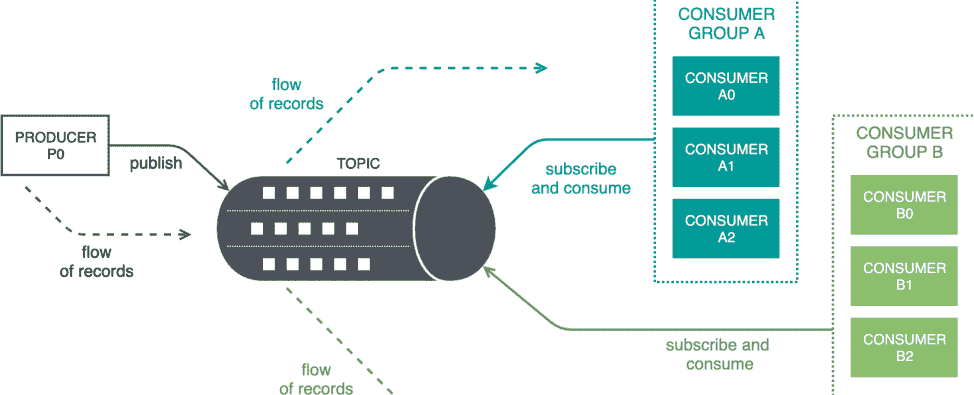

多个共享同一主题的消费者组

作为履行订阅的一部分，Kafka 将将分区分配给每个组的成员。反之，每个组将获取并维护一组专用的偏移量，反映该组通过主题的整体进度。主题的共享和消费者组的独立进度如图所示。

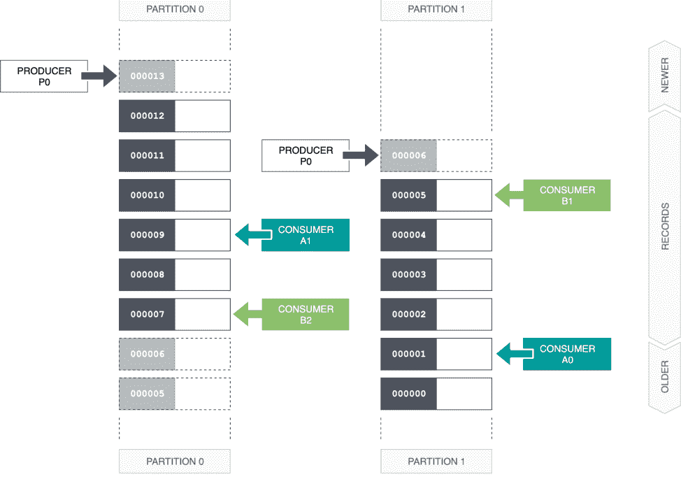

### 消费者偏移量


仔细检查后，读者会注意到缺少了某些东西。实际上是两个：消费者 `$A2$` 和 `$B0$` 不在。那是因为 Kafka 确保一个分区最多分配给其消费者组内的一个消费者。（之所以说“最多”，是为了涵盖所有消费者都在线的情况）。由于每个组有三个消费者，但只有两个分区，一个消费者将保持空闲状态——等待其所在组的另一个消费者离开后再被分配分区。通过这种方式，消费者组不仅是一种负载均衡机制，而且是一种类似于栅栏的排除控制，用于在不牺牲安全性的情况下构建高性能的流水线，特别是当要求记录在任何时候只能由一个线程或进程处理时。

消费者组还确保了可用性，满足了分布式消费者生态系统的存活性（liveness property）。通过定期从主题读取记录，消费者隐式地向集群发送信号，表明其处于“健康”状态，从而延长其对分区分配的租约。如果消费者在允许的截止日期内未能再次读取，将被视为故障，分区将重新分配——分配给其组内剩余的“健康”消费者。

> 关于 Kafka 安全性（safety）和存活性属性的深入讨论将推迟到15章：组员与分区分配。目前，请读者接受一个简化的定义：存活性（Liveness）要求系统最终能够取得进展并完成所有分配的工作。安全性（Safety）要求系统在任何时候都遵守其所有关键不变变量的属性。

用交通类比，主题就像一条高速公路，而分区就像是一条车道。记录相当于汽车，其乘客对应于记录的值。几辆汽车可以安全地在同一条高速公路上，只要它们保持自己的车道。共享同一条车道的汽车按顺序行驶到某个位置。如果其中一个出口堵塞，其他出口可能仍然保持畅通。

正是这种“公路-车道”的比喻被 Kafka 利用以实现了其标志性的端到端吞吐量，在普通硬件上即可轻松达到每秒百万条记录。在创建主题时，可以设置分区数量——如果你愿意的话，就是车道数。分区大致平均地分配给消费者组中的各个消费者，并保证没有分区会被同时分配给两个（或更多）消费者，前提是这些消费者属于同一个消费者组。参考我们的类比，汽车永远不会同时出现在两个出口；然而，两条车道完全可能会合并到同一个出口。


德克萨斯州达拉斯的五通立交路口

# 提交偏移量

已经提到消费者维护着一个关于其分区偏移量的内部状态。在某个时刻，该状态必须与外部共享，以便当分区重新分配时，消费者可以从离开的地方继续。

将消费者状态持久化回 Kafka 被称为提交偏移量。通常，消费者会读取一条记录（或一批记录）并提交最后记录加一的偏移量。如果新消费者接管，它将从提交的偏移量开始处理。

> 一个有趣的现象：Kafka 采用递归方法来管理偏移量，利用自身来持久化跟踪偏移量。当提交偏移量时，组协调器将在内部 `consumer_offsets` 主题发布记录。该主题的内容会在后台进行压缩，创建一个不断缩减到给定组最后已知提交点的有效事件存储。

控制提交偏移量的点为交付保证提供了极大的灵活性，进一步凸显了 Kafka 对各种消息场景的适应性。“交付”这一术语不仅是指读取记录，还包括整个处理周期及其副作用。（例如，更新数据库或调用服务）通过将提交点从开始处理记录之前移动到处理完成之后，就可以从*最多一次（at-most-once）*切换到*至少一次（at-least-once）*交付模型。在这种模型下，消费者可能在处理记录过程中失败，记录将在分区重新分配后被重新读取。

默认情况下，Kafka 消费者每隔五秒自动提交一次偏移量。在存在飞行记录（正在被消费者处理的记录）的情况下，间隔会自动延长。这可以通过 `auto.commit.interval.ms` 属性控制，该属性在第10章客户端配置中讨论。这种偏移提交功能的影响是它扩展了未感知偏移量的窗口；换句话说，消费者可能处理了一批记录但不一定提交偏移量。如果消费者的分区没有重新分配，新消费者将再次处理该批记录。为了限制未感知偏移量的窗口，需要将提交偏移交由自己。这可以通过将 `enable.auto.commit` 客户端属性设置为 `false` 来实现。获取偏移量可能很复杂，经常让学者出错。提交的偏移量意味着该偏移量以下的记录以及之前的所有记录已由消费者处理。在设计至少一次的应用时，只有在应用程序处理了问题记录后才提交偏移量。换句话说，记录

已经处理到这种程度，使得任何由该记录产生的操作都已执行并最终确定。这可能包括调用其他 API、更新数据库、提交事务、持久化记录的负载或发布更多记录。换句话说，如果消费者在提交记录后发生故障，那么再也无法看到这条记录也不会对其正确性产生负面影响。

在“至少一次”（at-least-once）场景下，典型的消费者实现会线性地提交其偏移量，并与记录批的处理同步进行。也就是说，从主题中读取记录批记录，处理单个记录，提交未提交的偏移量，读取下一批，依此类推。这被称为“轮询-处理循环”（poll-process loop），如下所示：

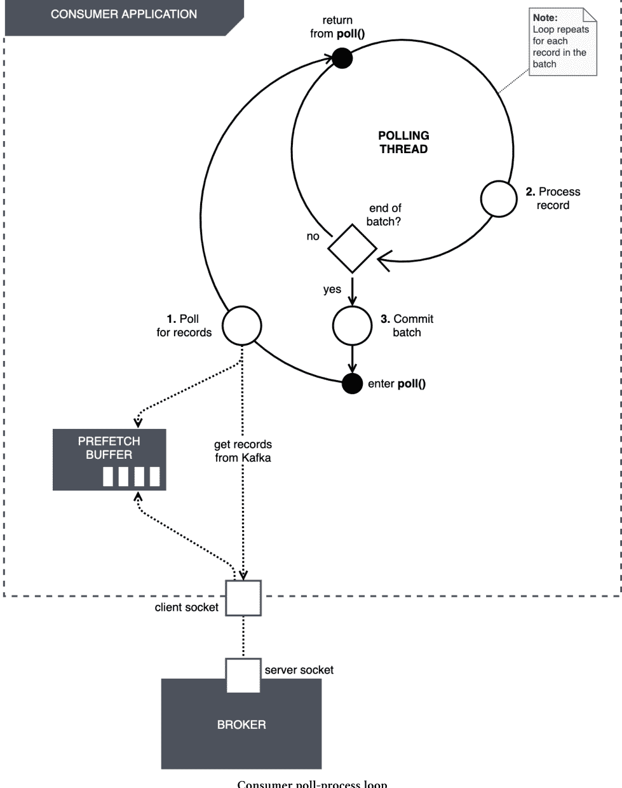

## 第 3 章：架构与核心概念

图中的轮询-处理循环是对现实的一种某种简化描述。我们不会详细介绍在调用 `KafkaConsumer.poll()` 时如何从 Kafka 获取记录的细节；更详尽的描述将在第 7 章：序列化（Serialization）中给出。我们将提到一个优化：消费者并不总是直接从集群获取记录；它使用一个预取缓冲区（prefetch buffer）来实现这种流水线操作。

一种常见的策略是使用线程池并发处理一批记录（这是有意义的），并且仅在整个批处理完成后才确认最后一条记录。Kafka 中的提交过程非常高效，客户端库将使用内存队列异步地发送请求，而不会阻塞消费者。客户端应用程序可以注册一个可选的回调，在集群确认提交时通知它。如果客户端应用程序偏于此，还有一种阻塞变体可供选择。

## 自由消费者 (Free consumers)

消费者与消费者组的关联是可选的，通过是否是否存在了 `group.id` 来指示；如果不存在组 ID，则假设是一个自由消费者。自由消费者不会向主题提交；相反，消费的责任在于手动为它们分配一组主题分区，并为每对主题-分区对单独指定偏移量。自由消费者不会将它们的偏移量提交给 Kafka；这取决于应用程序使用选定的数据存储来跟踪消费者的进度并持久化其状态。在这种模式下，自动分区分配、重平衡、偏移量持久化、分区排除、消费者心跳和故障检测（安全性和活跃性）以及其他赋予消费者组的所谓“便利功能”都存在。

> 使用“自由消费者”这一名义表达式来表示没有包含性组的消费者是一个创造出来的术语。它不是 Kafka 标准术语的一部分；没有广泛通用的术语来标记这种形式的消费者。

自由消费者在现实中出现的频率并不像其对应的消费者那样高。自由消费者主要适用于两种两种用例。其中一种情况是应用程序确实需要完全控制分区分配方案，并利用专用数据存储来跟踪消费者偏移量。这非常罕见。不而说，考虑到必须考虑的场景繁多，要正确实现它也非常困难。此处提及仅是为了完整性。

更常见的用例是无状态或瞬态消费者需要监控某个主题。例如，一个应用程序可能会标记一个主题，以识别在监控或调试辅助期间发布的记录。人们可能只关心在无状态消费者在线时发布的记录，因此像持久化偏移量和从上一次处理的记录恢复等问题在很大程度上变得无关紧要。这种方法被常规使用的良好例子是 Kafdrop 工具，我们将在接下来的章节中探索它。当用户点击主题查看记录时，Kafdrop 会创建一个自由消费者并将请求的分区分配给它，从提供的偏移量处读取记录。导航到不同的主题或分区将重置消费者，丢弃任何先前的状态。

从自由消费者获益的一个场景是使用 Kafka 实现“同步转异步”（sync-over-async）模式。例如，生产者可能会向下游消费者发出一个命令式的请求（查询），并期望在相同或不同主题上获得响应。消费者可能运行在同步上下文中；例如，它可能正在响应自己的同步请求，因此它没有选择在继续操作之前等待下游响应。为了增加问题的复杂性，操作中可能存在多个发起者，确保响应由发出原始请求的同一发起者处理是至关重要的。

同步转异步场景是上述无状态消费者场景的一个特例。发起者首先开始为自己分配响应主题的所有分区，并将偏移量重置为高水位（high-water mark）。然后它发布带有唯一标识符的请求命令，该标识符将在响应中返回。（通常，这是一个 UUID）。下游消费者最终会处理消息并发布其响应。同时，发起者将轮询主题获取响应，并通过 ID 进行过滤。最终，要么响应在设定的截止时间内到达，要么发起者将超时。无论哪种方式，分配给发起者的分区都是临时的，在连续分配之间不保留状态。

## 核心概念总结

下面的图概述了本章介绍的核心概念之间的关系，包括集群、broker 节点、生产者、主题、分区、同步消费者和消费者组等实体。

## 第 3 章：架构与核心概念

## 42

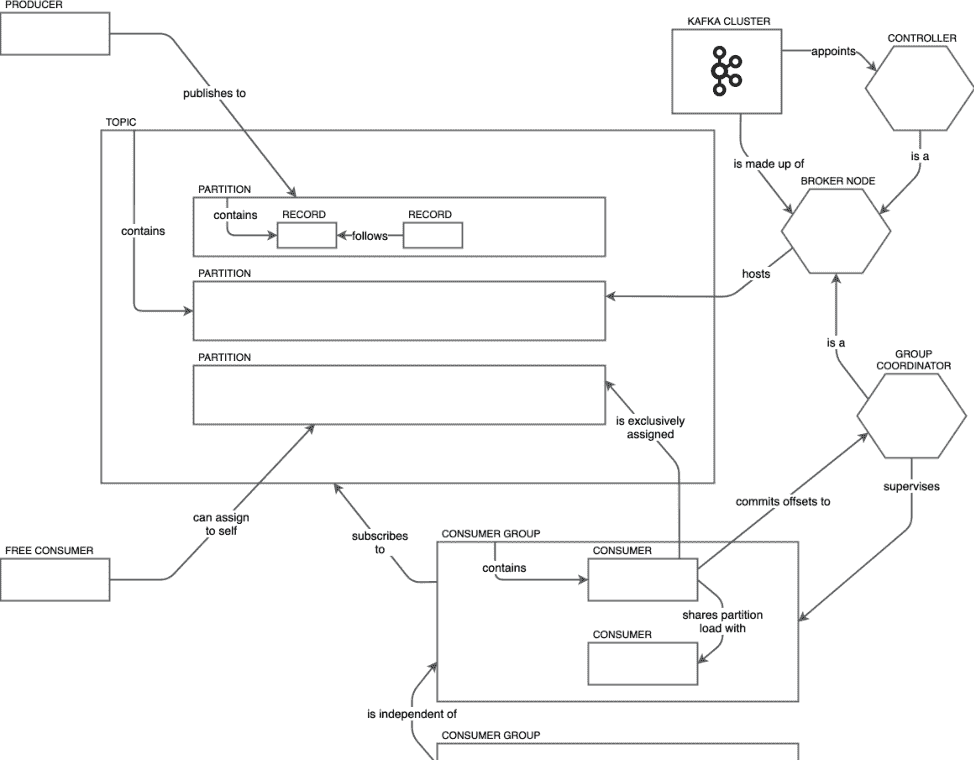

关键收获是：

- 集群托管多个主题，每个主题都有分配的领导（leader）和零或多个跟随（follower）副本。

- 主题被划分为分区，每个分区形成一个独立的、全序的序列。

- 多个生产者能够发布到主题，任意选择分区。通过指定分区号，或间接地地——通过记录键（后者会确定性地哈希到某个分区）。

- 主题中的分区可以在消费者组的消费者群体之间进行负载均衡，在成员之间均匀分配分区。

- 组中的消费者不保证获得分区分配。当组群体优于分区数量时，某些消费者将保持空闲，直到平衡或向另一侧倾斜。

## 第 3 章：架构与核心概念

- 消费者在完成处理后提交记录的偏移量。提交被定向到消费者协调器，最终将写入内部的 ___offsets 主题。在提交之前会将记录的偏移量加一，以防止不重放。

- 分区可以手动分配给自由消费者。如有必要，可以将整个主题分配给单个自由消费者——这是通过单独分配所有分区来实现的。

## 第 4 章：安装

前面的章节已经让我们对 Kafka 是什么、不是什么，用途以及它如何与软件生态系统的其他部分衔接有了相当深入理解。到目前为止，我们只是在岸边徘徊；现在是时候深入内部观察了。在继续进行之前，我们需要一个运行中的 Kafka 环境。

这要求我们安装几样东西：

1. **Kafka 和 ZooKeeper**。回顾我们之前对 Kafka 架构的介绍，一个功能性的设置同时需要 Kafka 和 ZooKeeper 节点。这些是纯 Java 应用程序，没有其他要求或依赖项，可以在任何支持 Java 的操作系统和任何硬件上运行。

2. **Kafka-rop**。虽然运行 Kafka 来说并不是严格要求的，但 Kafkadrop 是处理 Kafka 最广泛使用的 Web 端工具，被广泛认为是 Kafka 工具箱中不可或缺的项目。

3. **Java 开发工具包 (JDK)**。Kafka 部分用 Scala 编写，部分用 Java 编写，运行需要 Java 8 或更高版本。Kafkadrop 更现代，需要 Java 11。

如果你还没有安装，请安装一个 JDK。版本 11 或更高版本即可。本章其余部分假设你已经安装了 JDK。

> 要求 JDK 11 是为了兼容 Kafkadrop。如果你只是单独安装 Kafka，仍然建议使用 JDK 11 而不是 Java 8，因为它是目前的长期支持（LTS）版本。JDK 8 的最后免费更新已于 2019 年 1 月结束。JDK 11 的免费更新将持续到 2021 年 9 月，届时将过渡到 JDK 17 LTS。（LTS 版本）提供期三年的公开支持。

## 安装 Kafka 和 ZooKeeper

有四种方法可以安装 Kafka 和 ZooKeeper：

1. 使用 Docker 运行 Kafka 和 ZooKeeper。

2. 使用包管理器安装 Kafka 和 ZooKeeper，例如用于 RedHat、CentOS 和 Fedora Linux 发行版的 DNF（以前称为 YUM），用于 Debian 和 Ubuntu 的 APT，以及用于 macOS 的 Homebrew。还有许多其他包管理器。

3. 克隆 Kafka 和 ZooKeeper 的代码库并从源码构建。

4. 从 `kafka.apache.org/downloads` 下载并解压官方 Kafka 发行版，它自带了 ZooKeeper。

让我们简要介绍一下这些选项。初听起来可能有些大材小用——我们可以选最简单的开始工作——但我们考虑的是长远计划。而且，有时最简单的方法并不是正确的方法。

Docker 是入门 Kafka、开发本地 Kafka broker 甚至在生产环境配置中运行 Kafka 的极佳全方位方法。最棒的是，Docker 镜像将带有适当版本的 JDK。

但有一个缺点，Docker 中的 Kafka 以极难配置而闻名，因为所有内容都是硬编码的，并非为了为了更改而设计的。（这并不是说不能做到）我们暂时不会采用 Docker 路径，因为我们在旅程中的许多阶段将对 broker 配置进行更改，理想情况下，我们希望这尽可能简单且无痛。

从包安装 Kafka 和 ZooKeeper 也很方便。如果它没有自带 JDK，包通常会将 JDK 声明为依赖项，包管理器会在安装时（或更新包时）尝试解析该依赖项。尽管如此，这种方法并非没有缺点：目标机器上可能安装了其他需要不同版本 JDK 的应用程序，这可能需要进一步配置 Kafka 和 ZooKeeper 以将其连接到正确的 JDK。

“封装版 Kafka”方法的另一个缺点是，安装路径和文件布局将根据所选的包管理器而异。例如，在 macOS 上，Homebrew 将 Kafka 安装到 `/usr/local/etc`、`/usr/local/bin` 和 `/usr/local/var/lib/`。另一方面，YUM 将将其安装在 `/bin`、`/opt` 和 `/var/lib/` 下。这使得编写并包含所有读者的一致性示例变得极其困难。与其专注于主题本身，这本书将充斥着针对操作系统和包管理器的提示。

第三种选择是从源码构建。对于刚接触 Kafka 的人来说，这听起来可能有点极端。尽管如此，这是一个有效选项，如果你恰好是贡献者，这是唯一的选项。出乎意料的是，我们不会深入探讨，至少在这个领域内不会。

最后一个选项，也是我们不可避免采用的方法，是从 `kafka.apache.org/downloads` 下载最新版本的官方 Kafka tar 包。可能有几个选项——在“Binary downloads”中选择一个针对最新版本的即可，如截图所示。2.4.0 是最新发布版本。当前的稳定版本是 2.4.0。

# 2.4.0

- 发布于 2019 年 12 月 16 日

- 发布说明

- 源码下载：`kafka-2.4.0-src.gz` (asc, sha512)

- 二进制下载：

  - Scala 2.11: `kafka-2.4.0.tgz` (asc, sha512)

  - Scala 2.12: `kafka-2.4.0.tgz` (asc, sha512)

  - Scala 2.13: `kafka-2.4.0.tgz` (asc, sha512)

为多个版本的 Scala 构建只有在你在使用 Scala 且想为相同版本进行构建时才有意义。否则，任何版本都可以工作。

将下载的 `.tgz` 文件复制到你选择的目录中，并使用 `tar xzf kafka-2.4.0.tgz` 进行解压，根据需要替换文件名。（在示例中，下载的版本是 2.4.0，但你的版本可能更高。）文件将解压到名为 `kafka_2.4.0` 的子目录。我们将该目录称为 Kafka 目录。你可以选择手动用安装目录替换 `$KAFKA_HOME`，或者将路径分配给环境变量 `KAFKA_HOME`，如下例所示。

```
export KAFKA_HOME=/Users/me/opt/kafka_2.4.0
```

你需要运行 `export`。或者，你也可以将 `export` 命令添加到 shell 的启动文件中。如果你使用 Bash，这通常是 `~/.bashrc` 或 `~/.bash_profile`。

花点时间查看主目录。你会看到除了 `bin`、`libs` 和 `config` 之外的子目录。

- LICENSE

- NOTICE

- bin

- config

- libs

- site-docs

`bin` 目录包含启动和停止 Kafka 及 ZooKeeper 的脚本，以及用于操作 Kafka 的各种 CLI（命令行界面）工具。它还包含一个 `windows` 子目录（你猜对了），它包含了适用于 Windows 的对应脚本。

- bin

- connect.sh

- standalone.sh

- kafka-broker-api-versions.sh

- kafka-configs.sh

- kafka-console-consumer.sh

- kafka-console-producer.sh

- kafka-consumer-groups.sh

- kafka-consumer-perf-test.sh

- kafka-delegation-tokens.sh

- kafka-delete-records.sh

- kafka-dump-log.sh

- kafka-log-dirs.sh

- kafka-mirror-maker.sh

- kafka-preferred-replica-election.sh

- kafka-producer-perf-test.sh

- kafka-reassign-partitions.sh

- kafka-replica-verification.sh

- kafka-run-class.sh

- kafka-server-start.sh

- kafka-server-stop.sh

- kafka-streams-application-reset.sh

- kafka-topics.sh

- kafka-verifiable-consumer.sh

- kafka-verifiable-producer.sh

- trogdor.sh

- windows

- zookeeper-security-migration.sh

- zookeeper-server-start.sh

- zookeeper-server-stop.sh

- zookeeper-shell.sh


# 第 4 章：安装

`config` 目录是另一个目录。它包含了用于配置 Kafka 生态系统中各个组件的 `.properties` 文件。

- `config`
- `connect-console-sink.properties`
- `connect-console-source.properties`
- `connect-distributed.properties`
- `connect-file-sink.properties`
- `connect-file-source.properties`
- `connect-log4j.properties`
- `connect-standalone.properties`
- `consumer.properties`
- `log4j.properties`
- `producer.properties`
- `server.properties`
- `tools-log4j.properties`
- `trogdor.conf`
- `zookeeper.properties`

`lib` 目录包含 Kafka 二进制发行版及其直接和间接依赖项。你永远修改此目录的内容。

## 启动 Kafka 和 ZooKeeper

现在应用程序已经安装完成，我们可以启动它们。第一个上场的是 ZooKeeper，它是 Kafka 的运行需求。在终端中运行以下命令：

```
$KAFKA_HOME/bin/zookeeper-server-start.sh \
    $KAFKA_HOME/config/zookeeper.properties
```

这将以前台模式启动 ZooKeeper。你应该会在控制台上看到大量日志信息，标志着 ZooKeeper 正在启动。其中，你可能会发现一条警告信息：

```
[2019-12-25 13:30:36,951] WAR Either no config or quorum defined []
in config, running in standalone mode (org.apache.zookeeper).
server.quorum.QuorumPeerMain
```

这些信息意味着我们以单机模式启动了 ZooKeeper，而没有配置队列（quorum）。在本地运行 ZooKeeper 时，可用性通常不是考虑的问题，单机（单个成员节点）配置就足够了。

> 回顾对 Kafka 架构的讨论，曾提到 ZooKeeper 充当仲裁者——在可用的 Kafka broker 节点中选举出一个控制器。内部，ZooKeeper 采用原子广播协议来达成共识，并在整个 ZooKeeper 集群中维护集群状态的一致视图。该协议基于多数投票（也称为 quorum）的概念，而反过来，这需要一组参与运行的 ZooKeeper 节点。在生产环境中运行时，请确保至少部署三个节点，并确保任何两个节点都不会受到相同意外情况的影响。理想情况下，ZooKeeper 应该部署在地理位置相互独立的数据中心。

既然 ZooKeeper 已经在运行，我们就可以启动 Kafka 了。在新的终端窗口中运行以下命令：

```
$KAFKA_HOME/bin/kafka-server-start.sh \
$KAFKA_HOME/config/server.properties
```

Kafka 的日志比 ZooKeeper 的详细得多。日志中第一个真正有部分与 ZooKeeper 连接有关。具体来说，当 Kafka 尝试连接到 ZooKeeper 实例时，连接的状态如下：

```
[2019-12-25 14:02:21,380] INFO Initiating client connection, []
connectString=localhost:2181 Timeout=6000 watcher=[]
kafka.zookeeper.ZooKeeperClient$ZooKeeperClient@ []
624ae25(org.apache.zookeeper.ZooKeeper)
[2019-12-25 14:02:21,399] INFO [ZooKeeper Kafka server] []
Waiting until connected. (kafka.zookeeper.ZooKeeperClient)
[2019-12-25 14:02:21,401] INFO Opening connection to server []
localhost:0:0:0:0:0:0:1:2181. Will not attempt to []
authenticate using SASL (unknown error) (org.apache.zookeeper.
ClientCnxn)
[2019-12-25 14:02:21,416] INFO Socket connection established to []
localhost:0:0:0:0:0:0:1:2181, initiating session []
(org.apache.zookeeper.ClientCnxn)
[2019-12-25 14:02:21,458] INFO Session establishment complete to []
server:0:0:0:0:0:0:1:2181, sessionid=[]
0x100433a40960000, negotiated timeout = 6000
(org.apache.zookeeper.ClientCnxn)
[2019-12-25 14:02:21,461] INFO [ZookeeperClient Kafka server]
Connected. (kafka.zookeeper.ZookeeperClient)
```

在日志中，我们还可以找到完整的 Kafka broker 配置：

```
[2019-12-25 14:02:22,118] INFO KafkaConfig values:
advertised.host.name = null
advertised.listeners = null
advertised.port = null
alter.config.policy.class.name = null
alter.log.dirs.replication.quota.window.num = 11
alter.log.dirs.replication.quota.window.size.seconds = 1
authorizer.class.name =
auto.create.topics.enable = true
auto.leader.rebalance.enable = true
background.threads = 10
broker.id = 0
broker.id.generation.enable = true
broker.rack = null
client.quota.callback = null
compression.type = producer
connection.failed.delay.ms = 100
```

（为了简洁起见，省略了文件的其余部分）

此基于提供的碎片化 OCR 文本。注意：提供的源文本包含大量的重复和破碎的句子（例如“第 4 章：安装”出现了多次，以及无意义的日志片段）。我已经清理了重复内容并根据可用内容合并了逻辑流。

## 3.18.0

从 Bintray 下载

- 添加新的 API 端点，以获取某个 topic 的消费者 #49
- 修复：`getAcls()` 未返回所有 ACLs #51

| 源代码 (zip) | 源代码 (tar.gz) |
| --- | --- |

点击链接将下载一个 `.jar` 文件。将其保存到你任选的目录中，并按照下例所示运行它，根据需要替换文件名。

```
java -jar kafdrop-3.18.0.jar --kafka.brokerConnect=localhost:9092
```

一旦启动，你就可以在浏览器中导航到 `localhost:9000` 来打开 Kafdrop。你将看到 Kafdrop 集群概览屏幕，显示了我们崭新的、单节点 Kafka 集群。

`http://localhost:9000`

## Kafka 集群概览

| 启动服务器 | localhost:9092 |
| --- | --- |
| 总 topic | 0 |
| 总分区数 | 0 |
| 总首选分区副本负载 | 0% |
| 总未同步分区数 | 0 |

## Brokers

| ID | 主机 | 货架 | 控制器 | 分区数量 (% 占比) |
| --- | --- | --- | --- | --- |
| 0 | 9092 | - | 是 | 0 (0%) |

## Topics ACLs

| 名称 | (0) | 分区 | 首选比例 | # 未同步 | 自定义配置 |
| --- | --- | --- | --- | --- | --- |
| 无可用 topic | | | | | |

这里有几个值得关注的地方。在右上角，你应该可以看到 Kafdrop 的发布版本和构建版本。如果你连接到远程 Kafka 实例且没有日志来显示运行的是哪一个版本的 Kafdrop，这会非常有用。

下一节提供了集群的摘要。请注意 'Bootstrap servers'（启动服务器）'字段：它镜像了 `--kafka.brokerConnect` 命令行参数，告诉我们 Kafdrop 是如何配置为发现 Kafka 节点的。

> 启动和 broker 发现是一个单独的话题，我们暂时不再细说。目前，除非另有说明，否则假设 'bootstrap servers' 列表为 `localhost:9092`。我们将在第 8 章：启动与公告的监听器中重新回到这个话题。

'Brokers' 部分列出了集群中的各个 broker。我们现在运行的是单 broker 设置，所以看到一个单行的表格条目并不意外。自然地，作为集群中唯一的 broker，它已经被分配了控制器角色。

## 第 4 章：安装

'Topics' 部分是空的，因为我们还没有创建任何 topic。我们也没有定义任何 ACLs。这些都将在稍后到来。

切换回运行 Kafdrop 的终端。通过查看标准输出日志，我们可以发现版本号。继续看，你会发现 Kafdrop 正在监听端口和上下文路径（context path）。这些都是配置，在不同环境之间可能需要更改。

```
2019-12-25 19:08:49.465 INFO 82515 [main] k.s.BuildInfo: Kafdrop version: 3.18.0, build time: 2019-12-02T08:36:13.356Z
...
（省略部分日志）
...
2019-12-25 19:08:50.752 INFO 82515 [main] o.s.b.w.e.u. UndertowServletContext started on port(s) 9000 (http) with context path ''
```

我们已经学习了获取和安装 Kafka 和 ZooKeeper 包的各种方法。我们还启动并停止了基础的 ZooKeeper 和 Kafka 设置，学习了前台和守护模式，并调查了日志以获取有用信息。最后，我们安装了 Kafdrop 并简单观察了一下。现在场景已经就绪；我们只需要以某种方式利用这一切了。

# 第 5 章：快速上手

理论基础已经打好，并且有一个新安装的 Kafka 就绪，是时候卷起袖子，用更实践的方法来学习 Kafka 了。

本章将重点关注两个基本操作：向 Kafka topic 发送记录以及随后消费它们。我们将探索与 broker 交互的各种机制，以及探索 topic 和分区内容的机制。

## 使用 CLI 进行发布和消费

在讨论生产者和消费者时，首先想到的可能是与 broker 交互的各种机制，以及探索 topic 和分区内容的机制。我们不需要手动创建 topic，而是使用 CLI（command-line interface）工具，这些工具位于 `$KAFKA_HOME/` 目录下。

## 创建 topic

让我们开始吧。首先是创建一个 topic。这可以通过以下命令完成：

```
$KAFKA_HOME/bin/kafka-topics.sh --bootstrap-server localhost:9092 \
--partitions 3 --replication-factor 1 \
--topic getting-started
```

观察，虽然 `--bootstrap-server` 是单数形式，但 `kafka-topics.sh` 工具意外地接受了 `localhost:9092`，因为那是我们的集群目前运行的地方。

> 这可能是一个很好的过渡，用来讨论显式创建 topic 的重要。Kafka 并不要求客户端创建 topic。当 `auto.create.topics.enable` broker 配置设置为 `true` 时，当客户端尝试生产、消费或获取不存在的 topic 的元数据时，Kafka 会自动创建该 topic。这听起来是一个很棒的主意，但其缺点远大于不显式创建 topic 带来的微小便利。

首先，Kafka 的默认设置是 2011 年的，并且通常针对 Kafka 最初设计的用例——高吞吐量日志传输进行了优化。许多情况发生了变化；事实上，Kafka 不再是一个只此用途的工具。因此，人们通常会在创建 topic 时或之后立即对其进行配置——至少在它受到真正的考验之前。

其次，分区数量：Kafka 允许通过 `num.partitions` broker 设置为所有新创建的 topic 指定默认分区数，但这在很大程度上是没有意义的。Topic 应该根据预期的并行性单独调整大小，并且是一个

## 第 5 章：快速上手

切换到 Kafka，我们可以看到 `getting-started` topic 出现在 'Topics' 部分。如果有很多 topic，可以使用表格区域的过滤框筛选出匹配子字符串的 topic。

| 名称 | 分区 | 首选比例 | # 未同步 | 自定义配置 |
| --- | --- | --- | --- | --- |
| getting-started | 3 | 100% | 0 | 无 |

Kafdrop — 显示 topics

我们可以看出该 topic 有三个分区，该 topic 没有副本问题，并且没有为该 topic 指定自定义配置。特定 topic 配置的机制将在第 9 章：Broker 配置中解释。

现在，我们完全可以通过点击 topic 列表下的 'New' 按钮来创建一个 topic：

## Topic 创建

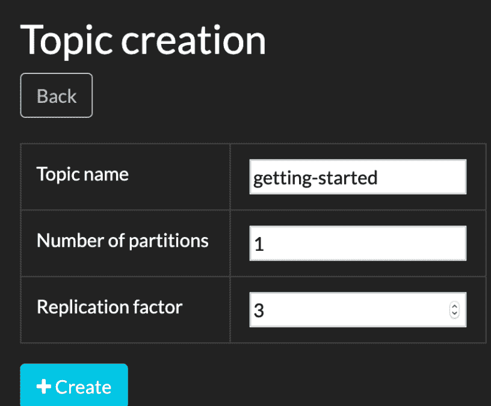

Kafdrop — 创建新 topic

然而，练习目的是演示 CLI 工具，而不是探索在 Kafka 中创建 topic 的所有方法。

> 这可能是一个很好的过渡，用来讨论显式创建 topic 的重要。Kafka 并不要求客户端创建 topic。当 `auto.create.topics.enable` broker 配置设置为 `true` 时，当客户端尝试生产、消费或获取不存在的 topic 的元数据时，Kafka 会自动创建该 topic。这听起来是一个很棒的主意，但其缺点远大于不显式创建 topic 带来的微小便利。

首先，Kafka 的默认设置是 2011 年的，并且通常针对 Kafka 最初设计的用例——高吞吐量日志传输进行了优化。许多情况发生了变化；事实上，Kafka 不再是一个只此用途的工具。如此，人们通常会在创建 topic 时或之后立即对其进行配置——至少在它受到真正的考验之前。

其次，分区数量：Kafka 允许通过 `num.partitions` broker 设置为所有新创建的 topic 指定默认分区数，但这在很大程度上是没有意义的。Topic 应该根据预期的并行性单独调整大小，并且是一个

其他因素，这些因素将在第 6 章“设计考量”中讨论。指定分区数量需要显式地创建主题。对于复制因子（replication factor），也可以有类似的说明，但与分区数量相比，就复制因子的合理默认值达成共识似乎要容易得多。

最后，在客户端订阅主题或简单地获取主题元数据时让 Kafka 自动创建主题，往好了说是非常不粗率的。行为异常的客户端可能会启动任意的元数据查询，从而在无意中创建大量的离散主题。

## 发布记录

处理完主题创建，让我们发布几条记录。我们将使用 `kafka-console-producer.sh` 工具：

```bash
$KAFKA_HOME/bin/kafka-console-producer.sh \
--broker-list localhost:9092 \
--topic getting --property "parse.key=true" \
--property "key.separator=\:"
```

记录之间用换行符分隔。键值对对通过冒号分隔，如 `key.separator` 属性所示。为了演示，请输入以下内容（直接复制粘贴即可）：

```
foo:first message
foo:second message
bar:first message
foo:third message
bar:second message
```

按下 `CTRL+D`。当终端为每条发布的记录回显右角符号（`>`）时。

> 注意，`kafka-topics.sh` 工具使用 `--bootstrap-server` 参数来配置 Kafka Broker 列表，而 `kafka-console-producer.sh` 使用 `--broker-list` 参数实现相同的目的。此外，`--property` 参数在很大程度上没有文档——请准备好通过 Google 搜索来解决问题。

此时，我们可以切换回 Kafdrop 并查看 `getting-started` 主题的内容。我们看到了该主题的概览，以及底层分区的详细细分：

## 第 5 章：入门

### 主题：getting-started

### 查看消息


## 概览

## 配置

无特定主题的配置

| 分区数 | 3 |
|---|---|
| 首选副本 | 100% |
| 副本不足分区 | 0 |
| 总大小 | 5 |
| 总可用消息数 | 5 |

## 消费者

## 分区详情

| 分区 | 起偏移量 | 结束偏移量 | 节点节点 | 副本节点 | 同步副本节点 | 离线副本节点 | 首选副本节点 | 副本不足 |
|---|---|---|---|---|---|---|---|---|
| 0 | 0 | 2 | 0 | 0 | | | Yes | No |
| 1 | 0 | 0 | 0 | 0 | | | Yes | No |
| 2 | 0 | 3 | 0 | 0 | | | Yes | No |

> Kafdrop — 查看主题内容

聚焦于分区详情，我们可以一眼看出在三个分区中，有两个有数据，一个是空的。“起始偏移量（first offset）”和“结束偏移量（last offset）”列分别对应低水位（low-water mark）和高水位（high-water mark）。正如读者可能从第 3 章“架构与核心概念”中回想的，两者相减即可得到分区中持久化的最大记录数。让我们检查 #2 号分区。Kafdrop 将按时间顺序显示单条记录。

### 主题消息：getting-started

```
Partition 2: Offset 0 Message format DEFAULT View Messages
Offset 0 Key Timestamp 2020-01-27 14:35:54.521 Headers empty
```

| 偏移量 | Key | Timestamp | Headers |
|---|---|---|---|
| 0 | key | 2020-01-27 14:35:54.521 | empty |
| 1 | key | 2020-01-27 14:35:54.528 | empty |
| 2 | key | 2020-01-27 14:35:54.529 | empty |

> Kafdrop — 查看分区内容

## 第 5 章：入门

如果你好奇的话，记录左侧的箭头可以让你展开并格式化打印 JSON 编码的记录。由于我们的示例没有使用 JSON，因此没有可格式化的内容。

## 消费记录

```bash
$KAFKA_HOME/bin/kafka-console-consumer.sh \
  --bootstrap-server localhost:9092 \
  --topic getting-started --group cli-consumer --from-beginning \
  --property "print.key=true" --property "key.separator="
```

终端将回显以下内容：

```
bar:first message
bar:second message
foo:first message
foo:second message
foo:third message
```

因为消费者是以订阅模式运行的，并提供了消费者组，输出将停在最后一条记录上。消费者将有效地尾随（tail）该主题——持续轮询新记录并在它们到达主题时打印出来。要终止消费者，请按 `CTRL+D`。

注意，我们在调用命令时指定了 `--from-beginning` 标志。默认情况下，首次消费者（针对之前不存在的组）的偏移量（offsets）将会重置为主题的高水位。为了读取之前发布的记录，我们覆盖了默认偏移量策略，从主题的低水位开始尾随。如果我们再次运行相同的命令，将看不到任何记录——消费者将停止，等待新记录的到达。

> 没有 `--from-beginning` 标志。要尾随主题末尾，只需删除消费者偏移量并重启 CLI 命令。删除偏移量可以 topic。

此时，我们可以切换回 Kafdrop 并查看 `getting-started` 主题的内容。我们看到了该主题的概览，以及底层分区的详细细分。

## 第 5 章：快速上手

```bash
cat << EOF > /tmp/offsets.json
```

```json
{ 
  "partitions": [
    {"topic": "getting-started", "partition": 2, "offset": 1}
  ],
  "version": 1
}
```

```bash
EOF
$KAFKA_HOME/bin/kafka-delete-records.sh \
  --bootstrap-server localhost:9092 \
  --offset-json-file /tmp/offsets.json
```

以一种异常的方式，我们可以通过在 `offset` 属性中指定当前的高水位（high-water mark）来截断整个分区。

## 列出消费者组

`kafka-consumer-groups.sh` 工具用于查询 Kafka 中的消费者组列表。

```bash
$KAFKA_HOME/bin/kafka-consumer-groups.sh \
  --bootstrap-server localhost:9092 --list
```

输出结果是一个以换行符分隔的消费者组名称列表。这种输出格式方便我们对各个组进行迭代，从而在 shell 脚本中执行重复的组相关管理操作。

```bash
#!/bin/bash
list_groups_cmd="$KAFKA_HOME/bin/kafka-consumer-groups.sh \
  --bootstrap-server localhost:9092 --list"
for group in $(bash -c $list_groups_cmd); do
  # 对 $group 变量进行某些操作
done
```

## 描述消费者组

同一工具也可以显示每个消费者组的详细状态信息 —— 即其针对已订阅主题集的分区偏移量（offsets）。下面显示了一个示例调用及其产生的输出。

```bash
$KAFKA_HOME/bin/kafka-consumer-groups.sh \
--bootstrap-server localhost:9092 \
--group cli-consumer --describe --all-topics
```

当没有消费者连接时，会产生以下内容：

```
Consumer group 'cli-consumer' has no active members。
```

| GROUP TOPIC PARTITION | CURRENT-OFFSET |
|---|---|
| cli-consumer | getting-started | 1 | 0 |
| cli-consumer | getting-started | 0 | 2 |
| cli-consumer | getting-started | 2 | 3 |

| LOG-END-OFFSET | LAG | CONSUMER-ID |
|---|---|---|
| 0 | 0 | |
| 2 | 0 | |
| 3 | 0 | |

另一方面，如果我们挂载了一个消费者（来自前面的示例，使用 `kafka-console-consumer.sh` 工具），输出将显示以下内容：

| GROUP TOPIC PARTITION | CURRENT-OFFSET |
|---|---|
| cli-consumer | getting-started | 0 | 2 |
| cli-consumer | getting-started | 1 | 0 |
| cli-consumer | getting-started | 2 | 3 |

| LOG-END-OFFSET | LAG |
|---|---|
| 2 | 0 |
| 0 | 0 |
| 3 | 0 |

| CONSUMER-ID |
|---|
| consumer-cli-consumer-1-077c1bf1-df64-4d3e-a479-350e962199cc |
| consumer-cli-consumer-1-077c1bf1-df64-4d3e-a479-350e962199cc |
| consumer-cli-consumer-1-077c1bf1-df64-4d3e-a479-350e962199cc |

| HOST | CLIENT-ID |
|---|---|
| /127.0.0.1 | consumer-cli-consumer-1 |
| /127.0.0.1 | consumer-cli-consumer-1 |
| /127.0.0.1 | consumer-cli-consumer-1 |

除了描述特定的消费者组外，该工具还可以描述所有的组：

```bash
$KAFKA_HOME/bin/kafka-consumer-groups.sh \
--bootstrap-server localhost:9092 \
--describe --all-groups --all-topics
```

`--describe` 标志有一个 `--state` 标志，可以深入查看消费者组当前的状态。这包括协调节点（coordinator node）的 ID、分配策略、活跃成员的数量以及组的状态。这些属性在第 15 章“组成员关系与分区分配”中有更详细的解释。下面的示例说明了该命令及其输出。

```bash
$KAFKA_HOME/bin/kafka-consumer-groups.sh \
--bootstrap-server localhost:9092 \
--describe --all-groups --state
```

| GROUP | COORDINATOR (ID) |
|---|---|
| cli-consumer | localhost:9092 (0) |

| ASSIGNMENT-STRATEGY | #MEMBERS |
|---|---|
| Stable | 1 |

## 重置偏移量

在处理 Kafka 时，我们有时可以通过在 `offset` 属性中指定当前的高水位来截断整个分区。另一方面，如果我们挂载了一个消费者（来自前面的示例，使用 `kafka-console-consumer.sh` 工具），输出将显示以下内容：

| GROUP TOPIC PARTITION | CURRENT-OFFSET |
|---|---|
| cli-consumer | getting-started | 0 | 2 |
| cli-consumer | getting-started | 1 | 0 |
| cli-consumer | getting-started | 2 | 3 |

| LOG-END-OFFSET | LAG |
|---|---|
| 2 | 0 |
| 0 | 0 |
| 3 | 0 |

| CONSUMER-ID |
|---|
| consumer-cli-consumer-1-077c1bf1-df64-4d3e-a479-350e962199cc |
| consumer-cli-consumer-1-077c1bf1-df64-4d3e-a479-350e962199cc |
| consumer-cli-consumer-1-077c1bf1-df64-4d3e-a479-350e962199cc |

| HOST | CLIENT-ID |
|---|---|
| /127.0.0.1 | consumer-cli-consumer-1 |
| /127.0.0.1 | consumer-cli-consumer-1 |
| /127.0.0.1 | consumer-cli-consumer-1 |

除了描述特定的消费者组外，该工具还可以描述所有的组：

```bash
$KAFKA_HOME/bin/kafka-consumer-groups.sh \
--bootstrap-server localhost:9092 \
--describe --all-groups --all-topics
```

`--describe` 标志有一个 `--state` 标志，可以深入查看消费者组当前的状态。这包括协调节点（coordinator node）的 ID、分配策略、活跃成员的数量以及组的状态。这些属性在第 15 章“组成员关系与分区分配”中有更详细的解释。下面的示例说明了该命令及其输出。

```bash
$KAFKA_HOME/bin/kafka-consumer-groups.sh \
--bootstrap-server localhost:9092 \
--describe --all-groups --state
```

| GROUP | COORDINATOR (ID) |
|---|---|
| cli-consumer | localhost:9092 (0) |

| ASSIGNMENT-STRATEGY | #MEMBERS |
|---|---|
| Stable | 1 |

## 重置偏移量

在处理 Kafka 时，我们有时可以通过在 `offset` 属性中指定当前的高水位来截断整个分区。另一方面，如果我们挂载了一个消费者（来自前面的示例，使用 `kafka-console-consumer.sh` 工具），输出将显示以下内容：

| GROUP TOPIC PARTITION | CURRENT-OFFSET |
|---|---|
| cli-consumer | getting-started | 0 | 2 |
| cli-consumer | getting-started | 1 | 0 |
| cli-consumer | getting-started | 2 | 3 |

| LOG-END-OFFSET | LAG |
|---|---|
| 2 | 0 |
| 0 | 0 |
| 3 | 0 |

| CONSUMER-ID |
|---|
| consumer-cli-consumer-1-077c1bf1-df64-4d3e-a479-350e962199cc |
| consumer-cli-consumer-1-077c1bf1-df64-4d3e-a479-350e962199cc |
| consumer-cli-consumer-1-077c1bf1-df64-4d3e-a479-350e962199cc |


```
| HOST | CLIENT-ID |
|---|---|
| /127.0.0.1 | consumer-cli-consumer-1 |
| /127.0.0.1 | consumer-cli-consumer-1 |
| /127.0.0.1 | consumer-cli-consumer-1 |
```

除了描述特定的消费者组外，该工具还可以描述所有的组：

```bash
$KAFKA_HOME/bin/kafka-consumer-groups.sh \
--bootstrap-server localhost:9092 \
--describe --all-groups --all-topics
```

`--describe` 标志有一个 `--state` 标志，可以深入查看消费者组当前的状态。这包括协调节点（coordinator node）的 ID、分配策略、活跃成员的数量以及组的状态。这些属性在第15章“组成员关系与分区分配”中有更详细的解释。下面的示例说明了该命令及其输出。

```bash
$KAFKA_HOME/bin/kafka-consumer-groups.sh \
--bootstrap-server localhost:9092 \
--describe --all-groups --state
```

| GROUP | COORDINATOR (ID) |
|---|---|
| cli-consumer | localhost:9092 (0) |

| ASSIGNMENT-STRATEGY | #MEMBERS |
|---|---|
| Stable | 1 |

## 重置偏移量

在处理 Kafka 时，我们有时可以通过在 `offset` 属性中指定当前的高水位来截断整个分区。另一方面，如果我们挂载了一个消费者（来自前面的示例，使用 `kafka-console-consumer.sh` 工具），输出将显示以下内容：

| GROUP TOPIC PARTITION | CURRENT-OFFSET |
|---|---|
| cli-consumer | getting-started | 0 | 2 |
| cli-consumer | getting-started | 1 | 0 |
| cli-consumer | getting-started | 2 | 3 |

```
| LOG-END-OFFSET | LAG |
|---|---|
| 2 | 0 |
| 0 | 0 |
| 3 | 0 |
```

```
| CONSUMER-ID |
|---|
| consumer-cli-consumer-1-077c1bf1-df64-4d3e-a479-350e962199cc |
| consumer-cli-consumer-1-077c1bf1-df64-4d3e-a479-350e962199cc |
| consumer-cli-consumer-1-077c1bf1-df64-4d3e-a479-350e962199cc |
```

```
| HOST | CLIENT-ID |
|---|---|
| /127.0.0.1 | consumer-cli-consumer-1 |
| /127.0.0.1 | consumer-cli-consumer-1 |
| /127.0.0.1 | consumer-cli-consumer-1 |
```

除了描述特定的消费者组外，该工具还可以描述所有的组：

```bash
$KAFKA_HOME/bin/kafka-consumer-groups.sh \
--bootstrap-server localhost:9092 \
--describe --all-groups --all-topics
```

`--describe` 标志有一个 `--state` 标志，可以深入查看消费者组当前的状态。这包括协调节点（coordinator node）的 ID、分配策略、活跃成员的数量以及组的状态。这些属性在第15章“组成员关系与分区分配”中有更详细的解释。下面的示例说明了该命令及其输出。

```bash
$KAFKA_HOME/bin/kafka-consumer-groups.sh \
--bootstrap-server localhost:9092 \
--describe --all-groups --state
```

| GROUP | COORDINATOR (ID) |
|---|---|
| cli-consumer | localhost:9092 (0) |

| ASSIGNMENT-STRATEGY | #MEMBERS |
|---|---|
| Stable | 1 |

## 重置偏移量

在处理 Kafka 时，我们有时可以通过在 `offset` 属性中指定当前的高水位来截断整个分区。另一方面，如果我们挂载了一个消费者（来自前面的示例，使用 `kafka-console-consumer.sh` 工具），输出将显示以下内容：

| GROUP TOPIC PARTITION | CURRENT-OFFSET |
|---|---|
| cli-consumer | getting-started | 0 | 2 |
| cli-consumer | getting-started | 1 | 0 |
| cli-consumer | getting-started | 2 | 3 |

```
| LOG-END-OFFSET | LAG |
|---|---|
| 2 | 0 |
| 0 | 0 |
| 3 | 0 |
```

```
| CONSUMER-ID |
|---|
| consumer-cli-consumer-1-077c1bf1-df64-4d3e-a479-350e962199cc |
| consumer-cli-consumer-1-077c1bf1-df64-4d3e-a479-350e962199cc |
| consumer-cli-consumer-1-077c1bf1-df64-4d3e-a479-350e962199cc |
```

```
| HOST | CLIENT-ID |
|---|---|
| /127.0.0.1 | consumer-cli-consumer-1 |
| /127.0.0.1 | consumer-cli-consumer-1 |
| /127.0.0.1 | consumer-cli-consumer-1 |
```

除了描述特定的消费者组外，该工具还可以描述所有的组：

```bash
$KAFKA_HOME/bin/kafka-consumer-groups.sh \
--bootstrap-server localhost:9092 \
--describe --all-groups --all-topics
```

`--describe` 标志有一个 `--state` 标志，可以深入查看消费者组当前的状态。这包括协调节点（coordinator node）的 ID、分配策略、活跃成员的数量以及组的状态。这些属性在第15章“组成员关系与分区分配”中有更详细的解释。下面的示例说明了该命令及其输出。

```bash
$KAFKA_HOME/bin/kafka-consumer-groups.sh \
--bootstrap-server localhost:9092 \
--describe --all-groups --state
```

| GROUP | COORDINATOR (ID) |
|---|---|
| cli-consumer | localhost:9092 (0) |

| ASSIGNMENT-STRATEGY | #MEMBERS |
|---|---|
| Stable | 1 |

## 重置偏移量

在处理 Kafka 时，我们有时可以通过在 `offset` 属性中指定当前的高水位来截断整个分区。另一方面，如果我们挂载了一个消费者（来自前面的示例，使用 `kafka-console-consumer.sh` 工具），输出将显示以下内容：

| GROUP TOPIC PARTITION | CURRENT-OFFSET |
|---|---|
| cli-consumer | getting-started | 0 | 2 |
| cli-consumer | getting-started | 1 | 0 |
| cli-consumer | getting-started | 2 | 3 |

```
| LOG-END-OFFSET | LAG |
|---|---|
| 2 | 0 |
| 0 | 0 |
| 3 | 0 |
```

```
| CONSUMER-ID |
|---|
| consumer-cli-consumer-1-077c1bf1-df64-4d3e-a479-350e962199cc |
| consumer-cli-consumer-1-077c1bf1-df64-4d3e-a479-350e962199cc |
| consumer-cli-consumer-1-077c1bf1-df64-4d3e-a479-350e962199cc |
```

```
| HOST | CLIENT-ID |
|---|---|
| /127.0.0.1 | consumer-cli-consumer-1 |
| /127.0.0.1 | consumer-cli-consumer-1 |
| /127.0.0.1 | consumer-cli-consumer-1 |
```

除了描述特定的消费者组外，该工具还可以描述所有的组：

```bash
$KAFKA_HOME/bin/kafka-consumer-groups.sh \
--bootstrap-server localhost:9092 \
--describe --all-groups --all-topics
```

`--describe` 标志有一个 `--state` 标志，可以深入查看消费者组当前的状态。这包括协调节点（coordinator node）的 ID、分配策略、活跃成员的数量以及组的状态。这些属性在第15章“组成员关系与分区分配”中有更详细的解释。下面的示例说明了该命令及其输出。

```bash
$KAFKA_HOME/bin/kafka-consumer-groups.sh \
--bootstrap-server localhost:9092 \
--describe --all-groups --state
```

| GROUP | COORDINATOR (ID) |
|---|---|
| cli-consumer | localhost:9092 (0) |

| ASSIGNMENT-STRATEGY | #MEMBERS |
|---|---|
| Stable | 1 |

## 重置偏移量

在处理 Kafka 时，我们有时可以通过在 `offset` 属性中指定当前的高水位来截断整个分区。另一方面，如果我们挂载了一个消费者（来自前面的示例，使用 `kafka-console-consumer.sh` 工具），输出将显示以下内容：

| GROUP TOPIC PARTITION | CURRENT-OFFSET |
|---|---|
| cli-consumer | getting-started | 0 | 2 |
| cli-consumer | getting-started | 1 | 0 |
| cli-consumer | getting-started | 2 | 3 |

```
| LOG-END-OFFSET | LAG |
|---|---|
| 2 | 0 |
| 0 | 0 |
| 3 | 0 |
```

```
| CONSUMER-ID |
|---|
| consumer-cli-consumer-1-077c1bf1-df64-4d3e-a479-350e962199cc |
| consumer-cli-consumer-1-077c1bf1-df64-4d3e-a479-350e962199cc |
| consumer-cli-consumer-1-077c1bf1-df64-4d3e-a479-350e962199cc |
```

```
| HOST | CLIENT-ID |
|---|---|
| /127.0.0.1 | consumer-cli-consumer-1 |
| /127.0.0.1 | consumer-cli-consumer-1 |
| /127.0.0.1 | consumer-cli-consumer-1 |
```

除了描述特定的消费者组外，该工具还可以描述所有的组：

```bash
$KAFKA_HOME/bin/kafka-consumer-groups.sh \
--bootstrap-server localhost:9092 \
--describe --all-groups --all-topics
```

`--describe` 标志有一个 `--state` 标志，可以深入查看消费者组当前的状态。这包括协调节点（coordinator node）的 ID、分配策略、活跃成员的数量以及组的状态。这些属性在第15章“组成员关系与分区分配”中有更详细的解释。下面的示例说明了该命令及其输出。

```bash
$KAFKA_HOME/bin/kafka-consumer-groups.sh \
--bootstrap-server localhost:9092 \
--describe --all-groups --state
```

| GROUP | COORDINATOR (ID) |
|---|---|
| cli-consumer | localhost:9092 (0) |

| ASSIGNMENT-STRATEGY | #MEMBERS |
|---|---|
| Stable | 1 |

## 重置偏移量

在处理 Kafka 时，我们有时可以通过在 `offset` 属性中指定当前的高水位来截断整个分区。另一方面，如果我们挂载了一个消费者（来自前面的示例，使用 `kafka-console-consumer.sh` 工具），输出将显示以下内容：

| GROUP TOPIC PARTITION | CURRENT-OFFSET |
|---|---|
| cli-consumer | getting-started | 0 | 2 |
| cli-consumer | getting-started | 1 | 0 |
| cli-consumer | getting-started | 2 | 3 |

```
| LOG-END-OFFSET | LAG |
|---|---|
| 2 | 0 |
| 0 | 0 |
| 3 | 0 |
```

```
| CONSUMER-ID |
|---|
| consumer-cli-consumer-1-077c1bf1-df64-4d3e-a479-350e962199cc |
| consumer-cli-consumer-1-077c1bf1-df64-4d3e-a479-350e962199cc |
| consumer-cli-consumer-1-077c1bf1-df64-4d3e-a479-350e962199cc |
```

```
| HOST | CLIENT-ID |
|---|---|
| /127.0.0.1 | consumer-cli-consumer-1 |
| /127.0.0.1 | consumer-cli-consumer-1 |
| /127.0.0.1 | consumer-cli-consumer-1 |
```

## 使用 Java 库

要向你的项目添加 Kafka 客户端库，请将以下内容添加到 `build.gradle` 中（如果使用 Gradle）：

```
dependencies {
    implementation "org.apache.kafka:kafka-clients:2.4.0"
}
```

或者，如果使用 Maven，请将以下内容添加到 `pom.xml` 中：

```xml
<dependency>
  <groupId>org.apache.kafka</groupId>
  <artifactId>kafka-clients</artifactId>
  <version>2.4.0</version>
</dependency>
```

示例假设 Kafka 版本为 2.4.0 —— 这是编写时的最新版本。请根据实际情况将其替换为较新的版本。

> 后续示例的完整源代码可以在 `github.com/ekoutanov/effectivekafka` 找到，位于 `src/main/java/effectivekafka/directory`。为了简洁起见，代码列表在包声明之前会省略部分内容，并且通常会省略 `import` 语句和外部类声明。

与 Kafka 客户端库的交互主要通过以下类完成：

- `Producer`：生产者客户端的公共接口，包含了发布记录和事务的必要方法。该接口的文档非常少；其方法只是简单地委托给具体实现。

- `KafkaProducer`：`Producer` 的实现。此外，`KafkaProducer` 为每个方法都包含了 Javadoc 注释。

- `ProducerRecord`：一种数据结构，封装了生产者感知到的记录属性。准确来说，这只是记录在发布到分区之前的表示形式；因此，它只包含基础属性集：主题名称（`topic`）、分区号、可选标头（`headers`）、键（`key`）和时间戳（`timestamp`）。

- `Consumer`：消费者实体的定义，包含了控制订阅和主题/分区分配、从集群获取记录、提交偏移量以及获取可用主题和分区信息的消息签名。

# 第 5 章：快速入门

- `KafkaConsumer`：`Consumer` 的实现。与其生产者对应项一样，该实现包含了完整的 Javadoc 文档。


- `ConsumerRecord`：一种以消费者为中心的用于存储记录属性的结构。`ConsumerRecord` 实际上是`ProducerRecord`的超集，包含了额外的元数据，如记录偏移量、校验和和其他一些内部属性。

还有其他类不时会被用于与客户端库进行交互。然而，记录的发布和消费的大部分工作可以通过上述六个类即可完成。

## 发布记录

下面提供了一个简单但完整的示例，用于说明 Kafka 记录的发布。

```java
import static java.lang.System.*;

import java.util.*;

import org.apache.kafka.clients.producer.*;
import org.apache.kafka.common.serialization.*;

public final class BasicProducer {
    public static void main(String[] args)
        throws InterruptedException {
            final var topic = "getting-started"

            final Map<String, Object> config = Map.of(
                ProducerConfig.BOOTSTRAP_SERVERS_CONFIG,
                "localhost:9092",
                ProducerConfig.KEY_SERIALIZER_CLASS_CONFIG,
                StringSerializer.class.getName(),
                ProducerConfig.VALUE_SERIALIZER_CLASS_CONFIG,
                StringSerializer.class.getName(),
                ProducerConfig.ENABLE_IDEMPOTENCE_CONFIG,
                true
            );

            try (var producer = new KafkaProducer<String, String>(config)) {
                while (true) {
                    final var key = "MyKey";
                    final var value = new Date().toString();
                    out.format("Publishing record with value %s%n", value);
                }
            }
        }
}
```

```java
final Callback callback = (metadata, exception) -> {
    out.format("Published with metadata: %s, error: %s%n",
    metadata, exception);
};
```

```java
// 发布记录，并在回调中处理元数据
producer.send(new ProducerRecord<>(topic, key, value),
    callback);
```

```java
// 在发布另一个记录之前等待一秒
Thread.sleep(1000);
```

我们待办列表的第一项是配置客户端。这是通过构建一个属性名称到配置值的映射来实现的。关于配置的更详细信息请参见第 10 章：客户端配置；目前，我们将局限于最基础的配置选项——足够让我们运行一个功能正常的生产者即可。

配置键是字符串 —— 官方 Kafka 文档（在线地址为 kafka.apache.org/documentation/）中定义的允许的属性名之一。我们的示例没有直接引用字符串，而是使用了 `ProducerConfig` 类中定义的静态常量，从而避免了错误。

在提供的四个配置映射中，第一个指定了所谓的引导服务器（bootstrap servers）列表。在我们的示例中，它是 `localhost:9092` —— 我们的测试 broker 的地址。引导是一个中等的话题，在第 8 章：引导和公告监听器中有描述。

接下来的两个映射指定了生产者对记录键和值应使用的序列化器。Kafka 提供了如何处理键和值的选项 —— 使用内置或自定义序列化器。为了方便起见，我们将选择可用的最简单选项 —— 将记录写入为纯字符串。更复杂的序列化形式将在第 7 章：序列化中探讨。

前三项代表强制性配置，而第四项完全完全可选。默认情况下，在没有幂等性的情况下，生产者可能会无意中重复或乱序发布记录——如果某个记录在发布期间遇到超时，并且在某个后继记录通过之后进行了重试。通过将 `enable idempotence` 选项设置为 `true`，broker 将维护一个内部序列号，因此启用幂等性是良好的做法。

在发布记录之前，我们需要实例化 `KafkaProducer`，并将组合好的配置传递给构造函数。实例化后，生产者无法重新配置。实例化后，我们将保留一个 `KafkaProducer` 的引用，因为它在应用程序不再需要时必须关闭。这很重要，因为 `KafkaProducer` 维护与多个 broker 的 TCP 连接，并运行后台 I/O 线程以防止客户端和 broker 的阻塞。由于 `Producer` 实现了 `Closeable` 接口，确保生产者正确释放的最佳方法是使用 try-with-resources 块，如下所示。

- 有时我们需要生产者长时间运行 —— 例如应用程序响应外部刺激（如响应 API 请求）发布事件。在这种情况下，使用 try-with-resources 是不合适的，`KafkaProducer` 的生命周期显然与 API 或相关的业务逻辑相关（取决于应用程序的架构）。相反，我们将生产者所有者（无论哪个组件）来处理生命周期。

13:14:09/0 INFO [main]: [Producer clientId-basic-producer-sample] 

已实例化一个等等生产者。

13:14:09/66 INFO [main]: [Producer clientId-basic-producer-sample] 

由于启用了等等生产者，正在将默认重试配置覆盖为推荐值 217483647。

13:14:09/66 INFO [main]: [Producer clientId-basic-producer-sample] 

由于启用了等等性，正在将默认的 acks 覆盖为 all。

13:14:09/82 INFO [main]: Kafka 版本: 2.4.0

13:14:09/82 INFO [main]: Kafka commitid: 77a8fcf8d7fa018

13:14:09/82 INFO [main]: Kafka StartMs: 157026404953

正在发布值为 Wed 02 13:14:09 AEDT 2020 的记录。

13:14:09/495 INFO [kafka-producer-network-thread | basic - 

producer-sample]: [Producer clientId-basic-producer-sample] 

集群 ID: efkRGScuMWV09JD8vw

13:14:09/470 INFO [kafka-producer-network-thread | basic - 

producer-sample]: [Producer clientId-basic-producer-sample] 

ProducerId 设置为 12000，epoch 为 0

已发布并包含元数据：getting-started@0, 错误: null

正在发布值为 Wed 02 13:14:10 AEDT 2020 的记录

已发布并包含元数据：getting-started@1, 错误: null

正在发布值为 Wed 02 13:14:11 AEDT 2020 的记录

已发布并包含元数据：getting-started@2, 错误: null

正在发布值为 Wed 02 13:14:12 AEDT 2020 的记录

已发布并包含元数据：getting-started@3, 错误: null

## 消费记录

以下列表演示了如何消费记录的。

```java
import static java.lang.System.*;

import java.time.*;
import java.util.*;

import org.apache.kafka.clients.consumer.*;
import org.apache.kafka.common.serialization.*;

public final class BasicConsumerSample {
    public static void main(String[] args) {
        final var topic = "getting-started";
```

## 第 5 章：入门

```java
final Map<String, Object> config =
Map.of(ConsumerConfig.BOOTSTRAP_SERVERS_CONFIG,
  "localhost:9092",
  ConsumerConfig.KEY_DESERIALIZER_CLASS_CONFIG,
  StringDeserializer.class.getName(),
  ConsumerConfig.VALUE_DESERIALIZER_CLASS_CONFIG,
  StringDeserializer.class.getName(),
  ConsumerConfig.GROUP_ID_CONFIG,
  "basic-consumer-sample",
  ConsumerConfig.AUTO_OFFSET_RESET_CONFIG,
  "earliest",
  ConsumerConfig.ENABLE_AUTO_COMMIT_CONFIG,
  false
```

```java
try (var consumer = new KafkaConsumer<String, String>(config)) {
  consumer.subscribe(Set.of(topic));

  while (true) {
    final var records = consumer.poll(Duration.ofMillis(100));
    for (var record : records) {
      out.format("Got record with value %s\n", record.value());
    }
    consumer.commitAsync();
  }
}
```

此示例与生产者非常相似——具有相同的配置 map 构建方式、客户端实例化，以及使用 try-with-resources 块来确保客户端在离开作用域后关闭。

第一个区别在于配置。消费者与生产者有一些共同元素——例如 `bootstrap.servers` 列表以及其他几项——但在很大程度上它们是不同的。反序列化配置与生产者的序列化属性是对称的；键和值是相等的。

组 ID 配置是可选的——它指定了消费者的 ID。此示例使用了名为 `basic-consumer-sample` 的组。自动偏移量重置配置规定了当消费者首次订阅主题时会发生什么。在这种情况下，我们希望消费者的偏移量被重置为每个分区的低水位，这意味着消费者将获取 Kafka 中创建组之前存在的任何积压记录。默认设置为 `latest`，意味着消费者将不会读取任何之前的记录。

最后，禁用了自动提交设置，这意味着应用程序将根据自己的意愿提交偏移量。默认设置为启用自动提交，最小间隔为 5 秒。

在轮询（poll）记录之前，应用程序必须使用 `Consumer.subscribe()` 方法订阅一个或多个主题。

一旦订阅，应用程序将在循环中反复调用 `Consumer.poll()`，阻塞直到达到指定的最大持续时间或接收到批记录。对于收到的每条记录，此示例都会打印记录的值。一旦打印了所有记录，将使用 `Consumer.commitAsync()` 方法异步提交偏移量。该方法在偏移量进入内部队列后立即返回；向组协调器实际发送提交消息将在后台 I/O 线程上进行。组协调器负责仲裁消费者组的状态。重复的轮询和处理记录导致了轮询循环。运行示例的输出如下（直到终止）：

Java client API。实际应用无疑会比提供的示例更复杂，但它们不可避免地使用完全相同的构建块。

## 第 6 章：设计考虑

之前的章节已经带我们介绍了事件流的要要素和 Kafka 的核心概念。到目前，读者应该已经熟悉 Kafka 的架构、其内部组件以及生产者和消费者生态系统。我们已经设置了一个 Kafka broker、一个 Kafdrop UI，并使用 Java client APIs 构建了基础的生产者和消费者应用程序。

从本质上说，读者现在已经具备了开始构建事件流应用程序所需的工具和基础知识。但要精通 Kafka 需要时间和经验。换句话说就是：*要写出良好的软件，你需要犯许多错误。* 错误是不可避免的；它们学习的重要部分。从别人的错误中学习比从自己的错误中学习更好。本章节介绍了一些对于设计高性能且可持续的事件流应用程序具有指导意义的考虑因素；这些因素是多年在各个行业处理此类系统时积累而来的。

## 角色与职责

Kafka 允许生产者和消费者之间进行灵活安排，允许许多相似或不同的应用程序同时与一个主题（topic）交互。在理解这一点时，经常被问到的问题是：*哪方拥有该主题，由谁负责它的维护？*

### 面向事件广播

在广播安排中，生产者-消费者的关系遵循（多）点对多点的拓扑结构，最佳实践是让生产者生态系统承担该主题的托管责任，并有效地规定整个主题的配置和使用语义。

- 主题的生命周期，以及相关的 broker 端配置，例如保留周期和压缩策略；

- 发布的数据的性质和内容、编码、记录模式（schema）、版本控制策略以及相关的弃用期；以及

- 相对于分区数量和记录键（keys）的主题规模界定。

明确来说：*生产者是王*。生产者将确保主题的所有生存和行为方面的方面；留给消费者的唯一裁量权就是决定是否订阅该主题。这种分类的角色划分方法对于保持事件驱动架构的核心特征——松散耦合至关重要。生产者从本质上无法感知主题的消费者的存在，因为这样做将在很大程度上违背了设计的初衷。这并不是说生产者应该随心所欲地发布数据，或者说发布数据的适用性与结果某种无关。自然地，发布的数据应该是正确、完整且及时的；然而，这种保证在于系统设计者，并很大程度上取决于领域建模和利益相关者咨询的效能。它也具有演进性；在设计、开发和运行阶段从消费者获得的反馈应该被迭代使用以提高数据质量。换句话说，虽然在适当的情况下咨询了消费者，但最终决策权和相关责任归生产者所有。

### 点对点消息传递

Kafka 可用于点对点消息传递，其中消费者实际上对生产者发出的特定命令做出响应，并在大多数情况下将响应发回启动者。这种模型实现了角色的反转：消费者扮演服务提供者的角色，因此承担了主题生命周期及其定义特征的托管。

如果响应通过不同的主题（topic）发送，并在消息启动者之间共享，则响应主题的语义也完全由消费者定义。在复杂的消息传递场景中，请求启动者可能要求将响应通过专用主题传送以避免共享；在这种情况下，主题的生命周期和保留将通常由启动者管理，而与记录相关的方面仍留在消费者的职责范围内。

### 主题调节

阅读关于生产者驱动的主题建模的章节可能无法让潜在消费者产生信心。生产者的另一面是优化其领域内的主题，那么有什么措施可以确保上游方向不会产生负面影响呢？折中是可能的，如何在不负面影响所有方的的情况下消除这种明显的偏见呢？

这些都是合理的问题。在回答时，邀请读者考虑存在多个不同消费者的情况。事实上，单生产者多消费者在现代事件驱动架构中是一种相当常规的安排。而这恰恰说明了折中并不是可行的方案。随着意见不一方的数量增加，达成有效折中的概率降低，到最终产生的解决方案对任何一方来说都难以处理的。这在架构上等同于孩子争夺毛绒玩具，不可避免的结果是玩具被撕裂，里面的填充物散落一地，导致孩子们感到不满，但最终安静了。

那么该怎么办？

虽然这个问题可能无法轻易地解决，但可以很容易地隔离开。使用分阶段事件驱动架构（SEDA）提供了一种管理多样化消费者需求的方法，而不会直接负面影响消费者应用程序或将双方耦合。与其直接从生产者驱动的过程中向消费者提供数据，不如采用中间处理阶段对数据进行调节，以符合单个消费者组的预期。这些阶段为每组独立的消费者进行复制，如下所示所示。

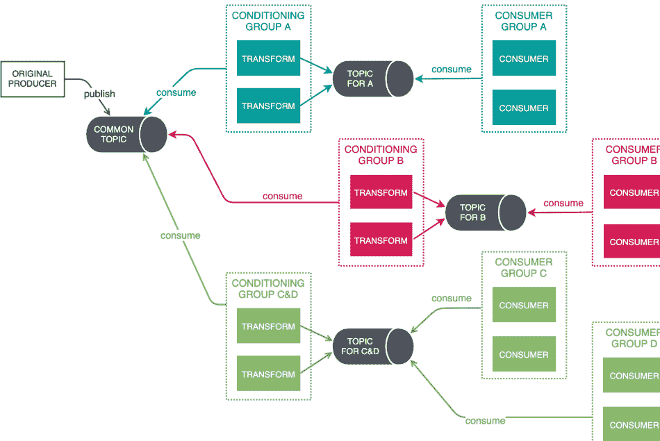

在这种模型下，阻抗不匹配通过中间阶段解决，从而提高了整个解决方案的可维护性，并允许每个终端方严格在各自的领域模型的限制内运行。各方的职责没有改变；消费者拥有调节阶段的所有权，负责其开发和维护。虽然这最初看起来像是一个零和博弈转移，但这种方法的好处在于其模块化。它遵循了单一职责原则，没有让消费者处理转换逻辑，并可以带来更可持续的解决方案。

这种模块化还可能带来复用的机会。如果两个（或多个）不同的消费者组具有相似的需求，一个共同的调节阶段为消费者组 C 和 D 服务。在上面的示例中，同一个调节阶段为消费者组 C 和 D 服务。

### 调节阶段

### 并行性

## 第 6 章：设计考虑

模拟现实世界中的事件顺序是设计流式应用程序良好的起点。考虑到这一点，将足球比赛指定为稳定实体是有意义的——其标识符将作为记录键（record key）来诱导部分序。这意味着进球、角球、点球等将按照它们在比赛中发生的顺序出现；跨比赛的记录将不会因为比赛彼此无关而产生排序。


所选实体稳定性的基本要求是，它们应该在所有因果相关的事件生命周期内持续存在。这并不意味着实体应该是长期的，而意味着它们存在足够的时间，以生存依赖它们的因果链。回到我们之前的示例，足球比赛贯穿了所有的赛中事件。

> 绑定到某些稳定实体的记录键可以被视为数据库术语中的外键，而稳定性特征可以比作引用完整性约束。通过关系型数据库的类比，链接表中的实体只要被一个或多个外键引用，就会一直存在。同样，链接的稳定实体从第一条记录发布到最后一条记录离开生产者这段时间内，都会持续存在。因此，一旦因果顺序在 Kafka 中实例化，该实体就变得基本不再重要了。

假设所选稳定实体之间存在特殊的先驱-后继关系，生成记录的部分序通常对于大多数（如果所有）下游消费者都是足够的。相反，如果实体表现出因果关系，那么生成的流可能无法捕获完整的因果关系。回到我们之前的示例，假设一个下游订阅者是锦标赛排行榜应用程序，需要捕获并展示团队在锦标赛中的相对排名。以比赛为中心的顺序可能是不足的，因为进球需要按照锦标赛顺序进行汇总。

当稳定实体之间存在先驱-下游关系，且该关系对下游订阅者很重要时，通常有两种方法可以采取。第一种是粗化事件排序的粒度，例如，使用锦标赛标识符作为记录键。这保留了锦标赛内比赛事件的时间顺序，并延伸到单场比赛。第二种方法是将事件重排序的责任交给下游订阅者。

当这种顺序是发布者领域的内在特征时，通常倾向于粗化因果链。在我们的示例中，发布者很清楚锦标赛和比赛之间的关系，为什么不将其描述出来呢？

这种方法的主要缺点是减少了消费者并行的机会，粗化会导致分区键（`partitioning key`）基数的减少。订阅者将无法利用 Kafka 的负载均衡能力来并行处理比赛级的子流；锦标赛将受到并行限制。这可能满足某些订阅者，但会损害其他人的。

该模型的扩展是为那些从更细粒度中受益的订阅者引入调节阶段（`conditioning stages`）。调节阶段会消费粗粒度的输入，然后将相同的值通过不同的键重新发布——例如，将键从锦标赛 ID 切换到比赛 ID。这种模型完美契合了生产者驱动领域建模的广泛原则，同时通过 SEDA 满足单个订阅者的需求。

第二种方法——细粒度因果链结合消费者侧重排序——假设消费者（或起作用的某些中间阶段）负责粗化事件子流的粒度，以适应某些处理需求。调节阶段需要是稳定的，维护一个用于传入事件的数据存储，以便它们进行重排序。在实践中，这比看起来要困难得多。在某些情况下，并没有足够的数据供下游订阅者重建原始事件顺序。简而言之，消费者侧重排序并不总是一个可行的方案。

分区事件没有通行不变的方法。根据经验法则，发布者应该在其各自领域内发布在逻辑上合理的最细粒度，以支持多样化的订阅者群体。至关重要的一点：对订阅者感知并不等同于忽略他们的需求。领域的有效建模和相关的事件流落在架构师和高级技术人员肩上；对整体格局的咨询和理解对于构建可持续的解决方案至关重要。

在缺乏消费者感知的情况下，制定部分部分的试金石是确定生成的流可以用于重建源领域。问一个问题：一个假设的订阅者能否仅从发布的事件重建一个完全相同的领域副本，同时保持因果一致性？如果答案是“是”，那么该事件流对于任何下游订阅者都是字节的。否则，如果答案是“否”，那么发布的事件条件就存在需要关注的缺失。

## Topic

在建立了正确的键粒度之后，下一个考虑是主题的“宽度”（`width`）——即时间上涵盖的分区数量。假设键的分布均匀，增加分区数量为消费者生态系统并行处理记录提供了更多机会。确定正确的主宽度对于高性能的事件流架构至关重要。

遗憾的是，Kafka 并没有让我们变得容易。Kafka 允许在增加分区数量时对主题进行非破坏性的重新调整。减少分区数量是一项破坏性操作——需要重新创建主题并手动填充。

重新调整主题的主要代价之一是它们对顺序的影响。正如[第 3 章：架构与核心概念]所述，Kafka 生产者对键进行哈希以得出分区号。哈希方案不是一致的——两个具有相同键但在不同时间点进行哈希的记录，*当且仅当*分区数量随时间没有变化时，才会对应相同的分区号。增加分区数量会导致记录可能占用不同的分区——这显然违反了 Kafka 的键排序保证。Kafka 不会在重新调整时对记录进行重新哈希，因为在没有一致性哈希的情况下，那样将是极其昂贵的（需要明确，一致性哈希将消除重新哈希记录本身，但会在主题拓宽时大幅减少受影响的哈希数量）。

> 当系统的一致性取决于记录的键中心排序时，避免重新调整主题，因为它会破坏消费者生态系统可能依赖的任何保证。

## 第 6 章：设计考虑

降低分区与 broker 数量的比例，可以减轻每个连接的压力。Confluent —— Apache Kafka 的主要贡献者之一 建议每个 broker 的分区数量为 $100 \times b \times r$，其中 $b$ 是 Kafka 集群中的 broker 数量，$r$ 是副本因子。

虽然更宽的主题提供了更高的理论吞吐量，但它确实会对客户端和 broker 的性能产生实际且即时的影响。拓宽单个主题的影响可能并不显著，但累积起来可能会被感知到。这并不是说主题不应该过度配置；相反，关于主题大小的决策以及过度配置的程度不应根据随意做出。broker 的拓扑结构和集群的整体容量起着至关重要的作用；在确定主题大小时，应该对这些进行充分的说明和考虑。

如果处理的是一个消费者并行能力已饱和的现有主题，请考虑分阶段调整大小。创建一个所需大小的新主题，并使用如 *MirrorMaker* 等工具将内容复制到较宽的主题上。当复制完成后，将生产者切换为同时向旧主题和新主题双重发布。可能需要一些停机时间来确保主题的一致。消费者可以根据自己的决定开始迁移到新主题；然而，分区的不匹配可能会给持久化偏移量（`offsets`）带来挑战。由于消费者在设计时考虑了幂等性，应该可以将 `auto.offset.reset` 属性设置为 `earliest`，以强制从头重新处理记录。取决于主题的保留策略，这可能需要一些时间，这也会推延迟消费者产生新记录的能力。或者，可以将偏移量重置为特定时间戳，这将大幅减少重放记录的数量。某些重处理可能是不可避免的；这就是调整强顺序性主题大小的代价。（当所有消费者都完成迁移后，可以删除双重发布的代码。）

## 消费者组的扩展

Kafka 将将分区大致分配给消费者组中的各个成员，最多可达到主题的宽度。为了增加并行性，必须确保组中有足够的消费者实例。为组分配固定数量的实例通常是不经济的，因为这可能导致容量闲，特别是对于表现出循环或突发性负载的事件流。推荐的方法是使用自动水平扩展技术，根据负载需求动态扩展或收缩组的人口。例如，如果在 AWS 等公共云环境中部署消费者组，可以使用自动伸缩，根据 CPU 利用率指标提供额外的实例。或者，如果消费者应用程序是容器化的，建议使用容器编排平台。例如，在 Kubernetes 中部署时，可以使用水平 Pod 自动伸缩（HPA）来动态调整消费者组的大小。

## 内部消费者并行性

增加消费者吞吐量的另一种模式是在不拓宽主题或扩展消费者组的情况下，利用消费者进程内部的并行性。这可以通过对记录键进行独立哈希以维护本地顺序，从而将工作负载分配给线程池来实现。这种策略被归类为垂直扩展，通过增加每个消费者节点的并行性来换减少消费者的数量，从而减少分区的数量。

## 幂等性与精确一次交付

第 3 章：架构与核心概念介绍了交付保证的概念，指出 Kafka 只需简单地移动消费者提交偏移量的点，即可允许两种不同的交付模式。文中提到了“至少一次”（At-least once）和“最多一次”（At-most-once）保证，但没有关于“精确一次”（exactly-once）保证的消息。这可以作为讨论交付模式之间差异的一个良好引子；最终，它将帮助我们理解“恰好一次”完成某事意味着什么。

消息中间件的作用是解耦协作方之间的通信。当发送者发布消息时，假设接收者（或接收者，可能有多个方）最终会消费并处理该消息。消息中间件通常分为两类：提供“最多一次”保证的和提供“至少一次”保证的。而我们有 Kafka，它在两个领域都占有一席。

“最多一次”保证意味着无论发生什么意外情况，消息永远不会交付给接收者。消费者可能读取该记录，但在处理记录之前由于任何原因导致失败。如果该记录的偏移量在记录处理之前提交，那么在消费者失败后对分区的重新分配将导致新消费者跳过该记录。

某些消息系统是真正的“发后即忘”，其意义在于最初可能根本没有尝试过交付消息。例如，某些 broker 支持负载削载（`load shedding`），在这种情况下，消息可能会从队列中清除，以避免积压过期的消息。其他消息系统（如 ZeroMQ）可能是纯内存的，节点的丢失将导致未交付消息的丢失。某些系统使用“可能一次”（maybe-once）作为“最多一次”的代词，这在某些情况下似乎更合适。Kafka 的“最多一次”处理与其某些对应物有显著不同。只要记录已稳定地持久化到主题中并在保留期内，无论如何，Kafka 始终会允许消费者至少读取一次该记录。因此，“最多一次”适用于记录的处理，而非仅仅是读取记录的动作。

“至少一次”保证意味着只有当消息在消费者应用程序中完成整个旅程时，才被标记为已交付。在此之前的失败都会被视为未交付，并会确保重试。

“交付”（delivery）一词可能似乎有些困惑，特别是当你从邮寄的角度来理解交付时。交付不仅仅是将记录留存在消费者的门口，而是看到消费者通过提交记录的偏移量对交付进行“签收”。

在许多情况下，交付的“最多一次”方法是可以接受的，因为记录的偶发丢失不会让系统处于永久的不一致状态。“最多一次”交付适用于记录源在固定间隔内持续向感兴趣的系统发送更新的情况，这样单条记录的丢失可以在有限的时间内恢复。相反，“至少一次”方法更适用于记录的丢失构成不可逆的数据丢失的情况，这违反了系统的某些基本不变性。但其反面是，多次处理记录可能会引入不良的副作用。这就是“精确一次”处理概念登场的地方。事实上，对比“至少一次”和“最多一次”交付语义，一个经常被问到的问题是：我们不能只让它发生一次吗？

在没有涉及假设和不可性证明的学术细节的情况下，足够说明如果没有与消费者应用程序的紧密协作，精确一次语义是不可能的。尽管听起来可能令人失望，但消息平台本身无法提供精确一次保证。这在实践中意味着什么？

为了实现精确一次语义，事件流应用程序中的消费者必须是幂等的。否则，重复处理相同的记录不应对消费者生态系统产生任何影响。如果消费者没有累加效应，则消费者本身就是幂等的。（例如，如果消费者只是用新值覆盖现有的数据库条目，那么更新就是幂等的。）否则，消费者在处理记录之前必须检查该记录是否已经处理过，处理到何种程度。“至少一次”交付与消费者幂等性的结合导致了精确一次语义。

当目标端点是（非 Kafka）消息队列时，下游接收器必须具有幂等性。换句话说，两个（或多个）具有不同偏移量的相同记录不能在后续过程中产生数据重复。这被称为端到端幂等性。正如名称所示，这种保证跨越了整个事件流图，涵盖了所有的节点和边。在实践中，这是通过确保任何两个相邻节点都有一套既定的幂等通信机制来实现的。

本章探讨了设计和构建安全且高效的事件流应用相关的某些基本考虑因素。

我们首先涵盖了协作构建分布式事件驱动应用的各个参与方的角色和职责。核心要点是，发布或消费事件的参与方可以类比为服务提供者和调用者，它们的角色取决于消息拓扑。我们还探讨了生产者和消费者可能在领域模型上产生分歧的情况，以及解决这些问题的方法。

我们探讨了以键为中心的记录并行（`key-centric record parallelism`）—— Kafka 特有的性能增强手段。我们了限制消费者并行处理事件能力的因素，以及影响生产方的设计考量。

最后，我们对比了“最多一次”（at-most-once）和“至少一次”（at-least-once）交付保证，并得出了“精确一次”（exactly-once）交付的设计要求——即“至少一次”交付与消费者幂等性的结合。

## 第 7 章：序列化

到目前为止我们遇到的示例通过序列化基本类型（如字符串）演示了 Kafka 生产者和消费者的基本行为。虽然这足以获得入门水平的认知，但在实践中用处有限，因为现实应用很少发布或消费非结构化字符串。

以消息传递风格或作为事件驱动架构一部分进行通信的分布式应用程序将使用广泛的结构化数据类型和相应的模式合约（`schema contracts`）。嵌入生产者和消费者应用程序的业务逻辑通常处理原生领域模型，并在生产记录时通过桥接机制将这些模型转换（marshal）到 Kafka 主题，在从主题消费时执行相反操作。

本章涵盖了记录序列化这一广泛主题。在讨论过程中，我们还将探索互补的设计模式，以简化应用程序业务逻辑与底层事件流之间的接口交互。

## 键值序列化器 (Key and value serializer)

之前的示例揭示了 Kafka Producer 和 Consumer API，以及 `ProducerRecord` 和 `ConsumerRecord` 类都是泛型的。`Producer` 接口用键和值类型进行参数化，在类型参数列表中表示为 K 和 V：

```java
/**
 * The interface for {@link KafkaProducer}
 * @see KafkaProducer
 * @see MockProducer
 */
public interface Producer<K, V> extends Closeable {
    /** some methods omitted for brevity */

    /**
    * See {@link KafkaProducer#send(ProducerRecord)}
    */
    Future<RecordMetadata> send(ProducerRecord<K, V> record);

    /**
    * See {@link KafkaProducer#send(ProducerRecord, Callback)}
    */
    Future<RecordMetadata> send(ProducerRecord<K, V> record, Callback callback);
}
```

`send()` 方法引用了类型参数，要求提供的 `ProducerRecord` 具有匹配的泛型。

Kafka 内置的类型安全机制假设为支持的键值类型有一对兼容的序列化器。自定义的反序列化器必须符合 `org.apache.kafka.common.serialization.Serializer` 接口，如下所示：

```java
public interface Serializer<T> extends Closeable {
    default void configure(Map<String, ?> configs, boolean isKey) {
        // intentionally left blank
    }

    byte[] serialize(String topic, T data);

    default byte[] serialize(String topic, Headers headers, T data) {
        return serialize(topic, data);
    }

    @Override
    void close() {
        // intentionally left blank
    }
}
```

序列化器可以通过以下方式之一进行配置：

1. 通过 `key.serializer` 和 `value.serializer` 属性将序列化器实现的完全限定类传递给生产者。注意，这些属性没有分配默认值。

2. 直接实例化序列化器并将其作为引用传递给重载的 `KafkaProducer` 构造函数。

基于属性的机制优点是简单，因为它与生产者的其他配置并存。人们可以配置特定的键和值序列化器。这种配置风格的缺点是要求序列化器实现必须包含一个公共的无参构造函数。它还使得配置变得困难。因为序列化器是由生产者客户端通过反射实例化的，应用程序代码无法在初始化点注入其参数集。配置反射实例化序列化器的唯一方法是向生产者提供一组自定义属性，并在序列化器实现中使用可选的 `configure()` 回调获取这些属性的值：

```java
/**
 * Configure this class.
 * @param configs configs in key/value pairs
 * @param isKey whether is for key or value
 */
default void configure(Map<String, ?> configs, boolean isKey) {
  // intentionally left blank
}
```

`configure()` 方法还帮助实例确定它是键序列化器还是值序列化器。

基于属性方法的另一个缺点是它忽略了 Producer 接口施的泛型类型约束。例如，可能为键实例化 `KafkaProducer<Integer, String>`，而为值实例化 `ByteArraySerializer`。这个问题在您发布第一条记录之前不会被发现，此时它会因 `ClassCastException` 失败。

与基于属性的方法相比，将预先实例化的序列化器传递给 `KafkaProducer` 同时解决了维护泛型类型安全和序列化器实例配置的问题。应用程序代码将在调用 KafkaProducer 构造函数之前初始化序列化器并进行适当配置。反过来，构造函数的签名将确保给序列化器类型符合 K 和 V 泛型参数。

客户端库带有几种针对常用数据类型的预序列化器，如下所示：

- `Serializer<T>` - `org.apache.kafka.common.serialization`

- `ByteArraySerializer` - `org.apache.kafka.common.serialization`

- `ByteBufferSerializer` - `org.apache.kafka.common.serialization`

- `BytesSerializer` - `org.apache.kafka.common.serialization`

- `DoubleSerializer` - `org.apache.kafka.common.serialization`

- `FloatSerializer` - `org.apache.kafka.common.serialization`


- `IntegerSerializer` - `org.apache.kafka.common.serialization`
- `KafkaMessageSerializer` - `com.obsidiandynamics.blackstrom.ledger`
- `LongSerializer` - `org.apache.kafka.common.serialization`
- `ShortSerializer` - `org.apache.kafka.common.serialization`
- `StringSerializer` - `org.apache.kafka.common.serialization`
- `UUIDSerializer` - `org.apache.kafka.common.serialization`
- `ExtendedSerializer<T>` - `org.apache.kafka.common.serialization`
- `Wrapper<T>` - `org.apache.kafka.common.serialization`
- `ExtendedSerializer`

## 第 7 章：序列化

我们将列出某些算法，将常见的消息关注点封装在专门的层中。

回到自定义序列化器与附加（piggybacked）方法的问题，前者是地道的方法，因此在整个章节中我们将坚持使用自定义（反）序列化器。

## 发送事件

在接下来的讨论中，请考虑一个假设的事件流场景，涉及一个用于管理客户记录的基础应用程序。

- 后续示例的完整源代码可在 `github.com/ekoutanov/effectivekafka` 的 `src/main/java/effectivekafka/customermevents` 路径获取。为了方便读者阅读，这里也列出了相关的代码列表；某些较为晦涩的列表可能被省略，但它们仍然存在 GitHub 上的 `effectivekafka` 仓库中。

客户实体（customer entity）的任何更改都会向单个 Kafka 主题发布一个相应的事件，并以客户 ID 为键。每个事件都是强类型的，但有多个事件类，且每个类都绑定到一个特定的模式（schema）。这些事件的 POJO 表示可能是 `CreateCustomer`、`UpdateCustomer`、`SuspendCustomer` 和 `ReinstateCustomer`。所有与客户相关的事件的抽象基类是 `CustomerPayload`。该基类包含了通用字段，其简单程度已简化为单个基于 UUID 的唯一标识符。这是事件所指的名客户的 ID（为了简单起见，示例将不包含持久实体——仅包含通知）。

我们假设记录将使用 JSON 进行序列化。使用 Avro，JSON 是 Kafka 上流事件数据最流行的格式之一。书中的示例使用 Jackson 库来处理 JSON，它是 Java 生态系统中事实上的 JSON 解析器。`CustomerPayload` 的子类使用 `@JsonSubTypes` 注解指定，这允许我们使用 Jackson 对多态类型的内置支持。每个序列化的 `CustomerPayload` 实例将包含一个 `type` 属性，指定具体类型的别名，例如，`CreateCustomer` 类对应 `CREATE_CUSTOMER`。Jackson 在反序列化期间以此作为提示，选择正确的 `CustomerPayload` 子类将 JSON 文档映射到其。

`https://github.com/ekoutanov/effectivekafka/tree/master/src/main/java/effectivekafka/customermevents`

## 第 7 章：序列化

```java
import java.util.*;
```

```java
import com.fasterxml.jackson.annotation.JsonProperty;
```

```java
@JsonTypeInfo(use=JsonTypeInfo.As.EXISTING_PROPERTY,
    include=JsonTypeInfo.As.EXISTING_PROPERTY,
    property="type")
@JsonSubTypes(
    @JsonSubTypes.Type(value=CreateCustomer.class,name=CreateCustomer.TYPE),
    @JsonSubTypes.Type(value=UpdateCustomer.class,name=UpdateCustomer.TYPE),
    @JsonSubTypes.Type(value=SuspendCustomer.class,name=SuspendCustomer.TYPE),
    @JsonSubTypes.Type(value=ReinstateCustomer.class,name=ReinstateCustomer.TYPE)
)
```

```java
public abstract class CustomerPayload {
    @JsonProperty
    private final UUID id;

    CustomerPayload(UUID id) {
        this.id = id;
    }

    public abstract String getType();

    public final UUID getId() {
        return id;
    }

    protected final String baseString() {
        return "id=" + id;
    }
}
```

> 暴露稳定的别名而不是完全限定的 Java 类名可以使我们的模式具有移植性，使我们能够与非 Java 客户端进行互操作。这也符合事件驱动架构的核心原则——生产者对下游消费者的感知最少，并且不对它们的角色、原因或实现不做任何假设。

对于一个典型具体事件的采样，我们有 `CreateCustomer` 类。还有其他，但它们在概念上是相似的。

```java
public final class CreateCustomer extends CustomerPayload {
    static final String TYPE = "CREATE_CUSTOMER";

    @JsonProperty
    private final String firstName;

    @JsonProperty
    private final String lastName;

    public CreateCustomer(@JsonProperty("id") UUID id,
        @JsonProperty("firstName") String firstName,
        @JsonProperty("lastName") String lastName) {
        this.firstName = firstName;
        this.lastName = lastName;
    }

    @Override
    public String getType() {
        return TYPE;
    }

    public String getFirstName() {
        return firstName;
    }

    public String getLastName() {
        return lastName;
    }

    @Override
    public String toString() {
        return CreateCustomer.class.getSimpleName() + " ["
            + baseString() + ", firstName=" + firstName
            + ", lastName=" + lastName + "]";
    }
}
```

理想情况下，我们希望将高层事件注入业务逻辑中，然后让我们的业务逻辑在需要产生事件时调用发送者，而不必关心事件如何被序列化或发布到 Kafka。这是接口的完美用例：

```java
import java.io.*;
import java.util.concurrent.*;

import org.apache.kafka.clients.producer.*;

public interface EventSender extends Closeable {
    Future<RecordMetadata> send(CustomerPayload payload);
}

final class SendException extends Exception {
    private static final long serialVersionID = 1L;

    SendException(Throwable cause) { super(cause); }
}

public RecordMetadata blockingSend(CustomerPayload payload)
    throws SendException, InterruptedException {
    try {
        return send(payload).get();
    } catch (ExecutionException e) {
        throw new SendException(e.getCause());
    }
}

@Override
public void close() {};
```

应用程序可能想要异步发送记录——在不等待结果的情况下继续，或者同步发送——阻塞直到记录已发布。我们为异步操作指定了 `Future<RecordMetadata> send(CustomerPayload payload)` 方法签名——由具体的 `EventSender` 子类实现。同步情况由 `blockingSend()` 方法处理，它简单地委托给 `send()`，并在返回的 `Future` 结果上进行阻塞。发送者的实现可以根据需要重写此方法以更合适的方法。（希望默认实现已经足够好）。

接下来，我们将查看 `EventSender` 的示例用法——`ProducerBusinessLogic` 类。

```java
public final class ProducerBusinessLogic {
    private final EventSender sender;

    public ProducerBusinessLogic(EventSender sender) {
        this.sender = sender;
    }

    public void generateRandomEvents() throws SendException, InterruptedException {
        final var create = new CreateCustomer(UUID.randomUUID(), "Bob", "Brown");
        sender.blockingSend(create);

        if (Math.random() > 0.5) {
            final var update = new UpdateCustomer(create.getId(), "Charlie", "Brown");
            sender.blockingSend(update);
        }

        if (Math.random() > 0.5) {
            final var suspend = new SuspendCustomer(create.getId());
            sender.blockingSend(suspend);
        }

        if (Math.random() > 0.5) {
            final var reinstate = new ReinstateCustomer(create.getId());
            sender.blockingSend(reinstate);
        }
    }

    private void blockingSend(CustomerPayload payload) throws SendException, InterruptedException {
        System.out.format("Publishing %s", payload);
        sender.blockingSend(payload);
    }
}
```

我们实际上不会为示例实现任何真实的业务逻辑；其目的是模拟活动并测试我们未来的 `EventSender` 实现。

## 完整的发送者

使用接口只能让我们走到这一步；我们需要 `EventSender` 的具体实现来使示例运行。这里是完成工作的简单实现：

```java
import java.util.*;
import java.util.concurrent.*;

import org.apache.kafka.clients.producer.*;
import org.apache.kafka.common.serialization.*;

public final class DirectSender implements EventSender {
    private final KafkaProducer<String, CustomerPayload> producer;

    private final String topic;

    public DirectSender(Map<String, Object> producerConfig,
        String topic) {
        this.topic = topic;
        final var mergedConfig = new HashMap<String, Object>();
        mergedConfig.put(ProducerConfig.KEY_SERIALIZER_CLASS_CONFIG,
            StringSerializer.class.getName());
        mergedConfig.put(ProducerConfig.VALUE_SERIALIZER_CLASS_CONFIG,
            CustomerPayloadSerializer.class.getName());
        mergedConfig.putAll(producerConfig);
        producer = new KafkaProducer<>(mergedConfig);
    }

    @Override
    public Future<RecordMetadata> send(CustomerPayload payload) {
        final var record = 
            new ProducerRecord<>(topic,
                payload.getId().toString(),
                payload);
        return producer.send(record);
    }

    @Override
    public void close() {
        producer.close();
    }
}
```

## 第 7 章：序列化

这其实并没有什么复杂的。`DirectSender` 封装了一个 `KafkaProducer`，该生产者使用提供的属性映射（map）进行配置。构造函数将覆盖用户指定的配置映射中的某些关键属性——这些属性是发送器正确运行所所需的，且不会受外部代码干扰。`DirectSender` 还需要主题（topic）名称。

`send()` 方法创建一个新的 `ProducerRecord` 并将其放入队列等待发送，委托给底层的 `Producer` 实例处理。在此之前，`send()` 方法还会为新记录分配键（key），正如之前约定的，这是由生产者应用程序负责的。通过将键设置为客户 ID，我们确保了记录按客户进行严格排序。

分层的优势变得显而易见。如果没有 `EventSender` 实现类来引导记录的构建和发送，那么执行不变性（invariants）的责任将落在业务逻辑中。这会防止执行在记录作用域内的严格不变性，例如“记录的键必须等于所包含的客户事件的 ID”，这种做法很容易出错，尤其是当你考虑到会有多个地方需要执行此操作时。通过对我们的生产者应用进行分层，我们可以在栈的更深处强制执行这种行为，从而尽可能地减少代码重复并避免一些潜在的错误。

要尝试此示例，首先启动 `RunRandomEventProducer` 类。正如名称所示，它将使用之前定义的 `ProducerBusinessLogic` 发布随机的客户事件。


```java
public class RunRandomEventProducer {
    public static void main(String[] args)
    throws InterruptedException, SendException {
        final Map<String, Object> config = 
            Map.of(ProducerConfig.BOOTSTRAP_SERVERS_CONFIG,
                "localhost:9092",
                ProducerConfig.CLIENT_ID_CONFIG,
                "customer-producer-sample");

        try (var sender = new DirectSender(config, topic)) {
            final var businessLogic = new ProducerBusinessLogic(sender);
            while (true) {
                businessLogic.generateRandomEvents();
                Thread.sleep(500);
            }
        }
    }
}
```

假设一切顺利，你应该能看到标准输出上打印了一些日志：

```
101
```

...

为了简起已省略

...

```
Publishing {"id":"28361a15-7cef-47f3-9819-f8a62491c5a", "firstName":"Bob","lastName":"Brown","type":"CREATE_CUSTOMER"}
Publishing {"id":"28361a15-7cef-47f3-9819-f8a62491c5a", "type":"SUSPEND_CUSTOMER"}
Publishing {"id":"28361a15-7cef-47f3-9819-f8a62491c5a", "type":"RESTATE_CUSTOMER"}
Publishing {"id":"b3c0d538-90cc-4f5f-a5dc-bc1c46fc0cbbf8", "firstName":"Bob","lastName":"Brown","type":"CREATE_CUSTOMER"}
Publishing {"id":"b3c0d538-90cc-4f5f-a5dc-bc1c46fc0cbbf8", "firstName":"Charlie","lastName":"Brown","type":"UPDATE_CUSTOMER"}
Publishing {"id":"88b314e7-9139-4699-a8b3-8b3a90ae26e2", "firstName":"Bob","lastName":"Brown","type":"CREATE_CUSTOMER"}
Publishing {"id":"88b314e7-9139-4699-a8b3-8b3a90ae26e2", "firstName":"Charlie","lastName":"Brown","type":"UPDATE_CUSTOMER"}
Publishing {"id":"88b314e7-9139-4699-a8b3-8b3a90ae26e2", "type":"SUSPEND_CUSTOMER"}
Publishing {"id":"88b314e7-9139-4699-a8b3-8b3a90ae26e2", "type":"RESTATE_CUSTOMER"}
Publishing {"id":"f0e2fe96-a410-44a5-b636-dced53cff4590", "firstName":"Bob","lastName":"Brown","type":"CREATE_CUSTOMER"}
Publishing {"id":"f0e2fe96-a410-44a5-b636-dced53cff4590", "firstName":"Charlie","lastName":"Brown","type":"UPDATE_CUSTOMER"}
```

当发布了足够的事件后，停止生产者。切换到 Kafdrop；你应该能看到 `customer.test` 主中出现一系列 JSON 记录：

```
102
```

## 主题消息：customer.test

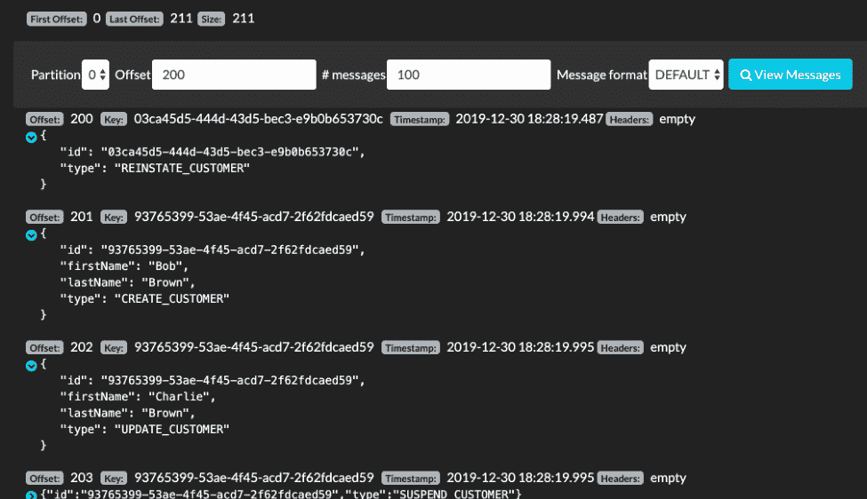

Kafdrop – 随机客户事件

## 键和值反序列化

与生产者 API 中常见的泛型类型约束类似，`Consumer` 接口对 `poll()` 方法返回的 `ConsumerRecords` 类实施了等效约束，该类包含系列单个 `ConsumerRecord` 对象的集合：

> /**
>  * @see KafkaConsumer
>  * @see MockConsumer
>  */

```java
public interface Consumer<K
```

```java
/**
 * 包含特定主题的 {@link ConsumerRecord} 列表的容器。
 * 每个主题分区对应由 {@link poll(Duration)} 操作返回的 {@link ConsumerRecord} 列表。
 */
```

```java
public class ConsumerRecords<K, V>
    implements Iterable<ConsumerRecord<K, V>>
    /** 字段和方法省略 */
}
```

与生产者的情况类似，消费者必须配置相应的反序列化器。反序列化器必须符合 `org.apache.kafka.common.serialization.Deserializer` 接口，如下所示：

```java
public interface Deserializer<T> extends Closeable {
    default void configure(Map<String, ?> configs, boolean isKey) {
        // 意图留
    }

    T deserialize(String topic, byte[] data);

    default T deserialize(String topic, Headers headers, byte[] data) {
        return deserialize(topic, data);
    }

    @Override
    default void close() {
        // 意图留
    }
}
```

消费者客户端允许用户通过两种方式之一指定键和值反序列化器：

1. 将 `Deserializer` 的全限定类名传递给 `key.deserializer` 或 `value.deserializer` 属性。

2. 实例化反序列化器并将其引用传递给重载的 `KafkaConsumer` 构造函数。

## 第 7 章：序列化

```java
public final class ConsumerBusinessLogic {
    private final EventReceiver receiver;

    public ConsumerBusinessLogic(EventReceiver receiver) {
        this.receiver = receiver;
        receiver.addListener(this::onEvent);
    }

    private void onEvent(CustomerPayload payload) {
        System.out.format("Received %s%n", payload);
    }
}
```

再次强调，在业务逻辑内部这并不太重要。这些示例的目的是说明业务逻辑层是如何与 Kafka 交互的。

`EventReceiver` 和 `EventListener` 的代码列表如下：

```java
public interface EventReceiver extends Closeable {
    void addListener(EventListener listener);

    void start();
}
```

```java
@Override
void close();

@FunctionalInterface
public interface EventListener {
    void onEvent(CustomerPayload payload);
}
```

这种方法将 `ConsumerBusinessLogic` 类与消费者代码完全解耦，它只感知 `EventReceiver`，而 `EventReceiver` 本身仅仅是一个接口。所有与 Kafka 的通信将通过适当的 `EventReceiver` 实现进行代理。

## 损坏记录

生产者的优势在于，它知道应用程序代码提供给它的记录是有效的，至少从应用程序的角度来看是这样。从事件流中读取的消费者并没有这种待遇。一个异常或有缺陷的生产者可能向主题发布垃圾数据，这些数据将直接被传递给所有下游消费者。

理想情况下，我们应该优雅地处理任何潜在的反序列化问题。由于反序列化是在我们的控制范围内的，对于错误处理行为有几种选择：

- 仅记录错误并丢弃记录；

- 通过（修改后的）回调将错误以及格式不规范的记录传递给应用程序；或

- 将格式不规范的记录发布到专门的“死信队列”主题，以便后续进行检查。

假设决定是将错误传递给应用程序，修改后的代码可能如下：

```java
public final class ConsumerBusinessLogic {
    public ConsumerBusinessLogic(EventReceiver receiver) {
        receiver.addListener(this::onEvent);
    }

    private void onError(ReceiveEvent event) {
        if (!event.isError()) {
            System.out.format("Received %s", event.getPayload());
        } else {
            System.err.format("Error in record %s: %s",
                event.getRecord(), event.getError());
        }
    }
}
```

```java
@FunctionalInterface
public interface EventListener {
    void onEvent(ReceiveEvent event);
}
```

新的 `ReceiveEvent` 类封装了 `CustomerPayload` 对象（如果反反序列化成功）或 `Throwable` 错误（如果在反序列化过程中发生异常）。在在这两种情况下，原始的 `ConsumerRecord` 也被包含在内引用，以及原始的编码值。以下是 `ReceiveEvent` 的源码。

```java
public final class ReceiveEvent {
    private final CustomerPayload payload;

    private final Throwable error;

    private final ConsumerRecord<String, ?> record;

    private final String encodedValue;

    public ReceiveEvent(CustomerPayload payload, Throwable error, ConsumerRecord<String, ?> record, String encodedValue) {
        this.record = record;
        this.payload = payload;
        this.error = error;
        this.encodedValue = encodedValue;
    }

    public CustomerPayload getPayload() {
        return payload;
    }

    public boolean isError() {
        return error != null;
    }

    public Throwable getError() {
        return error;
    }

    public ConsumerRecord<String, ?> getRecord() {
        return record;
    }

    public String getEncodedValue() {
        return encodedValue;
    }

    @Override
    public String toString() {
        return ReceiveEvent.class.getSimpleName() + " [payload=" + payload + ", error=" + error + ", record=" + record + ", encodedValue=" + encodedValue + "]";
    }
}
```

## 完整的接收器

现在考虑实现，我们需要一个具体的 `EventReceiver`。下面的列表是 `DirectReceiver`，它是轮询-处理循环的实现。

> 使用“直接（direct）”一词是为了与生产者示例保持一致。在两种情况下，这些实现都直接使用了底层的 Kafka API，并没有偏离标准行为或获取任何额外的特性等等。

```java
import java.time.*;
import java.util.*;

import org.apache.kafka.clients.consumer.*;
import org.apache.kafka.common.errors.*;
import org.apache.kafka.common.serialization.*;

import com.obsidianynamics.worker.*;
```


```java
public final class DirectReceiver extends AbstractReceiver {
    private final WorkerThread threading;

    private final Consumer<String, CustomerPayloadError> consumer;

    private final Duration pollTimeout;

    public DirectReceiver(Map<String, Object> consumerConfig,
        String topic,
        Duration pollTimeout) {
        this.pollTimeout = pollTimeout;
        Map<String, Object> mergedConfig = new HashMap<String, Object>();
        mergedConfig.put(ConsumerConfig.KEY_DESERIALIZER_CLASS_CONFIG,
            StringDeserializer.class.getName());
        mergedConfig.put(ConsumerConfig.VALUE_DESERIALIZER_CLASS_CONFIG,
            CustomerPayloadDeserializer.class.getName());
        mergedConfig.put(ConsumerConfig.ENABLE_AUTO_COMMIT_CONFIG,
            false);
        consumer = new KafkaConsumer<>(mergedConfig);
        consumer.subscribe(Collections.singletonList(topic));
    }

    @Override
    public void start() {
        threading = new WorkerThread(this::onCycle, "DirectReceiver");
        threading.start();
    }

    private void onCycle() {
        try {
            ConsumerRecords<String, CustomerPayloadError> records = consumer.poll(pollTimeout);
            if (!records.isEmpty()) {
                for (ConsumerRecord<String, CustomerPayloadError> record : records) {
                    ReceiveEvent event = new ReceiveEvent(record.value(), null, record, record.value());
                    fire(event);
                }
                consumer.commitAsync();
            }
        } catch (InterruptedException e) {
            throw new InterruptedException("Interrupted during poll");
        }
    }

    private void fire(ReceiveEvent event) {
        // Implementation for brevity
    }

    @Override
    public void close() {
        threading.terminate();
        threading.join();
        consumer.close();
    }
}
```

# 第7章：序列化

它不支持检查异常（checked exceptions），并强烈反对使用它。因此，这种仅使用未检查异常的哲学被带到了 Java 版本中，这违背了 Java 的惯用写法。

```java
try {
  records = consumer.poll(pollTimeout);
} catch (InterruptedException e) {
  throw new InterruptedException("Interrupted poll");
}
```

标准的 Java 线程中断信号在 `KafkaConsumerThread` 内部被粗暴地丢弃，取而代之的是一个自定义的运行时异常。代码包含了捕获、处理自定义异常并重新抛出标准异常。当这种情况发生时，Fulcrum `WorkerThread` 会检测到中断并优雅地关闭底层线程。

要运行该示例，请启动 `RunDirectConsumer` 类：

```java
public final class RunDirectConsumer {
  public static void main(String[] args) throws InterruptedException {
    final Map<String, Object> consumerConfig = 
      Map.of(ConsumerConfig.BOOTSTRAP_SERVERS_CONFIG,
        "localhost:9092",
        ConsumerConfig.GROUP_ID_CONFIG,
        "customer-direct-consumer",
        ConsumerConfig.AUTO_OFFSET_RESET_CONFIG,
        "earliest");

    try (var receiver = new DirectReceiver(consumerConfig,
        "customer.test",
        Duration.ofMillis(100))) {
      new ConsumerBusinessLogic(receiver);
      receiver.start();
      Thread.sleep(10000);
    }
  }
}
```

这将运行十秒钟，输出自消费者上次运行以来发布的所有记录。由于我们是第一次运行，预计将看到 `customer.test` 主题中的所有记录：

# 第7章：序列化

为了简洁起见，此处省略

```
Received CreateCustomer [id=2836a15-7cef-47f3-9819-f8a62491c5a, ]
  firstName=Bob, lastName=Brown
Received SuspCustomer [id=2836a15-7cef-47f3-9819-f8a62491c5a,]
Received ReinstateCustomer [id=2836a15-7cef-47f3-9819-f8a62491c5a,]
Received CreateCustomer [id=b3d5c3d6-90cc-45f5-a5dc-b1c69cf0bf8, ]
  firstName=Bob, lastName=Brown
Received UpdateCustomer [id=b3d5c3d6-90cc-45f5-a5dc-b1c69cf0bf8, ]
  firstName=Charlie, lastName=Brown
Received CreateCustomer [id=b3b8i4e7-9139-4699-a843-8b3a90ae26e2, ]
  firstName=Bob, lastName=Brown
Received UpdateCustomer [id=b3b8i4e7-9139-4699-a843-8b3a90ae26e2, ]
  firstName=Charlie, lastName=Brown
Received SuspCustomer [id=b3b8i4e7-9139-4699-a843-8b3a90ae26e2, ]
Received ReinstateCustomer [id=b3b8i4e7-9139-4699-a843-8b3a90ae26e2, ]
Received CreateCustomer [id=fe02fe96-a410-44a5-b636-dced53cf4590, ]
  firstName=Bob, lastName=Brown
Received UpdateCustomer [id=fe02fe96-a410-44a5-b636-dced53cf4590, ]
  firstName=Charlie, lastName=Brown
```

## 流水线（Pipelining）

从性能优化角度来看，消费者应用的一个重要论据是被称为“流水线”的技巧。

流水线是将顺序过程分解为一系列链联的阶段，其中一个阶段的输出通过中间缓冲区作为下一个阶段的输入。每个阶段都半独立于其邻接阶段；只要输入缓冲区可用就可以运行，并在输出缓冲区满时保持阻塞。

流水线允许应用程序招募额外的线程——以处理器利用率为代价增加吞吐量。为了理解性能收益，请考虑普通消费者的常规操作——如下所示。


`KafkaConsumer` 的实现内部使用了原始的流水线形式，通过预取和缓冲来加速交付。换句话说，我们的应用程序已经是多线程的，将记录获取和处理操作分离到不同的上下文中。主线程将：

1. 调用 `KafkaConsumer.poll()`，可能会向集群发送查询。如果有尚未收到响应的等待查询，则不再发布后续查询。

2. 等待获取的结果，检查缓冲区的状态。结果的的将由后台 IO 线程执行。此操作将阻塞直到数据可用或超时。

3. 如果生产者设置了压缩，则解压缩批次。

4. 反序列化批次中的每个记录。

5. 在返回 `poll()` 之前启动预取。此操作是非阻塞的，并立即返回。控制权交回应用程序。当结果最终到达时，它们将被解压缩并反序列化，然后放入获取缓冲区。

6. 通过调用注册的 `EventListener` 回调对每个记录应用所需的业务逻辑。在大多数应用程序中，这将涉及更新数据库和其他可能的 IO。处理记录的成本远大于从 Kafka Topic 读取记录的成本。

7. 应用程序完成批次处理后，通过调用 `commitAsync()` 安全地消费偏移量。这将提交 `poll()` 期间返回的所有记录的偏移量。由于是异步操作，偏移量的提交将在后台 IO 线程发生。

循环的最后一步是可选的，我们可以通过保持 `enable.auto.commit` 为默认值来延迟消费者的“自动提交”。在 `DirectReceiver` 示例中，我们选择了禁用自动提交，改用手动选项。手动提交偏移量的主要优势是，即使是异步执行，与自动选项相比，它的未提交偏移量窗口更窄，减少了发送到浏览器的提交请求，这对吞吐量有积极影响。

IO 线程在后台工作。其核心职责之一是处理查询的响应并将接收到的批次积累在获取缓冲区中。在后台预取机制的帮助下，假设通过流水线稳定流动，大多数 `poll()` 的调用应该是阻塞的。

虽然 `KafkaConsumer` 通过预取机制允许流水线化，但实现是在单个执行线程上处理记录的反序列化及其后续处理。负责反序列化记录的线程也用于执行业务逻辑。这两个操作都可能是耗时的；当正在反序列化记录时，轮线程无法执行 `EventListener` 回调，反之亦然。

虽然我们可以控制客户端标准行为的这一元素，但我们可以更好地利用流水线模式，通过将记录反序列化与负载处理分离获得额外的性能收益。

下图说明了这一点。

# 第7章：序列化

# 115


## 带线的消费者

记录的获取、反序列化和处理现在被分为三个阶段，每个阶段由一个专用线程驱动。为了简单起见，我们将这些称为 *IO线程*、*轮线程*和*处理线程*。IO线程*是 *KafkaConsumer* 原生的，其行为与之前的示例相同。

轮线程在两个关键方面发生了变化：

1. 不在第 6 步中调用 `EventListener`，线程将将接收到的记录追加到边界缓冲区。在 Java 应用程序中，可以使用 `ArrayBlockingQueue` 或 `LinkedBlockingQueue` 来实现此缓冲区。如果队列达到最大容量，此操作将阻塞。

2. 轮线程不再提交批次处理的偏移量，只需提交那些由处理线程添加到“等待偏移量队列”中的偏移量。

在处理线程上，我们有以下步骤：

1. 从边界缓冲区中移除队列中的记录。如果队列为空，此操作将阻塞。

2. 调用注册的 `EventListener` 回调来处理记录。

3. 处理记录后，向“等待偏移量队列”中添加相应的条目。该条目指定了记录所属的主题-分区对，以及其偏移量*加一*。

## 第7章：序列化

每个线程的最后步骤初看起来可能令人困惑。我们难道不能在队列批次后直接提交偏移量（offsets）吗？将偏移量从处理线程传回轮询线程的目的是什么？我们为什么要对已处理记录的偏移量加 1？

在对记录进行流水线处理时，提交记录偏移量需要特别小心，因为记录在进入队列后可能一段时间内不会被禁用。根据有界缓冲区容量，在处理线程有机会处理第一个请求记录之前，轮询循环可能会完成多个周期。消费者应用程序的失败会导致记录丢失；新分配的消费者自然会假设已提交的记录已经处理完毕。为了实现至少一次（least-once）交付语义，记录的偏移量必须在记录处理后的某个时间点提交。

> 在直接消费者场景中，禁用 `enable.auto.commit` 是可选的，但在流水线场景中，必须果决禁用。开启偏移量自动提交的影响在逻辑上等同于入队后提交记录，而不考虑它们是否已由下游阶段处理。

将偏移量传回 I/O 线程的需求解决了 `KafkaConsumer` 实现的一个固有局限性。即：消费者不是线程安全的。尝试从与调用 `poll()` 不同的线程调用 `commitAsync()` 将导致 `java.util.ConcurrentModificationException`。因此，我们别无选择将偏移量交给轮询线程。

最后一点——对记录的偏移量加 1——考虑到了这样一个事实：Kafka 消费者将从其所属消费者组持久化的偏移量处开始处理记录。天真地“按原样”提交记录偏移量将导致在主题重平衡事件后重放最后一条记录，在该事件中，分区可能会在消费者群体之间重新分配。通过将偏移量加 1，我们确保新的分配者将跳过最后一次处理的记录——无缝地从上一个消费者停止的地方接管。

> 调用无参数的 `commitAsync()` 方法（如 `DirectReceiver` 场景所示）会自动为每个分区处理的最后记录的偏移量加 1。当显式指定偏移量时，偏移量算术将成为应用程序的责任。

在下一个技巧中，我们将变幻出一个另一种接收器实现，这次将在消费者之外利用流水线模式：

## 第7章：序列化

```java
import java.time.*;
import java.util.*;
import java.util.concurrent.*;
import org.apache.kafka.clients.consumer.*;
import org.apache.kafka.common.*;
import org.apache.kafka.common.errors.*;
import org.apache.kafka.common.serialization.*;
```

```java
import com.obsidianyynamics.worker.*;
import com.obsidianyynamics.worker.Terminator;
```

```java
public final class PipelinedReceiver extends AbstractReceiver (
    private final WorkerThread processingThread;

    private final Consumer<String, CustomerPayloadOrError> consumer;

    private final Duration pollTimeout;

    private final BlockingQueue<ReceiveEvent> receivedEvents;

    private final Queue<Map<Topic, OffsetAndMetadata>>
        pendingOffsets = new LinkedBlockingQueue<String>>();
```


```java
public PipelinedReceiver(Map<String, Object> consumerConfig,
    String topic,
    Duration pollTimeout,
    int queueCapacity) {
    receivedEvents = new LinkedBlockingQueue<String>(queueCapacity);
    final mergedConfig = new HashMap<String, Object>();
    mergedConfig.put(ConsumerConfig.KEY_DESERIALIZER_CLASS_CONFIG,
        StringDeserializer.class.getName());
    mergedConfig.put(ConsumerConfig.VALUE_DESERIALIZER_CLASS_CONFIG,
        CustomerPayloadDeserializer.class.getName());
    mergedConfig.put(ConsumerConfig.ENABLE_AUTO_COMMIT_CONFIG,
        false);
    mergedConfig.putAll(consumerConfig);
    consumer = new KafkaConsumer<>(mergedConfig);
    consumer.subscribe(Set.of(topic));
```

## 第 7 章：序列化

```java
pollingThread = WorkerThread.builder()
    .withOptions(new WorkerOptions())
    .daemon()
    .withName(PipelinedReceiver.class, "poller")
    .onCycle(this::onPollCycle)
    .build();
```

```java
processingThread = WorkerThread.builder()
    .withOptions(new WorkerOptions())
    .daemon()
    .withName(PipelinedReceiver.class, "processor")
    .onCycle(this::onProcessCycle)
    .build();
```

```java
@Override
public void start() {
    pollingThread.start();
    processingThread.start();
}
```

```java
private void onPollCycle(WorkerThread t)
    throws InterruptedException {
    final ConsumerRecords<String, CustomerPayloadOrError> records;

try {
    records = consumer.poll(pollTimeout);
} catch (InterruptedException e) {
    throw new InterruptedException("Interrupted during poll");
}
```

```java
if (!records.isEmpty()) {
    for (var record : records) {
        final value = record.value();
        final event = new ReceiveEvent(value.getPayload(),
            value.getError(),
            record,
            value.getEncodedValue());
        receivedEvents.put(event);
    }
}
```

## 第 7 章：序列化

119

```java
for (Map<TopicPartition, OffsetMetadata> pendingOffset;
  (pendingOffset = pendingOffsets.poll()) != null) {
    consumer.commitAsync(pendingOffset);
}
```

```java
private void onProcessCycle(WorkerThread t)
    throws InterruptedException {
  final var event = receivedEvents.take();
  fire(event);
  final var record = event.getRecord();
  pendingOffsets.add(Map.of(record.topic(),
    new OffsetMetadata(record.offset() + 1)));
}
```

```java
@Override
public void close() {
    pollingThread.terminate();
    processingThread.join();
    consumer.close();
}
```

`PipelinedReceiver` 和 `DirectReceiver` 之间明显的区别在于：

- 1. 增加了线程——我们现在有了 `processingThread` 和 `pollingThread`，而原始实现是单线程。

- 2. 增加了 `LinkedBlockingQueue` 作为两个线程之间的缓冲区。

- 3. 构造函数增加了一个参数，表示队列的容量。

`onPollCycle()` 方法获取记录，但不分发事件。相反，它将事件放入 `receivedEvents` 队列，如果需要则阻塞直到空间可用。处理完批次后，它会收集任何所需的偏移量。

## 第 7 章：序列化

使用非阻塞 `Queue.poll()` 方法可以防止死锁，即轮询线程阻塞等待处理线程提交额外的偏移量，而处理线程又无奈地等待轮询线程将记录带入流水线。

`onProcessCycle()` 方法从 `receivedEvents` 队列头部获取记录，如果需要则等待事件可用。随后事件分发给所有已注册的监听器。最后，底层记录的偏移量增加并提交到 `pendingOffsets` 队列供轮询线程后续提交。

要运行流水线示例，请参考 `RunPipelinedConsumer` 类：

```java
public final class RunPipelinedConsumer {
public static void main(String[] args) {
    throws InterruptedException {
    final Map<String, Object> consumerConfig =
    Map.of(ConsumerConfig.BOOTSTRAP_SERVERS_CONFIG,
    "localhost:9092",
    ConsumerConfig.GROUP_ID_CONFIG,
    "customer-pipeline",
    ConsumerConfig.AUTO_OFFSET_RESET_CONFIG,
    "earliest");

try (var receiver =
    new PipelinedReceiver(consumerConfig,
    "customer.test",
    Duration.ofMillis(100), 10)) {
    ConsumerBusinessLogic(receiver);
    receiver.start();
    Thread.sleep(1000);
}
}
}
```

通过应用流水线模式，我们解耦了两个潜在的耗时操作，允许它们独立运行。性能提升并非多核或多处理器架构所特有；即使是单核伪并发系统也能从流水线中受益，因为它最大化了处理器可以做的有用工作量。

流水线的一个感知缺点是它为过程增加了延迟；对共享缓冲区的竞争以及线程调度和缓存一致性的开销会增加记录流过流水线的端到端传播延迟。虽然增加的延迟通常会通过吞吐量的提升来抵消，但这实际上取决于应用程序设计者如何

## 第 7 章：序列化

对优化策略做出最终决定。有人认为，由于基于 Kafka 的应用程序需要以吞吐量为导向，这种优化是及时且恰当的。

> Kafka 的性能准则传统上是增加更多的消费者、更多的分区和更多的代理。通常，人们很少考虑这种模型的成本效益。在自动扩缩容组中，观察到大量处于空闲状态的消费者来处理一个负载中等的主题，这种现象并不罕见。人们不禁质疑，如果每个实例都充分利用其资源来提供容量，究竟需要多少个消费者实例。

最棒的部分在于，之前的示例利用了 `EventReceiver` 接口将业务逻辑与底层的 Kafka 消费者处理解耦。正如我们刚刚演示的，流水线（pipelining）可以完全整合到 `EventReceiver` 的实现中，而对业务逻辑层产生任何影响。多线程代码的复杂性、记录队列以及偏移排序都隐藏在 `EventReceiver` 接口之后。事实上，我们看到了多种 `EventReceiver` 实现——一个传统的 `DirectReceiver` 和一个多线程的 `PipelinedReceiver`。它们在功能上是等价的，但表现出不同的性能和资源利用特征。`PipelinedReceiver` 在 `DirectReceiver` 实现的基础上增加了约 30 行代码。相比之下，这似乎很多，因为额外代码大约占原始实现的 50%。但从宏观角度来看，这种增加的复杂性只产生一次——资源利用率的提高和带来的性能收益远比所付出的努力价值。

> 在这种情况下，读者可能会想，流水线优化在生产者应用程序中效果较差，因为与反序列化相比，序列化通常对处理器和内存的需求较少。此外，`KafkaProducer` 内部已经是流水线化的，将序列化与网络 I/O 分离开。将记录序列化移动到专用线程对性能的微乎其微。

## 记录过滤

在本章结束之际，我们将强调过滤记录的另一个强有力的理由。过滤满足了一类用例，即反序列化器或应用级解包器可能需要向应用程序的其他部分呈现记录。这不是 Kafka 消费者的原生能力，需要定制的实现。

人们可能会提出的自然问题是：为什么不在向应用栈向上移动的业务逻辑层进行过滤呢？首先，这假设客户端拥有必要的领域对象，并且这些对象可以从记录的序列化形式映射出来。其次，它会产生无条件解包所有记录的性能开销，而稍后又丢弃了某些记录。

第一个问题——缺少领域对象或缺乏对某些记录模式的了解（两者在逻辑上是等价的）——可以归于以下几个原因：

- Kafka 主题是粗粒度的，包含了消费者在常规操作中需要的更多类型的记录。

- 消费者可能知道记录类型，但它可能对处理它们不感兴趣。例如，一个主题可能代表一个全局数据库，而部署在单个区域的消费者可能只关心其本地的客户子集。

- 记录结构随着时间推演变，导致主题可能包含属于不同模式版本的记录。为了适应消费者逐渐过渡到新模式，生产者通常会发布多个版本的记录。

无论如何，消费者将根据某些显式指示器选择性地解析记录的值。该指示器可以是已知的头部——例如 `recordType: CREATE_CUSTOMER`, `region: Asia-Pacific`, `version: 2`。或者，指示器可以从记录的值中推断出来，而无需解析整个负载，而仅将负载映射到 POJO。例如，Jackson 库允许你创建一个自定义的反序列化器，可以在将其映射到现有的 Java 类之前检查文档对象。

> 在某些情况下，在业务逻辑内部过滤记录是一种有效的方法，特别是当过滤需要对记录负载进行深度检查或与当前应用程序状态相关时。

最后一点涉及性能。虽然应该避免过早优化，但可能存在某些情况，即主题上的数据量本身会对消费者生态系统造成压力，特别是当主题是粗粒度时。如果增加主题粒度和扩展消费者的选项已经耗尽，唯一的剩余选项可能是预过滤记录，以试图榨取最后一点性能。听起来很糟糕？我们赞同！建议不要仅仅基于性能来避免复杂性。相反，应用程序从一开始就应该进行设计，以应对预期的负载。

Kafka 处理不同记录表示的惯用方法是通过自定义（反）序列化器。一旦实现并配置，（反）序列化器会在后台工作，通过泛型 API 接收并交付原生记录的键和值。生产者应用程序直接处理 `Producer` 的实现细节，而在消费者端，这种方法通常与简单的 `poll-process` 循环配合。

本章探讨了生产者和消费者应用程序的一些典型问题，主张使用抽象层将 Kafka 特定的消息代码与业务逻辑分离。这一方面更容易封装通用行为和不变性，另一方面，也简化了应用程序的关键方面，使其更容易进行 Mock 测试和隔离测试。

我们还理解了 `poll-process` 循环固有的低效性，即记录和处理堆叠在单个执行线程上。我们解释了 `KafkaConsumer` 的内部流水线模型，并探索了如何利用流水线概念进一步将记录的反序列化与其随后的处理解耦。

最后，我们查看了记录版本控制和过滤作为在抽象层后隐藏非凡行为的主要用例，减少了处理层需要执行的工作量及其产生的复杂性。

## 第 8 章：引导与公告监听器（Advertised Listeners）

这些监听器是谁？它们在通告什么？

自 2015 年进入 Kafka 领域以来，毫无夸张地说，最常见的问题是：“为什么我无法连接到我的代理？”通常后面还会跟着：“我确定防火墙是开的；我试过 ping 机器；我甚至尝试过 telnet 9092 端口，但仍然无法连接。”引导配置会在某个时刻让大多数开发者和运维人员感到无比沮丧，这很遗憾：对于 Kafka 提供的所有灵活性，它确实不是没有缺点。

## 引导的简单介绍

在我们开始研究公告监听器之前，我们需要彻底理解客户端引导（bootstrapping）过程。如前所述，Kafka 在多个代理节点之间复制主题及其底层分区，使得一个代理将作为一个分区的领导（leader），以及其他几个分区的跟随者（follower）。假设一个主题有很多分区，且副本分配大致均衡，没有一个代理会完全掌握整个主题。下面的图描述了一个包含四个代理的集群，托管了一个具有四个分区的主题，副本因子为三。（这意味着每个分区将有一个领导和两个跟随副本。）

## 第 8 章：引导与被宣告监听器

125

集群大小: 4

副本因子: 3


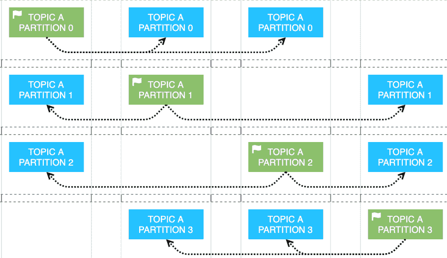

## 主题复制

现在让我们暂时从客户端的角度来看待。当生产者想要发布一条记录时，它必须联系目标分区的 leader  broker，随后 leader 会将记录分发给 followers，然后向生产者发送写入确认。。由于生产者通常会在某个时刻发布到所有分区，因此它需要与 Kafka 集群中的大多数（如果不是所有的）broker 建立直接连接。（连接是在初始化时积极建立，还是在按需时延迟建立，取决于客户端库的实现。）

> 遗憾的是，Kafka broker 无法将写入请求转发给 leader broker。当尝试向一个在副本集中未被声明为 leader 的 broker 发布记录时，后者将以 NOT_LEADER_ERROR 失败。此错误属于可重试错误类别，可能会偶尔发生，特别是当由于某种原因同步副本（in-sync replicas）集之间的领导状态发生变化时。生产者客户端将简单获取新的集群元数据，发现更新后的 leader，并相应地重新调整写入请求。NOT_LEADER_FOR_PARTITION 错误在少量出现时是无害的；然而，这种错误反复出现且未解决，表明存在更深层次的问题。

挑战归结为：客户端如何发现 Kafka 集群？朴素的方案需要我们显式地为客户端配置每个 broker 节点的完整地址列表。建立直接连接是轻举的，但这种方案无法扩展到动态集群拓扑；向集群中添加或删除节点将需要重新配置所有客户端。

Kafka 设计者采用的解决方案是基于“目录”隐喻。客户端并不是查找 broker 地址，而是在引导过程的第一阶段在目录中查找集群元数据，然后在第二阶段与发现的 brokers 建立直接连接。为了避免引入变动组件，目录的角色由每个 broker 方便地承担了。由于 broker 之间通过 ZooKeeper 本质上是相互感知的，每个 broker 都能将这种集群元数据视图传递给请求。尽管如此，broker 可能会发生，这与“稳定”目录的理念相矛盾。为了应对这一问题，客户端被配置了一个 broker 地址的引导列表，该列表只需要部分准确。只要引导列表中的地址指向一个存活的 broker，客户端就能学习整个拓扑。

## 利用 DNS

如果你认为这种模型感觉很脆弱，那你是正确的。如果我们重置集群中的所有 broker 呢？如果 brokers 托管在云端的瞬时实例上，并可能随心所欲地出现和消失，每次都获得新的 IP 地址怎么办？引导列表很快就会失效。我们难道不是在把“重新配置”的问题往后推吗？

虽然目前没有官方回应，但社区采用的做法是使用分层 DNS 条目。假设我们有一个任意大小且可以根据需要重置的集群。每个 broker 将被分配一个 IP 地址，并且类似于自动生成的主机名，两者都是瞬时的。为了补充目录隐喻，我们创建了一些具有最小 TTL 的众良好规范 CNAME 或 A 记录，指向我们部分 broker 节点子集的 IP 地址或主机名。新 DNS 条目的完全限定域名可能如下：

- `broker0.ext.prod.kafka.mycompany.com.`

- `broker1.ext.prod.kafka.mycompany.com.`

- `broker2.ext.prod.kafka.mycompany.com.`


客户端仅需配置这些规范引导地址的列表。任何影响地址的 broker 更改将涉及更新规范 DNS 条目；但保持 DNS 更新，以确保所有客户端（可能有成百或上千个）都正确配置，这要容易得多。此外，DNS 条目可以轻松测试。人们可以实现一个简单的“金丝雀”程序，定期连接到其中一个规范地址上的 broker，以验证其可用性。通过这种方式，一旦发生意外情况，我们很快就能发现，而不至于问题升级到全面故障的程度。

上述技术的进一步阐述是使用轮询 DNS。DNS 并不是为唯一主机维护多个 A 记录，而是允许同一个主机拥有多个 A 记录并指向不同的 IP 地址。对某个主机的 DNS 查询将返回所有 A 记录，并在返回之前对记录进行置换。此外，返回的列表可能是 IPv4 和 IPv6 地址的混合。假设客户端将尝试返回列表中的第一个 IP 地址，每个地址将处理大致相等数量的请求。客户端不必在第一个条目处停止；它可以尝试任意数量的、所有的记录，直到找到一个满足其请求的主机。

使用所有解析地址的能力在 Kafka 2.1 版本中被利用，作为 KIP-302 的一部分。（KIP 代表 Kafka 改进建议）。要启用此功能，`client.lookup` 配置中的 `use_all_dns_ips` 是默认开启的。一旦启用，客户端将使用所有解析出的地址。

这种方法的优势在于，当有更多回退地址时，我们不需要重新构建引导列表。该列表可能被解析为单个条目——例如，它解析为多个 IP 地址，取决于 DNS 如何配置。这种方法允许一个 broker 拥有多个 IP 地址。此外，对于同一个主机使用多个 A 记录，DNS 指定了完全限定域名。Java 库访问了 `client.lookup` 属性；其他语言可能不支持此功能。除了最后一点外，这些限制在实践中很少是障碍。这种方法的好处是——拥有一个设置即可的引导列表——在客户端很少时可能并不显而，但随着客户端生态系统的增长，会变得明显。

## 简单场景

在简单的网络拓扑中，每个 broker 都可以通过单个地址和端口访问，引导机制可以通过最少配置来实现工作。考虑一个连接三个 broker 的简单私有网络，使得生产者和消费者客户端也部署在同一个网络。为了简单起见，假设 broker IP 地址为 10.0.1、10.0.2 和 10.0.3。每个 broker 监听 9092 端口。客户端应用程序部署在 20.0.1，尝试连接到集群。该场景如下。

> https://cwiki.apache.org/confluence/display/KIP-302++=Enable+Kafka+clients+to+use+all+DNS+resolved+IP+addresses

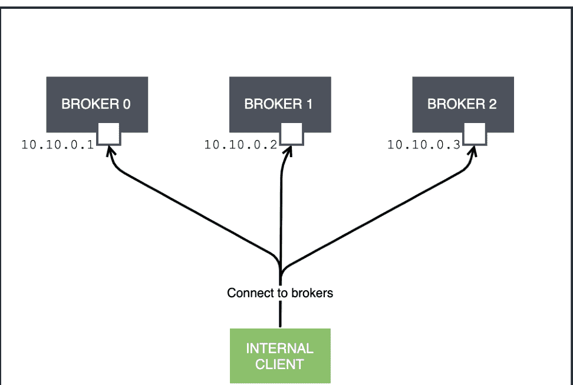

### 在私有网络中连接

此时，人们自然会假设，为引导列表传入 10.10.0.1:9092、10.10.0.2:9092、10.10.0.3:9092 就能正常工作。问题在于，Kafka broker 并不知道它应该广播哪个 IP 地址或主机名，而且它在自动发现这方面表现很糟糕。在大多数情况下，它会默认为 localhost。

下面的图捕获了问题的本质。在引导时，客户端将连接到 10.10.0.1:9092（引导列表中的第一个元素。客户端会随机选择一个地址，但在本示例中这并不重要。）建立连接后，客户端将接收集群元数据——一个包含三个元素的列表——每个元素都是 localhost:9092。你可以预见接下来的发展。客户端将尝试连接到 localhost——连接到它自己。*如此*，这就是获得可怕的“无法建立到节点 -1 (localhost/127.0.0.1:9092) 。Broker 可能不可用。”错误的原因。

## 第 8 章：引导与公告监听器（Advertised Listeners）

> 这个问题对于单节点 Kafka 安装和多节点集群来说都是同样的挑战。即使只有一个节点，客户端也会始终遵循集群元数据中暴露的地址。

这通过“公告监听器”（advertised listeners）得以解决。（终于，我们要接触问题的核心了。）Kafka Broker 可以三个属性——`advertised.listeners`、`listeners` 和 `listener.security.protocol.map`——它们相互关联并设计用于协同工作。让我们打开 Broker 配置文件找到这些属性。编辑 `$KAFKA_HOME/config/server.properties`；在文件开头，你应该看到几行类似下面的内容：

```properties
# ################ Socket Server 设置 #################

# Socket 服务器监听的地址。如果没有配置，则
# 它将获取从 java.net.Inet.getCanonicalHostname() 返回的值。
# 格式：
# listeners = listener_name://host_name:port
# 示例：
# listeners = PLAINTEXT://your.host_name:9092
# listeners=PLAINTEXT://:9092

# Broker 向生产者和消费者公告的主机名和端口。
# 如果未设置，则使用已配置的 "listeners" 的值。
# 否则，它将使用从 java.net.Inet.getCanonicalHostname()
# 返回的值。
advertised.listeners=PLAINTEXT://your.host_name:9092

# 将监听器名称映射到安全协议，默认是
# 与名称相同。更多细节请查看配置文档
# listener.security.protocol.map=PLAINTEXT, \
# SSL: SSL, SASL_PLAINTEXT:SASL_PLAINTEXT, SASL_SSL:SASL_SSL
```

除非你更改了配置文件，否则这些属性默认都是注释掉的。`listeners` 属性结构为用逗号分隔的 URL 列表，指定了 Broker 监听用于 TCP 连接的套接字。每个 URI 包含一个自由格式的协议名称，后面跟着 `//`、可选的接口地址、冒号，最后是端口号。省略接口地址将绑定到默认网络接口上。或者，你可以指定 `0.0.0.0` 元数据以在所有接口上绑定套接字。

> 接口地址也可以称为绑定地址（bind address）。

在默认示例中，值 `PLAINTEXT://:9092` 意味着监听器协议 `PLAINTEXT` 监听绑定到默认网络接口的端口 `9092`。

> 注释掉的属性将采用其默认值。默认值列 Kafka 官方文档页面 kafka.apache.org/documentation¹¹ 的“Broker Configs”部分中。

协议名称必须确保在 `listener.security.protocol.map` 属性中有有效的安全协议。安全协议是固定的，仅限于以下值：

- PLAINTEXT：不带主体身份验证的明文 TCP 连接。

- SSL：不带身份验证的 TLS 连接。

- SASL_PLAINTEXT：带有 SASL（简单身份验证和安全层）用于验证用户主体的明文连接。

- SASL_SSL：用于传输安全的 TLS 和用于用户验证的 SASL 的结合。

要将监听器映射到安全协议，请取消 `listener.security.protocol.map` 属性的注释并添加新名称。映射格式为 `<监听器协议名称>:<安全协议名称>`。

> 监听器名称是初次使用 Kafka 的用户感到困惑的主要来源。存在一个令人惊讶的误解，认为监听器级别的 `PLAINTEXT` 与加密方案（或缺乏加密）有关。事实上，监听器协议名称是完全任意的。为它们分配有意义的名称是良好的做法，监听器 URI `DONALD_DUCK:9092` 是完全有效的，只要在 `listener.security.protocol.map` 中有相应的映射，例如 `DONALD_DUCK:SASL_SSL`。

在 `listeners` 中指定套接字监听器时，你需要说明监听器是如何向生产者和消费者客户端公告的。格式为 `<监听器协议>:::<公告的主机名>:<公告端口>`。回到我们之前的示例，我们希望第一个 Broker 在 `10.10.0.1:9092` 上进行公告。因此，我们使用 `server.properties` 进行如下调整：

```properties
advertised.listeners=PLAINTEXT:10.10.0.1:9092
```

注意：不需要更改 `listeners` 或 `listener.security.protocol.map`，因为我们没有引入新的监听器；我们只是更改了现有监听器的公告方式。在多节点设置中，我们将对其他 Broker 进行类似的更改。

> 在更改 `server.properties` 中的任何值后，忘记重启 Kafka。

这种修复如何实现引导？客户端仍然连接到引导列表中指定的随机主机。主机返回的客户端元数据将包含 Broker 节点的客户端可达地址和端口号，而不是一组 `localhost:9092` 条目。现在，只要这些地址对客户端可达，就可以建立直接连接。下图说明了这一点。

内部网络上的引导

Kafdrop 对于理解集群拓扑非常有帮助，并为监听器配置提供了一些线索。集群概览屏幕显示了引导列表以及集群元数据中报告的地址和端口。

## Kafka 集群概览

| 引导服务器 | 10.10.0.1 |

| :--- | :--- |

| 总主题数 | 0 |

| 总分区数 | 0 |

| 总首选分区 | 0% |

| 总副本副本分区数 | 0 |

| ID | 主机 | 端口 | 控制器 | 分区数量（占总量） |

| :--- | :--- | :--- | :--- | :--- |

| 0 | 10.10.0.1 | 9092 | 是 | 0 (0%) |

显示 Broker 元数据的 Kafdrop

在本章前面，我们提到了 `client.dns.lookup` 属性以及设置 `use_all_ips` 的影响——具体来说是 Java 客户端解析的能力。启用后，公告监听器也将受到相同的 DNS 处理。如果公告监听器解析为多个 IP 地址，客户端将循环遍历这些地址。

## 多监听器

之前讨论的简单示例适用于 Kafka 集群只有一个入口；无论客户端类型或部署位置如何，都通过该入口访问集群。

如果你有多个入口呢？假设你的三节点集群部署在 AWS 的虚拟私云（VPC）或其他云上。大多数客户端也部署在 VPC 内部。然而，少数旧消费者和生产者应用程序部署在 VPC 之外，且与数据中心之间没有私有连接（VPC 或 Direct Connect）。

一种方法是通过 Internet 网关将 Broker 暴露给外部，使每个 Broker 都有一个内部和一个外部地址。假设目前安全不是问题——我们不关心加密、身份验证或授权——我们只是想通过互联网连接 Kafka 集群。内部地址将取自上一个示例，而外部地址将是 200.0.0.1、200.0.0.2 和 200.0.0.3。理想的 Broker 和客户端拓扑如下。

正如你现在可能已经猜到的那样，将引导列表设置为 `200.0.0.1:9092`、`200.0.0.2:9092`、`200.0.0.3:9092` 对外部客户端无效。客户端将建立初始连接，下载集群元数据，然后尝试尝试连接其中一个 10.10.0.x 私有地址。

## 第 8 章：引导与公告监听器

通过添加第二个针对外部入站（ingress）的监听器，可以解决此问题。我们需要修改 `server.properties` 使其类似于以下内容：

```
listeners=INTERNAL::://9092,EXTERNAL::://9093
advertised.listeners=INTERNAL::://10.0.0.1:9092,EXTERNAL::://200.0.0.1:9093
listener.security.protocol=PLAINTEXT,EXTERNAL:PLAINTEXT
inter.broker.listener.name=INTERNAL
```

我们没有直接调用第二个 PLAINTEXT 监听器，而是采用了一个合理的名称——将监听器协议命名为 `INTERNAL` 和 `EXTERNAL`。`advertised.listeners` 属性用于根据处理客户端初始引导连接的特定监听器来隔离元数据。换句话说，如果客户端连接到绑定在 9092 端口的 `INTERNAL` 监听器套字，那么集群元数据将包含响应代理的 `10.10.0.1:9092` 地址，以及其对端代理对应的 `INTERNAL` 公告监听器地址。相反，如果客户端被引导到位于 9093 端口的 `EXTERNAL` 监听器套接字，则元数据将提供 `EXTERNAL` 公告地址。下面的图整合了这一切。

```
bootstrap=200.0.0.1:9093...
```

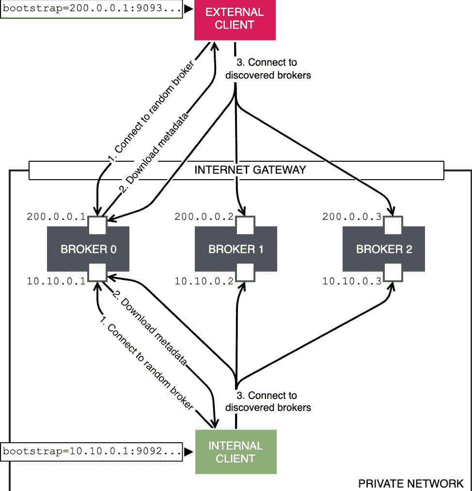

从两个位置引导

每个 Kafka 代理节点的单独监听器配置都集中存储在 ZooKeeper 集群中，并且所有 Kafka 代理的感知是相同的。自然，这意味着代理必须配置相同的监听器名称；否则每个代理将向其客户端提供不同的集群元数据。

除了 `listeners` 和 `advertised.listeners` 的更改外，`listener.security.protocol.map` 也需要相应的条目。`INTERNAL` 和 `EXTERNAL` 监听器协议名称都映射到了 `PLAINTEXT` 协议。遵循一次拆解一个功能的传统，我们在本例中使用了最简单的 `PLAINTEXT` 连接。从安全的角度来看，这显然不是生产集群应该采取的方法。安全协议、身份验证和授权将在第 16 章中讨论。

客户端并不是连接到 Kafka 的唯一应用程序。代理节点也形成了一个网格，相互连接以满足副本选举——确保对分区领导的写入会反映在跟随副本中。内部连接被称为*代理间通信（inter-broker-communications）*，并且我们使用与默认 `server.properties` 文件中暴露给客户端的相同的监听器名称。在同一接口上，一个端口不能被多个监听器绑定。如果遗留了未指定的接口地址，或者通过提供 `0.0.0.0`，则必须为每个监听器分配一个唯一的端口号。在我们的示例中，内部使用了 `9092`，外部使用了 `9093`。

关于端口和网络接口的讨论引出了一个微小的奇奇点：如果我们尝试通过显式指定 IP 地址为两个监听器分配相同的端口号会怎样？这行得通吗？

```
listeners=INTERNAL://0.0.0.1:9092,EXTERNAL://200.0.0.1:9093
```

答案取决于主机是否有与这些 IP 地址相对应的（物理或虚拟）网络接口。大多数主机至少有两个可用于绑定的地址：`localhost` 和分配给以太网接口的地址。某些主机由于额外的网络接口、IPv6 和虚拟驱动程序会有更多地址。在某些配置中，主机提供的 IP 地址被直接分配给网络接口。在监听器配置中选择可路由地址将如预期工作——监听器的套接字将绑定到正确的网络接口，从而避免端口冲突。当使用 NAT（网络地址转换）设备（如 Internet网关）选择性地向私有网络主机发布 IP 地址时，主机将不知道其公共 IP 地址。此外，它可能只有一个接口。在这种情况下，在 `listeners` 属性中指定主机的可路由地址会导致端口冲突。大多数非复杂的代理配置都支持多个入站点。提供公云提供商对等服务的 Kafka 集群还将为您提供从多个网络（对等和非对等）连接的选项。此外还有另一个多个监听器出现的常见示例。

### 监听器与 Docker 网络

看到一个完整的应用程序栈通过公共网络部署在多个 Docker 容器中是很常见的。从本地测试开始，Docker Compose 等工具可以轻松连接起一个自包含的应用程序栈，包括后端服务、面向客户端的 API、消息代理器等——在开发者的机器上快速启动，在需要时关闭。更进一步，诸如 Kubernetes、OpenShift、Docker Swarm 和 AWS Elastic Container Services 等编排平台为生产级部署引入了自动伸缩、零停机部署和服务发现功能。

深入理解 Kafka 的监听器和客户端引导机制对于在容器化环境中部署至关重要。接下来的示例将说明如何在基础应用程序栈中使用多个监听器，该栈包含 ZooKeeper、Kafka 和 Kafdrop。Docker Compose 将将所有内容构建在一起，因此假设你具备某些 Compose 知识。为了增加趣味性，我们将 Kafka 暴露在 Compose 栈之外。

在运行此示例之前，请确保之前练习中可能运行的 Kafka、ZooKeeper 和 Kafdrop 实例已停止。

开始开始，请在选择的目录中创建一个 `docker-compose.yaml` 文件，包含以下代码段：

```
version: "3.2"
zookeeper:
  image: bitnami/zookeeper:3
  ports:
    - 2181:2181
  environment:
    ALLOW_ANONYMOUS_LOGIN: "yes"
kafka:
  image: bitnami/kafka:2
  ports:
    - 9092:9092
  environment:
    KAFKA_CFG_ZOOKEEPER_CONNECT: zookeeper:2181
    ALLOW_PLAINTEXT_LISTENER: "yes"
```

KAFKA_LISTENERS:

  - INTERNAL::2992,EXTERNAL::9092

KAFKA_ADVERTISED_LISTENERS:

  - INTERNAL::kafka:2992,EXTERNAL::localhost:9092

KAFKA_LISTENER_SECURITY_PROTOCOL_MAP:

  - INTERNAL:PLAINTEXT,EXTERNAL:PLAINTEXT


`KAFKA_INTERNAL_BROKER_LISTENER_NAME: "INTERNAL"`

`depends_on`:

- `kafka`

`kafdrop`:

`image: obsidiandynamics/kafdrop:latest`

`ports`:

- `9000:9000`

`environment`:

`KAFKA_BROKER_CONNECT: kafka:2992`

`depends_on`:

- `kafka`

然后通过在终端运行 `docker-compose up` 来启动栈。（这必须在 `docker-compose.yaml` 所在的目录中运行。）启动后，在浏览器中访问 `localhost:9000`。你应该看到 Kafdrop 的落地页。

这与之前示例中的 Kafdrop 相同；唯一的区别在于“引导服务器”的值。在本示例中，我们使用 `kafka:2992` 引导 Kafdrop——它是 Kafka 代理的内部入站点。“内部”一词指的是 Compose 栈内部的网络流量。

让我们看看这是否有效。使用 Kafka CLI 工具创建一个测试主题：

```bash
$KAFKA_HOME/bin/kafka-topics.sh \
  --bootstrap-server localhost:9092 \
  --create --topic test \
  --replication-factor 1 \
  --partitions 4
```

现在列出主题：

```bash
$KAFKA_HOME/bin/kafka-topics.sh \
  --bootstrap-server localhost:9092 \
  --list
```

# 第 8 章：引导与公告监听器

```bash
$KAFKA_HOME/bin/kafka-topics.sh \
--bootstrap-server localhost:9092 \
--list
```

你应该能看到终端输出了一个条目：

```
test
```

回到浏览器并刷新 Kafdrop。正如预期，测试主题出现在列表中。

通过分析 `docker-compose.yaml` 文件，我们设置了三个服务。第一个是 `zookeeper`，使用 `bitnami/zookeeper` 镜像启动。这是第一个启动的容器，因为它没有依赖项。下一个服务是 `kafka`，它声明了对 `zookeeper` 服务的依赖。最后，`kafdrop` 声明了对 `kafka` 的依赖。

`kafka` 服务是三者中配置最复杂的。Bitnami Kafka 镜像允许我们通过设置环境变量来覆盖服务器属性中的值。这种配置读者应该是很熟悉的——它与我们之前的示例相同，在那个示例中，我们使用 `INTERNAL` 和 `EXTERNAL` 监听器协议方法进行了流量隔离。

> Docker Compose 中的依赖关系形成了一个有向无环图。只需声明每个服务的依赖关系；Docker Compose 将按照正确的顺序启动服务，且不会产生循环。按照反依赖顺序结构化 `docker-compose.yaml` 是一种好的实践——将提供者放在 `docker-compose.yaml` 的开头，这样它就能与服务的实际启动保持一致。

一旦完成，你就可以停止堆栈。在运行 Docker Compose 的终端中按 `CTRL+C`。这可能需要几秒钟，因为 Compose 会尝试优雅关闭堆栈。一旦提示符再次出现，运行 `docker-compose down -v` 来销毁堆栈。这将删除任何连接到容器的匿名或命名卷。

引导（Bootstrapping）是一个复杂的多阶段过程，它使客户端能够发现并维护与 Kafka 集群中所有 broker 的连接。它的复杂性不仅在于内部工作机制；为了方便地运行单个 Kafka 实例或暴露在一个或多个入口点的多节点集群，实际上确实需要大量的配置。

本章带我们了解了引导的内部机制。我们开始体会到 Kafka 发布协议的设计局限性，以及它如何影响客户端与 broker 的关系，即要求每个客户端都与集群中的每个 broker 建立专用连接。我们确定了客户端如何通过目录风格的地址查找与 broker 交互，使用集群元数据来学习 broker 拓扑并适应 broker 节点的变化。我们讨论了各种流量隔离场景，探索了 `listeners` 和 `advertised.listeners` 配置属性对集群元数据如何构建以及提供给客户端的影响。`listeners` 属性配置了 broker 监听传入连接的套接字，而 `advertised.listeners` 则引导客户端解析 broker。最后，Docker Compose 的提供了一个实用的日常示例，展示了基于监听器的隔离如何被例常地使用，以便在容器化环境中运行 Kafka。

## 第 9 章：Broker 配置

回顾以往的每个 Kafka 旅程，到目前为止我们大多数时候都运行着相当“原生”的 broker 设置。当然，例外是我们在第 8 章：引导与公告监听器中探索的对 `listeners` 和 `advertised.listeners` 配置属性的微调。

正如大家所知的，Kafka 提供了大量的配置选项，影响其行为的各个方面，从宏观到细微不等。本章的目的是让读者熟悉核心配置概念，足以让人舒适地修改 Kafka 的各个方面（涵盖广泛的可配置实体）以及针对周期的更新。

在本章中获得的知识应当结合 `kafka.apache.org/documentation`¹ 上的官方 Kafka 在线参考文档。参考文档中以严谨的详细描述了数百个可配置元素。此外，Kafka 的每个主要版本都会带来新的配置并废弃一些现有的配置。在出版的书中重复在线参考材料几乎没有意义；相反，本章将重点关注基础知识，而这些知识恰恰是在线文档较少涉及的。

## 实体类型

配置条目可以应用于四种实体类型：

1. `brokers`：一个或多个 Kafka broker。
2. `topics`：现有或未来的主题。
3. `clients`：生产者和消费者客户端。
4. `users`：经过身份验证的用户主体。

`brokers` 实体类型可以通过静态方式配置——通过修改 `server.properties`，也可以通过动态方式配置——通过 Kafka Admin API。其他实体类型只能通过动态方式管理。

## 动态更新模式

与实体类型正交的是，配置条目的影响 broker 行为的动态更新模式：

> ¹`http://kafka.apache.org/documentation`

1. `read-only`（只读）：配置实际上是静态的，需要更改 `server.properties` 并随后重启 broker 才能生效。
2. `per-broker`（按 broker）：可以为每个 broker 动态更新。配置立即生效，不需要重启 broker。
3. `cluster-wide`（集群范围）：可以作为集群默认值进行动态更新。也可以作为逐个测试的 broker 值进行更新。

这些模式适用于 `brokers` 实体类型。列表中的每个后续模式都是前一个模式的严格超集。换句话说，支持 `cluster-wide` 模式的属性也将支持 `per-broker` 和 `read-only` 模式。然而，支持 `per-broker` 并不意味着支持 `cluster-wide`。例如，`advertised.listeners` 属性可以 broker 定义，但不能应用于整个集群。

对于其他实体类型（例如按主题或按用户配置），可以通过 API 动态进行设置。作用域规则也不同。例如，主题没有“按 broker 配置”的概念；人们可以针对所有或单个主题，但配置始终适用于整个集群。（将配置发布到单个 broker 是没有意义的。）

> “动态更新”这个词听起来可能有点困惑，特别是对于 `read-only` 模式。后者是定义在 `server.properties` 文件中的静态配置——它无法通过 Admin API 分配或更新，完全不是动态。

动态配置（不包括只读模式）持久化在 ZooKeeper 集群中。你不需要与 ZooKeeper 直接交互来分配配置条目。该选项为了兼容性仍然支持；但已被废弃且强烈不建议使用。相反，Kafka Admin API 和内置 CLI 工具允许授权用户导入 Kafka 集群配置的更改，这将写回 ZooKeeper。

Kafka 文档中的“Broker configs”部分指示了每个配置最高动态更新模式。

文档有一个独立的 `Topic configs`* 部分，列出了针对单个主题的配置属性。文档中没有指示动态更新模式；在所有情况下，更新模式都是按主题或集群范围的。

## 配置优先级和默认值

在应用配置条目时，存在严格的优先级顺序。按优先级（最高在顶部）排序，优先级链由：

1. 动态按实体配置；

*`http://kafka.apache.org/documentation.html#topicconfigs`

2. 动态集群范围配置；随后是
3. 来自服务器属性的静态只读配置。

一位经验丰富的 Kafka 实践者可能已经注意到另外两个容易忽略的配置层级，我们尚未提到——默认配置和已弃用配置（`deprecated configuration`）。如果无法解析任何其他配置，将会自动发布默认配置。但有一个例外：某个属性可能是最近添加的，用于替换旧的已弃用属性。如果没有设置新属性，且设置了已弃用属性，Kafka 将应用该属性的值；否则，只有在这种情况下，才会应用默认值。（事实上，一个配置属性可能会覆盖多个已弃用属性，在这种情况下会形成一个更复杂的优先级链。）

配置默认值同样在 Kafka 文档页面中指明，但有一个标记：默认值并不传达任何实际意义。例如，当默认值声明为 `null` 时怎么办？除了查看默认值外，必须仔细阅读属性的描述，特别是当一个属性替换了一个或多个已弃用属性时。文档界定了实体（broker、topic 等）在属性未设置时的行为。

动态更新在 Kafka 1.1 中作为 KIP-226* 引入（KIP 代表 Kafka 改进提案），旨在减少管理大型 Kafka 集群的开销，以及由于滚动重启 broker 可能导致的中断和性能下降。一些关键的动机场景包括：

- 更新 broker 上的短寿命 SSL 密钥库；
- 基于指标的性能调优（例如增加网络或 I/O 线程）；
- 添加、删除或重新配置指标报告器（metrics reporters）；
- 在整个集群中一致更新所有 topic 的配置；
- 用于调优的 cleaner 配置；以及
- 更新监听器/安全配置。

原始提案考虑将 `server.properties` 中的静态配置项全部弃用，针对那些可以通过程序更改的项。在分析和社区咨询过程中，这一措施被认为过于激进，因此允许 `server.properties` 中的条目保留，因为认为维护一个无需先在 ZooKeeper 中设置选项即可直接使用 Kafka 的简单快速启动体验是有用的。

> `https://wiki.apache.org/confluence/display/KAFKA/KIP-226+-+Dynamic+Broker+Configuration`

## 应用 broker 配置

## 静态配置

所有 Kafka 组件的静态配置都存放在 `$KAFKA_HOME/config` 中。broker 从 `server.properties` 获取其只读静态配置。

除一项外，`server.properties` 中的所有条目都是可选的。如果省略，由已弃用属性和默认值组成的回退链将生效。唯一的强制设置是 `zookeeper.connect`。它以逗号分隔的 `host:port` 列表连接 ZooKeeper 连接字符串，格式为 `host1:port1,host2:port2,...,hostN:portN`——允许多个冗余 ZooKeeper 连接。

> 除了共享逗号分隔的 host 格式外，ZooKeeper 连接字符串与用于配置 Kafka 客户端的引导服务器没有共同之处。虽然 Kafka 客户端采用两步过程连接到所有 broker 并直接建立连接。broker 只需要与 ZooKeeper 节点建立连接，而 ZooKeeper 使用原子广播协议在所有节点之间同步更新，消除了每个 broker 都连接到每个 ZooKeeper 的需求。

`server.properties` 中的另一个集群配置项是 `broker.id`，它指定 broker 在集群内的唯一标识符。现在提到这一点是因为在管理目标配置时，需要感知 Kafka 集群中节点的 broker ID，这些配置可能会逐步应用到 broker 节点的特定子集。

如果未指定或设置为 `-1`，broker ID 将由 ZooKeeper 集合自动分发，使用从 100 开始的原子生成序列（这可以通过设置 `setting.broker.max.id` 来配置，序列将从该数字加 1 开始）。

显式设置 `broker.id` 被认为是一种良好的做法，因为通过查看 `server.properties` 很容易确定 broker ID。一旦分配了 ID，它会被写入位于 Kafka 日志目录下的 `meta.properties` 文件中。该目录由 `log.dirs` 属性指定，默认为 `/tmp/kafka-logs`。

> 虽然命名可能暗示了另有含义，但 Kafka 日志目录与用于应用程序日志的目录不同。日志目录存放分段（segment）、索引（indexes）和检查点（checkpoints）——broker 用于持久化分区数据。该目录的内容对于 broker 的运行至关重要；日志目录的丢失等同于该 broker 数据丢失。

要更改现有 broker 的 ID，你必须首先停止 broker。然后从 `meta.properties` 中删除 `broker.id` 条目或直接删除该文件。然后你可以在 `server.properties` 中更改 `broker.id`。最后，重启 broker。启动时，Kafka 应用程序日志应指示新的 broker ID。

## 动态配置

动态配置通过传统的客户端连接远程应用。这可以使用 CLI 工具——`kafka-configs.sh` 完成，也可以通过编程方式——使用客户端库完成。

- 下面的示例假设 `$KAFKA_HOME/bin` 中的 Kafka CLI 工具已添加到你的路径（path）。运行 `export PATH=$KAFKA_HOME/bin` 可为你的当前终端会话执行此操作。

我们将测试查看一个相当无害的配置项——I/O 线程数。让我们看看在 `server.properties` 中是否设置了该值：

```bash
grep num.io.threads $KAFKA_HOME/config/server.properties
num.io.threads=8
```

好了，`num.io.threads` 已设置为 8。这意味着我们的 broker 维护了一个包含八个线程的池来管理 I/O。我们可以窥一眼 broker 来查看这些线程：

```bash
KAFKA_PID=$(ps -1 | grep kafka | awk '{print $1}')
jstack $KAFKA_PID | grep data-plane-request-handler
data-plane-kafka-request-handler-0" #50 daemon prio=5 os_rio=31 \cpu=672.35ms elapsed=18234.05s tid=0x0000af670dc000 
nid=0x13b03 waiting on condition [0x000070007836000]
data-plane-kafka-request-handler-1" #51 daemon prio=5 os_rio=31 \cpu=671.82ms elapsed=18234.05s tid=0x0000af670d9000 
nid=0xdc003 waiting on condition [0x000070007939000]
data-plane-kafka-request-handler-2" #52 daemon prio=5 os_rio=31 \cpu=672.39ms elapsed=18234.05s tid=0x0000af670da0a 
nid=0xdc003 waiting on condition [0x000070007a3c000]
data-plane-kafka-request-handler-3" #53 daemon prio=5 os_rio=31 \cpu=676.05ms elapsed=18234.05s tid=0x0000af668b0288 
nid=0xdcc003 waiting on condition [0x000070007b3f000]
data-plane-kafka-request-handler-4" #72 daemon prio=5 os_rio=31 \cpu=104.53ms elapsed=16207.48s tid=0x0000af67b5c800 
nid=0xd5c80 waiting on condition [0x00007000]
```


## 第 9 章：Broker 配置

`data-plane-kafka-request-handler-0` #50 daemon prio=5 os_rio=31 \cpu=672.35ms elapsed=18234.05s tid=0x0000af670dc000 
nid=0x13b03 waiting on condition [0x000070007836000]
`data-plane-kafka-request-handler-1` #51 daemon prio=5 os_rio=31 \cpu=671.82ms elapsed=18234.05s tid=0x0000af670d9000 
nid=0xdc003 waiting on condition [0x000070007939000]
`data-plane-kafka-request-handler-2` #52 daemon prio=5 os_rio=31 \cpu=672.39ms elapsed=18234.05s tid=0x0000af670da0a 
nid=0xdc003 waiting on condition [0x000070007a3c000]
`data-plane-kafka-request-handler-3` #53 daemon prio=5 os_rio=31 \cpu=676.05ms elapsed=18234.05s tid=0x0000af668b0288 
nid=0xdcc003 waiting on condition [0x000070007b3f000]
`data-plane-kafka-request-handler-4` #72 daemon prio=5 os_rio=31 \cpu=104.53ms elapsed=16207.48s tid=0x0000af67b5c800 
nid=0xd5c80 waiting on condition [0x00007000]

## 第 2 章：Broker 配置

`data-plane-kafka-request-handler-0` #50 daemon prio=5 os_rio=31 \cpu=672.35ms elapsed=18234.05s tid=0x0000af670dc000 
nid=0x13b03 waiting on condition [0x000070007836000]
`data-plane-kafka-request-handler-1` #51 daemon prio=5 os_rio=31 \cpu=671.82ms elapsed=18234.05s tid=0x0000af670d9000 
nid=0xdc003 waiting on condition [0x000070007939000]
`data-plane-kafka-request-handler-2` #52 daemon prio=5 os_rio=31 \cpu=672.39ms elapsed=18234.05s tid=0x0000af670da0a 
nid=0xdc003 waiting on condition [0x000070007a3c000]
`data-plane-kafka-request-handler-3` #53 daemon prio=5 os_rio=31 \cpu=676.05ms elapsed=18234.05s tid=0x0000af668b0288 
nid=0xdcc003 waiting on condition [0x000070007b3f000]
`data-plane-kafka-request-handler-4` #72 daemon prio=5 os_rio=31 \cpu=104.53ms elapsed=16207.48s tid=0x0000af67b5c800 
nid=0xd5c80 waiting on condition [0x00007000]

确实，每个线程都已启动并准备好处理 I/O 请求。

让我们使用 `--describe` 来切换动态值。名为 `--describe` 的属性是可选的。如果省略，将显示所有配置项。

```bash
kafka-configs.sh --bootstrap-server localhost:9092 \
--entity-type brokers --entity-name 0 \
--describe num.io.threads
```

broker 0 的配置为：

在 ZooKeeper 中没有匹配的持久化的单个 broker 动态配置项。此外，除非被动态配置覆盖，否则此处不会输出 server 中的静态项。

通过调用以下命令更改 `num.io.threads`：

```bash
kafka-configs.sh --bootstrap-server localhost:9092 \
--entity-type brokers --entity-name 0 \
--alter --add-config num.io.threads=4
```

## 第 9 章：Broker 配置

已完成对 broker 0 的配置更新。

运行 `kafka-configs.sh ... --describe` 命令：

broker 0 的配置如下：

```
num.io.threads=4 sensitive=false synonyms=
{DYNAMIC_BROKER_CONFIG:num.io.threads=4,
STATIC_BROKER_CONFIG:num.io.threads=8,
DEFAULT_CONFIG:num.io.threads=8}
```

现在不仅已经为每个 broker 设置了 `num.io.threads` 条目，它还在回显静态值和默认值。

使用 `jstack` 命令查看线程：

```
"data-plane-kafka-request-handler-0" #50 daemon prio=5 os_prio=31
cpu=730.89ms elapsed=1845.03s tid=0x00007faf670dc000
nid=0xc1d3b03 waiting on condition [0x0000700007836000]
"data-plane-kafka-request-handler-1" #51 daemon prio=5 os_prio=31
cpu=728.40ms elapsed=1845.03s tid=0x00007faf670d9000
nid=0xcec03 waiting on condition [0x0000700007939000]
"data-plane-kafka-request-handler-2" #52 daemon prio=5 os_prio=31
cpu=729.16ms elapsed=1845.03s tid=0x00007faf670a7000
nid=0xcec03 waiting on condition [0x0000700007a3c000]
"data-plane-kafka-request-handler-3" #53 daemon prio=5 os_prio=31
cpu=737.62ms elapsed=1845.03s tid=0x00007faf68b02800
nid=0xcec03 waiting on condition [0x0000700007b3f000]"
```

太棒了！线程数已经减少，该操作在更新动态配置属性后立即生效。

动态配置是一个极其强大但又危险的工具。错误的值会导致整个 broker 离线或变得无响应。作为预防措施，Kafka 将数值的更改限制为其之前值的一半或两倍，从而强制平滑配置的变化。要将设置值增加到初始值两倍以上，或将其减少到初始值的一半以下，需要多次增量式更改。

在涉及设置作用域时，最佳实践是在将设置传播到整个集群之前，先将其应用到单个 broker。这正是我们对 `num.io.threads` 所做的。

`--entity-type` 参数是必选的，可以接受 brokers、users 或 topics 的值。`--entity-name` 参数对于每个 broker 的动态更新是强制的，并且可以用 `--entity-default` 替换以进行全集群范围更新。让我们将 `num.io.threads` 设置应用到整个集群。

```
kafka-configs.sh --bootstrap-server localhost:9092 \
--entity-type brokers --entity-default \
--alter --add-config num.io.threads=4
```

然后查看配置：

```
kafka-configs.sh --bootstrap-server localhost:9092 \
--entity-type brokers --entity-name 0 \
--describe num.io.threads
```

broker 0 的配置如下：

```
num.io.threads=4 sensitive=false synonyms=[]
{DYNAMIC_BROKER_CONFIG:num.io.threads=4, []}
DYNAMIC_DEFAULT_BROKER_CONFIG:num.io.threads=4, []
STATIC_BROKER_CONFIG:num.io.threads=8, []
DEFAULT_CONFIG:num.io.threads=8
```

结果列表中包含该值：`DYNAMIC_DEFAULT_BROKER_CONFIG:num.io.threads=4`。正如之前提到的，集群范围默认值的优先级仅次于，这在上面的列表中也有反映。当使用 `--describe` 切换时，我们可以指定 `--entity-default` 指向集群级配置。

```
kafka-configs.sh --bootstrap-server localhost:9092 \
--entity-type brokers --entity-default \
--describe num.io.threads
```

集群中 brokers 的默认配置为：

```
num.io.threads=4 sensitive=false synonyms=[]
{DYNAMIC_DEFAULT_BROKER_CONFIG:num.io.threads=4}
```

在应用集群级设置后，假设更新证明是稳定的，我们可以移除每个 broker 的条目。运行以下命令：

```
kafka-configs.sh --bootstrap-server localhost:9092 \
--entity-type brokers --entity-name 0 \
--delete-config num.io.threads
```

> 一旦你设置了集群级默认值，请务必移除每个 broker 的条目。除非有充分理由让某个 broker 与集群默认值有所不同，否则维护两项设置会产生冗余，并可能在长期来看（当后续修改集群级设置时）导致困惑。

刚刚删除了每个 broker 的配置后，预计剩余的唯一条目是集群级的。让我们描述 broker 0 的配置：

```
kafka-configs.sh --bootstrap-server localhost:9092 \
--entity-type brokers --entity-name 0 \
--describe num.io.threads
```

broker 0 的配置为：

```
num.io.threads=4 sensitive=false synonyms=[]
{DYNAMIC_BROKER_CONFIG:num.io.threads=4, []}
DYNAMIC_DEFAULT_BROKER_CONFIG:num.io.threads=4, []
STATIC_BROKER_CONFIG:num.io.threads=8, []
DEFAULT_CONFIG:num.io.threads=8
```

太棒了！线程数已经减少，该操作在更新动态配置属性后立即生效。

动态配置是一个极其强大但又危险的工具。错误的值会导致整个 broker 离线或变得无响应。作为预防措施，Kafka 将数值的更改限制为其之前值的一半或两倍，从而强制平滑配置的变化。要将设置值增加到初始值两倍以上，或将其减少到初始值的一半以下，需要多次增量式更改。

在涉及设置作用域时，最佳实践是在将设置传播到整个集群之前，先将其应用到单个 broker。这正是我们对 `num.io.threads` 所做的。

`--entity-type` 参数是必选的，可以接受 brokers、users 或 topics 的值。`--entity-name` 参数对于每个 broker 的动态更新是强制的，并且可以用 `--entity-default` 替换以进行全集群范围更新。让我们将 `num.io.threads` 设置应用到整个集群。

```
kafka-configs.sh --bootstrap-server localhost:9092 \
--entity-type brokers --entity-default \
--alter --add-config num.io.threads=4
```

然后查看配置：

```
kafka-configs.sh --bootstrap-server localhost:9092 \
--entity-type brokers --entity-name 0 \
--describe num.io.threads
```

broker 0 的配置如下：

```
num.io.threads=4 sensitive=false synonyms=[]
{DYNAMIC_BROKER_CONFIG:num.io.threads=4, []}
DYNAMIC_DEFAULT_BROKER_CONFIG:num.io.threads=4, []
STATIC_BROKER_CONFIG:num.io.threads=8, []
DEFAULT_CONFIG:num.io.threads=8
```

结果列表中包含该值：`DYNAMIC_DEFAULT_BROKER_CONFIG:num.io.threads=4`。正如之前提到的，集群范围默认值的优先级仅次于，这在上面的列表中也有反映。当使用 `--describe` 切换时，我们可以指定 `--entity-default` 指向集群级配置。

```
kafka-configs.sh --bootstrap-server localhost:9092 \
--entity-type brokers --entity-default \
--describe num.io.threads
```

集群中 brokers 的默认配置为：

```
num.io.threads=4 sensitive=false synonyms=[]
```


{DYNAMIC_DEFAULT_BROKER_CONFIG:num.io.threads=4}

在应用集群级设置后，假设更新证明是稳定的，我们可以移除每个 broker 的条目。运行以下命令：

```
kafka-configs.sh --bootstrap-server localhost:9092 \
--entity-type brokers --entity-name 0 \
--delete-config num.io.threads
```

> 一旦你设置了集群级默认值，请务必移除每个 broker 的条目。除非有充分理由让某个 broker 与集群默认值有所不同，否则维护两项设置会产生冗余，并可能在长期来看（当后续修改集群级设置时）导致困惑。

刚刚删除了每个 broker 的配置后，预计剩余的唯一条目是集群级的。让我们描述 broker 0 的配置：

```
kafka-configs.sh --bootstrap-server localhost:9092 \
--entity-type brokers --entity-name 0 \
--describe num.io.threads
```

broker 0 的配置为：

`num.io.threads=4` `sensitive=false` `synonyms=[]`

`DYNAMIC_BROKER_CONFIG:num.io.threads=4, []`

`DYNAMIC_DEFAULT_BROKER_CONFIG:num.io.threads=4, []`

`STATIC_BROKER_CONFIG:num.io.threads=8, []`

`DEFAULT_CONFIG:num.io.threads=8`

## 第 9 章：Broker 配置

使用 `kafka-configs.sh` 是查看主题配置的一种方法；然而，需要 ZooKeeper 才能进行主题相关配置的限制了它在生产环境中使用。还有其他替代方案——例如 Kafrod——使用标准的 Kafka Admin API 显示主题配置。切换到 Kafrod 并刷新集群概览页。你应该会在主题列表中看到最近创建的 `test.topic.config` 主。此外，有一个指示表明已分配了自定义配置。

### 主题 ACL

| 名称 | 分区 | 优选百分比 | 副本数 | 自定义配置 |
| --- | --- | --- | --- | --- |
| `test.topic.config` | 1 | 100% | 0 | 是 |

Kafrod 集群概览，显示主题名称

点击主题。自定义配置将显示在主题概览屏幕的右上角。

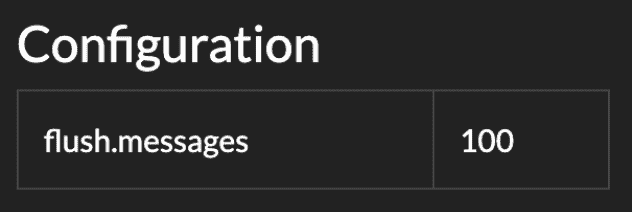

Kafrod 主题概览，显示自定义配置

完成此示例后，我们可以通过运行以下命令将配置还原为状态。

```
kafka-configs.sh --zookeeper localhost:2181 \
  --entity-type topics --entity-name test.topic.config \
  --alter --delete-config flush.messages
```

### 用户与客户端

配置用例的大部分与 broker 有关，其余大部分落在主题上。用户和客户端是在安全和配额管理的更广泛背景下配置的——这些主题领域将在第 16 章“安全”和第 17 章“配额”中单独介绍。

虽然本章不会涵盖用户和客户端，但它们的配置与主题配置非常相似。换句话说，它们支持两种动态更新模式：按实体和全局范围，其中按实体的优先级更高，其次是全局默认，最后是硬性默认值。

Kafka 是一个高度可调且适应性强的流式事件平台。理解 Kafka 配置的方方面面对于规模化生产集群至关重要。

Kafka 为单个配置条目提供了相当程度的范围细粒度。配置条目可能适用于一系列实体类型，包括 broker、主题、用户和客户端。根据配置的性质，可以通过静态方式（通过修改 `server.properties`）或动态方式（通过 Kafka Admin API）进行管理。是否支持远程更改以及配置条目的目标范围的组合被称为其 `动态更新模式`。支持的最广的动态更新模式将全局范围的设置应用于所有实体——特定的 broker、用户、主题或客户端。只读动态更新模式的范围最窄，而按实体的动态模式允许操作人员针对单个实体——并被预留给静态的每个 broker 的配置。

除了熟悉理论之外，我们还使用内置的 CLI 工具 `kafka-configs.sh` 进行了一些实操。该实用程序可用于查看和分配动态配置条目。尽管它是高效的，但 `kafka-configs.sh` 也有其特殊之处和局限性——例如，管理某些实体类型需要直接连接到 ZooKeeper。

## 第 10 章：客户端配置

之前的某些章节已经让我们在发布和消费记录方面取得了良好进展，但还没有详细介绍单个客户端属性。现在是时候稍作绕道，探索客户端配置的世界了。

与 broker 配置（具有动态更新模式、选择性更新和令人困惑的 CLI 工具）相比，配置客户端*相对简单*——因为客户端配置是静态的，并且*主要应用于被配置的实例*。（有少数例外）。然而，客户端配置要微妙得多——需要代表用户具有更深入的洞察力。

本章将配置细分为生产者、消费者和管理员设置。一些可配置项是通用的，并已提取到它们自己的章节中。读者可以在在线文档中查阅本章，地址为 `kafka.apache.org/documentation`*。然而，这里呈现的分析要深入得多，涵盖了官方来源无法轻易获取的内容。

在大量的客户端配置属性中，有几十个与性能调优和各种奇异的连接相关行为有关。本章的重点是涵盖那些在功能上影响客户端，或在定性上影响任何可能被视为理所当然的保证的属性。作为次要目标，本章将概述配置在影响重大或至少可感知的范围内对性能的影响，但意图并非详尽介绍性能——用户可能希望参考专业书籍以获得更细致的分析。其他章节也将更详细地涵盖 Kafka 性能的方面。

### 配置陷阱

客户端配置可能比 broker 配置更为重要。broker 配置由负责 Kafka 日常运行的团队或个人管理，这可能是他们管辖的几项基础设施中的一项。这种层级的更改是已知的或至少被认为具有广泛影响，通常会谨慎进行，并对终端用户给予适当通知。此外，行业正明显向全托管 Kafka 服务的转变，其中 broker 的运行归由专家团队管辖。为大量客户端管理单一技术使人们在该方面更加精通。

相比之下，真的没有所谓的“全托管 Kafka 客户端”。客户端是针对特定业务用例的定制应用程序，并由应用领域的专家编写。

> *https://kafka.apache.org/documentation*

### 第 10 章：客户端配置

客户端配置的重要性被另一个因素进一步强调，该因素源于 Kafka 的设计。鉴于目前对 Kafka 排序和交付保证优势的说法，人们可能会假设配置默认值是不敏感的，因为它们应该优先考虑安全性而非竞争特性。事实上，事实并非如此。从历史上看，Kafka 源于 LinkedIn 需要高效移动大量消息的需求，每小时量达到几个 TB 的数据。丢失一个

### 第 10 章：客户端配置

这条消息并没有被认为是灾难性的，毕竟，LinkedIn 上的消息或帖子与其说不如是一场自恋的表现。自然地，这反映在设置默认值的哲学上：将性能优先于其他任何重要因素。这个众所周知的蛇坑坑害过许多毫无防备的探险者。

在操作 Kafka 时，请记住优化的第一准则：不要做。公平地说，这条规则针对过早优化；然而，事实上，Kafka 中的大多数优化都是过早的。好消息是：将配置属性设置为以确保安全对性能的影响微乎其微——Kafka 仍然是一个性能强项。

在我们在本章的剩余部分探索配置时，请特别注意强调安全性的提示（callouts）。有几处这样的，每一处都会对你的 Kafka 体验产生根本性影响。这并不是说配置中的“坑”是客户端特有的；代理（broker）配置也有。相比之下，客户端配置的陷阱多得多。

### 应用客户端配置

在初始化 `KafkaProducer`、`KafkaConsumer` 或 `KafkaAdminClient` 对象之前，客户端配置被组装为键值对。最初组装客户端属性的方法可以追溯到 Kafka 的早期版本，即使用 `Properties` 对象：

```java
var props = new Properties();
props.setProperty("bootstrap.servers", "localhost:9092");
props.setProperty("key.serializer",
  StringSerializer.class.getName());
props.setProperty("value.serializer",
  StringSerializer.class.getName());
props.setProperty("max.in.flight.requests.per.connection",
  String.valueOf(1));
```

```java
try (var producer = new KafkaProducer<>(props)) {
  // 对 producer 执行操作
}
```

基于 `Properties` 配置的一个小烦恼在于，它强制你对键和值都使用 `String` 类型。这对于键是有意义的，但值应该从其对象表示派导出。随着时间的推移，Kafka 客户端已经增强以接受 `Map<String, Object>` 实例。情况已经有所改进，现在可以用稍微简洁一点的方式编写：

```java
Map<String, Object> config = Map.of(
  "bootstrap.servers", "localhost:9092",
  "key.serializer", StringSerializer.class.getName(),
  "value.serializer", StringSerializer.class.getName(),
  "max.in.flight.requests.per.connection", 1);

var producer = new KafkaProducer<>(config) {
  // 对 producer 执行操作
};
```

使用 `Properties` 还是 `Map` 对结果没有实质影响，这取决于风格。`Map` 提供了更简洁的语法，特别是当使用 Java 9 风格的 `Map.of(...)` 工厂不可变 map 时。它被许多从业者认为是更“现代”的方法。`Properties` 则强制你承认该值是字符串并手动进行类型转换。`Properties` 类还提供方便的 `load(Reader)` 方法用于加载属性文件。目前 Kafka 仍然依赖 `Properties` 的绝大部分代码。

当实例化客户端时，如果键对应于验证属性名称，则它们在相应客户端类型的上下文中是支持的。未能满足此要求将导致由配置的日志器发出警告消息。让我们通过故意拼错其中一个属性名称来实例化生产者：

```
16:49:51/0 WARN [main]: The configuration 'max.in.flight.requests.per.connectionx' was supplied by and isn’t a known config.
16:49:51/4 INFO [main]: Kafka version: 2.4.0
16:49:51/5 INFO [main]: Kafka commitId: 77a89fcf8d7fa018
16:49/51/5 INFO [main]: Kafka startTimeMs: 15766481913866
```

Kafka 开发人员选择了一种安全的方法来处理属性名称。尽管发生了错误，客户端将继续使用剩余的属性运行。换句话之，没有异常——仅仅是一条警告日志。检查配置的正确性并筛选应用程序日志的责任在于你。

与其提供未知的属性名称，不如将值更改为不支持的类型。我们原始的示例中 `max.in.flight.requests.per.connection` 为 `1`。将值更改为 `foo` 会产生运行时异常：

```
Exception in thread `main` org.apache.kafka.common.config.ConfigException: Invalid value for configuration max.in.flight.requests.connection: Not a number of type at org.apache.kafka.common.common.ConfigDef.parseType (ConfigDef.java:726) at org.apache.kafka.common.common.ConfigDef.parseValue (ConfigDef.java:474) at org.apache.kafka.common.common.ConfigDef.parse (ConfigDef.java:467) at org.apache.kafka.common.common.AbstractConfig.<init> (AbstractConfig.java:108) at org.apache.kafka.common.common.AbstractConfig.<init> (AbstractConfig.java:129) at org.apache.kafka.clients.producer.ProducerConfig.<init> (ProducerConfig.java:409) at org.apache.kafka.clients.producer.KafkaProducer.<init> (KafkaProducer.java:326) at effectivekafk.basic.BasicProducerSample.main (BasicProducerSample.java:15)
```

> 配置 Kafka 客户端时有几个“坑”，命名属性名称就在其中。第 11 章：健壮配置探索了最佳实践。

### 通用配置

本节描述了所有客户端类型通用的配置属性。

#### 引导服务器

我们在第 8 章：引导与监听器中详细探讨了 `bootstrap.servers`。建议读者学习它，因为它是操作和连接 Kafka 集群的基础知识。总之，`bootstrap.server` 属性对于所有客户端类型都是强制性的。这是一个逗号分隔的主机端口列表，格式为 `host1:port1,host2:port2,...,hostN:portN`，代表可以连接的节点子集；只要客户端能够到达其中一个节点，就能学习整个拓扑结构。

> 问题在于确保获取的元数据地址是可以的。元数据中的地址可能与 `bootstrap.servers` 中提供的完全不同。要更好地理解此问题及其解决方案，请参考第 8 章：引导与监听器。

#### 客户端 DNS 解析

`client.dns.lookup` 是 `bootstrap.servers` 的密切相关，第 8 章：引导与监听器也有介绍。该属性是可选的，接受枚举常量。

- `default`：保留遗留的 DNS 解析行为，换句话说，它将每个端点解析为 DNS 查询返回的第一个地址。此选项适用于引导列表和公告主机。

- `resolve_canonical_bootstrap_servers_only`：检测引导列表中的别名，通过反向 DNS 查询扩展为解析后的规范名称。此选项在 Kafka 2.1.0 中引入，作为 Kip-257 的一部分，以支持使用 Kerberos 认证的安全连接。此行为仅适用于引导列表；公告主机按默认选项处理。

- `use_ai_dns_ips`：支持完全限定名的多个 A 记录，解析引导列表中每个端点的所有主机。客户端将轮流尝试每个主机直到建立连接。此功能在 Kafka 2.1.0 中引入，作为 Kip-302 的一部分，适用于引导列表和公告主机。

#### 客户端 ID

可选的 `client.id` 属性允许应用程序与客户端连接关联一个自由形式逻辑标识符，以区分连接的客户端。在大多数情况下它可以被安全地省略，使用客户端 ID 可以提供更高程度的源可追溯性，因为它在 Kafka 指标中用于请求的逻辑分组。

除了基础实践外，客户端 ID 还被用于在代理上强制配额限制。对此能力的讨论将推迟到第 17 章：配额。

#### 重试与重试退避

`retries` 和 `retry.backoff.ms` 属性分别指定了瞬态错误的重试次数，以及在每次后续重试尝试之前等待的间隔（以毫秒计）。重试次数是在初始尝试的基础上进行的，也就是说，总重试次数的上限是 +1。

需要澄清，瞬态错误是指任何被认为可能恢复的条件。超时是瞬态错误最常见的形式，但还有许多与集群状态相关的错误——例如，过期的元数据或控制器变更。

虽然 `retry.backoff.ms` 属性适用于所有三个客户端，但 `retries` 仅存在生产者（producer）和管理员（admin）客户端；消费者（consumer）客户端不支持。消费者并不是限制重试次数，而是限制了查询的总时间——例如调用 `poll()` 方法时——从而消除了显式的重试计数器。尽管有这种细微差异，我们将作为一个整体来讨论这两个配置方面。

`retries` 的默认设置为 `Integer.MAX_VALUE`，生产者和管理员客户端在每次尝试之间等待 100 ms。消费者的 `poll` 超时没有默认值——超时是作为 `poll()` 方法的参数显式指定的。这些默认设置是否合理取决于重试的组合、集群和客户端应用可用资源数量，以及用户对等待记录发布成功或失败结果的容忍度。


> 必须有一个限制，尽管这是一个微妙的限制。执行多少次重试或重试花费的总时间从根本上说并不重要；只有两种结果。重试次数和退避时间可以保持在最低，在这种情况下，错误到达应用程序的概率很高。即使这些数字是根据经验得出的，人们最终也会观察到重试耗尽的情况。相反，人们可能会将重试保持在指定的默认值`Integer.MAX_VALUE`上，在这种情况下，客户端将不断轰击代理，而应用程序无法取得进展。我们需要承认失败是可能的，并且必须在应用程序层面考虑到这些因素。

当 Kafka 最初发布到世界上时，每个代理（broker）都是自托管的，且大多数运行在数据中心或公有云上，靠近客户端应用程序。也就是说，网络很少是罪魁祸首。格局已经发生了巨大变化；现在看到许多通过公共互联网或 VPC 对等传输的 Kafka 服务要常见得多。此外，随着行业对事件流采用的日益增加，现在每个代理承载的流量比以前要多，而性能进步的增长归功于更新硬件和 Kafka 代码库的效率提升。随着云服务提供者的采用，组织越来越多地利用可用区来保护它们免受站点故障的影响。因此，Kafka 集群在代理节点数量和地理分布方面现在比以前任何时候都要大。人们需要

在设置`retries`、`retry_backoff.ms`和消费者`poll`超时时，以及通常在为应用程序设计错误处理策略时，考虑到这些因素。

## 第 10 章：客户端配置

看待问题的另一种方式是，这并不关乎底层网络的稳定性特征、Kafka 集群的容量，或者在典型一天可能会经历的故障分布。像任何其他消费服务的客户端一样，人们必须意识到自己的功能需求，以及他们对上游消费者可能承担的任何义务。Kafka 客户端应用程序准备好为记录的发布等待最多不超过设定的时间，然后必须根据这一点来设计重试方案和错误处理机制。

## 测试考虑

继续上面的讨论，另一个经常被忽视的失败原因与作为自动化测试的一部分在性能受限的环境中运行 Kafka 有关。开发者通常会在容器化环境或虚拟机中运行单代理 Kafka 集群。Kafka 的 I/O 性能在 Docker 或虚拟化系统上会显著降低（目前这些原因并不重要）。当在 macOS 上运行 Docker 时，问题会恶化，因为这额外增加了虚拟化成本。结果是预计会有更长的初始就绪时间以及控制器处更多的不稳定转换。测试可能会假设 Kafka 是可用的，因为容器已经启动且 Kafka 正在其监听器端口上连接；后者并不意味着代理已准备好接受请求。它可能需要几秒钟才能就绪，而且计时在每次运行之间是不一致的。默认容忍度（实际上是无限重试）实际上与这类场景结合得很好。调整重试行为以更好地代表生产场景虽然看起来很谨慎，但可能会阻碍本地测试自动化——导致测试因不确定性而偶尔失败。

解决此问题的方法之一是允许可配置的重试行为，这在不同的部署环境之间可能会合理变化。这种方法的问题在于它引入了真实环境和测试环境之间的差异，从工程角度来看这很少是理想的。另一种方法（也是作者喜欢的）是在每个测试开始时引入扩展等待，为代理的启动留出一些缓冲时间。循环可以轮询代理以获取传入的只读查询，例如列出主题名称。代理最初可能需要一些时间来响应，返回一系列错误——在它仍在启动过程中这些错误会被忽略。当它做出响应时，通常表示集群已经稳定，测试可以开始。

## 安全配置

所有三种客户端类型都可以配置为与集群的安全连接。我们不会在本章中探索安全配置，部分是因为支持的选项范围过于巨大，但主要因为这个主题在第 16 章：安全中已有涵盖。

## 生产者配置

本节描述了生产者客户端类型特定的配置选项。

## 致谢

`acks`属性规定了生产者在认为请求完成并在向生产者确认写入之前，要求领导节点（leader）必须接收到的确认数量。这对于记录的持久性至关重要；配置不当的`acks`属性会导致数据丢失，而生产者却天真地假设记录已稳定持久化。

尽管该属性与确认的数量有关，但它接受以下枚举常量之一——

- 0：不需要从领导节点提供确认。

- 1：需要领导节点提供一次确认，即记录持久化到其本地日志。这是当`enable.idempotence`设置为`false`时的默认设置。

- -1 或 all：要求领导节点从所有同步副本（in-sync replicas）接收确认。这是当`enable.idempotence`设置为`true`时的默认设置。

这些模式的每一种，以及确认与 Kafka 复制协议之间的相互作用，将在第 13 章：复制与确认中详细讨论。

## 每个连接的最大飞行请求数

`max.in.flight.requests.per.connection`属性设置了生产者在强制等待其确认之前，在单个连接上发送的未确认请求数量的上限。该属性的默认值为 5。

此配置的目的是增加生产者的吞吐量。这在长延迟、高延迟网络上尤为明显，那里长确认时间不断中断生产者发布额外记录的能力，即使网络容量允许这样做。该问题不仅限于高延迟网络；任何导致确认时间增加的内部限制——例如由于同步副本落后导致集群内部复制缓慢——都会负面影响传输率。

这是一个经典的流控制问题。任何熟悉网络协议内部原理的人都会立即将`max.in.flight.requests.per.connection`的行为与 TCP 流控制所使用的滑动窗口相似。然而，它并不完全相同；有一个关键区别——在禁用幂等性时，在未确认窗口范围内缺乏飞行请求的排序和重组。

通过示例来解释这个问题是最好的。假设一个配置了`max.in.flight.requests.per.connection`和`retries`默认值的生产者将记录 A、B、C 队列到代理

## 第 10 章：客户端配置

按照上述精确顺序，假设这些记录将占据同一个分区。隐含的预期是这些记录按照其发送的顺序进行持久化，以确保保证。假设 A 到达 broker 并被确认。在持久化 B 时发生瞬态错误。C 被处理并被确认。生产者检测到缺少确认后，将重传 B。假设重传成功，记录将以 A、C 和 B 的顺序出现——这与它们发送的顺序不同。

> 尽管上一个示例使用单个记录来说明问题，但它是对 Kafka 真实行为的简化。在实际上，Kafka 转发的不是单个记录，而是批次。其原理本质上是相同的——只需将“记录”替换为“批次”。因此，并不是乱序到达，而是整批记录可能会出现在其目标分区上。

底层问题在于 broker 隐式地依赖底层传输协议（TCP）的排序，而 TCP 作用于 OSI 模型的第 4 层。由于感知语义（第 7 层），TCP 无法防止应用层负载的重组。默认情况下，当幂等性（idempotence）设置为 false 时，Kafka 不会跟踪传输记录中的空隙，并且面对错误时无法重新排序或考虑重传。

在严格顺序对于系统正确性至关重要的场景中，在没有幂等性的情况下，可以将`retries`设置为 0 或将`max.in.requests.per.connection`设置为 1。然而，首选的替代方案是将`idempotence`设置为 true，这可以防止重排序问题，并避免记录重复。这是 Kafka 配置倾向于性能而非正确性的另一个例子。

## 启用幂等性

`enable.idempotence`属性设置为 true 时，可确保——

- 生产者处队列的任何记录在相应分区上最多被持久化一次；

- 记录按照生产者指定的顺序持久化；并且；

- 记录在被确认之前持久化到所有同步副本（all-in-sync replicas）。

`enable.idempotence`的默认值为 false。

启用幂等性要求`max.in.requests.per.connection`小于等于 5，`retries`大于 0 且`acks`设置为 all。如果用户没有显式设置这些值，将默认选择合适的值。如果设置了不兼容的值，在生产者数字化过程中将抛出`ConfigException`。

非幂等生产者问题的出现是因为：当`acks`设置为 1 或 all 且`retries`设置大于0时，间歇性错误导致返回路径上的记录确认超时。换句话说，broker 已经接收并持久化了记录，但等待的生产者由于延迟而超时。如果生产者还有剩余重传次数，它将重新发送记录，这将导致在分区稍后的偏移量处持久化第二个完全相同的记录副本。结果，所有消费者在从 topic 读取时都会观察到重复记录。此外，由于生产者的批处理机制，重复记录可能会作为连续记录出现，而不是孤立的。

Kafka 中的幂等机制通过为每条记录分配单调递增的序列号来工作，结合唯一 ID（PID），创建一个部分排序关系，这种关系可以在接收端 broker 处轻松调和。broker 维护一个内部映射，记录每个 PID 在每个分区上的最高序列号。如果记录的序列号没有超过最后持久化的序列号一个，broker 可以安全地丢弃该记录。如果增量大于1，broker 将响应`OUT_OF_ORDER_SEQUENCE_NUMBER`错误，强制批次在生产者上重新入队。确保序列号连续的要求俗谚说是“一箭双鸟”。除了确保幂等性外，该机制还保证了记录的顺序，以及当`max.in.flight.requests.per.connection`设置为允许多个正在处理的请求记录时的停机重排序问题。

去重仅适用于生产者内部队列队列的单个记录。如果应用程序使用`send()`调用了重复记录，生产者将认为这些记录是不同的，并带有新的序列号发送第二个记录。因此，避免队列重复记录是应用程序的责任。

> 官方文档将`enable_idempotence`属性描述为生产者用于确保流中每条记录都恰好写入一个副本，且记录按照其发布的严格顺序被写入的机制。

> 在没有对生产者、broker 存活性以及底层网络可靠性进行先验感知的情况下，文档中的推测是不准确的。例如，如果生产者进程失败，生产者无法执行任何形式的保证。重启进程不会在返回`send()`之前将其缓冲到稳定的存储介质中（生产者累加器是易失的）。此外，如果网络或分区副本不可用，停机时间超过了`delivery.timeout.ms`允许的最大范围，记录将超时并产生失败结果。在这种情况下，写入语义将是至多一次。

> 网络降级或缓慢的 broker 也可能带来问题。假设一条记录已成功发布，但响应超时，导致耗尽了生产者的`delivery.timeout.ms`。客户端将向应用程序返回错误，应用程序可能会跳过该记录，或再次发布它。在后一种情况下，生产者不会检测到重复，并将第二次发布一个实际上完全相同的记录。在这种情况下，写入语义将是至少一次。

> 因此，官方文档应在在 otherwise otherwise运行良好的系统中遇到间歇性错误的背景下进行理解，即该系统能够在所有指定的超时时间内取得进展。当且仅当生产者收到来自 broker 的写入确认时，我们才能确定“恰好一次”写入语义正在生效。

在典型的顺序保持应用中，将`retries`设置为 0 是不实际的，因为它会向应用程序充可以解决的瞬态错误。因此，将`max.in.flight.requests.per.connection`限制为 1 或启用幂等性是更合理的做法，后者是优选，受高延迟网络的影响较小。

## 压缩类型

`compression.type`属性控制生产者在将记录批次转发到分区副本之前使用的压缩算法。有效值为：

- none：禁用压缩。这是默认设置。

- gzip：使用 GNU Gzip 算法——发布于1992年，作为早期 UNIX 系统使用的专用 compress 程序的免费替代品。

- snappy：使用 Facebook 的 Snappy 压缩格式——以牺牲压缩率为代价优化了吞吐量。

- lz4：使用 LZ4 算法——同样针对吞吐量进行了优化，特别是解压速度。

- zstd：使用 Facebook 的 ZStandard——Kafka2.1.0引入的新算法，旨在吞吐量和压缩率之间取得有效的平衡。

该主题在第12章：批处理与压缩中有更详细的讨论。总结，压缩可以显著提高网络效率。减少减少 broker 上的磁盘 I/O 和存储空间占用。

## 键值序列化器

`keyserializer`和`value.serializer`属性允许用户配置记录键和值的序列化机制。这些属性没有默认值。指定序列化器的另一种方法是直接实例化一个并将其作为引用传递给重载的 KafkaProducer 构造函数。

## 分区器 (Partitioner)

`partitioner.class`属性允许应用程序通过指定`org.apache.kafka.clients.producer.Partitioner`的实现来覆盖默认分区方案。除非另有指定，否则生产者将使用`org.apache.kafka.clients.producer.internals.DefaultPartitioner`实现。

`DefaultPartitioner`的行为取决于记录的属性：

- 1. 如果`ProducerRecord`中明确指定了分区，则始终使用该分区。

- 2. 如果未设置分区但指定了键（key），则对键进行哈希处理以确定分区号。

- 3. 如果既未指定分区也没有指定键，且当前批次已分配了一个“粘性”（sticky）分区，则保持与当前批次相同的分区号。

- 4. 如果满足上述任一条件，则为当前批次分配一个新的“粘性”分区，并将其用于当前记录。

> 点 #1 和 #2 捕捉了`DefaultPartitioner`的传统行为。点 #3 和 #4 是 Kafka 2.4.0 版本中作为 KIP-480 的一部分引入的。在此之前，生产者会空转轮询方式分配记录。虽然这会将负载均匀分布到各个分区，但它很大程度上抵消了批处理的优势。由于分区由集群中不同的 broker 管理，这种方法以前可能需要多个 broker 来发布一个批次，导致受最慢 broker 影响产生更高的延迟。2.4.0 的更新将任何无键哈希的操作限制在单个 broker，将 99 百分位延迟降低了二到三倍，取决于记录的吞吐量。在长的一系列批次中，分区仍然保持负载均衡。

对键进行哈希以解析分区号是通过将键的字节内容通过 MurmurHash2 函数来实现的，通过掩码掉最高位（位按与`0xffffff`）从 32 位中提取低位 31 位。取得到的结果对分区数取模运算，从而得到分区号。

> 虽然键的哈希处理和记录到分区的映射看起来很简单，但它是通过对问题更深入的分析得出的，潜在的解决方案将在第 6 章：设计考虑中给出。在此不详述细节，敦促读者遵守一条规则：当系统的正确性取决于记录以键为中心的排序时，请避免调整主题（topic），因为这会导致消费者生态系统可能依赖的任何保证失效。

除了`DefaultPartitioner`，Java 生产者客户端还包含`RoundRobinPartitioner`和`UniformStickyPartitioner`。

## 第 10 章：客户端配置

`RoundRobinPartitioner`如果设置了用户指定的分区，会将记录转发到该分区；否则，它将以轮询方式无差别地将写入分布到所有分区，无论记录键的值如何。由于无键记录到分区的分配是非确定性的，具有相同键的记录完全可能占用不同的分区并无序处理。当事件不受排序约束限制时，这种分区器非常有用，换句话说，当 Kafka 是无关事件的“火火龙”时。或者，当消费者生态系统拥有重组事件的机制且该机制独立于 Kafka 原生分区方案时，可以使用此分区器。

`UniformStickyPartitioner`是 Kafka 2.4.0 引入的 KIP-480 直接实现。该分区器如果设置了用户指定的分区，会将记录转发到该分区；否则，它将忽略键，而是为当前批次分配“粘性”分区号。

> 分区器的一个“陷阱”在于它们是生产者端的问题。broker 不感知所使用的分区器，它委托生产者为每个提交的记录做出此决定。这假设生产者生态系统拥有一个单一的分区方案并统一应用它。自然地，如果重新配置生产者使用备用分区器，必须确保这种更改是原子滚滚的——不能有两个或多个生产者并发使用不同的分区器运行。

如果有需要，可以实现自己的分区器。也许你面临一种特殊需求，需要根据有效负载的内容而不是键来对记录进行分区。虽然自定义分区器可以满足这一需求，但更直接的方法是将负载的属性连接成一个合成键，以便可以使用默认分区器。（可能需要对键进行预哈希处理以限制其大小。）

## 拦截器 (Interceptors)

`interceptor.classes`属性允许应用程序在路由到 Kafka 集群的途中（在序列化和分区分配之前）拦截并可能更改记录。默认情况下它是空的。应用程序可以指定一个或多个拦截器，以逗号分隔的`org.apache.kafka.clients.producer.ProducerInterceptor`类列表形式给出。下面是`ProducerInterceptor`接口，为了简洁起见删除了 Javadoc 注释。

```java
public interface ProducerInterceptor<K, V> extends Configurable {
    public ProducerRecord<K, V> onSend(ProducerRecord<K, V> record);
    public void onAcknowledgement(RecordMetadata metadata, Exception exception);
    public void close();
}
```

`Configurable`父接口允许由生产者实例化的类执行：

```java
public interface Configurable {
    void configure(Map<String, ?> configs);
}
```

拦截器作为插件工作，允许添加横切关注点。面向切面编程（AOP）的一些示例包括：

- 指标累积。

- 确保输出记录符合某些模式。

- 记录敏感信息。

- 数据泄露防护

- 追踪和监控。

实现拦截器有几点注意事项：

- 一个拦截器中的异常不会中断链——下一个拦截器仍会被调用。

- `onAcknowledgement()`方法将由生产者的 I/O 线程调用。这会阻塞 I/O 线程直到方法返回。

- 当注册多个拦截器时，它们的`onSend()`方法将按照指定的顺序调用。

- 拦截器可能会从多个线程调用；实现必须是线程安全的。

## 第 10 章：客户端配置


生产者将等待一段延迟，以允许其他记录在批中累积。这最大化了单次传输的数据量。虽然可能允许记录在 `_linger.ms_` 指定的时间内滞留，但 `batch.size` 属性将具有覆盖作用，当批达到最大大时就会分发。从另一个角度来看：`linger.ms` 属性仅在生产者负载较轻时才会起作用，而 `batch.size` 属性持续持续的，确保批的大小不会超过设定的上限。

此主题将在第 12 章“批处理与压缩”中进行更详细的讨论。总而言之，批处理提高了网络效率和吞吐量，但是以增加发布延迟为代价的。它通常与压缩结合使用，因为后者在存在批处理的情况下更为有效。

## 请求超时

`request.timeout.ms` 属性控制客户端等待代理器响应进行中请求的最大时间。如果在超时发生之前没有收到响应，客户端将在拥有可用的重试缓冲区（由 `retries` 属性配置）的情况下重新发送请求，否则将请求失败。`request.timeout.ms` 的默认值为 30000（30 秒）。

## 交付超时

`delivery.timeout.ms` 属性设置了调用 `send()` 返回后报告成功或失败的时间上限，默认值为 120000（两分钟）。

此设置充当一个总限制——

- 记录在发送之前可能延迟的时间：

- 等待代理器确认的时间（如果 `acks=1` 或 `acks=all`）；

- 为可重试的发送失败预留的时间。

如果遇到不可恢复的错误、重试次数耗尽，或者记录被添加到达到较早交付过期截止日的批中，生产者可能会比此时间更早报告发送失败。该属性的值大于或等于 `request.timeout.ms` 和 `linger.ms` 之和。

该属性是较最近引入的，在 Kafka 2.1.0 中作为 KIP-92 引入。主要动机是整合几个相关配置属性的行为，这些属性可能会影响记录处于等待状态的时间，并无意中将此时间延长到应用程序容忍范围之外以便获取记录发布的成功或失败输出。整合后的 `delivery.timeout.ms` 属性作为总消耗时间的预算，在这些时间耗尽之前终止发布过程并产生结果。

> ²25 https://wiki.apache.org/confluence/display/AFKA/KIP-91+Provide+Intuitive+User+Timeouts+in+The+Producer

这样做并没有弃用底层属性。事实上，它通过使这些属性在孤立使用时更安全，延长了它们的效用，允许更有信心地微调生产者的行为。

下面的图摘自 KIP-91²,³,, 的描述，说明了 `delivery.timeout.ms` 属性及其与其包含的其他属性之间的关系。红圈表示可能发生超时的点。

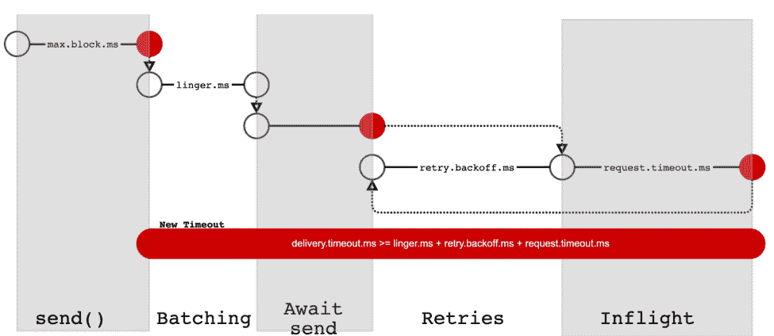

`send()` 批处理 等待发送 重试 进行中 交付超时 行为

下面解释了构成记录从生产者到代理器旅程的各个阶段。

- 对 `send()` 的初始调用可能会阻塞最多 `max.block.ms`，等待元数据或在生产者累积器中的可用空间进行队列。完成后，记录被添加到批中。

- 当达到 `linger.ms` 或批大小时，批就有了通过线路传输的资格。

- 一旦批准备就绪，必须等待传输机会。满足以下所有条件：

  * 分区的元数据已知且分区领导者已识别；

  * 与领导者存在连接；且

  * 当前进行中的请求数少于 `max.inflight.requests` 指定的数量。

- 一旦批传输完成，`request.timeout.ms` 属性限制了生产者等待分区领导者确认的时间。

- 如果请求失败且生产者仍有一个或多个重试机会，它将尝试再次发送该批。每次发送尝试都会重置超时，句话句话，每次重试都有自己的 `request.timeout.ms`。

> ²²³ https://wiki.apache.org/confluence/display/AFKA/KIP-91+Provide+Intuitive+User+Timeouts+in+The+Producer

`await-send`（等待发送）阶段是记录旅程中最令人头疼的部分，因为没有办法精确确定记录将在该状态下花费多久。首先，批可能会被集群中的问题阻塞，这超出了生产者的控制。其次，它可能会被之前的批阻塞，这在 `max.in.flight.requests.per.connection` 设置为 1 时特别容易发生。

> 在 Kafka 2.1.0 之前，在 `await-send` 阶段花费的时间通常由批之后使用的相同传输超时限制——即 `request.timeout.ms`。当记录进入 `await-send` 时，生产者会急切地启动传输计时器，尽管技术上讲它仍在队列中等待元数据刷新或之前的批完成。等待元数据刷新或等待之前的批完成的记录可能会悲观地过期，如果之前的批阻塞在发送阶段，该问题会变得更严重，因为这使其获得了额外的额度。

`delivery.timeout.ms` 的优势在于它不区分各个阶段，正如我们在生产者上看到的那。

## 事务 ID 和事务超时

`transactional.id` 和 `timeout.ms` 属性更改了生产者有关事务的行为；请参考第 18 章：事务。

## 消费者配置

本节描述了特定于消费者的配置选项。某些配置属性与其对应的。

## 键和值反序列化

类似于生产者配置，`key.deserializer` 和 `value.deserializer` 属性指定了反序列化键和值的机制。根据生产者场景，用户可以通过重载的 `KafkaConsumer` 构造函数实例化反序列化器。

关于序列化的广泛讨论见第 7 章：序列化。在实现自定义反序列化器之前应参考该章节。

## 拦截器

`interceptor.classes` 属性类似于对应，指定了一个逗号分隔的 `org.kafka.clients.consumer.ConsumerInterceptor` 实现列表，允许在 `poll()` 返回记录之前对它们进行检查和可能的变异。

`ConsumerInterceptor` 接口所示，为了简洁删除了 Javadoc 注释。

```java
public interface ConsumerInterceptor<K, V>
    extends Configurable, AutoCloseable {
    public ConsumerRecords<K, V>
    onConsume(ConsumerRecords<K, V> records);

    public void onCommit(Map<TopicPartition, OffsetMetadata> offsets);

    public void close();
}
```

消费者拦截器的原理与我们在生产者上看到的相同。拦截器作为插件机制，提供了一种模块化且可重用的方式，统一处理独立消费者的跨越关注点。

生产者和消费者级拦截器之间存在相似之处和不同之处。相似之处如下：

- 拦截器的运行时异常将被捕获并记录，但不允许传播到应用程序代码。一个拦截器捕获的异常对下一个拦截器没有影响：后者将在记录异常后被调用。

- 当注册了多个拦截器时，它们的 `onConsume()` 方法将按照 `interceptor.classes` 属性中指定的顺序调用，允许拦截器作为转换流水线。

- `onCommit()` 方法可能会从后台线程调用；因此，实现应避免不必要的锁定。

至于不同之处，有一个：与 `KafkaProducer` 不同，`KafkaConsumer` 实现不是线程安全的——禁止从多个线程使用 `poll()`。因此，不要求 `ConsumerInterceptor` 实现必须是线程安全的。

# 控制 fetch size

在从 Kafka 集群中检索记录时，最终需要决定多少数据为合适，多少又过多。数据并不是越多越好；虽然增加 fetch size 会提高网络利用率，从而获得更高的吞吐量，但这是有代价的——端到端的传播延迟会受到影响。相反，获取少数记录会使应用程序响应更迅速，但小规模获取需要更多的往返来传输相同量的数据，从而对吞吐量产生负面影响。

调优 fetch size 是构建消费者应用程序时必须面对的性能影响决策之一。Kafka 在简化这一过程方面做得并不多。并没有一个可以调整的统一吞吐量/延迟旋钮，而是有许多消费者设置共同影响抓取行为。

最显而易见的控制是 `Consumer.poll()` 方法的超时参数。然而，这只是该方法可以阻塞的最上限；其影响仅限于消费者——它并不限制从 broker 获取的数据量。还有其他几个消费者属性会影响数据的抓取；它们的影响超出了消费者行为，影响了 broker 如何响应抓取查询。

第一对属性是 `fetch.min.bytes` 和 `fetch.max.bytes`。这两个属性分别限制了 broker 为抓取请求应返回数据的最小和最大量。

如果可用数据不足，请求将等待 `fetch.min.bytes` 指定的数据累积后才响应。默认设置为 1，这意味着 broker 只要有一个字节的数据可用就会进行响应，或者在抓取超时时响应。后者由另一个且互补的 `fetch.max.wait.ms` 属性控制，其默认值为 500（毫秒）。

`fetch.max.bytes` 为抓取请求设置了一个软上限，更多地是作为一种指南而非限制。记录是以批次形式写入和抓取的，从 broker 的角度来看，这些批次被视为不可分割的单元。考虑到单个记录的大小可能会超过 `fetch.max.bytes` 限制，而且事实上，批次匹配的大小也可能相应增大，抓取机制允许这种情况发生——返回比 `fetch.max.bytes` 指定的更大的批次。通过这样做，它允许消费者取得进展，否则如果按字强制执行 `fetch.max.bytes` 限制，这种进展将受到无限阻塞。更准确地说，如果该批次是非空分区中的第一个批次，查询允许一个“超大”批次。`fetch.max.bytes` 的默认值为 52428800 (50 MiB)。

## 第 10 章：客户端配置

批次之所以没有拆分成单个记录并以子批次的形式返回，是因为 Kafka 的基础架构和设计决策，这些决策促成了其性能特性。批次是一个端到端的结构；由生产者形成，并在不解包批次或检查其内容的情况下传输、持久化并交付给消费者——这最小化了 broker 上不必要的工作。在理想情况下，批次使用零拷贝进行持久化和检索，网络与存储设备之间的传输操作不涉及 CPU。broker 往往是争用点——它们形成了一个无法弹性扩展的静态拓扑结构——与某些消费者不同。通过将更多工作交给生产者和消费者客户端来减少它们的负载，可以获得更具扩展性的系统。

`fetch.max.bytes` 的改进版本是 `max.partition.fetch.bytes`，它基于每个分区应用了软限制。`max.partition.fetch.bytes` 的默认值为 1048576 (1 MiB)。

关于针对 `fetch.max.bytes` 和 `max.partition.fetch.bytes` 调优 Kafka 并没有官方指南。虽然它们各自的功能很明确，但它们之间的相互关系并不显而易见。可能会考虑当抓取响应聚合了来自多个分区的批次时会发生什么。假设一个 topic 的负载不均，少数分区承载的记录多于大多数其他分区。如果 `max.partition.fetch.bytes` 设置得过于宽松，抓取结果将偏向于负载较重的分区。换句话说，抓取配额将被少数分区不比例地耗尽。在理想情况下，这可能会对大多数分区的传播延迟产生负面影响；在最情况下，可能会导致饥饿现象，某些分区的记录异常地从响应中丢失。

这种帕累托效应（Pareto Effect）实际上比想象中要常见。记录键反映了现实世界实体的标识符，Kafka topic 中记录的分布往往与现实世界具有惊人的相似之处，而我们知道，现实世界通常被幂律准确地描述着。为 `max.partition.fetch.bytes` 设置一个保守的值可以提高公平性，通过惩罚负载沉重的分区，增加在大多数分区上聚合数据的概率。然而，过于保守的值会破坏 `fetch.max.bytes` 允许的范围。此外，它可能导致少数 topic 中记录的堆积。

就此而言，这个讨论引向更广泛的话题，如队列和服务质量，甚至进一步涉及到经济、政治和哲学，这些都远远超本文的范围。抓取控制的相对调优可以与财富再分配联系起来。只能说，倾向于某一组而非另一组的决定（当然是在 Kafka topic 分区的范围内）必须源应用程序的非功能性需求，而不是某些硬性规则。

与此讨论相关的最后一个配置属性是 `max.poll.records`，它设置了单次调用 `poll()` 返回记录数量的上限。与其他某些控制 broker 上抓取操作的属性不同，且类似于 poll 超时，该属性的影响限于客户端。在收到来自 broker 的记录批次后，消费者将人为限制返回记录的数量。在解包批次后，排除的记录将留在抓取缓冲区中——在后续的 `Consumer.poll()` 调用中返回。`max.poll.records` 的默认值为 500。

> 人为限制返回记录数量的原始动机很大程度上是历史原因

轮询 Kafka 集群的操作并没有检索记录——它还有一个额外作用，即向协调器（coordinator）证明消费者处于足够稳定的状态，能够处理其份额的事件流。大批次和处理单个记录的高时间成本相结合，消费者的 poll 循环可能会超过 `session.timeout.ms` 强制执行的期限。当这种情况发生时，可以说消费者已经放弃了，并将其分区重新分配给所在消费者组中的剩余消费者。通过减少从 `poll()` 返回的记录数量，应用程序实际上在连续的轮询之间放宽了义务，增加了在 `session.timeout.ms` 溢之前完成一个循环的概率。

第二个更改在 0.10.0 版本中引入，并一直生效至今：根据 KIP-62，关于消费者存活的轮询行为发生了根本性变化。消费者心跳从 `poll()` 方法中提取出来，并在单独的后台线程中，以非 `heartbeat.interval.ms` 的间隔异步调用。定期轮询仍然是确保消费者健康的需要；然而，截止日期 `max.poll.interval.ms` 是上限。如果应用程序在此期间内未进行轮询，客户端将简单停止发送心跳。这解决了问题的根源——避免了循环与心跳的冲突，这种冲突会导致故障检测上的不愿妥协，或过早地失效消费者，无意中导致了两个消费者同时处理相同的

## Group ID

若要更深入了解 Kafka 如何处理消费者生态系统的存活性（liveness）和安全性（safety）属性，请参阅第 15 章：组内存与分区分配。

https://wiki.apache.org/confluence/display/KAFKA/KIP-41%3A+Kafka+Consumer+=Max+Records

https://wiki.apache.org/confluence/display/KAFKA/KIP-62%3A+Allow+consumer+to+send+heartbeats+from+a+background+thread

`group.id` 唯一地标识整个消费者组，它是用于在消费者之间分配分区的主题订阅机制至关重要。`KafkaConsumer` 客户端在调用 `subscribe()` 方法时将使用配置的组 ID。该 ID 长度可达 255 个字符，并包含以下字符：a-z、A-Z、0-9、.（点）、_（下划线）和 -（连字符）。在消费者组下运行的消费者完全受 Kafka 管理；可用性、负载均衡、分区独占性和偏移量持久化等方面都由 Kafka 负责。

此属性没有默认值。如果未设置，则假设为“自由消费者”（free consumer）。自由消费者不订阅主题；由消费端负责手动为消费者分配一组主题分区，并专门指定每个分区对的起始偏移量。自由消费者不会将偏移量提交给 Kafka；需要由应用程序跟踪消费者的进度，并使用其选择的数据存储适时地持久化其状态。在此模式下，自动分区分配、重平衡、偏移量持久化、分区独占、消费者心跳和故障检测（换句话说，存活性）以及其他根据消费者组提供的“便利功能”均不存在。

> 使用“自由消费者”（free consumer）这一名词表达式来表示消费者是一个创造的术语。它不是 Kafka 标准术语的一部分；没有通用的术语来映射这种形式的消费者。

## Group instance ID

`group.instance` 属性为消费者实例指定了一个长期、稳定的身份——使其能够作为组的静态成员。此属性是可选的；如果设置，则组实例 ID 是一个非空的自由格式字符串，且在消费者组内必须是唯一的。

静态组成员关系在第 15 章：组内存与分区分配中有详细描述。如果考虑使用静态组成员，或在同一个消费者组中混合使用静态和动态成员，建议读者查阅该章节。

作为概述，静态成员通常与较大的 `session.timeout ms` 值结合使用，以避免因瞬时不可用（如中间故障和进程重启）导致组重平衡。静态成员像动态成员一样加入组并获得分区份额。然而，当静态成员离开时，组组会保留该成员的分区分配，无论该离开是计划内的还是意外的。受影响的分区会被挂起；不会进行重新分配，因此分区将开始累积延迟（lag）。当该成员返回时，将从其最后提交的点继续处理分区。静态成员机制旨在以牺牲单个分区的可用性为代价，减少重平衡的影响。

## 心跳间隔、会话超时和轮询间隔

`heartbeat.interval.ms`、`session.timeout.ms` 和 `max.poll.interval.ms` 属性相互交织，共同控制着 Kafka 的故障检测行为。此行为仅适用于在组内运行的消费者；自由消费者不受健康检查限制。

消费者生态系统的故障检测和存活性主题包含在第 15 章：组内存与分区分配中。读者将获得建议：该主题处于“陷阱”（gotcha）光谱的高端——以至于错误使用 Kafka 的故障检测能力会危害系统的正确性，导致消费者停滞或状态损坏。

以下是对这些属性及其影响的高度精炼总结。


`heartbeat.interval.ms` 控制 `KafkaClient` 自动向协调器（coordinator）发送心跳的频率，表明其进程存活且可以到达集群。在协调器端，组协调器将允许最长 `session.timeout.ms` 指定的值内接收心跳；如果在截止日期内未收到心跳，将导致消费者从组中驱逐并重新分配消费者的分区。（这对于静态和动态消费者均适用）。

`max.poll.interval.ms` 规定了 `KafkaConsumer` 强制执行的连续 `poll()` 调用之间的最大延迟。对于动态消费者，如果 `poll` 处理循环未能按时进行轮询，消费者将停止发送心跳并主动收回组——从而触发协调器的重平衡。对于静态消费者，如果后者未在 `session.timeout.ms` 截止日期内重新出现，将导致消费者失效。

下表列出了这些属性的默认值。

| Property | Default value |
| --- | --- |
| `heartbeat.interval.ms` | 3000 (3 seconds) |
| `session.timeout.ms` | 10000 (10 seconds) |
| `max.poll.interval.ms` | 300000 (5 minutes) |

虽然这三个属性的影响已有详尽文档说明且清晰，但相关故障恢复机制的特殊之处以及许多边缘情况的影响对于大多数 Kafka 从业者来说仍然是一个谜。为了避免掉坑，读者应当学习第 15 章：组内存与分区分配。

## Auto offset reset

`auto.offset.reset` 属性规定了当分配给消费者的分区没有之前的提交偏移量，或者指定的偏移量无效时，消费者的行为。

从在组内运行的消费者角度来看，有效偏移量的缺失可以在三种场景中观察到：

1. 当组最初形成时，预期缺少偏移量。这是最直观且易区分的场景，大言自明。
2. 当某个分区的偏移量未提交的时间超过了 `__consumer_offsets` 主题的保留期，导致最新的偏移量记录被截断。
3. 当存在提交的偏移量但其指向的位置无效。

详细说明第二种场景：为了提交偏移量，消费者会向组协调器发送消息，协调器会缓存偏移量并将其发布到名为 `__consumer_offsets` 的内部主题。除了是内部主题外，它没有特殊之处，表现就像 Kafka 中的任何其他主题一样，这意味着最终会开始丢弃旧记录。偏移主题的默认保留期设置为七天。可以通过 broker 属性 `offsets.retention.minutes` 进行配置。时间过期后，记录将变为可收集。

> 在 Kafka 2.0 之前，`__consumer_offsets` 的默认保留期为 24 小时，这与所有其他主题七天的默认保留期存在困惑的不一致。这经常让毫无防备的用户掉坑；只需在周五结束工作，周一回来偶尔会发现偏移量已被重置。由于记录不会立即删除，它们会成为截断的对象。截断发生在日志文件关闭时，这无法容易预测，因为它取决于写入主题的数据量。KIP-186 在 2.0 版本中解决了这个问题。

第三种场景是由于运行时截断导致的，条件是至少有一个偏移量引用了截断范围。这可能发生在问题主题的保留期短于 `__consumer_offsets` 主题时——例如，消费者偏移量比其所指向的数据存活。

偏移量重置的考虑不仅限于消费者组。自由消费者——即在没有消费者组的情况下运行的消费者——在过程中可能会遇到无效偏移量。

## 第10章：客户端配置

如果提供的偏移量位于低水位（low-water mark）和水位（high-water mark）边界范围之外，则调用 `seek()`。

无论偏移量缺失或无效的原因是什么，消费者都需要妥善处理这种状况。`auto.offset.reset` 属性允许消费者从以下选项中进行选择：

- **earliest**：将消费者重置为主题的低水位——对于分配给消费者的每个分区，在不存在偏移量的情况下，重置为第一个保留记录的偏移量。
- **latest**：将消费者重置为水位——即每个分区最近一次发布的记录紧随其后的偏移量。这是默认设置。
- **none**：如果存在任何缺失偏移量，则不要尝试重置偏移量；而是抛出 `NoOffsetForPartitionException`。

> 将偏移量重置为默认设置 `latest` 曾导致过混乱，因为这与 Kafka 的“至少一次”（at-least-once）处理语义理念背道而驰。如果消费者组在经过一段时间停机后提交偏移量，结果产生的重置将导致消费者瞬间“跳转”到水位，从而跳过从上次提交点（包含该点）开始的所有记录。消费者积累的任何延迟都会突然消失。被跳过的记录的交付特性将降低为“最多一次”（at most once）。当消费者在消费者组下请求订阅时，强烈建议将默认偏移方案设置为 `earliest`，从而只要消费者的真实延迟没有超过订阅主题的保留时间，就能保持“至少一次”的语义。

## 启用自动提交和自动提交间隔

`enable.auto.commit` 属性控制是否应对分组消费者启用自动偏移量提交。默认设置为 `true`，这激活了定期的后台偏移量提交。该过程从消费者通过调用一个重载的 `subscribe()` 方法订阅一个或多个主题的开始开始。当启用时，`auto.commit.ms` 属性控制后台自动提交任务的间隔，默认设置为 5000（5 秒）。自动提交涵盖了最近一次调用 `poll()` 时返回的记录偏移量。

上述叙述反映了 Kafka 的官方文档，但还有更多内容需要注意。如果将上述内容视为金科，较谨慎的人可能会发现一个问题。如果自动提交每五秒（或无论设置的间隔是多少）无条件地提交偏移量，那么尚未处理的飞行中记录会发生什么？它们会被无意中提交吗，这难道不会违反“至少一次”的处理语义吗？

事实上，从业者大多分为两个阵营：大多数人对这一担忧无所知；而剩下的少数人，他们对 Kafka 的默认方法表示不悦。真正的答案带有某种悖论性。尽管看起来消费者的设计中存在一个关键缺陷，而且文档似乎也支持这一理论，但实现以一种微妙且隐蔽的方式补偿了这一点。虽然文档说明提交将按照配置指定的间隔在后台发生，但实现依赖于异步过程在 `poll()` 方法内部启动提交，而不是将自动提交直接绑定到系统时间上。此外，只有当上一次自动提交距离现在长于 `auto.commit.interval.ms` 之前，才会发生自动提交。通过从处理线程进行提交，并提供从 `poll-process` 循环中同步执行的记录处理，`KafkaConsumer` 的实现不会提交飞行中记录的偏移量，从而维护其“至少一次”的处理视图。

> 虽然上述解释初听起来可能让人感到安心，但请考虑：以下行为是特定于实现且毫无根据的。文档、Javadocs 或 KIP 中均未说明。因此，没有承诺（暗示或其他方式）会遵守这种行为。即使是一个小版本发布，也可能将自动提交从 `poll` 触发的模型移动到定时器驱动的模型。如果读者担心这种情况可能发生，那么禁用自动提交功能并始终使用 `Consumer.commitAsync()` 提交偏移量可能是明智的。

偏移量自动提交功能的另一个影响是它将未提交偏移量的窗口扩展到了飞行中记录集之外。虽然这在某种程度上也是 `Consumer.commitAsync()` 的，但提交会进一步加剧延迟——高达 `auto.commit.interval.ms` 的值。考虑到这一点，如果目标是在保持良好性能配置的同时减少持久化的偏移量，则优选择异步手动提交。另一方面，如果目标是不惜代价地减少持久化的偏移量，那么使用同步的 `Consumer.commitSync()` 方法是最合适的。当处理记录的平均时间成本较高，因此重放记录非常不可取时，后者可能适用。

在某些情况下，启用自动提交可能会带来微小的性能益处。如果处理是“廉价的”（其他记录，处理不是资源密集型的），`poll-process` 周期将很短，并且手动提交将频繁发生。这些频繁的提交消息会增加带宽利用率。通过设置提交之间的最小间隔，以牺牲更长的未提交窗口为代价实现了带宽效率。当然，可以通过一个简单的条件表达式来实现类似的效果，该表达式检查上次提交时间，并仅当偏移量对于下一轮过时（一个简单的本地变量）时进行提交。

## 分区分配策略

`partition.assignment.strategy` 属性指定了 `org.apache.kafka.clients.consumer` 实现的逗号分隔列表（按优先级排序），这些实现应用于协调消费者组成员之间的分区分配。该属性的默认值是 `org.apache.kafka.clients.consumer.Range`，它为组内成员分配连续的分区范围。关于此主题的全面讨论请见第 15 章：组成员关系与分区分配。总结来说，分区分配发生在组的成员之一——组长。为了让分配进行，成员必须对一种共同策略达成一致——该策略受所有成员（有序）集合的约束。

> 读者在本章中已经接触过“组长”和“组协调者”等术语。它们指的是不同的实体。组长是负责分区分配的消费者客户端。另一方面，组协调者是仲裁成员关系的代理。

更改分配器可能是困难的，组必须对至少一个分配器达成一致。从一个分配器迁移到另一个时，首先在 `partition.assignment.strategy` 中指定两个分配器（顺序不限），并反复抖动消费者直到所有成员加入组。然后执行第二轮抖动，从 `partition.assignment.strategy` 中移除输出的分配器，保留首选分配器。当从默认的 'range' 分配器迁移时，确保在执行第一轮抖动之前显式添加到 `partition.assignment.strategy` 列表中。

## 第10章：客户端配置

AdminClient 抽象基类提供了一个静态工厂方法来实例化 KafkaAdminClient。AdminClient 是 Kafka 客户端家族较新添加的组件，出现在 11.0.0 版本中，其设计风格似乎与其老牌兄弟节点有所不同。（在编写时，静态工厂方法尚未回溯到 Producer 和 Consumer 接口中。）

AdminClient 接口正在快速演进；Kafka 的每一次重大发布都会为 admin API 添加新功能。AdminClient 接口被标记了 `@InterfaceStability` 注解。这意味着它不能保证在小版本更新中保持向后兼容性。摘自 Javadocs。

本章带领读者进行了一次客户端配置的风景之旅。配置内容非常多，几乎每个设置都能对客户端产生实质性影响。虽然不同设置的数量可能让人看起来无从从，但这种混乱是有章法的：Kafka 适应不同的事件场景，需要不同的客户端行为，并可能满足相互冲突的非功能性需求。

深入了解配置设置及其影响对于有效且安全地使用 Kafka 至关重要。这正是官方文档在许多方面未能顾及的地方——虽然单个属性有文档说明，但它们使用的影响以及各种特性往往被忽略了，让用户自生自。本本的意图是消除这些属性的神秘感，让读者通过之前的研究和分析获得巨大的优势；理想情况下，是从别人的错误中学习，而不是自己的错误。

## 第11章：健壮的配置

第10章：客户端配置详细介绍了客户端配置的所有方面。在其他点中提到，当实例化客户端时，它会验证提供的配置是否有效。换句话说，它会检查给定的键是否对应于该客户端类型支持的有效配置属性名称。未能满足此要求将导致配置的日志器发出警告消息，但客户端仍会启动。Kafka 对配置这种粗率的态度引发了以下问题：如何在启动客户端应用程序之前确保所提供的配置是有效的？或者我们必须等到应用程序部署后，才能被告知我们搞砸了什么吗？

### 使用常量

最常见的配置错误源于简单的类型。根据拼写错误的条目的性质，写错可能会付出巨大的代价。第10章：客户端配置中涉及 `max.in.fetch.per.connection` 的示例表明，在某些情况下，错误可能会导致记录丢失。依靠检查日志文件并不能带来很大的信心——因为代价太高了。必须有一种方法来固定属性名称；预先知道你给客户端的内容实际上会被使用；并在损害发生前尽早知道。

Kafka 对此没有满意的答案，流水线中也没有旨在解决此问题的 Kip。作为一种妥协，Kafka 可以很好地管理常量：

```java
Map<String, Object> config =
Map.of(ProducerConfig.BOOTSTRAP_SERVERS_CONFIG,
  "localhost:9092",
  ProducerConfig.KEY_SERIALIZER_CLASS_CONFIG,
  StringSerializer.class.getName(),
  ProducerConfig.VALUE_SERIALIZER_CLASS_CONFIG,
  StringSerializer.class.getName(),
  ProducerConfig.MAX_IN_FLIGHT_REQUESTS_PER_CONNECTION,
  1);
```

在上面的列表中，属性名称被静态常量代替。这些常量是稳定的，不会在发布版本之间发生变化。因此，如果属性名称嵌入代码中，你就可以确定它们没有拼错。最后一点至关重要，因为属性通常是从外部源加载的。常量可以防止这种情况。

在某些情况下，如果人们不小心将 `ConsumerConfig` 中的常量添加到生产者配置中（或反之），常量也将无法保护用户。诚然，这比拼错键的可能性低，但仍然是需要警惕的。

### 类型安全的配置

从代码引导 Kafka 客户端配置或从外部源加载配置制品时，推荐的方法是构建具有强类型值的专用 Java 类，代表当应用程序运行时可以合理预期提供的全部配置项全集。然后，可以使用 JSON 或 YAML 解析器将外部配置文档映射到对象。如果配置结构是扁平的，也可以使用普通的 `.properties` 文件。或者，如果使用像 Spring Boot 或 Micronaut 这样的应用程序框架，可以使用支持所有三种格式的内置配置机制。

如果有必要在某些预期项之外使用自由形式的配置，请向配置类添加一个 `Map<String, Object>` 属性。在暂存 Kafka 配置时，先应用自由形式的属性，然后应用预期的属性。在应用预期属性时，检查暂存配置是否已经设置了值——如果有，则抛运行时异常。虽然这不能防止自由形式部分中的属性名称拼错，但它至少能确保预期的配置具有优先级。

对于那些在初始化之前绝对要求属性名称正确的情况，可以先采取验证步骤：可以使用 `java.lang.reflect` 包扫描 `CommonClientConfigs`、`ProducerConfig` 或 `ConsumerConfig` 中的静态常量，然后将这些常量与用户提供的属性名称进行交叉检查。如果在扫描的常量中无法解析属性名称，验证方法将抛出运行时异常。

本节的其余部分将关注不妥协的、完全类型安全的类。预计会有一些代码。所有示例代码均提供 `github.com/ekoutanov/effectivekafka`，位于 `src/main/java/effectivekafka/types`。

此示例中有两个类。第一个定义了一个包含生产者配置的自验证结构。它既有预期属性的空间，也有自由形式自定义属性集的空间。接下来是 `TypeSafeProducerConfig` 的列表。

```java
return this;
```

```java
public TypesafeProducerConfig withValueSerializerClass(
Class<? extends Serializer<?>> valueSerializerClass) {
    this.valueSerializerClass = valueSerializerClass;
    return this;
}
```

```java
public TypesafeProducerConfig withCustomEntry(String propertyName,
Object value) {
    Objects.requireNonNull(propertyName,
      "Property name cannot be null");
    custom.put(propertyName, value);
    return this;
}
```

```java
public Map<String, Object> mapify() {
    final stagingConfig = new HashMap<String, Object>();
    if (!customEntries.isEmpty()) {
        final var supportedKeys = scanClassesForPropertyNames(SecurityConfig.class,
        SaslConfigs.class,
        ProducerConfig.class);
        final var unsupportedKey = customEntries.keySet()
          .stream()
          .filter(not(supportedKeys::contains))
          .findAny();
```

```java
if (unsupportedKey.isPresent()) {
    throw new UnsupportedException(
      "Unsupported property " + unsupportedKey.get());
}
```

```java
stagingConfig.putAll(customEntries);
}
```

```java
Objects.requireNonNull(bootstrapServers,
  "Bootstrap servers not set");
```

```java
tryInsertEntry(stagingConfig,
    ProducerConfig.BOOTSTRAP_SERVERS_CONFIG,
  bootstrapServers);
```

```java
Objects.requireNonNull(keySerializerClass);
```

# 第11章：健壮配置

> "Key serializer not set";


```java
tryInsertEntry(stagingConfig,
    ProducerConfig.KEY_SERIALIZER_CLASS_CONFIG,
    keySerializerClass.getName());
Objects.requireNonNull(valueSerializerClass,
    "Value serializer not set");
tryInsertEntry(stagingConfig,
    ProducerConfig.VALUE_SERIALIZER_CLASS_CONFIG,
    valueSerializerClass.getName());
return stagingConfig;
```

```java
private static void tryInsertEntry(Map<String, Object> staging,
    String key,
    Object value) {
    staging.compute(key, (__key, existingValue) -> {
        if (existingValue == null) {
            return value;
        } else {
            throw new ConflictingPropertyException("Property "
                + key + " conflicts with an expected property");
        }
    });
}
```

```java
private static Set<String>
scanClassesForPropertyNames(Class<?>... classes) {
    Arrays.stream(classes)
        .map(Class::getFields)
        .flatMap(Arrays::stream)
        .filter(TypesafeProducerConfig::isFieldConstant)
        .filter(TypesafeProducerConfig::isStringType)
        .filter(not(TypesafeProducerConfig::isFieldDoc))
        .map(TypesafeProducerConfig::retrieveField)
        .collect(Collectors.toSet());
}
```

```java
private static boolean isFieldConstant(Field field) {
    return Modifier.isFinal(field.getModifiers())
    && Modifier.isStatic(field.getModifiers());
}
```

# 第11章：健壮配置

```java
private static boolean isFieldStringType(Field field) {
    return field.getType().equals(String.class);
}
```

```java
private static boolean isFieldDoc(Field field) {
    return field.getName().endsWith("_DOC");
}
```

```java
private static String retrieveField(Field field) {
    try {
        return field.get(null);
    } catch (IllegalArgumentException | IllegalAccessException e) {
        throw new RuntimeException(e);
    }
}
```

`TypeProducerConfig` 类定义了一对公共运行时异常——`UnsupportedPropertyException` 和 `ConflictingPropertyException`。如果用户提供了不支持的属性名称，则会抛出前者，从而捕获这些讨厌的拼写错误。后者在自定义属性与预期的属性冲突时发生。这两种情况都是我们希望在初始化生产者客户端之前就处理的。

接下来，我们声明了私有属性。这个示例展示了三个属性——`bootstrapServers`、`keySerializerClass` 和 `valueSerializerClass`。对于序列化器，我们额外增加了一个步骤，将它们的类型限制为 `java.lang.Class<? extends Serializer<?>>`，以确保只有有效的序列化实现才能赋值。`customEntries` 属性负责累积任何任意的条目，并将其添加到预期的属性中。

`mapify()` 方法负责将存储的值转换为传递给 Kafka 构造函数的格式。它首先检查 `custom` 是否至少包含一个条目。如果是，它会调用 `scanClassesForPropertiesNames()`，并传入 `ProducerConfig` 的类定义以及一些常见的系统相关配置类。结果是一个包含这些类中必要常量的字符串集合。`ProducerConfig` 类从 `CommonClientConfigs` 导入了常量，使我们无需显式扫描 `CommonClientConfigs`。

`scanClassesForPropertiesNames()` 的具体实现应该是直观的，只需要 Java 8 的基础知识和 `java.util.stream` API。本质上，它列出了所有公共字段，过滤掉那些恰好是常量（具有 `final` 和 `static` 修饰符）、类型为 `java.lang.String` 且不以字符串 `_DOC` 结尾的字段。这组过滤器收集了所有支持的属性名称。过滤后的字段被提取并封装到 `java.util.Set` 中。为了方便起见，下面重复了 `scanClassesForPropertiesNames()` 的代码列表。

# 第11章：健壮配置

```java
private static Set<String> scanClassesForProperties(Class<?>... classes) {
    return Arrays.stream(classes)
            .map(Class::getFields)
            .flatMap(Arrays::stream)
            .filter(TypesafeProducerConfig::isFieldConstant)
            .filter(TypesafeProducerConfig::isFieldStringType)
            .filter(TypesafeProducerConfig::isFieldDoc)
            .map(TypesafeProducerConfig::retrieveField)
            .collect(Collectors.toSet());
}
```

> `scanClassesForProperties()` 可能会意外地包含其他常量。`ProducerConfig` 类从 `CommonClientConfigs` 导入了常量，使我们无需显式扫描 `CommonClientConfigs`。

尽管已经已经可靠检测检测检测检测检测，，，``TypesafeConfigConfig  仍然使用了常量来指定自定义属性名称。

我们还可以使用使用 Jackson 等解析器从 JSON 或 YAML 配置文件填充 `TypesafeProducerConfig` 对象。

或者，如果使用 Spring Boot 或 Micronaut 这样的应用程序框架，我们可以通过框架的原生配置机制写入 `TypesafeProducerConfig` 对象。

```java
var config
    .withBootstrapServers("localhost:9092")
    .keySerializerClass(StringSerializer.class)
    .withSerializerClass(StringSerializer.class)
    .withCustomEntry(ProducerConfig.MAX_REQUESTS_PER_CONNECTION, 1);
```

```java
var producer = new KafkaProducer<>(config.mapify()) {// 对 producer 进行某些操作}
```

`TypesafeProducerConfig` 的使用遵循链式风格；代码紧凑且易读。

配置验证问题可以通过创建一个中间配置类来解决。该类将预期的配置项作为类型安全的属性存储起来，

## 第 12 章：批处理与压缩

第 10 章客户端配置主要关注了与功能和安全相关的客户端配置方面，刻意避开了任何关于性能的深入讨论。本章的目的是关注性能优化的一个特定领域——批处理和压缩。两者密切相关，共同对事件流系统的性能产生巨大影响。

## 比较磁盘 I/O 和网络 I/O

Kafka 使用分段、追加式的日志，在很大程度上将读写都限制为顺序 I/O，这在各种存储介质上都非常快。磁盘是慢的；然而，存储介质的性能（尤其是旋转介质）很大取决于访问模式。在典型的 7,200 RPM SATA 磁盘上，随机 I/O 的性能比顺序 I/O 慢三四个数量级。此外，现代操作系统提供了预读（read-ahead）和后写（write-behind）技术，以块倍数预取数据，并将逻辑写入分组为大型物理写入。由于此，顺序 I/O 和随机 I/O 之间的差异在闪存和其他其他形式的固态挥发介质中仍然可见，尽管其效果与旋转介质相比并不剧烈。

顺序 I/O 的性能与网络 I/O 的峰值性能相当。此外，磁盘 I/O 是主机本地的，而网络 I/O 是共享的。在实践中，这意味着设计良好的日志持久化层将跟上网络流量。通常，Kafka 性能的瓶颈不是磁盘，而是网络。直言之，网络架构会耗尽来自 broker 的带宽能力。

## 生产者记录批处理

为了应对网络的局限性，Kafka 客户端会在将记录发送到网络之前对多个记录进行批处理。这独立于操作系统在 TCP 套接字层提供的底层批处理，并且是其补充。记录的批处理避免了网络往返的开销，通过使用更大的数据包并了带宽效率。

Kafka 中的批处理可以是端到端的。生产者客户端使用一个累加器缓冲区（accumulator buffer）在将记录转发到主 broker 之前进行暂存。一旦记录完成批处理，broker（在大多数情况下）将原样将其持久化，而不会解包批次或对存储的记录进行任何中间处理。这种处理会一直持续到消费者端。在轮询记录时，broker 为消费者提供批处理后的记录——即最初发布的批次。在某些情况下，批处理并不是端到端的；例如，指令 broker 应用与生产者不同的压缩方案时。更多信息请见下文。

由于批处理主要是端到端的连接，因此由生产者控制。`batch.size` 和 `linger.ms` 属性共同限制了生产者尝试批处理记录的程度，以最大化输出效率。`batch.size` 和 `linger.ms` 的默认值分别为 16384（字节）和 0（毫秒）。

生产者会将两次请求传输之间到达任何记录合并成单个批处理请求。这发生在负载情况下，即记录到达的速度快于它们传输的速度。在某些情况下，即使在适中负载下，客户端也希望减少请求次数。`linger.ms` 设置通过增加少量的人为延迟来实现这一点——生产者不会在记录编码后立即发送它，而是会等待一段时间以允许其他记录在批次中累积，从而最大化单次发送的数据量。尽管允许记录持续 `linger` 在指定的时间，但 `batch.size` 属性将具有覆盖作用，一旦批次达到最大尺寸就会发送。

虽然 `linger.ms` 属性仅在生产者负载沉重时起作用，但 `batch.size` 属性持续生效，作为暂存批次的全局且无间断的限制器。

> `linger.ms` 设置通常被比作 TCP 中的 Nagle 算法，因为它们都旨在通过合并微小且间歇的输出消息并一次性发送它们来提高网络传输的效率。这种比较最初是由 Apache Kafka 设计团队提出的。它已经进入官方文档，并在用户社区中引起强烈共鸣。

尽管有相似之处，但存在两个关键区别。首先，Nagle 算法不会根据表面的瞬时性对缓冲区数据进行区分。它仅在存在至少一个尚未接收方确认的待处理包时生效。其次，Nagle 算法没有对延迟施加人为的时间限制。数据将一直缓冲，直到形成完整的数据包或收到上一个数据包的 ACK，以先发生者为准。

这两个工具使得该算法具有自调节能力；它不再依赖用户定义的等待时间，而是根据观察到的网络性能缓冲数据。频繁 ACK 的畅畅网络会导致更轻的缓冲和降低的传输延迟。随着拥塞的增加，缓冲变得更加明显，以延迟为代价提高传输效率，并有助于避免拥塞崩溃。

拥塞崩溃是一种发生在网络被高数据包速率淹没时的现象，通常发生在狭窄的瓶颈处，导致失败（丢包和超时）的增加以及相应的重试升级。这创建了一个恶性循环的反馈回路，退化为一种寄生稳定状态，即流量需求很高，但可用吞吐量很少。

Kafka 使用的批处理算法是粗糙的。它需要仔细的调优，并且无论网络性能如何对间歇性模式施加固定惩罚。这并不意味着它无效。相反，批处理算法在高延迟网络上可能非常有效。它的主要问题是缺乏适应性，使其在动态网络环境中不是最优的。Kafka 将参数调优的责任交给了用户，要求仔细且广泛的实验，以从经验上为给集群达到最佳参数集。这些参数也必须定期修订以确保其持续有效性。

即使 `linger.ms` 的默认值为 0，由于传输的异步性质，生产者仍然允许某些缓冲：`send()` 序列化记录、分配分区号并将序列化内容放入累加器缓冲区，但并不传输它。实际通信由后台 I/O 线程处理。因此，如果连续多次调用 `send()`，至少某些记录会被批处理。

由于较大批次尺寸的收益递减，且 Kafka 的批处理算法缺乏自调节，倾向于较小的 `linger.ms` 值（从零到几毫秒）可能是明智的。整个系统的非功能需求也应该指定延迟的容忍度，这应当优于任何网络效率或存储的节省。如果网络成为真正的瓶颈，可以进一步增加批处理的程度；然而，此类更改应该是暂时的——重点应该是解决根源。

## 压缩

当配合记录压缩时，批处理的有效性会大大增加。由于压缩是在实体上进行的，产生的压缩率随批次大小而增加。在使用基于文本的编码（如 JSON）时，压缩的效果尤为显著。对于 JSON，5 倍到 7 倍的压缩率并不罕见，这使得压缩成为一个显而易见的选择。此外，批处理和压缩很大程度上作为客户端操作完成，这把负载转移到了客户端不仅对网络带宽产生积极影响，对 broker 的磁盘 I/O 和存储利用率也有积极影响。

以及使用反射进行验证的自由形式配置。配置类充当配置条目的中间占位符，允许应用程序在实例化客户端之前主动验证客户端配置，在某些情况下仅使用编译时类型安全。

## 第 12 章：批处理与压缩

从小批次开始时，获得的收益最为显著。随着批次大小的增加，收益递减法则开始生效——批次大小的增加带来的压缩率收益将按比例减少。使用的数据包数量的增量减少，以及传输效率的提升，在高批次大小下也会变得不再明显。

`compression.type` 配置属性控制了生产者在将记录转发到分区副本（partition leaders）之前所使用的压缩算法。其有效值为：

- none: 禁用压缩。这是默认设置。

- gzip: GNU Gzip 算法 —— 1992 年发布，作为早期 UNIX 系统使用的专有 `compress` 程序的免费替代方案。

- snappy: Google 的 Snappy 压缩格式 —— 针对吞吐量进行了优化，牺牲了压缩率。

- lz4: LZ4 算法 —— 同样针对吞吐量进行了优化，最显著的是解压速度。

- zstd: Facebook 的 ZStandard —— Kafka 2.1.0 中引入的一种新算法，旨在在吞吐量和压缩率之间实现有效的平衡。

Kafka 压缩适用于每个实体记录，正如我们所知，这取决于 broker 的设置是端到端的。具体而言，当 broker 配置为接受生产者的首选压缩方案时，它不会干扰批次的内容。批次从生产者流向 broker，持久存在多个副本中，并最终提供给一个或多个消费者——这些都是作为一个单一、不可分割的块进行的。broker 仅充当中继角色——它的职责范围内不需要对记录进行解压缩和重新压缩。每个数据块都有一个头部，记录了压缩期间使用的算法，允许消费者在解包数据块时应用相同的算法。

`compression.type` broker 属性默认适用于所有主题，会覆盖生产者属性。此外，可以使用 `kafka-configs.sh` 命令行工具对单个主题进行配置，为主题实体类型指定动态配置。

另一方面，端到端压缩有一个细微的缺点，可能会让意料之外的用户困扰。因为 broker 无法调解交换格式，结果是生产者能力与消费者客户端之间存在潜在的耦合。尽管 Kafka 努力在次要版本中保持二进制协议的兼容性，但这种承诺并不涵盖端到端的契约，例如压缩和校验和。因此，生产者应用程序必须使用与旧版本消费者兼容的压缩格式。

ZStandard 的引入是一个破坏性变更的例子，取决于你的客户端生态系统，它被视为一个“坑”（gotcha）。当混合运行 2.1.0+ 和 2.1.0 之前的消费者时，在生产者上使用 `compression.type=zstd` 将导致旧客户端无法读取记录，产生 `UNSUPPORTED_COMPRESSION_TYPE` 错误。启用 ZStandard 的正确方法是先升级所有客户端，只有当最后一个 2.1.0 之前的客户端升级后，才使用。

## 第 12 章：分批与压缩


始终应优先选择 `ZStandard` 而非 `Gzip`。在进行严肃的性能调优时，你应该仔细考虑数据形状，并使用具有真实数据代表性的合成记录进行研究，或者如果可能，使用历史数据会更好。在对不同的压缩方案进行基准测试时，你还应该衡量生产者和消费者客户端的 CPU 和内存利用率，并将它们与基准情况（禁用压缩时）进行比较。在某些情况下，你可能会发现 `Snappy` 或 `Gzip` 确实提供了更好的折中方案。这里介绍的指南应作为起点，特别是当人们将大量的空闲时间优先用于处理软件构建的事务，而不是进行大规模的性能测试时。

本章让读者洞察了 Kafka 性能的“秘诀”——即使用日志结构持久化来将访问模式限制为顺序读写。这意味着：拥有了一个速度极快的磁盘 I/O 子系统，其性能可以超越网络架构，但需要进一步的客户端优化来使两者平齐。

我们看了生产者客户端提供的两个控制手段——分批和压缩。这些控制对性能的潜在影响是巨大的，特别是在吞吐量和延迟方面。正确处理它们可能意味着投入较少就能获得巨大的收益。

## 第 13 章：复制与确认

从根本上说，`Apache Kafka` 是一个以日志为中心的数据存储系统。数据被写入集群中的多个节点，并可能面临一系列突发情况——磁盘故障、间性超时、进程崩溃和网络分区。Kafka 在面对突发情况时的表现，以及这对发布数据的影响，应该是事件驱动系统设计者实质性关注的问题。

本章将探讨 Kafka 较为微妙的特性之一——它的复制协议。

### 复制基础

在 Kafka 设计过程中做出的深思决策确保了集群既具有持久性又具有可用性——这意味着它能够从 broker 节点的故障中生存并允许客户端访问。复制协议是实现这一点的特定机制。

正如第 3 章“架构与核心概念”中所述，Kafka 中流的基本单位是分区（`partition`）。从任何意义上说，分区都是复制的。复制日志的基本假设非常直观：数据被写入多个副本，以便其中一个副本的故障不会导致数据丢失。此外，副本之间对于复制日志的内容必须保持一致——反映它们对日志的本地镜像。如果一个（或多个副本）的内容以某种冲突的方式发生差异将是不可接受的，因为这会导致数据损坏。广而言之，副本之间这种理论上的共识被称为分布式共识（`distributed consensus`），它是分布式系统设计者面临的基本挑战之一。

实现分布式日志有多种方法：Kafka 遵循领导者-跟随者（`leader-follower`）模型——由集群协调器分配单个领导者（`leader`）来获得分区的绝对主权，并有零或多个跟随者（`follower`）近实时地跟踪领导者写入的数据，逐步构建它们自己的日志副本。换句话说，Kafka 中的复制是异步的：副本落后于领导者，并在流量从领导者流出时收敛于其状态。共识的形成是通过确保只有一个方更改日志；所有其他方都通过无条件地复制领导者的更改隐式地达成一致，从而实现顺序一致性。在这种模型下，副本的差异只能出现在日志中最后几条记录的连续段中——它们不能有间隙，两个副本在日志相同位置也不能有不同的记录。这种模型极大地简化了共识协议，但仍然需要某种程度的共识，因为仅靠顺序一致性是不够的。协议必须确保记录被持久化保存，这意味着协议的某些方面必须是同步的。

在 Kafka 的术语中，领导和跟随者角色统称为副本（`replicas`）。副本的数量在主题级别进行配置，被称为主题的复制因子（`replication factor`）。在第 5 章“入门”的练习中，我们创建了复制因子为一的主题。当时没有其他选择，因为我们的测试集群只有一个 broker 节点。在实践中，生产集群将包含多个节点——三个通常是最小值，尽管较大的集群也很常见。

允许的最小复制因子之一——不提供冗余。将复制因子增加到二提供了一个跟随者副本，但如果一个副本故障，将阻止对数据的进一步修改。这种配置提供了持久性，但至于可用性——这仅在读取方面提供，因为写入不是高用的。复制因子为三同时提供了读取和写入可用性，前提是满足某些其他条件。自然，复制因子不能超过集群的大小。

下面描述了一个复制因子为三的简单复制模型。这是对 Kafka 实际情况的简化，但对于视觉化领导者和跟随者副本之间的关系仍然有用。

集群大小: 4

复制因子: 3


BROKER 0

BROKER 1

BROKER 2

BROKER 3


主题复制 —— 简化模型

Broker 节点在每个方面都大体相同；每个节点以平等的地位竞争分区数据的主权。考虑到集群的对称性，Kafka 指定了一个单独节点——集群控制器（`controller`）来管理集群内的分区。当主题首次创建时，分区领导权大致分配给 broker。Kafka 允许通过添加更多 broker 节点来扩展集群的主题和分区数量；然而，集群大小的变化需要操作代表重新平衡副本。

以上述方式从领导者到跟随者简单地复制数据的主要挑战在于：为了保证持久性，领导者必须等待所有副本确认写入——在向生产者报告写入已按照复制因子暗示的程度进行复制之前。这使得复制协议对慢副本敏感，因为确认时间取决于最慢的副本。一个处于性能下降期间的单个副本将影响该分区的的所有持久写入。此外，等待所有副本对于在复制日志中达成共识并非严格必要。

## 第 13 章：复制与确认

我们使用“持久性写入”（`durable write`）一术语来指代生产者请求最高级别持久性时的记录持久化。这并非所有写入都是如此的；生产者可以通过指定所需的确认（`acknowledgments`）数量来决定持久性水平。

为了减轻慢速副本带来的负担，Kafka 引入了**同步副本**（In-Sync Replicas，简称 ISR）的概念。ISR 是一个动态分配的副本集合，能够证明其跟上了领导者（`leader`）。领导者也包含在 ISR 中。通常，这意味着副本在某个界定的时间范围内落后于领导者（时间窗口是领导者日志偏移量处记录的时间戳与副本时间戳之差）。慢速副本会自动从 ISR 中移除，因为 ISR 集合的基可能低于复制因子（`replication factor`）。至少有一个副本从 ISR 中移除的分区被称为“副本不足”（`under-replicated`）。评估 ISR 性能和维护 ISR 状态的责任由分区领导者承担，它在每次更改时必须将 ISR 的副本持久化到 `ZooKeeper`。这确保了如果领导者失败，任何副本都可以重建 ISR 状态——从而能够接管主题的领导权。

与前一个示例中要求领导者从所有从器副本获取确认不同，持久性写入只需要接收来自 ISR 中副本的确认。ISR 大小的最小下限由 broker 上的 `min.insync.replicas` 配置指定。该属性与 `default.replication.factor` 属性互补，后者是应用于所有主题的默认值。在创建主题时，其所有者可以根据需要设置备选的复制因子并覆盖 `min.insync.replicas` 属性。生产者客户端可以指定写入是否应该是持久的。自然地，消费者客户端对复制因子或同步副本集合的最小大小没有发言权——它在任何关于持久性的问题上都没有发言权。

当分区领导者断言持久性保证时，它必须确保 ISR 中的所有副本都已确认写入；由于 ISR 剔除了性能不佳的副本，复制协议的性能受停滞或落后副本的影响极小。具体来说，性能恶化的副本只要仍被视为 ISR 成员，就会继续影响复制性能，但它最终会被从 ISR 中移除——在该点之后，它将不再对性能产生任何影响。在重新加入 ISR 之前，副本必须追上领导者。下方描述了基于 ISR 的复制方案。

## 第 13 章：复制与确认

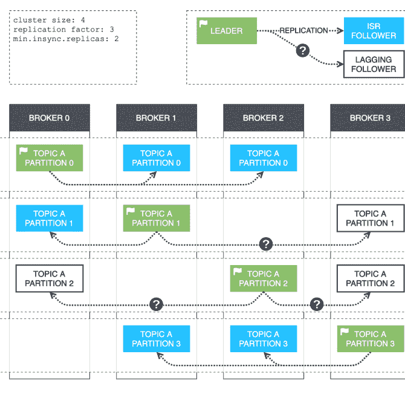

注意：领导者将等待来自以下的确认：

注意：领导者将阻塞等待 ISR 集合中的所有成员确认复制

副本不足 (under-replicated)

副本不足

注意：领导者将由于由于 ISR 中缺少成员而返回错误，因此生产者可能会重试。

### 主题复制——ISR 模型

在上方图中，主题配置的复制因子为 3，最小 ISR 大小为 2。对于 ISR 中有三个副本的分区，在领导者确认持久性写入之前，必须获得两个从器副本的确认。对于 ISR 减少到两个的分区，领导者将在确认写入之前等待剩余的同步副本（除自身外）。最后，当 ISR 完全耗尽时，领导者将向初始发布者通信错误，发布者随后可能重新尝试写入记录。

将此模型与其他分布式共识协议（如 ZAB、Raft 和 Paxos）相比：它不再要求在接受日志之前在成员之间之间达成多数共识并据此认为它是稳定的。事实证明，对于 ISR 的成员身份存在共识的，且 ISR 的所有成员都与领导者同步，ISR 不需要构成分所有副本的大多数。我们可以有 100 个副本，但只有两个在 ISR 中，仍然可以达成共识。

从表面上看，Kafka 的复制协议似乎完成了一项回避了分布式系统研究数十年的成就。事实并非如此。秘诀在于对 ISR 成员状态的共识，这种共识是由 `ZooKeeper` 支持的。`ZooKeeper` 的 ZAB 协议为 Kafka 的构建提供了底层原语。尽管 Kafka 日志复制不需要多数投票，但在更新 ISR 状态时需要多数投票。换句话说，Kafka 将其复制协议层叠在 ZAB 之上，形成了两者的混合体。

`min.insync.replicas` 的默认值为 1，这意味着持久性写入延伸到领导者副本，这是高度持久的。至少，`min.insync.replicas` 应该设置为 2，以确保写入反映在领导者同时也反映至少一个从器上。该属性可以为所有主题设置，也可以为单个主题设置。针对特定主题的说明已第 9 章：Broker 配置中涵盖。

最大可忍延迟通过 `replica.lag.time.max` broker 属性配置，默认值为 10000（十秒）。如果从器在此框架内没有发送任何请求，或者没有消费到领导者的日志偏移量，它将从 ISR 中被移除。此设置可以应用于所有主题，也可以选择性地应用于单个主题。

> 在 Kafka 0.8.3.0 之前，最大可忍延迟通过 `replica.lag.messages` 属性配置。复制协议曾通过考虑从器落后的记录数量来确定其是否应该在 ISR 中。在流量突发期间，副本可能会被踢出 ISR，但不久后又重新加入。相反，低流量主题需要很长时间才能检测出不同步副本。作为 KIP-16 的一部分，协议已演变为仅考虑领导者最新记录与每个从器记录之间的时间延迟。这使得协议更容易调优，因为它在流量突发期间不易受到抖动的影响。它使得更容易设置有意义的值，因为从时间角度思考比从任意记录角度思考更自然。

## 领导者选举

ISR 的成员有资格参加领导者选举。回想，Kafka 的复制协议是……

## 第 13 章：复制与致谢

### 更改复制因子

一旦设置了复制因子，后续可以使用 Admin API 或 CLI 工具来更改该因子。事实上，这并不像初始设置时那么简单；更改复制因子是一个半手动操作，需要为每个分区指定一组新的副本。

我们需要访问一个至少包含两个 broker 的多节点集群来练习更改复制因子。如果你恰好有一个可用的多节点集群，那太棒了。否则，不要担心；你可以使用下面的 Docker Compose 文件轻松地启动一个。在启动 Compose 栈之前，请记住关闭现有的 Kafka、Zookeeper 和 Kafdrop 实例，因为它们会在端口分配上产生冲突。

```
version: "3.2"
zookeeper:
  image: bitnami/zookeeper:3
  ports:
    - 2181:2181
  environment:
    ALLOW_ANONYMOUS_LOGIN: "yes"
kafka-0:
  image: bitnami/kafka:2
  ports:
    - 9092:9092
  environment:
    KAFKA_CFG_ZOOKEEPER_CONNECT: zookeeper:2181
    ALLOW_LISTENERS: "yes"
    KAFKA_LISTENERS:
      INTERNAL://:9092,EXTERNAL:::9092
    KAFKA_ADVERTISED_LISTENERS:
      INTERNAL://kafka-0:9092,EXTERNAL://localhost:9092
    KAFKA_LISTENER_SECURITY_PROTOCOL_MAP:
      INTERNAL:PLAINTEXT
    KAFKA_INTER_BROKER_LISTENER_NAME: "INTERNAL"
  depends_on:
    - zookeeper
kafka-1:
  image: bitnami/kafka:2
  ports:
    - 9093:9093
  environment:
    KAFKA_CFG_ZOOKEEPER_CONNECT: zookeeper:2181
    ALLOW_PLAINTEXT_LISTENER: "yes"
    KAFKA_LISTENERS:
      INTERNAL://:9093,EXTERNAL:::9093
    KAFKA_ADVERTISED_LISTENERS:
      INTERNAL://kafka-1:9093,EXTERNAL://localhost:9093
    KAFKA_LISTENER_SECURITY_PROTOCOL_MAP:
      INTERNAL:PLAINTEXT,EXTERNAL:PLAINTEXT
    KAFKA_INTER_BROKER_LISTENER_NAME: "INTERNAL"
  depends_on:
    - kafka-0
kafka-2:
  image: bitnami/kafka:2
  ports:
    - 9094:9094
  environment:
    KAFKA_CFG_ZOOKEEPER_CONNECT: zookeeper:2181
    ALLOW_PLAINTEXT_LISTENER: "yes"
    KAFKA_LISTENERS:
      INTERNAL://:9094,EXTERNAL:::9094
    KAFKA_ADVERTISED_LISTENERS:
      INTERNAL://kafka-2:9094,EXTERNAL://localhost:9094
    KAFKA_LISTENER_SECURITY_PROTOCOL_MAP:
      INTERNAL:PLAINTEXT,EXTERNAL:PLAINTEXT
    KAFKA_INTER_BROKER_LISTENER_NAME: "INTERNAL"
  depends_on:
    - kafka-0
    - kafka-1
kafdrop:
  image: obsidynamics/kafdrop:latest
  ports:
    - 9000:9000
  environment:
    KAFKA_BROKER_CONNECT: kafka-0:29092,kafka-1:29092,kafka-2:29092
  depends_on:
    - kafka-0
    - kafka-1
    - kafka-2
```

使用 `docker-compose up` 启动栈。这需要几秒钟来启动，将创建一个带有三个 Kafka broker 的单节点 ZooKeeper 集合。broker 将在外部绑定到端口 9092、9093 和 9094；因此，我们必须相应地调整引导列表。Kafdrop 也被包含在内——暴露在端口 9000。对于这个例子来说，三个 broker 稍微有点过剩了，但你可能会发现它对其他练习有用。

首先，我们将创建一个名为 `growth-plan` 的测试主题，它有两个分区且复制因子为 1。在下方命令中输入键。

```
$KAFKA_HOME/bin/kafka-topics.sh \
  --bootstrap-server localhost:9092,localhost:9093,localhost:9094 \
  --create --topic growth-plan --partitions 2 \
  --replication-factor 1
```

创建主题后，运行 `kafka-topics.sh` CLI 工具对其进行检查：

```
$KAFKA_HOME/bin/kafka-topics.sh \
  --bootstrap-server localhost:9092,localhost:9093,localhost:9094 \
  --describe --topic growth-plan
```

输出显示有两个分区，它们的领导者被分配到两个不同的 broker。如所预期，复制因子为 1。（副本的分配是随机的，因此你的输出可能与下面不同。）


## 第 13 章：复制与致谢

### 更改复制因子

一旦设置了复制因子，后续可以使用 `Admin API` 或 `CLI` 工具来更改该复制因子。事实上，这并不像初始设置时那么简单；更改复制因子是一个半手动操作，需要为每个分区指定一组新的副本。

我们需要访问一个至少包含两个 `broker` 的多节点集群来练习更改复制因子。如果你恰好有一个可用的多节点集群，那太棒了。否则，不要担心；你可以使用下面的 `Docker Compose` 文件轻松地启动一个。在启动 `Compose` 栈之前，请记住关闭现有的 `Kafka`、`Zookeeper` 和 `Kafdrop` 实例，因为它们会在端口分配上产生冲突。

```
version: "3.2"
zookeeper:
  image: bitnami/zookeeper:3
  ports:
    - 2181:2181
  environment:
    ALLOW_ANONYMOUS_LOGIN: "yes"
kafka-0:
  image: bitnami/kafka:2
  ports:
    - 9092:9092
  environment:
    KAFKA_CFG_ZOOKEEPER_CONNECT: zookeeper:2181
    ALLOW_LISTENERS: "yes"
    KAFKA_LISTENERS:
      INTERNAL://:9092,EXTERNAL:::9092
    KAFKA_ADVERTISED_LISTENERS:
      INTERNAL://kafka-0:9092,EXTERNAL://localhost:9092
    KAFKA_LISTENER_SECURITY_PROTOCOL_MAP:
      INTERNAL:PLAINTEXT
    KAFKA_INTER_BROKER_LISTENER_NAME: "INTERNAL"
  depends_on:
    - zookeeper
kafka-1:
  image: bitnami/kafka:2
  ports:
    - 9093:9093
  environment:
    KAFKA_CFG_ZOOKEEPER_CONNECT: zookeeper:2181
    ALLOW_PLAINTEXT_LISTENER: "yes"
    KAFKA_LISTENERS:
      INTERNAL://:9093,EXTERNAL:::9093
    KAFKA_ADVERTISED_LISTENERS:
      INTERNAL://kafka-1:9093,EXTERNAL://localhost:9093
    KAFKA_LISTENER_SECURITY_PROTOCOL_MAP:
      INTERNAL:PLAINTEXT,EXTERNAL:PLAINTEXT
    KAFKA_INTER_BROKER_LISTENER_NAME: "INTERNAL"
  depends_on:
    - kafka-0
kafka-2:
  image: bitnami/kafka:2
  ports:
    - 9094:9094
  environment:
    KAFKA_CFG_ZOOKEEPER_CONNECT: zookeeper:2181
    ALLOW_PLAINTEXT_LISTENER: "yes"
    KAFKA_LISTENERS:
      INTERNAL://:9094,EXTERNAL:::9094
    KAFKA_ADVERTISED_LISTENERS:
      INTERNAL://kafka-2:9094,EXTERNAL://localhost:9094
    KAFKA_LISTENER_SECURITY_PROTOCOL_MAP:
      INTERNAL:PLAINTEXT,EXTERNAL:PLAINTEXT
    KAFKA_INTER_BROKER_LISTENER_NAME: "INTERNAL"
  depends_on:
    - kafka-0
    - kafka-1
kafdrop:
  image: obsidynamics/kafdrop:latest
  ports:
    - 9000:9000
  environment:
    KAFKA_BROKER_CONNECT: kafka-0:29092,kafka-1:29092,kafka-2:29092
  depends_on:
    - kafka-0
    - kafka-1
    - kafka-2
```

使用 `docker-compose up` 启动栈。这需要几秒钟来启动，将创建一个带有三个 `Kafka` `broker` 的单节点 `ZooKeeper` 集合。`broker` 将在外部绑定到端口 `9092`、`9093` 和 `9094`；因此，我们必须相应地调整我们的引导列表。`Kafdrop` 也被包含在内——暴露在端口 `9000`。对于这个例子来说，三个 `broker` 稍微有点过剩了，但你可能会发现它对其他练习有用。

首先，我们将创建一个名为 `growth-plan` 的测试主题，它有两个分区且复制因子为 1。在下方命令中输入。

```
$KAFKA_HOME/bin/kafka-topics.sh \
  --bootstrap-server localhost:9092,localhost:9093,localhost:9094 \
  --create --topic growth-plan --partitions 2 \
  --replication-factor 1
```

创建主题后，运行 `kafka-topics.sh` `CLI` 工具对其进行检查：

```
$KAFKA_HOME/bin/kafka-topics.sh \
  --bootstrap-server localhost:9092,localhost:9093,localhost:9094 \
  --describe --topic growth-plan
```

输出显示有两个分区，它们的领导者被分配到两个不同的 `broker`。如所预期，复制因子为 1。（副本的分配是随机的，因此你的输出可能与下面不同。）

```
Topic: growth-plan PartitionCount: 2 ReplicationFactor: 1
Partition 0 Leader: kafka-0 Isr-kafka-0
Partition 1 Leader: kafka-1 Isr-kafka-1
```

### 分区详情

| 分区 | 起始偏移量 | 结束偏移量 | 大小 | 节点 | 副本节点 | 同步节点 | 副本 | 副本未同步 |
|---|---|---|---|---|---|---|---|---|
| 0 | 0 | 0 | 1002 | 1002,1001 | 1001,1002 | | 是 | 否 |
| 1 | 0 | 0 | 0 | 1001,1002 | 1001,1002 | | 是 | 否 |

`Kafka` 显示具有两个副本的 `topic`。

手动准备重分配文件可能是繁琐的。有几个开源辅助脚本可以自动完成这一过程。其中一个脚本是 `kafka-reassign-tool`，托管在 `GitHub` 上 `github.com/dimas/kafka-reassign-tool`^1。

## 停用 broker 节点

内置的 `kafka-reassign-partitions.sh` 工具对于调整复制因子等简单情况来说可能显得过于底层且繁琐。然而，这有其原因：该工具用于对复制拓扑结构进行任意更改。其中一个用例是在 `broker` 节点之间重新平衡分区，以便在向集群添加新节点时减轻负载。另一个用例是在 `broker` 节点被安全停用之前将其数据迁出。

在选择了要停用的 `broker` 后，创建一个重分配文件，将要迁出的 `broker` 作为副本的所有分区包含在内。将迁出的 `broker` ID 替换为剩余 `broker` 之一，确保保留原始的分区因子（除非你想更改复制因子）。准备工作完成后，运行带有 `-execute` 选项的 `kafka-reassign-partitions.sh`，然后运行 `-verify` 选项以确保过程完成。重分配分区后，运行不指定 `topic` 的带有 `-describe` 选项的 `kafka-topics.sh` 命令，验证迁出的 `broker` 不再出现在任何副本中，只有在 `broker` 被完全隔离后，才能将其从集群中永久删除。

> ^1https://github.com/dimas/kafka-reassign-tool

## 确认

`acks` 属性规定了生产者在认为请求完成并在向生产者确认写入之前，需要 `leader` 接收到的确认数量。这对于记录的持久性至关重要；配置不当的 `acks` 属性可能会导致数据丢失，而生产者却天真地认为记录已稳定持久化。

虽然生产者属性与确认数量有关，但它接受以下枚举常量：

- `0`: 不需要 `leader` 的确认。
- `1`: 需要 `leader` 的一次确认，即记录持久化到其本地日志。这是当 `enable.idempotence` 设置为 `false` 时的默认值。
- `-1` 或 `all`: 要求 `leader` 接收到所有同步副本（`ISR`）的确认。这是当 `enable.idempotence` 设置为 `true` 时的默认设置。

这些模式中的每一个将在后续的小节中详细讨论。

## 无确认

当 `acks=0` 时，队列在发送套字上的任何记录都被认为已发布，不需要 `leader` 的显式确认。此选项提供了最弱的持久性保证。它只受到 `broker` 轻微丢失的影响，但客户端的可用性也是记录持久性的决定因素。如果客户端失败，任何队列中的记录都将丢失。

除了放弃任何持久性保证外，客户端还不会收到已发布记录的偏移量。通常情况下，客户端通过两种不同方式获取偏移量：提供 `org.apache.kafka.clients.Producer.send()` 方法，或者在从 `send()` 返回的 `Future<RecordMetadata>` 对象的结果上进行阻塞。然而，得到的 `RecordMetadata` 将包含已发布记录的偏移量。但是，当 `acks=0` 时，`RecordMetadata.hasOffset()` 将返回 `false`，且 `RecordMetadata.offset()` 将返回 `-1`，表示偏移量可用。


`acks=0` 的主要用例是发布者可以承受丢失单条记录或小批连续记录，而对整个系统的正确性影响微乎其微。考虑一个定期向服务器提交遥测读数的温度传感器，服务器随后将这些读数发布到 Kafka topic。下游进程将读取这些读数并实时填充 Web 仪表板。

在这种假设的情况下，只要历史温度读数不重要，我们就可以丢失一些中间读数，只要每个传感器的读数最终传过来即可。这并不是说更高的持久性评分在某些情况下不适用，而是可能并非严格必要。此外，通过忽略确认，我们还在很大程度上规避了错误处理问题。这导致了一种更简单、更易维护的方法，尽管它几乎不提供保证。

> 设置 `acks=0` 并不意味着 leader 不会将记录复制到同步副本中。标准复制在所有情况下行为都相同，无论请求的确认数量是多少。你可以将 `acks` 视为三方 —— 客户端、leader 和副本副本 之间名义合同的保证级别。合同始终存在，每个方都尽力，但尽管如此，如果一方发生故障，合同可能无法履行。

## 一次确认

当 `acks=1` 时，客户端将等待分区 leader 将写入记录到其本地日志。broker 将异步将记录转发给所有副本，并在从同步副本接收确认之前回复发布者。

从表面上看，这似乎比 `acks=0` 提供了更显著的持久性保证。如果在 `acks=0` 时系统无法容忍方的故障，在 `acks=1` 情况下，只要客户端在线，就可以容忍分区 的故障。如果 leader 故障，生产者可以将请求转发到替代 leader 的其他副本。

实际上，由于几个原因，这种做法是不明智的。一个是与 Kafka 将记录写入日志有关。记录在交给文件系统缓冲区时被视为写入。然而，broker 不会为每个写入的记录调用 `fsync` 操作，也就是说，它在回复客户端之前不会等待写入刷新。因此，broker 可能在确认写入后发生故障，导致写入块在复制到副本之前就丢失。生产者将继续假设写入已确认。

第二个原因与第一个原因密切相关。假设写入已成功提交到 leader 磁盘，但 leader 在记录被任何副本接收之前发生了故障。控制器节点在识别故障后，将从剩余的同步副本中指定一个新 leader。无法保证新 leader 拥有迁出的 leader 队列复制的最后几条记录。

这并不是说 `acks=1` 没有任何额外的持久性利益，相反，`acks=0` 和 `acks=1` 之间的区别只有在存在实质差异时才是可见的。

## 第 13 章：复制与确认

客户端和 broker 节点之间的相对可靠性。有时情况确实如此：broker 可能使用更高级的硬件组件和更集成的冗余进行组装，使得它们不易发生故障。相反，客户端可能运行在瞬态实例上，这些实例可能会在短时间内终止。但如果将此视为理当然，把 broker 像任何其他组件一样对待将是明智且谨慎的做法——假设如果某些东西可能故障，它很可能会发生，而且我们预期它会发生。

考虑到上述因素，在客户端可以轻易承受丢失已发布记录、但仍需要可能发布的记录的偏移量（offset）的场景下（无论是为了其内部维护，还是为了响应上游应用），请设置 `acks=1`。

## 所有确认

当 `acks=all` 或 `acks=1`（二者等同）时，客户端将等待分区领导者从整个同步副本（ISR）集合中收集确认。这是所提供的最高保证，确保只要至少存在一个同步副本，记录就能被持久化。正如前文所述，同步副本的数量可能与副本的总数不同；同步副本由一个集合表示，该集合会根据领导者与每个跟随者之间的观察延迟动态增长和收缩。由于 `acks=all` 时发布操作的延迟归因于 ISR 中最慢的副本，同步副本集的设计通过临时排除那些因 I/O 瓶颈或其他影响性能的意外情况而导致饥饿的副本，来最大限地减少这种延迟。

> Kafka 中隐藏着一对微妙的坑（gotchas）：一个在客户端，另一个在 broker。当禁用等幂性（idempotent）时，acks 的默认设置如此。（等幂性在第 10 章：客户端配置中讨论）。这可能无法满足大多数应用的持久性预期。虽然选择 `acks=1` 可能与向生产者披露 `RecordMetadata` 有关，但生产者将获得已发布记录的偏移量，而 `acks=0` 则生产者一无所知。Kafka 官方文档指出：“结合使用时，`min.insync.replicas` 和 `acks` 允许你强制执行持久性保证。一个典型的场景是创建一个将 `min.insync.replicas` 设置为 2 的主题，并使用 `acks=all` 进行生产。”尽管需要满足“典型”场景，`acks` 的默认值仍为 1。第二个“坑”：`min.insync.replicas` 的默认值为 1，这再次违背了“典型”场景。

在系统正确性由生产者与 Kafka 集群之间关于记录是否已发布的共识来预测的场景下，请设置 `acks=all`。换句话说，如果客户端认为记录已经发布，那么它最好确实如此，否则系统的完整性可能会受到损害。这在事务型业务应用中很常见，其中记录的事件与财务活动相关；记录的丢失会直接或间接地导致财务损失。

`acks=all` 的主要缺点是由于多次阻塞网络调用（生产者与领导者之间、领导者与其部分跟随者之间）导致延迟增加。这是持久性的代价。

## 哪种设置适合我？

上面的解释已经了生产者客户端和分区领导者相对于 `acks` 属性值的行为。读者现在应该对不同确认模式可能适用的场景有更深入的理解。

如果有疑问，请将 `acks` 设置为 `all`。这将确保记录获得确认的 broker 数量至少等于 `min.insync.replicas` 的值。请记住，“已确认”不等同于“已持久化”。确认后 broker 立即故障可能会导致数据丢失，因此 `min.insync.replicas` 准确反映你对数据丢失的容忍度至关重要。在复制因子为三的主题上将 `min.insync.replicas` 设置为 2，并在生产者上设置 `acks=all`，每个每个发布的记录都获得领导者和至少一个副本的确认。增加的延迟可能很明显，但可能比数据丢失要好。人们甚至可以认为，如果延迟是主导技术决策的首要考虑因素，那么 Kafka 也许不是当前问题的最佳解决方案。

本章探讨了 Kafka 内部复制协议的细节。我们学习了 Kafka 如何利用同步副本来减少持久化存储所需的确认次数，从而高效地实现了分布式共识。

我们查看了分区可用性和数据一致性考量如何受到复制设置的影响，即在决定复制因子和 `min.insync.replicas` 参数时固有的可用性-一致性权衡。这涉及到 Kafka 的领导者选举——即在领导者发生故障时提升副本时做出的决策。

我们探索了复制拓扑的配置。我们通过使用内置的 `kafka-reassign-partitions` 工具的示例，实现了对分区副本的细粒度控制，并探讨了其在简单复制因子调整之外的潜在用例。涵盖了持久化存储的性能权衡，并深入研究了 Kafka 默认配置设置的特性，以及它们可能如何让毫无防备的用户掉进去。

最后，从生产者的角度探讨了持久性。我们查看了 `acks` 生产者设置如何影响单个记录的持久性保证，以及它们与复制因子和 `min.insync.replicas` broker 端设置的相互作用。

## 第 14 章：数据保留

鉴于无限存储尚未发明，存储在 Kafka 中的所有记录会发生什么？

第 3 章：架构与核心概念引入了低水位和高水位标记的概念，以及它们如何随着记录写入日志以及记录最终被清除而移动。本章的重点将是后者；特别是数据被删除的条件以及 Kafka 在这方面的精确行为。

## Kafka 存储内部

考虑到上述情况，大多数操作员在配置数据保留行为以及许多其他方面时，倾向于将 Kafka 视为黑盒。

## 第14 章：数据留存

```
0000000000000000000.index
0000000000000000000.log
0000000000000000000.timeindex
leader-epoch-checkpoint
```

`leader-epoch-checkpoint` 文件包含领导者代（leader epoch）——集群控制器重新分配分区领导权限的次数。副本使用领导者代作为验证当前领导者的手段，如果先前的领导者的领导状态已被取代，则会对其进行隔离（fencing）。如果被置换的领导者尝试同步数据，副本会感知到它正在过时的代数号下运行，并忽略其命令。

## 索引

以大数字（零填充整数）命名的文件是日志段（log segments）。Kafka 不将其分区日志存储在单个连续的“巨型”文件中。相反，日志被分解为离散的块。每个分段都根据其包含的第一条记录的偏移量（offset）进行索引。这被称为基础偏移量（base offset）。

记录的大小可以是任意的，因此在各自的 `.log` 文件中占据不同的空间。为了进一步完成处理，记录是批次持久化的（可能会被压缩）。记录的大小和批处理意味着无法仅通过日志文件通过偏移量轻易地定位记录。这就是 `.index` 文件的用武之地。本质上，索引是记录偏移量到 `.log` 文件中记录物理位置的排序映射。当记录被包含在一个批次内时，索引文件指向该批次条目的开头。为了紧凑性，索引文件使用 32 位整数存储偏移量，并预先从记录的偏移量中减去基础偏移量。索引的物理位置以 32 位整数存储，组合条目大小为 8 字节。索引是内存映射文件（memory-mapped files）；索引的存储空间在创建索引文件时就会进行预分配。预分配空间的大小由 `.index.size.max.bytes` 属性规定，默认值为 10485760 (10 MiB)，并作为所有主题的默认值。要控制特定主题的预分配，请设置 `segment.index.bytes` 属性。当日志滚动（roll）时，其索引中剩余的未使用空间将归还文件系统。

> Kafka 对影响行为的属性与针对主题的属性使用了不同的名称。这些属性没有特定的命名约定；例如，集群范围的 `log.roll.ms` 属性对应于每个主题的 `segment.ms` 属性。

日志中的每条记录在索引中都有一个对应的条目。首先，记录可能是批次的一部分，只有批次的位置被索引了。此外，为了限制索引文件的大小并尽可能地减少额外的磁盘 I/O，记录按 `log.index.interval.bytes` 指定的间隔进行索引，该值默认为 4096。如需按主题覆盖此项设置，可以在主题实体上分配 `index.interval.bytes` 属性。

在索引文件的帮助下，可以在 O(1) 复杂度内定位记录。给定记录的偏移量——通过减去基础偏移量、除以索引间隔，并寻址到索引文件中生成的对应位置——即可揭示记录的物理位置。如果涉及的记录可能没有索引，则将使用之前索引的偏移量，需要进行短距离扫描来找到记录。

`.timeindex` 文件是 `.index` 文件的近亲，它将每条记录的毫秒级 UNIX 代时间戳映射到其在 `.log` 文件中的位置。`.timeindex` 文件的存在允许 Kafka 根据时间定位记录，而不是根据偏移量。

下面的图说明了分段日志结构以及使用索引将记录偏移量映射到日志文件物理位置的方法。

file:

00000000..00.index

file:

0000000000000000.log

| | |

|---|---|

| 00..00 | 00..00 |

| 00..01 | 00..03 |

| 00..02 | 00..04 |

| 00..03 | 00..06 |

| 00..04 | 00..07 |

| | |

|---|---|

| 00..00 | record data |

| 00..01 | record data |

| 00..02 | record data |

| 00..03 | record data |

| 00..04 | record data |

> 注意：

固定长度索引条目

> 注意：

变变记录大小

file:

00000000..05.index

file:

00000000000000005.log

| | |

|---|---|

| 00..00 | 00..00 |

| 00..01 | 00..02 |

| 00..02 | 00..04 |

| 00..03 | 00..05 |

| 00..04 | 00..08 |

| | |

|---|---|

| 00..05 | record data |

| 00..06 | record data |

| 00..07 | record data |

| 00..08 | record data |

| 00..09 | record data |

> 注意：

距离基础偏移量的距离

> 注意：

文件中的位置

file:

00000000..10.index

file:

00000000000000010.log

| | |

|---|---|

| 00..00 | 00..00 |

| 00..01 | 00..02 |

| | |

|---|---|

| 00..10 | record data |

| 00..11 | record data |

## 日志段的滚动

在介绍了基础知识后，我们进入最关键的部分——日志段的滚动。为了滚动日志段，副本通常会多个领导者代。log.ms 和 segment.ms 限制了活动段在关闭之前的存在。

在某个时间点，活动段达到阈值将触发滚动。这些限制由以下属性定义：

- `segment.bytes`：日志的最大大小。默认值为107371824。

- `roll.hours`：日志的最大时长（小时）。默认值为7。

虽然索引文件默认是预分配的，但日志段并非如此（因为日志段更大）。此外，基于 Linux 的文件系统在追加操作方面通常良好。缺乏预分配在 Kafka 运行在 NTFS 和某些旧系统上会导致已知问题。要启用文件的预分配，请将所有主题的 `preallocate` 属性设置为 true，或者针对单个主题设置该属性。

## 查看日志内容

由于日志和索引文件都以二进制格式编码以保持紧凑，直接读取数据无法为用户提供任何意义的信息，除非记录的键或值部分恰好是字符串。为了协助诊断日志和索引问题，Kafka 提供了一个命令行工具 `kafka-dump-log.sh`。该工具必须在分区数据的节点上运行，并可以任何类型的文件（包括索引文件）。下面的示例显示了 `kafka-dump-log.sh` 对 getting-started 日志段的输出。

```
LOG_DIR=/tmp/kafka-logs &&
$KAFKA_HOME/bin/kafka-dump-log.sh \
  --files $LOG_DIR/getting-started-0/0000000000000000.log \
  --print-data-log
```

```
Dumping /tmp/kafka-logs/getting-started-0/0000000000000000.log
Starting offset: 0
baseOffset: 0 count: 1 baseSequence: -1 []
lastSequence: -1 producerId: 1 producerEpoch: -1 []
partitionLeaderEpoch: 0 isTransactional: false []
isControl: false position: 0 CreateTime: 1577930118584 []
size: 73 magnitude: 2 compresscodec: NONE crc: 233302560 []
isvalid: true
offset: 0 CreateTime: 1577930118584 keysize: -1 valuesize: 5 []
sequence: -1 headerKeys: [] payload: alpha
```

## 第 14 章：数据保留

两种策略可以共存。本节将重点关注删除策略（delete strategy）；下一节将介绍压缩（compaction）。

清理策略可以通过 `log.cleanup.policy` 属性分配，该属性接收一个用逗号分隔的策略值列表：`delete`（删除）和 `compact`（压缩）。默认值为 `delete`。此设置可以静态或动态分配，作为跨主题的默认值。可以通过 `cleanup.policy` 属性分配特定主题的策略——这将覆盖该主题的默认 `log.cleanup.policy`。

删除策略在日志段（log segments）的粒度上运行。运行在副本内部的后台进程会检查每个非活跃日志段，以确定该日志段是否符合删除条件。限制日志段保留的阈值包括：

- `log.retention.bytes` — 在日志段被修剪之前允许的日志最大大小，有时包含尾部段。该值没有默认设置，因为大多数保留需求是基于时间而非大小指定的。

- `log.retention.hours` — 在删除日志段之前保留它的小时数。默认值为 168（一周）。基于大小和基于时间的属性是互补的；只要违反任何一个约束条件，就会触发段删除。

- `log.retention.minutes` — 指定以分钟为单位，适用于小时无法提供足够粒度的情况。如果设置，此属性将覆盖 `log.retention.hours`。

- `log.retention.ms` — 指定以毫秒为单位，覆盖 `log.retention.hours`。

后台进程按照 `log.retention.check_interval.ms` 指定的间隔检查文件，默认值为 300000（五分钟）。对于日志寿命以小时、天或周为单位的保留设置，这足够了。当在较短的时间范围内设置删除策略时，可能需要缩短此间隔以减少连续检查之间的时间。

正如第 3 章《架构与核心概念》所述，记录的删除会导致起始偏移量（也称为低水线标记）移动到第一条保留记录的位置。这随着日志段的删除而自动发生。


由于删除策略是一种日志策略，可能需要根据对删除过程响应能力的预期来调整段的最大 own。假设有一个要求记录时间不应超过七天，但至少需要保留五天。将`log.retention.hours`设置为 168（七天）将满足五天的下限，但取决于活跃段滚动滚动（roll over）所需的时间，上限可能无法满足。请记住，活跃段仅允许生产者发起的写入；所有修改——删除和压缩——都只能在非活跃段上发生。在默认设置下，除非日志文件达到七天的成熟期或大小增长到 1 GiB，否则日志文件不会滚动。为了满足上限，我们必须限制日志段的寿命，使其在更合适的时间范围内进行滚动。例如，我们可以将`log.retention.hours`设置为 132（五天十二小时），并将`log.roll.hours`设置为 24，从而强制在六个半天后进行一次垃圾收集。

`log.roll`设置（及其更细细粒度的等效设置）是低吞吐量主题中实现日志文件可预测性滚动的有效措施，在这些主题中，写入压力不足以仅通过文件大小触发滚动。然而，基于时间的触发器需要至少对活跃段进行一次写入，Broker 才能认为其时间已到。如果某个主题由于任何原因没有发生写入，Kafka 不会主动滚动日志段，即使该段已超过了预期寿命。因此在上面的示例中，只有当主题有持续的记录流入时，我们才能满足上限要求。

Kafka 的删除不仅适用于用户定义的主题，还适用于`__consumer_offsets__`等内部主题。关于日志段的删除如何影响消费者组的更多详细信息，请参阅第 5 章《入门》。

## 压缩

### 压缩背后的用例

在大多数情况下，Kafka 被用作复制日志，用于通知下游方某些相关事件，这些事件通常与上游记录系统的变化相关。通常，这由数据库或其他持久化存储支持，该存储提供了一个查询数据当前状态的接口，以备对状态快照存档有全局视图的需求。消费者可以通过忠实复制相关更改来构建上游系统的自定义投影；这些更改以事件的形式发出。无论何种方式，Kafka 都被用作某种中间传输——支撑更广泛的事件驱动系统的关键中间件。尽管它在这种语境下看起来可能至关重要，但在大多数用法中，Kafka 并没有完全取代记录系统。

尽管人们可能会认为，Kafka 似乎非常接近于数据存储的角色——特别是当应用程序越来越多地构建在复制日志之上。即使在事件驱动系统中，查询主存储的概念也几乎被消除了，或者更多地推到了“填充（hydration）”场景中，在该场景中，首次消费者可能会查询主数据以初始化其内部投影，之后切换到基于 Kafka 的复制。供读者参考，此类系统都是双模态的——它们使用一种模式进行初始填充，使用另一种模式进行后续复制。虽然它们大多是直观易懂的——因为两种模式都可以被容易推断——但增加了维护处理一次性事件代码的复杂性——这种意外通常在应用程序其目标运行环境的生命周期内发生一次。

如果 Kafka 是用来做事件溯源（event sourcing）的会怎样？具体来说，作为确定性事件存储的角色，它可以从第一性原理重构整个领域的状态——通过重放所有更新。这种安排将具有明显的益处——单模态；易于测试；易于维护。记录每个实体整个生命周期内的所有更改？这听起来像是一个扩展性噩梦。在无限保留的情况下，从哪里能找到所有数据？从零开始填充需要多久？

即使有无限保留，存储所有内容的朴素方法也难以可行——特别是对于快速变化的数据，重放时间将增长到无法理解。另一方面，丢弃旧记录会导致数据丢失。Kafka 使用其压缩功能来适应这种场景。删除在段级别操作，而压缩提供了更细粒度的、基于记录的策略。其思想是选择性地修剪一组记录，其中某个实体的更新的（因此更相关的）更新记录存在。通过这样做，日志保证至少有一个代表当前状态的记录。

另一种看待压缩的视角是，它将流转换为快照，只保留更新的最新时间线。这类似于数据库中的行，后者忽略了时间线。对于这项工作，更新的粒度必须与底层实体的粒度对齐；换句话说，更新必须是完整的。当更新包含增量（deltas）——即用于量构建实体状态的碎片信息时，压缩是难以实现的。如果较新的更新取代了其逻辑先驱，那么记录中就不包含任何通过消费者无法获取的信息。

## 覆盖和删除记录

压缩通过向`log.cleanup.policy`（或针对主题的`cleanup.policy`）列表中添加压缩来激活。添加策略后，压缩需要清理进程，该进程默认启用并由`log.cleaner.enable`属性控制。

一旦激活压缩，生产者就不需要执行其他操作来覆盖旧记录——只需发布具有相同键的更新。在强制压缩的情况下，记录的数量将接近所描述的实体数量。当一个实体的有效寿命接近结束时，可以通过发布“墓碑（tombstone）”来删除该实体的任何之前的更新——即与之前的更新具有相同键但值为空的记录。墓碑将触发类似记录的清除，但其本身会被保留一段时间，然后最终被清除。（原因将在稍后讨论。）从消费者的角度来看，墓碑并没有特殊之处——它将如其所示看到生产者写入的空值记录。

一旦一个主题被完全压缩（删除了旧记录并清理了墓碑），消费者遍历主题到末尾的时间将正比于数量

## 第 14 章：数据保留

保留唯一的键。这正是持续支持绝大多数事件溯源场景所需的。

## 层原理

压缩（Compaction）本质上是异步的，通过跟踪非活跃的日志段（log segments）在后台运行。在底层，日志压缩会在每个副本上招募专用线程——具体的线程数量由`log.cleaner.threads`代理属性决定（默认值为 1）。压缩由四个主要属性驱动：

- `log.cleaner.min.cleanable.ratio` — 脏日志大小与总日志大小的最小比例，达到该比例的日志才符合压缩条件。默认值为 0.5。稍后将详细介绍脏数据比例。

- `log.cleaner.min.compaction.log.ms` —— 防止早于最小时的记录被进行压缩。默认值为 0，意味着记录在被压缩之前没有最小持续时间限制，受活跃日志段的限制。（回想，只有非活跃段中的记录才受操作影响）。

- `log.cleaner.max.compaction.log.ms` — 压缩日志的上限。通常用于低吞吐量主题，这类主题可能超过`log.cleaner.min.cleanable.ratio`，从而在无限时间内不符合压缩条件。默认设置为`Long.MAX_VALUE`，意味着压缩由`log.cleaner.min.cleanable.ratio`驱动。（注意，上限并非截止日期，取决于清理线程的可用性以及实际压缩时间。）

- `log.cleaner.delete.retention.ms` — 墓碑记录（tombstone records）在从日志中删除之前的持久时间。稍后将详细介绍墓碑保留。

上述设置作为集群范围的默认值。其对应的主题等效属性为：

- `min.cleanable.dirty.ratio` — 代替`log.cleaner.min.cleanable.ratio`

- `min.compaction.log.ms` — 代替`log.cleaner.min.compaction.log.ms`

- `max.compaction.log.ms` — 代替`log.cleaner.max.compaction.log.ms`

- `delete.retention.ms` — 代替`log.cleaner.delete.retention.ms`

对于每个被压缩的日志，清理器维护两个逻辑点——清理点（cleaner point）和删除保留点（deletion retention point）。清理点是日志中对应清理器处理进度的位置，它将日志分为两个部分。比清理点旧的部分称为日志尾（log tail），对应于已被清理器压缩的段。相反，日志中比清理点新的部分是日志头（log head），对应于尚未压缩的段。下图展示了这些点相对于整体日志的位置。

> 随着压缩，点向日志头部移动

# 删除保留点

# 清理点

> 注意：稀疏日志

> 注意：稠密日志

| 范围 | 记录数据 |

| :--- | :--- |

| 000..008 | record数据 |

| 000..011 | record数据 |

| 000..013 | record数据 |

| 000..014 | record数据 |

| 000..019 | record数据 |

| 000..026 | record数据 |

| 000..029 | record数据 |

| 000..033 | record数据 |

| 000..036 | record数据 |

| 000..042 | record数据 |

| 000..057 | record数据 |

| 000..065 | record数据 |

| 000..080 | record数据 |

| 000..081 | record数据 |

| 000..082 | record数据 |

| 000..083 | record数据 |

| 000..084 | record数据 |

| 000..085 | record数据 |

| 000..086 | record数据 |

| 000..087 | record数据 |

| 000..088 | record数据 |

| 000..089 | record数据 |

| 000..090 | 下次写入

## 日志压缩

清理线程优先处理头部大小与日志总长度比例最高的日志——即脏数据比例（dirty ratio）。日志要被选择进行压缩，其脏数据比例必须超过`log.cleaner.min.cleanable.ratio`，或者最旧的未压缩记录超过`log.cleaner.max.compaction.lag.ms`。

为了执行压缩，清理器扫描头部部分（包括活跃段），填充一个内存哈希表，将唯一记录映射到它们在日志中最新的偏移量。所有非活跃日志段及其索引都会被复制（包括已压缩过的段），并删除被覆盖的记录——墓碑除外，它们处理方式不同。当清理器处理日志段时，新段将交换到日志中，替换旧段。这种压缩不需要整个分区两倍的空间；只需要一个日志段的空闲空间。

压缩保留了幸存记录及其原始顺序。

# 第14 章：数据保留

```
AAPL:279.74
AAPL:280.03
MSFT:157.14
MSFT:156.01
AAPL:284.90
IBM:100.50
```

完成后按 CTRL-D。

现在运行当前命令。假设压缩器（compactor）已经有机会运行过，输出将限制在唯一的记录键及其对应的最新值上。

```
$KAFKA_HOME/bin/kafka-console-consumer.sh \
  --bootstrap-server localhost:9092 \
  --topic prices --from-beginning \
  --property print.key=true
```

```
MSFT 156.01
AAPL 284.90
IBM 100.50
```

此外，我们还可以看到压缩对日志文件的影响：

```
tree -s /tmp/kafka-logs/prices-0
```

```
/tmp/kafka-logs/prices-0
[ 0] 0000000000000000.index
[ 156] 0000000000000000.log
[ 12] 0000000000000000.timeindex
[ 10] 0000000000000001.snapshot
[ 10] 0000000000000002.snapshot
[ 10] 0000000000000003.snapshot
[ 10] 0000000000000004.snapshot
[ 1048576] 0000000000000005.index
[ 77] 0000000000000005.log
[ 10] 0000000000000005.snapshot
[ 1048576] 0000000000000005.timeindex
[ 8] leader-epoch-checkpoint
```

0 个目录，12 个文件

活跃日志段是`0000000000000005.log`。所有先前的段都已压缩，在它们留下了空的快照（snapshots）；剩余的唯一记录合并到了`0000000000000000.log`中。感兴趣的是，我们可以使用`kafka-dump-logs.sh`工具查看其内容：

```
$KAFKA_HOME/bin/kafka-dump-log.sh --print-data-log \
--files /tmp/kafka-logs/prices-0/00000000000000000000.log
```

```
Dumping /tmp/kafka-logs/prices-0/00000000000000000000.log
Starting offset: 0
baseOffset: -1 lastOffset: 3 count: 1 baseSequence: -1 0
lastSequence: -1 producerId: 1 producerEpoch: -1 0
partitionLeaderEpoch: 0 isTransactional: false 0
isControl: false position: 0 CreateTime: 1577409425248 0
size: 78 magic: 2 compressccodec: NONE crc: 2399134455 0
isvalid: true
offset: 3 CreateTime: 1577409425248 keysize: 4 values: 6 0
sequence: -1 headerKeys: [] key: MSFT payload: 156.01 0
baseOffset: 4 lastOffset: 4 count: 1 baseSequence: -1 0
lastSequence: -1 producerId: 0 producerEpoch: -1 0
partitionLeaderEpoch: 0 isTransactional: false 0
isControl: false position: 0 CreateTime: 1577409434843 0
size: 78 magic: 2 compressccodec: NONE crc: 27111860800 0
isvalid: true
offset: 4 CreateTime: 1577409434843 keysize: 4 values: 6 0
sequence: -1 headerKeys: [] key: AAPL payload: 284.90
```

这显示 MSFT 和 AAPL 记录已经聚集在了一起，尽管它们最初会出现在不同的段中。IBM 记录由于最后发布，将位于活跃段中。

活跃段的存在可能是关于压缩方面最令人困惑的，让许多从业者大措意不及。当一个主题似乎被部分压缩时，大多数情况下的原因是未压缩的记录位于活跃段中，因此它们不在处理范围内。

## 将压缩与删除结合

正如之前提到的，可以为`log.cleanup.policy`属性（或`cleanup.policy`）同时分配删除（delete）和压缩（compact）策略。问题是：这样做有意义吗？

当一个主题被配置为界限保留（bounded retention）时，典型的应用场景是为双模事件复制或事件流处理提供服务——即消费者生态系统或一系列处理阶段对上游事件做出反应。无界保留（Unbounded retention）通常是过分的；只需保留时间覆盖预测的最大消费者延迟就足够了。

相反，当一个主题被压缩时，人们自然地假设它被用作“真理来源”（source of truth）——其中状态的保留是一个核心属性，而不是对离散变更的保留。在这种模型下，要么是缺乏可查询的数据源，要么是消费者发布查询变得难以进行。这使得单模处理（unimodal processing）成为可能，这也是主要优势。

将两种策略结合初看起来似乎是反直觉的。有人曾说：压缩主题在逻辑上可以等同于数据库（或键值存储）——其最新的更新对应于有限表格中的行。在上面加上删除策略，感觉就像我们正在构建一个在达到特定大小或年龄时静默丢弃记录的数据库。这种配置至少是相当奇特的。

尽管如此，一个大小受限的压缩主题在有限的数据捕获和处理案例中是有用的。这可以被视为传统的事件驱动复制模型的扩展。在快速移动数据的情况下，更新是自包含的且数据的时间价值较低，使用压缩可以显著加速数据处理。大多数情况下，实体删除并不是问题，且墓碑记录（tombstones）被排除在模型之外（尽管必须这样做）。其意图不是为了状态或启用单模处理；而是为了减少对失去意义事件的浪费。因为主题的大小从上受到删除的限制，所以可以运行更激进的压缩，结合使用更大的`log.cleaner.min.ratio`和更小的尺寸。压缩越激进，消费者观察到过时记录的可能性越大。

> 这种“混合”模型的一个示例是内部`_consumer_offsets_`主题，它用于管理消费者组的状态。该主题的段同时受到压缩和删除。压缩允许分组协调器快速重建消费者状态，而删除限制了主题的大小，并对一段时间未使用的消费者组充当了自然的“垃圾回收”。

# 第 15 章：组成员关系与分区分配

读者此时应该已经意识到，主题中的分区大致均匀地分配在消费者组的各个实例之间，而且一个组的分区分配与任何其他组的分配是完全独立的。总的来说，组成员关系对 Kafka 架构至关重要；它充当了负载均衡机制，并确保任何给定的分区最多分配给组中的某一个成员。

本章将探索 Kafka 的组协议以及底层机制，Kafka 通过这些机制确保成员始终能够能够在记录的消费中取得进展，并确保记录按照规定的顺序在组内最多一个消费者上进行处理。

> 本章部分内容包含大量关于 Kafka 内部原理的理论，对于 Kafka 实践从业者来说，可能不会立即觉得有用。尽管如此，理解底层机制对于理解更具实操性的内容（例如会话超时、存活性、分区分配和静态成员身份）大有裨益。

# 组成员关系基础

消费者组是一组相关的消费者，它们争争对于订阅主题的一组互斥分区的分配，使得给定的主题-分区组合最多被分配给一个消费者。我们说“最多一个”是为了涵盖所有消费者都离线或未响应的情况。请放心——当一切正常且组内至少有一个消费者时，一个分区将恰好分配给一个消费者。


一个消费者组的成员不能干扰另一个组的成员；换句话说，消费者组之间是完全隔离的。

## 建立组成员关系

Kafka 的组管理协议分为两个阶段：组成员加入和状态同步。组加入阶段用于识别组的活动成员并指定一个组长（group leader）。状态同步阶段由组长推导出所有组成员（包括自己）的分区分配，并将此状态传播到剩余的消费者群体。下面的序列图说明了协议的各个阶段。后面是详细解释。

## 协议阶段

当消费者向组协调器（coordinator）发送 `JoinGroupRequest` 时，组加入阶段开始。该请求将包含组 ID（由 `group.id` 配置指定）、消费者的内部成员 ID（新消费者为空）、预期的会话超时（由 `session.timeout` 指定）以及消费者自身的元数据。

接收到 `JoinGroupRequest` 后，协调器将更新其状态，并从组选出一个组长。协调器会挂起该请求，刻意延迟响应，直到组中所有预期的成员都发送了加入请求。这种延迟起到了同步屏障的作用，确保所有成员同时感知彼此的存在。响应将包含各个成员 ID 的集合以及组长的 ID。

> 每个组的协调器隐式地从内部主题 `__consumer_offsets` 的分区领导者中选出，该主题用于存储提交的偏移量。组的 ID 被哈希到 `__consumer_offsets` 主题的一个分区上，该分区的领导者即为协调器。通过复用现有的选举过程，Kafka 方便地避免了另一个用于选举组协调器的仲裁过程。此外，消费者组的管理大致分布在集群中的所有 broker 上，这允许通过增加 broker 的数量来扩展组的数量。

## 状态同步

将主题-分区分配给消费者的责任由组长承担，并在协议的状态同步阶段执行。分配（子）协议被方便地隧道化在更广泛的组管理协议中，并且对协调器是隐藏的——从某种意义上，协调器主要将状态同步消息的内容视为“黑箱”。因此，分配协议被称为嵌入式协议。其他嵌入协议可能以相同的方式封装并共存，但与分区分配没有关系。

为了避免混淆，“组长”（group leader）和“组协调器”（group coordinator）指的是不同的实体。组长是负责执行分区分配的消费者客户端；组协调器是仲裁组成员关系的 broker。

一旦通过完成第一阶段建立了组成员关系，协调器将进入 `WaitSync` 状态，等待组长执行分区分配。组长将委托给 `ConsumerPartitionAssignor` 的实现来实现分区分配，并在 `SyncGroupRequest` 中将分配结果告知协调器。

同时，所有成员都会向协调器发送它们的 `SyncGroupRequest` 消息。在收到包含每个成员分区分配的组长的 `SyncGroupRequest` 后，协调器向组内所有成员回复 `SyncResponse`——告知它们各自的分区分配并完成协议。执行后，协调器进入 `Stable`（稳定）状态，并将保持该状态，直到组成员关系发生变化。

> 从 0.9.0.0 版本开始，Kafka 将组成员关系管理与分区分配离开来。虽然组仲裁是在协调器上执行的，但分区分配被给了成员之一——即组长。在 Kafka 0.9.0.0 之前，协调器负责这两个功能。

## 延迟重平衡

在所有预期的成员加入后，协调器立即回复 `JoinGroupResponse`，这在组人数发生细微变化时通常运行良好——例如，由于扩容事件或单次消费者失败导致。然而，如果组成员加入速度很快，不必要的重平衡次数将急剧增加。这种“群蜂”效应通常可以在应用程序启动或由于间歇性网络故障导致先前的连接重连时感觉到。

这个问题在 Kafka 0.11.0.0 中作为 KIP-134 的一部分得到了解决。引入了一个新属性 `group.initial_rebalance.delay`，允许组协调器在发送 `JoinGroupResponse` 消息之前为消费者留出额外的加入时间，从而减少重平衡的次数。该延迟在组为空时应用；非空组的成员关系变化不会产生初始重平衡延迟。该属性的默认值为3000（毫秒）。

初始重平衡延迟的缺点是它对单成员组（仅存在一个）的处理，这通常出现在测试场景中。在对 Kafka 进行小规模测试或开发时，建议将 `group.initial_rebalance.delay` 设置为 0。

## 组成员关系的变更

协调器维护一个代 ID（单调递增的 32 位整数），代表组成员状态的时间点快照。当新成员想要加入现有组时，它们向协调器发送 `JoinRequest`。相反，成员可以在任何时候通过发送 `LeaveGroupRequest` 安全地离开组。每个操作会导致协调器等待剩余成员重新加入。

在处于 `Joining` 状态时，协调器将用 `REBALANCE_IN_PROGRESS` 错误拒绝心跳和所有操作。剩余成员将在下次尝试心跳时检测到这一点，强制它们使用现有的成员 ID 重新加入。一旦所有成员成功重新加入，协调器将增加代 ID 并进入 `Waiting` 状态——启动协议阶段并导致组长重新进行分区分配。在平衡成功后，协调器将再次进入 `Stable` 状态。

> 成员可能会错过成员关系的变化——例如，由于心跳延迟——从而被协调器强制踢出组。该成员可能仍然认为自己是组的一部分，并尝试获取记录或发送提交请求。这些成员被称为“僵尸”（zombies）。协调器上递增的代 ID 起到了栅栏机制的作用——通过 `ILLEGAL_GENERATION` 错误拒绝请求，前提是提交的代 ID 与协调器的代 ID 不匹配。这迫使消费者丢弃分配、清除成员 ID 并从干净状态重新加入组。

https://wiki.apache.org/confluence/display/KAFKA/KIP-134%3A+Initial+consumer+group+rebalance

## 状态同步屏障

当将分区分配从一个消费者转移到另一个消费者时（例如成员加入或事件触发），消费者必须共同确保：将分区分配给新消费者与从上一个持有者处释放该分区之间没有时间上的重叠。虽然从性能角度来看，撤销和分配之间的时间分离是不理想的，但允许这两个事件在时间上重叠是不可接受的。因此，我们得出结论：某种程度的隔离是必要且可以的。

为了实现这种隔离，消费者必须监听分区分配的任何即将变化，这是通过 `org.apache.kafka.clients.consumer.ConsumerRebalanceListener` 回调实现的，该接口列在 Javadocs 下方。

```java
public interface ConsumerRebalanceListener {
    void onPartitionsRevoked(Collection<TopicPartition> partitions);

    void onPartitionsAssigned(Collection<TopicPartition> partitions);

    default void onPartitionsLost(Collection<TopicPartition> partitions) {
        onPartitionsRevoked(partitions);
    }
} // 
}
```

在调用 `subscribe(Listener<?>)` 方法之一时，会在 `KafkaConsumer` 客户端注册一个重平衡监听器。

在完成组加入后，在启动状态同步阶段之前，消费者将假设它当前持的所有分区都将被 leader 撤销，并相应地调用 `onPartitionsRevoked()` 回调，传递给该消费者在重平衡之前等待的完整分区集。回调的执行可能会根据需要长时间阻塞，以等待应用程序完成任何进行中的请求。只有当回调完成后，客户端才会向协调器（coordinator）发送 `SyncGroupRequest`。启用增协作重平衡（incremental cooperative rebalancing）时，同步行为会有不同，稍后将进行讨论。

随后，在状态同步阶段完成后，消费者将获其更新后的分配，并使用消费者现在拥有的分区调用 `ConsumerRebalanceListener.onPartitionsAssigned()`。（这可能包括它之前拥有的分区，如果这些分区尚未被重新分配的话）。`onPartitionsRevoked()` 方法实际上充当了屏障的作用——满足了严格的要求，即在任何消费者上调用 `onPartitionsAssigned()` 之前，必须在所有消费者上调用 `onPartitionsRevoked()` 回调。

如果没有这个屏障，可能会出现分区的新分配开始处理记录，而离开的消费者还没有机会放弃对该分区的控制的情况。

## 第15章：组成员身份与分区分配

屏障可能会导致在重平衡期间出现短暂的时间，没有任何分区正在被处理。Kafka 的设计文档通俗地称之为“停停世界”（stop-the-world）效应，类似于其在垃圾回收（GC）算法领域的同名概念。事实上，Kafka 中的停停世界重平衡对消费者吞吐量的影响，与 GC 对整个应用程序的影响一样是剧烈的。与 GC 一次只影响一个进程不同，停停世界重平衡会影响所有消费者。

最后一个回调方法——`onPartitionLost()` 向应用程序指示了由于所有权强制变更而导致先前的分区丢失。当发生在消费者未在期限内发出心跳时，从而被协调器视为“死亡”。分区丢失的影响的影响将在随后关于存活性（liveness）和安全性的章节中详细描述。

## 增量重平衡

原始状态同步协议（也称为激进重平衡协议 eager rebalancing protocol）的主要缺点之一是它只为重平衡操作分配一个分区。这导致消费者对被撤销的分区采取过度悲观的观点——被迫假设所有分区都必须撤销——而实际上，通常只有一部分分区在重平衡时会被重新分配。这不必要地触发消费者清理所有分区，延长了重平衡阶段的持续时间，从而扩大了停停世界暂停的程度。

增量重平衡（Incremental rebalancing）是状态同步协议的最新改进，在 Kafka 2.4.0 中通过协作模型（cooperative model）引入。在该模型下，加入和重平衡阶段可能会重复，每次都会引入分区分配的增量变化。协作重平衡在第一次加入-重平衡之后立即引入了第二个、后续的加入-重平衡轮。

协作重平衡增加了一种新的重平衡协议，由激进常量 (0x01) 引用。使用协作重平衡是可选的，在选定的重平衡策略中自动启用（重平衡策略将在接下来的章节之一中讨论）。当协作协议处于激活时，消费者在发送 `SyncGroupRequest` 之前不会调用 `onPartitionsRevoked()` 回调；相反，该回调被推迟到收到 `SyncGroupResponse`，并且仅针对非空的撤销分区集。客户端随后将调用 `onPartitionsAssigned()` 回调并传递新分配的分区集，即使该集合为空。在处理完回调后，客户端将启动新的重新加入，随后是随后的重平衡。

使这种机制生效的诀窍是将撤销与分配恰好错开一轮，使得第一轮加入-重平衡轮仅包含撤销，或者包含没有分配者的分配（例如在初始加入的情况下）。第二轮加入-重平衡轮仅包含在上一轮中通信了撤销的分配。

https://wiki.apache.org/confluence/display/KAFKA/KIP-429%3A+Kafka+-Incremental+Rebalance+Protocol

## 第15章：组成员身份与分区分配

因此，对于任何给定的分区，在新的新分配者上启动 `onPartitionsAssigned()` 回调之前，离开的分配者上的 `onPartitionsRevoked()` 回调将始终完成。

在两轮之间，该组被认为处于不平衡状态——即使组内有足够的成员，可能并不是所有分区都分配给了某个消费者。相比之下，重平衡协议确保分区始终分配给消费者，只要组内至少有一个成员。不平衡状态在第二轮加入-重平衡结束后得到解决。

协作重平衡的主要优势在于向消费者通信精确的撤销信息，而不是强迫它们面对最坏的情况。通过减少消费者在 `onPartitionsRevoked()` 回调期间的清理工作，缩短了重平衡的持续时间，减少了停停世界暂停的影响。

次要收益是显著提升了重平衡性能，并减少了在滚动波动（即消费者反复离开、加入和同步事件）期间对消费者的干扰。重平衡会发生，但影响大大减轻，因为只有波动客户端分区会被移动。

- 从理论上讲，未来可能会扩展协议以适应任意数量的加入-重平衡轮，并在必要时进行间隔。在假设的扩展协议中，平衡状态将在 N 轮后增量收敛。

- 另一个潜在的增强是增加调度重平衡超时，为临时离开的消费者提供一个宽限，它们在此范围内重新加入而不丢失先的分区分配。这旨在通过避免撤销来应对滚动波动故障。

- 此外，调度重平衡超时可以处理自愈消费者，即消费者的失败由独立的协调器检测并随后重启消费者。（Kubernetes 经常被引用为此角色。）在超时足够的情况下，协调器可以检测到消费者进程的失败并重启其容器，而不会通过撤销分区来惩罚该进程。这允许失败的进程更快恢复，并最小化对健康消费者的影响。相似的特征可以使用现有的静态成员协议来实现，正如我们稍后看到的。）

需要注意的是：启用协作协议（cooperative protocol）会改变 `ConsumerRebalanceListener` 回调的语义。在激进重平衡协议（eager rebalance protocol）下，`onPartitionsigned()` 处理的是整个分区集；而在协作协议下，`onPartitionsigned()` 仅接收自上次重平衡以来获取的新分区集。

## 静态成员 (Static membership)

静态组成员身份通过将组成员与长期、稳定的标识关联，采用与传统的（由加入触发的）分区分配模型不同的方法。在静态模型下，成员允许离开和加入组而不会丢失其分区分配或导致重平衡，只要它们离开的时间没有超过设定的时长。

静态成员身份的主要原理有两点：

1. 减少非弹性消费者抖动时重平衡的影响以及相关的中断；

2. 允许进行外部健康检查和修复机制，以确保消费者生态系统的存活性（liveness）。

第二点将在本章稍后在存活性和安全性问题的更广泛背景下进行讨论。目前，我们将重点关注第一点。

“弹性”消费者是指预计持续运行一段时间，偶尔短时间下线的消费者——例如为了执行计划中的软件部署或由于间歇性故障。在这两种情况下，可能会对停机时长做出某些假设。非弹性消费者的数量在某种程度上是固定的。相比之下，“弹性”消费者可能为了响应需求增加而产生，并在需求减少时被终止。

静态分配通过对组管理和状态同步阶段进行细微修改来实现。它还在消费者配置中添加了属性 `group.instance.id`，它是消费者实例的一个自由格式的、稳定的标识符。

在加入组时，静态成员将在 `JoinRequest` 中提交其成员 ID，并在元数据中包含组实例 ID。如果成员 ID 为空（表示初始加入），协调器将按照动态成员场景发放一个新的成员 ID。除了发放成员 ID 之外，协调器还会记录已发放的 ID，并将其本地与成员的组实例 ID 关联。后续使用现有成员 ID 的加入将按照动态成员协议进行。

加入组后，消费者将通过协调器将其实例 ID 传递给组长（leader）。与动态成员一样，静态成员在每次加入时都会有一个不同的成员 ID，这使得其在跨代关联分区分配时几乎毫无用。`builtassignor` 的实现已为此增加了相关规定——在提供组实例 ID 的情况下，使用它来代替成员 ID。

与动态对应物不同，静态组不会向协调器发送 `LeaveGroupRequest`。当消费者最终启动时，它将按照上述说明直接使用新的成员 ID 加入。协调器仍然会强制执行心跳，就像消费者指定的 `session.timeout.ms` 属性规定的那样。如果抖动的消费者未能在心跳截止日期前重新出现，它将从组中被剔除，触发重平衡。从协调器的角度来看，静态协议和动态协议在健康检查行为上没有区别。话超时通常被设置为显著高于任何等动态消费者的值。其原因将在稍后讨论。

> 随着最近引入增量重平衡和对静态组成员的支持，`group.initial_rebalance.delay` 属性可能会在近期被弃用。

静态组成员模型面临的挑战之一是增加了管理开销——即需要为每个分区消费者提供唯一的组实例 ID。虽然这可以在需要时手动完成，但理想情况下是在部署时自动完成的。在任何时候，手动过程或部署流水线中的错误都可能导致两个或多个消费者获得相同的组实例 ID。这引出了一个问题：配置相同的消费者会导致非排他性的分区分配吗？

Kafka 通过实现内部隔离（fencing）机制来处理配置错误的消费者问题。除了在组内存阶段披露其组实例 ID 之外，消费者还 `SyncRequest`、`HeartbeatRequest` 和 `OffsetCommitRequest` 消息中传递此信息。协调器将披露的组实例 ID 与记录的 ID 进行比较，如果相应的成员 ID 不匹配，将抛出 `FENCED_INSTANCE_ID` 错误，该错误以 `FencedInstanceException` 的形式传播给客户端。

通过示例来解释隔离机制。假设消费者共享一个实例 ID。在初始加入时，C0 提交空成员 ID 并被协调器分配了 M0。协调器记录映射 `I0 -> M0`。C1 接着执行相同的操作；协调器为 C1 分配 M1 并更新内部映射为 `I0 -> M1`。当 C0 稍后尝试与 `I0-M0` 元组进行同步时，协调器将识别出冲突的映射并响应 `FENCED_INSTANCE_ID` 错误。

如果 C0 在 C1 加入之前完成了加入和同步，这种不一致将在协调器回复 `SyncGroupResponse` 之前的同步屏障处识别出来。无论何种，其中一个消费者都将被隔离。

## 存活性与安全性 (Liveness and safety)

如果消费者和代理从不失败，网络是可靠的，且组内存的变化始终通过加入和离开请求明确界定，那将很好。遗憾的是，事实并非如此；我们必须面对冷酷残酷的现实，这在处理分布式系统时尤为严峻。

在分布式系统领域，在并发计算中，有两个感兴趣的基础性属性：*存活性（liveness）*和*安全性（safety）*。

存活性是系统的一种属性，要求系统在内部组件竞争共享资源的情况下能够进展。表现出存活性的系统将保证“好”的事情最终会发生。

安全性是一个正交属性，它保证系统的任何关键不变量性永远不会被违反。换句话说，在表现出安全性的系统中，“坏”的事情永远不会发生。


> 18 世纪的法学家威廉·布克斯顿（William Blackstone）表达了一种此后成为盎格鲁法律管辖区思维基石的公式。布克斯顿的公式是：*宁可十个罪犯逃脱，也不让一个无辜受苦。*

约翰·亚当斯（John Adams）——美国第二任总统对布克斯顿的公式发表了评论，大意为：*罪恶和犯罪如此频繁，无法全部惩罚，而无辜的圣洁必须受到保护。* 这一评论的一种方式（尽管不是原话）是，罪犯可能会再次犯罪，因此最终可能会被捕获。反之，如果无辜者失去安全感，他们更有可能犯罪，因为用亚当斯的话说，美德本身并不是保障。

约翰·亚当斯 (1735 — 1826)

将布克斯顿的公式与亚当斯的结合起来，我们可以得出结论：罪犯最终应该受到惩罚，而无辜者绝不能受罚。这与我们之前讨论分布式系统有什么关系？恰恰，上述陈述结合了存活性安全性属性。对罪犯执行惩罚，在某个不确定的

# 第15章：组成员与分区分配

某个时间点，是活跃性（liveness）的体现。确保无辜者永远不受惩罚是安全性（safety）。

有趣的是，活跃性属性在分布式系统的有限执行中可能无法满足，因为“好”事件在理论上可能只发生在未来的某个时刻。最终一致性（Eventual consistency）就是活跃性属性的一个例子。回到 Blackstone-Adams 的表述，并没有要求罪犯必须在他们生前被捕获，或者任何时候被捕获。

如果一个属性的核心结果可能永远无法满足，那么这个属性的意义何在？形式上讲，活跃性属性确保了从系统的每一个可能状态来看，转换到理想状态在理论上都是可能的；没有任何一个状态会从根本上排除“好”事件在随后的发生。从理论上讲，没有什么是无法解决的犯罪。

相比之下，安全性属性可以在系统的有限执行中被违反。只要发生一次“坏”事件，就足以使安全性属性失效。

Kafka 为我们提供了它的保证：只要至少有一个消费者进程可用，就不会有记录最终会被同时传递给两个或多个竞争的消费者。诚然，在现实中，这只有在你正确使用 Kafka 时才成立。我们在第 10 章“客户端配置”中见证了许多例子：一个微不足道的配置错误，甚至是新采纳的默认属性，都会对系统的正确性产生巨大影响。让我们对方法论视而不见，幸福地假装客户端已经了正确配置，且应用程序没有缺陷。

这与活跃性和安全性有什么关系？记录顺序的保持以及将任何分区分配给最多一个消费者是安全性属性的体现。对失败消费者的最终识别以及分区分配的及时重平衡则处理了活跃性问题。

Kafka 通过两种方式满足活跃性属性：

- **检查可用性** —— 通过要求消费者定期与组协调器（group coordinator）交换心跳，表明消费者进程正在主机上运行，且消费者与协调器节点之间的网络路径是通的。

- **检查进展性** —— 通过要求消费者定期调用`poll()`，从而表明它可以处理其分配的分区任务。

消费者将从一个专门的心跳线程按固定间隔发送`HeartbeatRequest`消息。协调器为每个消费者维护计时器，并在收到心跳时重置时钟。收到心跳后，协调器将回复`HeartbeatResponse`。相反，如果协调器在`session.timeout.ms`属性指定的时间内没有收到心跳，它假设消费者已死亡。协调器随后将进入`Joining`状态，导致所有剩余成员重新加入。虽然话超时是在消费者端配置的，但它通过`JoinGroupRequest`消息传递给协调器，截止日期随后由协调器强制执行。

`session.timeout.ms`属性默认值为 10000（10 秒）。建议此值至少是`heartbeat.interval.ms`的三倍以上，后者的默认值为 3000（3 秒）。作为进一步的限制，`session.timeout.ms`的值必须在`group.min.session.timeout.ms`和`max.session.timeout.ms`broker 属性指定的范围内，这两个者的默认值分别为 6000（6 秒）和 180000（30 分钟）。通过在 broker 上绑定会话超时值的范围，可以确保没有客户端会使用范围之外的`session.timeout.ms`设置进行连接。

虽然可用性检查是在协调器节点上进行的，但进展性检查是在消费者上进行的。只要最后一次 poll 时间在`max.poll.interval.ms`指定的截止日期内（默认值为 30000，即5 分钟），后台心跳线程就会维持其定期心跳。如果应用程序未在指定的截止日期内完成 poll，心跳线程将死亡并向协调器发送`LeaveGroupRequest`。换句话说，心跳线程兼当了看门狗计时器——一旦错过 poll 截止日期，客户端就会“自毁”，导致离开，随后是重新加入。

消费者应该根据应用程序对故障检测的偏好分配`session.timeout`和`heartbeat.interval.ms`值。较短的心跳超时会导致更快的故障检测，但可能会压过 broker 资源并导致假阳性故障事件——即一个运行正常的消费者被误认为已死亡。较长的超时会导致故障检测灵敏度降低，但在消费者失败时可能会导致某些分区未被处理。

消费者为了一致地满足其心跳截止日期，会话超时中需要一定的可处理能力和一些余量——“向我证明你还活着”。在良好的网络、未饱和的消费者进程以及定期的垃圾回收（GC）活动下，心跳过程可以运行得可靠且可预测——即使在缺乏确定性运行时环境中。根据作者的经验，心跳间隔和会话超时的默认值在许多场景下是足够的，偶尔需要调整以补偿高负载的消费者应用程序或网络拥塞。

进展检查的情况——“向我证明你仍在消费记录”的审计——则更具挑战性，因为它依赖于轮询操作在界限时间内完成。取决于消费者对每条记录做了什么，几乎没人能确保记录的处理在设定的时间范围内无条件地完成。

在面对无破坏性记录处理时，提高稳定性的一种方法是限制`KafkaConsumer.poll()`返回给应用程序的记录数量。这由`max.poll.records`消费者属性控制，其默认值为 500。这并不会改变从 broker 获取记录的方式；相反，`poll()`方法人为限制了返回给调用者的记录数量。被排除的记录将保留在 fetch 缓冲区中——以便在随后的`poll()`调用中返回。

通过减少`poll()`返回的记录数量，应用程序实际上减轻了连续两次 poll 之间的处理负担，增加了在`max.poll.interval`截止日期过期前完成循环的可能性，特别是当记录的平均和最坏情况处理时间是已知的。

> 人可能认为活跃性和安全性仅适用于小众领域——低级系统编程、操作系统和分布式共识协议。事实上，我们永远无法完全隔绝这些属性的影响——我们可能只是以不同且往往是微妙的方式经历它们的影响，有时几乎察觉不到。

## 处理故障

虽然通常可以经验推导出平均（均值或中位数）处理时间，但处理时间的分布可能会（且通常会表现出“长尾”。换句话说，最坏情况下的处理时间可能是无界的。为了说明这一点，考虑一个典型的事件流，其中处理一条记录会导致数据库更新或调用某些下游服务。这类操作本质上容易出错并可能超时，需要重试。在最坏的情况下，下游依赖项可能经历停机，导致消费者陷入无限重试循环。显然，当出现记录积压时，消费者无法满足`max.poll.interval`截止日期。该怎么办？

遗憾的是，Kafka 并没有自己的答案。用户只能自力更生。事实上，至少有五种策略来处理：

- 1. 设置一个巨大的`max.poll.interval`值，以有效地禁用进展检查。

- 2. 维持一个合理的进展截止日期，允许 Kafka 检测进程失败并重平衡该组。

- 3. 通过`max.poll.interval`检测并在消费者端主动放弃订阅。

- 4. 在消费者内部实现记录级截止日期，如果某条记录在时间范围内无法进展，则将其重新循环到原始 topic 的末尾。

- 5. 实现记录级截止日期；如果记录无法满足截止日期，则跳过它，理想情况下发送到死信主题（dead-letter topic）以便事后分析。

第一种方案采取了“无论如何都要完成”的立场。如果应用程序的正确性取决于每条记录都被处理，并且按照它们在 topic 中出现的顺序进行处理，那么这种方法可能是合适的。我们实际上是在说，如果进程无法完成工作，就没有进展，因此在下游服务修复之前它可能失败。

这种方法的主要缺点是，无法进展只能归因于外部原因，例如下游依赖项的故障。它没有考虑到消费者端可能发生的故障，例如导致锁死的软件缺陷或其他阻碍进展的局部情况。

# 第15 章：组成员关系与分区分配

第二种方案产生的结果与第一种方案相似，因为它不会阻止在包含问题记录的分区上消费记录。进度检查仍然有效，这意味着轮询将超时，协调器会将该消费者从组中剔除，从而触发分区重平衡。该问题分区的新分配者预计将遇到与离开的消费者相同的问题，并以相同的方式超时。之前的分配者将重新加入该组，并在此过程中，它将获得再次分配其他分区任务的资格。这种循环将一直持续，直到下游问题得到解决且消费者最终能够取得进展。这种方法的优势在于，它对问题的类型不作任何假设。如果进度最初是被死锁的消费者阻塞的，那么新消费者应该能够顺畅运行而不会受到影响。这不需要在消费者端引入额外的复杂性。

这种方法是 Kafka 的惯用写法，但它并非没有缺点。通过重平衡分区并让新分配者超时，主题的整体吞吐量可能会受到影响，导致周期性的停顿。然而，尽管 Kafka 会检测到消费者失败，但 Kafka会将受影响分区的所有权转移给剩余消费者，而离开的消费者可能认为自己仍持有分区，并缓慢地处理其积压。这个问题在*处理分区排他性*（Dealing with partition exclusivity）章节中有更详细的解释。

第三种策略——自愿放弃订阅——是第二种方案的演进，在 poll 处理循环中增加了逻辑和进度检查，以便消费者能够防止即将到来的截止日期失败。这将涉及主动清理其状态并重新订阅。抢占机制意味着某种形式的非阻塞记录处理，或者能够中断 poll 处理线程，使其不会无限阻塞。一旦放弃了订阅，消费者将立即重新订阅——重置其在组内的状态。

这种方法的优点是，它在记录顺序和“至少一次交付”（at-least-once delivery）方面保持了最强的安全保证——与前两种方法类似。它通过主动让订阅来满足存活属性（liveness property），同时允许协调器检测消费者失败。该策略的额外安全性在于，通过增加保守的本地故障检测机制，强制执行记录处理的排他性，确保记录处理不会超时。

该模型的一个微小缺点是，放弃订阅会导致重平衡，紧接着消费者重新加入群体时会发生第二次重平衡。每次重平衡都会在短时间内扰动所有消费者。在 Kafka 术语中这被称为“抖动”（bouncing），即消费者进出群组，虽然没有产生影响，但迫使分区分配发生了不必要的重组。公平地说，该策略在重平衡方面的表现并不比策略 #2 差。请注意，在该策略下的重平衡影响无法通过采用静态成员模型来缓解，因为取消主题的订阅会导致隐式重平衡。

第四种方法——实现记录级截止日期——本质上是在处理记录时仅启动一个计时器，并确保没有操作阻塞处理截止日期。

当达到此截止日期时，消费者将采取纠正措施。在这种变体中，纠正措施涉及将记录重新发布到原始主题，使其最终由某些消费者处理——发布该记录的消费者，或者如果主题分区通过重新队列记录及其后续消费被重新分配，则由其他消费者处理。

记录级超时必须短于`max.poll.interval.ms`才能生效。事实上，它应该小于`max.poll.interval.ms`除以`max.poll.records`的商值——允许批次中所有记录出现最坏的情况（如果这种说法在语法上可以接受的话，称之为“比最坏还要糟”）。

该模型基于消费者能够任意重新排序记录的能力；换句话说，只有在保留原始记录对于系统正确运行至关重要时，它才不起作用。这在大多数事件流场景中并不典型，但当记录完全自包含且独立时，它可能运行良好。

# 第 15 章：组成员身份与分区分配

在收到离开请求后，协调器会将组成员身份调整为仅包含 C1 的单例状态，随后将进行分区重新分配。C0 可能已经重新加入了组，但这并不重要——P 已经被重新分配给了 C1。当 C0 最终解除阻塞时，它将继续处理其积压任务（backlog），天真地假设自己仍然 P 的所有者。在最坏的情况下，C0 可能会进入一个关键区域，在 C0 上处理某条记录的效果可能会与在 C1 上并发或更早处理的相同记录发生冲突。

这表明，尽管从领导者的角度来看分区是排他性分配的，但对其的限制并没有得到相应的反映。在正常情况下，当消费者群体数量增长时，新的和现有的消费者将通过一个可选的`ConsumerRebalanceListener`回调函数获知分区分配的变化（该函数将在后续详细讨论），该函数本质上是通知消费者其分区已被撤销，并分配了新分区。至关重要的是，该回调在撤销阶段是全局阻塞的——在所有消费者处理完撤销事件之前，不允许任何消费者继续新的分区分配。这为消费者提供了一个关键机会来完成所有处理中（in-flight）记录的操作，并将工作平滑地交给新消费者。然而，回调是在轮询线程中执行的，在其下一次调用`KafkaConsumer.poll()`时触发。在我们的示例中，C0 显然被阻塞了——它没有办法调用`poll()`。此外，由于它被排除在组之外，该消费者没有资格参与阻塞撤销回调；一个被认为无法影响组内剩余成员的成员（其能力将在重新加入组时恢复，而那时组可能已经经历了一次重平衡）。

Kafka 2.4 引入了另一个`ConsumerRebalanceListener`回调——`onPartitionsLost()`，用于向消费者指示其分区已被撤销。该方法是一个尽力而为的指示器，此点与`onPartitionRevoked()`方法不同：它不作为同步屏障——它无法停止或撤销撤销的影响，因为当离开的消费者对`onPartitionsLost()`做出时，新的分配者已经开始处理记录了。此外，与其兄弟回调一样，`onPartitionsLost()`执行在轮询线程的上下文中，并在调用`KafkaConsumer.poll()`时被唤起。由于失败场景假设消费者可能会被无限阻塞，因此该回调的用性存在疑问。尽管如此，现在 Kafka 至少告知我们随之发生的灾难，而在之前的版本中，消费者必须自行发现这一点。在大多数情况下，两个消费者在同一条记录上操作的影响是由心灰意的系统用户发现的，有时在事件发生很久之后才发现。

> 默认情况下，为了保持与 2.4 之前消费者程序的兼容，`onPartitionsLost()`回调简单地委托给`onPartitionRevoked()`。然而，这两个回调方法的作用却大不相同。在升级实现`ConsumerRebalanceListener`回调的消费者应用以使用 2.4（或更高版本）的客户端库时，应当立即覆盖默认实现。

那么，如何处理非排他性分配的加入呢？再次，Kafka 的答案取决于提问。

再次，我们回到处理分区排他性的外部策略。我们有三种策略可供选择：

- 1. 确保`poll`循环始终在`max.poll.interval.ms`设置的进度截止日期内完成，从而规避问题。

- 2. 采用外部隔离机制（fencing mechanism）来处理关键区域。

- 3. 在进程级别使用隔离，终止离开的进程或将其与外部世界隔离。这可以与 #2 同时使用。

第一种策略在上一节已经涵盖过。它通过放弃订阅、丢弃负载或重新队列记录来避免超出截止日期。这不是一种通用的策略，因为它有缺点，并且可能不适用于所有情况。

第二策略依赖于一种外部仲裁机制——通常是分布式锁管理器（DLM**——用于确保关键区域的排他性。在处理记录之前，消费者进程会尝试从 DLM 获取锁，只有在成功获取后才继续。锁的名称可以派自记录的键或分区编号。这使关键区域与分区对齐，并确保在任何时候都只有一个消费者可以在关键区域内操作；然而，它并没有阻止记录被多次处理，因为两个消费者可能在不同的、不重叠的时间处理了该记录。如下下方的序列图所示。

| Kafka 集群 | 消费者 | 关键区域 | DLM |

| :--- | :--- | :--- | :--- |

| | | | |

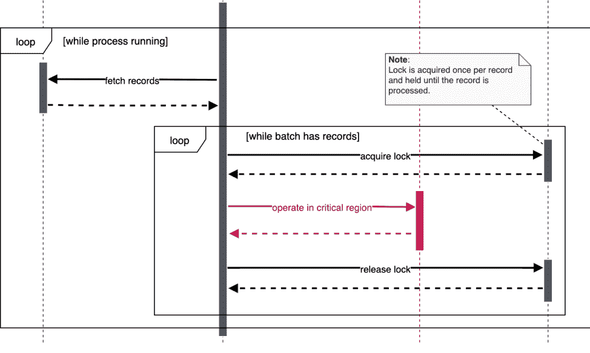

进入关键区域后，消费者将检查记录的效果是否已被其他进程应用。如果它检测到记录已在别处处理，消费者可以安全地跳过该记录并移动到条。

> 除了提高安全性外，对先验处理的检查为记录消费增加了幂等性，确保重复处理记录不会产生除首次处理期间产生之外的任何可观测影响。

在遍历关键区域时，消费者发现某条记录已处理过可能会得出以下结论：如果一条记录已经在其他处处理过，那么很可能是因为违反了排他性约束。因此，很可能有多条记录已经在其他处处理过。

这种推论可能会导致一个诱人的优化。消费者与其尝试批次中的下一条记录，可能直接放弃整个批次并取消对主题的订阅，然后重新订阅。这将强制发生组身份的变化（准确地说，会导致两次变化），使消费者收到新的分区分配并重新开始。

尽管这种方法在逻辑上似乎可行，但它行不通。如果消费者面临的批次中第一条（或实际上所有）记录似乎都已处理，那么退出并重新订阅主题可能会推进消费者的偏移量以跳过已处理的记录，但也可能不会。这取决于原始消费者最初是否提交了偏移量。考虑一个简单的场景：单个分区包含若干条记录，这些记录之前由某些消费者处理过。消费者在处理记录后、提交偏移量之前崩溃了。该主题上的新消费者接收到了第一条记录的偏移量。它检测到重复并尝试订阅，新分配将赋予它相同的偏移量——导致消费者陷入永久的退避循环。检测到记录的重复处理后，正确的程序是移动到下一条记录，一直处理完积压任务。

作为一种策略，外部隔离可用于广泛场景，因为它不会更改主题或牺牲任何安全概念。除了需要 DLM 带来的复杂性外，隔离的缺点是对吞吐量和延迟的负面影响。由于记录处理被网络 I/O 和对 DLM 的持久化操作包围，隔离对于延迟敏感和吞吐量敏感的应用程序都是一种挑战。通过将`poll()`返回的记录重新组织为相关的记录的不交集合，然后使用专用锁处理这些集合，可以缓解这一点。在简单的情况下，不交集合可以根据记录的分区编号派生——每条记录根据其分区编号分配到一个集合。然后，在消费者上按顺序或并发处理这些集合。在处理每个集合之前，消费者获取覆盖集合所有元素的锁，并在完成集合后释放锁。通过合并对关键区域的访问，消费者减少了网络 I/O 和对 DLM 的负载。这种优化如下方的序列图所示。

## 第 15 章：组成员身份与分区分配

256


| Kafka 集群 | 消费者 | 关键区域 | DLM |
| :--- | :--- | :--- | :--- |

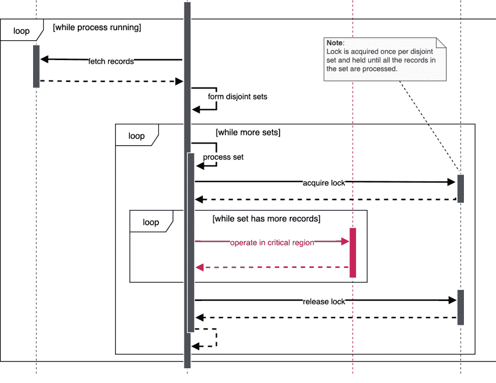

在设计分布式消费者生态系统时，必须确保 DLM 不成为单点故障。在关注安全性的同时，必须注意存活性（liveness）；如果 DLM 变得不可用，整个消费者生态系统都会失败。

通常不需要一个专门的 DLM 来仲裁关键区域。虽然持久化数据存储（如关系型数据库、`Etcd`、`Redis` 和 `Consul`）可以作为锁原语。（任何持久化且提供比较并交换（compare-and-swap）操作的存储均可用于互斥锁）。在关系型数据库（以及某些 NoSQL 系统）的情况下，可以使用数据库来影响一系列操作的事务语义——使用悲观锁或多版本并发控制。当关键区域绑定到单个数据库时，应优先使用数据库的事务能力而非 DLM，因为这可以减少网络 I/O 的量，简化应用设计，并提供更强的一致性模型。

尽管采用了各种控制措施来确保分区排他性，但可以证明，在缺乏确定性的系统中，安全性属性无法在所有情况下无条件地满足。

应用程序执行中的非确定性来源（如中断、分页、堆压缩、垃圾回收等）可能导致连续语句评估中出现无法检测的间隙。考虑以下代码，它是“安全”访问关键区域的典型写法。

```java
distributedLock.acquire();
{
  try {
    criticalSection.enter();
    //
    criticalSection.leave();
  } finally {
    distributedLock.release();
  }
}
```

在关键区域提交之前，可能因为垃圾回收暂停导致其分区被撤销，从而使进入关键区域的操作失效。在示例中，`criticalSection.enter()` 可能会由于异常的暂停而被调用，导致 DLM 认为锁持有者已“死亡”并将锁转移给下一个竞争者。当代码恢复执行并调用 `criticalSection.enter()` 时，它将与新持有者的操作冲突并违反安全性属性。

第三种策略——进程隔离（process-fencing）——通过识别并重启（或其他隔离）因心跳失败导致分区撤销的进程来增强策略 #2。这可以使用外部健康检查机制来实现，该机制持续在已知端点对进程进行查询——判断进程是否能满足其常规轮询义务。如果端点在设定时间内没有响应，或者响应为否定，则将强制重启进程。健康检查应经过调整，以便在 `max.poll.interval` 截止日期之前给出否定性响应，以便进程在协调器检测到其死亡之前、分区被重新分配之前被重启。

### 利用静态成员

正如本章早期提到的，Kafka 提供了静态组身份（static group membership）的概念——允许进行外部健康检查和修复机制，以确保消费者生态系统的存活性。对静态成员的要求源于涉及 Kubernetes 等容器编排引擎的更现代用例。在“Kubernetes 模型”下，容器编排器负责其子容器的持续健康状态，并在检测到故障时重启它们。

Kubernetes 因其极高的普及率，经常被引用为任何承担额外健康保障职责的控制系统的通用“占位符”。当上文出现“Kubernetes”引号时，人们应该假设对话涉及的是任何控制系统。

在“Kubernetes”部署模型中，容器可能会因为健康检查失败而导致意外终止，随后在不久后又被重启。对于分配给失败消费者的分区来说，如果能保持原样而不进行中间重新分配，直到消费者重新加入，这将非常有益。该模型以牺牲单个分区的可用性为代价避免了全停顿（stop-the-pause）——一个或多个分区（取决于失败消费者的分配）将保持一段时间。这可能会导致更高的整体吞吐量，并使响应时间分布中产生更明显的正偏斜——以更长的延迟超时为代价换取更低的中位延迟。

在静态模型下，成员允许离开和加入组而不丢失其分区分配或引起重平衡（rebalance），只要它们离开的时间没有超过 `session.timeout.ms` 截止日期；未能在心跳截止日期内重新加入将导致被清理，从而触发随后的重平衡。从协调器的角度来看，静态协议和动态协议之间的行为没有实质区别。

自然，如果使用外部编排器来管理消费者健康，那么对协调器自身的健康检查机制进行脱敏处理是合理的，以防止过早驱逐抖动的消费者，但仍允许协调器在编排器未能及时检测并修复进程故障时充当“安全网”。这可以通过设置 `session.timeout.ms` 实现，`max.poll.interval.ms` 截止日期也会相应提高。

`max.poll.interval.ms` 的效果在静态组身份方案下不同。如果进程循环未能在截止日期完成，`KafkaConsumer` 将被踢出，且将不会采取进一步操作——即协调器不会发送请求，也不会发生重新分配。静态消费者进程将获得直到 `session.timeout.ms` 的时间。只有在 `session.timeout.ms` 截止日期内未收到心跳，协调器才会驱逐消费者。假设 `session.timeout.ms` 已经增加到 180000（30 分钟）。

### 分区分配策略

所有围绕组身份的考虑最终都指向一个目的——确保分区分配给消费者组成员。正如之前讨论的，分区分配在单个消费者（组领导者）上进行。

在消费者过程中执行自定义分配的主要动力是它允许应用程序开发者用自定义策略替换现有的分配策略，

# 第 15 章：组成员与分区分配

无需将自定义策略的实现包含在每个 broker 节点的类路径中。这在集群被用于多租户安排时尤为关键，因为在这种情况下，不同的团队甚至付费客户可能共享同一组 broker。由于重平衡策略的改变会对所有客户端造成中断，因此在更改重平衡策略时重新部署 broker 将在操作上是不可行的。在消费者主导的模型中，人们可以通过重新部署消费者来轻松发布分配策略的更新，而对 Kafka 集群产生任何更改或中断。

消费者主导模型的挑战之一是，消费者群体之间对首选分配器实现可能存在分歧。leader 将尝试从每个成员提交的优选策略列表中确定共识度策略。如果无法达成共识，leader 将向协调器（coordinator）返回错误，该错误将传播给组内的其余成员。

消费者通过 `partition.assignment` 属性提供全限定类名列表来指定其首选分配器。分配器必须符合 `org.apache.kafka.clients.ConsumerPartitionAssignor` 接口。分配器按优先级顺序出现；第一个分配器优先级最高，后续是下一个，依此类推。

尽管分配是通过类名指定的，但它们是通过协议的符号同步阶段进行通信的。这允许不同客户端实现之间具有互操作性——例如，交替使用 Java 客户端和 Python 客户端。只要分配器名称匹配，消费者就能就共同的一个达成一致。

## 内置分配器

可以使用四种内置分配器。从概览层面来看，它们是：

- 1. `RangeAssignor`：客户端配置中隐含的默认分配器。范围分配器的工作原理是将单个订阅主题的分区按数字顺序排列，并将消费者按字典顺序排列。然后，将分区数量除以消费者数量，以确定每个消费者将收到的分区数量的差异。由于两者可能无法整除，前几个消费者可能会接收到额外的分区。此过程会对每个订阅的主题重复。

- 2. `RoundRobinAssignor`：以轮询方式分配分区。轮询分配器的工作原理是将所有订阅主题的分区列在一个列表中，将第一个分区分配给第一个消费者，将第二个分区分配给下一个消费者，依此类推——直到所有分区分配完毕。当消费者数量耗尽时，算法将回到第一个消费者。

- 3. `StickyAssignor`：在尽可能保留之前分配的同时，保持分区的均匀分布，最大限度地减少连续分配器之间分配的差异。

- 4. `CooperativeStickyAssignor`：粘性分配器的变体，利用较新的协作重平衡协议来减少“停顿世界”（stop-the-world）暂停。

## 范围分配器 (Range assignor)

范围分配器与轮询分配器是 Kafka 工具库中最旧的两种分配器。范围分配器是默认的，为消费者产生连续的分区编号。（这对前者更容易，尽管这并不重要）。为了理解它是如何工作的，考虑以下场景：一个具有 8 个分区的主题从一个消费者增加到两个，然后到三个，最后到四个消费者。初始，消费者的分配如下：

| 消费者 (Consumer) | 分区 (Partitions) |
|---|---|
| C0 | P0, P1, P2, P3, P4, P5, P6, P7 |

增加第二个消费者后，分区分配将更改为：

| 消费者 (Consumer) | 分区 (Partitions) |
|---|---|
| C0 | P0, P1, P2, P3 |
| C1 | P4, P5, P6, P7 |

比较这两个状态，我们得到以下增量：

| 消费者 (Consumer) | 已分配 (Assigned) | 已撤回 (Revoked) |
|---|---|---|
| C0 | | |
| C1 | P4, P5, P6, P7 | |

该变化涵盖了跨消费者的四个分配和四次撤回——可以说是四次交换。这与最佳分配方案不相上下，在最小化重新分配和维护均匀平衡的消费者组方面，代表了最优结果。所说的“均匀平衡”，是指最大分配数量与最小分配数量之间的差异不能超过一个。

现在考虑添加第三个消费者：

| 消费者 (Consumer) | 分区 (Partitions) |
|---|---|
| C0 | P0, P1, P2 |
| C1 | P3, P4, P5 |
| C2 | P6, P7 |

| 消费者 (Consumer) | 已分配 (Assigned) | 已撤回 (Revoked) |
|---|---|---|
| C0 | | P3 |
| C1 | P3 | P6, P7 |
| C2 | | |

在这种情况下，有三次交换。这与最优分配相比如何？为了在最小重洗的情况下保持均匀平衡，我们只需从 C0 撤回 P3 并从 C1 撤回 P7，将它们传输到 C2：

| 消费者 (Consumer) | 分区 (Partitions) |
|---|---|
| C0 | P0, P1, P2 |
| C1 | P4, P5, P6 |
| C2 | P3, P7 |

| 消费者 (Consumer) | 已分配 (Assigned) | 已撤回 (Revoked) |
|---|---|---|
| C0 | | P3 |
| C1 | | P7 |
| C2 | P3, P7 | |

所以在这种情况下，范围分配器输于最优方案——轮询分配器。让我们将消费者增加到四个。

| 消费者 (Consumer) | 分区 (Partitions) |
|---|---|
| C0 | P0, P1 |
| C1 | P2, P3 |
| C2 | P4, P5 |
| C3 | P6, P7 |

| 消费者 (Consumer) | 已分配 (Assigned) | 已撤回 (Revoked) |
|---|---|---|
| C0 | | P2 |
| C1 | P3 | |
| C2 | P5 | |
| C3 | P7 | |

与最优方案对比：

| 消费者 (Consumer) | 分区 (Partitions) |
|---|---|
| C0 | P0, P1 |
| C1 | P2, P3 |
| C2 | P4, P5 |
| C3 | P6, P7 |

| 消费者 (Consumer) | 已分配 (Assigned) | 已撤回 (Revoked) |
|---|---|---|
| C0 | | |
| C1 | | |
| C2 | | |
| C3 | | |

与最优方案相比，范围分配器的效率显著下降。尽管是默认的，范围分配器存在一个缺陷：它导致了拥有多个订阅的消费者分配不均，其平均分区数量小于消费者数量。这一现象在下图中所示。

范围分配器 (Range assigner)

范围分配器单独考虑每个主题的分区，并将它们均匀地分配给消费者。在上面的示例中，两个消费者在 T0 上获得了一个额外的分区，这是合理的，因为 8 不能被 3 整除。到此为止，范围分配器分配到 T1 时，两个可用的分区分别分配给 C0 和 C1。由于 T1 分区不足，C2 没有分配。从孤立来看，这似乎并不合理。然而，考虑到 T0 的分配也倾向于前两个消费者，似乎 C2 处于劣势。

轮询分配器 (Round-robin assigner)

与范围分配器不同，轮询策略将所有订阅主题的可用分区聚合到一个向量中，每个元素都是主题-分区元组，然后将其映射到可用的消费者。通过这种方式，轮询分配器创建了均匀的消费者负载，前提是订阅是均匀的——也就是说，每个消费者

# 第 15 章：组成员与分区分配

与其他所有消费者订阅了相同的主题集。这在实践中通常是如此的；很少看到同一组内具有不同订阅兴趣的异构消费者。下图说明了轮询（round-robin）策略在实现负载均衡方面的有效性。

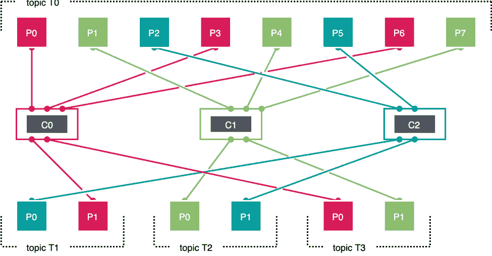

主题 T0

轮询分配器的保留属性通常仅劣于范围分配器（range assigner）。考虑之前的测试，将具有八个分区的主题应用于不断增长的消费者群体。从一个到两个（消费者）的过渡开始：

| 消费者 | 分区 |
| --- | --- |
| C0 | P0, P2, P4, P6 |
| C1 | P1, P3, P5, P7 |

| 消费者 | 分配 | 已收回 |
| --- | --- | --- |
| C0 | | P1, P3, P5, P7 |
| C1 | | P1, P3, P5, P7 |

性能与最优水平相当。事实上，可以很容易地证明，对于一个到两个的过渡，无论哪个方向，每种策略的性能都与最优相同。

将消费者数量增加到三个：

| 消费者 | 分区 |
| --- | --- |
| C0 | P0, P3, P6 |
| C1 | P1, P4, P7 |
| C2 | P2, P5 |

| 消费者 | 分配 | 已收回 |
| --- | --- | --- |
| C0 | P3 | P2, P4 |
| C1 | P4 | P3, P5 |
| C2 | P2, P5 | |

发生了四次交换，而两次交换就是最优的。

现在是三个到四个的过渡：

| 消费者 | 分区 |
| --- | --- |
| C0 | P0, P4 |
| C1 | P1, P5 |
| C2 | P2, P6 |
| C3 | P3, P7 |

| 消费者 | 分配 | 已收回 |
| --- | --- | --- |
| C0 | P4 | P3, P6 |
| C1 | P5 | P4, P7 |
| C2 | P6 | P5 |
| C3 | P3, P7 | |

性能下降到与范围分配器相同的水平，两种情况下都发生了五次交换。

总而言之，轮询分配器在某些情况下显示出的保留质量略逊于范围分配器。但在所有情况下，轮询分配器在同质生态系统中都提供了理想的负载分布。坦率地说，考虑到两者处于同一时代，且后者更适用于广泛的场景，人们很难理解为什么范围分配器被选为默认策略而不是轮询。

此外，重新平衡分区的成本主要归因于消费者生态系统；消费者将通过阻塞其 `onPartitionsRevoked()` 回调来导致“停停世界”（stop-the-world）停顿。（即使没有最优的回调，`KafkaConsumer` 内部也会进行某些清理工作，例如如果启用了自动提交，会提交偏移量。）由于两种分配器都使用激进重平衡（eager rebalancing）协议，两组消费者通常都会假设最坏情况，并在同步状态之前撤回所有分区。

### 粘性分配器 (Sticky assignor)

随着消费者数量的增加，范围和轮询分配器在保留能力上的可见下降归于它们的无状态性。范围和轮询分配器仅通过考虑请求的订阅和可用的主题分区得出新的分配。粘性分配策略通过引入第三个因素——之前的分配——改进了这一点，在保持理想平衡组的同时实现最优的交换次数。换句话说，粘性分配器的性能与理论上的最优策略相当，并保留了轮询的平衡特性。

使用粘性分配器的主要问题是它仍然基于旧的激进重平衡协议。如果不在重平衡监听回调中对分配策略进行特殊考虑，消费者应用程序将被迫采取关于分区撤回的最坏情况假设。

`StickyAssignor` 的文档建议采用以下方法来减轻激进协议的影响。通常，`ConsumerRebalanceListener` 会在 `onPartitionsRevoked()` 回调中提交偏移量并执行任何额外的清理：

```java
ConsumerRebalanceListener() {
  void onPartitionsRevoked(Collection<TopicPartition> partitions) {
    for (var partition : partitions) {
      commitOffsets(partition);
      cleanupState(partition);
    }
  }

  void onPartitionsAssigned(Collection<TopicPartition> partitions) {
    for (var partition : partitions) {
      initState(partition);
      initOffset(partition);
    }
  }
}
```

在粘性分配模型下，人们可能希望在分区重新分配后再执行 `cleanupState()` 操作，只要这样做是安全的。修改后的监听器代码：


```java
ConsumerRebalanceListener() {
  Collection<TopicPartition> lastAssignment = List.of();

  void onPartitionsRevoked(Collection<TopicPartition> partitions) {
    for (var partition : partitions) {
      commitOffsets(partition);
    }
  }

  void onPartitionsAssigned(Collection<TopicPartition> partitions) {
    for (var partition : partitions) {
      initState(partition);
      initOffset(partition);
    }
  }
  // ... 处理 lastAssignment 的逻辑
}
```

# 第16章：安全

在现代世界极度互联的背景下，机会不仅出现在合法的商业企业中，也出现在那些更隐蔽的机构——即个人或组织寻求利用不受保护的系统和网络来获利，其核心动机是威胁目标以进行勒索、造成即时且持久的伤害，或通过非法活动直接获利。我们所讨论的话题显然是网络犯罪和信息安全。

存在一种常见的误解，认为网络犯罪分子的目标是组织最安全的防御，并使用高度复杂的技巧来渗透防御。这种观点在现代小说中被广泛传播，在小说中，黑客的形象被浪漫化为一个孤独、隐居且技能高于平均水平的个体，他们出于恶意或将目标视为个人挑战而行动。在实践中，将网络犯罪视为一种业务（尽管是非法业务）更具启发性。从理论上讲，任何目标都是“可被攻击的”，但某些目标并不值得投入，因为攻入一个组织的成本可能会超过预期收益。像任何业务一样，犯罪组织都会寻求以最小的支出获取利润，这意味着会避开显而易见的目标。当一个组织的防御严密时，网络犯罪分子通常会寻找入侵途径，寻找边界的弱点，或者通过社交工程攻击（social hacking）获取访问权限。因此，必须利用多层防御，在安全控制失效或漏洞被暴露时创建冗余。

Kafka 是一个持久化数据存储器，可能包含敏感的组织数据。它通常充当通信媒介，连接不同的系统并确保组织内部信息的无缝流。这些特性使得 Kafka 成为网络犯罪分子眼中利的目标：一旦被攻破，整个组织都可能瘫痪。因此，必须特别关注 Kafka 部署的安全性，特别是集群托管在其他基础设施组件之间，或者可以从边界网络外部访问时。

## Kafka 的安全状态

让我们先明确一点：Kafka 默认是不安全的。Kafka 拥有许多安全控制，几乎涵盖了信息安全的各个方面；然而，这些控制在默认情况下是禁用的。

默认的 Kafka 安全配置如下所示。

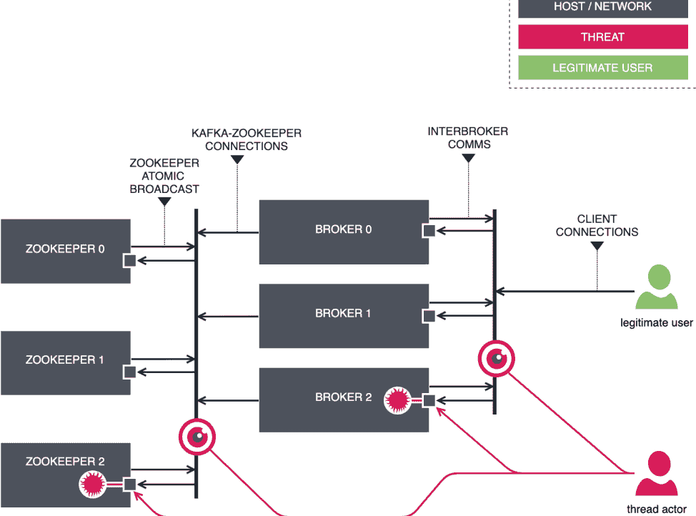

Kafka 安全的开箱状态

具体而言，明显的缺陷领域包括：

- 任何客户端都可以与 ZooKeeper 或 Kafka 节点建立连接。这一说法不仅涵盖了方便的端口 2181 (ZooKeeper) 和 9092 (Kafka) —— 像 JMX（Java 管理扩展）使用的诊断端口也允许任何人连接。这种设置令人担忧的点在于，连接 ZooKeeper 对于合法客户端的正确运行并非必不可。较早版本的 Kafka 要求客户端直接与 ZooKeeper 交互，这一要求从 0.9 版本起已被移除——该版本可以追溯到 2015 年 11 月。ZooKeeper 是潜在攻击者梦寐以求的奖品，因为 znodes（用于在 ZooKeeper 中持久化状态的内部数据结构）轻而易举地破坏整个集群。

- 与 Kafka broker 的连接未加密。连接通过 TCP 建立，双方通过一个记录详尽的二进制协议交换数据。访问传输网络的第三方可以使用基础数据包嗅探器捕获并分析网络流量，从而获得对信息的未经授权的访问。恶意行为者可能会更改传输中的信息，或冒充 broker 或客户端。除了客户端流量外，broker 之间的流量默认也是不安全的。

- 与 Kafka broker 的连接未经过身份验证。任何知道启动节点（bootstrap endpoints）的客户端都可以与 broker 建立连接，在 Kafka 看来是合法客户端。客户端不需要识别自己的身份，也不需要证明所提供的身份是真实的。

- 没有授权控制。即使启用了身份验证，客户端也可以在 broker 上执行任何操作。默认的授权策略是“允许所有”（allow-all），让流氓客户端肆意妄为。

> Kafka 默认安全配置的原因在很大程度上是历史性的。早期版本的 Kafka 不支持安全，引入强制性安全控制将影响与现有客户端的兼容性。

## 目标状态安全

在开始逐步加强集群的旅程之前，定义一个理想的目标状态是值得的。这将作为一个构想的参考，允许我们规划路线并确保坚持执行之。

目标状态的概述如下所示。随后将对各种安全原则进行进一步检查。

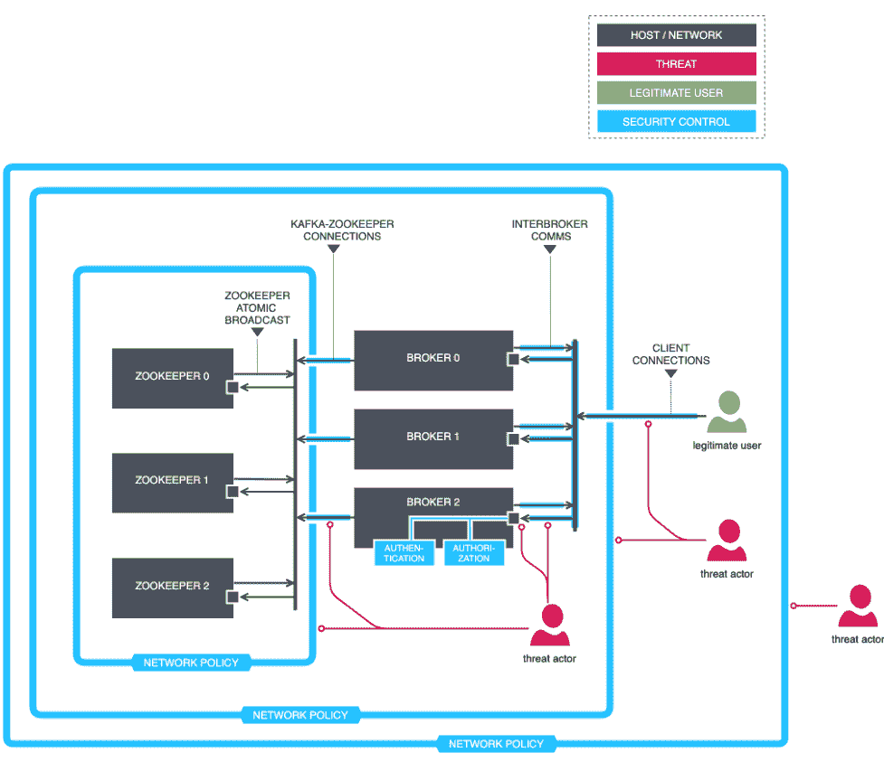

目标状态概览

## 最小化攻击面

有多种连接方式，其中大多数方式都创建了巨大的攻击面，使得难以在最低级别执行访问控制。因此，我们需要确保访问被限制在客户端合理预期将执行的最少操作集。

除了限制入站外，我们可能还希望显式允许特定的组。我们可以将内部网络划分为多个段。这种情况发生在混合部署中，其中组织 IT 系统的部分部分可能部署在一个云中，而其他部分可能部署在不同的地区。

## 确保流量机密性

进出集群以及集群内部的流量需要防止被窃听和篡改。通常，这意味着某种加密方式、消息签名协议以及可以确保消息端到端机密性的安全交换协议。必须选择符合行业认可标准的加密协议。这些标准存在于广泛的应用中，由美国国家标准与技术研究院（NIST）等组织制定。NIST 标准细分为加密哈希函数、对称密钥算法和非对称密钥算法——所有这些在某些时刻应用于 Kafka。

在所有通用标准中，特定的行业（如 PCI）以及法律法案（如 HIPAA、GLBA 和 SOX）都会在基线之外强制安全控制。当为预期合规的应用程序部署 Kafka 时，必须确保应用程序处理信息安全的方法同样合规。

## 识别客户端

Kafka 客户端通常嵌入或代表在整体架构中发挥角色的其他实体。识别客户端是访问控制的前提条件；如果我们不知道客户端是谁，就无法保证访问已受到限制。熟悉信息安全原则的读者会将此识别为最小权限原则（PoLP）。要说，认证客户端的身份本身并没有实现 PoLP，但对于后续强制执行该原则的控制来说是必不可少的。

## 限制对核心数据和功能的访问

这是对 PoLP 的直接执行。我们需要识别所有主体——集群用户——被允许操作的对象。“资源”是指任何在不受控制地使用时可能构成威胁的实体。这些包括主题、消费者组、broker、配置项以及用户。后者也是一种资源——不受控地修改用户配置文件可能会导致权限提升，即低权限用户可能获得高于其官方分配权限的访问级别。它还可能导致拒绝服务，即合法用户被阻止执行其正常功能。

在定义了愿景目标状态后，场景已经设定——本章其余部分将关注实现这些愿景——让 Kafka 达到可接受的安全状态。

## 网络流量策略

回到前面关于减少攻击面的观点，没有任何控制比网络级流量策略——或者说俗为人知的防火墙——更有效的了。

> 在不深究细节的情况下，防火墙定义的作用是隔离两个网络段之间的流量，使得只有合法的流量允许通过防火墙。相反，不合法的流量（可能是恶意的或无意的）不被允许通过防火墙。网络层和传输层的控制通常是简单、直接的规则，用于限制数据包的流向。它们既高效又难以绕过。特别是当与默认拒绝（default-deny）策略结合使用时，人们可以确信地推断防火墙的行为，更重要的是，可以使用真实和模拟流量来验证其行为。

本章将不会检查不同的防火墙类型，以及人们如何在实践中配置和维护防火墙。技术选项和物理部署拓扑过于多样了。随着地理区域的引入或多个冗余托管位置的使用，物理架构将变得更加复杂。与其尝试规定物理拓扑，其意图是在逻辑层面捕获网络架构。

至少，建议以下网络分区方案。

## 第 16 章：安全

### 网络隔离

> 节点网络上的防火墙端口列为 9094 而不是 9092 的原因是为了适应一个备用监听器，稍后阻塞默认的监听器。

在上面的安排中，网络被划分为四个静态段。ZooKeeper 运行在它自己的高度隔离的网络段中。这可能是一个子网，或者是一个相互路由的子集。后者将用于多站点部署，其中使用不同的物理网络来共同托管集群。人们可能还会使用覆盖网络（overlay network）或其他形式的虚拟网络，将物理上分离的网络合并为单一逻辑网络。再次，我们在此处必须避开细节，坚持逻辑视角。

Broker 运行在一个专用的网络段中，该段通过状态化防火墙与 ZooKeeper 段隔离开。这确保了从 Broker 到 ZooKeeper 节点建立合法连接，但仅限于这些连接，没有不再的。任何其他网络段都不允许访问 ZooKeeper 段。在实践中，可能需要为了管理目的进行特定的排除，以便授权的 Kafka 操作人员对底层的 ZooKeeper 配置进行更改、部署软件更新等。

下一个最外层的段是内部客户端网络。这包括生产者、消费者和管理客户端——本质上是运行在 Kafka 上用于传输事件数据的全套内部应用程序。可能存在此类客户端网络，或者客户端网络在内部可能是分段的。这通常发生在涉及不同站点的混合部署拓扑中。但拓扑或或少是稳定的；换句话说，我们不期望整个站点随心所欲地出现消失。

第四个网络段是边界之外的所有内容，可以简单地视为外部网络。在最简单的情况下，外部网络是公共互联网。然而，这是一个相对术语。在更复杂的隔离拓扑中，外部段可能仍然位于组织边界之内，但在客户端网络之外。它可能是通用型员工网络或其他企业内部网。虽然从相对意义上说，这个网络可能比公共互联网更可靠，但其保证级别在很大程度上被归类为“访客”网络——它不应允许直接与运行组织产生收益系统的技术基础设施对接。

除了静态段外，对于客户端生态系统可能存在一个或多个动态网络，这些网络可以在短时间内出现和消失。一种常见的用途是边缘计算，其中站点可能“更靠近行动现场”而启动，可以这么，站点本身可能不是长期的，或者可能会更改位置。可能还有其他方法让远程部署的应用访问 Kafka——例如，通过专用 API。Kafka 并不在某些情况下排除访问，这种访问可能是理想的——远程站点可能有完全允许事件的需求，但可能没有在方便的地方本地部署 Kafka。边缘计算细节很好地融入了 Kafka 的授权控制中，尽管某些远程站点可能需要技术基础设施来保持生产力。

远程连接最常见的用途是远程办公。工程师可能在各种位置工作，这些可能是私有网络、公共网络、固定位置和移动网络的混合。这些站点无法轻易控制，因此被标记为不可信。尽管如此，远程办公人员需要对后端系统和关键技术基础设施拥有一级访问权限以保持生产力。尽管某些远程站点可能是不可信的，但单个主机可能是可信的——例如，远程工作人员通过咖啡馆的免费 Wi-Fi 访问公司网络。

需要直接连接到核心客户端网络的边缘位置最好使用安全虚拟网络（如 VPN）来容纳。与其维护基于源网络从特定位置访问的“针孔”防火墙规则（源网络并不总是可以识别，特别是当站点是 NAT 设备时），可以使用 VPN 安全地物理上分离网络。站点（或单个主机）将分发数字凭据，这些凭据将用于验证站点（或主机）中心 VPN 网关。VPN 网关通常位于防火墙之后，尽管某些防火墙供应商将 VPN 和数据包过滤功能合并到一个应用程序中。（后者有时被称为 VPN 集中器）。Kafka 无需感知边缘位置和 VPN 安排。相反，容纳远程站点的责任落在客户端网络及其维护者身上。只要远程站点能够安全地连接并通过客户端网络，它们就可以访问 Kafka 集群。

## 机密性

Kafka 支持传输层安全（TLS）来加密关键组件之间的流量。与网络流量策略的纯理论立场不同，本节提供了配置 TLS 并安全连接生产者和消费者的示例。

读者可能通过浏览网站熟悉 TLS。你可能注意到浏览器栏上的锁——这表明浏览器正在通过加密连接通信。HTTPS 越来越多地取代 HTTP；其“S” 代表“secure”，意味着使用了 SSL 和 TLS 算法。正如 Java 和世界其他地方一样，Kafka 使用 SSL 来指代 TLS。用于验证通信双方的数字证书通常被称为“SSL 证书”，但这个名称是过时的——事实上，它们可以用于安全 SSL 和 TLS 流量。

在大多数情况下，TLS 术语更准确。我们正在编写的 TLS 最新版本是 v1.3。Kafka 支持的最新版本是 v1.2。从安全角度来看，v1.3 和 v1.2 之间的差异通常被认为是微小的——v1.3 移除了已知漏洞的加密算法，减少了配置错误影响安全态的。v1.3 在性能方面优于其前身——特别是在连接建立时间。

在编写时，TLS v.3 的支持计划在 Kafka 2.5.0 版本引入。Kafka 延迟采用 TLS v.3 的主要原因是它引入了对 Java 11 的依赖，这是对目前 Java 8 old的提升，但也破坏了运行时兼容性。所有在正确配置的情况下，TLS v1.2 被认为足够通用使用，并被支付卡行业（PCI）安全标准委员会的数据安全标准（DSS）强制要求。

TLS 的一个要素是 X.509 证书，通常被称为“数字证书”或简单的“证书”。至少，证书向客户端验证 TLS 连接的服务器端，后者发起连接，而前者在 TLS 套接字上接受连接。在这种情况下，服务器是 Broker 节点。通过对比受信任的证书机构或预先同意的签名证书验证 Broker 提供的证书，客户端可以确保 Broker 确实是其所称的。证书也可以用于反方向，证明客户端的身份。这种将在稍后在认证的情况下讨论。

在密码学中，X.509 是一种定义公钥证书的标准。X.509 证书用于 TLS/SSL，这是 HTTPS 的基础。它们也被用于离线应用程序

需要防篡改签名。X.509 证书包含一个公钥和身份标识（主机名、组织或个人）——这显示在证书的通用名称 (CN) 属性或备用使用者名称 (SAN) 中，后者是 X.509 基础标准的扩展。

证书由证书颁发机构 (CA) 签名或为自签名。当证书由受信任的证书颁发机构签名或通过其他成员验证时，持有该证书的人就可以依靠其包含的公钥与另一方建立安全通信，或验证由相应私钥数字签名的文档。

证书颁发机构类似于颁发护照的政府部门。护照打印在特制的材料上，并使用各种印章、水印、紫外线墨水、磁条和全息图来使其难以伪造。其他政府可以使用其现有的验证方法对护照进行检查，以确认其真实性。护照主要依赖物理手段确保安全，而 X.509 证书的签名则使用加密算法实现了等效果，证书颁发机构充当了护照处的数字实体。只要 CA 仍然真实且受信任的机构，客户端就可以确保他们正在连接到真实的实体。（最近，护照也开始嵌入带有护照持有者数字生物识别数据的 RFID 芯片——这为传统的物理设备增加了数字安全层）。

与 X.509 证书互补的是公钥基础设施 (PKI) —— 这是一套完整的角色、策略、硬件、软件和程序，用于创建、管理、使用、存储和吊销数字证书，并管理公钥加密。PKI 是一种将公钥与实体（个人、主机和组织）的相应身份绑定的安排。这种绑定通过在 CA 处及由 CA 进行注册证书注册的过程建立。根据绑定的保证级别，这可以通过自动化过程执行，也可以在人工监督下进行。

下面的图表说明了一对通信双方（客户端和服务器）之间的关系，以及用于保证信息交换完整性和机密性的支持机制。

## 第 16 章：安全

必须指出的是，使用证书颁发机构和 PKI 明确优于自签名证书。这并不是因为 CA 签名证书从纯密码学的角度来看本身更安全；而是因为使用 PKI 可以更容易管理大量证书，简化证书的颁发、轮换和吊销流程。这一方面使得 CA 签名证书的整体性更加健壮，因为与管理自签名证书的定制过程相比，出错的概率大大降低。此外，自签名证书增加了它们在传输过程中被截获并移动的可能性，这也削弱了人们对自签名证书可能付出的信任。

在接下来的示例中，我们将生成自己的 CA 来签名证书。自然地，我们本可以采用一个完整的 PKI 场景，但在实践中，PKI 技术元素的选择及其部署选项将独立于基础设施的其他选择。与其用 PKI 的细微差别分散读者的注意力，我们的重点将放在建立并运行安全连接上，并幸福地假设 PKI 是别人的问题。

要完成下面的示例，我们需要预安装或能通过包管理器轻松下载的 `openssl` 和 `keytool`。这些是开源包，在生成密钥和证书时，你将获得不应被忽视的敏感材料，即使它们在你的本地机器上。因此，最好为所有中间操作创建一个专用目录，完成后删除该目录。在接下来的示例中，我们将在 `/tmp/kafka-ssl` 下工作。

Java 使用 `keystore` 和 `truststore` 文件存储材料。这些文件的内容以 Java 生态系统的特定格式编码。`keystore` 文件持有私钥以及持有它们的客户端或服务器应用程序提供的关联签名证书。`truststore` 文件存储用于验证对方的受信任证书。两个文件都受保护。在 `keystore` 的情况下，单个密钥可能受密码保护。本章中的示例使用密码 `secret`。这应该替换为更合适的字符串。

所有示例的密钥和证书的有效期均为 365 天。此周期可以通过指定 `openssl` 命令的 `-days` 标志或 `keytool` 的 `-validity` 标志来轻松更改。

## 客户端到 broker 的加密

我们需要为集群中的每个 broker 生成密钥和证书。broker 证书的通用名称 (CN) 必须匹配 broker 的完全限定域名 (FQDN)，客户端 CN 应匹配解析后的主机名，以确保它连接到预期的 broker（而不是恶意的）。这一过程被称为主机名验证，它是默认启的。在我们的示例中，我们假设目标是测试集群，因此 CN 将提示为 `localhost`。我们可以使用任意主机名或包含通配符的主机名，只要它与引导列表中的主机名以及 `advertised.listeners` 属性中声明的主机名匹配即可。


客户端可能会禁用主机名验证，只要通过遍历证书链可以验证其真实性，它就可以连接到任何主机。然而，禁用主机名验证可能构成严重的安全漏洞，因为会导致客户端信任由 CA 颁发的任何证书。在使用受限于组织 PKI 的私有 CA 时这可能不是灾难性的，但当证书由公共 CA 颁发时，缺少主机名验证允许任何方在劫持 DNS 的情况下伪装 broker。主机名验证是服务器身份验证的不可或缺的一部分。禁用主机名验证仅在非生产工作负载中可能是安全的，即使如此，也应该避免这种做法，因为它可能无意中导致生产部署的配置错误。

## 生成私钥

开始之前，我们需要为每个 broker 生成 SSL 密钥和证书。我们的测试集群中只有一个；否则此操作必须重复。（或者更好的方法是自动化）。运行以下命令：

```
keytool -keystore server.jks -alias localhost \
  -validity 365 -genkey -keyalg RSA
```

该命令将提示密码。输入并确认密码后，下一个提示将是姓和。这实际上是通用名称。输入 `localhost`。（或者，如果你通过不同的主机名访问集群，请输入该名称。）其他字段留空。在最后的提示处，按 `y` 确认。

```
Enter keystore password:
Re-enter new password:
What is your first and last name?
[Unknown]: localhost
What is the name of your organizational unit?
[Unknown]:
What is the name of your organization?
[Unknown]:
What is the name of your City or Locality?
[Unknown]:
What is the name of your State or Province?
[Unknown]:
What is the two-letter country code for this unit?
[Unknown]:
is CN=localhost, OU=Unknown, O=Unknown, L=Unknown, ST=Unknown, C=Unknown correct?
[no]: y
```

Generating 2,048 RSA key pair and self-signed certificate (SHA256RSA) with a validity of 365 days

for: CN=localhost, OU=Unknown, O=Unknown, L=Unknown,

ST=Unknown, C=Unknown

结果是在当前目录下生成一个 `server.jks` 文件。你可以随时通过运行以下命令查看 keystore 的内容。（这需要密码。）

```
keytool -list -v -keystore server.keystore.jks
```

Enter keystore password:

Keystore type: PKCS12

Keystore provider: SUN

Your keystore contains 1

Alias name: localhost

Creation date: 02 Jan. 2020

Entry type: PrivateKeyEntry

Certificate chain length: 1

Certificate[1]:

Owner: CN=localhost, OU=Unknown, O=Unknown, L=Unknown,

# 第16章 安全

ST=Unknown, C=Unknown

发行者: CN=localhost, OU=Unknown, O=Unknown, L=Unknown, []

ST=Unknown, C=Unknown

序列号: 2e0b92ac

有效期：从 Jan 00 08:51:53 AEDT 2020 开始至：[] Fri Jan 01 08:51:53 AEDT 2021

证书指纹:

SHA1: 59:2D:AA:C0:A8:B1:CF:B6:F7:CA:B6:C2:21:55:44:12:27:44:0F:58

SHA256: 27:F5:7F:9E:36:A1:B4:00:D2:72:F6:71:AC:A0:F2:BB:06:CA:0C:FD:28:86:53:6A:37:BF:E1:D0:F8

签名算法: SHA256withRSA

主体公钥算法: 2048-RSA key

版本: 3

扩展:

```
#1: ObjectID: 2.5.29.14 关键性=false
主体密钥标识符 [
0000: 42 B2 00 B4 C1 BA 4A 4A 5E  FC 98 44 B7 29 F3 78 A2 CD
0010: 4A BA 6D 4E
]
```

## 创建 CA

仅持有私钥是不够的，因为它无法标识密钥的使用者，也无法建立信任。以下步骤将创建一个用于签名密钥的证书颁发机构（CA）。

```
openssl req -new -x509 -keyout ca-key -out ca-cert -days 365
```

你需要提供一个密码，该密码可能与上一步使用的密码不同。除了通用名称（Common Name）应设置为 `localhost` 之外，所有字段均留空。

正在生成 2048 位 RSA 私钥

....+++

....+++

正在将新私钥写入 'ca-key'

输入 PEM 密码语:

验证 - 输入 PEM 密码语:

---

你将被要求输入将包含在证书请求中的信息。

你将输入的内容被称为区分名称（Distinguished Name，简称 DN）。

有很多字段，但你可以留空一些。

对于某些字段，将有一个默认值，

如果你输入 '.'，该字段将留空。

---

- 国家名称（2位代码） []:

- 州或省份名称（全称） [:

- 地区性名称（例如，城市） [:

- 组织名称（例如，公司） []:

- 组织单位名称（例如，部门） []:

- 通用名称（例如，完全限定主机名） []:localhost

- 电子邮件地址 []:

上述命令将在当前目录输出 `ca-key` 和 `ca-cert` 文件。

接下来的步骤是将生成的 `ca-cert` 文件导入到代理（broker）和客户端的信任库（truststores）中。一旦导入，双方将隐含地信任 CA 以及任何由 CA 签名的证书。

```
keytool -keystore client.truststore.jks -alias CARoot \
-import -file ca-cert
```

```
输入密钥库密码:
重新输入新密码:
所有者: CN=localhost
发行者: CN=localhost
序列号: 8f44ae15ad8f7067
有效期：从 Thu Jan 02 09:28:45 AEDT 2020 开始至: Fri Jan 01 09:28:45 AEDT 2021
证书指纹:
SHA1: 70:55:42:23:69:A1:EA:E8:13:49:41:CC:C3:CE:E0
SHA256: 7E:CC:21:57:58:8C:FB:90:D9:9E:28:84:76:0C4:E1:83:D0:D2:B5:D1:37:A3:D2:D5:4A:C5:CB:F3:9B:32:DD
```

签名算法名称: SHA256withRSA

主体公钥算法: 2048-bit RSA key

版本: 1

信任此证书吗？ [no]: y

证书已添加到密钥库

对 `server.truststore.jks` 重复此操作：

```
keytool -keystore server.truststore.jks -alias CARoot \
-import file ca-cert
```

> 生成私钥和创建 CA 是相互独立的操作，可以以任何顺序执行。这些操作的结果将在签名阶段合并。

## 签名代理证书

下一步是代表代理生成证书签名请求（CSR）。

```
keytool -keystore server.keystore.jks -alias localhost \
-certreq -file cert-req
```

这生成了 `cert-req`，即为签名请求。要用 CA 进行签名，请运行以下命令。

```
openssl x509 -req -CA ca-cert -CAkey ca-key -in cert-req \
-out cert-signed -days 365 -CAcreateserial
```

签名成功

subject=C=Unknown/ST=Unknown/L=Unknown/O=Unknown/OU=Unknown/CN=localhost

输入 CA 密码语：这将产生 `cert-signed`。

CA 证书必须导入到密钥库的 `CARoot` 别名下。

```
keytool -keystore server.keystore.jks -alias CARoot \
-import
```

密钥库密码：

所有者: CN=localhost

发行者: CN=localhost

序列号: 8f44ae15ad8f7067

有效期：从 Jan 00 08:51:53 AEDT 2020 开始至: Fri Jan 01 08:51:53 AEDT 2021

证书指纹:

SHA1: 59:2D:AA:C0:A8:B1:CF:B6:F7:CA:B6:C2:21:55:44:12:27:44:0F:58

SHA256: 27:F5:7F:9E:36:A1:B4:00:D2:72:F6:71:AC:A0:F2:BB:06:CA:0C:FD:28:86:53:6A:37:BF:E1:D0:F8

签名算法: SHA256withRSA

主体公钥算法: 2048-bit RSA key

版本: 3

（此处省略）

```java
true);

try (var producer = new KafkaProducer<String, String>(config) {
  while (true) {
    final key = "MyKey";
    final value = new Date().toString();
    out.format("Publishing record with value %s",
      value);

    final Callback callback = (metadata, exception) -> {
      out.format("Published with metadata: %s, error: %s",
        metadata, exception);
    };

    // publish the record, handling the metadata in the callback
    producer.send(new ProducerRecord<>(topic, key, value),
      callback);

    // wait a second before publishing another
    Thread.sleep(1000);
  }
}
```

第一个区别是使用了 `security.protocol` 属性，该属性指定了使用 SSL。此属性包含复合值——它不仅指定了加密方案，还指定了身份验证方案。由于我们在示例中没有使用身份验证，因此其值简单地为 SSL。

`ssl.endpoint.identification.algorithm` 属性指定了根据哪个证书验证 broker 的主机名。默认值是 `https`，启用了主机名验证（推荐做法）。要禁用主机名验证，请将此属性设置为空字符串。

`ssl.truststore.location` 和 `ssl.truststore.password` 属性是访问我们刚刚配置的 CA 证书所所需的。

## Broker 间加密

我们目前为止所做的更改集中在保护 broker 与客户端之间的通信，而 broker 之间仍然使用普通的明文协议。幸运的是，配置 Kafka 使用 SSL 进行 broker 间通信是一件极其简单的事情。编辑 `server.properties` 并进行以下单行更改。

```properties
inter.broker.listener.name=SSL
```

重启 broker 使更改生效。要验证是否正在使用 SSL，请检查启动日志。服务器应该输出 `inter.broker.listener.name` 属性的当前值。你也可以运行 `netstat` 来确保端口 9092 上没有剩余连接，并且所有流量都没有在端口 9093 上提供服务。

```bash
netstat -an | egrep "9092|9093"
```

| proto | Recv-Q | Local Address | Foreign Address | State |

| :--- | :--- | :--- | :--- | :--- |

| tcp4 | 0 | 127.0.0.1.9093 | 127.0.0.1.65134 | ESTABLISHED |

| tcp4 | 0 | 127.0.0.1.65134 | 127.0.0.1.9093 | ESTABLISHED |

| tcp46 | 0 | *9093 | *.* | LISTEN |

| tcp46 | 0 | *9092 | *.* | LISTEN |

`netstat` 的过滤输出显示，虽然两个端口都在监听状态，但只有 9093 被列为活动连接。

一旦验证 SSL 按照预期工作（包括客户端-broker 和 broker 间情况），下一步是禁用明文监听器。这通过更新所有 broker 和所有客户端（在过渡期间同时更新明文连接和 SSL 连接）来实现。一旦所有客户端和 broker 都切换到 SSL 监听器，就可以移除 `PLAINTEXT` 选项。

禁用明文监听器有两种方法。最直接的方法是编辑 `server.properties` 中的静态配置——从 `listeners` 和 `advertised.listeners` 中移除 `PLAINTEXT` 条目。第二种方法是远程进行，采用按 broker 或全集群范围的动态更新模式。动态配置更新将在第 9 章“Broker 配置”中讨论。

> 精通密码学的读者可能会对 Kafka 使用“plaintext（明文）”一词略显轻率的做法感到有些困惑。`PLAINTEXT` 协议指的是明文传输，因为它刻意地加密了加密过程。它并不是加密器的“输入”，正如“plaintext”一词通常可能暗示的那样。

一旦禁用了明文监听器，良好的做法是针对端口 9092 的所有入站流量跟进相应的相应的防火墙拒绝规则。

## Broker 到 ZooKeeper 加密

虽然 Kafka broker 与 ZooKeeper 集群之间的流量可以加密，但 Kafka 的当前版本（编写时为 2.4.0）并不原生支持此项功能。KIP-513² 目标是在 2.5.0 版本中包含此功能。明确的是，这种局限性专门针对 Kafka 的 broker 组件，而不是 ZooKeeper。后者支持双向 TLS。

³ https://wiki.apache.org/confluence/x/Cg0YBw

与此同时，对于安全性要求极高且 broker 间加密是强制性要求的部署，可以考虑通过安全的点对点链路对连接进行隧道。这可以通过直接在 broker 节点上部署 VPN 终端节点来实现，使得未加密的流量永远不会离开 broker。或者，可以使用服务网或能够透明启动 TLS 连接的轻量级代理，然后这些连接在 ZooKeeper 上终止。

## 静态数据加密

之前讨论的加密方法保护传输中数据的机密性。当数据到达 broker 时，它将持久化到其附加存储的日志段中——以明文形式。

Kafka 没有原生启用记录数据加密存储的设施。人们必须求助于外部选项来实现这一目标。两种流行的方法是全盘加密和文件系统级加密。确保磁盘在从主机卸载时受到保护免受未经授权的访问。

虽然两种存储加密都能针对主机外部威胁提供高水平保护，但保护持久化数据免受威胁的唯一方法是[文本省略]

## 身份验证

Kafka 支持多种模式来验证连接客户端的身份。本节将探讨我们可用的身份验证选项。

### 双向 TLS

双向 TLS (mTLS)，也称为客户端 X509 身份验证或双向 SSL，利用与传统 TLS 相同的签名原理，但方向相反。除了强制的服务端身份验证外，客户端还会提交由 broker 验证的证书。每个客户端将拥有由 broker 信任的 CA 签名的证书。可以使用 broker 使用相同的 CA。

要在 broker 上启用客户端验证，必须在 `server.properties` 中设置 `ssl.client.auth` 属性。允许的值如下：

- none：禁用客户端验证。

- requested：客户端可以选择性启动身份验证，但 broker 并不强制要求。然而，如果客户端提供了证书，将对其进行验证。

- required：broker 强制要求客户端身份验证。不允许没有有效证书的连接。

`requested` 选项是一个中间设置，允许从未认证的 TLS 逐渐迁移。要开始迁移，将所有 broker 设置为 `ssl.client.auth=requested`。这可以通过静态方式（编辑各个配置文件并重启 broker）或动态方式（通过 API 或 CLI 工具）来实现。一旦所有 broker 都以许可模式运行，即可进行客户端更新。一旦验证所有客户端在 mTLS 下运行稳定，将 `ssl.client.auth` 设置升级为 `required`。

为了使用此身份验证方案，客户端必须配备由 broker 信任的 CA 签名的专用私钥。密钥和证书应安装在 `keystore.client.jks` 文件中，以及 `truststore.client.jks`。以下过程模仿了之前的示例。

# 生成私钥


为客户端应用程序生成一个私钥，使用`localhost`作为“first and name”属性的值，其他全部留空。

```
keytool -keystore client.keystore.jks -alias localhost \
-validity 365 -genkey -keyalg RSA
```

```
Enter keystore password:
Re-enter new password:
What is your first and last name?
[Unknown]: localhost
What is the name of your organizational unit?
[Unknown]:
What is the name of your organization?
[Unknown]:
What is the name of your City or Locality?
[Unknown]:
What is the name of your State or Province?
[Unknown]:
What is the two-letter country code for this unit?
[Unknown]:
is CN=localhost,OU=Unknown,O=Unknown,L=Unknown, O
ST=Unknown,C=Unknown correct?
[no]: y
```

Generating 2,048 bit RSA key pair and self-signed certificate (SHA256withRSA) with a validity of 365 days for: CN=localhost,OU=Unknown,O=Unknown,L=Unknown, O ST=Unknown,C=Unknown

This leaves a `client.keystore.jks` file in the current directory.

## Sign the client certificate

```
keytool -keystore client.keystore.jks -alias localhost \
-certreq -file client-cert-req
```

This produces the client certificate signing request file — `client-cert-req`.

Next, we will action the signing request with the existing CA:

```
openssl x509 -req -CA ca-cert -CAkey ca-key -in client-cert-req \
-out client-cert-signed -days 365 -CAcreateserial
```

The result is the `client-cert-signed` file, ready to be imported into the client’s keystore, along with its CA certificate.

Starting with the CA certificate:

```
keytool -keystore client.keystore.jks -alias CARoot \
-import -file ca-cert
```

```
Enter keystore password:
Owner: CN=localhost
Issuer: CN=localhost
Serial number: 8f444e15ad8f7067
Valid from: Thu Jan 02 09:28:45 AEDT 2020 until: 0
Fri Jan 01 09:28:45 AEDT 2021
Certificate fingerprints:
SHA1: 70:55:42:23:C9:A1:EA:E8:13:49:41:CC:C3:CE:A3:0D
7B:C3:25:F8:08
SHA256: 7E:CC:21:57:8C:FB:90:9E:2B:84:76:C4:0D
E1:83:D0:2D:B5:D1:17:3A:D2:5D:5A:4D:C5:F3
Signature algorithm name: SHA256withRSA
Subject Public Key Algorithm: 2048-bit RSA key
Version: 1
Trust this certificate? [no]: y
Certificate was added to keystore
```

Moving to the signed certificate:

```
keytool -keystore client.keystore.jks -alias localhost \
-import -file client-cert-signed
```

```
Enter keystore password:
Certificate reply was installed in keystore
```

## Configure the broker to require authentication

Edit `server.properties`, adding the following line:

```
ssl.client.auth=required
```

Restart the server for the changes to take effect. To verify, you can run the producer client from the previous example. The connection should fail with the following error:

```
1:58:57/583 INFO [kafka-producer-network-thread | producer-1]: [] [Producer clientId=producer-1] Failed authentication with [] localhost/127.0.0.1 (SSL handshake failed)
1:58:57/584 ERROR [kafka-producer-network-thread | producer-1]: [] [Producer clientId=producer-1] Connection to node -1 [] (localhost/127.0.0.1:9093) failed authentication due to: SSL handshake failed
```

That is expected to be, our SSL-enabled client has yet to be configured for client-side authentication.

## Deploy the private key and signed certificate to the client

```
cp /tmp/kafka-ssl/client.keystore.jks ~/code/effectivekafka
```

## Configure the provider authentication on the client requires the addition of several properties — namely, the SSL keystore configuration. In the snippet below, we have provided the `ssl.keystore.location`, `ssl.keystore.password` and `ssl.password` — the mirror of the server-side configuration.

```
final var config = new HashMap<String, Object>();
config.put(ProducerConfig.BOOTSTRAP_SERVERS_CONFIG,
"localhost:9093");
config.put(CommonClientConfigs.SECURITY_PROTOCOL_CONFIG,
"SSL");
config.put(SslConfigs.SSL_ENDPOINT_IDENTIFICATION_ALGORITHM_CONFIG,
"https");
config.put(SslConfigs.SSL_TRUSTSTORE_LOCATION_CONFIG,
"client.truststore.jks");
config.put(SslConfigs.SSL_TRUSTSTORE_PASSWORD_CONFIG,
"secret");
config.put(SslConfigs.SSL_KEYSTORE_LOCATION_CONFIG,
"client.keystore.jks");
config.put(SslConfigs.SSL_KEYSTORE_PASSWORD_CONFIG,
"secret");
config.put(ProducerConfig.KEY_SERIALIZER_CONFIG,
"StringSerializer.class");
config.put(ProducerConfig.VALUE_SERIALIZER_CONFIG,
"StringSerializer.class");
```

## 第 16 章：安全

## SASL

Kafka 支持简单身份验证和安全层（SASL）——用于将身份验证嵌入应用程序协议的可扩展框架。SASL 的优势在于它将身份验证与应用程序协议解耦，理论上允许任何受 SASL 支持的身份验证机制被嵌入到任何使用 SASL 的应用程序中。SASL 本身并不负责消息交换的机密性，因此很少单独使用。SASL 最常见的部署模型涉及 TLS。

## GSSAPI

Kafka 支持通用安全服务 API（GSSAPI），它使得合规的安全供应商能够与参与的应用程序交换不透明令牌（opaque tokens）。这些令牌本身是防篡改的，用于在协作方之间建立安全上下文。一旦上下文建立，双方就可以安全地进行通信并访问资源。

> GSSAPI 通常与 Kerberos 联系在一起，因为它是其主要的实现方式。主要的区别在于，Kerberos API 在供应商之间尚未标准化，而 GSSAPI 从一开始就是中立的。从某种意义上说，GSSAPI 标准化了 Kerberos。

官方文档将 GSSAPI 与 Kerberos 等同对待。GSSAPI 与 Kerberos 之间声称的关系通常延伸到集中目录服务——活动目录（Active Directory，主要由于其对 Kerberos 5 的原生支持）以及类似的单点登录（SSO）服务。

Kerberos 和 Active Directory 适用于企业环境中的交互用户；然而，Kafka 用户很少是个人，而是应用程序。即使 Kafka 客户端代表终端用户执行操作，它通常也会通过终端用户机制（通常是服务账户）向代理进行身份验证。已验证的会话使得为每次用户交互创建一组新连接（或在不久后销毁这些连接）变得不可行。在绝大多数情况下，服务账户是管理 Kafka 客户端的唯一实际方法。

理论上，可以在像 Active Directory 等集中认证服务器中配置服务账户。从上看，这听起来是有益的。通过集中管理服务账户，应该使治理变得更加简单和透明。

虽然理论论点并无争议，但集中式模型的主要挑战在于，只有当涉及的主体（principal）可以建模为目录中的某种资源，且其消耗的所有资源都表示在某种可以与主体关联的权限模型中时，它才有效。换句话之，应用程序可以使用一组凭据访问其所有资源。（或者这些凭据以某种方式相关，并且它们的关系可以相应建模。）现实中，后端应用程序可能会消耗许多异构资源，而并非所有资源都注册在目录中。例如，单个应用程序可能会连接到 Kafka、Postgres 数据库、Redis 集群，并消费组织外部的第三方 API。虽然 Kafka 和 Postgres 支持 Kerberos，但 Redis 不支持。第三方 API 几乎肯定不支持 Kerberos（某些提供者可能间接支持 Kerberos，通常通过联邦协议）。

当需要控制服务账户的权限时，管理员可能会操纵目录中服务账户的表示。也许应该完全禁用该服务账户，这在 Active Directory 等服务账户管理系统中是一个轻而易举的“一键”操作。这产生了一种虚假的安全感，因为服务账户的权限并没有覆盖所有资源；虽然服务账户在集中目录中看起来被禁用了，但底层原理仍然可以在其中一个资源上运行。

一个常见的误解是，集中认证系统的存在是为了简化入职（onboarding）流程。在实践中，此类系统的优点主要集中在离职（off-boarding）场景。点击一下按钮为新员工设置配置并授予所有必要系统的权限是非常方便的。虽然方便但并非必不可。。如果没有集中认证系统，入职可能需要几天或几周才能完成。虽然这并不理想，但对组织的影响主要是生产力损失——这是一种可以量化并仔细管理的成本。相反，从安全角度来看，终止雇是即时行动——同时撤销该员工之前拥有的所有资源的访问权限，最好在人员离开场所之前完成。未能及时行动或忘记将更改应用到某些资源，可能会对组织构成即时且持续的威胁，特别是当员工对解雇情况并不完全满意时。

虽然集中认证的优点对于终端用户和管理员来说显而易见（特别是在大规模环境中），但这些优点无法轻易复制到服务账户——除非组织强制所有技术基础设施都支持 Kerberos，并且应用程序组件与其依赖项之间的所有交互都经过相应的身份验证。直白地说，这是一个白日之梦。

对于服务账户和类似的用例，目前的趋势是从基于目录的身份验证系统迁移到集中密钥管理系统。换句话说，我们不再管理主体（我们已经确定这样做是徒劳的），而是管理它们的凭据以及它们运行所需的任何其他密钥。只要主体从密钥管理系统接收全部密钥且不在本地缓存，禁用主体最终将影响其消费下游资源的能力，从而有效地将其孤立。

该方案的一个显著缺点是，禁用主体的效果可能不是及时的。虽然它使得未来获取密钥材料变得不可能，但并不一定会导致现有材料失效或过时。此外，客户端可能缓存了密钥材料，或者后者可能通过其他手段被破解。这就是为什么安全最佳实践建议频繁轮换密钥材料，精确到分钟级——从而最大限度地减少敏感属性的暴露时间。

本章不再深入探讨 GSSAPI 的身份验证案例，不仅是因为上述陈述的复杂性。而是因为演示 Kerberos 的意义不在于设置的复杂性，它在 kafka.apache.org/documentation 中也有充分的文档。相反，重点将转向其他不那么严苛、易于管理的 SASL 身份验证方法，这些方法在未来多年内对读者具有意义。

## PLAIN 和 SCRAM

- SASL 生产者和消费者示例的完整源码可以在 github.com/ekoutanov/effectivekafka 的 src/main/java/effectivekafka/sasl 目录下找到

SASL 提供了两种用户名密码身份验证方法：PLAIN 和 SCRAM。（存在更多方法，但 Kafka 支持这两种用于客户端身份验证。）前者指的是明文身份验证，凭据直接呈现。后者是盐挑战认证机制（Salted Challenge Authentication Mechanism）的缩写——一种旨在在不显式传输凭据的情况下完成身份验证的协议。

对于用户来说，两者之间区别不大。在两种情况下，应用程序都配置一组用户名密码对，区别在于 JAAS（Java 身份验证和授权服务）模块的全限定名称。在底层，它们非常不同。PLAIN 本体不提供机密性，需要使用加密通道。SCRAM 本身就能提供机密性，即使没有任何传输层也是如此。

> 当可能产生疑问时，PLAIN 并不是缩写。该名称的确切起源不说明，但它是形容词“plain”（简单的）的一种字面化——意为“简单或基础”，相对于“plaintext”（明文，加密术语，指密码的输入）的缩写。确实，RFC 4616 将 PLAIN 定义为一种交换密码的简单机制。尽管交换是以明文进行的，但在应用程序层没有加密。

由于 PLAIN 机制本身不提供完整性或机密性保护，不应在没有适当外部安全数据保护的情况下使用，例如许多应用层协议提供的 TLS 服务。默认情况下，除非已具备适当的数据安全服务，否则实现方案**不应该发布**且**不应该**使用 PLAIN 机制。

https://tools.iet.org/html/rfc4616

在**深度防御**（Defence in Depth）原则的指导下，应优先选择 SCRAM 选项而非 PLAIN。这确保了即使被攻破解，也不会单方面影响系统的完整性。SCRAM 是双向作用的：客户端不仅向代理服务器证明自己拥有密码，代理服务器也需要执行相同的操作。（见下文警告。）换句话说，SCRAM 保护客户端连接到恶意代理服务器，这对于 TLS 原生使用的基于证书的认证机制的一种补充。SCRAM 相比 PLAIN 的唯一实际缺点是增加了网络往返，这对于双方识别彼此是必不可的。（SCRAM 总共需要两次往返。）然而，这种代价只在建立连接时支付一次——对后续的吞吐量或延迟没有后续影响。

> SCRAM 认证是双向的，它并非完全对称——每一方为对方提供的保证之间存在细微差异。具体来说，客户端必须在建立连接时向代理服务器证明其*当前*知道密码；而代理服务器只需要证明它在某个时间点知道密码即可。这是一个理想的属性——它减轻了代理服务器持久化明文密码的风险，从而避免暴露；相反，代理服务器持久化密码的不可逆派生值，这些值随后用于相互认证。理论上，客户端可以丢密码并存储哈希版本，它提供了服务器使用的盐（该盐作为认证流程的一部分被公开）。

由于两种认证方法在用户面前看起来非常相似，工作示例将重点关注 SCRAM 案例。

## 配置代理服务器使用 SASL/SCRAM

我们需要创建一个支持使用 SASL 认证的新监听器。编辑`server.properties`，确保其符合以下内容：


```properties
listeners=PLAINTEXT::9092,SSL::9093,SASL_SSL::9094
advertised.listeners=PLAINTEXT://localhost:9092,SSL://localhost:9093,SASL_SSL://localhost:9094
listener.protocol.map=PLAINTEXT,PLAINTEXT,SSL,SASL_PLAINTEXT-SASL_SSL,SASL_SSL
sasl.enabled.mechanisms=SCRAM-SHA-512
listener.name.sasl_ssl.scram-sha-512.sasl.jaas.config=\norg.apache.kafka.common.security.scram.ScramLoginModule \required;
```

保存文件后，重启代理服务器使更改生效。

逐行分析上述文件：

- 我们添加了另一个绑定到端口 9094 的监听器 `SASL_SSL`。
- 该监听器已发布为 `SASL_SSL://localhost:9094`。
- 安全协议映射保持不变，它默认已包含了 `SASL_SSL:SASL_SSL` 映射。
- 启用的 SASL 机制是 `SCRAM-SHA-512`。
- `listener.name.sasl_ssl.scram-sha`

> SASL 认证与 SSL 客户端认证不兼容。当请求或需要 `ssl.client.auth` 属性时，SSL 认证设置将仅应用于 SSL 监听器（或任何映射到 SSL 安全协议的监听器）。当通过 `SASL_SSL` 监听器连接时，SSL 客户端认证设置将被忽略。如果能在 SSL 客户端认证之上运行 SASL 以增加安全性将是有利的；虽然这在理论上可行，但 Kafka 不支持这两者的结合。原因是 Kafka 从客户端的属性中提取用户主体（principal），这可能与 SASL 上的用户名冲突。

Kafka 支持 `SCRAM-SHA-256` 和 `SCRAM-SHA-512`。如果需要，可以通过将 `sasl.enabled.mechanisms` 属性设置为 `SCRAM-SHA-256,SCRAM-SHA-512` 来启用两者。从安全角度来看，`SHA-256` 和 `SHA-512` 通常被认为是非常安全的，后者具有更好的抗碰撞性。不同的硬件倾向于不同的函数，`SHA-512` 针对 64 位处理器进行了优化；而 `SHA-256` 在 32 位处理器上性能更优。目前，`SHA-256` 仍然是更常见的选择。

## 准备用户

Kafka 的 SCRAM 实现使用 ZooKeeper 作为凭据存储器——用于持久化用户名和哈希密码（也经过了盐处理）。明文密码永远不会持久化，但哈希值是全局可读的。这意味着 ZooKeeper 应该部署在高度信任的网络上，并防止未经授权的访问。配置直接通过 `kafka-configs.sh` CLI 对 ZooKeeper 进行管理。在以下示例中，我们将为新用户提供提供的密码 `alice-secret`。

```bash
$KAFKA_HOME/bin/kafka-configs.sh --zookeeper localhost:2181 \
  --alter \
  --add-config 'SCRAM-SHA-512=[password=alice-secret]' \
  --entity-type users --entity-name alice
```

已完成实体：user-principal 'alice' 的配置更新。

将凭据注册到 ZooKeeper 时，它们需要为每种 SCRAM 变体单独设置。也就是说，`SCRAM-SHA-256` 可能与 `SCRAM-SHA-512` 不同，并且可以独立管理。`kafka-configs.sh` CLI 方便地列出键值对。要列出用户的当前配置，运行以下命令（根据需要替换用户名）：

```bash
$KAFKA_HOME/bin/kafka-configs.sh --zookeeper localhost:2181 \
  --describe --entity-type users --entity-name alice
```

这将输出当前配置：

```
Configs for user-principal 'alice' SCRAM-SHA-512=salt= iterations=4096
```

> 注意，`describe` 的输出与我们输入 `--add-config` 的内容不同。这是因为 SCRAM 持久化密码的派生值。这些值可以在认证会话期间通过加密方式验证密码的相互认知，但无法通过这种方法恢复原始密码。

可以使用 `--delete-config` 标志删除凭据：

```bash
$KAFKA_HOME/bin/kafka-configs.sh --zookeeper localhost:2181 \
--alter \
--delete-config 'SCRAM-SHA-512' \
--entity-type users --entity-name alice
```

## 配置客户端

配置客户端使用 SASL 需要在配置表中添加几项。以下示例是一个结合了 SSL 和 SASL 的全功能生产者。

```java
import static java.lang.System.*;

import java.util.*;

import org.apache.kafka.clients.*;
import org.apache.kafka.clients.producer.*;
import org.apache.kafka.common.config.*;
import org.apache.kafka.common.security.scram.*;
import org.apache.kafka.common.serialization.*;

public final class SaslSSLSample {
    public static void main(String[] args) 
    throws InterruptedExceptionException {
        final var topic = "getting-started";

        final var loginModuleClass = ScramLoginModule.class.getName();
        final var saslConfigs = loginModuleClass
            + " required\n"
            + " username=alice"\n"
            + " password=alice-secret";

        final Map<String, Object> config = Map
            .of(ProducerConfig.BOOTSTRAP_SERVERS_CONFIG,
                "localhost:9092",
                CommonClientConfigs.SECURITY_PROTOCOL_CONFIG,
                "SASL_SSL",
                "https",
                SslConfigs.SSL_ENDPOINT_IDENTIFICATION_ALGORITHM_CONFIG,
                "",
                SslConfigs.SSL_TRUSTSTORE_LOCATION_CONFIG,
                "client.truststore.jks",
                SslConfigs.SSL_TRUSTSTORE_PASSWORD_CONFIG,
                "secret",
                SaslConfigs.SASL_MECHANISM,
            );
    }
}
```

## 第 16 章：安全

```java
"SCRAM-SHA-512",
SaslConfigs SASL_JAAS_CONFIG,
saslJaasConfig,
ProducerConfig KEY_SERIALIZER_CLASS_CONFIG,
StringSerializer.class.getName(),
ProducerConfig VALUE_SERIALIZER_CLASS_CONFIG,
StringSerializer.class.getName(),
ProducerConfig ENABLE_IDEMPOTENCE_CONFIG,
true;);
```

```java
try (var producer = new KafkaProducer<String, String>(config)) {
    while (true) {
        final var key = "myKey";
        final var value = new Date().toString();
        out.format("Publishing record with value %s%n", value);
    }
}
```

```java
final Callback callback = (metadata, exception) -> {
    out.format("Published with metadata: %s, error: %s%n", metadata, exception);
};
```

```java
// 发布记录，在回调中处理元数据
producer.send(new ProducerRecord<>(topic, key, value), callback);
```

```java
// 在发布另一个记录之前等待一秒
Thread.sleep(1000);
```

与纯 SSL 示例相比的区别在于：

- 连接到不同的端口。在这种情况下，我们连接到端口 9094。
- 使用 `SASL_SSL` 作为安全协议设置。
- 添加了 `sasl.mechanism` 属性，设置为 `SCRAM-SHA-512`。
- 通过 `sasl.jaas.config` 属性指定 JAAS 配置。

上述示例的 JAAS 配置为：

```text
org.apache.kafka.security.scram.ScramLoginModule required
username="alice"
password="alice-secret";
```

# 代理器间认证

尽管我们讨论了 `SASL_SSL` 的客户端认证，但 broker 间监听器仍然保持第一个示例中的 SSL。我们可以升级 broker 间通信，使其除加密之外使用身份验证；然而，这需要我们专门为 broker 配置一组凭据。首先创建一组管理员凭据（根据情况替换 admin 和 admin-secret）：

```bash
$KAFKA_HOME/bin/kafka-configs.sh --zookeeper localhost:2181 \
  --alter \
  --add-config 'SCRAM-SHA-512=[password=admin-secret]' \
  --entity-type users --entity-name admin
```

然后编辑 `server.properties` 行，包含以下内容。（仅显示更改的行）

```properties
inter.broker.listener.name=SASL_SSL
sasl.mechanism.inter.broker.protocol=SCRAM-SHA-512
listener.name.sasl.scram-sha-512.sasl.jaas.config=\norg.apache.kafka.security.scram.ScramLoginModule \
  required \
username="admin" \
password="admin-secret";
```

这里我们必须非常小心。在 `server.properties` 中指定凭据后，我们应该加固文件权限，防止当前登录用户以外的任何人读取该文件。如果此用户与运行 Kafka 的用户不同，则应相应调整所有者和权限。

```bash
chmod 600 $KAFKA_HOME/config/server.properties
```

保存文件并调整后，重启 broker 使更改生效。

更改摘要：

- broker 间监听器更改为 `SASL_SSL`。
- 通过 `sasl.mechanism.inter.broker.protocol` 属性为 broker 间用户分配了 SASL 机制。
- `listener.name.sasl.scram-sha-512.sasl.jaas.config` 中 JAAS 配置已扩展，包含用户名和密码对。

切换 broker 间协议后，运行 `netstat` 验证 broker 间连接是否指向端口 9094：

```bash
netstat -an | egrep "9092|9093|9094"
```

| 协议 | Rec-Q | Send-Q | 本地地址 | 外地地址 | 状态 |
| :--- | :--- | :--- | :--- | :--- | :--- |
| tcp4 | 0 | 1 | 127.0.0.1:9094 | 127.0.0.1:56410 | ESTABLISHED |
| tcp4 | 0 | 0 | 127.0.0.1:56410 | 127.0.0.1:9094 | ESTABLISHED |
| tcp46 | 0 | 0 | **:9094 | ** | LISTEN |
| tcp46 | 0 | 0 | **:9093 | ** | LISTEN |
| tcp46 | 0 | 0 | **:9092 | ** | LISTEN |

# 提供外部 JAAS 配置

在之前的 SASL 示例中，我们通过配置属性内联地提供了 JAAS 配置。虽然这种方法很方便，但可能并不合适——取决于应用程序是否支持这种配置方法。在不支持内联配置的情况下，可以使用外部文件配置 JAAS。

为了允许上一个示例使用外部 JAAS 配置文件，编辑 `.properties` 并注释掉（或删除）`listener.sasl.ssl.scram-sha-512.sasl.jaas.config` 属性。保存文件。

如果你在此状态下尝试启动 broker，它将退出并输出内容：

```text
[2020-01-02 19:22:25,890] ERROR [KafkaServer id=0] Fatal error during KafkaServer startup. Prepare to shutdown
(kafka.server.KafkaServer) java.lang.IllegalArgumentException: Could not find 'KafkaServer' or 'sasl.ssl.KafkaServer' entry in the JAAS configuration. System property 'java.security.auth.config' is not set
```

要修复此错误，在 `$KAFKA_HOME/config` 中创建一个 `kafka_server_jaas.conf` 文件，内容如下：

```text
sasl_ssl.KafkaServer {
org.apache.kafka.security.scram.ScramLoginModule
required
username="admin"
password="admin-secret";
};
```

JAAS 配置包含敏感信息。通过运行以下命令确保其不被其他用户读取：

```bash
# 
```

在启动 Kafka broker 时，需要告诉它哪里找到 JAAS 配置。这可以通过设置 `jaas` 属性来实现。

```bash
KAFKA_HOME/bin/kafka-server.sh
```

# 切换到 SASL/PLAIN

之前在 SASL 示例中，我们将以下行：

```properties
inter.broker.listener.name=SASL_SSL
sasl.mechanism.inter.broker.protocol=SCRAM-SHA-512
listener.name.sasl.scram-sha-512.sasl.jaas.config=\norg.apache.kafka.security.scram.ScramLoginModule \
  required \
username="admin" \
password="admin-secret";
```

同时，删除 `listener.sasl.ssl.scram-sha-512.sasl.jaas.config` 属性。

# OAuth bearer

JWS 签名不包含：

```json
{
  "alg": "none"
}
```

> 支持 OAuth 令牌的一个次要目标是 SASL 的内部测试。Kafka 的 SASL 实现现在可以被认为是成熟的，尽管如此，AUTHBEARER 对于不同用户的测试仍然有用。

# 委托令牌

结束对认证方法的讨论，我们有了委托令牌。委托令牌被用作轻量级认证机制，它是 SASL 的一种方式。它是 [KIP-48](https://cwiki.apache.org/confluence/display48) 在 1.1.0 版本中引入的。

委托令牌的最初动机是为了简化

## 第 16 章：安全


Kerberos 客户端密钥分发的后勤工作——特别是需要向每个客户端部署 TGT 或 keytab 文件的问题。委托令牌（Delegation tokens）减少了身份验证过程的开销，由于不需要向 KDC 获取票据并定期刷新 TGT，身份验证协议被简化为验证持久在 ZooKeeper 中的委托令牌。这种方法也更加安全，缩小了凭据泄露的影响范围——如果委托令牌被秘密获取，攻击者的权限将局限于该令牌所附的权限。相比之下，Kerberos TGT 或 keytab 的泄露会带来更危险的后果。

委托令牌最常见的用途是当中央协调器编排工作节点集群时的事件流处理。工作节点通常是瞬态的。协调器并不是为每个工作节点独立配置访问权限，而是创建一个带有时间限制的委托令牌，启动工作节点并处理处理新生成的令牌。在这种方案下，只有协调器需要访问长效凭据（TGT、keytab 或 SCRAM/PLAIN 的用户名/密码）；高度敏感的永远不会离开协调器。

委托令牌具有寿命——即令牌最大年龄的上限。此外，令牌有一个过期时间，这对令牌用于身份验证客户端的时间设置了软限制。可以通过刷新令牌来延长过期时间，但受其寿命强制执行的上限限制。过期的令牌最终将通过后台清理线程从 ZooKeeper 中删除。由于清理是异步进行的，令牌在官方过期后可能仍能被使用一段时间。

## 在 broker 上启用委托令牌

要启用委托令牌，请编辑 `server.properties` 并添加以下几行：

```
delegation.token.master.key=secret-master-key
delegation.token.expiry.ms=3600000
delegation.token.max.lifetime.ms=7200000
```

`delegation.token.master.key` 指定了用于签名令牌的密钥，该密钥必须由集群中的所有 broker 共享。此属性是必须的——如果没有它，委托令牌将禁用。请根据实际情况替换 `secret-master-key` 字符串。

`delegation.token.expiry.ms` 指定以毫秒为单位的令牌过期时间。默认值为 86400000（24 小时）。

`delegation.token.max.lifetime` 指定以毫秒为单位的令牌寿命的硬上限。在发放令牌时，用户可以为 `--max-life-time-period` 指定任何低于此设置的值。`delegation.token.max.lifetime.ms` 的默认值为 604800000（7 天）。

重启 broker 以使更改生效。

## 创建委托令牌

使用 `kafka-delegation-tokens.sh` 命令行工具创建委托令牌，如下例所示。

```
$KAFKA_HOME/bin/kafka-delegation-tokens.sh \
--bootstrap-server localhost:9094 \
--command-config $KAFKA_HOME/config/client.properties \
--create --max-life-time-period -1 \
--renewer-principal User:admin
```

令牌的所有者是所提供属性文件中的主体（principal）。如果 `client.properties` 配置了 admin 用户的凭据，这在生产环境中是不理想的，因为令牌持有者收集到的权限远超其实际所需的权限。

运行上述命令将产生以下输出：

```
Calling token operation with renewers : 
[User:admin], max-life-time-period : -1
Created delegation token with tokenId : 
dofHaIYjQwWhyeBzrBW5w4
```

```
TOKENID
dofHaIYjQwWhyeBzrBW5w4

HMAC
AFTqndCV/ffCawRypH1Hqe9sLZGegYscYu10BwSdn11 
rIjQKWrKyLS9+CJJs5orR4AcTcS0IAwdAIPjq==
```

```
OWNER RENEWER
User:admin [User:admin]

ISSUATED EXPIRATED MAXDDATE
2020-01-02T11:43 2020-01-03T12:43 2020-01-03T11:43
```

`--max-life-time-period` 标志指定了令牌以毫秒为单位的最大寿命。如果设置为 -1，则假设使用 broker 属性 `delegation.token.max.lifetime` 允许的最大值。

`--renewer-principal` 标志指定允许刷新令牌的用户。该用户可能与所有者不同。在刷新令牌时，用户必须除令牌的 HMAC 值外提供其凭据。

要列出委托令牌，使用 `--describe` 切换调用 `kafka-delegation-tokens.sh`：

```
$KAFKA_HOME/bin/kafka-delegation-tokens.sh \
  --bootstrap-server localhost:9094 \
  --command-config $KAFKA_HOME/config/client.properties \
  --describe
```

Kafka 目前不允许一个用户代表另一个用户创建委托令牌（即所有者主体是令牌的创建者）。KIP-373 将解决这一缺陷。

## 配置客户端

委托令牌的传递方式类似于凭据，使用 SASL/SCRAM 方法。`username` 属性设置为令牌 ID，`password` 属性分配表中的 HMAC 值。

## 刷新令牌

令牌的刷新只能由刷新者（reewer-principal）尝试，且必须在令牌过期之前进行。`renewal-time-period` 指定了令牌应延长的时间（毫秒）。如果设置为 -1，令牌将立即过期。

```
$KAFKA_HOME/bin/kafka-delegation-tokens.sh \
  --bootstrap-server localhost:9094 \
  --command-config $KAFKA_HOME/config/client.properties \
  --renew
```

委托令牌的传递方式类似于凭据，使用 SASL/SCRAM 方法。`username` 属性设置为令牌 ID，`password` 属性分配表中的 HMAC 值。

## 令牌过期

令牌的过期时间可以在创建后调整。最常见的情况是使用以下命令显式失效令牌。

```
$KAFKA_HOME/bin/kafka-delegation-tokens.sh \
  --bootstrap-server localhost:9094 \
  --command-config $KAFKA_HOME/config/client.properties \
  --expire expiry-time-period -1 \
  --hmac AftQnd/cv/fFcawR..
```

## 轮密钥

Kafka 目前还没有优雅的机制来轮共享密钥。目前这是一个三个步骤：

- 使所有令牌失效。
- 使用新密钥滚动重启集群。
- 生成并分发新令牌。

由于令牌仅在建立连接时进行验证，所有已连接的客户端将继续正常运行。使用旧令牌的新连接将被拒绝，任何刷新或过期令牌的尝试也将被拒绝。

## ZooKeeper 身份验证

认证之旅的最后阶段是加强 broker 与 ZooKeeper 集群之间的连接。ZooKeeper 支持使用 DIGEST-MD5 方法进行 SASL 客户端认证。在我们的上下文中，客户端是 Kafka broker 或命令行工具。

> ZooKeeper 认证支持其授权模型，该模型通过访问控制列表（ACL）实现。ACL 独立应用于每个节点，类似于 UNIX 文件和目录权限。

ZooKeeper 在节点上支持以下权限类型：

- CREATE：创建子节点。
- READ：获取节点数据并列出子节点。
- WRITE：设置节点数据。
- DELETE：删除子节点。
- ADMIN：设置权限。

## 第 16 章：安全

最新 Kafka 版本（编写时为 2.4.0）捆绑的 ZooKeeper 版本 (3.5.6) 不强制执行身份验证——仅执行授权。客户端可以在不提供任何凭据的情况下连接——其会话将与 `world`（世界）方案关联。虽然我们无法阻止未经过身份验证的连接，但我们可以使用 znode ACL 限制它们的访问级别。实际上，这就是 ZooKeeper 限制未身份验证连接的方式——它接受连接，但限制了其后续操作。

在已经受限制在隔离网络中的 ZooKeeper 集群上启用身份验证似乎是有些过度了。在某些情况下，信息资产的安全性可以几乎无限地不断叠加，直到系统的可用性被合法用户完全破坏。此时，问题就变成了：*我们是否通过模糊合法用户与非合法用户之间的界限，反而让系统变得更不安全了？*

这个答案是主观的，实际上取决于几个因素，例如现有的安全控制措施、行业性质和监管水平、现有的组织安全策略和指南、泄露的概率以及缓解成本。接下来的子章节包含了为新集群和现有集群启用 ZooKeeper 身份验证的示例；然而，本章其余部分和本书将假设 ZooKeeper 身份验证已禁用。

## 在 ZooKeeper 上启用身份验证

ZooKeeper 支持的 SASL 方法与 Kafka 为客户端提供的不同；尽管如此，原理相同。与 Kafka 类似，ZooKeeper 使用 JAAS 进行配置。

在 `$KAFKA_HOME/config` 目录下创建一个名为 `zookeeper_jaas.conf` 的新文件，内容如下。管理员用户名将为 `zkadmin`。将 `zkadmin-secret` 值替换为用于验证 ZooKeeper 的安全密码。

```
Server {
  org.apache.zookeeper.server.auth.DigestLoginModule required
  user_zkadmin="zkadmin-secret";
}
```

确保该文件所有人可读：

```
chmod 600 $KAFKA_HOME/config/zookeeper_jaas.conf
```

编辑 `zookeeper.properties`，添加以下配置：

```
authProvider.1=org.apache.zookeeper.server.auth.SASLAAuthenticationProvider
jaasLoginTimeout=360000
```

可以使用 `java.security.auth.login.config` 属性指定 JAAS 文件的位置，使用 `KAFKA_OPTS` 环境变量。（Kafka 和 ZooKeeper 使用相同的封装器脚本，它们作用于相同的环境变量）。重启 ZooKeeper，但不要只连接到它。

```
$JAAS_CONFIG=$KAFKA_HOME/config/zookeeper_jaas.conf \
KAFKA_OPTS=-Djava.security.auth.login.config=$JAAS_CONFIG \
$KAFKA_HOME/bin/zookeeper-server-start.sh \
$KAFKA_HOME/config/zookeeper.properties
```

下一步是编写一个客户端 JAAS 文件，该文件可以用于 Kafka 以及 ZooKeeper 的 CLI 工具。在 `$KAFKA_HOME/config` 目录下创建一个名为 `kafka_server_jaas.conf` 的文件，内容如下：

```
Client {
org.apache.zookeeper.server.auth.DigestLoginModule required
username="zkadmin"
password="zkadmin-secret";
}
```

确保该文件不是组可读的：

```
chmod 600 $KAFKA_HOME/config/kafka_server_jaas.conf
```

在 ZooKeeper 使用服务端 JAAS 配置启动后，连接将使用 SASL 进行身份验证，并且客户端能够在节点上设置 ACL。然而，任何在启用 SASL 之前创建的现有节点仍将允许 `world` 方案完全访问。请记住，ZooKeeper 的身份验证是为了支持其授权控制。单单启用身份验证对现有节点没有影响。幸运的是，Kafka 提供了一个方便的迁移脚本，它可以编辑现有节点上的 ACL，将权限从 `world` 转移到我们选择的管理员用户。

```
JAAS_CONFIG=$KAFKA_HOME/config/kafka_server_jaas.conf \
KAFKA_OPTS=-Djava.security.auth.login.config=$JAAS_CONFIG \
$KAFKA_HOME/bin/zookeeper-security-migration.sh \
  -zookeeper.connect localhost:2181 \
  -zookeeper.acl secure
```

此操作将需要几秒钟，并在退出时不会向控制台输出任何内容。

迁移步骤仅对于之前由 Kafka 初始化过的现有 ZooKeeper 集群是必要的。新的 ZooKeeper 安装（没有先前的数据）只要连接 Kafka broker 之前已启用 SASL，即可安全地运行而无需迁移。

## 配置 broker 对 ZooKeeper 进行身份验证

下一步是在 broker 上启用 ZooKeeper 身份验证。编辑 `server.properties`，添加以下行：

```
zookeeper.set.acl=true
```

然后，使用上一步创建的客户端 JAAS 配置启动 broker：

```
JAAS_CONFIG=$KAFKA_HOME/config/kafka_server_jaas.conf \
KAFKA_OPTS=-Djava.security.auth.login.config=$JAAS_CONFIG \
$KAFKA_HOME/bin/kafka-server-start.sh \
  $KAFKA_HOME/config/zookeeper.properties
```

## 在 CLI 工具上启用 ZooKeeper 身份验证

读者可能已经注意到连接到启用 SASL ZooKeeper 的应用程序中有一种模式：它们都必须将 `java.security.auth.login.config` 设置为 JAAS 文件的位置。

CLI 工具也不例外。一旦启用了 ZooKeeper 身份验证，你就必须提供 JAAS 文件的位置。在 ZooKeeper 身份验证启用后，你必须提供 `java.security.auth.login.config` 指向 JAAS 文件的位置。读者可能已经注意到连接到启用 SASL ZooKeeper 的应用程序中有一种模式：它们都必须将 `java.security.auth.login.config` 设置为 JAAS 文件的位置。

使用 `java.security.auth.login.config` 指向 JAAS 文件的位置。一旦 ZooKeeper 身份验证启用后，你必须提供 `java.security.auth.login.config` 指向 JAAS 文件的位置。一旦 ZooKeeper 身份验证启用后，你必须提供 `java.security.auth.login.config` 指向 JAAS 文件的位置。

如下例所示：

```
$JAAS_CONFIG=$KAFKA_HOME/config/kafka_server_jaas.conf \
KAFKA_OPTS=-Djava.security.auth.login.config=$JAAS_CONFIG \
$KAFKA_HOME/bin/zookeeper-server-start.sh \
$KAFKA_HOME/config/zookeeper.properties
```

（注：由于原文文本存在部分重复，已根据逻辑进行翻译并保持格式一致）

## 第16 章：安全

```
security.protocol=SASL_SSL
ssl.endpoint.identification.algorithm=https
ssl.truststore.password=SCRAM-secret
sasl.mechanism=SCRAM-SHA-512
sasl.jaas.config=
org.apache.kafka.common.security.SramLoginModule \
  required=
  username="admin" \
password="admin-secret";
```

`kafka.properties` 的内容与之前示例中使用的 `client.properties` 文件非常相似。唯一的区别是：信任存储（truststore）文件的位置未指定。Kafdrop 按照惯使用 `kafka.truststore.jks`。

接下来，启动 Kafdrop 并连接到 localhost:9094：

```
java -jar target/kafdrop-3.2.0-SNAPSHOT.jar \
  --broker.list=localhost:9094
```

一旦连接，Kafdrop 的行为将与之前的示例相同。现在的唯一区别是它将通过 SSL 连接，并使用 admin 用户进行身份验证。这对于我们后续将使用 Kafka 授权功能的示例至关重要。除非 Kafdrop 设置为使用 SASL 和 SSL，否则一旦 Kafka 集群完全加固，它将毫无用处。内置的 CLI 工具以及任何可能使用的第三方工具也是如此。

## 授权


解决了 SASL 和身份验证问题后，我们完成了三分之二。身份验证对于识别用户主体是必要的，这对于允许或阻止单个客户端的访问非常有用。很多情况下，特别是当集群被多个应用程序共享时，二进制的“允许或拒绝”策略是不够的；我们需要对已验证客户端应允许执行的操作进行更细粒度的控制。这就是授权发挥用场的地方。

Kafka 使用以资源为中心的 ACL（访问控制列表）来实现授权。ACL 指定了以下内容：

- **Principal（主体）** —— 执行操作的用户。
- **Operation（操作）** —— 正在执行的操作。例如读取（Read）或写入（Write）。
- **Host（主机）** —— 对规则应用的地址范围限制。
- **Resource type（资源类型）** —— 执行操作的对象类型。例如，主题（Topic）或组（Group）。
- **Resource pattern（资源模式）** —— 通过名称匹配主体的简单规则。规则通过字面名称指定单个资源，或使用前缀或通配符分组多个资源。
- **Outcome（结果）** —— 是否允许或拒绝该操作。

Kafka 和 ZooKeeper 都利用 ACL 进行授权；然而，它们的实现方式是不同的，不应混淆。下表列出了它们的区别。

| ZooKeeper ACLs | Kafka ACLs |
|---|---|
| 应用于不同的资源。 | 可以使用前缀和通配符指定多个资源。 |
| 将操作限制给用户。 | 将操作限制给用户或网络地址。 |
| 只能允许操作。 | 可以允许或拒绝操作。 |

支持以下几种操作：

- Read — 查看以数据为中心的资源（例如主题），但不写入其内容。
- Write — 修改数据为中心资源的内容。
- Create — 创建新资源。
- Delete — 删除资源。
- Alter — 修改非数据资源的内容（例如 ACLs）。
- Describe — 获取资源的信息。
- ClusterAction — 对集群进行操作。例如，获取元数据或启动 broker 关。
- DescribeConfig — 获取资源的配置。
- AlterConfigs — 修改资源的配置。
- IdempotentWrite — 执行等幂写入。等幂写入在第10章：客户端配置中有所描述。
- All — 以上所有操作。

操作作用于资源类型。以下是支持的资源类型及相关操作列表：

- Cluster — 整个 Kafka 集群。支持：Alter, AlterConfigs, ClusterAction, Create, Describe 和 DescribeConfig。
- DelegationToken — 委托令牌。该类型与其他类型不同之处在于它受规则限制，权限适用于所有者和续期者。支持：Describe。
- Group — 消费者组。支持：Delete, Describe 和 Read。
- Topic — 主题。支持：Alter, AlterConfigs, Create, Delete, Describe, DescribeConfigs Read 和 Write。
- TransactionalId — 同一个逻辑生产者的事务会话。支持：Describe 和 Write。

上面的列表可能看起来很困惑，尤其是资源类型和操作的组合。Kafka 官方文档 API 提供了一个关于底层协议消息（或 API 调用）、操作与资源类型之间关系的更详细矩阵——但这并不意味着它让事情变得完全清晰。（除非你非常熟悉底层协议消息。）这听起来可能并不鼓舞，但 ACL 相关问题通常通过实验和咨询以前见过类似问题的人来诊断和解决。诚然，这并不完美，但这是最好的答案。

为了让这个过程不那么模糊，如果规则评估导致对某一种资源类型的拒绝，Kafka 客户端将抛出 `AuthorizationException` 的特定子类。例如，拒绝将导致 `TopicAuthorizationException`，对组的拒绝将导致 `GroupAuthorizationException`，依此类推。

> 有时候，开发者会发誓他们已经在资源（如主题）上启用了某种操作，但在运行时却得到某些模糊的 `ClusterAuthorizationException`。这在当时看起来可能是毫无意义的——一个人正试图发布一条记录，却在集群级别被莫名地拒绝了。这种困惑通常发生在客户端启用了多个 API 调用，而其中一个调用被拒绝时。

## 在 broker 上启用授权

要启用授权，请编辑 `server.properties` 并添加以下行：

```
authorizer.class.name=kafka.security.SimpleAclAuthorizer
super.users=:*
```

重启 broker 使更改生效。

在此时，我们已经有了一个没有 ACL 的正常工作的代理（broker）。这意味着，除了管理员用户外，其他客户端都无法与 Kafka 交互。当然，ACL 的目的不是锁定所有用户，而是将访问限制在那些确实需要查看或操作集群中特定资源的用户。之前，在启用 SASL 时，用户向 `getting-started` 主题发布了消息。现在运行此示例将产生一系列警告和错误：

```
21:55:56/184 WARN [kafka-producer-network-thread | producer-1] 
Producer clientid-1] Error fetching metadata 
with correlation id 4 
(getting-started-TOPIC_AUTHORIZATION_FAILED)
21:55:56/184 ERROR [kafka-producer-network-thread | producer-1] 
Producer clientid-1] Topic authorization failed for 
topic [getting-started]
```

带有元数据发布：null，错误：`org.apache.kafka.common.errors.TopicAuthorizationException: Not authorized to access topics: [getting-started]`

此问题可以通过为用户 `alice` 添加读取和写入权限来解决：

```
$KAFKA_HOME/bin/kafka-acls.sh 
--command-config $KAFKA_HOME/config/client.properties 
--bootstrap-server localhost:9094 
--add --allow-principal User:alice 
--operation Read --operation Write --topic getting-started
```

结果产生如下输出：

```
Adding ACLs for resource `ResourcePattern(resourceType=TOPIC, name=getting-started, patternType=LITERAL)` 
(principal=alice, host=*, operation=WRITE, permissionType=ALLOW)
(principal=alice, host=*, operation=READ, permissionType=ALLOW)
```

资源 `Topic:LITERAL:getting-started` 的当前 ACL：

User:alice 有以下操作的 Allow 权限：

```
Read from hosts: *
User:alice has Allow permission for operations: 
Write from hosts: *
```

然而，这还够。正如之前所述，某些操作需要多次 API 调用。在我们的生产者示例中，我们设置了属性 `enable.idempotence=true`。启用幂等性可确保生产者保持严格顺序，并在发生间性网络错误时不写入重复数据。然而，此属性需要集群级别的 `IdempotentWrite` 权限：

```
$KAFKA_HOME/bin/kafka-acls.sh \
  --config $KAFKA_HOME/config/client.properties \
  --bootstrap-server localhost:9094 \
  --add --allow-principal User:alice \
  --operation idempotentWrite --cluster
```

结果为：

为资源 `ResourcePattern(resourceType=CLUSTER, name=kafka-cluster, patternType=LITERAL)` 添加 ACL：

```
(principal=User:alice, host=*, operation=IDEMPOTENT_WRITE, permissionType=ALLOW)
```

资源 `Cluster:LITERAL:kafka-cluster` 的当前 ACL：

User:alice 有以下操作的 Allow 权限：

```
IdempotentWrite from hosts: *
```

现在使用 `--list` 切换运行 `kafka-acls.sh` 将得到完整的 ACL 列表，显示 alice 及其关联权限：

资源 `Cluster:LITERAL:kafka-cluster` 的当前 ACL：

User:alice 有以下操作的 Allow 权限：

```
IdempotentWrite from hosts: *
```

资源 `Topic:LITERAL:getting-started` 的当前 ACL：

User:alice 有以下操作的 Allow 权限：

```
Read from hosts: *
```

User:alice 有以下操作的 Allow 权限：

```
Write from hosts: *
```

现在尝试发布。它应该运行得非常良好。

现在，让我们切换到设置 SASL 时运行的消费者示例。该示例以 alice 身份验证，并使用 `basic-consumer-sample` 消费者组从 `getting-started` 主题读取。现在运行此示例将导致以下错误：

```
Exception in thread "main" org.apache.kafka.common.errors.
GroupAuthorizationException: Not authorized to access []
group: basic-consumer-sample
```

问题在于主题的 ACL 与消费者组的 ACL 是不同的，因为两者被视为不同的资源。要修复此问题，请为消费者组添加 Read 权限：

```
$KAFKA_HOME/bin/kafka-acls.sh 
--config $KAFKA_HOME/config/client.properties 
--bootstrap-server localhost:9094 
--add --allow-principal User:alice 
--operation Read --group basic-consumer-sample
```

（由于原文中存在大量重复的碎片，此处已根据逻辑内容进行清理和重构）

| Pattern Name | Resource Type | Pattern Type | Operation | Permission Type |
| :--- | :--- | :--- | :--- | :--- |
| basic-consumer-sample | GROUP | LITERAL | READ | ALLOW |
| getting-started | TOPIC | LITERAL | READ | ALLOW |
| getting-started | TOPIC | LITERAL | WRITE | ALLOW |
| kafka-cluster | CLUSTER | LITERAL | IDEMPOTENT_WRITE | ALLOW |

> Kafka 有一些第三方扩展支持 RBAC（基于角色的访问控制）。本书主要关注基础见解和高级技能——特点是使用原生（vanilla）Kafka 配置，以及少量的第三方工具。RBAC 处于“可扩展性”光谱的最右侧，尚未被考虑纳入 Kafka 的基础功能中。正如我们所希望的，我们将对其进行进一步探索。

在解决这个挑战之前，我们需要创建相应的特性。我们需要一对主题（topics）——一个 guest 可读，一个仅限信任用户，并且我们需要 guest 用户。让我们从创建这些实体开始：

```bash
# 添加一个用户（需要 ZooKeeper）
$KAFKA_HOME/bin/kafka-configs.sh --zookeeper localhost:2181 \
  --alter \
  --add-config 'SCRAM-SHA-512=[password=guest-secret]' \
  --entity-type users --entity-name guest
```

```bash
# 创建 guest 可读主题
$KAFKA_HOME/bin/kafka-topics.sh \
  --command-config $KAFKA_HOME/config/client.properties \
  --bootstrap-server localhost:9094 \
  --create --topic guest-readable \
  --partitions 1 --replication-factor 1
```

```bash
# 创建仅限信任主题
$KAFKA_HOME/bin/kafka-topics.sh \
  --command-config $KAFKA_HOME/config/client.properties \
  --bootstrap-server localhost:9094 \
  --create --topic trusted-only \
  --partitions 1 --replication-factor 1
```

> `kafka-topics.sh` CLI 支持通过引导列表创建主题，前提是你为其提供了适当的凭据和信任存储（truststore）。另一方面，`kafka-configs.sh` 工具仅限于可以通过代理（broker）配置的实体类型。诸如用户之类的实体必须直接在 ZooKeeper 中配置。

下一步是尝试使用 guest 用户从 `guest-readable` 主题中读取数据。我们不再使用现有的 SASL 示例，而是将修改代码以使用自由消费者（free consumer）运行它——换句话说，就是不包含在消费者组。这种特定的变体将 `Consumer.subscribe()` 替换为 `Consumer.assign()`，消除了传递 `group.id` 消费者属性的需求。完整列表所示。


```java
import static java.lang.System.*;

import java.time.*;
import java.util.*;
import java.util.stream.*;

import org.apache.kafka.clients.*;
import org.apache.kafka.clients.consumer.*;
import org.apache.kafka.common.*;
import org.apache.kafka.common.config.*;
import org.apache.kafka.common.security.scram.*;
import org.apache.kafka.common.serialization.*;

public final class Sasl1FreeConsumerSample {
    public static void main(String[] args) {
        final var topic = "guest-readable";

        final var loginModuleClass = ScramModule.getClass();
        final var saslJaasConfig = saslJaasConfig
            + "required\n"
            + "username=guest\n"
            + "password=guest-secret";

        final var config = new HashMap<String, Object>();
        config.put(ConsumerConfig.BOOTSTRAP_SERVERS_CONFIG,
            "localhost:9092");
        config.put(CommonClientConfigs.SECURITY_PROTOCOL_CONFIG,
            "SASL");

        config.put(SaslConfigs.SSL_ENDPOINT_IDENTIFICATION_ALGORITHM_CONFIG,
            "https");
        config.put(SaslConfigs.SSL_TRUSTSTORE_LOCATION_CONFIG,
            "client.truststore.jks");
        config.put(SaslConfigs.SSL_TRUSTSTORE_PASSWORD_CONFIG, "secret");
        config.put(SaslConfigs.SASL_MECHANISM, "SCRAM-SHA-512");
        config.put(SaslConfigs.SASL_JAAS_CONFIG, saslJaasConfig);
        config.put(ConsumerConfig.KEY_DESERIALIZER_CLASS_CONFIG,
            StringDeserializer.class.getName());
        config.put(ConsumerConfig.VALUE_DESERIALIZER_CLASS_CONFIG,
            StringDeserializer.class.getName());
        config.put(ConsumerConfig.AUTO_OFFSET_RESET_CONFIG, "earliest");
        config.put(ConsumerConfig.ENABLE_AUTO_COMMIT_CONFIG, false);

        try (var consumer = new KafkaConsumer<String, String>(config)) {
            final var partitionInfos = consumer.partitionsFor(topic);
            final var topicPartitions = partitionInfos.stream()
                .map(partInfo -> new TopicPartition(partInfo.topic,
                    partInfo.partition()))
                .collect(Collectors.toSet());
            consumer.assign(topicPartitions);

            while (true) {
                final var records = consumer.poll(Duration.ofMillis(100));
                for (var record : records) {
                    out.format("Got record with value %s%n", record.value());
                }
            }
        }
    }
}
```

运行此代码将产生以下错误：

```
Exception in thread "main" org.apache.kafka.common.errors. 
TopicAuthorizationException: Not authorized to access 
topic: [guest-readable]
```

确实，这是意料之中的——毕竟，我们创建了 `guest` 用户。我们需要为 `guest` 用户授予权限。但在这里，问题出现了……（注：此处原文文本后半部分存在大量重复或逻辑断裂，已根据翻译逻辑进行对齐翻译）

（注：由于提供的原文文本后半部分包含大量重复的片段和不完整的句子，译文遵循了原文的结构进行翻译，并确保了格式正确。）

## 使用 CLI 列出和批量删除权限

此前已经演示了如何使用 CLI 创建和删除规则。在 broker 环境中工作时，列出规则最方便的方法是通过 Kafka 的 ACL 界面。在那些手头没有 Kafdrop 的情况下，可以使用 `kafka-acls.sh` 脚本查询规则甚至批量删除它们。

我们已经看到过如何使用 `--list` 选项来显示规则。但在包含成百上千条 ACL 条目的生产环境中，未过滤的 `--list` 命令会变得难以操作。在从之前所有示例积累的 ACL 状态上运行 `--list`（不带谓词），将得到如下结果：

- 资源 `Topic:LITERAL:guest-readable` 的 ACL：`User:**` 对操作 `Read from hosts: *` 拥有 `Allow` 权限
- 资源 `Cluster:LITERAL:kafka-cluster` 的 ACL：`User:alice` 对操作 `IdempotentWrite from hosts: *` 拥有 `Allow` 权限
- 资源 `Topic:PREFIXED:trusted` 的 ACL：`User:guest` 对操作 `Read from hosts: *` 拥有 `Deny` 权限
- 资源 `Topic:LITERAL:getting-started` 的 ACL：`User:alice` 对操作 `Read from hosts: *` 拥有 `Allow` 权限；`User:alice` 对操作 `Write from hosts: *` 拥有 `Allow` 权限
- 资源 `Topic:LITERAL:trusted-only` 的 ACL：`User:guest` 对操作 `Read from hosts: *` 拥有 `Deny` 权限；`User:*` 对操作 `Read from hosts: *` 拥有 `Allow` 权限
- 资源 `Group:LITERAL:basic-consumer-sample` 的 ACL：`User:alice` 对操作 `Read from hosts: *` 拥有 `Allow` 权限

输出结果很大但仍然有用。事实上，我们可以观察到，针对字面 `trusted-only` 主题的 `Deny` 权限是冗余的，因为它被匹配范围更广的针对前 `trusted` 主题的 `Deny` 权限覆盖了；两者都指向同一个用户主体 `alice`。

基础的 `--list` 选项可以使用两个额外的资源模式类型进行详细说明：`any` 和 `match`。`any` 模式类型允许规则精确匹配指定的资源名称，这包括字面量、通配符和前缀模式。

## 第 16 章：安全

```
$KAFKA_HOME/bin/kafka-acls.sh \
  --config-server $KAFKA_HOME/config/client.properties \
  --bootstrap-server localhost:9094 \
  --list --resource-pattern-type=any \
  --topic trusted-only
```

该命令将产生如下结果：

资源 `ResourcePattern(resourceType=TOPIC, name=trusted-only, patternType=LITERAL)` 的当前 ACL：

```
(principal=User:*, host=*, operation=READ, permissionType=ALLOW)
(principal=User:guest, host=*, operation=READ, permissionType=DENY)
```

`any` 模式在适用于 `trusted-only` 主题的三条规则中有两条。它没有匹配名为 `trusted` 的前缀模式，尽管后者也适用于 `trusted-only` 主题。要包含所有影响给定资源的规则，请将模式类型改为 `match`。

资源 `ResourcePattern(resourceType=TOPIC, name=trusted-only, patternType=LITERAL)` 的当前 ACL：

```
(principal=User:*, host=*, operation=READ, permissionType=ALLOW)
(principal=User:guest, host=*, operation=READ, permissionType=DENY)
```

资源 `ResourcePattern(resourceType=TOPIC, name=trusted, patternType=PREFIXED)` 的当前 ACL：

```
(principal=User:guest, host=*, operation=READ, permissionType=DENY)
```

很好。三条规则都已找到。`match` 模式类型对于调试 ACL 问题以及推理特定资源的访问权限非常方便。使用匹配查询让我们以 Kafka 内置的 `SimpleAclAuthorizer` 的视角来看 ACL。

在执行批量删除操作时，对一个资源运行多个规则也非常方便。要删除匹配的规则，请使用 `--remove` 选项替换 `--list` 运行上述命令。请记住，删除命令在删除不会预览规则（除非使用 `--force` 选项执行），尽管它提供了 yes/no 安全提示。因此，在删除之前，始终始终运行 `--list` 命令以确定受影响规则的列表。

> 在上面的示例中，我们首先创建了 `guest` 用户，然后是两个主题，然后通过多个 ACL 规则将用户与主题关联。Kafka 允许我们以任何顺序执行这些步骤。在创建规则时，并不要求主体或资源必须存在。这三个实体之间不存在引用依赖关系。因此，尽管存在引用它们的 ACL 规则，也可以删除用户和主题。

## 第 16 章：安全

这既是一个便利，也是一个“陷阱”：你可能会意外创建一个引用了写错的用户或主题的规则——只要规则格式正确，Kafka 就会空洞地持久化（vacuously persist）它。在创建 ACL 规则时，特别是当这些规则涉及高保证资源时，验证这些规则被认为是最佳实践。实现此点的最佳方法是编程，编写一个执行特定操作并允许允许或拒绝的脚本。然而，测试错误的代价可能是灾难性的——想象一下一个本该失败的操作却成功了。结果是资源的删除——这不仅仅是测试失败，而是可能关心的数据的丢失以及下游消费者的删除。

推荐测试规则的方法是运行两个集群——一个环境集群和一个生产集群——这允许你在将规则应用于生产环境之前在安全环境中进行验证。

## 常见授权场景

尽管 Kafka 授权模型支持许多操作和资源类型，但大多数授权需求属于少数几个用例。这里展示这些用例。

### 创建主题

创建主题需要 `Topic` 类型的 `Create` 权限。主题名称可以是字面量的，但通常主题创建和发布权限是针对前缀资源模式授予的。在下面的示例中，用户 `bob` 被授予创建任何以 `prices` 字符串开头的主题的权限：

```
$KAFKA_HOME/bin/kafka-acls.sh \
  --config-server $KAFKA_HOME/config/client.properties \
  --bootstrap-server localhost:9094 \
  --add --allow-principal User:bob \
  --resource-pattern-type=prefixed \
  --operation Create --topic prices.
```

### 删除主题

主题删除权限与创建相反，将 `Create` 操作替换为 `Delete`：

```
$KAFKA_HOME/bin/kafka-acls.sh \
  --config-server $KAFKA_HOME/config/client.properties \
  --bootstrap-server localhost:9094 \
  --add --allow-principal User:bob \
  --resource-pattern-type=prefixed \
  --operation Delete --topic prices.
```

### 发布到主题

与创建主题一样，发布通常也是作为前缀权限授予的——需要 `Topic` 类型的 `Write` 能力。

```bash
$KAFKA_HOME/bin/kafka-acls.sh \
--command-config $KAFKA_HOME/config/client.properties \
--bootstrap-server localhost:9094 \
--add --allow-principal User:bob \
--resource --allow-pattern-type-prefixed \
--operation Write --topic topics.
```

如果发布者需要启用幂等性，则必须对 `Cluster` 资源类型允许 `IdempotentWrite` 操作：

```bash
$KAFKA_HOME/bin/kafka-acls.sh \
--command-config $KAFKA_HOME/config/client.properties \
--bootstrap-server localhost:9094 \
--add --allow-principal User:bob \
--operation IdempotentWrite --cluster cluster
```

## 从 topic 消费

为了让自由消费者（free consumer）从 topic 中读取数据，它需要 `Topic` 资源类型的 `Read` 操作权限。虽然可以使用前缀模式指定消费者，但最常见的方法是发布字面凭据以尽地减少不必要的 topic 暴露——这符合最小权限原则。要授予 `bob` 对 `prices.USD` topic 的读取权限，请执行以下命令：

```bash
$KAFKA_HOME/bin/kafka-acls.sh \
--command-config $KAFKA_HOME/config/client.properties \
--bootstrap-server localhost:9094 \
--add --allow-principal User:bob \
--operation Read --topic topics.USD
```

如果消费者在消费者组（consumer group）范围内运行，则需要 `Group` 资源类型的 `Read` 操作。通常，消费者组会根据用户组关系倾向于展开的用户进行命名。消费者组实际上是一个私有的负载均衡器，在绝大多数情况下，分区负载分布在相同应用程序的实例上。因此，可以假设用户会想要创建自己的消费者组。可以通过基于前缀的约定来实现。要授予 `bob` 对所有以 `bob.` 开头的消费者组的读取权限，请运行以下命令：

```bash
$KAFKA_HOME/bin/kafka-acls.sh \
--command-config $KAFKA_HOME/config/client.properties \
--bootstrap-server localhost:9094 \
--add --allow-principal User:bob \
--resource-pattern-type-prefixed \
--operation Read --group bob.
```

## 第 16 章：安全

信息安全的方面非常多且多样，可以毫不夸张地说，保护 Kafka 是一场史诗般的旅程。如果从这一章中收获什么，那就是威胁并不局限于外部匿名实体。威胁可能存在于内部，并可能持续一段时间，伪装成合法用户并偶尔由他们发起。


保护 Kafka 的正确方法是分层的。通过网络策略，目标是在逻辑上划分网络并限制对授权网络分段的访问，必要时使用虚拟网络安全地将边缘连接到运行站点。网络策略阻止来自不可信网络的客户端访问，并建立屏障以阻止内部威胁，限制它们访问关键基础设施的能力。

在隔离网络后，应转向保护通信的机密性和完整性。这是通过传输层安全来实现的，在 Kafka 中它以 SSL 之名实现。X.509 证书的使用补充了 SSL，为客户端对 broker 的身份提供了进一步保证——验证 broker 确实如其所称的。SSL 可以同时应用于客户端到 broker 以及 broker 之间的通信。我们还学到了无法使用 SSL 来保护 broker 到 Zookeeper 的通信。

SSL 也可以反向使用，作为身份验证机制——关注连接到 broker 的客户端身份。在身份验证方面，Kafka 提供了基于 SASL 的多种选择。这些选择从面向企业的 SSAPI (Kerberos)，到基于用户名/密码身份验证的 PLAIN 和 SCRAM 方案，到 OAuth 2.0 持票令牌（bearer tokens），最后到简化大量临时工作节点身份验证过程的委托令牌。身份验证不仅限于 broker 节点；也可以在 Zookeeper 上启用，限制用户查看和修改潜在敏感节点的内容。

正如我们所学到的，身份验证实际上是通授权（authorization）的垫脚石。如果所有方都被同等对待，那么知道已连接部分的身份并没有什么意义。各方——客户端和对等 broker——在整个架构格局中承担着不同的角色。它们有不同的需求，并关联着不同级别的信任。Kafka 将复杂的、基于规则的 ACL 与默认拒绝的权限模型相结合，为每个客户端创建了定制的配置。

Kafka 支持的分层安全控制，结合外部来源的控制措施（如防火墙、VPN、透明 TLS 代理和存储加密），共同构成了一个能够抵御广泛范围攻击者的环境。它们让合法操作者能够在安全环境中放心地运行。

## 第 17 章：配额

本书在全文都强调了 Kafka 作为连接不同系统的比喻性“胶水”的角色。事件流范式的核心核心是多租户的概念。

第 16 章：安全为多租户奠定了基础——界定了不同角色和目的的客户端如何安全地连接并共享 broker 基础设施——底层的 topic、消费者组和其他资源类型。尽管安全和配额之间存在不而易见的重叠，但后者是独立存在的。对配额的讨论超越了安全，影响了如服务质量和容量规划等领域。尽管如此，配额的使用需要身份验证控制；因此，第 16 章：安全是本章的前决条件。

> 本章中的示例除非在 broker 上启用了身份验证并做了适当的客户端准备，否则将无法运行。如果您尚未阅读第 16 章：安全并完成示例操作，请在继续学习后续内容之前完成这些工作。

## 拒绝服务攻击的原理

### 缓解拒绝服务攻击

正如前面提到的，对配额的讨论是“安全”主题的逻辑延伸。信息安全的核心是三个基本概念，被称为 CIA 三要素。（不要与情报机构搞混。）这首缩写代表机密性（confidentiality）、完整性（integrity）和可用性（availability）——相对于信息资产而言。第 16 章：安全触及了 CIA 三要素的所有方面，但侧重于机密性和完整性，使用了特定的安全控制措施，如加密（TLS）、X.509 证书、身份验证（Kerberos, SASL, OAuth）和授权（ACLs）。可用性方面部分由授权控制覆盖：通过确保各方仅以按照规定的方式行事，我们可以保护其他方免受不受请求的干扰。

Kafka 基于规则的 ACL 的灵活性允许我们对不同的客户端应用不同程度的保证。我们可能会将低保证的 topic 与高保证的 topic 放置在一起，让更多的客户端可以访问前者。在另一种场景下，我们可能正在运行 SaaS，其中按客户划分资源，并且确保客户无法相互访问至关重要。

即使有了细粒度的 ACL，一个具有只读权限的授权客户端也可能尝试垄断集群资源，导致 broker 的网络拥塞、内存压力和 I/O 负载。由于这些都是有限资源，一个客户端的不比例消耗会导致其他部分的“饥饿”。拒绝服务（DoS）攻击的机制非常直观。一旦客户端获得了资源的访问权限，它就可以产生大量的读取查询或写入请求（取决于其访问级别），从而对服务提供商造成损害和经济损失。

配额填补了 ACL 留下的空白，限制了用户对资源的利用程度。当某人的限制被突破时，broker 将自动激活缓解措施，限制客户端的速度直到其请求符合设置的配额。除了限流之外，对违规客户端不再有额外的惩罚。这是刻意设计的，因为从流量峰值来看，并没有什么表明某个客户端是恶意的；它可能只是在响应不断增长的需求。

容量规划 这是一个复杂的、多学科的话，包含了测量、建模、预测和优化的元素。可以说，这些内容完全超出了我们的范围。然而，容量规划的第一步是对需求进行建模，而配额在这方面非常有帮助。如果识别了集群的所有当前和潜在用户，并为他们都谈好了配额，就可以确定总的“峰值”需求。集群的资源（磁盘、CPU、内存、网络带宽等）是否会配置以覆盖最坏情况下的需求是另一问题——即成本与愿意接受无法满足需求的风险之间的平衡。

服务质量 Quality of service（QoS）与安全和容量方面都密切相关。QoS 关注客户（在 Kafka 语境下指客户端），确保后者接收的服务符合或超过服务提供者保证的基准。简单来说，这一衡量取决于提供者在需要时提供足够容量的能力。QoS 自然地融入运营级协议（OLA）——即协作方之间的安排，这些安排影响消费方向下游消费者提供服务的能力——最终影响组织边界的服务水平协议（SLA）。

## 第 17 章：配额

如果没有特定的 QoS 保证，OLA（操作水平协议）就无法可靠地履行——也就是说，在没有过度配置资源的情况下。后者是昂贵且浪费的；在大多数情况下，对资源进行配额比购买额外容量更具经济效益，除非配额的成本超过了被保护资源的成本。

在运行仅有少数连接客户端的小型集群时，基准容量通常已经超过了峰值需求，特别是当集群包含多个用于可用性和持久性的 broker 时。在这些部署中，Kafka 的效率提供了充足的余量余地，管理配额可能不是操作人员时间和资源最高效的利用。随着客户端数量的增加和多样性的扩大，管理配额的需求变得变得更加迫切。

## 配额类型

Kafka 支持两种类型的配额：

1. **网络带宽配额** — 限制生产者和消费者以设置的速率传输数据，单位为每秒字节。

2. **请求速率配额** — 限制客户端在 broker 上的 CPU 利用率，表现为单个网络线程或 I/O 线程的百分比。

配额（两种类型）是基于单个 broker 定义的。换句话说，配额是在单个 broker 内部执行的——无论客户端在其他 broker 上正在做什么。如果客户端连接到两个 broker，它将获得等同于两个配额的服务；对于 N 个 broker，提供 N 倍的配额。尽管客户端可能会收到其原始配额的倍数，但它在任何给定的 broker 上都无法超过原始配额限制。

> 在 Kafka 中引入配额是最早的提案之一，在 KIP-133 中实现并在 0.9.0 版本中发布。在 broker 级别而非集群级别执行配额的决定是出于务实考虑——因为从所有 broker 实时汇总资源指标以确定总消耗量并在所有 broker 上统一执行组合使用量似乎太复杂了。跟踪跨 broker 资源使用的共识机制被认为比实现配额执行机制更难实现。因此，选择了更简单的解决方案，尽管经过了多次迭代增强，它至今仍保持按 broker 划分。

单 broker 配额的应用存在一个显著缺点：客户端的有效（倍数后的）配额会随着集群的大小而扩大。向集群添加节点（以满足增加的需求或增加持久性）会增加客户端连接更多 broker 的可能性，可能导致更高的配额倍数。同时，不能确定地说客户端会随着后者的扩容而连接到更多 broker——实际的 broker 连接数将取决于客户端发布或消费的 topic 的分区数量，以及副本数量。在扩展集群时，可能需要逐个调整每个客户端的配额，通过预测总数并反向推来确定每个 broker 的配额应该是多少——以补偿这种扩张带来的影响。

## 网络带宽配额

网络带宽配额依赖于传输的数据量作为评估客户端对 broker 可用资源利用率的确定指标。这可以被视为一种复合指标，增加数据传输速率会给 broker 带来更大的压力，但也利用了 broker 上的 I/O 通道，并可能导致内存压力（由于缓冲）。此外，当客户端连接到 SSL 监听器时，broker 失去采用零拷贝（zero-copy）优化的能力，涉及 CPU 加密和解密网络数据。启用 SSL 后，传输率越高，CPU 的负载越大。

> 零拷贝（Zero-copy）描述的是 CPU 不执行将数据从一个内存区域复制到另一个区域计算操作。在典型的 I/O 场景中，数据从网络套接字到存储设备的传输是在不涉及 CPU 的情况下发生的，并且减少了内核和用户模式之间的切换。

网络带宽配额指定为一对值：`producer_byte_rate` 和 `consumer_byte_rate`——代表允许带宽的上限，单位为每秒字节 (B/s)。这种测量单位与传统的以每秒比特衡量带宽的方式略有不同；但在处理应用有效负载大大时，使用字节率操作更为方便。

配额通过滑动窗口算法在一段时间内对客户端活动进行采样来执行。一对 broker 属性——`quota.num.window` 和 `quota.window.size` —— 分别规定了保留的样本数 N 和每个采样周期 S 的持续时间。默认值均为：采样持续时间为 1，样本数量为 10。样本共同代表了一个滑动窗口。

执行算法在观察期 T 内将客户端观察到的资源利用率 U 与客户端允许的最大值 Q 进行比较。T 的精确计算相当复杂，考虑了可用样本的数量、最旧样本的大小以及在采样周期内花费的时间。为了简单起见，假设 T 是 N 乘以 S 的结果。虽然这不完全准确，但差异最多为 S 秒；简化的公式对于解释目的足够。我们稍后会回到计算。

当 U 超过 Q 时，broker 将通过在响应中引入人工延迟来惩罚客户端。客户端并不知道正在执行惩罚，它观察到的是它认为的网络拥塞。并没有所谓的错误，除非延迟超过了客户端的超时容忍，可能会导致网络超时引起的潜在错误。（这是可能的，正如我们很快将看到的。）

延迟 D 的计算由以下简单公式给出：

```
D = \frac{U - Q}{Q}
```

其中 U 的值通过相加最后一个 `quota.window.window` 上的所有值获得，而 T 是 `quota.window.num` 和 `quota.window.size` 的结果。

系统的周期 Y 由以下公式给出：

```
Y = \frac{T}{D + T}
```

我们可以通过几个示例来看该公式。写入配额设置为 20 KB/s，三个客户端 C0、C1 和 C2 的速率分别为 14 KB/s、36 KB/s 和 100 KB/s。假设 T 的值为 10。

对于 C0，$DC_{C0} = 10 \times (14 - 20) / 20 = -3$。由于 $DC_C$ 是负数，且延迟必须大于零，在这种情况下不应用惩罚。

对于 C1，$DC_{C1} = 10 \times (36 - 20) / 20 = 8$。在返回响应之前会有8秒的延迟。延迟结束后，C1 可以自由发布下一批数据。假设发布速率恒定，C1 将生产秒和停顿秒之间循环——周期率略低于56%。

对于 C2，$DC_{C2} = 10 \times (100 - 20) / 20 = 40$。在这种情况下，40秒的延迟巨大，将周期率降低到20%。尽管如此，这种惩罚是合理的，它是 C2 尝试发布的速率。

对于生产者，broker 将请求附加到日志但不会立即响应。相反，响应将在内部等待惩罚持续的时间然后返回给客户端。对于消费者，请求在执行读取之前会延迟惩罚持续的时间。

> 在这两种情况下，Kafka 都会相对于延迟影响 I/O 操作，使得惩罚不会导致 broker 的内存压力。在批数据附加到日志之前进行暂停。在读取时，暂停发生在磁盘获取之前。

## 请求速率配额

当最初引入带宽配额时，假设带宽是客户端对 broker 资源利用率影响的整体指标。在许多方面，带宽确实是

# 第 17 章：配额 (Quotas)

仍然是一个很好的指标。带宽指标的主要问题在于它们关注的是有效负载，而忽略了请求本身。事实上，当请求大小合理且客户端配置恰当（行为良好）时，发送请求本身对 broker 服务该请求产生的开销是可以忽略不计的。然而，如果客户端发送请求过快（例如，`fetch.wait.ms` 或 `max.partition.bytes` 设置为非常小值的消费者），即使单个请求/响应的大小很小，也可能导致 broker 负载过。

请求速率配额从 11.0.0 版本开始通过 KIP-124 引入，当时很明显，需要额外的控制级别来防止频繁的协议活动导致拒绝服务。除了保护 broker 免受过速率的影响外，该改进建议还推广到了其他场景，即客户端对 broker CPU 的利用与其请求/响应大小不成正比的情况。我们包括了——

- 客户端通过连续的未授权请求使 broker 过载，导致拒绝服务。

- broker 上的压缩设置与生产者分配的方案相冲突，导致 broker 需要进行解压缩和重新压缩。

- TLS 和非 TLS 客户端的混合（两种监听器类型均已暴露）；在相同流量下，前者对 broker 施加了更大的负载。

请求配额被配置为客户端在每个配额窗口内允许占用请求处理器（I/O）线程和网络线程总时间的百分比。例如，50% 的配额意味着在测得的时间窗口内可以使用半个线程资源，100% 意味着可以使用一个完整线程，200% 等同于两个完整线程，以此此类推。

执行请求速率配额的底层机制与用于网络带宽配额的机制几乎相同，唯一的区别在于采样窗口内收集的指标——使用的是 CPU 时间而不是发送或接收的字节数。

请求速率计算借用了 `quota.window.num` 和 `quota.window.size.seconds` 属性，这些属性最初是为网络带宽配额设计的。执行机制通过之前介绍的公式应用人工延迟。这两种机制的一致性简化了它们的管理并减少了调优参数的数量。

> 请求速率配额可以有效避免由配置不当的应用或缺陷客户端导致的 DoS，后者可能会无意中导致高请求率。虽然这可以防御某些 DoS，但并不能完全保护集群免受来自恶意客户端的所有类型的 DoS 攻击。恶意攻击者可以通过招募大量来自多个节点的连接发起分布式拒绝服务（DDoS）攻击。这将导致大量昂贵的身份验证或 CPU 密集型请求，可能会使 broker 崩溃。

通常情况下，I/O 和网络线程的数量是根据底层硬件的能力（通常是 CPU 核心数）按比例设置的。以绝对百分比形式表示请求速率（即一个核心的比例）的优点之一是它固定了配额值，防止配额随着 broker 资源的扩展而发生无意中的膨胀。例如，如果 broker 实例经历了硬件升级，CPU 核心数增加了四倍，那么绝对配额不会受到影响。如果配额是用相对项表示的（即所有核心的比例），则所有请求速率配额都将隐式地放大四倍。注意，请求速率配额的抗扩张性仅适用于垂直维度的扩展；换句话说，当 broker 的处理能力增加时。当进行水平扩展——（通过添加 broker 节点）时，请求速率配额会受到我们在带宽配额中看到的相同的膨胀影响。

> 重申绝对值的主要缺点是它要求操作者感知可用容量——配置的 `num.threads` 和 `network.threads` broker 属性（如第 9 章：Broker 配置所示）也可以远程更改。应该密切关注 `server.properties` 的内容和动态配置；否则，配额可能会配置错误——导致分配的资源量与预期不符。

## 主体亲和力与优先级顺序

配额适用于两种实体类型：用户主体（user principals）和客户端 ID（client IDs）。读者现在应该熟悉用户，用户已在第 16 章“安全”中进行了详细介绍。用户是身份验证和授权控制的主体。客户端 ID 是客户端连接的可选自由格式逻辑标识符，通过客户端的 `client.id` 属性配置。客户端 ID 允许 Kafka 区分不同的客户端变体，并与用户名是正交的。

与受 Kafka 认证机制限制的用户名不同，任意客户端 ID 可以根据客户端的意愿提交。客户端 ID 可用于对在单个用户名下运行的进行进一步分类。可能一个应用程序使用了多个共享相同 Kafka 凭据的离散进程。这些进程可能被分配不同的任务，代表整个应用程序执行。当多个不同但相关的进程连接到 Kafka 时，区分它们是明智的——从而对客户端操作保持精细粒度的计数和可追溯性。

配额单独为用户名或客户端 ID 定义，也可以涵盖两者的组合。配额与其主体关联共有 8 种方式如下表所示。此外，表格还捕获了每个关联的优先级顺序，数字越小表示优先级越高。

| 优先级顺序 | 用户名部分关联 | 客户端 ID 部分关联 |
| --- | --- | --- |
| 1 | 特定的用户名 | 特定的客户端 ID |
| 2 | 特定的用户名 | 默认客户端 ID |
| 3 | 特定的用户名 | 未指定 |
| 4 | 默认用户名 | 特定的客户端 ID |
| 5 | 默认用户名 | 默认客户端 ID |
| 6 | 默认用户名 | 未指定 |
| 7 | 未指定 | 特定的客户端 ID |
| 8 | 未指定 | 默认客户端 ID |

在使用资源时，Kafka 将按照数字增加的顺序遍历上表，并在匹配客户端属性（即用户名和客户端 ID）的第一规则停止。如果 无法匹配列出的任何规则，它将咨询 `quota.producer.default` 和 `quota.consumer.default` broker 属性以确定是否设置了静态默认。建议避免在 `server.properties` 中定义配额；相反，应专门使用 `kafka-configs.sh` CLI 或相应的 Admin Client API 管理配额。最后，在缺少匹配提供的用户名和客户端 ID 的规则时，Kafka 不会对连接应用。

除了 `quota.producer.default` 和 `quota.consumer.default` 属性外，配额持久化在 ZooKeeper 的 `/config/users` 和 `/config/clients` 节点下。具体来说，对于八种选项，对应的持久化方案为：


# 配额存储层次

以下路径用于配置配额：

1. 用户名 + 客户端 ID: `/config/users/<username>/clients/<clientId>`
2. 用户名 + 默认客户端 ID: `/config/users/<user>/clients/<default>`
3. 用户名: `/config/users/<username>`
4. 默认用户名 + 特定的客户端 ID: `/config/users/<default>/clients/<client>`
5. 默认用户名 + 默认客户端 ID: `/config/users/<default>/clients/<default>`
6. 默认用户名: `/config/users/<default>`
7. 客户端 ID: `/config/clients/<client>`
8. 默认客户端 ID: `/config/clients/<default>`

> 既然配额持久化的 ZooKeeper 方面与操作者完全隔离，人们可能会疑惑何时需要这些存储层次的知识。答案在于故障排除。当你遇到集群行为与报告配置之间存在不可调和的差异时，可能需要进入 ZooKeeper Shell 来诊断异常行为的潜在原因。

此时，读者指出规则 #2 和 #3 看起来很可疑，规则 #4 和 #7 也是如此。它们之间存在微妙的差异，涉及配额在连接客户端之间的分配方式。当同时存在用户名和客户端 ID，

## 第 17 章：配额 (Quotas)

如果这两个值都设置为 `<default>`，则配额将仅供连接的客户端以及所有具有相同用户名和 client ID 属性的客户端使用。

相反，如果配额指定了用户名或 client ID 但未同时指定两者，则该配额将在所有匹配该用户名或 client ID 的客户端之间共享（取决于提供的是哪一个），且无论被省略属性的值。

可以理解，这可能会导致一定的困惑，可以通过几个示例来解决。我们将重点关注规则 #1、#2 和 #3，因为它们涵盖了以下场景：两个属性都分配了特定值、其中一个分配了值而另一个引用默认实体、以及一个分配了值而另一个被省略的情况。请考虑以下配额：

| 用户名 | Client ID | 读取速率 (kB/s) | 规则类型 |
| --- | --- | --- | --- |
| `alice` | `pump` | 400 | 1 |
| `alice` | `<default>` | 300 | 2 |
| `alice` | | 200 | 3 |

注意，值 ` ` 表示该属性未设置；`<default>` 意味着该属性的默认实体。

当具有用户名/client ID 元组 `(alice,pump)` 的客户端 `C0` 连接时，它将获得分配 400 kB/s 的读取能力——因为它具有最特定的配置。

当 `C1`——另一个具有相同属性 `(alice,pump)` 的客户端随后连接时，它将与 `C0` 共享配额——匹配相同的规则。换句话说，这两个客户端之间的数据消耗总量不能超过 400 kB/s。如果 `C0` 过度消耗，将会影响 `C1`，反之亦然。

第三个客户端 `C2` 以 `(alice,sink)` 连接——匹配 `(alice,<default>)` 规则，获得 300 kB/s 的带宽。

第四个客户端 `C3` 以 `(alice,drain)` 连接——匹配 `(alice,<default>)` 规则，获得 300 kB/s 的带宽。然而，`C2` 和 `C3` 匹配的是同一条规则，它们具有不同的 client ID，且不会共享配额。换句话说，`C2` 和 `C3` 各自拥有 300 kB/s 的可用带宽。

第五个客户端 `C4` 以与 `C3` 相同的 `(alice,drain)` 属性连接。该客户端将与 `C3` 共享带宽——它们之间共享 300 kB/s。

接下来，我们有 `C5`——一个身份验证为 `alice` 的客户端，具有可选的 client ID。尽管人们可能如何想，它匹配的是 `(alice,<default>)` 规则。当规则中指定了默认实体时，它将匹配那些未提供相应属性值的客户端。从本质上说，`(alice,0)` 规则从未触发过；删除它不会产生任何影响。

`C6`——另一个没有 client ID 的客户端，将不会匹配表中的任何规则，并将允许以无限制的容量运行。

总结上述示例，我们得到下表：

| 客户端 | 用户名 | Client ID | 匹配规则 | 带宽 (kB/s) | 共享对象 |
|---|---|---|---|---|---|
| `C0` | `alice` | `pump` | `(alice,pump)` | 400 | `C0`, `C1` |
| `C1` | `alice` | `pump` | `(alice,pump)` | 400 | `C0`, `C1` |
| `C2` | `alice` | `sink` | `(alice,default)` | 300 | `C2` |
| `C3` | `alice` | `drain` | `(alice,default)` | 300 | `C3`, `C4` |
| `C4` | `alice` | `drain` | `(alice,default)` | 300 | `C3`, `C4` |
| `C5` | `alice` | | `(alice,default)` | 300 | `C5`, `C6` |
| `C6` | `alice` | | `(alice,default)` | 300 | `C5`, `C6` |
| `C7` | `bob` | | 未匹配 | 无限制 | `C7` |

想象一下，如果我们删除了规则 `(alice,<default>)`，只留下 `(alice,pump)` 和 `(alice,drain)` 规则。这将对配额分配产生什么影响？

| 客户端 | 用户名 | Client ID | 匹配规则 | 带宽 (kB/s) | 共享对象 |
|---|---|---|---|---|---|
| `C0` | `alice` | `pump` | `(alice,pump)` | 400 | `C0`, `C1` |
| `C1` | `alice` | `pump` | `(alice,pump)` | 400 | `C0`, `C1` |
| `C2` | `alice` | `sink` | `(alice,drain)` | 200 | `C2`, `C3`, `C4` |
| `C3` | `alice` | `drain` | `(alice,drain)` | | `C5`, `C6` |
| `C4` | `alice` | `drain` | `(alice,drain)` | 200 | `C2`, `C3`, `C4` |
| `C5` | `alice` | | `(alice,drain)` | 200 | `C5`, `C6` |
| `C6` | `alice` | | `(alice,drain)` | 200 | `C2`, `C3`, `C4`, `C5`, `C6` |
| `C7` | `bob` | | 未匹配 | 无限制 | `C7` |

两个客户端 `C0` 和 `C1`——不受更改影响，因为它们匹配的是最特定的、因此优先级最高的规则。客户端 `C2` 到 `C6` 现在将匹配 `(alice,drain)` 规则。尽管它们具有不同的 client ID（客户端 `C2`、`C3` 和 `C4`），且在某些情况下 client ID 被省略了（`C5` 和 `C6`），所有客户端将共享相同的带宽配额。最后，`C7` 不受更改影响。

比较上述两种场景，`(alice,<default>)` 和 `(alice,<drain>)` 规则的区别并不在于匹配方式。这两个规则在匹配所有身份验证为 `alice` 的客户端方面是对等的，无论 client ID 的值或是否提供了 client ID。它们之间的区别在于如何分配配额。在 `(alice,<default>)` 场景中，有多个配额平均分配给具有相同用户名和 client ID 的匹配客户端。

## 第 17 章：配额 (Quotas)

```java
void maybePrintStats() {
    final var now = System.currentTimeMillis();
    final var lastAgo = now - timestampOfLastPrint;
    if (lastAgo > INTERVAL_MS) {
        final var elapsedTime = now - startTime;
        final var periodRecords = totalRecordCount - lastRecordCount;
        final var currentRate = rate(periodRecords, lastAgo);
        final var averageRate = rate(totalRecordCount, elapsedTime);
        out.printf("Elapsed: %d, s " +
            "Rate: %%%, %.0f rec/s, average %.0f rec/s%%n",

            elapsedTime / 1000, currentRate, averageRate);
    }
    lastRecordCount = totalRecordCount;
    timestampOfLastPrint = now;
}
```

```java
private double rate(long quantity, long timeMs) {
    return quantity / (double) timeMs * 1000d;
}
```

我们不会赘述 `StatsPrinter` 的实现细节；只需说明，它是一个简单的辅助类，用于跟踪已发布记录的总数，并可以定期调用以输出采样期间的速率以及混合平均速率。这对于比较有配额和无配额时的生产速率非常有用。

在运行此发布者之前，我们需要创建一个卷测试主题（`volume-test`），并将 `Write` 操作分配给用户 `alice`。运行以下两个命令：

```bash
$KAFKA_HOME/bin/kafka-topics.sh \
    --command-config $KAFKA_HOME/config/client.properties \
    --bootstrap-server localhost:9092 \
    --create --topic volume-test \
    --partitions 1 --replication-factor 1
```

```bash
$KAFKA_HOME/bin/kafka-acls.sh \
  --command-config $KAFKA_HOME/config/client.properties \
  --bootstrap-server localhost:9094 \
  --add --allow-principal User:alice \
  --operation Write --volume-test
```

运行 `QuotaProducerSample`，让其运行几分钟。

- 已用时间： 1 s；速率：当前 15 rec/s，平均 15 rec/s
- 已用时间： 2 s；速率：当前 1,162 rec/s，平均 8 rec/s
- 已用时间： 3 s；速率：当前 3,770 rec/s，平均 393 rec/s
- 已用时间： 4 s；速率：当前 4,948 rec/s，平均 1,238 rec/s
- 已用时间： 5 s；速率：当前 5,026 rec/s，平均 1,981 rec/s
- 已用时间： 6 s；速率：当前 4,851 rec/s，平均 2,249 rec/s
- 已用时间： 7 s；速率：当前 4,751 rec/s，平均 2,827 rec/s
- 已用时间： 8 s；速率：当前 7,537 rec/s，平均 3,068 rec/s

（为了简洁已省略）

- 已用时间： 112 s；速率：当前 9,538 rec/s，平均 8,593 rec/s
- 已用时间： 113 s；速率：当前 9,115 rec/s，平均 8,601 rec/s
- 已用时间： 114 s；速率：当前 9,245 rec/s，平均 8,606 rec/s
- 已用时间： 115 s；速率：当前 9,547 rec/s，平均 8,611 rec/s
- 已用时间： 116 s；速率：当前 9,531 rec/s，平均 8,620 rec/s
- 已用时间： 117 s；速率：当前 9,384 rec/s，平均 8,627 rec/s
- 已用时间： 118 s；速率：当前 9,451 rec/s，平均 8,634 rec/s
- 已用时间： 119 s；速率：当前 8,779 rec/s，平均 8,641 rec/s
- 已用时间： 120 s；速率：当前 9,471 rec/s，平均 8,642 rec/s

发布者需要一些时间才能达到其最大速度。在上面的示例中，未限制的发布者运行速度约为每秒 9000 条记录，每条记录略大于 10 KB。

对于第二次运行，我们将对用户 `alice` 和客户端 ID `pump` 的组合应用生产者速率配额。配额使用 `kafka-configs.sh` CLI 配置，针对用户或客户端实体类型（或两者都有）。

```bash
$KAFKA_HOME/bin/kafka-configs.sh \
  --zookeeper localhost:2181 --alter --config \
  'producer_byte_rate=100000' \
  --entity-type users --entity-name alice \
  --entity-type clients --entity-name pump
```

已完成实体：user-principal [] 'alice', client-id 'pump' 的配置更新。

再次运行 `QuotaProducerSample`。通过每秒输出，节流的效果显而易见。Kafka 将允许偶尔的流量突发，随后是长时间的节流，然后再次释放。虽然吞吐量可能由于间歇性许可而发生剧烈波动，但整体吞吐量迅速稳定在每秒 10 条记录（略高于 100 kB/s），并在剩余运行时间内保持不变。

- 已用时间： 1 s；速率：当前 7 rec/s，平均 7 rec/s
- 已用时间： 2 s；速率：当前 102 rec/s，平均 3 rec/s
- 已用时间： 3 s；速率：当前 1 rec/s，平均 35 rec/s
- 已用时间： 4 s；速率：当前 1 rec/s，平均 26 rec/s
- 已用时间： 5 s；速率：当前 1 rec/s，平均 21 rec/s
- 已用时间： 6 s；速率：当前 1 rec/s，平均 18 rec/s
- 已用时间： 7 s；速率：当前 1 rec/s，平均 15 rec/s
- 已用时间： 8 s；速率：当前 1 rec/s，平均 13 rec/s
- 已用时间： 9 s；速率：当前 1 rec/s，平均 12 rec/s
- 已用时间： 10 s；速率：当前 1 rec/s，平均 11 rec/s
- 已用时间： 11 s；速率：当前 1 rec/s，平均 10 rec/s
- 已用时间： 13 s；速率：当前 1 rec/s，平均 9 rec/s
- 已用时间： 14 s；速率：当前 96 rec/s，平均 9 rec/s
- 已用时间： 15 s；速率：当前 2 rec/s，平均 14 rec/s
- 已用时间： 16 s；速率：当前 1 rec/s，平均 13 rec/s
- 已用时间： 17 s；速率：当前 1 rec/s，平均 13 rec/s
- 已用时间： 18 s；速率：当前 1 rec/s，平均 12 rec/s
- 已用时间： 19 s；速率：当前 1 rec/s，平均 11 rec/s
- 已用时间： 20 s；速率：当前 1 rec/s，平均 11 rec/s
- 已用时间： 21 s；速率：当前 1 rec/s，平均 10 rec/s
- 已用时间： 23 s；速率：当前 1 rec/s，平均 10 rec/s
- 已用时间： 24 s；速率：当前 1 rec/s，平均 9 rec/s
- 已用时间： 25 s；速率：当前 96 rec/s，平均 9 rec/s
- 已用时间： 26 s；速率：当前 2 rec/s，平均 12 rec/s
- 已用时间： 27 s；速率：当前 1 rec/s，平均 12 rec/s
- 已用时间： 28 s；速率：当前 1 rec/s，平均 12 rec/s
- 已用时间： 29 s；速率：当前 1 rec/s，平均 11 rec/s
- 已用时间： 30 s；速率：当前 1 rec/s，平均 11 rec/s
- 已用时间： 32 s；速率：当前 1 rec/s，平均 10 rec/s
- 已用时间： 33 s；速率：当前 1 rec/s，平均 10 rec/s
- 已用时间： 34 s；速率：当前 1 rec/s，平均 10 rec/s
- 已用时间： 35 s；速率：当前 1 rec/s，平均 10 rec/s
- 已用时间： 36 s；速率：当前 95 rec/s，平均 9 rec/s

发布者需要一些时间才能达到其最大速度。在上面的示例中，未限制的发布者运行速度约为每秒 9000 条记录，每条记录略大于 10 KB。

对于第二次运行，我们将对用户 `alice` 和客户端 ID `pump` 的组合应用生产者速率配额。配额使用 `kafka-configs.sh` CLI 配置，针对用户或客户端实体类型（或两者都有）。


```bash
$KAFKA_HOME/bin/kafka-configs.sh \
  --zookeeper localhost:2181 --alter --config \
  'producer_byte_rate=100000' \
  --entity-type users --entity-name alice \
  --entity-type clients --entity-name pump
```

已完成实体：`user-principal [] 'alice'`、`client-id 'pump'` 的配置更新。

再次运行 `QuotaProducerSample`。通过每秒输出，节流的效果显而易见。Kafka 将允许偶尔的流量突发，随后是长时间的节流，然后再次放。虽然吞吐量可能由于间歇性许可而发生剧烈波动，但整体吞吐量迅速稳定在每秒 10 条记录（略高于 100 kB/s），并在剩余运行时间内保持不变。

# 第 17 章：配额

```java
import static java.lang.System.*;
```

```java
import org.apache.kafka.clients.producer.*;
```

```java
public final class BufferedQuotaProducerSample {
    public static void main(String[] args) 
        throws InterruptedException {
        final var topic = "volume-test";
    }

    final var config = new ScramProducerConfig()
        .withBootstrapServers("localhost:9094")
        .withUsername("alice")
        .withPassword("alice-secret")
        .withClientId("pump")
        .withCustomEntry(ProducerConfig.BUFFER_MEMORY_CONFIG, 100_000);

    final var props = config.map();
    try (var producer = new KafkaProducer<String, String>(props)) {
        final var statsPrinter = new StatsPrinter();

        final var key = "some_key";
        final var value = "some_value".repeat(1000);

        while (true) {
            final Callback callback = (metadata, exception) -> {
                statsPrinter.accumulateRecord(record);
                if (exception != null) exception.printStackTrace();
            };

            final var record = new ProducerRecord<>(topic, key, value);
            final var tookMs = timed(() -> {
                producer.send(record, callback);
            });
            out.format("Blocked for %,d ms\n", tookMs);
            statsPrinter.maybePrintStats();
        }
    }

    private static long timed(Runnable task) {
        final var start = System.currentTimeMillis();
        task.run();
        return System.currentTimeMillis() - start;
    }
}
```

第一个更改是移除了 `ProducerConfig.DELIVERY_TIMEOUT_MS_CONFIG` 属性，取而代之的是 `ProducerConfig.BUFFER_MEMORY_CONFIG` 属性，将其设置为 100 kb。这使得应用程序在缓冲区导致 `Producer.send()` 阻塞之前，在缓冲区中固定了略于 10 条记录。

第二个更改主要是为了说明目的：示例中增加了计时代码，以显示 `send()` 方法中阻塞的影响。每次调用 `send()` 之后都会打印该方法阻塞的毫秒数。

```
Blocked for 430 ms
Blocked for 1 ms
Blocked for 0 ms
Blocked for 0 ms
...
（为了简洁已省略）
...
Blocked for 0 ms
Blocked for 28 ms
Blocked for 98 ms
Blocked for 102 ms
Elapsed: 1 s; Rate: current 97 recs, average 97 recs
Blocked for 1,103 ms
Elapsed: 2 s; Rate: current 4 recs, average 40 recs
Blocked for 1,099 ms
Elapsed: 3 s; Rate: current 1 recs, average 30 recs
Blocked for 1,103 ms
Elapsed: 4 s; Rate: current 1 recs, average 23 recs
Blocked for 1,100 ms
Elapsed: 5 s; Rate: current 1 recs, average 19 recs
Blocked for 1,097 ms
Elapsed: 7 s; Rate: current 1 recs, average 16 recs
Blocked for 1,104 ms
Elapsed: 8 s; Rate: current 1 recs, average 14 recs
Blocked for 1,097 ms
Elapsed: 9 s; Rate: current 1 recs, average 13 recs
Blocked for 1,105 ms
Elapsed: 10 s; Rate: current 1 recs, average 11 recs
Blocked for 1,100 ms
Elapsed: 11 s; Rate: current 1 recs, average 10 recs
Blocked for 1,099 ms
Elapsed: 12 s; Rate: current 1 rec/s, average 9 rec/s
Blocked for 1 ms
Blocked for 1 ms
Blocked for 1 ms
（为了简洁已省略）
Blocked for 0 ms
Blocked for 1 ms
Blocked for 1 ms
Blocked for 50 ms
Blocked for 1,097 ms
Elapsed: 13 s; Rate: current 82 rec/s, average 9 rec/s
Blocked for 1,103 ms
Elapsed: 14 s; Rate: current 1 rec/s, average 15 rec/s
Blocked for 1,106 ms
Elapsed: 16 s; Rate: current 1 rec/s, average 14 rec/s
Blocked for 1,097 ms
Elapsed: 17 s; Rate: current 1 rec/s, average 13 rec/s
Blocked for 1,097 ms
Elapsed: 18 s; Rate: current 1 rec/s, average 12 rec/s
Blocked for 1,104 ms
Elapsed: 19 s; Rate: current 1 rec/s, average 12 rec/s
Blocked for 1,097 ms
Elapsed: 20 s; Rate: current 1 rec/s, average 11 rec/s
Blocked for 1,103 ms
Elapsed: 21 s; Rate: current 1 rec/s, average 11 rec/s
Blocked for 1,103 ms
Elapsed: 22 s; Rate: current 1 rec/s, average 11 rec/s
```

第一个更改是移除了 `ProducerConfig.DELIVERY_TIMEOUT_MS_CONFIG` 属性，取而代之的是 `ProducerConfig.BUFFER_MEMORY_CONFIG` 属性，将其设置为 100 kb。这使得应用程序在缓冲区导致 `Producer.send()` 阻塞之前，在缓冲区中固定了略于 10 条记录。

第二个更改主要是为了说明目的：示例中增加了计时代码，以显示 `send()` 方法中阻塞的影响。每次调用 `send()` 之后都会打印该方法阻塞的毫秒数。

```
Blocked for 430 ms
Blocked for 1 ms
Blocked for 0 ms
Blocked for 0 ms
...
（为了简洁已省略）
...
Blocked for 0 ms
Blocked for 28 ms
Blocked for 98 ms
Blocked for 102 ms
Elapsed: 1 s; Rate: current 97 recs, average 97 recs
Blocked for 1,103 ms
Elapsed: 2 s; Rate: current 4 recs, average 40 recs
Blocked for 1,099 ms
Elapsed: 3 s; Rate: current 1 recs, average 30 recs
Blocked for 1,103 ms
Elapsed: 4 s; Rate: current 1 recs, average 23 recs
Blocked for 1,100 ms
Elapsed: 5 s; Rate: current 1 recs, average 19 recs
Blocked for 1,097 ms
Elapsed: 7 s; Rate: current 1 recs, average 16 recs
Blocked for 1,104 ms
Elapsed: 8 s; Rate: current 1 recs, average 14 recs
Blocked for 1,097 ms
Elapsed: 9 s; Rate: current 1 recs, average 13 recs
Blocked for 1,105 ms
Elapsed: 10 s; Rate: current 1 recs, average 11 recs
Blocked for 1,100 ms
Elapsed: 11 s; Rate: current 1 recs, average 10 recs
Blocked for 1,099 ms
Elapsed: 12 s; Rate: current 1 rec/s, average 9 rec/s
Blocked for 1 ms
Blocked for 1 ms
Blocked for 1 ms
（为了简洁已省略）
Blocked for 0 ms
Blocked for 1 ms
Blocked for 1 ms
Blocked for 50 ms
Blocked for 1,097 ms
Elapsed: 13 s; Rate: current 82 rec/s, average 9 rec/s
Blocked for 1,103 ms
Elapsed: 14 s; Rate: current 1 rec/s, average 15 rec/s
Blocked for 1,106 ms
Elapsed: 16 s; Rate: current 1 rec/s, average 14 rec/s
Blocked for 1,097 ms
Elapsed: 17 s; Rate: current 1 rec/s, average 13 rec/s
Blocked for 1,097 ms
Elapsed: 18 s; Rate: current 1 rec/s, average 12 rec/s
Blocked for 1,104 ms
Elapsed: 19 s; Rate: current 1 rec/s, average 12 rec/s
Blocked for 1,097 ms
Elapsed: 20 s; Rate: current 1 rec/s, average 11 rec/s
Blocked for 1,103 ms
Elapsed: 21 s; Rate: current 1 rec/s, average 11 rec/s
Blocked for 1,103 ms
Elapsed: 22 s; Rate: current 1 rec/s, average 11 rec/s
```

第一个更改是移除了 `ProducerConfig.DELIVERY_TIMEOUT_MS_CONFIG` 属性，取而代之的是 `ProducerConfig.BUFFER_MEMORY_CONFIG` 属性，将其设置为 100 kb。这使得应用程序在缓冲区导致 `Producer.send()` 阻塞之前，在缓冲区中固定了略于 10 条记录。

第二个更改主要是为了说明目的：示例中增加了计时代码，以显示 `send()` 方法中阻塞的影响。每次调用 `send()` 之后都会打印该方法阻塞的毫秒数。

## 探测检测

配额执行算法表示一个包含 N 个样本（由 `quota.window.num` 指定）的滑动窗口，每个样本持续 S 秒（由 `quota.window.size.seconds` 指定）。默认情况下，这些值分别为 11 和 1，这意味着滑动窗口最多跨越十一秒的观测利用率。实际上，窗口大小的计算是用当前时间减去保留样本中最旧的一个。当墙上时间接近当前周期的边界时，窗口大小 T 接近 N 和 S 之积的边界。然而，当前样本滚动到下一个周期时，上一次计算使用的最旧样本被丢弃，导致下一个样本比前一个晚了几秒。这产生了一种回弹效应，使得 T 瞬间从 N 秒宽变为 (N-1) × S。

通过观察最近示例的输出，可以看到明显的吞吐量峰值，随后是一段被抑制（但并未完全停止）的活动，这似乎以可预测的周期循环。为了理解这种锯齿形状产生，请考虑客户端与服务器交互过程中的各个点。

在阻塞行为不可接受的情况下，客户端可能会选择跟踪飞行中的记录，并将它们与接收到的确认关联，维护一个“等待中”计数器。计数器会由于配额限制增加，并在限制解除时恢复到接近零的值。通过观察此计数器，应用程序可以推断立即发送记录的概率。或者，计数器可以被替换为最后一个未确认记录的时间戳（该时间戳在确认后被清除）。通过将墙上时间与此时间戳比较，应用程序能够推断限流的存在。这两种方法都是概率性的；没有确定性的方法可以判断是否存在限流，还是延迟确认是由于真正的拥塞引起的。无论如何，两者都表明性能下降。

## 调整窗口的持续时间和数量

如前所述，配额执行算法表示一个包含 N 个样本（由 `quota.window.num` 指定）的滑动窗口，每个样本持续 S 秒（由 `quota.window.size.seconds` 指定）。默认情况下，这些值分别为 11 和 1，这意味着滑动窗口最多跨越十一秒的观测利用率。实际上，窗口大小的计算是用当前时间减去保留样本中最旧的一个。当墙上时间接近当前周期的边界时，窗口大小 T 接近 N 和 S 之积的边界。然而，当当前样本滚动到下一个时，上一次计算使用的最旧样本被丢弃，导致下一个样本比前一个晚了几秒。这产生了一种回弹效应，使得 T 瞬间从 N 秒宽变为 (N-1) × S。

通过观察最近示例的输出，可以看到明显的吞吐量峰值，随后是一段被抑制（但并未完全停止）的活动，这似乎以可预测的周期循环。为了理解这种锯齿形状产生，请考虑客户端与服务器交互过程中的各个点。

## 第 17 章：配额

当客户端之前仅是轻微违反配额时，T 的不连续性意味着配额被突破的程度更大。具体而言，新的延迟 D 由以下公式给出：

```
D = 10 × (1100 - 1000) / 1000
```

通过更新后的计算，延迟现在为一秒。对于一个十秒的窗口来说，这是 10% 的违规，并以一个采样周期的时长作为惩罚。换句话说，下一个请求将在代理响应之前被延迟一秒。顺便提到，这种程度的延迟正好与下一个采样周期的开始对齐，在该时刻，客户端将再次违规配额 10%，导致另一个一秒钟的惩罚。客户端最终将进入一种节奏，即能够成功发送约 10 kB/s 的数据。下图说明了这一点，展示了在每个采样周期内传输的数据量。

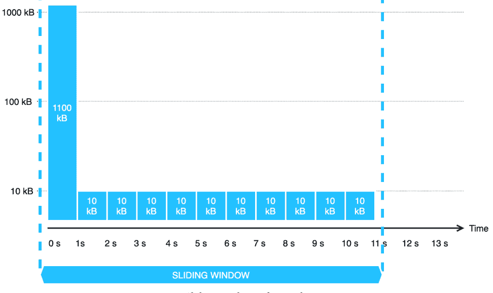

> 该插图仅作为一个粗略的指南，是一个简化的近似；真实的带宽曲线不会在采样周期之间被如此均匀地分配。尽管如此，它对发生的情况提供了一个公平的指示。


在第十秒结束时，我们将有一个高平均利用率值的采样周期，随后是十个利用率相对较低的周期。当第 12 个采样周期在第 11 秒开始时，滑动窗口将向前移动到第一个采样周期不再在其范围内的程度。此时，跨越整个窗口的累积利用率将突然下降到约 100 kB —— 即每秒窗口内允许的最大值 900 kB 的十分之一。这解释了下一次流量峰值——客户端利用机会用流式流量使代理饱和，其持续时间直到配额再次被违反为止，届时流量将通过一系列微小的延迟得到节制。在第 13 个采样周期的开始，窗口将从 11 秒跳回到 10 秒，导致客户端仍违背配额 10%，从而减少了一个秒钟的惩罚。很容易看出，当第二个峰值在第 22 秒移出滑动窗口范围时，这种模式是如何重复的。第二个峰值比第一个峰值约短 10 kB，随后的所有峰值高度相同。下方描述了从滑动窗口中丢弃第一个样本（标记第二个周期的开始）产生的影响。

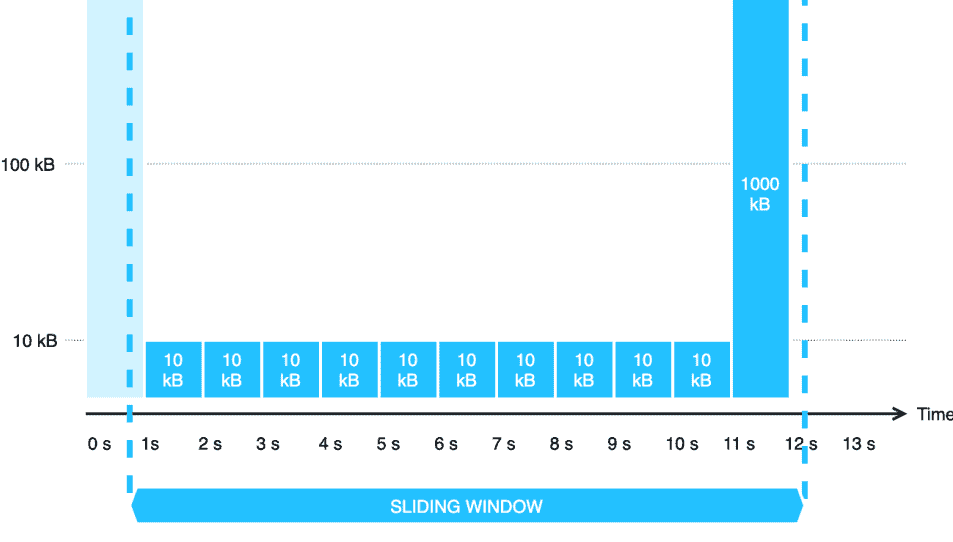

最后一张图描绘了一系列采样周期内的累积利用率，涵盖了两个完整的周期。图中指出了上述正文中讨论的关键折点。

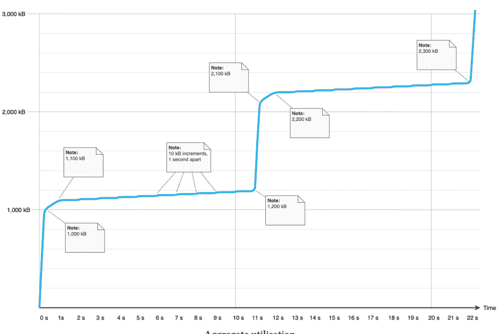

回之前提到的将延迟与负载周期（duty cycle）相关的公式，人们可能会假设带宽的循环阶段与负载周期是相当的或至少具有可比性。有趣的是，事实并非如此：负载周期与单个惩罚有关，代表请求时间与一个响应周期时长的比例。它可以被认为是在微观层面运行的。相比之下，宏观层面的循环是显而易见的——就是我们刚刚讨论的——它是滑动窗口长度和每个采样周期时长的函数。

这引出了我们的下一个点：`quota.window.num` 和 `quota.window.size` 属性（值 N 和 S）如何影响系统行为？

通过增加 `quota.window.num`，窗口 T 的总时长增加，从而提高了容忍度。对于一个十秒的窗口来说，这是 10% 的违规，并以一个采样周期的时长作为惩罚。换句话说，下一个请求将在代理响应之前被延迟一秒。这解释了下一次流量峰值——客户端利用机会用流式流量使代理饱和，其持续时间直到配额再次被违反为止，届时流量将通过一系列微小的延迟得到节制。在第 13 个采样周期的开始，窗口将从 11 秒跳回到 10 秒，导致客户端仍违背配额 10%，从而减少了一个秒钟的惩罚。很容易看出，当第二个峰值在第 22 秒移出滑动窗口范围时，这种模式是如何重复的。第二个峰值比第一个峰值约短 10 kB，随后的所有峰值高度相同。

（注：此处原文文本片段似乎存在逻辑重复或断层，译文已根据语境尽可能对齐并保留了格式结构）

## 第 18 章：事务

客户端配置。事实上，我们的大多数示例实际上已经利用了由该 KIP 引入的功能——即启用幂等性属性。没错，幂等生产者和事务性消息功能是高度相关的，并且有着许多共同点。因此，实际上，后续对事务性消息的研究可以看作是对几个章节前开始的讨论的收尾。

## 事务背后的原理

正如引言章节中广泛讨论过的，Kafka 作为事件流平台的作用是促进更广泛的事件驱动架构中进行事件的分发和处理。

事件流可以被可视化为一组松耦合的执行者（actors），它们形成一个有向无环图（DAG），其中图的节点是与 Kafka 主题交互的进程，而边是主题本身。这些进程也称为阶段（stages），可以作为生产者、消费者，或者通过一个或多个客户端和实例同时作为两者的结合。一个阶段还可以与 Kafka 之外的其他资源交互，例如数据库、API 等。下图展示了单个流处理阶段及其邻接主题的参考模型。

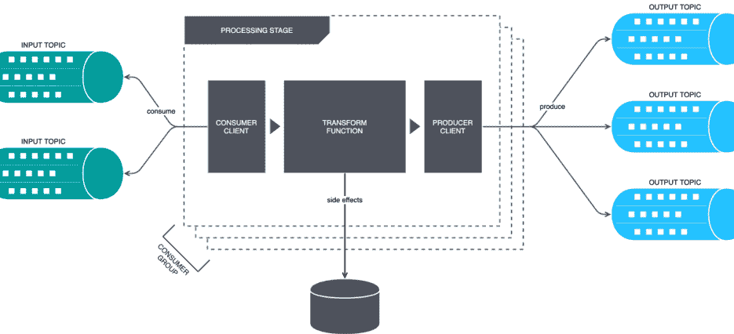

回想第 6 章“设计考虑”中关于精确一次交付的讨论。引用书中的话：

> 为了实现梦寐以求的精确一次语义，事件流应用程序中的消费者必须是幂等的。换句话说，重复处理相同的记录对消费者生态系统不应产生净影响。如果一条记录没有累加效应，则消费者本质上是幂等的。……否则，消费者在处理记录之前，必须检查该记录是否已经过处理过，以及处理到了什么种程度。至少一次交付与消费者幂等性的结合共同导致了精确一次语义。

## 问题——重复记录

选择并选择性地执行操作的能力在数据库中运行得良好，因为现有的几乎每个数据库都支持二级索引的概念。（简单来说，就是通过某些信息或主键高效访问记录的方法。）Kafka 尽管经常被比作数据库，但它不支持用户定义的二级索引。一条记录的主索引是“主题-分区-偏移量”三元组；这只是为了方便起见。Kafka 缺乏指定记录中某些属性以用于高效检索该记录，或至少确定记录的存在。

> 谈到数据库，Kafka 最初被设计为持久化存储器。Kafka 的复制机制确保了在适当配置的情况下，一旦记录在代理（broker）上被确认，该记录将以一种能够生存一系列故障的方式持久化。除了持久性保证外，Kafka 没有处理 ACID（原子性、一致性、隔离性、持久性）的任何其他属性。我们稍后会提到 ACID。

如果没有二级索引，处理阶段如何确保某个输入记录没有被发布（由于“至少一次交付”导致该输入记录可能会被重复处理）？为了说明这个问题，请考虑一个简单的阶段，它使用一个简单的映射函数将输入流转换为输出流：

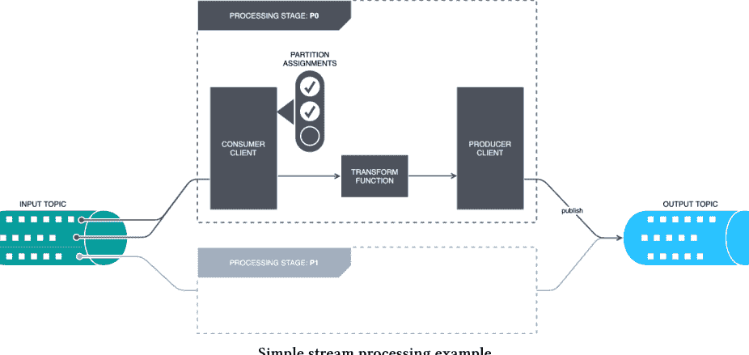

为了进一步提炼问题，让我们假设单个“输入”记录被简单地映射到一条“输出”记录。假设输入主题是一组整数，并且转换函数在转发它们之前对每个整数进行平方运算。尽管这个例子可能很牵强，但它旨在证明：试图在本质上不支持幂等性的存储介质上应用幂等性的问题。主题拓扑结构和转换函数并不重要；重要的是基本属性：尽管存在普遍的“至少一次”行为，对于一个处理过的输入记录，恰好对应一个输出记录。在包含性消费者组内运行的多个转换阶段实例的情况下，这一属性必须被维护。

在传统的“消费者-转换-生产者”模型下，一侧的消费者将从输入主题读取，应用转换，并通过专用的代理客户端在输出主题上发布记录。一旦收到领导者（leader）确认记录已妥善持久化的确认，它将提交输入记录的偏移量。为了简单起见，假设生产者是以幂等方式运行的，这是大多数应用程序推荐的做法。

考虑在上述模型中可能遇到的故障类型。抛开那些有 Bug 且运行异常的应用程序（以及更多的拜占庭故障），我们至少需要考虑代理故障、转换进程的突然终止以及网络连接问题。在消费者端，网络和代理故障可以通过嵌入在 `Consumer.poll()` 中的重试机制来处理。在生产者端，使用幂等性可以处理代理和网络故障，前提是故障持续持续时间不超过交付超时时间。这给我们留下了最具挑战性的故障场景：进程故障。结果将取决于进程失败的精确点。考虑以下情况：

- 消费前失败。
- 消费后但在转换前失败。
- 转换后但在发布前失败。
- 发布后但在确认偏移量前失败。
- 提交偏移量后失败。

情况 #1 是无害的：什么都没有发生，恢复非常简单。情况 #2 像 #1 一样，因为 Kafka（作为其消息传递对等物）在记录被读取后不会更新主题状态。假设转换操作是一个纯函数，不涉及其自身的任何状态，那么情况 #3 也没有问题：恢复的进程将重放消费和转换步骤。情况 #4 是有趣的点，因为它是状态变化后发生故障的第一个点。恢复的进程将重放消费和转换步骤，由于故障发生在确认偏移量之前，在没有提交提交的情况下会重复操作，导致为同一个输入记录产生多条输出记录。最后，情况 #5 再次是无害的，因为偏移量的提交标志着处理的完成。

上述分析表明，在最坏的情况下，对于输入记录可能会写入多条输出记录；在最好的情况下，将写入一条输出记录。假设记录最终被处理，则不会出现输出记录的缺失。这就是至少一次交付的本质。书中之前的所有材料都一直引导读者走向这一方向。

> 幂等性不仅需要消费者的协作，还需要下游产生资源的协作。

据推，面向消息的中间件是端点之间消息分发或事件复制的传输机制，取决于选择哪种范式；它不是确定性的真理来源，因为它没有试图替代数据库。数据库对于同一个实体返回多行是不可接受的。但 Kafka 作为传输机制的一部分，对此得以无视——依赖应用程序进行去重。

如果 Kafka 被用作主存储——即所谓的“真理来源”；例如，在事件源系统中充当事件存储的角色呢？对于同一个逻辑事件出现两条记录几乎是不可接受的。这并不是说消费者不能被设计来处理重复数据，但可以假设在大多数情况下重复是不受欢迎的——至少是令人困扰。

## 解决方案——事务

在 0.11.0 版本中引入的事务消息功能加强了 Kafka 的交付语义。具体来说，它在现有的持久性保证之上提供了原子性、一致性和隔离性保证，从而提供了关系型数据库（有时是 NoSQL）特有的复合 ACID 体验。

- 原子性 —— 确保对于在一个包含性事务范围内发布的一组记录，要么所有记录都可见地持久化到各自的日志中，要么都没有持久化。换句话之，事务要么成功，要么失败。在这种情况下，日志并不限于单个分区；事务可以跨多个主题和分区。
- 一致性（Consistency）——原子性的逻辑推论，一致性确保集群从一个状态转换到另一个状态，而在此过程中不会违反任何不变性。在我们的语境下，一致性指的是处理阶段输入主题和输出主题上的记录之间的相关性；一个输入记录必须产生一个被消费的输出记录，或者完全不被消费。
- 隔离性（Isolation）——确保事务的并发执行使系统处于与按顺序执行事务时将获得的相同的状态。简单来说，在事务提交之前，事务产生的影响对外部是不可可见的。（在实际上，进行中的事务的可见性取决于消费者配置的隔离级别）。

# 底层事务机制

## 事务协调器角色

第 10 章：客户端配置。实现的核心是一个唯一的生产者 ID（PID），它由事务协调器分配，并在整个生产者会话期间有效。事务协调器是运行在代理（broker）进程中的模块，为等等生产者和事务性生产者服务——类似于消费者用于管理组身份的组协调器。事务协调器负责发布 PID 并管理事务状态。生产者首先向适当的事务协调器发出 `InitProducer` 请求（可能存在多个协调器）；后者回复一个在生产者会话期间有效的唯一 PID。

事务性消息通过增加生产者 PID 的生命周期来在这一基础之上构建，使其能够跨越单个生产者会话。这是通过在生产者上指定可选的 `transactional.id` 属性实现的。如果未设置该属性，事务协调器每次请求时都会发布一个新的 PID；否则，事务协调器会将 PID 与事务 ID 关联，并在 `transactional.id` 代理属性指定的持续时间内维护这种关联，该属性默认为 604800000（一周）。事务 ID → PID 的映射包含了对应于关联更新点的纪号（epoch）。纪号充当围栏机制（fencing mechanism），阻止那些被新 PID 分配所取代的僵尸进程。（僵尸生产者可能会尝试使用其 PID 操作正在进行中的事务或启动新事务；然而，它们使用较旧的纪号进行操作，这会暴露它们）。当生产者尝试操作已被围栏的事务时，会抛出 `ProducerFencedException`。

## 第 18 章：事务

372

事务协调器职责的负载均衡是通过将 `internal__transaction_state` 主题的分区分配给集群中的代理来实现的，使得任何给定分区的分配所有者成为该分区索引的名义协调器。合适事务协调器的识别是通过对事务 ID 进行哈希处理并对分区索引取模的——从而得到负责该分区的协调器。

利用现有的领导者选举过程，Kafka 方便地避免了另一个用于选举事务协调器的仲裁过程。此外，事务管理大致平均地分布在集群中的所有代理上，这允许事务吞吐量通过增加代理数量来扩展扩展。

# 生产者 API 增强

事务性消息为生产者 API 添加了几个方法，即：

- `initTransactions()`：通过获取 PID 和纪号来初始化事务子系统，并与协调器一起完成给定事务 ID 的所有先事务。（在此过程中，对上一个纪号的任何僵尸进行围栏隔离。）此方法每个生产者会话应只调用一次，且必须在调用以下任何方法之前调用。一旦初始化，它将切换到 `READY` 状态。
- `beginTransaction()`：标记生产者上事务范围的开始。执行一系列本地检查，以确保客户端正在事务模式下运行，并将生产者切换到 `IN_TRANSACTION` 状态。此方法必须在调用以下任何方法之前调用。
- `sendOffsetsToTransaction()`：将消费者侧每个主题的偏移量集整合到当前事务范围内，并转发到所提供的消费者组的组协调器。偏移将在事务完成时生效。
- `commitTransaction()`：通过指示事务协调器来刷新任何未发送的记录并提交当前事务。这会将生产者置于 `COMMITTING_TRANSACTION` 状态，之后就可以进行操作（在此状态下）。
- `abortTransaction()`：丢弃当前事务的待处理记录并指示事务协调器中止事务。这将生产者置于 `ABORTING_TRANSACTION` 状态。

事务性消息很大程度上是生产者端的关注点。由于事务控制写操作的原子性，读者可能会记得第 3 章利用 `internal__consumer_offsets` 主题来持久化和跟踪偏移量以管理偏移量。在消费者端，必须禁用自动提交；事务的使用需要手动提交偏移量。

使用事务时，典型的消费-转换-产生循环保持如下：

```
producer.beginTransaction();
try {
  // 处理记录 ...
  producer.send(...);
  // ...
  
  producer.sendOffsetsToTransaction(...);
  producer.commitTransaction();
} catch (KafkaException e) {
  producer.abortTransaction();
  throw e;
}
```

# 分配事务 ID

现在我们遇到了挑战的核心——事务 ID 的选择。这被广泛认为是 Kafka 事务管理中最困惑和难以理解的部分之一。大多数情况下，各种论坛中与事务的问题都是围绕事务 ID 提出的。

之所以是因为事务 ID 必须跨生产者会话。它还被用作围栏机制，这意味着在任何时刻只能只有一个合法的生产者使用事务 ID。由于阶段中的进程数量不是常数，可能会根据负载进行伸缩，以及不受我们控制的因素（如进程重启、网络分区等），这变得更加复杂。

在揭推荐的事务 ID 分配方案之前，探索一些方案有助于理解问题的复杂性。

从简单的开始——由所有进程共享的公共事务 ID。我们可以迅速排除此选项，因为它为除最近提交共享事务 ID 的进程之外的所有进程创建了不可调和的围栏问题。

转到另一个极端——具有足够抗性以保证其唯一性的随机事务 ID。可以使用 UUID（版本 3、4 和 5）或任何其他唯一数量。

## 第 18 章：事务

这显然避免了隔离合法的对等进程的问题，但这样做也完全禁用了“僵尸隔离”（zombie fencing）。考虑回到我们早的示例：一个简单的处理阶段，它被一对输入和输出主题包围。假设两个进程 P0 和 P1 竞争输入主题 I0、I1 和 I2 中三个分区的分配 —— 转换输入并将记录发布到输出主题的某些分区。正如很快就会显示的，输出分区是无关的——只有输入分区对于隔离至关重要。

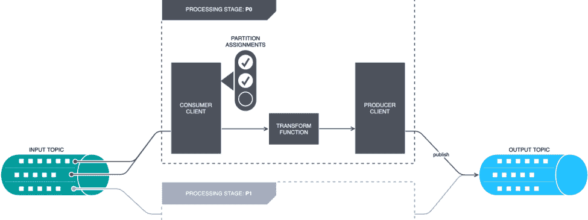

简单的流处理示例

最初，P0 分配了 I0 和 I1，P1 分配了 I2。两个进程都带有事务 ID 运行。在某个时刻，P1 上的某个问题阻塞了它通过 I2 的进度，最终导致组协调器检测到失败，随后触发分区重分配。此后，P0 成为输入主题中所有分区的分配者；P1 被认为已死亡。

如果 P1 在重分配时有进行中的事务会怎样？事务协调器将提供长达 `transactional_id.expiration` 数值的时间来尊重一个挂的事务。该设置的默认值为 360000（一小时）。在此期间，这些生产者将被允许写入受影响的分区，但在分区重分配后，在 `read_committed` 隔离级别下运行的消费者将不会看到任何记录。在流处理应用中，消费者端的这种停机时间通常是不可接受的。当然，过期时间可以从其默认值向下调小，但必须小心不要通过设置过于激进的过期时间来中断事务生产者的正常运行。无论如何，可以避免某种程度的停机时间。

这种方法的另一个问题是，如果 P1 在事务过期期内恢复运行会发生什么。由于它被排除在消费者组之外，它将无法继续消费记录，但任何正在进行中的记录（从之前的 poll 返回的）从它的视角来看仍然是“公平可以处理”的。它可能会尝试在事务范围内向输出主题发布更多记录 —— 这一操作将被事务协调器接受（协调器并不知道该进程在消费者端的状态）。在坏的情况下，输出主题将包含由两个进程发布的重复记录，对应于同一个输入记录。

我们可以尝试其他各种事务分配方案，但结果将始终如一 —— 要是对合法的生产者进行过度隔离，要么是在“僵尸”手中遭遇惨败。

隔离的真正意义在于消除这类场景，但要让隔离正常工作，生产者的会话必须以某种方式与输入源相关联。这里必须坦白：问题不仅在于事务 ID 的分配方案，还在于处理阶段的内部架构。在原始示例中，我们使用了一对客户端 —— 一个消费者和一个生产者 —— 采用并排排列。一个进程通过单个消费者实例为输入集中的所有分配分区工作。然后，它通过单一的、长寿的生产者实例向任意输出分区发布一条（或多条）记录。

在继续讨论事务 ID 的这一困境之前，我们需要重构处理阶段的内部架构。让单例消费者保留，但将单例生产者替换为一组生产者 —— 为输入集中的每个分配分区创建一个生产者。分区的分配可能会发生变化，这可以通过注册 `ConsumerRebalanceListener` 来解决。当分区被分配时，创建并初始化生产者实例；当分区被撤销时，销毁生产者实例。在发布输出记录时，始终使用与输入记录分区索引对应的生产者实例。下图图说明了这种内部拓扑结构。

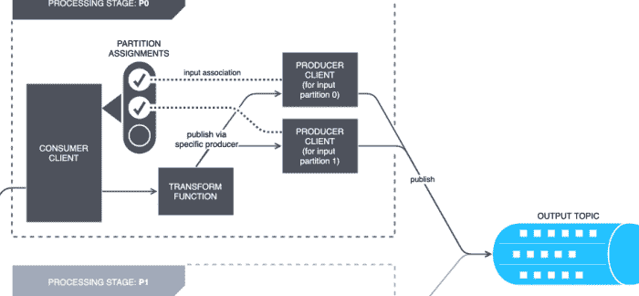

### 固定生产者 (Pinned producers)


> 输入主题中的分区数量可能是数百个或数千个；为每个可以想象的主题-分区创建一个生产者实例是浪费的，这会带来可能重大的连接建立开销，并且占用内存（缓冲区）、文件句柄和操作系统层面的线程。因此，将生产者客户端减少到分配的分区集是首选方法。此外，生产者实例可以是延迟实现的 —— 摊销从分区分配到从每个输入主题-分区首次读取点之间的开销。

揭晓答案：每个生产者的事务 ID 是通过拼接相应的输入主题和分区索引对来得的。

为了理解这种方法为什么有效，考虑之前 `P0` 和 `P1` 的示例，其中由于感知到失败，`I2` 从 `P1` 转移到了 `P0`。为了简单起见，输入和输出主题命名为 `tx-input` 和 `tx-output`。在修订后的架构下，`P0` 开始拥有一个消费者和两个事务 ID 为 `tx-input-0` 和 `tx-input-1` 的生产者。`P1` 有一个事务生产者 —— `tx-input-2`。重分配后，`P0` 拥有 `tx-input-0`、`tx-input-1` 和 `tx-input-2`。`P1` 认为它拥有 `tx-input-2`。

当 `P0` 实例化一个事务 ID 为 `tx-input-2` 的生产者时，对 `initTransactions` 的调用将导致与事务协调器完成任何挂的事务状态。协调器将根据其 `transaction_state` 主题中记录的事务日志提交或回滚事务。如果生产者能够在撤销前发出提交请求，事务将通过向受影响的分区写入 `COMMITTED` 控制消息来提交。相反，如果退出的生产者在撤销前中止了事务或由于失败未能显式提交事务，事务将通过发送 `ABORTED` 控制消息被强制回滚。无论如何，在 `P0` 被允许通过其 `tx-input-2` 生产者发布新记录之前，任何挂的事务都将完成。在此仪式之后，纪号被实例化。

> 当事务回滚时，Kafka 不删除受影响分区的记录。这样做违背了只追加日志的概念。相反，通过向每个受影响的分区写入 `ABORTED` 控制消息，协调器向事务信号这些记录不应被交付。

与此同时，`P1` 可能会尝试在 `tx-input-2` get ID 下完成其事务。它可能会向事务范围添加更多记录，这伴随着从 `AddPartitionsToTxRequest` 到 `EndTxRequest`。或者，它可能会通过发送 `EndTxRequest` 提交事务。这两个请求都要求强制性的纪号。由于 `P0` 分区的产生具有事务协调器上的纪号，过期纪号后的任何后续操作都将被协调器拒绝。

总结：通过将生产者实例固定到输入主题-分区，我们把输入和输出记录之间的因果关系捕捉到了生产者的身份中 —— 即通过派生事务 ID 的 PID。当组协调器上的分区分配变化时，因果关系会被传递给新的分配者；如果退出的分配者尝试以相同的身份发布记录，它将失败。

## 事务消费者

之前提到过，事务消息很大程度上是生产者端的问题。很大程度上但完全不是 —— 消费者在实现事务的隔离属性方面仍然起着作用。

## 第 18 章：事务

具体来说，当记录在事务范围内被发布时；这些记录在事务提交（或回滚）之前就已经持久化到它们的目标分区。一个事务可能跨越不同主题的多个记录。为了让事务保持隔离性属性，消费者生态系统与生产者以及事务协调器的协作至关重要。这是通过一个控制标记（control marker）来终止构成事务部分的记录序列实现的——该标记出现在事务范围内的每一个分区。

所有 0.11.0.0 以上版本的消费者都理解控制标记的概念；然而，消费者对控制标记的反应方式取决于其隔离级别（`isolation.level`）。默认的隔离级别为 `read_uncommitted` —— 意味着消费者将忽略控制标记，并将记录原样交付给轮询应用程序。这包括正在进行中的事务的记录，以及属于已回滚事务的记录。

要在消费者上启用事务语义，必须将 `isolation.level` 设置为 `read_committed`。在这种模式下，生产者的行为相对于偏移量（offset）发生了变化。通常情况下，偏移量等于高水位（high-water mark）——即最后一个成功复制的记录之后的偏移量。事务消费者会将其结束偏移量替换为最后稳定偏移量（Last Stable Offset, LSO）——即高水位与任何事务最小偏移量的最小值。在 LSO 的约束下，生产者将不允许在日志中进入包含开启事务的错误——直到该事务提交或回滚为止。在前者，事务的内容将在 `Consumer.poll()` 的结果中交付；在后者，记录将被静静地丢弃。

在理解了消费者如何绑定其在分配的分区中的进展后，很容易理解为什么“围栏”（fencing）是事务消息传递中的一个核心元素。如果没有围栏措施，处于开启事务状态的生产者将阻碍 LSO 的推进，最长可达 `transactional.id.expiration.ms` —— 这将影响所有以 `isolation.level=read_committed` 运行的下游消费者。

## 简单的流处理示例

在为事务消息传递建立了理论基础之后，是时候实现上述场景了。首先，我们需要一对主题：`tx-input` 和 `tx-output`。

```bash
$KAFKA_HOME/bin/kafka-topics.sh --bootstrap-server localhost:9092 --create tx-input --partitions 3 --replication-factor 1
```

```bash
$KAFKA_HOME/bin/kafka-topics.sh --bootstrap-server localhost:9092 --create tx-output --partitions 3 --replication-factor 1
```

复制因子保持在允许的最小值，以支持我们的单节点测试集群。双方都使用了三个分区来演示生产者实例与输入主题分区之间的亲性。为了简单起见，我们在示例中没有使用身份验证或授权。

此示例的完整源代码可以在 `github.com/ekoutanov/effectivekafka/` 的 `src/main/java/effectivekafka/transaction` 中找到。

下面的列表定义了一个简单的转换，它接收整数作为输入，并在发布结果到输出记录之前对其进行平方。


```java
import static java.lang.System.*;
import java.time.*;
import java.util.*;

import org.apache.kafka.clients.consumer.*;
import org.apache.kafka.clients.producer.*;
import org.apache.kafka.common.*;
import org.apache.kafka.common.serialization.*;

public final class TransformStage {
    public static void main(String[] args) {
        final var inputTopic = "tx-input";
        final var outputTopic = "tx-output";
        final var groupId = "transform-stage";

        final Map<String, Object> producerBaseConfig =
            Map.of(ProducerConfig.BOOTSTRAP_SERVERS_CONFIG,
                   "localhost:9092",
                   ProducerConfig.KEY_SERIALIZER_CLASS_CONFIG,
                   StringSerializer.class.getName(),
                   ProducerConfig.VALUE_SERIALIZER_CLASS_CONFIG,
                   IntegerSerializer.class.getName(),
                   ProducerConfig.ENABLE_IDEMPOTENCE_CONFIG,
                   true);

        final Map<String, Object> consumerConfig =
            Map.of(ConsumerConfig.BOOTSTRAP_SERVERS_CONFIG,
                   "localhost:9092",
                   ConsumerConfig.KEY_DESERIALIZER_CLASS_CONFIG,
                   StringDeserializer.class.getName(),
                   ConsumerConfig.VALUE_DESERIALIZER_CLASS_CONFIG,
                   IntegerDeserializer.class.getName(),
                   ConsumerConfig.GROUP_ID_CONFIG,
                   groupId,
                   ConsumerConfig.AUTO_OFFSET_RESET_CONFIG,
                   "earliest",
                   ConsumerConfig.ENABLE_AUTO_COMMIT_CONFIG,
                   false);

        var producers = new PinnedProducer(producerBaseConfig);

        try (var consumer = new KafkaConsumer<String, Integer>(consumerConfig)) {
            consumer.subscribe(Set.of(inputTopic), producers.rebalanceListener());

            while (true) {
                final var inRecords = consumer.poll(Duration.ofMillis(100));

                // 读取记录，转换它们的值
                for (var inRec : inRecords) {
                    final var key = inRec.key();
                    final var value = inRec.value();
                    printf("Got record with key %s, value %d%n", key, value);

                    // 准备输出记录
                    final var outValue = value * value;
                    final var outRec = new ProducerRecord<>(outputTopic, key, outValue);
                    final var topicPartition = new TopicPartition(inRec.topic(), inRec.partition());

                    // 获取对应分区的生产者
                    final var producer = producers.get(topicPartition);

                    // 事务性发送记录
                    producer.beginTransaction();
                    try {
                        producer.send(outRec);
                        // 提交偏移量
                        final var nextOffset = inRec.offset() + 1;
                        final var offsets = Map.of(topicPartition, nextOffset);

                        producer.sendOffsetsToTransaction(offsets, consumer);
                        producer.commitTransaction();
                    } catch (KafkaException e) {
                        producer.abortTransaction();
                        throw e;
                    }
                }
            }
        }
    }

    /**
     * 生产者到主题分区的映射
     */
    private static class PinnedProducer {
        private final Map<String, Producer<String, Integer>> producers = new HashMap<>();
        private final Map<String, Object> baseConfig;

        PinnedProducer(Map<String, Object> baseConfig) {
            this.baseConfig = baseConfig;
        }

        RebalanceListener rebalanceListener() {
            return new RebalanceListener() {
                @Override
                public void onPartitionsRevoked(Collection<TopicPartition> partitions) {
                    for (var topicPartition : partitions) {
                        printf("Revoked %s%n", topicPartition);
                        disposeProducer(getTransactionalId(topicPartition));
                    }
                }

                @Override
                public void onPartitionsAssigned(Collection<TopicPartition> partitions) {
                    for (var topicPartition : partitions) {
                        printf("Assigned %s%n", topicPartition);
                        createProducer(getTransactionalId(topicPartition));
                    }
                }
            };
        }

        String getTransactionalId(TopicPartition topicPartition) {
            return topicPartition.topic() + "-" + topicPartition.partition();
        }

        Producer<String, Integer> get(TopicPartition topicPartition) {
            final transactionalId = getTransactionalId(topicPartition);
            final var producer = producers.get(transactionalId);
            Objects.requireNonNull(producer, "No producer found for " + transactionalId);
            return producer;
        }

        void createProducer(String transactionalId) {
            if (producers.containsKey(transactionalId)) {
                throw new IllegalStateException("Producer already exists: " + transactionalId);
            }
            final var config = new HashMap<>(baseConfig);
            config.put(ProducerConfig.TRANSACTIONAL_ID_CONFIG, transactionalId);
            final var producer = new KafkaProducer<String, Integer>(config);
            producers.put(transactionalId, producer);
            producer.initTransactions();
        }

        void disposeProducer(String transactionalId) {
            final var producer = producers.remove(transactionalId);
            if (producer != null) {
                producer.close();
            }
        }
    }
}
```

## 第 18 章：事务

生产者的生命周期通过暴露一个 `ConsumerRebalanceListener` 来管理，该器会在分区分配时产生生产者值，并在撤销时销毁生产者。`transactional.id` 通过将输入主题名称与分区索引连接并用连字符分隔来定义。例如，对于名为 `tx-input` 的主题中的分区 2，使用 `tx-input-2`。

回到 `main()` 方法，我们有一个经典的消费者-处理-发布循环。在消费了一批记录后，应用程序遍历该批记录并为每条记录获取一个对应的固定的生产者实例。每个生产者都会启动一个事务，其中包含输出的 `send()` 调用以及通过生产者提交偏移量。注意，所有写操作必须通过生产者 API 进行。

在我们在示例中看到它之前，我们需要一种生成输入记录和查看输出的方法。这由一对类实现——`InputStage` 和 `OutputStage`：

```java
import static java.lang.System.*;
```

```java
import java.util.*;
```

```java
import org.apache.kafka.clients.producer.*;
```

```java
import org.apache.kafka.common.serialization.*;
```

```java
public final class InputStage {
    public static void main(String[] args)
    throws InterruptedException {
        final var topic = "tx-input";

        final Map<String, Object> config =
            Map.of(ProducerConfig.BOOTSTRAP_SERVERS_CONFIG,
                                   "localhost:9092",
                               ProducerConfig.KEY_SERIALIZER_CLASS_CONFIG,
                                   StringSerializer.class.getName(),
                               ProducerConfig.VALUE_SERIALIZER_CLASS_CONFIG,
                                   IntegerSerializer.class.getName(),
                               ProducerConfig.ENABLE_IDEMPOTENCE_CONFIG,
                                   true);

        try (var producer = new KafkaProducer<String, Integer>(config)) {
            while (true) {
                final var key = new Date().toString();
                final var value = (int) (Math.random() * 1000);

                out.format("Publishing record with key %s, value %d%n",
                    key, value);
                producer.send(new ProducerRecord<>(topic, key, value));
            }
        }
    }
}
```

```java
Thread.sleep(500);
}
}
```

```java
import static java.lang.System.*;

import java.time.*;
import java.util.*;

import org.apache.kafka.clients.consumer.*;
import org.apache.kafka.common.serialization.*;
```

```java
public final class OutputStage {
    public static void main(String[] args) {
        final var topic = "tx-output";
        final var group = "output-stage";
```


```
final Map<String, Object> config =
    Map.of(ConsumerConfig.BOOTSTRAP_SERVERS_CONFIG,
        "localhost:9092",
        ConsumerConfig.KEY_DESERIALIZER_CLASS_CONFIG,
        StringDeserializer.class.getName(),
        ConsumerConfig.VALUE_DESERIALIZER_CLASS_CONFIG,
        IntegerDeserializer.class.getName(),
        ConsumerConfig.GROUP_ID_CONFIG,
        "groupid",
        ConsumerConfig.AUTO_OFFSET_RESET_CONFIG,
        "earliest",
        ConsumerConfig.ENABLE_AUTO_COMMIT_CONFIG,
        false,
        ConsumerConfig.ISOLATION_LEVEL_CONFIG,
        "read_committed");
```

```
try (var consumer = new KafkaConsumer<String, Integer>(config)) {
    consumer.subscribe(Set.of(topic));
```

```
while (true) {
    final var records = consumer.poll(Duration.ofMillis(100));
    for (var record : records) {
```

```
out.format("Got record with key %s, value %d%n",
      record.key(), record.value());
}
consumer.commitAsync();
}
```

运行所有三个程序，按任何顺序启动。每个程序都会完成其工作；`OutputStage` 应用程序将显示结果。`TransformStage` 应用带有额外的日志用于显示分区的分配和撤销。当运行单个转换实例时，日志并不特别有趣，但当启动多个进程时，它会清晰地突出一个一个消费者的分区撤销是如何对应于另一个消费者的分区分配的。

## 局限性

Kafka 的事务消息传递有几个局限性，读者应该注意。

## 绑定到 Kafka 资源

事务消息传递使用专有的 Kafka 协议实现，与其他持久化系统和消息中间件不互操作。Kafka 不支持标准的事务 API 如 XA 和 JTA。

## 无法跨越生产者

事务不能用于跨越多个生产者实例。事务被转发到特定的事务协调器，通过哈希函数分配管理事务 ID 的。两个具有不同事务 ID 的生产者可能映射到两个不同的协调器，在当前设计的限制下，跨生产者事务是不可行的。

## 无法跨越集群

当处理阶段的生产者和消费者端连接到不同的集群时，消费者端的偏移量无法通过中继事务协调器来提交，因为后者位于不同的集群中。

## 可能会被消费者部分观察

由于事务可以跨越多个分区，运行在消费者组内的任何给定消费者都可能只看到更广泛事务中发射的一部分记录，而忽略了不影响其分配分区的事务影响。由于分区分配在消费者组成员之间是平衡的，一个事务的记录可能被细分到组内的多个消费者之间。

事务可能会跨越分区中的日志段（log segments）。当落后的的日志段由于保留策略而被删除时，可能看起来事务部分消失了。

在事务中发布的记录从压缩的角度来看并没有获得任何特殊处理。背景压缩过程可能会删除单个记录，留下一个不完整的集合。公平地说，事务记录在保留和压缩方面的行为并非事务本身的局限性，而更多是一个需要注意的警告。

## 不完全的精确一次语义

事务消息传递在精确一次处理方面最大的局限性是，它无法防止某个输入记录被处理两次；如果处理器在流中途发生故障，替代进程将接管并可能需要处理部分处理的记录。如果处理阶段嵌入了纯函数，这种情况是很容易处理的；换句话说，它是确定性的且没有自己的状态。另一方面，如果处理阶段必须写入数据库或调用下游服务，则必须考虑副作用。

## 事务是否被过度渲染了？

对于事务消息传递这种所谓的“炒作”，人们必须根据其提供的内容，质疑处理事务和固定生产者所增加的额外复杂性是否值得。所有持久化副作用都是幂等的，一个完全编写的“转换-发布”循环就能提供端到端所需的精确一次语义。当然，由于我们假设在 Kafka 中不会产生重复数据，人们甚至可以认为，只要有可靠的方法来识别它们，事件流处理的“至少一次”已经意味着了某种对重复数据的健壮性。

事务消息传递消除了事件流处理图中的重复记录。当应用程序依赖 Kafka 作为主要的事件存储，且在应用程序级别处理重复记录可能并非易事时，这可能非常有用。管理固定消费者的复杂性可以封装在专门的消息层或框架中。例如，Kafka Streams 客户端库可以透明地处理事务，使应用程序无需管理消费者和生产者、标记事务以及提交偏移量。Kafka Streams 是

## 第 18 章：事务

适用于广泛的 map-reduce 风格和简单的窗口操作，但可以理解，它可能无法满足你的流式处理需求。

> 当 KIP-98* 的成果向公众发布时，许多机会被用来实践透明性在中间件层级如何促进实现“精确一次”（exactly-once）交付保障的深远影响。有人建议新功能可以解决分布式计算中一些最困难的问题，而这些问题在以前被认为是不可能的。

在第 6 章“设计考虑”中曾提到，如果没有与应用程序的紧密协作，在中间件层是不可能实现精确一次语义的。这一公理适用于记录处理事件产生副作用的通用情况。重要的是，这一表述在 Kafka 事务消息领域的成就上是成立的。后者解决了“精确一次”问题的一个局限情况；具体而言，它消除了事件处理阶段图谱中的重复记录，其中每个阶段都完全由纯函数组成。再次，没有所谓的“银弹论”。

必须承认，“精确一次”的不可行性这一断言并没有削弱 Kafka 的任何价值；事务消息的发布并非局限意义上的。当应用程序领域并不完全符合事务消息的局限情况时，读者必须采取自己的措施来确保所有影响资源的幂等性。

https://wiki.apache.org/confluence/x/ASD8Aw

对于大多数事件驱动型应用程序，事务消息最有用且实用的方面是生产者端的幂等性保障。此功能利用了相同的 PID 概念和事务基础设施，确保记录在 `delivery.timeout.ms` 允许的时间范围内，不会以乱序的方式到达 broker。

我们刚刚讨论完 Kafka 中最具挑战性的话题之一。事务消息是在 0.11.0.0 版本中引入的，带来了支持生产者幂等性与端到端精确一次交付保障相结合的能力。

事务消息改进了 Kafka 的持久性保障，在流式处理应用图谱的记录生产和消费方面，增加了原子性、一致性和隔离性。在事务范围内操作时，处理阶段可以避免输出主题中出现重复记录——确保输入记录集与输出集之间的一一一对应关系。

事务消息的挑战很大程度上集中在通过稳定的事务 ID 将阶段输入映射到输出上。后者标识了一个跨越多个物理生产者实例的逻辑生产者。随着分区在消费者进程之间重新分配，事务 ID 会遵循分区的分配，恢复记录处理并封锁可能仍在生效的先前活动。实现事务阶段需要应用程序维护多个固定到记录源的生产者实例，并根据分区分配的变化来管理这些生产者的生命周期。

在更精简的形式下，底层的事务基础设施可以确保任何给定记录的发布都是幂等的，因为队列中的记录将在其目标分区上恰好出现一次，并按照生产者规定的顺序出现。（该保障在交付超时范围内有效，但如果记录被第二次入队，则可能会被违反。）此功能具有即时且实际的，建议在所有生产者上启用——而不仅仅是流式处理图谱。
