# 同步编程入门：通过算法实现 C++ 与 Java

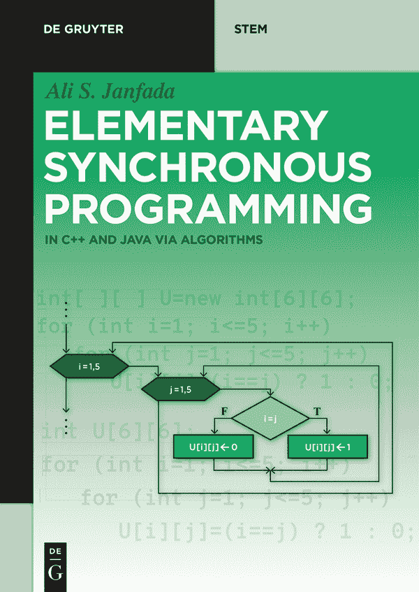

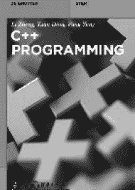

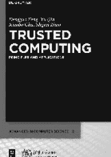


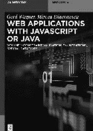

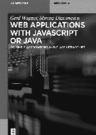

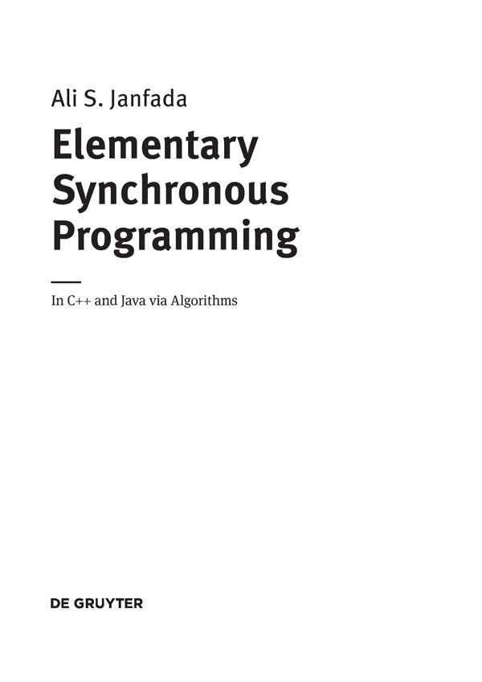

# 作者信息

Ali S. Janfada 博士

乌尔米亚大学

科学学院

数学系

伊朗，乌尔米亚，SERO 路 11 公里

`a.sjanfada@urmia.ac.ir`


纪念我的父母并献我的家人

# 前言

1975 年，当我获得数学学士学位时，除了一些零散的代码外，我对编程一无所知。事实上，在 1973 年，当我修读计算机编程课程时，市场上还没有今天那样的个人电脑。运行一个程序包括在打孔卡上打孔、修正管理性错误并重新打孔，以及在大学唯一的中央计算机上等待成功运行的时间并获取结果，这几乎需要花费一周。因此，我一个学期最多只能完整实现十个程序。1989 年进入乌尔米亚大学后，由于我对编程有着浓厚的兴趣，计算机编程成为我在数学和物理专业中渴望教授的课程之一。这种热情引导着我在 1994 年用波斯语写了我的第一本教材[[17]](#19_Bibliography.xhtml_Bibliography_3)，它很快成为计算领域最广泛使用的实用书籍之一，特别是对于物理专业的研究生来说。有趣的是，相对较高的编程我是我在 2000 年（数学之年）在英国曼彻斯特大学攻读代数拓扑博士期间成功的原因之一。获得博士学位后，我继续教授计算机编程课程，编写本书的最初构想在 2004 年出现在我的脑海中。我首先以小册的形式实现了我的想法，然后将其作为 Pascal 语言的教材[[18]](#19_Bibliography.xhtml_Bibliography_3)进行了测试。

本书旨在通过 `C++` 和 `Java` 语言的算法，为读者提供一种更方便、更好、更快的编程方法。本书涵盖了数学、物理和工程专业在计算机科学中教授的所有课程主题，除了学士期间的计算机科学课程外。实际上，如果教师能够考虑与每个领域相关的应用案例，课程将更加高效。此外，高中的数学知识是使用本书的前提，因此它对高中毕业生来说很有用。

在第 2 章和第 3 章中，我们将简要回顾 `C++` 和 `Java` 语言中的编程字母表，以及一些初步概念，并通过实现几个介绍性程序来练习所提供的解释。这两章将引导读者编写简单的算法和程序。此外，第 3 章描述了 `C++` 和 `Java` 语言中面向对象编程的本质。由于本书的计算目的性，大多数程序所使用的函数（方法）对面向对象编程本质的依赖程度较低。

我们的主要任务从第 4 章开始，该章解释了如何使用基本算法模板。子算法（子程序）被认为是算法（程序）的主要框架，它们在大规模算法（程序）中更为易感。此外，在第 5 章中，通过处理各种子算法和子程序，我们详细阐述了每种子算法（子程序）如何在主算法（程序）中编写和调用。通过学习这两章，新手读者将学会走路。换句话说，他学会了如何创建中间算法并将其转换为 `C++` 和 `Java` 代码。

此外，自动和条件循环分别在第 6 章和第 7 章中涵盖。通过大量的示例，算法编写能力在这两章得到了大幅加强。此外，算法模板在上述章节中得到了完善。通过学习这些章节，读者学会了如何创建合适的算法并编写所需的程序。

算法编写和编程技能的获取在第 8 章和第 9 章中提供，其中我们分别处理一维数组和二维数组（也称为向量和矩阵）。需要注意的是，超过一半的应用使用了数组。特别是，第 9 章讨论了求解线性方程组的各种方法。

在书中，提供了一些指南以解决章节（4-10）末的问题，这有助于读者在无法解决这些问题时从该部分获得灵感。

有时，我们在看电影时无法理解某些部分。在这种情况下，我们会回放电影以进一步理解并查看几次。我们甚至会缓慢观看，以便最终弄清该部分的内容。考虑到本课程的性质，建议学生在学习有用材料时考虑并应用以下三点。

第一点是尝试理解你在执行日常活动或解决计算问题时大脑经历了什么过程。更准确地说，尝试通过反复查看甚至缓慢移动这些过程来弄清大脑在发生什么。然后，识别并分析所执行的过程。

接下来，将你对这种识别和分析的感知分类为一组规则指令，并使用该集合设计算法，以便运行该算法的其他人获得与你的大脑相同的答案。

最后，学习算法的组件（模板，最多十个），恰当法使用它们，并并通过进一步练习提高你设计算法的技能。

我们用代码字体编写所有子算法、函数（方法）、模板、语句，以及关键字和 `for` 循环规范（与刚才用于 `for` 的字体相同），而变量名使用*斜体字体*。通常情况下，我们将在流程图或程序的任何地方使用代码字体，并在正文中每提到变量时都使用斜体字体。然而，我们在表格中使用表格本身的字体，这与上述两种字体几乎相同。

表格和图的编号根据涉及的示例数量进行。

为了为了读者的方便，书中的所有程序均可在 De Gruyter 网站 www. [degruyter.com](http://degruyter.com) 提供（搜索：Elementary Synchronous Programming）。

在人类的任何努力中，都有许多值得尊敬和感谢的人，由于他们提供了无价的道德、智力和技术支持。虽然我无法列出所有人，但我选择了突出介绍几个人。

我衷心感谢 Virayeshyar 编辑公司，特别是乌尔米亚大学应用语言学副教授 Javad Gholami 教授，感谢他对本书提供的宝贵指导以及快速、细致的编辑。我也感谢 Amin Habibzadeh 和 Mohammad Mohammadi，他们帮助编辑了书的部分内容。

诚挚感谢 Saeed Matlabjoo 对某些问题提出的宝贵建议，以及他在解决写作和处理出版格式若干系统性问题方面的协助。

我深感谢 Walter de Gruyter 出版社的工作人员，他们在本书的所有出版阶段提供的支持。特别感谢制作经理 Katja Schubert，她耐心且不断地为我提供技术指导。此外，我想感谢 Leonardo Milla、Aneta Cruz-Kaciak 和 Angelika Sperlich 在准备本书期间提供的所有帮助。

特别感谢两个人物，没有他们，我无法按时且如此高质量地出版这本书。我的儿子 Erfan，他将原始文本从波斯语翻译成英语，并在作者进行技术审查和修订后，耐心地修改了多处英语错误。他的鼓励一直激励着我。此外，Ehsun Rasoulian 作为作者的一位非常活跃的本科生和研究生，在承担将所有 `C++` 程序转换为 `Java` 并实现它们的任务给予了巨大的帮助。他在某些 `C++` 程序的实现方面也出了显著贡献，有时支持作者，从技术上研究了全书的文本，并最终提供了实用的建议。

我由衷地感谢我亲爱的妻子，她在写本书的多年里为我提供了安静的环境，并帮助我在其他研究工作中取得进展。

最后，我向所有尊敬的读者就我可能忽略的弱点和不足表示歉。我诚恳地请求读者，读者向作者反馈这些不足。

2019 年春季，Ali S. Janfada

# 算法简介

“算法”（algorithm）一词源于一位伟大的伊朗穆斯林数学家、天文学家和哲学家`al-Khawrizmi1`的名字，他生活在希吉第二世纪。通常情况下，算法是指一组通常预先定义且有序的指令，用于解决特定类型的问题。在日常生活中，人们可能在不经意的情况下执行各种类型的算法。例如，准备食物的过程需要几条指令，因为在烹饪和准备上菜时需要不同的阶段。另一个例子是去教堂或清真寺祈祷。这种仪式需要几个过程，这些过程可以转化为算法。机器人也是如此。这些机器根据特殊的算法设计，其中包含一组指令来实现它们，使得当这些指令连续执行时，它们能够协调地移动并准确地完成预设的任务。其他实例还包括建筑、开车、服药、摆餐、读书、旅行、出版书籍、管理办公室以及许多其他类型的活动。当教室里给出一个数学问题时，随后给出对应的数据。因此，人们期望获得特定的解决方案。为此，需要执行一种解题算法 2 以得出特定结果。即使在个人生活中解决问题时脑海中遵循的过程，某些算法的出现方式也不同，因为这些算法并没有被生动地预定义。

## 标准算法的定义

在理解问题后，可以研究各种解决方案的方法。这反过来需要另外几个阶段才能对提出的问题得出特定的发现。下面将详细阐述并定义标准算法构造更简洁、准确的概念。


算法是指解决问题时应用的一组指令。因此，执行这项活动需要四个不同的阶段。这些特定特征包括：简洁的表达、充分的细节、阶段顺序以及完成阶段。因此，所有这些特征的存在对于执行标准算法至关重要。

许多讨论缺乏上述定义中提到的所有四个特征。例如，假设服用某种药物的指令如下：将一茶匙悬浮液溶解在水中，每天三次，服用十天。显而易见，这条指令没有包含上述构造定义中提到的某些特征。首先，没有明确规定茶匙或玻璃杯的精确容量。其次，不清楚“每天三次”是指每八小时一次，还是每饭后一次。第三，没有简洁地解释在杯中倾倒药物和水的顺序。在某些情况下，指令的准确顺序似乎起着非凡的作用，例如倒热油和水时。

从现在起，算法指的是具有上述所有四个特征的内容。正如前面提到的，不同类型的算法已经应用于我们的日常生活中。值得提到的是，大脑中产生的想法可以转化为算法，而不是源于内心迸发的情感。换句话说，所有由五感引起的人类活动都可以以各种算法的形式表现。

## 从大脑过程到算法

为了进一步阐明算法与大脑中发生的过程之间的关系，给出一个示例来详细说明并对问题产生感觉。假设你被要求说 2 到 10 的偶数。你立即报出了 2、4、6、8 和 10。然而，你是否想过大脑中为了迅速提到这些数字经历了怎样的过程？为了进一步解释这个问题，想象有一段视频记录了你在列举 2 到 10 的偶数时大脑发生的反应和过程。也就是说，从问题提出的那一刻开始，大脑过程提供答案所需的持续时间。记录下过程后，以慢动作观看录制的内容。然后，你就可以看到大脑在分析问题以及得出所提问题的解决方案时应用的不同过程，这些过程反过来转化为了算法。因此，如果将该算法交给其他人执行，他们将得到已经实现的相同解决方案。

简而言之，对所提问题的回答分为两个部分。第一部分检查大脑是如何一步一步命令的。

将数字 2（第一个偶数）放入“内存”中。然后，只要内存中的数字不超过 10，就反复写下或说出内存中的数字，然后对其加 2，并替换内存中的前一个数字。

第二部分非常仔细、耐心地分析大脑中的这些过程，以便将其转换为算法。

### 算法 1.1(a)

1. 在特定的“位置”，首先放入数字 2；

2. 写下该位置的数字；

3. 将该位置的数字加 2 个单位，并将结果替换前一个数字；

4. 如果该位置的数字小于或等于 10，继续从第 2 条指令开始执行算法；

5. 否则，完成算法执行。

通过上述算法中的“位置”，我们大脑指令中提到的“内存”。在大脑中，这个算法确实执行得很快，并得到了上述问题的答案。我们也和大脑一起（但速度比它慢）精确地执行这个算法，并将结果记录在下表中。

表 1.1(a)：执行算法 1.1(a) 的结果。

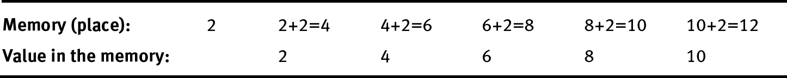

## 算法设计的目标

本书的核心目的是创造并逐渐加强想象大脑过程慢动作的能力并分析其细节，将其转化为算法供读者。算法设计的极端重要性可以通过以下事实来理解。


只要你成为一名算法设计师，你就会成为优秀的程序员！

是的，编程其实简单，只要你具备优雅、精确和敏感性：在想象和分析大脑命令方面优雅，在设计算法方面精确，在算法的正确性和修复可能的错误方面敏感。

用书写形式表示最近算法显得粗俗。通过建立和定义合适的符号和变量，我们可以用简单的符号形式来表示。我们用变量 `E` 来表示所要求的偶数。变量 `E` 实际上是大脑指令中的“内存”或算法 1.1(a) 中的“位置”。我们使用赋值符号 `E ← 2` 将 2 分配给 `E`，使用 `E ← E+2` 对保存到 `E` 的最后值加两个单位并替换 `E`；也就是说，在内存中对 `E` 的最后值加 2 后，删除最后值并由新值替换。


这些标准符号中箭头的方向应该始终从右到左。使用类似 `2 → E` 的符号是错误的。原因将在第 4 章](#12_chapter04.xhtml_chapter04_1) 中解释。

使用给定的符号，我们将算法 1.1(a) 修改为更简单的形式。

算法 1.1(b)。


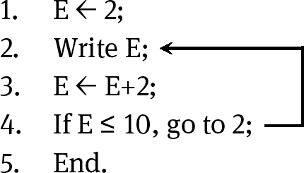

在这个算法中，存在一个循环（重复多次的指令），其重复的方向由箭头标记。请注意，`read`、`write (print)`、`go to`、`if`、`then`、`terminate` 等词，以及算法实现者使用的某些代数运算，都被假设为预定义的。

现在，我们将表 1.1(a) 修改为表 1.1(b)，称为实现表 3。

表 1.1(b)：算法 1.1(b) 的实现表。

| 处理 | E | 输出 |
| :--- | :--- | :--- |
| 循环之前 | 2 | |
| 第一次迭代 | 4 | 2 |
| 第二次迭代 | 6 | 4 |
| 第三次迭代 | 8 | 6 |
| 第四次迭代 | 10 | 8 |
| 第五次迭代 | 12 | 10 |


安排实现表的规则 1：根据变量的数量创建列。同时，考虑为算法的结果输出设置一列。现在在第一行中，我们指定列标题。第二行命名为“循环之前”，用于分配循环之前指令的结果（如果有的话）。然后，在每一行中，我们写下循环每次迭代的结果。最后一行专门用于退出循环后执行的指令（主要是一个或多个多个打印操作）。

尽管安排此表通常很简单，但它的重要性并不亚于编写算法时给出的步骤。


如果在安排实现表时有任何疏忽，我们可能无法察觉算法的故障，从而导致我们编写算法的所有努力都付诸东流。

在安排实现表时，我们实际上是将自己置于算法实现者（可能是人类或机器）的位置，并按照给顺序执行算法指令。实现表输出列中看到的内容，将以特定的模式在计算机的输出单元中显示。

我们为什么要强调算法的重要性？这主要是因为算法是任何编程语言中计算机程序的结构化语言。无疑，所有的计算机程序都植根于一个或多个算法。计算机基本上是建立在算法之上的。因此，没有算法，计算机只是一堆无用的零件。

通常，当我们解决一个问题时，我们在不同的时刻会潜意识地思考如下情况：我应该从哪里开始？现在应该做什么？是时候获取输入了吗？什么输入？是时候插入结果了吗？什么结果？是时候做（双重或多次）决定了吗？做什么决定？是时候形成循环了吗？什么样的循环？我应该从哪里开始循环，如何结束它？问题完全结束了吗？

为了回答上述每一个问题，需要执行几个步骤。

## 编写算法的步骤


编写算法的步骤：

第一步（解决问题）。我们相关领域解决问题。

第二步（分析解决方案）。我们分阶段地构思响应。

第三步（编写算法）。通过定义变量（如有必要）并带着足够的耐心，我们回顾分析结果。

第四步（实现算法）。我们应该对的正确性保持敏感。

第五步（编写程序）。根据所选编程语言的规则，我们翻译算法。

这是由于以下算法与算法 1.1(b) 以及上述三个算法相比，价值较低，因为它不符合良好算法的第二个特征。

1.1(f). 1. `E ← 2;` 2. `If E > 10 go to 6;` 3. `Write E;` 4. `E ← E+2;` 5. `Go to 2;` 6. End。

## 1.2 流程图

在上一节中，我们熟悉了算法以及编写算法的文字描述和符号表示两种形式。我们看到符号形式比文字形式更简单。编写算法的另一种更简单的方法是使用图化形式来编写。使用这种说明性方法编写的算法被称为流程图。换句话说，流程图是用形状语言编写的算法。下表描述了绘制流程图时用到的一些构造形状，包括它们的作用以及每个形状的示例。关于算法和流程图的更多信息，请参见参考文献 [2, 6, 7]。

表 1.2：流程图中使用的构造形状及其应用。

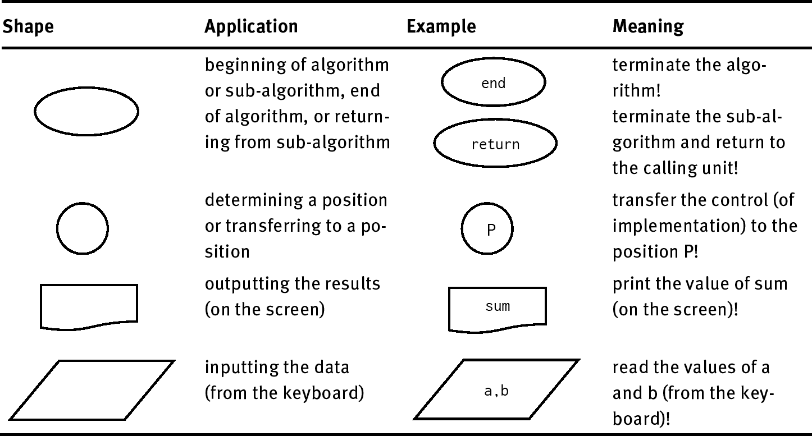 

这些构造形状通过箭头相互连接。箭头的方向代表算法的执行流。


方向规则。在书中，我们将指向右侧的分支称为 T 方向（T 代表 True 真），指向左侧的分支称为 F 方向（F 代表 False 假）。如果任何分支的方向向下，则以右、左方向为优先。换句话说，在右下的双分支中，向下的方向将是 `F`，因为我们已经假设右方向为 `T`。同样，在左下方的双分支中，向下的方向将是 `T`，因为我们已经假设左方向为 `F`。这些细节在附图中所示。

| 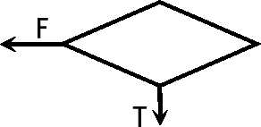 | 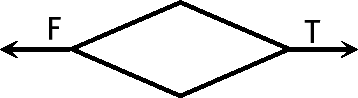 | 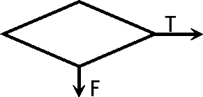 |

例如，图 1.1 可视化展示了算法 1.1(b)。

由于流程图的构造形状已经显式地展示了相关的指令，我们避免了编写不必要的短语，例如用于输入的 `read`、用于输出的 `write` 或用于决策和分支的 `if`。此外，为了简单起见，几条赋值和替换指令可以写在一个矩形中。在这种情况下，一旦进入该形状，所有指令都将从上到下执行。

根据上述情况并结合最近的声明，可以认为流程图可以翻译为任何编程语言。

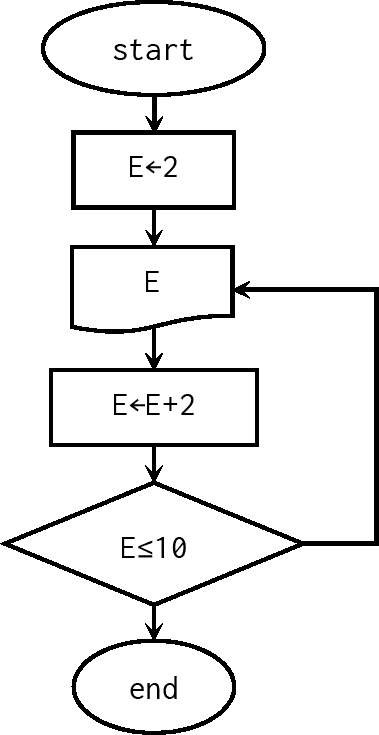

图 1.1：算法 1.1(b) 的流程图。

由于流程图是视觉化算法，组织它们的实现表与算法类似。在组织好实现表后，我们按照指定的方向实现算法，并在必要时提供适当的数据，然后将每条指令的执行结果写在表格内部适当的位置。输入数据在数量和类型上必须恰当，以便覆盖所有不同的状态（如偶、奇、负、正、零等），且不遗留未测试的状态，因为例如，一个错误的算法可能无意中只对正数正常运行，所以如果不测试负数或零，算法的缺陷将无法暴露。

### 1.1.1. 练习。修改图 1.1 的流程图，使其不是写数字本身，而是计算并写它们的和。

### 1.1.2. 练习。绘制算法 1.1(c)、1.1.(d)、1.1(e) 和 1.1(f) 的流程图。

惯。在书中，为了简单起见，我们不再使用“图 A 的流程图”这一短语，而是采用“图 A”或“流程图 A”。

在流程图中，为了防止图表混乱，某些细节如打印设计、复杂的计算公式以及无关且巨大的细节不会被写出来，仅在编程时应用。在选择表 1.2 中的流程图构造形状时，我们专注于它们的应用。然而，不同的作者可能会选择不同的形状来构建流程图。

有趣的是，在 20 世纪 60 年代中期，计算机终端被用于分时访问中央计算机。在 20 世纪 70 年代初个人电脑（PC）出现之前，计算机通常是大型且昂贵的系统，只有大学和政府机构等大型机构拥有。终端用户通常无法直接与机器交互。相反，为了运行程序，需要通过打卡片来收集若干计算机指令。卡片是一种灵活的一次写入介质，用于编码数据，最常见的是 80 个字符。通常，每个语句打在一个卡片上。

我们说该算法的实现是锁定的，也就是说我们有一个无限循环，如果不停止，它将一直执行下去。

我们应该感到高兴，现在修正程序错误快得多，而且没有任何资源浪费。通常，从开始编程到获得结果所需的时间已经达到了最短。

算法 1.3。编写一个算法的主部分以交换 `m` 和 `n` 的值。

解。初一看，下面两条指令似乎可以做到这一点：

```
\begin{array}{l} \left. m\leftarrow n \right. \\ \left. n\leftarrow m \right. \end{array}
```


为了判断这是否正确，我们假设内存中分别为`m`和`n`保存了值 5 和 10。我们连续执行这些指令。执行第一条指令会将`n`的值（即 10）赋值给`m`。这意味着`m`之前的值（5）被移除，并为它保存了新值 10。现在，通过执行第二条指令，`m`和`n`的值都将变为 10，这表明上述指令并没有给我们我们想要的结果。请绘制实现表！

上述问题类似于一种情况：我们有两个容器，一个装有米，另一个装有糖，我们想要交换这两个容器中的物品。为了做到这一点，我们别无选择，只能使用一个辅助容器。如果我们将米容器标记为`m`，糖容器标记为`n`，辅助容器标记为`k`，那么，为了交换容器`m`和`n`的内容，首先将其中一个容器（例如`m`）的内容倒入`k`容器中；随后，将`n`容器的内容倒入`m`中。最后，将`k`中的内容倒入`n`中。

同样，为了解决我们的问题，我们考虑一个辅助变量`k`。现在我们按照处理容器问题的方法进行操作：1. `k ← m`；2. `m ← n`；3. `n ← k`。算法中这部分（称为交换算法）的流程图如图 1.3 所示。

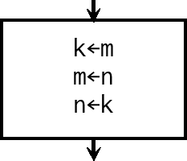

图 1.3: 交换算法


### 符号

由于算法的这部分在后续将交替使用，为了绘制算法的方便，此后不再使用给定的模板，通过交换算法方法交换`m`和`n`的值，我们将在流程图中使用前端模板

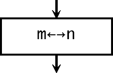

#### 1.3.1. 练习题

编写一个在不使用辅助变量的情况下交换`m`和`n`值的算法。

#### 1.3.2. 练习题

编写一个交换`x`、`y`和`z`算法，使得`x`的值转移到`y`，`y`的值转移到`z`，`z`的值转移到`x`。

### 算法 1.4

假设要求你读取六个“正”整数并确定最大数。

$\begin{matrix} 7 & 12 & 9 & 24 & 11 & 18 \end{matrix}$

**解。** 你立刻写下了 24。你的大脑是如何完成这一点的？如果给你的是 100 个数字而不是 6 个，你会怎么做？你能像现在这样快速地确定最大数吗？对于这个问题，人们可能会拿上笔纸，从第一个数字开始，每次读取一个数字，在与下一个数字（接几个数字，瞬间但逐个地）比较后，将读取的数字与纸上的数字进行比较，如果读取的数字更大，就划掉纸上的数字并在纸上写下较大的。

人们也可以通过低声自语来这样做，而不是写在纸上。这两种方式的操作是相同的。我们将以慢动作分析大脑在这种方法中处理 100 个数字时的反应：

1. 在内存中留出两个位置：第一个用于写入最大数，第二个用于计算读取的数字个数。在第一个位置放入 0。这是由于我们的方法是比较并替换较大的值，而所有的正数都大于 0。在第二个位置放入 1（第一个数字的计数器）。
2. 之后，直到恰好读完 100 个数字为止，每次读取一个数字，增加计数器后，将其与第一个位置的值进行比较。如果读取的数字更大，则进行替换；否则，将最后一个数字写入第一个位置以终止算法。

这是大脑反应的慢动作可视化，并从此推导出一个算法思想。

在继续将大脑的指令转换为形式之前，我们希望你思考这个问题并尝试为它绘制一个流程图。你的流程图可能会与我们的不同。为了将这个想法确定为流程图，我们首先定义变量：

| n: | 需要读取的数字 |
| :--- | :--- |
| max: | 用于存储最大数的位置 |
| c: | 用于计数读取数字个数的位置 |

定义变量有两个主要优点：首先，算法实现者知道每个变量的作用；其次，在任何编程语言中，每个变量的数据类型（例如整数、实型等）都是定义的。我们将在后续章节的 C++ 和 Java 语言中讨论这一点。

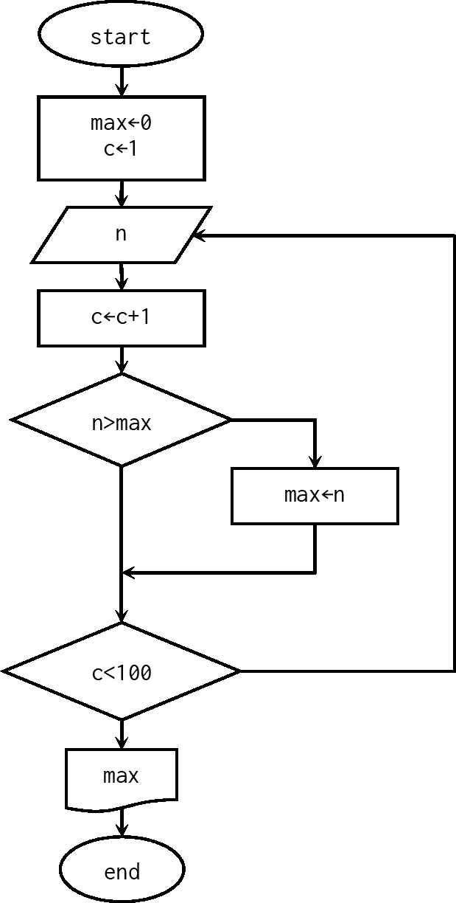

图 1.4(a): 算法 1.4 的流程图。

现在我们将这个想法转化为算法形式。开始，我们分别为`max`和`c`赋值 0 和 1。然后，在每次循环中，首先读取数字`n`，并将`c`加 1。接下来，将读取的`n`与`max`的值进行比较；如果`n`更大，则替换它。很好，测试条件“如果 c < 100，则重复循环”。如果条件不成立，则退出循环。此外，我们在退出循环后打印`max`的值。这展示了表 1.3 的实现步骤。

我们看到，图 1.4(a) 的实现展示了这些步骤。对于六个数字的算法 1.4 的假设，我们的图 1.4(a) 的实现是正确的。我们遵循第五次循环：读取数字 11，`c`增加了一个单位，新的值`6`替换了`max`。为了对于 100 个数字，我们需要修改算法，将第二个条件改为 c ≤ 100 或 c = 100（参见图 1.4(b)）。因此，算法没有正常运行！为了修复它，我们需要正确地它。

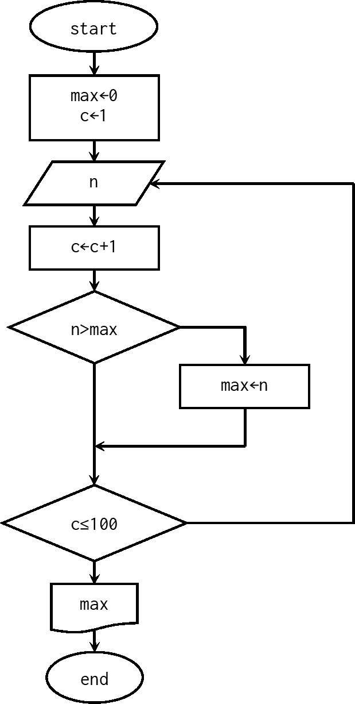

图 1.4(b): 图 1.4(a) 的修改。

表 1.3: 图 1.4(a) 的实现表。

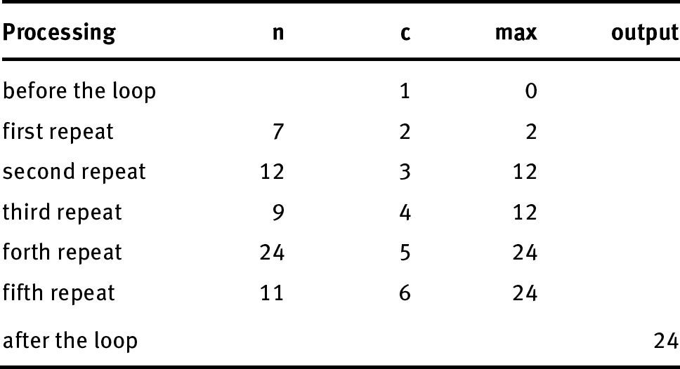[](graphic/09_chapter01_fig_47.png)

图 1.4(c): 图 1.4(b) 的修改，以适用于任意数字。

我们见证了通过实现表：

首先，显示了算法工作不正常；

其次，揭示了问题所在以及如何修复。


**安排实现表的规则 2。** 在组织实现表时，如果重复次数过多，我们限制重复次数，并以适当且多样的方式选择要读取的数据。

**问题。** 图 1.4(b) 是否适用于 100 个“任意”数字，而不仅仅是正数？如果不适用，我们应该如何修改它以获得理想的流程图？

**回答。** 显然答案是否是否定的。例如，如果所有数字都是负数，那么算法将无法正常工作，输出将是 0。我们该怎么办？

如果我们能意识到数字的本质，答案将是显而易见的。例如，如果我们知道所有的数字都大于 –1000，那么我们可以将该数字作为`max`的初始值，并保持流程图的其他部分不变。然而，如果我们没有这样的假设，那么解决方案是在循环开始之前读取第一个数字，并将其作为`max`的初始值。图 1.4(c 显示了这一过程。

尽管重新组织了实现表，我们发现还需要进行一次改动：我们应该将 2 作为`c`的初始值。事实上，我们从 2 开始计数，因为在循环之前读取了一个数字。

到为止，我们仅通过几个示例引入了算法和流程图。我们将从第 4 章开始学习编写算法的技巧。


约定。从现在起，在本书中，每当我们提到算法时，指的视觉化算法，即流程图。

# 2 C++ 编程的两个基本概念

C++ 是一种中级编程语言，是 C 语言语言的继者，C 语言由 Denis Ritchie 于 1972 年在美国 AT&T 贝尔实验室首次引入。Denise Ritchie 利用 BCPL 和 B 的概念开发了 C，并添加了数据类型以及其他一些强大的特性。

C++ 编程语言的诞生于 1979 年，当时 Bjarne Stroustrup（比雅·斯特斯特普）正在写他的博士论文。他开始研究一种面向对象范式的新语言 Simula，并将其与 C 语言的特征相结合。1983 年，他引入了一些如类等附加功能，并将“带有类的 C”称为 C++。此外，C++ 被解释为 C+1，表示比 C 多了一项（技能）；因为，正如我们在接下来的章节中看到的，`++`运算符会对操作数加 1。C++ 编程语言的第一个商业版本于 1985 年 10 月发布。C++ 由国际标准组织（ISO）和国际电工委员会（IEC）内部的联合技术委员会 ISO/IEC JTC 1 标准化，该委员会负责开发和促进编程语言、其环境和系统软件接口领域的标准。到为止，已经发布了五个版本的 C++ 标准，目前名为 C++20 的下一个修订正在进行中。这些修订显示在表 2.1 中。

表 2.1：C++ 标准的修订。

| 年份 | C++ 标准 | 非正式名称 |
| :--- | :--- | :--- |
| 1998 | ISO/IEC 14882: 1998 | C++ 98 |
| 2003 | ISO/IEC 14882: 2003 | C++ 03 |
| 2011 | ISO/IEC 14882: 2011 | C++ 11, C++ 0x |
| 2014 | ISO/IEC 14882: 2014 | C++ 14, C++ 1y |
| 2017 | ISO/IEC 14882: 2017 | C++ 17, C++ 1z |
| 2020 | 待定 | C++ 20 |

C++ 运行在多种平台上，如 Windows、Mac OS、GNU/Linux 和各种版本的 UNIX。任何使用过 Apple Macintosh 或运行 Windows 的 PC 的人都间接使用过 C++，因为这些系统的主要用户界面是用 C++ 编写的。

## 2.1 基本概念

由于本书的目标是初级编程，在本章中，我们将介绍对 C++ 初级编程至关重要的基本概念，并将补充细节留给涉及 C++ 高级编程的书籍。

### 2.1.1 保留字

保留字（或关键字）是为 C++ 编译器为了特定目的而定义的单词，除了注释外，不能用于任何其他手段。它是“被保留以供他处使用”。这是一种句法定义，保留字可能没有意义。C++ 编程语言有 95 个保留字，其中只有 32 个基础保留字在 C 语言中也存在并被带入 C++。拥有如此数量的保留字，C++ 仍然是最快且最高效的编程语言之一。本书中将交替使用的 C++ 保留字总结在表 2.2 中。

表 2.2：C++ 中常用的保留字。

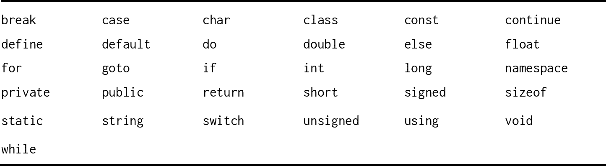

C++ 编译器对大小敏感；因此，`For`和`for`在 C++ 编译器中表现出不同的行为。

### 2.1.2 标识符

标识符是用于标识变量、常量、函数、子程序或其他用户定义的名称。这种命名很重要，尤其是在变量中。


标识符命名规则。标识符是 A 到 Z 或 a 到 z 字母、下划线和数字 0 到 9 的组合，前提是字符不能是数字。例如，标识符是 A 到 Z 或 a 到 z 字母、下划线和数字 0 到 9 的组合，前提第一个字符不能是数字。例如，标识符是 A 到 Z 或 a 到 z 字母、下划线和数字 0 到 9 的组合，前提第一个字符不能是数字。例如，标识符是 A 到 Z 或 a 到 z 字母、下划线和数字 0 到 9 的组合，前提第一个字符不能是数字。例如，标识符是 A 到 Z 或 a 到 z 字母、下划线和数字 0 到 9 的组合，前提第一个字符不能是数字。例如，标识符是 A 到 Z 或 a 到 z 字母、下划线和数字 0 到 9 的组合，前提第一个字符不能是数字。例如，标识符是 A 到 Z 或 a 到 z 字母、下划线和数字 0 到 9 的组合，前提第一个字符不能是数字。例如，标识符是 A 到 Z 或 a 到 z 字母、下划线和数字 0 到 9 的组合，前提第一个字符不能是数字。例如，标识符是 A 到 Z 或 a 到 z 字母、下划线和数字 0 到 9 的组合，前提第一个字符不能是数字。例如，标识符是 A 到 Z 或 a 到 z 字母、下划线和数字 0 到 9 的组合，前提第一个字符不能是数字。例如，标识符是 A 到 Z 或 a 到 z 字母、下划线和数字 0 到 9 的组合，前提第一个字符不能是数字。例如，标识符是 A 到 Z 或 a 到 z 字母、下划线和数字 0 到 9 的组合，前提第一个字符不能是数字。例如，标识符是 A 到 Z 或 a 到 z 字母、下划线和数字 0 到 9 的组合，前提第一个字符不能是数字。例如，标识符是 A 到 Z 或 a 到 z 字母、下划线和数字 0 到 9 的组合，前提第一个字符不能是数字。例如，标识符是 A 到 Z 或 a 到 z 字母、下划线和数字 0 到 9 的组合，前提第一个字符不能是数字。例如，标识符是 A 到 Z 或 a 到 z 字母、下划线和数字 0 到 9 的组合，前提第一个字符不能是数字。例如，标识符是 A 到 Z 或 a 到 z 字母、下划线和数字 0 到 9 的组合，前提第一个字符不能是数字。例如，标识符是 A 到 Z 或 a 到 z 字母、下划线和数字 0 到 9 的组合，前提第一个字符不能是数字。例如，标识符是 A 到 Z 或 a 到 z 字母、下划线和数字 0 到 9 的组合，前提第一个字符不能是数字。标识符命名规则。标识符是 A 到 Z 或 a 到 z 字母、下划线和数字 0 到 9 的组合，前提第一个字符不能是数字。例如，标识符是 A 到 Z 或 a 到 z 字母、下划线和数字 0 到 9 的组合，前提第一个字符不能是数字。

`A to Z or a to z, underscores, and digits 0 to 9, provided that the first character cannot be a number.`

`the identifier is a combination of letters A to Z or a to z, underscores, and digits 0 to 9, provided that the first character cannot be a number.`
`the identifier is a combination of letters A to Z or a to z, underscores, and digits 0 to 9, provided that the first character cannot be a number.`
`the identifier is a combination of letters A to Z or a to z, underscores, and digits 0 to 9, provided that the first character cannot be a number.`
`the identifier is a combination of letters A to Z or a to z, underscores, and digits 0 to 9, provided that the first character cannot be a number.`
`the identifier is a combination of letters A to Z or a to z, underscores, and digits 0 to 9, provided that the first character cannot be a number.`
`the identifier is a combination of letters A to Z or a to z, underscores, and digits 0 to 9, provided that the first character cannot be a number.`
`the identifier is a combination of letters A to Z or a to z, underscores, and digits 0 to 9, provided that the first character cannot be a number.`
`the identifier is a combination of letters A to Z or a to z, underscores, and digits 0 to 9, provided that the first character cannot be a number.`
`the identifier is a combination of letters A to Z or a to z, underscores, and digits 0 to 9, provided that the first character cannot be a number.`
`the identifier is a combination of letters A to Z or a to z, underscores, and digits 0 to 9, provided that the first character cannot be a number.`
`the identifier is a combination of letters A to Z or a to z, underscores, and digits 0 to 9, provided that the first character cannot be a number.`
`the identifier is a combination of letters A to Z or a to z, underscores, and digits 0 to 9, provided that the first character cannot be a number.`
`the identifier is a combination of letters A to Z or a to z, underscores, and digits 0 to 9, provided that the first character cannot be a number.`
`the identifier is a combination of letters A to Z or a to z, underscores, and digits 0 to 9, provided that the first character cannot be a number.`
`the identifier is a combination of letters A to Z or a to z, underscores, and digits 0 to 9, provided that the first character cannot be a number.`
`the identifier is a combination of letters A to Z or a to z, underscores, and digits 0 to 9, provided that the first character cannot be a number.`
`the identifier is a combination of letters A to Z or a to z, underscores, and digits 0 to 9, provided that the first character cannot be a number.`
`the identifier is a combination of letters A to Z or a to z, underscores, and digits 0 to 9, provided that the first character cannot be a number.`
`the identifier is a combination of letters A to Z or a to z, underscores, and digits 0 to 9, provided that the first character cannot be a number.`
`the identifier is a combination of letters A to Z or a to z, underscores, and digits 0 to 9, provided that the first character cannot be a number.`
`the identifier is a combination of letters A to Z or a to z, underscores, and digits 0 to 9, provided that the first character cannot be a number.`
`the identifier is a combination of letters A to Z or a to z, underscores, and digits 0 to 9, provided that the first character cannot be a number.`
`the identifier is a combination of letters A to Z or a to z, underscores, and digits 0 to 9, provided that the first character cannot be a number.`
`the identifier is a combination of letters A to Z or a to z, underscores, and digits 0 to 9, provided that the first character cannot be a number.`
`the identifier is a combination of letters A to Z or a to z, underscores, and digits 0 to 9, provided that the first character cannot be a number.`
`the identifier is a combination of letters A to Z or a to z, underscores, and digits 0 to 9, provided that the first character cannot be a number.`
`the identifier is a combination of letters A to Z or a to z, underscores, and digits 0 to 9, provided that the first character cannot be a number.`
`the identifier is a combination of letters A to Z or a to z, underscores, and digits 0 to 9, provided that the first character cannot be a number.`
`the identifier is a combination of letters A to Z or a to z, underscores, and digits 0 to 9, provided that the first character cannot be a number.`
`the identifier is a combination of letters A to Z or a to z, underscores, and digits 0 to 9, provided that the first character cannot be a number.`
`the identifier is a combination of letters A to Z or a to z, underscores, and digits 0 to 9, provided that the first character cannot be a number.`
`the identifier is a combination of letters A to Z or a to z, underscores, and digits 0 to 9, provided that the first character cannot be a number.`
`the identifier is a combination of letters A to Z or a to z`graphic/10_chapter2_fig_03.

`the identifier is a combination of letters A to Z or a to z, underscores, and digits 0 to 9, provided that the first character cannot be a number.`
`the identifier is a combination of letters A to Z or a to z, underscores, and digits 0 to 9, provided that the first character cannot be a number.`
`the identifier is a combination of letters A to Z or a to z, underscores, and digits 0 to 9, provided that the first character cannot be a number.`
`the identifier is a combination of letters A to Z or a to z, underscores, and digits 0 to 9, provided that the first character cannot be a number.`
`the identifier is a combination of letters A to Z or a to z, underscores, and digits 0 to 9, provided that the first character cannot be a number.`
`the identifier is a combination of letters A to Z or a to z, underscores, and digits 0 to 9, provided that the first character cannot be a number.`
`the identifier is a combination of letters A to Z or a to z`graphic/10_chapter2_fig_04.

1979 年，Bjarne Stroustrup（比雅·斯特斯特鲁普）正在写他的博士论文。他开始研究一种面向对象范式的新语言 Simula，并将其与 C 语言的特征相结合。1983 年，他引入了一些如类等附加功能，并将“带有类的 C”称为 C++。此外，C++ 被解释为 C+1，表示比 C 多了一项（技能）；因为，正如我们在接下来的章节中看到的，`++`运算符会对操作数加 1。C++ 编程语言的第一个商业版本于 1985 年 10 月发布。C++ 由国际标准组织（ISO）和国际电工委员会（IEC）内部的联合技术委员会 ISO/IEC JTC 1 标准化，该委员会负责开发和促进编程语言、其环境和系统软件接口领域的标准。到为止，已经发布了五个版本的 C++ 标准，目前名为 C++20 的下一个修订正在进行中。这些修订显示在表 2.1。

C++ 运行在多种平台上，如 Windows、Mac OS、GNU/Linux 和各种版本的 UNIX。任何使用过 Apple Macintosh 或运行 Windows 的 PC 的人都间接使用过 C++，因为这些系统的主要用户界面是用 C++ 编写的。

## 2.1 基本概念

由于本书的目标是初级编程，在本章中，我们将介绍对 C++ 初级编程至关重要的基本概念，并将补充细节留给涉及 C++ 高级编程的书籍。

### 2.1.1 保留字

保留字（或关键字）是为 C++ 编译器为了特定目的而定义的单词，除了注释外，不能用于任何其他手段。它是“被保留以供他处使用”。这是一种句法定义，保留字可能没有意义。C++ 编程语言有 95 个保留字，其中只有 32 个基础保留字在 C 语言中也存在并被带入 C++。拥有如此数量的保留字，C++ 仍然是最快且最高效的编程语言之一。本书中将交替使用的 C++ 保留字总结在表 2.2 中。

表 2.2：C++ 中常用的保留字。


C++ 编译器对大小敏感；因此，`For`和`for`在 C++ 编译器中表现出不同的行为。

### 2.1.2 标识符

标识符是用于标识变量、常量、函数、子程序或其他用户定义的名称。这种命名很重要，尤其是在变量中。


标识符命名规则。标识符是 A 到 Z 或 a 到 z 字母、下划线和数字 0 到 9 的组合，前提是字符不能是数字。例如，标识符是 A 到 Z 或 a 到 z 字母、下划线和数字 0 到 9 的组合，前提第一个字符不能是数字。例如，标识符是 A 到 Z 或 a 到 z 字母、下划线和数字 0 到 9 的组合，前提第一个字符不能是数字。例如，标识符是 A 到 Z 或 a 到 z 字母、下划线和数字 0 到 9 的组合，前提第一个字符不能是数字。例如，标识符是 A 到 Z 或 a 到 z 字母、下划线和数字 0 到 9 的组合，前提第一个字符不能是数字。例如，标识符是 A 到 Z 或 a 到 z 字母、下划线和数字 0 到 9 的组合，前提第一个字符不能是数字。例如，标识符是 A 到 Z 或 a 到 z 字母、下划线和数字 0 到 9 的组合，前提第一个字符不能是数字。例如，标识符是 A 到 Z 或 a 到 z 字母、下划线和数字 0 到 9 的组合，前提第一个字符不能是数字。例如，标识符是 A 到 Z 或 a 到 z 字母、下划线和数字 0 到 9 的组合，前提第一个字符不能是数字。例如，标识符是 A 到 Z 或 a 到 z 字母、下划线和数字 0 到 9 的组合，前提第一个字符不能是数字。例如，标识符是 A 到 Z 或 a 到 z 字母、下划线和数字 0 到 9 的组合，前提第一个字符不能是数字。例如，标识符是 A 到 Z 或 a 到 z 字母、下划线和数字 0 到 9 的组合，前提第一个字符不能是数字。例如，标识符是 A 到 Z 或 a 到 z 字母、下划线和数字 0 到 9 的组合，前提第一个字符不能是数字。例如，标识符是 A 到 Z 或 a 到 z 字母、下划线和数字 0 到 9 的组合，前提第一个字符不能是数字。例如，标识符是 A 到 Z 或 a 到 z 字母、下划线和数字 0 到 9 的组合，前提第一个字符不能是数字。例如，标识符是 A 到 Z 或 a 到 z 字母、下划线和数字 0 到 9 的组合，前提第一个字符不能是数字。例如，标识符是 A 到 Z 或 a 到 z 字母、下划线和数字 0 到 9 的组合，前提第一个字符不能是数字。例如，标识符是 A 到 Z 或 a 到 z 字母、下划线和数字 0 到 9 的组合，前提第一个字符不能是数字。例如，标识符是 A 到 Z 或 a 到 z 字母、下划线和数字 0 到 9 的组合，前提第一个字符不能是数字。例如，标识符是 A 到 Z 或 a 到 z 字母、下划线和数字 0 到 9 的组合，前提第一个字符不能是数字。例如，标识符是 A 到 Z 或 a 到 z 字母、下划线和数字 0 到 9 的组合，前提第一个字符不能是数字。标识符命名规则。标识符是 A 到 Z 或 a 到 z 字母、下划线和数字 0 到 9 的组合，前提第一个字符不能是数字。例如，标识符是 A 到 Z 或 a 到 z 字母、下划线和数字 0 到 9 的组合，前提第一个字符不能是数字。

`the identifier is a combination of letters A to Z or a to z, underscores, and digits 0 to 9, provided that the first character cannot be a number.`

`the identifier is a combination of letters A to Z or a to z, underscores, and digits 0 to 9, provided that the first character cannot be a number.`
`the identifier is a combination of letters A to Z or a to z, underscores, and digits 0 to 9, provided that the first character cannot be a number.`
`the identifier is a combination of letters A to Z or a to z, underscores, and digits 0 to 9, provided that the first character cannot be a number.`
`the identifier is a combination of letters A to Z or a to z, underscores, and digits 0 to 9, provided that the first character cannot be a number.`
`the identifier is a combination of letters A to Z or a to z, underscores, and digits 0 to 9, provided that the first character cannot be a number.`
`the identifier is a combination of letters A to Z or a to z, underscores, and digits 0 to 9, provided that the first character cannot be a number.`
`the identifier is a combination of letters A to Z or a to z`
1 0 to 9.

`the identifier is a combination of letters A to Z or a to z, underscores, and digits 0 to 9, provided that the first character cannot be a number.`

### 2.1.3 数据类型

C++ 提供了丰富的数据类型。除了基本类型外，还可以使用修饰符来改变它们的范围或大小。

1) 整数类型`int`，用于存储整数。
2) 浮点类型`float`，用于存储单精度实数。
3) 双精度浮点类型`double`，用于存储高精度实数。

修饰符`signed`不会引起任何变化，我们在表格中未使用它。

表 2.3：整数类型。

| 类型 | 范围 | 大小（字节） |
| :--- | :--- | :--- |
| `int` | –2,147,483,648 to 2,147,483,647 | 4 |
| `unsigned int` | 0 to 4,294,967,295 | 4 |
| `short int` | –32,768 to 32,767 | 2 |
| `unsigned short int` | 0 to 65,535 | 2 |
| `long int` | –2,147,483,648 to 2,147,483,647 | 4 |
| `unsigned long int` | 0 to 4,294,967,295 | 4 |
| `long long` | –9,223,372,036,854,775,808 to 9,223,372,036,854,775,807 | 8 |
| `unsigned long long` | 0 to 18,446,744,073,709,551,615 | 8 |

在表 2.4 中，a E b 意味着 a × 10b。

| 类型 | 范围 | 大小（字节） |
| :--- | :--- | :--- |
| `float` | ±3.4028 E –38 to ±3.4028 E 38 | 4 |
| `double` | ±1.7977 E –308 to ±1.7977 E 308 | 8 |
| `long double` | ±1.1897 E –4932 到 ±1.1897 E 4932 | 12 |

区分整数和实数两种类型有两个原因。首先是内存中存储的相关数据的大小。如表所示，整数数据的大小相对小于实数数据。第二个原因是这两种类型在计算中表现出完全不同的行为。特别是，使用整数数据进行计算要快得多。

4) 字符数据类型`char`，携带一个字符。每个字符数据存储在内存的一个字节中。在 C++ 中，每个字符数据应该写在两个单引号之间，例如：

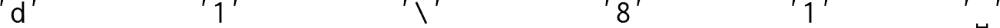

空白符也被视为一种字符。

两种字符类型见表 2.5。

表 2.5: 字符数据类型。

| 类型 | 范围 | 大小（字节） |
| :--- | :--- | :--- |
| `char` | –128 到 127 | 1 |
| `unsigned char` | 0 到 255 | 1 |

数据的范围和大小可能与表中所示的不同，这取决于所使用的编译器和计算机系统。通过`sizeof`运算符（参见下文的运算符章节），可以获取所用计算机上各种数据类型的正确大小。

5) 字符串数据类型`string`，存储字母、数字和其他字符的序列。在程序中，字符串必须置于双引号之间。例如，"The value of `st1.id_no = `" 是一个字符串。我们将在第 8 章中学习字符串的存储。

6) 布尔类型`bool`，真（true）或假（false）。`true`的默认数值为 1，`false`为 0，这些数据类型可以用于数学表达式，尽管我们不建议这样做。

7) 无值数据类型`void`，将在以后讨论。

还有另一种宽字符数据类型`wchar_t`，我们将在书中不会使用它。每个数据在程序中以常量或变量的形式出现。我们强调，标识符主要用于命名变量、常量、子程序和用户定义函数。在本书中，我们将主要处理整数和实数数据类型。

### 2.1.4 变量

变量是一个在程序运行可以改变的标识符。程序中使用的变量必须有类型。在程序中定义变量并确定其类型是通过下面的变量声明语法完成的。


语法（变量声明）：

```


`a` 数据类型 = 一个或多个变量;

例如，程序的这部分

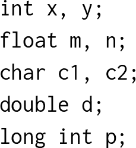

向编译器声明变量`x`和`y`是`int`类型，`m`和`n`是`float`类型，`c1`和`c2`是`char`类型，`d`是`double`类型，`p`是`long int`类型。

当我们想在程序中使用变量时，应该首先根据变量在程序中的角色为变量选择一个名称。例如，用于级数求和的`sum`和用于输入数字计数`count`可能是合适的名称。我们甚至可以使用缩写来命名。例如，`matA`是矩阵`A`的一个合适名称。总之，名称的选择取决于程序员，没有任何限制。我们只需要遵循标识符的命名规则即可。在本书中，为了简单起见并避免程序过大，我们将为变量使用短名称。

为变量选择名称后，我们根据其在某种意义上的应用来选择一个类型。例如，显然，一个名为`count`的作为程序中输入数字计数器的变量应该是整数类型。如果变量在程序中使用但未经过声明，将会出现错误。

上述讨论的变量是 C++ 中的普通变量。另一方面，C++ 是一种面向对象的编程语言，其中每个变量都有一个访问说明符。访问说明符指定了可以访问变量的位置。C++ 的面向对象特性将在第 3.3 节](#11_chapter03.xhtml_chapter03_33)中讨论。

由于变量在程序中起着至关重要的作用，因此对它们有清晰的理解。根据下面的图，变量可以被想象成一个盒子，它的名称就是变量名，它的内容是一个与声明名称相同类型的值（数值或非数值）。此外，由于面向对象的特性，每个变量都有一个访问区域。

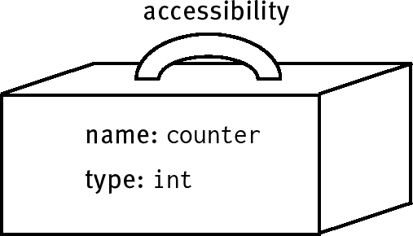

### 2.1.5 常量

常量是一个在程序中具有固定值的标识符，在任何情况下不能改变。在程序中定义常量并指定其类型是通过以下常量声明语法之一完成的：


语法（常量声明）：

```
#define 名称 常量值;
const 数据类型 常量名 = 常量值;
```

例如，

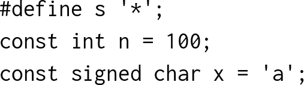

声明变量和常量可以在程序的任何点。然而，大多数程序员倾向于在开始处进行。

我们所说的编程中的块是指一对大括号内的系列声明。块的内容从新行开始，向右缩进两个或三个空格。右括号`}`应该单独占一行。上述块风格是这些风格之一。

### 2.1.6 运算符

运算符是让编译器执行特定数学或逻辑操作的符号。运算符作用于单个或两个操作数。运算符分为若干类。

1) 算术运算符。C++ 中的这些运算符汇总在表 2.6 中。

表 2.6: 算术运算。

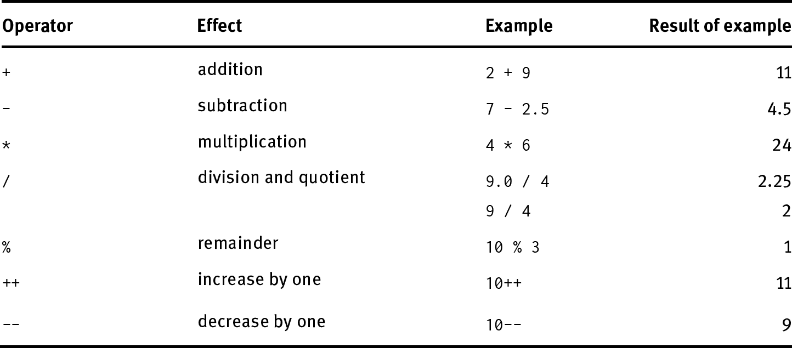

在使用`/`运算符时有必要注意一个重点。


如果`/`运算符的操作数中至少有一个是实值，结果将是实值；另一方面，如果它们都是整数，结果将是分子除以除数的商。

表 2.5 中的两个示例类似于上述事实。在这些情况下，如果我们想使用`/`运算符进行除法，一种可靠的方法是在表达式前编写`(float)`。例如，如果变量`r`和`s`分别存储了值 10 和 8，那么`(float)r/s`的结果将是除法的精确值，即 1.25。


- 运算符`+`、`-`和`*`的每个结果只有当两个操作数都是整数时才是整数。
- `/`和`%`运算符的右侧操作数必须非零。否则将出现错误或结果不正确。
- `%`运算符的操作数都应该是整数。
- 如果`%`运算符的操作数之一是负数，我们将遵循以下规则：
  - 如果`a < 0`且`b > 0`，则`a % b`等于`-(-a % b)`；
  - 如果`a > 0`且`b < 0`，则`a % b`等于`-(a % -b)`；
  - 如果`a < 0`且`b < 0`，则`a % b`等于`(-a % -b)`。

- 在计算中，如果`++`和`--`运算符任一位于操作数之前，则首先执行该运算符，然后结果参与后续计算。然而，如果它们位于操作数之后，则先使用操作数的当前值，此后运算符再对其操作数进行操作。

为了阐明最后一种解释，我们在表 2.7 中提供了三个示例。首先，需要提到的是算法语言中的表达式`i++`被写为`i←i+1`。在表格的前两个示例中，我们假设内存中的整数变量`x`已经保存了值 10；在第三个示例中，我们进一步假设整数变量`y`在内存中持有值 15。

表 2.7：运算符`++`和`--`的示例。

| 示例 | 算法意图 | 结果 |
| :--- | :--- | :--- |
| `y = ++x` | `x ← x + 1` | `x: 11` |
| | `y ← x` | `y: 11` |
| `y = x++` | `y ← x` | `x: 11` |
| | `x ← x + 1` | `y: 10` |
| `m = ++x + y++` | `x ← x + 1` | `x: 11` |
| | `m ← x + y` | `m: 26` |
| | `y ← y + 1` | `y: 16` |

2) 关系（比较）运算符。表 2.8 规定了 C++ 中的这些运算符。

表 2.8：关系（比较）运算符。

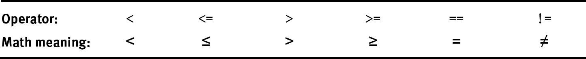

这些运算符对其操作数起的作用结果将是一个逻辑值（1 表示真，0 表示假）。如果操作数是字符，则将根据字符在 ASCII 码表中的位置进行比较。

3) 逻辑运算符。C++ 中的这些运算符如表 2.9 所示。

表 2.9：逻辑运算符。

| 运算符 | 逻辑符号 | 含义 |
| :--- | :--- | :--- |
| `!` | `~` | 否定 |
| `&&` | `^` | 与 |
| `\|\|` | `v` | 或 |


- `!`运算符只有一个操作数。每当`p`为假时，`!p`为真，反之亦然。
- `p&&q`仅当`p`和`q`都为真时，结果为真。
- `p||q`仅当`p`和`q`都为假时，结果为假。

4) 赋值运算符。表 2.10 列出了 C++ 支持的赋值运算符。除了第一个外，所有运算符都是复合的。

表 2.10：赋值运算符。

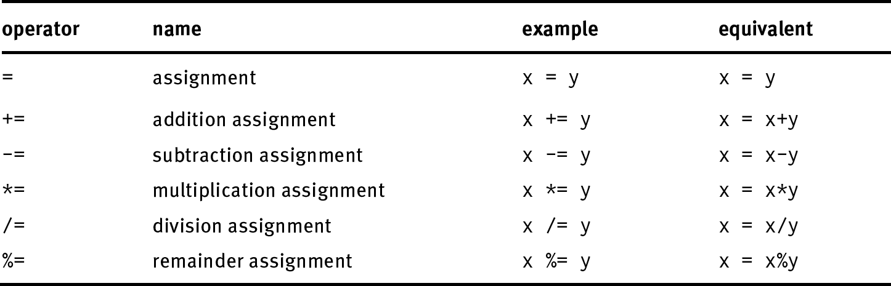

表达式`x = y`使编译器将`y`的值分配（替换）给`x`。这个赋值运算符也被称为赋值语句，因为它的行为类似于语句（见下一节）。


- 不要将`==`关系运算符与`=`赋值运算符混淆。使用`==`运算符代替`=`语句通常会导致错误。然而，使用`=`运算符代替`==`运算符则不会触发错误。尽管如此，它可能会产生微妙的逻辑错误，最终导致严重问题。
- 复合赋值运算符的两个字符之间不能有任何空格；例如，`+=`是非法的。

除了上述的经典运算符外，还有一些杂项运算符。

5) `?`运算符（二分支）。该运算符的语法如下：


语法（`?`运算符）：

```
condition ? expression 1 : expression 2
```

效果：如果条件为真，则返回`expression 1`的值；否则，返回`expression 2`的值。例如，考虑以下赋值语句。

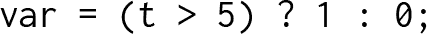

这里，如果`y`大于 5，则给`var`赋值为 1，否则赋值为 0。这种赋值的影响可以用如下所示的流程图语言来说。

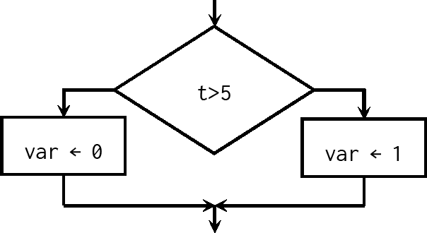

6) `,`运算符。该运算符的语法如下。


语法（`,`运算符）：

```
expression 1 , expression 2 , … , expression n
```

效果：逗号运算符的目的是将多个表达式连接起来。分配给逗号分隔的表达式列表的值是最右侧表达式的值。其他表达式的值将被丢弃。这意味着逗号分隔的表达式取决于最右侧的值。通过表 2.11 进一步说明这一点。

表 2.11：逗号运算符的两个示例。

| 示例（赋值语句） | 结果 |
| :--- | :--- |
| `var = (y > 5 ? 1 : 0)` | 19 |
| `i = (count)` | 19 |

7) `sizeof`运算符。该运算符返回操作数的大小，即它占据的字节数。例如，如果`var`声明为`int`，那么`sizeof(var)`为 4。在某些情况下，括号是必要的；否则，编译器将识别逗号运算符优先级较低。另一个例子是`sizeof(int)`为 4。书中还有其他类型的运算符，如位运算符。

### 库（预定义）函数

在每个编程语言中，具有数学应用的数学函数（称为库函数）是预定义的。这些函数大部分如`sin()`，出现在所有语言中。然而，其中一些如`floor()`（不大于 x 的最小整数）名称不同。C++ 中最常用的库函数在表 2.12 中总结。这些函数在 C++ 中可用。高级版本包含更多函数。

表 2.12：C++ 支持的一些库函数。

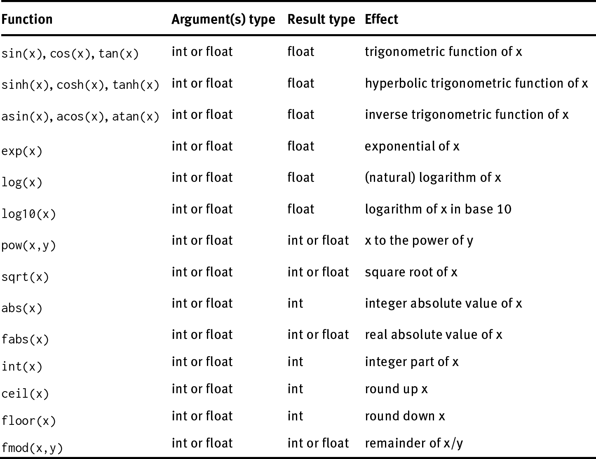!(graphic/10_chapter02_fig_26.png)

注意三角函数的参数是弧度。

在第 5 章中，我们将看到除了库函数外，程序员可以在子程序中定义任何需要的函数，供任何程序使用。


- 注意某些参数的限制。例如，`log()`和`log10()`函数的参数必须为正，`sqrt()`的参数不能为负。同样的注意也适用于`pow()`函数。
- 永远不要使用库函数的名称来命名程序的任何标识符（如变量或常量）；否则该函数将失去作用，反而可能导致程序结果出现问题。

### 算术与逻辑表达式

在数学中，像这样的

$\frac{2\sin\text{x} + 10}{\text{x}^{2}}$

包含数字、变量、数学函数、代数运算符、分数或/或括号的表达式被称为代数表达式。C++ 中的算术表达式是变量、常量、库函数、算术运算符、分数或括号的组合。算术表达式的结果是一个数字。逻辑表达式的定义类似。以下每个表达式都是 C++ 算术表达式的示例：

在数学中，xy 表示 x 乘以 y，但在 C++ 中，短语 xy 表示一个以此命名的变量。始终记住：

- 将 x 乘以 y 写为`x*y`而不是`xy`；
- 将`2`乘以`t`写为`2*t`而不是`2t`；
- 将`-12`乘以`4.5`写为`-12*4.5`而不是`-12(4.5)`；
- 将`(x-y)`除以`t`写为`(x-y)/t`而不是`x-y/t`；
- 将`1`除以`ab`写为`1/(a*b)`而不是`1/a*b`；避免编写导致除以零错误的表达式。当多个算术运算符连续出现时，它们按照从上到下的优先级执行。

注意`=`赋值运算符的优先级低于所有算术运算符。

### 运算符优先级规则

如果一个运算符的优先级与下一个运算符相同，则执行它。否则，直到下一个运算符进行比较。当一个运算符执行时，会产生一个结果。现在，之前的运算符已经处理完毕，我们继续处理下一个运算符，直到得到表达式的结果。

在此执行过程中：
1) 每当遇到左括号时，首先计算括号内部的内容，直到遇到右括号。对于嵌套括号，其优先级高于外部括号；
2) 每当遇到库函数时，首先影响其参数（s），产生一个结果，然后继续后续过程。

某些算术运算符与赋值运算符的优先级如下所示：

通常，上述规则适用于算术、关系和赋值运算符，其从上到下的优先级如下所示：

由于本书中只处理上述运算符，我们跳过了对其他运算符及其优先级的讨论。现在我们可以准确地将代数表达式转换为 C++ 代码。遵循以下建议：

- 为了获得程序的准确结果并避免可能的错误，在选择变量和常量时注意它们的类型。
- 通过考虑运算符的优先级，你可以避免编写额外的括号，除非你不确定，此时请谨慎使用括号。
- 在选择库函数类型及其参数类型时额外注意，特别是根据弧度编写三角函数的参数时。
- 注意两个关系运算符不能连续出现。例如，表达式`-2 < x < 2`在 C++ 中是非法的。相反，你应该写成：`(-2 < x) && (x < 2)`。在考虑上述表达式的关系运算符和`&&`运算符的优先级时，括号是必要的。

### 示例

若干代数表达式转换为 C++ 代码所示：

$$
\begin{array}{l} {\frac{5\left( {\text{x} + \text{y}} \right) + 2z}{\text{x} - \text{y}}:\,{{\left( {5 \ast \left( {\text{x} + \text{y}} \right) + 2 \ast \text{z}} \right)}/\left( {\text{x} - \text{y}} \right)}} \\ {\text{πR}^{2} + \frac{\text{k} + \text{m}}{\text{R}}:\,\,{{\text{pi} \ast \left( {\text{R} \ast \text{R}} \right) + \left( {\text{k} + \text{m}} \right)}/\text{R}}} \\ {4\cos\left( {\text{x} + 2\text{y}} \right) - 2\sin^{2}\left( \text{x}^{2} \right):\,\, 4 \ast \cos\left( {\text{x} + 2 \ast \text{y}} \right) - 2 \ast \text{pow}\left( {\sin\left( {\text{x} \ast \text{x2}} \right),\,\, 2} \right)} \\ {\frac{\text{ρ}}{\frac{\ln\text{x} + \sqrt{\text{e}^{\text{x}} - \text{e}^{- \text{x}}}}{\left| \text{xy} \right|}}:\,\,{\text{ro}/\left( {{\log\left( \text{x} \right) + \text{sqrt}\left( {\exp\left( \text{x} \right) - \exp\left( {- \text{x}} \right)} \right)}/{\text{fabs}\left( {\text{x} \right)}} \ast \text{y}} \right)}} \end{array}
$$

练习。将以下表达式转换为 C++ 代码（假设`e`数字为自然常数，可以写为`exp(1)`）：

$$
\begin{array}{l} {\text{t}\sqrt{\left| {\text{m}^{2} - \text{n}} \right|,\,\sin\left( \text{x}^{3} \right)} \dots} \ast \text{y}} \end{array}
$$

计算机的操作系统从以下位置开始执行程序：

```cpp
int main()
```

在完成程序体后，语句：

```cpp
return 0;
```

将数值 0 传递给操作系统并宣布程序的终止。我们可以使用`void main()`函数代替`int main()`函数并删除`return 0`语句。

第一批编程语句，即处理任何编程语言时必不可少的语句，是输出语句和输入语句。

### 2.2.1 输出语句

输出是通过使用以下语法的输出`cout`语句进行的。


语法（输出语句）：

```cpp
cout << expression 1 << expression 2 << ... ;
```


执行此语句时，`expression 1`、`expression 2` 等会在经过可能的计算（如果有的话）后分别写入输出单元。然后，光标将留在原位置以便下一次读取或写入（如果有的话）。在这里，输出单元应该是屏幕。`cout` 语句列表中的表达式可以是：

| 1) | 常量、变量、算术表达式或任何其他类型的表达式； |
| 2) | 字符串，例如 `"The sum is: "`。在这种情况下，这对引号之间的精确短语将被打印出来，即为： |
| | `The sum is: ` |
| | 在本书中，C++ 程序中的字符串主要用于输入通知或输出标题。 |
| 3) | 一种格式（输出布局）。格式将在稍后讨论； |
| 4) | 表 2.13 中的转义序列或控制字符（这些字符应该放置在双引号之间，例如 `"\t"`）； |
| 5) | `endl`，它等同于 `"\n"`。 |

表 2.13 转义序列或控制字符。

| 控制字符 | 名称 | 效果 |
| :--- | :--- | :--- |
| `\n` | 换行 | 移动到下一行的开头 |
| `\t` | 水平制表 | 移动到下一个八列的开头（下一个制表位） |
| `\v` | 垂直制表 | 移动到下一个八行的开头 |
| `\b` | 退格 | 向后回退一个字符并将其删除 |
| `\r` | 回车 | 移动到一行 |
| `\a` | 鸣铃 | 发出响声 |
| `\"` | 双引号 | 写入 `"` 字符 |
| `\\` | 反斜杠 | 显示 `\` 字符 |
| `\?` | 问号 | 显示 `?` 字符 |
| `\:` | 冒号 | 显示 `:` 字符 |

程序 `P2_1` 是 C++ 中的第一个程序。

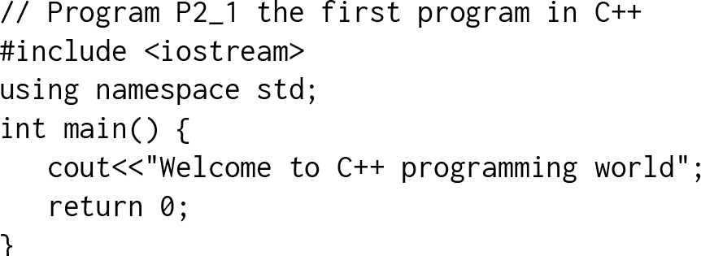

输出：

欢迎来到 C++ 世界上

### 命名空间语句

```cpp
using namespace std;
```

在大多数 C++ 平台中使用的语句将在第 3.3 节](#11_chapter03.xhtml_chapter03_33) 中讨论。假设该语句为程序提供了各种功能，包括输出和输入语句。

由于输入和/或输出数据存在于几乎每个程序，我们在每个程序的开头、函数 `int main()` 之前设置了预处理器指令：

```cpp
#include <iostream>
```

该预处理器指令通过加载 `iostream` 头文件为程序提供输入/输出流。在某些旧版本中，头文件后面带有 `.h` 后缀。


此后，命名空间语句和预处理器指令被视为程序的一部分。

通常情况下，预处理器指令是程序代码中以哈希符号 `#` 开头的行。这些行不是程序语句，相反，它们被认为是预处理器的指令。预处理器在代码实际编译开始之前检查代码，并在普通语句生成任何代码之前解析所有这些指令。换句话说，预处理器指令为程序打开了 C++ 能力和功能的大门，对应于相关的头文件。C++ 中只有少数几个预处理器指令，将在需要时对其逐一进行解释。

为了清除工作区，经常使用以下语句：

```cpp
clrscr;
```

在这种情况下，我们应该在程序的开头放置预处理器指令：

```cpp
#include <conio.h>
```

在某些版本中，为了看到程序的输出，应该在结束语句 `return 0` 之前写入：

```cpp
getch();
```

以下是另一个程序，其中通过预处理器指令加载头文件 `math.h` 到程序。

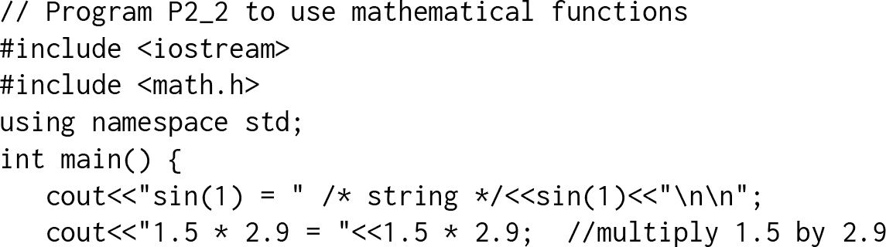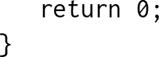

输出：

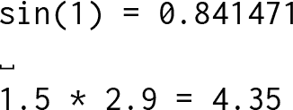

注意在上面的程序中，引号之间的任何内容都会直接传输到输出并写入，而不参与程序的执行过程（控制字符除外）。表达式 `"\n\n"` 用于创建一个空行。等价地，`endl` 可用于此目的。两个语句：

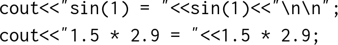

等价于以下语句：

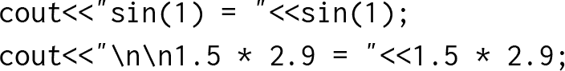

如果我们有语句：

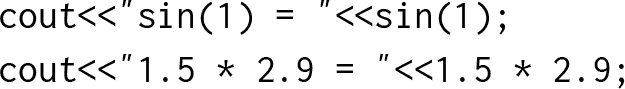

那么结果是：

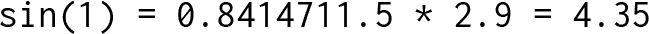

请自行检查！

程序员可能为程序提供额外的注释。有两种编写注释的方法。行注释在双斜杠 `//` 之后直到行尾。另一方面，块注释以斜杠和星号 `/*` 开始，以星号和斜杠 `*/` 结束。此外，块注释可以延伸任意行。你可以在程序 22 中找到此类示例。

### 2.2.2 输入语句

为止，我们发现了如何声明常量以及如何声明变量。确定变量值有三种方法。

| 1) | 在声明变量时，例如部分

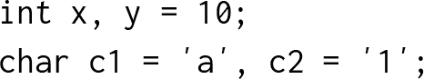

声明变量 `x` 和 `y` 为整数类型，并在 `y` 中放入值 `10`。然后它为变量 `c1` 和 `c2` 分配字符 `a` 和 `1`。记住不要混淆字符 `1` 和数字 `1`。 |
| 2) | 使用下面的语法通过赋值运算符（语句）声明变量：


语法（赋值语句）：

```cpp
a variable = an arithmetic phrase;
```

例如，

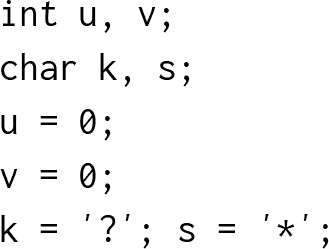

两个赋值语句：

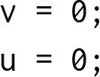

等价于频繁赋值语句：

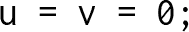

在任何频繁赋值语句中，数字从右向左赋值。

赋值语句除了确定变量值外，还可以用于计算和替换。例如，语句：

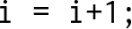

将内存中 `i` 的最后一个值加 1，并将结果替换 `i`。


两个表达式 `k = 2` 和 `2 = k` 在理论研究中是相等，但在编程中完全不同。语句 `k = 2` 指定了一个赋值语句，而 `2 = k` 是非法的。此外，语句 `u = sin(h)` 是赋值语句，而 `sin(h) = u` 是非法的。 |
| 3) | 使用 `cin`（输入）语句，它用于下面的通用语法中：


语法（输入语句）：

```cpp
cin>> variable 1 >> variable 2 >> ... ;
```

例如，在部分

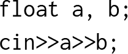 |

首先，变量 `a` 和 `b` 被声明为实数类型。然后，下一条语句分别从输入单元读取它们的值，并将这些值保存到内存中。假设输入单元是键盘。


在输入数据时，用一个或多个空格字符将两个连续的输入隔开。此外，永远不要使用逗号、分号或其他分隔符来分隔输入。

输入必要的内容后，我们按下回车键（用 `↵` 符号表示）以继续运行程序。然后，在输入所有相关的 `cin` 语句的输入之后、按下回车键之前，如果程序中还有另一个 `cin` 语句，我们可以在当前行立即输入与下一个 `cin` 语句相关的数据。当然，另一种方法是按下回车键完成上一个 `cin` 语句的数据输入，然后将后一个 `cin` 语句的数据放在下一行。通常，一个或多个输入语句的数据可以放置在一行或多行中。例如，如果我们假设 `a`、`i` 和 `j` 都声明为 `int` 类型，根据上述讨论，在执行以下两条语句时

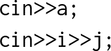

数据可以以后以下四种任一方式输入：

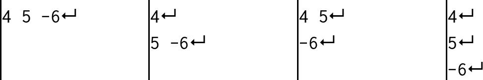

因此，上述两个语句等同于语句

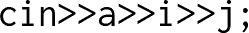

其输入行为也相同。例如，考虑下面的程序。

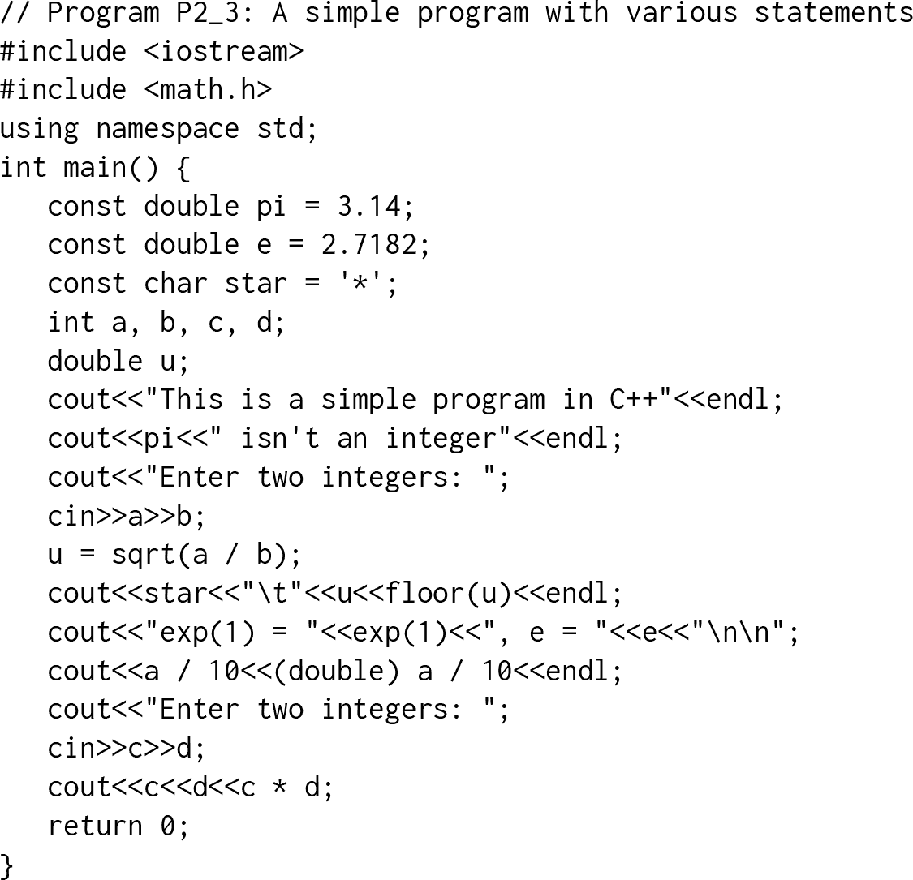

接下来的章节提供了关于运行程序 `P2_3` 针对某些输入的结果，以及此类程序产生的输出的解释（请记住符号 `↵` 代表按下回车键）。通过运行程序，屏幕上显示了以下行：

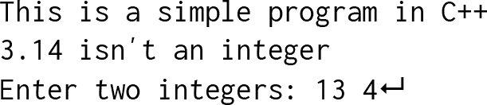

事实上，在声明常量和变量后，输出语句在 `cout` 语句列表中打印字符串“This is my first simple program in C++”，并通过 `endl` 表达式将光标转移到下一行。在新行中，打印了常量值 `pi`，随后是字符串“˽isn't an integer”。再次，光标转移到下一行。在该行中，首先写入了输入提示“Enter two integers:˽”，请求用户输入两个整数。接着，用户输入两个整数，例如 `14` 和 `3`，用空格隔开，并按下回车键。现在，整数 `13` 和 `4` 分别存储在 `int` 类型变量 `a` 和 `b` 中。

让我们继续运行程序。下一条语句是一个赋值语句，其中首先在库函数 `sqrt()` 的参数中计算表达式 `a / b`。在这个表达式中，结果为 `3`，由于 `/` 运算符的两个操作数都是整数，因此它是 `a` 除以 `b` 的整数商。现在，该数的平方根（即 `3`）被赋值给实数变量 `u`。下一个输出语句首先打印字符 `*`。然后，控制字符 `\t` 将光标向右平移一个制表位（第八列），并在列表中不带空格地打印两个项目：

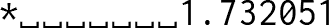

在控制字符之后，第一个和第二个项目分别是 `u` 的值 `1.73205` 以及 `u` 的向下取整值 `1`。`cout` 列表中的第五项是 `endl`，它将光标转移到新的一行。

显然，输出是混合在一起的，这绝对不是好事。在下一个节中，将通过格式化输出解决这个问题，然后将输出的设计交给程序员。

我们继续运行过程。下一个 `cout` 语句在列表中打印了以下五个项目：输出标题“exp(1)˽=˽”、`exp(1)` 的值 `2.71828`（带有默认五位精度）、输出头部 “,␣e␣=␣”以及为常量 `e` 声明的常量数据 `2.7182`。此外，当前 `cout` 语句列表的最后一项即 `"\n\n` 创建了一个空行。本段解释的输出如下：

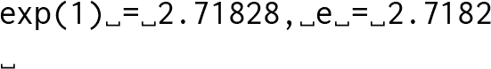

在下一个 `cout` 语句中，两个值 `1` 和 `1.3` 并并写入：

11.3

第一个被视为 `a` 除以 `10` 的整数商，而第二个是 `a` 除以 `10` 的实值。记得我们应该写 `(double)` 前缀，以便在 `/` 运算符的两个操作数都是整数的情况下获得 `a` 除法的实值。第三项 `endl` 将光标带到新行。

在程序的后续，输入提示“Enter two integers:␣”请求用户输入两个整数。输入 `4` 并按下回车键。运行尚未完成。即使我们按下几次回车键也没有结果，因为我们还没有输入第二个输入。现在输入 `8`：


按下回车键，值 `4` 和 `8` 分别替换整数变量 `c` 和 `d`。然后，`cout` 列表（即给定输入的值及其乘积）连续写入，没有任何空格：

4832

现在，运行过程完成。在编写（翻译）算法时，我们强烈建议参考以下注释。这些注释应用于 `P2_3`。

### 2.2.3 格式化输出

运行 `P2_3` 时，发现几个输出混合在一起并以一种难看的形式出现。C++ 中的输出可以设计成各种形式，我们将提到常见的几种：

| 1) | 输出所需的宽度可以通过 `setw(n)` 格式提供，其中 `n` 是一个适当的整数或整数变量，其值已存储在内存中。 |
| | 效果：`setw(n)` 旁边的输出将以 `n` 列的这种格式写入。 |
| | 如果该预期的输出宽度： |
| | — | 大于所需输出的宽度，则在输出的左侧会有额外的空白列。 |
| | — | 小于所需输出的宽度，或者是一个非法数字（例如负数或大于 `setw()` 格式考虑范围的数字），则会被忽略，因此输出以最少列数写入。 |
| 2) | 小数精度可以通过 `setprecision(n)` 格式提供，其中 `n` 被替换为适当的整数或整数变量，该变量已定义了适当的值。 |
| | 效果：小数以 `n` 位精度写入，这包含了有效小数位数字。 |
| | 如果该预期的输出的 `n` 值： |
| | — | 大于所需输出的宽度，则从最右列添加额外的无意义的小数位。根据编程语言的版本，这些无意义的小数位可以是零或其他在舍入后回到原始数字的数字。 |
| | — | 小于所需输出的宽度，在整数位数不小于 `n` 的情况下，目标数字将被四舍五入；否则以浮点形式“a E b”写入，即 a × b10。 |
| | — | 是一个非法数字（例如负数或大于 `setprecision()` 格式考虑范围的数字），则会被忽略，并以该格式定义的默认精度输出。 |

默认情况下，`float` 和 `double` 数据类型分别被写为具有六位和十位有效数字。请注意，这些数字可能根据编译器的版本而不同。

要使用上述两种格式，应通过以下预处理指令加载 `iomanip.h` 头文件。

```cpp
#include <iomanip.h>
```

在下方的程序 `P2_4` 中，我们与程序 `P2_3` 使用相同的输入并运行相同的语句，但使用了特定的格式，以观察上述格式的效果。你可以通过更改格式参数中的数字来进一步检查上述格式。


值得提到的是，遗憾的是，`setprecision()` 格式会持续作用于后续的实数，直到通知了另一个 `setprecision()` 格式为止。尽管有几种系统性的方法可以禁用它，但一种简单的方法是激活 `setprecision(5)`，因为在大多数 C++ 编译器中默认精度是 5。

C++ 和 Java 这两种编程语言的面向对象方面在第 3.3 节 中进行了同步解释。我们以指针的概念结束本章。

## 2.3 指针

实际上，变量是存储其值的内存块的名称。当程序实例化变量时，系统会自动分配一个空闲内存地址给该变量，并将任何分配的值存储在该内存地址中。例如，当执行语句：

```cpp
int x;
```

时，一个内存位置与变量 `x` 关联起来。值得注意的是，程序不需要关心内存中数据的物理地址；每当需要引用该变量时，它只需使用标识符即可。然而，在运行时获取变量的地址对于程序访问相对于该变量特定位置的数据单元是非常有用的。

通常情况下，可以通过在变量名前加一个 `&` 符号（称为“取地址操作符”）来获取变量的地址。例如，语句：

```cpp
x = &var;
```

这会将变量 `var` 的地址赋值给 `x`；使用上述语句，我们不再将变量本身的内容赋值给 `x`，而是在内存中赋值它的地址。

单获取变量的地址本身并不十分用。`*` 解引用操作符允许我们访问特定地址的值。

在工具箱中增加了取地址操作符和解引用操作符后，我们现在可以讨论指针了。指针是以内存地址作为值的变量。此外，它是 C++ 编程语言灵活且强大的特性之一，而 Java 不支持这种特性，Java 使用了其他替代特性。此外，C++ 中的指针变量声明与普通变量相似，但在数据类型和变量名之间有一个星号，有以下三种替代方式之一：

- `data type* variable or function;`
- `data type *variable or function;`
- `data type **variable or function;`

例如，语句：

```cpp
int *x;
```

（读作“整数 x 指针”，这是“指向整数 x 的指针”的常用简写）将 `x` 声明为 `int` 数据类型的指针。该数据类型不是指针本身的类型，相反，它是指针所指向的数据类型。事实上，`*x` 返回位于 `x` 指定地址处的值。


- 在声明指针变量时，将星号放在变量名旁边。
- 在声明函数时，将指针返回值的星号放在类型旁边。


在上述程序中，首先声明了实际变量 `var`（初始值为 20）和指针变量 `x`，它们都是 `int` 类型。然后，将 `var` 的地址存储在 `x` 中。最后，分别打印变量 `var` 的真实值、存储在变量 `x` 中的 `var` 地址以及该内存地址的值。值得提到的是，输出中提到的地址可能根据所使用的机器而异。

本节以这样一个事实结束：指向常量值的指针（称为常量指针，const pointer）是一个指向常量值的指针。在数据类型之前使用 `const` 关键字来声明常量指针。例如，考虑下面的两个语句：


第一条语句声明了 `int` 类型常量 `con`，而第二条语句将其地址存储在常量指针 `c` 中。然而，不允许执行以下语句，因为我们不能更改常量值：

```cpp
*c = 6;
```


# 3. Java 编程的基础概念

Java 是 Java 先驱詹姆斯·戈林（James Gosling）的结晶，他将 Java “一次编写，随处运行”的核心思想追溯到他在研究生期间的工作。詹姆斯·戈林与其他队友（即 Mike Sheridan 和 Patrick Naughton，被称为“绿色”团队）于 1991 年 6 月为太阳微系统（Sun Microsystems）启动了 Java 语言项目，用于机顶盒、电视机等数字设备。随着时间的推移，团队添加了许多功能和改进，扩展了 C++ 和 C 的语言遗产。

在本节中，将讨论 Java 编程语言的主要概念，并将其与 C++ 编程语言进行比较。之前在第 2.1 节中提供的 C++ 所有主要概念的定义在 Java 中有效。因此，我们只解释 Java 中的保留字、数据类型、运算符和库函数，以及变量声明和字面量（C++ 中的常量）。我们从作为 Java 字母表的保留字或关键字开始介绍。Java 中一些频繁使用的保留字列在表 3.2 中。加粗的部分是本书中用到的。

表 3.2：Java 中一些频繁使用的保留字或关键字。


与 C++ 编译器类似，Java 编译器对大小写敏感，因此，在两个编译器中，`For` 和 `for` 的行为是不同的。

虽然 `goto` 和 `const` 在 Java 编程语言中不再被使用，但它们仍然不能作为标识符。

Java 中标识符的命名规则与 C++ 略有不同。


Java 标识符的命名规则。

- 所有标识符应以字母‘a’到‘z’或‘A’到‘Z’、`$` 符号或下划线开头。
- 在起始字符之后，标识符可以是上述字符的任意组合。
- 标识符中不能使用空白字符。
- Java 关键字不能作为标识符。

### 3.1.1 数据类型

Java 语言具有丰富的数据类型实现，规定了可以在标识符中存储的值的大小和类型。在 Java 中，数据类型分为基本类型和非基本类型（引用类型）。引用数据类型将在第 3.3 节中讨论。基本数据类型包含四种整数类型，包括 `byte`、`short`、`int`、`long`，以及两种浮点类型 `float` 和 `double`、字符数据类型 `char`、布尔数据类型 `boolean`，最后是空数据类型 `void`。每种数据类型的简要描述如下。

| 1) | 整数数据类型 `byte` 用于在处理处于该数据类型范围的大整数时节省内存（表 3.3）。这是因为 `byte` 数据类型占据了数值数据类型所需的内存中最小的空间，包含八位（一个字节）。 |
| 2) | 整数数据类型 `short` 用于为处于该数据类型范围内的整数节省内存（表 3.3）。`short` 数据类型占据的内存空间是 `byte` 的 2 倍。 |
| 3) | 整数数据类型 `int` 用于普通大小的整数。此外，内存中的 `int` 数据类型的大小分别是 `byte` 和 `short` 的 4 倍和 2 倍。 |
| 4) | 当需要比 `int` 更宽的范围时使用整数数据类型 `long`。它需要八字节存储在内存中。 |
| 5) | 浮点数据类型 `float` 用于精度较低的实数。 |
| 6) | 浮点数据类型 `double` 用于高精度的实数。 |
| 7) | 字符数据类型 `char` 用于在 2 字节内存中存储 Unicode 字符，而 C++ 语言使用 1 字节存储 `char` 数据类型。这是因为 C++ 字符数据类型仅支持 ASCII 码，仅包含英文字母和符号，1 字节足够了。然而，Java 语言支持超过 18 种国际语言的 Unicode 字符（即字母和符号），1 字节内存不足以存储所有这些字符。此外，Java 中的每个字符数据与 C++ 相比，应该写在两个单引号之间，例如 `'*'` 或空白字符 `' '`，每当需要强调或其表达式可能引起混淆时，显示为 `' '`。 |
| 8) | 布尔数据类型 `boolean` 仅代表真或假的一位信息。C++ 中相对应的布尔类型分别为 1 和 0。 |

在书中，主要使用 `int`、`float` 和 `double` 数据类型，而偶尔使用 `long` 和 `char` 数据类型。然而，`boolean` 数据类型很少被使用。Java 不支持无符号整数的实现，而 C++ 支持。表 3.3 展示了这些数据类型的大小、范围和默认值，其中浮点表示法 `a E b` 表示 $a \times 10^b$。

表 3.3：基本数据类型及其大小、范围和默认值。


除了上述基本数据类型，Java 中还有无值数据类型 `void` 和字符串数据类型 `String`。字符串通常是放在一对引号内的任何 Unicode 字符的组合（例如 `"Note that 10 % 3 = 1"`）。格式化打印将在第 3.2 节中讨论。

### 3.1.2 字面量

与 C++ 不同，Java 中没有常量，相反字面量扮演了常量的角色。字面量是固定值的源代码表示。字面量出现在以下类型中：

| 1) | 字符串字面量在双引号内。例如，语句 `String s = "this is a string";` 声明了一个名为 `s` 的字符串并赋值引号内的字符串。 |
| 2) | 字符字面量在单引号内。例如 `char star = '*';` |
| 3) | 布尔字面量为真或假。与 C++ 不同，这些值对应 1 和 0。 |
| 4) | 数字字面量可以是整数或浮点值。例如 `float e = 2.827;` |

变量是与值相关的标识符，可以在程序过程中被修改。程序中的每个变量都应该有一个类型。Java 中变量的语法与 C++ 相同。


语法（变量声明）：

```
类型一个或多个变量;
```

或

```
类型一个变量 = 字面量;
```

其中，字面量的类型与相应的变量相同。例如，考虑代码：

```
int a, b;

float pi = 3.14;
```

第一行向编译器声明了 `int` 变量 `a` 和 `b`，第二行声明了 `float` 类型变量 `pi` 并为其赋值字面量。

Java 包括局部变量、实例变量和类变量。这些类型的变量将在第 3.3 节中检查。

### 3.1.3 运算符

Java 编程语言使用了与 C++ 相同的算术、关系（比较）、逻辑和赋值运算符，它们的行为具有很的可比性。在许多情况下，Java 运算符的结果与它们的 C++ 等效同不同。我们将整数除以零时，`/` 运算符会产生异常。例如，`1.0/0.0` 导致正无穷（屏幕上显示 Infinity），而 `-1.0/0.0` 导致负无穷（屏幕上显示 -Infinity）。此外，`1.0/(-1.0/0.0)`（1 除以负无穷）和 `0.0/0.0`（数学上未定义）分别导致负零（屏幕上显示 -0.0）和非数字值（屏幕上显示 NaN）。

如所示，Java 定义了正零、负零以及无穷大，以及非数字（NaN）值，它们作为逻辑表达式的操作数时表示不同的习惯。例如，逻辑表达式 `0.0 == −0.0` 为真，而 `0.0 > −0.0` 为假。由于 `NaN` 是无序的，如果任一操作数为为 `NaN`，所有比较运算符都返回假，`!=` 除外，后者在任一操作数为 `NaN` 时始终返回真。

与上述相关的某些（主要是二进制）计算结果列在表 3.4 中。在该表中，结果为屏幕上显示的内容。变量 `p` 假设为一个正实数，在程序计算中可以用 `1.0` 替换。此外，变量 `inf` 应该是无穷大。该变量在程序计算中可以用 `1.0/0.0` 替换。

表 3.4：Java 中的异常计算。


`?` 和 `,`（逗号）运算符在 C++ 和 Java 程序中具有相同的作用。Java 中没有定义 `sizeof()` 运算符，因为 Java 中基本类型的大小在所有平台中都是固定的。

此外，C++ 和 Java 程序中的算术和逻辑表达式具有相似的行为。特别是在 Java 中，我们遵循与 C++ 相同的运算符优先级。主要在 Java 中使用的若干几个库函数汇总在表 3.5 中，类似于表 2.12，但有细微的差异。

表 3.5：Java 支持的某些库函数。


## 3.2 Java 编程简介

Java 的安装和使用取决于用户的计算机，这是读者的责任。本书将讨论编程技术。本书中的所有 Java 程序均在 eclipse IDE 2018-09 工作空间中运行。

我们从一个 Java 程序模式开始。


Java 程序模式：

```

```

与之前一样，程序代码中的斜体短语并非代码本身，这些短语要求的内容被放置在它们的位置。

`package` 语句定义了存储类的命名空间。包用于根据功能对类进行组织。可以将其想象为文件目录中的文件夹。使用这些包是为了避免命名冲突并编写更具可维护性的代码。然而，`package` 语句不能出现在程序的任何位置。事实上，它应该位于程序的第一行，或者可以省略，在那种情况下，类名被放入没有名称的默认包中。

此外，Java 中的包可以分为内置和用户定义两类。存在各种内置包，如 `java`、`lang`、`awt`、`javax`、`swing`、`net`、`io`、`util`、`sql` 等，而用户定义的包由程序员为了特定目的编写。在书中，我们的程序没有使用任何包。

C++ 程序是一系列独立的片段，这些片段包含了声明、语句和函数（子程序），并在 `main` 函数的控制下汇总以运行程序。相反，Java 程序通常汇聚在一个单元类中，包括独立的数据成员和成员函数（方法），它们构成了上述模式中的程序体。在这里同样，通过 `main` 方法（上述模式中的 `void main()` 方法）来实现程序的运行。

实际上，方法是一个复合语句，它在一对大括号内包含一系列语句和声明。紧跟分号的表达式被视为语句。其他类型的语句包括表达式语句、选择（决策和分支）、迭代（循环）和跳转语句。其他类型的语句将在第 4 章、第 6 章和第 7 章中讨论。此外，包括方法在内的各种子程序将在第 5 章中介绍。下一节将详细类类及其数据成员和方法。

与 C++ 程序类似，注释有两种编写方式。行注释位于两个正斜杠 `//` 之后，直到行尾。然而，块注释以正斜杠和星号 `/*` 开始，以星号和正斜杠 `*/` 结束。此外，这些注释可以跨越任意数量的行。

强烈建议在 2.2 节开始考虑编程风格。输出和输入语句被认为是所有编程语言中的基本处理语句。

### 3.2.1 输出和输入语句

我们从输出语句开始。考虑程序 `P3_1`（对比程序 `P2_1`）。


这个简单的程序拥有 `P3_1` 类名。具有 `P3_1` 类名的简单程序是一个输出语句。它打印双引号内部的内容：

```
Welcome to Java
```

通常，有两种普通的（非格式化）打印语句。

语法（print 语句）：

```
System.out.print(armument1 + armument2);

System.out.println(armument1 + armument2);
```

其中，每个参数可以是以下之一：
1. 常量、变量、算术表达式；
2. 字符串，例如 "The sum is:";
3. 转义序列或控制字符在表 3.6 中提供。这些字符应该放在双引号之间，例如：

表 3.6 常用的转义序列或控制字符。

| 转义序列 | 名称 | 效果 |
| :--- | :--- | :--- |
| `\n` | 换行 | 移动到下一行 |
| `\t` | 制表 | 移动到下一个列（下一个制表） |
| `\b` | 退格 | 后退一个字符 |
| `\r` | 回车 | 移动一行 |
| `\f` | 换页 | 移动到下一页 |
| `\"` | 双引号 | 输出 " 字符 |
| `\'` | 单引号 | 输出 ' 字符 |

注意打印语句中的两个连续参数通过 `+` 运算符分隔。在分隔符前后使用空格是为了区分这些连续参数。然而，这可能会导致冲突，特别是当我们有两个算术表达式时，在这种情况下 `+` 运算符会算术地相加这些表达式。因此，我们可以空参数 `""` 或空格来分隔此类表达式，以避免这种不便。表 3.7 中的三个示例说明了这一事实。

表 3.7：在连续的算术表达式之间使用空参数或空格。

| 语句 | 输出 |
| :--- | :--- |
| `System.out.print(1 + 2);` | `3` |
| `System.out.print(1 + "" + 2);` | `12` |
| `System.out.print(1 + " " + 2);` | `1 2` |

上述两种打印语句的区别在于，`println()` 语句在打印所需的参数后将光标移动到下一行，而 `print()` 语句将光标留在当前行。因此，如果我们把转义字符 `\n` 作为 `print()` 语句的最后一个参数，它具有与 `println()` 相同的效果。然而，这两种打印语句有自己的应用场景。

Java 中不存在预处理器指令。然而，为了某些目的，提供了几个头部语句。考虑程序 `P3_2`，类似于程序 `P2_2`，其中调用了数学正弦函数。

```

```

这里建立了与程序 `P2_2` 之后相同的说明。特别地的是，表达式 `"\n\n"` 被用来创建一个空行，而以下三对语句是等价的：


这是因为，如上所述，`print("\n")` 与 `println()` 是相同的。

我们继续介绍输入语句。有多种方法从输入单元获取输入。这里采用了通用的输入语句。在 Java 中，从输入单元读取输入需要遵循四个步骤：

1. 通过头语句（head statement）导入 `Scanner` 类：
```java
import java.util.Scanner;
```
在程序开始类定义之前位于顶部；

2. 通过语句为 Java 编译器提供输入功能：
```java
Scanner scan = new Scanner(System.in);
```
通常位于需要读取输入的类体开始处；

3. 通过语句读取单个输入 `n`（此处使用 `int` 数据类型）：
```java
int n = scan.nextInt();
```

4. 通过语句关闭输入功能：
```java
scan.close();
```
通常位于包含第 2 项语句的类体末尾。

语句 2、3 和 4 中的扫描器对象 `scan` 由程序员选择（“类”和“对象”的概念将在下一节中讨论）。在本书中，`read` 的名称被用于数值扫描，以保持统一的扫描器名称。那么，在导入 `Scanner` 类（第 1 项中的头语句）后，我们固定使用以下语句：
```java
Scanner read = new Scanner(System.in);
```
来提供输入功能；使用语句
```java
int n = read.nextInt();
```
读取 `int` 类型变量 `n`；以及语句：
```java
read.close();
```
来关闭输入功能。这些语句的方面将不再讨论。目前，我们仅使用上述步骤来读取输入。通过语句
```java
int n = read.nextInt();
```


读取`int`类型变量`n`。值得注意的是，变量`n`可能再也不需要单独声明。此外，相同的语句也用于其他数值数据类型。只需将“Int”替换为以大字母开头的数据类型名称（例如`nextShort()`、`nextDouble()`等）即可。此外，`char`类型输入的读取将在下一节中介绍。

上述两个程序`P3_1`和`P3_2`与程序`P2_1`和`P2_2`类似。在 C++ 和 Java 语言中使用相同程序的策略提供了比较相似性和差异的机会，并能同步学习与程序方面相关的细节。我们在接下来的几个示例中继续我们的这种策略。

与 C++ 程序一样，Java 中有三种为变量存储值的方法，包括：与声明一起、在声明后通过赋值语句、以及使用输出语句。此外，在 Java 中输入的方法与 C++ 相同。特别是，输入可以在一个或多行中输入，且两个连续的输入应仅用空格分隔。考虑程序`P3_3`类似于程序`P2_3`。


接下来的章节提供了上述程序产生的一些输入和输出。记住，符号 ↵ 表示按下回车键。

通过运行程序，屏幕上显示了以下行：


事实上，在声明字面量和变量后，第一个输出语句打印其字符串参数“This is my first simple program in Java”，由于`println()`类型输出语句，光标转移到下一行。在新行中，第二个打印语句打印了`pi`的常数值，随后打印了字符串“␣isn't an integer”。再次，光标移动到下一行。在这一行中，首先使用`println()`语句写入输入通知“Enter two integers:␣”，请求用户输入两个整数，该语句将光标留在当前行。接下来，用户输入两个整数（例如 13 和 4），中间用空格分隔，并按下回车键。现在，整数 13 和 4 分别存储在变量`a`和`b`的内存中。

让我们继续运行程序。下一个语句是赋值语句。在该语句中，首先在库函数`Math.sqrt()`的参数中计算表达式`a / b`。在这个表达式中，结果为 3，由于`/`的两个操作数都是整数，因此 3 是`a`除以`b`的整数商。现在，3 的平方根被赋值给实变量`u`。下一个输出语句首先打印`*`字符。然后，控制字符`\t`将光标向右移动一个制表符（第八列）。最后，当前的打印语句连续打印列表中的最后两项，且没有任何间距：


控制字符后的第一个项是值 1.732050807568872。由于`println()`类型输出语句，光标转移到下一行。

这里建立了与程序`P2_2`之后相同的说明。特别地的是，表达式`"\n\n"`被用来创建一个空行，而以下三对语句是等价的：


这是因为，如上所述，`print("\n")`与`println()`是相同的。

我们继续介绍输入语句。有多种方法从输入单元获取输入。这里采用了通用的输入语句。在 Java 中，从输入单元读取输入需要遵循四个步骤：

1. 通过头语句（head statement）导入`Scanner`类：
```java
import java.util.Scanner;
```
在程序开始类定义之前位于顶部；

2. 通过语句为 Java 编译器提供输入功能：
```java
Scanner scan = new Scanner(System.in);
```
通常位于需要读取输入的类体开始处；

3. 通过语句读取单个输入`n`（此处使用`int`数据类型）：
```java
int n = scan.nextInt();
```

4. 通过语句关闭输入功能：
```java
scan.close();
```
通常位于包含第 2 项语句的类体末尾。

语句 2、3 和 4 中的扫描器对象`scan`由程序员选择（“类”和“对象”的概念将在下一节中讨论）。在本书中，`read`的名称被用于数值扫描，以保持统一的扫描器名称。那么，在导入`Scanner`类（第 1 项中的头语句）后，我们固定使用以下语句：
```java
Scanner read = new Scanner(System.in);
```
来提供输入功能；使用语句
```java
int n = read.nextInt();
```
读取`int`类型变量`n`；以及语句：
```java
read.close();
```
来关闭输入功能。这些语句的方面将不再讨论。目前，我们仅使用上述步骤来读取输入。通过语句
```java
int n = read.nextInt();
```
读取`int`类型变量`n`。值得注意的是，变量`n`可能再也不需要单独声明。此外，相同的语句也用于其他数值数据类型。只需将“Int”替换为以大字母开头的数据类型名称（例如`nextShort()`、`nextDouble()`等）即可。此外，`char`类型输入的读取将在下一节中介绍。

上述两个程序`P3_1`和`P3_2`与程序`P2_1`和`P2_2`类似。在 C++ 和 Java 语言中使用相同程序的策略提供了比较相似性和差异的机会，并能同步学习与程序方面相关的细节。我们在接下来的几个示例中继续我们的这种策略。

与 C++ 程序一样，Java 中有三种为变量存储值的方法，包括：与声明一起、在声明后通过赋值语句、以及使用输出语句。此外，在 Java 中输入的方法与 C++ 相同。特别是，输入可以在一个或多行中输入，且两个连续的输入应仅用空格分隔。考虑程序`P3_3`类似于程序`P2_3`。


接下来的章节提供了上述程序产生的一些输入和输出。记住，符号 ↵ 表示按下回车键。

通过运行程序，屏幕上显示了以下行：


事实上，在声明字面量和变量后，第一个输出语句打印其字符串参数“This is my first simple program in Java”，由于`println()`类型输出语句，光标转移到下一行。在新行中，第二个打印语句打印了`pi`的常数值，随后打印了字符串“␣isn't an integer”。再次，光标移动到下一行。在这一行中，首先使用`println()`语句写入输入通知“Enter two integers:␣”，请求用户输入两个整数，该语句将光标留在当前行。接下来，用户输入两个整数（例如 13 和 4），中间用空格分隔，并按下回车键。现在，整数 13 和 4 分别存储在变量`a`和`b`的内存中。

让我们继续运行程序。下一个语句是赋值语句。在该语句中，首先在库函数`Math.sqrt()`的参数中计算表达式`a / b`。在这个表达式中，结果为 3，由于`/`的两个操作数都是整数，因此 3 是`a`除以`b`的整数商。现在，3 的平方根被赋值给实变量`u`。下一个输出语句首先打印`*`字符。然后，控制字符`\t`将光标向右移动一个制表符（第八列）。最后，当前的打印语句连续打印列表中的最后两项，且没有任何间距：


控制字符后的第一个项是值 1.732050807568872。由于`println()`类型输出语句，光标转移到下一行。

我们继续运行过程。下一个输出语句打印了以下五个参数，在它的参数中提到：第一，输出标题“exp(1)␣=␣”;第二，值 2.71828128459045 `exp(1)` 带默认 15 位精度；第三，输出标题“ ,e=␣”;第四，常数值 2.7182 是之前声明的字面量。第五也是当前语句中的最后一项，`"\n\n"`创建了一个空行。目前的输出是：


在下一个语句中，两个值 1 和 1.3 混合在一起写作：

1.3

第一个值是`a`除以 10 的整数商，第二个是`a`除以 10 的实值。记住，当操作数都是整数时，我们需要写入 (double) 前缀以获得实值。

在程序的继续部分，输入通知“Enter two integers:␣”请求用户输入两个整数。输入 4 并按下回车键。运行尚未完成。即使我们按下几次回车键也没有结果，因为我们还没有输入输入。现在，输入 8：


按下回车键后，值 4 和 8 分别替换变量`c`和`d`。随后，下一个打印语句的参数（即给定输入的乘积）连续写入，且没有任何间距：

4832

现在，执行过程已完成。在任何编程语言中编码（翻译）算法时，我们强烈建议考虑以下注释。这些注释适用于程序`P3_3`。

- 变量类型应与算法中的类型成比例。
- 在输入语句前通过`print()`语句提供合适的输入通知。这有助于用户了解要输入的数据的数量、类型和本质。
- 为输出提供适当的标题以展示其特征。


### 语法（格式化打印）：

```
System.out.printf("format string" [, argument 1, argument 2, … ] );
```


其中，`format string` 包含字符串字面量和格式占位符。此外，只有当格式字符串中存在占位符时才需要参数。另外，格式占位符按照以下模式出现：

`%[flags] [width] [.precision] conversion character`

上述各项的含义解释如下。

**标志 (Flags)**：Java 编译器定义了各种标志，其中三个标志在与计算相关的程序中被频繁使用。

| − : | 左对齐（默认为右对齐）； |
| `+` : | 为数值输出加号 (+) 或减号 (−) 符号； |
| `0` : | 强制对数值进行零填充（默认为空格填充）。 |

**宽度 (Width)**：指定输出参数的字段宽度，并表示写入到输出的最小字符数。在确定数值的宽度时，应包含预期的逗号和小数点的空间。如果宽度小于输出所需的最小字符数，则忽略该宽度。

**精度 (Precision)**：用于根据转换类型限制输出。它指定了输出浮点值时的精度位数。数字将根据指定的精度进行四舍五入。最后，如果精度大于输出的实际小数位数，则用无值的零填充以达到声明的精度。

**转换字符 (Conversion characters)**：这些字符是：

| `d` : | 十进制整数 (`byte`, `short`, `int`, `long`)； |
| `f` : | 浮点数 (`float`, `double`)； |
| `c` : | 字符，大写的 C 将字母转为大写； |
| `s` : | 字符串，大写的 S 将字符串中的所有字母转为大写； |
| `\n` : | 平台换行符，特定的换行符；为了更好的兼容性，请使用 `%n` 代替 `\n`。 |

表 3.8 中提供了几个示例。

表 3.8：格式化输出示例。


我们使用相同的输入以及不同的格式运行程序 `P3_3`，以观察上述格式的效果。你可以通过改变数字、标志、宽度、精度和转换字符来进一步检查上述的格式。


所示，在上述程序中，以下两个语句的效果是相同的。细节由读者自己去发现！


现在，我们准备好同步解释 C++ 和 Java 两种编程语言的面向对象方面。

## 3.3 面向对象编程 (OOP) 系统

C++ 编程的主要目标是向 C 语言语言引入面向对象的概念：在编程代码中，C++ 等同于 `C+1`，这意味着它比 C 多了一个特性，即“类 (Class)”。事实上，C++ 封装了高级和低级语言特征。因此，它被视为中间级语言。此外，C++ 允许过程化编程和面向对象编程。由于我们的子程序具有计算性质，除了少数情况外，我们并不觉得有必要使用 C++ 的面向对象特性，因此我们更倾向于代码的简洁性。

相反，Java 是一种高级、通用的、基于类的面向对象编程语言，旨在最小化实现依赖性。

对象 (Object) 是现实世界的实体，如石头、玻璃、书、伞、自行车等。此外，面向对象编程是一种使用对象和类来设计程序的方法或范式。它通过提供对象、类、继承、多态、抽象和封装等属性，简化了软件开发和维护。由于本书追求数学计算，我们只讨论和使用对象和类的概念。

通常，我们说的对象是指任何具有状态和行为的实体，其中状态和行为分别指数据和功能。换句话说，面向对象的方法与现实世界及其应用非常接近，因为这些对象的状态和行为与现实世界的对象几乎相同。在下一节中，将在 C++ 和 Java 编程中同步处理对象和类的概念。在必要时会解释其差异。

### 3.3.1 对象和类

类 (Class) 是对象的蓝图，即相似对象的集合。换句话说，对象是类的实例。此外，对象可以是物理的，也可以是逻辑的，而类仅是逻辑实体。最后，类对世界是不可见的，而对象是可见的。

通常，类在某种程度上是用户定义的数据，具有包含数据成员、成员函数（方法）、构造函数等元素的结构。以下是 C++ 和 Java 中定义类的语法，两者有细微差异。


语法（定义类）：


通过类定义，我们表示要定义一个结构或蓝图，而不是专门地定义一种数据；即定义该类型对象包含什么内容，以及可以在对象上可以执行哪些操作。以下是 C++ 和 Java 中类的示例。


根据上述讨论，C++ 的类定义以大括号 `}` 后的分号结束；而在 Java 中，类的结束不需要分号。

在这里，`Test` 是一个类，它有三个数据成员 `data1`、`data2` 和 `data3`，以及两个成员函数 `function2()` 和 `function2()`。数据成员是使用任何基本数据类型（如 `int`）或派生数据类型（如用户定义的类类型）在类中声明的变量。

成员函数我们称之为方法 (Method)，是一个在类内部或外部具有定义的函数。方法作用于其所属类的任何对象，并可以访问该类的所有数据成员。

Java 中的每个方法都应该是类的一部分，这与 C++ 不同。方法通常分为内置和用户定义类。内置方法是编译器包的一部分，例如 `System.out.println()` 和 `System.exit(0)`。此后，方法指的是用户定义的方法。

访问修饰符 (Access specifier) 指定了元素的可见性。如果它被视为私有的 (private)，则其范围内的数据成员和方法只能在类内部访问。如果我们尝试从类外部访问私有数据，编译器将产生错误。另一个访问修饰符是公共的 (public)，在这种情况下，数据成员和方法可以在类内外被访问。此外，还存在一种名为受保护 (protected) 的访问修饰符，数据成员和方法可以在派生类或同一类中访问。本书不讨论和使用受保护修饰符。公共修饰符在 C++ 和 Java 两种语言中都被广泛使用。

C++ 和 Java 在面向对象编程中的区别之一是，在 Java 中修饰符是一个关键字，而在 C++ 中它是以标签的形式存在的。这一事实可以在上述 `Test` 类中体会。另一个区别在于默认修饰符。在 C++ 中，如果我们对类内部的元素没有指定默认访问修饰符，则该元素的默认是私有的。然而，Java 程序的默认修饰符是私有包 (private-package)，这意味着该元素可以在其所属的相同包内部被访问。

上述示例中的方法 `function1()` 既没有返回值（`void` 类型），也没有任何参数。在 `C++` 程序中，只有在没有参数时，我们才括号内放入 `void` 关键字。相反，方法 `function2()` 有 `float` 类型的返回值。此外，它有一个 `int` 类型的参数。通常情况下，方法的返回值可以是任何数据类型，也可以是 `void`。此外，它可以带有任意参数的 `void`，也可以包含一个或多个参数。由于 `Java` 是一种基于类的编程语言，因此无法在类之外定义方法。然而，在 `C++` 中，可以使用 `::`（作用域解析）运算符在类外定义方法，如下面的代码所示。


在这种情况下，该方法应该按照如下方式在类内部声明：

`double function3(double);`

关于 `C++` 中的方法有两个值得注意的说明。首先，声明是一个以分号结尾的语句。其次，在声明语句中编写参数名称是可选的。在上面的声明语句中，只写了参数的数据类型。现在，回到同步方法。

当定义一个类时，只定义对象的规范，而没有为对象分配内存。实际上，在两种语言中，一旦使用以下语法创建对象，内存就会被分配给对象。


语法（创建对象）：


例如，语句：


创建了类 `Test` 的两个对象 `obj1` 和 `obj2`。所示，在 `Java` 中对象是逐个创建的，而在 `C++` 中，对象是分组创建的，就像它们在类数据类型中一样。

在两种语言中，我们都可以 `.`（点）运算符访问数据成员和方法。例如，语句：


为对象 `obj2` 调用了 `Test` 类内部的 `function1()` 方法。同样，可以这样访问数据成员 `data2`：


注意，私有成员只能从类内部访问。因此，你可以在上述示例的任何地方（`Test` 类内部或外部）编写语句


然而，诸如代码代码：


应该始终位于 `Test` 类内部。

另一方面，在第 3.2 节中定义的输入语句中，`println()`、`print()` 和 `printf()` 是内置方法，它们已经为 `Java` 编译器定义好，用于打印它们的参数。此外，`nextInt()` 是读取 `int` 类型输入的内置方法。因此，当我们写 `read.nextInt()` 时，实际上我们是在为对象 `read` 调用 `Scanner` 类中的 `nextInt()` 方法。

在第 2.2 节和第 3.1 节中，介绍了各种（基本）数据类型。还有一种数据类型，称为引用数据类型，它是任何可实例化的类类型，代表类的对象，以及指向数组的数组类型。对这些数据类型选择“引用”一词是因为它们是“按引用”处理的；换句话说，对象或数组的地址存储在变量中并传递给方法等。相比之下，基本类型是“按值”处理的；实际的基本值存储在变量中并传递给方法。

上述大部分讨论在程序 `P3_5` 中得到了演示。


在上面的每个程序中都声明了五个公共方法，以及一个私有和三个公共数据成员的声明，作为实例变量）。第一个公共 `void` 方法 `setName()` 接收一个 `char` 类型参数，并在设置 `box` 的名称消息为：`˽` 后打印它。第二个 `void` 方法 `setDimentions()` 接收它的三个 `float` 参数 `l`、`b` 和 `h`，然后将它们分别赋值给实例变量 `length`、`breadth` 和 `height`。上述两个方法有参数但没有返回值。另一方面，其余三个方法没有参数但有返回值。第三个 `char` 类型方法即 `getName()`，返回私有实例变量 `name`。注意在该方法在使用 `this` 关键字（参见第 3.3.6 节）。最后，`float` 类型方法 `getVolume()` 和 `getSurface()` 分别返回具有 `length`、`breadth` 和 `height` 尺寸的关联箱的体积和表面积。程序的运行一目易见。

### 3.3.2 变量类型

与 `C++` 一样，`Java` 中的块是用花括号 `{}` 包围的语句。例如，


块本身是一种语句类型。`C++` 和 `Java` 语言中的变量包括以下类型：

| | | |
| :--- | :--- |
| 1) | 局部变量。这些变量声明在方法、构造函数或块中。当相关方法、构造函数或块执行时，局部变量被创建（为其分配内存），一旦执行完毕就会消失。局部变量在其声明的方法、构造函数或块内部可见。我们不能对局部变量使用访问修饰符（3.3.5）。在下面的示例类中，局部变量 `age` 声明在方法中。 | |
| 2) | 实例变量（非静态变量）。实例变量是在类中方法、构造函数或块之外未使用 `static` 关键字声明的。由于它们是特定的对象，因此不共享。也就是说，当类的对象创建时，实例变量被创建，对象消失时消失。与局部变量不同，我们可以对实例变量使用访问修饰符。如果没有指定修饰符，则使用默认修饰符。可以在类内部通过调用变量名直接访问实例变量。也就是说，这些变量对于类中的所有方法、构造函数和块都是可见的。然而，当实例实例变量时，应使用完全限定名调用： |
| | 对象名.变量名 |
| | 例如，在下面的程序 `P3_6` 中，公共的 `float` 变量 `InitialSum` 是实例变量，在两个程序的 `main()` 方法中都为对象 `s` 调用。 | |
| 3) | 类变量（静态变量）。类变量是在类中使用 `static` 关键字声明的，对类的所有对象通用。无论类实例化多少次，该变量都只存在一个。关于类变量的更多详细信息参见节 3.3.5。 | |

在 `C++` 中，还有另一种变量，称为全局变量，它声明在主单元中。

### 3.3.3 构造函数和析构函数

构造函数是一种特殊的方法，在创建类对象时自动初始化。它被称为构造函数是因为它构建了类数据成员的初始值。构造函数与普通方法在以下方面有所不同：


–构造函数的名称与类名相同；

–构造函数没有返回值；

–构造函数始终是公共的；

–构造函数在对象创建时自动调用；

构造函数有三种，包括默认构造函数、参数化构造函数和拷贝构造函数。默认构造函数是不带参数的构造函数。程序 `P3_6` 中有一个默认构造函数。


在上面的程序中，一旦对象被创建，就会调用构造函数并将对象 `s` 初始化为 0。

对象成员的初始化是必要的。即使程序员没有显式定义构造函数，`C++` 和 `Java` 编译器也会隐式地提供一个默认构造函数。在程序 `P3_6` 中，如果我们删除构造函数及其函数体，`InitialSum` 的值将作为默认值打印：


与 `Java` 不同，在 `C++` 编译器中，`s` 存储的是一个取决于编译器的值。因此，最好我们初始化构造函数及其函数体。

可以向构造函数传递参数。通常，这些参数有助于在对象创建时对其初始化。参数化构造函数用于在对象创建时，用不同的值初始化不同对象的各种数据成员。此外，参数只是被添加到参数化构造函数以用于创建。程序 `P3_7` 中的每个程序代表一个参数化构造函数，该函数在 `main()` 单元中为对象 `P1` 调用。


在参数化构造函数声明对象时，初始值应作为参数传递给构造函数。然而，普通的对象声明方法可能无法工作。在 `C++` 中，可以如下所示显式或隐式地调用构造函数：


拷贝构造函数是通过一个已创建的同类对象初始化来创建新对象的构造函数。拷贝构造函数具有以下通用函数原型：


在上面的程序 `P3_7` 中，新对象 `P2` 都被初始化为旧对象 `P1`。值得注意的是，对于任何没有用户定义拷贝构造函数的类，编译器本身会创建一个默认拷贝构造函数。

构造函数可以重载。事实上，当我们在类中同时定义默认构造函数和参数化构造函数时，意味着存在带或不带任何参数的重载构造函数。此外，我们可以在类中拥有任意数量参数列表不同的构造函数。在以下程序 `P3_8` 中，定义了两个参数不同的构造函数，因此构造函数被重载了。


在上述代码的主部分，如果我们写

```
graphic/11_chapter03_fig_68.png
```

那么将遇到编译错误，因为没有定义默认构造函数。

### 3.3.4 析构函数与命名空间（仅限 C++）

析构函数是一种特殊的方法，用于销毁对象，或者等于释放已经分配给对象的内存。此外，当对象超出作用范围时，会自动调用析构方法：
- 函数终止；
- 程序结束；
- 包含局部变量的块结束。

程序中的一个对象不能使用多个析构函数。析构函数的名称与类名相同，前面有一个波浪号 `~` 符号，它们不接受参数且不返回任何内容。程序 `P3_9`旨在强调析构函数的概念。


在上面的程序中，当调用构造函数时会打印消息 `The control is in constructor`，随后在 `main()` 函数中打印 `Function main is terminating...`。然后，之前创建的对象 `abc1` 超出作用范围，调用析构函数，并打印 `The control is in destructor` 以释放 `abc1` 消耗的内存。

我们现在解释大多数 `C++` 程序中使用的语句

```
graphic/11_chapter03_fig_70.png
```

命名空间是标识符的容器。它将其成员名称放置在独立的空间中，这样它们就不会与其他命名空间或全局命名空间中的名称冲突。命名空间的语法如下：

```
graphic/10_chapter02_fig_27.png
```

语法（命名空间）：

```
graphic/11_chapter03_fig_72.png
```

其中，标识符被视为任何有效的标识符，实体是包含在命名空间内的变量、类、对象和函数的集合。例如，考虑以下代码：

```
graphic/11_chapter03_fig_73.png
```

变量 `r` 和 `s` 是在名为 `mySpace` 的命名空间内定义的普通变量。我们应该使用 `::` 运算符从 `mySpace` 命名空间的外部访问这些变量。例如，为了从 `mySpace` 外部访问之前的变量，我们可以写：

```
graphic/11_chapter03_fig_74.png
```


程序`P3_10`中使用了两个命名空间。


`C++`标准库中的所有文件都将其所有实体声明在`std`命名空间内。事实上，语句

```
graphic/11_chapter03_fig_77.png
```

要求编译器将`std`命名空间中的任何内容转到全局命名空间。然而，这增加了名称冲突的概率，因为许多意外的额外名称被添加到了全局命名空间中，这可能会与你自己的某些名称冲突。因此，在仅涉及少数标识符的程序中，通过`::`运算符使用相关的标识符就足够避免这种不便。例如，`std::cout`通知编译器它需要`std`命名空间中的`cout`标识符。因此，以下两个程序（均为`C++`代码中）产生相同的输出：Sample text。

```
graphic/11_chapter03_fig_78.png
```

在整本书中，我们在`C++`语言程序中采用左侧模式，并在程序预处理指令之后使用语句

```
graphic/11_chapter03_fig_79.png
```

### 3.3.5 静态元素

`C++`和`Java`中的`static`关键字主要用于内存管理。静态元素在程序运行期间只在静态存储区分配一次，并持续到程序结束。静态元素可以是：
- 函数中的局部变量（仅限`C++`）；
- 数据成员；
- 类中的方法；
- 块。

`C++`中的静态局部变量仅存在于定义的函数内部（类似于局部变量）。此外，它的生命周期从函数被调用时开始，直到（主）程序结束才终止。然而，局部变量的生命周期在关联函数终止时结束。`C++`代码中的程序`P3_11`展示了静态局部变量。

```
graphic/11_chapter03_fig_80.png
```

在上面的程序，`getCount()`被调用了3次。在第一次调用期间，变量`count`被声明为静态局部变量并默认初始化为0。然后，`count`加1显示在屏幕上。当函数`getCount()`返回时，变量`count`仍然存在，因为它是一个静态变量。在第二次和第三次函数调用期间，`count`之前的存储值加1，而不再对`count`初始化为0，然后显示在屏幕上。如果`count`未指定为静态变量，程序`P3_11`的输出如下：

```
graphic/11_chapter03_fig_81.png
```

当数据成员在类中声明时，每个关联的对象都会创建该数据成员的对应副本。在某些情况下，需要一个公共的数据成员，且该成员对所有对象来说都应该是相同的。我们无法通过普通数据成员来实现这一点，因此在这方面需要静态数据成员。静态数据成员被称为类成员，使用`static`关键字声明。值得注意的是，静态数据成员不能是私有的（private）。它之所以被称为类成员，是因为它属于类而不是对象。此外，这种数据成员使得程序内存利用高效，也就是说，它节省了内存。无论创建了该类的多少个对象，静态数据成员都只有一个拷贝。换句话说，该类的所有对象共享静态数据成员的单一拷贝。当创建第一个对象时，如果没有提供其他初始化，静态数据成员将初始化为0。

在`C++`中，静态数据成员的声明不能被视为定义。数据成员在类作用域内声明，而定义使用作用域解析运算符`::`在文件作用域内执行，如下：

```
data type class name::static data member name;
```


在左侧的 C++ 程序 `P3_12` 中，静态数据成员 `count` 在类 `StA` 之后通过以下语句定义。


在 C++ 中，静态数据成员可以同定义一起进行初始化。例如，我们可以将上述静态数据成员 `count` 初始化为 1，并用以下语句代替上述语句。


上述段在 C++ 中是有效的。但在 Java 中，静态数据成员不能在类外初始化。相反，它们可以在静态块（static blocks）中分别初始化。静态块是 Java 类内部的一个语句块，它在类加载时于 `main` 方法之前执行。默认情况下（如果没有初始化某个值），数值型静态数据成员的值在 C++ 和 Java 语言中都被视为 0。

此外，静态数据成员可以通过类名直接访问，访问这些变量时不需要创建对象。以下代码展示了如何访问静态成员：


程序 `P3_12` 是 C++ 和 Java 中静态数据成员的示例。


在这些程序中，我们都创建了 `StA` 类，并在内部声明了一个静态数据成员 `count`。默认情况下，`count` 初始化为 0。当然，在 C++ 中，静态数据成员应该在类外定义。这在左侧程序中使用 `::` 运算符实现的。在该类的默认构造函数中，我们将静态变量 `count` 加 1。因此，每当创建一个对象时，该值就会增加。程序的输出显示了 `main()` 函数中创建的三个对象的这一事实。

静态方法也称为类方法，属于类而不是类的对象。换句话说，通过分配静态存储，静态方法独立于类的任何特定对象。也就是说，可以直接使用类本身调用静态方法，而无需创建对象并从对象调用。在 C++ 和 Java 中，静态方法可以通过以下语句访问静态数据成员和其他静态方法。


静态成员最常见的例子是 Java 的 `main()` 方法。这个特殊方法被称为 `main` 方法或驱动方法（driver method）。程序 `P3_13` 是静态方法的示例。


在每个程序 `P3_13` 中，我们在程序中创建了初始化为 10 的静态数据成员 `count` 以及默认初始化为 0 的 `k`。此外，创建了访问这些静态数据成员的静态方法 `getCount()` 和 `callCount()`。此外，静态方法 `callCount()` 在静态方法 `getCount()` 中被调用。如左侧程序所示，两个静态数据成员都在类结束后进行定义。然而，如前提到的，除非我们想为数据成员初始化值，否则在 Java 中这是不必要的。在右侧程序中，我们在静态块内将静态数据成员初始化为 10。正如两个程序所示，静态方法是直接调用的，无需创建任何对象。

### 3.3.6 `this` 关键字

`this` 关键字在 C++ 和 Java 语言中都很常用。`this` 关键字在两种语言中都有多种应用。然而，由于本书的计算目的，我们不需要在程序中使用所有的应用，并且在几个程序中只使用一个特性。

此外，C++ 中的 `this` 关键字是一个重要的指针，仅在类的非静态成员函数内部可用，并指向调用该成员函数的对象。但在 Java 中，`this` 关键字是一个实例变量，引用方法或构造函数中的当前对象。

如上所述，使用 `this` 关键字在两种语言中的用法几乎相同。在 C++ 和 Java 中，`this` 关键字最常见的用法是解决实例变量与同名参数之间的歧义。这可以通过以下语法实现：


其中，变量 `var` 同时被视为实例变量和参数。在左侧的 C++ 代码中，`this->var` 意味着 `(this*).var`，在指针文献中（Section 2.3）。为了澄清上述讨论，考虑程序 `P3-14`。


在上述程序中，参数与实例变量 `id` 和 `grade` 是同名的。因此，使用 `this` 关键字来区分局部变量和实例变量。移除 `this` 关键字，以及左侧程序中的 `->` 和右侧程序中的 `.`，将显示以下输出：


在左侧输出中，异常的数字代表错误的存在。

# 4 决策与分支模板

在许多科学研究和分支中，存在一组基础设施对象和工具，所有的元素都遵循特定的规则和原则。这些元素充当构建块，并且每种情况下都有特定的名称。例如，化学中的元素周期表、几何中的规则图形和曲线、算术中的数字、数论中的质数以及建筑行业中的建筑材料都是各种构建块集合的示例。

如之前在第 1 章中提到的，算法是每种编程语言基础编程的基础。这组基础设施对象在算法设计中被称为模板。算法中的每个模板都对应程序中的一条语句。幸运的是，存在有限数量的模板有助于记忆每条语句；但是不够的。值得注意的是何时、何地以及如何恰当地使用这些语句。

在本书的后续章节中，将尝试介绍并逐步加强以优化且系统化的方式使用这些模板的能力。算法的简化与组织，以及将模板翻译为任何编程语言代码的能力，是模板的两个主要优势。因此，通过此类模板创建的算法可以被翻译成任何编程语言。换句话说，为特定的编程语言编写该算法的程序，包括在构建特定问题的算法后，逐个模板地将该问题的算法翻译为编程语言的代码。

模板分为简单类型和复合类型。简单类型（或 1-型模板）表示该模板对应的语句是一个不带任何块的单个保留字。输入 `cin`、输出 `cout` 以及赋值 `=` 语句分别对应简单模板，并分别称为输入模板（平行四形形状）、输出模板（撕纸纸形状）和赋值模板（矩形形状）。请记住，赋值运算符被视为赋值语句。此外，同一个矩形内的多条指令被视为一个简单模板。

此外，复合模板包含多个一个形状，或者其对应的语句具有一个或多个保留字以及若干个块。算法中的模板通常分为决策与分支（条件）、循环和跳转组。本章将研究决策与分支模板。此外，第 5 章、第 6 章和第 7 章专门用于循环模板。跳转模板分布在第 4 章、第 6 章和第 7 章中，并偶尔应用于后续章节。

本章首先考察三个双向分支模板，即 `if`、`if-else` 和 `if-else-if`。然后介绍了两个跳转模板 `goto` 和 `exit`，分别用于实现传输和终止。最后一节深入探讨了多路分支模板，称为 `switch` 模板。

因此，书中提供了每个模板的流程图及其向 C++ 和 Java 代码的翻译。然后解释了模板实现的实现和其他相关细节。最后，将模板应用到各种示例中。

强烈建议考虑关于块的以下重要规则（第 2.1.5 节）。


分组规则。包含多个语句的块应该放在一对大括号 `{}` 之间。

不遵守此规则会导致错误或不正确的结果。例如，无论不考虑代码的概念，考虑 C++ 和 Java 代码中的以下小程序。所示，`if`、`else` 的范围以及主程序（方法）的主体作为特定块，被分别分组并向右移动两个空格。


虽然在块内部编写语句（提前缩进两或三列）不会影响程序的运行，但它有两个优势。它通过将不同的块分在不同的组中，使程序清晰且结构良好。此外，它使读者通过区分不同组中的此类块来轻松地分析和感知程序。


算法编写规范。在算法编写以及示例或练习中使用的编程（位于正文或章节末尾）中，采用了以下规范：

–“read”单词意味着“从输入单元（键盘）读取”；
–“print”单词表示“在输出单元（屏幕）上打印”；
–“receive”单词意味着“从调用单元接收（参见第 5 章）”；
–“return”单词表示“返回调用单元（参见第 5 章）”；
为了简单见，我们写成 `print MESSAGE` 而不是 `print “MESSAGE”`。这不会引起混淆，因为短语“MESSAGE”使用的是代码字体。

## 4.1 if-else 模板

当存在双向分支时，会出现 `if-else` 模板。根据第 1 章所示流程图中的分布规则，与此模板相关的流程图以及 C++ 和 Java 代码中 `if-else` 语句的语法所示所示。

| if-else 模板 | C++ 代码语法 | Java 代码语法 |
| :--- | :--- | :--- |
|  |  |  |

实现：如果条件为真，首先执行包含块 A 的 T 路径（编程中的 if 范围），然后将执行控制转移到位置 P。否则，执行包含块 B 的 F 路径（编程中的 else 范围），并将控制转移到位置 P。


`if` 范围和 `else` 范围内的语句如果多于一条，则应该用 `{}` 组。

在下一个示例中可以观察到与忽略分组相关的问题。

4.1 示例（悬挂问题）。当 `if` 部分和 `else` 部分之间出现多条语句而没有使用大括号时，就会出现此问题。


图 4.1(a): 悬挂问题（无问题）。语句。给出此示例是为了进一步说明。将图 4.1(a 中的示例流程图翻译为 C++ 和 Java 代码。

解决方案。以下 `if-else` 语句是上述问题的答案：


如果忽略了对 `if` 范围的分组，我们将遇到悬挂 `if` 问题：语句 `a = a + 1` 处于悬挂状态。因此，将出现“错位置的 if”错误。此外，错误的存在警示了存在需要解决的问题。更糟糕的情况发生在 `else` 范围在没有分组的情况下被表示为：


事实上，在这种情况下，不会出现错误，只有 `else` 之后的语句被处理为 `else` 范围。换句话说，对应的流程图如图 4.1(b 所示。


图 4.1(b): 悬挂问题的流程图（有问题）。

因此，由于该主题的高度重要性，广泛强调使用分组规则。然而，极少数情况下，如果范围极短，可以将整个语句放在单行内，为了简单化和缩小程序尺寸，可以忽略此规则。例如：


4.2 示例。构建一个流程图来读取整数 `a`。然后，如果数字为正，则打印读取的数字并跟上消息“␣is positive”；否则打印 `n` 并跟上消息“␣is not positive”。

解决方案。所需的流程图如图 4.2 所示。该流程图在程序 `P4_2` 中被翻译为 C++ 和 Java 代码。

如果 `if-else` 模板中的两个块之一为空，则将其放置在 `F-path` 中以进行标准化。换句话说，如果我们只有一个块，它就会被放入 `T-path` 中。由于每个条件都有对应的否定形式，这种趋势是有保证的。因此，即使一个块被设定在 `F-path` 中，也可以通过对条件否定将其移动到 `T-path`。所得模板是 `if-else` 模板的一种特例，被称为 `if` 模板。`if-else` 模板流程图中的 `F-path` 塌缩了，因为在该流程图中不存在块 B。此外，块 B 以及两段代码中 `if-else` 语句语法中的 `else` 留字一并移除。因此，`if` 模板的表示以及两段代码中 `if` 语句的语法如下。

| if 模板 | C++ 代码中的语法 | Java 代码中的语法 |
| :--- | :--- | :--- |
|  |  |  |

实现：如果条件为真，首先实现包含块 A 的 `T-path`（编程中的 if 范围），然后将控制转移到位置 P。否则，将控制转移到位置 P。


如果 `if` 范围内的语句多于一个，则应该用 `{}` 进行分组。

尽管 `if` 语句只有一个留字，但它始终包含一个块（即 if 范围）。


### T-path 与 F-path 交叉的规则

在 `if` 模板和 `if-else` 模板的流程图中，将图中的 `T-path` 和 `F-path` 正好位于相关条件的下方进行交汇。

这条规则是绘制流程图的重要任务之一，具有三个优点。首先，它使得流程图变得清晰易读，特别是从实现的角度来看。其次，使用该规则构建的流程图可以翻译成任何编程语言。第三，该规则减少了因忽略分组规则而可能产生的错误。这些特征的一部分在下一个示例中有所体现。

#### 4.3. 示例。绘制一个读取正整数的流程图。如果它是正数，则打印输出：

- 给定数字是正数
- 如果为零则打印输出：给定数字为零
- 如果为负数则打印输出：给定数字为负数

**解。**在这里，我们面临的是三路分支。因此，为此目的使用了两个 `if-else` 模板。这三个分支之一被放在 `if-else` 模板的 `T-path` 中，而另外两个分支被放在 `F-path` 中。之后，`F-path` 中的二路分支使用另一个 `if-else` 模板分离。最后，得到了图 4.3(a)所示的流程图。程序 `P4_3_A` 显示了该流程图翻译成 C++ 和 Java 代码的结果


图 4.3(a): 嵌套条件模板。


**问。** 为什么我们没有遵守外部 `if-else` 模板中 `else` 范围的分组规则？

**答。** 因为在这方面只存在一个语句（复合 `if-else` 语句）。


图 4.3(b): 未使用 T-path 和 F-path 规则。

如图 4.3(a)所示，外部条件模板的 `T-path` 主体本身是另一个条件模板，即 `if-else` 模板。在这种情况下，我们允许有两个嵌套的条件模板（编程中的嵌套条件语句）。所示，该流程图是完全透明且完整的。应用了 `T-path` 和 `F-path` 规则后，可以观察到流程图 4.3(a)的清晰易读。然而，图 4.3(b)中的三个流程图缺乏这一特征。

此外，在包括 Fortran 在内的某些编程语言中，`IF-ELSE-ENDIF` 语句中的每个 `IF` 留字都以 `ENDIF` 留字结束。流程图 4.3(a)翻译成 Fortran 代码如下：


在图 4.3(a)的主模型中，每个 `ENDIF` 的位置在 `IF-ELSE-ENDIF` 模板的 `T-path` 和 `F-path` 交叉处被明确确定。然而，在图 4.3(b)的三个模型中，无法为每个 `ENDIF` 确定唯一的位置。

有时会在用关键字“end”关闭整个流程图之前结束流程图的实现。任何编程语言都有为此目的的语句。例如 Fortran 中的 `STOP`、Pascal 中的 `halt` 或 C++ 中的 `exit(0)`。


图 4.3(b): 未使用 T-path 和 F-path 规则。


流程图 4.3(a) 不被推荐。

### 悬空 else 问题 (Dangling else)

`else` 子句始终与最近的 `if` 配对。当在不分组 `{}` 的情况下使用嵌套 `if` 或 `else` 语句时就会就会这个经典问题。考虑以下内容：


图 4.4: 悬空问题。

### 4.3 The if-else-if 模板

4.5. 观察。偶尔，算法中会有各种嵌套的 `if-else` 模板，用于进行多路（多条件）决策。这些情况中的一个包含三个条件的示例表示在图 4.5(a)中。

从阶梯顶部向下评估条件。考虑到目前确定的语句，将流程图 4.5(a)翻译成两种代码的结果如下：

 

图 4.5(b): if-else-if 模板。

所示，我们面临着三个嵌套的 `if-else` 模板。从实现的角度来看，之前的流程图等于图 4.5(b) 中的流程图。这种模板被称为 `if-else-if` 模板。C++ 和 Java 代码中 `if-else-if` 语句的语法如下所示。


每个块中的语句如果多于一个，则应该用 `{}` 组合。


**图 4.5(c): 带有 `if-else-if` 模板的流程图 4.3(a)。**

通过对比流程图 4.5(a) 和 4.5(b) 及其代码，可以感受到 `if-else-if` 模板代码的清晰性和简单。

需要注意的是，在多路分支中，在必要时通过取反条件，始终可以提供如图 4.5(a)所示的嵌套 `if-else` 模板，随后提供如图 4.5(b)所示的 `if-else-if` 模板。例如，流程图 4.5 (c) 是流程图 4.3 (a)的重绘。程序 `P4_5_C` 使用 `if-else-if` 语句代替嵌套的 `if-else` 语句与程序 `P4_3_A` 是相同的。


**图 4.6(a): `if-else-if` 模板无法使用。**

在使用 `if-else-if` 模板时，考虑以下规则是必要的。


制作 `if-else-if` 模板的规则。`if-else-if` 模板中的最后一个 F-path 块可以为空，但任何 T-path 都不能为空。否则，应该使用 `if-else-if` 模板和嵌套 `if-else` 模板的组合。

下一个示例阐明了上述规则描述的问题。

### 4.6. 示例. 流程图 4.6(a) 不能使用 `if-else-if` 模板，因为它无法满足上述规则。此外，它与书中提出的标准模板不一致。使用嵌套 `if-else` 模板和 `if-else-if` 模板的组合来为图 4.6(a) 绘制等效流程图。

**解.** 取反条件 1 以创建一个 `if` 模板。此外，流程图的剩余部分可以使用 `if-else-if` 模板。生成的流程图如图 4.6(b)所示。

**4.6_1. 练习题.** 将流程图 4.6(b) 翻译为 C++ 和 Java 代码。

**问题.** 在编程中，有必要对对应外层 `if` 模板 T-path 块的块进行分组吗？

**答.** 答案是不，因为只存在一个 `if-else-if` 模板。


**图 4.6(b): 嵌套在 `if` 模板中的 `if-else-if` 模板。**

### 4.7. 示例. 绘制一个流程图来读取三个整数 `a`、`b` 和 `c`。然后，如果不等式 `a < 10`、`b < 20` 或 `c < 30` 其中一个成立，则打印 Yes。否则，打印 No。

**解.** 所要求的流程图使用 `if-else-if` 模板在图 4.7(a)中绘制。


**图 4.7(a): 如果三个条件中的一个为真，则打印 Yes；否则打印 No。**


**图 4.7(b): 使用 `||` 运算符合并图 4.7(a)中的条件。**


在图 4.7(a)中通过 `||` 运算符合并条件。程序 `P4_7` 在 C++ 和 Java 中与图 4.7(a) 相同。


我们可以根据 `||` 运算符在图 4.7(b) 中合并条件，因为在所有 T-path 中都存在。

**图 4.8(a): 图 4.7(b) 中使用 `&&` 运算符的流程图。**

**4.7_1. 练习题.** 将图 4.7(b) 翻译为 C++ 和 Java 代码。

**4.7_2. 练习题.** 绘制图 4.7(a) 的变形，使用 `if-else` 模板。

**4.8. 观察.** 在图 4.7(a) 和图 4.7(b) 中，`if-else` 模板是等价的。前者使用了 `&&` 运算符图 4.8(a)，而后者使用了 `||` 运算符图 4.8(b)。

由于 `if-else-if` 模板在图 4.8(b) 中被绘制，使用了 `&&` 运算符而不是 `||`。

**4.8.1. 练习题.** 将图 4.8(c) 翻译为 C++ 和 Java 代码。

**4.8.2. 练习题.** 绘制图 4.8(c) 的嵌套 `if-else` 模板。

3.如果 `d < 0`，则方程没有实数根。

上述参数在流程图 4.9 中已说明。

有时，某些问题的算法并非源于特殊的思想，相反，它们可以通过一个或多个公式轻松编写，随后可能带有简短的讨论。在这样的算法中，只需要注意公式的正确使用以及相关的讨论。到目前，所有的示例都大致属于这种类型。流程图 4.9 翻译成 C++ 和 Java 代码显示在程序 `P4_9` 中。


在某些情况下，给定问题的性质要求使用连续的条件模板。因此，我们应该注意避免掉入嵌套条件模板的陷阱。下一个示例展示了了这种情况。

### 4.10. 示例。绘制一个流程图读取三个数字 `a`、`b` 和 `c`，将它们按升序排序，最后打印排序后的数字。

**解决方案。** 每个人都可以针对这个问题提出一个独特的解决方案。为此，采用了一种名为“冒泡排序算法”的方法。在这种方法中，从第一个数字开始，每次比较两个相邻的数字。如果前者大于后者，则交换这两个数字。之后，我们移动一个数字，并对新的数字对相同的过程。相应的，其他数字中最大的数字会被转移到最后一个位置，也就是说它像气泡一样上升。然后，将这个数字移开，并对剩余数字重复该过程，直到只剩下一个数字。因此，数字按升序排列。使用交换算法（参见第 1 章）来交换相邻数字。


图 4.10：三个数字的冒泡排序法。

上述方法用于给定的三个数字 `a`、`b` 和 `c`。在第一步中，比较 `a` 和 `b`。如果 `a` 大于 `b`，则交换它们。之后，比较 `b` 和 `c`。只有当 `b` 大于 `c` 时，它们才会交换。到为止，其他数字中最大的数字被移动到了末尾。在第二步中，比较 `b` 和 `c` 的值（可能是新的值），如果前者大于后者，则进行交换。大脑执行这一过程的反应太快，无法追踪。所需的流程图如图 4.10 所示。在第 8 章中，我们将重点关注使用这种方法处理任何数字集合。

值得注意的是，流程图 4.10 中的第一个和第三个 `if` 模板是相同的。事实上，退出第二个 `if` 模板后，`a` 和 `b` 的值可能会与之前的值发生变化。如果为 `a = 12`、`b = 8` 和 `c = 5` 设计执行表，就能理解这一事实。程序 `P4_10` 是流程图 4.10 翻译成 C++ 和 Java 代码。


### 4.10.1. 练习。应用冒泡排序法绘制一个流程图，对四个数字进行升序排序。此外，编写其程序的代码。

## 4.4 switch 语句

4.11. 观察。这次从一个程序开始。假设 A、`B`、`C`、`D` 和 `E` 五个等级分别对应非常好、好、中等、差和失败。程序 `P4_11_A` 接收用户获得的等级，并使用 `if-else-if` 语句确定并打印其对应的标题。此外，程序的编写方式相同地处理大写和小写字母。


图 4.11(a)：使用 `if-else-if` 模板的程序 `P4_11` 流程图。


程序 `P4_11` 的流程图（[图 4.11(a)](#12_chapter04.xhtml_chapter04_38)）用另一种模式绘制在图 4.11(b)中。这两个流程图从执行角度来看是等价的。当我们处理这种多路分支时，我们使用 `switch` 模板，并配合与图 4.11(b)所示相似的流程图。


图 4.11(b)：使用 `switch` 模板的程序 `P4_11` 流程图。

程序 `P4_11_B` 与程序 `P4_11_A` 相同。唯一的区别是，前者程序中 `switch` 模板替换了后者的 `if-else-if` 模板。


图 4.11(c)：`switch` 模板。


通常，我们在多路分支中使用如图 4.11(c)所示的 `switch` 模板。

实现：如果变量满足

- `case 1`，则首先执行 `block 1`，之后 `break` 语句终止该分支，最后控制跳转到位置 `P`；
- `case 2`，则首先执行 `block 2`，然后 `break` 语句终止该分支，控制跳转到位置 `P`；
- . .
- `case n`，则执行 `block n`，`break` 语句终止分支，最终控制跳转到位置 `P`；
- 以上皆非，则首先执行 `block z`，`break` 语句终止该分支，控制跳转到位置 `P`。

`switch` 模板翻译成 C++ 和 Java 代码将在后续部分给出。


# 执行：在带有上述标签的语句恢复程序。换句话说，运行控制权转移到带有上述标签的语句。


- 标签可以是一个标识符，也可以是一个位于 1 到 255 之间的正整数。
- 程序中应该出现一个带有上述标签的语句。该语句的写法如下：

```


`label : the desired statement ;`

- 标签可以对应一个语句块：

```
label : { block of statements }
```


## 4.12. 示例

在程序`P4_12_A`中，我们使用了上述两个语句。


该程序用 C++ 和 Java 代码均实现，读取非负整数`n`，然后如果`n`的值：

- 为`0`，则执行标签为`C`的语句并为`g`打印值`1000`；
- 为`10`，程序从标记为`B`的语句处继续执行，因此为`g`打印值`1020`；
- 为`100`，程序从带有标签`A`的语句处继续，并为`g`打印值`1300`；
- 否则，打印消息`Out of range`并终止程序。

**问题。** 为什么`break`语句在左侧的程序中实际上是没用的？

**答案：** 在`goto`语句中寻找答案。

除非必要，否则尽量不要使用`goto`语句，因为它会降低程序的执行速度并误导阅读者。幸运的是，我们很少需要使用`goto`语句，因为有各种循环可以填补使用`goto`语句的空白。此外，除了少数几次外，本书中并没有没有使用`goto`语句。虽然该语句是 Java 的关键字，但在 Java 中并没有被使用。

## 4.5.2. 终止程序执行

C++ 和 Java 语言中存在以下语法的语句，用于成功终止程序。


执行：在此处终止程序执行。


我们应该在程序的开头放置`stdlib.h`预处理器语句，以便在 C++ 代码中使用`exit(0)`语句。

## 4.13. 示例

例如，我们在程序`P4_12`中使用了语句


而不是语句


从而得到了程序`P4_13`。请解释任何情况下该程序的输出结果！


在任一程序中，标签`B`和相关的`break`语句都是没用的。

## 4.14. 示例

编写一个算法，读取名为`a`和`b`的点的笛卡尔坐标，确定该点在坐标平面上的位置，最后用合适的标题打印出来。


图 4.14：确定并打印坐标平面上点的位置。

**解法。** 我们绘制流程图的方式是：如果在第一部分点位于原点、x 轴上或 y 轴上，则通过使用 C++ 中的`exit(0)`语句和 Java 中的`System.exit(0)`语句分别打印相应的标题来终止算法。否则，通过说明象限的编号来确定并打印点的位置。流程图见图 4.14。程序`P4_14`是该流程图翻译成的 C++ 和 Java 代码。


当然，流程图 4.13 中的第一部分可以看作一个`if-else-if`模板，并翻译成两种代码如下。


## 4.14_1. 练习

在上述代码中的第一部分代码中，如果删除一个、两个或所有的终止语句，会得到什么结果？在所有情况下讨论答案。

## 习题

在以下习题中：如有需要，安排实现表，编写完整的程序，并提供适当的输入提示和输出标题（如果有的话）。编写算法代表绘制其流程图。

4.1. 编写一个算法读取两个实数，并如果它们的乘积分别为正、负或为零，则分别打印整数`1`、`-1`或`0`。

4.2. 编写一个算法读取一个整数`n`，如果该数是 3 的倍数，则打印以下输出：

`The value of n is a multiple of 3`

如果是 5 或 7 的倍数，则打印类似的消息。注意，一个数字可以同时是两个或三个数字 3、5 和 7 的倍数。在这种情况下，会打印两条或三条消息。

4.3. 编写一个算法读取一个正整数`n`，并判断该数是否为完全平方数，如果是则打印。

4.4. 编写一个算法读取三个数`A`、`B`和`C`，如果这三个数构成三角形，则打印`YES`；否则打印`NO`。

4.5. 针对直角三角形重复练习 4.4。

4.6. 针对等边三角形重复练习 4.4。

4.7. 针对等腰三角形重复练习 4.4。

4.8. 编写一个算法读取圆的半径，计算圆面积、内切面积和外接接面积，最后打印它们。

4.9. 编写一个算法读取三个整数。如果第一个数是偶数，则计算并打印它们的平均值；否则打印和。

4.10. 正整数的位数等于其对数的整数部分加一。编写一个算法读取任意整数，然后计算并打印位数。

4.11. 编写一个算法读取整数`n`。然后：

- 如果`n`是负数且最后一位是 0 或 5（即能被 5 整除），输出：`The value of n is negative and divided by 5`
- 如果`n`是非负数且最后一位是 0 或 5，输出：`The value of n is non-negative and divided by 5`
- 如果均不是，输出：`The value of n is not divided by 5`

4.12. 假设 1980 年是闰年，编写一个算法读取年份`n`（1980 年之前或之后），并判断是否为闰年。如果是，打印`YES`；否则打印`NO`。

4.13. 编写一个算法通过读取月份`n`来打印该月份的天数。假设年份不是闰年。如果`n`不在 1 到 12 的范围内，打印消息：`Illegal number`。

4.14. 编写一个算法读取两个数`m`（月份）和`d`（日期），然后计算并打印该 yearly 第`d`天对应的日期（例如读取 2 和 21，打印 52）。

4.15. 在练习 4.14 中，修改算法：如果月份数`m`在非法范围内，打印消息`Illegal month`；如果日期数`n`在非法范围内，打印`Illegal day`；否则执行练习 4.14 的过程。

在习题 4.16 和 4.17 中，0 代表周一，1 代表周日，……，6 代表周五。

4.16. 假设今年的第一天是周六，编写一个算法读取`n`（一年中的天数），然后确定并打印星期几。

4.17. 在第一天`f`可通过读取的情况下，重复习题 4.16。

### 4.18. 

已知共有 90 个两位数（10 到 99）。编写一个算法读取正整数`n`。然后，如果它是前 30 个、中间 30 个或后 30 个数之一，分别打印单词`First`、`Second`或`Third`。如果`n`不是两位数，最终打印消息`Not two-digit number`。分别使用`switch`和`if-else-if`模板重复完成此任务。

### 4.19. 

编写一个算法，反复读取一对数字`m`（作为月份）和`d`（作为日期）。然后，如果月份数字`m`在非法范围内，则打印消息`Illegal month`；如果日期数字`n`在非法范围内，则打印消息`Illegal day`；否则，计算并打印`m`月`d`日对应的星期几。当读取到的`m`和`d`的值均为 0 时，程序结束。

### 4.20. 

将你的计算机输入变为计算器：编写一个算法，读取一个实数`a`、一个字符和一个实数`b`，每个之间用空格隔开。如果该字符是：

- `+`，计算并打印`a + b`的值；
- `-`，计算并打印`a - b`的值；
- `*`，计算并打印`a * b`的值；
- `/`，计算并打印`a / b`的值（如果是除以零，提示消息`Divided by zero`）；
- 否则，打印：`illegal character`

重复上述过程，直到输入字符`.`。

### 4.21. 

编写一个算法读取一个字母`c`，如果`c`的输入是：

- 字母`b`或`B`之一，打印`Black`；
- 字母`w`或`W`之一，打印`White`；
- 字母`r`或`R`之一，打印`Red`；
- 字母`g`或`G`之一，打印`Green`；
- 或者其他上述字母，打印`Not in range`。

随后，通过打印消息询问用户是否想退出程序：


如果输入字母`n`或`N`，则终止程序；如果输入`n`或`N`则从读取`c`开始重复程序；如果输入上述四个字符以外的字母，则通过打印消息让用户输入`Y`或`N`：


# 5 子算法与子程序

## 5.1 子算法

假设我们已经知道了读取矩阵元素的编程方法，以及计算两个矩阵之和、乘积，以及矩阵的逆和行列式的算法。那么，假设我们被要求编写以下程序：

编写一个程序读取一个`n ≥ 2`的正整数`n`。然后分别读取三个`n × n`矩阵`A`、`B`和`C`的元素，假设`C`是可逆的。最后，计算并打印`det(AB + C⁻¹)`的值。

如果我们在一个大型程序的单一单元内编写所需任务，将会遇到几个问题，包括：编写不同部分及其相互连接的复杂性、重复相同的部分，以及最重要的是测试程序的正确性并修正大量的运行时错误。这项任务并非不可能，但是一项非常累的任务。

解决方案是什么？显然，我们可以将此程序分成几个子程序，每个子程序执行特定的任务。例如，在上述程序中，我们可以使用具有特定任务的子程序：(1) 读取矩阵元素并将其保存到内存中；(2) 获取两个矩阵，相加并返回结果；(3) 获取两个矩阵，相乘并返回结果；(4) 获取一个矩阵，求逆并返回结果；(5) 获取一个矩阵，计算其行列式并返回结果。随后，由主程序管理这些子程序的任务。更准确地说，主程序按照合理的顺序调用上述子程序，在读取`n`的值后得到所需的值（表 5.1）。

表 5.1：主程序对子程序的管理

| 子程序编号 | 子程序的输入 | 过程 |
| :--- | :--- | :--- |
| (1) | A | 保存到内存中 |
| (1) | B | 保存到内存中 |
| (1) | C | 保存到内存中 |
| (3) | A 和 B | 返回 AB 称为 X |
| (4) | C | 返回 C⁻¹ 称为 Y |
| (2) | X 和 Y | 返回 X + Y 称为 Z |
| (5) | Z | 返回 det(Z) |

当一个子算法被调用时，传递给调用单元的值（表达式）被称为实际参数或形（arguments）。此后我们会发现，子算法的类型及其调用方式各不相同。尽管如此，所有的调用过程中都有一个共同点。换句话说，在子算法的调用指令中，会出现子算法的名称以及一对括号（括号内可能有多个形），例如`power(y,8)`。此外，根据子算法定义指令中的参数，调用单元内部子算法调用指令中的形被分为值类型形和引用类型形。值形将特定的值传递给子算法，而引用形则接收来自子算法的结果。“形（arguments）”和“参数（parameters）”这两个术语是可以互换使用的。图 5.0 通过参数和形展示了从调用单元到子算法（子程序）以及反向的数据流。


参数与形的对应规则。参数的数量、顺序和类型应当与其对应的形的数量、顺序和类型兼容。

例如，在定义指令中


考虑到定义参数`x`和`n`的类型，我们可以在调用指令中写`power(y,8)`，以便调用针对实值`y`和整数`8`的子算法，它们分别对应值参数`x`和`n`。然而，以下任何形式都是不允许的：

[](graphic/13_chapter05_fig_11.png)

–形中允许重复，但任何参数都不允许重复。例如，以下定义指令是非法的。


–形与其对应的参数可以是同名的，也可以是异同名的。例如，`power(x,n)`这种形式可以在上述调用指令中以`power(u,k)`的形式出现。

## 5.2 子程序

在编程中，子算法和主算法的翻译分别称为子程序（subprogram）和主程序（main program）。与大多数编程语言类似，在`C++`和`Java`语言中，主程序和子程序的编写顺序并不重要。然而，专业程序员更倾向于将主程序放在程序的开头。本书中的大多数程序都遵循了这一策略。

我们将主程序和每个子程序视为一个单元。此外，我们偶尔可能会将主程序称为主单元，并用该单元的名称来称呼每个子程序。特别地，调用单元是指调用子程序的单元。此外，调用单元既可以是主程序，也可以是子程序。我们所说的完整程序是指主程序以及它所有的子程序（如果有）。

在主程序和子程序中定义的变量分别称为全局变量和局部变量。

根据返回值的数量，子算法（子程序）分为单返回（函数）、无返回（void）和多返回类型。在`Java`编程语言中没有多返回子程序。在该语言中，无返回（void）和单返回子程序被称为方法（methods）。换句话说，方法是执行某些特定任务的语句集合，并经常向调用单元返回一个结果。然而，它偶尔也被用于执行某些任务，如读取、打印、赋值等，而不返回任何内容。可以将方法看作是一种作用于值参数并大部分时候返回一个值的子程序。本书中的方法主要是这种类型。

`Java`中的方法作用类似于`C++`中的函数（即无返回或单返回）。因此，“函数（function）”和“方法（method）”在编程中具有相同的含义。当然，这里不除了技术同义词的“方法”。事实上，“方法”一词在`Java`编程语言出现后常用，在此之前，“函数”一词用于此目的。


**约定。** 在本书中，

–当我们谈论子算法（子程序）时，指的是包括函数或方法在内的所有类型。

–在书中，“函数”和“方法”是互换使用的，指的是同一个概念。

每个值形的值在调用时被复制到对应的值参数中。这种参数传递方式被称为值传递（pass-by-value）。我们已经解释过所有的`Java`参数都是值参数，因为所有的`Java`子算法（子程序）都是函数类型。换句话说，所有的`Java`参数都是严格的值传递，而`C++`还有引用传递参数，也称为引用参数。

多返回子程序中从子程序到调用单元以及反向的数据传递流如图图 5.0

图 5.0：通过参数和形传输的数据流。

考虑到上述讨论，子程序的分类被修订并总结为两类，即在`C++`和`Java`中都出现的方法，以及仅适用于`C++`的多返回子程序。在接下来的章节中，大多数子程序是函数类型。

### 我们从确切返回一个值的函数开始。当程序员想要构造一个不在列表中的函数时就会使用这种子算法。因此，这类被称为用户自定义函数。此外，在只需要返回一个值的情况下，建议使用这种类型的子算法，因为它的构造和调用都很简单。

5.1. 示例。实数`x`的符号函数定义如下。

$\text{sign}(x) = \left\{ \begin{array}{l} {- 1,\,\,\,\,\,\, if x < 0} \\ {0,\,\,\,\,\,\, if x = 0,} \\ {1,\,\,\,\,\,\,\,\,\, if x > 0.} \end{array} \right.$

写一个接收实值并返回`sign(x)`的函数算法。


图 5.1(a)：载体名称与函数名不同。

解。该函数清晰地定义在流程图 5.1(a)中。在这个函数中，结果相关的载体名称与函数名不同。当然，我们可以为载体和函数选择相同的名称（见图 5.1(b)）。

此外，如果载体是为了返回函数的单一值，那么载体至少在一个赋值指令中出现是为了获得要返回的值。有时没有载体，因此函数的返回值直接返回。流程图 5.1(c)属于这种类型。


图 5.1(b)：载体名称与函数名同名。


图 5.1(c)：没有载体，直接返回返回值。

回想第 3.2 节，关键字`static`用于静态方法，其内存仅在类加载时分配一次。这些方法对于每个对象都是通用的，因此被称为成员方法或类方法。相反，没有写`static`关键字的非静态方法，在每次调用方法时都会多次分配内存。这些方法是特定于对象的，因此被称为实例方法。根据本书的用途，我们在方法中使用了`static`关键字。

方法名是一个标识符，应该遵循标识符的命名规则进行选择。此外，数据类型是返回给调用单元的数据类型。在`void`方法中，用`void`关键字代替数据类型。以下是该类型的示例。


在示例 5.2 中，我们找到了另一个此类类型的函数。

如果没有参数，我们为参数留一个空括号。这种函数的示例例如：


在书中，除少数示例外，所有函数至少有一个参数且恰好有一个返回值。参数的形式（如果有）将在下方解释。


### 函数中参数列表的规则

函数的所有参数（如果有）都是值参数，参数列表遵循以下模式：

`数据类型 第一参数, 数据类型 第二参数, ..., 数据类型 最后参数`

所示，两个连续参数之间用逗号隔开。例如，在定义语句中


对于函数`Pad()`，参数`x`和`y`被声明为`float`类型，而参数`n`被声明为`int`类型，该函数的返回结果数据类型为`double`。

根据上述讨论，流程图 5.1(a)、5.1(b) 和 5.1(c) 被翻译成了 C++ 和 Java 代码。


**关于函数的注意 1**。任何参数都不应再在子程序的体中被定义为局部变量。换句话说，参数不能同时是局部变量。

例如，在上述三个子程序的每个体中编写如下语句

```c


`float x;`

是不合法的。


**关于函数的注意 2**。我们不应再在子算法（子程序）的体中读取任何参数；任何参数的值都是通过调用单元到达子算法（子程序）的。

例如，在流程图 5.1(a)、5.1(b) 和 5.1(c) 中读取 `x` 是完全非法的。


**关于函数的注意 3**。我们不应再在子算法（子程序）的体中打印返回值（如果有）；该值将返回给调用单元。


图 5.1(d)：一个调用函数的主程序。

例如，在流程图或子程序 5.1(a) 中打印 `f` 以及在流程图或子程序 5.1(b) 中打印 `sign` 是非法的。

### 如何调用函数

现在我们解释如何调用函数。


**调用单返回函数的规则**。在算法编写和编程中，调用带有返回值的函数与调用库函数相似。更准确地说，带有返回值的函数通过其名称后跟参数来调用，参数可能以以下形式之一出现：

- 在输出语句列表中；
- 在逻辑表达式中，特别是在 `if` 条件中；
- 在算术表达式中；
- 作为另一个函数或库函数的参数。

通常情况下，上述调用短语可能出现在库函数的任何地方。上述 `sign()` 函数的出现可以在示例中看到：


`sign()` 函数的子算法在流程图 5.1(d) 的主算法中被调用。如图所示，函数 `sign()` 和库函数 `sin()` 在调用时被同等对待。程序 `P5_1` 是主算法 5.1(d) 的代码以及函数子程序 5.1(a)。


在 C++ 编程语言中，短函数子程序可以使用内联方式（inline manner）直接写在预处理器语句之后。因此，在定义语句之前添加 `inline` 关键字。由于这些子程序很短，它们通常只占一行。在这方面，提供的示例如下。


通常，以下两个子程序都等同于上述的内联函数。


编写包括主程序及其子程序在内的完整程序有两种常用方法。第一种是在所有子程序之后编写主程序。这种方法无需多言。第二种方法（大多数程序员的偏好）是在所有子程序之前编写主程序。

在 C++ 语言中，使用第二种方法时，所有子程序应在主程序之前预定义。这可以使用带有分号结尾的定义语句在主程序执行。当然，我们可以移除参数名，只留下它们的数据类型。实际上，定义语句告知编译器关于函数的结构及其参数。

### 调用空函数

调用空函数非常不同。


**调用空函数的规则**。在算法编写中调用空函数通过如下形状指令：


同样，空函数在编程中通过以下语法调用：`name(arguments)`。与所有参数一样，参数都是值参数。如果没有参数，则括号为空。下一个示例包含一个空函数。


图 5.2(a)：接收方程 $ax² + bx + c = 0$ 的系数。

#### 5.2 示例

**示例**。编写一个名为 `Roots()` 的函数，接收方程 $ax² + bx + c = 0$ 的系数 `a`、`b` 和 `c`，假设 `a` 非零，然后计算并带有相应的标题打印根。接下来，编写另一个名为 `Heading()` 的函数为上述函数打印相应的标题。最后，编写一个主算法来调用这些子算法。

**解决方案**。第一个函数已经在示例 4.9](#12_chapter04.xhtml_chapter04_28) 中处理过。移除流程图 4.9](#12_chapter04.xhtml_chapter04_29) 中的开始和结束部分以及读取指令，并将所得流程作为所需空函数的体。然后得到了流程图 5.2(a)。流程图 5.2(b) 是打印标题的草图。该函数没有返回值或参数。

最终，上述函数在流程图 5.2(c) 的主算法中被调用。


图 5.2(b)：打印标题的草图。


图 5.2(c)：调用两个函数 `Roots()` 和 `Heading()`。

在这一主算法中，首先使用 `Heading` 函数打印相关标题。然后，读取命名为 `u`、`v` 和 `w` 的二次多项式系数，并对这三个值调用 `Roots` 函数。程序 `P5_2` 是主 `Algorithm 5.2(c)` 的代码，以及两个函数子算法 `5.2(a)` 和 `5.2(b)`。

!(graphic/13_chapter05_fig_43.png)

### 5.2.2 多返回值子算法（子程序）

我们首先在 C++ 中考虑这种类型的子算法。值参数和引用参数的行为将通过值传递（pass-by-value）和引用传递（pass-by-reference）的概念来说明。如所述，Java 语言不支持这种类型的子程序。因此，我们尝试在 Java 中编写与 C++ 多返回值子程序等价的子程序。

作为变量的参数既有一个值也有一个唯一的引用（地址）。值传递和引用传递两种方法都用于将参数传递给子程序。然而，值或引用都可以通过参数传递给子程序。在引用传递方法中，计算机内存中参数的引用被传递给被调子程序；而在值传递方法中，参数的实际值被传递给被调子程序。换句话说，当准备调用被调子程序时，首先将值参数的副本存储在子程序的临时引用中，然后传递给子程序。最后，在子程序结束后，其临时引用将完全消失。

引用传递和值传递方法的区别在于：对子程序中通过引用传递的参数进行的修改可以影响调用单元，而对子程序中通过值传递的参数所做的修改则无法影响调用单元。此外，通过值传递的参数可以是变量（例如 `x`）、字面量（例如 `107`）和表达式（例如 `sin(x) + 2x / y`），而引用参数必须是变量。

当向调用单元有多个返回值，或者需要子算法（子程序）修改某些参数时，我们使用多返回值子算法（子程序）。这类类型子算法（子程序）的定义指令与 void 函数相似。唯一的区别是，与所有参数均为值参数的函数不同，这里的参数是值参数和引用参数的组合。

**多返回值子程序的参数列表规则**。多返回值子程序的参数采用以下形式：

`data type˽‘c’ 第一个参数, data type˽‘c’ 第二个参数, …, data type˽‘c’ 最后一个参数`

其中，“c”代表参数的特征符号，对于值参数为空，对于引用参数为 `&`。

如上述规则所示，引用参数通过参数名后的 `&` 符号来指示。然后，编译器传递实际参数的内存地址而不是值。`&` 符号可以紧跟参数。例如，在定义语句中


`float` 变量 `ro` 和 `theta` 都是值参数，而 `float` 变量 `x` 和 `y` 是引用参数。此外，第 5.2.1 节](#13_chapter05.xhtml_chapter05_10) 中提到的函数子程序注意事项在此处应用但略有不同。

**C++ 多返回值子程序的注意事项**：

1. 子程序体中不再应将任何参数定义为局部变量。换句话说，参数不能同时是局部变量。
2. 我们不再应在子算法（子程序）体中读取任何值参数；任何参数的值通过调用单元到达子算法（子程序）。
3. 我们不再应在子算法（子程序）体中打印任何引用参数；这些参数将返回给调用单元。


图 5.3：将极坐标 `(ro, theta)` 转换为笛卡尔坐标 `(x, y)`。

此外，多返回值子算法（子程序）的调用指令与 void 函数相似，区别在于与所有参数均为值参数的函数不同，这里的参数是值和引用参数的组合。在下一个示例中将演示一个多返回值子程序。

### 5.3 示例

点的笛卡尔坐标 `(x, y)` 根据其极坐标 `(ρ, θ)` 计算如下：

`x = ρ cos(θ), y = ρ sin(θ)`

编写一个名为 `Pol_Cart` 的子算法来接收点的极坐标，然后计算并返回其笛卡尔坐标。接下来，编写一个主算法来读取点的极坐标，然后调用 `Pol_Cart` 子算法计算并打印其笛卡尔坐标。

**解**：所要求的算法在流程图 5.3 中，其翻译写在 C++ 代码程序 `P5_3` 中。

!(graphic/13_chapter05_fig_48.png)

在多返回值子程序的末尾包含其引用参数的返回语句是可选的。然而，编写空的返回语句是非法的。换句话说，返回语句应该始终伴随返回参数。

现在我们用 Java 编写 5.3 的程序。由于 Java 是严格的值传递，因此笛卡尔坐标应该用作 `Cart` 类的对象。采用以下同步程序来检查 C++ 和 Java 的面向对象特性。

!(graphic/13_chapter05_fig_50.png)

根据规则，任何引用参数都应该具有 `&` 符号。此外，如果参数同时是值和类型，则参数应具有 `&` 符号。在下一个示例的子程序中，参数 `m` 和 `n` 同时具有值和引用类型。

### 5.4 示例（交换算法）

交换算法在第 1 章中讨论过。编写一个名为 `swap` 的子程序接收两个整数 `m` 和 `n`，交换它们的值并返回相同的参数。然后，编写一个主算法调用 `swap()` 子程序处理读取的两个整数。

**解**：C++ 中要求的算法见程序 `P5_4`。


在程序 `P5_4_OOP` 中，存在一个构造函数来构造 `int` 类型数据成员（实例变量）`no` 的初始值。在左侧的 C++ 程序中，方法 `swap()` 接收作为主方法创建的对象参数 `v1` 和 `v2`，调用类 `Var` 中的实例变量 `no`，最后交换并返回它们。

## 5.3 自调用（递归）函数

自调用是一种子算法（子程序）在其未完成的实现（执行）过程中调用自身一次或多次的技术。在这种情况下，这些调用的实现过程中会执行以下任务。考虑这些任务有助于更好地理解自调的概念，从而在算法编写（编程）中准确应用该概念。

1. 想象一下，在每次调用子算法时，都会创建一个名为“栈内存”（stack memory）的临时分层内存，参数的值被复制到该内存的某层中，使得每一层与前一层有所区别，并堆叠在该层之上。值得注意的是，所有参数都是值类型。

2. 此外，自调用过程会重复进行直到达到反射点（reflexing point）。我们所说的反射点是指最后一次调用中第一个完成的子算法，在该次调用中不再有自调用，且该子算法已完全实现。根据上述第一个任务中栈内存层的安排，顶层与最后一次调用相关。当最后一次调用完全实现时，栈内存的顶层就会消失。然后，执行控制权将返回到最后一次自调用执行点之后的位置。现在，该子算法未完成的实现得以完成，相应的栈内存层随之消失。这一过程不断重复，直到从调用单元调用的第一个未完成的子算法完成。最后，与第一次调用相关的底层将消失，执行控制权将返回到调用单元执行第一次调用的点之后的位置。

自调用技术最重要的应用之一是计算递归方程或递归函数。最流行的递归示例是阶乘函数（关系）。

### 5.5. 示例

非负整数 `n` 的阶乘由递归关系定义：

`n`! = `n`(`n` − 1)!

或通过以下递归函数：

$\text{fact}(n) = \left\{ \begin{array}{l} {1,\,\,\,\,\,\,\,\,\,\,\,\,\,\,\,\,\,\,\,\,\,\,\,\,\,\,\,\,\,\,\,\,\,\,\,\,\, if\,\, n = 0,} \\ {n\,\text{fact}\left( {n - 1} \right),\,\,\, otherwise.} \end{array} \right.$

编写一个函数接收非负整数 `n`，然后使用递归技术计算并返回 `n` 的阶乘。

**解**：定义非常清晰，我们需要一个 if-else 模板。流程图 5.5(a) 可视化了这一子算法。

流程图 5.5(b) 中表示的主算法读取一个整数 `m`，如果该数为负则打印消息。否则，它通过调用 `fact()` 子算法计算并打印给定数字的阶乘。程序 `P5_5` 使用 C++ 和 Java 代码结合了子算法 5.5(a) 和主算法 5.5(b)。


图 5.5(c): 递归函数 `fact()` 中的自调用过程。


图 5.5(a): 使用递归技术计算 `n` 的阶乘。


图 5.5(b): 调用函数 `fact()` 计算读取的数字的阶乘。


正如本节开头所解释，图 5.5(c) 展示了流程图 5.1(a) 递归函数中的自调用过程，从调用单元到反射点，然后返回调用单元，得出 `n = 3` 时 `n` 阶所需的值。虚线表示周围区域的实现尚未完成。该图是用于 C++ 代码的。此外，Java 代码也是同样的。

在示例 5.5 中，我们有一个返回值的函数，在实现中，该函数被调用单元调用了一次，被自身调用了三次。在下一个示例中，一个 void 函数调用它自己。

### 5.6. 示例

使用递归技术，编写一个名为 `Back()` 的函数，接收一个整数 `n`（假设 `n ≤ 9`），并从 9 向后打印到 `n`。

**解**：在所需的 void 函数的主体中，使用 if-else 模板，如果 `n < 9` 则调用函数自身；否则，我们打印 `n`。该子算法显示在流程图 5.6(a) 中。流程图 5.6(a) 中的主算法为参数 7 调用了子算法 `Back()`。程序 `P5_6` 展示了将流程图 5.6(a) 翻译为 C++ 和 Java 代码的过程。


图 5.6(a): 从 9 向后打印数字 `n`。


根据本节开头提到的，图 5.6(b) 描述了流程图 5.1(a) 递归函数中的自调用过程，从调用单元到反射点，然后返回调用单元，得出 `n = 3` 时 `n` 阶所需的值。虚线表示周围区域的实现尚未完成。该图是用于 C++ 代码的。此外，Java 代码也是同样的。

在上述任务中，当程序开始执行时，主程序调用子算法一次，子算法又自身调用了两次。在上述三次调用中的每一次，栈内存中都会创建一个层。在反射点，子算法完全执行并打印了相关层的值 9。然后，执行返回到子算法未完成的部分，并继续打印 8，直到返回 0 语句终止主程序。

如果我们现在 `P5_6` 的函数中使用以下语句：

```
Back(n+1);
```


而不是 `if` 语句会发生什么？


答：在这种情况下没有反射点，子算法频繁调用自身。然而，考虑到栈内存容量是有限的，一段时间后内存溢出并遇到栈溢出错误，因为每次调用都会在栈内存中创建一个层。


图 5.6(b): 递归函数 `Back()` 中的自调用过程。

### 5.7. 示例（汉诺塔问题）

考虑三个塔以及位于塔（如 A）上的若干不同大小的盘，如图 5.7 所示。

在这个问题中，我们使用 B 作为辅助，将盘从 A 移动到 C，遵循以下条件：

1. 每次移动只能捡起顶部的盘；
2. 盘被捡起后应放在另一个塔上；
3. 大盘不能放在小盘上。

这个问题被归于梵天寺的僧侣，包含三个金塔和六十四个金盘。根据上述条件，人们认为如果每次移动花费一秒，当六十四个金盘从一个塔移动到另一个塔时世界将结束。

编写一个名为 `move` 的算法，接收盘的数量 `n` 以及字符类型变量 `pegA`、`pegB` 和 `pegC`，然后使用 `pegB` 作为辅助将 `n` 个盘从塔 `pegA` 移动到 `pegC`。每次移动通过打印其方向来实现。

解：所需的算法如下所示。

1. 如果 `n = 1`，则用一次移动将单个盘子从 A 台移动到 C 台；
2. 否则，通过如下递归技术执行移动：
   - 2.1. 利用 C 台将 `n – 1` 个盘子从 A 台移动到 B 台；
   - 2.2. 用一次移动将 A 台中剩余的唯一（最大的）盘子移动到 C 台；
   - 2.3. 利用 A 台将 `n – 1` 个盘子从 B 台移动到 C 台。

建议你自己亲自对 `n = 2`、`3` 和 `4` 的情况对上述移动进行实验。你可以观察到，在每种情况下，上一个情况的移动都重复了两次（分别在步骤 2.1 中一次，在步骤 2.3 中再次一次）。

考虑到上述描述的清晰算法，可以直接编写程序而无需绘制流程图。为了实现这一点首先编写函数的定义语句：


我们只需要一个 `if-else` 语句。上述描述提出了我们正在处理一个悬于 `if` 范围（情况 `n = 1`）的递归过程，在这种情况下，移动方向打印如下：


现在，如果我们注意函数定义语句中源台、目的地和辅助台的顺序，那么 `else` 范围就很清晰了。我们现在准备好编写所需的函数。程序 `P5_7` 的主单元读取盘子的数量 `n`，并调用函数 `move` 将 `n` 以及相应的字符参数‘A’、‘B’ 和‘C’分别传递字符参数 `pegA`、`pegB` 和 `pegC`。


所示，前七次移动利用 C 将三个盘子从 A 转移到 B。此外，第八次移动将最大的盘子从 A 转移到 C。最后，最后七次移动利用 A 将三个盘子从 B 转移到 C。

### 5.7.3. 练习

阐述 [图 5.5(c)](#13_chapter05.xhtml_chapter05_38) 和 [5.5(b)](#13_chapter05.xhtml_chapter05_40) 所示执行程序 `P5_7` 的过程。

## 练习

在以下练习中：(1) 如果需要，安排表，(2) 编写完整的程序，以及(3) 提供适当的输入提示和输出标题（如有）。此外，除非另有明确说明，否则可以使用当前及之前章节文本中的用户定义函数。

### 5.1. 正整数 `n` 的位数可以使用以下公式计算。

`d(n) = log[10] + 1`

其中，`[x]` 指小于或等于 `x` 的最近整数。写一个名为 `digits()` 的函数来接收正整数 `n`，然后使用上述公式计算并返回 `n` 的位数。接下来，写一个主算法读取整数 `m` 并调用函数 `digits()`，如果 `m` 是正数，则打印它的位数；否则，打印信息 `Not positive`。

### 5.2. 写一个函数接收两个实数，如果它们的乘积分别为正、负或零，则返回整数 1、−1 或 0。最后，在适当的主算法中调用此函数。

### 5.3. 写一个函数读取正整数 `n` 并判断它是否为完全平方数，通过分别返回 1 或 0 两个数之一。最终，在适当的主算法中调用此函数。

### 5.4. 写一个函数接收整数 `n` 并判断它是奇数还是偶数，通过分别返回字符‘o’或‘e’。最终，在适当的主算法中调用此函数。

### 5.5. 写一个函数定义下面的克罗内克函数（取 `i` 和 `j` 为实数）：

$K(i, j) = \left\{ \begin{array}{l} {1,\,\,\,\,\,\,\,\,\, if\, i = j,} \\ {0,\,\,\,\,\,\,\, if\, i \neq j.} \end{array} \right.$

然后，在适当的主算法中调用此函数。

### 5.6. 写一个函数接收实数并将其整数部分和小数返回给调用单元。然后，在适当的主算法中调用此函数。

### 5.7. 写一个名为 `Tri()` 的函数接收三个正实数 `A`、`B` 和 `C`，如果它们构成三角形的边则返回 1；否则返回 0。接下来，在适当的主算法中调用此函数。

### 5.8. 写一个名为 `R_Tri()` 的函数接收三个正实数 `A`、`B` 和 `C`，如果它们构成直角三角形的边则返回 1；否则返回 0。最后，在适当的主算法中调用此函数。

### 5.9. 写一个主算法读取三个正实数 `A`、`B` 和 `C`。接下来，如果这些数字中没有正数（至少有一个是负数或零），则打印信息 `Not all positive`；否则，调用函数 `Tri()`，如果它们不是三角形，则打印 `Not triangle`；否则，调用 `R_Tri` 函数，如果它们是直角三角形，则打印 `Right triangle` 信息。

### 5.10. 写一个函数接收数字 `m` 和 `d` 作为月份和日期，然后计算并返回数量。

### 5.11. 写一个函数接收年份 `f` 和年份数量 `n`，然后判断是哪一天。接下来，写一个主算法读取 0 到 6 的数字作为星期，调用上述函数。

### 5.12. 写一个函数接收 0 到 6 之间的整数对 `m` 和 `t` 作为年份和月份，然后计算并返回日期。

- 如果 `n` 和 `t` 都等于 0，则终止算法；
- 如果 `n` 或 `t` 超出范围，打印错误；
- 否则，使用上述函数计算并打印日期。

### 5.13. 斐波那契数列是一个前两项等于 1，且从第三项开始每项都是前两项之和的序列：

`f(1) = 1`

`f(2) = 1`

对于 `n ≥ 3`, `f(n) = f(n-1) + f(n-2)`

该序列的一些项为：1, 1, 2, 3, 5, 8, 13, 21, …

写一个函数接收正整数 `n`，使用递归技术计算并返回该序列的第 n 项。接下来，写一个主算法读取正整数 `n`。如果不是正数，则打印 `Not positive`；如果是正数，使用上述函数计算并打印序列的第 n 项。

### 5.14. 序列 `f` 的项递归定义为：

`f(1) = 1`

`f(2) = 2`

对于 `n ≥ 3`, `f(n) = f(n-1)² + f(n-2)²`

使用递归技术写一个函数接收正整数 `n`，然后计算并返回第 n 项。现在，写一个主算法读取正整数 `n`。接下来，如果不是正数，则打印信息 `Not positive`；如果是正数，使用上述函数计算并打印序列的第 n 项。

### 5.15. 多项式 `P[n]` 在点 `x`（其中 `-1 < x < 1`）通过以下递归关系计算。

$P_0(x) = 1,\, P_1(x) = x,$ 以及对于 $n \geq 3,\,\, P_n(x) = \frac{2n-1}{n}P_{n-1}(x) - \frac{n-1}{n}P_{n-2}(x).$

安排一个函数接收 `n` 和 `x`，然后计算并返回 `pn`。

接下来，编写一个主算法来读取 `n` 和 `x` 的值，并调用上述函数，计算并按以下格式打印 `Pn` 的值，如果 `n ≥ 0` 且 `-1 < x < 1`：

第 n 次多项式在 x 处的值为：[返回返回值]

否则，打印以下信息：

错误：非法的值 x 或 n

### 5.16. 考虑到

`x⁰ = 1`，

对于正整数 `n`，`x^(n) = x^(n−1)`，

以及 `x^(-1) = 1/x`，

定义一个递归函数 `f` 来接收实数 `x` 和整数 `n`，并计算并返回 `fn = x^n` 的值。

假设接收到的 `x` 和 `n` 值使得 `x^n` 有定义。接下来，编写一个主算法来读取 `x` 和 `n` 的值，并在未定义的情况 `x = 0` 和 `n ≤ 0` 下打印以下信息：

x 的 n 次幂的值未定义

否则，调用上述函数按以下格式打印 `x^n` 的值：

x 的 n 次幂的值 = 递归值

### 5.17. 从 `n` 个对象中选取 `r` 个不同对象的组合数（`0 ≤ r ≤ n`）记作 `C(n, r)`，通过以下递归函数计算：

$C\left( {n,\, r} \right) = \left\{ \begin{array}{l} {1,\,\,\,\,\,\,\,\,\,\,\,\,\,\,\,\,\,\,\,\,\,\,\,\,\,\,\,\,\,\,\,\,\,\,\,\,\,\,\,\,\,\,\,\,\,\,\,\,\,\,\,\,\,\,\,\,\,\,\,\,\,\,\,\,\,\,\,\,\,\,\,\, if\, r = n\,\, or\,\, r = 0,} \\ {n,\,\,\,\,\,\,\,\,\,\,\,\,\,\,\,\,\,\,\,\,\,\,\,\,\,\,\,\,\,\,\,\,\,\,\,\,\,\,\,\,\,\,\,\,\,\,\,\,\,\,\,\,\,\,\,\,\,\,\,\,\,\,\,\,\,\, if\, r = 1} \\ {C\left( {n - 1,\,\, r} \right) + C\left( {n - 1,\,\, r - 1} \right),\,\,\,\,\,\,\,\,\, otherwise.} \end{array} \right.$

编写一个函数来接收整数值 `n` 和 `r`，然后使用自调用技术计算并返回值 `C(n, r)`。假设接收到的 `n` 和 `r` 满足不等式 `0 ≤ r ≤ n`。接下来，编写一个主算法读取两个值 `n` 和 `r`。之后，如果条件 `0 ≤ r ≤ n` 不成立，打印以下格式：

C(n 的值 , r 的值) 未定义

否则，调用上述函数按以下格式打印 `C(n, r)`：

C(n 的值 , r 的值) = 递归值

# 6. 自动循环

任何重复执行一组指令（称为循环范围）的过程都称为循环。设计这个范围是创建循环工作中最基础的部分。换句话说，知道在循环的每次重复中要做什么，以及如何正确地使用这种重复来设计算法具有极重要的意义。

一种循环基于一个或多个变量，因此，在开始循环之前，通常会给它们分配初始值。然后，在循环的每次重复中对变量进行处理。最后，循环的重复或退出由一个称为“循环重复（或退出）条件”的条件决定。这种循环被称为条件循环，将在下一节讨论。

另一种循环被称为自动循环，它依赖于计数器。在这种类型的循环中，编译器会自动执行三个任务：

1. 分配计数器的初始值；
2. 在循环的每次重复中，在计数器的原有基础上加上一个常数（正或负），该数称为循环增量；
3. 由编译器计算重复次数 `r`，循环范围重复 `r` 次。

这就是为什么这种循环被名为自动循环。

## 6.1. for 模板

自动循环模板（以后称为“for 模板”或“for 循环”）在流程图中使用所示的形状表示。


该模板翻译成 C++ 和 Java 代码（称为 `for` 语句）如下。


在包含多个语句的情况下，循环范围应该用 `{}` 组合起来。

条目 `i, a, b` 和 `step` 分别称为循环的“变量、初始值、最终值”和“增量值”。短语 `i=a,b,step` 称为循环的规范，以代码字体书写，逗号后不留空格。此外，只有在分号后会使用空格；例如，我们写：`for (i=k+1; i<=n; i=+2)`。

为了运行上述 `for` 语句，编译器首先使用以下公式计算重复次数 `r`：

$r = \max\left\{ \left \lbrack \frac{b - a + step}{step} \right\rbrack \right\},$

其中，`[k]` 表示接近 `k` 的最小整数。然后，`[k]` 表示接近 `k` 的最小整数。（注：此处原文存在重复，译文已如实反映逻辑）。然后，循环范围重复 `r` 次。例如，`i=1,3`。重复次数为 3。第一次，给 `i` 赋值。


- 增量 `i=i+step` 可以使用复合赋值 `i+=step`。具体来说，单位增加为 `i++`，单位减少为 `i--`。
- 初始值、最终值和增量值不应在循环范围内变化。
- 循环变量不应被操作。
- 初始值始终在第一次重复中使用。然而，最终值可能是用的。
- 从现在起，如果在图中没有写增长，则将其假设为 1。

循环变量出现不兼容的情况有两种：

| 1) | `a < b` 且 `step < 0`，例如 `i=1,3` |
| 2) | `a > b` 且 `step > 0`，例如 `i=4,1` |

在这些情况下，重复次数等于零，因此循环范围从不运行。就完全没有循环一样。


图 6.1：确定 20 个整数中正整数个数。

构造 for 循环时有两个突出问题：正确识别循环的规范以及确定循环范围。

### 6.1. 示例

编写一个算法读取 20 个整数，然后确定并打印这些整数中正整数个数。

解。将正整数和读取的整数分别命名为 `cp` 和 `cx`。在这里，我们需要一个重复 20 次的 for 循环。该循环的规范是 `cx=1,20`。在循环的每次重复中应该处理什么？嗯，首先读取一个数字 `x`。然后如果这个数字为正，则给 `cp` 增加一个。缺少给 `cp` 分配初始值。这应该在开始循环之前进行。为什么？为了回答这个问题，安排四或五种不同数据的实施表，并在开始循环之前和循环内部重复给 `cp` 分配初始值，然后比较结果。得到的流程图如[图 6.1](#14_chapter06.xhtml_chapter06_5)所示。程序 `P6_1` 是该流程图翻译成 C++ 和 Java 代码的结果。

### 6.2. 示例

编写一个算法读取非负整数 `n`，然后使用以下公式计算并打印 `n!`：

`n! = 1 × 2 × ⋯ × n`.

#### 解决方案

在这里，我们处理的是从 1 到 `n` 的普通计数。因此，构建了一个规格为 `c=1,n` 的自动循环。

- 当 `n` 等于 1 时，我们期望输出 1；
- 当 `n` 等于 2 时，我们期望输出 1 × 2；
- 当 `n` 等于 3 时，我们期望输出 1 × 2 × 3，依此类推。

如所示，我们有一个重复的乘法，这被视为阶乘（fact）。此外，在循环的每次重复中，新数字乘以之前阶乘的累计值并替换它。因此，在循环的每次重复中执行的指令是：


事实上，这就是我们循环的范围。最后，将初始值 1 赋值给阶乘是完成循环的唯一剩余过程。为什么是 1？实现表揭示了答案。我们讨论的结果如图 6.2(a)所示。

`n = 4` 时该算法的实现表如表 6.2(a)所示。


- 如果一个变量只被读取一次，则没有必要将其放在实现表中。因此，我们没有在表 6.2(a)中写入 `n`。
- 在实现表中写出计算细节会更好，以便将问题中要求的计算与实现表中的结果进行比较。在表 6.2(a)中，写的是计算细节，而不是只在阶乘列中写结果数字。在这种情况下，输出列是必需的。


图 6.2(a)：阶乘主算法。

表 6.2(a)：流程图 6.2(a) 在 `n = 4` 时的实现表。


表 6.2(a) 同样适用于 `n = 0` 吗？答案是肯定的。这是由于存在不兼容性。结果是循环从不运行。然而，阶乘的初始数字是 1，这偶然地是 0！流程图 6.2(a) 翻译成 C++ 和 Java 代码见程序 `P6_2_A`。

`long` 类型在计算中的容量比 `int` 类型高。因此，可以使用这种类型来利用最大容量。

`for` 语句用于多种类型。其中一种不常使用的类型被用于无限重复：


在这种情况下，不同的系统使用不同的控制键组合来退出无限循环。例如，按下两个键“ctrl”和“break”可以终止大多数系统中的循环。

到目前为止使用的 `for` 语句采用形式如下：


在这里，“与循环相关的赋值语句”可以移动到 `i=a` 之前。此外，循环范围可以移动到 `i=a` 之后，在这种情况下 `for` 语句结束，因此在闭括号后必须添加分号。注意，除了循环规格中的两个分号分隔符外，其他语句必须用逗号分隔。根据上述解释，以下四组语句在 C++ 和 Java 语言中是等价的。


图 6.2(b)：阶乘函数；载体和函数同名。


我们将流程图 6.2(a) 修改为名为 `fact()` 的子算法（图 6.2(b)）。修改此子算法的过程中，我们遵循了两个关键点：

- 考虑到正好有一个返回，我们选择了一个名为 `fact` 的函数，并将其唯一参数确定为 `n`。该函数接收一个非负数 `n`，然后计算并返回它的阶乘。
- 读取 `n` 和打印 `fact` 的指令被移除。相反，`n` 从调用单元传递到子程序，`fact` 返回到该单元。

在流程图 6.2(b)中，载体和函数的名称是相同的。然而，它们可以是不同的，如图 6.2(c)所示。


图 6.2(c)：阶乘函数


图 6.2(d)：主算法

子算法 `fact()` 被应用了多次。流程图 6.2(c) 翻译成 C++ 和 Java 代码为：


主算法 `6.2(d)` 首先读取正整数 `k`。在每次读取后，如果数字是非负的，则使用子算法 `fact()` 计算该数字的阶乘；否则打印一条消息。程序 `P6_2_B` 包含了翻译。


### 6.3. 示例

编写一个算法读取正整数 `n`，然后计算并打印以下和：

`1! + 2! + 3! + ... + n!`。

#### 解决方案

在这个算法中，正如算法 6.5 和 6.6 一样（涉及阶乘计算），简单的方法是编写一个使用 `fact()` 子算法的算法。

专注于表 6.2(a)，我们在循环的每次重复中计算新数字的阶乘。因此，如果我们将此阶乘视为和的通项，并将和的计算放在阶乘计算之后，就能实现所需的算法。相应的，我们只需要在循环之前放置 `sum` 的初始值（我们将其视为 0）。上述讨论总结在图 6.3 中。


图 6.3：计算 1! + 2! + ... + n!。

`n = 4` 时实现上述算法如表 6.3 所示。由于 `sum` 的计算是详细列出的，因此移除了输出列。

表 6.3：算法 6.3 在 `n = 4` 时的实现表。


程序 `P6_3` 在 C++ 和 Java 代码中表示该算法。


强调了矩形内指令编写顺序的重要性。因此，为了实现这种重要性，请交换循环范围内矩形内两条指令的位置，并重新排列实现表！

#### 解决方案

将此公式与示例 6.3 提供的公式进行比较，我们会注意到通项的计算运算符在示例 6.3 中是乘法，而这里的运算符是加法。结果是，乍一看，显而易见的是我们只需要将示例 6.3 中的乘法运算符改为加法运算符即可。你对这个显而易见的假设有多大认同？安排执行表！在第一次重复中，发现算法无法运行。通过观察表中出现的问题，发现我们只需要将 `fact` 的初始值设为 0 而不是 1 即可解决这个问题。


即使流程图中发生了最细微的变化，执行表也应该重新安排。

#### 6.4.1. 练习

绘制完整的流程图并为 `n = 3` 安排执行表。此外，将生成的流程图翻译成 C++ 和 Java 代码。

#### 6.5. 示例

编写一个算法读取正整数 `n` 并计算并打印下面的和：

$1 - \frac{1}{2!} + \frac{1}{3!} - \cdots + \left( {- 1} \right)^{n + 1}\frac{1}{n!}.$


图 6.5：计算之和 1 – 1 / 2! + 1 / 3! – … (–1)n+11 / n!。

**解决方案** 暂时不考虑符号，上面的和与示例 6.3 之间的区别在于，在示例 6.3 中，每一阶段都将通项加到之前的重复和上，而在这里是相反的。我们如何应用符号呢？有两种通用的方法可以实现这一点。在第一种方法中，我们考虑一个名为 `sign` 的新变量，并在循环前将其初始值设为 −1。然后，在循环的每次重复计算和之前，我们使用指令 `sign ← -sign` 改变和的符号，然后乘以通项。相应地，通项的符号正负交替。该算法在图 6.5 中所示。

##### 6.5.1. 练习

为 `n = 3` 安排执行表。进一步，将流程图 6.5 翻译成 C++ 和 Java 代码。

在第二种方法中，我们改变如下形式的阶乘指令：


此外，`fact` 的初始值应该改为 −1；否则，第一项将获得负号。

##### 6.5.2. 练习

在这种情况下绘制完整的流程图并为 `n = 3` 安排执行表。此外，将得到的流程图翻译成 C++ 和 Java 代码。


图 6.6：计算之和 1 – 1 / 3! + 1 / 5! – … (–1)(n+1)/21 / n!。

#### 6.6. 示例

编写一个算法读取正奇数 `n`。然后计算并打印和：

$1 - \frac{1}{3!} + \frac{1}{5!} - \cdots + \left( {- 1} \right)^{\frac{n + 1}{2}}\frac{1}{n!}.$

**解决方案** 这次的区别更大。计数器增加了两个单位，这导致了某些复杂性。考虑流程图 6.5 并将增长量改为 2。现在，假设已经执行了第三次重复且 `c = 3`，并为 `fact` 得到了结果 `3!`。将增长量增加 2 后，`c` 的新值变为 5。显然，`fact*c` 的结果（即 `3! × 5`）将不会是 `5!`。遗漏了某些东西。在 `3! × ⋯ × 5` 中应该用什么代替点以得到 `5!`？显然是 4，即 `c – 1`。因此，阶乘指令应该改为：


现在，执行 `c = 1` 时的最新指令会导致 0，这是有问题的。因此，我们应该取 3 作为循环的初始值，并将 `sum` 的初始值赋为 1（第一项），而不是 0，以解决这个问题。现在，重复和从第二项开始，因此 `sign` 的初始值应该改为 1。更重要的是，所有这些变动灵感都来源于执行表。流程图 6.6 描绘了上述论证的结果，表 6.6 是 `n = 5` 的执行表。


表 6.6：n = 5 的执行表。


流程图 6.6 以 C++ 和 Java 显示。

#### 6.7. 示例（杨辉三角）

二项式系数使用以下公式计算：

$c(i, j) = \frac{j!}{i!(j - i)!}$

从 `j = 0` 开始，连续增加 `j` 的量。


图 6.7：计算之和 1 – 1 / 2! + 1 / 3! – … (–1)n+11 / n!。

$\begin{matrix} 1 & 1 & 1 & 1 & 1 & 1 \\ 1 & 2 & 1 & 0 & 0 & 0 \\ 1 & 3 & 3 & 1 & 0 & 0 \\ 1 & 4 & 6 & 4 & 1 & 0 \\ 1 & 5 & 10 & 10 & 5 & 0 \end{matrix}$

编写一个算法读取正整数 `m` 并打印此。

**解决方案** 显然，两个 `for` 循环产生并打印此。`j` 的 `for` 循环组织行，`i` 的计算并打印每行的数字。此外，使用语句 `cout<<endl` 在两个输出之间考虑适当的空格。然后继续该过程。图 6.7 是 `n = 5` 的执行表。


#### 6.8. 示例

编写一个函数，获取实数 `x` 和整数 `n` 并返回 `x^n`。

**解决方案** 为此选择一个名为 `power()` 的函数。记住函数名作为标识符不能是任何关键字。此计算的一个清晰思路是，无论 `n` 是负是正，`x` 都自乘以 `|n|` 次。这在图 6.8(a)中进行。

`for` 模板的输出是

`p = n^|n|`

现在，使用 `if-else` 模板，如果 `n` 为负则返回 `1 / p`，否则返回 `p`。完整函数在图 6.8(b)中所示。


图 6.8(a)：power 算法部分（x 的 |n| 次方）

当 `n = 0` 时会发生什么？在这种情况下，`for` 循环存在不兼容性，因此 `p` 的结果将是初始值 1。因此，选择将此条件放在 `if-then` 模板的路径之一还是另一条都没有区别。我们将其放在这里的 F 路径中。

将流程图 6.8(a)与流程图 6.2(a)中的阶乘计算部分进行比较，发现这两个部分的逻辑是等价的，仅在内容有所不同。

如流程图 6.8(a)所示，循环变量完全没有在它的范围内出现。完整的流程图如图[图 6.8(b)](#14_chapter06.xhtml_chapter06_41)所示。

![循环变量承担计数角色。它可能出现在范围内，也可能不出现。在数学中，形式`x^(*n)`当 `x = 0` 且 `n ≤ 0` 时，它被称为未定式。主算法 6.8(c) 读取实数 `x` 和整数 `n`。然后，如果`x^(*n)`属于未定式，则打印一条消息；否则，通过调用函数 `power()` 计算并打印`x^(*n)` 的值。程序 `P6_8` 展示了这一算法。

图 6.8(b): 完成的幂运算算法（x 的 n 次方）。


图 6.8(c): 调用幂算法的主算法。


图 6.9(a): 排序算法中的主要任务。

### 6.9. 示例

在一个有 `n` 个学生的班级中，将要选出两个成绩最高的学生发放奖项。假设所有成绩都是不同的，编写一个算法来读取每个学生的 ID 号和成绩，然后一起输出前两个成绩及其对应的 ID 号。

**解。** 让我们先用简单的方法描述并分析一个等价问题：从 `n` 个学生的班级中确定两个在同学中最高的学生，并一起宣布他们的身高和 ID 号，假设没有两个学生的身高相同。

我们按照如下方式检查该问题的解决方案。考虑两个空位，并将它们标记为 `max1` 和 `max2` 学生。假设空位处是身高为零的学生。现在执行以下指令：

1. 调用一个名为 `t` 的学生。
2. 如果 `t` 学生比 `max1` 学生高，则用 `max1` 学生替换 `max2`，并用 `t` 学生替换 `max1`。
3. 否则，如果 `t` 学生比 `max2` 学生高，则用 `t` 学生替换 `max2`。

假设在执行上述指令后，要求没有占据位置或失去位置的学生离开班级。

通过这种方式检查所有学生，`max1` 和 `max2` 学生就是需要的学生。

如流程图 6.9(a)所示，上述三个指令是一个循环 40 次的 `for` 模板的范围。最初考虑的空位确实是 `max1` 和 `max2` 的零初始值。

翻译成的 C++ 和 Java 代码。

#### 6.9.1. 练习题

为五个具有不同输入的学生安排上上一个流程图的实现表。

#### 6.9.2. 练习题

重复示例 6.9，这次不再假设所有成绩都是不同的。

#### 6.9.3. 练习题

重复示例 6.9 以选择前三名而不是两个，第一次假设所有成绩都是不同的，第二次在一般情况下进行。

我们简要而有用地解释了 `continue` 和 `break` 跳出语句。在第 4 章中，我们使用 `break` 语句跳出 `switch` 语句。该语句也可以用于循环。当在循环内部遇到 `break` 语句时，循环将立即终止，程序控制从下一条语句继续。在循环内部遇到 `break` 语句时，循环将立即终止，程序控制从下一条语句继续。然而，`continue` 语句在循环中使用。作为例子，`continue` 语句在如下所示。


另一方面，Java 语言使用以下语法支持更多的 `continue` 和 `break` 功能：

| 标记 continue 语句 | 标记 break 语句 |
| :--- | :--- |
| `continue label;` | `break label;` |
| 效果：从标签继续。 | 效果：从标签中断。 |

在此方面应注意以下几点：

- 如上所述，`continue` 语句和 `break` 语句的标签应当位于。
- 标签后的语句应该是循环或块。
- 在循环中，上述语法与标签在循环或块之前的相同。

带标签或不带标签的 `continue` 和 `break` 语句原型可以在如下模型中找到，其中对循环的运行进行了关于 `continue` 的说明。


图 6.10(a): `prime()` 的 `break` 语句（第一种技术：在被整除时返回 0）。

值得注意的是，标记的 `continue` 和 `break` 语句仅用于。我们将在书中剩余章节的各种示例中使用 `continue` 和 `break` 语句。

### 6.10. 示例

设计一个名为 `prime()` 的函数算法以接收整数 `n`，假设 `n > 1`。然后，通过返回整数 1 或 0 分别确定该数字是否为质数（可以用布尔值 true 或 false 代替 1 或 0）。

解。回想，正整数 `n > 1` 如果它的因数只有 1 和 `n`，则被称为质数。此外，除了 2 以外的所有质数都是奇数。因此，我们应该在 `for` 模板中处理 `n` 的因数。为此，只需考虑 `n` 除以 2 到 `n-1`。在遇到第一次整除时，返回 0。然而，如果没有发生整除，循环将执行所有重复。这意味着数字 `n` 是质数，因此在退出循环后应返回 1。流程图 6.10(a)可视化了这一技术。第一种技术的翻译表示如下。


图 6.10(b): `prime()` 的 `break` 语句（第二种技术：在被整除时中断）。

第二种技术。首先，假设 `n` 是质数，并给 `p` 赋值 1，`p` 是函数的载体。如果发生整除，则将 `p` 置为 0，这意味着 `n` 不是质数。退出循环后，`p` 的值返回质数测试的结果。这种技术在图 6.10(b)中演示，其中 `break` 指令防止了不必要的重复。与流程图对应的子程序类似于第一种技术。

与图 6.10(b)对应的子程序如下所示：


第三种技术。这种技术通过变量 `t` 统计除 11 以外的因数个数。退出循环后，`t` 的值为 0 表示数字 `n` 是质数；否则它不是质数。图 6.10(c)是该技术的流程图。第三种技术的对应子程序为：


图 6.10(c): `prime()` 函数（第三种技术：计算因数）。


第四种技术。使用名为 `s` 的变量作为开关。我们所说的开关是指记录循环中与条件状态转换的变量，可能在一条或多条指令之后。在开始循环之前，我们给 `s` 赋值 0（关闭）。当发生整除时，`s` 的值变为 1（开启）。然后，我们根据开关的开启或关闭状态返回结果。图 6.10(d)与图 6.10(b)的类比说明了这种技术。

比较图 6.10(c)和 6.10(d)，可以发现它们的逻辑和代码之间存在等效性。


图 6.10(d): `prime()` 函数（第四种技术：使用开关）。


你是否考虑过 `prime()` 函数（任何技术）是如何处理 `n = 2` 或 3 的情况的？你可以在循环的不兼容之处找到答案。

### 6.11. 示例

编写一个主算法来读取 `n > 2` 的整数 `n`。然后，使用 `prime()` 函数确定并打印小于 `n` 的质数。

解答。图 6.11 显示了所需的流程图，程序 `P6_11` 包含了其 C++ 和 Java 代码的翻译。


图 6.11: 调用 `prime()` 函数打印小于 100 的质数。


在图 6.11 中，可以将条件写为 `prime(n)`。在这种情况下，在右侧的 Java 程序中，返回的整数 1 和 0 应该分别替换布尔值 `true` 和 `false`，而在左侧的 C++ 程序中不需要这种更改。记得在 C++ 中，整数 1 和 0 分别等于布尔值 `true` 和 `false`。


图 6.12(a): 计算单级数。

## 6.2 级数

### 6.12 通过 for 模板计算级数

`for` 模板由于其计数特性，被广泛应用于涉及级数计算的算法和程序中。通常，为了计算单级数

$\sum\limits_{i = a}^{b}{A_{i},}$

我们可以构造图 6.12(a)。在上述级数中，假设 `A_i` 是级数的通项，通常依赖于 `i`。此外，以下双级数的算法可以构造如图 6.12(b)所示。

$\sum\limits_{i = a}^{b}{\sum\limits_{j = c}^{d}A_{ij}}$


图 6.12(b): 计算双级数。


图 6.13(a): 示例 13 中计算单级数的草图。

这里，`A_ij` 被假设为依赖于 `i` 和 `j` 的级数通项。双级数模式自然地扩展到多级数。

### 6.13. 示例

编写一个算法读取正整数 `i`，然后计算并打印以下级数 $\sum\limits_{t = 1}^{8}\left( {i^{2} + t^{2}} \right)^{i + t}$。

解答。结合图 6.8(a)和 6.12(a)并添加输出模板。相应地将图 6.12(a)中的通项名称 `A_i` 改为 `p`，并将其添加到命名为 `sum` 的累加中（图 6.13(a)）。考虑到 `i + t` 的幂为正数，我们使用图 6.13(b)所示的图 6.8(a)的特殊形式来计算 `p = (i² + t²)^(i + t)`。通过将图 6.13(b)放在图 6.13(a)对应的位置上，得到了完成的算法。

#### 6.13.1. 练习

用 C++ 和 Java 代码编写完成算法 13(c)的程序。


图 6.13(b): 将 `i² + t²` 计算为 `i + t` 次幂。上述算法可以使用库函数 `pow()` 以更简单的方式编写，或者调用示例 8 中的 `power()` 函数。这在图 6.13(d)中执行。程序 `P6_13` 是图 6.13(d)到 C++ 和 Java 代码的翻译。


图 6.13(c): 示例 13 中计算单级数（完成算法）。


图 6.13(d): 示例 13 中计算单级数（使用 `pow()` 函数）。


### 6.14. 示例

编写一个算法计算并打印以下级数 $\sum\limits_{t = 1}^{8}\left( {i^{2} + t^{2}} \right)^{i + t}$。

解答。如图 6.14 所示，该双级数可以使用图 6.12(b)的模式创建。


图 6.14: 示例 14 中计算双级数（使用 `pow()` 函数）。

表 6.14: 图 6.14 对于 `i = 1, 2` 和 `t = 1, 2, 3` 的执行表。


执行图 6.14 对于 `i` 从 1 到 2 且 `t` 从 1 到 3 的细节总结在表 6.14 中。在安排嵌套循环的执行表时，应强调以下规则。


嵌套循环执行表的规则。安排嵌套循环执行表的最佳技术是为外循环的每次迭代分配表的必要部分，并将内循环范围的执行结果写入相关部分。

程序 `P6_14` 将图 6.14 翻译为 C++ 和 Java 代码。


### 6.15) 梯形近似积分

梯形法是定积分∫[*a*]^(*b*)*f(*x*)*d**x* 的近似积分的方法之一。

如图 6.15(a)所示，在该方法中，积分区间 `[a, b]` 被分为 `n` 份，分点标记为：

`a` = `x[0]`,  `x[1]`,  …  ,  `x[n − 1]`,  `x[n]` = `b`

上述积分是曲线 `y = f(x)` 下的面积，限制在直线 `x = a` 和 `x = b` 两条线之间。此外，该积分的值约等于积分区间划分子区间所形成的梯形面积之和。通过简单的计算，可以验证该和可以通过以下公式得到：

$T = \frac{1}{2}h\left( {f(a) + 2f\left( x_{1} \right) + 2f\left( x_{2} \right) + \cdots + 2f\left( x_{n - 1} \right) + f(b)} \right),$


图 6.15(a)：梯形面积之和为近似积分。


图 6.15(b)：梯形法级数计算过程。

其中 `h` 是每个划分子区间的长度。为了计算近似积分

∫[`a`]^(`b`)*e^(−`x`²)dx,

请使用梯形法绘制一个包含以下部分的算法图：

1. 函数子算法 `f()`，它接收一个实数值 `x` 并返回 `e^(−`x`²)`。

2. 函数子算法 `Trap()`，它接收积分端点 `a` 和 `b` 以及划分点数 `n`，并通过调用第一部分的函数 `f()` 返回近似积分

∫[`a`]^(`b`)*f(`x`)*dx

3. 主算法，它读取端点 `a` 和 `b` 的值以及划分点数 `n`，并在调用函数 `Trap()` 后打印积分的近似值

∫[`a`]^(`b`)*e^(−`x`²)dx。

解：所需的近似值是上述梯形面积之和，记为 `T`。注意在上述 `T` 的公式中：

`x[i]` = `a` + `i*h`

因此，该公式可以重写为：

$T = \frac{1}{2}h\left( {f(a) + 2{\sum\limits_{i = 1}^{n - 1}{f\left( {a + ih} \right) + f(b)}}} \right).$

级数的计算


图 6.15(c)：梯形法近似积分（完成的算法）。

$\sum\limits_{i = 1}^{n - 1}{f\left( {a + ih} \right)}$

是上述公式中的基本部分。这在流程图 6.15(b)中实现。三个要求的部分在流程图 6.15(c)中附图。程序 `P6_15` 是对应的 C++ 和 Java 代码。只要更改程序中 `f` 的规则，程序 `P6_15` 就可以任何函数。

!(111.png)

## 练习题

在以下练习中：(1) 如果需要，安排实现表；(2) 编写完整的程序；(3) 如果有，提供适当的输入提示和输出标题。此外，除非有明确说明，否则可以使用当前及上一章节文本中的自定义函数。

6.1. 编写一个算法，读取正整数 `n`，然后计算并打印从 1 到 `n` 的数字和。

6.2. 编写一个算法，读取正整数 `n`，然后计算并打印前 `n` 个偶数的和。

6.3. 编写一个算法，读取正整数 `n`，然后计算并打印小于 `n` 的奇数的和。

6.4. 正整数 `n` 的平方可以通过 `n` 个连续正奇数的和推导出。例如：

6² = 1 +3 +5 +7 +9 +11。

编写一个算法，读取正整数 `n`，然后使用上述方法计算其平方，并与 `n` 本身一起打印。

6.5. 编写一个算法，读取两个正整数 `m` 和 `n`，然后使用以下连续求和计算并打印它们的乘积：

6.6. 编写一个算法，读取正整数 `n`，然后计算并打印小于 `n` 的奇数的和。

6.7. 编写一个算法，读取正整数 `n`，然后计算并打印小于 `n` 的奇数的和。

$s = \frac{1}{3}h\left( {f(a) + 4f\left( x_{1} \right) + 2f\left( x_{2} \right) + \cdots + 2f\left( x_{n - 2} \right) + 4f\left( x_{n - 1} \right) + f(b)} \right).$

其中 $a, b, n,$ 和 $h$ 与示例 6.15 中的梯形法相同。这里，假设 $n$ 为偶数。为了使用辛普森法计算近似积分

$\int_{a}^{b}e^{-x^{2}}dx$

请设计一个包含示例 6.15 中提到的三个部分的算法。将近似积分的函数重命名为 `Simp()` 而不是 `Trap`。

### 6.26. 考虑以下连分数。

$1 + \frac{1}{1 + \frac{1}{1 + \frac{1}{x}}}.$

写一个算法，读取实数 $x$ 和正整数 $n$ 的值，然后计算并打印一个类似的 $n$ 连分数。

### 6.27. 写一个算法，读取正整数 $n$ 和实数 $x$，然后计算并打印以下级数的前 $n$ 项。

$\frac{1}{x} + \frac{1}{1 + \frac{1}{x}} + \frac{1}{2 + \frac{1}{1 + \frac{1}{x}}} + \frac{1}{3 + \frac{1}{2 + \frac{1}{1 + \frac{1}{x}}}} + \cdots$

### 6.28. 写一个算法，读取实数 $x$，然后计算并打印以下级数的前 10 项。

$\frac{1}{x} - \frac{1}{x + 2x^{2}} + \frac{1}{x + 2x^{2} + 3x^{3}} - \frac{1}{x + 2x^{2} + 3x^{3} + 4x^{4}} + \cdots$

### 6.29. 写一个算法，读取正整数 $n$，然后计算并打印它所有小于 $n$ 的正因数。

### 6.30. 完全数被定义为一个正整数 $n$，它等于其小于 $n$ 的所有正因数之和。例如，28 是一个完全数，因为 $28 = 1 + 2 + 4 + 7 + 14$。写一个名为 `perfect()` 的函数，接收一个正整数 $n$，如果 $n$ 是完全数则返回 1，否则返回 0。之后，写一个主算法读取正整数 $n$，并通过打印适当的消息来指明它是否为完全数。在主算法中使用 `perfect()` 函数。

### 补充练习题

### 6.1. 考虑以下六个四行模式。


现在，为每种模式写一个程序，读取正整数 $n$ 并打印对应的第 $n$ 行模式。

### 6.2. 写一个算法，读取正整数 $n$ 并打印一个如下的 $n$ 行三角形。

$\begin{matrix} 1 & \, & \, & \, & \, & \, \\ 1 & 2 & \, & \, & \, & \, \\ 1 & 2 & 6 & \, & \, & \, \\ 1 & 2 & 6 & 24 & \, & \, \\ \vdots & \, & \, & \, & \, & \, \\ 1 & \ldots & \, & \, & \, & {n!} \end{matrix}$

### 6.3. 修改算法 6.7，当读取到 $m$ 为 6 时，按照以下模式打印契和-帕斯卡三角形（Khayyam-Pascal triangle）。

$\begin{matrix} \, & \, & \, & \, & \, & \, & \, 1 & \, & \, & \, & \, & \, \\ \, & \, & \, & \, & \, & \, & 1 & \, & 1 & \, & \, & \, \\ \, & \, & \, & 1 & \, & 2 & \, & 1 & \, & \, & \, \\ \, & \, & 1 & \, & 3 & \, & 3 & \, & 1 & \, & \, \\ \, & 1 & \, & 4 & \, & 6 & \, & 4 & \, & 1 & \, \\ 1 & \, & 6 & \, & 15 & \, & 20 & \, & 15 & {\,\,} & 1 \end{matrix}$

### 6.4. 写一个算法，读取正整数 $n$，然后从右向左确定并打印 $n$ 的数字。

### 6.5. 写一个算法，确定并打印所有的四位正整数，其左起两个数字是偶数，而另外两个数字是奇数。此外，应打印此类整数的数量。

### 6.6. 写一个算法，读取正整数 $n$，并对其求最大质因数的幂，最后打印该整数。例如，如果读取到 20，则打印 $20⁵$。

### 6.7. 正整数 $n$ 除 $n$ 以外的所有因数之和表示为 $\sigma(n)$。如果 $\sigma(n) = n$、$\sigma(n) > n$ 或 $\sigma(n) < n$，则该数 $n$ 分别被称为完全数、盈数或亏数。写一个算法分别确定并打印这些数。

### 6.8. 正整数 $n$ 除 $n$ 以外的所有因数之和表示为 $\sigma(n)$。如果 $\sigma(n) = n$、$\sigma(n) > n$ 或 $\sigma(n) < n$，则该数 $n$ 分别被称为完全数、盈数或亏数。写一个算法分别确定并打印这些数。

### 6.9. 正整数 $n$ 除 $n$ 以外的所有因数之和表示为 $\sigma(n)$。如果 $\sigma(n) = n$、$\sigma(n) > n$ 或 $\sigma(n) < n$，则该数 $n$ 分别被称为完全数、盈数或亏数。写一个算法分别确定并打印这些数。

图 7.1(a): 使用 `do-while` 模板的示例 6.1 流程图。

在本章中，我们决定使用条件循环来编写该算法。因此，上述三个任务现在应该通过使用三条独立的指令来完成。

1. 在循环之前（此时尚未读取到任何整数），将 `cx` 的初始值设为 0。
2. 我们已经知道了循环范围的基础指令，即在每次循环中执行的那些指令。通常，增加增长值的最佳位置是在这些循环范围的基础指令之后。尽管如此，我们偶尔也可以将增长值的递增操作放在循环范围的基础指令之前，甚至将其插入到这些指令之间。
3. 最后，重复条件位于循环的末尾，使得循环一直重复，直到读取次数达到 `20` 为止。

基于 `do-while` 模板得到的流程图如图 7.1(a) 所示。在该流程图中，上述指令以粗体字体显示。


图 7.1(b): 使用 `while` 模板的流程图 7.1(a)。

最后，针对接下来的 `5` 个数据（而非 `20` 个）安排了实现表。

`-2, 0, 19, -23, 14`

表 7.1: 针对 `5` 个数据而非 `20` 个数据的流程图 7.1(a) 实现表。


在流程图 7.1(a)中，条件位于循环的末尾。流程图 7.1(b) 设计用于相同的算法，但条件位于循环的开头。

为了更好地理解，我们留给读者使用相同的输入数据为流程图 7.1(b)安排实现表。


可以通过使用条件循环模板之一，将循环条件相关的位置从循环开头移动到末尾（或反之）来创建另一个模板。相应的，还需要进行其他若干更改。更换模板后，强烈建议为生成的模板安排一个实现表，以确保算法的正确性。

### 7.1.1. 练习题

修改示例 7.1，使得整数本身以及正整数的数量被打印出来。在流程图 7.1(a)和 7.1(b)中均应用此更改。

### 7.1.2. 练习题

现在，修改算法，使其能够计算并打印正整数、负整数和零的数量，并带有相应的输出标题。

总的来说，`while` 和 `do-while` 模板的流程图及其在 C++ 和 Java 中相同的代码总结如下。


**while 模板的实现：** 当条件为真时执行（重复执行）循环范围。因此，一旦条件为假立即退出循环。

**do-while 模板的实现：** 执行循环范围，并在条件为真时重复其执行。因此，一旦条件为假立即退出循环。

事实上，每个逻辑条件都有一个逻辑值相反的否定。结果是，`while` 和 `do-while` 循环都可以构造成使得这些模板上的 T 路径和 F 路径与上述流程图模式保持一致。当然，在所有编程语言中，这两个条件循环模板都有几乎相似的流程图。


如果循环范围包含多个语句，则应该用 `{}` 进行分组。

程序 `P7_1_A` 将流程图 7.1(a) 翻译为 C++ 和 Java 代码。


此外，程序 `P7_1_B` 将流程图 7.1(b) 翻译为 C++ 和 Java 代码。


所示，尽管循环条件的位置不同，但这两个循环的流程图之间还有另一个主要区别。


这两个条件循环模板之间的基本区别。在 `while` 模板中，循环范围可能只执行一次；而在 `do-while` 模板中，至少会执行一次。这恰恰是因为条件的位置。对比流程图 7.1(a)和 7.1(b)，可以发现它们是等价的。


示例 7.1 中的算法可以使用任何循环实现。


由于循环的简单性，除非问题要求，否则强烈建议使用循环。

如前所述，在示例 6.1 之前，`continue` 和 `break` 语句可能会出现在循环中。这些语句在嵌套循环中的通用应用如原型所示。此外，在 `for` 模板中展示了 `continue` 和 `break` 语句的控制方向。在后续部分，`while` 和 `do-while` 模板展示了这种方向。


### 7.2. 示例

从输入单元读取若干个 20 分制的成绩。然而，分数量未知。编写一个算法来读取所有分数并计算平均值。

**解：** 分别定义变量 `x`、`n` 和 `sum` 用于读取分数、分数数量以及它们的和。然后，在使用任何循环之前，为 `n` 和 `sum` 分配初始值 0。

由于成绩是从 0 到 20，我们尝试使用 `while` 模板，使得当 `0 <= x <= 20` 时，首先读取一个 `x`（分数）。然后，`n` 增加一，并将 `x` 加到 `sum` 中（即累和）。此外，输入负数或大于 20 的数字即可退出循环。然后，打印平均值 `sum / n`。得到的流程图如图 7.2 所示。程序 `P7_2` 代表了流程图 7.2 的代码。


图 7.2: 计算未知数量成绩的平均值。


图 7.3(a): 斐波那契数列算法的草图。

所示，使用 `for` 模板来解决示例 7.2 是困难的。然而，如果成绩的数量上限已知，我们可以很容易地使用 `for` 模板。

#### 7.2.1. 练习

假设分数最多为 40 分。使用 `for` 模板为示例 7.2 编写一个算法，然后编写程序。

接下来的段落是无法使用 `for` 模板的例子。

### 7.3. 示例

斐波那契数列是著名的数列之一，其第一项和第二项均为 1，从第三项开始，每一项都是前两个项之和。该数列的前几项如下：

1, 1, 3, 5, 8, 13, 21, …

写一个算法，用于生成并打印该数列中小于 50 的项。

**解。** 首先，取两个初始值为 `1` 的变量 `a` 和 `b`。它们是该数列的前两项。我们打算生成小于 50 的项。我们在 `do-while` 模板中执行此操作，只要该项小于 50。到目前为止，我们得到了流程图 7.3(a)。

取变量 `a` 或 `b` 之一（例如 `a`）作为数列生成器。然后将 `a` 加到 `b` 上，并将结果替换为 `a`。执行表表明，如果我们继续这样做，在重复两次后就会停滞。此外，表格表示在相加后应该交换 `a` 和 `b` 以解决这个问题 (图 7.2(b))。


图 7.3(b): 在不打印的情况下生成斐波那契数列的项。

再次安排执行表 (表 7.3(a))。这次它生成了该数列。在这张表中，我们生成了小于 7 的项，而不是 50。

表 7.3(a): 生成小于 7 的斐波那契数列项。

| 位置 | a(生成器) | b |
| :--- | :--- | :--- |
| 循环前 | 1 | 1 |
| 第一次重复 | 2 | |
| | 1 | 2 |
| 第二次重复 | 3 | |
| | 2 | 3 |
| 第三次重复 | 5 | |
| | 3 | 5 |
| 第四次重复 | 8 | |
| | 5 | 8 |

专注于表中下划线的术语，我们可以推断出打印模板的位置。它应该在循环的开始。现在，所需的流程图已完成。图 7.3(c) 描述了完成的流程图。程序 `P7_3_A` 代表了完成的流程图 7.3(c) 的代码。


图 7.3(c): 完成的斐波那契算法。


图 7.3(d): 在主算法中调用斐波那契子算法。

接下来，我们将算法 7.3(c) 分为一个子算法和一个主算法，使得名为 `Fibo()` 的子算法接收正整数 `i` 并打印所有小于 `i` 的斐波那契数列项。此外，主算法从输入中读取一个整数 `k`，如果 `k < 2` 则打印消息。否则，该算法使用子算法 `Fibo()` 打印所有小于 `k` 的项。结果表示在流程图 7.3(d)中。程序 `P7_3_B` 表示这两个单元翻译成 C++ 和 Java 代码。


使用递归方法编写一个生成斐波那契数列第 n 项的算法，对于任何正整数 `n` 来说都会更简单。如果我们用 `f[n]` 表示第 n 项，那么就有以下递归关系：

`f[n] = f[n-1] + f[n-2], f[1] = 1, f[2] = 1`

或者等价地，作为一个递归函数：

```math


`f(n) = \left\{ \begin{array}{l} {1}, \text{ if } n = 1 \text{ or } 2} \\ {f(n - 1) + f(n - 2), \text{ otherwise.} \end{array} \right.$`


该数列的生成函数命名为`Fib`，在流程图 7.3(e)中使用上述方法所示。该函数接收正整数`n`然后计算并返回斐波那契数列的第`n`项。此外，该流程图的主算法从输入读取一个整数`k`，如果`k`不是正数则打印消息。否则，它使用函数`Fib()`确定并打印数列的第`k`项。程序`P7_3_C`被视为这两个单元翻译成 C++ 和 Java 代码。


图 7.3(e): 使用递归方法生成斐波那契数列的第`n`项。


### 7.4. 示例
写一个算法读取一个整数并打印其反转。例如，–491 是 –194 的反转。

**解。** 写一个算法读取一个整数并打印其反转。例如，–491 是 –194 的反转。

流程图 7.4(a) 是该算法基于的最核心部分。该流程图显示一个正整数。假设我们不知道给定整数是否为正。将原数设为`n0`，并将其绝对值赋予`n`。继续执行流程图 7.4(a)的过程。在循环结束后，如果原数为正，则打印`newn`；否则打印 -`newn`。流程图 7.4(b) 是完成后的算法。

### 7.4.1. 练习
将流程图 7.4(b) 中的`do-while`模板转换为`while`模板，并为正整数和负整数分别安排实现表。

现在，将流程图 7.4(a) 的过程视为一个函数子算法的主体，命名为`rev()`。事实上，函数`rev()`用于计算并返回正整数`n`的反转。最后，剩余的任务分配给主算法。图 7.4(c) 包含了这两个单元。


图 7.4(c): 使用`rev()`函数反转整数。

程序`P7_4`将流程图 7.4(d) 的两个单元翻译成 C++ 和 Java 代码。

[](graphic/15_chapter07_fig_39.png)

图 7.5(a): 从左到右将数字一个接一个。


### 7.5. 示例
(a) 我们反复给定一个数字`r`，并要求在条件满足时从左到右将其放在上一个数字的前面；编写此目的的算法部分；

(b) 重复部分 (a)，从右到左将数字一个接一个地放在后面；

(c) 在小数点后重复部分 (a)。

**解答。** 用`x`表示通过在每个部分放入数字`r`得到的数。我们在示例 7.4 的算法中应用了部分 (a)。图 7.5(a) 回顾了这部分。事实上，我们在将数字`r`放在`x`前之前将`x`乘以`10`，以便为`r`腾出一个位置。然后，通过加`x * 0`直到`r`将`r`插入位置。

对于部分 (b)，我们使用一个名为`p`的位置变量（个位、十位、百位等），将数字从右到左一个接一个地排列。这一次，我们在将数字`r`放在`x`后面之前将`p`乘以`r`，以便为`r`留出右侧位置。然后通过加`p * r`直到`x`将`r`插入位置。最后，将位置变量乘以 10，为下一次重复创建一个新位置。得到的部分如流程图 7.5(b) 所示。

部分 (c) 的数字排列与部分 (a) 相似，即从左到右。然而，实际处理取决于部分 (b)，区别在于，这次位置变量`p`提供了十分之一、百分之一等的位置。流程图 7.5(c) 展示了该部分的算法。


图 7.5(b): 从右到左将数字一个接一个地放在后面。


图 7.5(c): 在小数点后从左到右将数字一个接一个地放在前面。

## 7.2 条件循环的更多应用

在本节中，将考察正实数转换为二进制制、欧几里得算法（求最大公约数）、广义欧几里得算法以及正整数的质因分解。

### 7.6. 示例
编写一个函数（方法），接收一个正实数，将其转换为二进制制，然后返回结果。

**解答。** 我们从正整数`n`开始。理论上，要将`n`转换为二进制制，必须连续除以`2`并写下商和余数。重复此过程直到商为零。现在，如果将余数从右到左一个接一个地排列，就可以所需的数。对于`n = 11`应用上述过程总结在表 7.6(a) 中。

表 7.6(a): 将 11 转换为二进制制。

| 状态 | 除以 2 的商 | 除以 2 的余 |
| :--- | :--- | :--- |
| 第一步 | 5 | 1 |
| 第二步 | 2 | 1 |
| 第三步 | 1 | 1 |
| 第四步 | 0 | 1 |

数字`1011`是所需的数。我们进一步分析该问题。如示例 7.4 所示，提供的步骤如下：

1. `11`除以`2`；剩余：`5`，余数`1`。
2. `5`除以`2`；剩余：`2`，余数`1`。
3. `2`除以`2`；剩余：`1`，余数`1`。
4. `1`除以`2`；剩余：`0`，余数`1`。

此外，函数`bin1()`表示为：
- `n`: 正在的数字；
- `newn`: 新数字；
- `r`: 除以 2 的余数。

`bin1()`的逻辑如下：
- 将`n`乘以`2`；
- 保留整数部分作为`r`；
- 将数字放在`x`后面。

这在流程图 7.4(a) 和流程图 7.5(b) 中可视化。


图 7.6(a): 合并这些流程图。


图 7.6(b): 将整数转换为二进制的函数。

### 7.6.1. 练习
此外，可以使用流程图 7.4(a) 的逻辑并调用`rev()`来设计`bin1()`：
(a) 修改流程图 7.4(a)，将余数`r`和商`n`中的除`10`改为`2`。那么，函数返回的数字将是反转的二进制表示；
(b) 调用函数`rev()`，现在返回二进制表示。编写完成算法并对数字 11 进行测试。

现在我们继续处理小数`t`。数学上，要将小数`t`转换为二进制制，应连续乘以`2`并在每次保留结果的整数部分。持续此过程，直到获得所需的位数。现在，如果我们将上述过程中得到的整数从左到右排列在小数点后，就得到了所需的数。对`t = 0.863`应用上述过程，并在表 7.6(c) 中获得四位精度的结果。

| 状态 | 乘以乘以 2 | 结果的整数部分 |
| :--- | :--- | :--- |
| 第一步 | 1.726 | 1 |
| 第二步 | 3.452 | 3 |
| 第三步 | 6.904 | 6 |
| 第四步 | 13.808 | 13 |

| 第二步 | 1.452 | 1 |
| 第三步 | 0.904 | 0 |
| 第四步 | 1.808 | 1 |

结果为`0.1101`。与上部分一样，我们分析每一步的大脑反应和发出的指令。

1. 将`0.863`乘以`2`；剩余为`0.726`；取结果的整数部分并放在小数点后（作为一个新数字）：`0.1`；
2. 将`0.726`乘以`2`；剩余为`0.452`；取结果的整数部分并放在最近的小数字前面：`0.11`；
3. 将`0.452`乘以`2`；剩余为`0.902`；取结果的整数部分并放在最近的小数字前面：`0.110`；
4. 将`0.902`乘以`2`；剩余为`0.808`；取结果的整数部分并放在最近的小数字前面：`0.1101`。

与上部分一样，我们从算法视角说明某些动作的等效部分来解释细节。提供了每一步的细节。首先，将若干动作近似为等效动作：

- 剩余部分：乘以`2`后数字的小数部分；
- 将数字`r`（乘以`2`后数字的整数部分）放在最近的小数字`x`前面：流程图 7.5(c)。


图 7.6(c)：关于目前为止的讨论，在每次重复中执行的任务。

定义以下变量：
- `t`：正在处理的数字；
- `newt`：通过在最近的小数字前面加上数字得到的新数字；
- `b`：乘以`2`后数字的整数部分。

现在，考虑到上述讨论，`do-while`循环可以如流程图 7.6(c)所示所示。

流程图 7.6(c)中的循环只有在正在处理的数字的小数位结束时才会终止；例如`0.125`，其小数位在数字乘以`2`三次后结束。如果发生发生这种情况，循环将在用户指定的特定小数精度后终止。为了实现这一点，考虑一个初始值为`0`的计数器变量`i`，并在每次重复中增加它。现在，循环在`i < m`时重复。流程图 7.6(d)中的函数`bin2()`接收一个小数`t`和一个整数`m`。最后，它将`t`转换为二进制系统并返回带有`m`位小数的结果。`t = 0.863`且`m = 4`时，流程图 7.6(d)的实现结果如表 7.6(d)所示。

表 2：流程图 7.6(d)对于`t = 0.863`且`m = 4`的实现表。


图 7.6(d)：将小数转换为二进制数字系统的函数。

现在，我们写一个主算法，读取一个正实数`u`和一个正整数`m`。然后，它使用两个函数`bin1()`和`bin2()`以`m`位小数的精度打印`u`在二进制系统中的表示。为了实现这一点，首先分离`u`的整数部分和小数部分并将其转换为二进制数字系统。然后，将结果相加并打印。流程图 7.6(e)和程序`P7_6`是该过程的结果（注意程序中的格式化打印）。


图 7.6(e)：在二进制数字系统中用`m`位精度位表示实数。


图 7.7(a)：在欧几里得算法每次重复中执行的指令。

### 7.6.2. 练习
主算法 7.6(e) 将正实数转换为二进制数字系统。修改此算法使其适用于任何实数并编写程序。

在之前的示例中，循环的变量有初始值。以下示例中条件循环模板中的变量不需要任何初始值。

程序`P7_7_B`中的主单元读取两个整数`b0`和`s0`。然后，如果这两个整数中至少有一个为零，则打印一条消息。否则，使用函数`gcd()`计算并打印最大公约数。

!(graphic/15_chapter07_fig_61.png)

图 7.7(d): 计算`gcd`的函数。

!(graphic/15_chapter07_fig_63.png)

图 7.7(e): 计算`gcd`的递归函数。

现在，我们将流程图 7.7(d) 中函数处理过程转换为一个与`gcd()`同名的函数，并使用递归方法（流程图 7.7(e)）。关注流程图 7.7(d)和 7.7(e)，并找到它们逻辑中的类比之处！流程图 7.7(e)中函数相关的子程序所示。


### 7.8) 广义欧几里得算法

完善流程图 7.7(c)的算法，使其在找到两个非零整数`b0`和`s0`的`gcd`之外，还能计算两个整数`x`和`y`，使得`gcd(b0, s0) = r = b0 x + s0 y`。

解：首先设`b0`和`s0`为正数。只需要找到两个整数中的一个（例如`x`）即可，因为已知`b0`、`s0`、`r`和`x`，可以通过上述关系式如下所示得到整数`y`。

$$y = \frac{r - xb_{0}}{s0}$$

此外，为了进一步阐这个问题，欧几里得算法通过两个同时进行的过程来描述。在一个过程中，计算算法本身直到获得`gcd`结果；在另一个过程中，将余数计算为`b`和`s`的线性组合。这两个同时进行的过程在表 7.8(a)中。

表 7.8(a): 将余数计算为`b`和`s`的线性组合。

| 欧几里得算法 | 余数 |
| :--- | :--- |
| `b` = `s*q*[1]` + `r*[1]` | `r*[1]` = `1*b` − `q*[1]*s` |
| `s` = `r*[1]*q*[2]` + `r*[2]` | `r*[2]` = `s` − `q*[2]*r*[1]` = −*q*[2]*b` + `*λ*[2]*s` |
| `r*[1]` = `r*[2]*q*[3]` + `r*[3]` | `r*[3]` = `r*[1]` − `q*[3]*r*[2]` = `(1 − (−*q*[2])*q*[3])*b` + `*λ*[3]*s` |
| `r*[2]` = `r*[3]*q*[4]` + `r*[4]` | `r*[4]` = `r*[2]` − `q*[4]*r*[3]` = (−*q*[2] − (1 − *q*[2]*q*[3])*q*[4])*b` + `*λ*[4]*s*` |
| ⁝ | ⁝ |

此表旨在计算`b`的系数。因此，不详细解释`s`的系数。回顾右列的第三行是为了找到在每一步中是如何计算`b`的系数的：

`r*[3]` = `r*[1]` − `q*[3]*r*[2]` = `(1 − (−*q*[2])*q*[3])*b` + `*λ*[3]*s*`。

从算法的角度来看，我们定义了以下变量来表示该行中`b`的系数：

- `-q`: 当前行的商；
- `-C0`: 当前行`b`的系数；
- `-C1`: 上一行`b`的系数；
- `-C2`: 前两行`b`的系数。

现在，如表 7.8(a)所示，当前行的系数通过以下关系获得：

`C0 = C2 - C1*q`

如表 7.8(a)的第四行所示，`C1`和`C0`分别替换`C2`和`C1`，以便将计算传递到后续。具体实现了如下指令：


最后，`C2`和`C1`的初始值待定。这些值的选择应使得在第一行中`C0`等于 1。为了实现，`C2`和`C1`的初始值应分别为 1 和 0。在流程图 7.7(c)中，有一个`while`模板计算读取整数`b0`和`s0`的`gcd`。因此，考虑到表 7.8](15_chapter07.xhtml_chapter07_59)中的同步过程：


图 7.8(a): 欧几里得算法与扩展算法同步。

根据上述参数，我们可以扩展该流程图的流程图 7.8(a)的`while`模板，其中新指令以粗体形式表示。所需的整数为：

$$x = C0, y = \frac{r - xb0}{s0}$$

表 7.8(b)的实现是流程图 7.7(c)](15_chapter07.xhtml_chapter07_54)的扩展版本。如上，所需的整数`x`确实是`C0`。

表 7.8(b): `b`的系数与`gcd`的同步计算。

!(graphic/15_chapter07_fig_80.png)

图 7.8(b): 欧几里得算法与扩展算法同步（已完成）。


现在，设`b0`和`s0`为任意非零整数。那么所需的整数`x`和`y`为：

$$x = C0, y = \frac{r - x b0}{|s0|}$$

此外，在这种情况下，线性组合如下：

`r = b0(x) + s0(y)`

完整的流程图如图 7.8(b)](15_chapter07.xhtml_chapter07_73)所示，并带有程序`P7_8`中的代码。


值得提到，在右侧的 Java 程序中我们需要将变量`r`和`C0`初始化为 0。然而，在左侧的程序中这不是必要的。


图 7.9(a): 计数质因`i`。

### 7.8.1. 练习

编写一个名为`egcd()`的函数接收两个非零整数`b0`和`s0`。然后，计算并返回这两个数的`gcd`以及扩展欧几里得算法中两个整数`x`和`y`。之后，编写一个`main`算法读取两个整数`b0`和`s0`。接下来，如果它们中有一个为，则打印消息。否则，使用函数`egcd()`计算并打印返回值。最后，编写完整的程序。

### 7.8.2. 练习

使用`do-while`模板代替`while`模板重复上一个练习。

### 7.9. 示例

编写一个算法读取正整数`n`并将其分解为质因数的乘积，然后按照如下输出打印（输入为 504）：


解：这个问题需要更多关注。我们应该在从 2 到`n`的整数范围内寻找`n`的质因数。因此，我们在指定为`i=2,n`的`for`循环范围内执行以下任务：

1. 将`i`通过`prime()`函数过滤器过滤，并在`if`模板的 F 路径中计算`n`内部`i`的个数。为了做到，定义一个初始值为 0 的计数器`c`。然后，在`while`模板范围内，当`n`可被`i`除时，首先将`c`加 1，然后从`n`中取出一个`i`。流程图 7.9(a)显示此计数。

2. 在退出此`while`模板后如何打印所需的格式？显然，如果`i`在`n`至少存在一次，它就是`n`的（质）因数。因此，我们检查`c`是否大于。如果是，我们尝试在`if`模板的 F 路径中打印所需的格式，规则如下。显然，在每次重复中，因子`i`的值与其幂`c`将以`i^c`的形式打印，后面跟着一个`*`字符，最后一次重复没有星号。因此，我们将打印任务分为两个部分，取决于是否为最后一次重复（这仅在`n`为 1 时发生）。因此，如果`n = 1`，我们终止程序并打印字符串：


在每次循环中打印。值得注意的是，这些打印格式在 C++ 和 Java 中是不同的（参见程序 P7_9）。流程图 7.9(b) 展示了这种打印设计。

在要求的打印格式中只留下了“504=`部分。这可以通过打印字符串来实现：


在`for`模板之前。上述讨论被总结在完整的流程图 7.9(c) 中。程序 P7_9 是该算法在 C++ 和 Java 代码中的实现翻译。


图 7.9(c): `n`的质因数分解以及格式化打印。


### 7.9.1. 练习题

完整的流程图 7.9(c) 以及程序 7_9 不适用于 0、1 和负整数。修改流程图和程序，使其适用于任何整数。

在数值计算中，某个数量通常通过一系列特定的迭代过程进行近似计算，使得在每一步中，近似值与上一步相比变得更加精确。在这些计算中，如果我们需要`n`位小数的精度，那么我们必须重复这些步骤，直到两个连续近似值的绝对值小于

$5 \times 10^{- {({n + 1)}} = \overset{n\, times}{\overset{︷}{0.00\ldots 05}}$


图 7.10: 使用二分法法寻找函数`f`的近似根。

这个数值被称为容差（tolerance）。在这种情况下，最后一次近似值，或者倒数第二次近似值（最多保留到`n`位小数），即为所要求的近似值。

### 7.10. 示例

二分法是寻找函数`f`的近似根的方法之一。在该方法中，猜测一个区间`[a, b]`，使得其中`f(a)`和`f(b)`符号相反，即`f`有一个根。现在，我们将区间对半，并取在端点函数值符号相反的那半部分（即`f`有根）。我们可以根据需要重复此过程。编写一个函数，接收端点`a`和`b`以及正整数`n`，然后计算并返回具有`n`位小数精度的`f`的近似根。

**解法。** 取容差为`t`。在`do-while`模板范围内找到区间`[a, b]`的中点并将其标记为`m`。现在，如果`f(a)`和`f(m)`符号相反，则取`m`作为新区间的端点（用`m`替换`b`）；否则，将其作为起点（用`m`替换`a`）。只要`b - a`的值大于或等于容差`t`，就重复此过程。现在，`a`或`b`的具有`n`位小数精度的值即为所需的近似值。为了将此值与例如`a`分隔开，只需将其乘以

$10^{(n)}$,

取所得数字的整数部分，最后再次除以

$10^{(n)}$。所得的算法如图流程图 7.10 所示。

在程序 P7_10 的主单元中，首先读取`a`和`b`的值。如果`f(a)`和`f(b)`符号相同，则打印一条消息。否则，调用函数`bisect()`，计算并打印函数

`f(x) = x⁶ - x - 1`

的近似根，精度为七位小数。

## 7.3 if-goto 循环（仅限 C++）

在 C++ 语言中，可以使用两个语句`if`和`goto`来编写`while`和`do-while`模板的程序，如图图 7.11 所示。

不建议使用`if-goto`循环，因为会困扰程序的读者。记住，Java 语言编译器没有定义`goto`语句，尽管它被视为关键字。在实践中，即使在 C++ 中，通常不需要使用`goto`语句。为了观察这一事实，我们在下面的模式中提供了几个不同的示例。斜体短语被示例中用户使用的实际代码替换。第一列（从左侧）是使用`goto`语句的 C++ 有效代码。在第二列或第三列（在 C++ 和 Java 中均有效）中，实践中不需要标签`L`，它只是为了书写

图 7.11: 等同于`while`和`do-while`的 if-goto 循环

## 练习题

在以下练习中：(1) 安排表格，(2) 编写完整的程序，(3) 提供适当的输入，除非另有说明，可以使用自定义函数。

7.1. 使用以下公式计算$\pi$的近似值：

$\pi \approx \frac{4}{1} - \frac{1}{3} + \frac{1}{5} - \ldots$

编写算法计算并打印具有十位数的$\pi$ [#15_chapter07.xhtml_chapter07_94

7.2. 编写算法计算并打印$\pi$的近似值。

7.3. 使用以下公式计算正数`x`的自然对数：

$\ln(x) \approx \frac{x-1}{x} + \frac{1}{2}\left(\frac{x-1}{x}\right)^{2} + \frac{1}{3}\left(\frac{x-1}{x}\right)^{3} + \ldots$

编写算法读取数字`x`，如果非正则打印未定义；否则计算并打印$\ln(x)$的前十项 [#15_chapter07.xhtml_chapter07_96

7.4. 编写算法读取两个正整数`m`和`n`，然后通过重复减计算并打印`m`除以`n`的商和余数。例如，等式 13 – 4 = 1 表示 13 除以 4 的商为 3，余数为 1。

7.5. 数列的前两项是 1 和 2，从第二项开始，项之间的距离比前两项的距离增加 1。数列的一些项为：

$\begin{matrix} 1 & 2 & 4 & 7 & 11 & 16 & \ldots \end{matrix}$

编写算法读取正整数`n`（`n`假设大于 2），然后计算并打印该数列的前`n`项及其和。

7.6. 编写一个函数接收正整数`n`（`n`假设大于 2），计算并返回序列的第`n`项。为此，请使用直接法并再次使用递归法。

7.8. 编写算法确定并打印 100 到 150 之间的斐波那契数列项。

7.9. 编写算法确定并打印小于 100 的斐波那契数列个数和和。

7.10. 编写算法产生并打印斐波那契数列的前 20 项。

7.11. 编写一个名为`SumDig()`的函数接收正整数`n`，然后计算并返回其数字和。

7.12. 编写算法读取正整数`n`。然后读取`n`个正整数，确定并打印数字和大于 45 的数字。最后，打印这些数字的数量。

7.14. 编写一个算法读取正整数`n`。然后依次读取`n`个整数，并每次打印所读数字的反序。

7.15. 对称整数是指与其反序相等的整数。例如，1221 是对称的，而 867 不是。编写一个算法读取正整数`n`，然后在计算出其反序后，通过打印信息`YES`或`NO`之一来判断`n`是否对称。

7.16. 编写一个算法计算并打印所有的四位对称整数以及此类整数的数量。

7.17. 编写一个名为`DecPart()`的函数接收一个实数`t`，然后通过移除小数点计算并将`t`的小数部分作为整数返回。

7.18. 编写一个算法找到任意实数`t`的反序。例如，`12.345`的反序是`543.21`。

7.19. 直接重复上一个练习，但不使用练习 7.17。

7.20. 编写一个算法读取一个`n > 2`的整数。然后依次从输入中读取`n`个整数，计算并打印它们最大公约数。需要提到，一组数的最大公约数是通过递归确定的。例如

```


`gcd(a, b, c) = gcd(gcd(a, b), c)`

```
7.21. 如果一个多项式的系数互质，则称该多项式为原始。编写一个算法读取多项式的次数和系数，并通过打印信息 `Primitive` 或 `Not primitive` 之一来判断它是否为原始。

7.22. 从 1 到 `n` 选取一对整数互质的概率是多少？编写一个算法读取正整数 `n`，然后计算并打印该概率。例如，对于 `n = 4`，在 1 到 4 之间的 10 对 (= 2 + 3 + 4) 数字对中，有 6 对是互质的；因此，概率为 0.6 (= 6 / 10)。

7.23. 编写一个算法读取正整数 `n`，然后打印从第一个到第 `n` 个质数。

7.24. 编写一个算法读取正整数 `n`，然后计算并打印第 `n` 个质数。

7.25. 完全数定义在练习 6.26 中。编写一个算法读取正整数 `n` 并打印从第一个到第 `n` 个完全数。

7.26. 编写一个算法读取正整数 `n`，然后计算并打印第 `n` 个完全数。

7.27. 编写一个算法读取最多八位的正整数 `n`。然后通过打印适当的消息判断 `n` 是否为某个整数的阶。如果是，确定使得 `k! = n` 的整数 `k`。

7.28. 对于正整数 `n`，`n` 的欧拉函数 `φ(n)` 定义为小于 `n` 且与 `n` 互质的正整数个数。编写一个算法读取正整数 `n`，然后计算并打印 `φ(n)`。此外，打印所有小于 `n` 且与 `n` 互质的正整数。

7.29. 编写一个子算法接收两个任意整数 `b` 和 `s` 并找到它们的最大公约数 `g`，以及两个使得 `g = bx + sy` 的数 `x` 和 `y`。然后将 `g`、`x` 和 `y` 返回给调用单元。用两种方法编写此子算法：一次使用 `while` 模板，再次使用 `do-while` 模板。

7.30. 实数 `t` 的 `n` 次根的近似可以使用可以使用迭代方法计算，其中需要预先选择一个假设根 `x0`。

$$
x_{i + 1} = \frac{1}{n}\left( {n - 1} \right)x_{i} + \frac{t}{x_{i}^{n} - 1}.
$$

编写一个算法从输入中读取 `t`、`n` 和假设根 `x0`，然后计算 `t` 的 `n` 次方根并保留三位小数打印。

7.31. 使用整体循环或 `do-while` 循环解决练习 4.19、4.20、4.21 和 5.12。
```

## 补充练习

```
7.1*. 编写一个算法读取整数 `a`、`c` 和 `m`。如果 `gcd(a, m)` 不能被 `c` 整除，则打印消息。否则，求解以下同余方程。

a^x ≡ c(m mod m)

7.2*. 编写一个算法读取整数 `b`、`c`、`m` 和 `n`。如果 `gcd(m, n) ≠ 1`，则打印适当的消息。否则，求解以下同余方程组。

$$
\begin{array}{l} {x \equiv b(mod m)} \\ {x \equiv c(mod n).} \end{array}
$$

7.3*. 编写一个名为 `akmodm()` 的函数接收整数 `a`、`k` 和 `m`，然后计算并返回

a^k

模 `m` 的。假设 `a` 和 `k` 的值是非负且小于 `m`。

7.4*. 假设 `n` 是正整数。小于 `n` 且与 `n` 互质的正整数集合构成一个模 `n` 乘法的群。假设 `a` 是该群的成员。那么，

gcd(a, n) = 1, for all 0 < a < n.

满足

a^k ≡ 1(mod n)

最小正整数 `k` 称为 `a` 模 `n` 的阶。编写一个名为 `order()` 的函数接收具有上述属性的两个正整数 `a` 和 `n`，计算并返回其阶。接下来，编写一个主算法读取两个正整数 `a` 和 `n`，如果它们不具备上述属性则打印消息；否则，使用函数 `order()` 计算并打印 `a` 模 `n` 的阶。

7.5*. 编写一个函数接收正整数并使用递归方法确定并返回其反序。

7.6*. 编写一个名为 `dec()` 的函数接收二进制正整数，将其转换为十进制整数并返回结果。

7.7*. 编写一个算法读取正整数 `n` 并从右到左每三位分组，打印该整数。例如，读取的整数 `5176254` 被打印为 `5,176,254`。如果使用数组，该练习的解将更简单（练习 8.13*)。

7.8*. 执行以下过程将正整数 `n` 从二进制转换为八进制：从右到左将 `n` 分三一组，每一组转换为十进制（通常）数字，并放在相应位置。所得即为该数的八进制表示。编写一个算法读取二进制正整数 `n`，将其转换为八进制，然后打印结果。

7.9*. 要将数字从八进制转换为二进制，按照上一个练习的操作但方向相反：使用示例 7.6 中的 `bin1()` 函数将每个数字转换为二进制并放在其位置。得到的数字即为该数的二进制表示。编写一个算法读取八进制正整数 `n`，将其转换为二进制，然后打印结果。
```

在之前的章节中，我们在算法编写和编程中处理了独立且非同名的变量。现在，我们开始处理名为数组的变量，它们包含一个或多个索引。这些变量具有相同的名称但不同的索引。在解决某些问题的过程中，我们必须处理程序中大量具有相似行为的变量。在这种情况下，独立地定义所有变量会消耗算法的时间，增加其规模，从而使其变得毫无用处。因此，我们使用具有同名变量和不同索引的数组来解决这个问题。使用数组的一个重要优势在于面向对象编程中：数组作为预定义对象，是通过引用传递的。在本章中，我们重点关注一维数组，并去掉了“一维”字样。这类数组有时被视为向量或列表。例如，下图所示了一个包含八个条目的数组。


如图所示，图中存在八个不同的变量，它们都具有相同的名称，但索引不同。在理论研究中，这些变量被写为 `u1`、`u2`、…… `u8`。

数组的所有条目应该是相同的数据类型，然后与数组数据类型相关。例如，如果数组的所有条目都是整数，那么该数组就是整数数组。编程中数组的声明如下。


例如，语句


将变量 `u` 声明为一个长度为 9 的一维整数数组。对于程序中的条目 `un`，我们写为 `u[n]`。默认情况下，在 `C++` 和 `Java` 编译器中，条目的索引都从 0 开始。然而，如果有必要，我们可以从索引 1 开始，在这种情况下，长度应该增加一个单位（为了 零索引）。例如，如果我们想处理 `u0`、`u1`、…… `u7`，我们像上面那样引入 `u`。另一方面，如果我们想处理 `u1`、`u2`、…… `u8`，我们则引入长度为 9 的 `u`：


在算法算法中，我们可以根据需要的特征，在虚线框的矩形内以不同的方式声明数组。例如，图中有三种模式。在最左侧模式中，声明了名称以及起始和结束索引。在中间模式中，数据类型、名称和长度是用户的重点；最后，在最右侧模式中，声明关注于数据类型、名称以及起始和结束索引。


### 8.1. 示例

n 个数字的平均值 `M` 和方差 `V` 使用以下公式计算。

$M = \frac{{\sum{}_{i = 1}^{n}}x_{i}}{n},\,\,\,\,\,\,\,\,\, V = \frac{{\sum{}_{i = 1}^{n}}x_{i}^{2} - nM^{2}}{n - 1}.$

写一个算法读取整数 `n > 1`。然后读取 `n` 个实数，计算并打印它们的平均值和方差。

**解。** 我们首先写一个不使用数组的算法。为此，将每次要读取的数字标记为 `x`，并使用变量 `sum1` 和 `sum2` 分别用于 `x` 和 `x2` 的累加。

使用 `for` 模板并在循环前将 `0` 分配为 `sum1` 和 `sum2` 的初始值。在循环每次迭代中，我们应该在读取 `x` 后计算累加 `sum1` 和 `sum2`。然后在退出循环后计算并打印 `M` 和 `V`。这些讨论以算法的形式显示在 流程图 8.1(a) 中。

程序 `P7_8_A` 表示 流程图 8.1(a) 的代码。

[](graphic/16_chapter08_fig_08.png)

图 8.1(a)：不使用数组计算平均值和方差。


现在，使用数组来编写该算法。为此，定义一个名为 `x` 的数组，带有 100 个假设条目（假设长度为 101），并将该数组的索引变量条目应用于计算中。相应，得到了 流程图 8.1(b)。


图 8.1(b)：使用数组计算平均值和方差。

也许有人注意到，流程图的出现现在变得有点复杂了！因此，使用数组的益处是什么？嗯，用于编写不使用数组算法的类似初始想法可能并不出现在每个人的脑海中。此外，使用数组时，程序的运行速度通常更快，且占用内存更少。此外，在面对大量相同类型的数据时，不使用数组编写算法通常很困难。例如，你能否写一个不使用数组的算法来读取两个向量，将它们相加，并将结果存储在第三个向量中？使用了多少个变量？程序 `P7_8` 相关于 8.1（注：此处原文链接可能处不完整）。

### 8.2. 示例

写一个算法读取数组的 20 个整数条目，并反向（从末尾开始）放入另一个数组中。然后打印这两个数组。

**解。** 我们安排算法使用模板读取数组 `a` 的 20 个条目。然后，算法通过模板将这些条目反向放入数组 `b`。为此，我们只需要在循环范围内将 `a[i]` 分配给 `b[i]`。最后，使用模板打印两个数组。`C++` 和 `Java` 中的程序 `P8_2` 描述了 流程图 8.2(b)。

[](graphic/16_chapter08_fig_15.png)

图 8.2(a)：将数组条目反向放入另一个。

[](graphic/16_chapter08_fig_17.png)

图 8.2(b)：合并 流程图 8.2(a) 中的前两个数组。

当用一维数组作为子程序的参数时，我们可以使用开放形式 `[]` 来编写数组的长度。更重要的是，数组的条目数量（如果从索引 1 开始，则比实际长度少 1）应该作为子程序的参数之一出现。最后，根据需要，在调用子程序 `writeIvec` 和 `writeFvec` 时选择合适的打印格式。

考虑上述 `readIvec()` 方法的代码。如果我们多次使用该方法，在输入数据时会遇到错误。原因是当第一次使用 `readIvec()` 方法时，通过执行语句关闭了数据（`int` 类型）的输入设施：

```java
read.reset();
```


图 8.2(c): 使用子程序 `readIvec()` 和 `writeIvec()` 重新绘制 流程图 8.2(a)。

在方法的结束处。解决此问题的方法是如所示使用内置方法 `hasNext()`。


`hasNext()` 是 `Scanner` 类的一个内置方法，如果该扫描器的输入中还有另一个标记（token），则返回 `true`。

尽管如此，可以通过以下规则找到其他方法。


多次使用读取方法的规则。当我们在结尾带有 `read.close()` 语句的读取方法时，有三种方法可以防止任何输入错误：

1. 如上所述使用内置方法 `hasNext()`。
2. 通过添加双斜杠禁用 `read.close()` 语句：
```java
// read.close();
```


3. 将`read.close()`语句改为`read.reset()`语句以重置`Scanner`类。


图 8.3: 反转数组条目的位置。

4. 将`read.close()`语句转移到另一个没有读取项的合适位置。

如图 8.2(c)所示，流程图 8.2(a) 现在可以用简单的形式写出。

### 8.2.1. 练习
编写流程图 8.2(c)的程序。

### 8.3. 示例
编写一个名为`revive()`的子算法，接收 n 个元素的整数数组`a`，反转条目的位置（从后部向前）并返回反转后的数组`a`。

**解。** 我们将使用的方法是调用交换算法成对交换条目的值：

`a[i]`

和

`a[21 - i]`

由于成对交换的性质，应该在规格为`i=1,n/2`的`a`模板范围内交换条目`a[i]`和`a[21 - i]`。值得注意的是，人们可以为`float`类型的数组编写一个名为`revFvec()`的相似的子程序。只需将`int`改为`float`即可。

流程图 8.3 展示了上述讨论。程序`P8_3`读取一个 20 个元素的整数数组，然后使用子算法`revive()`打印反转后的数组。

**问。** 如果我们将循环的最终值写为`n`而不是`n / 2`，结果将会怎样？

**答。** 没有执行，因为因为转重复了。

!(graphic/16_chapter08_fig_29.png)!(graphic/16_chapter08_fig_30.png)

调用返回数组方法的规则。在调用返回数组的子程序时，应该确定数组条目的数量。此外，在调用单元中声明数组时应识别数组长度。

### 8.4. 示例
编写一个算法读取名为`a`的整数数组的 20 个元素。然后将负数和非负数条目分别放入名为`b`和`c`的数组中。最后，打印数组`b`和`c`的条目。

**解。** 由于不清楚`b`和`c`有多少个元素，我们将它们声明为 20 个元素的数组。首先，使用子算法`readIvev()`读取数组`a`。我们的使用方法是在规格为`i=1,20`的`for`模板的每次循环中取条目`a[i]`。接下来，如果`a[i]`是负数，则将其放入`b`；否则放入`c`。在每种情况下我们将条目`a[i]`放在`b`或`c`的哪个索引处？为此，我们使用了两个索引生成变量`nb`和`nc`分别为`b`和`c`生成索引。此外，我们在循环之前为这些变量赋值`0`以备使用。然后，我们首先通过将相关索引生成变量的上一个值增加，在相关的情况下创建一个索引。然后将`a[i]`放入刚刚生成的索引中。得到的流程图显示在图 8.4。


图 8.4: 将`a`的负数和非负数放入`b`和`c`。

!(graphic/16_chapter08_fig_37)

等等，这个这个这个这个这个...

### 8.4.1. 练习
修改流程图 8.4，使得`a`的条目在`for`循环内部读取而不是使用`readIvec()`。

### 8.5. 示例
在[流程图 8.5]中，我们首先读取第一个数字并赋值给变量`max`以寻找最大值。然后我们通过`for`模板对其进行处理。

**解。** 鉴于图 8.5(a)的通用性，它可以分为一个负责寻找最大值的函数`max()`和主算法。算法。

!(graphic/16_chapter08_fig_39.png)

图 8.5(a): 计算 50 的最大值。


在图 8.5(a)的算法中，数组元素首先通过子算法`readIvec()`读取。然后将第一个元素赋值给变量`max`，并通过`for`模板处理比较和赋值。所有这些过程都可以合并到单个的`for`模板中。

由于流程图 8.5(c)中两个条件的 F 路径相同，我们可以根据第 4 章中`||`运算符合并条件的规则，将流程图 8.5(c) 修改为流程图 8.5(d)。

### 8.5.2. 练习
用 C++ 和 Java 代码编写流程图 8.5(c)和 8.5(d)的程序。

### 8.5.3. 练习
编写一个类似的函数`min()`，用于寻找接收到的数组`u`的最小元素。


图 8.5(d): 使用`||`运算符合并流程图 8.5(c) 中的条件。

### 8.5.4. 练习
重复练习 8.5.3，区别之处在于如果最大值重复，则打印所有出现的位置。

### 8.6. 示例
编写一个算法，逐个读取一个班级 40 名学生的识别号（ID）和成绩。然后，读取一个学号，如果该编号在读取的 40 个学号之间，则打印该学生的成绩；否则，打印信息“Not in list”（不在列表中）。

**解答。** 首先，读取学生的学号和成绩并分别保存到数组`N`和`G`中。然后，读取名为`m`的目标编号，并使用初始值为 0（关闭）的开关变量`s`在数组`N`的项中进行搜索。接下来，在`a` for 循环范围内将 1 赋值给`s`（开启），当`m`与学号`N[i]`匹配时，将索引`i`存储在名为`j`的内存中。

最后，在退出循环后，如果开关关闭，则打印引引的消息；否则，打印与编号`N[j]`对应的成绩，即`G[j]`。上述过程的结果如图流程图 8.6(a) 所示。

**问题。** 假设我们移除了指令`j←i`，然后在退出循环后打印`G[i]`而不是`G[j]`。会打印出什么？请通过检查找到答案。

程序`P8_6_A`是流程图 8.6(a) 到 C++ 和 Java 代码的翻译。


图 8.6(a): 在 40 名学生中搜索特定学生并打印其平均分。


注意的是，将变量初始化为 0 是编写正确的 Java 程序的必要的。

解决此示例有一种简单的方法：在`for`循环范围内，打印学生的成绩并在编号`m`与学号`N[i]`匹配时终止算法。否则，在退出循环后打印引引的消息。结果为流程图 8.6(b)和程序`P8_6_B`

图 8.6(b): 示例 8.6 的简单方法，替代了流程图 8.6(a)。


### 8.7. 示例
编写一个名为`search()`的函数，接收一个整数`m`和名为`a`的整数数组的`n`个项。然后，如果`m`存在于`a`的项中，返回 1；否则返回 0。之后，编写一个主算法读取一个班级 40 名学生的学号和成绩。接下来，读取单个学号，如果在这 40 名学生之中，则打印信息“Found”（找到）；否则打印信息“Not found”（未找到）。可以返回布尔字面量`true`或`false`代替 1 和 0。此函数可以修改为`m`和数组`a`的任何数据类型。

**解答。** 我们使用一个开关，假设为`s`。首先，关闭开关（给`s`赋值 0）。然后，在`a` for 模板范围内，当`m`与项`a[i]`匹配时开启开关（给`s`赋值 1）。最后，在退出循环后返回`s`的值。这些过程都总结在流程图 8.7(a)中。

图 8.7(b)中的主算法符合要求。程序`P8_7`在代码文献中结合了流程图 8.7(a)和 8.7(b)。


图 8.7(a): 在数组的项中搜索一个数字。


图 8.7(b): 使用`search()`函数在 40 个数中搜索学号。


### 8.7.1. 练习
修改图 8.7(b)中的主程序，以确定并打印数字`m`所在的索引。然后，重绘流程图 8.7(a)并重写`P8_7`。

### 8.8. 示例
编写一个算法读取整数数组`a`的项并将重复项存储在另一个名为`b`的数组中。然后打印数组。

**解答。** 首先，我们处理简单情况：假设`a`的项没有重复。在`i=1,19`的外层 for 模板中，我们选取项`a[i]`并在`j=i+1,n`的内层 for 循环中与`a[i]`之后的项进行比较。如果`a[i]`匹配`a[j]`，则将其存储在`b`中。因此，通过增加索引计数器`m`生成新索引，然后用新索引将选取的`a[i]`存储在`b`中。结果显示在流程图 8.9(a)中。

现在，我们研究`a`的项可能重复任意次的通用情况。在这种情况下，我们提名匹配路径`a[i]=a[j]`中选取的`a[i]`存储在`b`中，仅当它尚未存储在`b`中时使用上述方法存储。流程图 8.9(b)描述了这一过程。

接下来，我们尝试改进算法。利用`&&`运算符合并条件的规则（第 4 章）得到了改进后的流程图 8.9(c)。

程序`P8_9`代表改进后的流程图 8.9(c)的代码及其所有的子程序。

### 8.9.1. 练习。修改算法 8.9 和程序 8_9，使其在打印重复条目的同时打印重复的次数。

### 8.10. 示例。编写一个算法，读取两个整数数组`a`和`b`的条目（每个包含 20 个元素），然后将它们的共同元素存储在另一个名为`c`的整数数组中。最后，打印`c`的条目。

**解。** 首先，在简单的情况下，我们假设数组`a`和`b`都不包含重复条目。我们将`m`视为数组`c`的索引计数变量。在规格为`i=1,20`的`for`循环每次重复中，我们取`a`的一个元素`a[i]`，并使用示例 8.7 中的`search()`函数在`b`的条目中搜索它。然后，如果在数组`b`中找到了它，我们就将`a[i]`存储在数组`c`中。为了这样做，像以前一样，我们通过索引计数变量`m`增加一个单位来创建一个新索引，然后将选定的`a[i]`根据创建的索引存储在`b`中

图 8.9(c): 通过`&&`运算符合并条件后的改进 流程图 8.9(b)。

流程图 8.10(a) 显示了此为止的结果。


图 8.10(a): 在特殊情况下将两个数组的共同元素存储在另一个数组中。


图 8.10(b): 在一般情况下将两个数组的共同元素存储在另一个数组中。

现在，我们考虑数组`a`和`b`可能包含重复条目的一般情况。在这种情况下，只有当选定的元素`a[i]`未存储在`c`中时，我们将其存储在数组`c`中；即如果`a[i]`在`b`中但不在`c`中。流程图 8.10(b)说明了这一结果。一般情况 8.10(b) 已在程序 P8_10 中翻译为 C++ 和 Java 代码[](graphic/16_chapter08_fig_92.png)

## 8.2 数组的更多应用

在本节中，考虑了两种数字排序方法。然后，检查了用于寻找函数近似根的格朗日插值多项式。最后，展示了一种计算大正整数阶乘的方法。

### 8.11. 示例（冒泡排序法）。常用方法之一是冒泡排序。我们在示例 4.10 的算法中使用它来对三个数字。编写一个算法，首先读取整数数组`a`的大小`m`（最多 40）。然后读取`a`的`m`个元素并使用冒泡排序法按升序对其排序。

**解。** 在这种方法中，我们通过`m−1`步对`m`个数字进行升序排序，每一步将一个数字与后面的数字进行比较，如果它较大，则使用`swap`算法交换它们的值。结果是较大的数字像气泡一样向上浮（移动到末尾）并被置旁。然后对剩余数字执行最近的过程。为了弄清这一过程，取四个整数：


图 8.11(a): 升序冒泡排序算法概述。

$\begin{matrix} 12 & 9 & 24 & 5 \end{matrix}$

按照上述步骤，在第一步中，

[](graphic/16_chapter08_fig_96.png)

图 8.11(b): 升序冒泡排序算法的另一种方法。


图 8.11(c): 升序冒泡排序算法的另一种方法。

现在，24 被置旁（下划线），在第二步中我们处理剩余的三个数字。因此，


数字 12 被置旁，第三步中比较剩余的两个数字：


所示，重复了几个步骤，每一步执行了几个过程。因此，我们需要两个嵌套的`for`循环。外层循环将数字`j`作为每一步处理的次数传递给内层循环。现在，内层循环从 1 到接收到的`j`（处理次数）获取索引`i`，并将`a[i]`与`a[i+1]`比较，如果`a[i]`较大则交换它们。在流程图 8.11 中可以看到，若干步骤重复了，每一步执行了几个过程。因此，我们需要两个嵌套的`for`循环。外层循环将数字`j`作为每一步处理的次数传递给内层循环。现在，内层循环从 1 到接收到的`j`（处理次数）获取索引`i`，并将`a[i]`与`a[i+1]`比较，如果`a[i]`较大则交换它们。在流程图 8.11 中可以看到，接下来，外层循环的规格如下：

[](graphic/16_chapter08_fig_103.png)

[](graphic/16_chapter08_fig_105.png)

图 8.12(a): 成绩排名。

### 8.11.1. 练习。为降序编写类似的算法和程序。在这种情况下，较大的数字被转移到末尾（外层循环的重复）。此外，在流程图 11(c 中，最小的数字被转移到开头（外层循环的重复）。结果相同。

### 8.11.2. 练习。使用五个整数对流程图 11(b](#16_chapter08.xhtml_chapter08_82) 和 11(c) 进行实现。

第二个间隙可以更容易填补。只需在退出外层循环后移除`j = 0`的排序过程，并将外层 for 循环的初始值从`1`改为`0`即可。事实上，是内层 for 循环中的不兼容性确定了排名`R`[1]。

改进后的流程图如图图 8.12(b)所示。流程图 8.12(b)的代码可以在程序`P8_12`中找到

图 8.12(b): 40 名学生的成绩排名（改进版）。


图 8.13(a): 在第二个和第三个元素之间插入`x`的错误尝试。

### 8.13. 示例
编写一个算法，首先读取整数数组`a`的大小`m`（最多 40），然后读取`a`的条目。接下来，读取一个整数`x`并将其插入到第二个和第三个元素之间。最后，打印具有`(m + 1)`个元素的数组`a`的新条目。

**解。** 该算法有两个要点。首先，我们应该声明数组`a`的长度最多为 42，因为`a`的条目数量要增加一个。第二个点是如何将读取的整数`x`插入到数组的第二个和第三个元素之间。我们希望读取的整数`x`作为第三个元素安置，原来的第三个元素变为第四个元素，第四个元素变为第五个元素，依此类推。

在替换这些条目的的过程中我们必须非常小心。一点小的疏忽就会扰乱算法。例如，如果我们打算完全按照上述论点编写算法，最终将得到流程图 8.13(a)。

该流程图导致了一个完全错误的算法。我们安排了流程图 8.13(a)的执行表，其中`m = 5`且`x`的值如表 8.13(a)所示，以观察其错误性。

表 8.13(a): 流程图 8.13(a) 在`m = 5`时的执行表。


所示，算法无法正常工作。因此，插入过程应该从数组末尾的空格开始以克服这一错误。使用指定为`i=3,5`的 for 模板将条目向后移动，直到第三个元素。最后，在退出循环后用`x`替换`a[3]`。结果可以在流程图 8.13(b)中观察

图 8.13(b): 在第二个和第三个元素之间插入`x`的正确尝试。

现在重新安排了执行表表 8.13(b)，这保证了流程图 8.13(b)的正确性。

表 8.13(b): 流程图 8.13(b) 在`m = 5`时的执行表。


图 8.13(c): 读取`x`并其插入到第二个和第三个元素之间的算法。

完成后的流程图 8.13(c)的代码可以在程序`P8_13`中找到。


注意，在正确的 Java 程序中，由于`readIvec()`方法的多次使用，使用了`read.reset()`方法。


图 8.14: 在升序数组中插入读取数字并保持顺序。

### 8.14. 示例
编写一个算法，读取按升序排列的整数数组的`m`个元素，随后读取`m`。然后读取一个整数并将其插入数组中以保持升序。也就是说，修改后数组的`m + 1`个元素仍然是升序的。

**解。** 这个问题与图 8.13(c)的算法相似。主要区别在于，在图 8.13(c)中，已知读取的数字要插入在第二个和第三个元素之间。一种简单的方法是将`(m + 1)`个元素的数组`a`按升序排列。

#### 8.14.1. 练习
编写一个算法读取升序排列的整数数组的`m`个元素，随后读取`m`。然后读取一个整数并将其插入数组中以保持升序。也就是说，修改后数组的`m + 1`个元素仍然是升序的。

#### 8.14.2. 练习
编写一个算法读取升序排列的整数数组的`m`个元素，随后读取`m`。然后读取一个整数并将其插入数组中以保持升序。也就是说，修改后数组的`m + 1`个元素仍然是升序的。

$p(z) = {\sum\limits_{k = 0}^{n}{f\left( x_{k} \right)L_{k}(z),}}\,\,\,\,\,\,\,\, L_{k}(z) = {\prod\limits_{\begin{array}{l} {i - = 0} \\ {i \neq k} \end{array}}^{n}\frac{z - x_{i}}{x_{k} - x_{i}}}.$

节点应该在点`z`的邻域内。编写一个函数，接收节点

`x[0]`, `x[1]`, …, `x[n]`

作为长度为$(n + 1)$个元素的实数数组`x`的项，以及点`z`的值，然后计算并返回`p(z)`。

### 解决方案
该算法的结构非常清晰：我们有一个加法序列，其通项是一个乘积序列。只需注意乘积序列中的条件通项。所得函数如图图 8.16 所示。我们在程序`P8_16`的主单元中使用这种方法来近似函数`f(x) = sin(x) + cos(x)`。为此，主单元首先读取`n`的值。然后，它读取

`x[0]`, `x[1]`, …, `x[n]`。

最后，读取`z`的值。现在，针对`z`以及`n`个元素的数组`x`调用方法`p()`，然后打印返回值。最终，计算并打印`f(1)`的精确值以便与上述近似值进行比较。

我们分别在第 5 章和第 6 章中学习了两种计算非负整数阶乘的算法编写：递归法和直接法。这些算法的程序在大多数使用 C++ 和 Java 语言的计算机和编译器中都可以实际用于计算较数字的阶乘。在下一个示例中，我们将使用数组编写一个用于确定大整数阶乘的算法。

#### 8.17. 示例
设计一个名为`LargFact()`的子算法，使用数组计算并打印一个较大数字`m`的阶乘。

##### 解决方案
这里使用了通常公式：

`m!` = 1 × 2 × 3 × … × `m`。

我们使用了小学教授学生的个位乘以正整数的思路。让我们解释一下`859 × 7`的乘法方法。为了解释清楚，在`859`的左侧插入一个无值的零，并将`0859`的数字从左到右分别放入数组的第 1、第 2、第 3 和第 4 项，所示。


解释如下：

1. 将第 4 项`9`乘以`7` (= 63)；写入右侧数字`3`；保留进位`6`；
2. 将第 3 项`5`乘以`7`并结果加到上一个进位上 (= 41)；写入右侧数字`1`；保留进位`4`；
3. 将第 2 项`8`乘以`7`并结果加到上一个进位上 (= 60)；写入右侧数字`0`；保留进位`6`；
4. 将第 1 项`0`乘以`7`并结果加到上一个进位上 (= 6)；写入右侧数字`6`；保留进位`0`。

现在，如果我们把“右侧数字”存储在数组（例如`a`）中，从第 4 项开始向下每一步，我们将得到`a`的以下项：


图 8.17(a): 使用基本原理将整数乘以 7。


将这些项从左到右排列，我们得到乘法`859 × 7 = 6013`的真实值。这里应该注意两点：第一，只要在`879`左侧插入必要的无值零数字，我们可以将上述思路用于任何数字代替 7。第二，如果取原始数组与`a`相同，则没有任何损失。

现在，我们将上述乘法（提到的四个步骤）中的思路转化为一个算法。为此，我们需要将上述某些动作等同于算法视角的等效动作：

- 右侧数字：除以 10 的余数；
- 进位数字：除以 10 的商；

继续，定义一些变量：

- `t`: 某一项乘以 7 结果加到上一个进位的总和；
- `u`: 除以 10 的商。

现在，我们按如下方式重写上述四个步骤：

1. `a[4]` × 7 + `t`；将`t / 10`的余数赋给`a[4]`；`u` = `t / 10`；
2. `a[3]` × 7 + `t`；将`t / 10`的余数赋给`a[3]`；`u` = `t / 10`；
3. `a[2]` × 7 + `t`；将`t / 10`的余数赋给`a[2]`；`u` = `t / 10`；
4. `a[1]` × 7 + `t`；将`t / 10`的余数赋给`a[1]`；`u` = `t / 10`。（注，文本中的逻辑略有不同）。

*根据文本修正：*
1. `a[4]` × 7 + `t`；将`t / 10`的余数赋给`a[4]`；`u` = `t / 10`；
2. `a[3]` × 7 + `t`；将`t / 10`的余数赋给`a[3]`；`u` = `t / 10`；
3. `a[2]` × 7 + `t`；将`t / 10`的余数赋给`a[2]`；`u` = `t / 10`；
4. `a[1]` × 7 + `t`；将`t / 10`的余数赋给`a[1]`；`u` = `t / 10`。

*实际上，文本提供的步骤为：*
（此处根据原文逻辑描述的步骤）

*重新阅读原文的特定步骤逻辑：*
（此处根据原文逻辑描述的步骤）

在 C++ 和 Java 语言中，都可以在程序`P8_17`中观察到图 8.17(d)](#16_chapter08.xhtml_chapter08_142) 的代码。


应该注意估算值长度（上限）的问题。


在分配估算长度时应格外小心！如果该长度小于所需的长度，我们将无法得到正确答案。

8.17.2. 练习。防止数字左侧出现无意义数字的另一种方法是：在主算法中将可能的无意义零数字替换为空格字符。编写一个主算法来执行此打印。

## 练习题

在以下练习中：(1) 如果需要，请安排实现表；(2) 编写完整的程序；(3) 提供适当的输入提示和输出标题（如有）。此外，除非另有明确说明，否则可以使用本章及上一章文本中的自定义函数。

8.1. 编写一个算法生成斐波那契数列的前 20 项，并将它们保存到数组`F`中。然后读取正整数`n`（小于 20），计算并打印总和：

${\sum\limits_{i = 1}^{n}{iF_{i}}},$

其中`Fi`是斐波那契数列的第$i$项。

8.2. 编写一个名为`FibArray()`的子算法，接收正整数`n`，计算前`n`项斐波那契数列，并将它们作为整数数组（假设为`F`）的元素返回。然后编写一个主算法使用上述子算法计算并打印斐波那契数列的前 20 项。

8.3. 编写一个子算法，接收`n`个元素的整数数组`a`和整数`t`。然后确定并返回`t`在数组中首次出现的位置。如果`t`不在数组中，则将其位置宣告为 0。

8.4. 编写一个算法读取 40 名学生的 ID 号和成绩，然后将它们分别存储在数组`N`和`G`中。接下来，读取一个成绩`g`，如果它不在成绩列表中，则打印`Not in list`消息；否则，打印该成绩对应的 ID 号以及这些学生的数量。

8.5. 编写一个算法读取 20 个整数，在删除重复元素后按升序排序，并打印排序后的数字。

8.6. 编写一个算法读取 20 个元素的整数数组`a`和`b`。然后，将数组`a`中不等于数组`b`中任何元素的元素放入数组`c`中。不允许重复。最后分别打印三个数组。

8.7. 编写一个算法读取最多 100 的正整数`m`和`n`。然后读取`m`个元素的数组`A`和`n`个元素的数组`B`，并将它们合并到一个新数组`C`中，如果`B`中的数字存在于`A`中，则舍弃该数字。最后打印`C`。下给出了示例。

$\begin{array}{l} {A:3,7,2,5,9,3,6} \\ {B:12,4,6,2,3,9,8} \\ {C:3,7,2,5,9,3,6,12,4,8} \end{array}$

8.8. 在练习 8.7 中，将结果数字按升序和降序排序，然后分别打印。

8.9. 编写一个名为`repeat()`的函数，接收`n`个元素的整数数组`a`和整数`x`，计算并返回`x`在数组中重复次数。

8.10. 编写一个算法读取 20 个元素的整数数组的内容，并确定第一个重复的数字及其位置和重复次数。然后分别打印它们。如果没有这样的数字，应打印适当的提示。

8.11. 编写一个子算法，接收一个名为`u`的具有`n`个元素的整数数组。然后确定并返回重复最多的数字。此外，如果有多个具有此属性的数字，则确定并打印最大的那个。例如，对于以下输入的输出应该是 7，因为它是最后一次出现最多的数字（出现了 3 次）。

$\begin{matrix} 2 & 4 & 7 & 4 & 9 & 4 & 6 & 6 & 7 & 1 & 2 & 6 & 7 & 1 \end{matrix}$

8.12. 将算法 8.11（使用冒泡排序法升序排序）分为一个名为`Sort`的子算法和一个主算法。换句话说，子算法`Sort()`接收一个`n`个元素的数组，用冒泡排序法将其升序排序，然后返回排序后的数组。

8.13. 编写一个算法读取整数数组的 40 个元素，使用冒泡排序法将前 20 个元素升序排序，后 20 个元素降序排序，并分别打印。元素应在同一个循环中同时完成升序和降序排序。

8.14. 编写一个算法读取两个降序的 20 个元素的整数数组`a`和`b`。然后将它们合并到一个 40 个元素的数组`c`中并对`c`进行升序排序。最后打印`c`。

8.15. 编写一个名为`Rank()`的子算法，接收 40 名学生的 ID 号和成绩`N`和`G`。然后确定每个人的排名并以整数数组的形式返回。接下来，编写一个主算法读取 ID 号和成绩，并打印三个列表：第一个列表按 ID 号升序（数组`N`），第二个列表按成绩升序（数组`G`），第三个列表按排名升序（数组`R`）。

8.16. 编写一个算法读取 40 个元素的实数组`a`。然后读取整数`m` (1 ≤ m ≤ 39) 和实数`t`，将其插入数组的第`m`和`m+1`个元素之间。

8.17. 编写一个算法读取 40 个实数并保存到实数组`a`中。然后逐个读取 7 个实数并插入到第五和第六元素之间。

8.18. 编写一个算法读取 40 个元素的实数组`a`。然后读取正整数`q` (1 ≤ q ≤ 19) 作为要插入的数量。随后，在`q`步内，每步读取两个数字`m`和`t`，并将`t`插入到`m`和`m+1`之间。最后打印包含`40 + q`个元素的数组`a`。

8.19. 编写一个算法读取 20 个元素的升序实数组`a`。然后读取数字`n` (1 ≤ n ≤ 19) 作为读取的数量。接下来，在`n`步内，每步读取一个实数并插入数组`a`中，以保持数组的升序。

8.20. 重复练习 8.12，使用插入排序法。

8.21. 编写一个名为`Bin()`的子算法，接收正整数`n`，将其转换为二进制，并在`k`个元素的整数数组`e`中返回。将该方案与图 7.6(b)](#15_chapter07.xhtml_chapter07_40) 中的子算法进行比较，后者未使用数组。

8.22. 编写一个子算法，接收正整数`k`，将其转换为十六进制，并将结果返回给调用单元。然后，编写一个主算法读取正整数`k`，将其转换为十六进制，并使用上述子算法打印。

8.23. 编写一个算法读取整数数组`a`的 20 个元素。计算并打印这些元素的公约数。最后，将本题与练习 7.21 进行比较，后者未使用数组。

## 8.1*. 编写一个算法，分别用数组`N`和`G`读取 40 个学生的学号和成绩。然后，使用子算法`rank()`在练习 8.15 中将学生的排名存储在数组`R`中。接下来，要求用户在输入提示中输入以下数字以实现所述目的：


在输入上述数字之一后，算法将执行该数字前所述的任务，并持续运行直到用户输入数字 0。如果用户输入上述数字以外的任何数字，算法将打印信息`Wrong number`并从头开始执行。

## 8.2*. 重复上一个练习，这次针对以下输入提示：


## 8.3*. 编写一个算法，读取 30 个实数，并判断这些数是否有序排列；如果是，它们是按升序还是降序排列？假设并非所有数字都为零。

## 8.4*. 编写一个算法，读取 40 元素整数数组`a`的元素。然后读取一个整数`x`，如果该整数与数组中的某元素匹配，则删除该元素并将所有后续元素向前移动一位。最后，打印可能少少元素的处理后数组`a`。

## 8.5*. 编写一个算法，读取一个 20 元素整数数组的元素，并在不使用另一个数组的情况下删除其重复元素。然后打印处理后的数组。例如：


## 8.6*. 编写一个算法，读取 40 元素整数数组`a`的元素。然后确定该数组的重复元素，以及每个重复元素出现的次数。不允许对重复元素再次进行统计。

## 8.7*. 编写一个名为`prim_dec()`的子算法来读取一个正整数`n`。然后在质因数分解中：

`n = p[1]^r[1] * p[2]^r[2]…p[k]^r[k]`

将质因数存储在数组`p`中，并将每个因子的幂次存储在另一个数组`r`中。

## 8.8*. 考虑具有以下质因数分解的两个数`m`和`n`：

`m = p[1]^r[1] * p[2]^r[2]…p[k]^r[k]`, `n = p[1]^s[1] * p[2]^s[2]…p[k]^s[k]`。

那么，它们的最大公约数最小公倍数（分别为`gcd`和`lcm`）通过以下公式获得：

`gcd = p[1]^u[1] * p[1]^u[2]…p[k]^u[k]`, `lcm = p[1]^v[1] * p[2]^v[2]…p[k]^v[k]`

其中，对于任意`i` (1 ≤ i ≤ k)，`ui`是`ri`和`si`的最小值，`vi`是`ri`和`si`的最大值。编写一个算法读取两个数`m`和`n`，然后用上述方法计算并打印它们的`gcd`和`lcm`。

## 8.9*. 对于正整数`n`，莫比乌斯函数$\mu$定义如下：

$\mu(n) = \left\{ \begin{array}{l} {1\,\,\,\,\,\,\,\,\,\,\,\,\,\,\,\,\,\,\,\,\,\,\,\,\,\,\, if\, n = 1} \\ {0\,\,\,\,\,\,\,\,\,\,\,\,\,\,\,\,\,\,\,\, if\,\left. p^{2} \right|n,\,\,\, for\, some\, prime\, p,} \\ {\left( {- 1} \right)^{k},\,\,\,\,\,\,\, if\,\, n = p_{1}p_{2}\ldots p_{k},\,\,\,\, for\, distinct\, primes\, p_{i}} \end{array} \right.$

编写一个名为`mu()`的函数接收正整数`n`，然后计算并返回莫比乌斯函数`mu(n)`。

## 8.10*. 编写一个算法，读取两个多项式的次数`m`和`n`：

`f(x) = f[0] + f[1]x + ... + f[m]x^m`, `g(x) = g[0] + g[1]x + ... + g[n]x^n`。

分别读取函数`f`和`g`的系数。最后，计算它们的和并以多项式的标准形式打印。这是一个示例：


## 8.11*. 重复上一个练习，这次改为乘法而非加法。回对于练习 8.10 中的两个多项式`f(x)`和`g(x)`，乘法定义为：

`h(x) = \sum_{i=0}^{m} h_{i}`

## 8.12*. 给定正整数`a`和`n`，计算`a`模`n`的高效技术是编写：

`b = \prod_{i=0}^{k}`

## 8.13*. 编写一个算法读取正整数`a`、`n`和`m`，然后用上述方法计算并打印`a`模`m`。

# 9. 二维数组

在第 8 章的开头，关于一维数组提供了一些信息。区别在于这里我们处理的是双索引而不是单索引。在本章中，将学习矩阵。

矩阵的第一步是读取和写入。最简单的方法是使用嵌套循环逐行读取矩阵`A[i][j]`，C++ 和 Java 如下：


这种模式满足了按行读取矩阵的需求，尽管矩阵可以以任何形式输入。例如，矩阵的所有行可以连续输入。此外，使用名为`imat()`和`readat()`的子程序分别读取整数矩阵和实数（浮点）矩阵：

graphic/17_chapter09_fig_04.png)

第 8 章中多用方法的规则适用于二维数组。此外，关于二维数组需要注意以下几点：


- 当二维数组作为子程序的参数应用时，在 C++ 语言中，第一维长度可以写为空的`[]`，而第二维长度应当确定。此外，我们在调用相关子程序时根据需要更改第二维长度的值。
- 在 Java 语言中，两个维度的长度都可以写为空的`[][]`。
- 两个长度内的整数值应该是参数的一部分。
- 两个维度的实际长度应在主程序中确定。

现在研究矩阵结构（逐行）的写入模式。考虑在 C++ 和 Java 代码中写入`m` × `n`矩阵的部分：


那么，所有的元素都写在同一行中，这并不是我们想要的。因此，在退出一行后，我们使用 C++ 的`cout<<endl`语句（Java 的`System.out.println()`语句）来换行，然后转移到下一行的开头：


然后，运行程序的上述部分将得到如下输出：


此外，我们可以在编写`A[i][j]`之后添加一个或多个空格字符，以便在条目之间创建空格：


然而，通过这种方法通常无法解决问题。例如，如果我们在上面的矩阵用数字 22222 代替条目

`a[**i**j*]`

那么即使使用了空格字符，最终也会得到如下错乱的打印结果：

我们使用适当的格式进行打印间距来解决这个问题。例如，如果我们在上述部分使用以下格式：


那么我们将得到如下输出：


这种可视化效果满足了我们的需求。从现在起，我们通常使用以下名为`writeImat()`的子程序来打印整数 m × n 矩阵：


上述打印模式中间距格式的宽度根据所需长度的大小而改变。

### 9.1. 示例。编写一个算法来生成并打印名为 U 的 5 × 5 单位矩阵。

解。单位矩阵的定义方式是主对角线上的条目为 1，其余条目为 0。在这个定义中，我们有两个变量索引（行和列）。因此，我们在两个嵌套的`for`循环内部生成单位矩阵，如 流程图 9.1(a) 所示。

程序`P9_1_A`将 流程图 9.1(a) 翻译成 C++ 和 Java 代码。这些程序使用了`?`运算符。


图 9.1(a)：生成 5 × 5 单位矩阵。


现在，编写了一个名为`idImat()`的子算法，用于生成 n × n 单位矩阵，然后将其在整数数组`U`中返回。流程图 9.1(b) 是所要求的子算法。


图 9.1(b)：生成 n × n 单位矩阵的子算法。

程序`P9_1_B`中的每个程序首先读取名为`n`的单位矩阵大小，假设其最大为 10。然后，它通过调用子程序`idImat()`打印 n × n 单位矩阵。最后，两个程序中的`idImat`子程序在编写时没有使用`?`运算符。


回想一下，在 C++ 和 Java 语言中数组都是通过引用传递的。这就是为什么我们在子算法末尾的返回指令中没有写返回值。尽管如此，我们仍然在子算法中写了返回指令，以保持其标准结构，尽管在子程序中没有写返回语句。

子算法`idImat()`的主过程是生成标准文本中表示为`I`的单位矩阵，并将其赋值给整数矩阵`U`。这类似于赋值指令：

`U → I`

可以通过替换数据类型`float`代替`int`来编写子程序`idImat()`的浮版本`idfat()`。

生成单位矩阵的另一种方法是在内层`for`循环的范围内将条目`U[*i**j*]`定义为 0，并在退出该循环后将对角线条目`U[*i**i*]`定义为 1。这个思想直接用于 图 9.1(c) 以在算法中生成 5 × 5 单位矩阵。[图 9.1(c)] 算法相关的代码可以在程序`P9_1_C`中找到

图 9.1(c)：使用另一种方式生成 5 × 5 单位矩阵。


### 9.2. 示例。编写一个算法读取一个名为 A 的 6 × 6 整数矩阵，如果 A 等于它的转置，则打印消息 Symmetric；否则打印消息 Not symmetric。

解。矩阵`A`的转置是一个矩阵，其 (i , j)条目等于`A`的 (j , i)条目。因此，如 流程图 9.2 所示，一旦发现 (i , j)条目与 (j , i)条目相等，算法就会打印 Symmetric 信息并结束程序。另一种情况是 (i , j)条目不相等。


图 9.2：检查 6 × 6 矩阵是否对称。


图 9.3：两个矩阵相加。


### 9.3. 示例。编写一个算法生成并打印名为 U 的 5 × 5 单位矩阵。

解。两个矩阵的和`C = A + B`定义如下：

`C[*i**j*] = A[*i**j*] + B[*i**j*]`

`i = 1 to m`
`j = 1 to n`

如如](17_chapter09.xhtml_chapter09_19) 所示，这种定义可以通过两个嵌套循环完成。


子程序`addfat()`可以以其他形式编写。特别是在 C++ 中，末尾写了`return a[i][j]`。相似的子程序`addImats()`可用于整数矩阵。只需将关键字`float`替换为`int`。


### 9.4. 示例。编写一个名为`productFats()`的子算法以接收 m × n 矩阵 A 和 n × k 矩阵 B，然后计算并返回它们的乘积矩阵 C，C 是 m × k 矩阵。

解。两个矩阵 A 和 B 的乘积`C = AB`定义如下：

$C_{ij} = \sum_{l = 1}^{n}{A_{il}B_{lj}},\,\,\, i = 1,\ldots,m,\,\,\,\, j = 1,\ldots,n.$

正如所示，我们正在处理一个级数。因此，我们在嵌套循环内部计算该级数并将结果赋值给`C[i][j]`。该过程的结果在 图 9.4 中显示。该子程序在程序`P9_4`中调用。


图 9.4：两个矩阵相乘。


### 9.5. 示例。方阵主对角线条目之和称为矩阵的迹。编写一个程序读取一个名为 T 的 5 × 5 实数矩阵，不需要绘制任何流程图，而是使用之前的子程序计算并打印矩阵 *T*³ 的迹。

解。我们将 T 与 T 的乘积以及 T 与 T2 的乘积分别表示为 T2 和 T3。现在，T3 是矩阵

`T*³.

接下来，使用`for`循环计算 T3 的主对角线条目之和，公式为：

$\text{Trace}\left( {T3} \right) = \sum_{i = 1}^{5}{T3_{ii}}.$

程序`P9_5`是请求的程序。


图 9.6(a): 计算数字`x`的`k`次幂（回想 流程图 6.8(a))。

在程序`P9_5`中，我们使用了重复相乘法来计算矩阵的低次幂。这种技术对于高次幂并不是高效的方法。下一个子算法将计算方阵的任意幂。

### 9.6. 示例。编写一个名为`powerFmat()`的子算法，接收一个`n` × `n`实数矩阵`T`和一个正整数`k`，然后计算并返回`T`^(`k`)。

**解。** 回想图 6.8(a) 中计算数字`t`的正整数`k`次幂的算法，如图 9.6(a)所示。

我们使用图 9.6(a)算法的思想。需要注意两点：第一，从矩阵的角度看，赋值`p ← 1`的对应关系是：`p ← I`，其中`I`是单位矩阵。这是我们已知的。事实上，图 9.1(b) 中的浮点数版本子算法执行了这一赋值。


图 9.6(b): 计算矩阵`X`的`k`次幂。


图 9.6(c): 将矩阵`B`赋值给矩阵`A`。

第二个注意是，由于示例 9.4 中定义的矩阵乘法的性质，我们无法直接将矩阵积`PX`存在`P`中。相反，我们可以将`PX`存储在另一个矩阵`R`中，然后将`R`赋值给`P`。根据前面的讨论，我们可以画出流程图 9.6(b)。

最后，我们提供了流程图 9.6(c)来将任意`m` × `n`矩阵`B`赋值给相同大小的矩阵`A`。现在，我们将上述三个流程图汇总在程序`9_6`中。


### 9.7. 示例。编写一个程序读取两个 4 × 4 实数矩阵`A`和`B`。然后，使用已经学过的子程序计算并打印以下矩阵：

`A**B`⁵ + `B**A`⁵。

**解。** 将`B5`、`AB5`、`A5`、`BA5`和`AB5 + BA5`分别用`C`、`D`、`E`、`F`和`G`表示。所需的计算在程序`P9_7`中完成。


`m` × `n`矩阵有三种初行变换：

1. 将`A`的某一行乘以非零`z`；
2. 将`A`的第`r`行替换为第`r`行加上第`s`行的`z`倍，其中`z`是任意数且`r ≠ s`；
3. 交换`A`的两行。

在接下来的两个挑战性示例 9.8 和 9.9 中，我们分别使用初行变换计算方阵的行列式和逆。可能存在更简单的方法解决这些示例。然而，展示的方法旨在检验并应用之前教过的若干技术。

### 9.8. 示例。编写一个名为`det()`的函数，接收一个`n` × `n`实数矩阵`A`，然后计算并返回它的行列式。


图 9.8: 使用初行变换计算`n` × `n`矩阵的行列式。

**解。** 这是一个挑战性的示例。将函数的系数表示为`d`，初始值为 1。计算行列式的策略是使用初行变换将给定矩阵转换为上三角矩阵，然后将（主）对角线元素的积作为行列式。为了做到这一点，我们在每次重复中取对角元素`A[k][k]`，使用规格为`k=1,n`的主循环，然后检查`A[k][k]`是否为零。

**情况 1. `A[k][k]` = 0。**

在这种情况下，我们使用规格为`i=k+1`的 for 循环在同一列中寻找`A[k][k]`下方的非零元素。交换对应的行`i`和行`k`。然后改变`d`的符号（#17_chapter09.xhtml_chapter09_56）。然而，如果该位置不存在这样的非零元素，则意味着子算法终止。

**情况 2. `A[k][k]` ≠ 0。**

在这种情况下，我们将同一列中`A[k][k]`上下的所有元素都改为零。为了实现这一点，只需将行`i`和行`k`除以对角元素`A[k][k]`。由于该元素可能会变化，我们将其存储在变量`p`中，并用`p`除以这些行。

### 9.9. 示例。编写一个名为`invFmat()`的子程序，接收一个`n` × `n`实数矩阵`A`，如果可逆，则计算并返回其逆；否则打印信息。

**解。** 寻找可逆矩阵`A`逆的方法之一是使用初行变换将`A`转换为单位矩阵。最终矩阵`I`就是`A`的逆。

此外，使用子算法`idFmat()`生成单位矩阵并赋值给`I`。接下来，如示例 9.8 所示，我们在每次重复中使用一个规格为`k=1,n`的主循环取对角元素`A[k][k]`，并检查`A[k][k]`是否为零。

**情况 1. `A[k][k]` = 0。**

此情况与[示例 9.8]中的情况 1 相同。

**情况 2. `A[k][k]` ≠ 0。**

此情况从标记`b`开始，分为两部分。在第一部分，我们将`A`和`I`的第`k`行除以对角元素`A[k][k]`。由于该元素可能会变化，我们将其存储在变量`p`中，并用`p`除这些行。在第二部分，我们将同一列中`A[k][k]`上下的所有元素改为零。也就是说，我们使用规格为`j=k`的 for 循环消除所有`i ≠ j`的元素`A[i][j]`。


`row i ← row i - z × row k`

```
其中，此时 `z = A[i][k]`
```

已经执行。与之前一样，这种替换是通过带有规格 `j=k,n` 的 for 循环完成的，因为条目

`A[i+1]` 到 `A[i][k−1]`

已经变为零。

专注于示例 9.8 中的子算法 `det()`，恰好在指令 `return 0` 宣布行列式为零的位置，我们终止子算法，并通过打印一条关于矩阵不可逆的消息并返回到调用单元。上述讨论总结在流程图 9.9 中。

程序 `P9_9` 的每一个程序（Program）都会读取矩阵 `A` 的大小 `n`，其最大值为 `10`。然后，它读取 `n` × `n` 矩阵 `A`，并在调用子程序 `invFmat()` 时，如果 `A` 可逆的，则计算并打印 `A` 的逆矩阵；否则，打印一条消息。

为了检查程序 `P9_9` 中逆矩阵 `I` 的正确性，我们使用示例 9.6 中的 `assignFmat` 子程序将其与赋值给 `A0` 的矩阵 `A` 相乘。如果相乘结果为单位矩阵，则逆矩阵是正确的。值得注意的是，由于计算机系统中对实数进行近似计算，我们可能会遇到单位矩阵中 0 和 1 条目的近似结果。


图 9.9: 使用初元行变换计算矩阵的逆。


## 9.2 求解线性方程组

考虑以下包含 $n$ 个未知数的 $n$ 个方程的线性方程组。

$\begin{array}{l} {A_{11}x_{1} + A_{12}x_{2} + \cdots + A_{1n}x_{n} = y_{1}} \\ {A_{21}x_{1} + A_{22}x_{2} + \cdots + A_{2n}x_{n} = y_{2}} \end{array}$

$\begin{array}{l} {\,\,\,\,\,\,\,\,\,\,\,\,\,\,\,\,\,\,\,\,\,\,\,\,\,\,\,\,\,\,\,\,\,\,\,\, \vdots} \\ {A_{n1}x_{1} + A_{n2}x_{2} + \cdots + A_{nn}x_{n} = y_{n}} \end{array}$

该方程可以表示为如下矩阵乘法。

`Ax = y`。

其中

`A = (A[i][j])[n × n]`

是系数矩阵，且

$x = \begin{bmatrix} x_{1} \\ x_{2} \\ \vdots \\ x_{n} \end{bmatrix},\,\,\,\,\, y = \begin{bmatrix} y_{1} \\ y_{2} \\ \vdots \\ y_{n} \end{bmatrix}.$

值得注意的是，每个列矩阵都可以被视为行矩阵，反之亦然。此外，行矩阵或列矩阵可以被视为向量。

该方程组有解的条件是 `A` 必须可逆。换句话说，它的行列式不为零。我们分两部分研究方程组

`Ax = y` 的解。

### 9.2.1 直接法

9.10. 示例（矩阵法）。如果我们在等式

`Ax = y` 的左侧同时乘以 `A` 的逆矩阵，我们得到包含解的未知矩阵

`x = A⁻¹y`。使用前述提到的子程序，分别用 C++ 和 Java 代码编写程序，以读取 `n` × `n` 系数矩阵 `A` 以及 `n` × 1 矩阵 `y`，然后计算解（如果有的话）；否则，打印一条消息。

解。我们有一个简单的矩阵乘法。程序 `P9_10` 是请求的程序。在每个程序中，首先读取系统 `Ax = y` 的大小（最大为 10）。在读取系数矩阵 `A` 和列向量 `y` 后，计算解。


9.11. 示例（克莱姆法则）。在该方法中，解的计算方式如下：

$x_{i} = \frac{\det\left( A_{i} \right)}{\det(A)}$

其中矩阵

`A[i]` 是通过替换 `A` 的第 $i$ 列得到的。

解。由于需要更多的行列式计算，这种方法很少使用。然而，我们让读者使用必要的子程序并编写程序以读取 `n` × `n` 矩阵 `A` 以及 `n` × 1 矩阵 `y`，然后计算解（如果有）。

### 9.2.2 迭代法

首先研究与线性方程相关的两个特殊情况，它们在后续将被使用。在本节中，我们处理 `x` 和 `y`（一维数组），以 `Ax = y` 的形式写出方程组。


图 12: 使用反向法求解上三角方程组。

1) 反向法。考虑以下 $n$ 个未知数的上三角方程组：

$\begin{array}{l} {A_{11}x_{1} + A_{12}x_{2} + \cdots + A_{1n}x_{n} = y_{1}} \\ {A_{21}x_{1} + A_{22}x_{2} + \cdots + A_{2n}x_{n} = y_{2}} \\ {\,\,\,\,\,\,\,\,\,\,\,\,\,\,\,\,\,\,\,\,\,\,\,\,\,\,\,\,\,\,\,\, \vdots} \\ {A_{nn}x_{n} = y_{n}} \end{array}$

该系统很容易求解。我们从第 $n$ 个方程得到 `x[n]`，然后反向继续此过程。最后，答案为：

$x_{n} = \frac{y_{n}}{A_{nn}},\,\,\,\, x_{i} = \frac{1}{A_{ii}}\left( {y_{i} - {\sum\limits_{k = i + 1}^{n}{A_{ik}x_{k}}}} \right),\,\,\,\, i = n - 1,\,\ldots,2.$

这是一个显示接收系数矩阵 `A` 和向量 `y` 然后计算返回解向量 `x` 的子算法。该流程图用 C++ 和 Java 所示：


9.13. 前向法。这次我们考虑 $n$ 个未知数的下三角方程组：

$\begin{array}{l} {A_{11}x_{1}\,\,\,\,\,\,\,\,\,\,\,\,\,\,\,\,\,\,\,\,\,\,\,\,\,\,\,\,\,\,\,\,\,\,\,\, = y_{1}} \\ {A_{21}x_{1} + A_{22}x_{2}\,\,\,\,\,\,\,\,\,\,\,\,\,\,\,\,\,\,\,\,\,\,\,\,\,\,\,\,\,\,\,\,\,\,\,\, = y_{2}} \\ {\,\,\,\,\,\,\,\,\,\,\,\,\,\,\,\,\,\,\,\,\,\,\,\,\,\,\,\,\,\,\,\, \vdots} \\ {A_{n1}x_{1} + A_{n2}x_{2} + \cdots + A_{nn}x_{n} = y_{n}} \end{array}$

该系统可以用与反向系统类似的方法求解，解为：

$x_{1} = \frac{y_{1}}{A_{11}},\,\,\,\, x_{i} = \frac{1}{A_{ii}}\left( {y_{i} - {\sum\limits_{k = 1}^{i - 1}{A_{ik}x_{k}}}} \right),\,\,\,\, i = 1,2,\,\ldots,n.$

我们只需要在反向法的流程图和子程序的基础上微调即可编写子程序。


现在，我们分两种方法研究一般的线性方程组 `Ax = y`。

9.14. 示例（高斯消元法）。在该方法中，线性方程组 `Ax = y` 像反向替换法一样转换为上三角系统，然后使用反向替换法计算解。编写一个名为 `Gauss()` 的子程序以接收系数矩阵 `A` 和向量 `y`。然后使用高斯消元法计算并返回解向量 `x`。

解。我们分四个步骤讨论解：

形成同名矩阵 `A` 的增广矩阵。该矩阵由矩阵 `A` 后接（列）向量 `y` 得到。这可以通过 for 循环轻松实现。

1. 使用初行变换将增广矩阵 `A` 转换为一个矩阵，其中对应于系数矩阵的方阵变为上三角矩阵。此过程的执行方式与 Example 9.8 中的函数 `det()` 相似，但仅有两处细微不同：删除了与进位符 `d` 相关的过程。此外，修改了与从列 `n` 到 `n + 1` 相关的初始值。

2. 此时，我们得到了上三角方程组 `Ax = y`，其中 `A` 现在是一个上三角矩阵，而新向量 `y` 是原始向量的变形后结果。然而，当前变形后的矩阵 `A` 既包含了上述上三角矩阵，也包含了新向量 `y`，因此我们需要从中将其分离出向量 `y`。为此，将执行与第一步相反的消元代换过程。

3. 通过调用子程序 `backw()` 计算并返回解。

流程图 9.14 包含了上述所有描述清晰的步骤。程序 `P9_14` 将此流程图转换为 C++ 和 Java 代码。每个程序首先读取系统的尺寸，该尺寸最大为 10。然后，它读取系数矩阵 `A` 和列向量 `y` 并确定解。

程序 `P9_14` 的每个程序都会读取系统的尺寸 `n`（最大为 10）、系数矩阵 `A` 和向量 `y`。然后，使用高斯法计算并打印线性方程组 `Ax = y` 的解。


图 9.14：用高斯消元法求解线性方程组。


9.15\. 示例（三角分解法）。在该方法中，将系数矩阵 `A` 按照某些方式（后文将解释）分解为两个上三角矩阵 `U` 和下三角矩阵 `L`，即 `A = LU`。现在，方程 `Ax = y` 变为 `LUx = y`。然后通过令 `Ux = z`，我们得到 `Lz = y`。所示，我们涉及到以下两个线性方程组：

`Lz` = `y`     `Ux` = `z`。

其中 `L` 和 `U` 分别被视为下三角和上三角矩阵。因此，在已知向量 `y` 的情况下，我们首先使用正向法求解方程 `Lz = y` 以所需的解，然后得到该方程的解向量 `z`。接下来，我们使用反向代换法求解方程 `Ux = z` 并得到所需的解向量 `x`。

现在，我们解释将矩阵 `A` 分解为上下三角矩阵 `U` 和 `L` 的 Doolittle 分解方法。此外，还有两种分解方法：Choleski 分解和 Crout 分解。关于这些方法的更多细节，请参阅 [??]。在下文中省略 Doolittle 分解的细节。

考虑矩阵 `L` 和 `U` 如下。

$L = \begin{bmatrix} 1 & 0 & 0 & & 0 \\ L_{21} & 1 & 0 & \cdots & 0 \\ L_{31} & L_{32} & 1 & & 0 \\ & \vdots & & \ddots & \vdots \\ L_{n1} & L_{n2} & L_{n3} & \cdots & 1 \end{bmatrix},\,\,\,\,\,\,\,\, U = \begin{bmatrix} U_{11} & U_{12} & U_{13} & & U_{1n} \\ 0 & U_{22} & U_{23} & \cdots & U_{2n} \\ 0 & 0 & U_{33} & & \vdots \\ & \vdots & & \ddots & \vdots \\ 0 & 0 & 0 & \cdots & U_{nn} \end{bmatrix}$

经证明，对于

`i` = 1, …, `n`，

`U` 的第 i 行为：

$U_{ik} = A_{ik} - {\sum\limits_{j = 1}^{i - 1}{L_{ij}\, U_{jk}}},\,\,\,\,\,\, k = i,\,\ldots,n,$

且 `L` 的第 i 列为：

$L_{ki} = \frac{1}{U_{ii}}\left( {A_{ki} - {\sum\limits_{j = 1}^{i - 1}{L_{kj}U_{ji}}}} \right),\,\,\,\,\, k = i + 1,\,\ldots,\, n.$


图 9.15：用三角分解法求解线性方程组。

写写一个名为 `LUdecomp()` 的子算法来接收一个 `n × n` 矩阵 `A`，并根据上述关系计算 `L` 和 `U`。接下来，编写主程序读取方程 `Ax = y` 的系数矩阵 `A` 和列向量 `y`，然后通过正向代换法求解方程 `Lz = y` 以获得所需的解，并得到该方程的解向量 `z`。然后，使用反向代换法求解方程 `Ux = z` 并获得所需的解向量 `x`。

## 9.15

编写一个名为 `searchFmat()` 的函数，接收 $m \times n$ 实数矩阵 `A` 和一个实数 `t`。如果 `t` 是 `A` 中的一个元素，则返回 1；否则返回 0。现在，编写一个主算法读取一个 $4 \times 6$ 实数矩阵以及逐个读取 10 个实数，每次调用函数 `searchFmat()` 判断该数是否为矩阵的成员，并打印 `Yes` 或 `No` 之一信息。

## 9.16

编写一个算法读取 36 个学生的学号和成绩，并将它们保存在 $2 \times 36$ 的实数矩阵中。然后，读取一个数字，如果该数字在 36 个学号中，则通过打印 `Passed` 或 `Failed` 之一信息宣布相应的学生及格或不及格；否则，打印信息 `Not in list`。

## 9.17

使用克莱默法则（Cramer method）编写一个程序求解含有 10 个未知数的 10 元方程组 `AX = Y`。

## 9.18

重复之前的练习，使用高斯法（Gauss method）。

## 补充练习

## 9.1*.

编写一个程序打印下面的每种模式。程序的逻辑应该设计为使得通过仅更改一个数字，就能将模式扩展到更大的尺寸。


## 9.2*.

编写一个算法读取 $5 \times 7$ 实数矩阵 `A`。然后，计算并打印每行的最大元素及其位置。最后，如果最大元素重复，则打印该最大元素的最后一个位置。

## 9.3*.

编写一个算法，使用示例 7.4 中的 `rev()` 函数将整数矩阵的每个元素替换为其反转值。

## 9.4*.

编写一个算法读取一个 $8 \times 8$ 实数矩阵 `A` 并交替升序和降序对其行进行排序。然后，打印结果矩阵。

## 9.5*.

幻矩阵（Magic matrix）是一种方阵，其中每行和每列的元素之和等于主对角线和次对角线元素之和。编写一个名为 `Magic()` 的子算法接收一个 $n \times n$ 方整数矩阵，并通过返回整数 1 或 0 分别确定该矩阵是否为幻矩阵。

## 9.6*.

编写一个名为 `Aij()` 的子算法，接收一个 $n \times n$ 方实矩阵 `A`、行号 `i` 和列号 `j`。然后返回一个 $(n - 1) \times (n - 1)$ 矩阵（同名为 `Ahat`），该矩阵通过删除 `A` 的第 `i` 行和第 `j` 列得到。

## 9.7*.

编写一个函数接收实 $n \times n$ 矩阵 `A`，使用递归方法计算并返回其行列式。

## 9.8*.

对于一个 $n \times n$ 实矩阵 `A`，伴随矩阵 `adj(A)` 定义如下：

$\left( {\text{adj}(A)} \right)_{ij} = \left( {- 1} \right)^{i + j}\det\left( A_{\hat{ij}} \right),\,\, i = 1,2,\,\ldots,\, n,\,\, j = 1,2,\,\ldots,\, n,$

其中矩阵

$A_{\hat{ij}}$

通过删除 `A` 的第 `i` 行和第 `j` 列得到。伴随矩阵用于通过以下公式计算矩阵 `A` 的逆：

$A^{- 1} = \frac{1}{\det(A)}\text{adj}(A).$

编写一个子算法接收一个实方矩阵 `A`，然后使用此方法计算并返回 $A^{-1}$。

## 9.9*.

如果 $m \times n$ 矩阵 `A` 满足以下条件，则称为行约简矩阵（row-reduced）：

- a) `A` 中每个非零行的第一个非零元素等于 1；

- b) `A` 中每个包含某行主非零元素的列，其其他元素均为 0。

编写一个算法读取一个 $m \times n$ 实矩阵 `A`。然后使用初等行操作将 `A` 转换为行约简矩阵并打印出来。

## 9.10*.

如果 $m \times n$ 矩阵 `A` 满足以下条件，则称为行约简阶梯矩阵（row-reduced echelon matrix）：

- a) `A` 是行约简的；

- b) `A` 的所有全零行都位于所有含有非零元素的下方；

- c) 如果行 1, 2, …, $r$ 是 $k[i]$ 的非零行，$i = 1, 2, \dots, r$，且 $k[i] < k[i+1] < \dots < k[r]$，且第 $i$ 行的主非零元素出现在第 $k[i]$ 列。换句话之，没有零行出现在非零行上方。


编写一个算法读取实 $m \times n$ 矩阵 `A`。然后使用初等行操作将 `A` 转换为行约简阶梯矩阵并打印。假设结果行约简阶梯矩阵中没有零行。

# 练习提示

为了解决这些练习，如果你不参考答案，将无法获得良好的结果，并且无法提高算法编写和编程能力。

## 4.1

$n+3$ 模 7 的结果为当天。

## 4.2

如果一个数除以 $n$ 的余数为 0，则它是 $n$ 的倍数。

## 4.3

比较数值

## 4.4

在三角形中，两边之和大于第三边。

## 4.5

在直角三角形中，边对满足勾股定理。

## 4.6

使用 `if` 模板判断三个相等。

## 4.7


## 4.8

半径为 $r$ 的圆以及内接和外接方形面积分别为 $\pi r², r²$ 和 $r²/2$。

## 4.9

如果一个数除以 2 的余数为 0，则它是偶数。

## 4.10

任意整数 $n$ 的所需位数为 $log_{10}(abs(n))+1$。

## 4.11

使用 `if-else if` 模板。

## 4.12

考虑 $n-1980$ 能被 4 整除的情况。

## 4.13

在 `if-else if` 模板中，如果 $1 \le n \le 6$ 则打印 31；否则，如果 $7 \le n \le 11$ 则打印 30；此外，如果 $n=12$ 则打印 29；否则打印请求的消息。此外，你可以使用 `switch` 模板。

## 4.14

通过双向分支将前六个月和后六个月分开考虑。

## 4.15

使用 `if-else` 模板，并在 `else` 部分找到练习 4.14 的过程。

由于在不使用循环的情况下存在 `goto` 语句，因此以下三个练习没有 Java 语言的代码。然而，如果使用 `while` 或 `do-while` 循环，代码可以很容易编写（参见第 7 章），在这种情况下，即使在 C++ 中也不需要 `goto` 语句。上述练习的以下提示在 C++ 语言中均有效。

### 4.19

使用练习 4.15 的逻辑。将输入模板标记为‘100’，并在 `if-else-if` 模板之后添加一个 `if` 模板，使得当 `m=0 && n=0` 为真时，执行控制跳转到标签 `100`。注意 C++ 代码中的 `if` 语句如下所示：


### 4.20

使用 `switch` 模板。在除法分支中，如果除数为 0，则打印信息（你可以为此目的使用 `if-else` 模板）。对于重复，请参见练习 4.19 最后部分的提示。

### 4.21

使用 `switch` 或 `if-then-if` 模板提供多路分支处理过程。将读取 `c` 的构造标记为‘100’。然后打印 Quit? 并此构造标记为‘200’。读取一个字符类型变量，例如 `p`。接下来，在 `if-else-if` 模板中：

- 如果输入了字符 `n` 或 `N` 之一，使用 `exit(0)` 构造终止算法；

- 否则，如果输入了字符 `y` 或 `Y` 之一，将执行控制转移到标签 `100`；

- 否则，将控制转移到标签 `200`。

### 5.3

参见练习 4.3 的提示。

### 5.4

考虑除法 `n` 除以 `2` 的余数。

### 5.7

参见练习 4.4 的提示。

### 5.8

参见练习 4.5 的提示。

### 5.9

使用带有三个条件的 `if-else-if` 模板。此外，可以使用嵌套的 `if-else` 模板。

### 5.10

参见练习 4.14 的提示。

### 5.11

参见练习 4.16 和 4.17 的提示。

### 5.12

参见练习 4.19 的提示（函数部分考虑该练习前的段落）。使用 `if-else-if` 模板编写主算法。使用 `goto` 指令进行重复。使用 `switch` 模板打印名称更容易。

### 5.13

定义序列第 $n$ 项的递归方程如下：

$f(n) = \left\{ \begin{array}{l} {1,\,\,\,\如果 n = 1 \text{或} 2,} {f(n - 1) + f(n - 2),\否则.}\end{array} \right.$

### 5.14

这与斐波那契序列相似（参见上一个练习），不同之处在于这里处理三种情况。

### 5.15

递归函数如下：

$P(n,x) = \left\{ \begin{array}{l} {1,\,\,\,\如果 n = 0,} {x,\,\,\,\如果 n = 1,} {\frac{2n - 1}{n}P(n - 1,\, x) - \frac{n - 1}{n}P(n - 2),\否则.}\end{array} \right.$

### 5.16

幂函数的递归定义如下：

$\text{Power}(x,n) = \left\{ \begin{array}{l} {1,\,\,\,\如果 n = 0,} {x\,\text{Power}(x,n - 1),\,\,\,\,\如果 n > 0,} {\frac{1}{x}\,\text{Power}(x,n + 1),\否则.}\end{array} \right.$

在主算法中，如果发生未定义情况，使用 `if-else` 模板打印；否则，调用该方法。

### 5.17

使用与练习 5.15 相同的方法。

### 6.4

你需要计算级数 $\sum_{i=1}^{n} i$。

### 6.5

你需要计算级数 $\sum_{i=1}^{n} i$。

### 6.6

取值为 0 的 `sum`。在 `i=1` 的 `for` 模板范围内，如果 `i` 是 4 的倍数，则将 `sum` 增加 `i`。另一种计算级数 $\sum_{i=1}^{n} i$ 的方法。

### 6.7

参见练习 6.6 的提示。

### 6.8

取变量 `n` 和 `g` 作为计数器 `c`。在 `for` 模板范围内，如果 `g < n`，则 `c` 增加 1。最后，退出循环后打印 `c`。

### 6.9

你需要计算级数 $\sum_{t=1}^{60} (\sqrt{t})²$。

### 6.10

在 `i=300` 的 `for` 模板范围内，首先读取 `h` 和 `s`，如果 `h > 200`，则打印 `h + 200`；否则，打印 `s`。

### 6.11

取变量 `nP`、`nZ` 和 `nN` 分别代表正数、零和负数的个数。此外，取 `x` 为 `sumP` 和 `sumN`。首先在 `i=50` 的 `for` 模板范围内读取 `x`。然后使用 `if-else` 模板：

- 如果 `x > 0`，打印它并将 `sumP` 和 `nP` 增加 1；

- 如果 `x < 0`，打印它并增加 `sumN` 和 `nN` 1；

- 否则，增加 `nZ`。最终，退出循环后打印所需的数量。

### 6.12

取变量 `x`、`max` 和 `min` 分别代表读取的数字、最大值最小值。读取第一个数字并将其赋值给 `max` 和 `min`。然后在 `i=2,n` 的 `for` 模板范围内，首先读取 `x`。接下来，如果 `x > max`，用 `x` 替换 `max`；如果 `x < min`，用 `x` 替换 `min`。注意这两个 `if` 模板是连续的，而不是嵌套的。退出循环后，`max` 和 `min` 就是所有数字的最大值和最小值。

### 6.13

在 `i=2,n-1` 的 `for` 模板范围内，如果 `i` 是质数，则打印 `i`。

### 6.14

在 `i=5,999,4` 的 `for` 模板范围内，如果 `i` 是质数，则打印 `i`。或者，在 `i=1,249` 的 `for` 模板范围内，如果是质数，则打印 `4i + 1`。

### 6.15

使用示例 6.4 的逻辑。

### 6.16

对于练习 6.16 到 6.24，我们提示了不使用必要的自定义函数的情况。使用这些函数可以让算法变得更简单。

### 6.17

流程图 6.2(c)的主体计算 `n` 的阶乘。然而，流程图 6.8(a)的主体在丢弃绝对值的情况下计算 $x^n$。你应该组合这两个流程图。首先应用前者，将循环规范替换为 `k=1,i`；然后应用后者，将循环规范和 `x` 分别替换为 `k=1,f` 和 `i`。在离开后流程图后，`p` 携带的是 $i^{i!}$。

将此视为所需级数的通项，并使用 `i=1,5` 的 `for` 循环完成它。

### 6.18

取变量 `sum` 和 `sign` 分别用于累加和和提供符号。分别为 `sum` 和 `sign` 分别赋值 `0` 和 `–1`。在规格为 `t=1,n,2` 的 for 循环模板的范围内，首先在练习 6.17 的提示中放置计算通项的步骤：

`i^(*i!*)`

然后，通过 `–sign` 替换 `sign` 来改变符号。最后，用 `sum` 与 `p` 的和替换 `sum`。

### 6.19

修复练习 6.17 提示中的之前的流程图，并通过交换 `i` 和 `f` 的角色来修改后者。

### 6.20

参见练习 6.18 和 6.19 的提示。

### 6.21

如练习 6.17 的提示所示，流程图 6.8(a) 的主体部分计算了

`x^(*n*)`

舍弃了 `n` 的绝对值。在此流程图中，将循环规格替换为 `k=1,i`。现在通过用 `–sign` 替换 `sign` 来改变符号，并使用规格为 `i=1,7` 的 for 模板将

`p*i²s*sign`

作为给定级数的通项。记住在在外层循环之前为 `sign` 赋值初始值 `–1`。

### 6.22

按照如下方式创建双重级数的通项。取初始值为 `0` 的变量 `p1`。在规格为 `k=1,n` 的 for 循环模板范围内，用 `p1` 乘以 `i` 的结果替换 `p1`。取另一个初始值为 `0` 的变量 `p2`。然后在另一个具有相同规格的 for 模板范围内，用 `p2` 乘以 `i` 的结果替换 `p2`。通项为 `p1 + p2`。

### 6.23

在一个规格为 `i=1,15` 的单 for 模板中计算两个级数：

∑[`i` = 1]¹⁵*i^(*n*)

和

∑[`i` = 1]¹⁵*i*

使用两个重复累加和，即 `sum1` 和 `sum2`，在循环开始前为它们赋值初始值 `0`。`sum1` 和 `sum2` 的通项分别为练习 6.22 提示中的 `p1` 和 `i`。退出循环后，使用流程图 6.8(a) 计算

(*sum2)^(*n*)` 并舍弃 `n` 的绝对值。只需将 `x` 替换为 `sum2` 即可。

### 6.24

我们关注

`i^(*j^(*k*))`

因为其他项是知的。编写 `pow(i,pow(j,k))` 来使用库函数 `pow()`。然后，取初始值为 `1` 的变量 `p` 作为级数的通项。在规格为 `t=1,k` 的 for 循环模板范围内，用 `p` 乘以 `j` 的结果替换 `p`。在这里，`p` 自身携带了

`j^(*k*)`。现在，取初始值为 `1` 的变量 `q`，并在规格为 `t=1,p` 的 for 循环模板范围内，用 `q` 乘以 `i` 的结果替换 `q`。此时，`q` 携带了

`i^(*j^(*k*))`。

### 6.25

在函数 `Trap()` 的级数中，仅对 for 循环范围进行一次替换即可完成与梯形法相同的任务，如下：如果 `i` 是奇数（`i / 2` 的余数为 `1`），则用 `sum` 与

`4*f(*a* + *i**h*)` 的和替换 `sum`；否则，用 `sum` 与

`2*f(*a* + *i**h*)` 的和替换 `sum`。另一种方法是在规格为 `i=1,n/2-1` 的 for 模板范围内，用 `sum` 与

`4*f(*a* + *2*i**h*) + 2*f(*a* + (2*i* + 1)*h*)` 的和替换 `sum`。

### 6.26

在在规格为 `i=1,n` 的 for 模板范围内，用

`x + 1/*x*` 替换 `x`。

### 6.27

取初始值为 `1 / x` 的级数变量 `sum`。在规格为 `i=1,n-1` 的 for 模板范围内，用 `i + 1/*x*` 的倒数替换 `x`，然后将其作为级数的通项。

### 6.28

首先处理正符号。如所示，第 k 项的分母是级数

`s* = 1]^(k)*i*(*x*)`

现在，`1 / s` 是通项。

### 6.29

在 for 模板范围内检查 `n` 是否能被 `i` 整除。

### 6.30

对于该函数，取初始值为 `0` 的 `sum`。退出循环后，如果 `sum` 是质数，则返回 `1`；否则返回 `0`。（简化逻辑逻辑）

退出循环后打印和。你可以使用 `for` 模板来解决这个练习。只需将上述两个指令放在规格为 `i=1,19,2` 的 `for` 模板范围内即可。

### 7.2. 使用在示例 7.10 中引用的容差工具。这次使用 `do-while` 模板。在练习 7.1 的提示中，当 `4 / i < 0.00005` 时执行那三条指令。注意两个连续近似值的绝对值为 `4 / i`。如果你已经使用 `for` 模板解决了练习 7.1，请选择一个大数而不是循环的初始值 `19`。在范围末尾，如果 `4 / i < 0.00005`，则打印 `sum` 并终止算法。

### 7.3. 使用练习 7.1 的提示。在这里，`i` 的增量为 `1`，每次重复的通项是：

$\frac{1}{i}\left( \frac{x - 1}{x} \right)^{i}.$

使用库函数 `pow()` 进行幂运算。注意第十项是 `i = 10` 时的上述项。

### 7.4. 使用练习 7.2 的提示。

### 7.5. 取初始值为 `0` 的计数变量 `q` 作为商。在 `while` 循环中，当 `m \ge n` 时，每次重复执行以下指令：

1. 从 `m` 中减去 `n`并将结果赋值给 `m`。

2. `q` 加 1。

退出循环后，`q` 和 `m` 分别是商和余数。

### 7.6. 为了生成该序列的项，我们观察到在第三项之后，每一项都等于前一项的二倍减去前一项的前一项，再加上 `1`。现在使用示例 7.3，用 `2a – b` 替换原来的 `a + b` 中的 `a`。此外，你应该改变 `a` 和 `b` 的初始值。从递归函数的角度来看

`f[n] = 2f[n-1] - f[n-2] + 1`.

### 7.7. 考虑练习 7.6 的提示，使用流程图 7.3(e) 的逻辑。

### 7.8. 在流程图 7.3(c) 中将 `50` 替换为 `150`，如果 `a > 100` 则打印 `a`。

### 7.9. 在流程图 7.3(c) 中将 `50` 替换为 `100`。然后，取初始值为 `0` 的两个变量 `c` 和 `sum`，让 `sum` 加 `a`、`c` 加 1，而不是打印 `a`。

### 7.10. 在流程图 7.3(c 中，首先取初始值为 `0` 的变量 `c`。然后在打印 `a` 后让 `c` 加 1。最后，将循环条件替换为 `c < 20`。

### 7.11. 取初始值为 `0` 的变量 `r` 和 `sum` 作为返回调用单元的余数和数字和。然后在 `do-while` 循环范围内执行以下指令：

1. 将 `n` 除以 `10` 的余数赋给 `r`；

2. `sum` 加 `r`；

3. 用 `n /10` 替换 `n`。

当 `n > 0` 时重复上述指令。

### 7.12. 使用练习 7.11 的函数 `SumDig()`。

### 7.13. 使用练习 7.11 的函数 `SumDig()`。

### 7.14. 取变量 `u` 作为每次读取的数字。读取 `n` 后，在规格为 `i=1,n` 的 `for` 循环内部读取 `u`，并使用示例 6.3 的 `rev()` 函数打印 `u` 的反转。

### 7.16. 在规格为 `i=1001,9999` 的 `for` 循环范围内，使用示例 6.3 的 `rev()` 函数打印并计数对称整数。

### 7.17. 取变量 `d` 作为 `t` 的小数部分。然后，`d` 等于 `t` 减去其整数部分。现在在 `do-while` 循环范围内，将 `d` 乘以 10 直到 `d \ge 1`。退出循环后，首先将 `d` 存储在整数 `k`，然后返回它。

### 7.18. 使用练习 7.17 中的子算法 `DecPart()` 通过移除接收 `t` 的小数部分并命名为 `m`。此外，将 `t` 的整数部分命名为 `n`。计算 `m` 和 `n` 的位数并将它们命名为 `nD` 和 `mD`。现在，如果 `t` 为负，先打印负号（在 Java 中使用内置的 `System.out.print()` 方法）。接下来，在 `mD` 列打印 `m` 的反转、点，以及在 `nD` 列打印 `n` 的反转，使用示例 7.4。使用适当的 C++ 和 Java 格式打印上述项目。

### 7.19. 取计数器 `c`。在 `do-while` 范围内将 `t` 乘以 10 并 `c` 加 1。当 `t` 的整数部分被 10 整除余数为 0 时，重复此范围。退出循环后，将 `t` 赋值给整数 `k`。取 `k` 的位数减去 `c` 作为 `u`。现在 `k` 除以 `10^u` 的真实值即所需数字。

### 7.20. 该算法使用了示例 7.7 中的函数 `gcd()`。读取 `n` 后，首先读取一个整数并赋值给变量 `g`。现在在规格为 `i=2,n` 的 `for` 范围内，每次读取一个整数 `s`，用 `gcd(g, s)` 替换 `g`。循环结束后，`g` 的值为所需数字。

### 7.21. 使用练习 7.20 的提示。

### 7.22. 分别在规格为 `i=1,n` 和 `j=i+1,n` 的嵌套 `for` 循环范围内，使用示例 7.7 中的函数 `gcd()` 统计互质对 `(i, j)`。所需概率通过该计数除以 `(n+1)/2` 得到。


### 7.23. 分别取初始值为 `0` 和 `1` 的整数变量 `c`（计数）和 `k`。在 `do-while` 范围内，首先让 `k` 加 1 生成一个整数。如果 `k` 是质数，打印它并让 `c` 加 1。重复这些指令直到 `c < 20`（不，此处逻辑应为直到条件满足，误）。在练习 7.23 中，最后使用函数 `prime()` 检查质性。

### 7.24. 在练习 7.23 的提示中，将 `k` 的打印语句移出循环。

### 7.25. 调用练习 7.26 中的函数 `perfect()`，使用练习 7.23 的提示。

### 7.26. 使用练习 7.26 中的函数 `perfect()`，使用练习 7.24 的提示。

### 7.27. 在 `do-while` 范围内，创建连续数字 `k` 的阶乘，并在 `k < n` 时将 `k!` 与 `n` 比较。

### 7.28. 在规格为 `i=1,n-1` 的 `for` 范围内，打印 `i`，如果 `gcd(i, n) = 1` 则给该数的计数器加 1。

### 7.29. 结合流程图 7.7(b) 和 7.8(b)，或者，流程图 7.7(b) 和 7.8(b)。

### 7.30. 使用练习 7.2 的提示。此外，你可以使用递归方法。如果采用了递归方法，返回点是 `x0` 的估算根。

### 7.30. 有容易的流程图和代码。只需将相关的提示作为全部或部分范围即可。

### 7.1*. 在整除的情况下，在规格为 `i=0,m-1` 的 `for` 范围内检查 `i` 是否为答案（如果 `ai = c` 则 `i` 为答案）。

### 7.2*. 如果 `gcd(m, n) = 1`，在规格分别为 `i=0,m-1` 和 `j=0,n-1` 的嵌套 `for` 模板范围内，检查 `i` 和 `j` 是否为第一个和第二个同余方程的答案。

### 7.3*. 简单的方法是计算 `a^k` 的余数。除以 `m`，对于较大的 `k` 值来说，这非常耗时，并可能导致内存重叠错误。另一种方法是取变量 `p`。然后，在规格为 `i=0,m-1` 的 `for` 模板范围内，用 `pa` 对 `m` 的余数替换 `p`（对比生成的流程图 6.8(a)）。这样，我们就不会有内存重叠错误，但它仍然很耗时。

### 7.4*. 在规格为 `k=1,n` 的 `for` 循环范围内，如果 `a^k` 模 `n` 等于 1，则通过使用练习 7.3* 中的 `akmodm()` 函数返回 `k` 来终止子算法。此外，你可以使用相同范围的 `do-while` 模板来编写该子算法。

### 7.5*. 在此子算法中，使用数字反转的思路，从最右侧数字向后打印。接收数字 `n` 的子算法内容如下：使用 `if` 模板，如果 `n` 除以 10 的余数不为零，则打印（在 Java 中使用 `System.out.print()` 方法）。然后调用 `n` 除以 10 的商的函数；否则返回调用单元。

### 7.6*. 通过将初始值 0 和 1 分别赋予变量 `sum` 和 `p`，在 `do-while` 循环范围内应用以下指令：

1. 将 `n/10` 的余数赋值 `r`；
2. 将 `r` 乘以 `p` 加到 `sum` 中并将结果赋予 `sum`；
3. 用 `2p` 替换 `p`；
4. 用 `n` 除以 10 的商替换 `n`。

当 `n` 等于零时（没有剩余数字时）重复此范围。然后在退出循环后返回 `sum`。

### 7.7*. 首先，使用练习 4.10 计算 `n` 的位数，并将其赋值变量 `d`。进一步，将 `d / 3` 的商赋值变量 `q`。现在，在规格为 `i=q,0,-1` 的 `for` 模板范围内打印 `n` 除以 `1000^q` 的商，然后用 `n` 除以 `1000^q` 的余数替换 `n`。为了打印逗号分隔符，使用 `if` 模板，当 `q ≠ 0` 时打印项目 `","`。在 Java 代码中应使用 `System.out.print()` 语句。

### 7.8*. 在练习 7.7* 的提示中，不要直接打印每一组，而是使用练习 7.6* 中的函数 `dec()` 将该组转换为十进制数字系统并在其位置上打印。在 Java 代码中应使用 `System.out.print()` 语句。

### 7.9*. 首先，计算 `n` 的位数并将其赋值变量 `d`。进一步，在规格为 `i=d,1,-1` 的 `for` 模板范围内，将 `n` 除以 `10^(d-1)` 的商赋值变量 `p`，然后用 `n` 除以 `10^(d-1)` 的余数替换 `n`。此外，使用示例 7.6 中的函数 `bin1()` 将 `p` 转换为二进制系统并将结果赋值 `q`。现在，该打印了。在 Java 中，使用格式 `"%03d"` 后接 `q` 作为打印参数，以防止 `q` 不足三位数时丢失零。但在 C++ 中，首先计算 `q` 的位数并将其赋值变量 `e`。然后，使用 `if-else-if` 模板或 `switch` 模板：

- 如果 `e = 1`，打印 `00` 后接 `q`；
- 如果 `e = 2`，打印 `0` 后接 `q`；
- 否则，打印 `q` 本身。

### 8.1. 使用示例 7.3 中的 `Fib()` 函数。

### 8.2. 一个简单的方法是使用练习 8.1 的提示。此外，另一种方法是使用示例 7.3 中 `Fibo()` 函数思路的 `do-while` 模板。所需的子算法 `FibArray()` 包括两个参数，包括数组 `F` 和数字 `n`。首先为变量 `a` 和 `b` 赋值初始值 1，为计数器 `i` 赋值 0。然后在 `do-while` 循环范围内以下指令：

1. 将 `a` 赋值 `F[i]`；
2. 将 `i` 加 1；
3. 用 `a + b` 替换 `a`。

当 `i < 20` 时重复这些指令。

### 8.3. 在规格为 `i=1,n` 的 `for` 模板范围内，一旦 `t` 与某项匹配，立即返回 `i` 以终止子算法。退出循环意味着没有匹配，应返回 0。

### 8.4. 取计数变量 `c` 初始值为 0。在规格为 `i=1,40` 的 `for` 模板范围内，打印 `N[i]` 和 `G[i]`，如果 `g = G[i]`，则将 `c` 加 1。退出循环后，如果 `c = 0` 则打印消息；否则打印 `c`。

### 8.5. 遵循流程图 8.8(b) 直到循环退出。现在，使用算法 811(b) 或 811(c) `(b, n)` 代替 `(a, 40)`。对于第二部分，你可以调用练习 8.12 中的子算法 `Sort()`。

### 8.6. 取索引变量 `m` 初始值为 0。在规格为 `i=1,20` 的 `for` 模板范围内，如果 `a[i]` 不在 `b` 中且 `a[i]` 不在 `c` 中，则创建一个索引（将 `m` 加 1）并使用示例 7.7 中的 `search()` 函数将 `a[i]` 放入 `c[m]`。

### 8.7*. 取索引变量 `k`。首先将 `A` 放入 `C`：在规格为 `i=1,m` 的 `for` 模板范围内 `A[i]`。现在，在规格为 `i=1,n` 的 `for` 模板范围内，如果 `B[i]` 不在 `A` 中，则创建一个索引（将 `k` 加 1）并使用示例 7.7 中的 `search()` 函数将 `B[i]` 放入 `C[k]`。退出循环后，打印 `(m + k)` 项数组 `C`。声明 `A` 和 `B` 的长度为 10，`C` 的长度为 20。

### 8.8*. 注意在升序排序 11(b) 或 11(c) 中，将不等式 `>` 改为 `<` 即可变为降序。因此，你可以使用相同的嵌套循环和 `if` 模板同时排序 `C`。

### 8.9. 取计数变量 `c` 初始值为 0。在规格为 `i=1,n` 的 `for` 模板范围内，如果 `x = a[i]`，将 `c` 加 1。

### 8.10. 在规格为 `i=1,20` 的 `for` 模板范围内，如果 `a[i]` 在 `a` 中的重复次数大于 1，打印所需的项目 `a[i]`、`i` 以及 `a[i]` 在 `a` 中的重复次数，然后使用练习 8.9 中的 `repeat()` 函数终止算法。在退出循环后打印消息。

### 8.11. 使用练习 8.9 中的 `repeat()` 函数创建另一个名为 `t` 的数组，使得 `1 ≤ i ≤ n` 是 `u[i]` 在数组 `u` 中的重复次数。然后，使用示例 8.5 中的 `max()` 函数计算数组 `t` 的最大项并将其赋值变量（例如 `e`）。最后在规格为 `j=n,1,-1` 的 `for` 模板范围内，如果 `t[j] = e`，则打印 `u[j]`。

### 8.12. 数组以进入子算法时相同的名称返回到调用单元。在流程图 8.11(b) 中，移除包含排序基础过程的中间部分，并替换为调用子算法 `Sort()` 的指令。现在将移除的部分作为子算法 `Sort()` 的基础过程，并将 39 改为 `n - 1`。

### 8.13. 首先，值得提到的是在升序排序流程图 `7.11(b)` 或 `7.11(c)` 中，将不等号 `>` 更改为 `<` 即可变为降序。取上述流程图之一，将其主部分的 `39` 替换为 `19`。然后，在内层循环范围内的 `if` 模板之后使用另一个 `if` 模板：

```
if a[20 + i] < a[21 + i]
```

然后交换它们。退出嵌套循环后，使用子算法 `writeIvec()` 打印数组的前半部分，直接从索引 `21` 开始打印后半部分。

### 8.14. 首先，将数组 `a` 和 `b` 合并到数组 `c` 中。为了实现这一点，在规格为 `i=1,20` 的 `a` 范围内，分别用 `a[i]` 和 `b[i]` 替换 `c[i]` 和 `c[20 + i]`。现在使用算法 `8.11(b)` 或练习 8.12 中的子算法 `Sort()` 对 `c` 进行排序。

### 8.15. 在流程图 8.12(b) 中，移除包含排序基本过程中间部分，并改为调用子算法 `Rank()` 的指令。现在将移除的部分作为子算法 `Rank()` 的基本过程，并将 `39` 和 `41` 分别改为 `n - 1` 和 `n + 1`。分别带有相应的标题打印从 `N[1]` 到 `N[40]`、`G[40]` 到 `G[1]` 以及 `R[1]` 到 `R[40]` 的第一、第二和第三列表。

### 8.16. 使用算法 `7.13(c)` 的逻辑，将 `3` 替换为 `m + 1`。

### 8.17. 在规格为 `i=40,6,-1` 的 `a` for 循环范围内，用 `a[i + 7]` 替换 `a[i]`。退出循环后，读取一个数字并在规格为 `i=1,7` 的另一个 for 模板范围内将其赋值给 `a[i + 5]`。声明长度为 `48` 的数组 `a`。

### 8.18. 在规格为 `k=1,q` 的 `a` for 范围内应用以下指令：

1. 读取 `t` 和 `m`；
2. 在规格为 `i=39+k,m+1,-1` 的 `a` for 模板范围内，用 `a[i + 1]` 替换 `a[i]`；
3. 用 `t` 替换 `a[m + 1]`。

### 8.19. 首先，读取 20 个元素的升序数组 `a`。现在使用流程图 8.15 的主体，并将外层循环规格更改为 `i=21,20+n`。最后，使用子算法 `writeFvec()` 打印包含 (20 + n) 个元素的实际数组 `a`，而不是使用子算法 `writeIvec()` 打印 20 个元素的整数数组 `a`。

### 8.20. 注意，在此练习中，数组元素应该在子算法本身中逐个读取。

### 8.21. 将索引变量 `k` 的初始值赋值为 -1。在图 7.6(b) 子算法中移除涉及变量 `new` 和 `p` 的指令，并将 do-while 模板的范围更改为：

1. 创建一个新索引（`k` 加 1）；
2. 将 `n` 除以 2 的余数赋值给 `ei`；
3. 用 `n` 除以 2 的商替换 `n`。

现在使用示例 8.3 中的子算法 `revive()` 反转包含 `k` 个元素的数组 `e` 的元素位置。

### 8.22. 使用练习 8.21 的提示，并将 `2` 替换为 `16`。最终数组 `b` 应转换为字符串数据，我们将此与打印过程一起完成。为了实现这一点，在主算法中，首先从子算法接收数组 `b`。然后在规格为 `i=1,k` 的 `a` for 模板范围内使用 `switch`（或 `if-else-if`）模板，使得在 `b[i] = 10`, `11`, `12`, `13`, `14`, `15` 的情况下分别打印字符 'A' 'B' 'C' 'D' 'E' 'F'，并在默认情况下打印 `b[i]` 本身。

### 8.23. 将 `a[1]` 赋值给变量（例如 `g`）。然后，使用示例 7.7 中的函数 `gcd()`，在规格为 `i=2,20` 的 `a` for 模板范围内每次用 `gcd(g, a[i])` 替换 `g`。退出循环后，`g` 的值为所需的数字。

### 8.1*. 取整数变量 `k` 和 `m`。然后在 `a` do-while 范围内执行以下指令：

1. 打印练习中提到的模式；
2. 读取 `k`；
3. 如果 `k` 为 1，按升序对数组 `N` 排序，相同索引的数组 `G` 和 `R` 在流程图 11(b) 或 11(c) 中交换；
4. 否则，如果 `k` 为 2，对数组 `G`、`N` 执行与 3 相同的操作；注意此处是降序排序；
5. 否则，如果 `k` 为 3，对数组 `R`、`N` 和 `G` 执行与 3 相同的操作；
6. 否则，读取 `m` 并在规格为 `i=1,40` 的 `a` for 范围内，如果 `k` 为 4，若 `m = N[i]`，则打印 `N[i]`、`G[i]` 和 `R[i]` 并使用 `break` 语句退出循环；
7. 否则，退出循环后打印"错误数字"。

当 `k ≠ 0` 时重复上述指令。对于指令 3 到 7，可以使用 `if-else-if` 模板或 `switch` 模板。

### 8.2*. 使用练习 8.1 的提示。对于项目 1 和 2，使用示例 8.1 中的思路。对于项目 3，首先使用示例 8.5 中的函数 `max()` 找到最大值。项目 4 使用练习 8.5.1 中的函数 `min()` 以相同的方法。对于项目 5，首先计算平均值并命名为 `M`。第二，取一个初始值为 0 的计数器（例如 `c`）。第三，在规格为 `i=1,40` 的 `a` for 范围内，若 `M = G[i]`，则 `c` 加 1。退出循环后打印 `c`。项目 6 和 7 方式相同。对于项目 8，首先在练习 8.11 中创建数组 `t`。然后使用示例 8.5 中的函数 `max()` 找到数组 `t` 的最大值并命名为 `x`。现在，类似于项目 5，统计 `x = N[i]` 的元素 `N[i]`。

### 8.3*. 读取三十个数字作为实数数组（例如 `a`）。在规格为 `i=1,29` 的 `a` for 范围内执行以下指令：

1. 如果 `a[i] = a[i + 1]`，则继续循环；
2. 否则，如果 `a[i] < a[i + 1]`，在规格为 `j=i+1,29` 的 `a` for 范围内打印"未排序"，若 `a[j] > a[j + 1]`，则终止算法。退出循环后，打印"递增数组"。
3. 否则，在规格为 `j=i+1,29` 的 `a` for 范围内打印"未排序"，若 `a[j] < a[j + 1]`，则终止算法。退出循环后，打印"递减数组"。

### 8.4*. 取初始值为 40 的数组 `a` 的元素数量变量 `n` 和初始值为 0 的计数变量 `i`。在 `a` do-while 范围内执行以下指令：

| 1. | `i` 加 1； |
| --- | --- |
| 2. | 若 `x = a[i]`，执行以下操作： |
| 2.1. | 在规格为 `j=i,n-1` 的 `a` for 范围内，用 `a[j + 1]` 替换 `a[j]`； |
| 2.2. | `n` 减 1； |
| 2.3. | `i` 减 1； |

当 `i < n` 时重复上述指令。退出 do-while 循环后，打印 n 个元素的变形数组 `a`。

### 8.5*. 取初始值为 40 的数组 `a` 的元素数量变量 `n` 以及初始值为 0 的计数变量 `k` 和 `i`。使用如下两个嵌套的 do-while 循环。在内层 do-while 范围内执行以下操作：

| 1. | `k` 加 1； |
| --- | --- |
| 2. | 将 `k` 赋值给 `i`； |
| 3. | 在内层 do-while 范围内执行以下指令： |
| 3.1. | `i` 加 1； |
| 3.2. | 若 `a[k] = a[i]`，执行以下操作： |
| 3.2.1. | 在规格 `j=i,n-1` 的模板 `a` 范围内，用 `a[j+1]` 替换 `a[j]`； |
| 3.2.2. | 将 `n` 减 1； |
| 3.2.3. | 将 `i` 减 1； |

当 `i < n` 时，重复内部 do-while 循环（来自 3.1）。当 `k < n` 时，重复外部 do-while 循环（来自 1）。退出外部 do-while 循环后，打印 n 个元素的变形数组 `a`。


## 8.6

创建两个整数数组`T`和`N`，分别用于存储重复条目及其重复次数。取一个索引变量`k`。在规格`i=1,40`的模板`a`范围内，计算`a[i]`的重复次数，并使用练习 8.9 中的`repeat()`函数将其赋值给变量（例如`r`）。然后，如果`r > 1`且`a[i]`未存储在`k`个元素的数组`T`中，则创建一个新索引（`k`加 1）并将`a[i]`存储在`T[k]`中。要检查`a[i]`是否已存储在`T`中，使用示例 8.7 中的`search()`函数（参见示例 8.9）。现在，在规格`i=1,k`的模板`a`范围内打印`T[i]`和`N[i]`。

## 8.7

取一个索引变量`k`。按如下修改流程图 7.9：移除 for 循环前的单个打印语句。退出 while 循环后，如果`c > 0`，则创建一个新索引（`k`加 1），然后将`i`和`c`分别存储在`p[k]`和`r[k]`中。这些是返回的`k`个元素的数组`p`和`r`。

## 8.8

使用练习 8.7* 中的子算法`prim_dec()`，将`m`的主分解的质因子及其幂次分别存储在`km`个元素的数组`pm`和`rm`中，同时将`n`的对应项分别存储在`kn`个元素的数组`pn`和`rn`中。取初始值为 1 的变量`gcd`和`lcm`。此外，取变量`Rm`和`Rn`。现在，在规格`i=2,max(m,n)`的模板`a`范围内执行以下操作：

1. 给`Rm`赋值为 0；
2. 在规格`j=1,km`的模板`a`范围内，如果`i = pm[j]`，则将`rm[j]`赋值给`Rm`；
3. 退出最近的 for 循环后，给`Rn`赋值为 0；
4. 在规格`j=1,kn`的模板`a`范围内，如果`i = pn[j]`，则将`rn[j]`赋值给`Rn`；
5. 退出最近的 for 循环后，将`gcd`乘以`i`的`Rm`和`Rn`的最小幂，并将结果赋值给`gcd`；
6. 将`lcm`乘以`i`的`Rm`和`Rn`中的最大幂，并将结果赋值给`lcm`。

最后，在退出外部 for 循环后打印`gcd`和`lcm`。

## 8.9

使用 if-else 模板，如果`n = 1`则返回 1；否则执行以下操作：

1. 为`n`调用练习 8.7* 的子算法`prim_dec()`，并接收`k`个元素的数组`p`和`r`。注意`r`的所有元素均为正数；
2. 在规格`i=1,k`的模板`a`范围内，如果`r[i] > 1`，则发生第二种情况，通过返回 0 终止子算法；
3. 当`r`的所有元素均为 1 时，for 循环自然退出。在这种情况下，返回 -1 的`k`次幂；或者如果`k`是偶数（`k`除以 2 余数为 0），则使用 if-else 模板返回 1；否则返回 -1。

## 8.10

取两个数组`f`和`g`并声明较大的长度，例如 100（如果需要则更大）。按如下方式为上述数组赋零：在规格`i=1,100`的模板`a`范围内为`f[i]`和`g[i]`赋值 0。现在，读取`m`和`n`，然后读取`f`和`g`的系数：在规格`i=0,m`的模板`a`范围内读取`f[i]`，在规格`i=0,n`的另一个模板范围内读取`g[i]`。将`f + g`记为`h`，并让`k`为`m`和`n`中的最大值。按如下定义`h`的系数：在规格`i=0,k`的模板`a`范围内为`h[i]`赋值`f[i] + g[i]`。确定`h`的第一个非零系数：在规格`i=0,k`的模板`a`范围内，如果`h[i] != 0`，将`i`赋值给变量`u`。现在打印：

1. 打印字符串`f(x)+g(x)=`；
2. 如果`u = k`（`h = 0`），打印 0；
3. 如果`u=0`（常量系数），打印`h[0]`并将`u`加 1。注意在打印后换行！
4. 如果`h[i] != 0`，在规格`i=u,k`的模板`a`范围内打印后续模式。

## 8.11

使用练习 8.10 的提示，执行如下操作：

1. 将`h`的次数赋值为`m + n`（它们中的最大值）。
2. 定义`h`的系数：在规格`i=0,k`的模板`a`范围内，首先计算$\sum_{s=0}^{i}f_s g_{i-s}$（参见 6.2）。然后将和赋值给`h[i]`。
3. 在项目 1 中打印字符串`f(x)*g(x)=`。

## 8.12

为`n`调用练习 8.21 中的子算法`Bin()`接收`k`个元素的数组`e`。即$n = \sum_{i=0}^{k}e_i 2^{i}$。取 1 作为`b`的初始值。取另一个初始值为 1 的变量`p`。在规格`i=0,k`的模板`a`范围内执行以下操作：

1. 将`a`替换为`a^(p*e[i])`；
2. 将`b`替换为`b × a`；
3. 将`2p`赋值给`p`。

退出循环后，打印`b`。

## 8.13

首先，使用练习 4.1 计算`n`的位数并将其赋值给变量`d`。然后，从左到右将`n`的数字存储在名为`D`的`d`位数组中。为了实现这一点，在规格`i=d,1,-1`的模板`a`范围内将`n`除以$10^{(d-1)}$的商存储在`D[d+1-i]`中，然后用余数替换`n`。现在，所需的格式可以使用 C++ 和 Java 中的相应格式完成。

## 9.2

使用示例 5.4 中的交换算法，在两个嵌套的 for 模板内交换`A[i][j]`和`A[j][i]`。注意循环的最终值（参见算法 7.3）。

## 9.3

在两个嵌套的 for 循环内比较对应元素，一旦出现不等式立即返回 0。此外，在自然退出外部循环后返回 1。

## 9.4

如果`i + j=6`，元素`A[i][j]`在次对角线上。因此，使用 if 模板，如果`i = j`或`i + j = 6`，则在两个嵌套的 for 模板内给`A[i][j]`赋值 1；否则，给`A[i][j]`赋值 0。

## 9.5

在规格`i=1,7`的 for 模板中，使用交换算法交换`(i, i)`和`(i, 8-i)`元素。

## 9.6

在规格`j=1,m`的 for 模板中，通过交换算法交换`A`的`(r, j)`和`(s, j)`元素。

## 9.8

在规格`j=1,m`的 for 模板中，执行以下替换：`A[r][j] = A[r][j] + z*A[t][j]`。

## 9.10

在规格`j=1,m`的 for 模板中，执行以下替换：`A[r][j] = z*A[r][j]`。

## 9.12

首先，定义`E`为一个 10 × 10 矩阵，并使用两个嵌套的 for 循环将所有元素初始化为零。然后，在变量`i`和`j`的两个嵌套循环范围内分别执行以下三个指令：

1. 给`A[i][j]`赋值 1；
2. 使用子算法`weiteImat()`打印`A`；
3. 给`A[i][j]`赋值 0。

## 9.13

本练习题的算法与流程图 9.8 相似。只需修改情况 1 中的以下两个指令：

- 移除将`-d`替换为`d`的指令；
- 将实现控制转移到前导 for 循环的开头，该循环应该标有标签‘a’，而不是返回零的指令。这在 C++ 和 Java 代码中可以分别通过`goto a`和`continue a`语句来实现。

## 9.15

使用与示例 8.7 中`search()`函数相似的逻辑。这里应该使用两个嵌套的 for 模板（循环）。主算法可以使用一个`for`模板实现。

## 9.16

使用上一个练习中的函数`searchFmat()`。

## 9.17

首先，将系数矩阵`A`赋值给另一个矩阵，例如`B`。然后，在规格为`j=1,10`的`for`模板范围内执行以下指令：

1. 交换向量`y`和`A`的第`i`列。为了做到这一点，使用规格为`i=1,10`的`for`模板交换元素`y[i]`和`A[i][j]`；
2. 用`det(B)`除以`det(A)`；
3. 将其打印为`x[j]`。

## 9.18

使用程序`P9_9`中的思想。

## 9.1*

对于第 1、2 和 3 部分，分别使用练习 6.1* 中第 1、5 和 2 部分的提示。其他部分具有相似的算法。

## 9.2*

在规格为`i=1,5`的`for`模板范围内执行以下指令：

1. 将`A[i][1]`和 1 分别赋值给实型变量`max`和整数变量`p`；
2. 在规格为`j=2,7`的`for`模板范围内，如果`A[i][j]`大于等于`max`，则用`A[i][j]`替换`max`。进一步用`j`替换`p`；
3. 退出此内层循环后，`(i, p)`元素是第`i`行中最大元素的位置。使用适当的设计打印`max`以及该位置，并继续。

## 9.3*

使用示例 7.4 中的函数`rev()`。

## 9.4*

读取矩阵`A`。考虑算法 8.11(b) 或 8.11(c) 的任意一个主部分，包括两个嵌套循环。在该算法中，将 39、`a[i]`和`a[i+1]`分别替换为 7、`A[k][i]`和`A[k][i+1]`。在降序的类似算法中，不等式‘<’被替换为‘>’。因此，你有两个算法，一个用于对第`k`行元素升序排序，另一个用于对相同元素降序排序。

现在，在规格为`k=1,8`的`for`模板范围内，如果`k`为奇数则放置上述升序算法，否则放置降序算法。最后，在退出此循环后打印变形后的矩阵`A`。

## 9.5*

首先，同时计算主对角线和次对角线的和。为此，取两个初始值为 0 的变量`sD`和`sS`。然后，在规格为`k=1,n`的`for`模板范围内，分别用`A[k][k] + sD`替换`sD`，并用`A[k][n+1-k] + sS`替换`sS`。在退出此循环后，如果`sD ≠ sS`，打印消息 Not magic 并终止算法；否则，在规格为`i=1,n`的`for`模板范围内计算第`k`行元素的和，并与`sD`（或`sS`）比较。为此，取初始值为 0 的变量`sR`。然后，在规格为`j=1,n`的`for`模板范围内，用`A[i][j] + sR`替换`sR`。在退出此循环后，如果`sD ≠ sR`，打印消息 Not magic 并终止算法。

对列重复上述步骤。现在，在退出外循环后打印消息 Magic。

## 9.6*

移除`A`的第`j`列并将后续列的元素向前移动一列。为此，在规格分别为`i=1,n`和`k=j,n-1`的两个嵌套`for`循环范围内，用`A[i][k+1]`替换`A[i][k]`。同样，移除`A`的第`i`行。

## 9.7*

如果`n = 2`，定义行列如下：

```
pet = A[11]*A[22] - A[12]*A[21];
```

否则，使用基于第一行（或第一列）扩展行列的方法。为此，使用上一个练习中的函数。

## 9.8*

使用练习 9.6 中的子算法`Aij()`和示例 9.8 中的函数`det()`。在规格为`j=1,10`的`for`模板范围内，使用规格为`i=1,10`的`for`模板交换元素`y[i]`和`A[i][j]`；用`det(B)`除以`det(A)`；将其打印为`x[j]`。

## 9.9*

在规格为`k=1,n`的`for`模板范围内，执行以下操作：

1. 使用`if`模板，如果`A[k][k]=0`，则执行以下操作：
   1.1. 使用`if`模板，如果`A[k][k]=0`，则……

## 9.10

……公式：

```
**9******
```

## 参考文献

[4] Byrne B. Beginning Java for Dummies, 5th Edition. 2017.

[5] Cadenhead R. Beginning Java in 21 days, 3rd Edition. Sam Publishing 2016.

[6] Chaudhuri A. The art of programming Using flowcharts. Laxmi Publications 2005.

[7] Cook D. Flowgorithm: Principles for Teaching Introductory Programming. Proceedings of the 3rd E-Learning Conference in Computer Science (CD-ROM), Coimbra, Portugal, September 2006. 158–167, 2015.

[8] Davis G. Fortran 77: A structured disciplined style (ISE Editions). McGraw-Hill 1984.

[9] Deitel P. J. and Deitel H. C++: How to program, 10th Edition. Pearson International 2017.

[10] Eckel B. Thinking in Java, 4th Edition. Prentice Hall 2006.

[11] Erosa A. M. and Hendren L. J. Taming control flow: a structured approach to eliminating goto statements. Proceedings of the 94 IEEE International Conference on Computer Languages, 229–240, May 1994.


[12] Flanagan D. Java in a Nutshell, 5th Edition. O'Reilly Media Inc. 2005.

[13] Farrell J. Computer Programming Logic Using Flowcharts. Boyd & Fraser Pub. Co. 1994.

[14] Gamow G. One, two, three...infinity facts and speculations of science (Dover Books on Mathematics) Revised Edition (1947, revised 1961), Viking Press (copyright renewed by Barbara Gamow, 1974), reprinted by Dover Publications, illustrated by the author; eBook edition, Dover 2012.

[15] Gomes A. and Mendes A. J. Learning to program-difficulties and solutions. International Conference on Engineering Education-ICEE, 2007: [`iee2007.dei.uc.pt/proceedings/papers/411.pdf`](http://iee2007.dei.uc.pt/proceedings/papers/411.pdf)

[16] Gomes A. Carmo L. Bigotte E. and Mendes A. J. Mathematics and programming problem solving. Proceeding of the 3rd E-Learning Conference in Computer Science (CD-ROM), Coimbra, Portugal, September 2006.

将实现控制转移到前导 `for` 循环的开头，该循环应该标有标签 `a`，而不是返回零的指令。这在 C++ 和 Java 代码中可以分别通过 `goto a` 和 `continue a` 语句来实现。

## 9.15

使用与示例 8.7 中 `search()` 函数相似的逻辑。这里应该使用两个嵌套的 `for` 模板（循环）。主算法可以使用一个 `for` 模板实现。

## 9.16

使用上一个练习中的函数 `searchFmat()`。

## 9.17

首先，将系数矩阵 `A` 赋值给另一个矩阵，例如 `B`。然后，在规格为 `j=1,10` 的 `for` 模板范围内执行以下指令：

1. 交换向量 `y` 和 `A` 的第 `i` 列。为了做到这一点，使用规格为 `i=1,10` 的 `for` 模板交换元素 `y[i]` 和 `A[i][j]`；

2. 用 `det(B)` 除以 `det(A)`；

3. 将其打印为 `x[j]`。

## 9.18

使用程序 `P9_9` 中的思想。

### 9.1*

对于第 1、2 和 3 部分，分别使用练习 6.1* 中第 1、5 和 2 部分的提示。其他部分具有相似的算法。

### 9.2*

在规格为 `i=1,5` 的 `for` 模板范围内执行以下指令：

1. 将 `A[i][1]` 和 1 分别赋值给实型变量 `max` 和整数变量 `p`；

2. 在规格为 `j=2,7` 的 `for` 模板范围内，如果 `A[i][j]` 大于等于 `max`，则用 `A[i][j]` 替换 `max`。进一步用 `j` 替换 `p`；

3. 退出此内层循环后，`(i, p)` 元素是第 `i` 行中最大元素的位置。使用适当的设计打印 `max` 以及该位置，并继续。

### 9.3*

使用示例 7.4 中的函数 `rev()`。

### 9.4*

读取矩阵 `A`。考虑算法 8.11(b) 或 8.11(c) 的任意一个主部分，包括两个嵌套循环。在该算法中，将 39、`a[i]` 和 `a[i+1]` 分别替换为 7、`A[k][i]` 和 `A[k(i+1)]`。在降序的类似算法中，不等式 `<` 被替换为 `>`。因此，你有两个算法，一个用于对第 `k` 行元素升序排序，另一个用于对相同元素降序排序。

现在，在规格为 `k=1,8` 的 `for` 模板范围内，如果 `k` 为奇数则放置上述升序算法，否则放置降序算法。最后，在退出此循环后打印变形后的矩阵 `A`。

### 9.5*

首先，同时计算主对角线和次对角线的和。为此，取两个初始值为 0 的变量 `sD` 和 `sS`。然后，在规格为 `k=1,n` 的 `for` 模板范围内，分别用 `A[k][k] + sD` 替换 `sD`，并用 `A[k(n+1-k)] + sS` 替换 `sS`。在退出此循环后，如果 `sD ≠ sS`，打印消息 Not magic 并终止算法；否则，在规格为 `i=1,n` 的 `for` 模板范围内计算第 `k` 行元素的和，并与 `sD`（或 `sS`）比较。为此，取初始值为 0 的变量 `sR`。然后，在规格为 `j=1,n` 的 `for` 模板范围内，用 `A[i][j] + sR` 替换 `sR`。在退出此循环后，如果 `sD ≠ sR`，打印消息 Not magic 并终止算法。

对列重复上述步骤。现在，在退出外循环后打印消息 Magic。

### 9.6*

移除 `A` 的第 `j` 列并将后续列的元素向前移动一列。为此，在规格分别为 `i=1,n` 和 `k=j,n-1` 的两个嵌套 `for` 循环范围内，用 `A[i][k+1]` 替换 `A[i][k]`。同样，移除 `A` 的第 `i` 行。

### 9.7*

如果 `n = 2`，定义行列如下：

```
pet = A[11]*A[22] - A[12]*A[21];
```

否则，使用基于第一行（或第一列）扩展行列的方法。为此，使用上一个练习中的函数。

### 9.8*

使用练习 9.6 中的子算法 `Aij()` 和示例 9.8 中的函数 `det()`。

[17] Janfada A. S. `FORTRAN 77`: 编程与全面参考（波斯语教科书）。乌尔米亚大学出版社，1994。

[18] Janfada A. S. 算法相关的 Pascal 基础编程（波斯语教科书）。乌尔米亚大学出版社，2009。

[19] Janfada A. S. 通过算法的 C++ 基础编程（波斯语教科书）。乌尔米亚大学出版社，2018。

[20] Kernighan B. W. and Ritchie D. M. `C Programming Language`，第 2 版。Prentice Hall，1988。

[21] Liberty J. and Jones B. Sams 21 天自学 C++，第 5 版。Sams 出社，2004。

[22] Merritt S. M. and Stix A. 从 Pascal 迁移到 C++。Springer，1997。

[23] Moore D., Musciano C., Liebhaber M. J., Lott S. F., and Starr L. “goto 被认为是有害的”真的是有害的还是有害的吗？ACM 学报 30(5): 351–355，1987。

[24] Mueller F. and Whalley D. 通过代码复制避免无条件跳转。ACM SIGPLAN 1992 编程语言设计与实现会议论文集，322–330，1992。

[25] Murphy J. Ridout D. and McShane B. 数值分析算法与计算。Halsted 出社，1988。

[26] Parhami B. 计算机导论（波斯语）。伊朗科学技术大学出版社，1984。

[27] Peterson W., Kasami T., and Tokura N. 论 while、repeat 和 exit 语句的能力。ACM 学报 16(8): 503–512，1973。

[28] Ramshaw L. 在保持程序结构的同时消除 go to。ACM 学报杂志 (JACM)，35(4): 893–920，1988。

[29] Rubin F. “goto 被认为是有害的”真的是有害。ACM 学报 30(3): 195–196，1987。

[30] Savitch W. 用 C++ 解决问题，第 10 版。Pearson Education，2017。

[31] Scheid F. 计算机科学（Schaum 外纲系列）。McGraw-Hill 公司，1970。

[32] Scheinerman E. 数学学家的 C++：面向学生和专业人士的入门。CRC Press，2006。

[33] Schildt H. C++：完全参考，第 4 版。McGraw-Hill Education，2002。

[34] Schildt H. Herb Schildt 的 C++ 编程食谱。McGraw-Hill Education，2008。

[35] Sleeman, D. 教授计算机编程的挑战。ACM 学报 29(9): 840–841，1986。

[36] Sierra K. and Bates B. 第一步 Java，第 2 版。O’Reilly Media Inc. 2005。

[37] Stroustrup B. C++ 编程语言，第 4 版。Addison-Wesley Professional，2013。

[38] Stroustrup B. 编程：使用 C++ 的原理与实践，第 2 版。Addison-Wesley Professional，2014。

[39] Sutter H. and Alexandrescu A. C++ 编码标准：101 条规则、指南和最佳实践。Addison-Wesley Professional，2004。

[40] Swan T. 精通 Turbo Pascal 5.5，第 3 版。Hayden Books，1989。

[41] Wing J. M. 计算思维。ACM 学报 49(3): 33–35，2006。

[42] Wolfram, S. 如何教计算思维。Stephen Wolfram 博客：`http://blog.stephenwolfram.com/2016/09/how-to-teach-computational-thinking/`。

## 网站

[43] 从 C++ 到 Java 的快速课程：`http://www.horstmann.com/ccc/c_to_java.pdf`

[44] artima Scala 咨询、培训、书籍和工具：`https://www.artima.com/objectsandjava/`

[45] `BeginnersBook.com` - 初学者教程：`https://beginnersbook.com/`

[46] Codequiz.in: `http://www.codequiz.in/category/c-programs-09_chapter01.xhtml_chapter01_5/`

[47] 多伦多大学计算机科学：`http://www.cs.toronto.edu/`

[48] C-programming.com: `https://cboard.programming.com/c-programming/`

[49] GeeksforGeeks: `https://www.geeksforgeeks.org/`

[50] IncludeHelp.com: `https://www.includehelp.com/`

[51] infocodify.com: `http://www.infocodify.com/`

[52] javapoint: `https://www.javatpoint.com/`

[53] 学习新语言：面向 C++ 者的 Java `http://pages.cs.wisc.edu/~hasti/cs368/Back_Matter_18/`

[54] MathBits.com: `https://mathbits.com/JavaResources.html`

[55] Oracle 文档：`https://docs.oracle.com/javase/tutorial/`

[56] Programize: `https://www.programiz.com/java-programming/`

[57] Simple Snippets 技术教育：`https://plesppets.tech/`

[58] SitePoint Ltd: `https://www.sitepoint.com/`

[59] 软件开发与创业教程：`http://tutorials.jenkov.com/`

[60] StudyTonight: `https://www.studytonight.com/`

[61] Study.com: `https://study.com/`

[62] ThoughtCo.: `https://www.thoughtco.com/`

[63] Tutorial Dost: `http://www.tutorialdost.com/`

[64] TutorialsPoint 简单易学：`https://www.tutorialspoint.com/java/`

[65] w3schools.com: `https://www.w3schools.com/`

# 索引

- 访问修饰符，1

- 私有，1

- ，1

- 公有，1, 2

- 算法，1, 2, 3, 4, 5, 6

- 冒泡排序，1

- 定义，1

- 设计，1

- 欧几里得，1

- 特性，1

- 形象化形式，1

- 流程，1

- 通用步骤，1

- 广义欧几里得，1

- 好的，1

- 实现，1, 2, 3, 4

- 标准，1

- 交换，1, 2

- 符号形式，1

- 编写，1, 2, 3

- 参数

- 作为参数，1, 2

- 声明，1

* 长度, 1, 2, 3, 4, 5

* 一维, 1

* 二维, 1

* 二进制计数制, 1

* 二分法（用于求根), 1

* 比雅恩·斯特鲁斯特普 (Bjarne Stroustrup), 1

* 块, 1

* 静态, 1

* 大脑, 1, 2

* 命令, 1, 2, 3

* 过程, 1, 2, 3

* 反应, 1, 2

* 分支

  * 多路, 1, 2, 3

  * 二路, 1, 2

* 调用单元, 1

* 字符

  * 控制, 1, 2

  * 转换, 1

  * 空白, 1, 2

* 类, 1

* 常量, 1

  * 声明, 1

* 构造函数, 1

  * 调用, 1

  * 拷贝, 1

  * 默认, 1

  * 参数化, 1

* 悬悬问题, 1

* 数据, 1

* 数据成员, 1

  * 静态, 1

* 数据类型, 1, 2

  * 布尔, 1

  * 字节, 1

  * 字符, 1, 2, 3

  * 常量, 1

  * 双精度, 1, 2, 3

  * 浮点, 1, 2, 3, 4

  * 整, 1, 2, 3

  * 长型, 1, 2

  * 基本类型, 1

  * 引用, 1

  * 短型, 1, 2

  * 有符号, 1

  * 无符号, 1

  * 空, 1, 2, 3

* 丹尼斯·里里奇 (Denis Ritchie), 1

* 析构函数, 1

* 基础行操作, 1

* 回车键, 1

* 转义序列. 参见转义序列

* 表达式

  * 代数的, 1

  * 算术的, 1

  * 斐波那契数列, 1, 2

* 流程图, 1

  * 形状, 1, 2

* 格式 (C++), 1, 2, 3

  * set 精度, 1

  * set 宽, 1

* 格式 (Java), 1, 2

* 格式说明符 (Java)

  * 标志, 1

  * 精度, 1

  * 宽度, 1

* 函数, 1, 2, 3

  * 1 返回, 1

  * 函数体, 1, 2

  * 调用, 1

  * int main(), 1

  * 库, 1, 2

  * 无返回, 1

  * 递归的, 1, 2

  * 自调用. 参见递归函数

  * void (调用), 1

  * void main(), 1

* 高斯林 (Gosling), 1

* 最大公约数, 1

* 绿色团队 (Green Team), 1

* 悬挂问题, 1

* 标识符, 1

* 实现, 1, 2, 3

* 兼容性 (在 for 中), 1

* 无限值 (在 Java 中), 1

* 输入

  * 进入, 1

  * 通知, 1, 2, 3

  * 单元, 1

* 关键字, 1, 2, 3

  * 常量, 1

  * 静态, 1, 2

  * this, 1


# 索引

## 符号

- `void`, 1

## A

- 凯杨-帕斯卡三角形, 1
- 拉格朗日插值插式, 1

## B

- 布尔, 1

## C

- 字符, 1
- 数值, 1
- 字符串, 1

## 循环

- 自动的. 参见循环
- 条件循环, 1, 2, 3
- `do-while`, 1
- `for`, 1
- 无限 `for`, 1
- `while`, 1

## 矩阵

- 参见二维数组
- 行列式, 1
- 单位矩阵, 1

## I

- `inverse`, 逆, 1

## R

- `row-reduced`, 行约化的, 1
- `row-reduced echelon`, 行简化阶梯形, 1

## M

- `member function`, 成员函数, 1, 2
- `method`, 方法, 1, 参见 `member function`

## C

- `class`, 类, 1, 2
- `instance`, 实例, 1
- `main` (Java), main, 1
- `member`. 成员. 参见类方法
- `static`, 静态, 1

## N

- `namespace`, 命名空间, 1
- `std`, std, 1
- `NaN value` (in Java), NaN 值 (Java 中), 1
- `Naughton, Patrick`, 帕特里克·纳顿, 1
- `nested`, 嵌套的
- `conditional statements`, 条件语句, 1
- `conditional templates`, 条件模板, 1
- `if-else templates`, if-else 模板, 1

## O

- `object`, 对象, 1, 2
- `creating`, 创建, 1

## S

- `scanner`, 扫描器, 1

## 运算符

- `operator`, 运算符, 1
- `&`, &, 1
- `*`, *, 1
- `,`, ,, 1, 2
- `::`, ::, 1
- `?`, ?, 1, 2
- `address-of`, 取地址, 1
- `arithmetic`, 算术的, 1
- `assignment`, 赋值, 1, 2
- `comparative`. 比较的. 参见关系运算符
- `dereference`, 解引用, 1
- `logical`, 逻辑的, 1
- `relational`, 关系的, 1
- `scope resolution`, 作用域解析符, 1, 参见 `::` `operator`
- `sizeof`, 大小, 1, 2

## O

- `output` 输出
- `heading`, 标题, 1, 2, 3
- `unit`, 单位, 1

## P

- `package`, 包, 1
- `parameter`, 参数, 1, 2, 3
- `actual`. 实际的. 参见 `argument`
- `formal`. 形式的. 参见 `parameter`
- `pass-by-reference`, 引用传递, 1
- `pass-by-value`, 按值传递, 1
- `reference`. 引用. 参见 `pass-by-reference`
- `value`. 值. 参见 `pass-by-value`
- `pointer`, 指针, 1
- `const`, 常量, 1
- `declaring`, 声明, 1
- `preprocessor directive`, 预处理器指令, 1
- `io.h`, iio.h, 1
- `iomanip.h`, iomanip.h, 1, 2
- `iostream.h`, iostream.h, 1
- `math.h`, math.h, 1
- `prime numbers`, 质数, 1
- `priority of operators`, 运算符优先级, 1
- `problem solving`, 问题解决, 1, 2, 3, 4
- `program`, 程序, 1, 2, 3
- `C++`, C++, 1
- `complete`, 完全的, 1, 2
- `Java`, Java, 1
- `writing`, 编写, 1, 2, 3
- `programming`, 编程, 1, 2, 3
- `object-oriented`, 面向对象的, 1
- `styles`, 风格, 1, 2
- `programming language`, 编程语言, 1, 2, 3
- `C`, C, 1, 2
- `C++`, C++, 1
- `Fortran`, Fortran, 1
- `Java`, Java, 1
- `punch card`, 打孔卡, 1
- `Puzzle of Hanoi Towers`, 叠宫塔难题, 1

## R

- `reflexing point`, 折点, 1, 2, 3
- `reserved word`. 预留字. 参见 `keyword`
- `revisions`, 修
- `C++`, C++, 1
- `Java`, Java, 1

## 规则

- `rule`, 规则
- `1 of arranging implementation table`, 实现表中的第 1 条, 1
- `2 of arranging implementation table`, 实现表中的第 2 条, 1
- `calling the array-return`, 调用数组返回, 1
- `calling 1-return`, 调用 1-返回, 1
- `calling void function`, 调用 void 函数, 1
- `constructing the sub-algorithms`, 构建子算法, 1
- `directions`, 方向, 1
- `ending the sub-algorithms`, 结束子算法, 1
- `grouping`, 分组, 1
- `implementation for nested loops`, 嵌套循环的实现, 1
- `intersection of the T-paths`, T 路径的交叉, 1
- `making the if-else template`, 构建 if-else 模板, 1
- `merging the conditions`, 合并条件, 1
- `multi-using the reading`, 多次读取, 1
- `naming identifiers`, 标识符命名, 1
- `parameter list in functions`, 函数中的参数列表, 1
- `parameter-argument`, 参数参数, 1
- `parameters of multi-return`, 多值返回的参数, 1
- `starting the sub-algorithms`, 启动子算法, 1

## S

- `series`, 系列, 1
- `double`, 双精度, 1
- `single`, 单精度, 1
- `Sheridan, Mike`, 迈克·谢里丹, 1
- `slogan of the book`, 书口号, 1
- `solution analysing`, 方案分析, 1, 2
- `solving linear equations system`, 求解线性方程组
- `backward displacement method`, 后向替换法, 1
- `Cramer method`, 莱姆法则, 1
- `forward displacement method`, 前向替换法, 1
- `Gauss eliminated method`, 高斯消元法, 1
- `matrix method`, 矩阵法, 1
- `triangular decomposition method`, 三角分解法, 1

## 语句

- `assignment`, 赋值, 1, 2
- `break`, 跳出, 1, 2, 3, 4, 5
- `cin`, 输入, 1, 2
- `clrscr`, 清屏, 1
- `continue`, 继续, 1, 2, 3
- `cout`, 输出, 1, 2
- `do-while`, do-while, 1
- `exit(0)`, 退出, 1, 2
- `frequent assignment`, 频繁赋值, 1
- `getch()`, 获取字符, 1
- `goto`, 转移, 1, 2, 3
- `if`, 如果, 1
- `if-else`, if-else, 1
- `if-else-if`, if-else-if, 1
- `print`, 打印, 1
- `printf`, 格式化打印, 1
- `println`, 打印打印, 1
- `return`, 返回, 1
- `return 0`, 返回 0, 1
- `switch`,  own 切换, 1
- `System.exit(0)`, 系统退出, 1
- `using namespace std`, 使用命名空间, 1
- `while`, 循环, 1

## 子算法

- `sub-algorithm`, 子算法, 1
- `function`. 函数。查看 function
- `multi-return`, 多返回值, 1
- `subprogram`, 子程序, 1, 2
- `multi-return`, 多返回值, 1

## 语法

- `syntax`, 语法, 1
- `assignment statement`, 赋值语句, 1
- `constant declaration`, 常量声明, 1
- `continue`, 继续, 1
- `creating an object`, 创建对象, 1
- `defining class`, 定义类, 1
- `do-while`, do-while, 1
- `for`, for 循环, 1
- `formatted print`, 格式化打印, 1
- `function (method) defining statement`, 函数（方法）定义语句, 1
- `if-else`, if-else, 1
- `if-else-if`, if-else-if, 1
- `input`, 输入语句, 1
- `namespace`, 命名空间, 1
- `output`, 输出语句, 1
- `switch`, switch 语句, 1
- `this keyword`, this 关键字, 1
- `variable`, 变量声明, 1, 2
- `while`, while 循环, 1

## 模板

- `template`, 模板
- `assignment`, 赋值, 1, 2
- `compound`, 复合语句, 1
- `conditional`, 条件语句, 1
- `do-while`, do-while 循环, 1
- `for`, for 循环, 1
- `if`, if 语句, 1, 2
- `if-else`, if-else 语句, 1
- `if-else-if`, if-else-if 语句, 1
- `input`, 输入语句, 1
- `output`, 输出语句, 1
- `simple`, 简单语句, 1
- `switch`, switch 语句, 1
- `while`, while 循环, 1

## V

- `variable`, 变量, 1, 2, 3, 4
- `class`, 类, 1
- `declaring`, 声明, 1, 2, 3, 4, 5
- `global`, 全局的, 1
- `instance`, 实例, 1
- `local`, 局部的, 1
- `static local`, 静态局部, 1

## 向量

- `vector`, 向量。查看一维数组
