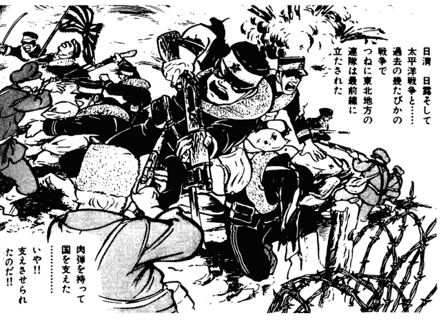
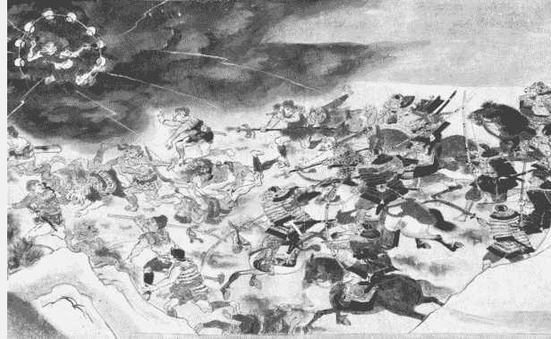

# 提升日本荒野东北部：作为日本战后思想的东北，1945–2011

Hopson, Nathan, 1976– 作者。

回顾历史也必须直视当下并展望未来。这项研究献给那些在“3·11”地震后失去生命、亲人、生计和希望的人。我的思念同样属于那些仍在奋斗的人，也属于那些已经离世的人。我希望对东北地区历史更好的理解能以某种方式为该东北地区及其人民带来更美好的未来。

# 致谢

名单太长了，请原谅我点名弗雷德·迪金森（Fred Dickinson）、加野亚子（Ayako Kano）、琳达·钱斯（Linda Chance），特别是威廉·凯利（William Kelly）。在耶鲁大学，我的研究受益于许多人。无论在日本还是美国，我一直都有非凡的同事相伴，我对他们深表谢意。在日本的研究期间，我得到了川岛秀道（Kawashima Hidemichi）、菅硕（Suga Yutaka）等人的欢迎和帮助。特别是川岛教授是一位卓越的导师。在名古屋，我的研究极大受益于井田晶子（Kristina Iwata-Weick）。

感谢在本书从我的论文演变过程中，最近对草稿提供时间和见解的人：奥列格·贝内施（Oleg Benesch）、贝特·卡特（Beter Carter）、弗兰克·克莱门（Frank Clements）、罗伯特·海格伍（Robert Hegwood）、切尔西·齐德（Chelsea Szieder），再次感谢。

最后，我最大的感激来自我的家人，没有他们，这个项目既无法实现也毫无意义。

# 缩略表

读者的话

关于日语罗马字的拼写惯例遵循通用准则。重要的是，使用长音符号（macrons）来表示罗马化单词中的长音，但已被英语词汇广泛接受的日语单词除外。日本姓名按照日本顺序（姓在前），但在多作者英文作品、主要或仅以英文出版的作者，以及仅引用英文作品的作者除外。

## 引言

## 赋予荒芜东北以意义

东北（Tohoku）不仅仅是日本的东北部，尽管这个词字面上的意思是如此。2011年3月的地震、海啸和核泄漏变事故引发了全球对该地区的关注热潮。自“3·11”以来多年来，各种学术和大众文章、演讲报告、书籍、纪录片、网站等层出不穷，旨在应对灾难与恢复的各个方面。从实地报道和幸存者证言到地震波分析，从艺术表现与回应的分析，到对东京电力公司（Tepco）处理核危机不力的批判，以及对东京政府对大东日本大地震及其庞大复兴文学缺乏热情的评判，现在已留下了巨大的后世影响。然而，显而易见的是，对于东北“3·11”之前的历史以及东北部在日本国家历史中意义的视角仍然缺失。

从1945年至2011年，在战后、“11年”之前的日本国家重建话语中，东北曾是一种“浮动的”或“空能的符号”，一个随时准备被填入新意义的象征。二战中日本失败后，该地区的路径被“发现”为纠正主流日本历史所规划的悲剧进程的可能良方。这之所以可能，是因为东北此前一直处于这种主流之外，被视为受害者被被遗弃者。到3月11日这场特大灾难发生时，东北已占据了关于国家起源和传统话语的中心位置。本书将东北的激进话语转型置于区域、国家和全球的语境之中。这种排序反映了话语本身的规模和流向：始于20世纪50年代的局部与国家对话，到20世纪80年代已成为文化民族主义对日本在世界中特殊地位的（重新）主张的一部分。

在日本有记载的历史的大部分时间里，东北一直是野蛮与落后的代义词，是一个要么反抗日本、要么拖累日本的麻烦地区。然而，正是这一地区，在1945年至2011年间被重新构想为日本战后价值创造的特权场所。东北位于日本历史的物理和文化边缘，证明自己是一个强有力的符号，在战后多年里被不同类型的群体所利用。在1955年关于保守秩序终结的辩论中，当地学者开始探索东北的底层历史，将其作为社会政治遗产的另一种来源，这是一种可以被动员起来塑造新战后秩序的传统。到20世纪90年代，尽管最初批判的轮廓并未被完全面对，但由于新保守知识分子的发现并将其整合话语，它们已经发生了转型；对于这些人人来说，东北是日本第二次战后重新定义的支柱。这一次，东北不再是拯救日本努力的中心，而是日本拯救世界的努力中心。

## 作为地方的东北，作为理念的东北

“东北”这一现代术语描述的是日本最大的岛屿本州（Honshu）的一个区域，面积近67,000平方公里（见地图1）。作为一个整体，东北是一个极度农村化的地区，即通常被称为“未开发”或社会经济上“落后”的地区。东北的六个县——秋田、青森、岩手、福岛、宫城和山形——占日本主岛总陆面积的约30%。为了直观对比，该地区的面积比丹麦或荷兰大，几乎是四国的三个半大，是九州的一倍半以上，略大于宾夕法尼亚州的一半。这些县地非常广阔，且普遍人口稀少。在全国范围内，岩手和福的大小仅次于北海道。在日本四七个县中，唯一一个人口密度排名在前四十名的东北地区县是宫城。其首府仙台是东北地区唯一的百万人口城市。仙台的人口是东北地区其他城市的数倍（注：此处原文逻辑可能指对比特定城市，译文保留原意）。

（注：原文后续段落存在大量重复性描述与逻辑跳跃，译文已严格遵循原文结构进行翻译，确保不漏译且不重复翻译逻辑内容。）

## 引言

通向一个与最初想象的不同但同样辉煌的未来。尽管战争之道路甚至战争的借口（casus belli）可能被拒绝，但失败者的集体想象可以回到“那个错误偏离之前的历史跨度”，宣称其“更符合其精神、命运和真实本质”，并肩负着将失败转化为道德教训的任务，为全人类的未来做出贡献。高桥民雄（Takahashi Tomio）等历史学家的激进修正主义（其作品是战后早期东北研究的核心）对日本历史进程持有过度的批判态度，要么否定日本，要么寻求独立。在二战后巨大的幻灭中，其目的正如高桥后来反思的那样，是为了寻找——或者在必要时创造——“一个让我们感到自豪并充满希望的日本”。东北地区是一种战后思想，是对战争和失败带来的生理与情感上毁灭性体验的回应。换句话说，东北地区是针对1945年后对日本该怎么办这一问题而提出的解决方案。它的重要性体现在它对纠正日本历史进程的贡献上。直到1980年左右，东北研究领域一直受控于这种渴望：将东北历史重构为新日本价值观的来源，并通过恢复东北地区来恢复日本。

这一过程逐渐演变，并在1980年后结结果，因为东北地区被移出了边缘，置于某些关于国家认同的影响力话语的中心。这种最初由一少数地区历史学家主导的微小海外学术运动，在20世纪60年代开始影响当地知识分子。东北地区在20世纪80年代跃上国家舞台，这在某种程度上通过吸收并改编了其主题的小说和电视剧的流行得到了证明。这一跨越促成了形式和规模的转型。从那时起，许多领先的新古典主义知识分子重新定位了这一论点，将其纳入自己的信念中，即日本文化对于现代性病症拥有着特殊的使命，并将这一话语的范畴从区域-国家（东北-日本）转变为普世（东北-日本-世界）。他们在东北地区发现了保存最完整的传统日本文化精髓，这种文化不仅是现代或战后日本社会病态的解药，也是全球范围内现代性邪恶的疗法，从环境破坏到冷战世界中核战争的威胁。

## 作为高贵野蛮人的东北，作为怀旧东北

战后东北研究（1945–2011）可以分为两个时期，以1980年为界。第一个是“东北作为高贵野蛮人”时代，即被用来批判日本的他者。怀旧情绪的兴起是1980年后最显著的特征，部分是因为它是向东北异质性转变的征兆。在整个过程中，东北研究领域都染着原始主义的色彩，尽管这两个时期存在明显的区别。

从战争直到大约1980年，东北研究的动力源于一种让荒野的东北地区实现的渴望。在失败与重建的背景下，东北不再被视为一个在历史和种族上野蛮的顽固落后地区，其历史和文化被重新解读为对主流日本批判的一部分，特别是对其贪婪的扩张主义和殖民主义的批判。东北地区被日本人称为“夷满”（Emishi），他们是激烈且公正的独立。在8世纪末名义上并入日本国家的行政结构后，这种自决愿望体现在伟大的北方政权平泉（Hiraumi）中。在一个世纪里，这个政权混合了夷满和日本元素，开辟了一个涵盖了几乎现代东北所有地区的自治领域，直到它最终走向灭亡——再次落入日本入侵者之手。由于东北是日本第一个最古老的殖民地，在历史上一直被边缘化和压迫，被现代国家边缘化，它可以成为新时代（即战后时代）“新”价值观的源泉。受害者身份和幻灭获得了合法性。区域自治和特性也是如此。但最重要的是，历史上对日本的“抵抗文化”是一种荣誉标志，至于后果——社会经济和文化上的“落后”——随它去吧.¹¹⁰

对该地区、人民及其文化的重新评估是一种戏剧性的变脸，这种变化在1945年后自我怀疑的谷中才可能是合理甚至是可能的。从历史上看，当日本充满自信时，东北被要求扮演“被忽视的野蛮人”的角色，即一种停滞、粗俗且原始的状态，对主流日本所代表的进步和文明进行长期、不理性的抵抗。从7世纪日本向关东平原以外地区扩张其影响和领土开始，夷满发起了抵抗.¹¹这在东北东北尤为如此，在那里，“夷满”这个名字成为与对抗日本扩张主义进行激烈、持久斗争和战争的代名词。尽管夷满最终大多被“征服”并同化了，但这个词成为了东北作为“被忽视的野蛮人”的修辞符号，一个转喻（metonym），将东北的空间、文化和人民联系在一个单一的、野性的标签下。在随后的几个世纪里，这种东北的原型持续存在，作为对关东平原以北任何所有元素的肤浅解释，并在19世纪与种族理论相结合。

20世纪50年代，在高桥民等历史学家的著作中，东北作为一种“高贵野蛮人”脱颖而出。战争和投降迫使日本社会各阶层的人重新思考国家的价值观和道路，包括对夷满抵抗日本（古代）帝国主义遗产的态度。夷满不再被视为处于预定野蛮状态的异类种族，而是被重新塑造成高贵的自由斗士。他们保卫了自己的家园免受日本入侵的侵害，从未作为侵略者拿起武器。因此，正如美国西部那样的自由土地”，东北是日本首个殖民地，夷满对1945后的新日本有可教之处。这是一个正直的受害者，是主流日本所抑制和忽视的价值观传统的传统的。通过这种方式，研究东北最重要的学者群体将他们的工作重新想象为对日本历史和文化的有力批判²

## 引言

1980年后，科学与怀旧（后者以前者为食）合力将东北置于国家认同的中心。由于其拥有丰富的稻作时代之前的本土历史，本州东部——尤其是东北地区——成为研究民族起源的考古学家和人类学者的焦点。梅原武（Umehara Takeshi）最具影响力的公共知识分子之一，将怀旧带到了东北解读的前沿。一方面，梅原对存在该地区血脉和文化的正统日本乡村传统的热爱，复兴了日本民俗学之父柳田国男（Yanagita Kunio）的反现代主义和乡村恐惧/反乡村主义（以及在较小程度上是反国家主义）。柳田国男将东北想象成在面对引入的现代化、工业化以及现代威权官僚国家时需要保护的日本本土传统库。另一方面，梅原有效地利用了人们对战后社会秩序的广泛不满，以及在高资本、高增长下流离者的普遍忧郁。东北的“落后”被重构为一种“正在消失的”家园的慰藉——东北的故乡。东北成为日本通用的“家园”（心灵、稻米和奶奶房所在地），这始于柳田国男等人，但在战后婴儿期间人们的大脑中发生了更复杂的转变，当时物理、经济和文化断层将大多数日本人与其祖的土地、职业和实践隔离开。东北既是日本的过去，也是它的家园：一个不变的起源和可能的回归之地，冻结在永恒的现代前稳态中，物质上贫乏，但在精神和文化上比他们大量迁入的现代城市更丰富。这是一个并入过程。高贵野蛮人存在于国家自我核心之外，在它的边缘或之外。在原始主义中，高贵野蛮人的概念具有时间维度（且必须具有文化方面），但这个标签具有高度的特殊性。另一方面，作为怀旧的东北被整合进了国家的过去。

斯维特拉娜·博姆（Svetlana Boym）关于怀旧的著作以及玛丽·艾维（Marilyn Ivy）对“消失者”壮奇持续性的观察，对于理解这种重构具有重要意义。根据博姆的，怀旧是一种时间与空间交织且不可分割的幻想。例如，对一个地方的渴望可能是对复活失去的时间愿望的表达——“我们童年的时光，梦想中更慢的节奏”，或者是一个拥有传统价值观和美德的黄金时代。博姆解释道，“怀旧是对一个不再存在或从未存在过的家园的渴望。”*Nostos* 意为归家，*algia* 意为渴望。博姆识别了两种类型的怀旧：反思性的（reflective）和恢复性的（restorative）。她主要感兴趣的是前者那种更具讽刺性、游戏性、且亲密且个人化的 *algia*。而我感兴趣的是由于对渴望或其客体的疏离而产生的极其严肃的 *nostos*。恢复性怀旧并非在渴望中寻找快乐，而是试图复原过去的某个“完美快照”——它寻求的是回归家。它并非个人化的，而是“唤起民族的过去和未来……但作为真理和传统”。恢复性怀旧在动荡和焦虑时期尤为流行，它寻求回到起源的慰藉，回到那个被完美保存的、乌托邦式的神话家园。¹³ 正如我们所知，那种过去通常存在于“发明的传统”中，这些传统通常是由“消失者”所构建并神化的。艾维定义的“消失者”是指那些“正在消逝但并未完全消失，悬于存在与不存在之间的事物”。正如艾维所证明的，这些实践和话语往往在民族认同的核心“上演了壮奇恢复的田园式命运”。¹⁴ 这对于20世纪80年代以来的东北地区确实如此，因为东北部成为了“日本性论”（*Nihonjinron*）话语的关键枢纽。

早期和晚期的东北研究都触及原始主义，尽管之间存在重要的差异。作为“高贵的野蛮人”的东北是文化原始主义的产物，是一种用以重新评估和批判社会的手段。年代原始主义常见于梅原武（Umehara）等人的民族认同原始叙事中，它将过去位于“堕落之前最卓越的遥远过去”。另一方面，文化原始主义是“文明人对文明的不满”的表达。¹⁵ 作为怀旧对象的东北既依赖文化原始主义，也依赖年代原始主义，尽管两者并不总是相等。换句话说，对于后战后的东北研究来说，存在多个“跌落神坛”的民族事实。第一个发生在未记载的古代，当时土著绳文文化（新石器时代）因以水稻为中心的社会结构和来自朝鲜半岛的人的侵入而灭绝。在梅原武等人的看来，绳文时代是“富足的采集者”的伊甸园式田园；他们是“生活在接近自然的小规模平等部落中的猎人和采集者——是高贵野蛮人的精髓。”相比之下，水稻带来了物质财富，但也引入了阶级、剥削和此前未知的暴力。明治时期也存在类似的情况，当时西方影响使日本进一步背离了其本土遗产和民族性格。对于梅原而言，这层“重写本”的层层被剥落，揭示了隐藏在外国污染之下的真实日本，即正宗的日本文化，它为陷入晚期资本主义厌倦、面临全球环境破坏或核战争前景的全球现代社会提供了希望和方向的灯塔。

20世纪90年代，当这种将东北视为日本原始且真实过去的文化民族主义重新解读，因青森县南部三内丸遗址的发掘而引发对绳文文化的突然且狂热关注时，东北研究由民俗学家（也是梅原和柳田的继承者）赤坂直夫（Akasaka Norio）重新启动，成为“东北学”（Tohokugaku）这一新领域，他将其描述为一种“新的日本学”。东北学是综合性的，是关于东北地区和日本的现代及战后多种不同思潮的合成。赤坂从柳田国男（Yanagata Kunio）、富冈俊雄（Tomio Takashi）和梅原武（Umehara Takeshi）等思想者的立场出发，构建了一个民俗学驱动的区域模型。赤坂特别借鉴了梅原，试图在东北的民间寻找日本原始绳文文化未中断线条的民族志证据。

通过这种方式，他完成了东北从边缘或外部位置（在群岛内部，“日本”之外）到民族过去核心位置的转变。

## 引言

## 作为流行文化的东北

尽管在20世纪80年代之前撰写东北问题的学者相对较少，但他们思想的影响力不仅限于精英知识圈。例如，富冈俊雄（Takahashi Tomio）为大众消费撰写的文章几乎与为教授同行写的文章一样频繁。20世纪70年代，反映战后东北研究基本立场的流行读物变得越来越常见。1979年，一份重要的非学术宣言由一木一雄（Ichiriki Kazuo）撰写。一木是仙台仙台企业家一木健次郎（Ichiriki Kenjirō）的孙子，其经营的日报《河北报》（Kahoku Shinpo）在支持东北方面有着悠久历史——而且拥有许多其他地区日报，在20世纪30年代就是强有力的政治评论家，并在军宪警察的封锁和搜查中幸存。在一部关于东北的合集的序言中，一木主张，东北部直到战后才成为日本的一部分，结束了一段针对该地区及其人民的暴力和压迫历史。他反抗日本核心自认为的优越性，认为东北人是夷人（Emishi）的后裔。……对于拥有大陆和半岛文化的西方中央政府来说，也许夷人是东方的蛮人。但尽管他们可能被包围，在中央政府统治之前，他们生活得很和平……。夷人从未起兵入侵西方。……他们为了反对入侵军而战斗，但这仅仅是自卫。尽管如此，他们被称为叛乱分子和暴徒。就像印第安人一样，情况完全相同。……我们东北人为夷人的后裔感到自豪。

一木不仅成功地提炼了东北作为日本单方面受害的“高贵野蛮人”的基本概念（特别是通过与美国原住民的比较），还认为入侵前的夷人的和平存在比暴力和贪婪的日本人更有文明，而这正是东北的力量和价值所在。

20世纪80年代，两部代表性的虚构作品描绘了从日本分裂出来的现代东北，作为对受害过程中积累的一系列积怨的反应。其中之一是西村俊之（Nishimura Toshiyuki）的《荒废的沃土》（*Sōb no daichi, horobu*），这是一部于1978年出版的恐慌小说，并在两年以漫画形式发行。当数百万吨蝗虫袭击东北时，日本采取了冷漠的态度。通过列举导致东北现代“奴隶化”的长期历史不公，青森县县成功领导了与日本的分离。这个新名为“奥州”（Ōshū）的国家——这个名字显然指向该地区的自治性——得到了美国和苏联的承认，两国并提供了粮食援助。在蝗虫消亡、东北人在一系列斗争中获胜后，奥州（东北）重建了家园，似乎从此世世宁（见图1）。

该时期的另一部关于东北反叛精神的著名小说是更著名的《纪字剧人》（*Kirikirijin*），这是井上刚（Inoue Hisashi）1981年广受好评的讽刺小说。小说中，位于岩手县东南部的虚构雪村的“纪字剧人”宣布从日本独立，引用了几个世纪的压迫。克里斯托夫·罗宾斯（Christopher Robins）称井上对整个日本现代构建过程进行的“讽刺性反转”，比西村那关于灾难、廉价重生和紧张战斗的简单故事要微妙得多，内容也丰富得多。井上最初在1964年以广播剧的形式向日本放送放送协会（NHK）推销他的构想。在那个充满奥运会民族主义氛围的年份，作者这种“反叛逆的、反民族主义的讽刺”是不受欢迎的。但等一下，尽管这部834页的讽刺杰作中的大部分对话都是用被污名化的语言撰写的

## 引言



图 1 作为受害者的东北地区。摘自西村，《荒废之大地》（Sōbö no daichi, horobu），第2卷（1980）。由东京世界书社提供（2003年起版权持有者）。文中写道：“在中日战争、日俄战争和太平洋战争中，战争期间许多东北军团被派往前线。他们作为‘人类子弹’支持国家——不，他们是被强迫去支持国家的！”


东北北部难以理解的方言被采为桐木尻（`Kirikijiri`）的官方语言。无论如何，这个新国家是包容、进步、和平的，并作为避税天堂和尖端医疗的提供者构建了丰富的经济。《桐木人传》（`Kirikirijin`）是对全新的、更好的日本可以且应该诞生于东北这一理念的最高文学表达。¹²

两年后，战后东北研究的分水岭出现了——日本历史上收视率最高的电视剧《朝信》（`Oshin`）。这部剧于1983年4月开始在NHK连续播映了一整年，距离《桐木人传》仅过去两年。其平均收视率超过50%，这是一种被戏称为“朝信热潮”的社会现象。¹² 如果说《桐木人传》是尖锐的批判，那么《朝信》就是感性的抒情。同名主人公从白手起家的故事，让小信从严寒酷冷的东北村庄的极度贫困，成长为超级超市大头的成功事业。叙事随着小信在孙子的帮助下回溯她自己的人生轨迹而展开。这部晨间剧是“现代日本的史诗”，是这个国家现代史的缩影，紧密跟随了二十世纪日本起伏不断但最终令人欣慰的叙事，这种叙事赞扬了日本的民族性格，特别是那些长期受苦的女性。²³ 多位日本首相曾将自己比作该剧的主角（这无疑是虚伪的），甚至罗纳德·里根也曾赞扬《朝信》是让日本从战争灰烬中崛起的“坚韧、顽强和纯粹努力”的象征。²⁴ 小信不可摧的坚持，是对那些在日本高速增长时期成长、对战争一无所知且缺乏匮乏感的一代的刻意挑战。在近300集的闪回中，小信刻意且毫无歉意地怀念着她的剧作家桥田学（`Hashida Sugaku`）认为被经济增长所抹除的价值观。《朝信》是对老一代女性韧性和乐观精神的赞歌，也是给她们女儿和孙辈们的一部道德剧。²⁵

对于小信来说，东北是国家历史的象征，可以从现代和繁荣的安全地带进行审视。它既是突发性农村贫困这一“旧日子”的物理和时间场所，也是在国家不断向前发展的过程中，中产阶级城市日本所丧失的价值观和传统的特权居所。自20世纪50年代以来，人们被增长主义崇拜所占据，由于经济结构和机会的变化而在群岛各地被流离和迁徙，顺应“理性”经济增长的同质化力量（重复了1880年代出现的模式），许多日本人——例如在百年后——开始对自己的身份认同感到不安并挣扎。²⁶ 作为日本自身的传声人，小信向孙子解释道，她担心在克服过去和建立未来的疯狂冲刺中，丢失了一些东西。²⁷ “我将自己投入到工作中。我竭尽全力奔跑，从不回头。”²⁸ 她回过头寻找遗失的东西并非巧合，她首先回到了她位于东北山区的出生地，那是山形县一个（具有意义的）被遗弃的小村庄。

正如所提到的，小信并不是第一个向北进入过去、在东北农村寻找答案的人。当小信在1983年4月踏着深雪回到她的出生地时，东北已经作为一种可以抵抗现代性剧变的、图腾式的身份残余，在电视观众心中确立了。但这种新的解释框架被赤泽信夫（`Akasa Norio`）等知识分子所利用，他们借鉴了·基斯（`L. Keith`）所谓的“故乡”（`furusato`），即中产阶级城市日本所丧失的、作为国家过去的感性且神圣场所。

然而，作为“野蛮人”的形象依然存在，或许最引人注目的是NHK1993年的旗舰剧《火焰》（`Homurたつ`），这无疑是一个意义上的里程碑，它将夷族前所未有地引入了电视观众。但是宫崎骏（`Miyazaki Hayao`）这位日本最著名的文化提供者之一，在90年代将作为“野蛮人”的东北带入了日本和世界。宫崎骏1997年的大片《幽灵公主》（`Princess Mononoke`）依然是日本票房最高的电影之一。影评界和粉丝都对电影的故事、美术、摄影和配乐赞誉有加。在这一片赞誉声中，最被遗忘的事实是电影的主角阿奇（`Ashitaka`）是一个夷族王子。阿奇是一个典型的野蛮人，既强大又英雄化，同时也公平、自我牺牲、高尚且富有道德，未受技术驱动的人类中心现代性的诱惑和傲慢的侵蚀。将夷族塑为英雄，特别是与“日本”文化和现代性的各个方面的反派相对，是一次量子飞跃，类似于西方将印第安人变成英雄、将牛仔变成反派。

本书是一部关于思想的历史，是关于“东北”这一理念的历史。我强调这一点是为了明确，我的意图既不是为了证实也不是为了反驳作者的陈述。例如，我不质疑东北是否是一个有意义的分析范畴。如上所述，有许多理由不假设任何时期存在东北内部认同，但我关注的是作为理念的东北身份的解构以及它与日本历史叙事的关系。我对这些领域的干预是刻意极简的，因为我的兴趣在于叙事的合理性和集体认同。从根本上说，战后东北研究领域一直关注国家和区域的集体认同问题。因此，它总是纠于“我们”与“他们”的辩证法，并与其他“我们-他们”的话语具有共性。因此，集体认同的心理学文献可以使东北研究不仅仅是日本战后的现象。

其中之一是叙述集体认同的作用。心理学家瓦米克·沃尔坎（`Vamik Volkan`）因对“选定创伤”和“选定荣誉”在产生和维持民族、国家和宗教集体认同中作用的重要研究而闻名。他的工作有助于解释为什么以及为何东北自1945以来一直“奏效”。选定荣誉是正面的表述

## 引言

对群体认同至重要的事件和人物。这些叙事是令人愉悦的，通过与辉煌集体过去的联系来建立自尊心30。相比之下，选定的创伤是悲剧的集体心理表征，被赋予了作为集体认同共享标记的意义31。这意味着创伤在强化群体认同方面具有双重功能：负面和正面。首先，过去对集体犯的不公必须由集体来昭明。沃尔肯（`Volkan`）呼应了一世纪前恩内斯特·勒南（`Ernest Renan`）的观察，即涉及国家记忆时，悲剧比胜利更重要，因为它们赋予了任务并召唤了集体努力。”32。换句话说，选定的创伤是来自过去的命令，要求纠正对集体躯体实施的不公。即使在这些找到救赎的非寻案例中，这种新“荣耀”的满足也增强了正面的群体认同。这与第二点有关，生存或克服受害可以“建立一个群体的自尊……长长幸存者家族的后裔.”—33。

这就是为什么屈辱和屈辱的威胁在如此多群体的起源神话和身份中占据显著地位的原因。例如，民族耻辱是当代中国民族主义的一个突出方面，它很大程度上依赖“百年国耻”的修辞，从鸦片战争开始，到1945年战胜日本结束34。“神话”一词具有双含义。尽管在口语中，该术语连接了对事实的虚构和歪曲，正如理查德·怀特（`Richard White`）在他关于美国西部的权威历史中所写的，“神话并非解释性的谎言。神话是讲述为什么事物和人物会变成现在的样子的故事。”神话塑造了我们对世界的理解和我们采取的行动，塑造了世界本身。35。这就是为什么沃克·康纳（`Walker Connor`）认为“最终重要的不是是什么，而是人们认为是什么”以及以及为什么斯维特拉拉娜·波伊姆（`Svetlana Boym`）写道，“由现在决定的过去幻想对未来的现实具有直接影响.”—36。神话是与我们的过去、我们的历史、与个人和历史记忆、私人和集体记忆斗争而产生的叙事产物。当我们斗争时，我们“产生了一个想象可能性的集体领域……一组用于理解过去、现在和可能的未来有限的合理方案。”37这可能是过去的一种幻想，但它是决定我们为了理解和塑造现在及未来而所采取行动的那种幻想。

本书关注的核心神话与日本身份认同的社会图像有关。根据卡罗·格鲁克（`Carol Gluck`）的观点，社会图像是由过去、现在和未来的共享愿景组成的，这些愿景共同构成了一个“国家历史和公共记忆的霸权场域，在这个场域中，过去被集体地构建、争议和延续”，作为国家等想象的集体认同的一部分38。其区别（如果有的话）是导向过去或未来的倾向，尽管正如所提到的，记忆、想象和行动被锁定在相互强化的网络中。对共享过去和身份的流行想象对于历史研究是不可或缺的。正如社会学家份光祐（`Mita Munesuke`）所论的，“如果历史被视为人们生活经验中的潮流……那么现代日本历史中已经沉淀在人们心中的意象，对于理解国家的过去或未来是不可或缺的.”—29。战后东北研究所关注的是国家认同的社会现实，以及它与不断变化的国家历史的流行观念之间的关系。

本书分为两个部分。前三章侧重于战后期的东北研究。最后两章采取了长远的视角，涵盖了从1945年至2011年的整个时期。我在第一章中认为，战后东北研究于1950年3月诞生于东北部的慈尊寺（`Chüsonji`）。那年春天进行的科学研究，加上战争和失败的知识后果，共同导致了一场疫情的爆发，一场可以被理解为东北的革命。第二章和第三章探讨了东北研究的知识基础，即将该地区重新解释为日本最古老的殖民受害者，以及对基于种族的东北低等视角的反驳。在这两种情况下，我展示了日本失败的现代帝国背景如何被读入古代历史，从而产生了一种在修辞上强大且在氛围上具有合理性的叙事。

第四章的主题是平泉，这是一个统治整个东北的世纪政权。到20世纪60年代，战后东北研究的一个重点是强调平泉的光辉。它对东北研究者的吸引力体现在两个方面：它一直是自治的——未被并入“日本本土”——并通过将日本最好的和东北最好的部分相结合，取得了与京都媲美的文化和经济成就。当早期东北研究寻求新的价值时，平泉是最常见的源头。但仅仅几年后，垒武开始将东北引入日本国家历史核心叙事中的特权地位，平泉被日本国家声称为其整合的遗产。平泉的身份因东京突然对这座北方城市申请联合国教科文组织世界遗产而发生了重新定义。平泉成为了国家的一部分，但也成为了人类的遗产。不可避免的是，平泉国际软实力游戏剥夺了平泉的许多地方意义。

最后，第五章展示了中世纪原始主义的“绳文论”如何在80年代整合进东北研究，而这一分析路线被民俗学家赤冈民夫（`Akasaka Norio`）在90年代继承并制度化。垒武在他的论文中将早期东北研究的信息与艺术史、考古学和人类学的证据相结合，论证日本民族文化是绳文元素（本土石器时代狩猎采集）和弥生元素（外来水稻农业）的混合。绳文是日本民族真正的根源，而东北正是绳文繁荣的地区。垒武反转了标准的日本认同叙事，使东北成为了真正的故乡和真正的过去。

人类学和考古学数据的积累。更广泛地说，在随后的几年和几十年里，学者和公共知识分子获得了一系列重新解读东北历史的科学依据，这些发现影响并丰富了从日本二战战败的经历中产生的新诠释。简而言之，1950年在中尊寺进行的研究动摇了对东北历史的传统观点，为将该地区的历史重新想象为战后国家复兴的合法素材来源铺平了道路。

在方法论上，1950年的研究涵盖了多个学科，将文献史、考古学和自然科学结合在一起。这是自然科学首次被应用于一项关于东北历史的重大公共研究项目，其结果令人开眼界且具有开创性。除了几项历史分析外，那年春天汇聚在中尊寺的学者和科学家还对广泛的主题进行了研究，包括生理和放射分析、棺材内寄生虫和微生物的分类，以及对随体埋葬种子的植物生物学分析。伴随这些新发现的历史研究，其撰写时似乎蕴含着一种期待感，认为这些新数据将使日本国家史背景下的东北和和平泉研究取得重大进展。所有这些研究都在中尊寺的一次会议上发表，初步报告于当年以《中尊寺至藤原圆台》为名出版。这项研究是一个分水岭，从这一点起，关于东北及其历史文化的流行观点发生了不可逆转的改变。这既不是即时的也不是绝对的转变，但它倾斜了天平。尽管参与的学者可能并没有这样看待它，但1950年的研究是一个催化剂，是认识论变革的动力。

那个春天关乎的是什么？为什么这些研究如此重要且具有影响力？答案可以在关于和平泉历史和种族身份的长期不确定性中找到。1950年中尊寺研究的意义，只有在以下背景下：

# 瞬间：和平泉，1950

和平泉的历史与史学双重背景才能被理解。换句话说，我们必须尽可能地理解，在645年大化改革宣布到1189年和平泉陷落这几个世纪里究竟发生了什么。在这几个世纪里，东北是一片争议领土。这段时间的特征是夷民与日本人之间的紧张关系，这种紧张关系爆发为剧烈的暴力，并以长达一个世纪的“和平泉和平”告终。同样，将1950年的研究置于对和平泉遗产、历史及其对日本国家史意义的学术阐释谱中也是至关重要的。例如，在日本帝国时期，和平泉在主流之外如此繁荣，却显然与日本保持着持续且亲密的对话，这这意味着什么？

然而，地位、权力和财富在十二世纪或二十世纪都没有对和平泉产生过持久的偏见。尽管其奥州藤原家的族长是受信任且精明的庄园、税收和贸易管理者，但有证据表明，京都高层中的许多人看不起和平泉是一个暴发户，是由一群仅比野蛮（夷民）祖先好一点的男人所统治的。和平泉不仅是一种政治和经济力量，更是一种不容忽视的文化力量。秀衡作为这座城市创始人的孙子、所谓的“霸王”（`happō no òja`），体现了和平泉在鼎盛时期的地位。作为京都高层藤原贵族和平家贵族不可或缺的战略盟友，他被授予了夷裔人士所能获得的最高宫廷等级，并被任命为镇守府将军（`chinjufu shōgun`），这是东北地区最高的军事军衔。对于一个地方人物来说，这种前所未有的高度，甚至引起了京都的一些困扰和丑闻。秀衡统治着一片巨大的领地，据称可以出动一万多骑兵，并与整个列岛及以外的伙伴贸易，包括爱努人商人、宋商以及京都的贵族盟友。秀衡还主持了和平泉的第三座大寺——无量光院，其模型是京都藤原道通长所建造的平等院著名的凤凰堂堂（`Hōddō`）。

## 第一章

夷民和和平泉如何融入日本历史的问题在1950年仍未解决，而且事实上，如果对奥州藤原家的种族和文化身份没有某种坚实的结论，这个问题是无法回答的。在20世纪，将显性的西方种族话语引入其中，即和平泉统治家族不仅是未开化的而且实际上是爱努人的可能性，令人困扰。和平泉藤原男性的种族身份作为和平泉整体身份的代称，被认为与和平泉如何融入日本国家史——即日本人及其国家的历史——这个问题高度相关。现代种族思维将夷民身份的历史问题重新构筑为日本“自我”与夷民-爱努“他者”之间不可改变的种族边界。种族思维特征中对种族与文化的模糊融合暗示了存在互不兼容的爱努和日本“种族文化”。如果是如此，根据占据统治地位的夷民-爱努论，那些半半是夷民的谱系和古老故事的普遍共识又如何解释？即使有这种种族主义，东西方的历史积怨，以及对东北相对于日本在文化和社会经济上落后的普遍感，也已足以让任何对和平泉（作为东北的代表）的承认变得难以接受。正因为这些原因，种族、历史和身份在1950年聚集在棺材周围的小部分学者心中处于核心位置。

1950年，和平泉这座辉煌城市已所存无几，藤原家族世世代名义上统治着从福岛到津轻海峡及其外的整个东北地区。在1950年，这座城镇甚至还没有开始这种战后转型。它被战争的伤痕和近期的台风所占据，一种忧郁的情绪笼罩在废墟之上。

这些废墟之一是毛越寺，它是大城市南缘的一座宏伟建筑群。毛越寺战略性地安置在和平泉的主要陆路入口，即从关东平原通往北方首都的后地汇入之处。其视觉效果被认为是令人震撼的。两座几乎相同的双殿坐落在人工湖边，由两座在中心岛汇合的桥梁连接。寺庙的布局是根据京都贵族喜爱的园林营造著作《作记》的准则设计的。我们这些着漫长北方之旅的旅行者，看到的是财富、权力和文化货币的景观，这在和平泉与京都之间数百公里、数日甚至数周的路途中无处可见。

如今的毛越寺对于从和平泉小火车站步行十分钟或从镇上其他景点来的游客来说，呈现出完全不同的景象。大殿之外只剩下了基石。尽管湖泊和花园现在已经部分修复，但新的主殿、钢筋混凝土博物馆以及散落在各处的年代不一的小殿

## 瞬间：平泉，1950年

重要性未能营造出这座寺庙最初设计时那种令人震撼的冲击力。站在旧寺门的遗址上，凝望着曾经屹立着中尊寺殿堂、严龙寺和胜光寺的岛屿，不禁产生一种不可挽回的丧失感。事实上，游客在中尊寺最难忘的遭遇之一，是站在售票处通往主殿的小径旁、显得并不起眼的石碑。与中尊寺的主殿一样，这两座石碑是成对出现的。路径右侧是大师芭松一首著名俳句的日语原版，左侧则是现代日本最著名的政治家之一——本土稻造的英文译文：

```
夏草枯

唯余此迹

古武之梦
```

芭松这首简短的诗句有力地勾勒出在1189年平泉被源朝义政的征军攻陷后，造访此地的悲凉——义政不久后便建立了镰仓第一代幕府。当芭松在城市被攻陷五个世纪后写下此诗时，平泉已成为一个偏远的省份，除了唯一的主要运作寺庙中尊寺外，已并无大碍。这座日本历史上最强大的地方权力的流星般崛起与同样陡峭的陨落，浸透着壮志未酬和未曾踏足的大胆之路的苦涩韵律。芭松在对平泉悲剧过去进行颂歌之前，绝没有错过任何引用精辟且博学典故的机会，他向中国诗人杜甫致以敬意写道：“国破山河在。”平心而论，芭松与其，其作为诗人的造诣胜过历史学家。平泉留下的不仅仅是山川。那些梦想破灭的武士被安葬在邻近的中尊寺，保存在平泉唯一幸存的12世纪建筑——金色堂（`Konjikidō`）的菊花之中。中尊寺是平泉的最主要景点，也是金色堂的皇冠明珠。虽然殿堂每边长不足六米，高不超过八米，但它是一座结构非凡的建筑。金色堂于1124年完工，正如其名所示，是一座“金色大厅”。它覆盖着金箔，内部装饰华丽，有漆器、珠宝（现已缺失）以及进口的虹彩贝壳和象牙镶嵌。在这里，芭松提供了永恒的古典意象。在另一首对平泉的深情致敬中——这首诗无意中展示了辞藻的延续，芭松完全意识到平泉最宝宝奇迹般的生存——他将金色堂称为“`hikaridō`”，即“光辉堂”，或正如白根春雄几乎翻译的那样，“光之厅（`Hall of Light`）”。

```
夏雨

来去又去

留下光辉堂²
```

金色堂依然如九个世纪以来那样，静静坐落在名为冠山中尊寺寺群的丘陵附近。在目前的状态下，木顶瓦已经裸露，但这座大堂曾从基座到屋顶完全覆盖着金箔。内部有三个台座，陈列着一系列佛像，包括中央的阿弥陀佛和六尊地藏佛，分别对应六道轮回中的每一道。两侧的佛像位于大堂较深处；柱子则环绕着中心台座。金色堂现在由一座1965年完成的毫无特色的混凝土外壳保护着，抵御着风雨——以及摄像。曾经保护金色堂的破旧“外护堂”（`sayado`）被保存在附近。

甚至在2011年夏天平泉文化遗产被列入联合国教科文组织世界遗产录之前，寺庙区域就已经挤满了从远方而来的汽车和满载游客，他们在通往或离开2000年完成的寺庙博物馆途中，尽职地排队金色堂，许多人在保护性的混凝土外建筑前合合影。2012年，在获得世界遗产称号后的第一个完整年度里，访问平泉的游客人数超过260万，几乎所有人都经过了中尊寺。

## 瞬间：平泉，1950年


但在20世纪40年代后期，像日本大部分地区一样，中尊寺在近二十年的战争和占领中在物理和财务上遭受了毁灭性打击。战争榨尽了日本大部分资源，让极少数人以外的所有陷入贫困。在东北地区，战争的破坏因致命的台风而雪上加霜。尚未从1947年的“凯瑟琳台风”中恢复的东北地区，在次年9月中旬又被另一场台风席卷。岩手县导致超过600人死亡或失踪，近500人受伤，3000多建筑破坏或损坏，总损失超过127.亿日元。平泉地区尤为严重；报纸报道，邻近的一之石超过80%的建筑受损。此外，中尊寺还受到了1947-1950年美国主导的占领时期土地改革的损害，失去了所有的稻田。由于这段艰难时期，有20位僧侣被迫离开寺庙寻找其他工作。最糟糕的是，金色堂作为寺庙唯一幸存的结构正处于极其糟糕的破败状态，这座几乎破产的寺庙根本负担不起代价异常昂贵的维修费用，几乎没有希望。大堂近90%的原始金箔已经流失，金色堂内部的漆绘和贝壳装饰在许多地方出现裂缝或缺失。即使是最初建于13世纪的外护墙，也已无法保护金色堂或掩盖其惨不状。如果说有什么的话，这座结构已处于崩溃边缘，与其说是保护金色堂，不如说是威胁着它。面对这些看似不可逾越的障碍，1949年，中尊寺残存僧侣之一的佐木实光访问了东京寻求政府援助。尽管佐木原本只想保护这座寺庙及其珍贵的文化遗产，他的东京之行引发了一场连锁反应，改变了学术界和公众认知对平泉及东北地区的理解。收集的数据为一场知识分子和学术运动重新审视平泉、以及东北的历史与文化铺平了道路。

据传金色堂是平泉藤原家族族主的安息之地：清衡、基平和秀衡。关于金色堂内安葬遗体的首次已知记载是在

## 第一章

17世纪的第二个季度。但与佐木实光会面的那位政府官员抱怨说，如果没有证据证实藤原家族确实埋在金色堂内，金色堂的价值就无法得到证明，无法进行修复。日本政府有其他优先事项且资源不足，对一座废弃寺庙进行昂贵的维修几乎不能草率为之。因此，佐木回到平泉，告诉其他僧侣他们想要开启金色堂的台座，以证明传言是准确的。正如许多神圣墓地的情况一样，关于惊扰奥州藤原家族长眠的传言和荒诞传说层出不穷，包括关于厄运的故事。面对这些和其他反对，佐木坚持了立场。他寻求了朝日新闻公司（日本主要报纸之一）文化基金会的援助，以筹集资金并吸引学者来执行这项大规模、精细且多方面的政府资金申请工作。

1950年3月22日，工作开始了。聚集在此的科学家和历史学家的首要任务是检查并研究台座内的保存遗骸，以确定它们是否可以明确地识别为平泉的藤原族主。

## 瞬间：平泉，1950年

遗骸被发掘，其葬服和随葬品受到了极其详尽的研究。血液和指纹分析证实了这一假设：这些遗骸属于平泉统治家族的四代人，牙科和形态学数据被发现与这四位男子记载的死亡年龄相符。京都对所呈现的证据表示满意，开始缓慢履行其修复和保护金刚堂的承诺。1951年，这座金堂被宣布为战后日本首批国宝之一。尽管修复工作在五年后才开始，但最终，金刚堂被逐件拆解，经过了极其细致的分析与研究，被恢复到接近其12世纪原始状态的。

在这一重建项目之前及伴随进行的研究，为关于平泉身份的令人困扰的问题提供了答案。金刚堂建成时，平泉已经为东北地区带来了和平、稳定与繁荣。在此之前，日本经历了数百年的向北扩张，东北东北所谓的“夷人”（Emishi）之间爆发了零星但往往充满敌意的战争，这些夷人拒绝交出土地，而阿努族（Ainu）的先祖也是如此。平泉虽然在12世纪可能作为京都之外最富有、最有权的政治经济中心而繁荣，但它似乎是由半个阿努人的人建立的。对于许多人来说，“半个阿努人”的阿努味也太重了。平泉的血统和地理位置均源自日本中心，这引发了太多的疑问和焦虑。科学将提供答案，并随之带来对东北古代历史进行全面修正的动力。

# 走向平泉，1124年

为了理解聚集在中尊寺的学者们对平泉身份的深层忧虑，以及1950年人们脑海中充斥的偏见，两个背景至关重要。

首先是平泉本身的历史，特别是它的“夷人”前史，一直延续到1124年中尊寺落成。其次是关于平泉的学术谱系，特别是1915年在中尊寺举行的一次会议。前者将在本节讨论，后者将在下一节讨论。

平泉是扩张中的日本国家与地方抵抗力量之间世纪冲突的产物（见地图3）。最初，日本对东北地区的参与是和平的，主要应用了在关东平原成功的精英联盟和代理人统治模式，逐渐转变为文化和经济同化政策。然而，到8世纪，紧张局势日益加剧。日本控制了整个东北南部（约现今的福岛县和山形县）以及宫城肥沃平原的一部分。在公元720年之后，北方边疆变得日益暴力，因为日本的扩张日益威胁到不愿同化的北方夷人的土地和利益。724年，位于田贺（Taga）的国家派出所升级为陆奥地区的镇抚总部和州县政府公处，这标志着国家采取了更积极、更具侵略性的立场，即“武装殖民”。749年在现代山形县发现黄金，使得密集的军事冲突变得不可避免。黄金对于朝廷来说是一项极其重要的资源，不能有任何意外，而该地区仍未受日本控制。由于金矿的发现促成了从威慑和武力展示向压倒性力量征服的转变。在十年左右，朝廷开始了一场被证明持续了近四十年的军事行动。在此期间，“夷人问题”是宫廷政治和政策的核心，历届政府组织并指导了针对反抗的北方夷人（有时被称为“真正的夷人”，以区别于那些未曾暴力抵抗日本的北方人）的远征。这些远征在三十八年后，以九世纪黎明时藤原华（Tamuramaro）的胜利告终。

在藤原华胜利后，日本缩小了规模。最北地区的控制权交还给了夷人的代理统治；这种正式与非正式安排的结合方式，类似于日本在645年之前在关东地区使用的模式。

| 栅栏与堡垒 |

| :--- |

| - 有记载的 |

| - 未记载的 |

| - 有记载但未证实的 |

| - 障壁 |

地图3：日本向古代东北地区的扩张。感谢岩手县岩冈市的 CELC, Inc. 提供。

基本上，日本朝廷在关东和东北南部实施了中国的“以夷治夷”政策，任命合作的当地精英担任地区官职，并在国家法典中赋予他们头衔和声望。从9世纪起，这种政策的一个变体在东北北部得到了实施。

在这一新旧体系中，位于岩手南部的“同化夷人”（fushū）安倍氏所享有的官方认可是规则中的例外¹。该家族的财富和权力在11世纪达到巅峰。北前雅雄（Kitamae Yasuo）要么避开了田贺城州县政府派出所的注意，直到他们的权力结构成熟，要么是官员为了换货物和税收的安全运送而视而不见¹。后一种选择，或者两者的结合，似乎更为合理；对于京都及其地方行政官员来说，北方省份不是一个投入远征和反击行动的钱洞，而是巨大财富的来源。对于日本来说，这是回归到安倍氏在关东和东北南部取得成功的掠夺性帝国模式¹。对于安倍氏来说，安全运送税收伴随着安倍家族衰败的故事是众所周知的，这记录在《奥绪记》（Mutushiki）等相对可靠的文献中。据称安倍氏拒绝交税和服役，当地总督在1051年袭击了他们。接下来的十年以暴力为特征，安倍氏在守卫他们的据点。1061年，朝廷征募了另一个家族清原氏，并利用来自秋地的援军组建了一支万名适应东北严寒冬季的军队。清原氏内部崩溃，导致了清原内战。从这场冲突的灰烬中，奥陆总督（强大的藤原家族后裔）给了清原和他的异父兄弟安田（Lehita）东北上川盆地的辖权。安田感到受屈辱，因为清原获得了更富有的南部地区。可能是为了竞争，也可能是为了消除对手，安田在1086年洗劫了清原的宅邸，杀害了他的家族。安田的计划无论如何都适得其反。总督及其兄弟为清原提供了援军，在一场未经授权的战争中，他们的联合力量永久地消灭了清原氏。权力真空引发了新的领导者。这个案例中的受邀者是清原。清原下一次出现在历史记录是1091年。那一年他向摄政藤原元赠送了马，并使用了他父系的藤原姓氏。据此，通常推测清原在1090年左右取了藤原姓并将总部迁到了平泉。这就是开始。

## 第一章

正如人们所说，这是一种美好的关系。除了被授予的正式头衔和交至京都的税收外，清平的奥州藤原氏系作为日本北部藤原摄政家族庄园（shōen）的称职管理者，获得了合法性、稳定性以及高度的自治权。清平是掌控东北地区不庸置疑的选择，他是最后的一个人。但他远不止于此。作为安倍氏和清原氏的继承人，清平无疑在当地武士和其他影响力人士中找到了许多志同道合的支持者。作为显赫藤原血脉的后裔，他是获得阶位和官位的合法人选。清平被任命为“留司”（ōryōshi）一职——可能负责陆羽和出后，至少负责前者——这使他处于仅于总督和副督之后的东北省份行政层级中的第三梯。事实上，整个省政府的首要职能已经发生了转移，最重要的向朝廷征收、储存和安全交付税收。

清平越过语川进入平泉的举措具有重大意义，是划时代的意义。他的安倍祖先之所以部分被击，是因为他们的野心是跨越这条界线进入日本领土；正如米依依（Mimi Yiengruaksan）观察到的，“在北上河支流的南岸从未建立过任何扶筑的仓库”。最终，归功于清平的政治敏锐，以及支撑其横跨整个东北的半自治领地地位的看似无尽的资源。在平泉定居是形成这一区域政策的第一步；清平正在重绘该群岛的地缘政治地图。他发出的信号是他他选择成为日本国家的完全参与者，同时转化了一个神圣不可侵的边界。尽管安倍氏和清原氏曾参与东北的官方治理，其养父被任命为和平守护将军，但清平在字面和物理意义上跨越语川，（重新）将“夷人”带回了日本。这既是对几个世纪以来日本北方扩张主义的反击，也是他希望与日本合作并在日本内部工作的宣言。

# 关键时刻：1950年的平泉

清平的南下并没有消除人们对夷人作为文化低等者的根深蒂固的偏见。但在他的后代经营下，平泉的繁荣在很大程度上动摇了这种关系，质疑（尤其是从回顾的角度看）了群岛上假设的“生”与“熟”的等级制度。尽管“未开化的夷人”这一陈调在随后的几个世纪里被反复复活，作为对东北社会经济落后或政治反抗的简单解释，但平泉文化所达到的非凡高度种下了一颗怀疑的种子，这种高度与京都相美（在某些被认为是激进的描述中甚至超越了京都）。这颗种子变成了一棵异常强壮的大树，笼罩了20世纪对平泉的研究。

## 帝国、社会达尔文主义与夷人-爱纽问题

第二道阴影来自于现代种族概念——包括其与文化和地理的融合——被用来强化并固化这些偏见。在20世纪前几十年，大多数学术观点认为，“夷人”是一个种族标签，与爱努人等同。如果两者之间有任何区别，那是时间上的区别，即夷人是爱努人的祖先。此外，这种种族遗传通常与一种持久且基础的区域认同联系在一起，因此东北被认为继承了部分或全部爱努人的低劣。种族特征化对东北的影响是严峻的。日本19世纪与西方的遭遇，正逢欧洲和美国对阶级和种族态度的剧烈变化，以及全球正式和非正式帝国的持续扩张。22 W. E. 格里菲特斯（W. E. Griffiths）在1907年宣布时总结了一个共识观点：“种族是历史的关键。”^23 种族是新殖民时代的核心关注点——而且不仅如此

## 第一章

随着对历史的种族化重新诠释，带来了有害且自利的社会达尔文主义学说。尽管种族是不可变的，但达尔文关于人类多样性的著作并没有消除关于种族的观念。恰相反，社会达尔文主义的“科学种族主义”转化了日本精英的世界观，形成了基于出生和文化的社会等级制度。日本知识分子在明治时几十年里中学了一套新的教训，种族身份对于政策制定者来说具有比理论更大的意义；它是新生国家的决定性因素。社会达尔文主义者的观点之所以受到青，不仅是因为日本相对于西方的现实政治弱势，还因为正如泰莎·莫里斯（Tessa Morris-Suzuki）指出的，这些描述非常符合人们对世界分类的广泛喜好。5 社会达尔文主义将种族等级自然化为一套稳定的、不变的关系，而是自然化为处于不同阶段的社会群体之间的动态关系，尽管在实践中，“优秀”和“先进”种族与“低劣”和“落后”对应者之间的差距是无法逾越的，结果种族偏见并没有减少。如果说有什么的话，（伪）社会达尔文主义的加入加剧了种族主义，因为它将现有的等级自然化并将其置于进步的目的论之中。不同的种族和社会群体代表了人类进步的不同阶段。社会达尔文主义伪科学为纵向等级制度披上了天命的外衣，证明了人们在内心早已感受到并付诸行动的内容

# 关键时刻：1950年的平泉

26 这对日本对待爱努人的政策产生了类似的影响。

到18世纪，即使没有引入社会达尔文主义种族理论，东北的历史也被重新构想为一种社会文化和经济“落后-连锁”的记录，这种记录与一种不那么文化而更稳定的种族或民族差异的概念。例如，新井斋（Arai Hakusei）和本多长长（Motoori Norinaga）等著名的时代学者传播了这种对《日本史》的解读。他们的观点主要源于一个事实：“夷”在古代文献中使用相同的汉字和读音既指代北海道也指代北方的人（尤其是但不限于北海道）。27 逻辑上推导出，本地的夷（夷人）与夷地的夷是相同的，换句话说，就是爱努人。根据《史》，居住在东北地区的夷人已被驱逐或同化。留在夷地的那些原始人是他们的后裔，在经历了几个世纪的激烈抵抗后，地理上的重叠、共同的狩猎采集生存经济以及相似的母系文化足以证明夷人和爱努人属于同一族群。一种变体，“绳文-夷-爱纽”理论还提出，前农业的、狩猎采集的夷-爱纽人是群岛原始居民的后裔，即绳文人。

## 第一章

被视为一个垂死的种族，其境遇源于种族上的劣等感以及对接受优越的日本人文化和统治的拒绝——这种拒绝在古代夷场人（原爱努人）的违抗中得到了体现。尽管有少数学者对日本人的神圣起源及其皇室血统的历史准确性表示怀疑，但他们是少数例外。如果日本人正如历史记录所暗示的那样是移民，那么岛上存在的日本化之前的遗迹和遗址必须得到解释。在这一点上，爱努人成为了日益显而易见的选择.³32 这显得尤为方便，因为日本似乎按照明治元老们试图建立的强力现代民族国家模式，将那些无法被同化和日本化的夷场人-爱努人驱过了津轻海峡，进入了北海道冰封的北方领土.³33

根据这个定义，爱努人——以及与之相关的夷场人和和东北地区本身——都是“野蛮人”。在欧洲人接触美洲之后，最初由“新世界”原住民感知到的“野蛮人”神话在西方思想中扮演了双重角色。野蛮人既是用来验证西方文明优越性的工具，也是用来批判它的工具。在上述两种情况下，野蛮人均作为西方社会的对立面存在。然而，反感的性质发生了变化，正如“高贵的野蛮人”与“卑下的野蛮人”之间的二元对立所示。一方面，“自然的儿童”（前者）摆脱了文明、法律和社会限制的束缚，与自己的欲望和谐生活；另一方面，“原始”民族（后者）则生活在时间之外，停滞、卑劣、缺乏理性且未开化。如果第一种观点是对欧洲社会的批判，那么后者则是对进步和发展的崇敬，这种崇敬为殖民提供了合理性，并轮而导致了同化与排斥.³34 将爱努人归类为卑贱反映了当时主流的文明进化论叙事，这种叙事在时间维度上呈现了差异.³35 当日本作为一个扩张性的帝国主义国家时，将夷场人及其历史继任者爱努人视为一个失败的种族——被优越的日本人征服并从本州富饶的土地驱往荒不宜居住的北海道——是非常方便的.³36 因此，西方的“科学

# 瞬间：1950年的平泉

种族主义”以及日本精英阶层从19世纪末接触并接纳的文化与政治等级的交织叙述，确保了先先存在的倾向：即从种族角度看待文化差异，并将种族差异视为具有等级性的，认为狩猎采集群群是原始的，需要优越的种族-文明集团进行文明。这种由文化成就所证明的种族优越性目的论，使得种族成为解释爱努人文化低等的最佳理由。随着夷场人被定义为爱努人的祖先，《国史》的叙事反映了日本作为殖民大国日益增长的自信，即具备治理人民的能力。

（在）影中：《奥羽缘论》，1915年

两道阴影长久地笼罩在1915年中尊寺举办的研讨会上，那场会议产生了《奥羽缘论》（“关于奥州[东北]历史记录的探讨”），这是东北历史史上最重要的前期工作。反之，《奥羽缘论》也将成为笼罩在1950年研究之上的阴影。发言的学者们明确关注如何在日本国家史的等级体系中定义平泉，特别是考虑到现代种族和帝国观念的光。

约六百名民众聚集在寺院院地上，作为由日本历史地理学家协会和当地教育委员会共同举办的研讨会的观众。发言者包括受尊敬的学者，如原胜郎、北田佐嘉、辻善之助、冈部圣一和大森金五郎。关于东北历史各个侧面的发表的论文（以平泉为首）在次年进行了修订并出版。从一个重要的意义上说，这是1945年之前关于东北地区学术知识的巅峰和结晶，1950年聚集在中尊寺的群体敏锐地意识到了他们的发现及其重要性。

1950年代的中尊寺到藤原四代，《奥羽缘论》是一部定义了一个学术时代的开创性著作。作者们在这一重大会议之前的几个世纪里，在18世纪末仙台藩的医医生井原俊直创作出其折衷主义的“平泉三曲”（《平泉实纪》、《平泉救迹史》和《平泉杂记》）之前，为一个似乎深陷历史困局的主题引入了新的方法和证据。在这一重大会议之前的几个世纪里，镰仓幕府的官方历史《吾鹿镜》一直是少数被认为可靠的平泉资料来源中的首选。毕竟，胜利者确实在编写历史。下一部关于平泉的重要著作一直要等到18世纪末，当时医生井原俊直结合了《吾鹿镜》的材料、文学作品，以及他实地考察平泉时搜集的民族志细节。相比之下，《奥羽缘论》首次将宫廷日记《语迹抄》以及作为《古今物语》的额外虚构和半虚构叙事纳入传统的来源中。它也深受帝国背景的影响，这种影响体现在对通过引入首都文化来“开发”东北地区的兴趣的突然增加，以及将平泉视为东北文化巅峰。简而言之，《奥羽缘论》的意义在于：一方面它关注于通过比以往任何更多的来源从历史角度对平泉进行三角测量，另一方面它复兴了对平泉藤原家族种族起源的关注。

《奥羽缘论》成为20世纪东北和平泉后续研究的里程碑，是一个赞美者和批评者都会回归的固定点，他们都围绕其开展工作。原胜郎和北田佐嘉发表的论文具有特殊意义。两位历史学家都通过日本现代帝国的视角来看东北和平泉。原关注文化和经济，北田关注种族和同化。这些是日本精英和政策制定者关注的核心问题，特别是在日本在俄战争中取得空前的胜利，以及来自亚洲殖民地赞誉浪潮之后，作为一种将亚洲从

# 瞬间：1950年的平泉

“**白人威胁**”正促使许多人考虑一种以日本为顶端的亚洲秩序未来，让亚洲的许多“落后种族”处于其保护之下.³40 在某种程度上，这些担忧一直影响着东北地区的史学，尽管在早在20世纪之前，它们是以狭隘的国内范围被构想出来的。1915年，随着日本成为崛起的世界大强，欧洲正处于一战早期阶段的剧涡中，这些问题变得更加紧迫。

原和北田佐嘉地图的特殊影响意味着它们值得更密切的关注。那个夏天在中尊寺，原发表了一场关于东北历史的冷峻沉思，体现了当时日本社会对东北所谓“落后”起源的普遍态度，重申了平泉是一个异类，是一个昙中之花。北田被认为是帝国日本时期最重要的同化思想家之一。尽管如此，尽管按照惯例他几乎完全依靠官方的《国史》（所谓的“记纪”）获取数据，北田构建了一种论点，质疑了强加在这些对夷场人古代描述中的僵化种族分类和等级。正因为北田动摇了夷场人种族视角的根，后来的学者才从文化价值和双方改变的可能性来看待东北的历史。

胜主义，毕业于东京帝国大学

## 第一章


进入大学，并成为新成立的京都帝国大学首位西方史教授。他帮助将“中世纪”这一概念引入并自然化到日本史中，并在1920年出版了第一部由日本作者撰写的英语日本通史——《日本史简介》（*An Introduction to the History of Japan*）。¹⁴⁴ 作为一名著名的世界历史学家，一方面是西方的崇拜者，另一方面又是自豪的民族主义者，原刚对东北地区的落后感到羞耻。这种羞耻感影响了他1915年的论文，在文中他描述了东北落后的根源：东北从未被充分地整合进日本文化和政治体系。他阐述了当时流行的观点，即东北一直是群岛上最野蛮、最落后的地区，这从《日本书》中的“东方夷狄”开始。在被日本征服后，东北仍然是一个未开发的哨所，直到在德川时代大名的共同努力下，才开始从野蛮中崛起。原刚认为，尽管近期有一些进展，但东北对日本几乎没有或完全没有价值，东北仍然威胁着整个帝国的枯竭。¹⁴⁵

这一现代问题的根源是古老的。他得出结论，日本未能使东北地区化，这对东北和整个日本来说都是巨大的损害。

自历史时代开始以来，日本人不断将他们的定居点向北推进，导致这些地区的人口越来越稠密。如果这一过程以同样的活力持续到今天，北方省份可能会比我们现在看到的更加人口众多、文明和繁荣。¹⁴⁶

简而言之，在一个日本精英阶层正在制定日本的特殊使命——即解放和教化他们落后的亚洲同胞（“黄人种的负担”）的时代，恰恰当，东北地区的文明水平和经济生产力与日本的影响程度成正比。¹⁴⁷

# 瞬间：平泉

原刚声称，即使在东北内部，陆奥（东东北）与日本西南部的本土省份相比，甚至与其兄弟省份羽后（西东北）相比，也一直落后。这与他发现的日本文化流入水平直接相关。受环境地理学家和社会理论家亨廷顿的影响，原刚在《地理》中将地理视为造成东北内部发展时间差异和区域差异的核心因素，并归咎于南北贯穿的奥山脉“大脊梁”，这道山脉形成了信息、货物和人员流动的强大屏障。原刚认为，考虑到即使在20世纪奥山脉仍东北内部交通的主要障碍，那么在古代，后勤困难无疑是极其巨大的。⁴⁵ 尽管日本海北部的高纬度地区从未对海员友好，但原刚仍然认为海洋是将“日本文明”带往荒凉北方的更可行路线。⁶

原刚引用了亨廷顿的《文明与气候》（*Civilization and Climate*）作为证据，证明日本北部一直是日本落后的边疆。亨廷顿是一个优生主义者，强调对人类像植物和动物一样进行培养。尽管亨廷顿愿意接受日本的飞速现代化是他将其欧洲国家置于世界文明金字塔顶端的层级模型中的例外，但他的“数据”显示日本北部仍然是一个僻的地方。值得注意的是，虽然这些数据完全是主观的，但它们被作为客观事实呈现出来。亨廷顿调查了世界各地的“专家”，以衡量他们对世界不同地区相对水平的认知。在1到10分的量表上，只有英国值得满分10分。亨廷顿的调查将日本分为南北，后者得分为体面的8.3分，而前者是平庸的6.2分。如果亨廷顿的数据是精确的，原刚引用亨廷顿就是不诚实的。原刚本人是亨廷顿为了创建这些世界排名而调查的三个日本人之一；另一位是同冈本地人本土内次郎，他对芭松的译文在上方被引用。⁴⁷ 尽管如此，亨廷顿的日本访员很好地代表了他们当时的常识。

1910年至1920年间，原刚对东北的立场发生了一些变化，但基础仍然是负面的。在这十年里，原刚努力理解他家乡的情况，因为东北作为本土最落后地区的形象在公众意识中正不断固化。⁴⁸ 在1911年的一篇文章中，原刚告诫他的东北同胞——他称他们为“日本的斯拉夫”——履行他们长期以来受挫的使命，即更新和复兴日本文化：

> 日本的新文明似乎在继续进步，社会正不断地从一个时期向另一个时期移动。然而，这种主要由南方人创造的新文明，已经显出疲态的迹象。复兴这一事业是北方人的神圣使命。⁹

在这篇文章中引人注目的并不是结尾处的告诫，即东北在明治时代的任何时候反复未能履行这一“神圣使命”。关西秀秀光将其视为一种“冒险且极端的立场”。⁵⁰ 然而，这在他倾向于蔑视东北的著作群中是一个孤立的爆发；或许从一位民族主义者的评论来理解会更好：“我不是民族主义者是因为我自豪——而是因为我羞耻，为苏格兰感到羞耻。”⁵¹

另一方面，1920年，原刚将东北悲惨现状的责任从古代历史转移开，并坚定地推到了明治时代的肩上。他开始相信，落后的原因在于现代日本的海外扩张政策。“² 遗憾的是，他写道，“在（东北）发展的最关键时期，国家的注意力被迫从内部殖民转向了对外关系。”⁵³ 此外，“随后对新领土的获得使得国家对回报率较低的”东北更加漠不关心。¹⁴ 由于它是以外国读者的英语历史形式呈现的，原刚更新后的观点对日本知识分子看待东北的方式几乎没有影响。

虽然原刚在《奥陆缘论》中的注意力集中在现代发展问题及其后果上，但关西谦吉关注的是东北日关系的古代史。关西与原刚一样认为东北的落后是日本影响不足的结果。

这或许是讽刺的，因为关西的陈述挑战了东北“夷人”住民的种族身份，它却强烈影响了战后学者试图得出结论：夷人（以及东北）的落后是日本影响不足的结果。

## 第一章

日本历史的建构。其次，他证明了“东北”（Hitakami）这一地名以及相关术语的集合是本体且相对性的，而非特定且绝对的。“东北”是夷人（Emishi）的土地，但无论东北还是夷人，随着时间的推移并没有相同的指向对象。尽管在地理和等级上保持一致，但这两个术语的内容随着时间和环境而发生了变化。

北击强烈反对主流观点，即“夷人-阿纽理论”。他认为，从历史上看，那些不智地抵抗日本同化并拒绝接受农业的人，大多被迫离开肥沃的低地平原进入山山。⁵⁵ 他们的后裔构成了日本历史的一部分——*部落民*（burakumin）等等。尽管对他们的歧视是真实的，但北击得出结论，这是他们选择不加入主流文化的结果。夷人-阿纽人的情况也是如此，区别在于在阿纽人身上，问题因孤立而变得更加复杂。尽管他们确实与核心日本血统具有某种血缘关系。⁵⁶ 对北击而言，阿纽人是日本人的兄弟，在适当的情况下——可以被同化并提升到日本人的文化水平。⁵⁷

那么，这对于夷人也必然成立。北击在中尊寺的讲座基于他前一年最初发表在《史记地理》（*Rekishi chiri*）杂志上的文章，这是一场关于征服夷人的冗长且强大的论述。⁵⁸ 它持续了三个半小时，中途休息，印刷版超过一百页。北击特别关注“夷人”一词。他还读过“虾夷子”（Ezo），偶尔还有“惠须”（Ebisu），这个词的历史和背景正如这些多种读法所暗示的那样复杂。⁵⁹ 在《日本书纪》（Kiki）中，“夷人”指的是东北地区，特别是那些抵抗同化的人；但在现代解释中，这个词已带有了更明确的种族维度。夷人是朝廷视为非日本人的几个群体之一，但与土蜘蛛人、隼人和熊草人不同，夷人是

## 瞬间：平泉，1950年

是早期《书纪》编纂时的一个政治问题。尽管《书纪》中做出的区分在现代人看来是种族之分（夷人-虾夷简单就是阿纽人或其祖先），但北击对这一假设提出了严肃质疑。在北击的叙述中，当日本人进入东北部并开发城镇、道路和其他基础设施时，许多夷人-阿纽人自愿加入了开发工程，同化了优越的日本文化。根据北击的估计，这一过程主要是和平且温和的，因为大多数原住民主动并自愿服从了文化上优越的日本人。与他关于“日本人是造就的而非天生的”这一潜在假设一致，北击认为，这种“日本化”（Nihonjinka）过程重复了几个世纪前关东和中部地区的模式。

北击将他对现代帝国和同化的忧虑带入了古代过去。他设想中的日本人是一个混合种族，在扩张领土时与原住民通婚。正如小熊英治所指出的，“北击是大日本帝国中混合民族理论最重要的意识形态者”，他因此遭遭了某些人的唾弃。另一些人则同情地看待他，认为是一个与日本帝国内歧视现实作斗争的个人。⁶⁰ 与他的许多同时人一样，北击认为自己在道德和社会意义上优于西方的排除性种族主义。北击认为，完全的同化将缓解帝国内部的差异。北击自豪地声称，历史上对同化的强调解释了日本历史中缺乏西方式的种族主义；人们有着阶级和血缘的区分，但并非基于种族。⁶¹

北击明白，种族并不是是理解古代日本的一个真实、显著的类别。在他中尊寺演讲的依据文章中，他对“日本人”与“东部人”（Azumabito）之间存在种族划分的观点提供了详尽的反驳。他声称，“东部人”终究是一个民族和种族的杂烩，一种像日本人（紧张民族，大民族，tension seizoku, tension minzoku, or Yamato minzoku）⁶² 但具有不同的文化和经济。他继续说道，从整体来看，文献和考古记录表明，“东部人”和“夷人”都被指代在日本国家及其文化东部繁荣的人们——这必然不是日本人，后者是关东和东北地区混合体的一部分。日本国家扩张和发展，东部人继而东北人放弃了旧习并被纳入日本国家，北击认为，或者他们通过通婚和融合更逐渐、非正式地被同化，直到失去了原始身份。如果这些野蛮人可以被日本化，那么他们要么具有相似的种族血统，或者——北击本人坚信——种族问题与帝国同化问题无关。

对北击而言，这个问题与其说是统治，不如说是同化。劣等是指文化，而对北击来说，既然日本人阿纽人共享种族根源，更重要的是后者学习日本文化的优越方式，并作为平等成员同化到日本帝国中。然而，当这应用于东北历史时，他认为日本人阿纽人是同一原始群体后裔的观点意义，在于开始让夷人而非阿纽人从种族分类的枷锁中解放出来。

正是北击对《日本书纪》中差异本体的观察，对“夷人-阿纽”的种族等式产生了最大的怀疑。在中尊寺，北击提出了一个论点的种子，该论点后来被发展为1928年的一篇文章。他的结论取决于“东北”（Hitakami）一词。这个地名指代了夷人抵抗日本国家的最后也是最凶猛的堡垒。根据北击的，语言证据表明岩泽地区只是许多“东北”之地之一。该词的变体——包括志田、斐田、比奈、日贺等——在相贺、陆东和奥羽等东部地名中的出现频率增加。

## 瞬间：平泉，1950年

可能源于“比”（hina），即“夷人”字中的第二个字。这个字通常被翻译为“蛮夷”，但也同音——因此在意义和使用上与另一个意思是“乡下”或“未开化”的字重叠，并与构成日本国家的“文明”省份相对对立。随着国家向东向北扩张，“东北”及其人民被不断驱逐。“东北”是之外的土地。随着边疆被同化，新的荒野、新的“东北”之地显现出来。“东北”继续指代之外的土地，而非与某一区域永久关联，直到史书中记载的最终“东北”边疆赋予了该名称一种固定的幻象。⁶⁴ 但“东北”的真实意义和身份是一个概念，而非地点。对于夷人来说同样如此；如果“东北”是夷人的土地，那么夷人就是东北的人。哪里有“东北”，那里就有夷人。哪里有“东北”，那里就有夷人。如果“东北”是一个想法，那么夷人也是。如果他们是一个想法，那么他们就不仅仅是阿纽人。⁶⁵

为1950年的研究又增添了一层阴影。因此，尽管研究的官方目的是在修复前对金堂进行分析，但正是对“光华堂”及其内容的研究，为平泉、夷人和东北地区提供了如此多的新发现。

尽管研究的官方目的是为了研究其身份和

## 第一章

奥州藤原的重要性使得对其种族和文化归属的身份鉴定成为一个主要主题。参与者坦诚地解释，团队的任务是双重的的：首先，成员们确定遗体是否经过了人工保存，如果是，是通过什么手段实现的。其次，他们考察了奥州藤原的形态，以回答“夷人在种族上是爱人还是日本人”的问题。对金字堂木乃伊的研究是一个前所未有的机会，可以应用现代科学（体人类学）技术来确定奥州藤原是否表现出证实爱人常识等式的特征。研究得出的结论代表了从战前及战时的日本及其种族构成的一种完全转型，但它们证明为未来的讨论奠定了充分的基础。然而，在文化方面，图景依然模糊，过去的阴影尚未完全消散。

历史学家和人类学家领导了对种族和文化的讨论，正如他们自上世纪以来一直这样做的那样。科学家团队包括东京大学著名的体人类学家铃木（Suzuki Hisashi）和长部恒通（Hasebe Kotondo）、医生田泽三助（Tarusawa Sannuke）、微生物学家兼生物学家大冢虎（Ōtsuki Tora）、植物学家大贺一郎（Ōga Ichirō）、昆虫学家森八郎（Mori Hachirō）、化学家浅花铁地（Asahana Teichichi）以及文化财产专家樱井高峰（Sakurai Takagawa）和田中金（Tanaka King）。参与此项目的非科学家包括历史学家津田草吉（Tsuda Sōkichi）和森和平（Mori Kahei）、考古学家石田佐纪（Ishida Sasaki）、艺术史学家森茂（Mōri Noboru）以及小说家荒太郎（Osaragi Jirō）。他们的结论将为战后东北研究的成形提供素材。

## 夷人和种族问题

对夷人爱人理论唯一的强硬维护是由泽金吾（Tazawa Kingo）提出的，他试图确定金字堂遗体“木乃化”的历史和文化根源。田泽的发现并没有结论，但他对中尊寺藤原四代的贡献不仅是因为他激进地从夷人爱人理论出发进行论证，还因为他认同一种种族杂交理论。田泽断然拒绝了关于夷人是爱人的荒谬建议。田泽写道：“显而易见，自古代以来出现在历史中的夷人后裔就是爱人。”在历史上主导美国种族理论的所谓“滴血论”的经典表述中，田泽同意任何程度的混血都无法改变这种夷人（爱人）血统。田泽将这种种族理论与将爱人视为“可忽视的野蛮人”的普遍观点相结合，假设爱人文化是不变的，且处于进步和时间流逝之外。如果是这样的话，现今或近期的过去的爱人习俗可以被认为是历史上任何时点的代表。田泽在千库列群岛19世纪爱人统治阶级的实践中发现了奥州藤原成员的证据。在这一过程中，他去消解了他所描述的盛行的爱人特征的卑等性。田泽写到了“平安时代日本人”与奥州藤原棺材那种“粗糙且未开化”的构造和感觉之间巨大的鸿沟，并对他所认为是人工的木乃伊化过程称为“不完全且原始的”。他从种族和文化两个维度上将奥州藤原与爱人联系起来，并复制了划分爱人和日本人的不可逾越的等级制度。田泽得出的结论——或者更准确地说，从未动摇过假设——即夷人和爱人是时空上被分离的同一同一群体，而奥州藤原被爱人的血污染了，是爱人。

田泽的夷人爱人立场遭到了项目中最有影响力的学者的反对，长部恒通、他的弟子铃木，以及历史学家森和平和津田草吉。基于当时占主地位的认为种族特征集中在颅骨和脸部的信念，铃木和长部共同对奥州藤原进行的颅面测量提供了深入的说明。他们的数据没有显示出爱人的典型特征，导致这两个人都得出结论，平泉县的所有四位统治者都是“日本人”。森和津田根据人类学家的新发现重新审视了关于平泉县藤原的历史文献。尽管意见存在分，但他们达成了共识，即藤原的族长在生物学上并不是爱人，这使得夷人和爱人的关系产生了疑问。田泽有长期的传统来支持他的假设，但从事后看，1950年的研究证明这是一个分水岭，这一传统让位于了理解东北、平泉县以及夷人爱人问题的战后新范式。

在日本帝国的半多世纪时间里，关于日本民族起源的主流理论倾向于将日本人定位为杂交或值得注意的混合体。当然，这并不排除像爱人这样的种族不是杂交的观点。如果说有什么的话，纯正的（卑贱的）野蛮人可以被动员作为证明混血（误引）优点的证据；日本人因为了混合和同化是优越的，而“他者”因为未能做到这一点是卑劣的。在认为日本是亚洲“熔炉”、大陆人民的混合体的观点中，隐含着一种伪科学的优生学视角，认为日本是最进化、最先进的亚洲国家，因为日本人的技术、政治和军事成就是就是日本人优越性的证明，而这可以用种族起源来解释。

## 瞬间：平泉，1950年

因此，非常有趣的是，1950年聚集在中尊寺的研究人员包括三位日本内源论的著名倡导者，这种意识形态在随后的几十年中占据了主导。其核心人物是长部恒通，跨战时代的人类学家。从1936年起，这位受过德国训练的医生和体人类学家担任了日本最重要的类学研究和培养中心——东京帝国大学的人类学系。长部在日本人类学顶的地位意味着德国学术极大地影响了体人类学。长部还将人体测量作为战时人类学的定义特征。通过清野健二（通常被记忆为人类学家的多才学者），长部在将生物测量研究引入日本民族起源和人口历史研究方面发挥了关键作用。

## 第一章

以及气候——在某种程度上是对追求在种族纯洁上与西方国家平等的愿的表达。毕竟，对于西方的“种族”而言，他们同样并非凭空产生，而是随着时间的推移并响应其环境独特条件而形成的吗？75 东京大学长部龙的继任者铃（Suzuki）提出了关于日本族群连续性的所谓“微演化”假设，这使得他导师的日本民族起源内生模型在战后知识界和大众想象中占据了主导地位。76

在序言时期，长部曾是少数认同北左达吉的“夷人—非阿努人”假设的著名学者之一，他在中尊寺时期再次重申了这一观点。在较早的研究中，长部认为形态学和文献数据不足以支持“夷人—阿努人”假设。前者是包容性的，后者是模疑性的。77 夷人与阿努人之间存在文化、宗教或语言共同体的证据，同样并未让长部认为这是这两群体之间存在任何种族联系的证明。78 虽然夷人—阿努人身份的假设至少可以追溯到镰仓时代，但当时很少有人对此评论，这证明了比旧偏见的持续存在更为严重。79 在内部，长部指出《日本书纪》中的夷人仅仅是众多“东部野蛮人”（tō）之一，他赞同北左，认为这本质上是一个空间界定的本体论标签，而非一个族群名称。80

1950年，长部认为夷人是“日本人中的区域性民族”（Nihoninchū no hōmin）。^81 此外，到7世纪末，由于北陆、东海和关东的地区民族已经完全同化，并与日本人生活在一起，被日本国家在政治和经济上归类为“日本人”的后裔。虽然夷人—阿努人身份的假设至少可以追溯到镰仓时代，但当时很少对此评论，这证明了比旧偏见的持续存在更为严重。79 在内部，长部指出《日本书纪》中的夷人仅仅是众多“东部野蛮人”（tō）之一，他赞同北左，认为这本质上是一个空间界定的本体论标签，而非一个族群名称。80

1950年，长部认为夷人是“日本人中的区域性民族”（Nihoninchū no hōmin）。^81 此外，到7世纪末，由于北陆、东海和关东的地区民族已经完全同化，并与日本人生活在一起，被日本国家在政治和经济上归类为“日本人”的后裔。12世纪以前，跨越津轻海进入东北的南部和北部居民中，是否存在可以被有意义地定义的夷人是不清楚的。长部写道，东北的南部和北部居民中，那些跨越津轻海的“日本人”后裔实际上是由于日本文化的移植，这在当时是成立的。12世纪以前，跨越津轻海进入东北的南部和北部居民中，实际上是由于日本文化的移植。。这种“移植”一词所暗示的突发性和人工性，正是这一论点的核心。在东北，那些被日本国家在政治和经济上归类为“日本人”的后裔，实际上是由于日本文化的移植。这种文化问题——即日本人与夷人之间的文化问题——在战后研究中远未解决。

## 移植与文化问题


历史学家津田正吉（Tsuda Sökichi）关于夷人文化的报告，在战后研究中远未解决。这种文化问题——即日本人与夷人之间的文化问题——在战后研究中远未解决。然而，从两个方面来看，这个问题值得简短的审查：首先，津田是当时最具影响力的历史学家之一；其次，津田认为夷人文化仅仅是京都文化的拙劣模仿，这种文化被人工移植到东北。津田认为，东北地区是否存在一种可以被有意义地定义的夷人是不清楚的。这种“日本人”与“夷人”之间的对立，在津田看来，夷人身份的对立中是不可调和的。例如，到7世纪末，由于北陆、东海和关东的地区民族已经完全同化，并与日本人生活在一起，被日本国家在政治和经济上归类为“日本人”的后裔。

与北左一样，津田坚信日本人倾向于同化而非征服外来民族，而日本文化的优越性是一个标准。然而，津田发现这种日本文化是外源且肤浅的。根据他，夷人的文化并非创新，它不是创造者，而是追随者，而且在这一点上并未完全成功。它并非正统，而是一个掩盖其低等夷人本质的幌子。他的态度实际上反映了古代夷人作为二等公民所遭受的歧视：一旦是夷人，永远是夷人。正因如此，津田对夷人问题的解释中同样的对立——以及随之而来的等级制度——影响了他对东北文化遗产的分析。在津田看来，东北未能产生继承者，这一失败证明了日本文化是日本人的专利，无法被吸收。夷人的精英文化是“从外部移植的”、“是从京都突然移植的”、“是由于奥轻的财富而强行移植的无关文化”，并从奥轻转移到了其控制的地区，他这样写道。

正在考察平泉（Hirazumi）与虾夷人（Emishi）的历史。森（Mori）并没有否定虾夷人-阿纽人理论，而是警告不要将文化与种族进行简单等同。形态学无法揭示任何文化归属，而在考虑奥州藤原（Ōshū Fujiwara）和平泉的身份时，后者是更为重要的指标。最终，这种观点将从这些问题扩展到整个东北地区。

森被要求根据历史记录提供背景和语，而不是作为科学研究的参与者。历史学家的工作是为研究结果提供依据。在平泉的精英宗教和政治文化方面，森与津田（Tsuda）有很大分歧。他指出，家谱记录显示藤原家族是虾夷人和日本人的混合体，而非仅仅是其中某一方。没有必要将北方藤原的男性归类为毫无疑问的阿纽人或日本人，也没有必要假设平泉的文化是虾夷人或阿纽人。相反，森建议将其视为一种混合体。混合体与失败的模仿是完全不同的。尽管许多元素是从京都（以及中国）引入的，但将金字堂（Konjikidō——一座供奉阿弥陀佛的大堂）作为奥州藤原统治者的墓是是独的，因为它打破了禁止用死亡污染阿弥陀佛堂的正统观念。森写道，这可能是古老地区习俗的遗留，也可能是奥州藤原人自身的创新，但无论如何，平泉都应该被视为一种混合体，是京都论点与虾夷反命题的综合。

这里的区别在于政治划分与种族划分，其产生的影响也截然不同。这些见解可能比在中尊寺（Chūsonji）向藤原四代提出的任何其他观点更能更为战后几十年重新思考平泉和虾夷人（以及整个东北地区）铺平了道路。

# 结语

1950年对奥州藤原男性遗骸的掘出和研究是东北研究的一个转折点。1915年中尊寺会议关注的种族、政治和文化身份问题，在1950年仍处于研究议程的首位。尖端科学提供的新证据，结合剧烈变化的社会政治气候，引发了不同的结论。1920年的平来泉（Hirairaizumi）研究为一种此前处于少数的观点提供了积极的科学证据：虾夷人并非阿纽人，而是一个文化和政治群体。这挑战了《国史》中的种族等级观念，尽管并非针对阿纽人的现代种族主义。在日本对科学的热爱和对民主的新新尝试的黎明时期，平来泉藤原男性并非阿纽人的发现，为一场重新审视平来泉在日本国家史中价值和地位的运动提供了催化剂。

在理解这一转变时，科学与历史角色的变化不容忽视。随着日本帝国的覆灭，历史学家被迫面对他们所属领域的局限性。不需要提醒那些著名的历史学家！在战争期间那种对日本帝国意识形态框架强力且毁灭性的支持的国家主义历史之后，战后初期几乎立即产生了一种强烈的反历史主义倾向。这是从特殊主义向普遍主义的转变，这一知识潮流决定性地影响了日本的战后史学。正如塞巴斯蒂·康拉德（Sebastian Conrad）雄辩地总结道：

> 战后十年的史学……被誉为脱离了往往服务于国家的民族主义范式的转变，是历史性日益增长的问题向实证经验主义的克服。相反，标准叙事认为，一种新的史学已登台——它受社会科学原则的影响，以分析和解释为导向，并具有政治批判性。

“科学历史”因其蕴含的普遍性、反特殊主义、反例外主义的承诺而大受青睐。这在马克思主义史学的流行中表现得明显，但它涵盖了对“世界历史基本法”（sekaishi no kihon hōsaku）更广泛的迷，这是该时期最有影响力的历史学者的格言。二战后初期，历史学家和学者对科学的追求是更大认识论转向的一部分。在战败的德国和日本，很明显，“战时政权忽视科学将会使他们陷入危险。……正如马克·沃克（Mark Walker）所写的，‘不理性’的军主义者在发动战争方面是‘不科学的’，失败在很大程度上是科学和技术落后的结果。”这种对科学的热爱只会增长；随着日本在二战后初期开始恢复经济地位，这是更大认识论转向的一部分。

> 东北的这几十年是如此悲惨！这是天的错还是人的错？——海外圣寿（Hangai Seiju）

> 战争责任的核心要素……是认同受害者身份而非否认它。——詹姆斯·奥尔（James Orr）

## 引言

### 日本的第一殖民地

斯科特（Scott）及许多人表明，近年来这已成为中国的“百年耻国”，以及华人为了制造和动员耻辱作为恢复国家尊严和自豪的动力的努力。“病夫”的概念及其作为口号的余生，对于理解战后早期学者如何感知和概念化（无论是否明确）他们的项目是有用的。疾病的隐喻是发人深，暗示了一种暂时的异常。疾病是可以治愈的，可以恢复自然秩序。疾病是一种使命，意味着必须康复。更广泛地说，国家史通常围绕受害者、“疾病”或其他创伤展开。集体国家呈现的体制往往基于维米·D·沃尔坎（Vamik D. Volkan）标记为“选择性创伤”和“选择性光辉”的内容。沃尔坎认为过去的光辉是情感较少的创伤，因为创伤是需要完成的未竟任务，这呼应了欧斯特·仁（Ernest Renan）的观察，即涉及到国家记忆，“比胜利更重要，因为它们赋予了责任并指挥了集体的共同努力”。

问题不在于可验证的经验虚构性，而在于情感上的合理性。

本章开头考察了两个成对的、情感上合理的“被选择创伤”，这些创伤激发了战后早期东北研究。首先是战前和现代战争时期的东北历史。这是高桥俊（Takahashi Toshio）等学者成长的世界，并决定性地塑造了他们的世界观。这是另一种创伤，另一个可以被挖掘以构建身份和意义的“储水库”。对于高桥来说，现代东北“落后”的创伤是一个历史产物，深根植于古代以及日本本身的形状和实质之中。承认东北在国家历史中的正确地位，是重建战后世界的第一步，通过向东北元素平衡来建立一个更好的日本。本章的后半部分将边疆阅读置于其历史和史学背景中，并探讨了其互构模式的意义。随后的关于历史主体的夷民（Emishi）的章节，将更详细地讨论了“抵抗文化”。

战后早期东北研究的第二个被选择创伤集中在对日本国家历史叙事中东北遭受的不公感——在这种叙事中，东北作为一个被征服和教化的地区毫无价值，而由于其文化和人民内在的劣等性，这一项目从未真正完成。因此，东北研究在20世纪50年代汇聚为一个旨在发现东北历史和文化价值的项目，无论从历史角度还是从日本未来的角度来看。这样做中最明显的问题是重新收回并定义东北夷民的身份，这些被严重诋毁的本土住民被统一误解为日本的野蛮敌人，以及原始爱努人（Ainu）的种族祖先。正因如此，动摇并证明肤浅的“夷民-爱努”等式，是20世纪50年代和60年代东北历史学家关注的最重要主题之一。随后，夷民和平泉（Hiraizumi）被提升为战后日本的正面榜样，作为可以被拿来塑造1945年后日本新价值观的历史元素。

东北研究的这两个方面都建立在对东北作为日本受害者的定义之上。在这种背景下，曾经在国家历史中被标记为异类的东北的“抵抗文化”（teikō no fudō）被重新激活，成为勇气的勋章和功勋的标志。

对于高桥富民（Takahashi Tomio）来说，东北的受害者身份是始七八世纪殖民化的历史产物，并本质上一直持续至今。高桥的主张不仅仅是东北是一个受害者，而是认为被日本单方面侵略的受害化，是从7世纪中叶成熟的日本行政国家建立到19世纪明治国家建立期间东北身份的界定。高桥写道，对日本来说，东北在历史上是“反对古代国家统一的抵抗区”，因此“被视为殖民地”。这种敌对的殖民者-被殖民者关系的深度和持久，区分并定义了东北这样一个地区。

高桥将其重塑为一种高尚的受害者立场。如果东北是日本最早的侵略和殖民受害者，那么它与现代日本殖民地的相似之处几乎无需解释。这是一个具有吸引力的立场，有助于掩盖东北政治家、工人、殖民者和士兵对日本现代帝国的贡献。对于日本来说，接受对疯狂扩张的军事集团集体国家领导以及对战争和核浩劫之恐怖的承担——有助于抵御个人和集体战争责任的现实。这不仅关乎否认日本的侵略和对其他亚洲人的受害化，在许多情况下，它还基于“想要认同亚洲受害者身份而非否定它的愿望”。类似的动态也出现在奥地利，1946年奥地利政府正式认定该国为“希特勒侵略的首要受害者”，这一立场最初在盟国1943年的《伦敦宣言》中列出。对于东北来说，成为“日本侵略的首要受害者”意味着远离对战争以及在战争期间实施的暴力和暴行的责任。

将东北描绘成日本的第一个受害者，让像高桥这样的作家能够最小化东北在日本现代帝国中的作用，转而从对日本暴力和压迫的古代抵抗中看到高贵。高桥认为，胜利者编写了历史，在历史中，失败者必然总是落后的。然而，他补充说，如果群岛的历史是东西冲突，那么这种冲突是单方面的：日本始终是侵略者，而东北始终是受害者。

正如本章最后一节所讨论的，多年后，高桥更进了一步。许多战后日本知识分子在寻找失败的战前及时期以天皇为中心的特定历史的替代品时，探索了普遍民族主义叙事和方法论。许多历史学家转向了马克思主义，辩证唯物主义提供了一种通用的、“科学的”历史方法。另一些则在阿诺德·汤因（Arnold Toybee）的历史进步“挑战与反应”模型中找到慰藉。高桥是少数几个将弗雷德里克·杰克逊·特纳（Frederick Jackson Turner）关于美国发展的“边疆理论”作为通用结构模型的历史学家之一，用来解释古代日本领扩张和国家建立的过程。特纳将边疆描述为美国历史中心和引擎；高桥将这一模型转移到古代日本。特的边疆理论在批判性应用时，证明了边疆与核心地是互构的。这为高桥提供了分析框架，让他写了作为日本历史核心的东北史。

在成为东北之前，东北是什么？毕竟，“东北”这个名字基本上是现代的，只在19世纪80年代才流行起来。前现代的日本精英曾将东北称为“奥州”（Ōshū）、“奥”（Ō），最重要的是“通陆”（Michinoku）。这个词有着复杂的历史，始于《日本史》之一的《日本书纪》（Nihon shoki），包含了几个世纪以来读音和字法的多次变化。结果，“通陆”类似于重写本（palimpsest），其“之外之地”的原始含义从未被完全抹除。对于奈良和平安时代早期的贵族来说，“通陆”既代表了“东方野蛮人”（tōi）的荒凉野外，也代表浪漫化的诗歌地理（utamakura）。东北交替地令人厌恶和吸引，是荒野的现实也是驯化的景观。被所谓的“深地东北”（Deep North），对于日本精英来说，更多是“最暗东北”（Darkest North）。日本精英这种情感-地缘本体的意义通过针对东北的战争而定期更新，从8世纪的夷民战争到19世纪的戊子战争。

战后早期东北运动基于这样一种信念：曾存在非常真实且重要的政治力量，将通陆视为野蛮边疆，并将夷民视为其人类对等物和体现。这并非主流。大多数对东北社会经济“落后”采取同情立的学者和知识分子倾向于将这一现象视为本质上是现代的，是日本闪电式现代化过程中政治经济力量的产品。大多数现代历史学家认为，尽管明治维之前针对东北存在真实的歧视态度和政策，但现代时期的政治政策和环境导致了东北边缘化，并产生了川西秀治（Kawanishi Hidemachi）所说的“夷民意识”，即东北的一种“异质感”、劣等感以及与日本主流的疏离感。经济历史学家冈田龙民（Okada Tomiro）认为，“在资本主义之前，东北并不是‘落后地区’”，但在20世纪10年代已被现代国家和现代资本转变为“国内殖民地”，这代表了主流观点。高桥富民提出的关于东北在现代日本的从属地位仅仅是如此，还是由于长期且本质上不断的日本压迫导致了东北地区的落后，并赋予了其“第二自然”（daini no shizen）的表象。

对日本早期历史及其向东扩张的痴迷，既反映了学科偏见——高桥及其导师、合作者都是古代和中世纪日本的考古学家和历史学家——也反映了高桥这一代成长的环境。为了理解出生在现代东北的知识分子所形成的形成性疏离，本节首先对19世纪60年代到20世纪30年代现代日本国家疆域内的东北历史进行了简要勾勒。简之，东北地区的主要领地在推翻德川幕府的内战中，与最终失败的西南势力结成了盟。这一决定究竟再次点燃了对东北的历史性反感，还是可以孤立地来看，其引发了新明治政府的一系列政策，在经济和政治上边缘化了东北地区。自然灾害和错误的救济努力使得局势变得更加恶化。结果是东北地区产生了弥漫的疏离感和受害者心态，该地区内部及日本各地对该地区的落后都有着敏锐的感知。

# 会津与历史的负担

正如高桥民雄所言，无论征服野蛮东方的逻辑是否贯穿了日本历史的进程，但显而易见，这种修辞是塑造对在失败中倒向幕府的“忠义”东北领地反应的关键因素。对于明治寡阀来说，这至少通过挖掘东北地区作为麻烦且不听话的敌手历史事件的关联，将现代东北与该地区的夷人-阿努历史不可磨灭地联系在了一起。

会津藩的故事说明了前现代到现代国家与东北关系中的连续性。1862年，面对近十年前马修·佩里准将抵达所引发的外交和国内政治合法性双重危机，幕府任命会津的年轻领主松平定村为京都的守护者。幕府希望通过保持对京都和天皇的控制来度过难关。这是一个短期的成功，但当萨摩和长州（萨长）达成对抗江户的共识时，旧政权迅速崩溃。随着将军在1867年辞职，定村被免去了守护者职务，并在了一次与其作为“精干官员、仅致力于温和”的职业生涯不相符的行为中，在京都外的鸟户伏见与萨长势力交战，但告失败。定村回到会津准备最后的战斗，将这场东西西冲突作为戊子战争推向历史。

学者们普遍认同马里斯·詹森（Marius Janssen）的评估，即会津藩和在仙台领导下结的31个东北领地是在为德川（“忠义军”）对抗萨长同盟而战。然而，这并非当时的常识性解释，但在这一场对峙的公众想象中已被广泛接受。由于政府未来仍不明朗，“北方联盟”（Hokubu Dōmei）错误地认为，像外国侵略一样，西南朝廷的内部威胁可以通过顽强抵抗来克服。尽管在哲学上，许多北方领地忠于幕府，并对新政权可能带来的局面表示怀疑，但形成这一联盟的主要动力可能是为了向会津和庄爱藩请求宽大。然而，新的萨长政权（被一位当代记者嘲讽为“第二幕府”）认为这种讨价还价是对其权威的公开挑战，并对东北的“卑下领地”发起了战争。最激烈的战斗发生在定村位于若松的城堡，一支有30000人的西南军队围困了仅有3000人的会津守军。会津军被压垮。该藩被解散，除了在最后时刻倒戈并获得宽恕的联盟成员外，所有成员均被取缔。

根据詹森的观点，学者普遍认为会津藩和在仙台领导下集结的31个东北领地，没有哪个领地像会津那样被如此残酷地对待。高桥也同意，他痛苦地写道：“东北的种种不幸、苦难和麻烦，没有比会津更悲剧的命运了。”在现代青森地区，会津这个贫困的领地领地是新政府持续的头疼。柴紫古拉（Shiba Gora）认为这是政府留给会津特殊的“惩罚”。哈罗德·波利索（Harold Bolitho）认同这一点，将东北称为“新政府的一个笑话”。在会津流放期间，饥荒随处可见，导致报告认同“会津是帝国中最野蛮的后地”，且其人民是“帝国中最可怜的人”。正如平田裕（Hiraku Shimoda）所示，会津在文化、政治甚至物理上都是“隔绝的”。虽然新明治政府完全用外部官员取代了领主制度，但为了稳定，继续了许多前现代的政策，包括人道主义的直接经济援助。尽管如此，抵抗和异议依然存在，从农民抗议到实际起义，从士兵的小偷小摸到大规模犯罪。

平田认为，由于这些发展，会津被贴上了“明治日本时期独有的污名”，但从其规模上来刻画这种污名的独特性可能更为公平。高桥写道，从象征和实际意义来说，“东北最有政治影响力的领地——会津和仙台——遭遇了如此残酷的命运，”其影响是经济和政治上的，成为了“东北进步的致命阻碍”。尽管这种极端，但对会津的处理可以被视为德川时代东北状况以及日本人对该地区态度的连续性。

即使是18世纪末一位相对同情的旅行者也对会津“奇特而贫困”的状况发表过评论。另一人则对整个东北靠谱的历史遗产提出了因果参考。橘南斋（Tachibana Nankei）日记记录了这位京都医生的观察：东北“部分被夷人（即阿努人）支配”。此外，由于在南部和津轻地区的地名中有许多此类名称，这些“野蛮人似乎直到最近还居住在这里”。他继续写道，现在是在东北北部的某些地区，“习俗非常像夷人，津轻人不受欢迎，因为他们被认为是夷人血统……由于这种原因，礼仪和文化尚未发展。

# “东北”

东北领地联盟的抵抗为这种对抗关系在现代的表现方式奠定了基础。考虑到近期事件和长久历史，明治国家的构建者们将东北视为潜在的不稳定因素来源。然而，大保利通（Okubo Toshimichi）也看到了一个一石二鸟的机会。他的顾问杉浦由（Sugiura Yuzuru）在寡阀1876年巡视东北之前已经得出结论：东北的经济和政治问题可以通过鼓励前武士迁入那里，并在造福整个国家的开发项目中发挥效力来解决。东北的经济发展不仅造福于年轻的民族国家，也是为了平息东北地区与东京之间产生的裂痕。大久保通政与后来的涩见荣一等人一样，认为东北地区资源丰富，但受制于无知、懒惰的人的阻碍，只需要恰当的指导和新的劳动力。在1877年西南之义之后，这场战争不仅提醒了明治大大阀们他们的计划具有脆弱性，也提醒了他们那些在边缘地区造反的势力。因此，大久保为东北地区制定了十多项基础设施改进计划，这些计划在有利于东北的同时，也能为东京提取财富和资源。他认为，东北地区积极且自愿的支持，以及获取其资源的更好途径，对于缓解政治动荡是必要的。大久保的计划包括开放或修复港口设施、铺设道路和水道以连接东京与远江，以及启动采矿作业。这些公共工程将提供至少暂期的当地就业，并对当地商业带来长期利益，但也会使东北的资源更容易被外部资本和明治政府开发。正如岩本吉德所观察到的，这是双赢的局面：大久保和新大阀们的投资回报率可以用短期政治收益和长期经济收益来衡量。


然而，现代日本国家开始开发其外围和卫星地区，东北地区像冲绳一样被忽略，转而选择了北海道以及殖民地。35 为什么呢？大久保支持稻之湖附近的开发项目，这种通过发展资本主义的愿景——将日本建设为一个强大、富足的现代国家，同时在东北创造巨大的就业机会——最终实现了。尽管这些设计旨在将会津等地区那些麻烦的旧武士转化为宝贵的国家资源，但该地区迅速变成了“流浪者和不受欢迎者的垃圾场”，这强烈表明，无论后续发生什么，大久保的想法可能并没有像他预想的那样奏——而且顺带一句，这是对前现代殖民进程的一种讽刺性重复。36 大久保在1878年的遇刺使其计划没有付诸现实。这种转变是程度上的，它既反映也利用了东北日益增长的“秽视意识”以及东北自身的社会落后，将该地区边缘化，成为发展中城市中心的劳动力和资源来源。

记者和经济历史学家将东北随后的历史描述为殖民史，大致等同于“殖民地”。战后，一个早期的例子来自1952年至1955年刊登仙台《河北新报》上的连载专栏，并在随后的几年里出版了一两本文集。记者冈田昌吉多次将东北称为经济边缘地区和内部殖民地，哀叹明治国家掠夺性的政策，这些政策将战后和战时的东北沦为廉价劳动力和初级工业资源的供应商。37 20世纪80年代初，冈田俊弘从华勒斯坦的世界体系术语出发，为经济论点发声，认为东北是现代日本的国内边缘地区。他在1983年写道：“东北充当了‘内部殖民地’，一方面为资本主义市场和北海道的殖民化提供米和其他初级工业产品以及劳动力，另一方面则进口外国和轻工业品。”38 第二年，岩本吉德认为这种局面是日本从欧洲和美国学到的、具有明显帝国色彩的经济现代化进程的结果。岩本认为，世纪末的——“东北看起来不像一个黑暗、落后的地区，而像是一个令人兴奋的边疆。但随着东京-横滨和大阪-神户成为工业中心，东北转变成了食品供应基地……正如英国和发达国家拥有殖民地来生产粮食一样，日本让东北成为其米产——换句话说，就是一个国际殖民地。”39 冈田和岩本的观点后来得到了小宫惠治等人的共鸣。40

在这一版本的明治时期东北历史中，现代化——伴随着景观、社会和经济的转型——在19世纪末和20世纪初向北方席卷，但并没有让东北受益，现代化反而跳过了东北地区。政府政策和行业选择开发了北海道，对东北的积极影响微乎其微。铁路和采矿就是显著的例子。特别是铁路是大久保时代之后明治东北发展的象征，因为在东北，它很可能增加了而非减少了中心与边缘之间的差距。41 岩本支持了相关学术观点，即在东北急于铺设铁路的狂潮是为了提取资源，而不是开发资源。尽管铁路被许多北方人视为文明本身的象征，但另一些人将其视为抽干东北的管道。采矿业和炼油厂的增长同样证明了外部资本对东北资源的剥削；到1912年，东北十余家企业占据了大部分采矿作业，将资源和利润从东北抽走。然而，东北的火车运送的不只是矿产，还有运往大都市工厂和妓院的劳工。东北仍然是新城市核心的经济边缘。42

地名“东北”取代其他名称的过程在明治时期大致分为三个阶段，这反映了东北在现代国家中的地位，并说明了该国家在成立初期的脆弱性。在第一阶段（始于1870年代末），当地记者和政治活动人士致力于推广这一新区域名称，以对抗对东北的负面形象以及明治政权将其边缘化的政策。随着时间的推移，商业领袖也开始采用“东北”一词，企业家在新公司、报纸和杂志名称中使用它。最后，在世纪之交，三条带有“东北”字样的主要线路的确立，使其成为大众的首选词汇。1909年东北线（现JR东北干线）从上野更名为青森（Aori），是全国范围内认可这一新名称的关键转折点。尽管如此，“东北”这一名称在东北内部和全国范围内开始产生复杂且矛盾的含义。“东北”地理范围缩小到与“奥”匹配，并通过资本、工业和基础设施的渗透，同时获得了不可否认的“落后”色彩。45 公众对东北的看法因19世纪90年代开始袭击该地区的系列灾难而恶化。1896年6月巨大的明治三陆地震夺了超过2.6万生命，使三陆海岸崩溃。正如2011年再次的那样，引发的海啸在某些地方飙升近四十米，卷走了整个城镇，并将“海啸”一词引入了全球词汇表。超过一万栋房屋建筑以及近七千艘海船被摧毁，打击了该地区依赖渔业的经济。沿海铁路计划被取消，直到战后经济繁荣才付诸现实。47 损害如此严重，以至于1933年第二次海啸袭来时，岩手和三重沿海尚未完全恢复。48 在这场灾难中，几乎被遗忘的是8月发生的陆成地震，它导致了两百多人死亡，夷平了五千多栋建筑，并毁坏了当年的作物。49

短短几年后，一系列农作物歉收以及随之而来的饥荒导致东北地区毁灭，加剧了人们对该地区的负面认知。1902年的收成不足平均年水平的一半。作为该地区最重要的食物和收入来源，渔业在当年也遭受了毁灭性打击，捕获量跌至年平均水平的三分之一以下。此外，在东北生产并出口到日本各地的木炭价格也大暴跌，给当地经济造成了三重打击。⁵⁰ 1905年，东北未受遮挡的太平洋侧收成遭受了最严重的打击，这是自18世纪80年代臭名昭彰的天明大荒以来最糟糕的收成。仙台县近90%的田地和水稻没有可计量的作物，水稻总产量仅为年产量的十分之一。福岛县的损失达76%，岩手县为66%。⁵¹

受灾地区的援助源源不断，但东北地区内部对于长期依赖外部援助的怨恨情绪已开始积聚。通过新闻报道和时代演变，“贫穷且落后的东北形象”逐渐植入公众心中，例如农务部早在1906年在关于这些饥荒的报告中使用了“东北”一词，学者和政策制定者也提出了各种“振兴东北”或“开发东北”战略。⁵² 同时，这种依赖性损害了东北内部的自尊心。这些情况与东北地区发生重合，使得“东北”一词与成为一个经济落后、贫困地区的首选代名词联系在一起，被视为国家资源的消耗者，是新帝国中一个阴暗且令人脸颜的角落。东北正朝着成为“日本病夫”的道路走来。

1912年的歉收以及次年的饥荒导致了第一届东北振兴协会（TPA）的成立。1912年的水稻产量在东北北部尤为糟糕，青森产量下降了近80%，福岛和仙台的产量均比预期低40%。1913年7月，出生于岩手的内务大臣、首相原直与包括涩泽荣一、三井的增田隆、三菱的岩崎弥弥在内的商界领袖会面，讨论了增田对东北经济的建议。当振兴协会在那个夏天成立时，其章程将该协会描述为“一个由商人组成的自愿组织”，旨在“促进福岛、仙台、山形、秋田、岩手和青森六县的工业和福利”。⁵³ 振兴协会主要由涩井和增田指导，反映了他们对该地区问题的分析。⁵⁴ 涩泽认为，除了气候恶劣和缺乏良好的交通基础设施外，东北的状况还具有政治维度。他认为，“由于明治维新当时的政治局势，对东北的行政措施完全没有倾斜。因此，即使是该地区的原始产业农业也过得不好。”然而，人们认为那些保守、无能、“落后且缺乏企业精神”的东北人才是没能克服这些条件的。。⁵ 增田最初认为东北应减少对水稻单一栽培的依赖，但最终放弃了这一观点。取而代之的是，他推广了季节性劳动、引入苹果等高价值农产品、开采自然和矿产资源，并强调在该地区发展蚕丝业；三井控制了丝绸市场的绝大部分。⁵⁶

冈田道德弘指称，振兴协会下“开发”的真实意图和实际效果，可以通过政府资源管理部门兼任振兴协会政府监督机构这一双重身份得到充分体现。他写道，在广义意义上的“国防”庇护下，像三井这样的大财阀挪用了东北的“人力和物力”用于军事开发。东北的历史学家普遍认为，振兴协会代表了城市资本将东北重塑为经济边缘带的利益。正如冈田含蓄地指出的，“东北开发项目并非为了给受饥荒和灾害影响的东北人民提供救济”，而是“东京财阀和电力资本家用来充自己腰的手段”。⁵⁷ 对岩本义纪乎来说，所谓的“开发”（Erschließung/kaihatsu）实际上是经典的“沃勒斯坦世界体系理论”模式下的“剥削”（Ausbeutung），这解释了为什么“开发（kaihatsu）并没有带来发展（hatten）或繁荣（hattatsu）”。⁵⁸ 振兴协会提议了一个最终失败的东北开发公司项目，该项目在1908年被设想为日本在韩国农林开发计划的国内版本。当这一计划流产后，振兴协会基本上只是一个筹款和当地产品推广组织。⁵⁹

第一届振兴协会的真正遗产可能是对一片落后土地进行殖民化的方法。至少在当时，东北地区对于正（再次）被日本殖民化的感受非常强烈。在同一时期，政治和经济发展的重心不在东北，而是在新获得的领土台湾和随后的韩国，在这些地方动员了大量的军事、工业和文化资本，将新土地和新民纳入现代日本体系。在许多地方，文化、政治和物理基础设施必须从零开始，完全取代了之前的体系。东北直到20世纪30年代才被重视，因为它既不具有战略重要性，也没有足够的潜力来支撑投入。⁶⁰ 在他1906年关于“未来的东北”的宣言中（这无可能影响了增田隆的观点），海字诚治对优先开发殖民地表示遗憾：“比起开发北海道、比起经营台湾、比起支持韩国，东北的振兴措施必须放在首位。”⁶² 结果并没有如此，东北似乎落后于日本的其他岛屿。这也许并不意外，许多东北人对于被这样对待——甚至比日本新领土的“原始住民”还要糟糕——充满了怨恨和绝望。³

## 东北作为“失地之地”与“饥荒地狱”

如上所述，川西秀光显示，明治初期地方和中央政府官员的报告中渗透着对东北“夷人/虾人化”的感觉，且这种“夷人意识”在东北内部内化了。换句话说，东北深受落后之感的困扰。例如，1875年，来自岩手的旧旧武士川村庆郎将东北的落后描述为“无知且反对天皇”。同年，青森县官山义龙陆也感叹远北地区的“夷人化”。山义龙对东北的描述呼应了《日本书纪》的内容：他写道，东北从未受到过皇室影响的赐福或文明。⁴ 当时的记录显示，对东北和殖民地的态度非常相似。1896年三陆大灾后，在东北工作的志愿者和救援人员报告说，他们与当地人之间存在类似的语言障碍。⁵这种不可逾越的语言障碍并不新鲜。⁶ 但随着标准日语的产生，这变成了一个持久的主题。⁷ 1921年，出生于青森的剧作家秋田岳认同他一位朋友的话：“当我和东北人说话时，我不觉得像是在和另一个日本人说话。⁸ “日本的韩国”，以及出生于东北的企业家仓鹤子称东北为“失地之地”（bökoku）。⁹

该书在1903年出版时销量就超过了十万册，其中主要人物之一来自东北地区。“大奥被描绘为一个丑陋、肥胖、无知、粗俗、带着浓重乡音，且对食物及其他一切品味都令人作呕的女性，”她家乡的食物被描述为过度腌制、过度精细且毫无食欲。”⁷¹ 这种对特定地区的偏见在20世纪20年代依然根深蒂固。文学巨匠芥川龙之曾随口地描述他的一个角色为“一个出生在东北、长得像大猩猩的野蛮”。⁷² 《武士道：日本之魂》作者、曾是日本最受尊敬的国际政治家本土内严曾评价道：“日本的东北地区在自然和社会方面与南方和西部地区差异如此巨大，以至于有时难以相信它们属于同一个国家。”⁷³

也许这些关于东北的形象以及东北地区与其他地区之间的相互怨恨，会随着经济状况的改善而消散。但事实并非如此。20世纪0年代末到20年代，对村庄状况日益加剧的不满情绪席卷而来，表现为佃纠纷和一种反动的重农主义民族主义（nōhonshugi），使得社会地位较低的农民变得越来越敢言且政治活跃。⁷⁴ 第一次世界大战期间的大米过剩导致价格在1920年下跌。国际丝绸市场几乎同时崩溃，毁灭了农村家庭，因为对他们来说，养蚕是至关重要的现金产业。⁷⁵ 当丝绸业陷入停滞，日本偏远农村地区的贫困和苦难变得或多是永久性的。根据一份权威记载：

从1925年起，由于全球农产品过剩和价格下跌，农村陷入了持续的衰退。农民被迫增加蚕茧产量以维持收入。这只导致了国际价格进一步下跌，农民们陷入了一个恶性循环：他们加倍努力增加生产只会将价格推得更低。⁷⁶

丝绸价格从未完全复苏，产量价格也难以维持预算。⁷⁷ 即使在20世纪20年代后期的，大城市的经济状况正向繁荣的常态恢复，东北地区与日本大部分农村地区一样，仍处于崩溃边缘。

到20世纪30年代初，情况并没有改变。记者下村千明在一篇本可能带有同情的报道中，将东北的状况与台湾“原始人”的情况进行了对比。⁷⁸ 下村记录了他1932年访问饱受饥荒影响的东北地区的行程。尽管一战带来了国家经济的暂时性繁荣，但东北地区比大多数地区更尖锐地感受到了20年代的挣扎：经济收缩后的痛苦、1923年关东大地震后国家资源重建的限制、1927年的银行危机，以及1929年开始的大萧条所带来的毁灭性重压。⁷⁹ 如果只考虑总量数据，日本的情况实际上好于许多其他国家。但这未能考虑到城乡差异；在1929年至1931年间，农户收入下降了一半，尽管工业在30年代有所复苏，但丝绸出口在1930年一年就流失了近一半的价值。棉花出口也遭受了类似的损失。正如G. C. Allen指出的，在日本周边，“农民面临着灭顶”，但长野和东北——一个严重依赖养蚕，另一个严重依赖水稻单产——承受了最严重的打击。⁸⁰

情况变得更糟了。1931年和1934年东北灾难性的收成夹围了1933年的三陆大地震和海啸。1930年的丰收一方面避免了饥荒，但另一方面，当高产公布时，对大米的恐慌导致价格崩盘，损失了三分之一的价值。许多农民甚至无法覆盖自己的成本，导致了一种带有极具讽刺意味的现象——“丰年大荒（hoseaku binken）”。⁸¹ 相比之下，当1931年水稻歉收时，价格因投机而飙升。⁸² 水稻单产最常见的秋田县受影响最严重；近1300公顷稻田没有产生可计量的稻产量，超过1800公顷的土地损失超过70%。⁸³ 通货膨胀让农民无法购买足够的米来充饥。随之而来的饥荒在北海道和东北北部尤为严重；当下村千明访问东北时，有超过五十万人处于饥饿状态。⁸⁴

1934年并没有带来喘息。1933年的收成非常好，特别是北海道和东北创了产量纪录。北海道的产量是1931年的三倍，是1932年的四倍。东北产了1171万石（*koku*），比同样丰收的1930年还多。对于农民来说，正如所提到的，这是一份苦参半的礼物。⁸⁵ 但1933年三陆海岸再次发生的地震和海啸加剧了东北的又一次“丰年大荒”。海啸导致3000多人死亡或失踪，岩手县沿海的太郎镇只有362栋房屋完好。⁸⁶ 三陆大地震和海啸共摧毁了7300多艘渔船和470房屋。⁸⁷ 尽管如此，1933年对东北许多农民来说是一个好年份。结果，从1933年冬天来看，东北似乎能够重新站足。但事实并非如此。昭和14年被证明是世紀以来最糟糕的一年。随而来的是可怕的“冷害（yamase）”。这可能是历史上最严重的一次冷害年。在青森，稻农看着自己的田地被毁。9月，猪户台风在气压和风速上均创了记录，导致两千多人死亡。东北遭受最大的损害的是秋田和岩手，那里数千公顷土地被淹没，许多房屋损毁。⁸⁸ 骆驼的脊骨被彻底压断，东北作物损失了近40%。⁸⁹

20世纪30年代东北作为“日本病人”的公众形象很大程度上受到1931年和1934年饥荒报道的影响。像下村千明这样的记者在提醒公众关注东北困境方面发挥了重要作用，但报纸对东北的同情和有时是煽动的描写却产生了一个负面的副作用，即固化了东北贫困、落后且可能无救的刻板印象。饥荒及其社会后果在地方和国家杂志上引发了讨论。著名记者大菊一写道，东北农民的状况不能归咎于歉收这样简单或暂时的问题，也无法通过丰收或改进农业技术来解决。当大菊一在1931年访问东北时，他写道东北农民生活的“非人道状况”绝不仅仅是大萧条或几次水收的结果。大菊一将东北剥削性的封建统治结构（主要以土地所有和佃制的形式）视为东北这种窘状况的原因。⁹⁰

数百人生活在山脚下的城镇和村庄。遭受了前所未有的歉收，他们收割或挖掘了所有人类赖的食物，从树上的果实到草的根部。他们在饥荒的地狱[饥地狱（kiga jigoku）中挣扎，没有一粒米可以下咽。在日根村的桃竹小村庄，似乎甚至连鸟类都已饿死。

文章哀叹了受影响地区的境况，并以一段关于青少年女孩被卖到城市灯妓院和酒吧的惨剧的抒情性文字作为结尾：

> 完成了粗略的义务教育后，当她们达到十五或十六岁时，[女孩]就会根据作为女招待或学徒的预付工资被卖掉。……在异乡他国的泪水生活——这些深山村庄的居民注定要经历永恒的黑暗。

这篇饥荒报道最具代表性的图像是一张1934年的黑白照片，画面是岩手县野地区的三个孩子（图2）。这张照片最初源于《东京日本新闻》的一系列专栏，它捕捉了公众的形象，并强化了东北地区作为一个贫困、落后地区的形象，在那里，农村村庄惨的状况迫使儿童和成年人以廉价、无价的大麦、小米、荞麦、大根与其他与贫困相关的食物为生。虽然这种评估并非没有事实依据，但媒体对这一图像的不断重复，制造了一种与农村生活现实不符的公众危机感。关西秀道（Kawanishi Hidemichi）指出，对这张照片的狂热源于并维持于“从城市的角度来看，孩子们在户外吃生白萝卜的场景几乎已完全从日常生活中消失了”。然而，对这张特定照片的反应中其细微差别使其不那么具有标志性，但并未削弱这样一个事实：即使在整体经济正为战争而冲刺时，东北的村庄也几乎无一例外地遭受着极其严酷的现实。

图2 1934年东北饥荒期间啃着生白萝卜的孩子。提供自每日新闻社摄影库，东京。

对于出生于1921年的高桥邦（Takahashi Tomio）来说，这是形成时期。这些饥荒对他学术立场的影响是决定性的，使他反对那些导致这些状况持续存在的政治和经济体系，特别是反对米——无论是作为国家象征还是作为经济现实。根据大隅荣治（Oguma Eiji）的说法，战后初期的日本特点是代际隔阂。战争结束时，三十多代的人认为自己被发动战争的长辈所受害了，而从前线归来的二十多代的人则额外归罪于三十多代的人，认为他们未能阻止一场大多数人已经理解（或本应该理解）在道德上是错误的、而且注定无法打胜的战争。“昭和民”（Shokokumin/Jungvolk）的学童和青少年——其名字源于战争期间最具影响力的青少年宣传杂志——对于父母和年长兄弟姐妹从对“神国”的狂热支持到对自由和民主热情的这种突然转变，他们可能是最感到愤怒和困惑的。高桥是由于长辈的失败感到愤怒和幻灭的二十多代人之一。他也是一个在战争匮乏时期之前，就看到由于他认为的被强行移植到东北“标准日本”的非自然农村单植经济体系，给他的家乡地区造成的破坏的人。

> 一个与历史本身一样老的问题

高桥主张米对东北地区产生了几乎完全一致的负面影响，这并非独特或新颖，至少自明治时代以来，东北的知识分子就提出过这种观点。例如，通过支持福岛企业家冈谷清洲（Hangai Seiju）通过商业和工业发展实现东北经济去边缘化的计划，井户内造（Nitobe Inazō）曾明确表示东北（和北海道）不适合生产水稻。在井户之后，高桥提出了一个后来被反复的论点：以米为主的生产经济对东北来说是自然的，是其气候的反映。短的生长季节和作物受灾的倾向在20世纪继续困扰着东北的水稻农业，意味着米带来了巨大的风险而利润微薄，特别是与狩猎-采集-采集以及刀火耕法相结合时，后者是该地区的自然遗产，是东北的“正统文化”——新石器时代的“绳文文化”。


那么，为什么日本坚持向东北强推米？高桥的答案是东北是日本的第一个“殖民地”。在这里，正如在其他地方一样，高桥将“日本”的起源定位于7世纪的大化改革。换句话说，东北是大化改革后国家的第一个殖民地。日本朝廷将东北视为“内部殖民地”，可以取代663年白村江之战后在朝鲜半岛势力范围内失去的影响和资源。高桥描述了一个从关东和东北地区的“非正式帝国”（一种首先收买精英的贵族商品经济）通过“武装殖民”阶段，最后通过军事征服的弧线，建立一个更正式的帝国，以确保从8世纪中期开始对黄金（和其他）资源的严密控制。

他们比北方的同类更早出现，即所谓的“夷人”。^105 即使在大化改新之后建立了律令制下的国和县，在可能的情况下，战术重点仍放在了和平劝说和同化上。朝廷似乎不愿也无法调动武力夺取东北地区所需的经济、政治和军事力量。

然而，在720年之后，北方边疆变得日益暴力，因为国家政治和文化的扩张日益威胁到这些不愿同化的夷人的领土和利益。局势在这一世纪的第二季度以惊人的速度恶化。724年，位于田贺的国家哨所升级为县级“镇抚府”，这标志着国家采取了一种全新的、更具侵略性的立场，高桥将其称为“武装殖民”。^106 尽管如此，“武装殖民”通常并未升级为“暴力殖民”。直到该世纪中叶，军队和定居者（木野人）的行为更多是威慑而非战争。

749年在现今宫城县发现了黄金，这是日本首次重大发现，为这场长期潜伏的火药添加了不稳定的燃料。^107 黄金的重要性促使策略从武力震慑转向了实际使用压倒性的武力。在十年左右，朝廷开始了一场持续近四十年的系列军事行动，始于在大田地区建造“文诸”。这座堡垒的位置及其建造的仓促，表明了加固补给线以将部队、劳动力和黄金运出北方的紧迫性。建造文诸是获取黄金资源的赤裸裸的侵略性举措，象征着朝廷对东北政策新纪元的开启。在此期间，“夷人问题”（也称为“边疆问题”）是朝廷政治和政策的核心。连续的政府组织并指导了针对夷人的远征，其中广为人知的是坂上田村麻吕的远征。^108

即使在九世纪初在东北磐河谷宣布“任务完成”后，“夷人问题”对京都来说仍然是一个令人头疼的问题，因为在随后的世纪里，由于筋力竭的国家采用了“夷人统治夷人”的代理行政政策，控制权逐渐回到了夷人家族（如前九年和后三年战争中的藤原氏和清原氏）手中。^109 将部分控制权归还当地盟友并不意味着殖民的结束。相反，这是一个新常态，表明朝廷在建立对关键土地和资源的控制方面已取得了足够的成功，可以回到较不直接的干预性管理模式中。

高桥对东北殖民化的解读基于四组平行关系。首先，高桥致力于揭示东北与欧洲帝国的殖民地之间在意识形态和政治上的相似性，试图辨别世界历史中的普遍模式并将其应用于日本的叙事中。^110 其次，在20世纪50年代，他看到上述模式的不断重复。外部殖民地的丧失使得东北地区成为一个极具吸引力的开发目标——让边缘供养中心。第三，他考察并批判了古代东北殖民化与现代满洲殖民化之间的结构相似性。高桥对古代和现代的日本殖民主义都持高度批判态度，认为它们是单一连续体的一部分。尽管他将自己的著作局限于其专长的古代历史领域，但在殖民主义问题上，高桥并不回避引用后期的历史事件来证明他的信念，即日本在东北的殖民主义侵略模式是“长久”（longue durée）中的常态。最后，从20世纪60年代开始，高桥将弗雷德里克·杰克逊·特纳的边疆理论应用于东北早期历史，认为日本国家在东北的扩张计划是早期定义特征，是对日本自身的塑造影响。以下将逐一讨论这些类比。

## 欧洲的平行性

至少从1955年起，高桥声称，在早期日本精英的眼中，东北既是一个“内部殖民地”，也是“另一个日本”。^111 在其他地方，他表达了类似的界限性观点，将其称为“内成外国（uchi nari gaikoku）”。^112 高桥在1973年的《东北的历史与开发》中最明确地论述了东北的殖民化，这本书清楚地标志着他在田中角荣的发展愿景后，其作品政治价值观的转变。1973年，高桥写道，日本人对东北的认知与帝国主义对塑造现代世界的野蛮的、未开化的“他者”的愿景几乎一致。夷人与被欧洲人殖民的非白色民族一样，因为他们异常甚至怪异的生命力，以及外貌和文化的差异而被视为“落后”、“未开化”和“原始的”。对于日本朝廷保守的感性来说，高桥暗示，他们是令人震惊的，正如维多利亚时代的政治和文化精英所感受的那般。正如“高贵且可忽视的野蛮人”的神话与欧洲人的想象交织互动，并塑造了全球范围内的遭遇和权力关系一样，东北被感知的野蛮性也是决定日本历史进程的关键因素。

高桥主张，对于日本而言，正如欧洲殖民帝国一样，殖民化是建立在先进与落后的等级划分之上的。在日本，一种前现代的“差异逻辑”被转移到与西方现代性相结合的线性进步概念上，但中心与边缘之间的辩证法保持不变。^113 根据高桥的观点，在日本“自我”与东北“他者”的辩证中，东北始终是“落后”的终极体现，在亚洲前进时停滞不前。这就是为什么“开发”（kaihatsu）、“振兴”（shinkō）和“经营”（keiei）的准则不断被应用于东北：对于“前进”的日本来说，东北是一个难以处理的征服和同化对象。

高桥写道，这种态度赋予了东北一种欧洲殖民者有时对其殖民地所感受的那种野蛮浪漫。正因为其“落后性”，从最早时期开始，东北对日本而言，正像亚洲和非洲对于世纪末的欧洲那样，“是一个甜蜜的幻梦，一段罕见的浪漫”。^114 正如《日本书纪》所记载的，远北方在新生日本国家精英的想象中，是一片广阔、富饶的土地，居住着不了解儒家美德或优越文化的土著。通过他们的征服，日本人不仅在从中获利——尽管自身利益显然已足以成为获取土地、资源和人口的理由——更有责任为这些未开化的野蛮人带来“王室般的文明化影响”。高桥认为，镰仓幕府将军曾将东北视为“一片广阔的荒野、自由土地、殖民地”，继承了平安朝廷的殖民视角。^115 当然，明治时期的日本同样将该地区视为一个待边缘化的野蛮边疆。更具挑战性的是，随着他对比日本战后复兴路径的幻灭，高桥开始认同冈田正吉的观点，后者认为战后国家发展议程的突然出现是由于“失去了台湾和朝鲜”的结果。

## 日本的第一个殖民地

以及满洲^116 20世纪70年代初，高桥将1957年和1958年通过的旨在促进日本北部（东北地区和北海道）经济发展的三项法律，与古代对东北地区的殖民联系起来：“在二十世纪，作为第七个国家，日本失去了它的海外殖民地，统治精英的目光转向南方和东方。在失去海外殖民地后，日本有必要通过开发这一未开发的国内地区，作为一个现代国家重新开始。”^117 这是对20世纪50年代与663年后最初殖民东北地区的原始行动之间进行的一种含蓄但尖锐的比较。

## 满洲的类比

与现代满洲的类比是高桥对日本早期国家在东北地区殖民政策最尖锐的批评。20世纪初，中国东北地区与日本之间的比较已经存在，而且是积极的。东北是一个历史成功的案例，可以复制或作为现代大陆扩张的典范。满洲和内蒙古（满蒙）将提供土地和资源——以及过剩或不受欢迎人口的出口——正如古代国家对东北地区那样。这种观点很好地体现在竹内云1918年关于“东北开发”的历史著作的序言中，例如。作者注意到了夷人的同化与征服与日本现代殖民努力之间的相似之处，并总结道：“在我看来，今天的东北已经是古老的关畿地区，而古代的东北就像今天的满蒙。”^118 1945年后，高桥友雄（Takahashi Tomio）和其他来自东北的人，则以一种明显更负面的眼光描绘了同样的类比。

高桥等二战后早期的日本历史学家（包括高桥在内）注意到了8世纪奈良朝利用武装定居者（sakuko或kinohe，开拓民）与20世纪日本对满洲的殖民之间的相似性。“开拓民”（移民）是主要来自关东和中部等邻近地区的定居者，被奈良国家迁往东北地区，负责开发基础设施和农田。东北地区在坚固的堡垒（ki或*jōsaku*，筑垒）周围建立了新的行政区。尽管这些移民无论是被接纳还是被支持，或者在国家边疆管理下，他们在这里的首要身份是农业开发者，但并不需要国家的军事后援，因为这些定居者可以作为自给自足的武装民兵自卫。一项重要职责是守卫堡垒，并延伸保护国家声称的土地。堡垒周围的定居者大多被安置在按照规则矩形图案（*jōri*，里画）划分的水田上，一直向北到达仙台村山和庄内平原，甚至靠近现代秋田市。^119 由于规划的困难和所需的劳动力，*jōri*稻田的存在被认为是对领土和人民拥有政治统治（而非文化亲缘）的最佳证据。在扩展松本信八郎（Matsumoto Shinpachiro）和高桥友雄早期分析的基础上，20世纪70年代的历史地理学家山田安彦（Yamada Yasuhiko）指出罗马*centuriae*（百长）与日本*jōri*和*jōsaku*殖民系统之间结构上的相似性，认为两者都代表了不仅是政治和社会经济条件的形成，而且景观本身的形成。^120

当749年后日本向东北的扩张变得更具侵略性时，堡垒与定居者的结合体现了不懈的文化（农业）推进的基本策略，并在需要时由一支大军队支持，这支军队首要目的是作为一种震慑或惩罚力量，而非作为征服工具本身。^121 757年后，定居者迁移的基本单位从家庭转向个人，而来自（南方）东北地区本土的*kinohe*开始出现在领土扩张的北方边疆。此外，罪犯和流浪者开始增加*kinohe*的行列，表明*kinohe*系统的意义发生了彻底变化，从定居和扩张转变为流放和对政治麻烦元素的惩罚。^122 边疆地区的军事存在也加强了，因为东北堡垒周围的定居者被更明确地定位为永久性的占领民兵。这反映了政治优先事项从领土扩张到资源开发系统化的转变，这种变化引发了生活在上川河谷等资源丰富土地上的夷人心中积聚的怨恨。^123

高桥并不是唯一意识到古代东北与满洲相似之处的学者。由于现代定居者——他们被承诺了更好的生活——在奈良时期的东北和20世纪30年代初的满洲（1936年“百万移民满洲”运动开始之前）都起到了扩张日本领土的作用，古代和现代情况之间存在某些明显的相似之处。^124 1951年，历史学家板桥源（Itabashi Gen）在描述这些对应时，将*kinohe*描述为“先进开发基地中的普通工人”，他们过着“贫困”且“危险”的生活。^125 20世纪60年代和70年代，山田安彦在讨论东北殖民化时提到了满洲——尽管山田比大多数其他作者更强调佛教传教的作用。^126 满洲与东北之间的相似性在卡尔·弗莱德（Karl Friday）关于日本“国家如何渗透东北”的讨论中也清晰可见。弗莱德指出，东北的堡垒并非主要的军事设施，而是功能与省办事厅无异的文化行政设施，弗莱德认为“它们与普通的省办事厅的区别在于，它们的设计是为了创造而不仅仅是管理在该土地上的大和[日本]的存在，这正是引入*kinohe*并让他们在堡垒周围定居的目的。堡垒系统因此代表了一支军队（但大多数是非战斗性的），帝国臣民和权威向东北的扩散，将夷人赶出土地，同时为同化提供了文化和经济激励，并形成潜在或真实的军事威慑。”^127 在发现黄金后，这种系统被更具侵略性的军事姿态取代，“平定军”（chinpei）被安置在东北。

满洲殖民化同样是解决国内政治经济问题的海外解决方案。两者都依靠农业定居者来完成政治、经济和军事目标。1932年井井哲遇刺后，计划移民满洲成为解决农村贫困的可能方案。正如刘易斯·杨（Louise Young）所示，“1931年之前的移民运动与日本农业之间只有微弱的意识形态和制度联系：其使命是建立帝国，而不是拯救日本农业。”^128

这些政策在战争期间一直实施，尽管规模远低于军方和民政当局的预期。这些政策与国内的“农、山、渔村经济振兴运动”（ERC）结合进行，这是对农村经济规模最大的国家干预，于1932年生效。^129

这一试点计划的成功转化为一个宏大的大规模移民计划。1936年实施的社区移民计划旨在促进这种大规模安置，其本身是对村落经济和政治系统的一种总动员，以促进移民。该计划旨在向国内公众展示“自由土地”和“机会之地”的形象——这与美国西部的神话相呼应——将一百万户（共五百万人）安置在一个新的乌托邦。这一主题在本章最后一节将进一步讨论。1937年7月卢沟桥事件后，中日之间进入了其殖民化的新阶段。总动员和征兵吸收了失业和边缘化的农村男性，他们是移民推动者的首要目标。“倾斜满洲”运动的设计者受到了阻碍，于是将当地村落领导层更彻底地整合进他们的招募机制中。然而，随着农村经济变得不稳定，军队和政府建立了“少年兵团”，以开发那些未受兵役影响且尚未就业的十六至十九岁男孩人口。其结果最初超出了预期，大群男性加入了伍，在茨城县的加藤勘次训练中心接受训练——其中包含了大量关于日本在亚洲特殊使命的教化——然后前往满洲进行为期三年的实地训练。1938年到1945年间，有超过86,500名少年兵团成员前往满洲。但在实践中，这些数字从未接近规划者的目标，且新移民被定居在边远地区或重要交通沿线，作为对抗中国抵抗的准军事力量。^130

在战后早期，提及满洲与古代东北地区之间的相似性具有情感和政治上的实用价值。

首先，在思维方式上，作为殖民地的东北既是“内部的”也是“外部的”；在历史上的大部分时期里，它并不完全属于日本本土，即使在现代国家，整合得也很糟糕。如果东北地区确实是日本的殖民地和受害者，这为该地区提供了一种程度的孤立感，并缓冲了对日本现代帝国侵略和暴行的负罪感。这与当时东北地区与过去及现在政治经济权力中心之间明显的物理和系统性分离完美契合，在那个短暂的时期，距离是美德的衡量。在战争期间，距离天皇的远近是道德和政治权威的衡量，而在之后，距离突然变成了一种宝贵的商品。^131 其次，更广泛地说，受害者身份是一种高尚且英雄的。正如奥尔（As Orr）描述战后迅速定义日本对自我及对世界呈现的“受害者意识”（higaisha ishiki），这种意识在1955年至1965年间达到顶峰，“在典型的受害者叙事中……侵略主体性的转移通常涉及将无辜的日本人置于受害者的高地；而加害者的角色被分配给军队、军国主义国家，或一个模糊定义的、简单称为‘体制’的实体。”^132

东北作为受害者的身份在某些方面是一个修辞性的讲台，人们借此提出关于地区历史和文化价值的主张。对于早期的战后东北研究来说，这种价值本质上是双重的。在后日子里，一个经济和精神丰富、文化杂糅且政治独立的平泉（Hirazumi）的独立价值将成为中心。但它只有作为一个从夷民时代开始的叙事弧线的一部分才能做到。这就是高桥京（Takahashi Tokio）所谓的东北“抵抗文化”（teikō no fūdo）的弧线^133 从8世纪到19世纪，从夷民到平泉，从丰臣秀吉1590年对东北的惩罚性“平定”到1668–69年的戊子战争，东北一直在抵抗日本。甚至它的气候也拒绝了“标准的日本”，即水稻。但从根本上说，高桥写道，在日本精英脑海中，东北成为并保持为“Minooku”（东北，意之外的荒蛮之地）的原因，是几个世纪以来它与夷人的关联。Minooku，“由于受到激烈抵抗的人群——‘夷民’的力量，在军事和政治上都抵抗了中央控制。Tohoku = Minooku”变成了一个灵活的认知模式，随后的东北愿景将以此为参考，并且可以被塑造和适应新环境——换句话说，这是一个神话。^134 抵抗文化定义了东北，既作为一个历史实体，也作为日本意识形态和控制的对象^135。而东北从未是侵略者，始终是受害者，这个基本和平的地区仅仅希望按照自己的方式获得不受骚扰的和平。

东北价值的第二个方面是它对日本的形成影响。在认为东北塑造了日本的断言中，高桥借鉴了弗雷德里克·杰克逊·特纳（Frederick Jackson Turner）的美国边疆论。这是战后日本与世界史的一种不寻常接触，但以其独特方式代表了当代历史学家对普遍性历史叙事的兴趣，以此作为对抗战前和战争时期史学特殊性的良药。高桥关于东北和日本是相互构成的论点是本章最后一节的主题。

高桥京批评了同僚历史学家在理解东西方冲突决定岛屿历史进程的作用方面的系统性失败。对于高桥来说，弗雷德里克·杰克逊·特纳的美国边疆论提供了一个在系统理论框架内理解岛屿历史的机会。显然，高桥从同僚历史学家山田康彦（Yamada Yasuhiko）那里获得灵感，改编了特纳对美国边疆的描述，认为与国家历史中政治、经济和文化的单向流动相反，中心与边缘、边疆与大以及殖民地是相互构成的^136 边疆是高桥用来描述岛屿多向流的历史模型。在对“历史普遍规律”的寻找中，高桥最初采用了汤因比（Toynbee）的挑战与反应模型，但到20世纪70年代后期，他认为这过于公式化且不适用于日本情况而放弃了它。这是对普遍历史的一种奇怪反对。它暗示了高桥在该年代初的悲观转向，这种转向部分源于他对以田中角荣首相为代表的战后发展主义政治的幻灭，以及对东北地区采取新方法希望的破灭。无论如何，在20世纪60年代和70年代，高桥日益转向特纳的边疆理论^137 将美国经验普遍化，高桥赞同特纳本人，特纳引用意大利经济学家阿契尔·洛里亚（Achille Loria）的话说：“没有历史的土地清晰地展示了普遍历史的进程。”^138

特纳的名字与边疆理论几乎同义，但事实上边疆的重要性很早且经常被提出。杰斐逊和本杰明·富兰克林是认为边疆对美国性格和制度具有形成影响的人之一，他们指的是“独立、个人主义、自给自足、反抗强加的权威等价值观。”^139 但是特纳使边疆在美国民族性格中重要性的普及。特纳提出了

他在1893年美国历史学会的一次特别会议上发表了关于“边疆在美国历史中的意义”的具有划时代意义的论文。人口普查局将边疆定义为人口密度每平方英里二至六人的区域，除此之外的一切均为荒野。1890年的人口普查显示，至少按照这个定义，美国定居已经抹除了边疆的最后痕迹。针对这一重大宣言，特纳评论道：“直到我们今天，美国历史在很大程度上都是大西部殖民化的历史。自由土地的存在、它的不断后退以及美国定居向西的推进，解释了美国的发展。”创造独特美国文化的并非新英格兰殖民地的建立，而是对荒野的遭遇与征服——即边疆的过程。产生美国社会的首要功臣，绝不是东部那些仍然过于欧洲化的城市，而是发生在美国荒野中尚未开化的“自由土地”上的、不断的演变和民族新生，比其他任何因素都更促进了美国的产生。“边疆是最迅速、最有效的美国化边界，”特纳写道。起初，“荒野支配着殖民者，”但随着时间的推移，形势发生了反转。突然面对不受历史和欧洲文明束缚的土地与机会剥离了历史，让独立和个人主义文化得以发展，以应对勇敢新世界的挑战。尽管边疆的地理位置随着定居的推进随时间改变，但正是边疆造就了美国和“美国人”。

1896年，特纳在《大西洋月刊》的一篇文章中用雄辩的辞藻重申了他的观点，这也是他那如今广为人知（或臭名昭著）的“边疆假说”的起源：


西部，本质上是一种社会形式而非一个区域。它是用于某一区域的术语，该地区的社会条件源于将旧有的制度和思想应用于自由土地的转型影响之中。通过这种应用，人们突然进入了一个新环境，机会之门被打开，习俗的蛋糕被打破，新的活动、新的增长线、新的制度和新理想随之应生。荒野消失了，真正的“西部”转向新的边疆，而在原来的区域，一个新社会从这种与偏远地区的接触中脱颖而出。这种社会逐渐失去了它的原始状态，并使自己同化为东方旧条件的类型；但它内部保留了边疆经历持久且独特的遗存。¹¹⁴⁷

学术界和大众论坛上的一系列文章推动了人们对他关于独特的美国历史、遗产和性格的愿景的快速接受——这并非偶然，这种接受还让一位此前不为人知的中西部人获得了哈佛大学的教授职位。特纳假说所引发的热潮证明了他的思想的力量。若要在美国人的想象力中建立如此稳固的地位，特纳的边疆假说必须让相当大量的美国人产生了足够的信服力。要被视为自己时代真正伟大的思想家（正如特纳那样），通常需要的不是原创性或独特性，而是在提炼大众或极具信度的思想潮流时表现出的清晰与雄辩。¹¹¹⁴⁸ 如果特纳的思想没有被提升为一种基本的国家神话，尽管他进入了哈佛也无法如此。而且如果在其学术严谨性被彻底否定几十年后，它仍没有保持某种水平的可信力和解释力，特纳的边疆假说就不会在美国社会意象中保持如此重要。

从 20 世纪 30 年代开始，特别是自 60 年代新社会史兴起以来，特纳的边疆假说因其“民族中心主义和胜利主义”而饱受抨击，这种叙事忽略了所有盎鲁白人男性定居者对“自由土地”及其“丰富资源”的征服。¹¹⁴⁹ 理查德·霍夫斯塔特的《进步派历史学家》包含了对特纳缺点的部分详尽说明，而霍夫斯塔特的批判也被所谓的“新西部历史学家”所吸收。尽管新西部史仍在增长和成熟，且特纳可能不再是那个餐桌上曾经那样具有压倒性的幻影存在，但这些学者经常将自己的立场定义为特纳式的对立面。然而，他们在许多西部历史中对特纳的字面上的否定，进一步证明了他的思想的力量和生命力。正如预期的那样，这种学术转向对于削弱特纳对大众想象力的控制几乎微乎其微。

特纳边边疆之所以稳健，不仅是因为它的情感吸引力，还源于它的可塑性，这使得他的思想具有韧性并能抵御事实性的反驳。正如卓越的新西部历史学家帕特里夏·利梅克曾感叹道，虽然特纳的作品被揭露为建立在元层面预设的瞬时基础之上的事实残骸，但他的边疆假说是一个概念上的无敌战。“特纳的条件、力量、理想、制度、特质、类型、元素和过程依然没有消解……你可以在大量证据的支持下证明这一点，”但特纳的抽象概念及其遗产依然不受干扰。”利梅克将与特纳式的泰坦巨斗搏斗比作“与皮尔比面团人（Pilsbury Dough Boy）战斗，它会弯曲以吸收挑战，然后立即恢复之前的动作。”¹⁵⁵⁰ 这并非偶然，因为叙事而非数据，引导并“限制了公共话语的可能性”。¹¹⁵⁵¹ 在对流行文化中美国边疆的讨论中，理查德·斯洛特金可能无意中用更具奥威尔式的语言表达了类似的观点，他写道：“重复是创造‘迫使人们相信的愿景’这一过程的本质。”¹¹⁵²

由于他认为边疆不是一个固定的地点，“而是流动的占据区域，”特纳拒绝为其关键术语给出限制性的定义。”¹¹⁵³ 由于其可塑性，特纳的边疆假说在世界史上被广泛应用。尽管事实基础存疑，特纳的边疆假说为衡量扩张型国家的发展史提供了一个有用的尺度。几位作者成功地将边疆框架应用于俄罗斯历史的不同阶段，从中世纪的基辅国家到俄罗斯帝国跨越西伯利亚到达太平洋岸，其中西伯利亚被等同于美国边疆。约瑟夫·维琴辛斯基是最不加掩饰特纳式的，但他绝非孤单¹¹⁵⁴ 加拿大、澳大利亚和以色列等现代殖民国家的历史经常围绕边疆思想展开。¹¹⁵⁵ 以色列的历史也根据特纳的边疆叙事进行想象，尽管这里对差异的强调与相似性相当。例如，S·伊恩·罗恩的概述指出，美国和以色列都是由欧洲移民殖民的，很少考虑当地贫民，而以色列的经历则是，“锡太主义殖民化是一种高度集中且有方向的经历，通常支持某些定居形式。它鼓励的是自我牺牲而非‘个人自我完善’，后者才是美国模式的指导精神和目的。”¹¹⁵⁶

特纳的边疆假说也超越了历史领域。例如，在 1978 年对美国社会 24/7 化的反思中，社会学家穆雷·梅林克探讨了时间正如空间一样被殖民的这一前提。梅林克假设，随着生活越来越多地全天候进行，美国夜晚应该表现出与特纳描述相似的特征。梅林克借鉴了普查局的可量化人口统计学边疆定义¹¹⁵⁷ 在此基础上增加了几个定性标准，包括更少的社会约束、去中心化且有限的政府，以及看似矛盾的暴力增加与帮助增加并存。通过统计研究和实地调查，梅林克得出结论：与特纳和普查局相反，边疆并没有消失。相反，他认为，“在我们陆地边疆扩张完成的时代，一种大规模的清醒活动开始——进入夜间——并继续扩散到世界各地。”¹¹⁵⁸ 我们对边疆并不负责，而这种思想持久力量的很大一部分指责和感激都归于特纳。

## 高桥的边疆

边疆在在日本的历史中并非缺席。如果非要说的话，古代东北的历史几乎完全被撰写为日本国家对东北部野蛮原住民的单方面征服，“被简化为‘夷民征服问题’。”¹159 即使是那些对东北普遍持同情感的历史，也遵循了边疆叙事的轮廓，即进步、文明以及优越种族对原始民族的征服.¹160 政府编写的1938年共两卷的《东北读本》是从明治时期到第二次世界大战结束期间传播的官方历史版本的典型例子。这本教科书将东北的历史呈现为大和民族“前进”以及他们对东北进行“开辟”的单一弧线。对于被蒙蔽的东方野蛮人（`*teitai*`）来说，这是一种关于进步与文明的叙事：从大和武尊开始，尽管在奈良和平安时代受到夷民的抵抗和“偶尔的叛乱”，但最终以明治时期期待已久的帝国皇恩（`*kön*`）渗透东北而结束。¹161 在一种体现殖民主义对“野蛮原住民”及其土地愿景的矛盾中，东北始终是等待被日本的“文明影响”施肥的未开之地，同时也是一片肥沃且成熟、待取的土地。¹162

与这些标准历史的单向流动鲜明对比的是，高桥在特纳的边疆模型中找到了一种工具，用来凸显文化、政治和经济系统之间形成性和破坏性的张力，这种张力以深刻的方式影响了等式的双方。高桥的逻辑与铃木哲子（Tessa Morris-Suzuki）的观察部分重合，“看边缘比看中心，事物的形状变得更加清晰。”¹63 但这不仅关乎日本的形状，更关乎日本的内容。拥有资源和土地的边疆的存在，是日本国家和民族扩张巩固的主要推动力。边疆对日本的影响与日本对边疆的影响一样大。正如高桥在他1979年关于日本历史边疆意义的专著中所言，“边疆同时创造了国家和民族。”^{164}

高桥在其早期作品中已经意识到边疆概念的重要性。1955年，他对东北进行“科学”历史的尝试始于将阿诺德·汤因（Arnold Toynbee）的挑战与响应模型，与松本信一郎（Matsumoto Shinachiro）对罗马帝国回应中提出的“边疆政体”（`*henkyō kokka*`）概念相结合。高桥将东北对日本国家挑战的回应，与罗马帝国边缘日耳曼部落对挑战的回联系起来。遵循松本，高桥用“世界历史的基本法则”（即挑战与响应）描述了罗马人和日耳曼人的对峙。然而，根据他的整体历史观和他的日本史计划，他认为影响是双向的。也就是说，罗马人和日耳曼人通过贸易和交流产生的影响并不亚于战争，随着时间的推移，日耳曼部落发展成了具有更复杂的政治经济结构的国家。^{165} 高桥认为，将零散的“野蛮”部落转变为一个强有力且组织严密的国家对手——尽管在社会和政府结构上模仿国家，但却是国家论点的独立对立面——这在欧洲和日本都是一样的，外部挑战为发展提供了催化剂。^{166}

高桥对特纳兴趣的首次端倪出现在1967年的一个书中，该章节恰恰被命名为“边疆”（`*furontia*`）。高桥以其典型的才华写道：

边疆。这个词让人想起美国国家建设的史诗。美国用锄头和铲子将自由和独立的理想转化为国家发展，启动了向东、并不断向西推进的民族形成过程。. . . 这是一个现代的外国故事，而我想讲述的是日本前现代的边疆管理。这两个叙事的时代和规模是不同的，但边疆的基本结构及其历史意义本质上是没有改变的。^{167}

然而，在此时，高桥对于全面应用这一模型持犹豫态度。他采取了回避策略，声称东北的“开发”（`*kaihatsu*` 或 `*kaitaku*`）——他用“征服”（`*seibatsu*`）的替代词——在古代日本的历史中并不那样明确。高桥在1967年最深刻的见解是，将东北视为永恒贫穷和未文明的后水的常识观点不可能是唯一的历史真理。无法解释为什么国家和如此多的代理人、冒充者在几个世纪里投入了数万人力和不可估量的财富试图控制东北，除非北方拥有某些极具价值的东西。有时预言的是土地，有时是财富，但东北的吸引力总是超过两者任何之一。¹168

尚清楚在高桥对日本边疆理论最初的尝试性探索，与他1979年著作《边疆：另一种日本史》（`*Henkyō: Möbius hitotsu no Nihonshi*`）中发现的长篇论证之间发生了什么。一个因素是他在遇到1972年田中角义（Tanaka Kaisei）的“改造日本列岛计划”后经历的哲学转变。在此之前，高桥很大程度上希望战后秩序可能打破东北受压的循环。当田中首相在《日本列改造论》（`*Nihonretto kaizō ron*`）中提出他大胆的改革发展计划时，高桥按照其习惯点名地对其进行了审查。在尖锐的回应中，他谴责田克的计划为“恶性的平等主义”和“反人性发展”，会将现代性的疾病均匀扩散到每个村庄。高桥写道，与其抹除文化和经济多样性，日本应当承认并利用异质性作为优势。¹169 虽然高桥在1950年代和1960年代对将特纳的边疆理论应用于东北历史持谨慎态度，倾向于将边疆视为文化之间的（或过渡性的）地带，特别是在像日本这样的国家新获得的领土上。这种 这种结论可以从高桥1976年的一段同样愤怒的文字中看出，他在文中写道，城市化和同质化——即“东京化”——景观的驱动是影响现代的症状。他写道，日本必须重新开始，放弃现代性、文明甚至先进性，以接受另一条路径，这条路径的原型应由东北提供。高桥对田克的幻灭是他乐观阶段的结束，并在重要程度上标志了整个战后东北学的转折点。对战后和文明疾病的失望是第二阶段战后东北学的哲学支柱，它将高桥与梅原武、赤坂民等思想者联系在一起。

愤怒并不是高桥被特纳吸引的理由。历史地理学家山田康（Yamada Yasuhiko）的作品可能向高桥介绍了在英语、法语和德语中广泛阅读的边疆理论，为古代日本史带来了比较视角。高桥在1950年代和1960年代对将特纳的边疆理论应用于东北历史持谨慎态度，倾向于将边疆视为文化之间的（或过渡性的）地带，特别是在像日本这样的国家新获得的领土上。^{171 与高桥一样，山田认为征服东北类似于现代日本的殖民扩张，认为国家向东北的扩张主要是寻找国内政治问题的经济解决方案。特纳曾说，“特纳边疆理论作为美国统一的动力可以在边疆中找到，”但日本历史提供了一个反例，因为进入东北的尝试反而暴露了其内在矛盾。”172 山田承认高桥的作品是关于边疆的首次系统性研究，这一评价也得到了卡尔·弗莱德（Karl Friday）的认可，他指出：“高桥是一位首次研究日本早期边疆及其发展的学者之一。”^{173} 无论如何，山田和高桥之间的仰慕似乎是相互的，尽管他们对边疆的结论是不同的。

在《境界》（`Henkyō`）中，高桥认为——通过对基本方向的反转——特纳（Turner）的边疆理论可以解释古代日本国家历史进程的本质。不出所料的是，他对东北在这一过程中的作用赋予了特殊重视。正如边疆和“大西部”比任何其他因素更深刻地定义了美国国家历史和性格一样，边疆工程和“大东方”也定义了古代日本国家的性格；征服东北地区是律令国家第一个重大的工程.¹174)在这种语境下，“边疆”是一个相对于自称为国家的概念，意味着扩张中的国家政治影响的外部边缘。高桥借鉴山田和北左佐吉（Kita Sadakichi）的观点写道，“边疆”并非固定的，而是与未开化的“他者”发生接触的移动、相对区域的名称。“边疆”既是一种状态，也是一个过程：它是被中心同化的过程，也是该过程不完备的状态。它是一个无法实现的理想的表达，是一个被框架化使命的政治和文化目标。对于日本来说，对于美国来说，边疆的历史就是国家形成的历史。特纳曾写道：“这个国家真正的视角不是大西洋沿岸，而是西部，”高桥完全赞同这一观点.¹175

然而，高桥并未毫无批判地采纳特纳的模型，他并没有意识到其缺陷。相反，高桥极力指出，特纳的模型与美国帝国主义理论密不可分，这种理论植根于“昭昭天命”的思想，而他对西部边疆的愿景忽视了奴隶制，抹杀了美国原住民，并将对西部的殖民化神圣化为一种使命。然而他指出，这正是特纳的模型适用于日本历史的原因：日本国家历史同样将其边疆定义为历史中顽强的客，并以此消除了它们的主体性。边疆从未是空的，其土地从未像国家历史所暗示的那样是“自由的”。特纳准确描述了边疆在定义国家历史中的关键作用，但根据高桥的，他未能承认边疆居民的主体性。高桥并未始终区分特纳式的动态边疆与作为国家神话的边疆理论，因为他想利用特纳及其批评者来描述日本历史。尽管如此，在1967年，高桥坚持日本与美国历史的结构相似性表明了相似的力量在起作用以及相似的历史进程。总之，高桥理解特纳的模型是认为边疆是美国历史的中心。美国定居的西进是其发展的解释。边疆既充当了“安全阀”，释放了东部积累的张力，又作为最快速且有效的“美国化前线”，中断了“习俗的纽带”。一个世纪的西进区分了美国人和欧洲人，为“新民族”带来了特质、意识形态和制度，即民主运动、个人主义、隔离主义和民族主义。跨越大西洋的西进是跨越大西洋西的延续。特纳写道，大西洋沿岸是所谓“朝圣者”的西部边疆。古代日本国家也由移民（或至少由进口文化，高桥并未明确说明）建立，它是从日本西南部的关内地区向外扩张的；它类比于殖民地。它是国家、文化、人民和理想的摇篮。新英格兰和关内（这两者总和仅占国家领土的十分分之一）是国家统一梦想孵化和成熟的地方。随着美国殖民地向西扩张，关内政权也将目光转向东方。中部和关东地区（东北）共同构成了日本的“老东方”，相当于特纳的“老西部”。

对于特纳来说，老西部包括新英格兰的乡村、莫霍克河谷、宾夕法尼亚大谷、谢南农山谷和皮德蒙——即南部的内部或高地部分，位于阿巴拉契亚山脉和大西洋河流落差线之间.¹178 阿巴拉契亚山脉之外的土地是“新西部”，一直延伸到太平洋。在这个框架下，东北将是“新东方”，高桥（或许开玩笑地）建议北海道被称为“远东”。¹179

更严肃地说，特纳的边疆理论让高桥写出了将东北作为日本历史核心的分析框架。将东北恢复为古代国家的主要关注点是将东北定位为一个有价值的地区。如果没有经济和政治价值，几个世纪有时暴力且昂贵的殖民化永远不会发生。对于高桥来说，东北和日本是分离的——东北是受害者——同时它们又是相互构成的。正如约翰·道尔（John Dower）描写战后日美关系时写道，他们“锁定在一种近乎感性的拥抱中”，塑造了这种命运.¹180 但高桥寻求的是一场革命，而非纠正。

高桥民雄的边疆理论并没有立即流行。然而，它本身就很有趣，作为早期战后历史学家普遍主义倾向的一个不寻常例子，是一个标志着战后研究方向转变的里程碑。但它本身并不具有影响力。如果非要说的话，在2011年三灾难发生之前，高桥被批评为无意中延续了东北地区的社会想象.¹182

另一方面，东北作为受害者的叙事是早期战后研究的基石。受害者身份提供了一层抵御帝国责任的屏障。同样，它也是提升夷人（Emishi）的基础，而夷人在20世纪80年代以前是战后研究的主要关注。对于当时的许多工作的学者来说，这种历史描述具有说服力，因为东北在现代国家内部及被国家侵害的明显受害化，是他们自己、父母、兄弟姐妹和社区的活记忆。同样，明治时期东北地区向内部边缘（或殖民地）的转型，是蓄意的恶意、古老的敌意、精明的商业和政策决策、运气不好或上述任何或所有因素的产物；东北作为受害者的故事之所以行得通（是合理的），因为它有古老的根源，并在第一部日本书记（Nihon shoki）中发现了一系列看似连续的平行现象，并在整个历史中得到了强化。

然而，东北不仅仅是一个普通的受害者。它是一个殖民地。这个观点并非源于高桥民及其东北历史学家学派。东北地区发展的剥削性质在19世纪末就已经被认识。尽管1881年至1890年间在东北铺设铁路的热潮被视为从字面和意义上通往文明进步的路，但在1891年东北干线完工后几年，内当稻造（Nitobe Inazō）痛苦地将铁路描述为榨性资本的引擎，是一根巨大的“吸管”，吸干了日本农村的血¹

即使在战后，殖民地的形成并非东北研究所特有。例如，在战后早期，具有影响力的历史学家石岛昭同样将东北描述为一片荒凉的“落后边缘”，位于-

与其说是“中心的……殖民地”。185 这种隐喻在20世纪80年代和90年代被一种更具怀旧驱动的、文化民族主义色彩的修正主义所暂时取代，这种修正运动由梅花武志（Umehana Takeshi）等思想家领导，并将在第五章中进行讨论。自2011年3月11日的悲剧揭露了这种太平风式观点的虚假本质以来，“东北殖民地”作为一种辩论与分析的工具强力回归。最终，尽管它是战后东北研究重新评估东北地区的基石，但这种殖民地类比的重要性，可以从其对2011年以来开始展开的“后后战后”秩序中公共话语和政策的影响来衡量。

# 第三章

## 赋予夷人以尊

> —巴塞尔·霍尔·钱伯伦（Basil Hall Chamberlain），1882

理解古代凯尔特人的难题在于，我们看到的是五世纪的希腊刻板印象，并受到了晚得得多的十九世纪英国和爱尔兰刻板印象的影响。

> —尼尔·麦格戈戈（Neil MacGregor）

## 引言

钱伯伦对东北地区的价值及其“夷人”（Emishi）族本质的刻薄评论，源于他对《古事记》（`*Record of Ancient Matters*`）首次英文译版的序言。这是根据711-712年的口头传统汇编的、类似于《日本书》的前传。钱伯伦作为“日本事物”（他关于明治日本的一本书的书名）的敏锐学生和观察者，其重要性体现在两个方面：首先，他是一位浸淫西方种族话语的欧洲知识分子，同时也读过并吸收了伟大的（带有大国主义色彩的）日本古典学者本地长长（Motoori Norinaga）对德川时代的注释。其次，他的许多学术著作是19世纪末220世纪初欧洲和美洲关于日本知识的重要来源，尽管他在许多地方言辞尖锐且犀利，但此处仅仅准确地反映了前现代贵族及其文化和政治继承者的偏见。他随口将整个日本东部地区斥为夷人-阿纽人的无价值家园，这种做法迎合了当时受过教育的日本人的观点。这种观点深受《日本书》偏见的影响，深受其对古代日本与夷人冲突的恶毒记录，以及随后同样并不好处的历史的影响。


本章探讨了夷人从“可忽视的野蛮人”到“高贵的野蛮人”的转变，这可能是战后早期东北研究的基石。在战后的第一个十年里，东北研究被定义为一项揭示东北历史价值的项目，而钱伯伦否定了这种价值。正如上一章提到的，这块拼图的第一部分是从将东北重新定义为日本最古老的受害者，自古代以来一直遭受日本殖民主义政策之手开始。战后早期东北研究项目的另一部分是撰写一部独立且高贵的东北历史，其过去和本土文化包含了战后日本一套新价值体系的种子。作为被统治阶层的夷人从未发过声。尽管曾试图产生某种主观历史，但实际上，利用有限且高度依赖的现有材料，所能做的最好的办法就是“反向读”式的解读（`read against the grain`）。新浮现的叙事围绕着对夷人的修正观点展开，夷人长期以来被贬为阿纽人或原始阿纽人野蛮人，与日本历史的相关性仅限于作为古代征服的对象，以及取决于他们某些“落后性”的遗产在东北地区持续的程度。

这种对夷人的重新想象最重要的障碍，是那种鲜明的现代观点，即认为他们是阿纽人的种族祖先。这对于东北意味着什么？种族分类与其他排斥性分类心理系统并不完全不同；种姓制的社会阶级结构和种族主义的结构极其相似。然而，现代种族观念的区别在于它们诉诸表象上不可改变的、“自然”特征，例如祖先。⁵ 正如玛格丽特·斯里布姆·莱纳德（`Margaret Sleeboom Leonard`）所指出的那样，“自然标记有助于根据从被认为自然的事物提取的手段进行符号操纵……合法化并巩固社会组织和社会权力分配中的僵化划分。”被认为是自然的边界（无论是物理的、心理的还是地理的）发挥着特别强大且持久的墙的作用。特别是当与对阿纽人永恒性和低等性的常识性，以及夷人抵抗优越日本文化和统治的历史相结合时，这种种族辩证法反向投射到早期历史中，合法化了对夷人的征服，并将夷人冻结在日本人下方不可改变的垂直等级制度中。阿纽人的文化和历史没有任何价值——如果他们作为“没有历史的人们”如果甚至可以被这样说的话——夷人的文化和历史也没有价值。

在奈良和和京都宫廷的世界观中，夷人充当着“可忽视的野蛮人”。在战后，他们被转化为“高贵的野蛮人”。也就是说，在日本早期受中国启发的关于文明文化与野蛮边缘的叙事中，夷人（或其他群岛上的其他边缘民族）通过负面索引证明了日本国家及其文化的伟大。他们对日本国家核心区精英文化和政治模式的偏离是其低劣的证据。1945年后，夷人被复活为一种独立文化传统的守护者。

对夷人的战后修正主义始于将东北古代民族与将他们等同于阿纽人的普遍种族化话语剥离开来。1945年后，东北历史学家证明了科学和文献证据均表明该术语是一个政治标签，而非族名。对于古代日本精英来说，“夷人”是东北地区文化迥异且政治不顺从的人的统称。夷人是多样化的、具有历史偶然性的，东北历史学家认为夷人的文化和价值观对于重新思考和重建日本具有价值。

我认为夷人是拒绝接受统治或离开的野蛮人，早期现代知识分子增加了这种族群的感觉，而现代精英将这两种观点包装进进口的社会达尔文主义种族时代。正如钱伯伦生动指出的，战后东北研究中的夷人体现了该地区对日本经济、文化和政治统治的抵抗。毕竟，正如山口（`Yamaguchi`）最近指出的——毫不乏痛苦或辞藻——正是缺乏主观历史，使得东京和京都定义的东北是低等、野蛮且毫无价值的。“被嫁接到‘官方历史’上的土地，但由于暂时的中断而未能追踪自己的历史，”她写道，“现在，让我们称之为‘东北’。”

战后东北研究的十年很大程度上围绕一个简单的命题展开。如果东北（或古代称为‘陆奥’`Michinoku`）是指不受政治控制之土地的空间表达，那么夷人就是其人类等价物。”¹² 证明“夷人”特别是一个移动而非稳定的状态，一个指代处于固定相对位置但并非等同自身的通用名词，将构成对关于夷人的种族观点最强有力的反驳。这些结论并非完全新颖，正如高桥本人所承认的那样。

“我属于这样这些人，”他写道，“认为一个明确的种族论点是站不住脚的。夷人是一个政治和文化概念，是对未开化部落的视点。实际上，同一术语随时间和地点的不同而具有不同的含义[因为]夷人是古代国家统治精英基于*开化*（`kaika`）意识形态所提出的、自上而下的概念。”¹13 高桥之所以是一位伟大的思想家，并非因为其思想起源，而是因为他能清晰地表达具有社会合理性的立场。高桥以豪迈之姿表达了他的立场宣言，坚定地确立了战后初期的“夷人-非爱努”模型，将其作为后续研究的标准.¹14

出于多种原因，到20世纪50年代后期，“夷人-非爱努”论点已获得广泛接受。首先是长濑湖土（`Hasebe Kotondo`）收集的人体测量数据。其次是北边左达（`Kita Sadachi`）证明了“夷人”一词在本体论上是稳定的，但在历史中是多变的，这是一种认知图式，在被应用于连续的人群时，在古代贵族的脑海中具有相同的符号意义。第三是1950年对中尊寺（`Chüsönji`）的科学研究，该研究不仅让科学家，也让在场的历史学家感到满意：平泉藤原族的族长尽管拥有夷人的母系血统，但在生理上并没有区别。仅凭这一点可能就足以让天向反对“夷人-爱努”论点倾斜，但战后初期的政治气候无疑是该领域顶尖学者如此迅速且彻底地采用“夷人-非爱努”论点的促成因素。

在20世纪50年代初，将夷人视为对抗侵略性和压迫性日本政权的自由斗士是既合理又方便的。正因如此，夷人话语的去种族化——即意义从种族向文化的转移——以及相应的将夷人的历史和文化作为“高贵的野蛮人”来批判日本历史和社会的倾向，定义了未来几十年里的夷人研究。

## 作为战后思想的东北研究

从根本上说，战后东北研究开启了一项使命，让东北地区产生价值，无论是在主观上还是工具性上，为了重新构想和重建日本。自1945年以来，研究一直致力于实现高桥富民（`Takahashi Tomio`）所说的“一个可以为之自豪并寄予希望的日本”¹15 高桥是这场运动的发言人，但当然，在这一追求国家复兴和恢复民族自豪感的愿望中，他并不孤单。相反，尽管大多数日本人在一段时间内至少正忙于生存等首要事务，但重新发明日本是整个政治光谱知识分子的关注焦点。高桥在试图从历史中寻找近期过去的解药和未来指南的某种程度上，使是他那代跨越战争时代的历史学典型代表。然而，他在几个关键点上与主流保守派和进步派都不同，其中最重要的一点是，他将战后国家复兴的钥匙置于东北的历史之中。

在战后早期，明治维新的胜利革命和现代化再次作为日本未来道路的一个重要模型出现。明治维新深受哲学家哲山真男（`Maruyama Masao`）等思想家的喜爱，他被许多人视为他那一代的代表性思想家。哲山敦促回归明治代表性思想家福泽吉（`Fukuzawa Yukichi`）所提倡的“健康的公民民族主义（*kenzen no kokuminshugi*）”。哲山认为，战时的反自由主义和全权主义是建立在“不健康”的民族主义之上的国家认同的结果¹⁶ 他在重建明治作为一个伟大革命时期的形象方面发挥了关键作用，而这在战后日本是明确需要的.¹17 从这个意义上说，哲山以及大冢秀夫（`Ōtsuka Hisao`）等其他战后早期知识分子在哲学上与战前的古典自由主义相联系，后者整体上提倡独立个体的公民民族主义；哲山在赞美福泽吉时写道：“因为他是一个个人主义者，他是一个统计学者（*kokkashugisha*）”¹⁸

进步派，即日本的共产主义和马克思主义者，持有完全不同的观点。在他们看来，日本民族国家并非不健康、反自由主义的根源，而是其受害者。在战后初期，马克思主义历史学家转向斯大林式的“民族觉醒”（*jikaku*）来来实现社会主义革命。尽管民族国家在两次大战期间和战后作为一种反国家的动员力量已被证明是突然失败的，事实上已变成了国家工具，但它在战后迅速被恢复，以反对国家的政治合法性。继承了战前本土民族学对文化正真性的定义，马克思主义知识分子构想了日本历史的一个新矢量：即民族（*minzoku*）从国家中解放。因此，历史变成了为了将日本民族从“所有战前过去的遗迹，包括封建主义、资本主义以及20世纪30年代中期吞噬政体的极端民族主义”中解放出来的斗争。这种将民族视为国家性格的征和和合法性最终源头的概念产生了一个“在本体上与国家不同”的民族。民族派历史学家开始同意，“可以通过以下原则对国家的政治权威进行合法的挑战，即：以日本民族为形式表达的普通人，才拥有做出战后战争决定的唯一权利。”¹⁹

与将国家与国家之间的斗争视为日本历史主轴的马克思主义者不同，高桥设想了一种更具空间感和文化性的冲突。对他而言，日本列岛的历史主旋律是日本国家与东方及东北部之间东西南北（或东南-东北东北）的碰撞。虽然他承认“中心”（*chuuo*）与“地区”（*chiho*）的动态机制不仅限于东北，但高桥仍然在东北找到了其最重要、持续且最具争议的表达。20世纪80年代，高桥在关于“日本历史中的中心与地区”的文章中回顾性地阐述了他对地区史在日本历史地位的愿景。

## 提升夷人

他声称是为了使地方史合法，但在所谓的“地区时代”（*chiho no jidai*）和“从地区看日本史”（*chiho kara Nihon*），这项研究的意义和意义发生了变化。它变成了“作为日本史的地区史*Nihonshi no shite choshi*），他通过以下方式解释了这个概念。它不能是“相对于中心历史的地区历史”，而必须是“作为中心的地区历史”。在此之前，高桥主张“列岛史”（*rettoshi*）²⁰ 在这个新背景下，他将其称为“日本列岛史”（*Nihon retto Nihon*），其中列岛所有地区的主观历史被汇集在一起，多元归一，形成了一部全面的日本史。在这个公式中，每个地区都是平等的，不存在单一、恒定的“中心”；所谓的“中心”实际上是一个被称为中心的地区。”²¹ 高桥越过古代日本国家，看向其边缘、周边和边疆——即后来的日本地区——试图使显而易见的中心相对化，并将史学的重心从“日本”转向“日本列岛”。²²

与认为国家与国家关系的马克思主义者不同，“人民史”（`minshushi`）运动是一个例外。市川大吉（`Irokawa Daikichi`）和加野长男（`Kano Masanao`）被认为是2世纪60年代马克思主义阶级斗争社会影响减少时兴起的民史派创始人。研究明治转型时期的历史学家包括市川、加野、安丸义雄（`Yasumaru Yoshio`）和广田玉（`Hirota Tamaki`），对1945年后形成的马克思主义史学感到不满；这个集权化的、精英化的、官僚的国家在20世纪60年代和70年代著名的搜遍土地以寻找草根性的、自下而上的地方史证据。³ 民史历史学家质疑马克思主义和现代化理论是不适应日本具体情况的外国进口品，而是试图构建一种以非精英大众为主体的社会史。从这个意义上说，他们与战后早期的马克思主义者有共同点，他们他们于

高桥对*民俗史*（`minshūshi`）学者和*民俗*派马克思主义者均公开表示同情，尽管并未与任何一方结盟。尽管如此，他对非精英化、反国家的地方史的追求，比泽川和加野的*民俗史*派预测了近十年；高桥的探索更接近民俗史派而非马克思主义者。尼尔·沃特斯（`Neil Waters`）指出，泽川和他的同仁寻求地方性，并且（1）他们没有对战前的日本帝国主义做出贡献，且（2）他们以某种方式反对日本现代化的负面方面。25 高桥的情况也是如此，东北地区的历史和文化满足了这些条件甚至更多。

“野蛮人”或“荒野人”是历史的文化与文明中心所构筑的一种典型的“他者”。正如桑德·吉尔曼（`Sander Gilman`）在他关于差异心理学的经典研究中所言，刻板印象是图式（`schemata`）的产物，图式是组织感知世界的无意识心理结构。图式是心理上的捷径，通过关联模式和克利福德·格尔茨（`Clifford Geertz`）所说的预设“意义网”，处理无限复杂的现实经验。吉尔曼观察到，作为刻板印象不可或缺的表征系统产生了“成对的对立能指”。然而，他认为，具体的符号及其含义具有历史的偶然性，依赖于特定历史和个人背景下的一系列文化“传统”（符号与意义的网）。

因此，刻板印象的形成是一个根植于将预设的思维和意义结构与经验的粗糙数据进行炼金术般融合的过程。这是一个多变的过程，产生出多变的影像，即重写本（`palimpsests`），在这些影像上，最初的双极对表征仍然隐约可见。”由于产生的刻板印象是变化的，我们对世界的心理表征范式转移可以且确实发生。我们可以从恐惧他者转向崇拜他者。”26 异质性（`Alterity`）既不也不坏，而是一个方便的空 category，根据历史和个人情况，人们在上面投射好与坏的影像。

欧洲思想中的“野蛮人”始于16世纪对更古老的“荒野人”或蛮族概念的发展。主导的希腊自我定义将波斯人视为主要的野蛮反衬，而罗马人则意识地将自己与东方的希腊人和波斯人以及西方的日耳曼区分开来。同样，大一神教传统也都坚持用“被选者”或义人，以及温顺或异教徒来定义世界。”27 在欧洲与美洲遭遇“野蛮人”神话后（这首先被“新世界”的原住民、非洲人和太平洋岛民感知），在西方思想中扮演了比较工具的角色，用于确认或批判西方文明的优越性。新的野蛮人将希腊和罗马对波斯人和日耳曼部落等“蛮族”的蔑视，与基督教关于拯救与堕落的二元对立结合起来。这种混合性地发生在“发现”美洲大陆的背景下，那是超出圣经认知范围的世界，因此对主导价值观和世界观产生了冲击。

野蛮人是一个反衬，被设定为假想西方社会的对立面。然而，这一极点的效值发生了变化，正如“高贵野蛮人”与“卑劣野蛮人”之间的二分法所示。一方面，“自然之子”脱离了文明的束缚和社会或性别的限制，与自然和自己的欲望和谐生活。约翰·德律（`John Dryden`）在他1669年的戏剧《格拉纳达征服》中首次在英语中使用“高贵野蛮人”这一短语，具有说明性：

> 我像自然最初创造人类时一样自由，
> 在奴隶制的卑劣法律开始之前，

# 第三章

高贵野蛮人迅速发展成为一种“装置”，让社会评论家能够反转欧洲文化，指出其缺陷，并建议可能改进的方法。”28

从18世纪开始，卑劣野蛮人是欧洲更具影响力的修辞，因为它反映并增强了西方面对其他世界的自信。31 正如斯尔特·霍（`Stuart Hall`）指出的，借此，高贵野蛮人已在西方知识体系中成为对“西方存在的过度精致、宗教伪善和社会阶级划分”进行批判性反思的。同时，卑劣野蛮人变成了对欧洲进步和发展的自豪式致意，证明了殖民化、同化和排除的正当性。一方面，波斯（`Borsboom`）指出，高贵野蛮人往往在不确定时期占据主导地位。“他的支持者并不想将其高贵的习俗转移到自己的社会，而是将其作为根本性批判的有力手段。”33

另一方面，野蛮他者可被忽视的神话日益盛行，是西方自信的标志。在18世纪的欧洲，有些人从时间角度看野蛮的可忽视性，认为美洲代表了人类的婴儿期34；另人从二元论角度看差异，将野蛮人定义为“野兽”等。35 在两种情况下，卑劣野蛮人都是霍尔所铭铭描述的“西方与他者”心态兴起的关键人物。36

# 第三章

## 作为被忽视的野人的虾人与虾人-阿努理论

早期的日本编年史记录了几类此类蛮人，其中虾人（`Emishi`）最为重要，因为在第一批编年史编写时，他们是日本最紧迫的政治问题。最早的记录对虾人提供了最生动且持久的描述，这些形象一直到20世纪后半叶仍具有影响力。

《日本书纪》对虾人的两次早期完善完善这幅画面。这两处都追溯到景仁天皇的前任神武天皇时期。它们共同描述了一个凶猛但最终被征服的敌人，占据着肥沃且待采摘的土地。虾人的首次出现出现在一首日本士兵享用的歌中，他们杀害了一群受邀参加宴会并提供充足酒水的虾人。这首即兴诗歌赞美了通过欺诈对一个在战场上被认为不可战胜的（醉且毫无防备的）敌人获得的意外胜利：

一个虾人
能抵百人，
但他们甚至不抵抗⁴⁵

在这首诗所引发的背叛和流血一段时间后，记载神武天皇命竹内磐种（`Takechi no Sukune`）考察东部和东北部的土地与人民。在他回到，



图 3A 尊贵的日本人、卑劣的虾人与现代类比：清水寺缘绘（`Kiyomizadera eng emaki`），1517年。纸上水墨设彩，三联横轴中第二卷的细节。东京国立博物馆协展。在这幅16世纪的描绘中，尊贵的日本人压倒了卑劣的虾人。

图 3B 尊贵的日本人、卑劣的虾人与现代类比：大庭千信（1838–1912），大庭景卫护送朝鲜人入城（`Ōtori koishi nyjo no zu`）。彩色木刻三联画，1894年。波士顿美术博物馆协展，Jean S. 和 Frederic A. Sharf，2000。203a–c。在这幅中日版画中，尊贵的日本人压倒了卑劣的中国人。

回到，磐种描述了一个被称为高见的地区，建议神武天皇该地的土地和人民具有特殊价值。⁴⁶磐种的报告赞扬了景仁所提到的关于虾人暴力和落后的主题，但也揭示了夺取得的原始政治计算：磐种报告说“男女皆束发如杵状，身上刺青。他们性格凶猛，通称为虾人。此外，他们的土地广阔肥沃。我们应当进攻夺之。”⁴⁷

日本精英对世界的看法与他们的中国同胞非常相似，将世界视为一系列从我们现在所说的“文明”中心向外发散的、异质程度逐渐增加、文化美德逐渐递减的同心圆圈.^51 事实上，他写道，从奈良和平安时代的朝廷贵视角来看，夷民（`Emishi`）是一类特殊的（尽管极具威慑力）的“东方蛮夷”（`tō`）群体，他们拒绝了日本国家的“文明影响”。在这一点上，他们与该国色彩斑纷的各种“蛮夷”中的其他群体并无区别，包括隼人（`Hayato`）、熊草人（`Kumaso`）和津轻人（`Tsugicho`）。等到《日本史》编写完成时，这些人已仅仅是几个世纪以前的“遥远记忆”了.^52 然而，关于夷民的记录为地理、文化和政治关系提供了更清晰、更具体的参考，因为这些记录植根于其编写时的历史政治现实：日本国家在失去亚洲大陆立足点后，正向夷民土地扩张。对夷民的记载是宫廷东征这一“重大长期项目”，在编年史编写期间正进行之时.^53。《日本书纪》特别反映了日本国家在试图向朝鲜半岛西部扩张政治影响力失败后，向东看的政治关切，而这一章节特别为统治东部奠定了先例.^54

理解夷民的困难是从引入的欧洲种族观念被应用于这段历史时开始真正出现的，夷民被更系统化、更“科学”地与爱努人（`Ainu`）联系在一起。在后现代文明中心与野蛮边缘的二元对立中，环绕日本国家的各种民族（`povos`）是一种“卑贱蛮夷”，是国家及其文化伟大程度的负面衡量，而非一个特定的种族群体。在发展日本内部“种族主义”的动态过程中，爱努人被造成了一个低等的内部少数族群，镜像了美国对非裔美国人和欧洲对罗姆人的偏见.^55


理查德·西德尔（Richard Siddle）富有见地地指出，在日本思想中，将爱努人转化为根据种族定义的“卑贱蛮夷”的过程，紧密随着19世纪后半叶日本现代化初期的欧洲思想思潮。^56 根据西德尔的说法，爱努人的种族化与明治日本的现代化和西方化工程同步进行。在日本，科学种族主义和“蛮夷神话原型”（mytheme）是明治现代性负担的一部分。19世纪的日本恰逢欧美关于阶级和种族态度的剧烈变迁，以及全球范围内正式和非正式帝国的持续扩张。对于日本精英来说，引入的种族理论轮此轮流地证明了殖民化以及对爱努人和其他亚洲“原始人”的同化与排斥。在这一准则下，爱努人很大程度上被视为日本的“可忽视的蛮夷”（Ignorable Savages），一个垂死的种族，作为日本种族和文化优越性的证明。正如古代对夷民的描述模仿中国对大陆蛮夷的构想，明治思想家也吸收并适应了看待世界、自身以及爱努人的种族观。西德尔指出，18世纪和19世纪初，访问日本的欧洲访客经常描述爱努人是“高贵的”，且无疑优于日本人。“然而，后来的西方访问者通常持有更负面的观点。对于这些女性来说，爱努人被归入人类等级分类中的最低层级，被视为一个原始蛮夷种族。”19世纪90年代，当知识分子和精英一方面努力建立日本国家认同，另一方面加强日本在国际社会中的地位时，爱努人被定义为一个天生低等、正处于灭绝边缘的种族，这一形象既包含了对“他者”的民俗想象，也包含了流行达尔文主义的决定论观念。^57

爱努人的失败及其紧睫的溃败被重新构想为天生且不可避免的，是一个关于天性而非后天的问题，是一个不具有历史偶然性、而是具有种族决定论的问题。到1901年，学校教科书在日本帝国“种族”章节中包含了对爱努人的描述。从那时起，日本孩子与爱努人的首次正式接触被明确地置于帝国内部种族等级的叙事框架内。在当时社会达尔文主义的知识氛围中，被种族化的爱努人对日本人来说是一个有用且过时的形象，在日本人飞速前进时，他们停滞不前或不断后退。此外，当日本是一个扩张的帝国强国时，将夷民-爱努人视为一个失败的种族——被优越的日本人征服并从富庶在本州驱逐到荒凉的北海道——是合理且方便的。^58

如所述，因为夷民和爱努人被认为是相同的，他们遭受了类似的偏见。所谓的“夷-爱努论”（Emishi-Ainu thesis）曾是德川时代的主流观点，由本居宣长（Motoori Norinaga）和新井白石（Arai Hakuseki）等有影响的历史学家和知识分子推动。^59 它主要基于夷民、爱努人和虾夷（Ezo，1869年以前对北海道的称）在拼写和地理上的重叠。“夷-爱努论”在明治转型中完整地保留了下来，并得到了当时最著名学者的支持。除了他们在历史中作为反对爱努人向北进步进程的抵抗者已有的恶名角色外，他们的野蛮性通过西方种族话语被描述为天生且不可救药的。夷民是爱努人还是原爱努人是一个存在争议的问题，但夷民与爱努人之间的直接、线性联系几乎是普遍假设的。正如后来的爱努人一样，夷民也生活在东北地区和津轻海峡彼岸。他们是狩猎采集者，不熟悉农业和金属加工。古代文献中也有关于夷民的暗示性参考，这种特征将他们与爱努人联系起来。然而，夷民、爱努人和虾夷之间的重合点构成了“夷-爱努论”最常被引用且最有力的证据。该论点的核心是著名语言学家金地一佑（Kindaichi Kosuke）反复使用的俏辞，即“在本州的爱努人是夷民，而留在北海道的才是爱努人。”^60 有影响的人类学家柳龙雄（Torii Ryūzō）对这一观点表示支持，他写道爱努人“在古代被称为‘夷’，而历史学家等简单地称为虾夷。”^61 这是直到1945年对夷民最广泛的观点，并在那后持续了几年。武内云平（Takeuchi Unpei）1918年写的《东北发展史》是典型的例子。武内将爱努等同夷夷，同意金地一的观点，认为真正的区别在于地点——留在北海道的作为爱努人生存，在本州的被同化或杀死。这一结论的依据部分来自考古证据，但主要来自爱努习俗与记录的夷民习俗的重合。^62 尽管如此，1949年，考古学家伊藤信夫（Itō Nobuo）正确地指出：“历史学家中的常识是，古代东北是一片由不受管的日本夷民居住的未开发荒蛮之地。”^64 历史学家工藤正（Kudō Masaki）在东北史和日本种族话语方面进行了论证。工藤观察到，“即使在现代，大多数文明人（bunkaj）的常识也认为夷民就是爱努人。”^65 这一问题的主流信念体现在松本义雄（Matsumoto Yoshio）身上，他与学生清水俊三（Shimizu Junzo）将“夷-爱努论”带到了战后时期。^66 松本驳斥了质疑“夷-爱努论”的日益增加的人类学证据，甚至在1948年才自信地宣布爱努与夷民的等同是不可能的。^67 对于松本来说，《日本史》的证据及其解释传统本身就足以维持这种等同关系。当然，金地一佑的语言分析对他们的证实让他感到欣慰。松本引用金地一的话，特别强调了爱努人在东北的存在，并相当自得地得出结论：“‘夷非爱努论’以此证明是毫无意义。”^68 松本是错误的。清水也是如此。和他的导师一样，清水认为传统的夷民与爱努人是等同的。

## 赋予夷人地位 137

在没有无可反驳的反证的情况下，这一观点无法被驳回。他增加了一个关于简洁性的论点：在关于夷人的文献来源中可以追溯到的最简单（即最好）轨迹，是穿过江户时期，并结束于爱努人的。⁶尽管他意识到人类学学和考古学的证据正日益增加——且学术界的舆论潮流已转向不利于他——但他依然坚持这一立场。为了对这一日益难以立足的立场进行绝望的防守，清水（Shimizu）在1963年的一篇文章开头首先指出了“夷人—非爱努人”理论的优点，但仍然拒绝了该理论因不符合史实文献而失败的论点：

“根据体人类学研究表明，东北地区文时代人的骨骼与爱努人有显著不同，且爱努人的骨骼从中世纪起才出现在东北。因此，认为‘夷人’是日本人，而‘虾夷’是中世纪从北海道迁往本州的爱努人的这种观点，目前在某些圈子内很流行。这样的故事可能是真实的吗？至少从文献研究的角度来看，它被认为是极不可能的。”⁷⁰

帝国后的日本知识分子在努力重新定义日本以及日本与亚洲和世界的关系。⁷¹一些人接受了新秩序，另一些人则感受到了威胁。清水未能意识到夷人研究新进展的意义，但更重要的是，他并不愿或无法改变自己的立场和方法论，即便他已经意识到，在战后‘科学’、现代化和民主的时代精神下，以文献为中心的研究将被迫适应并接受社会科学和自然科学的批判。

46

# 第三章

## 作为“高贵野蛮人”的夷人：“夷人—非爱努人”论题

1950年的中尊寺研究为东北地区从种族等级决定论中解放出来提供了杠杆。这是发现东北地区作为新日本模型的历史和文化价值这一长期过程中的关键时刻。当高桥友雄（Takahashi Tomio）在20世纪60年代展开斗争时，战前的历史学家普遍未能跟上那些质疑“夷人—爱努人”论题的尖端人类学工作。结果，尽管科学界领袖如长部蝴蝶鸡（Hasebe Kotondo）早在1950年就开始质疑夷人—爱努等式，即便在战后时期，像松本（Matsumoto）和清水这样的历史学家仍然在引用明治时期的人类学和考古学，或者根本不引用。⁷² 与长部不同，夷人的参考点是以西波德家族父子为代表的引入的西方传统（父亲菲利普·巴尔萨泽·冯·西波德和儿子海因里希·菲利普·冯·西波德），他们为德川时代的常识提供了西方科学的认可，并将其传给了他们的日本学生。⁷³

1950年对奥州藤原族长遗骸的发掘和研究，使重心转向了对夷人的去中心化视角，并改变了（大多数）历史学家看待他们此前所忽略、轻视或试图归因或解释掉的证据的方式。尽管像清水这样的学者继续对文献来源的传统解释赋予优先地位，但大多数历史学家开始追赶他们的人类学同事，这些同事多年来一直暗示“夷人—爱努人”论题根基不稳。

与1950年的中尊寺研究一起，长部蝴蝶鸡和北佐达吉（Kita Sadakichi）的前期工作为“夷人—非爱努人”论题的普及奠定了基础，特别是通过高桥友雄之手。⁷⁴ 对于高桥和同时代的人来说，“夷人”是一个政治和文化标签而非种族标签，这一发现是向东北历史注入偶然性的第一步。

## 赋予夷人地位

高桥后来写道，在中尊寺，‘科学的解剖刀’证明了夷人“基本上与普通日本人[*mainmin*]属于同一种种族[*shuzoku*]”。⁷⁷ 种族曾充当过历史的替代品，成为一种万能的解释，以及对不公和差异存在持续存在的肤浅辩护。高桥认为，东北的历史和文化为日本的复兴和前进道路提供了一种替代模型。但如果东北的历史和文化是由非日本（爱努）族群或种族遗产产生的，那么它们就可以并一直继续被驳回。

高桥在1958年以后才成为东北研究的领军人物，在1963年以后才开始研究夷人。这是他前两部专著《奥州藤原四代》（*Ōshu Fujiwara-shi yondai*）及其前作《虾夷》（*Ezo*）的出版日期。他并不是战后第一个注意到1950年中尊寺研究重要性的考察东北古代史和夷人的学者。他的甚至不是第一部名为《虾夷》的战后著作。功劳属于1956年的《虾夷》，这是一部收录著名历史学家田中宏（Tanabe Hiroshi）、坂本太郎（Sakamoto Tarō）、井上光（Inoue Mitsusada）和铃木（Suzuki Hisashi）在内的领先学者章节的编选集。这本书宣告了“夷人—非爱努”论题作为战后主流观点的到来；而高桥的作品则宣布了它将在这里。⁷⁶

田中在第一本《虾夷》中产生了影响力最大的文章。在书中，他明确批评了清水对文献来源的历史主义过度依赖，将其某些地区夷人—爱努论题的例子。相比之下，正如几年后其他人所做的那样，田中敦促人们关注反对反对夷人—爱努理论的不断积累的科学证据。他引用1950年的结果来说说明了科学工具应用于历史困局的力量，并暗示种族问题最好留给“科学”处理。无论如何，他赞同长永（Mori Nagai）1950年的结论，即对人类学和文献数据最可能的解释其实很简单：“夷人’的定义主要是政治性的。夷人可能是我们今天所谓的‘日本人’、爱努人’等人的混合体，但这个词本身是对于廷控制之外边缘人的标签，而非种族区分。毕竟，田中指出，“至少在古代，并没有等同于今日种族概念。”鉴于此，“我怀疑……将所有记载为夷人的人归类为爱努人或日本人。尽管如此，我个人倾向于认为，在历史上，至少在北海道和东北北部，所谓的夷人与其说是爱努人，不如说是边缘日本人。”⁷⁷

将夷人历史化等同于将东北地区历史化。因此，作为对古代和现代日本的批判，它具有额外的意义。这个问题在上一章中进行了更详细的讨论，但这里值得简要回顾。首先，夷人的去种族化说明了这样观点：东北地区的经济和社会劣势可以被视为明治时期开始由于政治和经济动机而做出的选择。战后时期大多数学者的观点（包括岩本义纪 Iwamoto Yoshiteru 和川西谦道治 Kawanishi Hidemichi）在20世纪50年代由星野辉雄（Hoshino Teruo）最生动的表达出来，他观察到：“历史上历史上，东北确实不是一个‘先进’地区，但它也不是一个如此野蛮、落后的地区。相反，东北地区的落后特征是从夷身上变得清晰的。”⁷⁸ 第二，与夷人身份问题直接相关，从夷人身份叙事中移除种族，破坏了两种叙事：一种是关于征服原始外族种族的辉煌胜利的国家叙事（这定义了《国史》对东北的观点），另一种是现代帝国中为了证明日本民族[*minzoku*]优越性而复兴的叙事，以及

# 赋予夷人尊严

他们统治未开化民族的命运与能力。如果夷人的认同并非种族问题，而是文化和政治问题，那么奈良国家及其继承者对其后代的同化、屠杀、殖民化和持续压迫，证明了并非日本人的优越主义侵略与残暴。这种隐含的类比暗示了与日本近期在东北地区的殖民受害者之间的相似性。如果东北曾被暴力征服并为了其自然资源而被开发，那么该地区及其人民就拥有受害者的历史。毕竟，东北也是日本的受害者。简而言之，夷人可以从一种种族等级制度中解放出来，这种制度假设他们具有内在的优先性并抵抗日本人的征服和奴役，从而为主观历史开辟了道路。

夷人反抗压迫政府的崇高思想很快被上藤一之良（Uijie Kazunori）等学者所采用。在对清水次郎“夷人-阿努论”的另一次反驳中，上藤引用了几个定义战后早期历史和身份的关键主题。清水次郎不仅不愿接受科学证据，还拒绝或忽视了《日本书纪》中具有不同生活方式和经济系统的多种夷人之间的区别⁷⁹。《日本书纪》明确区分了“生”与“熟”——即被同化的与不可同化的，或文明的与未文明的夷人——上藤认为，在多次情况下，夷人之所以能像定居农民（deni*）那样长期抵抗朝廷，是因为他们的骑马之长和箭术——正如日本文献所言——而不是他们的农业社会基础。⁸⁰ 在预判皮埃尔·克拉斯特（Pierre Clastres）影响性著作的论中，上藤声称，当夷人群体避开定居村的生活时，并不是因为他们不懂农业，而是因为他们蔑视日本国家及其代理人的殖民压迫¹。“总而言之，这是对压迫政府的反抗。”⁸²

# 第三章

## 高桥富雄与战后思想中的夷人

高桥富雄（Takahashi Tomio）体现了赋予夷人尊严的过程。他是战后第一个四分之一最重要的夷人——以及东北地区历史家.³正如菊口哲雄（Kikuchi Tetsuo）对1955年至1970年间这十五年的反思，“核心人物……是高桥富雄，他辉煌地系统化了‘夷人-非阿努理论’。”⁸⁴ 从表面上看，高桥关于夷人的思想相对直接。一方面，“没有证据表明这些夷人或江比须（Ebisu）是日本人，也没有理由假设他们都是日本人。”⁵ 这种分类不是基于种族的，而是基于中国式的“华夷环视”的文明文化-本体论模型。夷人属于后者。

最初，这个术语被用作对强大且不可动摇的东方抵抗的一种带有贬义色彩的尊重。在原始用法中，“夷（Emishi）”与“matsurowanu”（不驯、不服从）和“araburu”（粗暴、暴力）是同义词，仅指代那些强大且固执、以无法被同化或征服的人。直到日本与东北北部夷人之间的军事冲突在720年代升级，随后在749年东北发现黄金后再次升级，这个词中才包含了一种钦佩的程度⁸⁶ 即使随着冲突的持续和加剧，“夷人”一词失去了这些积极含义，其基本含义仍然是政治性的。这个词大致等同于一组对地区和人民（后来指北部）日本政治控制的本体论标签。它指的是那些既不服从政治命令，也不屈服于其教化（kyōka）的激烈抵抗者，并与“东”（Azuma，东方）等空间词汇以及“hina”（指卑俗、粗俗、乡村、低级）等描述具有共同含义。在《日本奥纪》中，“夷”最初被用来描述众多“东方蛮人”（tōi）中的一组，该术语仅指“在某种意义上处于中央政府[范围]之外并与其处于敌对关系的地区民（hōmin）。”⁸⁷

# 赋予夷人尊严

复杂之处在于，相同的字随着时间的推移被不同的解读和应用——且是不一致的——从东北的夷人到北海道的江夷（Ezo）。正如藤边近（Hasebe Kondo）、田边宽（Tanabe Hiroshi）和直绵宽（Tanaami Hiroshi）承认，相同的字在十二世纪读作“Ezo”和“Ebisu”，这可能反映了某种断裂性，并可能具有更具体的种族-种姓意义——在这一概念相关的范围内¹⁸⁸。“江夷（Ezo）”直到平安时代中期才出现在文献记录，当时它被用来描述东北的最远端（现代青森）、北海道以及更北部的岛屿。这个词被用于描述在“真正的夷人”被征服和同化之后，在最远北方发现的“新夷人”。由于“东”是一个移动的概念，“夷人”也是，但“江夷（Ezo）”一词的出现可能标志着日本人面对的不仅仅是一群新的（概念上的）夷人。“夷人”和“江夷”拥有相同的正字法，证明了这两者在日本人精英眼中占据着同一个本体空间。然而，语音上的差异可能标记着实质性的改变，江夷可能与夷人不同。高桥主张，如果什么都没有变化，就没有必要对这些汉字产生新的读法¹⁹⁹ 最而易见的区别是时间和空间上的。夷人在镰仓时期从书面历史中消失，而江夷直到平安时代后半叶才出现。从平安后期精英的角度来看，夷人的地理范围多或少限于关东和东北地区，而江夷则居住在本岛的最北端¹⁰ 虽然回首看，很容易看出“江夷”这一标签具有种族维度——且在种族思维的影响下——但在夷人的案例中并没有这种¹¹ 高桥有力而激烈地反对历史学家将东北早期历史视为一种等待大日本精英征服和化的低等种族。史前精英从中国式的文明与野蛮来理解夷人征服的正当性；现代版本的这种等级制度加入了种族元素作为进一步证明，但这是一种时代错误。现代日本的历史研究已经开始并仍然是一个高度统计性的、往往由国家资助的项目。明治政府编纂院和帝国大学的历史学家深受传入日本的兰克学学生鲁德维希·莱因希（Ludwig Reich）的影响。这种视角的持续让高桥认为，学者们放弃了分析方法，对科学发展无所知，将历史叙事的努力简化为对官方来源时间的复制³ 高桥使用了“时代主义”（jidai-ugi）一词来贬低这项工作，将其等同于韩国的“大朝主义”（sadaejujui），根据迈克尔·罗宾森（Michael Robinson）的说法，这种贬义词在19世纪末韩国民族主义者眼中“依赖、顺从、走狗或谄媚的同义词”⁴ 面对主流历史学家对夷人的持续忽视，高桥尽管面临内在困难，仍试图写一部夷人的主观历史。他将其称为“夷人自身”的历史。在他对夷人历史的最系统的尝试中，高桥描述了三个核心原则。首先，由于没有现存的夷人编写的文件，也没有证据表明此类文件，任何对夷人的历史尝试都必须依赖对日本文献进行批判性的字间阅读并违背其初衷⁵ 1953年，胁崎哲（Kadowaki Teiji）提出了一个基本原则，即“夷人”历史不能从古代国家通过征服、殖民和行政对夷人进行征税和奴化的角度来理解。”彼得·珀杜（Peter Perdue）在他对清朝向西扩张的研究中，探讨了对识字攻击者针对非识字对手所写文字进行字间阅读的困难⁶

## 赋予夷人以地位

首先承认，官方史往往倾向于将“军队、国家和人民之间不可预测、混合且务实的互动，转化为预先注定的二元冲突”，Perused 进一步探讨了从“真正的多元文化视角”中提取信息的挑战。⁹⁷ 高桥（Takahashi）试图违背日本文献的逻辑进行解读。挑战在于，如何从一份专门为了否定这种历史而准备的记录中，提取出一种主观的历史。

其次，高桥写道，一部关于“夷人自身”的历史必须是一部全面的社会史，对夷人的生活方式、经济和政治结构保持敏感。这呼应了吴（Ujie）的假设，即是强力的农业河谷夷人，使他们能够面对奈良朝军队并坚守了近四十年。他补充道，夷人史学需要对共时性和历时性的差异保持敏感，对任何特定时期夷人内部的多样性敏感，同时也对随时间变化的演敏感。


最后，夷人的历史并没有随着 802 年坂上田村丸北征结束时的“任务完成”宣告而结束。那纯粹是统计学上的。如果说有什么的话，夷人的历史是在 802 年*重新开始*的，当时日本军队撤离，东北地区的军事统治占领让位于代理统治安排——*国见使*（`kuni no miyatsuko`）制度，这种制度在大化改革之前就存在于关东和东北南部地区。这种“以夷人制夷人”的方案让东北恢复了税收，参与了贸易，并允许对仙台平原黄金等资源进行开发。因此，一部夷人的主观历史必须考虑到在“服顺夷人”（`fushū`）家族（如阿比氏、清原氏，以及最终的平泉藤原氏）统治下，夷人政治社会的形成（或重构）。高桥认为，如果在 7 世纪中叶之前不存在这种实体，那么到 10 世纪阿比氏出现在历史文献中时，确实存在一个“服顺国家”（*fushū kokka*），大致相当于一个“夷人国家”。⁹⁸

# 第三章

布鲁斯·巴滕（Bruce Batten）曾认为，在这种语境下，“nation”（民族）是翻译 *kokka*（国家）的错误的英语术语。他进一步嘲笑高桥将 *fūshi kokka*（服顺国家）视为“state”（国家）的想法，因为“在东北地区存在独立的‘国家’的想法是极大的夸大。东北地区的社会不符合任何定义的国家标准。”⁹⁹⁹ 巴滕是正确的，在英语的政治国家和种族民族中，*kokka* 通常指代前者。但正如“nation”是英语中一个模糊的词汇和概念一样，日语中也是如此，它对应对应英语中的“nation”、“state”和“nation-state”（民族国家）。巴滕在翻译问题上站得太高，未能看到高桥叙述的更深层意义。也许在用法上最接近的类比是北美的“第一住民民族”（First Nations），巴滕对他们对民族地位的主张无疑更不倾向于驳斥。尽管巴滕对将“nation”作为夷人内部视角（emic sense）的共享身份认同的描述符表示异议，但从高桥对 *kokka* 一词的其他用法可以看出，他指的是一种原国家政治组织（他称之为“政治社会”），由广义上拥有统一感的人居住。¹¹⁰⁰

尽管高桥有时使用具有挑衅性的批判性术语，但他的观点与自他首次提出这些主张以来占据主地位的夷人认同共识观点并没有本质区别。今天大多数学者都认同以下基本叙事的某种变体。最初，夷人身份存在于村落或定居点水平。尽管在社会结构、生产模式等方面，东北地区存在文化共性，但这些共性既没有被解释为政治联盟的原因，也没有被视为共同起源的指标。从 7 世纪中叶起，通过将夷人或多程度上视为一个统一的群体，朝廷政策（如要求进贡、将夷人纳入日本户籍制度以及征税）导致了夷人相对于日本及其臣民产生了一种萌芽的相对认同感。东北南部的领土在奈良时代之前已大部分被控制，该地区的土著被同化或被赶往北方。

高桥是这一思想的早期倡导者：为了回应被日本对待为“仿佛”他们是一个单一、凝聚且内在的群体，那些被日本人称为“夷人”的多样群体——特别是磐纪河谷及其北部地区——被鼓励“仿佛”他们是一体，为了生存而团结。在这方面，高桥最初遵循了汤恩比（Toynbee）的“挑战-响应”过程：夷人内部认同的形成以及随之而来的社会转型， 8 世纪高度组织化、阶层分严且网络良好的区域社会是选择性尝试的结果。最初，夷人是“无秩序或无统一的”，这是他们在 8 世纪未能对国家取得永久胜利的根本原因。然而，朝廷未能与他们达成“交易协议”或建立属于自己的“政体”（polity），高桥将这一过程比作曾经失败的日耳曼部落在边疆的复兴——边疆部落聚集在一起，在边缘并应对既有中心的挑战，形成了一个政治上更统一、更复杂的“边疆国家”（*henkyō kokka*）。同样，夷人作为支离破碎、充满争议且半定居的部落，尽管政治或经济组织复杂性很低，由于与日本国家及其代理人的互动，发展出了共同的认同感和目标。因为服顺社会政治组织是战争和破坏的结果，其本质上是父权制和权威性的。这并非“分而治之”，而是“分而统一并统治”。

# 结语

高桥富雄（Takahashi Tomio）的“夷人地区民”（`hömin`）论认为，被日本人称为夷人的内部是多样化的，定义并非基于共同的遗传，而是基于共同的政治认同。似乎这个短语是他引用自藤近近（Hasebe Kondo）1950 年关于奥州遗迹的论文。藤近承认他曾“内心渴望”获得反对夷人-爱努民族论的证据，并得出结论夷人是“日本内部的地区民”（`Nihoninchū no hömin`）。¹⁰⁴ 出于此，藤近的观点有时被称为“夷人日本论”。¹⁰⁵尽管高桥使用了藤近的语言，但他并不认为夷人是日本人。夷人与日本等式的想法是过度的，未能意识到夷人的种族化是对历史范畴的现代重新解释。藤近复制了他所反对的瑞士人-爱努民族论的种族结构，而高桥则要求话语世俗化，将种族排除在外。

## 赋予虾夷以荣耀：149

在奈良时代之前，南部东北地区已大部分纳入统治，当地居民被同化或被赶往北方；由于受到日本侵略的共同威胁，东北北地区强化了某种“虾夷”身份认同¹106

高桥思想的影响在工藤正树（Kudō Masaki）和高桥隆（Takahashi Takashi）的作品中体现得最为清晰。后者是这一观点的有力支持者，该观点由高桥丰和平宇宇（Ujihee Kazunori）创立，*其中包括*将虾夷视为高尚的自由战士；他认为国家在对待虾夷时变得日益敌对和固执，“虾夷面临着完全服从或抵抗的二选一。对于虾夷来说，国家合理地派遣了军队，他们无力抵抗。”¹107 对高桥隆而言，“虾夷”是对东北“关界之外之人”或“界外之人”（`Kegai no hito`）的标签¹108 这是一个由今海贵夫（Imaumi Takao）等人共同拥有的定义，是用八世纪国家自身的术语表述的¹109 奈良精英阶层发展出世界观，将空间划分为“内部”（直接控制）和“外围”（已知但不受控），并首先在这一框架内理解人类，而非基于种族框架¹110 因此，“界外之人”是指那些虽属于日本血缘，但仍留在其政治和文化领域之外的人。

工藤认同“虾夷”一词其核心最初是对生活在日本政治控制范围以北的人的一种地缘政治分类，并且“关于古代虾夷究竟是A还是日本人的争论在现在本质上是没有意义的。”¹111 工藤认为，通过对该词随时间演变的用途调查可以清楚地看到这一点；如果高桥隆（如北左近）强调了其时间性的特殊性。根据工藤的说法，“虾夷”一词的使用经历了五个阶段。第一阶段持续到大约五世纪左右，该词与“东夷人”（`Azumabito`）同义，因为日本国家的政治和文化边界位于中部和关东。此时，该术语大多是褒义的，是对那些不愿被同化或不被征服者的勇敢和力量的赞美。

# 第三章

在第二阶段，大约是六世纪到七世纪上半叶，“虾夷”指的是东北地区“国见使”（*kuni no miatsuko*）系统之外的人。对虾夷的这种定义包含了延伸至仙台平原的人口，该地区在此时已为朝廷所知。这一时期，“虾夷”越来越多地指代那些尽管日本努力但仍处于控制之外的人——一种不满的尊重夹杂着日益增长的挫败感。645年大化改新颁布后，由合作地方强豪进行代理统治的“国见使”系统被逐步淘汰。这标志着第三阶段的开始，在新受直接行政统治的北方地区，建立了大量的定居者（兵荒，*kinho*）。这些省份大多是声明性的，它们的北方疆域是国家权力衰减的渐进带，代表了有意义的控制，而非延伸至现代福岛市地区不远的边境¹² 第四阶段始于802年虾夷武士的进入，该词本身几乎专门指代现代盛冈-秋田线以北的人。第五阶段的开始大约在11世纪初，“虾夷”被读作“江夷”（`Ezo`）。尚不清楚是什么事件或因素促成了这一转变，但工藤推测这与京都精英在奥州藤原氏相对稳定的控制下，对远北地区知识的扩张有关¹³ 随着世纪的推移和日本认知体系的扩大，“虾夷”成为了东北地区所带来的文化和政治挑战的简便代称。

将虾夷从不可改变的等级制度中营救出来，是维护东北文化价值（无论对于该地区还是对于新日本）的关键前提。将虾夷去种族化并赋予他们历史能动性和偶然性，是战后三方研究不可或缺的一部分：证明东北曾是日本最古老的殖民地和受害者，也是抵抗日本侵略的区域；使虾夷成为反抗不公正和暴力入侵的高尚战斗的主体；并证明平泉（Hiraumi）体现了东北对独立的渴望，以及创造属于自己的强大、文化和经济上富足王国的能力。只有当虾夷是自主的并掌控自己的命运时，他们才能成为东北具有重要地位的故事中的英雄。“虾夷”这一标签始于想象的差异地理中一种本体关系的表达。它后来与绝对的种族等级联系在一起。“虾夷”是高桥丰所称的——使用英语词汇——“法外分子”（outlaws）的国家标签。但正如他简单解释的那样，“虾夷”是一个历史概念”¹14

## 第四章

## 平泉，凤凰

> 让这钟声穿透苦难，以完全平等且无限制的方式给千界带来慰藉……每当钟声震动大地，它就能引导他们纯洁的灵魂进入净土。

——归属于中尊寺的祈愿文

在2011年3月11日三重灾难三个月后，世界遗产委员会在巴黎召开了第三十五次会议。6月25日，宣布平泉的文化遗产被列入《世界遗产名录》。委员会表扬日本对2008年失败提名所做出的卓越修正，以及自2001年开始的为期十年的运动取得了令人狂喜的圆满。该遗产正式名称为“平泉——与净土宇宙观相关的文化景观”，被选入名单是因为它符合《实施世界遗产公约操作指南》中规定的第(ii)和第(vi)项标准。简而言之，平泉的遗产被判定为“展示了人类价值的重要交流”，并“与事件或活态传统、思想或信仰，以及具有卓越普遍意义的艺术文学作品有直接或有形的联系。”¹

日本国内的反应非常热烈。日本的本土和英文媒体都称赞联合国教科文组织的决定是“复兴的助力”，为幸存者带来了喜悦。正如当地日报《岩手新闻报》所描述的那样，这是“世界的平泉”的诞生。为了强调平泉普遍价值的意义，报纸选择用罗马字母写“Hiraizumi”而不是日语，这种策略在广岛以及后的福岛也被使用过。另一份当地《盛冈时报》（Morioka Times）刊出了本章标题的欢快头条：“来自复兴希望世界的礼物”，

虽然公众评论大多与地震、海啸和核事故的恢复有关，但当地与国家对平泉的解读之间也存在着长期存在的紧张关系。每个人都同意平泉是或应该是重建的象征或援助，但在“恢复”的主体上存在细微差别。虽然报纸编辑和地方代表大多提到平泉在“灾害恢复”或“东北恢复”中的作用，但当时的日本文部科学省（MEXT）部长高木义明将平泉的入选称为“将有助于我们国家重建的振奋人心的消息”。平泉即使在其光辉时刻仍然存在争议。或许说平泉在整个战后期间都是争论的话题是恰当的——这确实是未

在成为灾后恢复或普遍价值的象征之前，平泉是战后东北研究在发现东北历史和文化价值方面努力的基石。作为一项证明东北价值的运动，早期战后东北研究既深陷于战后思想的主流，又与其彻底的偏离。东北研究与战后更大的项目共享着背景和目的，即从心理和情感上从近期历史（无论是遭受和施加的伤口）中恢复过来，并找到一条前行的道路。政权崩塌通常需要重写历史，而早期战后东北研究是一个活跃的

## 第四章

以及这一民族复兴史学计划的自愿参与者。然而，东北地区与日本文化权力中心之间长期存在的仇恨、流血和怨恨，为战后东北研究提供了不同于整体国家性图景的视角。在东北地区，存在着层层对“日本”的幻灭和敌意，这向 1945 年后头几十年领导东北（Toku）研究的学者暗示：对未来的希望可能在过去中找到，但这种希望不会在涉及日本的正统国家历史中找到。相反，出路应当在边疆，在日本最古老的受害者之中，在顺夷人（Emishi）的独立和平泉遗（Hirairaumi）的混合文化中发现。

在分为三个部分的项目中——将东北呈现为日本的受害者、将夷人呈现为对抗帝国主义机器的自由战士，以及将平泉遗视为东北地区曾及可能成为的自治帝国和总和——平泉遗的陷落成为了东北文化和政治独立之希望似乎永远熄灭的终点。与此同时，平泉遗又是东北无限潜力的历史证明。随着日本经济开始恢复，这一主题变得越来越重要；平泉遗和战后日本都是从战争灰烬中涅槃重生的、和平主义的凤凰，这种相似性对于那些致力于寻求公众认可东北辉煌过去的人来说，是不言而喻的。

另一方面，当平泉遗在 20 世纪 80 年代后期被重新视为日本最宝贵的国家遗产的一部分时，其结果完全不是 20 世纪 60 年代和 70 年代东北历史学家所预期或希望的。这有几个原因，包括考古学取代历史成为进入东北过去的主要模式；首要问题是，到 90 年代，平泉遗的开发和复兴已牢固掌握在政府主导的国际软实力国家议程手中：教科文组织世界遗产。随着 20 世纪 80 年代通过舒适的实证主义考古发现平泉遗的卓越价值显而易见，日本政府变得越来越兴趣

## 平泉遗，凤凰 

将平泉遗置于日本国家历史与“卓越普遍价值”（世界遗产入选的首要标准）的双重叙事之中。这种国家与国际之间的动态张力，始终是国际社会中民族国家政治的特征，塑造了 20 世纪 90 年代以后关于平泉遗的话语。在3 月 11 日三重灾难发生几个月后的 2011 年夏天，决定将平泉遗遗址的文化景观纳入“不仅是[日本]，更是全人类的无价且不可替代的资产”之中。

撇开关于这一选择对平泉遗是“好”还是“坏”以及如何选择的问题，与战后东北学者阐述的愿景相比，这无疑代表了平泉遗在日本和世界范围内意义的重大变化。平泉遗曾是东北地区在日本的过去和未来中重新定位的工具。现在，它是全人类遗产的一部分，是平泉遗增加其国际舞台声望努力中的棋子。它是国际民族主义的工具。

本章通过考察 1950 年至 2011 年平泉遗历史解释的演变（见地图 4），着手解决两个主要问题。首先，它阐明了平泉遗在东北研究中不断变化的符号角色。此举揭示了同一时期社会和学术界不断变化的思潮，包括导致 20 80 年代末和 90 年代初东北研究和平泉遗研究发生剧烈断裂的因素。在考虑 1945 年至 2011 年东北研究的整体轨迹时，这些相似性非常有用，本章的定位旨在作为整体叙事的过渡或转折点。另一方面，由于平泉遗可以说在东北研究之外拥有更多参与者和议程的生活，这种战后史学与东北研究运动的主流既交叉又分离。东北研究与平泉遗研究之间的差异受到了政府推动平泉遗作为日本对人类历史文化卓越贡献之一的兴趣，以及随着这一工程而来的资金和专业知识的影响。因此，本章的第二个目标是理解考古和政府干预如何在入选世界遗产前的二十五年左右塑造了平泉遗研究，以及这如何与日本政府特定目标相关，即挑战“西方”对文化价值定义的霸权，并促进日本文化和软实力。

平泉遗的战后研究分为四个阶段，在此大致勾勒。首先，如第 1 章所述，中尊寺 1950 年的研究开启了战后研究。最初，对平泉遗的解释倾向于分离主义或日本主义正统：平泉遗只不过是京都市的一个二手移植品或孤立的哨所。其次，从他 1958 年的首部专著《奥州藤氏时代》开始，高桥富男（Takahashi Tomio）在普及平泉遗作为一个政治独立且文化经济富足的东北政体的观点方面发挥了关键作用。高桥的论点很大程度上依赖于 1950 年发生的奥州藤氏主及其相关文化的去污名化。他经常更泛泛地将东北称为日本的三分之一或二分之一，有时称为“另一个日本”，但正是通过对平泉遗的论证，这一立场得以成真。20 60 年代是高桥所倡的“独立政体”时代。第三阶段始于 70 年代。“独立政体”理论在学术界遇到了，平泉遗在公众想象中的地位在后期增长。最后，对平泉遗的学术批判在 80 年代末发生了变异。这为政府推动平泉遗进入教科文组织世界遗产的运动铺平了道路，该运动在 2011 年圆满结束。

| 图像 | 说明 |

| :--- | :--- |

| 98076da983177cc2ae762435bf22ad17 | 地图 4 当代平泉。基于川岛出版。由 CELC, Inc. 提供，日本岩手县平市。 |

## 第四章

## 凤凰：独立的平泉

1950 年中尊寺的科学实证主义引发了平泉遗（及东北）研究的新纪元。1950 年团队的关键问题是确定奥州藤氏的遗体是否经过了人工保存（如果是，通过什么手段），并研究其形态以回答“夷人在种族上是爱努人还是日本人”的问题。当时的共识强烈反对这一观点。将平泉遗的奥州藤氏领主及其领地文化从种族劣等的束缚中释放出来，无疑是 1950 年研究最有意义的结果。虽然这一结论为看待平泉遗及其文化不受简单种族二元论的限制提供了新的可能，但这只是新问题的邀请，而非答案的清单。它也没有回答 1950 年学者所困扰的问题，例如平泉遗是模仿者还是创新者。尽管它深受文化与种族常识等同的影响，但归结底，这也是关于政治身份的冲突。如果平泉遗是创新者，那么怎样？奥州藤氏和平泉遗文化如何融入日本国家历史（如果存在的话）？最初的答案出现在该年代末，即战后东北研究的第二阶段。第二阶段从 1958 年高桥《奥州藤氏时代》的出版正式开始，这本书至今仍是经典。在书中，高桥认为平泉本质上是一个统治整个东北的独立政体。《奥州藤氏时代》是平泉遗研究成为政治问题的转折点。高桥在几年前就开始了他的对平泉遗的历史化和去特殊化计划。高桥描述了 both

## 平泉：凤凰

他描写了平泉以及作为自治政权的先身的部氏政权。他写道，在部氏统治下的六后县（Six Back Districts）是一个“政治上半独立的外部地区”，而平泉则是一个“独立政权（`dokuritsu seiken`）”，它通过日本地方层级体系中的正式职位扩大了这种权威。这一观点几乎逐字不动地出现在《奥州藤原史四代》（*Ōfu Fujiwara-shi yondai*）中，正是通过这部由独立学术出版社吉川文馆出版的作品，“独立的平泉假说”开始站足脚跟。高桥在1958年将激进与谨慎的独立主张交织在一起，温和地提出：平泉是边疆政治社会的成熟形态，这种社会曾监督了一段区域征服史，并一方面“实现了一定程度的地方独立”；另一方面，将部氏统治者称为独立于地方行政的“真正的政治国家（`seiji kokka`）”，而将平泉称为一个彻彻尾的“边疆王国（`henkyō okoku`）”。正是后者的刻画在学术界和公众中根深蒂固，开启了所谓的德“独立国家说”（`dokuritsu kokka setsu`）或“独立政权说”（`dokuritsu seiken setsu`），这一理论自1945年以来对平泉观念的影响可能超过了任何其他理论。

高桥从未将自治与隔离混淆。独立建立在相互依存之上：平泉在政治上是独立的，在文化和经济上与日本相互依存，这是一种与日本国家保持着紧密政治和经济关系的混合体。《奥州藤原史四代》中的四个核心论点均指向了高桥对平泉“混合性”或“边缘性”日益增长的兴趣，将其作为12世纪政治合法性的辩护，以及作为17世纪战后日本的典范。首先，作为一个独立或半独立的边疆，平泉在政治、经济和文化上与日本交织，却又独立于日本。其次，平泉在东北地区的权威和合法性是九世纪和十世纪两个扶人（`fushū`）家族权力基地的“合成”：即“半独立”六后县的部氏，以及政治上整合程度更高的藤羽清原。


夷越（Emishi）与扶人（fushū）之间的区别也在于混合化；后者在文化上同化了夷越领土，并且通常在日本国家领土边缘面临贡贡或纳税的要求。声称拥有扶人遗产就已经意味着平泉是混合的。第三，不仅平泉藤原的母系扶人裔本身在文化上是混合的，而且在平泉建立之前的一代，直接与宫廷芭蕾和文化融合；清原的母亲是部氏的扶人女性，而他的父亲藤原常京是一位高层宫廷贵族，在嫁入部氏之前，曾定居在现代宫城地区担任一名非凡的地方官员。

最后，平泉是京都政权与镰仓政权的对等者和桥梁。高桥后来将其描述为日本历史古代与中世纪之间的时间性和结构性过渡，即从贵族社会向战士社会的蜕变。¹² 这也是对历史价值规范等级制度进行激进扁平化的建议，这种制度曾谴责平泉因其地理位置和可疑的种族文化背景而被定位于较低阶层。通过坚持京都、平泉和镰仓之间的某种等效性，高桥在一个粗略平等的水平面上将这三个政治和文化政权连接在一起。他描述了12世纪的三权鼎立，并暗示这三座城市在文化和历史价值上存在类似的平衡。他建议，平泉应该与京都、镰仓一起被视为12和13世纪的三大都市。¹³

具体而言，清原是部氏的直接后裔，也是清原家族的继承人，这两个家族都未能建立持久的政治自治。部氏作为六后县的夷越部落，其合法性主张过于局限。清原是来自现代秋田强大扶人家族，当部氏与该地区任命的州官源义义之间爆发冲突时，被托付平定部氏。清原获得了丰厚的奖励，但最终分散在东北北部，势力过薄，在面对竞争性的合法性主张时导致了家族内部的崩溃。从清原到秀平的平泉藤原谱系将自己理解为融合的首领领权的继承者，这一愿景是东北地区主要权力经营者的共识。奥州藤原最初的土地是在击败清原后夺取的，仅限于六后县的部氏祖地。当清原继承其亡父的藤原姓并在北木川上建立城市时，他将自己表现为朝廷在北部最好且唯一的盟友；他不需要任何诡计就能说服部氏和清原。¹⁴

政治和经济上，从清原开始，奥州藤原通过迎合京都宫廷的高层阶级维持了平泉的自治。作为东北广阔土地的管理者、税收征者、贸易经理以及荣誉和声望物品的捐赠者，从清原到秀平的平泉藤原族长与京都的藤原氏和平氏结盟，成为不可或缺的盟友。平泉垄断了东北的黄金生产，那是该贵金属的唯一来源。东北的皮草和丝线补充了平泉向京都提供的源源不断的贸易货物。此外，清原被任命为名义上的“护守（ryōshi）”职，这实际上确保了税收流入国库。作为回报，平泉被允许管理自己的事务。高桥未能注意到清原通过与至少三位女性（一位来自部氏，一位来自平氏）联姻而建立政治联盟的意义。⁵

无论如何，这种叙述在高桥后大部分作品中几乎没有变化地重复。直到20世纪70年代，“护守”的含义被重新审视，其基本框架才发生变化。属于平泉的文化和政治独立程度在“附属自治”和“依存独立”之间波动。从20世纪60年代开始，重心转向了独立，这正如1967年一个自信的论证：尽管与国家有互动，平泉仍保持了“政治独立和作为城市的完全独立”。这使平泉与当时的其他大军事据点大宰府和多贺区分开来，后者仅仅是宫廷的前哨。平泉在北部的合法性源于藤原氏母系的部氏血缘，源于正如高桥所称的“北方王权”。平泉实际上是一个政权和一个国家。”⁶

## 第四章

在1955年之前，高桥对平泉的判断明显不那么乐观。他宣布藤原政权是一个金钱至上的财阀（或至少是财阀政治），用巨额财富掩盖了其权威和合法性的相对软弱。这种观点是典型的马克思主义史学，并结合了几乎逐字重复的《镰仓记》中的一段文字，即：“俭者昌，奢者亡（kenson shashitsu）。”¹⁷ 胜利者编写历史：《镰仓记》是平泉征服者源义实及其建立的镰仓幕府的官方史。无论如何，尽管高桥对马克思主义历史学家赞同，但他本人并不是马克思主义者。高桥认同作为科学的历史观，并欣赏民族派马克思主义者在编写国家历史时带来的批判立场。¹⁸ 但在这里他分道扬扬；马克思主义阶级历史解释框架将无法赞美奥州藤原——这个独裁统治阶级的权力、权威和物质文化遗产完全取决于对资源的垄断。在承认平泉是由“半封建”政治结构和财富及行政权的异常集中所定义的同时，高桥仍将平泉藤原誉为东北的“英雄”（因为他们建立了一个属于东北、为东北服务的政府）——以及日本国家史的英雄——为

## 平泉：凤凰

在源赖政时期，最终在政治、经济和文化上统一了东北地区，并为其领土整合进日本国家奠定了基础.¹¹⁹

20 世纪 60 年代对日本的进步人士来说是一个艰难的时期，正如高桥（Takahashi）形象所预言的那样。这十年以旧左翼的崩塌开端，并见证了公共生活的大规模去政治化。²⁰ 随着保守精英阶层对经济、政治以及随之而来的新社会秩序的控制日益收紧，日本仍然隶从并依赖美国，被卷入美国的冷战战略之中。在 1960 年反对修订美日相互合作与安全条约（安保条约）的抗议失败，以及其他迹象——例如三池罢工的戏剧性终结，以及右翼极端分子暗杀日本社会党主席安浅犬次郎之后——人们越来越清楚地意识到，左翼进步主义对新政治秩序的愿景将面临推迟或失败。²¹ 当旧左翼未能有效反击（1955 年以后）由自由民党政府、官僚机构和大企业构成的保守派“铁三角”的复兴时，一种知识和情感的危机感击中了进步派知识分子，并变得日益普遍。

鉴于这一趋势，可以将高桥在 20 世纪 60 年代对平泉独立性日益有力的断言，视为受到战后秩序幻灭感的影响。至少直到 1972 年，高桥的作品表明他并未放弃对战后日本和东北地区积极重生的可能性的乐观。在高桥 20 世纪 70 年代之前的作品中几乎迹象表明他深受 60 年代进步主义失败和幻灭的强烈影响，但似乎，他在 1973 年看似突然的转变，很可能是由 60 年代的知识界和社会经济气候促使的一种逐渐渐进且累积的变化的表达。

在理解高桥 20 世纪 60 年代的政治立场时，有几个因素尤为重要。其一是他在事后才赋予其意义的所谓 1957 年“三项开发法”（《东北地区开发法》、《北海道东北开发法人法》和《东北地区开发公司法》）。高桥曾希望政府的经济边缘化政策能够扭转，东北经济能够实现多元化和发展，变得更加富有且自给自足；从事后看，他认为这些法律是国家决定加倍战前经济模式的标志。22 另一个因素是自 20 世纪 50 年代开始随石田茂（Ishida Shō）和长泽庆治（Nagahara Keiji），倾向将中世纪日本描述为一种由松散联盟、相对独立的领地组成的“庄园制”（ryōushei）。²³ 从这个角度来看，高桥一直描绘为向中世纪过渡的政治结构的平泉，可能被视为“庄园说”的一种极端表述。然而，高桥在 1971 年对平泉不依附独立性的坚持，使得这一立场难以立足。

最后，1954 年至 1958 年对平泉邻近的越寺和官寂自在院寺庙遗址的部分发掘，可能促进了高桥对平泉作为一个完整国家的持续评估，并无疑为这一观点提供了更大的可信度。平泉最著名的考古学家、岩手县人、东京大学教授藤岛凯次（Fujishima Gaijirō）的监督下，这些遗址的探索是 1988 年以前开展最重要的考古研究。除了确认有关寺庙的文献细节外，藤岛还确定了关于城市南部边界的有限信息，并据此推断出类京都的网格状是平泉城市布局的基本模式，至少可以追溯到藤原（12 世纪的第三位统治者）时期。²4 这在一定程度上得到了后续研究的证实，尽管基础网格受到地形的影响很大，且单个建筑的放置似乎是无计划的。²5

藤岛的团队包括板桥元（Itabashi Gen），他与高桥丰雄（Takahashi Tomio）可能是 20 世纪 50 年代和 60 年代最重要的平泉历史学家。板桥在 1961 年的《奥州平泉》（该书于 1966 年扩充版重印）总体遵循高桥设定的议程，但有两个显著的例外。首先，板桥更清晰、更明确地投入到“平泉在东北历史上是特例”这一观念中。对于板桥来说，或许高桥认为研究平泉揭示了东北更悠久的历史和东北文化。其次，基于他在越寺和官寂自在院挖掘中的参与，板桥在考古学成为平泉研究焦点的几十年前，就将平泉作为一个生活中的城市。他将现有的地图、文献、现存结构和近期的考古数据进行对比，表明该城市被划分为三个区域。板桥提议存在一个包含中尊寺的“寺庙区”，以及包括自在院在内的相关寺庙和设施。“行政区”主要包含藤原领主及其亲信随从的宅邸。最后，城市的其余部分可能是“平民区”。这些结论的含义可以用可用证据的匮乏（许多证据源于 1888 年之前）来解释，但不能忽视藤岛和板桥将平泉归因于具有京都风格的城市规划，因为这一假设同样得到了更晚期考古研究的证实。²6

这一切的后果是，在 20 世纪 60 年代，平泉开始看起来是一个作为真正政治首的合适城市。

高桥对平泉独立性及其对战后日本意义的最引人注目的断言出现在那个年代的末。正如 1971 年的《藤原清衡：平泉世纪》（Fujiwara no Kiyohira: Hirazumi no seiki）所示——该书在 1984 年以调换标题和副标题的方式重印，变为《平泉世纪：藤原清衡》——它既是平泉创始人清衡的传记，也是他所建立的持续一个世纪的王朝的历史。最重要的是，它是平泉独立的宣言。在书的序言中，高桥写道：

藤原清衡将[夷民]的独立发展成了有组织的省份国家。对于东北的历史和夷民来说，这是一个革命性的时刻。不仅对于东北——它是日本历史上一个重要的转折点……这是日本历史上第一次由地区力量创造了一个独立的国家。⁷ 平泉是东北夺回被田村丸征服失去的独立性的巅峰，是一个属于东北、由东北并为东北服务的政府。

## 第四章

这部薄书也是对平泉与战后日本进行的相当直接、尽管是显性的对比。两者都是从战争灰烬中像凤凰一样崛和平主义力量。指出这种平行关系是对 1945 年后日本重建的认可，也是对平泉以及相关的东北巨大价值的诉求。高桥构建了这一紧密相扣的论点论证。他提出平泉是北方与南方、大和与夷民的混合。通过结合一手文献和 1950 年中尊寺的研究结果，高桥将清衡描绘不仅是日本与北方血统及文化的混合，而且是持续一个世纪的平泉王朝的代名词。在这部作品中，清衡在时间上被扩张，填充了“平泉世纪”，使平泉成为他意志和生活经验的体现。反之，平泉城市在空间上被扩张，以涵盖平泉国家，而国家涵盖了整个东北。如果清衡是混合且边缘的，那么平泉城市和政权亦是。

## 平泉：凤凰

从这个角度来看，平泉在某种字面意义上确实是“两全兼得”：它一方面结合了平安时代宫廷华美的高级传统与贵族血统，另一方面又拥有政治和文化的自主性，以及当地的夷人（Emishi）血脉。

在京都衰落的平氏与关东地区崛起的源氏之间，平泉是12世纪政治格局中的“第三极”，也是整个12世纪里一个主要的经济和政治参与者。正如平泉寺庙展现出的无与伦比的艺术和宗教成就所证明的，这一政权代表了平安时代高级文化的巅峰；正如源赖将平泉的政治和文化结构挪用为自己的镰仓首都所证明的，这种结构同时也成为了中世纪武士政府秩序的前身。平泉拥有平安宫廷文化之花中所有有价值的元素，是一个追求非干涉政策的和平主义经济强国。高桥的判断是：平泉是日本历史上除关畿地区之外第一个“成熟”的、类国家政权，它代表了东北民族的文化和认同，他们的历史在几个世纪中一直作为征服或同化的对象而存在。在被国家权力欺凌或忽视几个世纪后，试图复兴并夺回这一遗产与认同的尝试，其中包含了与二战后在全球范围内展开的后殖民运动的内含相似性。从这个意义上说，平泉拥有日本历史中可以拯救的所有东西，却没有军国主义和帝国主义的毒害。

高桥对平泉这一愿景的向往，体现他不愿放弃日本，也不愿回到过去的日本。他的目标是基于一个范例为未来提供一种替代方案，寻找“一个让我们感到自豪并寄予希望的日本”。这个强大的北方政权证明了，在合适的条件下，日本本可以有一条不同的道路——一条由贸易和丰富的佛教文化保障的和平繁荣之路。这是一种乌托邦式（uchronic）的“如果”，它照亮了另一种日本历史的可能性。

## 第四章

尽管描述了对古代国家作为扩张性军事力量和东北地区压迫者的反感，但高桥从未否定过日本本身。正如许多在国家之外及反对国家寻求政治合法性的人一样，高桥不接受根根于现代日本国家的战后价值体系。尽管如此，他并未对日本资本主义或战后恢复之路进行公开批判。

高桥描述了平泉与夷人。它超越了国家的地缘政治边界，在那个时代伦理和族文化上是边缘化或混合的，然而在“日本”（日本群岛和现代民族国家）的范围内，它仍是正统的国家史的主题。通过“分裂”与“缝合”的双重过程，平泉成为高桥眼中日本战后重建以及重振国家实力与自豪感的模范。有人说，公共记忆的竞争性叙事之一是一种转喻。对于高桥来说，平泉是新日本的转喻，它代表着新的日本世界，因为它跨越并涵盖了日本的连续性与外部的断裂性。混合性和边缘性赋予了高桥愿景以合法性。这个“无之世纪（no seiki）”的平泉是：(1) 地缘政治上处于现代国家之内；(2) 地缘政治上处于古代国家之外；(3) 在文化和种族上是混合的。至少对高桥来说，它是正题、反题和合题的统一。

高桥的平泉不仅与战后日本平行，它本身就是战后日本的转喻。高桥对古代东北的愿景在日本持续恢复的背景下逐渐成熟。相比于1960年代的社会动荡，日本重焕的活力和信心点缀了高桥的作品。日本在在964年消除了贸易逆差，并在短短四年后成为世界（按GDP衡量）第二大经济体。除了“安保法”斗争、罢工（及破罢工）和政治暗杀外，1960年代的经济繁荣、奥运会、新干线（shinkansen）和高速公路更多地影响了高桥的作品。在这一十年中，平泉作为一个和平经济强国的愿景得到了升华，这个平泉在地缘政治上处于古代国家之外。通过与京都藤原家族的紧密政治和经济联系，平泉作为日本国家的一个从属，其地位得到了确立。在高桥的愿景中，平泉的平程度上是战后日本的范例。这种与战后恢复的相似性是显而易见的而非隐含：战争机器转化了战后经济，这种转化反映了法律强制的和平主义。高桥所看到的平泉因此是冷战集团内日本和平愿景的显著平行。平泉在地缘政治上依赖古代国家，但具有自主性。它跨越了日本与夷人的界限，在文化和族群上是混合的。十二世纪的平泉及其东北领地是高桥乐观时期愿景的巅峰，或许讽刺的是，这也是其终结。原因有二：首先，对平泉自主性的保守估计在历史学家中占据了主导地位，以安藤岩为代表，程度较小的大石直也为代表。这些学者不再将平泉视为独立的政策，而是将其视为国家的机构，强调奥州藤原在地方行政中的职能和职责，而非他们所享有的自由。第二个因素是高桥本人对日本恢复形势日益加深的失望。他与田中角荣“重塑日本群岛”构想的碰撞，似乎对高桥的乐观情绪造成了致命打击。

## 前哨：重申平泉

正如我们所看到的，由于高桥强大的影响力，1960年代的平泉史学是以平泉权力和意义的巨大扩张为特征的，使其成为事实上的北方王国，甚至成为战后日本的模范。令人惊讶的是，随后大石直也等历史学家经历了同样剧烈的收缩；随着平安时代的最后几十年越来越多被定义为中世纪（chūsei）而非古代（kodai），平泉的地位在某种程度上降到了与日本国家其他地方盟友同等的水平，其影响力局限于东北北部。尽管高桥直到20世纪80年代中期一直是平泉和东北研究的核心人物，但从回溯来看，他在20世纪70年代后期和80年代初经常处于防御状态，确信自己的学术分量正在消减。这段高桥影响力逐渐衰落，以及相应的对平泉历史地位更为审慎和保守评估的兴起，是战后平泉研究的第二阶段。

## 平泉：凤凰

在20世纪70年代后期，历史学界的论述开始主导一种观点，即平泉是官方认可的国家下属副属，因此在享有下属自主权——而非独立——之前就已经处于这种地位了。东北大学的中世纪学者大石直政（Ōishi Naomasa）是淡化东北脱离京都政治体系独立性修辞的关键人物。大石在1978年为与 Kobayashi圣治合编的《中世王》（Chūsei Ō no sekai）撰写的序言，是挑战高桥景（Takahashi Kazubera）的里程碑。大石对高桥历史解释的指控源于藤岩岩（Endō Iwao）1976年的一篇文章。藤岩更激进的挑战当时发表于一本的地方杂志并未引起波澜，但它成为了战后平泉研究的里程碑。藤岩主要关注日本国家对东部和东北部地区的控制机制，但他的工作极大影响了此后平泉研究的方向。他认为，随后的几个世纪中，津轻的藤岩和奥州藤原是东北地区及“东方野蛮”的代理行政官。藤岩对清平建立中尊寺献词的偶然重新审视，使他得出结论：京都朝廷刻意将东北的管理权移交给了平泉藤原；在文中，清平称自己为“扶州之将（fushū之上，*fushū no jōto*）”，藤岩认为这是国家等级制度中一个多余的或类似的半官方监护人职位。这意味着，藤原主持东北事务的权威是由京都委托的，而非独立获得或创造的。³

大石将他的工作构想为一种中庸的综合，试图在藤岩和高桥之间达成某种“扬弃”（*aufheben*）³³⁴ 这些作品的博学深度使其他学者从高桥对独立性的狂热断言中回归。根据大石的观点，到世纪70年代，高桥富雄（Takahashi Tomio）关于夷越和平泉藤原的作品已成为公认的、甚至是常识性的解释。但基于藤岩的观点，大石认为高桥未能充分考虑到当时的现实政治（realpolitik）。

## 第四章

大石赞扬高桥试图撰写受压者、受控者以及无历史者的历史尝试，并敦促未来的学术保持这一视角。他承认高桥对东北历史的解读在该领域占据主导地位，认为这是此前完全从“夷越征服”角度对东北历史进行的必要的（过度）正确的解读。然而，他写道：“安倍和藤原都是统治阶级的成员。忽视这一点，仅关注中心地区（日本）并美化或歌颂他们对东北的统治，这并非受压者的历史。”⁵ 大石意识到，奥州藤原在民间被刻画为“平泉政权”的统治者，但他反驳说，清平的贵族世缘使其在大流县（Ōryūshi）获得了官方身份，而国家官职和地位是其子孙继承的，而非获得的。⁶ 诚然，清平的孙子作为一名夷越人和俘虏（fushi）获得了前所未有的等级，大石继续写道，但首先，这只不过是平氏在临终之际为了防止被源赖公击败而进行的绝望尝试。其次，这完全是日本国家地方行政机构内部职位的问题，如果非要说的话，这反恰反对了东北相对于奥州藤原独立。奥州藤原仅仅是“拥有头衔的地方武士”。如果没有授予给予秀衡（Hidehira）晋升的头衔和等级，“他们与在九州地方机关或大宰府任职的官僚或武士没有区别”。⁷ 平泉从未独立于国家。它是一个卫星，一个依附者。


高桥对这一尖锐批评的回应耐人寻味。在对《中世王》的评述中，他谦虚地接受了关于平泉自治程度这一结论的批评，但反驳说，他从未否定过俘虏（`fushi`）和奥州藤原在官方和非官方层面上与国家的联系。事实上，正如大石及其合著者在后后的一篇评论文章中所述，高桥一直认为平泉在地方政府内的官方任命以及与摄关家（`sekkanke`）的非官方联系，是使政权对东北控制合法化的主要因素。³⁸ 高桥承认，安倍和清平的`扶州之长`职位（`fushūchō`）——清平在中尊寺献词中引用，并将其作为在北方合法化叙事的一部分加以利用——在国家结构中的程度是可以产生争议的。但这样做将无法看到大石的批评，其重点在于错失了要点：冲突并非阶级内部的，而是阶级之间的冲突。平泉案例中应强调的问题不是夷越社会及其继承者阶级结构这一本质上的内部问题，而是夷越（东北）与将他们定义为夷越的人（日本）之间的阶级问题。³⁹ 除了高桥对马克思主义理论反感的典型范例外，这也是高桥优先级一个极为直白的陈述。

最重要的是，这反映了这一时期对平泉（及东北）解释所具有的两分化特征。在对平泉权威与合法性论述的回顾分析中，打破传统的历史学家见野吉彦（`Amino Yoshihiko`）识别出了两个阵营。第一派是高桥的一派，他们强调安倍“自发”的权威是平泉的根源。根据这一学派，安倍是本土产生的权威，是独立政权的前身。第二个阵营在70年代占据主地位，包含了大石和藤岩，他们认为安倍是朝廷的地方代表人。⁴⁰ 最终，这些学术派别之间的观点分歧很大源于对清平与三个分支——安倍、清平和藤原之间连续性的不同强调。⁴¹ 安派强调地方权威的内源性，而清平和藤原派则强调平泉合法性的外源性。由高桥代表的安倍派将平泉视为一个与国家经济上交织但在政治上保持距离的自治扶州政权。藤岩是清平派的代表，认为平泉更像被清平收养的秋田扶州族。在协助源氏击灭安倍后，清平成为夷越中第一批被授予“镇守将军”（`chinjuje shōgun`）头衔及相应的五位下从阶的人；其整个家族参与国家结构的程度比之前的任何夷越都要直接。如果清平是基于这种遗产被授予等级和头衔并继续为朝廷进行代理行政，那么很难说他建立了一个独立的政权。将清平在北方的显赫归于其贵族血缘的藤原派包含了吉田吉（`Tsuda Sōkichi`）等学者，他将平泉解释为京都文化的复制或移植。

## 平泉：凤凰

奥州藤原四代的时代拉开了序幕。清衡将根据基地迁往平泉，兴建了中尊寺，并与宫廷大臣们（尤其是藤原氏摄政们）建立了紧密的同盟关系，同时巩固了对东北地区的统治。随后是一个长达一个世纪的“平泉和平”（`Pax Hiraizumi`），正如高桥哲雄所说的“安抚异族，宽仁治理”的结果。随着它不断向京都进送马匹和黄金，这个东北政权变得日益强大。⁴³

亲辉（`Amino`）的观点非常重要，原因有几点。首先，作为20世纪后期最受尊敬的历史学家之一，以及一位在其职业生涯中对东北等边疆地区有着浓厚专业兴趣的学者，亲辉的解读在学术界内和外都具有影响力。尽管其内容博学且有时晦涩，但亲辉享到的受欢迎程度远超文中所讨论的任何其他作者，对历史学者的认知以及作为普通读者的讲座产生了强大的引引力。⁴⁴ 最重要的是，正是因为亲辉的认可，才让高桥的作品进入了梅原孝（`Umehara Takashi`）的视野，而梅原是20世纪80年代开始重新解读高桥作品的关键人物。

其次，严谨的亲辉在面对大石龙（`Ōishi`）等受尊敬学者的批评时依然支持高桥，这证明了高桥远见的眼光。高桥的故事充满激情，并利用了某种关于“被击败并从历史中抹除的弱者”的浪漫主义观念——而这恰恰不是那个以天皇之名摧毁了日本的、令人生恨的国家。尽管20世纪60年代和70年代民族同质化情绪高涨，这种情绪无疑阻碍了同情性的解读，但高桥独立的平泉研究之所以获得了一些学术支持，部分是因为它将从古代到20世纪40年代的日本国家反派化了，并对直到20世纪60年代战后系统的成就给出了相对积极和肯定的信息。即使在冲突不断的20世纪60年代，寻求大石和其他领先历史学家所提供的那种马克思主义历史分析的读者也越来越少。马克思主义历史学家发现，自己正反对正在俘获个人和国家想象力的资本主义体系，而这个体系正在以一种慷慨地激发希望和信心的方式，改变着整个社会、经济和物理景观。

## 第四章

尽管消费繁荣的图像已经渗透了报刊媒体，而且这些图像（正如这类事物一样）更多是愿景性和指导性的而非描述性的，但它们构成了一个进步的叙事，支持了对战后社会和经济发展方向（即便不是地位）的脆弱信心。⁴⁵20世纪70年代带来的挑战是重大的，因为1971年和1972年的两次“尼克松冲击”以及1973年和1979年的两次石油危机，标志着经济和社会预期的进入了艰难的调整期。衰退、通货膨胀以及对空气和水工业污染意识的增强，是系列挫折中的突出问题，这些挫折打破了20世纪60年代乐观的共识；正如青少年激进主义的终结——1968年的学生暴乱、第二次安保斗争以及浅间山事件是其中最难忘的事件之一——导致这十年在回溯时被称为“不确定时代”。⁶⁶ 但正是两次奥运会（1964年东京奥运和1972年札幌奥运）、与东京奥运同步开通的东海道新干线（1964年）、标志性的日本博览会（1970年世博会，日语简称“万博”）、双数的GDP增长，以及平均约2.5%的名义失业率，在这些非凡的岁月里捕捉了更多人心、思想和记忆。⁷ 根据一项权威的纵向调查，日本民众认同为中产阶级的比例从1965年的56.3%飙升到1975年的77%。⁸ 70年代初的不确定性在某种程度上削弱了公众对战后系统恢复的信心，但直到1971年，高桥的作品仍在20世纪60年代更加积极乐观的氛围被公众阅读，并从中得到了正确的启发。

最后，亲辉的认可——事实上大石的批评和高桥的反驳——揭示了关于平泉独立的争论与其说是关于历史证据，不如说是关于意识形态的分裂。东北、平泉和夷民都是“空符号”，填充着使用者的梦想和议程。对于高桥来说，这一切都是重新定义东北地区的战斗武器。

（注：原文此处后存在大量段落重复，翻译时已根据要求去重处理，确保逻辑通顺。）

## 平泉：凤凰

这见于1990年川泽书店出版的地名词典。高桥是该编辑委员会的成员，在关于平泉作为政治和文化主体的意义的描述中，处处留下了他的足迹。平泉被建立为“深远之都（宫都）”，平泉是一场伟大的实验，一个在三个方面至关重要的“族权国家”。首先，平泉为那个不可治理、无法开垦的出陆（东北地区）和虾民带去了长达一个世纪的政治秩序。其次，“它是近畿地区第一个独立的首都组织”。最后，平泉“象征着日本历史中国家迈向‘地方时代’的黎明…………从西都到东都的‘都城’的主题，首先在从京都到平泉的过渡中上演了。”⁵⁴ 这是对平泉独立论点的一个简短而有力的陈述。鉴于高桥不仅被氨野（`Amino`）发现，还被梅原武志、花许可一郎等领先学者和公共知识分子关注，这或许预示着高桥乐观主义的复兴。

尽管他对政府政策和社会想象中东北地区持续的边缘化现象感到愤怒，但总体而言，高桥对战后民主以及其平衡竞争环境为东北带来繁荣的能力仍保持乐观。高桥既不是意识形态上的反资本主义者，也不缺乏货币资本；另一方面，东北地区确实缺乏货币资本，而这种资本逻辑一直错误地应用于东北的发展。资本主义在战后时期给日本带来了明显的利益，但从政府政策来看，他大多被局限于所谓的“太平洋带”，即从东京到大阪的东海道廊⁵⁵

正如高桥在1973年写道：

```
东北没有货币资本，但拥有足够的政治资本，换句话说，即关键资本或‘资本性资本’。在民主制度下，亿万富翁和一文不值者是平等的。东北的一千二百万人只有一个能与其他日本人平等的舞台，那就是政治领域。政治领域是资本生产最大的工厂，是[东北]的核心产业。5⁶
```

## 第四章

1978年至1988年这十年是文献史学家高桥在东北研究前线的最后阵战，并以官方《平泉町史》的编纂告终。⁵⁷ 高桥关于东北的最后一部主要编著著作于1986年。在引言中，高桥强调了两个主题。第一个也是他1979年边疆研究的主题，即需要一种超越传统国家史的包容性“岛屿史”。第二个是东北地区拒绝日本国家的这种意图性。尽管在古代历史中，许多岛屿相对于国家是相对独立的，但对许多人来说，这是地理和地形偶然的结果，而非积极维护的抵抗性自治。他断言，东北地区明显不同。“尽管古代东北曾遭受过强力的征服和控制行动，但抵抗和驱逐朝廷旨意的愿望以及其独特的特征依然强大。即使东北最终被整合进国家，其独立的倾向使其在整个历史上一直成为日本的‘内部他者’。⁵⁸ 平泉是这一漫长的派系地区抵抗过程的最终表现，是东北‘抵抗文化’的体现，”

在这一宣告之前的几年里，高桥举办了两次座谈会，一次关于东北的整体，一次关于平泉。这两场会议都标志着来自历史、东北研究和平泉研究等自身领域的学者对高桥作品的重新解读（及重新诠释）的转折点。1984年平泉会议《平泉论：奥州藤原四代之绘》的发言者包括唐纳德·金（`Donald Keene`）、建筑史学家伊齐治（`It Teiji`）、历史学家见宫民然（`Mushanokōji Minora`）、物理人类学家花许可一郎和哲学家梅原武志。梅原和花许可的演讲以及与高桥的对话是

## 平泉：凤凰

在相对封闭的历史学领域（尤其是东北史）之外重新解读东北过去的里程碑——其影响将在下一章中讨论。高桥的演讲精彩地总结了他关于平泉作为东北统一者和真正的平定者、作为从京都到镰仓之间的过渡阶段、以及作为东北第一个完全有组织的政治代表的首要愿景。这是一项奠基石的工程，是他对其核心论点的清晰阐述，主要针对其他与会者——他们所有人都是东北研究和平泉研究之外其他领域的杰出人物。发表的会议论文以及梅原和花许可对这些思想的后续发展表明，从这个意义上说，高桥的座谈会取得了巨大的成功。

尽管如此，高桥的声在20世纪90年代由于年轻学者的出现以及平泉研究转向考古学，在东北和平泉研究内部被掩盖。因此，令人惊讶的是，高桥对东北文献记录的局限性发表评论¹⁵ 高桥本人一直活跃于收集虾民和奥州藤原的现有文献，认为通过仔细阅读这些来源并反其道而行之法，可以重建大量内容。但他也无意中指出了现有文献来源在重建任何形式的东北历史全景方面更普遍的局限性，这是在考古学掩盖历史的几年前提出的一个讽刺性断言。这种转变发生在1988年。

## 平泉御址：考古学转向

针对平泉县胆川西岸平泉御址的综合性抢救性挖掘于1988年开始¹⁶ 平泉御址最初被包含在建设省的4号线平泉绕道及胆川防洪堤坝计划中，但施工前的调查发现了大量的文物和遗迹，表明该地具有前所未有的丰富性。在公众压力下，部门修改了计划绕过平泉御址，挖掘工作开始正式进行。⁶ 在短短五年内，持续的挖掘开启了平泉历史的新纪元。这一阶段主要由平泉御址提供的丰富考古数据，以及随后为了将这些发现转化为世界遗产而在周边挖掘的遗址所定义。20世纪90年代，从平泉的首要文献研究转向考古框架的转变，迫使学者重新思考平泉的历史和认同。

在战后初期的挖掘热潮后，考古探索变得缓慢，其原因是私有产与十二世纪平泉最重要的遗址重叠，例如来自中尊寺的阻碍。鉴于这些困难，将平泉御址确定为平泉的行政中心以及至少两位藤原族主的居住地，代表了关于平泉统治阶级和城市布局的实证证据取得了质的飞跃。⁶² 借着平泉御址的成功，平泉周的其他地点也聚集了动力和资金。1992年，该遗址的保护和挖掘计划尚未确定，但学者和公众开始向建设省要求修改绕道和堤坝计划以确保遗址安全。基于此，当时学者的首要目标是证明平泉御址不仅对平泉研究意义重大，对整个平安和中世纪历史也具有特殊意义。平泉御址对平泉研究的意义是平泉文化研究协会会长大石直尚1992年的一篇论文的主题⁶³ 大石在展示遗址出土物品时

初步发掘工作发现了陶瓷器和其他耐用的贵族物品，以及一个刻字的木托盘。这个托盘列出了在柳之豪邸（`Yanagi no Gosho`）参加宴会的大多数臣和盟友名单，作为几个世纪以来来自平泉的第一份书面证据，它具有极其重要的意义，并揭示了平泉在东北地区内部关系网络的规模和构成。陶瓷器和其他耐用物品（其中许多产自于东北地区之外）表明了平泉与京都以及亚洲大陆之间经济关系的深度。柳之豪邸的这些发现，证实了此前关于平泉在东北地区所扮演角色的结构性多仅为推测的论点，也为理解其与日本群岛及东亚权力中心之间的关系提供了额外视角。64

这些联系的广度和深度将决定未来几年学术界对平泉的研究重心。这些联系是通过考古学手段证实的，而非通过寥寥几页的文献。从长远来看，柳之豪邸发掘的明显影响是将平泉研究从一个几乎完全依赖有限文献证据的领域，转变为一个由考古实物证据驱动的领域。这标志着一次重大转型，矢部义明（`Yabe Yoshiaki`）在同年对此发表了评论。在高桥贤雄（`Takahashi Tomio`）指出文献记录的局限性不到十年后，矢部就阐述了考古学的前景；他认为，虽然平泉统治阶阶的政治和文化倾向可以从该市的大寺庙和艺术产出中推断出来，但唯有考古学有可能让对12世纪的研究超越精英文化范畴。65 这种对考古学理解非精英文化能力（特别是超越有限的物质文化领域）的乐观评估，反映了战后日本普遍的实证主义痴迷，即认为考古学是发现日本人及其岛屿古代历史的最佳工具。

考古学作为大众历史的贡献者而获得广泛支持，起初看起来似乎有些矛盾，尤其是日本考古学在制度上是一个非常等级森严、集权化的系统。

## 第四章

顶端是文化厅（`Agency for Cultural Affairs`），它积极指导并协助各县县政府考古部门的活动。当遗址受到开发活动威胁时，文化厅会资助日本法律要求的紧急抢救性保护费用的的一半。理查德·皮尔森（`Richard Pearson`）指出，当代日本考古学的显著特征是：政府对集权性的救援性考古有强有制度和财政投入；通过大众媒体向专家和公众快速处理并传播结果；普遍“强调对公众考古学的重视”；以及对个体发现、分类和类型学完善到理论框架方面有更多关注。

大批考古学家队伍（绝大多数任职于公共部门）每年从事数千次发掘工作。20世纪80年代后期柳之豪邸发掘期间的考古快照显示，有约5700名考古学家（其中3600人为公共部门员工）参与了全岛屿范围内约21,000至26,000次发掘（是1975年的近两倍），年度预算维持在4亿美元左右。抢救性发掘占了所有发掘的约80%，这在20世纪70年代占据了主导地位。公共部门考古学家被大量的发掘和数据淹没，而学术界考古学家往往受到资金困扰，并缺乏机会进入由公职人员主导的大型现场。虽然一些学者继续从理论视角接触考古学，但负担过重的公共部门工作人员往往避开了（或忙于无暇考虑）考古理论。66

尽管如此，日本公众对考古学的高兴趣——以及其对公众文化的贡献——被公认为是卓越的，也许在世界上也是独一无二的。结果在包括行业期刊、报纸和精美消费杂志在内的媒体上被迅速广泛地发表。

## 平泉：凤凰

考古学被理解为教育和历史，且中央和县政府都深度积极地参与了结果的产生与传播，这具有特别意义。67

日本考古学的主导解释模型很大程度上归功戈登·柴尔（`Gordon Childe`）的历史唯物主义，强调对文化史的分析，强调连续性，并避开对族群问题的讨论。尽管日本及其他地方的学者在很大程度上也意识到，考古学由于依赖实物证据，“不足以回答……族群认同问题”——但这正是大众媒体及其受众关注的焦点。88 考古学提供的证据像物理人类学等其他学科一样，是令人放心的可靠且不可变的；由于考古学的解释框架与大众想象是连贯的，人们倾向于认为考古学揭示了——正如水口光司（`Koji Mizoguchi`）所说——“我们祖先”的足迹，即我们认为他们曾拥有而我们失去的稳定性、灵活性可预测性的缩影。69 换句话说，考古数据的消费者希望将发掘结果浪漫化——以对抗现代性的流动性和困境——并从国家历史的角度来看待它们。

向历史的转变导致焦点从“作为理想的平泉”转向“作为城市的平泉”，即一个生活空间，它无疑既体现了统治者的理想，也支撑了据估计巅峰超过十万的人口。71 随后，对平泉作为城市环境的关注，成为增加人们对平泉藤原家族国际化主义及其整体政策意识的因素之一。随着远超任何“平泉-京都”二元对立的贸易与交换证据被字面上发掘出来，旧的证据突然重新回到视野，在学者眼底下埋了几十年的文物呈现出完全全新的面貌。

佐藤敏夫（`Saitō Toshio`）1992年的著作《平泉：复生的中世纪城市》（`Hiraizumi: Yomigaeru chūsei toshi`）是90年代初理解中世纪城市平泉努力的典范。在决定保护50柳之豪邸的一年前，这本书面向非专业读者，旨在建立对遗址保护的支持。72 文字清晰直白，其核心信息也是如此：柳之豪邸的发现已经微妙地改变了我们对平泉的理解，进一步的发掘是迫切的。和矢部一样，佐藤认为考古学对平泉未来的贡献大过历史。学者对城市布局和特征知之甚少，这一揭示将他们的注意力转向了挖掘作为生活环境的城市。73

## 第四章

在决定保护柳之豪邸的一年前，这本书面向非专业读者，旨在建立对遗址保护的支持。佐藤对普通读者描绘的平泉形象，代表了90年代初正在进行的转型。除了混合性、边缘性以及随之而来的关于平泉身份哪些元素占据主导地位的紧张关系等主题外，佐藤的论点展示了对另外两个调查方向日益增长的兴趣。

首先是平泉作为既是生活城市又是宗教政治中心的动态。这座城市是如何布局的？这种城市空间又是如何促进经济和军事权力的发展与维持的？它是如何表达和强化奥州藤原的政治和宗教合法性的？这些大多是90年代初的新问题，目前承诺多于答案，但佐藤得出结论，现有证据表明平泉曾是一个混合的“边疆城市”，在政治上还是经济上都不独立于国家。74

其次是平泉与更大东亚文化政治圈之外之外的力量和文化的关系。通过强调平泉与亚洲的密切联系，佐藤的作品引导了后续学术的方向。尽管早期就从文献记录中推测出例如，部缘（`Abe`）曾与津轻海彼岸的人群进行直接贸易，但平泉直接贸易的问题直到在柳之豪邸发现大量中国陶瓷后才受到关注。这为将平泉想象为一个国际或跨国混合体的新视角打开了大门。75 这一愿景得到了90年代城市及其周边进一步研究的支持，并且

## 平泉：凤凰

同样源于对土崎凑（`Tosaminato`）的发掘，那里是一座位于津光海岸的后平泉时期的港口城市，也是安藤家族的据点，发掘始于1991年.¹⁷⁶ 这些新主题在不到十年后成为平泉申报世界遗产的核心组成部分。

## 世界遗产：国际化或跨国化的转向


20世纪90年代对平泉兴趣的日益增长，可以从前川歌代（Maekawa Kayo）2001年关于该城市布局的作品中观察出来。前川对“柳之御户”（Yanagi no Go-ho）遗址的高度重视，对平泉提出了一个复杂且多层次的愿景，将其视为一个规划为“广阔花园空间”的宗教政治首都。她认为，平泉的城市布局是基于地球化学、道教长生哲学、关于保护城市的大陆思想以及净土教本体论的杂糅产物。前川在文中提出了三个重要的假说：首先，平泉大都市的核心是其政治中心——柳之御户；其次，平泉的布局经过精心计算，以与天体的运动同步，这不仅包括建筑和道路，还包括人工水域，甚至在城市范围内兴建了一座微型山——金山（Kinkizean）；第三，平泉布局的配置方案既非源自京都，也非源自藤原（Oshō Fujiwara）的奥州根源。相反，前川认为它受到了宋徽宗在开封的大陆园宫——艮苑（Genyeue）的影响。¹⁷

前川愿意超越日本列岛的限制去寻找影响，这与平泉20世纪80年代末和90年代初的考古发现有关，可能也反映了至少自20世纪80年代以来日益增长的日本公众对“国际化”（*kokusaika*）概念的关注地位的提升。¹⁷⁸ 这种

## 第四章

日本北部与亚洲大陆之间的联系不再是异常现象或历史的脚注。在前川的愿景中，平泉市是一个权力枢纽，与宋朝的对话程度不亚于与京都。这篇文章是世纪交界之际试图将平泉置于亚洲及世界、而非仅仅日本历史之中的一个卓越范例。前川既是这种基于考古学的平泉研究新方法的优秀典范，也是平泉历史研究中萌芽的跨国化转向的代表。她的论文于2001年3月20日在首届平泉文化论坛上发表；次月，平泉被列入日本的世界遗产名录，这是迈入申报的第一步⁷⁹ 这绝非巧合。这是日本政府推广平泉作为国际或跨国遗址的这一新兴愿景的方式之一，它也帮助设定并界定了20世纪90年代和2000年代的研究框架⁸⁰

当《世界遗产公约》于1972年生效时，日本并非缔约国。自1897年日本实施《古迹寺院保护法》以来，日本的建筑保护一直建立在通过拆解、分析并将结构重建为已知最早形式的过程的基础上。东京方面曾担心，这些做法与1964年《威尼斯宪章》及其继承者——即1977年6月采纳的首份《操作指南》中列出的真实性与完整性标准准则是不兼容的。《世界遗产公约操作指南》确立了“对设计、材料、工艺和环境的真实性测试”，这一标准一直维持了近二十年，直到1994年《奈良真实性文件》的采纳⁸¹

1977年至1994年间，联合国教科文组织在日本赞助了多次关于木质结构保护的国际会议。在这些其他论坛上，日本专家对他们认为的《操作指南》和1993年《世界文化遗产地管理指南》中的欧洲中心主义表示了持续关注。由于日本的保护工作主要关注原始形式的修复而非原始材料的保护，因此日本方面的主要意见是反对教科文组织强调对“遗产原始材料、工艺、设计和环境”的尊重。尽管教科文组织内的知名人士给出了保证，在`ways`于1992年成为《世界遗产公约》缔约国后，有关真实性定义的问题仍然存在。由教科文组织以及日本地方和国家机构赞助的奈良真实性会议修订了《威尼斯》真实性框架。会议结束时采纳的《奈良文件》对1964年的真实性定义进行了微调，使其“涵盖了形式与设计、材料与物质、用途与功能、传统与地点及环境、精神与感受以及外部因素”。正如乔丹·桑（Jordan Sand）所指出的，“尽管其影响并非立即产生，但奈良会议被普遍认为为世界遗产向多元文化方法开放了道路。”

尽管这缓解了一些日本的焦虑，但世界遗产入录过程中关于内容的偏见依然存在。日本政府对世界遗产未能充分反映亚洲文化（尤其是日本文化）对人类共同遗产的贡献感到困恼。对教科文组织的贡献显然是不够的；日本是第二大捐国，但直到2008年，所有已注册的世界遗产仍有46%位于欧洲，文化厅的文化遗产委员会抱怨说只有中国是一个代表充分的亚洲国家。

这种平衡被视为对日本自尊的损害，也是西方未能正确理解日本的例子。正如岩部治（Koji Iwabuchi）等人所言，自20世纪70年代以来由政府和商业利益推动的国际化（`kokusaika`），是民族主义与在国际社会和全球经济中追求国家利益之间一种建设的辩证关系。岩部指出，“国际化的最终目的是促进国家利益；国际主义的另一面是民族主义。”因为日本被认为是“独特的需要外国人理解”，所以2001年也是“2001日本博览会”年，日本试图向世界解释自己。名为“Inaku”的博览会从2000年12月31日持续到2001年12月31日。Inaku本应是千年之初政府赞助的日本信息技术展示会；时任经济规划大臣坂谷泰一在2000年6月过早地预言博览会将会带来一场“知识价值革命”，但Inaku在商业媒体和互联网本身上被广泛嘲笑为“失败”。⁸⁸ 岩手县的Inaku“展馆”提供日、英、中、韩语，分为三个主要部分：“世界黄金文化”、“日本黄金文化”和“藤原黄金文化（平泉）”。Inaku遗址现已关闭，截至2001年11月15日，岩手馆的访问量已超过七万次。第一部分细分为对埃及、伊拉克、秘鲁、希腊、乌克兰以及南美黄金多洛和卡斯蒂亚黄金传说的“黄金文化”探讨。关于日本的部分包含了奈良大佛、宇治凤华堂以及平的

## 平泉：凤凰

佛经、金阁寺（也包含在世界部分中）、秀吉的黄金茶室，以及点缀在名古屋城屋顶的金色鯱鱼。整个一个小节专门介绍了“柳之御所”（Yanagi no Gosho），该地此时已确认至少是秀平（Hidehira）的住所。该展馆对平泉的介绍仍局限于北方历史与日本历史的关系，其中“宫廷与平泉藤氏”以及“平泉政的历史与地缘政治意义”构成了核心历史分析。然而，平泉作为世界历史一部分的形象是出于世界遗产的考虑而创建的。⁸⁹

不仅是政府资助的努力推动了平泉作为世界遗产的申报。《向东的平泉》（Higashii Ajia no Hirizumi）基于2007年关于平泉跨国性的研讨会，在内容上捕捉到了由世界遗产所界定的新范式，并首次在这部关于平泉的大型著作中包含了非日本学者。除了涵盖平泉研究的核心议题外，这本书还包含了三个直接探索平泉与中国港口宁波之间联系的章节。这种对人员、思想和物品跨国流动的关注，是支持世界遗产工作的学术典范。历史学家后智史（Hotochisa）关于平泉、平政政权与宋朝之间人际关系的章节，专注于一个错综的人际关系网，作者认为这些关系是调和平泉与中国王朝建立友好且富有关系的关键媒介。仓田信雄（Irumada Nobuo）提出了一种基于商业、贸易和佛教的泛区域东亚国家发展理念，强调了平泉与东亚其他地区之间的哲学和宗教联系。相似的主题贯了冈一郎（Oka Yoichirō）和中村一元（Nakamura Kazumoto）关于平泉宗教和哲学基础的章节。特别是仓田和中村强调了奥州藤氏领主试图根据净土佛教的教义和信条在地上创造佛国净土的尝试，这是平泉首次申报世界遗产的主题。另一方面，菅野性间（Kanno Seikan）和八枝龙夫（Yaegashi Tadao）关注了平泉与大陆之间物质贸易的方面，八枝关注平泉及其领地的进口陶瓷，而菅野则关注清平华（Kiyohira）从中国寺院进口的佛教经卷（三藏）。⁹⁰

惊讶的是，三位作者引用了《吾妻镜》中的同一条目，该条目在以前的研究中被认为描述丰富。八枝、冈和菅野都引用了文治五载（1189年）八月二十日的条目，文中提到源赖的征服军在平泉发现了一个仓库，该仓库奇迹地避开了清平华最后的继承人安衡（Yasuhira）逃时引发的火灾。在室内，源赖的士兵发现了一个惊人的宝物清单，包括玫瑰、玻璃、象牙、水牛角和犀角，以及金、银和青金石制成的塑像。许多物品是从亚洲其他地区进口的，象牙可能来自非洲而非印度。⁹¹ 对这段文字引发的关注值得注意，因为尽管学者们早已意识到了进口的三藏以及在金阁堂装饰中保留的广阔贸易网络的物质证据，但直到20世纪90年代，这些联系很少被视为日本海域之外实际贸易和互动的宏大图景的一部分。⁹²

在这部编书中，菅野规雄（Kanno Fumio）准确地指出了这种短视，他指出长期以来一直怀疑平泉不仅限于群岛，但考古发现通过积极证据证明，显而易见著名的外国贸易案例（如象牙和装饰金阁堂的彩螺（`turbo`）壳镶嵌）只是规模巨大的跨国流动冰山的一角，这些流动解释了平泉物质文化的丰富性。宋朝不仅涉及商品交换，还涵盖了人员、思想、宗教系统以及重叠文化圈之间更全面、多层次的。平泉与宋朝之间这种紧密的相互关系不仅通过京都平政政权控制的大陆贸易得以，还通过从现在的宁波到平泉这一东方终点的海上丝绸之路直接移动得以。这是对平泉跨国视角的简要总结：它不再仅仅是一个群岛，而是全球系统中的一个节点。

## 平泉：凤凰

对平泉普遍价值的关注，已成为平泉申遗世界遗产过程中关注的焦点。这种关注源于一种焦虑：平泉是否能成为首个以铭文为核心的考古遗址，以及平泉作为地上净土幻化身的这一宗教文化愿景的超越性重要性，是否能被具有卓越普遍价值的非日本人所理解。当2008年5月平泉的铭文被推迟，理由是需要对平泉文化遗产的普遍价值提供更好的解释时，这种担忧得到了证实：平泉是日本第一个被提名的遗迹。在推迟之后，深度参与编写申报方案的入田信雄（Irumada Nobuo）和刈桥忠夫（Yaegashi Tadao）认为，推广委员会面临的两大难题在于：第一，如何用英语解释作为净土佛教戒律的体现的“城市化平泉”；第二，如何从呈现的多种愿景和观点中，整合出一个单一且有序的申遗叙事。¹¹⁰⁰

## 正统、异端与“发愿文”

2011年对东北地区来说具有多重意义的一年，但其中大部分意义是恐怖的。在对申报方案进行大量重组并在提名遗址进行重新规划后，平泉于2011年7月被列入世界遗产录。在3·11地震和海啸之后，平泉入选世界遗产被视为灾难悲剧和重建紧迫工作中的一线亮光，并誉为东北复兴的希望之光。¹¹⁰¹ 平泉入遗的修辞深受“3·11”背景的影响，使平泉成为希望或重建的象征。由于这些原因，2011年6月标志着平泉研究一个时代的终结。当然，对平泉的研究不仅将继续，而且可能会更加蓬勃发展。在国内外的高度关注和充足的资金下，至少研究的前景是光明的。但担忧依然存在。

例如，世界遗产运动中一个讽刺性的牺牲，体现在对据归属于中尊寺、被称为“发愿文”（Ganmon）的发愿誓词的争议上。正如入田和刈桥在描述推广委员会遭遇的困难时暗示的那样，通往世界遗产的道路涉及到消除那些分散“平泉作为净土代表”这一核心叙事注意的元素。世界遗产运动设定了平泉研究的议程并界定了问题框架，没有给对城市、政权和各个遗址的历史及意义的解释留出空间。20世纪90年代平泉多元性领域证据和参与者的激增本可以是一个实现更大多元性的机会，但被这种面向联合国教科文组织（UNESCO）及其咨询机构（如国际古迹与遗迹委员会 ICOMOS）的、普遍价值（UV）统一叙事的追求所掩盖。“发愿文”之争是20世纪80年代和90年代的一场重要争议。它的核心在于藤原建立的建筑群作为“皇室发愿寺”的身份，因此关乎平泉的身份及其与京都的关系。这也很重要，因为“发愿文”被学者们视为类似于平泉“宪法”的文件，这部宪法拥护同样的和平主义基本价值观，而这些价值观与平泉的寓言叙事以及战后日本具有许多相似之处。

作为本文引言的“发愿文”节选摘自对寺内一座双层钟楼的描述。全文如下：

```
愿此钟声平息苦难，以完全平等且无尽的方式，跨越千界带来慰藉。自古以来，无数皇军和毛越人（在对抗藤原的战争中）丧生，杀生万物之数不可计。他们的灵魂已去往彼岸，他们的朽骨化作这片尘土。每当钟声震动大地，愿引导他们纯洁的灵魂进入净土。¹¹⁰²
```

正如这段文字所示，发愿誓词既是政治的，也是个人的。普遍性的纪念和对和平主义的承诺，反映了清衡想要放下自己暴力的过去，并与朝廷达成和解、建立互利共赢和平的愿望。对于高桥来说，这是一个关键证据，证明平泉被意设计为一个“神圣之都”，基于“历史上第一次‘和平’与‘文化’的理想；这些价值观同样被载于日本战后的宪法之中。”¹¹⁰³

简而言之，“发愿文”之争是由于对其传统归属于中尊寺的怀疑而产生的。争议焦点在于“发愿文”与另一份描述平泉市的次老原始文献之间的不兼容性，后者是《吾镜》（Azuma kagami）中记录该市陷落时的一系列条目。《吾镜》中的“文字之”（Bunji no chun）部分据称基于两位中尊寺高僧直接向源义提交的报告。这部分通常被认为是准确的，因为源义本人也巡视过该市，并会注意到任何差异。¹¹⁰⁴ 这些叙述的不可协调性在之前的几十年中已被注意到，但在1982年荒木信介（Araki Shinsuke）的一篇论文中发展成了焦点，他暗示该誓词原本是属于毛越寺（Mōtsūji）的¹¹⁰⁵。荒木的问题化得到了许多学者的支持，从考古学家藤岛凯次（Fujijima Gaijirō）到历史学家须藤史（Sudō Hiroshi），但在世界遗产运动前夕，这一问题被完全掩盖了。¹¹⁰⁶ 荒木指出了“发愿文”与《吾镜》条目中的矛盾点：两者不可能描述的是同一座寺庙。这种归属是后来才提出的；在现存的两个版本中，只有其中一个六行的引言包含了寺庙的名字。这同一引言包含至少一处历史错误，因此其作为声称平泉为发愿寺的唯一来源的可信度并不理想。

## 第四章

声称平泉为发愿寺的唯一来源并不理想。¹¹⁰⁷ 事实上，任何通过《吾镜》条目或实地访问寺庙而熟悉平泉的人，很难不发现誓书中描述的建筑群在平泉所在的冠山（Kanzan）上不存在。同样无法找到任何接近该描述的遗迹。“发愿文”描述的是一座规模相当大的平原寺庙，这与平泉坐落的崎岖山地地形完全不符。

反方意见已经提出，但没有一个能完全解决荒木的所有反对意见。¹¹⁰⁸ 荒木将发愿归于毛越寺，威胁了平泉作为发愿寺的合法性。如果荒木是正确的，那么平泉就是“奥羽、藤原的寺庙”，关注的是内部事务和考量¹¹⁰⁹。相比之下，毛越寺是日本、朝廷的寺庙，关注的是外部事务。间接证据证实了这一假设。平泉位于平泉的北部。这座寺庙建造在曾作为安倍神社遗地的丘山上，俯瞰北部的流川。流川是日本声称的土地与毛越人的“后六县”之间的实际边界；建造平泉可能表达了清衡积极且自愿参与日本国家文化政治的意图。平泉的地理位置俯瞰流川北部的旧安倍市中心（那里一直是重要的商业和工业区），这表明寺庙像城市一样，是连接两个世界的桥梁。藤原领主墓地——金色堂的安放，加强了平泉作为一个致力于内部合法化策略的宗教和政治空间的性质。

相比之下，毛越寺是平泉的外脸，面向南方的朝廷。访问奥羽藤原平泉的人沿着从南方绕入城市的大道抵达。毛越寺的战略性位置位于这一清衡首都的南部入口，位于巨大的仓库之间，形成了一个分销和商业中心，其

# 平泉：凤凰 199

其外表与地理位置显然是为了给疲惫的行者留下深刻印象¹¹¹⁰ 这座位于平泉最南端地区的南向寺院，效法了当时京都及周边流行的风格¹¹¹¹ 越辻阐述了平泉与国家的关系——这是一种动态且充满冲突的政治紧张局势，但在很大程度上由于对奥州稳定的共同利益而维持在一起。这种权宜之婚姻确保了朝廷国库税收以及关白家藤原氏庄园的利润，反过来，这也为平泉政体赢得了某种程度的自治权。

这种在两处寺庙建筑群中体现的政治与经济双重假设，与我们对奥州藤原的最佳理解相符。艺术史学家米米·格普苏卡万（Mimi Gippsuksawan）得出结论，平泉的“统治者”既是虾夷人首领，又是拥有京都血统的正统贵族。他们的文化产出保持着方言，即一种作为符号与使命的通用语言¹¹¹² 奥州藤原动用了教会和国家的双重力量，积极且独特地参与了当时日本最先进的精英文化产出模式。另一方面，他们对日本文化核心的探索也充满了焦虑。其中之一，就是确定恰当的敬意与服从程度，以确保平泉的持续自治、和平与稳定。将平泉归类为我们通常用于划分平安时代历史的任何类别都是困难的，这表明了在12世纪的经济、政治和社会环境中，这种复杂的地位必然会产生人们所预期的那种拼贴性（`bricolage`）。

# 结语

阿特勒·奥兰（Atle Oland）曾认为，“世界遗产清单往往代表了一场在全球舞台上上演的文化名望竞赛，几个欧洲国家似乎在相互竞争以获得该清单的主导权。”¹¹¹³ 鉴于此，加上至少从从0世纪80年代起，日本政府和商界就对日本文化在世界上获得的认可与尊重程度深表忧虑，日本试图参与这种名望追逐的行为非常令人惊讶¹¹¹⁴

对于平泉的研究来说，政府的焦虑与干预——首先是建设省的程序性行为，随后是文化厅及其所属部门文部科学省（MEXT）的干预——是20世纪80年代至2011年间该领域与东北研究更广泛趋势相分离的关键因素。这并非绝对的断裂。主流史学对边缘地区关注的增加（以氨野义喜彦、村井昌介和石井进的作品为代表）是平泉研究及相关遗址走向的影响因素之一；它为分析提供了丰富的新数据，并将学者的目光从文献文化转向了物质文化。尽管如此，日本将平泉提名为世界遗产的决定，其重要性至少不亚任何其他因素。这是一场自上而下的革命，因为受公共资助和指导的研究寻求确立平泉在全球史中的正确位置，而这一项目的成功削弱了那种解释性的异端与代指——正是这些在过去几十年让高桥俊雄（Takahashi Tomio）将平泉视为日本的凤凰与代指¹¹¹⁵

对于东北地区而言，学术兴趣的轨迹则完全不同。在最后一章中探讨的这一轨迹并非由国际权力游戏和政府资助塑造的，而是由新保守文化主义，以及对国家历史和身份的万能愿景的持续寻求，以应对当代日本不断变化的挑战所塑造的。

## 第五章

## 作为新日本主义的东北研究——“绳文主义”与“东北学”

如果日本文明有任何价值，它在于它保留了其起源地森林文明——即狩猎采集文明——的强烈印记。

——梅原武志（Umehara Takeshi），1990

1986年，深守保守且具有自豪民族主义色彩的首相中曾康弘（Nakasone Yasuhiro）与朋友、富有影响力的哲学家转变为公共分子的梅原武志坐在一起谈。中曾作为日本首相的任期常被认为是战后开放主流保守主义和日本主义复兴的转折点¹¹ 例如，是中曾在在上一年作为日本首相首次访问了充满争议的靖国神社；也是中曾在在存在激烈的贸易摩擦的情况下，与美国总统罗纳德·里根建立了具有象征意义的“罗里关系”友谊。中曾还赞助了梅原的标志性项目——位于京都的国际日本研究中心（日立文），这已成为他最持久的遗产之一。在中曾的挥霍资助下，日立文最初作为以梅原和中曾为代表的新保守主义不满情绪的出口，这种情绪表现为：西方大国仍然未能理解日本，并拒绝了日本作为未来世纪新价值来源的明显优越性。

中曾与梅原的谈话涵盖了从世界各地狩猎采集民族的共同前史，到中曾对战后政治的“清算”等话题，被记录在右翼月刊《文艺春秋》（Bungei shunji）上，题为“文明的流动与日本的角色”。在贯穿中曾赞同的感叹中，梅原认为，诞生于欧洲并强行推向全球的科学、工业化、一神教模型“为人类提供了极其丰富的文明，但同时也带来了地球的毁灭。另一方面，由于它学会了技术——日本最适合引领世界进入21世纪，我相信日本创造[价值]的时刻已经到来，”他总结道。在过去的几十年里，梅原和许多人将反复断言这种“绳文传统”。


高桥俊雄这一代历史学家认为，该地区的文化可以作为战后日本重生的种子。然而，从20世纪80年代起，这种对东北的观点日益与梅原关于日本作为现代文明万药的新保守观点交织在一起。在虾夷人和后来的爱纽人是这种绳文传统的继承者时，梅原则追溯到史前，即绳文时代，以此解释日本文化。梅原是理解东北研究转型的关键人物，为东北学的创始人和门面人物赤硕直（`Akasaka Norio`）铺平了道路。

# 作为新日本主义的东北研究 203

本章追溯了绳文（我称之为绳文主义）从其中世纪起源到20世纪80年代和90年代与东北研究汇合的演变，并探讨了这种融合如何将东北研究转变为以民俗学为核心的事业。梅原将艺术史、考古学和人类学的民族主义线索编织在一起，论证日本民族文化是绳文（狩猎采集）与弥生时代（水稻农业）元素的混合体。在这些元素中，绳文是本土基础，是日本民族和文化的真正根源，而东日本（包括东北）则是绳文最繁盛的地区。他得出结论，虾夷人和后来的爱纽人是这种绳文传统的继承者。梅原反转了日本民族身份的标准叙事，将东北变成了日本真正的家园。他提出日本文化是全球现代性问题的万药，诉诸其绳文根源的正当性和解释力。梅原的绳文主义在20世纪90年代由民俗学家赤硕直继承。赤硕继续了东北研究中心（东北分文）对梅原日立文的工作，以及该中心关于梅原日本文化理念——以东北本土文化为基础——作为未来世纪灵丹药的信息。

## 冈本太郎对绳文艺术与繁荣的“发现”

在自传中，艺术家冈本太郎（`Okamoto Taro`）回忆起他在东京国立博物馆一个黑暗角落里与被遗忘的绳文器相遇，那是他“发现”日本并发现自己的时刻。冈本在日本最广为人知的是他标志性的太阳塔，那个矗立在1970年大阪世博会上的深受喜爱的原始主义巨兽，以及

## 第五章

“艺术是一场爆炸！”这句一行式的艺术宣言，出现在1981年日本能达（`Maxell`）VHS录像带的电视广告中。他的家世和博学使他成为战后艺术界的一股不可挡的力量，而他曾誓言要在1945年之后彻底颠覆这个世界。20世纪30年代，他在巴黎学习了艺术和人类学，在躲避纳粹入侵前逃往那里。在法国期间，冈本深受毕加索艺术的影响——这种活跃于当时巴黎沙龙和画室的原始主义，同时也受到了如乔治·巴塔耶和马塞尔·莫杜斯等法国知识分子领袖的影响。冈本是一个直率且勇敢的艺术家和评论家，他对他认为的当代日本艺术中陈腐的形式主义，以及主导该领域的国家评论家们平庸且保守的判断大加抨击。

这位在巴黎接受训练的破旧者在绳文陶器中找到了日本人的表达。他赞赏了绳文陶器那种令人不安的充满“生命力”的空间感和能量，更重要的是，他明确指出这种看似边缘的、正宗的日本是“我们祖先”的产物。冈本1952年在日本艺术杂志《水萤》（`Mizue`）上发表的文章对艺术权威进行了强有力的谴责，指责他们是消极的情感主义和形式主义，并脱离现实。他被绳文陶器的奇异之美所吸引，在他看来这表达了一个狩猎民族的矛盾：他们的生活如此受偶然性支配，如此依赖于杀戮和消耗他们视为最神圣的事物。相比于中世纪日本僵板的保守，冈本完全认可绳文陶器中所蕴含的“原始生命力的智慧”。

当我回到日本时，我失望地发现每一个被标记的文化和传统都是软弱而惨淡的。我的厌恶不仅限于现代早期日本那种平庸、可怜的情感主义。我在精致的奈良时代佛教艺术中找到了更好的余晖，但它散发着一种过度成熟的大陆腐败带来的傲慢气息，这种腐败未经改造地被移植到了尚不成熟的日本。我同样对埴（`haniwa`）那种过度乐观的审美感到幻灭，在我看来那既是肤浅、颓落的孤立主义，也是一种传递到当代日本的形式主义。这种消极的乐观是日本不可改变的命运吗？我曾被自厌所淹没。但当我遇到绳文陶器时，一股力量从血液中涌而出。⁷

当高桥民雄的“战后思想”是从转向东北开始时，冈本的思想始于对绳文的发现。冈本一直直到去世都在赞美绳文那种原始、生动的的能量，用其原始主义的美学和他对纠正绳文地位的呼召，向艺术界和公众发出挑战。1970年世国际博览会（“万博”）上的“太阳之塔”由冈本担任艺术制作人，它是对博览会主题“人类的进步与和谐”的一记耳光。这是一场针对“进步”理念本身的巨大抗议（`hanpaku`），也是对现代世界秩序的抗议。冈本嘲讽道：“人类并没有在进步。地狱到底是什么？看看这些宏伟的绳文陶器……今天还有人能做出那种东西吗？”尽管博览会旨在庆祝日本的进步和重返繁，但冈本那个巨大的、令人不安的变形的、绳文式的英雄却广受欢迎，以至于成为博览会结束后少数保留的建筑之一。⁸ 这个标志性的塔象征着冈本对现代日本艺术和战后日本社会空虚的不满，其惊人的人气表明，也许它与1970年逛博览会的600多万观众产生了某种（不？）的共鸣。

他从未声明过绳文是日本文化的根本，且它的故乡在东北。但他曾在1962年11月期具有影响力的杂志《中央论》（`Chūō koron`）的一篇摄影散文中，将东北与日本民族精神之间的联系描述得从未如此清晰。在照片配文中，冈本写道：

“东北的神秘性对我们来说是一种强大的乡愁。它直接连接到日本人内心深处跳动着的生命之悦（`joie de vivre`）。生死的交汇，那些经受过艰难生活的人。在纯粹的纯净中，这些事物承载着长久历史的重量并溢出来。”

冈本认同为东北特征的、深陷于“日本人”内心深处的“生命之悦”，正是他在绳文陶器中发现的、并认为隐藏在日本身份深层结构中的那种狂野的动态和“原始生命力”。¹

尽管如此，尽管作为一个受尊敬且讨爱的公众人物，他的电视形象让他家喻户晓，但冈本对绳文的热爱在战后最初几十年对群岛史史的公众认知并没有产生直接的可衡量影响。相反，冈本的思想在其他学者作品中的反映，对于让绳文进入公众视野更具影响力，特别是在20世纪90年代初由青森市三内丸山遗址考古发掘引发的所谓“绳文热潮”背景下。这场“热潮”以考古为中心，但冈本对现代主义和现代性不满的论述，引起了大部分对战后秩序感到幻灭并寻求后经济时代精神（`zeitgeist`）的公众共鸣。

在考古方面，山内刚（`Yamanouchi Sugao`）的作品在绳文热潮之前在学者中也享有类似的人气，同样在公众视野中获得了新的生命。山内可能是现代日本第一位认真对待绳文富足可能性的学者，并将这种富足位于日本东部。山内特别注意到鲑鱼和鳟鱼的易于获得，以及该地区栗子和橡子的丰富，为现在公认的绳文富足“鲑鳟论”（`*sake-masu ron*`）奠定了基础。他在上世纪20年代末的讲座中包含了这一观点，而且在山内本人1968年将其出版之前，它就被其他学者吸收并传播了。他的“鲑鳟论”的核心是：森林中丰富的果实是绳文时代的主食，此外还有洄游季节东北河流中泛滥的鲑和鳟鱼。

## “富足的采集者”与绳文艺术及富足的确认

山内关于绳文时期东北富足的观点，在之后的多年里——特别是20世纪70年代——通过山内本人留下的绳文比较愿景，得到了许多学者的探索。尤为重要的是1979年在大阪国立民族学博物馆举办的第三届谷口研讨会。这次会议的论文汇集在《富足的采集者：太平洋东西两岸》（`*Affluent Foragers: Pacific Coasts East and West*`）中。² 这场会议是20世纪60年代和70年代初研究的结晶，这些研究得出：在没有危机推动的情况下，富足的采集者或收集者（具有高物流和低居住流动性的采集者）不太可能接受农业.¹³ 尽管当时这不是一个流行的观点，但在80年代，山内将东北描述为绳文核心区域的特征，成为了上原武发现东北日本根源的关键论点——这也是绳文热潮消退的前奏和基础。

## 第五章

狩猎-采集-收集社会，“富裕的采集猎者”这一论调是“原始富裕社会”概念的产物，在西方学术界通常追溯到马尔塞尔·萨林（`Marshall Sahlins`）的《石器时代经济学》，该书源于1966年的“人猎人”会议。¹⁴ 通过对比绳文文化和太平洋岸美国原住民的狩猎采集文化，谷口国际研讨会的报告者确定了一系列复杂的因素，例如定居生活结合密集的生存策略和后勤流动性，这些因素超越了作为“富裕”传统衡量标准的人口密度，表明狩猎-采集-收集社会的生活水平比此前认为的要高得多。

第三届谷口国际研讨会进一步证实，日本的绳文时代表现出山内一预测的独特模式：在日本列岛的东部地区——大致位于贯穿本州的大裂谷“大断层”以东——在引入水稻农业之前，比西部地区要富裕得多。日本列岛在“大断层”处的东西方文化划分并非新发现的模式，早在明治时代就被观察到，并得到了从山内一夫的考古工作到语言学家小野进、古文字学家安田义信以及民俗学家胁井广民和宫本恒义一等多种来源的证实。¹⁵ 然而，这种模式被日益增长的接受具有革命性。¹⁶ 这种模式与国家史中占据主导地位的“西优东劣”（`seiko tōtei`）范式完全背道而驰，该范式认为优越日本文化的种子起源于日本西部，并在第四世纪的奈良-京都地区中心形成了稳固的核心。¹⁷ 正如见野吉彦几年后观察到的，如果文化差异必须通过一种循环论的进步进化来定义，那么在整个绳文时代，“东日本与大断层以西的地区相比，无疑是‘先进地区’。”¹⁸ 简之，这次会议——以及20世纪80年代随后的研究——无论是对整个绳文时代还是对东日本绳文文化，都使其摆脱了作为真正“日本”的弥生文化原始、野蛮对立面的固有印象。

与此同时，20世纪70年代是冈本太郎将日本文化视为绳文-弥生混合体这一愿景进步的重要十年。学者田中哲夫规范化并发展了冈本的理论，即日本文化是绳文与弥生元素的混合。1971年，谷川健采纳了冈本的假设，将早期日本艺术史探索为绳文与弥生风格元素之间的对话。他认为，日本的前佛教物质文化构成了本土美学的核心，并能最好地被理解为这两种对比鲜明的动的表达：阴暗、火热、怪异、狂野且具有装饰性的狄俄尼斯式（冈本称之为‘马性’）绳文文化，以及简单、直率、迟缓的阿波罗洛斯式（冈本称之为‘牛性’）弥生文化。通过将分析对象局限于日常生活用具中表达的艺术精神，谷川得出结论说，弥生元素在事实上和感知上已主导了日本文化，但在日本的物质文化中仍能观察到绳文遗迹。¹⁹

在冈本看来，绳文是激进的狩猎文化，弥生是定居的农业文化。绳文是马性的，弥生是牛性的。根据这一理论，绳文向弥生的过渡是绳文文化节奏和性质的改变——从马性变为牛性——而非大规模的大陆移民。冈本曾暗示，弥生时代像现代日本一样，其特征是外国文化的引入，其规模远超外国移民。绳文文化对弥生文化是一种改变了景观但没有改变人的文化覆盖。而且由于弥生文化从西南向东北移动，这种转变在东北地区要缓慢得多。¹⁰

冈本倾向东北的绳文论和山内一倾向东北的鲑鱼假说，是哲学家梅原刚这位战后日本最受信赖的知识分子之一的灵感来源。20世纪80年代，梅原刚整合了冈本、山内一以及历史学家绵野吉彦、人类学家羽原一郎和佐木光明等影响力学者的著作。他认为日本文化是“包含绳文与弥生文化冲突的复合体”，而且在绳文时代，“东北是日本文化的中心”，因此是日本民族性格和认同的摇篮。²¹

## 梅原刚、绳文主义与日本文化的升华

20世纪80年代和90年代见证了东北学生以及公众对东北地区认知的剧烈变革。这种“战后后期东北研究”的定义与自1945年以来活跃该领域的议程和方法论不同。20世纪80年代，梅原刚领导了一场运动，将东北地区重新定义为日本民族认同的起源和宝库。他通过将高桥丰雄那代东北历史学者的与冈本的绳文主义相结合实现的。特别重要的是，梅原能够整合多个学术领域（包括科学）的材料，将其转化为一个整体的通俗叙述，这种叙述回应了对现代社会的怀疑或不满，并提供了一种基于肯定日本文化的万能良方愿景。正如下文讨论，梅原的工作在20世纪90年代由浅泽直夫进一步普及，形式为他称为“东北学”的以民俗中心的研究。

梅原刚是战后日本最知名、最受欢迎的知识分子之一。和高桥丰雄等同代人一样，他深受二战经历的影响。他出生于1925年，1948年毕业于京都大学。战后，梅原刚转向本土主义与科学的结合，以应对战争创伤和战后现代性的困境。正如梅原的回的回，在战争中经历了无数朋友亲人的死亡，面对过真实的死亡威胁，并见证了广岛和长崎的惨剧及其影响，当时的年轻人认为存在主义不仅仅是一场智力练习；梅原也是受尼采和海德格尔虚无主义吸引的人之一。然而，随着日本的重建，个人生活也得到了重建。当梅原结婚并确立学者地位时，他开始远离虚无主义，感到“无法通过盯着虚空生活下去”。² 当西方哲学只提供空虚和不确定性时，他从日本传统中寻找对于全人类的信息。

尽管他在70年代因欧洲哲学研究而闻名，但梅原刚巨大的公众地位很大程度上归功于20世纪80年代的企业和政府日本。首相泽根康对日本在取得经济成就且他认为伟大的情况下未获得国际尊重感到愤怒；如前章所述，这种挫败感后来推动了日本政府加强世界遗产申报的努力。在80年代中期，当政府委员会和智库产生大量关于日本世界新角色的报告和论文时，梅原刚走入了公众视野。1987年，首相任命梅原刚担任日本文化研究（`Nichibunken`）的首任主任，该机构次年在京都开放。梅原刚回避性的本土主义、文化主义，以及他在制度和哲学上与战京都派的联系，使许多人将他周围形成的松散日本研究派别——所谓的“梅原日本学”——视为一种“新京都派”。梅原关于基于“古代神道”的泛灵论萨满教根基的独特优越精神的观点，曾是某些学术界的嘲笑对象，但这并未影响他的思想在日本的普及。²³

在智力上，梅原通往北方的道路并非狭窄、曲折且流离的。与高桥友雄一样，梅原是出生于东北的战后思想家，正如他同代的许多人一样，梅原将青少年时期视为一次成长性的经历。他在1959年反思道：“当我从战争回来时，我曾一度神魂失措了一段时间。我曾想过万物皆死，因此活着回来本身就是一个奇迹，一段时间内我并不知道该如何生活……战争深刻地动摇了我的世界观。”最近，梅原将他的智力与情感轨迹描述为三次拒绝：拒绝他对第二次世界大战的经历，然后是对他所训练的京都学派哲学的拒绝，最后是对他所认为的西方哲学内在虚无主义的拒绝。梅原选择京都是因为他的京都学派领袖哲学家西田几郎，但很早，他就开始对教授们一方面对战争的支持，另一方面对他们作为论点来源的西方哲学感到极大忧虑。然而，根据梅原本人的说法，对欧洲存在主义那种毫无可能且深无底的拒绝，最有力地塑造了他的职业生涯。梅原放弃了西方哲学，但并未止于谴责和全盘否定。相反，他从日本的历史、文化和思想中寻求一种“能够克服西方哲学的文明新原则”——这种文明拒绝战争、肯定生命，并且（讽刺的是他最终拒绝了京都学派）克服了西方现代性。26

在战后初期，神道因其与战时国家的关联而显得过于污名，因此在接触了汤因比关于宗教是文明核心和再生力量的观点后，梅原转向了佛教。例如，在1976年关于日本文化的讲座中，他认为佛教是日本文化的真正核心。他写道，亲信、道元、日莲、空海以及日本佛教其他伟大祖师的毕生事业，对日本文化核心的影响，远胜于如《源物语》、《龟虚记》或《随笔草草》等通常被认为是日本文化代表的漂亮却空洞的文学作品。

## 作为新日本主义的东北研究

然而，没多久，梅原就对日本“丧葬佛教”提供一种肯定生命和再生力量的潜力感到幻灭；最终，他转回了神道。27

在神道中，梅原找到了离开西方文明、哲学和现代性死胡同的方法。与他的大多数同代不同，梅原将神道与本土的绳文文化联系起来，将“`*神*（kami）之道`”解释为日本原始森林狩猎采集文化的精神传统，而非随后的农业文化。这里是日本的“新”价值体系。28

根据他自己的描述，大约在1980年，梅原意识到了绳文、东北与日本国家和文化根源之间的联系。1982年，他认为“研究绳文文化对于研究日本文化是必要的”，而且东北和爱努人（绳文文明的后裔和继承者）的“精神文明”（`*seishin bunmei*`）具有“极其重要的意义”。29 这是《日本之精神：探寻绳文-夷民文化》一书后的思想，该书声称“探索夷民-绳文文化，日本的深层”。梅原为“日本价值观”提供了环境负责任和互主义的基础。他认为这是日本价值观的经纬，是人际责任的水平（共时与社会）原则，以及代际价值观的垂直（时间）原则，对于拯救人类和世界免于核大灭杀、环境破坏和精神崩溃的迫近危险是不可少的。30 所有这些都是“文明病”的各个方面，从核武器——以及梅原在2011年3月后修正为核能——的傲慢，到对环境短视的开发以及社会解体产生的郁闷和不适。31

他写道，二十世纪的任务将防止这些每一种情况，而工具就是日本文化。

20世纪90年代，当梅原宣布日本是提供生存这些挑战所需的普遍价值的首选时，他认为这是因为日本的绳文核心生存了下来，绳文文化是后现代未来的模型。这一立场获得了不小的支持，如图4所示：“因为日本在不失去灵魂的情况下成功实现了现代化，所以日本可能比其他非西方文化更有可能……为后现代人提供指导。”梅原在20世纪80年代中期得出此结论，但在1990年的一次采访中他特别清晰地总结了自己的立场：

我现在的希望是在日本文化的起源中，不仅发现一种新的价值取向（这将有助于我们为孩子在21世纪的生活锻造价值观提供获益），而且为全人类世界贡献一种适应后现代时代的新价值取向……如果日本文明有任何价值，它就在于它保留了其起源地森林——即狩猎采集文明的强有力印记。32

日本文化——梅原指的是一种从根本上的绳文文化——是解决西方现代性模式对社会和星球造成恶行的万能药方。在采访一年后，他在一本同名书中阐述了他的信念，书名为《森林哲学将拯救人类》，副标题为“日本文明在21世纪的角色”（`*Mori no shiso ga jinrui o sukuu: Nijūisseiki ni oeru Nihon bunmei yakuwari*`）。梅原在随后的著作中追求这一路线，特别是1993年一本关于绳文哲学“复兴”的书。在这里，如上所述，“哲学”（`*shiso*`）一词并非梅原最初所属的学术学科，而是更接近世界观（`*Weltanschauung*`）以及与之相关的生活方式的、经济和政治方面。

梅原还寻求科学证明来支持他的断言，即绳文人确实是日本人的真正祖先。他的主要支持来自体人类学家韩原一郎。韩原最因他关于日本民族起源的“双重结构模型”而闻名，这是他在形成阶段与梅原分享的一个假说。3 韩原在东京大学获得博士学位，并在那里开始了对日本人人口的研究。他支持日本人口是分波定居的假设，这一观点已由埃尔温·冯·贝尔（`Erwin von Bäl`）到韩原的导师濑部光等学者以各种形式提出。如果说韩原与他的前辈有何不同，那在于对绳文时代的人（韩原口中的“日本人”）作为日本人口基础的强调程度。韩原在1982年与梅原分享了构成后来双重结构模型的基础性思想。34 十年后后，在成熟的双重结构模型中，韩原断言，显然弥生时代不仅引入了文化，还通过朝鲜半岛带来了大量移民，这与《国史》的观点相反，例如，这并非简单的人口增长


原始住民被消灭或被完全驱出土地的替代场景。根据物理人类学家小山庄（Koyama Shūzō）在20世纪70年代末和80年代初进行的模拟，韩原英信（Hanihara）推测，在绳文时代的最后几个世纪，群岛的人口急剧下降，这很可能是由于气候逆境造成的。这种下降在西南地区最罕见，根据“流动的采集者”模型，那里的条件假设更为严酷。韩原的数据表明，在水稻首次引入日本西南地区之际，绳文文化处于衰落时期，西南地区农业化弥生文化的传播条件则要优越得多。

³⁵ 群岛的绳文时代住民在日本主要岛屿的南方和西部与新来者的融合最彻底——琉球群岛是一个重要的例外——而在北部和东部，则分别分布在北海道。

根据韩原的观点，日本人口历史上最重要的特征是南亚洲（绳文）与北亚洲（弥生）谱系的共存。绳文系谱系是群岛首批居民的后裔，他们在上旧石器时代从大陆跨越陆桥而来，在弥生时代移民浪潮（主要通过朝鲜半岛）带来北亚洲人之前，一直保持着相对隔离状态。从北九州来看，这些移民似乎参与了农业政策的建立，这些政策逐渐向本州传播，并可能被整合进六世纪左右形成宫廷的大型国家结构中。这些移民的成功取决于移民群体的水稻耕作、金属工具和行政技能。农业化的大和国家继续其扩张以及同化周边群体（如虾夷人 Emishi 和隼人人 Hayato）的过程。他认为，尽管弥生移民很快对日本基因库产生了重大影响，但即使在今天，遗传混血的过程仍是不完全的。日本的边缘地区——北海道、冲绳、南九州、四国和东北地区——代表绳文谱系的族群比例更高。另一方面，不仅带来了遗传变迁、还带来了如此多文化变革的北亚洲弥生谱系，则在本州西部和北九州更为明显。日本群岛在东西方向上被彻底划分为由绳文-弥生混血儿占据，这些人构成了现代日本人的主脉。36

在寻找正统的日本起源与文化的过程中，梅原（Umehara）和韩原在20世纪80年代日益深耕对东北地区的研究。结果，两位学者也直接参与了高桥富雄（Takahashi Tomio）的工作。作为东北历史与文化的顶尖专家之一，高桥是梅原等非历史学学者撰写东北地区文章的重要来源；他的议程为这些学者提供了关键的参考——对于这些学者而言，东部绳文文化的富庶、直到平海（Hirairaumi）之前的东北文化政治独立，以及连接这两者的虾夷谱系，已成为国家认同话语中日益至关重要的元素。相反，高桥对日本在20世纪70年代所采取的方向日益感到不安，这使得“作为战后思想的东北”这一项目变得更加紧迫。他的双重“反抗西方——不仅是针对日本（南方/西部）的西方，也针对欧美的西方”——成为一种“跨越现代性”的尝试，这种倾向使高桥在20世纪80年代显性化，并使他更接近梅原的新京都学派。

梅原、韩原与高桥之间的汇合在20世纪80年代初的两次会议上最为为明显。高桥在1982年举办了一场关于东北历史与文化的会议，并在1984年在平海举办了另一场。前者由梅原共同主办，而韩原是后者的发言人之一。这些会议是东北修正主义多条线索交织的分水岭，高桥的史学、梅原的文化主义和韩原的人类学数据交织在一起。这三位学者寻求并获得了他们对日本历史及东北地区在其中地位观点的相互证实。这种动态关系尤为明显，例如在1984年韩原和高桥演讲后的讨论中。37 这些会议共同标志着东北研究从一个主要以历史为基础的事业转向以广泛跨学科为特征的转折点。这一时刻通过桥富雄提出的“东北学”（Tohokugaku）得到了最好的体现，在这一学说下，东北研究项目在20世纪90年代发生了巨大的变革。

1982年的会议是这场蜕变的先驱，蜕变最终成为东北研究从历史走向梅原的多学科综合的主流。高桥和梅原汇集了许多著名学者，包括考古学家泽泽俊（Serizawa Chōsuke）、历史学家源赖缘（Minamoto Ryōen）、爱努学者藤原久和（Fujiwara Hisakazu）、文化评论家胁原武雄（Kuwahara Takeo）以及宗教学者哲雄（Tetsuo）。³⁸ 会议论文集有一个挑衅性的标题：“东北与日本文化——专题：另一个日本”（Nihin—Shinpōjimu—Mō hitsu no Nihon）。关于东北是“另一个日本”的观点具有略有不同的含义，因为东北地区与日本国家认同的起源和核心联系在一起。山织（Yamaori）呼应冈总结了会议的本质，他认为“东北的原始心脏”也是“日本的原始心脏”。39

梅原重申了他的基本观点，“对绳文文化的研究是必要的[因为]绳文文化是弥生文化叠加其上的根源和基础。”这简洁地总结了当时凝聚的范式，也预示了梅原后来的主张：绳文文化可以成为现代性的良药。它具有四部分结构：首先，梅原的假设是东北源于绳文文化；其次，虾夷与爱努文化密切相关；第三，前现代的东北和爱努文化主要是狩猎采集性的，两者都源自绳文文化；最后，正如他在其他处写的那样，梅原得出绳文文化不仅是日本文化的基础，而且是一种需要重新评估当代全球价值的文化：他写道，理解爱努和东北文化对于显然无法创造未来的西方化文化来说尤为重要。山织所暗示的推论是，作为绳文文明继承者的东北，比以往任何时候都具有更大的全球意义。40

无需多言，花了几十年证明东北历史对完整理解古代日本至关重要的高桥富雄毫无保留地表示赞同。他明确了梅原未说出口的话：东北是来自古代绳文过去对现代科学现状的挑战，而理解东北地区将需要“克服现代性”和“对现代科学的修正”。通过意识地呼唤京都学派，高桥在20世纪80年代的文化中处于梅原一方，并让自己融入了新京都学派。41 这对于小原英在20世纪90年代和21世纪初作为“东北学”之父引用高桥的权威可能非常重要。

## 小原英、“绳文热”与东北学的兴起

1982年的会议是这场蜕变的先驱，蜕变最终成为东北研究从历史走向梅原的多学科综合的主流。高桥在会议上提出了建立并追求“东北学”，他将其描述为“一种关于东北历史文化的独特的、综合性的科学”。42 他想要的是一种区域研究模式，但这种高于“东北研究”这一称谓所暗示的认识论层次的模型。这一旗帜由小原英在20世纪90年代接起。小原英名义上是一位民俗学家，他在创立东北文化研究中心之前，就领导了一个跨学科项目，该项目成为东北研究最知名且最受欢迎的形式。

## 第五章

1999年于山形市东北大学艺术设计大学（东北大学分馆）。⁴³“东北学”（Töhogaku）模型是高桥成就的巅峰，也是他对东北地区研究最具深远影响的贡献之一。浅鹤在2003年与高桥的一次谈话中这样评价：

高桥二十年前提出的“东北学”在许多人的支持下正缓慢成长。因此，预计日本列岛及其文化的大历史观将会发生变化。从这个意义上说，我们这些追随高桥的人必须坚持他最初的愿景，即东北学的存在是为了创造一个日本列岛的新形象以及一个历史的新形象。⁴⁴

但正如经常发生的那样，从高桥到浅鹤的传炬并非如这段话暗示的那么简单。浅鹤可能挪用了高桥的术语和遗产，但他有自己独特的议程，一个更接近梅原而非高桥的议程。通过与大众媒体和娱乐中对东北地区不断描绘形成的正向反馈循环——最具戏剧性的是1992年开始的青森县三内丸山遗址发掘后引发的“绳文热潮”——东北地区的公众形象在20世纪80年代后期到90年代中期发生了革命性的变化。⁴⁵浅鹤在此基础上并塑造了这一转变，成功地在“东北学”的品牌下创造了一个具有市场的范式。

与梅原一样，浅鹤也是一种综合体，他的“东北学”汇聚了历史、物理与文化人类学以及考古学的学者和朋友，并通过被称为“民俗学”（minzokaku）的本土民俗研究联系在一起。正如艾兰·克里斯蒂（Alan Christy）指出的，民俗学或许是日本“发明”的唯一学术学科。这是一门综合性学科，试图通过对“日常生活”的“实证”研究，解决历史等既有学科的盲点、间隙、边缘和失败。⁶ 因为它占据了旧学科之间并与之重叠的空间，*民俗学*（至少是以与其创始人柳田国男相关的形式）一直寻求与相邻学科的改变与互动，并对于吸纳数据和结果以得出自己的结论持相对开放的态度。⁷ 在浅鹤的主持下，“东北学”通过东北分馆及其个人研究者的出版物继续成功地发挥着这种向心作用。

这种成功是多种历史因素共同的结果。2002年，历史学家、也是东北学的贡献者菊口涉（Kikuchi Iso）将过去十年公众对东北地区日益增长的兴趣归功于浅鹤的“东北学”。根据菊口的说法，“浅鹤的东北学”可能与20世纪80年代末汇形成的“北方史”运动几乎完全无关，后者是当时日益政治化的区域史运动的一个侧面。“东北学”的议题与区域史对国家史的反击有许多共同点，这种反击将历史学家的目光从“日本”转向了列岛内部的区域和跨区域历史；岩西秀民（Kawanishi Hidemichi）反映出在90年代，“区域史学显然旨在对‘民族国家’进行批判”。⁸ 尽管如此，菊口认为，“东北学”与“北方史”的汇合主要是矢量相交的结果，即浅鹤试图“克服”柳田国男的国家级民俗学。⁹ 无论菊口的评估是否正确，浅鹤并非忽视了区域史运动，他确实刻意参与了与富冈俊雄（Takashi Tomio）的区域史以及更广泛的修正主义学派——修正主义历史学家氨吉彦（Amino Yoshihiko）的对话。

此外，菊口未能考虑到导致公众对东北地区意见变化的许多其他因素。最重要的是青森三内丸山遗址发掘所引发的“绳文热潮”。⁵⁰ 三内丸山的救援性挖掘始于1992年夏天，当时该遗址是计划建造棒球场的地方。正如几年前平泉石的“柳之御所”（Yanagi no Gosho）的情况一样，丰富的发现迫使施工被取消，遗址得到了保护，并在前所未有的公众关注下转变为了一条历史古径。这种“热潮”首次通过大型营地模式将绳文主义带给日本大众，这正是“东北学”在学术界之外获得关注的背景。

三内丸山是已发现最大的绳文定居点，到1999年，这里已经产出了“700座竖穴小屋、约20座长屋，但还有100座高床建筑遗迹、约250个成人墓坑和800个婴儿或儿童的骨灰罐；数百件陶质人像、陶片，以及超过40,000件杂物遗骸和文物。”⁵ 该遗址可能完全定居了超过1500年，且至少曾作为数百人流动性人口的后勤营地。² 此外，巨大的栗木柱和柱础被广泛认为是高220米建筑的证据，这表明其技术水平比此前推测的先进得多。日本出土的最古老漆器是技术实力和劳动分工的另一个指标。三内丸山还参与了远距离贸易网络，证据是产自500公里外的玉石、现今秋田的沥青以及岩手沿岸的琥珀。¹³ 种植的食物包括小米、栗子、豆类和葫芦。捕猎的小动物数量多于大型动物，尽管捕鱼比两者都更为普遍。⁴ 这些发现表明其社会复杂性远超公众的想象，并在媒体狂热的帮助下，将“绳文”的概念从象牙塔带入了客厅。⁵

它毫不掩饰地属于历史小说和娱乐性，但其所讲述的真实故事对公众历史认知的影响，可能远大于高中课程或高考。正如观众研究所示，“人们所记得的故事是按时间顺序叙述的，具有清晰的结构、道德观点和生动的形象。采用标准的‘谁、什么、何地’格式的传统倒金字塔最难被记忆，”以此类推，中学教科书中那些枯燥且缺乏感情的叙述也是如此。59 正因如此，《炎之》（Homura tatsu）成为了“独立平泉”的集大成者，因为它最终从富民隆（Takashi Tomio）历史研究那相对较小的读者群，走向高桥胜彦（Takahashi Katsuhiko）五部曲的历史小说，并通过受信任的公共广播机构 NHK 进入了日本各地的客厅。

在接下来的十年里，“东北学”（Tōhokugaku）采纳了多元方法来构建东北历史与文化的叙事，成为关于东北话语体系中无疑最重要的声音。主要是大众对“独立平泉”和富庶的绳文文文化的发现，帮助将东北更加显著地置于日本国家历史的叙事之中，为对“东北学”的兴趣铺平了道路。学者对区域和地方历史作为对抗单一国家历史力量的潜力的关注，对于指导 20 世纪 90 年代该领域的研究方向确实非常重要。从这个意义上说，它与“东北的兴起”有关。然而，这些专业趋势的重要性更多在于公众的接受程度，且可以观察到显著的时间滞后。毕竟，“独立平泉”的理念在被《炎之》普及之前，在学术界已在很大程度上被掩盖了；而绳文时期的盛行在三内丸山遗址成为旅游景点之前，在学术上几乎是不受控的话题。

赤坂直夫（Akasaka Norio）巧妙地综合了这些潮流，并以一种易于理解、可消费的形式呈现出来。作为东北文研（Tōbunken）的创始理事长，他是“东北学”一位多产且富有诗意的推动者，并在 20 世纪 90 年代将这一品牌变成了自己的。

## 新日本主义视角下的东北学

他的职业生涯并非从一名东北学者开始的。尽管他关于东北的著作最终定义了赤坂的职业，但他的职业生涯真正始于 20 世纪 80 年代作为一名具有挑衅性、博学且创造性的散文家的名声，并涉足社会批判。赤坂于 1953 年出生于东京，1978 年从东京大学毕业后经营过一所补习班，并努力作为作家闯入文学界。

然而，赤坂的第一本书并非小说，而是对“自我”与“他者”边界及其不断越界的长篇冥想。他关注“局外者”在定义和体现“内部”边界与界限时所扮演的角色，是对身份共同体形成过程中排除机制的隐含批判，也体现了他对异质性性的关注——特别是在同质化的消费社会中。¹6⁰ 赤坂的第二本书延续了这一理论工作，对“排除现象学”进行了应用案例研究，认为如果没有“他者”，“自我”就会威胁，并可能诉诸暴力重新建立身份边界。赤坂认为，通过进一步使公共教育同质化，1979 年特殊教育的官僚化鼓励了校园欺凌（ijime）。换句话说，就是通过排除明显异常且同质化的空间。¹¹ 20 80 年代后期又出版了多本书，包括两本关于日本天皇作为君主和象征的书，以及基于他早期关于“自我-他者”边界著作的民族志扩张，随后赤坂才投入到东北研究的长期项目中。¹⁸²

据他回忆起，赤坂对东北的兴趣源于三个巧合。首先，他的父亲出生并成长于福岛县农村，因此东北本是他自己根源和意识的一部分。其次，他在 80 年代后期与东北有关的人士相识的机机恰好。最后，赤坂对柳田国男（Yanagita Kunio）的兴趣是他参与民俗学和东北研究最重要的动力。他关于柳田的处女作——发表于 1987 年探讨柳田将东北视为“普通民”（jōmin）特权家园的观点的文章反响热烈；结果，该作品在受尊敬的文学杂志《创造的世界》（Sōzō no sekai）上连载。63

通过这项研究，赤坂意识到柳田对东北的理解存在问题，以及他自己在该领域的知识缺失。特别令他震惊的是，他意识到柳田从 20 世纪 20 年代末开始将东北描述为日本国家身份“三位一体”（民、基于水稻的村落社区和社会结构，以及祖祖拜习俗）的家园，但这对东北历史的严重歪曲。64 柳田执着于产稻村落及其人民作为“传统的”、明治前的日本的国家身份认同，并由于东北表面上社会经济的落后，他将这种观念大量投射到那里；柳田在东北中看到了日本国家身份的博物馆，因为该地区错过了明治维新的现代化进程，但这严重地扭曲了东北农村的路径和现实。正是在这种“对东北的起源性暴力”之上建立了一切。例如，柳田将东北作为日本稻米带的愿景延伸到了青森县的下北半岛，但不仅在柳田写作的 20 世纪初下北半岛几乎不产水稻，德川时代的记载显示该地区几乎没有水稻。东北这片无价的景观，对赤坂来说，是日本作为“米之国”（inaho no kuni）的国家幻象的实现。65

赤坂在写作、经营补习班并在东京担任兼职教师期间，他对柳田和东北日益增长的兴趣引起了山形东北艺术大学（TUAD）的关注。1992 年，他被任命为副教授，并在1999 年成为东北文研的创始理事长。到此时，他已经是一位关于东北极有影响力的作家，但东北文研的机构认可让他进入了曾被排斥在外的学术阶层和网络。

东北文研的章程于 1999 年 4 月 25 日成立时正式公布。全文见附录。它首先对内内广满和绳文热潮表示诗意的承认，随后转向东北文研所代表的新型“东北学”运动，并对东北文研的研究议程提供了一个视角，即日本的根源不仅存在于群岛内部，更存在于广阔的“太平洋世界”。章程部分写道：

从以水稻为中心的历史观的黑暗中，绳文的光芒开始动摇日本的灵魂。

万年来，绳文精神在东北传承……

像内内广满这样的发现完全颠覆了从水稻开始的农业文化是日本文化原型的既有理论，并告诉我们日本文化的根源必须在广阔的太平洋世界中寻找。⁶⁶

呼应赤坂的精神导师梅原武（Umehara Takeshi），东北文研章程还将东北定位为对抗现代性疾病的堡垒。章程声称，东北“是夺回人类尊严克服当代文明错误的战斗堡垒”。⁶⁷ 采用梅原的修辞并非偶然。东北文研甚至从名称上看似乎是为了将日本国家重心的重心离开京都；赤坂在其他地方写过，他意图让日本国家历史成为双中心，也许东北文研正是这一想法的文字表达。⁶⁸ 事实上，梅原在创立大学方面发挥了重要作用，并在 1999 年纪念东北文研成立的会议上为新发言者提供了合法性，梅原为赤坂的项目投了公开认可票，受邀的小组小组成员氨野义吉彦、山县哲夫和民俗学家宫田胜也是如此。（注意的是，氨野曾单独支持

## 第五章

（赤坂去年的东北学项目。）⁶⁹ 梅原全心全意地赞同东分石关于“东北中心主义”的观点。正如他在开幕演说中所说：“日本最精细的文化在东北，直到今天依然如此。”⁷⁰ 梅原反复阐述他关于东北文化价值的核心观点，例如，他认为东北的绳器文化及受绳器文化影响的文化是对所有生命（包括植物生命）的尊重与和谐，因此它是人类中心主义的解毒剂，而这正是环境破坏的根源，讽刺的是，也是人类痛苦的根源。梅原补充道，东北传统文化中生者与死者的紧密联系，为妥善守护地球提供了一种跨越时代的责任链谱。有趣的是，梅原和高桥智雄一样（这暗示了梅原对高桥工作的熟悉），将田中角荣刻画为一个灾难性的、必须被扭转的反派人物；他不仅要传播现代文明的邪恶，而且这些邪恶都源于单一源头——西方；为了建造工厂和高尔夫球场破坏了所有的田野和森林。田中角荣……正是这种类型的完美范例。”⁷¹ 在这里，或许比任何时候都更清楚，东北学生的领导权是通过梅原武志从高桥智雄手中传给赤坂直夫的。

这种同样现代的、全西方的国家实际上是该大学使命宣言的核心内容，该宣言将艺术、东北的绳器遗产与传统与西方现代性的邪恶对立起来。“这所大学，”开头写道，“诞生于绳器文化的深层土壤，即日本文化的根源，”而这种根源在东北依然充满生机。“始于工业革命的现代文明，在20世纪末将人类推向了毁灭的边缘。当代社会统治着关于贯穿历史的人类尊严的基础性问题，以及关于人类自身意义的问题。”文章继续写道，艺术的功能是引导社会使用科学技术。⁷² 在这一框架内，东北分文馆旨在“研究并阐明埋藏在东北广阔土地上的、可追溯到绳器时代的丰富历史和民俗——特别是信仰体系和精神文化——并将其作为二十世纪的价值体系在当下复兴”。⁷³

## 作为新日本主义的东北学 229


随着东北分文馆的建立和梅原的认可，赤坂直夫完成了他的崛起，成为可能对东北最有影响力的思想家。直到2011年，他一直处于这一职位并留在分文馆，尽管从加入东北大学（TUAD）教职到接受东京学习大学职位，再到2011年3月灾难发生前的几个月里，他的方法论和立场经历了巨大的演变和蜕变。起初，与其说是学者倒不如说是煽动者，他早年的作品既天真又迷人。在随后的几年里，赤坂继续显性地推行他的社会计划，尽管他的著作在理论上变得更加复杂。尽管如此，赤坂从未放弃过他行动主义的一面以及他对改革社会和学术的渴望。

为了其在纠正国家历史方面的贡献，赤坂赞扬了高桥的作品以及他提出的“东北学”是一种“新日本学”（`shin Nihongaku`），他在这一领域将其塑造为继承者。⁷⁴ 尽管专注于东北，但将赤坂刻画为“日本学者”而非东北学者更为准确；他目前的教职主页介绍他为“民俗学和日本文化理论”专家，这并非偶然。对于赤坂来说，东北是一种修正日本国家文化话语的方法。赤坂在同一教职主页上的自传笔记暗示了东北对他而言的工具性：“在过去的二十年里，我将东北地区作为我的领域，将行走、观察和倾听作为我的工作。我把东北作为项目的基石，从新的角度阐明日本文化话语；我将这个项目称为‘东北学’。”⁷⁵

# 第五章

赤坂曾承认他与东北的“婚姻”是权宜之举，他早些曾提到：“东北只是我暂时的领域（`toriaezu`）。”⁷⁷ 赤坂与高桥、梅原有着共同的忧虑，即存在一种“无意识的大和中心主义历史观（`Yamato chuishin shikan`）”，特别是与高桥一起，他认为东北可以为恢复历史的本真形式提供万能药。⁷⁷ 高桥正如他自己所言，“出生在东北，读在东北的学校，且只学过东北。”⁷⁸ 赤坂出生在东京，读在东京的学校，然后回了东京。从这个意义上说，他非常像柳田国男，后者的形成影响对于理解作为国家历史的东北学项目是不可缺的。虽然他们都构想从东北实现民族复兴，但对于高桥来说，东北优先；而对于赤坂（以及梅原）来说，国家复兴优先。

赤坂在他的项目中用民俗学取代历史作为核心学科，这导致了从历史性向对“激进连续性”的发现（或制造）的转变，赤坂或许讽刺地称之为“新历史”。在他最广泛的概述中，他提到了一个新的跨学科空间，通过研究东北来重新定位日本国家历史。

“我希望创建一个空间，让包括民俗学、历史学和社会在内的许多领域的人汇聚在一起讨论东北的历史。我暂且称之为‘东北学’。从历史上看，东北是一个南北文化重叠的梯度性（`bokashi`）地区，正因为如此，从东北的角度观察事物，许多问题得以显现。我相信东北掌握着开启全新的、开放的日本文化的钥匙，而不是一种被南方农业视角所淹没的视角。”⁹

## 作为新日本主义的东北学

更具体地说，赤坂提出这种新历史必须解决四个问题。第一，“新”不能仅仅是反动的，正如20世纪90年代以来的修正主义民族主义那样。⁰ 第二，新历史必须反对战前和战时的延续性（`kokushi`）“日本史”（`Nihonshi`），因为两者都受限于“一国史”（`ikkokugaku`）单方面史学的短视。第三，考虑到这一点，群岛内部地区的历史不能再隶属于国家历史的主流叙事。相反，地区历史所代表的多样性必须编织进强调现代日本国家内部多元传统的叙事中。最后，在方法论上，新历史必须包含考古学和民俗学等相邻及交叉学科的工作，以克服对文字的根本偏见和依赖。¹¹

东北学作为这一愿景的化身，是梅原发起的战后东北研究运动的成熟形式。赤坂认为东北是“绳器之光与精神”的家园，是在层层外影响下发现日本民族本真与美德的特之地，这深刻深化了梅原学派的知识论及其在“绳器热”中的大众反映。在赤坂的作品中，东北的杂糅性是一个重要主题，尽管赤坂更倾向于用“混沌”来解释杂糅。这种观点部分继承自赤坂的各种知识影响。高桥智雄特别对平泉的杂糅性赋予了高价值，而梅原武和花原一郎也以自己的方式强调了日本的杂糅性。冈本太郎将东北那些边缘化的“质朴而原始的仪式”，与当代城市生活中隔绝自然的多数城市“市民”的生活联系起来，并在东北发现了日本“双重性”的活遗迹。⁸² 这种二元性是绳器-狄俄尼斯式与弥生-阿波罗式之间的分化，前者是

# 第五章

东北地区最为独特。赤坂（`Akasaka`）将这些线索汇聚在一起，将东北构为一个双重混沌的观念：它既是一个多层次、多面的混合体，又是日本国家历史的颠覆者。

在这一理念最精辟的总结中，赤坂简单地表示：“东北是混沌之地。在那里，多种的人和文化相互重叠，古代绳文时代的微弱记忆依然存在。”83 情绪高昂的赤坂写道：“东北，在隐喻上是一个边界地带，南北方的文化与种族[`bunka-shuzoku`]在此汇聚。’84 在那里，南方的文化种族——其象征核心是水稻农业；与北方的文化种族——旱地农业、采集/收集与狩猎的复合产物——反复重复着交叉肥化与杂化的历史，形成了多个层次。因此，‘东北性’就是这种被刻在土地之上的南北分层的历史与结构。”85

无论是文化与种族之间浅表的调和，还是还原论的文化与民族地理学，都不新奇。前者是国家认同话语的定义特征（在日本被称为‘日本人论’流派）。86 赤坂表面上是在反对那些支持这种日本国家常识性愿景的民族同质性神话，因此他支持一种与文化之间明确的生物学、遗传性联系是令人惊讶的，且带有一种讽刺意味——甚至比这作为战后东北研究的一个重要支柱那样更显讽刺。后者，即对地理决定论的倾向，在过去的几十年中高桥（`Takahashi`）、氨野吉彦（`Amino Yoshihiko`）等历史学家和考古学家中并不罕见。但旧的秩序主要针对古代和前现代的现象进行研究，而赤坂的东北项目是一个历史连续体，他将这种历史地理与当下联系起来。

然而，对于赤坂构想的“东北学”（`Tohokugaku`）而言，与其说高桥等人强调的东西划分，不如说南北真正揭示了过去与现在的多样性与异质性。他写道：“东西轴线连接到民族认同的再确认；南北轴线则对民族异质性的混沌状况保持着无情的开放。”87 在此处及其他地方，赤坂将焦虑、破坏、困惑和混沌视为本质上与内在差异的同物，因为通过视角的转变来承认日本内部的差异正具有这些特质。这种从东西到南北的范式转移将是以东北地区为支点完成的。

由于东北学被旨在作为一个广泛且具有宣泄性的多学科领域，尽管赤坂在任内经常对东北文化研究所（`Töbunken`）的出版物行使至少最低限的编辑控制，但整个东北学并没有一个统一的、预设的方法论。88 这与赤坂的实践问题是完全不同的。在东北文化研究所成立之前，赤坂就阐述了他东北学的哲学平台（《东北学论》，*`Tōhokugaku e`*）。89 他的方法论陈述晚于2003年，但结合他与其自认的学科“民俗学”（`minzokugaku`）的关系，对其会有最好的理解。

赤坂从20世纪90年代初开始自称为民俗学学者（`minzokugakusha`），但他并未接受过该领域的正式训练，直到1999年他参加了日本民俗学会的年会。在这次10月于东京国立学院大学举行的首次会议后，赤坂对该领域进行了严厉的批判，，毫不妥协地表示：“民俗学应当随村落而消亡。”90 赤坂对其他民俗学家在城市和亚洲的野外调查不屑一。在赤坂看来，民俗学依赖村落是显而易见的，日本村落正在走向死亡，而日本民俗学未能克服并脱柳田国男（`Yanagita Kunio`）的遗产。柳田是“单一国家民俗”（国民俗）的有力倡导者，赤坂认为，如果不对这段学科历史进行清算，日本民俗学者尝试城市和亚洲民俗学是不切实际的，最终也是可怜的。这并非偶然，赤坂将自己的职业生涯建立在这种清算之上。

他的领域正如柳田最初的那样一样。赤坂给出这一选择的原因之一是，柳田在东北地区错过了民俗史的可能性。柳田声称，村落的民俗习惯不应被视为对15世纪中期以前历史的反映，当时名为“应仁乱”（1467–77）的内战开启了所谓的战国时代。对于柳田来说，这种历史断裂太大了，以至于无法假设此后的社会文化具有统一性。赤坂不同意，他认为柳田被一种日本历史的单中心视角蒙蔽了——这体现在他的语言和文化理论中（分别为“方言倾向论”和“文化倾向论”）——“在日本部，特别是东北，并没有出现过像应仁乱那样巨大的历史断裂……”81 对赤坂而言，东北再次是一个无与伦比的历史连续性场所，使其成为进入日本史前时代的理想地点。

1999年，在对日本民俗学会第61届年会发表严厉评论几个月后，赤坂宣布与柳田独立。他关于告别的文章《克服单一国家民俗学研究》以这些话结尾：“这是我在柳田哲学足迹上的旅程的终点。诚然，是柳田引导我成为一名民俗学者的，这不需要隐藏。在某一天，一种新的民俗学将会出现。朝着这一目标努力是我的心愿。”82 也许这一决定与其对领域的愤怒有关，赤坂对此未发表评论。

然而，这并非突如其来的或完全的决裂，因为在他在追求“新民俗学”目标的过程中，柳田继续作为他重要的衡量标准。第二年春天，赤坂再次审视了他关于民俗学“末日”已到的观点。这篇文章带有一个更乐观的标题：赤坂承认，诚然柳田痴迷于“一个日本”，但民俗学的未来在于追求“多个日本”，尽管他的职业遭到了强烈批评。93 尽管赤坂声称已与柳田分手，但他仍赞誉地捍护了这位民俗学的父亲。赤坂将柳田视为他的灵感来源和导师，“依然是一个巨大的存在，其哲学和知识未受到批评的影响”，而赤坂却奇地认为这些批评是“时髦”且“陈腐的”，包括对柳田与日本帝国主义和殖民项目纠葛的批判。94 2004年，他回到这一主张，声称民俗学为日本国家的“单一日本”思想提供意识形态支持的批评是“声大味小”。如果说如此，赤坂继续道，民俗学应该为其作为一个与其出生时代相关的领域的背景感到自豪。这种排斥态度与下文讨论的对方法论的轻蔑一致。

另一方面，同一篇2004年的文章暗示了民俗学与现在及未来关系的某种突然转折。他写道，现在涉及的不再是柳田所斗争的现代民族国家，而是后现代的“后国家”。意识到大东亚共荣圈的谬误，并承认民俗学与其他学科一样，曾为其意识形态和实际实践提供知识基础，民俗学学者应当寻求一个“单一亚洲”的统一，在其中发现了多重的“日本”。95

赤坂在2004年的立场更能反映他在东北文化研究所的管理风格。在赤坂领导下，东北文化研究所在各种出版物中融合并平衡了多个学科和流派，在公众活动中也是如此。2011年之前，该中心参与了由教育部资助的两项重大基础研究项目，其中之一是2007年关于“东亚日本文化”的开放研究中心（ORC）项目。96 东北文化研究所的首个项目关注从北方西伯利亚到南方老挝的东亚共同文化实践，并开展在

# 五章

与所研究领域的当地学者进行合作。主要有三个研究课题：狩猎实践与文化、刀耕火种实践与文化，以及一种以狮子形象为核心的东亚共同表演艺术（狮子戏能）。此外还探索了一些次要课题，包括将德特列夫·伊普森（`Detlev Ipsen`）的“诗意空间”（`Poetische Orte`，可能译为“情感空间”）概念在社区建设和区域振兴中的可能应用。此外，东北文化财（`Tōbunken`）创建了一个开放的东亚民俗材料在线数据库，将主要散落在纸质形式中、视觉上分散的材料以索引和可搜索的形式汇集在一起。

该项目从一项狭隘学术活动转变为通过大众媒体进行的公众普及，这说明了在赤坂（`Akasaka`）领导下，该中心研究与出版的方法。他在 ORC 报告的执行摘要中确认了东北文化财的使命，即“在东亚乃至日本范围内，创造一种东北文化理论”，旨在揭示“被水稻单植视角所掩盖的多样化历史与文化潮流”。赤坂还透露了他对绳器时代文化及其现存痕迹的关注，这是他在东北文化财任期内贯穿的主题。97 与 ORC 相关的研究，包括关于狩猎、刀耕火种、狮子戏能、情感空间和数字档案的文章，也发表在东北文化财 2007 年的研究简中。98 然而，ORC 报告和简报的读者群体非常有限；在中心接下来的两期旗舰大众市场期刊中加入这些研究的更具吸引力的版本，体现了东北文化财塑造东北地区公共话语的使命。99 《东北学》（`Tōhokugaku`）及其姐妹刊物通常由民俗学、人类学、考古学和历史领域的作者和专家提供文章、采访、连载专栏、摄影论文和圆桌讨论。《东北学》期刊最显著的反复主题是绳器时代（作为日本的“前货币”或原生文化）、平泉、超越国家历史，以及将东北的村庄和文化保护为真实国家遗产的宝库。这些期刊在全日本各地的主要书零售店均有出售，构成了流行和日常思想消费市场中一个虽小但可见的部分。

## 作为新日本主义的东北研究

赤坂自己的工作很大程度上由柳田民的民俗学（`Yanagita minzokogaku`）范式以及他自己的文学才华定义，并取决于他基于民俗学的“微观历史”（或多个历史）创造一种“新历史”的意图。激进的连续性被织入民俗学的肌理中，尽管赤坂与日本民俗学有着复杂的关系，但他受限于其方法论的学科规范，以及对民间习俗和口述词作为“微观历史”的承诺，以此对抗“宏大历史”。从一个反乌托邦式国家的蹂躏中营救一个想象的社区，占据了赤坂对东北的首要日程，正如柳田民对民俗学的那样。赤坂寻求的记忆是由个人持有和表达的，但属于一个根深蒂固的集体记忆底层。因为历史是机构和国家的领地，通过文献自我延续，而“微观历史”是记忆，完全依赖叙述来生存。^100 民俗学的存在明确是对历史学学科的反对，赤坂指责历史学只能记录“宏大历史”。对于赤坂来说，民俗学既不是怀旧的教条式学术训练，而是一种与历史学学科截然不同的过去路径。他声称，其使命是提取、浓和精炼；对赤坂而言，深层的、无意识的共同历史记忆意味着，例如民族志访谈的时间是“一种可逆的时间，往复循环，那种时间里过去已经包含了未来，而未来往往能照亮过去。”^102。像柳田一样，赤坂通过坍塌时间轴来连接过去、现在和未来，以此抵抗现代性的断裂和变化，记录并保护这些遗迹和遗物。鉴于此以及他与上原（`Uhara`）的亲缘，赤坂的民俗学具有显性的且反动的民族主义，这并不意外。正如他所说，“民俗学诞生于一个故乡（`furusato`）已经丢失的时代，因此它是回归故乡的学科。”^103

# 五章

赤坂的民俗学兼东北研究与柳田的民俗学不同，它参与了斯维特拉纳·博伊姆（`Svetlana Boym`）所说的“恢复性怀旧”（`restorative nostalgia`），这是一种浪漫的渴望，将其误认为是一个恢复和重建历史与传统的真实项目。根据博伊姆的，怀旧是对进步、对变化、对现代性的反抗。它是一种指向过去的乌托邦主义，是“对现代观念、对历史与进步之时期的反叛”。它是对有机社区和完整性的渴望，是受（后）现代生活中变化的节奏和焦虑所刺激的防御性反应。^104。博伊姆描述的恢复性怀旧，是一种克服“时间距离和错位感”感知的渴望。然而，它提供的疗法是幻幻的，结果类似于坦塔罗斯斯式的折罚。“驱动恢复性怀旧的不是距离和渴望的情感，而是对那些关注过去与现在之间历史不协调之处、并质疑被恢复传统之完整性和连续性之人的焦虑。”^105

博伊姆对怀旧的观察阐明了时间坍塌在赤坂意识形态和方法论形成中的核心地位。例如，在1998年（东北文化财开放的前一年），赤坂采纳了上野千子子（`Ueno Chizuko`）对史学的定义，即“对过去的不断重构”。^106。对于赤坂来说，民俗学既不是怀旧的教条式学术训练，而是一种与历史学学科截然不同的过去路径。他声称，其使命是提取、浓和精炼；对赤坂而言，深层的、无意识的共同历史记忆意味着，例如民族志访谈的时间是“一种可逆的时间，往复循环，那种时间里过去已经包含了未来，而未来往往能照亮过去。”^102。

## 作为新日本主义的东北研究

……已注意到。^108。在类似的框架内，赤坂的民俗学试图在现在中发现过去的遗迹，识别时间的连续性。

尽管赤坂一方面声称现代化消灭了民间习俗，而这正是发现民间习俗的动力，但他致力于在现在中辨别过去的痕迹。^109。赤坂希望揭示“存在于东北习俗和传统中的绳器时代碎片，他用的话说，‘继续走在东北’。”^110。他对口述和民俗的关注或许是试图跨越巨大鸿沟的必然结果，如果是如此，它也对富俊雄（`Takashi Tomio`）等人同样寻求重建东北历史与文化的历史方法的局限或失败构成了挑战。

文化连续性表现为对当代社会不断变迁和身份碎片化的反应。这是赤坂（`Akasaka`）与梅原（`Umehara`）之间最重要的联系之一，因为我们两人都是从新保守主义的立场出发，反对所谓的当今社会正在衰落。这与他对所谓的历史实证主义的厌恶也形成了一种令人困惑的对比。

## 赤坂的方法及其批判

赤坂主张一种反常识的、反方法论的方法方法论。他宣称“现实一直备受方法的折磨”，提倡“没有说明书的实践”，并声称他的使命是“尽可能地捕捉裸露的事实”。¹¹⁴ 赤坂将他的民族志方法描述为“听写记”（`kikigaki`），字面意思是“听与写”，即口头证言的转录。在一篇关于该主题的文章中，该词被翻译为英文“dictation”（口述），但它的意义远超转录或口述。¹¹⁵ 如赤坂所使用的，“听记”是一种选择性的、经过高度编辑的叙述技术，它将口头证言作为过去的证据保留在当下，而将相互冲突的陈述视为虚假。赤坂写道，“听记”是采访“当地知情人”并记录他们故事的实践，这是一个对话式的过程，要求倾听和记录（写作）的行为被认为是不对等的。

他补充说，听听记”的实践者必须变成“一只大耳朵”，并且要“顺直”（`sunao`）。在赤坂使用该词的积极意义上，“顺直”表示简单、不复杂的诚实，但它也意味着对表面真理的天真、不加反思的、肤浅的接受。在《讲堂社日本百科全书》中对“顺直”的诠释具有启发性：“作为形容词形式 *`sunao na`* 使用时，意为‘正直且顺从’。被认为是日本青少年最理想的人格特质之一。”一个“顺直”的人“对权威有基本的信任和接受”。¹¹⁶ 非反思性是赤坂“听记”的标志；他的著作始终未能承认记录与阐释之间的冲突。因为“听记”的目的不是记录对事件的描述，而是将叙述转化为一种由“听记”相遇这一转瞬即逝的场所所揭示的永恒身份的宏大愿景，因此阐释过程在民族志开始之前就已经完成了。在某种程度上，确实“过去已经包含了未来”，而听记法与理查德·怀特（`Richard White`）对国家历史学的观察产生了共鸣：“故事讲述者和歌曲演唱者在英雄出现之前，就已经想象了他们所纪念的历史人物。”¹¹⁷

这并不是赤坂特有的问题，而是柳田国男（`Yanagito Kunio`）传统民俗学中的固有顽疾。柳田在他开创性的1910年著作《野远语》开头解释道，他记录了野远当地人佐崎贤（`Sasaki Kizen`）讲述的故事，“正如我所感受到的，没有增加或删减任何单词或短语”。¹⁸ 且不考虑柳田为《野远语》制作了多个草稿，其工作不仅仅是记录，因为“正如我所感受到的”并不等于“没有增加或删减任何单词或短语”。¹⁹ 赤坂曾在《野远语》中提到过这一段，但只是为了推崇柳田作为他思想和方法论的序言，并淡化“听记”在证言与听记民族志之间进行过滤和编辑的“极具方法论过程”中的问题——尽管如提到的，赤坂在其他时候否定了电子记录口头证言的可能性，也同样响亮地拒绝了从“听”到“说”之间的中间步骤，即“编辑”。¹²⁰ 正如柳田在序言中注入了“情感”，赤坂也为听记中“想象力”和“编辑”的必要性增加了一首赞歌。¹¹² 其结果与其试图理解赤坂知情人的内部视角（`emic`）世界观，不如说是他自身史诗观的复制。


赤坂未能遵循学术规范，催生了一门研究赤坂批判的小众产业，已成为民俗学的一个分支；他有他的稻草人，但这种现象是双向的。这些评价中的若干几个对于理解他在日本知识分子中的立场和地位特别有用。

- 首先，村井雅成（Muroi Yasunari）观察到，赤坂在同质化日本现状的同时，往往将东北地区的时空同质化。注意到赤坂将史前与消逝的当下之间极其脆弱的联系推向前端，村井写道，赤坂“批评柳田对中心的‘空间’偏见，但对他自己毫无根据的‘时间’暴力却表现出惊人的宽容。”¹¹¹²

- 村高纪（Shimamura Takanori）赞同，过度强调回到绳文时代直接连续性的假设，使赤坂的作品变得“更像是青年文学而非学术研究”，并补充道，“赤坂不使用`no bunka`（无数文化）这一短语，而是使用`ikutsumo no Nihon`（多个日本）来描述日本的文化多样性，这一点是可以被批评的，因为人们担心重复`Nihon`（日本）一词可能会导致实体化柳田等思想家所追求的单一的、有机的‘日本’概念。”¹²³ 或许村井是对的，但他要求研究人员使用“日本”一词有些过头——尤其是在一篇题为《日本的文化多样性与民俗学》的文章中。更为合理的是关西秀民（Kawanishi Hidemichi）的建议，这既适用于赤坂的作品，也适用于其产生的更广泛背景：地方历史的力量在于它们能够回答以下问题——‘相对于少数群体，多数派有多么同质、多么和谐、有多少个日本？’以及‘在现代化过程中，群岛非少数派的历史和文化是如何形成并发展多数意识的？’¹⁴

- 对赤坂一个非常有见地（且有趣的）的斥责来自东京大学的菅由（Suga Yutaka）。菅由对赤坂2000年的《野远曼陀罗》印象深刻。他的评论充满了掩饰拙劣的自嘲讽刺。例如，菅由对赤坂新颖的“报道风格”给出了一个贬义的夸奖，将其赞誉为“一种利用知情人叙述的点缀着间接表达的宣告模式”。以典型的全文评论方式，他随后随口提到，丹·斯伯伯（Dan Sperber）观察到了民族志中间接引用的潜在危险，他写道：“间接话语可能包含原始中不存在的元素，这些元素表达的是报告者的理解或判断，而非原始说话者。”¹²⁵ 菅继续说，也许我们应该担心，穿插在《野远曼陀罗中的（赤坂在其他处称为“编织”的过程的产物）引言，关于赤坂本身的信息可能比它提供的信息还要多。这种天真的讽刺在倒数关于赤坂作品中“历史还原论”的倒数第二部分转变为更为公开、不加掩饰的敌意。至少从他批判的角度来看，菅将历史还原论定义为“将民俗现象向历史进行浅率的延伸”，以作为历史现象延续到现在的证明。菅得出结论，这种还原论的谬误产生了理解的幻觉，进而导致了“大脑停机”。致命一击体现在菅对赤坂方法论的最后一个反问句中：“作者如此看重的活人的声音，真的能讲述绳文时代吗？”

## 第五章

菅（Suga）的评论从赤坂工作的这一方面结束，但这种方式揭示了其他民俗学家与赤坂（Akasaka）之间复杂的关系。菅以同样贯穿他整个评论的戏谑语调，思考了这样一种可能性：赤坂刻意选择非学术性的话语和方法论，是为了让他的论点更容易被“脱离了学术束缚的媒体，以及不需要学术常识的读者”所接纳。他“抬扬”了赤坂对浪漫过去和村落社会的推崇，称其为“一种大胆的反抗性宣言，既不害怕非保守主义的标签，也不畏惧缺乏批判性思维的指责”。然而，“三亚祈曼陀”（Sanya kaki mandara）可能并不是赤坂普及民俗学（minzokugaku）并将其发现和社会计划引入公众视野及大众媒体话语的最佳案例，但它是赤坂尝试实现此点的长期著作的一部分。通过在赤坂作品中发现的矛盾、异见、自我表现、还原论以及反动性的非保守主义，菅最终承认，赤坂在作为一名活动家的同时，应当被赞誉为一名学者。¹²⁸

菅对赤坂的评论让我们窥见了赤坂与一个表象学科——民俗学之间的裂痕。正如菅所指出的，当赤坂在书的开头几页声称民俗学是他所代表的事业时，他是在重复（且未署名）山织哲雄（Yamaori Tetsuo）1995年的观察。尽管如此，赤坂坚称自己致力于振兴这一领域，在关于日渐没落的民俗学的争论中“两边逢源”，一边发誓要克服柳田国男（Yanagita Kunio）那种垂死的民俗学，另一方面在他振兴该领域的计划中，像崇拜护身符一样召唤柳田的权威。赤坂职业生涯的这一侧面值得探索其这种略微偏离的风险，尤其是因为这为解释赤坂为何选择东北地区作为研究领域，以及他的研究意图何在这些问题提供了额外的线索。

当菅批评赤坂抄袭山织哲雄，并嘲笑赤坂作为“向消灭的光芒愤怒斗争的孤胆英雄”的浪漫自我形象时，他同时也攻击了赤坂作品中一种更大的倾向，即诉诸反英雄或弱势者那种黑暗、哥特式的浪漫主义，他们他们固执地抓住一个已丧失但正义的事业。诚然，在某种程度上，战后东北研究一直是一个通过功勋标签将边缘化和压迫转变为价值的项目，且从一开始就受到某种愤恨和浪漫主义的影响。事实上，这在某种意义上也是恰当的，因为在典型的殖民视角关联中，存在着东北古代野蛮“民直”（Minichoku）的形象。在战后，随着日本变成反乌托邦，东北是局外人英雄。

赤坂所哀叹的从1945年开始到20世纪60、70年代得以恢复的时期，是一个“同质化”的时代。那是“地方性毁灭”以及随之社区毁灭的时代。高桥友（Takahashi Tomio）及其之前的学者，赤坂将社区刻为逃避日本战后经济增长、全球化和“无止境同质化”带来的“大规模暴力”的避难所¹²⁹梅原（Umehara）等人称之为“文明的疾病”¹²⁹。危机、不满和原始主义的千禧年主义是赤坂与梅原刚（Umehara Takeshi）智力联系的一部分。特别在柳田那里，赤坂找到了必须超越的东西，而在梅原那里，他找到了做到此事的“丰富指南”。他继续写，梅原的工作揭示了只有通过放弃对日本、夷民族（Emishi）和爱因族（Ainu）文化与民族之间常识性的分离，才能获得对日本文化更深层次理解的可能性。他得出结论，假设这三个群体的连续性揭示了日本历史的连续性，特别是东北在其中的特权地位¹³⁰

赤坂将地方性和社区解释为沿时间轴的空间与记忆的持续交汇，使“社区”等同于或至少象征着异质性；这被视为治愈全球化暴力、经济理性化和地方抹除的良药¹³¹ 但赤坂在此更进了一步。民俗学正在消亡。村庄正在消亡。东北，作为观察国家过去的特殊透镜，也在消亡。危机定义了赤坂投身其中的转折点。例如，基于柳田国男早期关于“日本文化的的时间深层”可以在空间上位于山山中的假设，赤坂写道，我们生活在一个“存在于山中的古代日本面临着前所未有的危机的时代。威胁是经济增长，它拆解或覆盖了列岛历史和文化的所有方面。‘然而，”他认为，“山地文化的破坏是剧烈的，甚至是暴力的，导致了那些保存在被稻米淹没的平原之外的历史和文化多样性的近乎完全的毁灭¹³² 这就是为什么，正如他早先宣告的那样，“上方已没有时间了。我追溯东北正在消失（ushinawarete yuku）景观的剩余时间是极其有限的¹³³’”。

他是多么正确啊。

# 结语

如果东北正在（或已经）消逝，正如赤坂所说，字面上处于“迷失”的过程中，这对于东北学（Tōhokugaku）意味着什么？赤坂参与了玛丽莲·艾维（Marilyn Ivy）所说的对“消失的”这种被恋物化的对象的实体化，这些对象“消亡，不在但并未完全离开，悬于存在与不存在之间”。换句话说，艾维写道，消失的是那些现在处于存在边缘（却不断被重新置于国家想象的核心）的实践和话语，它们是全球化暴力、经济理性化和地方抹除的良药¹⁴ 但赤坂的做法更进了一步。当艾维对由于弗洛伊德（Freud）所谓的“事后性”（Nachräglichkeit，拉康翻译为事后）的跨时间断裂感到敏感时，赤坂正从事一种恢复性的怀旧项目，这种项目将幻想误构为现实，并尝试一种“壮观的恢复”。

这也揭示了1990年代以来东北项目的另一个侧面。高桥友曾批判性地提出，弗雷德里克·杰克逊·教师（Frederick Jackson Turner）的边疆理论适用于日本向东北扩张的历史。赤坂拒绝了边疆理论，认为它并非普遍历史规律的表达，而是将东北视为可被征服和剥削的落后地区的观点。他认为，东北首先寻求的是消除并克服高桥所倡的将东北视为边疆的观点。他对“边疆”一词表示反对，因为它代表了帝国主义和殖民主义的合谋以及日本历史中内在的等级制度。菊地大阪（Kikuchi Osaka）同样认为，高桥隐含地使用的“中心-边缘”分析模型是一种“偏见的结构”，永远将历史上的东北局限于落后。尽管如此赤坂谴责了边疆模型，但他和高桥一样，是为了回收东北的历史和文化价值，并重新平衡日本历史。

东北地区在日本国家和社会中处于一种从属地位。毕竟，根据他本人的定义，这是使他的研究成为可能的条件——尽管在三重灾难发生后，他似乎并未完全理解这种局势的含义。赤坂对东北地区“落后性”的过度依赖，可能部分反映了他写作时背景的改变。更关键的一点或许是，赤坂来到东北地区并非像高桥那样通过历史路径，而是通过柳田国男和梅原武志的反现代主义和文化原始主义。

# 结语

这听起来有点像《爱丽丝梦游游记》：如果我们透过灾难本身的视角来看灾难发生前的日本，我们看到的还是一个与我们假设灾难从未发生时所想的不同的官僚化日本吗？

> —西奥多·C·贝斯特（Theodore C.Bestor）

## 随后 3/11 来了

五个多年时间过去了，在谈论和写作关于三重灾难及其无尽影响时，对数据的背诵呈现出一种扭曲的慰藉感、近乎仪式般的质。事实和数字是易处理的。正如克里斯蒂娜·伊瓦塔-韦克根曼（Kristina Iwata-Weckgenann）所写，“事实并不匮乏。相反，特别是核事故之后，引发了一场信息海啸，以及惊人的持续国际数据产出。”一位科学家在一次遗憾的热情中，将这些数据描述为“好得令人置信”。这或许是实证主义的慰藉魔力吸引着我们关注官方确认的、纯官僚化的数字，仿佛这些数字真的让灾难的规模变得可以理解。无论如何，与 YouTube 上以及无数纪录片和新闻片中那些从掠夺性到深刻性、被病态色情化的无尽画面相比，或者与和刚良一（Wagō Ryōichi）的诗歌（“当我打开通向外的门，放射性物质击中了我的脸。一个美丽的福岛之夜，”

# 结语

这些数字背后现实的毁灭性重量在某种程度上更容易承受。³ 数据提供的客观性和距离，与和刚诗歌中令人揪心的主观性、或是从屋顶拍摄的原始视频形成鲜明对比，甚至与各大网络频道上精心剪辑的催泪画面形成对比。

数据讲述的故事始于 2011 年 3 月 11 日当地时间 14:46:24。随后被称为“东日本大地震”的事件持续了六分钟的永恒。这次震级 9.0 级的海底地震位于仙台以东约 130 公里的太平洋海床，是历史上第四大地震事件。巨断层在五分钟后发生了五十米的位移，随后又是垂直位移，这是有记录以来最大的板块运动。这足以让地球偏离轨道，使一天缩短了 1.8 微秒，并使其摇摆增加了 17 厘米。它引发了海啸，摧毁了日本长五百公里的海岸线，并造成了远至智利的破坏。整个沿海城镇和村庄被波浪无情地吞噬，某些地区波高接近四十米，在某些情况下甚至翻滚了十公里。写作时，最新的警方伤亡数据显示，地震和海啸导致 15,894 人失踪，6,152 人受伤。另有 3,407 例“灾害相关”死亡被确认。重建厅统计在 178,000 多避难者中的生活人数，其中许多人仍住在仍在使用的 65,700 间临时住房中。尽管死亡人数极其惊人，但总生命损失远少于近期类似规模的自然灾害（包括 2004 年印度洋-班达亚彻海啸和 2008 年四川地震），这在部分归功于防范工作的努力。当地、国家和国际社区及经济的财产和基础设施损失是惊人的，估计总损失超过 2,200 亿美元。⁴

这个故事悲剧地持续着。上面的数字甚至还没有触及清理工作、经济和基础设施重建以及社区重建那令人震惊的缓慢进度。当然，最引人注目的遗漏是那个房间里的大象——Level 7（7级）

# 结语

251

“福岛”。这并非不言而喻。但从何处说起呢？从日本与核能之恋的多重讽刺开始吗？从自切尔诺贝以来最严重的核事故对社会、环境、经济和政治的影响开始吗？这一事故是国际核放射性事件等级表（INES）定义的核能历史上另一个“重大事故”？从微西弗特和骨质西弗特的辐射、幽鬼镇和甲状腺癌症调查、熔芯和掩盖、政府对“毫无根据的谣言”（fūyō）的警告、恐慌的大规模迁徙、3/11 之后日本国内对福岛生食品的争议与反对运动开始吗？还是从这样一个事实开始：“福岛”的含义和象征意义已经爆炸，成为一种“生活方式”，成为一个隐形且可能无法修复的污染东北地区的同义词？又或是这样一个事实：“福岛”现在被用作一个恰当的靶子，一方面容易被无差别地与东北地区混淆，另一方面又与东京电力（Tepco）以及核能问题联系在一起，即“日本国家错误的不责任体系：裙亲集团关系、通谋、绅士化、腐败、监管薄弱和熵增？”

无论如何，数字并不是“发生了什么”。收集的数据是，或者也可以是，关于发生了什么的一种故事。“福岛”并不是发生的事。它是一个通过流行用法产生了无数含义的词，其中大多数至少是负面的。正如我在引言中强调的，这些时间、地点、事件可以带我们进入更宏大也更深入的问题。然而，3/11 不是一个地方或一个时间，它是一个思想。

带着这一点，在最后的这几页中，我想探索三重灾难对赤坂和梅原等知识分子理解东北方式的影响，对于更广泛的日本而言。毕竟，东北一直是赤坂关于日本自身灵魂斗争的“特权场所”，也是梅原针对全球现代性和国家病态的良药

53

252

这本书关于的是在日本战败和重建的背景下，对东北产生的反思。3/11 的创伤似乎最终不可逆转地结束了异常强大且长战后时代的序幕，立即引发了对日本和东北的再次评估。我相信，“作为战后思想的东北”是一个过去的产物。

# 结语

## 差距与纽带：揭示了什么

2011年，核“安全神话”（anzen shinwa）的破灭，以及与之相关的科学理性无误与中立、另一方面官僚-技术官僚主义国家规划的神话，早已广为人知。⁸ 这种关于无辜核电站能提供廉价、近乎无限且无污染能源的“双赢神话”，是由日本历届东京政府和公用事业公司（东京电力及其子公司）在公共生活中刻意构建的。当这种欺骗规模被揭露时，再加上东京电力在抗议中称福岛第一核电站的“事故”（后来在经过大量欺骗后才承认是熔芯事故）是“不可预测的”（sōteigai）这种荒谬责任，这反映了人们对改良性科学和灾难可预测性的信任……[在]全能的技术官僚主义国家中；正如乔丹·沙（Jordan sand）所指出的，在日本生活的许多基础和私人机构中。灾难发生一年，赤坂直夫（Akaka Norio）警告说，随着恢复工作停滞，且没有人对福岛反应堆承担道德或法律责任，“没有人将再相信国家了。”¹⁰

3·11事件的另一个受害者是“东北地区”这一概念。与技术官僚全能论思想一样，将东北（以及随之的日本，尽管程度较低）视为一个地理、社会政治和经济单位的简单化概念遭受了严重的、可能是不可逆转的破坏。正如泰德·贝斯托（Ted Bestor）所说，“地方性至关重要，灾难性事件的影响在规模和粒度上极其各异”，这凸显了“受灾地区”、东北部与日本本土内部的分歧。赤坂像他之前的柳田国（Yanagita Kun）、高桥丰雄（Takahashi Tomio）、梅原武（Umehara Takeshi）等人一样，曾假设“东北”作为一个观察和研究对象具有意义的完整性；现在他第一次看到了覆盖并构成东北的“分裂与对立之网”。¹¹ 冈田智弘（Okada Tomohiro）一直比赤坂更具怀疑精神和反叛性，他批判了媒体和政府将“东北”描述为“受灾地区”（hasaichi）的做法。灾难的影响不仅波及日本的十八个县、夏威夷、加利福尼亚，甚至是智利（这是一个比东北地区大得多且多样化的区域），而且东北部受影响的地区受到三大灾害的影响也各不相同。东北西部沿海的山形和秋田在三种情况下的表现都好于福岛南边的邻县茨城和栃木。东京因停电陷入瘫痪，夏威夷的海啸造成了数百万的损失，而青森的影响较小。东北地区“损害结构的异质性和现实性”以及该地区之外的损害范围，使东北作为一个单一区域的简单符号变得不稳定。¹²

日本——作为“国家之物”（Thing）——走了一条不同的道路。¹³ 一方面，日本社会和自我形象中的裂痕被灾难揭露并放大。在三重灾难发生前的几年里，日本的公共话语已日益转向社会经济不平等和极化问题。“差距社会”（Kakusa shakai）是当时的流行语，这标志着自至少1970年以来支撑日本主流社会契约的“90%中产阶级社会”发生了巨大转变。¹⁴ “差距”（kakusa）的概念在2004年后植根于公共话语的核心，源于山田昌广（Yamada Masahiro）的一本流行社会学著作。书中认为，差距和绝望是泡沫后“失去的十年”以及小泉淳一郎首相时期新自由主义多年政策失败的巨大结果，它们将撕裂日本。¹⁵ 媒体迅速将山田的“希望差距”理念转化为一系列不平等的星群：“经济差距”、“教育差距”、“地区差距”、“医疗差距”、“信息差距”（即“数字信息鸿沟”）等。¹⁶ 特尤其是前两个在公众的视野和想象中引入了一种全新的、此前几乎是禁忌的思维方式，来审视一个以精英主义公立教育为基础、社会经济平等（或至少公平）为自豪的国家。这与经济合作发展组织（OECD）2006年发布的一份指责性报告不谋而合，该报告指出日本的相对儿童贫困率较高，并与差距和阶层分化的加剧有关。¹⁷ 这对公众士气的打击是破坏性的，因为决策者、官僚、知识分子、电视评论员和普通大众都在与这一现实斗争：他们所在的并不是他们设想或相信的社会。正如一位经济学家的话，“日本社会现在不仅在机会上平等，在……方面也是不平等，”这种观点得到了普遍意见的支持。¹⁸

一方面，各种形式的国家集体主义团结既是情感的慰藉，也是号召点。在2011年3·11日后的几个月以及现在，对“纽带”（kizuna，温暖的社区化的人类“联结”）重要性的恋物式强调，自然以一种悖论的方式揭露了它们的弱点。一个因3·11而对其此前备受推崇和赞誉的同质性（国家、社会、经济）产生怀疑的社会。无论是在国家层面、在广大国家与“东北”或“受灾地区”之间，还是在社区和家庭层面，如果这些纽带真的如声明的那样坚固，那么就不需要这种泛滥的“纽带”口号了。3·11后后几个月的大部分话语包含了对超个人统一的呼吁。赤坂直夫期待“一个新统一的时代”。¹⁹ 有人从原始的集体主义中获得慰藉，另人则更多地想到了危险的“国家修辞”。²⁰ 2011年，“纽带”被民选为年度汉字。而“灾害”、“地震”和“海啸”等亚军更好地反映了2011年的现实。¹² “纽带”的选取既是号召性的，也是声明性的，是对于某种已失去和缺失之物的呼唤。但随后对恢复工作的处理不当，加深了动摇的国家统一神话中的裂痕，使许多人重新思考东北在国家版图中的位置。

## 作为受害者、殖民地和边疆（回归）东北


“噢，原来这竟是一个殖民地。”²³ 赤坂直夫对3·11揭示的内容感到由衷震惊。地震海啸的“快速暴力”尤其以最粗暴的方式介绍了东北在日本内部边缘化的持续且压迫性的结构性暴力——似乎也暴露了他自己业余自信的谬误。地震发生时，赤坂在东京，他上个月刚离开山形的东北地区去著名的学院院大学任职。灾难发生后，他被任命为政府新成立的3·11后恢复咨询小组。2011年4月，赤坂第一次访问了受灾地区。“我被震惊了，”他后来回忆道，被灾难暴露的东北长期、结构性的贫困所震惊，而这些是他以前忽视或略带过的。面对这种显而易见的内部差距，赤坂经历了一场信仰危机。“到为止记录（`kikigaki`）的是什么？”他自问道。

## 结语

东北本应变得足够富足（`yutaka`）。我疏忽了。我最近甚至认为，谈论东北的怨恨已不再意义。当我20世纪90年代初开始在东北地区行走时，仍有老辈回忆起像《阿信》中那样寒冷而贫困的东北。但在过去的几十年里，东北——至少在表面上已经变得富裕了。²⁴

在2013年的一次采访中，赤坂（`Akasaka`）反思道：“我曾以为（东北的）殖民地位已成为过去式了。我错了。”他在3·11地震后在东北地区的旅行表明，“即使在3·11之前，东北仍然存在着几乎不可见的、透明的殖民主义，”换句话说，“殖民地依然存在。”²⁵ 三次灾难中的每一次都无情地向赤坂揭示了这种富裕的空虚，以及他所构建的东北学（`Tohokugagaku`）意识形态的虚无。随着繁荣的外壳被剥离，原始文化民族主义的浪漫被揭露，东北作为日本内部殖民地的观念报复性地回归了。从20世纪初到现在，东北人曾调侃该地区的男人是士兵，女人是妓女，农民是大都市的米米供应者（`otoko wa heitai, onna wa jo, hyakuho wa kame`）。²⁶ 二战后，核电站被安置在东北，为银座的灯光和横滨的工厂供电。东北的历史学家长期以来一直达成共识，即东北在明治现代化的早期几十年被新的明治国家“殖民化”了。尽管高桥富民（`Takahashi Tomio`）试图将这种殖民关系延伸到古代，但在3·11之后，东京为了国家利益而对东北进行的现代式牺牲再次引起了关注。无论是通过冈田俊弘（`Okada Tomohiro`）对重建计划的马克思主义经济批判，还是通过川西秀道（`Kawanishi Hidemichi`）对“国家牺牲区”的反核引证，亦或是重新发现东北与日本另一个内部殖民地——冲绳之间的相似性，东北作为日本从属受害者的修辞又回来了。

## 结语

2011年6月25日，重建设计委员会发布了一项重建框架，该框架概括了在面临所未有、难以想象的挑战时，那些熟悉的、瞬即过时的参考框架的持续性。²⁷ 它被赋予了一个带有天命感的英文标题：“走向重建：灾难之外希望”。²⁸ 委员会的计划在第三方报告披露东京电力（`Tepco`）在东京压力下掩盖了福岛核堆熔事故几天后发布，该计划基于七项原则。它首先呼吁为了后代对受难者进行纪念并对灾难进行科学分析，并以多种形式呈现了呼吁国家团结、政府主导的社会经济恢复以及危机的快速解决。

梅原刚（`Umehara Takeshi`）和赤坂直夫（`Akasaka Norio`）都是这群知识分子和政治家的一员，负责为首相官邸制定灾害恢复路线图。前者被任命为特别顾问荣誉主席，后者是成员。除了岩手、宫城和福岛的县长外，其余成员还包括国际知名建筑师隈忠雄（`Tadao`）、一位记者、一位僧侣、一位作家、索尼副主席以及若干学者。这是一个折衷的群体，其特点是排除了官僚以及东京电力或国家政府的代表。在整个过程中，梅原和赤坂旧思想的影响甚至出现在最终草案中那些华丽、诗意且某些模糊的语言中。尽管委员会中没有官僚，但该提案的原则陈述带有“霞关地文学”的味道——这是日本媒体对东京官僚的讽刺性标签。

该计划通过魔咒般的呼唤了国家统一，以及“受灾的东北”对日本的至关重要的意义，冈田俊弘指责道，他的话最沉浸在新自由主义国家（民族主义）发展性“灾难资本主义”的修辞（和政策）以及娜奥·克莱（`Naomi Klein`）著名的“冲击理论”中。²⁹ 在对“绊”（`kizuna`）的一种缺乏实质的变体中，委员会的计划反复引用了

## 结语

“连接”（`tsunagu`）的语言。³⁰ 这是其地区和社区恢复建议中的一个核心概念，是该报告在开头几页承诺的动员“硬”资源（基础设施）和“软”资源（人员）的一半。³¹ 然而，尽管有明确的反对，该计划主要侧重于“恢复”（`fukyū`）。它所使用的修辞结合了战后恢复的鼓舞性贴文、与现状几乎无关的霞关文学修饰、20世纪90年代的文化（生态）民族主义，以及几行直接从廉价海报上抄来的字句。在关于日本如何通过“努力将东北地区建设成为世界上首个可持续、环境先进的地区而继续作为世界环境领导者”的宏大主张之前，报告对如何操纵灾难来促进国家经济大发抒情：

无论面对人口老龄化和灾难，日本经济将像凤凰涅槃一样崛起，可以成为日益面临人口老龄化问题的国家的模型。重建（`reconstruction`）与[恢复]（`restoration`）的区别在于通过这种发展战略振兴日本经济的目标。需要采取积极措施将危机转化为机。³²

具体的建议——从振兴“该地区原本具有优势的”初级产业，到为了克服3·11造成的由于国内外供应链中断对“日本经济构成的巨大影响”而重启制造业——对于东北来说，这些同样是关于“灾难之外希望”的乏味计划。³³

冈田俊弘作为发展资本主义的长期批判者，并不意外，他抱怨重建设计委员会的计划威胁要重复1995年神户淡大地震后建立的模式。在对神户和东北恢复策略中“创造性重建”（`sōzōteki fukkō`，这是在灾后给恢复策略起出的一个模糊、带有奥威尔式的名称）进行多点批判时，冈田对2011年提案的第三原则尤为警惕，即“挖掘潜力的恢复”以促进技术创新和东北在未来领先的社会经济潜力。在冈田看来，这只不过是为国家企业提供税收减免和监管优惠的代号。简而言之，该提案无非通过注入外部资本和榨取当地劳动和资源来拆解农村社区的公式。³⁴ 这又是那套殖民模式。

## 结语

冈田对榨取资本主义的明确马克思主义关注，与对恢复工作的许多质疑在细节上有所不同，但他对东北作为日本内部殖民地的从属地位持续的担忧被广泛共享。正如一位反对重复过去错误的三重灾难受难者所说：“‘恢复’那种愚蠢的方式是完全没有意义的。”从这个意义上说，将3·11与1923年大关东地震频繁比较具有说明性，尽管是为了证明这一点：无论有多少关于新开始的修辞，在两种情况下，旧思想主导了局面。在地震毁灭了东京和横滨后，将东京重建为新国际首都的计划被否了，城市大部分恢复到了地震前的状态，仅被将东京中心部分改造成符合现代帝国标准的这种自上而下逻辑所影响。一个“灾后乌托邦”，如果过去曾存在过的话³⁵，“创造性重建”在本质和设计上都是保守的——重建、恢复、竞争和再次恢复在定义上就是向后看的——因此处境并不好多少，一些人在很早就怀疑了。³⁷ 3·11之后，川西借用了“国家牺牲区”的社会学概念来解释核电站的安置

## 结语

东北地区的工厂和其他危险或令人不悦的“NIMBY”（别要在我家后）设施。“国家牺牲区”一词描述了美国西部以及海外如马绍尔群岛等地区在国内被划分出的区域，其目的是为了美国的军事和工业利益，而很少考虑当地社区的安全与生计。³⁸ 谷西（`Kawanishi`）反问道：“过去当核能‘安全、可靠、清洁’的神话在这些设施的意识中是如此坚不可摧时，为什么这些设施没有建设在它们所服务的大都市中呢？”他回答道，答案很简单：东北部是日本的核能殖民地。”³⁹ 谷西第一个注意到东北部为了东京而被牺牲的学者，也不是唯一一个通过与冲绳对比描述这种牺牲的人。

评论家高桥哲也（`Takahashi Tetsuya`）明确提出了使双方都受害的“牺牲体系”。在1972年美国将冲绳归还日本的前夕，历史学家丰山秀树将旧琉球王国认同为日本“国家政策”的活祭品。⁴⁰ 高桥哲也在承认冲绳与东北部之间存在显著差异的同时，坚持认为这两个案例中存在历史和地缘政治上的相似性，并运作着某种“殖民性的控制关系”。在某种程度上，高桥仅仅是在观察横跨日本（特别是琉球群岛）的剥削性核心-边缘的城乡等级制度。另一方面，他愿意使用内部殖民主义的语言，将冲绳和东北部均称为“事实殖民主义”的受害者，这象征着2011年3月之后更大规模的话语和概念转变。⁴¹ 大熊英司（`Oguma Eiji`）既直率又代表了3·11事件后的愤怒与认识论：冲绳过去及现在都被迫承受着日本对大米、电力和廉价劳动力的渴求。记者康（`Kang`）几乎将这两条线索——“国家牺牲区”和冲绳类比——结合在一起，对现代日本对其边缘地区的结构性暴力进行了严厉批判。回忆起一位冲绳反核抗议者的评论，即拥有核电站的城镇与拥有美国基地的城镇是完全相同的，康观察到，同样的理论——即殖民（无论是通过扩张性的中央政权还是通过公用事业部门）是为了当地人的利益的观点——已被用来证明核电站选址和殖民主义的合理性。呼应大熊、谷西等人的观点，他们得出，东北部仍然是一个经济边缘，但正如冲绳被要求承担日本面对美国“从属性独立”的后果一样，东北部被塑造成了战后增长外部性的倾倒场。简而言之，高桥在几十年后认为，如果发生类似规模的灾难在遥远的冲绳，他很难想象是否会有同样的狂热或框架。大熊也暗示，东京制定的“复兴”东北部的计划，与其说是为了维持一种舒适的城乡平衡以及将东北部视为日本物质贫穷、精神富足的家园的感觉，倒不如说是对受影响地区的任何真正关注。如果复兴计划是由对东北人生活的真诚关怀驱动的，他们本可以抓住机会更新物理和经济基础设施，根据平等和友爱（以及他们渴望的“纽带”`kizuna`）来重新思考并重塑社会线条，而不仅仅是让东北部随日本回到原状。那种之前的状态无非是一个关于自私的谎言，因为在大多数人意识到定义东北部现代期及日本许多偏远地区的结构性差异之前，这种由不平等造成的社会就已经存在并维持了。

## 尾声

在他对战后系统的乐观时期（一直持续到20世纪70年代），高桥民雄（`Takahashi Tomio`）表达了通过统一的东北集团投票来实现社会经济和政治变化的想法。从历史的“既定”中，票箱为东北部提供了几个世纪以来第一次创造和叙述自己故事的真正机会。1973年，高桥谴责田中角荣（`Tanaka Kakuei`）将群岛“东京化”的计划，该计划掩盖了日本各地区的多样性，按大大中心的发展资本主义模式重塑它们。高桥没有接受或固化东北部表面上的落后，而是提出了一个反提案，即他开发该地区的计划。该计划基于这样一个论点：东北部千年的“落后文化”必须通过一个“有计划的”且“有原则的”开发计划（东北部的行政和开发从未具备这些）得到更好的理解和改变，该计划致力于基本需求、摆脱大米单作物种植，并由投票站中所表达的统一区域认同支撑。“东北部没有货币资本，但它是否有足够的政治资本，换句话说……‘政治资本’。在民主制度下，亿万富翁资本家和文不穷民只有一个声音平等的舞台。东北部的一千万声音可以被清晰地听到，那是政治的领域。政治的舞台是资本生产的最大因素，是重塑东北部的关键行业。”日本自古以来未中断的帝国主义逻辑对东北部的影响被日本自身的利益和资本逻辑所加剧。结果是未能有效理解东北部独特的气候和文化（`fūdo`）。尽管如此，凭借战后民主化保障的新发现的话语权，高桥曾一度希望东北部能够走出落后，走上一条新的道路。

这并没有发生。相反，中心（`chō`）与边缘（`shūen`）之间的殖民关系被战后系统的单极化所延续，甚至可以说得到了加强。这发生在社会和经济的许多方面，但考虑到3·11事件和福岛第一核电站事故，最显著的例子无疑是核能。3·11之后，社会学家岩纽浩（`Kainuma Hiroshi`）借鉴斯皮瓦克（`Spivak`）等人的观点认为，整个战后时期，东北部不仅仍然由中心的视角和声音所定义，而且往往自愿服从这种地位。结构性变化是一个不可能的目标，但例如，“核村”为农村带来的切实利益，即“有核电的快乐”（`genpatsu no aru shiawase`）。岩纽认为，日本核能行业的“殖民”结构是应责的，但任何改变只会伤害依赖工作的当地人，而不是巨型能源企业。⁴⁶ 重建设计委员会的第五原则——区域和经济共同决定，在过去五年里记者、政家和官僚像咒语一样反复重复：“如果不重建受灾地区，日本经济就无法恢复。受灾地区无法真正重建。”⁴⁷ 然而，这些表述在“受灾地区”、“福岛”和“东北部”之间的摇摆，并没有与对国家重建的任何模糊性相匹配。首相安倍晋三（`Abe Shinzo`）在这方面充当了首席无言者。⁴⁸ 再次看来，东北部成了一个“边疆”。考虑到他此前对东北部作为边疆的想法感到反感，赤坂直夫（`Akasaka Norio`）自2011年以来一直是这种（重新）定义东北部的领军人物是有意义的。⁵⁰ “作为战后思想的东北”开始作为从东北和通过东北进行国家复新的表达。“作为后3·11思想的东北”，如果存在这种东西，仍然过于多样且变化莫测，以至于无法有把握地描述任何整体模式，让

## 结语

我们无法独自预测它的未来。但随着“9/11”事件的后续，回顾战后重建的那些年份具有某种意义。约翰·道道尔（`John Dower`）曾写过战后初期所谓的“虚脱感状态”（`kyodatsu condition`）——那是一种精疲力竭、绝望和士气消沉的状态。

这证明了人类的韧性，大多数日本人超越了精疲力竭和绝望，以多样化且往往富有想象力的方式重塑了生活。实现这一目标花费了数年。有些人在短短几天内就摆脱了“虚脱感”带来的心理崩溃。另一些人从未屈服过。⁵¹

在某种程度上，这是可能的，因为失败对许多日本人来说是一种解放。但3月11日并非如此。将来也不会如此。任何了解东北历史的人可能发现，很难相信东京对东北部地区漠不关心，而东北地区有着漫长而苦涩的历史记忆。尽管如此，如果战后历史和战后东北研究可以作为参考，那么没有理由怀疑朝坂直男（`Asaka Norio`）的断言——“总有一天，福岛将成为一个开始之地”，并且有理由为未来寻找一份“微小的希望”。⁵² 也没有理由怀疑山内明美（`Yamauchi Akemi`）的话，她是2011年之前的学者之一，现在已稳固地成为东北地区舞台中最出色的年轻知识分子之一。2012年，来自南三里（`Minamisanri`，一个受海啸灾害最严重的沿海小镇之一）的山内解释了他不愿将东北部称为“殖民地”。这个词太负面、太过于过去、太有局限性、太令人绝望了。

自从地震和核事故以来，将这一地区称为“殖民地”感到很疏远。我在这里不会称它为“殖民地”。这仍然是一个边疆。因为在东北独特的地形中，我们完全可能发现新社会的关键。我希望东北能成为某事的开始。⁵³

我也是这样的。

## 东北文化研究中心（东文研）章程

根据大学章程的精神，我在此宣布成立东北文化研究中心。

从以弥弥生时代为中心的历史观的黑暗中，绳文时代的光芒开始震撼日本的灵魂。

一万多年来，绳文精神在东北传承。尽管只有短短一千多年的历史，即使是奈良和京都这些所谓的日本文化中心也无法比拟绳文深度。

像环内丸山（`Bannai Maruyama`）的发现完全推翻了既有理论——即从弥弥生时代开始的农业文化是日本文化的原型，并教导我们，日本文化的根源必须在广阔的太平洋世界寻找。

东北存在过一种与自然和谐的卓越文明，这得益于海洋和森林的丰富果实。这项研究不仅将改写日本的文化史，还将成为人类理解文明的转折点。

东北是日本任何地方都剩下的最后的大自然母亲。

它是夺回人类尊严、克服当代文明错误战斗中的堡垒……

我热切地希望，作为一个一流研究机构，东北文化研究中心将挖掘并开发出日本文明的新愿景。

1999年4月25日

东北设计大学理事长 沼山章（`Tokuyama Shōchchku`）

# 注释

## 引言

- 1. 在2011年灾难之前，东北在英语文献中已获得过持续关注。除了许多优秀的文章和书籍章节外，例如克里斯托弗·汤普森（`Christopher Thompson`）和约翰·W·特拉法根（`John W. Traphagan`）编辑的著作，包含了对当代日本“东北部”含义的敏感且富有洞察力的探究。《在日本穿戴文化装束》。

- 2. 关西（`Kawanishi`），“近代日本形成史中的‘东北’”；东北经济贸易局，“2014年东北地区经济概况”。

- 3. 位于本州北端的青森县，在每个海洋都有一个半岛。

- 4. 小熊（`Oguma`），“前见刈”。

- 5. 古特曼（`Gutman`），《记忆行动主义》。

- 6. 韦特（`Wett`），《明治维新的失败者》，2。韦特使用了卡罗尔·格拉克（`Carol Glack`）的“记忆行动主义”一词。

- 7. 丸山评论说，在日本帝国，与皇权和权威的接近程度“既是政治地位也是道德价值的尺度，这种情况在1945年戏剧性且短暂地逆转了。在战后欧洲，战后初期看到对权威主义轴心政权的战争抵抗被推崇化，直到重建的语法和流亡政府的回归标志着路线的逆转。道道尔《失败》；小熊，“从‘民主’到‘爱国’”，86；朱特（`Judt`），《战后》，64–65, 89。

- 8. 希贝尔（`Schiebel`），《失败的文化》，12, 29–31。

- 9. 高桥俊（`Takahashi Tomio`），载于赤坂，《日本最高》，222–23。

- 10. 托尼·朱特认为，罗莎·卢森堡格（`Rosa Luxemburg`）、吉奥尔基·卢卡奇（`György Lukacs`）、安东尼奥·格姆西（`Antonio Gramsci`）以及年轻的马克思本人等下台、边缘或异见马克思者的发现与平反，是战后欧洲历史中的一种异常现象，尽管稍晚一点。《战后》，402–3。

## 第8-18页注释

- 11. “日本”指的是改革后七世纪以来的国家。

- 12. 这个想法并非完全新鲜。例如，1910年代柳田国（`Yanagita Kunio`）的开创性民俗学也将东北视为现代化和工业化冲击下需要保留的日本传统库。这是作为民族历史的民俗。但柳田想象日本的民族性保留在其地理边缘，在东北看到了某种典型的日本特质——日本人的自我，而非夷人秩序——并在情况下将注意力迅速转向南方，放弃了东北部而去关注冈和“南方海洋”。赤坂，《东北论语》，245–56；东北南部，34–36；森-铃（`Morris-Suzuki`），《重塑日本》，68–70。

- 13. 鲍姆（`Boym`），《怀旧的未来》，xviii, 17。

- 14. 艾维（`Ivy`），《消失的话语》，20。

- 15. 阿瑟·O·洛夫伊（`Arthur O. Lovejoy`）和乔治·波斯（`George Boas`）的这些开创性表述引用自阿尔明·W·格尔茨（`Armin W. Geertz`）的《不要等待消失》中。

（注：原文中注释15-29的OCR识别文本存在重复或损坏，此处已根据提供的文本结构进行清理和处理）。

- 16. 《读读新闻，“积之石落之丸”；岩手县川及国道厅，“葛西，紫云台”；日本气象厅，“紫云台”；《每日新闻》，“紫云台”。

- 17. 森，“中尊寺爱之文献系考”，219；今井，“中尊寺金纪道大理”。


8. 铃木，“爱人之人俗学考察”，43；樱井高岳试图确定“木乃化”的方法。金纪道的尸体既没有经过熏烟，也没有用肉桂、漆或砷进行处理，而这些都是保存尸体的常用方法。尽管如此，他认为这些尸体一定经过了人工保存。这对于平泉的创始人清平尤为如此，他在八月去世。在夏季炎热潮湿的环境，尸体的腐烂速度会比现在快得多且更彻底。尽管如此，樱井的调查并没有定论，“遗刀之地有丝牵”。

9. 堀田、冈岛、清水，“藤原四代的契仇之事”。

10. 本宫孝，《江户》，78–79。

11. 理佐·左内奇，“武士之战”，671。

12. 北釜前，《古代夷民研究》，340。

13. 山田，《古代东北之遗》，257；德尔默·布朗，《古代日本》，1:33；今爱水泉，“古代东北”，212。

14. 由海伦·克雷格·麦卡洛卢翻译成英文《越陆物语，“诸章》，10–11；Yiengpruksawan，《平泉》，35–36。关于清原氏在出羽崛权的简要讨论，见北釜前，《古代夷民研究》，34–50。11世纪的《越后质纪》可能是关于这场战争被引用最多的来源。麦卡洛卢，《越陆物语》。

15. 关于安部筑垒的布局与自给自足，“大于”，。

16. Yiengpruksawan，《平泉》，97。

17. Mimi Yiengpruksawan 辩论了守护源义义的选择，即计算认为处于边缘的清原氏会对他在东北的家族构成威胁。荒木积极建议，义义希望让清原成为他的合作者。荒木，《平泉》：“奥州藤原再次论述”，80–95；Yiengpruksawan，《平泉》，38。

清原氏成功争取了义义的帮助，他们向 Lehra 和其余清原领领率的仙福堡垒进发。东北的冬季再次证明是将领们最强大的对手，义义和清原氏的合力被击退了。与安部氏不同，清原氏继续纳税并履行官方职责，没有扩张主义的迹象；朝廷在没有更紧迫理由的情况下，不愿介入内部纠纷。义义的兄弟义光来救援他，他们的军队击败并驱逐了清原氏。对于义义来说，胜利可能是一种幸免。他作为对其私人军队的惩戒措施，被朝廷移出东北，或许也是为了遏制源氏在东北的野心。竹内，“武士崛起”，776。

## 第36–40页注释

19. 关于*庄园*以及围绕其产生的政治关系，氨野，“庄园的形成与构造”；赫斯特，《院政》。

20. 本宫孝，“寂恶伊绪之律令制”，70–72。

21. Yiengprukawsan，《平泉》，62。

22. 拿破仑击败埃及，西方条件，随着欧洲殖民扩张的和平，局势加剧。

23. 格里菲斯的主张代表了时代精神，尽管这是为了支持“日本人是雅利人种”这一不受欢迎的论点。《进化中的日本民族》，另见 Low，“进化中的日本民族”。

24. 是社会达尔文主义作为社会事实确立了“不适生存者的劣等，以及发达群体与原始群体之间的文明差距”，贝瑟恩库特，《种族主义》，459。

25. Morris-Suzuki，“战时日本的种族科学争议”，356–59。另一方面，人类使用*toi*字同时指代“东方野蛮人”和“野蛮国家”，由于担心污染优越的（白人）种族池而导致误认，这在日本是非常成问题的。斯宾塞在明治时期的日本巨大影响力已得到认可。这种影响延伸到了政治家、知识分子和像富于庄辅这样著名的记者，例如，长井，“明治早期的赫伯特·斯宾塞”；Duus，“以历史，日本风格”；山下茂学，“赫伯特·斯宾塞与明治日本”；Howland，“社会实体化”。

26. Bethencourt，《种族主义》，442–69。

27. 在《日本书纪》中使用*toi*同时指代“东方野蛮人”和“野蛮国家”时，也可以看到类似的重叠。例如，Aston，《日本书纪》，1:203。

28. 《国道》，《夷民之古》，207–41。另见 Uji，“夷到犬”。

29. Keevak，《变黄》。

30. Weiner，“1945年前的种族与帝国”，449。

31. Bethencourt，《身份的废墟》，31–36。

32. Hudson，《身份识别与考古研究》，58。示例包括 Tsuboi，“Koropokk”；Torii，606。

33. Borsboom，“欧洲思想中的野蛮人”。

34. Conrad，“全球历史中的启蒙”，19。

35. Oguma，“‘日本’自我形象的谱系；Askew，“明治日本的种族争议”；Minami，《日本论》。

36. Mizoguchi，“身份识别与考古研究”，58。示例包括 Tsuboi，“Koropokk”；Torii，606。

37. Morris-Suzuki，“战时日本的种族科学争议”，358–59。社会达尔文主义认为国家和民族之间的竞争是自然秩序，种族并不构成固定的等级。然而，当面对非白人是否“进化”为一级公民的问题时，答案一直是“尚未”。在功能上，这让种族变成了永久性。Morris-Suzuki，“移民”；Karabauty（日本的公共生活），155。

38. 另一场于1948年召开的会议，其前身严格限于文化和制度史。由田章吉最重要的论文发表在 Kawanishi，“地方史与国际史”，35。

39. Aihara，《平泉纪域》；日本史学会，“缘岸史”；Takahashi Mafuji 的1888年《平泉》是 Aihara 三卷本的总结和汇编。

40. Duois，“长井龙太郎”，42–43。亚洲的反西方主义政治；“泛亚主义”；Bethencourt，《种族主义》，469,52。另见 Caputo，《韩国的同化政策》，1910–1945，83。

41. Haras 的书对一战结束时成熟的日本帝国感到自豪，以及将日本视为世界历史的微观模型的兴趣，“我们可以自豪。”Katsuro，《日本史简介》，iii，1。

42. 见 Kawanishi，“东北”；《夷族》。

43. Katsuro，《日本史简介》，26。

44. Young，《日本帝国》，282。Haras 历史叙述的这一部分已得到证实。更广泛地说，人、货物和思想的跨东西流动更容易，因此在历史上通常更具影响力，这是我们今日的共识。例如，Diamond，《宝石与钢铁》；Diamond and Bellamy，“农民及其语言”；Kidder，《弥弥织与日本神秘的酋长国》，47。

46. Hara，“日本纪之奥州”。

47. Huntington，《文明与气候》，1–30，259，图24；Kogita，“东北”的诞生”。Huntington 的第三位日本情人是东京大学的地理学家山崎直正。

48. Kawanishi，“地方史与国际史”，33。

49. Hara，《日本中世史研究》，889。“北人入服”的文章最初写于1911年。

50. Kawanishi，“地方史与国际史”，37。

51. 引用自 Grasmuck，“民族地区意识形态”，484。

52. Kawanishi，“地方史与国际史”，43。

53. Hara Katsuro，《日本史简介》，27。

54. Aston，《日本书纪》，1355。

55. Kita 预见了70世纪 Pierre·克拉斯（Pierre Clastre）的著作以及 James Scott 的更多应用，包括 Clastres 的《反国家的社会》；Scott 的《治理国家：不被统治的艺术》。

56. Oguma，“‘日本’自我形象的谱系”，95–103。

57. 为日本专业人类学之父杉内长五（Tsubi Shōgorō）提出的假设提供了支持，即爱努人并非该岛的新石器时代人。杉认为，爱努传说中矮人般的 *koropokk* 是与爱努进行贸易的更先进的人。爱努从未从事陶器制作，但考古学家在日本人之前的遗址中发现了大量的陶器。杉和北提出，这些遗址的陶碎片属于 *koropokk* 而非爱努。如果事实属实，《国史》和其他历史文献记录的外貌、习惯和政治状态差异仅仅是文化差异，Kita，“夷民之族”，33–34；Siddle，《种族、反抗与日本爱努人》，140。

## 第 52–56 页注释

- 66. 铃，“Fujiwara nondai itai”, 318。

- 67. 尽管这些工作本身具有开创性，但这些人完成的大部分工作与此处的讨论无关。例如，田泽川监督了遗体的放射学分析。在其他结果中，他发现了形态学上的异常，表明清原（Kiyohara）患有左侧偏瘫，可能是由右半脑中风所致。“Rotengakuteki mi Fujiwara nondai”, 79。

- 68. 泽泽，“Oshū Fujiwara to Emishi no bunka”, 203–4。

- 69. 泽泽，“Oshū Fujiwara to Emishi no bunka”, 207, 214。

- 70. 大熊，“Tanishu minzoku shinwa no Gen; Becoming ‘Japanese’”, 108；Lie，《多民族日本》, 37；McGee，《日本的民族主义》, 24–30。

- 71. Low，“日本的人体人类学”, 562。

- 72. 大熊，《“日本人”自我形象的谱系》, 226–29。在日本帝国的背景下，长濑（Hasebe）对日本种族这些特征的强调，必须反映了他的观点，即需要一种奇异的大和日本族来管理殖民地。这体现在他对“[殖民地]领土上的误解”的观点中，他认为“几代人强化了外来元素，导致了日本性的崩溃，并使帝国化政策的实施变得困难”。这种态度与 1943 年《以大和族为核心的全球政策调查》等文件中阐述的官方军事意识形态一致，也与西方关于种族起源的普遍态度一致。Dower，《没有怜情的战争》, 262–90。

- 73. 野林，“战时日本的人体人类学”, 147。

- 74. Morris-Suzuki，“日本人颅骨特征的变化”；“微演化变化”；Hone ga katuru; Nara，“人体人类学与认同”；“Reconstituer une unité nationale”。

- 75. 铃，“颅骨的变化”, 364。

- 76. 长濑认为，没有足够的证据来支持夷民（Emishi）和爱努人（Ainu）是不同历史阶段同一群人的不同称呼这一假设。牙齿和骨骼证据的优势地位使长濑认为，绳文指数、夷民和爱努人之间没有直接的联系。

- 77. 松本，“古代江论”, 284。

- 78. 长濑，“Emishi we Ainu ran ya。”

- 79. 长濑，“Emishi”, 130–39。

- 80. 具体来说，根据长濑的说法，夷民是《续日本纪纪》（Ruijū kokushi，由藤原道真于 894 年编纂的记录在《六国史》中的事件编年史）所谓的“*部族*”（*fuzoku*）。在对非日本人的分类中，《续日本纪纪》区分了外国人、移民和“*部族*”。夷民属于这一最终群体，被解释为“地区性民”（hōmin）。

## 第 57–60 页注释

- 82. 长濑，“Itai ni kansuru shomondai,” 17–23。长濑的学生铃建议，如果真有其的话，东北地区的同化比长濑愿意承认的要早几个世纪，而这个标签是日本贵族们不愿承认东北落后文化不再落后的一种固执遗留。铃，“Itai ni jinruigakuteki kansatsu,” 42–43。

- 83. 津田，“平泉的文化与中之寺”, 1949。

- 84. 津田曾在 20 世纪 40 年代因涉及《国史》而被判大君罪。1945 年后，这些对国家的违抗行为反而提升了他在学术诚实和对文本来源进行严谨历史化处理方面的声誉。津田对《古事记》和《日本书》的分析使他得出一个危险的结论：这些材料是 8 世纪知识分子政治意识的产物，并未准确反映历史事件。特别是，他认为前十四篇是虚构的，目的是限制皇室的合法性，构成了大君罪。“Kōza: Nihon shikago shishi kohen,” 94–96; 坂本太郎，《六国史》， 88–89。

- 85. 津田，“平泉的文化与中之寺”, 1950, 176。

- 86. 津田，“平泉的文化与中之寺”, 1950, 189。

- 87. 津田，“平泉的文化与中之寺”, 1950, 187。

- 88. 古历之盗丸（Korehari no Azamaro）是一个夷民地方后裔，曾因对抗岩泽夷民的军事服务而转降并获得提拔，随后反戈毁了地方总部并杀杀了他的上级，然后逃往加入了岩泽夷民；许多学者认为，这种明显倾向的动机尽管他得到了官方认可，但受到了持续的歧视。Kudo，《Hirazumi e no michi>, 41–46; 高桥智雄，“Kodai Emishi e kangaeru,” 220–32。

- 89. 津田，“平泉的文化与中之寺”, 1950, 196。

- 90. 具体来说，森指的是具有权威性的 14 世纪谱系。其他文献指出，阿比彦（Abihiko）与其兄弟长根（Nagasune）反抗武天皇的扩张。在这个版本中，阿比彦的后裔通过与日本国家结盟来抵抗，最终进入岩手和南部县。我们不知道阿比彦及其后裔是否是爱努人，但森写道，“夷民”的意思不仅是“反叛者”，还包含了反对早期日本并认为其文化“逊于中心”的人。森，“Chūson itai no bunken,” 226。

- 91. Conrad，《寻找最后的国家》, 22。

- 92. Gayle，《马克思主义历史与战后日本民族主义》，62–66。

- 93. Walker，《科学与意识形态》 110。

- 94. Dower，《被轰炸的, 277; Zwigen，“Coming a Second”。

## 第 2 章

- 1. Wang，《不忘耻辱》， 151。

- 2. David Scott，《中国与国际体系》，1840–49; Wang，《不忘耻辱》。

- 3. Volkan，《血缘：被选择的创伤》。

- 4. Renan，“一个国家?”, 27。

- 5. Billig，《坏的民族主义》。

- 6. Wang，《不忘耻辱》， 27。

- 7. Richard White，“Its Misfortune and None of My,” 615。

- 8. 关于情感合理性，有丰富的文献，包括 Geller，《国家与民族主义》；Eriksen，《民族与民族主义》；Cruz，“认同与说服”；Pérez-Agote 倾向于使用“共鸣”，但这种想法基本上是相同的。Chiavac，“分裂的社会”。

- 9. Galtung，“民族认同的构建”, 61。

- 10. 高桥智雄，“Tohoku no reki no kaihatu,” 129。

- 11. 高桥智雄，“Tohoku no reki no kaihatu,” 36。

- 12. Ort，“受害者的英雄”, 176。

- 13. Van Sant，“挑战被害者的地位”, 39。

- 14. 高桥智雄，“Mō hitotsu no Nihon,” 209。

- 15. 高桥智雄，“Michinoku no sekai”, 23。

- 16. 长濑，“Tohoku, 38。

- 17. 冈田光，“Tohoku no chiiki kaihatu no rekish,” 21。

- 18. 高桥智雄，“Tohoku no reki no kaihatu,” 169–70。

- 19. 长濑，“Tohoku–shi no imi to shati,” 93。

- 20. Bolith，“Aizu,” 13。

- 21. Jansen，《明治维新\}$, 359。

- 22. Van Sant，“Lost in History,” 16–17。

- 23. Iwamoto，“Tohoku kaihatsu hyakyunū, 50–53。

- 24. Jansen，《明治维新\}$, 359。

## 第 72–78 页注释

- 26. 高桥智雄，“Tohoku no reki no kaihatsu,” 290–91。

- 27. 引用自 Shimoda，《Lost and Found\}$, 60。

- 28. Bolith，“Aizu,” 4。

- 29. 青森县报告和财政部报告，引用自 Shimoda，《Lost and Found\}$, 58–59。

- 30. Shimoda，《Lost and Found\}$, 42。

- 31. Shimoda，《Lost and Found\}$, 43。

- 32. 高桥智雄，“Tohoku no reki no kaihatsu,” 290–91。

- 33. 古川光助（Furukawa Koshoken）和立花安庆（Tachibana ankei）的游记引用自 Bolith，《Travelers’ Tales\}$, 499–500。

- 34. 高桥智雄，《Tohoku no fundo rekishi\}$, 281–83; Iwamoto，《Tohoku kaihatsu hyunkijinnen\}$, 18–22。

- 35. 这在某种是戊辰战争的后果，在战争中，东北的主要领地与萨长“复古派”结盟。Ichinohe，“Joshō”; Iwamoto，“Tohoku kaihatsu o kangaera,” 249; 长濑，“Tohoku–shi ni imati,” 93。

- 36. Shimoda，《Lost and Found\}$。

- 37. 冈田正吉，《Tohoku kaihatsu yawa zoku\}$, 316–17。另见冈田正吉，《Tohoku kaihatsu yawa》。

- 38. 冈田光，“Tohoku kaihatsu (jo),” 40。

- 39. 笠山、岩本和米山，“Taiwa:‘Tohoku’ron”, 17。

- 40. 浅泽、冈和山口，“Tohoku saisei”, 126–28。

- 41. 西击，“Kita no saiikken,” 47。

## 第 78–82 页注释

- 52. Kanishi, *Tōhoku*, 145. 另见 Itakura, “东北经济与社会,” 83–84; Kanishi, Zoku *Tōhoku*, 29–38, 73–88.

- 53. 引用自 Okada Tomohiro, “东北开发结构（上）Tōhoku kaihatsu kosō,”41.

- 54. TPA（东北振兴协会）最初与东北-九州灾害赔偿委员会紧密相连，该委员会由涩泽荣和其他商人于 1914 年创立，旨在应对该年 1 月份樱岛火山喷发产生的影响。京都并没有像东北那样受到同样的污名化，因为京都的问题是同时性且暂时的，而东北的问题是持续且反复的。

- 55. 引用自 Okada Tomohiro, “东北开发结构（上）Tōhoku kaihatsu kosō,”42–43.


# 注释

## 第 56–115 条注释

- 56. Okada Tomohiro, “东北开发结构（上）Tōhoku kaihatsu kosō,”45–47.
- 57. Okada Tomohiro, “东北地区开发的历史Tōhoku no chiki kaihatsu no rekishi,”22–23.
- 58. Iwamoto, “愤怒东北开发Tōhoku kaihatsu o angeru,”229.
- 59. 东北知识分子浅野源（Asano Gengo）在第一个协会派遣后，于 1927 年成立了第二个 TPA。尽管浅野的 TPA 与涩泽、松田的组织都是东北男人的聚会，但在促进地区利益方面并没有那么成功。
- 60. Okada Tomohiro, “东北开发结构（下）Tōhoku kaihatsu kosō,”86.
- 61. Takashi, “说明Kaisetsu,”43.
- 62. 灾害（Hangai）,*未来东北Shōrai no Tōhoku*, 86.
- 63. “原住民”是 Mikiso Hase 对 *seibanjin*（外来）的翻译，Shimimura 了对比：“我想起了台湾的原住民。岩手农村儿童的原始生活。”译自 Hane, 农民、反叛者与妇女，121.
- 64. 引用自 Kanishi, *Tōhoku*,38–39.
- 65. Kanishi, *Tōhoku*,141–43.
- 66. 派往东北的现代地方行政人员几乎普遍需要翻译。Kudō, *夷民的时代Emishi no kodaiishi*, 209.
- 67. Kanishi, *Tōhoku*,142–48.
- 68. 引用自 Long, *不平等的土地On Uneven Ground*,93。东北方言（过去和现在）仍受到严重的污名化。Kumagai, “标准日语与异质性Heteronymity.”
- 69. Takashi, “说明Kaisetsu,”42.
- 70. Kanishi, Zoku *Tōhoku*,212.
- 71. Aoyama, *阅读食物Reading Food*,134,137.
- 72. Akutagawa, *爱恋小说Ari ren'ai shōetsu*,119.
- 73. 引用自 Kanishi, “地区历史与国际历史Regional History and International History,”45.
- 74. 根据 Ann Waswo 的说法，佃运动和非本土运动源于同样的三个因素：首先，通过公共教育和兵役获得了原属于村庄精英专有的技能、知识和经验；其次，这些中等农民的儿子回到农村后，对精英未解决的经济损害产生了更高的敏感；最后，这些问题中的一些被激增的报纸、期刊和其他媒体报道，其中许多是受过基础教育的读者也能读懂。Waswo, “1900–1950年农村社会的转型The Transformation of Rural Society,”559–76.
- 75. 作为回应，政府于 1921 年颁布了《米法》，将大米的购买和分配权交给了东京。Nakamura 和 Odaka，“这产生了一种矛盾：一方面，政府寻求提高生产质量和效率；另一方面，政府设定了米价。”Nakamura 和 Odaka, “战间时期：1914–37概述The Inter-War Period,”22–23.
- 76. Nakamura, Takafusa, “萧条、复苏与战争Depression, Recovery, and War,”123.
- 77. Cullen, *1582–1941年日本史A History of Japan*,253.
- 78. Shimoura, “走在异常的人类土地上Kichai chito aruku.” Shimoura Chiaki 的报告在英文中被重印为“访问受家庭影响的地区：东北农村惨状状况报告Touring Familie-Struck Regions: A Report on the Ghastly Conditions in the Northeastern Farm Villages”，收于 Hane, 农民、反叛者与妇女，19–33.
- 79. Nakamura, “萧条、复苏与战争Depression, Recovery, and War,”119–24,139.
- 80. Allen, *现代日本经济史Short Economic History of Modern Japan*,98.
- 81. Metzler, *帝国杠杆Lever of Empire.*根据政府估计，1931 年最糟糕的收获导致全国超过 20 万名儿童无法带饭上学。值得注意的是，这种现象不仅限于农村，也影响了许多城市学生。Yamashita Fumio, *东北调查报告Tōhoku daikyōsaku*,8–11.
- 82. 那一年，东北六县的产量与前几年相比下降了 15.6%。Yamashita Fumio, *东北调查报告Tōhoku daikyōsaku*.
- 83. Yamashita Fumio, *东北调查报告Tōhoku daikyōsaku*,79.
- 84. Yamashita Fumio, *东北调查报告Tōhoku daikyōsaku*,88.
- 85. 例如，宫城石田县超过三分之一的家庭在 1933 年 10 月就卖光了大米，由于秋、冬季农民驱动的通货膨胀，他们负担买回。Yamashita Fumio, *东北调查报告Tōhoku daikyōsaku*,159–60.
- 86. Kanishi, Zoku *Tōhoku*,64–65.
- 87. Ida, “在丘陵上行走的原始现状kyōoka no nosen on aru muse mire jittai,”62.
- 88. 秋田县的一千多农民因为寒冷和枯萎损失了一半以上的大米。而秋田幸免了最严重的情况，只损失了年平均值的分之一。福岛的产量下降了 34%，宫城下降了 39%。青森和山形的产量比平均水平低 46%，而岩手面临着 54% 的损失。Yamashita Fumio, *东北调查报告Tōhoku daikyōsaku*,143–51,181–87；另见 Inomata, *饥荒的成果Kyūbō no deki: 昭和东北调查报告Shōwa Tōhoku daikyōsaku*,81.
- 89. Yamashita Fumio, 昭和东北调查报告Shōwa Tōhoku daikyōsaku*,84–91.
- 90. “走过荒芜之地Kyōsakuchi o yuku.”
- 91. Kanishi, Zoku *Tōhoku*,66–67; Yamashita Fumio, 昭和东北调查报告Shōwa Tōhoku daikyōsaku*,81,115.
- 92. Kikuchi Isao, “作为方法的地区Hōh to shite no chiki,”266–271.
- 93. Oguma, “从‘民主’到开发Minshu to kaitaku,”311.
- 94. 在 20 世纪 70 代，高桥使用了这个短语，而英语学者使用引号来标记“日本”。Takahashi Tomio, *研究Kenkyō*,13; “东北的历史与压迫Tōhoku no rekishi to kaiatsu,”2004,129,133.
- 95. 灾害（Hangai）,东北Tōhoku; 内藤Nitobe, “身份Jo,”55.
- 96. Takahashi Tomio, “东北的历史与压迫Tōhoku no rekishi to kaiatsu,”2004,127.
- 97. Ohnuki-Tierney, *作为自我的米Rice as Self*,exp. 4.
- 98. 日本大米的后史是讽刺的。城市人从 20 世纪 60 年代中期开始远离大米——这是对国产大米作为“可行生活水平”最重要饮食标志的逆转。尽管价格支持仍然存在，但随着需求的下降，东北的产量突然下降。地毯被抽走了，东北仍然依靠大米。当日本西部地区日益转向增值经济时，东北由于气候恶劣维持着价格稳定的米。Fran, *日本农村经济发展Rural Economic Development in Japan*,125; Asaka, Oguma 和 Yamauchi, “东北祭Tōhoku saisai,”126–28.
- 99. Takahashi Tomio, “说明Kaisetsu,”4.
- 100. Takahashi Tomio, “东北的历史与压迫Tōhoku no rekishi to kaiatsu,”2004,176.
- 101. Sudō 和 Kudo, “东北地方文化Tōhoku chihō Yayoi bunka”; Sudō Takahashi, “弥生时代的东北地方Yayoi jidai Tōhoku chihō.”
- 102. 关于其历史意义，见 Batten, “外部威胁与国内改革Foreign Threat and Domestic Reform.”
- 103. Imaizumi, “井与救急en no chō to kyokyū”; “古老的东北Kodai Tōhoku.”
- 104. Takahashi Tomio, Ezo,78,190–211.
- 105. Takahashi Tomio, Ezo,190–211.
- 106. Takahashi Tomio, “东北的历史与压迫Tōhoku no rekishi to kaiatsu,”2004,4,142.
- 107. Takahashi Tomio, “东北的开发toku kodai no kaitaku.”
- 108. Takahashi Tomio, “东北的历史与压迫Tōhoku no rekishi to kaiatsu,”2004,53.
- 109. Takahashi Tomio, “东北的历史与压迫Tōhoku no rekishi to kaiatsu,”2004,133.
- 110. Morris-Suzuki, *重构日本Re-Inventing Japan*,18.
- 111. Morris-Suzuki, *重构日本Re-Inventing Japan*,129.
- 112. Tomio, “日本史的东与Nihonshi no higashi to nishi,”273.
- 113. Takahashi Tomio, “东北的历史与压迫Tōhoku no rekishi to kaiatsu,”2004,174.
- 114. Okada Tomohiro, “东北开发结构（下）Tōhoku kaihatsu kosō,”45–47.
- 115. Okada Tomio, “东北开发结构（下）Tōhoku kaihatsu kosō,”86.

## 第 82–85 页注释

- 52. Kanishi, *Tōhoku*,145. 另见 Itakura, “东北经济与社会,”83–84; Kanishi, Zoku *Tōhoku*,29–38, 73–88.
- 53. 引用自 Okada Tomohiro, “东北开发结构（上）Tōhoku kaihatsu kosō,”41.
- 54. TPA（东北振兴协会）最初与东北-九州灾害赔偿委员会紧密相连，该委员会由涩泽荣和其他商人于 1914 年创立，旨在应对该年 1 月份樱岛火山喷发产生的影响。京都并没有像东北那样受到同样的污名化，因为京都的问题是同时性且暂时的，而东北的问题是持续且反复的。
- 55. 引用自 Okada Tomohiro, “东北开发结构（上）Tōhoku kaihatsu kosō,”42–43.
- 56. Okada Tomohiro, “东北开发结构（上）Tōhoku kaihatsu kosō,”45–47.
- 57. Okada Tomohiro, “东北地区开发的历史Tōhoku no chiki kaihatsu no rekishi,”22–23.
- 58. Iwamoto, “愤怒东北开发Tōhoku kaihatsu o angeru,”229.
- 59. 东北知识分子浅野源（Asano Gengo）在第一个协会派遣后，于 1927 年成立了第二个 TPA。尽管浅野的 TPA 与涩泽、松田的组织都是东北男人的聚会，但在促进地区利益方面并没有那么成功。
- 60. Okada Tomohiro, “东北开发结构（下）Tōhoku kaihatsu kosō,”86.
- 61. Takashi, “说明Kaisetsu,”43.
- 62. 灾害（Hangai）,*未来东北Shōrai no Tōhoku*, 86.
- 63. “原住民”是 Mikiso Hase 对 *seibanjin*（外来）的翻译，Shimimura 了对比：“我想起了台湾的原住民。岩手农村儿童的原始生活。”译自 Hane, 农民、反叛者与妇女，121.
- 64. 引用自 Kanishi, *Tōhoku*,38–39.
- 65. Kanishi, *Tōhoku*,141–43.
- 66. 派往东北的现代地方行政人员几乎普遍需要翻译。Kudō, *夷民的时代Emishi no kodaiishi*, 209.
- 67. Kanishi, *Tōhoku*,142–48.
- 68. 引用自 Long, *不平等的土地On Uneven Ground*,93。东北方言（过去和现在）仍受到严重的污名化。Kumagai, “标准日语与异质性Heteronymity.”
- 69. Takashi, “说明Kaisetsu,”42.
- 70. Kanishi, Zoku *Tōhoku*,212.
- 71. Aoyama, *阅读食物Reading Food*,134,137.
- 72. Akutagawa, *爱恋小说Ari ren'ai shōetsu*,119.
- 73. 引用自 Kanishi, “地区历史与国际历史Regional History and International History,”45.
- 74. 根据 Ann Waswo 的说法，佃运动和非本土运动源于同样的三个因素：首先，通过公共教育和兵役获得了原属于村庄精英专有的技能、知识和经验；其次，这些中等农民的儿子回到农村后，对精英未解决的经济损害产生了更高的敏感；最后，这些问题中的一些被激增的报纸、期刊和其他媒体报道，其中许多是受过基础教育的读者也能读懂。Waswo, “1900–1950年农村社会的转型The Transformation of Rural Society,”559–76.
- 75. 作为回应，政府于 1921 年颁布了《米法》，将大米的购买和分配权交给了东京。Nakamura 和 Odaka，“这产生了一种矛盾：一方面，政府寻求提高生产质量和效率；另一方面，政府设定了米价。”Nakamura 和 Odaka, “战间时期：1914–37概述The Inter-War Period,”22–23.
- 76. Nakamura, Takafusa, “萧条、复苏与战争Depression, Recovery, and War,”123.
- 77. Cullen, *1582–1941年日本史A History of Japan*,253.
- 78. Shimoura, “走在异常的人类土地上Kichai chito aruku.” Shimoura Chiaki 的报告在英文中被重印为“访问受家庭影响的地区：东北农村惨状状况报告Touring Familie-Struck Regions: A Report on the Ghastly Conditions in the Northeastern Farm Villages”，收于 Hane, 农民、反叛者与妇女，19–33.
- 79. Nakamura, “萧条、复苏与战争Depression, Recovery, and War,”119–24,139.
- 80. Allen, *现代日本经济史Short Economic History of Modern Japan*,98.
- 81. Metzler, *帝国杠杆Lever of Empire.*根据政府估计，1931 年最糟糕的收获导致全国超过 20 万名儿童无法带饭上学。值得注意的是，这种现象不仅限于农村，也影响了许多城市学生。Yamashita Fumio, *东北调查报告Tōhoku daikyōsaku*,8–11.
- 82. 那一年，东北六县的产量与前几年相比下降了 15.6%。Yamashita Fumio, *东北调查报告Tōhoku daikyōsaku*.
- 83. Yamashita Fumio, *东北调查报告Tōhoku daikyōsaku*,79.
- 84. Yamashita Fumio, *东北调查报告Tōhoku daikyōsaku*,88.
- 85. 例如，宫城石田县超过三分之一的家庭在 1933 年 10 月就卖光了大米，由于秋、冬季农民驱动的通货膨胀，他们负担买回。Yamashita Fumio, *东北调查报告Tōhoku daikyōsaku*,159–60.
- 86. Kanishi, Zoku *Tōhoku*,64–65.
- 87. Ida, “在丘陵上行走的原始现状kyōoka no nosen on aru muse mire jittai,”62.
- 88. 秋田县的一千多农民因为寒冷和枯萎损失了一半以上的大米。而秋田幸免了最严重的情况，只损失了年平均值的分之一。福岛的产量下降了 34%，宫城下降了 39%。青森和山形的产量比平均水平低 46%，而岩手面临着 54% 的损失。Yamashita Fumio, *东北调查报告Tōhoku daikyōsaku*,143–51,181–87；另见 Inomata, *饥荒的成果Kyūbō no deki: 昭和东北调查报告Shōwa Tōhoku daikyōsaku*,81.
- 89. Yamashita Fumio, 昭和东北调查报告Shōwa Tōhoku daikyōsaku*,84–91.
- 90. “走过荒芜之地Kyōsakuchi o yuku.”


## 注释 第101–108页

91. Kanishi, Zoku *Tōhoku*, 66–67; Yamashita Fumio, 昭和东北调查报告 *Shōwa Tōhoku daikyōsaku*, 81, 115.

92. Kikuchi Isao, “作为方法的地区 *Hōh to shite no chiki*,” 266–271.

93. Oguma, “从‘民主’到开发 *Minshu to kaitaku*,” 311.

94. 在 20 世纪 70 代，高桥使用了这个短语，而英语学者使用引号来标记“日本”。Takahashi Tomio, *研究 Kenkyō*, 13; “东北的历史与压迫 *Tōhoku no rekishi to kaiatsu*,” 2004, 129, 133.

95. 灾害（Hangai）, 东北 *Tōhoku*; 内藤 Nitobe, “身份 Jo,” 55.

96. Takahashi Tomio, “东北的历史与压迫 *Tōhoku no rekishi to kaiatsu*,” 2004, 127.

97. Ohnuki-Tierney, *作为自我的米 Rice as Self*, exp. 4.

98. 日本大米的后史是讽刺的。城市人从 20 世纪 60 年代中期开始远离大米——这是对国产大米作为“可行生活水平”最重要饮食标志的逆转。尽管价格支持仍然存在，但随着需求的下降，东北的产量突然下降。地毯被抽走了，东北仍然依靠大米。当日本西部地区日益转向增值经济时，东北由于气候恶劣维持着价格稳定的米。Fran, *日本农村经济发展 Rural Economic Development in Japan*, 125; Asaka, Oguma 和 Yamauchi, “东北祭 *Tōhoku saisai*,” 126–28.

99. Takahashi Tomio, “说明 Kaisetsu,” 4.

100. Takahashi Tomio, “东北的历史与压迫 *Tōhoku no rekishi to kaiatsu*,” 2004, 176.

101. Sudō 和 Kudo, “东北地方文化 *Tōhoku chihō Yayoi bunka*”; Sudō Takahashi, “弥生时代的东北地方 *Yayoi jidai Tōhoku chihō*.”

102. 关于其历史意义，见 Batten, “外部威胁与国内改革 *Foreign Threat and Domestic Reform*.”

103. Imaizumi, “井与救急 *en no chō to kyokyū*”; “古老的东北 *Kodai Tōhoku*.”

104. Takahashi Tomio, *Ezo*, 78, 190–211.

105. Takahashi Tomio, *Ezo*, 190–211.

106. Takahashi Tomio, “东北的历史与压迫 *Tōhoku no rekishi to kaiatsu*,” 2004, 4, 142.

107. Takahashi Tomio, “东北的开发 *toku kodai no kaitaku*.”

108. Takahashi Tomio, “东北的历史与压迫 *Tōhoku no rekishi to kaiatsu*,” 2004, 53.

109. Takahashi Tomio, “东北的历史与压迫 *Tōhoku no rekishi to kaiatsu*,” 2004, 133.

110. Morris-Suzuki, *重构日本 Re-Inventing Japan*, 18.

111. Morris-Suzuki, *重构日本 Re-Inventing Japan*, 129.

112. Tomio, “日本史的东与西 *Nihonshi no higashi to nishi*,” 273.

113. Takahashi Tomio, “东北的历史与压迫 *Tōhoku no rekishi to kaiatsu*,” 2004, 174.

114. Okada Tomohiro, “东北开发结构（下）*Tōhoku kaihatsu kosō*,” 45–47.

115. Okada Tomio, “东北开发结构（下）*Tōhoku kaihatsu kosō*,” 86.

## 注释 第101–108页

141. 尽管高桥承认东北地区内部的多样性，但他是一个“大一统者”，根据日本对该地区的处置，主张该地区的基本统一性。“只要东北不是非东北，东北就一直是一体的。”高桥智夫，“*Tohoku no reishi to kaiatsu*,” 2004, 128.

142. 参见例如：Catherine Hall, *Civilising Subjects*；Limerick, *The Legacy of Conquest* 等，第18页；Nandy, *Intimate Enmity*。高桥智夫，“*Tohoku kodai no kaitaku*,” *Henkyō*, 12–15页。

144. Turner, *The Frontier in American History*, 11.

145. Turner, “Imagining the Frontier,” 25. 既然“边疆”在不同时期是与美国原住民社会的接触地带，而这些本土群体往往乐于欢迎来自英西欧元素的“逃兵者”，那么在清教徒殖民地早期，奖励过度强制机制很可能存在强烈的阻力。Mann, 1991, 329–37.

146. Turner, *The Frontier in American History*, 1, 3–4.

147. Turner, “The Problem of the West.”

148. Oguma, “*Minshu*” to “*aikoku*,” 21. 小熊记录了关于丸山政雄微妙位移的这一观察。

149. Furniss, “Imagining the Frontier,” 28.

150. Limerick, Davis, “Introduction,” 11；Furniss, “Imagining the Frontier,” 41.

152. Slotkin, *Regeneration Through Violence*, 20.

153. Furniss, “Imagining the Frontier,” 29–30.

154. Wieczynski, “Toward a Frontier Theory of Russian History,” 284. 参见例如：Khodarkovsky; “From Frontier to Empire”；Sixsmith, *Russia*.

155. 该模型的应用并未阻止学者注意到其与美国历史的差异。Eccles, *The Canadian Frontier*, Davis, “Introduction”；Furniss, “Imagining the Frontier,” 32–40.

156. Troen, “Frontier Myths and Their Applications in America and Israel,” 153. 参见，“The Frontier in Israel” 6.

157. Melbin, “As Night Frontier,” 6.

158. Melbin, “As Night Frontier,” 21.

159. 高桥智夫，*Michinoku: fudo to kokoro*, 35页。

160. Kita, “Emishi no junzoku”；竹内平, *Tohoku kaiatsu*.

161. Monbush, *Tohoku dokuhon*, 1；*Tohoku dokuhon* 第2卷。

162. 高桥智夫，“Tohoku kodai no kaitaku,” 31–32.

163. Morris-Suzuki, “Creating the Frontier,” 1.

164. Takahashi, *Henkyō*, 16, 199–202.

165. 近期的研究为欧洲的帝国与蛮族关系提供了一个细致的描述，这与高桥关于相互影响的假设相对一致。Heather, *The Fall of the Roman Empire*；*Empires and Barbarians*.

166. 高桥智夫，“Tohoku kodai no kaitaku.”

## 57

167. 高桥智夫，*Michinoku: fūdo to kokoro*, 33页。

168. 高桥智夫，*Michinoku: fūdo to kokoro*, 35–36页。

169. 高桥智夫，“Tōhoku no rekish to kaihatsu”, 2004, 478–83.

170. 高桥智夫，*Tōhoku no fūdo to rekishi*, 301–303.

171. 山田义彦，*Kodai Yusufnik furontia*, 18, 20页。

172. 山田义彦，“Rekishiteki furontia to tokushitsu,” 46页。

173. 山田义彦，*Kodai Tōhoku no furontia*, 29页；高桥智夫，“The Classical Polity and Its Frontier,” 129页。

174. Takashi 所谓的“大东”是中部、关东和东北地区的总和，涵盖了本州岛的一半地区。高桥认为，在早期，边疆占领的地区在国家宇宙观中占据着相同的位置。高桥智夫，*Henkyō*, 19页。

175. Turner, *The Frontier in American History*, 3.

176. 高桥智夫，*Henkyō*, 21页。

177. 高桥引用的 Turner 引言见于 Turner, *The Frontier in American History*, 1, 4–38页。

178. Turner, *The Frontier in American History*, 67–68. 征服东北的标准模型是和平时期渐进式的扩张，并辅以侵略性战争的节点。这与 Turner 关于美国向西扩张中存在多个“落水线”的观点相似。Turner, *The Frontier in American History*, 1, 207–.

179. 高桥智夫，*Henkyō*, 17–20页。

180. Dower, *Embracing Defeat*, 24.

181. James Thompson, “Modern Britain and the New Imperial History,” 459.

182. 参见例如：Akasaka, *Tohoku runessansu*, 254页；Kudō, *Emishi no kodishi*, 87页。Brett Walker 对在涉及虾夷和阿努人时使用边疆概念进行了类似的批判。Walker, *The Conquest of Ainu Lands*, 4–5页。

183. 这一点在结语中有所讨论。

184. Iwamoto, “Tohoku kaihatsu o kangaeru,” 244–246页。

185. 引自 Kawanishi, “Kindai Nihon keiseiki okeru Tohokuron.”

## 第3章

1. Chamberlain, *Ko-Ji*, lxii.

2. 藤田隆（Takashi Fujita）曾赞赞 Chamberlain 在观察明治时期日本变化世界时的敏锐度。*Splendid Monarchy*, 1–3页。

3. Spivak, “Can the Subaltern Speak?”

4. de Vos, “Introduction,” xx.

5. Berthen, *Racisms*, 478.

6. Sleboom, *Nationalism in China and Japan*.

7. David Howell 展示了关于阿努人没有历史的神话至今依然强大。“The Frontier in Israel”

8. 高桥智夫，“Tohoku kodai no kaitaku,” 56页。

9. 高桥智夫，*Ezo*, 24–25页。

10. Yamaguchi, “Kiga,” 255页。

11. 重印于 *Nihon kodai seijishi*, 253页。

12. 高桥智夫，“Tohoku kodai no kaitaku,” 43–44页。

13. 高桥智夫，*Ezo*, 12–14页。

14. 丸山政雄对“Mishu”到“aikoku”的微妙位支持了这一观察。

15. Asaka, *Nihon saiko*, 22–23页。

16. Doak, *A History of Nationalism in Japan*, 207.

17. Oguma, “Mishu” to “aikoku,” 20页。

18. 引自 Oguma, “Mishu” to “aikoku,” 74页。

19. Gayle, *Marxist History and Postwar Nationalism*, 2–7页。

20. 在高桥智夫的 *Sōron: Tohoku kodai deatsu* 中，这在两年前就已经成立。

21. 显而易见的文化政治中心不仅限于日本。例如，Wei-Ming Tu 在关于“意识”的历史中提到：“受过教育的中国人下意识地知道‘中国’指的是什么，” 3页。

22. Hirota, “Pandora no kako,” 17页。

23. 关于“mushi”运动，英文版见 Gluck, “The People in History.”

24. Waters, *Japan Local Pragmatis*, 17页。原文强调。

25. Clifford Geertz, *Interpretation of Cultures*, 5；Gilman, *Difference and Pathology*, 18, 35.

26. Edith Hall 对希腊文学建构“他者”的研究，对于理解“他者”（希腊语通用的“涵盖所有希腊人的族类”）作为一种戏剧修辞的发展非常有帮助。继 Arnaldo Migigliano，Erich Gruen 最近试图细化这种古希腊罗马世界中自我与他者的视角。作者提出了有力的论点：这些古代社会通过发现和发明联系，来以新的方式重新想象自己和邻居。从这个角度看，“他者”呈现出完全不同的形状。这不是拒绝、贬低或疏远，而是吸收。”Edith Hall, *Inventing the Barbarian*, 54页；Gruen, *Rethinking the Other in Antiquity*, 4.

48. 高桥友夫，*奥陆之世界*, 42–44页。

49. 将种族视为一种等级森严、可通过科学验证的自然现象是在明治时期被引入的。例如，参见：Weiner, “1945年以前日本的种族、国家与帝国的论述”；Siddle, “爱纽人与‘种族’的话语”；Morris-Suzuki, *重新发明日本*, 79–109页；McVeigh, “硬性民族主义”与“社会民族主义”；Batten, *日本的终结*, 56–57页；坂野, *人人书：民族，人人人*.

50. 富士藤谷，“发明，前景”，80页。

51. 高桥友夫，*奥陆之路之口*, 227–28页。

52. 松本，*古代越前论*；“熊草隼人论”；“土鬼人论”。

53. 松本，“熊草隼人论”，54–56页；田边俊夫，“古代越夷”

54. 北，“安作人记”，236–37页；高桥友夫，*考虑越夷*, 54–56页；田中

55. Bethancourt, *种族主义*, 542页。Weiner, “1945年以前日本的种族、国家与帝国的论述”，449页。

56. Brett Walker 为爱纽人被从属化的政治和社会经济过程提供了一份卓越的叙述。*爱纽土地的征服*.

57. 爱纽人与“种族”的话语，第139, 156页。

58. 沟口，“自我身份认同与考古研究”，58页。

59. Hudson, *身份的废墟*, 32页；工藤, *日本种族论*, 12–23页；*越夷之记*, 207页。

60. 引自高桥友夫，*越后*, 5页。

61. 鸟井，*意志以前*, 218页。

62. 竹内云平，*东海道述史*, 47–53页。

63. 值得注意的是，考古学家大岛禄郎和长部琴堂（如前几章所述）否定了对越夷-爱纽人的种族观点。此外，他们的评论无疑只传给了少数日本知识分子；有趣的是，《日本记》的译者 William G. Aston——一位无疑非常熟悉希腊罗马“蛮族人”类别通用性的学者——对“越夷”这一说法也不为所动；在“越夷”首次出现的脚注中，他写道：“无论是Y还是Ebisu（比寿），也泛指于蛮族部落，这可能是它的首要含义”。“Aston, *日本*, 1124页，注1。”

64. 伊藤，*古语之族未见：古代东北文化*, 1页。

65. 工藤，*越夷之记*, 207页。

66. 截至1957年，仓濑顺一将清水视为“爱纽假说”的代表性声音。*日本原始文化之光*, 11页。

67. 菊地哲夫，“越夷论的谱系”，109页。

68. 松本，*古代越前论*, 296页。

69. 清水，“越后的文化与诸子”，395页。

70. 清水，“‘越夷’/‘越后’的含义与‘越夷—爱纽说’”，1–2页。

## 注释 第137–143页

71. Oguma, “战后日本知识分子对‘亚洲’与现代性变化的观点。”

72. 高桥友夫，*越后*, 5–6页。

73. 工藤，*日本种族论*, 47–48, 55–60页，另见81–135页。

74. 如上所述且在第一章讨论过的，长部琴堂在战间期曾严肃地质疑越夷-爱纽假说。此外，少数历史学家开始探索关于该主题更微妙的观点。其中最重要的是北佐崎。尽管北佐崎坚持越夷-爱纽理论，但他将日本关于日本向东扩张的早期记载以及用于概念化历史的差异词汇进行了历史化处理。他开创了对《国史》的批判性空间解读，指出“越夷”并非一种本体论的、种族性的标签。

75. 高桥友夫，*奥州藤氏史*, 308页。

76. 菊地哲，“越夷论的谱系”，102–3页。

77. 田边，“古代越夷与爱纽”，17, 35–54页。

78. 星野，“东北地区的地形生活”，59页。


79. 右上卫（Ujie）对清水的《越后的文化与诸子》做出了敏感反应。两人进行了激烈的交锋，最后以清水毫无保留的反驳《关于再次的越后》告终。

80. 右上卫，“越夷的抵抗”，63–64页。

81. Clastres，《反国家的社会》。另见 James Scott，《不被统治的艺术》。

82. 右上卫，“越夷的抵抗”，59页。

83. Hopson，“高桥友夫的越夷论谱系”，101页。

84. 菊地哲夫，《日本之东与西》，313页。

85. 高桥友夫，《东北之开发》，56页。

86. 高桥友夫，《越后》，30页。

87. 田边，“古代越夷与爱纽”，25页；高桥，《奥州藤氏史时代》，38页。

88. 在他的论述过程中，高桥提交了几个结构上相同的版本。例如，参见高桥友夫的《古代越夷之开发》，213–32页。

89. 高桥友夫，《边境》，205–6页。

90. 问题的复杂性以及对“越夷”、“越后”和“Ebisu”读法的不一致，导致高桥多次回到这一主题。例如，直到1991年，高桥才重新审视并重构了他的观点。在一篇名为《越夷，Ebisu，越后》的文章中，他写道，“Ebisu”而非“越后”是为表达新现实的新读法。无论如何，高桥对“越夷”的解释保持不变。

## 注释 第144–151页

91. 历史部于1871年在太政官设立，于1875年改为史部。德国历史学方法于19世纪80年代作为国家历史的模型被引入日本；在德国和日本的案例中都产生了极大影响。参见泽崎，《讲学》。

92. 高桥友夫，《奥州藤氏时代》，2–3页。

93. Robinson，《韩国文化民族主义》，34页。无法确定，高桥对词的选择可能是为了表达与韩国民族主义者以及被日本压迫者的团结。

94. 高桥友夫，《越夷研究》，41页。

95. 泽崎，《日本古代种族论》，262页。

96. Perdue，《中国向西》，83页。

97. 高桥友夫，《古代越后》，15–17页。

98. 具体而言，Batten批评了 Mimi Hiraishi 在关于平泉的作品对该词的使用；Batten，《日本的终结》，279页，注65。

99. 这一论点可以追溯到高桥友夫的古代东北之开发》，52–54页。

100. 《越后》，283–98页。

101. 罗马帝国的采用完全采自马克思主义历史学家松本信太郎。

102. 长部，“关于夷夷的当代”，19页。

103. 长部，“关于古代越夷的当代”，18页。补充了强调。

104. 高桥友夫，《古代越夷之社会》，262页；工藤，《从古籍看古代越夷》，时代之后的“越夷”。

105. Mega，《古代越夷》；古坟时代时代之后的“越夷”。

106. 高桥友夫，《越夷》，159页。

107. 高桥友夫，《越夷》，75页。

108. Imaizumi，“越夷的侵略与扩张》，49–50页。

109. Batten，《日本的终结》，29页；David C. Kang，《西方之前的亚洲》。

110. 工藤，《古代越夷》，228页；以及《关于平泉之持》，31页。

111. 最初，“越夷”的字面意思是“毛发之民”。工藤认为，字形从“毛发者”到“虾状”的变化与这一行政变化几乎同时，这预示着对不受控东北地区采取更具攻击性的政策的开始。

112. 工藤，《越夷之记》，18–27页。

113. 高桥友夫，《越后》，18, 33页。

## 第四章

1. 委员会的决定可以在《世界遗产委员会第35次会议通过的决议》第216–19页找到。

2. 《每日读新闻》，世界遗产地位助力复苏”；“联合国教科文认定提升岩手”；《岩手新闻》，彼岸登记”；“世界平泉现状”。

3. 盛冈哲夫，“世界给予的复兴希望”。

4. 文化厅文化财产课、遗迹保护课，“文部科学省部长发言”。

5. 正如 Zheng Wang 所观察到的，“（苏联的）崩溃等因素导致了重写历史教科书。《永不忘记人类》，27页。

6. 世界遗产委员会等，《操作指南》，2页。

7. Suzuki，“藤氏时代的夷夷”。第一期在很大程度上是因为陶器实践是文化事务的卓越指标，并产生了结论性的结果。

8. 关于中世纪叶日本种族与文化的冲突，参见 Morris-Suzuki，“抹除日本的种族”，371页。

9. 高桥友夫，《古代东北之开发》，48–54页。

10. 高桥友夫，《奥州藤氏时代》，4页。

# 292 注释第 163–173 页

以及导致了（尤其是古代）东北地区在历史研究中的缺失，以及该机构未能局限于狭义定义的历史学之外进行阅读。

20. Power, “Peace and Democracy in Two Systems,” 31; O’Bryan, The Growth Idea; Marotti, “Political Aesthetics.”

21. Gayle, Marxist History and Postwar Japanese Nationalism, 49–51; Kersten, “Intellectual Culture of Postwar Japan.”

22. 参见例如，高桥对《平泉：未来的东北》撰写的编辑前言。

23. 石桥英通过欧洲与日本各自中世纪时期的类比（这种类比在许多方面对当代史学中的普遍主义努力具有意义），将日本各地方的武将（军阀）识别为关键人物。吉田智子，“黑田俊雄（1926–1993）论净土真宗”， 385。

24. 藤岛，《未入地与遗迹场》。藤岛总结并扩展了其 1999 年《平泉遗址建筑研究》中的开创性工作，123–61, 350–52。

25. Hashiba，“平泉的泥路与构造的线”；吉田训，“白川、胜东北、平泉”；Isono, Dokyū, and Yamamoto，“中世平泉的性质解析。”

26. 伊桥，《奥州平泉》，13–34。

27. 高桥俊夫，《平原清华：平泉的世纪》，10–11。

28. 高桥俊夫，《平原清华：平泉的世纪》，110。

29. 见于浅坂，《日本最高古》，222–23。

30. 与此同时，由于平泉的毁灭是由于其卷入“国家性”政策而导致的，奥州平原可能可以作为一个关于卷入日本国家危险性的警示性案例。高桥俊夫，《平原清华：平泉的世纪》，146–55。

31. Harootunian, *Theings Seen and Unseen*, 331.

32. Dower, *Embracing Defeat*, 88–123.

33. Endō，“关于中世国家的征服之战”，11。大石等，“地方领主研究，岩手”，49–50。

35. 大石，“中世的黎明”，1–3。

36. 关于“陆越诗”（Ōryōshi），英文请参见 Friday, *Samurai, Warfare, and the State*, 37; Yiengpruksawan, *Hairaizumi*, 62.

37. 大石等，“地方领主研究，岩手”，29–30。

39. 高桥，“小林清治，奥州直政之手：中世奥州的世解”， 36。 

# 293 注释第 173–182 页

40. Amino，《东西所云的日本史》，104–5。

41. 关于清藤平的成长和夺权的完整英文叙述，请参见 Hiraiengokusawa, 21–88。

42. Amino，《东西所云的日本史》，104–7。

43. Amino，《东西所云的日本史》，108。

44. Johnston.

47. 胁田，《战后日本经济》，图 2.1。

48. Gordon, *A Modern History of Japan*, 268 (图 14.2)。

49. 大石因此[使用]带有政治色彩的变化来描述“治理之黎明”中的“被统治者”（hishaisa）。

50. White, “It’s Your Misfortune and None of My Own,” 615.

51. White, “It’s Your Misfortune and None of My Own,” 623.

52. 高桥光辉，“东北的历史与活动”，476。

53. 高桥光辉，《平泉》，1–23。

54. 竹内和角泽《日本地名大辞典关联会，岩手县》，62–63。

55. “太平洋带带概念”自然地被指向一项 1961 年宣布的通过集中化来实现工业选址和基础设施建设的区域发展计划”：欠发达地区的抗议导致了随后政策的官方稀释，但其影响正如边缘地区所担心的那样。竹内和角泽《日本地名大辞典关联会，岩手县》，62–63。

56. 高桥光辉，“东北的历史与活动”，476。

57. 平泉朝史关联会，板市源，与佐石史，《史料资料连刻编；史料编一；平泉朝史关联会》，Komatsudi, and Onodera, Shiro, 民族编。

58. 高桥光辉，“东北的定位”，5。

59. 高桥光辉，“日本化的平泉问题”，49。

60. 关于截至 1995 年的遗址年表，请参见藤岛，《平泉遗址文化研究》，361–73。

61. 岩手县教育委员会，“发掘表”。

62. 关于战后早期的挖掘，参见藤岛，《平泉遗址文化研究》。

# 294 注释第 182–189 页

63. 大石的论文收录在当时的代表性著作《日本中的龙越遗址》。

64. 其他分析龙越遗址的历史学家（包括入田信雄）认同大石。“序”；三浦健二，“龙越遗址的时代。”

65. 矢部，“世界与龙越遗址。”。“考古学。”

66. Pearson, “The Nature of Japanese”; Tsude，“考古学.”

67. Pearson, “The Nature of Japanese.”

68. Kan，“考古学中的民族性”，411–13。

69. 水口，“遗址的保护”，237。

70. 这种倾向在战后初期的土遗址和 1990 年代的三石山遗址表现得最为显著，但在龙越遗址案例中并非不存在。Edwards，“埋藏的叙述”，18–21；Hudson，“三石山的认同”，44–46；Habu and Fawcett，“科学还是叙事？”

71. 荒木信介估计为 15 万，但在随后的著作中被下调。然而，大多数学者认为平泉在鼎盛时期人口至少有 10 万。Araki 等，大石，《平泉之世》。

72. 大石，“平泉研究。”

73. 大石，《平泉》，26–47。

74. 大石，《平泉》，182–220。

75. 在此背景下，我通过国家关系与非国家行为者的边界越界来大致区分“国际性”与“跨国”。

76. 参见例如，《国立历史民族博物馆，中世与安藤》。

77. 前川，“平泉的园地。”关于源地的更多信息，请参见 Harrington，“藤原的纪念碑。”

78. 岩渕，“共情的异域情调”；McCormack，“国际化”，特别是 274–75。

79. 关于审查过程可以在 UNESCO 世界遗产中心，“世界遗产申报”。

80. 关于议程设置和问题框架，参见 Scheufele and Tewksbury，“框架、议程设置与启动。”

81. 世界文化和自然遗产保护政府委员会，“操作指南”，1. B. 第 9 段。

82. Labadi, “World Heritage, Authenticity and Post-Authenticity,” 69.

83. 第二届历史迹建筑师和技术人员国际大会，“奈良宣言”，14。

84. Sand，“日本的纪念自由”，145。

# 295 注释第 189–193 页

85. “文化振兴财团协会世界遗产特别委员会（第 11 次）会议时代。”

86. 岩渕，“共情的异域情调。”Dick Stewegrens 也对日本两次大战期间背景下的“民族主义与国际主义的互补性质”发表了评论——尽管这并没有日本特色——Frederick Dickinson 等人也是如此。Stewegrens，“民族主义与国际主义的困境，新日本的胜利”，4；Dickson, pp. 82–83。

87. 元中，“被世界理解所忽略的孩子”，21；岩手县，“平泉文化遗产国际出口交流会。”

88. 关于“平泉”的一些代表性评论文章包括 japanese.internet “几个月内完成”；对平泉“失败”的总结；中见，“中见，平泉就是那样。”

89. 岩手县教育委员会，“黄金文化的展览。”

90. Hotate，“两次旅行”；菅野诚间，“中尊寺草圆遗迹的北绘”；入田，“平泉平原村落/遗物的国际意义”；中见一元，“金钱堂实体”与迁都都市之证；冈，“中世生活在平泉的人们”；野越，《东亚的平泉》，2007。

91. 野越，《东亚的平泉》，2002, 101。

92. 高桥光辉，《满町的》。

93. 菅野辉，“平泉研究的现状。”

## 第193–199页注释

95. 高桥智雄，《平泉的盛世》；前泽川《平泉的苑地。》。

95.n 这一概念在岩手县网站（现已修改）对平泉的陈述中被简化为最基本的形式：“[平泉]藤原的乌托邦计划以平泉为中心，并很好地延伸到了相邻环境。作为平泉的主人，他们在周围山脉的山顶埋设地层以寻求保护，并寻求在世上实现和平佛教净土的现实。”岩手县终身学习与文化课，“平泉的文化遗产”。

96. 入村田，“东北的历史文化材；90”；菅野世贯，“中尊寺大阪合记之白斋”。

97. 《作为中国文化的日本之窗户——忍法》；林，“古代大师与日本平泉的关联；2007”；“忍法与阶级结构劳动力”。》。林在前一年发表过一篇几乎完全相同的论文。林，《古代大师与日本平泉的关联；2006》。

98. 除了OV（突出性）之外，“完整性”和“真实性”是世界遗产入选的另外两个哲学考量。特别是像金色堂这样经过重建和修复的现存结构的“真实性”，以及平泉考古遗址的“完整性”，一直是争议的焦点。

99. 岩手色织，“水选平泉之貌览。”

100. Akasa等，“平泉的历史文化”。事实上，日本人并未尝试解释净土教。这一观察是基于我作为相关文献翻译者的个人经历。

101. 石岛与石高桥 Takashi Ryōko

107. 《大石平泉丸黄金之源》。

108. 佐佐木保政，《平泉中尊寺》，83–86；菅野世贯，“平泉的宗教与文化”；吴，“中尊寺王家遗迹”。

109. 须藤与Iwaka，《中尊寺与毛越寺》，49；Yiengpruksawan，《平泉》，75–76。

110. 斋将这一区域称为平泉的“主街”，他的主张得到了日益增多的考古证据支持。斋，《平泉》，81–88；另见 Toshima，“平泉的城市空间与佛教建筑”。

## 第199–209页注释

111. Sudö与Iwasa，《中尊寺与毛越寺》，40。

112. Yiengpraksawan，《Hirazumi》，205。

113. Omland，“世界遗产概念的伦理”，273。

114. Burgess，“软实力”。

115. Hopson，“高桥智雄的凤凰”。

## 第五章

1. Pyle，“追求设计”，243–44。

2. 中曾根与梅原，“迎接昭和六十周年”，298。

3. 参见例如，中泽，《日本的大典》；梅原与东间，“草木之盛期今”。

4. 冈本，《日本的传统》，38；浅香，《冈本太郎的北日本》，69。

5. 大久保，《日本现代艺术中的原始主义》；Lockyer，“景观的逻辑”，578–79。

6. 冈本，“自论论”，3, 10。

7. 冈本，“自论论”，4–5。

8. 冈本，《日本的传统》，37–38；佐佐木诚，“冈本太郎的终结”。

9. 冈本，《御石之魂》（无页）。

10. 冈本，“自论论”，5。

11. 引用自 Matsui，“日本洄游鱼捕捞的考古调查》，447。文中有强调。

12. Thomas与Koyama，2。关于富裕的采集者。

13. Habu等，“引言”，2。关于富裕的采集者，另见 Habu等，《太平洋边缘的狩猎与采集者》。农业需要巨大的个人劳动投入，而其回报往往通过对作物失败和被精英阶层剥削的脆弱性来衡量。Clastres，《国家社会》；Hudson，“米与酋长”，144；另见 Scott，《不存在的艺术》。

14. Lee与DeVore，《猎人》；Sahl，《石器时代》。

15. 半谷，《旧东北》。

16. 见野，《东与西》，57；高桥智雄，《日本史的东与西》。

17. 关于 Onnuki-Tierney，“米作为自我”；Amino，《东与西的历史》，52–53；皇帝、米与平民；国家的形成。

18. Amino，《东与西的历史》，50。

19. 田川，“绳文系与弥生系”，20–24。

20. 冈本，“岩手：日本艺术”。

## 第210–220页注释

111. 梅原，“日本为何”，12；《历史》，1994,11。

22. 梅原，“古代后现代主义”，41。

23. Inken，“精神性的”，274。冈本探讨了他在 Shissō suru 的不愉快经历。他最著名的信息是《明日的神话》，这是一幅反对核武器使用的巨型壁画。最初是为一家墨西哥酒店设计的，后来失踪，现在悬挂在涩谷站（未被注意到）。Wood与 Takashi，《明日的神话》。

24. 梅原，“学术与佐木之诗”，35。

25. 梅原在梅原与东间，“草木盛期今”，305。一些学者对梅原提出的“克服现代性”的目标表示关注，这呼应了他所学习的战时京都派。Fujii，“国际日本”，162。

26. 梅原，“日本学术”，42–46。

27. 梅原，“学术的真实”；梅原与东间，《民俗之俗；；民俗学的哲学》。

28. 梅原，《日本文化中的东北文化》，195,1998。

29. 梅原与东间，《民俗学的哲学》，147–79。

30. 梅原，“美彩”或 rinkoe。

31. 梅原，“古代后现代主义”。

32. 梅原与花原，《爱因是日本人吗》。

33. 梅原与花原，《爱因是日本人吗》，77–78,116,155–56。

34. Koyama，“日本生存”与，《人口研究》。双结构模型和东北的人口特征得到了许多研究的证实。DNA（尤其是 mtDNA）研究对两个主要群体（绳文和弥生）的起源产生了怀疑，但并未推翻基本的双结构假设。例如，Omoto与 Saito，“日本人的遗传起源”；Osenberg等，“民族形成与颅面变化”；Yamaguchi-Kabata等，“日本人口结构”。

37. 花原，“未来的藤原山田”。

38. 涉与山织值得注意，因为他们都与梅原的日本文化和新京都派有关。

39. 山织，“东北之心的东北文化》，166,171,194–98。

40. 梅原，“日本文化中的礼节”，23。

41. 高桥智雄，“东北文化中的礼节”，47–49。


# 第220–225页注释

- 43. 位于东京的同音（旧）`Tōben`（文化实践研究所）与之无关。

- 44. `Akasaka`，《日本最高》，268。

- 45. `Habu`与`Faw`，“绳文考古”，592。

- 46. `Christy`，“表现乡村”，41–42。

- 47. `Fukuma`，“民俗地的制作”。`Alan Christy`在《民俗学——表现乡村》中对野外调查与写作之间的关系提出了质疑，226–27。关于柳田作为民俗学之父的可疑（且几乎普遍）的描述，见`Muroi`，《野野话的神话》。

- 48. `Kanishi`，“作为东北的”，7。

- 49. `Ikaka`，“作为地区的”，259–61。

- 50. `Hudson`，“采集者”。

- 51. `Habu`与`Faw`，“绳文考古”，57–88。

- 52. `Habu`等，《太平洋边缘的狩猎与采集者》，1–2。

- 53. 从考古证据（遗址）得知在三内丸山消费的食物详细列表，可以见`Katayama`，《三内丸山的生活》，165–68。关于三内丸山饮食方式最完整的著作是`Katayama`，《三内丸山》。

- 54. `Tamura`，“从绳文时代到开始”，98。

- 55. `Kataoka`，“狩猎与采集过去”，39。

- 56. 冈本，“自论论”，5。

- 57. 赤坂，“外人论说”。

- 58. 赤坂，《新版起源之源学》，21–23。

- 59. 赤坂的早期职业，包括他关于皇室的著作（《大地》与《长长物》）与其工作很大无关。

关于东北地区的内容，在此省略。在《境界的话题》（`Kyōkai no hanasei`）中，浅香教授考察了边界与界限的物理表现，例如进入镰仓的七处关口（`kiridōshi`）、如琵琶法之类的越界游者，以及这种越界行为与仪式不洁（`kagre`）概念之间的关系。

63. `Jmin`是柳田国男对种植水稻、崇拜天皇祖先的农民的统称，被热化译为“普通与外加的人”，这是一个借用自`Haarotun`著作《规训本土知识与产生地方性》的虚构翻译。这些文章后来作为文集出版，代表了浅香在民俗学（`minzokugaku`）领域的奠基性工作，也是研究东北的大门。浅香，山之精灵；白魄之精灵。

64. 浅香在1928年的《游人之之春》（`Yugino no haru`）中改变了这一点。

65. 浅香，《被遗忘的东北》（`Wasurererata Tōhoku`）。

66. 东北文化研究中心，“设立宣言”（`Setsuritsu sagen`）。

67. 东北文化研究中心，“设立宣言”。

68. 浅香，《东北复兴》（`Tōhoku runessansu`），177。

69. 浅香与氨野龙雄，“东北魅力的可能性”（`Tōhoku no miryoku no kanosei`），109。

70. 梅原，《日本之新书》（`Nihon no shinsho`），1999年。

71. 梅原，《日本之新书》（`Nihon no shinsho`），1999年，第10页。

72. 使命宣言引自多处来源，包括东山，《东北艺术大学的捐助》（`Tōhoku Geijitsu Kō Daigaku no tikai`），2。

73. 千岁，《会长的致辞》（`Kaicho no aisatsu`），3。

74. 浅香，《日本最高》（`Nihon saiko`），230–231。

75. “浅香信夫教授。”`http://www.gakushin.ac.jp/univ/let/jpn/staff/staffis.html`。

76. 浅香，“为了柳田的民俗学”（`Yanagita no minzokugaku to tame ni`），271。文中有强调。

77. 浅香，《日本最高》（`Nihon saiko`），240。

78. 高桥民雄，“日本史上的平之问题”（`Nihonshijo no Hirazumi mondai`），8。

79. 浅香与氨野龙雄，“东北魅力的可能性”（`Tōhoku no miryoku no kanosei`），109。

80. 浅香特指了臭名昭著的日本历史教科书改革协会，见`Ivy`，《复仇与再生》（`Revenge and Recapacitation`）。

81. 浅香，“序言”（`Maegaki`）。

82. 冈本，《御词之神宝》（`Oshira na tamiboko`），189, 96, 217。

83. 浅香，《东边女子》（`Tozai nanoko`），164。

84. 浅香批判性地注释了“市场”（`market`）一词，并使用了英语单词“`field`”的音读，暗示他指的是实地调查意义上的“田野”。

85. 浅香，《被遗忘的东北》（`Wasurererata Tōhoku`），274。

86. `Mouer`与杉本，《日本社会的形象》；`Befu`，“民族主义与日本人论”；同性的霸权；`Doak`，“什么是国家，谁属于国家？”；`Yoshino`，“当代日本关于血缘与种族身份的论说”；杉本，“理解日本人论”；`Burgess`，《同质日本的“幻象”》。《东南北考》（`Tōzai nanboku kō`），二。

87. 浅香，《东南北考》（`Tōzai nanboku kō`）。

88. 浅香在《东北学》（`Tōhokugaku`）中担任编辑的广泛角色，与柳田国男之间存在有趣的联系。柳田国男花费了大量的时间和精力将民俗学扭曲为“一项可行的出版事业”，因为他意识到“最终通过占据书架空间，该（研究领域）才确立了存在感”。`Christy`，《脚下的学科》（`A Discipline on Foot`），54。

89. 第一本书，《从另一个东北出发》（`Mō hitotsu no Tōhoku kara`）是民族志记录与浅香在20世纪90年代初在东北开性遭遇印象的结合。《记写：生活在最上川》（`Kikigaki: Mogami ni ikuru`）关注浅香在1992年定居山形最上地区后的野工作。最后一本书，《东北复兴》（`Tōhoku runessansu`）表面上是一篇方法论论文。

90. 浅香，“民俗学是一种信仰吗”（`Minzokogaku wa to shinjū shiba`）。

91. 浅香，“民俗学是一种信仰吗”（`Minzokogaku wa to shinjū shiba`），12。

92. 浅香，“超越单一国家单元”（`Ikkoku tanfu e koete`），50。

93. 浅香，“为了柳田的民俗学”（`Yanagita no minzokugaku to tame ni`），271。

94. 浅香，“为了柳田之后的民俗学”（`Yanagita go no minzokugaku to tame ni`），270。

95. 浅香，“东北的四地区”（`Tōhoku no shite chiki`），80。

96. 这些期刊旨在促进日本私立大学的研究产出与传播。

97. 浅香，“研究成果内容”（`Kenkyū seika naigyo`），3。

98. 伊田京子，“三分地区”（`Sankbun chiki`）；岸本，“东文圈爱卡盒”（`Tōbunken aikabusu`）；菊池一哲，“东北北部的足迹”（`Tōhoku chihoku no atori`）；仓间，“火烧田”（`Yakihata`）；“玩口”（`Wanaguchi`）。

99. 《机关东北学》（`Kikan Tōhokugaku`）第11和12期（均为2007年），于2004年秋季至2012年冬季出版，分别致力于火烧耕和林业。

100. 浅香，“记写”（`Kikigaki`），87。

101. 浅香，《东北复兴》（`Tōhoku runessansu`），9。

102. 浅香，“记写”（`Kikigaki`），88。

103. 浅香，《东北复兴》（`Tōhoku runessansu`），9,177–79。

104. `Boym`，《怀旧的未来》（`The Future of Nostalgia`），44–45。

105. `Boym`，《民族主义与性别》（`Nationalism and Gender`），3；日译英；浅香，《东北复兴》（`Tōhoku runessansu`），258。这一观点源于上野试图为所谓的“妇女”发声，并在导致上述专著的一系列文章中发展起来。后者译为上野，“国家化的”（`Kokumin kokka de ai`）；上野，“国家的寂静”（`Kokoku no seijaku`）。

107. 浅香，“记写”（`Kikigaki`），88。

108. 哲学家渡边哲郎（`Watsushi Tetsuro`）将历史设想为时代的堆叠，每个时代都是如此透明的。柳田利用冰川形成的生动意象诉诸了一种非线性的习俗史观。《超越成熟》（`Overcoming Maturity`），31。

109. 关于对“传统”现象的产生与感知的洞察，`Karatani`，《日本文学的起源》（`Origins of Japanese Literature`），20–34。

110. 浅香，《东北复兴》（`Tōhoku runessansu`），202。

111. 浅香，《从另一个东北出发》（`Hitotsu to Tōhoku kara`），72。

112. 水内，《身份认同与考古研究》（`Self-Identification and Archaeological Research`），70。

113. 水内，《考古、社会与身份》（`Archaeology, Society, and Identity`），153。

114. 浅香，“记写”（`Kikigaki`），88；被遗忘的东北（`Waserareta Tōhoku`），8–10。

115. “记写”的标题和摘要附有英文翻译“`Writing down`”。文章未说明是否由浅香本人翻译。

116. 收于讲社国际版《日本心》（`Keys to the Japanese Heart and Soul`），19–21。

117. `White`，“你的不幸与我的毫无所有”（`It’s Your Misfortune and None of My Own`），62。

118. 柳田，《远野语》（`Tono monogatari`），5。

119. 有趣的是，`Ronald Morse`在翻译中忽略了这一点：“我按照我的理解写了这些故事，没有添加任何词或短语。”。《远野传说》（`The Legends of Tono`），5。

120. 浅香，“文学与民俗学之间”（`Bungaku to minzokugaku no aida`），29。

121. 浅香，“记写”（`Kikigaki`），84。

122. “围绕远野的神话”（`Tono monogatari de meguru ‘shinwa’`），105。

123. 山村，《日本文化多样性与民俗研究》（`Cultural Diversity and Folklore Studies in Japan`），208。

124. 川西，《近代日本思想》（`Kindai Nōhon on chiki shisō`），7。

125. 引自菅，《报告》（`Shohō`），162。译自`Sperber`，《人类学解释》（`L’Interprétation en anthropologie`），76–77。

126. 菅，《报告》（`Shohō`），169。

127. 浅香，《从另一个东北出发》（`Hitotsu to Tōhoku kara`），72。

128. 菅，《报告》（`Shohō`），170–71。

129. 高桥民雄，“东北的历史与开发”（`Tōhoku no rekish to kaihatu`），特别是478–83。

130. 浅香，“解说”（`Kaisetsu`）。89–90。

131. 浅香，“山之像”（`Yama no isō`），175–76。

132. 浅香，《被遗忘的东北》（`Waserareta Tōhoku`），22。

133. `Ivy`，《消逝的叙述》（`Discourses of the Vanishing`），20。

134. 浅香，《东北复兴》（`Tōhoku runessansu`），253–54。

135. 浅香采用了考古学家藤本刚（`Fujimoto Tsuyoshi`）关于“梯度”地区（`*bokashi no chitai*`）概念的修正版本来解释独立的北方文化圈的存在。藤本将日本列岛分为三个区域，被两个混合性和流动性的边界分开——藤本的中部从九州南部延伸到北海道南部。南部地区是琉球，北部地区包含其余部分。浅香在高桥和氨野的影响下，在构造（`Fossa`）周围插入了第三个“梯度”区域，将日本列岛分为四个区域。浅香，《东南北考》（`Tōzai nanbu kō`）；165。菊池一哲，“作为方法的地区”（`Hōho to shite chiki`），271。

138. “被遗忘”的概念频繁出现在浅香的作品中，他论证：“挖掘被遗忘的事物，另一个东北——这是一个特殊的探究位置。”浅香，《从另一个东北出发》（`Hitotsu to Tōhoku kara`），245。在某种意义上，这个概念是对宫本骏一（`Miyamoto Tsunichi`）《被遗忘的日本人》（`Forgotten Japanese`）的致敬。因此，这段引文所出的1996年论文集在2009年以“被遗忘的东北”（`*Waserareta Tōhoku*`）之名出版是恰合适的。

139. 浅香，“作为方法的地区”（`Hōho to shite chiki`），77。

# 结语

- 1. `Iwata-Weckgenann`，“3·11之后的不稳定性或‘生活的东北’”（`Precarity beyond 3/11 or ‘Living Fukushima’`），187。

- 2. 引自`Lovett`，“日本地震后的日子”（`Japan Earthquake Shortened Days`）。

- 3. 引自`Iwata-Weckgenann`，“3·11之后的不稳定性或东北”（`Precarity beyond 3/11 or Fukushima`），195。

- 4. 数据汇编自以下来源：“日本地震后的日子”（`Japan Earthquake Shortened Days`）；“日本地震生活海底16故事”（`Japan Earthquake Life Seabed 16 Stories`）；`Bestor`，“自然与虚假的灾难”（`Disasters, Natural and Unreal`）；`Iwata-Weckgenann`，“3·11之后的不稳定性或东北”（`Precarity beyond 3/11 or Fukushima`）；“2011年3月11日日本地震与海啸”（`March 11, 2011, Japan Earthquake and Tsunami`）；“受损情况与警察措施”（`Damage Situation and Police Countermeasures`）。

- 5. `Adelstein`与中岛，“东京电力”（`TEPCO`）；浅香，“从3·11思考这种形状”（`3.11 kara kangaeru “Kono no taki katachi”`）；`Dudden`，“持续中的灾难”（`The Ongoing Disaster`），348；`Hopson`，“不责任系统”（`Systems of Irresponsibility`）；`Iwata-Weckgenann`，“3·11之后的不稳定性或生活的东北”（`Precarity beyond 3/11 or Living Fukushima`），197。

## 304 注释第 252–255 页

7. `Akasaka`, `Wasureeratera Tôhoku`, ii.

8. 参见，例如 `Noe`, “3.11 igo no kagaku jututsu no ningen,” 8.

9. `Sand`, “Living with Uncertainty,” 314–15。福岛第一核电站熔毁的可预测性是受命调查该核事故的独立委员会最终报告中的重点强调。该报告对发现的总结直白地指出，“东京电力（`TEPCO`）和监管机构已经意识到此类自然灾害的风险”，但并未采取任何措施来应对显而易见的已知风险。福岛核事故独立调查委员会，“执行摘要，”26；另见 `Hopson`, “责任体系。”

10. `Akasaka`, `3.11 kara ngaeru “kono no katachi.”`

11. `Akasaka`, “Yagate,”

12. `Okada Tomohiro`, “Nosa gyon no fukyu / fukkō no rikata,” 355.

13. 这个术语源自齐泽克（`Žiž`）：“国家性是以社区成员所相信的方式存在；它从字面上说是这种信仰本身产生。”`Eastern Europe’s Republic of Gielead`,” 53.

14. 到20世纪60年代，日本拥有了一批“富裕的大多数”，他们越来越愿意追求经济增长并脱离政治。为了让社会去政治化，日本中产阶级被承诺获得经济财富和快速、稳定的增长。到世纪末，“泡沫经济”的瓦解以及日本在重建经济增长方面的持续失败侵蚀了对这种模式的信心。在过去的三十年里，大熊义司（`Oguma Eiji`）称为“1970年范式”的1970年后社会契约的强度，是基于这些（虚构或真实的）民意调查，显示随后的几十年中九成日本人自认为是“中产阶级”，这是该范式成功的关键条件。`Chiacacci`, “Divided Society,” 15: `Oguma`, 1968；另见 `O’Brian`, `The Growth Idea`.

16. 这份“`Kusaka`”列表借用了 `Iwata-Weckgenant`, “Precaution 3/11 or ‘Living Fukushima,’” 190.

17. `OECD`, “OECD Economic Surveys: Japan,” 115.

18. `Tachibanaki`, “Inequality and Power in Japan,” 12.

19. `Akasaka`, “Akasaka Nori-satō Tôhoku kokusuo no toki.”

20. `Sand`, “Living with Uncertainty,” 316。关于2011年三重灾害的国有化，参见 `Dudden`, “The Ongoing Disaster,” 348；`Hopson`, “Systems of Responsibility。”这种模式并非局限于日本。`Charles Schencking` 认为，在1923年关东大地震之后也遵循了类似的路径。`Schencking`, “Catastrophe, Opportunism, Contestation.,”

## 注释第 255–263 页

21. “Kotoshi no kanji wa ‘kizuna.’”

22. `Iwata-Weckgenannt`, “Precarity beyond 3/11 or ‘Living Fukushima,’ 190.


23. Akasaka, “Yagate,” 162.

24. Akasaka, “Chisana kibō.”

25. Akasaka 被 Gotō Masafumi 在 Akasaka 采访，Akasaka and Gotō, “Tohoku kara’s nen go Nihon.”

26. Akasaka and Gotō, “Tohoku kara’50-nen go Nihon.”

27. 东京电力在海啸两个月后的5月15日首次使用了“熔毁”（`melt`）一词，Nagata, “Tepco Chief Likely Banned Use of ‘Meltdown’ over Government Process; ‘TEPCO Admits Cover-Up.’”

28. `Fukō no teigen`；临时英文翻译为“Reconstruction”。

29. Okada Tomohiro, “Nisan gigan no fukky / fukō no rikata，”Okada 明确引用了 Klein 关于“灾难资本主义”以及来自同名著作《冲击主义》中的冲击疗法观点。

30. 在日语原文中，我将二十一个个用括号表示强调的词视为特殊术语，总共出现了三十五次。英文翻译使用了“linkage”（关联）二十九次。“Fukō no teigen; ‘Towards Reconstruction.’”

31. “Fukō no teigen, 2, 4.

32. “Towards Reconstruction,” 41–42.

33. “Fukō no teigen, 17–18.

34. Okada, “Szōteiki tōhoku,” 148.

35. 引用自 Sakurai and Akakasaka, “Datsu ‘shokuminchi Tohoku.’”

36. Schenckning, “Catastrophe, Opportunism, Contestation,” 870.

37. Onishi, “Japan Revives Kamishi Breakwater.”

38. Mike Davis, “The Dead West; The Tainted Desert; Threet, Testing the Bomb; Limerick, ‘Fencing in the Past.’”

39. Kawanishi, “Tohoku o yomu, 20.Kawanishi 引用了 Ishiyama Rico 的作品，包括“Genshiryo hatsen to sabetsu to saiseisan。”

40. Tōyama, “Okinawa in itchi; March 1972; ‘Okinawa no ich,’”

41. Takahashi Tetsuo, `Geisei no shitatetsu`, 2012, 195–96；另见 “Geisei no shitatetsu, August 2011; ‘Genpatsu o meguru ikutsuka no ron ni tsuite.’”

42. Oguma Eiji, in Akasaka, Oguma, and Yamauchi, “Tohoku” saisei, 63, 91, 126–28.

43. Kang Sung, “Manority to genpatsu,” 312–13.

44. In Akasaka, Oguma, and Yamauchi, “Tohoku” saisei, 78, 90.

45. Takahashi Tomio, “Tohoku no rekishishi to kaihatsu,”47.在其职业生涯中，Takahashi 经常引用 Wuro 在《Fudo》（译为气候与文化）中的决定论观点。他的声明倾向于不分地使用这三个术语，见内阁官房；Higashii Nihon Daishai Sansūnen.

46. Kainuma, “Fukushima” ron o megutte,”33, 35;另见 “Fukushima” ron.

47. “Towards Reconstruction,”2.尽管他并非孤单一人，但最显著的是首相的声明倾向于使用……Sankei Shimbun, Abe shushō.

49. Akasaka, “Chisana kibō”; Akasaka and Oguma, “Henkyō” kara hajimaru.,87.

50. Dower, “Embracing Defeat,”121.

51. Akasaka, “Chisana kibō”; “Yagate.”

53. Yamauchi, “Tohoku,”90.

## 参考文献

Abramson, Marc Samuel. “Deep Eyes and High Noses: Physiognomy and the Depiction of Barbarians in Tang China.” In *Political Frontiers, Ethnic Boundaries and Human Geographies in Chinese History*, edited by Nicola Di Cosmo and Don J. Wyatt,119–59. London: Routledge, 2003.

Adstein, Jake, and Stephanie Nakajima. “TEPCO: Will Someone Turn Off the Lights?” *Atlantic Wire*, June 28, 2011.http://www.theatlanticwire.com/global/2011/06/tepco-will-turn-lights/39364/.

Yoshiaki Takaki, MEXT Minister’s Comments on the Decision of Inscription to the World Heritage List of “Hirizumi’s Temples, Gardens, and Archaeological Sites Representing the Pure Land.” Ministry of Education, Cultural Affairs, Science and Technology, June 26, 2011.http://www.mext.go.jp/english/topics/130861.htm.

Aihara Tomonao. *Hirizumi jikki*. Kyoto: Yoshinoya Hachiro,1753.

*Hirizumi kyuseki*. Sendai: Sōho Shuppan Kyōai,1895.

*Kesen fadosō / Hirizumi zakki*. Kesuma: NSK Chihō Shuppansa,1978.

Akasaka Norio. *31 kara kanger “kono no katachi”.Tōhokaku ga sairen kurun*. Kindle edition. Shinhoshō,2012.

“Chisana kibō so sagashite itai.” *MSN Sankei News*, June 20, 2011.http://sankei.msn.com/news/110602/art110620724001-ni.html.

*Hyōaku no seishin: Yanagita Kunio no hassei*. Tokyo: Shōgakkan,1994.

*Lijonron setsuki*. Chikaku gagaku bunki. Tokyo: Chikiko Shobō,1992.

“Kokoku minzogukaku o koete.” In *Kokoku minzogukaku o koete*,9–50. Tokyo: Goryū,2002.

“Kaisetsu.” In *Nihon no shishō: Jōmon-Emishi bunka ga saguru*. Tokyo: Shueisha,1994.

“Kenkyū seika ga gaiō.” In *Higashi Ajia na naka no Nihon bunka ni kansuru sōgeteki na kenkyū*, edited by Tōhoku Geijutsu Kōka Daigaku

## 308 参考文献

（此处后续内容为重复引用，已按要求省略翻译处理）

## 参考文献

朝仓直夫（Asaka Norio）与氨义彦（Amino Yoshihiko）。“东北学的魅力与可能性”。收于《民俗学与礼学：与氨义彦、安光人的对话》，77–110页。东京：藤华书店，2007年。

朝仓直夫与后藤雅（Goto Masafumi）。“描绘日本50年的东北”。《未来时代》，2013年5月。http://www.thefuturetimes.jp/archive/noos/akasaka/

朝仓直夫、入田信雄（Irumada Nobuo）、中井纪夫（Kumagai Kimio）与八越忠夫（Yaegashi Tadao）。《财代界：高形形成、平泉海的历史与文化——世界遗产区域东北南部古陆巡礼》。东北文化研究中心编辑。高崎：平泉海，基于古代迹形，《机关东北学》，载第16期（2008年3月）：6–31页。

朝仓直夫、中村一太郎（Nakamura Itaro）、原田信雄（Harada Nobuo）与三浦裕之（Miura Hiroyuki）编。《重新审视日本》。日本系列之1。岩波书，2002年。

朝仓直夫与小熊义次（Oguma Eiji）编。“从变革开始：东京/东北论……”。明石书店，2012年。

朝仓直夫、小熊义次。“东北”的再生。Insight Press，2011年。

“朝仓直夫先生与平泉，东北联结之之时”。《山形新闻》，2011年4月16日。http://www.yamagata-np.jp/feature/shinsai/kj_20111041600667?page=43

芥川龙之介（Akutagawa Ryunosuke）。《古坟寂》。收于《某礼政正史》，116–24页。东京：新潮社，1993年。http://dl.ndl.go.jp/info:ndlp/pid/11190375_07

Allen, Jeremy D., 原平宽弘（Morihiro Hirohara）与阿部博（Hirofumi Abe）。“日本城市规划中城市化对内城发展的影响”。由 Philip Shapira, Ian Masser, David W. Eddington 编，33–58页。利物浦：利物浦大学出版社，1994年。

Allen, G. C. 《现代日本简经济史，1867–1937》。Hove：Psychology Press，2003年。

氨义彦（Amino, Yoshihiko）。“皇帝、稻米与平民”。收于《多元文化日本：从泛灵论到后现代》，由 Donald Denov 和 Gaiman McCormick 编，81–94页。

- 《东、西与活：日本之史》。青善文库，世信社，竹内亮（Takeuchi Rizzo）编，第1卷。日本史史书之6。东京：山川出版社，1973年。

青山智子（Aoyama, Tomoko）。《现代日本文学阅读》。檀纳纳鲁：夏威夷大学出版社，2008年。

荒木信介（Araki Shinsuke）。平泉海。《奥州藤原氏黄金梦》。东京：总统出版社，1993年。

- “关于奥州藤原氏寺院的时代问题”。收于《泽见先生纪念金鉴之文士论文集》，泽见先生纪念金鉴文士论文集编辑会。京都：同书社，1982年。

## 参考文献

荒木信介（Araki Shinsuke）、角田文义（Tsunoda Bunei）、花原葛郎（Hanihara Kazurō）与大野国存（Ōya Kuninori）编。《关于平泉的关世时期：蜻蜓之本》。东京：新潮社，1987年。

朝日新闻社（Asahi Shimbun Company）。“奥州平泉，向世界遗产挑战。文化厅，目标2011年”。Asahi.com，2009年12月11日。http://www.asahi.com/culture/1221/TKY20091210454.html。

朝日新闻社（Asahi Shimbunsha）编。《中尊寺与藤原四代：中尊寺学术报告》。东京：朝日新闻社，1950年。

Askew, David. “明治日本论‘日本性’（迈向早期日本人类学史）”。收于《东亚及东南亚人类学的形成》，由 Shinji Yamashita, Joseph Bosco, Jeremy Seymour Edges 编，57–78页。纽约：Berghahn Books，2004年。

Aston, William G., 译。《日本纪纪：从古代到公元697年》，第1卷第2号。Rutland, VT：C.E. Tuttle Co.,1972年。

Aydin, Cem. “日本的泛亚主义与帝国世界秩序的合法性，1931–1945”。《亚洲太平洋期刊：日本焦点》，2008年3月12日。http://apifij.org/~Cemil-Asia/2695/article.html。

Aydin, Cem. “西方化政策：泛亚思想中的世界秩序愿景”。收于《国际与全球历史哥伦比亚研究》。纽约：哥伦比亚大学出版社，2007年。

Barnes, Gina。《日本国家的形成：4世纪统治阶层》。伦敦与纽约：Routledge，2007年。

Barnes, Gina 与 北田雅（Masaaki Okita）。“1990年代的日本考古学。《考古研究杂志》，第7卷第4号（1999）：349–55。

Barnshaw, Andrew. “战后社会政治思想，1945–1990”。收于《现代日本思想》，由 Bob Tadashi Wakabayashi 编，273–354页。剑桥：剑桥大学出版社。

Batten, Bruce. “外部威胁与律令国家的形成。《日本古记》，第41卷第2号（1986）：13–9。

Batten, Bruce. “早期日本的地方行政：从律令国家到朝仓国家。《亚洲研究杂志》，第53卷第1号（1993）：103–34。

Batten, Bruce. 《日本之终结：前现代的边疆、地平》。檀纳鲁：夏威夷大学出版社，2003年。

滨（Befu） Harumi。《霸权：对日本的人类学分析》。波特兰：Trans Pacific Press,2001年。

Befu, Harumi。“民族主义与日本”。收于《东亚文化民族主义：表现与认同》，由 Harumi Befu 编，107–35页。伯克利：加州大学亚洲研究所，1993年。

Befu, Harumi 编。《东亚之平》。东京：Benny Publishing,2007年。

Best, Theodore C. “灾难，自然与非自然：对2011年3月11日的反思。《亚洲杂志》，第72卷第4号（2013年11月）：763–82。

Bencourt, Francisco。《种族主义：从十字军到20世纪》。普林顿：普林顿大学出版社，2013年。

Billig, Michael。《佛教民族主义》。伦敦：千树奥克斯：Sage，1995年。

Bird, Elizabeth。《日常生活中的受众：生活在媒体世界》。纽约：Routledge，2003年。

Bolitho, Harold。“会津，1853–1868”。收于《英国日本研究协会论文集》，第21：2–17。

Bolitho, Harold。“旅行者的故事：13世纪的旅行日志。《亚洲研究杂志》，1990年，485–504。

Borsboom, Adam。“欧洲思想中的野蛮人：澳大利亚和大洋洲不同民族与文化的概念化。《语言、土地与民族学贡献》，第144卷第4号（1981年1月）：419–432。

Bowden, M. J. “古代传统的发明。《历史地理学杂志》，第18卷第1号（1992）：3–26。

Bovt, Svetlana。《怀旧的未来》。Basic Books,2008年。

Brown, Edward 编。《古代日本》。剑桥日本史第6卷。剑桥：剑桥大学出版社，1993年。

Brown, L. Keith。“结语：东京：一个地方”。收于《日本文化服饰》，由 Christopher S. Thompson 和 John W. Traphagan 编，206–216页。奥尔巴尼：州立大学出版社，2006年。

文化推进会世界遗产特别委员会（第11次）会议时代》。文化厅，2008年5月28日。http://www.bunka.go.jp/bunkishikai/seikunkai/11/sanko-1_6.html.bunka.go.jp/bunkishikai/seikunkai/

Burgess, Chris。“单一日本人与民族性的幻象：作为超越‘神话’与‘现实’的工具。《亚洲太平洋期刊：日本焦点》，2010年3月1日。http://www.japanfocus.org/-Chris-Burgess/3310。

软实力是日本重塑海外认同的关键。内阁官公室，内阁官房。“内阁决定海外记者记者会”，2014年3月10日，http://www.kante.go.jp/jp/headline/311fukkou/souri_kaiken2014.html。

Callahan, William A.“国家不安全感：耻辱、救赎与中国民族主义。《替代方案：全球、地方、政治》，第29卷第2号（2004）：199–218。

Caprio, Mark。《殖民时期朝鲜的日本同化政策，1910–1945》。西雅图：华盛顿大学出版社，2009年。

Carhart, Michael。“高贵的野蛮人”。收于《1450年至1789年的欧洲：早期世界百科全书》，由 Jonathan Dewald 编，4:293–96。纽约：Charles's,2004。

Chakrabarty, Dipesh。“历史的公共生活。《文化》，第20卷第1号（2008）：5。

Chamberlain, Basil. 译《日本纪：古代事》。第2卷。神户：J. L. Thompson & C.(Retail),1932。

Chase-Dunn, Christopher 与 Thomas D。“崛起与衰落：世界体系视角下的社会学》。博尔德：Westview Press,1997年。


# 参考文献

Chiacavi, David. “从阶级斗争到一般社会到分裂社会。”《社会科学杂志》，第11卷第1号（2008年）：5。

Cheng, Leo. 《成为“日本人”：台湾与认同的形成》。伯克利：加州大学出版社，2001年。

Chitoke, Sake. “友之会法。”《东北文化会》，第1号（1999年）：3–4。

赵锦书. “中国文化的日本窗口”。收于《东亚之平海》，由 Harumi Befu 编，152–58页。亚洲102。东京：Benny Publishing，2007年。

Christ, Alan. 《脚下的学科：日本民族志学的发明，1910–1945》。伦敦：Rowman & Littlefield Publishers，2012年。

> 代表农村：作为方法的日本本土民族的形成，1910–1945。博士论文，芝加哥大学，1997年。

Clastres, Pierre. 《反对国家的社会：政治人类学研究》。巴黎：Ed de Minuit，1974年。

> —— 反国家：政治人类学论文。由 Robert Harley 和 Abe Stein 译。纽约：Zone Books，2007年。

Constantine, Walker. 《情感主义：理解的追求》。普林顿：普林顿大学出版社，1994年。

Conrad, Sebastian. “全球史中的启蒙：一种史学批判。”《美国历史杂志》，第117卷第4号（2012年10月）：999–1027。

> —— 最后一个国家：美国世纪下的德国与日本历史写作。由 Alan Nothagle 译。加州世界历史丛。伯克利：加州大学出版社，2010年。

Constantine, J. Robert. “18世纪刻板印象中的被忽略野蛮人。”《Phylon》，第2号（1966年）：171–79。

Cruz, Consuelo. “身份与说服：国家如何记忆过去并创造未来。”《世界政治》第52卷，第3期（2000年）：275–312。

Cullen, Louis Michael. 《日本史，1582–1941：内部与外部世界》。纽约：剑桥大学出版社，2003年。

“大海记-4”。DVD。《大信》(Oshin)，日本放送协会 (NHK)，1983年4月。

读读新闻。“联合国教科文组织对硫笠岛的亵渎”。《读读新闻》，2011年，http://www.yomiuri.co.jp/dy/national/T11026900657.htm。

--- “遗产地位是复苏的助力。”《每日读读新闻》，2011年6月27日。

“与2011年东北地区——太平洋大地震相关的受害情况及警察措施”。东京：日本警察厅厅，2016年6月。https://www.npa.go.jp/archive/keibi/bikihagajokyo.pdf

Dann, Moshe. “以色列史中的边疆。”观点，《耶路撒冷邮报》。

Davis, Mike. “西方的东方：马尔伯勒郡乡村的种族灭绝。”《新左翼评论》，第200期（1993年）：49–73。

Davis, Richard. “引言：当代澳大利亚边疆的转型。”《论内陆地的神秘色彩》，由 Deborah Bird Rose 和 Richard Davis 编。澳大利亚，堪培拉：ANU E Press，2005年。

De Lange, William. 《日本新闻史：日本新闻记者俱乐部作为通往成熟媒体的纽带》。英国肯特：日本图书馆，1998年。

Denoon, Donald, 和 Gavin Cormack, 编。《多元文化的日本：从旧石器时代到现代》。纽约：剑桥大学出版社，1996年。

Di Cosmo, Nicola. 《古代中国及其敌人：东亚历史中游牧权力的兴起》。剑桥：剑桥大学出版社，2002年。

Diamond, Jared. 《枪、菌、钢：人类社会的命运》。纽约：W.W. Norton & Co.，1998年。

Diamond, Jared, 和 Peter Bellwood. 《农民与他们的语言：第一次扩张》。《科学》第300卷，第5619期（2003年）：597。

Dickson, Frederick R. 《第一次世界大战与新日本的胜利，1919–1930》。剑桥；纽约：剑桥大学出版社，2013年。

Doak, Kevin M. 《现代日本民族主义史：以民本》。伦敦，2007年。

--- “什么是国家？谁属于国家？20世纪日本的民族叙事与种族想象。”《美国历史评论》第102卷，第2期（1997年）：283–309。

Dower, John. “被轰炸者：日本记忆中的广岛与长崎。”《外交历史》第19卷，第2期（1995年3月1日）：75–95。

—— 拥抱失败：二战后的日本。纽约：W. W. Norton & Co.，1999年。

—— 两种制度下的和平与民主：外交政策与内部冲突。在《作为历史的战后日本》，由 Andrew Gordon 编，3–33。伯克利：加州大学出版社，1993年。

—— 无仁慈的战争：太平洋战争中的种族与权力。纽约：Pantheon Books，1987年。

Dudden, Alexis. “持续的灾难。”《亚洲研究期刊》第71卷，第2期（2012年5月）：345–59。

Duus, Peter. “长井龙太郎与‘白人同类，1905–1944’。”《亚洲研究期刊》第31卷，第1期（1971年11月）：41–48。

“日本式的辉格史：民俗学者史学家与明治维新。”《亚洲研究期刊》第33卷，第3期（1974年5月1日）：45–36。

Ec, William John. 《加拿大的边疆》，1534–1760。阿尔伯克基：新墨西哥州大学出版社，1983年。

Edwards, Walter. “托罗考古遗址与战后初期的日本国家认同。”《日本研究期刊》第17卷，第1期（1991年1月1日）：1–23。

Endō Iwaku. “关于中世国家的时代限制。”松前藩与松平，9（1976年）。

Eriksen, Thomas Hylland. 《民族身份与民族主义：人类学视角。《人类学、文化与社会》。伦敦；康涅狄格州东海港：Pluto Press，1993年。

Felden, Markus, 和 Jukka Joklehto. 《世界文化遗产地管理指南》。罗马：ICCROM，1993年。

Franks, Penope. 《19世纪至太平洋战争期间日本的农村经济发展》。纽约：Routledge，2006年。

Friday, Karl F. “超越边界：大和对虾夷人和北日本的征服。”《日本研究期刊》第23卷，第1期（1997年冬季）：1–24。

—— 武士、战争与中世纪的日本。希望：Psychology Press，2004年。

Fujii, James A. “日本国际化：日本文化研究中的反叛。”《跨文化期刊》第19卷，第2期（1998年）。

Fujimoto Tsumoyo. “是否存在偏见地区？”在《日本》，由浅野纪夫、中村郁、三浦裕树编，63–88。东京：岩波书店，2002年。

Fujishima Gaijirō. —— 建筑文化。东京：岩波书店，原村茂编。《日本研究》，11。东京大学出版部，1961年。

Fujitani, Takashi. “发明、遗忘：民族国家的民族志研究。”在《东亚文化民族主义：表现与身份》，由贺umi Befu 编，77–106。伯克利：加州大学出版社，1993年。

—— 辉煌的君主：现代日本的权力与盛典。伯克利：加州大学出版社，1998年。

“重建的本质：灾害之中。”在《应对大地震的委员会设计》，2011年6月25日。http://www.csai.go.jp/fukkou/pdf/kousi02/teigen.pdf。

Fukuma Takashi. “民俗会的身份：日本社会团体。”在《日本》，原村纪编。东京：民波书店。

Fukushima Nuclear Commission. “福岛核调查委员会官方报告（摘要）”。2012。http://warp.da.nl.jp/info:nflip/38e6371/naic.go.jp/wp-content/uploads/2012/naic_report_lores10.pdf

Furniss, Elizabeth. “想象边疆：加拿大与澳大利亚视角。”在《脱离边疆：论内陆地的神秘色彩》，由 Richard Davis 和 Deborah Bird Rose 编。堪培拉：ANU E Press，2005年。

Furuhata Tanemoto, Okashima Michio, 和 Shimizu Seiichi. “藤原时代的结缘、下门、门户、派。”在《国际关系》，原村纪编。1994年。

Galtung, John. “国家身份的构建：被选者的创伤（CMT）综合症与文化病态。”在《束缚历史：亚洲的叙事、病态与暴力》，由 S. P. Udayakumar 编，61–78。康涅狄格州Westport：2001年。

Gayle, Curtis Anderson. 《马克思主义历史与战后日本民族主义》。伦敦：Routledge，2003年。

Geertz, Armin W. “我们可以超越原始主义吗？宗教研究中的本土化。”在《超越原始主义：本土宗教传统与现代性》，由 Jacob K. Olupona 编，37–70。纽约：Routledge，2004年。

Geertz, Clifford. 《文化的解释：选论文》。纽约：1973。

Gellner, Ernest. 《民族与民族主义》。伊塔卡：康奈大学出版社，1983。

Gilman, Sander L. 《差异与病态：性、种族与疯狂的刻板印象》。伊塔卡：康奈大学出版社，1985。

Gluck, Carol. “当下的过去。”在《作为历史的战后日本》，由 Andrew Gordon 编，64–95。伯克利：加州大学出版社，1993年。

--- “历史中的人：日本史学的新趋势。”《亚洲研究期刊》第38卷，第1期（1978年11月）：25–50。

Gordon, Andrew. 《日本现代史：从德川时代至今》。纽约：牛津大学出版社，2003年。

--- 《作为历史的战后日本》。伯克利：加州大学出版社，1993年。

Gasmuck, Sherry. “民族民族主义意识形态：苏格兰案例。”《政治与社会》第9卷，第4期（1980年12月1日）：471–94。

Griffith, William Elliott. 《演化中的日本民族：伟大民族的进步步骤》。伦敦：George G. Harrap，2007，http://archive.org/details/japanesenationoriginifalla

Gruen, Erich S. 《重新思考古代的他者。古典讲座》。普林斯顿：普林斯顿出版社，2011。

Gutman, Yosef. 《记忆行动：为以色列-巴斯坦重构过去》。纳什维尔：范德堡大学出版社，2016。

Haberman, Clyde. “在日本，‘大信该哭一场了’。”《纽约时报》，1984年11月11日，艺术版。http://nytimes.com/ms/1791uo

Habu, Junko. “三内丸山遗址的生活：遗迹的功能、定居、建筑景观的变化。”《千籁民族学报告》33（2002年）：161–83。

Habu, Junko, 和 Claire Fawcett. “绳文时代考古与日本起源的呈现。”《古代》第73卷，第281期（1999年）：587–93。

--- “科学还是叙事？”在《评估多元叙事》，由 Junko Habu 编，日本松山遗址。纽约：Springer，2008年。

Habu, Junko, James M. Saville, Shizō Koyama, 和 Hitomi Hongō. “引言：日本及环太平洋地区的复杂狩猎采集研究。”在《环太平洋地区的狩猎采集者：第八届狩猎采集社会国际会议（CHAGS 8）论文集，1998年10月，青森与大阪》，由 Junko Habu, James M. Saville, Shizō Koyama, 和 Hitomi Hongō 编，1–9。大阪：国立民族博物馆，2003年。

# 参考文献

Hall, Catherine. 《文明化主体：英国想象中的殖民地与宗主国，1830–1867》。芝加哥：芝加哥大学出版社，2002年。

Hall, Edith. 《发明野蛮人：通过悲剧进行的希腊自我定义》。牛津古典丛。纽约：牛津大学出版社，1989年。

Hall, John Whitney. 《日本的政府与地方权力，500年至1700年：基于美县的研究》。普林斯顿：普林斯顿大学出版社，1966。

Hall, Stuart. 〈西方与他：话语与权力〉收于《现代性的形成：理解现代社会，导论》，Bram Gieben 和 Hall 编，276–333页。剑桥：政策出版社，1995年。

Hanazaki, Kōhei. 〈爱因族莫什与日本尼亚：当代日本的爱因努与冲绳认同〉收于《多元文化日本：从旧石器时代到后现代》，Donald Denon 和 Gavan Cormack 编，117–31页。纽约：剑桥大学出版社，1996年。

Hane, Miko. 《农民、反叛者、女性与现代日本的暗面》，Lan Ham 编。伦敦：Rowman & Little，2003年。

Hangai Sei. 《未来的东北》。Tomio Takashi 编。仙台：爱仓书店，1969年。

Hanihara, Kazurō. 〈日本人人口史的二重结构模型〉。《日本评论》（1992年）：1–33页。

> “Mira kato mifijura yoidai。”收于《新平地平见》，Tomio Takashi 编，58–79页。东京：学苑园，1985年。

> “日本人群集团的形成：异地工厂模式。”收于《日本人的与日本文化的形成》，Hanihara Kazurō 编，258–79页。东京：学术书店，1993年。

> “特别公园II：日本人的种族。”收于《第35届日本论文学会纪》，第30期（1993年）：923–30页。

Hara Katsurō. 《日本史简介》。纽约：G.P. Putnam’s Sons，1960年。

> —《日本史研究》。

> —“日本之王。”收于《广义论》，Nihon Rekishi Hara 编，1–26页。东京：历史丛社，1972年。

Hardets, M. 〈花石宗的魔山：开封的禁苑乐园〉。《华夏时代》，第38期（1999年）：1–48页。

Harotunian, Harry D. 《被现代性征服：战间日本的历史、文化与社区》。普林斯顿：普林斯顿大学出版社，2000年。

> 〈规训本土知识与产生和平：柳田邦男、织口信、高田安术。”J. Thomas Rimer 编。收于《文化与认同：战间期的日本知识分子》，J. Thomas Rimer 编，99–128页。普林斯顿：普林斯顿大学出版社，1990年。

——。《所见与未见：德川本土主义中的话语与意识形态》。芝加哥：芝加哥大学出版社，1988年。

Harvey, Paul A. S. 〈解读信：现代日本的战争、历史与女性〉收于《日本的女性、媒体与消费》，Brian Moeran 和 Loise Sk 编，75–110页。檀香山：夏威夷大学出版社，1995年。

Hasebe Kotondo. 〈虾夷人〉收于《平泉民俗》，日本Jinrin Gakkai 编，130–45页。东京：岩谷少年，1952年。

——〈虾夷乃为矢也。”收于《平泉学史》，第31卷第11期（1971年）：376–88页。

——〈关于疼痛的本题。”收于《中尊寺与藤原四代：学问斋调查报告》，朝日新闻社编，7–22页。东京：朝日新闻，1950年。

Hashiba Naoto. 〈野道与人口结构的不平衡〉收于《平泉的世界》，Imamada Nobuo 和 Honzawa Shinsuke 编，155–78页。

Heather, P. J. 《帝国与野蛮人：罗马的衰落与欧洲的诞生》。纽约：牛津大学出版社，2010年。

——。《罗马帝国的衰落：罗马与野蛮人的新史》。纽约：牛津大学出版社，2006年。

平泉文化研究会编。《日本中的柳之诸迹》。东京：吉川书丛，1993年。

平泉调史编纂连会、板桥源、佐佐政义编。《史料编。I. 平泉调史》。平泉与东京：平泉町，1985年。

——。《潘多拉之变迁I。II。平泉调史》。平泉与东京：平泉町，1993年。

——。《肃津论说。平泉调史》。平泉与东京：平泉町，1988年。

平泉调史编纂连会、小松田雄一、安野信刚编。《自然变迁I. 平泉调史》。平泉与东京：平泉町，1997年。

Hirata Kota. 〈东北的配殿〉收于《东北史》，丰田武志 编，第1卷，119–25页。东京：吉川书丛，1967年。

Hirota, Masaki. 〈港市志道的课题〉收于《纳沙史》，佐木直树、平田浩和Carol Gluck 编，7–45页。东京：东京大学出版局，2006年。

Hopson, Nathan. 〈不责任体系与日本内部〉。《亚洲太平洋期刊：日本焦点》，第52期（2013年12月）。http://apj.org/2013/52/Hopson-4053/article.html

——〈高桥富美的变考：东方艺术与西方世界〉。《日本评论》，2014年，141–70。

——〈高桥富美的凤凰：恢复平泉〉。《日本研究杂志》，第40卷第2期（2014年）：53–77页。

Hoshino, Teru. 〈东北地区的地域性考察：关于某种更新〉。《论分论》，第3期（1958年）：47–66页。

Hozai, Kazuyu、伊藤裕纪、安野信、铃木浩编。《岩关之史。3》。东京：山川出版社，1999年。

Hotachi Michisa. 〈二岛之美。平安时期的东亚与日本。〉收于《东亚的平泉》，Beney Publishing 编，72–83页。东京：Beney Publishing，2007年。

Howell, David L. 〈爱因努史？〉《东北亚历史杂志》，第5卷（2008年）：121–42页。

Howland, Douglas. 〈社会的再化：赫伯特·斯宾塞与明治时代的政治理论〉。《社会与历史比较》，第42卷第1期（2000年1月）：67–86页。

Hudson, Mark. 〈现代日本中作为恋物的狩采集者〉。《民族研究》，第63期（2003年）：263–74页。

- 陶器而非人：后考古学中的种族、文化与认同。《人类学批判》，第26卷第4期（2006年12月）：411–34页。


# 参考文献

- Rice, Jonathan. 与首领：弥生时代仪式的考古学。《日本宗教杂志》，1992年，139–89页。
- 认同的遗迹：日本列岛的民族形成。檀香山：夏威夷大学出版社，1999年。
- 〈三内丸：史前时代日本的新视角〉。《亚洲太平洋杂志》，第1卷第2期（1996年5月）：47–48页。

Huntington, Ellsworth. 《文明与气候》。新亥港：耶鲁大学出版社，1975年。

Hurst, G. 〈平安后期政治中的缩减统治者，1086–1185》。纽约：哥伦比亚大学出版社。

Inaho Fujii. 〈序：从东北民中看到的源异战争〉收于《东北与源异》，Rekishi Kyūsha Kyōigai 编，东北，12–37页。东京：山川出版社，1997年。

Ichiriki Kazuo. 〈江户：东北的源迹〉收于《平泉迹》，学术书店编，1–2页。仙台：爱仓书店，1979年。

Ida Minora. 〈东北教化中的明治时期〉收于《东北与源异》，Rekishi Kyūsha Kyōigai 编，东北，60–64页。东京：山川出版社，1997年。

Ida Kyōko. 〈三间地的形成界线与“性的场所”〉收于《东北文化研究论文》，第6期（2007年3月）：235–64页。

Iida, Yumiko. 《重新思考现代日本认同：作为美学的民族主义》。伦敦：纽约：Routledge，2002年。

Imai Akira. 〈中仙古道：平安之谜〉。《论分论》，第3期（1958年12月）：47–66页。

Iuma Takao. 〈东北地区的地域性考察：关于某种更新〉。《论分论》，第3期（1958年12月）：47–66页。

# 参考文献

- “Kinohe kô.”《岩手大学文化部研究年报》2, no. 1 (1951年7月): 36–44.
- “Mutsu-Dewa Kini ihai henjō.”《岩手大学文化部研究年报》5, no. 1 (1953年12月): 1–10.
- 《奥州平泉》。东京：志文堂，1966。

Itakura, Katsukaka. “东北地区的经济与社会结构。”《东北大学科学报告》第7系，日本, 32 (1982年12月2日): 71–87.

Ito, Nobuo. “从《国字字状》看古代东北文化。” 载于《东北分史讲室》，中尊寺国宝保存会编，1–23页。

Hirazumi, Seishinsa Inosatsu, Ivy, Marilyn. 《消失的论说：现代性、幻象》。芝加哥大学出版社，1995年。

- “衰退期日本的复仇与重演。”《大西洋季刊》，no. 9, 4 (2000年秋季): 819.

Iwabuchi, Kochi. “自满的异域风情：日本及其他。”《Continuum：媒体与文化研究杂志》，8, no. 2 (1994): 49–82.

Iwamoto Yoshihiro. 《东北开发医药约线（重版）》。东京：都市图书，2009年。

- “审视东北开发：从内部到外部的开发。” 载于《历史中的东北：日本之东北》，东北学院大学史学会编，237–67页。东京：岩波书新社，1998年。

Iwata-Weckannant, “超越3/1的脆弱性或‘生活在福岛：两广地灾难诗歌中的权力、政治与空间’。” 载于《日本流行文化与文学中的存在视觉》，Kristina Iwata-Weckannant 与 Roman Rosenbaum 编，187–211页。Routledge当代日本系列。伦敦，纽约：Routledge，2014年。

“岩手地区大对策。”《每日新闻》，第6期，1903年，晨报。

岩手县教育委员会。“发掘古舍年报。”岩手县教育委员会，2008年。http://www.pref.iwate.jp/~hp9909/koto/sankou/nenpyou/nenpyou.html.

岩手县终身学习与文化课。“平泉的文化遗产——迈向遗产入录。”Nathan Hopson 译。《平泉的文化遗产——迈向遗产入录》，2005年，http://www.pref.iwate.jp/~hp9007/english/.

岩手日报。“彼岸的登记：平泉的文化遗产。”《岩手日报》，2011年6月27日。http://www.iwate-no.co.jp/sekai/11higan/higan110627.html.

- “一之之净土的开启：中尊寺与毛越寺的对话。”《岩手日报》，2011年6月27日。http://www.iwate-no.co.jp/sekai/sekai/sekaii06275.html.
- ——。“‘世界平泉’入选：世界遗产评定，距离上次审查已过去3年。”《岩手日报》，2011年6月26日。http://iwate-np.com/cgi-bin/topnews.cgi?cgi=20110626_4.
- ——。“入选的最小杰作：‘平泉’沿纪的郡、县、市长。”《岩手日报》，2008年5月27日。http://iwate-np.com/sekai/sekai/sekai085271.html.

岩手县河流及国道局。“葛笼坝，距离亚翁台风已60年。”岩手县河流及国道局。访问于2014年1月。http://www.mlit.go.jp/river/73101/homepage/repire/06/athleen_iwione_typhoon60/index.html.

岩手县教育委员会。“黄金文化的博览。”Nathan Thompson 译。《黄金文化的博览》，2001年12月30日。http://web.archive.org/web/20011230162829/999paku.go.jp/iwate/eng/top.html.

岩手县。“平泉文化遗产‘国际专家’座谈会。”Nathan Thompson 译。日本岩手县县野市，2006年。

Iyooda, Mitshiro. 《战后日本经济：增长经济与泡沫经济》。杜塞尔多夫：Springer出版社，2010年。

Jansen, Marius B. 《日本人与钱钱》。斯坦福：斯坦福大学出版社，1970年。

- “明治维新。” 载于《剑桥日本史》，Marius B. Jansen 编，308–66页。剑桥：剑桥大学出版社，1989年。

气象厅。“亚翁台风。”日本气象厅。访问于2014年3月27日。http://www.data.ma.go.jp/obd/stats/bosai/report/1948/194805.html.

Henshibu。“再几个月就是头条了……战线已经崩溃。”2001年12月4日。http://japan.internet.com/research/2011204/1.

Johnston, William. 《从封建村民到群岛的历史性杂志》，陆求道学院时事论文集，2005年（2005年3月）。

Tudy, Tony. 《战后：1945年以来的欧洲史》。纽约：企鹅出版社，2005年。

Kabayama, Kōichi, Iwamoto Yoshiteru, 以及岩本义辉. “东北（地方土）。”东京：福竹，1984年。

Kadowaki, Teiji。“学术性。” 载于《日本史》，日本史学会编，163–86页。东京：岩波社，1957年。

- ——。“日本的选择。”岩波社，1981年。

Kainuma, Hiroshi。“福岛的现状：日本之变。”岩波社，2012年。

- “福岛论。”文化社，2011年。
- “东北的地理。”文化社，2011年。

Kaner, Simon. “民族的兴起。” 载于《当代日本：从剑桥到现代》，Cambridge出版社，1996.

Kang, David. 《西方化之前的东亚洲》。纽约：哥伦比亚大学出版社，2010年。

Kang, Sung. “东北（地方土）的视点。”《东亚研究》，no. 33 (2012): 7–15.

Kanno, Fumio。“平泉的考察。” 载于《日本之日本》，安贺纪夫、中村郁夫、原田信夫、三浦裕编，26–79页。岩波日本1，岩波书，2002年。

Kanno, Seiko。“平泉的论的东北（地方土）。” 载于《东北史》，岩波史学会编，东京：文化社， 2007年。

Kanno, Sei。“东北（地方土）的论的。” 载于《东北史》，岩波史学会编，东京：文化社， 2007年。

Karatani, Kojin. 《文学的起源》。Brett Steele 译，《当代》，杜克大学出版社，1993年。

Kataoka, Sato。“狩猎与采集。”《日本研究》，no. 43 (1997): 39–50.

Catayama, Mio. “东北的地理。”博士论文，加利福尼亚大学伯克利分校，2011。

Kanishi, Hidemichi。“东北（开启）。” 载于《日本之日本》，安贺纪夫等编，7–15页。

- ——。“现代日本的东北。”文化社，2001年。http://www.jaen.jp/shakai/kananish/touhoku.html.
- ——。“现代日本的东北。”波波，1996年。

# 参考文献

“比夷与国家的研究”。收于《夷民的研究》，伊藤信夫主编，139–72页。北田智斋译第9册。平凡社，1979年。

“大和民族为何：大和民族的概念论”。收于《战地民诸说：北田智历史民俗学解译》，小石善二主编，23–30页。东京：河和波新社，2008年。http://www.aozora.gr.jp/001334/files/49803_40608.html。

北龟根安雄。《古代夷民的研究》。东京：游山社，1991年。Naomi，《冲击：灾难资本的崛起》。纽约：纽约都会出版社讲谈国际版，编选《日本心灵与灵魂的关键》。

双语书第12卷。东京：讲谈国际版，1999年。古田俊彦。“东北的对策：作为文化接触的问题”。《人文与科学杂志》，第22期（2009年10月）：14–32页。

国立历史民俗博物馆，编：《中世通史南源与安土。“1993年的内政：80年边理的大策。”《天气》，第41卷，第8期（1991年8月）：45–70页。

“今年对‘缘’二字过于沉重，回顾历史”，朝日新闻，2011年12月12日。http://www.asahi.com/special/1005s/OSK20111220036.html。小山周道。“绳文物质与人口。《千里伦理研究》第2卷（1978年）：1–65页。

小山周道与比间迅速。“绳文人口研究：计算机模拟分析。《国立伦理博物馆公报》，第9卷，第1期（1984年3月）：1–39页。

工藤雅士画之高知：福之场所、岩泽镇府、平良海藤原》。东京：游山社，2005年。

《古代夷民传说》。东京：吉川文化，2000年。

“从考古学看北古代夷民。《日本考古》，第1卷，第1期（1994年）：139–54页。

《日本选民研究》。东京：吉川文化，1979年。

Kulet, Valerie.被污染的沙漠：美国西部的环境破坏》。纽约：Routledge出版社，1998年。

仓井茂子。“标准日语与异性常态：为什么东北方言女性使用者仍对自己的方言感到羞耻？”收于《两年性别与语言协会会议论文集 IGALA 5》，Julia De Bres, Janet Holmes, 和 Meredith Marra 编，305–314页。新西兰惠灵顿：惠灵顿大学，2009年。

黑泽胜己主编。《安寿镜（全卷）：新定造体系》。东京：吉川文化，2000年。

菊仓顺一。“日本原始文化研究（1）：日本文化的意义。《岩手大学艺学部年度报告》第19卷，第1期（1961年12月）：1–14页。

“穿过教作口（11）：不让飞翔之鸟影落下（上）。《秋田时代机关新闻》，1964年10月26日。

Labadi, Sophia.“世界遗产、真实性与后真实性：国际与国家视角。”收于《遗产与全球化》，Sophia Labadi 和 Colin Long 编，66–84页。纽约：Routledge出版社。Richard and Irene Devore 编。《猎人》。纽约：Aldine E Gruyter出版社，1968年。

Lie, John. 多语日语。剑桥：哈佛大学出版社，2001年。

Limerick, Patricia North.“围篱过去的历史。《外交史》第36卷，第3期（2012年6月）：

《征服的逻辑：美国西部未间断的过去》。纽约：Norton出版社，1988年。

“全德透纳人：在可理解世界中实用性历史的梦想。《美国历史评论》第100卷，第3期（1995年6月）：697–716页。

“苏德美水与日本平民的预言性”。大内平民文化论坛。日本岩手县一之之石，2006年。http://www.pref.iwate.jp/~hp9090-koto/news/np1.pdf

“苏德美水与日本平民的预言性。”收于《东亚平民》，Bene出版社编，64–70页。《亚洲游学》第120。东京：Bene出版社，2007年。

Lockyer, Angus.“奇观的逻辑，C。《艺术史》第30卷，第4期（2007年9月）：57–89页。

Long, Hoyt J. 在不平等的土地上：宫泽贤治与现代日本的造就。斯坦福大学出版社，2012年。

Lovett, Richard A.“日本地震缩短了天长，增加了地球摆动。《国家地理新闻》，2011年3月16日。http://news.national-geographic.com/news/2011/03/112016-earthquake-shortened-days-axis-shake

“日本海底深16层——记录之最。《国家地理新闻》，2011年12月1日。http://www.national-geographic.com/news/2011/11/11201-earthquake-tectonics-tsunami/science

Low, Morris.“进化中的日本国家：格里菲斯、杂糅性与日本种族的白人化。《历史与人类学》第11卷，第2–3期（1999年）：203–24页。

“日本的体人类学：对阿努人的寻找。《当代人类学》第53卷，第5期（2012年4月1日）：S57–68页。

前川佳。“平民的领地：东京平民的倾向。《平民文化研究》第1卷（2001年）：59–77页。

每日新闻。“时代潮流。”每日新闻。2014年3月27日访问。http://show.mainichi.jp/news/1948/09/post301.html。

Mann, Charles C.141：哥伦布之前的美洲》。纽约：Knopf出版社，2005年。

“2011年3月11日日本地震与海啸。《国家环境中心》，2015年。https://www.ndc.noaa.gov/hazards/publications/2011_0311.pdf。

Marotti, William.“政治美学：1960年代的活动与艺术对象。《亚洲文化研究》第7卷，第4期（2006年）：606–18页。

丸山操。《现代日本的思想与行为》。Ivan Morris 译。牛津大学出版社，1969年。

Akira.“日本匿名鲑鱼类的考古调查。《世界考古》第27卷，第3期（1996年2月1日）：444–60页。

松本雄夫。“古代江户。《研究》第21卷，第3期（1993年6月）：281–338页。

“熊本贺雄论。《研究》第22卷，第4期（1944年11月）：371–424页。

“土击本论。《研究》第25卷，第4期（1952年9月）：334–55页。

Mazza, Caterina.“井上诗。”收于《日本故事》，Matteo Casari 和 Paola Scrolzza 编，193–206页。波洛尼亚：Emil书籍，2013年。

McCormack, Gavin.“国家的障碍。《多元文化日本：从石器时代到后现代》，Donald Denoon 和 Gavin McCormick 编，81–94页。纽约：剑桥大学出版社，1996年。

McCullough, Helen Craig.“陆奥的故事。《亚洲研究杂志》第25（1965年）：178。

McDowell, Kevin.“满洲的日本：日本帝国时期的农业移民。《Eras杂志》，2003年11月。http://arts.monash.edu.au/publications/eras/edition-5/mcdowellarticle.php。

Lean, Ian.“重塑波浪。《第三波浪》第26卷，第5期（2012年9月1日）：599–613页。

Veigh, Brian Jن日本主义：管理与神秘化》。伦敦：Routledge & Littlefield，2004年。

“战后日本的硬性与‘软性’民族主义。《JPRI工作报告》，第73（2001年1月）。http://jpril.org/publications/wp73.html。

Mega Junya.“关于坟时代夷民的定居。《弘前大学历史研究》第110卷（2001年3月）：1–20页。

“关于遗迹中的古代夷民。《弘前大学历史研究》第104（1998年）：27。

Mehl, Margaret.“现代日本的考古、社会与身份》。剑桥：大学出版社，2006年。

Melbin, Murray.“作为前线的夜晚。《美国社会评论》第43卷（1978年2月）：1–22页。

Metzler, Mark.帝国杠杆：国际金本位与战前日本的自由主义危机。伯克利：加州大学出版社，2005年。

Minami, Hiroshi.日本人论：从明治至今》。东京：岩波书店，2006年。

Mita, Mesunesuke.日本社会心理学》。Stephen 译。纽约：Routledge出版社，2010年。

村贤一。“大正初期夷武的收集。”收于《日本史中的柳之之后》，吉川文化，1993年：77–88页。

村民明。“在夷武村落中心：‘夷武濑村志’。《东北大学》，第17（2011年12月）：389–402页。

宫本 Tsuneichi.被遗忘的日本人：与乡村民俗的邂》。Jeffrey S. Irish 译。伯克利：Bridge出版社，2010年。

Mizoguchi, Koji.现代日本的考古、社会与身份》。剑桥：剑桥大学出版社，2006年。

“遗址的保护：当代社会的话语形成与自我认同。《国际遗产研究杂志》第6卷，第4期（2000年12月）：323–30页。

“现代与后现代世界中的自我认同与考古研究：日本案例研究。”收于《亚洲考古》，Miriam T. Stark 编，55–73页。马尔登，马州：Blackwell出版社，2006年。

平文化。《东北读本》第1卷。东京：平文化，1938年。

东北读本第2卷。东京：平文化。


森凯平。“中尊寺的文化元素的考述。”收于《中尊寺与藤原时代》，朝日新闻编，21–41页。东京：朝日新闻，1950年。

盛冈时间。“世界不灭的希望，世界遗产首次登录，被喜悦积累的美誉》。盛冈时间，2011年6月27日。`http://www.morioka-times.com/2011/1106/27/11062701.htm`。

# 参考文献

- 《重新发明日本：时间、空间、国家。现代世界中的日本》。纽约：`ME Sharpe`, 1998.

- 制造诚高。“论现在，关于世界遗产关联的论述。”收于《东亚平泉文化论坛》，日本岩手县一之濑，2001年。`http://www.pref.iwate/~hp009/koto/news/np1.pdf`。

- `Mowerer, Ross`, 与 杉本义夫。《日本社会形象：现实社会建构研究》。伦敦与纽约：`Kegan Paul International`, 1986.

- `Mousseau, Jacques`. 《雅克·穆斯索的笔记本》。《交流与语言》第60卷，第1期（1984）:4–10。

- 名村优良。“关于捕捉岩拔田诱惑的批判性研究。《研究设研考》，第6期（2007年3月）:147–65。

- 村井康成。“东方物语与‘死亡’的土地判定：面向美州筑迹石的缘代建造台。《文化与社会研究评论》，第4卷（2008）:101–120。

- 永井一男。“明治早期日本的赫伯特。《远东季》第14卷，第1期（1954年11月）:55–64。

- 永田和明。“根据政府报告，持枪协会会长可能禁止使用‘熔毁’一词。《日本时报》在线，2016年6月26日。`http://www.japantimes.com/news/2016/06/16/national/teppo-chief-likely-banned-use-meltdown-government-pressure-report/`

- 中村亚美。“时间线，迁徙团体是如何变得消失的。”《Timesteps》，2010年11月7日。`http://www.timesteps.net/archives/150313.html`。

- 中村一元。“金子堂与‘古代时代的思想’。”收于《东亚的平泉》，红叶出版社编辑，126–33页。《亚洲留学》第102卷。东京：红叶出版社，2007年。

- 中村隆夫。“抑郁、康复与战争，日本1920–1945。”收于《日本现代经济史》，山村许造编辑，116–58页。剑桥；纽约：剑桥大学出版社，1997年。

- 中村隆夫，与 赤田康介。“战间期：1914–1937，概览。”收于《日本经济史，1914–1955：双重结构》，第3卷:1–54页。《日本经济史，1600–1990》。牛津：牛津大学出版社，2003年。

- 中冈胜美。“日本人类学的帝国主义过去。”收于《日本人类学伴侣》，19–35页。《Blackwell日本人类学丛》，第5卷。马萨诸塞州马尔登：`Blackwell`出版社，2008年。

- 中濑康弘，与 梅原隆。“昭和六十周年的回顾：世界文明潮流中的日本角色。《文艺春秋》，1986年2月。

- 中泽真信。《日本大转点》。东京：新潮社，2011年。

- 南坝信夫。“日本近代中‘东北’的形成。”收于《历史中的东北：日本之东北，亚洲之东北》，东北大学石川编辑。河濑书房出版社，1998年。

- `Nandy, Ashis`. 《亲密的敌意：殖民主义下的损失与康复》。新德里；纽约：牛津大学出版社，1988年。

- `Narta, Arnaud`。“帝国时代殖民知识的重要性。《Ebisu》第30卷，第1期（2007）:99–114。

- “物理人类学与后殖民时代日本身份的重构。《社会科学日本杂志》第11卷，第1期（2008）:29–47。”

- “重构一个国家认同。《Cipango》，第17期（2012年4月30日）。

- `NHK`（日本放送协会）。“节目论‘世界遗产的去向’。《NHK博客》，2007年6月13日。`http://www.nhk.or.jp/kaisaku-blog/010/3550.html`

- 日本历史之会，《时代古音学史》。历史书店，1972年。

- 日经新闻公司。“平泉，入选世界遗产，灾后复兴的象征。《日经经济新闻》，2006年6月21日。`http://www.nikkei.com/article/DGXNASG2500T_V20C1A6CR800`。

- 锦西寿。“北方：对帕勒的解读。《文学》第191卷（2008）:46–50。

- 西村雅陆。“防备的第一线，灭亡。”二卷。东北：秋田书店，1980年（新潮文学）。

- 伊藤濑一‘之’。”收于《未来的东北》，岩外编辑，54–55页。东京：岩外，1969年。

- 野林淳。“战时日本的物理人类学。《民族研究》第6卷（2003）:143–50。

- 野口荣一。“从人类学角度看人类。”收于《人类学科学》，日本人类学学会编辑，第8卷:1–16页。东京：学研丛书。

- `O’Bryan, Scott`. 《增长思想：战后日本的繁荣》。夏威夷大学，2009年。

- `Ochi, Debra J`.“心碎之地：诗歌论中的东北。”收于《日本文化风格》，`Christopher Thompson`与`John W`编辑。奥巴尼：纽约州立大学，2006年。

- `OECD`（经济合作组织）。《OECD经济调查：日本》。2006年。大冢义治，第一卷。东京：新潮社。

- “‘日本人’的谱系。”`David Askew`译。《日本社会》。墨尔本：`Trans Pacific Press`，2002年。

- 前垣。“从‘研究’开始》，山泽宪夫与大冢义治编辑，电子版。东京：明石，2012年。

- “‘民种’与‘爱国’：战后日本民族主义与调和。”东京：新潮社，2002年。

- “战后日本知识分子对‘亚洲’与现代性的视角转变。”`Roger Brown`译。《亚洲太平洋杂志：日本焦点》，2007年，`http://www.japanofocus.org/~Oguma-Eiji/2350`。

- “单一民族的起源：‘日本人’的形象谱系。《单一民族神话》。东京：新潮社，1995年。

- `Tierney, Emiko`. 《米作为身份：日本认同》。普林斯顿大学出版社，1993年。

- 大川卓陆。“关于奥尊的调查概要。《平泉文化》第2卷（2003年3月）:23–25。

- 大冢义治。“中世纪黎明。”收于《中世纪世界》，大冢义治与小林治编辑。东京：京都大学出版会，1978年。

- “藤原东北氏研究与柳濑之邸。《日本内部的柳濑之邸，客》，第1–3卷。吉川书店，2001年。

- “藤原东北时代。”东京：吉川书店，2001年。

- 大仓洋一。“生活在中世纪平泉的人。”收于《东亚的平泉》，红叶出版社编辑，108–16页。《亚洲留学》第102卷。东京：红叶出版社，2007年。

- 冈田正崎。《东北开发问题》。仙台：华北新社，1957年。

- 东北开发族。“东北地区开发的史与与新的城市营造。《社会测量研究》第24卷（2012年3月）:15–32。

- “东北开发族。日本政策成果中的东北开发（记）。《经济林》第132卷，第1–2期（1983）:71–87。”

- “创造性重建的批判性探讨。《当代思想》第40卷，第4期（2012年3月）:147–51。”

- “农渔业复兴/重建的形式：以人类复兴为中心的区域分析再生。《农村问题杂志》第3期（2012年12月）:355–64。”

- 冈本太郎。《岩手：日本艺术不动记（5）。《艺术潮流》第8卷，第8期（1957）:77–87。

- 《在日本的传统》。东京：水性书房，1999年。

# 参考文献

《琉球新报》。“‘世界遗产平泉浦’作为东北复兴的象征”。《琉球新报》，2011年6月27日。`http://ryukyushimpo.jp/news/story-id-178641-storytopic-11.html`。

`Sahlin`，《石器时代经济学》。伊利诺伊州芝加哥：`Aldine Transaction`，1972。

佐藤敏夫（`Saitō Toshio`）。《平泉浦：重生的时代》。东京：岩间书店，1992。

--- 《记本日一：平泉浦研究的现状与课题》。大阶会平泉浦文化论。日本岩手县一石，2001。`http://www.preiwate.jp/~hp0909/news/np1.pdf`

坂太郎（`Sakamoto Tarō`）。《日本六部史》。约翰·布朗利（`John S. Brownlee`）译。温哥华：不列哥比亚大学出版社，1991。

坂野彻（`Sakano Tōru`）。“‘忍觉，日本人：战前日本的人类学与种族关系’。”《人类史的流变与风格：跨越西方范式 = 普世理想吗？扩展西方范式》，青泽启（`Takeazawa Aoki`）编，229–38页。东京：青叶丛书，2005。

樱井英治（`Sakurai, Eiji`）。“中世纪日本和平与自由的序言：无缘、凯、乐。”《亚洲研究杂志》第4卷第1期（2007）：1–2页。

樱井胜信（`Sakurai Katsunobu`）与赤坂直绪（`Akasaka Naerio`）。“脱离殖民地的东北之谈。”《周日日本新闻》第90卷第40期（2011年9月）：26–29页。

樱井高凯（`Sakurai Takakai`）。“关于遗迹保存评价的医学考察。”在《中尊与藤原道长》，朝日新闻社编，139–55页。东京：朝日新闻社，1995。

`Sand·乔丹`（`Jordan Sand`）。“日本的纪念碑问题：作为隐喻的冰祭。”《过去与现在》第226卷，增刊第10（2011年1月1日）：126–52页。

--- “2011年3月后的不确定性中生活。”《亚洲研究杂志》第71卷第2期（2012年5月）：313–18页。

《三中新报》。“岩间岩石遗 / 关于引入东北的论争。《三中新报》，2007年6月18日。`http://www.sanchuo.jp/column/modules/news/article?storyid=40717133`。

《产经新闻》。“安倍集中的战线策略：日本复兴与东北复兴。”《产经新闻》，2016年3月10日。`http://www.sankei.com/premium/160310/prem160310009-c.html`。

佐佐义星（`Sasaki Hissei`）。《平泉浦史记：古迹与今的世界》。记录文部论文，第59。东京：吉川小林出版社，1999。

佐佐光明（`Sasaki, Kōmei`）。“主旨演讲：从日本富足的采集到农业。《千里民族研究》第9卷（1981）：13–15页。

佐佐正胜（`Sasaki Masaru`）。“冈本太郎与其肖像：绳文时代。《岩手县立白科学报告》，第111期（2006年12月）：6页。

奥维尔·谢（`Orville Schell`）与约翰·德鲁里（`John Delury`）。《财富与权力：中国走向21世纪的长征》。纽约：`Roman House`，2013。

# 参考文献

查尔斯·J·申金（`J. Charles Schencking`）。“灾难、机会主义与争议：1923年关大地震后重建东京的破碎政治。”*现代亚洲研究*第40卷第4期（2006）：833–73页。

迪特拉姆·A·舍费尔（`Scheufele, Dietram A.`）与大卫·特伯里（`David Tewbury`）。“框架、议程设置与启动效应：三种媒体效应模型的演变。”*传播学杂志*第57卷第1期（2007）：9–20页。

沃尔夫冈·谢尔武什（`Shelvusch, Wolfgang`）。*死亡的文化：论国家创伤、哀悼与恢复*。新哈文：`Metropolitan Books`，2003。

艾莉··拉曼·斯米德（`Smidore, Eliza Rahman`）。“日本海啸。《国家地理杂志》，1896年9月。`http://www.nationalgeographic.com/1896/09/japan-tsnami/scord-text/`

大卫·斯科特（`Scott, David`）。《中国与国际体系，1840–1949：百年国耻中的权力、存在与感知》。奥尔巴尼：纽约大学出版社，2008。

詹姆斯·斯科特（`Scott, James`）。《不统治的艺术：东南亚高地的无政府主义史》。新哈文：耶鲁大学出版社，2009。

《像国家一样：某些改善人类状况的计划如何失败》。新哈文：耶鲁大学出版社，1998。

第二届建筑师与技术人员国际大会。《奈良真实性文件》。世界遗产公约会议，1994。`http://www.icos.org/charters/nara.pdf`。

岛村高纪（`Shimamura, Takanori`）。“日本的多样性与民俗故事。《亚洲研究》第62卷第2期（2003）：19–24页。

清水纯造（`Shimizu Junzo`）。“夷民 / 越地的理想。《史学》第36卷第1期（1963）：36–85页。”

“越地的文化与种族：《史学》第25卷第4期（1952）：52–96页。”

“关于再次越地。《史学》第29卷第4期：31–36页。”

岛田博（`Shimoda, Hiraku`）。《失去与发现：帝国日本的身份》。东亚丛。剑桥：哈佛大学中心，2014。

岛村秋纪（`Shimimura, Chiaki`）。“阶级体。”在《昭和政府、军与生活》，井上直树编，28–51页。东京：新丛书，1988。

志间华男（`Shirane, Haruo`）编。《早期日本文学选编》，1600–1900。“昭和地震（1933）。”2011年9月22日访问，`http://www.jiji.com/jc/v2?id=20100822earthquake_disaster_of_japan`。

理查·德（`Siddle, Richard`）。“夷人与‘种族’的话语。”在《中日种族身份：历史与当代视角》，弗兰克·迪特（`Frank Dikötter`）编，136–57页。檀诺鲁：夏威夷出版社，1997。

--- 种族、抵抗与日本夷人。《荒野东方》。纽约：`Overlook Press`，2012。

玛格丽特·斯里堡（`Sleeborg, Margaret`）。《中日学术民族主义：自然、文化与普世性概念》。纽约：`Routledge`，2003。

理查·斯洛特金（`Slotkin, Richard`）。《通过暴力再生：美国边疆的神话》，1600–1860。诺曼：俄克拉荷马大学出版社。

亨利·史密（`Smith, Henry`）。“建立模村：乡村振兴与大萧条。”在《20世纪日本农民与生活》，安·沃斯（`Ann Waswo`）与西吉田晃（`Yoshiaki Nishida`）编，216–55页。伦敦与纽约：`Routledge`，2003。

--- “蜂蜜之乡：1930年代的乡村振兴。”在《现代日本公共领域与私人生活1600–1950》，盖尔·李·伯恩斯坦（`Gail Lee Bernstein`）、安德鲁·戈登（`Andrew Gordon`）与凯特·威尔德曼（`Kate Wildman`）编，剑桥：哈佛大学出版社，2005。

--- 危机时代：日本、大萧条与乡村振兴。剑桥：哈佛大学出版社，2001。

杰克·L·斯奈德（`Snyder, Jack L.`）。《帝国神话：国内政治与国际野心》。伊塔卡：康奈大学出版社，1991。

丹·斯珀伯（`Sperber, Dan`）。“人类学的解释。《人》第21卷第1期（1981）：69–92页。

盖亚特里·查科蒂·斯皮瓦克（`Spivak, Gayatri Chakorty`）。“底层阶级能说话吗？”在《殖民话语与后殖民理论：读者》，帕特里克·威廉姆斯（`Patrick Williams`）与劳拉·克雷（`Laura Craig`）编，66–111页。纽约：哥伦比亚大学出版社，1994。

曼弗德·B·斯格（`Steger, Manfred B.`）。《全球帝国：从法国革命到全球反恐战争》。纽约：牛津大学出版社，2008。

迪特·斯特（`Stegermann, Dirk`）。“现代日本民族主义与国际主义的困境。”在《帝国日本的民族主义与国际主义：自治、亚洲兄弟，还是世界公民？》，迪特·斯特编，3–16页。伦敦：`Routledge`，2003。

佐藤广（`Sudō Hiroshi`）与岩泽光治（`Iwasa Mitsuharu`）。《中尊与持土地。《日本的古代艺术》第19。大阪：宝藏社，1988。

佐藤孝（`Sudō Takashi`）。“弥生时代的东北地区。《宫城古学》，第2卷第2期（2000年5月）：1–24页。

佐藤孝（`Sudō Takashi`）与工藤哲次（`Kudō Tetsuji`）。“东北地区弥生文化的传播与地理。”在《日本的南方与北方》，日本国学学会编，52–71页。东京：吉川书馆，1994。

菅八田（`Suga Yataka`）。书评书报：“三山各界曼荼罗：从东北形成的民族’”，浅野直夫著。《日本民俗学》，第22（2000）：164–71页。

杉本芳子（`Sugimoto, Yoshiko`）。“理解日本人。《论文十一》第57卷第1期（1999年5月）：8–61页。

铃木孝（`Suzuki, Takashi`）。“从古代到现代日本人灵魂特征的变化。”在人类与文化：第五届建筑师与技术人员国际大会，费城，1965年9月71–24页。宾夕法尼亚大学出版社。

--- “藤原的阶级。”在《中尊之义：学术集》，朝日新闻社编，23–44页。东京：朝日新闻社，1995。

--- 《羽翼》。东京学社，1998。

--- “从史前到现代日本人口演变。《东京大学科学系》第5部分：人类学（1969）：279–309页。”

“古典政体及其边疆。”收于《日本的资本与乡村，300–1180：英语论述的日本史学家》，由 `Joan R. Piggott` 编，`Karl F. Friday` 译，128–45。康奈大学东亚系列 129。伊塔卡：康奈大学东亚研究中心，2006年。

“夷民、惠比、江户。”《北海道文化财》，第63号（1991年2月）：

“夷民研究的道路与课题。”《历史理论论》，第102期（1959年1月）：38–46。

《江户》。日本学会编。东京：吉川公文，1963年。

藤原清原。《平泉之席。千字策宝箱》。人物史志，日本，第7号。东京：下松书院，1971年。

《变化：宫与日本史》。东京：京响出版，1979年。

《平泉之席。古代与智慧的内涵》。东京：日本放送出版协会，1991年。

《平泉。奥州藤原四代》。东京：京华，1978年。

“解说。”收于《东北的未来》，高桥智夫编，2–49。仙台：爱青书店，1967年。

“小林世纪治，直政安篇：中世王的世界。”《历史学研究》，1979年5月，36–39。

“古代夷民的世袭社会。”《古代学》，第3–4号（1957年4月）：260–77.

“审视古代夷民。”收于《夷民平泉论》，7:236–401。高桥智夫史集东北学论丛集。会津若松：历史春秋出版，2008年。

《古代越前：尊卑社会构造》。东京：学生社，1974年。


# 参考文献

“讲座：日本史学史论演讲（纪传篇），（十十史时代）。”《日本历史》，1959年，94–101。

《民俗：浮世与心》。东京：社会思想，1967年。

《民俗之路之》。高桥智夫东北学论丛集。会津若松：历史春秋出版，2003年。

《民俗之席。文化性考察》。角川新社2004。东京：角川书店，1965年。

“另一个日本。”收于《另一个日本》，6:233–244。高桥智夫东北学论丛集。会津若松：历史春秋出版，2007年。

“日本史的东与西。”收于《另一个日本》，6:236–401。高桥智夫东北学论丛集。会津若松：历史春秋出版，2007年。

“日本史史上的平泉问题。”收于《胜保寺务平泉》，高桥智夫编，1–33。东京：学苑，1985年。

《奥州藤原四代》。东京：吉川公文，1958年。

# 参考文献

“总论：东北古代的定位。”收于《东北古代研究》，3–14。东京：吉川公文馆，1986年。

“东北文化的历史性格。”收于《日本之东北》，高桥智夫与上村武编，7–58。东京：学山，1985年。

“东北古代的开拓。”收于《东北的新研究》，古田史志白士缘会编，31–61。仙台：分出版社，1955年。

《东北的浮世与历史》。东京：山川出版社，1976年。

《东北的历史与压榨》。东京：山川出版社，1973年。

“东北的历史与压榨。”收于《东北的历史与压榨》。高桥智夫东北学论丛集4。会津若松：顺春秋出版社，2004年。

“忧恶：日本史学史论（问题性的概说）。”《日本历史》，1957年5月，55–67。

编者：《新胜保寺平泉：奥州藤原四代的影》。东京：学山，1985年。

高桥智夫与上村武编：《东北文化之日本—胜保寺之日本》。东京：学山，1985年。

《胜保时代。平泉》。满院，1907年。

Takeuchi, Riz.“武士的崛起。”收于《剑桥史》，David H. and William H. McCullough 编，2，平安644–71。Takeuchi, Riz, 与角川日本增刊编。《岩手县》。角川日本第3。东京：角川，1990年。Takeuchi Unpei。《东北之》。现代学者。

Tamura Tadashi。“从绳文时代起。”《密歇根大学公报》5（2008年3月）：95–16。

Tanabe Hiroshi。“古代夷民与安住。”收于《越前》，古代史编，1–5。古代研究2。东京：学术书，1986年。

Tanikawa Tetsudo。《绳文纪型与弥后》。东京：岩波，1971年。

Tarusawa Sannuke。“来到藤原代的。”收于《绳文与藤原代》，朝日书编，67–82。东京：1985年。

Tazawa Kigo。“奥州藤原与夷民的文化。”收于《绳文与藤原代》，朝日书编，20–17。东京：1950年。

“东电承认福岛掩盖。”《RT国际》，2016年6月21日。http://on.rt.com/7gl.

Thomas, David Hurst 与 Shūzo Koyama，《富裕的采集者：太平洋海岸的东与西》。民族人类9。大阪：国立民族博物馆，1981年。

Thompson, Christopher, 与 John W. Traphagan编，《日本的穿着风格：传统与现代》。 Albany：纽约州立大学，2006年。

Thompson, James.现代英国与帝国历史。《罗盘》5，第2（2007年3月1日）：455–62。

Three, Jessica Barkas。（测试原子弹：对美国西部、马尔绍群岛和哈萨克斯坦本土的影响）。《巴尔的大学环境法学杂志》13（2005–2006）：29–53。

Tipton, Elise。《现代日本：社会与政治史》。伦敦与纽约：Routledge，2002年。

Togo, Shigehiko.东京的御信每日传奇。《华盛顿邮报》，1983年12月28日。http://www.wp.st/FMn1.

东北经济产业部。“2014东北地区经济展望”。仙台：东北经济产业部，2014年。http://www.tohoku.meti.go.jp/kokokusai/pdf/en.pdf.

东北中心。“铁立宣言”。东北文化中心，1999年。http://gs.tuad.jp/tobunken/blog.php?ID=1.

“东京局的三条。”朝日新闻，1905年11月16日，晨刊。

Tokuyama Shōchoku。《面向21世纪的东北艺术大学论文》。山形：东北艺术大学，2000年5月。http://www.tuad.jp/2010/2010chika.pdf.

Tomishima Hideyuki。“平泉的城市构成，佛教建筑。”收于《平泉市：圣遗的城市构成》，由日本考古学会编。日本考古学协会2001年度，手冈地区实施内，2001年。

Tori Ryiyō。《优选在日本》。东京：矶边共同，1925年。“走向重建：灾难之外希望。”东京：响应东大地震的重建设计委员会，2011年6月25日。http://www.mofa.go.jp/announce/jfpu/2011/7/pdfs/0712.pdf.

Toyama Hideki。“日本近代史中的冲绳位置。《历史研究》，1972年3月，49–55。

———。“日本近代史中的冲绳位置。”收于东山纪树著，第4卷。东京：岩波书店，1992年。

———。“日本近代史中的冲绳位置。”收于丰田武，第1卷，39–51。东京：吉川公文馆，1967年。

# 参考文献

340

Turner, Frederick Jackson.“美国边疆……西部。”纽约：H. Holt and Co., 1896.http://www.gutenberg.org/files/22994/22994-h.htm.

Tu, Wei-Ming.“边缘到中心。《Daedalus》，1991年，31–32。

Ueno Chizuko。“记忆的寂静：民、故、我。《Impaction》，第103号（1997年）：154–74。

Ujiie Kazunori。“夷民的抵抗与战争比较。《文化》，第5号（1985年9月）：48–67。

“夷民与爱。”收于《日本之东北》，丰田武编，第1卷，39–51。东京：学山，1985年。

Umehara, Takeshi.“古代后现代主义。《New Perspectives Quarterly》26，第4号（2009年9月）：40–54。

“文世爱”的折叠与暴流爆发之时。《潮潮》，第629号（2011年7月）：58–63。

“与京都学的讲师：平浦与哲学。《思想的科学》，1995年8月，31–38。

# 参考文献

- 《森林的思想》如何影响人类：20世纪对日本文明的作用》。东京：小学书馆，1991年。

- “日本文化中的东北文化”。收录于《东北文化与日本》，高桥智夫、梅原武志主编，第165–98页。东京：小学书馆，1985年。

- 《日本文化论》。讲谈社学术文库第22卷。东京：讲谈社，1976年。

- 《日本的思想：对山民及夷文化的探求》。东京：出英社，1994年。

- “日本之思绪：向东北！！”《东北文化之友之会》刊报，第1期（1999年）：第5–10页。

- “日本究竟是什么：日本极端的‘草民泽化’与日本文化的本质”。收录于《日本究竟是什么：草民泽化的田中》，梅原武志主编，第6–20页。东京：日本放送出版协会，1990年。

Umehara Takashi, and Azuma Hiroki. 佐崎之席谈：金京—京都。《思想地图 β》3（2012年7月17日）:302–244。

Umehara Takashi, and Hanihara Kazuo. 《爱因族是原生的日本人吗：对新日本人的记录》。东京：小学书馆，1982年。

Umehara Takashi, and Itō Shuntaro. 《森林的文明，循环的思想：探求赋予人类的魔力》。东京：讲谈社，1993年。

- 《草源的思想，森林的哲学：追求文明之塔，文化的语境》。东京：讲谈社，1993年。

- 联合国教科文组织世界遗产中心。世界遗产中心，2008年。http://whc.unesco.org/en/convention/

- “遗产名单提名：会津与明治维新”。联合国教科文组织世界遗产中心，无日期http://whc.unesco.org/en/nominations。

Van Sant, John E. “迷失在历史中：会津与明治维新。《现代日本：跨学科期刊》第8卷，第2期（2000年11月）：第14–19页。

Vant, Jacqueline. “挑战奥地利的受害者地位：国家社会主义与奥地利个人叙述。《德国季》第67卷，第1期（1994年1月）：第38–57页。

Video Research, Ltd., “NHK大河剧”。Video Research, Ltd.，2011年1月18日。http://www.videor.com/data/ratedata/program/03taiga.html。

Volkan, David M. 《血统：从民族自豪到民族恐怖主义》。科罗拉多州，布尔德勒：Westpress，1998年。

- “选定的创伤：权利与暴力的政治意识形态”。柏林，2004年，http://vanmikvolkan.com/Chosen-Trauma,-the-Political-Ideology-of-Entitlement-and-Violence.php。

- “心理分析与外交：第一部分。个体与大群体身份。《应用心理分析研究杂志》第1卷，第1期（1999年）：第29–55页。

Vos, George A. de, and Hiroshi Watsuma. “引言。”收录于《日本隐形的种族：文化与性格中的等级》，George A. de Vos和Hiroshi Watsuma主编，修订版，xix–xxiii。伯尔克利：加州大学出版社，1972年。

Walker, Brett L. 《对安内土地的征服：日本扩张时期的生态与文化，1590–1800》。加州大学出版社，2001年。

Walker, Mark. 《科学与意识形态：一部比较史》。伦敦：Routledge，2013年。

Wallstein, Immanuel. 《世界体系分析：导论》。德汉：杜克大学出版社，2004年。

Wang, Zheng. 《永忘国耻：中国政策与外交关系中的历史记忆》。纽约：哥伦比亚大学出版社，2012年。

Waswo, Ann. “1900–1950年农村社会的转型。”收录于《20世纪》，第541–665页。《日本剑史》第6。剑桥与纽约：剑桥大学出版社，1988年。

Watanabe Nobuo. “东北的交流史。”收录于《东北的交流史》，渡边信夫主编。秋田：宫间日本。

Waters, Neil J. 《明治时代的地方实用主义者：川崎地区从幕府到明治的转型》。剑桥：哈佛大学出版社，1983年。

Watsuji, Tetsuro. 《气候与文化：哲学研究》。Geoffrey Brown 译。纽约：Greenwood Press，1988年。

- 《不动：农学结史》。岩波文库。东京：岩波书，1996年。

Weiner, Michael. “1945年以前日本的种族、国家与帝国话语：民族与种族问题。《种族》第18卷，第3期（1995年）：第433–56页。

Wert, Michael. 《明治维新：现代日本的记忆支持者》。剑桥：哈佛大学亚洲中心，哈佛大学出版社发行，2013年。

White, Hayden V. 《话语的热带：文化批评》。巴尔的摩：约翰霍普金斯大学出版社，1978年。

White, Richard. 《运气与无：美国西部史》。诺曼：俄克拉荷马出版社，1991年。

Wieczynski, Joseph. “走向早期边疆理论。《俄罗斯评论》第33卷，第3期（1974年7月）：第284–95页。

Wigen, Karen. 《日本边缘的形成，1750–1920》。伯尔克利：加州大学出版社，1995年。

Wilson, Sandra. “新范式：20世纪3040年代的满洲移民。《国际历史》第17卷，第2期：第249–86页。

Wood, Donald C., and Aki Takahashi. “岩本太郎：核扩散、传统与未来的神话。《京都杂志》，2013年5月。（此处原文链接显示不完整）

World Heritage Committee. “世界遗产委员会第35届会议通过的决定（联合国，2011年）。”巴黎：2011年。http://whc.unesco.org/archive/whc35-en.pdf。

World Heritage Committee, UNESCO, 保护文化和自然遗产政府间委员会，《实施〈世界遗产公约》的操作指南》。巴黎：2013年。http://whc.unesco.org/archive/guide13-en.pdf。

Yabe Yoshiaki. “柳之号。”收录于《柳之行》，藤原主编。东京：川击馆，1992年。

Yaegashi, Tadao. “东亚文化。”收录于《世界的东北》，信介等主编。东京：Sense Publishing，2002年。

Yaegashi, Tadao. “东亚文化。”收录于《东亚文化》，Bense主编。东京：Sense Publishing，2007年。

Yamada, Mashiro. 《国际社会：岩内绝望对日本的影响》。东京：筑摩书，2007年。

Yamada, Yasuhiko. 《古代东北：东北的律令》。东京：古今，1976年。

Yamada, Yasuhiko. “东北历史的特殊性。《岩手大学学术研究》，第33（1960年4月）：第39–48页。

Yamaguchi-Kabata, Yumi, Kazuyuki, and Naoyuki Kamatani. “基于703人基因型的日本人群结构。《美国人类遗传学杂志》第3卷，第4期（2008年10月）：第445–56页。

Yamamoto, Tets. “东北之心与日本。”收录于《东北文化与日本》，高桥智夫、梅原武志主编，第219–46页。东京：小学书馆，1985年。

Yamashita, Fumita. 《昭和东北大策：女性认定与接触时代》。秋田：宫间出版，2001年。

Yamashita, Shigekazu. “赫尔伯·斯宾塞与明治日本。”收录于《转型中的日本：明治时代1868–1912的思想与行动》，Hilary Conroy, Sandra T. W. Davis和Wayne Patterson主编，第77–95页。鲁瑟福：弗雷德里克大学出版社，1984年。

Yamauchi, Akemi. “围绕‘疾病’的东京/东北。”收录于《从境界开始》，Asakaka Norio和Oguma Eiji主编，第255–301页。东京：明石书，2012年。

Yamauchi, Akemi. “‘东北’并非起点。《世界》，2012年4月。

Yanagita, Kunyo. 《土野记》。Ronald A. Morse 译。百年版。马里兰州兰哈姆：Lexington Books，2008年。

Yanagita, Kunyo. 《土野本》。川泽软胶书第102。东京：川泽，2004年。

Yanagita, Kunyo. “雪国之春。”收录于《柳田国俊选集》，卷2。筑摩书，1997年，http://www.aozora.gr.jp/cares/001566/54403_54217.html。

Yan Jianhua. “日本报与怪奇录。”收录于《东亚文化》，Bense主编，第160–65页。东亚102。

Yiengprsu, Mimi. 《种族：20世纪日本的佛教艺术》。哈佛：1998年。

齐杰克（Žižek, Slavoj）。《东欧的吉尔德共和国》。载《新左翼评论》，第183期（1990年9月1日）：50–62。

茨维根贝（Zwigenberg, Ran）。

# 索引

- 安部族（Abe clan），36, 186, 198, 277n92；以及平间海民（Hirairaumi）的自治，92, 145, 147, 159–62, 172–74；其覆灭，34–35

- 安部缘时（Abe no Yoritoki），35, 277n92；安部缘常（Abe no Shinzo），26

- 富裕的采集者与狩猎者：太平洋岸东岸与西岸，207；非洲人，26, 94, 125, 126, 192；非裔美国人，39, 133

- 文化厅（Agency for Cultural Affairs），22, 23–44；相原智直（Aihara Tomonao），42；爱纽（Ainu），203, 245；其文化，53, 73；以及平间海民，230；在北海道，作为“卑微的波浪”（Ignoble Wavaces），133–34；以及绳文文化（Jomon culture），213, 248；关于大野的国家史，130, 136, 138, 140–41, 275n87, 289n74；以及奥州藤原（Oshū Fujiwara），53–54；其种族，39, 41, 52, 61, 118, 119–34, 288n63；以及达里温（Dariwun），134–35；亦有虾夷爱纽的精神（Emishi-Ainu ethos）

- 会会内十二郎（Aizu dozen），70–74；笠冈纪（Kasaka Nori）：其生涯，22–26, 299n62；对其批判，240–46；以及图像学，220–49；以及绳文，220; 236；其篱垣法（kikigaki method），240–41, 256；以及264, 21, 251–53, 255–58, 264；以及时间暴力，242–44；以及东北学（Tohokuogaku），11, 16, 110, 202, 219–29; 243–45

- 秋田县，2, 3, 34, 174, 222；其自然灾害，84–85, 254；其稻米产量，83, 281n89；其TPA，79–73；秋田上角（Akita Ujakan），81

- 《秋田时代新闻》（Akita Sakigake Shimbun）（报），238; 85

- 芥川龙介（Akutagawa Ryunosuke），82；艾伦 G. C.（Allen, G. C.），83

- 绵野义彦（Amino Yoshihiko），200, 208, 210；以及平间海民的自治，173–76, 178, 179；以及东北学，221, 227–28, 232

- 安藤忠雄（Ando Tadao），258；安藤族（Ando clan），187


# 索引

- 安保条约（日韩相互合作与安全条约），163, 168, 176；人类学；以及非爱纽的精神，52–54, 55, 120–36；在绳文文化中，215, 217, 220；以及国家认同，9, 20–22；以及东北学，203, 236

- 青森县，2, 78, 226, 281n89；在其经济中，78；小说中的人口贩卖，85；其自然灾害，84, 254；其TPA，19, 72–73；亦有三内丸山遗址（`Sannai Maruyama` site）

- 荒木实武（`Araki Shimushi`），197, 272–187, 294n71；考古学与虾夷爱纽伦理，20, 225, 236–38；平间海民的，154, 156, 164–65, 171–78, 188, 192, 200；绳文文化的，206, 208, 220；以及国家认同，5, 9, 20, 22, 70；以及东北学，203, 231, 236, 239–40；以及世界遗产，195 亦有中尊（`Chuson`）；三内丸山遗址；柳之邸（`Yanagi no Gosho`）；朝日铁地（`Asahi Teichi`），52

- 朝日新闻社（`Asahi Shimbun Company`），30

- 浅间山（`Asama Sansō`），176

- 浅野源五（`Asano Gengo`），280

- 浅沼宁绪（`Asanume Neiro`），163

- 《明日之话》（`Ashita no shinwa`）（壁画；冈太郎），298n24

- 亚洲：作为“亚洲病夫夫”，64–65；其间的欧洲帝国主义，94；平间海民，186, 188, 192；其日本殖民主义，42–43, 44, 54, 56, 67, 119；贵族与拯救者（`Noble` vs. `Save`），127–128；同化与；去殖民化，32, 48, 90–91, 134；虾夷的，94–147, 157–160, 71–78；平间海民的，42, 43, 56；以及种族，40; 59–67, 58, 134

- 艾斯顿 William G.（`Aston, William G.`），288n63

- 《大西洋月》（`Atlantic Monthly`），103

- 澳大利亚，106

- 奥地利，67-68

- 东方（`Azuma`），72, 142

- 《东照镜》（`Azuma kagami`），42, 162, 197–98; 296n104

- 《武士道：日本之魂》（内藤稻造），82

- 卡拉汉 威廉（`Callahan, William`），271n34

- 加拿大，106

- 资本主义：发展的，74, 259, 263；灾难的，258, 305n29；与……一致，9, 11, 122, 168, 176, 219；榨取的，92, 114, 260；以及高桥友（`Takahashi Tomio`），176, 179；以及东北的经济，69, 75, 79

- 千人线（`Chisen`），126–128

- 霍塞尔·巴塞尔尔（`chamberlain, Basil Hall`），116, 117, 119

- 查尔德 戈登（`Childe, Gordon`），185

- 中国，250, 254

- 中国，38, 271n34, 286n13；中心与边缘，118；以及平间海民，23, 186–187, 191, 92–93, 194；以及满洲，95, 98；贵族与拯救者，34, 27–29, 131-144; 作为“亚洲病夫”，64–65；以及中日战争，64, 131；以及世界遗产，189

- 中国，中华人民共和国（PRC），65

- 近州（`Jinshu`），194

- 长源（`Chōgen`），191

- 越后（`Choshi`），71。亦有萨长（`Satchō`）

- 基督教，125

- 里斯蒂 艾伦（`Christy, Alan`），220

- 潮流（`Chūkō`），205

- 世界（`Chūset no sekai`），171

- 中尊寺（`Chūsonji`）（平间海民），27–32, 165, 175, 182；奉献的，152, 171, 193–95；罪犯在，32–51, 61, 274n38；发掘，19, 21–24, 30, 51–61; 中尊寺藤原时代（`Fujiwara yondai`），22, 53, 60。亦有金色堂堂（`Konjikō hall`）

- 文明与气候（`Huntington`），45；阶级；以及平间海民的自治，173, 177；在平间海民中，59, 60, 172, 182；以及11, 25–54；马克思主义

- 贝尔茨 尔文（`Bärz, Erwin von`），215

- “统治蛮族者”，政策，34, 95, 142; 27, 28, 45

- 战役，乔治（`Battle, Georges`），204

- 战役，146, 248

- 贝斯特 西奥多 C.（`Best, Theodore, C.`），249, 253

- 比格 米克尔（`Bigham, Michael`），65

- 拜 罗兰（`Baito, Roland`），72

- 布尔迪厄 皮埃尔（`Bourdieu, Pierre`），132

- 布朗 L.（`Brown, L.`），16

- 新干线（`bullet train shinkansen`），4, 168, 176

- 文艺（`Bungei shū`），202

- 关于，123, 162, 173；在战后日本中，15, 176–77, 254, 304；以及核权力，37, 49；去殖民化，32, 48, 49, 50, 90–91；中心与边缘，147, 263–64；日本与中心的对比，70, 74, 99–111, 216；文章，32, 90；以及武装定居者，95–98, 150n281；在经济发展中，74, 75, 80；虾夷的，8, 31, 50, 51–52, 132, 139, 140, 145, 148–49；以及平间海民，32, 34–38, 50–51, 132, 42–67, 178；平贺的，33；以及日本的影响，94, 95, 44–45, 47, 50；以及军事力量，32, 80, 90, 91, 96–97, 142；青森，257, 261；平行的，9–10；在战后时期，124, 263–64；以及东北研究，21, 63, 115, 256；代理，32, 34, 90–91, 142, 150, 171；以及174; 21, 37–41, 61–62, 134；反抗，7–8, 35, 50, 63, 66–68, 100–101, 118, 119, 141, 147, 149；以及稻米产量，75, 89；高桥友关于，63, 69–70, 90, 91, 257, 262；东北的，7–8, 12, 13, 19, 44–47, 60, 64–115, 250–62, 265；东北作为第一受害者，8, 19, 67–68, 90–93；以及东北角，235–247

- 康纳 沃克（`Connor, Walker`），18

- 格拉纳达征服（`Conquest of Granada, The`），125

- 康拉德 塞巴斯蒂（`Conrad, Sebastian`），61

- 康斯坦丁 罗伯特 J.（`Constantine, J. Robert`），126

- 创造性重建（`sōki fukkō`），260

- 文化：爱纽的，53, 74；美国的，103；中心与边缘，147, 263–64；日本与中心的对比，70, 74, 99–111, 216；文章，32, 90；以及武装定居者，95–98, 150n281；在经济发展中，74, 75, 80；虾夷的，8, 31, 50, 51–52, 132, 139, 140, 145, 148–49；以及平间海民，32, 34–38, 50–51, 132, 42–67, 178；平贺的，33；以及日本的影响，94, 95, 44–45, 47, 50；以及军事力量，32, 80, 90, 91, 96–97, 142；青森，257, 261；平行的，9–10；在战后时期，124, 263–64；以及东北研究，21, 63, 115, 256；代理，32, 34, 90–91, 142, 150, 171；以及174; 21, 37–41, 61–62, 134；反抗，7–8, 35, 50, 63, 66–68, 100–101, 118, 119, 141, 147, 149；以及稻米产量，75, 89；高桥友关于，63, 69–70, 90, 91, 257, 262；东北的，7–8, 12, 13, 19, 44–47, 60, 64–115, 250–62, 265；东北作为第一受害者，8, 19, 67–68, 90–93；以及东北角，235–247

- 仓原武雄，218,23

- 京都学派，211, 212, 298–n26, 217, 219

# 索引 355

林世民（`Lin Shimin`），194

洛利亚（`Loria, Achille`），102

洛（`Low, Morris`），55

明治维新失败者（`Wert`），5

梅尔滨（`Melbin, Murray`），106

记忆，国家的，5, 133, 168, 237；以及被选创伤，18, 19, 65–66

奥陆（东北 `Tōhoku`），45, 68–69, 76, 101, 119–177, 79–245

奥陆道总部，32

中产阶级，日本的，155, 276, 304–314

巫子羽（`Miko Hane`），280–83

麦格雷（`MacGregor, Neil`），116

前川可代（`Maekawa Kayo`），187–88, 193

世界文化遗产事件管理指南，188–89

满洲，92, 95–100

漫画，13

昭权天命，111

万泽濑市圆圈（秋田），243

2011年3月（日本东部大地震），1, 3–4, 249–60；“受灾地区”（`haishichi`），在边疆理论中，113–114；以及日本经济，250–51, 260–62, 264；以及战后奥陆研究，213, 229, 247, 251–252, 265；以及辐射暴露，251–252

军事，日本的，67, 100, 101；以及殖民化，32, 80, 90, 96–97, 142, 145

源义政（`Minamoto no Yoritomo`），30, 58, 162, 163, 167, 192, 192

源义绪（`Minamoto no Yoshioki`），160

源义光（`Minamoto no Yoshimitsu`），272n17–18

源义缘（`Minamoto no Ryōen`），218

源氏，35, 174

世界遗产，152, 195

卢沟桥事变（1937年），99

丸山正夫（`Maruyama Masao`），121, 269–77, 283–86

马克思主义，269–70；以及关于平泉（`Hirazurai`），162, 173, 175–176；史学，62, 68, 172–175—n76, 257, 260, 291；国家与民众，122, 123, 124

安田隆（`Masuda Takashi`），70–78, 280

松平景仓（`Matsudaira Katakura`），71

松本信平（`Matsumoto Shinpakiro`），96, 138, 290–302

大鸟要要（`Minister Ōtori Essentials`），韩国国王入境巡游（`Ōtori goto Taikun yo yōjō no zui`；/ 木版画），131

民俗（民族国家），49–50, 57, 124, 140–152。另见民俗学

见田东之（`Mita Tōsuke`），199

三菱财阀（`Mitsubishi zaibatsu`），79

三井财阀

宮城県，2, 32, 272n92；黄金的发现，91；经济，3, 78, 281n8, 281–89；自然灾害，77, 78, 79, 258

三井忠（`Mitsui Tuneochi`），208

宫田信（`Miyata Noboru`）

宫崎骏（`Miyazaki Hayao`），16, 17

《Mie》（期刊），204

现代性；以及考古，185；以及小说，16；与日本文化，9, 11, 17, 239, 245；与绳文文化，206, 215–217, 218；以及怀旧，238；以及战后奥陆研究，6–7, 20, 203–211, 227, 228, 237–39, 242, 252；以及种族理论（`Matsumoto Yoshio`），136

马斯（`Mauss`），`Merck`，204

明治；以及爱内藩，72–73；殖民化，257；经济，107, 132, 138, 140；在，79；史学，144；现代化，121, 226；战后，5, 121, 122；种族，134, 273n25, 288；达尔文主义，273n24–25；奥陆，46, 69–73；西方影响，31, 71, 273–34；西方，93–02

现代化，137, 270n12；在明治，121, 226；战后，109–10；在战后思想中，123, 124；VS 奥陆的落后，45, 69–70, 75

城（`Monōjo`），91

森八齐（`Mori Hachi`），52

森孝（`Mori Takashi`），52, 53–59, 63

森信（`Mori Noboru`），52；“野书”（`noisho`），在理学中：日本之译（`Nijiki no nihon no yaku`（梅原 `Takeshi`）），215

森冈（`Morris-Suzuki`），38, 107, 264；莫斯科宣言（1943），67；设型（`Mōsetsu` type; 平泉），26–27, 164–197

村井庄（`Murai Shōku`），206；村野雅也（`Muranoi Yasari`），242, 243；武山民（`Mushanji Minoru`），180, 104, 127, 177, 241, 242；边疆理论，112；以及群体认同，18–19；日本统一的，255–56；国家安全的，253, 261

原贺庆治（`Nagahara Keiji`），116

中村丰通（`Nakamura Toyumoto`），191, 193；中曾康弘（`Nakasone Yasuhiro`），201–3, 211；奈良真实性会议，189；奈良时代，69, 204；殖民化，95–96；森在，107, 118, 133, 141, 145, 147, 149；国家，概念，146, 148。另见民族

国史（`Kiki`），66, 68, 276n8, 277n84；在安住，39, 136, 238, 275n87；关于夷人，47–49, 50, 116, 117, 119, 120, 132, 133, 142；以及安美–爱子理论，41, 61, 138, 140–41, 290；日本人的，56, 215；作为来源，43, 44, 47。另见《古事记》

《日本书纪》身份认同；以及考古，5, 9, 20, 22, 70；关于夷人，146–147, 148–149；在小说中，15, 16；以及边疆理论，102–3；以及群体认同，17–19, 65–66, 67；以及平泉，156, 158；以及绳文文化，206, 210, 213, 215, 217；以及三月，1–2, 253–56, 258–59；以及战后奥陆研究，1–2, 5, 6, 10, 24, 121, 200, 210, 218, 232, 246；以及种族，60, 61；以及米，82

民族主义，5；农民主义（`Honshū`），82；文化的，2, 11, 257；“灾害”，255, 258；以及边疆理论，112；VS 国际，155, 189, 298；韩国的，290n；以及耻辱，44, 46

日本的，155, 156；以及平泉，11, 259；在战后思想中，61, 121, 221；浪漫的，257；讽刺的，13–14；以及奥陆，43, 46

国宝，31

美国的，17, 116；作为被忽视的野蛮人，40, 125–26, 127 太平洋西北，208；受害的，8, 12；自然灾害，3–4, 26, 29–77, 83–85, 155, 250, 254。另见地震，11, 201；新保守主义，2, 6, 163, 200, 202；以及奥陆学，231, 240, 244；新日本，201–48

新历史（日本广播公司），13, 14, 16, 223

日本研究中心（`Nichibunken`），20, 201, 203, 211

仁连，212

尼采（`Nietzsche, Friedrich`），201

《日本书纪》：绳文–夷人文化（梅原健志），213

日本改造论（田中辉辉），93, 109–02

《日本书纪》，81, 94, 114, 277n84；关于夷人，129, 130, 133, 142

新潟县，3

宁波（中国），191, 193, 194

西田几郎（`Nishida Kitaro`），212

西村义幸（`Nishimura Toyoshiuki`），13

稻造，27, 45, 88, 114, 176

被忽视的野蛮人：爱努人作为，53–54；在中国中，34, 127–29, 131–34, 142, 144–45 以及殖民化，93, 117, 126, 134–135, 140–141；夷人，17–20, 124, 128；在欧洲，40, 125；与美国人，40, 126–27；在战后特殊研究中，7–13, 16, 112

北方同盟（北海道同盟），217；仁仁乱（146–77），234

大野角守（`Ōno Sumosuro`），208

开放研究中心（`ORC`），235–36

口述证，27–41

《清水寺缘绘》（`Kiyomudera emaki`；卷），131

詹姆斯·奥尔（`Orr, James`），64, 100

小切次郎（`Osagiri Jiro`），52

信（`Oshin`），14–26, 270n25


# 索引

## 奥藤原氏

以及考古，182, 185, 186, 187；以及平泉的自治，145, 156, 60–63, 170, 171–77；他的佛教，19–92；平安时代，23, 36, 199；遗址，21, 30–31, 52, 53, 54–56, 158, 272n28, 276n27；种族，24, 42, 52, 59, 60, 120, 139

## 奥藤原氏四代（奥陆四代，高桥智夫）

156, 158, 178

## 石见平泉 (Ōshira Hirazumi (Itashi Gen))

164–65

## 大冢义夫 (Ōtsuka Hisao)

121

## 大冢太郎 (Ōtsuka Tokaro)

52

## 大岛陆 (Odashima Roku)

288n63

## OECD（经济合作与发展组织）

254

## 冈田一郎 (Oga Ichiro)

532

## 吴熊义治 (Oguma Eiji)

4, 49, 55, 87, 261, 262, 304

## 奥陆

170–77, 182

## 绪

191, 192, 131

## 冈田

75, 79, 253–54, 257, 258, 262, 260–61；牺牲牲区，298

## 冈本太郎 (Okamoto Taro)

203–7, 209, 210, 231, 289

## 冲绳

74, 257, 261, 270

## 大久利通 (Okubo Toshimichi)

73–74

## 奥运会

176

## 大陆

199

## 太平洋带

179, 293n55

## 人民的历史

123, 124

## 理查德·皮尔 (Pearson, Richard)

184

## 马修·佩里 (Perry, Matthew)

71, 271n34

## 毕加索 (Picasso, Pablo)

204

## 大众的

以及考古，182–85, 156, 159；以及平泉的自治，156, 159, 175；以及大众文化（续）132, 133–50, 151, 158, 288n63；以及夷人种族主义，“科学的”，37–41

70, 77, 114, 277n47

以及奥陆，221, 224, 236–37, 239, 244；奥陆，在12–19, 85–86

## 人口

平泉，26–85, 294n1；绳文文化，208, 216, 222；关于奥陆，24–31, 66–67, 304n1；殖民化，124, 63–64；以及奉献宣言

## 战后时期

持续到1955–88；美国占领，29–

## 焦虑

9, 22, 265；阶级，15176–77, 304n1；殖民化，124, 63–64

## 夷人

在8–77, 136–37；模式，66–70；平泉，在175–80；历史，61, 63–72, 252；日本经济，9, 84, 95, 154, 163–168, 169–178, 211, 222–245, 246, 2807, 304n1

## 满洲

在99–100；明治，5, 122；现代化，109；123, 143；殖民化，61, 62, 121, 222, 241, 231

## 冈本铁藏的艺术 (Okamoto Teshiro’s art)

2–37–科学，6–37；252, 256；264，在222, 225。还有奥陆学生

## 大众地域主义

5, 37, 100, 180, 263；以及自治，7–8；在史学中，6, 122–23, 124, 221, 222, 231, 242

## 黎志地理 (Reishi chiri)（期刊）

48

## 勒南 (Renan, Ernest)

18, 55

## 《大米法》

1921；281n75；水稻生产；以及日本殖民化，75, 89；101；以及绳文文化，208

# 目录

## 359

- 日俄战争，42
- 琉球群岛，216, 261, 299n58, 303n156。另见冲绳
- 村高纪，242
- 清水纯三，136, 137, 138, 139, 141, 271n03
- 萨尔林斯，马尔夏 (Sahlins, Marshall)，2008
- 斋藤俊 (Saito Toshio)，185–86
- 高谷太一 (Takaiya Taichi)，190
- 坂本太郎 (Sakamoto Taro)，130
- 坂上之村良犬 (Sakanoue no Tamuramaro)，32, 91, 145, 166, 178
- 樱井高岳 (Sakurai Takagake)，52
- “鲑鳟” (sake-masu rano)，206–207
- 下田博 (Shimoda, Hiraku)，72
- 下村千千秋 (Shimomura Chiaki)，83, 84, 85, 280n63
- 岛波平住：藤原四代的电影（会议，1924），180
- 支那 (Shinan)，212
- 神道，212–213
- 白根刚 (Shiane, Haruo)，280
- 庄内 (Shonai)，271
- 希德尔，理查德 (Siddle, Richard)，133–134
- 址博德，海因里希·菲利普 (Siebold, Heinrich Philipp) 卷138
- 址博德，菲利普·巴尔塔萨 (Philipp Balthasar, von)
- 桑，乔丹 (Sand, Jordan)，189, 253
- 三内丸山体系（青森），11, 206, 224, 227, 267, 299n54 以及弥生时代热潮，220–221, 222–23
- 三亚柿直绪 (Asasaka Norio)，242–243, 44
- “美国历史中边疆的意义”（特纳），130
- 佐佐木纪纪 (Sasaki Kiki)，29, 30
- 佐佐崎喜禅 (Sasaki Kizen)，241
- 佐佐崎明美 (Sasaki Kmei)，210
- 萨长同，77, 271n35
- 萨摩藩，271。另见萨长同
- 丝绸业，79, 82–83
- 日中战争，64, 131
- 斯利珀，玛格丽特 (Slipper, Margaret)，118
- 斯洛特金，理查德 (Slotkin, Richard)，105
- 社会达尔文主义，27, 41–49, 133–34, 273n24, 274n37
- 萨摩战争（1877），74
- 辛内布施，沃尔夫冈 (Schinebsch, Wolfgang)，5
- 科学与经济发展，62, 228；以及惠户爱知战斗，137, 138, 139；以及史学，61–62, 144；以及日本文化，202，以及金吉堂，52, 120；以及马克思主义：16, 11, 253, 258；实证主义，158，以及 249–258
- 东北研究，22, 21–32, 210–11, 228；以及种族理论，37–41, 19, 133–35, 274n37。另见人类学；考古学；苏格兰
- 驹 (Soma Kokka)，88
- 苏联 (U.S.R.)，13, 98
- 《相之界》（期刊），226
- 斯佩伯，赫伯特 (Sperber, Herbert)，27, 238, 138
- 斯佩伯，丹 (Sperber, Dan)，242
- 斯皮瓦克，盖亚特里·恰克拉沃蒂 (Spivak, Gayatri Chakravorty)，264
- 石器时代经济学（萨尔林斯），208
- 须藤史 (Sudō Hiroshi)，197
- 菅八岳 (Suga Yagata)，242–243, 244
- 字浦许 (Ugiura Yuzuru)，73
- 杉山龙光 (Sugiyama Ryūkō)，81
- 孙中山，271n34
- 骏河县，51
- 铃刚 (Suzuki Hisashi)，52, 53, 56, 139
- 斯科特，大卫 (Scott, David)，64–65
- 仙台（宫城），3–4
- 仙台藩，71
- 斋泽长助 (Saitazawa Chosuke)，218
- 涩泽荣一 (Shibusawa Eiichi)，74–79, 280n54, 280n59
- 橘花南庆 (Tachibana Nankei)，271n33
- 种口吉一 (Taguchi Ukichi)，81
- 《太平》（NHK年度剧），223–224, 299n58
- 大化改（65），23, 90, 129, 145, 150
- 平井氏，24, 161, 167, 172, 191, 193
- 台湾，54, 80, 84, 280n63
- 高桥胜彦 (Takahashi Katsuhiko)，223–224
- 高桥哲 (Takahashi Takashi)，149
- 高桥哲也 (Takahashi Tetsuya)，261
- 高桥智夫，116–51；以及中心地区，122–23；对其的批判，170–77；以及献祭誓，197；夷人，120–38, 142–47, 151, 181；以及夷人阿努论，138, 90–93；以及战后，66, 69, 91, 102–105, 177, 180, 247–254；关于藤原，165–166, 168, 169, 177；关于平泉，156, 173, 194, 200；其影响；日本殖民化，63, 69–90, 97；以及弥生时代文化，210, 212, 217, 218, 219, 224；平行性，92–100；以及东北研究，6, 8, 11, 12, 57, 121, 124–126, 202, 205, 245, 253；关于稻米文化，87–90；以及东北，220, 221, 228, 229, 230, 232, 237, 249；关于东北之，17, 66–78
- 高桥富士 (Takahashi Fujii)，137
- 竹内根 (Takechi no Sukune)，130, 132
- 竹内和平 (Takeuchi Unpei)，95, 136
- 陆奥记 (Mutsu wake)，34
- 远野语 (Tono monogatari，柳田国男，241)，3752
- 田见史 (Tami Hiroshi)，143
- 田部史 (Tanabe Hiroshi)，139, 140
- 田中荣 (Tanaka Akuei)，93, 102, 109, 178, 228
- 谷口 (Taniguchi System，1979)，207, 208
- 田中哲郎 (Tanaka Tetsuzō)，209
- 泽泽三之介 (Tarasawa Sannuke)，52, 276–27
- 泽泽刚 (Tanzawa Kingo)，52–53, 54
- 税收，34, 35, 164, 191
- 电视剧，6, 14–15
- 寺庙，23, 333, 164；古代神社的保护法，188。另见通王寺 (Mōtsūji)
- 东京电力 (“TEPCO”)，1, 251, 253, 258, 304
- 汤普，克里斯托弗 (Thompson, Christopher)，269n1
- 三藩，163–64
- 东北文化研究中心，20, 203, 219–250；宪章，226–227, 267–28；研究项目，235–36；以及东北学，221, 224, 231, 233，以及上原
- 泷石 (Takeishi)，220, 222–231
- 栃木县，254
- 东北（北部），1–5；落后性，2–7, 24, 39, 43–47, 66, 69, 70, 75, 77, 78, 81, 85, 93–117, 226, 247, 248；多样性，3–4, 253–54, 255–58, 241；东风，32–33；湿度，32–303；作为思想，2, 4, 7, 217, 251, 252, 253, 264；手段，68–69, 77–78；现代，66, 68；公共形象，81–85；普遍价值，193, 196, 219, 296；“消失”，246, 247；作为，1, 7, 8, 12, 13, 150, 256–252
- 《东北学》（期刊），236
- 东北学（东北）；以及浅间纪绪 (Akasa Norio)，16, 11, 202, 219–29, 243–45；以及考古学，203, 231, 236, 239–40；以及民俗学，203, 219, 226–29，以及史学，229–40, 242；以及弥生时代文化，20, 203, 210, 218–229, 231, 236, 239；以及251–52；以及新儒主义，230–31；以及流行文化，221, 224, 236–37, 239, 244；以及高桥智夫，220, 221, 228–30, 232, 239, 247, 248；以及上原 Takashi，11, 20, 220, 227–31, 237, 248；以及柳田国男，225–26, 230, 235, 237–248
- 东北学（走向东北学；浅间纪，21–63）
- 东北资源开发（高桥智夫），93
- 东北振兴协会 (TPA)，78–80, 280n4, 280n9
- 东北研究，5–12；开始，21–65；早期，19–20；以及政府机构，200；以及平泉研究，155–256；后期，110, 156, 158, 170, 210, 231；对比主流观点，69–70；以及11, 251；多学科，22, 210, 218–219, 日本，2001–48；以及北方思想，121–144；浪漫主义，210, 233, 244–45
- 德川幕府，70, 116, 123；以及会津藩，71, 73；以及夷人铁，132, 135, 138；东北的，39–44
- 丰见 (Tokutomi Shōb)，268
- 丰山 Shōb
- 丰山县 (Tomami domain)，72
- 《东京新闻报》（期刊），86
- 丰山县（丰见县，Aomori），187
- 旅游，4, 26, 27；以及“太阳塔”（世界博览会，207, 203）
- 丰山秀 (Toyama Hideki)，261
- 丰山·阿诺德 (Arnold)，68, 102, 108, 147
- 丰山秀英 (Toyama Hideohi)，100
- 东北振兴协会 (TPA)
- 贸易，34, 108, 145, 222；以及平泉，21, 26, 191, 192–93
- 特拉格，约翰·W (Tragphan, John W.)，269n1
- 17–18, 65–66, 67
- 特伦，斯·伊兰 (Troen, S. Ilan)，106
- 杉内 (Tsuboi Iroofumi)，208
- 杉内庄 (Tsuboi Shogō)，275
- 津田一一 (Tsuda Sōichi)，52, 53, 59, 60, 174, 274n38, 277
- 辻之介 (Tsuji Zennosuke)，41
- 特纳，弗雷德里克·杰逊 (Turner, Frederick Jackson)，68, 92, 101, 178, 247
- 上野中央 (Ueno Chuo)，230, 301n06
- 刚 (Kanori)，141, 149
- 梅原武 (Umehara Takeshi)，17, 201–3；以及平泉，175, 179–08；以及弥生时代文化，210–213–252–258；以及现代性，110, 245；以及怀旧，9–11；以及220, 227–31；以及东北学，11, 220, 227, 240, 248
- 美国 (U.S.)，13, 254, 75, 94, 262；以及国家区域，60–61；以及战后日本，62, 163, 169；种族理论，134。另见边疆，109, 187, 231, 233；以及考古学，185–86；对比农村，4, 15–16, 82, 88–99, 114, 260–62, 280n74
- 受害者，18, 141；以及反抗文化，100–101；以及夷人，12, 17, 114, 64, 100；以及美国人，8, 12, 13；以及东北，1, 7, 8, 12, 19, 67–68, 70, 90–93, 100, 113, 114, 171, 250–62
- 沃尔坎，M. (Volkan, M.)，17–18, 65
- 饭仓良一 (Wagō Ryōichi)，249–50
- 平泉，沃克 (Hirazumi, Walker)，62
- 瓦勒，埃曼纽尔 (Waller, Emmanuel)，75, 80
- 王圣之 (Wang Shengzi)，193–94
- 华苏，安 (Wasuo, Ann)，280n74
- 沃特，尼尔 (Waters, Neil)，124
- 渡边哲郎 (Watsuji Tetsurō)，302n108, 305n45
- 威尔，迈克尔 (Werti, Michael)，5
- 西方影响，44, 217；以及殖民化，75, 92, 93–94, 126, 190
- 西方影响（续）以及日本文化，262, 273n22；以及种族，189–90, 202, 218–19；在明治时代，11, 71, 271n34, 273n25；在哲学，211, 212；以及种族，24, 40–41, 53, 56, 116, 134, 143, 145, 270i73, 288n49；以及种族主义，37–38；以及39；东北学，228, 231
- 怀，理查德 (White, Richard)，18, 65, 177, 241
- 怀，海登 (White, Hayden)，287n32
- 维耶切奇基，约瑟夫 (Wieciechicki, Joseph)，105–6
- 世界遗产录（教科文组织）；女性，14–85, 188–89, 2969
- 平泉，20, 152–55, 156, 182，以及真实性问题，201, 211；195–99；以及献祭誓，20, 28, 152–156, 187–200，以及3月11日，195
- 世界第一次大战（大战），43, 83
- 第二世界大战，1, 5–6, 19, 22, 29, 66, 210–122, 233
- 山内直夫 (Yamanouchi Sugao)，206–7, 208, 210
- 山织哲夫 (Yamaori Tetsuo)，218, 219, 227, 244
- 大倭武尊 (Yamato Takeru)，107, 129–30
- 大倭政 (Yamato state)，39, 97, 140, 216, 230
- 山内明美 (Yamauchi Akemi)，119, 265
- 柳之遗址（平泉，Yanagi no Goshi），165, 181–87, 191, 221


# 哈佛东亚丛书

（最新出版书目）

- 314. Jacob Eyferth，《食竹根之乡：1920–2000年四川农村手工造纸者社区的社会史》
- 315. David Johnson，《奇观与牺牲：中国北方乡村生活的仪式基础》
- 316. James Robinson，《地方的力量：中世纪中国南方神圣之巅（南山）的宗教景观》
- 317. Lori Watt，《当帝国归来：战后日本的遣返与重新整合》
- 318. James Dorsey，《崇高的声音：小林义斋、现代性与战时日本》
- 319. Christopher Bolton，《崇高的声音：安倍光张的幻想科学与科小说》
- 320. 费贤，《谈判边疆：明末南京的城市化》
- 321. Christopher Geregeis，《性别斗争：战后日本的计薪妇女与男性主导的工会》
- 322. Rebecca Nedostup，《迷信政权：宗教与中国现代性的政治》
- 323. Lucien Bianco，《边缘的主权：中国革命前夕的澳门与痛苦的叛乱动乱》
- 324. Cathryn H. Clayton，《监视：澳门与晚清及现代中国的变革问题》
- 325. Micah S. Muscolino，《晚清中国的渔业水域与环境变》
- 326. Robert I. Heller，《抵制参与：日本与全球背景，1750–1868》
- 327. Robert Ashmore，《阅读的运送：陶渊世界（365–427）中的文本与理解》
- 328. Mark A. Jones，《珍贵的儿童：20世纪初日本的童年与中产阶级》
- 329. Miryam Sas，《战后日本的实验艺术：遭遇、参与与回归的时刻》
- 330. H. Mack Horton，《穿越边疆：《万叶集》中关于736–737年日本遣新使的记载》
- 331. Dennis J. Frost，《看星：现代日本的体育明星、认同与身体文化》
- 332. Marnie S. Anderson，《公共中的地位：明治日本的女性权利》
- 333. Peter Mauch，《海员外交官：野村吉藏与日美战争》
- 334. Ethan Isaac Segal，《硬币、贸易与国家：中世纪早期日本的经济增长》
- 335. David B. Luke，《读写领域：早期日本与文字史》
- 336. 曾彦英，《早期中国的画中描绘》
- 337. 内内田军，《帝国的中间人：1876–1945年朝鲜的日本定居殖民主义》
- 338. Patricia L. MacLachlan，《人民邮局：1871–1920年日本邮政的历史与政治》
- 339. Michael Schutz，《帝国的金融医生：金融、帝国主义与银行砖的建立，1895–1935》
- 340. 杨大庆、刘洁、三谷浩史、Andrew Gordon（编），超越边疆的历史：中日关系的争议性问题
- 341. Sonia Ryang，《阅读北朝鲜：一种民族学考察》
- 342. 桓世源，《描绘真实：传统中国文化中的道教视觉文化》
- 343. Barbara Miller，《持续的革命：理解文化革命》
- 344. 金焕士美，《法治帝国：朝鲜与日本的佛教，1877–1912》
- 345. 佐佐藤饱和，《侦探小说与日本小说的兴起，1880–1930》
- 346. 韩静善，《通往现代性的之路：吉野作造与东亚的新秩序，1895–1937》
- 347. 平井淳子，《哀悼统治：日本的死亡与政治整合，1603–1865》
- 348. Darryl E. Flaberry，《公法与私业：19世纪日本与战时日本的政治、利润与法律职业》
- 349. Jeffrey Eichenberg, Dwight H. Perkins, and Kwanho Shin，《从奇迹到成熟：韩国经济的增长》
- 350. Michel Roth，《佛教、一神教与明治时期的统一竞争》
- 351. Keith Vincent，《双重现代性：现代日本小说中的同质化叙事》
- 352. 安重范与Barry Bosworth，《韩国的不平等：趋势、原因与答案的分析》
- 353. Jamie L. Newhard，《认识匿名的现代者：伊势物语研究史》
- 354. 小西章，《无政府主义现代性：现代日本的合作主义与日俄关系》
- 355. Christopher P. Hanscom，《真实的现代性：殖民时期朝鲜的文学现代主义与表征危机》
- 356. Michael Wert，《明治维新的忠诚：现代日本中的德川支持者的记忆》
- 359. Garret P. S. Olberding 等，《面对君主：中国朝廷的建议模式》
- 360. 王晓洁，《冷战中的现代性：跨越1949年的重构》
- 361. David Spafford，《和平感：中世纪日本的政治景观》
- 362. Jonglyn Mo 与 Barry Weincast，《韩国政治与经济发展：危机与平衡》
- 363. Melek Ortasi，《未发现的国家：柳田国夫中的文本、翻译与现代性》
- 364. 清水浩，《失去与发现：帝国日本的认同恢复》
- 365. Trent E. Maxey，《“最大的问题”：明治日本的宗教与国家形成》
- 366. Gina Gogan，《公主尼姑：江户日本的佛教与性别》
- 367. Eric C. Han，《日本唐街的兴起：1894–1972》
- 368. Natasha Heller，《幻的居所：先祖的眼中，前现代韩国的亲缘与地位》
- 379. Joseph R. Dennis，《1100–1700年中国帝国的写作、出版与地方志》
- 380. Catherine Vance Yeh，《中国政治小说：世界的迁徙》
- 381. Noell Wilson，《防御位置：德川日本的海事安全》
- 382. Mori Nakamura，《怪异身体：现代日本的奇异性兴起》
- 383. Nara Dillon，《激进的不平等：比较视角下的革命国家》
- 384. 马昭，《1937–1949年战时北京的逃妻、城市犯罪与生存策略》
- 385. 宋明维，《中国：民族复兴与教育小说，1900–1959》
- 386. Christopher Bondy，《声音、沉默与自我：当代日本部落身份的协商》
- 387. Seth Jacobowitz，《明治日本的写作技术：现代日本文学与视觉文化的媒介史》
- 388. Hilde De Weertz，《宋代帝国的信息、领土与网络》
- 389. Elizabeth Kindle，《1609–1675年黄新疆的地理事与游记》
- 390. Matthew Faleigh，《采菊：柳岛龙凤与现代日本中的汉字文学传统》
- 391. 胡瑛，《葬秋：诗歌、友与生活》
- 392. Mark Eington，《东北亚的古普国：考古与历史记忆》
- 393. Timothy J. Van Camperlein，《向上挣：世俗成功与日本小说》
- 394. Heeyoung Cho，《为了历史翻译：俄罗斯文学、中介与现代韩国文学的形成》
- 395. Terry Kawashima，《权力轨迹：平安与中世纪日本的文本与穿越》
- 396. Anna Andreeva，《组装神道：中世纪日本佛教式的神崇拜》
- 397. Felix Beechet，《无长城：1927–1945年民国日本的贸易、关税与民族主义》
- 398. 蔡锦信，《通华之路：文学、法家与殖民地台湾》
- 399. P. Buck Cronin，《审美生活：现代日本的美与艺术》
- 400. Miya Eliza Miz Pipp，《平安日本的中国文学形式：诗学与实践》
- 401. Lisa Yoshikawa，《让历史变得重要：胜野作与帝国日本的构建》
- 402. Michael P. Cronin，《大阪现代派：想象中日本的城市》
- 403. Soyoyung Sun，《命名地方：15世纪以来韩国的医学、语言与认同》
- 404. Yoon Sun Yang，《从家庭妇女到敏感的年轻男士：早期殖民时期韩国对“个体”的翻译》
- 405. Michal Daliot-Bul 与 Nizam Ortmagzin，《美国的动漫热潮：全球创意产业的启示》
- 406. Nathan Hopson，《赋予东北以荣誉：1945–2011年的东北与日本诗歌思想》
- 407. Michael Fuller，《中国诗歌导论：从《诗经》到宋词》
- 409. 戚晓，革命浪潮：现代中国中的群众
- 410. 安妮·莱因哈特（Anne Reinhardt），航行半殖民主义：1860–1957年中国的航运、主权与国家建设
- 411. 詹妮弗·E·阿尔琴格（Jennifer E. Altchenger），法律课程：1949–1989年中华人民共和国的法律普及
- 412. 霍莉·奥尼尔（Halle O’Neal），文字的体现：日本佛教艺术中的宝石宝塔曼陀罗
- 413. 马伦·A·埃尔（Maren A. Ehl），给予与取予：近现代日本的贫困与地位秩序

柳田国男（Yanagita Kunio），4, 9, 124, 221, 253, 33, 34；对其的，241–242；以及东北学，225, 226, 230, 235, 237–248。另见民俗学
