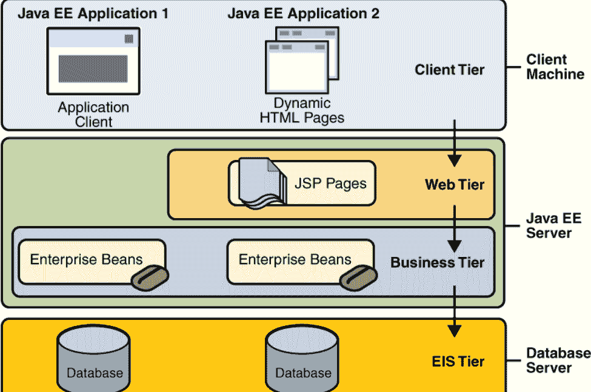
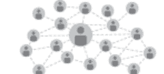
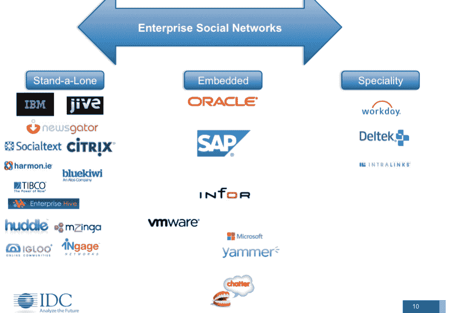
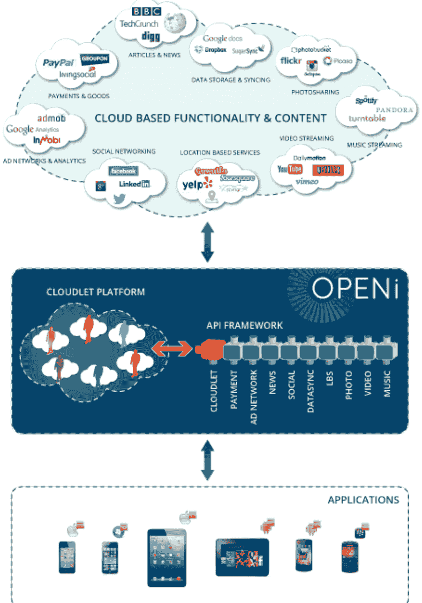

# Agorava 企业级 2.0：Java 平台的社交框架

任何开放社会的基石由两件事组成——言论自由和法治。如果你没有这些东西，你就没有一个自由的国家。—— 萨尔曼·鲁迪爵士

言论自由在受到纯真意图启发时，是开放背后的决定力量。这种强大的力量现在为社交媒体插上了新的翅膀。社交媒体为我们这个分歧的小星球上那些被忽视的人发出了声音，我们才开始看到它能做什么——无论是在基辅、莫斯科、费格森、巴尔的摩、突尼斯、开罗、伊斯坦布尔、利雅德、德黑还是加沙。如果你认为这些权力殿堂的人不会爱上抑制、颠覆和滥用这种基层力量，那你就是在自欺欺人。你不需要到处寻找，就能找到名为《公民四》的真实纪录片的证据，以及一个谦弱的年轻人爱德华·斯诺登。

对社交媒体开放性构成严重风险的众多因素之一是其高度的专有性质。否认社交媒体领域几乎几乎没有开放的技术标准将是令人震惊的。这种豁免和极快的创新速度有一些合理的理由。但对于为了使社交媒体变现而进行的这种激烈竞争以及由此导致的对开放性合作兴趣的缺乏，并没有很好的理由。

希望随着社交媒体行业稍微标准化并为标准化做好充分准备，情况将会发生变化。在此期间，像 Agora 这样的社区项目发挥着非常重要的作用。在缺乏任何真实商店的情况下，Agora 可以通过通用接口为当今不同的社交媒体 API 提供某种程度的互操作性——至少对于 Java 和 Java EE 开发者而言。该项目本身对 Java EE 生态系统也意义重大。它直观展示了 CDI 扩展如何在需要并在 Java EE 平台稳定核心的基础上进行有效构建，同时尽可能地遵守互操作性和厂商中立的原则。

这本书对于该项目至关重要。它提供了社交媒体行业丰富的背景，解释了 Java 社交媒体开发者的核心概念，描述了迄为止在标准化方面的努力，涵盖了其他社交媒体项目，分享了该项目的动机，并提供了 Agorava API 的技术概述和深度解析。鉴于该主题的波动性、深度和复杂性，这本书的编写无疑非常困难。

此外，我找不到比 Werner 更适合写这本书的人了。多年来，他证明了自己对开放、标准化、Java 和 Java EE 的个人承诺，以及对社交媒体行业和 Agorava 的清晰掌握。

Reza Rahman

Java EE Guardians 创始人，前 Oracle Java EE 传教士 @ Oracle

## 古代史

大多数人认为社交媒体是 Yahoo!、Google、MySpace、Facebook 和 Twitter 等公司的现代发明。事实上，社交媒体的历史可以追溯到数千年前。

对某些人来说，邮政是最早的社交媒体形式之一。从古代波斯邮政到希腊集市 [1] 和罗马广场 [2]，邮政一直作为社交和政治讨论的媒介。最早记录的等同于 Wiki 或“论坛帖子”的内容实际上直接刻在罗马广场的墙壁上 [3] 记录了如维苏威火山摧毁庞贝或尼禄皇帝时期罗马部分地区等事件。

雅典的古集市曾是民主的孵化器，是社交和政治辩论的首选场所。直到今天，这种运作方式与论坛转变为数字化非常相似。从突尼斯到乌克兰，反对运动利用社交媒体将民主带到那些长期以来一直感到惊讶且不寻常的地方。[4]

## 现代史

1975 年，在美军撤出越南不久，自由意志主义者萨缪尔·康金三世引入了一种名为“Agora”的哲学，这是一种反经济学的社会哲学以及与该实践相关的思想 [5]。在市场无政府主义社会中，法律和安全将由市场参与者而非政治机构提供。Agora主义意识到这种情况无法通过政治改革来实现。相反，它将作为市场过程的结果产生。它的社会价值观今天可以在占领运动中找到，其主要目标是让所有社会的经济和政治关系去阶级化并更加扁平。或者出现在抗议党中，如意大利的 Beppe Grillo、希腊的 Syria（它甚至执过政）、西班牙的 Podemos 或海盗党。

1966 年，电子邮件被发明，随后 CompuServe 在 1969 年出现。CompuServe 在 80 年代推出了其电子邮件服务并在 90 年初进行扩张，在经历多次收购后，于 2009 年最终解散了原始的 CompuServe。

Usenet 起于 1979 年，为用户提供论坛和新闻组。惊讶的是，它们的大部分功能几乎没有变化，并且仍然存在。

网络中继聊天（IRC）始于 1988 年，在学术网络中广泛使用，随后进入了现在被称为互联网。IRC 在今天仍然相当活跃，尽管它主要在

# 引言

尽管被 Twitter 等即时消息服务掩盖，全球范围内仍有 3200 个 IRC 服务器，提供数十万个通道。

基于“六度人脉”理论 [6] 的概念，首个现代社交网络 sixdegrees.com 成立于 1997 年。它允许成员将其他成员链接为好友、编写消息或在公告板上发布内容。在出售给另一公司后，它于 2001 年关闭，当时约有一百万用户。当 Amazon、Yahoo! 和 1998 年的 Google 最初出现时，它们并不被视为社交网络。

1995 年，微软通过推出微软网络（MSN）捕捉到了新兴趋势。MSN 成为一个“门户网站”而闻名，这是个性化在线商务的另一种说法。几年后，许多门户产品、服务和供应商也加入了社交浪潮，这并不意外。

微软和雅虎在社交媒体这群“新秀”面前都落后了，与 YouTube 的合作是一次相当明智且快速的举措；社交媒体大多数其他方面也都被 Google 低估了，它通过 Google+ 回归，并确实在观察是否能主导每一个方面。雅虎也提供了大量的社交功能，并在近期的复苏中，它在网络领域超过了如 Flickr 或 Tumblr 等较小的供应商。1993 年，Brad Fitzpatrick 现也工作于 Google Livejournal。

在 21 世纪初，MySpace 和 LinkedIn 出现（尽管多年后它们的地位已大不相同）；到该世纪十年代中期，当当今巨头 Twitter 或 Facebook 成立时，Google 已经收购了 YouTube。在过去的几年里，我们看到了几次接管，最引人注目的是 Facebook 以近十亿美元的价格收购了 Instagram，以及其对移动消息提供商 WhatsApp 的巨额收购报价。

社交网络一直存在，从人类首次开始通信以来就是技术手段随着时间的推移而变化，在不久的将来可能会变化得更快。某些服务将被合并；其他服务可能会变得过时并早晚消失。使用厂商中立的标准和框架至关重要，因为这不会让你被束缚在单一提供者的产品中，除非你愿意花费更多时间在快速变化的 API 上，而不是将它们用于某些生产性工作。更糟糕的是，当特定供应商提供的私有 API 和框架不再可用时，你不得不切换到另一个提供者。虽然它不是 Twitter 或 Facebook 意义上的社交网络，但最近关闭的比特币交易网站 Mt.Gox [7] 是这种困境的绝佳例子。它在很一段时间内一直是该领域的领导者，提供比特币的应用程序和电子商务解决方案可能直接使用了它的 API，现在却被迫抛弃这些应用并重写它们。

如果在此类 API 之上创建一个厂商中立的抽象层，那么处理由于供应商破产或被他人收购引起的问题和变化将容易得多。

这就是 Agora 发挥用场的地方。

# 标准化

## 早期方法

我们在引言中遇到的理论，如“六度人脉”[6]，影响了后来的概念，如“朋中之友”（FOAF）[8]。这两者的方面在当今社交网络使用的大多数“朋友”机制中都能找到。

富源内容摘要（RSS）[9] 是社交媒体数字形式的早期示例。在参与 RSS 设计和标准化的开发者中，Aaron Swartz 在 2013 年初不幸去世前，曾编写过一本名为《可编程 Web》[10] 的书，这是该领域非常非常务实、机明的学术论文。

便携式联系人（Portable Contacts）由 Plaxo 创建，这是一种社交地址录服务，由 Sean Parker 为核心的一群企业家于 2002 年创立。在它的 Napster 媒体交换门户被强制关闭后，Parker 陷入了法律麻烦，导致大家无法联系到 Aaron Swartz，但幸运的是，如今的多个社交媒体知名品牌不得不以不同的方式来应对这一点。便携式地址录或“数字名片”的概念被整合得很好，特别是从用户的角度来看非常有意义，但竞争对手的商业利益——他们每一个人都贪于分享数据，甚至不与创建它的人分享数据——为这个本意良好的主意设置了重重障碍。尽管 Plaxo 在多年后仍在运营，但它并不一定是他最成功的作品，投资者以某种方式将他踢出去，这与 Facebook 介入时联合创始人 Eduardo Verin 所遭遇的情况并不相似。在财务上，这让他变得富有，并排在了其他服务之后——Spotify。似乎并不巧合，它看起来非常像 Napster，但是以更受市场接受的方式呈现，这也得益于他在 Facebook 之后的名声和财富。便携式联系人曾是社交媒体运动的重要组成部分，但不再被使用。这是因为大型公司内部使用的 API 已不再与便携式联系人兼容。唯一仍在在使用的是 vCard，它被许多公司和应用程序使用。

## 混合（Mashup）

Java 语言发挥了越来越重要的作用，首先是在桌面端（早期主要是 Java Applets，或 AWT/Swing 独立应用程序），然后在世纪交替之际也出现在服务器端，Sun 及其其他公司（其中至少 HP 和 IBM 仍在活跃，而 Sun 现在已成为 Oracle 的一部分）开始在所谓的 Java 社区进程（成立于 1998 年）或 JCP 中对 Java 平台的部分部分进行标准化。

# 标准化

在被拒绝或撤回通知后，社交网络（当时常被称为“门户”，早期 MSN 如此称）的显著标准是 JSR 168 Java 门户规范 [11]。在理想的世界中，它允许门户应用程序部署到多个门户服务器中，无论供应商是哪个；通过其他标准，由 OASIS 定义的 WSRP（远程小部件 Web 服务）为这些应用程序之间的操作性带来了希望。10 年后，随着其他技术和语言（特别是“轻量级容器”）的兴起，Java 门户标准即将获得 3.0 版本更新（JSR 362），计划纳入一些后来的标准。

虽然看起来更易用，漏洞和安全问题也随之而来，通常由“脚本小子”或在学校里要要的学生演示如何破坏或入侵这些服务。全面的 Java 企业级应用和小部件仍然很难被攻破，如果系统管理员做好了功课，所有关于 Java 安全或其被用于传输恶意软件的传言通常影响的是客户端。

在大多数 OpenSocial 代码运行的地方，它比大多数运行在服务器端或精心混合的服务器端（Java EE 或其他环境）与客户端层（JavaScript）的代码更易暴露，参见图 N——不同类型 Web 端企业应用程序的分层架构。Java EE，但它可能会被 Python、PHP、Ruby 或 Scala 等语言取代，而层结构是相同的。

虽然 Google 开始在其 Orkut 服务中使用 OpenSocial（在拉丁美洲和印度等其他几个国家流行），但最初计划支持它的其他供应商相继放弃了这些计划。LinkedIn 和 XING 特别是出于安全原因这样做的。关于 XING，我们稍后的安全和隐私部分也会有更多内容，后者也是如此。不是 Facebook 或 Twitter，这两个是上个十年后半叶统治者。

# 标准化

你是否曾关注过 OpenSocial？更重要的是，当情况显而易见时，Google 杀了自己的产物。Google+ 也永远不会支持它。少数主要来自服务器和大型企业部门的供应商（如 IBM、SAP 或 Confluence 的作者 Atlassian）仍然支持 OpenSocial。



[[#_Ref363567312_anchor][#_Ref363567178_anchor]]图 1 – N 层企业级应用

最近被 Sprinklr 收购的 Dachs Group 是社交媒体和企业数据分析的“智库”，也深度参与其中，尽管它的重点更多地转向大数据和 NoSQL 系统。它公开承认，与剩下的 OpenSocial 支持者（或在 ThoughtWorks 定期技术“雷达”调查中关于值得关注或实现的关注关注者）一样，它是未来成为企业和内网的唯一场所。数据可以被视为一种聚合（Mashup），但它主要承担 EIS 或 DB 层的功能（见图 1），因此我在此不再过多讨论。这些技术也值得专门写本书，并且超出了本书的范畴 ;-)

与其将 Google、Facebook、Twitter、LinkedIn、Microsoft 或 Yahoo! 进行无缝聚合，OpenSocial 现在唯一的价值在于将人力资源、销售或会计部门相互连接，并为管理层提供一个大型企业所有部门和子公司的精巧“社交”聚合。这使得对于那些希望在 Twitter Feed 流旁边旁边看到 Facebook 时间线的人来说，它在实际上毫无用处。而这并不是 OpenSocial 最初设计的初衷。

OpenSocial 故事的最新转折是尝试创建一个基于 OpenSocial 的 W3C 标准。

在语义网案例中，这是一条艰难且艰棘的道路，但在这里似乎几乎是不可能的；特别是考虑到我们之前发现的大多数参与者更倾向于自己的“围墙花园”[14]。

虽然 W3C 定义了一个名为“语义网”的有趣标准，它听起来与 OpenSocial 的某些想法具有协同效应，但语义网到目前仅用于生物学或医疗保健等少数孤立领域。

W3C 的工作进度非常缓慢，类似于（甚至慢于）HTML5，例如始于 2008 年的 HTML5。今天它仍处于候选状态（尽管许多供应商已经提出了基于此的解决方案和产品）。预计在 2014 年底给出最终建议，两年之后进行进一步的更新和改进，以此此类推。这将使得这种方式标准化的东西出现之前会有超过十年的时间。

## 标准类型

除了对 OpenSocial [15] 这种“基础标准”的游说外，图 2 提供了 Dachis Group 在系列文章 [16] 中对社交标准的详尽概述。

## 社交业务标准中还缺少了什么？

### 高级标准

- 用于……的通用货币：

  社交参与

  - 点赞

  - 转发

  - 评论

  - 贴子

  - 等

- 用于……的数据跟踪模型：

  社交行为

  - 浏览

  - 参与

  - 推荐

  - 活动

  - 等

- 针对……的领域特定衡量：

  社交指标

  - 净推荐值 (NPS)

  - 社交业务指数

  - 客户满意度 (OSAT)

  - 客户留存率 (LTR)

### 基础标准

（正式和临时的）




- 社交身份/图谱

  - LDAP/活动目录

  - Facebook Graph API

  - Twitter 朋友/关注者 API

  - 可移植联系人

  - Google Contacts API

- 社交活动

  - 活动流

  - RSS

  - ATOM

  - Pubsubhubbub

  - Salmon

  - OSStatus

- 社交整合

  - OpenSocial

  - Open Graph

  - OAuth/xAuth

- 安全/隐私/策略

  - SAML

  - OpenID

  - OAuth

  - P2P

  - DNT


> socialbusinessbydesign.com 的持续讨论

> 图设计：Dion Hincliffe & Bill Keaggy

图 2 – 社交业务标准中缺少了什么？

主要有两个类别：

- 1. 高级标准：面向行为和领域驱动的业务导向标准和 API。[16] 的作者并未详细说明大部分内容。

- 2. 基础标准：之前提到了一些，这里将其分为 4 个子类：

  - a. 联系人

  - b. 活动/消息

  - c. 整合/互操作性

  - d. 安全

你可以观察社交标准、框架和库的通信方式。通过以下方式：

- 消费信息

- 分析信息

- 转换信息

- 提供示例信息

消费信息的典型示例是在另一个应用程序（例如，你的博客或公司网站）中显示你喜爱的社交网络中的状态。

另一个是包含一个地图服务，以显示你举办或参加的活动的路线图。

分析信息涉及某种计算、排名或基准测试。通常会消耗超过一个来源的信息，以便你可以获得更全面的视图。此类服务的示例是 Klout。跨社交网络的活动会影响你的整体排名。

转换信息可以通过合并和整合多个数据流来实现，或者根据汇率进行。像 Google Translate 这样的服务是转换信息的另一个示例。

最后，提供信息是指任何服务，理想情况下是通过 API 让其他用户消费、分析或转换内容。

根据 IDC [图 3]，查看社交网络标准、产品的另一种方式是：

- 具有社交属性的独立产品或服务，可以单独安装和使用。由于其性质，采用 OpenSocial 的某些目标是与其他具有互操作性。

- 嵌入在大型产品或套件中的社交事实或功能。经典示例是包含社交功能的 Oracle Fusion Middleware [13] 或其他特定的。

# 标准化



图 3 – 企业社交的分类

OPENI（一个由欧盟资助的社交研究小组）[17] 尝试以某种上下文的方式分类标准和 API：

- 广告和分析 API：通过收集、聚合和分析用户的需求、兴趣和偏好，基于他们与广告/应用程序行为数据的交互

- 位置 API：通过签到、路线、评论和提示实现位置感知。这是一个关于位置的强 API，可以由 GPS 传感器提取并映射到地图上。相关类别：地图、位置服务。

- 媒体 API：将照片、音乐和视频共享服务与文件传输和同步功能相结合。它与相册应用程序和设备的文件系统相关。相关类别：文件传输与同步、位置服务。

- 产品和服务 API：涵盖支付和购物服务。这种商业化相关的特殊对象需要具有事务能力的强 API 以及更高的安全性。它与手机商店应用程序相关。相关类别：位置服务、支付、购物。

- 配置 API：根据分析、联系人、游戏、健康、位置服务、消息与聊天、音乐、社交等服务提取人的信息。通常，人们可以用多种方式表示，拥有多个配置文件。该 API 汇总了所有信息：头像、配置文件、联系人和账户，关联不同服务中的配置。它与智能手机日程应用程序直接相关。


虽然 OpenNI 没有在 GitHub 上发布任何他们的 API（正如其网站在 2013 年承诺的那样 ;-)），但它的工作引起了例如 W3C OpenSocial [15] 的关注。因此，即使没有它自己的 API，OpenNI 及其概念在某些方面也有帮助。我们在查看 1.4.2 Apache Shindig 时更详细地介绍 OpenSocial。

# 标准化



标准化

图 4 - OPENii 概念

除了上述对社交媒体标准进行剖析和分类外，这些是 API 及相关标准具有的三个最重要的共同点：

- 几乎所有的社交媒体服务都使用 REST 作为传输协议

- 它们大部分以 JSON 格式传输数据，部分使用 XML 或其他格式

- 身份识别与验证几乎总是基于 OAuth 协议

你会发现图 2 中缺失了像 REST、XML 或 JSON 这样“琐碎”的基础标准，因为 [16] 的作者认为这些内容现在应该已经被掌握。基于此，我也认为读者对这些内容已经很熟悉。

我们将在第 2 章中详细探讨安全、授权、身份验证或数字身份，以及隐私或数据保护等方面。在学习 Agorava 之前，让我们先来看看相关的社交媒体 API 和框架。

## Java 社交

遵循 Portlet API 或 Java Enterprise 的各个部分等 Java 标准，有几个用于社交媒体的 Java 框架和库。

1. 1. 1.

2.

### Twitter4j

Twitter4j 是一个用于 Twitter API 的非官方 Java 库。通过 Twitter4j，你可以轻松地在 Java 应用中集成 Twitter 调用。

其作者 Yuki Yamamoto 在 2012 年将其用于 Twitter。在使用期间，他曾被简要提到社交 JSR 专家小组代表 Twitter。更多内容将在稍后介绍……

它非常轻量级，大部分与 Java 1.4 向后兼容，使其也易于集成到移动应用中。这并不意外，从 JME 到 Android 的任何地方都能找到受其启发的分支或项目，尽管它们的正式程度各不相同。Twitter4j 是一个 API 绑定库，主要用于消费信息。虽然扩展或你的应用程序可以对其进行分析或转换，但该框架在 Twitter 之外不提供额外支持。根据 Hinchcliffe 的分类，Twitter4j 可能被视为基础 API，但具有某些高阶特性。

在编写本文时，官方的 Twitter4j 网站 (twitter4j.org) 由于维护停机或容量问题暂时无法处理请求。无论这是否意味着作者和贡献者缺乏维护，我指向 GitHub 项目页面 [18]，Twitter 本身不应竞争或强制 GitHub 拒绝。最后更新是在一个月前，其他一些模块在过去 3-8 个月内更新过，因此它可能活跃度不高，但至少看起来维护良好。

### Apache Shind

**Apache Shindid** [19] 在 OpenSocial [15] 计划开始后不久便启动了。由于明显的原因，主要由 Google 及其 Orkut 驱动，其他贡献者特别是 IBM 后加入。由于 OpenSocial 转向“社交内网”，没有任何声称使用它的网站或软件是确切地做到了这一点。事实上，Google Partuza 指向了一个不存在的页面，因此它像我们听过的其他项目一样被关闭了。

LinkedIn 和大多数其他社交媒体提供商也逐渐或完全地从其网站中放弃了 OpenSocial。

Google 开发 OpenSocial 应用的一种有趣方法是使用 Eclipse IDE OpenSocial 开发 (OSDE) [20] 的 WYSIWYG 环境。可以假设部分内容已由 IBM 接管并集成到 RAD 等基于 Eclipse 的社交版开发工具中，而 Google Code 项目最后更新是在 2010 年 6 月。

Apache 指出的 OpenSocial 规范似乎不再由 OpenSocial 支持者 Atlassian 托管，链接指向一个错误页面。这究竟意味着 Atlassian 不相信 OpenSocial 并不会在在其产品的后续版本中使用它，还是仅仅是一个在 W3C 上复兴整个 OpenSocial 运动的过程？在此，所有版本的 OpenSocial（特别是 1.0 或 2.0）都是失败的，像 Orkut 这样的网站最多使用了 0.7 或 0.8 版本。

根据支持 OpenSocial 的 Dachis Group [16] 的说法，Shindid 作为体现代表了基础标准 (2c)。它具有**提供**和**消费信息的手段。

2014 年 9 月 30 日，Google **关闭了** Orkut，使 Google+ 成为唯一的 Google 参考。

当然，Google 已经停止使用 Shindid，转而使用其自己的 Google Code 项目。其中大部分项目也已关闭，要么指向 OpenSocial 页面，要么已不存在。一年后，2015 年 10 月 23 日，Apache 基金会**退役了** Shindid 项目。OpenSocial 是否会步其后尘仍待观察，作为 OpenSocial 的事实性参考实现，这看起来确实是其棺材上的又一个大钉子。

## Sun/Oracle 的努力

2008 年左右，Enterprise Social 推出时，驱动 BEA Systems [13] 刚被 Oracle 收购，Java 的创造者 Sun Microsystems 没有给出完全相似的面貌，类似的情况也即将临头。基于 OpenSocial，Sun 从 Apache Shindid 派生出了名为 **SocialSite** [21] 的分支或项目。

SocialSite 在 Java.net 上仍有 231 名成员，但该项目处于**非活跃状态**。其中一次提交来自 Kohsuke Kawaguchi，他是 Sun 的 Hudson 创建者（后由 CloudBees 维护）。在收购 RightNow Technologies 后（见 2011 年底的 [23]）。

# 标准化

原 RightNow 团队被并入 Oracle 社交部门。JavaOne 2012 举办了一场我参加的社交日，当时 Facebook 的开发者经理 James Pearce 也出席。Oracle 本身展示了一个由自由承包商编写的“单人”项目，代号为 "Project Sneaker"，该项目在 JavaOne 2012 之后作为 Oracle Social 发布在 Java.net [24]。它从未吸引 Oracle 之外的追随者，被认为比 SocialSite 更死。

### DaliCore

在 Oracle 接手 Sun 后，被弃的 SocialSite 在 DaliCore [22] 中找到了它的对等物和继者。

它最初基于一家比利时初创公司制作的 CMS，主要是 BeUG (DevXX) 的成员如 Johan Vos。DaliCMS (2006) 被称为“Web 2.0 CMS”，是一个具有社区功能的开源项目。2008 年，在 Sun 对 SocialSite 做类似的事情的同时，CMS 与 Shindig 集成。DaliCMS 使用了来自 Shindig 的 JavaScript 代码和 Java 代码。

最终它变成不仅仅是一个 CMS，其底层模块转变为 DaliCore。在 JavaOne 2013 的演讲中，他揭晓了“Dali”部分，该项目最初代表的是“荷兰爱好者计划”（Dutch Lovers Initiative）。这是对互联网和云先驱 Amazon 的致敬。

DaliCore 在 Java EE 6 之上增加了用户管理、内容或权限的功能。重点关注用户和权限。在几乎每个使用 DaliCore 的项目中，用户都应该能够使用凭据（Facebook、Twitter、Google、LinkedIn...）登录。因此 Dali 模块扩展了 DaliCore。虽然与 Facebook 等社交供应商有某些连接，但它们主要作为 DaliCore SSO（单点登录）功能的身份提供者。此外，DaliCore 旨在提供信息。

DaliCore 的重要方面：

- 大多数带有社交功能的社交容器和 CMS

- 支持 EJB、IPA 或类似的 Java 持久化

- 模块没有分离，特别是 API/规范与实现，大多数情况下共享同一个模块甚至相同的包空间。这使得复用和扩展变得困难，尽管通过 Dali 模块尝试这样做。

- 目前显得有些沉，对全 Java EE 栈有强依赖，即目前仅使用其 Web Profile 似乎可行

- 在 GlassFish 作为首选应用程序服务器的情况下，支持和集成是积极的。对于 Java EE 标准是不可能的，但在其他容器中使用可能更困难。

# 标准化

- 它证明了在某些客户高强度使用情况下的可扩展性，例如比利时的一个电子投票网站 Apache Shindir 或 Sun SocialSite（在大多数情况下，DaliCore 似乎是其自然的继任者），目前至少在比荷卢国家（Benux countries）被实际客户使用。

在 Oracle 宣布后，它将不再为 GlassFish 提供商业支持或增强功能，例如集群（除了由 Java EE 实现提供的 POC 质量外，它将保留）、性能调优，这也是 DaliCore 的一个主要论点。Oracle 推荐其 WebLogic/Fusion Middleware 产品，而当前的 GlassFish 用户如果需要商业支持，将被迫迁移到其他平台。

DaliCore 的作者 Johan Vos 和他的比利时初创公司声称，他们将为客户提供商业支持，甚至可能倾向于扩展，但 DaliCore 已成为此事的牺牲品。自 2013 年初以来，java.net 仓库就没有活动了，因此在许多情况下，它可能无法与领先的社交提供者的 API 兼容。托管网站可能不那么关键，但对于那些想要规划不仅仅是一个小型私人博客的人来说，他们可能倾向于寻找其他地方。

虽然 Johan Vos 最近告诉我们他仍在致力于此，并确认这现在已移至 BitBucket 的私有仓库中。因此，他的声明可以通过这种方式得到验证，但 DaliCore 不再被视为“开源”。至少源代码是不可访问的，因此客户受命于 Johan 的公司。这种风险在本文的大多数示例中并不存在，即使这些示例仅由一个人或一家公司维护。Johan 公司的网站 LodQN 目前似乎在底层使用了 DaliCMS，但它没有提到 DaliCore，也没有暗示它可能再次变为开源。

### Spring Social

SpringSource 最近由其母公司 Pivotal 重新命名，它长期以来一直热于追逐趋势，并为几乎所有领域提供针对 Spring Framework 的库或扩展。

Spring Social [25] 是一个用于消费信息的绑定库。尽管将 OAuth 集成到 Spring Security 及其他部分是基础级 API（Basic API）的特征，但它展示了许多作为高阶 API（Higher-Order API）的方面，而且支持良好，但 Pivotal 员工在更改或在会议上宣布功能后 6 到 9 个月或更久之后才会发布更新或博客文章。这不是向社区传达的最强信号，但 Spring Social 可以被认为相当成熟。有证据表明某些产品或解决方案中已存在商业采用，但供应商也担心 VMware 会放弃它转而支持其大系统中更具战略意义的部分。

像 GitHub 这样的开源生态系统展示了各种扩展或插件，但并非所有的都实现了足够实用的社交网络或 API。某些仅仅是概念验证（PoC），而且大多数已经很长时间没有活跃维护。

Spring Social 的重要方面包括：

- 出于明显的原因，它主要与 Spring Framework 或 Spring 生态的其他部分一起工作

- Spring MVC 之外的 UI 框架相对难以集成

- 官方 Spring Social 连接主要关注 Facebook，到目前为止示例仅显示了单服务方法。没有对多个服务或提供者的直接支持。

- 尽管 Spring 社区一直活跃，即使在 Pivotal/VMware 内部，对其支持和活动也存在怀疑，特别是在一些人离开两家公司之后。这得到了高级架构师的确认，他们表示重心在其他地方，尽管没有完全放弃的计划。

- 然而，事实是，Spring Social 最活跃的评论者和推动者之一受雇于单一公司。

Spring Social 目前也支持 .NET。我无法说任何代码是否具有迁移性，但那些需要支持多个平台的人可能会喜欢 Java 和 .NET 通用的 API。事实上，Pivotal 最近（2015 年第一季度）宣布它将停止对更大的开源项目（如流行的 Groovy / Grails 生态系统的商业支持。没有证据表明 Pivotal 计划将其进一步资源投入到像 Spring Social 这样小得多的“鱼类”。

### Seam Social

Seam Social 是 JBoss Seam 3 项目的一部分，在 CDI [28] 等 Java 标准之上提供社交连接功能。Seam Social 是一个消费信息的绑定库。虽然建立在 CDI 和 Java 事件之上的 OAuth 可以被视为基础级 API，但 Seam Social 通过为 Seam 行为提供 CDI 事件（如点赞、发布到用户时间轴的签到），成为了最丰富的高阶 API。在大多数情况下，常见的 API 绑定由提供者的 API 定义或直接从其生成的决定，这些灵感源于 Spring Social，但 Seam 从未是 Spring 的克隆或分支，它与 Spring 的关系就像 CDI 之于 Spring Framework 的扩展。

2012 年初，Seam 停止与 Apache DeltaSpike 合并。这导致了 Seam Social 走向未来……变成了 Agora [26]。

### JSR 357

在 JavaOne 2011 和之后如安特卫普的 DevOps 等会议期间，我与 CDI 规范负责人 Peter Muir、Twitterj 的 Yusuke Yamamoto 或 Seam Social 创始人 Antoine Sabot-Durand 发起了一系列讨论，以探索 Java 社区进程（JCP）中 Java 平台社交媒体 API 的标准化。

他们认为这是一个值得追求的想法。虽然其他 API 和项目（如 DaliCore）被认为可能与 Java EE 下的信息提供提供相关，但对 CDI 的强使用以及 API 与实现之间良好的结构分离使得 Seam Social 成为初始代码库的最佳候选。

# 标准化

该 JSR 由我和 Antoine 作为共同规范负责人（Specs Leads）提出，并有 Red Hat/JBoss、eXO Platform 或 Twitter（由 Yusuke Yamamoto 代表）等公司，以及 JSR Chennai、来自比利时的 DaliCore 或 Java EE 7 EG 成员以及 Oracle ACE 主管 Markus Eisele（现在在 Red Hat 工作，让 Antoine 吧）加入。可以说，这是企业、个人和 Java 用户小组（JUGs）的健康混合。

然而，在 IBM 首次提出 JSR 后，其他成员如 SAP 也加入了，一个 JUG（SouJava）投了赞成票，另一个（LJ）投了反对，战斗以 8 比 5 结束，停止了 JSR 357 的创建。遗憾的是，尽管我们早些听到大供应商倾向于“围墙花园”[14] 而非开放标准，但这并不完全意外，甚至利益相关方 EG 成员候选 Twitter 也缺席了。并不是反对，但由于 3 票之差，也没有投票。[26] 是关于该主题的文章。

IBM 认为，正如其某些支持者如 Adjuvi 的 Hinchcliffe [16] 所解释的（尽管晚了一点），OpenSocial 是 JSR357 主要目标的基础标准，后者的目标是为 Java 平台提供高阶 API 和绑定。以 WebSockets 为例，它在 JSR 355 中具有协同潜力。与 OpenSocial 类似的 W3C 标准希望通过定义为 HTML5 伞形的一部分来确保这些计划成功，而 Oracle 则创建一个 Java 实现。即使在 Java 平台上，已经存在且被广泛采用的 WebSockets 开源项目，尽管如此，它也被认为值得拥有一个 JSR。对于 JSON ，可能更显著的是事实上的 Reference JSON “父亲” Douglas Crockford 启发了 JSON JSR，但 Crockford 最初在去年的荷兰移动会议上对我个人说“支持这个 JSR”时，他不再打算参与。并且从未停止支持和推广他围绕其自己的库。

事实上，在 JSR 357 被投票否决的那周，第一批反对 IBM 的数百人将数以千计的社交媒体软件专利给了 Facebook，这看起来并不难看。这也让 IBM 自己对 OpenSocial 的支持变得可疑，如果社交媒体专利和专有技术被卖给 Facebook，以增强其对抗 Twitter 等其他竞争者的军库。这可能是 Twitter| Yusuke Yamamoto 在一段时间后离开 Twitter 的原因之一。无论在投票的最后一刻是否有“情绪波动”。也许是种巧合，但像 IBM 或 SAP 这样的 EC 成员不希望 Red Hat 在包括 Hibernate、CDI/Seam 或 Arquillian 在内的几个关键开源项目中担任影响力的角色，这可能是另一个原因。特别是对于这一点，我想如果这是许多意图之一，它适得其反，导致了 Agora 的创建和活跃开发，这不仅仅由一家公司（如 DaliCore 或 Social Link），而是来自世界各地的各种贡献者，其中大多数人都是 EG 成员。

杀掉 Java 社交“王位”的继承者，特别是通过法国式的划分，可能会引发一场名为 Agora 的 Java 框架“法国大革命”。

## 社会安全

## 授权

授权（Authorization），也称为访问控制，是管理对资源访问的过程。换句话说，就是控制应用程序中谁可以访问什么内容。

更正式地说，授权是定义一种访问策略。授权的示例包括：用户是否被允许查看此网页、读取或编辑此信息、查看此表单，或使用这台打印机？这些都是决定用户可以访问什么内容的决策。

### 1.1. Java 授权


Java 拥有一种安全架构，可以保护系统免受移动/动态或静态代码的未经授权访问。问题在于如何确定执行库或应用程序所需的安全访问权限集。常用的策略是执行代码、记录授权失败、分配额外的访问权限并再次测试。这个过程会不断迭代，直到代码在使用的用例中成功运行。这些用例并不总是能覆盖代码中的所有路径，因此在部署的系统中可能会发生失败。另一方面，可能允许代码拥有广泛的访问权限，以防止授权失败的发生。然而，这通常会导致违反**最小权限**设计原则 [27]。

最小权限原则代表了向特定信息和工具授予访问权限的极简方法。此外，访问权限应该是基于时间的，以将对资源的访问限制在完成必要任务所需的时间。超出此范围的授权授予将导致不必要的访问，并可能导致数据在批准的上下文之外被更新。权限的分配将限制用户（无论是故意还是无意）对系统的破坏。

基础 SE 安全依赖于权限，例如`FilePermission`用于访问文件系统，或`AWTPermission`用于在 AWT/Swing 应用中使用剪贴板等资源。

如果有人想为特定应用程序允许新类型的权限，可以通过在策略文件中添加条目来实现。

一个允许来自 "http://mysocialtv.com/" 的代码查看 Sky Sports 3 权限的策略文件示例如下：

```java
grant codeBase "http://mytvstation.com/" {
  permission com.sky.TVPermission "sky-sports-3", "watch";
}
```

## Java 企业版

Java EE 的安全性基于一些核心术语：

- 用户（User）是在身份存储器中定义的身份。该存储器可以是数据库、扁平文件或 LDAP 服务器。
- 组（Group）是具有相同需求或访问级别的用户集。
- 安全域（Security Realm）是应用程序服务器获取用户和组信息的访问通道。
- 角色（Role）是 Java EE 中访问级别的概念。Java EE 开发者指定哪些角色可以访问一组应用程序功能。这些角色随后通过特定厂商的配置数据映射到用户和组。
- 主体（Principal）是具有已知凭据的身份，可以使用身份验证协议进行验证。
- 凭据（Credential）包含或引用用于身份验证 Java EE 应用主体的信息。例如，通过输入密码或调用外部服务。更多请参见“2.2 身份验证”。

Agora 正在争夺 CDI，CDI 是一种 Java 标准，称为“上下文和依赖注入”（Context and Dependency Injection），与从 6 版本开始的 Java EE 的其他部分类似。我们认为读者对 CDI 标准相当熟悉，如果你需要学习它，请参阅 [28]。

你可能从第 1.3 章记得，几乎每个社交服务或类似的 API 都使用 RESTful Web 服务。REST 代表“表述状态转换”（Representational State Transfer）。JAX-RS 是用于 RESTful Web 服务的 Java API（当前版本为 2 或 JSR 339）。

这里有一个简单的示例，展示了如何通过使用`@Context`注解注入 JAX-RS `SecurityContext`实例来实现授权。注入的安全上下文运行在底层的`HttpServletRequest` API 之上。注入的安全上下文取决于实际的 JAX-RS 应用程序部署。

`SecurityContext`可以与子资源定位器（sub-resource locators）结合使用，根据用户主体所属的特定角色返回不同的资源。例如，如果用户是“优惠客户”，子资源定位器可以返回不同的资源。

```java
@Path("basket")
public ShoppingBasketResource get(@Context SecurityContext sc) {
    if (sc.isUserInRole("PreferredCustomer")) {
        return new PreferredCustomerShoppingBasketResource();
    } else {
        return new ShoppingBasketResource();
    }
}
```

### 使用 SecurityContext 进行资源选择

```java
@Path("resource")
@Singleton
public static class MyResource {
    // Jersey 将注入 Security Context 的代理
    @Context
    SecurityContext securityContext;

    @GET
    public String getUserPrincipal() {
        return securityContext.getUserPrincipal().getName();
    }
}
```

### 将 SecurityContext 注入单例资源中

当 JAX-RS 应用部署在 Servlet 容器中时，你可以依赖 Servlet 容器提供的标准 Java EE Web 应用程序安全性，并通过`web.xml`描述符进行配置。

通过在`web.xml`中定义`<security-constraint>`并分配能够访问这些资源的角色。你还可以定义允许执行的 HTTP 方法。查看以下示例：

```xml
<security-constraint>
  <web-resource-collection>
    <url-pattern>/rest/admin/*</url-pattern>
  </web-resource-collection>
  <auth-constraint>
    <role-name>admin</role-name>
  </auth-constraint>
</security-constraint>
<security-constraint>
  <web-resource-collection>
    <url-pattern>/rest/orders/*</url-pattern>
  </web-resource-collection>
  <auth-constraint>
    <role-name>customer</role-name>
  </auth-constraint>
</security-constraint>
<login-config>
  <auth-method>BASIC</auth-method>
  <realm-name>my-realm</realm-name>
</login-config>
```

## OAuth

**OAuth** 是一种授权协议，允许应用程序代表用户执行操作，而无需提供用户名或密码等登录凭据。它由 Twitter、Magnolia 开发，并在 2010 年 4 月注册为 IETF 标准（RFC 5849）。

OAuth 2.0 版本使用更简单，但通常因存在许多变而受到批评。OAuth 2 在 2012 年由 IETF 再次标准化（RFC 6749 和 6750）。它与 OAuth 1.0a 不兼容。一些著名的采用包括 Facebook、Amazon、Google、Salesforce.com 或 Microsoft。

所有相关的社交媒体 API 都基于 OAuth 1.0a 或 2.0。

图 5 显示了 OAuth 流的参与者，通常被称为“OAuth 舞蹈”。

- 资源所有（Resource Owner）
- 客户端（Client）
- 服务器（Server）

要使用 OAuth，必须在目标服务上创建一个应用程序，为消费者或资源所有提供入口。允许授权服务器在资源所有者批准的情况下，向第三方客户端授予访问令牌。然后客户端使用访问令牌访问托管在资源服务器上的受保护资源。

## 社会安全

OAuth “舞蹈”包含三个主要步骤：

- **创建**：在 OAuth 社交媒体服务中创建应用程序。
- **初始化**：权限授予阶段，也称为 OAuth 舞蹈。在舞蹈结束时，我们获得访问令牌（由公共和私有部分组成），用于下一步。
- **签名**：每个请求使用访问令牌和标识授予权利的 OAuth 应用程序令牌进行签名。

图 6 详细显示了 OAuth 1.0a 的步骤和身份验证流。

## 社会安全

图 7 - OAuth 2 “之舞”

图 7 展示了 OAuth 2 的流程。你可以看到通信已经变得简化，而且每次交换必须经过 SSL 加密。在 OAuth 1.0 中，这是可选的，因此大多数实现案例都忽略了它。相比之下，OAuth 2 面临着更大的被拦截或篡改的风险。

## 身份验证

“Authentication”（身份验证）一词也源自希腊语术语。它源自希腊语“aftentikos”，是名词“authentes”（执行者、主宰）的派生词，而该词由“autos”（自我）和词根 -hentes（执行者、存在者）组成。

虽然是社交媒体和 API 目前最流行的身份验证方式，但 OAuth 并非真正的身份验证，而是“伪身份验证”，应用程序专门请求一个限制的访问令牌（“管家钥匙”）而非真实的凭据（如“护照”），请参见图 8 和图 9。

### OpenID

OpenID 协议最初由 Brad Fitzpatrick 在 2005 年创建，在他将社交网络 LiveJournal 卖给这家博客公司之后。这个名字似乎与“Six Degrees of Separation”（六度隔阂）有六天的区别，但它最初代号为 Yadis（“另一种身份系统”的缩写），随后在 David Cohn 曾考虑过类似的单点登录项目后被正式命名为 OpenID，并捐赠了 "openid.net" [29]。

**使用 OAuth 的伪身份验证**

- 1. 你是谁。不要忘记你的电子邮箱！
- 2. 这是证书。请写一封信。
- 3. 你在这里

### 图 9 - OpenID 身份验证

图 10 展示了 OpenID 流程及其参与者

- 浏览器
- 用户
- 依赖方 (Relying Party)
- 身份提供者 (Identity Provider)

### 图 10 - OpenID 流程

尽管 OpenID 目前尚未由 IETF 标准化，但许多大型互联网和社交玩家如：AOL、Flickr、法国电信、Google、Ives、LiveJournal、Microsoft、Myspace、Novell、Orange、Sun、意大利电信、2、Universal Music Group、VerisSign 或 Yahoo! 都加入了 OpenID 基金会。然而，在过去的 3 年里，OpenID 的支持者持续下降。Facebook 离开了 OpenID，SourceForge 也停止提供 OpenID 登录，Janran 在 2013 年 9 月宣布其 MyOpenID.com 将于 2014 年 2 月 1 日关闭。

这意味着 OpenID 已经死了吗？至少 Google 对它还有希望。巧合的是，OpenID 的创始人 Brad Fitzpatrick 现在在 Google 工作，这可能是大多数支持者放弃它的主要原因。OpenID Connect 在 OAuth 2、JSON 和 RESTful Web 服务这一胜利组合之上增加了改进的身份验证和身份管理。

OpenID Connect 于 2014 年 2 月底发布。除了 Google、Microsoft、Salesforce 或德国电信已采用了它之外，GSMA 在 2014 年巴塞罗纳移动世界大会上宣布了移动版本“Mobile Connect”。这种“OAuth 风格”可能还会持续一段时间。

## 安全框架

除了 JAAS（Java 身份验证和授权服务）等基础技术外，还有几个基于 Java 的安全框架支持：

- Scribe
- PicketLink（由 JBoss 提供）
- Apache Shiro
- Spring Security（原名 Ace）
- Google OAuth for Java
- Socialauth
- JSR 375

### Scribe

Scribe 项目内置支持许多使用 OAuth 的流行服务，如 Facebook、Twitter 或 LinkedIn。它的外部依赖很少，允许无缝集成到更大更复杂的解决方案。在 Scribe 中调用 OAuth 提供者就像下面的单行代码一样简单：

```
OAuthService = new ServiceBuilder()
  .provider(LinkedInApi.class)
  .apiKey(YOUR_API_KEY)
  .apiSecret(YOUR_API_SECRET)
  .build();
```

在 Agora 0.6 版本之前，它是其功能的核心。从 Agora 0.7 开始，它被 PicketLink 取代。

### PicketLink

PicketLink 是 Red Hat/JBoss 生态系统中多个相关项目的伞。虽然 Agora 不是 Red Hat 官方创建的项目，但它是为了这个生态系统和标准创建的。PicketLink 是一个用于 Java EE 的应用程序安全框架。

以下是 PicketLink 解决的 8 个 Java 安全问题：

1. 为应用程序添加安全性的最佳方法是什么？
2. 我如何验证用户并授权用户？
3. 我如何控制对类和方法的访问？
4. 我如何为应用程序添加身份访问管理 (IAM)？
5. 我如何为我的 SaaS（软件服务）应用程序创建安全的多租户架构？
6. 我如何在应用程序中启用基于 SAML（安全断言语言）的单点登录？
7. 我如何为我的 REST 层添加身份验证和授权？
8. 我的应用程序如何使用用户的 Facebook、Twitter 或 Google 账户进行身份验证？

图 11 展示了 PicketLink 的概述、它支持的关键组件和技术。某些标记为“即将推出”的已经在开发中，但尚未随 PicketLink 的 GA（通用可用或“稳定”）版本发布。

| 模块 | |
| :--- | :--- |
| 基础模块 (Base Module) | 身份验证 API、权限 API、基于会话的身份、CDI 集成 |
| 联邦 (Federation) | IDM |
| SCIM | SAML v1.1, SAML 2.0, WS-Trust |
| OpenID | 用户、组和角色管理，凭据管理与验证 |
| 社会 (Social) | 社交网络（即将推出） |
| 身份存储库 (Identity Stores) | 支持 OAuth（即将推出） |
| 通用 (Common) | 通用工具类、日志记录 |

**图 11 - PicketLink 概述**

然而 Agora 使用了 PicketLink 的许多功能，如身份验证 API 或 CDI 集成。特定的 OAuth 和社交连接由 PicketLink 要素执行。这里是扩展`BaseAuthenticator`的示例：

```java
public class SimpleAuthenticator extends BaseAuthenticator {
  @Inject DefaultLoginCredentials credentials;
  @Override
  public void authenticate() {
    if ("agentsmith".equals(credentials.getUserId()) && "matrix123".equals(credentials.getPassword())) {
      setStatus(AuthenticationStatus.SUCCESS);
      setAccount(new User("agentsmith"));
    } else {
      setStatus(AuthenticationStatus.FAILURE);
      FacesContext.getCurrentInstance().addMessage(null, new FacesMessage("身份验证失败 - 提供的用户名或密码无效。"));
    }
  }
}
```

3.2.1 Agora PicketLink 将详细地展示如何通过 Agora Core 及其 PicketLink 模块应用。

### JSR 375

不，这不是“JSR 375”的误转，尽管许多安全方面已经过计划，特别是与 CDI 的紧密集成已非常熟悉 [30]。

## 数字身份

### 谁是 No.6？

这是一个著名的 1960 年代科幻剧《囚犯》中的问题，剧中 No.6 试图弄清楚自己的身份以及囚禁他的人的身份；社交媒体服务的用户和系统经常会陷入身份危机。

特别是社交媒体领域的巨头在处理身份验证和用户真实身份时经常面临重大问题。

## 隐私

Privacy（隐私）一词源自“private”，源于拉丁语“privatus”，字面意思是从公共事务中被剥夺。

虽然古代罗马人可能向公众观众和当时的著名作家隐藏他们的某些事务，而且从事情实际发生到写下来被读者阅读之间至少有几天、几个月甚至几年，但现在有时只需要眨眼或点击一下鼠标按钮的时间。

## 社会安全

告密人爱德华·斯诺登（Edward Snowden）的揭露是最广泛的，但绝对不是首次将社交网络或类似的在线服务的隐私问题带入公众视野 [32]。将来自各种来源和日常生活各个方面的数据合并成用户的数字肖像和数字足迹的能力，在过去的几十年里主要是隐私和秘密部门工具领域，例如“拖网”（Dragnet，虽然不是那部电影，但它幽默地指代该系统）。


不仅是斯诺登，他现在供其俄罗斯东主的技能也清楚地表明，西方国家和机构并非对这类信息感兴趣的唯一。如果社交网络所在国家的情报机构（通常是美国）不为其提供相同的关键信息访问权限，许多国家就会尝试控制、阻止或限制进入。中国、俄罗斯或土耳其，临时或永久封锁提供商的国家名单不断增加。如果所有权或托管被外包（不是为了避税，而是为了廉价劳动力），那么这些国家也可以运行某些服务。我们听过的最流行的之一是 `LiveJournal`，因为那里曾创建过 `OpenID 1.0`。2007年12月，它被俄罗斯媒体集团 `SUP` 卖出。

2009年后，其大部分生产工作也转移到了俄罗斯，并在硅谷聘佣了员工。尽管 `SUP Media` 是私有所有的，但它显然受到俄罗斯秘密情报部门的控制和审查。例如，2007年，俄罗斯博主萨瓦·特伦廷耶耶夫（`Savva Terentyev`）被指控煽动对内政部人员的仇恨，并因他在当地一名记者日志中的评论被判处一年缓刑。更不用说最近发生的谋杀案，如在莫斯科的政权反对人士鲍里斯·内姆索索夫（`Boris Nemsov`），他在宣布将披露有关俄罗斯参与乌克兰的信息后不久便遇害。讽刺的是，即使在俄罗斯这样一个审查最严格的国家之一，仍有一丝微的希望：社交媒体如果不能带来真正的改革，或许有助于找到他被杀案的线索 [33]。

虽然“国家安全”的努力以及试图在网上捕捉恐怖分子或严重罪犯的行为被用来证明全球范围内大规模监控，但批判性博主或记者如果他们的生活暴露在他们所批评的人和机构面前，往往面临的不仅是隐私风险。

虽然欧洲托管供应商和其他移动公司付诸了“数据保留”（`Vorratsdatensicherung`）等努力，但欧洲也没有完全的隐私；与美国和世界其他许多地区相比，大多数欧盟国家（如德国）拥有强大的隐私和数据保护法。少数国家如冰岛（目前不在欧盟，但属于 `EFTA`）以及斯堪的纳维亚国家拥有更强的数据保护法。

真正位于这些国家的社交网络，例如德国的 `XING`，以及德国电信和来自德国的其它互联网公司 `GMX/1&1`，其数据免受美国国家安全局（`NSA`）或其他间谍的直接访问。尽管如果对用户存在谋杀、恐怖、组织犯罪或色情等严重罪行的合理理由，这些机构将执行当地和国际调查，但这些服务都不可能像 `NSA` 以及美国和其他国家的机构那样，每天对每个用户进行大规模筛选。在没有授权访问记录或预先嗅探通信内容的情况下，如果提供商及其服务器确实位于欧洲，且数据通过连接传输是安全的，大多数欧洲用户应该感到安全。

此外，`XING` 等服务还为其用户提供了更细粒度的访问权限级别和控制。在某些情况下，可以限制例如谁可以看到每个单独的数据项。假设你想向所有访问你个人资料的人显示你的名字和出生日期，但不显示年份或年龄，或者只允许你的朋友看到你的手机号码，这些及更多都可以通过 `XING` 这样的系统进行控制。

这也是 `XING` 放弃 `OpenSocial` 的主要原因之一，因为它无法提供这种细粒度的访问控制，或者在某些情况下不提供任何，而是向所有人显示所有内容，或至少向你所有朋友显示数据。

与之相反，`Agorava` 可以利用各个社交网络的安全机制和访问控制。并且能够连接到选定的服务，即使是多个服务，并且可以通过各个社交网络的安全机制和访问控制来利用。你可以根据你信任的多个服务来处理 `Agorava`。

## 概述

`Agorava` [34] 是一个社交框架，提供 `CDI` 模块和扩展，用于与主要的社交网络或类似服务交互。它为 `Java` 应用提供了这些服务，并允许进行混合（`mashups`）[12]。

（此处为图片占位符：图12 - `Agorava` 架构）

图 12 - `Agorava` 架构

这些是 `Agorava` 的关键特点和功能：

- 通用 `REST` 客户端
- 处理 `OAuth 1.0` 和 `2.0` 服务的通用 `API`
- 用于 `JSON` 序列化和反序列化的通用 `API`
- 从社交服务（作为身份提供商）检索基本信息的通用 `API`
- 允许在同一个应用程序中处理多个 `OAuth` 应用的应用管理器
- 目前开箱连接到：
  - `Twitter`
  - `Facebook`
  - `LinkedIn`
  - 并通过创建任何其他服务的模块来扩展它

`Agorava` 独立于 `CDI` 实现，并在 `Java EE 6`（最低）和 `Servlet` 环境之间完全可移植。它已经在 `CDI` 实现（`Jeld`）上进行了充分测试。从 `0.5` 版本起也支持 `Open Web Beans` 和 `Caucho Resin`。

`Agorar` 通常被解释为某种“社交 `Java` 连接架构”。事实上，`Agorar` 背后的思想与 `Java` 连接架构（`JCA`）在 `Java EE` 伞下的功能有着惊人的相似之处。

`Java EE` 连接架构定义了一种标准架构，将 `Java EE` 平台连接到异构信息系统（`EIS`），包括 `CICS` 事务处理系统和 `SAP` 等企业资源计划（`ERP`）系统。特别是所谓的通用客户端接口（`CCI`），它定义了标准的客户端 `API`，允许应用程序访问多个资源适配器。

## 客户端接口

（此处为图片占位符：图13 - `JCA` 通用接口）

图 13 - `JCA` 通用接口

必须补充的是，`JCA` 是 `Java EE` 伞下的一个相当老的部分，最后是在 `EE 6` 中更新的。它在大约年前获得过维护发布，也支持 `CDI`，但与 `Salesforce` 等的一些新的云和 `API` 解决方案相比，它显得有些过时，也是 `Java EE` 生态系统中较少为人知和使用的部分。

尽管 `JSR 357` 提案没有明确表述为“`JCA` 方式”，但也可能是某些支持者和 `JCA` 专家（除了主要是 `IBM` 或 `SAP` 的 `Oracle`，大多数公司在 `JCA` 设计时甚至不存在）担心他们培养的小“恐龙”会被新的 `Java` 社交连接 `API` 所威胁。

`Core` 包含了与特定提供者无关的通用社交网络服务。提供如下功能：

- 用于向 `OAuth` 提供者进行身份验证的 `OAuth` 连接器
- 支持通用身份验证和用户配置管理
- 支持多账户的社交服务
  - 多个社交网络连接
  - 同一社交网络提供者的多个会话（例如同时连接到多个账户或查询）

## Agorava

`Agora Core` 也提供了这些服务的实现。目前主要的实现基于基于 `CDI` 和 `DeltaSpike`，但大多数服务已经使用 `JSR 330`（依赖注入）进行了泛化，这允许使用轻量级的 `Java SE` 替代方案，例如 `Google Guice`、`Dagger` 或 `CDI` 实现的 `SE` 版本。

图 14 - `Agora Core API` 架构

## Agora PicketLink

`Agora Core` 与 `OAuth` 功能和用户配置谱管理协同工作，包含一个基于 `PicketLink` 的安全子系统。

正如 `2.3.2` 中承诺的那样，专门的 `Agora` 版本的 `PicketLinkBaseAuthenticator:@Generic`

```java
public class AgoraAuthenticator extends BaseAuthenticator { @InjectWithQualifier
OAuthAppSettings settings; @Inject
```

```java
DefaultLoginCredentials credentials;
@Inject
@DeltaSpike
Instance<HttpServletResponse> response;
@Inject
OAuthLifeCycleService lifeCycleService;
@Override
public void authenticate() {
if (lifeCycleService.getCurrentSession().isConnected()) {
OAuthSession session = lifeCycleService.getCurrentSession();
UserProfile userProfile = session.getUserProfile();
credentials.setCredential(session.getToken());
setStatus(AuthenticationStatus.SUCCESS);
User user = new User(userProfile.getId());
user.setFirstName(userProfile.getFullName());
setAccount(user);
} else {
String authorizationUrl = lifeCycleService.startDanceFor(settings.getQualifier());
try {
response.get().sendRedirect(authorizationUrl);
} catch (IOException e) {
e.printStackTrace();
}
credentials.setStatus(Status.IN_PROGRESS);
setStatus(AuthenticationStatus.DEFERRED);
}
}
```

## Connectors

`Agorava` 目前带有连接到以下平台的默认连接器：

- `Facebook`
- `LinkedIn`
- `Twitter`

此外，还为以下服务创建了第三方 `Agorava` 连接器：

- `EmpireAvenue`
- `GitHub`
- `Google+`
- `Instagram`
- `Meetup`
- `StackOverflow`
- `Triplit`
- `WordPress`
- `XING`
- `Yammer`

### 连接器的剖析

## Socializer

`Socializer` 是 `Agorava` 的一个真实世界演示 `Web` 应用。

它允许你连接到各种社交媒体，并查看你的时间线和发布更新。

`Socializer` 曾从 `Java Server Faces` 迁移到 `Apache Wicket Web` 框架，最近迁移到了 `AngularJS`。

这两个迁移版本目前仍然具有实验性，因此不是 `Agorava` 生态系统的正式部分。

### 集成连接器

在 `Socializer` 中添加新连接器非常简单。我们将以 `XING` 连接器为例来说如何操作。

在克隆 `https://github.com/agorava/agorava-socializer` 后，在 `Socializer pom.xml` 中添加以下行

```xml
<!-- XING -->
<dependency>
  <groupId>org.agorava</groupId><artifactId>agorava-xing-api</artifactId>
  <version>0.3.0-SNAPSHOT</version>
  <scope>compile</scope>
</dependency>
<dependency>
  <groupId>org.agorava</groupId><artifactId>agorava-xing-cdi</artifactId>
  <version>0.3.0-SNAPSHOT</version>
  <scope>runtime</scope>
</dependency>
```

为 `XING API` 和 `CDI` 实现定义依赖项。

接下来，我们在 `CDI` 生产者类 `org.agorava.socializer.SettingsProducer.java` 中为 `XING` 添加应用设置。

```java
@ApplicationScoped
@Produces
@Xing
@OAuthApplication(params = {@Param(name = OAuthAppSettingsBuilder.PREFIX, value = "xing")})
public OAuthAppSettings settings;
```

由属性文件支持

`src/main/resources/local/agorava.properties`

`xing.apiKey=<your API Key>`

`xing.apiSecret=<your API Secret>`

对于本地 `Socializer` ，必须在所选的社交媒体账户中定义 `API key` 和 `API secret`，`XING` 请访问 `https://dev.xing.com/applications/dashboard`。

## Agorava

遗憾的是，有些平台（尤其是 `Facebook`）现在忽视了对开发者的需求。`Facebook` 在最新版本 (`v2.5`) 中的 `Graph API` 也包含一个已弃用的调用。

```xml
<ui:composition xmlns="http://www.w3.org/1999/xhtml"
xmlns="http://java.sun.com/jsf/facelets"
xmlns="http://java.sun.com/jsf/core"
xmlns="http://primefaces.org/ui">
<h:panelGroup id="xingtli" layout="block">
<div class="well">
<h:outputText>What's on your mind?</h:outputText>
<p:inputText value="#{client.status}" style="post-area" />
</div>
</h:panelGroup>
</ui:composition>
```

# 企业社交

有许多社交媒体网站，无论是通用的还是特殊社区，包括前酒精爱好者、音乐迷、外籍人士、学生、教师、政府员工、编织爱好的人士。《五十 Shades的灰》书和电影可能会为此类列表增加更多色彩。

## 广告与分析

## 位置

## 媒体

## 产品与服务

## 简介

## 特长

### 软件开发

### 健康与健身

## 参考文献

1. `Agora`: `http://en.wikipedia.org/wiki/Agora`
2. 论坛: `http://en.wikipedia.org/wiki/Forum`
3. 信息历史 – 论坛帖子: `http://www.historyofinformation.com/expanded.php?category=Social+Media+Networks`
4. `The Role of Social Media in Mobilisation`, delineation by `Madeline Storck`, 2020: `http://www.culturaldiplomacy.org/content/pdf/participating-papers/`

# 企业社交

26. 最小权限原则 - 维基百科: `https://en.wikipedia.org/wiki/Principle_of_least_privilege`
27. `EE` 版的上下文与依赖注入: `http://cdi-spec.org/`
28. 上下文与 `OpenID`: `http://openid.net/`
30. `TechCrunch` - `Sutter Sidney` 锁定了数千个2015年的账户: `http://techcrunch.com/2015/10/02/account-locked/`
31. 社交网络隐私问题 - 维基百科: `http://en.wikipedia.org/wiki/Privacy_concerns_with_social_networking_services`
32. 社交媒体能破解 `Boris Nevmtov` 杀案吗？`http://medianyum.wordpress/social-media-solve-boris-nevsov-murder/`
33. `Agora` 项目: `http://agorava.org`
34. 社交网络网站列表 - 维基百科: `http://en.wikipedia.org/wiki/List_of_social_networking_websites`
35.

# 关于作者

`Werner Keil` 是某顶尖媒体世界领军企业的 `DevOps` 构建经理、`Java` 和 `.NET` 专家；他曾担任领先实时/嵌入式系统供应商的 `Scrum Master` 和 `Eclipse/Java` 顾问，默克（`Merck`）的 `DevOps` 构建经理，一家金融服务公司的敏捷教练、首席顾问和区域架构师，并在一家敏捷咨询公司工作。他曾帮助过跨越移动/电信、`Web 2.0`、金融、旅游/物流、汽车、医疗保健、环境与公共服务等多个行业的全球 500 强企业，以及 `Oracle` 或 `IBM` 等 `IT` 供应商。他的早期客户之一包括索尼，他在那里为在线移动端口设计并实施了基于微格式（`micro-format`）的标签。

他拥有25多年的开发、项目经理、软件架构师、分析师和顾问经验，专注于银行、保险、电信/移动、媒体和公共部门的前沿技术。`Werner` 使用 `Java/JEE`、`Oracle`、`IBM` 或 `Microsoft` 开发企业级系统，并使用 `Adobe`、`Ajax/JavaScript` 以及动态或函数式语言进行 `Web` 设计和开发。

在为大型公司工作之余，他利用业余时间运营自己的创意与人才机构 `Creative Arts & Technologies`，运行并支持开源项目，并创作歌词、小说、剧本以及技术书籍和文章。

`Werner` 是首批提交 `Sysdeo Tomcat Launcher`（`Eclipse WTP` 的前身）的人之一，特别负责了其 `UI` 设计。他是 `Apache` 基金会、`Eclipse` 基金会、`Baseline Language` 的委员会成员，`Momo` 项目负责人，`Java` 社区进程（`JCP`）的活跃成员，参与了 `JSRs 321` (`Trusted Java`)、`331` (`CP`)、`344` (`JSR 2.2`)、`358/364` (`JCP.next`)、`350` (`Java State`)、`351` (`Java Identity`)、`354` (`Money and Currency`)、`360/361` (`ME Embedded`)、`363` (`Portlet 3`)、`366` (`Unit-API`，同时也担任规范主导) 以及 `367` (桌面/嵌入式应用框架)，他是美国境外唯一的执行委员会个人成员。
