# 企业级 Java 微服务


www.allitebooks.com

开发编辑：Karen Miller 和 Susan Kline

技术开发编辑：Nick Watts

审核编辑：Aleksandar Dragavljević

项目经理：Deirdre Hiam

文字编辑：Sharon Wilkey

校对：Elizabeth Martin

技术校对：John Clingan

排字员：Gordan Salinovic

封面设计：Marija Tudor

前言 ix

致谢 x

关于本书 xi

关于作者 xiv

关于封面插图 xv

## 1.1 企业级 Java——简史 4

什么是企业级 Java？4 • 典型的企业级 Java 架构 4 • 什么是单体？6 • 单体架构相关的问题有哪些？9

## 1.2 微服务与分布式架构 10

做好事情 11 • 什么是分布式架构？11 • 为什么你应该关注分布式化？12 • 可以做什么来辅助开发微服务？14 • 产品而非项目 14 • 持续集成与交付 14

## 1.3 迁移到微服务的模式 15

领域驱动设计 15 • “大爆炸”模式 17 • “绞杀者”模式 18 • “混合”模式 18

## 1.4 什么是企业级 Java 微服务？ 19

为什么企业级 Java 适合微服务 21

## 2 开发简单的 RESTful 微服务 23

### 2.1 Cayambe 单体应用 23

### 2.2 新管理站点 25

用例 27 • 应用架构 28 • 使用 JAX-RS 创建 RESTful 端点 30 • 运行它 33

## 3 适用于微服务的恰好应用服务器 36

### 3.1 恰好应用服务器 (JeAS) 37

JeAS 是什么意思？37 • 哪些益处？41

Eclipse MicroProfile 43

### 3.2 选择合适的应用服务器 44

海滩度假示例应用 44 • Dropnizard——原始的有主张的微服务运行时 46 • Payara Micro——封装在 JAR 中的精简 Java EE 应用 49 • Spring Boot——有主张的 Spring 微服务 53 • Thorntail——最灵活的 JeAS 运行时 56

它们如何比较？58

## 4 微服务测试 60

### 4.1 你需要什么类型的测试？62

### 4.2 单元测试 62

### 4.3 什么是不可变性？64

### 4.4 集成测试 66

### 4.5 消费者驱动测试 66

### 4.6 额外阅读 82

### 4.7 额外练习 82

## 5 云原生开发 83

### 5.1 什么是云？84

### 5.2 服务模型 84

### 5.3 云原生开发 86

### 5.4 部署到云端 88

### 5.5 微服务云 88

### 5.6 云端测试 94

### 5.7 额外练习 97

### 5.8 练习 97

## 第二部分 实现企业级微服务 99

## 调用微服务 101

### 6.1 使用 Java 库调用微服务 105

### 6.2 使用 JAX-RS 客户端调用微服务 110

### 6.3 使用 Spring 客户端调用微服务 113

### 6.4 使用 Dropnizard 调用微服务 115

## 发现用于调用的微服务 117

### 7.1 为什么微服务需要发现？118

### 7.2 在 Thorntail 中注册微服务 125

### 7.3 在 Ribbon 中注册微服务 131

## 容错与监控策略 138

### 8.1 什么是 Hystrix？142

### 8.2 缓解故障 145

### 8.3 回滚与故障 149

### 8.4 在你的微服务中添加 Hystrix 158

## 微服务安全防护 164

### 9.1 保护微服务的重要性 164

### 9.2 使用 Keycloak 168

### 9.3 保护 Stripe 微服务 172

### 9.4 捕获用户认证 180

## 混合微服务架构 188

...

## 11 使用 Apache Kafka 进行数据流 211

### 11.1 Apache Kafka 能为你做什么？212

### 11.2 通过流处理简化你的单体架构 216

### 11.3 部署并使用 Kafka 进行数据流 219

# 致谢

由于这本书的完成时间比预期的要长，我将永远感谢我的妻子 Erin，感谢她在整个过程中持续的理解与支持。没有她的力量、指导和坚持，我今天可能还在编写和反复修改章节。我还想感谢我的两个儿子 Lorcán 和 Daire，感谢在我埋头于电脑撰写这本书时，他们对爸爸在周末无法陪他们玩耍的理解。

感谢我的开发编辑 Karen Miller 和 Susanna Kline，感谢你们对我写作速度缓慢所表现出的出的理解，并指出了我在内容上可以做得更好的地方。此外，我还想感谢所有的审稿员：Alexandros Koufoudakis, Andrea Cosentino, Andrew Block, Benjamin Molina, Christian Posta, Conor Redmond, Damián Mazzini, Daniel MacDonald, David Pardo, Eric Honorez, Gary Samuelson, John Clinger, Justin McAteer, Kelum Senanayake, Miguel Paraz, Peter Perlepes, Rinor Maloku, Rohit Nair, Sergey Pylypets, Siva Kalagarla 以及 Tony Sweets。同时，感谢 Manning 整个团队在项目上付出的努力。

# 关于本书

在过去的七八年里，“微服务”一词的使用呈爆炸式增长，但这并不总是对试图理解其含义的开发者有好处。在后期，开发者们试图利用现有的企业级 Java 集群（Enterprise Java Swarm）来创建微服务，但并不总是能成功。《Enterprise Java Microservices》的编写目的是帮助现有的企业级 Java 开发者跨越传统应用开发与微服务之间的鸿沟。

在 Red Hat 工作期间，我亲眼目睹了微服务的爆发。这种爆发是我和一位同事在 2015 年共同形成 WildFly Swarm 项目的因素之一。我们看到具有现有企业级 Java 知识的开发者对微服务有需求，而由于当时没有专注于 Java EE 领域的工具，因此，我们创建了 WildFly Swarm。从那时以后，发生了很多变化，目前的微服务格局看起来就像已经过了一个世纪一样。

自从我开始写这本书以来，企业级 Java 的变化仍在快速发生——特别是我领导的 Thorntail 项目，以及更广泛的微服务领域。我已尽所能地在这些变化发生时不断更新本书。

需要说明的是，本书并非打算深入探讨微服务开发的各个方面；如果是那样，它的长度将比现在长许多倍。在适当的情况下，如果你选择更详细地研究某个主题，提供了额外阅读的链接。

# 谁应该读这本书

本书适用于任何拥有至少四年经验的企业级 Java 开发者。这些开发者可能具备微服务的基础知识，并可能尝试过使用 Node.js 或非企业级 Java 技术来实现微服务，但尚未学习如何开发企业级 Java 微服务。

# 本书的结构：路线图

本书分为两个部分。第一部分第 1 到第 5 章讨论了微服务和分布式系统的整体架构，以及精简应用服务、测试和云原生开发的概念。第二部分深入探讨了微服务开发的严峻现实，如服务注册中心、容错和安全性。

第 1 章向读者介绍企业级 Java——特别是单体架构（monolith）及其本质。该章节通过涵盖微服务是什么、术语的含义以及转向微服务时相关的其他过程，引入了分布式架构和微服务。最后，它介绍了可以应用于从单体迁移到微服务的模式，以及每个模式的适用场景。

第 2 章通过开发用于管理购物网站分类列表的 RESTful 端点引入微服务。该章节还介绍了 Cayambe 单体应用，它将在本书中转换为混合架构，并在后续开发额外的微服务。

第 3 章介绍了“恰好应用服务器”（Just enough Application Server, JeAS）运行时的概念，并展示了不同框架之间的差异。

第 4 章通过为购物网站的分类列表开发功能来引入微服务。该章节还引入了消费者驱动测试（consumer-driven testing）的概念，这在微服务协作和通信中至关重要。

第 5 章讨论了“恰好应用服务器”运行时在不同环境中的应用，介绍了单元测试与集成测试的区别。我们还讨论了云原生开发以及如何融入微服务。

第 6 章讨论了用于消费微服务的库，以及它们提供的抽象层。我们涵盖了如 `java.net` 和 Apache HttpClient 等低级库。

第 7 章通过扩展第 6 章，引入了更高层抽象的库，如 JAX-RS 和 RESTEasy。

第 8 章深入探讨了分布式架构和微服务中的故障问题以及如何缓解故障。我们简要介绍了微服务中可能遇到的典型故障类型，以及如何应对。

第 9 章讨论了微服务的安全性以及如何通过 Keycloak 实现。涵盖了微服务的身份验证、调用微服务的令牌获取以及在 UI 中进行用户身份验证。

第 10 章通过展示如何以原始形式运行 Cayambe 单体应用。你将学习将 Cayambe 转换为混合架构的步骤，该架构同时也包含微服务以扩展其功能。

第 11 章介绍了使用 Kafka 进行数据流的主题，减少混合架构与微服务之间的数据重复。你将使用数据流来实现异地数据的实时更新。

# 关于代码

书中的所有代码都可以在配套源码文件中找到。代码可以从 Manning 网站（www.manning.com/books/enterprise-java-microservices）免费下载，也可以通过以下 GitHub 仓库获取：https://github.com/kenfinmig/ej-samples。所有示例代码都组织为每个章节或部分章节 Maven 模块。

书中正文中的所有源代码均使用等宽字体如所示，以便与正文区分。在许多列表中，对代码进行了注释以指出关键概念。

# 书籍论坛

购买《Enterprise Java Microservices》可以免费访问 Manning 出版的私有论坛，你可以在那里对书籍发表评论、提问并获得作者及其他用户的帮助。访问论坛请前往 https://forums.manning.com/forums/java-microservices-in-action。你也可以通过该地址了解更多 Manning 论坛的规则：https://forums.manning.com/about。

Manning 对读者的承诺是提供读者之间以及读者与作者之间进行意义对话的场所。这并不意味着作者必须参与特定程度，作者对论坛的贡献完全是自愿且无报酬的。我们建议你向作者提出具有挑战性的问题！只要书籍仍在印刷，你就可以从出版网站访问论坛以及之前的讨论存档。

# 关于作者

KEN FINNIGAN 在 20 多年里一直担任全球各企业的顾问和软件工程师。他领导着 Thorntail 项目，该项目旨在让使用 Java 和 Java EE 为云开发微服务变得尽可能简单。他此前曾担任 LiveOak 以及其他 JBoss 项目的负责人。

# 关于封面插图

《企业级 Java 微服务》（Enterprise Java Microservices）封面上的图片标题为“来自克罗地亚科尔楚拉岛伦巴尔达的女孩”。该插图取自2006 年出版的副本，该副本出自 Franz Carrara 教授（1812-1854）编写的 19 世纪服装与民族描述集《达尔马提亚》。Carrara 是一位考古学家、历史学家，也是克罗地亚斯普利特古代博物馆的第一任馆长。这些插图是由民族博物馆（原古代博物馆）一位热心的图书管理员提供的，该博物馆坐落在斯普利特中世纪市中心的罗马核心地带：大约公元 304 年左右的奥斯斯丁安皇帝退休宫遗址。书中包含了达尔马提亚不同地区人物的精美彩色插图，并配有对服装和日常生活的描述。

自 19 世纪以来，着装规范已经发生了变化，当时那种丰富的地区多样性也已消失。现在，很难区分不同大陆的居民，更不用说不同的城镇或地区了。也许我们用文化多样性换取了更加丰富的个人生活——无疑是为了更加多样化且节奏更快的技术生活。

在一个难以区分各类计算机书籍的时代，Manning 出版通过基于两个世纪前地区生活丰富多样性的封面，赞扬了计算机业务的创新性和主动性，而这些多样性通过此类收藏中的插图重新焕发活力。

在深入学习之前，让我们回顾一下并讨论一下我希望你在阅读这本书期间获得的目标。我们都知道没有免费的午餐，因此我不会假装微服务是容易的。本章介绍了微服务——其概念、优点和缺点——为构建你的技术知识提供基础。第 2 章和第 3 章提供了一个 RESTful 微服务的示例，并涵盖了你企业级 Java 微服务的一些运行时和部署选项。

那么，什么是企业级 Java 微服务呢？简而言之，它是企业级 Java 对微服务发展的结果。本章的后半部分以及本书其余部分将详细探讨其含义。

# 第 1 章 企业级 Java 微服务

在学习了微服务的基础之后，你将深入研究用于企业级 Java 的工具和技术，以减轻微服务的缺点和复杂性。在更加熟悉微服务之后，你将查看一个现有的企业级 Java 应用，以及它如何迁移以利用微服务的优势。最后几章将涉及与安全和事件流相关的高级微服务主题。

## 1.1 企业级 Java——简史

如果你正在阅读这本书，你很可能是一个经验丰富的企业级 Java 开发人员。如果不是，我很感谢并赞赏你扩展视野的渴望——进入企业级 Java 世界！

### 1.1.1 什么是企业级 Java？

对于那些需要或需要复习企业级 Java 的人，它是什么？企业级 Java 是一组 API 及其实现，它们可以提供从 UI 到数据库的整个应用程序栈，通过 Web 服务与外部应用程序通信，并与遗留系统集成（仅举几个），其目标是支持企业的业务需求。虽然仅用 Java 实现这种结果，但重写应用程序所需的低层架构将是枯燥且容易错误的，并会影响业务及时交付价值的能力。

在 Java 于 20 多年前首次发布后不久，各种框架开始出现，以解决开发者的低层架构问题。这些框架允许开发者专注于通过特定应用程序的代码来交付业务价值。

# 企业级 Java

许多框架兴起又落，但有两个框架多年来保持最受欢迎：Java 平台企业版（Java EE）和 Spring。这两个框架占据了企业使用企业级 Java 开发的大部分工作。

Java EE 包含了许多规范，每种规范都有一个或多个实现。Spring 是一个库的集合，其中一些库封装了 Java EE 规范。

### 1.1.2 典型的企业级 Java 架构

在早期，许多 Java 应用在很大程度上是对现有应用程序的增强。对于那些数百名架构师和开发人员进出大门并为现有应用带来个人偏好的企业来说，这变得非常复杂。由于某些截止日的压力，这种局面充满了问题。随着时间的推移，许多企业级应用发生了分化。

> 定义：绿地开发（Greenfield）指的是从零开始开发完全全新的应用程序。

# 企业级 Java——简史

绿地开发提供了设计清洁架构的机会，如图 1.1 所示。在图 1.2 中，你可以看到层内功能之间的边界如何变得模糊，导致每层中的组件不再具有定义明确的目的。

应用程序为单体（monolith）的指标可能包括：

- 用户发出请求。

- 视图（View）调用模型（Model）。

- 控制器（Controller）调用模型（Model）。

- 业务服务调用模型（Model）。

- 业务服务调用其他服务。

- 业务服务可以聚合数据。

- 单个部署中的多个 WAR 包。

- 包含几十个其他 WAR 包和 JAR 包的 EAR 包。

### 1.1.3 什么是单体？

是什么定义了一个企业级 Java 应用为单体？单体是一个将所有组件都包含在单一部署中的应用程序，通常其发布周期为 3 到 18 个月。某些应用程序的发布周期可能达到两年，这对于敏捷企业来说是不利的。单体通常随着时间的推移，通过对应用程序进行快速迭代改进的尝试进化，而不考虑内部不同部分或组件之间的边界。

### 企业级 Java 简史 7

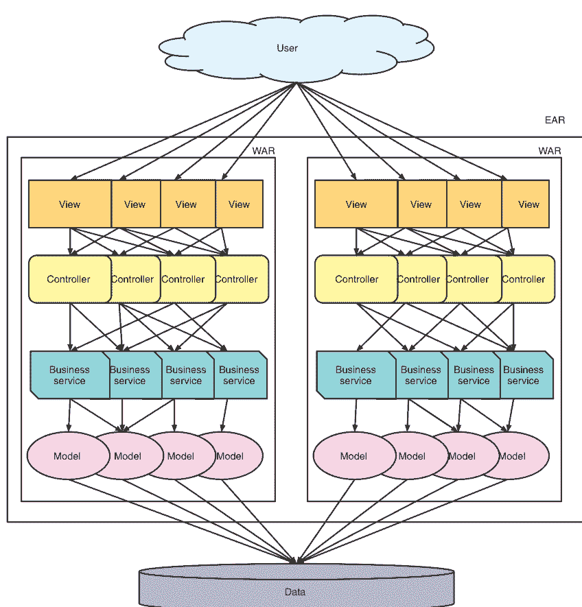

图 1.2 企业级 Java 意大利面代码

为什么上述因素会导致应用程序变成单体？当你的系统规模较小时，一个应用程序使用单一部署包是完全没问题的；但当你可能拥有数千个类类和几十个第三方库时，应用程序就会变得极其复杂。即使是对应用程序进行微小的更改，也需要大量的回归测试，以确保应用程序的其他部分没有受到影响。即使回归测试是自动化的，仍然是一项艰巨的任务。

一个应用程序是否为单体在某种程度上取决于它的架构。归类为单体不是基于应用程序的大小，也不是用于执行单体的运行环境的大小。这完全取决于该应用程序相对于其内部组件是如何进行架构设计的。

发布节奏是企业的强制性因素。如果一个应用程序每 3 到 18 个月才发布一次，业务部门（无论是否知情）将关注需要大量时间开发的大型功能。即使是几小时或几天内就能完成并发布的微小调整，也没有任何激励去执行。

由开发和测试更改所需的时间决定的发布节奏直接影响企业的敏捷性以及响应变化环境的能力。例如，如果竞争对手开始以比你低 15% 的价格销售相同的小部件，你能做出反应吗？为了降低产品价格而对简单更改花费几个月，可能会对利润产生灾难性的后果。如果那个小部件是畅销品，而企业在三个月内无法在价格上竞争，那么等到更改发布时，可能已经处于破产边缘。

#### 沿发布节奏

尽管单体 Java 应用程序看起来一片惨淡，事实真的如此吗？在很多情况下，企业继续使用或开发单体是有意义的。你如何知道是否应该坚持使用单体呢？

- 你的企业可能只有几个活跃开发和维护的应用程序。当你只有极少数应用程序时，大幅增加开发、测试和发布负担可能没有意义。


如果开发团队只有十几个人，将他们分成一个或两个人的微服务团队可能无法提供任何益处。在某些情况下，这种拆分会适得其反。[Basecamp](https://basecamp.com/) 是一个单体的完美范例，它由一个 12 人团队开发，并保持了现状。

你的企业需要每周发布几次甚至每天发布一次吗？如果没有，而且现有的单体具有清晰的组件分离，降低发布节奏可能就是获得更高业务敏捷性和价值所需的全部。

坚持单体对企业来说是否是正确的做法，取决于当前的状况和长期目标。

### 1.1.4 单体相关问题有哪些？

总的来说，类似于图 1.1 所示的架构设计是一个好主意，但也存在缺点：

- **无法扩展单个组件**——这看起来可能不是一个主要问题，但某些因素会改变扩展性差的质量。如果应用程序的单个实例需要大量的内存或空间，那么扩展到数量不小的节点就需要硬件上进行大量投资。

- **单个组件的性能**——在包含许多组件的单一部署中，某个组件的性能差于其他组件是常常的。这时你就拥有了一个拖慢整个系统的单个组件，这并不是什么好状况，运维人员将是不满意的。

- **单个组件的可部署性**——当整个应用程序是一个单一部署时，任何更改都需要部署整个应用程序，即使你只是在某个组件中改了一行代码。这对业务敏捷性没有好处，通常会导致需要数月时间才能将许多更改包含在一个更新后的部署中。

- **更大的复杂性**——当一个应用程序有许多组件时，它们之间的功能边界很容易变得模糊。模糊组件的分进一步增加了代码的复杂性，无论是在代码执行方面，还是开发者理解代码意图方面。

- **难以准确测试应用程序**——当应用程序增长时，为了确保任何更改都不会导致回归，测试量和时间也会随之增长。看似最小、最不足道的更改很容易导致完全无关的组件出现意外的错误和问题。

所有这些问题都给企业带来了成本，同时也降低了他们利用新机会的速度。但与从零开始相比，这些潜在缺点仍然是小小的。

如果一个企业拥有演变了十年或以上新功能的应用程序，尝试用绿地项目来替换它将花费数百年的精力。这是企业继续维护现有单体的一个巨大因素。

当使用更现代的替代方案替换单体的成本很高时，该应用程序就会企业中根深蒂固。它变成了一个关键应用程序，任何停机时间都会影响业务。随着不断的增强和修复，这种情况会变得越来越严重。

相反，一些单体已经运行良好多年，可以由少数开发者轻松管理，而不需要费费精力。它们可能处于维护模式，没有进行密集的功能开发。这些单体保持现状完全没问题。如果没有坏，就不要修。

对于那些笨重到无法用绿地项目替换的单体，尽管企业知道这在业务敏捷性和费用上代价巨大，你该怎么办？你如何更新它们以使用新的框架和技术，使它们不会成为遗留系统？我们将在回答这些问题。

## 1.2 微服务和分布式架构

在深入研究微服务和分布式架构的定义之前，让我们重新看看使用它们时图 1.2 可能是什么样的；参见图 1.3。这种描述通过将组件拆分为具有清晰边界的独立微服务，确实理清了组件之间的分离。

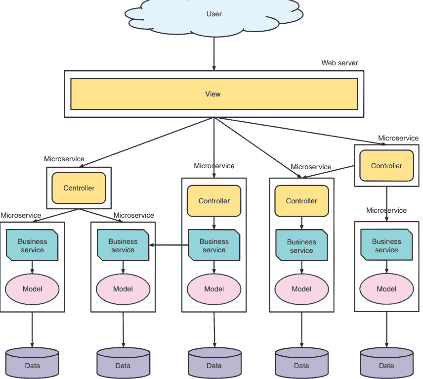

图 1.3 企业级 Java 微服务

## 微服务和分布式架构

那么我所说的微服务是指什么？微服务由在单个进程中执行的单一部署组成，与其他部署和进程隔离，并支持特定业务功能的实现。每个微服务都关注边界上下文（Bounded Context）内的所需任务，边界上下文是分离企业各种领域模型的逻辑方式。我们将在本章的晚些部分详细介绍这一点。

从定义上，你可以看到微服务本身是没有用的。只有当你有许多松耦合的微服务协同工作以满足应用程序的需求时，它才变得有用。包含许多微服务的微服务架构也可以称为分布式架构。

要让微服务变得有用，它需要被其他微服务和组件轻松使用。当一个微服务试图完成太多任务时，这是无法实现的。你需要微服务专注于单一任务。

### 1.2.1 只做一件事

1978 年，以开发 UNIX 管道和各种 UNIX 工具而闻名的 Douglas McIlroy 记录了 UNIX 哲学，其中一部分是“让程序只做一件事”。同样的哲学被微服务开发者所采用。微服务不是应用程序开发的万金油；你不能在它们中包含所有内容，并期望每个都能以最佳水平运行。在这种情况下，你拥有的是单体架构，也被称为分布式单体！

设计良好的微服务应该执行一个足够细粒的任务，交付业务能力或增加业务价值。超出单一任务将带我们回到 Java 单体的问题上，我们不想重复这些。

为微服务确定足够细粒的任务总是很容易的。在本章的晚些时候，我们将讨论领域驱动设计（DDD）作为一种辅助定义其粒度的方法。

### 1.2.2 什么是分布式架构？

分布式架构由多个相互工作的部分组成，使应用程序的完整功能分布在进程中，通常还跨越网络边界。分布的部分可以是应用程序的任何部分，例如 RESTful 端点、消息队列和 Web 服务，但它绝对不仅不仅限于组件。

图 1.4 显示了微服务的分布式架构可能是什么样的。在 във描述中，微服务实例被描述为运行在运行时，但并没有规定实例是如何打包的。它可以被打包为 uber jars 或 Linux 容器，但还有许多其他可用方案。运行时纯粹是为了界定微服务的运行环境，显示微服务正在独立运行。

# 第 1 章 企业级 Java 微服务

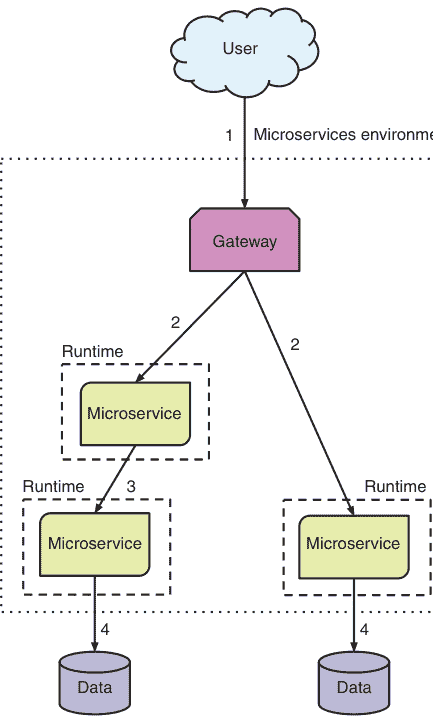

## 1 微服务环境

- 1 用户从浏览器发送请求以与某个特定服务进行交互。该请求可能来自移动设备，也可能来自之前获取的 UI 界面。

- 2 当请求进入微服务环境时，它进入网关，由网关将请求路由到相应的微服务。

- 3 微服务接收请求，并在调用另一个服务之前对其进行某些处理。

- 4 链中的最后一个微服务与数据存储层进行交互，以检索/写入记录。

图 1.4 典型的微服务架构

> 注意：**一个 uber jar（也称为 fat jar）表示 JAR 文件包含多个一个应用程序或库，并且可以使用 `java -jar` 从命令行运行。

### 1.2.3 为什么你关注分布式化？

现在你已经看到了分布式架构，让我们来看看它的一些优势：

- 服务是**位置无关的**。无论服务物理上位于何处，它们都能定位并与其他服务进行通信。这种位置无关性允许服务位于相同的虚拟硬件、物理硬件、同一个数据中心、不同的数据中心，甚至是公有云上，并且所有的行为都就像它们在同一个 JVM 中一样。位置无关性的主要缺点是它们之间的网络调用需要额外的时间，而且根据增加新网络调用的本质，你降低了成功完成的概率。

## 微服务与分布式架构

- 服务是**语言无关的**。虽然本书侧重于企业级 Java（Enterprise Java），但我们并不天真地认为不会有某些服务需要或希望用不同的语言进行开发。当服务不需要运行在相同的环境中时，你可以为不同的服务使用不同的语言。

- **服务部署是微型且单一目的的**。部署的规模越小，测试所需的精力就越少，这使得将发布周期缩短到一周或更短成为可能。拥有小型、单一目的的部署使企业能够更容易以近实时的方式响应业务需求。

- **新服务通过现有服务功能的重组来定义**。在整个架构中拥有离散的服务，极大地增强了你以新方式重新组合这些服务以创造额外价值的能力。这种组合可以简单到只需部署一个新的服务，并结合已经部署的一些服务。这使你能够在更短的时间内为业务创造新事物。

听起来很棒——但如何正确地开发分布式应用呢？在这里你需要稍微收收马缰。是的，分布式确实改进了你多年来在使用企业级 Java 时遇到的很多问题，但它也引入了自己的挑战。开发分布式应用绝不是什么灵丹妙药，你很容易自得其反。

你已经看到了分布式的某些优势，但大多数事情没有免费的午餐——分布式架构也绝非如此。如果你有一堆通过通信运行且没有耦合的服务，会引入什么问题？

- 服务的位置无关性很棒，但它们如何找到对方呢？你需要一种在逻辑上定义服务的方法，无论它们的物理位置或 IP 地址是什么。有了发现机制，你可以通过逻辑名称定位服务，并忽略它物理上可能位于何处。服务发现正是此目的。本书的第二部分将介绍如何使用服务发现。

- 如何在不影响客户的情况下处理故障？你需要一种在服务失败时优雅地降级功能的方法，而不是让应用程序崩溃。你需要服务的韧性和容错能力，在服务失败时提供替代方案。第二部分涵盖了如何为你的服务提供容错和韧性。

- 拥有数百或数千个服务会对运营带来额外负担。大多数运营团队没有处理大量服务的经验。你如何缓解这种复杂性？监控在这里需要发挥主要作用。监控需要扮演一个重要角色，这里（此处原文似乎有重复或截断，翻译已根据语境处理**）

- 服务的位置无关性很棒，但它们如何找到对方呢？你需要一种在逻辑上定义服务的方法，无论它们的物理位置或 IP 地址是什么。有了发现机制，你可以通过逻辑名称定位服务，并忽略它物理上可能位于何处。服务发现正是此目的。本书的第二部分将介绍如何使用服务发现。

- 如何在不影响客户的情况下处理故障？你需要一种在服务失败时优雅地降级功能的方法，而不是让应用程序崩溃。你需要服务的韧性和容错能力，在服务失败时提供替代方案。第二部分涵盖了如何为你的服务提供容错和韧性。

- 拥有数百或数千个服务会对运营带来额外负担。大多数运营团队没有处理大量服务的经验。你如何缓解这种复杂性？监控在这里需要发挥主要作用。监控需要扮演一个重要角色，这里（此处原文似乎有重复或截断，翻译已根据语境处理*）

*(注：由于原文最后一段存在明显的逻辑重复和截断，翻译严格遵循了原文的结构进行输出。)*

## 第1章 企业级 Java 微服务

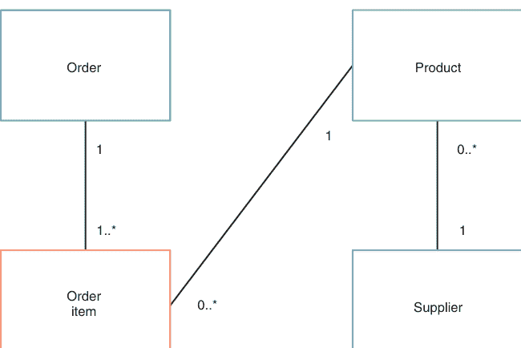

图 1.5 领域模型

图 1.6 显示了你现在每个限界上下文（Bounded Context）中都有产品（Product）；每个模型代表了产品的不同视图。订单（Order）限界上下文仅包含产品代码和描述等信息。业务所需的所有产品信息都在产品限制限上下文中。

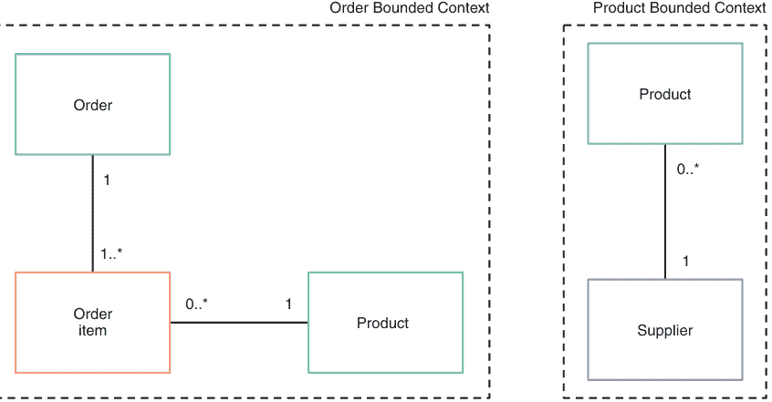

图 1.6 分离的限界上下文

## 迁移到微服务的模式

在某些情况下，限界上下文的领域模型中存在清晰的划分；而在另一些情况下，分离的模型之间会存在共性，正如前面的示例。在这种情况下，重要的一点是，尽管领域模型的一部分在多个限界上下文之间共享，但可以将其中一个类为*所有者*（owner）。

在定义了某个领域的所有者后，有必要将该领域提供给外部限界上下文——但这种方式不能隐式地将两个限界上下文耦合在一起。这确实使得处理边界变得更加复杂，但如事件溯源（Event Sourcing）等模式有助于解决这个问题。

**注意** *事件溯源*是一种为应用程序中的每个状态变化都发布事件的做法，这些事件通常被记录为特定格式的日志。此类日志随后可以用来重建整个数据库结构，或者在本例中，用于填充由外部拥有的领域模型部分。

所有这些限界上下文是如何结合在一起的？每个限界上下文都构成了一个更大利整体的一部分，即上下文映射（context map）。*上下文映射*是应用程序的全局视图，识别了所有必要的限界上下文以及它们之间应该如何通信和集成。

在这个示例中，由于你将产品拆分成了两个，因此你需要从产品限界上下文向订单限界上下文获取此类数据，以为产品填充适当的数据。

如你在示例所示，限界上下文之间共享领域模型的一个方面是每个模型对相同的数据都有自己的视图。应用程序不再被强制以与其所有者相同的方式查看某个领域。当一个领域只需要所有者可能持有的每条记录中的一小子集时，这可以提供巨大的收益。关于领域驱动设计和限界上下文的更多信息，我推荐 Debashis Ghosh 编写的《Functional and Reactive Domain Modeling》（Manning, 2016）。

### 1.3.2 大爆炸模式（Big Bang pattern）

在企业中迁移到微服务的，*大爆炸模式*是目前是最复杂且最具挑战性的方法。它涉及到将现有单体系统的每一个部分拆解为微服务，直到完成从一个到另一个的单一切换点。

由于部署到生产环境是一次性的单一切换——即“大爆炸”——为这种更改进行开发的时间可能与在单体上开发的时间一样。诚然，在过程结束时，你确实转向了微服务，但对于大多数企业来说，这种模式相比其他迁移到微服务的模式，道路会更加坎坷——尤其是考虑到在两种部署模型之间移动所需的所需的内部流程和程序的变更。这种剧烈的变化对企业来说是创伤性的且可能具有破坏性。

不建议大多数没有微服务经验的企业使用大爆炸模式，更绝对不建议那些本没有经验的企业使用。

### 绞杀者模式（Strangler pattern）

绞杀者模式基于 Martin Fowler 定义的绞杀者应用程序（www.martinfowler.com/bliki/StranglerApplication.html）。Martin 将这种模式描述为一种通过在现有系统的边缘逐渐创建一个新系统来重写现有系统的方法。新系统多年来缓慢增长，直到旧系统转变为不存在。

你可能会发现与大爆炸模式类似的结果——这并不一定是坏事——但是在更长的跨度内实现的，同时交付了业务价值。这种方法与大爆炸模式相比显著降低了风险。随着时间的推移，你可以对每一个实现的微服务进行调整。这是相比大爆炸模式的另一个巨大优势。

### 混合模式（Hybrid pattern）

现在你已经看了大爆炸模式和绞杀者模式，让我们来看看混合模式。我觉得这种模式将成为企业迁移和开发微服务的流模式。这种这种模式的起点与绞杀者模式相似。区别在于，你并没有完全丢失单体中的原始功能，而是与新的微服务集成。图 1.7 显示了请求通过现有 Java 单体和微服务架构的路径：

1. 用户从浏览器发出请求，指定他们想要看到的视图。

2. 视图调用控制器以获取构建所需的任何信息。

3. 控制器调用业务服务，可能从不同的来源聚合数据。

4. 业务服务将请求传入微服务环境，进入网关。

5. 网关根据定义的路由规则将请求路由到相应的微服务。

6. 一个微服务接收请求并在调用另一个微服务之前对其进行某些处理。

7. 链中的最后一个微服务与数据存储层交互以读取/写入记录。

像图 1.7 这样的架构提供了巨大的灵活性。

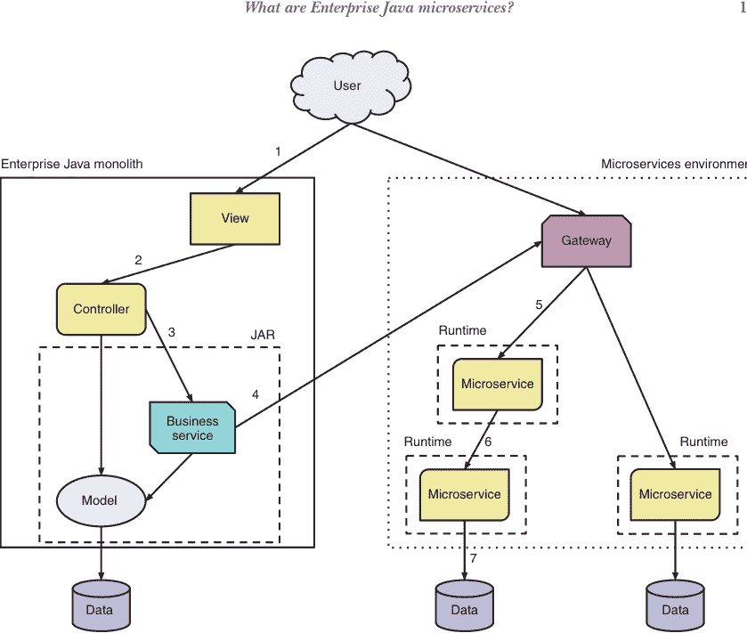

## 1.4 什么是企业级 Java 微服务？

正如我在开头提到的，企业级 Java 微服务是用企业级 Java 开发的纯微服务。所以让我们来看一个简单的示例以便其实际。让我们创建一个使用 CDI 和 JAX-RS 的简单微服务。

### 1.1 CDI 服务

```java
@RequestScoped
public class HelloService {
    public String sayHello(String name) {
        return "Hello " + name;
    }
}
```

### 1.2 JAX-RS 端点

```java
@ApplicationScoped
@Path("/hello")
public class HelloRestController {
    @Inject
    private HelloService helloService;

    @GET
    @Path("{name}")
    @Produces("text/plain")
    public String sayHello(@PathParam("name") String name) {
        return helloService.sayHello(name);
    }
}
```

### 1.4.1 为什么企业级 Java 适合微服务

你已经看到作为企业级 Java 服务开发 RESTful 端点是多么简单了，但你难道不会认为使用专门为微服务构建的新框架或技术会更好吗？你现在有许多选择：Go、Rust 和 Node.js 仅仅是其中例子。

在某些情况下，使用较新的技术可能更有意义。但如果一个企业通过现有的应用程序、开发者和员工在企业级 Java 上投入了大量资金，那么继续使用该技术就会有意义得多。我所说的技术并不是指 Java EE 或 Spring 本身；它更多关于 API 提供的能力以及开发者对这些 API 的熟悉程度。如果同样的 API 可以同时用于单体应用、微服务，或者任何下一个占据人们脑海的流行术语，这比为每种开发情况重新学习 API 要有价值得多。

如果一个开发者第一次为企业构建微服务，使用开发者已经熟悉的技术可以使他们专注于微服务的****而无需在同时关注语言或框架的细微差别上**。

使用一项已经存在了近 20 年的技术具有显著优势。为什么呢？一项存在了那么久的技术几乎可以保证在不久的将来消失。还有人说得出 Cobol 吗？

对于企业来说，知道他们正在开发的任何技术都不会在几年内过时，是一个巨大的成本优势。这种风险通常是企业不愿投资极新技术的原因。虽然无法使用最新、最强大的技术可能会令人沮丧，但它确实具有优势，至少对于企业而言如此。

在选择开发微服务的技术时，企业并不是需要考虑的因素。你还需要考虑以下因素：

- 市场上开发者的经验和技能——如果你没有足够的资源池供你选择，那么为微服务开发选择特定的技术就没有意义了。庞大的开发者群体拥有企业级 Java 经验，因此这是一个优势。

- 供应商支持——选择一种用于开发微服务的技术固然很好，但如果没有供应商提供该技术的支持，就会很困难。这种困难是因为企业希望有供应商能够 24/7 小时就绪，就技术问题提供支持，通常是在生产环境中。没有直接的供应商支持，企业需要雇用直接接触该技术的人员，以确保他们能够解决生产环境中微服务的任何问题。

- 变更成本——如果一个企业已经使用企业级 Java 开发了十年或以上，并且有一组在那个时期工作过的项目的稳定开发者，那么企业放弃这段历史并使用不同的技术开辟新路径是否有意义呢？虽然在某些情况下这样做是有意义的，但大多数企业在迁移到微服务时也应该坚持自己的经验和技能。

- 经验和基础设施——除了开发者之外，拥有多年企业级 Java 操作经验的便利性同样至重要。应用程序不会自我监控和修复，尽管如果可以那样就好了。在新的语言和框架上招聘或重新培训运维人员所花费的时间可能与对开发者进行培训一样耗。

### 总结

- 一个微服务由在单个进程中执行的单个部署组成。

- 企业级 Java 单体应用是一个所有组件都包含在一个部署中的应用程序。

- 企业级微服务是使用企业级 Java 框架开发的微服务。


企业级单体应用不适合快速的发布周期。

实现微服务并不是万灵药，它需要额外的考虑才能成功实施。

从单体应用迁移到微服务的最佳方式是使用混合模式（Hybrid pattern）。

在实施微服务的决策中，不应忽视企业在企业级 Java 开发的历史。

# 开发一个简单的 RESTful 微服务

本章涵盖内容：

- 介绍 Cayambe 单体应用
- 开发一个简单的 RESTful 应用程序
- 将你的简单 RESTful 应用程序作为微服务打包
- 理解使用企业级 Java 开发微服务

本章将向你介绍 Cayambe 单体应用。Cayambe 单体应用将帮助我们在全书中开发企业级 Java 微服务，每个微服务将在第 10 章中成为新的混合单体应用的一部分。

## 2.1 Cayambe 单体应用

Cayambe 是一个电子商务应用程序，在过去的 15 年中没有维护过，需要进行大量的现代化。从图 2.1 的首页很容易看出，它的外观与如今的现代网站并不相同。

## Cayambe 开源购物车参考实现


©2002 Cayambe

图 2.1 Cayambe 首页

如图 2.2 所示，Cayambe 是一个 EAR 部署，由三个 WAR、一个用于 UI 的通用 JAR 以及一个包含用于与数据库交互的 EJB（企业级 JavaBeans）和 DAO（数据访问对象）的 JAR 组成。

Cayambe EAR

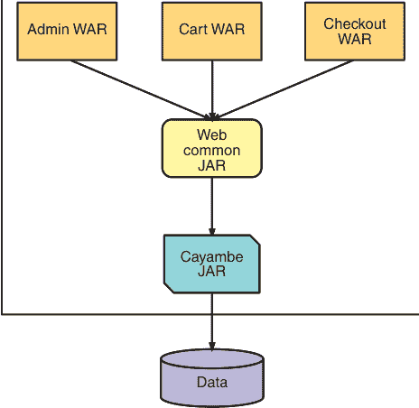

图 2.2 Cayambe 单体应用架构

## 新管理站点

## Cayambe EAR

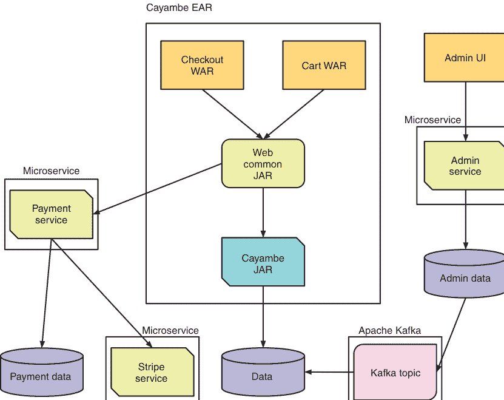

图 2.3 Cayambe 未来架构

在本书中，你将致力于将 Cayambe 迁移到部署，如图 2.3 所示。第 10 章概述了 Cayambe 的更多细节；在该章中，你将把开发的微服务集成到单体应用中。

## 2.2 新管理站点

作为 Cayambe 现代化的一部分，你将拆分站点的管理部分，以便进行扩展。首要任务是开发一个提供管理功能的 JAX-RS 服务，并使用 ReactJS 为其新的 UI。对于已经熟悉 JAX-RS 的人来说，你会看到以前知识的重复。

图 2.4 是 Cayambe 当前的管理界面。在 UI 中查看或更新类别是不可能的。


[ 添加新产品 ] [ 列出所有产品 ] [ 搜索产品 ] [ 浏览目录 ] [ 管理订单 ]

欢迎来到 Cayambe 管理

©2002 Cayambe

图 2.4 旧 Cayambe 管理界面

并非理想，你将通过开发新的管理站点和微服务来开始。图 2.5 显示了带有 ReactJS 的新管理界面，以及作为树状的类别数据。

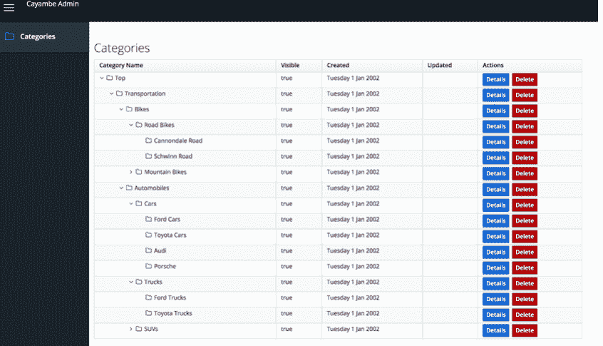

图 2.5 新 Cayambe 管理界面

图 2.6 你在本章中开发的 RESTful 微服务在完成本书后将放入新的 Cayambe 架构中。让我们深入创建为了使新界面运行所需的 RESTful 微服务。

## 新管理站点

## Cayambe EAR

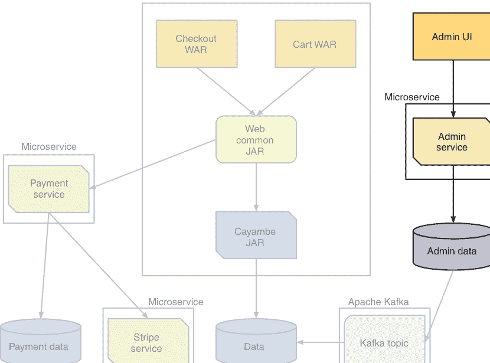

图 2.6 Cayambe 管理微服务和 UI

### 2.2.1 用例

对于本章，你将专注于开发管理中的类别管理部分，但你以后也可能希望从之前的管理站点迁移其他部分。这样做可以将你学习的内容简化为单个问题领域，而不是多个领域，专注于使类别管理成为可能的代码。

作为类别管理的一部分，你需要支持对类别进行增、删、改、查（CRUD）操作。这是开发 RESTful 端点的一个有趣部分，但大多数服务的核心确实需要某种类型的 CRUD。

UI 将调用维护类别的微服务的 CRUD 操作。微服务的 RESTful 端点可以从任何客户端调用，但你展示它们如何与 UI 交互。图 2.7 详细说明了在 UI 中管理类别时的状态及其转换。

删除类别

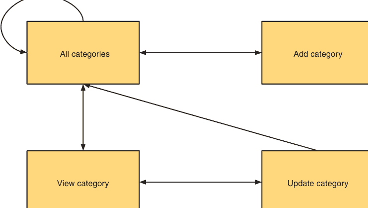

图 2.7 类别管理状态流

### 2.2.2 应用程序架构

暂时不考虑微服务，你的应用程序架构看起来如图 2.8 所示。在*表示层*中，你使用 AngularJS 用于 UI，尽管本章不会涵盖 UI 的开发。API 层包含使用 JAX-RS 处理类别的 RESTful 端点。最后，在你的*数据层*中，你拥有类别的 JPA 实体，它们负责与物理数据库进行交互。API 层负责与数据层交互以记录更新。

你可以将 API 层分离开，并在数据层之上一个业务层内使用服务，但我选择通过移除一个不必要的层来简化它。通常，所有层都会封装在一个单一的 WAR 包中部署到应用程序服务器。

| 表示层 | API 层 | 数据层 |
| :--- | :--- | :--- |

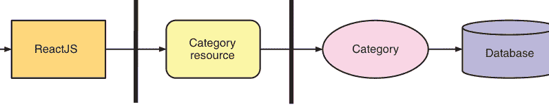

图 2.8 类别管理架构

### 新管理站点

WAR

微服务

表示层

API 层

数据层

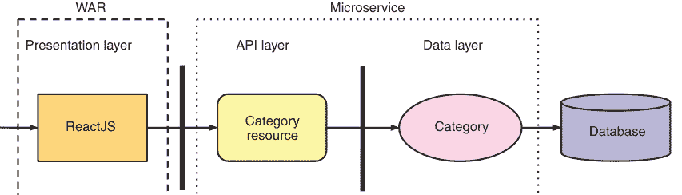

图 2.9 类别管理微服务架构

当你转向构建微服务时，架构发生了什么变化？参见 2.9。

在这里你可以看到服务器端层包含在单一的微服务中。你的 UI 则在它自己的 WAR 中，并将 UI 部署到单独的运行时。应用程序架构现在被拆分为单独的可部署部分：UI、一个微服务和一个数据库。

注意：在这种情况下，你选择将 UI 打包为 WAR，但因为仅仅是 HTML/CSS/JS，你使用了任何方法来打包和部署静态站点。

由于你将 UI 和服务拆分到不同的运行时，你需要添加对跨源资源共享（CORS）的支持。如果不这样做，浏览器将阻止 UI 向微服务发送 HTTP 请求。为了做到这一点，微服务需要一个过滤器。

列表 2.1 CORSFilter

```java
@Provider
public class CORSFilter implements ContainerResponseFilter {
    @Override
    public void filter(ContainerRequestContext requestContext, 
        ContainerResponseContext responseContext) throws IOException {
        responseContext.getHeaders().add("Access-Control-Allow-Origin", "*");
        responseContext.getHeaders().add("Access-Control-Allow-Headers", "origin, content-type, accept");
        responseContext.getHeaders().add("Access-Control-Allow-Credentials", "true");
        responseContext.getHeaders().add("Access-Control-Allow-Methods", "GET, POST, PUT, DELETE, OPTIONS");
        responseContext.getHeaders().add("Access-Control-Max-Age", "1209600");
    }
}
```

**提示** 记住 UI 从哪里检索数据，以及是否需要考虑 CORS。不这样做可能会在 RESTful 调用无故失败时，很容易导致令人沮丧的 UI 错误。相反，如果你的 UI 使用 API 网关与微服务交互，API 网关提供了直接处理 CORS 的配置，而不是通过微服务。

### 2.2.3 使用 JAX-RS 创建 RESTful 端点

为了保持微服务的简单，你将关注 RESTful 端点、API 层，并忽略数据库 JPA 实体的开发。你将假设这位友善的开发者已经为你写好了它们！请放心，这位友善的开发者已经在项目代码中提供了这些实体。

除了 JPA 实体外，开发者还开发了一个方便的 `load.sql` 文件，包含初始类别，这些类别将在启动时用于填充数据库。图 2.10 显示了你将在本节开发的内容。代码可以在书籍示例代码的 `/chapter2/admin` 目录下找到。

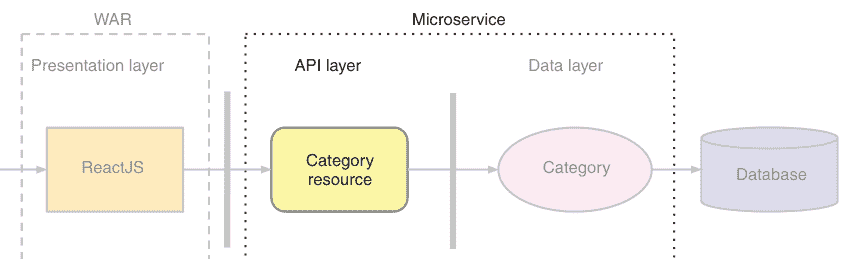

图 2.10 类别管理—API 层

在本节中，你将开发 `CategoryResource`。你的 `CategoryResource` 将专注于通过 RESTful 端点提供类别数据的 CRUD 风格操作。它指出了控制器的 RESTful `@path` 为 `/category`。你定义 `EntityManager` 通过 CDI 注入，这提供了一种在数据库上执行操作的方法。

注意：尽管许多人认为 CRUD 不适用于 RESTful 服务，但开发者经常将其作为将 RESTful 挂接到现有 CRUD 之上的手段。Leonard Richardson 在理查德森成熟度模型（Richardson Maturity Model）中也定义了 REST 的多个级别。作为应用状态引擎的超媒体（HATEAS）是该模型中最复杂、最困难的级别。书中的示例并不符合 REST 的 HATEOS 级别，主要因为这不是许多企业开发者在日常工作中熟悉的内容。有关成熟度模型的更多信息，请查看 `http://mng.bz/vMP` 和 `https://restfulapi.net/richardson-maturity-model/`。

### 新管理站点

默认情况下，JAX-RS 资源实例仅在每个请求的基础上是激活的。如果不更改这一点，每个请求将花费时间创建需要注入的 `EntityManager`。如果可以避免，这不会产生巨大的性能影响。为了避免重新创建 `EntityManager`，你需要将其标记为 `@ApplicationScoped`。这告诉运行时，你的 `CategoryResource` 生命周期将由 CDI 管理，而不是 JAX-RS。

你需要定义一个 JAX-RS 类来定义资源的根路径。

列表 2.2 AdminApplication

```java
@ApplicationPath("/admin")
public class AdminApplication extends Application {
}
```

该类你只需要做这些。因为你没有要求 CDI 管理 `CategoryResource` 的生命周期，所以你不需要在 JAX-RS 中配置任何单例。现在是时候为类别的 CRUD 操作开发 RESTful 端点了。

### 查看所有类别

你应用程序的主界面是类别树。填充屏幕上的列表需要一个 RESTful 端点从数据库中检索所有类别。

列表 2.3 @GET on CategoryResource

```java
@GET("/")
public class CategoryResource {
    @PersistenceContext(unitName = "AdminPU")
    private EntityManager em;

    // RESTful URL 为 /categorytree。
    @GET("/categorytree")
    @Produces(MediaType.APPLICATION_JSON)
    public CategoryTree tree() throws Exception {
        return em.find(CategoryTree.class, 1);
    }
}
```

- 指定了用于 `EntityManager` 的持久化单元 `AdminPU`
- 指明该方法返回以 JSON 格式序列化的数据
- 返回 `CategoryTree` 作为根节点。其他类别将作为子节点。

### 删除类别

当你有一个类别后，需要删除一个不再使用的旧类别。为了这一点，你需要添加一个从数据库删除类别的 RESTful 端点，如列表 2.4 所示。

列表 2.4 @DELETE on CategoryResource

执行此端点需要事务

```java
@Path("")
public class CategoryResource {

    @DELETE
    @Produces(MediaType.APPLICATION_JSON)
    @Path("/{categoryId}")
    @Transactional
    public Response remove(@PathParam("categoryId") Integer categoryId)
    throws Exception {
        try {
            Entity entity = em.find(Category.class, categoryId);
            em.remove(entity);
        } catch (Exception e) {
            return Response
                .serverError()
                .entity(e.getMessage())
                .build();
        }

        return Response
            .noContent()
            .build();
    }
}
```

- `@DELETE` 指明该方法只接受 HTTP 请求。
- 定义方法接受一个参数并将其命名为 `categoryId`。
- 根据参数 `categoryId` 查找 `Category` 实例。
- 从持久化中移除该实例。
- 如果遇到异常，使用 JAX-RS `Response` 返回服务器错误并携带异常消息。
- 如果类别成功删除，则返回空响应。

### 添加类别

某些类别需要添加。为了这一点，你有一个 RESTful 端点向你的数据库中添加新类别。

列表 2.5 @POST on CategoryResource

该方法还返回一个以 JSON 格式序列化的 `Category`。

```java
@Path("")
public class CategoryResource {

    @POST
    @Path("/category*")
    @Consumes(MediaType.APPLICATION_JSON)
    @Produces(MediaType.APPLICATION_JSON)
    @Transactional
    public Response create(Category category) throws Exception {
```

- `@POST` 指明该方法只接受 HTTP POST 请求。
- 指明该方法只接受可以序列化为 `Category` 实例的 JSON。

## 新的管理站点

如果 `Category` 设置了 ID，则返回 409 响应状态，表示与尝试创建的记录存在冲突

```java
if (category.getId() != null) {
  return Response
    .status(Response.Status.CONFLICT)
    .entity("Unable to create Category, id was already set.")
    .build();
}
```

将新的 `Category` 持化到数据库

```java
try {
  em.persist(category);
} catch (Exception e) {
  return Response
    .serverError()
    .entity(e.getMessage())
    .build();
}
return Response
  .created(new URI(category.getId().toString()))
  .build();
```

作为 `Response` 的一部分，将位置设置为带有其标识符的新 `Category`。

此外，`CategoryResource` RESTful 端点定义了获取和更新分类。额外方法请参阅第 2 章源码。

### 2.2.4 运行程序

尽管你已经表明你的 RESTful 端点是一个管理微服务，但请注意，你开发的代码阻止了它被构建为 WAR 并部署到应用程序服务器。

因为你处理的是一个与单个微服务通信的 UI，这与现有的使用 WAR 的企业 Java 开发没有区别。优点是，如果微服务生产者不需要更改代码，那么将现有的企业级 Java 迁移到微服务会变得更容易。

为了提供更多微服务的示例，例如你将使用 Thorntail 将其封装为一个 uber jar。Thorntail 提供了一种替代方法，可以将你的应用程序封装为 WAR 或 EAR 并部署到全 Java EE 应用程序服务器。它允许你从 WildFly 中选择需要的部分，并将其封装成可以从命令行运行的 uber jar。第 3 章将详细介绍 Thorntail 的功能。要运行该微服务，你需要将列表 2.6 中的插件添加到你的 `pom.xml` 中。

列表 2.6 Maven 插件配置


```xml
<plugin>
  <groupId>io.thorntail</groupId>
  <artifactId>thorntail-maven-plugin</artifactId>
  <version>${version.thorntail}</version>
  <executions>
    <execution>
      <id>package</id>
      <goals>
        <goal>package</goal>
      </goals>
    </execution>
  </executions>
  <configuration>
    <properties>
      <thorntail.port.offset>1</thorntail.port.offset>
    </properties>
  </configuration>
</plugin>
```

Thorntail 的最新版本

执行时运行插件的`package`目标。

指定端口偏移量为 1，这样你的微服务将在 8081 端口启动。

你只需要提供一种从目录运行你的微服务的方法，并将其封装为 uber jar。运行什么以及如何运行？需要运行两个部分：一个用于 UI，另一个用于微服务。如果你想在不使用 UI 的情况下直接对 RESTful 端点进行测试，只需要启动微服务。

## 启动微服务

打开终端或命令行窗口，导航到书籍示例代码的`/chapter2/admin`目录。从该目录运行以下命令：

```bash
mvn thorntail:run
```

这启动了包含 RESTful 端点的管理微服务。日志显示微服务已部署，你可以打开浏览器并访问 http://localhost:8081/admin/category。你的浏览器将加载分类数据并以 JSON 格式显示。现在微服务正在运行，让我们运行 UI。

## 启动 UI

打开终端并导航到书籍示例代码的`/chapter2/ui`目录。从该目录运行以下命令：

```bash
mvn package
java -jar target/chapter2-ui-thorntail.jar
```

这会将 UI 封装在 uber jar 中，然后启动包含带有 UI 代码 Web 服务器的 uber jar。日志显示已部署后，你可以打开浏览器并访问以下地址：

```
http://localhost:8080
```

你的浏览器将加载包含 Cayambe 分类数据的 UI，如之前的图 2.5 所示。微服务和 UI 都可以通过在每个终端窗口按 Ctrl-C 来停止。

### 总结

- 你可以使用 JAX-RS 开发一个分类管理微服务。
- 你可以使用企业 Java 轻松地创建 RESTful 微服务。
- 开发 RESTful 端点在企业 Java 和微服务之间没有区别。
- 企业 Java 的经验可以很容易转移到开发企业 Java 微服务中。

## 适用于微服务的足够服务器（Just enough Application Server）

本章涵盖了：

- 什么是足够应用程序服务器（JeAS）？
- 什么是 MicroProfile？
- 哪些运行时环境支持 JeAS？
- JeAS 运行时环境如何比较？

本章探讨了足够应用程序服务器（JeAS）背后的理念，以及我们开发者在用 JeAS 开发企业 Java 微服务时拥有的运行时选项。我们将首先定义 JeAS 及其它与 Java EE 的对比。为了便于讨论，将描述一个需要若干种规范的假设微服务，以便根据各种 JeAS 运行时提供的功能对其需求进行评估。作为比较的一部分，我们将在开发海滩度假购物应用程序的过程中，详细介绍每个 JeAS 运行时环境及其差异。

## 足够服务器（Just Application Server）

*Just enough Server*（足够服务器）术术多年来偶尔被使用，但自从微服务的流行对于企业 Java 变得至关重要以来，本节涵盖了 JeAS 的含义、其优势以及 JeAS 运行时环境的示例。

假设你需要开发一个与企业信息系统（EIS，如 SAP）交互的微服务，以检索员工的人力资源（HR）信息。对于这个微服务，你选择了使用 JAX-RS、CDI 和 JMS。如果你在典型的 EE 应用程序服务器上开发此类微服务，它极有可能是针对完整平台开发的，如图 3.1 所示。

图 3.1 完整 EE 平台上的微服务用法

如你所见，完整平台有很多你没有使用的规范，但它们仍然在那里。完整平台包含了许多 JSR。

## 第 3 章 适用于微服务的足够应用程序服务器

也许有一个可以使用的 Java EE 配置文件（profile）来简化它？现在你只有一个选择。让我们尝试 Web Profile 并看看它是如何工作的；参见图 3.2。

这导致使用的规范较少，但现在你面临一个问题：JMS 不是 Web Profile 的一部分。你仍然作为部署的一部分为你的微服务添加 JMS 的实现，但它不再是技术栈的一部分，并且可能需要你在使用完整平台时不再需要的额外配置。

答案是什么？JeAS 有帮助吗？到底什么是足够应用程序服务器？简而言之，JeAS 反转了应用程序服务器与应用程序之间的关系，确保你只封装应用程序所需的应用程序服务器部分。在我们先前的微服务示例案例中，你知道你需要 JMS，所以你选择了应用程序服务器的完整平台。但你知道你的应用程序永远不会使用该服务器的大部分。

Java EE 配置文件

自 Java EE 6 以来，我们有一个配置文件和一个完整平台供开发者选择作为其应用程序服务器。尽管你可能熟悉这些选项，下表提供了完整平台和 Web Profile 包含规范的概述。

| 特性 | Web Profile | 完整平台 |
| --- | --- | --- |
| EJB (本地) | ✓ | ✓ |
| JTS/JTA | ✓ | ✓ |
| 集群 | ✓ | ✓ |
| Servlet | ✓ | ✓ |
| JSF | ✓ | ✓ |
| JPA | ✓ | ✓ |
| JDBC | ✓ | ✓ |
| CDI | ✓ | ✓ |
| Bean 验证 | ✓ | ✓ |
| JAX-RS | ✓ | ✓ |

# 恰好足够的应用程序服务器 (Just enough Application Server)

| 特性 | Web Profile | Platform |
|---|---|---|
| JSON-P | ✓ | ✓ |
| EJB (远程) | | ✓ |
| JCA | | ✓ |
| JAX-WS | | ✓ |
| JAXB | | ✓ |
| JMS | | ✓ |
| JavaMail | | ✓ |
| JAX-RPC | | ✓ |
| JAXR | | ✓ |

许多应用程序服务器提供了通过移除组件及其相关配置来精简分发版的灵活性。过去，我与许多采用这种方法的客户合作过。但要找到确保应用程序服务器正常运行的正确组合需要某种试错方法。在某些情况下，你可能还会想要移除但无法移除的组件，这通常是因为该组件是应用程序服务器的关键部分。

为许多不同的应用程序自定义应用程序服务器，会迅速演变成一套复杂的、不同的配置集合，并需要进行管理和维护。开发者通常倾向于简化自己的生活，选择全平台，而不是花时间尝试精简应用程序服务器。他们宁愿接受不使用应用程序服务器所有组件带来的额外开销。

多年来，一些应用程序服务器（如 WildFly）一直致力于减少未使用组件的内存占用。尽管各种组件所需的依赖项仍在类路径（classpath）上，但应用程序服务器足够聪明，如果部署的应用程序不需要这些类，它就不会将类加载到内存中。遗憾的是，这是有限的，因为许多组件对于应用程序服务器的功能来说太核心了，无论应用程序如何要求。

那么，JeAS 在图1.4所示的微服务架构中处于什么位置呢？请看图3.3。

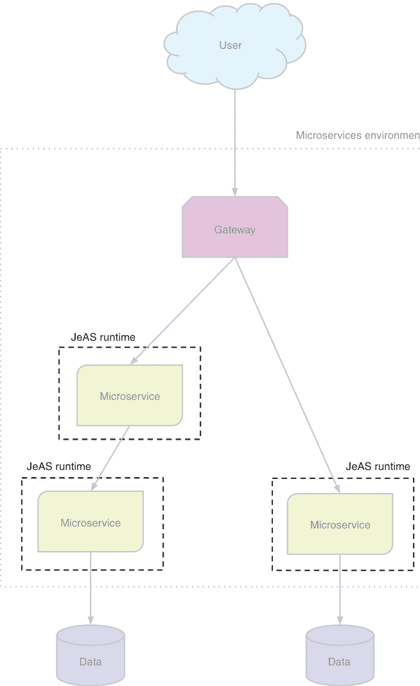

图3.3 作为微服务架构运行时的 JeAS

如你所见，JeAS 的重点是微服务所需的运行时。JeAS 运行时旨在为微服务提供精简的应用程序服务器，但其打包方式在不同实现之间可能有所不同。

JeAS 运行时提供了一种简单且易管理的方法，仅包含应用程序所需的应用程序服务器部分，我们很快就会介绍这些。在包含内容方面，运行时比其他更灵活。

选择哪种 JeAS 运行时会影响微服务可用的打包方式。然而，驱动因素始终应该是 JeAS 运行时支持什么，而不是它需要如何打包。

### 3.1.2 有哪些益处？

在上一节的 SAP 微服务中，你已经看到当应用程序依赖于足量较小的 Web Profile 时会是多么痛苦。它要求你引入额外的库，并配置它们以与应用程序服务器的其他部分协同工作。

作为开发者，我们希望有效利用时间来开发新功能或修复漏洞。我们不希望根据应用程序之间不同的需求无休止地配置应用程序服务器。大多数情况下，为了简单起见，我们会选择全平台。

使用全平台有什么大吗？当然，有些部分你今天可能用不到，但你计划某一天会用到，对吧？在某些情况下，应用程序将增长并包含一个或两个未包含原始设计中的额外规范。非常怀疑一个应用程序是否会需要重新设计应用程序的程度，因为它包含的功能对于单个应用程序来说太多了。这导致全功能应用程序服务器的大部分功能闲置。

如果应用程序服务器不是“一刀切”的，不是很好吗？这是 JeAS 旨在解决的案例之一，允许开发者为特定应用程序选择所需的哪些应用程序服务器功能或规范。

这为什么重要？如果一个应用程序只需要 servlets，它可以部署到仅提供 servlets 的 JeAS 运行时。通过 JeAS 运行时，如果应用程序需要添加某功能（例如 JAX-RS），开发者可以选择将该功能作为独立部分添加到 JeAS 运行时中。这不再需要在两个 Java EE 选项之间做出选择，或尝试自定义应用程序服务器。

这种灵活性意味着 JeAS 运行时具有巨大的优势：

- **减小包体积**——与它所部署的应用程序包相比。
- **减少分配内存**——减少程度取决于许多因素，例如不再加载的类数量。
- **减少安全范围**——各种功能开放的端口更少，运行的服务更少。此外，潜在关键漏洞 (CVE) 的攻击面显著缩小。
- **应用程序之间的隔离**——许多应用程序通常部署在单个应用程序服务器上。
- **简化升级**——升级仅影响单个应用程序。

应用程序之间更大的隔离意味着巨大的意义，因此值得额外的解释。在企业级 Java 应用部署到生产环境多年来，应用程序服务器很少包含单个应用程序。通常，一个应用程序服务器会在实例中运行几个到几十个应用程序。

如图 3.4 所示，JeAS 运行时比传统的 Java EE 应用程序服务器在不同微服务之间提供了更好的隔离。

## 传统的 Java EE

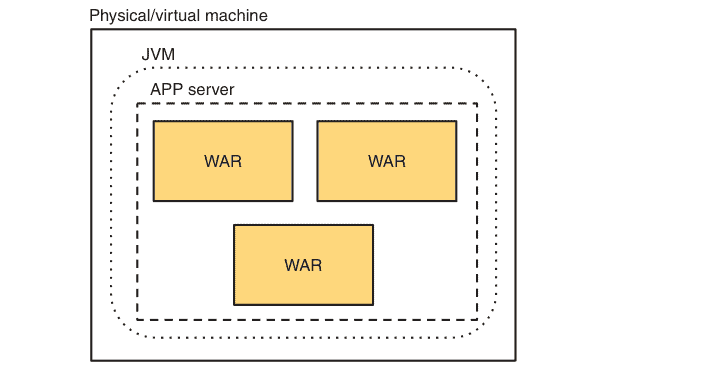

JeAS 运行时

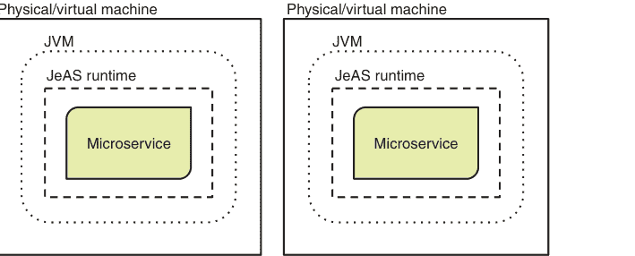

图 3.4 传统的 Java EE 与 JeAS 运行时

为什么会这样？历史上，最大的原因是成本——不仅仅是应用程序服务器的成本（通常并不便宜），而是运行单个应用程序所需的物理硬件。显然，在过去的十年里，随着虚拟机的改进和近年来容器的兴起，生产环境所需的物理硬件大幅减少，成本随之下降。

通过 JeAS 运行时，在不考虑考虑的情况下可以在可以在硬件上运行多个实例。每个 JeAS 运行时运行在自己的进程中，彼此相互隔离，防止了应用程序服务器中的常见问题：即应用程序故障会导致整个应用程序服务器以及运行其上的所有应用程序以无法恢复的方式失败。

### 3.1.3 Eclipse MicroProfile

对于过去几年关注企业级 Java 和微服务领域发展的任何人，你可能听说过 Eclipse MicroProfile。这是一项旨在“微服务的企业级 Java”的社区倡议，由 Red Hat、IBM、TomEE、Payara 和伦敦 Java 社区合作形成。从成立以来，该社区已迁移至 Eclipse 基金会。

从 JAX-RS、CDI 和 JSON-P 构建基础 Java EE 技术的首版本开始，我们已经超过了版本 1.3，到为止包含了八个新的 MicroProfile 规范。表 3.1 详细列出了每个 MicroProfile 版本包含的规范。

表 3.1 每个 MicroProfile 版本包含的规范

| 规范 | 1.0 (2016年9月) | 1.1 (2017年7月) | 1.2 (2017年9月) | 1.3 (2018年1月) |
|---|---|---|---|---|
| JAX-RS | ✓ | ✓ | ✓ | ✓ |
| CDI | ✓ | ✓ | ✓ | ✓ |
| JSON-P | ✓ | ✓ | ✓ | ✓ |
| Config | | | ✓ | ✓ |
| Fault tolerance | | | ✓ | ✓ |
| JWT propagation | | | ✓ | ✓ |
| Metrics | | | ✓ | ✓ |
| Health check | | | ✓ | ✓ |
| Open tracing | | | | ✓ |
| Open API | | | | ✓ |
| Type-safe REST client | | | | |

## 第 3 章 微服务的“足够”应用服务器

社区的目标是大约每季度发布一个新版本。该项目在保持进度方面表现良好，尽管 1.0 版本发布后提交给 Eclipse 基金会时出现了延迟。根据基金会的要求，需要时间对所有现有的项目代码和文档进行审查。

Eclipse MicroProfile 为企业级 Java 微服务创建了规范，其优势在于微服务可以在支持 Eclipse MicroProfile 的不同 JeAS（Java 应用程序服务器）运行时之间进行迁移。肯定会有一些实现这些规范的 JeAS 运行时，以及一些比定义更具灵活性的运行时。目标并不是涵盖企业级 Java 微服务开发的每一个用例，而是协作构建一个具有特定主张（opinionated）的栈，以涵盖大多数用例。

在过去的 18 个月中，MicroProfile 社区已经提供了解决企业级 Java、微服务和云问题的功能。它以协作和包容的方式实现了这一目标，随着项目的推进，许多个人贡献者和供应商加入了其中。

## 3.2 选择“足够”的应用服务器

现在是时候评估企业级 Java 微服务最流行的运行时了。你将遵循一个简单的微服务应用程序的开发过程，以展示框架之间的差异，这些差异体现在代码的不同以及每个框架带来的功能集上。

每个运行时的示例应用程序的完整代码可以在本书源码中获取（https://github.com/kennfinnigan/ejm-samples）。

### 3.2.1 海滩度假应用程序

我们的海滩度假应用程序将是一个简单的购物车，它拥有一个 REST 接口和一个代表购物车中物品的单类。你将向购物车中预填充每个人在海滩度假时都需要的物品！为了保持简单，你只在`CartItem`中存储名称和数量。

#### 列表 3.1 CartItem

```java
public class CartItem {
    private String itemName;          // 名称。
    private Integer itemQuantity;     // 要购买的数量。

    public CartItem(String name, Integer qty) {
        this.itemName = name;
        this.itemQuantity = qty; // 使用提供的名称和数量构造 CartItem 实例。
    }

    public String getItemName() {
        return itemName;
    }

    public CartItem itemName(String itemName) {
        this.itemName = itemName;
        return this;
    }

    public Integer getItemQuantity() {
        return itemQuantity;
    }

    public CartItem itemQuantity(Integer itemQuantity) {
        this.itemQuantity = itemQuantity;
        return this;
    }

    public CartItem increaseQuantity(Integer itemQuantity) {
        this.itemQuantity = this.itemQuantity + itemQuantity;
        return this;
    }
}
```

你需要的另一个部分是你的 RESTful 接口。为了保持简单，你不会使用数据库存储物品；数据将仅存储在内存中。你的`Cart-Controller`将为你初始化一个物品列表，作为购物车的基础。列表 3.2 非常简单，你可以清楚地看到每个框架在类和方法中提供了什么。它提供了三个你将通过 REST 提供的方法：`all()`、`addOrUpdateItem()` 和 `getItem()`。`addOrUpdateItem`方法最复杂，因为它处理向购物车中的任何物品添加数量，或添加完全新的物品。

#### 列表 3.2 CartController


```java
public class CartController {
    private static List<CartItem> items = new ArrayList<>();
    static {
        items.add(new CartItem("sunscreen", 3));
        items.add(new CartItem("towel", 1));
        items.add(new CartItem("hat", 5));
        items.add(new CartItem("umbrella", 1));
    }

    public List<CartItem> all() throws Exception {
        return items;
    }

    public String addOrUpdateItem(String itemName, Integer qty) throws Exception {
        Optional<CartItem> item = items.stream()
            .filter(i -> i.getItemName().equals(itemName))
            .findFirst();

        if (item.isPresent()) {
            Integer total = item.get().increaseQuantity(qty).getItemQuantity();
            return "Updated quantity of " + itemName + " to " + total + ";";
        } else {
            items.add(new CartItem(itemName, qty));
            return "Added " + itemName + " to shopping cart";
        }
    }

    public CartItem getItem(String itemName) {
        // 注意：此处代码逻辑在原文中似乎有小误（未定义 item 变量，应使用 stream 的 findFirst）
        // 但此处遵循原文进行翻译
        return items.stream()
            .filter(i -> i.getItemName().equalsIgnoreCase(itemName))
            .findFirst()
            .get();
    }
}
```

现在你已经创建了海滩度假应用程序所需的两个类。在接下来的章节中，你将根据 JeAS 运行时的特定要求更新这两个类。

> 注意：示例并不总是遵循正确的 REST HTTP 动词和语义。示例始终说明运行时的对比，而不是正确的 REST 模式。

### 3.2.2 Dropward——原始的具有主张的微服务运行时

Dropward 通过对开发者构建微服务的需求提出主张，提供了一个小型 JeAS 运行时。对于 Dropward，这意味着：

- 使用 Eclipse Jetty 作为 HTTP 服务器
- 使用 Jersey 处理 RESTful 端点
- 使用 Jackson 将数据转换为 JSON
- 使用 Hibernate Validator
- 使用 Dropward Metrics 提供对代码行为的洞察

如果你的应用程序需要 Dropward 未包含的库，你还需要为项目添加必要的依赖项。请查看 `www.dropward.io` 获取完整列表。

Dropward 起始于 2011 年，是第一个为微服务整合了具有主张的 JeAS 运行时的项目。Dropward 现在已超过版本 1.3.0。让我们回到讨论过的使用 JAX-RS 和 CDI 的示例微服务。图 3.5 显示了使用 Dropward 的微服务样式。

当使用不仅仅 Java EE 的 JAX-RS 开发微服务时，你需要的所有内容都必须添加并集成。虽然这可行，但可能不是最实用的选择，因为在编写任何代码之前需要大量的初始项目设置。

正因如此，Quark 而不是 Dropward，是你企业级 Java 微服务的首选运行时。Dropward 仅涵盖了需求的一小部分。这在转换企业级应用时尤为如此，因为你不希望将所有代码重写为不同的技术。理想情况下，你希望获取现有应用程序并以不同的方式为使用 Jakarta 时的用户打包。

回到你的海滩购物车，让我们通过 Maven 骨架生成你的 Dropward 项目：

```
mvn archetype:generate -archetypeGroupId=dropward.io -archetypeArtifactId=java-simple -archetypeVersion=1.0.9
```

现在你已经有了项目，可以随意修改代码以供 Dropward 使用。第一个更改是为你的 `CartItem` Bean 添加：默认构造函数。

你的 `CartController` 需要修改以实现 RESTful。首先，你需要定义控制器访问的 RESTful 路径。


#### 列表 3.3 CartController RESTful 路径

```java
@Path("/")
```

现在你需要为方法添加 JAX-RS 注解。

#### 列表 3.4 带注解的 CartController 方法

```java
@GET
@Produces(MediaType.APPLICATION_JSON)
public List<CartItem> all() throws Exception {

@GET
@Path("/add")
public String addOrUpdateItem(
  @PathParam("item") String itemName,
  @PathParam("qty") Integer qty) throws Exception {
}
```

> 表示该方法仅支持 HTTP GET 请求
> 端点可以通过 `/add` 访问。
> 通过 URL 传递的方法参数，例如 `/add?item=hat&qty=2`

## 第 3 章 用于微服务的“足够”应用服务器

```java
@GET
@Produces(MediaType.APPLICATION_JSON)
@Path("/get/{itemName}")
public CartItem getItem(@PathParam("itemName") String itemName) throws Exception {

}
```

你所添加的 JAX-RS 注解并没有意外，它们在 RESTful 端点中被经常使用。`all()` 和 `getItem()` 方法都会产生 JSON 输出，因此你添加了 `@Produces` 来指定 JSON 的正确媒体类型。`addOrUpdateItem()` 方法可以通过 `/add` 的 URL 路径访问，你需要在为方法参数添加必要的 `@QueryParam` 定义。这取决于你传递给 `@QueryParam` 的名称。最后，`getItem()` 指定了一个定义 `@Path("/get/{itemName})` 的 URL 路径，该路径随后通过设置 `@PathParam("itemName")` 传递给你的方法。

> 注意：`CartOrUpdateItem()` 使用 `@GET` 定义，这确实破坏了正常的 REST 语义；它不是一个幂等操作，因为你正在修改数据。但我采取这条路线完全是为了为了化，因为你的对象只有两个字段，并且它允许你直接从浏览器 URL 调用端点，从而消除了使用 curl 或浏览器扩展来 POST 数据进行测试的需求。

现在你需要添加自定义类，以便 Dropwizard 知道要运行什么以及如何配置。首先，你需要创建一个配置类，定义应用程序所需的特定环境的参数。在这个示例中，你不需要担心环境参数，所以该类可以是空的。

+ 列表 3.5 Chapter3Configuration

```java
public class Chapter3Configuration extends Configuration {
}
```

最后，你需要扩展 Dropwizard 的 `Application`，以指定需要运行的内容。

+ 列表 3.6 Chapter3Application

```java
public class Chapter3Application extends Application<Chapter3Configuration> {

    public static void main(String[] args) throws Exception {
        new Chapter3Application().run(args);
    }

    @Override
    public String getName() {
        return "chapter3";
    }
}
```

## 选择“足够”的应用服务器

配置在运行之前需要设置的应用程序任何部分。

```java
@Override
public void initialize(Bootstrap<Chapter3Configuration> bootstrap) {

}

@Override
public void run(Chapter3Configuration configuration, Environment environment) {
    final CartController resource = new CartController();
    environment.register(resource);
}
```

用 jersey 注册你的 RESTful 端点的实例。现在你已经构建了应用程序，可以运行它了吗？通过 Maven 创建项目，它已经添加了构建所需的插件。你需要做的是确保 `pom.xml` 中的插件引用了你创建的应用程序类。现在构建应用程序：

```bash
mvn clean package
```

并运行应用程序：

```bash
java -jar target/chapter3-dropwizard-1.0-SNAPSHOT.jar
```

现在已经可以通过访问 `http://localhost:8080/` 来访问应用程序了。这会返回当前项目的列表。你可以导航到 `http://localhost:8080/get/hat` 查看项目的详情。通过 `http://localhost:8080/add?qty=1` 更新现有项目的数量，或通过 `http://localhost:8080/add?qty=2` 添加新项目。Dropwizard 许多许多我们没有涵盖的功能，例如指标监控（Metrics）和健康检查（Health Checks）；请查看 `www.dropwizard.io/1.0.0/docs.html` 获取更多信息。

### 3.2.3 Payara Micro—精简 Java EE 应用

Payara Micro 与 Dropwizard 类似，它提供了一个定义了堆栈的优化运行时。你任何需要的额外库都需要添加到应用程序中。Payara Micro 的部署模型与你将看到的其他运行时不同，因为 Payara 提供了一个可以直接执行的发行版。通过 `java -jar payara-micro.jar --deploy myApp.war` 。如果没有 `--deploy`，发行版将作为一个普通的应用服务器启动，但没有部署任何内容。

> 注意：Payara Micro 源于 Payara 为 GlassFish v4.x 提供修复和增强的工作。Payara Micro 首次于 2015 年 5 月作为 Payara Server 的子集发布。Payara Micro 现在已经超过了第 5 版本。

在传统的应用服务器中部署你的应用程序具有某些优势。最大的优势是 Payara 发行版可以作为一个层。这使得创建一个包含该层的 Docker 镜像成为可能，该镜像可以被多次用于打包不同的应用程序。

这种运行时的主要缺点是无法移除额外的部分。例如，如果你的应用程序只需要服务，则没有办法移除 JAX-RS 等部分。这种方法的优点大于缺点，但这是企业根据自身情况做出的决定。我们稍后会介绍一种更灵活的方法。

Payara Micro 提供了什么？图 3.6 对比了 Payara 发行版与 Web Profile。让我们看看 JAX-RS, CDI 微服务如何使用 Payara Micro；参见图 3.7。

（图 3.6 Payara Micro 与 Web Profile 的对比）

（图 3.7 微服务在 Payara Micro 中的用法）

由于 Payara Micro 不包含 JMS 规范，你需要自己为微服务添加一个实现。这不是一个主要问题，但如果发行版中已经提供了，那么包含额外的实现会更容易。但这样你又回到了应用服务器部分存在但未使用的问题。

## 选择应用服务器

要创建你的 Payara 项目，创建一个标准的 Maven WAR 项目，就像你正在开发一个部署到应用服务器的 Java EE 应用一样。你可以添加 Maven 依赖

```xml
<dependency>
  <groupId>javax</groupId>
  <artifactId>javaee-web-api</artifactId>
  <version>7.0</version>
  <scope>provided</scope>
</dependency>
```

并访问应用程序可能的所有 API。因为你想在使用 JAXB 时使用 Jackson，你需要添加以下依赖：

```xml
<dependency>
  <groupId>org.glassfish.jersey.media</groupId>
  <artifactId>jersey-media-jackson</artifactId>
  <version>23.1</version>
</dependency>
```

现在你已经有了项目，让我们修改基础代码以供 Payara Micro 使用。对于 `CartItem` Bean，你需要标识它是否被映射到 JAXB，创建一个默认构造函数，并使用命名良好的 setter 方法。

### 列表 3.7 使用 JAXB 映射的 CartItem

| 注解 | 描述 |
|---|---|
| `@XmlRootElement` | 将 Java 类作为 JAXB 映射元素 |
| `public class CartItem {` | |

```java
@XmlRootElement
public class CartItem {
  public CartItem() {
  }

  public CartItem setItemName(String itemName) {
    this.itemName = itemName;
    return this;
  }

  public CartItem setItemQuantity(Integer itemQuantity) {
    this.itemQuantity = itemQuantity;
    return this;
  }
}
```

> 注意：Payara Micro 要求 Bean 使用正确的 setter 方法，正如你在列表 3.7 中所示。包含构建器模式类型 setter 方法的 Bean 将无法正确序列化为 JSON。

你的 `CartController`，如列表 3.8 所示，需要与 Dropwizard 相同的修改以使其符合 RESTful。用于 RESTful 端点的 JAX-RS API

# 列表 3.8 使用 Payara 的 CartController

```java
@Path("/
```

端点可以通过 `/id` 访问。

通过 URL 传递的方法参数，例如 `/add/item=hat&qty=2`。

作为 URL 路径定义的参数，`/get/hat`。

## 选择恰合适的的应用服务器

由于它是一个标准的 Maven WAR 项目，你可以像往常一样构建它：

```bash
mvn clean package
```

并运行应用程序：

```
java -jar payara-micro.jar --deploy target/chapter3.war
```

现在你可以在浏览器中通过 `http://localhost:8080/chapter3/` 访问应用程序了。这会返回购物车中当前项目的列表。你可以导航到 `http://localhost:8080/chapter3/get/hat` 查看购物车中帽的详情。通过 `http://localhost:8080/chapter3/addItem?qty=1` 更新现有条目的数量，或者通过 `http://localhost:8080/chapter3/add?item&qty=2` 向购物车中添加新项目。

## 3.2.4 Spring Boot—有主张的微服务

Spring Boot 的出现源于一种愿望：通过遵循约定而非手动配置来消除对样板配置的需求。它还引入了注解，提供了一种在无需配置的情况下启用 Spring Boot 部分功能的方法。

Spring Boot 提供了许多启动器（starters）作为项目的依赖项，这些启动器将相关的库、框架以及配置相结合，满足你在开发微服务时可能需要的许多功能。例如，`spring-starter-data-jpa` 依赖引入了使用 Spring 和 JPA 访问数据库所需的所有内容。所有可用启动器的完整列表可以在 GitHub 仓库中找到：`http://mng.bz/ciQ3`。或者查看 `http://start.spring.io`，那里你可以使用应用程序所需的启动器来创建一个 Maven 项目。


图 3.8 显示了你的 JAX-RS、CDI、JMS 微服务是如何使用 Spring Boot 的。该微服务面临的最大挑战将重写现有的使用 CDI 依赖注入的代码。虽然可以使用启动器来让 CDI 在 Spring 内部工作，但如果你希望项目保持作为一个基于 Spring 的项目，那么将其重写为使用 Spring 注入会更有意义。

通过启动器，Spring Boot 能够提供一个灵活的 JeAS 运行时，可以根据应用程序不断变化的需求进行扩展或收缩。修改应用程序的功能只需添加或删除 Spring 依赖并重新构建应用程序。

如果你不确定可能需要哪些启动器，请前往 `http://start.spring.io` 查看选项。该网站包含一个项目生成器，是查看可用启动器全景以及它们提供的功能类型的绝佳之处，也可以查看哪些启动器适用于数据库访问等常规开发任务，同时也适用于断路器和服务发现等微服务编程模式。

注意：Spring Boot 起于 2012 年 10 月启动，目前版本已超过 1.5.10。

你可以使用 `http://start.spring.io` 创建一个包含 Web 服务器的项目。这应该会为你提供一个 `pom.xml`，包含以下依赖：

```xml
<dependency>
  <groupId>org.springframework.boot</groupId>
  <artifactId>spring-boot-starter-web</artifactId>
</dependency>
```

现在你已经有了项目，请修改基础代码以便与 Spring Boot 使用。对于 `CartItem` bean，你只需要向它添加 `@XmlRootElement`。对于你的 `CartController`，你需要添加必要的注解使其成为一个 RESTful 端点，且名称略有不同。

### 列表 3.10 使用 Spring Boot 的 CartController

```java
public class CartController {
  @RequestMapping(
    method = RequestMethod.GET,
    path = "/",
    produces = "application/json")
  public List<CartItem> all() throws Exception {

  @RequestMapping(
    method = RequestMethod.GET,
    path = "/add",
    produces = "application/json")
  public String addUpdateCartItem(@RequestParam("itemName") String itemName, @RequestParam("qty") Integer qty) throws Exception {

  @RequestMapping(
    method = RequestMethod.GET,
    path = "/get/{itemName}",
    produces = "application/json")
  public CartItem getItem(@PathVariable("itemName") String itemName) throws Exception {

}
```

你控制器上的每个方法都提供了与你其他 JAX-RS 示例相同的细节，但整合在单个注解中。`@RequestMapping` 包含了你 JAX-RS 示例中 `@GET`、`@Produces` 和 `@Path` 的所有信息。另一个区别是 JAX-RS 的 `@QueryParam` 在 Spring 中是 `@RequestParam`，而 JAX-RS 的 `@PathParam` 在 Spring 中是 `@PathVariable`。

注意：Spring 为 `@RequestMapping` 也提供了快捷方式。与其使用 `@RequestMapping(method = RequestMethod.GET, path = "/", produces = "application/json")`，你可以使用 `@GetMapping(path = "/", produces = "application/json")`。

你的 RESTful 端点已经定义完成，最后创建 Spring Boot 应用程序类。

### 列表 3.11 Chapter3SpringBootApplication

```java
@SpringBootApplication
public class Chapter3SpringBootApplication {
    public static void main(String[] args) {
        SpringApplication.run(Chapter3SpringBootApplication.class, args);
    }
}
```

你在这里所做的只是说明 `main()` 应该激活 `@SpringBootApplication`。在这个类中，你可以为你想要启用的各种 Spring Boot 部分添加额外的注解。

现在你已经开发了应用程序，让我们运行它吧。使用 Spring Boot，你有几种选择：

- 从命令行运行
- 构建 uber jar（可执行 jar）

这允许开发者根据情况选择最适合的方法。例如，在开发应用程序时，你可以通过以下命令启动 Spring Boot：

```bash
mvn spring-boot:run
```

另一种方法是构建 uber jar。要运行你的 Spring Boot 应用，你可以像往常一样构建项目：

```bash
mvn clean package
```

并运行应用程序：

```bash
java -jar payara-micro.jar --deploy target/chapter3.war
```

现在你可以在浏览器中通过 `http://localhost:8080/chapter3/` 访问应用程序了。这会返回购物车中当前项目的列表。你可以导航到 `http://localhost:8080/chapter3/get/hat` 查看购物车中帽的详情。通过 `http://localhost:8080/chapter3/addItem?qty=1` 更新现有条目的数量，或者通过 `http://localhost:8080/chapter3/add?item&qty=2` 向购物车中添加新项目。

## 3.2.5 Thorntall—最灵活的 JeAS 运行时

Thorntall 的诞生源于利用 WildFly 应用服务器模块化的愿望。这使得不同的模块组可以收集并安装到服务器中使用。这让 Thorntall 成为 Java EE 最灵活的 JeAS 运行时。现在为应用程序选择单个 Java 功能变得非常简单。

Thorntall 定义了应用程序可以包含的依赖项，例如 JPA、JAX-RS 以及 Java EE 的大部分部分。除了 Java EE 依赖外，Thorntall 还提供了用于开发企业微服务的依赖项，如 Swagger、Keycloak 以及其他框架和库。

如果你不确定应用程序可能需要哪些 Thorntall 依赖，你有几种选择。你可以访问 `http://wildfly-swarm.org/generator` 生成一个骨架项目，并选择微服务所需的功能类型。既有 Java EE 功能，也有非 Java EE 功能的选择，例如 Eclipse MicroProfile、Hibernate Search、容错和安全等。

开发 Thorntall 应用程序的另一种方法（如果你不确定需要哪些依赖）是将 Maven 插件添加到 `pom.xml` 中并自动检测你的应用程序代码以确定使用了哪些 API，从而确定所需的依赖项。这通常是使用 Thorntall 最简单的方法，特别是从现有的 Java EE 应用程序转换时；由于只在 `pom.xml` 中添加了一个新插件，应用程序的其他部分可以保持不变。

虽然自动检测适用于入门，但这意味着插件打包应用程序的速度比直接指定依赖项要慢一点。

## 选择恰好的应用服务器

在开发者更熟悉可用的依赖项，或者需要插件无法检测到的依赖项后，切换到直接使用 Maven 依赖是非常的。查看插件检测到哪些依赖项的一种简单方法是查看构建项目时的日志输出。你可以将该列表作为需要添加的 Maven 依赖集。

注意：Thorntail 于 2015 年 2 月成立，现在版本已超过了 2.2.0.Final。该项目在 2018 年 5 月从 WildFlySwarm 重命名为 Thorntail。

图 3.9 展示了 JAX-RS、CDI、JMS 微服务如何在 Thorntail 中使用规范。在这里你可以看到 Thorntail 提供了你的微服务所需的全部内容——不多，也不少。Thorntail 提供了理想的 JeAS 运行时，因为它提供的内容恰好能让你的微服务如此紧密地匹配应用程序的需求。其他运行时有未使用的部分，或者要求在你的应用程序中包含额外的库。

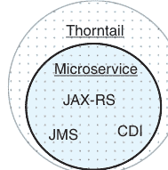

要创建你的项目，你将使用基础的 WAR 项目并添加以下插件定义。

### 列表 3.12 插件配置

```xml
<plugin>
  <groupId>io.thortail</groupId>
  <artifactId>thortail-maven-plugin</artifactId>
  <version>2.2.0.Final</version>
  <executions>
    <execution>
      <goals>
        <goal>package</goal>
      </goals>
    </execution>
  </executions>
</plugin>
```

用于 Thorntail 插件的 Artifact ID 与 Thorntail 版本对应关系如下：

| 用于 Thorntail 插件的 Artifact ID | Thorntail 版本 |
|---|---|
| 在 package 阶段执行插件。 | |

然后你就在提供的 scope 范围内拥有了 Java EE Web APIs：

```xml
<dependency>
  <groupId>javax</groupId>
  <artifactId>javaee-web-api</artifactId>
  <version>7.0</version>
  <scope>provided</scope>
</dependency>
```

现在你已经有了项目，修改基础代码使其能够使用 Thorntail JeAS 运行时运行。

## 第 3 章 用于微服务的恰好的应用服务器

对于 `CartItem` bean，你只需要向它添加 `@XmlElement`。`CartController` 需要与 Payara Micro 和 Dropwizard 使用的相同的 JAX-RS 注解。最后，你需要一个 `Application` 来激活 JAX-RS。

### 列表 3.13 使用 Thorntail 的 JaxrsApplication

```java
@ApplicationPath("/")
public class JaxrsApplication extends Application {
}
```

现在你已经开发了应用程序，让我们运行它吧。通过 Thorntail，你有几种运行应用程序的选项：

- 从命令行运行
- 构建项目并运行 uber jar

与 Spring Boot 一样，Thorntail 提供了灵活性，开发者可以根据自己的需求选择运行方式。在不使用 Maven 构建应用程序的情况下，你可以使用以下命令启动 Thorntail JeAS 运行时：

```bash
mvn thor:run
```

这使用 Thorntail 的 Maven 插件执行应用程序，就像它已经被打包成 uber jar 一样。

另一种方法是构建一个 uber jar。你像通常一样构建 Maven 项目：

```bash
mvn clean package
```

并运行应用程序：

```bash
java -jar target/chapter3-thorntail.jar
```

现在你可以在浏览器中访问 `http://localhost:8080/` 上的应用程序。这将返回购物车中当前项目的列表。你可以导航到 `http://localhost:8080/get/hat` 查看购物车中帽的详情。通过 `http://localhost:8080/add?item=towel&qty=1` 更新现有项目的数量，或通过 `http://localhost:8080/add/item=kite&qty=2` 向你的购物车添加新项目。

## 它们如何比较？

你查看了一些 JEAS 运行时，以及对于暴露几个 RESTful 端点的简单应用程序，每个运行时代码的差异。让我们在表 3.2 中比较 JEAS 运行的一些特性。

### 表 3.2 JeAS 运行时对比

| 特性 | Dropwizard | Payara Micro | Spring Boot | Thorntail |
|---|---|---|---|---|
| 依赖注入 (DI) | | ✓ | ✓ | ✓ |
| Uber jar 打包 | ✓ | | ✓ | ✓ |
| WAR 部署 | | ✓ | ✓ | ✓ |
| Maven 插件运行 | | | ✓ | ✓ |
| 项目生成器 | | | ✓ | ✓ |
| 自动检测依赖项 | | ✓ | | ✓ |
| Java EE APIs | | | | ✓ |

在为你的应用程序或企业选择最佳 JeAS 运行时，许多因素起了作用。一些最关键的因素如下：

- 是否具有 Java EE 或 Spring 的经验和知识？
- 生产环境的首选打包方法是什么？
- 是否之前用过这些框架的非 JeAS 运行时？

这些是影响应用程序选择哪个 JeAS 框架的因素。对于具有之前 Java EE 经验的开发者来说，Thorntail 可能是首选，但寻找不需要许多 Java EE API 的简单技术栈的开发者可能会选择 Dropwizard。

### 总结

- JeAS 允许随微服务一起打包恰好的运行时。在本章介绍的运行时中，Thorntail 提供了微服务所需的全部内容。
- 你根据需求选择 JeAS 运行时。
- 应用程序的微服务测试。
- MicroProfile 提供了云原生关键功能。

## 微服务测试

- 我们需要考虑哪些测试类型？
- 哪些工具适用于微服务？
- 实现单元测试
- 实现集成测试
- 使用消费者驱动契约测试

从哪里开始！为了让我们对测试类型的意义达成共识，首先要明确哪些测试类型是必要的。在本章中，你将关注与你相关的测试类型。有很多测试类型无法涵盖；

然后你将使用第 2 章创建的服务来展示哪些测试类型。

## 你需要什么测试类型？

### 4.1 你需要什么测试类型？

本章涵盖了三种类型的测试：

- 单元测试关注于测试微服务的内部。
- 集成测试涵盖整个服务，以及它与外部服务（如数据库）交互的方式。
- 消费者驱动契约测试处理微服务的消费者与服务本身之间的边界，通过 Pact 定义。

注意的是，单元测试和集成测试并非新概念。它们在软件开发中已经存在几十年了。将集成测试应用于微服务可能会增加其复杂度（通过更多的外部点），但我们开发它们并没有改变。

考虑到有几十种测试类型可用，为什么我选择了关注这些测试类型？我并不是说这三种是你需要考虑的所有类型，但对于你确保微服务尽可能健壮的目标来说，这些是至关重要的。单元测试和集成测试侧重于确保你作为微服务开发者，已经编写了为微服务所概述的需求。消费者驱动契约测试改变了视角，从微服务的外部来看，以确保微服务能够正确处理传递给你的任何内容。尽管可能不是微服务的需求，但客户端期望的行为可能与开发的略有不同。图 4.1 显示了相对于代码的三种测试类型。

任何类型测试的关键点在于，你不是为了乐趣或单次执行而编写测试。编写任何测试的目的、益处是在代码更改和修改时能够持续执行它，通常作为持续集成的一部分。为什么你想在旧代码和更新的代码上一直运行这些测试？很简单，这可以减少进入生产代码的错误（或 Bug）数量。

### 4.2 单元测试

单元测试通常由开发者在编写代码时创建，用于测试类和方法的内部行为。这需要使用模拟（mocks）或存桩（stubs）来模拟外部系统的行为。

注意：存桩（stubs）和模拟（mocks）是你可以使用的工具，使得对与外部服务（如数据库）交互的代码进行单元测试成为可能，而无需实际数据库。它们的目的相同，但存在差异。存桩是服务的手工实现，这些实现被用于为每个方法返回预定义的响应。模拟则提供了更大的灵活性，因为每个用例都可以设置你期望方法为该特定测试返回任何值，然后验证模拟是否按照你预期的方式运行。使用模拟要求每个用例为被调用的服务设置期望，这可以避免你在存桩中编写每一种测试情况。

我们为什么需要单元测试？你需要确保类中的某个方法按其预期执行功能。如果向方法传递了参数，则应该对这些参数进行验证以确保其恰当性。这可以简单到确保值不空，也可以复杂到验证电子邮件地址格式。例如，你需要验证传递特定参数是否返回了你从这些输入中预期的结果。单元测试是最低级别的测试，但通常是确保正确最关键的一步。如果你最小的代码单元（一个方法）没有按照你的预期运行，那么你的整个服务都可能运行错误。

这种级别的测试最流行且使用广泛的两个框架是 JUnit (`http://junit.org/`) 和 TestNG (`http://testng.org/doc/`)。JUnit 出现的时间最早，它也是创建 TestNG 的灵感来源。它们的功能之间没有太大区别，甚至在某些情况下，注解的方式也一样！

它们目标上最大的区别纯粹是个人选择。JUnit 的关注完全在于单元测试，它是采用测试驱动开发的巨大推动力。TestNG 的目标是支持使用单元测试进行测试。


开发者选择哪一个完全取决于个人喜好。在任何时候，`JUnit` 或 `TestNG` 的功能都可能比另一个更多，但另一个可能很快就会赶上。通过多次的往复迭代，你可以看到你所添加的测试代码中的差异。这对于显示修复任何可怕的 Bug 所需的相关代码更改尤为重要。为了编写我们的单元测试，我使用 `JUnit`，仅仅是因为我在职业生涯中使用该框架最多，而且对它最熟悉。

目前，管理微服务（admin microservice）专注于 `Category` 模型的 CRUD 操作，并有一个 `JAX-RS` 资源用于提供 RESTful 端点以与其交互。

## 单元测试

当你处理单元测试时，`Category` 是你唯一可以在不模拟数据库的情况下通过单元测试测试的有效代码。虽然模拟 `EntityManager` 来测试 `JAX-RS` 资源也是可能的，但最好作为集成测试的一部分，配合数据库进行完整测试。

你首先需要在你的 `pom.xml` 中添加测试所需的依赖项：

```xml
<dependency>
  <groupId>junit</groupId>
  <artifactId>junit</artifactId>
  <scope>test</scope>
</dependency>
<dependency>
  <groupId>org.easyestesting</groupId>
  <artifactId>fest-assert</artifactId>
  <scope>test</scope>
</dependency>
```

现在让我们来看看 `Category` 的一些单元测试，因为它是运行时任何方法执行栈中的最低层级。

### 图 4.1 CategoryTest

| public class CategoryTest { | 用于验证两个...的测试 | 使用辅助方法 |
| :--- | :--- | :--- |
| @Test | Category 实例 | 在测试上的方法 |
| public void categoriesAreEqual(throws Exception { | 在所有情况下都被标识为相等的。 | 创建测试所需的任何实例 |
| LocalDateTime now = LocalDateTime.now(); | | |
| Category cat1 = createCategory(1, "Category"); | | |
| Category cat2 = createCategory(1, "Category"); | | |
| assertEquals(cat1, cat2); | | |

*(注：由于原文表格内容不完整且存在断句，此处根据上下文进行了逻辑性补全，如 `assertEquals(cat1, cat2)` 是单元测试中常见的写法)*

# 第 4 章 微服务测试

```java
Objects.equals(parent.getId(), category.parent.getId())) &&
Objects.equals(created, category.created) &&
Objects.equals(updated, category.updated) &&
Objects.equals(version, category.version);
```

在这里，你修改了父对象的等性检查，在比较 ID 值之前先验证父对象是否为空。这使得你的代码更加健壮且更不容易出错。

`Category.hashCode()` 也需要进行类似的修改，以确保在为 `Category` 实例生成哈希值时包含父级类别的 ID。

你已经看到某些单元测试如何通过减少潜在的 bug 来帮助改进内部代码。让我们更进一步，编写一些集成测试吧！

### 4.4 集成测试

集成测试与单元测试相似，并使用相同的框架，但它可能包含数据库、消息系统、其他微服务，或者你任何需要通信的非微服务内部系统。如果你使用了 mock（模拟）或 stub（存根）与外部系统集成的单元测试，那么在集成测试中，这些 mock 和 stub 将替换为对实际系统的调用。移除 mock 或 stub 会让你的代码面对之前未测试过的执行路径，并且由于你需要处理外部系统的错误，会引入更多的测试场景。

根据微服务集成的系统类型，可能无法在本地开发人员机器上执行这些测试。集成测试非常适合持续改进环境，在该环境中资源更丰富，并且可以安装任何所需的系统。

通过集成测试，你可以扩展想要测试的范围，并验证其运行结果是否符合预期。它还允许你将外部系统作为测试的一部分，而不是去 mock 任何内容。使用微服务在生产环境中将依赖的实际服务和系统进行测试，可以极大地增强你对代码在生产环境中不会产生错误的信心。你不会在生产系统上运行集成测试，但可以在镜像生产环境设置和数据的系统上运行。

为了辅助开发集成测试，将使用 `Aquillian`。`Aquillian` 是一个高度可扩展的 JVM 测试平台，允许轻松创建集成测试、功能测试和验收测试。`Aquillian` 存在许多扩展可以处理特定的框架，例如 JSF，或用于使用 Selenium 的浏览器测试。`Aquillian` 可用的所有扩展详细信息可以在 http://aquillian.org/ 找到。

## 集成测试

我选择 `Aquillian` 来帮助集成测试，因为它有助于在不处于生产环境的情况下尽可能地模拟生产环境。你的服务运行在生产环境中相同的运行时容器中，因此你的服务可以访问 CDI 注入、持久化或服务所需的任何运行时组件。

为了能够使用 `Aquillian` 进行集成测试，你需要在 `pom.xml` 中添加必要的依赖：

```xml
<dependency>
  <groupId>io.thorntail</groupId>
  <artifactId>aquillian</artifactId>
  <scope>test</scope>
</dependency>
<dependency>
  <groupId>org.jboss.aquillian.junit</groupId>
  <artifactId>aquillian-junit-container</artifactId>
  <scope>test</scope>
</dependency>
```

第一个依赖为在 `Aquillian` 测试中使用提供了运行时容器，第二个依赖提供了 `Aquillian` 与 `JUnit` 之间的集成。为了让 `Aquillian` 部署任何内容，它需要访问运行时容器。`thorntail` 依赖向 `Aquillian` 注册自身为运行时容器，以便 `Aquillian` 可以进行部署。为了简化测试中执行 HTTP 请求所需的代码，你将使用 `REST Assured`，它需要添加到你的 `pom.xml` 中：

```xml
<dependency>
  <groupId>io.rest-assured</groupId>
  <artifactId>rest-assured</artifactId>
  <scope>test</scope>
</dependency>
```

集成测试的重点将放在 `JAX-RS Resource` 类上，因为它定义了消费者将交互的 RESTful 端点，以及对数据库的持久化。通过集成测试，我们关注微服务的提供端交互——你只是验证你的服务 API 按你的设计工作。这并没有考虑到消费者对 API 的期望；那是消费者驱动契约测试（contract testing）的事。

如示例 4.2 所示，首先创建一个测试来验证从数据库中正确检索所有类别。这个单一集成测试将验证你的外部 API 返回了预期信息，并验证你的持久化代码正确读取了记录。任何方面不符合预期都会导致测试失败。

## 示例 4.2 在 4.1 CategoryResourceTest 中检索所有类别

| 根据名称运行测试方法。 | 使用 `Aquillian` 运行器进行 `JUnit` 测试。 | 根据 Thorntail 项目类型（WAR 或 JAR）为 `Aquillian` 创建部署。 |
| :--- | :--- | :--- |
| @RunWith(Aquillian.class)<br>@DefaultDeployment<br>@RunAsClient<br>@FixMethodOrder(Sorters.name, NAME_ASCENDING)<br>public class CategoryResourceTest | | 你正在作为客户端对微服务的 RESTful 端点进行测试。 |
| REST Assured 用于执行 HTTP 请求的链式方法 | @Test<br>public void retrieveCategories() throws Exception {<br>Response response = when()..get("/admin/category").<br>.extract().response(); | | |
| | | String jsonAsString = response.string();<br>Map<String, ?> jsonList = JsonPath.fromJson(jsonAsString).getList("*");<br>assertThat(jsonList.size()).isEqualTo(2);<br>Map<String, ?> record1 = jsonList.get(0);<br>assertThat(record1.get("id")).isEqualTo(0);<br>assertThat(record1.get("parent")).isNull();<br>assertThat(record1.get("name")).isEqualTo("Top");<br>assertThat(record1.get("visible")).isEqualTo(true); |

*(注：上面的 OCR 表包含源文档的一些结构痕迹；内容已清理，以反映类别检索测试背景下代码和断言的逻辑流。)*

## 集成测试

我选择 `Aquillian` 来帮助集成测试，因为它有助于在不处于生产环境的情况下尽可能地模拟生产环境。你的服务运行在生产环境中相同的运行时容器中，因此你的服务可以访问 CDI 注入、持久化或服务所需的任何运行时组件。

与单元测试一样，你通过以下命令执行集成测试：

```bash
mvn test
```

随着测试的执行，你会看到 Thorntail 容器启动并执行了插入初始类别的 SQL，如第 2 章所述。在第一次运行后，除了 `CategoryTest` 单元测试外，你还有一个成功的 `CategoryResourceTest` 测试。

让我们添加一个检索单个类别的测试，同时将收到的 JSON 映射到对象上。这个测试与上一个测试的区别在于它在 `EntityManager` 上使用不同的方法来检索单个类别而不是所有类别。

### 检索类别

```java
@Test
public void retrieveCategory() throws Exception (
    // 在请求中设置分类 ID
    given()..pathParam("categoryId", 1014)
    // 通过反序列化将收到的 JSON 转换为 Category 实例
    .when()..get("/admin/category/{categoryId}")
    .then()..extract().response();

    // 在 URL 中指定指定的类别
    String jsonAsString = response.string();
    Category category = JsonPath.from(jsonAsString).getObject("*", Category.class);

    assert(category.getId().isEqualTo(1014));
    assert(category.getParent().getId().isEqualTo(1011));
    assert(category.getName().isEqualTo("Food Suds"));
    assert(category.isVisible().isEqualTo(true));
)
```

如果你现在再次执行测试，你将遇到如下测试失败：

```
com.fasterxml.jackson.databind.JsonMappingException: Unexpected token (START_OBJECT), expected VALUE_STRING: Expected array or string.
```

紧随该错误之后的是你收到的 JSON 消息，最后它引用了导致问题的数值部分，`ejm.category4.admin.Category["created]`。由此，你知道测试在将 `Category` 的 `created` 字段反序列化为 `LocalDateTime` 实例时存在问题。

要解决这个问题，你需要引导 JSON 序列化库（在本例中为 Jackson），通过库将你的 `LocalDateTime` 实例转换为 JSON。

知道如何反序列化。借助 Jackson 的帮助，你需要注册一个 `JAX-RS` 提供者，并使用 `JavaTimeModule` 为 Jackson 添加配置。首先，你需要在 `pom.xml` 中添加依赖项以使其可用：

```xml
<dependency>
  <groupId>com.fasterxml.jackson.datatype</groupId>
  <artifactId>jackson-datatype-jsr310</artifactId>
</dependency>
```

现在让我们来看这个提供者：

## 列表 4.4 ConfigureJacksonProvider

| @Provider | 将该类标识为 `JAX-RS` 提供者。 |
| --- | --- |
| public class ConfigureJacksonProvider implements ContextResolver<ObjectMapper> { | 指明此提供者用于解析 `ObjectMapper` 实例。 |
| private final ObjectMapper mapper = new ObjectMapper(); .registerModule(new JavaTimeModule()); | |
| | @Override public ObjectMapper getContext(Class<?> type) { return mapper; } |
| 向 mapper 注册 `JavaTimeModule` 以正确序列化 `LocalDateTime`。 | |

} } |

重新运行 `mvn test`，你会看到测试通过了。另一个通过测试解决的 Bug！

你已经涵盖了从 RESTful 端点获取类别的两种情况。让我们看看你的 `JAX-RS` 资源是否能很好地存储数据。

## 列表 4.5 在 CategoryResourceTest 中创建类别

| @Test | 表明你在 HTTP 请求中发送了 JSON。 |
| --- | --- |
| public void createCategory() throws Exception | |
| Category category = new Category(); | | |
| category.setName("BMW"); | 将你创建的 `Category` 实例设置为请求体。 |
| category.setVisible(Boolean.TRUE); | | |
| category.setHeader("header"); | Location 将为你创建的 `Category` 的 URL。 |
| category.setImagePath("/t/a"); | | |
| category.setParent(new CategoryObject(1009)); | | |
| Response response = given(); | | |
| | .contentType(ContentType.JSON) | |
| 验证你收到的响应为 201，且类别已创建。 | .body(category) |
| | .when( | | |
| | .post("/admin/category"); | | |
| | assertThat(response).isNotNull()); | | |
| | assertThat(response.getStatusCode()).isEqualTo(201); | | |
| | String locationUrl = response.getHeader("Location"); | | |

## 集成测试

71

```java
Integer categoryId = Integer.valueOf(
locationUrl.substring(locationUrl.lastIndexOf('/')) + 1)
);
response =
when(
.get('/admin/category*')
.then(
.extract().response());
String jsonString = response.asText();
List<Map<String, ?>> jsonAsList = JsonPath.fromJson(jsonString).getList('*');
assertThat(jsonAsList.size()).isEqualTo(22);
response =
given(
.pathParam("categoryId", categoryId)
.get("/admin/category/{categoryId}")
.extract().response());
jsonString = response.asText();
Category category =
JsonPath.fromJson(jsonString).get("", Category.class);
assertThat(category.getId()).isEqualTo(categoryId);
...
```


断言现在获取的类别总数是 22 而不是 21。

从 `Location` 提取获取的类别。

设置一个路径参数为从 `Location` 获取的类别 ID，用于新的请求。

将你收到的 JSON 反序列化为 `Category` 实例。

设置请求的路径，定义类别 ID 参数需要替换的位置。

验证类别上的 ID 与你从 `Location` 提取的匹配。

前面的测试通过创建一个 `Category` 实例并对其设置适当的值开始，包括设置一个 ID 为 109 的父级。接下来，你向 `Category` 的 RESTful 端点提交一个 POST 请求以创建一个新记录。我们验证响应是正确的，并提取新的类别 ID。

然后你获取所有类别，并验证你插入了 22 条记录而不是 21 条，最后获取新记录并验证其信息与你创建时提交的信息相同。

让我们运行 `mvn test` 来检查你的代码是否有任何 Bug！这次，你的测试失败了，因为它期望接收到 HTTP 状态码 201，但你收到了 500。哪里出问题了？如果你回溯终端输出，你会发现你的微服务遇到了一个

```
Caused by: org.hibernate.TransientPropertyValueException:
object references an unsaved transient instance
save the transient instance before flushing:
ejm.chapter4.admin.model.Category.parent ->
ejm.chapter4.admin.model.Category
```

## 第 4 章 微服务测试

你可以看到它无法保存你指定的指向父类别的链接。那是因为你提供的 POST 实例上没有任何数据可以帮助持久层理解该实例已经保存。

要解决这个问题，在尝试保存新实例之前，你需要让用于创建持久化对象的 RESTful 方法处理父类别的持久化对象。

## 列表 4.6 CategoryResource

```
@POST
@Consumes(MediaType.APPLICATION_JSON)
@Produces(MediaType.APPLICATION_JSON)
@Transactional
public Response create(Category category) throws Exception {
    if (category.getId() != null) {
        return Response
            status(Response.Status.CONFLICT)
            entity("to create Category, id was already set.")
            .build();
    }

    Category parent;
    if (category.getParent() != null && category.getParent().getId() != null) {
        category.setParent(null);
    }

    try {
        em.persist(category);
    } catch (Exception e) {
        return Response
            serverError(e)
            .entity(e.getMessage())
            .build();
    }
    return Response
        .created(new URI("/category" + category.getId().toString()))
        .build();
}
```

可以看到它无法保存你指定的指向父类别的链接。那是因为你提供的 POST 实例上没有任何数据可以帮助持久层理解该实例已经保存。

要解决这个问题，在尝试保存新实例之前，你需要让用于创建持久化对象的 RESTful 方法处理父类别的持久化对象。

检查你有一个有效的父类别并尝试检索它。

从持久层获取父类别并将其设置在新实例上。

你已经完成了创建检索有效类别的所有工作。在第 2 章运行 `mvn test`，你现在看到所有测试都通过了！让我们增加一个测试，看看你的错误处理是否正确拒绝了错误的请求。

## 列表 4.7 在 CategoryResourceTest 中失败创建类别

```
@Test
public void dFailCreateCategoryNullName() throws Exception {
    Category badCategory = new Category();
    badCategory.setVisible(Boolean.TRUE);
```

创建一个创建一个没有设置名称的 `Category` 实例。

## 集成测试

```
badCategory.setHeader("header");
badCategory.setImagePath("/n/a");
badCategory.setPassword(new CategoryObject(1009));
```

```
Response response =
given()
.contentType(ContentType.JSON)
.body(badCategory)
.when()
.post("/admin/category");
```

```
assertThat(response.isNull());
assertThat(response.getStatusCode()).isEqualTo(400);
```

> 应该接收 HTTP 状态码 400。

```
response =
given()
.get("/admin/category")
.then()
.extract().response();
```

```
String jsonAsString = response.asString();
List<Map<String, ?>> jsonList = JsonPath.fromJson(jsonAsString).getList("*");
assertThat(jsonList.size()).isEqualTo(22);
```

> 验证数据库中仍然只有22 个类别。

带有此方法运行 `mvn test` 会导致失败。你的测试期望响应为为400，但你收到了 500。

滚动终端输出，你会看到这个：

```
Caused by: javax.validation.ConstraintViolationException:
Validation failed for classes [ejm.chapter4.admin.model.Category]
during persist time for groups [javax.validation.groups.Default,
List of violations:
ConstraintViolationImpl{
interpolatedMessage='may not be null', propertyName=name,
rootBeanClass=class ejm.chapter4.admin.model.Category,
messageTemplate='{javax.validation.constraints.NotNull message}'
}
```

虽然那是你预期日志中看到的正确错误，但你的微服务没有正确处理该错误。在 RESTful 方法完成时，事务尝试提交数据库更改，这失败了是因为你没有一个有效的 `Category` 实例。

你需要提前验证发生的时间点，这样你的方法就可以正确处理并返回你期望的响应码（见列表 4.8）。

# 列表4.8 CategoryResource.create()

```java
try {
    em.persist(category);
    em.flush();
} catch (ConstraintViolationException cve) {
    return Response
        .status(Response.Status.BAD_REQUEST)
        .entity(cve.getMessage())
        .build();
} catch (Exception e) {
    return Response
        .serverError()
        .entity(e.getMessage())
        .build();
}
```

你在这里做的只是通过 `create()` 刷新实体管理器（entity manager）中的更改，这会触发验证，然后捕获任何约束违反并并返回响应。现在运行 `mvn test`，此更改可以通过测试，因为它返回了正确的响应码。

集成测试对于所有微服务来说都是至关重要的。正如你刚刚看到的，它能快速识别出与外部系统（如数据库）集成时的失败点，这些失败点通常是由现有代码未考虑到这种情况引起的。与数据库集成以及通过 HTTP 请求传输数据是两种常见的用例，通过测试现有代码可以暴露这些问题。

开发者也是人，我们会犯错。适当的测试是确保你开发的代码符合预期的关键方法。让不同的开发者来创建此类测试通常是一个好主意，因为另一个开发者对代码如何工作没有先入为主的观念，只会关注微服务所需的功能。

## 4.5 消费者驱动契约测试 (Consumer-driven contract testing)

在开发微服务时，你不一定有真实的消费者来测试你的服务。但如果服务可以提供消费者在请求中传递的内容以及预期响应的细节，你就可以在你的真实服务上执行这些预期，以确保它们符合要求。有什么比消费者指定其期望供你测试来验证你的服务 API 是否正常工作的更好的方法呢？

消费者驱动契约测试使用了这种方法，因为你同时在测试消费者和提供者，以确保它们之间传递了正确的信息。该如何操作？图 4.2 显示了如何使用 Mock 服务器捕捉来自消费者的请求，并返回为该请求定义的响应。

请记住，返回的响应是消费者开发者认为应该返回的内容。这种预期可能与服务的响应有所不同，但话回来，发现这类问题正是这种测试的用处。

通过执行图 4.2 所示的操作，可以创建一个消费者在与提供者微服务通信时预期发送和接收的契约。图 4.3 显示了如何在你的服务上重放这些请求，服务根据其实际代码返回响应。然后，可以将从服务收到的每个响应与预期进行比较，以确保消费者和提供者对发生的情况达成共致。

## 示例请求

测试这些概念流行的工具是 Pact (https://docs.pact.io/)，你将在列表 4.10 中使用它。这个过程听起来很复杂，但使用 Pact 并不难。Pact 是一个框架族，使得创建和使用消费者驱动契约的测试变得简单。

你需要做的第一件事是创建一个尝试与 admin 微服务集成的消费者，如下。在章节 4/admin-client 中，你有以下内容：

# 列表4.9 AdminClient

```java
public class AdminClient {
    private String url;

    public AdminClient(String url) {
        this.url = url;
    }

    public Category getCategory(final Integer categoryId) throws IOException {
        URIBuilder uriBuilder;
        try {
            uriBuilder = new URIBuilder(url).setPath("/admin/category/" + categoryId);
        } catch (URISyntaxException e) {
            throw new RuntimeException(e);
        }

        String jsonResponse =
            Request.get(uriBuilder.toString())
            .execute()
            .returnContent().asString();

        if (jsonResponse.isEmpty()) {
            return null;
        }

        return new ObjectMapper()
            .registerModule(new JavaTimeModule())
            .readValue(jsonResponse, Category.class);
    }
}
```

使用 Jackson 将响应 JSON 映射到 `Category`，同时也注册了 `JavaTimeModule`。

你有了一个与 admin 微服务交互的基础客户端。为了让 Pact 为它创建必要的契约，你需要在 `pom.xml` 中将其添加为依赖。

```xml
<dependency>
    <groupId>au.com.dius</groupId>
    <artifactId>pact-jvm-consumer-junit_2.12</artifactId>
    <scope>test</scope>
</dependency>
```

该依赖指定了你将使用 JUnit 来生成契约。让我们创建一个 JUnit 测试来生成契约。

# 列表4.10 ConsumerPactTest

```java
public class ConsumerPactTest extends ConsumerPactTestMk2 {
    private AdminClient client;

    @Before
    public void setup() {
        client = new AdminClient(getPactServerUrl());
    }

    @Test
    @Pact(value = "Retrieve a category")
    public Request getCategory(PactDslWithBuilder builder) {
        return builder.given("category exists")
            .upon("a request for category 15 is made")
            .method("GET")
            .path("/admin/category/15")
            .respondWith()
            .status(200)
            .body(new PactDslJsonBuilder("Category")
                .intType("id", 15)
                .stringType("name", "Test Category")
                .build())
            .buildRequest();
    }

    @Test
    public void testCategory() throws Exception {
        Category category = client.getCategory(15);
        assertNotNull(category);
        assertEquals(15, category.getId());
        assertEquals("Test Category", category.getName());
    }
}
```

## 消费者驱动契约测试

定义交互

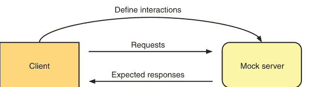

图 4.2 对客户端请求的 Mock 响应

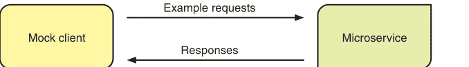

图 4.3 发送到微服务的请求

```json
"version": "3.0.0"
"pact-jvm": {
  "version": "3.5.8"
}
```

**注意** 为了简便起见，我只包含了生成的 JSON 的开头，因为所有的响应数据都非常长。

生成此 JSON 文件后，你现在可以设置消费者驱动合约测试的另一端：验证你的提供者（provider）运行是否符合消费者（consumer）的预期。

为了简单起见，我手动将生成的 JSON 复制到 `/chapter4/admin/src/test/resources/pacts`。对于持续集成环境中的测试，Pact 还有其他方式来存储 JSON，以便在运行提供者测试时自动检索。

为了验证提供者，由于你需要运行一个 admin 微服务的实例，因此你将需要 Maven 来执行 Pact 验证。验证将在 Maven 的集成测试阶段（integration test phase）进行。修改 `pom.xml` 以在集成测试阶段启动和停止 Thorntail 容器。

## 列表 4.12 用于集成测试的 Thorntail 插件执行


```xml
<plugin>
  <groupId>io.thorntail</groupId>
  <artifactId>thorntail-maven-plugin</artifactId>
  <executions>
    <id>start</id>
    <phase>pre-integration-test</phase>
    <goals>
      <goal>start</goal>
    </goals>
    <configuration>
      <stdoutFile>target/stdout.log</stdoutFile>
      <stderrFile>target/stderr.log</stderrFile>
    </configuration>
  </execution>
  <id>stop</id>
  <phase>post-integration-test</phase>
    <goals>
      <goal>stop</goal>
    </goals>
</executions>
<!-- 在 pre-integration-test 阶段启动微服务 -->
<!-- 在 post-integration-test 阶段停止微服务 -->
</plugin>
```

为微服务的日志定义位置。

## 第 4 章 微服务测试

接下来，你添加 Pact 插件，以针对你的提供者执行合约测试。

## 列表 4.13 Pact Maven 插件执行

```xml
<plugin>
  <groupId>au.com.dius</groupId>
  <artifactId>pact-provider-maven_2.12</artifactId>
  <configuration>
    <serviceProviders>
      <serviceProvider>
        <name>admin_service_provider</name>
        <protocol>http://</protocol>
        <host>localhost</host>
        <port>8081</port>
        <path>/</path>
        <pactFileDirectory>src/test/resources/pacts/</pactFileDirectory>
      </serviceProvider>
    </serviceProviders>
  </configuration>
  <executions>
    <execution>
      <id>verify-pacts</id>
      <phase>integration-test</phase>
      <goals>
        <goal>verify</goal>
      </goals>
    </execution>
  </executions>
</plugin>
```

- 定义 `admin` 服务提供者的位置。
- 设置可以找到 Pact 合约文件的目录。
- Pact 验证在 Maven 的 `integration-test` 阶段运行。
- 使用 Pact 插件的 `verify` 目标（goal）。

运行 `mvn verify` 将执行你之前定义的所有测试，但也将 Pact 验证作为最后一步运行。你应该能在终端中看到输出表示执行成功：

```
returns a response which
has status code 200 (OK)
has a matching body (OK)
```

嗯，这看起来很顺畅，但如果不起通会什么样？为了尝试这一点，你可以将以下代码添加到 `CategoryResource.get()` 方法中，在当前的 `return` 语句之前，以便你为 Pact 测试返回一个不同的分类：

```java
if (categoryId.equals(1015)) {
  return em.find(Category.class, 1010);
}
```

如果你再次使用 `mvn verify` 运行测试，你将看到测试失败，输出如下所示：

```
returns a response which
has status code 200 (OK)
has a matching body (FAILED)
```

## 消费者驱动合约测试

失败：

+ 0) 正在验证 `admin_client_consumer` 和 `admin_service_provider` 之间的 pact

- 获取分类返回一个具有匹配 body 的响应

`$.parent.parent.parent.parent` -> 类型不匹配: 期望 `Map Map(parent -> null, -> Top, visible -> true, imagePath -> n/a, version -> 1, id -> 0, updated -> null, header -> header, created -> List(2002, 1, 1, 0, 0)` received `Null null`

```json
Diff:
{
  "parent": null,
  "name": "Top",
  "visible": true,
  "imagePath": "n/a",
  "version": 1,
  "id": 0,
  "updated": null,
  "header": "header",
  "created": [
    2002,
    1,
    1,
    0
  ]
}
```

`$.parent.parent.name` -> 期望 `'Transportation'` 但接收到 `'Top'`

`$.parent.parent.id` -> 期望 `1000` 但接收到 `0`

`$.parent.parent.name` -> 期望 `'Automobiles'` 但接收到 `'Transportation'`

`$.parent.parent.id` -> 期望 `1000` 但接收到 `0`

`$.name` -> 期望 `'Cars'` 但接收到 `'Trucks'`

`$.id` -> 期望 `1015` 但接收到 `1010`

此日志消息提供了关于 ID 和 `name` 的详细信息，以及它是如何不同的。

## 第 4 章 微服务测试

如之前所述，这种差异可能是消费者的错误假设，或者是提供者处的 bug。

### 4.6 额外阅读

正如前面提到的，还有许多类型的测试我将不会涵盖。其中两个关键的是用户验收测试和端到端测试。虽然它们至关重要，但超出了本书的范围，我推荐 Alex Soto、Jason Porter 和 Andy Gumbrecht 写的《Testing Microservices》（Manning, 2018）。

### 4.7 额外练习

这里你可以编写一些额外练习：

- 为 `CategoryTest` 添加一个可以更新的方法。
- 添加一个方法验证可以从数据库中成功删除 `Category`。
- 为 `AdminClient` 添加获取所有分类、添加分类、更新分类和删除分类的方法。然后为 `ConsumerPTest.createPact()` 添加请求响应对，并更新 `ConsumerPTest.runTest()` 执行它们。

如果你执行了这些练习并希望将其包含在书籍的代码中，请提交 pull request。

### 总结

- 单元测试很重要，但测试需求并不仅于此。你需要尽可能真实地测试服务的各个方面。
- Aquillian 是一个很棒的框架，用于简化需要运行时容器交互并提供近生产执行的测试。
- 微服务测试的关键是确保微服务定义的合约（即 API）不仅符合其想要的内容，还符合客户端期望传递和接收的内容。

## 云原生开发

章节涵盖

- 为什么云很重要？
- 什么是云原生开发？
- 将微服务部署到云端需要什么？
- 你的应用程序在云中如何扩展？
- 你可以在生产之前在云中测试应用程序吗？

在本章中，你将扩展第 4 章的 `admin` 服务，使其具备部署到本地云环境的能力，并针对部署到该环境的服务运行测试。

首先，你将了解云以及你可以选择的云供应商。你还将探索在本地机器上运行云的选项。在选择了云类型后，你将修改第 4 章的 `admin` 服务以部署到云中。完成部署后，你将扩展应用程序以展示它如何处理额外的负载，最后通过对部署在云中的应用程序运行测试来结束。

# 到底什么是云？

云和计算在软件工程领域已经存在几十年了。这些术语通常指的是分布式计算平台。直到 20 世纪 90 年代初，它们的用法才变得更加流行。

云的一些优势如下：

- 成本效益——云服务提供商让大型企业使用其服务，并根据消耗的 CPU 时间进行收费。与物理机相比，这显著降低了运行环境的总体成本。
- 可扩展性——云服务提供商提供了根据需要扩展或缩小单个服务的方法，确保你的容量永远不会过剩或过不足。得益于社交媒体，信息的传播可以非常快，因此能够立即扩展相同的实例来处理即时的短期负载是至关重要的。当购买和配置一台机器就需要几个月时间时，企业扩展的速度能有多快？在这种情况下，云服务提供商将通过复制具有相同内存、CPU 等配置的实例来提供扩展能力。
- 选择自由——如果你是一家只用 Java 开发的企业（因为你们的运营人员只于管理 Java），你该如何尝试 Node.js 或 Go 等新编程语言呢？云服务以前所未有的方式将更多语言带到你的指尖。你不需要具备内部维护新语言环境的经验；这正是云所提供的！

# 服务模型

图 5.1 显示了云的多种类型服务模型，以及应用程序在其中的定位。在插图中，应用程序在服务器上有其代码。如果你有一个纯移动端或基于浏览器的应用程序，通过软件即服务（SaaS）与一个或多个服务交互，它仍然是一个应用程序，但不是此处描述的那种应用程序。在这种语境下，应用程序可以是一个可执行的 JAR 文件，或者是部署到应用程序服务器的 WAR 或 EAR 文件。

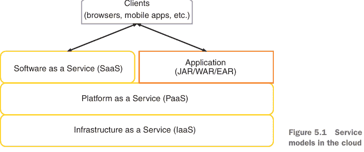

# 服务模型

让我们简要描述一下每一个：

- 基础设施即服务 (IaaS)——对网络基础设施提供抽象，包括计算资源、数据分区、扩展和备份。IaaS 通常涉及一个运行虚拟机作为客户的虚拟化监视器（hypervisor）。使用 IaaS 需要构建一个可以部署到环境中的虚拟机。著名的 IaaS 提供商有 Amazon Web Services、OpenStack、Google Compute Engine 和 Microsoft Azure。
- 平台即服务 (PaaS)—在 IaaS 之上形成一个层，提供开发环境，包括操作系统、各种编程语言的执行环境、数据库和 Web 服务器。PaaS 让开发者不再需要购买、安装和配置硬件及软件来为部署应用程序提供环境。流行的 PaaS 提供商包括 Red Hat OpenShift、Google App Engine、IBM Bluemix、Cloud Foundry、Microsoft Azure 和 Heroku。
- 软件即服务 (SaaS)—根据需要或按需提供常见的应用程序组件，有时是整个应用程序。SaaS 通常按使用次数收费。SaaS 可以从与营销相关的利众服务到从端到管理企业的整个 SaaS 套件。市场上存在许多 SaaS 提供商，每天都有新的涌现。一些著名的有 Salesforce、Eloqua、NetSuite 和 Cloud9。

在过去的几年里——容器的兴起，特别是 Docker 作为容器解决方案的流行——云服务模型中创建了一个新层。

5.2 引入了容器即服务 (CaaS) 作为 PaaS 提供商的新基础。SaaS 利用 Docker 等容器技术，来简化多个应用程序或服务的部署、扩展和管理。

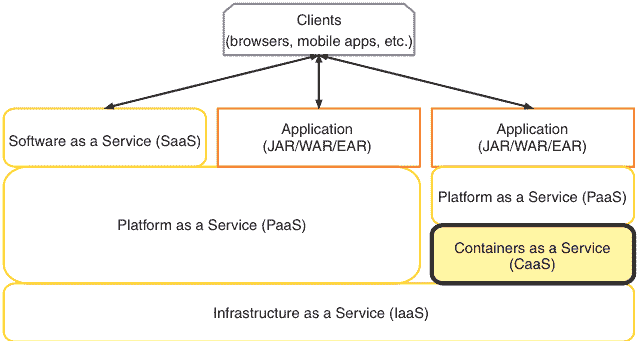

图 5.2 容器云服务模型

容器允许你将任何应用程序或服务封装到自己的操作系统环境中，带有任何可能需要的自定义软件或配置，同时与传统的虚拟机相比，还能减小生成的镜像尺寸。

CaaS 以及通用容器的另一个主要优势是它们的不可变性（immutable nature）。当容器镜像源自该容器的特定版本时，对该容器的任何更新都需要构建新的容器镜像和版本。可变部署很久以前就被部署不可变且可能导致应用程序损坏的部署所取代。不可变容器可以通过 CI/CD 流程，以便在发布到生产环境之前验证容器运行符合预期。

目前，最流行的 CaaS 提供商是 Kubernetes。Kubernetes 由 Google 创建，并深受其内部管理容器化应用程序方式的影响。之前的 PaaS 提供商已经转向构建在 CaaS 之上，特别是 Kubernetes之上。Red Hat OpenShift 就是其中一个利用 Kubernetes 作为其 CaaS 的 PaaS。

CaaS 是管理部署的最佳方式，但你并不总是想要低层次的东西。通常，我们理想的环境是构建在 CaaS 之上的 PaaS，例如 Red Hat OpenShift。

### 5.3 云原生开发

你可能听过“云原生开发”这个术语，但新术语不断出现，因此澄清其定义并无害。云原生开发是为部署到云环境而开发应用程序的过程，在云环境中，可以利用松耦合云服务的优势。

转向这种开发模式需要在开发时进行思维上的转变，因为你不再关心应用程序所需的外部服务的细节。你只需要知道会有一个服务即可。

# 云原生开发

这个概念与为数据库提供特定环境配置并没有太大区别，我们多年来一直都是这么做的。但随着服务目录工作的持续，我们可能会达到一个不再需要通过环境变量连接外部服务的点。数据库客户端可能会被注入服务中。

云原生开发听起来很棒，但如果你每次都要将其部署到云端，你该如何快速测试和调试你的服务呢？这不会降低你的开发速度吗？

但如果你能把云，或者尽可能接近生产云的东西，带到本地开发机器上呢？这将大大加快从代码更改到生效的往返时间。云供应商提供这样的东西吗？有些提供！

Minikube 是第一个可以在本地机器上运行的单节点 Kubernetes 集群。它唯一只需要你的机器上有一个虚拟环境（如 VirtualBox、Hyper-V 或 xhyve），Minikube 可以利用它在你的机器上创建虚拟集群。

自从 Minikube 形成，Minishift 成立以扩展 Minikube，内置了一个单节点 OpenShift 集群的 PaaS。Minishift 使用 OpenShift 的上游 OpenShift Origin 作为 PaaS。回顾 CaaS 如何融入服务模型，图 5.3 显示了 Minishift 提供的内容。

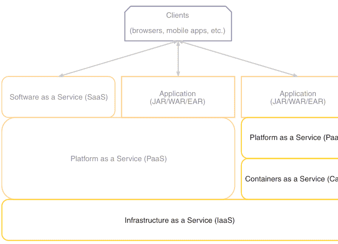

图 5.3 Minishift 提供的内容

直接使用 CaS（如 Kubernetes）并没有问题，但在其之上使用 PaaS 有许多优势。其中一个主要优势是提供了一个美观的 UI，用于可视化已部署的内容。由于其设置简单，且加上我们倾向于使用 PaaS 而非 CaS，我们将使用 Minishift 来创建我们的本地云环境。

### 5.4 部署到云端

与云所提供的服务模型不同，云还可以有三种部署模型：

- 私有云——仅供单一企业使用的云，通常托管在内部内部。
- 公有云——云中的服务可以通过公共网络访问。它与私有云的主要区别在于安全性。无论是微服务还是数据库，它们都需要更严密的安全服务，因为这些服务可以在公共网络上被访问。
- 混合云——公有云和私有云的结合。这些云中的都可能使用不同的供应商。混合云部署模型正在迅速成为最常见的模式，因为它兼顾了双者的优势，特别是在想要增加容量和进行规模扩展时。

Minishift 本质上是为你提供了一个运行在本地机器上的专属云实例。Minishift 内部的 PaaS（即 OpenShift）与在公有云或混合云中使用的 PaaS 是同一个。区别在于它运行在本地。

无论你是使用云部署微服务、单体应用还是其他任何，将部署推送到云端的方式没有区别。唯一的区别可能是，微服务更有可能拥有 CI/CD 流程并自动发布到生产环境；而单体应用的部署可能比自动部署需要更多的协调。

### 5.5 启动 Minishift

你需要安装的第一个件事是在本地机器上安装 Minishift。访问 http://mn.bz/vw6g 并按照指令安装必要的先条件（如果尚未安装），然后安装 Minishift。

> 示例已使用 Minishift 1.12.0 和 OpenShift 3.6.1 进行过测试。

安装 Minishift 后，打开终端窗口并使用默认设置启动它：

```
minishift start
```

默认情况下，这将为你提供一个具有两个虚拟 CPU、2 GB 内存和 20 GB 硬盘空间的虚拟机。终端会提供 Minishift 在启动时正在执行的操作详情，包括正在安装哪个版本的 OpenShift Origin。安装完成后，最后输出将提供 Web 控制台的 URL 以及开发者和管理员账户的登录凭据：

OpenShift server started.

可以通过 web 控制台访问服务器：

https://192.168.64.11:8443

你登录身份为：

User: developer

Password: <any value>

要以管理员身份登录：

oc login -u system:admin

对于你大多数需要的操作，无论是通过 Web 控制台还是通过 OpenShift 命令行界面 (CLI)，都需要开发者凭据。还有一种方便的方法可以启动 OpenShift Web 控制台，无需记住 URL 和端口：

```
minishift console
```

该命令会直接在浏览器中打开 Web 控制台的登录页面。登录后，控制台界面如图 5.4 所示。

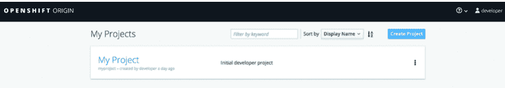

图 5.4 OpenShift Web 控制台

默认情况下，全新的 OpenShift 实例会为你创建一个名为 My Project 的空项目。你可以选择删除它并创建自己的，或者直接使用它；这种选择并不重要。


你现在有了一个可以部署服务的云，但你首先需要让你的服务能够部署到它。

## 5.6 微服务云部署

你将采用第 4 章中更新的 `admin` 服务，并添加必要的配置以支持部署到云端。

目前为止，部署应用程序最简单的方法是使用 `fabric8` Maven 插件 (https://maven.fabric8.io/)。该插件的一个巨大优势是可以将 Java 应用带到 OpenShift 或 Kubernetes！你可以从零开始配置部署，添加你所需的任何配置。

让我们从修改 `pom.xml` 开始，在名为 `openshift` 的 profile 中包含该插件。

### 列表 5.1 用于 OpenShift 部署的 Maven profile

```xml
<profile>
  <id>openshift</id>
  <build>
    <plugins>
      <plugin>
        <groupId>io.fabric8</groupId>
        <artifactId>fabric8-maven-plugin</artifactId>
        <version>3.5.33</version>
        <executions>
        <execution>
          <goals>
            <goal>resource</goal>
            <goal>build</goal>
          </goals>
        </execution>
        </executions>
      </plugin>
    </plugins>
  </build>
</profile>
```

在容器中生成应用程序的 Docker 镜像

创建 Kubernetes 或 OpenShift 资源描述符

插件中定义的 goal（目标）告诉它你希望它做什么。通过此配置，插件将为 OpenShift 创建必要的资源描述符，然后使用 Docker 构建一个包含你部署内容的容器。这段代码的作用与你直接使用 Docker 创建镜像无区别，但它省去了每次需要时都要记住正确命令的麻烦！

我提到插件会为这些生成资源描述符，那么 Service 呢？请看此列表。

### 列表 5.2 用于 OpenShift 部署的 Service

```json
{
  "apiVersion": "v1",
  "kind": "Service",
  "metadata": {
    "name": "admin",
    "labels": {
      "app": "admin"
    }
  },
  "spec": {
    "selector": {
      "app": "admin"
    },
    "ports": [
      {
        "protocol": "TCP",
        "port": 80,
        "targetPort": 8080
      }
    ],
    "type": "ClusterIP"
  }
}
```

## 微服务云部署

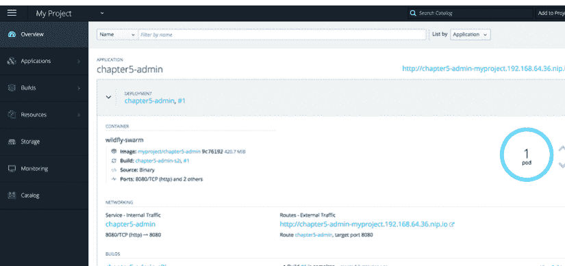

图 5.5 OpenShift Web 控制台，显示了管理服务

点击外部流量的 URL 将在浏览器中打开服务根 URL 的新窗口。由于管理服务在 `/` 下没有提供任何内容，你需要修改浏览器中的 URL 以包含 `/admin/category`，才能看到从数据库中检索的 JSON 数据。

在管理服务运行的情况下，你运行的该服务的实例规模是多少？在 OpenShift 控制台中，扩展缩非常简单。你只需要展开 `chapter5-admin` 部署部分（如果它尚未展开），如图 5.6 所示。点击蓝色圆圈旁边的箭头，它表示当前 pod 的数量。与之前一样，pod 是 Kubernetes

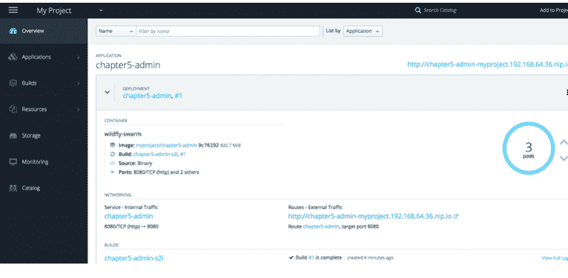

图 5.6 管理服务 pod 实例

容器化部署的术语，但本质上它是给定服务的实例数量。

在这里你可以看到 pod 的数量已从默认的 1 增加到 3。打开几个私有浏览器窗口，并在每个窗口中多次访问 `/admin/category` 的端点。然后返回 OpenShift 控制台，查看运行的每个 pod 的日志。你应该能看到针对不同 pod 执行的 SQL 调用。

如果你想移除管理服务，只需可以通过以下命令轻松地从 OpenShift 中将其移除：

```
mvn fabric8:undeploy OpenShift
```

> 警告：在部署你的服务时，你没有使用 Maven clean 目标。fabric8 将文件存储在 `/target` 中，这些文件包含了所有部署到 OpenShift 的资源详细信息。如果你在部署之前清理了它们，fabric8 完全不知道它正在尝试卸载什么，并将无法执行任何操作。

你现在可以在本地运行的 Minishift 中向 OpenShift 部署和卸载管理服务，但你能以同样的方式执行测试吗？这就是下一节的内容！

## 5.7 云端测试

由于你能够使用 Minishift 将管理服务部署到本地云，你是否也可以使用本地云来测试它？你当然可以！

为了开发与 OpenShift 集成的测试，你将使用 Arquillian 生态系统的扩展程序 Arquillian Cube (http://arquillian.org/arquillian-cube/)。Arquillian Cube 通过提供控制 Docker 容器执行的钩子，让你具备了针对 Docker 容器运行测试的能力。虽然 OpenShift 不仅仅是 Docker（因为它使用 Docker 作为其容器镜像），但你仍然可以使用 Arquillian Cube 来控制部署并对其运行测试。

在云中执行测试与集成测试可以实现的成果相比，优势是什么？这完全归结于希望在一个尽可能接近生产环境环境中测试你的微服务。如果你在云中将微服务部署到生产环境，那么发现部署问题的最佳机会就是也能将你的测试部署到云。为了做到，你需要在 `pom.xml` 中添加以下内容。

### 列表 5.3 Arquillian Cube 依赖

```xml
<dependencyManagement>
  <dependencies>
    <dependency>
      <groupId>org.arquillian.cube</groupId>
      <artifactId>arquillian-cube-bom</artifactId>
      <version>1.12.0</version>
      <type>pom</type>
      <scope>import</scope>
    </dependency>
  </dependencies>
</dependencyManagement>

<dependencies>
  <dependency>
    <groupId>org.arquillian.cube</groupId>
    <artifactId>arquillian-cube-openshift</artifactId>
    <scope>test</scope>
    <exclusions>
      <exclusion>
        <groupId>io.undertow</groupId>
        <artifactId>undertow-core</artifactId>
      </exclusion>
    </exclusions>
  </dependency>
  <dependency>
    <groupId>org.awaitility</groupId>
    <artifactId>awaitility</artifactId>
    <version>3.0.0</version>
    <scope>test</scope>
  </dependency>
</dependencies>
```

由于你还想在云之外运行测试，尽管第 5 章的代码目前已删除了它们，但你需要一个单独的配置来激活你为云、OpenShift 的测试：

```xml
<profile>
  <id>openshift-it</id>
  <build>
    <plugins>
      <plugin>
        <groupId>org.apache.maven.plugins</groupId>
        <artifactId>maven-failsafe-plugin</artifactId>
        <executions>
          <execution>
            <goals>
              <goal>integration-test</goal>
              <goal>verify</goal>
            </goals>
          </execution>
        </executions>
      </plugin>
    </plugins>
  </build>
</profile>
```

在这里你告诉 Maven，你希望 `maven-failsafe-plugin` 执行你的测试、集成测试目标，然后验证结果。

现在是时候创建你的测试了！你将创建一个与第 4 章中某个集成测试相似的测试，但它将在你的云、OpenShift 上执行，而不是本地实例。fail-safe 插件要求在测试类名中包含 `IT` 来激活它，你将其命名为 `CategoryResourceIT`。

### 列表 5.4 CategoryResourceIT

```java
@RunWith(Arquillian.class)
public class CategoryResourceIT {
    @RouteURL("chapter5-admin")
    private URL url;

    @Before
    public void verifyRunning() {
        await().atMost(2, TimeUnit.MINUTES)
            .until(() -> {
                return get(url + "/category").statusCode() == 200;
            });
    }

    RestAssured.baseURI = url + "/category";

    @Test
    public void testGetCategory() throws Exception {
        Response response = given()
            .pathParam("categoryId", 1014)
            .when()
            .get("/{categoryId}")
            .statusCode(200)
            .extract().response();

        String jsonAsString = response.asString();
        Category category = JsonPath.from(jsonAsString).getObject(Category.class);

        assertThat(category.getId()).isEqualTo(1014);
        assertThat(category.getParent().getId()).isEqualTo(1011);
        assertThat(category.getName()).isEqualTo("Ford SUVs");
        assertThat(category.isVisible()).isEqualTo(true);
    }
}
```

> 注入指向 OpenShift 的 `chapter5-admin` URL。

> 等待最多 2 分钟直到 `/admin/category` 返回 200。

> 设置供 RestAssured 使用根 URL。

> 获取 ID 为 1014 的类别，确保返回 200。

> 验证收到的类别详情符合你的预期。

是时候测试它了！

## 总结

首先你需要确保 Minishift 正在运行，并且你最近通过 `oc login` 登录过。身份验证会过期！如果一切就绪，运行以下命令：

```
mvn clean install -Popenshift -openshift-it
```

在这里你激活了 `openshift` 和 `openshift-it` 配置。但如果没有 `openshift` 配置，管理服务将不会部署到 OpenShift！如果服务成功部署且测试通过，终端应该显示 Maven 构建无误。

你仅仅接触了使用 `fabric8` Maven 插件 Minishift 的冰山，但你已经拥有了自己探索的坚实基础。一段时间内可能不会再次使用 Minishift，让我们先停止它：

```
minishift stop
```

## 5.8 额外练习

这里有一些额外的练习，可以帮助加深你对 OpenShift 的理解，并改进示例代码：

- 在在 OpenShift 上运行时，将管理服务的部署更改为 PostgreSQL 或 MySQL。

- 为 `CategoryResourceIT` 添加创建类别的测试方法，以及另一个验证名称失败的测试方法。

如果你接受了这些练习并希望将它们包含在书籍的代码中，请向 GitHub 上的项目提交拉请求（pull request）。

## 总结

- 通过选择内部使用 SaaS 的平台服务（PaaS），你可以利用不可变容器镜像的优势。

- Minishift 在你的本地机器上提供了一个带有 OpenShift 的云环境，从而简化了微服务的执行和测试，而无需配置大量机器。

- `fabric8` Maven 插件消除了在 OpenShift 或 Kubernetes 中定义资源和服务所需的全部样板代码，减少了在云中运行微服务之前的配置门槛。

# 第二部分：实现企业级 Java 微服务

在第二部分中，我们将深入探讨微服务开发，涵盖诸如消费其他微服务、服务注册与发现、容错和安全性等主题。

这六章还涵盖了如何从 Cayambe 单体应用（monolith）开发微服务混合体，并会使用你在整本书中开发的微服务。最后，在学习微服务之间以及混合模式之间共享数据时，你将学习使用 Kafka 数据流。

## 消费微服务

- 本章涵盖了

- 如何消费微服务

- 你在消费微服务时的选择

对于许多人来说，消费微服务可能意味着许多含义。微服务的客户端可以是脚本、网页、其他微服务，或几乎任何可以发送 HTTP 请求的程序。如果我们涵盖了所有情况，这一章本身就可以写成一本书了！

开发微服务是有趣的，但在引入许多相互作用的微服务之前，你并无法走得远。为了让两个服务能够相互作用，你需要一种让一个服务调用另一个服务的方法。

本章提供了侧重于使用 Java 库一个微服务消费另一个服务的示例，但所展示的方法同样适用于任何消费微服务的通用 Java 客户端。

对于企业级 Java，两个服务将通过直接服务调用进行交互，如图 6.1 所示。

# 第 6 章 消费微服务

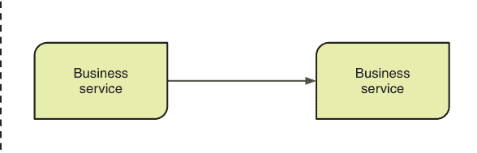

图 6.1 企业级 Java 业务服务调用

服务调用可以通过方式实现：

- 使用 EJB  EJB 注入

- 使用 CDI 的 `@Inject`

- 通过静态方法或变量获取服务实例

- Spring 依赖注入（基于 XML 或基于注解）

所有这些选项都需要你的两个服务位于同一个 JVM 和运行环境中，如图 6.1 所示。

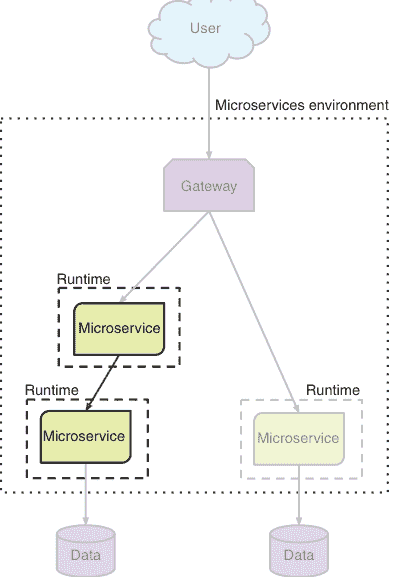

图 6.2 消费微服务

在图中，一个微服务正在调用另一个微服务。在图示中，它们处于同一个微服务环境中，但并非必须如此。回顾图 1.4，图 6.2 突出了本章的重点：解决位于不同运行环境的两个微服务之间进行通信的方法。

在我们的特殊情况下，你将从第 2 章获取 Cambambe 管理微服务，并使用不同的库为它开发客户端。图 6.3 说明了微服务客户端所在的位置；在最终方案到位之前，你使用一种短期方法获取数据。

你将首先查看使用直接处理 HTTP 请求的低级库来消费微服务。因为它们直接处理 HTTP 请求，所以它们可以用于没有暴露 RESTful 端点的微服务。你将学习专门设计用于简化调用 RESTful 端点所需代码的客户端库。它们对 HTTP 请求提供了更高层次的抽象，这将显著简化客户端代码，正如我们在示例中所看到的。本节的代码可以在书籍示例的 `/chapter6` 目录中找到。

Cayambe EAR

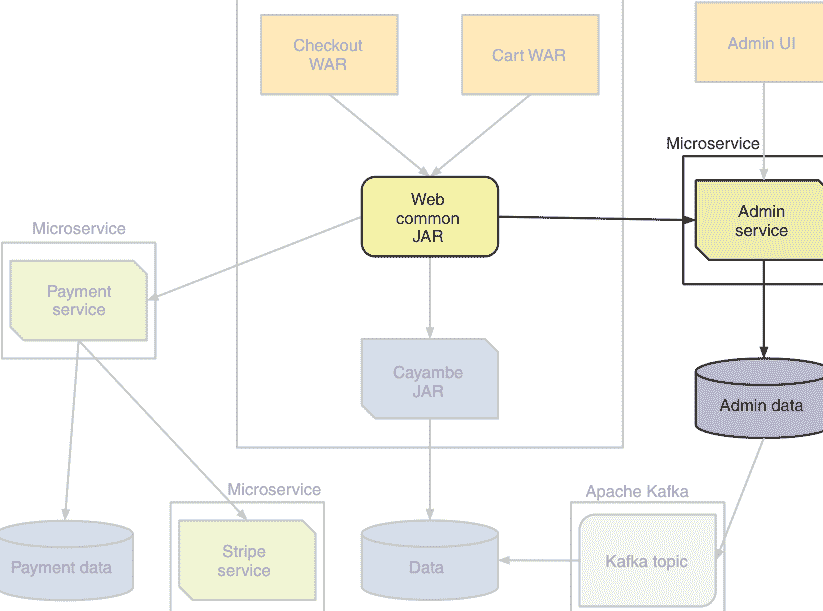

图 6.3 Cambambe 管理微服务客户端

# 第 6 章 消费微服务

对于每个客户端库，将实现一个服务来调用 `CategoryResourceRESTful` 端点（该端点你在第 2 章创建），并将接收到的数据作为响应返回给调用者：

你可以设置 `CategoryResource` 启动的端口以防止与其他微服务的端口冲突。你在 Maven 插件中将 `swarm.port.offset` 属性设置为 1。

这些服务中的每一个都需要一个对象来表示你从管理服务收到的分类 JSON。为了方便起见，每个客户端库 Maven 模块将拥有自己的 `Category` 对象，它将用于反序列化来自管理服务的响应。

### 列表 6.1 Category 模型类


```java
@JsonIdentity(generator = ObjectIdGenerators.PropertyGenerator.class,
property = "id")
public class Category {
    protected Integer id;
    protected String name;
    protected String header;
    protected Boolean visible;
    protected String imagePath;
    protected Category parent;
    private Collection<Category> children = new HashSet<>();
    protected LocalDateTime created = LocalDateTime.now();
    protected LocalDateTime updated;
    protected Integer version;

    }
```

> 将 `ID` 定义为 `Category` 的键，用于反序列化收到的以 JSON 格式的子节点集合

> 初始化子节点集合以确保你始终有一个有效的集合，即使它是空的

为了简洁起见，省略了 `getter` 和 `setter` 方法，但 `Category` 的完整源码可以在书籍源码中找到。

此外，这些服务中的每一个都需要访问 `ExecutorService` 以提交任务并在新线程中进行处理。你使用 Java EE 提供的服务，以便所有服务都以相同的方式获取：

```java
private ManagedExecutorService executorService() throws Exception {
    InitialContext ctx = new InitialContext();
    return (ManagedExecutorService) ctx.lookup("java:jboss/ee/concurrency/default");
}
```

## 使用 Java 客户端库消费微服务

这会对服务进行 JNDI 查询并返回你可以用于提交的实例。

> 注意：`Executor` 由 WildFly 为你定义。你不需要做任何操作即可使其在 JNDI 中可用。

你的服务可以很容易地为所需的工作创建一个新 `Thread`，但你的新线程将位于 Java EE 管理之外。作为一般原则，最好直接创建线程，但使用 `ExecutorService`。

由于你想展示同步和异步使用场景如何导致不同的消费微服务的客户端代码，你使用客户端库的每个资源将包含两个端点：

- `/sync`—同步处理来自调用者的请求

- `/async`—异步处理来自调用者的请求

### 6.1 使用 Java 客户端库消费

在本节中，你将看到使用低级库直接处理 HTTP 请求来消费微服务的示例。虽然这导致了更冗余的代码和额外的数据处理，但它确实为调用方式提供了最大的灵活性。例如，如果一个微服务需要与多种类型的 HTTP 资源通信，使用这些库可能是更好的选择，因为没有必要仅为了 RESTful 端点交互再添加另一个库。

### 6.1.1 `java.net`

`java.net` 包中的类从 JDK 之初就是其组成部分。尽管它们在多年里得到了增强和更新，但它们侧重于底层的 HTTP 交互。它们完全不是为了消费 RESTful 端点的，因此需要编写某些繁琐的代码。

让我们来看 `DisplayResource` 的第一个方法。

代码列表 6.2 使用 `java.net` 的 `DisplayResource`

```java
@GET
@Path("/sync")
@Produces(MediaType.APPLICATION_JSON)
public Category getCategoryTreeSync() throws Exception {
    HttpURLConnection connection = null;
    try {
        URL url = new URL(this.categoryUrl);
        connection = (HttpURLConnection) url.openConnection();
        connection.setRequestMethod("GET");
        connection.setRequestProperty("Accept", MediaType.APPLICATION_JSON);
        if (connection.getResponseCode() != HttpURLConnection.HTTP_OK) {
            throw new RuntimeException("Request Failed: HTTP error " + connection.getResponseCode());
        }
        ObjectMapper objectMapper = new ObjectMapper();
        objectMapper.registerModule(new JavaTimeModule());
        return objectMapper.readValue(connection.getInputStream(), Category.class);
    } finally {
        if (connection != null) {
            connection.disconnect();
        }
    }
}
```

你正在处理一个简单的 RESTful 端点，客户端代码按原样与其通信，而且这还是同步的！

下一个列表显示了如果你想异步处理对你微服务的客户端请求，代码将如何变化。

代码列表 6.3 异步使用 `java.net` 的 `DisplayResource`

```java
@GET
@Path("/sync")
@Produces(MediaType.APPLICATION_JSON)
public void getCategoryTreeAsync() {
    @Suspended final AsyncResponse asyncResponse
    throws Exception {
}
```

# 使用 Java 客户端库消费微服务

`executorService().execute(() -> {`

    // 将 lambda 表达式传递给执行器进行处理。

    `HttpURLConnection connection = null;`

    `try {`

      // 打开连接、检查状态码

      // 处理响应的代码与同步示例相同，

      // 已移除。

      `asyncResponse.resume(category);`

    `} catch (IOException e) {`

      `asyncResponse.resume(e);`

    `} finally {`

      `assert connection != null;`

      `connection.disconnect();`

    `}`

    // 使用反序列化的 `category` 实例恢复 `AsyncResponse`。

    // 使用异常恢复 `AsyncResponse`。

该列表引入了你以前没过的概念——即 `@Suspended` 和 `AsyncResponse`。这两个部分是 JAX-RS 异步处理客户端请求的核心。`@Suspended` 通知 JAX-RS 运行时，客户端的 HTTP 请求应该被挂起，直到响应就绪。`AsyncResponse` 指明开发者如何通知运行时响应已就绪或完成失败。它看起来是什么样？看图 6.4。

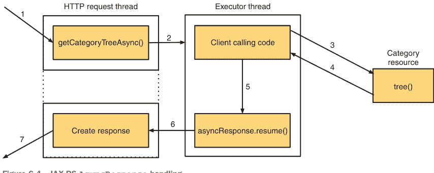

以下是图 6.4 中每一步发生的情况：

- 1. 来自浏览器或另一个客户端的 HTTP 请求到达。

- 2. `getCategoryTreeAsync()` 触发在单独线程中执行的代码。在 `getCategoryTreeAsync()` 完成后，客户端请求被挂起，处理它的 HTTP 请求线程被释放以处理额外的请求。

# 第 6 章 消费微服务

- 3. 向外部微服务发送 HTTP 请求。

- 4. 从外部微服务接收 HTTP 响应。

- 5. 将响应数据传递给 `asyncResponse.resume()`。

- 6. 客户端请求在 HTTP 请求线程中重新激活，并构建响应。

- 7. 将响应返回给浏览器或任何请求过它的客户端。

**警告** 在 RESTful 端点中使用 `@Suspended` 并不会防止调用端点的客户端阻塞。它通过允许更大的请求吞吐量来使请求的服务端获益。如果不使用 `@Suspended`，JAX-RS 资源只能处理等于可用线程数量的请求，因为每个请求都会阻塞线程直到方法完成。

现在你已经构建了服务，可以启动它们了。

进入书籍示例代码的 `/chapter6/admin` 目录并运行此命令：

```bash
mvn thorntail:run
```

`CategoryResource` 将启动并可以在浏览器中通过 `http://localhost:8081/admin/category-resource` 访问。

现在你启动 `DisplayResource`。进入 `/chapter6/java-net-directory` 目录并运行此命令：

```bash
mvn thorntail:run
```

现在可以通过在浏览器访问微服务了：`http://localhost:8080/sync` 和 `http://localhost:8080/async`。在浏览器中打开任一对应的 URL 都将显示当前管理微服务中存在的分类树。

### 6.1.2 Apache HttpClient

使用 Apache HttpClient，你获得了一个对在 `java.net` 中使用的类的抽象，减少了与底层 HTTP 连接交互时所需的代码。`DisplayResource` 中的代码与你之前的代码没有巨大区别，但它提高了代码的可读性。

例如，让我们看看 `DisplayResource` 的第一个方法。

| 代码列表 6 使用 HttpClient 的 `DisplayResource` |

| :--- |

```java
@GET
@Path("/sync")
@Produces(MediaType.APPLICATION_JSON)
public Category getCategoryTreeSync() throws Exception {
    try (CloseableHttpClient httpclient = HttpClient.createDefault()) {
```

[第 125 页]

# 使用 Java 客户端库消费微服务

| 使用 Java 客户端库消费微服务 |

| :--- |

| 执行 `HttpGet`，传递一个 `Response` 的处理器。 |

| 使用 `@Suspended` 指示 JAX-RS 请求将被挂起。 |

| 使用 URL 创建新的 `HttpGet` 实例。 |

| 使用 `addHeader("Accept", MediaType.APPLICATION_JSON);` |

| 使用 `httpclient.execute(get, response -> { ... });` |

| 获取 `status = response.getStatus();` |

| 如果 (`status >= 200 && status < 300`) { |

| 使用 `ObjectMapper` 注册 `JavaTimeModule`。 |

| 返回 `mapper.readValue(response.getEntity(), Category.class);` |

| 否则 { 抛出 `ClientException("Unexpected response " + status);` |

再次，这种方法与我们的同步方法相似，但你使用了 `@Suspended`。代码列表 6.5 使用 HttpClient 和 `@Suspended` 的 `DisplayResource`

```java
@GET
@Path("/async")
@Produces(MediaType.APPLICATION_JSON)
public void getCategoryTreeAsync(@Suspended final AsyncResponse<HttpEntity> asyncResponse) throws Exception {
    executorService.execute(() -> {
        try (CloseableHttpClient httpClient = HttpClient.createDefault()) {
            HttpGet get = new HttpGet(this.categoryUrl);
            // 打开连接、检查状态码
            // 处理响应的代码与同步示例相同，
            // 已移除。
            asyncResponse.resume(category);
        } catch (IOException e) {
            asyncResponse.resume(e);
        }
    });
}
```

如果你已经在 `http://localhost:8081` 运行了 `CategoryResource` 微服务，你可以使用 Apache HttpClient 启动你的新微服务。**警告** 在运行此操作之前，你需要停止任何之前运行的微服务，因为它们使用相同的端口。

进入 `/chapter6/apache-client-directory` 目录并运行此命令：

```bash
mvn thorntail:run
```

现在可以通过在浏览器访问微服务了：`http://localhost:8080/sync` 和 `http://localhost:8080/async`。通过之前的微服务，你将看到当前管理微服务中存在的分类树。

## 6.2 使用 JAX-RS 客户端库消费微服务

本节引入了抽象级别比 HTTP 更高的客户端库。这两个库都提供了专门专门为用于与 JAX-RS 端点通信而设计的 API。

### 6.2.1 JAX-RS 客户端

JAX-RS 多年来被定义为 Java EE JSR 311 和 JSR 339 规范的一部分。作为这些规范的一部分，JAX-RS 有一个客户端 API，为开发者提供更清晰的方法来调用 RESTful 端点。

那么使用 JAX-RS 客户端库的好处是什么呢？它让你忘记连接到 RESTful 微服务所需的低级 HTTP 连接，以及所需的元数据，例如：

- HTTP 方法

- 要传递的参数

- 参数和返回类型的 `MediaType` 格式

- 所需的 Cookie

- 消费 RESTful 微服务所需的任何其他元数据

当使用 JAX-RS 客户端库时，你需要注册一个处理器来处理在处理响应时将 JSON 反序列化为实例。为此，你需要下面的代码列表，我们将在后续示例中使用它。

| 代码列表 6.6 `ClientJacksonProvider` | 为 `ObjectMapper` 实例提供 `ContextResolver`。 |

| :--- |

```java
创建一个新的 ObjectMapper 实例。
public class ClientJacksonProvider implements ContextResolver<ObjectMapper> {
    private final ObjectMapper mapper = new ObjectMapper()
```

## 使用 JAX-RS 客户端库消费微服务

```
@Override
registerModule(new JavaTimeModule());
public ObjectMapper getContext(Class<?> type) {
    return mapper;
}
```

注册 `JavaTimeModule` 以处理 `LocalDateTime` 转换。

当请求时，返回你创建的 `ObjectMapper` 实例。

再次，从你的同步示例端点开始。

## 列表 6.7 使用 JAX-RS 客户端 `DisplayResource`

```java
@GET
@Path("/sync")
@Produces(MediaType.APPLICATION_JSON)
public Category getCategoryTreeSync() {
    Client client = ClientBuilder.newClient();

    return client
        .register(ClientJacksonProvider.class)
        .target(this.categoryUrl)
        .request(MediaType.APPLICATION_JSON)
        .get(Category.class);
    // 发起 HTTP GET 请求并将响应转换为 Category。
}
```

创建一个 JAX-RS 客户端。

指定你的响应应该返回的内容。

注册你在列表 6.6 中定义的提供程序（provider）。

将客户端的目标设置为 `CategoryResourceURL`。

将之前的列表与纯 JAX 客户端库相比，你为调用外部微服务编写了一段显显著简化且更连贯的代码。

这重要吗？从执行请求和处理响应所需的功能方面来说，完全不重要。这并没有开发者能多容易理解现有代码或开发新代码的程度那么关键。交由你决定，但我更喜欢看到前面的示例，而不是我们目前看到的任何其他内容。

JAX-RS 客户端库可以提高你用于异步使用的代码可读性吗？请看下一个列表。


# 列表 6.8 使用 JAX-RS 客户端和 @Suspended 的 DisplayResource

```java
@GET
@Path("/async")
@Produces(MediaType.APPLICATION_JSON)
public void getCategoryTreeAsync(@Suspended final AsyncResponse
    asyncResponse) throws Exception {
    executorService.execute(() -> {
        Client client = ClientBuilder.newClient();

        try {
            Category category = client.target(this.categoryUrl)
                .register(ClientJacksonProvider.class)
                .request(MediaType.APPLICATION_JSON)
                .get(Category.class);

            asyncResponse.resume(category);
        } catch (Exception e) {
            asyncResponse.resume(Response
                .serverError()
                .entity(e.getMessage())
                .build());
        }
    });
}
```

在所有异步使用中，你使用 `@Suspended` 和 `AsyncResponse`。你还使用 `ManagedExecutorService` 为处理调用提供一个新线程，并使用 `asyncResponse.resume()` 设置响应。

你可以验证 JAX-RS 客户端库本身的异步功能。

# 列表 6.9 使用 JAX-RS 客户端和 InvocationCallback 的 DisplayResource

```java
@GET
@Path("/asyncAlt")
@Produces(MediaType.APPLICATION_JSON)
public void getCategoryTreeAsync(@Suspended final AsyncResponse asyncResponse) {
    Client client = ClientBuilder.newClient();
    WebTarget target = client.target(this.categoryUrl)
        .register(ClientJacksonProvider.class)
        .request(MediaType.APPLICATION_JSON)
        .get(new InvocationCallback<Category>() {
            @Override
            public void completed(Category result) {
                asyncResponse.resume(result);
            }
            @Override
            public void failed(Throwable throwable) {
                throwable.printStackTrace();
                asyncResponse.resume(Response
                    .serverError()
                    .entity(throwable.getMessage())
                    .build());
            }
        });
}
```

表明你希望调用是异步的。

第二个异步版本更改了你的代码中哪些部分在新线程中执行，但它并没有结束结果。在 `getCategoryTreeAsync()` 中，你将所有的 RESTful 端点代码传递到新线程中，以便 HTTP 请求可以像处理时一样快地解除阻塞。`getCategoryTreeAsyncAlt()` 的不同之处在于它只在新线程中执行对每个微服务的 HTTP 请求。执行 HTTP 请求所需的所有代码都在与客户端线程相同的线程中发生。

由于 `getCategoryTreeAsyncAlt()` 使用了开启时间长的 HTTP 请求，它会导致每个客户端在线程上的阻塞时间超过需要，从而降低了 RESTful 端点的吞吐量。尽管影响可能很小，但在请求数量足够大的情况下，影响是存在的。

那么，为什么要展示一个负面影响吞吐量的劣质方法？首先，作为展示有许多方法可以实现类似目标的一种。其次，微服务的并发客户端请求可能不够大，以至于这种性能影响无法察觉并引起问题。在这种情况下，开发者可能比任何替代方案都喜欢回调——因为当一个选项不影响性能时，这是一个合理的选择。

在切换到 JAX-RS 客户端库时，你简化了调用代码并使其更容易理解。这确实让它变得比低级库开发起来更愉快，但在灵活性方面付出了代价的。

丢失了哪种灵活性？对于大多数情况，JAX-RS 客户端库不会产生任何影响，但使用二进制协议的微服务将更加困难。取决于协议的不同，它可能需要开发自定义的处理程序和提供程序，或者引入提供此类功能的额外第三方库。

切换到 `/chapter6/jaxrs` 并运行：

```bash
mvn wildfly:run
```

可以通过浏览器访问微服务：http://localhost:8080/sync 和 http://localhost:8080/async。通过我们的示例，你会看到分类树。

# 6.2asy 客户端

REasy 是 JAX-RS 规范的一种实现，在 WildFly 中可用。它的许多部分与 JAX-RS 提供的相同，REasy 提供了一个特别值得关注的功能。

使用 JAX-RS 客户端库时，你通过链式调用方法来构建要调用的服务。这没有问题，但对于更习惯创建端点的开发者来说并不自然。

使用 RESTasy，你可以通过为你生成的接口映射到外部微服务。这个过程让你像使用存在你代码库中的接口一样使用它。

对于你的外部微服务，你会创建一个如下接口。

## 列表 6.10 CategoryService

```java
@Path("/category")
public interface CategoryService {
  @GET
  @Produces(MediaType.APPLICATION_JSON)
  Category getCategory();
}
```

这段代码并没有特殊。它看起来像任何 JAX-RS 端点类，只是没有方法实现。另一个优点是定义你的微服务所需的方法。例如，如果一个外部微服务有五个端点，而你的微服务只需要一个，那么定义该微服务的接口只需要一个方法。

这样做有什么优势吗？当然！它让你对需要消费的外部微服务有一个集中的定义。如果消费的微服务的方法发生了更新，你不需要更新接口，因为你没有使用那些端点。

> 注意：采用这种方法，服务和服务之间可以共享同一个接口。服务将为实际端点代码提供实现。

> 警告：这种方法虽然可行，但不建议用于微服务，因为它变成了一个两个微服务都依赖的独立库，引入了发布时间和顺序问题。这是一条危险的道路，会对企业带来持续的痛苦。因此，复制你需要的方法是更优的。

现在你已经定义了映射到外部微服务的接口，如何使用它呢？

## 列表 6.11 使用 RESTEasy DisplayResource

```java
@GET
@Path("/sync")
@Produces(MediaType.APPLICATION_JSON)
public Category getCategoryTreeSync() {
  RestEasyClient client = new RestEasyClientBuilder().build();
}
```

## 使用 JAX-RS 客户端库消费微服务

为你的请求设置目标 URL 基路径。

```java
ResteasyWebTarget target = client.target(this.categoryUrl)
      register(ClientJacksonProvider.class);
```

```java
CategoryService categoryService = target.proxy(CategoryService.class);
      return categoryService.getCategoryTree();
```

生成你的 `CategoryService` 的代理实现。

通过这种方法，你将设置所有请求参数（如 URL 路径、媒体类型和返回类型）的工作转移到了你的 `CategoryService` 接口中。现在，你的客户端与代理的交互就像调用本地方法一样。通过将请求参数值分离并在一个地方，你进一步简化了代码。当不同的微服务可能需要在不同的 RESTful 端点中调用同一个微服务时，这变得尤为重要，因为你不希望在任何可能的地方重复那些不需要的信息。

让我们来看看使用代理接口的一些异步示例。

## 列表 6.2 使用 Resteasy 和 @Suspended 的 DisplayResource

```java
GET
@Path("/async")
@Produces(MediaType.APPLICATION_JSON)
public void getCategoryTree(@Suspended final AsyncResponse
      asyncResponse) throws Exception {
    executorService.execute(() -> {

        ResteasyClient client = new ResteasyClientBuilder().build();

        try {
            ResteasyWebTarget target = client.target(this.categoryUrl)
                .register(ClientJacksonProvider.class);

            CategoryService categoryService =
                target.proxy(CategoryService.class);
            Category category = categoryService.getCategoryTree();
            asyncResponse.resume(category);
        } catch (Exception e) {
            asyncResponse.resume(
                .serverError()
                .entity(e.getMessage())
                .build());
        }

    });
}
```

在同步和异步 RESTful 端点之间唯一需要的更改是 JAX-RS 异步要求的 `@Suspended` 和 `@AsyncResponse`、将客户端代码提交到单独线程中处理，以及在 `asyncResponse.resume()` 上设置成功或失败。

## 116 第 6 章 消费微服务

你一直在 RESTEasy 库中使用代理方法的一个缺点是，它在执行对外部微服务的调用时不支持调用回调。因此，你使用 RESTEasy 的 `getCategoryTreeAsync()` 与使用 JAX-RS 客户端库时完全相同。

进入 `/chapter6/resteasy-client` 目录并运行此命令：

```bash
mvn thorntail:run
```

现在可以通过 http://localhost:8080/sync 和 http://localhost:8080/async 访问微服务了。每个 URL 都将返回当前管理微服务中存在的类别树作为结果。

现在我们涵盖了几个为与 RESTful 端点交互提供更高层次抽象的客户端库。这些示例展示了客户端代码在减少复杂性和提高可读性方面的优势。

### 总结

- 基于 Java 的客户端库（如 `java.net` 和 Apache HttpClient）提供了 Java 网络层的低级访问，但生成的代码比实际的更冗长。

- 基于 JAX-RS 的客户端库提供了一种抽象，使得消费微服务变得更容易。

## 发现用于消费的微服务

- 本章涵盖：

- 为什么服务发现非常重要

- 如何注册微服务以便客户端能够发现

- Thorntail 支持哪些服务注册中心

- 如何在客户端内部查找微服务

作为将 Cayambe 单体应用拆分为多个独立微服务的一部分，你决定需要一个用于处理订单支付的服务。这个新的微服务将在第 10 章中在 Cayambe 单体应用中使用。

有几十个甚至上百个提供提供支付处理服务。起初，你将开发与 Stripe (https://stripe.com/docs/quickstart) 的基本集成。为了方便未来支付提供者的扩展，你将在自己的微服务中与 Stripe 集成。新的支付微服务随后将使用 Stripe 微服务与 Stripe 在线服务进行处理和记录支付。

在之前的章节中，你已经看到如何通过引用微服务运行的 URL 来直接访问不同的微服务。在本章中，你将通过将客户端与微服务的消费解耦，进一步提升调用微服务的水平，使其更容易扩展。

除非你是在为自己开发一个微服务，否则几乎可以肯定你需要在生产环境中扩展微服务实例数量的能力。如果没有扩展能力，你的应用程序在应对负载时将始终存在问题。

## 7.1 为什么微服务需要被发现？

采用第 6 章中的微服务方法，新的 Payment 微服务将通过硬编码 URL 定位 Stripe，如图 7.1 所示。

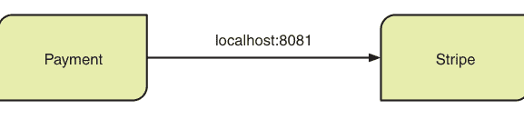

这种方法对于微服务的本地测试是完全可以的，可以确保它们符合你的预期，但你不希望在生产环境中依赖于硬编码字符串来定位微服务！将单个微服务实例从一个环境移动到另一个环境的运营噩梦，将要求任何客户端都重新构建以使用微服务的新 URL 位置！这不利于及时交付业务价值。这甚至还没有考虑到有多个微服务实例可用供处理的需求。

## 7.1 为什么微服务需要被发现？

你一直在 RESTEasy 库中使用代理方法的一个缺点是，它在执行对外部微服务的调用时不支持调用回调。因此，你使用 RESTEasy 的 `getCategoryTreeAsync()` 与你使用 JAX-RS 客户端库时完全相同。

进入 `/chapter6/resteasy-client` 目录并运行此命令：

```bash
mvn thorntail:run
```

现在可以通过 http://localhost:8080/sync 和 http://localhost:8080/async 访问微服务了。每个 URL 都将返回当前管理微服务中存在的类别树作为结果。

现在我们涵盖了几个为与 RESTful 端点交互提供更高层次抽象的客户端库。这些示例展示了客户端代码在减少复杂性和提高可读性方面的优势。

### 总结

- 基于 Java 的客户端库（如 `java.net` 和 Apache HttpClient）提供了 Java 网络层的低级访问，但生成的代码比实际的更冗长。

- 基于 JAX-RS 的客户端库提供了一种抽象，使得消费微服务变得更容易。

## 发现用于消费的微服务

- 本章涵盖：

- 为什么服务发现非常重要

- 如何注册微服务以便客户端能够发现

- Thorntail 支持哪些服务注册中心

- 如何在客户端内部查找微服务

作为将 Cayambe 单体应用拆分为多个独立微服务的一部分，你决定需要一个用于处理订单支付的服务。这个新的微服务将在第 10 章中在 Cayambe 单体应用中使用。

有几十个甚至上百个提供提供支付处理服务。起初，你将开发与 Stripe (https://stripe.com/docs/quickstart) 的基本集成。为了方便未来支付提供者的扩展，你将在自己的微服务中与 Stripe 集成。新的支付微服务随后将使用 Stripe 微服务与 Stripe 在线服务进行处理和记录支付。

在之前的章节中，你已经看到如何通过引用微服务运行的 URL 来直接访问不同的微服务。在本章中，你将通过将客户端与微服务的消费解耦，进一步提升调用微服务的水平，使其更容易扩展。

除非你是在为自己开发一个微服务，否则几乎可以肯定你需要在生产环境中扩展微服务实例数量的能力。如果没有扩展能力，你的应用程序在应对负载时将始终存在问题。

## 7.1 为什么微服务需要被发现？

采用第 6 章中的微服务方法，新的 Payment 微服务将通过硬编码 URL 定位 Stripe，如图 7.1 所示。


这种方法对于微服务的本地测试是完全可以的，可以确保它们符合你的预期，但你不希望在生产环境中依赖于硬编码字符串来定位微服务！将单个微服务实例从一个环境移动到另一个环境的运营噩梦，将要求任何客户端都重新构建以使用微服务的新 URL 位置！这不利于及时交付业务价值。这甚至还没有考虑到有多个微服务实例可用供处理。

## 7.1 为什么微服务需要被发现？

你一直在 RESTEasy 库中使用代理方法的一个缺点是，它在执行对外部微服务的调用时不支持调用回调。因此，你使用 RESTEasy 的 `getCategoryTreeAsync()` 与你使用 JAX-RS 客户端库时完全相同。

进入 `/chapter6/resteasy-client` 目录并运行此命令：


运行以下命令启动微服务：

```
mvn thorntail:run
```

现在可以通过`http://localhost:8080/sync`和`http://localhost:8080/async`访问微服务了。每个 URL 都将返回当前管理微服务中存在的类别树作为结果。

现在我们涵盖了几个为与 RESTful 端点交互提供更高层次抽象的客户端库。这些示例展示了客户端代码在减少复杂性和提高可读性方面的优势。

### 总结

- 基于 Java 的客户端库（如`java.net`和 Apache HttpClient）提供了 Java 网络层的低级访问，但生成的代码比实际的更冗长。
- 基于 JAX-RS 的客户端库提供了一种抽象，使得消费微服务变得更容易。

## 发现用于消费的微服务

本章涵盖：

- 为什么服务发现非常重要
- 如何注册微服务以便客户端能够发现
- Thorntail 支持哪些服务注册中心
- 如何在客户端内部查找微服务

作为将 Cayambe 单体应用拆分为多个独立微服务的一部分，你决定需要一个用于处理订单支付的服务。这个新的微服务将在第 10 章中在 Cayambe 单体应用中使用。

有几十个甚至上百个提供支付处理服务的提供商。起初，你将开发与 Stripe (https://stripe.com/docs/quickstart) 的基本集成。为了方便未来支付提供者的扩展，你将在自己的微服务中与 Stripe 集成。新的支付微服务随后将使用 Stripe 微服务与 Stripe 在线服务进行处理和记录支付。

在之前的章节中，你已经看到如何通过引用微服务运行的 URL 来直接访问不同的微服务。在本章中，你将通过将客户端与微服务的消费解耦，进一步提升调用微服务的水平，使其更容易扩展。

除非你是在为自己开发一个微服务，否则几乎可以肯定你需要在生产环境中扩展微服务实例数量的能力。如果没有扩展能力，你的应用程序在应对负载时将始终存在问题。

## 为什么微服务需要被发现？

但这种方法无法实现应用程序或微服务的轻松扩展（无论是扩大还是缩容）。随着向云部署的转变，最大的变化之一是企业对环境收费的方式。

过去，企业拥有内部基础设施来托管其所有的应用程序，无论是供内部使用还是公共使用。内部基础设施的主要成本在于初始设置。一旦完成，持续的硬件成本是微乎其微，尽管这确实会导致管理内部基础设施产生更大的运营成本。

对于大多数企业来说，迁移到云端意味着不再在自己的基础设施上托管应用程序，而是部署到外部托管提供商。示例包括 Red Hat OpenShift、Google Cloud 和 Amazon Web Services。这些提供商将成本从昂贵的前期硬件安装转变为按需付费（通常是按月计费）。这种成本机制的转变为在应用程序使用时进行低成本的缩容打开了大门。

可扩展环境的另一个优点是，当负载增加时可以进行扩容，而无需经过企业通常非常漫长的硬件准备过程。这对于在假期期间经历极高负载的企业来说特别有益。11 月和 12 月对于大多数零售店来说是关键期，可扩展环境提供了扩展可用服务器的能力，而无需让服务器在年的剩余时间内处于闲置。

在云环境中快速轻松地扩展或缩容特定的微服务（甚至一组微服务），对于企业开发者来说是一个巨大的优势。它允许他们从过去转变过来——过去他们需要预测需求以留出准备新硬件的时间（这通常需要几个月）。部署到云端的企业开发者可以迈向这样的未来：新实例或系列实例可以在几分钟内运行并处理用户负载。

能够扩展应用程序与其解耦合程度紧密相关。正如前面提到的，将应用程序必须使用的 URL 分离到外部注册表中，与我之前提到的通过属性文件进行耦合相比，极大地减少了组件之间的耦合量。

外部服务的故障转移是所有分布式架构共同关注的问题。通过服务注册表保持松散耦合，可以允许微服务发生故障而不会拖垮整个应用程序，前提是该微服务扩展到了多个实例！

在服务发现中使用服务注册表为使你能够优雅地处理故障打开了门，但它们本身并不是解决方案。你还需要能够协助提供容错能力的框架和库，因为你不想自己编写这些代码！第 8 章展示了如何将容错整合到你的微服务中。

在图 7.3 所示，这里是 Payment 微服务通过服务注册表发现 Stripe 微服务并进行调用的步骤；参见图 7.4：

1. Payment 微服务从已知的服务注册表请求 Stripe 微服务的位置。
2. 服务注册表返回所有可用的 Stripe 实例。
3. Payment 微服务向从注册表获取的 Stripe 服务实例发送请求。
4. Payment 微服务收到来自 Stripe 微服务的响应。

在图 7.3 中，你使用了运行在端口 8082 上的 Stripe 实例。但在图 7.4 中，你可以看到端口 8082 上的 Stripe 实例在注册表中不再运行。没关系；Payment 将调用服务注册表获取 Stripe 实例，并在两个可用实例选择运行在端口 8083 的那个。

这听起来太棒了！你可以根据环境扩展性能的限制随时扩展或缩容微服务，而无需担心客户端如何找到它们。

如果没有服务注册表为 Payment 提供 Stripe 的元数据，你的微服务将无法将自己从故障或迁移中隔离出来，也没有方法从中恢复。服务注册表的作用不仅是在某个实例失败时获得新生。它还处理将微服务迁移到不同环境，通过在 Payment 需要该信息之前对其隐藏 Stripe 的实际运行位置。

你可以轻松地在与现有环境完全不同的环境中为 Stripe 创建新实例，但让它们在同一个服务注册表中可用。

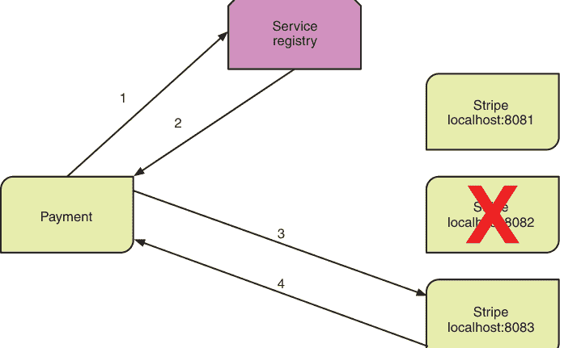

图 7.4 带有故障微服务的服务发现

## 为什么微服务需要被发现？

在新实例激活状态后，如果你正在进行迁移，你可以缩容实例以关闭它们——所有这些都不会对 Payment 调用 Stripe 产生影响。

### 7.1.3 无状态与有状态微服务

能够随心所欲扩展微服务无疑是极佳的，但有一个陷阱。到目前为止，你一直在隐式地处理无状态微服务，即微服务在请求之间不会保留内部任何数据。

你的状态呢？微服务开发高度侧重于无状态化。这是微服务进行扩容且无需担心上一个请求的用户状态的关键能力。

为了支持微服务的扩展，它们不可能是有状态的——至少不像 Java EE 中的那些有状态会话那样。正如常说的，我们希望我们的微服务更像“牲畜（cattle）”而不是“宠物（pets）”。最好拥有许多可以来去随去而不产生影响的实例（牲畜），而不是少数几个其中某一个的消失就会导致严重问题的实例（宠物）。在你的微服务中使用上一个请求的用户数据，但它必须存储在某处以便你检索。

向无服务的转变在过去几年的 Enterprise Java 中已经开始，但向微服务的推动使其变得更加显著。

### 7.1.4 什么是 Ribbon？

稍早我们谈到了...

## 第 7 章 发现微服务

为了让 Ribbon 知道服务注册表的位置，你需要指定负责获取服务可用实例列表的类。现在，让我们关注它提供的负载均衡选项：

- 轮询（Round Robin）：按顺序选择可用服务器，不考虑具体是哪种服务器。
- 可用性过滤（Availability Filtering）：跳过任何被认为“断路”、最近连接失败或当前连接数过高的服务器。
- 加权响应时间（Weighted Response Time）：每个服务器根据响应时间赋予权重，并用于生成范围。例如，如果服务器 A 和 B 的范围为 1–5 (A) 和 6–30 (B)。在 1 到所有服务器权重之和之间生成一个随机数。权重越高、响应时间越短的服务器被选中的概率越大。
- 区域感知轮询（Zone Aware Robin）：对于部署在 Amazon Web Services 的情况特别有用，服务器分布在不同的可用区。该规则根据服务器是否与客户端位于同一可用区进行选择。
- 随机（Random）：在可用服务器之间进行纯随机分布。

# 在 Thorntail 中注册微服务

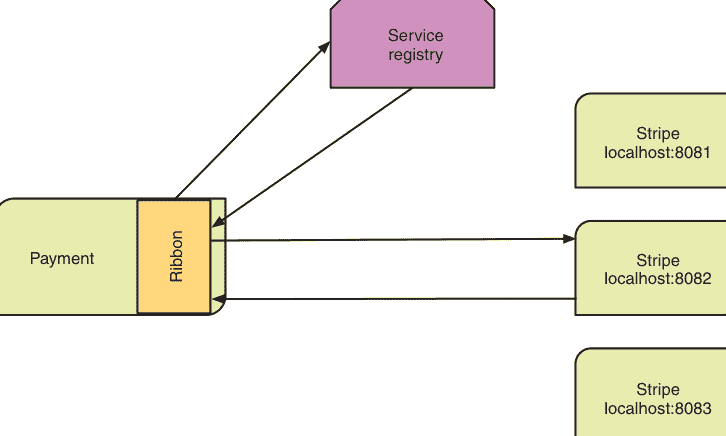

图 7.5 使用 Netflix Ribbon 进行服务发现

### 7.2 在 Thorntail 中注册微服务

你已经看到服务注册中心如何通过将你的微服务与所需的任何消费内容的 URL 位置解耦来使其受益。这是理论部分。现在是时候看看服务注册和发现的操作了！在查看如何注册微服务以便其他服务发现之前，你将查看 Thorntail 服务注册的选项，这些选项被称为拓扑（topologies）。

### 7.2.1 Thorntail 的拓扑结构

Thorntail 对服务注册提供了一种名为拓扑的抽象。这种抽象提供了什么好处？这意味着如果你的微服务被移动到具有不同服务注册实现的环境中，你的客户端代码也不需要更改。最可能的用例是在本地针对某种类型的服务注册进行开发和测试，然后在测试和生产环境中使用另一种。

在理想世界中，你可以在本地机器上运行一个与生产环境相同的环境进行测试，但对于如今的企业来说，这并不可行。转向更基于云的基础设施（如 Kubernetes 和 OpenShift）结合 Linux 容器确实更容易用更少的资源复制这些环境。并不是所有企业都可能达到这种程度。

Thorntail 提供了哪些服务注册实现或拓扑类型？它提供以下这些：

- JGroups—JGroups 是一个用于可靠消息的工具包，其中可以创建节点集群以便相互发送消息。Thorntail 能够通过为每个微服务创建一个集群，并在每个服务注册自身时通知它们可用的新服务，从而创建一个伪服务注册。
- OpenShift—Red Hat OpenShift 是一个使用 Kubernetes 管理容器的平台。你可以使用在线版本、将其本地安装到自己的环境中，或者如你之前看到的在 Minishift 中使用它。
- Consul—开发用途？在某些情况下，选择取决于微服务的部署位置。如果部署到 Red Hat OpenShift，使用 OpenShift 拓扑是合理的。如何选择？JGroups 拓扑适用于本地开发或未安装完整服务发现实现的环境。正如你在第 5 章看到的，你也可以使用 Minishift 来确保你的本地环境尽可能接近生产环境。

除了这些对齐之外，你的选择取决于服务发现的需求，以及哪种实现最符合你环境的需求。这种决策通常在开发者手中，除非他们属于允许每个团队构建自己偏好技术栈的 DevOps 文化。以 Consul 为例，使用 Consul 的拓扑实现相对于图 7.5 在什么位置？看看图 7.6。

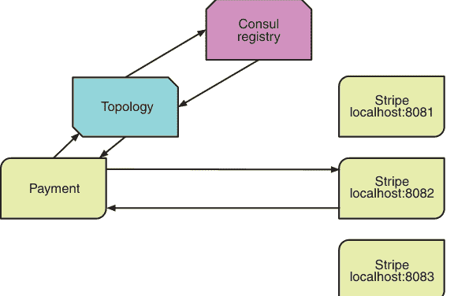

图 7.6 Thorntail 拓扑结构

## 在 Thorntail 中注册微服务

拓扑位于微服务和服务注册实现之间。这使得你的微服务无论是部署在使用 JGroups、OpenShift 还是 Consul 的环境中，都能保持不变。为了为你的微服务选择一种拓扑实现，你需要添加以下依赖：

- `topology-jgroups`
- `topology-openshift`
- `topology-consul`

Thorntail 还通过`topology-webapp`依赖提供了一个拓扑 servlet（topology servlet），每当服务被注册或移除时它都会发送事件（SSEs）。该拓扑 servlet 与上述列表中的任何拓扑实现协同工作。要查看这些事件，请在`pom.xml`中添加以下内容：

```xml
<dependency>
  <groupId>io.thorntail</groupId>
  <artifactId>topology-webapp</artifactId>
</dependency>
```

微服务运行后（无论是在本地还是在云端），打开浏览器访问`http://host:port/topology/stream`查看事件。这允许 UI 可视化地看到每个存在的服务，并维护可用服务实例的当前列表。

### 7.2.2 使用拓扑结构注册微服务

在我们的示例中，你有 Payment 和 Stripe 微服务。因为 Payment 需要“发现”Stripe，所以它必须先被注册。在 Thorntail 中，你有注册微服务的多种选项。你从上一节选择的任何拓扑依赖都必须添加到应用程序的`pom.xml`中。

在深入研究注册微服务的选项之前，让我们看看 Stripe 微服务的代码。这将有助于你理解本章稍后将发生的情况。对于`pom.xml`，你将关注你需要的依赖。还有很多其他依赖，但对于理解发生的情况并不是必需的：

```xml
<dependency>
  <groupId>io.thorntail</groupId>
  <artifactId>jaxrs</artifactId>
</dependency>
<dependency>
  <groupId>io.thorntail</groupId>
  <artifactId>cdi</artifactId>
</dependency>
<dependency>
  <groupId>com.stripe</groupId>
  <artifactId>stripe-java</artifactId>
  <version>5.27.0</version>
</dependency>
```

前几个依赖添加`jaxrs`和`cdi`能力，这些在之前的示例中很熟悉。最后一个依赖提供了对 Stripe 的访问。

Stripe (https://stripe.com) 是一个为商户提供交易处理的服务。Stripe 的一个优点是可以使用 API 密钥，如你在示例中使用那样，并使用令牌生成响应。

要定义 Stripe 微服务，首先创建 Application 类。

`StripeApplication`与之前的示例类似。注意的是你设置了 JAX-RS 根路径。

#### 7.1 StripeApplication

```java
@ApplicationPath("/stripe")
public class StripeApplication {
}
```

对于使用 Thorntail 拓扑部署到 OpenShift，你需要创建一个允许拓扑访问服务的账户。使用 fabric8 Maven 插件，通过 YAML 文件就可以轻松实现。

#### 7.2 service-sa.yml

```yaml
metadata:
  name: service
```

为了让拓扑在 OpenShift 中看到服务，你需要微服务的`view`角色。现在你需要定义角色绑定（role binding），将服务账户与该角色匹配。

#### 7.3 service-rb.yml

```yaml
metadata:
  name: view-service
subjects:
- kind: ServiceAccount
  name: service
roleRef:
  name: view
```

用于角色绑定的 OpenShift 角色名称

现在你需要将服务账户与你的微服务关联。

#### 7.4 deployment.yml

```yaml
apiVersion: v1
kind: Deployment
metadata:
  name: ${project.artifactId}
spec:
  template:
    spec:
      serviceAccountName: service
```

与部署关联的服务账户

如果没有相反设置，部署通常将设置为`${project.artifactId}`。自定义的`deployment.yml`仅用于关联服务账户。

**ADVERTISE**

现在让我们看看与 Stripe API 交互的 JAX-RS 资源。

#### 7.5 StripeResource

```java
@Path("/")
@ApplicationScoped
@Advertise("chapter7-stripe")
public class StripeResource {

  @Inject
  @Configuration("stripe.key")
  private String stripeKey;

  @POST
  @Path("/charge")
  @Consumes(MediaType.APPLICATION_JSON)
  @Produces(MediaType.APPLICATION_JSON)
  public Response submitCharge(ChargeRequest chargeRequest) {
    Stripe.apiKey = stripeKey;
    Map<String, Object> chargeParams = new HashMap<>();
    chargeParams.put("amount", chargeRequest.getAmount());
    chargeParams.put("currency", "usd");
    chargeParams.put("description", chargeRequest.getDescription());
    chargeParams.put("source", chargeRequest.getCardToken());
    Charge charge = Stripe.Charge.create(chargeParams)
  }
}
```

## 第 7 章 发现用于消费的微服务

```
return new ChargeResponse()
    .chargeId(charge.getId())
    .amount(charge.getAmount());
```

> 返回一个包含从 Stripe 到的金额和费用 ID 的`ChargeResponse`。

你已经向 Stripe 微服务添加了`@Advertise`注解，但这与拓扑结构有什么关系呢？


Thorntail 拓扑结构将找到你为微服务中的 RESTful 端点添加的所有 `@Advertise` 注解，并将每个名称存储在运行时创建的部署文件中。添加到服务部署中的拓扑代码将在部署启动时，根据微服务所在位置的适当主机名和端口信息，向你所选择的每种实现（JGroups、OpenShift、Consul）发布这些名称。`@Advertise` 抽象了微服务代码无需了解注册微服务细节的需求。你只需为它提供一个名称即可。

**注意**：使用 Topology 并部署到 OpenShift 时，广告功能本质上是一个 NoOp（无操作），因为 OpenShift 会通过其内部 DNS 注册所有微服务。在生产者微服务上使用 `@Advertise` 的主要优势在于你可以在不更改代码的情况下轻松切换拓扑环境。

## TOPOLOGY.LOOKUP()

你还可以通过 `Topology.lookup()` 以一种提供控制服务可用时间的方式来注册服务。Topology 针对每个服务实现提供了主要的抽象，提供了用于静态 `lookup()` 方法、添加和删除监听器以便在服务添加或删除时接收通知、通过 `advertise()` 注册微服务，以及使用 `asMap()` 获取当前注册表的方法。

无论你为微服务选择了哪种拓扑实现——JGroups、OpenShift 还是 Consul——Topology 始终可供微服务直接使用。

假设你想使用 Topology 来发布和取消广告某个微服务。这种方法的优势之一是，可以限制微服务在 RESTful 端点激活并能够处理请求之前，不被添加到服务注册表中。

### 列表 7.6 Topology

```
AdvertisementHandle handle = Topology.lookup().advertise("allevents");
```

> 查找 Topology 实例并发布你的服务，保留一个句柄。

当你的服务结束时，使用该句柄取消你自己的广告。

## 7.3 使用 Thorntail 消费已注册的微服务

现在你已经注册了 Stripe 微服务，是时候开发 Payment 以能够发现它并进行消费了。本节涵盖服务消费的两种方法。每种方法使用不同的客户端库（Netflix Ribbon 和 RESTEasy），用于 Payment 的不同实现。

### 7.3.1 使用 Netflix Ribbon 进行服务查找

要使用 Netflix Ribbon 作为你的客户端框架，首先需要将它作为依赖添加到 Maven 模块中：

```xml
<dependency>
<groupId>io.thorntail</groupId>
<artifactId>ribbon</artifactId>
</dependency>
```

此依赖项允许你的微服务访问 Netflix Ribbon 库。此外，它还与你为注册选择的任何拓扑实现集成。这使得 Netflix Ribbon 可以使用你的拓扑来实现获取服务实例以负载均衡。你需要创建一个接口来表示你想调用的外部微服务 Stripe。

### 列表 7.7 StripeService

| 代码 | 描述 |
| :--- | :--- |
| `@Resource(name = "chapter7-stripe")`<br>`public interface StripeService {` | 你将调用的注册表中的服务名称 |
| `StripeService INSTANCE = Ribbon.from(StripeService.class);` | 创建你正在使用的接口的代理 |
| `@TemplateName(name = "charge")`<br>`@Http(method = HttpMethod.POST, uri = "/stripe/charge", headers = @Header(name = "Content-Type", value = "application/json"))` | 定义执行 `charge(c)` 外部请求的 HTTP 参数，包括 HTTP 方法、URI 路径和内容类型的 HTTP 请求头 |
| `@ContentTransformer(ChargeTransformer.class)`<br>`RibbonRequest<ByteBuffer> charge(@Charge ChargeRequest request);` | 定义一个将 `ChargeRequest` 转换为 `ByteBuffer` 的转换器 |
| `}` `}` | 标识 Ribbon 创建模板的方法（方法必须返回 `RibbonRequest`） |

如果 Stripe 拥有多个你想要对其发送请求的 REST 端点，那么接口中的每个方法定义都需要它们各自自己的 `@TemplateName` 和 `@Http` 注解来定义它们。

7.7 使用了 Netflix Ribbon 基于注解的方法，但如果你更倾向于流式 API，可以使用 `HttpGroup` 和 `RestTemplate` 来构建等效的 HTTP 请求。

现在让我们来看 `ChargeTransformer`，它负责将 `ChargeRequest` 转换为 `ByteBuf`。

### 列表 7.8 ChargeTransformer

```java
public class ChargeTransformer implements ContentTransformer<ChargeRequest> {
    @Override
    public ByteBuf call(ChargeRequest chargeRequest, ByteBufAllocator allocator) {
        try {
            byte[] bytes = new ObjectMapper().writeValueAsBytes(chargeRequest);
            ByteBuf byteBuf = allocator.buffer(bytes.length);
            byteBuf.writeBytes(bytes);
            return byteBuf;
        } catch (JsonProcessingException e) {
            e.printStackTrace();
            return null;
        }
    }
}
```

- 使用 `ObjectMapper` 将 `ChargeRequest` 转换为 JSON 格式。
- 分配一个具有适当长度的新缓冲区。

`ChargeTransformer` 仅在发送请求时处理转换。你需要在调用代码中处理将 `ByteBuf` 转换为有意义的响应。

让我们看看使用 Netflix Ribbon 时你的 Payment 资源看起来像什么样。

### 列表 7.9 PaymentResource

```java
@Path("/sync")
public class PaymentServiceResource {

    @POST
    @Path("/sync")
    @Consumes(MediaType.APPLICATION_JSON)
    @Produces(MediaType.APPLICATION_JSON)
    public ChargeResponse chargeSync(ChargeRequest chargeRequest) {
        ByteBuf byteBuf = StripeService.INSTANCE.charge(chargeRequest).execute();
        return extractResult(byteBuf);
    }

    @POST
    @Path("/async")
    @Consumes(MediaType.APPLICATION_JSON)
    @Produces(MediaType.APPLICATION_JSON)
    public void chargeAsync(@Suspended final AsyncResponse asyncResponse,
        ChargeRequest chargeRequest)
        throws Exception {
        executorService().submit(() -> {
            Observable<ByteBuf> obs = 
                StripeService.INSTANCE.charge(chargeRequest).toObservable();
            obs.subscribe(
                result -> {
                    asyncResponse.resume(extractResult(result));
                },
                error -> asyncResponse.resume(error)
            );
        });
    }

    private ChargeResponse extractResult(ByteBuf result) {
        byte[] bytes = new byte[result.readableBytes()];
        result.readBytes(bytes);
        try {
            return new ObjectMapper()
                .readValue(bytes, ChargeResponse.class);
        } catch (IOException e) {
            e.printStackTrace();
        }
        return null;
    }
}
```

- 同步调用 Stripe。
- 提取结果并返回它。

## 第 7 章 发现用于服务的微服务

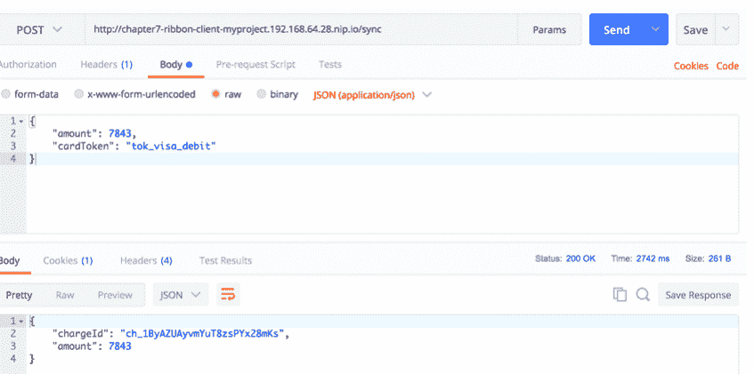

图 7.7 Postman 调用 Ribbon 客户端服务

在这里你可以看到请求详情——包括上半部分的 HTTP POST 请求体，以及底部你从服务收到的响应。

最需要设置的头部是 `Content-Type`，其值为 `application/json`。如果你不设置该头部，JAX-RS 就不会认为它接收到了 JSON 并拒绝该请求。你将收到 HTTP 响应码 415，表示不支持的媒体类型。

要查看拓扑结构，你可以在 `ribbon-client` 上安装 `topology-webapp` 依赖以查看所有的注册事件。修改 `pom.xml` 包含以下内容：

```xml
<dependency>
  <groupId>ic.thorntail</groupId>
  <artifactId>topology-webapp</artifactId>
</dependency>
```

然后从 `/chapter7/ribbon-client` 目录运行此命令：

```bash
mvn clean fabric8:deploy -POnshift -DSkipTests
```

在 OpenShift 控制台中，点击 `ribbon-client` 微服务的 URL。然后在浏览器窗口的 URL 末尾添加 `/topology/system/stream`。浏览器将立即显示你将微服务 `chapter7-stripe` 和 `chapter7-ribbon-client` 注册到拓扑中的事件：

```json
event: topologyChange
data:
  "chapter7-stripe": [
```

```json
{
  "endpoint": "http://chapter7-stripe:8080",
  "tags":["http"]
},
"chapter7-ribbon-client": {
  "endpoint": "http://chapter7-ribbon-client:8080",
  "tags":["http"]
}
}
```

你会注意到的一点是，每个微服务的 URL 都不包含 OpenShift URL 中常见的 IP 地址和 `nip.io` 后缀。这些是 OpenShift 内部 URL；在 OpenShift 环境之外使用它们将无法工作。

### 7.3.2 使用 RESTEasy 客户端进行服务查找

除了使用客户端框架调用 Stripe 微服务外，在使用 RESTEasy 时，你将使用 `Topology.lookup` 方法从 `Topology` 获取信息。你需要这样做是因为 RESTEasy 无法执行你作为 Ribbon Bean 使用时所执行的操作。

要将 RESTEasy 作为你的客户端框架，首先需要将它作为依赖添加到你的 Maven 模块中：

```xml
<dependency>
  <groupId>org.jboss.resteasy</groupId>
  <artifactId>resteasy-client</artifactId>
  <version>3.0.24</version>
  <scope>provided</scope>
</dependency>
```

你将其标记为 `provided` 是因为它存在于 Thorntail 的类路径中，但你在本地编译时需要它。接下来，你需要创建一个接口来表示你想调用的外部微服务 Stripe。

### 列表 7.10 StripeService

```java
@Path("/stripe")
public interface StripeService {

  @POST
  @Path("/charge")
  @Consumes(MediaType.APPLICATION_JSON)
  @Produces(MediaType.APPLICATION_JSON)
  ChargeResponse charge(ChargeRequest request);

}
```

如你所示，这段代码比 Ribbon 的等效代码简单得多且更容易理解。让我们看看使用 RESTEasy 时你的 `Payment` 资源是什么样子的。

### 列表 7.11 MessageResource

```java
@Path("/*")
public class PaymentsResource {
    private Topology topology;

    public PaymentsResource() { 
        try {
            topology = Topology.lookup();
        } catch (NamingException e) {
            e.printStackTrace();
        }
    }
}

@POST
@Path("/sync")
@Consumes(MediaType.APPLICATION_JSON)
@Produces(MediaType.APPLICATION_JSON)
public Response chargeSync(ChargeRequest chargeRequest) throws
    Exception {
        RestEasyClient client = new RestEasyClientBuilder().build(); // 获取 chapter7-stripe 服务的 URI。
        URI url = getService("stripe");
        WebTarget target = client.target(url);
        StripeService stripe = target.proxy(StripeService.class);
        return stripe.charge(chargeRequest);
    }

private URI getService(String name) throws Exception {
    Map<String, Topology.Entry> map = this.topology.asMap();

    if (map.isEmpty()) {
        throw new Exception("未找到服务 '" + name + "'");
    }

    Optional<Topology.Entry> seOptional = map
        .get(name)
        .stream()
        .findFirst(); // 为 chapter7-stripe 服务的注册列表，找到第一个。

    Topology.Entry serviceEntry = seOptional.orElseThrow(
        () -> new Exception("未找到服务 '" + name + "'")
    );

    return new URI("http", null, serviceEntry.getAddress(),
        serviceEntry.getPort(), null, null); // 如果 Optional 为空，则抛出找不到服务的异常。
}
```

### 总结

你可能已经注意到通过查找 Topology 必须做的额外工作。要查看拓扑结构，你可以在 `ribbon-client` 上安装 `topology-webapp` 依赖以查看所有的注册事件。修改 `pom.xml` 包含以下内容：

然后从 `/chapter7/ribbon-client` 目录运行此命令：


在 OpenShift 控制台中，点击`ribbon-client`微服务的 URL。然后在浏览器窗口的 URL 末尾添加`/topology/system/stream`。浏览器将立即显示你将微服务`chapter7-stripe`和`chapter7-ribbon-client`注册到拓扑中的事件：

你会注意到的一点是，每个微服务的 URL 都不包含 OpenShift URL 中常见的 IP 地址和`nip.io`后缀。这些是 OpenShift 内部 URL；在 OpenShift 环境之外使用它们将无法工作。

### 7.3.2 使用 RESTEasy 客户端进行服务查找

除了使用客户端框架调用 Stripe 微服务外，在使用 RESTEasy 时，你将使用`Topology.lookup`方法从`Topology`获取信息。你需要这样做是因为 RESTEasy 无法执行你作为 Ribbon Bean 使用时所执行的操作。

要将 RESTEasy 作为你的客户端框架，首先需要将它作为依赖添加到你的 Maven 模块中：

将其标记为`provided`是因为存在于 Thorntail 的类路径中，但你在本地编译时需要它。接下来需要你需要创建一个接口来表示你想调用的外部微服务 Stripe。

如你所示，这段代码比 Ribbon 的等效代码简单得多且更容易理解。让我们看看使用 RESTEASY 时你的`Payment`资源是什么样子的。

### 总结

你可能已经注意到通过查找 Topology 必须做的额外工作。要查看拓扑结构，你可以在`ribbon-client`上安装`topology-webapp`依赖以查看所有的注册事件。修改`pom.xml`包含以下内容：

然后从`/chapter7/ribbon-client`目录运行此命令：

在 OpenShift 控制台中，点击`ribbon-client`微服务的 URL。然后在浏览器窗口的 URL 末尾添加`/topology/system/stream`。浏览器将立即显示你将微服务`chapter7-stripe`和`chapter7-ribbon-client`注册到拓扑中的事件：

你会注意到的一点是，每个微服务的 URL 都不包含 OpenShift URL 中常见的 IP 地址和`nip.io`后缀。这些是 OpenShift 内部 URL；在 OpenShift 环境之外使用它们将无法工作。

## 容错与监控策略

本章涵盖了

- 什么是延迟？

- 为什么微服务需要容错性？

- 熔断器是如何运作的？

- 哪些工具可以缓解分布式故障？

你将使用之前章节的示例来扩展 Stripe 和 Payment 的功能，在探索容错和监控的概念时包含故障缓解。当你的 Payment 微服务通过网络与外部系统通信时，容错性尤为重要。在跨网络通信时，你需要预期故障和超时。

### 8.1 分布式架构中的微服务故障

图 8.1 回顾了你的微服务分布式架构。

这种分布式架构与故障有什么关系？由于微服务包含较小的业务逻辑块，而不是包含所有内容的单体，你最终需要维护的服务数量要增多。你不再处理一个可能与处理其所有需求的单个后端服务的 UI。更有可能，该 UI 现在

# 第 8 章 容错与监控策略

与几十个甚至更多微服务集成时，需求是让它们像你之前的单体应用一样可靠。

但你的微服务在生产环境中不会发生故障，对吧？生产环境中什么都不会出故障！我们大家在某个时候都说过类似的话，通常是在我们被生产环境中的重大故障教训之后！一次，两次，容错就没了！

为什么在没有之前的生产环境故障经验的情况下，我们倾向于对生产系统的可靠性做出大其壮的言论呢？部分原因是因为我们天生容易乐观，但更多程度上是因为缺乏经验。如果你从未需要处理过修复应用程序的问题，特别是在半夜，就很难体会对系统可靠性的这些担忧是多么合理的。

# 呼机器的噩梦

我记得 90 年代——是的，那时我已经在 IT 行业工作了——当时新手最恐怕的经历就是被交接呼机器进行值班。在凌晨 2 点收到呼机通知，说有需要修复的失败作业，没有比这更糟糕的感觉了，而且你必须尝试在早上 8 点员工到达办公室之前完成它！这些只是夜间批处理作业，但被叫时的焦虑是非常可怕的。

我只能想象（如果今天还有呼机器的话），收到一个关于活动应用程序生产故障的呼叫，由于该故障影响了业务的 24/7 全天运行，必须解决它会是什么样子！

以下是一些你可能对生产系统（特别是分布式架构）深信不疑的观点：

- **计算设备网络是可靠的**。如果不考虑网络故障的可能性，应用程序在等待永远不会到达的响应时可能会停滞。当网络再次可用时，应用程序将无法重试任何失败的操作。

- **发送请求并执行没有延迟（即零延迟）**。忽略网络延迟以及相关的网络包丢弃，随着网络流量无限制地增长，会导致带宽浪费和网络丢包数量的增加。

- **网络上的可用带宽没有限制**。如果客户端发送了太多数据或太多请求，可用网络带宽可能会缩小到出现瓶颈并降低应用程序吞吐量的程度。延迟对网络吞吐量的影响可能持续几秒，也一直存在。

- **整个网络都免受外部或内部可能攻击的威胁**。忽略恶意用户（例如不满的员工）可能尝试破坏应用程序的可能性是天真的。同样，一个曾经内部的应用程序在没有经过适当的安全审查而使其可用时，很容易暴露在威胁之下。即使是对防火墙端口规则的无害更改，也可能使其在无意中被访问。

- **网络上计算设备的位置和布局永远不变**。当网络发生变化且设备移动到不同的位置时，可用带宽和延迟可能会降低。

- **一切都有单一管理员**。由于企业内部网络有多个管理员，可能会实施冲突的安全策略。在这种情况下，需要在跨不同安全级别网络进行通信的客户端需要意识到为了成功通信而遵循的要求。

- **零传输成本**。虽然通过网络传输物理数据的成本可能为零，但在网络构建后维护该网络的成本是是非零的。

- **整个网络是同质的**。在同质网络中，网络上的每个设备都使用类似的配置和协议。非同质网络可能会导致此列表前三点中描述的问题。

所有这些观点被称为**分布式计算谬误** (www.rgoarchitects.com/Files/fallacies.pdf)。

## 8.2 网络故障

虽然网络有许多故障方式，但在本节中，你将关注网络延迟和超时。之前，我提到过“零延迟”是分布式计算谬误之一，它等同于发送请求并执行时没有延迟。

为什么延迟对你的微服务很重要？它影响着你的微服务可能做的几乎任何事情：

- 调用另一个微服务

- 等待异步消息

- 从数据库读取

- 向数据库写入

如果你不注意网络中延迟的存在，你就会假设所有消息和数据的通信都是瞬时完成的，并假设参与通信的网络设备彼此足够近。

**超时**是你在开发微服务时需要注意的另一个关键网络故障源。超时可能与高延迟相关联；请求没有得到及时响应不仅是因为网络延迟，还可能因为消费方微服务的问题。如果你调用的微服务已经崩溃、正经历高负载，或者由于其他任何原因，当你尝试尝试使用它时，你会发现问题，通常以超时的形式出现。你无法预测何时会发生超时，因此你的代码需要意识到超时会发生，并知道在收到超时时你想要如何处理这种情况。

你是立即重试，还是在短时间延迟后重试？你是假设会有标准响应并继续执行吗？

这些网络故障是你特别想要缓解的。否则，你就让你的微服务以及每个应用程序都暴露在意外的网络故障风险中，并且在重启服务后没有任何恢复手段。因为你无法负担起每次发生网络问题时都重启服务的代价，所以你需要编写代码，防止重启成为你唯一的选择。

### 缓解故障

在研究如何缓解故障时，你当然可以实现你的功能。但你可能不是所有实现功能最佳方式的专家。即使你是，完成实现也需要的比短开发周期要多的的时间。你宁愿开发更多的应用程序！虽然你可以使用许多不同的库，在这种情况下你将使用 Netflix 开源的 Hystrix。

### 什么是 Hystrix？

Hystrix 是一个延迟和容错库，旨在隔离远程系统、服务和库的访问点；阻止级故障；增强分布式系统的韧性。在故障不可避免的地方（如分布式系统所示），Hystrix 提高了微服务的韧性。

Hystrix 内部有很多复杂的机制，它是如何做到的？我们无法在这一章中涵盖 Hystrix 的全部；那本身就需要一整本书。但本节提供了一个 Hystrix 执行分段的高级视图。

图 8.2 展示了一个处理许多用户请求的微服务视图。该微服务需要与外部服务通信。在这种情况下，你开发的微服务很容易被阻塞，因为它正在等待外部服务 2 的响应。更糟糕，你可能会过载外部服务导致其停止运行。

# 缓解故障

143

img/d166e73dc5b37ac6ba449ba856b8eebf_159_0.png

图 8.2 没有使用 Hystrix 时处理用户请求的微服务

# 144 第 8 章 容错与监控策略

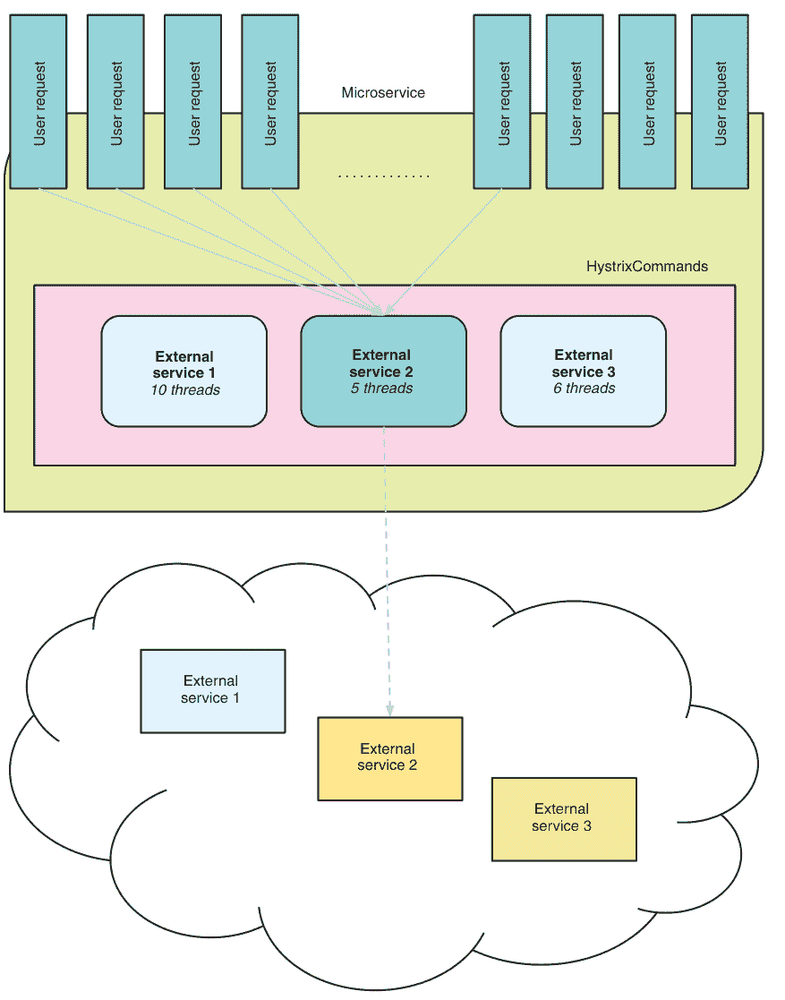

图 8.3 使用 Hystrix 的微服务处理用户请求

## 缓解故障影响

通过将外部服务 2 封装在`hystrixCommand`中，你限制了它从你的微服务并发调用的请求数量。虽然你已经为与该特定外部服务的交互添加了缓解措施，但你只是增加了微服务中请求失败的概率——你正在向外部服务拒绝额外的请求！这种情况下可能是可以的，也可能不可行；其结果取决于外部服务处理你请求的速度。

这引出了一个重要的点。在整个生态系统中，为单个微服务添加故障缓解措施是不有益的。让你的微服务成为分布式网络中一个更完善的“公民”是件极好的，但如果网络中的每个人在与你的微服务交互时没有采取相同的缓解措施，那么你只是移动了瓶颈和故障点的位置。因此，让故障缓解成为企业范围内关注的问题，或者至少是在所有相互通信的微服务组内进行，至关重要。

你在图 8.3 中看到的 hystrix 的另一个优势是它在外部服务之间提供的隔离。如果对外部服务 2 的调用不受限制，它极可能会消耗 JVM 内所有的可用线程，导致你的微服务无法处理那些不需要与外部服务交互的请求！

在本章的剩余部分，我们的方法将是概述故障缓解策略背后的理论，然后展示如何在 hystrix 中实现该策略。你已经知道需要在代码中缓解网络故障，那么你手头有哪些策略可可用呢？

### 8.3.2 断路器

如果你以任何方式熟悉家里配电箱中保险丝的工作原理，那么你就能理解断路器的原理。图 8.4 显示，电流不受阻碍地流过保险丝，除非它跳闸断开，导致电流流中断。

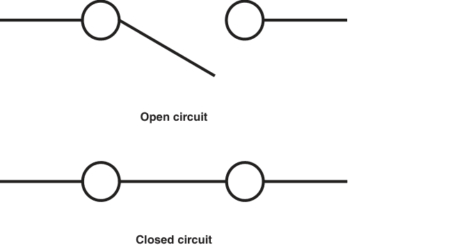

图 8.4 电路断路器状态

# 第 8 章 容错与监控策略

电配箱与软件之间的唯一区别是，软件断路器会根据定义的阈值（指示其变得不健康的水平）自动关闭，而无需人工干预。

图 8.5 显示了调用外部服务时缓解故障的大流程的初始部分。随着本章的进行，流程将添加更多部分，提供额外的功能以协助缓解。第一部分侧重于提供断路器。

当断路器处于 **Closed（关闭）**状态时，所有请求继续通过流程。当断路器处于 **Open（开启）**状态时，请求退出流程。你可以从图 8.5 中看到，你的断路器需要电路健康数据（Circuit Health Data），这些数据被用于判断电路应该是开启还是关闭。除了图 8.5 中的状态外，断路器还可以处于 **Half Open（半开）** 状态。见图 8.6。

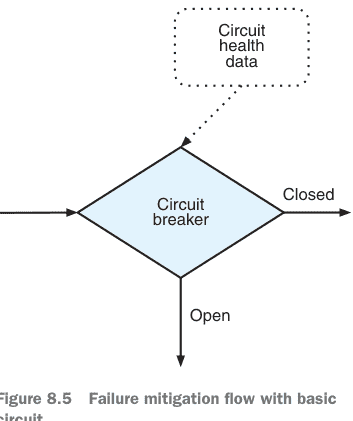

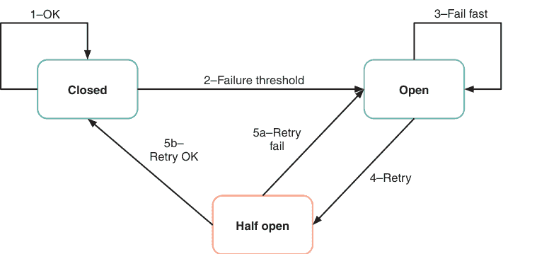

以下是断路器状态之间的转换：

- 所有请求不受阻碍地通过，因为电路处于 **Closed** 状态。

- 当达到故障阈值时，电路变为 **Open**。

- 当电路处于 **Open** 状态时，所有请求被拒绝，快速失败（failing fast）。

## 缓解故障影响

- 4 电路的 Open 超时过期。电路移动到 **Half Open** 以允许单个请求通过。

- 5 请求失败或成功；

    - a 单个请求失败，电路返回 **Open** 状态。

    - b 单个请求成功，电路返回 **Closed** 状态。

在 **Half Open** 状态下，断路器正式上是关闭的。但在达到睡眠超时后，将允许单个请求通过。该请求的成功或失败随后决定了状态是切换回 **Closed** (a) 还是保持 **Open** 直到在时间间隔到达时进行下一次尝试。

断路器只是允许或阻止请求通过的一种方式。关键在于你希望在电路健康数据中包含什么。如果不捕任何电路健康数据，断路器将始终保持 **Closed** 状态，无论有多少请求失败或失败原因是什么。

Hystrix 为断路器提供了合理的默认值，以处理你发出的任何请求的超时、网络拥塞和延迟。让我们来看一个简单的 Hystrix 断路器。

# 列表 8.1 StockCommand

```
public class StockCommand extends HystrixCommand<String> {
    private final String stockCode;

    public StockCommand(String stockCode) {
        super(HystrixCommandKey.Factory.key("StockGroup"));
        this.stockCode = stockCode;
    }

    @Override
    protected String run() throws Exception {
        // 执行 HTTP 请求以获取当前股票价格
    }
}
```

你可以像下面的代码一样同步地调用此命令：

```
String result = new StockCommand("AAPL").execute();
```

如果你偏好异步执行，可以使用这个：

```
Future<String> fr = new StockCommand("AAPL").queue();
```

在每个示例中，你都希望同步或异步调用命令，以便在你的微服务中扩展它。如果你期望多个响应。

# 容错与监控 第 8 章

如果你期望的是多个响应，会发生什么？股票价格变化非常频繁，如果能在创建 Observable 时执行它不是更好吗？

你需要修改你的断路器以支持返回 Observable。

> 定义 响应式（Reactive）是一个形容词，意味着对情况做出反应。当你使用 Observable 并监听其发布的结果时，它是响应式的。这种方法的用处是，你不需要等待结果的发布而导致阻塞。

让我们修改命令以提供一个 Observable。

# 列表 8.2 StockObservable

```
public class StockObservableCommand extends HystrixObservableCommand<String> {
    private final String stockCode;

    public StockObservableCommand(String stockCode) {
        super(HystrixGroupKey.Factory.as("StockGroup"));
        this.stockCode = stockCode;
    }

    @Override
    protected Observable<String> construct() {
        // 返回执行 HTTP 请求的 Observable
    }
}
```

如果你希望在创建 Observable 时执行命令，可以请求一个热 Observable：

```
Observable<String> stockObservable = new StockObservableCommand(stockCode).observe();
```

通常情况下，热 Observable 无论是否有订阅者都会发布响应，这会导致响应在没有人订阅时丢失。Hystrix 使用 ReplaySubject 为你捕获这些响应，允许在你订阅时对其进行重放。

你也可以使用冷 Observable：

```
Observable<String> stockObservable = new StockObservableCommand(stockCode).toObservable();
```

# 缓解故障影响

对于冷 Observable，执行直到有人订阅它时才会触发。它保证了任何订阅者都会收到 Observable 生成的所有通知。

使用哪种类型的 Observable 取决于你的情况。如果监听者可以错过初始数据，特别是当他们不是 Observable 的第一个订阅者时，那么热的是合适的；然而，如果你希望监听者接收所有数据，那么冷的是更好的选择。

注意 虽然 HystrixCommand 支持从其响应方法`execute()`和`queue()`返回 Observable，但它们始终发射单个值。

## 第 8 章 容错与监控策略

在任何熔断器之后，你都会添加一个隔舱（bulkhead）。如果熔断器处于打开（Open） 状态，则无需检查隔舱，因为此时你正处于错误状态。当你处于关闭（Closed） 状态时，隔舱可以防止许多可能产生瓶颈的请求被执行。

你可能需要调用数据库服务来执行某些计算密集型且耗时的操作。如果你知道外部服务需要 10 秒才能响应，那么你不希望每分钟发送超过六个请求。如果你发送了超过六个，你的请求将排队等待处理，这会导致你的微服务阻塞客户端请求的释放。这是一个难以打破的恶性循环，可能导致你的微服务之间发生级联故障。图 8.7 中的隔舱会执行检查，并指示你是否可以继续请求，或者需要拒绝该请求。

你会如何实现软件隔舱？两种常用方法是计数器和线程池。计数器允许你设置任何时刻活跃的最大并行请求数。线程池也限制了同时执行的并行请求数，但通过限制执行请求的线程池中可用线程的数量来实现。对于线程池隔舱，会创建一个特定的池来处理对特定外部服务的请求，允许不同的外部服务之间相互隔离，同时也与你的微服务所使用的线程隔离。

请求详情会被提供给电路健康数据（Circuit Health Data），以便计数器可以更新计算电路状态所需的最新时间。


作为一种软件隔舱，`Hystrix` 为线程池（`THREAD`）和命令（`SEMAPH`）提供了执行策略。默认情况下，`HystrixCommand` 使用 `THREAD`，而 `HystrixObservableCommand` 使用 `SEMAPHORE`。

`HystrixObservableCommand` 不需要隔舱保护，因为它已经通过 `Observable` 在单独线程中执行。你可以在 `HystrixObservableCommand` 中使用 `THREAD`，但这样做并不会增加安全性。如果你想在 `SEMAPHORE` 中运行 `StockCommand`，它看起来像下面的代码所示。

+ 列表 8.3 使用 `SEMAPHORE` 的 `StockCommand`

```java
public class StockCommand extends HystrixCommand<String> {
    private final String stockCode;

    public StockCommand(String stockCode) {
        super(Setter()
            // 使用 Setter 作为流式接口来为 Hystrix 定义额外配置
            .withGroup(HystrixCommandGroup.Factory.asKey("StockGroup"))
            .andCommandPropertiesDefaults()
            HystrixCommandProperties.Setter()
            .withExecutionIsolationStrategy(
                HystrixCommandProperties.ExecutionIsolationStrategy.SEMAPHORE
            )); // 将执行隔离策略设置为 SEMAPHORE。
        this.stockCode = stockCode;
    }
}
```

该列表说明了如何为 `Hystrix` 设置额外配置以自定义特定命令的行为。在实践中，你不会在 `HystrixCommand` 中使用 `SEMAPHORE`，因为它没有提供任何关于执行耗时的超时功能。如果没有超时，如果你调用的服务未能提供及时响应，你很容易发现系统陷入了死锁。

## 8.3.4 回退（Fallbacks）

目前，当你的熔断器或隔舱不继续处理请求时，会返回一个错误。这并不完美，但比让你的微服务处于等待超时的状态要好。如果能提供一个简单的响应来代替失败，不是很好吗？在某些情况下，可能无法为所有情况提供通用响应，但通常是可行且有益的。

在图 8.8 中，你可以看到熔断器和隔舱在失败路径上的回退处理。如果你的方法想要调用的微服务注册了回退处理器，则会将其响应返回给你。如果没有，则返回原始错误。

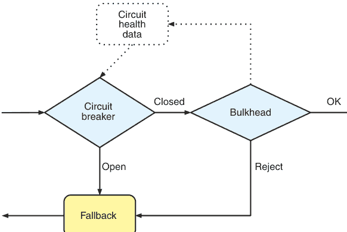

图 8.8 带回退处理的故障缓解流程

让我们看看如何为 `StockCommand` 实现回退处理器。

列表 8.4 带有回退的 `StockCommand`

```java
public class StockCommand extends HystrixCommand<String> {

    @Override
    protected String getFallback() {
        // 返回前天的缓存股票价格，不进行网络调用。
    }
}
```

处理 `HystrixObservableCommand` 时，实现回退处理器的方法略有不同，但差别不大。

列表 8.5 带有回退的 `StockObservableCommand`

```java
public class StockObservableCommand extends HystrixObservableCommand<String> {
    ...
    @Override
    protected Observable<String> resumeWithFallback() {
        // 以 Observable 的形式返回前天的缓存股票价格，
        // 不进行网络调用。
    }
}
```

## 8.5 请求缓存

虽然请求缓存不能直接缓解故障，但它可以通过减少对另一个微服务发送请求的数量，防止隔舱和其他故障的发生。

它是如何做到的？通过请求缓存，可以缓存之前的请求及其响应，允许你匹配请求并从缓存中返回响应。图 8.9 显示请求缓存位于其他缓解策略之前，因为它减少了需要通过流程中任何子段的请求数量。

请求缓存提供了减少通过你微服务的请求的益处，而无需担心增加网络流量。启用请求缓存并不适用于所有情况，但在数据不变化时大有裨益。这种方法还简化了你微服务的接口。

为了在 `Hystrix` 中启用请求缓存，你需要做两件事。首先，你需要激活 `HystrixRequestContext` 以获得缓存手段：

```java
HystrixRequestContext context = HystrixRequestContext.initializeContext();
```

这发生在执行任何 `Hystrix` 命令之前。对于我们的情况，你可能会在后文所示进行调用。其次，你需要定义缓存请求和响应的键。

列表 8.6 带有请求缓存的 `StockCommand`

```java
public class StockCommand extends HystrixCommand<String> {
    private final String stockCode;

    ...
    @Override
    protected String getCacheKey() {
        return this.stockCode;
    }
}
```

## 8.3.6 汇总

在到目前的流程中，你已经有了请求缓存、熔断器、隔舱和回退。图 8.10 显示了它们是如何进入实际调用中的。

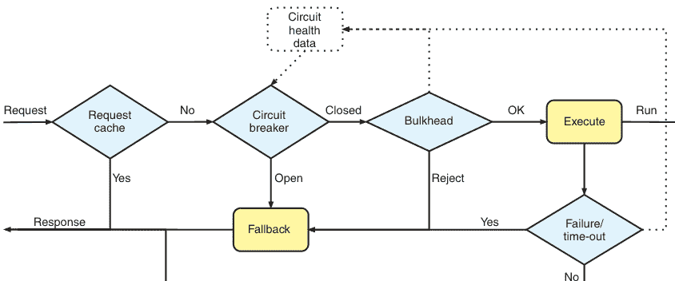

在这里你添加 `Execute` 表示你正在调用外部服务。`Execute` 经历的任何故障或超时都会反馈到回退处理，同时也为电路健康数据提供数据。这些信息随后被熔断器用于判断是否达到了错误阈值，电路将切换到打开（`Open`）。

图 8.11 进一步推进流程，展示了当 `Hystrix` 集成在你的微服务 A 和假设的服务 B 之间时，如何提供这些功能。

当请求进入你的 `Service A` 方法或端点时，你创建一个请求并将其传递给 `Hystrix`。请求在在 `Service B` 上执行之前会通过所有已启用的检查。来自 `Service B` 的响应传回到

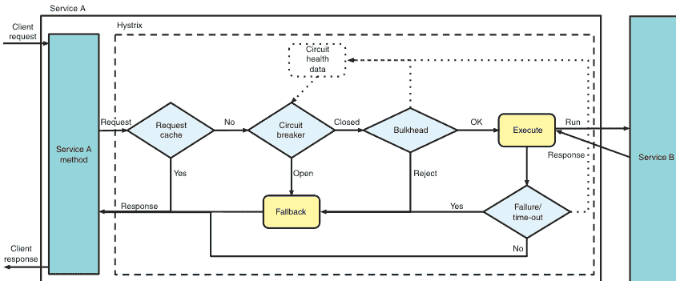

## 缓解故障

在为客户端构建响应之前，你的 `Service A` 需要进行任何必要的处理。

如你所见，在许多点上，`Hystrix` 可以提供不同的或缓存的响应，而无需直接调用 `Service B`。这种流程在直接减少故障方面具有许多优势，还能减少导致故障的因素。例如，使用请求缓存来减少微服务的负载。

尽管你看到 `Hystrix` 实现了这些故障缓解功能，但其他提供相同功能的库或框架应该以类似的方式运行。不过，其他库或框架实现所需缓解措施的方法可能会有所不同。

## 8.3.7 Hystrix Dashboard

太棒了——你现在可以提高分布式架构中微服务的可靠性。但你如何判断特定的微服务是否在持续引起故障？或者你是否需要调整设置以减少错误并处理额外的负载？

听起来你需要一种方法来监控你的容错库的性能，并查看特定微服务的细节。你可以查看并分析一切——运行微服务的节点数量、处理的请求、失败次数、超时等。

`Hystrix` 还提供了一种可视化所有这些事件的方法：`Hystrix Dashboard`，如图 8.12 所示。`Hystrix Dashboard` 提供了从每个注册流接收的 `SSE`（服务器发送事件）的可视化表示。你就会看到什么是流。

图 8.12 显示了 `StockCommand` 的信息。在小的 UI 中有很多数据点，但一些最关键的如下：

- 过去 10 秒内的错误率——100%
- 运行微服务的节点数量——1
- 过去 10 秒内的成功请求——0
- 过去 10 秒内拒绝的断路请求——40
- 过去 10 秒内的失败次数——0
- 断路器开启或关闭——开启（`Open`）

| StockCommand |
| :--- |
| 0 0 100.0% |
| 40 |
| 0 |
| Host: 4.0s |
| :--- |
| Cluster: 4.0 |
| Circuit Open |
| Hosts 1 902 s52 |
| Median 127 ms 999 s53 |
| Mean 168 ms 99.5 ms |

一个单个断路器 图 8.12 `Hystrix Dashboard`

> TIP 断路器的指标详情可以在 https://github.com/Netflix/Hystrix/wiki/Dashboard 找到。

让我们看看仪表板的运行情况。进入`/hystrix-dashboard`目录并构建项目：

```
mvn clean package
```

## 第 8 章 容错与监控策略

然后运行仪表板：

```
java -jar target/hystrix-dashboard-torntail.jar
```

仪表板启动后，打开浏览器并导航到 http://localhost:8090/。为了让仪表板可视化指标数据，它需要从你的断路器获取这些数据！对于单个断路器，你可以通过在主输入框中添加 http://localhost:8080/hystrix-stream 直接添加 `SSE` 流，如图 8.13 所示。点击 `Add Stream` 按钮并点击 `Monitor Streams`。主页面将加载，但在你启动微服务之前，流中不会接收到任何 `SSE`，因此可视化将不会出现。

切换到`chapter8/stock-client`目录并启动微服务：

```
mvn hystrix:run
```

在另一个浏览器窗口中，你可以访问 http://localhost:8080/single/AAPL 来查看由代码 `AAPL` 表示的股票价格详情。任何有效的股票代码都可以用于 `URL` 路径。

如果你刷新页面，或者通过其他方式发送多次请求，你就可以切换回 `Hystrix Dashboard` 并查看你断路器的数据。

你的`stock-client`内置了处理机制来展示 `Hystrix` 功能。例如，每十个请求就会向你的消费端微服务抛出一个异常，并且每第二个请求都将睡眠 10 秒以触发超时。这让你能够看到故障在仪表板上是如何表示的。

要查看缓存是如何工作的，你可以访问 http://localhost:8080/single/AAPL/4。注意控制台，向外部服务器仅发送了一次请求，且对浏览器的每个响应都有相同的请求次数。

## Hystrix Dashboard

| Eureka URL: http://localhost:8080/eureka/stream | |
| :--- | :--- |
| Stream Type: Hystrix [在此处选择] | |
| http://localhost:8080/hystrix/stream | |
| Cluster by Turbine (default cluster): http://turbine-hystrix-hostname:port/turbine.stream | |
| Cluster by Turbine (custom cluster): http://turbine-hostname:port/turbine.stream?cluster=[clusterName] | |
| **Single Hystrix App: http://hystrix-app:port/hystrix.stream** | |
| Delay: 2000 ms Title: Example Hystrix App | |
| Authorization: Basic Zm5Ym9Jg== | |
| Add Stream | |
| Monitor Streams | |

图 8.13 `Hystrix Dashboard` 首页

## 缓解故障

要看到你的断路器开始运行，你需要多次访问服务：

```
curl http://localhost:8080/single/Aapl/
```

## 在你的支付微服务中添加 Hystrix

```java
this.serviceURI = serviceURI;
this.chargeRequest = chargeRequest;
}
```

等同于第 7 章中的`PaymentServiceResource`方法，一切不再在`JAX-RS Resource`中创建。

```java
@Override
protected ChargeResponse run() throws Exception {
RestClient client = new RestClientClientBuilder().build();
RestClientWebTarget target = client.target(serviceURI);
```

```java
StripeService stripeService = target.proxy(StripeService.class);
return stripeService.charge(chargeRequest);
}
```

```java
@Override
protected ChargeResponse getFallback() {
    return new ChargeResponse();
}
```

如果有问题，则回退到空的`ChargeResponse`。

现在你已经有了`StripeCommand`，它与第 7 章的`PaymentServiceResource`相比有什么不同呢？

## 8.9 PaymentServiceResource

```java
@Path("")
@ApplicationScoped
public class PaymentServiceResource {
...
```

```java
@POST
@Path("/sync")
@Consumes(MediaType.APPLICATION_JSON)
@Produces(MediaType.APPLICATION_JSON)
@Transactional
```

```java
public PaymentResponse chargeSync(PaymentRequest paymentRequest) throws
Exception {
    PaymentRequest payment = setUpPayment(paymentRequest);
    ChargeResponse response = new ChargeResponse();
```

```java
try {
    URL url = getService("chapter8-stripe");
    StripeCommand stripeCommand = new StripeCommand(
        url,
        HystrixCommandProperties.Setter()
            .withExecutionIsolationStrategy(SEMAPHORE)
            .withExecutionIsolationSemaphoreMaxConcurrentRequests(1)
            .withCircuitBreakerVolumeThreshold(5)
    )
    HystrixCommandProperties.ExecutionIsolationStrategy.SEMAPHORE
```

> 实例化命令和 `Hystrix` 属性。

```java
);
```

## 第 8 章 容错监控策略

```java
response = stripeCommand.execute();
payment.chargeId(response.getChargeId());
} catch (Exception e) {
    payment.chargeStatus(ChargeStatus.FAILED);
}
```

```java
em.persist(payment);

return PaymentResponse.newInstance(payment, response);
```

```java
@POST
@Path("/async")
@Consumes(MediaType.APPLICATION_JSON)
@Produces(MediaType.APPLICATION_JSON)
public void chargeAsync(@suspended final AsyncResponse asyncResponse,

    PaymentRequest paymentRequest) throws Exception {

    PaymentRequest payment = setupPayment(paymentRequest);
```

```java
URI url = getServer("chapter-8");

StripeCommand stripeCommand =

new StripeCommand(url, paymentRequest.getStripeRequest());
```

获取命令的 `Observable`。

```java
stripeCommand
    .toObservable()
    .subscribe(
        result -> {
```


`payment.chargeId(result.getChargeId());`

`storePayment(payment);`

`asyncResponse.resume(PaymentResponse.newInstance(payment, result));`

```
error -> {
    payment.chargeStatus(ChargeStatus.FAILED);
    storePayment(payment);
    asyncResponse.resume(error);
}
```

订阅 `Observable`，并传递成功和失败方法。

你的 `PaymentResource` 表，当只期望一个响应时，你能够使用相同的 `HystrixCommand` 实现在同步和异步执行模式之间切换。

从第 7 章的版本到这个版本并没有进行大量的重构，大部分工作是将消耗外部微服务的代码提取到新的方法和类（`StripeCommand`）中。

现在你已经重构了资源，让我们运行它！切换到`/chapter8/restasy-client`目录并运行：

```bash
mvn clean fabric8:deploy -Pshift
```

## 在你的支付微服务中添加 Hystrix

如果 `Hystrix Dashboard` 仍在运行，请返回主页以便添加新的数据流。如果它没有运行，请像你之前在本章节中所做的那样启动。

从 OpenShift 控制台复制 `chapter8-restarts-client` 的 URL，将其粘贴到 `Hystrix Dashboard` 主页的文本框中，并添加 `hystrix` 作为 URL 后缀。点击 `Add Stream` 和 `Monitor Streams`。

`Hystrix Dashboard` 不会立即显示任何内容，因为你还没有发送任何请求。要测试支付服务，你可以执行几次请求或多次请求，后者在仪表板中更容易查看，特别是当它们的执行可以自动化时。

使用早先的 `chapter8` 的 URL，你可以访问服务的同步（`/sync`）或异步（`/async`）版本。在这些端点上的一个或全部启动一系列请求后，`Hystrix Dashboard` 将显示所有已执行成功和失败请求的详情。

## 8.4.2 与 Ribbon 客户端配合 Hystrix

你的 `RESTeasy` 客户端需要一些额外工作来添加 `Hystrix` 支持。现在你将查看 `Ribbon` 客户端所需的内容。

- 首先，需要更新你的 `Stripe` 微服务接口定义，以便利用结合了 `Ribbon` 的 `Hystrix` 注解。

### 列表 8.10 StripeService

```java
@ResourceGroup(name = "chapter8-stripe")
public interface StripeService {

    StripeService INSTANCE = Ribbon.from(StripeService.class);

    @Template("charge")
    @Http(
        method = Http.HttpMethod.POST,
        uri = "/stripe/charge",
        headers = {
            @Http.Header(
                name = "Content-Type",
                value = "application/json"
        }
    )
    @Hystrix(
        fallbackHandler = StripeFallbackHandler.class
    )
    @ContentTransformer(ChargeTransformer.class)
    ByteBuffer charge(@Content ChargeRequest request);
}
```

这非常简单——只需要几行代码！

> 注意：`Hystrix` 注解仅在结合 `Ribbon` 时可用。

现在代码无法编译，因为你缺少回退类。让我们添加它。

### 列表 8.11 StripeFallbackHandler

```java
public class StripeFallbackHandler implements FallbackHandler<ByteBuffer> {

    @Override
    public Observable<ByteBuffer> getFallback(
            HystrixObservableInvokable<ByteBuffer> hystrixInfo,
            Map<String, Object> requestProperties) {

        ChargeResponse response = new ChargeResponse();

        try {
            ByteBuffer bytes = new ObjectMapper().writeValueBytes(response);
        } catch (Exception e) {
            ByteBuffer byteBuf = UnpooledByteBufferAllocator.DEFAULT.buffer(bytes.length);
            byteBuf.writeBytes(bytes);
            return Observable.just(byteBuf);
        }
    }
}
```

最后，你需要更新第 7 章的 `PaymentServiceClient`。但并不如此！使用 `Hystrix` 的优点是，你的第 7 章资源不需要任何更改。只需添加注解和回退处理器即可。

要运行它！检查`/chapter8/restasy-client`目录并运行以下命令：

```bash
mvn fabric8:deploy -Pshift
```

### 总结

- 延迟和容错性在考虑分布式部署时很重要，它们会影响你微服务的吞吐量和速度。
- 你的消费微服务的代码可以使用 `Hystrix` 进行封装，以包含回退、请求缓存和隔离等容错功能。
- `Hystrix` 本身并非完美容错的万药。通过 `Hystrix Dashboard` 等工具进行实时监控对于成功提高整体容错性至关重要。

## 安全微服务

本章涵盖
- 理解为什么需要安全的微服务
- 安全微服务
- 消费安全的微服务
- 从 UI 与安全的微服务交互

在本章中，你将通过为之前的示例添加各种类型的安全性来扩展它们。首先，你将学习在设计和开发微服务时可能需要的不同类型的安全性。

## 9.1 安全微服务的重要性

确保你的微服务安全是一项关键任务，需要从开发开始就进行考虑。不尽早这样做会导致以后集成安全性时花费更多开发时间。为什么？设计时如果不考虑安全性会导致代码在以后可能需要进行重大重构。虽然在开发典型的 Java 应用程序之前不考虑安全性可能会导致开发计划增加几个月的时间，但至少在微服务中，你需要重构的代码要少得多。

## 9.1.1 为什么安全如此重要？

作为企业级开发者，我们经常被要求开发各种应用程序，应用程序的终端用户可能是内部用户、外部用户，有时两者兼有。图 9.1 显示了一个由少数内部用户使用的微服务。

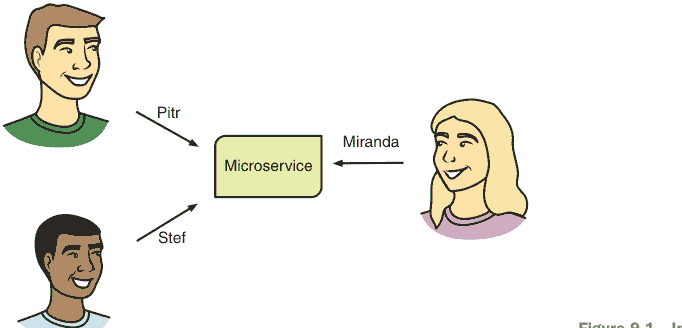

基于这些需求，认为你可以完全忽略安全性，对吧？错了！

即使你只是在为内部用户开发微服务，你也能保证微服务周围的安全防线依然稳固吗？如果防止外部网络入侵的任何安全屏障被突破，会或何时会发生什么？图 9.2 显示了如果网络安全被破坏，来自外部网络的恶意用户将如何无限制地访问微服务。

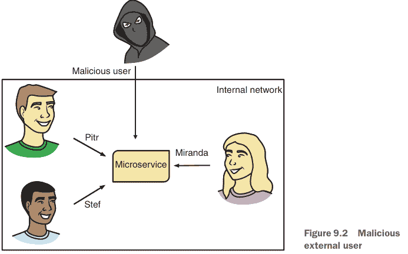

# 第 9 章 微服务的加固

安全是一个永远不应该被视为所当然的特性，无论实施了什么样的预防措施。一个常见的误解是安全是无懈可击的，事实绝并非如此。

看看图 9.2，如果你认为内部网络是安全的，你就会倾向于在自己的微服务内部添加额外的安全措施，以防止未经许可的访问。如果每个纯用于内部目的的应用程序或微服务都不包含自己的安全预防措施，你就让外部网络边界的安全造成了单点故障。

这还没有考虑到内部网络中可能存在恶意用户的情况，如图 9.3 所示。虽然内部恶意用户可能并不常见，但这种情况不能排除。这种情况的发生可能有很多原因：心怀不满的员工或企业间谍活动，这是最可能的。

很少有开发的应用程序是不需要安全的。那些应用程序大多局限于对公众已经公开的只读数据。

对于可以忽略安全性的应用程序来说，这个定义相当狭窄。你们企业每天构建的这类应用程序有多少？可能一个都没有！一个企业在其整个生命周期内开发或将开发的这类应用程序数量将极少。对于生命周期内公开的静态数据，企业并不感兴趣。

这一切意味着什么？意味着没有任何应用程序或微服务可以完全、在任何时候都忽略安全性。

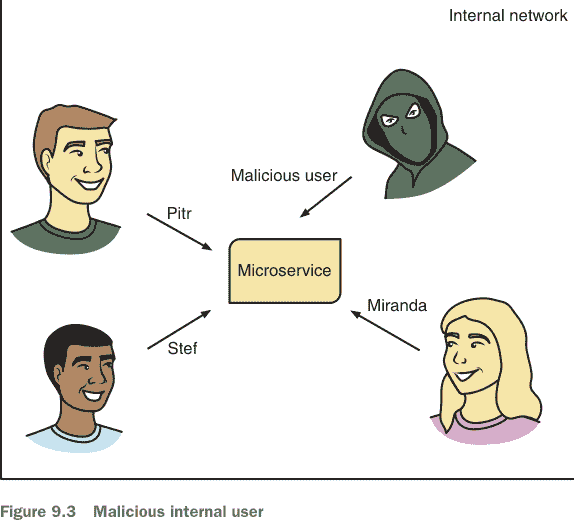

## 9.1.2 安全需要解决什么问题？

既然你已经知道你需要安全性，你需要解决什么类型的问题？这本身就可以作为一本书的主题！因为你并不是想为微服务重写《战争与和平》，你将关注最感兴趣的领域。

身份验证（`Authentication`）和授权（`Authorization`）是安全中与微服务最相关的两个方面。在深入研究之前，你需要概述这些术语的每一个含义。

身份验证在图 9.1、9.2 和 9.3 中进行了说明。它专门处理用户是否有权访问托管的应用程序或微服务，甚至处理用户是属于企业内部还是外部。身份验证完全关注用户是否能够访问应用程序。

微服务不需要区分用户是否被允许访问之外，身份验证就足够了。但如果经过身份验证的用户需要对应用程序或微服务的不同部分具有不同级别的访问权限，那么你还需要授权。

图 9.4 提供了一个可以用于微服务授权的用户角色示例。

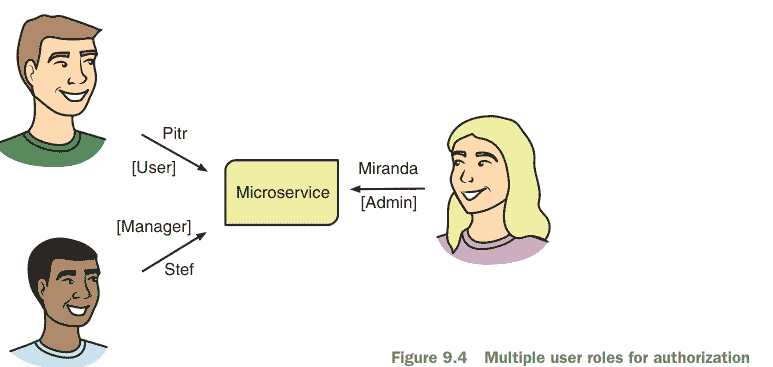

你看到了管理员（`Admin`）、经理（`Manager`）和用户（`User`）角色，这些都是可能需要的典型角色。你的微服务需要的任何角色都会所不同，取决于需求，从零到多个不等。

企业可能也有微服务，如图 9.5 所示。在这种情况下，你有一个由内部用户管理的微服务，其角色为管理员。微服务的用户是企业外部的。

从可能包含许多微服务的整个应用程序来看，你通常需要结合身份验证和授权来满足安全需求。

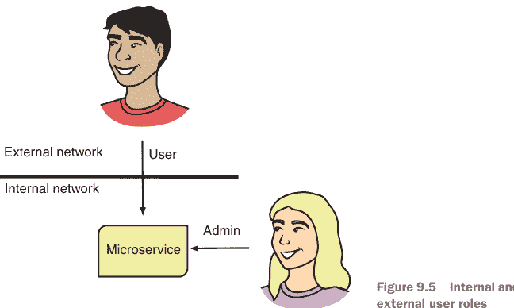 对于应用程序中的单个微服务，你可能只需要关注用户请求的身份验证，不再做其他事情。

无论你的微服务需要什么——是身份验证、授权还是两者兼有——都需要在设计期间考虑，以确保它不是临时才考虑的问题。

你如何向你的微服务中添加安全性？你完全可以开发自己的安全解决方案，但在许多情况下这远非理想。你会花费时间来开发它、维护它等等。开发自己的安全解决方案不仅会推迟你想要的东西（即你的微服务）的开发，还会为未来的开发者增加额外的维护负担。

你想做的是利用一个由大型群体开发和维护的可靠项目，该项目提供了你需要的安全用例。虽然在本书中对于这样的项目可能有很多选择，但我们将选择 `Keycloak`。

## 9.2 使用 Keycloak 工作

`Keycloak` 是一个为现代应用程序提供身份和访问管理的开源项目。通过最少的麻烦即可在应用程序和服务中添加身份验证。

### 9.2.1 理解 Keycloak 的功能

`Keycloak` 提供了许多功能。以下是与微服务开发最相关的四个：

- 单点登录（`Single-sign-on`）——允许用户针对 `Keycloak` 进行身份验证，而不是针对每个应用程序或服务。用户登录 `Keycloak` 后，他们可以访问任何通过 `Keycloak` 验证的应用程序或服务。
- 社交登录（`Social login`）——使用 `Keycloak` 启用社交登录超级简单！在管理控制台中配置社交网络即可。不需要任何代码或应用程序的更改。
- 用户联合（`User federation`）——如果你的用户注册在 `LDAP` 或 `Active Directory` 中，他们可以与 `Keycloak` 联合。如果用户位于不同类型的存储器中（例如关系型数据库），你也可以开发自己的提供程序来访问你的用户。
- 标准协议（`Standard protocols`）——`Keycloak` 开箱提供了对 `OpenID Connect`、`OAuth 2.0` 和安全断声明语言（`SAML`）。

关于 `Keycloak` 及其所有功能的详情可以在其网站 `www.keycloak.org` 上找到

### 9.2.2 设置 Keycloak

你首先需要下载一个供微服务和服务应用程序集成的 `Keycloak` 服务器。对于我们的目的，你有两种方法。你可以下载一个完整的 `WildFly` 发行版，或者下载使用 `Thorntail` 构建的 `Keycloak` 服务器。为了符合微服务的方式，请选择 `Thorntail` 版本。我们示例所需的版本可以从 `http://mng.bz/s6r9` 下载。

下载后，在单独端口启动此版本，以防干扰你的微服务：

```
java -Dswarm.http.port=9090 -jar keycloak-2018.1.0-swarm.jar
```


服务器启动后，在浏览器中访问`http://localhost:9090/auth/`。你会看到像图 9.6 所示的界面。

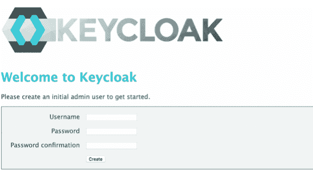

# 欢迎来到 Keycloak

请创建一个管理员用户以开始。

| 用户名 | |
| :--- | :--- |
| 密码 | |
| 确认密码 | |
| 创建 | |

文档 | 管理控制台
Keycloak 项目 | 邮件列表 | 报告问题

图 9.6 设置 Keycloak 管理员用户

## 第 9 章 保护微服务

在 Keycloak 服务器上输入管理员帐户的用户名和密码。然后点击“创建”（Create）。接下来，点击“管理控制”（Administration Console）链接查看图 9.7 所示的登录界面。


图 9.7 登录 Keycloak 管理控制

输入设置管理员帐户时提供的凭据，然后点击登录按钮。图 9.8 显示了 Keycloak 管理控制的主界面。在这里，可以根据需要修改和调整 Keycloak 的所有部分。默认情况下，系统会提供一个 Master 域（realm）。由于 Master 域包含管理员用户，良好的做法是不对于使用应用程序或微服务的身份验证的用户使用此域。

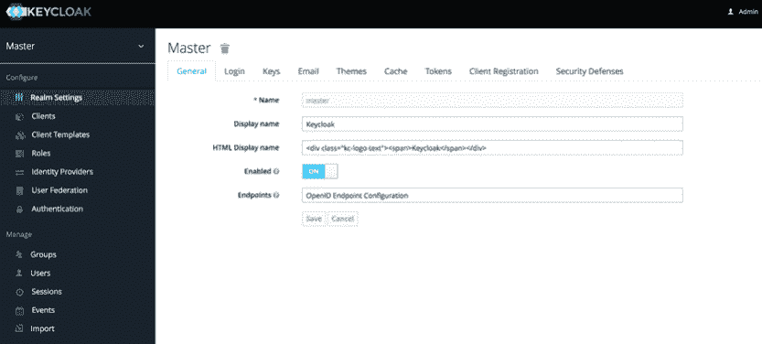

图 9.8 Keycloak 管理控制

## Keycloak 域 (Realms)

Keycloak 域管理一组用户以及它们的凭据、角色和组。域之间是相互隔离的，仅负责管理与其关联的用户。

域为不同目的的用户组提供了一种隔离方法。你可能有一个为财务微服务设置的域，另一个是为人员管理微服务设置的域。这种分离确保了每个域的用户保持相互独立，但可以从单个 Keycloak 实例进行统一管理。

根据你的需求，Keycloak 足够灵活，可以处理你的应用程序或微服务所需的任何情况。典型应用开发的常见需求（但微服务同样适用）是在调用服务时对用户进行身份验证并使用其凭据。

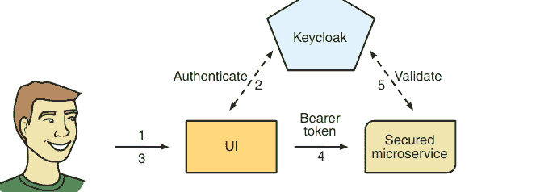

图 9.9 通过 UI 进行用户身份验证

身份验证步骤如下：

1. 用户请求登录应用程序 UI。
2. UI 重定向到 Keycloak 以执行登录。Keycloak 返回令牌可用于发布已验证请求的令牌。
3. 用户选择加载需要身份验证的视图。
4. 将 Keycloak 提供的持者令牌（bearer token）添加到请求的 HTTP 头部中。
5. 从请求中提取令牌并传递给 Keycloak 进行验证。如果令牌有效，受保护的微服务即可处理该请求。如果令牌无效，则返回 HTTP 401 状态，表示未经授权的用户提出的请求。

定义：持者令牌（Bearer token）是一种具有特殊行为属性的安全令牌。持有令牌的任何方都可以像其他持有相同令牌的方一样使用它。使用持者令牌不需要持有者证明其拥有加密密钥。

上述过程的细微变化涉及一个微服务进行身份验证，以便向受保护的微服务发送请求。图 9.10 阐释了这一点。


图 9.10 微服务身份验证

此过程的区别在于，调用受保护微服务的实体不包含也不从用户接收身份验证令牌：

1. 请求由未受保护的微服务接收。
2. 未受保护的微服务对 Keycloak 进行自身身份验证。
3. 持者令牌通过请求的 HTTP 头部传递给受保护的微服务。
4. 从请求中提取令牌并传递给 Keycloak 进行验证。如果令牌无效，则返回 HTTP 401 状态，表示未经授权的用户提出的请求。

本章的剩余部分将介绍这两种场景的示例。让我们看看你如何使用 Keycloak 来保护某些微服务。

### 9.3 保护 Stripe 微服务

在本节中，你将查看图 9.10 所示场景下的身份验证是如何运作的。第 8 章中的 Stripe 和 Payment 微服务将按照如图 9.10 所示的安全性进行实现。Payment 微服务将基于该章中的 RESTEasy 客户端版本。让我们看看之前的场景，这次是针对 Stripe 和 Payment；见图 9.11。

## 保护 Stripe 微服务


图 9.11 使用 Stripe 和 Payment 的微服务身份验证

### 9.3.1 配置 Keycloak

当你的 Keycloak 服务器运行时，下一步是为你的微服务定义一个供其关联的域。

登录管理控制台后，悬停在左上角的 Master 域名称上，以显示“添加域”（Add realm）按钮，如图 9.12 所示。

点击“添加域”按钮打开创建域的屏幕。图 9.13 显示了此屏幕。


图 9.12 在 Keycloak 中访问添加域按钮

### 添加域

| 导入 | 选择文件 |
| --- | --- |
| 名称 * | |
| 启用 | 开 |
| 创建 | |

图 9.13 创建域

点击“选择文件”从`/keycloak`目录定位`keycloak-realm.json`。点击“添加域”按钮创建该域。图 9.14 显示了你创建的域。

图 9.14 导入域

现在你的域已经创建了，让我们看看你导入的 JSON。

| 导入 | 查看详情 |
| --- | --- |
| 名称 | |
| 启用 | 开 |
| 清除 | |

# 列表 9.1 keycloak-realm.json

```json
{
  "realm": "caycloak",
  "enabled": true,
  "users": [
    {
      "username": "service-account",
      "serviceClientId": "payment-authz-service",
      "realRoles": [
        "stripe-service"
      ]
    }
  ],
  "roles": [
    {
      "name": "stripe-service-access",
      "description": "Stripe service access"
    }
  ],
  "clients": [
    {
      "clientId": "payment-authz-service",
      "secret": "secret",
      "enabled": true,
      "standardFlowEnabled": false,
      "serviceAccountsEnabled": true
    },
    {
      "clientId": "stripe-service",
      "enabled": true,
      "bearerOnly": true
    }
  ]
}
```

## 保护 Stripe 微服务

你在这里定义的所有名称和 ID 在域内都是唯一的，但它们本身没有意义。它们仅仅是文本。重要的是，域中服务的客户端 ID 必须与服务中的规范匹配（这将在下一节中介绍）。完成这些后，Keycloak 服务器已准备好处理 Stripe 和 Payment 的身份验证。

### 9.3.2 保护 Stripe 资源

第一步是保护 Stripe 微服务，以确保你在访问 Stripe API 时经过适当的身份验证。现在你已经知道如何正确连接到服务，你将需要必要的身份验证。

如果你取用第 8 章的代码，你不需要修改`StripeResource`来添加安全性。很酷，对吧？你可以在不修改代码的情况下为任何 RESTful 端点添加安全性。它是如何工作的？

首先要让 Maven 知道你想在 Thorntail 微服务中使用 Keycloak。为此，你需要在`pom.xml`中添加一个依赖：

```xml
<dependency>
  <groupId>io.thornail</groupId>
  <artifactId>keycloak</artifactId>
</dependency>
```

剩下的任务是定义 Keycloak 的位置、如何配置它以及哪些需要保护。坦率地说，你需要在 Stripe 微服务的`src/main/resources`目录下添加一个`project-defaults.yml`文件，内容如下列表所示。

# 列表 9.2 project-defaults.yml

| 为 chapter-9.stripe.war 部署定义的章节 | 部署使用哪个域进行身份验证——在此情况下 |
| --- | --- |
| swarm: keycloak: secure-deployments: chapter-9.stripe.war realm: cayambe bearer-only: | 服务所在 Keycloak 服务器的 URL。当服务部署到 Minish 时，不要使用 localhost。 |
| auth-server: http://192.168.1.13:9090/auth ssl-required: external resource: stripe-service snable-core: deployment chapter-9.stripe.war web: | 为 chapter-9.stripe.war 定义部署特定的配置章节。这等同于可以在 web.xml 中提供的内容。 |
| security-constraints: url-pattern: /stripe/* roles: [ stripe-service-access ] - | 只有拥有 stripe-service-access 角色的用户才能成功执行对此微服务的请求。 |

## 第 9 章 保护微服务

你的 Stripe 微服务已经免受未经授权访问的保护！让我们尝试一下。切换到`/chapter9/serviceauth/stripe`目录并运行以下命令：

```
mvn thorntail:run
```

尝试在浏览器打开`http://localhost:8080/stripe/charge`，它将显示 Unauthorized（未授权）。由于从浏览器发出的 HTTP 请求中没有携带 bearer token，导致你的请求被拒绝，因为你没有经过正确的身份验证。

要查看更多细节，可以使用显示 HTTP 网络的浏览器插件，或者在终端中使用 curl 命令。

列表 9.3 curl 查询 Stripe 的输出

```
$ -v http://localhost:8080/stripe/charge

* Trying ..
* TCP_NODELAY set
* Connected to localhost (::1) port 8080 (#0)
* GET /stripe/charge HTTP/1.1
* Host: localhost:8080
* User-Agent: curl/7.54.0
* Accept: */
*>
* HTTP/1.1 401 Unauthorized
* Expires: 0
* Connection: keep-alive
* WWW-Authenticate: Bearer realm="cayambe"
* Cache-Control: no-cache, no-store, must-revalidate
* Pragma: no-cache
* Content-Type: text/html;charset=UTF-8
* Content-Length: 71
* Date: Sun, 25 Feb 2023 05:22:53 GMT
>
* Connection #0 to host only localhost left intact
<html><head><title>Error</title></head><body>Unauthorized</body></body></html>
```

> HTTP 请求头信息
> HTTP 请求头信息
> HTTP 响应正文

现在很容易看出你收到了 401 HTTP 响应码，表示你尝试未经身份验证访问该 URL。既然 Stripe 已经得到了正确的保护，另一个微服务如何在不接收凭据的情况下访问它？你也可以如下部署 Stripe Minish：

```
mvn clean fabric8:deploy -Popenshift
```

### 9.3.3 在 Payment 资源中进行认证

本章的 Payment 微服务派自第 8 章中的 RESTEasy 客户端。你只需要进行几处微小的修改，使其能够针对 Keycloak 进行身份认证。

### 保护 Stripe 微服务

为了能够针对 Keycloak 对 Payment 进行认证，你为 Keycloak Auth Client 添加一个依赖项：

```
<dependency>
  <groupId>org.keycloak</groupId>
  <artifactId>keycloak-authz-client</artifactId>
  <version>3.4.0.Final</version>
</dependency>
```

该依赖项提供了与 Keycloak 认证所需的所有工具类。现在，你需要定义你正在交互的是哪个 Keycloak，以及哪个 Payment 服务属于 cayrealm 领域。为此，你需要在`src/main/resources/`下创建一个`keycloak.json`文件。

### 列表 9.4 Payment 服务的 keycloak.json

| 用于认证的领域部署（realm deployment），在此例中为 cayrealm | cayrealm 领域所在的 Keycloak 服务器 URL |
| :--- | :--- |
| "realm": "cayrealm", | |
| "auth-server": "http://192.168.1.13:9090/auth", | |
| "resource": "payment-authz-", | 将此资源标识为 payment-authz-server，它对应 cayrealm-json 中的 Client ID。 |
| "secret": "secret" | |
| 需要传递给 Keycloak 以认证此客户端的凭据。 | |

这就是你需要的所有配置。添加与 Keycloak 认证的代码。由于你使用了 Hrix，你需要将认证处理逻辑加入到`StripeCommand`中。

### 列表 9.5 StripeCommand—getAuthzClient 方法

| 添加一个辅助方法用于获取 Keycloak 的 AuthzClient。 | 如果你还没有创建 AuthzClient，请继续。 |
| :--- | :--- |
| private AuthzClient getAuthzClient() {
  if (this.authzClient == null) {
    try {
      this.authzClient = AuthzClient.create();
    } catch (Exception e) {
      throw new RuntimeException("Could not create authorization client.", e);
    }
  }
  创建 AuthzClient，它使用 keycloak.json 中的信息进行自身身份认证。
  return this.authzClient;
} | |

一旦有了 AuthzClient，你就可以获取访问令牌，并将其添加到任何指向 Stripe 的请求中。为了做到，你必须在拥有 Resteasy Client 实例后，修改`StripeCommand`中的`run()`方法并添加请求过滤器。

### 列表 9.6 StripeCommand—run 方法

| 使用 AuthClient 从 Keycloak 获取访问令牌，为令牌添加 Bearer 前缀并将其添加到列表 | 注册一个匿名的 ClientRowFilter 以修改 HTTP 请求。 |
| :--- | :--- |

```java
protected ChangeResponse response() throws Exception {
  ResteasyClient client = new ResteasyClientBuilder().build();
  client.register((ClientFilter) clientRequestContext -> {
    List<Object> list = new ArrayList<>();
    list.add("Bearer +");
    getAuthClient().obtainAccessToken();
    clientRequestContext.getHeaders().put(Headers.AUTHORIZATION, list);
  });
  // 将列表添加到请求的 AUTHORIZATION 头中。
  ResteasyWebTarget target = client.target(serviceURI);
```


`StripeService stripeService = target.proxy(StripeService.class);`

`return stripeService.charge();`

这就是你在向 Stripe 的任何请求中传递 bearer token 所需的所有内容。非常简单，对吧？

### 9.3.4 测试你的微服务

现在你已经设置好了 Stripe 和 Payment，是时候查看所有服务的运行及其相互交互了。如果你还没有运行 Keycloak 服务器，请切换到`/chapter9/service`并启动它：

```
mvn clean fabric8:deploy
```

打开 OpenShift 控制台获取 Payment 的 URL。然后使用相应的工具对`/sync`端点执行 HTTP POST。如果你尝试直接访问微服务，仍将收到 HTTP 401 unauthorized 响应。为了在调用时查看 HTTP 头，你需要另一种输出方式。在此例中，你将取消`/chapter9/service-auth`下`project-defaults.yml`中以下内容的注释：

```yaml
undertow:
  server:
    default-server:
      hosts:
        default-refs:
          request-dumper:
            class: io.undertow.handlers.RequestDumperHandler
            module: io.undertow
```

# 9.7 cayambe-realm.json

```json
"realm": "cayambe",
...
"users": [
  {
    "username": "ken",
    "realmRoles": [
      "admin",
      "user",
      "offline_access"
    ]
  },
  {
    "username": "bob",
    "realmRoles": [
      "user",
      "offline_access"
    ]
  }
],
"roles": {
  {
    "name": "user",
    "description": "User privileges"
  },
  {
    "name": "admin",
    "description": "Administrator privileges"
  }
},
"clients": [
  {
    "clientId": "cayambe-admin-ui",
    "enabled": true,
    "publicClient": true,
    "baseUrl": "http://localhost:8080",
    "redirectUris": [
      "http://localhost:8080/*"
    ]
  },
  {
    "clientId": "cayambe-admin-service",
    "enabled": true,
    "bearerOnly": true
  }
]
```

> 指定 cayambe 领域（realm）名称
> 创建用户 ken，他拥有 user 和 admin 领域角色
> 创建用户 bob，他拥有 user 领域角色
> 定义了 user 和 admin 领域角色
> 你的 UI 的 Client ID
> publicClient 表示客户端具有登录 Keycloak 的能力
> 用于 UI 的 JAX-RS 端点的 Client ID。

现在你已经准备好处理应用程序所需的更改了。

## 9.4.2 保护分类删除

引用第 6 章 admin 目录中的代码，你只需要进行少量的修改即可像 Stripe 那样对其进行安全保护。再次，你需要在 Thorntail 中添加 Keycloak 的 Maven 依赖。

```xml
<dependency>
  <groupId>io.thorntail</groupId>
  <artifactId>keycloak</artifactId>
</dependency>
```

接下来，你通过`project-defaults.yml`配置与 Keycloak 的集成。

| 列表 9.8 project-defaults.yml | 描述 |
| --- | --- |
| cayame 领域所在的 Keycloak 服务器的 URL。 | 身份验证时使用的领域——在此情况下是 cayame。 |

```yaml
swarm:
  keycloak:
    deployments:
      chapter9-admin.war:
        realm: cayame
        auth-server-url: http://192.168.1.13:9090/auth
        ssl-client: external
        resource: cayame-admin-service
      bean-type: url
    deployment:
      chapter9-admin.war:
        web:
          security-constraints:
            url-pattern: /admin/category/*
            methods: [ DELETE ]
            roles: [ ]
```

要保护 REST 上的分类删除，到此为止，但你将采取这一步来提供关于谁在删除的详细信息。

通过添加 Thorntail 的 Keycloak 依赖，你可以从微服务中获取发起请求的用户详情。这对于审计谁在做了什么非常有帮助，为了这些目的，你将把信息打印到控制台上。

### 列表 9.9 CategoryResource

```java
@DELETE
@Produces(MediaType.APPLICATION_JSON)
@Path("/category/{categoryId}")
@Transactional
public Response remove(
  @Path("{categoryId}") Integer categoryId,
  @Context SecurityContext context) throws Exception {
```

## 捕获用户认证

```java
String username = "";
// 检查 User Principal 是否为 KeycloakPrincipal 类型，这是你预期的类型。
```

```java
if (context.getUserPrincipal() instanceof KeycloakPrincipal) {
    KeycloakPrincipal keycloakSecurityContext kp = 
        (KeycloakPrincipal)context.getKeycloakSecurityContext();
    context.getUserPrincipal();
```

```java
// 将 User Principal 作为 KeycloakPrincipal 获取。
username = kp.getKeycloakSecurityContext().getToken().getName();
```

```java
// 从 HTTP 请求的令牌中获取发起请求的用户名。
try {
    Category entity = em.find(Category.class, categoryId);
    em.remove(entity);
    System.out.println(username + " is deleting category with: " + categoryId);
} catch (Exception e) {
    // 打印一条简单的审计消息语句
    // 说明谁正在删除此地址。
    return Response
    .serverError()
    .entity(e.getMessage())
    .build();
}
```

```java
return Response
.noContent()
.build();
```

## 4.4.3 在 UI 中验证用户身份

现在你的 REST 端点已经可以安全分类删除，你可以从应用程序 UI 中提供该功能。要查看你对 UI 做的更改，请查看章节代码中的`/chapter9/admin_ui/ui`目录。

在这种情况下，你选择通过向包`keycloak-js`添加 NPM 依赖来包含 Keycloak 提供的 JavaScript。你也可以直接从服务器下载 JavaScript，来自`http://localhost:9090/auth/js/keycloak.js`。

作为基于 Java 的服务，你需要一个`keycloak.json`文件来配置与 Keycloak 服务器的连接。

### 列表 9.10 用于 UI 的 keycloak.json

```json
{
    "realm": "cayambe",
    "auth-server-url": "http://192.168.1.13:9090/auth",
    "ssl-client": "external",
    "resource": "cayambe-admin-service",
    "publicClient": true
}
```

这段代码对你来说应该熟悉，因为它涵盖了连接 Keycloak 的需求。它在`realm.json`文件中定义了 Client ID。

### 列表 9.11 keycloak.js

```javascript
import Keycloak from 'keycloak-js';

const keycloakAuth = new Keycloak();

keycloakAuth.init({ onload: 'check-sso' }).then((authenticated) => {
    if (authenticated) {
        // 处理成功
    }
    // 处理失败或未认证
}).catch((error) => {
    // 处理失败
});
```

你可以将该值传递到页头，以便提供登录链接：

```html
<li class="dropdown">
  <a href="${this.loginUri}">Login</a>
</li>
```

最后一部分是在 UI 中提供一个删除分类的按钮。React 组件`CategoryListContainer`为`adminRole`属性设置一个布尔值，以指示用户是否拥有该角色。然后你只需使用 HTML 来根据该属性启用或禁用按钮：

```html
<button disabled={!this.props.adminRole} className="btn btn-danger"
  onClick={() => this.props.delete(category.id)}>Delete</button>
```

你需要修改用于删除的 React action以在请求中设置令牌，就像你在支付微服务中所做的那样。在 JavaScript 中也是类似的。

### 列表 9.12 删除管理分类

| | 描述 |
| --- | --- |
| 导入辅助 HTTP的 NPM 模块 | `import axios from 'axios';` |
| 定义 REST 端点的根 URL | `const ROOT_URL = 'http://localhost:8081';` |
| 从 keycloak-service.js 获取认证令牌 | `if (store.getState().securityState.authenticated()) { ... }` |
| 定义你想要执行的 HTTP DELETE 请求 | `axios.delete(...)` |
| 将从 keycloak.getToken() 获取的令牌设置到授权头 | `'Authorization': 'Bearer ' + token` |

忘记了 UI 和 Keycloak 是如何交互的了吗？让我们再次查看图 9.15。

# 第 9 章 保护微服务

每当 UI 调用你的 RESTful 端点的`delete`方法时，如果存在令牌，它将被设置在请求中。因为来自 UI 的其他请求不会传递令牌，但如果需要保护额外的端点或记录发起请求的用户信息，也可以以类似的方式添加令牌。

### 9.4.4 测试新的 UI 和所有服务工作

是时候让新的 UI 运行一下了。如果 Keycloak 尚未运行，请使用你在本节之前使用的命令启动它。启动你 Admin 服务的 RESTful 端点，切换到`/chapter9/ui/admin`，并运行以下命令：

```
mvn thorntail:run
```

最后，你可以运行 UI 来模拟生产环境构建，因此你需要一个单独的组件来构建并启动 UI：

```
mvn clean install
java -jar target/chapter9-ui-thorntail.jar
```


现在你可以导航到 `http://localhost:8080`，你将看到应用程序的主页，如图 9.16 所示。


你可以看到你的类别，但现在右上角有一个“登录”（Login）链接，并且每个类别都有可见的“删除”（Delete）按钮。

点击登录，你将被重定向到 Keycloak 进行身份验证。输入 `bob` 作为用户名，输入 `password` 作为密码。你会被重定向回应用程序，现在你已通过身份验证，如图 9.17 所示。


### 总结

尽管你通过了身份验证，删除按钮仍然处于禁用。因为 Bob 只有“用户”（User）角色，你无允许删除类别。

要查看如何删除类别，让我们点击右上角的用户详情退出 Bob 账号，并在选项中选择“注销”（Logout）。

现在让我们用之前的相同密码以 `ken` 登录；见图 9.18。


图 9.18 使用 Admin 角色登录时的 Cayambe 管理界面

删除按钮现在显示为亮红色，表示它可以供你使用。点击它将删除你选择的类别，你会看到该类别被移除，并收到一条消息通知你类别已成功删除。

在本章中我没有涵盖很多 React 代码，例如检查令牌有效性以及在它过期时刷新它的代码。请参阅书籍源码中该应用程序可用的所有 JavaScript 代码。

### 总结

- 保护你的微服务至关重要，无论它们是否仅打算供内部用户使用。你无法预测所有可能尝试渗透你微服务的各种恶意用户类型。
- Keycloak 可以接受承载者令牌（bearer tokens），提供一个授权客户端，并为保护你的微服务提供简单的配置。
- 你可以在没有用户的情况下对 Keycloak 进行身份验证，这对于接收端受保护的微服务与微服务调用至关重要。
- 你可以将 Keycloak 集成到应用程序 UI 中提供身份验证，并将令牌传递给受保护的 RESTful 端点。

## 构建微服务混合架构

- 本章涵盖
- 运行 Cayambe 单体应用
- 使用混合方法将微服务集成到 Cayambe
- 修改 Cayambe 以集成你的微服务
- 在混合云中运行集成的 Cayambe

本章首先向你展示旧的 Cayambe 以及如何在本地运行它。然后，在涵盖了关于使用混合方法集成你微服务的理论后，你将重新审视你为新的 Cayambe 想要实现的架构。接下来，你将深入实现混合方法，使用你到目前为止在书中开发的微服务。最后，你将带上重活的 Cayambe 单体应用以及所需的微服务，并让它们全部在云中运行。

## 10.1 Cayambe 单体应用

图 10.1 从用户视角提供了了 Cayambe 首页的提示。

| Cayambe 开源购物车参考实现 |
| --- |
| 搜索 [ ] |
| 欢迎来到 Cayambe! |
| 浏览 [ ] |

图 10.1 Cayambe 首页

Cayambe (https://sourceforge.net/) 被描述为“基于 Java 的”。编译所需的更改可以在 https://dev.mysql.com/connectors/j/ 找到，它实际上被用于 ....---------.-................................................................................. the the the the the the for。

## Admin WAR
## Cart WAR
## Checkout WAR


图 10.2 Cayambe 结构

你可以看到 Struts 和动作用于...

## 运行 Cayambe 单体应用

## 10.2 运行 Cayambe 单体应用

在本地运行 Cayambe 需要以下前提条件：

- 下载的 WildFly 11.0.Final
- 下载的 Java MySQL Connector
- 运行中的 MySQL 服务器（本地或 Docker 容器）

### 10.2.1 数据库设置

有了 MySQL 服务器，你现在可以设置数据库并加载数据。

列表 10.1 创建数据库并加载数据

| 连接到运行在本地 32768 的 MySQL 服务器，在你的环境中可能不同。 | 创建名为 cayambe 的用户，密码为 cayambe。 | 在 MySQL 服务器中为 cayambe 用户授予权限。 |
| mysql -h172.0.0.1 -P 32768 -uroot create user 'cayambe'@'172.0.0.1' identified by 'cayambe'; grant all privileges on '.*' to 'cayambe' with grant option; create database cayambe; | 创建名为 cayambe 的数据库。 |
| use cayambe; source mysql\sql\mysql.sql; source test_data.sql; | 切换到刚刚创建的数据库。 | 执行 mysql.sql 中的 SQL 脚本创建 Cayambe 需要的所有表。 |

通过这些步骤，你现在有了一个可供 Cayambe 使用的数据库。下一个任务是配置 WildFly 以能够访问你刚刚设置的数据库。

### 10.2.2 Wildfly 设置

在你将 WildFly 11.0.0.Final 下载包解压到选择的目录后，你需要提供一些设置，以便 WildFly 知道 MySQL 驱动程序在哪里。为此，在解压 WildFly 的位置创建 `/modules/system/layers/base/com/mysql/main`。

在你创建的目录中，复制之前下载的 Java MySQL Connector JAR 文件。在同一目录下，创建此文件。

列表 10.2 用于 mysql 的 MySQL 驱动 module.xml

```xml
<?xml version="1.0" encoding="UTF-8"?>

<module xmlns="urn:jboss:module:1.3" name="com.mysql">

<resources>

# 192 第 10 章 架构微服务混合体

<resource-root path="mysql-connector-Java-5.1.43-bin.jar"/>

<resources>

  <dependencies>

    <module name="jax.api"/>

    <module name="javax.transaction.api"/>

  </dependencies>

</resources>
```

Java MySQL 连接器 JAR 文件的路径。你的 JAR 文件名可能需要不同的版本。WildFly 中 JDBC 驱动程序所需的某些依赖项。

你在这里做的是创建一个供 WildFly 使用的 JBoss 模块定义。JBoss Modules 是开源项目，是 WildFly 管理类加载器的核心，它通过通过类加载器分离类来防止冲突。对于这个示例，你不需要理解 JBoss Modules 是如何运作的。你只需要知道像这里这样做的那样创建一个新模块，以便将 JDBC 驱动程序添加到 WildFly 中。

最后，你需要告诉 WildFly 新驱动程序存在，并定义一个 Cayame 可以用于数据库通信的新数据源。所有 WildFly 的配置都存在于 `standalone.xml` 中。你需要找到 WildFly 安装目录下的 `/standalone/configuration/` 里的 `standalone.xml`，然后替换该文件进行编辑。找到数据源子系统的部分，并用以下内容替换整个部分。

列表 10.3 standalone.xml 代码段

```xml
<subsystem xmlns="urn:jboss:domain:datasource:5.0">

  <datasources>

    <datasource name="ExampleDS" enabled="true" use-java-context="true">

      <pool pool-name="ExampleDS" enabled="true">

      <connection-url>jdbc:h2:mem:test;DB_CLOSE_DELAY=-1;DB_CLOSE_ON_EXIT=FALSE</connection-url>

      <driver>h2</driver>

      <security>

        <user-name>sa</user-name>

        <password>sa</password>

      </security>

    </datasource>

    <datasource jndi-name="java:jndi/java:Climb" pool-name="MySqlDS" enabled="true">

      <connection-url>jdbc:mysql://localhost:3206/cayame</connection-url>

      <driver>mysql</driver>

      <security>

        <user-name>cayame</user-name>

        <password>cayame</password>

      </security>

      <validation>

        <valid-connection-checker class-name="org.jboss.jca.adapters.jdbc.extensions.mysql.MySQLValidConnectionChecker"/>

        <background-validation validation="true"/>

      </validation>

    </datasource>

  </datasources>

</subsystem>
```

`ExampleDS` 数据源。未被更改。

在 JNDI 名称 `java/class` 下为 Cayame 提供的 Climb 数据源。

`mysql` 是驱动程序定义的名称，它添加在列表的末尾。

连接数据库的 MySQL 连接 URL。需要根据你的环境进行修改。

你在 MySQL 中为数据库创建的安全凭据。


# 运行 Cayambe 单体应用

```xml
<exception-sorter class-name="org.jboss.jca.adapters.jdbc.extensions.mysql.MySQLExceptionSorter"/>

</validation>

<datasource>

  <drivers>

    <driver name="h2" module="com.h2database.h2">

      <xa-datasource-class>org.jbx.jdbc.JdbcDataSource</xa-datasource-class>

    </driver>

    <driver name="mysql" module="com.mysql">

      <xa-datasource-class>com.mysql.jdbc.jdbc2.optional.MySqlXDataSource</xa-datasource-class>

    </driver>

    <xa-datasource-source>

    </xa-datasource-source>

  </drivers>

</datasource>

</subsystem>
```

用于 `ExampleDS` 的现有 h2 驱动程序。

`mysql` 驱动程序定义，指向你之前创建的 `com.mysql` 模块。

这就是配置 WildFly 以与 Cayambe 配合所需的所有内容。

# 10.2.3 运行 Cayambe

你几乎准备好启动 Cayambe 并看到它运行了。但首先，你需要构建 EAR 部署包。图 10.3 提醒你从部署的角度看 Cayambe 是什么样的，这是你第一次在第 2 章看到的。

Cayambe EAR 


图 10.3 Cayambe 单体部署

Cayambe 使用 EAR（企业应用归）作为部署的手段。EAR 允许 Cayambe 在包含共享的常用 JAR 库之外，包含多个 WAR。

> 注意：虽然 EAR 曾是打包部署的首选方法，但现在 WAR 部署更为常见。为了构建 Cayambe，你需要进入书中的 `cayambe` 目录并运行：

```bash
mvn install
```

Maven 将构建每个 JAR 和 WAR，然后将其打包成一个 EAR。构建完成后，将 `cayambe.ear` 拷贝到 WildFly 安装的 `/standalone/deployments/` 目录下。

现在启动你的部署：

```bash
/bin/standalone.sh
```

当 WildFly 启动时，控制台会输出许多信息，你应该能类似：

```
WFLYSR0025: WildFly Full 1.0.0 started in 602ms
```

你可以访问站点 `http://localhost:8080`，以及位于 `http://localhost:8080/admin` 的管理界面。

# 10.3 Cayambe 混合体——单体结合微服务

在第 1 章中，你学习了混合模式，即单体可以被拆分为微服务。尽管这样做会增加开销（至少在网络调用和性能方面），优势通常大于缺点。当这些优势围绕持续交付和发布周期时，情况尤其如此。

在第 2 章中，你开发了新的 UI 以及与数据交互的 RESTful 端。在第 7 章，你引入了处理支付的独立微服务，以便与外部系统集成。最后，在第 9 章，你为管理 UI 添加了安全性，该界面是在第 2 章创建的。

将单体拆分为部分确实有好处，特别是对可扩展性或性能有要求的部分。它们是如何组合在一起的？图 10.5 代表了 Cayambe 单体的建议架构。你将原始单体的大部分与在整书中开发的微服务相结合。这种架构与起点相比有了很大进步，但你仍有一些工作要做完成。

196

第 10 章 架构微服务混合体

# Cayambe EAR


图 10.5 建议的 Cayambe 单体部署

你在 10.5 中具体做了什么？你希望在结账过程中集成支付微服务，并希望 UI 从 Admin 获取类别信息，而不是自己存储数据。除了新的微服务之外，你还用一个新的 UI 替换了管理界面，因此你可以从 Cayambe 中移除旧的。

让我们看看每个集成的要求。Cayambe 混合单体及其微服务的所有代码都在书中第 10 章的代码中。

# 10.3.1 集成支付微服务

由于集成了支付微服务（特别是你使用了一个外部支付提供商——在此例中为 Stripe），你不再需要存储客户的信用卡信息。这是一个巨大的优势，因为存储信用卡信息的规则和限制可能很难执行，而将这一责任交给专门负责领域的公司容易得多。

由于你不再需要存储这些信息，让我们从 Cayambe 的 `billing_info` 表中将其删除。

## Cayambe 混合架构——带微服务的单体 197

- name_on_card（卡持人姓名）
- card_type（卡类型）
- card_number（卡号）
- card_expiration_month（卡有效期月份）
- card_expiration_year（卡有效期年份）
- authorization_code（授权码）

你将所有这些列替换为单一的 `card_charge_id` 列。在更改数据库中存储的内容时，你还需要更新传递这些值的类。

### 列表 10.4 OrderDAO

```java
public class OrderDAO {

    public void Save(OrderVO orderVO) {

        StringBuilder sqlBillingInfo = new StringBuilder(512);

        sqlBillingInfo.append('insert into billing_info (');

        sqlBillingInfo.append('order_id,name,address1,address2,city,state,zipcode,country,name,card_charge_id,email) ');

        sqlBillingInfo.append('values (');

        sqlBillingInfo.append(orderId);

        sqlBillingInfo.append(') ');

        sqlBillingInfo.append(orderVO.getBillingInfoVO().getCountry());

        sqlBillingInfo.append(',,');

        sqlBillingInfo.append(orderVO.getBillingInfoVO().getCardChargeId());

        sqlBillingInfo.append('');

    }
```


进入`/path/to/xxx`目录，找到`xxx.json`。

在表达式`cvar = avar + bvar`中，加法运算符（`+`）将`avar`与`bvar`相加，得到它们的和`cvar`

在`List.of(arg0, arg1, arg2)`中，`List`接口的工厂方法`of()`接受一系列的元素，返回包含它们的只读列表。

之后我们这样调用`cmd`命令：`cmd arg0 arg1 arg2`。

```
if (condVar > someVal) {console.log("xxx")}
```


在 pod 内部，你可以运行以下命令进入 MySQL 提示符：

```bash
mysql -u root -p$MYSQL_ROOT_PASSWORD -h $HOSTNAME
```

由于`$MYSQL_ROOT_PASSWORD`和`$HOSTNAME`被定义为环境变量，所以你不需要记住它们。现在你已进入 MySQL 内部，让我们设置你需要的数据！

## ADMIN 微服务数据

以下命令为数据库创建一个`cayambe-admin`用户，为`cayambe_admin`数据库授予该用户所有权限，创建数据库，并切换到该数据库：

```sql
create user 'cayambe-admin' identified by 'cayambe-admin';
grant all privileges on cayambe_admin.* to 'cayambe-admin' with grant option;
create database cayambe_admin;
use cayambe_admin;
```

在`cayambe_admin`数据库的上下文中，你现在可以执行某些 SQL 来创建表并填充初始数据。

打开`/chapter10/sql/admin/mysql.sql`并将内容粘贴到终端窗口。看到 SQL 语句闪过，如果一切顺利，没有错误！现在表已经存在了，对`/chapter10/sql/admin/data.sql`执行同样的操作来加载数据。

## PAYMENT 微服务数据

现在为`cayambe-payment`用户和`cayambe_payment`数据库运行类似的命令：

```sql
create user 'cayambe-payment' identified by 'cayambe-payment';
grant all privileges on cayambe_payment.* to 'cayambe-payment' with grant option;
create database cayambe_payment;
use cayambe_payment;
```

打开`/chapter10/sql/payment-service/mysql.sql`并将内容粘贴到登录了 MySQL 的终端窗口。这将创建你需要的两个表，并为 JPA 需要的 ID 序列生成器设置初始值。

## 单体应用数据

最后，为`cayambe`用户和数据库运行类似的命令：

```sql
create user 'cayambe' identified by 'cayambe';
grant all privileges on cayambe.* to 'cayambe' with grant option;
create database cayambe;
use cayambe;
```

打开`/chapter10/sql/cayame/mysql.sql`并将内容粘贴到终端窗口，这将为 Cayame 单体应用创建所有表。复制`/chapter10/sql/cayame/test_data.sql`的内容以加载初始测试数据。

## 安全

你已经在第 9 章中设置了一个 Keycloak 服务器，所以你将重用它：

```bash
/chapter10/keycloak> java -Dswarm.http.port=9090 -jar keycloak-2018.1.0-swarm.jar
```

# 将所有内容部署到混合云

打开`http://localhost:9090/auth/`并登录管理控制台。从左侧菜单导航中选择“Clients（Clients）”。在可用客户端列表中，点击`cave-admin-ui`打开其详细信息。你只需要更新三个指定你的管理 UI 运行位置的 URL，将端口 8080 更改为 8090。

## 微服务

现在是时候开始将微服务部署到 OpenShift 中了。

### ADMIN 微服务

由于 Admin 微服务在之前的章节中已经介绍过，因此在部署之前你不需要对它进行任何操作！

```bash
/chapter10/admin mvn clean fabric8:deploy -Popenshift
```

部署此微服务后，你应该在 OpenShift 控制台中看到它。

### STRIPE 微服务

作为管理员，你不需要在 Stripe 代码中进行任何操作，因此只需部署它即可：

```bash
/chapter10/stripe> mvn clean fabric8:deploy -Popenshift
```

### PAYMENT 微服务

接下来，你需要部署 Payment（支付），其方法与其他服务相同：

```bash
/chapter10/payment-service mvn clean fabric8:deploy -Popenshift
```

## Cayambe 混合

现在你已准备好为 Cayambe 混合云设置 Wildfly。你可以复用本章早期下载的 WildFly 11 和 MySQL 连接器 JAR 包，并将它们解压到新目录。

在所有文件提取完成后，创建一个与`/wildfly-11.0.0/Final/_modules/layers/base/com/mysql/main`匹配的目录结构。在该目录中复制 MySQL 连接器的 JAR 文件，并创建一个包含以下内容的模块文件：

列表 10.9 用于混合的 MySQL 驱动模块

```xml
<?xml version="1.0" encoding="UTF-8"?>
<module xmlns="urn:jboss:module:1.3" name="com.mysql">
  <resources>
    <root-path path="mysql-connector-java-5.1.43-bin.jar"/>
  </resources>
  <dependencies>
    <module name="javax.api/" />
    <module name="javax.transaction.api/" />
  </dependencies>
</module>
```

接下来，你需要为 WildFly 提供配置 Cayambe 数据源所需的信息。打开`/wildfly-11.0.0.Final/standalone/configuration/standalone.xml`，并用以下内容替换当前的数据源子系统。

列表 10.10 standalone.xml

```xml
<subsystem xmlns="urn:jboss:domain:datasources:5.0">
  <datasources>
    <datasource jndi-name="java:jboss/datasources/ExampleDS" pool
      name="ExampleDS"
      enabled="true" use-context="true">
      <connection-url>jdbc:h2:mem:test;DB_CLOSE_DELAY=-1;DB_CLOSE_ON_EXIT=FALSE</connection-url>
      <driver>h2</driver>
      <security>
        <user-name>sa</user-name>
        <password>sa</password>
      </security>
    </datasource>
    <datasource jndi-name="java:jboss/Climb" pool-name="MysqlDS"
      enabled="true" use-context="true">
      <connection-url>jdbc:mysql://localhost:53652/cayambe</connection-url>
      <driver-class>com.mysql.jdbc.Driver</driver-class>
      <driver>mysql</driver>
      <security>
        <user-name>cayambe</user-name>
        <password>cayambe</password>
      </security>
      <validation>
        <valid-connection-checker class-name="org.jboss.jca.adapters.jdbc.mysql.MysqlConnectionChecker"/>
        <background-validation type="background-validation"/>
        <exception-sorter name="org.jboss.jca.adapters.jdbc.extensions.mysql.MysqlExceptionSorter"/>
      </validation>
    </datasource>
  </datasources>
  <drivers>
    <driver name="h2" module="com.h2database.h2">
      <xa-datasource-class>org.h2.jdbcx.JdbcDataSource</xa-datasource-class>
    </driver>
    <driver name="mysql" module="com.mysql">
      <xa-datasource-class>com.mysql.jdbc.jdbc.MysqlDatasource</xa-datasource-class>
    </driver>
  </drivers>
</subsystem>
```

## 总结

列表 10.10 与 10.3 几乎相同，唯一的区别是：Cayambe 的 MySQL 实例端口号被设置为 53652。你可能好奇这个端口号是多少，因为它不是一个标准端口。嗯，你将通过转发 OpenShift 的 mysql 服务来定义它，以便你可以访问：

```bash
oc port-forward mysql-pod-name 53652:3306
```


注意：如果转发的端口关闭或你的机器重启，你将需要在 WildFly 能够找到数据库之前重新运行此命令。

## 10.4.5 Cayambe EAR

现在 WildFly 已经启动，让我们部署修改后的 Cayambe EAR。首先你需要构建它：

构建完成后，部署修改后的 Cayambe EAR。

注意：如果转发的端口关闭或你的机器重启，你将需要在 WildFly 能够找到数据库之前重新运行此命令。

## 10.4.5 Cayambe EAR

现在 WildFly 已经启动，让我们部署修改后的 Cayambe EAR。首先你需要构建它：

构建完成后，部署修改后的 Cayambe EAR。

注意：如果转发的端口关闭或你的机器重启，你将需要在 WildFly 能够找到数据库之前重新运行此命令。

# 使用 Apache Kafka 进行数据流

## 本章涵盖

- 使用 Apache Kafka 进行数据流
- 使用数据流简化架构
- 将数据流集成到混合云

在第 10 章中，你通过将单体与新的微服务整合完成了 Cayambe。本章将通过使用数据流简化 Cayambe 的访问。首先你将学习数据流，通过这些课程，你将为 Cayambe 开发一个数据流解决方案。

## 1.1 Kafka 能为你做什么？

在深入研究 Apache Kafka 之前，为了你记录和处理数据流，你需要对数据流有一定的背景了解。

### 1.1.1 数据流

数据流并不是指 Netflix 在所有设备上播放电影。它指的是从可能的多个源持续生成的数据流；每条数据或记录的尺寸都很小，并按照接收的顺序存储。这听起来可能有很多术语，但数据流仍然很新，新的使用方法不断被构思。

什么类型的数据适用于数据流？简单来说，几乎任何类型的数据在数据流背景下都是适用的。常见的例子包括车辆传感器的测量值、股票市场的实时价格以及社交网络和网站的热点。

数据流的一个常见案例是你拥有大量数据记录，并希望对其进行模式或趋势分析。很可能大部分数据可以被完全忽略，只有关键数据记录是相关的。同一组数据记录也可能有不同的目的，取决于哪个系统在消费！

图 11.1 展示了数据如何作为流被接收。


图 11.1 数据流管道

# Apache Kafka 能为你做什么？

定义 为了澄清本章使用的术语，数据流传输（data streaming）、数据流（data streams）和流式（streaming）均指的是同一个东西：从源头流数据以进行采集的过程。

## 11.2 Apache Kafka

Apache Kafka（https://kafka.apache.org/）最初由 LinkedIn 于 2010 年开发，作为其数据中心流水线的核心。目前，该流水线每天处理超过 2 万亿条消息！2021 年初，Kafka 被提为 Apache 的一个开源项目，并于 2012 年底移出了孵化阶段。在短短几年内，许多企业在使用 Apache Kafka，包括 Apple、eBay、Netflix、Spotify 和 Uber。

什么是 Apache Kafka？它是一个分布式流处理平台。我在这里所说的“分布式”是指什么？Kafka 可以将单个流中的数据分区到集群内的多个服务器上。此外，每个分区都会跨服务器进行复制，以实现该数据的容错性。

配置 Apache Kafka 的方法有很多，取决于其分布方式和容错水平，但这些主题超出了本章的讨论范围。有关的详细信息，请查看 Kafka 文档：https://kafka.apache.org/documentation/。

作为一个流处理平台，Apache Kafka 提供的核心能力如下：

- 发布和订阅记录。
- 以一种容错、持久化的方式存储记录流。
- 在记录流发生时对其进行处理。

Apache Kafka 的核心是一个分布式提交日志（commit log）：在数据被提交到日志之前，它不会通知某条数据已记录在流中。如前所述，分布式指的是日志（或流）中的每次提交都是跨越分区并进行复制的。

描述 Apache Kafka 的另一种方式是将其视为“没有衣服的数据库”：衣服暴露在前端而不是被隐藏。数据库的核心与 Apache Kafka 一样使用提交日志来跟踪更改，并作为从服务器故障中恢复的手段，从而构成数据库。通过 Apache Kafka，数据库的衣服（表、索引等）被剥离了，只剩下提交。这使得 Kafka 比普通数据库更加简洁且易于访问。

Apache Kafka 还使用了与集成过消息系统的企业级 Java 开发者熟悉的语义。有生产者（producers），它们生成并添加到流中的记录或事件，这等同于图 11.1 所示的多个源。每条记录流被称为主题（topic），任何从流中读取内容的都是消费者（consumer）。图 11.2 显示了生产者和消费者如何与 Apache Kafka 集成。

此外，连接器（connectors）使数据库或其他系统能够发送到 Apache Kafka 的记录源。最后，流处理器（stream processors）能够从一个或多个主题中流式记录，对数据进行某种类型的转换，然后将其输出到更多主题。

# 第 11 章 使用 Apache Kafka 进行数据流传输


## 什么是记录？

现在你已经了解了构成 Kafka 的部分组件，让我们定义*记录*（record）。流中的每条记录都由一个键（key）、一个值（value）和一个时间戳（timestamp）组成。键和值的用途很直观，但为什么需要时间戳呢？时间戳对于 Kafka 知道何时接收到记录至关重要（当分区时，这一点会变得更加关键）。

你还需要注意额外的概念。每条记录在数据流中都是*不可变的*（immutable）：在记录添加到数据流之后，你无法编辑、修改或删除它。你所做的只是为同一个键使用不同的值更新记录。图 11.3 扩展了图 11.1 中的流，展示了实时流中可能的记录。在图 11.3 中，你可以看到某个键并没有单一的记录。目前有三条，具有不同的值。这就是数据流的不可变性。

| Key | Key | Key |
| :--- | :--- | :--- |
| 0 | 2 | 4 |
| Value: 123 | Value: 128 | Value: 125 |

图 11.2 Apache Kafka（重制自 https://kafka.apache.org/intro.html）

图 11.3 不可变数据流

## Apache Kafka 能为你做什么？

不可变数据流的一个大优势是你可以拥有相同键的更改历史。在某些情况下，你可能只关心某事的当前值。但更重要的是，了解历史并能够确定随时间的变化至关重要。记录也是被持久化的：日志保留在文件系统上，允许在未来的任何时间对记录进行处理。话虽如此，记录的保留是有限制的。每条记录的持久时间仅取决于该特定主题的保留策略。主题可以定义为无限保留记录（使得磁盘空间不是问题），或者如果它没有被任何东西消费，则可以在几天后被清除。

## 主题是如何工作的？

Kafka 中的主题（Topics）涉及到可以发布和消费的记录类别或类型。例如，你会用一个主题用于实时数据，用另一个单独的主题用于测量。每个主题被分为 Kafka 集群内一个或多个服务器上的一个或多个分区。分区是一个单一的逻辑流或主题（如你在 11.1 和 11.3 中看到的那些），它被分成多个物理流。图 11.4 显示主题的分区增加了可以实现的并行性。主题的分区意味着日志（或流）中的每次提交都是跨分区并复制的。一个关键点是，Kafka 知道记录何时被接收的，这在分区时会变得更加关键。Kafka 保证日志（或流）中的每次提交都是跨分区并复制的。

## 主题的解剖

| 分区 | 0 | 1 | 2 | 3 | 4 | 5 | 6 | 7 | 8 | 9 | 10 | 11 |
| :--- | :--- | :--- | :--- | :--- | :--- | :--- | :--- | :--- | :--- | :--- | :--- | :--- |
| 0 | | | | | | | | | | | | |
| 1 | | | | | | | | | | | | |
| 2 | | | | | | | | | | | | |
| 3 | | | | | | | | | | | | |
| 4 | | | | | | | | | | | | |
| 5 | | | | | | | | | | | | |
| 6 | | | | | | | | | | | | |
| 7 | | | | | | | | | | | | |
| 8 | | | | | | | | | | | | |
| 9 | | | | | | | | | | | | |

图 11.4 分区（重制自 https://kafka.apache.org/intro.html）

| Topic | 0 | 1 | 2 | 3 | 4 | 5 | 6 | 7 | 8 | 9 | 10 | 11 |
| :--- | :--- | :--- | :--- | :--- | :--- | :--- | :--- | :--- | :--- | :--- | :--- | :--- |
| | | | | | | | | | | | | |
| | | | | | | | | | | | | |
| | | | | | | | | | | | | |

图 11.5 生产者和消费者（重制自 https://kafka.apache.org/intro.html）

| 0 | 1 | 2 | 3 | 4 | 5 | 6 | 7 | 8 | 9 | 10 | 11 |
| :--- | :--- | :--- | :--- | :--- | :--- | :--- | :--- | :--- | :--- | :--- | :--- |
| | | | | | | | | | | | | |
| | | | | | | | | | | | | |
| | | | | | | | | | | | | |

## 使用流式处理简化单体架构

## Cayambe EAR


微服务
微服务
微服务
Apache Kafka.

图 11.6 当前的 Cayambe 混合单体

为了正确支持图 11.6 所示的模型，你希望能够将数据库更改事件转换为 Kafka 中的记录，以便你进行处理。一种解决方案对 Admin 微服务的影响最小，同时仍能让你消费其数据。你需要一个 Kafka 的连接器来为你完成这一工作。是否有可用的工具可以实现这一点呢？是的，有的！Debezium 是一个用于将数据库更改流式地传输到 Kafka 的开源项目。

注意：Debezium 是一个用于数据变更数据捕获（CDC）的分布式平台。你可以启动 Debezium，将其指向数据库源，并在完全独立的应用程序中响应这些数据库的每次插入、更新或删除操作。Debezium 允许你消费数据库行级变更，而对直接执行这些数据库更新的应用程序产生任何影响或更改。使用 Debezium 的巨大优势是，任何消费数据库更改的应用程序或服务都可以进行维护而不会丢失任何更改。当服务再次可用时，Kafka 已准备好消费。关于 Debezium 的详细信息可以在 http://debezium.io/ 找到。

## 第 11 章 使用 Apache Kafka 进行数据流

你将对 Apache Kafka、数据流以及它们如何集成到你的微服务中有更好的理解，在本章中，我们不会为 Cayambe 混合架构实现 Debezium。我将其留作你的额外练习。

对于 Cayambe 混合架构，你将直接向 Apache Kafka 产生事件，然后在另一端消费它们。图 11.7 显示了你将对架构进行的更改，以支持展示 Apache Kafka 工作原理的更多细节。

Cayambe EAR


图 11.7 Cayambe 混合单体

你正在向 Admin 微服务添加代码，以产生发送到 Apache Kafka 主题的事件。然后，你有一个 Kafka 微服务来消费这些事件，并用更改更新 Cayambe 数据库。

你仍然将使用数据流来将所需的数据从一个地方移动到另一个地方，尽管在实际生产中使用不使用类似 Debezium 的工具效率会低一些，但对于理解发生的情况是有益的。

## 部署和使用 Kafka 进行数据流

### 11.3 部署和使用 Kafka 进行数据流

在查看与 Kafka 集成的微服务实现之前，让我们在 OpenShift 上运行 Kafka 吧！如果你还没有运行 Minishift，让我们现在启动它，就像你在第 10 章中做的那样：

```bash


> `minishift start --cpus 3 --memory 4GB`

### 11.3.1 OpenShift Kafka

在 Minishift 运行后，启动 OpenShift 控制台并登录。在你现有的项目中，点击“Add to Project”（添加项目），然后点击“Import YAML/JSON”（导入 YAML/JSON）。

粘贴 `/chapter11/resources/Kafka_OpenShift.yml` 的文本内容，其中一些片段如下所示：

**列表 11.1 Kafka OpenShift 模板**

```yaml
apiVersion: v1
kind: Template
metadata:
  name: strimzi
  annotations:
    openshift.io/display-name: "Apache Kafka (持久化存储) 将出现在 OpenShift 中。
    description: "此模板安装了 Apache Zookeeper 和 Apache Kafka 集群。更多信息
    参阅 https://github.com/strimzi/strimzi"
    tags: "messaging,datastore"
    iconClass: "fa pfiicon-topology"
    template.openshift.io/documentation-url: "https://github.com/strimzi/strimzi"
    message: "在你的应用程序中使用 kafka:9092 作为引导服务器"
objects:
  apiVersion: v1
  kind: Service
  metadata:
    name: kafka
  spec:
    ports:
    - name: kafka
      port: 9092
      targetPort: 9092
      protocol: TCP
    selector:
      name: kafka
    type: ClusterIP
- apiVersion: v1
  kind: Service
  metadata:
    name: zookeeper
  spec:
    ports:
    - name: zookeeper
      port: 2181
      targetPort: 2181
      protocol: TCP
    selector:
      name: zookeeper
    type: ClusterIP
```

## 第 11 章 使用 Apache Kafka 进行数据流


等一下，ZooKeeper 在这里做什么？它没有被提到！ZooKeeper 是 Kafka 内部使用的分布式键值存储。它没有被提到，`/11/resources/Kafka_OpenShift.yml` 被修改为只有单实例 Kafka。从 OpenShift 控制台的 Pods 列表中，你可以看到单实例 Kafka。点击该 Pod 并选择 Terminal。这是我们运行命令的地方。当你离开此 Pod 时，任何打开的终端连接都将关闭。这将杀死你从终端启动的任何前台进程。容器：kafka

图 11.8 OpenShift pod

```
sh-4.45
```

要使用 Kafka，你需要创建一个主题。让我们在终端中执行此操作：

```bash
kafka-0 --create --topic category_topic --replication-factor 1 --partitions 1 --zookeeper 172.30.93.118:2181
```

你使用脚本创建一个名为 `category_topic` 的主题，它具有单分区和单副本。你之所以只指定副本和分区是因为你的集群中只有一个节点。例如，如果你的集群中有三个节点，你可以使用三个分区和副本数为 2 的副本。

### 11.3.2 Admin 微服务

现在 Kafka 已经运行且你的主题已创建，是时候修改 Admin 微服务以向主题产生事件了！
我们将使用一个将 Kafka 的拉取模式转换为推送模式的库。这个库实际上非常易于使用，因为它消除了直接使用 Kafka API 时所需的许多样板代码。它是作为 CDI 扩展编写的，并作为 Maven 制品供你消费。代码可以在 https://github.com/aerogear/kafka-cdi 找到。

你需要做的第一件事是更新 Admin 微服务的 `pom.xml` 以使用新的依赖项：

```xml
<dependency>
  <groupId>org.apache.kafka</groupId>
  <artifactId>kafka-cdi-extension</artifactId>
  <version>0.0.10</version>
</dependency>
```

接下来你可能需要修改 `CategoryResource` 以连接 Kafka 主题，并生成要追加到上面的记录。

**列表 11.2 CategoryResource**

标识你正在连接的 Kafka 服务器。你可以使用环境变量来指定主机和端口，因为你正在与 Kafka 相同的 OpenShift 命名空间中部署微服务。

```java
@PathScoped
@ApplicationScoped
@KafkaConfig(bootstrapServers = "${KAFKA_SERVICE_HOST}:${KAFKA_SERVICE_PORT}")
public class CategoryResource {

    @Producer
    private SimpleKafkaProducer<Integer, Category> producer;

    public Response create("category_topic", Category category) throws Exception {
        producer.send("category_topic", category.getId());
        return null; // 为了结构假设添加了缺失的返回值
    }

    public Response update(@PathParam("categoryId") Integer categoryId,
            @Context SecurityContext context) throws Exception {
        producer.send("category_topic", categoryId, null);
        return null; // 为了结构假设添加了缺失的返回值
    }
}
```

注入一个接受 `Integer` 作为键和值的 CDI 生产者。

`remove` 以类似的方式进行了修改。与 `create()` 的主要区别在于你传递了一个 `null` 值，因为不再有有效值了。

`create(id)` 被修改为在创建新的 `Category` 后调用 `send(id)`。它指示了你将记录发送到哪个主题，以及键和值。

随着 Admin 微服务的更改，你现在可以部署它了！在部署微服务之前，你需要运行 Keycloak，因为你的微服务使用它来清理删除端点。要做到这一点，你需要运行以下命令：

```bash
/.9/keycloak> java -Dswarm.port=9090 -jar keycloak-2018.1.0-swarm.jar
```

如果数据库文件尚未从目录中删除，Keycloak 应该启动并记住你之前安装的所有设置。随着 Keycloak 重新运行，你现在可以部署 Admin 了：

```bash
/chapter11/admin> mvn clean fabric8:deploy -Openshift
```

## 使用 Kafka 进行数据流部署

微服务启动运行后，你可以使用 Admin UI 或通过 Postman 发送 HTTP 请求来更新和删除类别。你如何知道 Admin 微服务已正确将记录放入 Kafka 主题呢？你没有任何消耗结果的消费者：

幸运的是，Kafka 提供了一个可以在控制台中使用的消费者，用于查看主题的内容。在 OpenShift 控制台中，像以前一样返回 `kafka-*` pod 并选择 Terminal（终端）标签页。在命令行中运行以下命令：

```bash
/bin/kafka-console-consumer.sh --bootstrap-server 172.30.225.60:9092 --from-beginning category_topic
```

或者，你 `rsh` 进入 `kafka-*` pod 并远程运行命令：

```bash
oc rsh kafka-console-consumer.sh --bootstrap-server 172.30.225.60:9092 --from-beginning category_topic
```

你使用了之前收到的 OpenShift 列表中的 Kafka 服务 IP 和端口来指定 Kafka 的位置。接下来，你告诉脚本从开始处消费所有记录，这等于从偏移量 0 开始。最后，你给它主题名称。如果一切运行正常，你将看到通过 Admin 微服务所做的每项更改的记录。

我们已经涵盖了 Kafka 主题的生产端。现在让我们来看消费端。

### 11.3.3 Kafka 消费者

Kafka 消费者的所有代码都在书籍代码的 `/chapter11/kafka-consumer/` 目录下。与生产者一样，你在 `pom.xml` 中添加了 `kafka-cdi-extension` 依赖。`pom.xml` 的其余部分包含常用的 Thorhaul 插件和依赖，以及用于部署到 OpenShift 的 gradle Maven 插件。你还指定了 MySQL JDBC 依赖，以便更新 Cayabase 数据库中的记录。

要连接到 Cayabase，你需要定义一个 `DataSource`。

**列表 11.3 project-defaults.yml**

| JNDI 中的 DataSource 名称。使用从 MySQL JDBC 驱动依赖创建的模块 |
| :--- |
| `datasources:` |
| `CayabaseDS` |
| `driver-name: mysql` |
| `connection-url: jdbc:mysql://mysql:3306/cayamabe` | OpenShift 上 MySQL 实例的 URL |
| `user-name: cayabase` |
| `password: cayabase` |
| `valid-connection-checker-class-name:` |
| `org.jboss.jca.adapters.jdbc.extensions.mysql.SQLValidConnectionChecker` |

## 第 11 章 使用 Apache Kafka 进行数据流

`validate-match: true`
`background-validation: false`
`exception-sorter-class-name: org.jboss.jca.adapters.jdbc.extensions.mysql.MySQLExceptionSorter`

最后，你创建一个类来处理从 Kafka 主题接收到的记录。

**列表 11.4 CategoryEventListener**

| 正像你在生产者上做的那样，你为配置定义了 Kafka 主机和端口。 | 使用通过 project-definition 创建的 CameDB 的 JNDI 名称。使用 `getDataSource`。 |

## 第 11 章 使用 Apache Kafka 进行数据流

你希望从头处理流中的所有记录。当你接收到 Kafka 记录时，你需要判断是需要删除某个类别、值是否为空，或者我们正在处理的是新记录还是更新后的记录。

为了区分更新类别和新类别，你可以在 Kayambe 的现有记录上执行 SQL 语句，查看此记录是否存在。如果存在，它就是一条更新记录；如果不存在，它就是新记录。

如果你不想为了运行 SQL 语句来判断你处理的是更新还是新类别而产生开销，你可以将 Kafka 中记录的值类型更改为封装对象（enclosing object）。`Category` 实例（当前值）可以作为新类型中的一个字段，并带有一个标志位来指示正在处理的更改类型。

现在你已经完成了 Kafka 消费者的开发，准备好看到它们协同工作了！但在部署刚刚创建的 Kafka 消费者之前，为了看到正在发生的视觉变化，请开始使用第 10 章中的 Kayambe 混合模式并执行以下命令：

```
/wildfly-11.0.0.Final/bin/standalone.sh
```

启动 Kayambe 后，打开浏览器并在类别树中导航。你会发现通过 Admin 微服务所所的任何更改都是可见的，这是很合理的，因为你还没有激活服务来用任何更改更新 Kayambe 数据库。现在，让我们启动你的 Kafka 消费者：

```
/chapter11/kafka-consumer> mvn clean fabric8:deploy -POpenShift
```

当 pod 变为运行（operational）状态时，它应该处理 Kafka 主题上存在的所有记录，你已指定它从主题的最早偏移量（earliest offset）开始。你可以打开服务的日志，查看为每个处理的记录打印的控制台语句。

在 Kafka 消费者处理完记录后，回到 Kayambe UI 并刷新页面。当在类别树中导航并找到通过 Admin 微服务更改的类别时，你会发现它们已经根据你的操作被更新或移动了。

你成功地解耦了这两个系统，使得一个系统拥有数据（Admin 微服务），而另一个系统则以只读方式消费其副本。作为一个额外的好处，只要 Kafka 生产者和消费者运行正常，数据就永远不会变成静态状态。

## 11.4 额外练习

正如本章前面讨论的，作为一项额外练习，将 Kayambe 混合模式转换为使用 Debezium 直接处理数据库条目，而不是在 Admin 微服务内部生成记录。

这将为当前的解决方案提供另一个优势，因为在任何需要的时候，可以从 Kafka 主题记录中完全重建类别层次结构。该层次结构将包含你最初加载数据库时进行的所有初始插入记录，以及此之后发生的任何插入、更新和删除操作。

### 总结

- 数据流通过允许独立的组件或微服务保持解耦，同时使用相同的数据，简化了架构。
- 你可以使用 Apache Kafka 的数据流在微服务和应用程序之间共享数据，而无需通过 REST 调用来获取。

**注意** 关于使用 Spring Boot 开发微服务的更多细节，请参见附录。

# 附录 Spring Boot 微服务

在整本书中，我们一直关注使用 Thorntail 为企业级 Java 开发微服务。本附录提供了有关使用 Spring Boot 开发微服务的详细信息。其中包括来自 Craig Walls 编写的《Spring Boot in Action》（Manning, 2015）中的代码片段。如果你特别关注 Spring Boot 微服务，参考这本书以获取更多细节将是非常值得的（参见 www.manning.com/books/spring-boot-in-action）。

## Spring Boot 项目剖析

本节包含了《Spring Boot in Action》第 2.1.1 节的片段，概述了 Spring Boot 应用的部分及其要求。

### 检查新初始化的 Spring Boot 项目

图 1 展示了一个 Spring Boot 读读列表项目的结构。

```
readinglist
  build.gradle
  src
    main
      java
        readinglist
          ReadingListApplication.java
      resources
        application.properties
        static
        templates
  test
    java
      readinglist
        ReadingListApplicationTests.java
```

图 1 读列表项目结构

## 附录 Spring Boot 微服务

首先注意到，项目结构遵循典型的 Maven 或 Gradle 项目的布局。主应用程序代码放置在目录树的 `src/main/java` 分支，资源放置在 `src/main/resources` 分支，测试代码放置在 `src/test/java` 分支。在此时，你还没有任何测试资源，除非你将其放在 `src/test/resources` 中。

深入研究，你会发现在项目周围散落着几个文件：

- `build.gradle`——Gradle 构建规范
- `ReadingListApplication.java`——应用程序的引导类和主要的 Spring 配置类
- `application.properties`——配置 Spring 和 Spring Boot 属性的地方
- `ReadingListApplicationTests.java`——一个基础集成测试类

构建规范包含了许多需要了解的 Spring 优秀特性，所以我将检查工作留到稍后。相反，我们将从 `ReadingListApplication.java` 开始。

### 引导 Spring

`ReadingListApplication` 类在 Spring Boot 应用中起到两个作用：配置和引导。尽管 Spring Boot 自动配置消除了对许多 Spring 配置的需求，但你仍然至少需要一些 Spring 配置。


Listing 1 `ReadingListApplication`

```
package readinglist;
import org.springframework.boot.SpringApplication;
import org.springframework.boot.autoconfigure.SpringBootApplication;

@SpringBootApplication
public class ReadingListApplication {
    public static void main(String[] args) {
        SpringApplication.run(ReadingListApplication.class, args);
    }
}
```

`@SpringBootApplication` 开启了组件扫描和 Spring Boot 自动配置。事实上，你不需要编写配置。

# Spring Boot 项目剖析

- `@ComponentScan`——启用组件扫描，以便编写的控制器类和其他组件被自动发现并注册为 Bean。
- `@Configuration`——标记类为配置类。
- `@EnableAutoConfiguration`——这个注解可能被称为魔术，因为它是启用 Spring 自动配置的关键行。

在 Spring Boot 的早期版本中，你需要在 `ReadingListApplication` 类上标注这三个注解。但从 Spring Boot 1.2.0 开始，`@SpringBootApplication` 就足够了。

正如我所说，`ReadingListApplication` 也是引导类。有多种方法运行 Spring 应用，包括传统的 WAR 部署。现在，`main()` 方法允许你作为可执行 JAR 运行应用程序。它将 `ReadingListApplication` 类引用以及命令行参数传递给 `SpringApplication.run()`，从而启动应用程序。

即使你还没有编写任何应用程序代码，此时仍然可以构建并尝试运行。最简单的方法是使用 Gradle 的 `bootRun` 任务：

```
$ gradle bootRun
```

`bootRun` 任务来自 Spring Boot 的 Gradle 插件。或者，你可以使用 Gradle 构建项目并使用 Java 在命令行运行：

```
$ gradle build
```

```
$ java -jar build/libs/readinglist-0.0.1-SNAPSHOT.jar
```

应用程序应该正常启动并启用监听 8080 端口的 Tomcat 服务器。如果你愿意，可以在浏览器访问 `http://localhost:8080`，但由于你还没有编写控制器类，你会遇到 HTTP 404 (Not Found) 和错误页面。不过在附录结束之前，URL 将为你的读列表应用服务。

你几乎不需要更改 `ReadingListApplication.java`。如果你的应用程序需要 Spring Boot 自动配置之外的任何 Spring 配置，通常的做法是将其编写到单独的 `@Configuration` 类中（它们会被组件扫描捕获并使用）。在极少数情况下，你也可以在 `ReadingListApplication.java` 中添加自定义配置。

# 测试 Spring Boot 应用

初始化器（Initializer）还会为你提供一个测试类骨架，帮助你开始为应用程序编写测试。如下所示的 `ReadingListApplicationTests` 不仅仅是一个测试占位符，它还作为如何为 Spring Boot 应用编写测试的示例。`@SpringApplicationConfiguration` 加载 Spring 应用程序上下文。

列表 2 `ReadingListApplicationTests`

```java
package readinglist;

import org.junit.Test;
import org.junit.runner.RunWith;
import org.springframework.framework.boot.test.SpringApplicationConfiguration;
import org.springframework.framework.context.junit4.JUnit4ClassRunner;
import org.springframework.framework.context.web.WebAppConfiguration;

import readinglist.ReadingListApplication;

@RunWith(JUnit4ClassRunner.class)
@SpringApplicationConfiguration(
    classes = ReadingListApplication.class,
    @WebAppConfiguration)
public class ReadingListApplicationTests {

    @Test
    public void contextLoads() {
    }
}
```

在典型的 Spring 集成测试中，你可能使用 `@ContextConfiguration` 注解类，以指定应用程序上下文如何加载。为了充分利用 Spring Boot 的魔力，应该使用 `@SpringApplicationConfiguration` 注解。如列表 2 所示，`ReadingListApplicationTests` 标记了 `@SpringApplicationConfiguration`，以便从 `ReadingListApplication` 配置类加载 Spring 应用程序上下文。

`ReadingListApplicationTests` 还包含一个测试方法 `contextLoads()`。它非常简单，事实上它是一个空方法。但它对于验证应用程序上下文在没有任何问题的情况下加载已经足够了。如果 `ReadingListApplication` 中定义的配置良好，测试将通过。如果存在任何问题，测试将失败。

随着应用程序的完善，你将添加一些自己的测试。但 `contextLoads()` 方法是一个很好的开始，它验证了此时应用程序所提供的每一项功能。

# 配置应用程序属性

Initializr 提供的 `application.properties` 文件起初是空的。此文件是可选的，因此你可以完全删除它而不影响应用程序。将其保留在原处也没有什么坏。

你以后肯定会找到机会向 `application.properties` 中添加条目。现在，如果你想研究一下 `application.properties`，可以尝试添加以下行：

```
server.port=8000
```

通过这一行，你正在配置嵌入的 Tomcat 监听端口 8000 而不是默认端口 8080。你可以通过重新运行应用程序来确认。

这表明 `application.properties` 文件对于 Spring Boot 自动配置的内容进行细粒度配置非常有用。你也可以用它来指定应用程序代码使用的属性。

需要注意的主要点是，在任何时候你都没有明确要求 Spring Boot 为你加载 `application.properties`。由于 `application.properties` 的存在，它会被加载，其属性可用于配置 Spring 和应用程序代码。

# Spring Boot starter 依赖

本节提供了关于 Spring Boot starter 及其如何使用的信息。

# 使用 starter 依赖

为了理解 Spring Boot starter 依赖的优势，让我们假设它们不存在。如果没有 Spring Boot，你会在构建中添加哪些依赖？为了支持 Spring MVC，你需要哪些 Spring 依赖？你还记得 Thymeleaf 或任何外部依赖的 group 和 artifact ID 吗？你应该使用哪个版本的 Spring Data JPA？这些都是兼容的吗？

哦不。没有 Spring Boot starter 依赖，你会有一些工作要做。你只是想开发一个使用 Thymeleaf 的 Spring Web 应用，并通过 JPA 持久化数据。但在写下第一行代码之前，你必须弄清楚构建中需要放入什么来支持你的计划。

经过考虑（并从另一个应用程序的构建中大量复制相似依赖），你在 Gradle 规范中得到了如下内容：

```gradle
compile("org.springframework:spring-web:4.1.6.RELEASE")
compile("org.thymeleaf:thymeleaf-spring4:2.1.4.RELEASE")
compile("org.springframework.data:spring-data-jpa:1.8.0.RELEASE")
compile("org.springframework.hibernate-entitymanager:jar:4.3.8.Final")
compile("com.h2database:h2:4.1.187")
```

# 附录 Spring Boot 微服务

这个依赖没问题，甚至可能有效。但你如何知道呢？你有什么保证，你为这些依赖选择的版本彼此之间是兼容的？它们可能是兼容的，但在你构建并运行应用程序之前，你将不知道。你如何知道依赖列表是完整的？在还没有写一行代码的情况下，你距离测试你的构建还有很远。

让我们退一步，回想一下想要做什么。你想构建一个具有以下特征的应用程序：

- 它是一个 Web 应用。
- 它使用 Thymeleaf。
- 它通过 Spring Data JPA 将数据持久化到关系型数据库。

如果你能在构建中指定这些事实，并让构建工具处理你需要的内容，不是更简单吗？这正是 Spring Boot starter 依赖所做的事情。

# 指定基于特面的依赖

Spring 通过提供几十个 starter 依赖来解决项目的依赖复杂性。starter 依赖本质上是一个 Maven POM，定义了对其他库的传递依赖，这些库提供了某些功能的支持。许多这些 starter 依赖的命名是为了指示它们提供的切面或功能类型。

例如，阅读列表应用程序将是一个 Web 应用。与其在项目构建中添加多个选定的库依赖，不如直接声明它是一个 Web 应用要简单得多。你可以通过添加 Spring Boot 的 starter 来实现这一点。你还需要使用 Thymeleaf 并通过 Spring Data JPA 持久化数据。因此，你需要 Thymeleaf 和 Spring Data JPA 的 starter。

出于测试目的，你还需要能够运行集成测试的 starter。在 Gradle 构建中，你还需要 Spring Boot 的测试 starter。

总的来说，Initializr 提供了以下五项依赖：

```gradle
dependencies {
    compile "org.springframework.boot:spring-boot-starter-web"
    compile "org.springframework.boot:spring-boot-starter-thymeleaf"
    compile "org.springframework.boot:spring-boot-starter-data-jpa"
    compile "com.h2database:h2"
    testCompile("org.springframework.boot:spring-boot-starter-test")
}
```

正如你之前看到的，将这些依赖引入应用程序的最简单方法是使用 Initializr。但如果你初始化项目时没有这样做，完全可以通过编辑 `build.gradle` 或 `pom.xml` 来添加它们。

# Spring Boot starter 依赖

通过传递依赖，添加这些依赖等同于在构建中添加几十个库。关于 starter 依赖最重要的一点是，它们只在需要时才是具体的。你不需要说想要 Spring MVC；只需要说你想构建一个 Web 应用。 Thymeleaf 和 Spring Data JPA starter 的传递依赖稍微具体一点，但那是因为没有更具体的方式来声明它们。

在任何情况下你都不需要指定版本。starter 依赖的版本取决于你正在使用的 Spring Boot 版本。

不知道各种库的版本可能会让人感到不安。但你可以放心，Spring Boot 已经通过了测试，以确保引入的所有依赖都是兼容的。只需指定一个 starter 依赖而不必担心维护哪些库以及哪些版本，这是一种解脱。

但如果你想知道得到了什么，始终可以从构建工具中发现。对于 Gradle，`dependencies` 任务将为你提供一个包含项目所使用的每个库及其版本的依赖树：

```bash
$ gradle dependencies
```

你可以在 Maven 构建中通过依赖插件的 `tree` 目标获取类似的依赖树：

```bash
$ mvn dependency:tree
```

在大多数情况下，你不应该关心每个 Spring Boot starter 依赖提供的具体细节。通常，只需要知道 web starter 允许你构建 Web 应用，Thymeleaf starter 允许你使用 Thymeleaf 模板，而 Spring Data JPA starter 允许通过使用 Spring Data JPA 进行持久化。

# 覆盖 starter 传递依赖

根本上，starter 依赖就像你构建中的任何其他依赖一样。你可以使用构建工具的功能选择性地覆盖传递依赖管理版本、排除传递依赖，并且当然为 Spring Boot starters 未涵盖的库明确指定依赖。

例如，考虑 Spring Boot 的 web starter。除其他因素外，web starter 直接依赖于 Jackson 库。如果你正在构建一个消费或产生资源表示的 REST 服务，那么这个库将非常有帮助。但如果你使用 Spring Boot 构建一个更传统的面向人类的 Web 应用程序，你可能不需要 Jackson。虽然使用它不会产生任何副作用，但你仍然可以通过排除 Jackson 传递依赖来精简你的构建产物。

如果你在使用 Gradle，可以像这样排除传递依赖：

```
compile("org.springframework.framework:spring-boot-starter-web") {
  exclude group:"com.fasterxml.jackson.jackson.core"
}
```

在 Maven 中，你可以使用 `<exclusions>` 元素排除传递依赖。以下针对 Spring Boot web starter 的 `<dependency>` 使用了 `<exclusions>` 来将 Jackson 排除在构建之外：

```xml
<dependency>
  <groupId>org.springframework.boot</groupId>
  <artifactId>spring-boot-starter-web</artifactId>
  <exclusions>
    <exclusion>
      <groupId>com.fasterxml.jackson</groupId>
    </exclusion>
  </exclusions>
</dependency>
```

相反，在构建中包含 Jackson 是没有问题的，但你想构建与 web starter 引用的版本不同的 Jackson 版本。假设 web starter 引用了 Jackson 2.3.4，但你想使用 2.4.3 版本。使用 Maven，你可以这样在项目的 `pom.xml` 文件中直接表达该依赖：

```xml
<dependency>
  <groupId>com.fasterxml.jackson.core</groupId>
  <artifactId>jackson-databind</artifactId>
  <version>2.4.3</version>
</dependency>
```

Maven 允许使用“最近依赖”原则，这意味着因为你在项目构建中直接表达了此依赖，它将优于由另一个依赖项传递引用的依赖。

同样，如果你使用 Gradle 进行构建，可以在 `build.gradle` 文件中像这样指定新版本的 Jackson：

```
compile("com.fasterxml.jackson.core:jackson-databind:2.4.3")
```

## 开发 Spring Boot 应用程序

该依赖在 Gradle 中生效，是因为它比 Spring Boot web starter 传递引用的版本要新。但假设你不想使用新版本的 Jackson，而是想使用一个旧版本。与 Maven 不同，Gradle 倾向于使用依赖的最新版本。因此，如果你想使用旧版本的 Jackson，你必须在构建中将旧版本作为依赖项表达出来，并排除它被 web starter 传递式解析：

```
compile("org.springframework.boot:spring-boot-starter-web") {
  exclude group:"com.fasterxml.jackson.core"
}
compile("com.fasterxml.jackson.core:jackson-databind:2.3.1")
```

无论如何，除了覆盖由 Spring Boot 依赖项拉取的传递依赖之外，虽然不同版本可能可以工作，但知道 starters 所选择的版本已经过测试并可以协同工作，这会带来极大的便利。你应该只在特殊情况下（例如新版本中的 bug 修复）才覆盖这些传递依赖。

现在你已经有了空的项目结构和就绪的构建规范，是时候开始开发应用程序本身了。在此过程中，你将让 Spring Boot 处理配置细节，而你专注于编写提供阅读列表功能的代码。

## 开发 Spring Boot 应用程序


在列表 3 中，你将进一步开发一个 Spring Boot 应用程序，内容自《Spring Boot in Action》第 2.3.1 节。

## 关注应用程序功能

理解 Spring Boot 自动配置的一种方法，是我在接下来的几页中展示在没有 Spring Boot 的情况下所需的配置。但几本关于 Spring 的优秀书籍可以向你展示这些，而且展示这些并不能帮你更快地获得阅读列表应用程序。

与其在 Spring Boot 配置上浪费时间，不如知道 Spring Boot 将会为你处理这些事情，让我们看看利用 Spring Boot 自动配置如何让你专注于编写应用程序代码。我想不到有比这更好的方法，那就是开始为阅读列表应用程序编写应用程序代码。

## 定义领域

你应用程序中的核心领域概念是读者阅读列表上的书。因此，你需要定义一个表示书籍的实体类。列表 3 显示了如何定义 `Book` 类型。

### 列表 3 Book 类

```java
package readinglist;

import javax.persistence.Entity;
import javax.persistence.GeneratedValue;
import javax.persistence.GenerationType;
import javax.persistence.Id;

@Entity
public class Book {

    @GeneratedValue(strategy=GenerationType.AUTO)
    private Long id;
    private String reader;
    private String isbn;
    private String title;
    private String author;
    private String description;

    public Long getId() {
        return id;
    }

    public void setId(Long id) {
        this.id = id;
    }

    public String getReader() {
        return reader;
    }

    public void setReader(String reader) {
        this.reader = reader;
    }

    public String getIsbn() {
        return isbn;
    }

    public void setIsbn(String isbn) {
        this.isbn = isbn;
    }

    public String getTitle() {
        return title;
    }

    public void setTitle(String title) {
        this.title = title;
    }

    public String getAuthor() {
        return author;
    }

    public void setAuthor(String author) {
        this.author = author;
    }

    public String getDescription() {
        return description;
    }

    public void setDescription(String description) {
        this.description = description;
    }
}
```

如你所见，`Book` 类是一个带有少量属性的简单 Java 对象，`id` 字段带有 `@Id` 注解以指定其标识性。

### 定义仓库

接下来定义通过该仓库将对象持久化到数据库。由于你正在使用 Spring Data，该任务只需创建一个扩展 `Repository` 的接口即可。

```java
import java.util.List;
import org.springframework.data.jpa.repository.JpaRepository;

public interface ReadingListRepository extends JpaRepository<Book, Long> {
    List<Book> findByReader(String reader);
}
```

通过扩展 `JpaRepository`，`ReadingListRepository` 继承了常用持久化操作的方法。此外，我添加了 `findByReader` 方法，通过该方法根据读者的用户名查找读者。

如果你在想谁将实现 `ReadingListRepository` 以及它继承的方法，不用担心。Spring Data 提供了它自己的特殊魔法，使得仅通过接口定义仓库成为可能。该接口将在应用程序启动时自动实现。

## 创建 Web 界面

现在你已经定义了应用程序的领域，并有一个用于将该领域的对象持久化到数据库的仓库，剩下的就是创建前端。一个像后续列表中的 Spring MVC 控制器将处理应用程序的每一个请求。

### 列表 4 ReadingListController

```java
package readinglist;

import org.springframework.beans.factory.annotation.Autowired;
import org.springframework.ui.Model;
import org.springframework.stereotype.Controller;
import org.springframework.web.bind.annotation.PathVariable;
import org.springframework.web.bind.annotation.RequestMapping;
import org.springframework.web.bind.annotation.RequestMethod;

import java.util.List;

@Controller
@RequestMapping("/*")
public class ReadingListController {

    private ReadingListRepository readingListRepository;

    @Autowired
    public ReadingListController(
        ReadingListRepository readingListRepository) {
        this.readingListRepository = readingListRepository;
    }

    @RequestMapping(value="/reader", method=RequestMethod.GET)
    public String readBooks(
        @PathVariable("reader") String reader,
        Model model) {

        List<Book> readingList = 
            readingListRepository.findByReader(reader);
        if (readingList != null) {
            model.addAttribute("books", readingList);
        }
        return "readingList";
    }

    @RequestMapping(value="/reader", method=RequestMethod.POST)
    public String addToReadingList(
        @PathVariable("reader") String reader, Book book) {
        book.setReader(reader);
        readingListRepository.save(book);
        return "redirect:/" + reader;
    }
}
```

## 开发 Spring Boot

`ReadingController` 标记了 `@Controller` 注解，以便被组件扫描到并自动注册为 Spring 应用上下文中的一个 bean。它还被标记了 `@RequestMapping` 注解，以将其所有的处理方法映射到基础 URL `/`。

该控制器有两个方法：

- `readersBooks()` 处理针对 `/<reader>` 的 GET 请求，通过从存储库（已注入到控制器的构造函数中）为路径中指定的读者检索 `Book` 列表。它将 `Book` 列表以 `books` 为键存入模型中，并返回 `readingList` 作为要渲染视图的逻辑名称。

- `addToReadingList()` 处理针对 `/<reader>` 的 POST 请求，将请求体中的数据绑定到 `Book` 对象中。该方法将对象的 `reader` 属性设置为读者的名称，然后通过存储库的 `save()` 方法保存修改后的 `Book`。最后，它返回到 `/<reader>` 的重定向（这由另一个控制器方法处理）。

`readersBooks()` 方法通过返回 `readingList` 作为逻辑名称包含了该功能。你还必须创建一个视图。在项目开始时，我决定使用 Thymeleaf 来定义应用视图，因此下一步是在 `src/main/resources/templates` 中创建一个名为 `readingList.html` 的文件，内容如下：

### 列表 5 readingList.html

```html
<html>
<head>
  <title>Reading List</title>
  <link rel="stylesheet" th:href="@{style.css}"></link>
</head>
<body>
  <h2>Your Reading List</h2>
  <div th:if="${!lists.isEmpty(books)}">
    <div th:each="book : ${books}">
      <div class="bookHeader">
        <span th:text="${book.title}">Title</span>
        <span th:text="${book.author}">Author</span>
        <span>[ISBN: <span th:text="${book.isbn}">ISBN</span>]</span>
      </div>
      <div class="bookDescription">
        <span th:if="${book.description != null && !book.description.isEmpty()}"
              th:text="${book.description}">Description</span>
        <span th:if="${book.description == null}">
          No description available
        </span>
      </div>
    </div>
  </div>
  <div th:if="${lists.isEmpty(books)}">
    <p>You have no books in your book list</p>
  </div>

  <hr/>

  <h3>Add a book</h3>
  <form method="POST">
    <label for="title">Title</label>
    <input type="text" name="title" size="50"><br>
    <label for="author">Author</label>
    <input type="text" name="author" size="50"><br>
    <input type="text" name="isbn" size="15"><br>
    <label for="description">Description:</label>
    <textarea name="description" cols="80" rows="5"></textarea><br>
    <input type="submit" value="Add">
  </form>
</body>
</html>
```

此模板定义了一个 HTML 页面，在概念上分为两个部分。页面顶部是读者阅读列表中的书籍列表。底部是一个读者用于向阅读列表添加新书的表单。

为了美观，Thymeleaf 模板引用了一个样式表 `class.css`。该文件应该创建在 `src/main/resources/static` 中，并且如下：

```css
body {
  background-color: #cccccc;
  font-family: arial,helvetica, sans-serif;
}

.bookHeadline {
  font-size: 12pt;
  font-weight: bold;
}

.bookDescription {
  font-size: 10pt;
}

label {
  font-weight: bold;
}
```

此样式表非常简单，并没有为了让应用好看而过度设计。但它满足了我们的需求，正如你很快看到的，它被用于演示 Spring Boot 自动配置的一个特性。

信不信，这就是完整的应用程序。在这个附录中，我们向你展示了每一行代码。翻回之前的页面，看看你是否能找到

## Spring Boot 测试

任何配置。除了列表 1 中的三行配置（它开启了自动配置）之外，你不需要编写任何 Spring 配置。

尽管缺乏 Spring 配置，这个完整的 Spring 应用已经准备就绪可以运行。让我们启动它看看它看起来是什么样。

## Spring Boot 测试

本节提供了通过模拟（mock）Spring MVC 的部分内容使用 Spring Boot 进行测试的信息。本节包含了《Spring Boot 实战》第 4.2.1 节的内容。

## 模拟 Spring MVC

从 Spring 3.2 开始，Spring Framework 就拥有一个实用的功能，可以通过模拟 Spring MVC 来测试 Web 应用。这使得可以在不实际在 servlet 容器中运行控制器的情况下对控制器执行 HTTP 请求。相反，Spring 的 Mock MVC 框架模拟了足够的 Spring MVC，让你感觉应用运行在 servlet 容器中——但实际上并非如此。

要在测试中设置 Mock MVC，你可以使用 `MockMvcBuilders`。该类提供了两个方法：

- `standaloneSetup()` 构建一个 Mock MVC 来服务一个或多个手动配置的控制器。

- `webAppContext()` 使用 Spring 应用上下文构建 Mock MVC，该上下文推测包含一个或多个配置好的控制器。

这两个选项的主要区别在于，`standaloneSetup()` 要求你手动实例化并注入所需的控制器，而 `webAppContext()` 则从 `WebApplicationContext` 实例工作，而该实例通常是由 Spring 加载的。前者更类似于单元测试，你仅用于针对单个控制器的集中测试。后者允许 Spring 加载你的控制器及其依赖项，以进行全面的集成测试。

为了方便起见，你将使用 `webAppContext()`，这样就可以测试 `ReadingListController`，它是从 Boot 自动配置的应用上下文中实例化并注入的。

`webAppContext()` 接收一个 `WebApplicationContext` 作为参数。因此，你需要用 `@SpringBootConfiguration` 标记测试类，并使用 `@Autowired` 将 `WebApplicationContext` 注入为测试的实例变量。此列表显示了你 Mock MVC 测试的起点。

### 列表 6 MockMvcWebTests

```java
@RunWith(JUnit4Runner.class)
@SpringBootConfiguration(
    classes = ReadingListApplication.class)
public class MockMvcWebTests {

@Autowired
private WebApplicationContext webContext;

private MockMvc mockMvc;

@Before
public void setupMockMvc() {
    mockMvc = MockMvcBuilders
        .webContextSetup(webContext)
        .build();
}
```

`@WebApplicationConfiguration` 声明由 `SpringJUnitRunner` 创建的上下文应该是 `WebApplicationContext`（而非普通的 `ApplicationContext`）。

`setupMockMvc()` 方法带有 JUnit 的 `@Before` 注解，表示它将在任何测试之前执行。它将注入的 `webContext` 传递给 `webContextSetup()` 方法，然后调用 `build()` 生成一个 `MockMvc` 实例，并赋值给实例变量供测试方法使用。


现在你有了 Mock MVC，可以开始编写测试方法了。让我们从一个简单的测试方法开始，执行 HTTP GET 请求 `/readingList` 并断言模型值符合你的预期。下面的 `homePage` 测试实现了你需要的功能：

```java
@Test
public void homePage() throws Exception {
    mockMvc.perform(MockMvcRequestBuilders.get("/readingList"))
        .andExpect(MockMvcResultMatchers.status().isOk())
        .andExpect(MockMvcResultMatchers.view().name("readingList"))
        .andExpect(MockMvcResultMatchers.model().attributeExists("books"))
        .andExpect(MockMvcResultMatchers.model().attribute("books").value(Matchers.empty()));
}
```

你可以看到，这个测试方法使用了许多静态方法，包括来自 Spring `MockMvcRequestBuilders` 和 `MockMvcResultMatchers`，以及 Hamcrest 库的 `Matchers`。在深入研究该测试方法之前，让我们添加一些静态导入，以便代码更易读：

```java
import static
import org.springframework.test.web.servlet.request.MockMvcRequestBuilders.*;
import static
import org.springframework.test.web.servlet.result.MockMvcResultMatchers.*;
```

## Spring Boot 测试

有了这些静态输入，测试可以可以重写如下：

```java
@Test
public void get() throws Exception {
 mockMvc.perform("/readingList")
    .andExpect(status().isOK())
    .andExpect(view().name("readingList"))
    .andExpect(model().attributeExists("books"))
    .andExpect(model().attribute("books", isEmpty()));
}
```

现在这个测试方法读起来几乎非常自然。它首先执行一个 GET 请求 `/readingList`。然后，它期望请求是成功的（`isOK()`），返回 HTTP 200 响应码，并且视图的逻辑名称为 `readingList`。它还断言模型中包含一个名为 `books` 的属性，但该属性是一个空集合。这一切都很直观。

主要需要注意的是，此时应用程序并没有部署到 Web 服务器上。相反，它运行在一个模拟的 Spring MVC 之中，该环境足以处理你通过 `MockMvc` 实例发送的 HTTP 请求。

很酷，对吧？让我们再试一种方法。这次你将通过发送一个 HTTP POST 请求来发布新书，让它变得稍微有趣一点。你应该期望在处理 POST 后，请求将重定向到 `/readingList`，并且模型中的 `books` 属性将包含新添加的书。下面的列表显示了如何使用 Spring MVC 进行此类测试。

# 6 MockMvcWebTests

```java
@Test
public void postBook() throws Exception {
 mockMvc.perform(post("/readingList")
    .contentType(MediaType.APPLICATION_FORM_ENCODED)
    .param("title", "BOOK TITLE")
    .param("author", "BOOK AUTHOR")
    .param("isbn", "1234567890")
    .param("description", "DESCRIPTION")
    .andExpect(status().is3xxRedirection())
    .andExpect(header().string("Location", "/readingList"));

Book expectedBook = new Book();
expectedBook.setId(1);
expectedBook.setReader("craig");
expectedBook.setTitle("BOOK TITLE");
expectedBook.setAuthor("BOOK AUTHOR");
expectedBook.setIsbn("1234567890");
expectedBook.setDescription("DESCRIPTION");

mockMvc.perform(get("/readingList")
    .andExpect(status().isOK())
    .andExpect(view().name("readingList"))
    .andExpect(model().attributeExists("books")
    .andExpect(model().attribute("books", hasSize(1))
    .andExpect(model().attribute("books",
    contains(samePropertyValueAs(expectedBook)));
```

这是一个稍微有点复杂的测试；它一次性测试两个内容。第一部分发布书籍并断言该请求的结果。第二部分执行 GET 请求，并断言新创建的书籍在模型中。

在发布书籍时，你必须确保将 `content-type` 设置为 `application/x-www-form-urlencoded`（使用 `MediaType.APPLICATION_FORM_ENCODED`），因为当书籍在运行的应用程序中被发布时，浏览器发送的就是这种内容类型。然后你使用 `MockMvcRequestBuilder.param()` 方法设置模拟表单提交的字段。请求执行后，断言响应是重定向到 `/readingList`。假设测试方法的大部分都通过了，你就进入第 2 部分。首先，你设置了一个包含期望值的 `Book` 对象。你将用它来与获取主页时模型中的值进行比较。

然后，你对 `/readingList` 执行 GET 请求。在大多数情况下，这与你之前测试主页的方式没有区别，只不过你不是检查模型中是否有空集合，而是检查它有一个项目，且该项目与你创建的期望 `Book` 对象相同。如果是这样，那么你的控制器似乎在接收到发布的书籍时完成了保存书籍的工作。

### 总结

- 《Spring Boot 实战》中的 Spring 内容涵盖了使用 Spring Boot 开发微服务的更多细节。

- 关于开发 Spring Boot 微服务的更多细节，可以在 [Spring Boot in Action](www.manning.com/books/spring-boot-action) 中找到。

# 索引

# A

- 添加 realm（领域）按钮, Keycloak 173

- `addOrUpdateItem()` 方法 45, 48

- `ToAddReadingList()` 方法 241

- 管理微服务 202, 221–223

- `AdminApplication` 类 31

- `AdminClient` 类 35

- 管理站点 25–35

- 应用程序架构 28–29

- 创建 JAX-RS 端点 30–33

- 添加分类 32–33

- 删除分类 31

- 启动微服务 34

- 启动 UI 34

- 查看所有分类 31

- 运行 33–35

- 用例 27

- `@Advertise` 注解 129–130

- Apache HttpClient 108–110

- Apache Kafka 数据流 227

- 管理微服务 221–223

- 练习 226–227

- Kafka 消费者 223–226

- OpenShift Kafka 219–221

- 概述 211–213

- 记录 214–215

- 简化单体架构 216–218

- 主题 215–216

- API 层 28

- `Application` 类 58

- 应用程序，架构 28–29

- `@ApplicationScoped` 注解 31

- 数据流架构，简化 216–218

- 企业级 Java 4–6

- Arquillian 66, 94

- `AsyncResponse.resume()`

- `asyncResponse.resume()` 方法 108, 112

- 在支付资源中进行身份验证 176–178

- 在 UI 中 183–186

- 自动检测 (AutoDetect) 56

- `@Autowired` 注解 243

# B

- 持有者令牌 (bearer token) 171

- 大爆炸模式 (Big Bang pattern) 17

- 引导 (bootstrapping) 230–231

- 边界上下文模式 (Bounded Context pattern) 1, 15

- 浏览目录，OpenShift 204

- 隔离器 (bulkheads) 149–151

# C

- CaaS (容器即服务) 85

- `Controller` 类 45, 47, 51

- `categoriesWithIdenticalParentId()` 方法 64

- `Category.hashCode()` 方法 66

- `CategoryEventListener` 225

- `CategoryItemList` 184

- `CategoryResource` 类 30–31, 80

- `CategoryResourceIT` 类 96

- `CategoryTest` 类 68

- `CategoryTest` 63, 68

- `categoryRef` 字段 105

- 微服务混合单体 194–202

- 混合 OR 209

- 数据库 204–206

- `ChangeTransformer` 类 132

- 熔断器 (circuit breakers) 145–149

- `CircuitData` 146, 154

- 客户端负载均衡 119

- Jackson 类 110

- 闭路 (closed circuit) 146

- 云优势 84

- 部署到 88

- 练习 97

- 微服务云 89–94

- 原生开发 68

- 服务模型 84–86

- 启动 Min 88–89

- 测试 94–97

- `@ComponentScan` 注解 231

- `@Configuration` 注解 230

- Consul 126

- 消费者组 216

- 消费者驱动 74–82

- `ConsumerTest` 类 76, 82

- Kafka 消费者 223–226

- 消费微服务 116

- Java 库 105–110

- `java.net` 106

- JAX-RS 客户端 110–113

- JAX-RS 客户端 113–116

- context 映射 17

- `contentLoads()` 方法 22

- 持续交付 14–15

- 持续集成 14–15

- CORS (跨源共享) 29

- `CORSFilter` 类 29

- `create()` 方法 72, 74

- `createCategory()` 方法 64

- 严重漏洞 (CVEs) 28

- 跨源共享 (CORS) 29

- CRUD (创建、读取、更新、删除) 27

- 严重漏洞 (CVEs) 42

# D

- DAOs (数据访问对象) 24, 189

- 数据层 28

- Apache Kafka 数据流 227

- 管理微服务 221–223

- 执行 226–227

- Kafka 消费者 223–226

- OpenShift Kafka 219–221

- 概述 211–213

- 记录 214–215

- 简化单体架构 216–218

- 顶部 215–216

- DDD (领域驱动设计) 15–17, 190

- Debezium 27

- `@Default` 注解 68

- `@DELETE` 注解 32

- 依赖检测 56

- 基于 facet 的依赖 234–235

- 启动器 233–234

- 依赖注入 (DI) 59

- 依赖 88

- DI (依赖注入) 59

- 分布式架构 10–15

- 优势 12–13

- 消费者集成与交付 14–15

- 开发 14

- 良好设计 11

- 概述 11

- 产品 14

- 分布式单体 11

- 分布式流平台 213

- 领域驱动设计 (DDD) 15–17, 190

- 领域定义 237–59

- Dropwizard 46–49

# E

- EAR (企业归档) 194

- Eclipse 38–39

- Enterprise Application Archive (EAR) 194

- Eclipse 43–44

- 企业信息系统 (EIS) 37

- Enterprise JavaBeans (EJBs)

- `@EnableConfiguration` 注解 231

- 端点 JAX-RS 30–33

- 添加分类 32–33

- 删除分类 31

- 启动微服务 34

- 启动 UI 34–35

- 查看所有分类 31

- Enterprise Archive (EAR) 194

- 企业信息系统 (EIS) 37

- 企业级 Java

- 应用服务器 49–53

- 架构 4–6

- 适用于微服务的 21–22

- 单体 6–10

- 概述 4

- Enterprise JavaBeans (EJBs)

# H

- HATEOAS (超媒体作为应用引擎) 30

- 同质网络 141

- HR (人力资源) 37

- `@Http` 注解 131

- Apache HttpClient 108–110

- 人力资源 (HR) 37

- 混合云模型 88

- 混合单体, Cayenne 196

- 混合模式 18–19

- 超媒体作为应用引擎 (ATEOAS) 30

- Hystrix Dashboard 155–157

- 添加到支付微服务 158–163

- Hystrix RESTEasy 客户端 158–161

- Hystrix Ribbon 客户端 161–163

- 概述 142–145

- `HystrixCommand` 143, 150

- `HystrixObservableCommand` 150

# F

- fabric8 Maven 插件 89

- 基于 facet 的依赖，指定 234–235

- 备回 (fallbacks) 151–152

- fat jar 12

- 容错与监控 163

- 分布式架构中的微服务故障 138–141

- 故障缓解 142–157

- 舱舱/隔离器 (bulkhead) 149–151

- 熔断器 (circuit breakers) 145–149

- 备回 (fallbacks) 151–152

- Hystrix Dashboard 155–157

- Hystrix 库 142–145

- 请求缓存 152–163

- 网络功能 141–142

- 支付微服务，添加 Hystrix 158–163

- Hystrix RESTEasy 客户端 158–161

- Hystrix Ribbon 客户端 161–163

- 概述 142–145

- `findReader()` 方法 239

# I

- IaaS (基础设施即服务) 85

- 等等操作 48

- 不可变性 64–66

- 不变记录 214

- 缺陷方法 113

- 基础设施即服务 (IaaS) 85

- `@Inject` 注解 20

- 集成测试 66–74

- 内部用户 165

# J

- JAR (Java 归档)

- Java 应用服务器在 49–53

- 概述 5

- Java 库，消费微服务

with 105–110

- Apache HttpClient 108–110

- `java.net.http` 106

- 企业级 Java 配置 38–39

- `java.net` 106–108

- JavaServer Pages (JSP) 189

- `JavaTimeModule` 70

- JAX-RS 客户端库

- 消费微服务 110–113

- JAX-RS 客户端库 113–116

- 使用 RESTeasy 创建的客户端节点 30–33

- 添加类别 32–33

- 删除类别 31

- 启动微服务 34

- 启动 UI 34–35

- 查看所有 31

- `JaxrsApplication` 类 52

- JeAS (恰够的应用) 37–59

- 益处 41–45

- Dropwizard 46–49

- Eclipse MicroProfile 43–44

- 示例应用程序 44–46

- Jaas 运行时，对比 58–59

- 概述 37–41

- Pava Micro 49–53

- Spring Boot 53–56

- Thorntail 56–58

- JGroups 26

- `JpaRepository` 接口 239

- JSP (Java Server Pages) 189

- 单元 6 62

- 恰够的应用服务 (JeAS) 36

- 使用 Java 客户端库 105–110

- 使用 JAX-RS 客户端库 110–116

- 持续集成与交付 14–15

- 设计 11

- 使用企业级 Java 开发 19–22


# 开发 14

# 迁移模式 15–19

- 大爆炸模式 17
- DDD 模式 15–17
- 混合模式 18–19
- 绞杀者模式 18

# 产品优先 24

# 在 Thorntail 中注册 125–130

# 安全保护 187

- 方面 167–168
- 捕获用户身份验证 180–187
- 重要性 165–166
- 概述 164–168
- Stripe 微服务 172–179
- 使用 Key 168–172

# 服务发现 137

- 益处 120
- 重要性 118
- Netflix Ribbon 123–124
- 概述 119–120
- 无状态 vs. 有状态 123
- 无状态 vs. 有状态 125

# 测试 82

- 消费者驱动的契约测试 74–82
- 练习 82
- 不变性 66–74
- 集成测试 66–74
- 资源 82
- 类型 61
- 单元测试 62–64

# 良好的设计 11

# 迁移到微服务的模式 15–19

- 大爆炸模式 17
- DDD 模式 15–17
- 混合模式 18–19
- 绞杀者模式 18

# Minikube 87

# K

`kafka-cdi-extension` 依赖 223

Keycloak 168–172

- 配置 173–175
- 特性 168–169
- 设置 169–172

# M

语言无关型服务 13

`LocalTime` 实例 69

位置无关型服务 12

`mainClass` 49

- 恶意外部用户 165
- 恶意内部用户 166

`ManagedExecutorService` 112

微服务 59

- 云端部署 89–94
- 消费 119
- 在 Thorntail 中注册 131–137

Minikube 87

- 概述 87
- 在云中启动 88–89
- 模拟服务器 74
- `MockMvcRequestBuilders` 244
- `MockMvcResultMatchers` 244
- 模拟 62
- 单体架构
- 问题 9–10
- 概述 6–8
- 简化架构，数据
- 流式 216–218
- `mvn test` 71

# N

原生开发，云端 86–88

Netflix Ribbon 123–124, 131–135

网络故障 141–142

# O

偏移 215

开路 146

`openshift` 配置文件 97

OpenShift, 上的 Kafka 219–221

等等性 48

在 CRUD 中 27

RESTful 服务 35

新管理站点 25–35

应用程序架构 28–29

- 使用 JAX-RS 创建端点 30–33
- 运行 33–55
- 用例 27
- Ribbon 客户端，带 Helix 的 161–163

订单边界上下文 16

轮询 120, 124

`@Run` 注解 68

运行时 11, 58–59

`@RunWith` 注解 68

# P

PaaS (平台即服务) 88

Pact 75

分区 215

支付微服务 49–53, 119, 196–202

`PaymentServiceResource` 类 159

持久化记录 215

平台即服务 (PaaS) 88

`pods` 92–93, 221

`@POST` 注解 32

# S

SaaS (软件即服务) 84–85

扩展 84

安全服务 187

- 方面 167–168
- 捕获用户身份验证 180–187
- 配置 Keycloak 180–181
- 安全删除 122
- 测试新 UI 和服务 186–187
- 165–166
- 概述 164–168

Stripe 服务 172–179

- 在支付资源中身份验证 176–178
- 配置 Keycloak 173–175
- 安全 Stripe 资源 175–176
- 测试的服务 178–179
- 特性 168–160
- 设置 169–172

安全 42

Postman 133

表现层 28

私有云模型 88

Java EE 38–39

公有云模型 88

拉取模式，Kafka 221

推送模式，Kafka 221

# Q

`@QueryParam` 注解 48

# R

响应式 148

ReactJS 26

`readers()` 方法 241

`ReadingListApplication.java` 230

`ReadingListTests.java` 230

`realms`, Keycloak 171

记录 214–215

`repository` 接口 239

MAP 150

服务器发送事件 (SSEs) 127, 155

服务目录 86

服务发现 137

- 益处 120
- 重要性 118
- Netflix Ribbon 123–124
- 概述 119–120
- 无状态 vs. 有状态 123

服务模型，用于云端 84–86

服务注册表 119

# 索引

服务

- 语言无关 13
- 位置无关 12

部署 94

Kubernetes 单节点集群 87

软件即服务 (SaaS) 84–85

Spring Boot 229–246

- 开发应用程序 237–243
- 应用程序功能 237
- 创建 Web 接口 240–243
- 定义领域 237–239
- 定义存储库入口 239
- 概述 53–56
- 项目部分 227–239

引导 230–231

配置应用程序属性 233

检查初始化的项目 229–230

Spring Boot 应用程序 232–237

`starter` 依赖 235–237

覆盖 `starter` 传递性依赖 235–237

指定基于 facet 的地址 234–235

使用 233–246

`spring-boot-starter-data` 依赖 53

`SpringApplication.run()` 方法 231

`@SpringApplicationConfiguration` 注解 232

`@SpringBoot` 注解 55, 230

SSEs (服务器发送事件) 127, 155

`standalone()` 方法 243

`starter` 依赖 235–237

覆盖 `starter` 传递性依赖 235–237

指定基于 facet 的地址 234–235

使用 233–246

Spring Boot 启动器 53

无状态微服务 123

静态方法 102

`StockCommand` 类 147, 150

`StockObservableCommand` 类 148, 152

绞杀者模式 18

Stripe 微服务，安全 172–179

在支付中身份验证 176–178

配置 Keycloak 173–175

资源 175–176

安全微服务 178–179

`StripeApplication` 类 128

`StripeCommand` 类 158

`StripeResource` 175

`StripeFallbackHandler` 162

存根 62

`SubmitAction` 类 199

`swarm.port` 属性 104

`@TemplateName` 注解 131

`TestObject` 类 64

在云端 94–97

消费者驱动的契约测试 74–82

不变性 64–74

集成测试 66–74

资源 42

安全微服务 178–179

Spring Boot 232, 243–246

UI 和服务 186–187

消费微服务 131–137

使用 Netflix Ribbon 查找 131–135

使用 JAXRS 类查找服务 135–137

线程池 150

`thymeleaf`, 235–235

Apache 中的主题 215–216

Thorntail 拓扑 125–130

`topology.lookup()` 方法 130

`topology-webapp` 依赖 127, 134

`Topology.lookup()` 方法 130

`uber jars` 11

升级 42

用户身份验证 180–187

在用户中身份验证 183–186

配置 Keycloak 180–181

安全类别 128–181

测试新 UI 和服务 186–187

VM (虚拟机) 203

# W

`@WebAppConfiguration` 注解 243

`webAppContext()` 方法 243

`WebApplicationContext` 244

权重响应 124

WildFly 设置 33, 191

# X

`@XmlRoot` 注解 54, 58

# Z

零延迟 140

ZooKeeper 220
