# 企业级 Java：孟买大学 (BSc IT 第五学期)

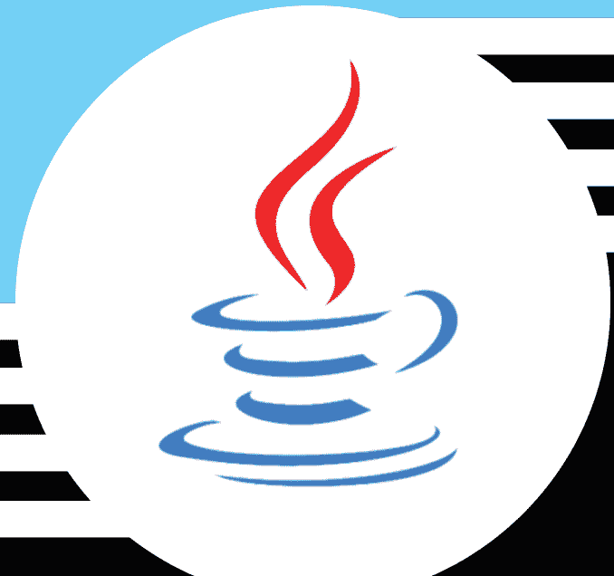

**Kiran Gurbani 教授**

B.E., MCA, M.Phil.

计算机科学与信息技术系主任

R.K. Talreja 艺术、科学与商业学院，Ulhasnagar (西部)

**Sandeep Vishwakarma 教授**

B.Sc. (IT) 协调员，

Chandrabhan Sharma 艺术、科学与商业学院

Powai, 孟买

**Shaikh Ahtesam Arif 教授**

MCA, MBA (IS)

IT 学系主任

Ajman-Islam's, Akbar Peerbhoy 学院

Grant Road(E), 孟买

**Gauravi Desai 教授**

M.Sc. 计算机科学，

B.Sc.(IT), M.Sc(IT) 协调员

Wilson 学院

Charni Road, 孟买


作者

# 献词

首先，我要感谢上帝。在编写这本书的过程中，我意识到这份礼物赋予了我追求梦想的力量。

我想将本书献给我的母亲（Havita Bajaj）和我的儿子（Chirag Gurbani），是你们的全心支持和不断的鼓励让我坚持下去。

最后，我要向Himalaya Publishing Pvt. Ltd.的S. Srivastava 教授表示深表谢意，特别是 Archana 女士，她的指导和激励使我写出如此精彩的内容。

我要感谢Himalaya Production Team，特别是 Savitri Devi 女士和 Archana 女士，感谢她的巨大支持。

我想感谢我的妻子 Archana Prakash Vishwakarma 教授，她激励我完成了这本书。

我想感谢我的家人成员以及我的校长 Pratima Singh 女士，感谢他们的鼓励。

我想感谢我的同事 Nitesh Shukla 教授，我的第一老师 Anjum Shaikh 教授以及我的最好的老师 Arif Shaikh 教授。

我想将本书献给我的祖母，她是我生活中的基石。

# 前言

像 C++ 和 Java 这样面向对象的编程语言提供了非常有效且高效的工具。由于 Java 作为一种编程语言的日益流行，它可以用于实现高级功能和 Web 应用。孟大学在其 T.Y.B.Sc.-IT 第五学期的修订大纲中包含了“企业级 Java”。

本书分为 5 个单元。

第一单元包含六章，涵盖理解 Java EE、Java EE 架构、服务器和容器、Java Servlets 简介、Servlet API 和生命周期。

第二单元包含五章，涵盖 RequestDispatcher、Cookie、会话（Sessions）、以及使用 Servlet API 进行会话跟踪以及一个 Servlet 会话示例。

第三单元包含五章，涵盖 Java Server Pages (JSP) 简介、动作、元素、隐式对象、作用域和 EL 表达式。

第四单元包含五章，涵盖企业级 Bean、Session Bean、消息驱动 Bean（Message Driven Beans）、拦截器（Interceptors）、Java 命名和目录接口。

第五单元包含五章，涵盖持久化（Persistence）、对象/关系映射（ORM）和 JPA、Java 持久 API、编写 JPA 应用、Hibernate 简介以及编写 Hibernate 应用。

本书涵盖了大学实践并带有适当示例。

书中已采取一切措施以避免错误和打印错误。欢迎接受任何提高书籍实用性的建议。您可以通过以下邮箱发送建议：karanrtktcollege@gmail.com, sandeepvcbcs@gmail.com, shaikh.aa@rediffmail.com 和 auravvidesai@gmail.com

# 作者

  (a)

  (b)

  (c)

  (d)

  (e)

  (a)

  (b)

  (c)

  (d)

  (f)

  (a)

  (b)

  (c)

  (d)

  (f)

  (a)

  (b)

  (c)

  (d)

  (f)

  (a)

  (b)

  (c)

  (d)

  (f)

# 第 1 章

# 理解 Java EE

## 大纲

1.1 什么是企业级应用？

1.2 企业级应用的架构

1.3 什么是 Java 企业版 (Java EE)？

1.4 Java EE 技术

1.5 Java EE 演进

1.6 Glassfish 服务器

1.7 章节

### 1.1 什么是企业级应用？

Java EE 平台旨在帮助开发者创建大规模、分层、可扩展、可靠且安全的应用程序。这种应用被称为“企业级应用”，因为它们是为大型企业设计的。

企业级应用对于大型公司、机构和政府，甚至是小型组织都是非常有用的。在日益网络化的世界中，安全性和可靠性等特性使得这些应用变得复杂。Java EE 平台通过提供开发模型、API 和运行时环境，让开发者能够专注于功能实现。

企业级应用意味着社区和组织。因此我们可以看到企业级应用响应了这些。

企业级应用的共同特征：

- 1. 海量数据

- 2. 复杂的数据关系

- 3. 特定的业务领域

- 4. 分布式系统与其他系统的集成

- 5. 并发访问

- 6. 多用户界面

## 1.2 企业级应用的架构

架构是多层架构概念和可用技术的延伸，形成了一个可以跨越地理边界并在企业内部运行的硬件和软件框架。

分布式、分层的应用模型可以被称为企业级应用。应用逻辑根据功能被分为组件，这些组件构成了企业级应用。根据所属的多层级环境，这些组件物理上安装在不同的计算机和位置上。所有组件在企业内部和谐工作。

企业架构分为以下层级：

- 1. 客户端层运行在客户端机器上

- 2. Web 层运行在服务器上

- 3. 业务层运行在服务器上

- 4. 企业信息系统 (EIS) 层软件运行在 EIS 服务器上

# 理解 Java EE

- Java EE 提供了一系列：

- 促进此类商业化应用程序构建的标准化组件

- 定义了各种应用程序模块间如何互连的标准接口

- 定义了不同软件模块间如何通信的标准服务

- Java EE 显著降低了多层解决方案开发和部署的成本与复杂性，使得服务能够被快速部署和轻松增强。

## 1.4 Java EE 技术

它可以被分类为以下不同的类别：

### 1. Web 应用技术

- Java Servlet

- JavaServer Pages (JSP) 技术

- JavaServer Pages 标准标签库 (JSTL)

- JavaServer Faces (JSF) 技术

- Java Message Service (JMS) API

- JavaMail API 和 JavaBeans 激活框架

- Java 嵌入 XML 处理 API (JAXP)

- Java 命名和目录接口 (JNDI)

### 2. 企业级应用技术

- Java 上下文与依赖注入 (Web Beans)

- Java 1.0 依赖注入 (CDI)

- Bean 验证 (Bean Validation)

- Enterprise JavaBeans (EJB)

- Java EE 连接器架构 (JCA)

- Java 持久 API (JPA)

- Java 平台通用注解

- Java Message Service (JMS) API

- Java 事务 API (JTA)

- JavaBeans 激活框架 (JAF)

- JavaMail

### 3. Java EE Web 服务技术

- RESTful Web 服务 API (JAX-RS)

- 实现企业级 Web 服务

- 基于 XML 的 Web 服务 API (JAX-WS)

- Java XML 绑定架构 (JAXB)

- Java 平台 Web 服务元数据

- 基于 XML 的 RPC Java API (JAX-RPC)

- XML 消息 Java API [或带附件的 SOAP 的 Java API (SAAJ)]

- XML 注册表 Java API (JAXR)

- Java SE 中的 XML 流式 API (StAX)

### 4. Java EE 管理与安全技术

- 容器 Java 身份验证服务提供者接口 (JASPIC)

- 容器 Java 授权合约 (JACC)

- Java EE 应用程序部署

- JEE 管理

下面将解释上述列出的每个类别中一些著名的 Java EE 技术。

### 1. Web 应用技术

- Java Servlet API：Java Servlet 运行在服务器端，本身不作为 HTML 用户界面 (UI) 或应用程序图形界面 (GUI)。它们被用于扩展服务器托管的应用程序。多个 Web 应用程序是通过 Java Servlet 扩展开发的。

- JavaServer Pages (JSP)：它提供了一种简单快速创建动态内容的方法。它便于在基于文本的文档中添加片段。

- JavaServer Pages 标签库 (JSTL)：它具有迭代和条件标签来处理流控制、通过 SQL 访问数据库、操作 XML 文档、国际化以及常用函数。

- Faces：形成构建 Web 应用程序的 UI 框架。

- Java Message Service (JMS)：Java 技术与企业消息传递的结合，JMS API 提供了解决企业计算问题的强大工具。

- JavaMail API 和 JavaBeans 激活框架：它用于发送电子邮件通知。同时，用户可以使用 JavaBeans 激活框架 (JAF) API，它可以确定数据类型、封装内容并发现可用操作。

- Java 嵌入 XML 处理 API (JAXP)：它是灵活的，JAXP 促进了在应用程序中使用任何符合 XML 规范的解析器或处理器，并支持 WSC 模式。

- Java 命名和目录接口 (JNDI)：它提供了命名和目录功能，使应用程序能够访问命名和目录服务。

### 2. 企业级应用技术

- Enterprise JavaBeans (EJB)：Enterprise JavaBeans (EJB) 技术是 Java 平台企业版 (Java EE) 的端组件架构。EJB 技术允许基于 Java 技术快速简化地开发分布式、事务型、安全且可的应用程序。Java 持久 API (JPA) 为对象关系映射提供了 POJO 持久模型，它是 JSR 220 的一部分，尽管其使用不仅限于 EJB 软件组件。

- Java 持久 API (JPA)：Java 持久 API 为对象关系映射提供了 POJO 持久模型。Java 持久 API 由 EJB 3.0 软件专家组作为 JSR 220 的一部分开发，但其使用不仅限于 EJB 软件组件，例如 Java SE 应用程序中的 Java EE 平台。Java 数据对象 (JDO) API 是另一个在 Java 社区过程中开发的 Java 持久化标准。

- Java Service API (JMS)：Java Message Service (JMS) API 是一种消息标准，允许基于 Java 2 平台企业版 (JEE) 的组件创建、发送、接收和读取消息。它实现了松耦合、可靠且异步的分布式通信。

- Java 事务 API (JTA)：JTA 规范了事务与分布式事务系统中的参与者之间的标准 Java 接口：资源管理器、应用程序服务器和事务型应用程序。JTA 规范由 Sun Microsystems 公司与事务处理和数据库系统领域的领先行业合作伙伴共同开发。

### 3. Java EE Web 服务技术

- RESTful Web 服务 API (JAX-RS)：RESTful Web 服务 API 定义了用于根据表述状态转移 (REST) 架构结构构建 Web 服务的 API。

- 基于 XML 的 Web 服务 API (JAX-WS)：它为使用 SOAP/HTTP 协议的 Web 服务提供支持。

- XML 注册表 API (JAXR)：JAXR 提供了一系列分布式注册服务，能够实现业务对业务（B2B）集成。

### 4. Java EE 管理与安全技术

- 容器 Java 身份验证服务提供者 (JASPIC)：定义一个标准接口，身份验证模块可以集成到容器中，使这些模块启用容器使用的身份验证。

- 容器 Java 授权合约 (JACC)：容器 Java 授权合约：Java EE 6 平台定义了 Java 2 平台企业版 (JEE) 的要求。Java ACC 规范定义了权限类实例的绑定。

## 1.5 Java EE 评估

### 1. Java5

### 2. Java6

### 3. Java7

## 1. Java EE5

- 它于 2006 年 5 月 11 日发布。Java EE5 平台的目标是为开发者提供强大的 API 集，减少开发时间并提高性能。SDK 特性：第一个健壮的商业 Java EE 实现。开发和分发均免费。通过编程模型的重大重构使开发更加易用。EJB 3.0 对 POJO 的支持意味着学习更少、代码更少、维护更易。新的持久化 API 使对象关系映射更加清晰。新的和更新的 Web 服务（JAX-WS 2.0 和 JAXB 2.0）简化了 SOA。JavaServer Faces 1.2 促进了 Web 2.0 应用的应用。更高的吞吐量、更快的响应时间以及改进的管理简化了部署。启动时间缩短了 30%，内存减少了 30%。Web 服务性能提升了 5 倍。改进了 Web 服务管理。与 Sun NetBeans 开源 IDE 集成并支持 Eclipse 插件，为开发者提供了端到端的开发和运行时选择。集成 NetBeans 环境提供的 SOA 开发部署环境。通过 JBI 和 BPEL 提供集成应用支持。Sun GlassFish Enterprise Server v2.1.1 的代码 100% 源自开源项目 GlassFish。

## 2 Java6

- 它于 2009 年 12 月 10 日发布。Java EE 6 平台最重要的目标是通过为 Java EE 平台的各种组件提供共同基础来简化开发。开发者从更多的注解、更少的 XML 配置、更多的纯 Java 对象 (POJO) 以及简化的打包中受益于生产力的提高。

## Java EE特性

- 配置 (Profiles)：针对特定类型应用的 Java EE 配置。具体来说，Java EE 6 平台引入了针对生成 Web 应用的轻量级 Web 配置 (Web Profile)，以及包含所有 Java EE 技术并为企业应用提供 Java EE 6 全功能的完整配置 (Full Profile)。

- 新技术，包括：

(a) RESTful Web 服务 API (JAX-RS)

(b) 托管 Bean (Managed Beans)

(c) Java EE 平台的上下文与依赖注入 (JSR 299)，非正式称为 CDI

(d) Java 依赖注入 (JSR 330)

(e) Bean 验证 (JSR 303)

(f) 容器 Java 身份验证服务提供者接口 (JASPIC)

# 理解 Java EE

## 企业级 JavaBeans (EJB) 组件的新特性

1. 企业级 JavaBeans（EJB）组件，或称为企业豆，是一段具有字段和方法的代码，用于实现业务逻辑模块。你可以将企业豆看作一个构建块，它可以单独使用，也可以与其他企业豆一起使用，以便在 Java EE 服务器上执行业务逻辑。

2. 在 Java EE 6 平台中，企业豆功能包括以下内容：

   (a) 在 WAR 文件中封装本地企业豆的能力

   (b) 单例会话豆（Singleton session beans），提供对共享状态的便捷访问

   (c) 企业级 JavaBeans的轻量级子集（EJB Lite），可以在 Java EE Profile 中提供，例如 Java EE Web。

3. Java EE 6 平台需要企业级 JavaBeans 3.1 和 拦截器（Interceptors） 1.1。拦截器规范作为 EJB 3.1 规范的一部分，它让最初定义为 EJB 3.0 规范一部分的拦截器机制变得更广泛地可用。

## Servlets 的新特性

1. Java Servlet 技术允许你定义特定于 HTTP 的 servlet 类。Servlet 类扩展了托管应用程序服务器的能力，这些应用程序通过请求-响应编程模型进行访问。虽然 servlets 可以响应任何类型的请求，但它们通常被用于扩展由 Web 服务器托管的应用程序。

2. 在 Java EE 6 平台中，新的 Java Servlet 技术特性包括以下内容：

   (a) 注解支持

   (b) 异步支持

   (c) 易于配置

   (d) 对现有 API 的增强

   (e) 插件化/注：可插拔性（Pluggability）

3. Java EE 6 平台需要 Servlet 3.0。

## JavaServer Faces (JSF) 组件的新特性

1. JavaServer Faces 技术是一种用于构建 Web 应用程序的用户界面框架。JavaServer Faces 技术的主要组件如下：

2. GUI 组件框架。

3. 一种用于不同类型 HTML 或不同标记语言及技术的渲染组件的灵活模型。渲染器（Renderer）对象生成用于渲染组件的标记，并将存储在模型对象中的数据转换为视图可以表示的类型。

4. 用于生成 HTML/4.01 标记的标准渲染器。

5. 以下功能支持 GUI：

   (a) 输入验证

   (b) 事件处理

   (c) 模型对象与组件之间的数据转换

   (d) 托管模型对象的创建

   (e) 页面导航配置

   (f) 表达式语言 (EL)

   (g) 所有这些功能都可以使用标准 Java API 和基于 XML 的配置文件来实现。

6. 在 Java EE 6 平台中，Java Faces 的新特性包括以下内容：

   (a) 使用注解代替配置文件来指定托管豆子（managed beans）和其他组件


(b) Facelets，一种使用 XHTML 文件替换 JavaServer Pages (JSP) 技术的显示技术

(c) Ajax 支持

(d) 组合组件（Composite components）

(e) 隐式导航

7. Java EE 6 平台需要 JavaServer Faces 2.0 和表达式语言 2.2。

## Java EE7

> Java EE 7 平台最重要的目标是通过为 Java EE 平台的各种组件提供一个共同基础来简化开发。开发者将受益于由于更多注解、更少的 XML 配置、纯 Java 对象（POJOs）以及简化的打包带来的生产力提升。

## Java EE 7 平台包含以下新特性

1. 新技术，包括：

   (a) Java 平台批处理应用

   (b) Java EE 并发工具类

   (c) JSON 处理 Java API (JSON-P)

   (d) WebSocket Java API

2. 在你的代码中实现新的批处理应用、JSON 和 WebSocket Java API（JSRs 352, 353 和 356）。

3. 在你的代码中启用 JAX-RS 2.0、EL 3.0 和 JMS 2.0 的重大增强。

4. 在你的代码中实现 JSF 和 JSP 的增强。

5. 在你的代码中实现 CDI 和 Bean Validation（Bean验证）的增强。

6. 在你的代码中实现 EJB 和 JPA 的增强。

7. 描述并利用 Java EE 7 的新特性：JSON、WebSockets、HTML 5、JSF & Servlets。

8. 理解 Java EE 7 的新特性。

9. 将现有应用程序更新到 EE 7。

10. 为 Java EE 7 编写应用程序，利用云环境和 Java EE 7 改进状况带来的优势。扩展 Java EE 平台的范围以涵盖 Web 领域的新兴技术。

## 1.6 Glassfish Server

> GlassFish 是由 Sun Microsystems 创建的 Java 应用服务器，它允许开发者生成方便且可扩展的企业级技术，以及可以根据喜好安装的额外服务。

## 理解 Java EE

- GlassFish 服务器开源版是在 GlassFish 社区内构建的开源应用服务器。

- Oracle GlassFish Server 基于 GlassFish 服务器开源版。

- GlassFish 用户受益于一个充满活力的社区，该社区提供自支持、代码贡献和反馈。

- GlassFish 是根据 GNU 通用许可证 (GPL) 发布的。

- Java EE 规范包括 Java Pages、Enterprise JavaBeans 和 JPA。

- Java EE 5 在 2006 年发布。

- Java EE 规范在 2010 年被 Oracle 收购。

- Java EE 规范是为 Java 平台企业版（Java EE）提供动态且可扩展的应用程序。

- GlassFish 服务器 3.1 提供以下功能：

  - 基于 OSGi 联盟的标准

  - Web 容器

  - 易于使用的管理控制台

  - 用于配置和管理的更新工具

  - 可扩展组件

  - 支持高可用集群

## 特性与资源

- GlassFish 服务器 4.1 为 Java 平台企业版（Java EE）提供动态且可扩展的应用程序基础。关键特性包括基于 Java 的兼容性、模块化和快速开发。

## 主要特性

- Java EE 支持为动态和可扩展的应用程序提供基础。

- WebSocket Java API 实现了双向低延迟通信。

- RESTful Services 可以同时处理 HTML5。

## 新或重大更新

- JSON 处理 Java API (JSON-P)

- Java 平台批处理

- Java EE 工具类

- Java 消息服务 (JMS) 2.0

- RESTful Services

## 更新

1. 企业级 Java Beans (EJB) 3.2

2. Java EE 上下文与依赖注入 (CDI) 1.2

3. Java 持久化 API (JPA) 2.1

4. Java Server Faces (JSF) 2.2

5. Java Servlet 3.1

6. Bean Validation (BV) 1.1

7. 表达式语言 (EL) 3.0

8. 拦截器 1.0

9. Java 事务 (JTA) 1.2

10. Java Server Pages (JSP) 2.3

11. JavaMail 1.5

## 1.7 章节练习

1. 解释 Java 的企业级应用及其架构。

2. 关于 Java 企业版的简要介绍。

3. 解释 Java 企业级技术。

4. 关于 Java EE 演进的简要介绍。

5. 解释 GlassFish 服务器及其用途。

# 第 2 章

### Java EE 架构、服务器与容器

## 2.1 Java EE 架构

Java EE 平台旨在帮助开发者创建大型的、多层的、可扩展、可靠且安全的网络应用程序。一种分布式的、多层的应用模型可以被描述为企业级应用，因为这些应用程序的设计初衷就是为了解决大型企业所遇到的问题。

- 企业级应用不仅用于：

- 大型公司

- 机构

- 政府

然而，在日益网络化的世界中，企业级应用的优势对于以下对象是有益的，甚至是必不可少的：

- 个人开发者

- 小型组织

企业级架构（Enterprise architecture）是多层架构概念以及可用技术的扩展，它产生了一个定制的平台，该平台可以在企业内部的硬件和软件框架上运行，且这些框架通常跨越地理边界。

应用逻辑根据功能分为不同的组件，各种应用程序组件共同构成了企业级应用。这些组件物理上安装在不同的计算机上、不同的物理位置，取决于应用程序组件所属的多层环境中的层级。所有组件在整个企业范围内和谐地工作。

企业级架构分为以下层级：

- 客户端层（Client Tier）服务运行在客户端机器上。

- Web 层（Web Tier）服务运行在 Java EE 服务器上。

- 业务层（Business Tier）服务运行在 Java EE 服务器上。

- 企业信息系统层（Enterprise Information System）服务运行在数据库服务器机器上。

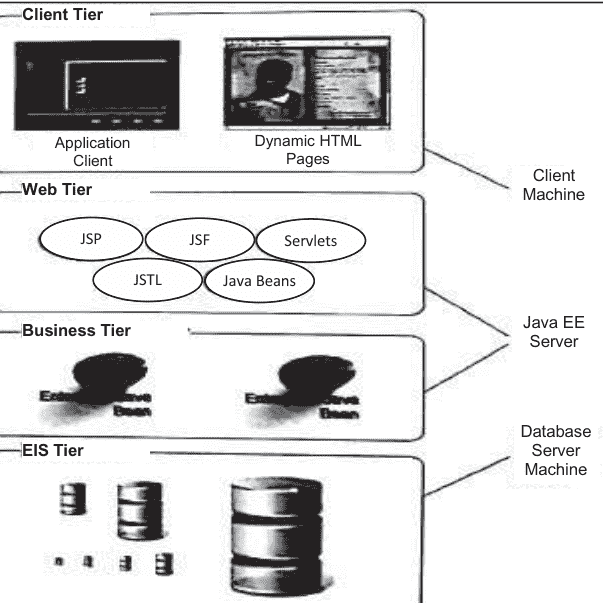

图 2.1

## 2.2 系统架构的类型

Java EE 平台为企业级应用使用分布式多层应用模型。应用逻辑根据功能分为组件，构成 Java EE 环境的应用程序组件根据其所属的 Java EE 环境的层级被安装在不同的机器上。

### 单层架构（Single Tier Architecture）

某些应用程序被编写并在单台计算机上运行。应用程序提供的所有服务，即用户界面、持久化数据访问以及处理用户输入并从数据存储中读取和显示给用户的逻辑，都存在于同一台物理机器上，因此在应用程序中合在一起。

### Java EE 架构、服务器与容器

因此，在单层架构中：

- 1. Web 应用程序的用户界面，即

- 2. 中间件，即业务规则

- 3. 数据访问层

都包含在一台计算机中。

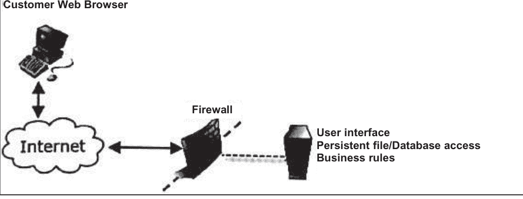

图 2.2：单层架构

## 优点

- 1. 最简单、廉价的替代方案。

- 2. 需要购买和维护的设备较少。

## 缺点

- 1. 这种实现方式安全性较低且缺乏可扩展性。当一个架构可以容易地扩展或增强以满足增长的性能需求时，它就是可扩展的。

- 2. 将站点的所有主要组件和数据放在位于域防火墙后的单台计算机上，会让网站更容易受到恶意攻击。

- 3. 在单台计算机上运行网站的所有组件也限制了扩展和优化的可能性。

### 二层架构（Two Tier Architecture）

在这种架构中，应用程序被分为两个组件：

#### 客户端（Client）

- 1. 实现用户界面

- 2. 包含业务逻辑

#### 服务器（Server）

- 1. 用于存储和访问业务数据，这些数据由运行在客户端的用户界面捕获并存储在服务器的数据存储中。

因此，在二层架构中：

- 1. 用户界面始终物理位于用户的桌面上（即客户端）

- 2. 数据库管理始终位于服务器

在二层架构中，数据库管理始终物理位于服务器。

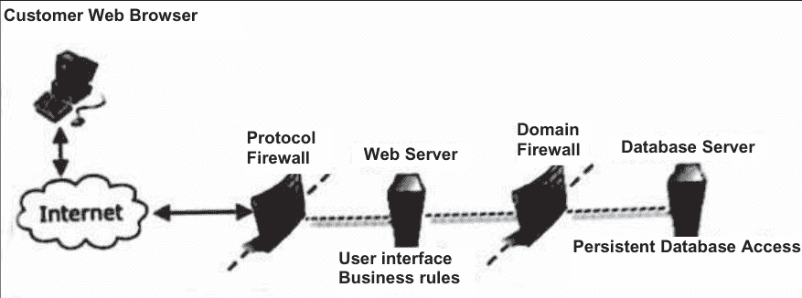

图 2.3：二层架构

## 优点

- 1. 客户端与服务器分离。

- 2. 易于维护数据。

## 缺点

- 1. 限制了扩展和优化的可能性。

### 三层架构（3 Tier Architecture）

在这种架构中，应用程序被分为三个组件：

#### 客户端（Client Tier）

- 1. 实现用户界面

#### 业务层（Business Tier）

- 2. 包含业务逻辑

#### 数据层（Data Tier）

- 1. 用于存储和访问业务数据

因此，在三层架构中：

- 1. 用户界面始终物理位于用户的桌面上（即客户端）

- 2. 业务逻辑位于服务器上

- 3. 数据库位于服务器上。

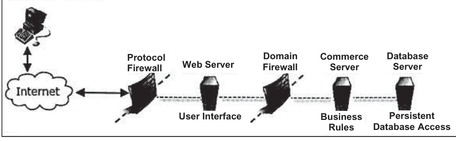

图 2.4：三层架构

## 优点

- 1. 提高了安全性。

- 2. 易于扩展。

- 3. 可维护性好。

## 缺点

- 1. 增加了成本和复杂性。

### 多层架构（Multi-tier Architecture）

如今工业界似乎正在向多层架构发展。

多层架构并不阻止使用二层或三层架构。根据应用的规模和对数据的访问，二层或三层架构通常被用于。

应用程序可能从单层桌面应用变到多层应用程序。

开发者在决定应用程序使用的架构类型时，需要考虑以下因素：

- 1. **可扩展性（Scalability）**：应用程序适应新硬件环境的能力。

- 2. **可用性（Availability）**：应用程序满足日益增长的需求的能力。

- 3. **扩展性（Extensibility）**：应用程序随时间推移增加功能并为客户端提供更好功能的能力。

- 4. **可维护性（Maintainability）**：应用程序以最小的人、时间和技术响应修复的能力。

- 5. **安全性（Security）**：应用程序维护数据完整性的能力。

- 6. **性能（Performance）**：应用程序在最短时间响应客户端请求的能力。

以下是 Java EE 应用中的层级：

- 客户端层

- 中间层

- 企业数据层

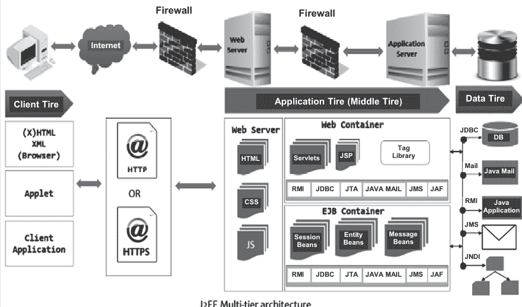

图 2.5

### 客户端层（Client Tier）

- 1. 客户端层包括 Web 组件，如 Servlet、JSP 或独立的 Java 桌面应用程序。

- 2. 该层为中间层提供动态接口。

### 中间层（Middle Tier）

- 1. 这也被称为服务器层。

- 2. 在中间层，企业 Bean 和 Web 服务封装了应用程序的可重用业务逻辑。

- 3. JEE 服务器包含服务器层组件，为这些 Web 组件执行操作和存储/持久化数据提供平台。

### Java EE 架构、服务器与容器

## 企业级数据层

- 1. 企业级数据通常或最好存储/持久化在关系型数据库中。

2. 在此层中，JEE 应用由组件、容器和类组成。

3. 所有 Web 组件（Servlets, JSP）都从网页提供动态请求和响应。

4. EJB 组件包含企业级应用的服务器端业务逻辑。

## 2.3 Java EE 服务器

- Java EE 服务器是一种实现 Java EE 平台并提供 Java EE 服务的服务器应用程序。Java EE 服务器有时被称为应用服务器，因为它们允许你向客户端提供应用程序数据，就像 Web 服务器向浏览器提供页面一样大同小异。

Java EE 服务器托管了多种应用程序组件类型，这些类型对应于多层应用中的各个层。Java EE 服务器以容器的形式向这些组件提供服务。

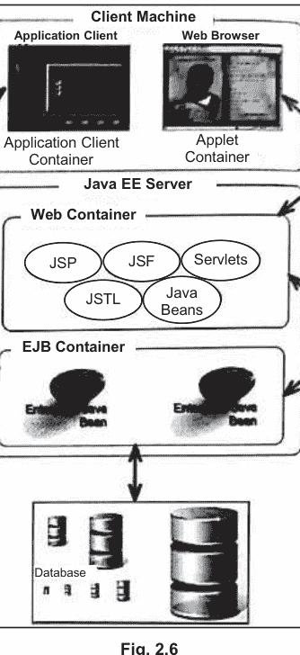

## 2.4 Java EE 容器

- Java EE 容器是组件与平台提供的支持该组件的低级功能之间的接口。

容器的功能由平台定义，并且每种组件类型都不同。

## 企业级 JAVA

尽管如此，服务器允许不同类型的组件协同工作，为企业级应用提供功能。

### Web 容器 (Web Container)

Web 容器是 Web 组件与 Web 服务器之间的接口。

Web 组件可以是 servlet、JavaServer Faces 页面或 JSP 页面。

容器管理组件的生命周期，将请求分发到应用程序组件，并提供上下文数据的接口以及关于请求的信息。

### 应用客户端容器 (Application Client Container)

应用客户端容器是 Java EE 应用客户端（使用 Java EE 服务器组件的特殊 Java EE 应用）与 Java EE 服务器之间的接口。

应用客户端容器运行在客户端上，是客户端应用程序与客户端使用的 Java EE 服务器组件之间的网关。

### EJB 容器 (EJB Container)

EJB 容器是企业 Bean（提供 Java EE 应用中的业务逻辑）与 Java EE 服务器之间的接口。

EJB 容器运行在 Java EE 服务器上，并管理应用 Bean 的执行。

### 容器服务 (Container Services)

容器是组件与支持它的低级、特定平台功能之间的接口。在执行之前，Web、企业 Bean 或应用客户端组件必须组装成 Java EE 模块并部署到其容器中。

组装过程涉及为 Java EE 应用中的每个组件指定设置，并为容器设置 Java EE 服务器提供的底层支持，包括安全、事务管理、Java 命名和目录接口 (JNDI) API 查找以及远程连接等服务。以下是其中的一些亮点。

- 1. Java EE 安全模型配置组件或企业 Bean，使得只有授权用户才能访问系统资源。

2. Java EE 事务模型允许你指定构成单个事务的方法之间的关系，以便一个事务中的所有方法被视为一个单一单元。

3. JNDI 查找为企业级中的多个命名和目录服务提供了统一的接口，以便应用程序组件可以访问这些服务。

4. Java EE 远程连接模型管理客户端与企业 Bean 之间的低级通信。在创建企业 Bean 后，客户端调用其方法就就像它在同一个虚拟机中一样。

## 2.5 章节性习题

- 1. 解释 Java EE 的多层架构。

2. Java EE 中不同类型的系统架构？

3. 比较两层架构和三层架构。

4. 写关于 Java EE 服务器的短评。

5. 解释 Java EE 容器及其服务。


## 第 3 章

## Java Servlets 简介

## 章节大纲

- 3.1 动态内容的需求

- 3.2 Java Servlet 技术

- 3.3 为什么使用 Servlet？

- 3.4 Servlet 能做什么？

- 3.5 章节内容

### 3.1 动态内容的需求

在早期，网页是静态的，用户请求资源（如网页、图像、视频等），服务器返回该资源。然而，随着 Web 上商业活动的增长以及万维网作为一种具有地理边界的网络的快速传播和采用，公司希望交付动态内容。

在早期，网页是静态的，用户请求资源（如网页、图像、视频等），服务器返回该资源。然而，随着 Web 上商业活动的增长以及万维网作为一种具有地理边界的网络的快速传播和采用，公司希望交付动态内容。

在早期，网页是静态的，用户请求资源（如网页、图像、视频等），服务器返回该资源。然而，随着 Web 上商业活动的增长以及万维网作为一种具有地理边界的网络的快速传播和采用，公司希望交付动态内容。

在早期，网页是静态的，用户请求资源（如网页、图像、视频等），服务器返回该资源。然而，随着 Web 上商业活动的增长以及万维网作为一种具有地理边界的网络的快速传播和采用，公司希望交付动态内容。

在早期，网页是静态的，用户请求资源（如网页、图像、视频等），服务器返回该资源。然而，随着 Web 上商业活动的增长以及万维网作为一种具有地理边界的网络的快速传播和采用，公司希望交付动态内容。

在早期，网页是静态的，用户请求资源（如网页、图像、视频等），服务器返回该资源。然而，随着 Web 上商业活动的增长以及万维网作为一种具有地理边界的网络的快速传播和采用，公司希望交付动态内容。公司希望交付动态内容，例如：

- 显示账户详情

- 预订机票

- 新闻标题

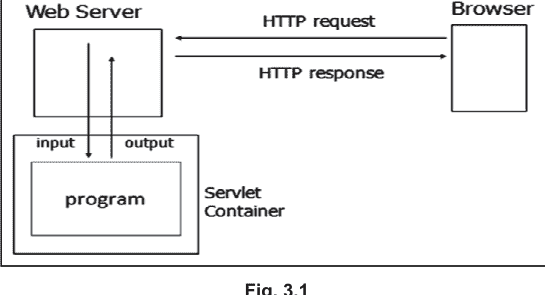

## CGI (通用接口)

- CGI (通用接口) 是用于提供动态内容的。运行在服务器上的程序可以用 C 语言编写。

- 它是实现页面的标准。

- 它被用于创建动态页面。

- Servlet 技术被用于创建应用程序并生成动态页面。


## CGI 的缺点

1. 在早期被用于提供服务时，提供者意识到需要动态内容。

2. 如果客户端请求数量增加，它会创建新的进程。

3. CGI 脚本用 C++ 等语言编写。

## Servlets 与 CGI

| Servlets | CGI |

| :--- | :--- |

| Servlets 是可移植的 | CGI 是不可移植的。 |

| 在 Servlets 中可以共享数据 | 在 CGI 中无法共享数据 |

| Servlets 可以直接连接 Web 服务器 | CGI 无法直接连接服务器 |

| Servlets 可以执行对先前计算的跟踪和缓存 | CGI 无法执行对先前计算的跟踪和缓存 |


# Java Servlet 简介

## 3.2 Java Servlet 技术

- 在早期被用于提供服务时，提供者意识到需要动态内容。
- `Applet` 是实现这一目标的早期尝试之一，专注于使用客户端平台交付动态体验。
- 同时，也研究了使用服务器平台来实现目的。最初，通用接口（`CGI`）脚本是生成动态内容的主要技术。
- 尽管被广泛使用，但 `CGI` 脚本技术有很多缺点，包括平台依赖性和缺乏扩展性。
- 为了解决这些局限性，创建了 Java Servlet 技术，作为一种提供动态面向用户内容的可移植方法。
- Servlet 技术被用于创建应用程序并生成动态网页。Servlet 健壮且可扩展，它使用 Java 语言。

## Servlet

1. Servlet 是一种用于创建应用程序的技术。
2. Servlet 是一个提供接口和类的 API。
3. Servlet 是创建任何 servlet 之前必须实现的接口。
4. Servlet 是一个扩展了服务器功能并响应传入请求的类。
5. Servlet 是一种部署在服务器上以创建动态网页的 Web 组件。

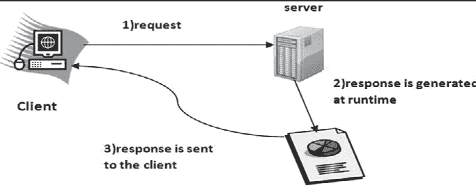

图 3.3：Servlet 技术

## Servlet 的执行步骤

1. 浏览器或任何 HTTP 客户端以 Web 页面的形式向 HTTP 服务器发送数据。
2. Servlet 读取浏览器或客户端发送的请求。发送的请求或数据包括：

| 编号 | 浏览器发送的请求包含 |
| :--- | :--- |
| 1 | HTML 表单 |
| 2 | cookies |
| 3 | 媒体类型 |
| 4 | 压缩方案等。 |

3. Servlet 处理数据并生成结果。
4. Servlet 以多种格式将数据发送到客户端（浏览器），包括 web、pdf 或 excel。

## Web 应用程序

Web 应用程序是通过网络访问的应用程序。Web 应用程序使用 Servlet、JSP、Filter、Session、Cookies 等 Web 组件，以及 HTML 等其他组件。这些 Web 组件在 Web 服务器中执行并对 HTTP 请求做出响应。

## Web 服务器

1. Web 服务器使用 HTTP 协议传输数据。
2. 在简单的情况下，用户在浏览器（客户端）中输入 URL（例如 `www.programcreek.com/static.html`），并获取一个 Web 页面进行阅读。
3. 因此，服务器所做的是向客户端发送 Web 页。转换发生在 HTTP 协议中，它规定了请求和响应消息的格式。

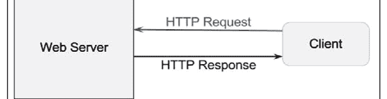

图 3.4

## Servlet 容器

1. 如我们在此所示，用户/客户端只能从服务器请求静态网页。
2. 如果用户想根据输入读取网页，这还不够完美。
3. Servlet 容器的基本思想是使用 Java 在服务器端动态生成 Web 页。因此，Servlet 容器本质上是与 servlet 交互的 Web 服务器的一部分。

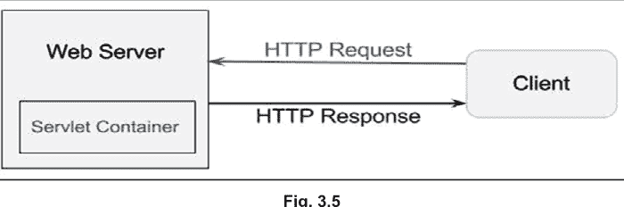

## 3.3 为什么使用 Servlet？

- 加载到内存中并在之后运行。
- 以线程形式启动，而不是进程形式。
- 强大的面向对象。
- 可在多个 Web 服务器和平台之间迁移。
- 设计和实现简单。
- 与 Web 服务器紧密集成。
- 高效地服务客户端。
- 在 Java 虚拟机（`JVM`）的安全可靠的范围内运行。
- 遵循标准 Servlet API 的规则。
- 向请求的浏览器返回 HTML。
- 健壮、可扩展的 `CGI` 替代方案。
- 使用原生驱动直接访问数据库。
- 运行在服务端提供了保护。
- 受多个服务器支持。

## 使用 Servlet 的优势

1. 响应时间更短，因为每个请求都在单独的线程运行。
2. Servlet 是可扩展的。
3. Servlet 是健壮的。
4. Servlet 是平台无关的。
5. 性能更好：它为每个请求创建一个线程而不是进程。
6. 可迁移性：因为它使用了 Java 语言。
7. 健壮性：`JVM` 管理 Servlet，因此我们不需要担心内存泄漏、垃圾回收等问题。
8. 安全：因为它使用了 Java 语言。

## 3.4 Servlet 能做什么？

- Servlet 是一段小的、自包含的代码部分，它在 Web 服务器上响应客户端浏览器的 HTTP 请求而执行。
- Servlet 可以执行以下操作：
  - Servlet 可以处理或存储由 HTML 表单提交的数据。
  - Servlet 可以提供动态内容，例如向客户端返回数据库查询结果。
  - Servlet 可以在 HTTP 之上管理状态信息，例如一个在线购物购物车系统，它可以管理许多并发客户的购物车，并将每个请求映射到正确的处理上。
  - Servlet 可以作为插件使用，具有搜索引擎功能或自定义应用程序，如网上银行或库存系统。

## 3.5 章节问题

1. 什么是 Java 动态 Servlet？
2. 比较 `CGI` 和 Servlet。
3. 写关于 Java Servlet 技术的笔记。
4. Servlet 有哪些优势？
5. 解释 Servlet 中的 `Get()` 和 `Post()` 方法。

## Servlet API 与生命周期

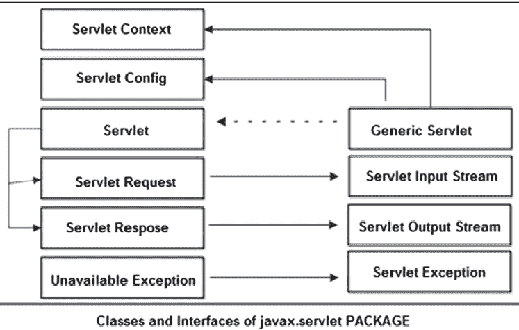

图 4.2

`javax.servlet` 包包含了许多接口和类。下表列出了一些接口和类。

| 接口 | 描述 |
| --- | --- |
| `Servlet` | 声明了所有 servlet 必须实现的生命周期方法。 |
| `ServletConfig` | 允许 servlet 获取初始化参数。 |
| `ServletContext` | 允许 servlet 与其 servlet 容器通信。 |
| `ServletRequest` | 为 servlet 提供客户端请求信息。 |
| `ServletResponse` | 协助 servlet 向客户端发送响应。 |

| 类 | 描述 |
| --- | --- |
| `GenericServlet` | 为协议无关的 servlet 提供 `Servlet` 接口的简单实现。 |
| `ServletInputStream` | 提供一个输入流，用于从客户端请求读取二进制数据。 |
| `ServletOutputStream` | 提供一个输出流，用于向客户端发送二进制数据。 |
| `ServletException` | 定义了一种通用异常，servlet 在遇到困难时可以抛出该异常。 |
| `UnavailableException` | 表示 servlet 无法处理客户端请求。 |

## Servlet 接口

- `Servlet` 接口定义了 servlet 的基本结构。该接口规定了 servlet 容器与 servlet 之间的约定。所有 servlet 都实现了此接口，可以是直接实现，也可以间接通过扩展实现 `Servlet` 接口的 `GenericServlet` 或 `HttpServlet` 类。
- 此接口定义了提供 servlet 基本功能的方法：
  - 初始化 servlet
  - 处理客户端请求
  - 由 servlet 容器调用以销毁 servlet

这些接口定义了以下方法：

1. `void init(ServletConfig) throws ServletException`：用于初始化 servlet。该方法在 servlet 容器加载 servlet 时自动调用一次。此方法可以用于执行一次性活动，如创建数据库连接、初始化关系参数等。容器传递一个 `ServletConfig` 类型的对象，该对象可用于获取初始化参数。
2. `ServletConfig getServletConfig()`：返回在执行 `init()` 方法期间传递给 servlet 的 `ServletConfig` 对象。
3. `String getServletInfo()`：返回一个包含 servlet 信息的 `String` 对象，例如作者、日期、版本等。
4. `void service(ServletRequest request, HttpServletResponse response) throws ServletException, IOException`：这是 servlet 中执行应用逻辑的入口。它由 servlet 容器调用以处理来自客户端的请求。servlet 通过 `ServletRequest` 对象接收信息并通过 `ServletResponse` 对象将数据传回客户端。
5. `void destroy()`：该方法在 servlet 容器将 servlet 移除服务之前调用。这可能发生在 Web 服务器关闭或移除 servlet 容器需要释放某些内存时。servlet 使用的资源（如打开的数据库连接、打开的文件）应在此释放。

## 语法

```java
public class myServlet implements server
{
}
public void destroy() {
{
}
public void init(ServletConfig se) {
{
}
public ServletConfig getServletConfig() {
}
```

```java
...
}
public String getServiceInfo()
{
...
public void service(ServletRequest req, ServletResponse resp) throws IOException, ServletException
{
}
```

Servlet 接口提供了五个方法。在这五个方法中，三个是 Servlet 生命周期方法，另外两个是非生命周期方法。

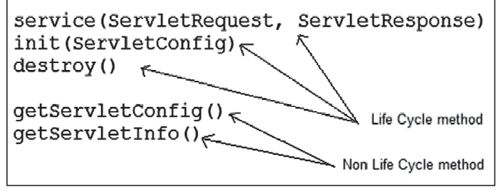

图 4.3

## ServletConfig 接口

- `ServletConfig` 接口由服务器实现。服务器使用 `ServletConfig` 对象将配置信息传递给 servlet。
- 配置信息包含初始化参数、servlet 的名称以及一个 `ServletContext` 对象，该对象提供了关于容器的 servlet 信息。

此接口中声明的方法有：

| 方法 | 描述 |
|---|---|
| `getInitParameter(String name)` | 返回一个包含命名初始化参数值的 `String`，如果参数不存在则返回 `null`。 |
| `getServletName()` | 返回在部署描述符中分配给 servlet 的名称。如果没有指定名称，则返回 servlet 的类名。 |


| `ServletContext getServletContext()` | 返回与 servlet 对应的 `ServletContext` 对象引用，允许与服务器进行交互。 |

| `Enumeration getInitParameterName()` | 将 servlet 初始化参数的名称以 `String` 对象的枚举（`Enumeration`）形式返回，如果没有指定初始化参数，则返回一个空 `Enumeration`。 |

## ServletContext 接口

- 意味着 servlet 与其 servlet 容器进行通信。这种通信包括查找路径信息、访问服务器上运行的其他 servlet、写入服务器日志、获取文件的 MIME 类型等。每个 Web 应用在每个 Java 虚拟机中有一个 context。

`Context` 对象是 `ServletConfig` 对象内部的一个容器，当 servlet 初始化时由 Web 服务器提供给 servlet。

`ServletContext` 规定了以下方法：

| 方法 | 描述 |

| --- | --- |

| `Object setAttribute(String name)` | 设置给定名称的 servlet 属性，如果属性不存在则设置为 `null`。 |

| `String getMimeType(String fileName)` | 返回指定文件的 MIME 类型，如果未知则返回 `null`。 |

| `String getRealPath(String vpath)` | 返回对应虚拟路径 `vpath` 的真实路径（在服务器文件系统上）。 |

| `String getInfo()` | 返回容器的名称和版本。 |

| `void setAttribute(String name)` | 绑定属性。 |

| `void log(String msg)` | 写入消息。 |

| `void log(String msg, Throwable t)` | 写入消息和堆栈跟踪。 |

## ServletRequest 接口

- 意味着 servlet 与其 servlet 容器通信。`HttpServletRequest` 封装了关于单个客户端的信息。

servlet 容器创建 `HttpServletRequest` 并将其作为参数传递给 servlet 的 `service()` 方法。

请求提供的数据包括参数名和值、读取二进制数据的输入流。

它的一些方法如下：

| 方法 | 描述 |

| --- | --- |

| `Object getAttribute(String name)` | 返回命名属性的值，如果不存在则返回 `null`。 |

| `Enumeration getAttributeNames()` | 返回请求中所有属性的枚举。 |

| `int getContentLength()` | 返回内容的字节长度，如果未知则返回 -1。 |

## Servlet API 与生命周期

| 方法 | 描述 |

|---------|

| `String getContentType()` | 返回请求的 MIME 类型，如果未知则返回 `null`。 |

| `ServletInputStream getInputStream()` | 使用 `ServletInputStream` 获取请求体。 |

| `String getParameter(String name)` | 返回指定参数的值，如果不存在则返回 `null`。 |

| `Enumeration getParameterNames()` | 返回请求中所有参数的枚举。 |

| `String[] getParameterValues(String name)` | 返回包含指定参数所有值的 `String` 数组。 |

| `String getProtocol()` | 返回请求使用的协议名称和版本。 |

| `String getRemoteAddr()` | 返回发送请求的 IP 地址。 |

| `String getRemoteHost()` | 返回发送请求的名称。 |

| `String getScheme()` | 返回用于请求的方案。例如：`http`、`https` 等。 |

| `String getServerName()` | 返回接收请求的服务器名称。 |

| `int getServicePort()` | 返回接收请求的端口号。 |

| `BufferedReader getReader()` | 以字符数据获取请求体。 |

## ServletResponse 接口

- `ServletResponse` 接口是 `ServletRequest` 对象的对应端。它定义了一个协助 servlet 向客户端发送 MIME 编码数据的对象。servlet 容器创建 `ServletResponse` 对象并将其作为参数传递给 servlet 的 `service()` 方法。

此接口最常用的方法如下：

| 方法 | 描述 |

|------|---|

| `void setContentType(String type)` | 设置发送给客户端的响应的 MIME 类型。例如，对于 HTML，MIME 类型应设置为 `"text/HTML"`。 |

| `void setContentLength(int len)` | 设置内容的长度。在 HTTP 服务器中，此方法设置 HTTP `content-length` 头部。 |

| `ServletOutputStream getOutputStream()` | 返回一个可向响应中写入二进制数据的 `ServletOutputStream` 对象。 |

| `PrintWriter getWriter()` | 返回一个可向响应中发送字符文本的 `PrintWriter` 对象。 |

| `String getCharacterEncoding()` | 返回响应的 MIME 主文使用的字符集名称。 |

## SingleThreadModel 接口

- `SingleThreadModel` 是一个没有任何方法的特殊标记接口。

- 如果 servlet 实现了此接口，Servlet 容器将确保该 servlet 每次只处理一个请求。

- 如果 servlet 实现了此接口，可以保证没有两个线程在 servlet 的 `service()` 方法中同时执行。

- Servlet 容器通过维护一个 servlet 实例池来实现此功能。对于每个传入的请求，容器都会从池中分配一个 servlet 实例，一旦服务完成，容器就会将该实例返回池中。

- 此接口提供了简便的线程安全性，但是以增加资源需求为代价，因为在任何给定时刻都会加载更多的 servlet 实例。

## GenericServlet 类

- `GenericServlet` 类提供了 `Servlet` 接口的基本实现。

- 这是一个抽象类，所有子类都应该实现 `service()` 方法。

- `GenericServlet` 类实现了 `Servlet`、`ServletConfig` 和 `Serializable` 接口。

- 它提供了这些接口中所有方法的实现，以确保 `service` 方法的运行。

- `GenericServlet` 可以处理任何类型的请求，因此它是协议无关的。

- 你可以通过继承 `GenericServlet` 类并提供 `service` 方法的实现来生成 `GenericServlet`。

除了 `Servlet` 和 `ServletConfig` 接口中声明的方法外，它还具有以下方法。

| 方法 | 描述 |

| :--- | :--- |

| `void init()` | 它类似于 `init(ServletConfig)`。提供此方法是为了方便开发者，使 servlet 开发人员不需要担心存储 `ServletConfig` 对象。 |

| `void log(String msg)` | 将指定的消息写入 servlet 日志文件。 |

| `void log(String msg, Throwable t)` | 将 servlet 的名称、指定的消息和堆栈跟踪写入 servlet 日志文件。 |

```java
import java.io.*;
import javax.servlet.*;
public class GenericServletDemo extends GenericServlet
{
    public void service(ServletRequest req,ServletResponse resp)
throws IOException, ServletException
{
    res.setContentType("text/html");
    PrintWriter out=resp.getWriter();
}}
```

```java
out.print("<html><body>");
out.print("<b>Example of GenericServlet</b>");
out.print("</body></html>");
}
```

## Servlet 中的 HttpServlet 类

- `HttpServlet` 也是一个抽象类。该类提供了 `Servlet` 接口中各种 `service()` 方法的实现。

- 要创建一个 servlet，我们需要创建一个扩展 `HttpServlet` 抽象类的类。我们创建的 Servlet 类必须重写 `service()` 方法。我们的 Servlet 类将仅重写 `doGet()` 或 `doPost()` 方法。

- `HttpServlet` 类的 `service()` 方法监听请求流 Http 方法（GET、POST 等），并根据 Http 方法调用 `doGet()` 或 `doPost()` 方法。

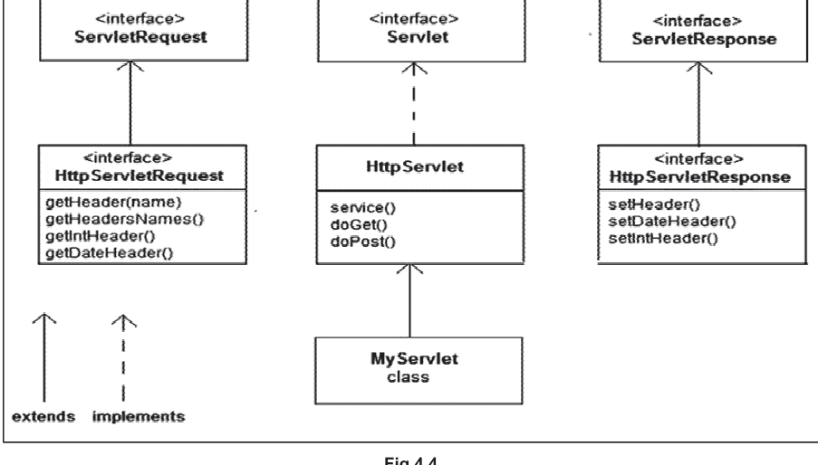

## ServletInputStream 类

`ServletInputStream` 类包含了 `ExtInputStream`。它提供了一个从客户端读取二进制数据的输入流。servlet 通过 `ServletRequest` 的 `getInputStream()` 方法包含一个 `ServletInputStream` 对象。它定义了一个什么都不执行的默认构造函数。

此外，它还包含以下方法：

- `int readLine(byte [] buf, int off, int len)`：该方法从输入流读取字节到字节数组 `buf` 中，从指定的偏移量开始。当它遇到 `"\n"` 或读取了 `len` 个字节时停止。该方法返回实际读取的字节数，如果到达流末尾则返回 -1。

## 企业级 JAVA

## ServletOutputStream 类

- `ServletOutputStream` 类扩展了 `OutputStream`。

- 它提供了一个向客户端发送二进制数据的输出流。

- servlet 通过 `ServletResponse` 的 `getOutputStream()` 方法获取 `ServletOutputStream` 对象。

- 它还有一个什么都不执行的默认构造函数。此外，它还包含了一系列 `print(int)` 和 `println(int)` 方法，用于测试文本或 HTML。

它接受以下参数：

```java
void print(type v)
void println(type v)
```

在这里，`type` 指定数据类型 `int`、`char`、`float`、`long`、`String`、`double`、`boolean`，`v` 指定写入的数据。

## ServletException 类

- `javax.servlet` 定义了两个类 `ServletException` 和 `UnavailableException`。

- `ServletException` 是一个通用异常，可以在 servlet 遇到困难时抛出。

- `UnavailableException` 是一种特殊的异常类型，继承自 `ServletException` 类。

- 此类的目的是告知 Servlet 容器该 servlet 临时或永久地无法服务客户端请求。

## Servlet 中的 RequestDispatcher

`RequestDispatcher` 接口提供了将请求调度到另一个资源的功能，该资源可以是 html、servlet 或 jsp。此接口也可以用于包含另一个资源的内容。它是 servlet 协作的方式之一。

`RequestDispatcher` 接口中定义了两个方法。

## RequestDispatcher 接口的方法

`RequestDispatcher` 接口提供了两个方法。它们是：

- `public void forward(ServletRequest request, ServletResponse response) throws ServletException, java.io.IOException`：将请求从 servlet 转发到服务器上的另一个资源（servlet、JSP 文件或 HTML 文件）。

- `public void include(ServletRequest request, ServletResponse response) throws ServletException, java.io.IOException`：在响应中包含资源（servlet、JSP 页面或 HTML 文件）的内容。

# Servlet API 和生命周期

`Forward()` 方法：

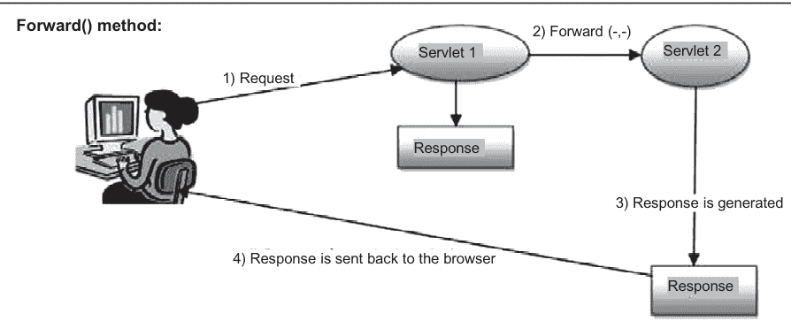

图 4.5

如你在上图所示，第二个 servlet 的响应被发送到了客户端。第一个 servlet 的响应不会显示给用户。

`Include()` 方法：

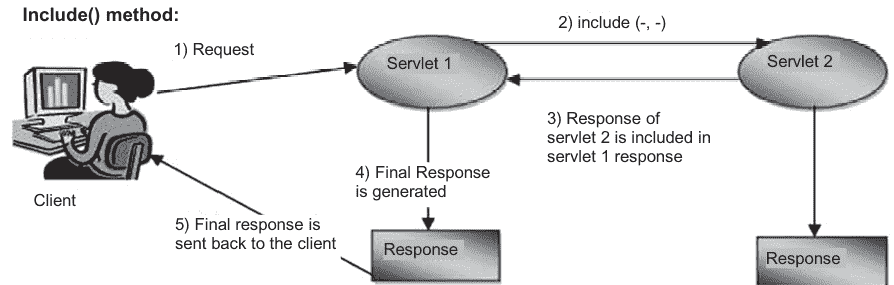

图 4.6

如你在上图所示，第二个 servlet 的响应包含在第一个 servlet 的响应中。

## RequestDispatcher 示例

在此示例中，我们验证用户输入的密码。如果密码正确，它会将请求转发到 `WelcomeServlet`，否则显示错误信息：`sorry username or password error!` 程序中，我们检查硬编码的信息。

在此示例中，我们创建了以下文件：

- 1. `index.html` 文件：用于获取输入。

- 2. `Login.java` 文件：处理响应的 servlet 类。如果密码正确，它会将请求转发到 `WelcomeServlet`。

- 3. `WelcomeServlet.java` 文件：显示欢迎信息的 servlet 类。

- 4. `web.xml` 文件：包含 servlet 信息的部署文件。

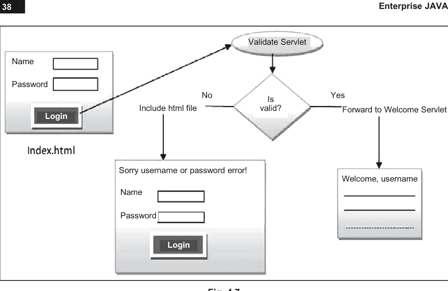

## 4.2 Servlet 骨架

- 当编写任何 Servlet 时，其代码规范必须有一个标准的骨架。

- 在最通形式下，Servlet 是实现 `java.servlet.Servlet` 接口的类的实例。然而，Servlet 扩展了该接口的标准实现，即 `javax.servlet.GenericServlet` 和 `javax.servlet.HttpServlet`。开发者在编写 `Servlet.java` 时使用它们作为蓝图。

- 实现 `Servlet` 接口或扩展 `GenericServlet`/`HttpServlet` 类为创建 Servlet 框架以及重要的默认功能。在实现任何自定义功能时，Servlet 代码规范必须重写一个方法。

为了初始化 Servlet，Web 服务器：

- 1. 加载 Servlet 类（以及 Servlet 引用的其他类）并通过调用无参构造函数创建实例

- 2. 调用 Servlet 的 `init(ServletConfig)`

- (a) `init()` 只在 Servlet 首次加载到内存时调用

- (b) `ServletConfig` 对象可以封装在执行 Servlet 主代码之前运行的任何数据，例如连接数据库。

- (c) 可以通过调用 Servlet 的 `getSetConfig` 获取 `ServletConfig` 对象。

## Servlet API 与生命周期

- 3. 任何启用 Java 的 Web 服务器都会在响应客户端请求时自动调用 Servlet 的 `service()` 方法。这意味着当 Servlet 初始化后，每个针对该 Servlet 的请求都会调用其 `service(HttpServletRequest request, HttpServletResponse response)` 方法。

- 4. 因此，必须重写 `service()` 方法以便在 Servlet 被调用时提供自定义功能。如果 Servlet 开发者选择不重写 `service()`，则有其他方法可以在响应客户端请求时被调用。

- 5. 当 Servlet 需要卸载、需要加载新版本或服务器正在关闭时，会调用 `destroy()` 方法。

- 6. 根据这一简短描述，已经构建了一个通用 Servlet 的骨架结构。

- 7. 为了简单起见，接下来的骨架 Servlet 不包含传递给方法的参数，也不包含任何抛出异常的异常处理代码：

```java
public class SkeletonServlet extends HttpServlet {
    /**
     * 初始化代码写在这里
     */
    public void init() {}
    /**
     * 在这里执行有意义的工作
     */
    public void service() {}
    public void destroy() {}
    /**
     * 在这里释放资源
     */
}
```

## 4.3 Servlet 生命周期

Web 容器维护 Servlet 实例或对象的生命周期。

## Servlet 的生命周期

- >> 载入（加载 Servlet 类）

- >> 安装（创建 Servlet 实例）


- 初始化（调用`init`方法）
- 服务提供（调用`service`方法）
- 销毁（调用`destroy`方法）

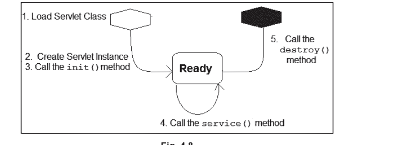

# Servlet Lifecycle

如上图所示，Servlet 有三种状态：新建（new）、就绪（ready）和结束（end）。当 Servlet 实例被创建时，Servlet 处于新建状态。

在调用`init()`方法后，Servlet 进入就绪状态。在就绪状态下，Servlet 执行所有任务。当 Web 容器调用`destroy()`方法时，它会转移到结束状态。

## 1. Servlet 类被加载

类加载器负责加载 Servlet 类。当 Web 容器接收到对 Servlet 的第一个请求时，Servlet 类会被加载。

## 2. Servlet 实例被创建

在加载 Servlet 类后，Web 容器将包含该 Servlet 的实例。Servlet 实例在 Servlet 生命周期中仅被创建一次。

## 3. init 方法被调用

Web 容器在创建 Servlet 实例后仅调用一次`init`方法。`init`方法用于初始化 Servlet。它是`javax.servlet.Servlet`接口的生命周期方法。

`init`方法的语法如下：

```java
public void init(ServletConfig config) throws ServletException
```

## 4. Service 方法被调用

Web 容器在每次接收到对 Servlet 的请求时都会调用`service`方法。如果 Servlet 尚未初始化，它将按照上述描述的前三个步骤执行，然后调用`service`方法。如果 Servlet 已初始化，则直接调用`service`方法。注意，Servlet 只会被初始化一次。

Servlet 接口的`service`方法的语法如下：

```java
public void service(ServletRequest request, HttpServletResponse response) throws ServletException, IOException
```

## 5. Destroy 方法被调用

Web 容器在服务中移除 Servlet 实例后调用`destroy`方法。它为 Servlet 提供了清理任何资源（例如内存、线程等）的机会。

Servlet 接口的`destroy`方法的语法如下：

```java
public void destroy()
```

## Servlet API 与生命周期

## Servlet 生命周期示例

```java
import javax.servlet.*;
import java.io.*;
public class myservlet extends GenericServlet
{
    public void init(ServletConfig c)
    {
        System.out.println("init executed...");
    }
    public void service(ServletRequest req, ServletResponse resp) throws IOException, ServletException
{
        System.out.println("service executed...");
        PrintWriter out=resp.getWriter("text/html");
        out.println("plz observe output on server console window");
    }
    public void destroy()
    {
        System.out.println("Destroy executed...");
    }
}
```

## web.xml

```xml
<web-app>
  <servlet>
    <servlet-name>srv-servlet</servlet-name>
    <servlet-class>myservlet</servlet-class>
  </servlet>
  <servlet-mapping>
    <servlet-name>srv-servlet</servlet-name>
    <url-pattern>/*</url-pattern>
  </servlet-mapping>
</web-app>
```

## 4.4 一个简单的 Servlet

## WelcomeServlet.java

```java
import javax.servlet.*;
import javax.servlet.http.*;
import java.io.*;

public class WelcomeServlet extends HttpServlet {
    public void doGet(HttpServletRequest req, HttpServletResponse res) throws ServletException, IOException
    {
        res.setContentType("text/html");
        PrintWriter pw=res.getWriter();
        pw.println("<html><body>");
        pw.println("Welcome To Servlet");
        pw.println("</body></html>");
    }
}
```

## web.xml

```xml
<web-app>
  <servlet>
    <servlet-name>myservlet</servlet-name>
    <servlet-class>WelcomeServlet</servlet-class>
  </servlet>
  <servlet-mapping>
    <servlet-name>myservlet</servlet-name>
    <url-pattern>/welcome</url-pattern>
  </servlet-mapping>
</web-app>
```

## 4.5 章节题

1. 简述 Servlet API 和包。
2. 解释 Servlet 接口？
3. 解释 Generic Servlet。
4. 解释 Servlet 输入和输出流。
5. 解释 Servlet 的生命周期。
6. 解释骨架。


# 第 5 章 使用 Servlet

## 章大纲

- 5.1 使用 Servlet
- 5.2 Web 生命周期
- 5.3 Web 程序的组织
- 5.4 使用注解代替部署符
- 5.5 章节题

## 5.1 使用 Servlet

使用 Servlet 是应用开发和交付过程中的重要步骤。

如之前所述，Servlet 是在 Web 服务器上运行的 Java 程序。

## 开始学习

使用 Servlet 需要了解：

- 什么是 Web 程序？
- Web 程序的组织
- 如何创建 Servlet
- 编译和构建应用
- 部署应用
- 执行 Servlet

## 什么是 Web 程序？

Web 程序是 Web 或应用程序的动态扩展。Web 程序有两种类型：

- 面向演示的：面向演示的 Web 程序根据请求动态生成包含各种标记语言（HTML、XML 等）和动态内容的交互式网页。
- 面向服务的：面向服务的 Web 程序实现了 Web 服务器的端点。面向演示的应用通常是面向服务的程序的客户端。

Web 组件为 Web 服务器提供了动态扩展能力。Web 组件是 Java Servlet、JSP 页面或 Web 服务端点。

Web 客户端与 Web 服务器之间的交互如图 5-1 所示。客户端向 Web 服务器发送 HTTP 请求。

实现 Java Servlet 和 Java Pages 技术的 Web 服务器将请求转换为`HttpServletResponse`对象。

该对象交付给 Web 组件，Web 组件与 JavaBeans 组件或数据库交互以生成动态内容。Web 组件可以生成`HttpServletResponse`或将请求传递给另一个 Web 组件。

最终，Web 组件生成一个`HttpServletResponse`对象。Web 服务器将此对象转换为 HTTP 响应并将其返回给客户端。

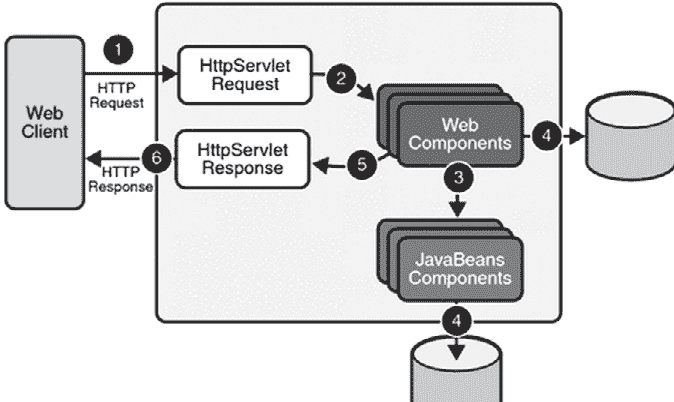

Servlet 是 Java 语言类，用于动态处理请求并构建响应。

JSP 页面是基于文本的文档，以 Servlet 的方式执行，但允许以自然的方式创建静态内容。

## 使用 Servlets

虽然 servlets 和 JSP 页面可以互换使用，但它们各有优劣。Servlets 最适用于面向服务的业务，以及面向演示型应用程序的控制功能，例如分发请求和处理非文本数据。

JSP 页面更适合生成基于文本的标记，如 HTML、可缩矢量图形 (SVG)、无线标记语言 (WML) 和 XML。

Web 组件由称为 web 容器（web container）的运行时平台服务支持。

Web 容器提供请求分发、安全、并发和生命周期管理等服务。

它提供了对命名、事务和电子邮件等 API 的访问。

应用安装或部署到 web 容器时，可以配置 Web 行为。

配置信息维护在 XML 格式的文本文件中，称为 Web 应用部署描述符 (DD)。

## 5.2 Web 应用生命周期

一个 Web 应用由 Web 组件、静态资源文件（如图像）以及辅助类和库组成。

Web 容器提供了许多支持服务，增强了 Web 组件的能力并使其更易开发。

然而，由于 Web 应用必须考虑这些服务，因此创建和运行 Web 应用的过程与传统的独立 Java 类有所不同。

创建、部署和执行 Web 应用的过程可以总结如下：

- 开发 Web 组件代码。
- 开发 Web 应用部署描述符。
- 编译 Web 应用组件以及被组件引用的辅助类。
- 可选：将应用打包成可部署的单元。
- 将应用部署到 Web 容器中。
- 访问引用 Web 应用的 URL。

## 5.3 Web 应用的结构

Web 组件和静态内容文件被称为 Web 资源。Web 模块（web module）是 Web 资源最小的可部署和可用单元。Java EE Web 模块对应 Java Servlet 规范定义的 Web 应用。

除了 Web 组件和 Web 资源，Web 模块还可以包含其他文件：

- 服务端工具类（数据库 bean、购物车等）。这些类通常符合 JavaBeans 组件架构。
- 客户端类（applets 和工具类）。

Web 模块具有特定的结构。Web 模块的顶层目录是应用的文档根目录。根目录是存储 JSP 页面、客户端类、包以及静态 Web 资源（如图像）的地方。

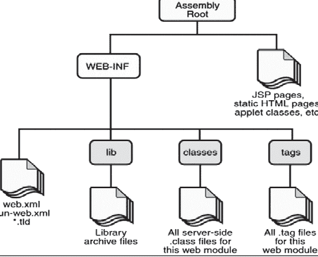

图 5.2：Web 模块结构

根目录包含一个名为`WEB-INF`的子目录，其中包含以下文件和目录：

- `web.xml`：Web 应用部署描述符
- 标签库描述符文件。
- `classes`：包含服务端类的目录：servlets、工具类和 JavaBeans
- `tags`：包含标签文件的目录，这些是标签库的实现。
- `lib`：包含被服务端类调用的库的 JAR 包的目录

如果你的模块不包含 servlet、过滤器（filter）或监听器（listener）组件，则不需要 Web 应用部署描述符。换句话说，如果你的 Web 模块只包含 JSP 页面和静态文件，则不需要包含`web.xml`文件。

## 根目录

你的 Web 应用的根目录可以取任何名称。

在根目录下，你可以放置所有在 Web 应用中可以访问的文件。

如果你在根目录下创建了子目录并在子目录中放置文件，这些文件将通过子目录/文件路径在 Web 应用中可用。

## WEB-INF 目录

`WEB-INF`目录位于 Web 应用根目录的正下方。

该目录是一个元数据目录。存储在此处的文件不应能从浏览器访问。

`WEB-INF`目录内部有两个重要的目录（`classes`和`lib`）和一个重要的文件（`web.xml`）。

这些将在下文描述。

## web.xml

`web.xml`文件包含有关 Web 应用的信息，Java 服务器/servlet 容器使用这些信息来正确地部署和执行 Web 应用。

例如，`web.xml`包含了关于 Web 应用应该部署哪些 servlets 以及哪些 URL 应该映射到它们的信息。

## classes 目录

`classes`目录包含 Web 应用的一部分的所有编译后的 Java 类。

`classes`类应该位于与其包结构匹配的目录结构中。

## lib 文件夹

`lib`目录包含 Web 应用使用的所有 JAR 文件。

该目录通常包含你的应用程序使用的任何第三方库。

你也可以将类放入 JAR 文件中并将其放在此处，而不是将这些类放在`classes`目录中。

与其将每个目录拷贝到服务器，我们可以将它们打包成 war 文件然后进行部署。

## 什么是 war 文件？

WAR（或“Web 归档”）简单来说就是打包的 Web 应用目录或归档文件（如 .zip）。它将存储 jsp、servlet、类、元数据、图像、音频和标签库。其标准扩展名是 .war。

WAR 文件用于打包模块。WAR 文件用于部署到服务器的 Web 应用。例如，股票交易可能会以名为`Stocktrading.war`的归档文件发布。

WAR 文件是具有特定目录和特定文件的 Web 应用的标准格式。它包含一个`WEB-INF`目录、用于描述应用的`WEB-INF/web.xml`文件、用于应用程序的 JAR `WEB-INF/lib`目录以及用于类文件的`WEB-INF/classes`目录。

## 编写初始化参数

初始化参数由 Servlet 从`web.xml`文件读取。程序员可以编写代码用于初始化。下面是一个示例代码：

```xml
<init-param>
  <param-name>trainer</param-name>
  <param-value>S. Nageswara Rao</param-value>
</init-param>
```

## 上下文路径 (Context Path)

上下文路径是 URL 路径的前缀，用于选择解析传入请求的上下文。通常，Java servlet 服务器中的 URL 格式为`http://hostname.com/context/servlet/path`，其中每个路径元素可以是零或由 / 分隔的元素。

如果没有上下文路径，则被称为根上下文（root context）。根上下文必须配置为`/`，但 servlet API 的`getContextPath()`方法返回空字符串。

## 使用 NetBeans IDE 创建第一个 Servlet 应用程序

IDE 是集成开发环境（Integrated Development Environment），它让创建 Servlet 应用程序变得简单。使用集成开发环境（IDE）是创建 Servlet 应用程序最的方法。IDE 是一种为计算机程序员提供软件开发设施的软件应用程序。

## 在 NetBeans IDE 中创建 Servlet 应用的步骤

要在 NetBeans IDE 中创建 servlet 应用程序，你需要遵循以下（简单）步骤：

1. 打开 NetBeans IDE，选择 File → New Project。
2. 出现如图所示的 New Project 对话框，在 Categories 列表中选择`Java Web`，在下方显示的 Project 列表中选择`Web Application`选项。
3. 点击 Next → 出现如图所示的 Web Application 对话框。将 Web Application 的名称输入为`servletledemo`。
4. 点击 Next → 出现如图所示的新的 Web Application 对话框中的 server 和 setting 部分。在图示中选择默认的 Glassfish server 4.1 作为 web 服务器，选择 Java EE6 web 作为 Java EE 版本，并按照图示配置 context path。
5. 点击 **Next** → 在 **new Web Application** 对话框的 **Framework** 部分中不要选择任何框架。点击 **Finish**。
6. 在 NetBeans IDE 中创建了`ServletdemoApplication`。
7. 启动 Web 服务：前往 service servers → Glassfish → 右键点击 → start。

### 为 Servlet 添加 HTML 页面：

右键点击 -> project -> webpage -> new -> html -> htmlfile

### 为 Servlets 添加 Servlet 页面：

右键点击 -> source package -> new -> servlet -> servletfile。


9. 在你的 HTML 文件中编写一些代码。我们在 HTML 文件中创建了一个指向 Servlet 的超链接。

10. 编辑`web.xml`文件。在`web.xml`文件中你可以看到我们指定了`url-pattern`和`servlet-name`，这意味着当访问`hello`url 时，我们的 Servlet 文件将执行执行。

11. 运行你的应用程序，右键点击你的项目并选择 Run。

## 企业级 JAVA

## 5.4 使用注解代替部署描述符

Servlet API 3.0 引入了一个名为`javax.servlet.annotation`的新包，它提供了可以用于注解 servlet 类的注解类型。注解可以替换 Web部署描述符文件（`web.xml`）中的等效 XML 配置，例如 servlet 声明和 servlet 映射。容器将在部署时处理这些注解。

注解表示元数据。如果你使用注解，则不需要部署描述符（`web.xml`文件）。但你应该拥有`tomcat7`，因为它不会在之前的 tomcat 版本中运行。`@WebServlet`注解用于将 servlet 映射到指定的名称。

到为止，我们学习了 Servlets 使用部署描述符（`web.xml`文件）将应用程序部署到 Web 服务器。Servlet API 3.0 引入了一个名为`javax.servlet.annotation`的新包。它提供了用于注解 servlet 类的注解。如果你使用注解，则不需要部署描述符（`web.xml`）。但你应该使用`tomcat7`或任何更高版本的 tomcat。

注解可以替换 Web 部署描述符（`web.xml`）中的 XML 配置，例如 servlet 声明和 servlet 映射。Servlet 容器将在部署时处理被注解的类。

## Servlet 3.0 中引入的不同注解有 –

| 序号 | 注解 | 描述 |
| :--- | :--- | :--- |
| 1 | `@WebServlet` | 声明一个 servlet。 |
| 2 | `@InitParam` | 指定初始化参数。 |
| 3 | `@WebFilter` | 声明一个过滤器。 |
| 4 | `@WebListener` | 声明一个 WebListener。 |
| 5 | `@HandlesTypes` | 声明 `ServletContainerInitializer` 可以处理的类。 |
| 6 | `@HttpConstraint` | 此注解用于 Servlet 注解内部，表示应用于所有 HTTP 协议方法的安全约束（当 Security 注解中未出现 `HttpMethodConstraint` 元素时）。 |
| 7 | `@HttpMethodConstraints` | 此注解用于 Servlet 注解内部，表示对特定 HTTP 协议消息的安全约束。 |
| 8 | `@MultipartConfig` | 可指定在 Servlet 类上的注解，表示 Servlet 请求的实例期望符合 `multipart/form-data` MIME 类型。 |
| 9 | `@WebServletSecurity` | 此注解用于 Servlet 实现，以指定由 Servlet 在 HTTP 协议消息上强制执行的安全约束。 |

## 注解对比部署描述符

部署描述符是一个源文件，其中以 XML 格式定义配置值，而注解直接嵌入你的源代码中。如果你倾向于将代码和配置放在同一个地方以获得更好的可读性，请使用注解。部署描述符则是完全相反的——你的代码和配置分开。如果你想更改单个配置值，则不需要重新编译整个项目。

对于许多 Java 企业组件，都有两种可用——注解或描述符。但其他组件可以通过注解或部署描述符进行配置。对于 Servlet，你可以选择其中一种方法。

## WebServlet 属性

有几个属性可以供你配置 Servlet

### 必须的

- `value`或`UrlPatternString[]`：指定 servlet 的一个或 URL 模式。可以使用其中一个，但不能同时使用。`urlPatterns`的默认值为`{}`，`value`的默认值为`""`。

### 可选的

- 1. `asyncSupportedboolean`：声明 servlet 是否支持异步模式。默认值为`false`
- 2. `name String`：servlet 的名称。默认值为`""`。
- 3. `description String`：servlet 的描述。默认值为`""`.
- 4. `displayName String`：servlet 的显示名称。默认值为`""`.
- 5. `initParamsWebInit[]`：servlet 的初始化参数。默认值为`{}`。
- 6. `largeIcon String`：servlet 的大图标。默认值为`""`.
- 7. `smallIconString`：servlet 的小图标。默认值为`""`.
- 8. `loadOnStartup int`：servlet 的启动加载顺序。默认值为`-1`。

## 示例

```java
@WebServlet(value="hello")
public class HelloServlet extends HttpServlet {

    @Override
    public void doGet(HttpServlet request, HttpServletResponse response)
        throws ServletException, IOException {
        PrintWriter out = response.getWriter();

        // 然后写入响应数据
        String username = request.getParameter("username");
        if (username != null && username.length() > 0) {
            out.println("<h2>Hello, " + username + "</h2>");
        }
    }
}
```

## 5.5 章节练习

1. 解释 Java EE 的 Web 模块架构。
2. 关于 `web-Inf` 目录，写简短说明。
3. `web.xml`文件执行了哪些不同的活动？
4. 解释 Servlet 使用的不同注解（Annotations）。
5. 解释创建简单 Servlet 应用的步骤。
6. 使用 servlet 创建一个简单的计算器应用。


## 第 6 章

与数据库交互

## 章节目录

- 6.1 什么是 JDBC？
- 6.2 Common JDBC 组件
- 6.3 JDBC 架构的层级
- 6.4 不同类型的架构
- 6.5 JDBC 驱动及其类型
- 6.6 Java 数据库连接步骤（访问数据库）
- 6.7 Servlet GUI 与数据库示例
- 6.8 章节练习

## 6.1 什么是 JDBC？

JDBC 是在 Java 社区进程（Java Community Process）下开发的，允许多个实现存在并被同一个应用程序使用。JDBC 提供了用于查询和更新关系型数据库管理系统（如 SQL、Oracle 等）中数据的方法。

应用程序编程接口（API）提供了一种机制，用于动态加载正确的 Java 包并将其注册到 JDBC 驱动管理器（Driver Manager）。驱动管理器被用作连接工厂，创建 JDBC 连接，支持创建和执行如 SQL `INSERT`、`UPDATE`和`DELETE`等语句。驱动管理器是 JDBC 架构的骨干。

简而言之，JDBC 帮助程序员编写 Java 应用程序，以管理以下三种编程活动：

1. 它帮助我们连接到数据源（例如数据库）。
2. 它帮助我们向数据库发送查询和更新语句。
3. 检索并处理从数据库接收到的结果，以回答你的查询。

与数据库交互

## 6.2 Common JDBC 组件

JDBC API 提供了以下接口和类：

- 1. `DriverManager`：此类管理数据库驱动程序列表。它使用通信协议将 Java 应用程序的连接请求与适当的数据库驱动程序匹配。识别 JDBC 下特定子协议的驱动程序将用于建立数据库连接。
- 2. `Driver`：此接口处理与数据库服务器的通信。你很少会直接与 `Driver` 对象交互。相反，应使用管理关系对象的 `DriverManager` 对象。它还抽象了与 `Driver` 对象工作相关的细节。
- 3. `Connection`：此接口包含所有与数据库接触的方法。连接对象表示连接上下文，即所有与数据库的通信都通过连接对象进行。
- 4. `Statement`：你使用从此接口创建的对象来将 SQL 语句提交给数据库。某些派生接口除了执行存储过程外还接受参数。
- 5. `ResultSet`：当你使用 `Statement` 对象执行 SQL 查询后，这些对象保存了从数据库中检索出的数据。它充当迭代器角色，允许你遍历其数据。
- 6. `SQLException`：此类处理数据库应用程序中发生的任何错误。

## 6.3 JDBC 架构的层级

JDBC 是关系型数据库与 Java 之间平台无关的接口。在今天的 Java 世界中，JDBC 是一种标准的应用程序接口（API），用于使用结构化查询语言（SQL）访问关系型数据库（如 Oracle、MySQL、SQL 和 DB2）中的企业数据。JDBC 的全称是 Java Database Connectivity（Java 数据库连接）。

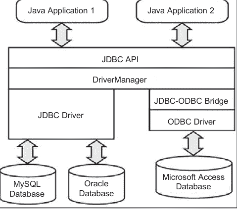

图 6.1

## JDBC 是如何工作的？

- `Class.forName("oracle.jdbc.OracleDriver")`
- 调用`Class.forName(name)`会自动创建驱动程序的实例，并将驱动程序注册到`DriverManager`类中。驱动程序与特定的数据库（如 Oracle 或 MySQL）JDBC API 通信。
- `DriverManager`是连接工厂类。事实上，它是唯一可以创建数据库连接的类。`DriverManager`使用驱动程序来创建连接。
- Java 数据库应用程序使用`DriverManager`类获取`java.sql.Connection`对象，该对象表示数据库连接。

## 6.4 不同类型的架构

JDBC 架构有两种类型。

### 1. 用于数据访问的双层架构

在双层模型中，应用程序直接与数据源通信。这需要一个能够与正在访问的特定数据源通信的 JDBC 驱动程序。用户的命令传递给数据库或其他数据源，这些语句的结果返回给用户。数据源可能位于另一台机器上，用户通过网络连接到该机器。这被称为客户端/服务器配置，用户的机器作为客户端，存放数据源的机器作为服务器。网络可以是内网（例如连接公司内部的员工），也可以是互联网。

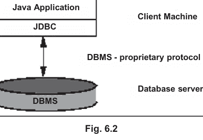

### 2. 三层处理模型

在三层模型中，命令被发送到服务的“中间层”，中间层将命令发送到数据源。数据源处理命令并将其返回给中间层；MIS 主管发现三层模型非常有吸引力，因为中间层使得对访问以及对企业数据进行的更新类型的控制成为可能。另一个优势是简化了应用程序的部署。最后，在许多情况下，三层架构可以提供性能优势。


## 与数据库交互

直到最近，中间层通常用 C 或 C++ 编写。然而，随着 Java 特性的引入，它正成为标准。这是一个巨大的优势，可以利用连接池、多线程和安全等特性。

## 6.5 JDBC 驱动及其类型

JDBC 驱动程序允许 Java 应用程序与数据库通信。JDBC 驱动程序是一个将 SQL 翻译为数据库所需格式的类。

## 驱动类型

### 第 1 类驱动 – JDBC-ODBC

将其调用转换为 ODBC。然后由 ODBC 与数据库交互。它是最可用但最慢的类型，并且仅在 Microsoft Windows 上运行。存在的是`sun.jdbc.odbc.JdbcOdbc`。

优点

- 只要安装了 ODBC 驱动，就可以访问任何数据库。
- 类型1 于安装。

缺点

- 由于调用必须通过 JDBC 桥接到 ODBC 驱动，存在性能开销。
- 客户端需要安装 ODBC 驱动。
- 考虑到客户端软件，这可能不适用于 applet。
- 不适用于互联网应用程序。

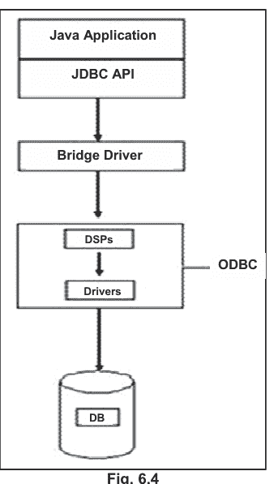

### 第 2 类驱动 - Native-API 驱动

- 部分使用 Java 语言编写，部分使用与数据库客户端 API 通信的原生代码。这种类型的 JDBC 连接到 oracle、Sysbase、Informix、IBM、DB2 或其他 DBMS 的客户端 API 调用。当你使用驱动程序时，除了 Java 库外还需要安装特定平台的代码。

优点

- 这种类型的驱动比 JDBC-ODBC 驱动快。

缺点

- 需要本地管理。
- 需要原生库。
- 它不是纯 Java 驱动。

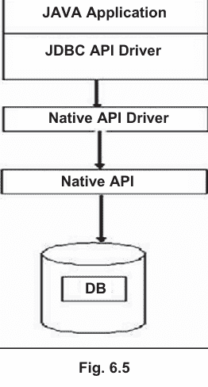

### 第 3 类驱动 - 网络协议驱动

此驱动程序将 JDBC 调用转换为与 DBMS 无关的网络协议，然后由中间服务器将其转换为数据库所需的格式。

优点

- 该类型的驱动程序是即时的（JIT）。
- 无需本地管理。
- 它是纯 Java 驱动。

缺点

- 驱动程序的设置困难，因为网络接口使架构变得复杂。

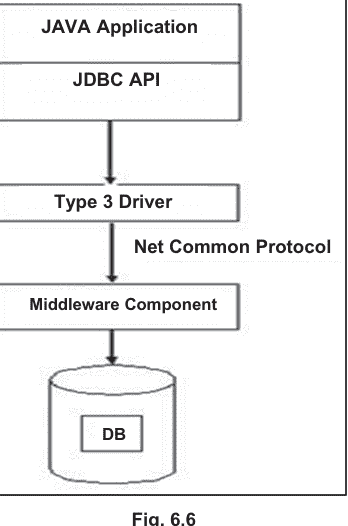

## 数据库操作

### 类型 IV：原生协议 Java 驱动

这种通信方式最快，因为 JDBC 调用被直接转换为 DBMS 使用的网络协议。该驱动完全用 Java 编写。

### 优势

- 1. 它比之前所有的 3 种驱动都快。
- 2. 它是纯 Java 驱动。
- 3. 不需要本地管理。

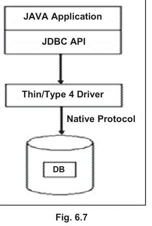

## 6.6 Java 数据库连接步骤（访问数据库）

### 1. 加载数据库驱动

在 JDBC 连接过程的步骤中，我们通过调用`Class.forName`并将驱动类名作为参数来加载驱动类。驱动类会创建其自身的一个实例。客户端可以通过 JDBC 驱动连接到数据库服务器。大多数数据库服务器支持 ODBC 驱动，因此通常使用 JDBC-ODBC 桥接驱动。`Class.forName(String ClassName)`方法的类型是“Class”。`Class`是`java.lang`包中的一个类。

### 语法：

```java
try {
    Class.forName("sun.jdbc.odbc.jdbcOdbcDriver"); //或任何其他驱动
} catch(Exception x) {
    System.out.println("无法加载驱动类!");
}
```

### 2. 建立数据库连接

`DriverManager`类定义了可以将 Java 应用程序连接到 JDBC 驱动的对象。`DriverManager`被认为是 JDBC 架构的骨。驱动类管理安装在系统上的 JDBC 驱动。它的`getConnection()`方法用于建立与数据库的连接。它使用用户名、密码和`jdbcurl`来建立与数据库的连接，并返回一个连接对象。`jdbc Connection`表示与特定数据库的会话/连接。在`Connection`的上下文中，会执行 SQL、PL/SQL 语句并返回结果。应用程序可以与单个数据库建立一个或多个连接。

`DriverManager`知道使用`sun.jdbc.odbc.JdbcOdbcDriver`。

### 语法：

```java
try{
    Connection con=DriverManager.getConnection(url,loginName,"Password")
} catch(SQLException x) {
    System.out.println("无法获取连接!");
}
```

### 3. 创建 JDBC Statement 对象

一旦获得连接，我们就可以与数据库交互。`Connection`接口定义了通过建立的连接与数据库交互的方法。要执行 SQL 语句，你需要使用`createStatement()`方法从你的连接中实例化一个`Statement`对象。

```java
Statement stmt=con.createStatement();
```

`statement`对象用于向数据库发送并执行 SQL 语句。

### 三种类型的 Statement：

- `Statement`: 执行不带参数的简单 SQL 查询。

  `Statement execute()`

  创建一个 SQL Statement 对象。

- `PreparedStatement`: 准备带参数或不带参数的预编译 SQL 查询。

  `PreparedStatement prepareStatement(String sql)`

  返回一个新的`PreparedStatement`对象。`PreparedStatement`对象是预编译的 SQL 语句。

- `CallableStatement`: 执行对数据库存储过程的调用。

  `CallableStatement prepareCall(String sql)`

  返回一个新的`CallableStatement`对象。`CallableStatement`是存储过程调用语句。

### 4. 执行 Statement 并返回 jdbcResultSet

`Statement`接口定义了通过执行 SQL 语句与数据库交互的方法。


该类有三个用于执行语句的方法：`executeQuery()`、`executeUpdate()` 和 `execute()`。

对于 `SELECT` 方法，应该使用的方法是 `executeQuery()`。

对于创建或修改它们的语句，应该使用的方法是 `executeUpdate()`。

`execute()` 执行以字符串对象形式编写的 SQL 语句。

## 数据库操作

`ResultSet` 提供了对执行 `Statement` 后生成的数据表的访问。表行按顺序检索。`ResultSet` 维护一个指向其当前数据行的游标。`next()` 方法用于逐行遍历表格结果的行。

### 语法

```
stmt=conn.createStatement();
stmt.executeUpdate("insert...");
```

### 5. 关闭连接

关闭连接时应显式关闭 `ResultSet`、`Statement` 和 `Connection`。在 `finally` 块中关闭这些资源，以确保即使发生异常资源也能被释放。

## Index.html

```html
<html>
<head>
  <title>待提供一个标题</title>
  <meta charset="UTF-8">
  <meta name="viewport" content="width=device-width, initial-scale=1.0">
</head>
<body>
  <form action="Registration" method="post">
    Name:<input type="text" name="username"/><br><br>
    Password:<input type="text" name="userPass"/><br><br>
    Email Id:<input type="text" name="userEmail"/><br><br>
    Country:
    <select name="country">
      <option>India</option>
      <option>Pakistan</option>
      <option>other</option>
    </select>
    <br><br>
    <input type="submit" value="register"/>
  </form>
</body>
</html>
```

## Registration.java

```java
import java.io.IOException;
import java.io.PrintWriter;
import java.sql.Connection;
import java.sql.DriverManager;
import java.sql.PreparedStatement;
import java.sql.SQLException;
import java.util.logging.Level;
import java.util.logging.Logger;
import javax.servlet.ServletException;
import javax.servlet.http.HttpServletServlet;
import javax.servlet.http.HttpServletRequest;
import javax.servlet.http.HttpServletResponse;

public class Registration extends HttpServlet {
  protected void processRequest(HttpServletRequest request, HttpServletResponse response)
  throws ServletException, IOException {
    response.setContentType("text/html;charset=UTF-8");
```

## 数据库操作

```java
try (PrintWriter out = response.getWriter()) {
  String n=request.getParameter("userName");
  String p=request.getParameter("userPass");
  String e=request.getParameter("userEmail");
  String c=request.getParameter("userCountry");
  Class.forName("com.mysql.jdbc.Driver");
  Connection con=DriverManager.getConnection("jdbc:mysql://localhost:3306/sandeep","root","cbs123");
  PreparedStatement ps=con.prepareStatement("insert into registration values(?,?,?,?)");
  ps.setString(1,n);
  ps.setString(2,p);
  ps.setString(3,e);
  ps.setString(4,c);
  int i=ps.executeUpdate();
  if(i>0) {
    out.print("You are successfully registered...");
  }
} catch (ClassNotFoundException ex) {
  Logger.getLogger(Registration.class.getName()).log(Level.SEVERE, null, ex);
} catch (SQLException ex) {
  Logger.getLogger(Registration.class.getName()).log(Level.SEVERE, null, ex);
}
}
```

输出：

来自 GUI 的输入：

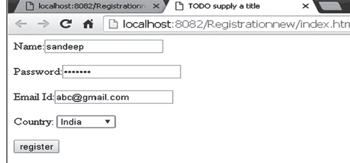

插入的数据：


从数据库中获取数据：

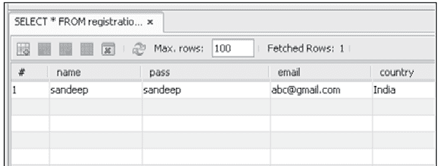

# JDBC 语句

有三种类型的语句：

**Statement**：它是一个接口，用于执行静态 SQL 语句并获取其产生的结果。执行不带任何参数的简单查询。`createStatement()` 创建一个 SQL 语句对象。

**语法：**

```sql
stmt=conn.createStatement();
enti=stmt.executeUpdate("insert into t1 values(101,'ram',3000');
```

**PreparedStatement**：它执行带参数或不带参数的预编译查询。与 `Statement` 对象不同，`PreparedStatement` 在创建时包含一个 SQL 语句。在大多数情况下，SQL 语句立即发送给 DBMS。`PreparedStatement` 不仅仅包含 SQL 语句，还是预编译的 SQL 语句。这意味着在执行 `PreparedStatement` 时不需要先编译。`PreparedStatement` 对象可以用于无参数的 SQL 语句，但必须用于带参数的 SQL 语句。可以在每次执行时提供不同的值，这是 `PreparedStatement` 的优势。例如：

`preparedStatement(String sql)` 返回一个新的 `PreparedStatement` 对象。`PreparedStatement` 对象是预编译的 SQL 语句。

## 数据库操作

语法：

```java
PreparedStatement pstmt=null;
try {
  pststmt=conn.prepareStatement("select * from t1");
  rs=pststmt.executeQuery();
  while(rs.next()) {
    System.out.println("ID is:"+rs.getInt("id"));
    System.out.println("Name is:"+rs.getString("name"));
    System.out.println("Salary:"+rs.getDouble("salary"));
    System.out.println("********************");
  }
} catch(Exception e) {
  System.out.println(e);
}
```

**Callable Statement**：`CallableStatement` 对象就像 `Connection` 对象创建 `Statement` 对象，用于调用数据库存储过程。`CallableStatement.prepareCall(String sql)` 返回一个新的 `CallableStatement` 对象。`CallableStatement` 对象是 SQL 存储过程语句。

## 6.8 章节问题

1. 解释 JDBC 架构的不同层级。

2. 解释 JDBC 中的二层架构和三层架构。

3. 写关于 JDBC 驱动程序的简短笔记。

4. 解释使用 MySQL 的连接步骤。

5. JDBC 中使用了哪些语句？

6. 编写一个 JDBC 应用，从 GUI 向数据库插入值。


## 第二单元

第七章

RequestDispatcher

## 章节大纲

7.1 Servlet 中的 RequestDispatcher

7.2 RequestDispatcher 接口方法

7.3 RequestDispatcher 应用

7.4 章节问题

## 7.1 Servlet 中的 RequestDispatcher

`RequestDispatcher` 接口提供了将请求调度到另一个资源（html、servlet 或 jsp）的功能。该接口也可包含另一个资源的内容。这是 servlet 协作的一种方式。`RequestDispatcher` 接口定义了两个方法。

# 7.2 RequestDispatcher 接口方法

`RequestDispatcher` 接口提供两个方法。它们是：

- `void forward(ServletRequest, ServletResponse response) throws ServletException, java.io.IOException`：从 servlet 到服务器上另一个资源（servlet、JSP 文件或 HTML 文件）的请求。

- `void include(ServletRequest, ServletResponse response) throws ServletException, java.io.IOException`：在响应中包含资源（如 servlet、JSP 页面或 HTML 文件）。

| 方法 | 描述 |
| :--- | :--- |
| `forward()` | 将请求从 servlet 转发到服务器上的另一个资源，如 Servlet、JSP 或 HTML 文件。 |
| `include()` | 在响应中包含资源如 Servlet、JSP、HTML 文件。 |

# RequestDispatcher

`forward()` 方法：


如上所示，第二个 servlet 的响应发送给客户端。第一个 servlet 的响应不显示给用户。

`include()` 方法：


如上所示，第二个 servlet 的响应包含在响应中。

## 7.3 RequestDispatcher 应用

在本示例中，我们解析了用户的密码。如果密码是 servlet，它将请求转发到 `WelcomeServlet`，否则将显示错误：用户名或密码错误！在本示例中，我们创建了以下文件：

1. `index.html`：用于获取用户输入。

2. `Login.java`：处理响应的 servlet 类。

3. `WelcomeServlet.java`：显示欢迎消息的 servlet 类。

4. `web.xml`：包含 servlet 信息的部署描述符。

# 1. Index.html

```html
<form action="Registration" method="post">
  Name:<input type="text" name="username"/><br><br>
  Password:<input type="password" name="userPass"/><br><br>
  <input type="submit" value="register"/>
</form>
```

# 2. Login.java

```java
import java.io.*;
import javax.servlet.*;
import javax.servlet.http.*;

public class Login extends HttpServlet {
  protected void doPost(HttpServletRequest request, HttpServletResponse response)
      throws ServletException, IOException {
    response.setContentType("text/html;charset=UTF-8");
    PrintWriter out = response.getWriter();
    String n=request.getParameter("userName");
    String p=request.getParameter("userPass");
    if(p.equals("servlet")) {
      RequestDispatcher rd=request.getRequestDispatcher("servlet2");
      rd.forward(request, response);
    }
    else {
      out.print("Sorry Username or Password Error!");
      RequestDispatcher rd=request.getRequestDispatcher("/index.html");
      rd.include(request, response);
    }
  }
}
```

# 3. WelcomeServlet.java

```java
import java.io.*;
import javax.servlet.*;
import javax.servlet.http.*;

public class WelcomeServlet extends HttpServlet {
  protected void doPost(HttpServletRequest request, HttpServletResponse response)
      throws ServletException, IOException {
    response.setContentType("text/html;charset=UTF-8");
    PrintWriter out = response.getWriter();
    String n=request.getParameter("userName");
    out.print("Welcome "+n);
  }
}
```

## 4. Web.xml

```xml
<web-app>
  <servlet>
    <servlet-name>Login</servlet-name>
    <servlet-class>Login</servlet-class>
  </servlet>
  <servlet>
    <servlet-name>WelcomeServlet</servlet-name>
    <servlet-class>WelcomeServlet</servlet-class>
  </servlet>
  <servlet-mapping>
    <servlet-name>Login</servlet-name>
    <url-pattern>/servlet1</url-pattern>
  </servlet-mapping>
  <servlet-mapping>
    <servlet-name>WelcomeServlet</servlet-name>
    <url-pattern>/servlet2</url-pattern>
  </servlet-mapping>
  <welcome-file-list>
    <welcome-file>index.html</welcome-file>
  </welcome-file-list>
</web-app>
```

# 8.6 动态改变页面颜色

使用 Servlet 更改背景颜色

HTML 代码


```html
<HTML>
<HEAD>
<TITLE>
颜色变化
</TITLE>
</HEAD>
<BODY>
<FORM action="http://127.0.0.1:8080/examples/servlets/ColorServlet">
<CENTER>
选择颜色：
<select name="color" id="color">
<option value="red">红色</option>
<option value="green">绿色</option>
<option value="blue">蓝色</option>
<option value="yellow">黄色</option>
<option value="black">黑色</option>
</select>
<input type="submit" value="提交">
</CENTER>
</FORM>
</BODY>
</HTML>
```

Servlet 代码

```java
import java.io.*;
import javax.servlet.*;
import javax.servlet.http.*;

public class ColorServlet extends HttpServlet {
    public void doGet(HttpServletRequest req, HttpServletResponse res)
    throws IOException, ServletException {
        res.setContentType("Text/Html");
        String c=req.getParameter("color");
        PrintWriter pw=res.getWriter();
        if(c.equals("red"))
```

```java
if(c.equals("green")) {
    pw.println("<body bgcolor=green>");
}
if(c.equals("blue")) {
    pw.println("<body bgcolor=blue>");
}
if(c.equals("yellow")) {
    pw.println("<body bgcolor=yellow>");
}
if(c.equals("black")) {
    pw.println("<body bgcolor=black>");
    pw.println("<center><h2>选定的颜色是:"+c+"</h2></center>");
}
}
```

# 8.7 章节练习题

- 1. 关于 Cookies 写简短笔记。
- 2. Cookies 有哪些不同的类型？
- 3. 编写一个实现 Cookies 的程序。
- 4. 解释 Cookies 的工作原理。

# 第 9 章

Session（会话）

## 章节目录

- 9.1 什么是 Session？
- 9.2 Http Session 的生命周期
- 9.3 使用 Servlet API 进行 Session 跟踪
- 9.4 Servlet Session 示例
- 9.5 章节练习题

## 9.1 什么是 Session？

由于 HTTP 是无状态协议，这会导致很多问题。

例如：

当进行在线购物时，Web 服务器无法轻松记住之前的交易记录，这非常令人困扰。

这使得像购物车之类的应用程序变得非常棘手：

- 当向购物车添加条目时？
- 服务器如何知道购物车里已经有什么？

### 9.2 Http Session 的生命周期

`HttpSession` 对象用于存储与特定客户端的每个会话。我们可以从 `HttpSession` 对象中存储、检索和删除属性。任何 Servlet 都可以通过 `getSession()` 对象访问 `HttpSession` 对象。

- 在客户端第一次请求时，Web 容器（Web Container）生成一个唯一的会话 ID 并通过响应返回给客户端。这是由 Web 容器创建的临时会话。
- 客户端在每次请求时都会返回会话 ID。这使得 Web 容器更容易识别请求的来源。
- Web 容器使用此 ID 找到与 ID 匹配的会话，并将会话与请求关联。

图 9.1

## HttpSession 接口

# 创建新会话

> `getSession()` 方法返回一个会话。如果会话已经存在，它返回现有会话，否则创建一个新会话。

```java
HttpSession session = request.getSession();
```

```java
HttpSession session = request.getSession(true);
```

> `getSession(true)` 总是返回一个新会话

# 获取已存在的会话

```java
HttpSession session = request.getSession(false);
```

> 返回一个已存在的会话

# 销毁会话

```java
session.invalidate();
```

> 销毁会话

图 9.2

# 9.3 使用 Servlet API 进行 Session 跟踪

Session 跟踪是 Java Servlet 扮演的重要角色之一。为了理解什么是 Session 跟踪，让我们考虑一个实现 HTTP Session 并接收来自不同客户端 HTTP 请求的 Servlet。Servlet 必须能够为每个客户端确定客户端请求所属的 HTTP Session。每个客户端只请求加入 Servlet 跟踪的一个客户端会话之一。

Servlet API 提供了一组简单、强大的技术来处理会话。Servlet API 中的 `HttpSession` 类为开发者提供了使用 Servlet 代码跟踪会话所需的所有功能，每个用户调用的 Servlet 都会映射到一个特定的会话，该会话由一个 `HttpSession` 实例表示。

## Session 跟踪的方法

有几种方法可以方便访问者的 Web 浏览器与 Web 服务器之间交换 SESSION ID 或状态信息。

以下是允许跟踪会话的方法：

- 1. Cookies
- 2. URL 重写 (URL Rewriting)
- 3. 隐藏变量 (Hidden Variables)
- 4. 安全套接层 [SSL]

# 1. Cookies

Cookies 提供了一种在访问者硬盘上存储状态信息的方便方式。Cookie 是一个由 Web 服务器生成的容器，Web 服务器可以通过向访问者浏览器发送请求，自动在访问者的硬盘上存储少量的状态信息。

在此发生后，访问者的 Web 浏览器每次与设置该 Cookie 的 Web 服务器通信时，它都会在请求数据时自动将 Cookie 内容返回给 Web 服务器。

在以下示例中，我们在 `Cookie` 对象中存储了用户名，并在另一个 Servlet 中访问它。正如我们所知，会话对应于特定的用户。因此，如果你从多个具有不同值的浏览器访问，就会出现问题。

## 优点

- 1. 维护状态的最简单方法。
- 2. Cookie 维护在客户端。
- 3. 可以从 `HttpServletRequest` 中提取 Cookie 信息。

## 缺点

- 1. 如果禁用了 Cookie 则将无法工作。
- 2. 只能在浏览器中设置文本信息。

## 2. URL 重写

在 URL 重写方法中，客户端在每个 URL 的末尾附加某些数据，从而识别会话并与 Web 服务器关联。URL 重写将会话详情存储为 URL 的一部分。在示例中，当用户点击超链接时，可以使用 `getParameter()` 获取值。

图 9.4

例如，考虑网页中的以下链接：

```html
<a href="logincheck">
```

可以被重写为：

```html
<a href="logincheck;jsessionid=32788GMP44">
```

当用户点击链接时，重写的 URL 作为客户端请求的一部分发送到服务器。Web 容器识别 `jsessionid=32788GMP44` 为 Session ID，并用于获取 `HttpSession` 对象。

## 优点

- 1. 无论是否禁用 Cookie 都能工作（浏览器无关）。
- 2. 每个页面不需要额外的提交。

## 缺点

- 1. 仅适用于链接。
- 2. 只能发送文本信息。

# 隐藏表单字段

在商业应用程序中，有时需要向 Web 服务器返回某些特定绑定在客户端浏览器中运行的客户端信息。在隐藏表单字段的情况下，使用不可见的文本字段来维护用户状态。在这种情况下，我们将信息存储在隐藏字段中，并在另一个 Servlet 中获取。如果我们需要在所有页面都提交表单且不依赖浏览器，这种方法更好。

在以下示例中，我们在隐藏文本字段中存储了用户名，并在另一个 Servlet 中获取。

图 9.5

```html
<form method="post" action="/MyServlets/Books" name="frmBooks">
<input type="text" name="txtBookName">
<input type="hidden" name="hidSessID" value="">
</form>
```

当数据提交到 Servlet 时，Servlet 如下所示从表单中提取 SESSION ID：

```java
public void doPost(HttpServletRequest request, HttpServletResponse response) (
```

```java
String mySessID = request.getParam("hidSessID");
...}
```

# 解释

在代码中，`Books` Servlet 从名为 `hidSessID` 的隐藏表单字段中获取 SESSION ID。

## 优点

- 1. 无论是否禁用了 cookie，它将始终有效。

## 缺点

- 1. 它在服务器端维护。
- 2. 在每个页面都需要额外的表单提交。
- 3. 只能使用文本信息。

## 4. HttpSession 接口

在这种情况下，容器会为每个用户创建一个 session id。容器使用此 id 来识别特定用户。可以使用 `HttpSession` 对象来执行两项任务：

- 1. 绑定对象
- 2. 查看和操作有关会话的信息，例如会话标识符、时间和最后访问时间。

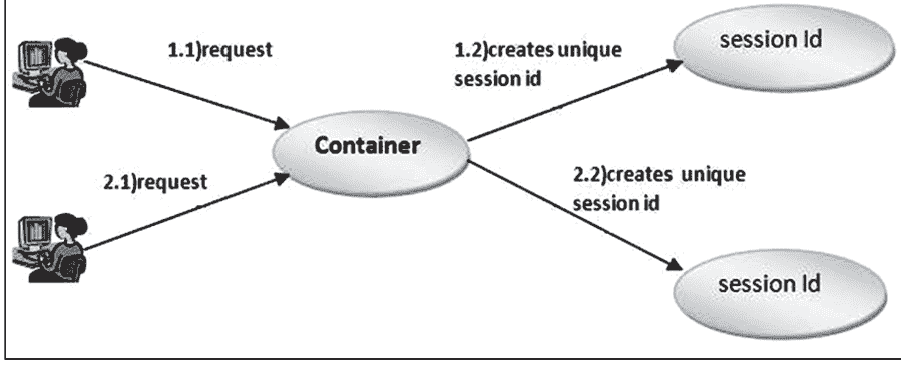

图 9.6

`HttpServletRequest` 接口提供了两个方法来获取 `HttpSession` 对象：

- 1. `public HttpSession getSession()`: 返回与此请求关联当前 session，如果请求没有 session，则创建一个。
- 2. `public HttpSession getSession(boolean create)`: 返回与此请求关联的当前 `HttpSession`，如果没有当前 session 且 `create` 为 true，则返回新 session。
- 3. `public String getId()`: 返回包含唯一标识符值的字符串。
- 4. `public long getCreationTime()`: 返回创建此会话的时间，自 GMT 1970 年 1 月 1 日午夜以来的毫秒。
- 5. `public long getLastAccessedTime()`: 返回客户端发送与此会话关联的最后请求时间，以及自 GMT 1970 年 1 月 1 日午夜以来的毫秒。

## 9.4 Servlet Session 示例

```html
index.html
<form action="FirstServlet">
Name:<input type="text" name="username"/><br/>
<input type="submit" value="submit">
</form>
```

```java
FirstServlet.java
import java.io.*;
import javax.servlet.*;
import javax.servlet.http.*;
public class FirstServlet extends HttpServlet {
    public void doGet(HttpServletRequest request, HttpServletResponse response) {
        try {
            response.setContentType("text/html");
            PrintWriter out = response.getWriter();
            String n=request.getParameter("username");
            out.print("Welcome "+n);
            HttpSession session=request.getSession();
            session.setAttribute("uname",n);
            out.print("<a href='servlet2\">visit</a>");
            out.close();
        } catch(Exception e) {
            System.out.println(e);
        }
    }
}
```

```java
SecondServlet.java
import java.io.*;
import javax.servlet.*;
import javax.servlet.http.*;
public class SecondServlet extends HttpServlet {
    public void doGet(HttpServletRequest request, HttpServletResponse response) {
        try {
            response.setContentType("text/html");
            PrintWriter out = response.getWriter();
            HttpSession session=request.getSession(false);
            String n=(String)session.getAttribute("uname");
            out.print("Hello "+n);
            out.close();
        } catch(Exception e) {
            System.out.println(e);
        }
    }
}
```

## Web.xml

```xml
<servlet>
  <servlet-name>FirstServlet</servlet-name>
  <servlet-class>FirstServlet</servlet-class>
</servlet>
<servlet>
  <servlet-name>SecondServlet</servlet-name>
  <servlet-class>SecondServlet</servlet-class>
</servlet>
<servlet-mapping>
  <servlet-name>FirstServlet</servlet-name>
  <url-pattern>/FirstServlet</url-pattern>
</servlet-mapping>
<servlet-mapping>
  <servlet-name>SecondServlet</servlet-name>
  <url-pattern>/SecondServlet</url-pattern>
</servlet-mapping>
<session-config>
  <session-timeout>
    30
  </session-timeout>
</session-config>
</web-app>
```

会话

输出：

```
← → C localhost:8082/servletsession/index.html
Name sandeep
submit
```

```
← → C localhost:8082/servletsession/FirstServlet?username=sandeep
Welcome sandeep visit
```

```
← → C localhost:8082/servletsession/SecondServlet
Hello sandeep
```

## 9.5 章节练习

- 1. 写关于会话（Sessions）的短要笔记。
- 2. 解释会话生命周期。
- 3. 写关于会话跟踪方法的短要笔记。
- 4. 编写一个创建会话的 servlet 程序。
- 5. 创建一个使用 Cookies 存储用户访问 servlet 次数的 servlet。


# FileUploadServlet.java


```java
package servlet;
import java.io.File;
import java.io.FileNotFoundException;
import java.io.FileOutputStream;
import java.io.IOException;
import java.io.InputStream;
import java.io.OutputStream;
import java.io.PrintWriter;
import javax.servlet.ServletException;
import javax.servlet.annotation.MultipartConfig;
import javax.servlet.annotation.WebServlet;
import javax.servlet.http.HttpServlet;
import javax.servlet.http.HttpServletRequest;
import javax.servlet.http.HttpServletResponse;
import javax.servlet.http.Part;

@WebServlet(urlPatterns = "/FileUploadServlet")
@MultipartConfig
public class FileUploadServlet extends HttpServlet {
    @Override
    protected void service(HttpServletRequest request, HttpServletResponse response) 
            throws ServletException, IOException {
        response.setContentType("text/html;charset=UTF-8");

        final String path = request.getParameter("destination");
        final Part filePart = request.getPart("file");
        final String fileName = retrieveFileName(filePart);

        OutputStream out = null;
        InputStream inputStream = null;
        final PrintWriter writer = response.getWriter();

        try {
            out = new FileOutputStream(new File(path + File.separator + fileName));
            inputStream = filePart.getInputStream();
            int read = 0;
            final byte[] bytes = new byte[1024];
            while ((read = inputStream.read(bytes)) != -1) {
                out.write(bytes, 0, read);
            }
            response.sendRedirect("SuccessfulUploadServlet");
        } catch (FileNotFoundException e) {
            writer.println("You did not specify a file to upload or are trying to upload a file to nonexistent location.");
            writer.println("<br> ERROR: " + e.getMessage());
        } finally {
            if (out != null) {
                out.close();
            }
            if (inputStream != null) {
                inputStream.close();
            }
            if (writer != null) {
                writer.close();
            }
        }
    }

    private String retrieveFileName(Part part) {
        String content = part.getHeader("content-Disposition");
        if (content != null && content.startsWith("filename=")) {
            return content.substring(content.indexOf("=") + 1).trim().replace("\"", "");
        }
        return null;
    }
}
```

# 上述代码说明

## 导入接口/类

- `java.io.File`
- `java.io.FileNotFoundException`
- `java.io.InputStream`
- `java.io.OutputStream`
- `javax.servlet.annotation.MultipartConfig`
- `javax.servlet.http.Part`

## java.io.File

- `File` 类是 `java.io` 包的一部分。
- `File` 类是文件和目录路径的抽象表示。
- 操作系统使用依赖于系统的路径名来表示文件和目录，但 Java 的 `File` 类提供了一个抽象的、与系统无关的路径视图。从抽象路径到路径名的转换本质上是依赖于系统的。
- 可以通过 `File` 类的 `getParent()` 方法获取父路径名。

### Java File 构造函数

我们可以使用以下构造函数创建 `File` 类的实例：

- `File(File parent, String child)`：使用此构造函数，我们可以从指定的父路径和子路径名创建 `File` 类的实例。
- `File(String pathname)`：使用此构造函数，我们可以将指定的路径名转换为抽象路径名来创建 `File` 类的实例。
- `File(String parent, String child)`：使用此构造函数，我们可以从指定的父路径和子路径名创建 `File` 类的实例。
- `File(URI uri)`：我们可以将指定的 URI 转换为抽象路径名来创建 `File` 类的实例。

## java.io.FileNotFoundException

- 表示尝试打开由指定路径名表示的文件失败。
- 如果指定路径名的文件不存在，`FileInputStream`、`FileOutputStream` 和 `RandomAccessFile` 的构造函数将抛出此异常。
- 如果文件存在但由于某些原因无法访问（例如尝试读取一个只读文件），也会抛出此异常。

### 构造函数

- `public FileNotFoundException()`：构造一个以 `null` 作为错误消息的 `FileNotFoundException`。文件是否可用取决于底层平台。
- `public FileNotFoundException(String s)`：构造一个带有指定详细消息的 `FileNotFoundException`。字符串 `s` 稍后可以通过 `java.lang.Throwable` 的 `Throwable.getMessage()` 方法获取。

## java.io.FileOutputStream

- 文件流是用于向文件或描述符写入数据的输出流。某些平台特别允许一次仅有一个 `FileOutputStream` 打开文件进行写入操作。在这种情况下，如果文件已经打开，构造函数将失败。
- `FileOutputStream` 用于写入原始字节数据（如图像数据）。对于写入字符流，请考虑 `FileWriter`。

## java.io.InputStream

该抽象类是所有表示字节输入流的类的超父类。

## java.io.OutputStream

该抽象类是所有表示字节输出流的类的超父类。该抽象类输出字节并将它们发送到某些汇点（sink）。

## javax.servlet.annotation.MultipartConfig

- 可指定在 `Servlet` 类上的注解，表示该 `Servlet` 实例期望符合 `multipart/form-data` MIME 类型的请求。
- 标记了 `MultipartConfig` 注解的 `Servlet` 可以通过调用 `getPart` 或 `getParts` 来获取给定 `multipart/form-data` 请求的 `Part` 组件。

# 文件操作

## javax.servlet.http.Part

该类表示 `multipart/form-data` 请求中接收到的部分项。

# SuccessfulUploadServlet

`SuccessfulUploadServlet` 的步骤与 `FileUploadServlet` 相同。

## SuccessfulUploadServlet.java

```java
package servlet;
import java.io.IOException;
import java.io.PrintWriter;
import javax.servlet.ServletException;
import javax.servlet.annotation.WebServlet;
import javax.servlet.http.HttpServlet;
import javax.servlet.http.HttpServletRequest;
import javax.servlet.http.HttpServletResponse;

@WebServlet(name = "SuccessfulUploadServlet", urlPatterns = {"/SuccessfulUploadServlet"})
public class SuccessfulUploadServlet extends HttpServlet {
    @Override
    protected void service(HttpServletRequest request, HttpServletResponse response) throws
    ServletException, IOException {
        response.setContentType("text/html;charset=UTF-8");
        try (PrintWriter out = response.getWriter()) {
            out.println("<!DOCTYPE html>");
            out.println("<head>");
            out.println("<title>Successful Upload Page</title>");
            out.println("</head>");
            out.println("<body>");
            out.println("<h1>File Uploaded</h1>");
            out.println("<a href=\"index.jsp\">Click here to upload more files</a>");
            out.println("</body>");
        }
        out.println("</html>");
    }
}
```

## 创建 index.jsp 文件

删除默认的 `index.html` 文件并创建一个 `index.jsp` 文件。

### 步骤 1：删除 index.html 文件


### 步骤 2：创建 index.js 文件


### 步骤 3：文件名命名为 index→完成


### 步骤 4：index.jsp 创建成功


运行应用程序，我们将得到输出：


# 文件上传应用程序

文件：[选择文件] 未选择文件

目标：

## 点击“选择文件”并选择你想要上传的一个文件

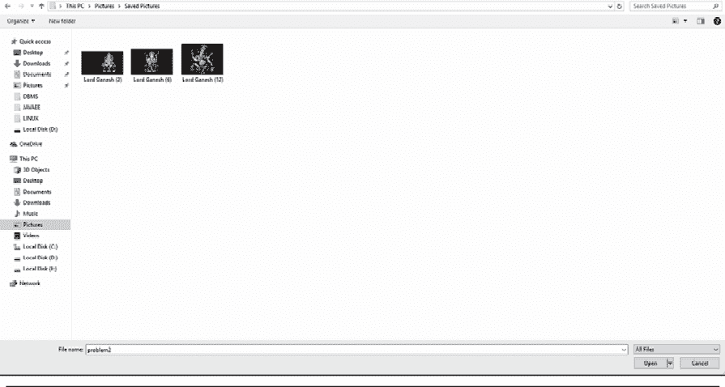

## 文件上传应用程序

文件：Choose File Lord Ganesh (12) jpg

目标：

上传文件

指定目标路径并点击“上传”按钮

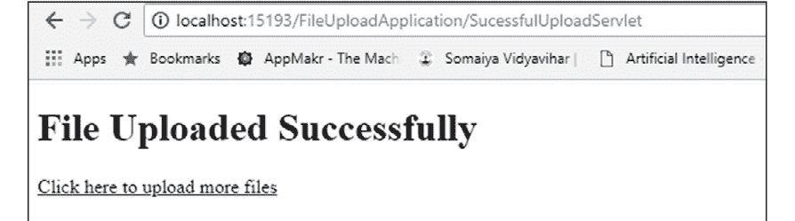

## 文件上传成功

点击此处上传更多文件

## 文件操作

如果你想通过超链接上传更多文件

| 名称 | 修改日期 | 类型 | 大小 |
| --- | --- | --- | --- |
| 快速访问 | | | |
| Lord Ganesh (12) | 2018/8/16 下午 9:17 | JPG 文件 | 78 KB |
| 桌面 | | | |
| 下载 | | | |
| 文档 | | | |

## 10.3 下载文件

在互联网上，下载文件非常普遍。用户点击下载链接，文件就会下载到你的计算机中。下载可以通过直接链接或间接链接实现。

1. **直接链接**：这种链接需要服务器端付出额外努力，因为服务器会根据请求自动将文件传递给用户。
2. **间接链接**：这种链接指向服务器上的程序（如 `java servlet`、`Plet`、`JavaScript` 等），在将文件传递给用户之前，这些程序会执行额外的任务，如记录日志条目、更新数据库记录、发送电子邮件等。

## 10.4 创建下载文件应用程序

创建 Web 应用程序、`Servlet` 和 `jsp` 文件遵循与上述创建上传文件应用程序相同的步骤。

## FileDownloadServlet.java

```java
package servlet;
import java.io.IOException;
import java.io.InputStream;
import javax.servlet.ServletContext;
import javax.servlet.ServletExceptionException;
import javax.servlet.ServletOutputStream;
import javax.servlet.annotation.WebServlet;
import javax.servlet.http.HttpServlet;
import javax.servlet.http.HttpServletRequest;
import javax.servlet.http.HttpServletResponse;

@WebServlet(name = "FileDownloadServlet", urlPatterns = {"/FileDownloadServlet"})
public class FileDownloadServlet extends HttpServlet {
    @Override
    protected void doGet(HttpServletRequest request, HttpServletResponse response) throws ServletException, IOException {
        String fileToDownload = request.getParameter("filename");
        System.err.println("Downloading file now...");
        downloadFile(request, response, fileToDownload);
    }
}
```

## 110

## 企业级 JAVA


```java
private void downloadFile(HttpServletRequest request, HttpServletResponse response, String
    fileName) throws ServletException, IOException {
    int length = 0;
    try (ServletOutputStream outputStream = response.getOutputStream()) {
        ServletContext context = getServerConfig().getContext();
        response.setContentType(context.getMimeType(fileName) != null
            ? context.getMimeType(fileName) : "application/octet-stream");
        response.setHeader("Content-Disposition", "attachment; filename=" + fileName +
```

**注意：** 将示例文件放在 Web Pages 目录下，并在 `index.jsp` 文件中指定要下载的文件名

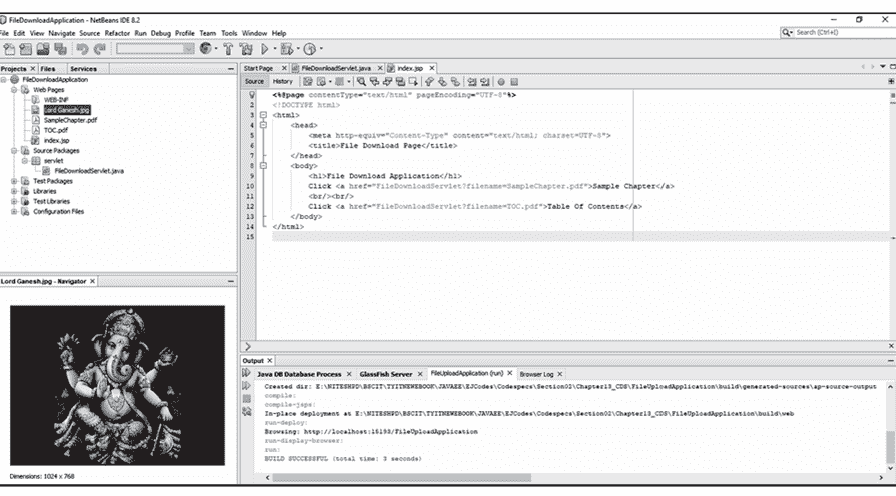

## 创建 index.jsp

`index.jsp`

```jsp
<%@page contentType="text/html" encoding="UTF-8"%>
<!DOCTYPE html>
<html>
<head>
<meta http-equiv="Content-Type" content="text/html; charset=UTF-8">
<title>文件下载页面</title>
</head>
<body>
<h1>文件下载应用程序</h1>
<a href="SampleChapter.pdf">Sample Chapter</a><br>
<a href="TOC.pdf">Table Of Contents</a><br>
<a href="Lord Ganesh.jpg">Lord Ganesh</a>
</body>
</html>
```

## 运行


## 文件下载应用程序

| 点击 Sample Chapter |

| 点击 Table Of Contents |

| 点击 Lord Ganesh |

## 企业级 JAVA

点击超链接 Lord Ganesh 并保存文件


因此文件已成功完成


## 文件下载应用程序

点击 SampleChapter

点击 TableOfComments

点击 Lord Ganesh

## 你可以打开下载的文件

（注：此处原文文本似乎存在乱码或重复，已根据上下文逻辑进行了最小对齐处理）


## 10.5 章节问题

1. 创建上传文件应用程序的过程。

2. 创建下载文件的过程。

## 第11 章

## 使用非阻塞 I/O

## 章节目录

- 11.1 非阻塞 I/O

- 11.2 创建非阻塞读取应用程序

- 11.3 创建 Web 应用程序

- 11.4 创建 Java 类

- 11.5 创建 Servlet

- 11.6 获取文件

- 11.7 创建 index.jsp

- 11.8 章节问题

## 11.1 非阻塞 I/O

> 服务器中的 Web 容器通常为每个请求使用一个服务器线程。为了开发可扩展的 Web 应用程序，必须确保与请求相关的线程不会空闲。

> 异步处理提供了一种机制，可以在新线程中执行特定的操作，并立即返回与请求相关的线程。

> 例如，如果客户端通过慢网络提交大型 POST 请求，服务器读取请求的速度比客户端提供的快。

> 使用传统的 I/O，与该请求相关的线程将由于等待输入而空闲。

> Servlet 3.1 为异步模式下处理请求的 Servlet 和过滤器提供了非阻塞 I/O 支持。

`WriteListener` 接口：当执行非阻塞写入时。此接口注册到 `ServletOutputStream`，以便当监听器发现 servlet 内容可以写入且不会阻塞时，执行写入操作。

## 11.2 创建非阻塞读取应用程序

让我们使用非阻塞 I/O 支持创建一个文件读取应用程序，该程序在异步模式下处理请求。

## 11.3 创建 Web 应用程序

创建一个名为 Non-Blocking Application 的 Web 应用程序，步骤如下：

步骤 1：运行 NetBeans IDE 并选择 File → New Project → Next

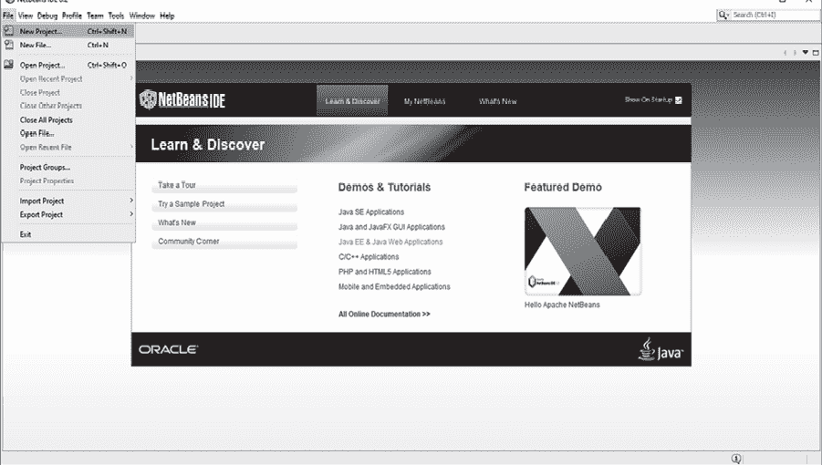

### 步骤 2：选择 Java Web → Web Application → Next

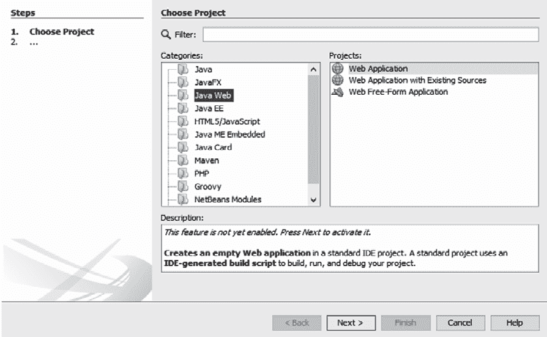

### 步骤 3：给出项目名称 → Non-Blocking Application → Next

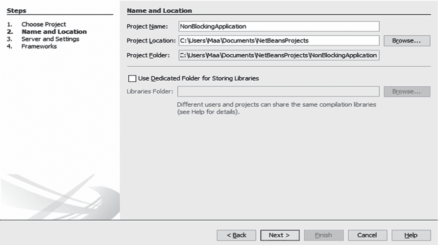

### 步骤 4：在 Server and Setting 中选择 GlassFish Server → Next

| Steps | Server and Settings |

|---|---|

| 1. Choose Project | Add to Enterprise Application: <None> |

| 2. Name and Location | |

| 3. Server and Settings | Server: GlassFish Server 4.1.1 [ Add... ] |

| 4. Frameworks | Java EE Version: Java EE 7 Web |

| | Context Path: /NonBlocking/Application |

### 步骤 5：不选择任何框架 → Finish

| Steps | Frameworks |

|---|---|

| 1. Choose Project | 选择您要在 Web 应用程序中使用的框架。 |

| 2. Name and Location | [ ] Spring Web MVC |

| 3. Server and Settings | [ ] JavaServer Faces |

| 4. Frameworks | [ ] Struts 1.3.10 |

| | [ ] Hibernate 4.3.1 |

## 步骤 6：此处是成功创建的 Web 应用程序

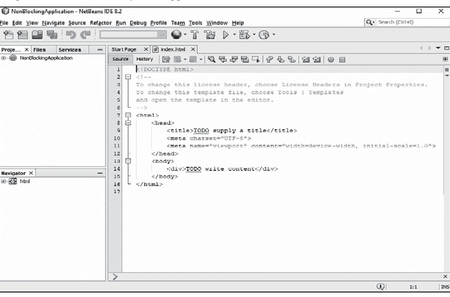

## 11.4 创建 Java 类

创建一个名为 `ReadingListener` 的 Java 类。

在 NetBeans 中我们按照以下步骤创建 Java 类。

### 步骤 1：右键点击 Source directories 并选择 New -> Java Class

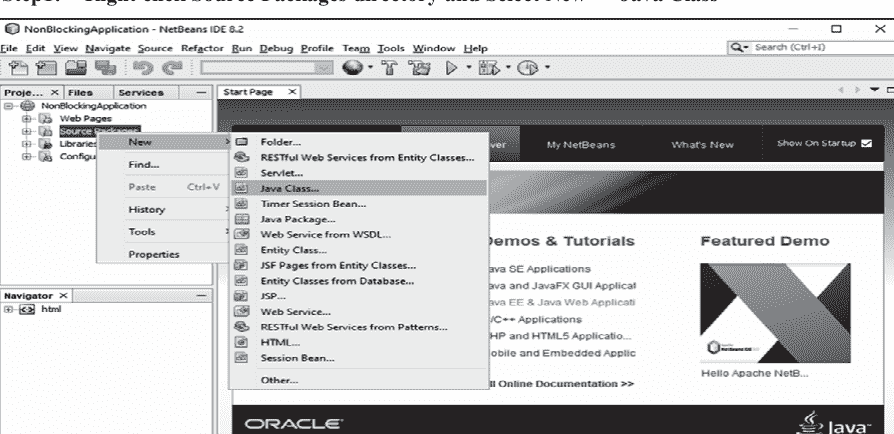

### 步骤 2：输入类名为 `ReadingListener` 并指定包 `servlet` → Finish

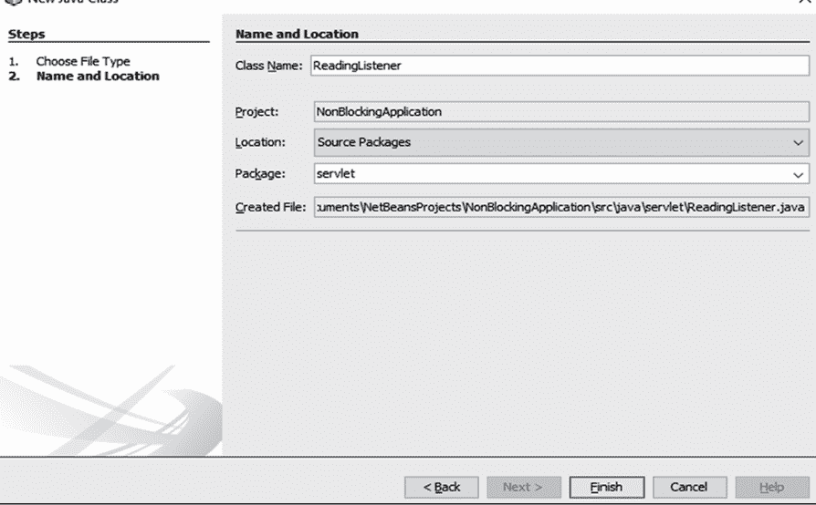

### 步骤 3：`ReadingListener.java` 类创建成功

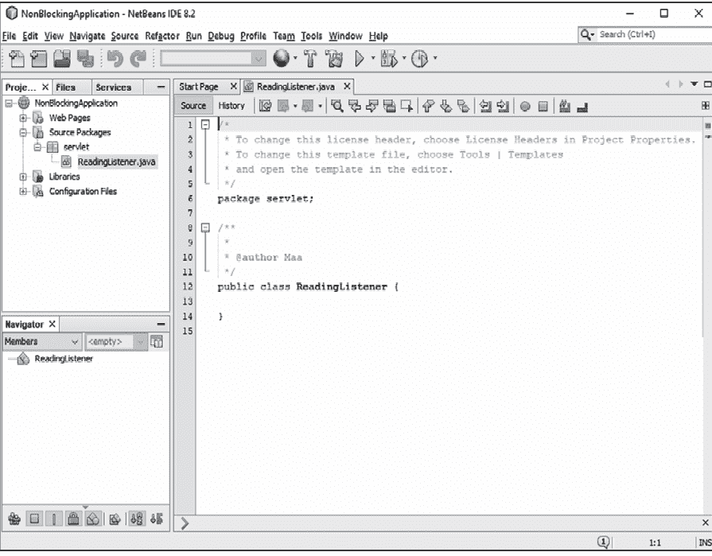

```java
package servlet;

import java.io.IOException;
import java.util.logging.Level;
import java.util.logging.Logger;
import javax.servlet.AsyncContext;
import javax.servlet.ReadListener;
import javax.servlet.ServletInputStream;
public class ReadingListener implements ReadListener, ServletInputListener {
    private ServletInputStream inputStream = null;
    private AsyncContext context = null;
    public ReadingListener(ServletInputStream inputStream, AsyncContext ac) {
        this.inputStream = inputStream;
        this.context = ac;
    }
}
```

```java
@Override
public void onDataAvailable() {
  try {
    StringBuilder sb = new StringBuilder();
    int len = -1;
    byte bytes[] = new byte[1024];
    while (inputStream.isReady() && (len = inputStream.read(bytes)) != -1) {
      String data = new String(bytes, 0, len);
    }
  } catch (IOException ex) {
    Logger.getLogger(ReadingListener.class.getName()).log(Level.SEVERE, null, ex);
  }
}
```

```java
@Override
public void onAllDataRead() {
  System.out.println("Invoked onAllDataRead");
  context.complete();
}
```

```java
@Override
public void onError(Throwable t) {
  context.complete();
}
```

上述代码的说明如下：

- 导入的接口/类：

- `import javax.servlet.AsyncContext;`

- `import javax.servlet.ReadListener;`

- `import javax.servlet.ServletInputStream;`

- 1. `import javax.servlet.AsyncContext`:

- (a) 表示由 `ServletRequest` 启动的异步操作执行上下文的类。

- (b) `AsyncContext` 是通过调用 `ServletRequest#startAsync()` 或 `ServletRequest#startAsync(ServletRequest, ServletResponse)` 创建并初始化的。重复调用这些方法将返回相同的 `AsyncContext` 实例。

- 2. `import javax.servlet.ReadListener`:

- (a) 回调机制，当数据可用时会通知监听器。

- 3. `import javax.servlet.ServletInputStream`:

- (a) 提供一个用于读取二进制数据的输入流。

方法及描述：

- `onAllDataRead()`: 当所有数据都读取完毕时调用。

- `onDataAvailable()`: 当数据可用时调用。

- `onError(Throwable t)`: 当发生错误时调用。

- `isFinished()`: 如果流结束则返回 `true`。

- `isReady()`: 如果可以读取数据则返回 `true`。

- `readLine(byte[] b, int off, int len)`: 从流中读取一行。

- `setListener(ReadListener listener)`: 将监听器注册到 Servlet。

## 11.5 创建 Servlet

步骤 1：右点击 Source → New → Servlet


### 步骤 2：提供类名 `ReadingListener` → Next

| Steps | Name and Location |

|---|---|

| 1. Choose File Type | Project: NonBlockingApplication |

| 2. Name and Location | Package: servlet |

| 3. Configure Servlet Deployment | Created File: ReadingListener |

### 步骤 3：选择 Web.xml

| Steps | Configure Servlet Deployment |

|---|---|

| 1. Choose File Type | 在部署描述符 (`web.xml`) 中注册 Servlet |

| 2. Name and Location | Servlet Name: ReadingListener |

| 3. Configure Servlet Deployment | URL Pattern(s): /NonBlocking |

### 步骤 4：Finish

## 使用非阻塞 I/O

## 可选元素及描述

| 修饰符和类型 | 可选元素及描述 |

| --- | --- |

| `boolean` | `asyncsupported` 声明 servlet 是否支持异步操作模式。 |

| `string` | `description` servlet 的描述 |

| `webInitParam[]` | `initParams` servlet 的参数 |

| `string` | `largeicon` servlet 的大图标 |

| `int` | `loadOnStartup` servlet 的启动顺序 |

| `string` | `name` servlet 的名称 |

| `string` | `smallIcon` servlet 的小图标 |

| `string[]` | `urlPatterns` servlet 的 URL 模式 |

| `string[]` | `value` servlet 的 URL 模式 |

## 创建另一个 Servlet，即 NonBlockingServlet

要创建 `NonBlockingServlet`，请参考 NetBeans 中上述的 `ReadingNonBlockingServlet` 步骤进行操作。

`NonBlockingServlet.java`:


```java
package servlet;
import java.io.BufferedReader;
import java.io.BufferedWriter;
import java.io.IOException;
import java.io.InputStreamStream;
import java.io.InputStreamReader;
import java.io.OutputStreamWriter;
import java.io.PrintWriter;
import java.net.HttpConnection;
import java.net.URL;
import java.util.logging.Level;
import java.util.logging.Logger;
import javax.servlet.ServletContext;
import javax.servlet.ServletExceptionException;
import javax.servlet.annotation.WebServlet;
import javax.servlet.http.HttpServletServlet;
import javax.servlet.http.HttpServletRequest;
import javax.servlet.http.HttpServletResponse;

@WebServlet(name = "NonBlockingServlet", urlPatterns = {"/NonBlockingServlet"})
public class NonBlockingServlet extends HttpServletServlet {
    @Override
    protected void service(HttpServletRequest request, HttpServletResponse response) 
            throws ServletException, IOException {
        response.setContentType("text/html;charset=UTF-8");
        String filename = "/WEB-INF/booklist.txt";
        ServletContext context = request.getServletContext();
        InputStream inputStream = context.getResourceAsStream(filename);
        try (PrintWriter out = response.getWriter()) {
            String path = "http://" + request.getServerName() + ":" + request.getPortPort() + "/" + request.getRequestPath() + "/ReadingNonBlockingServlet";
            out.println("<html>");
            out.println("<head>");
            out.println("<title>File Reader to demonstrate a Non Blocking I/O Servlet</title>");
            out.println("</head>");
            out.println("<body>");
            out.println("<h1>File Reader</h1>");
            out.flush();
            
            URL url = new URL(path);
            HttpConnection conn = (HttpConnection) url.openConnection();
            conn.setChunkedStreamingMode(0);
            conn.connect();
            if (inputStream != null) {
                InputStreamReader inputReader = new InputStreamReader(inputStream);
                BufferedReader reader = new BufferedReader(inputReader);
                String line = "";
                System.out.println("Reading started...");
                try (BufferedWriter bufferWriter = new BufferedWriter(
                    new java.io.OutputStreamWriter(conn.getOutputStream()))) {
                    out.println("<div style=\"width:100%;height:450px;overflow:scroll;\">");
                    while ((line = reader.readLine()) != null) {
                        out.println("<div style=\"background-color:lavender;width:100%;");
                        bufferWriter.write(line);
                        Thread.sleep(1000);
                        out.flush();
                        out.println("</div>");
                    }
                    System.out.println("Reading completed...");
                    bufferWriter.flush();
                    bufferWriter.close();
                }
                out.println("</body>");
                out.println("</html>");
            } catch (InterruptedException | IOException ex) {
                Logger.getLogger(NonBlockingServlet.class.getName()).log(Level.SEVERE, null, ex);
            }
        }
    }
}
```

上述代码的解释如下：

## 导入类

- 1. `import java.io.BufferedReader;`
- 2. `import java.io.BufferedWriter;`
- 3. `import java.io.InputStream;`
- 4. `import java.io.InputStreamReader;`
- 5. `import java.io.OutputStreamWriter;`
- 6. `import java.io.PrintWriter;`
- 7. `import java.net.HttpConnection;`
- 8. `import java.net.URL;`

## 1. `java.io.BufferedReader`

(a) 从字符输入流中读取文本，通过缓冲字符以便于对字符、数组和行进行高效读取。

例如：

```java
BufferedReader in = new BufferedReader(new FileReader("abc.in"));
```

## 2. `java.io.BufferedWriter`

(a) 向字符输出流写入文本，通过缓冲字符以便于对单个字符、数组和字符串进行高效写入。

例如：

```java
PrintWriter out = new PrintWriter(new BufferedWriter(new FileWriter("abc.out")));
```

企业级 JAVA

## 3. `java.io.InputStream`

- (a) 该抽象类是所有表示字节输入流的类的父类。
- (b) 需要定义 `InputStream` 子类的应用程序必须始终提供一个返回下一个输入字节的方法。

## 4. `java.io.InputStreamReader`

- (a) `InputStreamReader` 是从字节流到字符流的桥梁：它读取字节并将其解码为字符。
- (b) `InputStreamReader` 是从字节流到字符流的桥梁：它读取字节并将其解码为字符。

## 5. `java.io.OutputStreamWriter`

- (a) `OutputStreamWriter` 是从字符流到字节流的桥梁：写入它的字符使用指定的字符集编码。接受平台的默认字符集。

## 6. `java.io.PrintWriter`

- (a) 向文本输出流打印对象的格式化表示。该类实现了 `PrintStream` 中的所有打印方法。
- (b) 它不包含写入原始字节的方法，程序应使用字节流。

## 7. `java.net.HttpConnection`

- (a) 支持 HTTP 特有功能的 `URLConnection`。
- (b) 每个 `HttpConnection` 实例用于发送单个请求，但底层连接可以透明地与其他实例共享。
- (c) 在 `HttpConnection` 的 `InputStream` 或 `OutputStream` 上调用 `close()` 方法可以释放与之相关的网络资源，但对共享的持久连接没有影响。
- (d) 调用 `disconnect()` 方法可以在持久连接空闲时关闭底层套字。

## 8. `java.net.URL`

- (a) `URL` 类表示统一资源定位符，指向 Web 上“资源”的指针。
- (b) 资源可以是简单的文件或目录，也可以是更复杂对象的引用，例如对数据库或搜索引擎的查询。

## 使用非阻塞 I/O

## 11.6 获取文件

```java
String filename="WEB-INF/booklist.txt";
ServletContext context=getServletContext();
InputStream inputStream=context.getResourceAsStream(filename);
```

声明一个命名变量并赋值文件路径。声明 `ServletContext` 并赋值由 `getServletContext()` 返回的上下文；为了读取文件内容，创建了一个 `InputStream` 实例。这是通过调用 `ServletContext.getResourceAsStream()` 并传递文件名来获取就绪的文件引用实现的。通过声明变量名 `path` 设置 `ReadingBlockingServlet` 的路径。`getServerName()` 返回发送请求的服务器的主机。

`getPort()` 返回发送请求的端口号。

`getPath()` 返回请求 URL 中指示请求上下文的部分。

## 11.7 创建 `index.jsp`

在 NetBeans 中创建 `index.jsp` 的步骤如下：

步骤 1：右键点击 Web Pages 目录 → New → jsp

## 步骤2：提供文件名作为索引 → 完成

| 步骤 | 名称和位置 |
|---|---|
| 1. 选择文件类型 | 文件名：`index` |
| 2. 命名和位置 | 项目：`NonBlockingApplication` |
| 位置：Web 页面 | |
| 文件夹：浏览... | |
| 创建的文件 | `C:\Users\Plaa\Documents\Projects\nonblockingApplication\web\index.jsp` |
| 选项：[ ] JSP 文件（标准语法）[ ] 创建 JSP 文档（XML 语法） 描述：使用 JSP 标准语法的 JSP 文件。 |

## 步骤3：`index.jsp` 文件创建成功

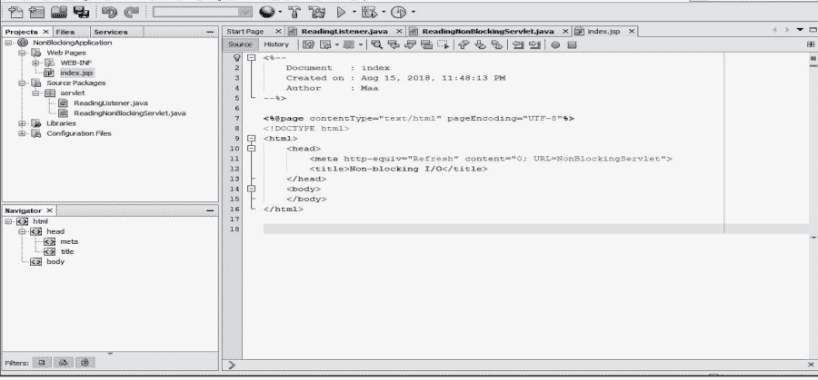

## `index.jsp`:

```jsp
<%@page contentType="text/html" pageEncoding="UTF-8%">
<!DOCTYPE html>
<html>
<head>
<meta http-equiv="Refresh" content="0; URL=NonBlockingServlet">
<title>Non-blocking I/O</title>
</head>
<body>

</</body>>
</html>
```

现在编译 Web 应用程序，你将得到如下输出：

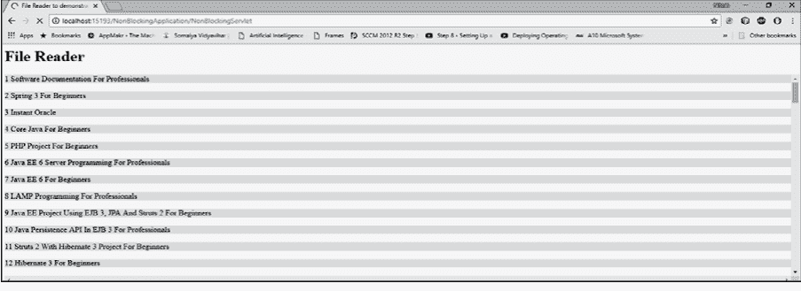

## 11.8 章节练习

- 1. 创建一个简单的 Servlet 应用以演示非阻塞读取操作。
- 2. 关于非阻塞 I/O 编写短篇笔记。
- 3. Servlet 输入和输出流中用于非阻塞 I/O 有哪些不同方法？
- 4. `@WebServlet` 注中有哪些不同的选项？
- 5. 解释获取文件的不同方法。

## 第 12 章

# Java Server Pages（JSP）简介

## 章节大纲

- 12.1 Java Server Pages 简介
- 12.2 为什么使用 Java Server Pages？
- 12.3 JSP 的优势
- 12.4 JSP 的缺点
- 12.5 JSP 对比 Servlets
- 12.6 JSP 页的生命周期
- 12.7 JSP 如何工作？
- 12.8 JSP 如何执行？
- 12.9 章节练习

JSP 页的生命周期，JSP 是如何工作的？JSP 如何执行？关于 Java 页面

## 12.1 Java Server Pages 简介

Java Server Pages (JSP) 是一种 Java 技术，允许软件开发人员根据 Web 客户端的请求动态生成 HTML、XML 或其他类型的文档。该技术允许将 Java 代码和某些预定义的动作嵌入静态内容中。Java Server Pages 简称为 JSP 是 Sun 公司用于开发动态网站的解决方案。

JSP 页面包含：

- 1. 静态 HTML/XML 组件。
- 2. 特殊 JSP 标签
- 3. 可选的用 Java 编程语言编写的代码片段，称为“脚本段”（scriptlets）。

Java Server Pages (JSP) 是一种基于 Java 的技术，它简化了使用 JSP 开发动态网站的过程，Web 设计师和开发者可以使用嵌入的 Java 代码和标记标签快速将动态元素整合到 页面中。这些标签允许用户展示数据和 Java 对象（Object/JDBC/Java bean/servlet 等），同时也存储了业务逻辑。

JSP 规范是在 servlet API 之上定义的标准扩展。JSP 是带有 `jsp` 后名的文本文件，包含了嵌入 Java 代码的 HTML/XML 标签。

## 12.2 为什么使用 Java Server Pages？

JavaServer Pages 的用途与通用网关接口 (CGI) 实现的程序相同。但与 CGI 相比，JSP 有许多优势。

- 性能明显更好，因为 JSP 允许在 HTML 页面中嵌入动态元素，而不是使用 CGI 文件。
- JSP 在服务器处理之前总是编译，而 CGI/Perf 要求服务器在每次请求页面时加载解释器和目标脚本。
- JavaServer Pages 构建在 Java Servlet API 之上，JSP 还可以访问所有强大的 Java API，包括 JDBC、NDNI、EJB、JAXP 等。
- JSP 页面可以与处理业务逻辑的 servlet 结合，即 Java servlet 模板支持的模型。

## 12.3 JSP 的优势

以下是 JSP 优于其他技术的优势：

- 1. 可移植性：由于它是基于 Java 的，因此 JSP 技术是平台无关的。要运行 `.jsp` 文件，我们需要 JSP 引擎（运行 `jsp` 文件的程序）。该引擎可以为不同类型的 Web 服务器构建，以执行 `jsp` 文件。
- 2. 组件和标签库的重用：JSP 技术强调使用可重用组件，如 Java Bean 组件，企业 Java Bean 组件包含获取数据的代码，这是动态内容的主要原因。这些组件可能包含来自数据库或其他文件的代码，为 JSP 文件提供不同的内容。它支持不同类型的标记语言，如 HTML/DTD/XML。JSP 还包含用户自定义标签。对于用户自定义标签，控制将转移到应该执行代码的类中。任何类型的代码（如 JDBC、文件处理等）都可以包含在类中。JSP 开发者不需要具备大量的 Java 知识。
- 3. 静态与动态内容的分离：使用 HTML 页面，我们可以只向 Web 元素发送静态内容。如果使用 servlets，则整个 HTML 代码都必须写在 `println` 中，这非常繁琐。这使得页面变得动态化。JSP 允许你在静态内容中包含动态内容，从而分离静态内容。
- 4. 适用于 N 层架构：由于平台无关性、支持不同服务器、标签重用等特性，JSP 非常适合。
- 5. 性能：JSP 页面是编译的。

## 12.4 JSP 的缺点

- 输出是 HTML 而不是。
- 转换为 servlets 后调试/跟踪错误很困难。
- JSP 页面在首次访问时需要更长时间。


数据库连接并不容易。

JSP 方面有很多问题。

## 12.5 JSP 对比 Servlets

与 JSP 一样，Servlets 也用于。以下是它们之间的对比：

| Servlets | JSP |
|---|---|
| 1. Servlets 生成动态内容的效率较低。 | 1. JSP 提供了静态与动态内容的分离。 |
| 2. Servlets 文件必须由用户编译。 | 2. JSP 文件会自动编译。 |
| 3. 开发者需要大量的 Java 知识。 | 3. 开发者不需要具备大量的 Java 知识。 |
| 4. 使用 java 代码管理 beans | 4. 使用标签管理 beans。 |

## JSP 架构

JSP 是嵌入了 JSP 标签的 HTML 页面。这些标签可以包含 Java 代码。JSP 文件扩展名是 `.jsp` 而不是 `.html`。JSP 引擎解析 `.jsp` 并创建 servlet 源文件。然后将其源代码编译为 `.class` 文件；这是第一次，这也是为什么 JSP 第一次访问较慢。之后的任何时候执行该 servlet 都会更快。

## Java Server Pages 简介

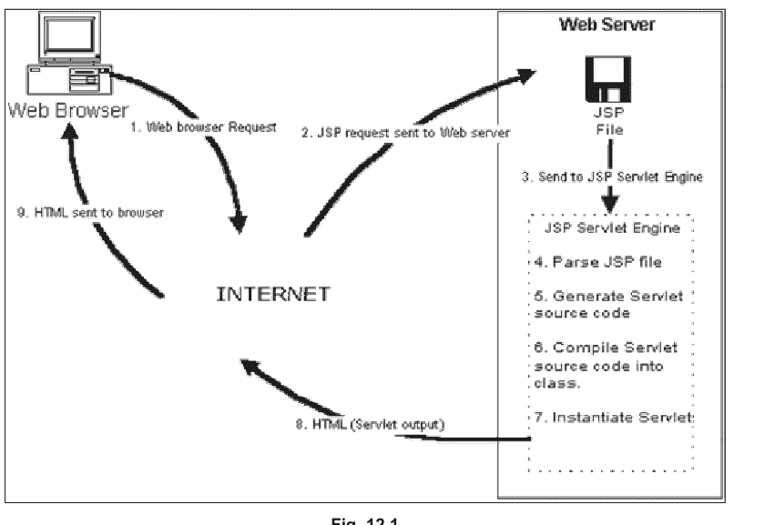

## JSP 请求所需的步骤

1. 用户访问使用 JSP 的网站。用户访问 JSP 页面（以 `jsp` 结尾）。浏览器通过互联网发出请求。
2. JSP 请求发送到 Web 服务器。
3. Web 服务器识别出所需的文件是特殊文件 (`.jsp`)，因此将 JSP 文件传递给 JSP Servlet 引擎。
4. 如果 JSP 文件是第一次调用，则解析 JSP 文件，否则跳转到第 7 步。
5. 下一步是从 JSP 文件生成特殊的 Servlet。整个 HTML 代码转换为 `println` 语句。
6. Servlet 源码被编译为 `.class` 文件。
7. 实例化 Servlet，调用 `init` 和 `service` 方法。
8. Servlet 输出的 HTML 通过互联网发送。
9. HTML 结果显示在用户的浏览器上。

## JSP 访问模型

早期的 JSP 规范提供了两种方法，通常称为 Model 1 和 Model 2 架构，用于应用 JSP 技术。这些方法在本质上执行大部分请求的位置有所不同，并为使用 JSP 技术构建应用提供了实用的范式。

## Model 1 架构

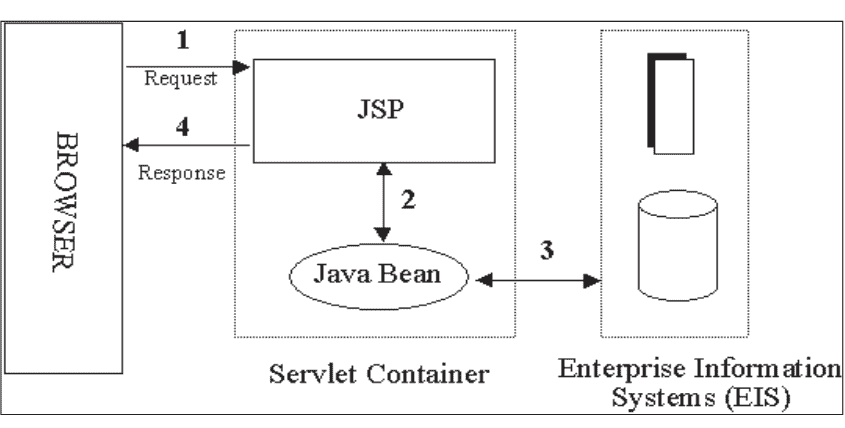

在 Model 1 架构中，来自 Web 浏览器的请求直接发送到 JSP 页面，由该页面负责处理并回复给客户端。它仍然实现了显示与内容的分离，因为所有数据都可以通过使用 beans 来。

尽管 Model 1 架构适用于简单的应用程序，但对于复杂的实现它可能并不理想。这种架构的使用通常会导致 JSP 页面中编码大量的脚本或 Java 代码，特别是当需要执行大量的请求处理时。该架构的另一个缺点是，每个 JSP 页面必须单独负责管理应用状态和安全性。

## Model 2 架构

下所示的 Model 2 架构是流行的模型/视图/控制器（MVC）设计的服务器端实现。处理在显示组件和前端组件之间进行分。

显示组件是 JSP 页面，它们生成当浏览器渲染时用户界面所需的 HTML 响应。

前端组件（也称为控制器）不处理任何显示逻辑；而是处理所有的 HTTP 请求。它们负责创建显示组件使用的任何 beans 或对象，并根据用户的操作决定跳转到何处。前端组件可以实现为 servlet 或 JSP 页面。

这种架构的优势是显示组件内部没有处理逻辑；它负责检索任何对象或从其静态模板中提取动态内容。

这种方法的另一个好处是，前端组件提供了进入应用程序的单一入口，使得应用状态、安全性和显示的管理更加统一且易于维护。

## Java 服务器页面 (JSP) 简介

## MVC 设计模式


图 12.3：Model 2 架构

## JSP 页面的生命周期

JSP 页面转换为 Servlet 以处理请求。JSP 页面到 Servlet 的转换被称为 JSP 生命周期。JSP 生命周期与 Servlet 生命周期完全相同，但多了一个步骤，即将 JSP 代码翻译为 Servlet 代码。以下是 JSP 生命周期步骤：

- 将 JSP 翻译为 Servlet 代码。
- 将 Servlet 编译为字节码。
- 加载 Servlet 类。
- 通过调用 `jspInit()` 方法进行初始化。
- 通过调用 `service()` 方法进行请求处理。
- 通过调用 `jspDestroy()` 方法进行销毁。

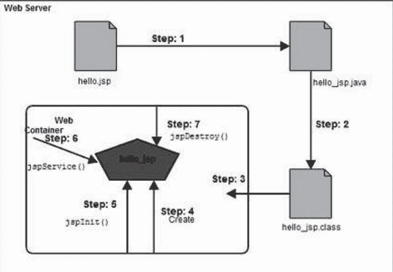

Web 容器将 JSP 代码翻译成 servlet 源 (`.java`) 文件，然后将其编译为 java servlet 类。在第三步中，使用类加载器加载 servlet 类字节码。容器随后创建 servlet 类的实例。初始化的 servlet 现在可以提供服务。对于每个请求，Web 容器都会调用 `service()` 方法。当容器从服务中移除 servlet 实例时，它会调用 `destroy()` 方法执行任何所需的清理工作。

每个 JSP 页面在内部被翻译为等效的 Servlet。页面中写的每个 JSP 标签都会被容器内部转换为 java 代码；此过程称为翻译。

JSP 有两个阶段：

- 翻译阶段
- 请求处理阶段

**翻译阶段：** 将 JSP 转换为等效的 Servlet 然后生成 Servlet 的类文件的过程。

**请求处理阶段：** 执行 JSP 的 `service()` 并在浏览器上生成响应数据的过程。

当第一次向 JSP 发起请求时，首先发生翻译阶段，然后执行服务阶段。从下一次请求 JSP 开始，只执行请求处理阶段，而不执行翻译阶段，因为 JSP 已经翻译过了。

## JSP 如何工作？

Web 服务器需要一个 JSP 引擎（即容器）来处理 JSP 页面。JSP 容器负责拦截对 JSP 页面的请求。本教程使用了 Apache，它具有内置的 JSP 容器来支持 JSP 页面的开发。

JSP 容器与 Web 服务器协作，为 JSP 提供所需的运行时环境和其他服务。它知道如何理解作为 JSP 部分的特殊元素。下面的图显示了 JSP 容器和 JSP 文件在 Web 应用程序中的位置。

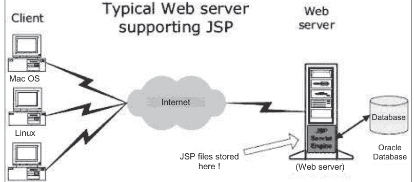

图 12.5

## JSP 处理

### 翻译阶段

正 Web 服务器需要 servlet 容器来为 servlet 提供接口一样，服务器需要一个 JSP 容器来处理 JSP 页面。JSP 容器负责拦截对 JSP 页面的请求。

为了处理页面中的所有元素，容器首先将 JSP 页面转换为 servlet（称为 JSP 实现类）。容器包含该 servlet 类。

将 JSP 页面转换为 servlet 并编译 servlet 执行了翻译阶段。当 JSP 容器接收到对该页面的第一个请求时，会自动启动该页面的翻译阶段。

由于翻译阶段需要一些时间，第一个请求 JSP 页面的用户会注意到轻微的延迟。翻译阶段也可以显式地启动；这被称为 JSP 页面的预编译。

### 请求处理阶段

JSP 容器还负责调用 JSP 实现类（生成的 servlet）来处理每个请求并生成响应。这被称为请求处理阶段。

## 企业级 JAVA

只要 JSP 页面保持不变，任何后续的请求都将直接进入请求处理阶段（即容器简单地执行类文件）。当 JSP 页面被修改时，它将再次通过翻译阶段。

JSP 的两个阶段如下所示：


图 12.6：JSP 页面及阶段

### JSP 如何执行？

当浏览器请求一个 JSP 时，JSP 引擎首先将页面翻译成 servlet。这是第一步。JSP 生命周期如下所示。

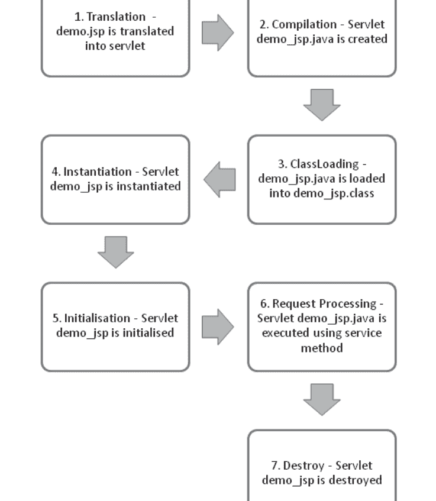

图 12.7

以下步骤解释了 JSP 生命周期：

1. JSP 翻译
2. JSP 编译
3. 类加载
4. 实例化
5. 请求处理
6. 销毁

## 翻译与处理

我们对上述要点有更详细的总结：

1. **JSP 翻译：** 从 JSP 源码生成一个 java servlet。这是 JSP 生命周期的第一步。容器验证指令标签和标签.... the the the the the::

```java
public class demo_jsp extends HttpServlet {
    public void service(HttpServletRequest request, HttpServletResponse response)
    throws IOException, ServletException {
        PrintWriter out = response.getWriter();
        response.setContentType("text/html");
        out.write("<html><body>");
        int demo=0;
        out.write("Count is "+demo++);
        out.write("</body></html>");
    }
}
```

2. **JSP 编译：**

(a) 生成的 servlet 被编译为 java servlet 类。

(b) java 源页面到其实现类的翻译可以在 JSP 页面部署到容器和处理 JSP 页面之间的任何时间发生。

(c) 在上述图中，`demo_jsp.java` 被编译为类文件 `demo_jsp.class`。

3. **实例化：**

(a) 在这一步即生成类的实例。

(b) 容器根据响应请求和其他事件管理该类的一个或多个实例。通常，JSP 容器使用 servlet 容器构建。

(c) 容器提供的 `JSPPage` 接口提供了 `init()` 和 `destroy()` 方法。

(d) 有一个 `HttpJSPPage` 用于 HTTP 请求，它也包含 `service()` 方法。

(e) `init()` 将初始化从 JSP 生成的 servlet 实例，并在阶段由容器调用。

(f) 一旦实例被创建，`init` 方法将立即被调用，之后在 JSP 生命周期内仅会被调用一次。

4. **请求处理：**

(a) 容器在 JSP 生命周期内对 JSP 页面提出的所有请求调用 `service()` 方法。

# Java Server Pages (JSP) 简介

(b) 对于此阶段，必须经过上述所有阶段，然后才能调用服务方法。

(c) 它传递请求和响应对象

(d) 此方法不能被重写

(e) 该方法如上：它负责生成所有的 HTTP 方法，如 GET、POST 等。

## 6. Destroy (销毁):

(a) `_jspDestroy()` 方法也会由容器调用

(b) 当容器决定不再需要 servlet 实例来处理请求时，会调用此方法。

(c) 当 destroy 方法被执行时，servlet 准备好进行垃圾回收。

(d) 这是生命周期的结束。

(e) 我们可以在执行任何清理工作（如释放数据库连接或打开文件）时重写 `jspDestroy()` 方法。

## 关于 Java Server Pages

Java JSP 是一种用于开发交互式 Web 页面的技术。JSP 技术用于像 Servlet 技术一样创建 Web 应用程序。它可以被看作 Servlet 的扩展；它提供了比 servlet 更多的功能，例如表达式语言、JSTL 等。

一个 JSP 由 HTML 标签和 JSP 标签组成。JSP 页面比 Servlet 更容易维护，因为我们可以进行设计和开发。它提供了一些额外功能，如表达式语言、自定义标签等。

与基于服务器的技术一样，JSP 将业务逻辑与表现层分离开。

# JSP 的优势是

- 可移植性：JSP 可以部署在许多平台上。所有这些组件都可以在 Web 服务器上运行。
- 可重用配置：JSP 组件可以重用 servlets、JavaBeans 和 Enterprise JavaBeans (EJB)。
- 简单性：JSP 在开发和维护过程中非常简单。

## JSP 页面的生命周期

JSP 页面遵循以下阶段：

- JSP 页面的翻译
- JSP 页面的编译
- 类加载（类加载类文件）
- 实例化（创建生成的 Servlet 对象）。
- 初始化（容器调用 `_jspInit()` 方法）。
- 请求处理（容器调用 `_jspService()` 方法）。
- 销毁（容器调用 `jspDestroy()` 方法）。

在 JSP 中，JSP 页面在 JSP 翻译器的帮助下翻译成 Servlet。JSP 翻译器是 Web 服务器的一部分，负责将 JSP 页面翻译成 Servlet。之后，Servlet 页面由编译器编译并转换为类文件。此外，在 Servlet 中发生的所有过程稍后都会 JSP 中执行，例如初始化、向浏览器提交响应和销毁。

## 创建简单的 JSP 页面

要创建第一个 JSP 页面，请编写下所示的 HTML 代码，并以 `.jsp` 扩展名保存。我们将此文件保存为 `index.jsp`。将其放入文件夹中，并将该文件夹粘贴到 apache tomcat 的 `web-apps` 目录下以运行该 JSP 页面。

### index.jsp

让我们看一个简单的 JSP 示例，我们使用 scriptlet 标签将 Java 代码放入 JSP 页面中。我们将在稍后学习 scriptlet 标签。

```html
<html>
<body>
<% out.print(2*5); %>
</body>
</html>
```

它将在浏览器上打印出 10。

# 运行 JSP 页面

按照以下步骤执行此 JSP 页面：

- 启动服务器
- 将 JSP 文件放入文件夹并部署在服务器上
- 通过 URL `http://localhost:portno/contextRoot/jspfile` 访问浏览器，例如 `http://localhost:8888/myapplication/index.jsp`

## 12.10 章节题

1. Java Server Pages 的优势是什么？
2. 比较 Servlet 和 JSP。
3. 解释 Java Server Pages 的生命周期。
4. 解释 JSP 的执行过程。
5. 关于 JSP 技术编写简短笔记？

# 第 13 章

# 入门 Java Server Pages

## 章节目录

13.1 JSP 注释

13.2 JSP 文档

13.3 JSP 

13.4 JSP GUI 示例

13.5 章节题

## 13.1 JSP 注释

JSP 注释用于在你创建 JSP 页面并想要放入关于你所做操作的注释时。JSP 注释仅在 JSP 页面中可见。这些注释在翻译阶段不会包含在 servlet 源代码中，也不会出现在 HTTP 响应中。JSP 注释的语法如下：

```jsp
<%-- JSP comment --%>
JSP 注释示例
<html>
<head>
<title>我的第一个 JSP 页面</title>
</head>
<%
int count = 0;
%>
<body>
<%-- 显示页面计数的代码 --%>
Page Count is <% out.println(++count); %>
</body>
</html>
```

## 13.2 JSP 文档

JSP 可以按以下格式编写：

- **JSP Page**：以 HTML 格式编写的 JSP 页面，JSP 元素表示为 `<% %>` 标签。
- **JSP Document**：以 HTML 格式编写的 JSP 页面，JSP 元素表示为 `<@ %>` 标签。（注：根据标准 JSP，尽管 OCR 识别比较混乱）

### 13.2 JSP 文档规则

JSP 文档必须遵循这些规则：

1. JSP 文档应该是良好的 XML。
2. JSP 文档必须以 `.jsp` 扩展名保存。
3. 内容类型（content type）应设置为 `text/html`。

指令向服务器提供关于处理页面的指示。

1. 声明：在标准 JSP 页面中，声明使用 `<%! %>`，但在 JSP 文档中，它表示为 `<jsp: %> %>`。表达式放置并返回给客户端。
2. 脚本段：在标准 JSP 页面中，脚本段使用 `<% %>`，但在 JSP 文档中，它表示为 `<jsp: %> %>`。
3. 表达式：在标准 JSP 页面中，表达式使用 `<%= %>`，但在 JSP 文档中，它表示为 `<jsp: %> %>`。

## 页面指令 (Page Directive)

有几个属性：

1. **import:** 此属性用于导入包。在编码时，你可能需要包含多个包。在这种情况下，此页面指令的属性非常有用，因为它允许你在同一地方用逗号（`,`）分隔来引用多个包。或者，你可以拥有多个页面元素实例，每个实例对应不同的包。

import 属性的语法 –

```
<@page import="value"%>
<@ page import="java.util.List"%> <-- 仅导入一个接口 List
<@ page import="java.util.\*"%>
<@ page import="java.net.\*"%>
<@ page import="java.io.\*"%>
```

在上述三个独立的导入语句中，导入了三个包。


`<@ page import="java.util.\*, java.net.\*, java.io.\*%>`

JSP `import` 属性提供了在单行中导入多个 `import` 指令的灵活性。上面的三行可以用以下简单的 `import` 替换为单行：

```
<@ page import="java.util.\*, java.net.\*, java.io.\*%>
```

包由逗号分隔。

示例：

```
<body
<% import="java.util.\*"%> <-- 这是一个 import 页面指令 --%
<%! Date d1; %> <-- 这是一个声明 --%
<%% // 这是一个脚本段 --%
d1 = new Date();
out.println("Today date information: " + d1);
%>
<br>
Today date information: <%= d1 %> <-- 这是一个表达式 --
</body>
```

## 2. `session` 属性

通常在构建用户 JSP 应用程序时，我们确保用户在会话激活期间可以访问其个人数据。此属性用于处理 JSP 页面的 HTTP 会话。它可以有两个值：`true` 或 `false`。`session` 属性的默认值为 `true`，这意味着如果你没有指定此属性，服务器可能会认为该页面需要 HTTP 会话。

`session` 属性的语法：

```
<@page session="value"%>
```

## 开始使用 Java 服务器页面 (JSP)

## 示例

提供了四个页面用于理解 JSP 页面指令的 `session` 属性。这些页面是：

- `sessionForm.jsp`
- `sessionresult.jsp`
- `sessionFalseSession.jsp`
- `ShowFalseSession.jsp`

首先，你必须在服务器上运行 `sessionForm.jsp` 页面，获取用户名字段和密码（如果有），并使用检索到的这些值设置会话对象（用户名和密码），然后显示带有对用户名欢迎消息的会话页面。`sessionjsp` 页面包含页面指令，其属性 `session` 在会话操作中设为 `true` 值。但当你点击 `session` 页面创建的链接（"Next Page with session false."）时，将看到 `ShowFalseSession.jsp` 页面，并显示消息“The value of session object is false!”。

## `sessionForm.jsp`

```
<<body>
  <form action="session.jsp" method="post">
    <table border="0" cellspacing="0" cellpadding="0">
      <tr>
        <td>User Name: </td>
        <td><input type="text" size="20" name="txtName" /> </td>
      </tr>
      <tr>
        <td>Password: </td>
        <td><input type="password" size="20" name="txtPassword" /> </td>
      </tr>
      <tr>
        <td>&nbsp;</td>
        <td><input type="submit" value="Submit" name="B1" /></td>
      </tr>
    </table>
  </form>
</body>
```

## 输出

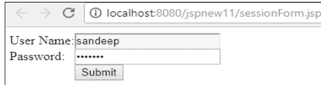

## `Session.jsp`

```
<<body>
<%@page language="java" %>
<%
String userName = request.getParameter("txtUserName");
String password = request.getParameter("txtPassword");
if(userName == null)
userName = "";

if(password == null)
password = "";
if(userName.equals("") && password.equals("")) {
session.setAttribute("SessionUser", userName);
session.setAttribute("SessionPassword", password);
out.println("<br><a href=\"session.jsp\">Next Page with session true.</a>>");
out.println("<br><a href=\"ShowFalseSession.jsp\">Next Page with session false.</a>>");
}
else if(userName.equals("")) {
out.println("<font color=red>User name required.</font>");
out.println("<br><a href=\"sessionForm.jsp\">Go back!</a>");
}
else if(password.equals("")) {
out.println("<font color=red>Password required.</font>");
out.println("<br><a href=\"sessionForm.jsp\">Go back!</a>");
}

<%%>
</body>
```

输出：

| `localhost:8080/jspnew11/session.jsp` |
| --- |
| User name required. |
| Go back! |

| `localhost:8080/jspnew11/session.jsp` |
| --- |
| Welcome sandeep! |
| Next Page with session true. |
| Next Page with session false. |

## `sessionresult.jsp`

```
<<body>
<%@page language="java" session="true" %>
String username = (String)getAttribute("username");
String password = (String)getAttribute("password");
out.println("<b>" + username + "</b>");
</body>
```

输出：


## 5. `contentType` 属性

此属性用于设置 JSP 页面的内容类型。默认值：`text/html`

`contentType` 的语法：

```
<@ page contentType="value"%>
```

其中 `content type` 可以是任何内容如 `text/html`。

## 6. `extends` 属性

像 Java 一样，此属性用于扩展。

`extends` 的语法：

```
<@ page extends="value"%>
```

值为 `package_name.class_name`。

## 7. `info` 属性

它为 JSP 页面提供描述。当我们调用 `getServerInfo` 时，`info` 中指定的字符串将返回。

`info` 的语法：

```
<@ page info="value"%>
```

`value` 是消息（Message）或描述（Description）。

## 8. `language` 属性

它指定页面使用的脚本语言（底层语言）。

`language` 的语法：

```
<@ page language="value"%>
```

`value` 是脚本语言。

## 2. 包含指令 (Include Directive)

`Include` 指令用于将一个 JSP 页面的内容复制到另一个页面。它就像将一个文件的代码包含到另一个文件中。

`Include` 指令的语法：

```
<@include file="value"%>
```

其中 `value` 是需要包含的 JSP 文件名。如果文件在相同目录下，只需指定文件名，否则需要在 `value` 字段中输入完整的 URL（或路径）。

## 3. 标签库指令 (Taglib Directive)

此指令允许你在 JSP 中使用自定义标签（Custom tags）。`Taglib` 指令帮助你在 JSP 页面中声明自定义标签。

`Taglib` 指令的语法：

```
<%@taglib uri="taglibURI" prefix="tag prefix"%>
```

其中 `URI` 是统一资源标识符，用于识别自定义标签的位置，`tag prefix` 是一个字符串，用于识别 `uri` 所标识位置中的自定义标签。

## 13.2.3 运算符

运算符需要如下所示使用：

- `<` 将写为 `Lt`
- `>` 将写为 `gt`
- `<=` 将写为 `Le`
- `>=` 将写为 `Ge`
- `!=` 将写为 `Ne`

## 13.2.4 Hello World 示例

这里是程序 `hello.jsp` 的代码：

```jsp
<html>
<head><title>Hello World Page.</title></head>
<body>
<font size="10"><%=Hello World! %></font>
</body>
</html>
```

现在，打开你的 Web 浏览器并访问 URL `http://localhost:8080/hello.jsp`，你就可以在 Web 浏览器中看到 "Hello World!" 的输出。

## 13.2.4.1 JSP 脚本标签示例

创建一个部署目录结构，并将 JSP 文件放置在 `WEB-INF` 并列目录下，然后像上面的程序一样向 JSP 文件发送请求。

### `a.jsp`

```jsp
<% int a=12;
int b=230;
int c=a*b;
out.println("multiplication is " + c);
%>
```

在此示例中，JSP 页面会在浏览器窗口上打印两个数的乘法结果。

## 13.2.4.2 JSP 声明标签

使用声明标签的示例

### `abc.jsp`

```jsp
<%! public int diff (int x, int y) 
{
return x-y;
}
%>
<% out.println("difference is " +diff(87348,20));%>
```

## 13.3 JSP 元素

以下是 JSP 元素：

1. JSP 声明 (Declaration)
2. JSP 脚本段 (Scriptlet)
3. JSP 表达式 (Expression)
4. JSP 注释 (Comments)
5. 创建一个简单的 JSP 页面
6. 如何运行简单的 JSP 页面
7. JSP 的目录结构

## 1. JSP 声明

- 声明标签是用于声明变量、方法和类的 Java 代码。如果我们在声明标签内部声明变量或方法，意味着该声明是在 `servlet` 类内部但在 `service` 方法之外完成的。

我们可以在声明标签内部声明静态成员、实例变量（可以声明数字或字符串）和方法。

声明标签的语法：

```jsp
<%! Dec var % %>
```

这里的 `Dec var` 是声明标签内部的方法或变量。

示例：

在此示例中，我们将使用声明标签：

```jsp
<html>
<head>
</head>
<body>
<%! int count = 10; %>
<%out.println("The Number is "+count);" %>
</body>
</html>
```

在这里，我们使用声明标签将变量 `count` 初始化为 `10`。

当你执行上述代码时，将得到以下输出：

输出：

```
The Number is 10
```

## 2. JSP 脚本段 (Scriptlet)

- `Scriptlet` 标签允许将 Java 代码写入 JSP 文件。

JSP 容器在从 JSP 生成 `servlet` 时，会将语句移动到 `_jsp_service()` 方法中。

对于客户端的每个请求，JSP 的 `service` 方法都会被调用，因此 `Scriptlet` 内部的代码会在每次请求时执行。

`Scriptlet` 包含在每次 JSP 被调用时都会执行的 Java 代码。

## `Scriptlet` 标签的语法：

```jsp
<% java code %>
```

这里的 `<%` 标签是 `scriptlet` 标签，我们可以在其中放置 Java 代码。

示例：

在此示例中，我们使用了封装 Java 代码的 `Scriptlet` 标签。

```jsp
<html>
<head>
</head>
<body>
<%int num1=10;
int num2=40;
int num3 = num1+num2;
out.println("Scriptlet Number is "+num3);
%>
</body>
</html>
```

在 `Scriptlet` 标签中，我们取了变量 `num1` 和 `num2`。取了第三个变量 `num3`，它是 `num1` 和 `num2` 的和。输出结果是 `num3`。

当你执行该代码时，你将得到以下输出：

输出：

```
Scriptlet Number is 50
```

## 3. JSP 表达式

- 表达式评估其放置的表达式。
- 它访问存储在 `application` 中的数据。
- 它允许创建如算术和逻辑等表达式。
- 它生成带有脚本段的 JSP 页面。

语法：

```jsp
<%= expression %>
```

这里的 `expression` 是算术或逻辑表达式。

示例：

```jsp
<html>
<head>
</head>
```

## 开始使用 Java 服务器页面

```jsp
<body>
<%out.println("The expression number is "); %>
<%int num1=10;int num2=10;int num3=20; %>
<%= num1+num2+num3 %>
</body>
</html>
```

在这里，我们使用了表达式标签，其中我们通过乘以两个数字（即 `num1` 和 `num2`）然后相加第三个数字（即 `num3`）来使用表达式。

当你执行上述代码时，你将得到以下输出：

```
The expression number is 120.
```

## 4. JSP 注释

注释是在 JSP 容器想要忽略某些文本和语句时使用。

让我们创建一个简单的 HTML 表单来显示输出：

运行 NetBeans IDE 并选择 `File -> New Project` 创建一个新的 Web Application。

在以下步骤中：

出现 `New Project` 对话框如下所示，在列表中选择 `java web` available 并在下方列表中选择 `Web Application` 选项。

点击 `Next`，然后出现新的 `Web Application` 对话框如图所示，将 Web Application 的名称命名为 `jspdemo`。

接下来是 `server` 和 `settings` 部分。

`Next` 然后出现新的 `Web Application` 对话框如图所示，Web Application 的名称为 `jspdemo`。

## 13.4 JSP GUI 示例

### 1. `Login form`

```jsp
<html>
<head>
<title>Login Page</title>
</head>
<body>
<h1>User Information</h1>
<center>
<form action="LoginCheck.jsp" method="post">
Username:<input type="text" name="username"><br/>
Password:<input type="password" name="password"><br/><
<input type="submit" value="Submit">
</form>
</center>
</body>
</html>
```

### 2. `LoginCheck.jsp`

```jsp
<html>
<head>
<title>JSP Page</title>
</head>
<body>
<% String username=request.getParameter("username");
String password=request.getParameter("password"); if(username.equals("sandeep") &&password.equals("visharma"))
{
session.setAttribute("username",username); response.sendRedirect("Home.jsp");
}
Else
response.sendRedirect("Error.jsp"); %>
</body>
</html>
```

### 3. `Home.jsp`


### 4. `Logout.jsp`

```jsp
<%@page contentType="text/html" pageEncoding="UTF-8"%>
<html>
<head>
<title>JSP Page</title>
</head>
<body>
<%
session.removeAttribute("username");
session.removeAttribute("password");
session.invalidate();
%>
<h1>Logout was done successfully.</h1>
</body>
</html>
```

### 5. `Error.jsp`

```jsp
<%@page contentType="text/html" pageEncoding="UTF-8"%>
<html>
<head>
<title>JSP Page</title>
</head>
<body>
<h1>Some Error has occured,Please try again later...</h1>
</body>
</html>
```

# 你好 sandeep

退出

# 退出成功。

## 程序 2：基础隐式 JSP 对象的示例

### 1. 添加 `Product.jsp` 文件以输入产品详情

```jsp
<%@ page language="java" contentType="text/html; charset=ISO-8859-1"
pageEncoding="ISO-8859-1">
<!DOCTYPE TYPE HTML PUBLIC "-//W3C//DTD HTML 4.01 Transitional//EN"
"http://www.w3.org/TR/HTML4/loose.dtd">
<html
<head>
<meta http-equiv="Content-Type" content="text/html; charset=ISO-8859-1">
<title>在此插入标题</title>
</head>
<body>
<form action="Brand.jsp">
<table>
<tr>
<td>选择产品：</td>
<td><select name="Pname">
<option value="T-shirt">T恤恤</option>
<option value="Shirt">衬衫</option>
<option value="Jeans">牛仔裤</option>
<option value="Trouser">长裤</option>
</select></td>
</tr>
<tr>
<td>输入产品数量：</td>
<td><input type="text" name="Qty"></td>
</tr>
<tr>
<td><input type="submit" value="点击选择品牌"/></td>
</tr>
</table>
<br>
</form>
</body>
</html>
```

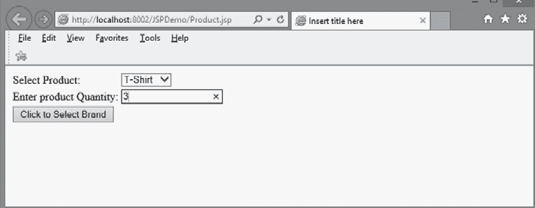

### 2. 添加 `AddBrand.jsp`，用于选择产品品牌

```jsp
<%@ page language="java" contentType="text/html; charset=ISO-8859-1">
<pageEncoding="ISO-8859-1">
<!DOCTYPE html PUBLIC "-//W3C//DTD HTML 4.01 Transitional//EN"
"http://www.w3.org/TR/HTML4/loose.dtd">
<html>
<head>
<meta http-equiv="Content-Type" content="text/html; charset=ISO-8859-1">
<title>在此插入标题</title>
</head>
<body>
<%
String prd=request.getParameter("Pname");
int q=Integer.parseInt(request.getParameter("Qty"));
out.print("<h1>你已经下单了 "+q+" "+prd+"</h1><br>");
session.setAttribute("Pro_Name",prd);
session.setAttribute("qty",q);
%>
<form action="Checkout.jsp">
<table>
<tr>
<td>选择产品品牌：</td>
<td><select name="Brd">
<option value="LeeCooper">LeeCooper</option>
<option value="Adidas">Adidas</option>
<option value="Denim">Denim</option>
</select>
</td>
</tr>
<tr>
<td><input type="submit" value="结账"/></td>
</tr>
</table>
</form>
</body>
</html>
```

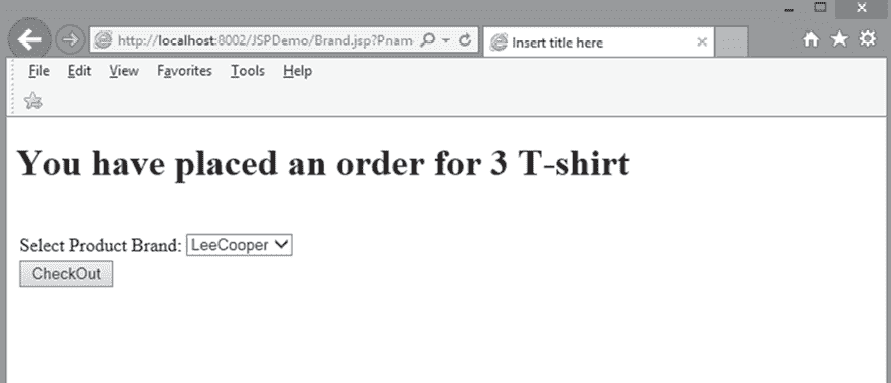

# 你已经下单了 3 件 T恤

选择产品品牌：LeeCooper

结账

### 3. 添加 `checkout.jsp` 以显示订单详情

```jsp
<%@ page language="java" contentType="text/html; charset=ISO-8859-1"
pageEncoding="ISO-8859-1">
<!DOCTYPE html PUBLIC "-//W3C//DTD HTML 4.01 Transitional//EN"
"http://www.w3.org/TR/html4/loose.dtd">
<html>
<head>
<meta http-equiv="Content-Type" content="text/html; charset=ISO-8859-1">
<title>在此插入标题</title>
</head>
<body>
<%
out.print("产品名称："+session.getAttribute("Pro_Name")+"<br>");
out.print("产品数量："+session.getAttribute("qty")+"<br>");
out.print("产品品牌："+request.getParameter("Brd"));
%>
</body>
</html>
```

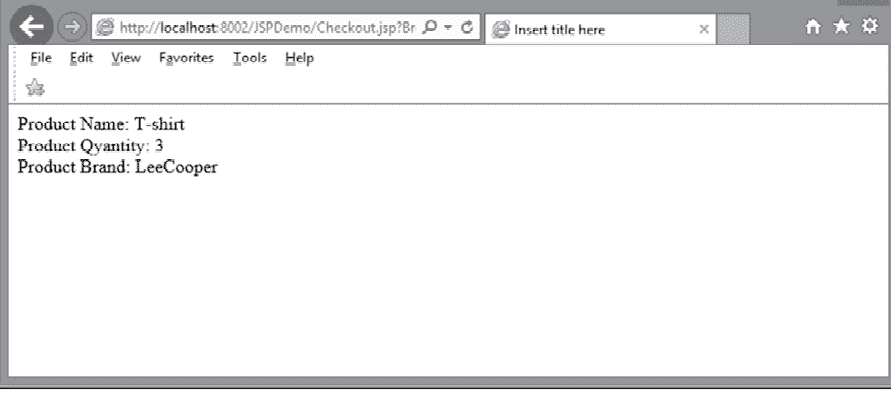

# 13.5 章节练习题

1. 编写 JSP 注释写简短笔记。
2. 解释编写 JSP 文档的规则。
3. 解释不同类型的 JSP 元素。
4. 使用示例解释 JSP 脚本（Scriptlet）。
5. 写一个 JSP 程序演示登录表单。
6. 解释不同类型的 JSP 声明标签。

# 第 14 章动作元素（Actions Elements）

## 大纲

- 14.1 包含其他文件
- 14.2 将 JSP 页面转发到另一个页面
- 14.3 为其他动作传递参数
- 14.4 加载 JavaBean
- 14.5 章节练习题

动作标签使用 XML 语法编写。这些标签减少/消除了使用典型的硬编码 Java 语法编写的脚本段代码。这些动作标签用于控制 JSP 页面的运行时行为、动态插入其他网页、页面之间的流转以及使用 Java Bean 等更多功能。标准标签以 `jsp:` 前缀开头。

### 14.1 包含其他文件

`<jsp:include>` 动作元素用于在请求阶段将静态/动态网络资源（如 HTML、JSP 页面或 servlet）添加到 JSP 页面中。这与 include 指令不同，include 指令在翻译阶段合并内容。使用 include 指令时只会创建一个 servlet，而使用 include 动作元素时每个资源都会被转换为独立的 servlet。

#### 通用语法

```jsp
<jsp:include page="<%=Expression()%>| "String address" flush="true|false"/></jsp:include>
```

`page` 属性接收要包含的文件 URL 或生成 URL 的表达式。它是强制性属性。`flush` 是可选属性，决定是否应该输出缓冲区。

### 14.2 将 JSP 页面转发到另一个页面

`<jsp:forward>` 动作元素用于转发请求处理器。这与 include 指令不同，include 指令在翻译阶段合并内容。使用 include 指令时只会创建一个 servlet，而使用 include 动作元素时每个资源都会被转换为独立的 servlet。

#### 通用语法

```jsp
<jsp:forward page="<%=Expression()%>| "String address"/></jsp:forward>
```

`page` 属性接收要包含的文件 URL 或生成 URL 的表达式。它是强制性属性。

### 14.3 为其他动作传递参数

`<jsp:param>` 动作元素用于向其他动作标签（如 `<jsp:include>` 和 `<jsp:forward>`）传递参数。

#### 通用语法

```jsp
<jsp:param name="name" value="<%=Expression()"/>
```

# 设置 Java bean 属性

`<jsp:bean>` 元素可以配合 `<jsp:setProperty>` 使用为 java bean 中的属性赋值。

## 通用语法

```jsp
<jsp:setProperty name="id" property="propertyName" value="value"/>
<jsp:useBean>
```

`name` 属性指定 `<jsp:useBean>` 中创建或引用的 java bean 的 id。

`property` 属性指定 java bean 的名称。如果配合 `*` 使用，它将设置 java bean 实例中的所有属性，否则必须单独设置属性。

`value` 属性指定给定属性的值。

`<jsp:setProperty>` 调用属性的 setter 方法来赋值。

## 获取 Java bean 属性

`<jsp:getProperty>` 用于访问 java bean 属性的值。

## 通用语法：

```jsp
<jsp:getProperty name="beanInstanceName" property="propertyName" />
```

`name` 属性指定 `<jsp:useBean>` 中创建或引用的 java bean 的 id。

`property` 属性指定 java bean 的名称。

`<jsp:getProperty>` 调用属性的 getter 方法来访问值。

一个完整的 `<jsp:bean>` 示例

```html
----------------index.html----------------
<html><head><title>用户注册表</title></head>
<body>
<form action="ValidateData.jsp">
输入您的姓名<input type="text" name="name"><br>
输入您的年龄<input type="text" name="age"><br>
选择爱好
<input type="checkbox" name="hob" value="Singing">唱歌
<input type="checkbox" name="hob" value="Reading">读书
<input type="checkbox" name="hob" value="Football">踢足球<br>
输入邮箱<input type="text" name="email"><br>
选择性别
<input type="radio" name="gender" value="male">男性
<input type="radio" name="gender" value="female">女性
<input type="radio" name="gender" value="other">其他<br>
<input type="hidden" name="error" value="">
<input type="submit" value="提交表单"></form> </body></html>
```

## `ValidateData.jsp`

```jsp
<%@page import="mybeancollection.*" %>
<html><head><title>验证用户输入页</title></head><body>
<h1>验证页面</h1>
<jsp:useBean id="obj" scope="request" class="mybeancollection.CheckerBean" />
<jsp:setProperty name="obj" property="" value="" />
<% if (obj.validate()) { %>
<jsp:forward page="successful.jsp" />
<% } else { %>
<jsp:include page="index.html" />
<% } %>
<%=obj.getError() %>
</body></html>
```

## `CheckerBean.java`

```java
package mybeancollection;
public class CheckerBean {
    private String name, age, hob, email, gender, error;
    public CheckerBean(String error="");
    public void setName(String n){name=n;}
    public void setAge(String a){age=a;}
    public void setHob(String h){hob=h;}
    public void setEmail(String e){email=e; }
    public void setGender(String g){gender=g; }
    public void setError(String e){error=e; }
    public String getName() {return name;}
    public String getAge() {return age;}
    public String getHob() {return hob;}
    public String getEmail() {return email;}
    public String getGender() {return gender;}
    public String getError() {return error; }
    public boolean validate(){
        boolean res=true;
        if(name.trim().equals("") || name==null) {error+="<br>请输入姓名";res=false;}
        if(age.length() > 2 )
{error+="<br>年龄无效";res=false;}
        return res;
    }

    if(!email.contains('@')){error+="<br>输入的邮箱地址无效";res=false;}
    if(hob != null && hob.equals())){error+="<br>未选择爱好";res=false;}
    if(gender == null){error+="<br>请选择有效的性别值";res=false;}
    return res;
    }
}
```

## 14.5 章节题

1. 解释 JSP Action 标签。
2. 解释 JSP 中其他 Action 的参数传递技术。
3. 解释 `JSP:getProperty` 和 `JSP:setProperty`？
4. 解释如何在 JSP 中包含其他文件？

## 第15章 隐式对象、作用域和EL表达式

## 章节大纲

- 15.1 隐式对象
- 15.2 作用域
- 15.3 字符引用规范
- 15.4 统一表达式语言 (Unified EL)
- 15.5 JSP 中的 Session 跟踪
- 15.6 JSP 中的同步
- 15.7 表达式语言
- 15.8 章节题

## 15.1 隐式对象

向客户端浏览器传递动态内容需要与 Web 服务器上的 Java 对象进行交互。Java 脚本元素为开发者提供了强大的功能和灵活性来实现这一目标。此外，为了允许这种交互，JSP 引擎向开发者暴露了许多内部对象。这些对象不需要由开发者实例化，而是由 JSP 引擎在实现和执行过程中提供的。


脚本元素访问 JSP 引擎分配的预定义变量，并使用其内容引用隐式对象来访问请求和应用数据。这些对象是 Servlet 定义的类的实例。

## 请求

向客户端浏览器传递动态内容需要与 Web 服务器上的 Java 对象进行交互。Java 脚本元素为开发者提供了强大的功能和灵活性来实现这一目标。此外，为了允许这种交互，JSP 引擎向开发者暴露了许多内部对象。这些对象不需要由开发者实例化，而是由 JSP 引擎在实现和执行过程中提供的。

脚本元素访问 JSP 引擎分配的预定义变量，并使用其内容引用隐式对象来访问请求和应用数据。这些对象是 Servlet 定义的类的实例。

JSP 页面是响应 HTTP 的组件。`Request` 对象代表 HTTP 请求。`Request` 对象是 `javax.servlet.http.HttpServletRequest`。

## 响应

`Response` 对象代表发送给客户端的响应。它封装了响应和头部。`response` 对象是 `javax.servlet.http.HttpServletResponse`。

## 输出

`Out` 对象是一个用于发送输出的缓冲区。`out` 对象是 `javax.servlet.jsp.JspWriter`。

## 会话

HTTP 是一个无状态协议。对于服务器来说，每个客户端请求都是新请求。但在 Web 应用程序中，客户端的交互会跨越多个请求和响应。会话指的是客户端与服务器之间的整个对话。`session` 对象是 `javax.servlet.http.Session`。

## 应用

`Application` 对象代表该 JSP 所属的应用程序。它代表了 JSP 执行的上下文（Servlet 上文）。`application` 对象是 `javax.servlet.ServletContext`。

## Config

配置信息包含初始化参数，这些参数定义在部署描述符以及代表 Web 应用程序所属的 Servlet 或 JSP 页面的 `ServletContext` 中。

`config` 对象具有作用域，它是 `javax.servlet.ServletConfig` 的实例。Web 服务器使用 `ServletConfig` 实例在初始化期间向 Servlet 或 JSP 页面传递信息。

下表列出了 `Config` 对象的常用方法：

| 方法 | 说明 |
| --- | --- |
| `getInitParameter()` | 返回指定的初始化参数的值 |
| `getInitParameterNames()` | 返回一个包含所有 Servlet 初始化参数名称的字符串枚举器（`Enumeration`） |
| `getServerContext()` | 返回与调用的 servlet 关联的 `ServletContext` 对象 [包含有关 Servlet 运行环境的信息] |

## PageContext

`PageContext` 封装了 JSP 页面的页面上下文。`PageContext` 对象的方法用于将控制权从当前页面转移到另一个页面，可以是临时的（即生成包含在当前页面中的输出），也可以永久的（即完全转移控制权）。

`PageContext` 允许访问 Web 特有功能，如高性能。这是因为如果 JSP 通过标准类而不是直接访问这些功能，那么 JSP 就可以在任何 JSP 引擎中执行，无论该 JSP 引擎实现在哪个抽象层。

`PageContext` 具有页面作用域（page scope），它是 `javax.servlet.jsp.PageContext` 的实例。

## Page

`Page` 对象代表 JSP 页面本身，可以使用此引用进行访问。换句话说，`Page` 对象是它的简单同义词。它的创建是为了占位，以以当时脚本语言可能是 Java 的其他语言。

`Page` 对象具有页面作用域（page scope），它是 `java.lang.Object` 类的实例。

在实践中，当使用 Java 编写 JSP 时，`Page` 对象很少被使用。这是因为 JSP 脚本元素最终会被整合为构建的 Servlet 类的方法代码。因此，脚本元素将自动拥有所有的 Servlet 方法。

## Exception

`Exception` 对象指向在调用的错误页面中发生的运行时异常。`Exception` 对象仅在错误页面中可用 [即在 `page` 指令中设置了属性 `isErrorPage=true` 的 JSP]。

`Exception` 对象具有页面作用域（page scope）。它是 `java.lang.Throwable` 的实例。`Throwable` 类是 Java 语言中所有异常的超类。只有这些类的实例会被 JVM 抛出，或者可以使用 Java 语句的应用程序抛出。

## Implicit Objects, Scope and El Expressions

下表列出了 `Exception` 对象最常用的方法：

| 方法 | 说明 |
|---|---|
| `getMessage()` | 返回 `Throwable` 对象的错误字符串 |
| `toString()` | 返回 `Throwable` 对象的简短描述 |

## 15.2 Scope (作用域)

JSP 的一个强大功能是它可以在 Web 服务器上创建、访问和修改数据对象。作为 JSP 部分创建的对象具有特定的生命周期，并且可能或无法被应用程序或其他组件或对象访问。对象的生命周期或可访问性被称为作用域（Scope）。

当对象被创建时，它会定义或默认为给定的作用域。Web 服务器创建其中一些对象，而 JSP 设计者创建另一些对象。

JSP 规范支持以下四个级别的作用域：

- 1. Application（应用级）
- 2. Session（会话级）
- 3. Request（请求级）
- 4. Page（页面级）

## 1. Application Scope (应用作用域)

应用作用域是最广泛或限制最少的作用域，应该只在必要时使用。具有应用作用域的对象可以从相同应用程序中的 JSP 页面访问。这创建了一个所有页面都可以访问的全局对象。

用应用作用域创建的对象不是线程安全的，如果存在多个请求尝试同时更改该对象，则对它们的访问必须进行同步。

在不感知会话（not session aware）的 JSP 中，可以在应用层级创建并绑定对象。因此，应用作用域在使用此类类型的 JSP 时对于存储信息是有用的。

## 2. Session Scope (会话作用域)

会话（session）是用户花费应用程序的时间，会在他们关闭浏览器、访问另一个网站或应用程序设计者想要（即注销）时结束。

会话作用域比应用作用域更常用。会话作用域允许创建并将将其绑定到会话中。具有会话作用域的对象可以从处理与其创建时处于同一会话的请求的页面访问。

## 3. Request Scope (请求作用域)

具有请求作用域的对象可以从处理创建它的请求的页面访问。换句话说，创建并绑定到请求作用域的对象对该请求中的页面是可用的。当请求处理完成后，这些对象会自动从内存中释放。一旦 JSP 引擎处理了请求，数据就会释放。即使请求被转发到另一个页面，数据仍然可用，但如果需要重定向（redirect）则不可用。

## 4. Page Scope (页面作用域)

使用页面作用域用于仅为当前页面创建的对象。具有页面作用域的对象仅在创建它的页面内可访问。

数据仅在当前响应的处理期间有效，一旦响应发送回用户浏览器，它就不再有效。如果请求被转发到其他页面，或者浏览器由于重定向发起了另一个请求，那么此类数据也会丢失。

## 15.3 Character Quoting Conventions (字符引用规范)

由于某些字符序列被用于表示开始和结束标签，开发者有时需要转义字符，以确保 JSP 引擎不会将其解释为特殊字符序列的一部分。

在脚本元素中，如果需要转义 `%>` 字符，则在大于号前加一个反斜杠：

```
<% String message = "This is the \>"; %%>
```

表达式前的反斜杠充当转义字符，通知 JSP 引擎原样交付表达式而不是对其进行求值。

在各种情况下使用特殊字符进行转义，它们如下：

| 转义字符 | 说明 |
|---|---|
| `'` | 使用单引号。 |
| `"` | 使用双引号。 |
| `\` | 使用反斜杠。 |
| `%%` | 转义脚本结束标签。 |
| `<%` | 转义脚本开始标签。 |
| `$` | 转义美元符号。 |

示例

```
<% String message = 'Escaping single quote';%%>
<% String message = "Escaping double quote";%%>
<% String message = "Escaping \\";%%>
<% String message = "Escaping %>";%%>
<% String message = "Escaping <%";%%>
<% String message = "Escaping \$";%%>
```

## Implicit Objects, Scope and El Expressions

作为转义字符的替代，也可以使用字符实体 `&apos;` 和 `&quot;`。

## 15.4 Expression Language (表达式语言)

表达式语言的灵感来自于 ECMAScript [JavaScript] 和 XPath [一种用于访问 XML 文档部分的语言]。

JSP 表达式语言提供了一种简化表达式的方法。它是访问隐式对象、Java 类以及优雅地处理集合的语言。

EL 允许作者在 JSP 脚本之外使用简单表达式处理 JavaBeans。

例如：以下条件标签的 `test` 属性提供了一个 EL 表达式，用于比较会话范围 bean 中的数量：

```
<c:if test="${cart.numberOfItems>0}">
...
</c:if>
```

JSP 支持简单的请求/响应生命周期，在此期间页面被执行并立即渲染 HTML 标记。简单的只读表达式语言适用于 JSP 应用的需求：

JavaFaces [JSF] 则具有多阶段生命周期，以支持其复杂的组件模型，该模型允许转换和验证组件数据、传播组件数据到对象以及处理组件事件。为了实现这些功能，JSF 引入了自己的表达式语言包含了：

- 表达式的延迟求值
- 设置数据和获取数据的能力
- 调用方法的能力

出于以下原因统一这些语言：

- 1. 页面作者可以使用 JSP 内容配合 JSF 元素，而必担心由于这些技术支持的不同生命周期引起的冲突。
- 2. 其他基于 JSP 的技术可以像 JSF 使用那样利用额外的功能。

这种统一表达式允许作者使用简单表达式执行以下任务：

- 动态读取存储在 JavaBeans 组件、各种数据结构和隐式对象中的数据
- 动态将用户输入表单数据写入 JavaBeans 组件
- 调用任意静态和公共方法

最后，统一表达式语言（EL）提供了一个可插的 API 用于解析表达式，因此开发人员可以实现自己的解析器，以处理统一 EL 目前不支持的表达式。

## 15.5 JSP 中的会话跟踪

### Servlet 中会话的需求

Servlet 的 `HttpSession` 接口用于模拟个人访问 Web 网站是一系列连续交互的概念。这通常是如此，因为 HTTP 协议本质上是一种请求-响应机制，一个请求与下一个请求之间没有连接。HTTP 是无状态协议，这就是我们需要会话（Session）来维护访问者的状态。会话位于服务器端：会话在服务器端创建并存储。Servlet 跟踪它管理的所有会话，并履行 Servlet API 请求以获取 `HttpSession`、操作与其关联的对象数据并触发回调。

### request.getSession()

这是 `HttpServletRequest` 的管理方法。它返回客户端 `HttpSession` 的句。如果客户端未建立会话或会话无效，此方法可能会返回新会话的句。此方法接受一个布尔参数，指示在当前不存在会话时是否创建一个新会话。

`HttpInterface` 定义的方法：

- `session.getId()`: 返回分配给此会话的唯一会话 ID。
- `session.getMaxInactiveInterval()`: 返回在没有客户端请求的情况下，会话保证有效的最大秒数。超过最大非活动间隔后，Servlet 引擎可能会使会话过期。如果会话永不过期则返回 -1。
- `session.setMaxInactiveInterval()`: 设置最大秒数并允许进行垃圾回收。
- `session.getCreationTime()`: 返回会话创建的时间。返回的是自 UTC 1970 年 1 月 1 日以来的毫秒数。

## 15.6 JSP 中的同步

1. 默认情况下，Servlet 引擎加载单例实例并使用线程池来处理请求。
2. 这意味着两个或多个线程正在同时执行同一个 Servlet 方法。
3. 如果 Servlet 有实例变量且没有提供同步访问机制，线程可能会冲突并干扰其他对变量的访问。
4. 这导致 JSP 页面实现类实现 `SingleThreadModel` 接口，从而导致服务方法的同步，并在内存中加载多个 Servlet 实例。
5. 并发的客户端请求将以轮询方式均匀分布在这些实例中进行处理，如下所示：

### 隐式对象、范围和 EL 表达式

6. 此接口没有任何方法，它只是将 Servlet 标记为每个实例都需要一个专用线程。
7. 页面指令的 `isThreadSafe` 属性为 `SingleThreadModel` 与 JSP 页面的关联提供了方法。如果你指定 `isThreadSafe="true"`，你是在声明在处理任何可能的线程冲突的情况下，JSP 容器安全地向 Servlet 同时调度多个请求。如果值为 "False"，则 JSP 容器将生成实现 `SingleThreadModel` 的 Servlet。如果未指定，`isThreadSafe` 的值为 "true"。

## 15.7 表达式语言

表达式语言源于 Java 页面标准标签库（JSTL），最初被称为 SPEL（最简单表达式语言），然后直接称为表达式语言（EL）。它是一种脚本语言，允许通过 JSP 访问 Java 组件（JavaBeans）。

表达式语言（EL）简化了存储在 Java Bean 组件以及 `request`、`service`、`application` 等对象的数据访问。EL 中有很多隐式对象、操作符和保留字。它是 JSP 技术 2.0 中新添加的功能。

### 表达式语言 (EL) 的语法

```jsp
${ expression }
```

JSP 支持简单的请求/响应生命周期，在此期间页面执行执行且 HTML 标记独立渲染。因此，JSP 2.0 提供的简单只读表达式语言非常适合 JSP 应用程序的需求。

另一方面，JavaServer Faces 技术具有多阶段生命周期，旨在支持其复杂的 UI 组件模型，该模型允许转换和验证组件数据、将数据传播到对象以及处理组件事件。为了方便这些功能，JavaServer Faces 引入了自己的表达式语言，包含以下功能：

- 表达式的延迟
- 设置数据以及获取数据的能力
- 调用方法的能力

这两种语言由于某些原因被统一。原因之一是页面可以混合 JSP 内容和 JavaServer Faces，而不必担心它们支持的不同生命周期所引起的冲突。另一个原因是基于 JSP 的技术可以类似于 JavaServer Faces 技术那样利用额外功能。事实上，尽管标准 JSP 和静态内容继续使用 JSP 2.0 中存在的功能，但 JSP 自定义标签的作者可以利用统一表达式语言中的新功能集。

因此，统一表达式语言允许作者使用简单表达式执行以下任务：

- 动态读取存储在 JavaBeans 组件、各种数据结构和隐式对象中的应用程序数据
- 动态将数据（如表单用户输入）写入 JavaBeans 组件
- 调用任意静态和公共方法
- 动态执行算术运算

## 15.8 章节练习

1. 关于隐式对象写短记。
2. 解释 `session` 对象的不同方法。
3. 解释 `out` 对象的不同方法。
4. 解释 `Application` 对象的不同方法。
5. JSP 的不同范围有哪些？
6. 解释 JSP 中的字符引用规范（Character Quoting Conventions）。
7. 关于统一表达式语言写短记。


### JavaServer 标准标签库

### 提纲

- 1.1 使用 scriptlet（脚本段）有什么问题？
- 1.2 JSTL 如何修复 scriptlet 的缺点？
- 1.3 JSTL 的缺点
- 1.4 标签库
- 1.5 章节练习

## JAVA Server Pages 标准标签库


+ 3. 点击添加库 (Add Library)

## 16.4.1 JSTL 核心标签，前缀为 c

通常用于替换 jstl 逻辑标签以及基础的 URL 处理标签，如 `catch`, `choose`, `if`, `forEach`, `param`, `when`, `redirect`, `import`, `url` 以及基础输入和输出。

这些标签位于 `http://java.sun.com/jsp/jst/core`，使用的前缀是 "c"。

核心标签进一步分为 4 组：

### 1. 通用操作 (General Purpose action):

- 像 JSP 页面一样操作作用域变量，例如添加、删除和显示。
- 它也支持异常处理。
- `<count>` 显示变量的值。它也用于显示输出。

通用语法：

```
<c:out value="expression" escapeXml="true" default="expression" />
```

示例：

```
<c:out value="${3.14*10*10}" default="Area of circle cannot be calculated"/>
```


`default`属性用于当`value`属性无法评估或返回`null`时提供默认值。`value`属性是强制性的。

```
<c:out value="${session.getId()}" default="No Session Available" />
```

如果评估了表达式则返回会话 ID，否则显示`No Session Available`。

`escapeXml`用于指定`<`、`>`、`&`等字符是否被视为字符串 HTML 标签的一部分。`true`值将这些字符视为标签的一部分，`false`则将其视为显示字符串的一部分。

## 示例

```
<c:out value="Salary of Employee is Rs. $5000+2500+1000+100-1000" default="No Salary calculated" />
```

输出：`Salary of Employee is Rs. 7600`

`<c:set>`用于在作用域内为表达式赋值。它等同于 JSP 的`<jsp:setProperty>`操作元素。

## 通用语法

```
<c:set target="variable or object name" property="variable name" value="expression" scope="name" />
```

`target`是要修改其属性的对象。`property`是属性名称，`var`是要存储在对象中的变量名称，`scope`是存储信息的作用域。

## 示例

```
<c:set var="salary" scope="session" value="${(2000*2)}"/>
<c:out value="Salary of Employee is ${salary}" default="No Result" />
```

输出：`Salary of Employee is 4000`

`<c:catch>`用于在 JSP 页面中实现简单且复杂的异常处理机制，而不是传统的`try catch`块。

## 通用语法

```
<c:catch var="variable name">
```

`var`是强制性属性，指定用于存储由正体元素抛出的`java.lang.Throwable`的变量名称。

## 示例

```
<c:catch var="exp"> <% int x = 2/0;%> </c:catch>
<c:out value="The Exception is ${exp}" default="No Exception" />
```

输出：`The exception is java.lang.ArithmeticException: by zero`

### 2. 条件操作或流程控制

JSP 通过在执行期间调用值来动态处理页面，这些变量也用于决策和动态控制应用程序工作流。条件操作标签用于动态控制页面或应用程序工作流。

`<c:if>`仅当`test`布尔评估为真时评估表达式并处理其主体内容。它等同于 Java 代码中的`if`语句。

## 通用语法

```
<c:if test="Boolean expression" var="variable name" scope="scope value" />
```

`test`属性指定测试条件，决定是否处理主体内容。它是强制性属性。如果测试条件为真，则评估主体内容。`var`是用于在 JSP 页面后续存储结果的变量名称，该属性是可选的。

## 示例

```
<c:if test="${21%7 == 0}" var="res"> <c:out value="21 is divisible by 7" /></c:if>
```

输出：`21 is divisible by 7`

`<c:choose>`是一个条件标签，通过`<when>`和`<otherwise>`建立互斥的操作块。它等同于 Java 代码中的`switch-case`。`<when>`是`<choose>`的子标签，当主体评估为`true`时包含它。`<otherwise>`也是`<choose>`的子标签，仅当条件为`false`时运行。

## 示例

```
<c:set var="num" scope="session" value="${100}"/>
<p>Number is : <c:out value="${num}" /></p>
<c:choose>
  <when test="${num < 0}"> Number is Negative.</when>
  <when test="${num > 0}"> Number is Positive.</when>
  <otherwise> Number is...</otherwise>
</c:choose>
```

输出：`Number is Positive.`

### 3. 迭代操作

`<c:forEach>`是通过集合简化迭代的操作。它是 Java `while`、`do-while`或`scriptlet`的替代。`<c:forEach>`标签最常用于迭代集合。

```
<c:forEach var="name" status="status" begin="value" end="value" item="Object" />
```

`var`属性用于存储循环变量。`varStatus`在迭代整数变量时用于存储循环的初始值，默认值为`0`。`end`属性在迭代整数变量时存储结束值，即迭代结构的最后一个索引。`step`属性指定循环变量的增量，值应大于`1`，默认值为`1`。`items`属性用于对固定整数进行迭代，该属性会被忽略。

## 示例

```
<c:forEach var="num" begin="1" end="5">
  <br> <c:out value="${num}"/> Square is <c:out value="${num*num}"/>
</c:forEach>
```

输出：

| Index | Result |
| :--- | :--- |
| 1 | Square is 1 |
| 2 | Square is 4 |
| 3 | Square is 9 |
| 4 | Square is 16 |
| 5 | Square is 25 |

`<c:forTokens>`的工作类似于`<c:forEach>`，只是它没有`end`条件并且可以在标记分隔的字符串变量上工作。

## 通用语法

```
<c:forTokens var="variable name" varStatus="status" value="value" end="value" step="value" item="Collection object" delim="" />
```

`delim`属性是分隔字符串标记的字符。

## 示例

```
<c:forTokens var="city" items="Mumbai,Pune,Nagpur" delim=",">
  <br> City Name is <c:out value="${city}"/>
</c:forTokens>
```

输出：

```
City Name is Mumbai
City Name is Pune
City Name is Nagpur
```

`forTokens`通过逗号（`,`）迭代包含城市名的字符串。

### 4. URL 操作

用于执行 URL 相关操作，如导入资源、重写、重定向和请求编码。`<c:import>`用于将其他网络资源的内容合并到 JSP 页面。它类似于`<jsp:include>`操作元素，但它更强大。

```
<c:import url="{url}" context="context" var="varName" charEncoding="charEncoding" scope="{page|request}" />
```

`url`属性指定网络资源的地址，它是强制性的。

`context`属性指定为资源创建的作用域变量上下文。

`var`指定为资源创建的作用域变量。

`charEncoding`指定解码 URL 中字符的编码标准。

`scope`指定`var`属性中变量名的作用域。

## 示例

`date.jsp`：

```
<% new java.util.Date() %>
```

`head.html`：

```
<h1>T1-T. Y. B. S. Information Technology</h1>
<marquee>University of Mumbai</marquee>
```

`Index.jsp`：

```jsp
<%@ taglib prefix="c" uri="http://java.sun.com/jsp/jstl/core" %>
<c:import url="head.html"/>
<h1>Welcome to world of JSP Standard Tag Library</h1>
<h1>JSTL import tag Demo</h1>
<c:import url="date.jsp" />
<c:import url="http://www.google.com" />
```

输出：

```
T. Y. B. S. Information Technology
Welcome to the world of JSP Standard Tag Demo
JSTL import tag Demo
Mon Aug 20 19 40 17 IST 2018
Search Images Maps Play YouTube Gmail Drive More..
```

`<c:url>`用于格式化 URL，或者说基于变量的值。当我们需要根据用户输入或指向应用上下文的相对 URL 打开 JSP 页面时，需要它。它在服务器未设置存储会话 ID 的 cookie 时执行重写。它可以帮助手动编码引用外部 URL。

## 通用语法

```
<c:url var="variable" value="url addr" context="address" scope="scope of variable" />
```

`var`指定引用资源的作用域变量名称。

`value`指定给定 URL 的地址，它是强制性属性。

`context`属性在资源位于外部上下文时，指定该 Web 资源的上下文环境。

`scope`属性指定`var`属性中变量名的作用范围。

## 示例

```
<h1>URL Tag Demo</h1>
<c:url var="a" value="/date.jsp" scope="session" />
```

输出：

```
URL Tag Demo
/JSTL_DEMO/date.jsp
```

`<c:redirect>`用于将控制重定向到另一个页面。当执行此标签时，当前的执行将终止并加载目标页面。

## 通用语法

```
<c:redirect url="address" context="address" />
```

`url`属性指定目标页面的地址，这是强制性的。

`context`属性指定目标的外部上下文。

## 示例

```xml
<c:taglib uri="http://java.sun.com/jsp/jstl/core" prefix="c" %>
<c:redirect url="http://drive.google.com/" />
```

输出：如果执行此页面，它将加载 drive 页面。

`<c:param>`用于向`<c:url>`、`<c:import>`或`<c:redirect>`添加参数。参数以键-值对的形式设置。

## 通用语法

```xml
<c:param name="name of parameter" value="value of parameter" />
```

`name`属性用于指定属性的名称并设置参数的值。

## 示例

`Page5.jsp`：

```xml
<c:taglib uri="http://java.sun.com/jsp/jstl/core" %>
<c:redirect url="Page4.jsp" />
  <c:param name="name" value="Azhaan Afsheen" />
</c:redirect>
```

`Page4.jsp`：

```
<h1>Name is called from other page using PARAM tag</h1>
<%= request.getParameter("name") %>
```

输出：`Name is called from other page using PARAM tag Azhaan Afsheen`

## 16.4.2 前缀为 `fmt` 的 JSTL 格式化标签

许多 Web 应用程序现在都拥有国际化支持，以便在不更改核心应用程序工程的情况下，支持特定区域的信息和设置。JSTL 格式化标签支持 I18n 功能，并根据特定的区域格式化并显示文本、日期、时间和数字。

由于网站由世界不同地区、国家和时间的用户访问，JSTL 提供了支持不同操作的动作。

格式化标签放置在`http://java.sun.com/jsp/jstl/fmt`位置，前缀为`fmt`。

## 通用语法

```xml
<fmt:setLocale key="Lcode_Code" variant="specific variant" scope="scope">
```

`value`属性指定两个字符的语言代码和两个字符的国家代码。`variant`属性指定一个变体。`scope`属性指定区域值的作用范围。

## 示例

```xml
<fmt:setLocale value="EN_US" variant="POSIX" scope="session"/>
```

`<fmt:requestEncoding>`用于指定如`ISO-8859-1`的字符编码标准类型，用于使用 HTML 表单标签解码数据。

## 通用语法

```xml
<fmt:requestEncoding key="name of encoding"/>
```

该属性用于指定字符编码标准的名称。如果未指定，则由当前区域设置决定编码。

## 示例

```xml
<fmt:requestEncoding key="UTF-8"/>
```

`<fmt:message>`用于通过替换指定的`key`，使用从资源包中加载的实际消息来显示本地化消息。

## 通用语法

```xml
<fmt:message key="key_name" bundle="resource bundle addr" var="name" scope="scope of var"/>
```

`key`属性指定要获取的值的键名。`bundle`属性用于定位存储特定区域特定文件的资源包。

## 示例

```xml
<fmt:message key="g" />
```

`<fmt:bundle>`用于处理包含特定区域设置的资源包，并为 JSP 页面设置本地化上下文。它加载区域键值对，以存储在资源包中针对不同语言或区域的问候、致意、日期和时间、尊称等。

## 通用语法

```xml
<fmt:bundle basename="location of resource bundle" prefix="prefix" />
```

`basename`指定资源包的位置。

`<fmt:formatNumber>`用于格式化 JSP 页面中的数值型数据，如数字、货币等。

`value`评估表达式。`type`属性指定整数、货币等类型。`pattern`指定值的模式。`currencyCode`指定如`INR`、`USD`等货币代码，`currencySymbol`指定如`$`、`£`。`maxIntegerDigits`指定数字位数范围，`minFractionDigits`指定小数点后的位数范围。`var`是 JSP 页面中使用的变量名并定义了作用范围。

## 通用语法

```xml
<fmt:formatNumber value="value" type="type" pattern="pattern" currencyCode="code" grouping="true" maxIntegerDigits="limit" minFractionDigits="min" var="name" scope="scope"/>
```

## 示例

```xml
<c:set var="a" scope="application" value="12345.849" />
<fmt:formatNumber value="${a}" pattern="#.00" />
```

输出：`12,345.85`

## 通用语法

```xml
<fmt:parseNumber var="name" value="string" type="type" integerOnly="true|false" scope="value" />
```

`var`属性用于持有格式化后的数字。`value`属性指定包含的字符串。`pattern`属性表示输出格式。`type`属性指定目标类型（如货币）。`integerOnly`指定仅解析数字部分还是包含小数值。`scope`指定了`var`的作用范围。

## 示例

```xml
<c:set var="balance" value="7894512.345" />
<fmt:parseNumber var="i" type="currency" locale="en_US" pattern=",.00" value="${balance}" />
<p>Account Balance is : <c:out value="${i}" /></p>
<fmt:parseNumber var="i" type="currency" pattern=",.00" integerOnly="true" value="${balance}" />
<p>Account Balance is : <c:out value="${i}" /></p>
```

输出：


账户余额：$7,894,512.35

账户余额：789412

```xml
<fmt:formatDate value="" type="type" dateStyle="style" var="var" scope=""/>
```

`value` 属性指定日期值，这是强制性的。`type` 属性指定 `DATE`、`TIME` 或 `BOTH` 类型。`dateStyle` 指定如 `FULL`、`LONG`、`SHORT` 的样式。`timeStyle` 指定如 `FULL`、`LONG`、`SHORT` 的样式。`var` 属性指定变量名，`scope` 指定了变量的作用范围。

| No. | Format | Date example | Time Example |
|---|---|---|---|
| 1 | FULL | Wednesday, 22, 2018 | 8:58:33 |
| 2 | LONG | August 22, 2018 | 8:58:33 |
| 3 | MEDIUM | August 22, 2018 | 8:58:33 |
| 4 | SHORT | 8/22/18 | 8:58 |

```xml
<c:set var="dt" value="${new java.util.Date()}" />
<fmt:formatDate type="both" dateStyle="full" timeStyle="${dt}" var="${dt}" />
```

FULL FORMAT: Wednesday, August 22, 2018 8:58:33

LONG FORMAT: August 22, 2018 8:58:33

MEDIUM FORMAT: August 22, 2018 8:58:33

SHORT FORMAT: 8/22/18 8:58

```xml
<fmt:parseDate value="" type="type" dateStyle="style" var="var" scope="" pattern="pat" locale="loc" timeZone="tz"/>
```

`value` 属性指定日期值，这是强制性的。`type` 属性指定 `DATE`、`TIME` 或 `BOTH` 类型。`dateStyle` 指定如 `FULL`、`LONG`、`SHORT`、`DEFAULT` 的样式。`timeStyle` 指定如 `FULL`、`LONG`、`SHORT`、`DEFAULT` 的样式。`var` 属性指定变量名，`scope` 指定变量的作用范围。`pattern` 指定表中列出的日期和时间模式。

## Enterprise JAVA

| Sr. | Code | Use | Example | Sr. | Code | Use | Example |
|---|---|---|---|---|---|---|---|
| 1 | G | The designator | AD | 11 | E | The day of the week | Wednesday |
| 2 | y | The year | 2018 | 12 | F | The day of the week in the month | 4 (4th) Wed in month) |
| 3 | D | The day of the year | 233 | 13 | w | The week in the year | 34 |
| 4 | d | The day of the month | 22 | 14 | W | The week in the month | 3 |
| 5 | M | The month | 08 | 15 | a | The a.m./p.m. indicator | PM |
| 6 | m | The minute | 45 | 16 | k | The hour | 24 |
| 7 | h | The hour (12-hour time) | 12 | 17 | K | The hour (24-hour time) | 0 |
| 8 | H | The hour (24-hour time) | 0 | 18 | z | The time zone | IST |
| 9 | s | The second | 52 | 19 | ' | The escape for text | |
| 10 | S | The millisecond | 970 | 20 | " | The single quote | |

## 16.4.3 前缀为 `fn` 的 JSTL 函数标签

JSTL 函数标签随 EL 在 JSP 2.0 中被引入，用于 EL 表达式。

`sql` 标签的 URL 为 `http://java.sun.com/jsp/functions`，前缀为 `fn`。

S1 = **Monu Saru. Pappa: Eating Sugar. No Pappa**

S2 = "Yes" S3="Pappa" S4="DADDY"

`fn:contains` 如果字符串包含特定的子字符串，则返回 `true`，否则返回 `false`。

例如：`fn:contains(s1,s2)`

`fn:containsIgnoreCase` 如果字符串包含特定的子字符串（忽略大小写），则返回 `true`，否则返回 `false`。

此函数对于 `YES`, `Yes`, `yes` 等都会返回 `true`。

`fn:endsWith` 如果字符串以特定的子字符串结尾，则返回 `true`，否则返回 `false`。

例如：`fn:endsWith(s1,"Pappa")` `fn:endsWith("Dad")` 将返回 `false`。

`fn:escapeXml` 返回包含 XML 和 HTML 中所有特殊字符的字符串，将 `<`, `>`, `&`, `'`, 分别转换为实体代码 `&lt;`, `&gt;`, `&#39;`。

```xml
<c:set var="string" value="<br> tag is used to break >" />
<c:out value="${fn:escapeXml(string)}" />
O/P: &lt;br&gt; tag is used to break &gt;
```

`fn:indexOf` 返回字符串中特定字符或字符串第一次出现的位置。

例如：`<c:out value="${fn:indexOf(s1,s2)}" />`

O/P: 12

`fn:join` 将给定数组中的字符串连接成一个单一字符串。

例如：S1 = "aaa", "bbb", "ccc", "ddd"

`fn:join(s1,",")` 返回 `aaa bbb ccc ddd`

`fn:split` 根据一组分隔符将单个字符串拆分为子字符串数组。

例如：S1 = "aaa", "bbb", "ccc", "ddd"

`fn:split(s1,",*")` 返回 `"aaa", "bbb", "ccc", "ddd"`

`fn:length` 返回给定字符串的长度，如果为 `null` 则返回 `0`（零）。

例如：`fn:length(s1)` 将返回 `45`。

`fn:replace` 通过将子字符串替换为新字符串返回字符串。

例如：`fn:replace(s1,s3,s4)` 返回 `Monu. Saru. You DADDY, Eating Sugar, No DADDY`

## 企业级 JAVA

`fn:substring` 从给定字符串中提取部分字符串。起始和结束位置作为参数。如果 `start` 小于 `0` 且大于字符串长度，则取整个字符串。如果 `start` 小于 `0`，则从 `0` 开始；如果 `end` 大于字符串长度，则取到末。注意子字符串不包含结束位置的字符。

例如：`fn:substring(1,20)` 将返回 `"Saru. Yes Papp"`

`fn:substringAfter` 从给定字符串的指定部分之后提取部分字符串。

例如：`fn:substringAfter(s1,s2)` 将返回 `"Pappa, Eating Sugar, No Pappa"`

`fn:toLowerCase()` 和 `fn:toUpperCase()` 分别将字符串转换为小写和大大写。

`fn:toLowerCase(s1)` 将返回 `"monu, saru. yes pappa, eating sugar, no papa"`

`fn:toUpperCase(s1)` 将返回 `"MONU, SARU. YES PAPPA, EATING SUGAR, NO PAPPA"`

`fn:trim()` 剪掉给定字符串开头和结尾的所有空格。

```xml
<c:set var="s5" value=" hello " />
This is <c:out value="${fn.trim(s5)}" /> Trim
O/P: This is hello Trim
```

## FunctionDemo

```jsp
<%@ taglib prefix="c" uri="http://java.sun.com/jsp/jstl/core" />
<%@ taglib prefix="fn" uri="http://java.sun.com/jsp/jstl/functions" />
<c:set var="s1" value="Monu, Saru. Yes Pappa, Eating Sugar, No Pappa" />
<c:set var="s2" value="YES" />
<c:set var="s3" value="Pappa" /> <c:set var="s4" value="DADDY" />
Contains Function - <c:out value="${fn.contains(s1,s2)}" />
Contains Ignore Function - <c:out value="${fn.containsIgnoreCase(s1,s2)}" />
<c:set var="xml" value="<br tag is used to break >" />
Escape XML Function - <c:out value="${fn.escapeXml(xml)}" />
Index of Function - <c:out value="${fn.length(s1)}" />
Length Function - <c:out value="${fn.replace(s1,s3,s4)}" />
Substring Function - <c:out value="${fn.substring(s1,5,20)}" />
Substr After Function - <c:out value="${fn.substringAfter(s1,s2)}" />
Lower case Function - <c:out value="${fn.toLowerCase(s1)}" />
Upper Case Function - <c:out value="${fn.toUpperCase(s1)}" />
<c:set var="s5" value=" hello " />
Trim Function - This is <c:out value="${fn.trim(s5)}" /> Trim
```

## Java Server Pages 标准 Tag Libraries

O/P:

| Function | Output |
| :--- | :--- |
| Contains Function | true |
| Contains Ignore Function | true |
| Escape XML Function | &lt;br&gt; tag is used to &gt; |
| Index of Function | 12 |
| Length Function | 45 |
| Replace Function | Monu. Saru. You DADDY, Eating Sugar, No DADDY |
| Substring Function | Saru. Yes Papp |
| Lower case Function | monu, saru. yes pappa, eating sugar, no papa |
| Upper Case Function | MONU, SARU. YES PAPPA, EATING SUGAR, NO PAPPA |
| Trim Function | this is hello |

## 4.4 前缀为 `sql` 的 JSP tags

JSTL 标签用于与数据库交互以执行 `insert`、`update`、`delete` 等操作。使用 scriptlet 的缺点由于多次连接会导致性能问题。JSTL 标签封装了企业级应用的访问层。`sql` 标签的 URL 为 `http://java.sun.com/jsp/sql`，前缀为 `sql`。

`<sql:set>` 标签用于创建连接到特定数据库的 datasource。datasource 定义数据库的位置。Datasources 有内置支持，并使用 `Connection` 建立。

通用语法：

```xml
<sql:set var="name" scope="scope" value="location of database">
```

或者

```xml
<sql:set var="name" scope="scope" value="location" driver="" password="" />
```

`var` 属性用于存储源 `name` 并指定其范围。Datasource 指定在 ODBC 中创建的名称。`url` 被赋值为。

## 企业级 JAVA

`url` 是数据库的位置 `JDBC:mysql://localhost:3306/EmpDB`

`driver` 指定类，如 `sun.jdbc.odbc.JdbcDriver` 或 `com.mysql.jdbc.Driver`

`user` 和 `password` 指定数据库的用户名和密码。`<query>` 用于执行查询。此标签在连接建立后使用。配合 `<sql:param>` 标签用于参数化查询。

通用语法：

```xml
<sql:query sql="expression" dataSource="dsn" var="name" scope="scope" maxRow="num" startActivity="num">
```

或者

```xml
<sql:query sql="expression" dataSource="dsn" var="name" scope="scope" maxRow="num" startActivity="num">
<sql:param value="expression" />
</sql:query>
```

或者

```xml
<sql:query dataSource="dsn" var="name" scope="scope" maxRow="num" startActivity="num">
<sql:param value="expression" />
</sql:query>
```

## SQL Query

`sql` 指定查询语句。如果配合 `<sql:param>` 使用，可以在运行时接收参数。在两种格式中，它是强制性属性，如果像上面所示单独编写查询则可以省略。`dataSource` 是 `dsn` 的名称。`var` 指定变量及其范围。`maxRow` 指定限制输入。`startRow` 指定从表的哪个位置开始。

示例：

```jsp
<%@ taglib prefix="c" uri="http://java.sun.com/jsp/jstl/core" />
<body>
<h1>SQL Query demo using JSTL/core</h1>
<%@ taglib prefix="sql" uri="http://java.sun.com/jsp/jstl/sql" />
<sql:set var="dsn" scope="session" user="root" password="root" driver="com.mysql.jdbc.Driver" url="jdbc:mysql://localhost:3306/EmpDb" />
<sql:query sql="select * from emp" dataSource="${dsn}" var="res" />
<c:forEach var="item" items="${res.rows}">
<br>
Employee ID is <c:out value="${item.empid}" />
<c:out>
Employee Name is <c:out value="${item.name}" /><br>
Working for <c:out value="${item.dept}" /> Department<br>
</c:forEach>
</body></html>
```

O/P:

SQL Query demo using JSTL

Employee ID is 1

Employee Name is ANAAS

Working for IT Department

Employee ID is 2

Employee Name is AARISH

Working for HR Department

如果如下所示，上述程序将生成相同的结果

```xml
<sql:query dataSource="${dsn}" var="res"> select * from emp </sql:query>
```

上述程序可以配合 `<sql:param>` 使用，传递占位符参数以执行动态查询。

```xml
<sql:param value="expression" />
bindParam 用于提供数据以用数据/时间值替换。
<sql:param value="expression" type="type" />
```

`value` 属性必须求值为 `java.util.Date` 对象。


`<sql:update>` 的工作方式类似于 `<sql:query>`，用于执行 `insert`、`update` 和 `delete` 查询。它通过使用 `<sql:param>` 传递参数，从而使用 `java.sql` 包中的 `PreparedStatement` 传递参数。

`<sql:transaction>` 为 `<sql:query>` 和 `<sql:update>` 形成一个逻辑组。它提供了使用单个连接嵌套数据库操作的支持。事务内的插入、更新和删除操作使用 `<sql:update>` 执行。

```jsp
<%@ taglib prefix="c" uri="http://java.sun.com/jsp/jstl/core" %>
<%@ taglib prefix="sql" uri="http://java.sun.com/jsp/jstl/sql" %>

<body>
<h1>Transaction and Update Query using JSTL</h1>

<sql:set var="dsn" user="root" password="root" driver="com.mysql.jdbc.Driver" url="jdbc:mysql://localhost:3306/EmpDb" />

<sql:transaction dataSource="${dsn}">
  <sql:update> update emp set dept='Marketing' where empid='1' </sql:update>
  <sql:update> update emp set dept='Finance' where empid='2' </sql:update>
</sql:transaction>

<sql:query dataSource="${dsn}" var="res"> select * from emp </sql:query>
```

正在为 `<strong><c:out value="${i.dept}" />` 和部门工作

输出：

# 使用 JSTL 的事务和更新查询演示

现在员工 ANAAS 正在市场部工作
现在员工 AARISH 正在财务部工作

## 16.4.5 前缀为 x 的 JSTL XML 标签

JSTL XML 标签提供了一种以 JSP 为中心的方式，用于操作和创建 XML 文档。

这些标签位于 `http://java.sun.com/jsp/jst/xml`，前缀为 `x`。

XML 标签进一步分为 3 类：

- **核心操作（Core Actions）：** JSTL XML 标签与标准代码标签库相似，区别在于标准代码标签库评估的是线性表达式，而 XML 标签评估的是 XPath 层级表达式，即在 XML 文件中以树形结构表示的层级表达式。XPath 代表 XML 文件中的层级数据。

### Stud.xml

```xml
<?xml version="1.0" encoding="UTF-8"?>
<Students>
  <data><roll>001</roll><name>Mush</name><pct>99.99</pct></data>
  <data><roll>002</roll><name>Ifras</name><pct>88.88</pct></data>
  <data><roll>003</roll><name>Huri</name><pct>95.95</pct></data>
  <data><roll>004</roll><name>Noori</name><pct>85.85</pct></data>
</Students>
```

`<x:import />` 用于访问 XPath 资源，该资源可被 `<x:parse>` 或 `<x:transform />` 使用。

语法：`<x:import var="expression" url="location" />`

`url` 指定了 XML 文档的位置，并引用了要在 JSP 页面中使用的名称。

示例：

```xml
<x:import var="s" url="http://localhost:8080/JSTL_Demo/Stud.xml" />
```

`<x:parse />` 用于解析标签体或属性中指定的 XML 数据。它用于解析 XML 内容，结果将存储在指定的变量中。它只解析文档，不验证 XML 架构或 DTD。

## Java Server Pages 标准标签库

语法：`<x:parse xml="file" reference var="name" />`

`xml` 解析器指定 XML 文件的地址。`var` 参数用于存储解析内容。

Page6.jsp

```jsp
<taglib prefix="x" uri="http://java.sun.com/jsp/jstl/xml" />

<x:import var="s" url="http://localhost:8080/JSTL_Demo/Stud.xml" />
<x:parse xml="${s}" var="info" />

<b>学生的名字有 </b>: <br>
<x:out select="${info/Students/data[1]/name}" /> <br>
<x:out select="${info/Students/data[2]/name}" /> <br>
<x:out select="${info/Students/data[3]/name}" /> <br>
<x:out select="${info/Students/data[4]/name}" />
```

示例 `<x:import>` 将 `Stud.xml` 导入到变量 `s`，然后使用 `<x:parse>` 解析文档并将 XPath 存储在变量 `info` 中。`<x:out>` 用于显示层级结构的信息。

输出：

- 学生的名字：
  - Mushi
  - Ifra
  - Huri
  - Noori

2. 条件或流程控制语句与核心标签库相似，区别是条件是线性表达式，而 XML 条件或流程控制语句是在 XML XPath 层级表达式上评估的。示例有：`<x:if>`、`<x:otherwise>`、`<x:choose>`、`<x:forEach>` 和 `<x:when>`。

3. 转换 XML：使用 `<x:transform>` 将 XML 文档转换为 JSP 页面。资源通过 `<x:import>` 访问，然后使用 XML 标签进行解析或转换。`<x:parse>` 元素获取源 XML 资源并将结果保存到 `var` 属性指定的范围变量中。它执行解析，但不执行 XML 文档的验证。`<x:transform>` 标签根据 XSLT 脚本转换 XML 数据。它使用 XSLT 样式表从文档创建一个格式化页面。

通用语法：

```xml
<x:transform xmlURL="URLForXMLDocument" OR xmlText="XMLDocument"
             xsltURL="URLForXSLStylesheet" OR xsltText="XSLTStylesheet"
             var="varName" OR result="resultObject" scope="name" />
```

示例：

Stud.xml

```xml
<?xml version="1.0" encoding="UTF-8"?>
<org>
  <school>
    <td><name>Ifrat Maheen</name><roll>001</roll><pct>96.63</pct></td>
    <td><name>Aiza Hoorain</name><roll>002</roll><pct>96.36</pct></td>
  </school>
  <school>
    <td><name>Aneeeza Noorain</name><roll>003</roll><pct>99.99</pct></td>
    <td><name>Nashrah Zainab</name><roll>004</roll><pct>88.77</pct></td>
  </school>
  <school>
    <td><name>Nabiha Zaitoon</name><roll>005</roll><pct>88.99</pct></td>
    <td><name>Aneeqa Afsheen</name><roll>006</roll><pct>99.77</pct></td>
  </school>
</org>
```

s.xsl

```xml
<xsl:stylesheet version="1.0" xmlns="http://www.w3.org/1999/XSL/Transform">
  <xsl:param name="h2" select=""/>
  <xsl:template match="/">
    <html>
      <body>
        <h2><xsl:value-of select="$h2"/>学生详细信息</h2>
        <table border="1">
          <tr>
            <th align="left">Roll</th>
            <th align="left">Name</th>
            <th align="left">PCT</th>
            <th align="left"></th>
          </tr>
          <xsl:for-each select="/org/school">
            <tr>
              <td><xsl:value-of select="roll"/></td>
              <td><xsl:value-of select="name"/></td>
              <td><xsl:value-of select="pct"/></td>
              <td></td>
            </tr>
          </xsl:for-each>
        </table>
      </body>
    </html>
  </xsl:template>
</xsl:stylesheet>
```

XMLDisplay.jsp

```jsp
<%@ taglib prefix="c" uri="http://java.sun.com/jsp/core" %>
<%@ taglib prefix="x" uri="http://java.sun.com/jsp/jstl/xml" %>

<c:import var="xml" url="Student.xml" />
<c:import var="xsl" url="s.xsl" />
<x:transform transform="${xml}" xslt="${xsl}" />
```


# Java Server Pages 标签库

输出：

| Roll | Name | PCT |
| :--- | :--- | :--- |
| 001 | Ifra Maheen | 99.63 |
| 002 | Aiza Hoorain | 96.36 |
| 003 | Aceza Noorain | 99.99 |
| 004 | Nashrah Zainab | 88.77 |
| 005 | Nabiha Zaitoon | 88.99 |
| 006 | Aneeqa Afsheen | 99.77 |

## 16.5 章节问题

1. JSTL 相比 JSP 的优势有哪些？
2. 简述一下标签库？
3. 为什么 JSTL 比脚本段（Scriptlet）更好？
4. JSTL 的缺点有哪些？
5. 使用示例解释 JSTL 的工作原理？

## 单元 - IV

## 第 17 章：Enterprise JavaBeans 简介

## 章节大纲

- 17.1 Enterprise JavaBeans 简介
- 17.2 Enterprise Bean 架构
- 17.3 Enterprise Bean 的优势
- 17.4 Enterprise Bean 的类型
- 17.5 使用 Enterprise Bean
- 17.6 Enterprise Bean 应用
- 17.7 打包 Enterprise Bean
- 17.8 章节问题

## 17.1 Enterprise JavaBeans 简介

以前的企业级应用是大型且单式的。开发、维护和增强此类大型单体应用程序的功能是一项困难且耗时的任务。

今天的企业级应用以分布式系统的形式存在，整个系统被分为若干层。每一层都是独立的并有特定的目的。每层进一步由一个或多个逻辑组件组成。因此，面向组件的开发企业级应用的方法在软件工程行业演变成了一种趋势。

这种方法帮助开发者：

- 以更简单的方式管理软件项目的复杂性
- 使软件开发过程具有良好的纪律
- 大幅缩短开发时间

组件仅仅是为执行特定功能而预定义的编程代码。组件存在于由组件化架构提供的容器中。关键的系统级功能由容器本身提供，让组件只需执行业务逻辑来服务客户端。

## 简介

组件与类之间的重要区别是，组件架构旨在减少组件之间的依赖，使得组件比类更具可用性。当组件具有封装、集成、遗留支持和健壮性时，就可以成功地重用。因此，通过组件的概念，可以重用更大的功能块：

## 架构

Enterprise Bean 架构定义了重用 Java 服务器组件的和部署的模型。EJB 组件架构是 Java EE 平台的骨干。

EJB 架构由：

- Enterprise Bean Server
- 运行在这些服务器上的 Enterprise Bean Containers
- 运行在这些容器中的 Enterprise Beans
- Enterprise Bean Clients
- 其他系统，如 Java 命名和目录接口 (JNDI) 和 Java 事务服务 (JTS)

## 请求与响应

组件之间的通信发生如下：

- 客户端对象对 bean 发起方法请求
- 容器介入并检查客户端是否在调用 bean 方法的许可列表中
- 如果客户端获得授权，容器将创建新实例或从池中激活请求的 bean
- 容器确保 bean 获得它自己的事务
- 容器通知 EJB 对象 [由容器生成的包装类] bean 已就绪，并准备好客户端向 bean 的请求

## 17.2.1 Enterprise Bean Server

Enterprise JavaBeans [EJB] Server 是组件事务服务器。它支持在多层环境中开发和部署分布式企业级应用的 EJB 服务器模型。

Enterprise Bean Server 提供：

- 创建、部署和管理中间层业务逻辑的框架
- 允许执行使用 Enterprise JavaBeans 组件开发的的环境

EJB 服务器负责以下工作：

- 管理和协调向应用程序的资源分配
- 安全性
- 线程
- 连接池
- 访问分布式事务管理服务

EJB 服务器为企业 Bean（Enterprise Beans）提供一个或多个容器，这被称为 EJB 容器。

EJB 容器管理其内部包含的 Bean。

企业 Bean [或组件] 是可重用的代码模块，它们将相关的任务 [方法] 组合成一个定义良好的接口。这些企业 Bean（ej components，组件）包含了执行业务逻辑和访问数据源的方法。

这些组件 [即可执行代码] 被安装在 EJB 服务器上。任意数量的独立 Java 或 EJB 应用程序 [客户端] 都可以使用这些 EJBs。

## 17.2 企业 Bean [EJB]

使用 EJB 架构开发的业务组件称为企业级 JavaBeans（Enterprise JavaBeans）或简单称为 EnterpriseBeans。

企业 Bean [EJB] 是一种服务端组件，它封装了实现应用程序目的的代码。它可以与其他组件结合，并快速产出定制的应用程序。

引入 EJB 的主要目的是构建分布式组件。EJB 的引入承诺解决 CORBA 的所有问题和复杂性。

EJB 技术是强大且复杂的。该技术有助于构建能够支持大量用户同时访问的业务应用程序。使用 EJB 开发的应用程序即使数据被多个用户并发处理，也能够维护数据完整性，使其具备了事务处理能力。

EJB 组件可以根据需求组装并重新排列成不同的分布式应用程序。企业级 JavaBeans 架构的目标之一是让基于分布式组件的编写变得简单。

例如：一个客户 Bean（customer bean）可以组装到会计程序、电子商务购物车或几乎可以到任何其他需要表示客户的应用程序中。

订单 Bean（order bean）、工资 Bean（Payroll bean）、购物车 Bean（Shopping-Cart bean）、信用卡验证 Bean 是开发者构建的一些常见组件。

## 17.2.3 EJB 演进

在过去的几年里，EJB 规范发生了显著的演进。

EJB 2.x 获得了广泛采用。它达到了成熟水平，能够满足许多企业应用程序的需求。尽管取得了成功，但它仍被认为过于复杂，原因在于：

- 缺乏良好的持久化策略
- 冗长且乏味的部署描述符
- 测试能力有限

这导致大量开发者开始寻找替代技术。

太阳微系统（Sun Microsystems）提出了修订后的规范版本——EJB 3.0。

EJB 3.0 解决了大部分现有缺陷，再次成为一种可行的解决方案，许多将其搁置的开发者现在又在使用它。

尽管取得了成功，但 EJB 3.0 并没有达到极致。它面临着以下挑战：

- 需要替代实体 Bean（Entity Beans）的强大框架
- 需要替代部署描述符的注解
- 移除同类接口（home interfaces）
- 单例模式
- 方法交互
- 对会话的异步调用

这些变化得到了满足，EJB 3.1 应运而生。

**EJB 3.1 更加易用**。它的目标是在这些成功的基础上，在简单性路径上进一步迈进，并添加了一些急需的功能。

EJB 3.1 引入了一系列新功能，旨在利用该技术的潜力。它带来了长期以来最渴望的能力，使其能够能够满足现代企业应用程序的需求，并促进了采用率的提高。

## 17.2.4 企业 Bean 容器

EJB 容器基本上是实现 EJB 规范的软件。正如名称所示，它提供了一个让 EJB 组件生存和运行的环境。每当客户端请求 Bean 上的方法时，它都会介入并代表企业完成所有工作。

对于每个企业 Bean，容器负责：

- 注册对象
- 为对象提供远程接口
- 创建和销毁对象实例
- 检查对象的安全性
- 管理对象的活动状态
- 协调分布式事务

在理想情况下，容器还可以管理对象内部所有的持久化数据。

以下是容器执行的操作：

- 代表企业 Bean 分配线程、套接字和数据库连接等资源
- 管理企业 Bean 的生老灭死。例如：
  - 创建 Bean 实例
  - 销毁它们
  - 将它们序列化到次级存储
  - 通过从次级存储读取其序列化状态来激活它们
- 将无网络 Bean 转换为分布式的、感知网络的对象，以服务远程客户端
- 当多个客户端调用 Bean 实例上的方法时，对请求进行序列化，从而允许一次仅有一个客户端调用该 Bean 实例，而无需让 Bean 提供者编写多线程处理代码
- 保存对象在两次方法调用之间的会话状态
- 为调用 Bean 上的方法提供安全许可
- 管理企业 Bean 每个事务的启动、注册、提交和回滚过程
- 通过同步 Bean 与数据库之间的数据更新来维护持久化数据
- 帮助注册和部署组件

## 17.2.5 企业 Bean 客户端

EJB 客户端是在客户端机器上提供用户界面逻辑的独立应用程序。

EJB 客户端向服务器上的远程 EJB 组件发起调用。EJB 客户端需要了解：

- 如何找到 EJB 服务器
- 如何与 EJB 组件交互

## 17.3 企业 Bean 的优势

EJB 提供了以下功能：

### 17.3.1 完全专注于业务逻辑

企业 Bean 在 EJB 容器的控制下存在于服务器上并运行。EJB 容器提供了安全、并发、事务管理、网络、资源管理、持久化等所有基础设施服务。

开发者可以以极少的精力和时间使用这些服务，使企业 Bean 的编写像编写 Java 类一样简单。EJB 模型将系统级服务与业务逻辑分离。这允许服务器供应商专注于系统功能，而开发者可以更多关注业务逻辑。结果是应用程序开发更快，代码质量更高。

### 17.3.2 重用组件

每个 Bean 都是一个可重用的构建块。企业 Bean 可以组装到不同的应用程序中重用。对于每个应用程序，可以在不更改代码的情况下通过简单的部署来自定义行为。其他应用程序可以通过调用其客户端接口来重用部署的 Bean。多个应用程序可以对该 Bean 进行调用。

### 17.3.3 可移植性

EJB 使用跨平台的可移植基础语言。凭借 EJB 的**一次编写，到处部署**理念，开发者和客户不再受限于应用程序服务器供应商。这些组件可以在任何符合 EJB 规范的应用程序服务器上运行。EJB 环境会自动将组件映射到特定的底层服务。

### 17.3.4 快速构建应用程序

EJB 架构简化了复杂的企业应用程序。定制的 EJB 组件可以从成品业务对象组成为所需的系统。

通过基于组件的 EJB 架构，复杂应用程序的开发、功能增强和维护变得更加容易。凭借清晰的角色定义和良好的接口，EJB 架构促进并支持了团队开发，减轻了个人开发者的压力。

### 17.3.5 一业务逻辑多表现逻辑

企业 Bean 通常执行业务流程或代表业务实体，它与表现逻辑无关。EJB 模型允许开发者专注于业务逻辑，而页面设计师专注于格式化。此外，分离使得为同一个业务流程开发多种表现逻辑，或在不修改实现业务逻辑代码的情况下更改表现逻辑成为可能。

### 17.3.6 分布式部署

企业 Bean 作为分布式系统的业务组件部署在网络上的多台服务器上。与企业 Bean 在同一台机器上的客户端或位于网络上不同系统的客户端都可以调用 Bean 上的方法。EJB 架构提供了基础设施，使 Bean 能够成功地与位于不同环境的另一个 Bean 对象或客户端进行通信。Bean 开发者在开发企业 Bean 时无需感知部署过程。无论 Bean 的客户端是在同一台机器还是不同机器上，编写的代码都是相同的。

### 17.3.7 应用互操作性

EJB 架构映射到遵循工业标准的 CORBA。因此，使用 CORBA 编写 EJB 并使其能够与使用 VC++ 等不同语言开发的组件协同工作相对简单。EJB 的客户端视图接口充当了不同编程语言构建的组件之间定义良好的集成点。

## 17.4 企业级豆 (Enterprise Bean) 的类型

EJB 架构定义了两种类型的企业豆：

## 17.4.1 会话豆 (Session Beans)

会话豆是一个代表单个客户端执行的短命对象。它是运行在应用程序服务器上的客户端应用程序的临时逻辑扩展。

会话豆不会直接持久化到数据库中，但它会获取一个数据快照。然而，会话豆可以更新数据。

会话豆：

- 为单个客户端执行
- 可以感知事务
- 不会直接在底层数据库中持久化数据，尽管它们可以访问并更新这些数据
- 是短命的
- 不在数据库中持久化
- 如果容器崩溃且客户端必须建立新会话，则会被移除
- 可能是无状态（Stateless）或有状态（Stateful）

验证信用卡、关闭银行账户、在线购物都是会话豆的一些示例。

## 会话豆的类型

### 无状态会话豆 (Stateless Session Bean)

无状态豆在方法调用之间简单地不记录任何关于客户端的内存。一旦业务过程完成，它就会忘记客户端。豆的状态不包含关于特定豆的数据。由于它们是无状态的，这些豆类型是轻量级的并提供了高度的可扩展性。此外，由于它们不保留客户端状态，无状态会话豆可以在多个客户端之间使用。

通常情况下，支持相同数量的客户端所需的无状态会话豆比有状态会话豆少。无状态会话豆可以实现 Web 服务，但其他类型的企业豆不能。

与无状态会话豆不同，服务器可以对无状态会话豆进行池化，提高整体性能。

## 企业 JavaBean (Enterprise JavaBeans) 简介

### 有状态会话豆 (Stateful Session Bean)

有状态会话豆会记住应用程序客户端与应用程序本身跨方法调用的对话。当客户端再次调用方法时，豆会记住客户端之前的调用。

容器通常在主内存中维护有状态会话豆的状态，即使跨事务也是，尽管容器在去激活会话豆时可能会将状态交换到次级存储。一次只能有一个客户端使用有状态豆。

状态在整个客户端会话期间保留。如果客户端移除该豆或终止，会话将结束，状态也会消失。购物车是有状态会话豆的典型示例。

### 单例会话豆 (Singleton Session Bean)

单例会话豆每个应用程序实例化一次，并在整个应用程序生命周期内存在。这类豆在单个企业豆实例被多个客户端并发访问时非常有用。

单例会话豆提供了与无状态会话豆类似的功能，但它们与无状态会话豆的区别在于：

- 每个应用程序只有一个会话豆
- 有一个无状态会话豆池，其中任何一个都可以响应客户端请求

## 17.4.2 消息驱动豆 (Message Driven Beans)

消息驱动豆是一种企业豆，允许企业级应用程序异步处理消息。它充当 JMS 消息监听器，类似于事件监听器，不同之处在于它接收的是事件消息。

消息可能由任何组件、应用程序客户端、另一个企业豆或 Web 组件、不使用 Java EE 技术的 JMS 或系统发送。

消息驱动豆：

- 没有主接口或组件接口
- 没有业务方法，但定义了一个消息监听器方法，EJB 容器调用该方法来投递消息
- 在消息监听器方法的调用之间不持有任何状态。可以是一个新的通知订阅者
- 是相对短命的
- 不直接代表数据库中的共享数据，但它们可以访问并更新这些数据
- 可以感知事务

为了让消息驱动豆执行某些操作，客户端向消息服务 (JMS) 发送消息。

## 17.5 访问企业豆

通过以下方式访问企业豆：

- 无接口视图 (No-interface view)
- 业务接口 (Business interface)

业务接口或无接口视图定义了客户端对企业豆的视图。

企业豆的无接口视图将企业豆实现类的公共方法暴露给客户端。使用企业豆无接口视图的客户端可以调用企业豆实现类中的任何公共方法，或该实现类中任何超父类中的任何公共方法。

业务接口是一个标准的 Java 编程语言接口，客户端只能通过豆的业务接口中定义的方法或通过具有无接口视图的企业豆的公共方法来访问会话。

消息驱动豆具有不同的编程模型，它们没有定义客户端访问的接口或无接口视图。

会话豆有多个业务接口。会话豆应该（但不是必须）实现其业务接口或接口。

## 17.5.1 企业豆客户端

为了访问企业豆，客户端通过以下方法之一获取企业豆实例的引用：

- 依赖注入 [使用注解]
- JNDI 查找 [使用 Java 命名和目录接口]

依赖注入被认为是获取企业豆引用的最简单的方法。

运行在 Java EE 服务器托管环境中（如 Java Faces Web 应用程序、其他企业豆或 Java EE 客户端）的客户端支持使用 `javax.ejb.EJB` 注解进行依赖注入。

运行在 Java EE 服务器托管环境之外的应用程序（如 Java SE 应用程序）必须使用 JNDI [一种识别 Java 组件的全局语法] 执行显式查找。

## 17.6 企业豆应用程序

为了开发企业豆，通常创建以下内容：

1. 企业豆：实现业务方法的类。
2. 业务接口：定义豆业务方法的接口。
3. 辅助类：企业豆需要的其他类，如异常类。

## 17.7 企业豆的打包

EJB 3.0 要求打包如下：

- 应用程序位于 WAR 文件
- 企业豆位于 JAR 文件
- 将 WAR 和 JAR 文件放入 EAR 文件

EJB JAR 文件是可移植的，可以用于不同的应用程序。这对于初学者来说非常复杂。

EJB 3.1 通过将企业豆直接放在 WAR 文件中解决了这个问题，使用了与应用程序相同的打包指南。这意味着 EJB 类可以放在：

- `WEB-INF/classes` 下
- `WEB-INF/lib` 中

并与应用程序一起部署。

从 EJB 3.1 开始，包含企业豆的 WAR 文件不需要 `ejb-jar.xml` 描述符。然而，如果应用程序使用了 `ejb-jar.xml`，它必须位于 WAR 的 `WEB-INF`。

## 17.8 章节问题

1. 解释企业豆架构。
2. 列并解释企业豆的各种优势。
3. 解释各种类型的企业豆。

# 第 18 章 使用会话豆

## 章大纲

- 18.1 使用会话豆
- 18.2 何时使用会话豆？
- 18.3 会话豆的类型
- 18.4 远程和本地接口
- 18.5 访问接口
- 18.6 企业豆的生命周期
- 18.7 企业豆的打包
- 18.8 无状态会话豆示例
- 18.9 有状态会话豆示例
- 18.10 单例会话豆示例
- 18.11 章节问题

## 18.1 使用会话豆

EJB 通常被称为业务特定组件。会话豆更多关注实现业务规则的逻辑，而不是数据的检索或传输。

会话豆代表服务器内部的单个客户端。

会话豆是 Java 重用组件，通常用于建模特定的用户或用例。会话豆持有许多类型应用程序的业务逻辑，如人力资源、订单输入和费用报销应用程序。

会话豆：

- 提供了一种简单而强大的方式封装应用程序中的业务逻辑
- 帮助表示客户端与服务器之间的对话
- 在单个会话期间代表单个客户端执行特定的业务任务

# 使用 Session Beans（会话 Bean）

- 实现业务逻辑，如工作流和业务规则
- 可供访问：
  - 远程 Java 客户端
  - Web 服务客户端
  - 在同一服务器上运行的组件

换句话说，会话对象是服务器端的客户端扩展。它为客户端服务，从共享复杂任务到在服务器内部执行业务 bean 都能提供支持。

Session bean 容器提供了远程访问、安全、并发、事务等功能。

Session bean 不能：

- 同时被一个以上的客户端共享
- 被同一个客户端使用多个线程调用
- 直接代表数据库中的数据

Session bean 可以：

- 感知事务（事务感知）
- 使用安全机制
- 代表客户端访问并更新数据

Session beans 的生命周期相对较短。这意味着一旦客户端移除它们，或者当 EJB 容器关闭或崩溃时，它们就会立即被移除。

## 18.2 何时使用 Session Beans？

在任何给定的情况下，在满足以下情形时会使用 session bean：

1. 在任何时刻，只有一个客户端可以访问该 bean 实例
2. bean 的状态不是持久化的，只存在于很短的时间内 [可能只有几小时]

以下是使用 session beans 的一些示例：

1. 执行数据库操作，例如创建新记录、修改/删除现有记录
2. 创建报告
3. 管理购物车的内容

## 18.3 Session Beans 的类型

Session beans 可以分为三种：

(1) 无状态 (Stateless) (2) 有状态 (Stateful) (3) 单例 (Singleton)

# 18.3.1 无状态会话 Bean (Stateless Session Beans)

无状态会话 bean 是业务对象，为单个客户端调用的方法调用保持会话。它们不维护与任何客户端关联的会话状态。

无状态 Session Bean 无状态特性的一个使用示例是验证信用卡号。客户端向 bean 实例提供信用卡号、有效期、持卡人姓名和输入金额。bean 根据持卡人信用卡的有效性返回“是/否”。一旦结果给到客户端，bean 就会遗忘所有提供的信息。对于下一个客户端来说，它本质上是一个新实例。

由于无状态 session beans 不持有与特定客户端调用相关的数据，因此同一个无状态 session bean 类的所有实例对客户端来说都是相似的。这是因为 bean 遗忘了之前客户端调用的状态，这允许任何无状态 session bean 为任何客户端请求服务，因为它们都是完全相同的。

容器释放同一个实例为多个客户端服务。两个或多个不同的客户端不能并发共享一个无状态 session bean 实例。这就是为什么我们可以对 bean 进行池化并复用。

无状态 session beans 用于简单任务，例如处理支付、存款、取款或跟踪在线访问者。这些任务有两个共同特征：

1. 它们代表动作
2. 它们可以在单步中完成

不应使用无状态 session beans 的情况有：

1. 需要执行的任务可以通过单个方法调用完成
2. bean 的状态没有针对特定客户端的数据
3. bean 为所有客户端获取通用任务。例如，使用无状态 session bean 发送确认在线订单的邮件
4. bean 从数据库中获取客户端经常使用的只读数据。例如，此类 bean 可以检索代表本月销售产品的表行

1. 如果需要执行的任务步数多于单步
2. 如果需要执行的任务在执行时需要对多个客户端可见

# 18.3.2 有状态会话 Bean (Stateful Session Beans)

有状态的 EJB 是一种服务器端对象，旨在代表特定客户端持有数据。有状态 session beans 为多个客户端调用的方法调用保持会话。有状态 session beans 提供了一种简单且健壮的方法来处理会话状态。

对于客户端，客户端的调用创建一个 session bean 实例仅供该客户端服务。当客户端调用该 bean 的方法时，与有状态 session bean 的对话开始。bean 内部的对话必须对该客户端的下一个方法请求可用。因此，这些 bean 不能池化。

因此，有状态 Session Bean 设计用于处理跨多个方法请求或事务的业务流程。

有状态 Session Beans 用于存储会话型数据。会话型数据用于跟踪多请求序列，或对作为序列部分的任何关联数据排序。

# Session Beans 使用示例

有状态 Session 的示例是购物车。每当用户添加产品时，就会发生方法调用并向 bean 实例发送请求。bean 执行逻辑并保存当前结果。当用户结账时，将给出最终结果 [在此情况下是购物车总额]。这里的重点是跟踪用户请求直到执行结账，这可能在许多请求之后。而跨请求的跟踪是有状态 Session Beans 的专长。

如果满足以下条件，有状态 session beans 是合适的：

1. bean 的状态代表 bean 与特定客户端之间的交互
2. bean 需要持有有关客户端方法调用的信息

# 18.3.3 单例会话 Bean (Singleton Session Bean)

引入单例 Session Beans 的概念是为了共享应用范围的数据并支持并发访问。单例 session beans 每个应用程序实例化一次，并在应用程序生命周期内存在。

单例 bean 就像任何其他 EJB 一样。它们是开发者可以通过注解标记为单例 bean 的 POJO。当 bean 被标记为单例时，容器保证一个跨整个应用程序层共享的单一实例。此规定对于缓存非常有效。

所有单例 bean 默认都是事务性的且线程安全的，使其具有灵活的并发选项。此类类型的 session beans 在单个企业 bean 被多个客户端并发访问时非常有用。

单例 session beans 提供了与无状态 bean 类似的功能，但与无状态 bean 的区别在于：

1. 每个应用程序只有一个单例会话 bean
2. 有一个无状态 session beans 池，其中任何一个都可以响应客户端请求

如果满足以下条件，单例 session beans 是合适的：

1. 状态需要在跨应用程序共享
2. 单个企业 bean 需要被多个线程并发访问
3. 需要企业 bean 在应用程序启动和关闭时执行任务

## 18.4 远程接口和本地接口

在设计 Java 应用时，最早决策之一是允许企业 bean 的客户端访问类型：(1) 远程 (Remote) (2) 本地 (Local)

session bean 可以根据客户端类型实现多个接口。

本地接口用于本地客户端。当客户端通过本地接口查找会话存根（stub）时，容器返回 session bean 的 Java 引用。通过远程 bean 调用方法非常快且方便。

远程接口用于远程客户端。当客户端通过远程接口查找会话存根时，容器返回一个实现远程接口的序列化存根。远程存根知道如何向服务器传递远程过程调用 [RPCs]，即使在集群环境中也是如此。远程接口也是一个简单的旧 Java 接口 [POJO]。

# 企业 JAVA

远程接口包含的方法数量可能与本地接口完全相同，或者更多。因为有时需要向远程客户端提供有关服务器的某些额外信息，在这种情况下，远程接口可能包含这些额外方法。

使用远程接口涉及存根的序列化和反序列化以及对 bean 的所有调用。这比使用本地接口的效率要低得多。

在 session bean 实现中，使用 `@Local` 和 `@Remote` 注解指示本地和远程接口。

如果难以决定企业 bean 应该具有的访问类型，可以选择远程访问。远程提供了更大的灵活性，允许分发以适应增长的需求。

企业 bean 也可以允许远程和本地访问。如果是这样，则必须通过注解 `@Remote` 或 `@Local` 显式指定业务接口，或者 bean 必须使用 `@Remote` 或 `@Local` 显式指定接口。同一个业务接口不能既是本地又是远程的。

## 18.4.1 无接口视图 [本地接口]

现在 EJB 的客户端是一个包含暴露给远程方法的业务接口。

基于接口的编程显然是编写面向对象、可测试应用程序的一种非常有用的技术。这正是为什么 EJB 2.x 和 Spring 推广组件接口的想法。事实上，EJB 3.0 Session Beans 需要至少一个接口。

在类中复制接口方法通常是令人恼的，即在查看应用程序时需要更多时间，因为需要从客户端视图爬到 EJB 接口再到实现类。

EJB 3.1 为 JPA 实体和消息驱动 Bean 引入了 Session Beans 的无接口概念。只需在 POJO 上注解为 `@Stateless` 或 `@Stateful` 即可获得一个完整的 EJB。

企业 bean 的无接口视图是本地视图。实现类的方法暴露给访问企业 bean 无接口视图的本地客户端。使用无接口的企业 bean 不实现业务接口。

如果 bean 的业务接口没有注解 `@Local` 或 `@Remote`，且 bean 类没有指定接口 `@Local` 或 `@Remote`，则业务接口默认为本地接口 [无接口视图]。

## 18.5 访问接口

## 18.5.1 访问无接口视图

对暴露本地无接口视图的企业 bean 的访问是通过依赖注入或 JNDI 查找实现的。

# 使用 Session Beans

### 使用依赖注入访问客户端

要通过依赖注入获取企业豆无接口视图（no-interface view）的引用，请使用 `javax.ejb.EJB` 注解并指定企业豆的实现类：

```java


# 使用 Session Beans

## 18.5.1 访问无接口视图

对实现无接口视图的企业豆进行客户端访问可以通过依赖注入或 JNDI 查找。

### 使用依赖注入访问客户端

要通过依赖注入获取企业豆的无接口视图引用，请使用 `javax.ejb.EJB` 注解：

```java
@EJB
CurVertBean bean;
```

### 使用 JNDI 查找访问客户端

要使用 JNDI 查找获取企业豆无接口视图引用，请使用 `javax.naming.InitialContext` 的 `lookup` 方法：

```java
CurVertBean bean = (CurVertBean)InitialContext.lookup("java:module/CurVertBean");
```

## 18.5.2 访问本地业务接口

对实现本地业务接口的企业豆进行客户端访问可以通过依赖注入或 JNDI 查找。

### 使用依赖注入访问客户端

要通过依赖注入获取企业豆的本地业务接口引用，请使用 `javax.ejb.EJB` 注解并指定企业豆的本地业务接口名称：

```java
@EJB
CurVertLocal converter;
```

### 使用 JNDI 查找访问客户端

要使用 JNDI 查找获取企业豆的本地业务接口引用，请使用 `javax.naming.InitialContext` 的 `lookup` 方法：

```java
CurVertLocal converter = (CurVertLocal)InitialContext.lookup("java:module/CurVertLocal");
```

## 18.5.3 访问远程业务接口

对实现远程业务接口的企业豆进行客户端访问可以通过依赖注入或 JNDI 查找。

### 使用依赖注入访问客户端

要通过依赖注入获取企业豆的远程业务接口引用，请使用 `javax.ejb.EJB` 注解并指定企业豆的本地业务接口名称（注：此处原文可能为误）：

```java
@EJB
CurVertRemote converter;
```

### 使用 JNDI 查找访问客户端

要使用 JNDI 查找获取企业豆的远程业务接口引用，请使用 `javax.naming.InitialContext` 的 `lookup` 方法：

```java
CurVertRemote converter = (CurVertRemote)InitialContext.lookup("java:module/CurVertRemote");
```

## 18.6 企业豆的生命周期

企业豆在其寿命和生命周期内会经历多个阶段。每个类型的企业豆都有不同的生命周期。

### 18.6.1 有状态 Session Bean (Stateful Session Bean)

- 1. 创建
- 2. 依赖注入（如果有）
- 3. `PostConstruct` 回调（如果有）
- 4. `Init` 方法或 `ejbCreate:<METHOD>`（如果有）


图 18.1：有状态 Session Bean 的生命周期

- 1. 移除
- 2. `PreDestroy` 回调（如果有）

图 1 展示了在整个生命周期内获取有状态 Session Bean 引用的阶段。容器会执行任何依赖注入，并调用标记了 `@PostConstruct` 注解的方法（如果有）。该豆已准备好让客户端调用其业务方法。

在就绪（ready）阶段，EJB 容器可能会激活或将豆从内存中钝化（passivate）到辅助存储器。EJB 容器在执行此操作之前会立即调用标记了 `@PrePassivate` 注解的方法（如果有）。如果客户端在豆处于钝化（passive）阶段时调用该豆的业务方法，EJB 容器将激活该豆，调用标记了 `@PreActivate` 注解的方法（如果有），并将其移到就绪阶段。

在生命周期结束时，客户端调用标记了 `@Remove` 注解的方法，EJB 容器调用标记了 `@PreDestroy` 注解的方法（如果有）。该豆的实例可以进行垃圾回收了。

代码规范控制仅一个生命周期方法的调用，即标记了 `@Remove` 注解的方法。图 1 中所示的所有其他方法均由 EJB 容器调用。

### 18.6.2 无状态 Session Bean (Stateless Session Bean)

由于无状态豆永远不会被钝化，它的生命周期只有两个阶段：

- (1) 不存在
- (2) 准备好调用业务方法

| 不存在 | 就绪 |
|---|---|
| | 1. 依赖注入（如果有） 2. `PostConstruct` 回调（如果有） -> |
| | <-`PreDestroy` 回调（如果有） |

**图 12：** 展示了无状态 Session Bean 的阶段

EJB 容器通常创建并维护一个无状态 Session Bean 池，从而开始无状态豆的生命周期。容器执行任何依赖注入，并调用标记了 `@PostConstruct` 注解的方法（如果存在）。该豆现在准备好让客户端调用其业务方法。

在生命周期结束时，EJB 容器调用标记了 `@PreDestroy` 注解的方法（如果存在）。该豆现在可以进行垃圾回收了。

### 18.6.3 单例 Session Bean (Singleton Session Bean)

像无状态 Session Bean一样，单例豆永远不会被钝化，只有两个阶段：

- (1) 不存在
- (2) 准备好调用业务方法

| 不存在 | 就绪 |
|---|---|
| | 1. 依赖注入（如果有） 2. `PostConstruct` 回调（如果有） -> |
| | <-`PreDestroy` 回调（如果有） |

**图 18.3：** 展示了单例 Session Bean 的阶段

EJB 容器通过创建单例实例来启动单例豆生命周期。如果单例被标记了 `@Startup` 注解，则这将在应用程序部署时发生。容器执行任何依赖注入，并调用标记了 `@PostConstruct` 注解的方法（如果存在）。单例豆现在准备好让客户端调用其业务方法。

在生命周期结束时，EJB 容器调用标记了 `@PreDestroy` 注解的方法（如果存在）。单例豆现在可以进行垃圾回收了。

## 18.7 企业豆的打包

### 18.7.1 EJB JAR 包

EJB JAR 包用于打包企业豆。EJB JAR 包是可移植的，适用于不同的应用程序。

在 EJB 3.1 之前，所有的豆必须打包在 EJB JAR 中。由于大部分 Java EE 应用由 Web 前端和 EJB 后端组成，这意味着它由两个模块组成：WAR 和 EJB JAR。

当 EJB JAR 包含企业豆时，会被部署到企业服务器。

不包含在 EAR 中的 EJB JAR 也可以部署。这意义上是一种良好的实践，确保了前后端的分离。但对于简单的应用程序来说太复杂了。


图 18.4：EAR-WAR 和 JAR

### 18.7.2 WAR 模块

企业豆通常提供应用程序的业务逻辑。因此，将企业豆打包在 WAR 模块中可以简化部署和组织。

EJB 3.1 允许将企业豆打包在 WAR 文件中。企业豆可以作为 Java 类文件或 JAR 文件打包在 WAR 模块中。

要在 WAR 模块中包含企业豆类：

- EJB 文件应包含在 `WEB-INF` 目录下
- 类应包含在：
  - `WEB-INF/classes` 目录下
  - 或者 `WEB-INF/lib` 中的 JAR 中

`ejb-jar.xml` 文件（如果有）可以包含在 `WEB-INF` 目录、`META-INF` 目录或 `WEB-INF/lib` 目录的 JAR 中。包含企业豆的 WAR 模块不需要 `ej-jar.xml` 部署描述。即使封装的 JAR 文件符合 EJB JAR 格式，其中包含的企业豆在语义上也等同于位于 WAR 模块 `WEB-INF/classes` 目录中的企业豆，且所有企业豆的环境命名空间都限于该 WAR 模块。

## 18.8 示例：构建 Web 应用程序

### 6. 构建 Web 应用程序
### 7. 运行应用程序

#### `VisitorStatLocal.java`

```java
package ejb;

import javax.ejb.Remote;

@Remote
public interface VisitorStatLocal
{
    public void connect();
    public void disconnect();
    public void addVisitor(String host);
}
```

#### `VisitorStat.java`

```java
package ejb;

import javax.ejb.Stateless;
import java.sql.*;
import javax.ejb.Stateless;
import javax.ejb.annotation.PostConstruct;
import javax.ejb.annotation.PreDestroy;

@Stateless
public class VisitorStat implements VisitorStatLocal
{
    Connection con=null;
    ResultSet rs;
    Statement st=null;

    @PostConstruct
    public void connect()
    {
        try
        {
            Class.forName("com.mysql.jdbc.Driver");
            con=DriverManager.getConnection("jdbc:mysql://localhost/tyit","root","root");
            System.out.println("Database connection established successfully");
        }
        catch (Exception e)
        {
            System.out.println("Sorry failed to connect to the database");
        }
    }

    @PreDestroy
    public void disconnect() {
        try {
            con.close();
            System.out.println("Database connection closed successfully");
        } catch(Exception e) {
            System.out.println("Can't close the database connection");
        }
    }

    public void addVisitor(String host) {
        try {
            st=con.createStatement();
            rs=st.executeQuery("select * from userstat");
            while(rs.next()) {
                if(host.equals(rs.getString("hostname"))) {
                    st.executeUpdate("update userstat set visits = visits + 1 where hostname="+host+"");
                }
            }
            st.executeUpdate("insert into userstat(hostname,visits)values('"+host+"','1')");
        } catch(Exception e) {
            System.out.println("Can't Update");
        }
    }
}
```

#### `index.jsp`

```jsp
<%@page contentType="text/html" pageEncoding="UTF-8" import="javax.ejb.EJB,ejb.VisitorStatLocal,javax.naming.InitialContext"%>
<!DOCTYPE html>
<%
  private static VisitorStatLocal obj;
  public void jspInit() {
    try {
      InitialContext ic=new InitialContext();
      obj=(VisitorStatLocal)ic.lookup("java:global/VisitorStatistics/VisitorStat");
    } catch (Exception e) {
      System.out.println("Could not create bean");
    }
  }
%>
<% obj.addVisitor(request.getRemoteHost()); %>
<html>
<head>
<meta http-equiv="Content-Type" content="text/html; charset=UTF-8">
<title>JSP Page</title>
</head>
<body>
<h1>Hello World!</h1>
</body>
</html>
```

#### MySQL 代码

```mysql
mysql> create table userstat(firstvisitid timestamp,hostname varchar(30),visits int(3));
mysql> select * from userstat;
```


| `firstvisitid` | `hostname` | `visits` |
| :--- | :--- | :--- |
| 2018-07-16 21:29:33 | 127.0.0.1 | 3 |

# 18.9 有状态会话 Bean 示例

参考实验 6C 第 338 至 344 页

# 18.10 单例会话 Bean 示例

参考实验 7A 第 344 至 346 页

# 18.11 章节练习

1. 什么是会话 Bean（Session Beans）？解释它的各种类型。
2. 写一个关于无状态会话 Bean（Stateless Session Beans）生命周说明说明。开发一个简单的访客统计应用程序来演示无状态会话 Bean 的工作。
3. 写一个关于有状态会话 Bean（Stateful Session Beans）生命周期说明。开发一个购物车应用程序来演示有状态会话 Bean 的工作。
4. 写一个关于单例会话 Bean（Singleton Session Beans）生命周期说明。开发一个简单的 EJB 应用程序来演示使用单例会话 Bean 实现 Servlet 访问计数。


# 章节 使用消息驱动 Bean（Message-driven Beans）

## 章节目录

- 19.1 使用消息驱动 Bean
- 19.2 消息驱动 Bean 的生命周期
- 19.3 消息驱动 Bean 的用途
- 19.4 消息驱动 Bean 示例（访客统计示例）
- 19.5 章节练习

## 19.1 使用消息驱动 Bean

消息驱动 Bean（Message-Driven Bean）是一种 EJB 企业 Bean 组件，充当异步消息消费者工作。消息驱动 Bean 没有特定于客户端的状态，但可能包含消息处理状态，例如打开的数据库连接或指向另一个 EJB 的对象引用。客户端使用消息驱动 Bean 向目标发送消息，该 Bean 是该消息的消息监听器。

消息驱动 Bean 是：
- 无状态的 (Stateless)
- 感知事务的 (Transaction-aware)

消息驱动 Bean 作为消息监听器。消息驱动 Bean 由容器激活。消息驱动 Bean 使用`onMessage()`方法处理消息。

# 使用消息驱动 Bean

消息驱动 Bean（Message-Driven Bean）是一种 EJB 企业 Bean 组件，充当异步消息消费者工作。消息驱动 Bean 没有特定于客户端的状态，但可能包含消息处理状态，例如打开的数据库连接或指向另一个 EJB 的对象引用。客户端使用消息驱动 Bean 向目标发送消息，该 Bean 是该消息的消息监听器。

消息驱动 Bean 是：
- 无状态的 (Stateless)
- 感知事务的 (Transaction-aware)

消息驱动 Bean 作为消息监听器。消息驱动 Bean 由容器激活。消息驱动 Bean 使用`onMessage()`方法处理消息。

# 第 20 章 拦截器 (Interceptors)

## 章节目录

- 20.1 拦截器
- 20.2 请求与拦截器
- 20.3 定义拦截器
- 20.4 AroundInvoke 方法
- 20.5 应用拦截器
- 20.6 在企业豆 (Enterprise Bean) 中添加拦截器
- 20.7 构建并运行 Web 应用
- 20.8 章节练习题

## 20.1 拦截器

大多数软件工程师都在寻找软件重用的方法，因为这有助于节省时间、资金并提高可维护性。通过以下方式实现这一点：

- 将要重用的逻辑隔离在一个干净的独立单元中，即拦截器（Interceptor）
- 将隔离的逻辑（即将其封装/应用）目标 EJB 之上

拦截器将自定义逻辑注入到请求处理流水线中。它们提供了一种在 EJB 运行周围提供预处理和处理的机制。它们在概念上与 Servlet 过滤器非常相似。拦截器由此避免了在每个 EJB 中添加额外代码，否则随着时间的推移，这将产生额外的维护负担。

拦截器提供了一种在不修改方法代码的情况下为业务方法添加功能的方法。

例如，拦截器可以：

- 在将参数传递给业务方法之前进行验证
- 在调用业务方法时进行安全检查
- 记录应用程序操作

拦截器还可以组合。链中的每个拦截器都可以在调用业务方法之前或响应生命周期事件执行特定的操作。

## 20.2 请求与拦截器

收到的每个请求都会通过每个拦截器。
拦截器可以：

1. 忽略请求
2. 对请求数据执行操作
3. 短路请求并阻止 EJB 类方法的触发

由于拦截器处理 EJB，因此它们可以访问正在执行的 EJB 类以及所有的环境变量和注解。

## 20.3 定义拦截器

拦截器方法可以用于拦截业务方法或生命周期事件。
拦截业务方法的拦截器通常是一个`AroundInvoke`方法，因为它可以通过在方法上添加`@AroundInvoke`注解来定义。

`AroundInvoke`方法可以定义在：

- 企业豆类 (Enterprise bean class)
- 拦截器类 [推荐]

拦截器类是一个普通的 Java 类。它不需要继承任何特殊类或实现任何接口。

## 20.4 AroundInvoke 方法

可以通过以下方法之一定义`AroundInvoke`方法：
1. 在方法上添加`@AroundInvoke`注解 [推荐]
2. 使用 bean 部署描述符中的元素

`AroundInvoke`方法必须满足以下要求：

- 每个类只允许一个拦截器
- 它不能有公有参数构造函数
- 它必须接受一个`javax.interceptor.InvocationContext`对象作为参数并返回一个`java.lang.Object`对象
- 它可以抛出业务接口中指定的任何异常或任何运行时异常
- 它可以声明为`private`、`package private`、`protected`或`public`
- 它必须调用`InvocationContext.proceed`来指示继续调用的意图

## 20.5 应用拦截器

这里是创建一个拦截器，用于打印运行 VisitorStatistics [无状态会话豆] 示例中`VisitorStat`类被拦截业务方法所花费的时间。

### 20.5.1 VisitorStatistics [Stateless Session Bean]

后续示例演示了如何使用远程 Web 客户端访问的无状态会话豆 (Stateless Session Bean)。

Web 客户端是网站的主页。

重点是跟踪：

- 访问网站的访客
- 访客首次访问的日期
- 访客访问网站次数

为了实现上述功能，需要执行以下操作：

1. 创建名为`VisitorStatistics`的 Web 应用
2. 创建一个有状态会话豆 (Stateful Session Bean)
   (a) 创建名为`VisitorStatLocal`的远程业务接口
   (b) 创建名为`VisitorStat`的企业豆
3. 使用 JSP 创建名为`index.jsp`的 Web 客户端
4. 创建名为`EJBMethodTimer`的 Java 类
5. 创建数据库表
6. 添加数据库连接的 JDBC 库
7. 构建 Web 应用
8. 运行应用程序

# 创建 Web 应用

| 应用名称：VisitorStatistics | 选择 Select → New Project 在其中创建一个新的 Web 应用。 | 显示 New Project 对话框。在 Categories 列表中选择 Java Web 选项，在 Projects 列表中选择 Web application 选项。 | 点击 Next。出现 New Web Application 对话框。输入 Web 应用名称为 VisitorStatistics 并选择 Use dedicated Folder for Storing Libraries。 | 点击 Next。出现 New Web Application 对话框的 Server and Settings 部分。选择默认的 GlassFish Server 4.1.1 作为 Web 服务器，选择 Java EE 7 作为 Java EE 版本并设置 Context Path。 | 点击 Next。在 New Web Application 对话框的 Frameworks 部分中不要选择框架。 | 点击 Finish。 |

# 创建无状态会话豆

下一步是创建一个名为`VisitorStat`的企业无状态会话豆。
右键点击 Source Package 目录，选择 New -> Other...
出现 New File 对话框。在 Categories 部分选择 Enterprise JavaBeans，在 File Types 下选择 Session。
点击 Next。打开 New Session Bean 对话框。在 EJB Name 文本框中输入`VisitorStat`，在 Package 文本框中输入`ejb`，在 Session Type 部分选择 Stateless 选项，并在 Interface 部分选择 Remote 选项。（如果不存在 Remote，则选择 Local，它将修改代码以变为 Remote）。
点击 Finish。

# 创建企业接口

```java
packageejb;

import javax.ejb.Remote;

@Remote
public interface VisitorStat
{
    void connect();
    void disconnect();
    void addVisitor(String host);
}
```

# 创建企业豆

```java
packageejb;

import javax.ejb.Stateless;
import javax.annotation.PostConstruct;
import javax.annotation.PreDestroy;
import javax.interceptor.Interceptors;
import java.sql.*;

@Stateless
@Interceptors({EJBMethodTimer.class})
public class VisitorStat implements VisitorStatLocal
{
    Connection con=null;
    ResultSet rs=null;
    Statement st=null;

    @PostConstruct
    public void connect() {
      try {
        Class.forName("com.mysql.jdbc.Driver");
        con=DriverManager.getConnection("jdbc:mysql://localhost/ty","root","root");
        System.out.println("Database connection established");
      } catch (Exception e) {
        System.out.println("Sorry connect to the database");
      }
    }

    @PreDestroy
    public void disconnect() {
      try {
        con.close();
        System.out.println("Database connection closed");
      } catch (Exception e) {
        System.out.println("Can't close the database connection");
      }
    }

    public void addVisitor(String host) {
      try {
        st=con.createStatement();
        rs=st.executeQuery("select * from userstat");
        while(rs.next()) {
          if(host.equals(rs.getString("hostname"))) {
            st.executeUpdate("update user set visits = visits + 1 where hostname="+host+"");
          }
        }
      } catch (Exception e) {
        System.out.println("Can't Update");
      }
    }
}
```

# 拦截器

```java
packageinterceptor;

import javax.interceptor.AroundInvoke;
import javax.interceptor.InvocationContext;

public class EJBMethodTimer
{
    @AroundInvoke
    public Object intercept(InvocationContext ic) throws Exception {
        return ic.proceed();
    }
}
```

# 使用 JSP 创建 Web 客户端

`index.jsp`

```jsp
<%@page contentType="text/html" pageEncoding="UTF-8"
import="javax.ejb.EJB,javax.ejb.VisitorStatLocal,javax.naming.InitialContext"%>
<!DOCTYPE html>
<%
private static VisitorStatLocal obj;
public void jspInit()
{
    try {
        InitialContext ic=new InitialContext();
        obj=(VisitorStatLocal)ic.lookup("java:global/VisitorStatistics/VisitorStat");
    } catch (Exception e)
    {
        System.out.println("Could not create bean");
    }
}
%>
<%
obj.addVisitor(request.getRemoteHost());
%>
<html>
<head>
<meta http-equiv="Content-Type" content="text/html; charset=UTF-8">
<title>JSP Page</title>
</head>
<body>
<h1>Hello World!</h1>
</body>
</html>
```

## 将拦截器应用于访客统计应用程序

## 创建名为 EJBMethodTimer 的 Java 类

要创建一个 Java 类，请右键点击 Sources Package 目录并选择 New -> Java Class...，如图 20.1 所示。


在 Class Name 框中输入`EJBMethodTimer`，并在 Package 文本框中输入`interceptor`，如如图 20.2 所示。


244
Enterprise JAVA

```java
EJBMethodTimer.java

package javax.interceptor;

import javax.interceptor.AroundInvoke;
import javax.interceptor.InvocationContext;

public class EJBMethodTimer {
    public EJBMethodTimer() {}

    @AroundInvoke
    private Object interceptor(InvocationContext ctx) throws Exception {
        long t1=System.nanoTime();
        Object result=ctx.proceed();
        long t2=System.nanoTime();
        System.out.println("="
```

## 20.6 为 Enterprise Bean 添加拦截器

通过添加以下代码规范修改`VisitorStat`（在上方代码中以加粗字体显示）：
`import javax.interceptor.EJBMethodTimer;`
`import javax.interceptor.Interceptors;`
`@Interceptors({EJBMethodTimer.class})`

## Enterprise Bean 的数据库表

```sql
create database tyt;
use tyt;
create table userstat(firstvisitid timestamp, hostname varchar(30), visits int(3));
```


## 为 JDBC 添加库文件

在 NetBeans 中，右键点击 `VisitorStatistics` 项目的 `Libraries` 目录并选择 `Add JAR/Folder...`。出现 `Add JAR/Folder` 对话框。选择 `mysql-connector-java-5.1.10-bin.jar` 文件将其添加到项目，并点击 `open`。

## 20.7 构建并运行 Web 应用程序

### 构建 Web 应用程序

右键点击 `VisitorStatistics` 项目并选择 `Build`。

### 运行应用程序

右键点击 `VisitorStatistics` 项目并选择 `Run`。

输出：


```mysql
mysql> select * from userstat;
+------------------------------------------------------+
| firstvisit | hostname | visits |
+------------------------------------------------------+
| 2018-06-29 21:03:23 | 127.0.0.1 | 11 |
+------------------------------------------------------+
1 row in set (0.00 sec)
```

| Variables | Breakpoints | Output | Tasks |
| :--- | :--- | :--- | :--- |
| Java DB Database Process * | GlassFish Server 3.1.2 * | VisitorStatistics (run) | |INFO: Database connection closed successfully<br>INFO: EJB0511:Portable JNDI names for EJB VisitorStat: {java:global/VisitorStatistics/Visi<br>INFO: EJB0511:ClassNamePortable JNDI names for EJB VisitorStat: [ejb.Visit<br>INFO: VisitorStatistics was successfully deployed in 3,979 milliseconds.<br>INFO: WEB0671: Loading application [VisitorStatistics] at [/VisitorStatistics]<br>INFO: Database connection established successfully<br>INFO: Can't Update<br>INFO: =addVisitor(127.0.0.1:0:378900.49nano seconds) | |

## 20.8 章节练习

- 1. 写一个关于拦截器（Interceptors）的笔记。
- 2. 应用拦截器开发一个简单的访客统计应用程序。


# 第 21 章 Java 命名与目录接口

## 章节目录

- 21.1 Java 命名与目录接口（JNDI）
- 21.2 什么是命名服务（Naming Service）？
- 21.3 什么是目录服务（Directory Service）？
- 21.4 什么是 Java 命名与目录接口？
- 21.5 基本查找（Lookup）
- 21.6 Java EE 中的 JNDI 命名空间
- 21.7 资源与 JNDI
- 21.8 Java EE 中的数据源资源定义
- 21.9 章节练习

### 21.1 Java 命名与目录接口

所有企业级应用程序都使用命名服务作为获取对象名称的主要技术，对象跨越整个企业以便进行访问。为了扩展命名服务的功能，通过为每个注册对象额外关联一组属性，使用了目录服务。目录服务客户端使用搜索准则连接并使用目录对象，以绑定对象属性。

由于企业级应用程序中使用有多种命名和目录服务，Java 命名与目录接口 [JNDI] 为 Java 应用程序与它们交互提供了一种标准方式。JNDI 为 Java 应用程序开发者提供了与各种命名和目录服务交互的简单方法。

### 21.2 什么是命名服务？

企业级应用程序由多个模块构建。这些模块是该应用程序的对象。这些对象中的在内存中实例化时，必须绑定到特定的地址，以便根据需要即时定位。

### 21.3 什么是目录服务？

由于企业级应用程序中使用有多种命名和目录服务，Java 命名与目录接口 [JNDI] 为 Java 应用程序与它们交互提供了一种标准方式。JNDI 为 Java 应用程序开发者提供了与各种命名和目录服务交互的简单方法。

### 21.4 什么是 Java 命名与目录接口？

Java 命名与目录接口 (JNDI) 是 Java 平台的一部分。它是一个目录服务的 Java API，允许软件客户端通过名称查找并发现对象。JNDI API 被 Java RMI 和 Java EE API 用于在网络查找对象。

## 21.5 基本查找

JNDI 将其名称组织成层次结构。名称可以是任何字符串，如 `org.ejb.CurrentBean`，也可以是支持 `Name` 接口的对象。服务是命名对象最常见的方式。通过在目录服务中存储对象或由名称标识的引用，将名称绑定到对象上。JNDI API 的用户需要创建命名或目录服务的初始上下文以建立连接。

# Java 命名与目录接口

在建立到命名或目录服务的初始上下文后，将使用根上下文或子上下文引用，它会根据上下文的类型对上下文执行各种操作。命名上下文（Naming contexts）可用于绑定和取消绑定名称与对象、列出名称以及查找命名对象的引用。

示例：

```java
public void jsplnit() {
  try {
    InitialContext ctx = new InitialContext();
    obj = (VisitorStatLocal).lookup("java:global/VisitorStatistics/VisitorStat");
  } catch(Exception e) {
    System.out.println("Could not create bean");
  }
}
```

声明并初始化了一个 `InitialContext` 类型的对象。使用 `InitialContext` 对象的 `lookup()` 方法获取 `VisitorStatClass` 的命名对象。如果名称为空，则将获取该上下文的一个新实例，它代表与 `context` 相同的命名上下文。`lookup()` 方法返回的命名对象被强制转换为 `VisitorStatLocal` 并赋值给早些创建的 `obj` 对象。

## 21.6 Java EE 6 中的 JNDI 命名空间

有三个用于 JNDI 查找的 JNDI 命名空间：

- 1. **java:module JNDI 命名空间**：`java:module` 命名空间用于查找同一模块内的企业豆（Enterprise Beans）。
  语法：`java:module/<Enterprise Bean Name>/<Interface Name>`
  - **Enterprise Bean Name** 是 bean 的名称
  - **Interface Name** 是暴露接口的完全限定名。当企业豆实现了多个业务接口时，才需要指定接口名称

- 2. **java:app JNDI 命名空间**：`java:app` 命名空间用于查找封装在同一个应用程序中的企业豆，即企业豆被封装在包含多个 EE 模块的 EAR 文件中。
  语法：`java:app/<Module Name>/<Enterprise Bean Name>/<Interface Name>`
  - **Module Name** 是 bean 封装的模块名称。对于独立模块，该项是可选的
  - **Interface Name** 是暴露接口的完全限定名。当企业豆实现了多个业务接口时，才需要指定接口名称

- 3. **java:global JNDI 命名空间**：`java:global` 命名空间 [自 EJB 3.1 起可用] 是使用 JNDI 查找远程企业豆的可移植方式。
  语法：`java:global/<Application Name>/<Module Name>/<Enterprise Bean Name>[<Interface Name>]`
  - Application Name 是 bean 封装的应用程序名称（减去扩展名）。只有当应用程序封装在 EAR 中时，才需要指定应用程序名称
  - Module Name 是 bean 封装的模块名称（减去扩展名）。对于独立模块，该项是可选的
  - Enterprise Bean Name 是 bean 的名称。默认化为 session bean 的非完全限定名称，除非在 `Stateful`/`Singleton` 注解的 `name` 属性中或在部署描述符中进行了指定
  - Interface Name 是暴露接口的完全限定名。在无接口视图（no-interface view）的情况下，它是 bean 类的完全限定名。只有当企业豆有多个业务接口时，才需要指定接口名称

以下是一个包含单个接口并封装在 WAR 文件中的应用程序示例：`java:global/VisitorStatistics/VisitorStat`
解释：
由于此示例封装在 WAR 文件中，因此跳过了 Application Name。
`VisitorStatistics` 是 Module Name，后面是 `VisitorStat`，它是 Enterprise Bean Name。（由于此示例包含单个接口，因此跳过了 Interface Name。）

## 21.7 资源与 JNDI

在分布式应用程序中，组件通常会访问其他组件和资源（如数据库）。例如：Servlet 可能会调用企业豆上的远程方法，从数据库中检索信息。在 Java EE 中，JNDI 命名服务允许组件定位其他组件和资源。

资源（Resource）是一个提供到数据库服务器和消息系统连接的程序对象。每个资源对象通过一个唯一的、易于人类识别的名称（称为 JNDI 名称）来标识。

例如：SunFish Enterprise Server 自带的 JavaDB JDBC 资源的 JNDI 名称为 `jdbc/default`。管理员在 JNDI 命名空间中创建资源。在 SunFish Enterprise Server 中可以使用控制台或命令行创建供使用的资源。

应用程序使用注解来注入资源。如果应用程序使用了资源注入，则不需要这样做。然而，应用程序也可以通过直接调用 JNDI API 来定位资源。

资源和其 JNDI 名称通过命名和目录服务绑定在一起。要创建一个新资源，需要在 JNDI 命名空间中输入一个新的名称-对象绑定。在应用程序中使用 `@Resource` 注解注入资源。

# Java 命名与目录接口

## 资源注入

`javax.annotation.Resource` 注解用于声明对资源的引用。
`@Resource` 可以用于类、字段或方法。

容器会在运行时或组件初始化时，将 `@Resource` 所指的资源注入到组件中，具体取决于使用的是字段注入、方法注入还是类注入。

对于基于字段和方法的注入，容器在应用程序启动时会注入资源。对于基于类的注入，资源由应用程序在运行时查找。

示例：

```java
@Resource
private MessageDrivenContext mdc;
```


`MessageDrivenBean` 通过 `MessageDrivenContext` 资源进行注入。该资源通常用于调用 `setRollbackOnly()` 方法，以处理使用容器管理事务的 bean 的异常。

## 21.8 Java EE 中的 DataSource 资源定义

Java EE 应用程序在访问关系数据库时使用 `DataSource` 对象。`DataSource` 有一组属性用于标识它所代表的数据源。这些属性包括如下信息：

- 数据库服务器的位置
- 数据库名称
- 与服务器通信的网络协议

`DataSource` 对象也与 JNDI 命名服务配合工作。在 `DataSource` 对象注册到 JNDI 命名服务后，应用程序可以使用 JNDI API 访问该数据源。在 Java EE 6 之前，使用特定厂商机制命令创建 `DataSource` 对象。

然而，Java EE 6 使数据源定义变得更加灵活。它引入了一种新的、适用于任何 Java EE 6 兼容应用程序服务器的可移植数据源。数据定义可以通过注解或使用部署描述符声明。

## 21.9 章节问题

- 什么是命名服务（Naming Service）？
- 什么是目录服务（Directory Service）？
- 简述 Java EE 中的 JNDI 命名空间。

# 持久化、对象关系映射与 JPA

## 22.2 什么是持久化？

大多数应用程序都要求数据必须是持久化的。只有当数据能够应对系统崩溃和网络故障等日常问题时，才能被标记为持久。

通常会有多个用户同时请求数据。在这里，如果请求过程中发生系统故障，数据极有可能损坏。在企业级应用中维护数据的持久化是一项非常有挑战性的工作。

在企业应用架构中，数据持久化实现为：

- 将数据存储在应用程序内存之外，称为持久化数据存储，通常是关系型数据库、对象数据库或文件系统
- 具有回滚机制，在发生系统故障时，数据状态回滚到最后一次有效数据

持久化是应用开发的根本概念之一。它允许数据生存寿命超过其创建的应用程序的执行周期。它是应用程序至关重要的部分之一，没有它，所有数据将直接丢失。大多数应用程序使用持久化数据。

例如，GUI 应用需要在多次程序调用之间存储用户偏好，Web 应用需要长时间跟踪用户活动和订单。因此，选择合适的持久化存储器是至关重要的。

在选择持久化数据存储器时，会考虑以下基本限定条件：

1. 数据必须持久化的时长
2. 数据量

当某部分数据的生命周期限于用户的会话（session）时，应用程序可以考虑 HTTP session。然而，跨多个会话或虚拟用户的持久化需要更大的数据存储器。大量数据不应存储在 HTTP session 中，而应该考虑使用数据库。所选数据库的类型对架构和设计也有重要影响。

## 22.3 Java 中的持久化

大多数企业系统和应用程序将数据保存到某种关系型数据库中。这就是为什么几十年来，持久化一直是许多应用开发的一个主要关注点。Java 中的持久化意味着使用 SQL 将数据存储在关系型数据库中。在 Java 中，持久化通过将数据存储在关系型数据库管理系统（RDBMS）中来实现；SQL 用于在关系型数据库中读写数据。

Java 数据连接（JDBC）：该 API 用于连接到 RDBMS 并发送 SQL 语句。

### 22.3.1 面向对象模型的持久化

今天，大多数开发工作都是使用 Smalltalk、C++ 和 Java 等语言以面向对象的方式进行的。对象领域建模（Domain modeling）是一个与持久化一样的概念。事实上，持久化的通常是领域模型。

面向对象编程基于代表业务模型[真实世界]的对象（OBJECTS）。可以通过继承、关联等关系图轻松地遍历对象。当把 Java 作为首选编程语言考虑时，应用程序的业务逻辑与不同类类型的对象一起工作。

然而，在处理数据存储时，重要的是，数据库的表并不是对象，这变成了一个问题。这就是对象持久化（Object Persistence）概念出现的地方。

对象持久化处理如 Java 等面向对象程序中的持久化问题。它意味着确定对象及其关系如何在关系型数据库中持久化。

对象持久化涉及：

- 映射对象状态
- 确定对象的状态[存储在对象成员变量中的数据]如何存储在数据库表列中
- 处理对象状态类型可能与关系型数据库类型不匹配的情况
- 映射对象关系
- 确定对象之间的关联如何存储为关系型数据库的键或关系型交叉表中

### 22.3.2 为什么使用面向对象模型？

- 业务逻辑可以在 Java 中实现，而不是存储过程
- 可以使用设计模式和继承、多态等复杂的面向对象概念
- 提供代码的可读性和可维护性

在大多数应用程序中，存储和检索信息通常涉及与关系型数据库的某种交互。

### 22.3.3 为什么使用关系型数据库？

今天，计算机应用程序涉及存储数据和访问关系型数据库。关系型数据库是大多数应用程序的持久化存储。

选择关系型数据库是因为以下几点：

- 它是一项经过验证的数据持久化技术
- 提供了灵活稳健的数据管理方法
- 它是软件开发中的事实标准

## 22.4 Java 当前的持久化标准

Java 平台一直支持管理到关系型数据库的持久化。它提供了编程接口，这些接口反过来提供了通关系型数据库的网关。

已经存在以下允许 Java 开发人员存储和检索持久数据的选项：

### 22.4.1 序列化

序列化允许将对象图转换为系列字节，然后这些字节可以通过网络发送或存储在文件中。序列化看起来非常简单，但它有一些局限性：

1. 不适用于大量数据：它必须一次存储和检索整个对象图。这使得它不适合处理大量数据。
2. 缺乏严格的数据完整性：如果在更新信息时发生错误，对对象的更改无法撤销。这使得它不适合需要严格数据完整性的应用程序。
3. 信息无法并发访问：多个线程或程序无法在不冲突的情况下并发读写相同的序列化数据。
4. 没有查询能力：它不提供查询能力。

### 22.4.2 JDBC

JDBC 克服了序列化的许多局限性，例如：

1. 它可以处理大量数据
2. 确保数据完整性
3. 支持对信息的并发访问
4. 提供查询能力

（注：原文中存在大量重复的 JDBC 段落，译文已去重处理）

## 22.5.4 阻抗不匹配的解决方案

这种阻抗不匹配导致了多种不同的对象持久化技术的发展，试图弥合关系世界与面向对象世界之间的鸿沟。解决方案是对象关系映射工具（Object Relational Mapping Tool）。

对象关系映射工具提供了一个简单的 API，用于直接在关系型数据库中存储和检索 Java 对象。

对象关系映射 [ORM] 是一种技术，允许使用面向对象语言编写的应用程序以对象的形式处理信息 [其操作的对象]，而不是使用数据库特定的概念如行（ROWS）、列（COLUMNS）和表（TABLES），这通过软件对象/关系映射器来实现。

对象/关系映射器是一种软件，用于转换：将数据的**对象视图转换为关系关系视图**。

对象/关系映射器还提供 [CRUD] 服务，例如：

- 1. 创建 (CREATE)
- 2. 读取 (READ)
- 3. 更新 (UPDATE)
- 4. 删除 (DELETE)

O/R 映射由持久化框架执行。该框架知道如何：

- 查询数据库以检索对象
- 将对象持久化回其在数据库表和列中的表示

所有这些都是通过映射（Mappings）的帮助实现的。映射定义在元数据中，通常是注解（annotations）。

ORM 具有许多优点。特别是：

- 消除了用于加载和持久化对象状态的 SQL，让开发者能够专注于业务逻辑
- 允许创建对象领域（DOMAIN）模型，之后开发者只需要考虑对象（OBJECTS），而不是表（TABLES）、行和列
- 减少了对特定数据库 SQL 的依赖，从而提供了跨数据库的移植性（Portability）
- 通过采用 ORM 减少了超过 30% 需要编写的 Java 代码

## 22.6 对象关系映射

ORM 提供了以下优势：

- 1. **更好的系统架构：** 大多数情况下，应用程序功能和数据库访问规范是结合在一起的。这带来了一些严重的缺点。重用代码规范变得非常困难。因此，代码在多个不同的地方发生了重复。更改任何内容都变得非常困难，因为需要找到并相应更改每一个持有重复代码规范的地方。如果应用程序功能 [业务逻辑] 和数据库访问代码规范 [持久化企业 Java 机制] 分分开，应用更改将变得非常。可以对某部分进行更改而不影响其他部分。
- 2. **减少编码时间：** 大多数情况下，数据库访问代码规范是简单的插入、更新或删除。这些 SQL 语句编写起来有时非常繁琐。ORM 工具在此提供了帮助，动态生成这些语句，从而节省了大量时间。
- 3. **缓存与事务：** 大多数 ORM 工具（如 Hibernate）具有缓存（Caching）和事务（Transactions）等功能。如果选择这些功能来处理代码，并不容易实现，在它们已经存在的情况下开发它们显然没有意义。

### 22.6.1 Java Persistence API 处于什么位置？

有很多优秀的 ORM 工具可以执行对象与关系型数据库表之间的映射，从而解决了阻抗不匹配：

- 1. Hibernate
- 2. Open JPA
- 3. TopLink
- 4. EclipseLink

这些对象关系映射工具/框架允许开发者专注于对象模型，而不是处理面向对象和关系范式之间的不匹配。遗憾的是，每个工具都有自己的一套 API。这使得代码规范绑定到了特定供应商 [ORM 工具] 的专有接口。由于代码规范绑定了特定供应商 [被称为供应商锁定 Vendor Lock-In]，如果不重写所有持久化代码，就无法切换到其他工具。

### 22.6.2 Java Persistence API

Java 企业 [Java EE 5] Enterprise JavaBeans 3 引入了一种与数据库通信的新方法，称为 Java Persistence API [JPA]，它是 EJB 3.0 的一部分。

JPA 定义了一个**持久化框架**，提供了一种将 Java 对象自动映射到 SQL 数据库的方法。在其他方面，它帮助加载、搜索和保存数据模型对象。

JPA 结合了可用持久化标准中的最佳特性：

- 极易使用，实体可以创建为简单的序列化类
- 支持大数据
- 提供数据一致性
- 允许并发使用信息
- 提供 JDBC 的查询能力
- 允许使用继承等高级面向对象概念

### 22.6.3 作为规范的 Java Persistence API

JPA 是 Sun 的一个规范，在 Java EE 5 规范下发布。

它不是：

- 一个实现
- 一个产品

# 持久化、对象关系映射与 JPA

因此，它不能直接用于持久化。它需要 ORM 实现来与 Java 对象工作并将其持久化。

从技术上讲，JPA 只是一组接口 [规范]，因此需要一个实现。所有规范都需要供应商或开源项目来实现它们。因此，使用 JPA 需要选择一个实现 [ORM 工具，如 Hibernate、Toplink、JPA 或任何实现 JPA 的其他 ORM]。

JPA 定义了具有实现的接口。拥有标准接口的意义在于，原则上用户可以在不更改代码的情况下在 JPA 的实现切换。

通过这种方式，JPA 通过依赖严格的规范（如 JDO 和 EJB 2.x 实体）防止了供应商锁定。目前大多数持久化供应商 [ORM 工具提供商] 已发布了更高效的工具。

由于 Java Persistence 代码规范将多个持久化框架整合到一个 API 中，使用 JPA 编写的应用程序可以在多个实现 [Hibernate、Toplink 等] 上运行。这非常有用，特别是当开发使用“开源”时。

## 22.6.4 Java Persistence API

（注：提供的文本似乎在此处中断或重复，根据源码进入了下一个章节。）

# 第 23 章

## Java Persistence API 简介

## 章大纲

- 23.1 Java Persistence API 简介
- 23.2 Java Persistence API
- 23.3 JPA、ORM、数据库与应用程序
- 23.4 JPA 架构
- 23.5 JPA 如何工作？
- 23.6 JPA 规范
- 23.7 章后练习

## 23.1 Java Persistence API 简介

通常在处理应用程序时，人们可能认为应用程序某些特定的功能 [业务逻辑]，而它所做的只是处理并将数据保存到数据库中。当考虑到 Java 是首选编程语言时，应用程序的业务逻辑与不同类类型的对象工作。然而，在处理存储介质时，重要的是数据库的表并不是对象。今天，有很多对象/关系映射工具变得流行，因为它们帮助弥合了对象与关系数据库之间的真空，从而允许开发者专注于业务逻辑：

- Hibernate
- TopLink
- EclipseLink
- Open JPA

尽管有许多

# Java Persistence API 简介

在对象/关系映射工具中，Java 平台并没有单一的持久化标准可以同时用于 Java EE 和 Java SE 环境。这就是 Java Persistence API（JPA）用用场。

JPA 帮助规范 Java 平台的持久化 API。

许多对象/关系工具供应商[例如 TopLink 和 Hibernate，以及其他领先的应用服务器供应商和 JDO 供应商]广泛接受了 JSR-220 规范，其中大多数已经发布了它们的 JPA 实现。

## 23.2 Java Persistence API

Java Persistence API 是一种 API，允许在 Java EE 5 平台中进行 Java 对象/类与关系型数据库之间的访问、持久化和管理。

JPA 定义为 EJB 3 规范的一部分，作为 EJB 2 CMP（容器管理持久化）实体规范的替代方案。它现在被认为是 Java 行业中对象到关系映射的标准方法。

在标准 API 的帮助下，JPA 提供了使用对象关系映射工具的标准机制。

Java Persistence（持久化）包含三个领域：

- Java Persistence API
- 对象/关系映射元数据
- 查询语言

使用 Java Persistence API 进行对象关系映射完全是由元数据驱动的。它可以通过在代码空间添加注解、或使用外部定义的 XML、或同时使用注解和外部定义的 XML 来。

JPA 使用注解或 XML 将对象映射到关系型数据库。这些对象被称为实体（Entities）。实体无非不继承任何类也不实现任何接口的 POJO。JPA 还使用其名为 Java Persistence Query Language（Java 持久化查询语言）的专用语言进行查询和检索数据。它生成实现此所需的所有 SQL 调用，从而减轻了开发者手动处理结果集和对象转换的负担。

## 23.3 JPA、ORM、数据库与应用程序


图 23.1: JPA、ORM、数据库与应用程序

JPA 由几个类和接口组成。应用程序与配置的 JPA 持久化实现[在此例为 EclipseLink]通信以访问底层数据。通常，应用程序会调用 Java Persistence API 的适当方法。这些方法在实例变量和数据库表列之间传递[元数据]，元数据可以通过注解帮助在 XML 和 POJO 中可用。

POJO 是代表数据库中表的类。数据访问对象（DAO）是可以在[需要时]用于处理数据库操作的设计模式。EclipseLink 使用数据库[在内部使用 JDBC API]并引用元数据为应用程序提供持久化服务[以及持久化对象]。应用程序通过 JPA 与 EclipseLink 通信，对数据库表执行 SELECT、INSERT、UPDATE 和 DELETE 操作。ORM 工具会自动创建所需的 SQL 查询并使用 JDBC API 触发它们。

## 23.4 JPA 架构


### 23.4.1 持久化 (Persistence)

`javax.persistence.Persistence` 类包含静态辅助方法，可以以与供应商无关的方式获取 `EntityManagerFactory`。

### 23.4.2 EntityManagerFactory

`EntityManagerFactory` 在应用程序启动期间通过持久化单元（Persistence Unit）的帮助创建。它作为在需要时生成 `EntityManager` 对象的工厂。通常，它被创建一次[每个数据库一个 `EntityManager` 对象]，并保持存活供以后使用：`javax.persistence.EntityManagerFactory` 类是 `EntityManagers` 的工厂。

### 23.4.3 EntityManager

`EntityManager` 对象[`javax.persistence.EntityManager`]是轻量级且创建廉的。它提供了执行实际数据库操作的接口。POJO（即持久化对象）通过 `EntityManager` 对象的帮助进行保存和检索。通常，`EntityManager` 对象根据需要创建并在不需要时销毁。每个 `EntityManager` 管理一组持久化对象以及插入新对象和删除现有对象的 API。`EntityManager` 还作为 `Query` 实例和 `CriteriaQuery` 实例的工厂。

### 23.4.4 实体 (Entities)

实体是代表数据存储记录的持久化对象。

### 23.4.5 实体事务 (Entity Transaction)

事务代表与数据库交互的工作单元。由 `EntityManager` 对象发起的任何修改都存放在事务中。`EntityManager` 对象帮助创建 `EntityTransaction` 对象。事务对象通常使用时间短，并通过提交或拒绝来关闭。

### 23.4.6 查询 (Query)

使用 `Query` 对象检索持久化对象。`Query` 对象[`javax.persistence.Query`]允许使用 SQL 或 Java 持久化查询语言 [JPQL] 查询从数据库中检索实际数据并创建对象。

### 23.4.7 准则 (Criteria)

Criteria API 是一种基于字符串的 API，用于动态构建基于对象的查询[`javax.persistence.criteria`]。

不仅是 JPQL 静态和动态查询，准则查询对象也被传递给 `EntityManager-createQuery` 方法以创建 `Query` 对象，然后使用 `Query` API 的方法执行。`CriteriaQuery` 对象可以被视为一组对应于查询语义结构的节点：

- 域对象，对应 JPQL FROM 子句中的范围变量和其他标识变量
- WHERE 谓词（predicates），它们包含一个或多个条件表达式对象
- SELECT 子句，它们包含一个或多个选择项目对象
- ORDER-BY 和 GROUP-BY 项
- 子查询

## 23.5 JPA 是如何工作的？

通过创建一个 XML 文件来通知 JPA 持久化实现[例如 EclipseLink]：

- 1. 需要存储的类
- 2. 类如何与表和列关联

根据上述讨论，构建持久化数据的应用程序需要的内容：

- 当对象更改时保存更改

# Java Persistence API 简介

> 当创建新对象时保存到数据库中

# ORM 工具

- 避免编写 JDBC 和 SQL 代码
- 利用面向对象编程和对象模型
- 提供数据库和模式独立性
- 因为大多数 ORM 是免费开源的
- 使用缓存和高级数据库优化等高性能特性

# JPA

- 跨服务器和持久化实现[ORM]的可移植性
- 因为它是标准且 EJB 3 的一部分
- 因为提供了可用且功能的规范
- 因为它支持 Java EE 和 Java SE

## 23.6 JPA 规范

规范是 Java EE 6 的一部分 JPA 已正式分成独立的 API。JPA 2.0 引入了以下增强：

- 1. ORM 映射增强，例如：
    - (a) 使用 `@ElementCollection` 集合、映射和列表
    - (b) 单向一对多关系，因为 JPA 1.0 仅允许双向一对多关系
- 2. `EntityManager` 和 `Query` API 现在支持：
    - (a) 获取第一个结果
    - (b) 访问特定的实体管理器/查询对象
    - (c) 悲观锁
    - (d) JPQL 已增强，具有类似 SQL 的 CASE、NULLIF、COALESCE 和 like 能力
- 4. 类似于 Hibernate 提供的 Criteria API
- 5. 标准化：
    - (a) 二级缓存
    - (b) 查询配置和 `EntityManager` 配置的提示（Hints）
    - (c) 支持 DDL 生成和 Java2DB 映射的元数据
- 6. 对校验的支持

## 23.7 章节问题

- 1. 关于 Java Persistence API 写一个笔记。
2. 解释 JPA 2.0 的架构。


# 第 24 章

## 编写 JPA 应用

## 章节目录

- 24.1 编写 JPA 应用
- 24.2 应用需求规格书
- 24.3 软件需求
- 24.4 应用开发方法
- 24.5 在 MySQL 中创建数据库和表
- 24.6 创建 Web 应用
- 24.7 添加所需的库文件
- 24.8 创建 JavaBean 类
- 24.9 创建持久化单元 [Persistence.XML]
- 24.10 创建 JSP
- 24.11 JPA 应用结构
- 24.12 运行 JPA 应用
- 24.13 章后习

## 24.1 编写 JPA 应用

任何需要与数据库交互的项目都开始考虑 ORM 工具，而不是传统的方法（即 JDBC）。这节省了大量围绕不必要的琐事花费的时间。然而，为了让这一点更具说服力，我们将构建一个名为 GuestBook 的小型应用程序，该应用使用了 JPA 和 JPA 提供者。

为了让第一个应用程序运行起来，需要进行以下配置：

- 数据库
- 选定的 ORM 工具
- 持久化配置文件
- 实体 – 纯 Java 对象 [POJOs]

一旦一切准备就绪，就需要编写应用逻辑，使用 JPA 来实际执行操作。

## 24.2 应用需求规格书

要构建的应用是 GuestBook。该应用应该能够接受并显示访客评论。为了实现这一点，它应该提供一个接受访客姓名和消息/评论的用户界面。

在捕获并存储此类信息后，应用程序的其他访问者应该能够查看所有可用评论。

## 24.1 JPA 的 ORM 工具位于什么位置？

在 JPA 应用中，可以直接调用 ORM 工具，也可以通过 Struts、Spring 等其他框架调用。Java Persistence API 使这些框架能够易地以某种方式提供支持。

ORM 工具结合 JPA 可以用于：

- Swing 应用
- Servlet
- JSP

# 企业级 JAVA

- 一个企业级应用
- 任何其他访问数据库的 Java 应用程序

通常情况下，ORM 工具用于为应用程序创建数据访问层。
最典型的工作流是：

- 使用持久化单元（Persistence Unit）定义配置细节
- 通过引用持久化单元创建 `EntityManagerFactory` 对象
- 实例化 `EntityManager` 对象，应用程序通过该对象访问 ORM 工具对数据库的表示。

从应用程序的角度来看，ORM 工具将如下使用：

- 用户启动应用程序
- 提供“签名留言板”数据输入表单，以便捕获访客姓名和评论
- 用户输入详情并点击提交

在捕获此类图像并提交表单后，在这种情况下，服务器端的 JSP [GuestBookView.jsp] 将接管。
该脚本按以下方式调用 ORM：

- 通过引用持久化单元创建 `EntityManagerFactory`
- 实例化 `EntityManager` 对象
- 使用实例化的 `EntityManager` 的 `persist()` 方法将捕获的数据保存到配置的数据库中。
- 使用实例化的 `EntityManager` 对象的 `createQuery()` 方法查询配置的数据库并获取所有条目进行显示。

用户界面显示访客姓名以及消息和输入时的日期。

## 24.3 软件需求

从应用开发的角度来看，开发机上需要以下软件：

1. Java 开发工具包 (JDK)
2. NetBeans IDE
3. MySQL 社区版服务器 [数据库服务器]
4. MySQL JDBC 驱动程序
5. Sunfish Enterprise Server v3
(a) EclipseLink [自带的 ORM]

## 库文件

需要 Java 库 [JAR]，即 JDBC 驱动程序。这将取决于所使用的关系型数据库。在这种情况下，使用 MySQL 作为可选数据库，因此数据库 JDBC 驱动文件将是 MySQL Connector/J 5.1.10。

## 24.4 应用开发方法

参考 Practical 8B 第 358 至 363 页。

该应用将使用 JSP 构建。
捕获数据的表单将称为 `index.jsp`，获取条目的页面将称为 `GuestSearchView.jsp`。
捕获的数据将存储在 MySQL 数据库服务器名为 `GuestBook` 的表中。
在 Java 应用中，作为 GuestBook 数据库表的 POJO 将名为 `MyApp.GuestBook.java`。

构建此应用需要以下步骤：
1. 创建数据库架构
2. 创建 Web 应用
3. 将库 [JDBC 驱动] 添加到应用程序
4. 创建一个 POJO 来表示数据库架构中的表
5. 创建指向数据库服务器 [MySQL] JNDI 的持久化单元
6. 对 POJO 进行注解，以指示 JavaBean 属性与表列之间的映射
7. 创建带有代码的 Servlet：
   a. 通过引用持久化单元构建 `EntityManager` 对象
   b. 执行操作

## 24.5 在 MySQL 中创建数据库和表

```sql
```


创建数据库 `GuestBook`；

创建表 `GuestBook`：

```sql
CREATE TABLE GuestBook (
  VisitorNo INT AUTO_INCREMENT PRIMARY KEY,
  visitorname VARCHAR(50),
  message TEXT,
  messageaged TIMESTAMP
);
```

## 24.6 创建 Web 应用

## 24.7 添加所需的库文件

## 24.8 创建 JavaBean 类

为了结构化存储捕获的数据，需要一个 bean 类。该类应该暴露以下内容：

| 属性名称 | 存储 |
|---|---|
| `Visitor` | 主键值 |
| `Visitor` | 访客姓名 |
| `Message` | 访客输入的消息 |
| `Messaged` | 输入消息的日期/时间 |

# 编写 JPA

```java
this.visitorno = visitorno;
}
}
```

## 24.9 创建持久化单元 [Persistence.XML]

持久化单元 [PU] 允许在逻辑上将一组相关的实体豆进行分组。每个持久化单元都配置了一个提供者，并在数据源节点上配置一组实体。

持久化单元使用 `persistence.xml` 文件来创建连接并设置所需的环境。此文件用于提供建立数据库连接所需的信息。在该文件中，指定了 JNDI、数据库驱动程序、数据库位置、用户名和密码。

NetBeans IDE 自带了一个插件，允许通过简单的向导创建持久化单元。

要创建 `persistence.xml`，点击 File -> New File，选择 Persistence 类别并选择 Persistence Unit 选项并点击 Next，如图 24.3 所示。


图 24.3

点击 next 将出现一个屏幕。
输入所需的持久化单元名称，并从下拉列表中选择所需的持久化提供者。默认选择了 GlassFish v3 的持久化作为提供者。

取消勾选 Use Java Transaction APIs。
在 Table Generation Strategy（表生成策略）中选择 None。

从 Database Source 下拉列表框中选择 New Data Source...，如图 24.4 所示。


图 24.4

出现 New Data Source 对话框，如图 24.5 所示。


图 24.5

输入 JNDI Name，并在 Database Connection 下拉列表框中选择 New Database Connection...，如图 24.6 所示。

# 编写 JPA 应用


图 24.6


图 24.7

选择 MySQL (Connector/J Driver) 作为驱动程序，并如图 24.7 所示输入相应的 MySQL 连接详情。

点击 next，然后点击返回上一个屏幕，如图 24.8 所示。


图 24.8

点击 OK。这将返回如图 24.9 所示的屏幕。


图 24.9

点击 finish。
这将创建 `persistence.xml` 文件：

# JPA 应用


该文件填充了适当的代码规范：

# Persistence.xml

```xml
<?xml version="1.0" encoding="UTF-8"?><persistence version="2.0"
xmlns="http://java.sun.com/xml/ns/persistence" xmlns:xsi="http://www.w3.org/2001/XMLSchema-instance" 
xsi:schemaSchemaLocation="http://java.sun.com/xml/ns/persistence http://java.sun.com/xml/ns/persistence/PERSISTENCE_2_0.xsd">
<persistence-unit name="GuestBookJAPU" transaction-type="RESOURCE_LOCAL">
<non-jta-data-source>jdbc:GuestBook</non-jta-data-source>
<exclude-unlisted-classes>false</exclude-unlisted-classes>
<properties/>
</persistence-unit>
</persistence>
```

该文件在部署时会自动在应用程序服务器上创建 JPA 数据源。

该文件填充了适当的代码规范：

# Glassfish-resources.xml

```xml
<?xml version="1.0" encoding="UTF-8"?>
<!DOCTYPE resources PUBLIC "-//GlassFish//DTD GlassFish Application Server 3.1 Resource Definitions//EN" "http://glassfish.org/dtd/glassfish-resources_1_5.dtd">
<resources>
<jdbc-connection-pool name="pool-all-non-components" class="false"
connection-retry-attempts="0" connection-connection-retry-interval-in-seconds="10"
connection-leak-reclaim="false" connection-leak-timeout-in-seconds="0" connection-validation-
method="auto-commit" datasource="false" datasource="com.mysql.jdbc.jdbc.MySqlDataSource"
fail-all-connections="false" idle-timeout-in-seconds="300"
validation-required="true" lazy-connection-assertion="false"
listment="false" match-connections="false" max-connection-usage="0" pool-size="32"
max-wait-time-in-milliseconds="60000" name="mysql.GuestBook" non-transactional="false"
pool-size="2" type="javax.sql.DataSource" statement-timeout-in-seconds="-1"
steady-pool-size="8" validate-once-period-in-seconds="0"/>
</resources>
```

```xml
<resources>
  <property name="serverName" value="localhost"/>
  <property name="portNumber" value="3306"/>
  <property name="databaseName" value="GuestBook"/>
  <property name="User" value="root"/>
  <property name="Password" value="root"/>
  <property name="URL" value="jdbc:mysql://localhost:3306/GuestBook"/>
  <property name="driverClass" value="com.mysql.jdbc.Driver"/>
  <jdbc-connection-pool enabled="true" jndi="jdbc/GuestBook" name="mysql/Pool"/>
</resources>
```

# 24.10 创建 JSPs

`index.jsp`

```jsp
<%@page type="text/html" pageEncoding="UTF-8"%>
<!DOCTYPE html>
<html>
<head>
  <meta http-equiv="Content-Type" content="text/html; charset=UTF-8">
  <title>签名留言簿</title>
</head>
<body>
<h1>签名留言簿!!!</h1>
<form action="GuestBookView.jsp" method="post">
姓名:
<input type="text" name="guest"/><br>
消息:
<textarea rows="5" cols="15" name="message"></textarea><br>
<input type="submit" name="btnsubmit" value="提交"/>
</form>
</body>
</html>
```

这是一个捕获访问者姓名和评论并将其提交到另一个名为 `GuestBookView.jsp` 的服务器端脚本的表单。创建一个名为 `GuestBookView.jsp` 的 JSP。

# GuestBookView.java

```java
<%!
EntityManagerFactory em;
```

```java
<%
EntityTransaction tx;
List<Guestbook> guestbook;
%>
<%
emf=Persistence.createEntityManagerFactory("GuestBookAPU");
em=emf.createEntityManager();
String submit=request.getParameter("btnsubmit");
if(submit!=null && "Submit".equals(submit)) {
 try {
 String guest=request.getParameter("guest");
 String message=request.getParameter("message");
 String messagedate=new java.util.Date().toString();
 Guestbook gb=new Guestbook();
gb.setVisitorname(guest);
gb.setMessage(message);
gb.setMessagedate(messagedate);
tx=em.getTransaction();
tx.begin();
em.persist(gb);
tx.commit();
} catch(Exception e) {
 if(tx!=null) {
 tx.rollback();
 throw e;
 }
 response.sendRedirect("Guestbook.jsp");
}
try {
 guestbook=em.createQuery("select g from Guestbook g").getResultList();
} catch(Exception e) {
 throw e;
}
em.close();
%>
```

```jsp
<html>
<head>
  <meta http-equiv="Content-Type" content="text/html; charset=UTF-8">
  <title>留言簿</title>
</head>
<body>
<h1>查看留言簿!</h1>
点击<a href="index.jsp">这里</a>签名留言簿。
<%
Iterator it=guestbook.iterator();
while(it.hasNext())
{
  Guestbook obj=(Guestbook)it.next();
}
%>
<%= obj.getMessageDate() %><br/>
<%= obj.getVisitorname() %>>
<%= obj.getMessage() %>
%>
</body>
</html>
```

## 24.11 JPA 应用结构


## 24.12 运行 JPA 应用


姓名:

消息:

# 签名留言簿!!!

姓名: Gauravi Desai

Hello World!!!

消息:

提交

# 查看留言簿!!!

点击这里签名留言簿。
在 Wed Jul 11 21:48:09 IST 2018
Gauravi Desai Hello World!!!

```sql
mysql> select * from guestbook:
| VisitorNo | visitname | message | messaged |
| 1 | Gauravi Desai | Hello World!!! | Wed Jul 11 21:48:09 IST 2018 |
```


## 24.13 章节问题

1. ORM/JPA 位于什么位置？
2. 用示例解释 `persistence.xml` 文件。
3. 使用 JPA 开发留言簿应用。

# 第25章 Hibernate 简介

## 章节大纲

- 25.1 什么是 Hibernate?
- 25.2 为什么选择 Hibernate?
- 25.3 Hibernate、数据库与应用程序
- 25.4 Hibernate 的组件
- 25.5 Hibernate 的体系
- 25.6 Hibernate 如何工作？
- 25.7 Hibernate 环境搭建
- 25.8 章节问题

### 25.1 什么是 Hibernate?

任何需要数据库交互的项目都开始寻找 ORM 工具，而不是考虑传统的方法，即在 Java 中使用具体的 SQL 查询，即通过将 Java 对象映射到数据库基础来让程序员能够像处理其他 Java 类或对象一样与数据库交互。Hibernate 的目标是让程序员从繁琐的数据库交互中解放出来，专注于 Java 对象和应用程序的功能，而不是它是如何工作的。Hibernate 通过将数据从数据库表复制到 Java 类并将对象的状态保存到数据库来实现。

Hibernate 是一个免费、开源、高性能的持久化 ORM 和查询工具。

Gavin King 在 2001 年于 JBoss 公司创立了 Hibernate 项目 [现在是 RedHat 的]。

Hibernate 提供：

- Java 类到数据库表的映射。
  - 例如：`Student.java` 类 -> Oracle 中的 `Student` 表
- Java 数据类型到 SQL 数据类型的映射。
  - 例如：`int` -> `number`, `String` -> `varchar`, `java.sql.Date` -> `DateTime` 等。
- 从任何数据库中查询和检索数据的灵活性。
- 可以在不更改应用逻辑/表现逻辑的情况下，自由切换到任何数据库。

## 25.2 为什么选择 Hibernate?

- Hibernate 是一个高性能的对象/关系持久化和查询服务，根据开源的 GNU 通用公共许可证 (LGPL) 免费提供。
- 处理 Java 程序中所有的 SQL 操作。
- 在执行创建、读取、更新和删除（CRUD）SQL 操作时，使其像是在操作对象而非 SQL。
- 跨数据库的完全移植性。
- 通过提供插件支持如 Netbeans 等 IDE。
- 使用继承、组合和 Java 集合框架等面向对象的技术缩短开发时间。
- 通过多个标识列映射实现多个主键。
- Hibernate 具有两层缓存，用于处理线程安全、非阻塞并发数据访问、连接池等。
- 允许操作 Oracle、MySQL、DB2、PostgreSQL、Apache Derby、MS SQL Server、MS Access 等任何数据库。

## 25.3 Hibernate、数据库与应用程序

图 25.1：Java 应用程序、Hibernate 与数据库之间的关系

## 25.4 Hibernate 的组件

应用程序使用代表数据库数据的持久化对象。配置存储在 `Hibernate.properties` 和 `hibernate-dialect.xml` 等文件中，用于将对象映射到相应的数据库，并使用 Hibernate 方言为数据库选择合适的 SQL 语句。映射文件用于将类的实例变量映射到列。Hibernate JDBC API 配合 JTA 执行创建、插入、更新、删除等数据库操作，并根据应用程序对 Java 对象执行的操作自动触发查询。

Hibernate 的主要组件有：

1. **连接管理**：Hibernate 解决了当应用程序作者以面向对象的编程语言风格连接关系型数据库时出现的问题，由于数据类型差异、操作差异、事务差异以及结构和完整性差异。连接管理提供了高效的连接并消除了应用程序中数据库交互的开销。
2. **事务管理**：在 Hibernate 中，事务由 JTA 和 JDBC 管理。它允许一次性触发多个 SQL 查询。
3. **对象关系管理**：它用于将对象映射到数据库表。Hibernate 将持久化对象存储在 session 中，并读取对象的状态以执行相应的数据库查询。

## 25.5 Hibernate 架构

Hibernate 是一个分层架构。主要组件包括配置（Configuration）、会话工厂（SessionFactory）、会话（Session）、事务（Transaction）、查询（Query）和 Criteria。
Hibernate 使用现有的 Java API，如用于数据库连接的 JDBC、用于事务的 Java 事务 API (JTA) 以及用于与其他企业应用程序轻松集成的 Java 命名和目录接口 (JNDI)。

图 25.2

以下是 Hibernate 应用程序架构。

图 25.3

以下是带有若干重要核心类的 Hibernate 应用程序架构详细视图。

图 25.4

Hibernate 使用现有的 Java API，如 JDBC、Java 事务 API (JTA) 和 Java 命名和目录接口 (JNDI)。JDBC 提供了关系型数据库通用功能的初级抽象，允许 Hibernate 支持几乎任何带有 JDBC 驱动的数据库。JNDI 和 JTA 允许 Hibernate 与 J2EE 应用服务器集成。

接下来的章节简要描述了 Hibernate 应用程序架构中涉及的每个类对象。

### 配置 (Configuration)

它代表 Hibernate 应用程序的属性/配置。它是 Hibernate 应用程序中创建的第一个对象，并在执行时创建一次。该对象读取配置文件以建立数据库连接和映射。此对象有助于创建会话工厂。

它代表 Hibernate 所所需的配置或属性文件。

配置对象提供了两个关键组件：

- **数据库连接**：通过 Hibernate 支持的一个或多个配置文件进行处理。这些文件是 `hibernate.properties` 和 `hibernate.cfg.xml`。
- **类映射设置**：此组件创建了 Java 类与数据库表之间的连接。

### 会话工厂 (Session Factory)

它在应用程序启动时使用配置对象创建，为在客户端请求期间方便地创建轻级会话提供基础。一个数据库创建一个会话工厂，多个数据库创建多个会话工厂对象。

### 会话对象 (Session Objects)

Session 是单线程的、轻量级对象，通过 `org.hibernate` 包中的 session 类与数据库进行通信。在客户端交互期间，使用 session 对象创建、保存和检索持久化对象。它封装了 `java.sql` 包中的 `Connection` 类，并作为事务的工厂。会话对象不应长时间开启，因为它们通常不是线程安全的，应该根据需要创建和销毁。

### 事务 (Transaction)

事务是一个单线程对象，应用程序用它表示一组 SQL 查询以形成一个名为事务的工作单元。Hibernate 中的事务由底层的事务管理器和事务（来自 JDBC 或 JTA）处理。

session 期间的所有更改都放置在事务中。事务要么通过 `commit` 完成，要么通过 `rollback` 取消。`org.hibernate.Transaction` 接口提供了事务管理的方法。

### 查询 (Query)

- 使用 SQL 或 Hibernate 语言 (HQL)

### Criteria

## 25.6 Hibernate 是如何工作的？

- session 期间的所有更改都放置在事务中。事务要么通过 `commit` 完成，要么通过 `rollback` 取消。
- 在应用程序执行时，使用 `hibernate.cfg.xml`。
- 该对象读取配置文件以建立数据库连接和映射。
- 使用 SQL 或 Hibernate 语言 (HQL)。
- 该对象处理线程安全、非阻塞并发数据访问、连接池等。
- 这是 Hibernate 需要的主要 JAR 包。
- 使用 SQL 或 Hibernate 语言 (HQL)。
- Criteria 进行创建。

## 25.7 环境搭建

在这一部分，我们解释如何安装 Hibernate 和其他包，以为 Hibernate 准备环境。

### 下载 Hibernate

假设你已经下载了最新版本的 Hibernate。以下是下载的简单步骤。

- 从 `http://www.hibernate.org/downloads` 下载最新版本的 Hibernate。
- 选择是否想在 Windows 上安装 Hibernate。

| 名称 | 修改日期 | 类型 | 大小 |
|---|---|---|---|
| documentation | 04/05/2011 15:16 | 文件文件夹 | |
| lib | 04/05/2011 15:15 | 文件文件夹 | |
| project | 04/05/2011 14:44 | 文件文件夹 | |
| changelog.txt | 04/05/2011 14:44 | 文本文档 | 224 KB |
| hibernate_log.gif | 04/05/2011 14:44 | GIF 图像 | 2 KB |
| hibernate.jar | 04/05/2011 15:15 | 可执行的 Jar 文件 | 4,037 KB |
| hibernate-testing.jar | 04/05/2011 15:03 | 可执行的 Jar 文件 | 44 KB |
| lgpl.txt | 04/05/2011 14:44 | 文本文档 | 26 KB |

### 安装 Hibernate

一旦下载并解压了最新版本的 Hibernate 安装文件，你需要执行两个简单步骤。确保你设置了 CLASSPATH 变量，否则在编译应用程序时会遇到问题。

1. 将 `/lib` 中的所有库文件复制到 CLASSPATH，并调整环境变量以包含所有的 JAR。
2. 最后将 `hibernate.jar` 文件复制到 CLASSPATH。该文件位于根目录，是 Hibernate 工作所需的主要 JAR。

### 前提条件

下面列出了 Hibernate 所需的包/库，你应该在启动 Hibernate 之前安装它们。要安装这些包，你需要将 `/lib` 中的库文件复制到 CLASSPATH，并相应地更改环境变量。

### Hibernate 配置

Hibernate 需要知道数据库表的位置。Hibernate 还需要一组与数据库和其他参数相关的配置设置。这些信息通常以标准的 Java 属性文件 `hibernate.properties` 或名为 `hibernate.cfg.xml` 的 XML 文件形式提供。

我将在示例中使用 `hibernate.cfg.xml` 文件来指定所需的 Hibernate 属性。大多数属性都有默认值，除非确实需要，否则不需要在属性文件中指定。

## Hibernate 属性

以下是配置数据库时需要的重要属性列表。

### 属性及描述

1. `hibernate.dialect`：此属性使 Hibernate 为所选数据库生成相应的 SQL。
2. `hibernate.connection.driver_class`：JDBC 驱动类。
3. `hibernate.connection.url`：连接数据库实例的 JDBC URL。
4. `hibernate.connection.username`：数据库用户名。
5. `hibernate.connection.password`：数据库密码。
6. `hibernate.connection.pool_size`：限制 Hibernate 数据库连接池中等待的连接数。
7. `hibernate.connection.autocommit`：允许 JDBC 连接使用自动提交模式。

如果你在应用程序服务器中配合 JDBC 和 JNDI 使用数据库，那么你将需要配置以下属性：

### 属性及描述

1. `hibernate.connection.datasource`：在用于该应用程序的应用程序服务器上下文中定义的 JNDI 名称。
2. `hibernate.ndi.class`：用于 JNDI 的 InitialContext 类。
3. `hibernate.ndi.<JNDIproperty>`：将你需要的任何 JNDI 属性传递给 JNDI InitialContext。
4. `hibernate.url`：提供 JNDI 的 URL。
5. `hibernate.connection.username`：数据库用户名。
6. `hibernate.connection.password`：数据库密码。

## 25.8 章节题

1. 写关于 Hibernate 的简短笔记。
2. 解释 Hibernate 的架构。
3. Hibernate 有哪些不同的组件？请解释。
4. 解释 Hibernate 的工作原理。

# 第26章 编写 Hibernate 应用程序

## 章节目录

- 26.1 应用程序需求规范
- 26.2 软件需求
- 26.3 应用程序开发方法
- 26.4 在 MySQL 中创建数据库和表
- 26.5 创建 Web 应用程序
- 26.6 添加所需的库文件
- 26.7 创建 JavaBean 类
- 26.8 创建 Hibernate 配置文件
- 26.9 添加映射类
- 26.10 创建 JSP
- 26.11 运行 Hibernate 应用程序
- 26.12 章节题

## 26.1 应用程序需求规范

要构建的应用程序是使用 Hibernate 的员工数据输入。该应用程序应该能够使用数据库接受并显示员工详情。为了实现这一点，它应该提供一个用户界面，接受员工的姓名、职位、部门和薪水。

### 员工详情输入表单

| 字段 | 值 |
| :--- | :--- |
| 输入员工姓名 | Arham |
| 输入员工职位 | Accountant |
| 输入员工部门 | Finance |
| 输入员工薪水 | 45,000 |
| 注册 | |

在捕并存储这些信息后，应用程序的其他访问者应该能够从数据库表中查看所有可用记录。

## 26.2 软件需求

从应用程序开发的角度来看，开发机上需要以下软件：

1. Java 开发工具包 (JDK)
2. NetBeans IDE
3. MySQL 社区服务器 [数据库服务器]
4. MySQL JDBC 驱动
5. Hibernate 4.XXX 或更高版本 (ORM 工具) [可在 `www.hibernate.org/downloads` 获取]

### 库文件

需要 Java 库 [JAR]，即 JDBC 驱动。这将取决于所使用的关系型数据库。在这种情况下，使用 MySQL 作为可选数据库，因此特定数据库的 JDBC 驱动将是 **MySQL Connector/J 5.1.10**。

以下是所需的 jar 文件列表：

```
hibernate-release-5.3.0.Final/librequired

--> antlr.jar

--> hibernate-common-annotations

--> hibernate-core

--> hibernate-jpa-2.0-api

--> javaassist

--> jboss-logging

--> jboss-transaction-api-1.1-spec

hibernate-release-5.3.0.Final/libjpa

--> hibernate-entitymanager.jar

download from dom4j.sourceforge.net

--> dom4j-2.1.1.jar
```

## 26.3 应用程序开发方法

应用程序将使用 JSP 构建。
采集数据的输入表单称为 `index.html`，获取并显示条目的页面称为 `Fetch.jsp`。
捕获的数据将存储在 MySQL 数据库服务器名为 `EmpTab` 的表中。
在 Java 应用程序中，代表 `EmpTab` 数据库表的 POJO 将称为 `mypack.EmpBean.java`。

构建此应用程序需要以下步骤：

1. 创建数据库模式
2. 创建 Web 应用程序
3. 将 Java 库（如 26.2 所示）添加到应用程序
4. 创建一个 POJO 来表示数据库模式中的表
5. 生成 Hibernate 配置文件
6. 对 POJO 进行注解，以指示 JavaBean 属性与表列之间的映射
7. 创建符合规范的 JSP：
   (a) 构建 `Configuration` 对象
   (b) 通过引用 `Configuration` 对象构建 `SessionFactory` 对象。
   (c) 从 `SessionFactory` 获取 HibernateSession 对象
   (d) 执行所需的数据库操作。

## 26.4 在 MySQL 中创建数据库和表

```sql
create database EmpDD;

use EmpDD;

create table emtab (

EmpId int PRIMARY KEY AUTO_INCREMENT

);
```

## 26.5 创建 Web 应用程序

## 26.6 添加所需的库文件

## 26.7 创建 JavaBean 类

## 26.8 创建 Hibernate 配置文件

## 26.9 添加映射类

## 26.10 创建 JSP

```html
<tr>

    <td>输入员工部门</td>

</tr>

<tr>

    <td><input type="text" name="txtDept"></td>

</tr>

<tr>

    <td>输入员工薪水</td>

</tr>

<tr>

    <td><input type="text" name="txtSal"></td>

</tr>

<tr>

    <td><input type="reset"><input type="submit" value="注册"></td>

</tr>
```


# 显示所有记录

添加一个名为`Insert.jsp`的新 JSP 页面：

```jsp
<%@page contentType="text/html" pageEncoding="UTF-8"
import="org.hibernate.*, org.hibernate.cfg.*, mypack.EmpBean" %>
<%
    SessionFactory sf;
    org.hibernate.Session hibSession;
%>
<html>
<head>
    <title>使用 Hibernate 向数据库添加记录</title>
</head>
<body>
<%
    sf = new Configuration().configure().buildSessionFactory();
    hibSession = sf.openSession();
    Transaction tx=null;
    EmpBean eb = new EmpBean();
    try{
        tx = hibSession.beginTransaction();
        eb.setName(request.getParameter("txtName"));
        eb.setDesg(request.getParameter("txtDes"));
        eb.setDept(request.getParameter("txtDept"));
        eb.setSal(request.getParameter("txtSal"));
        hibSession.save(eb);
        tx.commit();
        out.println("<<h1>记录插入成功</h1>");
    }
    catch(Exception e) {out.print(e);}
%>
<h1><a href="Fetch.jsp">显示所有记录</a></h1>
</body>
</html>
```

## 26.11 运行 Hibernate 应用程序

一旦应用程序准备就绪，请编译并执行该程序。

### 员工详情数据输入表

| 员工姓名 | Arham |
| :--- | :--- |
| 员工职位 | 会计师 |
| 员工部门 | 财务 |
| 员工薪水 | 45,000 |

处理“注册”后，应用程序将显示以下消息：

### 记录插入成功

要验证插入的记录，请检查数据库表：

```sql
mysql> select * from emptab;
| EmpId | EmpName | EmpDesg | EmpDept | EmpSal |
|-------|---------|---------|---------|---------|
| 1 | Anaas | Manager | HR | 57,000 |
| 2 | Aarish | Trainee | Finance | 35,000 |
| 3 | Nashrah | Sr. Manager | Human Resource | 35,000 |
| 4 | Arham | Accountant | Finance | 45,000 |
| 5 | Monu | CEO | NULL | 110000 |
5 rows in set (0.05 sec)
```

## 26.12 章节练习题

1. 解释 Hibernate 的软件开发方法。
2. 开发一个 Hibernate 应用程序，在 MySQL 数据库中存储和检索员工详情。
3. 开发一个 Hibernate 应用程序，在 MySQL 数据库中存储网站访问者的反馈。
4. 开发一个应用程序演示使用注解的 Hibernate 一对一映射。

# 企业级 Java 实验

要求：
1. JDK 8u181
2. Netbeans 8.1 或更高版本
3. Mysql 5.5 或更高版本

## 实验 1A: 使用 servlet 创建简单的计算器应用程序

创建一个新项目，选择 java web → Web Application：

```html
<html>
<head><title>计算器应用</title></head>
<body>
    <form action="CalculatorServlet">
        输入第一个数字 <input type="text" name="txtN1"><br>
        输入第二个数字 <input type="text" name="txtN2"><br>
        选择一个选项
        <input type="radio" name="op" value="+">加法<br>
        <input type="radio" name="op" value="-">减法<br>
        <input type="radio" name="op" value="*">乘法<br>
        <input type="radio" name="op" value="/">除法 <br>
        <input type="reset">
        <input type="submit" value="计算">
    </form>
</body>
</html>
```

### 企业级 JAVA

向源包添加新的 Servlet，命名 servlet 和包，勾选“向部署中添加信息”并将 servlet 添加到`web.xml`，优选使用注解。

#### CalculatorServlet.java

```java
package mypack;

import java.io.IOException;
import java.io.PrintWriter;
import javax.servlet.ServletException;
import javax.servlet.http.HttpServlet;
import javax.servlet.http.HttpServletRequest;
import javax.servlet.http.HttpServletResponse;

public class CalculatorServlet extends HttpServlet {
    public void doGet(HttpServletRequest request, HttpServletResponse response) throws SQLException, IOException {
        response.setContentType("text/html;charset=UTF-8");
        PrintWriter out = response.getWriter();
        out.println("<html><head><title>计算器</title></head><body>");
        double n1 = Double.parseDouble(request.getParameter("txtN1"));
        double n2 = Double.parseDouble(request.getParameter("txtN2"));
        double result;
        String op=request.getParameter("op");
        if(op.equals("+")) result=n1+n2;
        if(op.equals("-")) result=n1-n2;
        if(op.equals("*")) result=n1*n2;
        if(op.equals("/")) result=n1/n2;
        out.println("结果: "+result+"</body>");
    }
}
```

## 实验 1B: 为登录页面创建一个 servlet。如果用户名和密码正确，则显示“你好”，否则显示登录失败。

`index.html`：

```html
<html>
<head><title>登录</title></head>
<body>
    <form action="LoginServlet">
        用户 ID <input type="text" name="username"><br>
        密码 <input type="password" name="txtpass"><br>
        <input type="reset"><input type="submit" value="登录">
    </form>
</body>
</html>
```

`LoginServlet.java`：

```java
package mypack;

import java.io.*;
import javax.servlet.*;
import javax.servlet.http.*;

public class LoginServlet extends HttpServlet {
    public void doGet(HttpServletRequest request, HttpServletResponse response)
    throws ServletException, IOException {
        response.setContentType("text/html;charset=UTF-8");
        PrintWriter out = response.getWriter();
        out.println("<html><title>" + request.getParameter("username") + "</title></head>");
        String uname = request.getParameter("username");
        String uppass = request.getParameter("txtpass");
        if(uname.equals("admin") && uppass.equals("12345")) {
            out.println("<body bgcolor=blue><h1> Welcome " + uname + "</h1></body>");
        } else {
            out.println("<body bgcolor=red><h1> Login Fail </h1></body>");
        }
    }
}
```

## 实验 1C: 使用 JDBC 创建注册 servlet。从 HTML 表单获取用户名、密码和国家并将注册信息存储在数据库中。

### MySQL 查询

```sql
create database LoginDB;
```

### 企业级 Java 实验

```sql
use LoginDB;
create table user(username varchar(20) PRIMARY KEY, password varchar(20), email varchar(20), country varchar(20));
```

添加 jar 文件 -> `<<Netbean Folder>>/ide/modules/ext/mysql-connector-java-5.1.23-bin.jar`

`index.html`：

```html
<html>
<head><title>注册页面</title></head>
<body>
    <form action="RegisterServlet">
        <h1>欢迎来到注册页面</h1>
        姓名 <input type="text" name="txtUid"><br>
        密码 <input type="password" name="txtPass"><br>
        邮箱 <input type="text" name="txtEmail"><br>
        国家 <input type="text" name="txtCon"><br>
        <input type="reset"><input type="submit" value="注册">
    </form>
</body>
</html>
```

`RegisterServlet.java`：

```java
package mypack;

import java.io.*;
import java.sql.*;
import javax.servlet.*;
import javax.servlet.http.*;

public class RegisterServlet extends HttpServlet {
    public void doGet(HttpServletRequest request, HttpServletResponse response)
    throws ServletException, IOException {
        response.setContentType("text/html;charset=UTF-8");
        PrintWriter out = response.getWriter();
        String id = request.getParameter("txtUid");
        String ps = request.getParameter("txtPass");
        String em = request.getParameter("txtEmail");
        String co = request.getParameter("txtCon");
        try{
            Class.forName("com.mysql.jdbc.Driver");
            Connection conn=DriverManager.getConnection("jdbc:mysql://localhost:3306/logindb");
            PreparedStatement pst = conn.prepareStatement("insert into values(?,?,?,?)");
            pst.setString(1,id);
            pst.setString(2,ps);
            pst.setString(3,em);
            pst.setString(4,co);
            int row = pst.executeUpdate();
            out.println("<<h1>"+row+"</<h1>> 插入成功");
        } catch(Exception e){out.println(e);}
    }
}
```

## 实验 2A：使用 Request Dispatcher 接口创建一个 Servlet，用于验证用户输入的密码。如果用户输入的密码是 "Servlet"，则将其重定向到 Welcome Servlet；否则，用户将留在 `index.html` 页面并显示错误消息。

`index.html`：

```html
<html><head><title>Login Form</title></head>
<form action="LoginServlet">
  Enter User ID<input type="text" name="txtid"><br>
  Enter Password<input type="password" name="txtPass"><br>
  <input type="reset" >
  <input type="submit" value=" Click to Login " >
</form>
</html>
```

`LoginServlet.java`：

```java
package mypack;

import java.io.IOException;
import java.io.PrintWriter;
import javax.servlet.ServletException;
import javax.servlet.http.HttpServletServlet;
import javax.servlet.http.HttpServletRequest;
import javax.servlet.http.HttpServletResponse;
import javax.servlet.RequestDispatcher;

public class LoginServlet extends HttpServlet {
  public void doGet(HttpServletRequest request, HttpServletResponse response)
  throws ServletException, IOException {
    response.setContentType("text/html;charset=UTF-8");
    PrintWriter out = response.getWriter();
    out.println("<html><head>");
```


# 实验 2A：创建一个简单的登录 Servlet

以下代码展示了 `LoginServlet` 的实现，用于处理用户登录请求：

```java
out.println("<title>Login Servlet</title></head>");

String uname = request.getParameter("txtid");

String upass = request.getParameter("txtPass");

if(uname.equals("admin") && upass.equals("servlet")) {
    RequestDispatcher rd = request.getRequestDispatcher("WelcomeServlet");
    rd.forward(request, response);
} else {
    out.println("<body bgcolor=red >");
    out.println("<h1> Login Fail !!!</h1>");
    RequestDispatcher rd = request.getRequestDispatcher("index.html");
    rd.include(request, response);
}
out.println("<body>");
out.println("</html>");
```

## WelcomeServlet.java

```java
package mypack;

import java.io.IOException;
import java.io.PrintWriter;
import javax.servlet.ServletException;
import javax.servlet.http.HttpServlet;
import javax.servlet.http.HttpServletRequest;
import javax.servlet.http.HttpServletResponse;
import javax.servlet.RequestDispatcher;

public class WelcomeServlet extends HttpServlet {
    public void doGet(HttpServletRequest request, HttpServletResponse response)
        throws ServletException, IOException {
        response.setContentType("text/html;charset=UTF-8");
        PrintWriter out = response.getWriter();
        out.println("<html><head>");
        out.println("<title>Welcome Servlet</title></head>");
        out.println("<h1> Welcome to the world of Servlet !!!!! </h1>");
        out.println("<body>");
        out.println("</html>");
    }
}
```

# 实验 2B：创建一个使用 Cookies 存储用户访问 servlet 次数的 servlet

## index.html

```html
<html>
<head><title>Cookie Demo</title></head>
<body>
<form action="Page1">
  <input type="text" name="txtName"><br>
  Enter Your Name <input type="submit" value="~~~ Click to Enter ~~~">
</form>
</body>
</html>
```

## Page1.java

```java
package mypack;

import java.io.IOException;
import java.io.PrintWriter;
import javax.servlet.ServletException;
import javax.servlet.http.HttpServlet;
import javax.servlet.http.HttpServletRequest;
import javax.servlet.http.HttpServletResponse;
import javax.servlet.http.Cookie;

public class Page1 extends HttpServlet {
    public void doGet(HttpServletRequest request, HttpServletResponse response)
        throws ServletException, IOException {
        response.setContentType("text/html;charset=UTF-8");
        PrintWriter out = response.getWriter();
        out.println("<html><head><title>Page1</title></head>");
        out.println("<body bgcolor=\"pink\">");
        String name = request.getParameter("txtName");
        out.println("<h1> ~~~ Welcome "+name+"</h1>");
        Cookie ck1 = new Cookie("username", name);
        Cookie ck2 = new Cookie("visit", "1");
        response.addCookie(ck1);
        out.println("<h1><a href=\"Page2\">Click to Page 2</a></h1>");
        out.println("</body>");
        out.println("</html>");
    }
}
```

## Page2.java

```java
package mypack;

import java.io.*;
import javax.servlet.ServletException;
import javax.servlet.http.*;

public class Page2 extends HttpServlet {
    public void doGet(HttpServletRequest request, HttpServletResponse response) 
        throws ServletException, IOException {
        response.setContentType("text/html;charset=UTF-8");
        PrintWriter out = response.getWriter();
        out.println("<html><head><title>Page2</title></head>");
        out.println("<body bgcolor=\"yellow\">");
        Cookie[] ck = request.getCookies();
        for(int i=0; i<ck.length; i++) {
            if(ck[i].getName().equals("visit")) {
                // ... (根据相关更改重复 Page3.java, Page4.java 和 Page5.java 的代码)
            }
        }
    }
}
```

# 实验 2C：创建一个 servlet，用于演示 session 的创建和销毁

检查用户是第一次访问该页面还是之前访问过。

## index.html

```html
<html>
<head><title>Session Demo</title></head>
<form action="Page1" method="get">
  Enter User ID<input type="text" name="txtid"><br>
  Enter Password<input type="password" name="txtPass"><br>
</form>
```

## Page1.java

```java
package mypack;

import java.io.IOException;
import java.io.PrintWriter;
import javax.servlet.ServletException;
import javax.servlet.http.HttpServlet;
import javax.servlet.http.HttpServletRequest;
import javax.servlet.http.HttpServletResponse;
import javax.servlet.http.Session;

public class Page1 extends HttpServlet {
    public void doGet(HttpServletRequest request, HttpServletResponse response)
        throws ServletException, IOException {
        response.setContentType("text/html;charset=UTF-8");
        PrintWriter out = response.getWriter();
        Session session = request.getSession(true);
        if (session.isNew()) {
            out.println("<html><body>First time visiting this page</body></html>");
            session.setAttribute("visit", "1");
        } else {
            out.println("<html><body>Already visited this page before</body></html>");
            int visit = Integer.parseInt((String)session.getAttribute("visit"));
            visit++;
            session.setAttribute("visit", String.valueOf(visit));
        }
        out.println("<h1><a href=\"Page2\">Click to Page 2</a></h1>");
    }
}
```

## Page2.java

```java
package mypack;

import java.io.*;
import javax.servlet.ServletException;
import javax.servlet.http.*;

public class Page2 extends HttpServlet {
    public void doGet(HttpServletRequest request, HttpServletResponse response) 
        throws ServletException, IOException {
        response.setContentType("text/html;charset=UTF-8");
        PrintWriter out = response.getWriter();
        Session session = request.getSession(false);
        if (session != null) {
            out.println("<html><body>Session ID: " + session.getId() + "</body></html>");
        } else {
            out.println("<html><body>No session found</body></html>");
        }
    }
}
```

> **注：** `Page3.java`、`Page4.java` 和 `LogoutServlet.java` 的逻辑类似于上述，用于处理 session 的计数和失效。

**重要提示：** 请在一台机器上作为服务器运行，另一台机器作为客户端并使用代理设置来演示服务器对单个访问者活动的跟踪。

# 实验 3A：创建一个 Servlet 应用程序来上传和下载文件

## index.html

```html
<html>
<body>
<form action="FileUploadServlet" method="post" enctype="multipart/form-data">
选择要上传的文件:<input type="file" name="file" id="file">
目标路径 <input type="text" value="/tmp" name="destination">
<br>
<input type="submit" value="Upload file" name="upload" id="upload">
</form>
</body>
</html>
```

## FileUploadServlet.java

```java
package fileservapp;

import java.io.*;
import javax.servlet.*;
import javax.servlet.annotation.MultipartConfig;
import javax.servlet.http.*;

@MultipartConfig
public class FileUploadServlet extends HttpServlet {
    public void doPost(HttpServletRequest req, HttpServletResponse res) throws ServletException, IOException {
        res.setContentType("text/html");
        PrintWriter out = res.getWriter();
        String path = req.getParameter("destination");
        Part partfile = req.getPart("file");
        String filename = partfile.getSubmittedFileName().toString();
        out.println("<br><hr>file name: "+filename+"");
        OutputStream os = null;
        InputStream is = null;
        try {
            os = new FileOutputStream(new File(path+File.separator+filename));
            is = partfile.getInputStream();
            int read = 0;
            while ((read = is.read()) != -1) {
                os.write(read);
            }
            out.println("<br>file uploaded succesfully...!!!");
        } catch (FileNotFoundException e) {
            out.print(e);
        }
    }
}
```

## 文件下载应用结构

| 项目 | 文件 | 服务 |
|---|---|---|
| FileDownloadApp | Web Pages | |
| | WEB-INF | SampleChapter.pdf |
| | TOC.pdf | |
| | index.html | |
| 源文件包 | | |
| | downloadapp | DownloadServlet.java |
| 库 | | |
| 配置文件 | | |

## index.html

```html
<html>
<head>
  <title>文件下载页面</title>
</head>
<body>
  <h1>文件下载应用程序</h1>
  点击 <a href="DownloadServlet?filename=SampleChapter.pdf">示例章节</a>
  <br/><br>
  点击 <a href="DownloadServlet?filename=TOC.pdf">目录</a>
</body>
</html>
```

## DownloadServlet.java

```java
// DownloadServlet.java 的实现代码
```


# 实验 3B：使用数据库开发简单的测试问答应用程序

```sql
create database qadb;

use qadb;

create table quiz (id varchar(5) PRIMARY KEY,question varchar(100),op1 varchar(50),op2 varchar(50),op3 varchar(50),op4 varchar(50),ans varchar(50))

insert into quiz values('0001','What is Capital of India?','New Delhi','Kolkata','Chennai','Mumbai','New Delhi');

insert into quiz values('0002','Who was the First President of India?','Dr. Rajendra Prasad','Dr. S. Radhakrishnan','Ram Nath Kovic','V. V. Giri','Dr. Rajesh Prasad');

insert into quiz values('0003','Object Ratio Mean','Object Rotation Measure','Object Relation Mapping','Oracle Request Management','Object Relation Mapping');

insert into quiz values('0004','Unit of Energy is ...','Dozon','Kilo Meter','Joul','Hertz','Joul');
```

```html
<html>
<head><title>测试</title></head>
<body>
<h1>欢迎来到测试</h1>
<a href="Servlet">点击开始</a>
</body>
</html>
```

```java
package fileownloadapp;
import java.io.IOException;
import java.io.InputStream;
import java.io.PrintWriter;
import java.servlet.ServletContext;
import java.servlet.ServletExceptionException;
import java.servlet.http.ServletOutputStream;
import java.servlet.http.HttpServlet;
import java.servlet.http.HttpServletRequest;
import java.servlet.http.HttpServletResponse;
public class DownloadServlet extends HttpServlet {
  public void doGet(HttpServletRequest request, HttpServletResponse response)
  throws ServletException, IOException {
    response.setContentType("APPLICATION/OCTET-STREAM");
    String filename = request.getParameter("filename");
    ServletContext context = request.getServletContext();
    InputStream is = context.getResourceAsStream("/" + filename);
    ServletOutputStream outputStream = response.getOutputStream(); // 使用其中任一均可
    PrintWriter out = response.getWriter();
    response.setHeader("Content-Disposition","attachment;filename=" + filename + "\""); // 如果你注释掉这一行，它将询问你想用哪个编辑器打开文件
    int i;
    while ((i=is.read()) != -1) {
      out.write(i);
    }
    is.close();
    out.close();
  }
}
```

```java
package my;
import java.io.*;
import java.sql.*;
import java.servlet.*;
import java.servlet.http.*;
public class Servlet extends HttpServlet {
    public void doGet(HttpServletRequest request, HttpServletResponse response)
    throws ServletException, IOException {
    response.setContentType("text/html");
    PrintWriter out = response.getWriter();
    try {
    Class.forName("com.mysql.jdbc.Driver");
    Connection con = DriverManager.getConnection("jdbc:mysql://localhost:3306/qadb", "root");
    Statement stmt = con.createStatement();
    ResultSet res = stmt.executeQuery("select * from quiz");
    out.println("<table border=1 >");
int qno=0;
while(res.next()) {
out.println("<tr><td>" + res.getString(1) + "</</td>><td>");
```

# ShowResult.java

```java
package my;
import java.io.*;
import java.sql.*;
import java.servlet.*;
import java.servlet.http.*;
public class ShowResult extends HttpServlet {
public void doGet(HttpServletRequest request, HttpServletResponse response)
throws ServletException, IOException {
response.setContentType("text/html;charset=UTF-8");
PrintWriter out = response.getWriter();
try {
Class.forName("com.mysql.jdbc.Driver");
Connection con = DriverManager.getConnection("jdbc:mysql://localhost:3306/qadb", "root");
Statement stmt = con.createStatement();
ResultSet res = stmt.executeQuery("select * from quiz");
int count=0,qno=0;
while(res.next()) {
if(res.getString(1).equals(request.getParameter(++qno))) {
count++;
out.println("<tr><td>" + res.getString(1) + "</</td>><td>" + res.getString(2) + "</td>");
```

```java
out.println("<h1>正确 </h1>");
else {
    out.println("<h1>错误 </h1>");
}
out.println("<h1>你的得分为 "+count+"</h1>");
catch(Exception e){out.println(e);}
}
}
```

# 实验 3C：创建一个简单的 Servlet 应用程序演示非阻塞读取操作

```html
<html>
<head>
<title>非阻塞 IO</title>
<meta charset="UTF-8">
<meta http-equiv="Refresh" content="URL=NonBlockingServlet">
</head>
<body>
</body>
</html>
```

# NonBlockingServlet.java

```java
package nonblockapp;
import java.io.*;
import java.servlet.*;
import java.servlet.http.*;
public class NonBlockingServlet extends HttpServlet {
protected void service(HttpServletRequest request, HttpServletResponse response)
throws ServletException, IOException {
response.setContentType("text/html;charset=UTF-8");
try (PrintWriter out = response.getWriter()) {

out.println("<h1>FileReader</h1>");
	String filename="WEB-INF/booklist.txt";
	ServletContext c=getServletContext();
	InputStream in=c.getResourceAsStream(filename);
```

```java
String text="";
System.out.println("Reading started...");
BufferedWriter bw=new BufferedWriter(new OutputStreamWriter(conn.getOutputStream()));
while((text=br.readLine())!=null){
    out.print(text+"<br>");
    try{
        Thread.sleep(1000);
        out.flush();
    } catch (InterruptedException ex){
        out.print("reading completed...");
    }
    bw.flush();
    bw.close();
}
```

# ReadingListener.java

```java
package nonblockapp;
import java.io.IOException;
import java.util.logging.Level;
import java.util.logging.Logger;
import javax.servlet.AsyncContext;
import javax.servlet.ReadListener;
import javax.servlet.ServletInputStream;
import javax.servlet.ServletOutputStream;
public class ReadingListenerInputStream implements ReadListener {
    private ServletInputStream input = null;
    private AsyncContext ac = null;
    ReadingListener(ServletInputStream in, AsyncContext c) {
        input = in;
        ac = c;
    }
    @Override
    public void onDataAvailable() throws IOException {
    }
    public void onAllDataRead() throws IOException {
        ac.complete();
    }
    public void onError(final Throwable t) {
        ac.complete();
        t.printStackTrace();
    }
}
```

# ReadingNonBlockingServlet.java

```java
package nonblockapp;
import java.io.IOException;
import java.io.PrintWriter;
import javax.servlet.AsyncContext;
import javax.servlet.ServletExceptionException;
import javax.servlet.ServletInputStream;
import javax.servlet.annotation.WebServlet;
import javax.servlet.http.HttpServlet;
import javax.servlet.http.HttpServletRequest;
import javax.servlet.http.HttpServletResponse;

/**
 * @author Beena
 */
@WebServlet(name = "ReadingNonBlockingServlet", urlPatterns = {"/ReadingNonBlockingServlet"},asyncSupported = true)
public class ReadingNonBlockingServlet extends HttpServlet {
    @Override
    protected void service(HttpServletRequest request, HttpServletResponse response)
        throws ServletException, IOException {
        response.setContentType("text/html");
        AsyncContext ac = request.startAsync();
        ServletInputStream in=request.getInputStream();
        in.setReadListener(new ReadListener(in,ac));
    }
}
```

# FileReader

| Aunt Hattie |

| :--- |

| 回归自然 |

| Mondel'z International |

| Danish Cobblestone |

| Dave Killer Bread |

| Entommann's |

| Famous Amos |

| Home Pride |

| Hovis[2] |

| Keebler Company |

| Kits |

| McVitie's |

| Mother's Pride |

## 练习 4A：开发一个简单的 JSP 应用来显示从各种类型内置对象获取的值

```jsp
<@page contentType="text/html" pageEncoding="UTF-8"%>
<html>
<head><title>JSP 页面</title></head>
<body>
<h1>JSP 中内置对象的用法</h1>
查询字符串 <%=request.getQueryString() %><br>
上下文路径 <%=request.getContext() %><br>
远程主机 <%=request.getRemoteHost() %><br>
<h1>响应对象</h1>
字符编码类型 <%=response.getCharacterEncoding() %><br>
内容类型 <%=response.getContentType() %><br>
语言区域 <%=response.getLocale() %><br>
<h1>Session 对象</h1>
ID <%=session.getId() %><br>
创建时间 <%=new java.util.Date(session.getCreationTime()) %><br>
最后访问时间 <%=new java.util.Date(session.getLastAccessedTime()) %><br>
</body>
</html>
```

# JSP 中内置对象的用法

# Request 对象

查询字符串 null

上下文路径/Practical4A

远程主机 0:0:0:0:0:0:1

# 响应对象

字符编码类型 UTF-8

内容类型 text/html;charset=UTF-8

语言区域 en_US

# Session 对象

ID 3a96dda44e15102760ec21cb8bb0c6

创建时间 Thu Jul 19 23:03:10 IST 2018

最后访问时间 Thu Jul 19 23:09:20 IST 2018


# 练习 4B：开发一个简单的 JSP 应用，通过验证将值从一个页面传递到另一个页面（`Name-txt`、`age-txt`、`hobbies`-复选框、`email-txt`、`gender`-单选按钮）。

## `index.html`

```html
<html><head><title>用户信息页面</title></head>
<body>
<form action="Validate.jsp">
  输入姓名 <input type="text" name="name" ><br>
  输入年龄<input type="text" name="age" ><br>
  选择爱好
<input type="checkbox" name="hob" value="Singing">唱歌
<input type="checkbox" name="hob" value="Reading">阅读
<input type="checkbox" name="hob" value="Football">足球
<input type="checkbox" name="hob" value="Playing">运动
  输入邮箱<input type="text" name="email" ><br>
  选择性别
<input type="radio" name="gender" value="male">男
<input type="radio" name="gender" value="female">女
<input type="radio" name="gender" value="other">其他

<input type="hidden" name="error" value="">

<input type="submit" value="提交">

</form>

</body>

</html>
```

## `Validate.jsp`

```jsp
<%@page contentType="text/html" pageEncoding="UTF-8" import="mypack"%>

<html><head><title>JSP 页面</title></head>

<body>

<h1>验证页面</h1>

<jsp:useBean id="obj" class="CheckerBean" scope="request" />

<jsp:setProperty name="obj" property="name" />

<jsp:setProperty name="obj" property="age" />

<jsp:setProperty name="obj" property="hob" />

<jsp:setProperty name="obj" property="email" />

<jsp:setProperty name="obj" property="gender" />

<jsp:if test="${obj.validate()}">

<jsp:forward page="successful.jsp" />

</jsp:if>

<jsp:else>

<jsp:include page="index.html" />

</jsp:else>

</body>

</html>
```

## `CheckerBean.java`

```java
package mypack;

public class CheckerBean {

    private String name, age, hob, email, gender, error;

    public CheckerBean(){error="";}

    public void setName(String n){name=n;}

    public void setAge(String a){age=a;}

    public void setHob(String h){hob=h;}

    public void setEmail(String e){email=e;}

    public void setGender(String g){gender=g;}

    public String getName(){return name;}

    public String getAge(){return age;}

    public String getHob(){return hob;}

    public String getEmail(){return email;}

    public String getGender(){return gender;}

    public String getError(){return error;}

    public boolean validate(){

        boolean res=true;

        if(name == null || name.trim().equals("")){

            error+="请输入姓名";

            res=false;

        }

        if(age == null || age.length() <= 2){

            error+="年龄不正确";

            res=false;

        }

        if(email == null || !email.contains('@')){

            error+="邮箱格式错误";

            res=false;

        }

        if(hob == null){

            error+="未选择爱好";

            res=false;

        }

        if(gender == null){

            error+="请选择性别";

            res=false;

        }

        return res;

    }

}
```

# 练习 4C：创建一个注册和登录 JSP 应用，使用 JDBC 根据用户名和密码验证用户。

## `Register.html`

```html
<html><head><title>用户注册页面</title></head>

<body>

<form action="Register.jsp">

<h1>新注册页面</h1>

输入姓名 <input type="text" name="txtName"> <br>

输入密码 <input type="password" name="txtPass1"> <br>

重密码 <input type="password" name="txtPass2"> <br>

输入邮箱 <input type="text" name="txtEmail"> <br>

输入国家 <input type="text" name="txtCon"> <br>

<input type="reset" > <input type="submit" value="REGISTER">

</form>

</body>

</html>
```

## `Register.jsp`

```jsp
<%@page contentType="text/html" pageEncoding="UTF-8" import="java.sql.*"%>

<html>

<h1>注册 JSP 页面</h1>

<%

String uname=request.getParameter("txtName");

String pass1 = request.getParameter("txtPass1");

String pass2 = request.getParameter("txtPass2");

String email = request.getParameter("txtEmail");

String cry = request.getParameter("txtCon");

if(pass1.equals(pass2)){

    try{

        Class.forName("com.mysql.jdbc.Driver");

        Connection con = DriverManager.getConnection("jdbc:mysql://localhost:3306/logindb");

        PreparedStatement stmt = con.prepareStatement("insert into user values (?,?,?,?,?)");

        stmt.setString(1, uname);

        stmt.setString(2, pass1);

        stmt.setString(3, email);

        stmt.setString(4, cry);

        int row = stmt.executeUpdate();

        if(row==1) {out.println("注册成功!");}

        else {

            out.println("注册失败!!!!");

            <jsp:include page="Register.html" />

        }

    }

    catch(Exception e){out.println(e);}

}

else {

    out.println("<h1>密码不匹配</h1>");

}

%>

</html>
```

## 企业级 Java

```jsp
<jsp:include page="Register.html" /></jsp:include>

<% }

%>

<body>

</html>
```


`SELECT * FROM logins where user = 'admin';`

| id | password | email | country |
|---|---|---|---|
| admin | | admin@admin.com | 印度 |
| admin123 | | admin@gmail.com | 印度 |

## `Login.html`

```html
<html>

<body>

<h1>登录页面</h1>

<form action="Login.jsp" >

输入用户名 <input type="text" name="txtName"><br>

输入密码 <input type="password" name="txtPass"><br>

<input type="reset" ><input type="submit" value="登录">

</form>

</body>

</html>
```

## 企业级 Java 实验

```html
</body>

</html>
```

## `Login.jsp`

```jsp
<%@page contentType="text/html" import="java.sql.*"%>

<html><body>

<h1>注册 JSP 页面</h1>

<%

  String username=request.getParameter("txtName");

  String pass = request.getParameter("txtPass");

  try{

    Class.forName("com.mysql.jdbc.Driver");

    Connection conn = DriverManager.getConnection("jdbc:mysql://localhost:3306/logindb");

    PreparedStatement stmt = conn.prepareStatement("select password from user where username="+username+");

```

# 实验 5.A：创建一个包含编号（`eno`）、姓名、年龄、职位、薪资字段的 HTML 页面。现在将这些数据提交到 JSP 页面，该页面将根据匹配的工号更新数据库中的员工表。

```sql
create table emp(emp varchar(10) PRIMARY KEY, name varchar(50), salary varchar(50),age varchar(50) )

insert into emp values('1','aaa','221234','11')

insert into emp values('2','bbb','334567','22')
```

```sql
insert into emp values('3','ccc','44454','33')

insert into emp values('4','ddd','55123','44')
```

## `index.html`

```html
<html>

<body>

<form action="UpdateEmp.jsp" >input type="text" name="txtEno"><br>

输入员工工号<input type="text" name="txtName"> <br>

输入年龄<input type="text" name="txtAge"> <br>

输入薪资<input type="text" name="txtSal"> <br>

<input type="reset"><input type="submit">

</form>

</body>

</html>
```

## `UpdateEmp.jsp`

```jsp
<%@page contentType="text/html" import="java.sql.*" %>

<html>

<h1>员工记录更新</h1>

<%

String enno=request.getParameter("txtEno");

String name=request.getParameter("txtName");

String age = request.getParameter("txtAge");

String sal = request.getParameter("txtSal");

try{

Class.forName("com.mysql.jdbc.Driver");

Connection con = DriverManager.getConnection("jdbc:mysql://localhost:3306/empdb");

PreparedStatement stmt = con.prepareStatement("select * from emp where empid=?");

stmt.setString(1,enno);

ResultSet rs = stmt.executeQuery();

if(rs.next()){

out.print("<h1>员工 "+name+" </h1>");

PreparedStatement pst1=con.prepareStatement("update emp set salary=? where empid=?");

PreparedStatement pst2=con.prepareStatement("update emp set age=? where empid=?");

pst1.setString(1,sal); pst2.setString(2,age);

pst1.executeUpdate(); pst2.executeUpdate();

}

else

out.print("<h1>员工记录不存在</h1>");

}

catch(Exception e){out.println(e);

%>

</body></html>
```

| # | empid | ename | salary | age |
|---|---|---|---|---|
| 1 | aaaa | 12345 | 11 |
| 2 | bbbb | 22222 | 22 |
| 3 | cccc | 12121 | 33 |
| 4 | dddd | 12323 | 44 |
| 5 | eeee | 1123 | 55 |

| # | empid | ename | salary | age |
|---|---|---|---|---|
| 1 | aaaa | 54321 | 99 |
| 2 | bbbb | 22222 | 22 |
| 3 | cccc | 12121 | 33 |
| 4 | dddd | 12323 | 44 |

# 实验 5B：创建一个 JSP 页面演示表达式语言的使用。

```jsp
index.jsp
<% int a=10,b=20 %>
两个数字之和为 ${a+b}
两个数字之差为 ${a-b}
两个数字之积为 ${a*b}
两个数字之除为 ${a/b}
```

# 实验 5C：创建一个 JSP 演示 JSTL 的使用。


## CORE_jsp

```jsp
<%@taglib prefix="c" uri="http://java.sun.com/jstl/core" %>
<c:set var="num" scope="session" value="${100}" />
<p>数字为：<c:out value="${num}"></p>
<c:choose>
<c:when test="${num < 0}">数字为负数。</c:when>
<c:when test="${num > 0}">数字为正数。</c:when>
<c:otherwise>数字为 0...</c:otherwise>
</c:choose>
<hr>
<c:forEach var="num" begin="1" end="5">
<c:out value="${num}"/> 平方为 <c:out value="${num}"/>
</c:forEach>
<hr>
<c:forTokens var="city" items="Mumbai,Nagpur" delims="">
<br> 城市名称为 <c:out value="${city}"></c:forTokens>
```

## FORMAT.jsp

```jsp
<%@ taglib prefix="c" uri="http://java.sun.com/jstl/core" %>
<%@ taglib prefix="fmt" uri="http://java.sun.com/jstl/fmt" %>
<c:set var="a" scope="application" value="12345.8490" />
<fmt:formatNumber value="${a}" pattern="#.00" />
<br><c:set var="dt" value="new java.util.Date()" />
<hr>完整格式<br><fmt:format date type="both" dateStyle="full" />
<hr>长格式<br><fmt:format date type="both" dateStyle="long" />
<hr>中格式<br><fmt:format date type="both" dateStyle="medium" />
<hr>短格式<br><fmt:format date type="both" dateStyle="short" />
<hr>默认格式<br><fmt:format date type="both" dateStyle="default" />
<hr><c:set var="today" value="new java.util.Date()" /><c:set var="timeZone" value="GMT-8" />
孟买的时间是 <fmt:format date type="both" date="${today}" timeStyle="long" />
<br>GMT-8 时区的日期是 <fmt:formatZone value="${timeZone}" /><fmt:format date="${today}" timeZone="${timeZone}" type="both" />
```

## FUN.jsp

```jsp
<%@ taglib prefix="c" uri="http://java.sun.com/jstl/core" %>
<%@ taglib prefix="fn" uri="http://java.sun.com/jstl/functions" %>
```

## 企业级 Java 实验

```jsp
<c:set var="s1" value="Monu, Saru. Yes Pappa, Eating Sugar, No Pappa" />
<c:set var="s2" value="YES" />
<c:set var="s3" value="Pappa" /> <c:set var="s4" value="DADDY" />
包含函数 - ${fn:contains(s1,s2)}
不区分大小写包含 - ${fn:containsIgnoreCase(s1,s3)}
转义函数 - ${fn:escapeXml(s1)}
索引函数 - ${fn:index(s1,s4)}
长度函数 - ${fn:length(s1)}
替换函数 - ${fn:replace(s1,s5,s6)}
子字符串函数 - ${fn:substring(s1,s5)}
子字符串后后函数 - ${fn:substringAfter(s1)}
小写函数 - ${fn:toLowerCase(s1)}
大写函数 - ${fn:toUpperCase(s1)}
```

## SQL 查询

```sql
创建数据库
create table emp (empid varchar(5) PRIMARY KEY, name varchar(20), dept varchar(20))
```

插入数据

```sql
insert into emp values ('1','HR')
insert into emp values ('2','Production')
```

## Show.jsp

```jsp
<%@taglib prefix="c" uri="http://java.sun.com/jstl/core" %>
<head>
<h1>使用 JSTL 的 SQL 查询</h1>
<sql:setBean var="con" dataSource="jdbc:mysql://localhost:3306/empdb" username="root" password="root" />
<sql:query var="res" connection="${con}">select * from emp</sql:query>
<c:forEach var="i" items="${res.rows}">
<hr>员工 ID <c:out value="${i.empid}" /> 姓名 <c:out value="${i.name}" /> 部门于 <c:out value="${i.dept}" /> 部门
</c:forEach>
</body>
</html>
```

## Update.jsp

```jsp
<%@taglib prefix="c" uri="http://java.sun.com/jstl/core" %>
<%@taglib prefix="sql" uri="http://java.sun.com/jstl/sql" %>
<body>
<h1>使用 JSTL 的事务</h1>
<sql:setBean var="con" dataSource="jdbc:mysql://localhost:3306/empdb" username="root" password="root" />
<sql:transaction>
<sql:update connection="${con}">update emp set dept='Marketing' where empid='1'</sql:update>
<sql:update connection="${con}">update emp set dept='Finance' where empid='2'</sql:update>
</sql:transaction>
<sql:query var="res" connection="${con}">select * from emp</sql:query>
<c:forEach var="i" items="${res.rows}">
<hr>员工 ID <c:out value="${i.empid}" /> 姓名 <c:out value="${i.name}" /> 部门于 <c:out value="${i.dept}" /> 部门
</c:forEach>
</body>
</html>
```

## 实验 6A：使用 EJB 创建货币转换器

货币转换器在两种货币之间转换：

- 人民币到美元
- 美到人民币

开始：

1. 创建一个 Web 应用
2. 创建名为 `CurConverterBean` 的企业 Bean
3. 创建名为 `CurConverterServlet` 的 Servlet 并注入 EJB 注解
4. 创建一个 `index.jsp` 页面用于获取数据并将相同数据提交给 Servlet
5. 构建 Web 应用
6. 运行应用程序

## CurConverterBean.java

```java
package ej;
import javax.ejb.Stateless;
@Stateless
public class CurConverterBean
{
    public double convert(String from, String to, double amt)
    {
        double finat = 0.0;
        if(from.equals(to))
            finat = amt;
        else if(from.equals("USD")&&to.equals("INR"))
            finat = amt * 68.12; // 1 美元 = 68.12 人民币
        else if(from.equals("INR")&&to.equals("USD"))
            finat = amt / 68.12;
        return finat;
    }
}
```

# 企业级 Java 实战

```java
finamt = amt / 68.12;
return finamt;
}
```

# CurConvertServlet.java

```java
package servlet;
import java.io.*;
import javax.servlet.annotation.WebServlet;
import javax.servlet.http.*;
import javax.servlet.EJB;
import ejb.CurConvertBean;
@WebServlet(name="CurConvertServlet", urlPatterns = {"/CurConvertServlet"})
public class CurConvertServlet extends HttpServlet {
    @EJB
    CurConvertBean beanobj;
    @Override
    protected void doPost(HttpServletRequest request, HttpServletResponse response)
    throws ServletException, IOException {
        PrintWriter out=response.getWriter();
        double amount=Double.parseDouble(request.getParameter("txtno"));
        String f=request.getParameter("from");
        String t=request.getParameter("to");
        double ans=beanobj.convert(f,t,amount);
        out.println("Converted amount is:"+ans);
    }
}
```

# index.html

```html
<html
<body>
<h1> 货币转换器 </h1>
<form method="post" action="CurConvertServlet">
输入要转换的金额<input type="text" name="txtno"/><br/><br/>
源自 <select name="from">
<option>USD</option>
<option>INR</option>
</select>
<select name="to">
<option>USD</option>
<option>INR</option>
</select><br/><br>
<input type="submit" value="转换">
</form>
</body>
</html>
```

# 实战 6B：使用 EJB 开发一个简单的房间预订系统应用程序

需要执行以下操作：

1. 创建名为 `RoomReservation` 的 Web 应用
2. 创建名为 `ReservationBean.java` 的无状态会话 Bean (Stateless Session Bean)
3. 使用 Servlet 创建名为 `ReservServ.java` 的客户端
4. 使用 JSP 创建名为 `index.jsp` 的客户端
5. 构建 Web 应用
6. 运行应用程序

## ReservationBean.java

```java
package ejb;
import java.ejb.Stateless;
import java.ejb.LocalBean;
import java.util.*;

@Stateless
@LocalBean
public class ReservationBean
{
public String welcome(String customer)
{
    return "Hello..."+customer.toUpperCase()+" ";
}
// ...
```

# ReservServ.java


```java
package Servlet;

import ejb.ReservationBean;
import java.io.*;
import javax.servlet.annotation.WebServlet;
import javax.servlet.*;
import javax.servlet.http.*;
import javax.ejb.EJB;
import java.util.*;

@WebServlet(name = "ReservServ", urlPatterns = {"/ReservServ"})
public class ReservServ extends HttpServlet {

    @EJB
    ReservationBean bean;
    @Override
    protected void doPost(HttpServletRequest request, HttpServletResponse response)throws
        ServletException, IOException {
        response.setContentType("text/html");
        String cname,cadd,cphno,roomtype,chindate,chkoutdate,paymode;
        cname=request.getParameter("cname");
        cadd=request.getParameter("cadd");
        cphno=request.getParameter("cphno");
        roomtype=request.getParameter("roomtype");
        chindate=request.getParameter("chindate");
        chkoutdate=request.getParameter("chkoutdate");
        paymode=request.getParameter("paymode");
        PrintWriter out=response.getWriter();
        int i=0;
        ArrayList<String> list1=bean.reserve(cname, cadd, cphno, chindate, chkoutdate, roomtype, paymode);
        try {
            bean.reserve(cname, cadd, cphno, chindate, chkoutdate, roomtype, paymode);
            out.println(bean.welcome(cname)+"<br>");
            out.println(bean.roomtype(roomtype)+"<br>");
            out.println(bean.payment(roomtype)+"<br>");
            out.println("客户详情:");
            int n=list1.size();
            out.println("<table><tr><th>姓名</th><th>地址</th><th>电话号码</th><th>入住日期</th><th>退房日期</th><th>房型</th><th>支付方式</th></tr>");
            out.println("<tr>");
            for(i=0;i<n;i++) {
                out.println("<td>");
                out.println(list1.get(i));
                out.println("</td>");
            }
            out.println("</tr></table>");
            out.println("<br/>点击 <a href=\"index.jsp\">这里</a> 返回上页");
        }
        finally {
            out.close();
        }
    }
}
```

### index.jsp

```jsp
@page contentType="text/html" pageEncoding="UTF-8"%>
<!DOCTYPE html>
<html>
<head>
<meta http-equiv="Content-Type" content="text/html; charset=UTF-8">
<title>房间预订</title>
</head>
<body>
<h1>输入预订详情</h1>
<form method="post" action="ReservServ">
客户姓名: <input type="text" name="cname"/><br>
地址: <input type="text" name="cadd"/><br>
电话号码: <input type="text" name="phno"/><br>
房型: <select name="roomtype">
<option id="g">普通型</option>
<option id="d">豪华型</option>
<option id="s">套房</option>
</select><br>
入住日期: <input type="text" name="chindate"/><br>
退房日期: <input type="text" name="chkoutdate"/><br>
支付方式: <select name="paymode">
<option id="cash">现金</option>
<option id="credit">信用卡</option>
</select><br>
<input type="submit" value="提交">
</form>
</body>
</html>
```

输出：


```java
while(rs.next()){
    contents.add(rs.getString("itemname"));
    System.out.println(rs.getString("itemname"));
}
catch(Exception e) {
    System.out.println("抱歉!!!无法从数据库选择值");
}
return contents;
}

@Remove
public void remove() {
    contents=null;
}
```

### index.jsp

```jsp
<page contentType="text/html" pageEncoding="UTF-8"
import="java.util,javax.ejb.EJB,ejb.ShoppingCartLocal,javax.naming.InitialContext"%>
<!DOCTYPE html>
<%
private static ShoppingCartLocal cart;
public void jspInit() {
    try {
        InitialContext ic=new InitialContext();
        cart=(ShoppingCartLocal)ic.lookup("java:global/ShoppingCart/ShoppingCart");
    } catch(Exception e) {
        System.out.println("无法创建购物车 bean");
    }
    cart.initialize("Guest");
}
%>

<%
if(request.getParameter("txtcustname")!=null) {
    cart.initialize(request.getParameter("txtcustname"));
}
else
cart.initialize("Guest");
%>
<%
if(request.getParameter("btnremove")!=null) {
    String books[]=request.getParameterValues("chbook");
    if(books)!=null) {
        for(int i=0;i<books.length;i++) {
            cart.removebook(books[i]);
        }
    }
}
if(request.getParameter("btnadd")!=null) {
    String books[]=request.getParameterValues("chbook");
    if(books)!=null) {
        for(int i=0;i<books.length;i++) {
            cart.addbook(books[i]);
        }
    }
}
%>
<html>
<head>
<meta http-equiv="Content-Type" content="text/html; charset=UTF-8">
<title>JSP 页面</title>
</head>
<body>
<h1>购物车</h1>
<form name="frbooks" method="post">
客户:
<input type="text" name="btxtcustname" value="<%=request.getParameter("btxtcustname")%/><br>
标题:<br>
<input type="checkbox" name="chbook" value="C Programming"/>C 编程<br>
<input type="checkbox" name="chbook" value="C++ Programming"/>C++ 编程<br>
<input type="checkbox" name="chbook" value="Java Programming"/>Java 编程<br>
<input type="checkbox" name="chbook" value="HTML Programming"/>HTML 编程<br>
<input type="submit" value="添加" name="btnadd"/>
<input type="submit" value="移除" name="btnremove"/>
```

# 企业级 Java 实验

```html
<input type="submit" value="显示" name="btnshow"/>
<br/>
<table border="1">
<tr>
<td>篮子</td>
</tr>
<%
if(request.getParameter("btnshow")!=null)
{
  List<String> booklist=cart.getContent();
  Iterator iterator=booklist.iterator();
  while(iterator.hasNext())
{
    String title=(String)iterator.next();
  }
}
%>
<tr>
<td><div><%=title%></div></td>
</tr>
<%
 }
%>
</table>
</form>
</body>
</html>
```

# MySQL 代码

```mysql
mysql>create database tyt;
mysql> use tyt;
数据库已切換
mysql> create table cart(username char(30),itemname char(30));
```

## 企业级 JAVA

输出:


```sql
mysql> select * from cart;
+---------------++----------------+
| username      | itemname |
+---------------++----------------+
| Gauravi Desai | C Programming |
| Gauravi Desai | Java Programming |
+---------------++----------------+
```

# 实验 7A: 开发一个简单的 EJB 应用程序，以使用单例 Session Bean 演示 Servlet 访问计数。

需要执行以下操作：

1 创建一个名为 `ServletHits` 的 Web 应用程序

2 创建一个类型为 `CntServHitsBean.java` 的 Session Bean 企业级 Bean

3 使用名为 `ServletClient.java` 的 Servlet 创建 Web 客户端

4 创建一个名为 `index.jsp` 的 JSP 来调用 Servlet

5 构建 Web 应用程序

6 运行应用程序

# CntServHitsBean.java

```java
package ejb;
import javax.ejb.Singleton;
@Singleton
public class CntServHitsBean
{
    private int hitcnt;

public int getHitCnt()
{
    return hitcnt++;
}
}
```

# ServletClient.java

```java
package servlet;
import java.io.*;
import javax.servlet.*;
import javax.servlet.annotation.WebServlet;
import javax.servlet.http.*;
import javax.ejb.*;
import CntServHitsBean;
@WebServlet(name = "ServletClient", urlPatterns = {"/ServletClient"})
public class ServletClient extends HttpServlet {
    @Override
    CntServHitsBean counter;
    protected void doGet(HttpServletRequest request, HttpServlet response) throws ServletException, IOException {
        response.setContentType("text/html");
        PrintWriter out=response.getWriter();
        try {
            out.println("<h1>Servlet 访问次数:</h1>"+counter.getHitCnt());
        } finally {
            out.close();
        }
    }
}
```

### index.jsp

```html
<html>
<head>
```

# 实验 7B: 使用 Message Driven Bean [Session Bean] 开发简单的统计应用程序。

为了实现上述功能，需要执行以下操作：

1 创建一个名为 `Stat` 的 Web 应用程序

2 创建一个名为 `BasicMsgBean` 的 Message Driven Bean

3 创建一个名为 `VisitorBean` 的 Session Bean

4 使用名为 `index.jsp` 的 JSP 创建 Web 客户端

5 创建数据库表

6 使用 JDBC 驱动程序连接数据库

7 构建应用程序

8 运行应用程序

# VisitorBean.java


# 代码示例：EJB 与消息驱动 Bean

## `VisitorBean.java`

```java
package ejb;
import javax.ejb.Stateless;
import javax.ejb.LocalBean;
import javax.sql.*;
import javax.servlet.annotation.PostConstruct;
import javax.servlet.annotation.PreDestroy;
@Stateless
@LocalBean
public class VisitorBean
{
    Connection con=null;
    ResultSet rs;
    Statement st=null;

@PostConstruct
public void connect() {
    try {
        Class.forName("com.mysql.jdbc.Driver");
        con=DriverManager.getConnection("jdbc:mysql://localhost/tyt","root","root");
        System.out.println("已连接数据库");
    } catch (Exception e) {
        System.out.println("连接数据库失败");
    }
}

@PreDestroy
public void disconnect() {
    try {
        con.close();
        System.out.println("数据库已关闭");
    } catch (Exception e) {
        System.out.println("关闭数据库失败");
    }
}

public void addVisitor(String host) {
    try {
        st=con.createStatement();
        rs=st.executeQuery("select * from userstat");
        while(rs.next()) {
            st.executeUpdate("update userstat set visits = visits + '1' where hostname="+host+"");
        }
    } catch (Exception e) {
        e.printStackTrace();
    }
}
```

## `BasicMsgBean.java`

```java
package ej;
import javax.ejb.ActivationConfigProperty;
import javax.ejb.EJB;
import javax.ejb.MessageDriven;
import javax.ejb.MessageDrivenContext;
import javax.jms.Message;
import javax.jms.TextMessage;
@MessageDriven(mappedName = "jms/Queue", activationConfig = {
    @ActivationConfigProperty(propertyName = "acknowledgeMode", propertyValue = "Auto-acknowledge"),
    @ActivationConfigProperty(propertyName = "destinationType", propertyValue = "javax.jms.Queue")
})
public class BasicMsgBean implements MessageListener {

    @EJB
    VisitorBean vs;
    @Resource
    MessageDrivenContext mdc;
    public BasicMsgBean() {
    }

    @Override
    public void onMessage(Message message) {
        TextMessage msg=null;
        try {
            if(message instanceof TextMessage) {
                msg=(TextMessage)message;
                vs.addVisitor(msg.getText());
            }
        } catch(Exception e) {
            e.printStackTrace();
            mdc.setRollbackOnly();
        }
        catch(Throwable t) {
            t.printStackTrace();
        }
    }
}
```

## `index.jsp`

```jsp
<%@page contentType="text/html" pageEncoding="UTF-8"
import="javax.jms.naming.InitialContext,javax.jms.Connection,javax.jms.ConnectionFactory,javax.jms.Session,javax.jms.JMSException,javax.jms.MessageProducer,javax.jms.Queue,javax.jms.Message"%>
<!DOCTYPE html>
<%
ConnectionFactory confact=null;
Queue q;
Connection con=null;
Session s=null;
MessageProducer mp=null;
TextMessage msg=null;
%>
<html>
<head>
<meta http-equiv="Content-Type" content="text/html; charset=UTF-8">
<title>JSP 页面</title>
</head>
<body>
<h1>Hello World</h1>
<% try {
InitialContext ic=new InitialContext();
q=(Queue)ic.lookup("jms/Queue");
confact=(ConnectionFactory)ic.lookup("jms/QueueFactory");
con=confact.createConnection();
s=con.createSession(false, Session.AUTO_ACKNOWLEDGE);
mp=s.createProducer(q);
msg=s.createTextMessage();
} %>
```

```java
msg.setText(request.getRemoteAddr());
mp.send(msg);
}
catch(Exception e) 
{
    System.out.println(e);
}
?>
</body>
</html
```

## Message-Driven Bean 的数据库表

创建数据库 `tyit` 并建立表 `userstat`：

```mysql
create database tyit;
use tyit;
create table userstat(firstvisitid timestamp, hostname varchar(30), visits int(3));
```

输出：


```mysql
mysql> select * from userstat;
+---------------------------+----------+
| firstvisitid        | hostname | visits |
+---------------------------+----------+
| 2018-06-28 22:14:36 | 127.0.0.1 | 11 |
+---------------------------+----------+
1 row in set (0.02 sec)
```

# Practical 实验 7C：使用 EJB 开发简单的成绩输入应用程序以演示数据库

需要执行以下操作：

1. 创建一个名为 `MarksEntry` 的 Web 应用程序
2. 创建一个类型为 `Stateless Session Bean` 的企业 Bean `MarkEntry.java`
3. 使用 Servlet 创建一个名为 `MarkEntryServ.java` 的 Web Client
4. 创建一个名为 `index.jsp` 的 JSP 来调用 Servlet
5. 构建 Web 应用程序
6. 运行应用程序

企业级 Java 实验

351

## `MarkEntry.java`

```java
package ejb;
import javax.ejb.Stateless;
import javax.ejb.LocalBean;
import java.sql.*;

@Stateless
@LocalBean
public class MarkEntry
{
    public void entry(String srollno, String sname, String p1, String p2, String p3, String p4, String p5)
    {
        Connection conn=null;
        Statement st=null;
        ResultSet rs=null;
        try {
            Class.forName("com.mysql.jdbc.Driver");
            conn=DriverManager.getConnection("jdbc:mysql://localhost/tyit","root","root");
            st=conn.createStatement();
            st.executeUpdate("insert into values ('" + srollno + ',','" + sname + "',','" + p1 + "',','" + p2 + "',','" + p3 + "',','" + p4 + "',','"+p5+"")");
        } catch (Exception e) {
            System.out.println(e);
        }
    }
    public String submit(String name)
    {
        return name.toUpperCase()+"' s record is submitted!!!";
    }
}
```

## `MarkentryServ.java`

```java
package Servlet;
import java.io.IOException;
import java.io.PrintWriter;
import javax.servlet.ServletException;
import javax.servlet.annotation.WebServlet;
import javax.servlet.http.HttpServlet;
import javax.servlet.http.HttpServletRequest;
import javax.servlet.http.HttpServletResponse;
import javax.ejb.EJB;
import ejb.MarkEntry;

@WebServlet(name = "MarkentryServ", urlPatterns = {"/MarkentryServ"})
public class MarkentryServ extends HttpServlet
{
    @EJB
    MarkEntry bean;
    @Override
    protected void doPost(HttpServletRequest request, HttpServletResponse response)
    throws ServletException, IOException
    {
        PrintWriter out=response.getWriter();
        String id,name,p1,p2,p3,p4,p5;
        id=request.getParameter("txtno");
        name=request.getParameter("txtname");
        p1=request.getParameter("txt1");
        p2=request.getParameter("txt2");
        p3=request.getParameter("txt3");
        p4=request.getParameter("txt4");
        p5=request.getParameter("txt5");
        bean.entry(id, name, p1, p2, p3, p4, p5);
        out.println(bean.submit(name));
    }
}
```

## `index.jsp`

```jsp
<!@page contentType="text/html" pageEncoding="UTF-8"%>
<!DOCTYPE html>
<html>
<head>
    <meta http-equiv="Content-Type" content="text/html; charset=UTF-8">
    <title>学生记录</title>
</head>
<body>
<form method="post" action="MarkentryServ">
<h1>输入学生记录</h1>
学号：
<input type="text" name="txtno"/><br>
学生姓名：
<input type="text" name="txtName"/><br>
科目 1（软件项目管理）：
<input type="text" name="txtp1"/><br>
科目 2（物联网）：
<input type="text" name="txtp2"/><br>
科目 3（高级Web编程）：
<input type="text" name="txtp3"/><br>
科目 4（Linux 管理）：
<input type="text" name="txtp4"/><br>
科目 5（企业级 Java）：
<input type="text" name="txtp5"/><br>
<input type="submit" value="提交"/>
</form>
</body>
</html>
```

## MySQL 创建代码

```mysql
mysql> create database tyt;
Query OK, 1 row affected (0.02 sec)
mysql> use tyt;
Database changed
mysql> create table marks(Roll_No char(2), name char(20), P1_SPM char(2), P2_IOT char(2), P3_AWP char(2), P4_LA char(2), P5_EJ char(2));
```


输入学生记录

学号：23

学生姓名：Rika Jain

科目 1（软件项目管理）：56

科目 2（物联网）：67

科目 3（高级Web编程）：74

科目 4（Linux 管理）：66

科目 5（企业级 Java）：54

提交


# Practical 实验 8A：使用 JPA 开发简单的库存管理应用程序

```mysql
mysql> select * from userstat;
```

| firstvisitid | hostname | visits |
| :--- | :--- | :--- |
| 2018-06-28 22:14:36 | 127.0.0.1 | 11 |

企业级 Java

351

## MySQL 创建

| Roll_No | name | P1_SPM | P2_IOT | P3_AWP | P4_LA | P5_EJ |
| :--- | :--- | :--- | :--- | :--- | :--- | :--- |
| 23 | Rika Jain | 56 | 67 | 74 | 66 | 54 |

## 8A：使用 JPA 开发简单的库存管理应用程序

```mysql
mysql> create database inventory;
use inventory;
create table marks(id int auto_increment primary key, name varchar(20), price int, quantity int);
```

## 创建 JavaBean

为了以结构化方式持有数据，persistence 类应该暴露以下属性：

| 属性 |
| :--- |
| id |
| name |
| price |
| quantity |

## persistence

## `Inventory.java`


```java
package MyApp;
import javax.persistence.*;

@Entity
@Table(name="Inventory")
public class Inventory
{
    @Id
    @GeneratedValue(strategy=GenerationType.IDENTITY)
    Integer id;

    @Column(name="name")
    String name;

    @Column(name="price")
    String price;

    @Column(name="quantity")
    String quantity;

    public Inventory() {}

    public Integer getId() { return id; }
    public void setId(Integer id) { this.id = id; }

    public String getName() { return name; }
    public void setName(String name) { this.name = name; }

    public String getPrice() { return price; }
    public void setPrice(String price) { this.price = price; }

    public String getQuantity() { return quantity; }
    public void setQuantity(String quantity) { this.quantity = quantity; }
}
```

## persistence.xml

创建`persistence.xml`，定义持久单元并选择持久化提供者。

配置数据源并选择数据库连接。

### index.jsp

```jsp
<!@page contentType="text/html" pageEncoding="UTF-8"%>
<!DOCTYPE html>
<html>
<head>
    <meta http-equiv="Content-Type" content="text/html; charset=UTF-8">
    <title>学生页面</title>
</head>
<body>
<h1>输入详情：</h1>
<form action="InventoryView.jsp" method="post">
名称：
<input type="text" name="iname"/><br>
价格：
<input type="text" name="iprice"/><br>
数量：
<input type="text" name="iqty"/><br>
<input type="submit" name="btsubmit" value="提交"/>
</form>
</body>
</html>
```

## InventoryView.jsp

```jsp
<%@page contentType="text/html" pageEncoding="UTF-8"
import="java.util.List,java.util.Iterator,myApp.Inventory,javax.persistence"%>
<!DOCTYPE html>
<%! 
EntityManagerFactory emf;
EntityManager em;
EntityTransaction tx;
List<Inventory> inventory;
%>
<%
emf=Persistence.createEntityManagerFactory("InventoryJPAPU");
em=em.createEntityManager();
String submit=request.getParameter("btsubmit");
if(submit!=null && "Submit".equals(submit))
{
    tx=em.getTransaction();
    tx.begin();
    Inventory inv = new Inventory();
    inv.setName(request.getParameter("iname"));
    inv.setPrice(request.getParameter("iprice"));
    inv.setQuantity(request.getParameter("iqty"));
    em.persist(inv);
    tx.commit();
}
inventory=em.createQuery("SELECT i FROM Inventory i", Inventory.class).getResultList();
%>
<table>
<tr>
<th>ID</th>
<th>Name</th>
<th>Price</th>
<th>Quantity</th>
</tr>
<%
for(Inventory i : inventory) {
%>
<tr>
<td><%= i.getId()%></td>
<td><%= i.getName()%></td>
<td><%= i.getPrice()%></td>
<td><%= i.getQuantity()%></td>
</tr>
<% } %>
</table>
</body>
</html>
```

## 企业级 Java 实战

```java
try {
  String name=request.getParameter("iname");
  String price=request.getParameter("iprice");
  String qty=request.getParameter("iqty");
  Inventory gb=new Inventory();
  gb.settlementname(name);
  gb.settlementprice(price);
  gb.settqty(qty);
  tx=em.getTransaction();
  tx.begin();
  em.persist(gb);
  tx.commit();
} catch(Exception e) {
  if(tx!=null) {
    tx.rollback();
    throw e;
  }
  response.sendRedirect("InventoryView.jsp");
} try {
  inventory=em.createQuery("select g from Inventory g").getResultList();
} catch(Exception e) {
  throw e;
}
em.close();
```

```html
<html
<head>
  <meta http-equiv="Content-Type" content="text/html; charset=UTF-8">
  <title>JSP 页面</title>
</head>
<body>
  <h1>查看项目列表</h1>
  点击<a href="index.jsp">这里</a>返回返回。<br/>
  <%
  Iterator it=inventory.iterator();
  while(it.hasNext()) {
    Inventory obj=(Inventory)it.next();
  %>
    <h1><%= obj.getItemname()%>&nbsp;&nbsp;
    <%= obj.getitemprice()%>&nbsp;&nbsp;
    <%= obj.getitemqty()%> </h1>
  <%  } %>
</body>
</html>
```

输出：


| 项目名称 | 笔记本 |

| :--- | :--- |

| 项目价格: 35 | |

| 项目数量: 10 | |

| 提交 | |

`mysql> select * from Inventory;`

| itemid | itemname | itemprice | itemqty |

| :--- | :--- | :--- | :--- |

| 1 | Notebook | 35 | 10 |

集合中 1 行 (0.00 秒)

## 实战 8B：使用 JPA 开发留言签簿应用程序

创建数据库`Guestbook`;

使用`Guestbook`;

```sql
Create table Guestbook(visitorid int primary key auto_increment, visitorname char(25), message char(50), messageated char(35));
```

## 创建 JavaBean 类

为了以结构化的方式存储捕获的数据，需要一个 Bean 类。该类应该暴露以下属性：

| 属性名称 | 存储内容 |

| :--- | :--- |

| Visitorno | 主键值 |

| Visitname | 访问者姓名 |

| Message | 访问者输入的消息 |

| Messagedate | 输入消息日期/时间 |

## GuestBook.java

```java
package mMyApp;
import javax.persistence.*;

@Entity
@Table(name="GuestBook")
public class GuestBook {
    @Id
    @GeneratedValue(strategy=GenerationType.IDENTITY)
    @Column(name="VisitorNo",unique=true,updatable=false)
    Integer visitorno;
    @Column(name="visitname")
    String visitname;
    @Column(name="message")
    String message;
    @Column(name="messagedate")
    String messagedate;

    public GuestBook() { }
    public GuestBook(Integer visitorno) {
        this.visitorno=visitorno;
    }
    public String getMessage() {
        return message;
    }

    public void setMessage(String message) {
        this.message = message;
    }

    public String getMessagedate() {
        return messagedate;
    }

    public void setMessagedate(String messagedate) {
        this.messagedate = messagedate;
    }
    public String getVisitorname() {
        return visitorname;
    }

    public void setVisitorname(String visitorname) {
        this.visitorname = visitorname;
    }
    public Integer getVisitorno() {
        return visitorno;
    }

    public void setVisitorno(Integer visitorno) {
        this.visitorno = visitorno;
    }
}
```

## 创建持久化单元 [Persistence.XML]

要创建`Persistence.xml`，点击 File → New File，选择 Persistence 类别并选择 Persistence Unit 选项，点击 Next 将出现该屏幕。

Key 是持久化单元所所需的，并从下拉列表中选择所需的持久化提供者。选择 GlassFish v3 的默认持久化提供者作为持久化提供者。

取消勾选 Use Java Transaction APIs（使用 Java事务 API）。

如图 4 所示，从 Database Source 下拉列表中选择 New Data Source...（新建数据源...）。

### index.jsp

```html
<@page contentType="text/html" pageEncoding="UTF-8%">
<!DOCTYPE html>
<html>
<head>
<meta http-equiv="Content-Type" content="text/html; charset=UTF-8">
<title>签留言吧!!!</title>
</head>
<body>
<h1>签留言吧!!!</h1>
<form action="GuestBookView.jsp" method="post">
访问者姓名：
<input type="text" name="guest"/><br/>
消息：
<textarea rows="5" cols="15" name="message"></textarea><br/>
<input type="submit" name="btnsubmit" value="提交"/>
</form>
</body>
</html>
```

## GuestBookView.java

```java
<%
EntityManagerFactory emf;
EntityManager em;
EntityTransaction tx;
List<GuestBook> guestbook;

emf=Persistence.createEntityManagerFactory("GuestBookPU");
em=em.createEntityManager();
String submit=request.getParameter("btnsubmit");
if(submit!=null && ("Submit").equals(submit)) {
    try {
      String guest=request.getParameter("guest");
      String message=request.getParameter("message");
      String messagedate=new java.util.Date().toString();
      GuestBook gb=new GuestBook();
      gb.setVisitorname(guest);
      gb.setMessage(message);
      gb.setMessagedate(messagedate);
      tx=em.getTransaction();
      tx.begin();
      em.persist(gb);
      tx.commit();
    } catch(Exception e) {
      if(tx!=null) {
        tx.rollback();
        throw e;
      }
    }
    response.sendRedirect("GuestBookView.jsp");
}

try {
  guestbook=em.createQuery("select g from Inventory g").getResultList();
} catch(Exception e) {
  throw e;
}
em.close();
%>
<html>
<head>
<meta http-equiv="Content-Type" content="text/html; charset=UTF-8">
<title>留言簿</title>
</head>
<body>
<h1>查看留言簿</h1>
<%
  Iterator it=guestbook.iterator();
  while(it.hasNext()) {
    GuestBook obj=(GuestBook)it.next();
  %>
    <h1><%= obj.getMessagedate()%>&nbsp;&nbsp;
    <%= obj.getVisitorname()%>&nbsp;&nbsp;
    <%= obj.getMessage()%> </h1>
  <%  } %>
</body>
</html>
```

## 实战 8C：创建一个简单的 JPA 应用来存储和检索书籍

创建数据库`Book`;

使用`Book`;

```sql
create table Book(isbn int primary key auto_increment, bookname char(20), bookprice int, bookqty int);
```

## 创建 Java 类

为了以结构化的方式存储捕获的数据，需要一个 Bean 类。该类应该暴露以下属性：

| 属性名称 | 存储内容 |

| :--- | :--- |

| isbn | 主键值 |

| bookname | 书籍名称 |

| bookprice | 书籍价格 |

| bookqty | 书籍数量 |

## Book.java


# 企业级 Java (Enterprise JAVA)

## Book.java

```java
package myApp;
import javax.persistence.*;

@Entity
@Table(name="Book")
public class Book {
    @Id
    @GeneratedValue(strategy=GenerationType.IDENTITY)
    @Column(name="isbn",unique=true,updatable=false)
    Integer isbn;
    @Column(name="bookname")
    String bookname;
    @Column(name="bookprice")
    String bookprice;
    @Column(name="bookqty")
    String bookqty;

    public Book() {}
    public String getBookname() {
        return bookname;
    }
    public void setBookname(String bookname) {
        this.bookname = bookname;
    }
    public String getBookprice() {
        return bookprice;
    }
    public void setBookprice(String bookprice) {
        this.bookprice = bookprice;
    }
    public String getBookqty() {
        return bookqty;
    }
    public void setBookqty(String bookqty) {
        this.bookqty = bookqty;
    }
    public Integer getIsbn() {
        return isbn;
    }
    public void setIsbn(Integer isbn) {
        this.isbn = isbn;
    }
}
```

## BookView.java

```java
<%@page contentType="text/html" pageEncoding="UTF-8"
import="java.util.List,java.util.Iterator,myApp.Book,javax.persistence.*"%>
<!DOCTYPE html>
<html>
<%
EntityManagerFactory emf;
EntityManager em;
EntityTransaction tx;
List<Book> book;
<%
emf=Persistence.createEntityManagerFactory("BookJPAPU");
em=emf.createEntityManager();
String submit=request.getParameter("btsummit");
if(submit!=null && "Submit".equals(submit)) {
    try {
        String name=request.getParameter("bname");
        String price=request.getParameter("bprice");
        String qty=request.getParameter("bqty");
        Book gb=new Book();
        gb.setBookName(name);
        gb.setBookprice(price);
        gb.setBookqty(qty);
        tx=em.getTransaction();
        tx.begin();
        em.persist(gb);
        tx.commit();
    } catch(Exception e) {
        if(tx!=null) {
            tx.rollback();
            throw e;
        }
        response.sendRedirect("BookView.jsp");
    }
}
try {
    book=em.createQuery("select g from Book g").getResultList();
} catch(Exception e) {
    throw e;
}
em.close();
%>
<head>
<meta http-equiv="Content-Type" content="text/html; charset=UTF-8">
<title>JSP页面</title>
</head>
<body>
<h1>查看书籍列表</h1>
点击<a href="index.jsp">这里</a>返回。<br/>
<%
  iterator it=book.iterator();
  while(it.hasNext()) {
    Book obj=(Book)it.next();
%>
  <h1><%= obj.getBookName()%>&nbsp;&nbsp;
  <%= obj.getBookPrice()%>&nbsp;&nbsp;
  <%= obj.getBookqty()%> </h1>
<%
  }
}
%>
</body>
</html>
```

## 数据库查询

```mysql
mysql> select * from Book;
+----------------------+--------------------------+
| isbn | bookname | bookprice | bookqty |
+----------------------+--------------------------+
| 1    | Java EE 7  | 800      | 15       |
+----------------------+--------------------------+
1 row in set (0.08 sec)
```

## 实验 9A: 开发一个 JPA 应用以演示 ORM 关联的使用。

## 实验 9B: 开发一个 Hibernate 应用将网站访问者的反馈存储在 MySQL 数据库中。

```sql
create database feedbackdb;
create table GuestBook(
vno int PRIMARY KEY AUTO_INCREMENT,
vname varchar(50),
msg varchar(100),
dmdate varchar(50)
)
```

浏览指定注解目录解压后的目录，并选择以下 JAR 文件添加到到项目中：

## 企业级 Java 实验 (Enterprise Java Practicals)

1. 来自 `hibernate-distribution-3.5.0-Beta-2` 目录。
   - (a) `hibernate3.jar`
2. 从 `hibernate-distribution-3.5.0-Beta-2` → `lib` → `required` 目录。
   - (a) `antlr-2.7.6.jar`
   - (b) `jassis-3.9.0.GA.jar`
   - (c) `commons-collections-3.1.jar`
   - (d) `dom4j-1.6.jar`
   - (e) `sf4j-api-1.5.8.jar`
3. 从 `hibernate-distribution-3.5.0-Beta-2` → `lib` → `bytecode`
   - (a) `ceglib-2.2.jar`
4. 从 `hibernate-distribution-3.5.0-A.0.GA` → `lib` → `test` 目录
   - (a) `sf4j-log412.jar`
   - (b) `log4j-jar`

按住 `Ctrl` 键选择多个文件。

## GuestBean.java

```java
package my;
import java.persistence.*;

@Entity
@Table(name="guestbook")
public class GuestBean implements java.io.Serializable {
    @Id
    @GeneratedValue
    @Column(name="vno")
    private Integer visitorNo;
    @Column(name="vname")
    private String visitorName;
    @Column(name="msg")
    private String msg;
    @Column(name="mdate")
    private String msgDate;

    public GuestBean() {}

    public Integer getVisitorNo() { return visitorNo; }
    public String getVisitorName() { return visitorName; }
    public String getMsg() { return msg; }
    public String getMsgDate() { return msgDate; }

    public void setVisitorNo(Integer vn) { visitorNo = vn; }
    public void setVisitorName(String vn) { visitorName = vn; }
    public void setMsg(String m) { msg = m; }
    public void setMsgDate(String m) { msgDate = m; }
}
```

源包 → `others` → 选择 `Hibernate` → `Hibernate Configuration`

| 步骤 | 数据源 |
| :--- | :--- |
| 1. 选择文件类型 | 数据库连接: `jdbc:mysql://localhost:3306/feedbackdb?useTimezone=UTC` |
| 2. 名称和位置 | 数据库方言: `org.hibernate.dialect.MySQLDialect` |
| 3. 选择数据源 | |

```xml
<hibernate-configuration>
  <session-factory>
    <property name="hibernate.dialect">org.hibernate.dialect.MySQLDialect</property>
    <property name="hibernate.connection.driver_class">com.mysql.jdbc.Driver</property>
    <property name="hibernate.connection.url">jdbc:mysql://localhost:3306/feedbackdb?useTimezone=UTC</property>
    <property name="hibernate.connection.username">root</property>
    <property name="hibernate.connection.password">root</property>
  </session-factory>
</hibernate-configuration>
```

## index.html

```html
<h1>google.com 的网站反馈表单</h1>
<form action="fb.jsp">
  输入名称： <input type="text" name="name" /><br>
  输入消息： <textarea rows="10" cols="50" name="message"></textarea>
  <input type="submit" value="提交">
</form>
```

## fb.jsp

```jsp
<%@page import="org.hibernate.*,java.util.*" %>
<%
SessionFactory sf;
Session hibSession;

sf = new Configuration().buildSessionFactory();
hibSession = sf.openSession();

Transaction tx = null;
GuestBean gb = new GuestBean();
try {
    tx = hibSession.beginTransaction();
    String username=request.getParameter("name");
    String usrmsg=request.getParameter("message");
    String nowtime=java.util.Date();
    gb.setVisitorName(username);
    gb.setMsg(usrmsg);
    gb.setMsgDate(nowtime);
    hibSession.save(gb);
    tx.commit();
    out.println("感谢反馈");
} catch(Exception e) {
hibSession.close();
%>
```

## 更多实验

- 实验 9C: 开发一个 JPA 应用在 MySQL 数据库中存储员工信息。
- 实验 10A: 开发一个 Hibernate 应用以演示一对一关联。
- 实验 10B: 开发一个 Hibernate 应用以演示多对一关联。
- 实验 10C: 开发一个 Hibernate 应用以演示多对多关联。

## 关于作者 (ABOUT AUTHORS)

`Kiran Gorbani` 教授目前担任 `R.K. Talja` 学院计算机系主任。她在各种技术领域拥有 18 年的教学经验，教授过 `C++`、`Java`、`VB.NET` 和 `ASP.NET`、`Unix` 脚本、`Linux` 管理、`Oracle`、`SQL`、云计算、虚拟化、Web 技术、软件工程、软件测试、`JBoss`、并行计算、数据库、`C#` 和互联网技术。她是 `ICWA`、`MMS` 和计算机科学的兼职教师。她编写了关于 `Visual Basic`、`C++` 编程、`Linux` 操作系统、`Java` 和数据结构的书籍。她发表了以下论文：

1. 设备 ICT
2. 女性在职业发展中面临的问题
3. 云存储机制
4. 基于 Github 的私有云
5. 基于 NoSQL 数据库的概率性虚拟化

她是 Himalaya 出版社 IT 书籍的评审和编辑。

`Sandeep Vishwakarna` 教授目前担任 Chandanhan Sharma 科学艺术学院院长。他拥有 15 年的教学经验和 2 年行业经验。他教授过 `OOP`、高级 `Java`、`Linux`、软件工程、数据库、`Oracle`、`C` 语言、数据结构、操作系统、逻辑离散数学、`C#` 和互联网技术。他是 `M.Sc.(IT/CS)` 和 `MMS` 的兼职教师。

`Atilesh Shaikh` 教授是孟买 Anumjani Islam Akbar Peerbley 商学院 IT 系主任。他拥有 `MCA`、`MBA`（信息系统）、微软 `MSF` 和 Google 认证。他拥有 15 年的教学和行业经验。他展示并发表了 12 篇国家级和 22 篇研究论文，其中包括在人工智能国际会议发表的获奖论文。他是 13 所学院 `B.Sc IT`、`B.Sc CS`、数据库、`MCA` 和 `M.Sc IT` 的兼职教师。

`Gaurav Desi` 教授目前担任 Wilson College 的协调员。她拥有超过 7 年的教学经验。她教授交互式 `Java`、编程、数据库、`OOP`、离散数学和 `BAF`。她也是 `M.Sc IT` 和 `BAF` 的兼职教师。她编写了一本关于 `S.Y. B.Sc IT` 第二学期的嵌入式系统导论。
