# 企业级 Java

Tushar Sambare 博士

TUSHAR SAMBARE 博士 (M.Sc.[I.T], B. Ed., SET, Ph.D.)

协调员 – B.Sc. (IT) 与 M.Sc. (IT) 学系

当你足够优秀并超越卓越

+ - 普纳内 纳格普尔 沃达达拉 巴瓦纳加尔

# 献词

本书献给我已故的弟弟“Amol Sambare”，我曾与他一起在田野间踏过晨露，

> 不要说晚安，请在某个更明亮的地方向我道早安。

--Tushar Sambare 博士

# 前言

我很高兴为孟买大学的 T.Y.B.Sc. (IT) 学生们提供这本《企业级 Java》。我也非常感谢大家对第一版的支持。本书仅针对新修订的教学大纲及其需求而编写。我尝试通过逐步解释的示例，涵盖书中大纲中每个主题的各个方面和细节，以提高实施的便利性。

书中包含了大纲中提到的所有实验作业的完整实践日志，并在书末附带单独提供了额外示例。由于空间和页数限制，基于 Java EE 技术的示例根据大纲进行了限制。

我使用了以下软件来执行书中的示例。我只想建议老师和学生使用相同版本的软件，以获得书中示例的正确运行结果。

使用的软件：

- 1. JDK 1.7
- 2. Java EE 7
- 3. NetBeans 8.2（用户可以使用最高至 NetBeans 8.2 版本）
- 4. Glassfish Server 4.x
- 5. MySQL Server 5.7（带有 Workbench）

使用的 Jar：

- 1. `mysql-connector-java-5.1.23-bin.jar`
- 2. `jstl-1.2.jar`
- 3. `hibernate-release-4.2.6.Final`（核心 Jar 包）

单元一包含 6 个章节，解释了 Java EE 技术、Java EE 架构、Servlet 和容器、使用 NetBeans IDE 构建 Servlet 以及使用 JDBC API 进行数据库操作。作为介绍性单元，仅提供了必要的细节和理论解释，而 Servlet 和 JDBC 章节则根据大纲的要求进行了足够的深度涵盖。在 JDBC 部分，学生将通过合适的图表、驱动程序创建、连接和示例介绍了 JDBC 的详细结构和工作原理。

单元二包含 5 个章节，涵盖了请求调度器（Request Dispatcher）、Cookie、Session（话）和非阻塞 I/O（Non-Blocking I/O）。Cookie 和 Session 是任何 Web 技术的常规部分，学生在 FY BSc. IT 中学习过。非阻塞 I/O 通过易于理解的示例进行了支持。

单元三包含 5 个章节，解释了 Java 页面（JSP）、动作元素（Action Elements）、隐式对象、作用域、EL 表达式和 JSTL。Java 页面 (JSP) 是一种服务器端编程技术，能够创建动态、平台无关的方法来构建 Web 应用程序。Java 页面标签库 (JSTL) 是 JSP 标签的集合，封装了许多 JSP 应用程序的核心功能。

单元四包含 3 个章节，解释了企业级 Java、会话豆（Session Beans）、拦截器（Interceptors）和 JNDI。EJB 及其所有类型都通过恰当的说明和理论示例进行了解释。拦截器和 JNDI 是新大纲中单独引入的新概念，并进行了深度涵盖。然而，这些技术的实际方面仅在书末的实践部分中提供。

单元五包含 3 个章节，解释了持久化（Persistence）、对象/关系映射（Object/Relational Mapping）以及 JPA、Java 持久 API 和 Hibernate。持久化 API 和 JPA 是大纲中引入的新主题。Java 持久 API 为 Java 开发人员提供了对象/关系映射机制，用于管理 Java 应用程序中的关系数据。所有的理论方面在这里都得到了详细涵盖，而实践操作仅在实践部分提供。Hibernate 的配置与现有技术略有不同，建议学生仔细学习。

诚挚欢迎用户的建设性建议和评论。如果用户发现书中任何文本错误或遗漏，我将不胜感激。用户可以对书籍内容的改进建议。请联系：

`spplmumbai1@gmail.com`

Tushar Sambare 博士

# 致谢

在编写此书时，许多人给了我灵感，我对 S. M. Shetty 科学、商学与管理研究学院（Powai）的 Hiren Dand 博士、Rajendra Patil 博士、校长 Shridhara Shetty 博士以及副校长 Liji Santosh 博士的巨大支持表示感谢。

特别感谢 Sheth Publishers Pvt. Ltd. 的董事经理 Kirit H. Sheth 先生以及 Sheth Publishers Pvt. Ltd. 的 Deepak Walunj 先生的合作。

Tushar Pandey 博士

- c) 使用 JDBC 在 Java 中创建一个注册 servlet。通过 HTML 表单接收用户名、密码、电子邮箱和国家等详细信息，并将注册信息存入数据库。
- c) 创建一个演示会创建和销毁的 servlet。同时使用会检查用户是第一次访问还是之前访问过。
- c) 创建简单的 Servlet 应用程序以演示非阻塞读取操作。
- I. 测试：1 次 20 分的单元测试。（可以在线进行）

| a) | | |
| b) | | |
| c) | | |
| d) | | |
| e) | | |
| f) | | |

- II. 外部考试：（75 分）

10. 非阻塞 I/O | 80

提供了一组独立的服务，可以供连接层或客户端层调用。企业级架构分为以下层级：

- 客户端层组件运行在客户端机器上。
- Web 服务层组件运行在 Java EE 服务器上。
- 业务层组件运行在 Java EE 服务器上。
- 企业信息系统 (EIS) 层软件运行在 EIS 服务器上。

这些层级可以进一步分为分为层，以提供细粒度的功能。大多数应用程序具有三个不同的层：

- 表现层负责用户界面。
- 业务层执行业务规则。在此过程中，它还会与数据访问层进行交互。
- 数据访问层负责检索和操作存储在企业信息系统 (EISs) 中的数据。

## 1.1.2 企业级应用开发的挑战

企业移动化是当务之急的需求。随着越来越多的人携带自己的设备上班，有必要确保开发的企业级应用能够让人们在整个企业范围内看到生产力和效率。

安全是企业移动化中备关注的问题，在开发企业级应用时，将安全放在首位至关重要。其目标是通过赋予企业更多的扩展性和灵活性来降低企业成本。整个环境应该是可行的，并能够实现数据的实时可用。

- 安全：这是计划移动化解决方案的企业关注的主要问题之一。随着 BYOD（自带设备）日益受到关注，你有必要确保你的应用程序解决方案的安全性。你的中央数据库中存储了关键数据，员工可以使用自己的自己的设备访问这些数据。万一他们的设备发生故障或被盗，你将面临面面后果。如果你没有提供安全措施，在这个过程中泄露将是你的数据。通过个人设备黑入系统可能会使你的文档变得脆弱。
- ii) 可用性：组织内部的关键决策者需要数据来做出明智决策。他们需要知道发生了什么，以及什么将影响他们的决策，这使得数据的可用性对他们至关重要。在这种情况下，让远程地区的数据可用且可见变得至关重要。可用性是企业面临的一个大挑战，以便他们做出明智且快速的决策。有了可用性功能，发送和接收邮件变得简单，拥有访问登录结构是非常重要的，这样你的员工就可以高安全级别访问他们的可用数据。这使得关键数据仅供选定的设备或人员访问，从而确保了可用性和安全性。
- iii) 改进运营：如果你想提高企业级应用的性能，改进运营是必不可少的。随着企业移动化的发展，这是一个即将到来的挑战。你需要对数据进行备份，以确保整个企业性能的一致性。挑战在于开发允许在防火墙内外的访问共享数据的应用。
- iv) 强力网络：只有在拥有可靠且稳健的网络支持时，你的企业移动化才能实现。考虑将绑定你的移动化解决方案的网络解决方案至关重要，这样你就不会遇到任何停机时间。当你规划网络时，需要为当前和未来的需求留出空间。
- v) 人才短缺：找到符合你需求的正确技能是 IT 行业面临的主要挑战。当你准备好提供企业移动化服务时，你需要在团队中拥有正确的技能，来处理网络安全以及网络，后者是你企业的支柱。作为你移动化解决方案的一部分，你将整合网络和人员，并确保他们无缝地工作。正确的技能和合适的培训将帮助你实现这一目标。

如果你能克服这些挑战，你将能够在企业移动化方面相对于竞争对手获得决定性的优势。

- 编程生产力
- 标准、应用模型、多通道客户端
- 对需求的响应
- 可扩展性、负载均衡、（重）配置、部署
- 与现有系统的集成
- 访问例如数据库等标准服务
- 选择的自由
- 避免供应商/产品锁定，混合/匹配产品
- 安全

## 1.2 什么是企业级 Java (JEE)？

Java Platform Enterprise Edition (JEE) 是一套由 Oracle 定义的集合，可以运行在 Web 服务器上。JEE 并不是一个产品，而是一个规范，开发者可以使用该规范来构建服务器级应用。它以前被称为 Java 2 企业版。

JEE 结合了多种技术，用于构建服务器级应用。JEE 允许开发者使用 Java API 来构建 HTML 框架。Java EE 提供了：

- 用于构建应用程序的标准组件
- 定义应用程序模块如何通信的标准接口
- 用于访问例如数据库的标准服务

## 1.3 Java EE 技术

### 1.3.1 Java Servlet API

Java Servlet API 允许你定义 HTTP 特有的类。Servlet 类扩展了服务器的能力，并通过请求-响应模型激活。虽然 Servlet 可以响应任何类型的请求，但它们通常用于扩展 Web 服务器。例如，你可能使用 Servlet 从在线表单获取文本输入并将其打印到 HTML 页面，或者你可能使用不同的 Servlet 将数据写入文件或数据库。Servlet 运行在服务器端。Servlet 扩展使得许多应用程序成为可能。

## 2. JavaServer Pages 技术

JavaServer Pages (JSP) 技术提供了一种简单、快速创建动态 Web 应用程序的方法。使用 JSP 技术可以直接在文本文档中添加 Servlet 代码段。通常，一个 JSP 页面是一个包含两种类型文本的文本文档：

- 静态数据，可以用任何文本格式表示，例如 HTML、无线标记语言 (WML) 或 XML。
- JSP 技术元素，决定页面如何构建动态内容。

## 3. JavaServer Pages Tag Library

JavaServer Pages Tag Library (JSTL) 封装了许多 JSP 应用的核心功能。与其在你的应用程序中混合多个供应商的标签，不如使用单一标准的标签。标准化允许你将应用程序部署在任何支持 JSTL 的 JSP 容器中，并使得标签的实现更有优化。JSTL 包含了用于流程控制的迭代和条件标签、操作 XML 文档的标签、国际化标签、使用 SQL 访问数据库的标签以及自定义函数的标签。

# 理解 Java EE

您的拖拽式 GUI 工具中的技术，允许您无需编写或理解底层代码即可使用该技术。

### 5. 面元素 (Facets)

在 JavaServer Faces (JSF) 2.0 中，Facets 是默认的视图声明语言 (VDL)，取代了 JavaServer Pages (JSP)。使用 Facets，您不需要配置视图处理器。Facets 基于组合（compositions）。一个组合在 Facets 页面中定义了 JSF UI 组件结构。一个 Facets 应用可以由在不同 Facets 页面定义的组件组成，并作为一个应用程序运行。

## 1.3.2 企业级应用技术

- 1. 企业级 JavaBean [EJB]

Enterprise JavaBeans (EJB) 技术是 Java 平台企业版 (Java EE) 的服务器端组件架构。EJB 允许基于 Java 技术快速、简化地开发分布式、事务型、安全且可移植的应用程序。

- 2. 消息服务 API (Message Service API)

消息传递是软件组件或应用程序之间的通信方法。消息系统是一种点对点设施。换句话说，消息客户端可以向任何其他客户端发送和接收消息。每个客户端连接到消息代理，该代理提供创建、发送、接收和读取消息的设施。通过将 Java 技术与企业级消息相结合，Java 消息服务 (JMS) API 为解决计算问题提供了强大的工具。

企业级消息传递为整个企业内的业务交换提供了可靠、灵活的服务。JMS API 扩展了这一通用 API 和提供者框架，允许使用 Java 编程语言开发可移植的基于消息的应用。例如，当某个产品的库存水平低于特定水平时，库存组件可以向工厂组件发送消息，以便工厂下更多订单。工厂组件可以向零件组件发送消息，以便工厂组装所需的零件。零件组件反过来可以向它们自己的库存和订单组件发送消息，以更新库存并向供应商订购新零件等。

- 3. Java 持久化 API (Java Persistence API)

Java Persistence API 是一种基于 Java 标准的持久化解决方案。持久化使用对象关系映射（ORM）方法来桥接面向对象模型与关系型数据库之间的差异。Java 技术持久化包含三个领域：

- Java 持久化 API (Java Persistence API)
- 查询语言
- 对象关系映射元数据

- 4. JavaMail API

Web 应用程序使用 JavaMail API 发送电子邮件通知。该 API 有两个部分：应用程序组件用于发送电子邮件的应用程序级接口，以及服务提供者接口（SPI）。服务提供者实现特定的电子邮件协议，如 SMTP。JavaMail API 软件包包含了几个服务提供者，另一些则单独提供。Java EE 平台包含 JavaMail 扩展，并带有一个服务提供者允许应用程序组件发送电子邮件。JavaMail API 现在已开源。

## Java 事务 API (JTA)

Java 事务 API (JTA) 规定了事务管理器与分布式事务系统参与方之间的标准 Java 接口：资源管理器、应用程序服务器以及事务型应用程序。JTA 规范由 Sun Microsystems 在事务处理和数据库系统时代，联合领先的行业行业合作伙伴共同开发。

## J2EE 连接器架构 (J2EE Connector Architecture)

J2EE 连接器架构为许多应用程序服务器与当今企业信息系统 (EIS) 之间的连接性问题提供了 Java 技术解决方案。

## 1.3.3 Web 服务技术

### 1. SOAP 和 RESTful

- SOAP（简单对象访问协议）是一种基于标准的 Web 服务访问协议，已经存在很久并并了长期使用的所有优点。SOAP 是在 REST 出现之前就已经设计的协议。设计 SOAP 的核心思想是确保构建在不同平台和编程语言上的程序能够以更简单的方式交换数据。
- REST（表述状态转移）专为用于处理特定硬件设备上的媒体组件、文件或事件等组件而设计。任何基于 REST 原则定义的 Web 服务都可以是 Restful 服务。Restful 服务将使用标准的 HTTP 谓词 GET、POST、PUT 和 DELETE 来处理所需的组件。

### 2. Java XML 处理 API (JAXP)

Java 平台中的 Java SE 平台的 Java XML 处理 API (JAXP) 支持使用对象文档模型 (DOM)、XML 简单 API (SAX) 和可扩展样式表转换 (XSLT) 处理 XML 文档。JAXP 允许应用程序独立于特定的 XML 处理实现来解析和转换 XML 文档。

JAXP 还提供了命名空间支持，与可能存在冲突的 schema 良好工作。为了灵活性，JAXP 允许您在应用程序中使用任何符合 XML 标准的解析器或 XSL 处理器，并支持 W3C schema。

### 3. Java XML 注册表 API (JAXR)

JAXR 为分类和关联提供了丰富的元数据功能，还提供了丰富的查询能力。作为一种基于抽象的 API，JAXR 使开发者能够编写跨不同目标注册表的可移植注册表客户端程序。这与 Java “一次编写，到处运行”的哲学是一的。同样，JAXR 还提供了底层注册表之外的增值功能。

## 1.3.4 安全技术

- 1. JACC

容器 Java 授权合约 (JACC) 规范定义了 Java EE 应用程序服务器与授权策略提供者之间的合约。所有 Java EE 容器都支持此合约。

- 2. JASPIC

容器 Java 认证服务提供者接口 (JASPIC) 规范通过由实现消息机制的身份提供者定义的的服务提供者接口 (SPI)，这些提供者可以集成到客户端或服务器消息处理容器或运行时。通过此接口集成的身份提供者在其调用容器提供的网络消息上进行操作。它们转换出的消息，以便接收容器可以对消息来源进行身份验证，且消息接收者可以对消息进行身份验证。

## 1.4 EE 演进

Java 平台企业版 Java EE（以前称为 Java 2 平台企业版 J2EE）自 1.0 以来经历了多次变更以及许多规范的添加。

最初的 J2EE 规范由 Sun Microsystems 开发。

从 J2EE 1.3 开始，规范在 Java 社区中开发。JSR 58 规定了 J2EE 1.3，JSR 151 规定了 J2EE 1.4 规范。

J2EE 1.3 SDK 由 Sun 于 2001 年 4 月作为 beta 版本发布。J2EE 1.4 SDK 由 Sun 于 2002 年 12 月发布。

Java EE 5 规范根据 JR 244 开发，于 2006 年 5 月 11 日发布。

| | 开发易用性 | Java EE 7 | Java EE 6 | 使用易用性 |
|---|---|---|---|---|
| | Web 服务 | Java EE 5 | 精简扩展配置文件 | 完整的 Java EE |
| | 健壮性 | J2EE 1.4 开发易用注解 | 开发易用 EJB 生命周期 | 管理的 |
| | 企业平台 | EJB 3.0 新及更新的 Web 服务 | RESTful Web Profile & | 1.0 |


| | 管理、部署、连接 | 连接器架构 | | |
| | Servlet, JPE, EJB, JMS/RMI | | | |
| JPE 项目 | | | | |
| 1998年5月 | 2001年9月 | 2003年11月 | 2009年12月 | 2013年4月 |
| 规范数量 | | | | |

Java EE 包含多个 API 规范，如 `JDBC`、`RMI`、电子邮件、`JMS`、Web 服务、`XML`，并定义了如何协调它们。Java EE 还具有 Java EE 特有的组件规范。这些包括 `JavaBean`、`Servlet`、`Portlet`（遵循 Java Portlet 规范）、`JavaServer Pages` 和 Web 服务技术。这些技术允许开发者创建在平台间可移植且可扩展的企业应用程序，同时与遗留系统集成。

技术。其他额外的益处例如，应用程序服务器可以处理部署到它的组件的事务、安全、可扩展性、并发和管理，这意味着开发者可以更多地关注组件的业务逻辑，而不是关注底层的维护任务。

## 1.4.1 Java EE 8: 关键特性、规范

Java EE 8 支持许多 Java 技术规范，包括：

- `JSON-B`（JavaScript 对象表示绑定），提供了一个将 Java 对象与 JSON 消息之间转换的绑定层。
- `JSON-P`（JSON 处理器 API）的更新，改进了对象模型。
- `JAX-RS`（RESTful Web 服务 Java API）2.1 响应式 API。
- `JAX-RS` 对服务器发送事件（Server-sent events）的支持，提供了从服务器到客户端的单向通道。
- Java Servlet 中的 HTTP/2。Java Servlet 提供了一个用于扩展功能的编程类。
- Bean Validation 2.0，利用 Java 8 构造用于验证。Bean Validation 允许使用注解对对象模型上的约束进行表达。
- JavaServer Faces 2.3，用于构建服务器端用户界面。
- CDI（上下文和依赖注入）2.0，强调异步端点。

## Java EE 8 平台

- 最新 Web 标准：服务器事件、JSON 绑定、HTTP 2.0、WebSockets 和 JSON-P 的改进、MVC。
- 易用性：使用 CDI 进行声明式安全，定时事件通知 CDI 事件和观察者机制。
- 云支持基础设施：多租户配置和改进的安全配置；以及用于监控和管理的 REST 的 API。
- 与 Java SE 8 对齐：重复注解、Lambda 表达式、日期/时间 API、类型注解、Completable 特性等。
- 削减：EJB 2.x 客户端视图 API 以及对 CORBA IIOP 互操作性的支持。

## MVC 1.0

- 获取 Java EE 技术。
- 模型部分应利用 CDI 和 Bean Validation。
- 视图部分应利用 JSPs 和 Facelets 等视图技术。
- 控制器可以是基于 JAX-RS 的、新发明的，或定义一种独立于技术的定义方式。
- 定义新的模板语言不在范围内，应该对现有语言进行评估，并可能定义一个 SPI 供他人集成。

## JSON Binding 1.0

- 将 JSON 转换为 Java 对象及反之的标准方法。
- JSON-B 将利用 JSON-P 并在其上方提供转换层。
- 将定义一个用于将 Java 类转换为 JSON 的默认算法。可以通过使用 Java 注解自定义默认映射，并将由 JSON-B 运行时利用以将 Java 对象转换为/从 JSON。
- JSON-B 的感觉将类似于 JAXB。

## 了解 Java EE

- CDI 2.0（上下文和依赖注入）JSR 365, @cdispec
- Servlet 4.0 (JSR 369, @servlet_spec)
- 向 Servlet API 用户提供即将到来的 IETF 标准 HTTP/2 支持
- 请求/响应多路复用
- 流优先级排序
- 服务器推送（Server push）
- 从 HTTP 1.1 升级。
- 刷新 Servlet API 以符合 HTTP 1.1 的新功能。
- 响应社区输入。

## Java EE Security API 1.0

- 从整体上简化、标准化和现代化安全 API。
- **用户管理**：标准化的用户服务，允许应用程序执行用户操作，例如创建、删除、更新和分组用户。
- **密码别名**：指示密码别名的标准语法，以及将别名解析为密码值的方法。
- **角色映射**：标准化的角色服务，允许应用程序执行角色映射操作，例如授予、撤销和查询用户角色。
- **身份验证**：
  - 可配置的用户服务和角色服务。
  - 在单个 Web 应用程序中为每个 servlet 配置不同的身份验证方法。
  - 添加 API 以使 `HttpServletRequest.authenticate` 能够异步运行。
- **授权**：标准化的方法拦截器注解，能够将基于应用的规则整合到方法决策中。

## Java EE Management API 2.0

- 代替当前的管理 JB APIs，并定义新的描述托管对象的 REST 接口。
- REST 接口将把托管对象暴露为 URL，并提供 CRUD 操作。/WebSocket 将被考虑用于提供通知。
- 部署将直接包含在管理 REST 接口中。
- 应用程序部署、资源定义和可以使用接口完成。

## JAX-RS 2.1

- 增加对服务器发送事件（Server-Sent Events）的支持。
- 改进与 CDI 的集成。
- 探索提供者（过滤器、拦截器等）对非阻塞 I/O 的支持。
- 当可用时使 JAXB 取决于运行时。
- 提供与 JSON-B 的集成。
- 研究响应式编程范式，作为改进 JAX-RS 异步客户端 API 方法。

## Enterprise Java (T.Y.B.Sc.-I.T.) (Sem-I.T.)

### JSF 2.3

- Ajax 方法。
- 启用 Java EE 的新功能。
- JAX-RS 的特性。
- 配合 Java EE 更好。
- 与 Java SE 8 集成。

## JMS 2.1

- 简化和扩展 Java EE。
- JMS 提供者的可移植性。
- Java EE 2..
- 明确 JCA 资源适配器。

## Java API for JSON Processing 1.1

- 支持 JSON Pointer、JSON Patch。
- 转换操作。
- 更新到 Java SE 8。

## Java API for WebServlet 1.1

- `Session.addMessageHandler()` 现在可以与 Lambda 表达式一起工作。

## GlassFish 5.0

GlassFish 通过 GlassFish 开源社区开发。GlassFish 提供的结构化过程确保了最重要的 Java EE 兼容。它允许 Java 开发者访问 GlassFish 代码并做出贡献。GlassFish 提供：

- 基于 OSGi 标准的轻量级可扩展内核
- Web 容器
- 用于配置和管理的易控制台
- 更新和插件连接
- 高可用集群和负载均衡支持。

## 1.5.1 GlassFish 服务器特性

GlassFish 5.0 包含以下更新的 Java EE 标准：

- 安全 API 1.0。
- JSON 绑定与处理 API (JSON-B 1.0 & JSON-P 1.1)。
- WebServlet API 1.1。
- RESTful 服务 API (JAX-RS) 2.1。
- Java EE 上上下文和依赖注入 (CDI) 2.0。
- 持久 API (JPA) 2.2
- 通用注解 1.3
- JavaServer Faces (JSF) 2.3
- Java Servlet 4.0
- Bean Validation (BV) 2.0
- 拦截器 1.2
- JavaMail 1.6

## 题目

1. 简述企业应用程序。
2. 解释企业应用程序的架构。
3. 企业应用程序开发面临哪些挑战？
4. 什么是 Java 企业版？
5. 简述各种 Java Web 应用程序技术。
6. 解释各种 Java 企业级应用程序技术。
7. 简述各种 Java Web 服务技术。
8. 解释各种 Java 安全技术。
9. 简要 Java EE 演进的信息。
10. 列出 Java EE 的关键特性和规范。
11. 简述 GlassFish 服务器。

# 第一单元

# JAVA EE 架构、服务器与容器

## 2.1 体系架构的类型

### 2.1.1 单层架构

单层架构涉及将软件应用程序或技术所需的所有组件都放置在单个服务器或平台上。基本上，单层架构将应用程序的所有元素（包括界面、中间件和后端数据）都保持在同一个地方中。某些专家将它们描述为可以在单台计算机上安装和运行的应用程序。Web 应用和云托管解决方案对分布式模型的需求，产生了所有单层架构无法满足需求的情况。单层架构成本较低，在某些将较简单的架构包含在一个易于使用的平台中时可能更有意义。

### 优点

- 易于实现和优化性能。
- 没有兼容性问题或上下文切换（Context switching）问题。
- 部署成本较低，例如：开发和管理成本。

### 缺点

- 不支持对数据资源的远程/分布式访问。
- 代码单体化导致维护成本较高。

Java EE 架构、服务器与容器

### 2.1.2 两层架构

两层架构是一种软件架构，其中表现层或界面运行在客户端上，数据层或数据结构存储在服务器上。将这两个组件分离到不同的位置代表了两层架构，这与单层架构形成对比。

两层架构分为两个部分：

- 客户端应用程序（客户端层）
- 数据库（数据层）

客户端系统处理表现层和应用层，而服务器系统处理数据库层。它也被称为客户端-服务器应用程序。通信发生在客户端和服务器之间。客户端系统向服务器系统发送请求，服务器系统处理请求并将数据传回给客户端系统。

“层（tier）”一词通常指的是将两个软件层划分到两个不同的物理硬件上。多层程序可以构建在单层上，但由于操作偏好，许多层架构使用计算机作为第一层，使用服务器作为第二层。

### 优点

- 易于维护，且修改也较容易。
- 通信速度更快。

### 缺点

- 在两层架构中，性能会随着用户数量增加而下降。
- 效益不高。

### 2.1.3 三层架构

三层架构通常包含表现层、业务或数据访问层以及数据层。三层架构中的三层分别是客户端层、业务层和数据层。

- 客户端层：代表 Web 浏览器、Java 或其他应用程序、Applet、WAP 等。客户端向 Web 服务器发送请求，如果 Web 服务器存在静态内容，则通过返回该内容来提供服务，或者将请求转发到应用服务器中的 Servlet 或 JSP 以提供静态或动态内容。
- 业务层：此层提供业务服务。该层包含业务逻辑和业务数据。所有的业务逻辑（如数据验证、计算、数据插入等）都集中在这一层中，而 2 层系统中的业务逻辑散落在前端和后端中。
- 数据层：此层是持久性资源，如数据库、ERP 系统、大型机等，负责存储数据。这也被称为数据层。数据访问层包含连接数据库或其他数据源的方法，并根据我们的输入数据执行插入、更新、删除、从数据源获取数据的操作。下图图表示了三层架构。

### 优点

- 高性能、轻量级持久化对象和更好的重用性。
- 可扩展性：每一层都可以进行水平扩展。
- 性能：每个表现层都可以缓存请求，最大限度地减少网络利用率，并减轻应用层和数据层的负载。
- 提高安全性：客户端无法直接访问。
- 改进数据完整性。
- 业务逻辑集中在这一层。

### 缺点

- 复杂度增加 / 开发工作量大。

### 2.1.4 多层架构

多层架构（通常称为 n 层架构）包含表现层、业务逻辑层和数据层。多层架构为业务逻辑提供了数据支持。通过将应用程序分层，开发者可以创建可重用的应用程序。三层架构通常由表现层、业务逻辑层和数据层组成。 “层（layer）”和“层（tier）”这两个词通常互用，指的是将两个软件层划分到两个不同的物理硬件上。这种观点认为多层架构是物理的解决方案。

以下系统代表多层架构的堆栈：

- 客户端层：代表 Web 浏览器、Java 或其他应用程序、Applet、WAP、网络应用程序或某些设备。该层是 Web。
- 表现层：此层封装了访问系统所需的表现逻辑，拦截客户端请求并提供单点会话管理。Servlet 和 JSP 位于此层。注意，Servlet 和 JSP 不是 UI 元素，但它们产生 UI 元素。
- 业务层：此层提供客户端所需的业务服务。该层处理业务数据和业务逻辑。通常业务处理集中在这里。由于遗留系统，某些业务处理可能在资源层进行。企业 Bean 是实现业务对象的常用方案。
- 集成层：此层负责与外部资源和系统通信。当业务对象需要位于资源层的数据或服务时，业务与集成层耦合。此层的组件可以使用 JDBC、J2EE 连接技术或某些中间件与资源层交互。
- 资源层：此层包含业务数据和外部资源，如大型机和遗留系统、企业对企业（B2B）集成系统以及信用卡授权等服务。

### 缺点

- 增加了复杂度。

不同类型的可以是 Java EE 客户端，它们并不总是、甚至不是 Java 应用程序。客户端可以是浏览器、独立应用程序或其他服务器，并且运行在与 Java EE 服务器不同的机器上。

Java EE 客户端通常是 Web 客户端或应用程序客户端。

### Web 客户端 (Web Clients)：Web 客户端包含

- 动态页面，包含各种类型的标记语言（HTML、XML 等），这些页面由 Web 节点中的 Web 组件生成。
- Web 浏览器，用于渲染来自服务器的页面。
- Web 客户端有时被称为轻客户端（thin client）。轻客户端不查询数据库、不执行复杂的业务规则或不连接遗留应用程序。当使用轻客户端时，此类重量级操作会被卸载到在 Java EE 服务器上执行的企业豆（enterprise beans）中，它们可以管理 Java EE 侧技术的安全性、速度、服务可靠性。

应用程序 (Application Clients)：应用程序运行在客户端机器上，为用户提供了处理任务的方法，这些任务需要比标记语言提供的更丰富的用户界面。应用程序通常具有使用 Swing API 或抽象窗口工具包（AWT）API 创建的图形用户界面（GUI），但命令行界面也是完全可能的。

应用程序直接访问业务层中的企业豆。如果应用程序需求需要，应用程序可以打开 HTTP 连接以与 Web 节点中的 Servlet 程序（servlet）建立通信。用 Java 以外语言编写的应用程序可以与 Java EE 服务器交互，使 Java EE 平台能够与遗留系统、客户端、非 Java 语言协同工作。

### 2.1.5.2 Web 节点 (The Web Tier)

Web 节点由处理客户端与业务层之间交互的组件组成。其主要任务如下：

- 为客户端动态生成各种格式的内容。
- 从客户端接口用户处收集输入，并从业务层中的组件返回适当的结果。
- 控制客户端屏幕或页面的流。
- 维护用户会话（session）的数据状态。
- 在 JavaBeans 组件中执行某些基础逻辑并临时持有某些数据。
- Java EE 技术如 Servlets、JSP、JS、表达式语言（Expression Language）、JSTL 和 JavaBeans 组件用于 Java EE 应用程序中的 Web 节点。

### 2.1.5.3 业务层 (The Business Tier)

业务层由为应用程序提供业务逻辑的组件组成。业务逻辑代码为特定领域（如金融行业或电子商务网站）提供功能。在设计良好的企业级应用程序中，核心功能存在于业务层组件中。

Java EE 技术如企业豆（enterprise bean）组件、JAX-RS REST Web 服务端点、Java 持久 API（Persistence）实体和 Java EE 管理豆（managed beans）是 Java EE 应用程序中的业务层。

### 2.1.5.4 企业信息系统层 (The Enterprise Information Systems Tier)

企业信息系统 (EIS) 层由数据库服务器、企业资源计划系统和其他遗留数据源（如大型机）组成。这些资源通常位于与 Java EE 服务器不同的机器上，并由业务层中的组件进行访问。

Java EE 技术如 Java 数据库连接 API（JDBC）、Java 持久 API、Java EE 链接器架构和 Java 事务 API（JTA）用于访问 Java EE 应用程序中的 EIS 层。

Java EE 服务器是一种实现 Java EE 平台 API 并提供标准 Java EE 服务的服务器应用程序。Java EE 服务器有时被称为应用程序服务器，因为它们允许你像 Web 服务器向浏览器提供网页一样，向客户端提供应用程序数据。Java EE 服务器处理对应于多层应用程序中分层的多种组件类型。Java EE 服务器通过为每个组件类型提供容器（container）的形式为组件提供这些底层服务。由于你不需要自己开发这些服务器，你可以自由专注于解决业务问题。

## 2.3 Java EE 容器 (Java EE Containers)

Java EE 容器是组件与平台提供的支持该组件的底层功能之间的接口。容器的功能由平台定义，并且每种组件类型都不同。尽管如此，服务器允许不同类型的组件协同工作，以为企业级应用程序提供功能。

通常，客户端多层应用程序很难编写，因为它们涉及许多行代码来处理事务和状态管理、多线程、资源池和其他复杂的底层细节。基于组件且与平台无关 Java EE 架构使得 Java EE 应用程序变得易于编写，因为逻辑被组织到可重用的组件中。

## 2.3.1 容器服务 (Container Services)


容器是组件与支持该组件的底层特定平台功能之间的接口。在 Web、豆、企业或应用程序客户端组件可以执行之前，它必须被组装成一个 Java EE 模块并部署到其容器中。

组装过程涉及为 Java EE 应用程序中的每个组件以及 Java EE 应用程序本身指定容器设置。Java EE 服务器提供的底层支持包括：安全管理、事务管理、Java 命名和目录接口（`JNDI`）查找以及远程连接等服务。以下是一些亮点：

- Java EE 安全模型配置了你的 Web 组件或企业豆，确保只有经过授权的用户才能访问系统资源。
- Java EE 事务模型允许你指定构成单个事务的方法之间的关系，以便一个事务中的所有方法被视为一个单元。
- `JNDI` 查找服务为企业内部的多个命名和目录服务提供统一接口，使应用程序组件能够访问这些服务。
- Java EE 连接模型管理客户端与企业豆之间的底层通信。在豆创建之后，客户端调用其上的方法就就像它在同一台虚拟机中一样。

由于 Java EE 架构提供了可配置的服务，同一部署环境内的应用程序组件（可以共享）这些服务。容器还管理不可配置的服务，如数据库连接资源池、数据持久化以及对 Java EE API 的访问。

## 2.3.2 容器类型 (Container Types)

### 2.3.2.1 企业豆 (EJB) 容器

EJB 容器是一个服务器端组件。它主要用于企业级应用程序的模块化构建。EJB 为应用程序服务器内的企业豆提供运行时环境。容器处理应用程序服务器内企业豆操作的所有方面。EJB 容器充当用户与其它 JEE 应用程序之间的中介。它管理企业豆的运行时执行。Web 容器提供了对企业豆的本地和远程访问，分为会话豆（session beans）、实体豆（entity beans）和供单个客户端使用的消息豆（message beans）。会话豆表示瞬态对象，通常用于数据库。消息驱动豆异步运行并传递消息给应用程序模块和服务。

### 2.3.2.2 Web 容器 (Web Container)

Web 应用程序运行在 Web 服务器的容器中，这也被称为 servlet 容器。Web 容器通过组件——即 servlet 组件为 Java EE 应用程序提供运行时环境。Web 容器提供与 JSP 容器相同的服务。Web 组件及其容器运行在 Java EE 服务器上。Web 服务器是能够处理客户端发送的 HTTP 请求并回传 HTTP 响应的服务器。

### 2.3.2.3 应用程序客户端容器 (Application Client Container)

为了托管应用程序组件、应用程序客户端，使用了应用程序客户端容器。它运行在客户端计算机上，它们可以相互交互。它帮助开发者创建健壮的 Java 应用程序，并访问 Java EE 资源，如数据源或 EJB。此容器管理应用程序客户端的执行。应用程序客户端及其容器运行在客户端。应用程序服务器可以处理用户与数据库之间所有的应用程序操作。

### 2.3.2.4 Applet 容器 (Applet Container)

Applet 容器包含了对 applet 编程模型的支持。Applet 容器是浏览器和客户端 Java 插件的混合体。使用沙箱安全模型防止 applet 访问系统资源并危害。Applet 在运行时确保了安全性和可移植性。

Applet 容器在执行 applet 时遵循以下步骤：

- Applet 加载。
- Applet 创建。
- 调用 `init()` 方法初始化 applet。
- 调用 `start()` 方法启动 applet。
- 调用 `stop()` 方法停止 applet。

## 问题

1. 解释单层架构和双层架构。
2. 写关于三层架构和多层架构的简短说明。
3. 解释多层架构的层级结构。
4. 写关于企业级架构的简短说明。
5. 列出并解释企业级架构层。
6. 解释 Java EE 服务器和容器服务。
7. 列出并解释 Java 容器的类型。

## 章节

# 第一单元

# JAVA Servlet 导论

## 3.1 什么是 Web 设计？

Web（网络）设计一词通常用于描述与网站客户端设计相关的设计过程，包括标记语言。它包含了在网站开发和维护中使用的许多不同技能，包括图形设计、界面设计、授权；使用标准代码和专有软件、用户体验设计以及搜索引擎优化。这通常需要几个人以团队形式工作，涵盖设计过程的不同方面，尽管某些设计师可能兼任所有工作，但预计所有设计师都应该具备可用性意识，如果他们的角色涉及创建标记，那么他们需要跟进最新的网络无障碍指南。

## 3.2 什么是 Web 应用程序？

Web 应用程序是一种使用浏览器作为客户端的应用程序。该应用程序可以像网站上的留言板或访客签到那样简单，也可以像文字处理器或电子表格那样复杂。它是一种通过互联网或内部网等网络访问的应用程序。该术语也可以指使用 JavaScript 等浏览器支持的语言、以及 HTML 等标记语言编写的计算机软件应用程序，并依赖计算机浏览器作为应用程序的可执行文件。Web 应用程序在成千上万的客户端计算机上很容易更新和维护，因为它们固有的跨平台兼容性使得 Web 应用程序非常流行且有用。常见的 Web 应用程序包括电子邮件、在线购物、在线拍卖、社交网络等许多功能。

## 3.3 什么是客户端？

“客户端”是用于输入信息的应用程序，而“服务器”是用于存储信息的应用程序。在客户端-服务器环境中，客户端指的是用户用于运行应用程序的程序。客户端-服务器环境是指多台计算机共享信息的环境。

## 3.4 Web 应用程序的类型和优点？

“网站是内容和类型相似的 Web 页面的集合。网站分为两类：静态网站和动态网站。”

### 3.4.1 静态网站

如果网站的内容在一段时间内不可更改，则该网站被称为静态网站。静态网站的内容难以修改，因为包含了大量的内容文本、图形和多媒体；内容通常存储在 HTML 页面中，而不是数据库中。

静态 Web 页面在布局上非常简单，内容上信息丰富。创建静态网站内容需要高水平的技术专业知识，并且对于创建此类页面的想法必须非常清晰，因为他们需要聘请 Web 设计师。

静态网站的主要缺点是 Web 页面是在构建网站时开发的。每当需要任何更改时，所有的静态网站所有都依赖 Web 专业人士。开发静态网站的初始成本可能并不昂贵，但其长期维护费用将非常昂贵。

### 3.4.2 静态网站的应用领域

在以下情况下需要静态 Web 页面：

- Web 内容的更改不是定期进行的。
- 简单的基于电子邮件的订购系统就足够。
- 不需要高级的在线订购功能。
- 不需要订单跟踪、验证库存情况、在线信用卡交易等功能。
- 网站不需要连接到后端系统。
- 库存清单和提供的服务列表有限。

### 3.4.3 动态网站 / 动态内容的需求

如果网站的内容经常变化，则这种网站被称为动态网站。动态网站的独特优势是不需要严重依赖 Web 专业人士来对网站进行修改。动态内容网站可以由网站所有者维护。动态内容网站的初始开发成本很高，但在随后的维护成本上将大量节省。所有者不需要在每次需要更改 Web 时都向 Web 专业人士支付费用。在线数据库、电子商务和在线购物网站将需要动态的网站设计。动态 Web 设计具有通过程序更改内容的能力。

### 3.4.4 动态网站的应用领域

当出现以下需求时，需要动态 Web 页面：

- 当需要定期更改主页以鼓励客户返回网站时。
- 显示银行账户详情并执行银行交易。
- 为不同的地在线预订机票。
- 跟踪并为客户提供修改后的服务。
- 当库存/提供的服务列表也会发生变化时。
- 当定期引入奖励计划时。
- 当需要具有多种功能的更复杂的订购系统时。
- 报告和新闻标题（每天都不同）。

## 3.5 通用网接口 (CGI)

在 Web 开发背景下，通用网接口 (CGI) 是一种通过 Web 服务器运行可执行文件的接口。这意味着接收一个 HTTP 请求并将其传递给应用程序，以便将动态生成的 HTML 页面传回浏览器。

CGI 是 Web 服务器的一部分，可以与运行在服务器上的其他程序进行通信。通过 CGI，Web 服务器可以调用程序，并将用户特定数据传递给程序（例如用户从何处连接，或用户使用 HTML 语法提供的输入）。然后程序处理该数据，服务器将程序的响应传回给服务器。

接下来的图描述了简单的 CGI 模型。


### 缺点

- CGI 程序执行速度慢。
- CGI 程序非常消耗内存。
- CGI 程序编写于编写。
- 如果处理不当，CGI 程序可能会损害服务器安全。
- 资源无法跨请求共享。
- 用户会话状态无法保存在内存中。

# CGI 的替代

近年来出现了几种 CGI 的替代方案。它们都建立在 CGI 的遗产之上，并采用自己的方法实现相同的目标：通过 HTTP 响应查询并呈现内容。它们大多数试图避免 CGI 脚本的主要缺点：每次请求时都创建一个单独进程。

- ASP：活动服务器页面（ASP）由微软为其其 Web 服务器创建的，但现在适用于许多服务器。ASP 引擎集成在 Web 服务器中，因此不需要额外的进程。它允许程序员将代码与 HTML 页面混合，而不是编写单独程序。
- PHP：PHP 是一种类似于 Perl 的编程语言，其解释器嵌入在 Web 服务器中。PHP 支持在 HTML 页面中嵌入代码。PHP 支持 Apache Web 服务器。
- ColdFusion：Allaire 的 ColdFusion 比 PHP 对代码页面和 HTML 页面有更多的区分。HTML 页面可以包含调用 ColdFusion 的额外标签。ColdFusion 许多标准函数，开发者可以创建自己的控件作为扩展。ColdFusion 最初是为 Windows 的，但现在适用于各种 Unix 平台。
- Java Servlet：Java Servlet 由 Sun 创建的。Servlet 与 CGI 脚本类似，它们都会创建文档。然而，由于 Servlet 使用 Java，它们在运行之前必须编译成类，并且 Servlet 在运行时由 Web 服务器作为类进行动态加载。JSP 是另一种技术，允许开发者在 Web 页面中嵌入 Java，就像 ASP 一样。
- **FastCGI**：FastCGI 维护一个或多个持续运行的 PERL 实例，并通过一个接口允许将动态请求从 Web 服务器传递到这些实例。它避免了 CGI 最大的缺点（即为每个请求创建一个新进程），同时保持了与 CGI 的大部分兼容性。FastCGI 可用于多种 Web 服务器。
- **mod_perl**：`mod_perl` 是 Apache Web 服务器的一个模块，它也避免了为每个 CGI 创建 perl 实例。`mod_perl` 不像 FastCGI 那样维护独立的 perl 实例，而是将 perl 解释器嵌入到 Web

---

## 3.6 Java Servlet 技术

在互联网时代，由于对动态内容的需求，Applets 曾被广泛使用，此后开发者也开始研究使用服务器平台来实现这一目的。结果是通用网关接口 (CGI) 脚本被引入生成动态内容的主要技术。CGI 脚本存在许多问题，包括平台依赖性和缺乏可扩展性。为了克服这些局限性，Java Servlet 技术被创建出来，作为提供动态的、面向用户的内容的门户。

Servlet 是用于扩展和增强 Web 服务器的 Java 平台。Servlet 提供了一种基于组件的、平台无关的方法来构建 Web 应用程序，而没有 CGI 程序的性能限制。Servlet 是独立于服务器和 servlet 独立的。Servlet 可以访问整个 Java API，Servlet 还可以访问 HTTP 特定的调用库，并获得全功能 Java 语言的所有优势，包括可移植性、性能、可重用性和崩溃保护。

### 3.6.1 什么是 Servlet？

Servlet 是一个 Java 类，用于扩展托管应用程序服务器的能力，这些服务器通过请求-响应编程模型进行访问。Servlet 可以响应任何类型的请求，它们通常被用于扩展由 Web 服务器托管的应用程序。对于此类应用程序，Java Servlet 定义了特定于 HTTP 的 Servlet 类。

`javax.servlet` 和 `javax.servlet.http` 包提供了用于编写 servlet 的接口和类。所有的 servlet 都实现了 `Servlet` 接口，该接口定义了生命周期方法。在实现通用服务时，我们可以使用 Java Servlet API 使用或扩展 `GenericServlet` 类。`HttpServlet` 类提供了如 `doGet()` 和 `doPost()` 等方法，用于处理 HTTP 特定的服务。

## 3.6.2 Servlet 服务器

由于普通页面是由 Web 服务器“提供”的，Servlet 也通过 Web 服务器提供给客户端。这可以是用于静态页面的相同 Web 服务器，也可以是运行在客户端侧或不同服务器上的完全不同的产品。

系统用户首先浏览静态页面，这些页面充当指向系统部分的导航指南。然后用户点击指向 Servlets 的链接，由于链接的激活会发生某些操作。我们向用户呈现一种格式，或者提供请求已处理的确认。

## 3.6.3 Servlet 客户端

Servlet 客户端不需要用 Java 编写。Servlet 客户端可以用任何所需的语言编写。这意味着 Servlets 被用在分布式应用系统的中间层。Servlets 可以客户端转换为用其他语言编写的其他服务。

## 3.6.4 Servlet 容器

Servlet 的执行由 Servlet 容器管理。Servlet 容器和 Web 服务器/应用程序服务器向世界提供 HTTP 接口。Servlet 容器也可以独立运行，甚至运行在比 Web 服务器不同的主机上。当 Servlet 容器接收到请求时，它根据配置文件决定调用哪个 Servlet。

Servlet 容器调用 `service()` 方法并传递 `HttpServletRequest` 和 `ServletResponse` 实例。根据方法（GET 或 POST），它调用 `doGet()` 或 `doPost()`。Servlet 容器负责加载和实例化 Servlet，然后调用 `init()`。著名的 Servlet 容器示例是 tomcat。

## 3.6.5 Servlet 收益 / 优势

Java Servlet 提供了其他技术所不的许多优势。这些包括：

- **广泛认可**：Java 是一项广泛认可的技术。这意味着有许多基于 Java 技术的供应商。这种广泛认可的优势之一是我们可以轻松找到并购买符合我们需求的组件，从而节省宝贵的开发时间。
- **快速开发**：作为一种 Java 技术，Servlets 可以访问丰富的 Java 库，这将有助于加速开发过程。
- **性能**：Servlet 的性能优于 CGI，因为不需要为每个客户端请求创建进程。相反，每个请求都由 Servlet 容器处理。在 Servlet 完成请求后，它将留在内存中等待另一个请求。
- **可移植性**：Servlet 应用程序是可移植的。我们可以顺利地将它们移动到其他操作系统。
- **健壮性**：Servlets 由 Java 虚拟机管理。我们不需要担心内存泄漏或垃圾回收，这有助于我们编写健壮的应用程序。
- Servlet 使用被许多 Web 服务器支持的标准 API。
- Servlets 比 CGI 脚本更快，因为它们使用了不同的进程模型。
- Servlets 具有 Java 语言的所有优势，包括易用性和平台无关性。
- Servlet 可以访问 Java 平台提供的庞大 API（数据库访问、电子邮件、目录服务器、CORBA、RMI、Enterprise JavaBeans 等）。
- 在运行时由 Java 系统 Web 服务器引擎进行创建和管理。
- Servlets 是可扩展的，可以调用其他 Servlets 和/或 JSPs。
- Servlets 在交互之间提供用户会话信息的持久化。
- Servlets 可以通过 URL 。应用程序页面上的按钮通常指向 servlets。
- Servlets 可以在服务器运行时动态重新加载。
- Servlets 响应查询时会将数据封装在响应对象中。

## 3.6.6 Servlet 如何工作

Servlet 在第一次被请求时由 Servlet 容器加载。Servlet 接收转发而来的用户请求，对其进行处理，并将响应返回给 Servlet 容器，容器再将响应发回给用户。之后，Servlet 留在内存中等待其他请求。除非 Servlet 容器发现内存短缺，否则它不会被卸载。每当 Servlet 被请求时，容器都会比较已加载的 Servlet 与 Servlet 类文件的时间戳。如果类时间戳更近，则 Servlet 会重新加载到内存中。通过这种方式，我们不需要在每次更新时重启 Servlet 容器。

## 4.2 javax.servlet 包

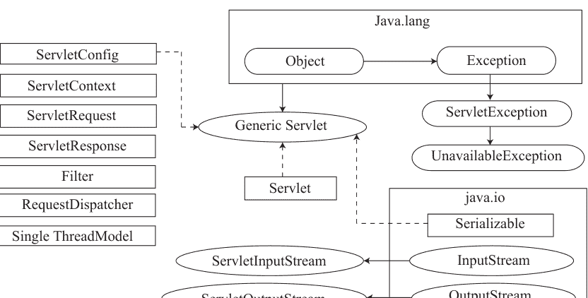

`javax.servlet` 包包含许多类和接口，它们描述并定义了 Servlet 类与 Servlet 容器为该类实例提供的运行时之间的约定。

### 4.2.1 Servlet 接口 (javax.servlet.Servlet)

定义了所有 Servlet 必须实现的方法。Servlet 接收并响应来自 HTTP（超文本传输）Web 客户端的请求。

要实现这一点，你可以编写一个扩展自 `javax.servlet.GenericServlet` 的通用 Servlet，或者一个扩展自 `javax.servlet.http.HttpServlet` 的 HTTP Servlet。

此接口定义了初始化 Servlet、处理请求以及从服务中移除 Servlet 方法。这些被称为生命周期方法，并按照以下顺序被调用：

- 1. Servlet 被构造，然后通过 `init()` 方法进行初始化。
- 2. 处理来自客户端对 `service` 方法的所有调用。
- 3. Servlet 被移出服务，通过 `destroy` 方法被销毁，然后进行垃圾回收和终化。


除了生命周期方法外，此接口还提供了`getServletConfig()`（Servlet 可以它获取任何启动信息）以及`getDescriptor()`（允许 Servlet 返回关于其自身的基本信息，如作者、版本和版权）。

### 方法

- `public abstract void destroy()`：当 Servlet 准备卸载时会调用此方法。它用于清理任何未完成的资源，例如数据库连接、文件句柄等。
- `public abstract ServletConfig getServletConfig()`：此方法返回传递给`init()`方法的`ServletConfig`对象。
- `public abstract String getServletInfo()`：此方法返回一个由程序员定义的、用于描述 Servlet 的字符串。
- `public abstract void init(ServletConfig config) throws ServletException`：此方法在 Servlet 第一次加载时由服务器调用。`init()`方法应该存储`ServletConfig`以供通过`getServletConfig()`获取。此方法还可以用于执行由 Servlet 触发的任何耗时操作，例如创建数据库连接。
- `public abstract void service(ServletRequest req, ServletResponse res) throws SQLException, IOException`：调用此方法来处理单个客户端请求。Servlet 从`ServletRequest`对象接收信息，并通过`ServletResponse`对象向客户端传回数据。

### 4.2.2 ServletContext 接口 (javax.servlet.ServletContext)

定义了一组 Servlet 用于与其 Servlet 容器通信、获取文件 MIME 类型、调度请求或向日志文件写入的方法。

每个 Java 虚拟机有一个“Web 应用”上下文。`ServletContext`对象包含在`ServletConfig`对象中，Web 服务器在 Servlet 初始化时将其提供给 Servlet。

### 方法

- `public abstract Object getAttribute(String name)`：此方法以`Object`形式返回命名属性的值，如果属性不存在则返回`null`。属性取决于服务器，并允许 Web 服务器为 Servlet 提供 Servlet API 提供的之外的信息。
- `public abstract String getMimeType(String file)`：此方法返回给定文件的 MIME 类型，如果未知则返回`null`。MIME 类型的示例有 `"text/html"`、`"text/plain"`、`"image/gif"` 和 `"image/jpeg"`。
- `public abstract String getPath(String path)`：此方法返回真实的文件系统路径。
- `public abstract String getServerInfo()`：此方法返回服务器的协议和版本。
- `public abstract String getContentType(String path)`：此方法返回内容的媒体类型。
- `public abstract Enumeration getParameterNames()`：此方法以`String`对象的枚举返回所有参数名称。
- `public abstract String getServletContext()`：此方法返回此 Servlet 的`ServletContext`。
- `public abstract void log(Exception exception, String msg)`：此方法写入异常和给定的消息。
- `public abstract void log(String msg)`：此方法写入给定的消息。

### 4.2.3 ServletConfig 接口

Servlet 用于在初始化期间传递信息的配置对象。

#### Servlet API 与生命周期

### 方法

- `public abstract String getParameter(String name)`：此方法返回命名参数的值。
- `public abstract Enumeration getParameterNames()`：此方法返回所有参数的名称。
- `public abstract ServletContext getServletContext()`：此方法返回`ServletContext`。

### 4.2.4 HttpServletRequest 接口 (javax.servlet.http)

此接口定义了发送到 Servlet 的客户端请求对象。`ServletRequest`对象提供数据，而扩展`HttpServletRequest`可以提供额外的特定协议数据（例如 HTTP 数据）。

### 方法

- `public abstract Object getAttribute(String name)`：此方法返回命名属性的值。
- `public abstract String getCharacterEncoding()`：此方法返回字符编码。
- `public abstract int getContentLength()`：此方法返回内容的长度。
- `public abstract String getContentType()`：此方法返回内容的媒体类型。
- `public abstract ServletInputStream getInputStream() throws IOException`：此方法获取输入流。
- `public abstract String getParameter(String name)`：此方法返回命名参数的值。
- `public abstract Enumeration getParameterNames()`：此方法返回所有参数名称。
- `public abstract String[] getParameterValues(String name)`：此方法返回命名参数的值。
- `public abstract String getProtocol()`：此方法返回协议的名称和版本。
- `public abstract BufferedReader getReader(String encoding) throws IOException`：此方法获取输入流。
- `public abstract String getPath(String path)`：此方法返回任何“虚拟路径”的文件系统路径，如果无法进行转换，则返回`null`。如果路径为 `"/"`，则返回服务器的文档根。
- `public abstract String getRemoteAddr()`：此方法以`String`形式返回客户端机器的 IP 地址。
- `public abstract String getRemoteHost()`：此方法返回客户端主机的名称。
- `public abstract String getScheme()`：此方法返回用于创建此请求的方案。例如 `"http"`、`"https"`、`"ftp"`、`"jdbc"` 和 `"rmi"`。
- `public abstract String getServerName()`：此方法返回接收请求的服务器名称。
- `public abstract int getServerPort()`：此方法返回接收此请求的端口号。

### 4.2.5 ServletResponse 接口 (javax.servlet.ServletResponse)

该接口定义了一个对象，用于协助 servlet 向客户端发送响应。servlet 包含一个`ServletResponse`对象并将其作为参数传递给 servlet 的`service`方法。

要在 MIME 主文中发送数据，请使用`getOutputStream()`返回的`ServletOutputStream`。要发送数据，请使用`getWriter()`返回的`PrintWriter`。要混合二进制数据和文本数据（例如创建多部分响应），请使用`ServletOutputStream`并手动管理字符部分。

### 方法

- `public abstract String getEncoding()`：此方法返回用于此 MIME 主体的字符集编码。
- `public abstract ServletOutputStream getOutputStream() throws IOException`：此方法返回一个用于写入二进制响应数据的`ServletOutputStream`。不进行任何编码。
- `public abstract PrintWriter getWriter() throws IOException`：此方法返回一个用于写入基于字符的响应数据的`PrintWriter`。写入器会将字符编码为 content type 中指定的任何字符集。
- `public abstract void setLength(int len)`：此方法设置服务器返回的内容的长度。
- `public abstract void setContentType(String type)`：此方法设置指定的响应内容类型。

### 4.2.6 GenericServlet (javax.servlet.GenericServlet)

`GenericServlet`类为与无关的 Servlet 提供了`Servlet`接口的基础实现。它还实现了`ServletConfig`接口。`GenericServlet`包含了声明为抽象的`init()`和`destroy()`方法，这些方法必须被重写。

### 构造函数

- `public GenericServlet()`：默认的`GenericServlet`构造函数不执行任何操作。任何 Servlet 初始化任务应该在`init(ServletConfig config)`中执行，而不是构造函数中。

### 方法

- `public void destroy()`：此方法由服务器在卸载 Servlet 之前调用。Servlet 可以覆盖此方法以保存其状态、释放资源等。
- `public String getParameter(String name)`：此方法返回指定的 Servlet 初始化参数的值，如果没有找到匹配的参数，则返回`null`。
- `public getParameterNames()`：此方法将所有 Servlet 参数作为`String`对象的枚举形式返回，如果不存在参数，则返回一个空`Enum`。
- `public ServletConfig getServletContext()`：此方法返回`ServletConfig`对象。`GenericServlet`并不经常调用此方法，因为所有的`ServletConfig`方法都是重复的。
- `public ServletContext getServletContext()`：此方法返回`ServletContext`对象。
- `public String getInfo()`：此方法返回描述 Servlet 的开发者定义的字符串。Servlet 应该提供此方法并提供个性化的标识。
- `public void init(ServletConfig config) throws ServletException`：此方法由服务器在 Servlet 首次加载之后、`service`方法调用之前调用。它记录 Servlet 的初始化并存储`ServletConfig`对象以备用。Servlet 在执行任何自定义初始化之前，应该始终使用`super.init(config)`调用父类的`init()`实现。
- `public void log(String msg)`：此方法将消息写入到 Servlet 的事件日志文件中。此方法的输出格式和位置取决于服务器。
- `public abstract void service(ServletRequest req, ServletResponse res) throws ServletException`：此方法被调用以处理单个请求。Servlet 从`ServletRequest`对象获取信息，并通过`ServletResponse`对象向客户端发送数据。这是扩展`GenericServlet`时必须重写的唯一方法。

### 4.2.7 ServletInputStream 类 (javax.servlet.ServletInputStream)

该类提供了一个用于从客户端请求中读取二进制数据的输入流，包括一个逐行读取数据的`readLine()`方法。`ServletInputStream`是通过`ServletRequest`的`getInputStream()`方法的。

### 构造函数

- `protected ServletInputStream()`：默认构造函数不执行任何操作。由于 Servlets 会创建自己的输入流，因此可以安全地忽略。

### 方法

- `int readLine(byte[] b, int off, int length) throws IOException`：此方法将字节从输入流读取到字节数组`b`中，偏移量由给定的数组位置给出。它在遇到 `'\n'` 或达到指定的长度字节数时停止。它返回读取的字节数，如果到达流末尾，则返回 `-1`。

### 4.2.8 ServletOutputStream 类 (javax.servlet.ServletOutputStream)

该类提供了一个向客户端发送二进制数据的输出流。Servlet 从`ServletResponse`的`getOutputStream()`方法获取一个`ServletOutputStream`对象。

### 构造函数

- `protected ServletOutputStream()`：上述类中的默认构造函数不执行任何操作。

### 方法

- `public void print(boolean b) throws IOException`
- `public void print(char c) throws IOException`
- `public void print(double d) throws IOException`
- `public void print(float f) throws IOException`
- `public void print(int i) throws IOException`
- `public void print(long l) throws IOException`
- `public void print(String s) throws IOException`

上述方法用于将给定数据写入客户端，带有换行符。

- `public void println(int i) throws IOException`
- `public void println(boolean b) throws IOException`
- `public void println(char c) throws IOException`
- `public void println(double d) throws IOException`
- `public void println(float f) throws IOException`
- `public void println(int i) throws IOException`
- `public void println(long l) throws IOException`
- `public void println(String s) throws IOException`

上述方法用于将给定数据写入客户端，带有换行符。没有参数的方法写入换行符。

### 4.2.9 RequestDispatcher 接口

该接口定义了一个接收客户端请求并将其发送到服务器上任何资源（作为 servlet、HTML 文件或 JSP 文件）。servlet 容器包含`RequestDispatcher`，它是对特定路径或通过名称指定的服务器资源的封装。

### 方法

- `public void forward(ServletRequest request, ServletResponse response)`：将请求从 servlet 转发到服务器上的另一个资源（servlet、JSP 文件、HTML 文件）。
- `public void include(ServletRequest request, ServletResponse response)`：在响应中包含资源（servlet、JSP 页面、HTML 文件）的内容。

### 4.2.10 Filter 接口 (javax.servlet.Filter)

过滤器是一个对资源（servlet 或静态内容）、响应或两者执行过滤的对象。过滤器在`doFilter`方法中执行过滤。每个过滤器都有一个`FilterConfig`对象，可以从其获取初始化参数，以及`ServletContext`的引用，例如用于加载过滤任务所需的资源。过滤器在应用程序的部署描述中配置。

设计的示例包括：


### 过滤器类型

- (1) 身份验证过滤器
- (2) 日志和审计过滤器
- (3) 转换过滤器
- (4) 数据压缩过滤器
- (5) 加密过滤器
- (6) 标记过滤器
- (7) 触发事件的过滤器
- (8) XSL/T 过滤器
- (9) MIME 类型链过滤器

### 方法

- `public void destroy()`：由容器调用此方法以指示过滤器停止服务。

## Servlet API 生命周期

- `public void doFilter(ServletRequest request, ServletResponse response, FilterChain chain)`：每当请求/响应对通过链传递给链末尾某个资源的客户端请求时，容器就会调用 `Filter` 的 `doFilter` 方法。

- `void init(FilterConfig)`：由容器调用，通知过滤器已进入服务状态。

## 4.2.1 FilterChain 接口 (javax.servlet.FilterChain)

`FilterChain` 是 servlet 容器提供给开发者的一个对象，提供了经过过滤的资源请求的调用链。过滤器使用 `FilterChain` 来调用链中的下一个过滤器，或者如果调用的过滤器是链中的最后一个过滤器，则调用链末尾的资源。

### 方法

- `public void doFilter(ServletRequest request, ServletResponse response)`：触发链中下一个过滤器的调用，或者如果调用的过滤器是链中的最后一个过滤器，则触发链末尾资源。

### 4.2.12 FilterConfig 接口 (javax.servlet.FilterConfig)

Servlet 容器使用的配置对象，用于在初始化期间向过滤器传递信息。

### 方法

- `java.lang.String getName()`：返回部署描述符中定义的过滤器的名称。
- `java.lang.String getParameter(java.lang.String name)`：返回包含初始化参数值的 `String`，如果该参数不存在则返回 `null`。
- `java.util.Enumeration getParameterNames()`：以 `String` 对象的枚举（`Enumeration`）形式返回过滤器的初始化参数名称，如果过滤器没有初始化参数，则返回空枚举。
- `ServletContext getServletContext()`：返回调用者执行时所在的 `ServletContext` 引用。

### 4.2.13 ReadListener 接口 (javax.servlet.ReadListener)

此接口使用非阻塞 IO 接收读取事件的通知。（Servlet 3.1 新增）。

### 方法

- `public void onAllDataRead()`：当请求体已完全读取时被调用。
- `public void onDataAvailable(boolean isAvailable)`：当有可用数据可读时被调用。
- `public void onError(java.lang.Throwable throwable)`：如果在读取请求体时发生错误则被调用。

### 4.2.14 WriteListener 接口 (javax.servlet.WriteListener)

此接口使用非阻塞 IO 接收写入事件的通知。（Servlet 3.1 新增）。

### 方法

- `public void onError(java.lang.Throwable throwable)`：如果在写入响应时发生错误则被调用。
- `public void onWritePossible()`：当可以在不阻塞的情况下写入数据时被调用。

## 4.3 javax.servlet.http 包

`javax.servlet.http` 包包含许多类和接口，描述并定义了在 HTTP 协议下运行的 servlet 类与符合标准的容器为该类实例提供的运行时环境之间的约定。

### 4.3.1 HttpServlet 类 (javax.servlet.http)

提供一个供子类的抽象类，以创建适用于网站的 HTTP servlet。`HttpServlet` 的子类必须重写至少一个方法，通常是以下方法之一：

- `doGet`，如果 servlet 支持 HTTP GET 请求
- `doPost`，用于 HTTP POST 请求
- `doPut`，用于 HTTP PUT 请求
- `delete`，用于 HTTP DELETE 请求
- `init` 和 `destroy`，用于管理 servlet 整个周期内持有的资源
- `getServletInfo`，servlet 使用它提供关于自身的信息

### 构造函数

- `HttpServlet()`：什么都不做，因为这是一个抽象类。

### 方法

- `protected void destroy(HttpServletRequest req, HttpServletResponse resp)`：由服务器（通过 `service` 方法）调用，允许 servlet 处理 DELETE 请求。
- `protected void doGet(HttpServletRequest req, HttpServletResponse resp)`：由服务器（通过 `service` 方法）调用，允许 servlet 处理 GET 请求。
- `protected void doHead(HttpServletRequest req, HttpServletResponse resp)`：从保护的 `service` 方法接收 HTTP HEAD 请求并处理该请求。
- `protected void doOptions(HttpServletRequest req, HttpServletResponse resp)`：由服务器（通过 `service` 方法）调用，允许 servlet 处理 OPTIONS 请求。
- `protected void doPost(HttpServletRequest req, HttpServletResponse resp)`：由服务器（通过 `service` 方法）调用，允许 servlet 处理 POST 请求。
- `protected void doPut(HttpServletRequest req, HttpServletResponse resp)`：由服务器（通过 `service` 方法）调用，允许 servlet 处理 PUT 请求。
- `protected void doTrace(HttpServletRequest req, HttpServletResponse resp)`：由服务器（通过 `service` 方法）调用，允许 servlet 处理 TRACE 请求。
- `protected long getLastModified(HttpServletRequest req)`：返回 `HttpServletRequest` 对象最后修改的时间，自 1970 年 1 月 1 日 GMT 起的毫秒数。
- `protected void service(HttpServletRequest req, HttpServletResponse resp)`：从公共 `service` 方法接收 HTTP 请求并将其分派到此类中定义的 `doXXX` 方法。
- `void service(ServletRequest req, ServletResponse res)`：将客户端请求分派到保护的 `service` 方法。

### 4.3.2 HttpServletRequest 接口 (javax.servlet.http.HttpServletRequest)

此接口扩展了 `HttpServlet` 接口，为 HTTP servlet 提供信息。servlet 容器创建 `HttpServletRequest`。

### 方法

- `java.lang.String getAuthType()`：返回保护 servlet 的认证方案。
- `java.lang.String getPath()`：返回标识 context 部分。
- `Cookie[] getCookies()`：返回客户端发送的所有 `Cookie` 对象数组。
- `java.lang.String getHeader(java.lang.String name)`：返回指定请求头的值。
- `java.util.Enumeration getHeaderNames()`：返回请求包含的所有头部名称枚举。
- `int get(java.lang.String name)`：以 `int` 类型返回请求头部。
- `java.lang.String getMethod()`：返回发送此请求的 HTTP 方法名称，例如 GET、POST 或 PUT。
- `java.lang.String getPathInfo()`：返回客户端发送的 URL 相关的额外路径信息。
- `java.lang.String getPathTranslated()`：返回 servlet 名称之后查询字符串之前的额外路径信息，并将其翻译路径。
- `java.lang.String getQueryString()`：返回路径之后的查询字符串。
- `java.lang.String getRemoteUser()`：如果用户已认证，则返回请求用户的登录名；未认证则返回 `null`。
- `java.lang.String getSessionID()`：返回客户端指定的会话 ID。
- `java.lang.String getRequestURI()`：返回从协议到 HTTP 请求第一行的 URL 部分。
- `java.lang.String getServletPath()`：返回调用 servlet 的 URL 部分。
- `HttpSession getSession()`：返回与请求关联的会话，如果请求没有会话，则创建一个。
- `HttpSession getSession(boolean create)`：返回与请求关联的会话，如果没有当前会话且 `create` 为 `true`，则返回新会话。
- `isRequestedIdFromCookie()`：检查请求会话 ID 是否来自 cookie。
- `isRequestedIdFromURL()`：检查请求会话 ID 是否来自请求 URL 部分。
- `isRequestedSessionIdValid()`：检查请求会话 ID 是否有效。

### 4.3.3 HttpServletResponse 接口 (javax.servlet.http.HttpServletResponse)

此接口扩展了 `Servlet` 接口，为发送响应提供 HTTP 特有的功能。例如，它拥有访问 HTTP 头部的方法和 cookies。Servlet 容器创建一个 `HttpServletResponse` 对象并将其作为参数传递给 servlet 的服务方法（`doGet`、`doPost` 等）。

### 方法

- `void addCookie(Cookie cookie)`：将指定的 cookie 添加到响应中。
- `void addHeader(java.lang.String name, long date)`：添加一个具有给定名称和日期-值的响应头。
- `void addHeader(java.lang.String name, java.lang.String value)`：添加一个具有给定名称和值的响应头。
- `void addIntHeader(java.lang.String name, int value)`：添加一个具有给定名称和整数-值的响应头。
- `java.lang.String encodeRedirectURL(java.lang.String url)`：对指定的 URL 进行编码以用于 `sendRedirect` 方法；如果不需要编码，则返回未更改的 URL。
- `java.lang.String encodeURL(java.lang.String url)`：通过包含会话 ID 对指定的 URL 进行编码；如果不需要编码，则返回未更改的 URL。
- `void sendError(int sc)`：使用指定的状态码向客户端发送错误并清除缓冲区。
- `void sendError(int sc, java.lang.String msg)`：使用指定的状态向客户端发送错误消息。
- `void sendRedirect(java.lang.String location)`：使用指定的重定向 URL 向客户端发送临时重定向。
- `void setDate(java.lang.String name, long date)`：设置一个具有给定名称和日期-值的响应头。
- `void setHeader(java.lang.String name, java.lang.String value)`：设置一个具有给定名称和值的响应头。
- `void setIntHeader(java.lang.String name, int value)`：设置一个具有给定名称和整数-值的响应头。
- `void setStatus(int sc)`：设置此响应的状态码。

## 4.3.4 HttpSession 接口 (javax.servlet.http.HttpSession)

该接口提供了一种跨多个页面请求或访问 Web 时识别用户并存储有关该用户信息的方法。Servlet 容器使用此接口在 HTTP 客户端和 HTTP 服务器之间创建会话。会话在指定的时间范围内持续，跨越服务器的多个连接或页面请求。会话通常对应一个用户，该用户可能会多次访问网站。服务器可以通过多种方式（如使用 cookies 或重写 URL）维护会话。

### 方法

- `public long getCreationTime()`：此方法返回此会话创建的时间，自 GMT 1970 年 1 月 1 日午夜以来的毫秒数。
- `public java.lang.String getId()`：此方法返回包含分配给此会话的唯一标识符的字符串。
- `public long getLastAccessedTime()`：此方法返回此会话最后发送关联请求的时间，即自 GMT 1970 年 1 月 1 日午夜以来的毫秒数。
- `public ServletContext getContext()`：此方法返回此会话所属的 `ServletContext`。
- `public void setMaxInactiveInterval(int interval)`：此方法指定在客户端请求之间 Servlet 容器使此会话失效的时间（以秒为单位）。负时间表示会话不应超时。
- `public int getMaxInactiveInterval()`：此方法返回 Servlet 在客户端访问之间保持此会话开放的最大时间（秒为单位）。之后，Servlet 容器将使会话失效。
- `java.lang.Object getAttribute(String name)`：此方法返回绑定到此会话的对象，如果该名称下没有绑定任何对象，则返回 `null`。
- `java.util.Enumeration getAttributeNames()`：此方法返回包含所有绑定到此会话的对象名称的字符串枚举。
- `public void setAttribute(String name, Object value)`：此方法将对象绑定到此会话。
- `public void removeAttribute(String name)`：此方法从会话中移除一个对象。
- `public void invalidate()`：此方法销毁会话。
- `public boolean isNew()`：如果会话自创建以来尚未被访问，则返回 `true`。

### 4.3.5 Cookie (javax.servlet.http.Cookie)

该类表示由服务器发送的少量信息。

### 构造函数

- `public Cookie(String name, String value)`：构建一个具有名称和值的 cookie。

### 方法

- `void setComment(String comment)`：此方法指定注释。
- `public String getComment()`：此方法返回注释。
- `void setDomain(String domain)`：此方法指定 cookie 的作用域。
- `public String getDomain()`：此方法返回作用域。
- `void setMaxAge(int max)`：此方法设置 cookie 的生存时间。
- `public int getMaxAge()`：此方法返回 cookie 的最大有效期。
- `void setPath(String path)`：此方法指定 cookie 的路径。
- `public String getPath()`：此方法返回路径。
- `void setSecure(boolean secure)`：此方法指示 cookie 是否应使用安全协议发送。
- `boolean getSecure()`：如果 cookie 通过安全协议发送，则返回 `true`。


## 4.3.2 Part 接口（`javax.servlet.Part`）

该接口表示在 `multipart/form-data` POST 请求中收到的部分或项目。（Servlet 3.0 新增）。

### 方法

- 1. `void delete()`：删除文件项的底层存储，包括任何关联的磁盘文件。
- 2. `java.lang.String getContentType()`：获取此部分的内容类型。
- 3. `java.lang.String getHeader(java.lang.String name)`：以字符串形式返回指定头部的值。
- 4. `java.util.Collection<java.lang.String> getHeaderNames()`：获取此部分的头部名称。
- 5. `java.util.Collection<java.lang.String> getHeaders(java.lang.String name)`：获取给定名称的头部值。
- 6. `java.io.InputStream getInputStream()`：以 `InputStream` 形式获取此部分的内容。
- 7. `java.lang.String getName()`：获取此部分的名称。
- 8. `long getSize()`：返回文件的大小。
- 9. `void write(java.lang.String fileName)`：将此上传项写入磁盘的便捷方法。

### 4.3.7 WebConnection 接口（`javax.servlet.http.WebConnection`）

此接口封装了升级请求的连接。它允许协议处理程序向容器发送服务请求和状态查询。（Servlet 3.1 中新增）。

### 方法

- 1. `ServletInputStream getInputStream()`：返回此 Web 链接的输入流。
- 2. `ServletOutputStream getOutputStream()`：返回此 Web 链接的输出流。

## 4.4 `javax.servlet.annotation` 包

`javax.servlet.annotation` 包包含许多注解，允许用户声明 servlet、过滤器、监听器，并为所声明的组件指定元数据。（Servlet 3.0 中新增）。

### 什么是注解？

Java 注解（Java Annotation）是一种表示元数据的标签，即附加在类、接口、方法或字段上的元数据，用于指示 Java 编译器和 Java 虚拟机（JVM）可以使用的额外信息。注解用于提供有关程序的补充性信息。

- 注解以 `@` 开头。
- 注解不会改变编译后程序的行为。
- 注解有助于将元数据（信息）与程序元素（如实例变量、构造函数、类等）关联起来。
- 注解不是纯注释，因为它们可以改变编译器处理程序的方式。

示例：

```java
class MyBase
{
    public void display()
    {
        System.out.println("Base display()");
    }
}
class MyDerived extends MyBase
{
    @Override
    public void display(int t)
    {
        System.out.println("Derived display(int int)");
    }
    public static void main(String args[])
    {
        MyDerived obj = new MyDerived();
        obj.display();
    }
}
```

### 输出

```
MyDerived.java:13: error: method does not override or implement a method from a supertype
@Override
^
1 error
```

- 如果我们移除参数 `(int t)` 或移除 `@Override`，程序将正常编译。

### 4.4.1 WebServlet 注解（`javax.servlet.annotation.WebServlet`）

此注解用于声明一个 servlet。该注解在部署时由容器处理，相应的 servlet 将在指定的 URL 模式下可用。

### 注解元素

- 1. `boolean asyncSupported`：声明 servlet 是否支持异步操作模式。
- 2. `java.lang.String description`：servlet 的描述。
- 3. `java.lang.String displayName`：servlet 的显示名称。
- 4. `WebInitParam[] initParams`：servlet 的初始化参数。
- 5. `java.lang.String largeIcon`：servlet 的大图标。
- 6. `int loadOnStartup`：servlet 的启动加载顺序。
- 7. `java.lang.String name`：servlet 的名称。
- 8. `java.lang.String smallIcon`：servlet 的小图标。
- 9. `java.lang.String[] urlPatterns`：servlet 的 URL 模式。
- 10. `java.lang.String[] value`：servlet 的 URL 模式。

### 4.4.2 WebFilter 注解（`javax.servlet.annotation.WebFilter`）

此注解用于声明一个 servlet 过滤器。该注解在部署时由容器处理，相应的过滤器将应用于指定的 URL 模式、模式和分发器类型。

### 注解元素

- 1. `boolean asyncSupported`：声明过滤器是否支持异步操作模式。
- 2. `java.lang.String description`：过滤器的描述。
- 3. `DispatcherType[] dispatcherTypes`：过滤器应用的分发器类型。
- 4. `java.lang.String displayName`：过滤器的名称。
- 5. `java.lang.String filterName`：过滤器的名称。
- 6. `WebInitParam[] initParams`：过滤器的初始化参数。
- 7. `java.lang.String largeIcon`：过滤器的大图标。
- 8. `java.lang.String[] servletNames`：过滤器应用的 servlet 名称。
- 9. `java.lang.String smallIcon`：过滤器的小图标。
- 10. `java.lang.String[] urlPatterns`：过滤器应用的 URL 模式。
- 11. `java.lang.String[] value`：过滤器应用的 URL 模式。

### 4.4.3 WebListener 注解（`javax.servlet.annotation.WebListener`）

此注解用于声明一个 WebListener。任何标记了 `WebListener` 的类必须实现 `ServletContextListener`、`ServletRequestListener`、`ServletRequestAttributeListener`、`HttpSessionListener` 或 `HttpSessionAttributeListener` 接口中的一个或多个接口。

### 注解元素

- 1. `java.lang.String value`：监听器的描述。

### 4.4.4 WebInitParam 注解（`javax.servlet.annotation.WebInitParam`）

此注解用于 Servlet 或 Filter 实现类，用于指定一个初始化参数。

### 注解元素

- 1. `java.lang.String name`：初始化参数的名称（必需元素）。
- 2. `java.lang.String value`：初始化参数的值（必需元素）。
- 3. `java.lang.String description`：初始化参数的描述。

### 4.4.5 MultipartConfig 注解（`javax.servlet.annotation.MultipartConfig`）

可以指定在 Servlet 类上的注解，表示其支持 multipart 数据。标记了 `MultipartConfig` 的 Servlet 可以通过调用 `getPart` 获取 `multipart/data` 组件。

### 注解元素

- 1. `int fileSize`：写入文件后的阈值。
- 2. `java.lang.String location`：存储文件的目录。
- 3. `long maxSize`：允许的文件最大大小。
- 4. `long maxRequestSize`：允许 `multipart/data` 请求的最大大小。

## 4.5 Servlet 骨架

Java Servlet 是运行在符合 HTTP 协议服务器上的程序。`java.servlet` 和 `javax.servlet` 包提供了处理 servlet 所需的接口和类。Servlet 继承 `HttpServlet` 类并重写 `doGet` 或 `doPost` 方法。此外还有 `init`、`service`、`destroy` 等生命周期方法。以下是 Servlet 的骨架：

```java
import java.io.*;
import javax.servlet.*;
import javax.servlet.http.*;
public class BasicServlet extends HttpServlet {
    public void doGet(HttpServletRequest req, HttpServletResponse response)
        throws ServletException, IOException {
            res.setContentType("text/html");
            PrintWriter pw = res.getWriter();
            // ... 输出到 pw...
        }
    public void doPost(HttpServletRequest req, HttpServletResponse response)
        throws ServletException, IOException {
            doGet(req, res);
        }
}
```

## 4.6 Servlet 生命周期

Servlet 的生命周期由部署 Servlet 的容器管理。当请求映射到 Servlet 时，容器会执行以下步骤：

- 1. 如果不存在 Servlet 实例，Web 容器：
  - 加载 Servlet 类。
  - 创建 Servlet 类实例。
  - 通过调用 `init` 方法初始化 Servlet 实例。初始化将在初始化 Servlet 部分中介绍。
- 2. 调用 `service` 方法，传递请求和响应对象。`Service` 方法将在编写 Service 方法中讨论。

如果容器需要移除 Servlet，它将通过调用 `destroy` 方法来完成清理。

以下是 Servlet 的生命周期方法：

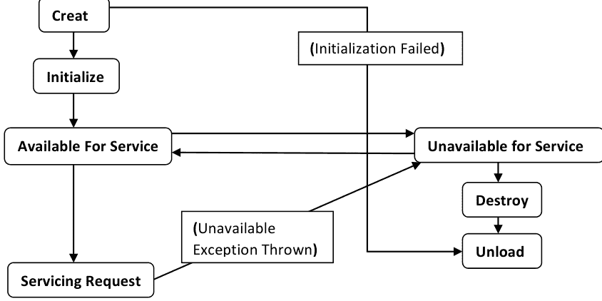

我们将详细查看每个方法。

### 4.6.1 `init()`

此方法每个 Servlet 实例调用一次。当第一次调用 Servlet 时，Servlet 容器创建该 Servlet 实例并将其加载到内存。后续请求将由同一个实例提供，而不再创建新实例。`init()` 方法用于初始化从部署符 `web.xml` 传递的 Servlet 变量。`ServletConfig` 作为参数传递给 `init` 方法，存储了 `web.xml` 中配置的所有值。

**为什么不使用构造函数代替 `init`？**

`init()` 方法通常用于执行 Servlet 初始化——创建或加载 Servlet 在处理其请求时使用的对象。为什么不使用构造函数呢？嗯，在 JDK 1.0（Servlet 最初为之编写的时代）中，动态加载的 Java 类（如 servlet）的构造函数无法接受参数。因此，为了向新的 servlet 提供自身及其环境的任何信息，服务器必须调用 servlet 的 `init()` 方法并传递一个实现 `ServletConfig` 接口的对象。此外，`javax.servlet.Servlet` 接口没有声明接受 `ServletConfig` 参数的构造函数。它必须声明另一个方法，如 `init()`。当然，你仍然可以为 servlet 定义构造函数，但构造函数将无法访问 `ServletConfig` 或无法抛出 `ServletException`。

### 4.6.2 `service()`

该方法会在每个请求时被调用。这是每个 Servlet 请求的入口，我们必须在这里编写业务逻辑或其他任何处理。该方法接受 `HttpServletRequest` 和 `HttpServletResponse` 作为参数。

### 4.6.3 `destroy()`

该方法每个实例仅被调用一次。用于释放 Servlet 实例使用的资源。大多数情况下，它用于数据库连接、文件 IO 操作；当容器从 Servlet 容器中移除该实例时，会调用 `destroy()`。

| 问题 |
| --- |
| 1. 什么是 Java Servlet API？解释 Servlet 的类型。 |
| 2. 关于 `javax.servlet` 包写一个简短说明。 |
| 3. 解释 Servlet 和 ServletContext 接口。 |
| 4. 关于 `ServletConfig` 和 `ServletRequest` 接口写一个简短说明。 |
| 5. 关于 `ServletResponse` 接口写详细说明。 |
| 6. 详细解释 `ServletInputStream` 和 `ServletOutputStream` 类。 |
| 7. 提供关于 Filter 和 RequestDispatcher 接口的细节。 |
| 8. 关于 `FilterChain`、`FilterConfig` 接口写简短信息。 |
| 9. 关于 `ReadListener` 和 `WriteListener` 接口写一个简短说明。 |
| 10. 解释 `HttpServlet` 类和 `HttpServletRequest` 接口。 |
| 11. 关于 `HttpServletRequest` 和 `HttpServletResponse` 接口写一个简短说明。 |
| 12. 详细解释 `HttpSession` 接口。 |
| 13. 关于 `Cookie` 类写简短说明。 |
| 14. 关于 `Part` 和 `WebConnection` 接口写简短说明。 |
| 15. 详细解释 `javax.servlet.annotation` 包。 |
| 16. 解释 Servlet 生命周期。 |

# 第一单元：Servlet 的使用

## 5.1 什么是 Web 应用程序？

Web 应用程序（或“web app”）是运行在 Web 服务器上的软件程序。与由操作系统启动的传统桌面应用程序不同，Web 应用必须通过浏览器访问。

与桌面应用程序相比，Web 应用具有多个优势。由于它们运行在浏览器内部，开发者不需要为多个平台开发 Web 应用。例如，在 Chrome 中运行的单个应用程序可以在 Windows 和 OS X 上运行。当 Web 应用更新时，开发者不需要向用户分发软件更新。通过更新服务器上的应用程序，所有用户都可以访问更新后的版本。

## 5.2 Web 应用程序的结构（目录结构）

为了部署和执行 Servlet，Servlet API 指定了固定的 WAR 文件结构。整个服务器必须遵循下所示的标准目录结构。

| 根目录 | |
| --- | --- |
| WEB-INF | Web 资源 |
| web.xml（部署描述文件） | Classes |
| | Html, JSP, CSS, JS, Images 等 |
| Annotation | |
| 所有服务器端类 | |


**Web 资源**：Web 文件、组件和设计文件被称为 Web 资源。这是 Servlet 目录结构的最顶层目录。在此目录中，我们可以放置作为当前应用程序部分的 HTML、JSP、CSS、JS 文件等。

**WEB-INF**：服务器根目录下包含一个名为 `Web-INF` 的目录。该目录包含以下文件和目录：

- **web.xml**：这是一个 Web 应用程序部署描述文件。
- **Classes**：在此目录中存储 Servlet 类、工具类、JavaBeans 组件。

**部署描述**：部署描述符会覆盖通过注解机制指定的配置信息。Web 3.0 版本的部署在 `web-app` 元素上有一个新的 `metadata-complete` 属性。该属性定义了描述是否完整，或者是否应该考虑用于指定部署信息的类。

**上下文路径**：当应用程序部署到特定的 Web 服务器时，会为应用程序分配一个上下文路径。这意味着如果应用程序被分配到上下文路径 `/myApplication`，那么从文档中引用的请求 URI 为 `/myApplication/index.html`。我们可以说上下文路径是加载应用程序的主 URL。

## 5.3 使用 GlassFish 创建 Servlet

使用 Servlet 45

- 启动 NetBeans 并选择 `File -> New`
- 出现如下所示的 `New Project` 对话框
- 在列表中选择 `Java Servlet`。

## 5.4 创建 Servlet

- 右键点击 `Source packages` 下 `deploy`，选择 `New -> Servlet`，如上所示。
- 出现如下所示的 `New Servlet` 框。在类名处输入 `WelcomeServlet`，并在第三个框中输入 `Servlet`。然后点击 `Next`。
- 出现如下所示的 `Configure Servlet Deployment` 对话框。在这里我们需要保持所有默认值不变，并勾选如所示的“Add information to deployment descriptor (web.xml)”复选框。然后点击 `Finish`。

`WelcomeServlet.java` 现在可用，并带有 NetBeans IDE 提供的所有代码。

- 现在按照下面给出的第一个 Servlet 程序修改代码：

```java
PrintWriter out = response.getWriter();
out.println("<html>"); // 为客户端写入输出格式
out.println("<head>");
out.println("<title>TWelcomeServlet</title>");
out.println("</head>");
out.println("<body>");
out.println("<h1>Hello " + request.getParameter("tName") + " + Welcome to World of JAVA web Development </h1>");
out.println("</body>");
out.println("</html>");
}
{}
{}
```

5. 然后在 `Project Select` 中右键点击 `TWelcomeServlet` 并选择 `Build`。构建成功后，再次在 `Project Window` 中右键点击 `TWelcomeServlet` 并选择 `Run`。我们将得到以下结果。

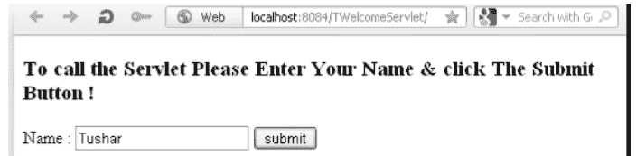

点击提交后，我们的 `TWelcomeServlet` 被调用。结果屏幕看起来将如上图所示。


注意：当我们调用所有与 Servlet 类相关的所有信息时，它们与 `web.xml`（部署描述符）文件进行映射。示例文件如下。

## 5.5 部署描述符文件

```xml
<xml version="1.0" encoding="UTF-8"?>
<web-app version="3.0" xmlns="http://java.sun.com/xml/ns/javaee"
xmlns:xsi="http://www.w3.org/2001/XMLSchema-instance"
xsi:schemaSchemaLocation="http://java.sun.com/xml/ns/javaee/web-app_3_0.xsd">
<servlet>
  <servlet-name>TWelcomeServlet</servlet-name>
  <servlet-class>Servlet.TWelcomeServlet</servlet-class>
</servlet>
<servlet-mapping>
  <servlet-name>TWelcomeServlet</servlet-name>
  <url-pattern>/TWelcomeServlet</url-pattern>
```

## 使用 Servlets

```xml
<servlet-mapping>
<session-config>
<session-timeout> 30 </session-timeout>
</session-config>
<web-app>
```

`web.xml` 文件中有许多元素。以下是 `web.xml` 文件中使用的一些元素的说明。元素如下：

- `web-app` 代表整个应用程序。
- `servlet` 是 `<servlet>` 的子元素，代表 servlet。
- `servlet-name` 是 `<servlet>` 的子元素，代表 servlet 的名称。
- `servlet-class` 是 `<servlet>` 的子元素，代表 servlet 的类。
- `servlet-mapping` 是 `<web-app>` 的子元素。用于映射 servlet。
- `url-pattern` 是 `<servlet-mapping>` 的子元素。该模式用于在客户端调用 servlet。

## 5.6 使用注解代替部署描述符

部署描述符是一个单独的文件，你可以在其中以 XML 格式设置配置值，而注解则直接嵌入到你的源代码中。如果你倾向于将代码和配置放在同一处处以获得更好的可读性，请使用注解。部署描述符恰恰相反——你将代码和配置分开。如果你想更改单个配置值，不需要重新编译整个项目。

对于 Java 企业级组件，既有注解版本，也有描述符版本。两者都可以通过注解或通过部署描述符进行配置。在 Servlet 的情况下，你可以选择其中一种。

**在我们使用注解时，需要 xml 吗？**

如果你选择依赖注解来配置所有的 Servlet，可以完全抛弃 `web.xml` 文件。但我们仍然鼓励你保留该文件，或者至少像上面示例所示保留一个。`web.xml` 用于许多其他配置，因此你早晚会在项目中需要它。接下来的代码展示了在 servlet 文件中使用注解的简单演示。

```java
package net.io.tushar;
import java.io.IOException;
import javax.servlet.ServletException;
import javax.servlet.annotation.WebServlet;
import javax.servlet.http.HttpServlet;
import javax.servlet.http.HttpServletRequest;
import javax.servlet.http.HttpServletResponse;

@WebServlet("hello")
public class ServletWithAnnotations extends HttpServlet {
    private static long serialVersionUID = -346209622827491485L;
    @Override
    protected void doGet(HttpServletRequest request, HttpServletResponse response) throws ServletException, IOException {
        response.getWriter().println("Hello World!");
    }
}
```

## 问题

1. 什么是 Web 应用程序？解释其组织结构。
2. 使用 NetBeans 创建 Web 应用程序的步骤是什么？
3. 详细解释部署描述符文件。
4. 如何使用注解代替部署描述符？

与数据库操作

51

# 第 6 章 第一单元

## 数据库操作

## 6.1 什么是 JDBC?

JDBC 是一种用于执行 SQL 语句的 Java API 并支持基本的 SQL 功能。JDBC（Java 数据库连接）是一种 API，它定义了接口和类，通过建立数据库连接在 Java 中编写数据库应用程序。它是一个设计用于在多个操作系统平台上访问许多数据库产品的程序。使用 JDBC 我们可以向几乎任何关系数据库发送 SQL、PL/SQL 语句。JDBC 通过允许我们嵌入 SQL 来访问 JDBC RDBMS。

### 6.1.1 JDBC 驱动程序

JDBC API 定义了接口和类，通过建立数据库连接在 Java 中编写数据库应用程序。它是一个设计用于在多个操作系统平台上访问许多数据库产品的程序。使用 JDBC 我们可以向几乎任何关系数据库发送 SQL、PL/SQL 语句。JDBC 通过允许我们嵌入 SQL 来访问 JDBC RDBMS。

（注：此处原文存在大量重复段落，翻译时已根据核心含义进行整合）

JDBC API 定义了接口和类，通过建立数据库连接在 Java 中编写数据库应用程序。它是一个设计用于在多个操作系统平台上访问许多数据库产品的程序。使用 JDBC 我们可以向几乎任何关系数据库发送 SQL、PL/SQL 语句。JDBC 通过允许我们嵌入 SQL 来访问 JDBC RDBMS。

（后续重复内容略，保持翻译逻辑一致）

使用数据库

### 缺点

此驱动程序需要另一个服务器应用程序来安装和维护。遍历结果集可能需要更长时间，因为数据是通过后端服务器传输的。

- 类型 4 - 原生协议/纯 Java 驱动

此驱动程序将 JDBC API 直接连接到 DBMS 的精确网络协议，而无需中间层。这允许客户端应用程序直接连接到数据库服务器。

| Java 应用程序 | JDBC Api | 薄 / 类型 4 驱动 | 原生协议 | DB | 原生协议/纯 Java 驱动 |
| :--- | :--- | :--- | :--- | :--- | :--- |

### 优点

- 此驱动的性能通常非常良好。
- 此驱动完全用 Java 编写，以实现平台无关性并消除部署管理问题。它最适用于 Web。
- 在这种类型中，转换层较少，即类型 4 JDBC 驱动程序不需要将数据库请求翻译为 ODBC 或原生连接接口，也不需要将请求传递给另一个服务器。
- 我们不需要在客户端或服务器上安装软件。这些驱动程序可以动态下载。

### 缺点

对于这种类型，用户需要为每个数据库准备不同的驱动程序。

### 6.1.2 JDBC 的优势

- 1. 提供现有数据：通过 JDBC，企业可以继续使用已安装的数据库，如果信息存储在数据库管理系统中，就可以进行访问。
- 2. 易于开发：使用 JDBC 使应用程序开发变得更加简单且具有成本效益。JDBC API 内部的大部分工作很容易学习、维护成本低且易于部署。
- 3. 无需配置网络：使用 JDBC 无需在客户端进行配置。JDBC 的开发是用 Java 编写的，因此连接所需的所有信息完全由 JDBC URL 定义，或者通过注册 Java 命名和目录接口 (JNDI) 命名服务的 `DataSource` 对象定义。
- 4. 全面访问元数据：JDBC API 提供了元数据，能够开发复杂的应用程序。
- 5. 无需安装：JDBC API 包含一种识别和连接数据源的方法，使用 `DataSource` 对象使代码更具可移植性且更容易维护。

### 6.1.3 理解 JDBC 架构

JDBC API 的主要功能是为开发者提供手段，以发布 SQL 语句并以一致的方式处理结果。JDBC 通过定义表示对象的类和接口提供了对数据库的面向对象的访问，这些对象包括：

(1) 数据库连接，
(2) SQL 语句，
(3) 结果集 (`ResultSet`)，
(4) 数据库元数据，
(5) 预编译语句 (`Prepared statements`)，
(6) 二进制大对象 (`BLOBs`)，
(7) 字符大对象 (`CLOBs`)，
(8) 调用语句 (`Callable statements`)，
(9) 数据库驱动程序，
(10) 驱动管理器 (`Driver manager`)。

| Java Servlet, Applet 或 应用程序 | JDBC API | 驱动管理器 |
| :--- | :--- | :--- |
| JDBC 驱动 | JDBC 驱动 | JDBC 驱动 |
| Oracle | SQL Server | ODBC 数据源 |

JDBC 架构层

JDBC API 使用驱动管理器和数据库驱动程序提供与异构数据库的连接。JDBC 管理器确保使用正确的驱动程序访问每个数据源。驱动管理器能够支持连接到异构数据库的多个驱动程序。驱动管理器相对于 JDBC 驱动和 Servlet 的位置如图所示。

### 6.1.4 数据库连接步骤（配置）

要开始与数据库建立 JDBC 连接，我们必须首先在代码中导入 `java.sql` 包。如下所示：

```java
import java.sql.*;
```

星号 (`*`) 表示要导入 `java.sql` 包中的所有类。

- 1. 加载驱动程序：我们通过调用 `Class.forName()` 作为参数来加载驱动程序类。如果加载成功，驱动将创建自身的实例。客户端可以通过 JDBC 驱动连接到数据库服务器。大多数数据库服务器支持 ODBC 驱动，因此通常使用 JDBC-ODBC 桥接。`Class.forName(String)` 的返回类型是 `Class`。`Class` 是 `java` 包中的一个类。

```java
try {
    Class.forName("com.mysql.cj.jdbc.Driver");
} catch (ClassNotFoundException e) {
    e.printStackTrace();
}
```

- 2. 创建连接：使用 `DriverManager.getConnection()` 建立连接。

```java
try {
    Connection conn = DriverManager.getConnection("jdbc:mysql://localhost:3306/db", "user", "password");
} catch (SQLException e) {
    e.printStackTrace();
}
```

- 3. 创建语句：一旦获得连接，可以使用 `createStatement()` 方法来创建语句对象。

```java
try {
    Statement stmt = conn.createStatement();
} catch (SQLException e) {
    e.printStackTrace();
}
```

- 4. 执行查询并处理结果：使用 `executeQuery()` 方法执行 SQL 查询。

```java
try {
    ResultSet rs = stmt.executeQuery("SELECT * FROM table");
    while (rs.next()) {
        System.out.println(rs.getString("column"));
    }
} catch (SQLException e) {
    e.printStackTrace();
}
```

- 5. 关闭连接：在使用后，应关闭结果集、语句和连接。

```java
try {
    rs.close();
    stmt.close();
    conn.close();
} catch (SQLException e) {
    e.printStackTrace();
}
```

## 数据库操作

57

在 `Connection` 对象上的 `createStatement()`、`preparedStatement()` 或 `prepareCall()` 方法如下所示：

```java
Connection con = null;
DriverManager.registerDriver(new oracle.jdbc.driver.OracleDriver());
con = DriverManager.getConnection("jdbc:oracle:thin@train:1521:Oracle","test","test");
Statement stmt = con.prepareStatement(ResultSet.TYPE_SCROLL_SENSITIVE,
                               ResultSet.CONCUR_UPDATEABLE);
```

```java
String sql = ...
ResultSet rset = stmt.executeQuery(sql);
```

- 2. 使用 `ResultSet` 对象上的 `updateInt()` 或 `updateString()` 方法来设置结果集列的值。该方法的使用如下：

```java
rset.updateFloat(2, newValue);
```

代码中的 `2` 指的是结果集中的第二列，`newValue` 是一个变量，保存要设置到该列数据的新值。

- 3. 使用 `ResultSet` 上的 `updateRow()` 方法将结果集中的更改同步到底层数据库表并提交。必须对结果集中每个更改的行都执行此操作。如下所示：

```java
rset.updateRow();
```

### 6.1.7 RowSet


`RowSet` 是一个类元素，并扩展了 `ResultSet` 接口。`RowSet` 大多分为两种类型：

- 连接型 `RowSet`（Connected `RowSet`）：它像 `ResultSet` 一样连接到数据库对象。`JDBCRowSet` 是连接型 `RowSet` 的示例。

- 离线型 `RowSet`（Disconnected `RowSet`）：它仅在需要时连接到数据库，并在交互完成后关闭数据库连接。

`RowSet` 有三种类型：

- A. `CachedRowSet` 类：它是一种离线型结果集，在内存中缓存其数据；不适用于非常大的数据集，但也能为 Java 客户端提供服务。

示例：

```java
CachedRowSet tCacheRs = new CachedRowSetImpl();
tCacheRs.setUsername("tusher");
tCacheRs.setPassword("sandbox");
tCacheRs.setUrl("jdbc:oracle:@localhost:3306/test");
tCacheRs.setCommand("select * from Registration");
tCacheRs.setPageSize(4);
tCacheRs.execute();
while (tCacheRs.nextPage()) {
    while (tCacheRs.next()) {
        System.out.println(tCacheRs.getString("username"));
    }
}
```

- `JDBCRowSet` 类：它是一种连接型结果集，主要作为 `ResultSet` 对象的封装器，使 JDBC 驱动像 JavaBeans 组件一样工作。

示例：

```java
JdbcRowSet jdbcRowSet = new JdbcRowSetImpl();
jdbcRowSet.setUsername("tushar");
jdbcRowSet.setPassword("sambare");
jdbcRowSet.setUrl("jdbc:oracle:coral/localhost:3306/test");
jdbcRowSet.setCommand("select * from Registration");
jdbcRowSet.execute();
while (jdbcRowSet.next()) {
    System.out.println(jdbcRowSet.getString("username"));
}
```

- `WebRowSet` 类：它是一种连接型结果集，内部使用 HTTP 协议向 Java Servlet 提供数据访问；用于轻量级 Web 客户端检索并可能更新一组行。

## 6.8 JDBC 元数据（Metadata）

元数据（Metadata）是关于数据的数据；换句话说，它是对详细数据的简短描述。JDBC 有两个接口包含元数据部分。`DatabaseMetadata` 提供关于整个数据库的信息。它提供了方法，让我们能够发现特定的数据库和驱动程序组合可以做什么。`ResultSetMetadata` 则具体得多。它用于查找 `ResultSet` 中列的类型和属性。这意味着它可以检查数据库查询或 `DatabaseMetadata` 方法返回的什么类型的信息。

通常，我们使用 JDBC 元数据功能来获取数据库中可用表的列表以及获取这些表中列的信息。

## 6.2 JDBC - 事务（Transactions）

默认情况下，JDBC `Connection` 处于自动提交模式，因此每个 SQL 语句在完成后都会提交到数据库。这对于某些应用程序可能是有益的，但有三个理由让我们想要关闭自动提交并管理自己的事务：

- 为了提高性能。

- 为了维护业务流程的完整性。

- 为了使用分布式事务。

事务允许我们控制更改何时应用到数据库中。它将单个 SQL 语句或一组 SQL 语句视为一个逻辑单元，如果任何语句失败，整个事务都将失败。

要启用手动事务支持而不是自动提交模式，请使用 `Connection` 对象的 `setAutoCommit()` 方法。如果我们向 `setAutoCommit()` 传递布尔值 `false`，则关闭自动提交。我们可以传递布尔值 `true` 重新开启。

示例：`conn.setAutoCommit(false);`

### 6.2.1 提交与回滚（Commit & Rollback）

在我们完成更改并想要提交更改后，必须在连接对象上调用 `commit()` 方法使更改持久化。例如：`conn.commit();`

回滚数据库的更新请使用代码：`conn.rollback();`

以下示例显示了提交和回滚用法：

```java
try {
    conn.setAutoCommit(false); // 此处 conn 是连接对象
    Statement stmt = conn.createStatement();
    String Tsql = " INSERT INTO REGISTRATION " + " VALUES (101, 'Amol', 'Sambare', 24)";
    stmt.executeUpdate(Tsql);
    // 提交一个错误的 SQL 语句
    String Tsql = " INSERT INTO REGISTRATION " + " VALUES (102, 'Prashant', 'Sambare', 20)";
    stmt.executeUpdate(Tsql);
    conn.commit();
} catch (SQLException e) {
    conn.rollback();
}
```

### 6.2.2 使用保存点（Savepoints）

保存点是一项允许你回滚事务的一部分而不是整个事务的功能。当你有多个 SQL 语句并希望从其中一个错误中恢复而不丢失其他语句时，此功能非常有用。

有三种方法处理保存点：

- `setSavepoint(String name)`：在当前事务中创建一个新的保存点。

- `rollback(Savepoint savepoint)`：将事务回滚到指定的保存点。

- `releaseSavepoint(Savepoint savepoint)`：从当前事务中移除保存点。

# 企业级 Java（T.B.S.-I.T.）（五学期）

存在两种方法：`RequestDispatcher include()` 和 `RequestDispatcher forward()`。

## 7.2.1 Include()

`include(ServletRequest request, ServletResponse response)` 方法将资源的内容包含在响应中。从本质上说，这实现了程序化的服务器端包含。`ServletRequest` 对象的元素和参数与调用者调用的 servlet 保持不变，无法更改响应状态码或设置标头；任何更改尝试都会被忽略。

请求和响应参数必须是与传递给调用 servlet 的 `service` 方法相同的对象，或者是包装这些对象的 `ServletRequestWrapper` 或 `ServletResponseWrapper` 类的子类。

## 7.2.2 forward()

`forward(ServletRequest request, ServletResponse response)` 方法将请求从一个 servlet 转发到服务器上的另一个组件（servlet/JSP 文件/HTML 文件）。此方法允许一个 servlet 对请求进行初步处理，并让另一个 servlet 生成响应。

在响应提交到客户端之前（在响应输出被刷新之前），应该调用 `forward()` 方法。如果响应已经提交，该方法将抛出 `IllegalStateException`。响应缓冲区中未提交的输出在转发之前会被清除。

请求和响应参数必须是与传递给调用 servlet 的 `service` 方法相同的对象，或者是包装这些对象的 `ServletRequestWrapper` 或 `ServletResponseWrapper` 类的子类。

## 7.2.3 forward() 与 include() 方法的区别

为了理解这两个方法之间的区别，让我们来看一个例子：假设你有两个页面 X 和 Y。在页面 X 中，你有一个 `include` 标签，这意味着控制权在页面 X 遇到 `include` 标签时，之后控制权将转移到页面 Y。在页面 Y 处理结束，控制权将返回页面 X，从 `include` 标签之后开始并在 X 中直到结束。

在这种情况下，发送给客户端的最终响应将由页面 X 发送。

现在，我们取相同的页面 X 和 Y。在页面 X 中，我们有 `forward` 标签。控制权在页面 X 遇到 `forward` 时，之后将转移到页面 Y。这里的主要区别是控制权不会返回 X，它将留在页面 Y 直到结束。

在这种情况下，发送给客户端的响应将由页面 Y 发送。

## 7.2.4 RequestDispatcher 应用

- 注意：使用 `RequestDispatcher` 接口的应用程序演示将在本书的实用部分中介绍。

## 问题

1. 什么是 `RequestDispatcher` 接口？如何获取实现它的接口的对象？

2. 解释 `RequestDispatcher` 接口的方法。

3. `forward()` 与 `include()` 方法之间的区别是什么？

# 第 8 章

# 第二单元 - COOKIES（Cookie）

## 8.1 简介

Cookies 是 Web 服务器在你查看某些在线网站时放在你的计算机上的极小文本文件（并非所有网站都会放置 cookie）。它们用于存储关于你和你的偏好的数据，这样 Web 服务器无需重复这些信息，从而可能减慢加载速度。

Cookies 通常用于存储个人需求以及：你的姓名、购物车内容、你偏好的网页布局、你可能正在查看地图等。Cookies 使 Web 服务器在访问网站时能够轻松个性化信息，以符合你的特定需求和偏好。

Cookies 也可以称为网络 Cookie、Internet Cookie、浏览器 Cookie 或 HTTP Cookie。

Cookie 的主要目的是识别用户并可能为他们准备定制的网页。当你使用带有 Cookie 访问网站时，可能会被要求填写表单以提供你的姓名和兴趣等信息。这些信息被封装在 cookie 中发送到你的浏览器，并存储起来以后使用。当你下次访问同一个网站时，你的浏览器会将 cookie 发送给服务器。服务器可以使用这些信息向你展示定制化页面。例如，而不是发送一个通用页面，你可能会看到一个按名字欢迎你的页面或显示你上次访问该网站的页面。

Cookie 通常包含一个带有浏览器信息的文本字符串。然而，某些网站使用 cookie 来存储更多关于你的个人信息，但只有在你提供这些信息时才可以这样做。

Cookies 具有可以传递给它们的参数：

- Cookie 的名称和值。

- Cookie 的过期日期：这决定了 cookie 在你的浏览器中保持活跃多久。

- Cookie 有效的路径：该路径之外的网页无法使用该 cookie。

- Cookie 有效的域：使得域内任何服务器上的页面都可以访问该 cookie。

- 对安全连接的需求：这表示 cookie 只能在安全的服务器条件下使用。

## 8.2 Cookies 的种类

有三种类型的 Cookies：

### 8.2.1 Session（会话）/ Persistent（持久性）Cookies

这些也被称为“临时 cookie”，这类 cookie 在用户进入并浏览网站时附着在用户的计算机上。它们主要用于在线商店，以及在购物时将物品保留在篮中。这些 cookie 在浏览器关闭时过期。会话 cookie 在留在系统上时不会从用户的计算机或活动中收集信息。

在浏览器中禁用会话 cookie 可能是困难的，因为它们属于用户正在访问的网站，随后所有的管理权限都属于网站的管理员。

### 8.2.2 Persistent Cookies（持久性 Cookie）

与会话 cookie 不同，持久性 cookie 在用户退出网站后不会消失。这些类型的 cookie 有特定的过期日期，每当用户访问网站时，cookie 都会向网站服务器持续传输信息，直到过期日期到达。

出于某些原因，持久性 cookie 也被称为“跟踪 cookie”，因为标记使用从 cookie 获取的信息来研究一段时间内的用户行为。

持久性 cookie 还用于使用户登录某些网站，消除了他们每次访问网站时输入凭据的需要。

从安全的角度来看，重要的是用户不应在网站上开启“保持登录”功能。这并不是安全的做法，如果任何不受信任的第三方访问了你的设备，可能是危险的。

有些网站使用禁用 cookie，这会导致网站或浏览器的功能出现问题，因为运行网站所需的信息（如用户 ID 和最近的搜索）在用户禁用它们时将不可用。与其完全禁用 cookie，更安全的选项可能是清除缓存 cookie，以释放设备空间并丢弃任何不需要的 cookie。

### 8.2.3 Third Party Cookies（第三方 Cookie）

通常，cookie 的域属性将与网页地址栏显示的域匹配。这是第一方 cookie。然而，第三方 cookie 属于一个与地址栏显示的域不同的域。这种类型的 cookie 通常出现在我们从外部网站加载内容（带有横幅广告）时。这开启了跟踪用户浏览历史的可能，并经常用于广告商向用户投放相关的广告。

例如，用户访问 `www.example.com`。该网站包含一个属于广告商域（`ad.foxtracking.com`）的广告。然后，用户访问另一个网站 `www.foo.com`，该网站也包含一个来自 `ad.foxtracking.com` 的广告并设置了属于域（`ad.foxtracking.com`）的 cookie。最终，在加载广告和访问其网站时，这两个 cookie 都会被发送给广告商。广告商可以使用这些 cookie 构建用户在所有带有该广告商网站上的浏览历史。

## 8.3 Cookie 在哪里使用？

Web 服务器可以使用 Cookie 来在用户浏览网站不同页面时识别并跟踪用户，并识别返回网站的用户。Cookie 的用途可用于以下目的：

- 在您访问网站时识别您的计算机。

- 在您浏览网站时跟踪您的轨迹，并启用任何电子商务功能的使用。

- 提高网站的可用性。

- 分析网站的使用情况。

- 用于网站管理。

- 为您个性化网站，包括投放您可能特别感兴趣的定向广告。

- 构建您的网页浏览概况。

安全网站使用 Cookie 在用户在不同页面之间浏览时验证其身份；如果没有 Cookie，在将每个产品添加到购物车或愿望列表之前，都必须输入登录凭据。Cookie 能够改进：

- Cookie 日志（Cookie-log）

- 持久性购物车

- 愿望列表

- 产品推荐

- 自定义用户界面（例如“欢迎回来，Steve”）

- 保留客户的地址和支付信息（仅限允许范围）。

## Cookie 存放在哪里？

Cookie 由您的网络浏览器管理，查看它们的方法取决于您使用的哪个浏览器。查看方法列如下：

- Microsoft Internet Explorer 8.0 - 11.0：选择“工具 > Internet 选项”菜单项，然后点击“常规”选项卡下的“设置”按钮。点击“查看文件”查看 Explorer 存储的临时 Internet 文件列表。Cookie 的名称以“cookie”开头：“Internet 地址”列将告诉您是哪个网站创建了 Cookie。

- 注意：也可以通过点击 Internet Explorer 工具栏上的“齿轮”图标访问“工具”选项。

- Microsoft Edge：Microsoft Edge 似乎没有提供查看单个 Cookie 的选项。您可以删除所有 Cookie，或禁用它们。

- Firefox 7.0 及更高版本：选择“工具 > 选项”菜单（项目可能在 Firefox 按钮下）并点击“隐私”选项卡。点击“删除 Cookie”链接，您将看到 Firefox 存储的所有 Cookie 列表。如果需要，您可以删除指定的 Cookie，或点击“删除所有 Cookie”删除所有，或者只需浏览列表查看哪些网站在您的计算机上存储了 Cookie。

- Google Chrome：在“三点”按钮（或“自定义和控制菜单”）上选择“设置”，并点击屏幕底部的“高级”链接。在“隐私和安全”部分，点击“内容设置...”按钮，然后点击“Cookie”选项，最后点击“所有 Cookie 和网站数据”。您将看到所有在您的计算机上存储了 Cookie 的网站列表。

选择一个网站允许您查看 Cookie，选择一个 Cookie 则显示其中存储的数据。

- Apple Safari：在“设置”或“编辑”菜单（Windows）或 Safari 菜单（macOS）上选择“偏好设置...”，打开“隐私”选项卡并点击“详细...”按钮。您将看到存储在计算机上的所有 Cookie 列表。可以通过删除它们并点击“移除”来删除单个 Cookie，也可以通过点击“移除”删除所有。

## 8.4 使用 servlet 创建 Cookie

Servlet API 提供了 `javax.servlet.http.Cookie`，使处理 Cookie 变得非常简单。

### 8.4.1 使用 Cookie

### I. 创建 Cookie 构造函数

使用 `Cookie()` 构造函数是通过 servlet 向 Web 浏览器发送少量信息，由浏览器提供，随后发送回服务器。cookie 的值可以唯一标识客户端，因此 Cookie 常用于会话管理。

Cookie 具有名称、单个值以及可选的属性，如注释、路径和域限定符、最大年龄和版本号。某些 Web 浏览器在处理可选属性时存在 Bug，因此谨慎地使用这些属性以提高 servlet 的互操作性。


`servlet` 使用 `HttpServletResponse.addCookie(java.servlet.http.Cookie)` 方法向浏览器发送 Cookie，该方法将 Cookie 添加到 HTTP 响应头发送到浏览器。每个 Web 服务器支持 20 个 Cookie，总共 300 个，可能限制 Cookie 大小为 4 KB。

**语法：** `public Cookie(String name, String value)`

它构造了一个具有名称和值的 Cookie。

Cookie 类的一些方法有：

1. `getComment()`：返回描述此 Cookie 用途的注释，用于客户端。

2. `getDomain()`：返回 Cookie 的域。我们使用 `setDomain()` 设置 Cookie 的域。

3. `getMaxAge()`：返回最大年龄（秒）。我们使用 `setMaxAge()` 设置 Cookie 的过期时间。

4. `getName()`：返回 Cookie 的名称，可用于浏览器端和服务器端。没有名称的 setter 方法，我们通过构造函数设置名称。

5. `getPath()`：返回浏览器返回此 Cookie 的路径。我们可以使用 `setPath()` 指令浏览器将 Cookie 发送到特定资源。

6. `getSecure()`：如果浏览器通过安全协议发送 Cookie，则返回 `true`，或者可以使用任何协议。我们可以使用 `setSecure()` 方法指令浏览器通过安全协议发送 Cookie。

7. `getValue()`：返回 Cookie 的值。也有 `setValue()` 方法更改 Cookie 的值。

8. `getVersion()`：返回 Cookie 符合的协议版本。也有对应的 setter 方法。

9. `isHttpOnly()`：检查此 Cookie 是否被标记为 `HttpOnly`。这也是一个 setter 方法，我们可以使用它指令客户端用于 HTTP。

### II. 设置并发送 Cookie

你可以这样使用 `HttpServletResponse` 对象写入 Cookie：

```java
Cookie = new Cookie("myCookie","myValue");
response.addCookie(cookie);
```

如你所见，Cookie 由名称 `"myCookie"` 标识，值为 `"myValue"`。因此你可以添加许多具有不同标识（名称）的 Cookie。每当浏览器访问 Web 应用程序时，都会提交存储在客户端机器上的 Cookie。其他 Web 应用程序提交 Cookie。

### III. 从浏览器读取 Cookie

你可以这样通过 `HttpServletRequest` 读取 Cookie：

```java
Cookie[] cookies = request.getCookies();
```

注意：`getCookies()` 方法可能会返回 `null`！

现在遍历 `cookies` 数组并找到需要的 Cookie。遗憾的是，没有获取特定名称 Cookie 的方法。唯一的方法是遍历 `Cookie[]` 数组并检查每个 Cookie 名称。示例如下：

```java
Cookie[] cookies = request.getCookies();
String userId = null;
for(Cookie cookie : cookies) {
    if("uid".equals(cookie.getName())) {
        userId = cookie.getValue();
    }
}
```

此示例找到了名为 `"uid"` 的 Cookie 并将其值存储在数组中。如果你需要访问多个 Cookie，可以遍历一次 `Cookie[]` 数组，并将 Cookie 名称作为键、Cookie 实例作为值放入 `Map` 中。如下所示：

```java
Map cookieMap = new HashMap();
Cookie[] cookies = request.getCookies();
for(Cookie cookie : cookies) {
    cookieMap.put(cookie.getName(), cookie);
}
```

执行此代码后，现在可以访问 `cookieMap` 中的 Cookie（`cookieMap.get("cookieName")`）。

### IV. Cookie 过期

一个重要的 Cookie 设置是 Cookie 过期。此时间告诉浏览器在删除 Cookie 之前应该保留多久。

你通过 `setMaxAge()` 方法设置过期时间。该方法接受 Cookie 存活的秒数作为参数。示例：

```java
cookie = new Cookie("uid", "123");
cookie.setMaxAge(24 * 60 * 60); // 24 小时
response.addCookie(cookie);
```

此示例创建了一个名为 `"uid"` 值为 `"123"` 的 Cookie 实例。其次，它使用 `setMaxAge()` 方法将过期时间设置为 24 小时。24 小时是 60 秒 × 60 分钟 × 24 小时（24 × 60 × 60）。最后，示例在 `HttpServletResponse` 上设置了 Cookie，因此 Cookie 被包含在响应中。

### V. 移除 Cookie

有时你可能想从浏览器移除 Cookie。通过设置 Cookie 过期时间来实现。你可以将过期时间设置为 0 或 -1。如果将过期时间设置为 0，Cookie 将立即从浏览器移除。如果将过期时间设置为 -1，Cookie 将在浏览器关闭时删除。

示例如下：

```java
cookie = new Cookie("uid", "");
cookie.setMaxAge(0);
response.addCookie(cookie);
```

如果浏览器已经存储了名为 `"uid"` 的 Cookie，它在接收到同名为 `"uid"` 且过期时间为 0 的 Cookie 后将被删除。如果浏览器之前没有存储该 Cookie，这个新 Cookie 将直接被丢弃，因为它的过期时间为 0。

| 问题列表 |

+ 1. 什么是 Cookie？解释其参数。

2. 编写关于 Cookie 类型的简短说明。

3. 解释 Cookie 的用途。

4. Cookie 存放在计算机的哪里？

5. 解释 Cookie 的创建。

6. 列出并解释 Cookie 类的重要方法。

7. 解释 `java servlet` 中 Cookie 的设置、发送和读取。

8. 编写关于 Cookie 过期和移除的简短说明。

# 第 9 章

## 第二单元

## 章节

## 9.1 什么是会话（Session）？

HTTP 协议和 Web 服务器是无状态的，这意味着对于 Web 服务器来说，每一个请求都是一个需要处理的新请求，无法识别该请求是否来自之前发送过请求的客户端。

但在 Web 应用程序中，我们应该知道客户端是谁，并据此处理请求。例如，购物车应用程序需要知道是谁在发送添加商品的请求，以及商品应该添加到哪个购物车中，或者通过发送结账请求，以便其能将金额更改给正确的客户端。

会话（Session）是客户端与服务器之间的会话状态。它由客户端与服务器之间的多次请求和响应组成。由于 HTTP 和 Web 服务器都是无状态的，维护会话的唯一方法是在每次请求和响应中在服务器和客户端之间传递关于会话的唯一信息（session id）。

会话是指用户在给定时间范围内与您的网站发生的一组用户交互。例如，单个会话可以包含多次页面访问、事件、社交互动和电子商务交易。

会话简单意味着一个特定的时间段。会话跟踪（Session Tracking）是维护用户状态（数据）的一种方式。我们需要维护用户的状态以识别特定的用户。

会话分为两种类型：

- 1. **有状态会话**：它在客户端和服务器之间建立一个通道，如果终端任一受到干扰，会话将被关闭。他们需要重新身份验证以继续其进程。例如：SSH、FTP、Telnet 等。

- 2. **无状态会话**：一旦用户通过身份验证，它将维护一个令牌用于后续处理，因此不需要在客户端和服务器之间维护任何通道，如果会话丢失或过期，客户端需要重新身份验证。例如：HTTP 协议、所有基于 Web 的应用程序。

有几种方法可以在请求和响应中提供唯一标识符：

- 3. **用户认证**：通过这种方法，用户可以在登录页面提供验证凭据，然后我们可以在服务器和客户端之间传递验证信息来维护会话。这种方法并不有效，因为如果同一个用户从不同的浏览器登录，它将无法工作。

- 4. **HTML 隐藏字段**：我们可以在 HTML 中创建一个隐藏字段，当用户开始导航时，我们可以将其唯一值设置给服务器并跟踪会话。这种方法不能用于链接，因为每当客户端向服务器发送请求时，都需要提交带有隐藏字段的表单。它是不安全的，因为我们可以从 HTML 源代码获取隐藏字段的值并用它来破解会话。

- 5. **URL 重写**：我们可以在每次请求和响应中附加会话标识符以跟踪会话。这非常繁琐，因为我们需要在每个响应中跟踪此参数，并确保它不会与其他参数冲突。

- 6. **Cookies** 是 Web 服务器在响应头中发送的一小部分信息，存储在浏览器的 cookies 中。当客户端发送后续请求时，它将其添加到请求头中，我们可以利用它来跟踪会话。我们可以使用 cookies 维护会话，但如果客户端禁用了，它将无法工作。

- 7. **会话管理 API**：会话管理 API 是在上述会话跟踪方法的基础上构建的。这些方法的一些主要缺点是：

    - 大多数情况下，我们并不只想跟踪会话，我们需要将某些数据存储到会话中，以便在未来的请求中使用。实现这些方法将需要大量工作。

    - 所有的方法本身都是不完整的，它们在特定场景下都无法工作。因此，我们需要一个能够利用这些会话跟踪方法来提供所有情况下的管理的解决方案。

这就是为什么我们需要会话管理 API，而 J2EE Servlet 技术自带了我们可以使用的会话管理 API。

## 9.1 如何 HTTP 会话是如何过期的？

默认情况下，Web 服务器会为会话对象的过期设置配置。通常为不空闲 X 秒。当用户在 X 秒内没有向服务器发送任何请求时，会话将过期。当会话过期时，`HttpSession` 和所有数据将从系统中移除。当用户在会话过期后发送请求时，服务器将将其视为新请求并创建一个新会话。

除了自动之外，它还可以维护一个 `invalidate()` 方法，这会解绑绑定到上面的对象。这通常用于注销。或者应用程序可以有一个荒谬的逻辑，比如在用户登录后可以使用该应用程序 30 分钟，然后他将被强制登出。在这种情况下，我们可以使用 `getCreationTime()`。

## 9.1.2 什么是会话 ID（Session ID）？

会话 ID 是 Web 服务器为特定用户在用户访问期间（会话期间）分配的一个唯一数字。会话 ID 可以存储为 cookie、表单字段或 URL。某些 Web 服务器通过简单增加静态数字来生成会话 ID。然而，大多数服务器使用涉及更复杂方法的算法，例如将访问的日期和时间以及服务器管理员的其他变量考虑在内。

每当互联网用户访问网站时，都会被分配一个新的会话。关闭浏览器并重新打开再次访问网站将生成一个新的会话 ID。然而，只要浏览器处于打开状态，有时会保持相同的会话 ID，即使用户离开了该网站并返回也是如此。在某些情况下，服务器会在空闲几分钟后终止会话并分配一个新的会话 ID。

## 9.1.3 HTTP 会话的生命周期

大多数 servlet 使用 cookie 来识别会话。

- 1. 用户的浏览器请求一个 servlet。

- 2. servlet 创建一个会话。

- 3. servlet 给会话分配一个唯一 ID。

- 4. servlet 在浏览器中设置 cookie。

- 5. 假设 servlet 将用户名存储在会话。

- 6. 用户请求同一服务器上的另一个 servlet。作为请求的一部分，带有会话 ID 的 cookie 被发送回服务器。

- 7. 由于 servlet 容器被告知使用哪个会话，它可以再次使用它。

- 8. 因此 servlet 从会话中检索用户名（因为我们把它放在会话里），并说“你好，Tushar。”

- 9. 用户关闭浏览器未结束会话。

- 10. 30 分钟后 Web 服务器会会话。

## 9.1.4 会话管理规则

会话通常具有以下特征：

- 会话代表客户端与服务器之间的对话。

- 必须存储信息或状态。

- 会话必须代表单个客户端执行。它们不能被多个客户端同时共享。

- 每个 HTTP 请求都必须携带标识符。

- 可以感知事务并使用安全机制。

- 使用更新的 Web 服务器框架来生成和管理会话标识符令牌，这将保证值不可预测。

- 采取一切措施确保会话对应用程序保密。

- 会话需要超时时间。

## 9.2 使用 Servlet API 进行会话跟踪

会话跟踪是 servlet 用于在一段时间内维护来自用户的系列请求状态（即来自同一浏览器的请求）的机制。会话在客户端使用的 servlet 之间共享。

`javax.servlet` 包包含许多类和接口，定义并描述了在 HTTP 协议下运行的 servlet 类的内容，以及符合规范的 servlet 容器为类实例提供的运行时环境。

`HttpServlet` 接口提供了一种跨多个页面请求识别用户的方法，或者在访问站点时存储关于该用户的信息。

此接口允许 servlet 执行：

- 查看并操作有关会话的信息，如会话标识符、创建时间和最后访问时间。

- 将对象绑定到会话中，允许用户信息跨多个连接持久。

### 9.2.1 会话跟踪方法

会话管理（Session Management）是 Web 容器用于存储特定用户会话信息的机制。Servlet 应用使用四种不同的技术进行会话管理。它们如下：

### I. Cookies

使用 Cookie 是维护会话最广泛且被接受的方法之一。Cookie 是由服务器生成并被接受的特殊标签标识符。实际上，它是一个简单的数据结构，由与 URL 关联的键值对组成（在这种情况下，URL 是执行 servlet 的 URL）。为了维护会话，servlet 将会话标识符和其他数据以字符串形式存储在 cookie 中。

在接受会话 cookie 后，浏览器会将该 cookie 传播到从浏览器到 servlet 的每一个请求中。servlet 可以读取 cookie 并根据需要修改其内容。如果没有 cookie，servlet 将检测到新会话，生成一个唯一的会话标识符，并将此值设置到 cookie 中。然后，该值将随响应 HTML 页面发送回浏览器。浏览器解释标识符、cookie 并将其设置在浏览器中。之后，对于每个请求，浏览器都会将此 cookie 发送给 servlet。

Cookie 可以是瞬态或持久的。瞬态 cookie 持续到浏览器关闭，而持久 cookie 存储在浏览器的物理磁盘上，以便在用户再次访问相同的 URL 时进行检索和使用。Cookie 瞬态或具有时间限制，并在超过时间限制后过期。

Cookie 的主要限制是可存储的数据长度。cookie 中最多可以存储 4KB 的数据。这限制了可以为用户存储的会话数据量。

浏览器允许禁用 cookie。如果禁用了 cookie，这种技术将无法工作。例如，servlet 可以执行如下操作：

```java
String sessionID = makeUniqueString();
Hashtable sessionInfo = new Hashtable();
Hashtable globalTable = findTableStoringSessions(sessionID);
globalTable.put(sessionID, sessionInfo);
Cookie sessionCookie = new Cookie("SESSIONID", sessionID);
response.addCookie(sessionCookie);
```

随后，服务器可以使用 `globalTable` 将来自 `SESSIONID` cookie 的会话 ID 与该特定会话关联的 `sessionInfo` 哈希表关联起来。这是一个极好的解决方案，也是处理会话最广泛的方法。尽管如此，servlet 具有一个更高级的 API 来处理所有这些繁琐的任务：

- 从其他 cookies 中提取存储会话标识符的 cookie（毕竟可能有很多个 cookie）。

- 为 cookie 设置适当过期时间。

- 将哈希表与每个请求关联起来。

- 生成唯一的会话标识符。

### 优点

1. 与 URL 重写相比，Cookies 减少了网络流量。

2. Cookies 维护客户端数据。

3. Cookies 有助于减少应用程序逻辑的复杂性。

### 缺点

1. Cookies 是不安全的，它们可以被查看和修改，因此个人信息可能会暴露。

2. Cookies 是特定于 HTTP 的，只能用于 HTTP 请求。

3. 为客户端分配的 Cookies 大小有限，且不同的客户端应用程序之间有所不同。

### II. 隐藏表单 (Hidden form)

在这种技术中，开发者负责实现会话处理功能。servlet 为客户端生成一个随机标识符。这可以像使用 Java API 生成随机数一样简单。当逻辑会话启动（通过登录你的 servlet 应用）时，servlet 会生成此标识符。servlet 会为每个页面将此标识符写入客户端浏览器，直到被客户端浏览器调用。在浏览器向 servlet 的每次请求中（例如提交 HTML 表单中的数据），会话标识符也会发送到 servlet。servlet 使用此标识符为客户端维护逻辑会话。处理数据后，servlet 使用相同的标识符，并将其作为 HTML 页面中的一个值作为响应传递给浏览器。

由于这种表单由于没有绑定到任何特定的服务器，因此它可以适用于任何应用程序服务器。然而，开发者承担创建和维护会话的责任。这种技术很难实现。此外，如果用户引用应用程序之外的页面，将丢失上下文且会话可能会中断。

HTML 表单有一个如下所示的条目：


```html
<INPUT TYPE="HIDDEN" NAME="session" VALUE="...">
```

这意味着，当提交表单时，指定的名称和值将包含在 GET 或 POST 数据中。这种隐藏字段的缺点是只有当每个页面都通过表单提交动态生成时才有效。因此，隐藏字段不支持通用会话跟踪，只能跟踪特定的系列操作。

## 隐藏表单的优缺点

1. 隐藏表单机制与 URL 重写机制类似，但在 POST 方法也能工作。该机制不限于 GET 方法。
2. 隐藏表单机制也有缺点，例如只有在表单提交动态生成页面时才有效。

## III. URL 重写 (URL Rewriting)

使用这种方法，客户端在 URL 的末尾添加一些数据来标识会话，服务器存储会话信息。服务器维护不同客户端会话标识符的映射，以及每个会话的数据。

通过 `/path/file?sessionid=5678` 等，服务器会将该标识符与其存储的内容关联起来。这是一个极好的解决方案，在禁用了 cookie 的情况下也可以工作。然而，它存在很多问题，例如如果用户离开会话又回来，会话可能会丢失。

我们可以从 `HttpServletRequest` 对象获取会话，如果想提供会话信息，可以使用 `encodeURL()` 方法。要重定向到另一个资源，可以使用 `encodeURL()` 方法。我们将创建一个类似的项目，即使禁用了 cookie 的工作。

### URL 重写的优点

1. 当我们需要在连续请求之间维护短时间内的一小部分数据时。
2. 当我们需要导航特定数据时，可以使用查询字符串。
3. 页面不需要额外的表单提交。

### URL 重写的缺点

1. URL 重写只能发送文本信息。
2. URL 重写仅适用于链接。

## IV. HttpSession

Servlet API 通过将所有会话处理功能封装在 `HttpSession` API 中，极大简化了会话处理。客户端浏览器和 servlet 之间的状态维护是由服务器设置 cookie 完成的。服务器维护不同客户端会话标识符的映射以及每个会话的数据。这些数据存储在服务器端，只有标识符作为 cookie 在客户端浏览器和服务器之间往传；这也是服务器端会话管理的示例。我们可以使用以下方法从 `HttpServletRequest` 对象获取会话。`HttpSession` 允许我们设置在未来请求中检索的属性：

- `HttpSession(boolean flag)`: 此方法返回一个 `HttpSession` 对象。它返回与请求关联的话对象；如果请求没有关联会话，则创建一个并返回。
- `HttpSession getSession()`: 如果请求有会话则返回 `HttpSession` 对象，否则返回 null。
- `String getId()`: 返回分配给此会话的唯一标识符字符串。
- `Object getAttribute(String name)`: 返回会话中具有指定绑定名称的对象，如果没有绑定则返回 null。其他与会话属性相关的方法有 `getAttributeNames()`、`removeAttribute(String name)` 和 `setAttribute(String name, Object value)`。
- `long getTime()`: 返回创建此会话的时间（自 1970 年 1 月 1 日午夜以来的毫秒数）。我们可以通过 `getLastAccessedTime()` 获取最后访问时间。

`HttpSession` 的重要方法如下：

### 会话 (Session)

4. `setMaxInactiveInterval(int interval)` : 指定客户端请求之间的时间（以秒为单位），之后 Servlet 容器将使此会话。我们可以通过 `getMaxInactiveInterval()` 方法获取会话超时值。
5. `ServletContext getServletContext()` : 返回应用程序的 `ServletContext` 对象。
6. `boolean isNew()` : 如果客户端尚未感知到会话，或者客户端选择不加入会话，则返回 true。
7. `void invalidate()` : 使此会话失效，并解除绑定到会话上的任何对象。

### 9.2.2 理解 JESSIONID Cookie

当我们使用 `HttpServletgetSession()` 方法并创建一个新请求时，它会创建一个新的 `HttpSession` 对象，并在响应对象中添加一个名为 `JESSIONID` 值为 `id` 的 Cookie。该 Cookie 用于在从客户端随后的请求中标识该 `HttpSession` 对象。如果客户端侧禁用了 Cookie 且我们正在使用 URL 重写，则该方法将使用请求 URL 中的 `userid` 值来查找相应的会话。`JESSIONID` Cookie 被用于会话跟踪，因此我们不应在应用程序中使用它，以避免任何与会话相关的问题。

### 9.2.3 安全层 (SSL)

SSL（安全套接层）是一种标准的安全协议，用于在在线通信中在 Web 服务器和浏览器之间建立加密链接。SSL 技术的使用确保了在 Web 服务器和浏览器之间传输的所有数据都保持加密状态。

SSL 协议最初由 Netscape 开发，以确保通过 HTTP、LDAP 或 POP3 应用层传输和路由的数据的安全。SSL 设计为使用 TCP 作为通信层，在网络两端（如 SSL 客户端和服务器）之间提供可靠的端到端身份验证连接。

当互联网用户访问网站时，SSL 证书提供有关 Web 服务器的身份信息并建立加密连接。这一过程在几秒内完成。

1. 浏览器尝试连接到受 SSL 保护的网站。浏览器请求 Web 服务器识别其身份。
2. 服务器向浏览器发送其 SSL 证书的副本。
3. 浏览器检查是否信任该 SSL 证书。如果是，则向服务器发送一条消息。
4. 服务器返回一个数字签名的确认，以启动 SSL 加密会话。
5. 浏览器和服务器之间共享加密数据。

### 9.2.4 会话操作

如果没有会话管理，客户端每次向服务器发送请求，在服务器看来都是一个新用户。会话指的是从客户端第一次请求（通常是会话的开始）到会话终止期间客户端与服务器之间的整个交互。会话可以通过客户端请求终止，也可以由服务器在一段时间后自动关闭。会话跟踪的默认技术是使用 Cookie。Cookie 包含在 HTTP 消息的头部部分，因此它们在向响应写入任何数据之前必须在响应中设置。

## 创建会话

要创建新会话或访问现有会话，请使用 `HttpServletRequest` 方法 `getSession()`，如下所示：

```java
HttpSession session = request.getSession();
```

`getSession()` 返回与请求相关的有效会话对象，该对象通过封装在请求对象中的会话 Cookie 进行标识。不带参数调用该方法，如果不存在与请求关联的会话，将创建一个会话。此外，带有布尔参数调用该方法仅在参数为 true 时才会创建会话。

## 使会话失效

引导会话在空闲指定时间段后自动失效。或者，使用 `HttpServlet` 方法 `invalidate()` 手动使会话失效。

要手动使会话失效，只需调用以下方法：`session.invalidate();`

所有绑定到会话的对象都将被移除。

会话超时也可能在用户活动经过特定时间间隔后使会话过期，可以使用 `web.xml` 部署描述文件中的 `session-timeout` 进行设置。

## 问题

| 序号 | 问题 |
|---|---|
| 1 | 什么是会话？解释它的类型。 |
| 2 | 如何在请求和响应中提供唯一标识符？ |
| 3 | 简述会话 ID、会话过期。 |
| 4 | 详细阐述 HTTP 过期的生命周期。 |
| 5 | 列出并解释会话管理规则。 |
| 6 | 什么是会话跟踪？跟踪会话的方法有哪些？ |
| 7 | 如何使用 Cookie 跟踪会话？ |
| 8 | 如何使用隐藏表单字段（Hidden Form Fields）跟踪会话？ |
| 9 | 如何使用 URL 重写跟踪会话？ |
| 10 | 如何使用 `HttpSession` 跟踪会话？ |
| 11 | 编写关于 SSL 的短评。 |
| 12 | 编写关于会话创建和失效的短评。 |

# 第二单元

# 文件操作

## 10.1 上传文件

上传（Upload）是一个术语，描述通过模式或网络将文件传输（发送）到另一台计算机的过程。以下是文件上传到另一台计算机的一些示例。

上传文件的示例：

- **通过网络**：如果你连接到网络，你可以将文件上传到另一台计算机或使用文件共享进行共享。
- **FTP、Telnet 或 SSH**：如果你想在互联网上共享某些内容，或者有一个个人网页，会将文件上传到连接互联网的计算机或服务器。FTP 是上传文件最常用的方法。

支持文件上传是许多 Web 应用程序的基本且常见的需求。Servlet 3.0 规范原生支持文件上传，因此任何实现该规范的 Web 容器都可以解析 multipart 请求，并通过 `HttpServletRequest` 对象提供 mime 附件。

一个新的注解 `javax.servlet.annotation.MultipartConfig` 用于处理文件上传，因此任何实现该规范的 Web 容器都可以解析 multipart 请求，并通过 `HttpServletRequest` 对象提供 mime 附件。

## 处理文件

```html
<h3>文件上传：</h3>
请选择一个要上传的文件： <br />
<form action="UploadServlet" method="post" enctype="multipart/form-data">
  <input type="file" name="file" size="50" />
  <br />
  <input type="submit" value="上传文件" />
</form>
```

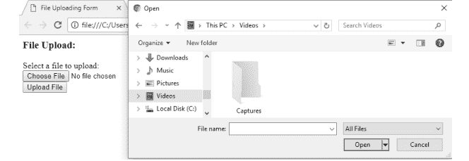

## 10.2 下载文件

在 Web 上下载某些内容，以便从网站或网络传输数据，并将信息保存到你的计算机、平板电脑或移动设备上。

Web 上可以下载各种信息：书籍、电影、软件等。例如，你可以将电影下载到智能手机或移动设备上，以便在在忙途中观看。你可以下载软件或应用程序来增强你的计算能力。

### 10.2.1 直接链接

直接下载链接（DDL），也可以简单称为直接下载，是互联网文件共享社区内使用的术语。它用于描述指向互联网某个位置的超链接，用户可以在该位置下载文件。在对话中，DDL 区别于其他形式的点对点（P2P）下载架构，后者使用客户端-服务器架构，其中 100% 的文件存储在单个文件服务器上，或并行存储在服务器场中的多个文件服务器中。

示例：`http://mu.ac.in/portal/Information-Technology.pdf`

### 10.2.2 间接链接

间接链接不包含真实文件名，通常指向一个程序或 servlet。

示例：`http://myserver.com/download?id=1234`

我们称之为间接链接，或语义链接，而不是指向物理表示的链接。它物理上存储在哪里并不重要；那将由服务器处理。

## 问题

1. 写关于使用 Java Servlet 上传文件的简短说明。
2. 上传文件时哪些点是重要的？
3. 如何创建 HTML 上传表单？
4. 写关于使用 Java Servlet 下载文件的简短说明。

# 第 11 章 单元 - II

# 处理非阻塞 I/O

## 11.1 引入

非阻塞 I/O 在 Servlet 3.1 中引入，用于开发可扩展应用程序。Servlet 3.0 允许异步请求处理，但 API 只允许传统的 I/O，这可能会限制应用程序的可扩展性。在典型的应用程序中，`ServletInputStream` 是在循环中读取的。然而，如果传入的数据被阻塞或是流式的，服务器线程必须等待数据。当数据写入 `ServletOutputStream` 时，也会发生相同的情况。

Servlet 3.1 通过添加事件监听器解决了这个问题：`Listener` 和 `WriteListener` 接口。你通过使用 `ServletInputStream.setListener` 和 `ServletOutputStream.addListener` 来注册这些事件监听器。

监听器具有回调方法，当内容可用读取或可以在不阻塞的情况下写入时，就会调用这些方法。

这些技术的核心思想是避免阻塞。这很重要，因为阻塞的线程会浪费资源、线程内存以及上下文切换期间的处理器时间。在某些情况下，可以在没有任何任何成本的情况下提高 servlet 的性能。

阻塞还会让服务器池容易受到饥饿。考虑一个拥有 200 个线程的服务器，如果收到来自慢客户端的 200 个大内容的请求，那么整个服务器池可能会被阻塞写入这些客户端的线程耗尽。异步 IO 允许重用线程来处理请求，同时慢客户端将以最少资源被处理。

## 11.2 它是如何工作的？

使用异步 HTTP 客户端（例如 `AsyncHttpClient`）调用外部 REST 服务的 servlet 基本流程如下：

1. 首先，我们想要提供异步支持的 servlet 应该具有 `asyncSupported` 值为 `true` 的 `@WebServlet`。
2. 由于实际工作是委托给另一个线程，我们需要一个线程池实现。我们可以使用 `Executors` 框架创建线程池，并使用上下文监听器来初始化线程池。
3. 我们需要通过 `ServletRequest.startAsync()` 方法获取 `AsyncContext` 实例。`AsyncContext` 提供获取 `ServletRequest` 和 `ServletResponse` 对象引用的方法。它还提供了使用 `dispatch()` 方法将请求转发到另一个资源的方法。
4. 我们应该有一个 `Runnable` 实现，在其中我们进行重处理，然后使用 `AsyncContext` 对象将请求派发到另一个资源或写入响应 `ServletResponse` 对象。一旦处理完成，我们应该调用 `AsyncContext.complete()` 让容器知道异步处理已完成。
5. 我们可以添加 `AsyncListener` 实现来实现回调方法，我们可以用它在发生错误或异步线程处理超出的情况下向客户端提供错误响应。我们也可以在此处进行一些清理工作。

## 11.3 设置 WriteListener

要激活异步写入，关键是在请求上启动异步模式并将你的监听器添加到输出流中。下面的示例展示了如何这样做提供来自 `ServletContext` 的静态内容：

```java
@Override
protected void doGet(HttpServletRequest request, HttpServletResponse response) throws ServletException, IOException
{
  // 获取要提供的静态资源的路径。
  String info=request.getPathInfo();
  // 设置响应类型
  response.setContentType(getServletContext().getMimeType(info));
  // 将内容作为输入流获取
  InputStream content = getServletContext().getResourceAsStream(info);
  if (content==null) {
    response.sendError(404);
    return;
  }

  // 准备异步
  AsyncContext async = request.startAsync();
  ServletOutputStream out = response.getOutputStream();
  out.setListener(new StandardDataStream(content, async));
}
```

异步写入的激活，是在请求上启动异步模式并将你的监听器添加到输出流中。下面的示例展示了如何这样做提供来自 `ServletContext` 的静态内容：

## 11.4 实现 WriteListener

当内容可用读取或可以在不阻塞的情况下写入时，就会调用监听器的回调方法。我们可以用它在发生错误或异步线程处理超出的情况下向客户端提供错误响应。我们也可以在此处进行一些清理工作。

我们需要实现 `ReadListener` 类，它在非阻塞模式下执行读取操作。`ReadListener` 接口实现了三个回调方法：

- **onAvailable** 在内容可读取时调用。
- **onDataRead** 在请求数据被完全读取时调用。
- **onError** 在请求产生错误时调用。


```java
import java.io.IOException;
import java.util.Queue;
import java.util.concurrent.LinkedBlockingQueue;
import javax.servlet.AsyncContext;
import javax.servlet.ReadListener;
import javax.servlet.ServletInputStream;
import javaxservletServletServletServlet;;
import...Write;;
importservletservlet......

.... { { { {


    private ServletInputStream input = null;
    private HttpServletResponse res = null;
    private AsyncContext ac = null;
    private Queue queue = new LinkedBlockingQueue();

    ReadListenerImpl(ServletInputStream in, HttpServletResponse r, AsyncContext c) {
        input = in;
        res = r;
        ac = c;
    }

    public void onAvailable() throws IOException {
        System.out.println("Data is available");

        StringBuilder sb = new StringBuilder();
        int len = -1;
        byte[] b = new byte[1024];
        while (input.isReady() && (len = input.read(b)) != -1) {
            String data = new String(b, 0, len);
            sb.append(data);
        }
        queue.add(sb.toString());
    }

    public void onDataRead() throws IOException {
        System.out.println("Data is all read");
    }

    public void onError(Throwable t) {
        ac.complete();
    }
}
```

（注：由于原文文本存在多处重复和乱码，翻译时已根据逻辑进行了修正和对齐。）

```java
ServletOutputStream output = res.getOutputStream();
WriteListener writeListener = new WriteListenerImpl(output, queue, ac);
output.setWriteListener(writeListener);

}

public void onError(final Throwable t) {
    ac.complete();
    t.printStackTrace();
}
```

## 问题

- 1. 什么是非阻塞 I/O (Non-Blocking I/O)？

- 2. 解释非阻塞 I/O 的原理。

- 3. `WriteListener` 在执行非阻塞 IO 时起着什么作用？请举例说明。

- 4. `ReadListener` 在执行非阻塞 IO 时起着什么作用？请举例说明。

# 第 12 章

# 第三单元

# Java 服务器页面 (JAVASERVER PAGES)

## 12.1 Javaserver Pages 简介

Javaserver Pages (JSP) 是一种用于开发交互式网页面的技术。JSP 由 Sun Microsystems 开发，是 Java Servlet 的改进版本。JSP 可以以简化的方式进行开发，并具有广泛的应用。与大多数基于服务器的技术一样，JSP 将逻辑与表现层分离。

JSP 是嵌入了 Java 代码的普通 HTML 页面。要处理 JSP 文件，开发者需要一个连接到 Web 服务器的 JSP 引擎。JSP 页面会被编译成 servlet，并由 servlet 引擎处理。这一阶段被称为翻译。然后，servlet 加载 servlet 类并执行它以创建动态 HTML，然后将其发送到浏览器。当请求下一个页面时，除非 JSP 页面发生了更改，否则 JSP 页面会被预编译为 servlet 并执行。当与 Java 数据库连接 (JDBC) 使用时，JSP 提供了一种创建数据库驱动型网站的动态方法。

## 12.2 为什么要使用 Javaserver Pages？

### 12.2.1 JSP 相比 servlet 的优势

- 对 Servlet 的扩展：JSP 技术是 servlet 技术的扩展。我们可以在 JSP 中使用 servlet 的所有功能。此外，我们可以在 JSP 中使用隐式对象、预定义标签、表达式语言和自定义标签，使开发变得简单。

- 易于维护：JSP 可以被管理，因为我们可以轻松地将业务逻辑与表现逻辑分离。在 servlet 技术中，我们可以将业务逻辑与表现逻辑混合在一起。

- 开发快速：无需重新编译和重新部署。如果修改了 JSP 页面，我们不需要重新编译和重新部署项目。如果我们必须更改应用程序的外观感觉，则需要更新并重新编译 servlet 类。

- 代码比 servlet 少：在 JSP 中，我们可以使用如操作标签、JSTL、自定义标签等类型的标签，减少代码量。此外，我们还可以使用 EL、隐式对象等。

- JSP 提供了 Java 的所有功能，即一次编写，随处运行。

- JSP 使用基于脚本语言语法将 HTML 嵌入到 JSP 中。

## JSP 相比其他 Servlets 的优势

- 相比活动服务器页面 (ASP)：ASP 由微软提供。它也是一种基于标签的编程语言。ASP 代码不可移植。然而，JSP 代码是可移植的，因为它是用 Java 这种可移植语言编写的。我们可以使用 Java 来编写 JSP，因此不需要特定的服务器产品或 IIS。

- 相比 PHP：PHP 是一种嵌入 HTML 的脚本语言，也是开源软件 Java。它与 JSP 和 ASP 类似。由于安全原因，它不适用于大型应用程序和涉及资金交易的银行应用程序。对于 PHP，我们必须学习一种语言。

- 相比 JavaScript：JavaScript 与 Java 编程没有关系。它通常用于在客户端机器上动态生成 HTML。JavaScript 不适用于网络编程和访问服务器端资源。Java 比 PHP 更强大、灵活、可靠且具有移植性。

- 相比 HTML：普通的 HTML（即静态 HTML）不包含动态信息。因此它对用户没有反应，也不用于访问服务器页面。JSP 包含静态和非静态内容。作为静态部分，它包含 HTML。

# JSP 的缺点

- 输出是 HTML，功能不够丰富。

- 当 JSP 被翻译成 servlet 并编译时，难以调试/追踪错误。

- JSP 页面在首次被访问时需要更多时间，因为它们需要在服务器上进行编译。

- 数据库连接并不像想象中那样简单。大多数 servlet 引擎供应商都不原生支持连接池。

- 存在许多与 JSP 编程相关的语法。

## JSP vs. Servlets

- Servlet 比 JSP 快，而 JSP 比 Servlet 慢，因为它首先要被翻译成 java 代码。

- 在 Servlet 中，如果我们修改了代码，则需要重新编译、重启服务器？这是一个耗时的过程。在 JSP 中，如果我们进行任何修改，只需点击刷新按钮即可，而不需要重新编译、重新加载和重启服务器。

- Servlet 是纯 Java 代码。JSP 是基于标签的方法。

- 在 Servlet 中，没有在客户端运行 JavaScript 的这种方法。在 JSP 中，我们可以通过在客户端运行 JavaScript 来使用客户端验证。

- 要运行 Servlet，我们必须在部署描述符文件（即 `web.xml`）中外部创建 Servlet 映射项。运行 JSP 不需要从 `web.xml` 中外部创建 JSP 映射项，你可能创建或不为 JSP 创建文件列表最终项。

- Servlet 的编码比 JSP 困难。而 JSP 的编码比 Servlet 容易，因为它是基于标签的。

- 在 MVC 模式中，Servlet 扮演控制器的角色。在 MVC 模式中，JSP 用于显示输出数据，即在 MVC 中它是视图。

- JSP 页面大约需要额外的磁盘空间来存放页面 servlet。

## Javaserver Pages

- Servlet 接受所有协议。而 JSP 只接受协议请求。

- 在 Servlet 中，需要重写 `Service()` 方法。而 JSP 不需要重写。

- 在 Servlet 中，默认不启用会话管理，需要显式启用。在 JSP 中，会话管理是自动启用的。

- 在 Servlet 中我们没有隐式对象。如果意味着要使用对象，我们需要从 servlet 获取对象。在 JSP 中，支持对象。

- 在 Servlet 中，我们需要实现业务逻辑，表现逻辑混合。在 JSP 中我们可以通过使用技术将业务逻辑与表现逻辑分离。

- 在 Servlet 中，所有包必须在 servlet 顶部导入。在 JSP 中可以随处导入。

## 12.4 JSP 页面的生命周期

页面无法直接输出内容到浏览器，它依赖于早期服务器处理过程，将 JSP 页面翻译成 JSP 类。该页面类随后处理所有的 JSP 请求。

JSP 的生命周期分为以下阶段：

1. **JSP 页面翻译**：从 JSP 源文件生成 Java Servlet 文件。这是其双阶段生命周期的第一步。在翻译阶段，容器验证 JSP 页面和标签文件的语法正确性。容器解释直接指令、操作以及引用使用的标签库的自定义操作。

2. **JSP 页面编译**：在页面翻译后，生成的 Servlet 文件被编译成 Java 类。将 JSP 页面翻译为实现类的操作发生在 JSP 页面初始部署到容器以及接收并处理目标 JSP 请求的任何时候。

3. **类加载**：从 JSP 编译的 Java 类被加载到容器中。

4. **执行阶段**：在此阶段，容器根据请求和其他事件调整该类的一个或多个实例。`JSPPage` 接口包含 `jspInit()` 和 `jspDestroy()` 方法。JSP 规范为处理 HTTP 请求的 JSP 提供了特殊接口，该接口包含 `jspService()` 方法。

5. **初始化**：`jspInit()` 方法在实例创建后立即被调用。它在 JSP 生命周期中只被调用一次。

6. `_jspService()` 执行：此方法在 JSP 的生命周期内的每个请求中都会被调用。它在这里起到创建的作用。它必须通过上述所有步骤才能到达此阶段。它传递了请求和响应对象，`_jspService()` 方法不能被重写。

7. `jspDestroy()` 执行：此方法在此 JSP 页面销毁时被调用。通过此，Servlet 完成了它的使命并将其提交给垃圾回收机制。这是 JSP 生命周期的结束。

## 12.5 JSP 是如何工作的？

Web 服务器需要一个 JSP 引擎，一个用于处理 JSP 页面的容器。Web 容器负责拦截对 JSP 页面的请求。

JSP 容器与 Web 服务器协同工作，为 JSP 提供所需的运行时环境和其他服务。它知道如何理解 JSP 组成的特殊元素。下图显示了 JSP 容器和 JSP 文件在 Web 应用中的位置。

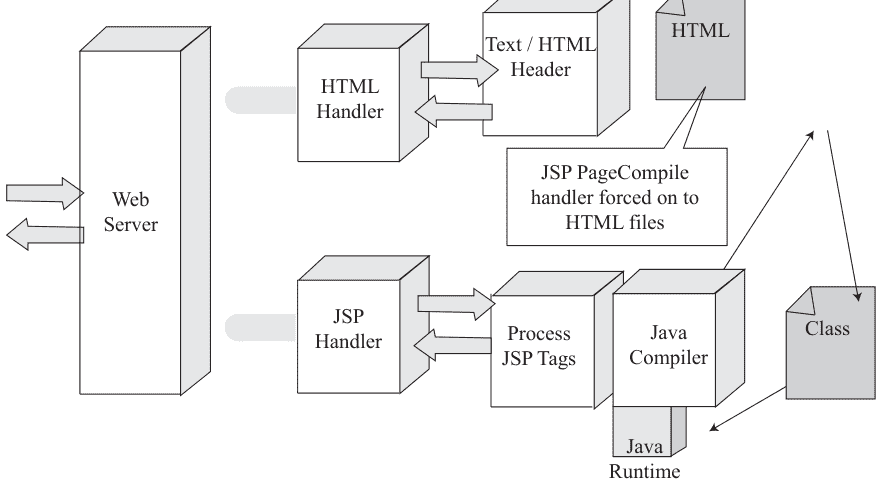

## 12.6 JSP 是如何执行的？

以下步骤解释了 Web 服务器如何使用 JSP 创建 Webpage：

- 像普通页面一样，你的浏览器向 Web 服务器发送 HTTP 请求。

- Web 服务器识别出 HTTP 请求是针对 JSP 页面的，并将其转发给 JSP 引擎。这是通过以 `.jsp` 结尾而不是 `.html` 的 URL 或 JSP 页面实现的。

- JSP 引擎从磁盘加载 JSP 页面并转换为 servlet。这种转换非常简单，所有的模板文本都被转换为 `println()` 语句，所有的 JSP 元素都被转换为 Java 代码。这些代码实现了页面相应的行为。

- JSP 引擎将 servlet 编译成可执行的类，并将原始请求转发给 servlet 引擎。

- Web 服务器的一部分调用 servlet 引擎加载 Servlet 类并执行它。在执行期间，servlet 生成 HTML 格式的输出。

输出由 servlet 引擎在 HTTP 响应内部进一步传递给 Web 服务器。

- Web 服务器以静态 HTML 内容的形式将 HTTP 响应转发给你的浏览器。

- 最后，Web 浏览器处理 HTTP 响应内部动态生成的 HTML 页面，就像处理静态页面一样。

通常，JSP 引擎会检查是否已经存在 JSP 文件的 servlet，以及 JSP 上的修改日期是否早于 servlet。如果 JSP 比其生成的 servlet 旧，JSP 容器将假设 JSP 没有更改，且生成的 servlet 与 JSP 的内容匹配。这个过程比其他脚本语言（如 PHP）要高效得多，因此速度更快。

所以从某种意义上说，JSP 编写 servlet 的另一种方式，不需要成为 Java 魔法师。除了翻译阶段，JSP 的处理方式与普通 servlet 完全相同。

## 12.7 关于 JavaServer Pages 2.3

JavaServer Pages (JSP) 2.3 特性提供了对 JSP 2.3 规范的全支持。

新 JSP 2.3 函数的描述在 JSP 2.3 规范中提供，此处未进行描述：但是，与 JSP 2.2 特性相比，新规范的增加是非常微小的：

- 支持表达式语言 (EL) 3.0

- JSP 可使用 Servlet 3.1 APIs。

- 在 JSP 2.2 和 JSP 2.3 之间没有已知的行为差异直接导致在 JSP 2.2 上运行的 JSP 无法在 JSP 2.3 上成功运行。然而，如果 JSP 使用了表达式语言 (EL) 或 Servlet API 函数，必须考虑 Servlet 3.1 与 Servlet 3.0 之间、EL 3.0 与 EL 2.2 之间的变化。

## 问题

- 1. 什么是 JSP？解释它的优点和缺点。

- 2. JSP 相比 Servlet 其他技术有哪些优势？

- 3. 区分 Servlet 和 JSP。

- 4. 解释 JSP 生命周期的阶段。

- 5. 解释 JSP 的功能和执行过程。

# 第 13 章

# 第三 单元

# 入上手 JAVASERVER PAGES

## 13.1 注释

JSP 允许两种类型的注释：

- 1. 隐藏注释：此注释不会出现在输出中。

  `<%-- 隐藏注释 -->`

- 2. 输出注释：这种类型的注释会出现在输出中。

  `<!-- 输出注释 -->`

如果我们在指令内部传递注释，则我们使用单行注释，即 `//`

## 13.2 JSP 文档

JSP 支持以下两种编码风格：

- 1. JSP 页面：它使用传统的或简写语法。

  ```
  <%@page language="java" import="java.util.*" errorPage=""" %>
  ```

  ```
  <html>
  <body>
  nCurrent Date time: <%= new java.util.Date() %>
  </body>
  </html>
  ```

- 2. JSP 文档：这种类型的 JSP 页面使用符合 XML 的语法。

  ```
  <JSP:root xmlnsJSP="http://java.sun.com/JSP/Page" version="1.3">
  <JSP:directive.page import="java.util.Date, java.text.SimpleDateFormat" />
  <JSP:scriptlet>
  Date d = new Date();
  String dateString = getFormattedDate(d);
  </JSP:scriptlet>
  </JSP:root>
  ```

## 13.3 JSP 元素

JSP 元素分为以下类别：

### 13.3.1 指令

指令为 JSP 容器提供指令。它们不产生输出。指令用于设置 JSP 的全局属性：

```
<%@ directive %>
```

指令支持的属性：

- `Extends`：指定 servlet 必须继承的超类。

- `Import`：指定使用的包或类。

- `Info`：定义一个可以访问的字符串。

- `isSafe`：定义生成的 servlet 的线程模型。

- `Language`：定义 JSP 中使用的编程语言。

- `session`：指定 JSP 页面是否参与会话。

- `isIgnored`：指定 JSP 中的 EL 表达式是否被忽略。

- `isingEnabled`：决定是否允许脚本元素。

- `Buffer`：默认缓冲区大小至少为 8 KB。

- `errorPage`：包含当发生未处理错误时应跳转的相对 URL。错误文件必须声明 `isError="true"` 以访问 `Exception` 对象。

- `ContentType`：定义响应的 MIME 类型和字符集。标准 JSP 页面为 `"text/html"`，实现 XML 格式的 JSP 文档为 `"text/xml"`。

- `pageEncoding`：定义 JSP 页面的字符编码。如果没有指定，则在 `ContentType` 中指定为 `"ISO-859-1"`。

- `Buffer`：指定缓冲机制。

- `autoFlush`：控制输出。

- `contentType`：定义编码方案。

- `errorPage`：指示另一个 servlet 的 URL。

`page` 的属性有：

```
<%@ page %>
```


指令的第一个词是：`page`、`taglib`。第二个词是一个或多个。`uri` 属性定位自定义标签的 TLD 文件。键值对用于 JSP 页面。

### 13.3.1.2 include 指令

`include` 指令允许我们包含另一个文件的代码，这对于重用非常有用。在每个页面顶部显示某个页面以允许用户返回首页。

语法：`<%@include file="menu.jsp"%>`

指令的 `file` 属性实际上是一个相对 URL。

### 13.3.1.3 taglib 指令

JSP `taglib` 指令用于定义标签库，标签库是标签的集合，并为标签定义前缀。要在我们的 JSP 中使用自定义标签，我们必须使用它的语法来导入包含这些标签定义的库。

语法：`<%@taglib uri="URLToTaglib.library" prefix="prefix"`

### 13.3.2 脚本元素

JSP 使用三种类型的脚本元素：表达式、脚本段 (Scriptlet) 和声明。

- **I. 表达式**：JSP 表达式用于将 Java 值直接插入输出中。表达式的语法为 `<%% expression %>`，它们会被求值并插入输出中。语法：`<%% new java.util.Date() %>`

## 入门 JavaServer Pages

Java 表达式会被求值、转换为字符串并插入到页面中。JSP 表达式可以使用一些预定义变量，例如：

- `request`，即 `HttpServletRequest`；
- `response`，即 `HttpServletResponse`；
- `session`，即与请求和 `out` 关联的 `HttpSession`；
- `out`，即 `PrintWriter`（`PrintWriter` 类型的缓冲版本），用于向客户端发送输出。

示例：我们的主机名：`<%= request.getRemoteHost() %>`

## II. 脚本段 (Scriptlets)

JSP 脚本将代码插入到生成的 Servlet 的 `service()` 方法中。它们的格式为 `<% code %>`。如果我们想执行更复杂的操作，则使用此语法：`<% Java Code %>`

脚本段也可以像表达式一样使用预定义变量。

例如：

```java
<%
String fname = request.getParameter("fname");
out.println("name: " + fname);
%>
```

### III. 声明 (Declarations)

JSP 声明定义了插入到 Servlet 类主体部分的方法或字段。它的格式为 `<%! code %>`。它们被插入到 Servlet 类的主体中，位于任何现有方法之外。

语法：`<% Java Code %>`

```java
<%!
public int getValue() {
return 25;
}
%>
```

我们可以通过这样调用此方法：`<%=getValue()%>`

## 13.4 基于 XML 的 JSP

- 根元素 `<jsp:root ...>`，它包含了 JSP 核心语法的命名空间规范以及所使用的自定义标签库的命名空间规范。
- JSP 指令元素，用于页面（`page`）和包含（`include`）指令
- JSP 声明元素
- JSP 表达式元素
- JSP 脚本段元素
- JSP 标准动作元素
- JSP 自定义动作元素
- 文本元素 `<jsp:text ...>`，用于模板（静态）数据
- 其他需要的、与模板数据相关的 XML 元素

```xml
<jsp:root xmlns:jsp="http://java.sun.com/JSP/Page"
     xmlns:sec="http://java.apache.org/tomcat/examples-taglib"
     xmlns:temp="urn:jsp:ld/WEB-INF/tlds/my.tld"
     version="1.2">
    ...document主体...
</jsp:root>
```

## 问题

1. 解释 JSP 页面的编码风格。
2. JSP 中的指令是什么？请解释它的类型。
3. 关于 JSP 页面指令写一个简短说明。
4. 列出并解释 JSP 中使用的脚本元素。
5. 什么是基于 XML 的文档？请举例说明。

# 第 14 章

# 第三单元

# 动作元素 (ACTION ELEMENTS)

## 14.1 介绍

动作元素基本上是预定义的函数，目前有以下 JSP 动作可用。JSP 动作使用 XML 语法来控制 Servlet 引擎的行为。我们可以动态插入文件、重用 JavaBeans、将用户转发到另一个页面，或为 JSP 插件生成 HTML。

```xml
<jsp:action_name="value"/>
```

JSP 动作元素使用两个常用属性，如下：

a) **Id 属性**：`id` 属性唯一标识动作元素的生命周期，并允许在 JSP 页面内部引用该属性。如果动作创建了对象的实例，可以使用 `id` 值通过隐式对象 `PageContext` 来引用它。

b) **Scope 属性**：该属性标识动作元素的生命周期。`id` 属性和 `scope` 属性直接相关，因为 `scope` 属性决定了与 `id` 关联对象的寿命。`scope` 属性有四个可能的值：(a) `page`、(b) `request`、(c) `session` 和 (d) `application`。

## 14.2 包含其他文件

`jsp:include` 动作标签用于包含另一个资源的内容，它可能是 JSP、HTML 或 servlet。JSP 包含动作标签在请求时包含资源，因此它更适用于**动态页面**，因为未来可能会发生变化。`JSP:include` 标签可以用于包含静态或动态页面。我们可以多次使用某个页面，例如在所有页面中包含头部和页脚页面。这节省了大量时间。

此动作在请求页面时插入文件。

```xml
<jsp:include URL="..." flush="true"/>
```

在上述语法中，`page` 属性是要包含的面的相对 URL，`flush` 是一个布尔属性，决定包含的资源在包含之前是否经过缓冲。

让我们通过示例来理解 `<JSP:include>` 动作的使用。我们定义了两个文件 (a) `myDate.JSP` 和 (b) `home.JSP` 如下：

# Today.JSP 文件

```jsp
<p> Today's date: <%= (new java.util.Date()).toLocaleString()%> </p>
```

# home.JSP 文件

```html
<html><head><title>The Example of include Action</title></head>
<body><center>
<h2>The Example of include Action</h2>
<JSP:include page="myDate.JSP" flush="true" />
</center></body></html>
```

我们必须将所有这些文件放在服务器的根目录下并加载 `home.JSP` 文件。这将显示类似所示的内容：

| The Example of include Action |
|---|
| Today's date: 20-June-2018 14:54:22 |

## 14.3 将 JSP 页面转发到另一个页面

`JSP:forward` 动作标签用于将请求转发到另一个资源，它可能是 JSP 或另一个资源。转发动作终止当前页面的操作，并将请求转发到另一个资源，可以是静态页面、另一个 JSP 页面或 Java Servlet。

语法：`<JSP:forward page="..." />`

在 `<JSP:forward>` 中，`page` 属性是目标资源的 URL，可以是静态页面、另一个 JSP 页面或 Java Servlet。

示例：我们可以使用两个文件 (a) `myDate.JSP` 和 (b) `home.JSP`：

# Today.JSP 文件

```jsp
<p> Today's date: <%= (new java.util.Date()).toLocaleString()%> </p>
```

# home.jsp

```html
<html><head><title>The Example of include Action</title></head>
<body><center>
<h2>The Example of include Action</h2>
<JSP:forward page="myDate.JSP" />
</center></body></html>
```

我们必须将所有这些文件放在服务器的根目录下并加载 `home.JSP` 文件。这将显示类似所示的内容：

| The Example of include Action |
|---|
| Today's date: 20-June-2018 14:54:22 |

# 14.4 为其他动作传递参数

可以通过 `<JSP:param>` 传递请求参数。此标签包含两个属性：(1) `name` 和 (2) `value`。此标签通常作为任何动作的子元素。它将请求从一个 JSP 文件转发到另一个。目标文件可以是 HTML 文件、JSP 文件或任何 servlet。

示例：

```html
<html><head><title>Parameters</title></head>
<body>
<jsp:forward page="ssParameters.jsp">
<jsp:param name="myParam" value="Amar Patel"/>
<jsp:param name="Age" value="15"/>
</jsp:forward>
</body></html>
```

此页面转发参数到：

名称：`<%= request.getParameter("myParam") %>`

年龄：`<%= request.getParameter("Age") %>`

## 14.5 加载 JavaBean

Java Bean 是遵循以下规范的 Java 类：

- 它应该有一个无参构造函数。
- 它应该是可序列化的（`Serializable`）。
- 它应该提供设置和属性值的方法，即 getter 和 setter 方法。

### 14.5.1 向 JSP 页面添加 Bean

`jsp:useBean` 动作用于加载或实例化 bean 类。如果 bean 对象已经创建，则根据范围创建 bean。如果 bean 对象未创建，则实例化 bean。

语法：

```xml
<jsp:useBean id="instanceName" scope="page | request | session | application" class="packageName.className" type="packageName.className" beanName="packageName.className">
    <% expression %>
</jsp:useBean>
```

# `jsp:useBean` 动作标签的属性和用法

1. `id`：用于在指定的范围内标识 bean。
2. `scope`：表示 bean 的范围。它可以是 `page`、`request`、`session` 或 `application`。默认范围是 `page`。
   - `page`：指定你可以在 JSP 页面中使用此 bean。默认范围是 `page`。
   - `request`：指定你可以在处理相同请求的任何 JSP 页面中使用此 bean。它的范围比 `page` 宽。
   - `session`：指定你可以在同一会话的任何 JSP 页面中使用此 bean，无论是否处理相同的请求。它的范围比 `request` 宽。
   - `application`：指定你可以在同一个应用程序的任何 JSP 页面中使用此 bean。它的范围比上述都宽。
3. `class`：实例化指定的 bean 类（即创建 bean 类的对象），但它必须有无参构造函数或带有构造函数，且不能是抽象类。
4. `type`：如果 bean 已经存在于范围内，则提供其数据类型。它可以与 `class` 或 `beanName` 属性一起使用。如果不使用 `class` 或 `beanName`，则不会实例化 bean。
5. `beanName`：使用 `java.beans.Beans.instantiate()` 方法实例化 bean。

### 14.5.2 设置 Bean 的属性

JSP `set` 动作设置 Bean 的属性。在执行此动作之前，必须已经定义了 Bean。使用 `setProperty` 动作有两种基本方法：

我们可以在 `<JSP:useBean>` 元素之后但在其之外使用 `setProperty`，如下：

```
<JSP:useBean id="myName" />
```

```
<JSP:setProperty name="someProperty" ... />
```

在这种情况下，无论实例化了新的 bean 还是发现了现有的 bean，`JSP:setProperty` 都会执行。

第二种方法是 `JSP:setProperty` 可以出现在 `JSP:useBean` 元素的体内部，如下：

```
<JSP:useBean id="myName" ... />
```

```
<JSP:setProperty name="myName" property="someProperty" ... />
```

```
<JSP:useBean>
```

在这种情况下，只有当实例化了新对象时才会执行 `JSP:setProperty`，如果发现了现有的对象，则不执行。属性将传递给相应的 setter 方法。

在 `<JSP:setProperty>` 动作中，`name` 属性告诉我们要设置哪个 bean 的属性。该 bean 必须之前已经定义。`property` 属性指示我们想要设置的属性。`value=""` 表示所有参数都匹配。`value` 属性指定要分配给属性的值。如果参数的值为 `null` 或参数不存在，则忽略该属性动作。`param` 属性提供了要检索其值的请求参数的名称。我们不能同时使用 `value` 和 `param`，但使用 `name` 是允许的。

### 14.5.3 访问 Bean 的属性

`getProperty` 动作用于获取给定属性的值并将其转换为字符串，最后将其插入输出中。`getProperty` 动作只有两个属性，这两个属性都是必需的。

语法：`<JSP:useBean id="myName" ... />`

```
<JSP:getProperty name="myName" property="someProperty" ... />
```

## 动作元素 (Action Elements)

在 `<JSP:getProperty>` 动作中，属性 `name` 提供了要获取属性的 Bean 名称。在这种情况下，该 Bean 必须之前已经定义。`property` 属性指出了要获取的 Bean 属性名称。

**示例：** 我们定义了一个 `TestClass` bean，将在示例中使用它。

```java
// TestClass.java
package class TestAction;
public class TestClass {
    private String msg = " Hello JSP...";
    public String getMsg() {
        return(msg);
    }
    public void setMsg(String msg) {
        this.msg = msg;
    }
}
```

我们必须编译上述代码生成 `TestClass.class` 文件，并确保已将 `TestClass.class` 文件复制到 `C:\apache-tomcat-7.0.2\webapps\WEB-INF\classes\testAction` 文件夹中，且 `CLASSPATH` 变量也指向该文件夹。

现在在 `home.JSP` 文件中使用以下代码加载 bean 并设置/获取一个简单的字符串参数：

```jsp
<html><head><title>Using JavaBeans in JSP</title></head>
<body><center><h2>Using JavaBeans in JSP</h2></center>
<JSP:useBean id="test" class="action.TestClass" />
<JSP:setProperty name="test" property="msg" />
<p>Here we get the message</p>
</center></body></html>
```

现在我们必须加载 `home.JSP`，它将显示以下内容：

Using JavaBeans in JSP

Here we get the message

Hello JSP...

## 14.6 JSP:plugin 动作

`plugin` 动作用于将 Java 组件插入到 JSP 页面中。它确定浏览器类型并根据需要插入 `<object>` 或 `<embed>` 标签。如果所需的插件不存在，将下载该插件然后执行 Java 组件。Java 组件可以是 Applet 或 JavaBean。

`plugin` 动作有几个属性，对应于用于格式化 Java 组件的常用 HTML 标签。`<param>` 元素也可向 Applet 或 JavaBean 发送参数。

语法：

```jsp
<JSP:plugin type="applet" codebase="dirname" code="MyApplet.class"
width="60" height="80">
  <JSP:param name="fontcolor" value="red" />
  <JSP:param name="background" value="black" />
```


```jsp
<JSP:fallback> Unable to find Java Plugin </JSP:fallback>
</JSP:plugin>
```

我们可以使用一些操作尝试此动作。如果找不到 Java 插件，`<fallback>` 元素可以显示信息。

## 14.7 JSP:text 动作

`text` 动作用于向页面输出文本。它不能包含其他元素。

语法：`<JSP:text> 文本</JSP:text>`

`text` 动作可以用于发送参数。示例如下：

## 习 (QUESTIONS)

1. JSP 中使用了哪些动作元素？
2. 如何转发并向其他动作传递参数？
3. 简述在 JSP 中加载 Java bean。
4. 如何在 JSP 中设置和访问 bean 的属性？
5. 解释任意 JSP 动作。

## 隐式对象、作用域与 EL 表达式

- 11. `String getPath()`：此方法返回请求 URI 的部分，用于指示请求的上下文（context）。
- 12. `String getHeader(String name)`：此方法将指定的请求头的值以 `String` 形式返回。
- 13. `String getMethod()`：此方法返回用于发送此请求所使用的 HTTP 方法名称，例如 GET、POST 或 PUT。
- 14. `String getParameter(String name)`：此方法将请求参数的值以 `String` 形式返回，如果参数不存在则返回 `null`。
- 15. `String getPathInfo()`：此方法返回与客户端在发送此请求时发送的 URL 关联的任何额外路径信息。
- 16. `String getProtocol()`：此方法返回协议的名称和版本。
- 17. `String getQueryString()`：此方法返回请求 URL 中路径之后的查询字符串。
- 18. `String getRemoteAddr()`：此方法返回发送请求的客户端的 Internet 协议（IP）地址。
- 19. `String getRemoteHost()`：此方法返回发送请求的客户端的全限定名称（fully qualified name）。
- 20. `boolean isSecure()`：此方法返回一个布尔值，指示此请求是否使用了安全通道（如 HTTPS）。
- 21. `int getServerPort()`：此方法返回接收此请求的端口号。

### 15.1.2 响应对象 (Response Object)

响应对象定义了类在创建新的 HTTP Header 时使用的接口。响应对象是 `javax.servlet.http.HttpServletResponse` 对象的实例。它创建一个对象来表示对客户端的响应。通过该 JSP，程序员可以添加新的 Cookie 或时间戳等。后续章节提供了关于响应对象一些重要方法的信息。详情请参阅 Javadoc。

- 1. `String encodeRedirect(String url)`：此方法对用于 `sendRedirect` 方法的 URL 进行编码；如果不需要编码，则返回原始不变的 URL。
- 2. `String encodeURL(String url)`：此方法对包含 Session ID 在内的 URL 进行编码；如果不需要编码，则返回原始不变的 URL。
- 3. `addCookie(Cookie cookie)`：此方法将指定的 Cookie 添加到响应中。
- 4. `addHeader(String name, long date)`：此方法添加带有给定名称和日期-值的响应头。
- 5. `addHeader(String name, String value)`：此方法添加带有给定名称和值的响应头。
- 6. `flushBuffer()`：此方法强制将缓冲区中的任何内容写入客户端。
- 7. `reset()`：此方法清除缓冲区中存在的任何数据，以及状态码和响应头。
- 8. `voidError(int sc, String msg)`：此方法使用指定的状态码向客户端发送错误响应。
- 9. `voidRedirect(String location)`：此方法使用指定的重定向位置 URL 向客户端发送临时重定向响应。
- 10. `void setCharacterEncoding(String charset)`：此方法设置发送给客户端的响应字符编码（MIME 字符集），例如 UTF-8。
- 11. `void setContentType(String type)`：如果响应尚未提交（committed），则此方法设置发送给客户端的响应的内容类型。
- 12. `void setHeader(String name, String value)`：此方法设置带有给定名称和值的响应头。
- 13. `void setLocale(Locale locale)`：如果响应尚未提交，则此方法设置响应的本地区域（locale）。

### 15.1.3 对象 (The Object)

它是 `javax.servlet.JspWriter` 对象的实例，用于在响应中发送内容。初始 `JspWriter` 的实例化方式取决于页面是否启用了缓冲区。

### 方法

- 1. `out.print(dataType type)`：打印一个数据类型的值。
- 2. `out.println(dataType type)`：用于打印一个数据类型的值，然后用换行符结束行。
- 3. `out.flush()`：用于刷新流。

### 15.1.4 Session 对象 (The session Object)

session 是 `javax.servlet.HttpSession` 的实例，其使用方式与 Java Servlets 中的 session 对象行为相同。session 对象的主要用途是跟踪客户端请求之间的客户端会话。

### 方法

- 1. `public Object getAttribute(String name)`：此方法返回此会话中具有指定名称的绑定对象，如果该名称下没有绑定对象，则返回 `null`。
- 2. `public Enumeration getAttributeNames()`：此方法返回一个包含所有绑定到此会话的对象名称的 `String` 枚举。
- 3. `public long getCreationTime()`：此方法返回会话创建的时间，单位为自 1970 年 1 月 1 日 GMT 以起的毫秒数。
- 4. `public String getId()`：此方法返回一个包含分配给此会话的唯一标识符的字符串。
- 5. `public long getLastAccessedTime()`：此方法返回上次访问此会话的时间，自 1970 年 1 月 1 日 GMT 以起的毫秒数。
- 6. `public int getMaxInactiveInterval()`：此方法返回会话失效前的最大间隔时间（秒）。
- 7. `public void invalidate()`：此方法使会话失效。
- 8. `public boolean isNew()`：如果会话是新创建的，此方法返回 `true`。
- 9. `public void removeAttribute(String name)`：此方法从会话中移除指定的属性。
- 10. `public void setAttribute(String name, Object value)`：此方法将对象绑定到会话名称中。
- 11. `public int getInactiveInterval()`：此方法返回会话失效前的间隔时间（秒）。

### 15.1.5 应用对象 (The Application Object)

应用对象是 `javax.servlet.ServletContext` 对象的实例，在整个 Web 应用程序生命周期内可以使用。该对象在 JSP 页面初始化时创建。

### 方法

- 1. `getAttribute(String name)`：此方法返回应用中具有指定名称的绑定对象，如果属性不存在则返回 `null`。
- 2. `getAttributeNames()`：此方法返回应用中所有属性名称的枚举。
- 3. `setAttribute(String name, Object value)`：此方法将对象存储在应用中的指定名称中。
- 4. `removeAttribute(String name)`：此方法用于从应用中移除指定的属性。
- 5. `getMajorVersion()`：此方法返回 Servlet API 的主版本号。
- 6. `getMinorVersion()`：此方法返回 Servlet API 的次版本号。
- 7. `getServerInfo()`：此方法返回 Servlet 引擎的名称和版本。关于 JSP 容器的信息（如名称和产品）可以通过应用对象的 `getServerInfo()` 方法获取。
- 8. `getInitParameter(String name)`：此方法返回指定初始化参数的值。如果参数不存在，则返回 `null`。
- 9. `getInitParameterNames()`：此方法返回所有初始化参数的名称。
- 10. `getResourceStream(Path)`：此方法将方法中提到的资源 URL 转换为可读输入流。
- 11. `log(Message)`：应用对象的 `log` 方法将字符串写入 JSP 容器的默认日志文件。

### 15.1.6 Config 对象 (The Config object)

此对象允许 JSP 程序员访问 Servlet 或 JSP 引擎初始化参数，例如路径或文件位置。config 对象是 `javax.servlet.ServletConfig` 的实例化，是生成的 servlet 的 `ServletConfig` 的直接封装。

### 方法

- 1. `getConfigServletName()`：此方法返回 servlet 名称，即 `WEB-INF/web.xml` 中定义的 `<servlet-name>` 元素中的字符串。
- 2. `getParameter(String name)`：此方法返回指定初始化参数的值。
- 3. `getInitParameterNames()`：此方法返回所有 Servlet 初始化参数名称的 `String` 枚举。
- 4. `getContext()`：此方法返回与调用 servlet 关联的 `ServletContext` 对象。

### 15.1.7 pageContext 对象

pageContext 对象是 `javax.servlet.jsp.PageContext` 对象的实例。`pageContext` 对象用于表示整个 JSP 页面。该对象用于访问有关页面的信息，同时避免了实现细节。该对象存储了每个请求的请求和响应对象的引用。application、config、session 和 out 是通过访问该对象的属性派生的。`pageContext` 对象还包含有关用于 JSP 页面指令的信息，包括缓冲信息、errorURL 和页面作用范围（page scope）。

PageContext 类定义了几个字段，包括 `PAGE_SCOPE`、`REQUEST_SCOPE`、`SESSION_SCOPE` 和 `APPLICATION_SCOPE`，它们用于识别这四种范围。

pageContext 的重要方法是 `removeAttribute()`，它接受一个或两个参数。例如，`pageContext.removeAttribute("attrName")` 会从所有范围中移除属性，而下面的代码仅将其从页面范围中移除：

```java
pageContext.removeAttribute("attrName", PAGE_SCOPE);
```

### 15.1.8 page 对象

JSP 隐式对象是 `java.lang.Object` 类的实例。该对象是整个 JSP 页面的表示。此页面具有页面作用范围（page scope），并且处理当前请求的 JSP Servlet 类的实例。`page` 对象表示当前页面，用于调用翻译后的 servlet 定义的方法。`page` 是 "this" 对象的直接同义词。如果该 `page` 隐式对象消耗大量内存，则不建议使用它。

### 15.1.9 Exception 对象

exception 通常用于对错误条件生成适当的响应。当我们编写 JSP 代码时，程序员可能会编写编码错误，这些错误可能发生在代码的任何部分。在我们的 JSP 代码中可能会有以下类型的错误：

- 1. 检查异常（Checked exceptions）：检查异常通常是用户错误或程序员未知的问题的异常。例如，如果要打开一个文件但找不到该文件，就会发生异常。这些异常在编译时不能简单地被忽略。
- 2. 运行时异常（Runtime exceptions）：运行时异常是程序员可能可以避免的异常。与检查异常一样，运行时异常在编译时会被忽略。
- 3. 错误（Errors）：这些不是异常，而是发生在用户或程序员控制之外的问题。我们通常在代码中会忽略错误，因为我们很难对错误做任何什么。例如，如果发生堆栈溢出，将引发错误。它们在编译时也会被忽略。

### 方法

- 1. `public String getMessage()`：此方法返回关于已发生异常的详细消息。
- 2. `public Throwable getCause()`：此方法返回由 `Throwable` 对象表示的异常原因。
- 3. `public String toString()`：此方法返回类名与 `getMessage()` 的结果拼接后的。
- 4. `public void printTrace()`：此方法将 `toString()` 的结果连同堆栈轨迹打印到 `System.err`（错误输出流）。
- 5. `public StackTraceElement[] getTrace()`：此方法返回一个包含堆栈跟踪中每个元素的数组。索引 0 处的元素表示调用栈的顶端，数组中的最后一个元素表示调用栈底部的方法。
- 6. `public Throwable fillInStackTrace()`：此方法用当前堆栈跟踪填充此 `Throwable` 对象的堆栈跟踪，并添加到堆栈跟踪中的任何之前信息。

## 15.2 作用范围 (Scope)

### 15.2.1 页面作用范围 (Page Scope)

具有页面作用范围的对象绑定到 `javax.servlet.jsp.PageContext`。只要页面仍在响应当前请求，该对象就会置于 `PageContext` 中。可以通过调用隐式 `page` 对象的 `getAttribute` 方法来访问具有此作用范围的对象。该对象为页面的每个客户端请求而创建和销毁。它是与 `<jsp:useBean>` 动作使用的对象的默认作用范围。

注意：页面作用范围仅在特定页面内可用。

### 15.2.2 请求作用范围 (Request Scope)

请求作用范围意味着对象绑定到 `javax.servlet.ServletRequest`，可以通过调用隐式 `request` 对象的 `getAttribute` 方法来访问。该对象对于每个客户端请求都是不同的。只要 `HttpRequest` 对象存在，该引用就可用，即使请求被转发到不同的页面，或者使用了 `<jsp:include>` 动作。

注意：请求作用范围仅从一个页面持续到下一次请求可用。

### 15.2.3 会话作用范围 (Session Scope)

具有会话作用范围的对象绑定到 `javax.servlet.jsp.PageContext`，可以通过调用隐式 `session` 对象的 `getValue` 方法来访问。生成的 Servlet 依赖于使用 `setAttribute(String key, Object value)` 方法将对象绑定到 `HttpSession`。该对象对于每个客户端都是不同的，只要客户端会话有效，它可用。

注意：会话作用范围在每个页面从会话开始到结束可用。

### 15.2.4 应用作用范围 (Application Scope)

应用作用范围意味着对象绑定到 `javax.servlet.ServletContext`。具有此作用范围的对象可以通过调用隐式 `application` 对象的 `getAttribute` 方法来访问。这是唯一的持久化作用范围。访问变量时，请确保你的代码是线程安全的。应用变量通常在应用启动时填充，之后仅进行读取。

注意：应用作用范围从应用程序（网站）启动到每个页面的应用程序可用。它可以被视为应用程序的全局状态。

## 15.3 字符转义约定


转义字符（也称为序列或字符转义约定）通常用于信号某些字符的替代解释。有许多方法可以信号某些字符的替代解释。

| 语法 | 目标格式 |
| --- | --- |
| `'` | |
| `"` | |
| `%>` | |
| `<%` | |

## 15.4 统一表达式语言 [EL]

### 15.4.1 统一 EL 语法

统一表达式语言最初称为 SPEL（Simple Possible Expression Language），提供了一种访问外部数据的简单方法。例如，`${employee.name}` 用于查找员工 JavaBeans 组件并调用 `getName` 方法获取名称属性的值。该值被渲染到页面中。

统一表达式语言允许页面作者使用简单的表达式动态访问 JavaBeans 组件的数据。例如，以下条件标签的 `test` 属性提供了一个 EL 表达式，用于计算会话范围 bean 中的项目数量是否大于 0。

```xml
<if test="${sessionScope.cart.numberOfItems > 0}">
...
</if>
```

通过 EL，开发者可以大幅减少页面中的脚本量，从而提高生产力、更易维护，并对页面开发曲线更加友好。表达式语言具有更高级的功能，但它非常容易维护。

### 15.4.1.1 立即评估

所有使用 `${ }` 语法的表达式都会被立即评估。这些表达式只能在模板文本或接受运行时表达式的标签值中使用。

以下示例显示了一个标签，其 `value` 属性引用了一个立即评估表达式，该表达式从会话范围的 bean `cart` 中获取总价：

```xml
<fmt value="${sessionScope.total}">
```

JavaFaces 实现评估该表达式，对其进行转换，并将返回的值传递给标签处理程序。立即评估表达式始终是只读表达式。上述示例只能从 bean 中获取总价，而不能设置总价。

### 15.4.1.2 延迟评估

延迟评估表达式的形式为 `#[expr]`，它们可以在使用该表达式的任何技术定义的页面生命周期的其他阶段进行评估。在 JavaFaces 技术中，控制器可以根据表达式在页面中的用法，在生命周期的不同阶段评估该表达式。

以下示例显示了一个 JavaFaces `inputText`，它代表一个用户输入值的文本字段组件。`inputText` 标签的 `value` 属性引用了一个延迟评估表达式，该表达式指向 `customer` 的 `name` 属性。

```xml
<inputText id="name" value="#{customer.name}"/>
```

对于包含此内容的页面初始请求，JavaFaces 实现会在生命周期的响应阶段评估 `#{customer.name}` 表达式。在此阶段，表达式仅访问 `customer` bean 的值，与立即评估相同。

对于回传（postback），JavaFaces 实现会在生命周期的不同阶段评估该表达式，在此期间，值会被延迟到请求被验证并传播到 `customer` bean 时。

如此示例所示，延迟评估表达式可以是既用于读取又写入数据的值表达式。它们也可以是方法表达式。值表达式（立即和延迟）以及方法表达式将在下一节中介绍。

## 15.4.2 表达式类型

EL 定义了两种表达式：值表达式和方法表达式。值表达式可以产生一个值，也可以设置一个值。方法表达式引用可以被调用并返回一个值的方法。

### 15.4.2.1 值表达式

值表达式可以进一步分为右值（rvalue）表达式和左值（lvalue）表达式。右值表达式是可以读取数据但不能写入的表达式。左值表达式是可以读取和写入数据的表达式。

所有使用 `${ }` 分隔符立即评估的表达式始终是右值表达式。使用 `#{ }` 分隔符延迟评估的值表达式既可以作为右值也可以左值。考虑以下两个值表达式：

```xml
${customer.name}
```

```xml
#{customer.name}
```

前者是立即评估语法，而后者是延迟评估语法。第一个表达式访问 `name` 属性及其值，将该值添加到响应中并在页面上渲染。第二个表达式也会发生相同的情况。但是，如果技术允许，标签处理程序可以将此表达式的评估推到页面生命周期的更后时间。

在 JavaFaces 技术 (JSF) 中，后者的标签表达式在对页面的初始请求期间被立即评估。在这种情况下，该表达式充当值表达式。在回传请求期间，该表达式可以用于用用户输入设置 `name` 属性的值。在这种情况下，表达式充当赋值表达式。

### 15.4.2.2 方法表达式

方法表达式用于调用 bean 的任意公共方法，该方法可以返回结果。

在 JavaFaces 技术中，组件标签表示页面上的组件。组件标签使用方法表达式来调用执行组件处理的方法。这些方法对于处理组件生成的事件和验证组件数据是必要的，如下例所示：

```xml
<html:
  <h:inputText id="name" value="#{customer.name}" validator="#{customer.validateName}"/>
  <h:commandButton id="submit" action="#{customer.submit}"/>
</html:>
```

`InputTag` 将其显示为文本字段。该 `inputTag` 的 `validator` 属性引用了 bean `customer` 中名为 `validateName` 的方法。

由于方法可以在生命周期的不同阶段被调用，方法表达式必须始终使用延迟评估语法 `.` 和 `[]` 运算符。例如，`#{object.method}` 等同于 `#{object['method']}`。`[]` 内部字面量被转换为字符串，并用于查找匹配的方法名。一旦找到方法，就会调用该方法或返回有关该方法的信息。

方法表达式只能在标签属性中使用，并按以下方式使用：

- 使用单个表达式结构，其中 `bean` 指向一个 JavaBeans 组件，`method` 指向该 JavaBeans 组件的方法：

  `<some:tag value="#{bean.method}">`

  该表达式被评估为方法表达式，并传递给标签处理程序。方法表达式表示的方法随后可以被调用。

- 仅限文本：

  `<some:tag value="sometext"/>`

方法表达式主要用于支持 JavaFaces 技术中的 `action` 属性。当此方法表达式引用的方法被调用时，它返回字符串字面量，然后将其转换为标签 TLD 中定义的预期返回类型。

## 15.4.3 使用 EL 表达式

以下语法识别页面中的 EL 表达式：

`${ EL expression }`

当在 JSTL 标签的属性中使用时（例如），你将得到如下 JSP 代码：

```xml
<prefixtag attribute="${EL Expression}"/>
```

当直接在页面中使用时，你可能会得到这样的代码：

```xml
<body bgcolor="${EL Expression}">
```

## 15.4.4 字面量

字面量表达式被评估为表达式的文本，其类型为 String。

如果你有一个包含保留 `${}` 或 `#{}` 语法的字面量表达式，你需要如下转义这些字符：

- 通过创建所示的复杂表达式：

  - `${'exprA'}`

  - `#{'exprB'}`

结果的值将是字符串 `${exprA}` 和 `#{exprB}`。

- 使用转义字符 `\$` 和 `\#` 来转义本应被视为 EL 表达式的内容：

  - `\${exprA}`

  - `\#{exprB}`

结果的值将是字符串 `${exprA}` 和 `#{exprB}`。

当字面量表达式被评估时，它可以转换为另一种类型。表达式语言具有以下可用于字面量值的基本类型：

- String：这是双引号或单引号内的值。
- Boolean：像 Java 一样，该类型只有 `true` 和 `false` 两个可能的值。
- Integer：该类型表示整数。它实现为 Java `long`。
- Null：这与 Java 的 `null` 相同。其字面量值为 `null`。

表格包含示例 EL 表达式及其评估结果。

| EL 表达式 | 结果 |
| --- | --- |
| `$1 > (8/4)$` | false |
| `$6.0 >= 5$` | true |
| `$100.0 == 10$` | true |
| `$(7*7) ne 49$` | false |
| `$'y' < 'z'$` | true |

### 15.4.5.3 关系运算符

| 符号版本 | 文本版本 |
| --- | --- |
| `==` | `eq` |
| `!=` | `ne` |
| `<` | `lt` |
| `>` | `gt` |
| `>=` | `ge` |
| `<=` | `le` |

注意，除了熟悉的符号版本外，它们都还有一个文本版本。这里是一些基本的比较：

1 小于 2 吗？ `$[1<2]$`

5 等于 5 吗？ `$[5==5]$`

6 大于 7 吗？ `$[6 gt 7]$`

### 15.4.5.4 条件运算符

条件运算符（`?`）是一个三元运算符（它接受三个操作数）。条件运算符的工作如下：

- 将第一个操作数转换为 bool 类型。它会进行隐式求值，并在继续之前完成所有的副作用。
- 如果第一个操作数的求值为（1），则求值第二个操作数。
- 如果第一个操作数的求值为（0），则求值第三个操作数。

示例：

```xml
<out default="None" escapeXml="true" value=${empty value ? 'None': value}/>
```

### 15.4.5.5 `.` [点] 和 `[]` 运算符

表达式语言提供了两个运算符（`.` 和 `[]`），允许您访问作用域变量及其属性。`.` 运算符类似于 Java 的 `.` 运算符，但它访问的不是调用方法，而是访问属性；例如，如果你有一个存储在变量 `name` 中的 `Name` 对象，该对象包含 `firstName` 和 `lastName` 属性，你可以这样访问这些属性：

```xml
First Name: <out value="${firstName}"/>
Last Name: <out value="${lastName}"/>
```

假设在四个 JSP 作用域之一有一个具有可读 `firstName` 和 `lastName` 的 bean 名称（意味着存在 `getFirstName` 和 `getLastName` 方法），上述代码片段将显示这些属性。

你也可以使用 `[]` 运算符来访问属性；例如，上述代码片段可以重写为：

```xml
First Name: <out value="${name['firstName']}/>
Last Name: <out value="${name['lastName']}/>
```

`[]` 运算符是 `.` 运算符的推广，这就是为什么之前的两个代码片段是等价的，但 `[]` 运算符允许您指定一个计算后的值。

### 15.4.4.5 Empty 运算符

`empty` 运算符允许您测试以下内容：

- 对象引用：检查它们是否为 null。
- 字符串：检查是否为空。
- 数组：检查是否为空。
- 列表：检查是否为空。
- 映射（Maps）：检查是否为空。

您可以在以下使用该运算符：

```el
empty variableName
```

如果满足上述任何条件，该运算符返回 true。

### 15.4.4.6 隐式对象

表达式语言还提供了许多隐式对象，可以从 EL 代码内部直接使用。下表列出了这些对象及其用途：

| 名称 | 描述 |
| --- | --- |
| `pageContext` | 这是页面上下文对象。与 JSP 隐式对象是相同的对象。 |
| `pageContext.request.queryString` | |
| `pageScope` | 可以使用此变量通过名称访问页面作用域属性。这是因为该变量是一个 Map。这里有一个访问名为 `pageColor` 的页面作用域对象的示例：`<body bgcolor="${pageScope.pageColor}" />` `<body bgcolor="${pageScope['pageColor']}" />` |
| `requestScope` | `requestScope` 也是一个 Map，但它包含了所有的请求作用域属性。它的用法与 `pageScope` 相同。 |
| `param` | `param` 对象是另一个 Map，包含了通常使用 `request.getParameter(String paramName)` 方法访问的请求参数。这可以作为一种更方便的参数访问机制。这里显示的片段可以从 `<h1><%=request.getParameter("school") %></h1>School</h1>` 重写为更简单的 `<h1>${param.school} School</h1>` |
| `paramValues` | 此对象代表调用 `request.getParameterValues(String paramName)` 的结果。 |

## 隐式对象、作用域和 EL 表达式

| 名称 | 描述 |
| --- | --- |
| `paramValues.testParam` | 该方法根据特定的参数名称返回参数值数组。以下内容将返回名为 `testParam` 的参数的所有值。 |
| `header` | 此隐式变量包含一个包含所有头（headers）及其值的 Map。它返回方法 `request.getHeader(String headerName)` 的结果。以下示例访问了用户代理（user agent），它详细说明了客户端浏览器：`${header['user-agent']}` |
| `headerValues` | 此对象代表调用 `request.getHeader(String headerName)` 的结果。该方法根据特定的头名称返回一个值数组。 |
| `sessionScope` | `sessionScope` 是一个 Map，包含了所有的会话作用域属性。它的用法与 `pageScope` 相同。 |
| `cookie` | 此变量提供了对 JSP 通过 `request.get()` 方法可用的 Cookies 的访问。 |
| `applicationScope` | `applicationScope` 是一个 Map，包含了所有的应用作用域属性。它的用法与 `pageScope` 相同。 |


| `initParam` | 此变量提供了对可能通过相应的 servlet 初始化传递给 JSP 的所有初始化参数的访问。 |

## EL 隐式对象

## 15.5 表达式语言 3.0

表达式语言 3.0 是 Java EE 7 中重大重构的 API。它开启了以创新方式使用 EL 力量的可能。一些增强功能包括：

- EL 3.0 现在作为一项单独的特性可用。
- 增加了在集合上的操作。
- 字符串拼接。
- 赋值。
- 字段和方法。

### 15.5.1 Lambda 表达式

Lambda 表达式类似于函数。其语法与其相似，如果只有一个参数，则括号是可选的。以下是一些示例：

- `x->x+1`
- `(x,y)->x+y`
- `()->6`

例如，你可以如下所示构造一个集合：

```
[1,2]
```

当 Lambda 表达式被赋值时，可以间接地引用和调用，例如：`fact = n->n==0?1:n+1; fact(5)` 结果为 120。

它也可以作为参数传递给方法，并在方法中通过调用 `java.el.LambdaExpression.invoke()` 来，例如 `employees.where(e->e.firstName == "Tusher")`。

注意，在嵌套 Lambda 表达式的情况下，如果内部 Lambda 表达式的体包含了对外部 Lambda 表达式参数的引用，则作用域将扩展到内部体。例如，对于上面的示例，当求值 `x+y` 时 `x` 必须在作用域内，即使外部 Lambda 表达式体已经执行完毕。

Lambda 表达式的作用域是 Lambda 表达式体。Lambda 参数会隐藏其他的 EL 变量、标识符或同名嵌套 Lambda 表达式的参数。

```
x->y+y
```

### 15.5.2 集合

为了支持集合对象，EL 包含了动态构造集合、列表和映射的语法。构造可以使用任何 EL 表达式，而不仅仅是字面量。

EL 还包含了一组应用于集合的操作。设计上，支持这些操作的方法名称和语义与 Java SE 8 库非常相似。

1. 集合（Sets）：构造 `java.lang.util.Set<Object>` 实例。集合由大括号 `{ }` 包围，集合元素用逗号分隔。

语法：

```el
SetData := '{ 'DataList ' }
DataList := (expression (', expression)* )
```

## 隐式对象、作用域与 EL 表达式

你可以如下构造列表；列表可以包含各种类型的项目：

```
[1,2,3]
[1, "two", [three,four]]
```

你可以通过冒号定义条目来构造映射，如下：

```
["one", "two", "three"]
```

2. 列表 (Lists) ：构造 `java.util.List<Object>` 实例。列表与集合（set）相似但语法不同。它们被括号 `[ ]` 包围。

语法：

```
DataList := '{ DataList ''
DataList := (expression, expression*) ?
```

示例：

```
[1, "two", [foo, bar]]
```

3. 映射 (Maps) ：构造 `java.lang.util.Map<Object>` 实例。映射是键值对，用大括号 `}` 包围。键和值之间用冒号分隔。

语法：

```
Map := '| MapEntries ''
MapEntries := (MapEntry (', MapEntry)* ?
MapEntry := expression ': expression
```

示例：

```
["one", "two", "three"]
```

### 15.5.3 使用方法进行集合操作

表达式语言 3.0 使用 LINQ .NET 语言集成查询作为查询表达式的基础，用于处理集合。EL 的语法与 LINQ 相比仍有少量区别。

使用了几个内置方法来对集合执行操作。这些并不是集合对象的实际方法。它们在 `ElResolver` 中实现。从用户的角度来看，它们看起来就像在使用方法。

例：`[4, 5, 6].average()` 此代码计算给定三个数字的平均值。

这些内置方法返回集合，或将集合作为输入以执行操作。

### 15.5.1 运算符表示法

由于查询方法不是 Java 方法，使用以下代码规范来描述 `Iterable<S>` 的方法重载。

```
R Iterable<S>.oper(T param1, T param2)
```

- 类型为 `T1` 的 `param1`
- 类型为 `T2` 的 `param2`

下节解释了集合操作：

1. 限制运算符 (Restriction Operators) ：这些也称为过滤运算符 (Filtering operators)。这是一种限制结果集的操作，使其仅包含满足特定条件的选择元素。该类型有两个运算符。

- I. Where ：根据谓词函数过滤值。
- II. OfType ：根据值能够转换为指定类型的能力过滤值。

```
Ex : products.where(p->p.productPrice>=100)
```

## 2. 投影运算符 (Projection Operators) ：投影是一种将对象转换为仅具有特定属性的全新形式的操作。该类型有两个运算符。

- I. Select ：该运算符根据转换函数的基准投影值。
- II. SelectMany ：该运算符根据转换函数投影值序列，并将其展平为单个序列。

```
Ex : products.select(p->p.productName)
Ex : products.selectMany(p->p.productType)
```

## 3. 分区运算符 (Partitioning Operators) ：这些运算符将输入分为两个部分，而不重新排列序列元素，并返回其中之一。该类型有四个运算符。

- I. Skip ：跳过序列中的某些数量的元素并返回剩余元素。
- II. SkipWhile ：与 Skip 相同，唯一的不同点是要跳过的元素数量是由布尔条件指定的。
- III. Take ：从序列中获取指定数量的元素并跳过剩余元素。
- IV. TakeWhile ：与 Take 相同，事实是获取的元素数量是由布尔条件指定的。

```
Ex : products.take(500)
Ex : products.skip(4)
Ex : products.takeWhile(Boolean b)
Ex : products.skipWhile(Boolean b)
```

## 4. 拼接运算符 (Concatenation Operator) ：这执行两个序列的拼接，在操作方面与 Union 运算符非常相似，区别在于它不会移除重复项。该类型只有一个运算符。

- I. Concat ：连接两个序列以形成一个单一序列。

```
Ex : products.concat(types)
```

## 5. 集合运算符 (Set Operators) ：有四个用于集合的运算符，每个根据不同的标准产生结果。

- I. Distinct ：通过过滤重复数据（如果有的话）从集合中产生唯一值的列表。
- II. Except ：比较两个集合的值，并返回一个集合中不在另一个集合中的元素。
- III. Intersect ：返回在两个独立集合中找到的相同值集。
- IV. Union ：将两个不同集合的内容合并为单个列表，且不包含重复内容。

```
products.distinct([2,4,6,8,10])
[1,3,5,7,9].union([2,4,6,8,10])
[1,3,5,7,9].intersect([2,4,6,8,10])
[1,3,5,7,9].except([1,2,3,4,5]) // 2,4,7,9
```

## 隐式对象、作用域与 EL 表达式

6. 关联运算符 (Join Operators) ：连接是指一种直接针对相互之间具有难以追踪关系的数据源的操作。该类型有两个运算符。

- I. Join ：该运算符根据匹配键连接两个序列。
- II. GroupBy ：它连接两个序列并分组匹配元素。
- Ex. `products.join(...)`

7. 分组运算符 (Grouping Operators) ：分组是指将数据分组为集合的操作。该类型有两个运算符。

- I. GroupBy ：该运算符连接两个序列并分组匹配元素。
- II. ToLookup ：返回映射结构。

8. 排序运算符 (Ordering Operators) ：排序用于对元素进行排序。该类型有五个运算符。

- I. OrderBy ：根据键排序。
- II. OrderDescending ：降序排序。
- III. ThenBy ：在主排序后进行二次排序。
- IV. ThenByDescending ：进行降序二次排序。
- V. Reverse ：反转元素的顺序。

9. 转换运算符 (Conversion Operators) ：这些运算符用于转换元素的类型。该类型有八个运算符。

- I. AsEnumerable ：集合转换为 `Iterable`。
- II. AsQuery ：集合转换为 `Queryable`。
- III. Cast ：将每个元素转换为类型。
- IV. OfType ：根据类型过滤元素。
- V. ToArray ：集合转换为数组。
- VI. ToDictionary ：集合转换为字典。
- VII. ToList ：集合转换为列表。
- VIII. ToLookup ：集合转换为查找。

10. 相等运算符 (Equality Operator) ：这些运算符用于比较序列。该类型只有一个运算符。

- I. SequenceEqual ：比较两个序列的相等性。

11. 元素运算符 (Element Operators) ：这些运算符从集合中检索特定元素。该类型有九个运算符。

- I. ElementAt ：返回指定索引的元素。
- II. ElementAtOrDefault ：返回索引处的元素，否则返回默认值。
- III. First ：检索第一个元素。
- IV. FirstOrDefault ：返回第一个元素，为空则返回默认值。
- V. Last ：检索最后一个元素。
- VI. LastOrDefault ：返回最后一个元素，为空则返回默认值。
- VII. Single ：返回唯一的元素。
- VIII. SingleOrDefault ：返回唯一的元素，不存在则返回默认值。
- IX. DefaultIfEmpty ：如果集合为空则返回默认值。

12. 量运算符 (Quantifiers Operators) ：当序列中的部分或元素满足特定条件时，这些运算符返回布尔值。该类型三个运算符。

- I. All ：检查所有元素是否满足谓词。
- II. Any ：检查是否有任何元素满足谓词。
- III. Contains ：检查序列中是否存在特定元素。

13. 聚合运算符 (Aggregate Operators) ：执行任何类型的聚合，并允许创建自定义聚合。该类型七个运算符。

- I. Aggregate ：执行自定义聚合。
- II. Average ：计算平均值。
- III. Count ：计数满足谓词的元素。

# 隐式对象、作用域与EL表达式

- IV. Count：统计大型集合中满足谓词函数的元素。
- V. Max：查找集合中的最大值。
- VI. Min：查找集合中存在的最小值。
- VII. Sum：计算集合中数值之和。

```
Ex.:products.count()
[3,7,10].sum()
[3,7,10].min() // 返回 3
[3,7,10].max() // 返回 10
[3,5,7].average()
```

## 15.5.4 静态字段和方法

静态字段或方法可以通过持有该字段的类，或者通过使用点 `[]` 运算符指定静态字段来引用。

语法：`#T(className)` 其中 `className` 是类的全限定名。

示例：`#T(java.lang.Integer).TRUE`

`T(classA).myVar`

`T(java.lang.Boolean).FALSE`

## 15.5.5 独立 EL

3.0 版本发布了表达式语言（EL）的独立 API。在各种情况下，使用这种 API 都非常方便。首先，如果你感兴趣在 Java SE 环境中使用表达式语言，那么这种独立 API 将非常有用。然而，在开发稍后用于 JSP 视图的 EL 时，它也很有用。

`ELProcessor` 为独立环境下的 EL 了一个 API。该类提供了一个直接且简单的接口，用于：

- 评估表达式。
- 为 bean 赋值值或设置 bean 属性。
- 将 `ValueExpression` 赋值给 EL 变量。
- 将静态方法定义为 EL 函数。
- 将对象实例定义为 EL 名称。

此 API 并不是 EL 2.2 中 API 的替代品。维护 EL 环境的容器可以继续这样做，而无需使用此 API。对于想要操作 EL 环境的 EL 用户，可以使用添加了自定义 `ELResolvers` 的 `ELManager`。`ELProcessor` 定义了以下方法：

- `defineBean(String, Object)`：在 EL 环境中定义一个变量并将 JavaBean 赋值给该变量。这使得该 bean 在本地存储库中可可用。
- `defineFunction(String, String, Method)`：在本地函数映射器中定义一个 EL 函数。
- `defineFunction(String, String, String, String)`：定义带有字符串参数的 EL 函数。
- `eval(String)`：评估一个 EL 表达式。
- `getEventManager()`：返回一个用于 EL 处理的 `EL Manager`。
- `getValue(String, Class)`：评估给定的 EL 表达式，将其强制转换为指定的类型并返回结果。
- `setValue(String, Object)`：为表达式设置一个值。
- `setVariable(String, String)`：将 EL 赋值给 EL 变量。

### 15.5.1 定义 Bean

假设你有一个 Java 类，并希望在 EL 表达式中使用它。`ELProcessor` 的 `defineBean` 方法接收两个参数：第一个是用于声明 EL 变量名的字符串，第二个是您希望从 EL 提供的 JavaBean 对象。以下示例演示了如何创建一个命名的 `TestBean` 以供 EL 上下文使用。首先，让我们看看 `TestBean` 的源码，发现它是一个简单的 JavaBean，不包含任何为了方便 `ELProcessor` 运行而添加的额外内容。

示例：

```java
public class TestBean {
    private int num1 = 8;
    private int num2 = 9;
    /** @return the num1 */
    public int getNum1() {
        return num1;
    }
    /** @param num1 the num1 to set */
    public void setNum1(int num1) {
        this.num1 = num1;
    }
    /** @return the num2 */
    public int getNum2() {
        return num2;
    }
    /** @param num2 the num2 to set */
    public void setNum2(int num2) {
        this.num2 = num2;
    }
    public static String obtainMessage() {
        return "Hello from the Tushar";
    }
}
```

### 15.5.5.2 声明变量

独立 API 允许轻松地声明 EL 变量并为其赋值表达式。这可以通过先获取 `ELProcessor` 实例，然后调用 `setVariable` 方法，传递所需变量的字符串名称以及字符串的表达式来实现。以下几行代码通过将 lambda 表达式赋值给字符串变量，演示了这一功能。

```java
ELProcessor el = new ELProcessor();
el.setVariable("sqrt", "x -> (x * x)");
Object result = el.eval(sqrt(150));
```

### 15.5.5.3 评估表达式

如果你希望将基于 Java 的函数赋值给 EL 变量，可以通过调用 `ELProcessorFunction` 的其中一个方法来实现。这两个方法实现相同的结果，但它们接受不同的参数来实现。首先，你可以通过传递以下参数调用 `defineFunction(String, String, Method)` 函数：

- 用于完全限定函数的字符串前缀（Java 包名）。
- 包含要赋值给函数的 Java 类的字符串名称，该类中包含你想要赋值给该函数的方法。
- 你想要调用的 `Method` 对象。

第二个 `defineFunction` 方法接收四个字符串参数值，如下：

- 用于完全限定函数的前缀（Java 包名）。
- 标识符，用于标识你想要赋值哪个方法调用。
- 包含要赋值给函数的 Java 类名称，其中包含你想要赋值给该函数的方法。
- 要使用的静态方法名称。

以下几行代码演示了如何将一个名为 `obtainMessage` 的函数定义为 Java 方法 `obtainMessage`，该方法属于 `TestBean` 类。


```java
ELProcessor el = new ELProcessor();
try {
    el.defineFunction("org", "obtainMessage",
    "org.javaee7.chapter03.el.client.TestBean", "obtainMessage");
} catch (ClassNotFoundException e|NoSuchMethodException e) {
    // 处理错误
}
Object result = el.eval("org:obtainMessage()");
```

### 15.5.5.4 ELManager

`ELManager` 类可用于设置 EL 环境配置。例如，它可以用于导入并在 EL 中使用。维护 EL 环境的容器可以继续这样做，而无需使用此 API。对于想要操作 EL 环境的 EL 用户，可以使用添加了自定义 `ELResolvers` 的 `ELManager`。`ELProcessor` 定义了以下方法：

- `addBeanResolver`：注册一个 bean 解析器。

- `addELResolver`：注册一个 EL 解析器。

- `addEvaluationListener`：注册一个评估监听。

- `importClass`：导入 Java 类。

- `importMethod`：导入 Java 方法。

- `importStatic`：导入静态字段或方法。

- `mapFunction`：将静态方法映射到函数名称。

- `setELContext`：用于设置 `ELContext`。

- `setVariable`：将值或表达式赋值给 EL 变量。

```java
ELProcessor el = new ELProcessor();
ELManager elMgr = el.getEventManager();
elMgr.importClass("org.javaee7.chapter03.el.client.TestBean");
el.setVariable("bean","new TestBean()");
Object result = el.eval("bean.num1 + bean.num2");
```

# 第 16 章

# 第三单元

# JAVASERVER 页面标准标签库

## 16.1 绪言

JavaServer 页面标准标签库 (JSTL) 封装了许多 JSP 应用的核心功能。例如，与其使用脚本段（scriptlet）或来自众多供应商的不同迭代标签来遍历列表，JSTL 定义了一个在任何地方都通用的标准标签。这种标准化让你只需学习一个标签，就可以在多个 JSP 容器中使用它。此外，当标签是标准化的时，容器可以优化它们的实现方式。

JSTL 支持常见的结构性任务，如迭代和条件判断、处理 XML 文档、国际化标签以及使用 SQL 访问数据库的标签。JSTL 还引入了表达式语言（expression language）的概念来简化页面开发。JSTL 还提供了一个将标签库集成的框架，该框架由以下部分组成：

- 表达式语言

- 标准动作验证器（四个库中的 42 个动作）

- 标签库验证器（2 个验证器）

## 16.2 使用脚本段标签（Scriptlet Tags）有什么问题？

JSP（Java 脚本页面）技术提供了一种简单、快速的方法来为 Web 应用程序创建动态视图。它能够快速开发不受服务器平台的 Web 应用程序。但在现实生活中，JSP 技术应仅用于 Web 应用程序的视图。所有的业务逻辑和计算必须在应用程序的 Servlets 或业务层中完成。

不应使用 JSP 技术的脚本段标签来嵌入业务逻辑和渲染视图。这是因为以下缺点：

- **代码可复用性差**：在 JSP 上使用脚本段标签会降低代码的可复用性，因为它们将绑定到脚本段标签。

- **JSP 页面结构差**：在 JSP 页面上使用脚本段进行视图管理，会导致代码结构难以理解和解释。

- **降低 HTML 代码的可读性**：理解最终视图的 HTML 代码。

- **增加理解 JSP 的难度**：因为视图依赖于脚本段中定义的条件，理解 JSP 需要花费时间。

- **容易出现异常且完全没有视图**：如果业务逻辑发生任何异常，将完全没有视图显示。

## 16.2 JSTL 如何弥补脚本段的缺陷？（JSTL 的优点）

- 脚本段（JSP 中的 Java 代码）复杂且极其难以维护。与脚本段不同，JSTL 使我们的 JSP 具有可读性和可维护性。

- HTML 程序员可能会发现很难用脚本段修改 JSP，因为他（她）可能没有 Java 编程知识。然而，如果我们使用 JSTL 来替换脚本段，HTML 程序员就可以轻松理解 JSP 中发生的情况，因为 JSTL 以 XML 标签的形式存在，类似于普通的 HTML 标签。

- 与脚本段相比，JSTL 需要的代码更少。

- **标准标签**：它为 JSP 页面提供了丰富的可移植功能。开发者很容易理解代码。

- 每个标签的名称都是自解释其义的，且易于理解。

- **自动 Java Beans 内省（Introspection）**：这是 JSTL 优于 JSP 脚本段的优势。JSTL 表达式语言处理 JavaBean 代码非常容易。我们不需要下载已作为属性获取的对象。使用 JSP 脚本段会被编译，而 JSTL 简化了这一目的。

- **更易于人类阅读**：JSTL 基于 XML，与 HTML 非常相似。因此，开发者很容易理解。

- **更易于程序员理解**：如 Dreamweaver 和 FrontPage 等工具正在生成越来越多的 HTML 代码。HTML 工具在格式混合了脚本段代码的 HTML 代码方面表现出色。由于 JSTL 表示为符合 XML 标准的标签，HTML 生成器很容易解析文档内的 JSP 代码。

### JSTL 的缺点

- 大型类 JSP 页面使用的 JSTL 库可能会超过大小限制。因为类（class）的大小是限制。

- JSTL 不像 JSP 脚本段那样灵活和详尽。JSTL 的演进程度远不如 Java 本身。

- 对于熟悉 HTML 技能的程序员来说可能更容易。如果将 JSTL 翻译成 Java 代码，经验丰富的程序员可能会奇怪为什么不自己那样写以节省时间。对于经验丰富的程序员来说，这可能成本高昂。

- 使用 JSTL 的 JSP 文件会产生大量的开销。

## 16.4 标签库

JSP 标准标签库 (JSTL) 代表了一组用于简化 JSP 开发的标签。标签库是动作的集合，它封装了在 JSP 内部使用的功能。JSTL 包含了各种自然适合功能区域的动作。JSTL 通过多个标签库暴露，以清晰地识别它所涵盖的功能区域，并为每个区域分配其自己的命名空间。

### 16.4.1 核心标签库（Core Tag Library）

Core 库是 JSP 页面中 JSTL 标签的集合。这些标签用于处理 JSP 页面中的数据。Core 为 JSP 页面提供了迭代、条件处理和表达式语言的支持可以使用可以使用标签在 JSP 页面中使用核心库：

```jsp
<%@ taglib uri="http://java.sun.com/jsp/jstl/core" prefix="c" %>
```

在这里，

- `prefix` 用于定义所有的核心标签

- `uri` 是导入时的相对或绝对 uri

### 16.4.1.1 显示/设置值和异常处理

部分核心标签：

- 1. **Out**：表达式的结果显示在 `out` 标签中。它可以直接转义 XML 标签。因此，它们不会被求值为实际的标签。

  `<c:out value="${applicationScope.product.inventoryCount}" escapeXML="true" default="0" />`

  默认值代表输出的信息，是强制的。默认值是失败输出，不是强制的。

- 2. **Catch**：它捕获体中发生的异常。它用于处理错误并捕获它们。语法：

  `<c:catch var="${exception}">`

- 3. **Import**：我们可以像在 JSP 中那样将其他文件导入到页面。这里我们可以包含显示的内容。语法：

  `<c:import var="${filename}"`

另一个常用的动作是 `cset`，它设置变量。你可以通过两种方式使用 `cset`。第一种方式设置变量，如下所示：

`<c:set var="customerID" value="${param.customerNumber}" scope="session" />` 可的 `scope` 指定我们在 session 范围内设置变量；如果不指定，默认是 page 范围。

`cset` 的另一种强大用法是将标签体的内容赋值给指定的变量：

```jsp
<c:set var="cellContents">
  <td>
    <c:out value="${myCell}"/>
  </td>
</c:set>
```

在上面的示例中，`cset` 定义了一个名为 `cellContents` 的变量（在页面范围内）。在这种情况下，体定义了一个 HTML 元素。体中的 `out` 动作被求值，其求值结果包含在字符串中。

JSTL 通过 `catch` 动作为异常处理提供了很好的选择，它可以在不向页面中嵌入 Java 代码的情况下提供更细粒度的异常处理方法。一个 `catch` 动作可能如下：

```jsp
<c:catch>
  <!-- 一些会导致异常的嵌套 JSTL 标签 -->
</c:catch>
```

`catch` 动作有一个可选属性 `var`，引用抛出的异常。`remove` 具有变量名和范围属性，并从指定的范围内删除指定的变量。

## 16.4.3 条件动作或流程语句

该标签根据 `test` 属性的值条件地执行其体。下面的示例测试请求参数 `Add` 是否为空。测试结果为 `true` 时，页面查询由请求参数识别的数据库记录并加入购物车：

```jsp
<c:if test="empty param.Add">
  <c:set var="bid" value="${param.Add}"/>
  <jsp:useBean id="bid" type="java.lang.String" />
  <sql:query var="books" dataSource="${applicationScope.bookDSJ}">
    select * FROM PUBLIC.books where id = ?
    <sql:param value="${bid}"/>
  </sql:query>
  <c:forEach var="bookRow" begin="0" items="${books.rows}">
    <jsp:useBean id="bookRow" type="java.util.Map"/>
    <jsp:useBean id="addedBook" class="database.Book" scope="page" />
    <% cart.add(bid, addedBook); %>
  </c:forEach>
</c:if>
```

# JavaServer Pages 标准标签库

`choose` 标签通过嵌入的 `when` 子标签执行条件块执行。它渲染第一个测试条件为 `true` 的 `when` 标签体。如果嵌套的 `when` 标签没有一个测试条件为 `true`，则评估 `otherwise` 标签体（如果存在的话）。

例如，下面的示例代码展示了如何根据客户的会员类型渲染文本。

```xml
<choose>
  <c:when test="${customer.category == 'trial'}">
    ...
  </c:when>
  <c:when test="${customer.category == 'member'}">
    ...
  </c:when>
  <c:when test="${customer.category == 'preferred'}">
    ...
  </c:when>
  <c:otherwise>
    ...
  </c:otherwise>
</choose>
```

`choose`、`when` 和 `otherwise` 标签可以如下用于构建 if-then-else 语句：

```xml
<choose>
  <c:when test="${count == 0}">
    没有记录匹配您的选择。
  </c:when>
  <c:otherwise>
    ${count} 条记录匹配您的选择。
  </c:otherwise>
</choose>
```

# 16.4.4 迭代操作

`foreach` 标签允许你遍历对象集合。使用 `items` 属性指定集合，当前项可以通过由 `var` 属性命名的变量获取。

`foreach` 支持大量的集合类型，包括 `java.util.Collection` 和 `java.util.Map` 的所有实现。如果 `items` 属性的类型为 `java.util.Map`，则当前项的类型将为 `java.util.Map.Entry`，它具有以下属性：

- `key`: 存储在底层 Map 中的键。

- `value`: 与键对应的值。

它还支持对象数组以及基本数据类型数组（例如 `int` 数组）。对于基本数据类型数组，迭代的当前项会自动包装为其标准包装类（例如，`int` 对应 `Integer`，`float` 对应 `Float` 等）。

这里是前一节中的购物车迭代代码，现在使用了 `foreach` 标签：

```xml
<c:forEach var="item" items="${sessionScope.cart.items}">
...
  <tr>
    <td align="right" bgcolor="#ffffff">
    ${item.quantity}
    </td>
  </tr>
...
</c:forEach>
```

`forTokens` 标签用于遍历由分隔符分隔的标记（tokens）集合。

与 `c:set` 标签的 `value` 属性类似，`foreach` 和 `forTokens` 的 `items` 属性也可以接受延迟值表达式（deferred value expression），以便在标签内包含 JavaServer Faces 标签。

考虑以下代码：

```xml
<c:forEach var="book" items="${#[BooksBean.books]}">
  <h:inputText id="quantity" value="${#[book.quantity]}"/>
</c:forEach>
```

`items` 属性使用了延迟值表达式，这意味着 `book` 变量在页面生命周期渲染期间可用，在生命周期的后期也可用。

# 16.4.5 URL 相关操作

在下面的示例中，`transform` 元素使用包含资源的内容作为其转换的输入。`jsp:include` 元素读取响应内容并将其写入封装的 `transform` 元素的体中，然后该元素解析相同的内容。如果 `transform` 元素可以直接访问输入源并避免 `transform` 标签涉及的缓冲，效率将会更高。

```xml
<acme:transform>
  <jsp:include page="/exec/employeesList"/>
</acme:transform>
```

因此，`import` 标签是访问基于 URL 的资源的简单通用方式，其内容可以在 JSP 页面中包含并处理。例如，在 XML 标签库中，`import` 用于读取包含书籍信息的 XML 文档并将 "url" 赋值给作用域变量 `xml`：

```xml
<c:import url="${xml}" var="xml" />
<x:parse doc="${xml}" var="booklist" scope="application"/>
```

# JavaServer Pages 标准标签库

`param` 标签类似于 `jsp:param` 标签，可以配合 `import` 使用来指定请求参数。

你可以使用 `url` 标签重写 JSP 页面返回的 URL。只有在禁用 cookie 时，标签才会在 URL 中包含会 ID；否则 URL 保持不变。注意，此功能要求 URL 必须是相对路径。`url` 标签接受子标签在返回的 URL 中包含参数。

```xml
<c var="url" value="catalog">
  <c:param name="Add" value="${bookId}" />
</c>
```

<p><strong><a href="#{url}"></a></strong></p>

`redirect` 标签向客户端发送 HTTP 重定向。`redirect` 标签接受 `param` 标签在返回的 URL 中包含参数。

# 16.4.6 XML 标签库

JSTL XML 标签用于提供一种以 JSP 为中心的操作和创建文档的方法。

`xml` 标签提供了流控制、转换等功能。xml 标签的 url 为 http://java.sun.com/jsp/jst/xml，前缀为 x。JSTL XML 库有用于与 XML 数据 交互的自定义标签。在你的 JSP 中引入 JSTL XML 库的语法为：

```xml
<%@taglib uri="http://java.sun.com/jsp/jst/xml" prefix="x" %>
```

# 16.4.6.1 核心操作

JSTL XML 标签用于提供一种以 JSP 为中心的操作和创建文档的方法。

`xml` 标签提供了流控制、转换等功能。xml 标签的 url 为 http://java.sun.com/jsp/jst/xml，前缀为 x。JSTL XML 库有用于与 XML 数据 交互的自定义标签。在你的 JSP 中引入 JSTL XML 库的语法为：

```xml
<%@taglib uri="http://java.sun.com/jsp/jst/xml" prefix="x" %>
```

### 什么是 XPath？


XPath 表达式通常定义选择节点的路径。有 XML 操作：

- `<set>`：允许我们在任何作用域内设置属性。
- `<out>`：输出 XPath 表达式的结果。
- `<parse>`：允许我们解析 XML 文档。

`xml` 标签使用 XPath 表达式。下面的表显示了可用的作用域：

| 表达式 | 映射 |
|---|---|
| `$foo` | `pageContext.findAttribute("foo")` |
| `$param:foo` | `request.getParameter("foo")` |
| `$header:foo` | `request.getHeader("foo")` |
| `$cookie:foo` | 映射到 cookie 值 |

## 2. 使用 Set 属性

`set` 标签用于将 XPath 表达式的结果保存到作用域变量中。变量的类型取决于 XPath 表达式的结果。如果 XPath 表达式的结果为布尔值，则保存为 `java.lang.Boolean`；对于字符串结果，将保存为 `java.lang.String`。

下面的代码片段显示了 `set` 标签的语法，方括号表示可选属性，花括号表示其中的选项。

```xml
语法：评估 XPath 表达式并将测试条件保存到 var
<set select="varName" scope="[page | request | session | application]"/>
```

| 名称 | 是否强制 | 类型 | 描述 |
|---|---|---|---|
| `var` | 是 | `java.lang.String` | 保存表达式结果的变量名称。该变量的类型取决于 XPath 表达式评估后的类型。 |
| `select` | 否 | `java.lang.String` | 需要评估的 XPath 表达式。 |
| `scope` | 否 | `java.lang.String` | `var` 保存的作用域。 |

`out` 标签显示 XPath 表达式的结果。该标签是 JSP 表达式 `<%= %>` 的 JSTL XML 对应物。

```xml
语法：<out select="string" escapeXml="true|false"/>
```

| 名称 | 是否强制 | 类型 | 描述 |
|---|---|---|---|
| `select` | 是 | `java.lang.String` | 要评估并显示结果的 XPath 表达式。 |
| `escapeXml` | 否 | `java.lang.String` | 默认 `true`。如果结果包含任何 XML、HTML 或其他标记语言标签，内容将以原始 XML、HTML 或标记语言显示（我们也可以看到标签）。如果设置为 `false`，则 XML 或 HTML 将被评估并显示。 |

## JavaServer Pages 标签库

示例：

```xml
<c:set var="fruit">
<fruits>
<fruit>
  <name>Grapes</name>
  <price>40/kg</price>
</fruit>
<fruit>
  <name>Orange</name>
  <price>30/kg</price>
</fruit>
<fruit>
  <name>Apple</name>
  <price>90/kg</price>
</fruit>
</fruits>
</c:set>
<c:parse xml="$fruit" var="output"/>
<b>水果的名称/[1]</b><br>
<c:out out="$output/fruits[1]/name" /><br>
<b>橙子的价格/[3]</b>
<c:out out="$output/fruits[3]/price" />
```

### 3. 如何访问资源？

为了访问资源，我们需要使用 `<c:import>` 标签，我们可以包含外部网站的内容或相对路径中的任何文件。

语法：

```xml
<c:import url="string" var="string" scope="string" charEncoding="string" context="string" />
```

属性：

| 名称 | 必须 | 类型 | 描述 |
|---|---|---|---|
| `url` | True | `java.lang.String` | 要导入的网页或本地文件的 URL。 |
| `var` | False | `java.lang` | 存储导入内容的变量名。 |
| `scope` | False | `java.lang.String` | 存储导入内容的变量范围。默认是 Page。 |
| `varRender` | False | `java.lang.String` | 将导入内容作为 Reader 暴露的变量名。该变量的类型为 `java.io.Reader`。 |
| `context` | False | `java.lang.String` | 访问属于外部上下文的相对资源时的 Web 应用上下文信息。 |
| `charEncoding` | False | `java.lang.String` | 导入内容的字符编码。 |

示例：

```xml
<%@ taglib uri = "http://java.sun.com/jsp/jstl/core" prefix="c" %>
<html>
<head>
  <c:import> 标签示例</c:import>
</head>
<body>
  <c:import var="data" url="http://www.tutorialspoint.com"/>
  <c:count value="${data}"/>
</body>
</html>
```

## 4. 如何解析 XML 文档？

`<x:parse>` 标签允许我们解析 XML 文档。以下代码段显示了 `<x:parse>` 标签的两种变体，其中方括号表示可选属性，大括号表示备选项的选择，其中默认值用下划线标记。

```xml
// 通过 String 或 Reader 对象指定的 XML 文档
<x:parse doc="XMLDocument" var="var" scope="scope" | varDom="var" scope="scope"] [systemId="systemId" filter="filter"]/>
// 通过 String 或 Reader 对象指定的 XML 文档
<x:parse doc="XMLDocument" var="var" scope="scope" | varDom="var" scope="scope"] [systemId="systemId" filter="filter"]
要解析的 XML 文档
</x:parse>
```

## 16.4.6.2 条件或流程控制语句

流程控制动作说明如下：

1. `<c:if>` 标签允许我们在条件评估为真时处理 `<c:if>` 标签主体的内容，它包含两种变体：带有或不带主体。以下代码段显示了 `<c:if>` 标签的两种变体，其中方括号表示可选属性，大括号表示备选项的选择，其中默认值用下划线标记。

```xml
// 计算 XPath 表达式并将测试结果保存到 var
<c:if select="XPathExpression" var="var" scope="page|session|application"/>
// 计算 XPath 表达式并可选地将测试结果保存到 var
<c:if select="XPathExpression" var="var" scope="page|session|application">
主体内容</c:if>
```

2. `<c:choose>` 标签与 `<c:when>` 和 `<c:otherwise>` 标签结合使用，其工作方式类似于 switch 语句。下面的代码显示了 `<c:choose>` 的两种变体：

```xml
// <c:choose> 和 <c:when>
<c:choose>
<c:when select="XPathExpression">
表达式评估为真
</c:when>
<c:when select="XPathExpression">
表达式评估为真
</c:when>
<c:otherwise>
没有表达式评估为
</c:otherwise>
</c:choose>
```

```xml
// <c:choose> <c:when> 和 <c:otherwise>
<c:choose>
<c:when select="XPathExpression">
表达式评估为真
</c:when>
<c:when select="XPathExpression">
表达式评估为真
</c:when>
<c:otherwise>
没有表达式评估为
</c:otherwise>
</c:choose>
```

3. `<c:forEach>` 标签计算 XPath 表达式并对结果重复其嵌套的主体内容，将内容节点设置为迭代中的每个元素。以下代码段显示了 `<c:forEach>` 标签的语法，其中方括号表示可选属性。

```xml
// 计算给定的 XPath 并遍历主体内容
<c:forEach var="varName" select="XPathExpression" [varStatus="varStatus"] [begin="begin"] [end="step"]
主体内容</c:forEach>
```

## 16.4.3 转换 XML

`transform` 标签对 XML 文档应用转换，转换由 `transform` 属性指定的 XSLT 样式表指定，由 `name` 属性指定。如果未指定属性，则从标签主体读取输入 XML。`<param>` 子标签可以配合 `transform` 一起设置转换参数。`name` 和 `value` 属性用于指定参数。`value` 属性是可选的。`<x:transform>` 动作对 XML 文档应用 XSLT 样式表转换。

以下代码段显示了 `<x:transform>` 标签的三种变体，其中方括号表示可选属性，大括号表示其中备选项的选择，其中默认值用下划线标记。

```xml
// 无主体内容
<x:transform doc="XMLDocument" docSystemId="XMLSystemId" [xsltSystemId="xsltSystemId"] [var="varName"] [scope="scope"] [result="resultObject"]/>
```

```xml
// 指定转换参数的主体内容
<x:transform doc="XMLDocument" docSystemId="XMLSystemId" [xsltSystemId="xsltSystemId"] [var="varName"] [scope="scope"] [result="resultObject"]>
  <param name="name" value="value"/>
</x:transform>
```

```xml
// 转换
<x:transform doc="XMLDocument" docSystemId="XMLSystemId" [xsltSystemId="xsltSystemId"] [var="varName"] [scope="scope"] [result="resultObject"]>
  要解析的 XML 文档
</x:transform>
```

## 16.4.7 国际化和格式化标签库 (I18N)

I18n 标签库包含了用于格式化货币、数字和时间的动作。I18n 标签可以包含强制性属性以进行国际化，属性也允许使用 EL 表达式。如果该属性不允许 EL 表达式，则只能使用静态字符串。

### 16.4.7.1 区域设置动作

## JavaServer Pages 标准标签库

属性：

| 名称 | 必须 | 类型 | 描述 |
|---|---|---|---|
| `value` | True | `java.lang.String` | 表示区域设置的字符串值。该字符串值必须包含两个小写字母和一个大写国家代码。例如，`en_US` 代表英语和美国。 |
| `variant` | False | `java.lang.String` | 浏览器特定。 |
| `scope` | False | `java.lang.String` | 存储区域设置的范围。 |

示例：在当前 JSP 页面上将区域设置为 `en_US`：`<fmt:setLocale value="en_US">` 标签用于指定请求的字符编码。使用此标签指定的字符编码用于解码用户输入的数据。如果编码与 ISO-8859-1 不同，我们必须使用此标签设置字符编码。即使程序员在 JSP 指令中定义了 `contentType`，必须指定字符编码，因为实际用户的区域设置可能与指令中定义的值不同。

示例：`<fmt:requestEncoding value="UTF-8" />`

### 16.4.7.2 消息动作

默认启用对区域设置的浏览器感知功能。这意味着客户端决定使用的区域设置，并允许页面作者迎合客户的语言偏好。消息动作有两个标签。

1. `<fmt:message>` 元素：`<fmt:message>` 通过替换指定的键来显示本地化消息，实际消息从资源包加载。该标签与 `<fmt:bundle>` 标签配合使用，后者用于加载资源包。

## 企业级 Java (T.Y.B.Sc.-I.T.) (五学期)

| 名称 | 是否必填 | 类型 | 描述 |
|---|---|---|---|
| `key` | 否 | `java.lang.String` | 从资源包（resource bundle）中查找的消息键。 |
| `bundle` | 否 | `java.lang.String` | 要查找的资源包键。 |
| `var` | 否 | `java.lang.String` | 用于存储本地化消息的变量名。 |
| `scope` | 否 | `java.lang.String` | 存储本地化消息变量范围。 |

示例：

```xml
<fmt:message key="athletesRegistered">
<fmt:param>
<fmt:formatNumber value="${athletesCount}"/>
</fmt:param>
</fmt:message>
```

**获取资源包**：`<fmt:bundle>` 标签加载用于标签体的资源包。该标签包含资源包键值对用于 Web 应用程序的国际化或本地化。随后，使用 `<fmt:message>` 将资源包中指定的国际化或本地化消息显示在输出中。

语法：`<fmt:bundle basename="string" prefix="string"/>`

属性：

| 名称 | 是否必填 | 类型 | 描述 |
|---|---|---|---|
| `baseName` | 是 | `java.lang.String` | 资源包的全限定类名。遵循 Java 全限定类名命名规范（使用 `.` 分隔包名）。 |
| `Prefix` | 否 | `java.lang.String` | 与 `<fmt:message>` 使用时，此属性指定键值前的前缀值，这样我们每次就不需要重复提供前缀。 |

示例：

```xml
<c:setLocale value="en">
<fmt:bundle basename="myapp">
<fmt:message key="Name"/><br/>
<fmt:message key="Address"/><br/>
<fmt:message key="Number"/><br/>
</fmt:bundle>
```

### 16.4.7.3 格式化日期和数字

## Java 服务器标准标签库 (JSTL)

JSTL 提供了一组标签，用于解析和格式化区域敏感的数字和日期。`<fmt:formatNumber>` 动作允许作者根据客户端的格式约定对数字、货币和百分比进行格式化。

1. 格式化数字：`<fmt:formatNumber>` 用于将数字值格式化为货币或百分比。

语法：

```xml
<fmt:formatNumber value="string" type="string"
pattern="string" currencyCode="string" currencySymbol="string"
groupingUsed="string" maxIntegerDigits="string"
minIntegerDigits="string" maxFractionDigits="string"
minFractionDigits="string" var="string" scope="string"/>
```

属性：

| 名称 | 是否必填 | 类型 | 描述 |
|---|---|---|---|
| `value` | | | `java.lang.String` | 需要格式化的数值。 |
| `type` | 否 | `java.lang.String` | 决定值是被格式化为数字还是百分比。 |
| `pattern` | 否 | `java.lang.String` | 格式模式。 |
| `currencyCode` | 否 | `java.lang.String` | 当属性类型为货币时使用的货币代码。 |
| `currencySymbol` | 否 | `java.lang.String` | 当属性类型为货币时使用的货币符号。 |
| `groupingUsed` | 否 | `java.lang.String` | 格式化输出时是否使用分组分隔符。 |
| `maxIntegerDigits` | 否 | `java.lang.String` | 整数部分的最大位数。 |
| `minIntegerDigits` | 否 | `java.lang.String` | 整数部分的最小位数。 |
| `maxFractionDigits` | 否 | `java.lang.String` | 小数部分的最大位数。 |


## 格式化数字与日期

### 1. 格式化数字：`<fmt:formatNumber>`

`<fmt:formatNumber>` 标签用于格式化数字、货币或百分比。

语法：

```
<fmt:formatNumber value="string" type="string" pattern="string" currencyCode="string" currencySymbol="string" groupingUsed="string" maxIntegerDigits="string" minIntegerDigits="string" maxFractionDigits="string" minFractionDigits="string" var="string" scope="string"/>
```

属性：

| 名称 | 是否必填 | 类型 | 描述 |
|---|---|---|---|
| `value` | 否 | `java.lang.String` | 需要格式化的数值。 |
| `type` | 否 | `java.lang.String` | 决定数字被格式化为 NUMBER、CURRENCY 还是 PERCENTAGE。默认为 NUMBER。 |
| `pattern` | 否 | `java.lang.String` | 自定义格式化模式。 |
| `currencyCode` | 否 | `java.lang.String` | 货币代码（当 `type` 为 CURRENCY 时使用）。 |
| `currencySymbol` | 否 | `java.lang.String` | 货币符号（当 `type` 为 CURRENCY 时使用）。 |
| `groupingUsed` | 否 | `java.lang.String` | 是否使用千位分隔符。 |
| `maxIntegerDigits` | 否 | `java.lang.String` | 整数部分的最大位数。 |
| `minIntegerDigits` | 否 | `java.lang.String` | 整数部分的最小位数。 |
| `maxFractionDigits` | 否 | `java.lang.String` | 小数部分的最大位数。 |
| `minFractionDigits` | 否 | `java.lang.String` | 小数部分的最小位数。 |
| `var` | 否 | `java.lang.String` | 存储格式化结果的变量名。 |
| `scope` | 否 | `java.lang.String` | 存储 `var` 的范围。 |

示例：

```xml
<c:set var="balance" value="12000.2309" />
```

```html
<p>格式化数字 (1): <fmt:formatNumber value="$balance" type="currency"/></p>
<p>格式化数字 (2): <fmt:formatNumber type="number" maxIntegerDigits="3" value="${balance}" /></p>
<p>格式化数字 (3): <fmt:formatNumber type="number" maxFractionDigits="3" value="${balance}" /></p>
<p>格式化数字 (4): <fmt:formatNumber type="number" grouping="false" value="${balance}" /></p>
```

### 2. 解析数字：`<fmt:parseNumber>`

`<fmt:parseNumber>` 用于解析数字、货币或百分比的字符串表示形式。

语法：

```
<fmt:parseNumber value="string" type="string" pattern="string" parseLocale="string" integerOnly="string" var="string" scope="string"/>
```

属性：

| 名称 | 是否必填 | 类型 | 描述 |
|---|---|---|---|
| `value` | 否 | `java.lang.String` | 需要解析的字符串。 |
| `type` | 否 | `java.lang.String` | 决定字符串被解析为 NUMBER、CURRENCY 还是 PERCENTAGE。默认为 NUMBER。 |
| `pattern` | 否 | `java.lang.String` | `value` 中给定字符串的解析模式。 |
| `parseLocale` | 否 | `java.lang.String` | 解析值时使用的区域。 |
| `integerOnly` | 否 | `java.lang.String` | 是否只解析整数部分。 |
| `var` | 否 | `java.lang.String` | 存储结果的变量名。 |
| `scope` | 否 | `java.lang.String` | 变量的范围。 |

### 3. 格式化日期：`<fmt:formatDate>`

使用 `<fmt:formatDate>` 标签根据样式和模式格式化日期或时间。

语法：

```xml
<fmt:formatDate value="string" type="string" dateStyle="string" timeStyle="string" pattern="string" timeZone="string" var="string" scope="string"/>
```

属性：

| 名称 | 是否必填 | 类型 | 描述 |
|---|---|---|---|
| `value` | 是 | `java.lang.String` | 需要格式化的值。 |
| `type` | 否 | `java.lang.String` | 决定值是日期、时间还是两者。 |
| `dateStyle` | 否 | `java.lang.String` | 日期样式（SHORT, LONG, 等）。 |
| `timeStyle` | 否 | `java.lang.String` | 时间样式（SHORT, LONG, 等）。 |
| `pattern` | 否 | `java.lang.String` | 用于格式化的指定模式。 |
| `timeZone` | 否 | `java.lang.String` | 如果包含时间信息时使用的时区。 |
| `var` | 否 | `java.lang.String` | 存储格式化结果的变量名。 |
| `scope` | 否 | `java.lang.String` | 变量的范围。 |

### 4. 解析日期：`<fmt:parseDate>`

`<fmt:parseDate>` 标签解析日期或时间的字符串表示形式。

语法：

```
<fmt:parseDate value="string" type="string" dateStyle="string" timeStyle="string" pattern="string" parseLocale="string" var="string" scope="string"/>
```

属性：

| 名称 | 是否必填 | 类型 | 描述 |
|---|---|---|---|
| `value` | 否 | `java.lang.String` | 需要解析的字符串。 |
| `type` | 否 | `java.lang.String` | 决定字符串被解析为日期、时间还是两者。 |
| `dateStyle` | 否 | `java.lang.String` | 日期样式（SHORT, LONG, 等）。 |
| `timeStyle` | 否 | `java.lang.String` | 时间样式（SHORT, LONG, 等）。 |
| `pattern` | 否 | `java.lang.String` | 解析字符串的指定模式。 |
| `parseLocale` | 否 | `java.lang.String` | 解析值时使用的区域。 |
| `var` | 否 | `java.lang.String` | 存储结果的变量名。 |
| `scope` | 否 | `java.lang.String` | 变量的范围。 |

### 5. 时区：`<fmt:setTimeZone>`

`<fmt:setTimeZone>` 用于设置所需的时区。我们也可以将时区对象拷贝到范围变量中供以后使用。

语法：

```
<fmt:setTimeZone value="string" var="string" scope="string"/>
```

属性：

| 名称 | 是否必填 | 类型 | 描述 |
|---|---|---|---|
| `value` | 是 | `java.lang.String` | 平台支持的时区。我们可以提供 America/New York 或 GMT-8 等时区代码。更多支持的时区信息请参阅 `java.util.TimeZone` 类。 |
| `var` | 否 | `java.lang.String` | 存储 `java.util.TimeZone` 对象的变量名。 |
| `scope` | 否 | `java.lang.String` | 存储范围。 |

以下 JSP 代码使用默认时区显示当前日期，并使用 `<fmt:setTimeZone>` 标签将时区设置为 GMT-8。随后使用新设置的时区显示日期。

示例：

```xml
<c:set var="today" value="<%=new java.util.Date()%>" />
<p>当前时区的日期为：
<strong>
<fmt:formatDate value="${today}" type="both" timeStyle="long" />
</strong></p>
<fmt:setTimeZone value="GMT-8" />
<p>GMT-8 时区的日期：</p>
```

```html
<p><strong><fmt:formatDate value="${today}" type="both" style="long" dateStyle="long"></strong></p>
```

## 16.4.8 数据库 / SQL 标签库

数据库标签库由动作组成，允许我们执行数据库查询、访问查询结果、执行 CRUD（创建、检索、更新和删除）操作、为原型设计创建简单的 `DataSource`，以及具有共享 `Connection` 的嵌套数据库操作元素，这些元素配置为将所有语句作为一个事务执行。

JSTL SQL 标签库提供了与关系型数据库（RDBMS）如 Oracle、MySQL 或 Microsoft SQL Server 交互的标签。

### 16.4.8.1 数据源 (Datasources)

`<sql:setDataSource>` 创建用于连接数据库的数据源。数据源创建与数据库服务器通信的方式。我们使用数据源从数据库中查询、插入、更新或删除信息。我们需要在用于显示的 JSP 中定义数据库逻辑。

语法：

```
<sql:setDataSource var="string" scope="string" dataSource="string" driver="string" url="string" user="string" password="string"/>
```

属性：

| 名称 | 是否必须 | 类型 | 描述 |
|---|---|---|---|
| `var` | False | `java.lang.String` | 数据源配置变量的名称。 |
| `scope` | False | `java.lang.String` | 数据源配置变量的作用域。 |
| `dataSource` | False | `java.lang.String` | JNDI 树中的相对路径。 |
| `driver` | False | `java.lang.String` | JDBC 驱动类名。 |
| `url` | False | `java.lang.String` | 要连接的数据库的 JDBC 连接 URL。 |
| `user` | False | `java.lang.String` | 连接数据库的用户名。 |
| `password` | False | `java.lang.String` | 连接数据库的密码。 |

示例：

```html
<h1>Demo</h1>
```

```
<sql:setDataSource var="myDS" driver="com.mysql.jdbc"
url="jdbc:mysql://localhost:3306/test"
user="root" password=""/>
<sql:out value="${myDS}"/>
```

### 16.4.8.2 查询与更新

#### JSTL 查询标签 `<sql:query>`

`<sql:query>` 提供了通过直接从 JSP 中执行查询从数据库中获取数据的能力，并可以存储在变量中，以便以后在作用域属性的帮助下使用。

语法：

```
<sql:query var="string" scope="string" sql="string"
dataSource="string" startRow="string" maxRows="string"/>
```

属性：

| 名称 | 是否必须 | 类型 | 描述 |
|---|---|---|---|
| `var` | True | `java.lang.String` | 存储查询结果的变量名称。该变量的类型为 `javax.servlet.jsp.jstl.Result`。 |
| `scope` | False | `java.lang.String` | `var` 放置的作用域。 |
| `sql` | False | `java.lang.String` | 要执行的 SQL 查询。 |
| `dataSource` | False | `java.lang.String` | JNDI 树中的数据源相对路径。 |
| `startRow` | False | `java.lang.String` | 显示结果的起始索引。如果指定，将从此处指定的索引显示结果。 |
| `maxRows` | False | `java.lang.String` | 从查询中获取的最大行数。 |

示例：

```
<sql:setDataSource var="myDS" driver="com.mysql.jdbc.Driver"
url="jdbc:mysql://localhost:3306/test" user="root" password=""/>

<sql:query dataSource="${myDS}" var="citizens">SELECT * from citizens;
</sql:query>
```

```html
<table>
  <c:forEach var="row" items="${citizens.rows}">
    <tr>
      <td><c:out value="${row.ss}"/></td>
      <td><c:out value="${row.first_name}"/></td>
      <td><c:out value="${row.last_name}"/></td>
      <td><c:out value="${row.address}"/></td>
      <td><c:out value="${row.telephone}"/></td>
    </tr>
  </c:forEach>
</table>
```

#### `<sql:update>` 标签

`<sql:update>` 标签通过其正体或其 `sql` 属性执行 SQL 查询。JSTL Update 提供了直接从 JSP 编写插入、更新或删除语句的能力。

语法：

```sql
<sql:update var="string" scope="string" sql="string" dataSource="string"/>
```

属性：

| 名称 | 是否必须 | 类型 | 描述 |
|---|---|---|---|
| `var` | False | `java.lang.String` | 存储查询执行后影响行数的变量名称。 |
| `scope` | False | `java.lang.String` | `var` 存储的作用域。 |
| `sql` | False | `java.lang.String` | 要执行的 SQL 查询。 |
| `dataSource` | False | `java.lang.String` | 数据库的关联数据源。 |

示例：

```
<sql:setDataSource driver="com.mysql.jdbc.Driver" url="mysql://localhost:3306/database_name" var="localSource" user="root"/>
<sql:update dataSource="${localSource}">INSERT INTO Students (33, 27, 'Anika', 'Rajput');</sql:update>
<sql:query dataSource="${localSource}" var="result">SELECT * FROM Students</sql:query>
```

```html
<table>
  <tr>
    <th>ID</th>
    <th>First Name</th>
    <th>Last Name</th>
    <th>Age</th>
  </tr>
  <c:forEach var="row" items="${result.rows}">
    <tr>
      <td><c:out value="${row.id}"/></td>
      <td><c:out value="${row.first}"/></td>
      <td><c:out value="${row.last}"/></td>
      <td><c:out value="${row.age}"/></td>
    </tr>
  </c:forEach>
</table>
```

### 16.4.8.3 事务

`<sql:transaction>` 标签用于在数据库操作中提供事务支持，确保一组数据库操作要么全部成功，要么全部失败。

语法：

```
<sql:transaction dataSource="string" isolation="string">
  <!-- 数据库操作 -->
</sql:transaction>
```

属性：

| 名称 | 是否必须 | 类型 | 描述 |
|---|---|---|---|
| `dataSource` | False | `java.lang.String` | 数据库的关联数据源。 |
| `isolation` | False | `java.lang.String` | 事务隔离级别（如 READ_COMMITTED、SERIALIZABLE 等）。 |

## JSTL 函数标签库

JSTL 函数标签库提供了一系列用于字符串处理和集合操作的标准函数。

| 函数 | 描述 |
|---|---|
| `fn:substringAfter()` | 它返回特定子字符串之后的字符串部分。 |
| `fn:substringBefore()` | 它返回特定子字符串之前的字符串部分。 |
| `fn:length()` | 它返回字符串中的字符数，或集合中的项目数。 |
| `fn:replace()` | 它将字符串中所有出现的字符串替换为另一个字符串序列。 |

示例：

```jsp
<%@ taglib uri="http://java.sun.com/jsp/jstl/core" prefix="c" %>
<%@ taglib uri="http://java.sun.com/jsp/jstl/functions" prefix="fn" %>
```

```html
<html>
<head><title>Hello</title></head>
<body>
<input type="text" name="username" size="25">
<p></p>
<input type="submit" value="Submit">
<input type="reset" value="Reset">
</form>
<c:if test="${fn:length(param.username) > 0}">
<%@ include file="response.jsp" %>
</c:if>
</body>
</html>
```

## 问题

1. 什么是 JSTL？它相比 JSP Scriptlets 具有哪些优势？
2. JSTL 是如何解决 JSP Scriptlet 缺点的？
3. JSTL 的优、缺点是什么？


4. 写一个关于 JSTL 核心标签库（Core Tag Library）的说明。

5. 解释 JSTL 核心标签库中的条件动作（Conditional Actions）和迭代动作（Iterator Actions）。

6. 写一个关于 XML 标签库的说明。

7. 如何使用 XML 标签库？请结合示例说明。

8. 如何使用 XML 标签库访问资源并解析 XML 文档。

9. 解释 XML 标签库中的条件或流程控制语句。

10. 写一个关于国际化和格式化标签库（Internationalization and Formatting Tag Library）的说明。

11. 写一个关于本地动作（Local Actions）的说明。

12. 写一个关于消息动作（Messaging Actions）的说明。

13. 如何使用 JSTL 格式化日期和数字？

14. 写一个关于数据库 / SQL 标签库（Database / SQL Tag Library）的说明。

15. 如何在 JSTL 中查询和更新数据？

16. 列出 5 个实用的 JSTL 函数及其用途，解释函数标签库（Functions Tag Library）。

# 第 17 章

## 第四单元：企业级 JavaBeans（Enterprise JavaBeans）简介

## 17.1 引言

企业级 JavaBeans (EJB) 是 Java 的服务器端基于组件的中间件标准。该规范旨在统一应用服务器以支持标准架构，使得符合标准的业务应用程序不仅独立于平台，而且不受供应商限制。

EJB 用于复杂的分布式系统，这些系统使用购买的应用服务器来处理底层工作或低级技术负载。将技术服务与业务应用层进行封装和分离，允许应用程序开发人员专注于解决业务问题。开发者可以获得以下收益：

- 缩短上市时间：EJB 通过屏蔽应用程序构建者和架构师面对分布式事务系统的复杂性，并实现以业务为中心的设计和实现，极大简化了复杂分布式事务系统的开发。

- 水平扩展性：由于其分布式架构，EJB 设计为可以根据需要利用更多机器，而无需对业务应用程序进行更改或重新设计。

- 减少对供应商和平台的依赖：作为一种 Java 技术，无论使用什么平台或软件供应商，EJB 都提供了开发基于组件应用程序的标准机制。例如，这允许廉价的 NET 环境中开发大型基于 UNIX 系统。

- 促进源码架构：EJB 通过分离将数据访问、业务逻辑和表示层分离到不同的层，以实现最大的灵活性和可维护性。

- 广泛的行业采用：该规范是行业领导者共同努力的成果。随着 EJB 的普及，它将为丰富的 COTS（现成软件）服务器端组件模型提供基础。

- 促进复用：作为基于组件且面向对象，EJB 促进了项目和企业级的复用与一致性。

### 17.2 企业 Bean 架构

Enterprise Bean 是分布式、面向事务的企业级应用程序的非视觉化组件。Enterprise Beans 通常部署在 EJB 容器和 EJB 服务器上。EJB 架构中特定于元素的主要组件列如下：

(1) EJB 服务器，(2) EJB 容器，(3) 企业 Bean (Enterprise Beans)，(4) EJB 客户端，(5) 其他辅助系统（例如 Java 命名和目录接口 (JNDI) 服务器、Java 事务服务 (JTS) ……）

### 17.2.1 请求与响应

1. 客户端对象请求 Bean 的方法。

2. 随后容器变为激活并检查客户端是否具有调用该方法的权限。

3. 如果客户端已授权，则创建新实例或从池中激活请求的 Bean。

4. 容器确保 Bean 获得它自己的事务。

### 17.2.2 企业 Bean 服务器

EJB 服务器提供了一个支持使用企业级 JavaBeans (EJB) 组件开发的应用程序运行的环境。它管理并协调分配给应用程序的资源。

EJB 服务器管理一个或多个 EJB 容器。EJB 容器管理其内部的企业 Bean。对于每个企业 Bean，容器负责注册对象、为对象提供远程接口、创建和销毁对象、检查对象的安全性、维护对象的活动状态以及协调分布式事务。可选情况下，容器还可以管理 Bean 内部的持久化数据。

Java JavaBeans 技术支持瞬态（transient）和持久化（persistent）对象。瞬态 Bean 称为会话 Bean（session bean），持久化 Bean 称为实体 Bean（entity bean）。会话 Bean 只在会话期间存在。

### 17.2.3 企业 Bean

Enterprise Bean 是一个封装业务逻辑的服务器端组件。EJB 容器提供了事务管理和安全等系统级服务，而不是由开发者来实现，这允许开发者专注于表示层。

Enterprise beans 是可以在任何合规服务器上运行的可移植组件。

## Enterprise JavaBeans 简介

### EJB 演进

到 1996 年，Java 已经在开发者之间变得流行。然而，JDK 缺乏一组标准能力——持久化、事务完整性和并发控制——而大多数系统都需要这些能力。IBM 跳颖而出并在 1997 年发布了企业级 Bean (EJB) 规范，承诺自动处理许多问题。这就是第一个企业级框架的诞生；该规范随后被 Sun 采用。

回溯二十年后，EJB 3.2 现在是 Java 规范的一个子集。

### 17.2.4 Bean 容器

EJB 容器基本上是实现 EJB 规范的软件。Enterprise JavaBeans 标准化了许多技术，允许应用程序部署在多个应用服务器中，而无需开发特定的应用服务器。EJB 最初专注于构建需要大量用户支持、高可用性和性能等要求的应用程序。通过使用和扩展标准技术（如 JDBC、JNDI、RMI 和 CORBA），EJB 标准提供了构建应用程序的统一方法，无需开发者实现它们。

支持 EJB 的应用服务器数量正在增加。支持特定版本 EJB 的应用服务器之间存在的大差异与 API 或应用程序无关。

### EJB 限制

为了支持应用服务器的能力（包括数据库持久化、事务和集群），有必要限制 EJB 组件的能力。这是为了允许 EJB 服务器管理并提供应用服务器预期的高功能。这些限制防止 EJB 执行以下操作：

- 管理或同步线程。

- 访问 `java.io` 包中的文件和目录。

- 使用 AWT 功能显示信息或从键盘接收信息。

- 监听套接字、在套接字上接受连接或使用套接字进行组播。

- 设置 `ServerSocket`、`Socket` 的套接字工厂或 `URL` 类使用的流处理器工厂。

- 加载原生库。

为了支持这些限制，设计了特殊的 WebNMS SNMP API，允许构建不违反这些限制的组件和应用程序。

### 17.2.5 Enterprise Bean 客户端

EJB 客户端是一个在客户端机器提供用户界面逻辑的独立应用程序。EJB 客户端调用服务器上的远程 EJB 组件，EJB 客户端需要了解：

- 1. 如何找到 EJB 服务器。

- 2. 如何与 EJB 组件进行交互。

## 17.3 Enterprise Bean 的优势

- 1. 提供架构独立性：EJB 使开发者免受底层中间件的影响，因为 EJB 只关注 Java 环境。它还帮助 EJB 服务器/容器厂商在中间件层进行更改和改进，而不会影响用户的企业级应用程序。

- 2. EJB 为应用程序开发奠定基础：EJB 规范为使用 EJB 开发企业级应用程序的项目参与者分配了特定角色。服务器为复杂的系统服务提供支持，并为 Bean 的执行提供了一个组织良好的框架，而无需 Bean 开发者的协助。

- 3. 提供分布式事务支持：EJB 为分布式事务提供了透明性。这意味着客户端可以启动事务，并调用运行在不同机器、平台或 JVM 的两个不同服务器内的 Bean 方法。

- 4. 服务端组件的 WORA（一次编写到处运行）：由于 EJB 基于 Java 技术，开发者和用户都保证他们的组件可以“一次编写，随处运行”（WORA）。只要 EJB 服务器尽力符合 EJB 规范，任何 EJB 应用程序都应该在该服务器上运行。

- 5. 有助于创建可移植和可扩展的解决方案：符合 EJB API 的 Bean 将以可移植的方式在任何 EJB 服务器上安装和运行。

- 6. 提供特定特定的增强功能：由于 EJB 规范为厂商创建自己的增强功能提供了很大的灵活性，EJB 环境可能变得功能非常丰富。

- 7. 开发者生产力：EJB 架构通过标准化和自动化使用事务管理和安全检查等复杂基础设施服务，提高了应用程序开发人员的生产力。

- 8. 定制化：可以在不访问源代码的情况下对企业 Bean 应用程序进行定制。应用程序行为和运行时设置通过属性定义，这些属性可以在部署企业 Bean 时进行更改。

- 9. 监控管理：EJB 中的企业 Bean 受益于事务管理服务，如下：

  - (1) 分流，(2) 系统日志管理，(3) 性能优化，(4) 运行检测，(5) 死锁检测，(6) TCLASS 管理监控和统计。

## 17.4 Enterprise Bean 的类型

EJB 容器包含两种 Bean。可以是“有状态的”、“无状态的”或“单例的”Session Bean，可以通过本地（同一 JVM）或远程（不同 JVM）接口访问，也可以在不使用接口的情况下直接访问，在这种情况下应用本地语义。所有会 Bean 都支持所有视图（本地/远程/无接口）的异步执行。消息驱动 Bean（也称为 MDBs 或消息 Bean）。MDB 也支持异步执行，但它是通过消息范式实现的。

### 17.4.1 Session Bean

Session Bean 是一种为每个客户端会话（session）生成的企业 Bean，并在客户端结束时过期。Session Bean 的生命周期不会超过用户使用系统从开始到结束的范围。

### 17.4.1.1 Session Bean 的类型

有三种 session Bean：

- 1. **无状态 Session Bean (Stateless Session Bean)**：无状态 Session Bean 是没有关联状态的业务对象。对单个 Bean 的访问限制为一次一个客户端，并禁止并发访问该 Bean。如果尝试对单个 Bean 进行并发访问，容器简单地将每个请求路由到不同的实例。无状态 Session Bean 的实例通常是池化的。如果第二个客户端在第一个客户端完成对特定 Bean 的调用后立即访问它，它将获得同一个实例。

  *示例*：向客户支持发送电子邮件可能由无状态 Bean 处理，因为这是一次一次性操作，而不是多步骤过程的一部分。

- 2. **有状态 Bean (Stateful Bean)**：有状态的 Session Bean 是具有状态的业务对象，它们可以在整个会话期间跟踪是哪个客户端在处理操作，因此对 Bean 的访问被严格限制为“一次一个客户端”。无论在何尝试对单个 Bean 进行并发访问的情况下，容器都会对这些请求进行序列化，但通过 `@Timeout` 注解，容器也可以抛抛出异常。在客户端访问 Bean 一定时间后，容器可能会自动持久化有状态 Bean 的状态以释放内存。

  *示例*：酒店退房可能由有状态 Bean 处理，该 Bean 将使用其状态跟踪客户在退房流程中的进度，并可能对其计费的项目持有锁。

- 3. **单例 Bean (Singleton Bean)**：单例 Session Bean 是 JVM 中具有共享状态的业务对象。对唯一实例的并发访问可以由容器或 Bean 本身控制。容器管理的并发性可以使用 `@Lock` 注解进行调整，该注解指定了方法调用将使用读锁还是写锁。此外，单例 Bean 可以使用 `@Startup` 注解在 EJB 启动时显式请求实例化。

  *示例*：每个用户加载相同的每日价格列表可能由单例 session Bean 完成，因为这可以防止应用程序对数据库反复执行相同的查询。

### 17.4.2 消息驱动 Bean (Message Driven Beans)

消息驱动 Bean 是其执行由消息而非方法调用处理的业务对象。与 session bean 类似，消息驱动 Bean 没有任何类型的客户端视图，即客户端无法查找消息 Bean 实例。它监听传入的消息或主题并自动处理它们。session Bean 和消息驱动 Bean 的区别在于方法调用和消息。

  *示例*：通过向队列发送 JMS 消息来提交作业。

## 17.5 访问 Enterprise Bean

客户端通过无接口视图或业务接口访问企业 Bean。

1.  **无接口视图**：企业 Bean 的无接口视图向客户端暴露企业 Bean 实现类的公共方法。使用企业 Bean 的无接口视图可以调用实现类或其父类的任何公共方法。设计良好的接口和无接口视图简化了 Java EE 应用程序的开发和维护。它还允许企业 Bean 进行内部更改而不影响客户端。例如，如果我们更改了 session bean 的实现，就不需要修改客户端代码。

2.  **业务接口**：业务接口是包含企业 Bean 方法的标准 Java 语言。客户端可以通过 Bean 的业务接口中定义的方法或通过无接口视图访问 session bean。业务接口或无接口视图定义了客户端对企业 Bean 的视图。企业 Bean 的其他方面都是隐藏。

如果我们想更改接口的方法定义，也必须修改客户端代码。因此，仔细设计接口和无接口视图以隔离客户端与企业 Bean 可能的更改是非常重要的。Session bean 可以有多个业务接口。Session bean 应该但不要求实现其业务接口或接口。

### 17.5.1 Enterprise Bean 客户端

企业 Bean 客户端通过依赖注入（使用 Java 语言注解）或 JNDI 查找（使用 Java 命名和目录接口语法）获取企业 Bean 实例的引用。

依赖注入是获取企业 Bean 位置的最简单方法。运行在 Java EE 服务器托管环境、JavaServer Faces 应用程序、JAX-RS Web 服务、其他企业 Bean 或 Java EE 客户端中的客户端支持使用 `javax.ejb.EJB` 注解。

## 17.6 Enterprise Bean 应用程序

为了开发企业 Bean 应用程序，我们提供以下 Bean：

- **企业类 (Enterprise class)**：它实现企业 Bean 的业务方法以及任何生命周期回调方法。

Enterprise JavaBeans 简介

## 17.7 打包 Enterprise Beans

EJB 组件被封装成 jar 文件并打包到模块中，并作为 ear 文件封装到应用程序企业级归档中。

一个企业级应用程序包含三个组成部分：

- *Jar 应用程序归档*，包含 EJB 模块、EJB 客户端模块和工具模块。

- *War Web 归档*，包含 Web 模块。

- *Ear 企业级归档*，包含 jars 和 war 模块。

### 17.7.1 在 EJB JAR 模块中打包 Enterprise Beans

EJB JAR 文件是可移植的，可以用于各种应用程序。要组装 Java EE 应用程序，可以将一个或多个模块（例如 EJB JAR 文件）打包到 EAR 文件中，EAR 是包含企业豆 EJB JAR 文件的归档文件，你还需要将企业豆 部署到 GlassFish 服务器。你也可以部署未包含在 EAR 文件中的 EJB JAR。下图显示了 EJB JAR 文件的内容。

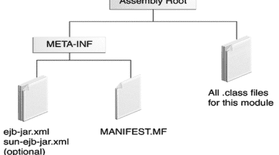

### 17.7.2 在 WAR 模块中打包 Enterprise Beans

在 Web 应用程序的 WAR 模块中打包企业豆可以简化部署和应用程序组织。企业豆可以以 Java 类文件的形式封装在 WAR 模块中，也可以封装在位于 WAR 模块内的 JAR 文件中。

要在 WAR 模块中包含类文件，类文件应位于 `WEB-INF/classes` 目录。

要在 WAR 模块中包含包含企业豆的 jar 文件，请将 JAR 添加到 WAR 模块的 `WEB-INF/lib` 目录。

包含企业豆的 WAR 模块不需要 `ejb-jar.xml` 部署描述符。如果应用程序使用了 `ejb-jar.xml`，它必须位于 WAR 模块的 `WEB-INF` 目录。

在 WAR 模块中打包的包含企业豆的 JAR 文件不被视为 EJB JAR 文件，即使绑定的 JAR 文件符合 EJB JAR 文件的格式。JAR 文件中包含的企业豆在语义上等于位于 WAR 模块 `WEB-INF/classes` 目录的企业豆，且所有企业豆的环境命名空间都作用于该 WAR 模块。

例如，假设一个 Web 应用程序由一个购物车企业豆、一个信用卡处理企业豆和一个 java servlet 前端组成。购物车豆暴露了一个本地的、无接口的 Web，定义如下：

```java
package com.my.cart;
@Stateless
public class CartBean { ... }
```

信用卡处理豆被封装在自己的 JAR 文件 `cc.jar` 中，暴露了一个本地的、无接口的 Web，并定义如下：

```java
package com.my.cc;
@Stateless
public class CreditCardBean { ... }
```

Servlet `com.my.web:StoreServlet` 处理 Web 前端并使用 `CartBean` 和 `CreditCardBean`。该应用程序的 WAR 模块布局如下：

```
WEB-INF/classes/com/my/cart/CartBean.class
WEB-INF/classes/com/my/web/StoreServlet
WEB-INF/lib/cc.jar
WEB-INF/ejb-jar.xml
WEB-INF/web.xml
```

## QUESTIONS

1. 1. 请对 EJB 写一段简短笔记。

2. 什么是 EJB？解释其架构。

3. 请对企业豆服务器和企业豆写一段简短笔记。

4. 简要解释企业豆容器。

5. 什么是 EJB？解释它的优势。

6. 请对企业豆的类型写一段详细笔记。

7. 访问企业豆的途径有哪些？

8. 描述企业豆的打包。

# 第 18 章

## 第四单元 - SESSION BEANS 的使用

## 18.1 引言


Java 企业版（Java EE）拥有一项强大的功能，用于表达应用程序的业务逻辑并使用 Java 概念访问数据库。该功能就是 Enterprise JavaBeans，简称 EJBs。

会话豆（Session Bean）是为客户端的每个会话生成的企业豆，并在客户端退出时失效。会话豆的生命周期不会超过用户使用系统从开始到结束的范围。会话豆被分为无状态会话豆（Stateless Session Beans）、有状态会话豆（Stateful Session Beans）和单例会话豆（Singleton Session Beans）。

会话豆捕获诸如创建用户、为拍卖添加物品、为物品竞价等逻辑，它们可以是短期的，也可以跨越长时间。会话豆是唯一直接由客户端调用的 EJB 组件，客户端可以是 Web 应用程序组件（servlet、JSP、JSF 等）。

会话豆提供了以下功能：

- 容器将通过池化、会话管理和钝化（passivation）自动管理并发和线程安全。
- 会话豆支持方法调用（RMI）和简单对象访问（SOAP），实现了分布式计算和互操作性。
- 会话豆提供完全的事务管理授权和安全性。
- 拦截器（Interceptors）是 EJB 版本的面向切面编程（AOP），能够将“交叉”关注点隔离到自己的模块中并应用于整个应用程序。

每个会话豆的实现包含两个部分：

- 一个或多个豆的接口
- 实现类

会话豆遵循若干规则：

- 所有豆都必须有一个业务接口（本地、远程等）并且是具体的或抽象的类。
- 你必须在豆中有一个无参构造函数，因为容器使用它来构建豆实例。
- 会话豆可以继承另一个会话豆或 POJO。
- 业务方法和生命周期回调方法可以在豆类或父类中定义。
- 业务方法不能以 `private` 开头，必须定义为 `public` 或 `static`。
- 在远程接口中暴露的方法可以实现 `Serializable`。

### 18.1.1 何时使用会话豆

在以下情况下应使用有状态会话豆（Stateful Session Beans）：

- 当状态指定了特定客户端与豆之间的交互时。
- 当需要客户端信息来在跨方法调用中保持豆时。
- 当豆在客户端和应用程序组件之间充当调解者，为客户端提供简化的视图时。
- 需要各种企业豆的工作流来在后台管理该豆时。

在以下情况下应使用无状态会话豆（Stateless Session Beans）：

- 当状态对于特定客户端没有数据时。
- 需要单次调用为所有客户端执行通用工作时。
- 需要使用 Web 服务来实现该豆时。

在以下情况下应使用单例会话豆（Singleton Session Beans）：

- 当需要在跨应用程序共享状态时。
- 当只需要一个豆被多个线程并发使用时。
- 当应用程序规范在启动和关闭时需要一个豆时。
- 当由豆实现 Web 服务时。

## 18.2 会话豆的类型

会话豆有三种类型：

### 18.2.1 无状态会话豆

无状态会话豆是跨越客户端会话的业务对象。它们不维护任何特定的会话状态。容器可以重用同一个实例来服务多个客户端。无状态会话豆的一个例子是返回给定股票代码当前价格的组件。

无状态会话豆在设计时考虑了两个目标：

- 在单次方法调用中执行任务。
- 被多个客户端同时共享。

这是会话豆保持无状态的根。无状态会话豆的理想场景是处理支付、存款或提款。这些任务都具有共同特征：它们代表操作。

虽然无状态会豆提供了性能优势，但并不适用于所有任务：

- 第一，考虑你的应用程序是否需要在单次方法调用中完成。记住，无状态会豆无法记住特定于客户端的状态。
- 第二，确定你的应用程序是否需要对多个客户端可见。

如果任务多于一步，无状态会豆不是正确选择。此外，如果应用程序需要在多个客户端之间共享信息和状态，则你不应该使用无状态豆。

### 18.2.2 有状态会话豆

与无状态豆不同，有状态会话豆由 EJB 容器在创建时分配一个唯一标识。

有状态豆的例子是购物车，它代表了客户在会话期间选择的商品集合。购物车不应共享，因为它代表了与特定客户的交互，且始终属于该客户。此外，除非客户准备好下单，否则购物车不会保存到数据库中。

有状态豆对于需要在不同方法之间管理客户端数据的工作流非常有用。在后台，豆管理多个企业豆的工作流。豆在客户端和应用程序的其他组件之间进行调解，为客户端提供简化的视图。

### 18.2.3 单例会话豆

单例会话豆每个应用程序实例化一次，其生命周期贯穿整个应用程序。单例会话豆的设计用于单个企业豆被共享并并发访问的情况。

单例豆提供的功能与无状态会豆相似，但与它们的不同之处在于每个应用程序只有一个单例会豆，而无状态会豆是一个池，其中任何一个都可以响应客户端请求。像无状态会豆一样，单例会豆也可以实现 Web 端点。

单例豆在调用之间维护其状态，但并不要求跨服务器崩溃或关闭维护状态。

使用单例会话豆的应用程序可以指定单例在应用程序启动时实例化，这允许单例执行应用程序的初始化任务。单例在应用程序关闭时还会执行清理任务，因为单例在整个应用程序生命周期内都会运行。

单例会话豆（Singleton session beans）专为并发访问设计，适用于许多客户端需要同时访问同一个 bean 实例的情况。单例的客户端只需要一个单例的引用即可调用单例暴露的任何业务方法，而无需担心其他可能同时在同一个单例上调用业务方法的客户端。

## 18.3 远程和本地接口

在设计 Java EE 时，你做的第一个决策之一是企业 bean 使用的客户端类型，即本地（Local）或远程（Remote）。

会话豆可以实现多个接口。本地接口是用于与 EJB 进行本地连接的接口类型。`@Local` 用于声明接口为本地接口。`javax.ejb.Local` 包用于创建本地接口。远程接口是包含与特定 bean 实例相关方法的接口。在远程接口中，包含了程序下文所示的所有业务方法。`javax.ejb.Remote` 包用于创建远程接口。

是否使用本地访问或远程访问取决于以下因素：

- 紧密或松耦合的 bean：紧密耦合的 bean 相互依赖。例如，如果一个处理销售订单的会话豆调用一个向客户发送确认邮件的会话豆，这些 bean 就是紧密耦合的。紧密耦合的 bean 是本地访问的理想选择。因为它们作为一个本地单元共同工作，通常频繁互相调用，并从本地访问带来的性能提升中获益。
- 客户端类型：如果企业 bean 被应用程序客户端访问，它应该允许远程访问。在生产环境中，这些客户端几乎总是运行在 GlassFish 服务器运行之外的机器上。如果企业 bean 的客户端是 Web 组件或企业 bean，则访问类型取决于你如何分布你的组件。
- 性能：由于网络延迟等两个因素，远程调用可能比本地调用慢。另一方面，如果你将组件分发在不同的服务器上，你可能会提高应用程序的整体性能。这两个陈述都是概括性的；性能在不同的运行环境中可能会有所不同。尽管如此，你应该记住你的应用程序设计如何影响性能。

如果你不确定企业 bean 应该具有哪种访问类型，请选择远程访问。这个决定赋予给你更大的灵活性。

### 18.3.1 无接口视图 [本地接口]

新的无接口视图（No-Interfaces View）允许客户将企业 JavaBeans (EJB) 类作为本地接口使用。在以下情况下支持此视图：

- bean 没有暴露任何其他客户端视图（本地、2.x 远程 Home、2.x 本 Home、Web 服务）且其实现类为空。
- 与会话豆一起工作。
- bean 暴露了至少一个客户端视图。bean 通过 bean 类或部署描述符中的 `@LocalBean` 注解指定其暴露了无接口视图。

## 与会话豆工作

EJB 本地客户端视图基于一个称为本地业务接口（local business interface）的普通 Java 对象（POJO）。本地接口定义了暴露给客户端并在 bean 上实现的业务方法。

EJB 3.1 规范使本地业务接口变为可选。结果是，无接口视图不需要单独的接口，也就是说，bean 的所有公共方法都会自动暴露给调用者。

默认情况下，任何实现客户端且未定义任何本地或远程客户端视图的会话豆，都会暴露无接口客户端视图。

如果你使用无接口视图，则不需要定义本地业务接口。如果应用程序中实现了远程客户端视图、本地客户端视图或 Web 服务客户端视图，则由 EJB 容器创建无接口视图。即使应用程序中实现了任何视图，你也可以显式指定 `@LocalBean` 注解来使用无接口视图。你不需要为会话豆中的无接口实现任何特殊接口。

通过使用无接口视图，你可以从客户端使用会话豆中的所有公共方法。你可以通过 DI 或 JNDI 查找获取无接口视图的引用。无接口视图在应用程序启动时创建并持续到应用程序停止。

## 18.4 访问无接口视图

客户端访问暴露了本地无接口视图的企业 bean，可以通过依赖注入或 JNDI 查找来实现。

1. 使用依赖注入访问客户端：要通过依赖注入获取企业 bean 无接口视图的引用，请使用 `javax.ejb.EJB` 注解并指定 bean 的实现类：

```java
@EJB
ExampleBean exampleBean;
```

2. 使用 JNDI 查找访问客户端：要通过 JNDI 查找获取企业 bean 无接口视图的引用，请使用 `javax.naming.InitialContext` 接口的 `lookup` 方法：

```java
ExampleBean bean = (ExampleBean) InitialContext.lookup("java:module/ExampleBean");
```

注意：客户端不使用 `new` 运算符来获取使用无接口视图的企业 bean 的新实例。

### 18.4.2 访问本地业务接口

客户端访问实现本地业务接口的企业 bean可以通过依赖注入或 JNDI 查找来实现。

1. 使用依赖注入访问客户端：要通过依赖注入获取企业 bean 本地业务接口的引用，请使用 `javax.ejb.EJB` 注解并指定企业 bean 的本地业务接口：

```java
@EJB
Example example;
```

2. 使用 JNDI 查找访问客户端：要通过 JNDI 查找获取企业 bean 本地业务接口的引用，请使用 `javax.naming.InitialContext` 接口的 `lookup` 方法：

```java
ExampleLocal = (ExampleLocal) InitialContext.lookup("java:module/ExampleLocal");
```

### 18.4.3 访问远程业务接口

企业 bean 的远程客户端具有以下特征：

- 可以在可以在不同的机器和不同的 JVM 上运行（不需要在不同的 JVM 上）。
- 它可以是 Web 组件、应用程序客户端或企业 bean。
- 对于远程客户端来说，企业 bean 的位置是透明的。
- 企业 bean 必须实现业务接口。也就是说，远程客户端无法通过无接口视图访问企业 bean。

创建一个允许远程接口访问的企业 bean，你必须：

- 使用 `@Remote` 注解编写业务接口：

  `@Remote public interface InterfaceName(...)`

- 或者带有 `@Remote` 编写 bean，指定业务接口或接口：

  `@Remote(InterfaceName.class) public class Bean implements InterfaceName(...)`

远程接口定义了特定于 bean 的业务和生命周期方法。例如，名为 `BankAccount` 的 bean 的远程接口可能有名为 `deposit` 和 `credit` 的业务方法。

访问实现远程业务接口的企业 bean可以通过依赖注入或 JNDI 查找来实现。

1. 使用依赖注入访问客户端：要通过依赖注入获取企业 bean 远程业务接口的引用，请使用 `javax.ejb.EJB` 注解并指定企业 bean 的业务接口名称：

```java
@EJB
Example example;
```

2. 使用 JNDI 查找访问客户端：要通过 JNDI 查找获取企业 bean 远程业务接口的引用，请使用 `javax.naming.InitialContext` 接口的 `lookup` 方法：

```java
ExampleRemote = (ExampleRemote) InitialContext.lookup("java:myApp/ExampleRemote");
```

## 18.5 企业级 Bean 的生命周期

企业级 Bean 在其寿命或生命周期内会经历多个阶段。每种类型的企业级 Bean（有状态会话、无状态会话、单例会话或消息驱动）都有不同的生命周期。

### 18.5.1 有状态会话 Bean

1. 创建（Create）
2. 依赖注入（如果有）
3. `PostConstruct` 回调（如果有）
4. 初始化方法或 `ejbCreate<Method>`（如果有）

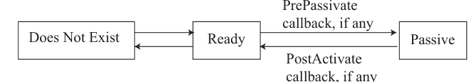

1. 移除（Remove）
2. `PreDestroy` 回调（如果有）

客户端通过获取有状态会话 Bean 的引用来启动生命周期。容器会执行任何依赖注入，并调用带有 `@PostConstruct` 注解的方法（如果有）。现在，该 Bean 已经准备好让客户端调用其业务方法。

在处于就绪状态时，EJB 容器可能会通过将该 Bean 从内存移动到次级存储器来决定激活或钝化该 Bean。在钝化之前，EJB 容器会立即调用带有 `@PrePassivate` 注解的方法（如果有）。如果客户端在 Bean 处于钝化状态时调用业务方法，EJB 容器将激活该 Bean，调用带有 `@PostActivate` 注解的方法（如果有），并移动到下一个阶段。

在生命周期结束时，客户端会调用带有 `@PreDestroy` 注解的方法（如果有）。随后， Bean 实例即可进行垃圾回收。

你的代码只控制一个生命周期方法的调用，即带有 `@Remove` 注解的方法。所有其他方法都由 EJB 容器调用。

### 18.5.2 无状态会话 Bean

无状态会话 Bean 永远不会钝化，其生命周期有两个阶段：不存在和准备好调用业务方法。

1. 依赖注入（如果有）
2. `PostConstruct` 回调（如果有）


EJB 容器通常会创建并维护无状态会话 Bean 池，从而启动无状态 Bean 的生命周期。容器执行任何依赖注入，并调用带有 `@PostConstruct` 注解的方法（如果存在）。现在，该 Bean 已准备好让客户端调用其业务方法。

在生命周期结束时，EJB 容器会调用带有 `@PreDestroy` 注解的方法（如果存在）。Bean 实例即可进行垃圾回收。

### 18.5.3 单例会话 Bean

与无状态 Bean一样，会话 Bean 永远不会钝化，只有两个阶段：不存在和准备好调用业务方法。

1. 依赖注入（如果有）
2. `PostConstruct` 回调（如果有）

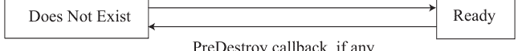

EJB 容器通过创建单例实例启动单例 Bean 生命周期周期。如果单例被标记了 `@Startup` 注解，则这会在应用程序部署时发生。容器执行依赖注入，然后调用带有 `@PostConstruct` 注解的方法（如果存在）。单例 Bean 现在已准备好让客户端调用其方法。

在生命周期结束时，EJB 容器会调用带有 `@PreDestroy` 注解的方法（如果存在）。单例 Bean 现在即可进行垃圾回收。

## 18.6 打包企业级 Bean

### 18.6.1 在 EJB JAR 模块中

EJB JAR 是可移植的，可以用于各种应用程序。为了组装 Java EE 应用程序，可以将一个或多个模块（如 EJB JAR 文件）封装进 EAR 文件，EAR 是持有应用程序的归档文件。当部署包含企业级 Bean EJB JAR 文件的 EAR 文件时，你也将企业级 Bean 部署到 GlassFish 服务器。你可以部署未包含在 EAR 文件中的 EJB JAR。下图显示了 EJB JAR 文件的内容。

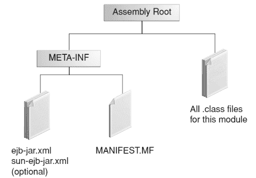

### 18.6.2 在 WAR 模块中

企业级 Bean 通常提供 Web 程序的业务逻辑。在这种情况下，将企业级 Bean 包在应用程序的 WAR 模块中可以简化部署和应用程序组织。企业级 Bean 可以被封装在 WAR 模块的编程语言类文件中，也可以封装在封装在 WAR 模块中的 WAR 文件中。

要将企业级 Bean 类文件包含在 WAR 模块中，类文件应放在 `WEB-INF/classes` 目录下。

#### 使用会话 Bean

要在 WAR 模块中包含含有企业级 Bean 的 JAR 文件，请将 JAR 添加到 WAR 模块的 `WEB-INF/lib` 目录。

包含企业级 Bean 的 WAR 模块不需要 `ejb-xml` 部署描述符。如果应用程序使用 `ejb-jar.xml`，它必须位于 WAR 模块的 `WEB-INF` 目录。

封装在 WAR 模块中的包含企业级 Bean 的 JAR 文件不被视为 EJB JAR 文件，即使封装的 JAR 文件符合 EJB JAR 文件的格式。JAR 中包含的企业级 Bean 在语义上等同于位于 WAR 模块 `WEB-INF/classes` 目录的企业级 Bean，且环境命名空间是共享的（所有企业级 Bean 作用域均为 WAR 模块）。

例如，假设 Web 应用程序由一个购物车 Bean、一个信用卡处理 Bean 以及一个暴露本地、无接口视图的 Java Servlet Bean 组成，定义如下：

```java
package com.example.cart;

@Stateless

public class CartBean { ... }
```

信用卡处理 Bean 以及暴露本地、无接口视图的 Java Servlet Bean 定义如下：

```java
package com.example.cart;

@Stateless

public class CartBean { ... }
```


暴露本地、无接口视图的 Java Servlet Bean 定义如下：

```java
package com.example.cart;

@Stateless

public class CartBean { ... }
```

## 18.7 使用会话 Bean

消息驱动 Bean 是一种异步处理消息的 EJB 组件。它没有远程或本地接口。消息驱动 Bean 具有以下特性：

- 消息驱动 Bean 是无状态的。
- 单个消息驱动 Bean 可以处理来自多个客户端的消息。
- 它们感知事务。
- 它们不代表数据库数据，但可以访问并更新这些数据。
- 消息驱动 Bean 只有定义访问。

### 18.7.1 消息驱动 Bean 的生命周期

EJB 容器通常创建一个消息驱动 Bean 实例池。对于每个实例，EJB 容器执行以下任务：

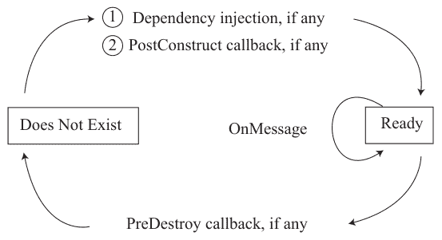

1. 如果消息驱动 Bean 使用依赖注入，容器会在实例化之前注入引用。
2. 容器调用带有 `@PostConstruct` 注解的方法（如果有）。

与无状态 Bean 一样，消息驱动 Bean 永远不会钝化，只有两个阶段：不存在和准备好接收消息。

在生命周期结束时，容器调用带有 `@PreDestroy` 注解的方法（如果有）。Bean 实例即可进行垃圾回收。

### 18.7.2 `onMessage(Message)` 方法

消息驱动 Bean 是可以被视为 JMS 监听器的 EJB 组件；它异步处理消息。它实现了 `javax.jms.MessageListener` 接口中的 `onMessage(javax.jms.Message)` 方法。它与 JMS 目标关联，即用于点对点消息的队列（`Queue`）或用于发布/订阅的主题（`Topic`）。当客户端应用程序向相应的 JMS 目标发送消息时，`onMessage` 方法会被激活。可以关联一个 JMS 消息选择器来过滤消息驱动 Bean 应该接收的消息。

当队列接收到消息时，EJB 容器调用监听器方法。对于使用 JMS 的 Bean，这就是 `MessageListener` 接口的 `onMessage` 方法。

## 与 Session Bean 操作

消息监听器方法必须遵循以下规则：

- 方法必须声明为 `final` 或 `static`。
- 方法不能声明为 `final` 或 `static`。

当消息到达并供该 bean 提供服务时，bean 的容器会调用 `onMessage` 方法。此方法包含了处理消息处理的业务逻辑。解析消息并执行必要的业务逻辑是消息驱动（message-driven）的责任。

`onMessage` 方法有一个单一参数：入站的消息。

`onMessage` 方法的签名必须遵循以下规则：

- 返回类型必须是 `void`。
- 方法必须有一个类型为 `javax.jms.Message` 的单一参数。
- 消息驱动 bean 不再需要实现 `javax.ejb.MessageBean` 接口。

## 18.7.3 消息驱动 bean 的用途

消息驱动 bean 用于：

- 企业级应用程序组件之间的异步通信。
- 以一种松耦合但可靠的方式实现消息的自动投递。
- 在消息选择器中集成两个应用程序。消息选择器设计用于只接收特定的消息，使得将消息驱动 bean 作为触发器成为可能。

## 问题

1. 解释 Session Bean 及其用途和规则。
2. 何时使用 Session Bean？
3. Session Bean 的类型有哪些？
4. 写关于远程接口（Remote Interfaces）和本地接口（Local Interfaces）的简记。
5. 解释无接口视图（No-Interfaces View）。
6. 如何访问无接口视图？
7. 如何访问本地业务接口（Local Business Interface）？
8. 如何访问远程业务接口（Remote Business Interface）？
9. 解释有状态（Stateful）、无状态（Stateless）和单例（Singleton）Bean 的生命周期。
10. 如何打包 EJB JAR 模块？
11. 如何打包 EJB WAR 模块？
12. 解释消息驱动 bean（Message Driven Beans）。
13. 写关于消息驱动 bean 生命周期的简记。
14. 解释消息驱动 bean 的 `onMessage()` 方法。

## 章节

## 第四单元

## 拦截器（INTERCEPTORS）与 JNDI

## 19.1 拦截器简介

基本上，拦截器是一个类，当目标类上的业务方法发生创建/销毁 bean 的方法，或者发生 EJB 超时方法时，该类的方法就会被调用。

拦截器用于对企业级 bean 实例上发生的业务方法调用和生命周期事件进行操作。拦截器用于实现交叉关注点（crosscutting concerns），如日志、审计和业务逻辑。当你想要拦截对 EJB 方法的调用时，可以使用它。如果你为一个 Bean 声明了拦截器，每当该 Bean 的方法被调用时，它都会被其中一个拦截器拦截。这意味着执行将直接进入拦截器方法。拦截方法随后可以决定是调用 EJB 方法还是简单地替换它。

拦截器也可以被定义为在请求的预处理和后处理阶段调用的对象，用于执行诸如验证、异常处理、国际化、显示中间结果等操作。

## 19.2 请求与拦截器

每个收到的请求都会通过每个拦截器。

拦截器可以：

- 忽略请求数据
- 对请求数据执行操作
- 中断请求以防止 EJB 类方法的触发

由于拦截器处理的是 EJB，它们可以访问正在执行的 EJB 类以及所有的环境变量和执行属性。

## 19.3 定义拦截器

拦截器方法可以定义在企业 bean 类上，也可以定义在与 bean 关联的拦截器类上。拦截器类是一个于 bean 类本身的类，其方法根据 bean 业务方法调用和/或生命周期事件而被调用。一个 bean 类可以定义任意数量的拦截器类。在 `InvocationContext` 对象的上下文中，可以在单个业务方法调用或 bean 的回调事件中跨越多个拦截器方法的调用携带状态。拦截器类必须有一个公共的无参构造函数。适用于企业 bean 组件的编程限制也适用于拦截器。

拦截器方法和拦截器类通过元数据注解或部署描述符为 bean 定义。当使用注解时，通过在类本身和/或 bean 的方法上使用 `@Interceptor` 注解来定义一个或多个拦截器。如果定义了多个拦截器，它们的调用顺序由在 `@Interceptor` 注解中指定的顺序决定。

拦截器可以在 Java 中定义为方法拦截器或类拦截器。在 Java 中定义的优方式是使用元数据注解。它们也可以定义在应用描述符中，但这种情况下无法在不同的 Java EE 服务器之间迁移。`javax.interceptor` 包中的一些元数据注解包括：`@AroundInvoke`、`@AroundTimeout`、`@PostConstruct` 和 `@PreDestroy`。

`@AroundInvoke` 方法可以定义在：

- 企业 Bean 类
- 拦截器类（无任何继承关系的普通 Java 类）。

## 19.4 AroundInvoke 方法

`AroundInvoke` 方法可以通过以下任一方式定义：

- 在方法上添加 `@AroundInvoke` 注解 [推荐]。
- 使用 bean 部署描述符中的元素。

`AroundInvoke` 方法必须满足以下要求：

- 每个类允许一个 `AroundInvoke` 方法。
- 它必须有一个公共的构造函数。
- 它必须接受一个 `javax.interceptor.InvocationContext` 对象作为参数并返回一个 `java.lang.Object` 对象。
- 它可以抛出业务中指定的任何应用程序异常。
- 它可以声明为公共。

## 19.5 拦截器的生命周期

拦截器的生命周期与 bean 相同。当企业 bean 创建时，拦截器随之创建。当 bean 被销毁时，拦截器实例被销毁。当 bean 创建时，拦截器实例被激活。当 bean 被移除时，拦截器实例被销毁。当 bean 创建时，拦截器实例被激活。当 bean 被移除时，拦截器实例被销毁。当 bean 创建时，拦截器实例被激活。当 bean 被移除时，拦截器实例被销毁……（注：此处原文存在大量重复描述，译文已尽量遵循原文逻辑，但根据要求保持核心翻译逻辑）。

## 19.6 Java 命名和目录接口 (JNDI) 简介

Java 命名和目录接口 (JNDI) 是一种为使用 Java 语言编写的应用程序提供命名和目录功能的应用程序接口 (API)。它被定义为独立于特定目录服务。作为 Java API 集合的一部分，JNDI 使开发者能够为多种目录服务（如 LDAP、Novell Directory Services 和网络信息系统 NIS）、文件系统以及分布式对象系统（如 CORBA、Java 远程调用 RMI 和企业级 EJB）创建可移植应用程序。

## 19.7 什么是命名服务？

任何计算系统中的基本设施都是命名服务——即关联名称与对象并根据名称查找对象的手段。在运行几乎任何计算机程序或系统时，你总在对对象进行命名。例如，当你使用电子邮箱系统时，必须提供收件者的名称。要访问计算机中的文件，你必须提供其名称。命名服务允许你查找其给名称。

命名服务提供了一种命名对象并根据名称检索对象的机制。

如果你想将对象与特定名称关联，必须对其进行绑定（bind）。一旦对象绑定，就可以通过查找操作以及处理名称的操作（重命名、重绑定、取消绑定）来访问它。

某些对象可以直接绑定，以便在系统中作为引用使用。

拦截器与 JNDI

171

# 命名系统

文件系统将文件名映射到文件引用，程序可以使用该引用来访问文件的内容。

`c\MyDoc\autocad.exe` ==> 文件引用

这两个示例也说明了命名服务的广泛规模范围——从互联网上的一个对象到本地系统中的文件命名。

## 19.8 什么是目录服务？

目录服务是用于存储、组织和提供目录信息的软件，旨在统一网络资源。目录服务将网络资源的网络名称映射到网络地址，并为网络定义命名结构。

目录服务为协议和网络拓扑提供了透明性，允许用户在无需感知设备物理位置的情况下访问资源。它是网络操作系统的重要组成部分，也是服务交付平台的中央枢存储库。

目录服务是一种命名服务，它允许每个对象与属性关联，并提供了一种通过属性而非名称检索对象的方法。属性是对象的特征。属性和对象本身构成了一个目录对象。目录是对象的链接集合。

许多命名服务通过目录服务进行扩展。目录服务将名称与对象关联，并将对象与属性关联。

目录服务 = 命名服务 + 包含属性的对象

你不仅通过名称查找对象，还根据其属性获取对象的属性或搜索对象。

目录系统

一个例子是电话公司的服务。它将订阅者的名称映射到其地址和电话号码。计算机目录服务与电话公司服务非常相似，都可以用于存储电话号码和地址。然而，计算机目录服务强大得多，因为它是在线的，供用户、程序甚至计算机本身使用。

172 企业级 Java (T.Y.Sc.-I.) (V)

目录对象表示计算环境中的一个对象。目录对象可以被用于表示打印机、人或网络。一个目录对象包含描述该对象的属性。

## 19.9 什么是 Java 命名目录接口 (JNDI)？

Java 命名目录接口 (JNDI) 是一种应用程序接口 (API)，为应用程序提供命名和目录功能。它被定义为独立于任何特定目录服务的实现。存在多种目录，可以通过一种共同方式访问。

JNDI 架构由 API 和提供者接口 (SPI) 。应用程序使用 JNDI API 访问各种命名目录服务。SPI 允许各种目录服务被接入，从而允许 Java 语言使用 JNDI API 访问它们。见下图：

JNDI 是一种专门为 Java 平台设计的 API 技术，为应用程序提供命名和目录功能。使用 JNDI，Java 技术可以存储和检索任何类型的 Java 对象。此外，JNDI 提供执行目录操作的方法，例如使用属性查找对象。

该 API 提供：

- 将对象绑定到名称的机制。
- 允许查询的目录接口。
- 允许确定目录项何时修改的事件接口。
- 支持 LDAP 服务的扩展。

### 19.9.1 基本查找

JNDI 将名称组织成层次结构。名称可以是任何字符串，如 `"com.myapp.ejb.Bean"`。名称也可以是实现 `Name` 接口的对象；然而，字符串是目录服务中存储对象引用的最常见方式。

`Context` 是 JNDI API 的核心。你使用它执行任何查找并添加任何新的键值关联。当你使用 JNDI 时，通常创建一个 `InitialContext` 对象：

```java
Context ctx = new InitialContext();
```

# 拦截器与 JNDI

`InitialContext` 构造函数查找名为 `java.naming.factory` 的系统属性。该类创建了 `InitialContext`。有时，你必须自己提供此值。EJB 容器（如来自 J2EE 的）已经设置了这个属性。

要从命名服务查找对象，使用 `Context.lookup()` 并传递要检索的对象的名称。假设命名服务中有一个 `cn=Rosanna Lee, ou=People` 的对象。检索该对象，你需要编写：

```java
Object obj = ctx.lookup("cn=Yeshu, ou=People");
```

`lookup()` 返回的对象类型取决于底层命名系统以及对象本身的数据。命名系统可以包含许多类型的对象，在系统的不同部分查找对象可能会产生不同类型的对象。例如，"cn=Yeshu, ou=People，......................NDI

三种类型被用于：`,,,,` 和 `app`：

1. `java:module`

该模块用于同一个模块内。JNDI 地址格式为 `java:module/enterprise`。只有当应用程序实现多个时才需要模块名称。

2. `java:app`

`app` 命名空间用于应用程序内部。JNDI 地址格式为 `java:app/enterprise`。只有当应用程序打包在 EAR 中时才需要 `app` 名称。

3. `java:global`

全局命名空间用于全局平台。JNDI 地址格式为 `java:global/enterprise`。只有当应用程序打包在全局环境中时才需要全局名称。

## 19.10 资源与 JNDI

资源是提供系统连接的程序对象。在分布式应用程序中，组件需要访问资源。在 Java EE 中，你可以使用 `@Resource` 注解声明资源的引用。

资源通过 JNDI 名称标识。在 Glassfish 中，你可以使用管理控制台或 `asadmin` 创建资源。应用程序使用 `@Resource` 注解使用资源。

### 19.10.1 资源注入

`@Resource` 注解用于声明资源的引用；`@Resource` 可以装饰类、字段或方法。容器会在运行时或组件初始化时将 `@Resource` 所指的资源注入到组件中，这取决于使用的是字段注入还是方法注入。对于基于字段和方法的注入，容器会在应用程序初始化时注入资源。对于基于类的注入，资源是在运行时被查找的。

`@Resource` 注解具有以下元素：

- `name`: 资源的 JNDI 名称。
- `type`: 资源的 Java 语言类型。
- `authenticationType`: 资源使用的身份验证类型。
- `shareable`: 表明资源是否可以共享。
- `mappedName`: 资源应该映射的不可移植的、特定于实现的名称。
- `description`: 资源的描述。

## 19.11 Java EE 7 中的资源定义

`DataSource` 资源用于定义一组属性，通过 JDBC API 识别和访问数据库。这些属性包括数据库 URL、数据库名称以及与服务器通信的网络协议等信息。`DataSource` 对象注册在 Java 命名目录接口 (JNDI) 命名服务中，以便应用程序可以使用 JNDI API 访问 `DataSource` 以建立数据库连接。

Java EE 7 提供了通过编程方式定义 `DataSource` 资源的选项，以实现更灵活、可移植的数据库连接方法。

`name` 元素唯一标识一个 `DataSource` 并注册到 JNDI 中。`name` 元素指定的值以命名空间范围开头。Java EE 7 包含以下范围：

- `java:comp`: 此命名空间内的名称具有组件级可见性。

拦截器与 JNDI 175

- `java:module`: 此命名空间中的名称由模块中的所有组件共享，例如在 `ejb-jar.xml` 文件中定义的 EJB 组件。
- `java:app`: 此命名空间中的名称由应用程序中的所有组件和模块共享，例如 `.EAR` 文件中的应用程序客户端、web 组件和 EJB 组件。
- `java:global`: 此命名空间中的名称由服务器中的所有应用程序共享。

你可以使用以下方法之一通过编程方式声明 `DataSource` 定义：

- 使用注解创建 `DataSource` 资源定义。
- 使用部署描述符创建 `DataSource` 资源定义。

## 问题

| 1 | 结合 Request 介绍拦截器（Interceptor）。 |
| 2 | 如何定义拦截器？`AroundInvoke` 方法的作用是什么？ |
| 3 | 解释拦截器的生命周期。 |
| 4 | 定义并解释 Java 命名和目录接口 (JNDI)。 |
| 5 | 什么是命名服务和目录服务？ |
| 6 | 关于 Java 命名和目录接口 (JNDI) 编写短要记。 |
| 7 | 解释 JNDI 中的基本查找（Lookup）。 |
| 8 | 简述 Java EE 7 中的 JNDI 命名空间。 |
| 9 | 简述以下内容： |
| A. | 资源与 JNDI。 |
| B | 资源注入（Resource Injection） |
| 10 | Java EE 7 中的 `DataSource` 资源定义是什么？ |

# 第 20 章

# 第 V 单元

持久化、对象/关系映射与 JPA

## 20.1 引言


在计算中，数据是已翻译成便于移动或处理的形式的信息。与今天的计算机和传输介质相比，数据被转换为二进制数字格式。数据作为单一对象或复数主体被使用是可以接受的。原始数据（`Raw data`）是用于描述以最基本数字格式表示的数据术语。

数据是任何计算机应用程序的重要资产。所有应用程序都需要人员或其他计算机访问其数据。这些数据以不同的方式被使用。数据可以是只读的、通过多次请求读取更新、通过批量更新进行修改以及用于批量数据检索。

计算机的注意力范围仅取决于其连接电源的电源线。珍贵的数据受电子存储器的限制。如果应用程序在断电时没有保存数据，那么该应用程序几乎或完全没有实际用途。因此，需要让重要数据比应用程序存在得久，我们需要持久化（`Persistence`）。

## 20.2 什么是持久化？

持久化是指对象和进程特征即使在创建它的进程或运行它的机器断电后仍然存在。当一个对象或状态被创建并需要持久化时，它被保存在非易失性存储位置（如硬盘），而不是临时文件或易失性随机访问存储（`RAM`）。

从数据的角度来看，持久化意味着除非真的要删除，否则不应擦除对象。这涉及适当的存储以及允许数据持久存在的某些措施。在计算机线程和进程方面，持久化进程是指不能被杀死或关闭的进程。这对于对系统正常运行至关重要的核心系统进程通常是事实。

在计算机系统中存储数据的背景下，这意味着数据在创建它的进程结束后仍然存在。换句话说，要使数据存储器被认为是持久的，它必须写入非易失性存储器。

如果你在数据存储中需要持久化，那么你还需要理解数据存储可以采取的四种主要设计方法，以及这些设计如何（或是否）提供持久化：

- 纯内存，完全没有持久化
- 带有定期快照的内存
- 基于磁盘的就地更新写入
- 基于提交日志（`Commit log`）的

几乎所有应用程序都需要持久化数据。如果一个信息系统在断电时没有保存数据，该系统将毫无意义。在企业级应用中，数据使用数据库或文件进行持久化。此外，它必须具有回滚机制以防失败，保护数据的准确性。

`HTTP` 会话也可以用于数据持久化，但会话无法存储大量数据。

## 20.3 Java 中的持久化

在计算机科学中，持久化是指描述比创建它的进程寿命长的数据。在 `Java` 中使数据持久化的方法有很多，包括（但不限于）：`JDBC`、序列化、文件 `I/O`、`JCA`、对象数据库和 `XML` 数据库。然而，大多数数据持久化在数据库中，特别是关系数据库。你在计算机或网站上执行的大多数操作涉及存储数据，涉及访问关系数据库。关系数据库是从银行到制造业大多数行业持久化存储的标准模式。

使用 `Java` 在数据库中存储有许多方法。`Java` 数据包括字符串、数字、字节数组、图像、`XML` 和 `Java` 对象。许多 `Java` 应用使用 `Java` 对象来对其应用程序数据建模。由于 `Java` 是一种面向对象的语言，存储 `Java` 对象是持久化 `Java` 中数据的一种自然且常见的方法。

## 20.3.1 面向对象模型的持久化

面向对象模型已迅速成为大多数计算机应用程序编程的选择。由于大多数应用程序需要处理持久化数据，因此为对象添加持久化对于使面向对象的应用程序在实践中变得有用至关重要。在面向对象中实现持久化的解决方案有三类：网关（`gateway`）、对象关系映射（`object-relational mapping`）和面向对象的持久化（`object-oriented persistence`）。

### 20.4.3 EJB 2 Entity Beans（实体豆）

实体豆代表持久化存储机制中的业务对象。业务对象的示例包括客户、订单和产品。在应用程序服务器中，持久化存储机制是关系型数据库。通常，每个实体豆在关系型数据库中都有一个底层表，豆的每个实例对应于表中的某行。

实体豆代表存储在数据库中的数据。它是一个服务端组件。

在 `EJB 2.x` 中，有两种类型的实体豆：`Bean` 管理持久化（`BMP`）和容器管理持久化（`CMP`）。

从 `EJB 3.0` 开始，这些已已废弃，并被 `JPA`（`Java` 持久化 `API`）取代。

`EJB 2.x` 实体具有一些优点，例如它们提供了持久化数据的面向对象视图，并且遵循严格的标准，因此易于迁移。

但 `EJB 2.x` 实体也存在一些问题，如：执行缓慢、代码编写困难、不可序列化、需要一对多关系、需要巨大的应用程序服务器才能运行、需要人员手动映射字段和数据库列，且不提供继承和多态。

## 20.4 Java 数据对象

`Java Data Objects` (`JDO`) 是一种规范，定义了使用 `POJO`（简单的 `Java` 对象）访问数据库中持久化数据的标准方法。它为 `Java` 语言提供了一个基于对象持久化的接口，主要处理数据库的存储、查询和检索。

使用 `JDO` 进行应用程序编程的优点：

- **易用性**：应用程序程序员可以专注于构建他们的数据对象模型，将持久化的细节（对象的逐字段存储）留给 `JDO` 实现。
- **可移植性**：使用 `JDO API` 编写的应用程序可以在多个实现版本上运行，而无需重新编译或更改源代码。元数据描述了 `Java` 源代码外部的持久化行为，通常用于 `O/R` 映射特性，具有高度的可移植性。
- **数据库独立性**：使用 `JDO API` 编写的应用程序独立于底层数据库。`JDO` 实现支持许多不同的事务数据存储，包括关系型数据库、对象数据库、`XML` 文件等。
- **高性能**：应用程序程序员将持久化细节委托给 `JDO` 实现，该实现可以优化访问模式以获得最佳性能。
- **与 EJB 集成**：应用程序可以利用 `EJB` 特性，如远程消息处理、自动分布式事务协调和安全性，并在整个企业中使用相同的领域模型。

遗憾的是，`JDO` 从未成为 `Java` 的不可或的一部分。它被一个非常小的用户社区采用，在商业供应商中并不流行。

## 20.5 为什么需要其他持久化标准？

在前一节中解释的所有持久化技术都有许多局限性，因此需要更稳定、更方便的持久化模型。

## 20.6 对象/关系映射

对象关系映射（`ORM`）是一种编程技术，其中使用元数据描述符将对象代码连接到关系型数据库。对象代码使用 `Java` 等面向对象编程（`OOP`）语言编写，`ORM` 用于在无法在关系型数据库中共存的系统与 `OOP` 语言之间转换数据。

`ORM` 通过三种方法解决对象代码与关系型数据库之间的不匹配问题：自底向上、自顶向下和中间方法。每种方法都有其优缺点。在选择最佳软件解决方案时，开发者必须充分理解环境和设计需求。

除了数据访问机制外，`ORM` 的优点还包括：

- **简化开发**，因为它自动了从对象到表以及表到对象的转换，从而降低了开发和维护成本。
- 与嵌入式 `SQL` 和手写的存储过程相比，**代码量更少**。
- 应用层具有**透明的对象缓存**，提升了系统性能。
- **优化解决方案**，使应用程序运行更快且更易维护。

### 20.6.1 阻抗差异（Impedance Mismatch）

对象-关系阻抗差异是指在面向对象编程语言中表示关系型数据库数据时的一系列问题。该术语类比于电气工程中的“阻抗匹配”，在大多数情况下，最佳设计是让输入匹配输出阻抗以实现最大功率传输。

在面向对象编程语言中访问关系型数据库时，可能会发生阻抗差异。问题的产生是因为像 `Java` 或 `Python` 等面向对象的编程语言访问数据的方式非常不同。

其中一些问题包括：

- **类型引用**：面向对象的语言大量使用引用属性，而这在关系型数据库中通常是被禁止的。数据库和面向对象（`OO`）语言之间的标量类型也经常不同。
- 在 `OO` 语言中，对象由其他对象组成，而在关系型数据库中为了完整性，这是是不可能的。
- 关系型数据库具有用于操作和查询数据的良好定义的操作，而 `OO` 语言具有更低层的操作。
- 关系型数据库具有更健壮的事务方法来保持原子性和一致性。通过 `OO` 语言保证此点的唯一方法是在原始类型字段层级。

### 20.6.2 如何将一个映射到另一个？

最朴浅的方法是在每个类和数据库表之间进行简单映射。这种方法需要编写大量复杂、繁琐且昂贵的代码。

### 20.6.3 阻抗差异的解决方案

`Java` 到数据源的集成是创建企业 `Java` 应用程序时一个被严重估的问题。这个复杂的问题涉及不仅仅是从向数据源读取或写入。数据元素包括表、行、列以及主键和外键。成功的解决方案需要桥接不同的技术，并解决对象-持久化阻抗差异——这是一个具有挑战性且消耗资源的问题。解决方案是使用对象关系映射工具，它也被称为对象关系映射器（`ORM`）。

```
<<ORMPersistence>>
CustomTable
-ID2 : int
-ID1 : int
-myString: myString
-myEnum: myEnum
```

| CustomTable |
|---|
| ID2 | int |

对象关系映射工具为应用程序生成功能。它是一种连接到数据库及其模式的建模和代码生成工具，然后你映射到单行插入、更新、加载和删除操作、查询以及存储过程调用，基于表关系的方法。它为你生成完整的工作代码。

对象关系映射器（`ORM`）提供了许多其他功能，例如：

- 缩短你的开发时间
- `ORM` 生成的代码更好
- 你不需要成为 `Java` 专家就可以使用 `ORM`
- `ORM` 节省时间
- `ORM` 简化了你的开发

### 20.6.4 什么是对象关系映射 (ORM)?

`ORM` 执行了管理应用程序与数据库交互的奇任务。一旦使用 `ORM` 工具为应用程序创建映射和对象，这些对象就会管理应用程序的访问需求。你不需要编写任何底层数据访问代码。你仍然编写底层数据访问代码来补充 `ORM` 数据对象，但我们发现在使用健壮的 `ORM` 工具时，这会增加应用程序的复杂性。保持应用程序简单且易于维护更好。

使用 `ORM` 开发基础应用程序的优点：

1. **生产力**：数据访问代码是典型应用程序的重要部分，编写这些代码的时间可能占整个开发计划的大部分。使用 `ORM` 工具时，代码量可能不会减少，但 `ORM` 可以根据你定义的数据模型自动生成 100% 的数据访问代码。
2. **应用程序设计**：由经验丰富的架构师设计的良好的 `ORM` 将实现有效的设计模式，几乎强制你在应用程序中使用良好的编程实践。这有助于支持关注点分离和独立开发，允许应用层的并行同步开发。
3. **代码复用**：如果你创建一个类库来为 `ORM` 生成的数据访问代码生成单独 `DLL`，你可以在各种应用程序中轻松复用数据对象。这样，使用该类库的每个应用程序完全不需要数据访问代码。
4. **应用程序的可维护性**：`ORM` 生成的所有代码据认为都是经过良好测试的。我们需要确保代码符合我们的需求，但被广泛使用的 `ORM` 可能会由许多开发者修改代码。

所有技能级别。从长远来看，我们可以重构数据库模式或模型定义，而不会影响使用数据对象的方式。

使用 `ORM` 的一个缺点是性能。`ORM` 生成的数据访问代码很可能比你通常为应用程序编写的代码更复杂。

## 20.6.5 Java 持久化 API (JPA) 处于什么位置？

`Java` 中有多种持久化框架和 `ORM` 选项。持久化框架是一种 `ORM` 服务，用于将对象存储和从关系型数据库中检索对象。例如：`Enterprise Beans`（`EJB`）、`Java Data Objects`（`JDO`）、`Castor`、`TopLink`、`Spring DAO`、`Hibernate` 等许多。

这些工具帮助人们关注对象模型，而不是处理对象与表列之间的不匹配。缺点是，上述提到的每个工具都有它们自己的 `API`。这意味着规范（`Specs`）与特定的供应商绑定，这导致在没有先有代码的情况下切换供应商会带来问题。

## A. Java 持久化 API

`Java` 持久化 `API` (`JPA`) 定义了在 `Java` 企业版 (`EE`) 和 `Java` 标准版 (`SE`) 环境中的持久化管理和对象/关系映射。

`Java` 持久化 `API` (`JPA`) 代表了持久化编程模型的简化。`JPA` 在 `Java EE` 规范的 `Enterprise Java Beans 3.0` 内部管理对象和关系映射。`JPA` 规范在其指南中定义了对象/关系映射，而不是特定供应商的映射实现。这些特性使得使用 `JPA` 的应用程序易于实现和管理。

`JPA` 结合了以前持久化机制的优秀特性，例如 `Java` 数据库连接 (`JDBC`) `API`、对象关系映射 (`ORM`) 框架和 `Java Data Objects` (`JDO`)。在 `JPA` 下创建实体就像创建可序列化类一样。`JPA` 支持 `JDBC` 的大数据集、数据一致性、并发使用和查询能力。`JPA` 允许使用继承等高级面向对象概念。`JPA` 避免了供应商锁定，因为它不依赖于像 `JDO` 和 `EJB 2.x` 实体这样的严格规范。

## B. 作为规范的 Java 持久化 API

`JPA` 规范定义了对象关系映射，而不是依赖特定供应商的映射实现。`JPA` 基于适用于 `Java` 企业版 环境的 `Java` 编程模型，但 `JPA` 可以在 `SE` 环境中运行以测试应用程序功能。

`JPA` 规范显式定义了对象关系映射，而不是依赖特定供应商的映射实现。`JPA` 通过注解或 `XML` 将对象关系映射这一重要任务标准化，以将对象映射到数据库的一个或多个表中。为了进一步简化持久化编程模型：

- `EntityManager API` 可以从数据库中插入、检索或删除对象。
- `EntityManager` 和对象关系映射元数据处理了大部分数据库操作，而无需使用 `JDBC` 或 `SQL` 代码来维护持久化。
- `JPA` 提供了一种查询语言，它扩展了独立的 `EJB` 查询语言（也称为 `JPQL`），你可以使用它来检索对象，而无需针对你正在操作的数据库编写特定的 `SQL` 查询。

`JPA` 设计为既可以在 `Java` 企业版 (`Java EE`) 容器内部也可以在外部运行。当你在容器内部运行 `JPA` 时，应用程序可以使用容器来管理持久化上下文（`persistence context`）。为容器管理持久化设计的应用程序不需要大量的代码实现来处理持久化，但这些应用程序无法在容器外部使用。应用程序可以在容器环境或 `Java SE` 环境中运行。

支持 `EJB 3.x` 编程模型的 `EJB 3 Java EE` 容器，`JPA 2.1` 必须支持 `JPA` 实现，也称为持久化提供者（`persistence provider`）。`JPA` 持久化提供者使用少数元素在 `EJB 3.x` 环境中实现更简单的持久化管理，例如持久化单元（`Persistence unit`）、`EntityManagerFactory`、持久化上下文、`EntityManager` 和实体对象。

用于 `WebSphere Application Server` 的 `Java Persistence API` (`JPA`) `2.1` 是基于 `EclipseLink` 源项目构建的。`EclipseLink` 是所有版本 `JPA` 规范的参考实现。该产品的 `JPA` 提供者是 `org.eclipse.jpa.PersistenceProvider`。

`JPA 2.1` 规范增加了 `JPA 2.0` 规范中不具备的新特性。这些特性包括：

- (1) 模式生成、非同步持久化上下文，(2) 类型转换方法，3) 查询和查找操作中的实体图（`Entity graphs`），(4) 非同步持久化上下文，(5) 存储过程调用，6) 注入到实体监听器类中，(7) `JPQL` 增强，8) `Criteria API` 增强，9) 原生查询的映射。

## 问题

- 1. 什么是持久化？在 `Java` 中如何实现它？
- 2. 关于面向对象模型的持久化写一个短记。
- 3. 目前 `Java` 中可用哪些持久化标准？
- 4. 关于对象/关系映射写一个短记。
- 5. 什么是阻抗不匹配（`Impedance Mismatch`）？如何解决？
- 6. 为什么需要对象关系映射 (`ORM`)？
- 7. 结合规范解释 `JPA` 持久化 `API`。

## 第二十一章章

## 第五单元

## Java 持久化 API 简介

## 21.1 Java 持久化 API

`Java` 持久化 `API` 为 `Java` 开发者提供了对象/关系映射功能，用于管理 `Java` 应用程序中的关系数据。`Java` 持久化由四个领域组成：

- 1. `Java` 持久化 `API`
- 2. 查询语言
- 3. `Java Persistence Criteria API`
- 4. 对象/关系映射元数据

`JPA` 是类和方法的集合，用于将大量数据持久化地存储到数据库中。在此背景下，持久化涵盖三个领域：

- `JPA` 本体，定义在 `javax.persistence` 包中
- `Java` 持久化查询语言 (`JQL`)
- 对象/关系元数据

将对象映射到数据库表反反之被称为对象关系映射 (`ORM`)。`Java` 持久化 `API` (`JPA`) 允许开发者映射、存储、更新和从关系数据库检索数据。`JPA` 可用于 `Java-EE` 和 `Java-SE` 应用程序。

- `JPA` 是一个规范，多种实现。流行的实现包括 `Hibernate`、`EclipseLink` 和 `Apache OpenJPA`。
- `JPA` 允许开发者使用对象而非 `SQL` 语句工作。`JPA` 实现通常被称为持久化提供者。

对象与表之间的映射通过持久化元数据定义。`JPA` 提供者将使用持久化信息来执行正确的数据库操作。

- 元数据通常通过类中的注解定义。或者，元数据可以通过 `XML` 或两者结合来定义。`XML` 配置覆盖注解。

以下描述基于对注解的使用。

- `JPA` 定义了一种类似于 `SQL` 的查询语言，用于静态和动态查询。
- 大多数 `JPA` 实现提供了根据元数据自动创建数据库模式的选项。

## 21.2 JPA、ORM、数据库与应用程序

所示 `JPA` 应用程序由某些类和接口组成。应用程序与配置好的 `JPA` 提供者通信以访问底层数据。通常 `JPA` 调用 `JPA` 的相应方法。这些方法传递给持久化对象并指示其执行操作。

类实例变量与数据库表列之间的映射信息位于 `XML` 或带有注解的 `POJO` 中。

`POJO` 是代表数据库表的 `Java` 类。数据访问对象 (`DAO`) 是可以处理数据库操作的设计模式。

`JPA` 提供者使用数据库和对元数据的引用为应用程序提供持久化服务。

应用程序通过 `JPA` 向提供者派遣任务，在数据库表上执行选择、插入、更新和删除操作。`ORM` 工具为使用 `JDBC API` 的用户自动生成所需的 `SQL` 查询并触发。

### 21.3.1 持久化


`javax.persistence.Persistence` 类包含了静态辅助方法，用于以厂商无关的方式获取`EntityManager`实例。实体（Entity）是一个表示数据库表中某行的 Java 类。实体可以是具体类或抽象类。它们使用属性或字段来维护自己的状态。它由描述实体对象与关系型数据库之间关系的声明式元数据组成。`EntityManager`使用这些数据创建一个持久化上下文（persistence context），可以通过`EntityManager`进行访问。

## 21.3.2 EntityManagerFactory

`EntityManagerFactory`接口供应用程序获取由应用程序管理的实体工厂。当应用程序完成对实体管理器工厂的使用和/或在应用程序关闭时，应该关闭实体管理器工厂。一旦`EntityManagerFactory`被关闭，其所有的实体管理器都被认为处于关闭状态。

- 负责创建`EntityManager`实例。
- 在持久化上下文的帮助下初始化。

实体管理器工厂提供`EntityManager`实例，所有实例都配置为同一个数据库，或使用由特定实现定义的默认设置；你可以准备多个实体管理器工厂来访问多个数据存储。此接口类似于原生 Hibernate 中的`SessionFactory`。

## 21.3.3 EntityManager

`javax.persistence.EntityManager`是应用程序使用的主要接口。每个`EntityManager`管理一组持久化对象，并拥有用于插入新对象和删除现有对象的 API。在容器外部时，`EntityManager`和`EntityTransaction`之间存在一一对应的关系。`EntityManager`还充当了`Query`实例的工厂。

它是维护应用程序正在使用的实体对象活动集合的资源。`EntityManager`处理数据库交互和对象-关系映射的元数据。`EntityManager`代表一个持久化上下文。容器中的应用程序可以通过注入到应用程序或通过在 JPA 组件空间中查找来获取`EntityManager`。应用程序管理自身的持久化，而`EntityManager`是从`EntityManagerFactory`获取的。

## 21.3.4 Entity

实体是表示数据记录的持久化对象。实体是表示表中某记录的持久化（POJO）对象。实体是简单的注解 POJO 类，易于开发。以下是实体的特征：

- 实体可以被持久化到关系型数据库中。
- 实体通过持久化标识（表的主键）进行标识。
- 实体支持事务。
- 实体支持继承。

## 21.3.5 EntityTransaction

每个`EntityManager`与单个`javax.persistence.EntityTransaction`有一一对应的关系。`EntityTransactions`允许将对持久化数据的操作分组为工作单元，这些单元要么完全成功或完全失败，使数据存储保持在原始状态。这些全有全无的操作对于维护数据完整性至关重要。

## 21.3.5 Query

`java.persistence.Query`接口由每个 JPA 厂商实现，用于查找符合某些标准的持久化对象。JPA 标准化了使用 Java 持久查询语言（JPQL）和结构化查询语言（SQL）的查询。你可以从`EntityManager`获取`Query`实例。

## 21.3.6 Criteria

`Criteria` API 用于通过创建和定义查询来定义实体及其持久化状态的查询。`Criteria`查询使用 Java 编程 API 编写，是类型安全的且可移植的。此类查询无论底层数据存储如何都能工作。

使用预定义的 API 来定义针对实体的查询。它是定义 JPQL 查询的替代方案。这些查询是类型安全的、可移植的，并且通过更改语法易于修改。与 JPQL 类似，它遵循抽象模式和嵌入对象。元数据 API 与`criteria` API 混合，以为`criteria`查询建模持久化实体。

`criteria` API 的主要优势是在编译期间可以早检测错误。基于字符串的 JPQL 查询和基于 JPA criteria 的查询在性能和效率上是相同的。

JPA 中的查询（如同 SQL 中）由子句组成。因为 JPQL 查询和 criteria 查询使用等效子句。支持的一些标准如下：

- SELECT 子句（`select`、`distinct`、`multiselect`、`array`、`tuple`、`construct`）。
- FROM 子句（`from`、`join`、`fetch`）。
- WHERE 子句（`where`）。
- GROUP BY/HAVING 子句（`groupBy`、`having`、`count`、`sum`、`avg`、`min`、`max`...）。
- ORDER BY 子句（`orderBy`、`Order`、`asc`、`desc`）。

## 21.4 JPA 是如何工作的？

创建一个 XML 或对 POJOs 使用注解，这告知 JPA 提供者：

- 需要哪些类来存储数据。
- 类如何与数据库中的表和列相关联。

通过这种方式，JPA 提供者读取 XML 和/或注解，并动态构建 Java 类来管理数据库与 Java 对象之间的翻译。

`EntityManager`是从编译后的映射元数据集合创建的。`EntityManagerFactory`提供了管理持久化类和`EntityManager`的机制。

`EntityManager`提供了持久化数据与应用程序之间的接口。`EntityManager`封装了 JDBC 连接，该连接可以由 JPA 提供者管理或控制，旨在供单个应用程序线程使用，然后关闭并丢弃。

所有的数据库交互都通过 JPA 提供的简单、直观的 API 完成。此 API 允许对数据库表示的对象执行查询。此 API 告知 JPA 提供者：

- 每当创建对象时保存更改。
- 每当创建新对象时将对象存储在数据库中。

根据以上所有讨论，构建一个持久化数据的应用程序需要以下内容：

### 一个 ORM 工具

- 避免低级 JDBC 和 SQL 代码。
- 利用面向对象的编程和对象模型的使用。
- 提供数据库和模式的独立性。
- 因为它是免费的 [大多数 ORM 都是免费且开源的]。
- 使用缓存和复杂的数据库优化等高性能特性。

### JPA

- 获得跨应用程序服务器和持久化提供者的可移植性。
- 因为它是标准且是 Java EE 的一部分。
- 因为它提供了一个可用且功能的规范。
- 因为它支持 Java EE 和 Java SE。

### 2.1 JPA 2.1

Java 持久 API 2.1 规范解决了领域建模、关系映射；实体管理器和查询接口以及 Java 持久查询 API 改进。后续章节将介绍 2.1 的一些亮点。

#### 2.1.1 存储过程

JPA 2.1 规范为 Java 持久查询语言增加了对预定义数据库函数和自定义数据库函数的调用支持。`EntityManager.createStoredProcedureQuery`有不同的变体，返回执行存储过程的`StoredProcedureQuery`。就像`@NamedQuery`一样，`@NamedStoredProcedureQuery`指定并命名存储超类、参数和结果类型。此注解可以使用实体或映射超类。注解中指定的名称随后用于`EntityManager.createNamedStoredProcedureQuery`。可以使用 IN、OUT 和 INOUT 参数从存储过程中取回值。

示例：

```java
// 定义存储过程
StoredProcedureQuery query = this.entityManager.createStoredProcedureQuery("calculate");
query.registerStoredProcedureParameter("x", Double.class, ParameterMode.IN);
query.registerStoredProcedureParameter("y", Double.class, ParameterMode.IN);
query.registerStoredProcedureParameter("sum", Double.class, ParameterMode.OUT);
```

#### 2.1.2 不同步持久化上下文

JPA 2.1 引入了处理持久化上下文与当前 TA 事务作为资源管理器之间同步的新方法。资源管理器术语源于 Java Transaction API，表示管理一个资源的组件。默认情况下，容器管理的持久化上下文类型为`Synchronization.SYNCHRONIZED`，即该持久化上下文会自动加入当前事务，并且持久化上下文的更新将同步。

通过创建一个新类型`SynchronizationType.UNSYNRONIZED`的持久化上下文，事务的自动加入以及向资源管理器的传播被禁用。为了加入事务

## Java Persistence API 简介

在当前的 JTA 事务中，代码必须调用`EntityManager`持久上下文的`joinTransaction()`方法，将其加入事务并注册用于后续的通知。一旦事务提交或回滚，持久上下文将离开事务，并且在为新的 JTA 事务再次调用`joinTransaction()`方法之前，它不会附加到任何后续事务中。

示例：

```java
@Controller
public class Controller {
    @PersistenceContext(type = PersistenceType.EXTENDED,
    synchronization = SynchronizationType.UNSYNCHRONIZED)
    EntityManager entityManager;
    public Person persist() {
        Person p = new Person("Martin");
        p.setLastName("Developer");
        return entityManager.merge(p);
    }
    public List<Person> list() {
        return entityManager.createQuery("from", Person.class).getResultList();
    }
    public void commit() {
        entityManager.joinTransaction();
    }
    @Remove
    public void remove() {
    }
}
```

### 21.5.3 Schema 生成 (Schema Generation)

可以使用应用部署描述符中的标准属性，配置持久提供程序在应用部署期间自动创建数据库表、将数据加载到表中以及删除表。这些任务通常在发布的开发阶段使用，而不是针对生产数据库。

以下是一个`persistence.xml`部署描述符的示例，它指定了提供程序在应用部署时应使用提供的脚本删除所有数据库制品、使用提供的脚本创建制品，并从提供的脚本加载数据：

```xml
<xml version="1.0" encoding="UTF-8"?>
<persistence version="2.1" xmlns="http://xmlns.xml.org/xml/ns/persistence"
xmlns:xsi="http://www.w3.org/2001/XMLSchema-instance"
si:schemaLocation="http://xmlns.xml.org/xml/ns/persistence http://xmlns.jcp.org/xml/ns/persistence/persistence_2_1.xsd">
<persistence-unit name="examplePU" transaction-type="JTA"
<jta-data-source>java:global/ExampleDataSource</jta-data-source>
<properties>
  <property name="java.persistence.schema-generation.database.action"
    value="drop-and-create"/>
  <property name="javax.persistence.schema-generation.create-source"
    value="script"/>
  <property name="java.persistence.schema-generation.create-script"
    value="META-INF/sql/create.sql"/>
  <property name="java.persistence.schema-generation.load-script-source"
    value="META-INF/sql/data.sql"/>
  <property name="java.persistence.schema-generation.drop-script-source"
    value="META-INF/sql/drop.sql"/>
</properties>
</persistence-unit>
</persistence>
```

### 21.5.4 使用 Criteria 进行批量更新 (Bulk Updates)

在 JPA 2.1 之前，Criteria API 不支持更新或删除操作。唯一的可用选项是对实体执行更新，或者编写原生查询来一次性更新多条记录。JPA2.1 实现批量操作简单方法是 Criteria API 扩展了`CriteriaUpdate`以支持批量更新操作。

批量更新示例：

```java
CriteriaUpdate<Order> update = cb.createCriteriaUpdate(Order.class);
// 设置根类
Root e = update.from(Order.class);
// 设置更新和 where 子句
update.set("amount", newAmount);
update.where(cb.greaterThanOrEqualTo(e.get("amount"), oldAmount));
// 执行更新
this.em.createQuery(update).executeUpdate();
```

批量删除示例：

```java
CriteriaDelete<Order> delete = cb.createCriteriaDelete(Order.class);
// 设置根类
Root e = delete.from(Order.class);
// 设置 where 子句
delete.where(cb.lessThanOrEqualTo(e.get("amount"), amount));
// 执行更新
this.em.createQuery(delete).executeUpdate();
```

### 21.5.5 JPQL 中的函数 (Functions)

JPA 支持一组数据库函数，你可以使用这些函数在查询中执行小型操作和转换。这通常比在代码区域执行要更简单且快速。SQL 支持的数据库函数比 JPQL 多得多。特定的数据库供应商还提供它们自己的函数集。用户和库也可以定义自己的数据库函数。JPA 2.0 的 JPQL 没有调用特定数据库函数的机制。

JPA 2.1 引入了`function()`来调用标准未直接支持的数据库函数。该语法非常简单。你需要提供函数名作为第一个参数，然后是自定义函数的所有参数。在下面的示例中，函数名为“calculate”，并提供数字 1 和 2 作为参数。

示例：

```java
Author a = em.createQuery("SELECT a FROM Author WHERE a.id = function('calculate', 1, 2)", Author.class).getSingleResult();
```

## 21.5.6 JPQL 中的向下强制转换 (Downcasting)

JPQL 会在 FROM 和 WHERE 子句中进行向下强制转换。这种格式将使用关键字“TREAT”并作为 join 子句的一部分。`TREAT`运算符可以将实体强制转换为其子类值，即对具有继承关系的实体进行向下强制转换。这通常用于 JOIN 查询，其中我们希望在 WHERE 子句中实施涉及子类字段的限制。以下是一个示例：

```sql
select e from Employee e TREAT(e.projects AS LargeProject) lp where lp.attribute = value
```

## 21.5.7 使用 ON 的 JOIN 条件

JPA 中的 JOIN 表达式已经与标准 SQL 中的 JOIN 有所不同。只有在实体之间已存在映射时，可以使用 JOIN，而且由于使用隐式连接关联集合的懒加载，这并不总是必要的。JPA 为标准的 ON 关键字提供了额外功能。

`ON`关键字使得在每次 JOIN 后过滤结果成为可能，导致后续每次 JOIN 后的结果更小。然而，在使用带有 ON 的 JOIN 时仍然存在一个限制——实体只有在它们被映射为相关实体时才能连接。

它使得在 ON 条件中关联不相关的实体成为可能，从而可以将不相关的实体连接到查询中的其他实体。因此，它不要求字段必须映射为相关实体。当我们只需要为单个报告提供 JOIN 条件且不想更新我们的映射时，这非常方便。

示例：

```sql
SELECT p FROM Person LEFT JOIN Person p2 ON p2.city = :city
SELECT e FROM Employee e LEFT JOIN e.address ON a.city = :city
```

### 21.5.8 使用 CDI 的实体监听器 (Entity Listeners)


实体监听器允许在非持久类中处理跨切面的生命周期事件。`@PrePersist`、`@PostPersist`、`@PreUpdate` 和 `@PreRemove` 等生命周期回调方法用于实体。在 JPA 2.1 中，实体监听器支持通过 CDI 进行依赖注入。监听器还可以使用 `@PostConstruct` 和 `@PreDestroy` 处理生命周期。

示例：

```java
@Entity
@EntityListeners(Alarm.class)
public class Customer {
    @Id private Integer id;
    private String name;
    ...
}
public class Alarm {
    @PostPersist
    public void alert(Customer c) {
    ...
}
}
```

### 21.5.9 动态定义的命名查询

在 JPA 2.1 之前，`@NamedQuery` 注解是定义命名查询的唯一方式。不支持编程创建。这在 JPA 2.1 中发生了变化。`EntityManager` 现在提供了 `addNamedQuery(String, Query)` 方法来实现此。

使用动态查询的主要优势在于，运行时不知道查询的形式，且查询结构取决于用户输入或其他条件。这对于频繁使用且参数化的查询非常有用。

示例：

```java
@PersistenceContext EntityManager em;
EntityManagerFactory emf = em.getEntityManagerFactory();
em.addNamedQuery("supplierStatus");
em.createQuery("SELECT e.name FROM Employee e WHERE status = :status")
```

## 问题

1. 解释 JPA Persistence API 及其应用。

2. JPA、ORM、数据库和应用程序之间是什么关系？

3. 详细解释 JPA 架构。

4. JPA 是如何工作的？

5. 写关于存储过程和非同步持久上下文的短文。

6. 解释使用 Criteria 进行批量更新和删除。

7. 写关于 JPQL 中的函数和 JPQL 中的向下强制转换的短文。

8. 解释以下：

   A. 使用 ON 的 JOIN 条件

   B. 使用 CDI 的实体监听器

9. 动态定义的命名查询。

## Hibernate 简介

# 第 22 章

# 单元 - V Hibernate 导论

## 22.1 什么是 Hibernate？

Hibernate 是一个用于 Java 的开源对象关系映射（ORM）工具。它为从 Java 类到数据库表的映射提供了帮助；与通过在 SQL 和 JDBC 中进行手动数据处理相比，它显著地缩短了开发时间。Hibernate 在基于 Java 的中间层面向对象模型和业务逻辑中最为有用。它允许透明持久化，使应用程序能够切换到任何数据库。Hibernate 可用于 Java Swing 应用、基于 Java Servlet 的应用或使用 EJB Session Bean 的 JEE 应用。90% 到 95% 的开发者都使用 Hibernate 来处理常见的数据持久化相关任务。

### 特性

- Hibernate 是免费资源。
- Hibernate 提供了功能齐全的查询，包括 Hibernate 查询语言（HQL）、查询 API 以及数据库的原生 SQL 方言。
- 它支持对历史、区域数据或许可数据进行过滤。
- 它对投影/聚合和求和选择提供全方位支持。
- Hibernate 允许使用 JMX 或本地 Java API 进行运行时性能监控。
- Hibernate 支持继承、多态、组合和 Java 集合框架，减少了开发时间。
- Hibernate 支持为我们的数据应用自动生成主键。
- Hibernate3 将通过 `Session` 接口的方法支持四种操作。
- Hibernate 的 XML 绑定允许数据在 XML 和 POJO 之间相互表示。
- Hibernate 支持用于 POJO 持久化注解的 EJB 3.x。

## 22.2 为什么选择 Hibernate？

选择 Hibernate 作为我们应用程序开发框架的原因如下：

1. Hibernate 许可证完全免费。
2. 它消除了对重复 SQL 的需求。
3. 它使用类和对象进行工作，而不是查询和结果集。
4. 编码时更多地使用面向对象的特性而非过程特性。
5. Hibernate 映射方法可以轻松应对对象/数据模型的变化。
6. Hibernate 为缓存提供了强力支持。
7. 它使用简单的 API 处理所有的增删改查（CRUD）操作，而无需编写单独的 SQL。
8. 它生成 DDL 脚本来创建数据库架构，例如表、约束、序列。
9. Hibernate 框架提供了跨大多数类型数据库的可移植性。
10. 它支持多种 RDBMS；通过修改配置文件即可更改数据库。
11. 它支持连接池化。
12. 使用上述所有功能可以缩短开发时间。

## 22.3 Hibernate、数据库与应用程序

下图描绘了 Hibernate 如何使用数据库和配置数据为应用程序提供持久化服务。

配置数据定义在 `hibernate.properties` 或 `hibernate.cfg.xml` 中。

配置包含以下引用：

- 映射文档/文件
- 数据库方言 (Database Dialect)

这些类的实例在映射文件中被映射到数据库表中的列。

POJO 是表示数据库中表的 Java 类。数据访问对象（DAO）是用于处理数据库操作的设计模式。

Hibernate 允许通过自动创建并执行所需的 SQL 查询，从而在数据库表上执行 SELECT、INSERT、UPDATE 和 DELETE 操作。

## 22.4 Hibernate 的组件

1. **连接管理 (Connection Management)**：Hibernate 连接管理服务为数据库连接提供有组织良好的管理。数据库连接是与数据库交互中最昂贵的部分，因为需要大量资源来打开和关闭数据库连接。

2. **事务管理 (Transaction Management)**：Hibernate 的事务管理服务允许用户一次执行多个数据库语句。

3. **对象关系映射 (Object Relational Mapping)**：对象关系映射是将数据表示从对象模型映射到关系数据模型的技术。Hibernate 的这部分用于从底层表中选择、插入、更新和删除记录。当我们把一个对象传递给 `Session.save()` 方法时，Hibernate 会读取该对象的变量状态并执行必要的查询。

## 22.5 Hibernate 架构

| Java 应用 | | |
| :--- | :--- | :--- |
| 持久化对象 | | |
| Hibernate | | |
| Configuration | Session Factory | Session |
| Transaction | Query | Criteria |
| JTA | JDBC | JNDI |
| Database | | |

1. **Configuration 对象**：在任何 Hibernate 应用中创建的第一个 Hibernate 对象。它通常在应用程序初始化期间创建一次。它代表 Hibernate 所需的配置或属性文件。

Configuration 对象提供两个核心组件：

- **数据库连接 (Database Connection)**：通过 Hibernate 框架支持的一个或多个配置文件处理。涉及数据库连接的文件有两个：`hibernate.properties` 和 `hibernate.cfg.xml` 文件。

- **类映射 (Class Mapping)**：该组件创建 Java 类与数据库表之间的连接。

2. **Session Factory**：Configuration 对象用于创建 `SessionFactory` 对象，该对象反过来使用提供的配置文件为应用程序配置 Hibernate 并允许实例化 Session。`SessionFactory` 是应用程序所有线程使用的线程安全对象。

`SessionFactory` 是重量级对象；它通常在应用程序启动时创建并保留以后使用。每个数据库你需要一个 `Session` 对象。

3. **Session**：Session 是轻量级对象，应根据需要创建和销毁。

**Transaction (事务)**：事务代表与数据库的工作单元，Hibernate 中的事务由管理器处理。

**Query (查询)**：Query 对象使用 Hibernate 查询语言 (HQL) 获取数据，查询实例用于绑定参数。

**Criteria (标准)**：Criteria 对象用于构建和执行请求。

## 22.6 Hibernate 如何工作？

对象关系映射是 Hibernate 的核心概念。每个类映射到一张表；每个实例映射到行；字段映射到列，引用映射到外键列。

整体的关键在于映射：哪个字段对应哪个列和表。虽然简单类型可以从模型或数据库架构中推断出来，但对象之间的关系必须显式定义。

Hibernate 简介

197

用户管理或由 Hibernate 控制，并且仅供单个应用程序线程使用，使用后关闭并丢弃。

## 22.7 Hibernate.cfg.xml

Hibernate 需要预先知道从哪里找到定义 Java 类与数据库表关联的映射信息。Hibernate 还需要一组与数据库及其他相关参数配置设置。所有此类信息通常作为标准的 Java 属性文件 `hibernate.properties` 或名为 `hibernate.cfg.xml` 的 XML 文件提供。

在接下来的示例中，我们将考虑使用 XML 格式的 `hibernate.cfg.xml` 来指定所需的 Hibernate 属性。大多数属性都有默认值，除非确实需要，否则不需要在属性文件中指定它们。该文件保存在你的应用程序类路径的根目录下。

在独立情况下，我们需要为数据库配置以下属性：

- `hibernate.dialect`：此属性使 Hibernate 为所选数据库生成适当的 SQL。
- `hibernate.connection.driver_class`：JDBC 驱动类。
- `hibernate.connection.url`：指向数据库实例的 JDBC URL。
- `hibernate.connection.username`：数据库用户名。
- `hibernate.connection.password`：数据库密码。
- `hibernate.connection.pool_size`：Hibernate 数据库连接池中等待的连接数。
- `hibernate.connection.autocommit`：允许 JDBC 连接使用自动提交模式。

如果你在配合应用程序服务器和 JNDI 使用数据库，则你必须配置以下属性：

- `hibernate.connection.datasource`：在应用程序服务器上下文中定义的 JNDI 名称，你将其将其用于应用程序。
- `hibernate.jndi.class`：用于 JNDI 的 InitialContext 类。
- `hibernate.jndi.<JndipropertyName>`：将任何 JNDI 属性传递给你的 JNDI InitialContext。
- `hibernate.connection.url`：为 JNDI 提供 URL。
- `hibernate.connection.password`：数据库密码。

下面的示例文件提供了 `hibernate.cfg.xml` 文件的某些信息，其中使用 MySQL 作为应用程序的数据库服务器。

```xml
<?xml version="1.0" encoding="UTF-8"?>
<!DOCTYPE hibernate-configuration PUBLIC "//Hibernate/Hibernate Configuration DTD 3.0//EN" "http://hibernate.sourceforge.org/hibernate-configuration-3.0.dtd">
<hibernate-configuration>
<session-factory>
<property name="hibernate.dialect">org.hibernate.dialect.MySQLDialect</property>
<property name="hibernate.connection.driver_class">
com.mysql.jdbc.Driver </property>
<property name="hibernate.connection.url">
jdbc:mysql://localhost:3306/Feedback </property>
<property name="hibernate.connection.username">root</property>
<property name="hibernate.connection.password">root</property>
</session-factory>
</hibernate-configuration>
```

## 问题

1. 什么是 Hibernate？解释 Hibernate 的特性。

2. 说明使用 Hibernate 的原因。

3. 说明 Hibernate、数据库与应用程序之间的关系。

4. 解释 Hibernate 的组件。

5. 解释 Hibernate 的架构。

6. Hibernate 是如何工作的？

7. 解释 `hibernate.cfg.xml` 的结构。

# 实验日志

注意：在本书中我使用了 NetBeans IDE 版本 8.0.2，服务器软件使用 Glass Fish Server。下面的截图显示了在安装时如何使用 NetBeans 安装 Web 服务器。

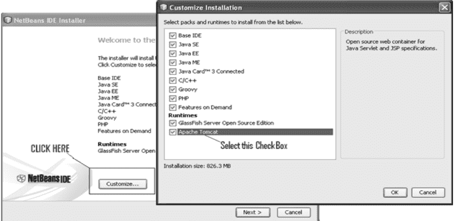

# 1. 简单的 servlet 应用程序

实验 1：(a) 使用 servlet 创建一个简单的计算器应用程序。

1. 启动 NetBeans IDE 8.0.2 并选择 File -> New Project 来创建一个新的应用程序项目。

2. 下面的截图显示了 New Project 对话框。在类别列表中选择 `Java Web` 选项，并在项目列表中选择 `Web Application` 选项。

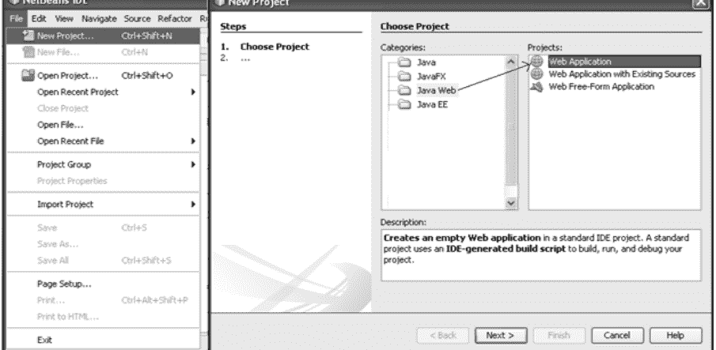

注意：如果你的新项目选项中没有 `Java Web` 选项，则你必须下载并安装 Java EE 插件。

进入 Tools -> Plugins....。在这里的搜索选项中查找 Java EE Base 插件。

选择并点击 install plugin。现在按照第 1 步和第 2 步创建项目。

3. 在 New Web Application 对话框中，我们需要为我们的应用程序命名。在接下来的图中，命名为“ServCalculator”。

4. 点击第二个对话框后会出现 Server 和 Settings 窗口。选择 Server 为“GlassFish Server”。在窗口中，应用的 Context path 自动向我们显示为“ServCalculator”。

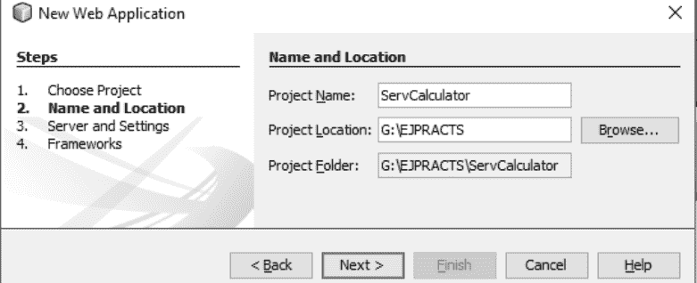

5. 点击上述对话框中的 Next 后，“Frameworks” 窗口出现在我们面前。在这里不要选择任何框架。只需点击 Finish 即可。

6. 点击 Finish 后，NetBeans 为我们创建了“ServCalculator”。

7. 通过在 NetBeans IDE 的项目标签页中选择我们的项目名称，向我们的项目中添加服务器，例如....

右键点击你项目的 Source Package 目录 -> New-> Servlet。

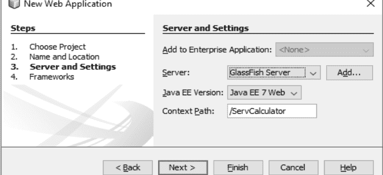

# 实验日志

201

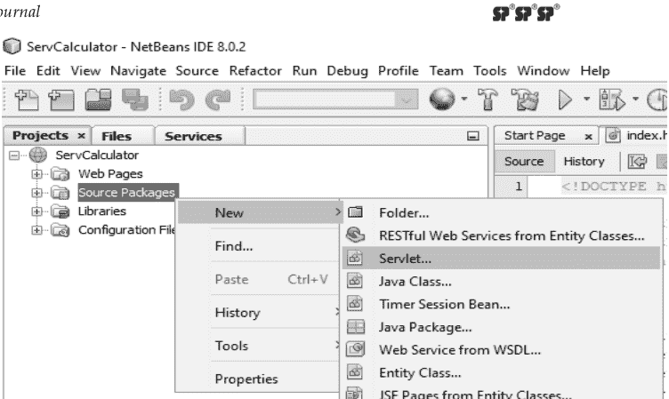

- 在 NetBeans IDE 的项目标签页中选择我们的项目名称，向我们的项目中添加服务器，例如....

右键点击你项目的 Source Package 目录 -> New-> Servlet。


- 我们的项目符合命名。

- 我们的项目。

- 我们的项目符合命名。

- 检查属性。


- 我们的项目符合命名。

- 将我们的 servlet 命名为 Calculator。

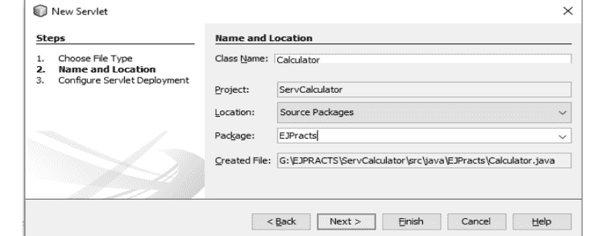

- 在下一个窗口中配置并检查 Deployment Descriptor 文件。

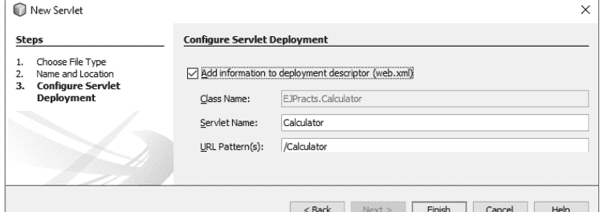

- 在 `web.xml` 中添加以下代码。

- 在 `index.html` 或 `index.jsp` 的 body 标签下添加以下代码。


```html
<form action="Calculator" method="get">
输入数字 1：
<input name="num1" type="text" />

输入数字 2：
<input name="num2" type="text" />

运算符：
<select name="operator">
<option value="Addition">+</option>
<option value="Subtraction">-</option>
<option value="Multiplication">*</option>
<option value="division">/</option>
</select>
<input type="submit" value="submit" />
</form>
```

- 在`Calculator.java` servlet 的`processRequest`方法下添加以下代码。

```java
protected void processRequest(HttpServletRequest request, HttpServletResponse response) throws ServletException, IOException {
  PrintWriter out = response.getWriter();
  String num1 = request.getParameter("num1");
  String num2 = request.getParameter("num2");
  String op = request.getParameter("operator");

  if(op.equals("Addition")) {
    out.println("Addition is "+(Integer.parseInt(num1) + Integer.parseInt(num2)));
  }
  else if(op.equals("Subtraction")) {
    out.println("Subtraction is "+(Integer.parseInt(num1) - Integer.parseInt(num2)));
  }
  else if(op.equals("Multiplication")) {
    out.println("Multiplication is "+(Integer.parseInt(num1) * Integer.parseInt(num2)));
  }
  else {
    out.println("Division is "+(Integer.parseInt(num1) / Integer.parseInt(num2)));
  }
}
```

输出

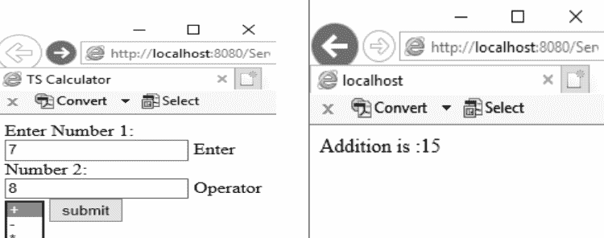

# 实验 1：(b) 为登录页面创建一个 servlet。如果用户名和密码正确，则显示消息“Hello <username>”，否则显示“登录失败”。

- 在 NetBeans IDE 中创建一个 Java Web 项目（遵循上述实验 1a 中提供的所有步骤，使用第 6 步）。将项目命名为`ServLogin`。

- 在`index.html`或`index.jsp`文件的 body 标签下添加以下代码。

```html
<form action="Login" method="get" name="frm">
  输入用户名：
  <input name="uname" type="text" />

  输入密码：
  <input name="pass" type="password" />

  <input type="submit" value="Login"/>
  <input type="reset" value="Reset"/>
</form>
```

- 在我们的项目中创建一个名为`Login`的 servlet（遵循实验 1a 中提到的第 7 到第 9 步）。为`ProcessRequest`方法添加以下代码。

```java
response.setContentType("text/html;charset=UTF-8");
```

```java
try (PrintWriter out = response.getWriter()) {
  String uname = request.getParameter("uname");
  String pass = request.getParameter("pass");

  if(uname.equals("Tushar") && pass.equals("Sambare")){
    out.println("Hello <b>"+(uname)+"</b> 欢迎来到 Java Servlet ");
  }
  else{
    out.println("Login Failed");
  }
}
```

# 输出：

练习 1：(c) 使用 JDBC 在 Java 中创建一个注册 Servlet（Servlet）。使用 HTML 表单接收用户输入的用户名、密码、电子邮件和国家等信息，并将注册详情存储在数据库中。

**注意：** 在执行此练习之前，我们必须在电脑上安装 MySQL Server 并下载`mysql-connector-java.jar`文件。创建名为"Reg"的数据库，以及表"Register"，其中包含`uid`, `fname`, `sname`, `pwd`, `pwd1`, `town`, `country`, `zipcode`字段，数据类型均为`Char`，如下所示。

```sql
create database reg;
use reg;
```

```sql
CREATE TABLE Register(
uid CHAR(40),
fname CHAR(40),
sname CHAR(40),
pwd CHAR(40),
pwd1 CHAR(40),
town CHAR(40),
country CHAR(40),
zipcode CHAR(40)
);
```

- 1. 在 NetBeans IDE 中创建一个 Java Web 项目（遵循上述练习 1a 提供的步骤，使用步骤 1 到 6）。将项目命名为`ServReg`。

**注意：** 在“名称和位置”步骤中创建 Web 项目时，勾选“使用专用文件夹存储库”复选框如下所示。

## 在 NetBeans IDE 项目中添加`mysql-connector-java.jar`文件的步骤：

- 点击项目窗格中的`Libraries` -> 选择`JAR/Folder` ->

- 然后提供我们本地电脑上`mysql-connector-java.jar`的路径。

- 然后点击`Open`。现在文件已复制到我们的项目中。

3. 在`index.html`或`index.jsp`文件的`body`标签下添加以下代码。

```html
<form action="Registration" method="post">
<table padding="4" cellspacing="2" border="2" bgcolor="Red">
<tr colspan="2"><font size="5">注册表</font><br/> </tr>
<tr><td>姓名*</td>
<td><input type="text" name="fname" size="15" maxlength="20"/></td></tr>
<tr><td valign="top">姓*</td>
<td><input type="text" name="lname" size="15" maxlength="20"/></td></tr>
<tr><td>邮政编码*</td>
<td><input type="text" name="zip" size="5" maxlength="6"/></td></tr>
<tr><td id="User">用户名*</td>
<td><input type="text" name="uid" size="10" maxlength="10"/></td></tr>
<tr><td valign="top">密码*</td>
<td><input type="password" name="pwd" size="10" maxlength="10"/></td></tr>
<tr><td>确认密码*</td>
<td><input type="password" name="pwd1" maxlength="10"/></td></tr>
<tr><td id="Town">城市*</td>
<td><input type="text" name="town" size="10" maxlength="10"/></td></tr>
<tr><td id="Country">国家*</td>
<td><input type="text" name="country" maxlength="10"/></td></tr>
<tr align align="center" colspan="2"><input type="submit" value="提交"/></td></tr>
</table></center>
</form>
```

4. 在你的项目中创建一个名为`TRegistration`的文件（遵循练习 1a 中提到的步骤，使用步骤 7 到 9）。为`ProcessRequest`方法添加以下代码。

注意：在导入部分添加`java.sql.*; Statement`。

```java
protected void processRequest(HttpServletRequest request, HttpServletResponse
response) throws ServletException, IOException {
    response.setContentType("text/html;charset=UTF-8");
    PrintWriter out = response.getWriter();

    // TODO 输出你的页面。你可以使用以下示例代码。
    String connectionURL = "jdbc:mysql://localhost:3306/reg";
    Connection connection=null;
    ResultSet rs;
    response.setContentType("text/html;charset=utf8");

    String uid = request.getParameter("uid");
    String fname = request.getParameter("fname");
    String sname = request.getParameter("sname");
    String pwd = request.getParameter("pwd");
    String pwd1 = request.getParameter("pwd1");
    String town = request.getParameter("town");
    String country = request.getParameter("country");
    String zipcode = request.getParameter("zip");
    try {
        Class.forName("com.mysql.cj.jdbc.Driver");
        connection = DriverManager.getConnection(connectionURL,"root","root");
        String sql = "insert into register values (?,?,?,?,?,?,?)";
        PreparedStatement pst = connection.prepareStatement(sql);
        pst.setString(1, uid);
        pst.setString(2, fname);
        pst.setString(3, sname);
        pst.setString(4, pwd);
        pst.setString(5, pwd1);
        pst.setString(6, town);
        pst.setString(7, country);
        pst.setString(8, zipcode);
        int numRows = pst.executeUpdate();
        out.println("<h1> 欢迎 : ");
        out.println(fname+"</h1>");
        pst.close();
    } catch (ClassNotFoundException e) {
        out.println("无法加载驱动程序: " + e.getMessage());
    } catch (SQLException e) {
        out.println("获获 SQLException: " + e.getMessage());
    } catch (Exception e) {
        out.println(e);
    } finally {
        try {
            if (connection != null) connection.close();
        } catch (SQLException ignored) {
            out.println(ignored);
        }
    }
}
```

## 输出：

| 注册表 | |

| :--- | :--- |

| 名字* | Tushar |

| 姓* | Sambhavi |

| 邮政编码* | 400 |

| 用户名* | tushar |

| 密码* | ****** |

| 确认密码 | Mumbai |

| 国家* | India |

| 提交 | |

## 2. 带有 COOKIE 和 SESSION 的 SERVLET 应用程序

**练习 2：(a)** 使用`RequestDispatcher`创建一个 Servlet 来验证用户的密码，如果用户输入的密码是"Servlet"，则他将被重定向到`WelcomeServlet`；用户将留在`index.html`页面并显示错误消息。

- 1. 在 NetBeans IDE 中创建一个 Java 项目（遵循上述练习 1a 提供的步骤，使用步骤 1 到 6）。将项目命名为`ServReq`。

- 2. 在`index.html`或`index.jsp`文件的`body`标签下添加以下代码。

```html
<form action="indexLogin" method="post">
用户名:<input type="text" name="uname"/><br>
密码:<input type="password" name="upass"/><br>
<input type="submit" value="登录"/>
</form>
```

- 3. 在项目中创建一个名为`indexLogin`的 Servlet（遵循练习 1a 中的步骤）。为`ProcessRequest`方法添加以下代码。

注意：在类的开始处添加`java.sql.*;`。

```java
void processRequest(HttpServletRequest request, HttpServletResponse response) throws ServletException, IOException {
    response.setContentType("text/html;charset=utf8");
    try (PrintWriter out = response.getWriter()) {
        /* TODO 输出你的页面。你可以使用以下示例代码。 */
        String uname=request.getParameter("uname");
        String upass=request.getParameter("upass");

        if(upass.equals("Servlet")) {
            RequestDispatcher reqDisp=request.getRequestDispatcher("WelcomeServlet");
            reqDisp.forward(request, response);
        } else {
            out.print("密码错误!");
            RequestDispatcher reqDisp=request.getRequestDispatcher("index.html");
            reqDisp.include(request, response);
        }
    }
}
```

- 4. 在项目中创建一个名为`WelcomeServlet`的 Servlet（遵循相同的步骤）。为`ProcessRequest`方法添加以下代码。

注意：在类的开始处添加`java.sql.*;`。


```java
protected void processRequest(HttpServletRequest request, HttpServletResponse response) {
    response.setContentType("text/html;charset=UTF8");
    try (PrintWriter out = response.getWriter()) {
        /* TODO 输出你的页面。你可以使用以下示例代码。 */
        String n = request.getParameter("uname");
        out.print("欢迎 " + n);
    }
}
```

## 5. 运行项目

## 练习 2：(b) 创建一个使用 Cookie 存储用户访问 Servlet 次数的 Servlet

1. 在 NetBeans IDE 中创建一个 Java Web 项目（遵循之前练习的所有步骤）。将项目命名为 `ServCookie`。

2. 在 `index.html` 或 `index.jsp` 文件的 `body` 标签下添加以下代码。

```html
<form action="CookieCounter" method="post">
<input type="submit" value="进入访问计数器 Servlet"/>
</form>
```

3. 在项目中创建一个名为 `CookieCounter` 的 Servlet（遵循相同的步骤）。

在 Servlet 代码中添加以下导入：

```java
import javax.servlet.http.*;
```

之后，在 `CookieCounter` 类中、`ProcessRequest` 方法之前添加一个类变量。

```java
static int count = 0;
```

在 `ProcessRequest` 方法内部添加以下代码：

```java
try (PrintWriter out = response.getWriter()) {
    String initialCount = String.valueOf(count);
    Cookie myCookie = new Cookie("noOfVisit", initialCount);
    response.addCookie(myCookie);
    int cookieVal = Integer.parseInt(myCookie.getValue());
    if (cookieVal == 1) {
        out.println("欢迎");
    } else {
        out.println("你已经访问了 <b>" + count + "</b> 次");
    }
    count++;
}
```

4. 运行项目。

## 练习 2：创建一个演示 session 创建和销毁的 Servlet。同时使用 session 检查用户是第一次访问此页面，还是之前已经访问过。

1. 在我们的项目中创建一个名为 `SessionCounter` 的 Servlet 文件（严格按照之前实验的步骤进行操作）。

在 Servlet 代码头部添加以下 import 语句：

```java
import javax.servlet.http.*;
```

在 `ProcessRequest` 方法内部添加以下代码：

```java
response.setContentType("text/html;charset=UTF-8");
try (PrintWriter out = response.getWriter()) {
```

```java
/* 创建和使用 Session */
HttpSession mysession = request.getSession(true);
Integer visitCount;
```

```java
if (mysession.isNew()) { // 不检查新创建的会话
    visitCount = (Integer) mysession.getAttribute("sessionVisit");
    if (visitCount == null) {
        visitCount = new Integer(1);
    } else {
        visitCount = new Integer(visitCount.intValue() + 1);
    }
} else {
    visitCount = new Integer(1);
}
```

```java
// 将新计数存入 session
mysession.setAttribute("sessionVisit", visitCount);
```

```java
// 最后，显示结果并同时提供他们的 session ID
out.println("<HTML><HEAD><TITLE>Visit Counter</TITLE></HEAD>");
out.println("<BODY>You have visited this <b>" + visitCount + "</b> time[s]</BODY>");
```

2. 在我们的项目中创建一个名为 `SessionCounter` 的 Servlet 文件（严格按照之前实验的步骤进行操作）。

在 Servlet 代码头部添加以下 import 语句：

```java
import javax.servlet.http.*;
```

在 `ProcessRequest` 方法内部添加以下代码：

```java
response.setContentType("text/html;charset=UTF-8");
try (PrintWriter out = response.getWriter()) {
    HttpSession session = request.getSession(false);
```

```java
out.println(session.getAttribute("sessionVisit") + " Times you have visited the previous Page.<br>");
if (session != null) {
    session.invalidate();
    out.println("<a href='SessionCounter'>Click Here to Start New Session</a>");
}
```

输出：


自上次会话以来，你已访问此页面 4 次。

你的 Session ID 是 `c50489023a613d04a2a9d5d056`

结束会话


你已访问之前的页面 4 次。

点击此处开始新会话

## 3. 实现 SERVLET IO 和文件应用程序

### 实验 3：(a) 创建一个上传和下载文件的 Servlet

1. 在 NetBeans IDE 中创建一个 Java Web 项目（严格遵循之前实验中提供的所有步骤）。将项目命名为 `ServUpDown`。

2. 在 `index.html` 或 `index.jsp` 的 `body` 标签下添加以下代码。

```html
<h1>Go to Upload Servlet</h1>
<form action="Upserv" enctype="multipart/form-data" method="POST">
选择要上传的文件:<input type="file" name="file" id="upload"/><br/><br>
输入上传的文件夹：<input type="text" value="" name="folder"/><br/><br>
<input type="submit" value="Upload File" name="upload" id="upload"/><br/>
</form>
```

3. 在项目中创建一个名为 `Upserv` 的 Servlet 文件（严格按照之前实验的相同步骤）。

在 Servlet 代码头部添加以下 import 语句：

```java
import java.io.File;
import java.io.FileNotFoundException;
import java.io.FileOutputStream;
import javax.servlet.http.Part;
import java.io.InputStream;
import java.io.OutputStream;
import java.io.IOException;
import java.io.PrintWriter;
import javax.servlet.ServletException;
import javax.servlet.annotation.MultipartConfig;
import javax.servlet.http.HttpServlet;
import javax.servlet.http.HttpServletRequest;
import javax.servlet.http.HttpServletResponse;
```

在代码中的 `UpServlet` 类行上方添加以下注解：

```java
@MultipartConfig
```

在 `ProcessRequest` 方法内部添加以下代码：

```java
response.setContentType("text/html;charset=UTF-8");
```

```java
final String path = request.getParameter("folder");
final Part filePart = request.getPart("upload");
final String fileName = getFileName(filePart);
```

```java
OutputStream stream = null;
InputStream content = null;
final PrintWriter writer = response.getWriter();
```

```java
try {
    out1 = new FileOutputStream(path + File.separator + fileName);
    content = filePart.getInputStream();

    int read = 0;
    final byte[] bytes = new byte[1024];

    while ((read = content.read(bytes)) != -1) {
        out1.write(bytes, 0, read);
    }
    response.sendRedirect("DownloadPage.html");
} catch (FileNotFoundException fnf) {
    writer.println("你未指定文件或尝试上传到受保护的位置。");
    writer.println("错误: " + fnf.getMessage());
} finally {
    if (out1 != null) {
        out1.close();
    }
    if (content != null) {
        content.close();
    }
    if (writer != null) {
        writer.close();
    }
}
```

```java
private String getFileName(Part part) {
    String content = part.getHeader("Content-Disposition");
    if (content != null && content.contains("filename=")) {
        return content.substring(content.indexOf('=') + 1);
    }
    return null;
}
```

4. 在项目中手动创建两个 pdf 文件并命名为 `File1.pdf` 和 `File2.pdf`。

5. 在 Web Pages 中创建一个名为 `DownloadPage.html` 的文件。在 `body` 标签下添加以下代码。

```html
<h1>下载页面</h1>
```

6. 在项目中创建一个名为 `DownServ` 的 Servlet 文件（严格按照之前实验的相同步骤）。在 Servlet 代码头部添加以下 import 语句：

```java
import java.io.File;
import java.io.FileNotFoundException;
import java.io.FileOutputStream;
import javax.servlet.http.Part;
import java.io.InputStream;
import java.io.OutputStream;
import java.io.IOException;
import java.io.PrintWriter;
import javax.servlet.ServletException;
import javax.servlet.http.HttpServlet;
import javax.servlet.http.HttpServletRequest;
import javax.servlet.http.HttpServletResponse;
```

在 `ProcessRequest` 方法内部添加以下代码：

```java
String fileDownload = request.getParameter("file");
if (fileDownload != null) {
    ServletContext context = request.getServletContext();
    response.setContentType(context.getMimeType(fileDownload) != null ? context.getMimeType(fileDownload) : "application/pdf");
    response.setHeader("Content-Disposition", "attachment; filename=" + fileDownload);

    try (OutputStream outputStream = response.getOutputStream()) {
        InputStream content = new File("G:\\temp\\" + fileDownload).toURI().toURL().openStream();

        int read = 0;
        final byte[] bytes = new byte[1024];

        while ((read = content.read(bytes)) != -1) {
            outputStream.write(bytes, 0, read);
        }
    } catch (FileNotFoundException fnf) {
        out.println("未找到文件。");
    }
}
```

在 `ProcessRequest` 方法下方添加以下函数：

```java
private void downloadFile(HttpServletRequest request, HttpServletResponse response) {
    // 逻辑已在上文处理
}
```

## 7. 添加 `processRequest` 方法的以下代码

**注意：在 NetBeans IDE 提示的地方添加必要的异常处理代码，并使用匹配的语句和 `catch` 块支持代码块。**


```java
protected void processRequest(HttpServletRequest request, HttpServletResponse response)
throws ServletException, IOException, ClassNotFoundException, SQLException, InstantiationException, IllegalAccessException {
    response.setContentType("text/html;charset=UTF-8");
    try (PrintWriter out = response.getWriter()) {

        Class.forName("org.jdbc.mysql.Driver");
        String connectionURL = "jdbc:mysql://localhost:3306/reg";
        Connection connection = DriverManager.getConnection(connectionURL,"root","root");
        Statement st=connection.createStatement();

        ResultSet rs=st.executeQuery("Select * from queries");

        out.println("<!DOCTYPE html>");
        out.println("<html>");
        out.println("<head>");
        out.println("<title>Servlet QAServlet</title>");
        out.println("</head>");
        out.println("<body>");
        out.println("<form method=\"post\" action=\"Result\">");
        out.println("<table>");
        try {
            int i=1;
            while(rs.next()) {
                out.println("<tr><td>"+i+"</td></tr>");
                out.println();
                out.println("<tr><td>"+rs.getString("ques")+"</td></tr>");
                out.println();
                out.println("<input type=\"radio\" value=\"");
                out.print(rs.getString("op1"));
                out.print("\")name=\"radio="););
                out.print(i);
                out.print("/>");
                out.println(rs.getString("op1"));
                out.println("</td></tr><td>");
                out.println("<input type=\"radio\" value=\"");
                out.print(rs.getString("op2"));
                out.print("\")name=\"radio="););
                out.print(i);
                out.print("/>");
                out.println(rs.getString("op2"));
                out.println("</td></tr><td>");
                out.println("<input type=\"radio\" value=\"");
                out.print(rs.getString("op3"));
                out.print("\")name=\"radio="););
                out.print(i);
                out.print("/>");
                out.println(rs.getString("op3"));
                out.println("</td></tr>");
                out.println("</table>");
                out.println("</body>");
                out.println("</html>");
        } catch (Exception e) {
            e.printStackTrace();
        }
    }
```

```java
out.println("<input type=\"radio\" value=\"");
out.print(rs.getString("op4"));
out.println("name=\"radio\"");
out.print(i);
out.print("/>");
out.println(rs.getString("op4"));
out.println("</td></tr>");
i++;
}
out.println("<tr><td> <input type=\"submit\" value=\"Submit and Check your result\"></td></tr></table>");
out.println("</form>");
out.println("</body>");
out.println("</html>");
} catch(SQLException e) {
    out.println("SQLException caught: " + e.getMessage());
} catch (Exception e) {
    out.println(e);
}

}
```

- 8. 创建另一个名为 `Result` 的 Servlet 文件，用于向用户显示问题。

- 9. 严格遵循本次实验第 6 和第 7 步的上述说明，并在下方添加 `processRequest` 方法的代码。

```java
protected void processRequest(HttpServletRequest request, HttpServletResponse response) throws SQLException, IOException, ClassNotFoundException, ServletException {
  response.setContentType("text/html;charset=UTF-8");
  try (PrintWriter out = response.getWriter()) {
    String[] stli=new String[10];
    String[] sti=new String[10];
    for(int i=0;i<5;i++){
      int j=i+1;
      sti[i]=request.getParameter("radio"+j);
      stli[i]=sti[i].trim();
    }
    Class.forName("org.jdbc.cj.mysql.Driver");
    String connectionURL = "jdbc:mysql://localhost:3306/reg";
    Connection connection = DriverManager.getConnection(connectionURL,"root","root");
    Statement stmt=connection.createStatement();
    ResultSet rs=stmt.executeQuery("Select ans from answers");
}

String[] rans=new String[100];
int c=0;

while(rs.next()) {
    rans[c]=rs.getString("ans");
    c++;
}

out.println("<b>Correct Answers are mentioned below:</b><br><br>");

```java

int count=0;

for(int i=0;i<5;i++) {

    if(stli[i].equals(rans[i])) {

        out.println(stli[i]);

        out.println("<br>");

    }

    count++;

}

```

out.println("<br> Your "++count+" answers are correct)");

## 实验日志

## 使用 Servlets 实现非阻塞 IO

- 1. 什么是 Servlet？
  - 一个处理动态内容的服务器端程序。
- 2. Servlet 运行在哪里？
  - 运行在 Web 服务器内部。
- 3. 关于 Servlet 的描述中正确的是：
  - Servlet 是跨平台的。
  - Servlet 比 CGI 更高效。
- 4. 什么是 Servlet API？
  - 一组定义标准接口的类。
- 5. 编写一个处理 HTTP 请求和响应的 Servlet。

## 使用 Servlets 实现非阻塞 IO

- 1. 什么是非阻塞 IO？
  - 一个允许服务器处理多个线程请求的框架。
- 2. 非阻塞 IO 运行在哪里？
  - 运行在 Web 服务器内部。
- 3. 关于非阻塞 IO 的描述中正确的是：
  - 它是跨平台的。
  - 它比 CGI 更高效。
- 4. 什么是非阻塞 Servlet API？
  - 一组定义标准接口的类。
- 5. 编写一个处理 HTTP 请求和响应的 Servlet。

## 使用 Servlets 实现非阻塞 IO

- 1. 什么是非阻塞 IO？
  - 一个允许服务器处理多个线程请求的框架。
- 2. 非阻塞 IO 运行在哪里？
  - 运行在 Web 服务器内部。
- 3. 关于非阻塞 IO 的描述中正确的是：
  - 它是跨平台的。
  - 它比 CGI 更高效。
- 4. 什么是非阻塞 Servlet API？
  - 一组定义标准接口的类。
- 5. 编写一个处理 HTTP 请求和响应的 Servlet。

## 使用 Servlets 实现非阻塞 IO

- 1. 什么是 Servlet？
  - 一个处理动态内容的服务器端程序。
- 2. Servlet 运行在哪里？
  - 运行在 Web 服务器内部。
- 3. 关于 Servlet 的描述中正确的是：
  - Servlet 是跨平台的。
  - Servlet 比 CGI 更高效。
- 4. 什么是 Servlet API？
  - 一组定义标准接口的类。
- 5. 编写一个处理 HTTP 请求和响应的 Servlet。

## 使用 Servlets 实现非阻塞 IO

- 1. 什么是 Servlet？
  - 一个处理动态内容的服务器端程序。
- 2. Servlet 运行在哪里？
  - 运行在 Web 服务器内部。
- 3. 关于 Servlet 的描述中正确的是：
  - Servlet 是跨平台的。
  - Servlet 比 CGI 更高效。
- 4. 什么是 Servlet API？
  - 一组定义标准接口的类。
- 5. 编写一个处理 HTTP 请求和响应的 Servlet。

## 使用 Servlets 实现非阻塞 IO

- 1. 什么是 Servlet？
  - 一个处理动态内容的服务器端程序。
- 2. Servlet 运行在哪里？
  - 运行在 Web 服务器内部。
- 3. 关于 Servlet 的描述中正确的是：
  - Servlet 是跨平台的。
  - Servlet 比 CGI 更高效。
- 4. 什么是 Servlet API？
  - 一组定义标准接口的类。
- 5. 编写一个处理 HTTP 请求和响应的 Servlet。

实践日志
221

```java

protected void processRequest(HttpServletRequest request, HttpServletResponse response)

throws ServletException, IOException {

    response.setContentType("text/html;charset=UTF-8");

    try (PrintWriter out = response.getWriter()) {

        out.println("<!DOCTYPE html>");

        out.println("<html>");

        out.println("<head>");

        out.println("<title>Servlet ReadNBServ</title>");

        out.println("</head>");

        out.println("<body>");

        AsyncContext cnt = request.startAsync();

        ServletInputStream iStream = request.getInputStream();

        iStream.setListener(new ReadListener(iStream, cnt));

        out.println("</body>");

        out.println("</</html>>");

    }

}

....

```

- 6. 在我们的项目中创建一个名为 `NBServ` 的 Servlet 文件，包名保持相似。`package EJPracts;`
`import java.io.BufferedReader;`
`import java.io.BufferedWriter;`
`import java.io.IOException;`
`import java.io.InputStream;`
`import java.io.InputStreamReader;`
`import java.io.OutputStreamWriter;`
`import java.io.PrintWriter;`
`import java.net.HttpURLConnection;`
`import java.net.URL;`
`import java.util.logging.Level;`
`import java.util.logging.Logger;`
`import javax.servlet.ServletContext;`
`import javax.servlet.ServletExceptionException;`
`import javax.servlet.annotation.WebServlet;`
`import javax.servlet.http.HttpServletServlet;`
`import javax.servlet.http.HttpServletRequest;`
`import javax.servlet.http.HttpServletResponse;`

```java

@WebServlet(name = "NBServ", urlPatterns = {"/NBServ"})

public class NBServ extends HttpServlet {

    protected void processRequest(HttpServletRequest request, HttpServletResponse response) throws ServletException, IOException {

        response.setContentType("text/html;charset=UTF-8");

        String filePath = "/WEB-INF/products.txt";

        ServletContext context = getServletContext();

        InputStream inputStream = context.getResourceAsStream(filePath);

        PrintWriter out = response.getWriter()) {

            String path = "http://" + request.getServerName() + ":" + request.getServerPort() + "/" + request.getContextPath() + "/ReadNServ";

            out.println("<html>");

            out.println("<head>");

            out.println("<title>Non Blocking I/O Servlet</title>");

            out.println("</head>");

            out.println("<body>");
```


`out.println("<h1>Read Product Names from file</h1>");`

`out.flush();`

`URL url = new URL(path);`

`HttpURLConnection mycon = (HttpURLConnection) url.openConnection();`

`mycon.setChunkedStreamingMode(2);`

`mycon.setDoOutput(true);`

`mycon.connect();`

`if (isStream != null) {`

`InputStreamReader isr = new InputStreamReader(isStream);`

`BufferedReader br = new BufferedReader(isr);`

`String line;`

`String readText;`

`try (BufferedWriter bw = new BufferedWriter(OutputStreamWriter(mycon.getOutputStream()))) {`

`out.println("<div style='width:100%;height:450px;overflow:scroll;'>");`

`while ((line = br.readLine()) != null) {`

`out.println("<div style='background-color:khaki;width:100%;'>");`

`out.println(line);`

`out.println("<br/>");`

`out.flush();`

`}`

`bw.write(line);`

`Thread.sleep(1000);`

`out.flush();`

`}`

`out.println("</div>");`

`bw.flush();`

`bw.close();`

`}`

`}`

`out.println("</body>");`

`out.println("</html>");`

`} catch (InterruptedException | IOException e) {`

`Logger.getLogger(NBServ.class.getName()).log(Level.SEVERE, null, e);`

`}`

```
....

输出：

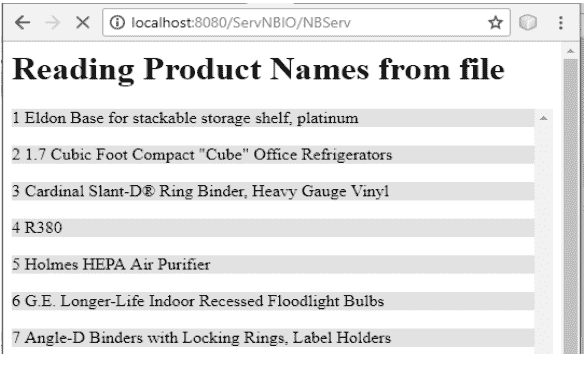

# 4. 实现 JSP 应用

实践 4：a) 开发一个简单的 JSP 应用，显示通过各种类型隐式对象获取的值。

1. 在 NetBeans IDE 中创建一个名为 `JSPImplicitObjectDemo` 的 Web 项目
2. 删除默认的 `index.html` 文件并按照以下步骤添加 JSP 文件

右键点击 `Web pages` -> `New` -> `JSP`
命名为 `index` 并在单选按钮中选择 `JSP File (Standard Syntax)`。

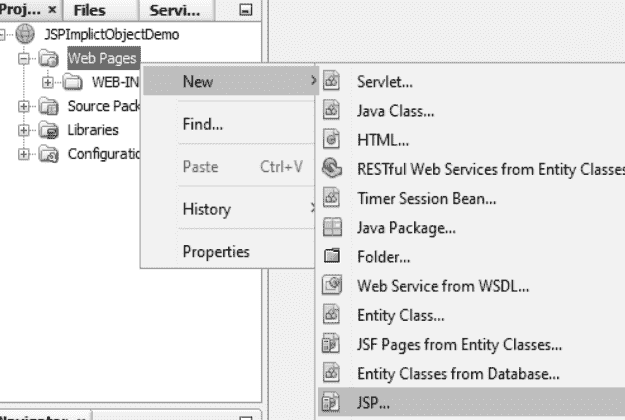

企业 Java (T.Y.B.-Sc.-I.T.) (Sem.-V)
224

新建 JSP

# 步骤

1. 选择文件类型
2. 命名和位置

| 命名和位置 | |
|---|---|
| 文件名: | `index` |
| 项目: | `JSPimplObjectDemo` |
| 位置: | `Web Pages` |
| 文件夹: | `WEB-INF` Browse... |
| 创建的文件: | `G:/PRACTICS/Standard Syntax/JSPimplObjectDemo/web/WEB-INF/index.jsp` |

选项：
☑ `JSP File (Standard Syntax)` ☐ `Create as a JSP Segment`
☐ `JSP File (XML Syntax)`

描述：
使用 JSP 标准语法的 JSP 文件。

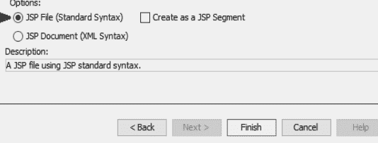

3. 在 `index.jsp` 的 `body` 下添加以下代码。

```jsp
<%@page language="java" import="java.io.PrintWriter" contentType="text/html;charset=UTF-8" %>

<html>
<head>
<meta http-equiv="Content-Type" content="text/html; charset=UTF-8">
<title>Implicit Objects</title>
</head>
<body>
<% PrintWriter out = response.getWriter();
out.print("Use of Response object.");><br>
<strong>Request Object - locale example:</strong>
<%=request.getLocale().toString()}<br>
<strong>Out object prints:</strong>
<%out.print("This is an example");><br>
<strong>Config object - servlet name:</strong>
<%=config.getServerName()}<br>
<strong>Application object - server info:</strong>
<%=application.getServerInfo()}<br>
<strong>Page object - page name:</strong>
<%=page.getClass()><br>
实践日志
225
<strong>Session object - creation time:</strong>
<%=session.getCreationTime()><br>
<strong>PageContext object - class name:</strong>
<%pageContext.setAttribute("Test", "Value"); %>
<%=pageContext.getClass()><br>
<body>
</html>
```

3. 在项目中创建并添加 `web.xml` (部署描述) 文件
右键点击 `WEB-INF` 文件夹 -> `New` -> `Others`
在新窗口中选择 `Web Categories` 中的 `Standard Descriptors (web.xml)` 类型。

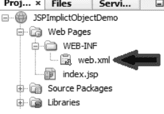

4. 在 `web.xml` 中添加以下行

```xml
<?xml version="1.0" encoding="UTF-8"?>
<web-app xmlns="http://xmlns.jcp.org/xml/ns/javaee"
xmlns:xsi="http://www.w3.org/2001/XMLSchema-instance"
xsi:schemaLocation="http://xmlns.jcp.org/xml/ns/javaee http://xmlns.jcp.org/xml/ns/javaee/webapp-3_1.xsd"
version="3.1">
<welcome-file-list>
<welcome-file>index.jsp</welcome-file>
</welcome-file-list>
</web-app>
```

# 输出：

`localhost:8080/JSImplicitObjectDemo/`
`Use of Response Object example`
`Request Object - locale example: en_US`
`Out object prints: This is an example`
`Config object - servlet name: jsp`
`Application object - server info: GlassFish Source Edition 4.0`
`Page object - page name: org.apache.jsp.index_jsp`
`Session object - creation time: 153348`
`PageContext object - class name: org.apache.jasper.runtime.PageContextImpl`

实践 4：开发一个简单的 JSP 应用，将值从一个页面传递到另一个页面并带验证（`Name-txt`, `age-txt`, `hobbies-checkbox`, `email-txt`, `gender-radio`）。

1. 在 NetBeans IDE 中创建一个 `JSPValidation` Web 项目
2. 如实践 4a 所示，在 `WEB-INF` 文件夹下创建 `web.xml` 文件并在 `web-app` 标签内添加以下代码

```xml
<welcome-file-list>
<welcome-file>index.jsp</welcome-file>
</welcome-file-list>
```

2. 如实践 4c 所示，在 `web pages` 目录下创建 `index.jsp`（上述 JSP 文件）并添加以下代码。

```jsp
<%@page contentType="text/html" pageEncoding="UTF-8"%>
<!DOCTYPE html>
<html>
<head>
<meta http-equiv="Content-Type" content="text/html; charset=UTF-8">
<title>JSP Registration</title>
</head>
<body>
<h1>Registration Form</h1>
<form action="val.jsp" method="post">
<table style="width:50%;%">
<tr>
<td>Full Name</td>
<td><input type="text" name="fullname" />
</tr>
<tr>
<td>Age</td>
<td><input type="text" name="age" />
</tr>
<tr>
<td>E-Mail</td>
<td><input type="text" name="email" size="20" />
</tr>
<tr>
<td>Gender</td>
<td><input type="radio" name="gender" value="Male">Male
<input type="radio" name="gender" value="Female"/>Female
</td>
</tr>
<tr>
<td>Hobbies</td>
<td><input type="checkbox" name="hb" value="Acting"/>Acting
<input type="checkbox" name="hb" value="Dancing"/>Dancing
<input type="checkbox" name="hb" value="Singing"/>Singing
</td>
</tr>
</table>
<table>
<td><input type="submit" value="Register" />
</td>
</form>
</body>
</html>
```

228
Enterprise Java (T.Y.B.Sc.-I.T.) (Sem.-V)

```java
{
    out.println("<font color=red>Correct Your Email Address</font><br>");
try {
    ageInNumbers = Integer.parseInt(age.trim());
} catch (NumberFormatException e) {
    out.println("<font color=red>Age must be in numbers</font><br>");
}
if(ageInNumbers >= 18 && ageInNumbers <= 60) {
    out.println("<font color=red>Age must be between 18 to 60</font><br>");
}
```

您输入的信息如下：<br><br>
姓名 `<b>:<%name%> </b><br>`
年龄 `<b>:<%age%> </b><br>`
邮箱 `<b>:<%email%> </b><br>`
性别 `<b>:<%gender%> </b><br>`
爱好 `<b>:<%br>`

```jsp
<%
if (hb != null && hb.length != 0) {
    for (int i = 0; i < hb.length; i++) {
        out.println(hb[i]);
    }
}
%>
```

## 注册表

| 姓名 | |
| :--- | :--- |
| 年龄 | |
| 邮箱 | |
| 性别 | 男 女 |
| 爱好 | 演技 舞蹈 唱歌 |
| 注册 | |


请填写所有字段
纠正您的邮箱地址
年龄必须为数字

## 注册表

| 姓名 | Tushar Vinayak Sambare |
| :--- | :--- |
| 年龄 | 07 |
| 邮箱 | wwww |
| 性别 | 男 女 |
| 爱好 | 演技 舞蹈 唱歌 |
| 注册 | |

纠正您的邮箱地址
年龄必须在 18 到 60 之间
您输入的信息如下：

姓名：Tushar Vinayak Sambare
年龄：87
邮箱：wwww
性别：男
爱好：演技 唱歌

实验 4：(c) 创建一个注册和登录 JSP ，使用 JDBC 根据用户名和密码对用户进行注册和验证。

**注意：（在此执行之前，我们必须在电脑上安装 MySQL Server，并下载 `mysql-connector-java.jar` 文件。创建数据库 `"Reg"`，并创建表 `"Register"`，其中包含 `uid`, `fname`, `name`, `pname`, `pwd1`, `town`, `country`, `zipcode` 字段，数据类型均为 `Char`，如下所示）；**

```sql
create database
use reg;
CREATE TABLE Register ( uid CHAR(40), fname CHAR(40), sname
CHAR(40), pwd CHAR(40), pwd1 CHAR(40), town CHAR(40), country
CHAR(40), zipcode CHAR(40) );
```

1. 在 NetBeans IDE 中创建一个带有 JSP 的 Web 项目
**注意：在 `Name` 和 `Location` 中创建 Web Application 项目时，勾选“Use dedicated folder sharing the libraries”复选框，如下所示。

2. 在 `Projects Libraries` 文件夹中添加 `mysql-connector-java.jar` 文件。

3. 按实验 4a 中提到的创建 `web.xml` 文件（将此文件创建 `WEB-INF` 文件夹下）。

```xml
<welcome-file-list>
<welcome-file>index.jsp</welcome-file>
</welcome-file-list>
```

4. 创建 `index.jsp` 文件以显示注册字段，如实验 4a 所示（位于 `web pages` 目录下的 JSP）；在 `body` 标签下添加以下代码。

```html
<form action="dbRegistration.jsp" method="post">
<table padding=4 cellspacing="2" border=0 bgcolor="Red">
<tr><th colspan="2"><font size=5>注册表</font> <br/></th></tr>
<tr><td><td>姓*</td></td></tr>
<tr><td><input type="text" name="fname" value="" size=15 maxlength=20></td></td></tr>
```


# 实验日志

## 4. JSP 注册与登录应用

实验 R：(a) 创建一个包含姓、名、用户名、密码、确认密码、国家字段的页面。现在将这些数据提交到 JSP 页面，该页面根据用户名更新数据库的注册表。

- 1. 在 NetBeans IDE 中创建一个带有 `JSPReg` 的 Web 项目
- 2. 创建 `registration.jsp` 文件以显示字段，并在 `body` 下添加以下代码。

```html
<form action="dbRegistration.jsp">
  <table padding="4" border="0" bgcolor="Red">
    <tr>
      <td colspan="2"><font size="5">注册表</font><br/></td>
    </tr>
    <tr>
      <td valign="top"><b>姓</b></td>
      <td><input type="text" name="sname" value="" size=15 maxlength=20></td>
    </tr>
    <tr>
      <td><b>名</b></td>
      <td><input type="text" name="fname" value="" size=15 maxlength=20></td>
    </tr>
    <tr>
      <td><b>邮政编码</b></td>
      <td><input type="text" name="zip" value="" size=5 maxlength=6></td>
    </tr>
    <tr>
      <td><b>用户名</b></td>
      <td><input type="text" name="uid" value="" size=10 maxlength=10></td>
    </tr>
    <tr>
      <td valign="top"><b>密码</b></td>
      <td><input type="password" name="pwd" value="" maxlength=10></td>
    </tr>
    <tr>
      <td><b>确认密码</b></td>
      <td><input type="password" name="pwd1" value="" maxlength=10></td>
    </tr>
    <tr>
      <td><b>城市</b></td>
      <td><input type="text" name="town" value="" size=10 maxlength=10></td>
    </tr>
    <tr>
      <td><b>国家</b></td>
      <td><input type="text" name="country" value="" maxlength=10></td>
    </tr>
    <tr>
      <td align="center" colspan="2"><input type="submit" value="提交"></td>
    </tr>
  </table>
</form>
```

- 3. 创建另一个 `dbRegistration.jsp` 文件处理注册并添加以下代码：

```jsp
<%@page contentType="text/html" pageEncoding="UTF-8"%>
<%@page import="java.sql.*, javax.sql.*" %>
<%
String uid = request.getParameter("uid");
String fname = request.getParameter("fname");
String sname = request.getParameter("sname");
String pwd = request.getParameter("pwd");
String pwd1 = request.getParameter("pwd1");
String town = request.getParameter("town");
String country = request.getParameter("country");
String zipcode = request.getParameter("zip");

String connectionURL = "jdbc:mysql://localhost:3306/reg";
Connection connection = null;
ResultSet rs;

try {
    Class.forName("org.jdbc.mysql.Driver");
    connection = DriverManager.getConnection(connectionURL, "root");
    String sql = "insert into register values (?,?,?,?,?,?,?,?)";
    PreparedStatement pst = connection.prepareStatement(sql);
    pst.setString(1, uid);
    pst.setString(2, fname);
    pst.setString(3, sname);
    pst.setString(4, pwd);
    pst.setString(5, pwd1);
    pst.setString(6, town);
    pst.setString(7, country);
    pst.setString(8, zipcode);
    int rowsChanged = pst.executeUpdate();
    out.println("<h1>欢迎： ");
    out.println(fname + "</h1>");
    pst.close();
} catch (ClassNotFoundException e) {
    out.println("未加载数据库驱动: " + e.getMessage());
} catch (SQLException e) {
    out.println("捕获 SQLException: " + e.getMessage());
} catch (Exception e) {
    out.println("数据库错误");
} finally {
    try {
        if (connection != null) connection.close();
    } catch (SQLException ignored) {
        out.println("忽略");
    }
    response.sendRedirect("login.jsp");
}
%>
```

- 4. 如上，创建另一个 `login.jsp` 文件以显示字段，并在 `body` 下添加以下代码。

```html
<form action="dbLogin.jsp">
  <table padding="4" border="0" bgcolor="Red">
    <tr>
      <td colspan="2"><font size="5">登录表</font><br/></td>
    </tr>
    <tr>
      <td>用户名</td>
      <td><input type="text" name="uid" value="" size="15" maxlength="20"></td>
    </tr>
    <tr>
      <td>密码</td>
      <td><input type="password" name="pwd" value="" maxlength="20"></td>
    </tr>
    <tr>
      <td align="center" colspan="2"><input type="submit" value="提交"></td>
    </tr>
  </table>
</form>
```

- 5. 创建另一个 `dbLogin.jsp` 文件处理登录并添加以下代码：

```jsp
<%@page contentType="text/html" pageEncoding="UTF-8"%>
<%@page import="java.sql.*, javax.sql.*" %>
<%
String userid = request.getParameter("uid");
String pwd = request.getParameter("pwd");

Class.forName("com.mysql.jdbc.Driver");
String connUrl = "jdbc:mysql://localhost:3306/";
java.sql.Connection conn = DriverManager.getConnection(connUrl, "root", "root");
Statement stmt = conn.createStatement();
ResultSet rs = stmt.executeQuery("select * from register where uid='" + userid + "'");

if (rs.next()) {
    // 我们的密码在 register 表的第 4 列
    if (rs.getString(4).equals(pwd)) {
        out.println("<h1>登录成功!</h1>");
    } else {
        out.println("<h1>登录失败!</h1>");
    }
} else {
    out.println("<h1>未找到用户!</h1>");
}
%>
```

输出：

| 注册表 | |
| :--- | :--- |
| 姓 | Tushar Vinayak Sambare |
| 名 | Sambare |
| 邮政编码 | 07 |
| 用户名 | vedshree |
| 密码 | |
| 确认密码 | |
| 城市 | THANE |
| 国家 | India |

| 登录表 | |
| :--- | :--- |
| 输入用户名 | vedshree |
| 输入密码 | |

`localhost:8080/JSPLog/dbLogin.jsp` 用户名或密码。点击此处重试 `localhost:8080/JSPReg` 登录成功，欢迎来到 JSP

## 5. JSP JSTL 和 EL 应用

实验 S：(a) 创建一个包含姓、名、用户名、密码、确认密码、国家字段的页面。现在将这些数据提交到 JSP 页面，该页面根据用户名更新数据库的注册表。

- 1. 在 NetBeans IDE 中创建一个带有 `JSPUpdate` 的 Web 项目
- 在此示例中，我们将遵循与实验 4 相似的步骤来创建 JSP 文件。
- 创建 `web.xml` 和添加 `mysqlconnector.jar` 的步骤也将相同。
- 在这里我们使用数据库 `Reg` 和 `Register` 来修改/更新用户详情。

- 2. 创建 `dbLogin.jsp` 文件处理登录并添加以下代码：

```java
if (rs.next()) {
    // 这里我们的密码在 register 表的第 4 列
    if (rs.getString(4).equals(pwd)) {
        response.sendRedirect("editRegister.jsp");
    } else {
        response.sendRedirect("index.jsp");
    }
} else {
    out.println("Database Error");
}
```

## editRegister.jsp

```jsp
<%@page contentType="text/html" pageEncoding="UTF-8"%>
<%@page import="java.sql.*,java.sql.*" %>
<%
String userid = session.getAttribute("userid").toString();
//String pwd=session.getAttribute("userid").toString();
Class.forName("com.mysql.jdbc.Driver");
String connURL = "jdbc:mysql://localhost:3306/reg";
java.sql.Connection conn = DriverManager.getConnection(connURL, "root", "root");
Statement st = conn.createStatement();
ResultSet rs = st.executeQuery("select * from register where uid='" + userid + "'");
if (rs.next()) {
%>
```

```html
<html>
<head><title>注册注册示例</title></head>
<body bgcolor="PINK">
<form action="updateDetails.jsp" method="post">
  <table cellpadding="4" cellspacing="2" border="0" bgcolor="Red">
    <tr colspan="2"><font size="5">编辑注册详情</font> <br><th></th></tr>
    <tr><td><b>名字<span>*</span></b></td></tr>
    <tr><td><input type="text" name="fname" value="<%=rs.getString(2)%>" size=15 maxlength=20></td></tr>
    <tr><td valign="top"><b>姓<span>*</span></b></td></tr>
    <tr><td><input type="text" name="sname" value="<%=rs.getString(3)%>" size=15 maxlength=20></td></tr>
    <tr><td><b>邮政编码<span>*</span></b></td></tr>
    <tr><td><input type="text" name="zip" value="<%=rs.getString(4)%>" size=5 maxlength=20></td></tr>
    <tr><td><b>用户名<span>*</span></b></td></tr>
    <tr><td><input type="text" name="uid" size=10 value="<%=rs.getString(1)%>" maxlength="10" readonly></td></tr>
    <tr><td valign="top"><b>密码<span>*</span></b></td></tr>
    <tr><td><input type="password" name="pwd" size=10 value="<%=rs.getString(4)%>" maxlength="10"></td></tr>
    <tr><td><b>确认密码<span>*</span></b></td></tr>
    <tr><td><input type="password" name="pwd1" size=10 value="<%=rs.getString(5)%>" maxlength="10"></td></tr>
    <tr><td><b>城市:<span>*</span></b></td></tr>
    <tr><td><input type="text" name="town" size=10 value="<%=rs.getString(6)%>" maxlength="10"></td></tr>
    <tr><td><b>国家:<span>*</span></b></td></tr>
    <tr><td><input type="text" name="country" size=10 value="<%=rs.getString(7)%>" maxlength="10"></td></tr>
    <tr><td align="center" colspan=2><br><input type="submit" value="提交"></td></tr>
  </table>
</form>
```

```jsp
<%
} else {
    out.println("Database Error");
}
%>
</body>
</html>
```

## updateDetails.jsp

```jsp
<%@page contentType="text/html" pageEncoding="UTF-8"%>
<%@ page import="java.sql.*,javax.sql.*" %>
<%
String uid = request.getParameter("uid");
String fname = request.getParameter("fname");
String sname = request.getParameter("sname");
String pwd = request.getParameter("pwd");
String pwd1 = request.getParameter("pwd1");
String town = request.getParameter("town");
String country = request.getParameter("country");
String zip = request.getParameter("zip");
session.setAttribute("userid", uid);

Class.forName("com.mysql.jdbc.Driver");
String connURL = "jdbc:mysql://localhost:3306/reg";
java.sql.Connection con = DriverManager.getConnection(connURL, "root", "root");
%>
```

```java
String sql = "update register set name=?,sname=?,pwd=?,pwd1=?,town=?,country=?,zipcode=? where uid=?";
PreparedStatement pst = con.prepareStatement(sql);
// 以下值从请求参数提供
pst.setString(1, fname);
pst.setString(2, sname);
pst.setString(3, pwd);
pst.setString(4, pwd1);
pst.setString(5, town);
pst.setString(6, country);
pst.setString(7, zip);
pst.setString(8, uid);
int rowsUpdated = pst.executeUpdate();
if (rowsUpdated > 0) {
    out.println("<h1>更新成功!</h1>");
} else {
    out.println("<h1>更新失败!</h1>");
}
pst.close();
con.close();
%>
```


`pst.setString(6, country);`

`pst.setString(7, zip);`

`pst.setString(8, uid);`

`pst.executeUpdate();`

`Statement stmt = con.createStatement(stmt);`

`ResultSet rs = st.executeQuery("select * from register uid=" + uid + "");`

```
if (rs.next()) {
```

```html
<html>
<head><title>保存更改</title></head>
<body bgcolor="PINK">
<form action="updateDetails.jsp" method="post">
<table cellpadding="4" border="2" bgcolor="Red">
<tr colspan="2"><font size="5">您有以下更改</font> <br><th></th></tr>
<tr><td><b>名字<span>*</span></b></td></td>
<td><%=rs.getString(2)%></td></tr>
<tr><td valign="top"><b>姓<span>*</span></b></td></td>
<td><%=rs.getString(3)%></td></tr>
<tr><td><b>邮政编码<span>*</span></b></td></td>
<td><%=rs.getString(8)%></td></tr>
<tr><td><b>用户名<span>*</span></b></td></td>
<td><%=rs.getString(1)%></td></tr>
<tr><td valign="top"><b>密码<span>*</span></b></td></td>
<td><%=rs.getString(4)%></td></tr>
<tr><<td><b>确认密码<span>*</span></b></td></td>
<td><%=rs.getString(5)%></td></tr>
<tr><td><b>城市:<span>*</span></b></td></td>
<td><%=rs.getString(6)%></td></tr>
<tr><td><b>国家:<span>*</span></b></td></td>
<td><%=rs.getString(7)%></td></tr>
</table>
</center>
```

237
实践日志

```jsp
<%
}
else
{
    out.println("Database Error");
}
%>
<form></body></html>
```

## 登录编辑详情

| 用户名 | 密码 |
| --- | --- |
| vedshree | ***** |

## 编辑注册详情

| 名字 | 姓 | 邮政编码 | 用户名 | 密码 | 确认密码 | 城市 | 国家 |
| :--- | :--- | :--- | :--- | :--- | :--- | :--- | :--- |
| | | | | | | | |
| | | | | | | | |
| | | | | | | | |

你有以下更改

| 名字 | 姓 | 邮政编码 | 用户名 | 密码 | 确认密码 | 城市 | 国家 |
| :--- | :--- | :--- | :--- | :--- | :--- | :--- | :--- |
| vedshree | | | | | | | |
| | | | | | | | |

创建一个名为 `jstlDemo.jsp` 的另一个 JSP 文件，并在文件中添加以下代码。

```jsp
<%@taglib prefix="c" uri="http://java.sun.com/jst/core_rt" %>
<html>
<head>
<meta http-equiv="Content-Type" content="text/html; charset=ISO-8859-1">
<title>欢迎页面</title>
</head>
<body>
名字：<b><c:out value="${param.fname}"/></b><br>
姓氏： <b><c:out value="${param.lname}"/></b><br><br>
if 语句的语句
<br>
<c:set var="mycount" value="25"/>
<c:if test="${mycount == 25}">
<b><c:out value="Your count is 25" />
```

## 实践实验日志
241

# 输出：

```
<- localhost:8080/SimpleJSTLDemo/jstldemo.jsp
```

```
First Name: Yashashree
Last Name: Sambare
```

```
Use of if statement
Your count is 25
```

First Name:Yashree
Last Name:Sambare
Check JSTL Demo

```
Use ofForEach statement
101 102 103 104 105
```

```
Exception catching Example
```

```
The Exception is : java.lang.ArithmeticException: / by zero
```

# 6. EJB 应用

实践实验 6 : (a) 使用 EJB 创建一个货币转换器应用程序。

1. 在 NetBeans IDE 中创建一个带有 EJBCC 的 Java Web 项目。
2. `index.jsp` 文件和 `web.xml` 文件的创建在之前的练习中已描述。在 `index.jsp` 中添加以下代码。

```jsp
<page contentType="text/html" pageEncoding="UTF-8"%>
<html>
<head>
<meta http-equiv="Content-Type" content="text/html; charset=UTF-8">
<title>我的货币转换器</title>
</head>
<body>
<form method="post" action="CCCClient">
要转换的金额：<input type="text" name="amt" value="1" size="10" />
<br><br><br>从此货币：
<select name="From">
<option value="dollar">美国美元 $</option>
<option value="INR">印度卢比</option>
</select>
<br><br><br>到此货币：
<select name="To">
<option value="dollar">美国美元 $</option>
<option value="INR">印度卢比</option>
</select>
<br><br><br>
<input name="cmdSubmit" type="submit" value="Submit" tabindex="4" />
</form>
</body>
</html>
```

# 2. 按照图表后的步骤，向我们的项目添加（创建）一个企业 Bean（Enterprise Bean）：

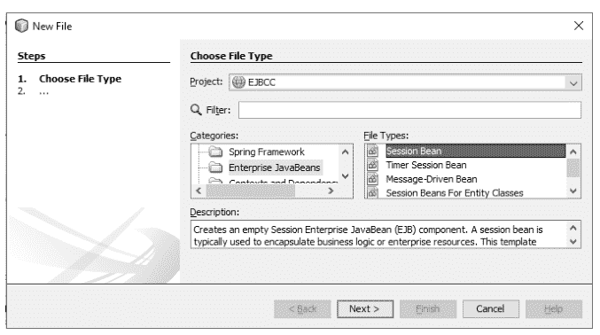

# 项目目录和文件结构

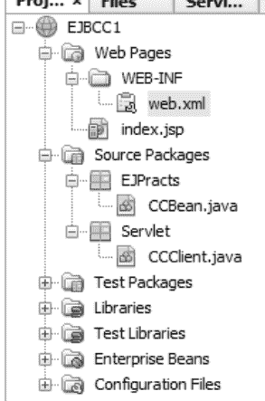

- i) 在项目面板的 Source Packages 上点击右键 -> New -> Select Other
- ii) 在弹出的窗口中，在类别（categories）下选择 "Enterprise Java"，并在文件类型中选择 "Session Bean"，然后点击 Next 按钮。
- iii) 将你的 EJB 命名为 `CCBean`，根据我们的项目将包命名为 `EJPracts`，选择 Stateless 作为 Session Type，并点击 Finish 完成。

在你的 `CCBean.java` 文件中添加以下内容。

```java
package EJPracts;

import java.math.BigDecimal;

import javax.ejb.Stateless;
```

```java
@Stateless
public class CCBean {
```

# 实践实验日志
243

`final private BigDecimal dollar = new BigDecimal("0.0229137");`

`final private BigDecimal inr = new BigDecimal("46.589100");`

```java
public BigDecimal convert(String from, String to, BigDecimal amount) {
    if(from.equals(to)) {
        return amount;
    } else {
        BigDecimal toRate = findRate(to);
        BigDecimal result = toRate.multiply(amount);
        return result.setScale(2, BigDecimal.ROUND_UP);
    }
}
```

```java
public BigDecimal findRate(String to) {
    BigDecimal returnValue = null;
    if(to.equals("inr")) {
        returnValue = inr;
    }
    if(to.equals("dollar")) {
        returnValue = dollar;
    }
    return returnValue;
}
```

3. 正如之前的 Servlet 练习所示，向我们的项目添加（创建）一个 Servlet 客户端文件并命名为 `CCClient` 并添加下面的代码。

**注意：在创建此 servlet 时，将 servlet 放置在不同的包中，例如此程序使用的 servlet 包。**

- 添加以下导入

```java
package Servlet;
import EJPracts.CCBean;
import java.io.IOException;
import java.io.PrintWriter;
import java.math.BigDecimal;
import javax.ejb.EJB;
import javax.servlet.ServletException;
import javax.servlet.http.HttpServlet;
import javax.servlet.http.HttpServletRequest;
import javax.servlet.http.HttpServletResponse;
```

- 在类中添加以下对象

```java
@EJB
ccbean;
```

- 在 `processRequest` 方法中添加以下代码：

```java
response.setContentType("text/html;charset=UTF-8");

try (PrintWriter out = response.getWriter()) {

    /* TODO 输出代码 */
    String amt = request.getParameter("amt");

    if (amt != null && amt.length() > 0) {

        BigDecimal d = new BigDecimal(amt);

        out.println("<!DOCTYPE html>");
        out.println("<html>");
        out.println("<head><title>Converted Currency</title></head>");
        out.println("<body>");
        out.println(ccbean.convert(request.getParameter("From"), request.getParameter("To"), d));
```

```java
输出：

 使用 EJB 开发一个简单的房间系统。

1. 在 NetBeans IDE 中创建一个 Java Web 项目。
2. `index.jsp` 文件和 `web.xml` 文件的创建在之前的练习中已描述。在 `index.jsp` 中添加以下代码。

```html
<html>
<head><title>房间预约</title></head>
<body>
<p><b>填写详情</b></p>
<form method="post" action="ReservationServlet">
姓名：<input type="text" name="cname" size="20" /> <br>
地址：<input type="text" name="cade" size="20" /> <br>
电话号码：<input type="text" name="cph" size="12" /> <br>
房间类型：
<select name="roomtype">
<option value="g">普通</option>
<option value="d">豪华</option>
<option value="s">套房</option>
</select><br><br>
入住日期 (DD/MM/YYYY)：<input type="text" name="checkdate" /> <br>
退房日期 (DD/MM/YYYY)：<input type="text" name="checkout" /> <br>
支付方式：
<select name="payymode">
<option value="cash">现金</option>
<option value="credit">信用卡</option>
</select><br><br>
<input name="cmdsubmit" type="submit" value="提交" />
</form>
</body>
</html>
```

4. 按照给出的示例步骤，向我们的项目添加（创建）一个命名为 `ReservationBean` 的企业 Bean。

```java
package Ejracts;
import java.ejb.Stateless;
import java.util.ArrayList;
```

```java
@Stateless
public class ReservationBean {
    public String Welcome(String customer) {
        return "你好 " + " + customer.toUpperCase() + " 欢迎来到我们的酒店";
    }
    public String roomType(String roomtype) {
        return "你选择了 " + " + roomtype.toUpperCase() + " 房间";
    }
    public String payment(String roomtype) {
```

```java
if(roomtype.equalsIgnoreCase("SUITE")) {
  return "你需要支付 8000 卢比";
}
else if(roomtype.equalsIgnoreCase("DELUXE")) {
  return "你需要支付 4000 卢比";
}
else
  return "你需要支付 2000 卢比";
}
}
```

```java
public ArrayList<String> reserve(String customer, String add, String ph,
String checkin, String checkout, String roomtype, String paymode) {
  ArrayList<String> a = new ArrayList();
  a.add(customer);
  a.add(add);
  a.add(ph);
  a.add(checkin);
  a.add(checkout);
  a.add(roomtype);
  a.add(paymode);
  return a;
}
```

5. 向我们的项目添加（创建）一个命名为 `ReservationServlet` 的 Servlet 客户端文件，包名为 `servlet` 并添加下面的代码。


```java
package servlet;
import Ejracts.ReservationBean;
import java.io.IOException;
import java.io.PrintWriter;
import java.util.ArrayList;
import javax.ejb.EJB;
import javax.servlet.ServletException;
import javax.servlet.http.HttpServlet;
import javax.servlet.http.HttpServletRequest;
import javax.servlet.http.HttpServletResponse;

public class ReservationServlet extends HttpServlet {
    @EJB
    ReservationBean ccbean;

    protected void processRequest(HttpServletRequest request, HttpServletResponse response)
            throws ServletException, IOException {
        response.setContentType("text/html;charset=UTF-8");
        try (PrintWriter out = response.getWriter()) {
            String customer = request.getParameter("cname");
            String add = request.getParameter("cade");
            String ph = request.getParameter("cph");
            String checkin = request.getParameter("checkdate");
            String checkout = request.getParameter("checkout");
            String roomtype = request.getParameter("roomtype");
            String paymode = request.getParameter("payymode");

            if (customer != null && customer.length() > 0) {
                out.println("<!DOCTYPE html>");
                out.println("<html>");
                out.println("<head><title>out</title></head>");
                out.println("<body>");
                out.println("<h1>" + ccbean.Welcome(customer) + "</h1>");
                out.println("<p>" + ccbean.roomType(roomtype) + "</p>");
                out.println("<p>支付金额：" + ccbean.payment(roomtype) + "</p>");
                out.println("<a href=\"index.jsp\">返回</a>");
                out.println("</body>");
                out.println("</html>");
            }
        }
    }

    @Override
    protected void doGet(HttpServletRequest request, HttpServletResponse response)
            throws ServletException, IOException {
        processRequest(request, response);
    }

    @Override
    protected void doPost(HttpServletRequest request, HttpServletResponse response)
            throws ServletException, IOException {
        processRequest(request, response);
    }
}
```

## 实践日志

### 247

**在起始部分的类块内添加以下对象创建代码。**

```java
@EJB
ReservationBean rb;
```

**在 `processRequest` 方法区域内添加以下代码。**

```java
response.setContentType("text/html;charset=UTF-8");
String cname=request.getParameter("cname");
String add=request.getParameter("cadd");
String ph=request.getParameter("cph");
String roomtype=request.getParameter("roomtype");
String chkin=request.getParameter("checkdate");
String chkout=request.getParameter("checkoutdate");
String paymode=request.getParameter("paymode");
PrintWriter out = response.getWriter();
rb=new ReservationBean();
int i=0;
ArrayList<String> list1=rb.reserve(cname, add, ph, chkin,
chkout, roomtype, paymode);
```

```java
try {
  rb.reserve(cname, add, ph, chkin, roomtype, paymode);
  out.println("<html>");
  out.println("<head> <title>Reservation EJB</title></head>");
  out.println("<body>");
  out.println(rb.welcome(cname));
  out.println("<br>");
  out.println(rb.roomType(roomtype));
  out.println("<br>");
  out.println(rb.payment(roomtype));
  out.println("<br>");
  out.println("<br>");
  out.println("Your Details :");
  int n = list1.size();
  out.println("<Table border=1>");
  out.println("<tr><th>Name</th><th>Address</th>");
  out.println("<tr><th>Phone</th><th>Check In Date</th>");
  out.println("<th>Check Out Date</th></tr>");
  out.println("<th>Room</th><th>Payment Mode</th></tr>");
  out.println("<br>");
  for(i = 0; i < n; i++) {
    out.println("<td>");
    out.println(list1.get(i));
    out.println("</td>");
  }
  out.println("</tr>");
  out.println("<br/>Click <a href='index.jsp'>here</a></a> to go back");
  out.println("</body>");
  out.println("</html>");
} finally {
  out.close();
}
```

**输出：**

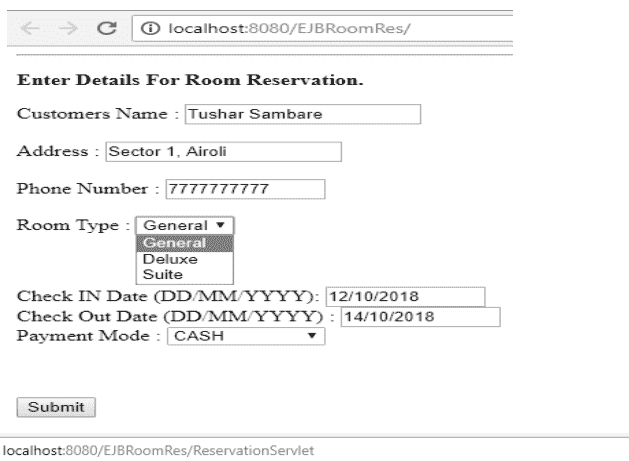

TUSHAR SAMBARE 欢迎来到我们的酒店

我们选择了普通房

需要支付 2500 比比

个人详情

| 姓名 |  far | 电话 | 入住日期 | 退房日期 | 房型 | 支付方式 |
| --- | --- | --- | --- | --- | --- | --- |
| Tushar Sambare | Sector 1, Airoli | 777777777 | 12/10/2018 | 14/10/2018 | General | CASH |

点击此处返回

## 实验 6: (c) 使用 EJB [有状态会话 Bean] 开发一个简单的购物车应用程序。

1. 在 `NetBeans` 中创建一个名为 `EJBShopCart` 的 Java Web 项目。

2. 在之前的数据库 `reg` 的 `mysql` 中创建 `mycart` 表。

```sql
use reg;
CREATE TABLE mycart (
uname VARCHAR(35) NULL,
itemname VARCHAR(45) NULL);
```

3. 在项目的 `libraries` 文件夹中添加 `mysqlconnector.jar` 文件。（参考上一个实验）。

4. 按照之前的实验说明创建 `index.jsp` 文件和 `web.xml` 文件。在 `index.jsp` 中添加以下代码：

```jsp
<%@page import="java.util.Iterator, java.util.List, java.naming.InitialContext, EJPracts.ShopCartStatefulBean"%>
<%@@page contentType="text/html" pageEncoding="UTF-8"%>
<!DOCTYPE HTML>
<%!
  private static ShopCartStatefulBean mycart;
  public void jspInit() {
      try {
          InitialContext ic = new InitialContext();
          mycart = (ShopCartStatefulBean)
          ic.lookup("java:global/EJBShopCart/ShopCartStatefulBean");
      } catch (Exception e) {
          System.out.println("Could not create bean. " + e.getMessage());
      }
  }
%>
<%
if(request.getParameter("userName") != null) {
    mycart.initialize(request.getParameter("userName"));
} else {
    mycart.initialize("Guest");
}
if (request.getParameter("removeProduct") != null) {
    String[] products = request.getParameterValues("chkLap");
    if (products != null) {
        for (int i=0; i<products.length; i++) {
            mycart.removeProduct(products[i]);
        }
    }
}
if (request.getParameter("addProduct") != null) {
    String[] products = request.getParameterValues("chkLap");
    if (products!= null) {
        for (int i=0; i<products.length; i++) {
            mycart.addBook(products[i]);
        }
    }
}
%>

<html
<head>
<meta http-equiv="Content-Type" content="text/html; charset=UTF-8">
<title>购物车</title>
</head>
<body style="background-color:lightsalmon;">
<h2 style="text-align:center;">笔记本出售</h2>
<form name="products" method="post">
<table style="background-color: pink; width: 100%; padding: 1px;">
<tr style="background-color:lightsalmon;">
<td style="width: 70%">
<table style="padding: 1px 1px 1px 1px; border: 2px solid maroon; width: 400px;">
<tr style="border: 2px solid maroon;"><td>客户</td></tr><tr><td><input type="text" name="userName" value="<%= request.getParameter("userName") %> /></td></tr>
<tr style="text-align:left; width: 340px; border: 2px solid maroon; colspan="2">
<td>产品列表</td></tr><tr><td><input type="checkbox" name="chkLap" value="Laptop1"> 笔记本 1</td></tr><tr><td><input type="checkbox" name="chkLap" value="Laptop2"> 笔记本 2</td></tr><tr><td><input type="checkbox" name="chkLap" value="Laptop3"> 笔记本 3</td></tr>
</table>
</td>
<td>
<input type="submit" name="addProduct" value="加入购物车">
<input type="submit" name="removeProduct" value="从购物车移除">
</td>
</table>
</form>
</body>
</html>
```

```java
try {
    stmt = conn.createStatement();
    query = "SELECT * FROM mycart WHERE uname=\"" + userName + "\"";
    rs = stmt.executeQuery(query);
    while (rs.next()) {
        items.add(rs.getString("itemname"));
    }
} catch (SQLException e) {
    System.err.println("Failed to select. " + e.getMessage());
    return items;
}
```

```java
@Remove()
public void remove() {
    items = null;
}
```

**输出：**

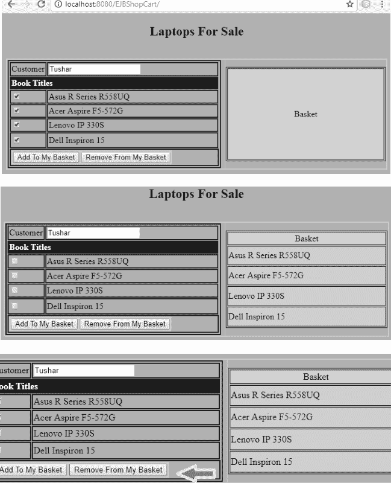

# EJB 类型应用

## 实验 7：(开发) 开发一个 EJB 应用，使用单例会话 Bean（Singleton Session Beans）演示 Servlet 命中计数。

1. 在 `NetBeans IDE` 中创建一个名为 `EJBSTHIHitCnt` 的 Java Web 项目。

2. 按照之前的实验创建 `index.jsp` 文件和 `web.xml` 文件。在 `index.jsp` 中添加以下代码：

```jsp
<!DOCTYPE html>
<<html>
<head>
<title>Hit Count Demo</title>
</head>
<body>
<form action="ShowHitCountServlet" method="post">
    <input type="submit" value="Take Hit Count Demo with EJB Singleton Bean/">
</form>
</body>
</html>
```

3. 在项目中添加（创建）一个企业级会话 Bean（单例），命名为 `STHitCntBean`，包名为 `EJPacts`。在输入 Name 和 Location 信息时，通过选择 Type 按钮并选择 Singleton。在文件中添加以下提供的代码：


# 实验 7：(a) 使用有状态会话 Bean（Stateful Session Bean）开发简单的统计应用

## 实验日志

### 3. 创建 Servlet 客户端

如之前的 Servlet 实验所示，向我们的项目添加（创建）一个 Servlet 客户端文件，命名为`CCCclient`，包名为`servlet`，并添加以下代码：

```java
*** Add imports
package servlet;
import EJPracts.SThiHitCountBean;
import java.io.IOException;
import java.io.PrintWriter;
import javax.ejb.EJB;
import javax.servlet.ServletExceptionException;
import javax.servlet.http.HttpServlet;
import javax.servlet.http.HttpServletRequest;
import javax.servlet.http.HttpServletResponse;
```

在类块的起始部分添加以下类对象创建：

```java
@EJB
SThiHitCountBean cntBean;
```

在`processRequest`方法区域内添加以下代码：

```java
response.setContentType("text/html;charset=UTF-8");
try (PrintWriter out = response.getWriter()) {
    out.println("<!DOCTYPE html>");
    out.println("<html>");
    out.println("<head>");
    out.println("<title>Servlet ShowHitCountServlet</title>");
    out.println("</head>");
    out.println("<body>");
    out.println("<h1>You visited this page: " + cntBean.incrHitCount() + " times/s</h1>");
    out.println("</body>");
    out.println("</html>");
}
```

### 输出

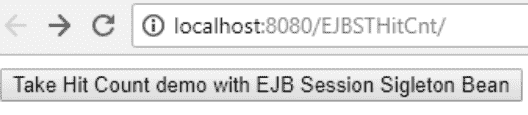


# 你访问了此页面：5 次/秒

---

# 实验 7：(b) 使用无状态会话 Bean（Stateless Session Bean）开发简单的统计应用

### 1. 创建项目

在 NetBeans IDE 中创建一个名为`EJBVisitStat`的 Java Web 项目。

### 2. 创建数据库表

使用之前的数据库创建`visitorstat`表：

```sql
CREATE TABLE visitorstat (
    visitid timestamp NOT NULL,
    host VARCHAR(45),
    visitcount int,
    PRIMARY KEY (host)
);
```

### 3. 添加 MySQL 连接器

在项目的`libraries`文件夹中添加`mysqlconnector.jar`文件。（参考之前的实验步骤。）

### 4. 创建 JSP 文件

按照之前的实验创建`index.jsp`文件和`web.xml`文件。在`index.jsp`中添加以下代码：

```jsp
<%@page import="javax.jms.JMSException, javax.naming.InitialContext, javax.jms.TextMessage, javax.jms.MessageProducer, javax.jms.Session, javax.jms.Connection, javax.jms.Queue, javax.jms.ConnectionFactory" %>
<%page contentType="text/html" pageEncoding="UTF-8"%>
<!DOCTYPE html>
<html>
<%
    private static ConnectionFactory connFact;
    private static Queue queue;

    Connection conn = null;
    Session mysess = null;
    MessageProducer msgProducer = null;
    TextMessage msg = null;
%>
<head>
<meta http-equiv="Content-Type" content="text/html; charset=UTF-8">
<title>Message Driven Bean</title>
</head>
<body style="background-color: gray;">
<h1>Welcome To Message Bean</h1>
<%
    try {
        InitialContext ctx = new InitialContext();
        queue = (Queue) ctx.lookup("jms/Queue");
        connFact = (ConnectionFactory) ctx.lookup("jms/ConnectionFactory");

        conn = connFact.createConnection();
        mysess = conn.createSession(false, Session.AUTO_ACKNOWLEDGE);
        msgProducer = mysess.createProducer(queue);
        msg = mysess.createTextMessage();
        msg.setText(request.getRemoteAddr());
        msgProducer.send(msg);
    } catch (Exception e) {
        System.out.println("Exception occurred: " + e.toString());
    }
%>
</body>
</html>
```

## 实验日志

### 5. 创建无状态会话 Bean

在输入 Name 和 Location 信息时，选择 Type 按钮向项目中添加（创建）一个企业级会话 Bean（Stateless），命名为`StatelessBean`，包名为`EJPacts`。在文件中添加提供的代码：

```java
package EJPacts;
import java.sql.Connection;
import java.sql.DriverManager;
import java.sql.ResultSet;
import java.sql.SQLException;
import java.sql.Statement;
import javax.annotation.PostConstruct;
import javax.annotation.PreDestroy;
import javax.ejb.Stateless;

@Stateless
public class StatelessBean {
    private Connection conn = null;
    private ResultSet rs;
    private Statement stmt = null;
    private String query = null;

    @PostConstruct
    public void connect() {
        try {
            Class.forName("com.mysql.jdbc.Driver");
            String connStr = "jdbc:mysql://localhost/reg";
            conn = DriverManager.getConnection(connStr, "root", "root");
            System.out.println("Connection Success.");
        } catch (ClassNotFoundException | SQLException e) {
            System.err.println("Connection failed.");
        }
    }
```

```java
    @PreDestroy
    public void disconnect() {
        try {
            conn.close();
            System.out.println("Connection closed.");
        } catch (SQLException e) {
            System.err.println("Not able to close connection: " + e.getMessage());
        }
    }

    public void addVisitor(String host) {
        try {
            stmt = conn.createStatement();
            query = "INSERT INTO visitorstat(host, visitcount) VALUES(" + host + ",1)";
            stmt.executeUpdate(query);
        } catch (SQLException e) {
            try {
                stmt = conn.createStatement();
                query = "UPDATE visitorstat SET visitcount = visitcount + 1 WHERE host = '" + host + "'";
                stmt.executeUpdate(query);
            } catch (SQLException ex) {
                System.err.println("Cannot update: " + ex.getMessage());
            }
        }
    }
}
```

### 6. 创建消息驱动 Bean

使用以下步骤向项目中添加（创建）一个消息驱动 Bean（Message Driven Bean）：

- 右键点击项目的`Source Package` -> `New` -> `Other...`
- 在`file`框中，在`Categories`下选择`Enterprise Java Beans`，在`File Type`下选择`Message-Driven Bean`。点击`Next`。
- 在`Name and Location`窗口中，给出 EJB 名称为`MsgDrivenBean`，包名为`EJPacts`。点击`Add`添加目的地。
- 弹出`Add Message Destination`对话框
- 给`Destination Name`为`jms/Queue`，选择`Destination type`为`Queue`并点击`Ok`。

## 实验日志

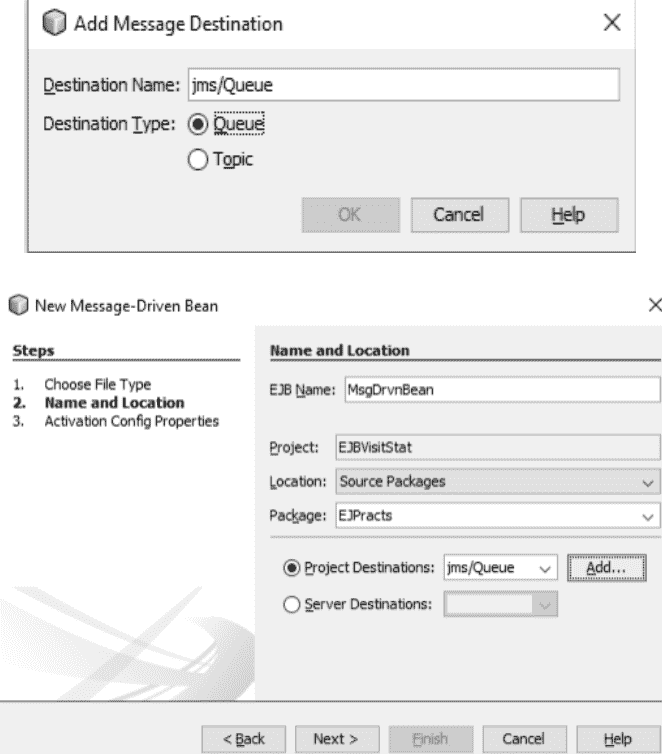

再次在**Name and Location**窗口中点击**Next**按钮。出现`New File`对话框，其中需要设置**Activation Config Properties**。保持默认值并点击**Finish**。

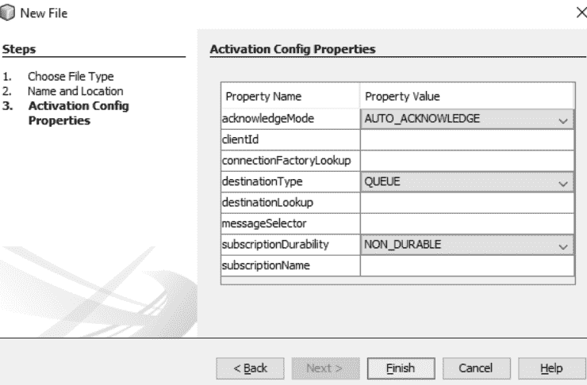

向我们的`MsgBean`添加以下代码：

```java
package EJPacts;
import javax.annotation.Resource;
import javax.ejb.ActivationConfigProperty;
import javax.ejb.EJB;
import javax.ejb.MessageDriven;
import javax.ejb.MessageDrivenContext;
import javax.jms.JMSException;
import javax.jms.Message;
import javax.jms.MessageListener;
import javax.jms.TextMessage;

@MessageDriven(activationConfig = {
    @ActivationConfigProperty(propertyName = "destinationType", propertyValue = "javax.jms.Queue"),
    @ActivationConfigProperty(propertyName = "destinationLookup", propertyValue = "jms/Queue")
})
public class MsgDrivenBean implements MessageListener {
    @EJB
    StatelessBean vs;

    @Resource
    private MessageDrivenContext mdc;

    public MsgDrivenBean() {
    }

    @Override
    public void onMessage(Message message) {
        try {
            if (message instanceof TextMessage) {
                TextMessage msg = (TextMessage) message;
                vs.addVisitor(msg.getText());
            }
        } catch (JMSException e) {
            mdc.setRollbackOnly();
        }
    }
}
```

### 输出


# 实验日志

# 261

要查看消息驱动节点（Message Driven Bean）的结果，请多次刷新上方页面，并使用以下查询检查数据库中的访问统计状态：

```sql
Select * from visitor;
```

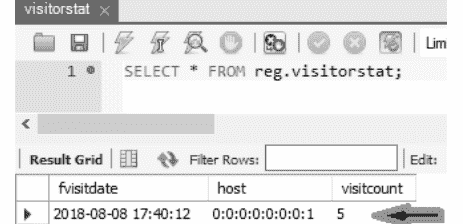

---

# 实验 7：(c) 开发一个简单的成绩输入应用以演示使用 EJB 访问数据库

### 1. 创建项目

在 NetBeans IDE 中创建一个名为`EJBMarksEntry`的 Java 项目。

### 2. 创建数据库表

使用我们之前的数据库注册在 mysql 中创建成绩表（marks table）：

```sql
CREATE TABLE marks (
id INT NOT NULL AUTO_INCREMENT,
stuName VARCHAR(45) NULL,
sub1 VARCHAR(20) NULL,
sub2 VARCHAR(20) NULL,
sub3 VARCHAR(20) NULL,
PRIMARY KEY (id);
```

### 3. 添加 MySQL 连接器

在项目的`libraries`文件夹中添加`mysql.connector.jar`文件。（参考上一个实验的步骤）。

### 4. 创建 JSP 文件

按照之前实验的描述创建`index.jsp`文件和`web.xml`文件。在`index.jsp`中添加以下代码：

```jsp
<%@page import="java.util.ArrayList, java.util.Iterator, java.util.List, java.naming.InitialContext, EJPracts.MarksEntryBean" %>
<%@page content="text/html" pageEncoding="UTF-8" %>
<!DOCTYPE html>
<html
<body
<%
private static MarksEntryBean marksEntry;
public void jspInit() {
    try {
        InitialContext ic = new InitialContext();
        marksEntry = (MarksEntryBean)ic.lookup("java:global/EJBMarksEntry/MarksEntryBean");
    } catch (Exception ex) {
        System.out.println("Database Error " + ex.getMessage());
    }
}
%>
</body>
</html>
```

262


# 企业 Java (T.Y.B.Sc.-I.T.) (Sem.-V)

```jsp
<%
if (request.getParameter("insertMarks") != null) {
    String name,marks1,marks2,marks3;
    name=request.getParameter("stuName");
    marks1=request.getParameter("sub1");
    marks2=request.getParameter("sub2");
    marks3=request.getParameter("sub3");
    marksEntry.addMarks(name,marks1,marks2,marks3);
}
%>
```

```html
<html
<head>
    <meta http-equiv="Content-Type" content="text/html; charset=UTF-8">
    <title>成绩输入</title>
</head>
<body>
    <h2 style="text-align: center;">输入详细信息</h2><br>
    <form name="result" method="post">
        <table>
            <tr><td>学生姓名</td></tr>
            <tr><input type="text" name="stuName" value="" /></tr>
            <tr><td>科目 1 成绩</td></tr>
            <tr><input type="text" name="sub1" value="" /></tr>
            <tr><td>科目 2 成绩</td></tr>
            <tr><input type="text" name="sub2" value="" /></tr>
            <tr><td>科目 3 成绩</td></tr>
            <tr><input type="text" name="sub3" value="" /></tr>
            <tr><td colspan="2"><input type='submit' name='insertMarks' value='insertMarks'></</td></tr>
        </table>
        <table></table>
    </form>
</body>
</html>
```

5. 在我们的项目中添加（创建）一个名为 `MarksEntryBean` 的企业级会话豆（Stateful），包名命名为 `EJProjects`，在输入 Name 和 Location 信息时通过选择 Session Type 单选按钮来实现。在文件中添加以下提供的代码。

```java
package EJProjects;
import java.sql.*;
import java.sql.SQLException;
import java.util.List;
```

# 实验日志

# 263

```java
import javax.ejb.Stateful;

@Stateful
public class MarksEntryBean {
    List<String> details;
    String stuName,sub1,sub2,sub3;

    private Connection conn = null;
    private ResultSet rs;
    private Statement stmt = null;
    private String query = null;
}
```

```java
public void createConnection() {
    try {
        Class.forName("org.jdbc.mysql.Driver").newInstance();
        String connStr="jdbc:mysql://localhost/reg";
        conn = DriverManager.getConnection(connStr, "root", "root");
    } catch (ClassNotFoundException | IllegalAccessException | SQLException e) {
        System.err.println("Database Error. " + e.getMessage());
    }
}
```

```java
public void addMarks(String stuname,String marks1,String marks2, String marks3) {
    try {
        stmt = conn.createStatement();
        query = "INSERT INTO marks(stuName,sub1,sub2,sub3)VALUES('" + stuname + "','" + marks1 + "','" + marks2 + "','" + marks3 + "')";
        stmt.executeUpdate(query);
    } catch (SQLException e) {
        System.err.println("Failed to insert. " + e.getMessage());
    }
}
```

输出

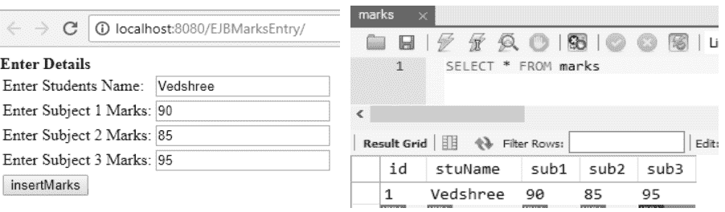

# 实验 8 : (a) 使用 JPA 开发简单的 Inventory 应用

1. 在 NetBeans IDE 中创建一个名为 `Inventory` 的 Java 项目。

2. 使用之前的数据库注册在 mysql 中创建 `inventory` 表。

```sql
CREATE TABLE inventory (
id INT NOT NULL AUTO_INCREMENT PRIMARY KEY,
name VARCHAR(255),
description VARCHAR(255),
quantity INT,
addedDate DATE
);
```

3. 在项目的 libraries 文件夹中添加 `mysql.connector.jar` 文件。

4. 在 `app` 包中创建 `Inventory.java`。

```java
package app;
import javax.persistence.Column;
import javax.persistence.Entity;
import javax.persistence.GeneratedValue;
import javax.persistence.Id;
import javax.persistence.Table;

@Entity
@Table(name="inventory")
public class Inventory {
    @Id
    @GeneratedValue(strategy = GenerationType.IDENTITY)
    @Column
    private Integer id;

    @Column
    private String name;

    @Column
    private String description;

    @Column
    private Integer quantity;

    @Column
    private String addedDate;

    public Inventory() {}

    public Integer getId() {
        return id;
    }

    public void setId(Integer id) {
        this.id = id;
    }

    public String getName() {
        return name;
    }

    public void setName(String name) {
        this.name = name;
    }

    public String getDescription() {
        return description;
    }

    public void setDescription(String description) {
        this.description = description;
    }

    public Integer getQuantity() {
        return quantity;
    }

    public void setQuantity(Integer quantity) {
        this.quantity = quantity;
    }

    public String getAddedDate() {
        return addedDate;
    }

    public void setAddedDate(String addedDate) {
        this.addedDate = addedDate;
    }
}
```

5. 使用以下步骤添加 `persistence.xml`。

右键点击项目（`Inventory`）。选择 New -> Other...

在对话框中选择 Categories 下的 Persistence，File Type 下的 Persistence Unit。点击 Next。

277

企业 Java (T.Y.B.Sc.-I.T.) (Sem.-V)

在下一个窗口的 Provider 和 Database 部分保持前两个值不变。

取消勾选 Java Transaction 选项。

选择 Table Generation 单选按钮。

在 Data Source 下拉菜单中选择 New Data Source。

出现 Data Source 窗口。在此窗口中 JNDI Name 为 `jdbc/Inventory` 并如第二个截图所示选择 New Database Connection。

- 进入 Connection 向导。在这里如第三个截图所示选择 MySQL 驱动并点击 Next。

- 在 Connection 向导中，为服务器提供正确的密码，并提供数据库名称（此处为 `used`）作为数据库名称。点击 Finish 仔细观察第四张截图。在之前的窗口中点击 Ok 和 Finish。

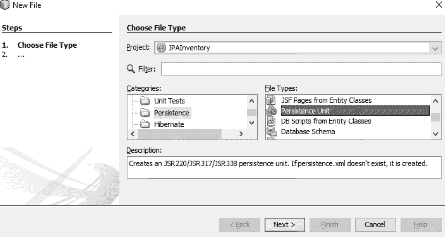

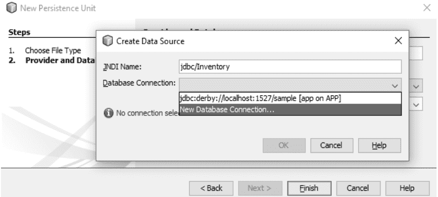

278

# 实验日志

# 267

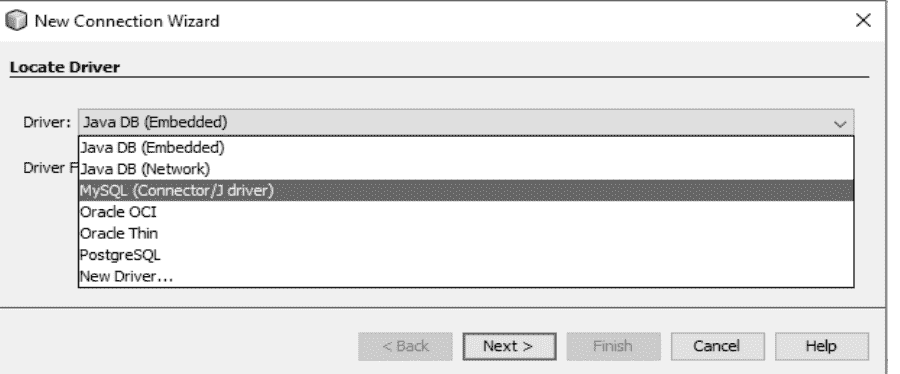

`persistence.xml` 文件将包含如下代码：

```xml
<?xml version="1.0" encoding="UTF-8"?>
<persistence version="2.1" xmlns="http://xmlns.jcp.org/xml/ns/persistence" xmlns:xsi="http://www.w3.org/2001/XMLSchema-instance" xsi:schemaInstanceLocation="http://xmlns.jcp.org/xml/ns/persistence/http://xmlns.jcp.org/xml/ns/persistence/persistence_2_1.xsd">
<persistence-unit name="INVJAPPU" transaction-type="RESOURCE_LOCAL">
<non-jta-data-source>jdbc/MyInventoryJPA</non-jta-data-source>
<exclude-unlisted-classes>false</exclude-unlisted-classes>
<properties/>
</persistence-unit>
</persistence>
```

6. 按照之前的实验创建 `index.jsp` 文件和 `web.xml` 文件。在 `index.jsp` 中添加以下代码（**粗体**代码是实验中的重要代码）。

```jsp
<%@page contentType="text/html" pageEncoding="UTF-8"%>%>
<!DOCTYPE html>
<html>
<head>
<meta http-equiv="Content-Type" content="text/html; charset=UTF-8">
<title>Inventory</title>
</head>
<body>
<form action="checkInventory.jsp" method="post">
<table>
<tr>
<td colspan="2" align="center"><<b>在库存中添加物品</b></td>
</tr>
<tr><td>物品名称 (Item Name): </td></tr>
<tr><td><input name="itemname" maxLength="25" size="50" /> </td></tr>
<tr><td>描述 (Description): </td></tr>
<tr><td><textarea rows="5" cols="36" name="description"></textarea> </td></tr>
<tr><td>数量 (Quantity): </td></tr>
<tr><td><input name="quantity" maxLength="4" size="5" /> </td></tr>
<tr><td colspan="2"></td></tr>
<tr><td><input type="submit" name="AddToInventory" value="AddToInventory" /></td>
</tr>
</table>
</form>
</body>
</html>
```

7. 创建另一个名为 `checkInventory.jsp` 的 JSP 文件，并在该文件中添加以下代码。

```jsp
<%@page import="java.util.Iterator, javax.persistence.Persistence,
java.util.List,myAppInventory, javax.persistence.EntityTransaction,
javax.persistence.EntityManager, javax.persistence.EntityManagerFactory" %>
<%@page contentType="text/html" pageEncoding="UTF-8"%>%>
<!DOCTYPE html>
<html>
<%
private EntityManagerFactory emf;
private EntityManager em;
private EntityTransaction eT;
List<Inventory> inv;

%>
<%
emf = Persistence.createEntityManagerFactory("INVJPAP");
em = emf.createEntityManager();

String submit = request.getParameter("AddToInventory");
if(submit != null && ("AddToInventory").equals(submit)) {
  try {
    String itemname = request.getParameter("itemname");
    String description = request.getParameter("description");
    String quantity1 = request.getParameter("quantity");
    int quantity=Integer.parseInt(quantity1);
    String addedDate = new java.util.Date().toString();

    Inventory inv = new Inventory();
    inv.setItemName(itemname);
    inv.setDescription(description);
    inv.setQuantity(quantity);
    inv.setAddedDate(addedDate);
    nT = em.getTransaction();
    nT.begin();
    em.persist(inv);
    nT.commit();
  } catch (RuntimeException e) {
    if(nT != null) eT.rollback();
    throw e;
  }
  response.sendRedirect("checkInventory.jsp");
}
%>

<%
try {
  inv = em.createQuery("SELECT i from Inventory i").getResultList();
} catch (RuntimeException e) {
  throw e;
}
em.close();
%>

```html

<html>

<head>


# 在库存中添加物品

物品名称：`Mobile`（手机）

描述：

数量：`30`

`AddToInventory`

# 实验日志

# 269

`localhost:8080/INVPA/checkInventory.jsp`

| 物品编号 | 物品名称 | 描述 | 数量 | 添加时间 |
| --- | --- | --- | --- | --- |
| 3 | Laptop（笔记本） | Lenovo 500 HDD 8 GB RAM | 20 | 2018年8月11日 01:06:35 |
| 4 | TV（电视） | Toshiba LED | 30 | 2018年8月11日 01:13:24 |
| 5 | Mobile（手机） | Samsung Galaxy Note | 30 | 2018年8月11日 01:14:45 |

# 实验 8：(b) 使用 JPA 开发访客应用程序

1. 在 NetBeans IDE 中创建一个名为 `GUESTJPA` 的 Java Web 项目。
2. 在 `GUEST` 数据库下创建 `Guest` 表：

```sql
CREATE TABLE Guest (
  GuestNo Int PRIMARY KEY AUTO_INCREMENT,
  GuestName varchar(50),
  Message varchar(100),
  VisitDate varchar(40);
```

3. 在项目的 `libraries` 文件夹中添加 `mysql-connector.jar` 文件。
4. 在项目中添加名为 `Guest.java` 的类，包名为 `myGuest`，并添加以下代码。参考实验 8a 的步骤。

```java
package myGuest;

import javax.persistence.Column;
import javax.persistence.Entity;
import javax.persistence.GeneratedValue;
import javax.persistence.GenerationType;
import javax.persistence.Id;
import javax.persistence.Table;

@Entity
@Table(name="Guest")
public class Guest {
  @Id
  @GeneratedValue(strategy = GenerationType.IDENTITY)
  @Column(name="GuestNo", unique=true, updatable=false)
  private Integer GuestNo;

  @Column(name="GuestName")
  private String GuestName;

  @Column(name="Message")
  private String message;

  @Column(name="VisitDate")
  private String VisitDate;

  public Guest() {
  }

  public Integer getGuestNo() { return GuestNo; }
  public void setGuestNo(Integer GuestNo) {
    this.GuestNo = GuestNo;
  }

  public String getGuestName() { return GuestName; }
  public void setGuestName(String GuestName) {
    this.GuestName = GuestName;
  }

  public String getMessage() { return message; }
  public void setMessage(String message) {
    this.message = message;
  }

  public String getVisitDate() { return VisitDate; }
  public void setVisitDate(String VisitDate) {
    this.VisitDate = VisitDate;
  }
}
```

5. 在项目中添加 `persistence.xml`。参考实验 8a 中的相似步骤。
注意：在此实验中，我们需要创建新的数据源（Data Source）、数据库连接并使用 MySQL Connector 数据库。`persistence.xml` 文件包含以下内容：

```xml
<?xml version="1.0" encoding="UTF-8"?>
<persistence version="2.1" xmlns="http://xmlns.jcp.org/ns/persistence" xmlns:xsi="http://www.w3.org/2001/XMLSchema-instance" xsi:schemaLocation="http://xmlns.jcp.org/ns/persistence persistence_2_1.xsd">
  <persistence name="GUESTJPA" transaction-type="RESOURCE_JTA">
    <jta-data-source>jdbc/Guest</jta-data-source>
    <exclude-list-classes>false</exclude-list-classes>
    <properties/>
  </persistence>
</persistence>
```

6. 按照之前的实验创建 `index.jsp` 和 `web.xml` 文件。在 `index.jsp` 中添加以下代码（**粗体**是实验中的重要代码）。

```jsp
<%@page contentType="text/html" pageEncoding="UTF-8"%>
<!DOCTYPE html>
<html>
<head>
  <meta http-equiv="Content-Type" content="text/html; charset=UTF-8">
  <title>Inventory</title>
</head>
<body>
  <form action="guestEntry.jsp" method="post">
    <table>
      <tr>
        <td colspan="2" align="center"><b>在访客登记中填写信息</b></td>
      </tr>
      <tr>
        <td>访客姓名 (Guest Name): </td>
      </tr>
      <tr>
        <td><input name="GuestName" maxlength="35" size="35" /> </td>
      </tr>
      <tr>
        <td>访客留言 (Guest Message): </td>
      </tr>
      <tr>
        <td><textarea rows="5" cols="36" name="Message"></textarea> </td>
      </tr>
      <tr>
        <td colspan="2">
          <input type="submit" name="AddToGuestRegister" />
        </td>
      </tr>
    </table>
  </form>
</body>
</html>
```

7. 创建另一个名为 `guestInfo.jsp` 的 JSP 文件，并在该文件中添加以下代码。

```jsp
<%@page import="java.util.Iterator,java.persistence.Persistence,
java.util.List,myGuest, javax.persistence.EntityTransaction,
java.persistence.EntityManager, javax.persistence.EntityManagerFactory"%>
<%@page contentType="text/html" pageEncoding="UTF-8"%>
<!DOCTYPE html>
<%
private EntityManagerFactory emf;
private EntityManager em;
private EntityTransaction eT;
List<Guest> guestList;
%>
<%
emf = Persistence.createEntityManagerFactory("GUESTJPA");
em = emf.createEntityManager();
String submit = request.getParameter("AddToGuestRegister");
if(submit != null && ("AddToGuestRegister").equals(submit)) {
  try {
    String GuestName = request.getParameter("GuestName");
    String Message = request.getParameter("Message");
    String VisitDate = new java.util.Date().toString();
    Guest guest = new Guest();
    guest.setGuestName(GuestName);
    guest.setMessage(Message);
    guest.setVisitDate(VisitDate);
    eT = em.getTransaction();
    eT.begin();
    em.persist(guest);
    eT.commit();
  } catch (RuntimeException e) {
    if(eT != null) eT.rollback();
    throw e;
  }
  response.sendRedirect("guestInfo.jsp");
}
%>
try {
  guestList = em.createQuery("SELECT g from Guest g").getResultList();
} catch (RuntimeException e) {
  throw e;
}
em.close();
%>
```

# 实践日志

```html
<table>
  <tr>
    <td>访客姓名</td>
    <td>访客留言</td>
    <td>访问日期与时间</td>
  </tr>
  <%
  Iterator iterator = guestList.iterator();
  while (iterator.hasNext()) {
    Guest objGr = (Guest) iterator.next();
  }
  %>
  <tr>
    <td><b><%= objGr.getGuestNo() %></b></td>
    <td><b><%= objGr.GuestName() %></b></td>
    <td><b><%= objGr.getMessage() %></b></td>
    <td><b><%= objGr.getVisitDate() %></b></td>
  </tr>
  <%
  %>
</table>
</body>
```

输出：


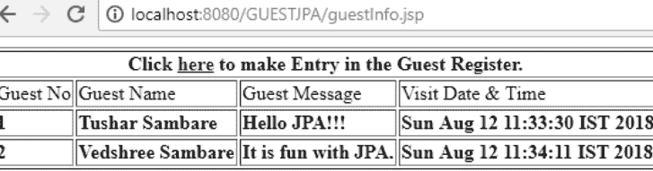

# 实践 8：(c) 创建简单的 JPA 应用以存储和检索书籍详情

1. 在 NetBeans IDE 中创建一个名为 `BookJPA` 的 Java Web 项目。
2. 在 mysql 数据库 `Book` 中创建 `Book` 表。

企业级 Java (T.Y.B.Sc.-I.T.) (Sem.-V)

```sql
CREATE TABLE Book(
  BookNo INT PRIMARY KEY AUTO_INCREMENT,
  ISBN varchar(30),
  BookTitle varchar(100),
  Author varchar(100),
  Edition varchar(30),
  PYear varchar(100),
  Publisher varchar(100),
  Quantity varchar(30)
);
```

3. 在项目的 `libraries` 文件夹中添加 `mysqlconnector.jar` 文件。（参考之前实践的步骤。）
4. 向项目中添加名为 `Book.java` 的新 Java 文件，包名为 `myBook`，并添加以下代码。遵循实践 8:a 给出的步骤。

```java
package myBook;

import javax.persistence.Column;
import javax.persistence.Entity;
import javax.persistence.GeneratedValue;
import javax.persistence.GenerationType;
import javax.persistence.Id;
import javax.persistence.Table;

@Entity
@Table(name="Book")
public class Book {
  @Id
  @GeneratedValue(strategy = GenerationType.IDENTITY, unique=true, updatable=false)
  private Integer BookNo;

  @Column(name="ISBN")
  private String ISBN;

  @Column(name="BookTitle")
  private String BookTitle;

  @Column(name="Author")
  private String Author;

  @Column(name="Edition")
  private String Edition;

  @Column(name="PYear")
  private String PYear;

  @Column(name="Publisher")
  private String Publisher;

  @Column(name="Quantity")
  private String Quantity;

  public Book() { 
  }

  public Integer getBookNo() { return BookNo; }
  public void setBookNo(Integer BookNo) {
    this.BookNo = BookNo;
  }

  public String getISBN() { return ISBN; }
  public void setISBN(String ISBN) {
    this.ISBN = ISBN;
  }

  public String getBookTitle() { return BookTitle; }
  public void setBookTitle(String BookTitle) {
    this.BookTitle = BookTitle;
  }

  public String getAuthor() { return Author; }
  public void setAuthor(String Author) {
    this.Author = Author;
  }

  public String getEdition() { return Edition; }
  public void setEdition(String Edition) {
    this.Edition = Edition;
  }

  public String getPYear() { return PYear; }
}
```


`public void setPYear(String PYear)` {

    `this.PYear = PYear`;

}

`public String getPublisher() { return Publisher; }`

`public void setPublisher(String Publisher)` {

    `this.Publisher = Publisher`;

}

`public String getQuantity() { return Quantity; }`

`public void setQuantity(String Quantity)` {

    `this.Quantity = Quantity`;

}

```

- 5. 在我们的项目中添加 `persistence.xml`。遵循实践 8: a 给出的类似步骤。

注意：记住在此实践中，我们必须创建一个新的数据源、新的数据库连接并使用 MySQL Connector J 连接 Guest 数据库。

```xml
<?xml version="1.0" encoding="UTF-8"?>
<persistence version="2.1" xmlns="http://xmlns.jcp.org/xml/ns/persistence"
xmlns:xsi="http://www.w3.org/2001/XMLSchema-instance"
xsi:schemaLocation="http://xmlns.jcp.org/xml/ns/persistence persistence_2_1.xsd">
  <persistence-unit name="BookJAPAPU" transaction-type="RESOURCE_LOCAL">
    <data-source>jdbc:Book</data-source>
    <properties>
    </properties>
  </persistence-unit>
</persistence>
```

- 6. 按照之前的实践创建 `index.jsp` 文件和 `web.xml` 文件。`index.jsp` 中的所有后续代码（粗体代码对实践至关重要）。

```jsp
<%@page contentType="text/html" pageEncoding="UTF-8"%>
<!DOCTYPE html>
<html>
<head>
  <meta http-equiv="Content-Type" content="text/html; charset=UTF-8">
  <title>书籍库存</title>
</head>
<body>
  <form action="bookDetails.jsp" method="post">
    <table>
      <tr>
        <td colspan="2" align="center">
          <b>添加书籍库存</b>
        </td>
      </tr>
      <tr>
        <td>输入 ISBN：</td>
        <td><input name="ISBN"></td>
      </tr>
      <tr>
        <td>输入书名：</td>
        <td><input name="BookTitle"></td>
      </tr>
      <tr>
        <td>输入作者：</td>
        <td><input name="Author"></td>
      </tr>
      <tr>
        <td>输入版本：</td>
        <td><input name="Edition"></td>
      </tr>
      <tr>
        <td>输入年份 (YYYY)：</td>
        <td><input name="PYear"></td>
      </tr>
      <tr>
        <td>输入出版社：</td>
        <td><input name="Publisher"></td>
      </tr>
      <tr>
        <td>输入数量：</td>
        <td><input name="Quantity"></td>
      </tr>
      <tr>
        <td colspan="2">
          <input type="submit" name="AddBookInventory" value="添加库存" />
        </td>
      </tr>
    </table>
  </form>
</body>
</html>
```

- 7. 创建另一个名为 `bookDetails.jsp` 的 JSP 文件并在其中添加以下代码

```jsp
<%@page import="java.util.Iterator, javax.persistence.Persistence, java.util.List, myBook.Book, javax.persistence.EntityTransaction, javax.persistence.EntityManager, javax.persistence.EntityManagerFactory" %>
<%@page contentType="text/html" pageEncoding="UTF-8" %>
<!DOCTYPE html>
<html>
<%
  private EntityManagerFactory emf;
  private EntityManager em;
  private EntityTransaction et;
  List<Book> bookList;
  emf = Persistence.createEntityManagerFactory("BookJAPAPU");
  em = emf.createEntityManager();
  String submit = request.getParameter("AddBookInventory");
  if(submit != null && ("AddBookInventory".equals(submit)) {
    try {
      String ISBN = request.getParameter("ISBN");
      String BookTitle = request.getParameter("BookTitle");
      String Author = request.getParameter("Author");
      String Edition = request.getParameter("Edition");
      String PYear = request.getParameter("PYear");
      String Publisher = request.getParameter("Publisher");
      String Quantity = request.getParameter("Quantity");
      Book bk = new Book();
      bk.setISBN(ISBN);
      bk.setBookTitle(BookTitle);
      bk.setAuthor(Author);
      bk.setEdition(Edition);
      bk.setYear(PYear);
      bk.setPublisher(Publisher);
      bk.setQuantity(Quantity);
      et = em.getTransaction();
      et.begin();
      em.persist(bk);
      et.commit();
    } catch (RuntimeException e) {
      if(et != null) et.rollback();
      throw e;
    }
    response.sendRedirect("bookDetails.jsp");
  }
  try {
    bookList = em.createQuery("SELECT b from Book b").getResultList();
  } catch (RuntimeException e) {
    throw e;
  }
  em.close();
%>
<html>
<head>
  <meta http-equiv="Content-Type" content="text/html; charset=UTF-8">
  <title>书籍详情</title>
</head>
<body>
  <table border="1">
    <tr>
      <td colspan="8" align="center">
        <b>点击 <a href="index.jsp">这里</a> 添加更多书籍</b>
      </td>
    </tr>
    <tr>
      <td>书籍编号号</td>
      <td>ISBN</td>
      <td>书籍名称</td>
      <td>作者姓名</td>
      <td>版本</td>
      <td>年份</td>
      <td>出版社</td>
      <td>数量</td>
    </tr>
    <%
    Iterator iterator = bookList.iterator();
    while (iterator.hasNext()) { 
      Book objJk = (Book) iterator.next();
    %>
    <tr>
        <td><b><%=objJk.getBookNo()}%</b></td>
        <td><b><%=objJk.getISBN()}%</b></td>
        <td><b><%=objJk.getBookTitle()}%</b></td>
        <td><b><%=objJk.getAuthor()}%</b></td>
        <td><b><%=objJk.getEdition()}%</b></td>
        <td><b><%=objJk.getYear()}%</b></b></td>
        <td><b><%=objJk.getPublisher()}%</b></b></td>
        <td><b><%=objJk.getQuantity()}%</b></b></td>
    </tr>
    <%
    }
    %>
  </table>
</body>
</html>
```

# 9. 使用 ORM 和 HIBERNATE 的 JPA 应用

实际实验 9：(a) 开发一个 JPA 应用以演示 ORM 关联的使用。

- 1. 在 NetBeans IDE 中创建一个名为 `ORMJPA` 的 Web 项目。

- 2. 在 mysql 的 `User` 数据库下执行创建表的操作步骤。

```sql
CREATE DATABASE User;
USE User;
CREATE TABLE User (
  uid int PRIMARY KEY AUTO_INCREMENT,
  uname varchar(50),
  type varchar(50)
);
```

- 3. 在项目的 libraries 文件夹中添加 `mysqlconnector.jar` 文件。（参考上一个实际实验的步骤。）

- 4. 为项目中添加名为 `User.java` 的新 Java 文件，包名为 `myORM`，并添加以下代码。遵循实验 8:a 中提供的步骤。

**注意：此文件用于实现对象关系映射 (ORM)**

```java
package myORM;
import javax.persistence.Column;
import javax.persistence.Entity;
import javax.persistence.GeneratedValue;
import javax.persistence.GenerationType;
import javax.persistence.Id;
import javax.persistence.Table;

@Entity
@Table(name="User")
public class User {
    @Id
    @GeneratedValue(strategy = GenerationType.IDENTITY)
    @Column(name="uid", unique=true, updatable=false)
    private Integer uid;
    @Column(name="uname")
    private String uname;
    @Column(name="utype")
    private String utype;

    public User() {}

    public int getUid() { return uid; }
    public void setUid(int uid) {
        this.uid = uid;
    }

    public String getUsername() { return uname; }
    public void setUsername(String uname) {
        this.uname = uname;
    }
    public String getUtype() { return utype; }
    public void setUtype(String utype) {
        this.utype = utype;
    }
}
```

- 5. 在我们的项目中添加 `persistence.xml`。遵循实验 8 中提供的类似步骤。

注意：记住在实验中我们必须创建新的数据源 (New Data Source)、新的数据库连接 (New Database Connection) 并使用带有 Guest数据库的 MySQL Connector J。

```xml
<?xml version="1.0" encoding="UTF-8"?>
<persistence version="2.1" xmlns="http://xmlns.jcp.org/xml/ns/persistence"
xmlns:xsi="http://www.w3.org/2001/XMLSchema-instance"
xsi:schemaLocation="http://xmlns.jcp.org/xml/ns/persistence http://xmlns.jcp.org/xml/ns/persistence/persistence_2_1.xsd">

<persistence-unit name="ORMJPAU" transaction-type="RESOURCE_LOCAL">
    <non-jta-data-source>jdbc/ORMJPAU/non-jta-data-source</non-jta-data-source>
    <exclude-unlisted-classes>false</exclude-unlisted-classes>
</persistence-unit>
</persistence>
```

- 6.按照之前实验的描述创建 `index.jsp` 文件和 `web.xml` 文件。在 `index.jsp` 中添加以下代码（**加粗的代码对实验很重要**）。


## 创建 `userInfo.jsp` 文件

7. 创建另一个名为 `userInfo.jsp` 的 JSP 文件并在该文件中添加以下代码。

```jsp
<%@page import="java.util.Iterator, javax.persistence.Persistence, java.util.List, myORM.User, javax.persistence.EntityTransaction, javax.persistence.EntityManager, javax.persistence.EntityManagerFactory" %>
<%@page contentType="text/html" pageEncoding="UTF-8" %>
<!DOCTYPE html>
<html>
<%
private EntityManagerFactory emf;
private EntityManager em;
private EntityTransaction eT;
List<User> userList;
%>
<%
emf = Persistence.createEntityManagerFactory("ORMJPAU");
em = emf.createEntityManager();

String submit = request.getParameter("AddUserInfo");
if(submit != null && "AddUserInfo".equals(submit)) {
  String uname = request.getParameter("uname");
  String utype = request.getParameter("utype");

  User usr = new User();
  usr.setUsername(uname);
  usr.setUtype(utype);

  eT = em.getTransaction();
  eT.begin();
  em.persist(usr);
  eT.commit();
} catch (Exception e) {
  if(eT != null) eT.rollback();
} finally {
  em.close();
}
%>
<!DOCTYPE html>
<html>
<head>
<meta http-equiv="Content-Type" content="text/html; charset=UTF-8">
<title>Inventory</title>
</head>
<body>
<table border="1">
    <tr>
        <td colspan="2" align="center"><b>Provide User Details</b></td>
    </tr>
    <%
    userList = em.createQuery("select u from User").getResultList();
    Iterator<User> iterator = userList.iterator();
    while (iterator.hasNext()) {
        User u = iterator.next();
    %>
    <tr>
        <td><%= u.getUid() %></td>
        <td><%= u.getUsername() %></td>
        <td><%= u.getUtype() %></td>
    </tr>
    <%
    }
    %>
</table>
</body>
</html>
```

## 实践日志

289

- 在“Name and Location”（名称和位置）对话框中，默认显示文件名为`hibernate.cfg`，保持不变并点击 next（下一步）。

- 在“Select Data Source”（选择数据源）-> 从 Database Connection 选择框中选择“New database Connection”（新建数据库连接）。之后会弹出 Locate（定位）对话框。

- 将 Driver（驱动程序）选择为 "MySQL (Connector/jDriver)" 的可用驱动程序选项。然后点击 next。

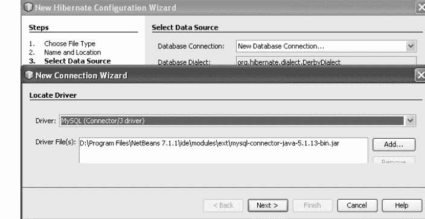

在 Custom Connection（自定义连接）下，按照要求填写 Driver Name（驱动程序名称）、Host（主机名）、Port（端口）。输入我们的数据库作为应用程序数据库。使用您配置 MySQL 服务器时给定的用户名和密码。JDBC URL 会通过 JDBC URL 文本框自动出现。然后点击“Test Connection”（测试连接）按钮。如果连接成功，点击 Finish（完成）。

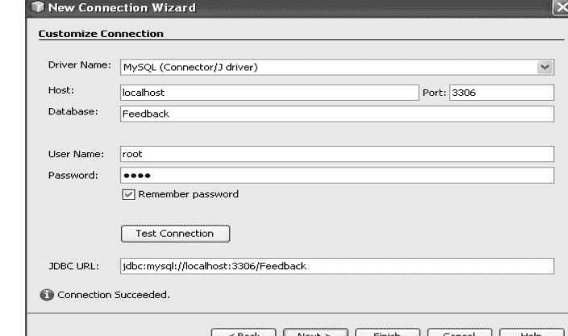

点击 finish 后，我们将回到 Hibernate Configuration 配置向导。在这里将自动显示数据库连接名称，且 Database Dialect Name（数据库方言名称）将显示为`org.hibernate.dialect.MySQLDialect`。现在点击 Finish。

在默认的`hibernate.cfg.xml`代码中，在 session-factory 标签关闭之前添加 mapping 类名行，如下：

```xml
<xml version="1.0" encoding="UTF-8"?>
<!DOCTYPE hibernate-configuration PUBLIC "-//Hibernate/Hibernate Configuration DTD 3.0//EN" "http://hibernate.sourceforge.net/hibernate-configuration-3.0.dtd">
```

## 290 企业级 Java (T.Y.B.Sc.-I.T.) (Sem.-V)

```xml
<hibernate-configuration>
<session-factory>
  <property name="hibernate.dialect">org.hibernate.dialect.MySQLDialect</property>
  <property name="hibernate.connection.driver_class">com.mysql.jdbc.Driver</property>
  <property name="hibernate.connection.url">jdbc:mysql://localhost:3306/Feedback?zeroDateTimeBehavior=convertToNull</property>
  <property name="hibernate.connection.username">root</property>
  <property name="hibernate.connection.password">root</property>
  <mapping class="myHBN.Feedback"/>
</session-factory>
</hibernate-configuration>
```

7. 按照之前的练习创建`index.jsp`文件和`web.xml`文件。在`index.jsp`中添加以下代码（**加粗部分为本次实验中的重要代码**）。

```jsp
<%@page contentType="text/html" pageEncoding="UTF-8%">
<!DOCTYPE html>
<html>
<head>
  <meta http-equiv="Content-Type" content="text/html; charset=UTF-8">
  <title>Feedback</title>
</head>
<body>
  <form action="feedback.jsp" method="post">
  <table>
    <tr>
      <td colspan="2" align="center"><b>Provide User Details</b></td>
    </tr>
    <tr>
      <td>User Name : </td>
      <td><input name="username" maxlength="35" size="35" /> </td>
    </tr>
    <tr>
      <td>Email : </td>
      <td><input name="email" maxlength="35" size="35" /> </td>
    </tr>
    <tr>
      <td>Feedback : </td>
      <td>
        <textarea rows="5" cols="36" name="feedback"></textarea>
      </td>
    </tr>
    <tr><td colspan="2"></td>
    <input type="submit" name="AddFeedBack" value="AddFeedBack" />
    </td>
</tr>
  </table>
</form>
</body>
</html>
```

8. 创建另一个名为`feedback.jsp`的另一个 JSP 文件，并在该文件中添加以下代码。

```jsp
<%@page import="java.util.Iterator, org.hibernate.Transaction,
org.hibernate.service.ServiceRegistryBuilder, org.hibernate.cfg.Configuration,
org.hibernate.service.ServiceRegistry,
java.util.List,myHBN.Feedback,org.hibernate.SessionFactory"%>

<%@page contentType="text/html" pageEncoding="UTF-8">
<!DOCTYPE html>
<html>
<%
SessionFactory sF;
ServiceRegistry sR;
org.hibernate.Session hbSession;
List<Feedback> fedbackList;
Configuration configuration = new Configuration();
configuration.configure();
sR = new ServiceRegistryBuilder().applySettings(configuration.getProperties())
.buildServiceRegistry();
sF = configuration.buildSessionFactory(sR);
hbSession = sF.openSession();
Transaction transaction = null;

String submit = request.getParameter("AddFeedBack");
if(submit != null && ("AddFeedBack").equals(submit)) {
Feedback fb = new Feedback();
try {
transaction = hbSession.beginTransaction();

String username = request.getParameter("username");
String email = request.getParameter("email");
String feedbackdate = new java.util.Date().toString();
String feedback = request.getParameter("feedback");
fb.setUsername(username);
fb.setEmail(email);
fb.setFeedbackdate(feedbackdate);
fb.setFeedback(feedback);

hbSession.save(fb);
transaction.commit();
}
catch (RuntimeException e) {
    if(transaction != null) transaction.rollback();
    throw e;
}
response.sendRedirect("feedback.jsp");
}

try {
hbSession.beginTransaction();
feedbackList = hbSession.createQuery("from Feedback").list();
} catch (RuntimeException e) {
    throw e;
}
hbSession.close();
%>
<html>
<head>
<meta http-equiv="Content-Type" content="text/html; charset=UTF-8">
<title>Feedback</title>
</head>
<body>
<table>
<tr> <td colspan="5" align="center"></td></tr>
<tr><b>Click <a href="index.jsp">here</a> to give another feedback.</b></td></tr>
<tr><td>User No</td>
<td>User Name</td>
<td>User Email</td>
<td>Feedback</td>
<td>Date &amp; Time</td>
</tr>
<%
Iterator iterator = feedbackList.iterator();
while (iterator.hasNext()) {
    Feedback objFb = (Feedback) iterator.next();
%>
<tr>
    <td><%= objFb.getId() %></td>
    <td><%= objFb.getUsername() %></td>
    <td><%= objFb.getEmail() %></td>
    <td><%= objFb.getFeedback() %></td>
    <td><%= objFb.getFeedbackdate() %></td>
</tr>
<%
}
}
%>
</table>
</body>
</html>
```


# 员工详情管理（Hibernate 示例）

## 1. 创建 `index.jsp` 文件

创建一个名为 `index.jsp` 的 JSP 文件，并在文件中添加以下代码：

```html
<!DOCTYPE html>
<html>
<head>
<meta http-equiv="Content-Type" content="text/html; charset=UTF-8">
<title>员工详情</title>
</head>
<body>
<form action="empDetails.jsp" method="post">
<table>
<tr>
<td colspan="2" align="center"><b>提供员工详情</b></td>
</tr>
<tr><td>员工姓名 : </td>
<td><input name="ename" maxlength="35" size="35" /></td>
</tr>
<tr><td>员工薪资 : </td>
<td><input name="salary" maxlength="35" size="35" /> </td>
</tr>
<tr> <td>员工职位 </td>
<td><td><input name="deg" maxlength="35" size="35" /> </td></td>
</tr>
<tr>  <td colspan="2">
<input type="submit" name="AddEmployee" value="AddEmployee" />
</td>
</tr></tr>
</table>
</form>
</body>
</html>
```

## 2. 创建 `empDetails.jsp` 文件

创建另一个名为 `empDetails.jsp` 的 JSP 文件，并在文件中添加以下代码：

```jsp
<%@page import="java.util.Iterator, org.hibernate.Transaction,
org.hibernate.service.ServiceRegistryBuilder, org.hibernate.cfg.Configuration,
org.hibernate.service.ServiceRegistry, java.util.List,
myEMP.Employee, org.hibernate.SessionFactory()%>

<%@page contentType="text/html" pageEncoding="UTF-8"%>
<!DOCTYPE html>
<html>
SessionFactory sF;

ServiceRegistry sR;
org.hibernate.Session hbSession;
List<Employee> empList;
```

```java
<%
Configuration configuration = new Configuration();
configuration.configure();
sR = new ServiceRegistryBuilder().applySettings(configuration.getProperties())
.buildServiceRegistry();
sF = configuration.buildSessionFactory(sR);
hbSession = sF.openSession();
Transaction transaction = null;
%>
```

```java
String submit = request.getParameter("AddEmployee");
if(submit != null && ("AddEmployee").equals(submit)) {
    Employee emp = new Employee();
try {
```

```java
    transaction = hbSession.beginTransaction();

String name = request.getParameter("ename");
String salary = request.getParameter("salary");
String deg = request.getParameter("deg");
```

```java
    emp.setName(ename);
    emp.setSalary(salary);
    emp.setDeg(deg);
```

```java
    hbSession.save(emp);
    transaction.commit();
} catch (RuntimeException e) {
    if(transaction != null) transaction.rollback();
    throw e;
}
response.sendRedirect("empDetails.jsp");
}
```

```java
try {
    hbSession.beginTransaction();
    empList = hbSession.createQuery("from Employee").list();
} catch (RuntimeException e) {
    throw e;
}
hbSession.close();
```

## 3. 显示员工列表

# 298 企业级 Java (T.Y.B.Sc.-I.T.) (Sem.-V)

```html
<html>
<head>
<meta http-equiv="Content-Type" content="text/html; charset=UTF-8">
<title>员工</title>
</head>
<body>
<table>
<tr> <td colspan="4" align="center">
<b>点击 <a href="index.jsp">这里</a> 来添加另一个员工详情。</b>
</td></tr>
<tr><td>员工编号</td><td></td>
<td>员工姓名</td><td></td>
<td>员工薪资</td><td></td>
<td>员工职位</td><td></td></tr>
```

```java
Iterator iterator = empList.iterator();
while (iterator.hasNext()) {
Employee objEmp = (Employee) iterator.next();
```

```html
<tr> <td><b><%=objEmp.getId()%></b></td>
<td><b><%=objEmp.getName()%></b></td>
<td><b><%=objEmp.getSalary()%></b></td>
<td><b><%=objEmp.getDeg()%></b></td>
</tr>
```

```java
}
```

```html
</table>
</body>
</html>
```

(注，此处原文有多处多余闭合已修正为)

```html
</table>

</body>

</html>
```

## 4. 运行结果

输出：

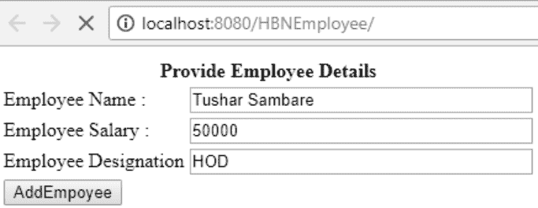

实验日志

299

`localhost:8080/HBNmEmployee/empDetails.jsp`

| 员工编号 | 员工姓名 | 员工薪资 | 员工职位 |
| :--- | :--- | :--- | :--- |
| 1 | Tushar Sambare | 50000 | HOD |
| 2 | Steven Fransisco | 25000 | Clerk |

# 10. 使用 ORM 和 HIBERNATE 的 JPA 应用

实验 10 : (a) 开发一个应用使用注解演示 Hibernate 的一对一映射。

## 1. 创建项目

在 NetBeans IDE 中创建一个名为 `HBNoOneToToOne` 的 Java Web 项目。

## 2. 添加 Hibernate 库

将 Hibernate 的 jar 包添加到我们项目的 Library 文件夹中。（严格严格遵循实验 9 中的信息）

## 3. 添加 Hibernate jar 包

将 Hibernate jar 包添加到项目的 Library 文件夹中。

## 4. 创建数据库表

在数据库中创建 `author` 表：

```sql
CREATE TABLE author (
  id INT PRIMARY KEY,
  name VARCHAR(50) NOT NULL
);
```

```sql
CREATE TABLE book (
  id INT PRIMARY KEY,
  title VARCHAR(50) NOT NULL,
  pubyear VARCHAR(50) NOT NULL,
  age INT,
  FOREIGN KEY (age) REFERENCES author(id)
);
```

## 5. 创建 `Author.java` 类

在项目中创建 `Author.java` 类：

```java
package myBooks;

import javax.persistence.*;

@Entity
public class Author {
    @Id
    private Integer id;
    private String name;

    public Integer getId() {
        return id;
    }

    public void setId(Integer id) {
        this.id = id;
    }

    public String getName() {
        return name;
    }

    public void setName(String name) {
        this.name = name;
    }
}
```

## 6. 创建 `Book.java` 类

在项目中创建另一个 `Book.java` 类：

```java
package myBooks;

import javax.persistence.*;

@Entity
public class Book implements java.io.Serializable {
    @Id
    private Integer id;
    private String title;
    private String pubyear;

    @OneToOne(cascade = CascadeType.ALL)
    @JoinColumn(name="age", insertable = false, updatable = false)
    private Author author;

    public Integer getId() {
        return id;
    }

    public void setId(Integer id) {
        this.id = id;
    }

    public String getTitle() {
        return title;
    }

    public void setTitle(String title) {
        this.title = title;
    }

    public String getPubyear() {
        return pubyear;
    }

    public void setPubyear(String pubyear) {
        this.pubyear = pubyear;
    }

    public Author getAuthor() {
        return author;
    }

    public void setAuthor(Author author) {
        this.author = author;
    }
}
```

## 7. 创建 Hibernate 配置文件

按照之前实验 9 的描述创建 Hibernate 配置文件。注意：在配置数据库时使用 Books 数据库。在默认的 `hibernate.cfg.xml` 中，关闭 `session-factory` 标签之前添加映射类行，如下所示：

```xml
<?xml version="1.0" encoding="UTF-8"?>
<!DOCTYPE hibernate-configuration PUBLIC "-//Hibernate/Hibernate Configuration DTD 3.0//EN" "http://www.hibernate.org/dtd/hibernate-configuration-3.0.dtd">
<hibernate-configuration>
  <session-factory>
    <property name="hibernate.dialect">org.hibernate.dialect.MySQLDialect</property>
    <property name="hibernate.connection.driver_class">com.mysql.jdbc.Driver</property>
    <property name="hibernate.connection.url">jdbc:mysql://localhost:3306/Books?zeroDateTimeBehavior=convertToNull</property>
    <property name="hibernate.connection.username">root</property>
    <property name="hibernate.connection.password">root</property>
    <mapping class="myBooks.Author"/>
    <mapping class="myBooks.Book"/>
  </session-factory>
</hibernate-configuration>
```

## 8. 创建 `index.jsp` 和 `web.xml` 文件

按照之前的实验描述创建 `index.jsp` 和 `web.xml` 文件。在 `index.jsp` 中添加以下代码（加粗的代码对实验非常重要）：

```jsp
<%@page contentType="text/html" pageEncoding="UTF-8"%>
<!DOCTYPE html>
<html>
```

实践日志

303

```html
<head>
<meta http-equiv="Content-Type" content="text/html; charset=UTF-8">
<title>书籍详情</title>
</head>
<body>
<form action="bookDetails.jsp" method="post">
<table>
<tr>
<td colspan="2" align="center">提供学生详情</td>
</tr>
<tr>
<td>作者名称： </td>
<td><input name="aname" maxlength="35" size="35" /> </td>
</tr>
<tr>
<td>书名： </td>
<td><input name="title" maxlength="35" size="35" /> </td>
</tr>
<tr>
<td>出版年份： </td>
<td><input name="pubyear" maxlength="35" size="35" /> </td>
</tr>
```

[第 314 页]

```html
<tr>
<td colspan="2">
<input type="submit" name="AddDetails" value="AddDetails" />
</td>
</tr>
</table>
</form>
</body>
</html>
```

## 9. 创建 `bookDetails.jsp` 文件

创建另一个名为 `bookDetails.jsp` 的 JSP 文件，并在文件中添加以下代码：

```jsp
<%@page import="java.util.Iterator, org.hibernate.Transaction,
org.hibernate.service.ServiceRegistryBuilder, org.hibernate.cfg.Configuration,
org.hibernate.service.ServiceRegistry, java.util.List, myBooks.Author, org.hibernate.SessionFactory%>
```

```jsp
<%@page contentType="text/html" pageEncoding="UTF-8"%>
<!DOCTYPE html>
<%
SessionFactory sF;
ServiceRegistry sR;
org.hibernate.Session hbSession;
List<Author> authList;
```

[第 315 页]

```jsp
List<Book> bookList;
```


```jsp
<%
Configuration configuration = new Configuration();
configuration.configure();
sR = new ServiceRegistryBuilder().applySettings(configuration.getProperties())
    .buildServiceRegistry();

sF = configuration.buildServiceFactory(sR);
hbSession = sF.openSession();
Transaction transaction = null;

String submit = request.getParameter("AddDetails");
if(submit != null && ("AddDetails").equals(submit)) {
    Author auth = new Author();
    Book bk = new Book();
    try {
        transaction = hbSession.beginTransaction();

        String aname = request.getParameter("aname");
        String title = request.getParameter("title");
        String pubyear = request.getParameter("pubyear");

        auth.setAname(aname);
        bk.setTitle(title);
        bk.setPubyear(pubyear);
        bk.setAuthor(new Author(aname));

        hbSession.save(bk);
        transaction.commit();
    } catch (RuntimeException e) {
        if(transaction != null) transaction.rollback();
        throw e;
    }
    response.sendRedirect("bookDetails.jsp");
}

try {
    hbSession.beginTransaction();
    authList = hbSession.createQuery("from Author").list();
    bookList = hbSession.createQuery("from Book").list();
} catch (RuntimeException e) {
    throw e;
}
```

[第 316 页]

实践日志

305

```jsp
hbSession.close();
```

```jsp
%0
```

```html
<
<head>
<meta http-equiv="Content-Type" content="text/html; charset=UTF-8">
<title>书籍详情</title>
</head>
<body>
```

```html
<table border="1">
<tr> <td colspan="2" align="center">
<b>作者表中的项</b>
</td>
</tr>
<tr><td>作者 ID</td>
<td>作者名称</td>
</tr>
```

[第 317 页]

```jsp
%0
Iterator authiterator = authList.iterator();
while (authiterator.hasNext()) {
Author objAuth = (Author) authiterator.next();
objAuth.getId();
objAuth.getAname();
%0
```

```html
<<tr> <td><%=objAuth.getAid()%></</td>
<td><%=objAuth.getAname()%></</td>></td>
</tr>
```

```jsp
%0
1
%0
```

```html
</table><br/>
<table border="1">
<tr> <td colspan="4" align="center">
<b>书籍表中的项</b>
</td>
</tr>
<tr><td>书籍 ID</td>
<td>书籍名称</td>
<td>出版年份</td>
<td>作者 ID</td>
</tr>
```

```jsp
%0
Iterator bkIterator = bookList.iterator();
while (bkIterator.hasNext()) {
Book objBook = (Book) bkIterator.next();
objBook.getBid();
objBook.getTitle();n
```

[第 317 页]

```jsp
objBook.getPubyear();
```

```html
<<tr>
<td><b><%=objBook.getBid()%></b</td>
<td><b><%=objBook.getTitle()%></b</td>
<td><b><%=objBook.getPubyear()%></b</td>
<td><b><%=objBook.getAid()%></b</td>
</tr>
%%
}
%%
</table>
</body>
</html>
```

输出：

`img17.png`

作者表中的项

| | |

| 作者 ID | 作者名称 |

| 1 | Tushar |

| 2 | Sonali |

书籍表中的项

| | |

| 书籍 ID | 书籍名称 | 出版年份 | 作者 ID |

| 1 | Java Programming | 2018 | 1 |

| 2 | Advanced Web Programming | 2018 | 2 |

实践日志

307

使用以下 SQL 创建数据库

```sql
CREATE TABLE Course (
cid Int PRIMARY KEY AUTO_INCREMENT,
cname varchar(50),
shift varchar(50),
pubyear varchar(50)
);
```

5. 在项目中创建 `Course.java` 并添加以下代码。

```java
package myCourse;
import javax.persistence.Column;
import javax.persistence.Entity;
import javax.persistence.GeneratedValue;
import javax.persistence.Id;
import java.io.Serializable;

@Entity
@Table(name = "Course")
public class Course implements Serializable {

    @Id
    @GeneratedValue
    @Column(name="cid")
    private Integer cid;

    @Column(name="cname")
    private String name;

    @Column(name="shift")
    private String shift;

    @Column(name="pubyear")
    private String pubyear;

    public Course() {
    }

    public Course(String cname, String shift, String pubyear) {
        this.cname = cname;
        this.shift = shift;
        this.pubyear = pubyear;
    }

    public Integer getcid() {
        return cid;
    }

    public void setcid(Integer cid) {
        this.cid = cid;
    }

    public String getName() {
        return name;
    }

    public void setName(String name) {
        this.name = name;
    }

    public String getShift() {
        return shift;
    }

    public void setShift(String shift) {
        this.shift = shift;
    }

    public String getPubyear() {
        return pubyear;
    }

    public void setPubyear(String pubyear) {
        this.pubyear = pubyear;
    }
}
```

6. 在项目中创建 `hibernate.cfg.xml` 并按照实践 9 所示配置。

```xml
<?xml version="1.0" encoding="UTF-8"?>
<!DOCTYPE hibernate-configuration PUBLIC "-//Hibernate/Hibernate Configuration DTD 3.0//EN" "http://hibernate.sourceforge.net/hibernate-configuration-3.0.dtd">

<hibernate-configuration>
  <session-factory>
    <property name="dialect">org.hibernate.dialect.MySQLDialect</property>
    <property name="hibernate.connection.driver">com.mysql.jdbc.Driver</property>
    <property name="hibernate.connection.url">jdbc:mysql://localhost:3306/Course?zeroDateTimeBehavior=convertTimeToNull</property>
    <property name="hibernate.connection.username">root</property>
    <property name="hibernate.connection.password">root</property>
    <mapping class="myCourse.Course"/>
  </session-factory>
</hibernate-configuration>
```

7. 按照之前的实践所示创建 `index.jsp` 和 `web.xml` 文件。在 `index.jsp` 中添加以下代码（加粗部分为实践中的重要代码）。

```jsp
<%@page contentType="text/html" pageEncoding="UTF-8"%>
<!DOCTYPE html>
<html>
<Head>
  <meta http-equiv="Content-Type" content="text/html; charset=UTF-8">
  <title>书籍详情</title>
</head>
<body>
  <form action="courseDetails.jsp" method="post">
  <table>
    <tr>
      <td colspan="2" align="center"><b>提供课程详情</b></td>
    </tr>
    <tr>
      <td>课程名称： </td>
      <td><input name="cname" maxlength="35" size="35" /> </td>
    </tr>
    <tr>
      <td>课程班次： </td>
      <td></td>
    </tr>
  </table>
</form>
</body>
</html>
```

[第 320 页]

实践日志

309

使用以下 SQL 创建数据库

```sql
CREATE TABLE Course (
cid Int PRIMARY KEY AUTO_INCREMENT,
cname varchar(50),
shift varchar(50),
pubyear varchar(50)
);
```

5. 在项目中创建 `Course.java` 并添加以下代码。

```java
package myCourse;
import javax.persistence.Column;
import javax.persistence.Entity;
import javax.persistence.GeneratedValue;
import javax.persistence.Id;
import java.io.Serializable;

@Entity
@Table(name = "Course")
public class Course implements Serializable {

    @Id
    @GeneratedValue
    @Column(name="cid")
    private Integer cid;

    @Column(name="cname")
    private String name;

    @Column(name="shift")
    private String shift;

    @Column(name="pubyear")
    private String pubyear;

    public Course() {
    }

    public Course(String cname, String shift, String pubyear) {
        this.cname = cname;
        this.shift = shift;
        this.pubyear = pubyear;
    }

    public Integer getcid() {
        return cid;
    }

    public void setcid(Integer cid) {
        this.cid = cid;
    }

    public String getName() {
        return name;
    }

    public void setName(String name) {
        this.name = name;
    }

    public String getShift() {
        return shift;
    }

    public void setShift(String shift) {
        this.shift = shift;
    }

    public String getPubyear() {
        return pubyear;
    }

    public void setPubyear(String pubyear) {
        this.pubyear = pubyear;
    }
}
```

6. 在项目中创建 `hibernate.cfg.xml` 并按照实践 9 所示配置。

```xml
<?xml version="1.0" encoding="UTF-8"?>
<!DOCTYPE hibernate-configuration PUBLIC "-//Hibernate/Hibernate Configuration DTD 3.0//EN" "http://hibernate.sourceforge.net/hibernate-configuration-3.0.dtd">

<hibernate-configuration>
  <session-factory>
    <property name="dialect">org.hibernate.dialect.MySQLDialect</property>
    <property name="hibernate.connection.driver">com.mysql.jdbc.Driver</property>
    <property name="hibernate.connection.url">jdbc:mysql://localhost:3306/Course?zeroDateTimeBehavior=convertTimeToNull</property>
    <property name="hibernate.connection.username">root</property>
    <property name="hibernate.connection.password">root</property>
    <mapping class="myCourse.Course"/>
  </session-factory>
</hibernate-configuration>
```

7. 按照之前的实践所示创建 `index.jsp` 和 `web.xml` 文件。在 `index.jsp` 中添加以下代码（加粗部分为实践中的重要代码）。


# 实训日志 311

## 8. 创建 `courseDetails.jsp` 文件

创建名为 `courseDetails.jsp` 的 JSP 文件，并在文件中添加以下代码。

```jsp
<%@page contentType="text/html" pageEncoding="UTF-8"%>
<!DOCTYPE html>
<html>
<Head>
  <meta http-equiv="Content-Type" content="text/html; charset=UTF-8">
  <title>书籍详情</title>
</head>
<body>
  <form action="courseDetails.jsp" method="post">
  <table>
    <tr>
      <td colspan="2" align="center"><b>提供课程详情</b></td>
    </tr>
    <tr>
      <td>课程名称： </td>
      <td><input name="cname" maxlength="35" size="35" /> </td>
    </tr>
    <tr>
      <td>课程班次： </td>
      <td>
        <select name="shifs">
          <option value="Morning">上午</option>
          <option value="Afternoon">下午</option>
          <option value="Evening">晚上</option>
          <option value="Night">深夜</option>
        </select>
      </td>
    </tr>
    <tr>
      <td>课程时长（月）：</td>
      <td>
        <select name="dmonths">
          <option value="1Month">1个月</option>
          <option value="3Month">3个月</option>
          <option value="6Month">6个月</option>
          <option value="12Month">12个月</option>
        </select>
      </td>
    </tr>
    <tr>
      <td>课程费用：</td>
      <td>
        <input name="fees" maxlength="35" size="35" />
      </td>
    </tr>
    <tr>
      <td>课程就读要求：</td>
      <td>
        <select name="elig">
          <option value="10thPass">初中毕业/通过</option>
          <option value="12thPass">高中毕业/通过</option>
          <option value="Graduate">大学毕业</option>
          <option value="PostGraduate">研究生</option>
        </select>
      </td>
    </tr>
    <tr>
      <td colspan="2">
        <input type="submit" name="AddCourse" value="添加课程" />
      </td>
    </tr>
  </table>
  </form>
</body>
</html>
```

# 实训日志 312

在 `courseDetails.jsp` 文件中添加以下代码。

```jsp
<%@page import="java.util.Iterator,org.hibernate.Transaction,org.hibernate.service.ServiceRegistryBuilder,org.hibernate.cfg.Configuration,org.hibernate.service.ServiceRegistry,java.util.List,myCourse,org.hibernate.SessionFactory"%>
<%@page contentType="text/html" pageEncoding="UTF-8"%>
<!DOCTYPE html>
<html>
<%
SessionFactory sF;
ServiceRegistry sR;
org.hibernate.Session hbSession;
List<Course> courseList;
Configuration configuration = new Configuration();
configuration.configure();
sR = new ServiceRegistryBuilder().applySettings(configuration.getProperties())
.buildServiceRegistry();

sF = configuration.buildSessionFactory(sR);
hbSession = sF.openSession();
Transaction transaction = null;

String submit = request.getParameter("AddCourse");
if(submit != null && ("AddCourse".equals(submit)) {
    Course crs = new Course();
    try {
        transaction = hbSession.beginTransaction();

        String cname = request.getParameter("cname");
        String shifts = request.getParameter("shifts");
        String dmmonths = request.getParameter("dmonths");
        String fees = request.getParameter("fees");
        String elig = request.getParameter("elig");

        crs.setByName(cname);
        crs.setShifts(shifts);
        crs.setDmonths(dmonths);
        crs.setFees(fees);
        crs.setElig(elig);

        hbSession.save(crs);
        transaction.commit();
    } catch (RuntimeException e) {
        if(transaction != null) transaction.rollback();
        throw e;
    }
    response.sendRedirect("courseDetails.jsp");
}
try {
    hbSession.beginTransaction();
    courseList = hbSession.createQuery("from Course").list();
} catch (RuntimeException e) {
    throw e;
}
hbSession.close();
%>
```

# 实训日志 313

在 `courseDetails.jsp` 文件中添加以下 HTML 代码。

```html
<html>
<head>
<meta http-equiv="Content-Type" content="text/html; charset=UTF-8">
<title>课程详情</title>
</head>
<body>
<table border="1">
  <tr>
    <td colspan="6" align="center">
      <b>点击<a href="index.jsp">这里</a>添加另一条课程详情。</b>
    </td>
  </tr>
  <tr><td>课程编号</td></tr>
  <tr><td>课程名称</td></tr>
  <tr><td>课程班次</td></tr>
  <tr><td>时长（月）</td></tr>
  <tr><td>费用（卢比）</td></tr>
<%
  Iterator iterator = courseList.iterator();
  while (iterator.hasNext()) {
    Course objrs = (Course) iterator.next();
%>
  <tr><td><b><%= objrs.getId() %></b></td></tr>
  <tr><td><b><%= objrs.getName() %></b></td></tr>
  <tr><td><b><%= objrs.getShifts() %></b></td></tr>
  <tr><td><b><%= objrs.getMonths() %></b></td></tr>
  <tr><td><b><%= objrs.getFees() %></b></td></tr>
  <tr><td><b><%= objrs.getElig() %></b></td></tr>
<%
  }
%>
</table>
</body>
</html>
```

## 输出

`localhost:8080/courseDetails.jsp`

| 课程编号 | 课程名称 | 课程班次 | 时长（月） | 费用（卢比） | 就读要求 |
| :--- | :--- | :--- | :--- | :--- | :--- |
| 1 | | 上午 | 1个月 | 5000 | 初中毕业/通过 |
| 2 | | 下午 | 3个月 | 15000 | 高中毕业/通过 |
| 3 | | 晚上 | 6个月 | 30000 | 大学毕业 |
| 4 | | 深夜 | 12个月 | 50000 | 研究生 |

## 建议

- 1. Servlet 文件上传功能。
- 2. 会话管理。
- 3. 使用 JPA。
- 4. JSP 隐式对象。
- 5. 架构。

# 模拟试卷

（总分：75）

注意：
1. 所有题目均为必答。
2. 必要时进行假设并说明假设。
3. 同一题目的答案必须写在一起。
4. 右侧数字表示分值。
5. 必要时请绘制图表。

## 1. 任选回答三题：

a) 解释其架构。

b) 分类 EE 容器。

c) 关于 `javax.Servlet` 写一个简短介绍。

d) 解释 servlet 的生命周期。

e) 解释 JDBC 架构。

f) 解释 Java 应用程序架构。

## 2. 任选回答三题：

a) 解释 `javax.servlet` 中 `RequestDispatcher` 接口的重要性。解释其方法。

b) 解释 `HttpSession` 如何处理 servlet 会话管理。

c) 什么是 cookie？解释创建它的必要性。解释用于创建、操作和删除 cookie 的方法。

d) 什么是非阻塞 I/O？解释 `WriteListener` 和 `ReadListener` 在非阻塞 I/O 中的执行？

e) 解释非阻塞 I/O 的工作原理。

f) 解释 servlet 的文件上传功能。

## 3. 任选回答三题：

a) 什么是 JSP 指令？详细解释 `page` 指令（及其所有属性）。

b) 什么是 EL？详细解释立即 EL、延迟 EL、LValue 和 RValue。

c) 解释 JSTL 相比 JSP 的优势。

d) 解释 JSTL 核心标签库。

e) 解释 JSP 的隐式对象。

f) 解释 JSP 应用的各种范围。

## 4. 任选回答三题：

a) 解释企业 Bean 容器。

b) 解释远程和本地接口。

c) 解释消息驱动 Bean 的生命周期。

d) 关于远程和本地接口写简记。

e) 请求拦截器。

f) 解释 Java 命名和目录接口 (JNDI)。

## 5. 任选回答三题：

a) 解释持久化上下文。

b) 什么是阻抗不匹配？如何解决？

c) 解释 JPA、ORM 和数据库之间的关系。

d) 关于存储过程和未同步持久化上下文写简记。

e) 使用 Hibernate 说明原因。

f) 解释 Hibernate 架构。

# 孟买大学试卷

（2019年4月）

时长：2 ½ 小时（总分：75）

注意：
1. 所有问题均为必答题。
2. 在必要时做出合理的假设，并说明所做的假设。
3. 备用题的答案必须写在一起。
4. 右侧数字表示分值。
5. 必要时画带标签的图表。
6. 允许使用非编程计算器。

## 1. 答任意三题：(15)

a) 企业级应用开发的挑战是什么？

b) 列出并解释 Java 容器（Java Container）类型。

c) CGI 的替代方案有哪些？请详细解释。

d) 关于 `Part` 和 `WebConnection` 接口写简述。

e) 解释部署描述符文件及其元素（deployment file）。

f) 解释 JDBC 中的 `RowSet` 及其类型。

## 2. 答任意三题：(15)

a) 解释 `RequestDispatcher` 接口的方法。

b) 解释 Java Servlet 中 Cookie 的设置、发送和读取。

c) 什么是会话跟踪（session tracking）？跟踪会话的方法有哪些？

d) 关于会话（session）创建和失效写简述。

e) 上传文件时哪些点是重要的？

f) 解释非阻塞 I/O（Non-Blocking I/O）的工作原理。

## 3. 答任意三题：(15)

a) JSP 如何运行和执行？

b) 如何在 JSP 中设置和访问 Java Bean 的属性？

c) EL 中可用哪些类型的表达式（Expression）？

d) 关于 EL 中的限制（Restriction）、投影（Projection）和分区（Partitioning）运算符写简述。

e) 结合示例解释 XML 标签库中的条件或流控制语句。

f) 如何在 JSTL 中查询和更新数据。

## 4. 答任意三题：(15)

a) 关于企业豆服务器（Enterprise Bean Server）和企业豆（Enterprise Bean）写简述。

b) 描述企业豆在 JAR 和 WAR 模块中的打包（Packaging）。

c) 如何访问无接口视图（No-Interface View）和本地业务接口（Local Business Interface）？

d) 关于带有 `on()` 方法的消息驱动豆的生命周期写简述。

e) 如何定义拦截器（Interceptor）？`AroundInvoke` 方法的作用是什么？

f) Java EE 中的数据源定义（DataSource Resource Definition）是什么？

## 5. 答任意三题：(15)

a) 解释带有规范（Specification）的 Java Persistence API。

b) 什么是阻不匹配（Impedance Mismatch）？如何解决？

c) JPA、ORM、数据库与应用程序之间的关系是什么？

d) 关于 JPQL 中的函数（Functions）和 JPQL 中的下转型（Downcasting）写简述。

e) Hibernate 如何工作？

f) 解释 `hibernate.cfg.xml` 的结构。

# 孟买大学试卷

（2019年11月）

时长：2 1/2 小时 所有问题均为必答题。（分：75）

注意：
1. 在必要时做出合理的假设，并说明所做的假设。
2. 同一个问题的答案必须写在一起。
3. 右侧数字表示分值。
4. 必要时画清晰带标签的图表。
5. 允许使用非编程计算器。

## 1. 答任意三题：(15)

a) 什么是 Java 企业版（EE）？解释。

b) 关于多层 EE 架构写笔记。

c) 列出并解释 Servlet 可以执行的任务。

d) 解释 servlet 的生命周期。

e) 编写程序显示 25 到 36 之间的平方数。

f) 列出四种 JDBC 驱动。

## 2. 答任意两题：(15)

a) 解释 `Cookie` 类及其构造函数和任意五个方法。

b) 编写程序创建并显示：
(i) Session ID (ii) 新或旧 (iii) 创建时间

c) 如果字符串是 "A","B","C" 或 "D"，程序应跳转到 `Success.html` 页面，否则加载 `index.html`。（做出合理假设，仅写 Servlet 代码）

d) 解释 Servlet 处理文件：
i) `@MultipartConfig`
ii) `fileSizeThreshold`
iii) `location`
iv) `maxFileSize`
v) `maxRequestSize`

e) 使用代码片段解释 `Listener` 接口的 `dataAvailable()` 和 `dataRead()` 方法。


f) 什么是 `RequestDispatcher`？解释 `RequestDispatcher` 的两个方法。

## 3. 答任意三题：(15)

a) 解释使用 JSP 的原因。

b) 什么是指令（directives）？解释页面指令及其任意属性。

c) 开发一个简单的 JSP 应用，从 html 页面接收值并在下一页显示。（`Name-txt`, `age-txt`, `hobbies-checkbox`, `gender-radio button`）。

d) 结合属性解释 `<jsp:Bean>` 标签。用代码片段支持你的答案。

e) 列出 JSP 隐式对象。详细解释任意两个。

f) JSP scriptlet 标签有什么错误？JSTL 如何解决 scriptlet 的缺点？

## 4. 解释企业豆：

a) 解释 EJB 的好处。

b) 关于不同类型的会话豆（session beans）写笔记。

c) 借助图表解释消息豆的生命周期。

(`BookId` integer, `BookName` String, `Pages` integer, `Price` double)

d) 编写一个表示 `BookInformation` 的无状态会话豆。

e) 什么是拦截器？如何定义拦截器以及添加 `aroundInvoke()`？

f) 什么是 Java 命名和目录接口（JNDI）？解释。
