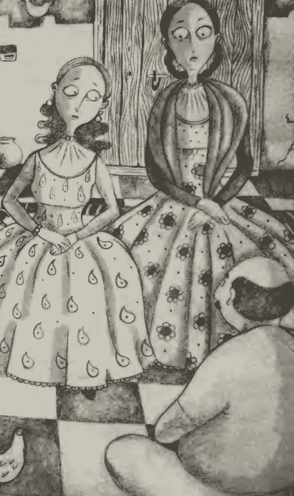

# 逃离 Java 及其他危险故事

鲁斯金·邦德于1934年出生于卡萨利（喜马尔普拉肖邦），在贾姆纳加尔（古吉拉特邦）、德拉敦、新德里和西姆拉长大。他在十七岁时写了他的第一部小说《屋顶上的房间》（The Room on the Roof），并于1957年获得了约翰·卢埃林·莱斯纪念奖。从那以后，他创作了三百多篇短篇、散文和中篇小说（包括《山谷流浪者》、《鸽群》和《德里并不遥远》），并编写了五十多部儿童读物。

他还写了大量发表在各类杂志和选集的文章。他于1993年获得文学学院奖（Sahitya Akademi Award），并于1999年获得帕德玛·什里勋章（Padma Shri）。他的几部故事被拍成电影，包括《蓝伞》、《鸽群》（电影名为《Junoon》）以及《苏珊娜的七个丈夫》（作为即将上映的电影《Saath Khoon Maaf》）。

他与家人一起住在穆索里地区的兰道尔。

## 爷爷的浴室

每当发生紧急情况时，爷爷恰好在洗澡。

当他在洗澡时，一头狂野的大象闯进了花园，踩踏了奶奶最引以为傲的玫瑰和豌豆，并撞倒了花园的墙。当他在洗澡时，台风吹走了房子的屋顶。当他在洗澡时，一位女士惊慌失措，因为有一条蛇蜷缩在梳妆台上。事实上，爷爷的浴室是一个老式的金属浴缸，里面装满了水，水里加了几枝薄荷。薄荷浴！没有人听过这种事，但爷爷说很清爽。

他在洗澡时，地震震动了城市，那场地震让大部分地方变成了废墟。

## 地震

鲁斯金·邦德于1934年出生于卡萨利（喜马尔普拉肖邦），在贾姆纳加尔（古吉拉特）、德拉敦、新德里和西姆拉长大。孩子的母亲在女儿出生时去世了，父亲邦德先生在几英外的茶园工作，那里没有学校。所以孩子们和祖父母住在一起，他们不愿离开孩子。

印度这个地区每年都有地震，但已经三十年没有过真正的大地震了。

“地震时你们怎么办？”鲁斯金问，他听过那次地震。

“没时间做什么，”爷爷说，“大家只管往外跑。”

“我会一直待在床上直到地震结束，”鲁斯金说。

“我会躲在床底下，”穆克什说，“它找不到我！”

“站在门框最好，”奶奶说，“如果你看地震图片，你会发现门框总是立着的！”

尽管穆索里是一个偶尔发生地震的地区，但他们喜欢住在那里。

那里有一个湖泊和一个色彩斑斓的集市，奶奶的花园里满是蝴蝶、鸟和奇异兰花，还有果树和可以爬的树。鲁斯金喜欢骑自行车在城里逛。穆克什喜欢集市上的甜品店——只要他不是和姆塔兹的两个男孩扭打。莉莉忙于在行李箱下搭建自己的娃娃房子。

穆索里的生活节奏缓慢。除了花园那只大象，家里最近没有发生什么有趣的事情。就在一个早晨，当爷爷正在洗澡时，小镇突然变得非常安静、平静……

## 第一次震动

爷爷什么也没注意到，因为他正在浴缸里玩水唱歌；但正在花园里修剪玫瑰丛的奶奶停下了动作，抬头望去。为什么鸟儿沉默了？

突然之间？不仅是树上的鸟，连鸡舍里的鸟也是。山羊也停止了啃咬天竺葵。那只一直对着墙上的松鼠吠叫的狗安静地坐了下来，耳朵向后贴，头埋在爪子里。

“这可真奇怪，”奶奶大声说道，“我真想知道发生了什么……”

接着，相反的事情发生了。鸡开始咯咯叫，狗开始吠叫，鸟儿们尖叫着扇动着翅膀。附近的乌鸦全部飞向空中，在头顶疯狂地盘旋，大声鸣叫。鸡群转圈地乱飞，好像正被追逐着。坐在墙上的两只猫突然跳了起来，向相反的方向消失了。

奶奶曾在某处读到，动物对地震来临的感知比人类敏锐得多。事实确实，在她注意到动物发出的噪音后半分钟内，她就听到了一种隆隆声、轰鸣声，就像快车火车进站一样。

噪音持续了大约一分钟，然后地面出现了第一次震动。到那时，所有的动物似乎都疯了，发出可怕的声叫声。树顶剧烈摇晃，门砰砰作响，窗户震动，奶奶后来说房子实际上在她面前摇晃。她发现很难站直身体，尽管她承认这可能是因为她的膝盖在抖，而不是地在抖。

这第一次冲击只持续了大约半分钟，但感觉要长得多。我意识到爷爷正在洗澡，拉凯什在上学的路上，穆克什正和穆姆塔兹的儿子玩弹子，多莉在楼梯下忙着玩她的娃娃屋；穆姆塔兹应该在厨房洗菜。奶奶冲进屋里去接多莉。

当她冲进去时，隆隆声越来越大。爷爷没有听到，因为他还在唱歌；但奶奶听到了，多莉也听到了，多莉还注意到她的娃娃屋开始摇晃了。随着隆隆声，穆姆塔兹听到了瓷器的撞击碰撞声。一个茶壶从餐边柜滑落，掉在地上摔成了碎片。在客厅里，一个古董花瓶（根据爷爷说有三百年的历史）从壁炉架上跳落，重重地摔在地上。

当多莉感到第一次震动时，她本能地爬到楼梯下的凹处，拖着她最心爱的娃娃。娃娃的头发早就掉光，一只眼睛也掉了，但多莉有这个娃娃很久了，觉得它需要特别的照顾和关注。她不明白房子为什么要抖，但她并不害怕。她想房子有时就是会抖。

奶奶没有看到在楼梯下的她，冲进客厅，大喊道：“多莉，多莉！你在哪儿？”墙上的钟疯了，开始乱报时钟。

在厨房里，穆姆塔兹正试图抓住那些疯狂从架子上飞落的盘子、玻璃杯和碗。穆克什丢了所有的弹子，不是在和朋友玩的时候丢的。它们滚出了大门，沿路而去，然后消失在地面里，那里出现了许多裂缝。

爷爷在发现自己无法唱出高音时停止了唱歌。他注意到浴缸几乎空了。他肯定没洒这么多水吧！他去拿马克杯，但没找到。他开始离开浴缸出来，但浴缸本身升了起来，把他推到了积水的浴室地板上。

“闹鬼！”爷爷惊叫道，“这里有个顽皮的鬼，在拿浴缸作剧呢！”

他抓起毛巾围在腰上，然后甩开浴室门，冲向楼梯平台。

那时，第一次地震震动结束了。

***

拉凯什在去学校的半路程途中，发现他的自行车在路上歪歪扭扭，完全失去了控制。他几乎撞上了一辆牛车。

他下车看看链条是否卡住了。他发现路和自行车一样不稳！但这种感觉只持续了几秒钟。一切又恢复了平静。

奇怪的是，那些牛却拒绝移动。

“你感觉到了吗？”车夫问。

“感觉到了，一切都在抖，”拉凯什说，“是地震吗？”

“小地震，”车夫说，“或者是一场大地震的开始！”

拉凯什骑车去学校。上课铃还没响，操场上一片兴奋的景象，聚集在一起的男女孩们成群谈论着刚刚感受到的冲击。校长决定，以防还有其他震动，孩子们待在空旷地带比待在那栋相当古老的校楼里更安全；因此他推迟了集结铃的响。自然，孩子们对推迟感到非常高兴。但十五分钟后没有任何进一步的情况，校长决定该上课了。学生中爆发了抗议声，随后是要求放假的呼声。拉凯什是他们班的发言人。

“老师，去年屋顶被吹掉的时候你给了我们假！”

“但屋顶并没有吹掉，”校长观察道。

“如果墙塌了怎么办，老师？”

“等墙塌了，我们会考虑放假的，”校长不耐烦地说，“现在全给我进教室！”

## 地震八卦

“没法洗个热水澡，”爷爷嘟囔着。浴缸里的水不够！

“你没感觉到吗？”奶奶问。

“感觉到什么？”

地震啊。

“嗯，大部分瓷器都碎了，还有那套茶具也是，”奶奶说。

《逃离爪哇和其他危险故事》

“我什么都没察觉到。总之，我们是时候离开这栋房子了。它太大了，维护起来太费钱了。”

“我想我们可以在加尔各答定下来。但你不会喜欢住在小公寓里的。我在想另一个山地——那里没有地震。我们可以把这里卖了，在达吉线岭或卡林彭买或租一间小屋。”

“那祈祷不要再有第二次吧，”爷爷说，“没人会买废墟的。”

他们听到穆克什在花园里大叫。

“他又像往常一样在搞鬼，”奶奶嘟囔着走出去看看在吵什么。

穆克什在草地上发现了一个鸟巢和几个破掉的蛋，他大叫是因为他正被一对画眉鸟袭击。

“你对那个巢做了什么？”奶奶质问道。

“什么都没做！”穆克什说，“当一切开始抖的时候，它就从树上掉下来！”

“肯定是那样。但离巢远点，否则那些鸟真的会对你下手的！”

狗皮克尔（Pickle）一直在到处跑，找是谁引起了这一切骚乱。它和邻居的狗互相吠叫，尽管把责任推给对方的门口。

“你怎么敢晃我的房子！”它们似乎在这样说。最后，由于吵累了，皮克尔进了储藏室找老鼠。它很擅长抓老鼠。

在镇上，每个人都在谈论刚刚感受到的震动。由于没有发生严重的损坏，也没有大东西倒塌，大家觉得这很有趣。有些老辈还记得三十年前的那场地震，当几百间房屋倒塌时，他们失去了朋友、亲人和家园。他们知道轻微的地震震动往往伴随着第二次更剧烈的冲击——他们害怕这种可能性。人们谈论监狱坍塌、犯人逃脱；谈论布拉马普特拉河改道淹没了整个阿萨姆，鳄鱼入侵了村镇；谈论喜马拉雅冰川滑落；以及大地裂开吞噬了整个性的隆！

“末日将至！”一位圣人在集市上宣布道。

“告诉我们，圣人，我们该怎么办？”一个店主问。

“净化你们自己，”圣人说，“照顾好你们的灵魂！”

“换句话说，”一位路过的机智者说，“别欺骗你的客户。”

“你又什么时候正经干过活儿了，”店主喊道，“你还欠我二十卢比呢！”

回到伯曼家，一家家人坐下来静静地吃午饭。但安静并没有持续多久，因为多莉（Dolly）想吃穆什（Mukesh）盘子里的东西（尽管那和她的没什么区别），当她被叫去吃自己的饭时，她大发雷霆。

“这些孩子，”拉凯什（Rakesh）叹了口气，大口吃着米豆咖喱，“是时候让他们上学了。”

“该是你也回学校了，”奶奶说，“现在下午一点半了。”

“我们今天下午没课。虽然我们没能请到地震假，但我们要去看板球比赛。有一支来自加尔各答的队伍要对阵湖滨俱乐部。”

“带我一起去吧，”穆什说。

“不行，你总是从自行车后座掉下来。”

“那我就坐在前面，”，”

“你留家里吧，”奶奶说，“你上次去看足球赛时迷路了。”

“但这是板球比赛，”穆什争辩道，“板球比赛上没人会迷路的。”

“你想和我一起去孟加拉语甜点店吗？”爷爷问。

“噢，求了，”穆什说，“那比看板球好。比那辆破自行车好多了。”

“我们为什么会有地震呢？”拉凯什问。

“嗯，”爷爷说，“地球已经存在很长了——几百万年——有时候它会感到如此老龄带来的压力和张力……”

“你有一百万岁吗？”穆什打断道。

“还没，”爷爷说，还没。但是，和我一样，地球也想伸伸腰、打个哈欠，当它这样做时，地壳就会产生这些震动——我们称之为地震。”

“但它非得在*这里*伸展吗？”拉凯什问。

“它可以在任何地方伸展，而且确实如此。东京、旧金山、伊朗、南太平洋、意大利、土耳其——地球几乎没有哪个角落没有经历过地震。当然，有些地方情况更严重……这里是地球喜欢伸展的地方之一。”

午饭结束后，拉凯什骑车去了球场，爷爷和穆什朝集市的方向走去，多莉跟着奶奶进了后院帮忙洗衣服。

大约十分钟后，真正的地震发生了，半个小镇都塌了。

## 地震带来的混乱

拉凯什快要到达板球场时，突然，道路倾斜并向他方向升起。一秒钟后，他发现自己正瘫倒在地上。

一阵深沉的轰隆声似乎从地心深处传来，道路不断抽动。这像一条巨蛇在临死前剧烈挣扎。拉凯什发现，躺在地上比骑自行车还要难得多。

刚开始不久的板球比赛戛然而止了，因为球场上出现了一个巨大的裂缝。一名快球投手、一名裁判和一名站在游球中场位（silly mid-on）的防守球员都掉了进去。他们后来被救了，但这是历史上第一次有比赛因为地震而被迫取消。

那些正在比赛或在湖边休息室观赛的人听到了一声雷鸣般的咆哮。那是由于半个山坡滑入了湖中。地球连同树木、灌木和岩石一起隆起，然后轰然坠落。尘土和水冲向云霄，与此同时湖底爆发，像海啸一样涌起，将水喷洒在周围的平原上。对于板球运动员和观众来说，幸运的是，这巨浪流向相反的方向。但它冲走了许多停放的汽车、几只正在吃草的牛羊、电线杆以及旧监狱的墙壁。

这对监狱里的数百名囚犯来说是一个逃跑的机会。但他们被这场灾难的突然性太震惊了，除了向监狱背后的高地冲去外，什么也做不了。有几个人没逃掉，被翻涌湖水的激流冲走了。那些到达安全地带的人群聚在一起，等待救援。

拉凯什躺在地上看到波浪向他袭来。当距离他大约还有五十米时，他爬起来向最近的一棵树跑去。幸运的是，那是一棵大榕树，许多气根牢固地锚着大地——那些垂落在地面重新生根的树枝。这也是一棵容易爬的树。拉凯什爬到了他能到的最高处，俯视着逼近的水在他下方旋涡。他看着自己的自行车扫掠而过。从此他再也没有见过它了。

爷爷和穆什在集市吃甜点。他们都非常喜欢蜜球丸子（gulab-jamuns）——一种带有玫瑰花香、炸成深棕色的牛奶糖炸圆子。老人和小男孩站在甜点店外，往喉子里塞着浸满糖浆的蜜球丸子。

集市本身是一片忙碌。这是一天中最忙碌的时刻。街道上挤满了买蔬菜的妇女，人行道的小贩卖着从闪亮的黄铜器到旧衣服和二手漫画的一切东西，与路边的大商店竞争着。在人群中穿梭的是骑自行车的人、骑摩托踏板车的人、马车夫、流浪牛、流浪狗和巡逻的警察。

当穆什吃了四个蜜球丸子、爷爷吃了六个时，甜点店在他们面前开始摇晃起来。接着，布质遮阳篷塌了下来，将店主埋在他的甜点中。他那闷闷的呼救声淹没在街道的嘈杂中，人们在那里恐慌地尖叫、奔波。

爷爷和穆什发现自己正坐在挣扎的店主身上。当店主挣脱出来时，穆什被卡在了遮阳篷里，不得不别人拉他出来，期间地面一直在剧烈起伏，商店像纸牌一样摇摇欲坠。

在几秒钟内，一条笔直的集市变成了扭曲的集市。道路扭曲到了这种程度，以至于原本在左侧的一些商店现在转到了右侧，反之亦然。一个坐在车里的、从未听说会走路的乞丐现在跳了起来，拼命逃命。牛消失了，警察也消失了。一辆摩托车消失在地上的一个洞里，而一辆汽车则冲下了市政厅的台阶。一辆马车在路中间奔驰；而马车和它的车夫已经音影无踪。

市政厅本身也塌了，掩埋了许多书记员和官员。等强烈的震动过去时，其他一些建筑也倒塌了。

***

多莉正在帮奶奶晾衣服时，震动发生了。如果他们当时在屋内，就不会有生命危险。

就像第一次震动时，狗开始哀嚎，所有的鸟都从树上飞起，发出巨大的响声。然后突然有一阵风穿过树林，地面开始剧烈摇晃。

多莉抬头看到高大的烟囱从房顶掉落。

“看，奶奶！”她喊道，“房子塌了！我的娃娃房子怎么办？”

“别管你的娃娃房子了，”奶奶说，“离开这栋建筑。”

他们跑进院子时，房子的墙壁正向外鼓起，屋顶向内塌陷。

传来一声剧烈的轰鸣，接着是漫天的尘土和灰泥。

奶奶向马路对岸望去，看到其他的房子正在倒塌，简直就像有一位看不见的巨人正在把它们推倒。英国童话里的那句词在她的脑海中闪过：“我要吹气，我要吹气，我要把你的房子吹倒！”

风中带着了一阵奇异的呼哨声，但造成破坏的并不是风；而是大地的震颤让砖块、灰泥、梁柱和椽木松动脱落。空气中弥漫了令人窒息的尘土。他们无法说出话来。

房子看起来是多么脆弱，奶奶心想。就像娃娃屋一样。然而，其中许多房子已经屹立了一百多年。一百年——就在转瞬之间，全消失了！

震动停止了，但他们的家已经变成了一堆瓦砾石。一个床架从破损的窗户露了出来。一个浴室水龙头向一套被压扁的沙发组喷涌着水。这里是断掉的桌子或椅子碎片，那里是破了的地毯，一顶熟悉的帽子，几本破损的书，一把扭曲的伞；这些是这里曾是一个家的唯一遗迹。

山羊不见了，鸡子也消失了。唯一没被触及的是多莉和奶奶正在挂着的衣服。它们依然牢固地挂在晾衣绳上，随风拍打作响。

远处的哭喊声随风传来——求救的呼喊，人们在互相呼应，有些人只是因为无事可做而大叫。

多莉和奶奶像塑像一样站在院子里。他们震惊得动弹不得——直到他们看到爷爷和穆克什正沿着马路向他们跑来。这时，他们也跑了起来。

皮克尔发现自己被困在了储藏室里。他本一直在两个大箱子之间穿梭，试图抓住一只受了惊的老鼠，结果这时天花板塌在了箱子上面。到处都是尘土和黑暗。皮克尔一点也不喜欢这里。他想离开那个窒息的洞，他并不打算坐在那儿等救援。腊肠犬的本能以及他自己挖掘老鼠的经验现在帮了他。他开始在瓦砾中挖掘，试图钻出一条出口。

## 幸运儿们

穆塔兹的小屋是少数幸存的房子之一。它很轻、很简陋，由木板和茅草屋顶建成，本可能被大风吹走。但它挺过了地震。当砖块和灰泥轰然倒塌时，这个轻质的木结构随着大地的移动而震动、颤抖、摇晃，但它保持了直立。

多莉很快就适应了小屋里的生活，和厨师的孩子们一起在光滑的泥地上玩耍。穆克什依然抓着爷爷，而奶奶叉着腰，审视着房屋的残骸。

“我希望拉凯什没事，”爷爷说，“如果你能照看一下穆克什，我就去找他。”

“好，去吧。我很担心他，”奶奶说，“而且可能还会发生地震。”

“你在这里会没事吧？”

“嗯，已经没有什么东西会倒塌了。穆塔兹说我们今晚必须睡他的房子里。那里似乎是最安全的地方。”

“你和孩子们可以睡那儿。我睡在外面。外面够暖——而且我觉得不会下雨。”

在爷爷去寻找拉凯什时，奶奶和穆塔兹在房屋的废墟中寻找还可以使用的东西。不幸的是，他们的大部分物品都深埋在瓦砾之下，几乎没有什么值得取回的东西——只有一个破旧的婴儿车，一箱衣服，几罐沙丁鱼，几罐在草地上滚落的果汁，还有爷爷那台本来就坏了的打字机。他们不知道皮克尔在废弃的建筑里，被埋在所有物品的底部；他们认为他就在附近的某处，像往常一样到处乱窜。

有的地方房屋倒塌了，有的地方铁轨也脱离了轨道。在契拉普尼尼山丘，有一千多人失去了生命。凶猛的布拉马普特拉河发生决堤，许多农民淹没在洪水中。在一个小镇上，两头大象在集市里坐下，直到第二天早上才拒绝起身。一个男人很幸运；当他房子的墙壁倒塌时，一罐硬币落在了他的身上。但其他人都没有发现任何宝藏。

雨下了一整夜，尽管地震的主震已经过去，但余震仍每隔五分钟发生一次。拉凯什（Rakesh）和大人聚在一起彻夜未眠。他确定学校的建筑已经倒塌了，几个月内都没法上学。可能也不会有别的了。

清晨，穆姆塔兹（Mumtaz）起床用他那个小型的号煤炉泡了茶。爷爷起床来到室外。雨停了，但当太阳带着愤怒的红色升起时，连天空看起来也受了伤。对许多人来说，这将是漫长而悲伤的一天。

很快，孩子们就起床在房子周围玩耍起来。奶奶打开了一罐沙丁鱼——似乎沙丁鱼罐是防震的——而穆姆塔兹的妻子在做薄饼（chapattis）。配沙丁鱼很好吃。腌辣椒也很喜欢。

爷爷洗了脸并包了头，他开始感觉恢复正常了。

“我们要离开吗？”拉凯什一边嚼着一个裹在薄饼里的沙丁鱼，一边问道。

“我想我们得走了，”奶奶说，“我们可以去加尔各答，或者住在你父亲的茶园里和他在一起。”

“我不想走，”穆凯什（Mukesh）说。

“穆凯什总是喜欢和别人反着来，”拉凯什说，“你呢，多莉（Dolly）？你想做什么？”

“把我的娃娃的房子挖出来，”多莉说。

“我们会再给你买一个的，”拉凯什说，“我给你做一个。”

“必须去加尔各答了，”爷爷说，“那里有学校。很多学校。”

“不，”拉凯什说，“我们喜欢这里。学校会重新开的。”

“但我们现在没有房子了！”

“我们可以重新盖的，不是吗？”

“是的，”穆凯什同意道，“我们可以重新盖！”多莉重复道，“重盖，重盖！”

奶奶说，说起来容易做起来难。“但钱从哪里来？”

“我们爸爸是做什么的？”拉凯什想知道。

“他有工作。他可以寄钱给我们盖新房子，不是吗？爸爸就是干这个的！”

“是的，我想他可以，”奶奶打开另一罐沙丁鱼，“儿子就是干这个的！”

爷爷站在大门口时，看到他的朋友、木工阿扎兹德（Azad）正走过路，面色憔悴、苍白。阿扎兹德举手打招呼，似乎想直接走过去；通常他会停下来聊天。

“急什么呢？”爷爷问，“镇上有会有足够的工作让你忙碌一年多了。”

“但为了什么——为了谁？”阿扎兹德没有停下，“我的妻子和女儿躺在军医院——那是唯一的一所了——我不知道他们能不能活下来……我也睡在那儿，因为我自己的房子没了。”

还有其他像他一样的人遭受了巨大的痛苦……穆姆塔兹带回了一个八岁的女孩，是他的远房表妹，女孩在房子屋顶塌陷时失去了双亲父母。

“她一个人该怎么办？”奶奶问。

“我会照顾她的，”穆姆塔兹说，“我想要另一个女儿。”

“这对你来说不容易的，”奶奶说。

“你必须让我们帮帮你。”

“这是天命，”穆姆塔兹说，“他保住了我们——我们必须照顾那些没那么幸运的人。”

当大多数地震幸存者开始离开小镇时，爷爷和他的家人开始了重新整合财产的任务。他们将清理瓦砾，抢救还能用的东西，然后从头开始；但爷爷决定只用较小的砖块，配合轻质的木框架。“这样如果再次发生地震，”他说，“我们就可以像穆姆塔兹的小屋那样摇晃，而不会直接倒塌在地上。”

“我想从灾难中可以学到一些东西，”奶奶说。

一个邻居看了看破碎的墙问道：“你们不离开吗？”

“不，”爷爷说，“我们要留在这里。”

“专家说肯定会有第二次地震。”

“谁知道呢？”爷爷说。

“他们预测过*这次*地震吗？”

“不，他们没预测到，”邻居承认道。

为什么要逃跑？你们要去哪里？

“库塔克（Cuttack）。”

专家预测库塔克会有气风。

邻居恐惧地摊开双手走开了，看起来若有所思；也许库塔克并不是个好主意。为了逃避灾难，人到底要去哪里呢？

爷爷和家人决定留在一直生活的地方面对它。也许*真的*会有第二次地震。但这次我们会做好准备。与此同时，还有一些补偿。穆凯什和多莉找回了一些玩具和娃娃，虽然破旧但还能认出来；奶奶的炉子几乎完好地从瓦砾堆底部找了出来，还有饼干。

道路变得平直了，罗米再次开始踏板。

狗看到前方是森林，转身回村子。它害怕森林。

现在的烟雾更浓了，罗米闻到了木材被燃烧的味道。但他面前的路依然很通畅。他继续向前骑。

这是一条崎岖且尘土飞扬的路，笔直穿过森林。两旁高树林立，遮挡了最后的阳光。但右侧蔓延的火光照亮了道路，巨大的树影在骑车的男孩面前跳动着。

通常这条路空无一人。今天晚上，由于逃离森林火的野兽，这里充满了生机。罗米看到的第一只动物是一只兔子，它在他面前跳过马路。后面跟着几只兔子。接着，一群猴子兴奋地叽叫着横穿了马路。

“它们到对面就安全了，”罗米想，“火不会过马路的。”

但火势正在越来越近。意识到这一点，罗米用力地蹬脚板。半小时后，他就能离开森林了。

突然，路边几只雉子冲向空中，伴随着*呼*的一声，低低地飞过路面，就在迎面而来的自行车前方。罗米措手不及，摔落在地上。当他爬起来并拍打衣服时，发现膝盖在流血。那不是深伤，但他任由它流了一会儿血，拿出手帕包好膝盖。然后他再次跨上自行车。

现在他骑得慢了一些，因为鸟兽不断从灌木丛中钻出来。

不仅是雉子，更小的鸟也成群穿过道路——鹦鹉、丛林鸦、猫头鹰、喜鹊——空气中充满了它们的鸣叫声。

“大家都在移动，”罗米想，“这一定是一场大火。”

他现在能看到火焰从右侧的树后伸出来，他能听到枯叶点燃时的噼啪声。风吹在脸上热热的。仍在燃烧或正在变成灰烬的叶子飘过他。

一群鹿穿过马路，罗米不得不停下来直到它们穿过去。然后他再次上车继续骑；但现在第一次，他感到了恐惧。

### III

前方传来细微的叮当声。那不是动物的声音，罗米很确定。是消防车吗？五十英里内没有消防车。

叮当声越来越近，罗米发现声音源于一个沿着森林小径奔跑的小男孩，他身边的两个奶罐在跑时撞得咣咣作响。

“特朱！”罗米叫道，认出了邻村的一个男孩。“你在这儿干什么？”

“当然是试着回家，”特朱在自行车旁边气喘吁吁地说。

“上来，”罗米停下来等他。

特朱只有八九岁了——比罗米小几岁。他本来要给一些路工送牛奶，但工人在火灾初现迹象时就离开了，特朱提着装满牛奶的奶罐匆忙回家。

他爬上自行车的横梁，罗米再次向前移动。他很习惯在横梁上载朋友了。

“继续敲你的奶罐，”罗米说，“这样，动物们就知道我们要来了。我的铃响不够大。我打算给我的车买个喇叭！”

“我从未见过丛林里这么多动物，”特朱说，“我在路中间看到了一条蟒蛇。它横跨了整条路！”

“你怎么做的？”

“就一直跑，直接跳了过去！”

特朱继续喋个不停，但罗米心思在火上，火现在离得远了。火焰从干草中窜起，顺着树干向上，沿着树枝蔓延。烟雾在森林上方翻滚。

罗米的眼睛感到刺痛，他的头发和眉毛感觉被灼焦了。他感到很累，但现在不能停；他必须离开火的范围。再稳定地骑十十五分钟，他们就能到达那座横跨隔离森林与甘蔗田的小木桥。

一旦过河，他们就安全了。火无法触及对面，因为森林在河边结束了。但他们能及时赶到吗？

### IV

特朱的奶罐叮当、叮当响。但火声也越来越大了。

一棵高大的木棉树，树枝横跨着道路，起火了。当他们几乎就在树下通过时，“砰”地一声，一根燃烧的树枝掉在前方几码处。

男孩们不得不下车离开道路，穿过一片灌木丛，推着自行车回到了燃烧树前方的距离。但现在，第一次，他感到害怕。

“我们赶不到了，”特朱坐在横梁上说，很沮丧。

“我们会的，”罗米用力蹬脚板。

“火还没过马路。”就在他说话时，他看到火焰从左侧的草地上跳了起来。没多久，火星和燃烧的叶子飘到了对面的草地上。

“噢，看！”罗米惊呼道，自行车突然停了下来。

“现在怎么了？”特朱问，揉着眼睛。接着，透过烟雾，他看到了挡住他们的东西。

大象站在路中间。

#### 穿过火海

特朱从横梁上滑落，奶罐在地上滚落并洒出了里面的东西。大象在四十英尺外。它不安地挪动着，扇动大耳朵，思考往哪走。

从远处，森林还未受影响的地方，一群大象向河流移动。象群的首领举起鼻子长了一声。听到这个信号，大象向着森林的方向举起鼻子，回了一声。象群离开了道路，向着空旷处走。

“来，特朱，上来！”罗米催促道，“我们不能待在这里！”

### V

特朱忘了奶罐，爬上横梁。罗米推着自行车向前，然后上车。

不仅是雉子，更小的鸟也成群穿过马路——鹦鹉，丛林鸦、猫头鹰、喜鹊——空气中充满了它们的鸣叫声。

“大家都在移动，”罗米想，“这一定是一场大火。”

他现在能看到火焰从右侧的树后伸出来，他能听到枯叶点燃时的噼啪声。风吹在脸上热热的。仍在燃烧或正在变成灰烬的叶子飘过。

一群鹿穿过马路，罗米不得不停下来直到它们穿过去。然后他再次上车继续现在，第一次，第一次感到害怕。

罗米的眼睛感到刺痛，他的头发和眉毛感觉被灼焦了。他感到很累，但现在不能停；他必须离开火的范围。再稳定地骑十十五分钟，他们就能到达那座横跨森林与甘蔗田的小木桥。

一旦过河，他们就安全了。火无法触及对面，因为森林在河边结束了。但他们能及时赶到吗？

风吹在脸上热热的。仍在燃烧或正在变成灰烬的叶子飘过。

一群鹿穿过马路，罗米不得不停下来直到它们穿过去。然后他再次上车继续；现在，第一次，他感到害怕。

“大家都在移动，”罗米想，“这一定是一场大火。”

他现在能看到火焰从右侧的树后伸出来，他能听到枯叶点燃时的噼啪声。

一只豺被热击倒，躺在路中间，半死不不醒。罗米没有停。他绕过那只动物。然后他使全力进行最后的冲刺。

他以最快速度通过了最后一百码，他们离开了森林，顺着倾斜的道路滑向河流。

“看！”特朱喊道，“桥着火了！”燃烧的余烬飘落在小桥上，干木很快烧了起来。现在火势猛烈。

罗米没有犹豫。他离开道路，骑着自行车经过沙地和碎石。接着，他们猛地冲下河岸，进入水中。

等他们反应过来时，正在水中划水，在黑暗中寻找彼此。

“救命！”特朱叫道，“我要溺水了！”

### VI

“别傻了，”罗米说，“水不深——只到膝盖高。过来，抓住我。”

特朱划水过去，抓住了罗米的腰带。

“水太冷了，”特朱打着牙颤说。

“你想回去暖暖吗？”罗米问，“有人永远是不满足的。快，帮我把自行车提起来。就在我们站的这儿。”

他们合力把自行车从水里提起来并立好。

“现在坐在上面，”罗米说，“我推你过去。”

“会被冲走的，”特朱说。

“不，不会的。这个季节河里的水不多。但中间水流很急，所以坐好。好吗？”

“好，”特朱紧张地说。

罗米开始引导自行车过河，一手扶着座垫，一手握着车把。盛夏时河水浅且流动缓慢，尽管如此，中间水流很快。但已经安全地离开了燃烧的森林，罗米没心情让小河击败他。

他踢掉鞋子，知道会丢掉，然后用脚趾抓住河床光滑的石头，专心地保持平衡，把自行车和特朱带过去。

溪流的中游。水没过了他的腰，对特朱（Teju）来说，水流太强了。但当他们到达浅滩时，特朱下水帮助罗米（Romi）推着自行车。

他们到达对岸，在草地上坐下。

“我们可以休息了，”罗米说，“但不能休息整晚——我还有药要给父亲吃。”他摸了摸口袋，发现信封里的药已经变成了一团湿糊糊的泥。“噢，反正他得用水服的，”他说。

他们看着火在森林中继续蔓延。火越过了他们来时的那条路。天空呈现出亮红色，河流倒映着天空的颜色。

几只大象来到岸。它们正用鼻子互相喷水降温。在更下游的地方还有鹿和其他动物。

罗米和特朱在火光中凝视着彼此。之前他们并不熟悉。但现在他们觉得自己已经已经结了多年的朋友了。

“你在想什么？”特朱问。

“我在想，”罗米说，即使火在一两天内熄灭了，桥也需要很长时间才能修好。所以我想，这将会是一个很长的学校假期！

“但你可以走过河啊，”特朱说，“你刚刚就走过去了。”

“不可能的，”罗米说，“水流太快了。”

（节选）

起义于5月10日在米拉特（Meerut）爆发，正值一个炎热闷热夏天的开始。土兵（sepoys）射杀了他们的英国军官；城市里发生了暴乱和抢劫；监狱被破了，武装囚犯冲入居住在城市和军营的英国家庭，纵烧房屋并杀害了屋内的人。几支叛军行军德里，那是他们主要的集结地，在那里，和平且热爱诗歌的巴哈杜·沙哈皇帝（Bahadur Shah）突然发现自己成了起义的傀儡。

此前在西姆拉（Shimla）避暑的英国军队开始向德里长征。但与此同时，冲突已经蔓延到其他城市。5月30日，在德里以东约250里的沙贾哈汉普（Shahjahanpur），法官办公室发生了巨大的骚动。

军营内一栋由英裔印度人德曼（Redman）一家拥有的别墅在夜间被纵火了。德曼夫妇侥之大生，但他们大部分财产被抢劫或毁坏。那天晚上看到一个熟悉的身影在院子里穿梭；城里闻名的罗希拉帕坦人（Rohilla Pathan）贾维德·汗（Javed Khan）因涉火被捕，并带到法官面前。

***

德曼家别墅的焚烧并没有让沙贾哈汉普的小规模英国社区警觉到危险。米拉特太远了，而当地报纸《莫富西尔》（Moffusilite）关于动乱的报道极少。军官们巡逻时没有发现任何异常，平民也去上班了。晚上，他们照常方式聚在一起，吃喝、跳舞。

5月30日，轮到鲍宁博士（Dr Bowling）担任东主。在他的客厅里，年轻的斯科特中尉（Lieutenant Scott）拨着吉他，而鲍宁夫人（Mrs Bowling）唱着一首浪漫民谣。四名军官坐在一起玩扑克牌，而里克斯茨夫人（Mrs Ricketts）、收藏官詹金斯先生（Mr Jenkins）和詹姆斯上尉（Captain James）则着一瓶艾克斯肖威士忌讨论天气。

只有拉巴多家族（Labadors）对麻烦有某种预感。他们没有参加聚会。

拉巴多尔先生（Mr Labado）四十二岁，他的妻子三十八岁。他们的女儿露丝（Ruth）是个漂亮的女孩，留着乌黑头发头发深邃有神的眼睛。两周前，她才离开法特加尔（Fatehgarh）的希尔德夫人（Mrs Shield）学校，因为她妈妈觉得她在家里更安全。

拉巴多夫人的父亲是一位效力于马拉塔军队的法国冒险家；她的母亲来自兰普尔（Rampur）名声著名的穆斯林家庭。她的名叫玛丽姆（Mariam）。她和兄弟们被当作基督教徒长大。十八岁时，她嫁给了拉巴多尔（Labadoor），这是一个安静、谦逊的男人，在法官办公室担任职员。他是泽西岛（英吉海峡岛之一）一位商人的孙子，他原本的泽西名叫拉巴杜（Labadu）。

当军营里大多数英国妻子认为与仆人闲谈有失体面时，很少参加社交访问的玛丽姆·拉巴多尔却很享受这些对话。通常，仆人们汇报的最劲爆的八闻会让她的日子过得愉快，因为她们对这些事了如指掌。但根据玛丽姆最近听到的消息，她深信城市里爆发暴乱只是几小时的事。米拉特事件的消息已经传到了巴扎尔和土兵营，据说一位住在哈纳奥特河（River Khannaut）附近的苦行僧（fakir）预言，未来几个月内英国东印度公司的统治将终结。玛丽姆在鲍宁家聚对当晚让丈夫和女儿留在家，甚至建议他们第二天（周日）不要去教堂：这对于一个经常去教堂的玛丽姆来说，是一个令人惊讶的请求。

露丝喜欢随心所欲，坚持第二天要去教堂；她父亲答应陪她一起。

***

太阳在万里无云、闪烁着的天空中升起，只有那些黎晨起床的人才幸运地享受到吹过河流的片刻凉风。七点钟，教堂的钟开始敲响，可以看到人们正走向那座虽小但坚固的军营教堂。有些人，像拉巴多先生和他的女儿，是步行过去的，穿着他们的日服。其他人坐马车来，或者由汗如雨的*轿夫*（dolie-bearers）抬着轿子。

沙贾哈汉普的小教堂——圣玛丽教堂（St Mary's）位于军营南边界，靠近一片古老的芒果林。它有三个入口：一个在南，对着一个名为“布勒”（Buller's）的大院子；另一个在西，位于塔楼下方；圣物室门朝向北。狭窄的楼梯通向塔楼。东边是向河流倾斜的开阔田，种着瓜；西边是一片被城市包围的平原；而操场向北延伸，直到到达土兵营。散布在操场周围的别墅属于团官们，这些英国人睡得很香，完全没有察觉到空气中充满了暴力的气息。

我让露丝继续这个故事……

# 在教堂

父亲和我刚离开房子，就看到几个土兵正穿过马路，去河边洗晨浴。他们那样凶狠地盯着我们，我紧贴着父亲低声说：“爸爸，他们看起来好奇怪！”但他们的外表并没有让他觉得不寻常：土兵们去哈纳奥特河时通常会经过那条路，我想父亲已经习惯了在上班路上遇到他们。

我们从南门廊进入教堂，坐在右侧最后一排长椅上。已经有很多人到了，但我并没有特别注意他们是谁。我们跪下，正处于告解的中间，这时听到外面传来一阵混乱和大声的叫喊声，声音似乎越来越近了。教堂里的每个人都站了起来，父亲离开了我们的长椅，走到门口，我来到他身边。

门廊上有六七个人。他们的脸被遮到了鼻子以上，只系着围裙，好像正准备去参加摔跤比赛；但他们手里握着裸剑。他们一看到我们，猛地冲了过来，其中一个人朝我们挥了一剑。剑避开了我们俩，砍在了门侧面，没进了木头里。我父亲左手抵着门，我从下面冲了出去，逃进了教堂院子里。

另外几人对我父亲砍了第二剑和第三剑，都中了他的右脸颊。父亲试图夺过一名攻击者的剑，但他抓在了剑刃的高处，力道大以至于他的右手掉了两个手指。这是他受到的唯一伤；尽管他没有倒下，但血流如注。这一切时间我一直站在门廊看着，完全

我对发生的一切感到不知所措和迷茫。我记得问过父亲发生了什么，让他流了这么多血。

“从我口袋里拿手帕，给我的脸包扎一下，”他说。

当我用我们的两个手帕做成一个绷带并缠绕在他头部上时，他说他想回家。我拉着他的手，试图带他走出门廊；但我们才走没几步，他就开始感到虚弱，说道：“我走不动了，露丝（Ruth）。让我们回到教堂吧。”

***

武装士兵在教堂只冲入了一次，然后从圣器室的门离开了。在伤了我的父亲后，他们跑过过廊的中央，向左向右乱砍。他们曾划伤斯科中尉（Lieutenant Scott），但他的母亲扑倒在他身上，用肋骨骨受了那一击；她紧身的衣服保护了她，免受重伤。里克斯茨先生、詹金斯先生、收税官以及牧师麦卡拉姆先生都从圣器室跑了出去。

其他信徒都爬上了钟楼，在我父亲的催促下，我也加入了他们那里。我们看到詹姆斯上尉（Captain James）骑马来到教堂，完全不知道正在发生什么。我们向他警告，但当抬头看我们时，一个散落在操场上的印度兵（sepoy）向他开火，他从马背摔掉了。这时，另外两个军官从军房（Mess）跑来，对着印度兵大喊：“噢！孩子们，你们在干什么？”他们试图安抚自己的士兵，但没有人听他们的。然而，这些军官在印度兵中很受欢迎，士兵们没有阻止他们拿着手枪与我们一起进入塔楼。

就在这时，我们看到一辆马车全速朝教堂驶来。那是鲍林博士（Dr Bowling）的，车上载着他的妻子孩子和保姆。马车必须穿过操场，当他们过到一半时，一颗子弹击中了坐在马座上的医生。他在座位上蜷缩起身体，但没有松开缰绳。当马车快到达教堂时，一个印度兵冲上来向鲍林夫人（Mrs Bowling）砍了一刀，差之毫厘。当马车到达教堂时，一些军官跑下来帮助鲍林博士下马座。他在他们怀里挣扎了一会儿，当他们把他带到地面时，他已经没了。

我随军官们从塔楼下来，现在跑向父亲躺的地方。他靠着墙坐着，坐在大片血泊中。他没有抱怨任何疼痛，但嘴唇干枯，费力地睁着眼睛。他让我回家，让妈妈派人带一张担架，或者一把*dolie*（当地方言，指简易的轿子或担架），来接他回去。这一切发生得太快，我完全呆滞了，尽管鲍林夫人和其他妇女在哭泣，我的眼里却没有眼泪。我父亲脸上两道巨大的伤口，我不忍心离开他，但跑回家取一把*dolie*似乎是我帮他的唯一办法。

我把他留在教堂的石墙旁，绕到圣器室一侧，差点绊倒里克斯茨先生，他躺在离圣器室门大约十二英尺的地方。他被一个精通且强大的剑客袭击了，那一刀切穿了左肩的躯干，将头部和右手与身体其他部分分离开来。恐惧得极了，我转过身，开始穿过布勒复合（Buller's compound）往家跑。

路上没人接我。没有人挑战我，也没有试图拦截或骚扰我。军营看起来空空荡荡；但正当我到达布勒复合的尽头时，我看到我们的房子正着火。我在大门口停下，环顾寻找母亲，但哪里也看不见她。奶奶也不见了，仆人也是。我看到拉拉·拉姆吉马尔（Lala Ramjimal）沿着路朝我走来。

“别担心，我的孩子，”他说，“妈妈、奶奶和其他人都没事。来，我带你去找他们。”

没有怀疑拉拉·拉姆吉马尔的意图。我还是婴儿时他曾抱着我，我在他的目光下长大。他带我去了离旧家三十码远的一间小屋。那是一间泥房，面对路，门关着。拉拉敲了敲门，但没有回答；然后他把嘴贴在缝隙上低声说：“小小姐（Missy-baba）跟我在一起，开门。”

门开了，我冲进了妈妈的怀里。

“感谢上帝！”她叫道，“至少还保住了我的一个孩子。”

“爸爸在教堂受伤了，”我说，“派人去接他。”

妈妈抬头看向拉拉，他无法拒绝她眼神中的恳求。

“我会去的，”他说，“在我回来之前，不要离开这里。”

“你不知道他在哪儿，”我说，“让我陪你一起去帮你。”

“不，你现在不能离开你妈妈，”拉拉说。

“如果你被发现跟我在一起，我们都会死掉的。”

几个小时后，他在下午回来了。

“老爷（Sahib）去世了，”他很平静地说，“我赶上见了他的死亡。”我意识到我现在没有父亲了，我的妈妈成了一个寡妇；但我们没有时间沉于私人的悲伤。我们的生命处于持续的危险之中。从我们的藏身处，我们可以听到着火的房子传来的木材劈啪声。从城市到军营的路上一片混乱。我们听到门前有人在走来走去的沉重脚步声；一声呻吟或一个喷嚏都会出卖我们，那时我们就会听命于集市里最暴徒的分子，他们的剑在阳光下闪烁。

小房间里有八个人：妈妈、奶奶、我；我的表妹安内（Anet）；我妈妈的同父异母兄弟（Pilloo），他和我差不多大，和他妈妈；我们的仆人昌帕（Champa）和拉多（Lado）；还有我们的两只黑白斑犬，当妈妈逃离房子时它们紧跟在她身后。

我们躲避的间泥房属于提洛基（Tirloki），他是一个曾帮过我们房子的石匠。我们对他很熟悉。在爆发几周前，当妈妈经常和她的仆人和其他人讨论沙哈普尔（Shahahanpur）可能发生麻烦时，提洛基是那些提供自己房子作为避难所的人之一。而妈妈为了保险，接受了他的提议，并从他那里拿了钥匙。

妈妈后来告诉我，那天早上她坐在门廊时，一个园丁的儿子匆忙地向她跑来道：“兵变爆发了，老爷和小小姐被杀了！”听到我们都被杀了，妈妈的第一冲动是跳进最近的井里，但奶奶抓住了她，求她不要冲动，说：“如果你做了那种事，我们其他人怎么办？”于是她穿过马路，在其他人的跟随下进入了提洛基的房子，并从里面锁上了门。

我们被关在泥房里一整天，预感到随时会被发现并杀害。我们完全没有食物，但即使有，我们也吃不下。父亲去世了，我们的未来似乎是一个完美的……

声音沙哑，我们发现自己很难说话。一阵热风穿过门缝进来，我们的喉咙干渴异常。傍晚时分，有人从小屋后窗外的一棵树上降下了一桶冷水。这是一个名叫钦塔（Chinta）的男人的善举，他在我们平房别墅盖房子时曾为我们做过工人。

大约十点钟，拉拉（Lala）回来了，身边还有我们年长的挑夫员丹尼（Dhani）。他提议带我们去他自己家。母亲犹豫要不要走到户外，拉拉向她保证现在路已经很畅通了，不用担心会被骚扰。最后，她同意去了。

我们分成两组。拉拉一手按着剑在前带路，另一只手撑着伞，我们互相牵着手。母亲、安特（Anet）和我跟在后面，也互相牵着手。母亲在我们身上披了一条她离开房子时随身带着毯子。我们避开主干道，绕过清扫人的定居点，走了十五分钟后到达拉拉的家。当我们到达时，拉拉为我们提供了一把可以坐的床，而他自己盘腿坐在地上。

当我们离开特尔洛基（Tirloki）的家时，母亲扔掉了她那一大把钥匙。当我问她为什么要这么做时，她指着我们别墅还在冒烟的废墟说：“现在这些东西对我们来说还有什么用呢？”

挑夫丹尼带着第二批人赶到了，包括我们亲爱的奶奶、皮卢（Pilloo）和他的母亲，还有昌帕（Champa）、拉多（Lado）和几只狗。在拉拉的小房子里，我们共有八个人；据我所知，他的家庭和我们一样庞大。

他们提供了食物，但我们吃不下去。我们躺下休息了一晚——母亲、奶奶和我睡在床上，其余在地上。在黑暗中，我的脸贴着母亲的胸口，发泄着悲伤并痛哭。我的母亲也在哭，但无声的，我想当我最后睡着时，她还在哭。

拉拉·拉吉马尔（Lala Ramjimal）的家庭包括他自己、妻子、母亲、姨婶和姐姐。这是一个女性的家，我们意外的到来并没有改变这一点。这无疑是对拉拉体力和耐心的考验，毕竟他手里要应付十二个近乎歇斯底里的女性！

他的家人当然知道我们是谁，因为拉拉的母亲和姨婶经常来从我们的井里打水，并在我们房子附近的小祭坛前供奉贝叶。起初他们对我们感到很害羞；而我们由于深陷在自己的困境中，挤在房子的角落里，互相看着对方的面哭。拉拉的妻子会过来用缝合叶子做的盘子为我们上菜。我们每二十四小时只吃一次饭，就在午后不久，但我们对这顿大餐感到很满足了。

房子是一栋普通的泥房，由四间平顶房组成，前面有一个低矮的走廊，后面有一个院子。房子很小却有些体面，住着一个家境的小家庭。

拉拉的妻子是一个年轻女子，身材矮小，皮肤白皙。我们不知道她的名字，因为夫妻之间习惯不直呼对方的名字；但她的婆婆会称她为*dulhan*，即新娘。

拉吉马尔本人是一个高大、消瘦的男人，留着长胡须。他的说话总是非常有礼貌，像大多数卡雅斯特人（Kayasthas）那样，但他身上带着一种在别人身上罕见的果决。

在我们到达的第二天，我无意中听到他的母亲对他说话：“拉拉吉（Lalaji），你把这些*Angrezans*（英国人）带进我们家真是大错错。人们会怎么看？”

男人、女人和小孩，都挤在热带酷日阳光下的甲板上；他们脸色苍白，疲惫而忧虑。他们正前往科伦坡或孟买。没有人在巴达雅上岸。那里不是英国领土；而是荷兰的领土，大家都知道那里很快就不会再属于荷兰了。

“我们也不走吗？”我问道，“索诺的爸爸说日本人随时都会来。”

“我们还有几天时间，”我父亲说。他是个身材矮小、结实的人，很少兴奋。如果他担心，也不会表现出来。“我得处理完几件事务，然后我们就可以出发。”

“我们怎么去？那些船上没有我们的位置了。”

“肯定没有了。但我们会找到办法的，孩子，别担心。”

我并不担心。我对我父亲解决困境的能力完全充满信心。他常说：“每个问题在某个地方都藏着解决方案，只要你找得足够努力，就能找到它。”

街上有英国士兵，但他们并没有让他们感到安全多少。他们只是在等运兵船来带他们离开。

似乎，没有人对保卫爪哇感兴趣，只对如何尽快离开感兴趣。

尽管荷兰人不受爪哇人的欢迎，但他们对单个欧洲人并没有敌意。我可以安全地走在街道上。偶尔，拥挤的华人区的小男孩会指着我大叫：“Orang Balandi！”（荷兰人！）但他们叫得很有趣，而我的语言还不够好，无法停下来解释英国人不是荷兰人。对他们来说，所有白人都是一样的，这完全可以理解。

我父亲的办公室位于商业区，沿着运河岸。我们那栋两楼房子大约在一英里外，是一座旧建筑，顶着红瓦顶，宽大的阳台两端装饰着石龙。花园里几乎四季都开花。如果说巴达雅有什么比轰炸更有规律的话，那就是雨，几乎每个下午都会啪啪地落在屋顶和香蕉叶上。在爪哇炎热潮湿的气候中，雨水总是受欢迎的。

巴达雅没有防空炮——至少我们从未听说过——日本轰炸机随心所欲地飞来，在白天投炸弹。有时炸弹会落在城里。一天，我父亲办公室旁边的建筑遭到直接命中，倒进了河里。许多办公室职员丧生。

学校停课了，索诺和我整天无所事事，除了坐在家里打飞镖、玩玻璃弹球、在地毯上摔跤，或者听唱片机。我们有格蕾丝·菲尔德、哈里·劳德、乔治·福比和亚瑟·阿斯基的唱片，他们都是20世纪40年代流行的英国艺术家。亚瑟·阿斯基的一首歌嘲讽阿道夫·希特勒，歌词是：“阿道夫，我们要把你的衣服挂在西格里防线上了，如果西格里防线还在的话！”知道英国国内的人对赢得战争充满信心让我们感到非常愉快！

有一天，索诺说：“炸弹落在巴达雅，而不是农村。我们为什么不骑自行车离开城市呢？”

我立刻赞同了这个主意。早晨的警报解除后，我们骑上自行车出了城。我的是租的，但索诺的是自己的。他从五岁起就有那辆车，经常需要修理。“它的灵魂丢了，”他常说。

我们的父亲在上班；索诺的妈妈出去购物了（空袭期间她躲在最方便的商店柜台下），至少一小时内回不来。我们预计在午饭前能回来。

我们很快出了城，在一条穿过稻田、菠萝园和金鸡纳种植的路上。我们右侧是深绿色的山丘；左侧是椰子树林，再远处就是大海。男人和妇女在稻田里工作，没过膝盖，宽边帽保护着他们免受烈日的照射。这里时有水牛在褐色的水池里打滚，一个光着的小男孩躺在动物宽阔的背上。

我们沿着一条崎岖的小径穿过棕榈林。这些树一直长到海边。我们将自行车停在碎石地上，跑过一片平坦的沙滩，进入了浅水区。

“别走得太远，”索诺警告道，“可能有鲨鱼。”

我们在岩石间涉着水寻找有趣的贝壳，然后坐在一块大石头上望向大海，一艘帆船在清澈湛蓝的海面上平静地移动。很难想象，半个世界正处于战争之中，而只有两三英里外的巴达雅，正处于风暴中心。

回家的路上，我们决定抄稻田的捷径，但很快发现轮胎陷在了软泥里。这推迟了我们的返回；更糟糕的是，我们迷了路，到达了一个看起来很陌生的街区。我们刚进入郊区，警报声就响了，紧接着是飞机逼近的轰鸣声。

“我们要不要下车找个地方躲起来？”我大喊道。

“不，我们比比回家！”索诺喊道，“炸弹不会落在这儿的。”

但他错了。飞机飞得非常低。抬头的一瞬间，我看到太阳被一个日本战斗轰炸机的阴险身影遮挡了。我们拼命踩踏板；但我们才走了五十码，右侧一些房子后面就发生了一声剧烈的爆炸。冲击波将我们甩出过马路。我们从自行车上被甩落。而自行车在爆炸的推力下，依然撞在了墙上。

我感到手脚传来一阵刺痛感，好像有无数只小昆虫咬着我。皮肤上处处渗出细微的血点。索诺四肢着地在我身边爬，我看到他的手和额头上也有同样的细小擦伤，那是被细小的玻璃碎片造成的。

我们很快站了起来，然后开始朝着家的方向奔跑。扭曲的自行车被遗忘在路上。

“你们俩快离开街心！”有人从窗户里大喊道；但在回到家之前，我们没有停止跑步。我父亲清洗了我的伤口和擦伤，用碘伏擦了我的脸，然后在满脸上贴满了胶布。索诺和我受了惊，我们没有离开房子太远。那天晚上，我父亲说：“我想我们一两天内就能离开。”

“又有新船进来了吗？”

“没有。”

“那我们怎么去？坐飞机吗？”

“走着吧，孩子。还没定下来。但我们带不了多少东西——够装几个袋子就行。”

“邮票集怎么办？”我问。

我父亲的邮票集非常有价值，装满了好几册。

“我恐怕我们得留下大部分了，”他说，“也许哈托诺会帮我留着，等战争结束后——如果结束了的话——我们再回来拿。”

“但我们可以带一两册过去，不是吗？”

“我会带一册。能得下一册。这样如果我们在孟买缺钱了，可以把邮票卖了。”

“孟买？那在印度。我以为我们要回英国呢。”

首先我们必须先去印度。第二天早晨，我在花园里发现了索诺，他像我一样被包好了，一只脚还缠着绷带。但他像往常一样乐观，对我露出了他惯常的大微笑。

“我们明天就要离开了，”我说。

笑容从他的脸上消失了。

“你离开时，我会很难的，”他说。“但那时你就能逃避日本人了。”

“战胜后，我会回来的。”

“是的，你必须回来。然后，等我们长大了，我们要一起环游世界。我想看英国、美国、非洲、印度和日本。我想去每一个地方。”

“我们没法去遍所有地方的。”

“不，我们可以的。没人能挡得住我们！”

第二天早晨我们必须起得非常早。我们的包在深夜已经装好了。我们要带上几件衣服，一些我父亲的业务文件，一个双筒望远镜，一册邮票集，以及几块巧克力。我对邮票集和巧克力感到很高兴，但我不得不放弃我的几件珍宝——喜欢的书、唱片机和唱片，一把旧武士刀，一套火车模型和一个飞镖盘。唯一的安慰是索诺，他不是陌生人，他会照顾他们的。

在黎明微弱的光芒中，一辆卡车停在了房子前。司机是一个荷兰商人胡肯斯先生，他与我父亲一起工作。索诺已经站在门口了，等着向我们告别。

“我送送你一个礼物，”他说。

他拉住我的手，将一个光滑坚硬的物体按在我的掌心里。我握住它，对着光看了看。那是一漂亮的小海马，是用浅蓝色的玉石雕刻而成的。

“它会带给你好运的，”索诺说。

“谢谢你，”我说，“我会永远收藏它的。”

我把那只小海马滑进了口袋。

“上车吧，孩子，”我父亲说道，我坐在前座，坐在他和胡肯斯先生之间。

当卡车启动时，我转过身向索诺挥手。他正坐在花园的墙上，冲我大笑。他喊道：“我们会去任何地方，没有任何人能挡住我们！”

当卡车绕过道路尽头时，他仍在挥手。

我们穿过巴达雅雅宁静的街道，途中偶尔会路过烧毁的卡车和破碎的建筑。然后，我们把沉睡的城市抛在身后，开始爬上森林覆盖的山丘。夜晚下过雨，当太阳从绿色的山丘上升起时，阳光在宽阔湿润的叶子上闪烁。森林里的光线从深绿色变成青金色，间或或被喇叭形状的火红色或橙色花朵打破。人们无法知道所有这些奇异植物的名字！道路穿过一片茂密的热带森林，两旁的树木互相推挤，渴望阳光；但它们被藤蔓和卷须缠绕在一起，这些藤蔓吸食着挣扎中的树木。

偶尔，一只大爪子（爪哇松鼠）被路过的卡车惊扰，跃过树林，消失在森林的深处。我们看到了许多鸟：孔雀、丛鸡，还有一次，一只鸟雄武地站在路边，它巨大的体型和华丽的羽冠让它即使在远处也引人注目。胡肯斯先生慢了车速，让我们能观察那只鸟。它低下头，让羽冠扫过地面；然后发出一声低沉空洞的轰鸣声，而不是火鸡的叫声。

当我们来到一个小空地时，停下来吃早餐。黑色的、绿色的和金色的蝴蝶在空地上穿梭。

我在袭击中陷入了沉思，想他在家里会做什么：可能在尝试那台留声机！

我们吃了煮蛋，从热水壶里喝茶，然后回到卡车上继续旅程。

不久后我一定睡着了，因为我记得的下一件事就是我们正很快地沿着一条陡峭弯曲的道路向下行驶，远处我可以看到一片平静的蓝色湖。

“我们又回到海边了，”我说。

“没错，”我父亲说，“但我们现在离巴达雅雅近一百里，在岛的另一个地方。你俯瞰的是巽他海峡。”

然后他指向湖面水面上一个闪烁的白色物体。

“那是我们的飞机，”他说。

“是一架水上飞机！”我惊呼道，“我从没猜到。它会带我们去哪里？”

“去孟买，我希望如此。没多少其他地方可以去了！”

那是一架非常老旧的水上飞机，没有人——甚至机长——飞行员被称为机长——能保证它能起飞。胡肯斯先生没有和我们一起；他说飞机明天会接他。除了我父亲和我，还有四名乘客，除了一人外都是荷兰人。那个老头是个伦敦人，一个机修师，当他的部队撤离时被留在了爪哇岛。（他后来告诉我们，他在中国街的一家酒吧睡着了，在他的部队出发几小时后才醒来！）他看起来相当邋遢。他衬衫最上面的纽扣丢了，但他没有像我们那样敞开领口，而是用一个大别针把它固定在一起，别针从一条亮粉色的领带后面露出来。

“在这里见到你真是松了口气，老兄，”他握着我父亲的手说，“我一看到你就知道你是约克郡人。这种镇定是关键，如果你懂我的意思的话。（指的是 `sangfroid`，法语，指“冷静的神情”。）“而我在这儿，面对这群该死的外乡人，我完全不知道他们在嘟囔什么。你觉得这台老铁能带我们回老伦敦吗？”

“看起来确实有点不稳，”我父亲说，“看样子是第一批飞行艇之一。如果它能带我们去孟买，就足够了。”

“离开爪哇岛的任何地方对我来说都可以，”我们的新伙伴说，“我叫 `Muggeridge`。”

“很高兴认识你，`Muggeridge`先生，”我父亲说，“我是邦德。这是我儿子。”

`Muggeridge`先生揉了揉我的头发，给了我一个大眨眼。

水上飞机的机长向我们招手，让我们加入一艘小木舟，木舟正带我们穿过一段短水域到达水上飞机。

“我们要走了，”`Muggeridge`先生说，“祈祷吧，保好运气。”

小木舟正带我们穿过一小段水域，到达那架水上飞机。

“我们要走了，”`Muggeridge`先生说，“祈祷吧，保好运气。”

我们祈祷吧，保好稳了。

水上飞机花了很久才起飞。然后，它摇摇晃晃地升入蓝天。

“我们要走了，”`Muggeridge`先生说，“祈祷吧，保好稳了。”

小木舟正带我们穿过一小段水域，到达那架水上飞机。

水上飞机花了很久才起飞。

# 逃离爪哇岛

“不，”我父亲面色严肃地说。

`Muggeridge`的脸变成了一层淡淡的绿色；但他很快恢复了镇定。

“我想发动机出问题了，”我父亲说。当我透过小窗户看时，海面似乎正向我们袭来。

飞机突然剧烈震动。

副驾驶进入客舱，用荷兰语说了什么。乘客们面露忧色，立即系上安全带。

“喂，那家伙说了什么？”`Muggeridge`问道。

“我想他是要让飞机迫水，”我父亲说，他有足够的荷兰语能听懂大概。

“掉进水里了！”`Muggeridge`惊呼道。

“上帝保佑！我们离孟买有多远，老兄？”

“几百英里，”我父亲说。

“你会游泳吗，哥们？”`Muggeridge`看着我问。

“会，”我说。但去不了整个孟买。你能游多远？”

“一个浴缸的长度，”他说。

“别担心，”我父亲说，“确保你的救生衣系好。”

我们检查了自己的救生衣；我父亲检查了我的两次，确保它系得牢固。

## 逃离爪哇

飞机一停下来，我父亲就解开了我的安全带。时间不等人。水已经开始满了机舱，所有的乘客——除了一个死在座位上、颈骨折断的人以外——都在拼命向出口舱门爬。副驾驶拉下杠杆，舱门掉掉了，露出巨大的波浪正拍打着这架受难飞机的侧面。

父亲牵着我的手，领着我走向出口。

“快点，孩子，”他说，“我们浮不了多久了。”

“帮个忙！”`Muggeridge`先生喊道，他还在和他的救生衣作斗争，“先是这该死的流出血，现在又有什么东西卡住了。”

我父亲帮他固定好了救生衣，然后在我们面前把他推出了门。

当我们远离那架水上飞机时（`Muggeridge`先生在我们旁边剧烈地拍打着水），我们注意到了水里的其他乘客。其中一人用荷兰语对我们喊道，让我们跟着他。

我们跟着他向救生艇游去，救生艇在我们落水的一刻就释放了。那艘在波浪中起伏的黄色救生艇，就像陆地一样令人欢迎。

## 逃离爪哇及其他危险故事

所有离开飞机的人都成功爬进了救生艇。我们总共七个人——挤得非常紧。我们才刚在救生艇的底部坐稳，`Muggeridge`先生依然捂着鼻子，惊呼道——“它沉了！”正当我们无助地看着时，那架水上飞机迅速而无声地没入了波涛之下。

救生艇进了很多水，很快每个人都忙着用杯子（救生艇里有几个）、帽子和赤手来舀水。海面有轻微的涌浪，每隔一会儿水就会再次涌进来，填满一半救生艇。但在半小时内，我们排出了大部分水，然后就可以轮流工作，两个人舀水，其他人休息。没有人预料我会做这项工作，但我还是帮了忙，用了我父亲的草编顶帽（`sola topi`）。

“我们在哪儿？”一名乘客问道。

“离任何地方都很远，”另一人说。

“印度洋上应该有一些岛屿。”

“但在到达其中一个岛屿之前，我们可能要在海上漂上几天。”

“几天，甚至几周，”船长说，“让我们看看我们的物资。”

## 逃离爪哇

救生艇上的应急食物看起来相当充足：饼干、葡萄干、巧克力（我们把自己的丢了），以及足够维持一周的水。还有一个急救箱，急救箱立刻被用上了，因为`Muggeridge`先生的鼻子需要被处理。其他几个人也有割伤和淤青。其中一名乘客头部受了重击，似乎患有记忆力丧失。他不知道我们怎么会漂在印度洋中心；他坚信我们正坐在巴达维亚（`Batavia`）几英里外巡游。

救生艇在波浪间的波谷中起伏，这种不熟悉的动作让几乎每个人都晕了船。由于没有人能吃下任何东西，一天的口粮被节省了起来。

太阳非常热，我父亲用一块大斑点手帕遮住头。他一直喜欢带黄色斑点的方手帕，身上很少少于两块；所以他自己也有一块。那顶浸透了水的草编顶帽正被`Muggeridge`先生用着。

只有当我从晕船中恢复得差不多时，才想起那本珍贵的邮票集，坐起来惊呼道：“邮票！爸爸，你带邮票集了吗？”

他遗憾地摇了摇头。“现在一定已经在海底了，”他说，“但别担心，我在钱包里留了几张稀有邮票。”他看起来对自己很自豪，拍了拍他野战衬衫的口袋。

救生艇漂了一整天，没有人知道它会带我们去向何方。

“可能是在绕圈走，”`Muggeridge`先生悲观地说。

没有指南针，也没有帆，即使我们有桨，划船也去不了远；我们只能听命于洋流的摆布，希望它能带我们走向陆地，或者至少带到经过船只的可呼救范围内。

太阳落了，像一个熟透的西红柿在海中慢慢融。黑暗压在我们身上。这是一个无月之夜，我们只能看到波浪顶尖的白色泡沫。我头靠在父亲的肩膀上，仰望着遥远天空中闪烁的星星。

“也许你的朋友尊（`Sono`）今晚抬头看天空，也会看到同样的星星，”父亲说，“世界终没有那么大。”

## 逃离爪哇及危险故事

“尽管如此，我们周围还是海洋，”`Muggeridge`先生从黑暗中对尊说道。

想起尊，我把手伸进口袋，摸到玉马光滑的轮廓，心里感到很安心。

“我仍然留着尊的海马，”我说，展示给父亲看。

“收好它，”他说，“它可能会带给我们运气。”“海马幸运吗？”

“谁知道呢？但他是爱送给你的，而爱是……”

那天晚上我没睡多久。第二天，太阳又热起来了，我们严格节约用水。到中午我们都饿了，早餐由两块饼干和一块巧克力组成。没有人觉得那么难受，但对我们如何被救起进行了一些讨论。

## 逃离爪哇

“救生艇里有火箭吗？”父亲问道。如果我们看到船或飞机，就可以发射火箭并希望被看到。他们对救生艇进行了彻底搜寻，但没有火箭。

“一定有人用过它们，”`Muggeridge`先生评论道。

“他们在荷兰，”父亲说。“噢，”`Muggeridge`先生说，一点也不生气。“我一直说，大多数伟人都是英国人。那个叫福克斯（`Fawkes`）的家伙又做了什么？”

“试图炸掉议会，”父亲说。

那天下午，我们看到了鲨鱼。它们是巨大的生物，当它们在船下来回滑行时，似乎可能会把我们撞翻。它们离开了一段时间，但在傍晚又回来了。

晚上，当我躺在父亲身边半睡半醒时，我感到几滴水落在我的脸上。起初我以为是海雾；但当洒水持续，我意识到是在下雨。

“下雨了！”我坐起来喊道，“下雨了！”大家都醒了，尽力用杯、帽子或其他容器收集水。`Muggeridge`先生躺着，张开嘴接落下的雨。

## 逃离爪哇及其他危险故事

“这像了，”他说。

“你可以拥有全世界的阳光和沙子。给我英国的一个雨天！”

但第二天一早云层就消失了，那天变得比前一天还要热。很快，我们都被晒得通红发烫。到中午，连`Muggeridge`先生也保持了沉默。没有人精力说话。

这时父亲低声说：“孩子，你听到飞机的声音了吗？”

我仔细听着，在海浪的嘶声中，我听到了远处飞机的轰鸣声；它一定很远，因为我们看不到它。也许它正迎着太阳飞行，刺光让我们酸痛的眼睛无法承受；或者我们只是幻听了那个声音。

那个失去记忆的荷兰人以为他看到了陆地，一直指向地平线说：“那是巴达维亚，我告诉过你们离岸很近！”其他人什么都没看到。所以不光我和父亲在产生幻觉。

父亲说：“这只能说明，一个人……”

# 逃离 Java

他只想看他想看的，即使那里空无一物！

鲨鱼依然和我们待在一起。`Muggeridge`先生开始怨恨它们。他脱掉一只鞋，向最近的一条鲨鱼扔过去，但那条大鱼忽视了那只鞋，继续追着我们游去。

“现在，`Muggeridge`先生，如果你的脚掉在那只鞋里，鲨鱼可能就会接受它，”我父亲观察道。

“别把你们的鞋掉了，”船长说，“我们可能会在荒凉的海岸上岸，然后得走几百英里！”

那天傍晚起了一阵微风，小艇在波光粼粼的面上移动得更快了。

“我们终于在向前走了，”船长说。

“绕圈子，”`Muggeridge`先生说。

但这阵风让人心旷神怡；它吹凉了我们灼热的肢体，帮助我们入睡。半夜时，我醒了，感到非常饥饿。

“你还好吗？”父亲问我，他一直没有睡着。

“只是饿了，”我说。

“你想吃什么？”

“橙子！”

他笑了。“船上没有橙子。但我为你留了一块巧克力。如果你渴的话，还有一点水。”我把巧克力含在嘴里持续了很久，试图让它吃得久一点。然后我抿了一小口水。

“你不饿吗？”我问他。

“饿极了！我能吃掉整只火鸡。当我们到达孟买、马德拉斯或科伦坡，或者无论我们到达什么地方，我们都要去城里最好的餐厅，吃得像——像——”

“像遭遇海难的水员一样！”我说。

“没错。”

“爸爸，你觉得我们能上岸吗？”

“我确定我们可以的。你不害怕吧？”

“不。只要你和我在一起我就不怕。”

第二天早上，令大家高兴的是，我们看到了海鸥。这是陆地不远的可靠信号，但小艇漂过三十四十英里可能需要好几天时间。鸟儿在小艇上方喧闹地盘旋。它们的叫声是我们在三天三夜以来，除了风声、海声和我们疲惫的声音外，第一个熟悉的声音。

鲨鱼消失了，这也是一个令人鼓舞的信号。它们不喜欢水面上出现的油膜。

但很快它们离开了我们，我们担心自己正漂离陆地而去。

“绕圈子，”`Muggeridge`先生重复道，“绕圈子。”

我们有足够的食物和水可以在海上再待一周；但没有人想再考虑在海上再度过一周。

太阳像一个火球。我们的饮用水配给不足以解渴。到中午时，我们已经没有多少希望或精力。

我父亲嘴里叼着烟斗。他没有烟草，但他喜欢把烟斗夹在牙齿间。他说这能防止他的嘴巴太干。

鲨鱼又回来了。

`Muggeridge`先生脱下另一只鞋，向它们扔去。

“真不像英国宜人的湿润夏天啊，”他嘟囔着。

我在小艇的舱底处睡着了，父亲的大手巾盖在我的脸上。手巾上的黄色斑点似乎在变成巨大的旋转太阳。

当我醒来时，我发现一个巨大的阴影笼罩在我们上方。起初我以为是一朵云。但那是移动的阴影。我父亲从我脸上拿走手巾说：“孩子，你可以醒了。我们很快就能回家上岸了。”

一艘渔船在我们身边，阴影来自它宽大且飘动的帆。几位古铜色皮肤、微笑、闲聊的渔民——我们后来发现是缅甸人——正从他们的船板上俯视着我们。

几天后，我和父亲在孟买。我父亲把他的稀有邮票卖了一千多卢比，我们……

（注：原文后续部分似乎存在大量重复或逻辑混乱的碎片化，已根据指令对可识别部分进行了翻译处理）

## 逃离 Java 与其他危险故事

他在河里捕了十年鱼，是个出色的渔夫。他知道哪里能找到纤细的银色鲺鱼、大而美丽的马鱼以及长着长胡须的鳀；他知道哪里水深哪里水浅；他知道该用什么诱饵——什么时候用虫子，什么时候用鹰豆。他教过儿子钓鱼，但他的儿子去了一个近百英里外的城市工厂工作了。他没有孙子，但他有一个女儿，叫西塔（`Sita`），她能做男孩能做的一切事情，有时甚至做得更好。她在两三岁时就失去了母亲。祖母教了她女孩应该学会的一切——厨、缝纫、磨香料、打扫房屋、喂鸟——而爷爷教了她其他事情，比如划小船过河、清理鱼、修理鱼网，或者抓着尾巴捉蛇！还有些事情是她自学的——比如爬菩提树，或者在浅水区的岩石间跳跃，或在水流平静的海湾游泳。

祖父母双方都不识字，因此西塔也不识字。

河对岸的一个村子里有一所学校，但西塔从未见过。她去的最远的地方就是河边附近的小集镇沙阿甘吉（`Shahganj`）。她从未见过城市。她从未坐过火车。河流隔绝了她与许多事物，但她并不会缺少从未见过的东西，而且，她忙极了。

当爷爷在补网时，西塔在屋里为祖母揉着发烫的额头。祖母已经病了三天，吃不下东西。她以前也生过病，但从未像这样严重。爷爷给她带了一些甜橙子，但她什么也吃不下。

她比爷爷年轻，但因为生了病，看起来要老得多。她的身体一直不太强壮。她经常咳嗽，有时会呼吸困难。

当西塔注意到祖母睡着时，她离开床边，光脚踮着出了房间。

外面，天空被季风云染得发暗。雨下了一整夜，再几个小时后还会下雨。季风雨在六月底就早到了。现在已经是七月底了，河流已经泛滥了。那湍急的水声听起来比平时更近、更具威胁性。

西塔来到爷爷身边，坐在他旁边。

“你饿了就告诉我，”她说，“我给你做饼。”

“你祖母睡了吗？”

“睡了。但她很快就会醒的。疼得很厉害。”

老人盯着河对岸那片深绿色的森林和铅色的天空，说：“如果到明天早上她还没好，我就带她去沙阿甘吉的医院。他们知道怎么治好她。你可能需要自己过两天。但你以前也独立过。”

西塔严肃地点了点头——她以前确实独立过；但不是在雨季中间、水位这么高的时候。她知道必须留一个人。她希望祖母康复，她知道只有爷爷能在水流如此湍急的情况下划着小船过河。

西塔并不害怕独自一人，但她不喜欢河流的样子。今天早上，她在去取水时，注意到水位突然升高了。

“爷爷，如果水位涨得更高，我怎么办？”

“你必须待在高处。”

“如果水漫到了高处呢？”

“那就进屋子，把鸡也带上。”

“如果水进了屋子呢？”

“那就爬上菩提树。那是一棵很壮的树，不会倒。水也涨不上树那么。”

“那羊呢，爷爷？”

“我会带它们一起走的。我可能得卖了它们，给你祖母买好食物和药。至于鸡，你可以把它们放在屋顶上。但不要太担心水进屋子的事，”他拍了拍西塔的头，“水不会涨得那么高。以前有过这种情况吗？我会很快回来的，记住这一点。”

“祖母会回来吗？”

“会。——但他们可能会让她在医院留一段时间。”

## 河声

那天晚上，雨又下起来了。大大的雨滴打在河面上，泛起层层涟漪。但那是暖雨，西塔可以在里面走动。她不怕淋湿。她习惯了。上个月，她发现过一只蝎子，她很喜欢。

## 西塔与河流

她想奇青蛙是怎么来到岛屿的。她讨厌那些涌入居所并试图躲在屋里避雨的黑蝎子。踩到它们很容易了，而且蛰得非常疼。上个季风她被蝎子咬过，整整一天一夜都在发烧、剧痛。西塔从未杀过生物，但现在，每当她发现蝎子，她就用石头把它压碎！当她终于回到屋室内时，她饿了。她吃了一些炒鹰豆，又热了些羊奶。祖母醒了一次要水，西塔把黄铜杯举到嘴边。雨下了一整夜。屋顶漏水了，地板上积了一个小水洼。爷爷一直点着煤油灯。他们并不需要光，但不知为何这让他们觉得更安全。河流的声音一直伴随着他们，尽管他们很少注意到。但那天晚上，他们注意到了水声的变化。有一种类似呻吟的声音，像风吹过高树树梢，还有水流掠过岩石并冲走卵石时发出的急促嘶声。有时还会听到泥土落入水中的隆隆声。

# 希塔与河流

“如果雨一直这样下，河水位一直上涨，水就会冲进屋子了。”

“我害怕河流，穆姆塔。你不害怕吗？”

“别害怕。河流一直以来对我们很好。”

“如果水进了屋子我们怎么办？”

“我们会爬到屋顶上去。”

“如果水也漫过了屋顶呢？”

“我们就爬大榕树。河水位从来没有比大榕树高过。”

当第一缕光线从小小的天窗透进来时，希塔就起来走到了室外。雨并没有下得很大，只是毛毛雨；但这种毛雨可能会持续好几天，很可能意味着河流源头的山区正下着大雨。

希塔走到水边。她找不到她最喜欢的那块石头了，那块她经常坐在上面，双脚悬在水里，看着小鹹鹱鱼游过。那块石头无疑还在那里，但河水已经漫过了它。

她站在沙滩上，能感觉到水从脚底下渗出、泛着泡。

河流不再是绿蓝相间并点缀着白色。它变成了一种浑浊的颜色。

## 逃离爪哇和其他危险故事

希塔挤着羊奶，心想也许这是最后一次挤奶了。但她对这只羊的感情并不像对穆姆塔那样。

太阳刚升起，爷爷推着船出发了。奶奶躺在船头。她紧紧地盯着希塔，试图说话，却话说不出来。她举手做了一个祝福的手势。

希塔弯身碰了奶奶的脚，接着爷爷推船离开了。那只小船——载着两个老人和三只羊——在河面上快速航行，向对岸边缘延伸去。水流非常急，在爷爷把船带上陆地之前，船会被顺流冲大约半英里。

它在水面上漂浮，变得越来越小，直到变成宽阔河流上的一个小点。突然间，希塔变得孤单了。

有风刮过，将雨滴打在她的脸上；有水流流过岛屿；有远处的岸边，被雨模糊了；还有那间小木屋；还有那棵树。

希塔忙碌起来。母鸡必须喂食。除了食物，它们什么都不关心。希塔给它们撒下了一把粗粮、土豆皮和花生壳。

然后她拿起扫帚打扫了屋子，点上炭炉，加热了一些牛奶，心里想着：“明天就没有牛奶喝了……”她开始剥洋葱皮。很快，她的眼睛开始刺痛，她停顿片刻，环顾四周安静的房间，再次意识到自己是孤单的。在角落里，爷爷的烟斗静静地立在墙角。那是一个非常漂亮的旧烟斗，曾属于希塔的曾祖父。烟斗是由包裹在银里的椰壳制成的。长弯曲的烟杆至少四英尺长。这是他们最宝贵的财物。奶奶那根结实的相柚木拐杖站在另一个角落。

希塔寻找着穆姆塔，在轻木的架床下找到了娃娃，并把它放在了自己能看得见、听到的范围内。雷声从山上滚滚落下。轰——轰——轰……

“山神生气了，”希塔说，“你觉得他们是在生我的气吗？”

“为什么要生你的气呢？”穆姆塔问。他们生气不需要理由。他们对万物都生气，而我们正处于万物之中。我们是如此渺小——你觉得他们知道我们在这里吗？”

“谁知道神在想什么呢？”

“但我创造了你，”希塔说，“我知道你在这里。”

“如果水涨，你会救我吗？”

“会的，当然了。穆姆塔，我不会离开你去任何地方的。”

# 水涨了

希塔无法在室内呆太久。她带着穆姆塔来到户外，隔着河流望向对面安全的陆地。但那里真的安全吗？河流现在看起来宽了许多。水已经漫过了岸，在平坦的平原上散得很远。远处，人们正赶着牲畜穿过积水、淹没的田野，头顶或肩上扛着行李离开家园，向高处走去。哪里都不是安全的。

希塔想爷爷奶奶发生了什么。如果他们安全到达了岸边，爷爷就得找一辆牛车或马拉的单轮车，把奶奶送到五六英里外的地区医院。沙甘吉有一个市场、法庭、监狱、电影院和医院。

她想自己是否还能见到奶奶。她已经尽力照顾这位老人家，记得奶奶过去照顾她的时光，曾温柔地触碰她发烧的额头，并给她讲过故事——那些关于神的故事——关于小克里希纳，他是鸟兽的朋友，充满了顽皮作剧，总是让其他神灵陷入混乱。他曾未经许可移动了一座山，让因陀拉神发了。因陀拉是云之神，主宰雷电，当他生气时，就会降下像这样的大洪水。

岛屿现在看起来小得许多。它的一些泥岸很快溶解了，没入河中。但在岛屿中间有岩石地，岩石只能被部分淹没。希塔爬上树以更好地观察洪情。她用手遮住眼睛挡住雨，向上游望去。到处都是水。世界变成了一条巨大的河流。河岸看起来像是从水里长出来的，像红树林。天空布满了充满水分的云。雷声从山上滚滚落下，河流似乎发着空洞的轰鸣声回应着。有什么东西顺水流而下，某个巨大而肿胀的东西。它现在近了，希塔能看清它的体型——是一头顺流而下的溺死牛。所以水已经淹没了上游的村庄。又或许，那只牛离上涨的河流太近了。她看到木板、小树和灌木丛，然后是一个木床漂了过去。

当她爬下树时，雨下得更大了。她跑回室内，赶着走在前面的母鸡。它们飞进屋子，缩在奶奶的床下。希塔想现在把它们留着是最好的。有三只母鸡和一只公鸡。河流没有扰到它们。它们对食物感兴趣，希塔给它们扔一把洋葱皮让它们感到很满足。

她本想关上门，隔绝雨水的沙沙声和河流的轰鸣声，但那样就不知道水涨得有多快了。她把穆姆塔抱在怀里，开始祈祷雨停水退。她向因陀拉神祈求，以防他忙于别处，她也向其他神祈求。她祈求祖父母平安，也祈求自己平安。她把自己放在最后——但在那是努力之后！

最后，希塔决定为自己做顿饭。于是她切了一些洋葱，煎了它们，然后加入姜黄和辣椒辣椒、盐和水，搅拌直到一切滋滋作响；然后加入了一杯豆子并盖上锅。这花了她大约十分钟。菜还需要半小时才能煮好。

当她向外望去时，看到岩石间积了一些水。她无法判断那是雨水还是溢出的河水。她产生了一个主意。房间角落立着一个大锡箱。奶奶在里面放着一台旧的单线缝纫机。它曾属于一位英国女士，它被冲到了沙哈甘杰的一处垃圾场，后来被爷爷救了，爷爷付了十五卢比买下了它。它已经有一百岁的年纪了，但还能用。

箱子里还有一把旧剑。这把原本属于西塔的曾祖父，一个多年前，曾祖父曾用它帮助村庄抵御掠夺性的罗希拉士兵。西塔能看出这把剑曾用来战斗过，因为钢制剑刃上有几处细小的凹痕。

但西塔没有时间开始欣赏这些传家宝了。她决定把所有有用或有价值的东西都塞进箱子里。这样的话，它们可能就不会被水冲走。

爷爷的烟斗拐杖也放了进去。还有若干装着烹饪香料的小罐子——肉豆、肉豆蔻、亚麻籽、肉桂、香菜、胡椒——还有一大罐面粉和另一罐糖蜜。即使她必须在树上度过几个小时，等爬下来时也有东西吃。

爷爷的一件洁净白色棉质兜提和奶奶唯一的唯一的备用纱丽也放进了箱子里。管它们被弄上咖喱粉渍呢！

## 西塔与河流

管它们被沾上咸鱼味也行——有些咸鱼也被放进去了。

西塔忙着收拾箱子，没留意冷水舔着她的脚踝。她锁上箱子，把钥匙丢进岩壁的缝隙里，转头去关注食物。直到那时，她才发现自己正走在水地上。

她呆立在原地，对眼前的景象感到恐惧。水正漫过门槛，向房间里涌入。

恐惧中，西塔遗忘了食物和一切。她冲出小屋，在没脚深的水中溅着水花，向安全的菩提树跑去。如果那里没有这棵著名的地标树，她可能会跌进深水，掉进河里。

她迅速地爬上大树有力的枝干，在熟悉的树枝上找了个舒服的姿势，把湿头发拨开。

## 大树

她庆幸自己来得快。小屋现在被水包围。只有岛上较高的部分还能看到——几块岩石，小屋建在其中的那块巨石，一个长着一些灌木和刺植物的小丘。

母鸡们没打算离开小屋。相反，它们停在木木床上。

“河还会涨得更高吗？”西塔心想。她以前从未见过这种景象。随着一声深沉而闷的轰鸣声，水在她周围盘旋，向四面八延伸。

水面上漂过一些最奇怪的东西——一个铝水壶、一把藤编织椅、一罐牙粉、一个空烟盒、一只木拖、一个塑料娃娃……

一个娃娃！

心中一沉，西塔想起了穆姆塔。可怜的穆姆塔，她被留在了小屋里。西塔在匆忙中，忘记了她唯一的伴侣。

她从树上下来，在水中溅着水花朝小屋跑去。水流已经拉扯着她的腿。当她到达小屋时，发现里面已经满了水。母鸡走了，穆姆塔也走了。

西塔挣扎着回到树上。她来得正好，因为现在水位更高了，岛屿正在迅速消失。

## 西塔与河流

她凄惨地蜷缩在树的分叉处，看着自己的世界消失。

她一直爱这条河。为什么现在它要威胁她？她想起那个娃娃，想：“如果我对我亲手制作的人如此粗心，我怎么能指望神灵会注意到我呢？”

有什么东西漂过了树。西塔瞥瞥见一条僵硬、直起的手和在水流中飘散的长发。一个溺水女人的身体。它很快消失了，但让西塔感到非常渺小和孤独，任由这强大而残酷的力量所摆布。她开始颤抖，然后哭了起来。

当她看到一个空煤油油罐，上面停着其中一只母鸡时，她停止了哭泣。罐在水面上漂浮，慢慢滑过树边。那只母鸡看起来有些凌乱，但在它的栖息处似乎很安全。

过了一小会儿，西塔看到剩下的母鸡飞到了岩石边缘，在一个小凹陷处挤聚在一起。

水还在上涨。岛上剩下的只有小屋后方的巨石，以及小屋的屋顶和菩提树。

她向树枝的分叉处爬得高了一点。一只乌鸦落在在她上方的树枝上。西塔看到了巢，乌鸦的巢，那是一个在树枝分叉处卡住的凌乱树枝平台。

巢里有四颗斑斑的蛋。乌鸦坐在它们身上，忧伤地叫着。虽然这只鸟听起来很痛苦，但它的存在给西塔带来了一些慰藉。至少她不孤单了。有乌鸦陪伴总比谁也没有要好。

其他东西从小屋里漂出来——一个大南瓜；爷爷的一条红色头巾，在水里像长蛇一样散开来；然后——穆姆塔！

那个娃娃因为填满了稻草和木屑，在水面上移动得非常快，快到西塔来不及及采取任何营救行动。西塔想大声呼喊，催她的朋友向树，但她知道穆姆塔不会游泳——娃娃只能漂浮，随河流漂去，也许会在几英里下游冲上岸边。

树木在风雨中摇晃。乌鸦叫着飞起，绕着树转了几圈，然后回到巢里。西塔紧紧抓住树枝。

整棵树高大的躯干都在颤抖。对西塔来说，这就像地震一样。她感觉到了树在骨子里的震动。

水现在环绕着她。水几乎漫到了小屋屋顶。很快泥墙就会坍塌消失。除了那块巨石和远处的几棵树，看到的只有水和灰蒙蒙的天空。

远处，一艘载着几个人的船缓慢地离开了被淹的村庄。有人望向被淹没的河流说：“看，河中间有一棵树！它是怎么到那儿的？树上有人在动吗？”

但其他人觉得那是幻觉。“那是一棵被洪水冲下的树，”他们说。在担心自己的困境时，他们忘记了河中的岛屿。

河流现在非常愤怒，从山间倾泻而下，在平原上轰鸣，带着死去的动物、连根的树木以及被淤泥窒死的鱼鱼。

菩提树呻吟着。它长弯曲的根仍然紧紧抓着它在许多年前长出的土地。但土壤正在软化，岩石正被冲走。树的根正在迅速失去支撑。

## 逃离爪哇岛和其他危险故事

乌鸦一定知道事不对，因为它不断飞起，绕着树转，不愿停在那儿，也不愿飞走。只要巢还在，乌鸦就会留下。

西塔湿透的棉裙紧贴在她瘦小的身体上。雨水从她的长发中流下。水从树的每一片叶子上渗而出。乌鸦也被淋透了，昏昏欲睡。

树呻吟着，再次动了。

一阵叶片飞舞，接着下方涌起一股泥浪。对西塔来说，河流似乎升到了天空。树倾斜着，让西塔左右摇晃。她的脚在水里，但她紧紧抓着树枝。

然后，她发现树在移动，随着河流移动，摇晃着她，拖着它的根在地上移动，开始了它生命中第一次也是最后一次的旅程。

## 西塔与河流

## 随洪水漂流

树枝摇晃着西塔，但她没有松手。这棵树是她的朋友。多年来它一直守护她，现在它用那苍老而枯萎的双臂紧抱着她，仿佛决心要保护她远离河流。

乌鸦一直绕着移动的树飞翔。它的巢还在上面——但没过多久了！树剧烈地摇动、扭曲，巢掉进了水中。西塔看着蛋沉了下去。

乌鸦低低掠过水面，但它无能为力。几分钟后，巢就消失了。

那只鸟追了树了一会儿。然后，它扇动翅膀，飞向高空，穿过河流，直到消失在视线中。

西塔再次孤单一人。但没有时间感到孤独。一切都在运动中——向上、向下、向侧和向前。

她看到一只乌龟游过——那是一只巨大的河龟，那种以腐肉为食的。西塔转过脸去。在远处，她看到一个被淹没的村庄和坐在平底船上的人；但他们非常遥远。

因为体型巨大，树在河中移动得并不快。有时，当它到达浅水区时会停下来，根部卡在岩石中。但停并不持久；河流的势头很快将它冲走。

在河流的一个弯道处，树撞上了一个沙洲，停了。。它不再移动了。

西塔感到非常疲惫。她的手臂酸痛，她必须紧紧抓住树枝以防滑入水中。雨水模糊了她的视线。她想是否应该冒着水流游向安全的地方。但她不想离开这棵树。这是她现在仅有的依靠，在树枝间让她感到安全。

这时，在河流的水声中，她听到有人在呼唤。声音很微弱，似乎很遥远，但透过雨幕向上游望去，西塔认出了一只小船正向她驶来。

船上有一个男孩。他在湍急的河流中显得十分自如，在引导小船靠近树木时，对着西塔微笑。他抓住其中一根树枝稳住身体，把空出的手伸给了西塔。

西塔抓住那只伸出的手，滑进了男孩身边的船。

他把光脚抵住树干，用力一推。

小船顺着河流飞快向下移动。西塔回头看，看到那棵大树侧卧在沙洲上，河流环绕它打旋，拉扯着树枝，带走了它美丽而纤细的叶子。

接着，树变得越来越小，被留在了远方。一段新的旅程开始了。

## 船上的男孩

她直直躺在船里，累得无法说话，累得无法动。男孩看着她，但什么也没说。他只是保持着微笑。他撑着两把小桨，平稳而有节奏地划着，努力不让船进入河中心。他的力量还不足以让船完全离开湍急的急流，但他一直在努力。

大河上的小船——这条河流冲破了边界，向各个方向横跨了平原——船在狂野的棕褐色水面上飞速移动，女孩的家和男孩的家都被留在了远方。

男孩只围着一条围兜布。他是个瘦削、结实的男孩，肚子坚硬而扁平。他的颧骨高，牙齿白而有力。他的肤色比西塔深一点。

直到他们到达一段更宽、更平稳的河段，他才开口。他靠在桨上，让船稍微漂流了一会儿，说道：“你住在岛上。我有时从我的船上见过你。但其他人在哪儿？”

“我祖母病了，”西塔说，“爷爷带她去沙哈甘杰（Shahganj）的医院了。”

“他们什么时候离开的？”

“今天一早。”

今天一早——西塔已经感觉像是很多个早晨以前了！

“你来自哪里？”她问。

“我来自山脚下的一个村庄。离你家大约六英里。我当时在船上，带着我们村庄遭受严重洪灾的消息试图横过河。水流太急了。我被冲向下，路过了你们的岛。河流变成这样时，我们无法反抗，必须顺着它带我们去哪儿。”

## 西塔与河流

“你一定累了，”西塔说，“把桨给我。”

“不。现在没什么可做的。河流已经到了它想去的任何地方——它再也不会推着我们往前走了。”

他收回一把桨，用空出的手在座位下摸到了一个小篮子。他取出两个芒果，给了西塔一个。

“我本该在沙哈甘杰卖掉这些的。”

“我们现在吃吧，”西塔说，“我们需要体力。”

他们沉默地吃着芒果，芒果很甜多汁。太阳开始落山，天空变成了深紫色。

“我们明天去哪儿？”西塔问。

“我不知道，”维杰（Vijay）说，“我们看看河流会带来什么。”

夜降临在他们身上，船在黑暗的水面上静静地漂流。

# 悉塔与河流

但那条蟒蛇游过了他们，头部露出水面，长长的身体在后面拖行，直到消失在阴影中。

维贾杰的篮子里还有些芒果，他和悉塔坐在船上，贪婪地吸吮着它们。

一只巨大的斑花水鹿在水中穿行而过。它不需要游泳，因为它太高了，头和肩膀完全露在水面以上。它的角巨大而美丽。

“会有其他动物的，”悉塔说，“我们要不要爬到树上去？”

“在船上我们很安全，”维贾杰说，“今晚动物并不可危险。它们甚至不会互相猎捕。它们只想到达陆地。这一次，鹿群躲避了老虎和豹子。你躺下睡一会儿吧，我来守着。”

悉塔在船上伸展身体，闭上眼睛。她很累，水流拍打着船岸的声音很快让她入睡了。

她醒了一次，有一只奇怪的鸟在头顶鸣叫。她用手肘撑起身体，但维贾杰已经醒了，他坐在她身边，双腿曲起，下巴抵着膝盖。他凝视着水面。在月光下他泛着蓝色，就像小神克里希纳的颜色，片刻间悉塔感到困惑，怀疑这个男孩是否真的是克里希纳。但当她仔细想时，她决定这不可能；他只是个乡村少年，她见过成百上千个像他的人——不，并不完全，他有点不同……

当她再次入睡时，她梦见那个男孩和克里希纳合二为一，她坐在一只巨大的白鸟身上，它们飞过山脉，飞过喜马拉雅山的雪峰，进入了神灵的云端。这时传来巨大的隆隆声，仿佛神灵对这整件事感到愤怒，她被这可怕的声音惊醒，环顾四周，在月光映照的林地里，一头小象站在水里，腹部没入，它举起长鼻子向森林鸣叫着它的困境——因为它是一头小象，它迷路了，正在寻找它的妈妈。

它又鸣叫了几声，然后低下头倾听。不久，远处来了另一头大象尖锐的鸣叫声。那一定是小象的妈妈，因为它发出了几声兴奋的鸣叫，然后一边踏水拨弄，一边朝树林间的空隙走去。船在它经过时产生的波浪中摇晃。

“没事的，”维贾杰说，“你可以继续睡了。”“我不认为我现在能睡着，”悉塔说。

“那我就为你吹笛子，时间很快就会过去的。”

他从座位下取出一支笛子，放在嘴边开始吹。悉塔听过最甜美的音乐从那支小笛中倾泻而出，似乎用那优美的声音填充了整个森林。音乐再次将她带走，进入了梦幻之地，他们再次骑在那只鸟上，悉塔和蓝色的神灵。他们穿过云雾，直到阳光突然破云穿透了云层。那一刻，悉塔睁开眼睛，透过红木树的枝丫看到了天空，闪亮的绿色叶片在开阔天空耀眼的蓝色映衬下呈现出大胆的纹理。

森林沐浴在阳光中。云朵再次聚集，但在接下来大约一小时的时间里，烈日将洒在雾气腾腾的河流上。

维贾杰的笛子躺在他半睁的手掌里。阳光斜斜洒在他赤裸的棕色腿上。一片叶子掉在他的脸上，但并没有把他吵醒。它落在他的脸颊上，仿佛生长在那里的一样。

悉塔没有动，因为她不想吵醒那个男孩。相反，她环顾四周，觉得水位在晚上下降了，但她并不确定。

维贾杰最后醒来。他打了个哈欠，伸了伸肢，在悉塔身边坐了起来。

“我饿了，”他说。

“我也了，”悉塔说。

“最后的芒果了，”他倒空了篮子里最后的两个芒果。

吃完水果后，他们吸吮着大种子直到它们完全干透。丢弃的种子漂浮在水面上。悉塔一直更喜欢用它们做纸船。

“我们最好继续往前走，”维贾杰说。

他划着船穿过树林，大约一个小时的时间里，他们穿过被淹没的森林，就在雨洗过的树木滴水的枝丫。有时，他们必须用桨拨开藤蔓和爬藤植物。有时，水没的灌木丛阻碍了他们。但在十点之前，他们离开了森林。

水不再很深，他们很快滑过了被淹没的田野。远处，他们看到一个落在高地上的村庄。在古代，人们在山丘上建立村庄，以更好地防御土匪和入侵军队的士兵。这是一个老村庄，尽管它的居民早已把剑换成了修枝叉，但它所处的山丘保护了它免受洪水的侵害。

# 牛车之旅

村子里的人们起初不愿帮助悉塔和维贾杰。

“他们是外人，”一位老太太说，“他们不是我们的人。”

“他们是低姓，”另一个人说，“他们不能和我们在一起。”

“胡说！”一个戴着头巾的高大农夫转着他的长白胡须，“他们是孩子，不是强盗。他们会进我家。”

村里的人——贾特族四肢健壮的男女——天生慷慨，一旦那位老农夫带路，他们就变得友好且乐于助。

悉塔急于回到祖父母那里，而那位农民在二十英外的乡村集市上有生意要谈，他提议带着悉塔和维贾杰一起去。

集市在一个叫卡拉乌利的地方举行，卡拉乌利有一个火车站，那里有通往沙哈甘的火车。

这是一段悉塔永远记得的旅程。牛车在泥泞的道路上行驶非常缓慢，有充足的时间观察风景、注意到彼此、聊天、思考、做梦。

维贾杰在车里坐不住。他习惯了船那种快速、滑行的动作（他不得不把船留在村子里），每隔一会儿他就会跳下车在旁边走，水水往往没过脚踝。

车上有四个人。悉塔、维贾杰、贾特农夫哈卡姆·辛格，还有他的儿子法姆比里，一个像山一样的汉子，要去参加集市上的摔跤比赛。

赶牛的哈卡姆·辛格喜欢聊天。第一次世界大战期间，他是英属印度的一名士兵，曾随部队去过意大利和美索不米亚。

## 逃离爪哇和其他危险故事

“没有什么能比得上当兵，”他说，“当然，除了种地。如果你不能当农民，就当士兵。你听到了吗，孩子？你想当哪一个——农民还是士兵？”

“两个都不，”维贾杰说，“我要成为一名工程师！”

哈卡姆·辛格的长胡须似乎由于愤怒而竖了起来。

“工程师！接下来还要什么！你父亲是做什么的，孩子？”

“他养水牛。”

“啊！他的儿子就要当工程师了？……好，，好，世界不像以前了！再也没有知道自己的本分了。人们送孩子去上学，结果怎样？工程师！你搞工程的时候，谁来照顾水牛？”

“我会把水牛卖了，”维贾杰说道，还厚脸地补充道，“也许你会买其中一只，苏贝达老爷！”

他在话语中加上了“苏贝达老爷”，这是旧军队中非士军官的军衔。哈卡姆·辛格从未获得过这个军衔，自然大受宠若。

“幸好法姆比里没上过学校。他会成为一名农民，而且是个优秀的农民。”

## 希塔与河流

帕姆比里只是哼哼了一声，这可能代表任何意思。他的上学程度只到六年级，这倒也罢，因为他是个力气者，而不是脑力者。

帕姆比里喜欢把他的力量用在一些实际且实用的事情上。每当车轮卡在泥里时，他就会下车，脱掉上衣，用肩膀抵住车的一侧，他的肌肉隆起，汗水在他宽阔的背上闪光。

“帕姆比里是我们地区最强的人，”哈卡姆·辛格自豪地说，“而且很聪明！赢得摔跤比赛需要快速的思考。”

“我从没见过，”希塔说。

“那么明天早上留在我们这里吧，你就能看到帕姆比里摔跤了。他受到了卡劳利冠军的挑战。那将是一场大战！”

“我们一定要看帕姆比里赢，”维贾杰说。

“会有时间吗？”希塔问。

“为什么不呢？开往沙甘杰的火车晚上不会来。集市会持续一天，摔跤比赛将在上午举行。”

“是的，你们一定要看我赢！”帕姆比里叫呼道，在解开车轮后爬回车上时拍着自己的胸口，“没有人能打败我！”

## 逃离爪哇和其他危险故事

“你怎么能那么确定？”维贾杰问。

“他必须确定，”哈卡姆·辛格说，“我教过他要确定！如果你不确定，什么也赢不到…………不是吗，帕姆比里？你知道你会赢的！”

“我知道，”帕姆比里带着自信的哼声说道。

“好吧，总有人要输的，”维贾杰说。

“很有道理，”哈卡姆·辛格得意地说，“毕竟，如果没有输者我们能做什么？但对于帕姆比里来说，全是赢！”

“如果他输了呢？”维贾杰追问。

“那他就会忘记发生过的事情，然后继续赢得下一场比赛！”

维贾发现哈卡姆·辛格的逻辑几乎不可反驳，但一直对这个论点感到困惑的希塔，现在看清了一切，并说道：“也许他还没有赢过任何比赛。他输掉了最后一场吗？”

“嘘！”哈卡姆·辛格看起来很惊恐，“你不能让他记起来。你不记得输过比赛，对吧，我的儿子？”

“我从没输过比赛，”帕姆比里非常简单且自信地说。

“真奇怪，”希塔说，“如果你输了，你怎么能赢？”

“只有士兵才能解释那个，”哈卡姆·辛格说，“对于一个战斗的人来说，没有失败这种事。你和河流战斗过，不是吗？”

“我顺河流，”希塔说，“河流带我去哪里我就去哪里。”

“是的，如果没有那个男孩来帮你，你就会去水底。他和河流战斗了，不是吗？”

“是的，他和河流战斗了，”希塔说。

“你帮我战斗了，”维贾杰说。

“所以你们都战斗了，”老头满意地点了点头，“你们没有顺着河流走。你们没有把一切都交给神灵。”

“神灵与我们在一起，”希塔说。

他们就这样聊着，牛车在泥泞的村路上颠簸前行。两头牛都是白色的，为了集市装饰着彩色的珠子项链，脖子上挂着铃铛。它们是耐心的、温顺的牲畜。急需上油的车轮发出了大声抗议，嘎吱作响，呻鸣着，仿佛全世界的魔鬼都被困在里面。

希塔注意到稻田里许多鸟。有黑白相间的麦鸡和长着粉色尾羽的鹤。良好的季风意味着有许多鸟类。

## 逃离爪哇和其他危险故事

但哈卡姆·辛格对那些鹤并不高兴。

“它们在麦田里造成了巨大的破坏，”他说。他点燃一小只手持水烟袋，吸了几口，又变得哲学化起来：“对于农民来说，生活是一场漫长的斗争。当他克服了干旱、躲过了洪水、赶走了猪、杀死了鹤并收获了作物后，那个吸血鬼就过来了——高利贷者。你是逃不开他的！孩子，你父亲欠高利贷者吗？”

“没有，”维贾杰说。

“那是因为他没有必须结婚的女儿！我有两个。因为她们长得像姆比里，所以需要丰厚的嫁妆。”

尽管在抱怨，哈卡姆·辛格似乎对自己的命运相当满意。他有一丰丰的玉米收获，他的车前面堆满了玉米。他会在集市上卖掉作物，连同一些黄瓜、茄子和瓜。

坏路让他们慢得许多，以至于当黑暗降临时时，他们仍然离卡劳利很远。在印度几乎没有黄昏。太阳落山后没多久，星星就出来了。

“还有六英里，”哈卡姆·辛格说，“在黑暗中，我们的车轮可能会再次卡住。让我们在这里过夜吧。如果下雨，我们可以用一条旧油布盖在车上。”

维贾在哈卡姆·辛格带来的炭炉里生了火，他们吃了一顿简单的饭，在火上烤着玉米，用上盐和调料并挤上一点柠檬汁。有一些牛奶，但不够大家喝。他们在牛车上躺下睡觉，帕姆比里和他的父亲很快睡着了。“如果我明天赢了，我会给你们吃顿大餐！”

希塔很累但睡不着。夜晚充满了声音。维贾睡着了，脸上带着淡淡的微笑。只有希塔醒着，忧心忡忡地等待黎明。

## 集市

早在九点，集市场就已经挤满了。牲畜正在出售或拍卖。摊位已经开了，从销钉到犁地无不有。食品正在出售——热食、辛辣食物、甜点。一个没上油的旋转木马吱吱作响，而扩响器在场地上播放着流行音乐。当帕姆比里准备摔跤比赛时，哈卡姆·辛格正忙于为南瓜讨价。希塔和维贾独自闲逛，看着玩具、风筝、手镯和衣服，以及色彩鲜艳的糖水。一些农村人肩上挂着晶体收音机，收音机与扩响器竞争。偶尔有牛叫，盖过了所有声音。

各人从事路边职业。有一个算命的。他有一些纸条，每张都满了字，他把它们放在小盘子里，有一只温顺的小麻雀。当你给算命师钱时，让这只小鸟在盘之间跳跃，直到它停在一个地方开始啄食谷物。算命师从这个盘子里取出纸条递给客户。上面的字告诉你在未来几个月或几年里会发生什么。

而这就是他们听到的——一种比魔鬼哀嚎还难听的声音，一种不断增强的噪音——从路两旁的水沟里传出来的“呱、呱、呱”声。森林里所有的青蛙似乎都聚集在那个地方，每一只似乎都有话要说。演讲持续了一个小时。然后聚会散了，沉默回到了森林。

一只狐狸穿过马路。一阵风吹过树林。解开束缚的牛睡在车旁。男人的打噜声现在变轻了。

## 逃离爪哇和其他危险故事

“那只是迷失的魔鬼之魂，”他说，大笑着，“你们听不出那是什么音乐吗？”

他在黑暗中微笑，她能看到他白的牙齿和眼中闪烁的光意。

一个筋疲力竭的中年男子，围着六个吵闹的儿女，看起来有些担忧，因为他很担心，因为他的纸条上写着：“不要放弃希望。你很快就会孩子的。”

不远处坐着一个理发师，在他旁边是一个专业的掏耳朵师傅。几个孩子聚在一个幻影机前，那幻影机是安装在一个旧留声机柜子里的。当一个人上好留声机，并将一张磨损严重的唱胶片放在转盘上时，他的同伴正通过幻灯片推过彩色图片。

一个年轻人充满活力地在集市上走走去，敲着鼓宣布当天的活动。摔跤比赛即将开始。重头戏是法姆比里（Phambiri）之间的比赛，他被描述为一个“大腿像象腿一样粗”的人，对手是当地冠军谢尔·迪尔（Sher Dil，意为“虎心”）——一个看起来很野性的男人，胸口毛毛，眉头紧锁。他比法姆比里重，但不高。

西塔（Sita）和维杰伊（Vijay）与哈姆·辛格（Hukam Singh）坐在摔跤坑（akhara）的一角。哈姆·辛格正在按摩他儿子那著名的大腿。

铜钟一响，谢尔·迪尔进入赛场，拍打着胸口，像野猪一样哼哼着。法姆比里缓慢地走上前迎接他。

他们立刻扭斗在一起，左右摇晃着，两个巨汉在互相较量力量。汗水在他们涂了油的身体上闪着光。

谢尔·迪尔手臂环住法姆比里的腰部，试图将他抬离地面，但法姆比里用一条强有力的腿缠住对手的大腿，他们俩随着一声巨大的“噗嗤”声一起倒在地上，搅起了摔跤坑里松软的泥土。但没有哪个摔跤手被压制在地。

很快，他们满身泥浆，难以分清彼此。四肢抓乱在一起。观众在欢呼，西塔和维杰伊也为他欢呼，但摔跤手们完全沉浸在战斗中，没有注意到他们的支持者。每个人都试图将对方压在背上。那是最重要的。没有记分。

有几刻，谢尔·迪尔几乎让法姆比里变得无手之力，但法姆比里挣脱了致命的紧箍，再次利用腿部，将谢尔·迪尔像火箭一样飞过摔跤场。但谢尔·迪尔脸朝地，尽管法姆比里压在他身上，那胜利。

几分钟内什么都没有发生，观众变得焦躁起来，大声要求更多动作。法姆比里想过扭扭对手的耳朵，但他意识到这样做可能会被取消资格，于是他稍微收敛了力度，这给了谢尔·迪尔一个机会撑起身体，让法姆比里旋转着飞过摔跤场。当法姆比里还是坐姿时，另一个向他飞扑而来。但法姆比里向前俯扑，将对手夹在双腿之间，然后起身，“砰”地一声将他向后甩出。谢尔·迪尔无能为力，法姆比里坐在对手胸口，消除了对谁胜出的所有疑问。只有当观众的掌声告诉他他赢了，他才起身离开赛场。

在自豪的父亲陪同下，法姆比里接受了奖金三十卢比，然后去寻找水龙头。在洗掉身上的油和泥后，他换上了干净衣服。然后，他搂住维杰伊和西塔的肩膀说：“你们两个都给了我好运。现在让我们庆祝吧！”他带路走向甜品店。

他们吃了糖浸拉格古拉（由牛奶和糖制成）和杏仁仁软糖，还有填有碎肉的小饼，并用气泡橙子水冲下。

“现在我要给你们每人买一个小礼物，”法姆比里说。

## 西塔与河

他为维杰买了一件亮蓝色的运动衫。他为父亲买了一个新的水烟袋。他带着西塔来到一个卖娃娃的摊位，让她选一个。

那里有各种娃娃——廉价的塑料娃娃，还有手工制作的精漂亮娃娃，穿着国家不同地区的传统服饰。西塔立刻想起了穆姆塔（Mumta），那是她自己的布娃娃，是在奶奶的帮助下在家里制作的。她想起了奶奶，想起了奶奶的缝纫机，想起了那个被冲走的家，泪水夺了她的眼眶。

娃娃似乎在对她微笑。观众在欢呼，西塔和维杰伊也为他欢呼，但摔跤手们完全沉浸在战斗中，没有注意到他们的支持者。每个人都试图将对方压在背上。那是最重要的。没有记分。（注：提供的文本在后期有大量重复和乱码部分，已根据逻辑要求进行清理和翻译。）

## 茜塔与河流

穿过铁路线。当火车停在站台旁时，门打开了，窗帘落下，缝隙中出现了焦切的脸庞，甚至在火车还没停稳之前，人们就试图上车或下车。

片刻之间是一片混乱。人群来回涌动。谁也出不去。谁也进不去！五十个人正离开火车，有一百人正挤上去！没有人愿意让路。但每个问题在某处都有解决方案，只要愿意寻找。而这个特定的问题是由一个从窗户爬出来的男人解决的。其他人也效法他的他。门处的压力减轻了，人们开始挤进车厢。

维贾杰紧贴着那个在人群中开辟一条路的锡克教徒。锡克教徒到达了一扇敞开的门并钻了进去。维贾杰和茜塔也进去了！他们找到了可以坐的地方，然后能够俯瞰站台，看着那漩涡，稍稍享受了一刻。小贩们已经放弃了站台上的人，开始在窗户推销货物。哈卡姆·辛格在买完票后，给了维贾杰和茜塔一个卢比供路上使用。维贾杰买了一个刚切开的椰子，茜塔买了一把梳子。她以前从未在意过自己的头发。

他们看到一个忧心忡忡的男人在站台上奔跑寻找他的家人；但他们已经在车厢里了，抢先了他一步，并焦急地在门口帮他拉门。哨声尖锐地响起，他们出发了！两个小贩完成了最后一刻的交易，然后从缓慢移动的火车上跳了下来。一个男人熟练地做到了这一点，单手平衡着一盘茶杯。

火车加速了。

“那些留在站台上的人会怎么办？”茜塔焦急地问，“他们都会被遗留吗？”

她把头伸出窗外，回头望向远去的站台。那里空空得奇怪。只有小贩、苦力、流浪狗和神情憔悴的铁路工作人员若隐若现。奇迹发生了。没有人——绝对没有人被遗留！

随后，火车在夜色中疾驰，引擎喷射出明亮的火花，像萤火虫一样飞舞。有时火车必须减速，因为洪水冲刷弱了堤岸。有时它会停在灯火通明的车站。

当火车再次启动并进入黑暗的乡村时，茜塔会透过窗玻璃凝视着城镇明亮的灯光或村庄灯火宁静的光芒。她想起了法姆比里和哈卡姆·辛格，不知道自己是否还能再次见到他们。他们已经就像童话里的人一样，在路上短暂相遇，便再未相见。

车厢里没有可以躺下的地方；但茜塔很快睡着了，头靠在维贾杰的肩膀上。

## 相遇与离别

茜塔不知道去哪里寻找她的祖父。一个小时以来，她和维贾杰在沙哈甘杰集市徘荡，变得越来越饥饿。他们没有钱了，又热又渴。

在集市外，靠近一座小庙的地方，他们看到一棵树，几个小男孩正在树上摘吃酸酸的紫色果实。

维贾杰没多久就加入了树上男孩的中。他们并没有反对他的加入。反正那树又不是他们的。

茜塔站在树下，维贾杰把爪蜜果扔给她。他们很快积了一小堆果子。他们再次上路，脸上染着紫色的果汁。

当他们询问去沙哈甘杰医院的路路时，茜塔在路上瞥见了她的祖父。

起初，老人没有认出她。他僵硬地走在路上，直视前方，如果不是她直冲向他瘦细、颤抖的双腿并抱住他的腰，他会直接走过那个灰头土脸、邋邋遢的女孩。

“茜塔！”他恢复了呼吸和平衡后喊道，“你为什么在这里？你是怎么离开岛屿的？我一直很担心——这两天情况很糟糕……”

“奶奶还好好吗？”茜塔问。

但在她说话的同时，她知道奶奶已经不在他们身边了。老人眼神中的失神已经告诉了她这一切。她想哭——不是为了再也无法受苦的奶奶，而是为了祖父，他看起来是那么无助又不知所措。她不希望他难过。她忍住泪水，接过他那布满老茧且颤抖的手，在维贾杰走身边的陪伴下，领着老人走过拥挤的街道。

她那时就知道，在未来的几年里，祖父将靠在她的肩膀上。

他们决定在沙哈甘杰留几天，住在简易房（dharamsala——一种路边休息室），直到洪水退去。祖父还有两只山羊——没必要卖掉不止一只——但他不想冒着划满载的小船横跨岛屿的风险。河流依然湍急而危险。

但维贾杰不能再和茜塔在一起了。“我必须得走了，”他说，“我父母会非常担心，他们不知道去哪里找我。一两天后水就会退，你就能回家了。”

“也许岛屿永远消失了，”茜塔说。“它会在那里，”维贾杰说，“那是一个岩石岛。对作物不利，但对盖房子有利！”

“你会来吗？”茜塔问。

她真正想说的是“你会来来看我吗？”，但她太害于说出口；而且，她不确定维贾杰是否想再次见到她。

“我会来的，”维贾杰说，“如果有一天。”

当他离开时，他给了她一个笛。维贾杰笑着说，“我会来的！”

## 回归

火车开始再次移动并进入黑暗的乡村，茜塔会透过窗玻璃凝视着城镇明亮的灯光或村庄灯火宁静的光芒。她想起了法姆比里和哈卡姆·辛格，不知道自己是否还能再次见到他们。他们已经就像童话里的人一样，在路上短暂相遇，便再未相见。

车厢里没有可以躺下的地方；但茜塔很快睡着了，头靠在维贾杰的肩膀上。

## 茜塔与河流

穿过铁路线。当火车停在站台旁时，门打开了，窗帘落下，缝隙中出现了焦切的脸庞，甚至在火车还没停稳之前，人们就试图上车或下车。

片刻之间是一片混乱。人群来回涌动。谁也出不去。谁也进不去！五十个人正离开火车，有一百人正挤上去！没有人愿意让路。但每个问题在某处都有解决方案，只要愿意寻找。而这个特定的问题是由一个从窗户爬出来的男人解决的。其他人也效法他的他。门处的压力减轻了，人们开始挤进车厢。

维贾杰紧贴着那个在人群中开辟一条路的锡克教徒。锡克教徒到达了一扇敞开的门并钻了进去。维贾杰和茜塔也进去了！他们找到了可以坐的地方，然后能够俯瞰站台，看着那漩涡，稍稍享受了一刻。小贩们已经放弃了站台上的人，开始在窗户推销货物。哈卡姆·辛格在买完票后，给了维贾杰和茜塔一个卢比供路上使用。维贾杰买了一个刚切开的椰子，茜塔买了一把梳子。她以前从未在意过自己的头发。

他们看到一个忧心忡忡的男人在站台上奔跑寻找他的家人；但他们已经在车厢里了，抢先了他一步，并焦急地在门口帮他拉门。哨声尖锐地响起，他们出发了！两个小贩完成了最后一刻的交易，然后从缓慢移动的火车上跳了了下来。一个男人熟练地做到了这一点，单手平衡着一盘茶杯。

火车加速了。

“那些留在站台上的人会怎么办？”茜塔焦急地问，“他们都会被遗留吗？”

她把头伸出窗外，回头望向远去的站台。那里空空得奇怪。只有小贩、苦力、流浪狗和神情憔悴的铁路工作人员若隐若现。奇迹发生了。没有人——绝对没有人被遗留！

随后，火车在夜色中疾驰，引擎喷射出明亮的火花，像萤火虫一样飞舞。有时火车必须减速，因为洪水冲刷弱了堤岸。有时它会停在灯火通明的车站。

当火车再次启动并进入黑暗的乡村时，茜塔会透过窗玻璃凝视着城镇明亮的灯光或村庄灯火宁静的光芒。她想起了法姆比里和哈卡姆·辛格，不知道自己是否还能再次见到他们。他们已经就像童话里的人一样，在路上短暂相遇，便再未相见。

车厢里没有可以可以躺下的地方；但茜塔很快睡着了，头靠在维贾杰的肩膀上。

## 相遇与离别

茜塔不知道去哪里寻找她的祖父。一个小时以来，她和维贾杰在沙哈甘杰集市徘荡，变得越来越饥饿。他们没有钱了，又热又渴。

在集市外，靠近一座小庙的地方，他们看到一棵树，几个小男孩正在树上摘吃酸酸的紫色果实。

维贾杰没多久就加入了树上男孩的中。他们并没有反对他的加入。反正那树又不是他们的。

茜塔站在树下，维贾杰把爪蜜果扔给她。他们很快积了一小堆果子。他们再次上路，脸上染着紫色的果汁。

当他们询问去沙哈甘杰医院的路路路时，茜塔在路上瞥见了她的祖父。

起初，老人没有认出她。他僵硬地走在路上，直视前方，如果不是她直冲向他瘦细、颤抖的双腿并抱住他的腰，他会直接走过那个灰头土脸、邋邋遢的女孩。

“茜塔！”他恢复了呼吸和平衡后喊道，“你为什么在这里？你是怎么离开岛屿的？我一直很担心——这两天情况很糟糕……”

“奶奶还好好吗？”茜塔问。

但在她说话的同时，她知道奶奶已经不在他们身边了。老人眼神中的失神已经告诉了她这一切。她想哭——不是为了再也无法受苦的奶奶，而是为了祖父，他看起来是那么无助又不知所措。她不希望他难过。她忍住泪水，接过他那布满老茧且颤抖的手，在维贾杰走身边的陪伴下，领着老人走过拥挤的街道。

她那时就知道，在未来的几年里，祖父将靠在她的肩膀上。

他们决定在沙哈甘杰留几天，住在简易房（dharamsala——一种路边休息室），直到洪水退去。祖父还有两只山羊——没必要卖掉不止一只——但他不想冒着划满载的小船横跨岛屿的风险。河流依然湍急而危险。

但维贾杰不能再和茜塔在一起了。“我必须得走了，”他说道，“我父母会非常担心，他们不知道去哪里找我。一两天后水就会退，你就能回家了。”

“也许岛屿永远消失了，”茜塔说。“它会在那里，”维贾杰说，“那是一个岩石岛。对作物不利，但对盖房子有利！”

“你会来吗？”茜塔问。

她真正想说的是“你会来来看我吗？”，但她太害于说出口；而且，她不确定维贾杰是否想再次见到她。

“我会来的，”维贾杰说，“如果有一天。”

当他离开时，他给了她一个笛。维贾杰笑着说，“我会来的！”

## 回归

比起下雨，但糟糕的情况已经结束了，当祖父和茜塔回到岛屿时，河流不再泛滥。祖父几乎无法相信自己的眼睛，看到那棵树消失了——那棵树曾是岛屿本身的一部分。“是那棵树救了你，”祖父说。“还有那个男孩，”茜塔说。“是的，还有那个男孩。”

她想起了维贾杰，不知道自己是否还能再次见到他。他会像法姆比里和哈卡姆·辛格一样，从童话中出现，然后神秘地消失吗？她那时并不知道，但我们生命中某些移动的力量注定会触碰我们，然后离而去。……

因为奶奶已经不在他们身边，岛屿上的生活完全不同。夜晚是忧伤而孤独的。

但有很多工作要做，茜塔没有太多时间考虑奶奶、维贾杰或她在途中看到的世界。

三个晚上，他们睡在麻袋制成的简陋避难所。白天，茜塔帮助祖父重建泥屋。他们再次使用大石头作为支撑。

茜塔小心打包的箱子没有被冲离岛，但水进了里面，食物和衣服都坏了。但祖父的烟斗保存了下来，晚上工作结束后，他们吃完茜塔准备的简单便饭后，他会带着一点满足感抽烟，讲述他小时候经历过的其他洪水。他还会告诉她他赢得摔跤比赛，以及他放过的风。

## 从爪哇逃脱和其他危险故事

茜塔在菩树立过的地方种了一颗芒果种子。多年后它才会长成大树，但茜塔喜欢想象自己坐在树枝上，直接从树上摘芒果吃，整天大快。

祖父更在意种菜园，种下了豌豆、胡萝卜、豆类和芥末。

一天，当大部分工作完成，新屋子准备好时，茜塔拿着维贾杰给她的笛，走到水边尝试吹奏。但她发出的只有破碎的音符，连山羊也不理会她的音乐。

有时茜塔以为看到有一艘船顺流而下，她会跑去迎接；但通常没有船，即使有，也是属于陌生人或另一个渔民。于是她停止了寻找船。

缓慢地，雨结束了。洪水退了，村庄里的人开始重新耕作土地，播种冬季作物。有了更多的牲畜集和摔跤比赛。日子炎热闷湿。河水不再浑浊，一个傍晚

## 希塔与河流

祖爷爷带回了一条大马鱼，希塔把它做成了一道美味的咖喱。

## 深河

祖爷爷坐在小屋外，抽着他的烟斗。希塔在岛屿的远端，岩石上铺开衣服晾干。有一只山羊跟着她。它是两只羊中比较友善的一只，经常跟着希塔在岛上转悠。她把它做成了一条彩色珠子的项链。

她坐在一块光滑的岩石上，这时她注意到脚边的沙地里有一个亮亮的小物体。她把它捡了起来。那是一个木制玩具——一只彩色的孔雀，克里希纳神最喜欢的鸟——它可能是顺着河流而下，被冲上这座岛的岸边的。油漆掉了一些；但对于没有玩具的希塔来说，这是一个伟大的发现。

她身后传来轻微的脚步声。她环顾望去，是维杰，他光着脚站在她面前微笑。

“我以为你不会过来了，”希塔说，“我村子里有很多事要忙。你留着我的笛子了吗？”

“留着了，但我没法好好吹它。”

“我会教你的，”维杰说。

他坐在她身边，两人在水里泡脚，此时水已经变得清澈透明，倒映着天空的蓝色。他们能看到河床上的沙子和鹅石。

“河流有时很愤怒，有时很和蔼，”希塔说。

“我们是河流的一部分，”维杰说。

这是一条好河，深邃而有力，发于山脉，止于大海。

沿着河岸，绵延数百英里的范围内，生活着数百万人口，而希塔只是其中一个一个小女孩，没有人听过她的名字，也没有人认识她——除了那个老人、那个男孩，还有那片蓝白相间、奇妙的水。

# 在 Puffin 出版阅读更多

## 奥利弗先生的日记

作者 鲁斯金·邦德 

Anjali Nayar 绘

- 一位带着枪、会拉小提琴的校长。

- 一个有杀人倾向的理发师。

- 一只饥饿的豹子和一百只逃跑的青蛙。

- 一些擅长恶作剧和开玩笑的男孩。

鲁斯金·邦德新鲜的校园故事是一场停不断的欢笑盛宴。

奥利弗先生是一位历史老师，他带着一车饥饿的男孩来到西姆拉，在预备学校开启新学期。当他记录那里奇特人物的作剧以及他们所做的一切时，我们很快意识到这里从没有无聊的时刻。火灾、失踪的校长、逃课的学生确保了没有哪一天奥利弗先生的日记无话可写。他写了那些古怪的老师、隔壁的女校，以及他暗暗爱慕的安贾莉·拉莫拉。

《奥利弗先生的日记》令人捧腹大笑，核心蕴含着邦德标志性的老世界魅力，书中包含了从未在任何地方出现过的故事和人物。凭借他那逃掉的假发、宠物鼱和深受人喜爱的冷冷幽默，奥利弗先生一定会像其他那些经典的鲁斯金·邦德角色——肯叔叔和拉斯蒂一样深受喜爱。

# 在 Puffin 出版阅读更多

## 不说话的鹦鹉和其他故事

作者 鲁斯金·邦德

Kavita Arvind 绘

我想每个家庭里至少有一个古怪的姨妈或叔舅。我有不止一个。他们的存在点亮了我的童年。

印度最受爱的儿童作家鲁斯金·邦德向我们介绍了他写过的最迷人和最可爱的角色——他的爷爷，他有不寻常伪装成街头小贩、木工，有时还是洗衣工；古怪且无处不在的肯，他擅长惹麻烦和遭遇灾难性的冒险；站长格什先生以及他那由十二只老鼠组成的神奇家庭；还有令人难忘的鲁比阿姨，她与一只不说话的鹦鹉的相遇会让你大笑喷口！

认识那只军团八哥，读一读关于一条每晚都会变成帅王子的蛇的故事，并享受作者作为厨师的旅行故事……。

《不说话的鹦鹉和其他故事》温馨人心、幽默且精彩，包含了一些经典故事，也有为本辑专门撰写的新颖故事。凭借邦德独一无二的风格和标志性的幽默，并辅以生动的插画，这本书将成为孩子们最喜爱的。

# 在 Puffin 出版阅读更多

## 豹之月和其他故事

Suddhasattwa Basu 绘

他听到门外有抓挠声，头上的汗毛都竖起来了。听起来像猫在抓挠，但声音更大。每当爪子击中时，门就会吱吱作响……“是豹子，”比斯努坐在坚硬的地板上低声自语。

十个关于人类与动物鸟类迷人邂逅的难忘故事——关于一只恐扰整个村庄的食人兽；一只凶猛的豹子与男孩之间建立的奇妙的信任；一群永远不原谅种大花的女性的报复猴子；一只真心认为人类很愚蠢的乌鸦；以及许多其他故事——创造了一个人类与野生生物相互竞争生存的世界：在这个世界里，人们并不确定自己站在哪一边。

这是这位印度最受爱的作者的另一个精彩故事集，将再次令各个年龄段的孩子感到惊喜和快乐。

# 在 Puffin 出版阅读更多

## 色彩纷的房间：儿童故事集

作者 鲁斯金·邦德

Tapas Guha 绘

五十多年来，鲁斯金·邦德一直写着让各年龄读者着迷的故事。这个合集将他最优秀的儿童故事汇成一册。此前曾以《故事集》出版，这本精美的重装版本包含了两个新故事：“大赛”和“记住这一天”。

《色彩纷呈的房间：儿童故事集》包含了丰富的角色阵容和精彩的插画，是所有鲁斯金·邦德粉丝的必读之作，绝对是收藏品。
