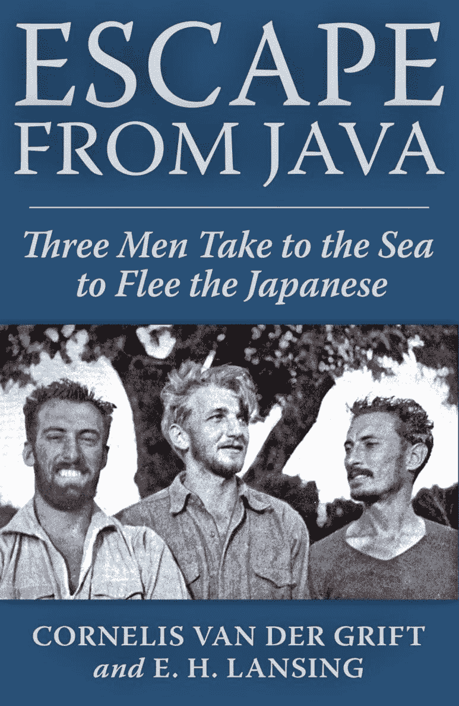
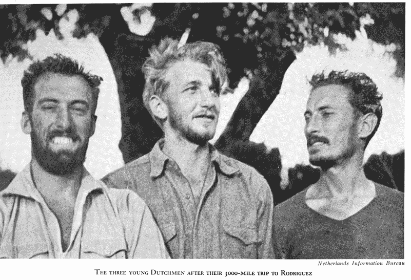
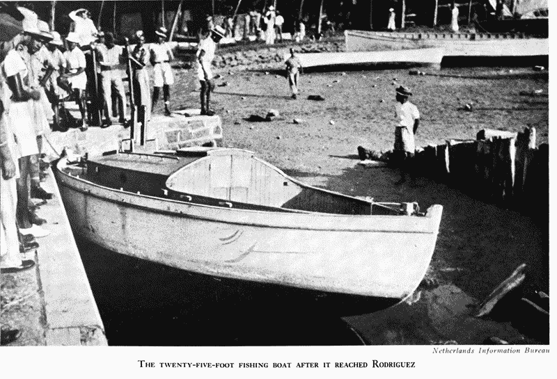
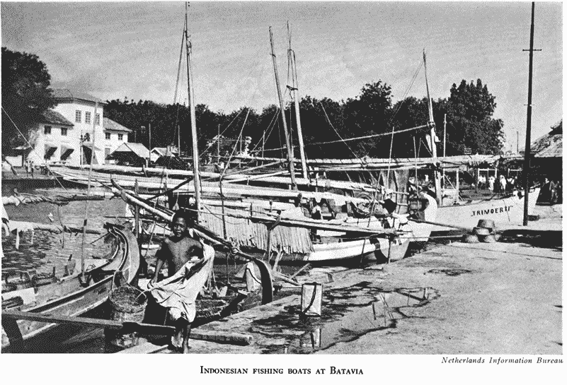
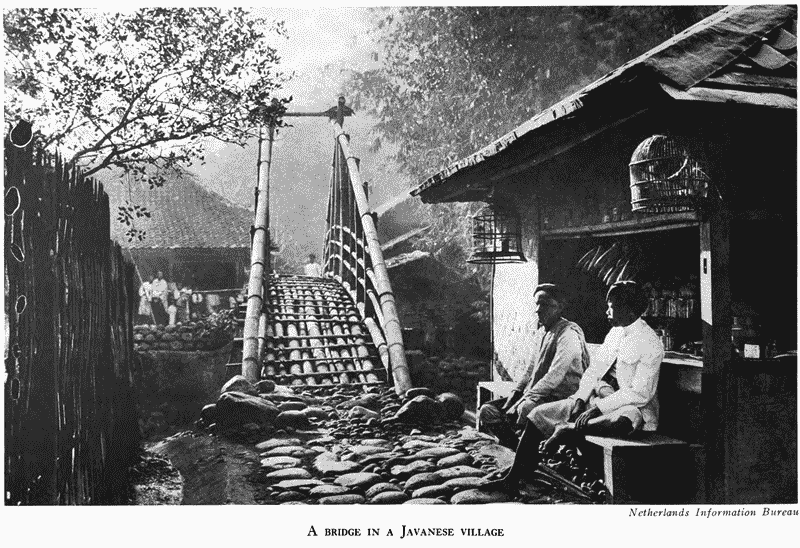
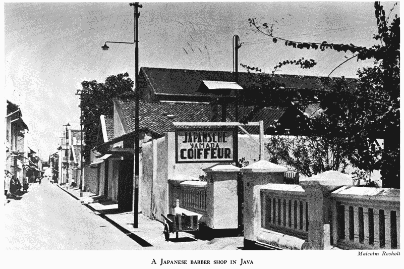
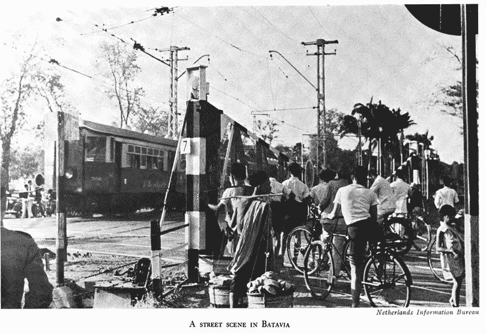
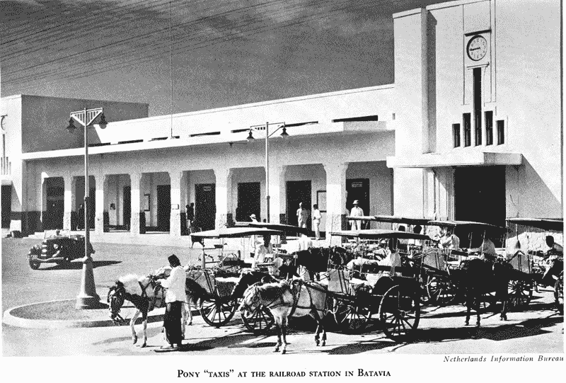
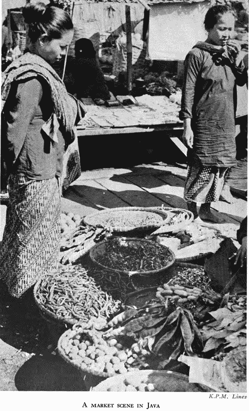

# 逃离爪哇：三人出海逃离日本军

## 出版者注

尽管在大多数情况下，我们保留了作者原始的拼写和语法，以真实还原作者的作品及此类材料的原始意图，但为了现代读者的考虑，我们也增加了一些注释和说明。我们还尽力包含了原版中所有的地图和插图；由于格式限制，无法包含较大的地图，我们将尽可能地上传这些地图。

# 第一章

“日本人永远无法夺取爪哇岛。”巴达雅亚的人是这样说的。“日本人永远得不到爪哇岛。”不仅是巴达雅亚人有这种感觉，整个岛屿的人都深信不疑。我想这理所当然。没有人会认为这种事会发生在自己身上。你不能责怪他们持有这种信念。当你在一个地方生活了数百年，并将其建设成世界上最富庶、管理最好的岛屿之一时，很难想象会有人能把这一切夺走。

爪哇是一个美丽的地方，正如某人所说，它像“赤道上的一条翡翠腰带”。那里茂盛的植物似乎从地里喷薄而出；花卉、树木和灌木随处可见。大多数白人人口居住在内陆的种植园或大城市里。巴达雅拥有迷人的街道、宽阔的广场、俱乐部以及被誉为远东最好的酒店的`Hotel des Indes`等大酒店，是一座极具魅力的城市。

爪哇是我居住二十二年的家。我六岁那年从荷兰来到这个岛屿。除了在“家乡”读了两年大学，以及偶尔去其他国家短期访问外，我一直住在爪哇。但生活在岛屿上并没有带给我局限的观点。我一直对外部事件感兴趣，并试图解读这些事件及其对整个世界的影响。应当理解，白人人口以及大大的印度尼西亚知识分子对世界事务有着最大的兴趣。印度尼西亚农民的生活与人类其他部分相比更加孤立。这些爪哇农民是温和的人。他们在内陆的村庄里过着平静的生活，住在巨大的火山山坡上或山山之间的谷地里。种植水稻、集体村庄生活、家庭以及简单的娱乐是他们关注的重点。即使是居住在巴达雅亚或水泗等城市的人，在任何意义上都没有变得“老练”。爪哇岛上有四千七百万像这样的印度尼西亚人，相比之下，只有二十十万欧洲人（主要是荷兰人）、六十万中国人和四千到五千名极少到可以忽略不道的日本人。

我并没有打算把这本书写成一部关于爪哇岛及其人民、习俗、习惯和普遍生活方式的通史。任何人都可以在无数书中找到这些事实，而所有的书籍都比我想要尝试的内容要详尽和博学得多。关于我个人所熟悉的爪哇的故事，关于日本入侵的威胁如何影响我，关于我如何在所谓的日本“大共荣圈”统治下生活，以及最后我是如何逃脱出来的。但为了让人们对作为东印度群政府中心的爪哇岛有一个大致的概念，简要介绍一下它的历史和人民也许也不为过分。

## 东印度群的历史

除了十九世纪初的简短时期外，荷兰从十七世纪初开始一直控制着东印度群。假装荷兰人的统治一直是秩序和仁慈的典范是没有意义的。在早期，一些荷兰总督像其他欧洲殖民殖民地的行政官员一样，极其严酷和傲慢。但在过去的一百年里，荷兰的管理是一项公正且体贴的统治，它使荷兰东印度群成为世界上最快乐、最富庶的地区之一。

荷兰政府的原则之一是尊重印度尼西亚文化并按照他们自己的路线发展。爪哇文化是古老的文化，任何强迫印度尼西亚人进入所谓文明方式的尝试不仅是困难的而且是犯罪般的愚蠢。荷兰人一直小心保护`adat`（即本土法），印度尼西亚人也对这种对他们老礼节和习俗的尊重表示赞赏。作为一个例子，政府为当地的`sawah`（稻田）建造了现代灌溉系统，这比以前粗糙的、每个雨季都会坍塌的泥墙和水坝有了巨大的进步。农民们喜欢这个新系统，但无论如何劝说，他们都不会用镰刀而不是手刀来收割作物。“如果我们用这种粗鲁的方法，谷物会受到冒犯的，”他们这样解释道。因此，水稻被每次轻轻地割下几株，理论上认为这种周到的对待会让它们更愉快。

## 行政与社会

每个村庄——在人口稠密的爪哇岛上有许多村庄，这个岛屿每块五万一千平方英里的土地上都挤满了 821 人——都有自己的行政机构。村长是爪哇人寻求解决所有问题和纠纷的人。尽管在必要时政府自然是最后的上诉法庭，但实际上它尽可能少地干预当地事务。欧洲人不被允许从当地人手中购买土地，因为稻田在当地人之间是父子相传的，荷兰人无意破坏这种自然的继承顺序。

当然，有一大群爪哇知识分子，这些人对行政和文化事务有着浓厚的兴趣。爪哇的`People’s Council`由六十个人组成；其中三十人是爪哇人，五人是亚洲人，二十五人是荷兰人。这个`Council`以当地影响占主导地位，是爪哇真正的立法机构。

根据我对爪哇人的熟悉了解，我可以作为一个事实陈述：当地人在任何意义上都没有受到住在他们岛上的荷兰人的压迫。在知识分子中，有一群人致力于爪哇的自治，但荷兰人并没有镇压它；事实上，他们正在鼓励一项教育计划，让爪哇人在行政管理中占据更大的份额。印度尼西亚人整体上非常感激白人带给他们的优势：卫生条件的巨大改善、任何人都可以自由参加的现代学校，以及最重要的是，荷兰人带给他们的智慧。

## 军事准备

我们陆军、海军和空军的薄弱并非荷兰东印度政府的过错。东印度群没有重工业，因此依赖工业化国家提供坦克、大炮、飞机和其他战争物资。即使在 1940 年 5 月荷兰沦落之前，爪哇的陆军和海军人员一直在努力建立实力。他们下下了大量订单，但在全球军备竞赛中，只有一小部分到达东印度群。我们对现代战争的装备不足。

# 第二章

日本对珍珠港的袭击引发了一系列对每个人来说都感到无比恐怖且熟悉的事件。在爪哇，我们不得不目睁睁看着征服的浪潮步步逼近，同时我们竭尽全力为任何可能发生的情况做准备。尽管我们中有些人知道，由于我们缺乏战争物资，对岛屿进行真正的防御是不可能的，但从未有过绝望的时刻。

## 爪哇的防御

政府首先做的事情自然是关留了岛上所有的日本人。但很久以前，他们已经在那里结束了工作，爪哇对于东京的军阀们来说就像是一本敞开的书，正如新加坡和珍珠港一样。当然，荷兰政府立即对日本宣战，岛上 25 万至 30 万荷兰人和欧洲人中有很大一部分人被征召入伍。他们对保护`Batavia`采取了预防措施，并加快了在荷兰沦落后已开始的防空掩体建设。爪哇的每一个人在防御中都有一份力量；如果他们不在军队里，就从事民防工作。

## 领导层与准备

荷属东印度陆军总谋长`Hein ter Poorten`将他所拥有的物资做到了所能的最好准备。`Ter Poorten`是一个现实主义者。他一直知道日本人有大图计划，他已竭尽全力建设和现代化军队。多年来，他一直致力于加强空军建设，战争初期几个月我们的飞机对敌人取得的成功，很大程度上归功于他在培训飞行员和地面人员方面的远见。空军司令长`van Oyen`少将也察觉到了我们处境的危险性。他与`ter Poorten`密切合作，并帮助在岛屿内陆各地建立了机场。我经常在想，当这两个人看着日本人越靠越近时，心里一定是什么感受，因为他们很清楚自己用什么样的物资来击退敌人。

爪哇有几家弹药工厂，他们生产了大量的子弹、炸弹、炮弹、手榴弹和鱼雷。但在欧洲战争爆发后，几乎无法获得更多的原材料，而且正如我所说的，我们没有运气从英国或美国获得足够的成品。

## 海军抵抗

爪哇以外的人们最记得的是`Helfrich`将将，他可是我们对抗日本人那场短暂战斗的英雄。在战争的前五十四天里，他的舰只击沉了五十四艘敌舰。我们称他为“一天一舰的 Helfrich”。这位将领也是一个现实主义者。他知道要用什么战斗，以及要对抗什么。但只要有一丝机会造成伤害，这种认知就从未导致他试图去节省我们匮乏的舰队。在战争初期的那些日子里，他反复派出少数几艘船去对抗从日本南下的运输船队和护航队。我们的一艘潜艇在珍珠港事件后的第二天击沉了四艘日本运输船。但日本人总有更多的运输船，以及更多腿细的、戴着眼镜的士兵来填充它们。

我们在印尼群的海军力量是盟国整个太平洋地区防御计划的一部分。美国将领`Hart`是司令，`Helfrich`将是他的副司令。`Helfrich`研究岛屿的海军防御计划已经多年；这对他来说像是一种爱好。多年来，他一直觉得日本人有一天会进攻印尼群。

## 撤退策略

同样，讨论本可以做什么已经太晚了，但我禁不住想，如果`Helfrich`拥有足够的船只和飞机并听从他的安排，会发生什么。他对印尼群的了解胜如指掌。即使到 2 月中旬，当`Hart`退休`Helfrich`接管指挥时，也还不晚。尽管我们的几艘船损失了，带走了大量的日本人，但我们舰队的主力仍在那里，并得到了美英军的援助。他们如何战斗以及能做什么，在`Macassar Strait`海峡战、`Bali`之战以及最后的`Java Sea`海战中得到了证明。

我记得看着日本人越靠越近的感觉。到 1 月底，他们已经占领了`Manila`和`Hong Kong`，并在马来亚向南推进，越来越接近`Singapore`。他们在`Sarawak`和`Celebes`登陆了部队。婆罗洲`Borneo`海岸的油岛`Tarakan`沦落了。那里出产重油纯度极高，可以直接从井中泵到船只的油箱里而无需精炼。该岛屿无法防御，但我们的部队在离开前破坏了油井。至少需要半年时间才能让它们重新运作。在我们的部队被迫撤回的每一个地方，他们在离开前都彻底执行了焦土政策。除了毁灭，我们没有给日本人留下任何什么。

## 巴达维亚的气氛

在`Batavia`，总体感觉仍然是自信。现在，他们不再只说“日本人永远夺不了爪哇”，而是说“我们会守卫爪哇。他们永远夺不了爪哇”。他们现在知道我们将会受到攻击，但仍然无法相信我们会被征服。他们期待外部的援助来弥补我们在防御`Singapore`和外围岛屿的损失。我们没有辜负他们。还有时间让补充到位。

## 关键战役

1 月底的`Macassar Strait`海峡之战证明了这一点。在极度不利的情况下，盟军飞机遭遇了在`Celebes`和`Borneo`之间狭窄海峡护卫前往爪哇的大型运输队。在随后的战斗中，击沉了 31 艘运输船以及几艘护卫舰。这对盟军来说是一场巨大的胜利。尽管日本人登陆了`Borneo`并在短时间内夺取了无法防御的`Balikapan`，但对爪哇的侵略被阻止了，并争取到了时间。爪哇人被`Macassar Strait`舰只沉没的消息所鼓舞；尽管`Balikapan`沦落了，他们仍然充满信心并说“日本人永远夺不了爪哇”。这种信心对于这座城市及其人民来说是极好的。政府在街道上贴出了这条著名的口号：“宁立着死，不跪着活”。此时，当地居民已经完全意识到战争的到来，他们的生活方式发生了剧变。关于在日本人统治下生活的各种开始流传。印尼人知道，被征入军队后，在日本人法律下得到的待遇更低。他们的担心是正确的，很快就会证实。对于荷兰人来说，更重要的是他们被允许过自己的生活，种同样的田地，唱同样的歌，就像他们的祖先数百年来那样。

直到 2 月上旬，战争才真正来到爪哇。然而，日本人开始轰炸我们。他们的轰炸机出现在`Surabaya`和`Batavia`上空，没有造成巨大的破坏，但他们认为正在“软化”我们。他们的部队紧随其后，在`Bor`向南推进。毫无疑问，爪哇是他们的下一个目标。我们的空军和海军尽了所能。我们每天都听到有飞机被击落，许多船只被击沉。这时，一些美国的`Flying Fortresses`到来帮助我们。但它们还不够。这些惊人轰炸机的出现反而增加了烦恼。我们的飞行员、士兵和水员的精神非常伟大。他们似乎从未想过自己在进行一场注定失败的战斗。他们出去并做了必须做的事；他们击沉了日本船和几十架飞机，但仍然不够。日本人总有更多。

当 2 月 15 日新加坡沦落时，我们只做了一部分准备。对于我们认为世界上最坚固的防御工事的陷落，准备仅此。那时这种情况已经改变了我们的思考方式，以至于对任何事情都不感到惊讶。我们所知道的只是除非援助到来，我们将是下一个。新加坡的事后，英国军队开始进入爪哇；那些从马来亚逃出来的人自然处于一片混乱。他们不得不尽一切办法逃跑，有的坐船，有的坐飞机。他们许多是澳洲和新西兰人。他们在马来亚经历了地狱，并且输掉了战斗。这足以让一个士兵崩溃。我记得记得在`Batavia`的一家酒吧里和一个新西兰人聊天。他那天早上刚从一艘当地的鱼船（在印尼被称为`prahu`）上登陆。他失去了他所有的装备、步枪、弹药和所有财物。但他不在乎这些。他想做的只是去爪哇南岸的`Chilachap`，那里有一些英国船正在接载他们的士兵并将他们带回澳大利亚。“就让我对付那些……”他一直这么说，“天哪，如果我们有物资，我们就会……那些日本人。”你无法写下他所说的，但我知道他的意思。他想和日本人战斗。那时爪哇有很多英国士兵，他们都想离开，以便在其他地方继续战斗。他们知道爪哇已经完了蛋。他们见识了日本人用来战斗的何种物资，并知道我们无一可以与之比拟。

但即使在新加坡沦落后，爪哇的人也没有绝望。我不认为有人对我们将发生什么事持有太大怀疑，但从一个`Batavia`荷兰人那里，你永远无法得知。在听到关于新加坡的消息后不久晚上，我在`Hotel des Indes`吃了晚餐。只有几人在露台上喝鸡尾酒，由当地的侍员如往常一样礼貌且高效地服务。谈话变得了。那是关于战争。但妇女们一如既往地穿着漂亮，男人们穿着亚麻晚宴服看起来冷静而舒适。酒店里有一种几乎无法言表的安逸感，人们能感受到这种感觉，即使日本人就在门口了（如果这么说的话）。然而，在酒店里吃饭的事实（正如在长期和平岁中所常做的那样）不应该给任何人留下荷兰人在“罗马被焚烧时弹奏琴”的印象。他们只是拒绝表现出自己的感受。我们已经竭尽全力为岛屿的防御做准备。荷兰人正在用最后一杯酒祝我们好运。

## 亚亚加罗的陷落

苏答腊岛富油城`Palembang`的沦落，对我们的打击比新加坡的崩溃还要严重。这发生在我们听到新加坡消息后没几天。`Palembang`的难民乘坐渡轮、鱼船等任何能找到的工具挤入`Batavia`。他们讲述了日本人占领这座城市的故事，这让我们对即将面对的情况产生了可怕的预感。荷兰人立即炸毁了油井，这些油井和炼油厂发出的熊烈火焰给人们留下的印象甚至超过了真正的日本袭击。火焰的声音和浓重的烟云是一次恐怖的经历。我一遍又一遍听到人们讲述当看到这些价值数百万美元的设施化为乌烟时的感受。这些难民带来了一些日本人为被征服国家准备的钞币。这些纸币对应于我们的五盾票和一盾盾票，甚至还有一分盾票。日本人强迫被征服国家的人接受这种钞币以换取真实的货币。这种纸币本身根本不值钱，但日本人利用它来推进他们的“共荣圈”。不需要太大的洞察就能看出谁在这场纸币交换中获利了。

# 第三章

日军正收拢包围我们的陷阱圈。他们控制了西边的`Sumatra`，现在又开始轰炸东边的`Timor`和`Bali`。我们的飞机和舰船，在派来守卫`Java`的英美部队援助下，出动迎击那些群结如蜂且日益增加的日军船机。在`Timor`和`Bali`，我们的陆军战斗异常激烈。但我们没有足够的人力和器械来应对进攻。日军登陆了`Timor`和`Bali`，将他们的损失视为最终胜利的代价的一部分。他们稳固了`Java`周围的阵地，收紧了大口准备将我们吞噬。

最后，澳大利亚和美国军队登陆了`Java`。他们的出现既令人振奋，又让人感到沮丧。如果我们的盟友正在登陆部队，他们一定觉得这座岛是有希望的，但我们看到来的人是多么寥少。看到美国人后，当地人的士气大增。这些从容、自信的男人在身材矮小的印度尼西亚人眼中显得巨大的巨人。每当他们看到美国士兵时，就会喊道：“美国万岁！你们会打败那些矮个子的！”一个美国人看起来可以对付十二个矮小的日本人。但矮个子太多了，即使对美国人来说也是如此——数量太多，而且装备精良。

## 爪哇海战

在日军登陆`Timor`和`Bali`后，发生的爪哇海战决定了`Java`的命运。一支巨大的日军舰队在`Borneo`和`Java`之间的海域被发现。它正朝我们的方向驶来。我们避开悬在头上的命运的最后机会出现了。由于人数少、火力劣，`Admiral Helfrich`将他最后的舰只派出去去迎击。他可能在战斗开始前就已知道战斗注定失败，但如果日军想要夺取`Java`，他们就必须付出代价；而这座印度群岛最富有的岛屿的代价是昂贵的。五艘日军巡洋、三艘逐舰和十七艘运输舰被我们的舰船击沉或击残。

我们带着五艘巡洋开始了战争。其中两艘在爪哇海战中沉没，还有未说明数量的逐舰和轻型海军单位。尽管我们击沉的船比日军多，但这场竞争是不平等的。他们总是更多；而我们失去了舰队的力量。我们在印度群岛的最后一个海军基地受到了威胁。在那场英雄的海战之后，从任何意义上说，`Java`的战斗已经失败了。现在，`Java`向入侵者敞开了门户，因为在防御`Malaya`和`Java`之外岛屿时失去了飞机后，我们的陆军成了日军轰炸机和战斗机的易中猎物。

## 爪哇之战

日军没有浪费时间。对于那几百架可能拯救我们的飞机来说已经太晚了；对于在几千名盟军士兵援助下充实军队所需的部队也是如此。日军的进攻计划显而易见。我们知道他们会在哪里进攻，并做了所能的准备来迎接他们。`Java`的北岸平坦、宽阔且开放。那里没有天然防御，无法指望我们指挥的部队守卫那里。我们的主堡垒在`Bandung`，`General Headquarters`已建立在该座内陆城市西的丘陵之中。

通往`Bandung`的所有道路都布了雷，每个山口都埋了炸药。这里将是我们为`Java`进行最后抵抗的地方。日军从驳船登陆了该岛的四个点：东岸、西岸，以及北岸的`Indramayu`和`Rembang`。他们进攻内陆的机场。从`Indramayu`来的部队目标是`Kalijati`，那是环绕`Bandung`的山脚大机场。在东部，他们瘫痪了我们海军基地`Surabaya`周地区。他们从`Indramayu`进入内陆，切断了`Batavia`和`Surabaya`之间的铁路。来自`Rembang`的部队前往`Tjepu`的油田，荷兰人在离开前已摧毁了那里。他们以快速、如拉割般的攻势切断了北岸，并侧击了`Batavia`和`Surabaya`。他们向`Bandung`推进。两天之内，他们就距离那个山地要塞三十里。

对日军来说，征服`Java`并不容易。尽管我们的部队炮兵供应极其匮乏可怜，且机械设备不足，但他们在任何能击中日军的地方都战斗，给敌人留了极其惨痛的几天。在日军到来之前，桥梁、道路和机场都被毁了。所有具有军事价值的东西都被撤退部队摧毁，只留下一片废墟。我们减缓了日军的速度，但无法阻止他们。我们的飞机在坚持战斗期间表现得很好，但一旦飞机被击落，就没有另一架飞机来替守`Java`。日军士兵沿着布雷的道路，穿过荷兰人留下的荒凉地区，靠近`Bandung`。

`Java`平原上没有游击战的机会。那里人口稠密，道路和铁路过于密集。每平方英居住着 821 人，游击者无处遁形。尽管内陆有火山，岛上的大部分地区都是平坦开放的。我们别选择执行唯一的可行防御计划：在`Bandung`坚守。

# 巴达达的陷落

在`Batavia`，我们知道终结已近。传言说一支巨大的美国军队正赶来帮助我们；一支盟军舰队正准备进攻将入侵者带到`Java`的日军运输船。尽管我们听了这些故事，但知道它们是假的。随后，在日军最初登陆五天后，军队必须撤离`Batavia`，因为通往`Bandung`的铁路受到了威胁。离开之前，军队摧毁了城市里所有对日军可能有价值的东西：主要的政府建筑、`Tanjung Priok`的港口设施、所有的储油罐和其他工业设施。所有的私车都被征用，将士兵送到`Bandung`，在那里参加对那座要塞的防御。军队无法使用的汽车被拆解了。街道上只剩下几辆政府汽车。

因此，当日军来到`Batavia`时，全体人口都在那里面对他们。没有一个私民能够离开城市，因为没有交通工具。印度尼西亚人和欧洲人都在场，接受入侵者选择给他们的任何对待。`Batavia`于 1942 年 3 月 5 日陷落。那天晚上七点半，驻员派了手持白旗的志愿者去市西侧迎接敌方指挥官。

我是`Netherlands Army`的一名平民成员，被派往`Batavia`继续我的工作。我的工作在一个公用事业的办公室，这个职位我已经担任了几年。在占领前几天，执行关键工作的员工被荷兰政府指示坚守岗位。我们为了个人安全采取的唯一预防措施就是摧毁制服。如果日军认为我们是平民，我们会有更好的机会。因此，我目目睹了随后发生的悲剧。

尽管我没有亲眼看到过`Java`战斗的实际过程，除了对城市进行过偶尔且无效的轰炸外，也没有经历过它的任何现实……

## 第四章

直到第二天早晨，我才仔细观察了那些日本占领军。当我按照指示准备上班时，日军已经遍布了城市。他们骑着自行车来。一群矮矮的小个子骑在他们奇奇怪的机器上。他们挥舞着小小的日本国旗，咧开大嘴露出凸出的牙齿大笑，看起来非常快乐。他们黑色的眼睛在黑框眼镜后闪烁着光芒。在半小时内，我估计百分之五十的日本人戴戴眼镜的。

普通的日本士兵并不是人类物种中那种讨人欢的标本。他们大多数人都是外八字脚，身材矮小、笨拙，脸部极其丑陋。人们看到的对日本人的漫画形象并没有多大夸张。他们看起来就是那样：瘦小、戴着眼镜、大牙齿。许多人走路时拖着脚，在地上摩擦着走，好像把脚抬离地面太费力了似的。

我对他们装备的匮乏感到惊讶。从我昨晚瞥到的那些入侵者来看，我本以为每个士兵都会全副武装。但我今天早上看到的大多数人只带着小口径步枪。大约二十五个人中才有一个拿着机枪。

他们的个人物品也无好到哪去。每个士兵显然只有一套制服，一件薄而宽松的长袖衬衫，扣到领口。他们在裤腿外缠着绑腿，穿着皮靴。他们中戴着轻便的太阳盔，但大多数人戴着棕色的帽子，后面挂着一块布以保护脖子免受阳光照射。无例外，这些士兵身上臭气冲天。廉价的棉质制服曾是深褐色，现在褪成了肮脏的灰色，发着陈汗的臭味。在看到日本人来之前，你就能闻到他了。

他们的第一个动作是夺取城市里剩下的所有政府车辆。在进入巴达达亚的 15 万大军中，只有 3 万留下来作为占领军。其他的正往万隆赶去，所以他们抢夺了任何能让他们更快到达那里的车辆。

我骑着自行车在街道上穿行，努力表现得不在乎，但时刻敏锐地观察着发生的一切。臭臭烘的日本人随处可见。我看到三个日本人跳下自行车拦下了一辆车，在我面前拥挤的街道上穿行。他们用大拇指向当地司机示意他们想要那辆车，当司机犹豫时，他们抓住他的脖子把他扔到街上。他们把自行车系在车后部，从旁边的树上取树枝搭在车顶进行伪装。我后来得知，这种伪装车辆的行为是日军的典型特征。当然，这种预防措施是没有必要的，因为日本人是空中霸主。但他们就像机器一样。他们被告知：“每当你们坐车时，务必进行伪装。”于是他们就做了，完全没有考虑是否有必要。但就在这里，我想说，这些日本士兵受训非常出色。我看到的那些人在中国战斗了四年，是突击兵中的精锐。他们很清楚职责。

我骑着自行车没走多远。汽车事件发生后，一个骑着自行车从我身边路过的日本人轮胎瘪了。他立刻跳下地，推着他的机器横在我的路中间拦住我。士兵朝我的自行车挥了挥手，笑了，然后指了指自己的鼻子。一时间我很困惑，但最后他的手势——先指向我的自行车，再指向他的鼻子——告诉我这意味着他要占有我的机器。那个指向鼻子的动作，我在接下来的几个月里看到了很多次。那是日本人表达自己的方式。“我，”他会指着鼻子说，“要这个或那个。”一个明智的人把它让给了他。

尽管我那天心情如何，但看到那个日本人试图骑上我的自行车时，我还是不禁觉得有趣。我身高超过六英尺，我的自行车很大。这个士兵甚至比他的许多同僚还要矮。我看着他试图跨上座垫，但他无法用通常的方法做。。他的腿太短了。他必须笨拙地跳一下才能够到座位，一旦坐上去，平衡那台机器就费了劲。他最终解决问题的办法是站起来，身体向一侧大倾斜够住一个踏板，然后向另一侧晃动带动另一个踏板。看着他在街道上摇摇晃晃地走着之字形路线，我的心情稍微好点了。骑在那辆自行车上的他看起来一点不像个世界征服者。

总的来说，占领进展得很顺利。日本人小心防止聚集，甚至当一些心存顾虑的当地人拿出小日本旗并挥舞着以希望讨好入侵者时，士兵也驱散了他们。他们不确定当地人或白人会对他们的到来产生什么反应，任何形式的聚集都会让他们紧张。但并没有多少反抗。所有的人都被政府要求留在岗位上，不要采取敌对行动。当几个当地人开始抗议被偷自行车时，被日本士兵扇了耳光，但大多数人都不敢反对。

当我到达办公室时，惊讶地发现那里一个日本士兵军也没有。有传言说，日本人手里有一份所有政府办公室、领事馆和商业公司的名单，并将立即接管它们。那天早上没人做多少工作。我们都感到紧张，心想日本人什么时候会来占领办公室。

我们没等多久。中午时分，一辆载着一名日本军官的汽车驶进了院子，带着拿着枪和带刺刀的士兵坐在脚踏板上。在武装卫兵的护送下，他直接进入了办公室。几分钟后消息传来，该部门的所有员工都要聚在一起听日本军官的宣告。

一旦我们全部聚齐，那个戴着眼镜、紧张的男人开始用一种欢快的语调快速说道。他讲的是日语，所以我听不懂他的话。当他讲完后，他示意他的下属，那人用准确的英语重复了军官的话。实质内容是：办公室已被日本政府接管，我们现在都要为日本政府工作，日常职责照常不变。任何破坏行为、消极反抗或任何形式的不服从都将被处死。他最后说，不愿遵守这一制度的人将走出来宣布。

武装卫兵固定了刺刀并等待着。没有人移动。我纳闷他们是否指望在刺刀的威胁下表达真实感受。英语演讲结束后，另一个日本人重复了同样的话。这对所有员工的效果是一样的。随后，军官派他的士兵在大建筑内外张贴海报，说该机构现在是日本帝国的财产，并将为了“亚洲繁荣”而经营。我留下来听军官还要说什么。在大多数员工被遣散回到岗位之前，他做的第一件事是拔出刀并向我们展示。“日本，”军官指着满是血迹的刀宣布道，“这是在爪哇杀掉新西兰和澳大利亚士兵的财产。”

这种展示之后，军官开始询问关于办公室的无数问题：它是如何运作的，我们有多少员工，维持它的成本是多少。我们的主管简短地回答，但每当他试图回避问题时，军官就会给出答案。军官已经知道在爪哇的工作情况了。

在面谈结束时，主管告诉军官有两千名印尼工人被解雇了，他说，“他们不配合我们的政策。”这个消息似乎并没有扰到军官。他只是耸了肩说：“好。”当然，他知道没有我们的帮助他们无法运作，他们需要维持公共设施。这时，更多日本军官带着卫兵出现了。后者立即被部署在建筑内外，带着刺刀。那时我们第一次学会了行礼。无论是白人还是当地人，经过时都要行礼；卫兵看到任何人就会大喊：“礼！”

后来我们得到了行礼的正式规定。男人要行六十度，女性行四十五度。文件这样写：“公民向卫兵行礼以表示对大帝国的尊重。”自然产生了很多麻烦。很容易想象没有人想向日本人行礼，但我们知道拒绝是愚蠢的。荷兰政府一直尊重当地信仰，禁止印尼人戴小帽子作为信仰的标志。但日本卫兵看到当地人戴着帽子行礼时感到很恼火，并试图把帽子撞掉。日本人愤怒时有一种咆哮的方式，那是一种沙哑的喉音，出卖了他们的兽性。他们会对当地人大吼，用枪托打他们，踢他们摘掉帽子。这并没有让印尼人感到好受。

在一天结束之前，我们得知来到办公室的士兵是经济部队，完全不是职业士兵，而是被委派接管工厂和办公室的商人。每个人都被分配管理某个办公室或工厂，他们对业务的了解程度和荷兰官员一样多。我们每个人都得到一个戴在左臂上的袖带。上面印有日文字，意思是佩戴者为日本政府工作，不受任何形式的骚扰。我们被指示如果珍惜安全就一直戴着这些袖带，不要取下。

那天晚上回家时，我从每栋办公楼看到士兵们没有浪费时间。所有的海报都是同样的公告：该机构现在是日本政府的财产，并将为了“亚洲繁荣”的更大利益而经营。这些海报让我思考，谁会从这种所有权的彻底交易中获益。

再次在控制我的悲伤和沮丧中，我看到了一些让我觉得有趣的事。正如所说，日本士兵到达巴达达亚时满身污垢和汗水，他们想做的第一件事之一就是洗干净。他们处理这件事的方式非常直接。他们毫不犹豫地走进某人家，宣布他们是来用浴室的。在这种情况下，没有房主愿意对此争执，所以士兵被允许使用浴室。我那些经历过这种气味冲天的造访的朋友告诉我，日本人花了几个小时擦拭身体。洗干净后，他们洗了制服。没等等衣服晾干，士兵们就带着湿制服走走了，只穿着一件及膝盖的白色短衬衫，并用绳子系在腰间。正是这些穿着内衣的外八字脚小个子的身影让我露笑了。第一天士兵们穿着这种简陋的装束随处可见；进入商店、剧院和街道。这并不能掩盖他们的身体短板。

## 第五章

在一周之内，日军就占领了镇上所有的军营，并将士兵驻扎在其中。日军看中的任何建筑他们都会夺取。如果某栋较大的办公楼被指派给经济部队、财务专家或任何特种兵入住，原有的租户会立即被清空。这些人以及所有居住在附近房屋的人被给三个小时的时间离开。所有东西都必须留下来供新来者使用。房主不得不放弃所有的家具和个人财产。他们被允许带走的只有衣服。日军并没有为这些人在其他地方制定安置计划。他们只是被告诉出去，离开后由他们自己在城市的其他区域或在朋友那里寻找住所。

到此时，计划留在雅加达的三万名日军已全部抵达，他们的同胞则继续前往万隆。在雅加达投降后三天，万隆就陷陷落了。那里是一个天然的据点，但日军陆军压倒性的数量以及对我们方防御者的制空权实在太强大了。他们是我们的精锐部队。一接一小时，他们遭到俯冲和轰炸。天空中没有一架友军飞机。他们坚持了三天，然后日军突破了外防线，万隆投降了。现在，整个爪哇岛都落入了日军手中。

万隆的消息已经足够糟糕了，但目睹我们周围发生的事情更是雪糟。在首批占领部队抵达雅加达几天后，`Kempei`（宪兵）就来控制这座城市。`Kempei`是效仿盖斯塔的警察部队。他们是日军中真正的权力，经济部门做的任何事情除非得到`Kempei`的批准，否则毫无用处。经济部队已经完成了接管商业和政府部门的工作，现在`Kempei`似乎在统治雅加达。他们是真正的士兵，强硬、残忍且经过战争洗礼。没过多久，我们就知道了他们权力的范围。

他们列出了镇上所有重要人物的名单，包括警察官员、商人和政府员工。尽管经济部门给这些人人都发了袖章，`Kempei`还是把他们抓起来并关进了监狱。对于那些他们没放在眼里的人（我也在其中），他们发了另一种袖章，这上面有一个特殊的`Kempei`印章。`Kempei`的理论是每个人在证明自己无罪之前都是有罪的，他们不抱任何侥幸。这些著名的雅加达人被视为叛乱的潜在来源，无论他们的职位如何，或对政府或业务运作有多么重要，都被关进了监狱以确保安全。当时被捕的犯可能有三四千人。

当他们来抓局长和几位部门主管去时，我正在办公室，距离他们收到经济官员发的袖章还不到一周。大约十五到二十名士兵进入办公室，拔出刀剑举起枪支，对整件事显得非常严肃正式。他们的指挥官告诉局长必须随他们离开。当局长抗议并指向自己的袖章时，日本军官咆吼道并用剑做出了威胁的手势。卫兵走近了。局长无无可施。他跟着卫兵走了。偶尔，这些武装卫兵去某人家里带人时，会带上一名留存在警察部队中并被迫为日军工作的当地警察。那名警察对此感到非常抱歉，并且讨厌为日军工作。

“请不要生气，”他会对房主说，“但我必须问一下，主人在家吗？”如果回答是否定的，他依然很卑微地说：“请，我们可以看看吗？请不要生气。”

这种大规模的监捕完全不让经济部门高兴。他们正试图让商业和公用事业尽可能顺畅运行，而`Kempei`的这种扫荡活动破坏了他们的计划。一旦我们的公用事业负责人被带进监狱，事情就开始变得不顺利。负责的日本军官对技术问题一知甚少，很快就遇到了麻烦。

他们困难的一个例子可以作为说明，而且相当滑稽。一天晚上，负责雅加达的日本将军在办公室招待一个重要的阿拉伯贵族代表团。突然灯灭了。将军大发雷霆，紧急通知负责电厂的`Kempei`军官。该军官对电厂或如何运行它一无不知，在被将军踢了一段时间后，回去寻找故障。但过了几个小时他才让灯恢复正常，在此期间，将军和他的客人坐在黑暗中。

这类事件增加了经济力量与`Kempei`之间的摩擦。经济部门的人不断试图从监狱中释放他们需要的人，而`Kempei`却固执地拒绝加快行动。

根据我对`Kempei`行动的理解，他们主要感兴趣的是尽可能在爪哇岛保留最少的部队。他们有其他领域要征服，并想把士兵用于战斗而不是作为占领军。他们知道欧洲人是煽动破坏或可能发生起义的巨大危险源。因此，他们关押这些人以让他们远离危险。此外，他们意识到试图从爪哇岛抹除荷兰影响对他们有利。如果他们能向当地人证明日军比白人更强大，他们希望让印尼人对他们产生更好的态度。随着大多数重要的荷兰商人和官员被关押，他们失去了与当地人的联系。

在万隆陷落后，`Kempei`忙于收集战俘。他们将这些人关在内地的集中营中，根据所有报告，他们遭了非常糟糕的对待。[注：原文包含破碎/混乱的句子，已根据语境重构]。这些人是无法逃脱的，日军在爪哇岛占领期间用赤手清理最肮脏的街道。（注：提供的文本包含大量重复，已根据爪哇岛占领期间的语境进行了合成，并保留了`Kempei`等特定术语。）

但这种幼稚的宣传对民众产生了完全相反的影响。在看到`Kempei`在街角看到这些可怜的人工作时，我听到一些当地人私下交语，他们反复重复着这简直是耻辱。我们还有其他关于“共荣”的例子。当地人对日军统治下的地位自然极其紧张且不确定。在占领之前，他们听过日本宣传广播，解释他们是同一种族、同一肤色，以及如何。他们的做法和说教完全大相径庭。只需几个他们对待当地人的行为实例就足以说明他们是如何未能履行宣传的。

占领后日军立即实施了宵禁。所有人应该在晚上六点到第二天早上六点之间待离开街道。这种宵禁持续了一个月，直到`Kempei`建立了“秩序”。自然有无数次违反宵禁的行为，而惩罚的是当地人。如果其中一个人在禁令期间被抓在街上，日本士兵会在路中间画一个圆圈，强迫当地人在里面蹲上十二小时不动。但这只是较轻的惩罚之一。对于更严重的违规行为，他们有更特殊的对待方式，例如对哨兵礼得不够、偷窃大米或在街道错误的一侧行走。这些不幸者没有得到任何仁慈。一种惩罚是割掉他们的手并绑在树上，向其他人展示违反日军统治的下场。另一种系统是在人的脖子上松地套上绳子，并将他固定在街道上的树或杆子上。不给他提供食物或水，两三天后，那个人就会因虚弱而昏倒并自动吊死。

## 第六章

我决定要学习日语。由于绝大多数士兵（包括军官）只说自己的母语，如果我想和他们交谈，就必须学习他们的语言。我一直以来语言学得很快，但日语本身就是一门科学。我为自己制定了严格的计划，每天学习一百个日文“字符”，并苦苦努力掌握它们的错综复杂。很快，我就有了一份可以运用的词汇表，并开始在日军士兵和军官身上练习。

### 士兵的态度

我问的第一个问题是他们对战争的看法，以及他们希望从中获得什么。没过多久我发现，他们大多数人都非常沉迷于战斗，将战争视为人类活着的唯一真正途径。这种信念的基础很容易理解：大多数普通士兵在家里过着悲惨的生活。他们属于社会底层；无知、贫穷潦倒，除了刻苦的劳作和缓慢的饥饿外，别无可盼。对他们来说，军营就是天堂；每天有一碗米饭，一套制服，无须后顾之忧。他们的军事领袖向他们脑子里灌输了一个观念：改善家里处境的唯一方法就是出去征服世界。他们对此充满信心可以做到。

正如我已经说过的，爪哇的日军是那些在中国已经打了四年仗的人。他们经过了战争的磨炼，专业技能训练精良，且狂热到了不可置信的地步。只有一两个士兵给我看了他们妻儿的照片，并表达了希望战争结束回到愿望。其他人，绝大多数人，没有比持续的战争更想要的生活了。后者才是真正的狂热分子。

### 狂热与荣誉

有一次，在和下班的士兵聊天时，我问他们如果被俘虏了会怎么办。他们看着我，仿佛觉得我疯了。其中一个人实际上回答道，一个真正的帝国之子绝不会允许自己被俘，他会先自杀。从他说话时的眼神中，我知道他是认认真的。

另一个人非常严肃地告诉我，如果他被俘或投降，他永远不敢回家了。他向我保证，他的母亲会因为他辱了家族而对他吐唾沫。那么，他唯一的道路就是切腹（hara-kiri）以恢复家族荣誉。他用刺刀比了一个动作向我展示了他将如何这样做。

### 互动与交流

总的来说，日军士兵与白人说话时极其礼貌。他们说话前总是会行礼，他们的对话中充满了“对不起”（sorry）和“请”（please），这是他们大多数人认识的两个英文单词。他们不断地鞠躬、低头，表现得像是在受主教教训的学生一样。

他们其中一些人懂几个英语单词和一点点马来语。但在与他们交谈时，我主要依靠我自己拙劣的日语知识和手势。日军可以通过一系列复杂的肢体动作表达几乎任何思想或动作。我自己也变得相当精通这种“哑巴”语言，很快就能通过指指士兵，再指指他的刺刀，最后做出刺入某人的动作，来询问一名士兵对战争的满意程度。日军士兵对我的努力觉得非常有趣，并且总是能明白我的意思。

### 对战争的看法

听听他们问我什么问题特别有意思。在几乎每一个情况下，第一个问题都是：“美国怎么样？”显然，美国被他们视作真正的敌人，他们对美国在战争中可能扮演的角色感到忧虑。我经常被问到我是否认为美国人会轰炸日本。他们非常担心美国会打乱他们的计划，尽管从目前的进展来看，他们并没有理由这样想。

他们刚刚占领了菲律宾、马来亚、婆罗洲和印度属群岛的所有岛屿，对盟军在这些地方的防御极其鄙视。他们觉得这些战役对他们来说轻而易举，而据称世界上最坚固堡垒的新加坡竟然落得如此快，让他们感到非常自豪。我经常听到他们开美国和英国士兵的玩笑，他们显然觉得自己优越到完全没有可比性的地步。但他们对中国人持有着非常健康的尊重。一名士兵通过竖起大拇指并说几次“好，好”来表达这一点。他们和中国人打了足够久的仗，知道他们在说什么。

### 休息时间的生活

当士兵们休息时，他们表现得像放假的孩子一样。他们充满了动物般的活力，似乎拥有无穷无尽的能量。有一天，街头的一群士兵在街上拦住我，其中一人提议我们摔跤。但我已经听过足够关于柔道的知识，知道尽管我的体型是他的两倍，我也不是他的对手。我也知道，如果我不小心伤了他，或者做出了让他觉得有损尊严的错误动作，可能会发生任何事情。被刺刀刺穿很容易成为我摔跤比赛的终点。无论如何，我想和他们保持好关系，总是对他们表现出友好。得罪他们的黑名单对我没有任何好处。

当我拒绝摔跤时，那士兵很好地接受了我的拒绝，但立刻提议我唱一首美国爵士歌曲。还没等来得及找理由，他就开始比划动作像在弹吉他，并用沙哑、喉音的声音唱着《Dinah》的英文歌词。他的朋友们通过笨拙地模仿美国舞蹈来配合这场表演。他们对自己的表演非常满意，并重复了好几次。

## 军官的作用

总的来说，我发现大多数军官……（此处原文似乎不完整，根据上下文推断翻译）

*（注：由于提供的原文在“The Role of the Officers”标题后中断，翻译也仅至原文结束处。）*

# 大亚洲

“大亚洲（ASIA RAYA）、亚洲保护者、领导者！”“大亚洲、合作亚洲、和谐亚洲！”这个口号随处可见——海报上、广播电里、报纸上。日本人没命地鼓输这样一种观念：他们的到来是赐给爪哇岛最伟大的祝福。他们决心要让印尼人忘记荷兰人，以及我们给他们带来的一切进步。

但当地人有自己的口号。短短几周的日本占领就足以让他们相信，所谓的“三 A 运动”（这一主要号号的名称）真正的应该是“大亚洲（Asia Raya）、日本富（Nippon Kaya）、亚洲穷（Asia Paya）”。翻译为“大亚洲、富足日本、贫穷的亚洲”，这表明没有人盲目到谁将从日本的征服中获益。

自然地，日本人立即接管了所有的报纸和广播电台。占领后一周内，所有的报纸社都关闭了，只有少数几份马来报纸被允许继续出版。当然，日本人控制了这些报纸，并在其中填满了供当地人消费的宣传内容。他们自己的名为`000`的报纸是他们的主要机关，上面刊登了一系列离谱的谎言、扭曲的故事以及对日本征服的美化描述。在全球范围内，他们的军队、船只或飞机参加的每一场战斗都被宣布为日本的胜利，无论他们损失了多少船只、飞机或人员。损失完全未被提及。

日本人从他们所有的主要新闻社带了记者过来，这些人忙于为家乡消费编造天花乱坠的故事，讲述日本军队如何受到了“受压迫的印尼人民”的“热烈欢迎”。他们印了一张日本人和爪哇人握手的照片，上方有一只和平鸽在飞翔。如果日本士兵没有在稍有挑衅时就砍掉脑袋来表达他们的和平意图，当地人可能会在这个快乐的想法中发现更多意义。

广播从黎明到黄昏都在播放相同的主题。没有人有机会听到除了日本人和爪哇人是“同肤、同种族”这种宣传以外的任何内容。征服后几天，特种部队访问了巴达雅的每一户，封锁了短波无线电频率，以便没有人能收听外国广播。不用说，荷兰人中有很多人违背了这一法令，冒着入狱甚至更糟的风险获取外部消息。

一个年轻人有一台隐藏的收音机，每晚都收听。他收到的新闻用手摇机打印并分发给朋友。他最终被抓了，我们听说他被枪杀了。但我们仍然获得了一些外部信息。在日本广播电台工作的印尼人经常能接收到外国广播，并将听到的内容转给朋友。真相传得很快，在巴达雅，很少有智力的人不知道世界上正在发生的事情。

我记得在征服大约一周后的一个晚上十点，我打开收音机，惊讶地听到了荷兰国歌。整整的一周里，每天都发生同样的事。显然日本人并不很通音乐，因为他们花了这么长时间才发觉发生了什么。两个在电台工作的男人一直在敌人的眼皮底下播放了一张国歌唱片。对他们来说，这是一件极其愚蠢的事，因为当日本人终于意识到那段旋律时，这两个男人为他们的忠诚付出了惨痛代价。他们被关了几个星期，后来被处决。

为了消除所有荷兰影响的证据，日本人开始更改所有街道、商店和建筑的名称。他们挂起牌子宣布某某地现在要用日本或马来名称命名，这对他们来说很容易。但从未有人用新术语来称呼它们。印尼人不是那种能迅速改变习俗的人，而且他们他们不想忘记荷兰人，所以日本人在这一运动上收效甚微。

出于某种原因，日本人在爪哇岛建立不久后决定不再使用`Japan`（日本）和`Japanese`（日本人）这两个词。也许他们觉得每个人称呼他们的`Jap`损害了他们的尊严。无论如何，他们宣布从现在起，爪哇的征服者应被称为`Nipponese`，他们的国家应被称为`Nippon`（日本）。任何违反此规则的人将受到最严厉的惩罚。但他们在这一想法上的成功与更改街道和建筑名称的一样。对荷兰人和当地人来说，他们就是 Japs，我从未听过有人称他们为 Nipponese，除非他正面对着其中一个。

电影也被转为日本人的宣传用途。占领后不久，每个剧院都关闭了，只在放映某些特殊的日本电影时开放。这些电影是最低劣的宣传，展示了日本工厂和田间幸福家庭生活的场景，或者更常见的是日本征服的战斗画面。他们在后一类电影中最喜欢的是对珍珠港的进攻，他们宣布珍珠港已被完全摧毁。日本军队参与的每一场战斗都被声称是“完全胜利”。我看了他们放映的珊瑚海战役电影。解说员宣布整个美国舰队在那场战斗中已沉没。

日本人很难让人们来剧院看这类电影，尽管他们将票价降到只有和平时期的一小部分。为了让看电影更具吸引力，他们发行了几部好莱坞电影，但只有经过仔细审查的。日本人特别喜欢其中一部名为`1,000,000 B.C.`的幻想片，从任何艺术标准来看都是一部非常平庸的电影。但它展示了白人表现得野蛮人一样，用手吃饭并住在洞穴里，正因这个原因，日本人认为它的反美宣传非常有效。

另一部美国电影《七宗罪》上映了几次。我在占领前看过这部电影，再次去看看日本人会如何处理它。在电影开始之前，屏幕上就闪过一条公告：“这部电影是糟糕的（busuk），因为它展示了被日本帝国海军全歼的美国海军舰只。”放映过程中，每当讲解员觉得需要这种评论时，就会中断并喊：“Busuk！”电影的大部分经过了审查，导致故事被完全破坏，毫无逻辑。我听说查理·卓普林的《大独裁者》在巴达雅曾给日本军官放映，但我们从未在公共剧院看到过。

在日军到达大约一个月后，一支巨大的部队运输船队出现在了`巴达维亚`的港口`Tandung Priok`。士兵们在码头被装载上驳船，然后运到外港的大型船上。大多数实际参加过爪哇岛战斗的部队此时离开，一支新的兵力作为占领部队出现。这些新士兵和其他人几乎无异，以至于我们在`巴达维亚`几乎没有注意到这种变化。有来自经济部门的人负责经营和工业，当然，还有一大群`军肯`人员负责维持秩序。虽然我从未听说过这支新占领军有多少人，但我估计光是`巴达维亚`当地就有几千人。

生活照像最近几周一样进行，尽管现在日本人开始在他们的统治中引入一些组织。他们试图让所有人记住他们来到爪哇岛是为了留下的这一事实，尽管当地人和白人都不相信这一点，但日本人正忙于在印度尼群岛扎根。

作为他们根除爪哇岛所有荷兰影响努力的一部分，他们关闭了所有的当地学校和欧洲学校。一段时间后，他们只重新开放了小学，并为当地人建立了新的教育体系。荷兰语在学校里被禁止；所有老师都必须用马来语或日语授课。由于没有教员会说日语，他们接受了快速的日语语言培训，以适应新秩序。欧洲老师，无论是荷兰人还是其他白人种族，被完全踢出了学校。学校的运作完全是为了印度尼西亚人的利益，因为日本人吸取了一个显而易见的教训：传播他们教义最有效的方法是通过孩子。如果一个孩子学到的除了日本人想让他知道的之外别无，他就会成为殖民民族的模范成员。

日语教学不仅局限于学校。老师们随处可见，甚至在街角也开门授课。无论是否有人听他们的，他们都直接开始推销日语语法的规则。报纸宣布，每个人都必须熟悉日语，因为“这将是世界的语言”。

所有的写信都被禁止了，唯一允许的邮件通信是明信片——方便审查人员阅读。这些卡片必须用马来语或日语写，因为正如我所说的，根据日本人的说法，荷兰语“不再存在了”。偶尔，作为一种特殊待遇，平民被允许向关营的亲属寄送食物和衣服包裹。天皇的生日被认为是极大喜庆的场合，印度尼西亚人和一些欧洲人被允许向战俘送去一些生活必需品来参加庆祝。

这些俘虏最需要的是医疗物资。我们听到过关于伤员士兵被对待（或者说是不被对待）方式的恐怖故事。他们没有绷带、药品或护理。据说是有几个日本医生负责照顾他们，但要么人数不足，要么他们对工作并不在意。受伤的俘虏实际上完全没有得到照顾。

所有的医院都被接管，并安置了日本医生和护士。荷兰医人员要么被关押，要么被告知离开，尽管少数当地医生和护士被留下来工作帮助日本人。平民在医疗方面的处境和俘虏一样糟糕，因为所有医院都是为日本军服务的。如果我们中有人生病，只能祈求运气。荷兰医生在平民中的工作因缺乏物资而受到阻碍，如果我们爆发任何类型的流行，将没有任何可以遏制。

日本人现在控制了爪哇岛生活的各个方面。他们模仿习惯最有趣的证明之一是他们在法院里进行的司法管理。当然，他们立即接管了司法机器，但在法院里他们做的改变比其他地方少。他们足够聪明，意识到荷兰制度运作良好，不想破坏它。许多荷兰法官被强制留任，日本人密切关注他们执行正义的方式。他们一直尊重我们的政府管理，并知道通过观察我们的做事方式，可以学到很多。

税收系统也被他们保持原样。日本人承认这种制度是有效的，这是对任何征税行为最好的评价。但现在当地人的收入没有达到荷兰统治时那样的水平，当日本人试图征收去年的收入时，印度尼西亚人没有东西可以缴税。令人惊讶的是，日本人很宽容，给了他们三个月的时间来寻找税款。对荷兰管理方法的严密模仿对我来说是日本征服最不祥的的方面之一。这表明他们完全有打算留住爪哇岛并开发其财富。

我刚才提到的工资标准降低是日本人与当地人之间最大的摩擦点。荷兰人支付的 8 小时（含加班）日工资是 75 到 80 分币。日本人每天给他们 35 分币，而且没有加班费。我认识的一个人在连续工作了 12 小时后索要加班费，结果被关了两个星期。

当地人对这种减薪的反应是完全辞职。印度尼西亚人有强烈的家庭观念，那些在城市有工作的人知道，他们只需只需回到山村的家人身边。在这里，他们可以确保每天有一碗饭，而且最重要的是和谐的环境，这对他们来说是生命中最必需的东西。任何一个印度尼西亚人都宁愿用城市里一份每月薪水 15 到 20 荷兰盾的好工作，去换一份薪水极低或没有工资的工作。

# 逃离爪哇

但我不想等待任何外部帮助来摆脱日本人的统治。在日本人占领爪哇两周后，我决定我受够了所谓的“大共荣圈”。我还年轻，才二十八岁；我没有家庭。没有什么个人方面的理由可以将我留在那儿。看来荷兰人回来要等好一段时间，我不想等那么久却无所事事地看着国家。随着一天过去，日本人对这个岛屿的控制愈发稳固；他们聪明、强悍，而且人很多。我不想以一个名义上的日本人囚犯的身份参加这场战争。

## 计划的成型

从小时候，我就拥有过某种船只。作为一种爱好，我学习了航海，并了解这门复杂科学的基础知识。几年前，我曾为一位富翁掌舵一艘游艇前往夏威夷岛。我曾航海过南洋的大多数岛屿。航海和海洋对我来说很熟悉，我知道逃生的唯一机会就是坐船。但在日本人已经控制了岛屿的情况下，现在去哪里弄到一艘船，是一个相当费脑筋的问题。

`Tanjung Priok`游艇池内所有的游艇都被日本人凿沉了，以防止发生我正在构思的逃亡。在曾经点缀这个港口的数百艘船中，没有一艘船还处于可以使用状态。我知道这一点，是因为在我的计划开始成型后不久就调查了那个池。

## 滨岸调查

我骑自行车来到`Tanjung Priok`的滨岸，那里位于巴达维东约七英里。道路沿着与岸边海墙平行的内陆水道。一条路沿着河流延伸，河流向内陆延伸数百码。道路与海洋之间的空间是一片平坦的沼泽地，从未被填平或以任何方式开发，几乎完全荒废。在远处这片沼泽地的对岸，我可以看到一个哨兵在海墙上巡逻。当我骑车沿着路前往`Tanjung Priok`时，他看着我，但没有拦截我的动作。

`Tanjung Priok`是印度属地最大的港口之一。它由几个并排的长码头组成，所有码头都覆盖着巨大的仓库或仓库。在和平时期，码头是一个热闹的地方，充满了生机，当地人装载大货轮，使这个港口成为他们的主要停靠港之一。现在整个区域一片死寂。仓库被锁着，码头空无一人。水面上布满了沉船的残骸，有些是荷兰人在军队离开巴达维亚之前凿沉的，另一些是日本人毁的。这是一个阴森、压抑的景象。

游艇池特别让我感到苦恼。所有曾经让港口变得如此活跃的美丽小船都沉在水下，它们的残骸泡了水，只有水面下方隐约可见轮廓。我以前听说日本人在凿沉船只之前拆掉了所有船的桅杆和索具，并将这些设备储存在其中一个仓库里。但所有的仓库都锁着，即使我由于极小的概率能升起其中一艘沉的游艇，我也没有希望从仓库里取出它的帆和桅杆。

在对游艇池进行这次仓促检查时，我并没有敢离码头太近，很快发现我的谨慎是明智的。我下车开始向船只走近，这时一个日本哨兵突然从一个仓库后面跳出来，在我面前挥舞着刺刀。他咆吼着并挥手示意我离开。我没有试图争辩。我上车骑走了。那时我知道，从游艇池里弄到船是没有希望的。它们根本无法准备好航行，而且守卫太严密，打起一艘船的尝试既不可行也不明智。我必须在别处寻找。

## 寻找船只

在回程路上，我更仔细地观察了沿岸。`Tanjung Priok`和`Batavia`之间沿河的区域密布着小仓库和码头，大部分是当地渔船或当地人称为“普拉鲁船”（prahus）的母港。中国人拥有大部分码头，在日本人到来之前，在那里生意非常繁荣。现在只有少数码头还在和渔民做着零星的生意。日本人没有禁止当地人捕鱼，尽管他们密切监控每一只出海的普拉鲁船，像监督爪哇岛上其他事情一样监督他们的活动。

当我骑回巴达维亚时，我在仓库屋顶上方看到了几条普拉鲁船的桅杆，一丝微弱的希望在我心中萌动。我知道普拉鲁船无法满足我计划中的行程；当地的船太小、太脆弱，除了在岸边附近航行什么都不行。但我想，日本人可能在这个地区码头、仓库和码头的迷宫中遗漏了某艘更大的船。整个区域充满了小型船只。一艘看似无害的小双桅船（ketch）或横帆船（cutter），在日本人摧毁港口大部分船只时，可能因为不值得费力而被忽略了。我骑得慢了一些，屏注地望过仓库屋顶，总是希望能看到上了漆的桅杆，那将告诉我那里有一艘比普拉鲁船更坚固的船。当地船的桅杆都是未完工的，只是支撑大帆的木杆。

但那时我不敢太靠近河岸进行检查。日本哨兵在海墙上等距分布，正监视着我，我不想引起他们的怀疑。那天回到家里，没有看到任何能让我逃亡计划产生希望的东西。

## 路线与后勤

*（注：此部分原文存在格式混乱）*

我已经知道必须去哪里以及必须遵循的路线。我无数次航行印度洋，对那里的风向和天气比任何人都清楚。

- 从`Batavia`到`Australia`约 1200 英里，但每一步都是逆着东南盛的风行。
- 从`Batavia`到锡里兰岛的`Colombo`大约 1800 英里。这里的风，如果有的话，也非常小，以至于航行完全靠猜测。
- 我最好的机会是向西南方向前往马达加斯加东部的`Rodriguez`岛，跨越印度洋超过三千英里。尽管距离遥远，我决定如果找到一艘船，就朝`Rodriguez`出发。

在找到船之前我花了一个月。在此期间，我频繁前往滨岸，但总是保持小心。哨兵无处可见，我知道如果我经常出现在那里他们会怀疑。然而，我很幸运地被分配了更多工作，这为我经常离开提供了借口。因此，如果被哨兵拦截，我可以告诉他是去工作的。办公室或朋友中没有人知道我的计划。

下午，我看到一艘停在`Batavia`港口的小双桅船。它就在瞭望塔下方。我不知道日本人为什么遗漏了这艘双桅船。它的桅杆和帆都丢了，船体半满了水。当我看到它时，我精神大振。在船舱里发现了一张旧的巽德海峡（Sunda Strait）海图，那是爪哇和苏门答腊之间的通道，我们到达印度洋时必须通过那里。我拿了它，因为它对我穿越这条狭窄水道价值无量。我不敢在船附近逗留太久。但在几分钟内，我就知道需要什么来装备这艘船。也许我可以在晚上把船移到滨岸的一个更安全的地方。或者帆、桅杆等可以在家里制作，并在最后时刻装在船上。

## 收集物资

现在我已经找到了船，面临着许多问题。我必须为行程准备食物，至少够在海上呆呆。如果运气好，我可以在更短时间内完成旅行，但我想稳妥起见。我需要仪器——计时钟（chronometer）、六分仪（sextant）、航海历（nautical almanac）、海图（charts）以及各种手动工具。除了桅杆、帆和索具这些基础必需品外，所有这些都带来了巨大的困难。但我下心不放弃。我必须离开，没有什么能阻止我。

另一个问题摆在我面前。我知道我无法独自完成旅行。我至少需要另外两个人帮我把那艘船横跨印度洋。我能在哪里找到愿意承担整个计划风险的人？我的朋友中没有人可以离开；他们有家庭或其他责任让他们留在爪哇。我必须在某处寻找同伴，并且必须仔细挑选。目前还不知道该向谁透露我的方案。

与此同时，我忙于收集一些所需的物资。由于所有商店都被日本人严密监控，我无法通过去商店要求来购买航海设备。我必须从黑市或那些曾经拥有船只并可能在船被凿沉前救出东西的人那里陆续购买。先集中在食物上比较容易，所以我开始储备大米、腌牛肉、罐头水果和蔬菜。我一次只能买几样，因为罐头食品稀缺，大量购买会引起怀疑。

在一家二手店里，我发现了一个旧六分仪（sextant），我通过说自己出于爱好学习航海且工作需要它买下了它。中国老板在卖给我时只是耸耸肩。也许他知道我有其他计划，但他不会质问我。计时钟（chronometer）更难找。我在一家当铺里看到一个，但现在是日本人经营的，我不敢进去要。暂时，计时钟（chronometer）必须等等。

我决定为这艘双桅船自己做帆，并幸运地从一个朋友那里得到了一块布，他没有问任何问题，并假装相信了我要自己制作的故事。

### 最终出发

我找到了两个同伴，William 和 Dirk，他们愿意承担这个风险。William 和我同龄，是一个高大、充满活力的人，显然无所畏惧。Dirk 比我大几岁，性格安静，充满了躁动的能量。他们他们聊得越多，我越确定他们就是我的人选。当然，他们想立刻看到那艘双桅船，所以我同意当晚带他们去港口。当我们骑自行车前往港口时，我们每个人都感到无比兴奋。我们讨论了许多计划，构思了获取所需仪器和物资的方案，简而言之，构建了各种幻象，让我们以创纪录的速度离开爪哇。月色很亮，它的光芒像魔咒一样作用于我们的精神上。我们忘记了道路上仍然面临的重重困难，因为现在我们同舟共济，我们觉得没有什么能阻挡我们。

当我们到达港口时，我带着他们谨慎地穿过码头，严密地盯着瞭望塔，防止任何间谍的日本哨兵。但没有人看到我们。然后，我戏剧性地指向那艘双桅船所在的位置。我的手垂落在身体两侧。月光在水面上反射出灿耀的光芒，使其看起来像一片金箔。但水面上空空如也。双桅船消失了。

我花了三天时间仔细地侦察，才再次找到了那艘小纵船。我终于看到它停靠在原位置转角处的一个干船坞里，那个船坞曾属于一个中国人。现在日本人控制了那个码头，有三名哨兵日夜地巡逻。船就在我的眼前，但现在它看起来就像从未存在过一样，遥不可及。我知道想把它从那个码头带走连半点希望都没有。哨兵离得太近了，试图在他们的眼皮底下把它夺走简直是愚蠢行为。

威廉完全赞成进行大胆的冲刺，二话不说地夺过船，完全没考虑如果我们成功拿了船可以藏在哪里。我费了些劲才说服他这种计划完全荒唐。但他太失望了，无法清醒地思考，一直坚持认为我们办得到。等我让他冷静下来，我让他明白我们必须重新开始；找另一艘船，并从头开始制定计划。

接着迪尔克出了个主意。他和威廉知道在切里伯农（Cheribon）附近有一个人拥有一艘帆船，那艘船停在另一个港口。他们已经讨论过和这个人一起逃跑的想法，那人答应去探听他的船是否被日本人凿沉了。我对这个计划并没有抱太大希望，因为他们告诉我关于那位朋友的情况让我觉得他并不太急于离开。日本人已经在爪哇岛待了三个月，如果他这段时间里还没查出自己的船是否还存在，那他算不上有什么出息。但任何可行的计划都比没有计划好，所以我告诉威廉和迪尔克看看他们能对那个家伙做些什么。

我们决定他们立即回到切里伯农和那人谈谈。下周末我要去那里，看看他们是否成功从他那里得到了什么确定的答复。当然，我在办公室还有工作，不能像我希望的那样自由地活动。所以我必须在傍晚和周末完成大部分关于计划的工作。日本人发布了严令，凡是被发现在没必要时请假、放慢工作速度或有任何可疑行为的人都会受到严厉惩罚。我不想因为和日本人作对而毁了自己的机会，所以我必须谨慎行事。

那整周我都在焦急地等待威廉的消息。他答应给我寄一张明信片，上面会有一些隐晦的信息，告诉我进展如何。但随着一天天过去，明信片没来，我开始变得相当紧张。我怀疑告诉这两个人这么多关于我的计划是否明智。我其实对他们一无所知。他们甚至可能是日本人的间谍，尽管我认为这极不可能。而且，尽管我最初对威廉的勇气和自信充满信任，但他和迪尔克都从未航过海。他们对船一窍不通，而即将到来的航程的责任将完全落在我的肩上。我选择这两个人倾诉，是因为我喜欢他们的精神。他们显然有足够的意志力来制定逃跑计划；在初步准备阶段可以给我提供巨大的帮助。但一旦进入大海，带我们横跨印度洋就要靠我了。

正当我决定自己对这些完全陌生的人说这么多简直像个傻瓜时，一张威廉寄来的用马来语写的明信片到了。上面写道：“约翰尼很好，希望很快见到你。”从这我知道他已经和那人谈过了，并且想让我亲自去切里伯农和他谈谈。

周六我乘火车出发了。我对这次旅行并不太感到高兴，因为巴达维亚流传着消息，说日本人搜查所有的火车，并将欧洲人带走监禁。但为了得到我想要的，我必须冒险，所以我试着不去想太多如果火车被搜查会发生什么。像我最近听到的大多数谣言一样，这一个证明是假的，至少对我而言如此。除了火车上的几名士兵，我没有看到任何日本人。我买票时只出示了登记证，到达切里伯农火车站时，守卫让我通过了，甚至没有多看我一眼。第千次，我感谢我戴着的那个宪兵臂章。

威廉和迪尔克在站接我，看起来精神很好。他们已经和那位朋友约了时间，我们要立刻去见他。我试着打听他们关于那人的船的消息，但他们在这方面说得非常模糊。

“等我们看看再说……”他们说。我只能满足于此，尽管我对他们那个朋友的看法开始一落千丈。

几乎一到达那人的房子，我就知道我怀疑得没错，他根本不是那种能帮上忙的人。他是个商人，一个在爪哇岛住了多年的欧洲人，显然相当富有。他的生活显然没有受到日本占领的太大干扰，他和他的家人生活得非常优渥。两个小时里，我不得不听他论述他的生活和事业。他详尽地描述了他的帆船，告诉我们那艘船对于我们的目的来说是多么完美的船。他离开爪哇的愿望对他来说不过是一个冒险之梦，我很快发现他并没有离开的真意。他只是喜欢聊起它。他甚至还没有努力去查他的船到底发生了什么，光是这些就足以说服我是在浪费时间。

“听着，”我终于打断了他关于自己航海技巧的没完没了的话，“你的船怎么样？还在不在？”

“这个——”他开始说，但我再次打断了他。“我要回巴达维亚了，”我宣布道，“下周六之前告诉我你的船是否可用。否则我会找另一艘。”他一定看出我开始失去耐心了，因为他立刻答应第二天派人去听船的消息。这我算接受了，但离开他的房子时，我从愿望清单里删除了他。

下午我回到巴达维亚，和威廉、迪尔克约定下周六跟我汇合，带来关于那人的船的消息以及他们需要的所有行李。我告诉他们精简行李，因为存放空间有限。

不管有没有船，那艘小纵船似乎是唯一一艘没被日本人凿沉的船。但我没有让自己沮丧，继续收集食物和其他设备，以备航行。两个当地男孩帮我买了食物。一次买一点，因为我知道一次买太多会引起怀疑。我家的食物储备逐渐增加，直到有了五十公斤大米、四十七罐罐装牛肉、五罐沙丁鱼、四罐水果、一罐酸菜，和两罐李子。考虑到配给得如此严格，我能弄到这么多简直是奇迹。

我仍在寻找航海仪和必要的海图，但目前还没有找到。我希望威廉和迪尔克能快点到达巴达维亚，这样他们就能帮我。我知道威廉在当地有很多人脉，他告诉我有一个人与轮船公司工作，也许能帮我们拿到海图。令我完全惊讶的是，他告诉我如果我需要任何航海设备，可以使用他拥有的。他从一艘已经卖掉的旧船上拆下了帆具，现在藏在他家里。我没有口头答应他，告诉他我会记住他的承诺。意识到我有这些帆具可以依靠，极大提振了我的精神。

直到下周二，威廉和迪尔克才出现在巴达维亚。当我听到他们带来的东西时，我原谅他们的迟到。他们带了缝在大块帆布里的手枪和弹药、一箱两加仑汽油，以及各种小工具，如螺丝刀、锤子和一些钉子。

“但这些东西在哪？”当威廉跟我说完这一切后我问道。

“噢，”他随口说道，“它们没坐我们同一班火车来。行李车满了，所以坐的是晚一班火车。我明天得去车站取。”我大声呻吟，想象着如果在威廉领取之前日本人检查了包裹会发生什么。但他安慰我，说他用假名发送的，并计划在领取前先去行李房检查东西。如果他发现包裹被动过，他就会直接走人，什么也不去管。他看起来那么自信，我没多说什么，但我发现自己在祈祷日本人没有对那卷巨大的帆布和汽油桶好奇。他们还告诉我，切里伯农的那个人已经发现他的船被凿沉了，没有使用的希望。他们告诉我，那人还在谈论逃跑，但我拒绝再听他的任何计划了。我对这些渔船有了解，意识到它们永远不适合千公里的航程。威廉向我保证，第二天他在车站领取行李完全没有困难。他租了一辆带推车的三轮车，那是巴达维亚用来运输货物的车辆之一。当地人这种“快运”服务生意兴隆，尤其是现在有这么多家庭搬到更便宜的地方。威廉仔细检查了行李房，很快发现他的包裹完好无损。当他出示取证时，守卫没说一句就把东西交给了他。看到日本人递给他那个装有手枪和弹药的帆包，威廉觉得很有趣。他把东西装进三轮车里，骑着自行车带路回到我家，我们约定在那里存放所有的物资。看到那些包裹安全地藏在我的地下室里，我心里的一块石头落地了。

我向他们解释了我们还需要什么来装备可能找到的任何船，并强调我们必须有爪哇海的海图和海洋本身的地图。没有这些，我们哪也去不了。爪哇海的海图尤为必要，因为由于岸边的礁石，我们这段航程可能是最危险的。威廉是那种天生好运的人之一。部分时间我观察了河岸仓库屋顶上方升起的桅杆。也许我错过了我希望看到的那根上光的桅杆。然后，我看到了它。在一座倒塌的仓库上方一英尺处，竖立着一根桅杆闪光的顶端。在没有仔细观察之前，我知道它属于某种欧洲类型的船。上光的桅杆证明了这一点。在威廉和迪尔克的惊讶中，我戏剧性地说：“我找到我们的船了。”

# 第十一章

四处没有可见的哨兵。我们把自行车躲在附近的建筑后面，俯身走向码头，小心移动，以防意外撞上哨兵。船停在一个当地造船厂后方偏僻的小码头旁。那是一艘大约二十五英尺的小快艇，具备让它成为一艘活泼小帆船的所有特征。它没有船首斜，宽八英尺。对于三千英里的航程来说，这艘船很小，但我立刻就知道它就是我们要带往罗德里格斯的小船。

“嘿！”威廉的声音听起来很害怕，“对面河那边有个哨兵。”他指着对岸上巡逻的一个士兵，对方显然在守卫那里的仓库。

“别管他，”我冷冷地回答道，“我去检查这艘船。你们躲好。”

他们提了反对，但我下意要看一眼那艘快艇。我想看看它的状况如何，以及我们需要做些什么来为航行准备装备。哨兵朝我这边看了一眼，但没有拦截我的动作。他冷漠地盯着我了一会儿，然后继续他那枯燥的巡逻路线。

我没有浪费时间，对快艇进行了快速检查。它有一个开放式驾驶舱，干舷板只有两半英尺，如果我们遇到大海浪，这可不是一个安全余量。另一个缺点是驾驶舱不是自动排水的。如果水从那么矮的干舷板漫进来，我们用手摇泵抽水会累得要命。但我当时没再考虑这些缺点了。当你从日本人的眼皮底下偷船时，你不能指望完全事如所愿。这艘船有很多优点，足以抵消我发现的那些缺陷。

它结构非常坚固，通体采用铜钉固定，配有厚重的柚木肋骨和船板。船头和船尾形状相同，所以它能很好地应对顺浪，而顺浪正是我们预料会遇到的。船舱很小，只有一个床位，但有加装第二个。船舱里有几个储物柜，船头有充足的空间存放帆布和其他笨重东西。

记录下这些点后，我开始匆忙计算让它做好旅行准备需要做什么。所有的绳索都生锈了，桅杆状况很糟，甲板需要填缝。但这些事情不需要太大麻烦就能办好，尽管我们需要帮助。威廉和迪克对船一无所知，而我无法离开办公室足够长的时间来快速完成任务。我想起那两个帮我买过食物供应的当地男孩，心里好受了。他们都有一些油漆经验，我知道在我的指导下他们能完成需要做的工作。

“嘿！”又是威廉的声音，“这里有个当地男孩，他说他负责这艘船。”我离开了小船，在码头上与威廉和迪克会合，他们躲在那儿避开对岸哨兵的视线。他们正在和一个小印度尼西亚人说话，那人发现有人干涉这艘快艇，似乎很兴奋。

“这艘船属于住在城的先生（tuan）的，”他宣布道。

在我询问了他一段时间后，那个男孩解释说，雇佣他看守的中国先生是原船主的员工。当我问他那人是否有这艘快艇的帆、横梁和索具时，男孩并不知道。他只是耸耸肩，表现得很害怕。

“听着，”我坚定地说，指着我身上的宪兵部臂章，“我的工作需要这艘船。我有日本政府的许可来接管这艘船，所以你不用害怕。”我给了他一些铜币让他照看船，他的心情就好起来了。他似乎相信了我的故事。有了这些钱作为润滑，我很有把握他会按照我说的去做。他说那个先生偶尔会来码头看船，我希望他很快能再来。如果那个人有帆和其他索具，我们大部分的装备整备麻烦就结束了。

“在那个哨兵一直盯着我们的情况下，我们要怎么把船修好呢？”当我们骑着离开时，迪克问道。我承认这事一直困扰着我。我只希望如果他真的挑战我们，能尊重我的臂章。

“我们不能让他拦住我们，”我不耐烦地说，因为迪克很容易钻牛角尖。“这船最糟糕的是它的位置。等我们整好装备，就得带它通过那个开启桥下的主运河。瞭望塔就在桥旁边，那将是个棘手的买卖。幸运的是桅杆是折叠式的，我们可以把它放下来通过桥下，而不用在通过时冒着让对方开启桥的风险。”

我们在六月中旬的一个周三找到了那艘快艇，直到接下来的周日，我才联系上那两个当地男孩。当我告诉他们我想让他们为我修理一艘船时，他们断然拒绝了。尽管他们已经失业三个月了，但他们并不太急于为我工作，因为他们担心会惹上日本人的麻烦。只有当我告诉我有使用这艘船的许可时，我才勉强让他们同意了。有份工作的主意有些帮助，因为在过去的几周他们为了吃饱饭一直很不容易。但他们对这项工作仍然并不热衷……

*(注：由于原始文本后半部分出现大量重复且逻辑混乱，上述翻译已涵盖至原文逻辑结束处。)*

# 第十二章

如果不告诉别人我们打算做什么，我们就无法得到那块时计。威廉在巴达维亚认识一个曾经做过很多航海的人。他发现那人还留着他的时计，但要让他把表交给我们的唯一方法就是告诉他我们所有的计划。我很讨厌不得不这样做，因为我仍然坚信一个理论：知道我们行动的人越少，遭遇的危险就越少。但我完全没必要担心这个人，当他知道我们要逃离爪哇时，他立刻就把时计交给了威廉。

那是一块旧表，状态相当糟糕，但我得到它时太高兴了，根本没心思抱怨它的缺陷。日本人每晚都会从巴达维亚无线电站发送时间信号，我用信号对时计进行校对。它显示每二十四小时误差六点五秒，知道这一点，我觉得可以根据它来校正我的计算。

我有从那个中国商人那里买的六分仪，但那也是一个旧仪器。威廉几乎每天都在镇上转悠，运气很好地找到了一个更新且更好的。我们决定带上那一个，而不是我的这一个。

### 计划与地图

那个以前在轮船公司工作过的男人在威廉向他索要地图后，对我们的打算有了了解。出于某种原因，他从未怀疑过我会参加这次旅行，而且知道威廉对航海一窍不通，于是问威廉谁来掌舵。

“如果你不带上有航海证的人，你就疯了，”他说。

“你拿什么种证？”威廉问道，他意识到那哥们在暗示让他也一起去。

“大大副，”他迅速回答道。

“噢，好吧，”威廉轻率地说道，“我们用不上你。你会在驾驶台上显得太显眼了。”

那男人听到这个答案显得有些不知所措，但他一定看出我们无意告诉他更多计划。他再也没有建议过带上他，但他还是很好地帮了我们。他为我们找到了一本旧历书，是 1938 年的，虽然落后了四年，但总比没有好。

在一家我们寻找地图的旧书店里，我们找到了两张详细的巴达维亚湾地图，一张覆盖了城市附近的岸边区域，另一张是巽他海峡地区。两张图之间有一个巨大的缺口，导致从千群岛到海口的区域一片空白。无论我怎么找也找不到这片海湾区域的地图，我最终接受了现实：我将盲目航行并听天由命。如果我们撞上珊瑚礁——噢，我不敢让自己去想会发生什么。至少，那意味着我们旅程的终结。

印度洋的地图更难找，因为它们不像海湾地图那样被船主常用。我们最后不得不用一张宣传地图。那只不过是地理书式的海洋图，比例尺是 1 比 238 英里。它没有显示任何盛风或洋流，作为航海图，它是一次惨败的失败。但它总比没有好，我很庆幸拥有它。

### 准备船只

自从找到船已经过去了一个周。我们逐渐让它进入状态，并收集了大部分需要的物品。看起来我们可以计划一个逃离的日子了。我们没有敢在船上储存任何物资，担心日本人会没收它并夺走我们辛辛苦苦搜集来的所有东西。所有的食物和仪器还在我家里，我们打算在出发当天之前把它们留在那里。我们制定了一份周密的计划表，说明如何将船移过桥并到达外运河。在船进入这条运河之前，我们不会把任何东西放上船，因为到达那里必须经过哨兵塔，而这将是旅程中最棘手的部分。如果哨兵在我们移动船只时太好奇并对其进行检查，他们发现的将是一艘空荡荡的帆船。

用于索具的钢丝仍然是个问题。我们买不到，因为日本人没收了城里的每一根钢绳。我认识一个电工，我觉得他的办公室里很可能积有一些旧电线。但他住在郊区，从他的店面到我家的整个路程，我必须冒着被捕的风险。此外，我犹豫去见他，因为索要这么多电线是很可疑的。我该怎么告诉他我需要这些电线干什么呢？

但最后我不得不冒险向那个电工求助。我给他编造了一个关于需要电线做鸡舍的疯狂故事——一个连我自己都不会相信的故事。他看起来很怀疑，但最后说如果我晚上来取，他可以给我几段，这样日本人就不会看到我。我挑选了一些最长、最坚固的几段，天黑后骑着自行车带了回家。我不知道如果哨兵看到我会怎样。我用旧布包裹着钢丝，但看起来像是个可疑的包。幸运的是，从店里到我家之间我没有遇到任何一个哨兵，并将钢丝安全地安置在和其他东西在一起。

第二天晚上，我把它们带到船上，依然屏住呼吸担心被拦下，并向当地男孩展示如何安装紧固螺丝。那些紧固螺丝给我们带来了麻烦。船上的原件几乎生锈了，我只设法弄到了两个新的。我把它们固定在船侧，只能在船头船尾使用旧的。它们并不太坚固，我不敢想在额外拉力下会发生什么。

### 执行策略

现在我真的能看到希望了。船只几乎准备就绪，用我们手头的材料就可以航行了。当地男孩完成了工作，尽管如果日本人发现他们在修船，他们将不会高兴的。我们付给了他们一些钱，作为他们忍受几周饥饿的补偿。

我决定周一离开。有几个原因说明周一最合适。这给了我足够的准备时间，而且周一我会通知我生病了。在日本人来调查之前，我希望已经足够了。调查这种事情至少需要几天，我很确定他们直到周二才会出现。

周三晚上，一个打击几乎击溃了我们的整个计划。当我骑自行车时，注意到街道上有异常数量的哨兵。没多久我就发现了他们在做什么。其中一个在街角拦住我，要求看我的登记证。我再次拿出我的登记证并向他们展示袖章。

“怎么了？”我问。

“正在询问，”他回答道。

我没去想他为什么还要礼貌地跟我交流。我立刻意识到威廉和迪克正处于危险之中。他们没有袖章，没有留在巴达维亚的正当理由。他们只是日本人喜欢对待的那类人，对日本人来说具有潜在的危险。一旦我从哨兵那里拿回登记证，我就尽可能快地回家。我知道威廉和迪克在那里等候，如果哨兵比我先到达我家，我无能为力。

当我走过去时，我看到哨兵正进入某些房子，我的心沉了下去。假设他们已经到了我的家里并抓了那对毫无防备的人。我冲进房子，令我宽慰的是威廉和迪克正舒服地坐在客厅里，完全不知危险。

“什么——”威廉开始说，但我打断了他。

“你们两个进厨房，”我大喊道。由于威廉抗议，我继续道：“晚点再说。”他们听从了我，尽管看起来他们觉得我疯了。

一旦他们安全地躲在黑暗的厨房里，我对后院进行了仔细检查。我决定如果日本人进入房子搜查，威廉和迪克可以躲在灌木丛中，爬过我和邻居之间的围栏。威廉和迪克并不喜欢躲起来。但当我向他们强调这是避开日本人并在周一逃离爪哇的唯一机会时，他们同意听我的安排。

### 最终出发

我们没等多久哨兵。我们听到门外传来响亮的敲门声和撞门声。看到威廉和迪克的脚印消失在灌木丛中，我去开了门。但日本人已经在未经邀请的情况下进入了房子，当我到达门口时，他们已经在搜索前面的房间了。他们询问我，我再次拿出登记证并向他们展示袖章。袖章起了往常的魔力，在检查完房子里没有其他人后，他们离开了。我对他们的搜查没有任何异议，我明显的友好可能对他们产生了某种影响。他们问我是否一个人住，我说我是住。

他们离开十分钟后，威廉和迪克出现在厨房。他们对必须在剩下的时间里在巴达维亚躲藏感到非常愤怒，但我让他们明白这是绝对必要的。现在，准备出发的最后工作必须落在我身上。但大部分工作已经完成了，从某种意义上说，我和当地男孩单独对我更好。太多的白人帮忙移动船比两个当地男孩引起更多怀疑。

那天晚上，当我去码头告诉男孩们我计划移动船时，我惊讶地发现对岸的哨兵被撤走了。为什么发生这种情况我永远不知道。但日本人总是在调动哨兵，显然这一个被认为在别处更有用。没有人被派来取代他，所以对我们来说，日本人没有选择更好的时候来清除我计划中最大的障碍之一了。我一直在想哨兵看到我们移动船时会做什么，但现在我再也不用担心了。似乎日本人是在顺水推舟。

我告诉男孩们，周日晚上天黑后，我让他们把船开到桥下，经过哨兵塔，并绕到捕鱼码头的对侧。这些码头位于哨兵塔和我计划停靠船的码头之间，这样哨兵在周一的白天看不到它。然后周一晚上，一入黑，我就告诉他们再次移动船只，这次跨越运河到达一个连接往巴达维亚公路的码头。

# 第十三章

然而 7 月 5 日星期日临了，没有任何事情破坏我们周周周虑的计划。威廉和迪尔克仍然被关在我的房子里；这两个不情愿的囚犯觉得，要在陆地上的最后几天里被困在室内，真是太糟糕了。我让他们忙于收拾物资，把我们要带走的所有物品打包成紧凑的包。要把所有的东西都塞进舱室并仍留出活动空间，将是非常拥挤。我们将个人行李减到了最少，我留下了大部分财产。

周日傍晚晚，正当太阳开始下山时，我骑自行车来到码头，监督搬运船只。两个当地男孩已经在那里了，因为他们花了一天时间为小小快艇做最后的杂务。由于临时搭建的索具和磨旧的绳子，它看起来并不整洁，但我没有立场批评它。在上帝的帮助下，这艘船将带我们横跨印度洋，挑它的刺是不明智的。当我到达时，一个渔船船长正坐在码头边，看着男孩们放下桅杆，以便我们让船穿过桥下。他嚼着槟榔，把唾水吐在水里，向他们提供他的免费建议。

“你开着那只船要去哪里？”当他知道那只小快艇属于我时，他用马来语问我。“哪儿也不去，”我回答道，但他显然并不相信我。船长无奈地耸了耸肩。“你会遇到麻烦的，”他预言道，“我航海了多年，但直到这些矮人出现，我才遇到过这样的麻烦。这里要许可证，那里要质疑，规矩、规矩、规矩。你赚不到钱，也没有自由。”我一边帮男孩们弄桅杆一边用这种语调唠叨。

“看看现在那个臂章，”船长说道，唾水危险地吐在我的脚边。他带着蔑视地指着我的`Kempei brassard`，“那上面写着什么？谁看得懂那种矮人语言？简直是胡闹，全是疯的。”

我任由他说，甚至让他帮了我们。他忙于担心自己的事，没空多想我的事，而我很乐意让他不要问太多问题。当我们终于折好桅杆后，我们开始用杆将船推离码头，因为这是我们在没有帆的情况下唯一的移动手段。我最后一次看到船长时，他再次蹲在脚跟上，看着我们消失在傍晚的暮色中。“麻烦，麻烦。你们会有很多麻烦的，”当我们离开他的听力范围时，我听到他在那里嘀咕着。

但那个老家伙错了，至少在我们这次旅程的第一段路程并不如此。在到达开启桥之前（在那里我们就能看到瞭望塔了），我让男孩们把船推向岸边，这样我就可以跳上岸。我不想冒暴露在日军哨兵面前的风险。两个当地人推着一只空船不会引起太大的怀疑。我不忍让男孩们独自面对瞭望塔的监视，他们也不太想让自己暴露在哨兵面前。但这是最安全的办法，我通过承诺一笔丰厚的奖金鼓励他们，如果他们能把快艇安全地送到渔鱼码头，那笔钱够他们吃几周米了。

我看着他们过桥，然后向右转，沿着河道向下。他们旅程的这段路是最危险的，因为在左转并消失在渔鱼码头后的视线之外之前，他们将在哨兵的完全视野内停留至少五百码。我骑车沿着河道并行，努力让自己看起来无辜，显然没有注意那只船。我时时抬头看向瞭望塔，透过窗户可以看到守在那里的六个哨兵的头。偶尔一两次，其中一个探出窗户，漠然地盯着下方的景象。但那只船对他们来说可能看起来很无害，因为据我判断，他们从未对它想过第二眼。一个哨兵开始唱歌，其他人也跟着唱了一首美国爵士歌曲，这一直是日本人最喜欢的歌曲类型。我听到他们大笑。等小快艇完成左转并消失在渔鱼码头后后，哨兵们正用破破、高亢的声音唱着《斯瓦尼河》。这一刻，船只是安全的。

周一早上，我让我的仆人去办公室送了一张条，说我生病了。这可以解释我的缺席，我只希望日本人今天不要开始对我生病的说法进行调查。在我出发之前，有许多我很想再次见到的人，但我不敢，担心在我逃跑的事被发现后，他们会和日本人产生麻烦。于是，我离开了巴达雅这个我住了二十二年的家，没有道别。我就这样消失了。

黑暗降临，两个当地男孩也过来了，他们已经再次移动了船。我租了一辆当地的推车来运包裹，很快就装满了食物和帆。现在真正的危险开始了。如果推车被拦截并搜，没有现成的理由来解释这些食物供应。日本人会觉得事有蹊跷，我无法让五十公斤大米和那些罐头食品看起来是无辜。

我骑自行车走在前面，让男孩们推车跟着后面。我希望能够提醒他们任何潜在的危险，这样他们就可以及时返回。我们的小型车队没走五十码，我看到看到我们要倒霉了。街道上满了载着家用用品的推车，正如我所说的，这个时间很多人在移动，哨兵的骚扰也较少。

我的心沉到了脚跟，我停在原地。在我身后十码处，推车也停了。我应该回头等一个更好的时机，还是继续前进？如果我们今晚不能把东西运上船并逃脱，我们的整个计划可能都会泡汤。我们必须再次隐藏船只并再次经历这个过程。这时，我注意到了一些给了我一丝希望。哨兵检查了大部分推车，但每隔一段时间由于某种不明的原因，他们会让一辆通过而没有检查货物。也许我们的推车就是幸运的之一。我决定赌一把。我示意车夫跟着，我跨上自行车缓慢地向前。我没有一次回头看一眼推车是否还在跟着。我屏住呼吸，稳稳地向前。

## 第十四章

一阵强风从我们的左舷后方吹来，将我们推入了运河。这只小截船似乎乐于从漫长的闲置中解脱出来，在水面上跳跃，身后留下一道长长的绿色磷光痕迹。我们两侧延伸着长长的码头，它们形成了运河的入口。我们右侧的那座码头淹没在高潮的海水下；左侧的那座则在黑暗中隐约可见。

“留心右边那座码头，”我提醒道，声音依然低如耳语，“我们可不想让——“那是什么！”蹲在船头的威廉听起来很惊恐。

那个“那”是灯塔附近码头尽端一处微弱且闪烁不定的光。大灯已经熄灭了，自从日本人入侵以来就一直如此，但那道手电筒的光告诉我们，码头尽端有人值守，可能是一个日本哨兵。

“我们从侧门溜出去，”我决定道，心中涌起一阵感激，想起了我们左侧海墙上的那个小口。

我掌着舵，威廉和迪克各守在船头，负责在黑暗中为我预警障碍。我第一次就找到了墙上的那个开口，真是运气不错。我们穿过那儿，进入了海湾。

“我们百分之五十的麻烦已经解决了，”我有些戏剧性地宣布道，“我们现在只需要和大海作斗了。”

威廉和迪克齐声呻吟道。“只有大海了，”迪克嘲讽地说道。对他们来说，这片充满未知恐惧的大海，其危险程度与我们在陆地上遇到的任何事情一样巨大。但我对海洋了如指掌，感觉比他们更有信心。

“海峡里的日本人巡逻队怎么办？”威廉问道，“那可不是什么好过的。”

“我们晚上晚上通过海峡，”我告诉他们，“等到了早晨，凭这种风，我们应该能到达海峡的北端。我们会抛锚，然后——“天哪，小心！”这一次威廉简直是尖叫着警告。

我的心猛地一跳，猛地转动舵轮，避开威廉在前方看到的任何东西。在我们前方不到五十码的地方，有几个巨大的黑影在油腻的黑色水面上显得巨大且具有威胁性。我立刻认出了它们，开始颤抖着笑了起来。

“它们是停泊的独木舟，”我向愤怒的威廉解释道，“我们会绕远一点过去。”我转向右舷，经过了那些静止的独木舟，没有惊醒船上的当地人。

我离开岸边向开阔的海湾出发。即便在这里，我知道我们面临着巨大的风险，因为珊瑚礁和小岛像布丁里的李子一样散布在海湾里。我们正北方是千群岛，无数个微型地标，每一个都可能给我们的船带来毁灭。风向转了南风，是一阵短暂的劲风，带着我们以快的速度直达海口，但如果我们撞上隐蔽的浅滩，这个速度足以撞破船壳。我收起主帆——那是我们目前唯一升起的帆布——并祈祷好运。

“迪克！”我突然叫道，“过来接舵。威廉，你继续守哨，一旦发现前方有东西就大叫。我想下舱看看海图。”

迪克回来了，我为他设好了舵。在船舱里，我抓起手电筒，将光束瞬间扫过海图。在那一瞥间，我看到我们很快就要离开这幅海图所示区域，进入那片我没有海图的海湾未知区域。我关掉了灯。担心也没用。我们只能向前走，寄希望于运气带我们过关。

再次回到甲板，我向前方望去。我们的航线正前方是一座岛屿长矮的轮廓。威廉为什么没看到它？

“你那眼睛怎么了？”我大吼道，从惊恐的迪克手中夺过舵轮，“你没看到那座岛屿吗？”

我的眼睛更习惯黑暗，也知道在海上要寻找什么，因此已经发现了那个模糊的轮廓，而这在威廉眼中完全不显眼。我们绕过了那座小岛，只差了区区十英足之遥，而威廉因为太感到羞愧，头一一次没法回答，只能闷头闷气地坐在船头。

“你会习惯发现它们的，”我安慰他，危险过去后，我感觉好多了，“但要睁大你的眼睛。”

现在完全警觉的威廉和迪克再次聚到船头，他们加倍了努力，很快就和我一样快地发现了路径上显现的形状。他们的预警大声给了我充足的安全余量，我们避开了所有的障碍。

爪哇海的盛行风晚上通常是南风，白天转为北风。我知道这种有利的南风会持续到黎明，到那时我希望已经走完了从望达雅到海口的六十英里。

那天晚上没有人想过休息。除了偶尔下舱用手电筒的光束扫一下海图，希望发现我们已经过了那片两张爪哇海地图都没有显示的区域外，我整晚都守在舵旁。我们话不多。我们紧张得甚至无法思考。我们预料随时会有几艘日本巡逻艇出现，或者发现自己被撞击在隐蔽的礁石上，动弹不得。在我们离开之前，没有人想过吃晚饭，但即使现在我们也不饿。如果你需要，你可以长时间不吃，靠焦虑维持生存。

偶尔，其中一个礁石或浅滩会露出光亮。在日本人入侵之前，它们都曾标记过，但在他们的统治下，浮标和灯塔被忽视了，只有几个还在工作。但这几盏灯提供了巨大的帮助，它们微弱闪烁的光似乎在传递着希望的信息。

当东方天空出现一片微弱的光时，我再次前往船舱查看海图。我长地舒了一口气。在微弱的晨光中，我记录了我们相对于可见岛屿的位置。现在我知道我们已经安全地通过那片未测区域，进入了海图上标出的巽巽达海峡区域。尽管有黑暗，尽管路径上有无数礁石和浅滩，我们还是成功了。什么样的命运引导我们穿过了这段危险的通道，我们并未去想。前方就是海峡，正如警告过的那样，飞机和船只正在巡逻那里。我们的麻烦还没结束。

## 第十五章

我们在甲板上架起了一个小炭炉，在炉栅下堆满了木炭。威廉从万隆带带来的十加仑汽油派上了用场，成了快速点燃火焰的方法。很快，我们就有了一炉火热的炭，还有一个小炊锅在炉栅上煮着米饭。

“打开那罐腌制牛肉，”我提议道，“我们快要庆祝一下自己了。太阳落山时，我们就会离开日本军巡逻队的视线范围。”

“你凭什么这么确定？”迪克问道，一边忙着摆弄`can opener`，“既然我们在海峡里没有看到任何他们，他们可能正在我们南方附近徘徊。”

“干什么呢？”我质问道，“他们已经确保所有的帆船在爪哇甲都被沉没了——也就是说，”我笑着补充道，“除了这艘，其他的都沉了。他们没有必要在独木舟的航程之外巡逻。不，只要我们进入海洋，就可以认为是安全的。”

“我在想，如果我们真的看到了日本军船或飞机该怎么办？”威廉若有所思地问，“我们可以做什么来让这艘船看起来没有威胁？”

“我第一件要做的，”我立刻回答道，“就是放下帆，让船头朝向岸。日本人会以为我们正要前往爪哇，可能就不会打扰我们。或者他们可能认为我们是一艘遗弃船，干脆不管我们了。”

我们推测了在被发现时可能欺骗日本人的办法，但这更多是一次对话性的练习，而不是严肃的问题。我的信心给了威廉和迪克更大的安全感，他们开始感觉好起来。米饭和腌制牛肉配上一点水，让我们精神一振，我们整天都兴致高昂。到了傍晚，我们已经离开了海峡，进入了印度洋深处，在轻微东风的驱动下前进。

现在我们必须依靠印度洋的出版地图了，因为我们已经超出了海峡图表上显示的区域。幸运的是，地图相当准确，但那并不是什么航海员的梦想。我在地图上标注了我们的位置，标注得相当准确，因为我们仍然在海峡南端普林斯岛的视线范围内。我计划第二天用`chronometer`和`sextant`进行观测，但目前还没有必要。

我们决定必须将每天的饮食限制在两餐，早晨和晚上，因为我们的储备并不充足。水的情况甚至更加棘手。我们船上有五十加仑水，我并不知道到达罗德里格斯岛需要多久。如果运气好、风大，我们可能在几周内到达，但如果事与愿违，可能需要两三倍的时间。

“我们必须计划三个人每天只用一仑水，”我在晚餐时宣布道，“这将很艰难，但我们不敢允许超过这个限额。”

“天哪，我希望天气不要再热了，”迪克说，当他意识到这意味着我们每个人每天烹饪和饮用只能多出一点夸脱的水时。“现在的天气简直适合烤一头牛。”

他这话说得对。热带太阳一整天都以巨大的力量击打着我们，让甲板比一个滋滋作响的煎锅好不到哪里。现在即使太阳正在下山，依然热得要命。

“等太阳落山你们就会冷了，”我对他们说。我经历过这些热带海域，知道昼夜的对比往往会让人们在受了一整天地狱般的煎熬后，在晚上冷得发抖。他们很快就发现了我预言的真相反，当黑暗降临时时，我们很高兴能穿上毛衣。

风依然保持着悠闲的东向，但当我把帆都升起时，这风足以让我们前进。这项工作的大部分我必须独自完成，因为威廉和迪克对船的一窍不通。他们愿意并渴望学习，在拉绳子和调整帆布方面很有用。但主要的责任是我的。我乐意这样，因为我是这艘船的船，另外两个是我的船员，尽管是一支未经训练的船员。在能够信任他们在没有我指导的情况下操控`helm`之前，我必须在这艘`cutter`上无处不在。

我在甲板上呆了一整晚，让其他人去船舱睡觉。风还在吹，但是令人沮丧的断断续续微风。九号凌晨四点，风完全消失了，我们被留在了死寂的海面上。厚重的浪涌显示海洋其他地方有足够的风，但并没有吹到我们这里。我一直希望赶上的东南信风现在拒绝吹了，我开始想我们其实并不那么幸运。

日出时，我们仍然无风，在浪涌中像软木塞一样漂浮摇晃。威廉和迪克在浪涌中并不太舒服，但一顿米饭牛肉早餐让他们一时间觉得生活还值得。我们的煤炭储备也不理想，所以我制定了一个计划，每天只需要点一次火。

“我们会煮足够大家吃一天的米饭，”我解释道，“反正一天一顿热饭就够了，我们晚上可以吃冷餐。迪克，你想当厨师吗？”

我向他提这个建议有几个原因，主要的由于他在船只方面没有威廉那么得手，而且似乎还没掌握在强风时收帆的技巧。然而，他想尽一份力，所以我决定由他负责烹饪和舱务工作。

“好了，不管如何，”过了一会儿我说，当时我们仍在浪涌中起伏但没有向前移动时，“我们通过海峡了。开那罐水果庆祝一下。”

我想不惜一切地保持他们的士气，水果确实有些帮助。在吃了米饭和腌制牛肉之后，由于水果吃起来就像甘露。工作也有助于提神，所以那个早上我们都在忙着制作一个遮阳盖在驾驶舱上。这可以保护我们免受阳光照射。等遮阳盖弄好时，我们满头大汗。我们轮流到水边降温，但在正午的阳光下水是温热的。

到九号中午，我们仍然处于无风状态，离开了陆地的视线，现在地平线上什么也看不见，只有起伏的海。这种单调的海景让威廉和迪克感到非常不舒服。

“什么让船晃得这么厉害？”迪克问道，显然他希望船不要一直晃动。“等风刮起来吧，”我告诉他，“你就不会那么在意的。我想做一次观测，以便根据推算检查我们的位置。”我在甲板上架起`sextant`，在忙碌了之后，成功测得了太阳相对于地平线的角。我们的位置是南纬 44 度 40，东经 104 度 45。我们距离海峡口大约一百英里，已经走了四十英里。考虑到过去八小时一直无风，这并不糟，但我希望以后能跑得快些。

午后不久不久，一阵轻微的东风再次刮起，挂着帆带着我们每小时前进两到三英里。随后一些阵雨起到了双重作用，既让我们降温，又让我们加速到每小时约六英里。但风不稳定，我们一直在换帆，力求利用风。那天晚上，在吃完冷晚餐后，我们安排了值班。我们计划值班两小时休息四小时，以便在船舱里睡会儿。如果天气不好，我们就值一班休息两班。我晚上八点值第一个班，让另外两个去休息。整天我都在教威廉和迪克保持航向的技巧，并认为他们可以应付，除非出现异常风。但事实证明，晚上十点威廉接手舵后我下去，我累得像狗一样没睡。海浪拍击船头似乎像是一种警告，索的震响声和绳索的吱呀声对我来说意味着什么。我躺在铺上，担心随时会出差错。

“如果你离开舵，哪怕是一秒没有叫人接手，你们就会遇到麻烦，”我说。“海浪或船的倾斜可能会把你推入海中，而你永远不知道。”我教他们得很厉害，以至于他们在值班时都会紧紧握住`helm`。他们航行太新了，每当帆抖动，他们就会大声叫我告诉他们怎么办。他们还没有学会让船贴风航行，当他们掌舵时，我们无法充分利用风。整个晚上风向不定，除非阵雨把我们推进大约六英里。午夜后下了一场大雨，我们从帆滴下的水收集了几加仑。到黎明时，我们再次装满了水，开始觉得缺水最终不是我们最大的担心。

我们仍然被偶尔的阵雨吹动着。到十号黎明时，我们在同样的起伏海面上翻滚，几乎没有进展。雨水唯一的用处是让我们降温且不感到口渴，但我愿意牺牲这个优势来换取良好的东南风。迪克在早餐时用海水煮了一些土豆，这是烹饪上的天才之举，既节省了我们的水，又大大提高了味道。我们都对缺乏进展感到相当沮丧，因为不需要经验丰富的海员也能意识到我们在过去的二十四小时里几乎哪儿都没去。我们的中午位置显示为南纬 47 度 30，东经 103 度 28，自上一次推算以来跑了四十八英里。我们必须表现得更好，否则我们会离爪哇和日本人太近，让人感到不安。刚做完观测，风就完全消失了，我们听命于起伏的浪涌。船在上下起伏、前后摇动，像梗犬口里的老鼠一样，威廉和迪克诅咒他们出生的日子。

“鬼的这些浪为什么不是扫过船，而是从下面经过，这对我来说是个谜团，”威廉说，无精打采地盯着我们上方的一座绿色水山。他看着它从我们的龙骨消失，难以置信地摇了摇头。它看起来就像要在我们头顶上方破碎，我不怪他纳奇为什么一直没有发生。

“困扰我的是这艘该死的船怎么摇得这么厉害还不翻过去，”迪克说，他双手紧紧抓住船缘。这艘小船大部分时间都处于 45 度的角度，对于一个陆地汉来说，每一次倾斜看起来都是最后一次。

“好了，你们该谢天谢她还这么结实，”我防御地说道。“只要你们睁大眼睛观察我做的一切，就能学会关于这艘船所需的一切。”

“好了，詹克斯船长，”威廉稍后叫道，“那根绳在桅杆周围抖动是怎么回事？”他说话时正在舵旁，我正趴在楼梯间处向船尾望去，希望看到某种看起来像风正在靠近的东西。我转过身，一眼看出是主帆索索断了。那根绳在我们开始时不是新的，但我本希望它能比这更久。”

## 第十六章

在这个战争的世界里，看到这些灯火通明的船只，显得完全不真实。随着它们越越近，我发现它们正平行航行，显然是为了互相保护而紧紧靠在一起。“把舵让给我，”我大喊道，从`William`手中夺了过来，“得避开它们。”

我向南调舵，在上风面保持着大约五英里的距离。当我们看着它们闪烁的光芒消失在海平线上时，我在想，如果在白天遇到那些船会发生什么？它们绝不会错过我们，那对我们来说可能意味着旅程的终结。对我来说，这只是到目前为止眷临在我们身上的运气又一明证。

“它们是什么船？”`William`问道，盯着地平线上标示它们位置的光芒。“什么样的船会这样灯火通明地在这片海洋上航行？”

我也一直在想这个问题，但现在我记起离开`Java`之前听过的关于外交代表交换的消息。“我猜测，它们是来自美国和英国的领事人员，正被送到普鲁属东非的`卢伦戈·马奎克斯`（Lourengo Marques）。我听说他们要去那里和`日本`的代表进行交换。”

后来我得知我的猜想是对的。但在那一刻，只要我们没有被它们发现，我并不太在乎那些是什么船。那个晚上的大部分时间我都留在甲板上，因为风现在正带着我们以相当快的速度前进，我喜欢这种进步的感觉。反正我也睡不着，在甲板上闲逛总比在临时船舱的铺床上翻来覆去要好。`William`被那些`海豚`折腾得不可开交，它们偶尔会发神经似地在快艇的尾后面突然跃出水面，把他吓死了一半命。它们在驾驶舱上方洒层层水花让他淋得湿透的，像个疯子一样愤怒。

到黎明时，我们仍在取得良好进展，我判断大约有六节节。这是一个晴朗的好日子，成群的海鸥出现在周围，它们像往常一样被船只吸引，希望能找到食物。它们对我们感到很失望。我们没有足够的垃圾供它们，但海鸥仍然在周围徘徊，在头顶上鸣叫尖叫。其中一些试图降落在`斜桁`（gaff）上，但它移动得太频繁，它们无法站稳。偶尔有一只会在桅杆顶停留一会，即使对于一只不怎么挑剔的海鸥来说，那也不是一个舒服的休息处。

“我们去打其中一只那些该死的鸟吧，”`William`建议道，他不喜欢海鸥在帆和甲板上留下的“名片”。“不，你不想，”我迅速回答道。“迷信吗？”他咧笑着问，“‘用我的十字弩射了信天鸟’之类的吗？”

“也许吧，”我说，“反正我不相信为了好玩就杀一只鸟。你不能吃海鸥，而且我反正喜欢看它们。它们静止不动时丑陋得惊人，但一旦张开翅膀，就没有什么比它们更优雅的。”

“嘿，”就在这时，`Dirk`从舱房里喊道，“水箱漏水了！”

这是一场灾难，我跳下舱梯看看能做什么。漏水点在`水龙头`（tap）处，在一番折腾之后，我安装了一根我们无缘无故带上的`橡胶管`，并将其连接在`水箱`的顶部。`水龙头`现在不再漏水了，我想是怎样的运气让我带了那根`橡胶管`。

我们今天（7 月 12 日）的正午位置是南纬 8°25'′10''，东经 101°53'′15''，一天航行了 102 英里。当我宣布我们的进展时，大家精神非常振奋，一天的剩余时间都在互相诉说我们如此轻易逃脱是多么聪明。现在我们知道，我们离`印度洋`太远了，万一遇到`日本`人巡逻该地区，我们没有任何可信的故事可以讲了。在`巽他海峡`，我们编造了一个故事，如果被拦截，就说我们正前往`爪哇`南岸的`普拉布万·拉图`（Pelabuan Ratu），加入一个渔鱼船队。当我们离开海峡刚进入`印度洋`时，我们计划说我们正前往苏门腊岛西岸的`巴当`（Padang），为一家即将在`巴达维`（Batavia）建立的航运公司寻找货物。

我们当时讨论过这些故事以便记牢，但现在我们处于`印度洋`如此遥远的地方，没有什么能解释我们为什么出现在那里。遇到`日本`巡逻队的可能性不大，所以我们并不担心。我们收起一直挂在桅杆上的那面小`日本旗`，庆幸终于去掉了它，并把它扔进了大海。现在我们没有旗帜来标识身份，但至少目前没有需要。

风一直没有停，到第二天中午，我们自上次看到船以来已经移动了 120 英里。如果保持这样，我们将比我希望的更早到达`罗德里格斯`（Rodriguez）。但我不敢过度庆祝，并警告`William`和`Dirk`不要指望每天都有这种运气。从地图上的位置看，我看到我们非常接近`科科岛`（Cocos Island），于是转向了更向西的航线。离开`Java`之前我听说`日本`人占领了`基林岛`（Keeling Island），或者通常所说的`科科`岛，我不想离敌方太近。后来我发现`日本`人并没有拥有那个岛，我们的行程可能会缩短四分之一。如果我早知道英国仍然控制着`科科`岛，我们一开始就会去那里了。不知道`日本`人占领了那里的传言是如何传出来的，但那是关于`巴达维`的典型传闻。

风持续着，到第二天中午我们自上次看到船以来已经移动了 120 英里。如果这种情况持续，我们将比我希望的更早到达`罗德里格斯`。但我不敢过度庆祝，并警告`William`和`Dirk`不要指望每天都有这种运气。从地图上的位置看，我看到我们非常接近`科科岛`，于是转向了更向西的航线。离开`Java`之前我听说`日本`人占领了`基林岛`，或者通常所说的`科科`岛，我不想离敌方太近。后来我发现`日本`人并没有拥有那个岛，我们的行程可能会缩短四分之一。如果我早知道英国仍然控制着`科科`岛，我们一开始就会去那里了。不知道`日本`人占领了那里的传言是如何传出来的，但那是关于`巴达维`的典型传闻。

13 日下午，我们挂起了`三角帆`（spinnaker）以利用风力。但当晚上`Dirk`掌舵时，他变得有点粗大意，可能是因为舵上的压力太小，结果让`主帆横迎`（mainsail jibe）失控了。之后我决定放弃`三角帆`。

“为什么不重新挂上`横帆`（jib）？”`William`看到我只让船靠着`主帆`行驶时问道。“它已经太旧了，没什么用了，”我告诉他，“这种风会把它吹成碎片，我们不想去麻烦它。如果风一直这样，只靠`主帆`也是没问题的。”大多数时候，我们都被淋透了皮肤，因为我们的`雨衣`（raincoats）一旦弄湿了就完全没处用了。“好吧，我希望这风没掀起这样的浪，”`Dirk`说，这时一个巨浪袭来。它让驾驶舱进了几英寸的水，我们开始使用`手泵`（handpump）来排水。一整晚上，在信风带来的巨大巨浪中，船摇晃得非常剧烈，我们无人待在铺床上。如果尝试睡觉，几滴水就会落在脸上猛地将我们震醒。但只要意识到我们正在取得如此进展，我们就不在乎任何不适。

第二天早晨，做饭是一项体操运动。船颠簸得非常厉害，以至于我们中两个个人得按住炉子、锅和炭才能让食物煮熟。准备好时并不算大餐，但至少比冷餐要好。上午晚些时候，`主帆`在桅杆附近出现了一处裂缝，我缩减了一点以防止它扩大。目前我们颠簸得太厉害，补补并不是一项容易的工作，而且即使帆上缩了缝，我们的进展依然很快。然而，尽管它状况破旧，我还是重新挂上了`横帆`（jib），以为`主帆`提供更多风。它撑不了多久，但我想在它被风吹碎之前，我们可能充分利用它的价值。

14 日的正午位置显示南纬 9°16'′55''，东经 97°39'′30''，航行了 145 英里。这是我们目前为止最好的成绩，但按照这种风速，即使不挂帆，风也会带着我们前进。我开始希望风不要刮得这么猛，这对一个海员来说是个奇怪的愿望，但考虑到我们帆的状况，这是可以理解的。我们带了一些备布和一块额外的`主帆`，但它必须重新裁剪以适应我们的桅杆，我希望现有的这块能坚持整个航程。

等到晚上十点我的值班结束时，风在头顶咆哮，像一群愤怒的公牛。帆在绳索上紧绷着，仿佛急于离开，一股湿透的水花让驾驶舱半满了水。有人一直在抽水以防止它完全充满。我们进展得很快，没有发生任何让我感到焦虑的大事，但我依然紧张。

“看好船，”我告诉`Dirk`，这时他正从舱房出来，揉着眼睛打着哈欠。“保持船迎风行驶，在上帝份上，千万别让`主帆横迎`了。”他对我的建议似乎有些反感，他也完全可以如此，我在甲板上多留了一会儿观察天空。天空开始变得阴云，地平线上翻滚着深色的云团，我在想风暴是否会袭来。`William`来到甲板帮忙抽水，我决定下去试着睡一会儿。“去休息吧，老奶奶，”`William`笑着说，当我走下舱梯时。我没有告诉他们我担心会有一场风暴。没用担心他们，如果风暴真的要来，会在它之前回到甲板上的。我把自己甩在铺床上，尽管甲板上方有一股水流过我的脖子，我陷入了深睡。是一声巨响和`Dirk`的一声尖叫将我唤醒的。在我完全清醒之前，我就已经在甲板上了。我看到的一幕让我忘记了睡眠这回事。

# 第十七章

“迎风行驶！”我向尔克（Dirk）大喊。我向前扑，从他手中夺过舵并用力向向一推。但右舷桅杆和帆的巨大阻力对我来说太大了。由于那堆纠缠在一起的残骸将我们向右舷拖拽，我无法保持船头朝前。我只能任由船自己摆布，像一具没有生命的尸壳一样在波浪谷中起浮。

看到拼命打舵无济于事，我将舵固定住，去检查损坏情况。这时开始下大雨，我不久前刚在地平线上看到风暴正在形成。那一刻，我们几乎没有注意到它；我们太心心面临的悲剧了。

当我匆忙检查事故原因时，无人作言。扫了一眼桅杆残部，它在甲板上方约三英尺处断裂，就在合页点上方。那里的木头已经腐烂，在过去几天风力的侵蚀下，在汇聚的风暴中崩塌了。帆支索的两个拉紧在桅杆倒下时扯掉了，导致所有的帆布都随主帆一起掉进了海。我们把三角帆捞了，它浮在水面上，几乎完好无损。

但主帆惨不忍睹。它紧紧地缠在桅杆上，被纠缠的支索固定在那里。这些绳索和钢丝还连在船上，是防止我们完全丢失桅杆和帆的唯一依靠。帆布在坠落和层层巨浪的击打下被成了碎片。船身剧烈摇晃，我知道今晚尝试把那块残破不堪的帆弄回船上是愚的。

“帮手弄这些绳子，”我抓起一条漂浮的滑轮喊道。我靠着船缘开始用力拉绳。威廉和尔克在颠簸的船上险险地平衡着身体，按照我的指示操作。经过一番艰苦的斗争，我们利用断掉的支索将桅杆固定在船侧。一旦包裹着破碎帆布的桅杆固定好，我们坐在驾驶舱里，用我们所能聚集的冷静来审视我们这不可思议的处境。

威廉和尔克都被这场灾难彻底击溃了意志，我知道我必须表现出一种自己完全没有的自信来提振他们的士气。

“我们早晨开始把桅杆吊上来，”我宣布道，试图让任务听起来很轻松。

“我们最好放弃整个该死的旅行，”尔克说，他拼命抓住船缘，防止在船身倾斜时掉进海里，“我们可以从这里划到`Cocos`（科科斯岛）。”

“然后让日本人把我们关进集中营——或者更糟——直到战争结束，”我轻蔑地回答道，“绝没门。我们还没输。等明天早上你就会知道了。”

我没有提到我们离`Cocos`有一百多英里，即便我想试，那也是一段漫长的划行距离。我决定不表现出自己的沮丧，那晚上剩下的时间像个傻瓜一样说话，以维持我自己和他们的勇气。我让他们讲述自己的人生故事，我也加入了自己的，并加了许多修饰，只是为了让话能进行下去。但我们没有一刻忘记过真正的危险。

大海和风看穿了这一切。风暴现在正全力肆虐，如果说之前我们觉得船倾斜得太厉害，现在感觉像是在秋千上一样。我们只靠双手紧抓才没落水。大雨倾盆而下，巨浪带来的大量水花，驾驶舱一直半没水。我们需要轮流操作`手泵`。

### 斗争

当东方地平线上的一抹微光显示夜晚已经结束时，我们都感到庆幸。但最终到来的早晨并不愉快。厚重的云层依然覆盖着天空，没有一丝阳光穿透。雨持续下着，但我们现在已经湿透了，并不太意；这只是我们漫长痛苦清单上的又一项折磨。

“你到底打算怎么把那根桅杆弄上来，你打算拿它怎么办？”尔克问道，盯着那团纠缠的木头，在白天的灰色光线下它看起来更像一堆残骸，“我们没有任何工具来修理任何东西。”

“噢，闭嘴，”我厌倦了他的这种态度大喊道，“我们有一个`螺丝刀`和一把`刀`，不是吗？帮个忙，别说这么多了。”

我们花了两个小时筋力交背的工作才把那根桅杆和主帆弄上来；由于我们在与残骸搏斗时必须紧抓船身，这项工作变得更加困难。大海并没有随着天亮而平静，小船依然像一艘废弃船一样摇晃起伏。我们终于把它弄上了船，那景象真是惨不忍睹。主帆已坏无法修复；几乎没有一平方尺没有破洞或裂缝。我们必须用备用帆做一面新主帆，我并不期待这项工作。

就在我们最后一次拉动桅杆让它固定在甲板上时，主横杆断了。它本就不处于良好状态，额外的压力让它无法忍受。

“嘿，真棒，”我坐回去检查损坏，“桅杆断了，横杆也坏了。你还想要什么？”

“我说我们划去`Cocos`，”尔克重复道，“这堆乱摊我们什么也做不了。”

“我说我们可以行，”我更有精神地说道，“威廉，去从舱里拿`面包刀`和`锉`。我打算开始砍掉桅杆。”

“然后你打算拿它怎么办？”尔克讽刺地问，“一直握住舵，直到我们到达`Rodriguez`（罗德里格斯）？”

# 第十八章章

但第二天早晨，我完全忘记了要给自己脑袋开一枪这档事。我已经锯好了桅杆，雨也停了。太阳无法穿透悬挂在我们头顶的厚重云层，但整个前景开始变得明亮起来。我分了最后三块巧克力当早餐，心心满意足地看着完工的桅杆。“我们会把它竖起来的，”我自信地说，“快吧，你们俩，我们出发。”

也许是被我的笃定所激励，威廉（William）和迪克（Dirk）很有劲地干了起来。甚至令我惊讶的是，我们第一次尝试就把桅杆竖立了，考虑到我们必须用一只手工作，另一只手要抓住船，这简直不可思议。桅杆的底部完美契合铰链，就像为它量身定做的一样。半小时后，我们都坐在驾驶舱里，仰头看着头顶那根十二英尺长的木头，它就像杰克的魔豆角一夜之间长在那里一样。对我们来说，这同样是神迹。它意味着安全与沉没、生与死的区别。

“我最好再用螺丝刀拧一下那个铰链，”在静静欣赏了几分钟景象后，我说，“我想确保它是紧固的。”我向前走，突然对自己和能力如此自信，以至于完全忽略了船的颠簸和摇晃，试图仅凭双脚保持平衡。我的粗心差点害送了性命。我刚到达桅杆底部，一波海浪像炮声一样拍打在船侧。独程帆船猛地一晃，一秒后我掉入水中，在水面几英尺深的地方被水的冲击震得睁不开眼。

当我挣扎回到水面时，我发现自己正盯着威廉和迪克惊恐的脸，他们冲到侧边来帮我。但他们伸向我的援手并不是必要的。我浮在船尾旁边，片刻后就爬回了船，变成了一个更湿也更理智的人。

“老天，发生什么事了？”迪克叫道，依然盯着我，仿佛我是从海老中浮升的一样。

“怎么了？怕了？”我对着他惊恐万措的脸笑着问，“以为你们丢了了航海员？”

“是啊，额，你要是没命了会怎么办？”他质问道，“我和威廉就陷入大大的困境了。”

“我也一样，”我回答道，“我会死的。你们两个只需要向西航行就行。你们不会错过撞非洲海岸的。”

但在没有我帮助的情况下驾驶这艘独程帆船的想法并不让他们觉得很有趣，从那时起他们一直警惕地看着我。每当我走向前部，他们就会像两只母鸡一样盯着我，我开始怀疑他们是更担心我作为一个航海员，还是更担心我作为一个朋友。

仿佛为了庆祝我们竖起了桅杆，正午后不久太阳穿透了云层，在它再次躲进雾气之前，我有机会进行一次观测。我们的位置显示为`南纬 10 度 41 分 45 秒 S`，`东经 92 度 28 分 45 秒 E`，这意味着自 7 月 14 日以来我们已经航了三百多英里，平均每天六十英里。考虑到我们用毯子当帆，而且我们一直朝着正确的方向行驶，这并不糟。这证明了风的强度，尽管过去几天这阵风让我们头疼不已，但现在知道它为我们做了什么后，我们都对此心怀感激。

那天下午，我用一些备用帆布剪了一块三角帆，那是一个补丁，看起来像杆子上的床单，但它管用。我把它装好以帮助我们最大限度利用风力，而我开始了第二次重新裁剪主帆的枯过程。风依然保持着良好的强风，但现在有了三角帆的帮助，舵手更容易保持船头向上。船的摇晃减小了，但足以让我们思考，如果不感觉像住在洗衣机里会是什么样的。下午雨又下了，但它让我们湿透的力量已经失去了大部分。船上的一切，包括我们自己，都被浸透了，再下一点雨只意味着在泵上多花几分钟。

觉得我们至少内部需要些东西取暖，我们晚上煮了一些米饭，这是一项很危险的任务，炉子在驾驶舱里滑动，热炭向四面八飞溅。但我们吃到了半熟的米饭，由于那里产生了一个温暖中心，大家都感觉好多了，那里最需要温暖。

第二天早晨，风转向了北西北风，这导致我们沿着错误的方向向东南方去。我们没有足够的风力来换向，只能坐在一旁看着自己以每小时五六节的速度被推离航线。但风把在前面的云吹散了，就在正午前，太阳出来了，那是我们几天来感受到的第一次真正的酷热。我们把甲板上的所有东西——毯子、衣服和帆布——都堆在一起在受祝福的温暖中晾干。热量感觉就像是背上的祝福，在干风的帮助下，我们很快就干了。

那天我又进行了一次观测，显示自上一个午后以来我们行了七十五英里——然而，这七十五英里是错误的方向。但我不在。我知道只要风暴的最后痕迹吹散，我们就会遇到东南信风。我们能从那场地狱中活着回来已经足够感谢，不必对逆风抱怨。我开始处理主帆，并教迪克如何缝制帆布。到了第二天早上（7 月 21 日），我们完成了它，那是任何海洋上见过的最奇怪的帆。它是一件长长的、笨拙的家伙，会让诚实的海员目瞪口呆，但它有一个优点：管用。

# 第十九章

幸运的是，威廉和迪克都没有接受我的那个赌约。对他们来说，这真是他们的幸运。8 月 5 日正午，我们位于`南纬 19 度 34 分 10 秒`，`东经 65 度 56 分 30 秒`，显示自前一天以来航行了九十二英里。根据我的粗略计算，我们位于罗德里格斯以东约一百四十英里处。我希望至少是在那里。那张印度洋的宣传地图不足以据此做出准确的判断。

我知道罗德里格斯是一个小岛；在我的地图上，它大约十分分之一英寸长。如果我们能在那片广阔的海中击中那个针尖大小的小点，我们就不仅是幸运了，简直是了极了。

“罗德里格斯岛上的那个镇叫什么名字？”那天晚上威廉问道，“我想知道我要去哪儿吃这块白面包。”

“马图林港，”我盯着地图回答道，“它显示在岛屿的东侧，这在我看来很奇怪。那里不可能是个像样的港口。从澳大利亚横扫而来的海洋涌浪一定会让它变成一个糟糕的锚地。”

“你从那张地图上看不出任何东西，”迪克蔑视地说，“罗德里格斯在上面那么小，你根本不知道马图林港在哪。你打算从哪一边靠近它？你怎么知道礁石在哪里？”

“我不知道，”我回答道，“我们只能靠运气了。”

“如果我们真能撞上它，那全是运气了，”迪克说，他仍然无法相信在那片荒凉的海域前方竟然有陆地。“我眼见为实才信。”

那天晚上我没睡着。我睡不着。我知道按照我们现在的速度，如果我的计算正确，我们第二天一早应该就能看到罗德里格斯岛。我们越接近海洋上的那个点，那个“如果”字在我看来就显得越大。第二天早晨我掌着舵，守着六点的班，而威廉和迪克在下层努力小睡。我们一整晚的速度保持在六六节，剧烈的涌浪显示了风力。这艘小快船艰难地爬上那些水山，然后庆幸地滑入另一侧的波谷。

八点钟，船到达了其中一个水山之巅，正当它滑下相反的坡面之前，我看到了它。就在正前方，在晨光中显出微弱的灰色，罗德里格斯岛横卧在那里。片刻，我没有说话。如果我想大喊出那句古老的“发现陆地了”，我也发不出来。我的喉咙感到很发紧。我一直等到小快船爬上下一个涌浪，只为了确定我的眼睛没有欺骗我。它们没有。它就在那儿，在明媚的晨光下已经变得更加清晰、分明。我们做到了。

然后我大叫起来。

“我们撞到了！”我用一种足以惊死人的声音吼道。这惊醒了威廉和迪克，他们十秒钟内就匆忙地冲上甲板。

“在哪儿？”迪克质质地问，盯着我们前方高耸的水墙，“你在开玩笑吧。”

“我才开什么玩笑，”我愉快地回答道，“等我们越过这道浪的顶端——在那儿！看它！”我指向正前方现在已经清晰的陆地。

“噢，见鬼了，”威廉轻声说道。

迪克什么也没说。他直视前方，仿佛仍然无法相信自己的眼睛。几分钟后，他们就无法怀疑了。小快船的每一次起伏，越过浪尖，都让我们更近了一点。很快，我们就能认出覆盖岛屿的岩石丘陵的轮廓，它呈现出一个不规则的锯齿状整体。

“你打算从哪边攻？”早上晚些时候威廉问道，“你认为我们什么时候到？”

“噢，大概一点或两点钟，”我回答道，“这边的破碎浪看起来对我来说不太。我想试从北侧。”

“为什么？”是迪克问的问题。

我耸了耸肩。“不知道。只是直觉。地图关于马图林港显然是错了。它不在这一端。”

现在我们能清楚地看到那个岛屿了；陡峭的山丘和长绿色牧场，上面点缀着放牧的牛。在海上漂泊了这么久之后，看着这宁静的景象简直令人难以置信。我们没人话不多；只是贪婪地注视着那绿意，在想象中感受脚再次触碰陆地的感觉。

下午两点，我们距离岸边半英里，就在岛屿的东南角。有一片厚重的破碎浪拍打着海岸，溅起高高的水花，淋湿了覆盖岸线的陡石。显然，这里没有找到锚地的希望。我向北航行了一英里左右，然后沿着北岸向西去。这里也没有安全港湾的迹象。同样的破碎浪揭示了岛屿周围的礁石，对我们来说是危险水域。我尽可能靠近陆地，而不被地涌浪困住，心想我选择岛屿的这一侧寻找着陆点是否猜错了。

“嘿，看山上的那些人，”迪克叫道，指着一片宽阔的牧场，那里是一幅如画的景象，有放牧的牛以及穿着鲜艳衣服的人，“他们似乎在看着我们。”

“可能是吧，”我回答道，“这可不是每天都有。”

“我们真的撞到了！”我用一种足以惊死人的声音吼道。这惊醒了威廉和迪克，他们十秒钟内就匆忙地冲上甲板。

“在哪儿？”迪克质质地问，盯着我们前方高耸的水墙，“你在开玩笑吧。”

“我才开什么玩笑，”我愉快地回答道，“等我们越过这道浪的顶端——在那儿！看它！”我指向正前方现在已经清晰的陆地。

“噢，见鬼了，”威廉轻声说道。

迪克什么也没说。他直视前方，仿佛仍然无法相信自己的眼睛。几分钟后，他们就无法怀疑了。小快船的每一次起伏，越过浪尖，都让我们更近了一点。很快，我们就能认出覆盖岛屿的岩石丘陵的轮廓，它呈现出一个不规则的锯齿状整体。

“你打算从哪边攻？”威廉在在早上晚些时候问道，“你认为我们什么时候到？”

“噢，大概一点或两点钟，”我回答道，“这边的破碎浪看起来对我来说不太。我想试从北侧。”

“为什么？”是迪克问的问题。

我耸了耸肩。“不知道。只是直觉。地图关于马图林港显然是错了。它不在这一端。”

现在我们能清楚地看到那个岛屿了；陡峭的山丘和长绿色牧场，上面点缀着放牧的牛。在海上漂泊了这么久之后，看着这宁静的景象简直令人难以置信。我们没人话不多；只是贪婪地注视着那绿意，在想象中感受脚再次触碰陆地的感觉。

下午两点，我们距离岸边半英里，就在岛屿的东南角。有一片厚重的破碎浪拍打着海岸，溅起高高的水花，淋湿了覆盖岸线的陡石。显然，这里没有找到锚地的希望。我向北航行了一英里左右，然后沿着北岸向西去。这里也没有安全港湾的迹象。同样的破碎浪揭示了岛屿周围的礁石，对我们来说是危险水域。我尽可能靠近陆地，而不被地涌浪困住，心想我选择岛屿的这一侧寻找着陆点是否猜错了。

“嘿，看山上的那些人，”迪克叫道，指着一片宽阔的牧场，那里是一幅如画的景象，有放牧的牛以及穿着鲜艳衣服的人，“他们似乎在看着我们。”

“可能是吧，”我回答道，“这可不是每天都有。”

# 插图

## 出版者的请求

非常感谢您阅读我们的书籍，希望您真的喜欢它。正如您可能所知，许多人在决定购买书籍之前会先查看评价。如果您喜欢这本书，能否请花一分钟时间留下您的反馈评价？我只需要需 60 秒钟，这对我们来说意义非凡。

非常感谢，

BARAJIMA BOOKS
