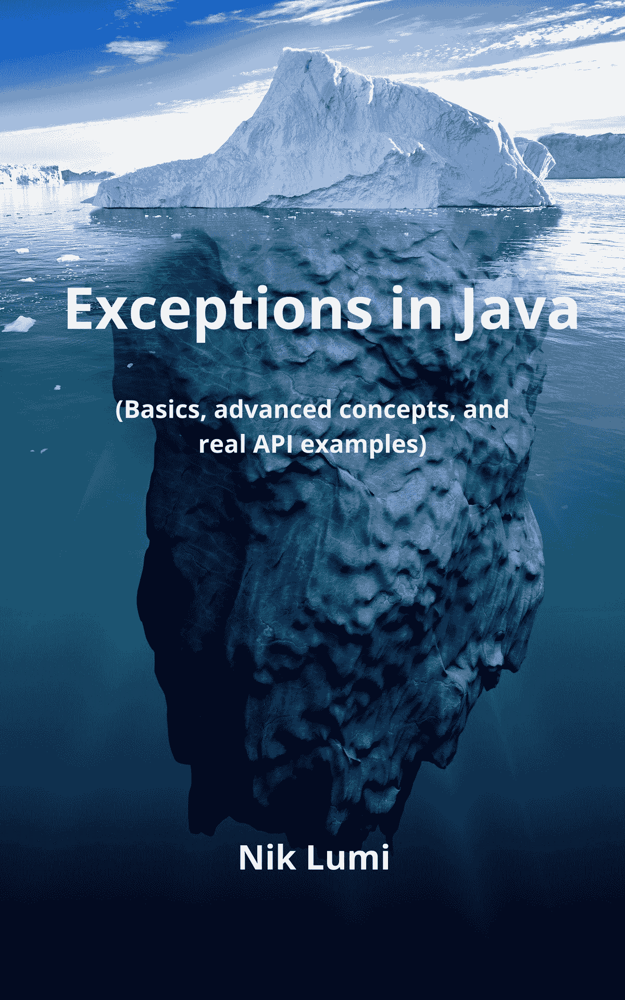

# Java 异常：基础、高级概念与真实 API 示例



- 作为类型参数
  - 在 `throws` 中
  - 在 `throw` 中
  - 在 `catch` 中
- 多线程
  - 手动管理
    - 执行器
      - `Runnable`
      - `Callable`
      - `Future`

2022 年 1 月首次

## 序言

软件异常的概念于 60 年代初被引入编程领域。此后，它被许多语言采用并经历了显著的演变。人们普遍认为，异常有助于在编程中分离关注点，从而提高可管理性。尽管很少有人否认异常的有用性，但关于应如何使用异常仍存在持续的争论。本书涵盖了 Java 异常的基础知识、高级概念和最佳实践，并提供了 Java 中异常处理历史演变的概述。本书假定读者熟悉 Java 编程语言，并能够编写、编译和执行简单的程序。我们希望您能享受本书并从中学习。

## 历史

我们都熟知现实生活中“异常情况”的含义——即我们遇到意外事件时的情形。对大多数人来说，这种情况每天都会发生多次，且频率往往超出预期。你驶出车库，两个街区后发电机发出巨大噪音。你该怎么办？开车回家？直接开到修车厂？你的车能撑到那里吗？你必须迅速回答这些问题。在工作场所——无论是麦当劳还是飞机驾驶舱——人们都会面临这类问题，并且通常会有关于如何处理的指示。在 IT 世界中，这类情况极为常见。被称为“异常处理”的机制旨在解决这些问题，或至少使它们更容易解决。

## 中断

中断的概念于 20 世纪 50 年代中期引入，与现代异常处理并不完全相同，但已十分接近。中断同时涉及硬件和软件。在这两种情况下，都会向处理器发出请求，要求其中断（或延迟、推迟——任选一个你喜欢的词）当前活动并处理这一特定情况。在特定情况处理完毕后，处理器可以恢复其中断的活动。

## Lisp、Ada、COBOL 及其他

Lisp 是第一个以类似于我们今天所知的方式引入软件异常处理的语言。它引入了 `SIGNAL`、`CATCH` 和 `THROW` 等关键字。它们的含义和用法与现在的类似。Ada、COBOL、Object Pascal 等计算机语言迅速采用了这一概念。其实现可能因语言而异，但核心思想是相同的。

## C/C++

C 语言没有异常。1985 年，C++ 作为 C 的面向对象扩展发布。除其他特性外，异常处理是程序不可分割的一部分。C++ 为其增添了面向对象编程的力量。Java 的架构师正是从 C++ 中借鉴了异常处理语义。使用 C++，可以在方法签名中声明异常，但编译器不会强制其使用。正如我们稍后将看到的，Java 的架构师试图更进一步，他们引入了受检异常的概念。这意味着某些异常可能成为方法签名的一部分，从而需要特殊处理。

## 正常与异常

异常处理（及其概念前身）背后的整个理念是，程序可能以两种方式执行：

1. 程序正常执行；所有语言元素按预期工作；或
2. 程序异常执行；内存分配不足、传入 `null` 值而非有效对象引用、或调用者传入的位置不存在文件。

正常执行与异常执行的分离听起来简单直观，通常不会引起争议。然而，一些专家更进一步，支持将异常行为分为两类——“可恢复”和“不可恢复”。“可恢复”条件可以被程序拦截并尝试恢复。而“不可恢复”通常需要终止执行并人工干预。

## 基础

Java 是一种面向对象的语言，这意味着类在其中扮演重要角色，其概念以类的形式呈现。总而言之，异常将非局部控制转移的力量与面向对象语义相结合。在本章中，我们解释 Java 为异常处理提供的基本机制。本章有意不涉及使用异常的对错问题；这将在后续章节中讨论。

## 层级结构

异常层级结构中有几个重要的类。`java.lang.Throwable` 类位于根部。Java 语言中使用的任何异常都应是其子类：

- `Error` 继承自 `Throwable`
- `Exception` 继承自 `Throwable`
- `RuntimeException` 继承自 `Exception`

`Error` 和 `RuntimeException` 的子类是非受检异常。所有其他直接或间接继承自 `Throwable` 的类都是受检异常。我们将在后文看到这一点。

## 原始意图

正如 Sun/Oracle 所述，异常类的结构旨在划分两种可能的失败，即故障和意外事件。

### 故障

“故障”是绝不应发生的事情。示例包括程序环境配置错误、JVM 故障等。`Error` 和 `RuntimeException` 的子类被保留用于此目的。

### 意外事件

“意外事件”可能令人不快，但却是可预期的，甚至被视为方法返回的一部分。示例包括资金不足、用户未找到等。这些事件应被预期，编程逻辑应准备好处理它们。`Throwable` 的其他子类（除前段提到的 `Error` 和 `RuntimeException` 的子类外）被保留用于此目的。

## 抛出异常

在 Java 中抛出异常有两个阶段：

首先，异常应像创建任何其他 Java 对象一样被创建。但仅仅创建 `Throwable` 类（或其子类之一）的对象是不够的。其次，异常应被置于特定状态。具体来说，它应被抛出。某些其他语言使用“raised”一词。在 Java 中，特殊语句 `throw` 用于此目的。

### 创建

如果异常由用户发起，与其他 Java 对象一样，应首先显式创建。它可以是现有异常类之一。用户也可以决定创建自己的类并使用相应类的异常。因此，应使用特定类可用的构造函数之一调用 `new` 运算符：

```java
Exception exception = new Exception(); // new MyException() 自定义异常
```

### 抛出

创建异常是发起异常情况的第一步。第二步，异常应被抛出；即应使用特殊语句：

```java
throw exception;
```

抛出异常可以与之前的创建步骤合并：

```java
throw new Exception();
```

异常被抛出后，它开始沿堆栈轨迹“飞行”至最近的处理块。如果 JVM 在代码中未找到适当的处理器，它将终止抛出异常的相应线程。用户不必每次都从头创建异常，他们可以使用已有的异常。此过程称为重新抛出。关于重新抛出，有两点需要说明：


首先，如果用于它的引用为`null`，那么将不会抛出你的异常，而是抛出`java.lang.NullPointerException`的实例。这是因为JVM检测到尝试抛出`null`异常对象，这是不允许的。JVM可能决定自行创建并抛出异常的情况有多种。

其次，重新抛出的异常可能已经包含了一些与新上下文无关的信息。这些信息可能应该被重置。这将在后续章节中详细讨论。

### JVM的检测

如前所述，异常可能由JVM创建。它可能检测到异常情况并处理它。在这种情况下，JVM将创建一个异常对象（通过调用现有的构造函数）并抛出它。JVM只创建和抛出非受检异常。根据JVM规范，以下异常可能由JVM检测并抛出：

来自`java.lang`包：

`StackOverflowError`、`AssertionError`、`ClassError`、`ClassFormatError`、`IncompatibleChangeError`、`InstantiationError`、`LinkageError`、`NoSuchClassFoundError`、`OutOfMemoryError`、`UnsatisfiedError`、`VirtualMachineError`

来自`java.lang`包：

`ArithmeticException`、`ArrayIndexOutOfBoundsException`、`ArrayStoreException`、`ClassCastException`、`IllegalArgumentException`、`IllegalMonitorStateException`、`InterruptedException`、`NegativeArraySize`、`NullPointerException`

来自`java.lang.invoke`包：

`WrongMethodException`

异常的拦截和处理可能是Java机制的关键方面。理解其工作原理至关重要。

#### catch

`catch`块如下所示：

```java
catch (MyException caught) {
// exception caught
}
```

`catch`块的作用是处理被抛出并被拦截的异常。`catch`块也被称为“异常处理器”。异常参数必须是有效的Java异常。块的执行在`catch`声明后的左花括号之后立即开始。

```java
catch (MyException caught) {
// <- the execution goes here
}
```

`catch`块可以依次排列。

```java
catch (MyException caught) {
}
catch (AnotherException caught) {
}
```

`catch`块也可以使用“多捕获”构造。两个`catch`块通常可能执行类似的工作，因此减少处理逻辑的代码冗余是有意义的。在某些情况下，可以在`catch`块中使用更通用的类型来拦截两个异常。但这种方法并不总是可行的。自Java 7起，两个或更多异常可以合并到一个`catch`块中。

示例1（Java 7之前）：

```java
catch (IOException e) {
}
catch (SQLException e) {
}
```

示例2（Java 7之后）：

```java
catch (IOException | SQLException e) {
}
```

在第二个示例中，异常变量的有效类型是多捕获声明中异常类的最近超类。Java编译器对`catch`块强制执行几条规则：

首先，子异常的`catch`块不能放在父类异常的`catch`块之后。

```java
catch (MyParentException caught) {
}
catch (MyChildException caught) {
}
```

`MyChildException`的`catch`块不可达。它已经被`MyParentException`的`catch`块处理了。

其次，在“多捕获”构造中，两个异常不能是父子关系。

```java
catch (MyParentException | MyChildException caught) {
}
```

如果你尝试编译具有上述逻辑的代码，你将收到一个编译错误，类似于：异常`MyChildException`已被备选`MyParentException`捕获。

#### finally

最后一个块称为`finally`。它如下所示：

```java
finally {
}
```

`finally`块的作用是完成`try`块中的工作。主要是释放和/或清理其中使用的资源。

### try-catch-finally

`try-catch-finally`构造以常规的`try`块开始。

```java
try {
}
```

常规的`try`块后面必须至少跟一个`catch`或`finally`块。可以有多种不同的组合，包括一个`catch`、一个`finally`、一个`catch`和一个`finally`、多个`catch`块和一个`finally`。所有这些组合都是有效的。

执行从`try`块的开头开始，即`try`语句后的左花括号之后的第一行代码。如果在其中抛出异常，块内的其余代码将被跳过，程序执行将转到块的末尾。

```java
try { // <- the execution starts right after this line
throw exception;
} // <- the execution goes here
```

### 资源规范

`try`块还有另一种形式。它是带有资源语句的`try`块。

```java
try (FileReader fileReader = new FileReader("my");
BufferedReader reader = new BufferedReader(fileReader)) {
```

此块的作用与常规`try`块相同，但此外它还为用户提供了一些关于如何初始化和自动清理块中使用的资源的功能。资源规范允许用户声明带有初始化器的局部（在`try`主体中可见）变量。编译器和JVM对这些变量施加了几个限制：

首先，资源变量类型应该是`java.lang.Closeable`的子类。

其次，所有资源变量都应在资源规范中初始化。

第三，资源变量应该是有效最终的。一旦在资源规范中初始化，它们就不能在`try`主体中重新赋值（这适用于初始化为`null`的资源变量）。

#### AutoCloseable close()

如前所述，在资源规范中声明的资源应实现`AutoCloseable`。该接口有一个方法

```java
void close() throws Exception;
```

该方法的作用是执行`try`块中的工作。主要是释放和/或清理其中使用的资源。

1. 资源规范抛出了一个异常。

2. `try`块抛出了一个异常。

3. `try`块成功完成。

4. `try`块尝试将控制权转移到自身之外。

#### 第一种情况：资源规范抛出了异常。

JVM将跳过`try`块的主体，并按照反序开始关闭已成功打开的资源。如果在调用`close()`方法期间抛出异常，该异常被视为被抑制的异常（suppressed），并添加到与原始异常关联的抑制异常列表中。当关闭过程结束，可能会存在一个与原始异常相关的抑制异常列表。列表的开头将包含第一个抛出的抑制异常；末尾将包含最后一个。

接下来，JVM开始寻找可以处理原始异常的`catch`块。如果找到了此类块，执行将跳转到那里。如果没有找到此类块，执行将跳转到`finally`块。`catch`和`finally`块中的情况见下文。

#### 第二种情况：从`try`块抛出了异常。

在这种情况下，行为与上述第一种情况相同。抛出的异常被视为原始异常。在方法`close()`调用期间抛出的所有异常（如果有）都将作为抑制异常添加。

#### 第三种情况：`try`块成功完成。

与第一种情况一样，JVM将按照反序开始关闭已成功打开的资源。这里我们还有两个子情况：

1. 在调用`close()`方法的过程中至少抛出了一个异常。

2. 在调用`close()`方法的过程中没有抛出任何异常。

**第一个子情况：**在关闭过程中抛出了异常，该异常被设为原始异常。所有其他后续异常（如果已抛出）都将作为抑制异常添加到第一个异常中。之后，JVM开始寻找可以处理原始异常的`catch`块。如果找到了此类块，执行将跳转到那里。如果没有找到此类块，执行将跳转到`finally`块。

**第二个子情况：**在关闭过程中没有抛出异常。执行跳转到`finally`块。

#### 第四种情况：`try`块尝试将控制权转移到自身之外。

在这种情况下，控制权的转移被推迟。JVM将按照反序开始关闭已成功打开的资源。同样，有两个子情况：

1. 在调用`close()`方法的过程中至少抛出了一个异常。

2. 在调用`close()`方法的过程中没有抛出任何异常。

#### 第一种子情况

在关闭过程中抛出了异常；该异常被暂置。所有其他后续异常（如果抛出）将作为抑制异常添加到第一个异常中。推迟的控制转移被丢弃。之后，JVM开始寻找可以处理原始异常的`catch`块。如果找到此类块，执行将跳转那里。如果没有找到，执行将跳转到`finally`块。

#### 第二种子情况

关闭过程中没有抛出异常。执行跳转到`finally`块。推迟的控制转移等待`finally`块做出决定。

#### catch

进入`catch`块的唯一方法是抛出异常。可以从资源规格中、`try`块中或在自动资源关闭期间从`AutoCloseable`的任一个`close()`方法中抛出异常。无论我们如何进入`catch`块，其随后的行为都是相同的。

`catch`块可能会决定通过语句抛出异常或转移控制。在这两种情况下，操作都会被推迟，并将控制转移到`finally`块进行最终决决。如果`catch`块自然结束，则没有推迟的操作，控制将转移到`finally`块。

#### finally

`finally`块做出最终决定。如果之前的块有任何推迟的操作，可以通过抛出异常或使用`break`、`continue`和`return`语句显式转移控制来覆盖。如果`finally`块自然结束且存在推迟的操作，则执行该推迟的操作。如果`finally`块自然结束且没有推迟的操作，则执行`finally`块之后的下一行代码。

```java
try {…}throw new MyFirstExcepton();…} 
catch (MyFirstExcepton exception) {…throw new MySecondExcepton();…} 
finally {…throw new MyThirdExcepton();…}
```

在上面的示例中，从`try`块中抛出了一个异常。但控制的转移被推迟了。执行跳转到`catch`块。`catch`块覆盖了推迟的操作。它抛出了自己的异常。异常的抛出也被推迟了。控制转移到`finally`块。`finally`块反过来通过抛出自己的异常覆盖了该操作。因此，最后一个异常是从`try-catch-finally`块中抛出的。

#### 特殊情况


有几个公共方法可能会中断 JVM 的执行。

在`java.lang.Runtime`类中：

```java
public void exit(int status)
public void halt(int status)
```

在`java.lang.System`类中：

```java
public static void exit(int status)
```

此方法简单地调用`java.lang.Runtime`对应的`exit()`方法。它是实现相同操作的另一个可用替代方案。下面我们将讨论前两个。由于上述`java.lang.Runtime`类的方法不是静态的，需要一个`Runtime`实例来调用它们。通常是通过调用`getRuntime()`方法实现的。

```java
public static Runtime getRuntime()
```

示例 1：

`Runtime.getRuntime().exit(0);`

示例 2：

`Runtime.getRuntime().halt(0);`

这两个方法的区别在于`exit()`通过首先调用注册的关闭钩子（shutdown hooks）和终化器（finalizers）提供了一个更优雅的 JVM 退出。`exit()`和`halt()`都可能抛出`java.lang.SecurityException`，如果调用线程未允许终止 JVM，则抛出该异常。此外，它们可能抛出其他运行时异常和错误，例如`java.lang.OutOfMemoryError`。内部，这两个方法都使用包私类`java.lang.Shutdown`，该类也有对应的`exit()`和`halt()`方法。调用序列最终归于：

```java
static native void halt0(int status);
```

此原生方法终止 JVM。之后不会执行任何内容，包括在`try-catch-finally`或`try-with-resources`结构定义的定义的终化，不会调用`finally`块，也不会对`AutoCloseable`资源调用`close()`方法。

示例 3：

```java
try {
    System.out.println("It happens #1");
    Runtime.getRuntime().addShutdownHook(new Thread(() -> {
        System.out.println("It happens #2");
    }));
    Runtime.getRuntime().exit(0);
    throw new Exception();
} catch (Exception e) {
    System.out.println("It never happens #1");
} finally {
    System.out.println("It never happens #2");
}
System.out.println("It never happens #3");
```

结果是：

It happens #1

It happens #2

正如所见，在`exit()`方法之后没有执行任何内容，包括`finally`块。对于任何其他代码也是如此，注册的关闭钩子和终化器除外。

如果在上述代码中，我们将：

`Runtime.getRuntime().exit(0);`

替换为：

`Runtime.getRuntime().halt(0);`

结果将是：

It happens #1

正如所见，在`halt()`方法之后没有执行任何内容，包括`finally`块。对于任何其他代码也是如此，包括注册的关闭钩子和终化器。

需要说明的一个重要点是，如果在调用其中一个方法之后在向 JVM 退出的过程中抛出了异常（例如在上述场景中线程未允许终止 JVM），则程序的行为将与处理其他抛出的异常一样。

## 总结

总结来说，使用上述内容，我们可以得出`try-catch-finally`块中控制转移的以下规则：

1. 在普通的`try-catch-finally`块中，如果在`try`中抛出异常，跳转到 (4)。如果有其他形式的控制转移或`try`成功结束，跳转到 (6)。

2. 在`try-with-resource`中，如果在`try`或资源规格中有任何形式的控制转移，或成功结束，跳转到 (3)。

3. JVM 以反序关闭已初始化（非空值）的资源，调用相应的`AutoCloseable` `close()`方法。如果在关闭过程中抛出了异常，该异常被暂置。所有后续异常（如果抛出）都作为抑制异常添加到第一个异常中。推迟的控制转移被丢弃。之后，JVM 开始寻找可以处理原始异常的`catch`块。如果找到此类块，执行将跳转那里。如果没有找到，执行跳转到`finally`块。

4. JVM 开始寻找对应于抛出异常的`catch`块。如果找到，跳转到 (5)，否则跳转到 (6)。

5. 执行`catch`块，在结束后跳转到 (6)。如果有任何形式的控制转移，则它被推迟。

6. JVM 检查是否存在`finally`块。如果有，跳转到 (7)。否则，跳转到 (8)。

7. 执行`finally`块。如果有任何形式的控制转移，则它被推迟。如果执行到达最后一行，跳转到 (8)。

8. 如果有推迟的控制转移，则立即执行。如果没有推迟的操作，则执行该推迟的操作。

9. 如果`finally`块自然结束且没有推迟的操作，则执行`finally`块之后的下一行代码。

- [1] B. Ruzek, “Effective Java 异常,” 2007 年 1 月 10 日. [Online]. Available: https://www.oracle.com/technical-resources/articles/enterprise-architecture/effective-exceptions-part1.html.

- [2] Oracle, “Java 虚拟机规范，Java SE 16 版,” 2021 年 2 月 12 日. [Online]. Available: https://docs.oracle.com/javase/specs/jvms/se16/jvms16.pdf.

- [3] Oracle (Java 平台标准版工具参考), “创建和构建应用程序的主要工具：`javac`命令,” 2021 年 2 月 12 日. [Online]. Available: https://docs.oracle.com/en/java/javase/16/docs/specs/man/javac.html.

- [4] A. Shipilёv, “微异常的卓越性能,” 2014 年 1 月 11 日. [Online]. Available: https://shipilev.net/blog/2014/exceptional-performance/.

- [5] ResearchGate, “Java 异常处理及其动态优化研究,” 2001 年 12 月. [Online]. Available: https://www.researchgate.net/publication/2573860_A_Study_of_Exception_Handling_and_Its_Dynamic_Optimization_in_Java.

- [6] ResearchGate, “即时编译中的高效 Java 异常处理,” 2000 年 11 月. [Online]. Available: https://www.researchgate.net/publication/2433780_Efficient_Java_Exception_Handling_in_Just-in-Time_Compilation.

- [7] Oracle, “Java® 语言规范 Java SE 16 版,” 2021 年 2 月 12 日. [Online]. Available: https://docs.oracle.com/javase/specs/jls/se16/jls16.pdf.

- [8] Open JDK 网站, 邮件列表, “推断 lambda 体的异常类型,” 2010 年 2 月 5 日. [Online]. Available: http://mail.openjdk.java.net/pipermail/lambda-dev/2013-February/007981.html.

- [9] Oracle, “Java® 平台、标准版与 Java 开发包，版本 16 API 规范,” 2021 年 2 月 2 日. [Online]. Available: https://docs.oracle.com/en/java/javase/16/docs/api/index.html.

- [10] Oracle, “使用断言编程,” [Online]. Available: https://docs.oracle.com/javase/7/docs/technotes/guides/language/assert.html.

- [11] Oracle, “断言机制,” [Online]. Available: https://web.archive.org/web/20140512115520/http://www.oracle.com/technetwork/articles/javase/javapch06.pdf.

- [12] Suman Nakshatri, Maithri Hegde, Sahithi Thandra, David R. Cheriton, “Java 项目中异常处理模式分析：实证研究,” 加拿大安大略省滑铁卢大学计算机科学学院, 2016 年 5 月 14 日. [Online]. Available: https://ieeexplore.ieee.org/abstract/document/7832935. [访问 2021 年 10 月 23 日].

- [13] Artima, “失败与异常：与 James Gosling 的对话，第二部分,” 2003 年 9 月 23 日. [Online]. Available: https://www.artima.com/articles/failure-and-exceptions. [访问 2012 年 10 月 23 日].

- [14] B. Eckel, “Java 需要检出异常吗?,” 2002 年 6 月 11 日.[Online]. Available: https://web.archive.org/web/20020611051228/http://www.mindview.net/Etc/Discussions/CheckedExceptions. [访问 2020 年 12 月 3 日].

- [15] Oracle (Java™ 教程), “异常、未检出异常 — 争议,” [Online]. Available: https://docs.oracle.com/javase/tutorial/essential/exceptions/runtime.html.

- [16] Artima, “检出异常的麻烦：与 Anders Hejlsberg 的对话，第二部分（Bill Venners 与 Bruce Eckel）,” 2003 年 8 月 18 日. [Online]. Available: https://www.artima.com/intv/handcuffs.html. [访问 2020 年 11 月 29 日].

- [17] IBM: developersWork, “Java 理论与实践；异常争论：要检查还是不检查？Brian Goetz,” [Online]. Available: https://web.archive.org/web/20150407111821/http://www.ibm.com/developerworks/library/j-jtp05254/j-jtp05254-pdf.pdf.

- [18] Gavin King 博客, “对象构造与验证,” 2016 年 4 月 5 日. [Online]. Available: https://ceylon-lang.org/blog/2016/04/05/object-validation/.

- [19] Stephen Colebourne 博客, “检出异常 (#bijava),” 2010 年 9 月 23 日. [Online]. Available: https://blog.joda.org/2010/09/checked-exceptions_9688.html.

- [20] Artima, “Bill Venners 接口设计：对于客户端代码可能处理的情况使用检出异常,” [Online]. Available: https://www.artima.com/interfacedesign/CheckedExceptions.html.

- [21] Stack Overflow, “关于检出异常的讨论,” 2021 年 10 月 23 日. [Online]. Available: https://stackoverflow.com/search?q=checked+exceptions.

- [22] StackOverflow, “反对检出异常,” 2009 年 3 月 5 日.[Online]. Available: https://stackoverflow.com/questions/613954/the-case-against-checked-exceptions.

- [23] Reddit, “关于检出异常的讨论,” 2021 年 10 月 23 日. [Online]. Available: https://www.reddit.com/search/?q=checked%20exception.

- [24] Hacker News, “关于检出异常的讨论,” [Online]. Available: https://hn.algolia.com/?q=checked+exceptions.

- [25] A. Zhitnitsky, “生产环境中 Java 错误解决完整指南,” OverOps, 2016 年 6 月 2 日. [Online]. Available: https://land.overops.com/java-application-errors/?utm_source=blog&utm_medium=post&utm_campaign=postchapterCTA.
