# Java 科学计算探索：逻辑与应用构建实用指南

献给

我们亲爱的家人：Jayanta Kumar Adhikari、Rina Adhikari、Nabanita Indra 和 Ishan Adhikari

– Subhajit Adhikari 副教授

已故的 Radhapada Karforma 和已故的 Smt Ranu Karforma

– Sunil Karforma

## 关于作者


`Subhajit Adhikari` 副教授目前任加尔各答 RCC 信息技术学院（RCC Institute of Information Technology）。他曾在加尔各答 Salt Lake 的工程与管理学院的 BSH 部门工作。他曾在加尔各答 DAITM 的 BCA 部门工作。他拥有 8 年以上的教学经验。此外，他是西孟拉拉邦 Burdwan 大学计算机科学系的注册博士生。此外，他在加尔各答的 St. Xavier 学院获得计算机科学硕士学位，并在西孟拉邦的 MAKAUT（校内）完成软件工程硕士学位。他是 2016 年软件工程硕士专业的金牌奖获得者（一等优异）。他分别于 2018 年和 2019 年通过了 UGC-NET 和 WBSET 考试，并在网络安全和密码学领域发表了多篇研究论文。他于 2023 年获得了根据 1860 年《协会法》自 2007 年 7 月注册的 Ram Avatar Shiksha Samiti（DRASS）颁发的计算机科学领域“青年科学家奖”。他教授本科生“Java 编程”已有 8 年。他还教授研究生“人工智能”。


`Sunil Karforma` 教授在 Jadavpur 大学完成了 BE（计算机科学与工程）和 ME（计算机科学与工程）学位。他获得了计算机科学领域的博士学位，目前担任教职人员与 Burdwan 大学之间的科学院长职务。网络安全和电子商务是他的研究兴趣领域。他在著名的国内外期刊和会议论文集上发表了约 150 篇研究论文。此外，他还是 4 项国际专利的所有者，并成功指导了 12 位博士毕业生。

## 关于审稿人

`Jason Alls` 是一位编写过三本编程书籍的优秀作者。自 1999 年起一直从事编程，曾为英国、澳洲和美国公司开发过许多不同的系统。他还从事过呼叫中心管理软件、债务管理系统、报告系统、广告软件、仓库软件和教育评估软件的工作。

## 致谢

我由衷地感谢我的家人，他们坚定不移的支持和鼓励是我创作这本书期间的力量源。我特别向我的妻子 `Nabanita Indra` 表示最诚挚的感谢，感谢她不断的灵感和理解。

我还深表感谢 Burdwan 大学计算机科学系、加尔各答 RCC 信息技术学院计算机应用系，以及加尔各答 IEM Salt Lake 的 CSE (AIML/CSBS) 部门的支持。持续的鼓励对这部作品的诞生大有帮助。

特别感谢 BPB Publications 在出版过程中提供的指导和专业知识。修订这本书的历程是一段漫长而收获的旅程，这在审稿人、技术专家和编辑的无私参与和合作下得以实现。

我感谢我尊敬的合著者，并对感谢 `Sunil Karforma` 教授做出的重要贡献，他的指导是无价的。我在学术界的同事也发挥了至关重要的作用，提供的见解和反馈极大地丰富了这部作品。

最后，我想向所有对这本书感兴趣的读者表示最诚挚的感谢。你们的支持是这项工作的动力，我对你们的鼓励表示由衷的感谢。

## 前言

构建现实应用是一项复杂的任务，需要对现代技术和编程语言有深入的理解。应用开发中最强大、最广泛使用的工具是 C++ 和 Java。

本书旨在为任何对掌握使用 Java 构建参数艺术的人提供一份全面的指南。它将带你开启从 Java 编程基础到更高级主题的之旅，包括面向对象编程以及 Java 技术在创建健壮、可扩展且高效的解决方案方面的实际应用。

在书中，你将探索 Java 的关键特性，并学习如何利用它们创建不仅高效可靠，而且易于维护和扩展应用程序。本书强调了逻辑生成和应用开发的最佳实践，并提供了丰富的实践示例、图表和插图，以帮助理解复杂的概念。

无论你是一个渴望学习 Java 编程基础的新手，还是一个希望扩展专业知识并提高应用开发技能的经验丰富的开发者，书中都能提供价值。

当你完成这本书时，你已经获得了成为精通 Java 应用开发的开发者所需的知识和技能。我希望这本书在你开始或继续编程之旅时既有启发性又实用。

### 第 1 章：Java 编程简介

`ch1.xhtml` - 本章将介绍 Java 的演变和特征，以及 Java 编程与 C 和 C++ 的对比分析。概述了 Java 程序语法的细节和规范。本章还通过现实示例介绍了面向对象编程的基本特征。通过图表讨论了 Java 虚拟机（`JVM`）、Java 开发包（`JDK`）和 Java 运行时（`JRE`）之间的关系。

### 第 2 章：Java 基础构建块

`ch2.xhtml` - 本章解释了 Java 数据类型、Java 运算符、表达式、条件语句和循环概念。让我们先讨论强类型语言的概念。Java 是静态类型和强类型语言，因为在 Java 中，每种数据类型（如整数、字符、十六进制、压缩十进制等）都是编程语言预先定义的。

### 第 3 章：类、对象与方法

本章结合日常生活中的示例和插图来解释类、对象和方法的概念。模型、蓝图或设计就是 `class`。在本章中，展示了类的特征和类类型。引入了 `object` 的概念，即 `class` 的实例。本章还阐述了对象生成的原因。为了帮助理解，列出了类与对象之间的区别。接下来，介绍了方法的概念。在面向对象编程（OOP）中，它们被称为类内部的函数。在这种情况下，展示了方法的调用过程。与类名相同的特殊类型方法被称为构造函数（constructors）。通过代码示例来说明构造函数的概念。本章还涵盖了这个术语以及方法重载这一关键概念。

### 第 4 章：Java 中的数组、字符串和向量

在充分掌握了类、对象、方法和构造函数的知识后，我们将在本章介绍一些有趣且重要的主题，如数组、字符串、向量和包装类（wrapper class）。在不同的数学应用中，数组是不可或缺的。字符串处理在不同的现实应用中也经常出现。`String` 类方法如 `concat()`、`length()` 和 `substring()` 对于处理不同的字符串非常有用。在本章中，我们通过代码示例对其中一些方法进行了详细解释。在此背景下，还通过示例探讨了 `StringBuffer` 类。还通过图表研究了 `vector` 类以便更好地理解。本章末尾还包含了关于包装类的自动装箱（auto-boxing）和自动拆箱（auto-unboxing）的概念。读完本章后，学生可以从基础到高级水平学习用于 Java 编程应用开发的一些最重要的编程构建知识，如数组、`String`、`vector` 和包装类。

### 第 5 章：Java 中的继承类型

在上一章中，详细讨论了数组、字符串和向量的研究。现在，我们将重点关注继承的概念、继承必要性以及不同类型的继承。然后，我们将涵盖与继承相关的最重要的概念：其方法重写（method overriding）以及如何通过程序实现。此外，在不同语文中添加了 `super` 关键字的用法。本章将研究 `final` 变量、类和方法的功能，用以限制子类继承基类的属性和行为。将介绍 `interfaces` 的概念以在 Java 中实现多重继承。最后，给出了不同类型的访问修饰符，并配有代码和图表以便学习更好地理解。

### 第 6 章：Java 中的线程概念

在本章中，多线程的概念被被使得每个人都能学习多线程以开发现实应用。线程的生命周期也以图表的形式呈现并附有简要描述。包含了在 Java 中创建线程的不同方法并配有适当的示例。`thread` 类和 `runnable` 接口的详细讨论是本章最重要的部分之一，还包括线程优先级。与线程编程相关的 `join()` 和 `isAlive()` 等重要方法在本章中进行了详细阐述。最后，本章还增加了线程同步和线程间通信的概念。

### 第 7 章：Java 中的异常处理

每天每个人都会面临一些意外事件，在编程中，这被称为异常（exception）。当异常发生时，最重要的是描述关于异常的必要信息。接下来，我们必须克服异常事件，在编程中这被称为异常处理（exception handling）。在本章中，如果程序代码产生一个异常，将详细描述处理它的方法。在这方面，首先定义了 `error` 术语，然后展示了它如何导致异常的产生。讨论了不同类型的错误。然后，定义了异常并使用程序详细说明了在 Java 中如何进行异常处理。

### 第 8 章：Java 中的包创建

包（Packages）是 Java 中的一个基本概念。Java 使用包来消除名称冲突并管理对类、接口和枚举的访问。Java 平台拥有广泛的类库（包的集合），可以在你自己的应用程序中使用。该库被称为应用程序编程接口（API）。它的包涵盖了与通用编程相关的最典型任务。例如，一个 `String` 对象由字符字符串的状态和行为组成；一个 `File` 对象允许程序员轻松地在文件系统中创建、删除、检查、比较或修改文件；一个 `Socket` 对象允许网络套接字的创建和使用；各种 GUI 对象控制按钮、复选框和其他图形用户界面的方面。这里有成百上千的课程可供选择。这使你程序员能够专注于你特定应用程序的设计，而不是为了使其运行所需的基础设施。

### 第 9 章：Java 中的流与文件处理

在 Java 中，流（stream）是一系列有序的数据。Java 提供了流作为处理数据 I/O 的一种广泛方法。为了在 Java 中启用输入和输出操作，Java I/O 系统将流链接到物理层。在本章中，我们将通过图示表示介绍流的详细概念及其类型。然后将讨论不同流类的不同类和方法。此外，本章还介绍了 Java 中的文件处理。在此背景下详细阐述了流与文件之间的关系。

### 第 10 章：Java 中的 Applet 程序

Applet 是 Java 中的一种小程序。它不是一个独立程序。要实现 applet 程序，我们需要浏览器的支持。`applet` 类内部有几个方法来实现 applet 周期。在本章中，我们将详细阐述使用 Java 进行 applet 编程的构建块。为了给出每个概念的清晰图像，我们采用了简单的程序。还考虑到 `html` 编程以运行 applet 程序。本章编写了一些编程示例，以演示 applet 编程构建现实应用的实用性。

### 第 11 章：使用 Java 的杂类程序

在本章中，我们首先提供了两个重要数据结构 `Stack` 和 `Queue` 的源代码。然后，用 Java 程序演示井字棋游戏。随后，使用 Java 编程实现了两个重要的对称密钥和非对称密钥算法 `AES` 和 `RSA` 用于加密和解密。最后，以两个程序之间的消息传递、聊天应用程序以及客户端与服务器之间的文件传输的形式增加了套接字编程。

## 代码包与彩色图片

请按照链接下载书籍的 `Code Bundle` 和 `Coloured Images`：

[`rebrand.ly/ug3je4`](https://rebrand.ly/ug3je4)

该书的代码包也托管在 GitHub 上，位于 [`github.com/bpbpublications/Exploring-Scientific-Computing-with-Java`](https://github.com/bpbpublications/Exploring-Scientific-Computing-with-Java)。如果代码有更新，将在现有的 GitHub 仓库中进行更新。

我们丰富的书籍和视频目录代码包可以在 [**https://github.com/bpbpublications**](https://github.com/bpbpublications) 获取。欢迎去看看！

## Errata

我们对 BPB Publications 的工作感到非常自豪，并遵循最佳实践以确保内容的准确性，从而为订阅者提供沉浸式的阅读体验。我们的读者是我们的镜子，我们利用他们的反馈来反思并改进出版过程中可能出现的人为错误（如果有的话）。为了让我们保持质量，并帮助那些可能因不可预见的错误而遇到困难的读者，请通过以下邮箱与我们联系：

`errata@bpbonline.com`（邮件：`errata@bpbonline.com`）

BPB Publications 全体衷心感谢您的支持、建议和反馈。

## 加入我们的书籍 Discord 空间

加入书籍的 Discord 工作空间，获取最新更新、优惠、全球科技动态、新发布以及作者互动环节：

[`discord.bpbonline.com`](https://discord.bpbonline.com)


# 第 1 章：Java 编程简介

## 引言

本章将介绍 Java 的演变与特征，以及 Java 编程与 C、C++ 的对比分析。概述了 Java 程序语法的详细信息及所需的规范。本章还通过实际案例介绍了面向对象编程至关重要的特性。此外，通过字节码图讨论了 Java 虚拟机（`JVM`）、Java 开发包（`JDK`）和 Java 运行环境（`JRE`）之间的关系。

## 结构

本章涵盖了以下主题：

* Java Java

* Java 历史

* Java 特性

* `JVM`、`JRE` 和 `JDK` 之间的关系

* 字节码

## 目标

本章旨在涵盖 Java 编程的历史，通过编程语言家族树追溯其起源。它还探索了从过程化向面向对象编程的转变，并强调了转变的原因。本章解释了 C、C++ 和 Java 编程结构之间的区别，并结合示例强调了 Java 在面向对象背景下的特性。此外，它探索了 Java 虚拟机的架构，重点关注字节码操作。目的是让读者对 Java 的演变、原理和运行环境有全面的理解。

## 介绍 Java

每个人经常使用语言作为交流模式，向他人传达思想和论点。人工创建的编程语言指导机器（尤其是计算机）的行为。语法（程序代码的语法）和语义（程序代码的含义）原则被用于设计编程语言，就像人类语言分别用于指定其结构和含义一样。编程语言用于准确定义算法，并便于有关组织和处理信息的通信。编程语言的目标是让人们能够向计算机提供指令，允许机器以预定和期望的方式运行。编程语言的家族树如图 1.1 所示：

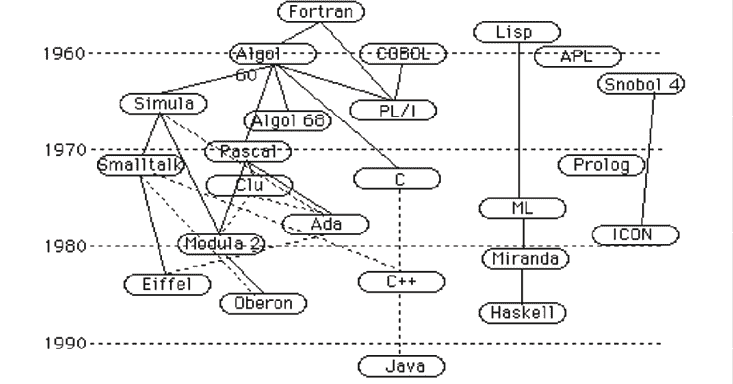

图 1.1：重要编程语言的家族树

现在考虑 2022 年最流行的语言。如图 1.2 所示，根据职位要求。根据 Web 应用开发的情况，Java 是第二最常用的编程语言。


图 1.2：2022 年热门编程语言

Java 是一种通用语言，通常被称为强类型语言。它通常用于面向对象编程。Java 程序代码通常被编译为 `JVM` 规范中定义的字节码指令集和二进制表示。用 Java 编写程序代码可以分为 Applications、Apps、Applets 或 Servlets。

在计算机上本地独立运行的 Java 程序被称为应用程序（Applications）。Applications 和 apps 类似，尽管 app 一词通常用于描述运行在移动设备（如手机手机）上的软件。Applets 是通过互联网下载并由 `JVM` 运行的 Java 程序，该 `JVM` 通常包含在浏览器中。

Servlet 程序是为 Web 服务器创建并为网站提供功能的 Java 程序。即使在现代 Web 开发中，这种 Java 程序也经常被使用。在下一节中，我们将简要讨论 Java 的历史。

## Java 历史

Sun Microsystems 在 20 世纪 90 年代初期创建了 Java，并一直发展至今。一个由 James Gosling 领导的团队为消费级电子设备开发一种编程语言，该语言最初被称为 Oak，后来被更名为 Java。图 1.3 展示了 Java 语言早期历史中的一些重要年份：

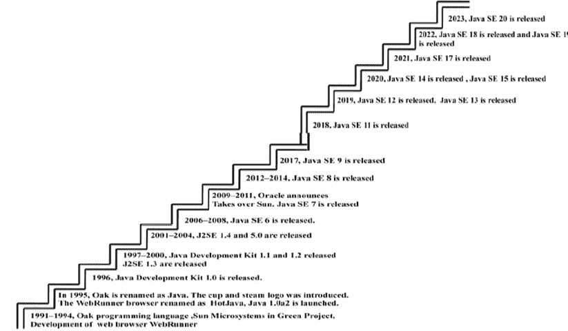

图 1.3：Java 历史

## 从过程化编程向 OOP 的转变

采用面向对象编程 (OOP) 而不是过程化编程有几个原因，如下：

* 在过程化编程中，系统数据和更改数据的操作通常是分开的。面向对象编程的主要优点是，数据以及更改数据或代码的操作都包含在对象内部。与属性和行为经常分离的过程化或结构化设计不同，面向对象设计将特性和行为整合到单个对象中。

* 将面向对象模型与过程化编程相比，我们可以说，在合理设计方面，不存在所谓的全局数据。在面向对象系统中，这种特性保证了高水平的数据完整性。面向对象编程中使用属性和方法来描述数据和行为。数据隐藏是指限制对特定属性或方法的访问的做法。

让我们检查过程化编程和面向对象编程语言之间的差异，如表 1.1 所示：

| 过程化 (Procedural) | 面向对象 (OOP) |
| :--- | :--- |
| 编程基于任务或过程 | 使用对象而非任务 |
| 任务被称为问题的一个小部分 | 对象代表人、表或时钟。它具有函数和特性 |
| 它遵循自顶而下的方法 | 它遵循自底向上的方法 |
| 不支持访问修饰器 | 支持访问修饰器 |
| 添加新的数据和函数容易 | 添加新的数据和函数很简单 |
| 由于缺乏适当的数据隐藏方法，安全性较低 | 它具有数据隐藏概念，因此安全性更高 |
| 函数的重要性大于数据 | 数据的重要性大于函数 |
| 不支持继承概念 | 支持三种模式的继承：公共、私有和受保护 |
| 示例：C、Fortran、VB 和 Pascal | 示例：Simula、Smalltalk、C++ 和 Java |

表 1.1：过程化方法与 OOP 方法的对比

## C、C++ 和 Java 编程的比较

C、C++ 和 Java 语言之间存在若干差异，其中一些差异如表 1.2 所示：

| C | C++ | Java |
| :--- | :--- | :--- |


| C 只能编译，不能解释 | C++ 只能编译，不能解释 | Java 语言可以被编译也可以解释 |

| C 支持按值传递和引用传递 | C++ 支持按值传递和引用传递 | Java 仅支持按值传递技术 |

| C 不支持运算符重载和方法重载 | C++ 支持运算符重载和方法重载 | Java 只支持方法重载 |

| :--- | :--- | :--- |

| C 支持 `goto` 语句 | C++ 支持 `goto` 语句 | Java 不支持 `goto` 语句 |

| C 中没有继承的概念 | C++ 支持单继承和多重继承 | Java 使用 `extend` 关键字支持单继承、多级继承和层次继承 |

| C 支持结构体（Structure）和联合体（Union） | C++ 支持结构体（Structure）和联合体（Union） | Java 不支持结构体联合体 |

| 在 C 中，运行时错误由程序员处理 | 在 C++ 中，运行时错误由程序员处理 | 在 Java 中，运行时错误由系统处理 |

| C 使用 `#include` 将头文件附加到程序 | C++ 使用 `#include` 将头文件附加到程序 | Java 使用 `import` 关键字将库类附加到程序 |

| C 中没有命名空间的概念 | C++ 使用命名空间的概念。C++ 中没有包（package）的概念 | Java 使用包的概念。没有命名空间的概念。

Table 1.2: C、C++ 和 Java 语言的比较

## Java 的特性

设计 Java 的主要目标是使程序本质上具有移植性、简单安全。在 Java 编程语言的不同重要特性中，列举如下：

### 易用

Java 语法非常简单，易于理解和学习。在图 1.4 中，我们讨论了与使用 `test` 类打印 Hello 消息相关的简单 Java 程序的术语。在 Java 程序中，`public` 和 `static` 关键字可以写在 `main()` 方法之前的 `static public`，这意味着顺序并不强制一致。例如：`static public void main(String args[])` 是一个有效的声明。

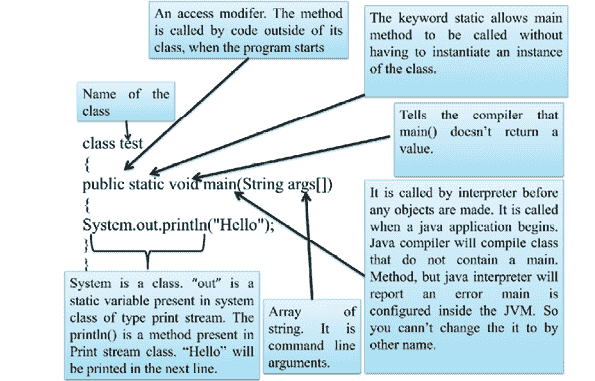

图 1.4: 简单 Java 程序的语法

我们可以按照代码所示，以任何可接受的形式声明字符串数组：

```java
class test
{
    public static void main(String[] args)
    {
        System.out.println(“Hello”);
    }
}
```

### 编译与解释

Java 程序的编译过程是将程序员编写的可读文本代码（作为程序文件，即源代码）转换为字节码表示，这些字节码是 Java 虚拟机（`JVM`）架构无关（即平台无关）的指令。

一旦你的程序成功转换为 Java 字节码，你就可以任何 `JVM` 或任何 Web 浏览器中解释并运行 Java 程序。Java 是两阶段系统，如图 1.5 所示。

阶段 1：Java 编译器将源代码翻译成字节码指令。

阶段 2：Java 解释器生成机器可以直接执行的机器码。

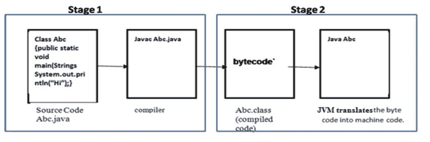

图 1.5: Java 程序的编译与解释

### 面向对象

对象一术语指的是物理实体或运行时实体，如笔、椅子、桌、电脑、手表等。使用类和对象创建程序的方法或范式被称为面向对象编程。通过引入一些概念，程序的创建和维护变得更加简单。Java 是一种面向对象的语言，Java 中几乎一切都是对象。因此，我们能够将各种对象与数据和动作结合起来创建我们的程序。

### 类和对象

类是创建对象的模型、蓝图或原型。本节定义了一个模拟现实对象状态和行为的类。它刻意关注基础知识，展示了即使是简单的类也能清晰地建模状态和行为。类和对象的语法如下：

```java
class A
{
    void disp()
    {
        System.out.println("Object of class A created");
    }
}

class test
{
    public static void main(String args[])
    {
        A ObjA=new A();
        ObjA.disp();
    }
}
```

在前面的代码中，`A` 是一个类，`ObjA` 是 `A` 类的一个对象。前面代码的输出如图 1.6 所示：


图 1.6: 类和对象的创建

### 数据抽象

隐藏某些细节仅向用户显示必要信息的技巧被称为数据抽象。换，用户不需要学习对象如何工作，而是被提供关于它实际执行功能的知识。抽象属性可以通过抽象类或接口来实现。实现数据抽象的编码示例见图 1.7：

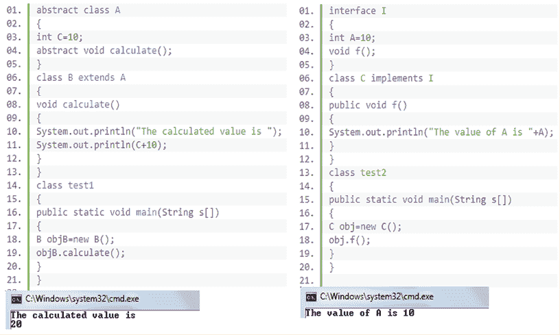

图 1.7: 借助抽象类和接口的数据抽象

在前面的代码中，类 `A` 充当抽象类，包含一个没有方法体的抽象方法，该方法在子类 `B` 中定义。抽象类规定了子类（如子类 `B`）必须遵循的协议和指南。

在前面的代码中，类 `C` 实现了接口 `I`，包含一个方法 `f()`，该方法必须在实现类 `C` 中实现。

### 多态

以多种形式创建的能力被称为多态。假设一个人根据情况表现不同。人类是相同的，但在不同的语境下表现不同。多态有两种类型：一种是编译时多态，另一种是运行时多态。通过方法重载的概念来实现编译时多态，而通过重写的方法来实现运行时多态。编码示例见图 1.8：

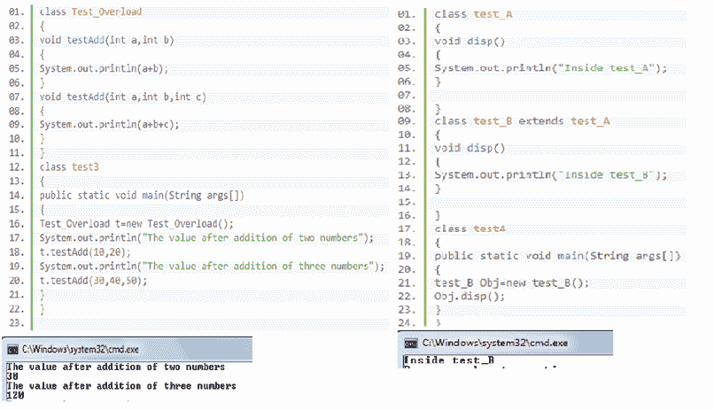

图 1.8: 使用方法重载和重写实现多态

在前面的示例中，`testAdd()` 方法被重载以分别相两个数字和三个数字。在另一个示例中，`disp()` 方法在两个不同的类中被重写。

### 继承

对象可以通过继承获取或继承另一个对象的属性，这也允许进行层次分类。这背后的原理是，我们可以在现有类之上开发新类；换句话说，当你继承一个现有类时，你可以复用它的字段和方法。父子关系通过继承来表示。以下代码演示了 Java 编程中如何实现继承概念：

```java
class Base
{
    int i=10;
}

class Derived extends Base
{
    System.out.println(“the value of i is”+i);
}

class test5
{
    public static void main(String args[])
    {
        Derived objD=new Derive();
        objD.disp();
    }
}
```

以下是前面代码的输出：


图 1.9: 使用基类和派生类的单继承示例

### 平台独立性

Java 的平台无关性是最显著的特征之一。为一个操作系统创建的应用可以在任何其他操作系统上运行。当 Java 应用程序被编译时，会创建一个包含字节码的 `File` 类。`JVM` 从代码中读取这些字节。尽管这些字节码是在 Windows 平台上生成的，但它们可以在 Linux 环境中使用。

考虑到 Java 的关键点，它是一种与架构无关的语言（也称为平台无关语言），但 `JVM` 是依赖于架构的。因此，所有的 `JVMs` 都是为不同的操作系统设计的，而字节码（与架构无关）是相同的，并且能够在不同的操作系统上运行。这就是 Java 具有平台无关性的原因。该概念如图 1.10 所示：

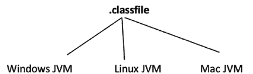

图 1.10：在不同平台上解释“.class”文件

## 健壮性与安全性

Java 是一种健壮的语言。Java 程序的健壮性取决于三个因素。首先，Java 对所有数据类型都有严格的编译和运行时检查。其次， Java 具有良好的异常处理机制。第三，Java 的内存管理非常强大。Java 拥有自动垃圾回收系统来回收未使用的内存。安全性特性表明 Java 提供了针对病毒和恶意程序的广泛保护，因为 `JVM` 在程序执行时具有很强的安全检查。它确保了不会发生损坏，且安全性不会被破坏。

## 多线程

Java 中的多线程编程功能允许你编写同时执行几个不同任务的程序。多线程的思想在代码代码所示：

```java
import java.lang.Thread;

class Thrd1 extends Thread
{
    public void run() {
        for(int i = 1; i <=5; i++) {
            System.out.println("Thread1" + " "+i);
        }
    }
}

public class test6
{
    public static void main(String args[])
    {
        Thrd1 th1 = new Thrd1();
        th1.start();
    }
}
```

前面的代码段仅演示了如何为打印 `Thread1` 下的变量值创建线程。输出如图 1.11 所示：

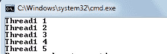

图 1.11：从主线程创建线程 1 正在运行

## 分布式

分布式编程允许程序员使用分布在互联网上并相互连接的多台计算机来提高程序的执行速度。Java 是为分布式互联网环境设计的，因为它管理 TCP/IP 协议。

## Java 作为网络语言

Java 有时被称为互联网语言，因为第一个基于 Java 的应用程序软件是 Web 浏览器 `HotJava`，它允许用户执行 Internet Applet。用户可以使用 `HotJava` 和 Java 编程语言在本地创建 Applet。

## Java 作为通信工具

用于网络连接的不同类定义在 `java.net` 中。`java` 程序可以使用 `TCP` 或 `UDP` 等协议在互联网上进行通信。`Socket`、`URL`、`URLConnection` 和 `ServerSocket` 等类使用 `TCP` 在网络上进行通信。`MulticastSocket`、`DatagramPacket` 和 `DatagramSocket` 类则用于 `UDP`。Java Communications 3.0 API 是一个 Java 扩展，有助于为智能卡、嵌入式系统、销售点设备、金融服务设备、传真机、调制解调器、显示终端和机器人设备等技术开发平台无关的通信应用。

## 人机界面

允许操作员与控制器通信的硬件或软件被称为人机界面（HMI）。`HMI` 可以是任何带有按钮和指示灯的物理控制面板，也可以是运行带有彩色图形显示的特殊 `HMI` 软件的工业电脑。

作为 `HMI` 的应用，自动化面板中的 Web 面在工业 4.0 的背景下变得越来越重要。在 Cannon 的 L1/C1 自动化面板中，支持 Java 和 HTML5 的 浏览器被用于优化通信。

## JVM、JRE 和 JDK 之间的关系

为了理解 `JVM`、`JRE` 和 `JDK` 之间的关系，我们必须理解 `JVM` 及其架构。Java 虚拟机是一个抽象的计算机器。像真实的计算机器一样，它有一组指令集并在运行时操作各种内存区域。

## Java 虚拟机

`JVM` 被称为解释生成的字节码的解释器。`JVM` 提供了一个可以在其中执行字节码的运行时环境。`JVM` 是依赖平台的。作为抽象机器的 `JVM` 物理不存在，但 `JRE` 。`JVM` 执行以下任务：

* 加载代码 [加载类文件]

* 验证代码 [验证类文件]

* 执行代码 [执行实际代码]

* 提供运行时环境

让我们在下一段中讨论上述任务列表的详细解释。

假设在源代码中，`main()` 方法拥有 `f1()` 和 `f2()` 方法。`main` 方法存储在文件 `Test1.java` 中，`Func1()` 存储在文件 `Test2.java` 中，`Func2()` 存储在文件 `Test3.java` 中，如图 1.12 所示：

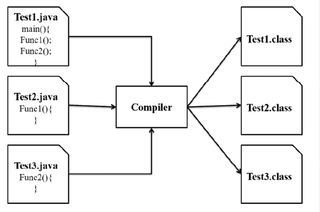

## 表 1.3: 从源代码生成的字节码

每个程序中都有一个内部的操作数栈。某些字节码指令会对当前正在执行的方法对应的操作数栈进行操作。在将这些值推入栈后，将对它们进行处理。一旦进入栈中，这些值就可以作为操作的输入。

考虑一个例子，假设我们想相数字 1 和 2。这两个值必须首先通过执行字节码指令 `iconst_1` 和 `iconst_2` 被推入操作数栈。在栈中有了这两个数字后，`iadd` 指令现在可以通过从栈顶弹出（pop）这两个值来消耗它们。结果，该指令将所消耗值之和推回栈中。详细的逐步操作请见下方的图 1.16：

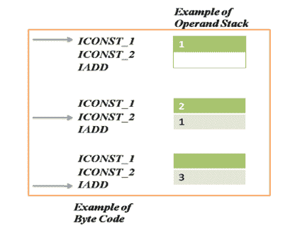

### 图 1.16: 如何使用操作数栈执行字节码

## 结论

在本章中，以语言作为一种通信工具，定义了编程语言的概念。还给出了 Java 编程的历史。讨论了从过程化范式到面向对象范式的转变。通过代码示例学习了 Java 编程的所有重要特征。并讨论并解释了 `JVM`、`JRE` 和 `JDK` 之间的联系。

在下一章中，我们将详细讨论数据类型、运算符、条件语句和循环的概念。

## 习题

1. 定义 Java 的特征（布姆分类-1 级）

2. 比较并对比 C 和 Java。（布姆分类-2 级）

3. 画出 Java 的两个阶段系统。（布姆分类-3 级）

4. 用举例说明字节码。（布姆分类-4 级）

5. 为给定的代码创建字节码（布姆分类-5 级）

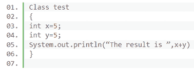

### 图 1.17

## 单选题

1. 为什么 `main()` 被声明为静态方法

    1. `main()` 方法在不创建其所属类对象的情况下被调用

    2. 第一个方法由 `JVM` 调用

    3. `main()` 的内容不应被更改

    4. 以上都不是

2. Java 是一个 _____ 系统

    1. 两阶段系统

    2. 单阶段系统

    3. 三阶段系统

    4. 四阶段系统

3. `JDK` ________

    1. 由 `VM` 和开发工具组成

    2. 由 `JRE` 和类库组成

    3. 由 `JRE` 和开发工具组成

    4. 仅类库

4. Public static 可以写成 static public

    1. 正确

    2. 错误

5. Java 是 ________ 语言

    1. 平台无关

    2. 依赖平台

    3. 依赖架构

    4. 无

6. `JRE` 由 ________ 组成

    1. `JVM` 和类库

    2. `JVM` 和开发工具

    3. `JDK` 和开发工具

    4. `JRE` 和类库

7. 健壮性意味着

    1. 对数据进行严格的编译和运行时检查

    2. 良好的异常处理

    3. 选项 A

    4. 选项 (A) 和 (B)

8. `JVM` 被称为 ________

    1. Java 变量模式

    2. Java 虚拟机

    3. Java 易变内存

    4. Java 虚方法

9. `JVM` 将 ________ 翻译为 _______

    1. 机器码，字节码

    2. 低级代码，高级代码

    3. 字节码，机器码

    4. 以上都不是

10. 命令行参数是可选的

    1. 正确

    2. 错误

## 答案

1. a

2. a

3. c

4. a

5. a

6. a

7. d

8. b

9. c

10. b

## 参考文献

1. [`littleflowercollege.edu.in/upload/e_contents/files/09053adbc4cb9d26609002057154d0b7.pdf`](https://littleflowercollege.edu.in/upload/e_contents/files/09053adbc4cb9d26609002057154d0b7.pdf)

2. [`www.w3schools.in/java/intro`](https://www.w3schools.in/java/intro)

3. [`cs.smu.ca/~porter/csc/465/notes/java_story_history.html`](https://cs.smu.ca/~porter/csc/465/notes/java_story_history.html)

4. [`www.tutorialspoint.com/difference-between-java-and-c-language`](https://www.tutorialspoint.com/difference-between-java-and-c-language)

5. [`www.mygreatlearning.com/blog/cpp-vs-java/`](https://www.mygreatlearning.com/blog/cpp-vs-java/)

6. [`www.imit.ac.in/note/cplus.pdf`](http://www.imit.ac.in/note/cplus.pdf)

7. [`www.w3schools.in/java/intro`](https://www.w3schools.in/java/intro)

8. [`www.tutorialspoint.com/difference-between-java-and-c-language`](https://www.tutorialspoint.com/difference-between-java-and-c-language)


## 参考文献与资源

9. [`cs.smu.ca/~porter/csc/465/notes/java_story_history.html`](https://cs.smu.ca/~porter/csc/465/notes/java_story_history.html)

10. [`www.mygreatlearning.com/blog/cpp-vs-java/`](https://www.mygreatlearning.com/blog/cpp-vs-java/)

25. [`www.oracle.com/java/technologies/compile.html#:~:text=Compiling%20a%20Java%20program%20means,instructions%20for%20the%20Java%20VM.&text=Note%3A%20Part%20of%20the%20configuration,is%20setting%20the%20class%20path`](https://www.oracle.com/java/technologies/compile.html#:~:text=Compiling%20a%20Java%20program%20means,instructions%20for%20the%20Java%20VM.&text=Note%3A%20Part%20of%20the%20configuration,is%20setting%20the%20class%20path)

26. [`www.quora.com/What-is-the-difference-between-a-computer-language-and-a-programming-language`](https://www.quora.com/What-is-the-difference-between-a-computer-language-and-a-programming-language)

27. Rabiah, S. (2018). 作为沟通工具的语言与文化现实揭示者。

28. [`docs.oracle.com/javase/8/docs/technotes/guides/language/index.html`](https://docs.oracle.com/javase/8/docs/technotes/guides/language/index.html)

29. [`stemrobotics.cs.pdx.edu/node/4230.html`](https://stemrobotics.cs.pdx.edu/node/4230.html)

30. [`www.cs.mcill.ca/~rwest/wikispeedia/wpcd/wp/p/Programming_language.htm`](https://www.cs.mcill.ca/~rwest/wikispeedia/wpcd/wp/p/Programming_language.htm)

31. [`coddyschool.com/upload/Addison_Wesley_The_Object_Orient.pdf`](https://coddyschool.com/upload/Addison_Wesley_The_Object_Orient.pdf)

32. [`csrc.nist.gov/glossary/term/human_machine_interface`](https://csrc.nist.gov/glossary/term/human_machine_interface)

33. [`www.cannon-automata.com/wp-content/uploads/C1_L1_Brochure_pdf_en.pdf`](https://www.cannon-automata.com/wp-content/uploads/C1_L1_Brochure_pdf_en.pdf)

34. [`www.cannon-automata.com/products/hmi-human-machine-interface/web-panels-series/`](https://www.cannon-automata.com/products/hmi-human-machine-interface/web-panels-series/)

35. [`cs.pomona.edu/~kim/cs334.97/Lec1.html`](https://cs.pomona.edu/~kim/cs334.97/Lec1.html)

36. [`spectrum.ieee.org/top-programming-languages-2022`](https://spectrum.ieee.org/top-programming-languages-2022)

37. [`cs.pomona.edu/~kim/cs334.97/Lec1.html`](https://cs.pomona.edu/~kim/cs334.97/Lec1.html)

38. [`cs.pomona.edu/~kim/cs334.97/Lec1.html`](https://cs.pomona.edu/~kim/cs334.97/Lec1.html)

加入我们的书籍 Discord 空间

加入书籍 Discord 工作区以获取最新更新、优惠、全球技术动态、新书发布以及与作者的交流：

**https://discord.bpbonline.com**


---

# 第 2 章 Java 基础构建模块

## 引言

本章介绍了 Java 数据类型、Java 运算符、Java 表达式、条件语句和循环概念。让我们先讨论强类型语言的概念。Java 是静态类型语言，也是强类型语言，因为在 Java 中，每种数据类型（如整数、字符、十六进制、压缩小数等）都是作为编程语言的一部分被预定义的。

## 结构

本章解释了以下概念：

*   作为强类型语言的 Java
*   Java 标记
*   数据类型层次
*   非基本数据类型或引用类型
*   Java 运算符
*   条件语句
*   Java 循环

## 目标

本章旨在提供标记、数据类型和变量的基本细节，并介绍强类型语言的概念。数据类型的层次结构和变量类型是本章学习和广泛测试的重要主题。后续章节将探讨基本类型和非基本类型的概念。

### 作为强类型语言的 Java

Java 是静态类型语言，也是强类型语言，因为在 Java 中，每种数据类型（如整数、字符、十六进制、压缩小数等）都是作为编程语言的一部分被预定义的。

在 Java 中，每种数据类型在使用之前必须声明。声明指定了类型。

### Java 标记

最小的编程构建单元被称为标记。Java 中有五种标记：关键字、字面量、标识符、分隔符和运算符。

### 关键字

关键字在编译器中具有特定的含义。以下任何项不能作为标识符：

| | continue | for | new | switch |
| :--- | :--- | :--- | :--- | :--- |
| assert | default | goto | package | synchronized |
| boolean | do | if | private | this |
| break | double | else | protected | throw |
| case | enum | implements | public | throws |
| char | extends | instance of | return | transient |
| class | finally | interface | static | void |
| catch | final | long | strictfp | volatile |
| const | float | native | super | while |

表 2.1 Java 关键字

根据前表提供的详细信息，我们使用 `#` 符号的次方来表示关键字在 Java 新版本（JDK 版本）中的添加情况。单个 `#` 表示未使用。双符号 `##` 表示关键字添加到 1.2 版本。三连 `###` 表示关键字添加到 1.4 版本。四个 `####` 表示关键字添加到 5.0 版本。

### Java 字面量

每个可以通过变量授权的恒定评估值被称为字面量。例如：

```java
int age=23;
```

在示例中，`age` 是整数字面量。我们可以这样写字符串字面量：

```java
String m="Hello";
```

### Java 标识符

标识符是变量、类、方法、包和接口的名称。标识符是程序员在程序使用的单词。除了程序员指定的，大多数标识符没有预定义的含义。创建标识符的规则如下所示：

| 规则编号 | 规则 |
| :--- | :--- |
| 1 | 标识符由字母、数字、下划线字符 (`_`) 和美元符号 (`$`) 组成 |
| 2 | 第出现的字符必须是 Unicode 标准中的非数字字符。 |
| 3 | 根据此规则，后续字符可以取数字。 |
| 4 | 不允许使用下划线 `_` 和符号 `$` 作为第一个字符。 |
| 5 | 从本质上说，Java 语言是区分大小大小的。因此，`Sum` 和 `sum` 被视为不同的标识符。 |

表 2.2: Java 标识符的规则

### Java 中的分隔符

分隔符被称为标点符号。有一些基础分隔符，在表 2.3 中以表格形式列出并附有说明：

| 符号 | 含义 |
| :--- | :--- |
| `()` | 指定参数列表、表达式以及表达式中的优先级，并用于类型转换。 |
| `[]` | 表示索引值 |
| `{}` | 用于类定义，表示代码块、字符串和数组对象的初始化。 |
| `;` | 用于每个语句后的终止符号 |
| `,` | 用于参数列表分离、变量分离、`for` 循环中表达式的分 |
| `.` | 用于通过对象调用方法、使用对象进行数据成员初始化以及维护包层次结构。 |

表 2.3: Java 分隔符列表

### Java 中的运算符

运算符是告诉计算机执行某些数学或逻辑操作的符号。运算符在程序中处理数据和变量。Java 具有算术运算符（`+`、`-`、`*`、`/`）、赋值运算符 `=`、比较运算符（`<=`、`>=`、`==`）、逻辑运算符（`&&`、`||`）和位运算符（`&`、`|`）。它们将在本章后面讨论。在令牌之后，将在下一节介绍 Java 数据类型的层次结构。

### 数据类型的层次结构

数据类型指定了变量中可以存储的不同大小和值。Java 中有两种类型的数据类型（图 2.1）：

- **基本数据类型**：基本数据类型包括 `Boolean`、`char`、`byte`、`short`、`int`、`long`、`float` 和 `double`。Java 语言预定义并由关键字命名的类型称为 Java 中的基本数据类型。
- **非基本数据类型**：非基本数据类型包括类、接口和数组。

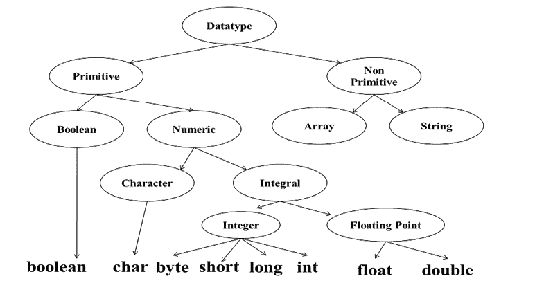

图 2.1: 数据类型的层次结构

### 基本数据类型

基本数据类型有几种类型。它们在图 2.2 中列出及其大小：

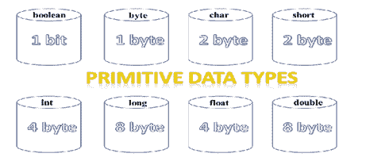

图 2.2: 基本数据类型的示例

让我们详细讨论不同的基本数据类型：

- **Boolean 数据类型**：`Boolean` 数据类型只有两个可能的值 `true` 和 `false`，用于表示逻辑。使用此数据类型管理简单的 `true/false` 标志。虽然 `Boolean` 数据类型可能只指定一条信息，但无法确定其精确大小。

  示例：`Boolean one = false`

- **Byte 数据类型**：`Byte` 是最基本的整数类型。作为基本数据类型的示例，考虑 `byte`，它是一个具有补码形式和 8 位有符号大小的整数。它的值范围从 `(-2^(8-1))` `-128` 到 `(-2^(8-1) - 1)` `127`（包含）。该变量的值范围为 `-128` 到 `127`。默认情况下，它的值为 `0`。在最需要节省内存的大数组中，应用 `byte` 类型以节省内存。一个 `byte` 占据的空间比整数少四倍。因此，它节省了空间。此外，你可以用它代替 `int` 数据类型。

  示例：`byte bt=127;`

- **char 数据类型**：`char` 类型表示单个 16 位的 Unicode 字符。它的取值范围在 `u0000`（或 `0`）到 `\uffff`（或 `65,535`）之间。字符存储在 `char` 数据类型中。

  示例：`char letter A = 'A'`

- **short 数据类型**：`short` 类型是补码的有符号 16 位整数。它的取值范围为 `-32,768` 到 `32,767`（包含）。它的范围分别包括 `-32,768` 和 `32,767`。它的初始值为 `0`。类似于 `byte` 数据类型可以被用来节省内存，`short` 类型也可以同样这样做。整数的大小是 `short` 大小的两倍。

  示例：`short s = 10000, short r = -5000`

- **int 数据类型**：`int` 类型是补码的有符号 32 位。它的取值范围在 `-2,147,483,648`（`-2³¹`）和 `2,147,483,647`（`2³¹ -1`）之间（包含）。数字范围在 `-2,147,483,648` 和 `2,147,483,647` 之间。除非指定，否则编译器会为这些字段分配一个默认值，通常是 `0`。

  示例：`int a = 10000, int b = 20000`

- **long 数据类型**：`long` 类型是 64 位整数。它的范围是 `-9,223,372,036,854,775,808`（`-2⁶³`）到 `9,223,372,036,854,775,807`（`2⁶³ -1`）（包含）。它的初始值为 `0`。

  示例：`long a = 10000L, long b = 20000L`

- **float 数据类型**：单精度 32 位 IEEE 754 浮点表示 `float` 类型。它用于小数。

  示例：`float f1 = 12.3f`

- **double 数据类型**：双精度 64 位 IEEE 754 浮点表示 `double` 类型。它用于小数。

  示例：`double d1 = 12.3`

### 数据类型的默认值

在指定字段时并不总是需要赋值。如果定义了，编译器将为它们分配相应的默认值。根据数据类型，这通常等于零或空。然而，依赖这种默认值通常被认为是不良的做法。

| 数据类型 | 默认值 |
| :--- | :--- |
| byte | 0 |
| short | 0 |
| int | 0 |
| long | 0L |
| float | 0.0f |
| double | 0.0 |
| char | \u0000 |
| string | null |
| boolean | false |

表 2.4: 基本类型的默认值

### Java 中的变量类型

让我们讨论 Java 程序中可能的各种变量类型：

- **实例变量（非静态字段）**：从技术角度（面向对象编程），对象的 own 存储在非静态字段中，即没有指定 `static` 关键字的字段。它们被认为是实例变量，因为它们的值对于类的每个实例都是唯一的。

  ```java
  class test {
    int var;
  }
  ```

  这种类型的变量被称为实例变量。如果我们创建了 `test` 类的多个对象，每个对象将获得自己的拷贝。假设我们使用以下语法创建了三个对象 `t1`、`t2` 和 `t3`。

  ```java
  test t1=new test();
  test t2=new test();
  test t3=new test();
  ```

- **类变量（静态字段）**：我们可以说类变量是任何前面带有有 `static` 修饰符的字段。此外，无论创建了多少个类对象，该变量只有一个副本可用，也就是说，无论该类被实例化多少次。

  ```java
  class test {
    static int var;
  }
  ```

  ```java
  test t1=new test();
  test t2=new test();
  test t3=new test();
  ```

静态变量（只创建一份副本）被所有创建的对象共享，其概念见图 2.4：

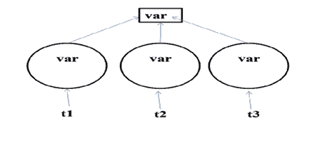

图 2.4: 静态变量

### 局部变量

* **局部变量**：由于对象在字段中存储其状态，因此局部变量被方法用于来存储其临时状态。局部变量的一个示例是 `void disp(int cnt)`。

```java
class test
{
    void get_value(int x, int y)
    {
    }
}
```

在前面的代码中，变量 `x` 和 `y` 被称为局部变量。局部变量仅对声明它们的方法可见；它们无法从类的其他部分访问。创建适当变量名的规则列在表 2.5 中：

| 规则编号 | 含义 |
| --- | --- |
| 1 | 变量名本质上是区分大小写的。 |
| 2 | 任何以字母、美元符号 `$` 或下划线字符 `_` 开头的有效标识符都可以作为变量名。此外，它具有无限长度并由 Unicode 字母和数字组成。 |
| 3 | 虽然使用字母而不是 `$` 或 `_` 开始变量名是标准做法，但并非总是如此。此外，按照习惯，永远不使用美元符号。 |
| 4 | 美元符号可能偶然出现在自动生成的名称中，但绝不应该出现在变量名中。类似的规则也适用于下划线字符；虽然在理论上用 `_` 开头变量名是允许的，但不建议这样做。不能有空格。 |
| 5 | 字母、数字、美元符号和下划线字符都可以作为额外的字符。此规则也取决于惯例和常识。 |

表 2.5: 变量命名规则


在为变量命名时，不要使用容易混淆的缩写，而要使用完整的单词。这样做你的代码将更更容易阅读和理解。在许多情况下，这还让你的源代码具有自文档化特征；例如，字段名为`name`、`age`和`roll number`会比使用`nm`、`ae`和`rl`等缩写要逻辑得多。你选择名称也不能是关键字或受限词。

如果你选择的名称只有一个单词，请将该单词全部小写。如果它是由多个单词组成的，请将每个后续单词的首字母大写。根据规范，名称`savings account`和`current account`是最好的示例。如果你的变量中存储了一个常量值，例如`static final int VALUE_PI = 3.142`，惯例略有不同，即每个字母都大写，并在后续单词之间放置下划线字符`_`。但在任何地方都不鼓励使用下划线字符`_`。

在接下来的段落中，下方提供了关于数据类型层次的详细讨论及图。在下一节中，将通过示例描述类型转换和强制转换的概念。在下一节中，我们将通过示例讨论类型转换和强制转换的概念。

## 强制转换和类型转换

强制转换（cast）是一种告知编译器将进行转换且可能发生数据丢失的方法。如果两个类型是兼容的，Java 将自动执行转换。例如，始终可以将一个`int`值赋值给`long`变量。然而，没有定义从`double`到`byte`的自动转换。要做到这一点，你必须显式地转换数据类型。

自动类型转换需要满足两个条件：

* 两个类型是兼容，
* 目标类型大于源类型。

如果满足这两个条件，就会发生宽转换操作。顺序是：

`Byte` | `short` | `int` | `long` | `float` | `double`，因此我们可以将`int`（4 字节）变量转换为`long`（8 字节）类型变量。此外，数据类型`float`也可以轻松转换为`double`类型变量。

如果你想将一个`int`（4 字节）值赋值给`byte`（1 字节）变量，这种转换被称为窄转换，因为`byte`比`int`小。要在不兼容的类型之间创建转换，你必须按照以下方式使用强制转换：

`(target_type) value`

示例：

```java
public class typecn
{
    public static void main(String s[])
    {
        int num=65;
        double dnum=(double)num;
        System.out.println(" int type is converted into double type "+" "+dnum);
    }
}
```

在前面的代码中，整数类型的变量`num`被转换为`double`并保存到`dnum`，`dnum`是一个`double`变量。所以这是一个从数据类型`int`到`double`类型转换的简单示例。

## 非基本数据类型或引用类型

让我们对 Java 中提供的不同非基本数据类型给出简单定义：

* **String**：字符串序列的概念在 Java 编程中被广泛使用。字符串被视为对象。示例：`String msg = "A simple program";`

* **Array**：数组在声明为实例变量或局部变量但未初始化时，会被赋值默认值。示例：`int num_langs[];`

  `num_langs=new int[10];`

* **Class**：类是可以创建对象的自定义数据类型。它模拟现实世界中的某些事物，由一组数据和一组操作数据的方法组成。示例：

```java
class Point
{
    int x;
    int y;
    void getCoordinate();
}
```

* **Object**：对象是类的实例。其数据类型是类。在初始化之前，它指向`null`。示例：`Point p1=new Point();`

* **Annotation**：允许将元数据（关于数据的数据）链接到程序组件。

  * 在最简单的形式下，注解表示为`@Entity`

  * `@`符号指示编译器后面是注解。在下面的示例中，注解名称为`Override`：

    ```java
    @Override
    void mySupMethod() { }
    ```

  * 注解可以包含元素，这些元素可以是命名的或未命名的，并且有值：

    ```java
    @Author(
        name = "Subhajit Adhikari",
        date = "29/07/2023"
    )
    ```

  * 注解可以应用于声明：类、字段、方法和其他程序元素。按照习惯，每个注解单独占一行。

* **Enumeration**：对一组呈现相关备选项的对象的引用。

  ```java
  public enum Stream {
    CSE, IT, ME, EE, ECE, CE
  }
  ```

* **Interface**：它提供了由 Java 类实现的公共 API。

  ```java
  interface Operatable {
    Boolean startTV( );
    void stopTV( );
    int volumeChange(int increment, int decrement);
    int channelChange(int nextCh);
  }
  ```

## Java 中的运算符

算术运算符、关系运算符、位运算符、逻辑运算符、赋值运算符和短路运算符以表格形式结合示例进行讨论。

### 算术运算符

假设两个变量`S`和`T`分别被赋值为 7 和 5。让我们看下方的表 2.6 以理解运算符、运算符的含义以及带有输出的代码示例：

| 运算符 | 运算符的含义 | 代码示例 | 输出 |
| --- | --- | --- | --- |
| `+` (加法) | 将运算符两侧的值相加 | `S+T` | 12 |
| `-` (减法) | 从左侧操作数减去右侧操作数 | `S-T` | 2 |
| `*` (乘法) | 将运算符两侧的值相乘 | `S*T` | 35 |
| `/` (除法) | 用左侧操作数除以右侧操作数 | `S/T` | 1 |
| `%` (取模) | 左侧操作数除以右侧操作数并返回余数 | `S%T` | 2 |
| `++` (自增) | 将操作数的值加 1 | `S++` | 8 |
| `--` (自减) | 将操作数的值减 1 | `--T` | 4 |

表 2.6: 算术运算符示例

### 关系运算符

假设变量`S`存储数字 7，变量`T`存储数字 5。不同的关系运算符已在下方的表 2.7 中通过示例进行了解释：

| 运算符 | 运算符含义 | 代码示例 | 输出 |
| --- | --- | --- | --- |
| `==` (等于) | 检查两个操作数的值是否相等。如果是，则条件为真。 | `(S==T)` | false (not true) |
| `!=` (不等于) | 检查两个操作数的值是否相等。如果值不等，则条件为真。 | `(S!=T)` | true (true) |
| `>` (大于) | 检查左侧操作数的值是否大于右侧操作数的值。如果是，则条件为真。 | `(S>T)` | true (true) |
| `<` (小于) | 检查左侧操作数的值是否小于右侧操作数的值。如果是，则条件为真。 | `(S<T)` | false (false) |
| `>=` (大于等于) | 检查左侧操作数的值是否大于等于右侧操作数的值。如果是，则条件为真。 | `(S>=T)` | false (false) |
| `<=` (小于等于) | 检查左侧操作数的值是否小于等于右侧操作数的值。如果是，则条件为真。 | `(S<=T)` | true (true) |

表 2.7: 关系运算符示例

### 位运算运算符

如果`a = 60`且`b = 13`，现在在二进制格式下，它们将如下：

`a = 0011 1100`,

`b = 0000 1101`,

`a&b = 0000 1100`,

`a|b = 0011 1101`,

`a^b = 0011 0001=49` (十进制)

在表 2.8 中，已经详细讨论了所有的位运算运算符：

| 运算符 | 运算符含义 | 代码示例 | 输出 |
| --- | --- | --- | --- |
| `&` (位与) | 二进制与运算符，如果位在两个操作数中都存在，则复制到结果中 | `a&b` | 12 |
| `|` (位或) | 二进制或运算符，如果位在两个操作数中都存在，则将其复制 | `a|b` | 61 |
| `^` (位异或) | 二进制异或运算符，如果位在两个操作数中都被设置，则将其复制 | `a^b` | 49 |
| `~` (位取反) | 二进制按取反运算符是一元运算符，其作用是翻转位 | `~a` | -61 |
| `<<` (左移) | 二进制左移运算符。左侧操作数的值根据右操作数指定的位数向左移动 | `a<<1` | 120 |
| `>>` (右移) | 二进制右移运算符。左侧操作数的值根据右操作数指定的位数向右移动 | `b>>1` | 6 |
| `>>>` (零填充右移) | 右移零填充运算符。左侧操作数的值根据右操作数指定的位数向右移动，移出的位用零填充 | `b>>>1` | 6 |

表 2.8: 位运算运算符示例

### 逻辑运算符

下表列出了逻辑运算符。假设布尔变量`A`为真，变量`B`为假，那么`A && B`为假。

| 运算符 | 描述 | 示例 |
| --- | --- | --- |
| `&&` (逻辑与) | 如果两个语句都为真，则返回真 | `(A && B)` 为假 |
| `||` (逻辑或) | 如果其中一个语句为真，则返回真 | `(A || B)` 为假 |
| `!` (逻辑非) | 反转结果，如果结果为真，则返回假 | `!(A && B)` 为真 |

表 2.9: 逻辑运算符示例

### 赋值运算符

假设我们有三个变量：`A=10`，`B=20`，`C=0`。让我们在表 2.10 中讨论赋值运算符及其工作方式：

| 运算符 | 描述 | 示例 |
| --- | --- | --- |
| `=` | 赋值 | `C=A` |
| `+=` | 加法赋值 | `C+=B` |
| `-=` | 减法赋值 | `C-=B` |
| `*=` | 乘法赋值 | `C*=B` |
| `/=` | 除法赋值 | `C/=B` |
| `%=` | 取模赋值 | `C%=B` |
| `&=` | 位与赋值 | `C&=B` |
| `|=` | 位或赋值 | `C|=B` |
| `^=` | 位异或赋值 | `C^=B` |
| `~=` | 位取反赋值 | `C~=B` |
| `<<=` | 左移赋值 | `C<<=B` |
| `>>=` | 右移赋值 | `C>>=B` |
| `>>>=` | 零填充右移赋值 | `C>>>=B` |
| `&&=` | 逻辑与赋值 | `C&&=B` |
| `||=` | 逻辑或赋值 | `C||=B` |
| `!==` | 不等于赋值 | `C!==B` |

表 2.10: 赋值运算符示例

### 短路运算符

逻辑与（`&&`）和逻辑或（`||`）是短路运算符。短路运算符是指不一定评估所有操作数的运算符。

#### 示例 1

假设你有两个操作数`x`和`y`，那么`x && y`在`x`为真时才会评估`y`（如果`x`为假）。

让我们考虑以下代码片段：

```
if (4==5 && 5==10) {
    System.out.println("这一行不会被打印");
}
```

解释：表达式`4==5 && 5==10`从左到右评估。评估`4==5`，发现`4==5`为假。

#### 示例 2

假设你有两个操作数`x`和`y`，那么`x || y`在`x`为假时才会评估`y`（如果`x`为真）。

让我们考虑以下代码片段：

```
if (4==4 || 5==6) {
    System.out.println("这一行会被打印");
}
```

解释：当运算符的左侧的值为真时。评估`4==4`，发现`4==4`为真。

注意：当 Java 发现`&&`运算符的左侧值为假时，Java 就会放弃并声明整个表达式为假。这被称为短路表达式评估。

## Java 运算符优先级

在讨论了 Java 运算符之后，我们将在下一节中简要讨论 Java 中的运算符优先级。

不同的运算符按优先级列在表 2.11 中。最顶部的运算符优先级最高，其次次之，以此类推。优先级较高的运算符会在优先级较低的运算符之前被检查。表格中同一单元格内的运算符被认为具有相同的优先级。当同一个表达式中出现相同优先级的运算符时，必须遵循特定规则。

所有二元运算符都从左到右求值。只有赋值运算符按照从右到左的规则求值。详情见图 2.5。

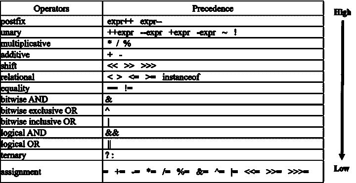

图 2.5: 运算符优先级

## 条件语句

在我们目前为止检查的程序中，每条语句都按照给定的顺序执行一次。大多数程序要复杂得多，因为语句的顺序和每个语句执行的次数可能会变化。我们使用“控制流”一词来指代程序中的语句排序。

### If 条件语句

条件语句是所有控制流语句中最基础的一种。它指令程序只有在特定测试返回真（true）时才执行特定的代码块。如果该测试返回假（false），控制将移动到 if-then 表达式的结论。在图 2.6 中，给出了带有示例的 if 语句流程图：

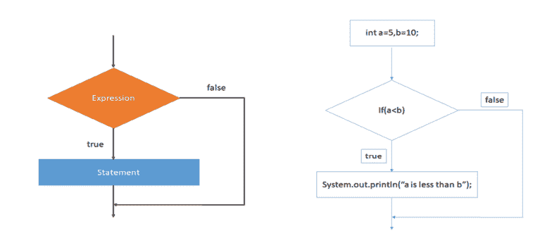

图 2.6: If 语句示例流程图

语法：

```
if (condition) {
    // 如果条件为真则执行代码块
}
```

注意`if`是小写字母。大写字母（`If`或`IF`）将产生错误。

在下面的示例中，我们测试两个值来判断 20 是否大于 18。如果条件为真，则打印某些文本：

示例

```
if (20 > 18) {
    System.out.println("20 is greater than 18");
}
```

### If else 条件

当 if 子句求值为假时，if-then-else 语句提供了另一种执行路径。在图 2.7 中，给出了带有示例的 if-else 语句流程图：

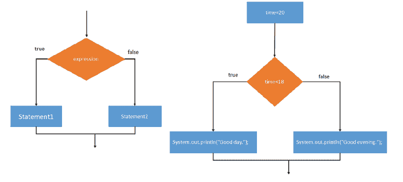

图 2.7: If-Else 语句示例流程图

使用`else`语句来指定条件为假时要执行的代码块。

语法

```
if (condition) {
    // 如果条件为真则执行代码块
} else {
    // 如果条件为假则执行代码块
}
```

示例

```java
int time = 20;
if (time < 18) {
    System.out.println("Good day.");
} else {
    System.out.println("Good evening.");
}
// 输出 "Good evening."
```

### 嵌套 if 条件

当一个 if 语句被放在另一个 if 语句内部，它被称为嵌套 if 结构。在图 2.8 中，给出了带有示例的嵌套 if 语句流程图：

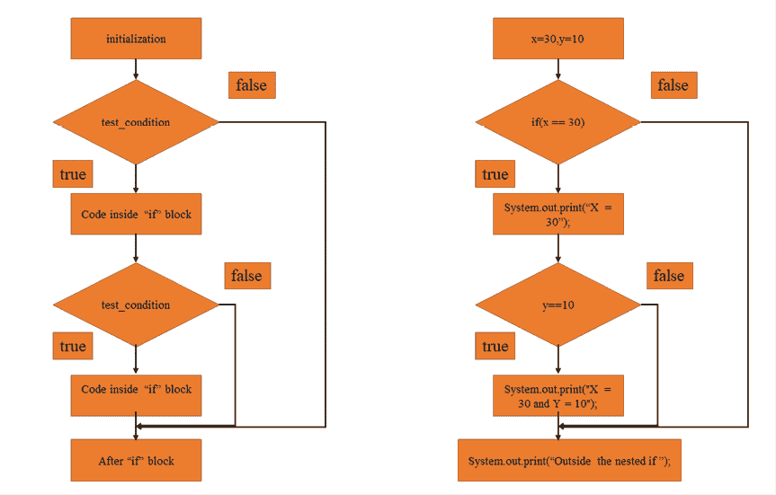

图 2.8: 嵌套 If 语句示例流程图

语法：

```
if(expression_1) {
    // 当 expression_1 为真时执行
    if(expression_2) {
        // 当 expression_2 为真时执行
    }
}
```

示例

```java
public class Test {
    public static void main(String args[]) {
        int x = 30;
        int y = 10;
        if( x == 30 ) {
            System.out.print("X = 30");
            if( y == 10 ) {
                System.out.print("X = 30 and Y = 10");
            }
        }
        System.out.print("Outside the nested if ");
    }
}
```

### 嵌套 if else 语句

if-else 梯形语句是基于嵌套 if 条件的一组条件。if-else 梯形条件从上到下执行表达式。一旦条件为真，就会执行对应的语句，并跳过剩余的梯形规则。在图 2.9 和图 2.10 中，给出了带有示例的嵌套 if-else 语句流程图：

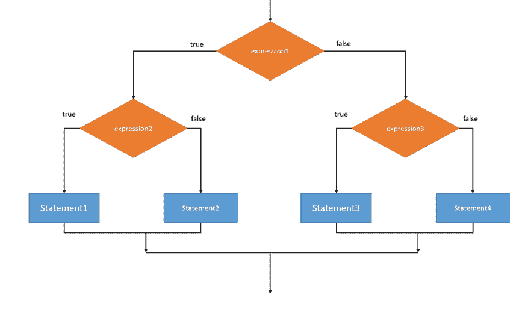

图 2.9: 嵌套 If-else 语句流程图

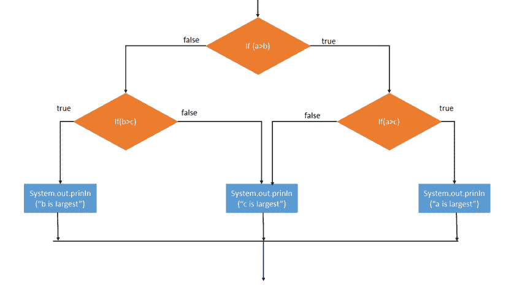

图 2.10: 嵌套 If-else 语句示例

语法：


```
if (condition1) {
    // 如果 condition1 为真则执行代码块
} else if (condition2) {
    // 如果 condition1 为假且 condition2 为真则执行代码块
} else {
    // 如果 condition1 为假且 condition2 为假则执行代码块
}
```

示例：

```java
int time = 22;
if (time < 10) {
    System.out.println("Good morning.");
} else if (time < 18) {
    System.out.println("Good day.");
} else {
    System.out.println("Good evening.");
}
// 输出 "Good evening."
```

## Java 中的循环

我们已经介绍了 Java 中条件语句的概念及其工作原理。现在，在下一节中将给出不同循环的工作程序。我们将讨论 `for`、`while` 和 `do-while` 循环这三种基本循环。循环的概念用于在代码块层面上重复执行相同的工作，直到指定的条件为假。

### For 循环

当你确切知道想要循环执行代码块的次数时，请使用 `for` 循环而不是 `while` 循环。`for` 语句使得高效地对值范围进行迭代成为可能。由于循环持续持续直到满足某个条件，程序员经常称之为 `for` 循环。在图 2.11 中，给出了带有示例的 `for` 循环流程图：

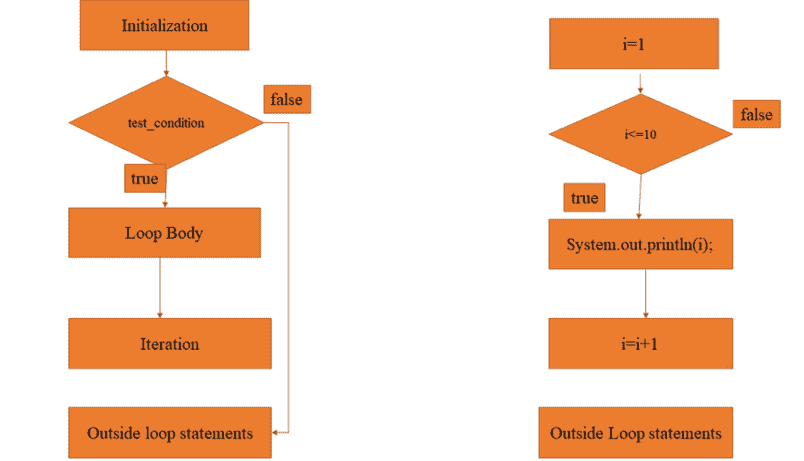

图 2.11: `for` 循环示例流程图

语法：

```
for (statement 1; statement 2; statement 3) {
    // 要执行的代码
}
```

`for` 循环解释：

1. `statement 1`: 循环开始时执行初始化语句。

2. `statement 2`: 在循环期间检查条件。如果为真，则执行循环体。

3. `statement 3`: 迭代语句并返回步骤 2。

### 标签 for 循环

指示执行控制循环的有效变量名称称为标签。Java 中带标签 `for` 的示例：

```java
public class lb_loop {
    public static void main(String args[]) {
        m:
        for(int i=0;i<5;i++) {
            n:
            for(int j=0;j<5;j++) {
                if(j==2) {
                    System.out.println("Exit from the loop");
                    break m;
                }
            }
        }
    }
}
```

### While 循环

`while` 循环评估表达式，该表达式必须产生一个布尔值。如果表达式为真，`while` 循环执行 `while` 块中的语句。`while` 语句继续测试表达式并执行其，直到表达式返回假。在图 2.12 中，给出了带有示例的 `while` 循环流程图：

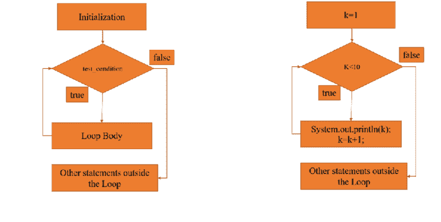

图 2.12: `While` 循环示例流程图

语法：

```
while (condition) {
    // 要执行的代码块
}
```

在下面的示例中，只要变量 `i` 小于 5，循环中的代码就会反复运行：

示例：

```java
int i = 0;
while (i < 5) {
    System.out.println(i);
    i++;
}
```

### Do while 循环

`do-while` 循环是 `while` 循环的一种变体。该循环在检查条件是否为真之前执行一次代码块，只要条件为真，就会重复循环。在图 2.13 中，给出了带有示例的 `do-while` 循环流程图：

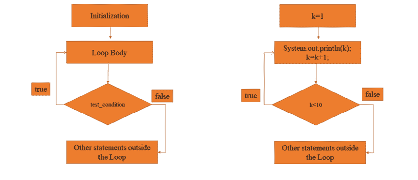

图 2.13: `Do-While` 循环示例流程图

语法：

```
do {
    // 要执行的代码块
} while (condition);
```

下面的示例使用了 `do…while` 循环。即使条件为假，循环至少至少执行一次，因为代码块在测试条件之前执行：

示例：

```java
int i = 0;
do {
    System.out.println(i);
    i++;
} while (i < 5);
```

# for、while 和 do-while 循环的比较

在上一节中，我们已经通过流程图详细学习了 `for`、`while` 和 `do-while` 循环的语法和代码示例。现在，表 2.11 展示了三种基本循环 `for`、`while` 和 `do-while` 之间的比较：

| For 循环 | While 循环 | Do-While 循环 |
| :--- | :--- | :--- |
| 用于迭代次数已知的情况。 | 用于迭代次数未知的情况。 | 用于次数未知的情况。 |
| 如果条件为假，则不执行循环体。 | 如果条件为假，则不执行循环体。 | 即使条件为假，循环体也会执行一次。 |
| 处理集合元素（如数组等数据结构）时，它是更好的选择。 | 用于从命令行获取输入或从方法调用获取特定值。 | 用于获取用户输入，然后检查条件的真假。 |
| 在没有条件的情况下，循环将无限重复。 | 在没有条件的情况下，将显示错误。 | 在没有条件的情况下，将显示错误。 |
| 初始化可以在循环内，也可以在循环外。 | 初始化始终在循环外。 | 初始化始终在循环外。 |
| 被称为预测试循环。 | 被称为预测试循环。 | 被称为后测试循环。 |

表 2.11：`For`、`While` 和 `Do-while` 循环的比较

## 结论

在本章中，我们涵盖了标记（`tokens`）、数据类型、类型转换、运算符、条件语句和循环等基础知识，并结合了流程图和代码示例。这些编程结构有助于读者增强从零开始编写 Java 程序和应用程序的知识。文中简要介绍了 `class`、`string`、`array`、`enum` 等非原始数据类型。现在，在这些 Java 编程基础构建模块的帮助下，我们将在下一章中讨论 `class`、`objects` 和 `methods` 的概念。

## 示例题

1. 举例定义 Java 的标记（布鲁姆分类-1）

2. 比较并对比 Java 中的 `for`、`while` 和 `do-while` 循环。（布鲁姆分类-2）

3. 绘制标记为 `for` 循环的流程图。（布鲁姆分类-3）

4. 用示例说明无限循环的概念。（布鲁姆分类-4）

5. 使用以下源代码为 Java 中的静态和非静态数据成员创建内存表示（布鲁姆分类-5）

```java
class Test {
    int k=100;
    static int t=300;
}

class ExProg {
    public static void main(String args[]) {
        Test t1=new Test();
        Test t2=new Test();
        Test t3=new Test();
        Test t4=new Test();
        Test t4=new Test();
    }
}
```

## 多选择题

1. 假设 `float fl=445.558f;`

   变量 `fl` 的数据类型是什么？

   1. `int`

   2. `float`

   3. `double`

   4. `char`

2. `char ch= 'A'; System.out.println((int)ch);` 输出是什么？

   1. `A`

   2. `'A'`

   3. `68`

   4. `65`

3. 下述代码的输出是什么？

```java
class Tst_Ter {
    public static void main(String s[]) {
        int a=10,b=15;
        a=(a<b)?(b+a):(b-a);
        System.out.println(a);
    }
}
```

   1. `10`

   2. `15`

   3. `25`

   4. `5`

4. 下列代码的输出是什么？

```java
class InfiWh {
    public static void main(String args[]) {
        while (true) {
            System.out.println("true");
        }
    }
}
```

   1. `true`

   2. `false`

   3. `infinite`

   4. `error`

5. 自动类型转换在两种条件下完成：

   1. 两种类型不兼容，且目标类型小于源类型。

   2. 两种类型兼容，且目标类型大于源类型。

   3. 两种类型不兼容，且目标类型大于源类型。

   4. 两种类型兼容，且目标类型小于源类型。

6. 假设 “`String`”和 “`class`” 被称为：

   1. 非原始数据类型

   2. 原始数据类型

   3. 变量

   4. 无

7. “`double`”类型变量 `i` 的默认值：

   1. `0.0d`

   2. `0`

   3. `1.0`

   4. `0.01`

8. 如果 `while` 循环被称为 _____ 循环，`do-while` 循环被称为 ________ 循环

   1. 后测试和预测试

   2. 预测试和预测试

   3. 预测试和后测试

   4. 后测试和后测试

9. 它们中哪些是短路运算符？

   1. `&`, `|`

   2. `+`, `-`

   3. `&&`, `||`

   4. `/`, `*`

10. 如果 `a = 60` 且 `b = 13`，求 `a^b` 的值，其中 `^` 是位运算符。

    1. `12`

    2. `49`

    3. `-49`

    4. `61`

#### 答案

1. c

2. d

3. c

4. c

5. b

6. a

7. a

8. c

9. c

10. b

#### 参考

1. [`www.cs.cornell.edu/`](https://www.cs.cornell.edu/)

18. `www.google.co.in/books/edition/Object_Oriented_Programming_Using_Java_C/IljBEAAAQBAJ?hl=en&gbpv=1&dq=Separators+in+java&pg=PA17&printsec=frontcover`

19. `www.google.co.in/books/edition/ICSE_Java_Complete_Reference/oZkjqpHPAb4C?hl=en&gbpv=1&dq=Separators+in+java&pg=PA30&printsec=frontcover`

20. `docs.oracle.com/javase/tutorial/java/data/strings.html`

21. `docs.oracle.com/javase/tutorial/java/javaOO/enum.html#:~:text=An%20enum%20type%20is%20a,the%20days%20of%20the%20week`

22. `docs.oracle.com/javase/tutorial/java/nutsandbolts/if.html`

23. `docs.oracle.com/javase/tutorial/java/nutsandbolts/while.html`

24. `www.cs.umd.edu/~clin/MoreJava/ControlFlow/nested-if.html`

25. `www.google.co.in/books/edition/Learning_Java/IfKZiqP2DncC?hl=en&gbpv=1&dq=nested+if+condition+in+java&pg=SA3-PA11&printsec=frontcover`

26. `www.simplilearn.com/tutorials/java-tutorial/if-else-in-java`

27. `www.google.co.in/books/edition/Mastering_Java/Jf5fEAAAQBAJ?hl=en&gbpv=1&dq=literals+in+java&pg=PA43&printsec=frontcover`

28. `www.nou.ac.in/Online%20Resourses/26-5/Unit%203.pdf`

29. `docs.oracle.com/javase/tutorial/java/nutsandbolts/operators.htm`

# 第 3 章 类、对象和方法的概念

## 引言

本章结合了日常生活中的示例和插图来解释类、对象和方法的概念。模型、蓝图或设计就是类。在本章中，将展示类的特征和类类型。引入了对象的概念，即类的实例。本章还阐述了对象产生的原因。为了帮助理解，列出了类和对象之间的区别。接下来，介绍了方法的概念。在面向对象编程（OOP）中，它们被称为类内部的函数。在这种情况下，展示了方法调用过程。与类名相同的特殊方法被称为构造函数。通过代码示例来说明构造函数的概念。本章还涵盖这一术语以及方法重载的重要概念。

## 结构

* 引入类

* 引入对象

* 构造函数

* Java 中的方法重载

* Java 中的 `this` 关键字

## 目标

本章将让读者理解面向对象编程的类和对象概念以及它们的区别。本章将完整地涵盖类和对象，并配有适当的插图以及从语法到实现的讨论。

## 引入类

类是对象的组。例如，水果是一个类，而芒果是一个对象。类是包含所有数据的用户定义类型。

图 3.1 带有数据成员的类

```
images/3.1
```

## 类属性

类的属性如下：

* 类定义了结构。

* 它提供了封装。

* 它作为蓝图、模型或设计。

* 可以 `private`、`public` 和 `protected` 等访问修饰符。

* 它是一个逻辑概念。

## 类组件

类的组件如下：

* **字段**：被称为成员变量或属性。例如 `Name`、`RollNo`、`Marks`。

* **构造函数**：与类名相同的特殊方法，在创建对象时自动调用。例如 `A()`，其中 `A` 是类。

* **方法**：这些是行为或成员函数。它告诉对象如何运行。例如 `disp()`、`getData()`。

## 类类型

Java 类的类型如下：

* **类类 (Final class)**：这种类型的类不能被继承，也就是说，禁止子类类的生成。它使用 `Final` 关键字创建。

* **抽象类 (Abstract class)**：这种类型的类不能实例化。也就是说，不允许生成对象，仅作为基类使用。它使用 `abstract` 关键字创建。这些存在仅仅是为了为派生类提供公共属性和方法。此类类被称为抽象类。

* **具体类 (Concrete class)**：Java 中的具体类是指所有方法已实现的类。创建对象的类被称为具体类。要制作具体类，你需要扩展抽象类并实现所有抽象方法。具体类只能扩展一个类（抽象类或其他），但可以实现多个接口。

* **POJO 类**：纯 Java 对象（POJO）类定义了私有数据以及用于访问这些私有数据的公开 GET/SET 方法。

* **单例类 (Singleton class)**：它允许你的类只有一个实例。主要目标是控制对象的创建。单例通常控制数据库连接或套接字资源的访问。设计单例类：

    1. 将构造函数变为 `private`。

    2. 编写一个返回类型为该单例类对象的静态方法。

### 图 3.2 Java 中单例类的源码

图 3.2 提供了在 Java 中创建单例类的简单示例。它通过私有构造函数 `SingletonEx()` 限制了创建对象的数量。

```
images/Figure_3.2.png
```

### 内部类

* 内部类：在 Java 中，你可以在另一个类内部定义类，这被称为嵌套类。

示例：

```java
Class ClassA {
    ...
    Class NestedClassA {
        ...
    }
}
```

嵌套类分为两类：非静态和静态。非静态嵌套类被称为内部类，而声明为 `static` 的嵌套类被称为静态嵌套类。

### 对象的引入

利用 `new` 运算符可以构造对象。对象具有状态和行为。汽车的状态可能是它的颜色或型号。汽车的加速可以被视为它的行为。对象是一个物理实体或运行时的实体，例如人、笔、椅子、桌子或计算机。对象的表示如图 3.3 所示：

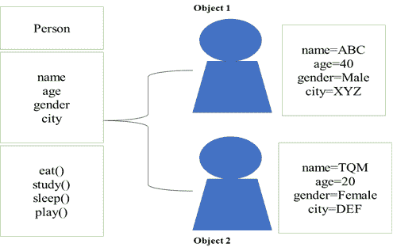

图 3.3：对象的表示

### 对象的组件

对象的组成部分如下：

* 状态：由对象的属性表示。它反映了对象的特征。

* 行为：由对象的方法表示。它也反映了对象与其他对象的交互。

* 标识性：它为对象提供唯一的名称，并使一个对象能够与其他对象进行交互。

### 类的创建

让我们来看类的创建语法：


```java
Class Classname
{
    type instance_variable1;
    type instance_variable2;
    type methodname1(parameter_list)
    {
        //方法体
    }
    type methodname2(parameter_list)
    {
        //方法体
    }
}
```

你必须编写`class`关键字，后面紧跟类名，如`Student`、`Employee`或`Car`。之后，将添加`{`和`}`用于类的声明和初始化，类体写在`{`和`}`之间。数据成员和方法将在类体内定义并初始化。类名应该始终以大写字母`Student`开始。

现在，让我们考虑图 3.4 中的示例：

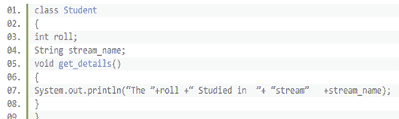

图 3.4：带有数据成员和方法的 Java 类声明

类的定义包含作为数据成员的`roll`和`steam_name`，`get_details()`是方法。

### 对象的创建

利用`new`运算符构造对象。对象具有自己的状态和行为。例如，自行车的状态可能是它的`engine_type`或`manufacture_id`。`speedUp`可以被视为自行车的行为。

### 对象的创建语法

`new`运算符创建一个类的对象并返回该对象的对象的引用。

示例：

```
Student std1= new Student();
```

在上述示例中，`Student`是类名，`std1`是对象名，它是指向`Student`对象的引用。它是一个内存引用，知道对象存储在内存中的位置。`new`运算符负责创建对象。`Student()`是用于初始化对象的默认构造函数。创建对象的代码如图 3.5 所示，输出如下：

.png)

图 3.5：类和对象的创建示例

接下来的图 3.6 显示了代码段：

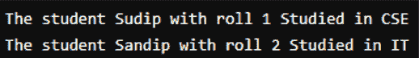

图 3.6：上述类和对象创建代码的输出

在图 3.5 中，创建了类`Student`，并有两个对象即`std1`和`std2`，具有三个属性`roll`、`name`和`stream_name`。每个对象都有其自己的属性值（如`roll`、`name`和`stream_name`），这些被称为实例方法。此外，还有一个方法`get_details()`显示每个对象的属性值。要访问属性和方法，我们必须在对象名后使用点 (`.`) 运算符，如`std1.roll`或`std1.get_details()`。让我们在表 3.1 中考虑 Java 类和对象之间的区别：

| Java 类 | Java 对象 |
| --- | --- |
| 它是一个蓝图 | 它是类的实例 |
| 它是表示对象行为的代码。 | 对象代表状态和行为 |
| 类充当计划或模型。 | 对象是实现。 |
| 它是逻辑上的 | 它具有物理存在 |
| 它通过`class`关键字创建 | 它通过`new`关键字创建 |
| 创建时不时不分配内存 | 在创建对象时不分配内存 |
| `class Abc{//body of the class}` | `Abc obj=new Abc();` |

表 3.1：Java 中类和对象的区别

### 对象的优点

对象提供了许多益处，包括：

*   模块化：对象的源代码可以与其他对象的源代码分开创建和维护。一旦创建了对象，就可以很容易地在系统中移动。
*   信息隐藏：通过仅与对象的方法和属性交互，其实现细节对外部世界是隐藏的。
*   代码复用：你可以在程序中利用已经存在的对象（可能是由其他开发者构建的）。
*   可插拔性和易于调试：你可以轻松地从程序中删除一个对象，并在发现它有问题时换成另一个。在现实世界中，这就像修理机械问题。与其更换整台机器，不如更换故障螺丝。
*   垃圾回收：垃圾回收的想法是自动回收内存。检查内存以检测未使用部分，然后删除不需要的对象。

### Java 方法的组件

Java 方法是用于执行操作的语句集合。其组件如下：

*   返回值：指定方法返回值的类型。例如，如果方法的返回类型为`int`，则它返回一个整数值。如果方法不返回值，则返回类型为`void`。
*   方法名：在程序中引用特定方法的标识符。
*   方法体：包括执行某些任务的语句，如局部变量的声明。方法体包含在大括号`{}`之中。
*   访问修饰符：`public`、`private`、`protected`。
*   括号中的参数列表：输入参数的逗号分隔列表，前面带有数据类型，位于括号`()`中。如果没有参数，必须使用空括号。
*   异常列表：异常是一种意外事件。例如`IOException`。

### 方法命名规范

虽然方法名可以是任何合法标识符，但按照习惯，方法名应该是小写的动词，或者是以小写动词开头的多单词名称，随后是形容词、名词等。

在多单词名称中，第二个及后续每个单词的首字母应该大写。

示例：

`walk()`，`walkFast()`，`getForeground()`，`setBackground()`，`compareTo()`，`setY()`，`isEmpty()`

### Java 方法分类

Java 中的方法可以大致分为两类：

*   **预定义方法**：Java 中的预定义方法是在 Java 类库中预先定义的方法。它们也被称为标准库方法或内置方法。我们可以在应用程序中的任何时候通过调用它们来直接使用这些方法。例如`length()`、`equals()`、`compareTo()`、`sqrt()`以及其他预定义方法。

  让我们考虑图 3.7 中的预定义方法示例：

  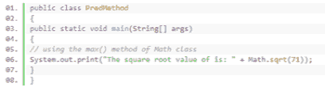

  图 3.7：Java 中预定义方法`sqrt()`的示例

*   **用户定义方法**：这类方法可以由程序员为了特定目的而定义。其语法如下：

```java
Int sumCal(int aNum)
{
    int K=aNum+10;// 方法体
    return K;// 返回语句
}
```

在代码块中，`int`是返回类型，`sumCal`是方法名，`aNum`是传递给方法的参数。在表 3.2 中，给出了 Java 方法的语法和示例：

  | 方法语法 | 方法示例 |
  | :--- | :--- |
  | `returnType methodName(){// 方法体}` | `int addNumbers(int a, int b){int sum = a + b;// 返回值 return sum;}` |

  表 3.2：Java 方法的语法和示例

Java 中的方法还可以分为以下几类：

* 静态方法
* 实例方法

### 静态方法

静态方法定义的第一行称为“签名”，它为方法和每个参数变量指定了名称。它还指定了每个参数变量的类型以及方法的返回类型。紧随签名之后的是方法体，封装在花括号中。它还可以包含一个返回语句。

静态方法的调用无非是方法名后跟其参数，参数之间用逗号隔开并括在括号中。

静态方法的属性如下：

*   它可以接受多个参数，因此可以有多个参数变量。
*   你可以在`.java`文件中定义任意数量的静态方法。这些方法是独立的，可以按照任何顺序出现在文件中。一个静态方法可以调用同一文件中的任何其他静态方法，或调用 Java 库中的任何静态方法（如`Math`）。
*   可以进行重载。
*   允许有多个返回语句。
*   它将向调用者返回单个返回值。
*   特别地，在静态方法中声明的变量的作用范围仅限于该方法体。因此，你无法在一个静态方法中引用另一个静态方法中声明的变量。

### 实例方法

对象包含的方法（即子程序）被称为实例方法。逻辑上，实例方法是对象的一部分。不是类方法的方法被称为实例方法。还可能存在两种类型的方法，定义在所示：

*   **抽象方法**：它没有方法体。它是不完整的。方法体将写在子类中。

  示例：`abstract void disp();`

*   **工厂方法**：根据工厂设计模式，定义一个接口（Java 接口或抽象类）来用于创建对象，并允许子类决定要实例化哪一个类。实际上，工厂方法负责对象的创建。

### 调用用户定义方法

要调用方法，我们必须先创建该类的对象，然后在对象名后使用点（`.`）运算符。在下面的示例中，图 3.8 中的`obj`是类`DEmoMethod`的对象引用。要访问成员函数`addNumbers()`，我们必须在对象名`obj`之后使用点（`.`）运算符。代码见图 3.9：

  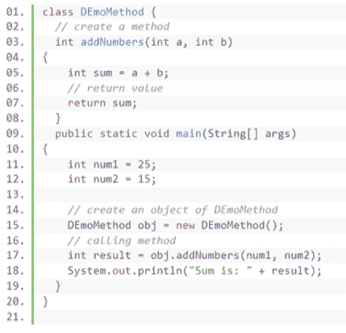

  图 3.8：Java 中用户定义方法的调用

### 构造函数

类拥有构造函数，用于根据类蓝图构建对象。构造函数的声明类似于方法声明，区别在于它们使用类名且没有返回类型。对象的实例变量由构造函数进行初始化。

构造函数的属性如下：

*   构造构造函数的名称必须与类名相同。
*   它们不返回值。
*   在创建对象时，构造函数会被隐式地触发（调用）。
*   构造函数用于初始化实例变量。
*   构造函数可以重载。
*   构造函数不能是静态的（static）。
*   构造函数不能是最终的（final）。
*   私有构造函数禁止用户显式地进行实例化。它可以禁用编译器向类中添加的默认构造函数。
*   后期绑定不适用于构造函数。
*   构造函数永远不会被继承。

下一节将解释构造函数的一些主要用法。首先，构造函数用于初始化实例变量。让我们通过图 3.9 中的两个示例来正确理解这一概念：

  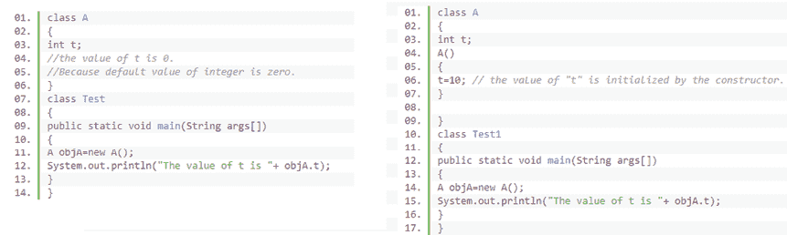

  图 3.9：Java 中构造函数的使用前后的对比

在图 3.9 的前述代码中，如果我们没有初始化实例变量`i`，它将根据数据类型取默认值。在第一列中，构造函数使用了零作为默认值。现在，在第二列中，我们使用了构造函数`A()`将初始化为 10。这实际上是默认构造。输出见图 3.10：

  

  图 3.10：构造函数的使用前后的对比

其次，当你创建对象时，构造函数会被隐式地调用。让我们看看图 3.11 中构造函数是如何被调用的：

  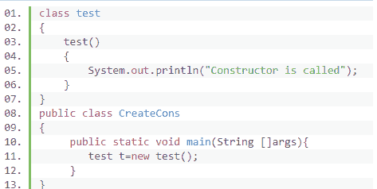

  图 3.11：构造函数的隐式调用

在图 3.11 的上述代码中，`test t = new test()`是创建`test`类对象的语句。现在可以看到，即使没有显式调用`test()`方法，`System.out.println("Constructor is called")`语句也会执行并产生输出。因此，在通过`test t = new test()`创建对象时，构造函数会被调用，见图 3.12。

  

  图 3.12：构造函数的隐式调用

### Java 中的构造函数类型

Java 中有两种类型的构造函数：

* 默认构造函数（无参数构造函数）
* 参数化构造函数

### 默认构造函数

你不需要为类提供任何构造函数，但必须小心。编译器为任何没有构造函数的类提供无参数默认构造函数。该默认构造函数会调用父类的无参数构造函数。在这种情况下，如果父类没有无参数构造函数，编译器将会，因此你必须验证它是否存在。如果你的类没有显式的父类，那么它有一个隐式的父类`object`，具有无参数构造函数。如果类中没有构造函数，编译器会自动创建一个默认构造函数，如图 3.13 所示：

  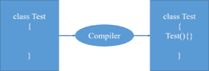

  图 3.13：Java 中默认构造函数的示例

默认构造函数用于为对象提供默认值，例如 0、`null`等，取决于类型。让我们考虑图 3.14 中的一个默认构造函数的示例：

  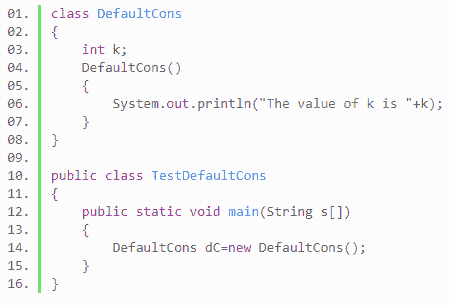

  图 3.14：Java 中默认构造函数的示例

在图 3.15 中，给出了前面代码的输出。


图 3.15：Java 中默认构造函数的实现输出

在图 3.15 的前述编码示例中，变量`k`的值通过隐式调用默认构造函数`DefaultCons()`初始化为零。

## 参数化构造函数

具有特定数量参数的构造函数称为参数化构造函数。参数化构造函数根据这些参数设置对象的属性。代码见图 3.16。

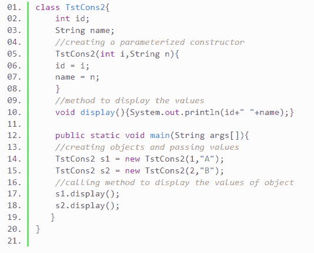

图 3.16：Java 中参数化构造函数的示例

在图 3.17 中，给出了前面代码的输出：


图 3.17：Java 中参数化构造函数的示例

在图 3.16 的前述示例中，使用`TstCons2(int i,String n)`在对象创建时（如`TstCons2 s1=new TstCons2(1,"A")`和`TstCons2 s1=new TstCons2(2,"B")`）自动设置对象属性`id`和`name`的值。输出见图 3.17。

## 构造函数重载

Java 中存在构造函数重载的概念。在 Java 类中可以存在同相同但参数声明不同的构造函数。这被称为构造函数重载。它们可以执行不同的任务。Java 编译器使用指定的参数列表来区分它们。源码见图 3.18：

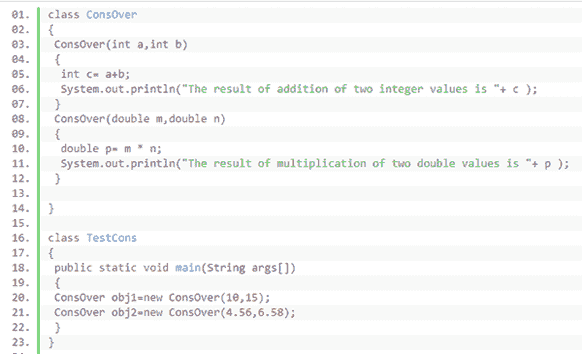

图 3.18：Java 中构造函数重载的示例

前面代码的输出见图 3.19：


图 3.19：Java 中构造函数重载的示例

在图 3.18 的前述代码中，构造函数`ConsOver()`被重载以执行不同的工作，例如赋值以及对两个类型分别为 integer 和 double 的数字进行加法和乘法。输出见前述图 3.19。

## Java 中的方法重载

在 Java 中，只要参数声明不同，就可以同一个类中定义两个或多个相同名的方法。发生这种情况时，这些方法被称为重载，该过程被称为方法重载。方法重载是 Java 称为多态的方法之一。一个简单的例子是`PrintStream`类的`print()`方法。表 3.3 描述了具有不同参数的`print()`方法：

| 方法（参数） | 意义 |
| :--- | :--- |
| print(char) | 打印字符。 |
| print(double) | 打印双精度浮点数。 |
| print(int) | 打印整数。 |
| print(String) | 打印字符串。 |

表 3.3：具有不同参数的`print()`方法描述，重载的方法可能在三个特征上有所不同：

*   参数类型：

    `void MultiDemo(int a, int b)`

    `void MultiDemo(double a, double b)`

*   参数数量：

    `int MultiDemo(int a, int b)`

    `int MultiDemo(int a, int b, int c)`

*   参数顺序：

    `void MultiDemo(int a, int b)`

    `void MultiDemo(int b, int a)`

示例：方法重载的源码见图 3.20：

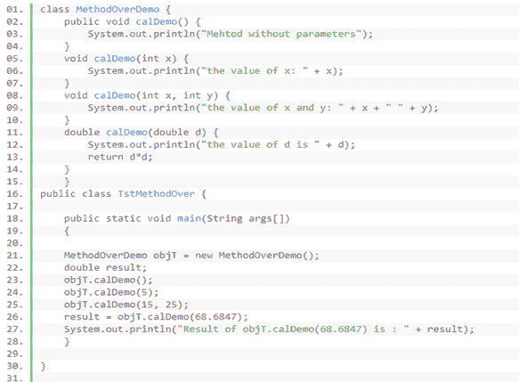

图 20：Java 中方法重载的示例

方法重载的输出添加在图 3.21 中。


图 21：方法重载的输出

方法`calDemo()`被调用了四次。第一个变不需要参数，第二个有一个参数，第三个两个参数，第四个一个 double 类型参数。在该程序中，方法重载的概念用于获取输入、显示它们的值并返回平方值。

## Java 中的 this 关键字

有时，方法需要引用调用它的对象。为了允许这一点，Java 定义了`this`关键字。`this`关键字可以在任何方法内部使用以引用当前对象。也就是说，`this`始终是对调用该方法的对象的引用。你可以在允许引用当前类对象的任何地方使用`this`。`this`关键字的源码见图 3.22：

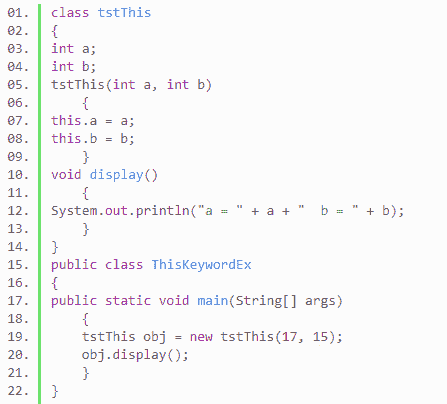

图 22：this 关键字的示例

输出见图 3.23：

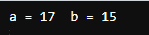

图 23：this 关键字的示例

在前面的代码中，`ConsOver()`构造函数被重载以执行不同的任务，例如赋值以及对两个类型分别为 integer 和 double 的数字进行加法和乘法。输出显示在前述的图 3.19。

*(注：由于原文文本最后部分存在重复和逻辑混乱，译文已根据上下文逻辑进行了对齐处理，保持格式一致)*

2. 错误

9. 方法重载需要多少个类？

1. 0
2. 1
3. 2
4. 3

10. 关键字`this`用于：

1. 调用当前对象
2. 调用类变量
3. 局部变量
4. 无

#### 答案

1. b
2. a
3. d
4. a
5. d
6. b
7. b
8. a
9. b
10. a

#### 参考

1. [`www.cs.swarthmore.edu/~newhall/unixhelp/Java_mem.pdf`](https://www.cs.swarthmore.edu/~newhall/unixhelp/Java_mem.pdf)
2. [`docs.oracle.com/javase/tutorial/java/javaOO/constructors.html`](https://docs.oracle.com/javase/tutorial/java/javaOO/constructors.html)
3. [`www.mygreatlearning.com/blog/constructor-in-java/`](https://www.mygreatlearning.com/blog/constructor-in-java/)


4. [`docs.oracle.com/javase/tutorial/java/concepts/object.html`](https://docs.oracle.com/javase/tutorial/java/concepts/object.html)

5. [`www.cs.umd.edu/~clin/MoreJava/Objects/absclass.html`](https://www.cs.umd.edu/~clin/MoreJava/Objects/absclass.html)

6. [`www.sciencedirect.com/topics/computer-science/concrete-class`](https://www.sciencedirect.com/topics/computer-science/concrete-class)

7. [`www.oracle.com/technical-resources/articles/java/singleton.html`](https://www.oracle.com/technical-resources/articles/java/singleton.html)

8. [`prutor.ai/singleton-class-in-java/`](https://prutor.ai/singleton-class-in-java/)

9. [`www.google.co.in/books/edition/Java_Programming_10_Minute_Solutions/9yCpzVNojBIC?hl=en&gbpv=1&dq=POJO+class+in+java&pg=PA290&printsec=frontcover`](https://www.google.co.in/books/edition/Java_Programming_10_Minute_Solutions/9yCpzVNojBIC?hl=en&gbpv=1&dq=POJO+class+in+java&pg=PA290&printsec=frontcover)

10. [`www.google.co.in/books/edition/Java_All_In_One_Desk_Reference_For_Dummi/3qONWf0SI10C?hl=en&gbpv=1&dq=Java+All-In-One+Desk+Reference+For+Dummies,+2nd+Edition&printsec=frontcover`](https://www.google.co.in/books/edition/Java_All_In_One_Desk_Reference_For_Dummi/3qONWf0SI10C?hl=en&gbpv=1&dq=Java+All-In-One+Desk+Reference+For+Dummies,+2nd+Edition&printsec=frontcover)

11. [`redirect.cs.umbc.edu/courses/undergraduate/202/spring12/constructors.pdf`](https://redirect.cs.umbc.edu/courses/undergraduate/202/spring12/constructors.pdf)

12. [`www.google.co.in/books/edition/JAVA_AND_OBJECTED_PROGRAMMING_PAR/wxTajapmFyMC?hl=en&gbpv=1&dq=types+of+constructor+in+java&pg=PA192&printsec=frontcover`](https://www.google.co.in/books/edition/JAVA_AND_OBJECTED_PROGRAMMING_PAR/wxTajapmFyMC?hl=en&gbpv=1&dq=types+of+constructor+in+java&pg=PA192&printsec=frontcover)

13. [`docs.oracle.com/javase/tutorial/java/javaOO/nested.html`](https://docs.oracle.com/javase/tutorial/java/javaOO/nested.html)

14. [`www.google.co.in/books/edition/Learning_Java/fu5HtixR8C?hl=en&gbpv=1&dq=method+overloading+in+java&pg=PA142&printsec=frontcover`](https://www.google.co.in/books/edition/Learning_Java/fu5HtixR8C?hl=en&gbpv=1&dq=method+overloading+in+java&pg=PA142&printsec=frontcover)

15. [`www.mit.edu/java_v1.6/www/api/java.PrintStream.html`](https://www.mit.edu/java_v1.6/www/api/java.PrintStream.html)

16. [`www.google.co.in/books/edition/JAVA_Programming/rkI8BAAAQJ?hl=en&gbpv=1&dq=method+overloading+features+in+java&pg=PA101&printsec=frontcover`](https://www.google.co.in/books/edition/JAVA_Programming/rkI8BAAAQJ?hl=en&gbpv=1&dq=method+overloading+features+in+java&pg=PA101&printsec=frontcover)

17. [`www.geeksforgeeks.org/factory-method-design-pattern-in-java/`](https://www.geeksforgeeks.org/factory-method-design-pattern-in-java/)

18. [`www.scaler.com/topics/design-pattern-in-java/`](https://www.scaler.com/topics/design-pattern-in-java/)

19. [`www.google.co.in/books/edition/Joy_with_Java/PSysEAAAQJ?hl=en&gbpv=1&dq=constructor+overloading+in+java&pg=PA161&printsec=frontcover`](https://www.google.co.in/books/edition/Joy_with_Java/PSysEAAAQJ?hl=en&gbpv=1&dq=constructor+overloading+in+java&pg=PA161&printsec=frontcover)

# 第 4 章：Java 中的数组、字符串和向量

## 引言

在本章中，我们将讨论数组、字符串和向量。在具备足够的类、方法和构造函数知识后，我们将介绍这些重要的概念。

## 结构

在本章中，我们将涵盖以下主题：

*   Java 数组
*   Java 字符串
*   Java 向量
*   `StringTokenizer` 类
*   包装类
*   自动装箱与自动拆箱

### Java 中的数组

数组是一种承载预定义数量单一类型的容器对象。在构造数组时，其长度是预定义的。图 4.1 展示了内存中的数组、索引和元素。

数组索引从 0 开始。数组的每个组件被称为元素，每个元素可以通过其唯一的整数索引进行检索，如图所示。作为一个示例，索引 3 将用于检索第二个元素。

### 在 Java 中创建数组

在 Java 程序中创建数组涉及以下三个不同的步骤：

1.  声明数组名称。
2.  创建数组。
3.  初始化数组值。

当引用数组元素时，我们在数组名后包含索引。例如，在图 4.2 中，代码`a[i]`指定数组元素`i`。例如，以下代码创建一个包含`n`个双精度浮点数的数组，并将全部设置为 0.0。

```java
double[] a = new double[n];
for (int i = 0; i < n; i++) {
    a[i] = 0.0;
}
```

存储在相邻内存地址的相同类型元素集合在 Java 中称为一维数组。索引从零开始。要创建一个整数数组，你可以写道：

数组的类型写为`type[]`（`int[]`），其中`type`是数据类型；括号`[]`表示这是一个数组。在图 4.3 中，给出了所有可能的有效语法：

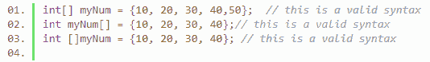

图 4.3: 整数数组的有效语法

## 一维数组

在前面的示例中，`int`是一个类型。`[]`表示数组，`myNum`是整数类型数组变量。前面的示例将创建一个一维数组，如表 4.1 所示：

| Index_no | 0 | 1 | 2 | 3 | 4 |
| :--- | :--- | :--- | :--- | :--- | :--- |
| Value | 10 | 20 | 30 | 40 | 50 |

表 4.1: 索引和值的数组表示

### 在 Java 中声明和初始化一维数组

以下是一维数组声明的语法。为一个一维数组赋值的源代码在图 4.4 中提供。

```
datatype[] arrayname = new datatype[arraysize];
```

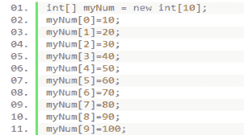

图 4.4: 整数数组的赋值

前面的代码将为数组`myNum`提供值，其表示形式如下方的表 4.2 所示：

| Index_no | 0 | 1 | 2 | 3 | 4 | 5 | 6 | 7 | 8 | 9 |
| :--- | :--- | :--- | :--- | :--- | :--- | :--- | :--- | :--- | :--- | :--- |
| Value | 10 | 20 | 30 | 40 | 50 | 60 | 70 | 80 | 90 | 100 |

表 4.2: 索引和值的数组表示

### 创建一维数组的代码

在下方的图 4.5 中，我们演示了一维数组的声明和初始化：

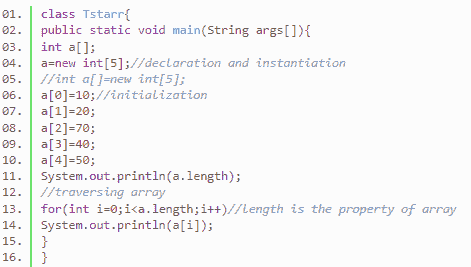

图 4.5: 创建一维数组的代码

### 访问数组元素

你可以通过引用索引来访问数组元素。例如，以下语句访问了`cars`中第一个元素的值：

```
String[] cars = {"Volvo", "BMW", "Ford"};
System.out.println(cars[0]);
```

你也可以借助循环来访问数组元素。可以使用`for`循环并使用`length`属性来指定循环运行的次数。

```
String[] cars = {"Volvo", "BMW", "Ford"};
for (int i = 0; i<cars.length; i++)
{
    System.out.println(cars[i]);
}
```

## Java 中的二维数组

数组的数组被称为多维数组。当你希望以表格形式存储数据（例如，带有行和列的表格）时，多维数组会很有帮助。将每个数组放在它自己的大括号对中以生成二维数组，如下方的代码所示：

```
int arr[][]={{1,2,3},
{4,5,6},
{7,8,9}
};
```

在前面的代码段中，`[][]`意味着我们将创建一个二维数组，`arr`是一个数组变量，`int`是一个数据类型。

```
int arr[][]=new int[3][3];
arr[0][0]=10;
arr[0][1]=20;
arr[0][2]=30;
arr[1][0]=40;
arr[1][1]=50;
arr[1][2]=60;
arr[2][0]=70;
arr[2][1]=80;
arr[2][2]=90;
```

为了初始化二维数组，我们必须使用行和列数作为索引值。要创建一个三乘三的数组，我们必须根据行和列索引指定 9 个值。前面的代码段演示了这一点，该二维数组名为`arr`。

在表 4.3 中，二维数组可以用带有行、列号和数组索引的表格形式表示：

| Col | 0 | 1 | 2 |
| :--- | :--- | :--- | :--- |
| Row | | | |
| 0 | 10 arr[0][0] | 20 arr[0][1] | 30 arr[0][2] |
| 1 | 40 arr[1][0] | 50 arr[1][1] | 60 arr[1][2] |
| 2 | 70 arr[2][0] | 80 arr[2][1] | 90 arr[2][2] |

表 4.3: 二维数组的表示

### 创建二维数组

在图 4.6 中，给了一个初始化二维数组的简单程序：

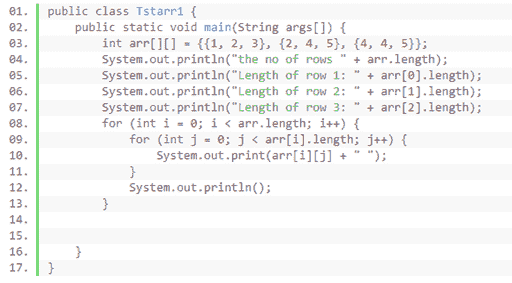

图 4.6: 创建一维数组的代码（注：原文为 one dimensional，此处应为二维）

输出在图 4.7 中提供：

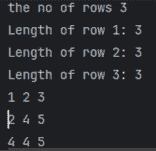

图 4.7: 一维数组的输出

### 数组的优缺点

**优点：**

- 使用索引，你可以随机访问任何元素。
- 大数据集处理简单。

**缺点：**

- 一旦定义，大小无法扩展。
- Java 只支持基本类型。

### 将数组传递给方法

数组可以按值传递给方法。在图 4.8 中，通过编程示例演示了这一点：

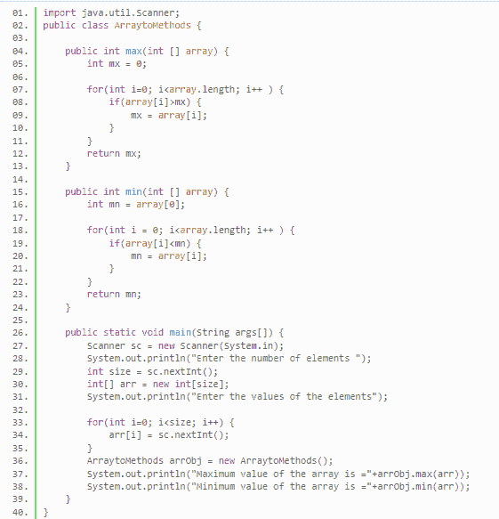

图 4.8: 传递数组的代码

输出在图 4.9 中提供：

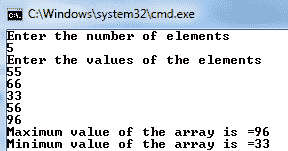

图 4.9: 传递数组的输出

### 将数组复制到另一个

我们经常需要复制数组来检查字符串是否为回文。为了判断字符串是否为回文，我们首先将字符串反转为字符数组，然后将其复制为`temp`。现在我们遍历字符数组并将每个元素放入另一个数组，如下：

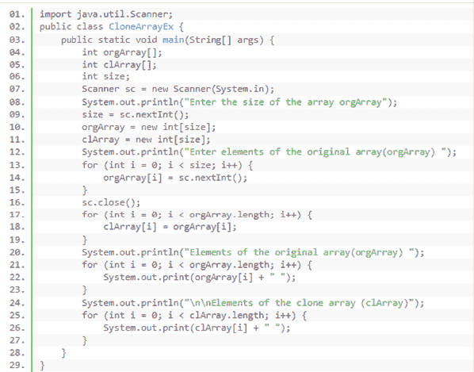

图 4.10: 复制数组的代码

输出在图 4.11 中：

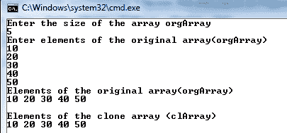

图 4.11: 复制数组的输出

### 使用数组进行矩阵乘法

在图 4.14 中，初始化了两个数组的值，然后使用一个新的二维数组来存储矩阵乘法的结果。接下来使用`for`循环打印结果。

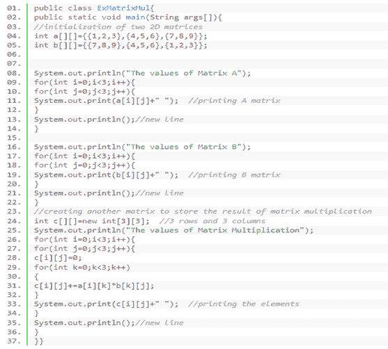

图 4.14: 使用数组进行矩阵乘法的代码

创建二维数组的输出在下方的图 4.15 中：

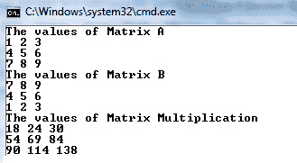

图 4.15: 二维数组的输出

### Java 中的 String

`String`包含双引号括的字符集合。例如，Sujoy。Sujoy 是`String`的示例。ABC 是`String`的示例。

### 使用字符串字面量创建字符串

Java 中使用双引号来产生字符串字面量。在构造字符串字面量之前，程序首先在字符串池中搜索具有相同值的`String`。如果找到了，则返回引用。否则，会在池中创建一个新的`String`并返回该引用。

例如：`String st1="ABCD";`

在接下来的表 4.4 中，给出了带有索引的字符串表示：

| 索引号 | 0 | 1 | 2 | 3 |
|---|---|---|---|---|
| STRING | A | B | C | D |

表 4.4：带索引的字符串表示

### 字符串字面量的内存表示

假设使用字符串字面量创建了三个字符串，如下所示所示：

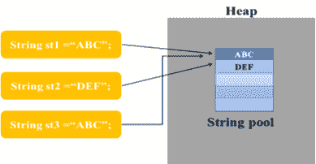

图 4.16：字符串的表示

首先，如果不存在包含 ABC 的对象，执行语句`String st1="ABC";`将创建一个包含 ABC 的新对象。接下来，如果不存在对象，执行语句`String st2="DEF";`将创建一个内容为 DEF 的新对象。现在，语句`String st3="ABC";`不会创建一个新对象，因为它会搜索现有的对象（找到了一个值为 ABC 的对象），如果存在该对象，它将仅仅指向该对象。在图 4.16 中描绘了这一概念。

### 带示例字符串方法

让我们假设如表 4.5 所示的以下字符串初始化代码。字符串字面量名称的赋值情况如下：

`String name="javaprogramming";`

| Index_no | 0 | 1 | 2 | 3 | 4 | 5 | 6 | 7 | 8 | 9 | 10 | 11 | 12 | 13 | 14 |
|---|---|---|---|---|---|---|---|---|---|---|---|---|---|---|---|
| Value | j | a | v | a | p | r | o | g | r | a | m | m | i | n | g |

表 4.5：带索引的字符串 name 的表示

现在，让我们通过详细示例演示一些重要的方法。考虑`Substring()`方法，如`name.substring(3)`。

它将返回从索引 3 到最后一个索引（即 14）的子字符串。输出在表 4.6 中：


## 字符串的 `substring()` 方法

考虑字符串 `name`，其内容为 `"aprogramming"`，索引如下表所示：

| Index_no | 3 | 4 | 5 | 6 | 7 | 8 | 9 | 10 | 11 | 12 | 13 | 14 |
|---|---|---|---|---|---|---|---|---|---|---|---|---|
| Value | a | p | r | o | g | r | a | m | m | i | n | g |

表 4.6：带索引的字符串 `substring()` 示例

现在考虑 `name.substring(3,8)`。这意味着索引从索引 3 开始到索引 7 结束，输出在表 4.7 中：

| Index_no | 3 | 4 | 5 | 6 | 7 |
|---|---|---|---|---|---|
| Value | a | p | r | o | g |

表 4.7：带索引的字符串 `substring(m,n)` 示例

#### 示例：`indexOf()` 方法

语句 `name.indexOf("g")` 将产生如表 4.7 所示的输出 `7`。它将返回 `g` 在字符串 `name` 中第一次出现的位置。

#### 示例：`replace()` 方法

假设我们定义了一个字符串 `String name="javaprogramming";`

现在，考虑语句 `name.replace('a','e');`。输出在表 4.8 中，该语句替换了所有的 `a` 为 `e`：

| Index_no | 0 | 1 | 2 | 3 | 4 | 5 | 6 | 7 | 8 | 9 | 10 | 11 | 12 | 13 | 14 |
|---|---|---|---|---|---|---|---|---|---|---|---|---|---|---|---|
| Value | j | e | v | e | p | r | o | g | r | e | m | m | i | n | g |

表 4.8：带索引的字符串 `replace('a','e')` 示例

#### 示例：`replaceAll()` 方法

`String name="javaprogramming";`

语句 `name.replaceAll("mm","dd")` 替换了所有的 `mm` 为 `dd`。输出在表 4.9 中：

| Index_no | 0 | 1 | 2 | 3 | 4 | 5 | 6 | 7 | 8 | 9 | 10 | 11 | 12 | 13 | 14 |
|---|---|---|---|---|---|---|---|---|---|---|---|---|---|---|---|
| Value | j | a | v | a | p | r | o | g | r | a | d | d | i | n | g |

表 4.9：带索引的字符串 `replaceAll("mm","dd")` 示例

现在，在下一节中我们将揭示 Java 中的创建字符串对象。语句 `String s1= new String("Hello Java");` 将字符串常量池中创建一个字符串对象。`s1` 是一个值为 `Hello Java` 的字符串类型对象。`new` 运算符在堆区域（Heap area）中创建对象，此时完成了内存分配。

## 字符串类的方法

字符串类中包含了检查字符串单个字符、比较字符串、搜索字符串、将字符转换为大写或小写的方法。如表 10 所示：

| 方法 | 返回值 | 示例 | 输出 |
|---|---|---|---|
| `charAt(int index)` | 返回指定索引处的字符 | `String st = "Java";char res = st.charAt(0);System.out.println(res);` | J |
| `equals(Object o)` | 将此字符串与指定对象比较 | `String st1 = "Java";Integer x = 15;System.out.println(st1.equals(x));` | false |
| `equalsIgnoreCase(String another)` | 将此字符串与另一个对象比较 | `String st1 = "Java";String2 = "java";System.out.println(st1.equalsIgnoreCase(String2));` | true |
| `compareTo(String another)` | 按字典顺序比较两个字符串 | `String st1 = "Java";String2 = "Program";System.out.println(st1.compareTo(String2));` | -6 |
| `compareToIgnoreCase(String str)` | 忽略大小写按字典顺序比较两个字符串 | `String st1 = "JAVA";String2 = "java";System.out.println(st1.compareToIgnoreCase(String2));` | 0 |
| `concat(String str)` | 将指定的字符串连接到此字符串的末尾 | `String st1 = "java ";String2 = "program";System.out.println(st1.concat(String2));` | java program |
| `copyValueOf(char[] data, int offset, int count)` | 返回等于指定字符数组的字符串 | `char[] st1 = {'T', 'o', 'e', 'r'};String st2 = "";st2 = st2.copyValueOf(st1, 0, 5);System.out.println("Returned String: " + st2);` | Tower |
| `endsWith(String suffix)` | 测试此字符串是否以指定的后缀结尾 | `String str = "java";System.out.println(str.endsWith("ava"));` | false |
| `hashCode()` | 返回此字符串的哈希码 | `String str1 = "Java";System.out.println(str1.hashCode());` | 2301506 |
| `indexOf(int ch)` | 返回指定字符在字符串中第一次出现的索引 | `String str = "Good Morning";intidx = str.indexOf("M");System.out.pritln(idx);` | 5 |
| `indexOf(String str, int fromIndex)` | 从指定索引开始，返回指定子字符串在字符串中第一次出现的索引 | `String str = "Good Morning";intidx = str.indexOf("Mor",5);System.out.println(idx);` | 5 |
| `indexOf(String str)` | 返回指定的子字符串在字符串中第一次出现的索引 | `String str = "Good Morning";System.out.println(str.indexOf("Morning"));` | 5 |
| `intern()` | 返回字符串对象的规范表示 | `String str = "Good Morning";System.out.println(str.intern());` | Good Morning |
| `getChars(int srcBegin, int srcEnd, char[] dst, int dstBegin)` | 将此字符串的字符拷贝到目标字符数组 | `String str = new String("Java Programming");char[] ch = new char[10];try{str.getChars(6, 16, ch, 0);System.out.println(ch);}catch(Exception ex){System.out.println(ex);}` | Programming |
| `getBytes()` | 根据平台的默认编码将此字符串转换为字节，并存入新数组 | `String str = "Good Morning";System.out.println(str.getBytes());` | [B@6acbcf0 |
| `getBytes(String enc)` | 根据指定的字符编码将此字符串转换为字节，并存入新数组 | `String str = "Good Morning";try {System.out.println(str.getBytes("UTF-16"));} catch (UnsupportedEncodingExceptionuEE) {System.out.println(uEE);}` | [B@723279cf |

| 返回值 | 方法 | 说明 | 示例 | 输出 |
| :--- | :--- | :--- | :--- | :--- |
| `int` | `lastIndexOf(int ch, int fromIndex)` | 返回此字符串中指定字符最后一次出现的索引，从指定的索引开始反向搜索。 | `String str = "Good Morning";System.out.println(str.lastIndexOf('n', 16));String str = "Good Morning";System.out.println(str.lastIndexOf('n',0));` | `10-1` |
| `int` | `lastIndexOf(int ch)` | 返回此字符串中指定字符最后一次出现的索引。 | `String str = "Good Morning";System.out.println(str.lastIndexOf('n'));` | `10` |
| `int` | `length()` | 返回此字符串的长度。 | `String str = "Good Morning";System.out.println(str.length());` | `12` |
| `String` | `replace(char oldChar, char newChar)` | 返回一个新的字符串，将该字符串中所有的 `oldChar` 替换为 `newChar`。 | `String myStr = "Good ";System.out.println(myStr.replace('o', 'p'));` | `Gppd` |
| `boolean` | `startsWith(String prefix, int toffset)` | 测试此字符串是否以指定的前缀开头。 | `String myStr = "Good ";System.out.println(myStr.startsWith("G",0));` | `true` |
| `boolean` | `startsWith(String prefix)` | 测试此字符串是否以指定的前缀开头。 | `String myStr = "Good ";System.out.println(myStr.startsWith("G"));` | `true` |
| `String` | `substring(int beginIndex, int endIndex)` | 返回一个作为此字符串子字符串的新字符串。 | `String str = "Java Programming";System.out.println(str.substring(5,9));` | `Prog` |
| `String` | `substring(int beginIndex)` | 返回一个作为此字符串子字符串的新字符串。 | `String str = "Java Programming";System.out.println(str.substring(5));` | `Programming` |
| `char[]` | `toCharArray()` | 将此字符串转换为新的字符数组。 | `String str = "Java Programming";char[] chArr1 = str.toCharArray();System.out.println(chArr1);` | `Java Programming` |
| `String` | `toLowerCase()` | 使用 `Locale.getDefault()` 返回的默认区域语言规则将此字符串中的所有字符转换为小写。 | `String str = "Java Programming";System.out.println(str.toLowerCase());` | `java programming` |
| `String` | `toString()` | 该对象（它已经是一个字符串了！） | `Integer x = 15;System.out.println(x.toString());System.out.println(Integer.toString(20));` | `1520` |
| `String` | `toUpperCase()` | 使用 `Locale.getDefault()` 返回的默认区域语言规则将此字符串中的所有字符转换为大写。 | `String str = "Java Programming";System.out.println(str.toUpperCase());` | `JAVA PROGRAMMING` |
| `String` | `trim()` | 删除此字符串两端的空白字符。 | `String s4=new String(" This ");System.out.println("After trim string is :"+s4.trim());` | `After trim string is :This` |

表 4.10：String 类方法的示例及输出

## String 类的不可变性

`String` 是不可变的。一旦创建了 `String` 对象，其内容就无法更改。下面的图展示了 `String` 类不可变性的示例：

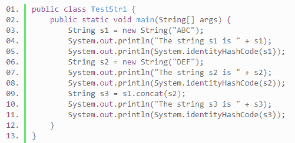

图 4.17：不可变字符串类的示例

在前面的图 4.17 中，我们已经证明了字符串一旦创建就无法更改。`String s1` 的内容一旦创建就永远不会改变。当创建一个新对象 `String s2` 时，将为其分配新的内存地址。即使我们调用 `concat()` 方法，也会分配新的内存位置。为了证明这一属性，我们使用了 `System` 类的 `identityHashCode()`，它返回对象的内存地址。


图 4.18：不可变字符串类的输出

在前面的图 4.18 中，`String s1` 的内存地址与 `String s2` 的内存地址不同，`1072408673` 与 `1531448569`。此外，语句 `String s3=s1.concat(s2)`并不指向之前创建的对象 `s1`，而是为 `String s3` 创建了新的内存。语句 `System.identityHashCode(s3)` 返回新的内存地址 `1867083166`，证明了 Java 中 `String` 是不可变的属性。

## 作为引用类型的 String

引用类型为用户提供了访问存储在内存中的项的方法，并持有这些对象的引用。`java.lang` 类型的子类包含了所有引用类型 `Object`。Java 的基本类型和引用类型在几个方面有所不同。表 4.11 给出了引用类型与基本类型的对比：

| 引用类型 | 基本类型 |
| :--- | :--- |
| 所有引用类型都是 `java.lang` 的子类。 | `boolean`, `byte`, `short`, `int`, `long`, `float`, `double`。 |
| 内存位置存储引用。 | 内存位置存储数据。 |
| 当引用类型赋值给另一个时，它复制引用。 | 当基本类型赋值给另一个时，它复制实际值。 |

表 4.11：引用类型与基本类型的对比

## StringBuffer 类

`StringBuffer` 是 `String` 类的类。它允许字符串被修改，因此在 Java 中可以使用字符串操作。`StringBuffer` 类定义在 `java.lang`。考虑 `st = new StringBuffer("Programming");`

前面的代码行创建一个值为 Programming 的 `String` 对象，其索引所示表 4.12：

| 索引 | 0 | 1 | 2 | 3 | 4 | 5 | 6 | 7 | 8 | 9 | 10 |
| :--- | :--- | :--- | :--- | :--- | :--- | :--- | :--- | :--- | :--- | :--- | :--- |
| 值 | P | r | o | g | r | a | m | m | i | n | g |

让我们考虑 `st.insert(11, "java")`，它将在索引 11 处插入字符串 `java`，修改字符串的内容。输出所示表 4.13：

| 索引 | 0 | 1 | 2 | 3 | 4 | 5 | 6 | 7 | 8 | 9 | 10 | 11 | 12 | 13 | 14 |
| :--- | :--- | :--- | :--- | :--- | :--- | :--- | :--- | :--- | :--- | :--- | :--- | :--- | :--- | :--- | :--- |
| 值 | P | r | o | g | r | a | m | m | i | n | g | j | a | v | a |

表 4.13：`insert()` 方法示例


语句`System.out.println(st.delete(0,4))`将删除从索引值 0 到 3 的字符并打印值。起始索引为 0，结束索引为 4。然而，Java 在删除时不包含结束索引。因此，它将删除从索引 0 到索引 3 的字符串。输出位于表 4.14：

| 索引 | 4 | 5 | 6 | 7 | 8 | 9 | 10 | 11 | 12 | 13 | 14 |
| :--- | :--- | :--- | :--- | :--- | :--- | :--- | :--- | :--- | :--- | :--- | :--- |
| 值 | r | a | m | m | i | n | g | j | a | v | a |

表 4.14：`delete()` 方法示例

## StringBuffer 方法示例

在下一节中，我们将展示一个小型示例，其中不同的方法被应用于 `StringBuffer` 对象以修改字符串的内容。


图 4.19：`StringBuffer` 类方法的示例

实现代码见以下图 4.19：


图 4.20：`StringBuffer` 类方法的实现输出

## String 类与 StringBuffer 类的比较

`String` 类与 `StringBuffer` 类之间的详细比较见表 4.15：

| String | StringBuffer |
| :--- | :--- |
| 它表示固定长度 | 它不表示固定长度。它是可增长 |
| `String` 是不可变的 | `StringBuffer` 是可变的 |
| Java 使用 `String` 类限制字符串的修改 | Java 提供了使用 `StringBuffer` 类更改字符串内容的灵活性 |

表 4.15：`String` 类与 `StringBuffer` 类的比较

## Java 中的 Vector

`Vector` 类似于动态数组，可以容纳任何类型和任意数量的对象。这些对象不需要是相同的类型。我们能够从 `vector` 中添加或删除对象。它可以同时处理 `double`、`float` 和 `integer` 对象。`vector` 具有重要的大小和容量属性。在图 4.21 和 4.22 中，我们描述了数组中不具备的 `vector` 特性。


图 4.21：尺寸增加的 `Vector` 类示例

如果我们声明一个容量为五的 `vector` 然后开始向其中添加元素。每个元素之后，`vector` 的大小都会增加一。现在，如果大小超过了容量，即如果我们想向 `vector` 添加第六个元素，这与数组是不可能的。在数组中，如果定义了大小，之后的元素将不再被插入。然而，如果我们添加第六个元素，`vector` 的容量将翻倍，即 10。在接下来的示例图 4.22 中，该数组被称为增长数组：


图 4.22：尺寸增加且容量翻倍的 `Vector` 类示例

## Vector 类方法

一些 `vector` 类方法列出如下：

* `add()`：用于向给定的 `vector` 中追加元素
* `addElement()`：用于将指定的组件添加到 `vector` 的末尾。
* `removeElement()`：用于从列表中删除指定的项
* `insertElementAt(item, n)`：在指定位置插入项。
* `copyInto()`：用于将 `vector` 的组件复制到指定的数组中。
* `size()`：用于获取给定 `vector` 中的组件数量。
* `clear()`：用于删除此 `vector` 中的所有元素。
* `capacity()`：用于获取此 `vector` 的当前容量。

## Vector 中的构造函数

在接下来的表 4.16 中，讨论了 Java 中 `vector` 可用构造函数的细节：

| 构造函数 | 细节 |
| :--- | :--- |
| `vector()` | 创建一个默认大小为 10 的空 `vector`。 |
| `vector(int initialCapacity)` | 创建具有指定初始容量的空 `vector`，且其容量增量为零。 |
| `vector(int initialCapacity, int capacityIncrement)` | 创建具有指定初始容量和容量增量的空 `vector`。 |
| `Vector(Collection<? extends E> c)` | 创建一个包含集合 `c` 中元素的 `vector`。 |

表 4.16：`vector` 类不同类型的构造函数

## Vector 类示例

图 4.23 是 `vector` 类的一个示例，使用了 `vector` 类的 `size()`、`capacity()` 和 `insert()` 方法来添加异构数据项 1,2,3,hii：


图 4.23：带有 `add()` 方法的 `Vector` 类示例

程序的输出见图 4.24：


图 4.24：带有 `add()` 方法的 `vector` 类输出

## Java 中 Vector 的优缺点

`Vector` 在多线程环境下使用是安全的，因为它是同步的。不需要担心设置一个可以容纳所有项目的初始大小，因为 `vector` 可以随着元素的添加或删除动态地增长或缩小。如果你需要处理使用 `Vector` 的旧 Java 代码，它是一个合适的选择，因为它从 Java 诞生起就是其一部分并且仍然受到支持。

`Vector` 的同步可能会导致其性能低于其他集合类型，例如 `ArrayList`。尽管 `Vector` 仍然可用，但可能更难找到它的示例和帮助，因为较新开发的 Java 代码经常使用更现代的集合类。如果你不需要同步功能，利用 `Vector` 的同步机制将增加代码的开销。

## StringTokenizer 类

文本处理通常包括解析格式化的输入字符串。解析是将文本划分为一组离散的部分或标记（tokens），这些标记在特定的顺序上可以传达语义含义。`StringTokenizer` 类提供了此解析过程的第一步，通常称为词法器（词法分析器）或扫描器。使用 `StringTokenizer`，你需要指定一个输入字符串和一个包含分隔符的字符串。分隔符是分隔标记的字符。分隔符字符串中的每个字符都被视为有效的分隔符。例如，`,;:` 将分隔符设置为逗号、分号和冒号。然后你可以像下面的命令所示创建 `StringTokenizer` 对象：

```
StringTokenizer st = new StringTokenizer(in, "=;");
```

一旦你创建了 `StringTokenizer` 对象，就可以使用 `nextToken()` 方法来提取连续的标记。`hasMoreTokens()` 方法在有更多标记需要提取时返回 true。

下图是一个创建 `StringTokenizer` 来解析键值对的示例：


图 4.25：`StringTokenizer` 类的代码示例

该程序的输出见下图：


图 4.26：`StringTokenizer` 类输出

## StringTokenizer 类方法描述

现在我们讨论 `StringTokenizer` 类的一些方法。其中一些如下：

* `int countTokens()`：使用当前的分隔符确定待解析的标记数量并返回结果。
* `Boolean hasMoreTokens()`：如果字符串中剩余一个或多个标记则返回 true，否则返回 false。
* `String nextToken()`：返回下一个标记字符串。

## 包装类

Java 中的包装类用于将基本类型（`int`、`char`、`float` 等）转换为相应的对象。八种基本数据类型 `byte`、`short`、`int`、`long`、`float`、`double`、`char` 和 `Boolean` 不是对象。包装类用于将基本数据类型转换为对象，例如 `int` 转换为 `Integer` 等。


图 4.27：转换为对象的包装类代码示例

基本数据类型到其对象表示的转换过程见图 4.27 和 4.28，并了一个生活示例。当从 Flipkart 购买手机时，它将到达一个包装器内部，我们可以认为手机基本数据类型（`int k`），包装器可以是该基本数据类型的对象表示（`iob`）。然后，在到达客户手中后，进行拆包以获得原始手机，这可以类比从对象到基本类的转换。对象表示对于某些数据结构非常重要，那里只有对象允许在数据结构上执行操作。


图 4.28：用于将对象类型转换为基本类型的包装类编码示例

在表 4.17 中，展示了与每个基本数据类型对应的包装类：

| 基本类型 | 包装类 |
| :--- | :--- |
| byte | `Byte` |
| boolean | `Boolean` |
| char | `Char` |
| double | `Double` |
| float | `Float` |
| integer | `Integer` |
| long | `Long` |
| short | `Short` |

表 4.17：基本类型及其对应的包装类类型

让我们在下一节通过示例讨论自动装箱和自动拆箱的概念。

## 自动装箱和拆箱

自动装箱（Autoboxing）是 Java 编译器在基本类型与其对应的对象之间完成的自动转换。自动装箱和拆箱功能自动地将基本类型转换为对象，将对象转换为基本类型。基本类型到对象的自动转换被称为自动装箱，反之则被称为自动拆箱。在图 4.29 中，语句`Integer iob=10;`将整数类型（基本数据类型）数据 10 隐式转换为其包装类对象`iob`。这是 Java 编程中自动装箱功能的示例。


图 4.29：自动装箱示例

## 总结

在本章中，从数组的最基础概念到字符串都展示了大量的编码示例。数组的声明和初始化过程已通过带有索引值对的图表进行了讨论。之后，通过示例对`String`详细讨论。以表格形式给出了用于`String`的不同重要方法并附示例以便更好地理解。然后，阐述了`String`的属性。通过示例讨论了`StringBuffer`类。不仅介绍了矢量类和包装类的概念，还通过编码示例讨论了相关方法。章节末尾增加了自动装箱和自动拆箱的内容。

在下一章中，将找到关于继承（Inheritance）概念的详细讨论。所有的继承类型都将通过图示进行讨论。将引入`this`、`super`和`final`关键字的概念。抽象类、接口和访问修饰符将结合源代码进行讨论。

## 练习

1. 用示例定义 Java 中的数组（布姆分类-1）
2. 比较并对比 Java 中字符串字面量（String Literal）和字符串对象（String object）（布姆分类-2）
3. 绘制创建字符串对象的内存框图。（布姆分类-3）
4. 用示例说明矢量类和对象的概念。（布姆分类-4）
5. 编写一个 Java 代码演示 Java 中的自动装箱和自动拆箱功能（布姆分类-5）

## 单选题

1. `int arr[]=new int[10];`，你可以存储多少元素？
   1. 0
   2. 1
   3. 10
   4. 11

2. `length` 是数组用于查找长度的属性。
   1. 正确
   2. 错误

3. `String st= "Good morning".` 字符串创建的过程被称为
   1. 使用 `String` 类
   2. 使用字符串变量
   3. 使用字符串字面量
   4. 无

4. `String str=" ABCDEF";`
   上述代码一定会创建一个新的字符串对象
   1. 正确
   2. 错误

5. `StringBuffer` 类是可变的。
   1. 正确
   2. 错误

6. `String st=new String("Java program");`
   使用上述编码语句创建了多少对象？
   1. 0
   2. 1
   3. 2
   4. 3

7. 包装类用于转换
   1. 基本类型到对象类型
   2. 对象类型到基本类型
   3. 基本类型到基本类型
   4. 对象类型到对象类型

8. `Vector` 是 ____。
   1. 一个数组
   2. 元素列表
   3. 一个可增长的数组
   4. `List`

9. `String obj=new String(" Java is a programming language");`
   如何找到对象`obj`的内存地址
   1. `length()`
   2. `IdentifyHashCode()`
   3. `concat()`
   4. 无

10. 什么是自动装箱？
    1. 将基本值（例如一个 `int`）转换为对应的包装类对象（`Integer`）被称为自动装箱。
    2. 将基本值（例如一个 `int`）转换为对应的包装类对象（`Float`）被称为自动装箱。
    3. 将基本值（例如一个 `int`）转换为对应的包装类对象（`Double`）被称为自动装箱。
    4. 将包装类（`Integer`）转换为基本值（例如一个 `int`）对应的对象被称为自动装箱。

## 答案

1. c
2. a
3. c
4. b
5. a
6. c
7. a
8. c
9. b
10. a

## 参考文献

1. c
2. a
3. c
4. b
5. a
6. c
7. a
8. c
9. b
10. a

# 访问修饰符

## 目标

本章的主要目标是提供从继承角度理解代码如何重用的概念。将以代码重用性为目标讨论继承的必要性。随后，将通过适当的图和源代码展示不同类型的继承。接下来，将通过示例介绍方法重写（Method Overriding）的概念。这对于理解同一个方法在不同情况下如何产生不同行为至关重要。将通过适当的示例解释与重写相关的最重要的概念——动态方法分发（Dynamic Method Dispatch）。然后，将演示如何使用`final`关键字以不同的方式保护继承。通过`final`类、`final`方法和`final`数据成员，可以限制继承属性。因此，学习者将学习如何使用`final`关键字的概念来限制继承属性。本章还将提供关于抽象类（Abstract Class）以及如何在 Java 中实现它以仅作为基类的简要介绍。在本章中，我们还将介绍继承的概念，以及它如何帮助在 Java 中实现多重继承。最后，将通过图示和示例讨论 Java 中可用的访问修饰符概念。

## 继承引言

在本节中，我们将通过一个非常简单的示例介绍继承的概念。根据定义，我们可以说当一个对象获取了父对象的所有属性和行为时，就称为继承。它提供了代码重用性。在接下来的图 5.1 中，给出了一个简单的代码示例：


图 5.1: 继承示例

以下是上述代码的输出：


图 5.2: 继承示例的输出

在前面的图 5.1 中，我们正尝试展示一个非常基础的生活示例，因为我们从父母那里继承了姓氏。在给示例中，姓氏被作为`String`类型的`lname`定义在基类`father`中。派生类`chld`继承了基类的属性`lname`，基类有一个属性`fname`。然后通过创建`chld`类的对象`c1`，我们将孩子的显示为`SubhajitAdhikari`。

接下来，下面的图表示了继承中使用的术语：


图 5.3: 继承中使用的术语

正如我们在图 5.3 中看到的，孩子从父亲那里继承属性。同样，在 Java 中，有两个类，例如：

* 父类（超类或基类）
* 子类（子类或派生类）

继承属性的类被称为子类，而属性被继承的类是使用`extends`关键字被称为父类。在接下来的图 5.4 中，演示了这一概念：


图 5.4: Java 中带语法的继承示例

在前面的图 5.4 中，有两个类：`Base`类和`Derived`类。该图还提供了如何在 Java 编程中实现继承的语法说明。`Derived`类使用`extends`关键字来继承`Base`类的属性和行为。在下一节中，将讨论继承中使用的重要术语。

## 继承中使用的术语

以下术语最适合描述继承：

* **子类 (Sub class)**：`Subclass`是继承另一个类的类。它也被称为派生类、扩展类或子类。
* **超类 (Super class)**：`Super class`是子类从中继承特征的类。它也被称为基类或父类。

`extends`关键字扩展一个类（表示类继承自另一个类）。现在，将在下一节中讨论 OOP 中继承属性的必要性。

## 继承的必要性

继承所需的第一个原因是，当一个类仅仅是另一个类的修改时，相同代码的重复最少。另一个原因是可以通过继承以下形式实现代码的本地化：


如果你在父类中修复漏洞，它会自动在子类中修复。

如果你在父类中添加功能，它会自动添加到子类中。

同一操作出现不同且不一致实现的几率更低。

在对继承的基本概念进行详细讨论后，我们现在将理解 Java 语言中可能的各种继承类型。

## Java 中的继承类型

Java 中存在四种继承类型，如下：

- 单继承 (Single inheritance)
- 多级继承 (Multi-level inheritance)
- 层级继承 (Hierarchical inheritance)
- 多重继承 (Multiple inheritance - 通过接口实现)

在本节中，我们将讨论前三种基本的继承类型以及它们的图示表示。你可以在图 5.5 中看到源代码：


图 5.5: 不同继承类型的示例

## 单继承

当一个类从其基类派生出来时，这种继承被称为单继承。在单继承中，只允许一个基类和一个子类。该概念在图 5.5 中进行了解释。源代码在接下来的图 5.6 中提供：


图 5.6: 单继承示例

以下是上述代码的输出：


图 5.7: 继承的输出

在前面的图 5.6 中，我们取了两个类，其中一个代表基类 `A`，一个代表派生类 `B`。基类 `A` 只有一个属性或数据成员，类型为 `String`，赋值为 `Fish` 并继承到派生类 `B` 中。在派生类 `B` 中定义的 `think()` 方法中通过继承的概念重用了数据成员 `st`。

## 多级继承

在这种继承类型中，派生类是从另一个派生类创建的，并可以有任何层级。多级继承是从另一个本身源自另一个类的类派生出来的过程，即一个具有多个父类但在不同层级源自它们的类。示例在接下来的图 5.8 中提供：


图 5.8: 多级继承示例

以下是上述代码的输出：


图 5.9: 多级继承的输出

多个子类可以使用一种名为层次继承（hierarchical inheritance）的继承来继承单个父类的方法和属性。由于层次继承，子类不需要担心单独开发父类已经可以访问的方法和属性。相反，它们只需要构造所属类特有的方法和属性。因此，代码冗余也减少了，因为很少出现重复。所以，层次继承使得代码更具重用性、减少冗余、模块化且易于理解。示例见以下图 5.10：


图 5.10: 层次继承的示例

以下是前述代码的输出：


图 5.11: 层次继承的输出

在之前的述示例图 5.10 中，`eat()` 方法在 `B` 和 `C` 等所有派生类中都是可用的。我们可以使用 `B` 和 `C` 的对象调用此方法，因此输出 `A is eating` 出现了两次。此外，类 `C` 有一个新方法 `join()`，根据继承的概念，我们也可以调用它。让我们讨论继承的优点。

## 继承的优点

继承有三个基本优点，例如：

- 代码重用性：通过继承，基类的公共方法可以在派生类中重用。
- 数据隐藏：基类的私有数据无法被派生类修改。
- 方法重写（Overriding）：通过继承，我们能够在派生类中重写基类的方法。

在对继承进行详细讨论后，下一节将讨论最相关的概念——方法重写。

## 方法重写

如果在父类和子类中定义了具有相同签相同方法，则被称为方法重写（method overriding）。在从子类调用时，始终会呈现子类的方法。假设我们知道 `Bank` 是一个提供获取利率功能的类。然而，利率根据不同的银行而异：`SBI`、`ICICI` 或 `AXIS`。这样，假设方法 `calInterest()` 可以被重写到三个类 `SBI`、`ICICI` 和 `AXIS` 中，具有相同的名称和签名以提供不同的利率。现在让我们讨论重写的规则。

## 方法重写的规则

以下是方法重写的规则：

- 方法名应相同。
- 参数列表应相同。
- 实现不同。
- 方法的返回类型相同。

方法重写的示例见以下图 5.12：


图 5.12: 方法重写的示例

以下是前述代码的输出：


图 5.13: 方法重写的输出

在之前的图 5.12 示例中，`disp()` 方法在基类 `A` 和子类 `B` 中分别定义了具有相同的名称和签名。当使用子类 `B` 的实例（即 `obj`）调用方法时，它重写了父类的方法。这就是为什么输出是 `In class B` 的原因，这是子类版本，而不是父类版本的 `disp()` 方法。

## 动态方法分派

父类引用变量可以指向子类对象。在运行时，Java 使用这一事实来解析对重写方法的调用。Java 根据运行时调用时所引用的对象类型来选择执行该方法的哪一个版本。当引用了多个类型的对象时，会调用重写方法的不同版本。动态方法分派的示例见以下图 5.14：


图 5.14: 动态方法分派的示例

以下是前述代码的输出：


图 5.15: 动态方法分派的输出

在之前的图 5.14 程序中，创建了一个名为 `A` 的父类以及它的两个子类，分别称为 `B` 和 `C`。子类 `B` 和 `C` 重写了在 `A` 中定义的 `disp()`。在 `main()` 方法内部，声明了类型为 `A`、`B` 和 `C` 的对象。还声明了一个类型为 `A` 的引用 `r`。程序随后将每个类型对象的引用赋值给 `r`，并使用该引用调用 `disp()`。如输出所示，执行的 `disp()` 版本取决于调用时所引用的对象类型。如果是由引用变量 `r` 的类型决定的，你将看到三次对 `A` 对象 `disp()` 方法的调用。

## super 关键字

如果你的方法重写了其父类的一个方法，你可以通过使用关键字 `super` 调用被重写的方法。你也可以使用 `super` 来引用隐藏的字段（尽管不建议隐藏字段）。它可以用于引用直接父类的方法。示例见以下图 5.16：


图 5.16: super 关键字的示例

以下是前述代码的输出：


图 5.17: super 关键字的输出

在之前的图 5.16 中，给出了 `super` 关键字的源码。我们可以看到子类 `B` 中的 `super.disp()` 调用了直接父类 `A` 的 `disp()` 方法。因此，输出是 `Inside class B` `Inside class A`。`super` 的另一个应用是调用父类的构造函数。调用父类构造函数的语法见图 5.18。然而，它必须是子类构造函数内部的第一行代码：


图 5.18: 调用父类构造函数的 super 关键字

以下是前述代码的输出：


图 5.19: 示例的输出

从之前的图 5.18 中，我们可以观察到父类构造函数 `super()` 的调用必须是子类构造函数的第一行。在子类 `B` 中，构造函数 `B()` 内部 `super()` 必须是第一行，第二行代码可以是任何内容，如 `String s="hii";`。

## final 关键字

对于类、属性和方法，`final`关键字是一种防止更改的非访问修饰符（无法继承或重写）。当变量（如 `PI`）应该始终存储相同的值时，`final`关键字非常有用（3.14159）。

`final`关键字相对于变量、类和方法的使用将在后续节中讨论。

## final 变量

如果你将任何变量标记为 `final`，则无法更改该变量的值。它是一个常量。示例见以下图 5.20：


图 5.20: final 变量的示例

以下是前述代码的输出：


图 5.21: final 变量的输出

## final 类

以下是上述代码的输出：


图 5.23: final 类的输出

你可能想这样做，原因如下：

- 为了通过防止系统颠覆来增加系统安全性，以及
- 出于良好的面向对象设计考虑。

**安全性**：创建一个类的子类，然后用它替换原始类，是黑客用来破坏系统的一种方法。虽然子类的外观和感觉与原始类相似，但它的运行方式大不相同，甚至可能造成损害或访问个人数据。你可以将你的类声明为 `final`，以阻止这种形式的颠覆，并结果导致停止任何子类的创建。正是由于这个原因，`String` 类是一个 `final` 类。该类必须确保每当方法或对象使用 `String` 时，接收到的都是精确的 `Java.lang.String` 而不是其他类型的字符串，因为它对 Java 平台的功能至关重要。这保证了任何字符串都不会具有任何特殊、不一致、不想要或意外的特征。

如果你尝试编译 `final` 类的子类，编译器将拒绝构建你的程序并产生错误信息。此外，Java 运行时系统会确保不会发生字节码级别的颠覆。通过确保一个类不是 `final` 类的子类，实现了这一点。

**设计**：一个类也可能为了面向对象的设计目的而声明为 `final`。你可能认为你的类是完美的，或者它不应该有任何子类。

## final 方法

类的一个或部分方法可以被指定为 `final`。如果一个方法不能被子类重写，则在方法定义通过 `final` 关键字指示。这是通过 `Object` 类实现的，该类有几个 `final` 方法。由于方法的实现不应被更改，并且对于维护对象的一致性至关重要，你可能希望将其声明为 `final`。示例见下面的图 5.24：


图 5.24: final 方法的示例

以下是上述代码的输出：


图 5.25: final 方法的输出

## 抽象类 (Abstract class)

被声明为 `abstract` 的类可能包含或不包含 `abstract` 方法。虽然它们不能从零创建，但抽象类可以被子类化。当创建一个抽象类的子类时，它通常会为父类的每个 `abstract` 方法提供实现。示例见下面的图 5.26：


图 5.26: 抽象类的示例

以下是上述代码的输出：


图 5.27: 抽象类的输出

抽象类具有以下属性：

- 抽象类必须用 `abstract` 关键字声明。
- 它可以拥有 `abstract` 方法和非抽象方法。
- 它不能被实例化。
- 它们不能被独立类使用。
- 它仅用于继承。
- 抽象方法不能有方法体。
- 抽象方法是在声明时没有提供实现的方法（不带大括号，并在后面跟一个分号）。
- 抽象方法必须在子类中定义。
- 它也可以有构造方法和静态方法。
- 它可以拥有 `final` 方法，这将强制子类不更改方法体。

现在，我们通过图 5.28 中的示例来演示抽象类可以拥有构造方法：


图 5.28: 带有构造方法的抽象类示例

以下是上述代码的输出：


图 5.29: 带有构造方法的抽象类的输出

在图 5.28 的上述代码中，使用抽象类 `A` 的构造方法 `A()`，我们可以使用 `this.a` 为变量 `a` 赋值，并可以用它来进行简单的乘法运算。在子类中，使用 `super(2)` 我们将变量的值传递为 `2`。然后在 `multiply()` 方法中，实际的乘法以 `this.a * val` 的形式发生，其中变量 `val` 在 `main()` 方法中的语句 `System.out.println("The multiplied value is "+a.multiply(3))` 中初始化为 `3`。因此，输出结果为 The multiplied value is 6。现在，我们将通过图 5.30 中的代码演示抽象类拥有静态方法：


图 5.30: 带有静态方法的抽象类示例

以下是上述代码的输出：


图 5.31: 带有静态方法的抽象类的输出

在图 5.30 中，有一个抽象类 `Shape`，它包含一个静态方法 `disp()`，子类 `CShape` 继承了基类 `Shape` 的属性。在子类中，使用语句 `super.disp()` 我们可以调用方法 `disp()`。因此，输出为 The color of the shape is Blue，这是写在父类 `Shape` 中存在的静态方法中的。

接口声明包含两个组成部分：`interface` 关键字和接口名称。根据 `public` 访问修饰符，接口可以被任何包中的任何类使用。如果你不指定它是 `public`，则你的接口将仅对声明在与其相同包中的类可见。接口定义中可以包含的另一个额外元素是父接口列表。其结构见图 5.32：


图 5.32：接口的语法

类可以扩展或子类另一个类，这与接口扩展其他接口类似。虽然接口可以扩展无限数量的接口，但类只能扩展一个另一个类。新接口扩展的所有接口都列在父接口列表中，并用逗号隔开。在图 5.33 中，给出了实现接口以及扩展类的不同方式：


图 5.33：接口示例

通过图 5.33

Java 仅通过接口支持多继承。代码示例见下图 5.34：


图 5.34：使用接口实现多继承的示例

以下是上述代码的输出：


图 5.35：多继承接口的输出

在图 5.34 的前述代码中，如果 `I` 和 `J` 是两个接口，语句 `class C implements I, J` 可以是一个有效语句。因此，一个类可以实现多个接口，支持 Java 中的多继承概念。接口 `I` 和 `J` 的属性和行为可以在类 `C` 中可用，因此方法 `void f()` 和 `void f1()` 在类 `C` 中作为子类被定义。现在使用类 `C` 的对象 `obj`，我们可以调用方法 `void f()` 和 `void f1()`，连续打印输出中的值如 "The value of a is 10" 和 "The value of b is 20"。

### 抽象类和接口的区别

让我们讨论一下表 5.2 所示的抽象类与接口之间的区别：

| 抽象类 | 接口 |
| :--- | :--- |
| 使用 `abstract` 关键字声明抽象类。 | 使用 `interface` 关键字声明接口。 |
| 抽象类可以有抽象和非抽象方法，还可以有默认和静态方法。 | 接口只能有抽象方法 |
| 抽象类可以包含非 final 变量。 | 变量默认是 final。 |
| 抽象类可以使用 `extends` 关键字扩展。 | 接口可以使用 `implements` 关键字实现。 |
| Java 抽象类可以拥有 `private`、`protected` 等类成员。 | Java 接口的成员默认是 `public` 的。 |
| 抽象类可以扩展另一个 Java 类并实现多个 Java 接口。 | 接口只能扩展另一个 Java 接口。 |
| 它不支持多继承。 | 它支持多继承。 |

表 5.2：抽象类和接口的区别

让我们在下一节中讨论 Java 中的访问修饰符。

### 访问修饰符

访问级别修饰符决定了其他类是否可以使用特定的字段或调用特定的方法。访问控制有两个级别：

- 在顶层级别：`public` 或包私有（无显式修饰符）。
- 在成员级别：`public`、`private`、`protected` 或包私有（无显式修饰符）。

类可以使用 `public` 修饰符声明，在这种情况下，该类对所有地方的所有类可见。如果一个类没有修饰符（默认值，也称为包私有），则它仅在自己的包内可见（你将在稍后的课程中学习它们）。

在成员级别，你也可以 `public` 修饰符或无修饰符（包私有），与顶层类相同。对于成员，两个额外的访问修饰符：`private` 和 `protected`。`private` 修饰符规定成员只能在类内部被访问。`protected` 修饰符规定成员可以在自己的包内（如包私有）被访问，此外还可以被另一个包中的子类访问。表 5.3 将根据包结构提供访问修饰符的细节。

| | PUBLIC | PROTECTED | DEFAULT | PRIVATE |
| :--- | :--- | :--- | :--- |
| 同一个类 | 是 | 是 | 是 | 是 |
| 同包内的子类 | 是 | 是 | 是 | 否 |
| 同包内的其他类 | 是 | 是 | 是 | 否 |
| 另一个包中的子类 | 是 | 是 | 否 | 否 |
| 另一个包中的非子类 | 是 | 否 | 否 | 否 |

表 5.3：访问修饰符类型

### 访问修饰符示例


在本节中，我们通过图片展示了 `public`、`protected`、`default`、`private protected` 和 `private` 等不同的访问修饰符。


图 5.36：`public` 访问修饰符示例

在图 5.36 中，我们可以观察到 `Base` 类的属性可以被同一个包内的子类或非子类访问，也可以被另一个包访问。


图 5.37：`protected` 访问修饰符示例

在图 5.37 中，我们可以观察到 `Base` 类的属性可以被同一个包内的子类或非子类访问（如包私有），但不能被另一个包中的非子类访问。


图 5.38：`default` 访问修饰符示例

在图 5.39 中，我们可以观察到 `Base` 类的属性只能被同一包中的子类访问，而不能被同一包中的非子类访问，其他包中的子类或非子类无法访问：


图 5.40：私有访问修饰符示例

在图 5.40 中，我们可以观察到 `Base` 类的属性无论在哪个包中，只能在类内部访问。

## 结论

在本章中，我们试图通过各种示例和图表涵盖 OOP 的许多重要概念，如继承、方法重写、动态方法分发、`super` 关键字、`final` 关键字、抽象类、`interface` 以及访问修饰符。本章将让读者了解继承属性的必要性。此外，如果需要使用 `final` 关键字，用户可以限制该属性的使用。抽象等重要概念可以通过详细分析，使用 `abstract class` 和 `interface` 来理解。OOP 中最重要的概念——访问修饰符以及不同访问修饰符的实际含义已通过表格呈现。最后，通过图表重新定义了访问修饰符的概念，以便读者更好地理解及其应用。

在下一章中，将演示多线程的概念。线程的创建方式也将在下一章中讨论。

## 习题

1. 定义 Java 继承中使用的术语（Bloom 等级-1）

2. 比较对比 Java 中的多级继承和层级继承。（Bloom 等级-2）

3. 画出多重继承的框图及其实现方式。（Bloom 等级-3）

4. 用示例说明方法重写的概念。（Bloom 等级-4）

5. 编写一个 Java 代码演示 Java 中动态方法分发的概念（Bloom 等级-5）

### 单选题

1. 在 Java 中实现继承需要哪个关键字？

    1. `implement`

    2. `extend`

    3. `super`

    4. `this`

2. 在 Java 中仅使用类可以实现多重继承。

    1. 正确

    2. 错误

3. 方法重写是 Java 实现以下概念的方式

    1. 编译时多态

    2. 运行时多态

    3. 抽象

    4. 数据隐藏

4. 方法重写需要

    1. 两个类

    2. 一个类

    3. 仅一个类

    4. 无

5. `Abstract` 类不能实例化。

    1. 正确

    2. 错误

6. 抽象方法是：

    1. 完整的

    2. 不完整的

    3. 定义在基类中的

    4. 无

7. `Interface` 规定了：

    1. 类必须做什么

    2. 类必须做什么以及如何做

    3. 类必须做什么，但不规定如何做

    4. 无

8. `Final` 变量用于你可以更改变量值的地方

    1. 正确

    2. 错误

9. `Final` 类的作用是：

    1. 限制类被进一步扩展

    2. 当它可以被子类化时

    3. 它在本质上是抽象的

    4. 用于实现继承概念

10. 公共访问修饰符用于：

    1. 基类可以被同一包中的子类和非子类访问

    2. 基类可以被其他包中的子类访问

    3. 基类可以被其他包中的非子类访问

    4. 以上均是

#### 答案

1. b

2. b

3. b

4. a

5. a

6. a

7. b

8. b

9. b

10. d

#### 参考

1. [`docs.oracle.com/javase/tutorial/java/javaOO/accesscontrol.html`](https://docs.oracle.com/javase/tutorial/java/javaOO/accesscontrol.html)

2. [`docs.oracle.com/javase/tutorial/java/IandI/final.html`](https://docs.oracle.com/javase/tutorial/java/IandI/final.html)

3. [`www.w3schools.com/java/ref_keyword_final.asp`](https://www.w3schools.com/java/ref_keyword_final.asp)

4. [`www.lscollege.ac.in/sites/default/files/econtent/Inheritance%20in%20java%2017%20june.pdf`](http://www.lscollege.ac.in/sites/default/files/econtent/Inheritance%20in%20java%2017%20june.pdf)

5. [`www.oreilly.com/library/view/javatm-how-to/9780133813036/ch10lev2sec18.html`](https://www.oreilly.com/library/view/javatm-how-to/9780133813036/ch10lev2sec18.html)

在 Java 中，同时运行多个线程的过程被称为多线程。最小的处理单元是线程，它是一个轻量级的子进程。为了实现多任务处理，多进程和多线程都得到了利用。由于线程使用共享内存空间，因此多线程优于多进程。不分配独立的内存区域具有两个优点：节省内存和减少线程上下文切换所花费的时间。大多数游戏、动画等都使用了 Java 多线程技术。假设某位权威人士想为 Java 构建一个实验室（LAB）。为此，需要开发者、画家、电工来完成三项不同的工作，即：

* 开发

* 绘画

* 布线

因此，我们可以将每项工作看作一项独立的任务。它被称为线程。在编程中，线程是一个轻量级进程。它可以被视为程序的独立流，如图所示：


图 6.1：多线程示例

下一节将解释线程生命周期的概念。

### 线程生命周期

在给定的时间点，线程只能处于一种状态。线程可以处于以下状态之一：

* **NEW**（新建）：尚未启动的线程处于此状态。

* **RUNNABLE**（可运行）：在 Java 虚拟机中执行的线程处于此状态。可运行线程的线程状态。处于运行状态的线程正在 Java 虚拟机中执行，但它可能正在等待系统的其他资源（如处理器）。

* **BLOCKED**（阻塞）：此条件是指线程在等待监视器锁时阻塞。等待监视器锁阻塞是线程状态。停滞的线程在进入同步块或函数之前正在等待监视器锁，或者在调用 `Object.wait` 后再次进入。

* **WAITING**（等待）：无限等待另一个线程执行特定动作的线程处于此状态。

* **TIMED_WAITING**（超时等待）：等待另一个线程执行动作的最长时间为指定等待时间的线程处于此状态。

* **TERMINATED**（终止）：已退出的线程处于此状态。

线程生命周期详见下图 6.2：


图 6.2：线程生命周期

下一节将概述线程创建的过程。

### 创建线程

要创建一个线程，可以使用线程类的对象实例化。然而，Java 定义了两种实现这一目标的方法：

* 你可以实现 `Runnable` 接口

* 你可以扩展 `Thread` 类本身

首先，介绍使用 `Runnable` 接口创建线程的方法。

### 使用 Runnable 接口创建线程

要实现 `Runnable`，类只需要实现一个名为 `run()` 的单方法，其声明如下：`public void run()`。在 `run()` 内部，你将定义构成新线程的代码，如下所示：

```java
class TstThrd1 implements Runnable{
    public void run(){
        System.out.println("TstThrd1 is running");
    }
}
```

在前面的代码示例中，在你创建一个实现 `Runnable` 的类 `TstThrd1` 后，你将在该类内部实例化一个 `Thread` 类型的对象。`Thread` 定义了几个构造函数。我们将使用的那个所示如下：

`Thread(Runnable threadOb)`：在这个构造函数中，`threadOb` 是实现 `Runnable` 接口的类的实例。这定义了线程执行的起始点。

```java
TstThrd1 th2=new TstThrd1();
Thread t1 =new Thread(th2);
```

新线程创建后，在调用它的 `start()` 方法之前，它不会开始运行，该方法定义在 `Thread` 内部。本质上，`start()` 执行了对 `run()` 的调用。`start()` 方法通过 `t1.start()` 被调用。在下表中展示了该过程：

```java
class TstThrd1 implements Runnable {
    public void run() {
        System.out.println("TstThrd1 is running");
    }
    public static void main(String args[]) {
        TstThrd1 th2=new TstThrd1();
        Thread t1 =new Thread(th2);
        t1.start();
    }
}
```

输出：


图 6.3：`Runnable` 接口示例

在下一节中，我们将通过示例概述如何通过扩展 `Thread` 类来创建线程。

### 扩展线程

创建线程的第二种方法是创建一个扩展 `Thread` 的类，然后创建该类的实例。扩展类必须重写 `run()` 方法，该方法是新线程的入口。它还必须调用 `start()` 来开始新线程的执行。在表 6.1 中演示了该过程：

| `import java.lang.Thread;` |

| `class Thrd1 extends Thread{public void run() {for(int i = 1; i<=5; i++) {System.out.println("Thread1" + " "+i);}}}}` | `class Thrd2 extends Thread{public void run(){for(int j = 1; j <=5; j++){System.out.println("Thread2" + " "+j);}}` | `class Thrd3 extends Thread{public void run(){for(int k = 1; k <=5; k++){System.out.println("Thread3" + " "+k);}}` |

| `public class TstThrd{public static void main(String args[]){Thrd1 th1 = new Thrd1();th1.start();Thrd2 th2 = new Thrd2();th2.start();Thrd3 th3 = new Thrd3();th3.start();}}` | 输出：`images/1.png)` |

表 6.1：`Thread` 类示例

在讨论了线程创建后，我们立即转向线程优先级及其实现方式。

### Runnable 接口与线程类的对比

在这一节中，我们将以分点的形式介绍 `Runnable` 接口与线程类的对比：

* **Java 不支持多继承**：当我们实现 `Runnable` 接口时可以扩展其他类，但当我们扩展 `Thread` 类时无法扩展其他类。因此，实现 `Runnable` 提供了扩展其他类的选项。建议使用 `Runnable`。

* **线程安全性**：当我们实现 `Runnable` 接口时，多个线程共享同一个对象，但当我们扩展 `Thread` 类时，每个线程都分配到一个独立的对象。

* **继承属性**：当我们扩展 `Thread` 时，会继承 `Thread` 类的所有特征，但当我们实现 `Runnable` 接口时没有进一步的特征，因为 `Runnable` 只有一个抽象函数 `run()`。因此，实现 `Runnable` 接口意味着执行轻量级操作。

* **接口的使用**：Java 建议面向接口编程。因此，我们实现 `Runnable` 而不是扩展线程。此外，`Thread` 类实现了 `Runnable`。

* **除非修改类的基本行为否则不要扩展**：只有当你想要更改 `run()` 方法和其他方法时，才扩展 `Thread` 类。如果你只想更改 `run()` 方法，实现 `Runnable` 接口是最佳选择，因为它只有一个抽象方法（`run()`）。除非要更改核心行为，否则不要扩展 `Thread` 类。

* **实现 Runnable 时的代码灵活性**：当我们扩展 `Thread` 首先会继承所有的线程特性，我们的类成为 `Thread` 的直接子类，因此执行的任何操作都在 `Thread` 类中。然而，当我们实现 `Runnable` 时，我们建立新线程并将运行对象作为参数传递，可以将运行对象传递给 `executorService`，并做更多事情。因此，使用 `Runnable` 时有更多的可能性，从而增加了代码的灵活性。

### 线程优先级

Java 为每个线程分配一个优先级，这规定了它相对于其他线程的处理方式。一个线程相对于另一个线程的相对优先级通过优先级表示，优先级是一个整数。

为了确定何时从一个运行中的线程切换到下一个线程，将使用线程的优先级。此时进行上下文切换是合适的。以下是确定是否发生上下文切换的简易指南：

*   线程可以主动放弃控制权。这通过显式 `yielding`（让出）、`sleeping`（睡眠）或在等待处理的 I/O 上阻塞（blocking on pending I/O）来实现。在这种情况下，将检查所有其他线程，并将 CPU 分配给就绪运行的高优先级线程。

*   线程可能会被高优先级线程抢占。在这种情况下，一个不让出处理器的低优先级线程无论正在执行什么，只会被高优先级线程直接抢占。基本上，只要有高优先级线程想要运行，它就会运行。这被称为抢占式多任务处理。

当两个优先级相同的线程竞争 CPU 周期时，情况会稍微复杂一些。对于 Windows 等操作系统，同优先级的线程会自动以轮询方式进行时间片划分。对于其他类型的操作系统，同优先级的线程必须主动向同级线程让出控制权。如果它们这样做，其他线程将无法运行。

### 设置线程优先级

线程调度器使用优先级来决定何时允许每个线程运行。高优先级线程比低优先级线程获得更多的 CPU 时间。线程优先级的数值范围是 1 到 10。`Thread` 类中定义了三个用于优先级的静态变量，如下：

*   `public static int MIN_PRIORITY`: 线程可以拥有的最低优先级。值为 1。

*   `public static int NORM_PRIORITY`: 线程在未显式定义时的默认优先级。值为 5。

*   `public static int MAX_PRIORITY`: 线程的最高优先级。值为 10。

Java 允许使用 `Thread` 的成员方法 `setPriority()` 来设置线程的优先级。

例如，`ThreadName.setPriority(intNumber);` /* `intNumber` 是设置线程优先级的整数值。*/

所以，你可以写 `ThreadName.setPriority(5);`

你也可以写以下内容：

*   `ThreadName.setPriority(Thread.MIN_PRIORITY);` 优先级设置为 1，或者

*   `ThreadName.setPriority(Thread.NORM_PRIORITY);` 优先级设置为 5

*   `ThreadName.setPriority(Thread.MAX_PRIORITY);` 优先级设置为 10

你也可以使用 `Thread` 的方法 `getPriority()` 获取当前优先级。例如，`System.out.println(th1.getPriority());`

在表 6.2 中，给出了实现优先级的概念：

| `import java.lang.Thread;` |

| :--- |


| `class Thrd1 extends Thread{public void run(){for(int i = 1; i<=5; i++){System.out.println("Thread1" + " "+i);}}}}` | `class Thrd2 extends Thread{public void run(){for(int j = 1; j <=5; j++){System.out.println("Thread2" + " "+j);}}}}` | `class Thrd3 extends Thread{public void run(){for(int k = 1; k<=5; k++){System.out.println("Thread3" + " "+k);}}}` |

```java
class Thrd1 extends Thread{
    public void run(){
        for(int i = 1; i<=5; i++){
            System.out.println("Thread1" + " "+i);
        }
    }
}
class Thrd2 extends Thread{
    public void run(){
        for(int j = 1; j <=5; j++){
            System.out.println("Thread2" + " "+j);
        }
    }
}
class Thrd3 extends Thread{
    public void run(){
        for(int k = 1; k<=5; k++){
            System.out.println("Thread3" + " "+k);
        }
    }
}
```

```java
public class Tst {
    public static void main(String[] args){
        Thrd1 th1 = new Thrd1();
        Thrd2 th2 = new Thrd2();
        Thrd3 th3 = new Thrd3();
        th1.setPriority(10);
        th2.setPriority(5);
        th3.setPriority(1);
        th1.start();
        th2.start();
        th3.start();
    }
}
```

- `void stop()`: 用于停止线程。
- `void notify()`: 用于向等待特定对象的某一个线程发送通知。
- `void notifyAll()`: 用于向特定对象的所有等待线程发送通知。

以下是两个重要的方法 `join()` 和 `isAlive()`，并已通过示例进行了描述。

## thread 中的 `join()` 和 `isAlive()` 方法

有两种方法可以判断线程是否已完成。首先，你可以在线程上调用 `isAlive()`。该方法由 `Thread` 定义，其通用形式所示：

```
final Boolean isAlive( )
```

如果调用它的线程仍在运行，则 `isAlive()` 方法返回 `true`。否则返回 `false`。虽然 `isAlive()` 偶尔很有用，但你更常用的用于等待线程完成的方法是 `join()`，所示如下：

```
final void join( ) throws InterruptedException
```

该方法会一直等待直到调用它的线程终止为止。它的名称源于调用线程等待指定的线程加入它的这一概念。`join()` 的其他形式允许你指定等待指定线程终止的最大时间。在表 6.4 中提供了这些示例：

| `import java.lang.Thread;class Thrd1 extends Thread{public void run(){for(inti = 1; i<=5; i++){System.out.println("Thread1" + " i is "+i);}}}` | `class Thrd2 extends Thread{public void run(){for(int j = 1; j <=5; j++){System.out.println("Thread2" + " j is "+j);}}}` |

| `public class TstThrd6{ public static void main(String args[]){Thrd1 th1 = new Thrd1();Thrd2 th2 = new Thrd2();th1.start();th2.start();System.out.println(th1.isAlive()); /* it will return true*/System.out.println(th2.isAlive());try{th1.join(); }catch(InterruptedExceptionie){} }}` |

| Output:.png) |

表 6.4：`Thread` 中 `join()` 和 `isAlive()` 的示例

现在，我们将从 `Thread.sleep()` 方法、重命名线程以及通过多线程执行单个任务方面提供四个线程编程示例。

## 带有正超时值的方法 `sleep()`

`Thread.sleep()` 会导致当前线程暂停执行指定的时间。这是为应用程序的其他线程或可能在计算机系统上运行的其他应用程序提供处理器时间的有效手段。

现在，我们将展示带有正超时值的 `sleep()` 源码：

```java
class TstThrd10 extends Thread{
public void run(){
for(int i=1;i<5;i++){
try{
if (i==3)
{
System.out.println("The thread is sleeping when the value of i is 3");
System.out.println("...........");
Thread.sleep(1500);
continue;
}
}}catch(InterruptedException e){System.out.println(e);}
System.out.println("The value of i is "+ i);
}
}
public static void main(String args[]){
TstThrd10 t1=new TstThrd10();
TstThrd10 t2=new TstThrd10();
t1.start();
t2.start();
}
}
```

代码的输出如下：

.png)

图 6.4：带有正超时值的 `sleep()`

在上述示例中，`Thread.sleep(1500)` 方法被用于暂停执行指定的 1500 毫秒。为了描述这种情况，当变量值变为 3 时我们使用语句 `System.out.println("...........")`，线程在输出中打印 ........... 后将暂停 1500 毫秒。

## 带有负超时值的方法 `sleep()`

`Thread.sleep()` 的参数值单位是毫秒，但不能为负数，否则会导致 `IllegalArgumentException`。示例如下：

```java
class TstThrd9 extends Thread{
public void run(){
for(int i=1;i<5;i++){
try{
if (i==3)
{
System.out.println("The thread is sleeping when the value of i is 3");
Thread.sleep(-500);
continue;
}
}
}catch(InterruptedException e){System.out.println(e);}
System.out.println("The value of i is "+ i);
}
}
public static void main(String args[]){
TstThrd9 t1=new TstThrd9();
TstThrd9 t2=new TstThrd9();
t1.start();
t2.start();
}
}
```

上一个程序的输出如下：


图 6.5：带有负超时值的 `sleep()` 标题

在上述的代码示例中，当变量 `i` 的值为 3 时产生异常。这是由于 `Thread.sleep()` 方法的负值 -500。

## 重命名线程的程序

以下程序演示了 `getName()` 和 `setName()` 方法的使用：

```java
class TstThread7 extends Thread{
public void run(){
System.out.println("Thread name is: " + getName());
}
public static void main(String args[]){
TstThread7 t1 = new TstThread7();
t1.start();
t1.setName("New-Name");
t1.start();
}
}
```

上一个程序的输出如下：


图 6.6：如何给线程命名

在程序中，有两个线程对象 `t1` 和 `t2`。通过 `getName()` 和 `setName()` 方法显示 Thread-0 和 Thread-1。现在我们使用语句 `t1.setName("Subhajit")` 设置名称，输出反映了变化。

## 多线程执行单个任务的程序

在以下编程示例中，多线程执行一个简单任务：

```java
class TstThread8 extends Thread{
public void run(){
System.out.println("Same task is doing");
}
public static void main(String args[]){
TstThread8 t1=new TstThread8();
TstThread8 t2=new TstThread8();
TstThread8 t3=new TstThread8();
t1.start();
t2.start();
t3.start();
}
}
```

上一个程序的输出如下：


图 6.7：多线程执行一个简单任务

在上述示例中，有三个线程 `t1`、`t2` 和 `t3` 执行相同的任务。通过线程类，我们创建了三个不同的线程对象。然后使用 `start()` 方法调用每个独立线程的工作。

## 线程同步

已经提到 Java 线程在相同的内存空间中运行，因此线程之间的通信很容易。线程间通信允许线程相互对话或相互等待。再次，由于程序中的所有线程共享相同的内存空间，两个线程可能会访问对象的相同变量和方法。例如，一个线程向共享对象中存储数据而另一个线程读取数据，如果第一个线程在第二个线程读取之前没有完成数据存储，就会出现同步问题。因此，我们需要确保一次只有一个线程进程访问数据。Java 为这种同步提供了独特的语言级支持。在本节中，我们将学习 Java 中如何实现同步机制和线程间通信。

为了解决临界区问题，一个常用的概念是监视器（monitor）。监视器是一个用作互斥锁的对象，称为 `mutex`。在任何时刻，只有一个线程可以拥有监视器。当一个线程获取锁时，被称为它进入了监视器。所有尝试进入已锁监视器的线程都将被挂起，直到所有线程退出监视器。然而，在 Java 中，并没有这样的监视器。事实上，所有的 Java 对象都有其与其关联的隐式监视器。在这里，关键字 `synchronized` 被用于指定哪些方法或语句块可以受到免受并发访问的保护。通过这种方式，当在考虑线程的情况下设计类时，类设计者决定了哪些方法不应允许并发执行。当带有 `synchronized` 方法的类被实例化时，新对象将获得它自己的隐式监视器。线程在 `synchronized` 方法内部期间，所有其他尝试调用同一实例上任何其他 `synchronized` 方法的线程都必须等待。为了退出监视器并将对象的控制权交给下一个等待线程，监视器所有者只需要从方法返回即可。

假设我们想要维护客户的银行账户。可能会发生多种交易，例如向账户存款某些金额和从账户提取某些金额等。现在，对于给定的账户，如果两个或多个交易同时发生，则每次只允许一次交易，而不是同时处理交易，这样永远不会发生数据不一致的情况。因此，我们需要对交易进行同步。

例如：下面的 Java 展示了银行中的交易如何并发执行：

```java
class AccDetail {

    public int Abalance;
    public int accNo;

    void disp Balance() {
        System.out.println(" The Acc No is " + accNo + " and The Balance is " + Abalance);
    }

    synchronized void deposit(int amt){
        Abalance = Abalance + amt;
        System.out.println( " The amount "+ amt + " deposited");
        dispBalance();
    }

    synchronized void withdraw(int amt){
        Abalance = Abalance - amt;
        System.out.println( " The amount "+ amt + " is withdrawn");
        dispBalance();
    }
}

class TransDeposit implements Runnable{
    int amt;
    AccDetail accountX;

    TransDeposit(AccDetail x, int amt){
        accountX = x;
        this.amt = amt;
        new Thread(this).start();
    }

    public void run(){
        accountX.deposit(amt);
    }
}

class TransWithdraw implements Runnable{
    int amt;
    AccDetail accountY;

    TransWithdraw(AccDetail y, int amt) {
        accountY = y;
        this.amt = amt;
        new Thread(this).start();
    }

    public void run(){
        accountY.withdraw(amt);
    }
}

class TransactionDemo{
    public static void main(String args[]) {
        AccDetail objAcc = new AccDetail();
        objAcc.Abalance = 5000;
        objAcc.accNo = 4568;
        System.out.println(" The account number is "+ objAcc.accNo );
        System.out.println(" The initial balance is "+ objAcc.Abalance );
        TransDeposit t1;
        TransWithdraw t2;
        t1 = new TransDeposit(objAcc, 500);
        t2 = new TransWithdraw(objAcc,900);
    }
}
```

上述程序的输出如下：


图 6.8: Java 应用展示了银行中交易是如何发生的

在前面的示例中，在 `AccDetail` 类中，关键字 `synchronized` 被用于 `void deposit()` 和 `void withdraw()` 方法，以便这两个方法永远不会在同一个对象实例上同时运行。`TransDeposit` 和 `TransWithdraw` 两个类实现了 `Runnable` 接口，并且使用了两次 `void run()` 方法来调用 `deposit()` 和 `withdraw()` 方法，以便以同步的方式完成从同一个账户进行存款和提款的两个任务。

## 线程间通信

线程之间有三种相互通信的方法。第一种是通过通用的共享数据。同一个程序中的所有线程共享相同的内存空间。如果一个对象可以被各种线程访问，那么这些线程共享对该对象数据成员的访问，从而相互通信。

线程通信的第二种方法是使用线程控制方法。有三种方法可以供线程相互通信：`suspend()`、`resume()`、`join()`。这些方法可以用于调用者线程等待被调用线程的完成。


线程通信的第三种方法是使用三个方法：`wait()`、`notify()` 和 `notifyAll()`；这些方法定义在 `java.lang` 包的 `Object` 类中。实际上，这三个方法提供了一种优雅的进程间通信机制来处理 Java 中的死锁情况。由于程序中存在多线程，当一个持有监器锁的线程被挂起或等待另一个线程完成时，可能会发生死锁。如果另一个线程正在等待进入同一个监器，两个线程都将永远等待。这三个方法的用法简述如下：

* `wait()`：此方法告诉调用线程放弃监器并让调用线程等待，直到发生超时或另一个线程调用了同一线程的 `notify()` 或 `notifyAll()` 方法。
* `notify()`：此方法唤醒在同一对象上调用了 `wait()` 的唯一（第一个）等待线程。
* `notifyAll()`：此方法将唤醒在同一对象上调用了 `wait()` 的所有线程。

## 结论

不同的现实应用实际上基于多线程。在本章中，概述了线程的概念。学习者将对线程有更好的理解，这对于在共享环境中工作非常有有用。本章还通过银行交易的小应用描述了线程同步的另一个概念，以展示它实际上是什么以及如何结合的。

### 示例问题

1. 用例子定义 Java 中的多线程（布鲁姆分类-1）
2. 比较并对比 Java 中的 `Thread` 和 `Runnable` 接口。（布鲁姆分类-2）
3. 绘制出线程生命周期的框图。（布鲁姆分类-3）
4. 用例子阐述线程同步和线程间通信。（布鲁姆分类-4）
5. 使用线程间通信的概念创建一个用于生产者-消费者问题的 Java 代码并提供解决方案。（布鲁姆分类-5）

### 单选题

1. 在 Java 中实现继承需要哪个关键字？
   1. 多个线程同时运行被称为 Java 多线程。
   2. 多个线程同时挂起被称为 Java 多线程。
   3. 同时运行一个线程被称为 Java 多线程。
   4. 挂挂起一个线程被称为 Java 多线程。

2. `Thread` 是一个 _______
   1. 类
   2. 对象
   3. 接口
   4. 方法

3. 使用 `Runnable` 接口在 Java 中使用的关键字 ___________。
   1. This
   2. Super
   3. Extend
   4. implement

4. `MIN_PRIORITY` 意味着
   1. 1
   2. 2
   3. 5
   4. 10

5. 如果被调用的线程仍在运行，则 `isAlive()` 方法返回 ______。
   1. True
   2. False

6. `notify()` 用于 ______
   1. 为等待特定对象的唯一线程发送通知。
   2. 向多个等待特定对象的线程发送通知。
   3. 不向仅一个等待特定对象的线程发送通知。
   4. 无

### 7. `join()` 方法 _____________

1. 不会等到调用它的线程结束为止等待。
2. 等到调用它的线程结束为止等待。
3. 等到它开始运行的线程开始运行为止等待。
4. 等到调用它的线程恢复执行为止等待。

### 8. `final` 变量用于可以更改变量值的地方

1. 正确
2. 错误

### 9. `yield()` 用于 _________。

1. 限制该类被进一步扩展
2. 当它可以被子类化时
3. 它在本质上是抽象的
4. 用于实现继承概念

### 10. `public` 访问修饰符用于：

1. 基类可以被同一包中的子类和非子类访问
2. 基类可以被其他包中的子类访问
3. 基类可以被其他包中的非子类访问
4. 以上所有

#### 答案

1. a
2. a
3. d
4. a
5. a
6. a
7. b
8. b
9. b
10. d

#### 参考

1. [`www.dspmuranchi.ac.in/pdf/Blog/JAVA%20thread.pdf`](http://www.dspmuranchi.ac.in/pdf/Blog/JAVA%20thread.pdf)
2. [`docs.oracle.com/javase/8/docs/api/java/lang/Thread.State.html#NEW`](https://docs.oracle.com/javase/8/docs/api/java/lang/Thread.State.html#NEW)
3. [`docs.oracle.com/cd/E19455-01/806-3461/6jck06gqj/index.html`](https://docs.oracle.com/cd/E19455-01/806-3461/6jck06gqj/index.html)
4. [`www.tutorialspoint.com/java/java_multithreading.htm`](https://www.tutorialspoint.com/java/java_multithreading.htm)
5. [`cse.iitkgp.ac.in/~dsamanta/java/ch6.htm`](https://cse.iitkgp.ac.in/~dsamanta/java/ch6.htm)
6. [`gacbe.ac.in/pdf/ematerial/18MCA32C-U3.pdf`](https://gacbe.ac.in/pdf/ematerial/18MCA32C-U3.pdf)
7. [`docs.oracle.com/javase/tutorial/essential/concurrency/sleep.html`](https://docs.oracle.com/javase/tutorial/essential/concurrency/sleep.html)
8. [`www.google.co.in/books/edition/1000_Java_Interview_Questions_and_Answer/_gyCDwAAQBAJ?hl=en&gbpv=1&dq=thread+class+vs+runnable_interface&pg=PT105&printsec=frontcover`](https://www.google.co.in/books/edition/1000_Java_Interview_Questions_and_Answer/_gyCDwAAQBAJ?hl=en&gbpv=1&dq=thread+class+vs+runnable_interface&pg=PT105&printsec=frontcover)
9. [`www.google.co.in/books/edition/Java_Professional_Interview_Guide/jwY_EAAAQBAJ?hl=en&gbpv=1&dq=thread+class+vs+runnable_interface&pg=PT159&printsec=frontcover`](https://www.google.co.in/books/edition/Java_Professional_Interview_Guide/jwY_EAAAQBAJ?hl=en&gbpv=1&dq=thread+class+vs+runnable_interface&pg=PT159&printsec=frontcover)
10. [`www.google.co.in/books/edition/PGT_Computer_Science_Comprehensive_and_C/6Mm1EAAAQBAJ?hl=en&gbpv=1&dq=thread+class+vs+runnable_interface&pg=PT121&printsec=frontcover`](https://www.google.co.in/books/edition/PGT_Computer_Science_Comprehensive_and_C/6Mm1EAAAQBAJ?hl=en&gbpv=1&dq=thread+class+vs+runnable_interface&pg=PT121&printsec=frontcover)

加入我们书籍的 Discord 空间

加入书籍的 Discord 工作空间，获取最新更新、优惠、全球科技动态、新发布以及与作者的交流环节：

# Java 中的异常处理 (#contents.xhtml_07)

加入书籍的 Discord 工作空间，获取最新更新、优惠、全球科技动态、新发布以及与作者的交流环节：[`discord.bpbon.com`](https://discord.bpbon.com) (images/fm1.png)

## 引言](#contents.xhtml_sc2)

每个人每天都会遇到问题。错误可能会导致错误的输出或终止执行。错误被分为两类。

## 结构](#contents.xhtml_sc2)

在本章中我们将涵盖

* 错误
* 异常
* `try-catch-finally` 块
* 异常的优势
* 分组与区分

## 目标](#contents.xhtml_sc2)

`public` 访问修饰符用于：基类可以被同一包中的子类和非子类访问；基类可以被其他包中的子类访问；基类可以被其他包中的非子类访问；以上所有。Java 语法对标点的要求非常。

## 错误](#contents.xhtml_sc2)

所有的语法错误都会被 Java 编译器检测并显示。这些错误被称为编译时错误。每当编译器显示错误，它就不会创建 `.class` 文件。因此，在成功编译和运行程序之前，我们需要修复所有错误。大多数编译时错误是由拼写错误引起的。常见问题：

## 编译错误](#contents.xhtml_sc3)

`... expected`：Java 语法对标点的要求严格。这种错误发生在你忘记在语句结尾加上分号或未平衡括号时。

```java
class TstErr1{
    public static void main(String s[]){
        System.out.println("Hello") // 错误，缺少分号
    }
}
```

`unclosed string literal`：字符串字面量必须包含在引号内。这种错误在你未能用引号结束字面量时就会发生。

```java
class TstErr3{
    public static void main(String s[]){
        String st="Hii;
        System.out.println(st);
    }
}
```

`illegal start of expression`：这种错误发生在预期有表达式但没有找到时：

* 在 `if` 条件后多了一个右括号：

  ```java
  if (a > b) ) // 错误，多了一个右括号
  ```

* 赋值语句没有提供右侧：

  ```java
  mx = ; // 错误，缺少右侧
  ```

`not a statement`：当语法正确的语句没有出现在要求的位置时，可以指出特定的错误类型：

* 写了没有赋值运算符的赋值语句：

  ```java
  a ; // 错误，缺少 =
  ```

* 拼写 `else` 错误：

  ```java
  if (a > b)
  temp = a;
  else ; // 错误，else 拼写错误
  ```

你没有收到预期的 `else`，因为你不需要创建 `else` 备选项，因此这看起来似乎不是一个好的语句。

## 关于标识符的错误

不同类型的解释如下：

* “无法找到符号”（cannot find symbol）错误：这最可能是编译时最常见的错误类型。`Java` 中的所有标识符在在使用之前必须先定义，标识符的声明和使用之间的不一致将导致此错误。请仔细检查标识符的拼写。用小写字母代替大写字母，或将字母 `O` 和 `l` 与数字 `0` 和 `1` 混淆是非常容易的：

  * “. . . 已在 . . . 中定义”(already defined in . . .)错误：标识符在同一个作用域内只能声明一次，所示：

    ```java
    int sum = 0;
    double sum = 0.0; // 错误，sum 已定义
    ```

  * “需要数组但发现了 . . ${(array required but . . . found）错误：此错误是由尝试对非数组变量进行索引操作引起的，所示：

    ```java
    int max(int a, int b) {
        if (a > b) return a;
        else return b[i]; // 错误，b 不是一个数组
    }
    ```

### 关于计算的错误

这些类型的错误结果是由语法上正确但违反了 Java 编程语言语义的代码生成的，具体到类型检查规则方面，所述如下：

* “变量 . . . 可能未初始化”（variable . . . might not have been initialized）错误：类中指定的实例变量会被分配一个默认初始值。相反，方法内部创建的局部变量没有，因此在使用之前必须对其进行初始化，无论是在声明中还是在赋值语句中，所示：

  ```java
  void disp(int v) {
      int d, e;
      d = 2;
      int h = 1;
      if(d == v) // 正确
      h = e; // 发现错误，e 未初始化
      else
      t = h;
  }
  ```

* “. . . 在 . . . 中无法应用于 . . ${(in . . . cannot be applied to . . .）错误：这种错误信息非常常见，由于方法调用与特定方法声明之间的不一致引起，所示：

  ```java
  void test(int k) { ... }
  m(15.15); // 错误，字面量类型为 double，而不是 int
  ```

* “运算符 . . . 无法应用于 . . . ,. ${(operator . . . cannot be applied to . . .）错误：虽然某些数值类型之间允许隐式类型转换，但运算符仅针对特定类型，所示：

  ```java
  int tm = 5;
  boolean tn = true;
  int ts = tm + tn; // 发现错误，不能相加布尔值
  double tm= tm + 1.4; // 正确，int 被隐式转换为 double
  ```

* “可能丢失精度”（possible loss of precision）错误：当尝试在使用显式类型转换的情况下将高精度值赋值给低精度变量时，发生此错误。有趣的是，浮点类型的字面量类型是 `double`，尝试将其赋值给 `float` 类型的变量会导致此警告，所示：

  ```java
  float sm = 0.0; // 发现错误，字面量不是 float 类型
  ```

  正确的做法是使用 `float` 类型的字面量或显式类型转换，所示：

  ```java
  float fsum = 0.0f;
  float fsum = (float) 0.0;
  ```

* “类型不兼容”（incompatible types）错误：Java 会检查表达式的类型与代码语句中赋值操作使用的变量类型是否兼容，如果它们不兼容，就会发生错误，所示：

  ```java
  Boolean bl = true;
  int at = bt; // 发现错误，不能将布尔赋值给 int
  ```

* “不可转换的类型”（inconvertible types）错误：在此类错误中，并非所有的类型转换都是合法的。示例如下：

  ```java
  boolean bt = true;
  int tx = (int) bt; // 发现错误，不能将布尔转换为 int
  ```

## 关于返回语句的错误

这些类型的错误与方法的结构及其返回语句有关；通常情况下，它们很容易修复，所述如下：

* “缺少返回语句”（Missing return statement）错误：当方法返回非 void 类型时，离开每条路径都必须有一个返回语句，尽管该路径可能无法执行，所示：

  ```java
  int max(int it, int jt) {
      if (it> jt) return it;
      else if (it<= jt) return jt;
      // 发现错误：当 i>j 和 i<=j 均为假时的路径该怎么办？!!
  }
  ```

* “缺少返回值”（Missing return value）错误：返回类型的方法必须包含一个正确类型表达式的返回语句，所示：

  ```java
  int fmax(int at, int bt) {
      return; // 发现错误，缺少 int 表达式
  }
  ```

* “无法从结果类型为 void 的方法返回值”（cannot return a value from method whose result type is void）错误：相反，void 方法中的 return 语句不能包含表达式，如下命令所示：


```java
void Ftest(int ta, int tb) {
    return ta + tb; // 错误，方法声明为 void
}
```

* “无效的方法声明；需要返回类型”（invalid method declaration; return type required）错误：除了构造函数外，每个方法都必须返回类型；如果不是，将出现此错误：

```java
fmax(int i, int j) {
```

* “不可到达的语句”（unreachable statement）错误：如果你在返回语句后编写语句，将发生以下错误：

```java
void test(int Tj) {
    System.out.println("Value is " + Tj);
    return;
    Tj++;
}
```

## 关于访问静态实体
`static` 修饰符意味着变量或方法与类关联，而不是与单个对象关联。通常，静态实体在 `Java` 中很少使用（常量声明除外），原因是编写为类的程序必须实例化至少一个对象。

* “静态变量 . . . 无法从静态上下文引用”（cannot be referenced from a static context）错误：由于 `main` 方法（是）静态的，因此类中引用的每个变量必须是静态的。未指定修饰符会导致编译错误，所示：

```java
class MyTest {

    int tm;

    public static void main(String[] args) {

        System.out.println(tm); // 发现错误

    }

}
```

* “静态方法 . . . 无法从静态上下文引用”（non-static method . . . cannot be referenced from a static context）错误：类似地，非静态性质的方法无法从像 `main` 这样的静态方法调用；原理稍显复杂。在不存在对象的情况下，从静态方法调用（非静态性质）的方法，所示：

```java
class MyTest {

    void m(int n) {}

    public static void main(String[] args) {

        m(50);

    }

}
```

在对不同类型的编译错误进行详细讨论之后，是介绍 `Java` 编程语言中可能的各种运行时错误的最佳时机。

### 运行时错误
在解释期间，`Java` 检测到运行时错误。然后，它抛出一个异常并输出堆栈跟踪，该跟踪显示了从主程序到产生异常的行的整个调用堆栈。以下代码尝试除以零。如果你执行图 7.1 中的代码，`Java` 将抛出异常。

```java
public class Main {

    public static void main(String[] args) {

        int a = 10;

        int b = 0;

        int c = a / b;

    }

}
```

从之前的输出中，我们可以获得异常的详细信息，例如类名（`TstExp`）、方法名（`main`）、文件名（`TstExp.java`）、行号（`8`）以及异常原因（`/ by zero`）。

以下是不同类型的错误：

### 关于越界的错误
大多数此类异常发生在尝试访问索引范围外的数组或字符串时，具体如下：

* `ArrayIndexOutOfRange` 错误：当尝试对数组 `a[i]` 进行索引，但索引 `i` 不在 `0` 到 `a.length`（包含边界）的范围内，就会抛出此异常，如下命令所示：

```java
int arr[] = { 10, 20, 30, 40, 50 };

for (inti = 0; i<= arr.length; i++)

System.out.println(arr[i]);
```

* `StringIndexOutOfRange` 错误：当 `String` 类的许多方法中，如果索引值不在 `0` 到 `s.length()`（包含边界）的范围内时，会抛出此异常，如下所示：
  注意：`s.length()` 是有效的，它表示字符串中最后一个字符之后的位置。

```java
String str = "JAVAPROGRAM";

System.out.println(str.charAt(30));
```

* 空引用（Dereferencing null）：当你声明一个引用类型的变量时，你只获得一个可以存储类对象引用的变量。此时，尝试访问类的字段或方法将导致引发 `NullPointerException` 异常。

### 关于计算的错误
当你尝试将字符串转换为数字，且字符串格式与数字不匹配时（例如 `12a3`），会发生以下三种异常：

* `InputMismatchException` 错误：此异常由 `Scanner` 类抛出，该类是 `Java` 编程语言第 5 版本引入的，用于使程序的面向字符输入变得简单。
* `IllegalFormatException` 错误：此异常由 `String` 类中的 `format` 函数抛出，该函数允许使用类似于 C 语言的格式说明进行输出。
* `NumberFormatException` 错误：此异常由 `Integer` 和 `Double` 等数值包装类中声明的方法抛出，特别是用于将字符串转换为原始数值类型的 `parseInt` 和 `parseDouble` 方法。
* `ArithmeticException` 错误：当你尝试除以零时，会引发此类型的异常。

### 关于内存不足的错误
现代计算机的内存非常大，因此在常规编程中不太遇到这种情况。尽管如此，它们可能作为其他错误的副作用。某些包括：

* `outOfMemoryError` 错误：如果内存耗尽，可能会抛出此异常。
* `StackOverFlowArea` 错误：栈用于存储每个被调用方法的激活记录；它包含了参数、局部变量以及返回地址等其他信息。无限递归会导致 `Java` 虚拟机耗尽栈空间。

### 关于程序执行的错误
要从环境内部或通过命令行执行解释器来解释 `Java` 程序，你必须编写：`java Test`，其中 `Test` 是包含 `main` 方法的类名。

注意：在大多数类中定义 `main` 方法是有帮助的，并利用它们独立地测试每个类。当类被组合成一个程序后，你只需要确保对带有真实 `main` 方法的类调用解释器。如果解释器未能发现并运行程序，可能会导致两种运行时错误。

* `NoClassDefFoundError` 错误：解释器必须能够找到包含 `main` 方法类的文件，例如 `Test.class`。如果没有使用包，它们必须放置在执行解释器的目录下。检查类名是否与不带扩展名的文件名匹配。大小写至关重要。首先你编译程序：`javac MyClass.java`，然后回溯该行并删除 `javac` 中的 `c` 以获取解释器的命令，如下所示：

```bash
java MyClass.java
```

然而，`MyClass.java` 并不是类名，因此你将收到此异常。要使用解释器，你必须移除 `.java` 扩展名，如下：

```bash
java MyClass
```


`NoSuchMethodFoundError` 错误 `main`：如果类中没有 `main` 方法，或者声明不完全正确，就会发生此错误：即 `static` 修饰符、返回值类型 `void`、小写的方法名 `main` 以及一个 `String[]` 类型的参数。在忘记 `public` 修饰符的情况下，会出现此信息 `Main method not public`。

让我们一个接一个详细阐述 `Exception`（异常）的概念、异常层次结构、异常类型、异常处理操作以及 `try-catch-finally` 块的示例。

exception（异常）一词是 exceptional event（异常事件）的缩写。异常是执行过程中破坏正常指令流的场景。当方法遇到错误时，该方法会产生一个对象并传递给运行时系统。该对象被称为异常对象，包含了有关错误的信息，例如错误的类型以及错误发生时的程序状态。抛出异常（Throw）是指创建异常对象并将其传递给运行时系统的行为。当方法抛出异常时，Java 运行时系统尝试寻找处理它的方法。处理异常可用集合是到达错误发生方法的调用方法有序列表。调用栈就是方法列表。


# 检查异常

除运行时异常（Runtime Exceptions）之外的所有异常类型被称为检查异常。编译器在编译时会检查，以确定程序员是否采取了必要的机制来处理这些异常。如果程序中没有处理或声明这些异常，将会发生编译错误。Java 中存在一些检查异常，如 `ClassNotFoundException`、`IOException`、`EOFException`、`FileNotFoundException` 和 `NoSuchMethodException`。图 7.6 展示了该示例：


图 7.6: 检查异常示例

上述代码的输出如下：


图 7.7: 检查异常的输出

在前面的示例中，我们可以看到 `FileNotFoundException` 在编译时发生了，因为指定位置不存在 `abc2.txt` 文件，并且这是一个检查异常。

# 未检查异常

运行时异常的一种类型也称为未检查异常。它们在编译时时不进行检查，因此由程序员负责采取必要步骤处理此类异常并实现安全退出。以下列了一些未检查异常：

*   `ArithmeticException`
*   `IllegalArgumentException`
*   `NumberFormatException`
*   `IndexOutOfBoundsException`
*   `ArrayIndexOutOfBoundsException`
*   `StringIndexOutOfBoundsException`
*   `NullPointerException`

在接下来的图 7.8 中，有一个源代码展示了未检查异常：


图 7.8: 未检查异常示例

在图 7.8 前面的示例中，由于除以零错误发生了一个 `ArithmeticException`，但程序可以正常编译，在运行时它会产生异常。这就是为什么它被称为未检查异常。在大多数情况下，未检查异常代表了不可恢复的编程逻辑错误。例如，如果你尝试使用一个未赋值对象的引用变量来访问对象，就会触发 `NullPointerException`。当你访问超出数组限制的数组元素时，会抛出类似 `IndexOutOfBoundsException` 类型的异常。这些是软件中必须解决的逻辑缺陷。未检查异常可以在程序执行过程的任何时候发生。Java 并不强制你创建代码来捕获未检查异常，以避免笨地误用 `try` 和 `catch` 代码块。在下一节中，将表格列出检查异常和未检查异常之间的区别。

# 检查异常与未检查异常的区别

在下面的表 7.1 中，根据异常的性质及其处理方式对检查异常和未检查异常进行了区分：

| 检查异常 | 未检查异常 |
| --- | --- |
| 编译器负责处理此类类型的异常。 | 编译器的任务是不检查此类异常。 |
| 继承自 `java.lang.Exception` 类 | 继承自 `java.lang.RuntimeException` 类 |
| 由代码本身处理 | 由代码处理 |
| 如果存在未处理的异常，程序无法编译。 | 即使存在未处理的异常，程序也能成功编译。 |

表 7.1: 检查异常与未检查异常的区别

# 用户定义异常

根据此语境，我们讨论了最重要的异常。Java 允许用户编写派自内置类的自定义异常类。`Exception` 类继承了 `Throwable` 类的所有方法。Java 包含了许多内置异常来处理常见错误，但另一方面，开发者可以设计称为自定义异常的唯一异常。开发者通过设计自定义异常来提高代码可读性、将业务逻辑与异常处理分离并处理异常情况。在下面的图 7.9 中，给出了用户定义异常的概念：


图 7.9: 检查异常示例

上述代码的输出如下：


图 7.10: 检查异常的输出

# 错误与异常的区别

学习错误和异常之间的基本区别对应的

| 错误 (Error) | 异常 (Exception) |
| --- | --- |
| 错误指定发生了某些影响。 | 异常是发生的事件 |
| 错误是未检查的 | 异常分为已检查和未检查的。 |
| 程序员无法恢复错误。 | 程序员可以借助纠正和必要的行动来控制这些场景。 |

表 7.2: Java 中错误与异常的区别

# 异常处理的操作

有与异常处理相关的五个关键字，分别是 `try`、`catch`、`finally`、`throws` 和 `throw`。为了在异常发生时处理异常，抛出异常的行将在 `try` 块内执行。`try` 块后面跟着一个或多个 `catch` 子句，子句包含处理异常的代码。每个 `catch` 子句都有一个关联的异常类型。当异常发生时，处理将在第一个匹配异常类型的 `catch` 子句处继续。`finally` 块是你放置无论是否发生异常都必须运行代码的地方。包含 `finally` 语句的代码块是防止资源泄漏的关键工具。在关闭文件或恢复资源的情况下，将代码放置在 `finally` 块中，以确保资源始终被恢复。

异常处理机制由以下三个操作组成：

*   **声明异常的操作**：根据规范，方法必须在方法签名部分指定该方法可能从方法体中抛出的检查异常类型，这通过借助 `throws` 关键字来实现。
*   **抛出异常的操作**：当 Java 操作遇到异常情况时，具有错误语句的方法应创建一个适当的 `Exception` 对象，并借助 `throw` 语句将该对象抛给 Java 运行时系统。

所有的 Java 方法都使用 `throw` 语句来抛出异常。包含 `throw` 的语句需要一个参数：一个 `throwable` 对象。

# 异常捕获的操作

当方法抛出异常时，JVM 会扫描调用堆栈以寻找所需的异常处理器。特定的异常处理器只能处理一种类型的异常。处理指定类的异常处理器也可以处理其子类。在那种情况下，如果在调用堆栈中没有找到（匹配的）异常处理器，应用程序将退出。

现在，在讨论了错误和异常的定义及类型之后，我们将介绍 Java 中 `try-catch-finally` 块块的概念。

## 使用 try-catch-finally 块进行异常处理

关于 `try` 块和 `catch` 块有一些重要的点，列举如下。程序员在创建应用程序时必须记住这些属性。

*   `try` 块可能会导致错误条件并抛出异常。
*   它可能包含一个或多个可能产生异常的语句。
*   紧接 `try` 块之后插入一个 `catch` 块。
*   在 Java 中，`try` 和 `catch` 块之间不允许有程序代码。
*   异常发生后的语句永远不会执行。
*   程序中可以存在嵌套的 `try` 块。如果内部 `try` 块没有任何 `catch` 语句，控制将传递给存在 `catch` 块的外部 `try` 块。
*   可以存在多个 `catch` 块。根据代码中出现的异常类型相应的调用 `catch` 块。

我们选择处理异常有两个目的：首先，它允许我们解决错误；其次，它停止程序的自动终止。现在，在下一节将连续给出 `try-catch-finally` 语句的实际源代码，以便更好地理解。

## 单 try-catch 块示例

在下面的图 7.11 中，展示了 `try…catch` 块的简单编码示例：


图 7.11：单 try-catch 块示例

上述代码的输出如下：


图 7.12：try-catch 块的输出

在图 7.11 的上述代码中，我们展示了一段源代码来处理运行时发生的错误，尝试在 `try` 代码块内部编写代码。在 `try…code` 块之后，包含一个 `catch` 子句，代表你想要捕获的异常类型。你必须注意到 `try` 代码块内部的程序代码 `System.out.println("This will not be printed")` 永远不会执行。

## 单 try-多 catch 块示例

图 7.13 中提供了一段短代码，演示了如何使用单个 `try-catch` 块处理多个异常：


图 7.13：带有多个异常的单 try-catch 块示例

上述代码的输出如下：


图 7.14：带有多个异常的单 try-catch 块的输出

在前面的图 7.13 中，一段代码抛出了多个异常，如 `ArrayIndexBoudsException` 和 `ArithmeticException`。为了处理这种情况，你可以使用两个或多个 `catch` 子句，每个处理不同的异常类型。在异常抛出时，会按照特定顺序检查每个 `catch` 语句，并执行第一个与异常类型相似的 `catch` 语句。如果执行了一个 `catch` 语句，那么其他 `catch` 语句将被跳过，例如 `catch(ArithmeticException e){System.out.println(e);}`，执行将在 `try-catch` 块之后继续。

## 嵌套 try-catch 块示例

图 7.15 提供的 Java 代码演示了如何使用嵌套 `try-catch` 块处理多个异常：


图 7.15：嵌套 try-catch 块示例

上述代码的输出如下：


图 7.16：嵌套 try-catch 块的输出

该程序在一个 `try` 块中嵌套了另一个 `try` 块。程序的运行如下：当使用命令行参数值零执行程序时，外部 `try` 块会产生除零异常，因为它将变量 `a` 的值初始化为 0。使用命令行参数 1 执行程序会在嵌套的 `try` 块内产生 `ArrayIndexOutOfBoundsException`。

## throw 关键字示例

在目前讨论的示例中，异常是在代码中捕获并由 JVM 抛出的。然而，在某些情况下可以通过 `throw` 语句显式地抛出异常。`throw` 语句的通用语法所示：

```
throw ThrowableInstance;
```

其中，`ThrowableInstance` 是 `Throwable` 类型的对象或 `Throwable` 类的子类。像 `int` 或 `char` 等数据类型不能被视为异常。同样，非 `Throwable` 类的 `String` 和 `Object` 也被视为异常。在图 7.17 中，给出了带有 `throw` 关键字的源代码：


图 7.17：throw 关键字示例

上述代码的输出如下：


图 7.18：throw 关键字输出

## throws 关键字示例

`throws` 子句用于指定在方法外部抛出的异常类型。如果引起异常的方法不想处理该异常，它必须为调用者方法使用 `throw` 关键字。`throws` 子句声明了方法可能抛出的异常类型列表。`throws` 关键字用于受检异常（checked Exceptions）。在图 7.19 中展示了该示例：


图 7.19：throws 关键字示例

上述代码的输出如下：


图 7.20：throws 关键字输出

从前面的示例可以得出，`FileNotFoundException` 是由 `main()` 方法抛出的。`main()` 方法没有处理该异常。它在运行时被处理。因此，我们可以得出 `throws` 关键字只能抛出受检异常

## throw 和 throws 关键字之间的区别

在下面的表 7.3 中，给出了 `throw` 和 `throws` 关键字的差异及语法：

| Throw | Throws |
| --- | --- |
| `throw` 关键字写在方法内部，用于在需要时逻辑上抛出异常。 | `throws` 关键字写在方法签名中。当方法包含某些导致异常的语句时，是必须。 |
| `throw` 关键字用于一次显式地只抛出一个异常。 | `throws` 关键字可以用于声明多个异常的列表，用逗号分隔。根据异常类型的出现情况，如果声明匹配，则自动抛出异常。 |
| `throw` 关键字用于未检异常（unchecked exceptions）。 | `throws` 关键字仅用于受检异常（checked Exceptions）。 |
| ```java
class TstExp7 {static void cal(int i){if (i==5){Throw new ArithmeticException("Termination");}else{System.out.println("Its ok");}}public static void main(String args[]) {try{cal(5);}catch(ArithmeticException e){System.out.println(e);}}}
``` | ```java
void calculation() throws ArithmeticException, NullPointerException{// 可能会出现异常的语句。throw new ArithmeticException();}
``` |

表 7.3：Java 中 throw 和 throws 关键字的区别

## Finally 关键字

如果一个方法在进入时打开文件并在退出时关闭它，就会出现问题。你不希望关闭文件的代码被异常处理机制跳过。`finally` 关键字正是为了解决这个问题设计的。`finally` 关键字产生一个代码块，该块会在 `try-catch` 块之后、后续代码之前执行。无论情况如何，是否抛出异常，`finally` 块都会运行。即使没有 catch 语句匹配异常，`finally` 代码块也会被执行。示例见下图 7.21：


图 7.21：Finally 块的示例

上述代码的输出如下：


图 7.22：Finaly 块的输出

## final, finally 和 finalize 之间的区别

`Final`、`Finally` 和 `Finalize` 之间的重要区别列在下方的表 7.4 中：

| Final | Finally | Finalize |
| --- | --- | --- |
| 它是一个关键字 | 它是一个代码块 | 它是一个方法 |
| 它限制了成员、方法或类的重写。 | 无论是否抛出异常，`finally` 块都会运行。即使没有 catch 语句匹配异常，`finally` 块代码块也会被执行。 | `finalize()` 只在垃圾回收之前被调用。 |
| 语法`Final int a=10;` | 语法`Finally{…}` | 语法`finalize(){..}` |

表 7.4：Java 中 Final、Finally 和 Finalize 关键字的区别

## 异常的优势

在下一节中，将用伪代码详细讨论异常的不同优势。

### 分离开错误处理代码的优势

异常允许你将发生异常情况时的具体处理方法与程序的主逻辑分离来。传统编程中的错误检测、报告和处理等机制经常会导致复杂的“面条代码”。考虑以下伪代码，它完全将文件读取到内存中：

```
Read_file {
opening the file;
determining its size;
allocating that much memory;
reading the file into memory;
closing the file;
}
```

异常允许你按照主流程编写代码，并处理异常情况。如果 `Read_file` 方法使用异常来代替传统的错误管理方案，代码看起来如下所示：

```
Read_file {
  try {
    opening the file;
    determining its size;
    allocating that much memory;
    reading the file into memory;
    closing the file;
  } catch (File_open_failed) {
    Do_something;
  } catch (Size_determination_failed) {
    Do_something;
  } catch (Memory_allocation_failed) {
    Do_something;
  } catch (Read_failed) {
    Do_something;
  } catch (File_close_failed) {
    Do_something;
  }
}
```


请注意，异常并不能免除检测、报告和处理错误任务上付出的努力，但它们有助于更有效地组织工作。

## 将错误向整个堆栈传播的优势

作为异常的第二个优势，它是将错误报告沿方法调用堆栈向上传播的能力。在下面的示例中，`Read_file` 方法被放在主程序创建的一系列嵌套方法调用的第三位置：

```
Methd1 {
call Methd2;
}

Methd2 {
call Methd3;
}

Methd3 {
Call_read_file;
}
```

在方法内部抛出的任何异常都可以被避免，允许调用堆栈中更靠的方法捕获它们。结果，只有与错误有关的技术需要关注错误检测，如下所示：

```
Methd1 {
  try {
    call Methd2;
  } catch (exception e) {
    Do_error_processing;
  }
}

Methd2 throws exception {
  call Methd3;
}

Methd3 throws exception {
  Call_read_file;
}
```

然而，如伪代码所示，避免异常需要在中间技术方面做出一些努力。方法可以抛出的任何检查异常都必须在它的 `throws` 子句中定义。

## 分组和区分错误类型

考虑到程序内部抛出的所有异常都是对象，异常的分组或分类是类层次结构的逻辑结果。`IOException` 及其后继类是 Java 平台 `java.io` 中指定的系列相关异常类的示例。最通用的异常是 `IOException`，它描述了 I/O 期间可能发生的任何类型的错误。它的后代表示更具体的错误。例如，`FileNotFoundException` 表示磁盘上无法找到文件。

方法可以通过编写特定的异常处理器来处理非常特定的异常。根据 `FileNotFoundException` 类没有后代的事实，指定的指定的处理机制只能处理一种类型的异常，如 `catch (FileNotFoundException e)`。

方法可以利用编写特定的异常处理器来处理非常特定的异常。根据 `FileNotFoundException` 类没有后代的事实，指定的指定的处理机制只能处理一种类型的异常，如 `catch (FileNotFoundException e)`。

... 异常处理器的能力是捕获所有 I/O 错误，例如 `FileNotFoundException`。

## 异常处理与方法重写

如果父类方法没有声明异常，子类重写方法不能声明检查异常。示例见下图 7.23：


图 7.23：子类重写方法尝试抛出检查异常的示例

上述代码的输出如下：


图 7.24：子类重写方法尝试抛出检查异常的输出

如果父类方法没有声明异常，子类的重写方法不能声明检查异常，但可以声明运行时异常。示例见下图 7.25：


图 7.25：子类重写方法尝试抛出运行时异常的示例

上述代码的输出如下：


图 7.26：子类重写方法尝试抛出运行时异常的输出

如果父类方法声明了异常，子类的重写方法可以声明相同的子类异常或异常，但不能声明父类异常。例如，在下方的图 7.27 中，子类重写方法声明相同的异常：


图 7.27：父类子类重写方法抛出相同类型异常的示例

上述代码的输出如下：


图 7.28：父类子类重写方法抛出相同类型异常的输出

## 结论

在本章中，学习者获得了关于错误和异常的详细信息，以及它们的类型、分类和处理操作。重要的概念如 `try-catch-finally` 块也是重要的讨论主题。最后是重写方法如何抛出异常类型。每个概念的示例都以简单的方式进行了阐述，以便更好地理解。

在下一章中，将讨论包（package）的概念以及包包的方法。还将介绍包的特性、优势及其应用。

## 示例题

1. 举例定义异常（Exceptions）的类型（布姆分类第 1 级）

2. 比较对比错误（Error）与异常（Exception）（布姆分类第 2 级）

3. 画出 Java 中异常的层级结构（布姆分类第 3 级）

4. 举例说明 Try-Catch-Finally 的概念。（布姆分类第 4 级）

5. 使用 Java 为登录 ID 和密码创建自定义异常（布姆分类第 5 级）

## 单选题

1. 错误（Errors）可以分为 ___ 种类型

   1. 0

   2. 1

   3. 2

   4. 3

2. 未关闭的字符串字面量错误是 _______ 错误？

   1. 运行时 (run time)

   2. 编译时 (compile time)

   3. 语法错误 (syntax error)

   4. 无

3. `Throwable` 类是 _____________

   1. 一个对象

   2. Java 语言中所有错误和异常的父类

   3. Java 语言中所有错误和异常的子类

   4. 一个构造函数

4. 当运行时错误发生时 _________

   1. Java 解释器在运行时遇到错误，它会抛出一个异常

   2. Java 编译器在编译时遇到错误，它会抛出一个异常

   3. Java 解释器在运行时遇到错误，它会抛出一个错误

   4. Java 编译器在运行时遇到异常，它会抛出一个错误

5. 当发生检查异常（checked exceptions）时：

   1. 你将得到编译错误

   2. 你将得到运行时错误

   3. 通过代码本身借助 try-catch 块或 throws 关键字进行处理

   4. 都是 (a) 和 (c)

6. `NumberFormatException` 是 _________

   1. 检查异常 (Checked exception)

   2. 未检查异常 (Unchecked exception)

   3. 一个错误 (error)

   4. 无

7. `finally` 块将执行

   1. 无论是否抛出异常

   2. 即使没有 catch 语句匹配异常

   3. 即使 catch 语句匹配了异常

   4. 都是 (a) 和 (b)

8. 异常处理的优势之一是

   1. 将错误处理代码与“普通”代码分离

   2. 将错误处理代码与“普通”代码合并

   3. 将错误向上层栈传递

   4. 不对错误类型进行分组和区分

9. 如果父类方法没有声明异常，子类重写方法不能声明检查异常。

   1. 正

   2. 错

10. 如果父类方法没有声明异常，子类重写方法不能声明检查异常，但可以声明未检查异常。

   1. 正

   2. 错

## 答案

1. c

2. b

3. b

4. a

5. d

6. b

7. d

8. d

9. a

10. a

## 参考文献

1. [`voyager.deanza.edu/~hso/cis35a/lecture/java13/intro/hier.html`](https://voyager.deanza.edu/~hso/cis35a/lecture/java13/intro/hier.html)

2. [`docs.oracle.com/javase/tutorial/essential/exceptions/definition.html`](https://docs.oracle.com/javase/tutorial/essential/exceptions/definition.html)

3. [`docs.oracle.com/javase/tutorial/essential/exceptions/advantages.html`](https://docs.oracle.com/javase/tutorial/essential/exceptions/advantages.html)

4. [`www.shahucollegelatur.org.in/Department/Studymaterial/sci/compsci/Exception%20Handling-converted%20new.pdf`](https://www.shahucollegelatur.org.in/Department/Studymaterial/sci/compsci/Exception%20Handling-converted%20new.pdf)

5. [`introcs.cs.princeton.edu/java/11cheatsheet/errors.pdf`](https://introcs.cs.princeton.edu/java/11cheatsheet/errors.pdf)

6. [`www.google.co.in/books/edition/How_to_Crack_Interviews_in_Java/EGJDDAAAQBAJ?hl=en&gbpv=1&dq=Difference+between+Error+and+Exception+in+java&pg=PA115&printsec=frontcover`](https://www.google.co.in/books/edition/How_to_Crack_Interviews_in_Java/EGJDDAAAQBAJ?hl=en&gbpv=1&dq=Difference+between+Error+and+Exception+in+java&pg=PA115&printsec=frontcover)

7. [`byjus.com/gate/difference-between-errors-and-exceptions-in-java/`](https://byjus.com/gate/difference-between-errors-and-exceptions-in-java/)

# 第 8 章 Java 中的包创建

## 介绍

包是 Java 中的一个基本概念。Java 使用包来消除名称冲突，并管理对类、接口和枚举的访问。Java 平台拥有丰富的类库（包的集合），这些类可以在你的应用程序中使用。该库被称为应用程序编程接口（API）。它的包涵盖了与通用编程相关的最典型任务。例如，一个 `String` 对象包含字符字符串的状态和行为；一个 `File` 对象允许程序员轻松地在文件系统上创建、删除、检查、比较或修改文件；一个 `Socket` 对象允许网络套接字的创建和使用；各种 GUI 对象则控制按钮、复选框和其他图形用户界面的其他方面。有成百上千的课程可供选择。这使你作为程序员能够专注于你特定应用程序的设计，而不是为了实现它而所需的基础设施。

## 结构

在本章中，我们将涵盖以下主题：

* 包的定义

* 包的重要性

* 包的特性

* 包的类型

* Java 包的关键考虑因素

* 使用包的计算器程序

## 目标

本章讨论了包设计的的基本思想、包创建的规则、包特性、Java 编程中使用的包类型（内置包和自定义包）、使用 `-d` 选项的编译过程以及一个使用包的计算器应用程序。此外，学习者将通过使用借助包设计的计算器程序来获得实践经验。现在，为了开始讨论，我们在下一段中选择了包的定义。

## 包的定义

包（Package）是一组链接类型的集合，提供了命名空间管理和访问控制。请记住，“类型”一术语包含了类、接口、枚举和注解类型。在 Java 中，相似的类被分组在包中。这让你联想到文件系统目录中的文件夹。通过使用包，我们可以减少命名冲突并创建更可靠的代码。

## 创建包的规则

创建包的规则如下：

* 为了防止与类或接口名称发生冲突，包名由全小写字母组成。

* 公司利用其反转的 Internet 域名作为包名的开头，例如由 `abc.com` 的程序员编写的名为 `mypack` 的包，命名为 `com.abc.mypack`。

* 组织内部的命名冲突必须通过内部约定管理，例如在公司名称后添加地区或项目名称（例如 `com.abc.reg.mypack`）。

* Java 程序中的包必须以 `java` 或 `javax` 开头。

* 在某些情况下，互联网域名的域名可能不作为可接受的包名。如果域名包含连字符或其他特殊字符，就会发生这种情况。如果包名以数字或其他禁止作为 Java 名称首字符的字符开头，或者如果包名包含 Java 保留关键字（如 `int`）。在这种情况下，建议的规范是使用下划线。下表所示：

| 域名名称 | 包名前缀 |

| :--- | :--- |

| `abc-name.example.org` | `org.example.abc_name` |

| `abc.int` | `int_.abc` |

| `123name.abc.com` | `com.abc._123name` |

表 8.1：包名的表示

现在，我们将讨论包的特性及其对应用开发有用的原因。

## 包的重要性

在 Java 中使用包的益处如下：

* 包将类组组织成单一的 API 单元。

* 它将控制命名冲突。

* 访问保护将变得更容易。`protected` 和 `default` 是对包的访问级别控制。

* 易于定位相关类。

* 重用包中的现有类。

## 包的特性

以下是包的特性：

* 每一个类都是某个包的一部分。

* 一个文件中的所有类都属于同一个包。

* 你可以使用包声明来指定包。

* 包名作为文件中的第一行（非注释行）。

* 多个文件可以指定同一个包名。

* 如果未指定包，文件中的类将进入一个特殊的未命名包（所有文件共用同一个未命名包）。

* 如果指定了包名，文件必须位于名为 `name` 的子目录中（即目录名必须与包名匹配）。

* 你可以使用以下方式访问另一个（具名的）包中的公共类：

  下文给示例：

  `package-name.class-name`

  * 你可以使用以下方式访问此类类的公有字段和方法：

    `package-name.class-name.field-or-method-name`

  * 你可以使用以下方式避免包含包名：

    `import package-name.*;`

    或者

    `import package-name.class-name;`

  在文件的开头（包声明之后）。前者导入包中的所有类，后者只导入指定的类。你仍然必须使用 `class-name` 来访问包中的类，并使用 `class-name.field` 或 `method-name` 来访问类的字段和方法；唯一可以省略的是包名。

在下一节中，将通过适当的示例讨论不同类型的包。

## 包的类型

包分为两类，列如下：

* 内置包（来自 Java API 的包）

* 用户定义包（创建你自己的包）

让我们继续学习 Java 语言提供的内置包的基本概念。

## 内置包

内置包来自 Java API。Java API 是 Java 开发环境中可用的预定义类库。一些常用的内置包如下：

* `java.lang`：封装了基础类

* `java.io`：输入输出函数类的集合

* `java.awt`：抽象窗口工具包类的集合

* `java.swing`：窗口应用程序 GUI 工具包类的集合

* `java.net`：网络基础设施类的集合

* `java.util`：集合框架类的集合

* `java.applet`：创建 applet 类的集合

* `java.sql`：相关数据处理类的集合

## 导入内置包

要导入内置包，你应该编写语句 `import java.util.Scanner;`。

这里给出了上述语句的组成部分：

* `Java` 是顶层包

* `Util` 是子包

* `Scanner` 是存在于子包 `util` 中的一个类

一个简单的程序包示例所示：

```java
import java.util.Scanner; // 导入 Scanner 类

class tstPDPack {
    public static void main(String[] args) {
        Scanner mobj = new Scanner(System.in); // 创建对象
        System.out.println("Enter the name");
        String urName = mobj.nextLine(); // 读取用户输入
        System.out.println("My name is: " + urName); // 输出输入
    }
}
```

文件名应为 `tstPDPack.java`。`Scanner` 类是 `java.util` 的，用于捕获用户输入。在示例中使用了 `nextLine()`，它可以读取字符串。图 8.1 展示了这一点。

## 用户定义包

用户定义包是开发者为了避免命名冲突而构建或生成的包。它们与 Java 提供的内置包非常相似。

## 创建和导入用户定义包

要创建包定义，你应该首先在 `.java` 文件中编写包名、类和方法定义。假设 `pack1` 是我们创建的包名。你在 `tstpck.java` 文件中插入 `package pack1;`。然后，你应该编写类体并保存文件，如下所示：


```java
package pack1;

public class tstpck {
    public static void disp() {
        System.out.println("Package created");
    }
}
```

上述程序的输出如下：

创建包的步骤如下：

- 以 `.java` 扩展保存文件（`test` 文件夹）
- 使用命令 `javac -d . filename.java` 编译文件（`.java`）

如果 `tstpck.java` 文件的这两个语句执行成功，将在目录下创建一个名为 `pack1` 的文件夹，并在其中创建一个名为 `tstpck.class` 的 `.class` 文件，它包含方法定义。图 8.3 展示了目录结构。

导入包的步骤编写如下：

1. 创建新文件（`pckTest.java`）并导入包 `pack1`。
2. 导入包 `pack1` 以及所需的类 `tstpck`。
3. 根据需要创建一个新类 `pckTest`。
4. 将其保存为 `pckTest.java` 并位于 `test` 文件夹，如下所示：

```java
import pack1.tstpck;

public class pckTest {
}
```

```java
public static void main(String s[])
{
    tstpck p=new tstpck();
    p.disp();
}
}
```

5. 编译文件（`pckTest.java`）。

前一个程序的输出如下：


图 8.4：导入用户自定义包后的输出

从前面的图 8.4，可以得出语句 `import pack1.tstpck;` 已成功执行，并输出了结果 `Package created`。

下面的图 8.5 展示了导入新创建的包时的目录结构：


图 8.5：导入新创建的包

### 使用 `-d` 选项的编译过程

参数 `-d` 编译器将编译后的代码（`.class` 文件）放入具有正确包结构的类目录中。


图 8.6：导入新创建的包

选项 `d` 指定了目录。设置类文件的目标目录。目标目录必须已经存在；`javac` 不会创建它。如果一个类是一个包的一部分，`javac` 会将类文件置于与包同名的子文件夹下，根据需要生成目录。例如，如果你指定 `-d project/class/A` 且类名为 `project.class.A.Tstpck`，那么类文件名为 `/project/class/A/Tstpck.class`。从前面的图 8.6，可以非常清楚地理解该目录结构。

如果未指定 `-d`，`javac` 将类文件放在与源文件相同的目录中。

### Java 包的关键考虑因素

以下是 Java 包的关键考虑因素：

- 未放置在命名包中的类属于与当前目录相关的（匿名）默认包。在编写小型程序时，为了简单起见，我们通常只将所有内容留存在默认包中。然而，包的作用是帮助我们在编写中大型程序时保持逻辑清晰，我们应该充分利用它们。
- 给定包中具有 `protected` 修饰符的类成员在同一包内的任何地方可用，也可以在另一个包中给定包内类的任何子类中使用。
- 给定包中具有默认访问权限（无特定访问修饰符）的类成员仅在给定包内可用。
- 语句 `import java.awt.*;` 并不意味着你同时也获得了通过使用该语句 `import java.awt.event.*;` 所能获得的库的特定部分。

注意：包实际上并不真的包含其他包，尽管分层命名方案可能暗示它们是包含。例如，使用 `import` 语句

如果你花时间思考包名与用于存储包文件的目录结构之间的关系，这一点应该是显而易见的，但当包名关系紧密时，很容易对包之间的关系做出错误的假设。

### 使用包的计算器程序

在本节中，我们正尝试演示如何在 Java 中借助用户自定义包来创建一个简单的计算器。为了实现这一点，我们创建了五个包含包定义的不同 `.java` 文件。创建了包 `cal` 用于定义五个类，即 `add`、`sub`、`mul`、`div` 和 `fact`。源代码如下。我们还必须使用 `javac` 命令单独编译这些包定义。

```java
package cal;

public class add{
public static float operation(float a,float b)
{
return a+b;
}

}
```

要编译前面的源代码，输入 `javac add.java`：

```java
package cal;

public class sub{
public static float operation(float a,float b)
{
return a-b;
}
}
```

要编译前面的源代码，输入 `javac sub.java`，如下：

```java
package cal;

public class mul{
public static float operation(float a, float b)
{
return a*b;
}
}
```

要编译前面的源代码，输入 `javac mul.java`：

```java
package cal;

public class div{
public static float operation(float a, float b){
if(b!=0)
return a/b;
return -999;
}
}
```

要编译前面的源代码，输入 `javac div.java`：

```java
package cal;

public class fact
{
public static float operation(int a)
{
float mul=1;
for(int i=1;i<=a;i++)
mul*=i;
return mul;
}
}
```

要编译前面的源代码，输入 `javac fact.java`。完整的代码如下：

```java
import cal.*;

import java.util.*;

public class calculate{
public static void main(String args[]){
int ch=0;
Scanner in=new Scanner(System.in);
System.out.println("Enter,\n 1 for addition\n2 for subtraction\n3 for multiplication\n4 for division\n5 for Factorial");
ch=in.nextInt();
float a,b;
int c;
switch(ch){
case 1:
System.out.println("Result is: "+add(a,b));
case 2:
System.out.println("Result is: "+sub(a,b));
case 3:
System.out.println("Result is: "+mul(a,b));
case 4:
System.out.println("Result is: "+div(a,b));
case 5:
System.out.println("Result is: "+fact(c));
default:
System.out.println("INVALID OPTION");
}
}
```

*（注：原文文本在 `switch` 语句中缺少函数调用，此处根据提供的类定义进行了重构）*

在前面的程序中，我们通过 `import cal.*` 使用了包 `cal`。然后通过一个菜单驱动程序引入了加、减、乘、除和阶乘五个选项。当用户选择一个特定选项时，会调用相应的计算器函数。输出见图 8.7：


图 8.7：使用自定义包的计算器程序

### 总结

本章探讨了包的基本原理、结构、指南、特性以及各种类型的包（如内置包和自定义包）。在此背景下，详细说明了如何实现 Java 编程。还通过图示展示了使用 `-d` 选项的编译过程。演示了一个基于包的计算器应用，以简化包的概念和用法。

### 示例问题

1. 结合示例定义包的类型（Bloom's Level-1）
2. 对比预定义包和自定义包（Bloom's Level-2）
3. 画出自定义包的目录层级结构（Bloom's Level-3）
4. 实例阐述包的概念。（Bloom's Level-4）
5. 创建一个自定义包来实现 Java 编程中关于栈和队列的不同操作（Bloom's Level-5）

### 单选题

1. Java 中用以下哪个关键字来定义包？

   - `Pkg`
   - `package`
   - `pkg`
   - `Package`

2. 导入整个包 `pkg` 的正确方式是哪一个？

   - `import pkg.`
   - `Import pkg.`
   - `import pkg.*;`
   - 以上均不是

3. 下面哪个包包含了所有的标准 Java 类？

   - `lang`
   - `java.io`
   - `util`
   - `java`

4. 可能存在多少种类型的 Java 包？

   - `1`
   - `2`
   - `3`
   - `4`

5. `java.awt` 包包含 ____。

   - 你将得到编译错误
   - 网络基础设施类的集合
   - 创建小应用程序（`applet`）类的集合
   - 封装了基础类

6. 语句 `package name;` 规定了

   - 你可以调用用户定义的
   - 你可以使用包声明删除该包
   - 你可以使用包声明指定该包
   - 无

7. 包可以是 ________。

   - 带有 Java 类的目录或文件夹
   - Java 类、接口或抽象类类型文件的集合
   - 包含为特定目的或问题编写的 Java 类
   - 以上所有

8. 用户定义的包是 ________

   - 开发者构建或生成的包，用于对类和接口进行分类以避免命名冲突。
   - 开发者必须对变量进行分类以避免命名冲突
   - 开发者构建或生成的包，用于对线程进行分类以避免命名冲突
   - 无

9. 给定包中具有 `protected` 修饰符的类成员在同一包内的任何地方都可用

   - 正确
   - 错误

10. 给定包中具有默认访问（无特定访问修饰符）的类成员仅在给定包内可用

    - 正确
    - 错误

#### 答案

1. `b`
2. `c`
3. `d`
4. `b`
5. `a`
6. `c`
7. `d`
8. `a`
9. `a`
10. `a`

## 参考文献

1. [`docs.oracle.com/javase/tutorial/java/package/packages.html`](https://docs.oracle.com/javase/tutorial/java/package/packages.html)
2. [`www.w3schools.com/java/java_packages.asp`](https://www.w3schools.com/java/java_packages.asp)
3. [`www.simplilearn.com/tutorials/java-tutorial/packages-in-java`](https://www.simplilearn.com/tutorials/java-tutorial/packages-in-java)
4. [`bvrithyderabad.edu.in/wp-content/uploads/2020/03/1.-Introduction-to-Packages-creating-uses.pdf`](https://bvrithyderabad.edu.in/wp-content/uploads/2020/03/1.-Introduction-to-Packages-creating-uses.pdf)
5. [`pages.cs.wisc.edu/~hasti/cs368/JavaTutorial/NOTES/Packages.html`](https://pages.cs.wisc.edu/~hasti/cs368/JavaTutorial/NOTES/Packages.html)
6. [`cs.smu.ca/~porter/csc/465/notes/javapl_packages.html`](https://cs.smu.ca/~porter/csc/465/notes/javapl_packages.html)
7. [`docs.oracle.com/javase/tutorial/java/package/namingpkgs.html`](https://docs.oracle.com/javase/tutorial/java/package/namingpkgs.html)
8. [`web.mit.edu/java_v1.5.0_22/distrib/share/docs/tooldocs/solaris/javac.html#:~:text=%2Dd%20directory&text=If%20a%20class%20is%20part,%2Fcom%2Fmypackage%2FMyClass`](https://web.mit.edu/java_v1.5.0_22/distrib/share/docs/tooldocs/solaris/javac.html#:~:text=%2Dd%20directory&text=If%20a%20class%20is%20part,%2Fcom%2Fmypackage%2FMyClass)

加入我们书籍的 Discord 空间

加入书籍 Discord 工作区以获取最新更新、优惠、全球技术动态、新发布以及与作者互动：

**[`discord.bpbonline.com`](https://discord.bpbonline.com)**


# 第 9 章 Java 中的流与文件处理

## 简介

在 Java 中，`stream` 是一系列有序的数据。Java 提供了 `streams` 作为处理数据 I/O 的一种方法。为了在 Java 中实现输入和输出操作，Java I/O 系统将 `stream` 链接到物理层。在本章中，我们将通过图示表示介绍 `stream` 的详细概念及其类型。然后将讨论不同流类的不同类和方法。此外，本章还介绍了 Java 中的文件处理。本章还展示了流与文件之间的关系。

## 结构

在本章中，我们将通过图示表示介绍 `stream` 的详细概念及其类型。然后将讨论不同流类的不同类和方法。此外，本章还介绍了 Java 中的文件处理。本章还展示了流与文件之间的关系。

## 目标

在本章中，我们将通过图示表示介绍 `stream` 的详细概念及其类型。然后将讨论不同流类的不同类和方法。此外，本章还介绍了 Java 中的文件处理。本章还展示了流与文件之间的关系。

## Java 中的流

在本章中，我们将通过图示表示介绍 `stream` 的详细概念及其类型。然后将讨论不同流类的不同类和方法。此外，本章还介绍了 Java 中的文件处理。本章还展示了流与文件之间的关系。

## 简介

在 Java 中，`stream` 是一系列有序的数据。Java 提供了 `streams` 作为处理数据 I/O 的一种方法。为了在 Java 中实现输入和输出操作，Java I/O 系统将 `stream` 链接到物理层。在本章中，我们将通过图示表示介绍 `stream` 的详细概念及其类型。然后将讨论不同流类的不同类和方法。此外，本章还介绍了 Java 中的文件处理。本章还展示了流与文件之间的关系。

## 流的类型

在 Java 中，`stream` 是一系列有序的数据。Java 提供了 `streams` 作为处理数据 I/O 的一种方法。为了在 Java 中实现输入和输出操作，Java I/O 系统将 `stream` 链接到物理层。在本章中，我们将通过图示表示介绍 `stream` 的详细概念及其类型。然后将讨论不同流类的不同类和方法。此外，本章还介绍了 Java 中的文件处理。本章还展示了流与文件之间的关系。

## Java 中的流

在 Java 中，`stream` 是一系列有序的数据。Java 提供了 `streams` 作为处理数据 I/O 的一种方法。为了在 Java 中实现输入和输出操作，Java I/O 系统将 `stream` 链接到物理层。在本章中，我们将通过图示表示介绍 `stream` 的详细概念及其类型。然后将讨论不同流类的不同类和方法。此外，本章还介绍了 Java 中的文件处理。本章还展示了流与文件之间的关系。

## Java 中的流

在 Java 中，`stream` 是一系列有序的数据。Java 提供了 `streams` 作为处理数据 I/O 的一种方法。为了在 Java 中实现输入和输出操作，Java I/O 系统将 `stream` 链接到物理层。在本章中，我们将通过图示表示介绍 `stream` 的详细概念及其类型。然后将讨论不同流类的不同类和方法。此外，本章还介绍了 Java 中的文件处理。本章还展示了流与文件之间的关系。

## Java 中的流

在 Java 中，`stream` 是一系列有序的数据。Java 提供了 `streams` 作为处理数据 I/O 的一种方法。为了在 Java 中实现输入和输出操作，Java I/O 系统将 `stream` 链接到物理层。在本章中，我们将通过图示表示介绍 `stream` 的详细概念及其类型。然后将讨论不同流类的不同类和方法。此外，本章还介绍了 Java 中的文件处理。本章还展示了流与文件之间的关系。

## 流的类型


在 Java 中，`stream` 是一系列有序的数据。Java 提供了 `streams` 作为处理数据 I/O 的一种方法。为了在 Java 中实现输入和输出操作，Java I/O 系统将 `stream` 链接到物理层。在本章中，我们将通过图示表示介绍 `stream` 的详细概念及其类型。然后将讨论不同流类的不同类和方法。此外，本章还介绍了 Java 中的文件处理。本章还展示了流与文件之间的关系。

## 流的类型

在 Java 中，`stream` 是一系列有序的数据。Java 提供了 `streams` 作为处理数据 I/O 的一种方法。为了在 Java 中实现输入和输出操作，Java I/O 系统将 `stream` 链接到物理层。在本章中，我们将通过图示表示介绍 `stream` 的详细概念及其类型。然后将讨论不同流类的不同类和方法。此外，本章还介绍了 Java 中的文件处理。本章还展示了流与文件之间的关系。

### 字节流

字节流的目标是通用输入和输出。原始字节或简单数据类型可用于数据。

## InputStream

所有从文件、内存或终端读取字节的基础类被称为 `InputStream`。由于输入流是一个抽象类，我们无法实例化它；尽管，我们可以使用其子类从输入流读取字节。

## 流的类型

在之前的图 9.3 中展示了 `InputStream` 的不同类型。现在，下表 9.1 给出了 `InputStream` 类中可用方法及其描述：

| 方法 | 描述 |
| :--- | :--- |
| `available()` | 提供可以从此输入流读取（或跳过）的字节数估计值，以便后续对该输入流方法的调用不会阻塞。 |
| `close()` | 释放此输入流连接的系统资源并关闭它。 |
| `mark(int readlimit)` | 指明你当前在此输入流中的位置。 |
| `markSupported()` | 检查此输入流是否支持 `mark` 和 `reset` 方法。 |
| `read()` | 从输入流中读取每一个后续字节。 |

### InputStream 类方法

| 方法 | 说明 |
| --- | --- |
| `read(byte[] b)` | 从输入流中读取一定数量的字节并放入缓冲区数组 `b` 中。 |
| `read(byte[] b, int off, int len)` | 从输入流中读取最多 `len` 个字节的数据到字节数组中。 |
| `reset()` | 将此流重新定位到该输入流 `mark` 方法最后一次调用点。 |
| `skip(long n)` | 从此输入流中跳过并丢弃 `n` 个字节的数据。 |

**表 9.1: InputStream 类的方法**

---

### 字节流 (`FileInputStream` 和 `OutputStream`)

#### FileInputStream

通过 `FileInputStream` 从文件系统中的文件读取字节。它依赖于主机环境中哪些文件可用。`FileInputStream` 设计用于读取原始字节流，例如图片文件中看到的字节流。考虑使用 `FileReader` 来读取字符流。

#### OutputStream

所有用于向文件、内存或终端写入字节的类的基类统称为 `OutputStream`。由于 `OutputStream` 是一个抽象类，我们无法创建其实例；尽管如此，我们可以使用其子类向输出流写入字节。


**图 9.4: Java 中 OutputStream 的分类**

在前面的图 9.4 中，描述了不同类型的 `OutputStream`。现在下面的表 9.2 给出了 `OutputStream` 类下可用方法及其描述：

| 方法 | 说明 |
| --- | --- |
| `close()` | 释放与此输出流连接的系统资源并关闭它。 |
| `flush()` | 刷新此输出流并强制将任何缓冲输出字节写入。 |
| `write(byte[] b)` | 从指定的字节数组向此输出流写入 `b.length` 个字节。 |
| `write(byte[] b, int off, int len)` | 从偏移量 `off` 开始，从指定的字节数组向此输出流写入 `len` 个字节。 |
| `write(int b)` | 将指定的字节写入此输出流。 |

**表 9.2: OutputStream 类的方法**

Java 程序利用字节流进行 8 位字节的输入输出。所有其他字节流类都派生自 `InputStream` 和 `OutputStream`。有许多字节流类。为了演示字节流如何工作，我们将关注文件 I/O 字节流：`FileInputStream` 和 `FileOutputStream`。其他类型的字节流使用方式几乎相同；它们主要区别在于构造方式。通过 `FileInputStream` 从文件系统中的文件读取字节。它依赖于主机环境中哪些文件可用。`FileInputStream` 设计用于读取原始字节流，例如图片文件中看到的字节流。考虑使用 `FileReader` 来读取字符流。

#### FileOutputStream

通过文件输出流向文件或 `FileDescriptor`（文件描述符）写入数据。文件的可用性或生成能力取决于其底层平台。特别是某些平台一次只允许一个 `FileOutputStream`（或等效的文件写入对象）打开文件进行写入。在这些情况下，如果相关文件已打开，此类中的构造函数将失败。`FileOutputStream` 设计用于输出原始字节流，例如数据文件中看到的字节流。如果您想连续地写入字符，请使用 `FileWriter`。在下一节中，将详细阐述面向字符的流。

---

### 面向字符的流

这种流设计用于存储字符数据。数据从程序内部使用的 16 位 Java `char` 格式转换为外部使用的 `UTF` 格式。基于 Java 的平台使用 Unicode 标准来存储字符值。这种内部格式通过字符流 I/O 自动在本地字符集之间转换。西方地区的本地字符集通常是 ASCII 的 8 位超集。对于大多数应用程序，字符流的 I/O 没有字节流的 I/O 复杂。使用流类进行输入输出会导致本地字符集之间的自动转换。程序员不需要进行额外工作，使用字符流代替字节流的程序会立即适应本地字符集，并为国际化做好准备。

---

### Reader 类

`Reader` 流类用于从文件中读取字符。在许多方面，它们与 `InputStream` 类相同。

现在，下面的表 9.3 给出了 `Reader` 类下的可用类及其描述：

| 类 | 描述 |
| --- | --- |
| `BufferedReader` | 从字符输入流中获取文本，同时缓冲字符以使读取行、数组和字符更高效。 |
| `CharArrayReader` | 此类实现了一个可以作为字符输入流使用的字符缓冲区。 |
| `InputStreamReader` | 字节流和字符流之间的桥梁：输入流读取器：使用给定的 `charset` 读取字节并解码为字符。 |
| `PipedReader` | 管道字符输入流。 |
| `FilterReader` | 用于读取过滤字符流的抽象类。 |
| `PushbackReader` | 允许将字符推回流的字符流读取器。 |
| `StringReader` | 源自字符串的字符流。 |
| `LineNumberReader` | 跟踪行号的缓冲字符输入流。 |
| `FileReader` | 用于读取字符文件的便利类。 |

**表 9.3: Reader 类**

下面的表 9.4 给出了 `Reader` 类下的方法及其描述：

| 方法 | 说明 |
| --- | --- |
| `close()` | 终止流并释放所有系统资源。 |
| `mark(int readAheadLimit)` | 指明支持 `mark` 操作。 |
| `markSupported()` | 指明是否支持 `mark` 操作。 |
| `read()` | 读取单个字符。 |
| `read(char[] cbuf)` | 读取字符到数组中。 |
| `read(char[] cbuf, int off, int len)` | 将字符插入数组的特定区域。 |
| `read(CharBuffer target)` | 尝试读取字符到指定的缓冲区。 |
| `ready()` | 指明流是否准备好读取。 |
| `reset()` | 重置流。 |

**表 9.4: Reader 类的方法**

---

### Writer 类

下面的表 9.5 给出了 `Writer` 类下的类及其描述：

| 类 | 说明 |
| --- | --- |
| `BufferedWriter` | 向字符输出流写入文本，缓冲字符以便高效写入单个字符、数组和字符串。 |
| `CharArrayWriter` | 此类实现了一个可以作为 `Writer` 使用的字符缓冲区。 |
| `PipedWriter` | 管道字符输出流。 |
| `StringWriter` | 将其输出收集在字符串缓冲区中的字符流，随后它可以用来构造字符串。 |
| `FileWriter` | 用于写入字符文件的便利类。 |
| `FilterWriter` | 用于写入过滤字符流的抽象类。 |
| `PrintWriter` | 向文本输出流打印对象的格式化表示。 |

**表 9.5: Writer 类**

下面的表 9.6 给出了 `Writer` 类下的方法及其描述：

| 方法 | 说明 |
| --- | --- |
| `append(char c)` | 将指定的字符追加到此 `Writer` 中。 |
| `append(CharSequence csq)` | 将指定的字符序列追加到此 `writer`。 |
| `append(CharSequence csq, int start, int end)` | 将指定的字符序列的子序列追加到此 `Writer` 中。 |
| `close()` | 关闭流，先刷新。 |
| `flush()` | 刷新流。 |
| `write(char[] cbuf)` | 写入字符数组。 |
| `write(char[] cbuf, int off, int len)` | 将字符插入到数组的特定区域。 |
| `write(int c)` | 写入单个字符。 |
| `write(String str)` | 写入字符串。 |
| `write(String str, int off, int len)` | 写入字符串的某部分。 |

**表 9.6：`Writer` 类的方法。**

现在，在对流进行了详细学习之后，我们将讨论如何使用它们执行不同的 I/O 操作。

### 字符流与字节流的区别

字符流和字节流之间的差异在图 9.5 所示：


**图 9.5：字符流与字节流的区别**

### 作为预定义流的标准输入、输出和错误流

如你所知，所有的 Java 程序都会自动导入 `java.lang` 包。该包中定义了一个名为 `System` 的类，包含许多运行时环境组件。它的内容包括三个预设流变量：`err`、`out` 和 `in`。系统将这些字段标记为 `final`、`public` 和 `static`。这意味着使用它们不需要特殊的系统对象，并且可以被软件的任何其他部分利用。

标准输出流由 `System.out` 表示。默认情况下，它被称为 `Console`（控制台）。标准输入默认是键盘，被称为 `System.in`。`System.err` 是标准错误流的缩写，默认也是控制台。

### 读取数据的过程

有四个类用于从键盘读取数据，它们列举如下：

* `InputStreamReader`
* `Console`
* `Scanner`
* `DataInputStream`

让我们来讨论每个类以及每个类的效用：

* `InputStreamReader` 类：可以使用 `InputStreamReader` 类从键盘读取数据。它负责连接到键盘的输入流，并将字节面向的流转换为字符面向的流等。字节流和字符流之间的桥梁是输入流读取器。使用给定的 `charset`（字符集），它读取字节并将其解码为字符。

* `BufferedReader` 类：可以使用 `BufferedReader` 类的 `readLine()` 函数逐行读取数据。该函数从字符输入流中读取文本，同时对字符进行缓冲，以提高字符、数组和行的读取效率。通过缓冲输入，它增强了性能。

* `DataInputStream`：它用于从底层输入流中以机器无关的方式读取 Java 原始数据类型。数据输入流可以读取应用程序通过数据输出流写入的数据。对 `DataInputStream` 的多线程访问并不总是安全的。

* `Scanner` 类：一种基础的文本扫描器，使用正则表达式来解析字符串和原始类型。使用默认检测空格的分隔符模式，扫描器将其输入划分为标记（tokens）。之后，可以通过利用不同的后续技术将这些标记转换为不同的值。

例如，以下代码允许用户从 `System.in` 读取一个数字：

```
Scanner sc = new Scanner(System.in);
int k = sc.nextInt(); // 将输入的下一个标记扫描为 int 类型。
```

`java.util` 包有一个名为 `Scanner` 的类，用于获取字符串以及 `int`、`double` 等原始类型的输入。它是向 Java 程序中读取输入的最简单方法。通常，在创建 `Scanner` 类对象时，会给出预定义对象 `System.in`——代表标准输入流。要读取字符串，我们使用 `nextLine()`。

### 不同的 BufferedReader 类方法

`BufferedReader` 类下的不同方法及其描述在下面的表 9.7 中：

| 方法 | 说明 |
| :--- | :--- |
| `close()` | 终止流并释放所有相关的系统资源。 |
| `lines()` | 它交付一个流，其中从此 `BufferedReader` 读取的行作为其组成部分。 |
| `mark(int readAheadLimit)` | 标记流中的当前位置。 |
| `markSupported()` | 告知此流是否支持 `mark()` 操作，该流支持。 |
| `read()` | 读取单个字符。 |
| `read(char[] cbuf, int off, int len)` | 将字符读取到数组的某部分。 |
| `readLine()` | 读取一行文本。 |
| `ready()` | 表示流是否可以进行读取。 |
| `reset()` | 将流重置到最近的标记。 |
| `skip(long n)` | 跳过字符。 |

**表 9.7：`BufferedReader` 类的方法。**

### 不同的 Scanner 类方法

`Scanner` 类的方法及其描述在下面的表 9.8 中：

| 方法 | 说明 |
| :--- | :--- |
| `nextChar()` | 为了读取一个字符，我们使用 `next().charAt(0)`。`next()` 函数将输入中的下一个标记/单词作为字符串返回，`charAt(0)` 函数返回该字符串中的第一个字符。 |
| `nextInt()` | 用于从键盘读取整数值。 |
| `nextFloat()` | 用于从键盘读取浮点值。 |
| `nextLong()` | 用于从键盘读取长型值。 |
| `hasNext()` | 如果扫描器的输入中还有标记，则返回 `true`。在等待输入扫描时，此过程可能会阻塞。 |
| `next()` | 它定位并返回此扫描器的后续完整标记。分隔符输入出现在完整标记之前或之后。 |

**表 9.8：`Scanner` 类的方法。**

### BufferedReader 类示例程序

`BufferedReader` 的用法通过以下简单示例给出：


**图 9.6：使用 `BufferedReader` 读取输入的示例程序。**

上述程序的输出如下：


**图 9.7：`BufferedReader` 类读取输入的输出。**

### Scanner 类示例程序

要使用 `Scanner` 类，我们必须执行以下步骤：

1. 导入 `java.util.Scanner` 类
2. 创建 `Scanner` 类对象
3. 使用内置方法如 `nextInt()`、`next()`

`Scanner` 类读取输入通过以下程序演示：


**图 9.8：使用 `Scanner` 读取输入的示例程序。**

上述程序的输出如下：


**图 9.9：`Scanner` 类输入的输出。**

### Scanner 和 BufferedReader 类的区别

下面的表 9.9 展示了 `Scanner` 和 `BufferedReader` 类之间的重要区别：

| Scanner | BufferedReader |
| :--- | :--- |
| 内存小 | 大内存 |
| 它不是同步的 | `BufferedReader` 是同步的。适用于多线程环境。 |
| `Scanner` 有较小的缓冲区（1KB 字符缓冲区） | `BufferedReader`（8KB 字节缓冲区） |
| 较慢。因为扫描器解析输入数据 | `BufferedReader` 稍微快 |

**表 9.9：`Scanner` 和 `BufferedReader` 类的区别。**

### Java 中的文件处理


`File` 类是文件管理中每个程序不可或缺的组件。在 Java 中，有多种方法可以创建、读取、更新和删除文件。`java.io` 包中的 `File` 类赋予我们操作文件的能力，通过创建 `File` 类的对象并提供文件名或目录名来使用它。`File` 类下提供的不同方法和构造函数在下面的表 9.10 和 9.11 中：

| 方法 | 说明 |
| :--- | :--- |
| `canRead()` | 确定文件是否可以读取。 |
| `canWrite()` | 确定文件是否可以写入。 |
| `createNewFile()` | 生成一个空文件 |
| `delete()` | 删除文件 |
| `exists()` | 验证文件是否存在 |
| `getName()` | 返回文件名。 |
| `getAbsolutePath()` | 返回文件的绝对路径。 |
| `length()` | 提供文件的字节大小。 |
| `list()` | 返回目录下的文件数组 |
| `mkdir()` | 创建目录 |

表 9.10：`File` 类中的可用方法

不同的构造函数在下面的表 9.11 中带有说明解释：

| 构造函数 | 说明 |
| :--- | :--- |
| `File(File parent, String child)` | 从父级抽象路径和子路径字符串创建一个新的 `File` 实例。 |
| `File(String pathname)` | 通过将给定的路径字符串转换为抽象路径来创建一个新的 `File` 实例。 |
| `File(String parent, String child)` | 从父路径字符串和子路径字符串创建一个新的 `File` 实例。 |
| `File(URI uri)` | 通过将给定的 `file:URI` 转换为抽象路径来创建一个新的 `File` 实例。 |

表 9.11：`File` 类中的可用构造函数

在下一节中，将包含一些示例程序，以演示如何创建文件、如何从文件中读取内容、如何向文件中写入内容、如何将内容从一个文件复制到另一个文件以及如何删除文件。

## 创建文件

Java 中的 `createNewFile()` 函数可用于创建文件。如果文件成功创建，此函数返回 `true`；如果文件已存在，则返回 `false`。请注意，该函数被包含在一个 `try-catch` 块中。这是因为在发生错误（即无法创建文件）时会抛出 `IOException`。以下源代码用于演示如何创建文件。


图 9.10：使用 `createNewFile()` 创建文件的示例程序。

前一个程序的输出如下：


图 9.11：使用 `createNewFile()` 创建文件的输出。

在下一个示例中，文件是在语句 `File f=new File("C:\\java resources\\chapter 9\\newFile.txt");` 指定的位置创建的，所示的图 9.12：


图 9.12：带有位置信息的使用 `createNewFile()` 创建文件的示例程序。

前一个程序的输出如下：


图 9.13：带有位置信息的使用 `createNewFile()` 文件的输出。

## 从文件中读取数据

`InputStream` 类中许多方法的实现由 `FileInputStream` 类提供。使用 `read()` 方法从文件中读取单个字节。在图 9.14 提供的程序中，我们构建了一个名为 `fi` 的文件输入流，`prog.txt` 文件连接到该输入流。


图 9.14：使用 `read()` 方法从文件中读取数据的示例程序。

前一个代码的输出如下：


图 9.15：使用 `read()` 方法从文件中读取数据的输出。

在前代码中，通过 `FileInputStream` 构建了一个名为 `fi` 的文件输入流，`prog.txt` 文件连接到该输入流。由于 `read()` 在发生错误时会抛出 `IOException`，因此该函数被包含在一个 `try-catch` 块中。以下源代码用于演示如何创建文件。

（注：此处原文逻辑似乎存在部分重复或混乱，翻译已按原文逐行对齐原则处理）

在下一个示例中，文件是在语句 `File f=new File("C:\\java resources\\chapter 9\\newFile.txt");` 指定的位置创建的，所示的图 9.12：


图 9.12：带有位置信息的使用 `createNewFile()` 创建文件的示例程序。

前一个程序的输出如下：


图 9.13：带有位置信息的使用 `createNewFile()` 文件的输出。

## 在文件中写入数据

`InputStream` 类中许多方法的实现由 `FileInputStream` 类提供。使用 `read()` 方法从文件中读取单个字节。在图 9.14 提供的程序中，我们构建了一个名为 `fi` 的文件输入流，`prog.txt` 文件连接到该输入流。


图 9.14：使用 `read()` 方法从文件中读取数据的示例程序。

前一个代码的输出如下：


图 9.15：使用 `read()` 方法从文件中读取数据的输出。

## 将数据从一个文件复制到另一个文件

`InputStream` 类中许多方法的实现由 `FileInputStream` 类提供。使用 `read()` 方法从文件中读取单个字节。在图 9.14 提供的程序中，我们构建了一个名为 `fi` 的文件输入流，`prog.txt` 文件连接到该输入流。


图 9.14：使用 `read()` 方法从文件中读取数据的示例程序。

前一个代码的输出如下：


图 9.15：使用 `read()` 方法从文件中读取数据的输出。

## 删除文件

`File` 类是文件管理中每个程序不可或缺的组件。在 Java 中，有多种方法可以创建、读取、更新和删除文件。`java.io` 包中的 `File` 类赋予我们操作文件的能力，通过创建 `File` 类的对象并提供文件名或目录名来使用它。`File` 类下提供的不同方法和构造函数在下面的表 9.10 和 9.11 中：

| 方法 | 说明 |
| :--- | :--- |
| `canRead()` | 确定文件是否可以读取。 |
| `canWrite()` | 确定文件是否可以写入。 |
| `createNewFile()` | 生成一个空文件 |
| `delete()` | 删除文件 |
| `exists()` | 验证文件是否存在 |
| `getName()` | 返回文件名。 |
| `getAbsolutePath()` | 返回文件的绝对路径。 |
| `length()` | 提供文件的字节大小。 |
| `list()` | 返回目录下的文件数组 |
| `mkdir()` | 创建目录 |

表 9.10：`File` 类中的可用方法

不同的构造函数在下面的表 9.11 中带有说明解释：

| 构造函数 | 说明 |
| :--- | :--- |
| `File(File parent, String child)` | 从父级抽象路径和子路径字符串创建一个新的 `File` 实例。 |
| `File(String pathname)` | 通过将给定的路径字符串转换为抽象路径来创建一个新的 `File` 实例。 |
| `File(String parent, String child)` | 从父路径字符串和子路径字符串创建一个新的 `File` 实例。 |
| `File(URI uri)` | 通过将给定的 `file:URI` 转换为抽象路径来创建一个新的 `File` 实例。 |

表 9.11：`File` 类中的可用构造函数

在下一节中，将包含一些示例程序，以演示如何创建文件、如何从文件中读取内容、如何向文件中写入内容、如何将内容从一个文件复制到另一个文件以及如何删除文件。

（注：由于提供的待翻译文本存在大量重复段落，上述译文已根据“不要重复输出原文”的指令进行了去重处理，并保持逻辑完整。）

# 多选题

1. 什么是 Stream（流）？

   1. 一个包是一系列有序的数据
   2. 流（stream）是一系列有序的数据
   3. 文件夹是一系列无序的数据
   4. 流（stream）是一系列无序的数据

2. 在这些流中，哪些类与字符流兼容？

   1. `Character Stream`（字符流）
   2. `OutputStream`
   3. `InputStream`
   4. 以上都不是

3. 从文件中读取字符的 `FileReader` 类方法是如何工作的？

   1. `gets()`
   2. `scanf()`
   3. `write()`
   4. `read()`

4. 流可以被广括地分类为 ____ 种类。

   1. 1
   2. 2
   3. 3
   4. 4

5. `java.io` 包中的 `FileWriter` 类用于以字符形式向文件写入数据。

   1. 正确
   2. 错误

6. `BufferedReader` 类是

   1. 用于从基于字符的输入流中读取文本
   2. 用于从基于字节的输入流中读取文本
   3. 用于从基于字符的输出流中读取文本
   4. 无

7. `readLine()` 用于 _____。

   1. 它用于读取一行文本。
   2. 它用于写入一行文本。
   3. 它用于复制一行文本。
   4. 无

8. `nextInt()` 用于 ________ 。

   1. 它用于从键盘读取一个整数值。
   2. 它用于从键盘读取一个双精度值（double）。
   3. 它用于从键盘读取一个字符串值
   4. 无

9. `PrintWriter` 类 ____。

   1. 向文本输出流打印对象的格式化表示
   2. 向文本输入流打印对象的格式化表示
   3. 向文本输出流打印值的格式化表示
   4. 向文本输出流打印数据类型的格式化表示

10. `createNewFile()` 方法

    1. 修改一个空文件
    2. 创建一个空文件
    3. 删除一个空文件
    4. 无

#### 答案

1. b
2. a
3. d
4. b
5. a
6. a
7. a
8. a
9. a
10. b

## 参考文献

1. [`cse.iitkgp.ac.in/~dsamanta/javads/handbook_data/12%20File%20Handling.htm`](https://cse.iitkgp.ac.in/~dsamanta/javads/handbook_data/12%20File%20Handling.htm)
2. [`docs.oracle.com/javase/8/docs/api/java/io/InputStream.html`](https://docs.oracle.com/javase/8/docs/api/java/io/InputStream.html)
3. [`docs.oracle.com/javase/8/docs/api/java/io/OutputStream.html`](https://docs.oracle.com/javase/8/docs/api/java/io/OutputStream.html)
4. [`www.oreilly.com/library/view/java-a-beginners/9780071606325/ch10lev1sec5.html#:~:text=Among%20other%20things%2C%20it%20contains,to%20a%20specific%20System%20object`](https://www.oreilly.com/library/view/java-a-beginners/9780071606325/ch10lev1sec5.html#:~:text=Among%20other%20things%2C%20it%20contains,to%20a%20specific%20System%20object)
5. [`docs.oracle.com/javase/8/docs/api/java/io/FileInputStream.html`](https://docs.oracle.com/javase/8/docs/api/java/io/FileInputStream.html)
6. [`docs.oracle.com/javase/tutorial/essential/io/streams.html`](https://docs.oracle.com/javase/tutorial/essential/io/streams.html)
7. [`docs.oracle.com/javase/8/docs/api/java/io/Writer.html`](https://docs.oracle.com/javase/8/docs/api/java/io/Writer.html)
8. [`chortle.ccsu.edu/java5/notes/chap82/ch82_6.html`](https://chortle.ccsu.edu/java5/notes/chap82/ch82_6.html)
9. [`www.ii.uib.no/~khalid/pgjc/jcbook/PGJC-ch18`](http://www.ii.uib.no/~khalid/pgjc/jcbook/PGJC-ch18)
10. [`bvrithyderabad.edu.in/wp-content/uploads/2020/03.-Stream-based-IO.pdf`](https://bvrithyderabad.edu.in/wp-content/uploads/2020/03.-Stream-based-IO.pdf)

Applet 的目的是被嵌入另一个应用程序中，而不是独立运行。任何包含在网页中或被 Java Applet Viewer 使用的 applet 必须以 `Applet` 类作为其超类。在 applet 及其运行环境之间，`Applet` 类提供了一个标准接口。Java applet 是一种特殊的 Java 程序，可以由支持 Java 技术的浏览器从互联网下载并执行。applet 通常在浏览上下文中运行，并嵌入到网页中。applet 需要一个 `java.applet.Applet` 类的子类。applet 与浏览器环境之间的标准接口由 `Applet` 类提供。`java.applet` 包包含了 `Applet` 类。applet 中的几个方法允许你精粒度地控制你的 applet 的执行方式。所有的 applet 都属于 applet 范畴。因此，所有 applet 都需要导入 `java.applet`。此外，applet 必须导入 `java.awt`。AWT 的缩写代表 Abstract Window Toolkit（抽象窗口工具包）。由于每个 applet 都运行在窗口中，因此需要导入 `java.awt` 包来为该窗口添加功能。控制台的 Java 运行时解释器不运行 applet。相反，它们要么由 applet viewer 运行，要么由网络浏览器运行。applet 不会在 `main()` 处运行。`System.out.println()` 不会在你的 applet 窗口产生输出。相反，使用其他的 AWT 方法来处理，例如 `drawString()`，它根据给定的 `X,Y` 位置产生一个字符串。输入的处理方式也与应用程序不同。`Applet` 标签包含了 applet 的 `width`、`height`、`codebase`、`archive`、`name` 以及其他影响 applet 在浏览器中出现位置的属性。你可以使用 `code` 属性指定必须从服务器加载的 applet 类名。applet 实例在浏览器中的尺寸由其 `width` 和 `height` 规定。

## Applet 的优点

applet 有许多优点。它们如下所示：

* 由于它在客户端运行，因此响应时间较短。
* 各种操作系统（如 Linux、Windows、Mac OS 等）上的浏览器可以使用它。
* 通常情况下，applet 能够建立回到其源主机的网络连接。
* 在网络浏览器中运行的 applet 可以轻松地展示 HTML 页面。
* 在同一个页面上，applet 可以调用其他 applet 的公共方法。
* 通过网络加载的 applet 没有任何限制；相反，从本地文件系统中用户 `CLASSPATH` 中的位置加载它们时，它们是不受限制的。
* 当你离开它们的页面时，applet 不必停止工作，尽管大多数 applet 都会这样做。

## Applet 的缺点

Java 中的 applet 具有某些局限性，它们如下：

* 要运行 applet，客户端浏览器必须安装插件。
* applet 无法定义本地方法或加载库。


通常情况下，它无法在所运行的主机上读取或写入文件。

它只能与与其来源的主机建立连接。

它无法在所运行的主机上启动任何软件。

它无法读取某些系统属性。

`applet` 弹出的窗口外观与程序弹出的窗口有所不同。

## Applet 类的层次结构

为每个 `applet` 创建一个 `Applet` 类的子类以实现它的功能。`Applet` 类的继承层次结构如图所示。图 10.1 展示了 `Applet` 类如何扩展 `Panel`。`Panel` 是 `Container` 的扩展，是 `Component` 的子类型。


图 10.1：Applet 类层次结构的表示

## Applet 生命周期

`applet` 类的 `init()` 方法有一个空实现，但任何初始化都可以通过 `applet` 子类重写它来完成。浏览器会跟踪 `applet` 实例是否处于激活状态。当包含它的网页当前显示时，`applet` 实例处于激活状态。然后，浏览器将使用 `start()` 函数将 `applet` 设置为激活状态。如果 `applet` 因为不在活动页面上而变为非激活，浏览器将在该实例上调用 `stop()` 方法并将其置非激活状态。因此，取决于用户的操作，浏览器可能会多次调用 `start` 和 `stop` 方法。最后，浏览器显示消息“包含 `applet` 的网页正在销毁”。随后，浏览器将在 `applet` 实例上使用 `destroy()` 函数，通知 `applet` 它即将被销毁。`applet` 的生命如图 10.2 所示：


图 10.2：Applet 生命周期的表示

## Applet 类方法

在本节中，我们将介绍 `applet` 类的基本方法及其描述，如下所示：

- `init()`：此 `applet` 已被浏览器或 `applet viewer` 通知其已加载到系统中。在首次调用 `start` 方法之前，它总是被调用的。

- `start()`：被浏览器或 `applet viewer` 调用以指示此 `applet` 开始运行。每当在网页上查看 `applet` 时，它都会在 `init` 方法之后被调用。它在 `applet` 启动时自动调用。

- `stop()`：被浏览器或 `applet viewer` 调用以指示此 `applet` 停止运行。它在 `applet` 将被删除之前以及包含它的网页被替换为另一个之后被调用。当浏览器使用 `start()` 时，`applet` 会重新启动。

- `destroy()`：由浏览器或 `applet viewer` 触发，通知 `applet` 其分配的所有资源都应被销毁。在销毁之前始终调用 `stop` 方法。

- `getAppletContext()`：为此 `applet` 提供上下文，使其与其运行环境进行交互并从中学习。

- `getAppletInfo()`：返回有关此 `applet` 的详细信息。

- `getAudioClip(URL)`：返回作为 `URL` 参数发送的 `AudioClip` 对象。

- `getAudioClip(URL, String)`：返回由 `URL` 和名称参数指定的 `AudioClip` 对象。

- `getCodeBase()`：获取基础 `URL`。

- `getDocumentBase()`：获取文档 `URL`。

- `getImage(URL)`：返回可以在屏幕上绘制的 `Image` 对象。

- `getImage(URL, String)`：返回可以在屏幕上绘制的 `Image` 对象。

- `getLocale()`：获取 `applet` 的 `Locale`，如果它已设置。

- `getParameter(String)`：返回 HTML 标签中命名参数的值。

- `getParameterInfo()`：返回此 `applet` 理解的参数信息。

- `isActive()`：测试此 `applet` 是否处于激活状态。

- `play(URL)`：播放指定绝对 `URL` 的音频片段。

- `play(URL, String)`：根据给定的 `URL` 和相对指定符播放音频片段。

- `resize(Dimension)`：请求调整此 `applet` 的尺寸。

- `resize(int, int)`：请求调整此 `applet` 的尺寸。

- `setStub(AppletStub)`：此 `applet` 的存根已设置。

- `showStatus(String)`：请求在状态窗口中显示参数字符串。

## Applet 语法

`java.awt` 和 `java.applet` 是任何 `Applet` 程序必须导入的两个包。抽象窗口工具包（AWT）的类通过 `java.awt.*` 导入。通过 AWT，`applet` 与用户进行通信。`java.applet.*` 从 `applet` 包中导入 `Applet` 类。`import java.awt.*;` 语句告诉编译器包含 `java.awt` 包中包含的所有类。每个 `Applet` 程序都必须声明一个 `paint()` 函数。AWT 类定义了该方法，`applet` 必须对其进行重写。`applet` 每次想要 `redisplay`（重新显示）其输出时，都会调用 `paint()` 函数。Java 的坐标系从左上角 `(x,y)=(0,0)` 开始。对于所有的绘制方法，我们都必须指定 `x` 和 `y` 坐标系。要使用 `applet` 程序绘制文本，我们必须在 `paint()` 方法内部使用 `drawString()`，语法如 `gaphicsObj.drawString(String,x-coordinate,y-coordiante)`。在我们的程序中，`Graphics g` 表示 `g` 是 `Graphics` 类的一个对象。语句 `g.drawString("Hello java",100,100);` 用于在我们 `x` 和 `y` 坐标系的位置 `(100,100)` 处绘制文本 `Hello java`。在接下来的图 10.3 中，展示了坐标系：


图 10.3：坐标表示

让我们写一个简单的 Java `Applet` 程序并演示代码的输出。在我们的程序中，`Hellojava` 是类名，带有公共访问修饰符，以便可以直接运行程序。为了指定我们的类是一个 `Applet`，我们使用 `extends Applet` 来继承 `Applet` 类的属性。

一个简单 `Applet` 程序的创建如下：

```java
import java.applet.*;
import java.awt.*;

public class Hellojava extends Applet{
    public void paint(Graphics g){
        g.drawString(“A simple Applet program", 10, 100);
    }
}
```

示例 HTML 代码如下：

```html
<html>
<body>
    <applet code= Hellojava.class width=400 height=400> </applet>
</body>
</html>
```

上述 `applet` 程序的输出在下方的图 10.4 中：


图 10.4：显示消息简单 Applet 程序

### 更改背景色的 Applet 程序

以下代码用于页面的背景颜色：

```java
import java.awt.*;
import java.applet.*;

public class TstApplet1 extends Applet{
    String msg;
    // 设置前景和背景颜色。
    public void init() {
        setBackground(Color.cyan);
        setForeground(Color.red);
        msg = "Inside init( ) --";
    }
    // 初始化要显示的字符串。
    public void start() {
        msg += " Inside start( )-- ";
    }
    // 在 applet 窗口中显示 msg。
    public void paint(Graphics g) {
        msg += " Inside paint( ).";
        g.drawString(msg, 10, 30);
    }
}
```

```html
<html>
<body>
    <applet code="TstApplet1" width="400" height="400">
    </applet>
</body>
</html>
```

上述程序的输出如下：


图 10.5：设置背景色的简单 Applet 程序

### 绘制不同形状的 Applet 程序

以下代码用于绘制不同的形状：

```java
import java.applet.Applet;
import java.awt.*;

public class TstApplet2 extends Applet{
    public void paint(Graphics g){
        g.setColor(Color.green);
        g.drawString("Welcome",50, 50);
        g.drawLine(20,30,20,300);
        g.drawRect(70,100,30,30);
        g.fillRect(170,100,30,30);
        g.drawOval(70,200,30,30);
        g.setColor(Color.pink);
        g.fillOval(170,200,30,30);
        g.drawArc(90,150,30,30,30,270);
        g.fillArc(270,150,30,30,0,180);
    }
}
```

```html
<html>
<body>
    <applet code="TstApplet2.class" width="400" height="400">
    </applet>
</body>
</html>
```

上述程序的输出如下：


图 10.6：绘制形状简单 Applet 程序

### 实现状态的 Applet 程序

以下代码用于页面的背景颜色：

```java
import java.awt.*;
import java.applet.*;

public class StatusBar extends Applet
{
    public void paint(Graphics g)
    {
        drawString("I am the");
    }
}
```

```html
<html>
<body>
    <applet code= StatusBar width=400 height=400> </applet>
</body>
</html>
```

上述程序的输出如下：


图 10.7：显示消息简单 Applet 程序

### 事件处理

事件是指对象的状态发生了变化。考虑点击按钮、拖拽鼠标等。执行事件处理需要以下步骤：

1. 为组件注册事件

2. 实现监听器并重写其方法

现在，在下一节中，我们将展示使用 `ActionListener` 的各种程序。若干事件类和监听器接口列如下表 10.1 所示：

| 事件类 | 监听器接口 |
| :--- | :--- |
| `ActionEvent` | `ActionListener` |
| `MouseEvent` | `MouseListenerMotionListener` |
| `MouseWheelEvent` | `MouseWheelListener` |
| `KeyEvent` | `KeyListener` |
| `ItemEvent` | `ItemListener` |
| `TextEvent` | `TextListener` |
| `AdjustmentEvent` | `AdjustmentListener` |
| `WindowEvent` | `WindowListener` |
| `ComponentEvent` | `ComponentListener` |
| `ContainerEvent` | `ContainerListener` |
| `FocusEvent` | `FocusListener` |

### 示例程序

首先，使用 `applet` 继承类并实现监听器。制作按钮和文本框组件。按钮已注册事件。使用监听器显示消息的代码在接下来的图 10.8 中：


图 10.8：显示消息代码

### 总结

本章首先涵盖了 `Applet` 编程及其准备工作。描述了 `applet` 类层次结构。此背景还包含了 `applet` 生命周期示例。提供了 `applet` 程序的编码和输出语法。本章还涵盖了事件处理。

在下一章中，将以程序形式给出不同的 Java 应用程序。栈和队列类的 Java 程序。使用 Java 实现井棋程序。对称和非对称密钥加密解密算法将使用 Java 程序实现。使用 `socket` 程序发送消息程序将呈现选择题

1. 当 `applet` 的输出显示时，哪个哪个函数被调用？

   - `paint()`

   - `display()`

   - `getPainted()`

   - 无

2. 下面哪个方法可以应用于 `applet` 输出字符串？

   - `String()`

   - `drawString()`

   - `println()`

   - `display()`

3. 在这些中，哪一个是抽象窗口工具包（AWT）的重要部分？

   - `println()`

   - `main()`

   - `run()`

   - `paint()`

4. `applet` 常见的安全限制有哪些？

   - `Applet` 无法声明本地方法或加载库。

2. 每一个系统属性都无法被 `applet` 读取。

3. 仅有 a。

4. (a) 和 (b) 

5. 下面哪项是 `Applet` 的缺点？

1. 它是安全的。

2. 为了运行 `applet`，客户端浏览器必须安装插件。

3. 由于它在客户端运行，因此响应速度较慢。

4. 各种操作系统（如 Windows、Linux 和 Mac OS）上的浏览器都可以使用它。

6. 在 `applet` 运行期间，哪个方法只会被调用一次？

1. `paint()`

2. `destroy()`

3. `init()`

4. `stop()`

7. 在 `applet` 必须重新加载浏览器页面以及 `start()` 方法执行之后，哪个方法会被调用？

1. `destroy()`。

2. `paint()`

3. `init()`

4. 无

8. 下面哪一个包包含了 Java 事件处理所需的每个类和方法？

1. `java.awt`

2. `java.applet`

3. `java.event`

4. `java.awt.event`

9. 下面哪个方法用于为键盘事件设置监听器？

1. `addKeyListener()`

2. `KeyListener()`

3. `eventKeyboardListener()`

4. 无

10. 在事件处理的上下文中，什么是监听器？

1. 监听器是一个在事件发生时被通知的方法

2. 监听器是一个在事件发生时被调用的构造函数

3. 监听器是一个在事件发生时被通知的对象

4. 监听器是一个在事件发生时被通知的变量

#### 答案

1. a

2. b

3. d

4. d

5. b

6. c

7. b

8. d

9. a

10. c

#### 参考

1. [`www.google.co.in/books/edition/An_Introduction_to_Programming_with_Java/M7215HlzlkUC?hl=en&gbpv=1&dq=applet+in+java&printsec=frontcover`](https://www.google.co.in/books/edition/An_Introduction_to_Programming_with_Java/M7215HlzlkUC?hl=en&gbpv=1&dq=applet+in+java&printsec=frontcover)

2. [`www.cs.princeton.edu/courses/archive/spr96/cs333/java/tutorial/applet/overview/index.html`](https://www.cs.princeton.edu/courses/archive/spr96/cs333/java/tutorial/applet/overview/index.html)

3. [`epgp.inflibnet.ac.in/epgpdata/uploads/epgp_content/S000305IT/P001485/M023564/ET/1506664587AppletLifeCycle.pdf`](https://epgp.inflibnet.ac.in/epgpdata/uploads/epgp_content/S000305IT/P001485/M023564/ET/1506664587AppletLifeCycle.pdf)


4. [`www.rgmcet.edu.in/assets/img/departments/CSE/materials/R15/3-1/AJP.pdf`](https://www.rgmcet.edu.in/assets/img/departments/CSE/materials/R15/3-1/AJP.pdf)

5. [`www.iitk.ac.in/esc101/05Aug/tutorial/applet/overview/security.html`](https://www.iitk.ac.in/esc101/05Aug/tutorial/applet/overview/security.html)

加入我们书籍的 Discord 空间

加入书籍的 Discord 工作区以获取最新更新、优惠、全球技术动态、新发布以及与作者的座谈：

**[`discord.bpbonline.com`](https://discord.bpbonline.com)**


# 第 11 章 使用 Java 的杂项程序

## 引言

在本章中，我们首先提供了两个最重要的数据结构 `Stack` 和 `Queue` 的源代码。然后，使用 Java 程序演示了井井棋游戏。随后，使用 Java 编程实现了两个重要的对称密钥和非对称密钥算法 `AES` 和 `RSA` 用于加密和解密。最后，以两个程序之间消息传递的形式添加了 socket 编程，包括聊天应用程序以及客户端与服务器之间的文件发送。

## 结构

在本章中，我们将涵盖以下主题：

* `Stack` 类的 Java 程序

* `queue` 的 Java 程序

* 使用 Java 编写的井井棋程序

* `AES` 加密与解密

* `RSA` 加密与解密

* 使用 socket 发送消息

* 使用 socket 在线

* 使用 socket 发送

## 目标

在本章中，读者将对对称和非对称密钥加密进行实操练习。这将有助于理解聊天应用程序。此外将通过 Socket 展示文件发送。

### Stack 类的 Java 程序

现在，`Stack` 的实现 Java 程序如下：

```
images/Figure11.1
```

`Stack` 的表示

前一个程序的输出为：

```
images/Figure11.2
```

`Stack` 的输出

### queue 的 Java 程序

现在，`Queue` 的实现 Java 程序如下：

```
images/Figure11.3
```

`Queue` 的表示

前一个程序的输出为：

```
images/Figure11.4
```

`Queue` 的输出

### 使用 Java 的井井棋程序

现在，我们将演示使用 Java 的井井棋程序。该程序被分为三个部分，如下：

```
images/Figure11.5
```

`Tic-tac-toe` 的第一部分

前一个程序的第二部分为：

```
images/Figure11.6
```

`Tic-tac-toe` 的输出

前一个程序的第三部分为：

```
images/Figure11.7
```

`Tic-tac-toe` 的表示

前一个程序的第四部分为：

```
images/Figure11.8
```

`Tic-tac-toe` 的表示

前一个程序的输出为：

```
images/Figure11.9
```

`Tic-tac-toe` 的输出

### AES 加密与解密

`Cipher` 类提供了加密和解密的密码算法功能。它成了 Java 加密扩展（JCE）框架的核心。

为了创建 `Cipher` 对象，应用程序调用 `Cipher.getInstance()` 方法，并向其传递请求的转换格式。可选地可以指定提供者的名称。例如，以下转换格式是有效的：

```
Cipher c = Cipher.getInstance("AES/CBC/PKCS5Padding");
```

使用 `CFB` 和 `OFB` 等模式，块算法可以使用小于实际块大小的单元加密数据。在请求此类模式时，可以通过在模式名称后附加数字来可选地指定每次处理的位数，如 `AES/CFB8/NoPadding` 和 `AES/OFB32/PKCS5Padding` 转换所示。如果未指定此类数字，则使用提供者特定的默认值。因此，通过使用 `CFB8` 或 `OFB8` 等 8 位模式，可以将块算法转换为面向字节的流加密。

如带有关联数据的认证加密（AEAD）等模式为机密数据和未加密的附加关联数据（AAD）提供真实性保证。（有关 AEAD 和如 GCM/CCM 等 AEAD 算法的更多信息，请参见 RFC 5116。）在计算认证标签（类似于 Mac）时，可以使用机密数据和 AAD 数据。该标签在加密期间附加到密文中，并在解密时进行验证。

`KeyGenerator` 类提供了秘密（对称）密钥生成器的功能。密钥生成器是使用该类的 `getInstance` 类方法之一构造的。`KeyGenerator` 对象是可重用的，也就是说，在生成密钥后，可以重用同一个 `KeyGenerator` 对象生成更多密钥。

生成密钥有两种方式：与算法无关的方式和特定算法的方式。两者之间的唯一区别在于对象的初始化：

* **算法无关初始化**：所有密钥生成器都共享密钥大小和随机性源的概念。此 `KeyGenerator` 类中有一个 `init` 方法，它接收这两个通用共享的类型参数。还有一个方法仅接收一个 `keysize` 参数，并使用优先级最高的已安装提供者的 `SecureRandom` 实现作为随机性源（如果没有已安装的提供者提供 `SecureRandom` 实现，则使用系统提供的随机性源），还有一个仅接收一个随机性源。

  由于在调用上述算法无关的 `init` 方法时没有指定其他参数，如何处理与每个密钥关联的特定算法参数（如果有），取决于提供者。

* **特定算法初始化**：对于已经存在一组特定算法参数的情况，有两个带有 `AlgorithmParameterSpec` 参数的 `init` 方法。其中一个还有一个 `SecureRandom` 参数，而另一个则使用优先级最高的已安装提供者的 `SecureRandom` 实现作为随机性源（如果没有已安装的提供者提供 `SecureRandom` 实现，则使用系统提供的随机性源）。

  如果客户端没有显式地初始化 `KeyGenerator`（通过调用 `init` 方法），每个提供者必须提供（并文档）一个默认初始化。

Java 平台的每个实现都要求支持以下标准 `KeyGenerator` 算法，其密钥大小如括号中所示：

* AES (128)

* DES (56)

* DESede (168)

* HmacSHA1

* HmacSHA256

秘密（对称）密钥。此接口的目的是对所有秘密密钥接口分组（并提供类型安全）。

此接口的提供者实现必须重写继承自 `Object` 的 `equals` 和 `hashCode` 方法，以便根据底层的密钥材料而不是引用来比较秘密密钥。实现应当重写来自 `Destroyable` 接口的默认 `destroy` 和 `isDestroyed` 方法，以便使敏感的密钥信息被销毁、清除，或者在此类信息不可变的情况下被取消引用。最后，由于 `SecretKey` 是 `Serializable` 的，实现还应该重写 `ObjectOutputStream.writeObject(java.lang.Object)` 以防止已销毁的密钥被序列化。

实现此接口的密钥返回 `RAW` 字符串作为其编码格式（参见 `getFormat`），并返回 `getEncoded` 方法调用结果的原始密钥字节。（`getFormat` 和 `getEncoded` 方法继承自父接口 `Key`。）

用于密钥规范和算法参数规范的 `javax.crypto.spec` 类和接口。

密钥规范是构成密钥的密钥材料的透明表示。密钥可以以特定算法的方式指定，也可以以算法无关的编码格式（如 ASN.1）指定。此包包含 Diffie-Hellman 公钥和私钥的密钥规范，以及 DES、Triple DES 和 PBE 秘密密钥的密钥规范。

算法参数规范是用于算法的参数集的透明表示。此包包含用于 Diffie-Hellman、DES、Triple DES、PBE、RC2 和 RC5 算法的算法参数规范。

* PKCS #1：RSA 密码学规范，版本 2.2 (RFC 8017)

* PKCS #3：Diffie-Hellman 密钥协商标准，版本 1.4，1993 年 11 月。

* PKCS #5：基于密码的加密标准，版本 1.5，1993 年 11 月。

* 联邦信息处理标准出版（FIPS PUB）46-2：数据加密标准 (DES)

`GCMParameterSpec` 指定了使用伽罗斯/计数模式（GCM）模式的 `Cipher` 所需参数集。

简单的分组密码模式（如 CBC）通常只需要初始化向量（如 `IvParameterSpec`），但 GCM 需要这些参数：

* IV：初始化向量 (IV)

* tLen：认证标签 T 的长度（位）

除了此处描述的参数外，其他 GCM 输入/输出（AAD、密钥、分组密码、明文/密文和认证标签）在 `Cipher` 类中处理。

有关 AEAD 算法的更多信息，请参见 RFC 5116 以及 NIST 特别出版 800-38D，NIST 分组密码模式建议：伽罗斯/计数模式 (GCM) 和 GMAC。

GCM 规范规定 `tLen` 只能取值 {128, 120, 112, 104, 96}，或者对于某些应用 {64, 32}。此类可以指定其他值，但并非所有的 CSP 实现都支持它们。

此类 `Base64` 完全由获取 Base64 编码器和解码器的静态方法组成。此类的实现支持 RFC 4648 和 RFC 2045 规定的以下 Base64 类型。

* Basic：使用 RFC 4648 和 RFC 2045 表 1 中规定的 Base64 字母表进行编码和解码。编码器不添加任何换行符（行分隔符）。解码器拒绝包含 Base64 字母表之外字符的数据。

* URL and Filename safe：使用 RFC 4648 表 2 中规定的 URL 和文件名安全 Base64 字母表进行编码和解码。编码器不添加任何换行符（行分隔符）。解码器拒绝包含 Base64 字母表之外字符的数据。

* MIME：使用 RFC 2045 表 1 中规定的 Base64 字母表进行编码和解码。编码输出必须以每行不超过 76 个字符的形式表示，并使用回车 `\r` 紧跟换行符 `\n` 作为行分隔符。编码输出末尾不添加行分隔符。解码操作忽略所有不在 base64 字母表中的行分隔符或其他字符。

除非另有说明，向此类的方法传递 `null` 参数将导致抛出 `NullPointerException`。

不可变的任意精度整数。所有操作的行为都如同 `BigIntegers` 是以补码形式表示的（类似于 `Java` 的原始整数类型）。`BigInteger` 提供了 `Java` 所有原始整数操作符的对应物，以及 `java.lang.Math` 中的所有相关方法。此外，`BigInteger` 还提供了模运算、最大公约数（GCD）计算、素性测试、质数生成、位操作以及其他杂操作。

算术操作的语义模拟了《Java 语言规范》中定义的 `Java` 整数算术操作符。例如，除以零会抛出 `ArithmeticException`，负数除以正数会得到负数（或零）余数。`Spec` 中关于溢出的所有细节都被忽略了，因为 `BigIntegers` 会创建得足够大以容纳操作的结果。

移位操作的语义扩展了 `Java` 移位操作符，允许负位移距离。负位移距离的右移会导致左移，反之亦然。省略了无符号右移运算符（`>>>`），因为该操作与此此类提供的无限字长抽象结合时意义不大。

按位逻辑操作的语义完全模拟了 `Java` 的位整数操作符。二元运算符（`and`、`or`、`xor`）在执行操作之前，隐含地对两个操作数中较短的一个进行符号扩展。

比较操作执行符号整数比较，类似于 `Java` 关系和相等操作符执行的操作。

提供了模运算操作来计算剩余、执行幂运算以及计算倒数。这些方法始终返回一个非负结果，范围在 0 到 `(modulus - 1)` 之间（包含边界）。

位操作在操作数补码表示的单个位上进行。如有必要，会对操作数进行符号扩展以包含指定的位。任何单位操作都无法产生与操作的 `BigInteger` 符号不同的 `BigInteger`，因为它们只影响单个位，而此此类提供的无限字长抽象确保了每个 `BigInteger` 前面有无限多个虚拟符号位。

为了简洁和清晰，在 `BigInteger` 方法的描述中全程使用了伪代码。伪代码表达式 `(i + j)` 是一个值为 `BigInteger i` 与 `BigInteger j` 之和的 `BigInteger` 的简写。伪代码表达式 `(i == j)` 是当且仅当 `BigInteger i` 表示与 `BigInteger j` 相同的值时为真的简写。其他伪代码表达式也以类似的方式解释。

此类 `SecureRandom` 提供了一个密码学强随机数生成器（RNG）。

密码学强随机数至少符合 `FIPS 140-2`《加密模块安全要求》第 4.9.1 节指定的统计随机数生成器测试。此外，`SecureRandom` 必须产生非确定性输出。因此，传递给 `SecureRandom` 对象的任何种子材料必须是不可预测的，且所有的 `SecureRandom` 输出序列必须是如描述的密码学强序列。

调用者通过无参构造函数或其中一个 `getInstance` 方法获取 `SecureRandom` 实例：

```
SecureRandom random = new SecureRandom();
```

许多 `SecureRandom` 实现采用伪随机数生成器（PRNG）的形式，这意味着它们使用确定性算法从真随机种子产生伪随机序列。其他实现可能会产生真随机数，而另一些则可能结合了这两种技术。

`SecureRandom` 的典型调用者通过以下方法检索随机字节：

```
SecureRandom random = new SecureRandom();
byte bytes[] = new byte[20];
random.nextBytes(bytes);
```

调用者还可以调用 `generateSeed` 方法生成指定数量的种子字节（例如为其他随机数生成器种子）：

```
byte seed[] = random.generateSeed(20);
```

使用 `RSA` 算法的加密和解密过程如下：


图 11.13：使用 Java 程序表示 RSA 加密和解密部分 1

上述程序的第二部分如下：


图 11.14：使用 Java 程序表示 RSA 加密和解密部分 2

上述程序的第三部分如下：


图 11.15：使用 Java 程序表示 RSA 加密和解密部分 3

上述程序的输出如下：


图 11.16：RSA 加密和解密的输出

## 使用套接字程序发送消息

`java.net` 包提供了实现网络应用程序的类。`java.net` 包大致分为两个部分：

* 低级 API，处理以下抽象：

  * `Addresses`，即网络标识符，如 IP 地址。

  * `Sockets`，基本的双向数据通信机制。

  * `Interfaces`，描述网络接口。

* 分级 API，处理以下抽象：

  * `URIs`，表示通用资源标识符。

  * `URLs`，表示通用资源定位符。

  * `Connections`，表示到由 `URLs` 指向资源的连接。

## 套接字

套接字是通过网络在机器之间建立通信链路的手段。`java.net` 包提供了 4 种套接字：

* `Socket` 是 TCP 客户端 API，用于连接到远程主机。

* `ServerSocket` 是 TCP 服务端 API，用于接受客户端套接字的连接。

* `DatagramSocket` 是 UDP 端 API，用于发送和接收数据报包。

* `MulticastSocket` 是 `DatagramSocket` 的子类，用于处理组播组。

* TCP 套接字的发送和接收通过 `InputStream` 和 `OutputStream` 完成，这些流可以通过 `Socket.getInputStream()` 和 `Socket.getOutputStream()` 获取。

此类 `Socket` 实现客户端套接字（也称为 socket）。套接字是机器间通信的端点。

套接字的实际工作由 `SocketImpl` 类实例执行。应用程序通过更改创建套接字实现的工厂，可以配置适用于本地防火墙的套接字。

此类 `ServerSocket` 实现服务端套接字。服务端套接字等待网络请求。根据请求执行某些操作并可能向请求者返回结果。

服务端套接字的实际工作由 `SocketImpl` 类实例执行。应用程序可以更改创建套接字实现的工厂来配置适用于本地防火墙的套接字。

以下是相对于服务器的套接字程序发送消息：


图 11.17：使用 Java 程序发送消息的服务端程序

使用 Java 程序接收消息的客户端程序如下：


图 11.18：使用 Java 程序接收消息的客户端程序

上述程序的输出如下：


图 11.19：使用 Java 发送消息程序的输出

## 使用套接字的在线聊天程序

以下是相对于服务器的使用套接字的在线聊天应用程序程序：


# 图 11.20：使用 Java 编写的聊天应用程序服务器程序表示

使用 Java 编写的聊天应用程序客户端程序如下：


## 图 11.21：使用 Java 编写的聊天应用程序客户端程序表示

前一个程序的输出如下：


### 图 11.22：使用 Java 编写的聊天应用程序输出

## 使用 socket 发文件

服务器使用 socket 发送文件的程序如下：


### 图 11.23：使用 Java 编写的发送文件服务器程序表示

客户端使用 socket 接收文件的程序如下：


### 图 11.24：使用 Java 编写的接收文件客户端程序表示

前一个程序的输出如下：


### 图 11.25：接收文件客户端程序的输出

## 结论

本介绍了介绍了高级应用编程，涵盖了数据结构、密码学和 socket 编程的基本概念。通过这些高级程序的知识，学习者未来将根据需求尝试实现不同的程序。

## 参考文献

1. [`www.geeksforgeeks.org/tic-tac-toe-game-in-java/`](https://www.geeksforgeeks.org/tic-tac-toe-game-in-java/)
2. [`www.geeksforgeeks.org/java-program-for-n-queen-problem-backtracking-3/`](https://www.geeksforgeeks.org/java-program-for-n-queen-problem-backtracking-3/)
3. [`www.geeksforgeeks.org/two-water-jug-puzzle/`](https://www.geeksforgeeks.org/two-water-jug-puzzle/)
4. [`www.tutorialspoint.com/javaexamples/method_tower.htm`](https://www.tutorialspoint.com/javaexamples/method_tower.htm)
5. [`fog.misty.com/perry/ccs/EC/all-EC.html`](http://fog.misty.com/perry/ccs/EC/all-EC.html)
6. [`www.tutorialspoint.com/java_cryptography/java_cryptography_creating_signature.htm`](https://www.tutorialspoint.com/java_cryptography/java_cryptography_creating_signature.htm)
7. [`www.java2s.com/Code/Java/Security/SimpleRSApublickeyencryptionalgorithmimplementation.htm`](http://www.java2s.com/Code/Java/Security/SimpleRSApublickeyencryptionalgorithmimplementation.htm)
8. [`www.section.io/engineering-education/implementing-aes-encryption-and-decryption-in-java/`](https://www.section.io/engineering-education/implementing-aes-encryption-and-decryption-in-java/)
9. [`www.geeksforgeeks.org/find-the-duration-of-difference-between-two-dates-in-java/`](https://www.geeksforgeeks.org/find-the-duration-of-difference-between-two-dates-in-java/)
10. [`www.tutorialspoint.com/java-program-to-implement-the-queue-data-structure`](https://www.tutorialspoint.com/java-program-to-implement-the-queue-data-structure)
11. [`www.tutorialspoint.com/javaexamples/data_stack.htm`](https://www.tutorialspoint.com/javaexamples/data_stack.htm)
12. [`www.alphabetacoder.com/2022/01/calculate-income-tax.html`](https://www.alphabetacoder.com/2022/01/calculate-income-tax.html)
13. [`www.geeksforgeeks.org/producer-consumer-solution-using-threads-java/`](https://www.geeksforgeeks.org/producer-consumer-solution-using-threads-java/)
14. [`www.javatpoint.com/dining-philosophers-problem-and-solution-in-java`](https://www.javatpoint.com/dining-philosophers-problem-and-solution-in-java)
15. [`raw.githubusercontent.com/shivam-moray/Sleeping-Barber-Problem-Java/master/SleepingBarber.java`](https://raw.githubusercontent.com/shivam-moray/Sleeping-Barber-Problem-Java/master/SleepingBarber.java)
16. [`onecompiler.com/java/3xbkf3pxe`](https://onecompiler.com/java/3xbkf3pxe)
17. [`raw.githubusercontent.com/javedk16/Cryptarithmetic-Problem-Solver-in-Java/master/CryptArithmetic.java`](https://raw.githubusercontent.com/javedk16/Cryptarithmetic-Problem-Solver-in-Java/master/CryptArithmetic.java)
18. [`math.hws.edu/eck/cs/`](https://math.hws.edu/eck/cs/)

# 索引

## 符号

### 1D 数组 [81]

- 数组代码实现](https://www.geeksforgeeks.org/tic-tac-toe-game-in-java/)
- 声明[81]
- 元素，访问[83]
- 初始化[81], [82]
- 2D 数组[83]
- 创建[80], [81]

### A

- 抽象类[124]
  - 示例[126], [127]
  - 属性[125]
- 抽象方法[65]
- 抽象窗口工具包 (AWT)[242]
- 访问修饰符[132], [133], [134]
- 附加关联数据 (AAD)[259]
- AES 算法[262]
- AES 解密[259]
- AES 加密[259]
- 算法无关初始化[260]
- 特定算法初始化[260]
- 注释[34]
- Applet[237]
  - 优点[239]
  - 定义[238]
  - 局限性[239]
  - 语法[242], [243]
- Applet 类
  - 层次结构[239]
  - 方法[241], [242]
- Applet 生命周期[240]
- Applet 程序
  - 改变背景颜色[243], [244]
  - 绘制不同形状[245], [246]
  - 实现状态栏[246], [247]
- 应用程序接口 (API)[197]
- 应用[3]
- 数组[33], [80]
  - 1D 数组[81]
  - 2D 数组[83]
  - 优点[85]
  - 克隆[86]-[88]
  - 创建[80], [81]
  - 缺点[85]
  - 矩阵乘法操作[88], [89]
- 传递给方法的参数 85, 86
- 赋值运算符 37
- 带关联数据的身份加密 (AEAD) 259
- 自动装箱 105

## B

- Base64 类 261
- BigInteger 264
- 位运算符 36
- Boolean 数据类型 28
- Boolean 值 24
- BufferedReader 类 222, 223
  - 示例程序 224
- 内置异常
  - 检查异常 175-177
- 内置包 200
  - 导入 200, 201
- 字节码 16, 17
- Byte 数据类型 28
- 面向字节型流 215
  - FileInputStream 217
  - FileOutputStream 218
  - InputStream 215, 216
  - OutputStream 217, 218

## C

- C 5
- C++ 5
- 计算器程序
  - 包，使用 205-208
- 强制转换 32
- 面向字符型流 218
  - Reader 类 219
  - Writer 类 220, 221
- char 数据类型 28
- 检查异常 175-177
  - 对比，运行时异常 177
- 子类 112
- 类 33, 56
  - 创建 59, 60
- 类变量 30
- 编译过程
  - 使用 -d 选项 204
- 编译时错误 166-171
- 条件语句 40
  - if-else 语句 41
  - if 语句 40, 41
  - 嵌套 if-else 语句 43
  - 嵌套 if 语句 42
- 构造函数重载 70, 71
- 构造函数 66
  - 构造函数重载 70
  - 默认构造函数 68, 69
  - 参数化构造函数 69, 70
  - 属性 66
  - 用法 66, 67

## D

- 数据抽象 9
- DataInputStream 222
  - 数据读取过程 222
- 数据类型 27
  - 默认值 29
  - 非原始数据类型 27
  - 原始数据类型 27
- 默认构造函数 68, 69
- double 数据类型 29
- do-while 循环 48, 49
- 动态方法 118, 119

## E

- 枚举 34
- 错误 166
  - 编译时错误 166-171
  - 运行时错误 171-173
  - 对比，异常 179
  - 区分 191
  - 分组 191
- 事件处理 247
  - 执行 247, 248
  - 示例程序 248, 249
- 异常 165, 173, 174
  - 代码分离的优势 188, 189
  - 优势 188
  - 堆栈传播 189, 190
- 异常处理 165, 191
  - 使用 try-catch-finally 块 180
- 异常层次结构 175
- 异常对象 174
  - 内置异常 175
  - 自定义异常 178

## F

- 工厂方法 65
- 文件处理 226, 227
  - 数据复制 230, 231
  - 从文件读取数据 229
  - 向文件写入数据 230
  - 创建文件 227, 228
  - 删除文件 232
- FileInputStream 217
- FileOutputStream 218
- final 关键字 121
  - final 类 122, 123
  - final 方法 123, 124
  - final 变量 121
- finally 关键字 187
- float 数据类型 29
- for 循环 45, 46

## G

- Galois/计数器模式 (GCM) 模式 261
- 动态数组 100

## H

- 层级继承 115, 116
- 人机界面 (HMI) 13

## I

- 标识符 26
- if-else 语句 41
- if 语句 40
- 继承 10, 11, 12, 13
  - 层级继承 115, 116
  - 多级继承 114, 115
  - 必要性 112, 113
  - 单继承 113, 114
  - 术语 12
  - 类型 13
- InputStream 215
- InputStreamReader 222
- 实例方法 65
- 实例变量 30, 56
- int 数据类型 28
- 接口 34, 128, 130
- 线程间通信 160, 161
- isAlive() 151
- 对比，抽象类 131

## J

- Java 2, 3, 5
  - 作为通信工具 13
  - 作为 Internet 语言 13
  - 作为强类型语言 24
  - 特性 6-13
  - 历史 4
  - 在人机界面 13
- Java 类
  - 抽象类 57
  - 组件 57
  - 具体类 57
  - final 类 57
  - 内部类 58
  - POJO 类 57
  - 属性 56
  - 单例类 57
  - 类型 57
- Java 加密扩展 (JCE) 框架 259
- Java 开发包 (JDK) 1
- Java 包
  - 关键考虑因素 204, 205
- Java 程序
  - 对于队列 255
  - 对于 Stack 类 254, 255
- Java 环境 (JRE) 1
- Java 虚拟机 (JVM) 1, 7, 14-16
- `join()` 方法 151

## K

- 关键字 25

## L

- 带标签的循环 46
- 字面量 Literals 25
- 局部变量 31
- 逻辑运算符 37
- long 数据类型 29
- 循环 45
  - do-while 循环 48, 49
  - for 循环 45, 46
  - 带标签的循环 46
  - while 循环 47, 48

## M

- 方法分类 63, 64
- 方法命名规范 63
- 方法重载 71-73
- 方法覆盖 117, 191-193
  - 规则 117, 118
- 方法
  - 组件 63
- MIME 262
- 监视 monitor 157
- 多维数组 83
- 多级继承 114, 115
- 多线程 12, 140
  - 优势 150
- 互斥锁 mutex 157

## N

- 嵌套 if else 语句 43
- 嵌套 if 语句 42
- 嵌套 try-catch 块
  - 示例 182, 183
- 非抽象方法与抽象方法 128
- 非原始数据类型 27, 33
  - 注解 annotation 34
  - 数组 array 33
  - 类 class 33
  - 枚举 enumeration 34
  - 接口 interface 34
  - 对象 object 34
  - 字符串 string 33

## O

- 对象 object 34, 59
  - 优势 62, 63
  - 组件 59
  - 创建 60, 61, 62
- 面向对象编程 (OOP) 4
- 在线聊天应用程序程序
  - socket 的使用 271, 272
- Operations
  - 异常处理 179
- 运算符 27
  - 算术运算符 35, 36
  - 赋值运算符 37
  - 位运算运算符 36
  - 逻辑运算符 37
  - 优先级 39
  - 关系运算符 35
  - 短路运算符 38
- `OutputStream` 217
- 重载 70

## P

- 包 package
  - 优势 199
  - 创建 198, 199
  - 定义 198
  - 特性 199, 200
  - 包类型 200
  - 内置包 200
  - 用户定义包 201
- 参数化构造函数 69
- 父类 112
- 简单 Java 对象 (POJO) 类 57
- 平台独立性 11
- 多态 9, 71
- 预方法 63
- 原始数据类型 27, 28
  - `Boolean` 数据类型 28
  - `Byte` 数据类型 28
  - `char` 数据类型 28
  - `double` 数据类型 29
  - `float` 数据类型 29
  - `int` 数据类型 28
  - `long` 数据类型 29
  - `short` 数据类型 28
- 从过程化编程到 OOP 的过渡 4, 5
- 编程语言
  - 家族树 2
- 伪随机数生成器 (PRNG) 264
- 标点符号 26

## R

- RSA 解密 263-265
- RSA 加密 263-267
- runnable 接口
  - 使用 142
  - 与 thread 类 145
- 运行时错误 171-173

## S

- `Scanner` 类 222
  - 示例程序 224, 225
  - scanner 类方法 223
- 秘密（对称）密钥 260
- `SecureRandom` 264
- 分隔符 26
- 短路运算符 38, 39
- short 数据类型 28
- 签名 64
- 单一继承 113, 114
- `Singleton` 类 57
- 单 ever try-catch 块
  - 示例 180, 181
- 单 try-多 catch 块
  - 示例 181, 182
- socket
  - 发送 267
  - sockets 270, 273
- 静态方法 64


# 属性 65

# 流 214

# 流类型 214

- 字节流 214
- 字符流 218

# `StringBuffer` 类 83

- 不变性 96, 97
- 方法 97

# `String` 类 33

- 引用类型 97, 98
- 字面量 89
- 示例 90, 91
- 创建 89

# `StringTokenizer` 102

# `super` 关键字 73, 74

# `this` 关键字 73, 74

# T

- 终止 151
- 线程 141
  - 创建 142
  - 使用 `Runnable` 接口 142, 143
  - 扩展 143, 144
  - 识别主线程和子线程 148, 149
  - 优先级 145, 146
  - 设置优先级 146-148
  - 与 `Runnable` 接口 145
  - 线程生命周期 141
  - 线程编程 150
  - `isAlive()` 方法 151
  - `join()` 方法 151
  - 方法 151
  - 命名线程 155, 156
  - 多线程执行单个任务 156, 157
  - `sleep()` 方法，负数超时值 154, 155
  - `sleep()` 方法，正数超时值 153, 154

# E

示例 183, 184

## 对比，`throws` 关键字 185, 186

### `throws` 关键字

示例 184, 185

## 井棋游戏程序 256-258](#ch11.xhtml_page258)

## 标记 25

## 转换 259

## 类型强制转换 32

## 类型转换 32

# U

## 解箱 105

## 未检查的异常 176

## 对比，已检查的异常 177

## 用户自定义异常 178

## 用户自定义方法 64

### 调用 65

## 用户自定义包 201

### 创建 201

### 导入 202, 203

# V

## 变量 30

### 类变量 30, 31

### 实例变量 30

### 局部变量 31, 32

## `Vector` 99, 100

### 优势 102

### 构造函数 101

### 劣势 102

## `Vector` 类

### 示例 101, 102

### `Vector` 类方法 100

# W

## `while` 循环 47, 48

## 包装类 103, 104
