# 从 ASCII 艺术到 Comic Sans：数字时代的字体版式与流行文化


# 致谢

我感谢许多个人和机构在本书创作期间提供的支持。如果没有 Ridderstad 历史图形研究基金会的资助，这项工作是不可能的。

在哥德堡大学的三场系列研讨会——“视觉文化”、“社会中的语言”和“数字人文研讨会”中，我有机会展示了该项目的早期想法。我要感谢这些研讨会参与者提供的宝贵意见和建议。我还要感谢在哥本哈根大学举行的第四届北欧数字人文会议的参与者，他们查看了我的海报，并就受欢迎和不受欢迎的字体与我讨论。

图像在书中起着重要作用，我要感谢计算机史博物馆的 Penny Ahlstrand 和 Massimo Petrozzi，他们帮助我寻找图像、授予许可并向我发送了博物馆收藏的图像。我还要感谢其他博物馆、档案馆及其工作人员：Anna-Lena 的 Peter Amstein，Bohuslands 博物馆的 Segestam Macfie，以及来自 Uddevalla 工业史协会的 Stefan Brännik。

我使用的大多数图像并不存在于档案中，因此我联系了许多艺术家、设计师、收藏家、个人和公司，他们允许我使用他们的图像。非常感谢 David Ahl、Bertil Ankarberg、Jahanara Chaudhry、Dave Combs、Holly Combs、Chris Flack、Ng Chon Han、Jan Kaestner、Jerry Ketel、Brad Keder、Jens Lutz、David Pearce、Marc Ratner、Steven Stengel、Terry Steward 和 Marc Verdiell。特别感谢以下人士，他们在授予许可的同时还为我提供了图像：Stephen Coles、Patric Jansson、Shelby Jueden、Klemens Krause、Zuzana Lick、Emmanuel Madan、Sang Mun、Peter Olofsson、Bengt Olsen、Ed Ruscha、Johannes Wagner、Matt Yaw 和 Francine Yulo。

我也感谢那些参与项目并为我提供宝贵信息和故事的受访者。

在麻省理工学院出版社，感谢策划编辑 Noah J. Springer、助理编辑 Lillian Dunaj、副经理 Deborah Cantor-Adams 和稿件编辑 Mary Winfield。我也感谢收到的建议。本书献给我的父亲 Carl Jönsson，他学习了这门工艺……

# 1 引言

在政治惊悚片《秃鹰金夺日》（*Three Days of Condor*, 1975）的片片中，一名年轻员工出现在中央情报局的一个地点，字幕在屏幕上运行。虽然片头通常是电影制作人设定基调的主要手段之一，但字体的选择凸显了其重要性。Computer 字体源于世纪 50 年代为银行支票开发的机器读字体。发明它的工程师可能从未梦想过它有一天会被用于电影。自从古登堡发明活字印刷机以来，多项技术创新都改变了排版的状况。这并不是说排版艺术被动地服从新技术。相反，排版师和设计师通过设计为技术铺平了道路。这种演变并非一帆风顺。书中介绍的四个现象凸显了新兴计算机技术与传统排版领域之间的文化冲突——字母图像的极客实践、外形的机器读字体、点打印机的低质量字母，以及对 Comic Sans 字体的蔑视。

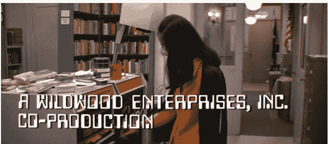

**图 1.1** 《秃鹰金夺日》，导演 Sydney Pollack，1975 年。

我写这本书的目标是讲述这些现象的文化历史，通过补充它们共同历史的拼图，为排版、计算和流行文化提供新的见解。书中考虑了 20 世纪 60 年代至今的、视觉以及文本和排版的方面，将这些现象及其轨迹放在更广泛的文化背景下。本书旨在为视觉研究、科学技术研究（STS）和流行文化研究做出贡献。我设的读者是这些领域的学生和学者，可能也包括设计史、媒体史、字体史和计算机史的人士。

是什么促使程序员用字母拼成图像，并利用美国信息交换标准代码（ASCII）创造艺术？这些图像的目的是什么？在什么语境下展示的？工程师们为什么要扭曲数字和字母的形式以使其易于阅读？这些字体又是如何在流行文化中被重用的？为什么这种几乎瓦解了字母形态的点阵打印机技术，竟能让许多用户对其产生美好的怀忆？对 Comic Sans 的仇恨源于谁？关于这种字体的论述中使用了哪些比喻和修辞手法？我通过分析社交媒体讨论、杂志广告、打印机手册、科学插图以及公司标志、书封、电影和艺术品，来寻找这些或其他问题的答案。读者将通过丰富的素材开启这段旅程，这些素材仍然存在于互联网且具有本质上的临时性，同时也来自前互联网时代的资源。

在研究涵盖的时间范围内，计算经历了数次变革。这四种现象被选为这一发展过程的重要阶段。第 2 章和第 3 章关于 ASCII 艺术和机器读字体的内容发生在 20 世纪 60 年代和 70 年代，当时大型计算机由专业人员操作，普通用户无法触及。第 4 章关于点阵打印机，设定在个人计算时代的初期，这一时代在 20 世纪 80 年代初兴起，将计算机和打印机带入了许多并不一定是计算机极客的家庭。当我们到达第 5 章（关于 Comic Sans 字体）时，正处于 20 世纪 90 年代中期，当时万维网开始问世，互联网通信开始产生更广泛的社会影响。大型机上笨重不灵活的计算工具已变成一个可以放入普通公民口袋的便携设备。尽管这本书具有时间顺序结构，但我的目的并非维持历史进步的观点。相反，我选择这些现象以及将其语境化的方式的一个重要原因，是为了反驳技术决定论。也就是说，技术并非存在一条线性的进步，这是媒体考古学的核心原则之一，这也是我在下文中将要回归的视角。

从字体设计的学的角度来看，在数字时代的初期，文本显示和打印的可能性是非常局限且僵化的。行式打印机只有一套（大写）字母，其设计目的并非为了制作图像，但尽管如此，ASCII 艺术还是应运而生，或许正是因为了这些局限性。随着新打印设备的出现，灵活性增加了——特别是点阵打印机，它使得打印粗体和不同尺寸的文本成为可能。当桌面出版进入消费市场时，大量字体应运而生。某些程序甚至让用户设计自己的字体。这种发展导致了受过教育的字体设计师和设计师对字体领域控制权的失去。技术的发展使得许多人尝试平面设计，一些人认为这导致了一个拥有引以为傲传统的工艺的退化。个人电脑和互联网通信所开启的新可能性不仅被视为福音；它们被用于传播那些被认为是糟糕的、可能具有危险的设计。当 20 世纪 60 年代为了方便后台管理而设计机器可读字体时，这是通往如今计算机具备的计算机视觉和人脸识别路径的第一步之一。在大型机时代，监视社会的威胁在公众辩论中如影随形，这种辩论持续存在并不断被新的技术发展所驱动。

## 我作为研究者身份的反思

我以艺术史学家和系统分析师的双重身份编写这本书。在成为一名研究人员之前，我获得了信息学学士学位，并在 20 世纪 80 年代和 90 年代担任过程序员和系统分析师。这种双重经历为我提供了一个独特的视角，以此审视数字时代文本和字体设计的发展——首先是从信息技术（IT）行业内部，其次作为视觉文化研究者。我学习了 Cobol 语言的编程。后来，我在艺术史专业写了关于数字摄影的博士论文，数字视觉随后一直是我的主要关注。

# 引言

## 媒体考古与历史学的空白

这本质上是一场媒体考古调查。基于发现，媒体考古学家开始为被抑制、忽视和被遗忘的媒体构建替代历史，这些媒体并未指向所谓的“完美状态”。死胡同、失败者以及从未成功的发明都有要讲的故事。

在计算机和字体领域，正如大多数其他领域一样，历史通常被平滑化，以排除不符合重要人物和伟大成就叙事的异常和边缘现象。为了被纳入字体历史，通常需要一个名字，如果是字体的话，计算机早期的一些字体是无名的。其他字体虽然赢得了名字却臭名昭著，例如 Comic Sans。被标记为“失败者”的字体可以在公众论述中获得大量关注，但在历史写作中被忽视。我寻找合适案例的筛选过程基于若干标准。首先，案例应位于字体、计算机和流行文化这三个领域的交叉区域，如图 1.2 所示中心区域所示。

此外，案例应当：

- 1. 落在正典之外；
- 2. 在历史学中被忽视或研究关注较少；
- 3. 经历了用途和语境的迁移；
- 4. 在学科上处于两领域之间。

被历史遗漏的东西并不一定构成一个同质群体。通过这一过程产生的案例是多样化的，我不声称所选案例有任何形式上的共同点。特别是 Comic Sans 可能被视为一个异常值，与其他那些来自更早年代且与过时技术相关的案例形成对比。Comic Sans 出于 20 世纪 90 年代，但仍是当今（后）数字景观的一部分。它是本千年以来最著名的数字字体流行文化案例，尽管它引起了大量的（此处原文缺失）。

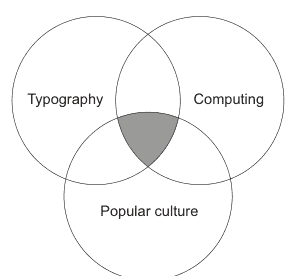

图 1.2 研究领域。

尽管引起了媒体关注，但这一主题并未得到多少投入。这四个案例的共同点是，它们都触及了史学中的空白。它们之所以被排除在外，并不是因为缺乏趣味，而是因为它们不符合任何既有的分类。通过将聚光灯投在这四个现象上，我希望为媒体考古学的史学努力做出贡献。这可能意味着

“流行文化”这一术语代表了许多不同的含义。文化被许多人推崇，它可以指为大众市场生产的文化，也可以指由大众创造的文化，这只是最常见的定义之一。数字和后数字时代与字体设计相关的流行文化，是一种依赖于小说、电视、电影和音乐等流行形式的文化；依赖于计算机和软件的大市场；以及普通人的文化生产。自后现代主义以来，“高”文化与“低”文化的区别受到了质疑，但流行文化仍然主要与“低”文化和大众生产的商业文化相关。¹¹⁰

对流行文化的洞察对于理解我们的时代以及将其传递给未来至关重要。¹¹¹在《POP：平面设计如何塑造流行文化》一书中，艺术总监兼设计评论家斯蒂芬·海勒（Steven Heller）在致订阅者的话写道：“流行文化，特别是通过设计、插画、讽刺和政治艺术（以及其他）的视角来看，对于更广泛地理解我们是谁以及我们将走向何方是不可或缺的。”¹²他的书是论文集，涉及了流行偶像、设计素养和大众艺术等内容。这些文章最初是为各种数字和印刷刊物撰写的，要求读者对美国流行音乐、漫画角色、电影、品牌以及文章撰写时平面设计界盛行的趋势非常熟悉，但海勒坚持将这些现象置于历史视角下，这使得这本书对于美国文化圈之外的未来读者也具有价值。其中一些文章触及数字技术对平面设计行业的影响，但我意图处理的现象并未包含在海勒的书中。

关于平面设计和字体设计历史的参考著作主要关注平面设计行业和印刷大众媒体。大部分注意力都集中在著名设计师、重要字体和主要出版物上，数字时代的平面设计也是如此。¹³尽管平面设计以广告、出版和电影制作的形式与流行文化紧密相连，但书中讨论的现象在参考书中都是缺席的。在菲利普·B·梅格斯（Philip B. Meggs）和奥尔斯顿·W·普维斯（Alston W. Purviss）的《平面设计史》或斯蒂芬·埃米尔（Stephen Emil）的《平面设计：新历史》中，都没有提到点阵打印机。在后者中，有一个框专门介绍了 Comic Sans，引言的文字是：“在当代，出现了一种奇特的现象，即字体进入了主流。”这两本书基于连续的叙述，与之形成对比的是，保罗·麦尼尔（Paul McNeil）的《字体的视觉史》是一部不同类型的参考著作，包含了 320 多种字体的样本图像，按出版日期按顺序排列，并附有简短介绍，将这些字体置于历史背景中。麦尼尔的分类作品目录包含了 Comic Sans 和一些机器可读的字体（E-13B、OCR 和 Data 70）。后者在戴卫·朱里（David Jury）的《重塑印刷：字体设计中的技术与手工艺》中也被提到，该书从数字技术发展的角度重新审视了平面设计和字体设计的历史。我在平面设计通史中发现的对 ASCII 艺术或其他字母艺术的唯一提及，是在约翰娜·德鲁克（Johanna Drucker）和艾米莉·瓦里什（Emily Varish）的《设计史：批判性指南》中。¹⁴这一现象似乎是一个真正的局外人，因为在计算机时代的史书中几乎未被提及过。一个罕见的出现是在保罗·E·策鲁齐（Paul E. Ceruzzi）的《现代计算机史》中，这是一本关注硬件和软件发展中重要里程碑的书。ASCII 艺术在提到 IBM 1403 打印机时被简要提到：

```
这是一个实用的设备，但用户对其有一种非理性的喜爱。在几乎每个大学计算机中心，都有人发现如何通过向打印机发送适当的命令来播放校歌。质量糟糕，但打印机并没有被要求演奏拉赫姆斯。有人可能用它用一系列字母字符打印出一张粗糙的史努比图像。在好莱坞内外，链式打印机、旋转的磁带和闪烁的灯光成为了计算机时代的符号。¹⁵
```

# 引言

9

计算历史过于宏大且多样，无法作为单本书的主题，而是致力于其历史不同方面的著作。施林格出版社出版的十九卷本《计算机史》和学术期刊《IEEE 计算机史年报》没有提到这四个现象中的任何一个。在《全球互联网史罗特奇伴侣》中，在日本网络文化的章节简要提到了 ASCII 艺术，但重点在于书面叙述。¹¹⁶《计算创新伴侣书》介绍了硬件和软件发展史上的主要里程碑，但书中涵盖的四个现象中没有一个出现在该卷书中。¹¹⁷人们或许希望找到关于点阵打印机的注释，但打印机本身不是这本书的重点，在其他计算历史的描述中也是如此。打印机是外围设备，即使在计算机史学中也是如此。我找到的关于该主题的唯一书籍是爱德华·韦斯特伯（Edward Webster）的《解除束缚的打印机：数字打印五十年，1950–2000及以后：发明与企业的传奇》，书中介绍了不同的打印技术，其中包括点阵打印机，以及它们背后的工程师和一些先驱制造商。¹¹⁸

对计算和设计领域主流史学的这一简短调查结果并不意外。ASCII 艺术、机器可读字体、点阵打印机和 Comic Sans 在计算机历史上都没有起过主要作用。然而，当这些现象置于流行文化的背景下时，它们的价值变得更加清晰。它们处于两难境地。

## 理论与方法论方法

对于每一章，我都努力寻找一种合适的理论和方法论方法。由于案例非常多样，这意味着

10 第1章

“后数字”这一术语被赋予了许多含义，关于它如何与“数字”相关的讨论仍在进行中。¹⁹它通常被用于描述时间性，作为将现在定义为“后数字时代”或“后数字时期”。数字技术不再是令人惊叹的，而是我们已经习惯并理解了它的可能性。²⁰新媒体并没有过时，而是变成了习惯性媒体。媒体学者大卫·M·贝里（David M. Berry）认为，后数字已成为日常生活中不可避免的一部分，之前的二对立法——如离线与在线、数字与模拟——现在已经失效。²¹另一位媒体学者亚历山德罗·卢多维科（Alessandro Ludovico）在其著作《后数字印刷》中指出，“印刷”和“电子”不应被视为敌对关系，而是有多种方式让这些技术和文化共存。²³

人们可以说，这项研究是在一个后数字时刻进行的，这意味着已经过去了足够的时间让这些现象置于视角之中，但又没有导致其研究的基础因背景丢失而变得难以理解。虽然研究中的所有现象并非都是在后数字时代构思的，但可以从后数字的概念来看待它们。后数字与美学和艺术实践有很强的联系。根据媒体艺术研究者克里斯蒂安·保罗（Christian Paul）：

```
“后数字”和“后互联网”术语试图描述一种在概念和实践上被互联网和数字过程塑造的艺术和物体——将这些语言理所当然——但通常以绘画、雕塑或摄影等物质形式表现出来。²⁴
```

# 引言

许多艺术学生对混合技术的工作充满热情，他们不仅被数字化的缺陷（如故障艺术 glitch）所吸引，也被如模拟摄影和电影中的划痕与灰尘所吸引。这些学生采取了“一种后数字黑客态度，即拆解系统并以违背设计原始意图的方式使用它们”。²⁵在我看来，考虑到相关技术被赋予的非意图性和创造性用途，或许这种后数字态度最能适用于这四种现象。

定义“话语”（discourse）这一概念有多种方式。就本书而言，我将话语视为针对某一现象所出的所有陈述的总和。尽管它最初是一个语言学概念，但我以扩展的、多模态的意义来使用它，涵盖文本、视觉、听觉，在某种程度上甚至是触觉的陈述与表达。我关注的流行话语由不同类型的参与者组成。设计从业者和社交媒体用户的声音与研究者的声音进行对话。数字语境需要一种全新的话语分析，将新的通信模式和实践考虑进来。²⁶我的素材是多元的，包括视频、静态图像以及发布在社交媒体网站及其他网站上的书面陈述，其中一些可以追溯到 20 世纪 90 年代中期，当时万维网处于婴儿阶段。发布内容与评论区之间的互动对该现象提供了宝贵的见解。许多帖子在首次发布多年后仍不断获得新评论，但我本人并未参与这些对话；我的方法是定性的，但仅在有限意义上是民族志的；²⁷我只研究了开放网站的公共内容；封闭社区不在研究范围内。尽管是书面形式，但许多材料具有口头性质，可以被称为沃尔特·J·翁（Walter J. Ong）所谓的“二次原创性，一种在电子技术时代兴起的口头与书面传播的混合形式”。²⁸口语语言通常是社交媒体参与者面对关注者、以及博客作者面对观众的常用模型。在某种意义上，整本书可以被视为话语分析的结果，但在关于 Comic Sans 字体的那一章中，这种方法被凸显出来，我在那里也回了它。

此外，符号学视角及其认为字体设计具有巨大意义潜力的思想贯穿了本书。字体及其设计、生产、使用和分发的手段被视为符号资源，它们是“我们为了交流目的而使用的行动、材料和制品”。²⁹该术语用于社会符号学，这是由君特·R·克雷斯（Gunther R. Kress）和奥·范·李文（Theo van Leeuwen）发展的符号学分支，特别是在他们的著作《解读图像：视觉设计的语法》中。他们认为这是对不受语言限制的扩展性话语分析的贡献。³⁰他们对话语分析的观点为我在书中执行话语分析的方式提供了模型。


社会符号学的基石之一是交流是多模态的。模式可以是视觉的、语言的或手势的，范李文认为字体本身就是一种符号模式。它通过字母本身的正式形式以及它作为文本组成部分的布局之间的联系来传递意义。尽管我并不总是显式地引用其本质，但相反，社会符号学是支撑本书中许多思维的理论框架。在多模态分析中，不同的模式被考虑在内。多感官分析与多模态有关，但这里的现象是从感知者的角度观察的。多感官研究针对触觉、嗅觉和味觉。字体具有所有这些维度，这些维度在平面设计师莎拉·海德曼（Sarah Hyndman）和艾伦·卢普顿（Ellen Lupton）等人的作品得到了探索。在对本书主题的印刷品和印刷制品的分析中，强调了多模态和多感官特质以及它们与记忆的联系。

符号学与字体物质性之间的联系已由艺术家兼视觉艺术学者约翰娜·德鲁克（Johanna Drucker）探讨过，她在著作《可见的文字：实验性字体与现代艺术，1909–1923》中，通过对 20 世纪早期先锋诗人的研究勾勒了一个物质性模型。她认为，费尔迪南·索绪（Ferdinand Saussure）的语言意义理论是基于口语的，他没有认识语言的物质性及其对意义产生的贡献。对于德鲁克来说，语言的图像是核心。文本绝不仅仅是纯粹的信息。它有一个在意义生成过程中需要被考虑的“躯体”。她的物质性模型试图调和两个方面——生产方面与文化理论和社会背景方面。如果“物质性被理解为一种解释过程，而不是对物体特征的设定”，那么这两个方面就并不对立。德鲁克对物质性的处理方法是我整个研究的起点。

正如物质性在字体设计中被忽视一样，它在新媒体中也被忽视了，新媒体通常被刻画为非物质性的。数字人文学者基尔申鲍姆（Kirschenbaum）追随了 N·凯瑟琳·海因斯（N. Katherine Haynes）的足迹——后者是电子文学和文本性领域的先驱——当他在书中《新媒体与法医学想象》中时，他强调了一些早期电子文学作品的物质性。他的物质性概念也得益于德鲁克，尽管基尔申鲍姆关注的是数字存储媒体的复杂性，而非印刷页。他区分了物质性的两个面——法医学物质性（forensic materiality），指铭刻的物理表面及其独特性；以及形式物质性（formal materiality），指计算机处理抽象符号的能力。这两个概念之间的界限无法在硬件和软件之间简单地划分，因为它们本身就是基于早期计算机实践的构建。我同意基尔申鲍姆的，硬件和软件之间的边界变得日益模糊，甚至比 2008 年《机制》（Mechanisms）出版时还要模糊。

在这一章中，我关注了硬件与软件平衡变化的不同方面。打印机、纸张和墨水及其功能在第 2、3、4 章中被引入，而在第 5 章，重点是社交媒体平台的影响方式。

## 媒体考古学研究过程

我的工作方法和研究过程在本质上是考古学的，可以用胡特塔（Huhtamo）和帕里卡（Parikka）的这段话来总结：“媒体考古学挖掘文本、视觉和听觉档案以及文物收藏，同时强调话语性和物质性”。我从事这项研究的大部分时间都在检索互联网。我使用了搜索引擎（主要是 Google），然后通过发现的页面上的链接进行。这些链接通常引导我进入其他网络资源、书籍和其他制品，然后回到网络资源。“搜索”不应被解释为一种机械过程。它是解决问题的一部分，需要根据过程中出现的新信息不断修正最初的构想。人们必须准备好向计划之外的方向转弯。这就像追随阿里阿德的线索，尽管我并不声称找到了迷宫的最终出口；那里有许多材料等待被发现和探索。

我的过程也是考古学的，这种意义体现在，我的发现被视为碎片。我的任务是将它们拼接成一个有意义的整体。然而，实证数据无法 1:1 地呈现，例如带有数千条评论的社交媒体帖子。我从较长的对话中提取样本，但将其整合并与其他来源结合，从而提炼出我从一开始看到或在过程中意识到的模式。

大量的材料。我浏览了超过两千条结果，并阅读了约一千篇文章。然后，我将它们归类，以辨别话语中的主要主题。很难对这些材料进行定量分析，因为 Comic Sans 经常出现在与字体本身无关的并列文章中。

### 不存在的源材料

有些源材料我一直在徒劳无功。我没能找到任何展示在计算机中心墙壁上的 ASCII 艺术照片。文字和口头陈述表明，此类海报确实挂在员工的办公室里，但似乎没有这种现象的视觉记录。我找到的计算机中心内部照片是大学或公司的官方照片，要么是突出设备的制造商宣传照。图片中的人物正忙于照顾机器。办公室墙上缺少 ASCII 艺术照片的原因可能是出于安全，一位知情人士曾暗示。我的猜测是，人们通常不会带相机上班，即使他们带了，由于许多图片是写真，墙上的 ASCII 艺术被认为是有趣的，或者是不宜记录的。

### 相关文献与研究

最近出现了一些设计师书籍，涉及与字体排法、计算和流行文化相关的小众或被忽视的话题。它们设计精美、印刷精良，对插图和物理品质投入了大量关注，而这些对于表达书籍内容至关重要。一个与流行文化相关的例子是 Dave Addey 插图丰富的书籍《未来排版：科幻电影中的字体设计与设计》（Typeset in the Future），于 2018 年出版。在科幻类型中，这本书对字体排法的关注是独一无二的。

它包含了字体设计师的采访，并详细分析了一些最著名的科幻电影如何利用视觉设计来唤起未来以及近过去（例如 20 世纪 70 年）。

另一本于 2018 年出版的书《Leterset：DIY 字体排法革命》（Leterset: The DIY Typography Revolution），由平面设计师 Tony Brook 和 Adrian Shaughnessy 编辑。这是一部关于手工转字革命的视觉历史，这场革命让字体排法变得广为人知，并促进了传统排版直线之外的实验。Leterset 公司在 20 世纪 60 年代末和 70 年代达到鼎盛。它的干转字字被用于唱片封面和低预算杂志，对流行文化产生了巨大影响。它架起了通往设计数字时代的桥梁。

这本 2018 年的书基于曾在 Letransfer 工作的设计师的文章，这意味着手工转字的历史是从他们的视角讲述的。

关于街机视频电脑游戏已有许多论述，但在字体设计师青海寿（Toshi Oami）于 2019 年出版《街机游戏字体排法：像素字体的艺术》（Arcade Game Typography: The Art of Pixel Type）之前，字体排法一直是游戏中被忽视的一个方面。他清点了数千个街机游戏并系统地记录了这些字体。他还通过将图像转换为完全可用的字体来重建字体。书中配有丰富的游戏截图和字体规格图，有些被放大以展示其像素结构。

打孔卡是早期计算的主角，用于携带编程代码和数据。这些卡片由 IBM 和其他计算机公司大量制造，直到它们过时并被终端取代。CentreCentre 于 2020 年出版的论文集《打印打孔：打孔计算时代的遗迹》（Print Punch: Artefacts from the Punch Computing Era）拥有一个厚实的激光切割封面，上面的小孔构成了标题的字母。书中描绘了数张打孔卡，以及那个时代计算机中心的广告和照片，并配有关于该主题的短文。作者之一的 Steven E. Jones 声称，“打孔卡仍然是计算最受认可的文化符号。”在其网站上，这家伦敦出版商以以下方式介绍自己：

CentreCentre 根据意外的收藏、项目和档案制作限量版书籍。我们从外向内工作，力求让不可见的被看见，让被遗忘的被发现。我们相信从平凡和被忽视的事物中汲灵感。

打孔卡绝不在平面设计的正典之中。在它们被淘汰后，多余的未打孔库存经常被用作明信片。尽管如此，正如 ASCII 文本第 2 章所示，卡片可以是数字遗产的守护者。

典型的后数字实践在 Rüdiger Schlömer 于 2020 年出版的《字体编织：从像素到图案》（Typographic Knitting: From Pixel to Pattern）中被倡导。这种过程并非快速原型，而是关注纱线的感官，并为字体设计提供了一个新的手工维度。这本书并没有否定数字工具，而是探索了技术与老工艺如何结合。

目前还没有将这四种现象放在共同背景下的人文研究，但有一些书籍、书籍章节和文章研究了它们的某些方面。以下三部作品表明了 ASCII 艺术的跨国特征。关于 ASCII 艺术最全面的研究是 Brenda Danet 的《网络》（Cyberplay: Communicating Online），这是一本关于 90 年代网络趣味行为的民族志和社交语言学研究。它包含了通过电子邮件和聊天室通信的章节，以及创建美国国家标准（ANSI）艺术（ASCII 艺术的继者）如何在公告板系统（BBS）中变得流行的内容。这本书提供了 ASCII 艺术的历史背景，但不像我这样处理计算机中心的打印艺术。在 Kristoffer Gings 2008 年的书章《像机器一样思考：瑞典福利国家的偶然媒体艺术》（Humans Thinking Like Machines: Incidental Media Art in the Swedish Welfare State）中，将 ASCII 艺术和线式打印机音乐视为一种日常创作和早期媒体形式。Stephen Jones 在 2001 年《统计：澳大利亚艺术与技术的方面，1956–1975》（Statistics: Aspects of Art and Technology in Australia, 1956-1975）中追踪了计算机图形的历史。Mark Owens 和 David Reinhurt 在 2005 年发表在《视觉传达》杂志上的文章《纯数据：机器可读字体历史时刻》（Pure Data: Moments in a History of Machine-Readable Type）是这本书的灵感之一，特别是关于机器可读字体的章节。作者向我介绍了字体设计的冷门领域，以及某些字体成为数字时代符号的方式。我没能找到任何专门针对针式打印机的研究，但关于技术人员的文章触及了记忆和旧技术的主题。例如，Tim van der Heijden 在 2015 年发表在《NECSUS：欧洲媒体杂志》上的文章《现在的技术：从技术到记忆》（Technologia of the Present: From Technologies to a Memory of Technologies）基于过时的硬件，以及 Kodak Super 8 胶片和柯达胶等曾用于捕捉记忆的介质现在已成为自身的怀旧对象。John Campanoiano 在 2014 年于《保护、数字技术与文化》中的文章《记忆、时间性与我们技术怀旧的表现》（Memory, Temporality, & Manifestations of Our Technostalgia）中讨论了数字媒体的保护，并将技术人员视为一种渴望“与我们的文化遗产建立一种切实的联系。”在 Karin Bijsterveld 和 José van Dijk 的书籍《回忆：音频技术、记忆与与音乐及消费产品相关的文化实践》中，探讨了声音对于“技术怀旧”（technostalgia）的重要性，这些涵盖了收音机、录音机和 iPod 等消费产品。然而，他们的书籍并未泛泛地讨论声音，且在我的研究中仅起到了次要作用。

与数字流行文化相关的特定字体的研究是有，其中一个例子是 Kate Brideau 和 Charles Berret 在 2014 年发表在《视觉文化》（journal of Visual Culture）杂志上的文章《Impact 字体简述：‘迷因字体’》。该文章追溯了迷因字体的历程：从它在金属铸造的最后几个小时内产生的奇特技术开端，到它在最初设计三年后在互联网上声名鹊起。Brideau 和 Berret 认为，Impact 字体已成为图像迷因的稳定特征，因为它具有强大的规律性和合法性，能够融入大多数图像。字体设计学领域的争议有时被戏称为“字体争端”（fontroversies），这就是 Keith M. Murphy 书中章节《字体争端！或，如何关注语言的形状》的主题。他 2017 年的符号学研究涵盖了三个案例：Comic Sans 与欧洲核子研究组织（CERN）关于希格斯玻色子发现的演示；IKEA 向 Verdana 字体的转变，以及在道德违规行为中使用 Gill Sans 的影响。Murphy 表示，关于 Comic Sans 的争议持续时间最长，并以一种其他争议未曾采取的方式进入了公众意识。Sarah Owens 在其 2019 年出版的书籍章节《论图形制品的专业性与日常性》（On the Professional and Everyday of Graphic Artefacts）中，也提到了 CERN 的演示以及对 Comic Sans 的禁忌，这种字体已成为糟糕设计和业余设计师的代名词。2017 年的选集《字体重要：字母形状的修辞》包含了一个与本研究相关的章节。在《字体揭示文化：对糟糕字体的辩护》中，Garrett W. Nicholas 讨论了使用 Comic Sans 如何被视为一种策略而非错误。

## 本书大纲

本书的四个章节可以独立阅读，但它们共同涵盖了字体设计实践的重要方面——使用、设计、打印和传播。这四个现象偏离了字体设计的规范和传统，并经常说明了某些事情“不应该”如何做。在第 2 章中，ASCII 艺术被视为字母和打印机非预期使用的示例。在计算机本用于处理数字和打印粗略文本形式的时代，ASCII 艺术作为一种服务于艺术、科学和趣味目的图像创作实践应生。20 世纪 60 年代和 70 年代，当计算机中心的工作人员贴出带有流行主题的横幅和海报时，他们正在挑战计算机贸易理性和严肃的形象。同时，他们利用 ASCII 艺术展示了计算机设备的多功能性和潜力。

第 3 章考察了源自银业的机器可读字体如何代表通用的计算和技术，通常出现在科幻小说和其他流行文化背景中。其内涵包括对未来的梦想以及对监控社会的恐惧。该章节主要致力于对电影、书籍封面、艺术品和标志设计等人工制品进行符号学分析，字体在其中起着主要作用。对这些人工品的细读和视觉分析帮助我们更好地理解机器可读字体所经历的意义产生过程。

在第 4 章中，针式打印机的物质性是焦点。与线打印机受限且僵化的字体可能性相比，针式打印机为用户提供了更大的灵活性，而较小型号对于普通消费者来说负担得起。这些特征是以字形完整性为代价的，因为它们是由小点组成的。不规则的形状显然违反了传统印刷意义上作为“字体”的标准。一些制造商将打印机作为一个珍贵的新家庭成员进行营销，章节中通过分析广告和用户手册强调了这一点。打印机尖锐且独特的声音在营销材料中并未提到，但它在用户的记忆中留下了深刻印象。它的声音也被用于各种用途，如音乐表演以及声学窃听（一种将声音转换为文本的间谍活动）。该章节围绕怀旧和多感官体验，社交媒体上用户的回忆构成了素材的重要部分。

对 Comic Sans 字体的仇恨是第 5 章的焦点。这种非正式字体通过微软作为标准软件程序的一部分进行发，获得了大量的用户群。该字体被广泛使用，并引发了关于其使用和误用的激烈辩论，在传统媒体和社交媒体中产生了影响。本章的话语分析辨别了修辞主题，并将辩论置于平台化和字体史上字体仇恨的背景下。

在第 6 章（结论章节）中，之前章节的共同主题和概念整合在一起——物质性；表演、人格化和叙述声音；位移；自我制作；以及技术怀旧与过时。

# 2 计算机图形之前的图像

## ASCII 艺术的实践

在 ASCII 代码开发很久以前，ASCII 艺术就已经存在了。利用打字机制作基于文本的艺术追溯到 19 世纪，这种实践受到了打字机制造商举办的比赛的鼓励。从 20 世纪 20 年代开始，电报打印员创建图片并通过无线电报（RTTY）发送给彼此，并在纸上打印，直到 20 世纪 80 年代，个人计算机赢得了许多无线电爱好者的青睐。

美国信息交换标准代码（ASCII）于 1963 年成为官方标准。它是一种用于在计算机中表示字母和其他字符的编码系统，每个字符都被分配一个唯一的数字。图片也是通过其他编码系统的帮助制作的，包括 IBM 的二进制编码（BCD）系统、IBM 的扩展二进制交换代码（EBCDIC）系统，以及后来美国国家标准（ANSI）系统，后者在 20 世纪 80 年代到新世纪初用于公告板系统。然而，“ASCII 艺术”这一术语是一个成为更广泛视觉文化的艺术形式的统称。

20 世纪 60 年代，大型计算机系统由操作人员在带有开关、旋钮、按钮和指示灯的控制台上进行监控。纸带和打孔卡用于数据和程序的输入、输出和存储。打印输出由线打印机和改装的电报打印机产生。20 世纪 70 年代当视觉显示器（VDU）作为终端变得常见时，它们通常是单色的且以字符为导向的。绘图图形终端也可以处理图像，但在处理 ASCII 代码中的离散符号时不需要此类设备。这一时期，计算机图形处于萌芽阶段，但早期的计算机操作员和程序员接过了电报打印员和打字机艺术家的接棒，绕过了主机和线打印机的限制，在计算机图形成熟之前制作了基于文本的图像。

《互联网字典》（A Dictionary of the Internet）对 ASCII 定义如下：“一个集合术语，用于描述仅使用 ASCII 字符集产生的图片，有时是色情的。图形程序的出现意味着这种图形显示形式已显著下降。”我认为这个定义略带偏见。虽然海报女郎（pinups）确实是一种流行的 ASCII 流派，但它们并不一定是色情的，而且许多其他流派也很流行，特别是名人肖像和卡通人物。关于艺术形式衰落的说法也是值得怀疑的，因为 ASCII 艺术具有很强的生命力，并在今天以不同的形式和语境生存着。

另一种处理 ASCII 艺术主题的方法见于《新媒体：百科全书：通信与技术的必备参考》（Encyclopedia of New Media: An Essential Reference to Communication and Technology），该书对为什么制作 ASCII 艺术提出了一种解释：

ASCII 艺术起源于一种丰富文本环境并允许更广泛人类表达的方式，它可以被视为对技术决定论的一种反驳，因为它表明个人可以塑造技术的用途。在这里，ASCII 艺术被以一种更积极的光视角呈现，作为一种创造性工具，以及人类制制机器的手段。


通常打印 ASCII 代码的材料基底是连续式纸张（也称为扇孔纸），这种纸送入打印机，通常带有绿色条纹，宽度为 132 列。这些绿白相间的条纹让用户在代码打印时更容易跟踪，但也有纯白色的扇孔纸。宽幅的格式和连续的形式使其适用于图像和长方形贴文。水平打孔使得分离单页成为可能，边缘处带有齿轮孔的垂直打孔则便于撕下。这一操作会产生一些纸屑，生成的单页具有锯齿边缘。

本章的目的是考察在计算机发展成为现今电影行业和游戏行业所依赖的图像生成机器之前，ASCII 艺术曾被用于哪些用途。书中特别关注了计算机中心内的 ASCII 艺术，这个环境是这种艺术形式的重要摇篮。本章提出的关键问题包括：创建了哪些类型的 ASCII 艺术？为了什么目的制作了 ASCII 艺术？ASCII 艺术是如何展示、传播和出版的？现在是如何被收集和存档的？ASCII 艺术可以被视为一种后数字实践吗？

## 理论与方法：访谈与视觉感知

发现人们如何使用某种技术的合适方法是访谈。我联系了许多在 20 世纪 60 年代、70 年代和 80 年代从事计算机行业的人员，请求进行访谈。我还进行了少量的电话和邮件访谈。针对 ASCII 艺术这一主题，我从当地开始。哥德德堡大学计算机中心的一位退休员工接受了采访，并为我提供了宝贵的信息。随后我联系了其他 IT 历史研究人员，他们推荐我与斯德哥尔摩大学计算机中心的前负责人交谈。在我们的访谈之后——期间他等还向我展示了一个用于医学研究背景的有趣 ASCII 艺术案例——他给他的同事发了邮件，其中一人保存了大量带有 ASCII 艺术的打印，并并与我分享关于这种艺术形式及其背景的记忆。向我推荐的人中，有些人对 ASCII 艺术没有记忆。他们已经退休多年，失去了兴趣，或者从未对他们工作生活中的这种边缘现象产生过兴趣。

同时，我寻找并联系了提到对 ASCII 艺术感兴趣的博主和网站所有者。一位美国工程师同意通过邮件回答我的提问，并将问题转发给了他的三位联系人。我尝试的另一种方法是联系非政府组织（NGO）和计算机博物馆志愿者，但我收到的回复很少或完全没有。我意识到必须针对特定人物，后来针对英国和德国计算机博物馆的尝试使我得到了两个回答。这段记录旨在说明，为了找到能够分享半世纪前事件和实践信息的知情者，有时必须走过蜿蜒曲折的道路。如果我对比 ASCII 艺术的研究能早十或二十年进行，结果将会更成功。尽管如此，访谈为我提供了宝贵的素材、背景信息和图片。

## 视觉感知：在不同的视觉模式之间切换

字母通常是有纪律的，像军队连队中的士兵一样在文本行中履行它们的职责。在 ASCII 艺术中，士兵们打破了通常的位置，以表演一场现代芭蕾，他们以意想不到且不规则的阵型出现，并可以相互堆叠。字母和其他字符的原始目的已被淹没，它们失去了了传统的符号学指南针。它们的身体现在构成了画面元素，由此构建出一幅更大的图像。这在艺术史上并非新现象。马赛克是最老的艺术技巧之一。但与马赛克碎片、半色调和像素不同，ASCII 艺术的元素是意义的载体，旨在被阅读。对由小元素组成的艺术的感知涉及到在远距离观察和近观察之间的切换。在足够的观察距离外，图像整体显现；而当观众靠近图像时，元素本身变得更加明显，更难整体感知其主题。此外，ASCII 艺术还涉及在阅读字母和将其视为抽象形式之间的开启与关闭。有时这两种感知模式必须共存，例如当一件 ASCII 艺术品包含该艺术风格的签名时。还有更复杂的混合形式，例如字符同时充当画面元素和符号标志时，如下文的医学示例所示。

即使字符没有履行其通常的功能，将 ASCII 艺术中的字符视为无意义的也是错误的。通过它们不同的形状以及身体的粗细部分，它们帮助创造了新的画面意义。艺术是抽象的形式，一方面它薄化了表现的织物，另一方面它通过将图像变成一个待解决的谜题来丰富它。ASCII 艺术通过邀请观众采取不同的位置和阅读/观察模式来吸引他们，我认为这些美学构成了 ASCII 艺术魅力的很大程度上。

## 艺术与实验

使用字符用于绘制线条和轮廓的 ASCII 图片被称为**基于结构的 ASCII 艺术**，而具有灰度类似于摄影的照片被称为**基于色调的 ASCII 艺术**。1965 年，在 Control Data Corporation Digraphics Laboratories 的 H. Philip Peterson 制作了一件基于色调的 ASCII 艺术。

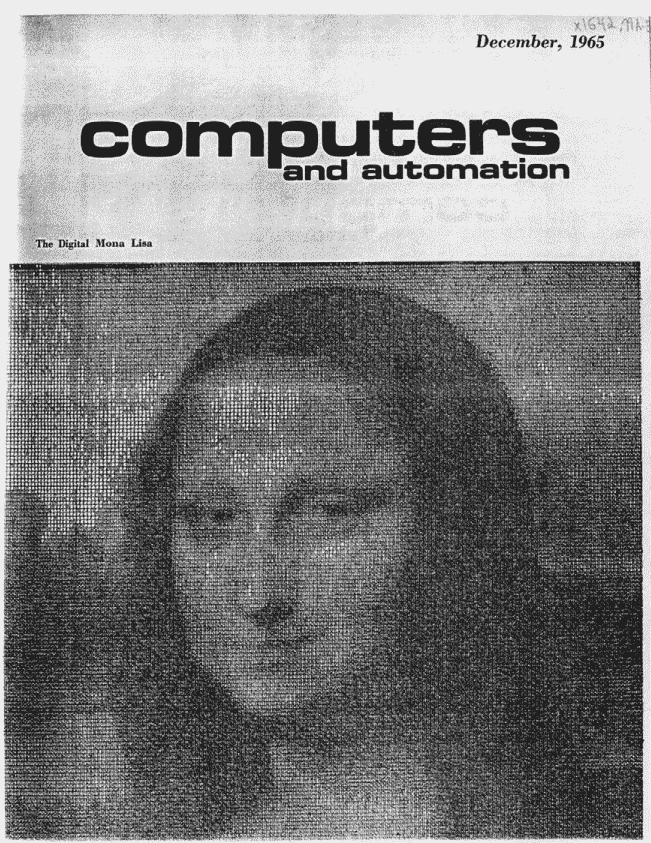

**图 2.3** H. Philip Peterson，《数字蒙娜莎》（*Mona by the Numbers*），1965。计算机历史博物馆提供。

数字化和视觉感知领域的类似实验也曾在新泽西州的贝尔实验室进行，那里为20世纪60年代技术与艺术交叉领域的实验提供了肥沃土壤。根据计算机艺术先驱A·迈克尔·诺尔（A. Michael Noll）的，贝尔实验室的数字艺术既是计算机图形研究的结果，也是该研究的刺激。作为一个研发机构，贝尔实验室对科学数据的显示以及作为人机交互形式的计算机图形深感兴趣。¹¹⁴ 他的两位同事莱昂·哈蒙（Leon Harmon）和肯尼斯·威尔尔顿（Kenneth Wilton）发明了一种扫描照片并将其转换为数据的方法。他们用这种方法制作了几幅图片，使用通信符号代替字母和数字。严格来说，这些图片并不是 ASCII 艺术，但它们基于相同的原理。其目标是“开发可以轻松处理图形数据的新计算机语言；探索创作艺术的新形式；探索人类感知的某些方面”。一张名为《感知研究1号》（*Studies in Perception #1*）的卧裸人体吸引了最大的注意力，并通过展览和出版而闻名。

《感知研究1号》基于一张专门为了数字化目的而拍摄的照片。这张图片曾出现在1967–1968年冬季纽约现代艺术博物馆的《机械时代末的机器》（*The Machine as Seen at the End of the Mechanical Age*）展览，以及1968年伦敦当代艺术学院的《控制论偶然：计算机与艺术》（*Cybernetic Serendipity: The Computer and the Arts*）展览中¹¹⁶ 根据关于其起源的传，诺顿（Knowton）和哈蒙（Harmon）将这张照片打印成大幅壁画并挂在一位同事办公室的墙上。贝尔实验室认为这太鲁俗了并将其取出，但当罗伯特·劳尚（Robert Rauschen）在关于名为“艺术与技术实验”（Experiments in Art and Technology，见下）的发布会上展示它时，这张照片登上了《纽约时报》的头版，随后被认为是体面的艺术¹¹⁷ 然而，正如约翰娜·德鲁克（Johanna Drucker）的这段话述所示，这些视觉实验在艺术史中处于一个模糊的地位：

> “工程师倾向于淡化美学，强调功能性，并将任何具有绘画价值的东西统称为‘计算机艺术’作品。到20世纪60年代中期，贝尔实验室以及少数其他工业和学术场所的实验已经创造了足够的‘艺术’使得计算机图形能够被展示和欣赏，仅仅是作为奇闻。”¹¹⁸

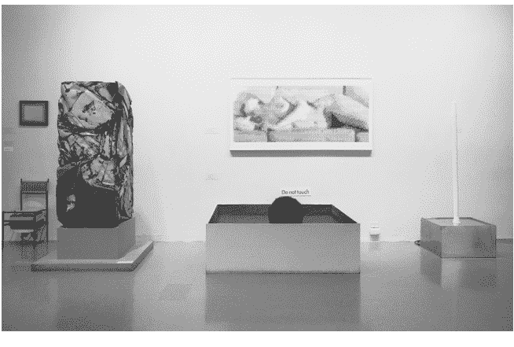

**图 2.4** 《机械时代末的机器》展览现场图，纽约现代艺术博物馆，1968年11月27日至1969年2月9日。明胶银盐照片，6½ × 9½ 英寸（16.5 × 24.1 厘米）。摄影师：詹姆斯·马修斯（James Mathews）。纽约现代艺术博物馆。摄影档案。纽约现代艺术博物馆档案馆。目录编号：IN877.22。@ 2022。数字图像，纽约现代艺术博物馆 / Scala，佛罗伦萨。

20世纪70年代初，基于 ASCII 艺术原理创作的成名艺术家之一是巴西艺术家沃尔德马尔·科尔德罗（Waldemar Cordeiro），他创作了一系列具有政治意图的点。与来自技术背景的哈蒙和诺尔斯（Knowles）不同，科尔德罗在抽象和具象艺术领域拥有长期职业生涯，但像他们一样，他对人类感知感兴趣。他不直接看图像，而是使用手动方法将信息输入计算机：“科尔德罗必须手动输入构成最终输出中人物分层的每一个点。他必须决定每个点应该是什么样，然后手动输入。”¹ 他的计算机作品以报纸和杂志的照片为起点，这种方式让人想到德国艺术家格哈德·里希特（Gerhard Richter）在20世纪60年代的摄影作品。然而，里希特通过将照片转换为油画来操纵照片，其平滑的效果与失焦照片的通常外观自相矛盾，这让观众不确定自己看的是什么类型的图像；而科尔德罗的处理则在不损害照片完整性的情况下将作品原子化。科尔德罗的作品之一《放大的人类2》（*Genti Ampli2*/*Amplified People 2*），1972年）展示了圣保罗大学外抗议的人群，该作品于2018年在纽约现代艺术博物馆的《思考机器：计算机时代的艺术与设计，1959–1989》展览中展，那是《机械时代末的机器》展出的五十年²

在这三件作品中，哪些可以被视为艺术，又哪些可以主要被视为方法论实验？答案取决于作品本身、创作者的训练，还是机构语境？这是一个复杂的问题，答案可能是三个因素都起了作用，但正如制度艺术理论所论证的，作品创作的背景和展示作品的机构对于其进入艺术界起决定性作用¹²¹

彼特森的《数字蒙娜莎》虽然成名，但它进入艺术界的方式与哈蒙、诺尔斯的《感知研究1号》以及科尔德罗的《放大的人类2》不同。《感知研究1号》在艺术界中的地位通过2016完成的修复得到了巩固，这使其在2017年的伦敦和柏林再次展出²⁷

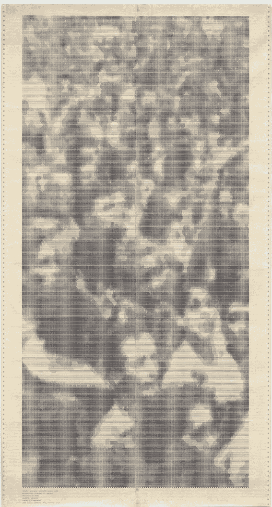

澳大利亚，媒体学者史蒂芬·琼斯（Stephen Jones）得出结论，澳大利亚物理学家麦克劳德（Macleod）的肖像不算艺术，但为未来的进步铺平了道路¹²⁴

Cordeiro 在进入计算机艺术领域之前已经是一位成名的艺术家，他创作的作品在艺术意图上超越了对新表现手段的尝试。他与物理学家 Giorgio Moscati（Giorgio Moscati）合作，这种关系建立在相互交流的基础上。在作品 *Genete Ampli2* 中，图像的主题和用于表现主题的技巧共同构建了作品的意义，为处于具有政治色彩背景中的描绘人物赋予了匿名性。作为一名艺术家，Cordeiro 可以使用他所采用的方法来表达艺术构思。他是巴西计算机艺术的先驱之一，入选《思考机器：计算机时代的艺术与设计，1959–1989》一书进一步巩固了他在国际艺术界的地位。

## 计算机科学、物理学和医学中的科学可视化

最初出版于 1975 年的《新黑客字典》（*The New Hacker's Dictionary*）中关于 ASCII Art的章节以一个“严肃的示例”开头——一张电子电路图。在下方，给出了一些“非常愚蠢的示例”，展示了动物和卡通人物.^28 这种分类体现了对这种艺术形式中主导的趣味性的清晰认知，尽管在那个没有其他生成图像方法的时代，它也被用于许多严肃的场合。

出于多种原因，ASCII Art 在某些场景下仍然是首选的可视化形式。ASCII Art 的优势之一是它可以被任何文本编辑器读取，且不依赖于特定的图形软件。在 2019 年的一篇名为“使用 ASCII Art 解释代码”的博客中，计算机科学家 John Regehr 收集了一系列示例，展示了如何在计算机程序的源码中使用 ASCII Art 来阐述数据结构的形状。^29 通过这种方式，文档成为源代码本身不可或缺的一部分，区别于可能会丢失的外部文档。我们对 ASCII Art 调查的受访者之一是一位七十多岁的美国工程师，他给出使用 ASCII Art 的理由：“几十年来我一直在制作 ASCII Art 示意图，以避免我的工作被困在专有格式中.^30

除了文件格式外，这也涉及工作流的问题。对于复杂软件包的开发者、维护者和用户来说，切换到图形工具来访问软件的可视化将是干扰，会中断工作流，而基于 ASCII 的软件可视化则不会产生这种影响³³¹ 用 Kirschenbaum 的术语来说，基于 ASCII 的可视化的形式材料性与使用图形软件包制作的可视化是不同的。

## 计算机图形之前的图片

```
o----)II(---+|-<-----      +--------o + D O
L )IIC I                   CU
AI )IIC   +-->|-+ I       +-\V/-+-o - T
CN )IIC             |       | P
E )IIC   +-->|-+-+)--------I(--+o U
      IIC I       |       I GND T
o----)II(---+|-<-----+-------
```

图 2.6 一个由全波整流电路馈电电容输入滤波器电路组成的电源。《新黑客字典》，版本 4.2.2。

### Musl 中的树旋转：

```c
7 static int rot(void *p, struct node *x, int dir /* deeper side */)
8 {
9   struct node *y = x->a[dir];
10  struct node *z = y->a[dir];
11  int hz = height(z);
12  int h = x->h;
13  if (hz > height(y->a[dir])) {
14    *
15    * / dir
16    * / \ x
17    * A       / \ y
18    * / -->      / | |
19    * z D       A B CD
20    */
21    * B C
22  }
23  x->a[dir] = z->a[dir];
24  y->a[dir] = z->a[dir];
25  z->a[dir] = x;
26  z->a[dir] = y;
27  x->h = hz;
28  y->h = hz;
29  z->h = hz+1;
30 } else
```

图 2.7 数据结构。John Regehr，“使用 ASCII Art 解释代码”，Embedded in Academia (博客)，2019年2月18日。

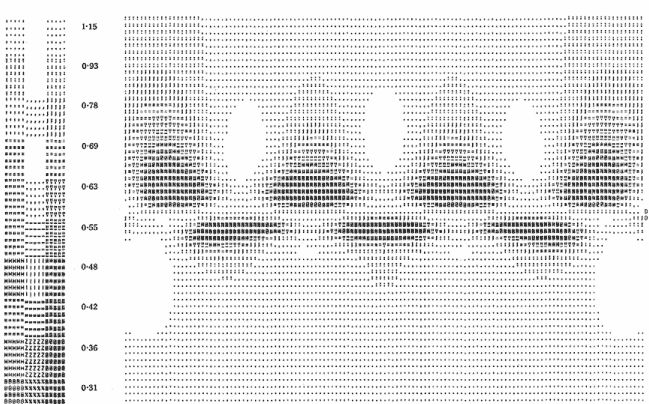

**图 2.8** 灰度线式打印机图像。Alan K. Head，“计算机生成的电子显微镜位错图像”，*澳大利亚物理学杂志* 20 (1967): 561。经 CSIRO Publishing 许可转载。

本节目前为止的示例都涉及基于结构的 ASCII Art。接下来将描述物理学中一种一种基于色调的 ASCII Art 早期尝试。1967 年，在一篇关于金属位错电子显微镜照片的文章中，澳大利亚物理学家 Alan K. Head 根据半色原理，以线式打印图像的形式展示了结果，即由标点符号组成的 ASCII 图像。所使用的灰度被分为十级，对应多个边界值。这些图像基于位错计算，尽管它们只包含有限的色调，但与实际的显微镜照片匹配程度很高。

通常的展示方法是显示强度值的实验曲线和图表，但使用的是最初用于文本生产的设备。Head 发明了一种可视化物理研究结果的新方法.^32 他得出结论：“当重要信息位于图像的拓扑结构而非精确强度中时，理论计算的图像化呈现是有价值的。”33

从 1969 年到 1972 年，瑞典大学城乌普萨拉开展了一项名为“放射治疗与临床生理学中的计算机”的开发项目，涉及医学可视化.^34 我的线人之一 Bengt Olsen 向我提到的，他参与了该项目并是斯德哥尔摩大学计算中心主任。他发给我一份传单，展示了多种可视化技术——示意图、图表、表格、计算机打印输出以及一些基于 ASCII 的图像。两个子项目涉及放射治疗和癌症治疗中的剂量计算。在这种情况下，部署 ASCII Art 并不是为了它的灰度潜力，而是创建了一种新的混合图像，其中字母数字同时充当图像元素和治疗信息的载体。图 2.9 显示了一个肺癌病例的计算机计算剂量平面。星号表示外轮和内轮。形成等剂量线的数字表示相对于参考剂量的百分比吸收剂量，即 1%；10%；20%；110%；120% 和 130%；肿瘤轮廓用符号标记.^35 线意味着沿着某条线应用相同的剂量。剂量计划中有十多个步骤，这意味着单数字是不够的，因此超过 100 的值使用字母.^36 这是作为字符集符号的功能与作为图像元素的功能之间的权衡.^37 用数字 11 表示 110% 的剂量将占据两个位置，并会那样偏移等剂量线。使用字母 A 表示 100% 只需要一个位置。

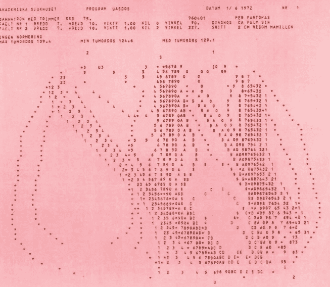

## 44 页 第 2 章

另一个关于子宫癌治疗的示例展示了从患者头部方向看到的身体截面，其中治疗中应施的辐射水平由数字表示，这些数字同时以（相同）的方式形成了等剂量线（即应应用特定剂量的区域），方法与前一个例子相同。

由于此案例中只有六级辐射，数字 1 到 6 足够表示剂量，字母不再用于剂量级别。这为字母字符腾出了其他用途。

# 计算机图形之前的计算机图像

| 日期 | 应用最大值 |  BEM TTD | 应用类型 |

|---|---|---|---|---|

| 20218 | | 31 | | 4 |

| 20219 | | 30 | | 5 |

| 20210 | | 32 | | 6 |

| 20211 | | | 符号 1 2 3 4 5 6 |

| 20212 | | | 等级 9 420 1240 2400 6200 12400 |

| 计划 2+ | | | | |

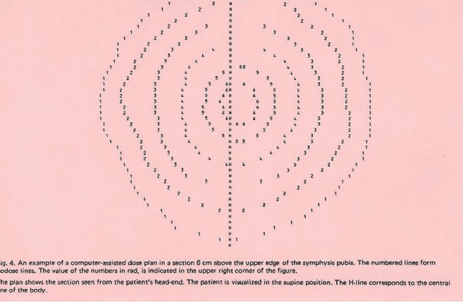

**图 2.10** 一例子宫癌病例的计算机计算剂量计划。出自《放射治疗中的计算机与临床生理学》，开发项目演示，内部报告，西门子-Elema，EC60.470.B01E (1972)，26页。

H 已被用于标记身体中线，其身体构造的直线特征非常适合这种标记。^{38}

这两个例子都证明，使用 ASCII 字符进行图像化表示给读者带来了新的感知和认知挑战。为了获取并消化可视化内容中的信息，读者需要在两种感知模式之间切换——将字母视为语义符号进行阅读，以及将它们视为图像元素进行观察。读者还需要从将字母理解为语言单位切换到将字母视为数字字符进行解码。

## 趣味性图像

计算机曾是一项严肃的事务业。20 世纪 60 年代的大型大型机通常用于科学、行政和军事目的。


然而，作为消遣，一些技术人员利用机器创作了音乐、图像和游戏。39 描绘海女画、日历、名人、虚构角色和游戏的 ASCII 艺术在针式打印机上打印，通常跨越几页，以便作为墙上挂报展示。在在线资源《数字创作词典》（The Dictionary of Digital Creation）中，“IBM”条目配有一张在 60 年代常用的大型 IBM 打印机上打印的亚拉罕·林肯照片，说明文字为：“在 IBM 1401 上打印图像：一个极具商业导向的行业中幽默与艺术的嘈杂 [sic] 之声。”40

然而，将计算机环境中涌现的创作实践简单视为没有其他用途的娱乐是不够严谨的。在计算机开始在社会中扮演更角的时期，许多人对监控和自动化导致的失业表示担忧。根据斯蒂芬·琼斯（Stephen Jones）的说法，ASCII 艺术是让计算机更具人情味的东西之一：

部分是为了尝试减轻公众的恐惧，部分是作为一种招聘手段，当时所有的学术计算系统在大学开放日期间都非常显眼，这些活动每年都会举行。第二代程序员中的许多人是在这些活动中第一次看到计算机的。横幅广告、日历和其他图像——人体裸体、史努比、米开朗基罗的大卫像、《蒙娜丽莎》等——经常被印成海报或日历插图，这是大多数人接触这些庞然机器最接近的方式了。41

当这种艺术形式变得更加普及时，它也被用于计算机营销。20 世纪 60 年代与 IBM 竞争的领先计算机制造商之一是霍尼韦信息系统（Honeywell Information Systems）。1964 年，霍尼韦及其客户国家比建筑协会（Abbey National Building Society）在《新科学人》（New Scientist）上的一份全页广告中登场，页面的一半以上留给了用 ASCII 艺术呈现的品牌标志。尽管分辨率极低，但那幅在伞下行走的男女图像易于辨认，随附文字是：“这个熟悉的阿比国家符号是由现在开始从事更严肃工作的霍尼韦计算机产生的。”42

## 计算机图形出现之前的计算机图片

这是一段免责声明，其中“俏皮地（playfully）”一词强调这并不是计算机在处理更严肃的工作时的正常状态。另外两张图片可能是在类似的语境或报纸报道中发表的。这些机构与计算机制造商共同面临着计算难以可视化的困难。为了避免展示那些大部分活动都隐藏在枯燥面板背后的机器，摄影师可能要求一名工作人员摆姿势拍照，最好是展示一些视觉上有趣的内容。在拍摄现场的布置中，包含 ASCII 艺术是一个自然的选择。即使这样的照片在严格意义上并非广告照片，但它们为为计算业务创造一个更柔和的形象做出了贡献，而 ASCII 艺术也是这项努力中的一种有用资源。

在《计算机图书馆/梦想机器》中，泰德·尼尔森（Ted Nelson）解释了计算的商业方面。名为“计算机人员是如何被买卖的”章节用了一软件公司销售单页的一页说明。在“附加程序”标题下，列出了一些生成 ASCII 艺术的程序，“圣诞老人与驯鹿”、“出生公告”、“史努比”和“日历”。“日历”部分的呈现如下：

这个 `FORTRAN` 程序可以产生 1968 年到 2100 年之间的任何年份日历。日历打印在一个坐在吧凳上的《花花公子》兔女底部¹¹¹

这些海报有时会在主人的记忆中留存很长时间。可以在一位软件工程师的网站上找到一个例子，他回顾了自己在计算机行业的长期职业生涯，并分享了 20 世纪 70 年代大学时代的一些回忆。他记得曾用过打孔卡、纸带和电打字机；与计算机交互；以及运行程序：

但最令我印象深刻的是电打字机，挂在这所全男学校计算机实验室墙上的，一张《花花公子》模特的跨页打印件，她的体态由 ASCII 字符组成。为了生成那幅图像付出的心血！那是互联网色情时代的黎明，是杀手级应用的诞生！²

最受欢迎的卡通角色之一是史努比。媒体理论家彼特·卢嫩菲尔德（Peter Lunenfeld）回忆“计算机艺术的早期，当史努比

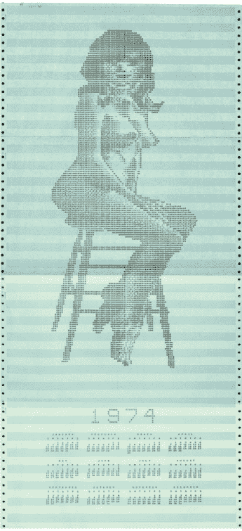

**图 2.15** 一张女郎日历。由计算机历史博物馆提供。也许这就是《计算机图书馆/梦想机器》中复制的销售单页里提到的那张图片。

各国计算机实验室的电打字机经常吐出圣诞树。这个《花生环史》（Peanuts）角色有许多变体，它似乎是通往计算的某种门户。在一个退休化学家兼潜水员员的网站上，我发现了关于他如何学习编程的回忆：

我从 20 世纪 60 年代中期开始学习与计算机交互。那时，向机器的输入是通过打孔卡完成的（每行代码一张卡）。这导致了计算机艺术，通常被称为打字机艺术或 ASCII 艺术（ASCII 来自于定义键盘上所有字母和数字数字值的规则集）。目标是创建一个打印的、可识别的图像，看起来就像是在打字机上出来的一样。虽然生成 ASCII 艺术是为了娱乐，但它也是一种学习工具，因为它迫使“艺术家”利用当时的计算机培养出一种输入输出的感觉。《花生环史》漫画条极受欢迎，史努比、查理·布朗以及整个舒尔斯角色组合是计算机学生经常的目标，被他们组合成一张 ASCII 图像。

计算机历史博物馆的收藏包含了许多在打印机上打印的史努比和其他《花生环史》图片。也使用了其他设备，使得它们的图像具有不同的外观。德国斯图加特大学计算机系计算机博物馆主任软件工程师克莱门斯·克劳斯（Klemens Krause）回忆道：

史努比是我的第二个计算机程序。我是我 972 年做的，当时我们高中买买了第一台计算机，一台王 600。输出是通过一台改装的 IBM 球式打打字机完成的。史努比不是行打印的。它是作为线条画被绘制的。这台机器上的打印头可以以 1/100 步移动，纸筒也是如此。

史努比作为计算机文化符号之一的地位，从埃德·波斯特（Ed Post）1983 年的文章《真正的程序员不使用 Pascal》中可见一斑，成为了当时的梗因。波斯特列出了真实程序员的特征：他们住在终端前，周围环绕着大量的程序列表、半空的咖啡杯和操作系统手册，墙上挂着一张 1969 年的史努比线条打印日历。在写这篇文章时，日历已经有十四年了，这可以解释为显示“真实程序员”对这类图片的依恋。他们并不关心

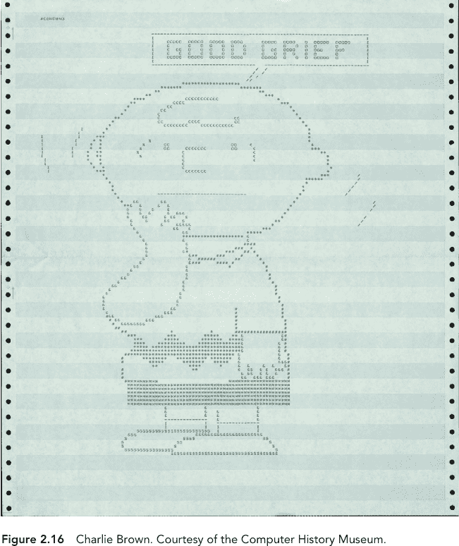

食物或睡眠，但他们关心计算良好旧时代的遗物。

在虚构角色类别中，《星际迷航》的角色脱颖而出。1976 年，《创意计算》杂志出版了一系列打印在卡板上的《星际迷航》角色 ASCII 肖像。《创意计算精选》（1976 年）第一卷的封面别别了一幅“由萨缪埃尔·哈伯宾森（Sam Harbinson，毕业于卡内基·梅隆理工学院，原于普林斯顿大学）创作的史波克先生的计算机图像”。⁵ ⁸。在 2009 年的一次采访中，塞缪埃尔·P·哈里森（Samuel P. Harrison）解释了他在 1973 年作为一名学生时是如何制作这张照片的。

图 2.17 史努比，由克莱门斯·克劳斯创作。使用王 600 计算机制作，在改装的 IBM 球式打字机上打印，1972 年。

他还记得还有其他 ASCII 图片：“大约十几张：一张月球的大图；月球上的阿尔德林；史波克；一个《花花公子》模特（莉娜·舍布林，1972 年 11 月，可能还有）；我猫的特写；其他的。”⁹

ASCII 艺术的视觉库很大程度上取自流行文化。大多数 ASCII 艺术属于艺术史上的肖像类别，包括动物肖像。肖像的一个特殊子类是裸体，女郎源于此，尽管绕过了波德罗利的《维纳斯的诞生》等著名的裸体画。艺术历史学家阿比盖尔·所洛门·戈道（Abigail Solomon Godeau）认为，女性的色情图像成为了消费文化的基石和

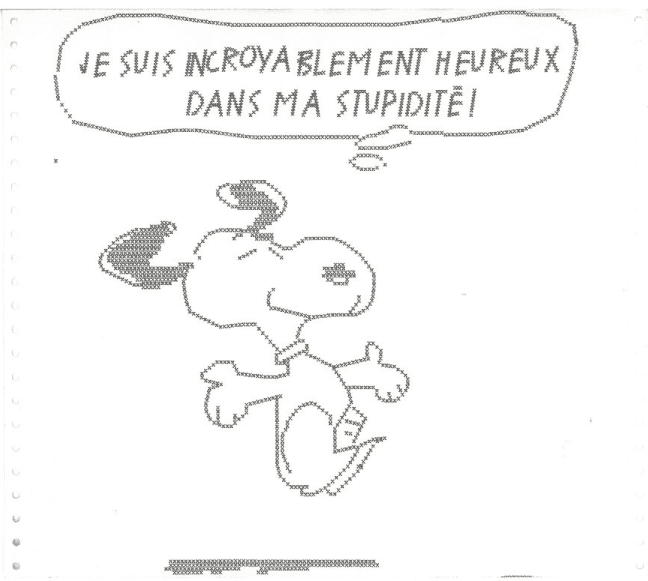

消费时代的视觉文化。⁶⁰

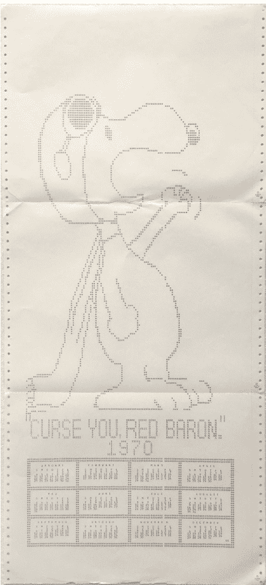

图 2.18 史努比日历，由奥洛夫森（Olofsson），1970 年。

## 计算机中心的 ASCII 艺术

20 世纪 60、70 和 80 年代的计算机房看起来是什么样的？现有的许多照片看起来像图 2.20 所示，这张照片是在 1971 年于瑞典的宜家总部拍摄的。⁶³ 那是工作人员在计算机房里穿白大褂的时代。

在公司和大学设立的大计算机中心，进入计算机房的权限仅限工作人员

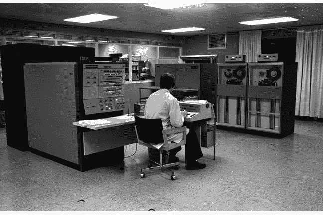

图 2.20 瑞典埃尔姆尔特（Älmhult）宜家总部配备 IBM System/360 Model 40 计算机的机房，1971 年 12 月 20 日。

当时，计算机根据批处理原理运行，中央处理单元（CPU）时间非常昂贵，不能浪费。当用户通过打孔卡递交程序时，操作员会调度作业并将孔卡输入到运行程序的计算机中。用户有时需要等待几个小时才能将输出投递到接待区域的架子上。页面的排序之所以可能，是因为任务分隔页，该页上用大字印着用户身份，并借助 ASCII 艺术得以完成.^64 1979 年，我在瑞典隆德大学学习信息学的第一年，作业周转时间为两小时。作为一个 `Cobol` 程序员，如果我漏掉了一个停顿，就必须重新打一张卡，重新提交程序，并再等待两个小时才能打印出来。

制作 ASCII 艺术并不是使用这些设施的工作人员或学生的日常工作内容。它们通常是在他们空闲时创作的。在上述提到的访谈中，萨姆·哈森（Sam Harrison）回忆起他在 1973 年作为普林斯顿大学攻读数学和计算机科学本科生期间，是如何制作 ASCII 艺术的。当时他在生物化学系的计算机图形实验室兼职，并在普林斯顿计算机中心的帮助台工作。

“那给了我一个机会去与 IBM 360/91 计算机共度很长的时间，获取 9 轨磁带，获得操作员的关照等。”⁶⁵ 在计算机图形实验室，有一台密度计，其中包含一个滚筒扫描仪，他用它将黑白照片数字化。他写了一个 `Fortran` 程序来渲染图像，并映射了形成其灰度的重叠打印模式。重叠打印（Overstriking）是线式打印机的一种功能，意味着它们可以在已打印文本上方打印文本，而无需增加纸张。他不能亲自监督打印。打印属于操作员的范畴，必须向他们保证，重叠打印时产生的奇怪噪音不是故障。哈森通过试错来寻找正确的重叠打印模式，这些模式适应了我们的打印机、它们的 `EBCDIC` 字符字体、黑色墨带以及大学使用的纸张。对于不同的打印机，我怀疑灰阶是否会完全正确。在我离开普林斯顿后，程序和原始数据还在。我将打印文件留在磁盘上，这样在我离开后任何人都可以打印照片的副本。复制这种技术很容易，但有趣的挑战是在那个时代打印机的限制范围内工作。”⁶⁶

这段描述强调了这种艺术形式对其生产过程物质性的依赖。变量有几个——打印机、字体、墨水和纸张——它们必须一致才能产生正确的结果。任何想将文件传输到另一台计算机的人必须重新执行部分流程。

然而，大多数学生无法获得萨姆·哈伯森所拥有的资源。在《ASCII 艺术历险》（Adventures of ASCII Art）一书中，计算机科学家伊恩·帕贝（Ian Parberry）在他青少年时期尝试过打字机艺术，他回忆起自己在昆兰大学上学期间是如何制作 ASCII 艺术的。

“在 20 世纪 70 年代，我仅仅将计算机作为存储和复制手工艺术的方式。使用计算机来实际创建 ASCII 艺术的想法还没有出现在我的脑海中，因为我没有将图像输入计算机所需的扫描硬件（例如彼特森在 1964 年使用的那种），也没有足够的磁盘空间来存储它。”⁶⁷

在与一位曾在瑞典哥德堡大学计算机中心工作过（1965 年至 1997 年）的人员的访谈中，他记得自己最初在兵役期间首次遇到文字艺术，当时他负责信息加密和电打字机流量。1963 年，当美国总统约翰·F·肯尼迪被暗杀时，新闻机构发送了一张美国总统的照片，他和其他征兵在电打字机上打印了这张照片。他还记得有人以加密形式发送过一张海报。如果是明文发送，军官们会立即发现它。由于军事人员不允许发送私信，那个作恶者因此遭到了责备。这些照片存储在打孔带上，当他在 1970 年搬到哥德堡大学计算机中心工作时，他带了一整库这样的带子，并将它们转换为 ASCII 格式。他曾遇到一个打印日历的 `Fortran` 程序，那是哥德堡查姆斯理工学院的学生作为编程练习编写的。他获取了源代码并添加了一个带星号框的史努比图片。他还记得 1976 年圣诞节之前有一个版本印在书用白纸上的《蒙娜丽莎》，并将其挂在女朋友的家里。在计算机中心中心进行的所有计算中，ASCII 图片被视为一种消遣。它们被打印出来作为礼物送给朋友，并作为孩子的圣诞礼物。有时，研究人员的账户里还剩下一些计算机使用时间，他们通过打印 ASCII 艺术来消磨时间。如果要求的副本太多，操作员们对不得不进行分离和……会感到不快。

## ASCII 艺术的展示

如上所述，我没有发现任何在计算机中心展示的 ASCII 艺术照片，尽管有充分的书面和口头证据表明此类图片确实存在并展示在中心的各个部分。在我之前提到的与哈森的访谈中，他回忆起自己如何将打印输出组合成大图，贴在计算机中心白色空心墙上，那里是提交作业和人们等待输出投递的地方。大多数人对此都印象深刻；没有人要求我移除它们。⁶⁸

图片的大尺寸在 2016 年计算机历史博物馆发布的一个展示 ASCII 艺术的视频评论中也被提到：

我爸爸在空军服，是一名计算机程序员。我记得他带了一些 ASCII 艺术给我和我姐姐，主要是《花生漫画》角色和工作人员。我去他的大楼，看到一排排磁带驱动器和主机设备时，办公室墙上有一些巨大的 ASCII 艺术。⁶⁹

已知一张长三米的机机车大图曾展示在计算机中心的上层窗户上⁷⁰ 遗憾的是，我没有发现任何这种布局的照片。窗户展示意味着这张图片是给建筑外的观众看的。这类似于当代的视觉现象，即使用便利贴在办公楼显示图像，有时会导致街道两侧建筑之间的竞争。文本信息和计算机及卡通人物出现在便利贴鲜的色彩中，看起来更像是控制台和街机游戏中早期低分辨率计算机图形，而不是 ASCII 艺术，但它们的展示策略是相同的⁷¹

## ASCII 艺术的流通：礼物文化

打字机艺术与 ASCII 艺术的一个主要区别在于，打字机除了纸上的成品之外没有存储媒介。鲍勃·尼尔（Bob Neill）的《打字机艺术书》包含了制作书中每张图片的说明，这意味着要在打字机上重复每一次按键⁷² 无电打字（RTT）存储在打孔纸上，图片也通过无线电分发。在 ASCII 艺术的情况下，打孔卡组在大学计算机中心的学生和员工以及公司计算机中心的工程师之间流传。正如我的一位消息人士（一位 20 世纪 70 年代中期的美国女工程师）所说：“有一些珍贵的卡组被流传，用于制作这些

……艺术，而且你经常会在机房或某人的宿舍里看到一些例子。”她补充说，没有人主动向她分享过牌牌，很可能是因为其中许多艺术带有色情色彩。

尽管有些公司出售 ASCII 艺术（如上所示），而且控制数据公司（Control Data）还将其版本的《蒙娜丽莎》作为促销材料送给客户，但 ASCII 艺术大多只是在同伴之间流传。当哈伯森（Harbinson）在普林顿大学完成学后，他将他的 ASCII 艺术提供给了后继者：“我把打印文件留在了磁盘上，这样在我离开后，任何人都可以打印这些图片的副本。”73 除了在同伴之间，ASCII 艺术通常也面向访问计算机中心的儿童以及与工作人员生活的人。关于上述显示打印 ASCII 艺术的计算机历史博物馆视频的另一个评论也证实了这种做法：“酷毙……当我跟我父亲去看那家公司为我们做账时，我有时收到 ASCII 打印品。”74

在 2013 年写给《计算与游戏》博客主编的一封信中，一位女性请求帮助，为其身为 IBM 员工的叔叔制作一个 ASCII 横幅以示纪念：

1979 年，当我 9 岁时，他送生日送给我一个横幅。那是针式打印机打印的。上面有一个狗屋顶部的史努比剪影，并写着“生日快乐，Chimene”。我当时真的认为那是最酷的东西。它是在我们家还没有家用电脑和家用打印机之前制作的。字母是用 x 或 o 或者可能是横线组成的。因为当时我的大脑对计算机世界还没有概念框架，我真的在想这是不是用魔法创造的。75

这封信展示了这样的礼物给孩子心灵留下的深刻印象。二十年后，ASCII 艺术的魅力被融入了沃克·科西奇（Vuk Čosiič）的一个艺术装置概念中。在 1999 年于德国卡尔斯鲁厄媒体技术中心举办的网况活动中，科西奇的“即时 ASCII 相机”拍摄了访问者的照片，并将其打印在超市收据上，作为活动的纪念品送给访问者。76 ASCII 艺术品至今仍被与计算相关的遗产机构视为合适的赠品。例如，计算机历史博物馆就会为它的游客打印 ASCII 艺术。77

从人类学的角度来看，ASCII 艺术可能被视为礼物文化的一部分。社会学家马尔塞尔·莫斯（Marcel Mauss）在他 1925 年的开基性著作《论礼物：古代社会交换的形式和功能》（*Essai sur le don: Forme et raison de l'échange dans les sociétés archaïques*）中概述了礼物经济的特征，社会关系通过礼物和互惠形成。礼物并不是“免费”的。它们被期望得到回报并有助于建立社区的等级制度。莫斯进一步主张，礼物无法与赠者分离，赠者在给出的物体中留下了其性格的痕迹。78 20 世纪 90 年代末形成的开源运动被开源倡议组织（Open Source Initiative）的创始人之一埃里克·S·雷蒙德（Eric S. Raymond）描述为一种礼物文化。在他 1998 年首次发表并在随后两年内修订了多次的文章《占领“无”之地》（“Homesteading the No”）中，他认为声誉是黑客环境礼物经济中参与者的主要收获之一，而且在这种社区中尤为宝贵，因为关注可以为未来与他人的合作开启大门。79 ASCII 艺术的交换和分发可以认为是这种运动的先驱。在我的研究中，我遇到了一些赞扬儿童和成人制作的 ASCII 艺术的陈述。哈伯森回忆起他在计算机中心展示打印品时，“大多数人都留下了印象。”80 上述那位软件工程师对制作《玩伴》（Playmate）图片所付的心血印象非常深刻。采访中的其中一个问题是关于制作 ASCII 艺术的目的，一位受访者回答：“真正的 ASCII 艺术主要理由是为了创造者，也就是，创造现实——有时是为了展示他们有多优秀/多聪明。”在控制数据公司的环境中，给客户提供《蒙娜丽莎》打印版是为了让他们意识到公司设备的巨大潜力。


如果 ASCII 艺术被视为一种礼物文化，那么接收者回馈了什么？在创作者已知的情况下，他们可以帮助建立声誉。哈伯森是少数几个在图片底部署名的人之一，但许多 ASCII 艺术是匿名的。然而，通过传递牌牌和文件以及展示图片，接收者延续了这种行为，并将这种艺术形式变成了一种广泛的现象。做出这种贡献所需的努力——从文件中打印一张新图片或对其进行微调——是相当小的，许多人都能胜任。根据媒体学者朱莉娅·韦科瓦（Julia Velkova）的一项研究，后来形成专注于计算机图形开源文化的尝试（例如1994年启动的3D计算机图形社区 Blender 学院）被证明并不成功。她认为，该组织并没有像 Blender 声称的那样按照开放礼物经济的原则运作，主要因为做出任何实际贡献所需的技能水平对于核心开发团队之外的业余人员来说太高了。他们并不是同伴，只能处于 Blender 生成软件客户和用户的弱势地位。^81

鲍·尼尔（BobNeill）在他的《打字机艺术》（*Typewriter Art*）的序言中解释了如何阅读指令，使用了与针织图案相同的逻辑：“如果图案显示为 `-: 4@ 3: 5k 3S 4, 1@ 1': 2S`，你就输入 `: @@@:::&&&SSS... .'`^82 开源运动是一种自由交换的文化。

## 打印作为表演

ASCII 艺术被打印并展示在墙壁和窗户上，但也曾用于20世纪60年代主机的娱乐演示。IBM 1401 于1959年与 1403 打印机一起发布，后者每分钟可以打印600行。2018年，当计算机历史博物馆根据一位电影研究者的请求运行该程序时，工作人员围聚在打印机周围进行演示，心情既期待又尴尬。他们从一堆未排序的牌牌文件中找到的程序开始运行。弹出的第一页大写写着：

亲爱的朋友们：

我们想向你们展示面前这台机器的个性。你们可能认为机器是无生命的物体。事实并非如此，因为你们想看到机器在想什么。给我一分钟，我给你们展示我在空闲时在想什么。

请稍等，我准备好了。

现在我要向你们展示我在想什么。然而

[伊迪丝穿着比基尼出现]

## 计算机图形学之前的计算机图像

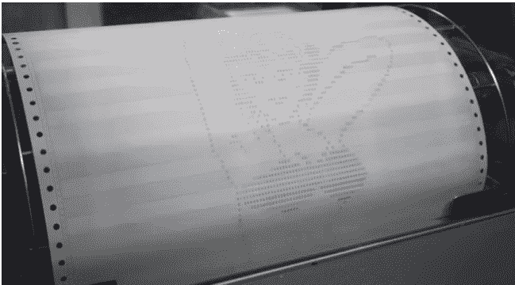

图 2.21 截图自 YouTube 视频《IBM 1401 主机运行“Edit”》，2018年6月2日。© CuriousMarc。

此时，程序停止并必须重新运行。这一次，程序更进了一步，Edith 在程序再次停止之前赤裸上身出现。制作人员找到了另一个存储在 PC 上的版本，并根据它冲打了一叠新卡片。这个版本是德语的，但戏剧结构是相同的。观众被鼓励拨动电脑上的开关，每拨动一次，女性身上的衣服就会变少。系统对拨动下一个开关发出了警告，但当观众认为女性将赤身裸体时，她用一块牌子遮住自己，上面写着你不能对 1401 计算机随心所欲。如果拨动最后一个“禁忌”开关，她将完全全裸。

悬念通过文本信息（它们出现在独立的页面上，类似于无声电影中的字幕，用于解释动作或传达对话）建立，部分则通过打印过程（随着纸张被棘轮断续地向前推进，图像逐渐显现）建立。从交互性的角度来看，在屏幕和键盘出现很久之前的时代，利用开关作为输入设备让观众影响动作，是一个高明的举措。打印机变成了一台媒体机器，能够在聚集在其庞大机身周围的观众面前进行叙述、交互，并对图像进行动态显示。

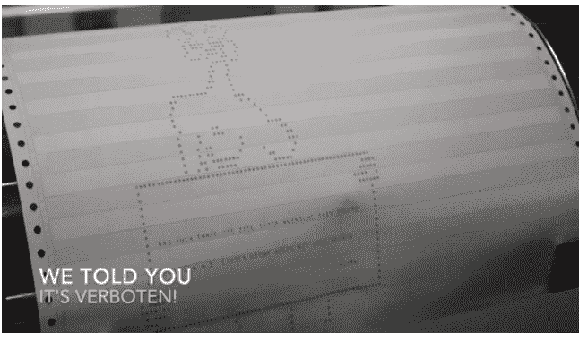

**图 2.22** 截图自 YouTube 视频《IBM 1401 主机运行“Edith”（德语版）》，2018年6月2日。© CuriousMarc。

这场表演的主题触及了色情幻想，也触及了思维机器的幻想。电子脑不仅是想象的产物，也是20世纪60年代科幻小说的常见特征，更是人工智能新研究领域的核心。

Edith 程序的重现是一个机构保护数字文化遗产的完美范例（正如我在第一章“档案与原始材料”部分中提到的）。首先，它需要一台与程序同一时代的可操作计算机和打印机；其次，它需要一个带有该程序的物理载体（在这种情况下是一叠打孔卡）；最后但同样重要的是，它需要一组了解如何运行程序和操作计算机设备的人。没有这种组合，从媒体考古学的角度来看，档案将是空的，或者至少是不完整的。此外，重现还展示了基申巴姆（Kirschenbaum）“法医物质性”（forensic materiality）概念的意义。他对文学作品的分析是基于20世纪80年代的磁盘存储介质。他希望《机制：新媒体与法医想象》能作为数字文学历史保护的入门读物。Edith 程序通过原始纸质格式的卡片堆和从 PC 上发现的“电子”文件新冲打的卡片堆组合在一起。这些保护这件视觉文化作品的物质条件。

Edith 程序似乎是首次涉及打印机的同类表演，但并不是第一次使用昂贵的计算机设备制作性感女画（pinups）。Edith 有一个前身，在20世纪50年代后期被秘密引入美国空军的半自动地面环境（SAGE）防空系统。这个巨大的计算机系统包含一个带有“局势显示”的屏幕和一把光枪，可以指向目标以获取有关它们的更多信息。一名程序员根据《时尚》（Esquire）杂志1956年12月的日历女孩创作了一幅画，如果两台主计算机之间的开关正常运行，它就会正确地显示在屏幕上。换句话说，它作为一个诊断工具发挥作用。性感女画似乎是计算机图形学早期历史中贯穿始终的主题，这可以用男性主导的计算机科学世界来解释。今天的科学已经不同了，因为计算机历史博物馆的工作人员在进行重现 Edith 的媒体考古活动时，似乎对 Edith 非常熟悉。在视频最后，制作人员开始为博物馆的下一次常规演示做准备。当 CuriousMarc 开玩笑地问：“我恐怕你们不会在程序里展示 Edith 吧？”时，他们笑着摇了摇头，其中一人回答道：“这是一个家庭场所。”

另一个媒体考古的案例是计算机科学家 Zbigniew Stachniak 于 2016 年在加拿大多伦多的约克大学计算机博物馆（YUCoM）尝试从微型计算机 MCM/70 的磁带恢复早期计算软件。从一条包含程序的 1975 年磁带恢复的文件中，发现了一个以 ASCII 艺术打印《花花公子》（Playboy）标志的程序。Stachniak 出了以下反思：

> 磁带上包含《花花公子》标志 ASCII 艺术表明，在20世纪70年代中期，MCM 所概念的 PC 终端用户主要是异性恋男性。在20世纪70年代初，MCM 可能用于其演示磁带的 ASCII 艺术有很多。政治人物肖像是这种艺术的热门主题（例如林肯和肯尼迪），以及真实和虚构的明星（例如玛丽莲·梦露、斯波克先生、蒙娜丽莎和史努比）。

MCM 似乎让分销商别无选择，只能在20世纪70年代狭隘计算文化的背景下，展示公司对个人计算独特且前卫的愿景。^ai

当时被认为是合理的图像在今天被视为性别歧视的。ASCII 艺术以多种方式用于营销。霍尼韦（Honeywell）的广告和蒙娜丽莎打印画适合更公共空间，而 Edith 和《花花公子》标志则在计算机人员更受限且以男性为主的圈子里展示。然而，如果没有计算机房和宿舍里打印 ASCII 性感女画的泛滥形成这一 ASCII 视觉文化分支的基础，这种风险材料的商业用途是不可能的。

## 收集 ASCII 艺术

尽管 ASCII 艺术形式似乎在20世纪60年代和70年代非常盛荣，但留下的打印材料寥寥无几。折叠纸并非为了持久而设计，当学生毕业离开校园以及计算机中心重组或搬迁到新地点时，许多海报被取下并扔掉。我的一些线人保存了几份打印件作为学生时代或早期工作场所的纪念品。有一些私人收藏家，这种民俗的艺术形式似乎被忽视了。（注：此处原文存在多处重复句，翻译时已去重）。

这段计算机历史作品的原件寥寥无几，尤其是由标志性人物莱纳德·尼莫伊（Leonard Nimoy）饰演斯波克先生（Mr. Spock）的作品……所以抓住这次机会拥有它以供后世！^96

另一份关于1973年印刷品的广告也强调了这一文物的销售稀有性（简短版）：

稀有的 ASCII [ASS—kee] 普林斯顿计算机实验室1973年印刷品，Samuel P. Harbison 著。

经过研究，我们发现这种粒子（原文此处为 particle）印刷品曾用于为最初的普林斯顿大学计算机编程学校筹资金。斯波克先生的首次运行分四个面板完成的。

这件作品完全是原创的。我们询问了装框店，他们认为画框是什么时候的。

他们最好的推测是20世纪70年代后期或80年代初，据此推断该印刷品的年代也处于那个时期。

由于它被装在纸板上并加了框，现在有一些褶纹。

整体而言，这是已知最早 ASCII 艺术的极佳案例！

斯波克先生被放置在一个 17英寸 x 22英寸的黑色金属框内。海报边缘完好。

这是一件不可置信的类别/级别收藏品，

令科幻电影《星际迷航》粉丝——计算机历史学家——普林斯顿校友向往。

严肃的《星际迷航》收藏家知道这种 ASCII 艺术作品是多么稀缺。^97

这些广告使用了类似的修辞。按照拍卖网站的惯例，材料属性被描述得很详细——第一份广告中纸张的完好状态以及第二份广告中的纸板状态。来源值得关注，但其稀有性和历史重要性或许是最重要的方面。外部专家对画框的评估被用作真实性及其复古印刷品的保证。

ASCII 艺术的收藏遵循1960年代在艺术与工程之间划定的相同界限，正如我们在上述“艺术与实验”部分讨论的那样。艺术机构收集艺术品，技术博物馆收集匿名的 ASCII 艺术，而处于中间位置的博物馆（如 ZKM）则既收集“艺术 ASCII 艺术”（如 Cordeiro 的作品），也收集“技术 ASCII 艺术”（如*数字化的蒙娜丽莎/Mona by the Numbers*）。在市场上展示时，艺术市场的词汇和卖点在两个类别中占据主导地位。

eBay 网站并不是传统意义上的档案馆，它无法保证长期存储。它是分布且转瞬即逝的，列表只存在有限时间内。正如设计研究员 Matthew Bird 所说，eBay 以及类似的网站是设计历史研究的资源：“但日益增加的拍卖网站、在线博物馆收藏、专利档案，甚至 eBay 和 Tumblr 等数字资源提供了设计档案历史的信息，而它们无法提供。^98 尽管博物馆通常持有状态完好的物体，但二手市场可以提供未使用物品作为具有包浆和磨损痕迹的物品提供。对于媒体考古学家来说，这些市场提供了宝贵的信息，甚至允许他们购买物品来开始自己的收藏。^99

## 作为后数字实践的 ASCII 艺术

在后数字时代，计算机已成为一种成熟的视觉媒介。ASCII 艺术仍在被创作，但并不是因为缺乏制作图片的其他选择。在目前可用的数字工具中，就有许多几个用于制作矢量图形、光栅化图形、3D 图形和游戏引擎的程序。用手机拍摄、编辑和分享照片已成为通用能力。如今 ASCII 的创作背景与计算机作为非视觉机器时期的背景不同。有许多免费工具不需要任何编程技能，就能为社交媒体用户提供设计元素，并赋予他们的账户某种视觉风格。^100 一些程序员致力于开发新的、先进的 ASCII 艺术工具。一家荷兰字体造厂在其网站上展示了一种新的 ASCII 艺术生成器，将照片转换为 ASCII 艺术时，它比旧方法保留了更多细节。该公司声称：

微软已在 1998 年宣布 ASCII 本身的死亡，转而支持 JPG 和 GIF 等其他格式并推广比例字体。但 ASCII 艺术依然活跃，至少在我们的工作室里如此。我们随着 ASCII 长大。我们是 ASCII 的孩子。然而，目前的技术允许产生比 1970 年更先进的 ASCII 艺术。这就是为什么我们设想要开发“亚像素 ASCII 艺术”。同样的简单，但结果更精确。^101

为一种过时的技术开发更复杂的方法可能需要一种后数字黑客态度。还有程序员通过“重演”经典艺术品来庆祝旧的黑客文化，例如 Ed Post 的文章《真正的程序员不使用 Pascal》中提到的 1969 年史努比日历。博客“The Abandoned Place”的所有者写了文章《史努比日历永恒 (C++)》：

我决定用 C/C++ 写了史努比日历。为什么呢？你认为这是异端吗？这没意义吗？Fortran 代码可以在这里和那里找到，我在几分钟内就编译了它，我只是在浪费时间吗？你是对的。但我想感受那种激情，我想做一个快速的 C++ 项目（C++ 史努比日历的开发花费了大约 6 小时），我想和这些所谓的真正的程序员比比高下。

另一个博客，“Mike’s Computer Nerd Blog”的所有者也想向旧的黑客文化和 Post 的文章致敬，他制作了一个版本的日历：

我对这种特殊的花招有种无法解释的青睐。也许是因为它为我提供了一个可行且令人兴奋的挑战——即制作我自己的史努比日历。我实际上已经做过几次。我结合了 C 语言编程和 Unix 程序，如 encript、figlet、cal 和 sed。

这些博客文章表明，人们有时通过回到过去的同时又向前迈进，与自己的行业历史产生联系，通过应用新工具来解决旧任务，并将 ASCII 艺术引入当代语境。这些是采用后数字态度的两个很好的例子。ASCII 艺术依然存在——不仅通过实现在网站、T 恤和电子邮件签名中，而且通过其创作过程被重新发明。一个问题是，在 1960 年制作 ASCII 艺术的态度从一开始就是后数字的。我认为，在数字化普及之前对行打印机原始意意的态度就具有后数字特征。

# 76 第 3 章

视觉识别中，这些字体起着至关重要的作用。我识别了与技术感知相关的三个主要类别，并选择了从 20 世纪 60 年代至今突出这些这些案例。在最后的章节中，我总结了主要主题。提出的核心问题是：字体在不同的时代和背景下承担了哪些含义？字体扮演了什么角色，又是是如何履行这些角色的？它们带有哪些不同的含义？

## 理论与方法：符号学与视觉分析

在排版学者贝亚特里斯·沃德（Beatrice Warde）1930 年的经典演讲《印刷应当是隐形的》中，她构思了排版的理想状态：像一个不遮挡内容的水晶杯。然而，她将这种透明容器与金杯对比，金杯无论多么珍贵，都无法像水晶杯那样为文本提供同样的服务。排版不应占据中心位置，而是一个不起眼的面孔。约翰娜·德鲁克（Johanna Drucker）在《可见的世界：实验性排版与现代艺术，1909–1923》中也提出了类似的二元对立，尽管其没有相同的规范意图。她使用“标记的”（marked）和“未标记的”（unmarked）来区分排版在商业和文学文本中的部署方式。她将这种区别追溯到书籍印刷的黎明，当时第一版圣经代表了“未标记的文本”，文字“似乎在自说”，文本在页面上以均匀的区块流动。另一方面，“标记的文本”使用了多种字体和结构设备，使文本吸引读者的注意力。这种显眼的排版形式在 19 世纪的广告中尤为盛行，当时人们对设计的态度发生了变化。

20 世纪 70 年代和 80 年代流行文化中使用的机器读字体非常符合“标记的”类别。这些字体在字面意义上是显著的，不会在页面上形成一片灰色调。相反，它们被用来与文本的语言意义一起阅读，这就是为什么我选择对某些依赖字体产生符号意义的文本和视觉人工制品进行细读的原因。机器可读字体的案例证明了德鲁克物质性模型的关联性，以及生产条件与社会背景之间的相互作用。

## 被驯化的外星人

（在本例中，生产背景指的是字体的设计，而不是印刷文本的生产，后者将在下一章中重点讨论。）她并不是观察对象的特征，而是将物质性理解为一种解释过程。这种物质性方法是后续分析的基础。要理解意义是如何实现的，需要从对人工制品进行形式分析开始，并从构图、颜色、形状与形态、纹理和线条等角度进行检查，这些都是艺术史学家处理或其他视觉人工制品时使用的一些类别。在随后的分析中，我考虑了字体在特定语文中是如何被使用的，它们的形式特征如何被用作符号资源传递信息。将特别关注字体与其他视觉元素之间的相互作用，以及字体在叙事中所扮演的角色。

## 磁性字符识别 (MICR)

在二战后的美国，随着银行服务面向更广泛的社会群体，越来越多的人开设了个人支票账户，大大增加了银行必须处理的支票数量。由于处理很大程度上是手工的，这种情况很快变得无法维持。20 世纪 50 年代，斯坦福研究院与美国银行合作启动了一项自动化项目，发明了基于磁性墨水的支票编码系统。对于美国银行来说，避免对支票进行重大更改非常重要，因为它将其视为与客户的情感纽带。因此，基于打孔卡的系统是不可行的，而基于添加纸条或使用荧光墨水的解决方案也是徒劳。研究小组得出结论，磁性墨水是唯一的出路，但代码如何设计呢？代码对计算机来说易读，但对人类不可读。相反，设计了一组字符，由十个数字和四个额外的符号组成，共同构成了磁性墨水识别（MICR）字体。它的优点是机器和人类都能读取，这对于工作人员能够手动处理错误是关重要的。1959 年，银行业接受了这一解决方案。

图 3.1 E-13B 字体 (Universal Pi)。© 2022 Monotype Imaging Inc.

到 1967 年，它已经得到广泛实施，可以在大多数美国支票上看到。这种字体被称为 E-13B，并不遵循排版的规则和惯例。虽然像波多尼（Bodoni）等传统字体的特征是细线条和粗笔画之间的强烈对比，但没有任何前数字时代的字体具有 E-13B 那种粗壮元素的奇异排列，例如数字 1 似乎站在一个沉重的正方形底座上，数字 3 的下背部比上背部粗得多。

该系统仍在在使用，这种字体仍然因为其奇特的外而引起关注。例如，Digital Check 的网站上有一篇标题为“为什么支票上的磁性 MICR 打印使用奇怪的字体？”的文章，解释了磁性墨水需要以特定的厚度涂抹，以及“所有奇怪的凸起”都是为了磁性读取器能够捕捉信号并区分不同的字符。支票底部的 MICR 行（也称为代码行）留出了 65 位数字的空间，包括银行的路由号码、账户号码、支票号码和支票金额。正如平面设计师马克·奥文斯（Mark Owens）和大卫·雷因福特（David Reinfurt）观察到的，“到 20 世纪 60 年代，E13B 进入大众想象，迅速成为金钱和技术的符号。”

## E13B 的衍生字体


受 E13B 启发的字体利用了它关于技术和高科技未来的内涵。它们被赋予了如 `Amelia`、`Computer`、`Data 70`、`Magnetic Ink`、`Orbit-B` 和 `Westminster` 等名字。其中最著名的是 `Data 70`，由 `Bob Newman` 在 1970 年为 `Letterset Studio Type` 设计。该公司生产的干转字字使显示字体变得更容易获得，它们在专业设计师和业余设计人员中流行起来。尽管 `Leo Maggs` 在 20 世纪 60 年代中期设计了一种名为 `Westminster` 的类似字体，但 `Letterset` 在市场上的全球影响力使得 `Data 70` 成为最广泛使用的字体。在奥文斯和雷因福特看来，作为未来的符号，`Data 70` 既承载着乌托邦式的承诺，也承载着奥威尔式的恐惧。这种模糊的魅力是 `Data 70` 与其他 E13B 后裔字体共有的。从形式上说，它们都配备了笨大的区块，以略有不同的方式分布在字母形状上。在某些字体（如 `Computer` 和 `Magnetic Ink`）中，在字母 `N`、`M` 和 `W` 的腿部之间和开口处插入了一个略微脱离的方块。这群杂杂字体的黄金时代已经过去，但它们并没有完全过时，仍然被用于某些目的。正如平面设计师、《字体视觉史》作者保罗·麦尼尔（`Paul McNeil`）在对 `Data 70` 的描述结尾处总结道：“今天，它作为一种印刷的排版表达，继续以某种模糊的方式引起共鸣。”

图 3.4 计算机字体示例。© 2022。经 `Monotype Imaging Inc.` 授权从 `myfonts.com` 的 `MyFonts` 截图。

## 简单

图 3.5 OCR-A 字体示例。© 2022。经 `Monotype Imaging Inc.` 授权从 `myfonts.com` 的 `MyFonts` 截图。

...电路板、复古科幻故事和老式计算机。它作为一种过去对未来的愿景延续至今。E-13B 的衍生品在一个见证了科幻愿景实现并常态化的社会中过着后数字的生活。

## 光学字符识别 (OCR)

在光学字符识别（OCR）中，打印文本由扫描仪读取并转换为字母数字字符。OCR 比磁光字符识别（MICR）更具活性，因为可以使用普通的墨水，而且现在各种字母形状都可以被读取。然而，当这项技术在20 世纪 50 年代引入时，必须开发特殊的字体，就像 E-13B 一样，为 OCR 设计的字体是人类可读性和机器可识别之间的折中。形状相似的字符——例如大写字母 `B` 和数字 `8`——人类可以很容易区分，但对计算机来说存在困难。因此，这类字符必须重新设计，以增加它们之间的对比。OCR-A 字体由美国字体股份公司于 20 世纪 60 年初开发，美国标准协会（USASI）于 1966 年将其设标准。

OCR-A 的字符形状呈角形，某些大写字母（特别是 `G` 和 `Q`）有明显的右倾斜。`O` 呈菱形，

## 简单

**图 3.6** OCR-B 字体示例。© 2022。经 `Monotype Imaging Inc.` 授权从 `myfonts.com` 的 `MyFonts` 截图。

...而且 `$C$` 和 `$D$` 的曲线在中间是断开的。所有的字母都以其特殊的方式显得很奇怪，不像字体中的字母那样通过共同的设计理念连接。这种非常怪异的字体后来在欧洲被本土化。根据字体设计师埃德里安·弗鲁提格（`Adrian Frutiger`）的话，欧洲计算机协会（ECMA）认为 OCR-A 永远不会在欧洲普及。1963 年，弗鲁提格受命设计一个比他和同事称为“机器人字体”的版本更在美学上令人满意的。它变成了 OCR-B，首次于 1965 年出版，随后又扩展了多次。

OCR-A 和 OCR-B 都于 1976 年成为国际标准。尽管弗鲁提格不得不适应许多技术限制，但他拥有的网格更精细—— 14 比 19 个单元格，而 OCR-A 的开发者只有 5 比 9 个单元格。由于以前通过 OCR 传输到数字形式的信息，现在更多是原生数字化的，而且 OCR 扫描仪识别打印文本的能力已大大提高，对特殊 OCR 字体的需求很少消失。然而，OCR-B 仍与条形码结合用于某些银行应用（如纸质支付）。纽约现代博物馆 2011 年收购的 23 种字体中，OCR-A 已成为了一种经典。

OCR-A 和 OCR-B 的传奇并没有在它们在技术意义上过时时就此结束。根据《埃德里安·弗鲁提格——字体：全集》的编辑海德伦·奥斯特勒（`Heidrun Osterer`）和菲利普·斯坦姆（`Philipp Stamm`）的，这两种字体“最终在 20 世纪 90 年代的平面设计中找到了它们的时尚表达，在那里被视为科技感、酷炫且潮流的。”

## 从新兴技术到成熟基础设施

在 20 世纪下半叶，计算机工业界人士和人工智能研究人员将计算机技术推为一种有前景的未来技术，尽管也有怀疑的声音。工程师们采用了这项新技术，极大地减轻了计算负担，但行业内存在某种保守主义。20 世纪 80 年代初，在技术行业中，工程师已经习惯了与大型机一起工作，起初不愿转向新技术。在千禧交替之际，媒体技术格局发生了巨大变化，到了 20 10 年代，数字电信和互联网已成为通用的基础设施，至少在西方世界是如此。以下三个例子——一篇计算机杂志的文章、一份展览目录和一个视觉识别识别方案——说明了这一发展过程。

## 个人计算

在 20 世纪 70 年代和 80 年代的计算机杂志中，`Data 70` 经常出现在计算机制造商和商店的广告以及编辑材料中。路易斯·凯霍（`Louise Kehoe`）发表在《个人计算》（`Personal Computing`）1981 年 10 月刊上的文章《工程师与计算机亲近距离》，使用了 `Data 70` 和 `Computer` 字体的自定义组合，背景是一张红黑相间的施工现场照片。工人们正攀爬着梯子，画面左侧可以看到一台大起机。这篇文章在随后的页面中还使用了该字体作为字花（大高亮的初始大写字母）和引言（从文中提取并通过排版显示的句子）。

这篇文章并不是未来感的。它关乎现在和不久的未来。论点是，工程师通过获取个人计算机可以获得比他们想象多多的益处。许多工程师习惯了大型机，倾向于低估小型计算机的实用性。许多工程师习惯了大型机，他们的……

# 未来感的。论点是，这

**图 3.7** `Data 70` 和 `Computer` 的自定义组合。见于路易斯·凯霍，《工程师与计算机亲近距离》，《个人计算》，1981 年10 月

## 专业计算

这篇文章并不是未来感的。它关乎现在和不久的未来。论点是，工程师通过获取个人计算机可以获得比他们想象多多的益处。许多工程师习惯了大型机，倾向于低估小型计算机的实用性。许多工程师习惯了大型机，他们的……

未来感的。论点是，这

使用计算机是每个人获取个人计算机的主要原因。“我以前经常遇到操作员丢失数据或移动数据的问题，”布拉克·克拉格（`Brock Krager`）说，他是另一位设施的大机用户。克拉格还告诉我们个人计算机的低成本是一个重要原因。“在三年里，我们在计算机时间上花了 30 到 40 美元，”凯说，“即使在当时，系统看起来很贵。”

一定是赢家，绝对值得。

尽管工程师在购买个人计算机时可能有选择，但他们的选择取决于喜好。在 `Commodore PET` 中，我们使用 `Radio RS-530` 作为微型计算机。“对于制作计算机，”莱斯·M·巴金汉（`Leslie M. Buckingham`）说，他是一位从事成本效益型生产工程项目的计算机设计工程师，“我没有寻找更好或更贵的。”像许多其他工程师一样，斯塔克觉得 `HP` 是可靠的且支持良好。

温·斯塔克（`Win Stuckley`）住在俄勒冈州新伯格，拥有自己的工程业务，在结构和土木工程领域从事大量工作。他购买 `HP` 是因为它的配套软件。这是他在 `HP` 机器中需要的最好的。像许多其他工程师一样，斯塔克觉得 `HP` 可靠且支持良好。

“不同的机器适合不同的工作，”斯科特·库特勒（`Scott Cutler`）博士说，他是纽约斯德德尼电气研发部微型计算机开发组的经理。他的研究显示，包括 `Commodore`、`Radio Shack` 和 `PET` 在内的个人计算机并不是第一，因为它是第一台个人计算机，

22 个人计算/1981年10月

图 3 (当前)

# 驯化的外星人

受自己控制，从不被某人的工作所束。”21

文章指出，小型电脑更加方便，尽管市场上大部分软件大多是为行政和商业目的开发的，但工程类应用的数量正在增加。

字体在本文中的作用是吸引其目标群体——工程师的注意力。标题中第一个单词“Engineers”（工程师）的字母“E”在正文文本框中作为首字放大（`drop caps`）重复了三次。除了为这篇专题文章提供一些吸引人的框架设计外，流行文化中使用的两种字体——`Data 70`和`Computer`的混合也提醒了工程师们，他们需要跟上时代，停止将小型电脑视为玩具机器或可用于简单任务的机器。这种排版设计标志着从大型机机向工作站和个人电脑的转变正在进行中。

## 网络状况：艺术与全球媒体

到21世纪初，互联网尤其是万维网（`World Wide Web`）对私人和公共通信产生了巨大影响，并对传统媒体渠道带来了挑战。一个名为“艺术与全球媒体：媒体空间中的展览”的艺术项目涵盖了广泛的艺术作品，其范围超出了传统展览的范围。它同时在世界各国多种媒体——互联网、电视、有线电视、广播、电影、日报、杂志和海报媒体——中进行。一百多名艺术家、活动家和理论学家参与了该项目，并探索了网络社会的状况，包括社区状况、意识形态状况、经济状况、性别状况、监控状况以及许多其他状况。

在2001年出的由彼得·魏伯尔（`Peter Weibel`）和`Timothy Dreycker`编辑的精美目录中，大量使用了OCR-A字体。”22 目录的视觉风格非常华丽。《图书馆期刊》（`Library Journal`）的一位评论员将其描述为“每一页都挤满了彩色插图”，并将其与一本关于新技术的流行杂志相比：“与《连线杂志》（`Wired Magazine`）同属，这本书是响亮、闪耀、色彩丰富且跳跃的。”25 另一位评论员对这种模仿数字屏幕媒体的尝试评价道：“其激进的图形化布局，充满了色彩图像和文本，是书籍技术能够接近真实‘网络状况’的极限。”^24 在他关于后现代主义的书中，设计评论家里克·波因纳（`Rick Poyner`）写道：

在20世纪90年代初，随着计算机处理能力的增长，在屏幕上创建的设计变得日益过载和复杂，用一个需要渗透和解码的广泛路径网络淹没了观众，将观众推入一种新型数字空间令人眩晕的触及和动荡坐标坐标.^25

贝亚特里斯·沃德（`Beatrice Warde`）提倡的设计原则显然是展览目录后现代设计的对立面。字体和版式不再是隐形的，而在书中被推向前台，并成为传达信息的一部分。文本、字体、布局和插图融合成一种统一的表达，考虑了数字媒体状况和动态的多样性.^26 然而，正如另一位评论员指出的，这种野心有时是以牺牲可读性为代价实现的。在某些文章中，文本在照片上的叠加以及色彩的选择使得文本非常难以阅读：

但结果是指示意义与内涵意义之间不断的斗争，让读者不确定他们是否想要阅读编辑们如此精心汇编的理论。`Net_Condition`似乎试图同时做两件事：虽然卷的编辑们仔细地选择了分析和解构网络社会的文本，但设计团队似乎更感兴趣于让这本书本身作为其所记录的过程的症状表现出来.^27

`Weibel`和`Drucker`展览目录的一个显著排版特征是在标题中使用OCR字体。^28 它也被用于正文。在较大的字号下，人们注意到了某些字体的独特性，棱角被平滑了，字体趋向于正常。在许多情况下，文本以俏皮的布局呈现，例如关于娜塔莉·布奇金（`Natalie Bookchin`）名为《入侵者》（`The Intruder`, 1998–1999）的网络艺术项目的文中。该作品基于豪尔赫·路易斯·博尔赫（`Jorge Luis Borges`）的短小说《入侵者》，由十个简单的视频游戏组成，这些游戏作为推进叙事的文学设备.^29。在目录中，作品的标题呈级联和镜像排列，形成了一个三角形，一个指向页面右半部分的箭头。$30

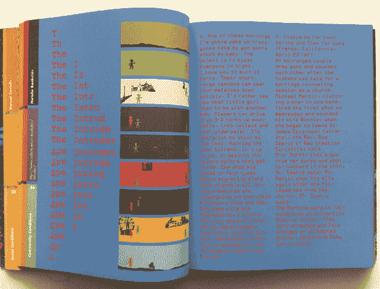

**图 3.8** 一篇关于娜塔莉·布奇金的网络艺术项目《入侵者》的文章。载于《`net_condition`: art for Art and global media》，`Peter Weibel`和`Timothy Drucker`编辑（卡尔斯鲁厄：`ZKM` | 艺术与媒体中心；马萨诸塞州剑桥：麻理工学院，2001年），86–87。

在目录对另一件网络艺术作品——`Marc Lafia`的《`Vannedemer Memex`或拉拉·克夫特被她的刺客剥光，甚至（1999）》（*`Vannedemer Memex or Lara Croft Stripped Bare`...*）的展示中，跨页的长标题以两种不同的字号设置，在跨页的上半部分蜿蜒——使用的是OCR-A。最长的单词——白色的“Stripped”（剥光）被放在标题其余部分的下方，而其余部分是黑色的。$31}$ OCR-A的正文解释了叙事的运作方式，并与标题交错在一起。版式给读者呈现了一个图形谜题，使得字体的选择看起来认为是最不奇怪的方面。在关于《入侵者》和《`Vannedemer Memex`》的文章中，OCR-A的术语被突出显示为装饰性元素。

90

第三章

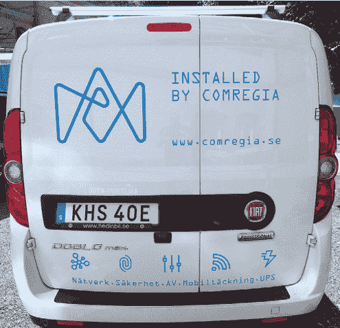

**图 3.11** 使用在 `Comregia` 货车背部的 OCR-A 字体。照片拍摄：`Patric Jansson`。© `Comregia`。

让公司的核心价值——对客户的公平对待和可靠性——通过程序传达，并让 `Comregia` 这个名称被视为质量标志至关重要。结合蓝色调，其技术内涵显而易见。

除了网站上的标题外，OCR-A 还被用于“`Comregia` 制作”的署名。35 有时使用的字体会略超过视觉识别手册的规定。在公司货车的背部，它还被用于网址（根据手册，这部分本应使用 `DIN Round` 字体）。`Kelso` 字体和皇冠标志共同具有连续的线条，人们可以在皇冠中间的棱角形体中找到 OCR-A 大写字母 `C` 和 `D` 的影子。这些设计元素有助于在标志设计与 OCR-A 字体之间建立联系。从整体上说，这种视觉身份证明了“网络状态”在后数字时代已无处不在，而且像 OCR-A 这样的字体可以自如地在各种公共空间、车辆以及互联网上移动，并且即使对于那些在字体发明时尚未出生的一代人，也会被预期与计算机技术联系在一起

# 监控与风险

磁墨水识别和光学识别的字体发明于计算机开始对社会产生更广泛影响的时期。计算扩张了它的领土，计算机不再仅仅是科学计算的工具。冷战期间，美国开发了旨在全球监控的军事技术。36 在 1971 年一次关于公众对计算机态度的调查中，绝大多数受访者同意计算机影响着所有公民的生活。超过半的人担心，少数大型机构掌握着数百万人的信息，并认为“计算机将来将被用来监控人们”。37 在瑞典这个计算机技术的早期采用国家，个人代码的使用以及处理个人数据涉及的风险在20 世纪 60 年代变成了一个主要问题。瑞典议会于1973 年通过了世界上第一个规范处理个人数据的《数据法案》。38 历史学家 `Lars Ilshhammar` 回顾了这一发展。

从被视为一种为不断扩张的福利国家提高效率的行政工具，计算机在20 世纪 60 年代后半叶在很大程度上被理解为一种控制和监控技术。20 世纪 70 年代初，计算机技术与权力一同成为大规模非人性社会的象征。39

以下示例展示了机器可读字体如何在流行文化、艺术界和政府内部勾勒出计算机技术的阴暗面。前两个涉及磁墨水字符识别（MICR）的原始字体 E-13B。这两个例子都发生在 20 世纪 60 年代，一个是关于支票欺诈的电影，另一个是流行艺术时代的艺术品。第三个例子来自 20 世纪 70 年代后期，瑞典公共调查报告封面上使用的 `Data 70` 字体。

## 《猫鼠游戏》》

根据 1980 年同名小说改编，电影《猫鼠游戏》由史蒂芬·斯皮尔伯格执导并于 2002 年上映，是对弗兰克·阿格纳尔（`Frank Abagnale`）早期生活的虚构化描述，他在青少年后期曾是一名成功的冒充者和诈骗犯。在20 世纪 60 年代的几年里，他伪装成飞行员、医生和律师，通过欺骗银行和公司获取了巨额资金。支票伪造是他的专长，他的计划之一是修改支票底部的路由号码。数字决定了支票被送到哪家银行结算，通过改变一个数字，伪造者可以将支票寄往国家另一端的遥远银行，导致结算延迟。FBI 探员卡尔·汉拉蒂（`Carl Hanratty`）在整部电影中热热地追捕阿格纳尔，并在向同事演示时解释道：“a-零到 a-一二意味着这张在纽约兑现的支票不会去往旧金山分行。”银行花了几周时间才发现问题，在此期间，阿格纳尔在搬到另一个城市之前可以继续伪造许多支票。他的方法变得更加精复杂。他开始手动修改支票，然后转向使用打字机和 MICR 机器，当他最终在 1969 年于法国被捕时，他正在操作一台巨大的海德堡印刷机来生产真实的支票。

在这部电影中，字体并非首要设计元素。它是支票欺诈叙述的重要组成部分。尽管它的路由号码在电影中起着核心作用，但 E-13B 字体仅在少数场景中可见。斯皮尔伯格知道如何将阿格纳尔对银行知识的追求转化为娱乐，并在不说教的情况下向电影行业传递了一些关于支票处理的信息。E-13B 字体贯穿整个电影，但并不总是以视觉形式呈现。它第一次出现在阿格纳尔从父亲那里收到十六岁生日礼物——支票本的场景中：

阿格纳尔老父：那里有五十张支票，弗兰克，这意味着从今天起……你加入他们的小俱乐部了。

阿格纳尔儿子：我加入他们的小俱乐部了。

## 《驯化的外星人》

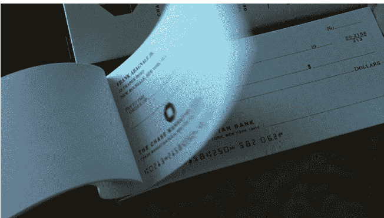

当他翻阅本子时，我们看到了支票本以及印有小弗兰克名字的支票，以及底部的代码行。这一场景可以被看作随后诈骗行为的起点，它强调了支票作为权力客体的重要性。

电影进行到后面，阿格纳尔去一家银行兑支票，并了解更多支票流程。他看中了一个美丽、年轻且易信的柜台员，并立即邀请她吃晚餐。当他要求她解释如何处理支票时，调情仍在继续，随后展开展开：

柜台员：然后我们将支票放入 MICR 机器，它使用特殊的墨水，并对支票底部的账户号码进行编码。[她将一张支票放入机器以演示其工作原理。]

阿格纳尔：这些数字在哪儿？

柜台员：就在这里。[她把支票贴在胸前。]

阿格纳尔：就在那里？[他指向代码行，手指碰到了她的胸部。两人都在咯笑。]

柜台员：它们被称为路由号码。

阿格纳尔：那么这些支票被路由到哪里呢？

柜台员：我不确定。以前没人这样问过我。


支票在这一场景中作为互动的客体出现。他们之间传递着支票并共同握了一会儿，她调情地挥了挥它，但我们并没有看到支票上的信息。摄影语言营造了迷人的氛围，镜头聚焦在他们的表情和肢体语言上。本应是枯燥的银行程序讲解，变成了一个展示阿格纳尔如何将社交天赋与观察力相结合的场景。

在下一个场景，我们看到阿格纳尔在拍卖会上竞拍一台 MICR 打印机。随后的场景中，探员汉拉蒂在向同事介绍阿格纳尔的行迹时使用了幻灯片：

> 在过去的几周里，这个小子开发了一种新的支票欺诈手段，我称之为“延迟”。他的做法是检查各种银行的账户，然后更改支票底部的 MICR 墨水路由号码。

他用笔指向代码行并请求下一页。遥控器坏了，由于同事手动切换幻灯片，他的演示被中断了。下一页清晰地显示了支票底部的数字。同事们用无礼的问题和玩笑打断了他：

> 同事：卡尔，对于我们这些不熟悉银行欺诈的人来说，你介意告诉我们你到底在说什么吗？
>
> 汉拉蒂：东海岸的分行编号为零一到零六。中心分行是零七、零八，以此类推。
>
> 同事：你是说支票底部的这些数字真的有意义吗？
>
> 汉拉蒂：这些都在我两天前提交的报告里。
>
> 同事：你知道的，你想说可以找我妻子，她才是在家里结算支票的人。
>
> [探员们大笑。]

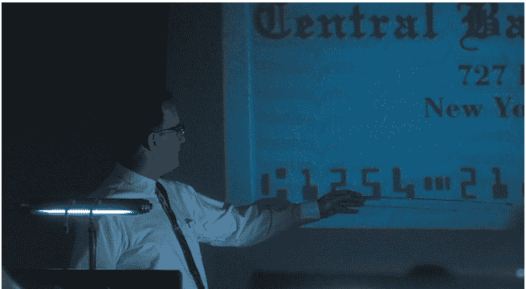

**图 3.13** 电影《猫鼠游戏》（*Catch Me If You Can*，2002年）中 FBI 探员汉拉蒂的幻灯片演示场景，史蒂文·斯皮尔伯格导演。他的同事没有参与，他们没有读他的报告，并对他以及对这个骗子及其发明的狂热投入冷嘲热讽。配合坏掉的幻灯机，他们成功破坏了他的演示。通过在这一场景中展示 E-13B 字体，电影凸显了汉拉蒂的呆板，以及他在追捕嫌疑人时深入研究课题技术细节的投入。

在电影结尾，当阿巴纳尔被关押在美国的一所监狱时，有两个相邻的场景让阿巴纳尔有机会展示他在银行支票伪造方面的专业知识。在第一个场景中，汉拉蒂拜访了阿巴纳尔，当囚犯询问 FBI 探员他的公文包里有什么时，他回答道：“一个在明尼苏达州闯出来的贴纸匠。”阿巴纳尔要求隔着玻璃看到支票，根据日期戳，他立即得出结论：柜员是新手。这让汉拉蒂意识到阿巴纳尔作为欺诈检测者的潜力。

在第二个场景中，汉拉蒂带了另一名 FBI 探员，为了用另一张支票样本测试阿巴纳尔。阿巴纳尔拿起它并现场给出判决。这是一张假票：

> FBI 探员：你怎么知道的？你还没看它。
>
> 阿巴纳尔：嗯，没有孔边，对吧？我的意思是，这……这张支票是手剪的，不是机器切割的。是的……纸张是双层复合的，太重了不像银行支票。磁墨：它呃，在我的手指上是凸起的，而不是平整的。[他闻了闻] 而且这闻起来不像 MICR（磁性识别码）。它有点像……你知道的——某种绘图水。你知道，就是文具店里买的那种。

在展示了他的专业知识后，他被邀请加入 FBI 的金融犯罪小组工作。

在阿巴纳尔与两名 FBI 探员的这段场景中，没有支票的特写。相反，镜头推向了汉拉蒂以及当他的学生展示技能时他那得意的表情。从一开始，FBI 探员的一句台词“你怎么知道的？你还没看它”就告诉我们，视觉在检查中并不起主导作用。相反，这是一个多感官的过程，阿巴纳尔感受边缘的质地，感受笔触的表面，感受纸张的重量，闻嗅墨水的质量。为了评估手中的文件，他像依靠视觉一样，也求诸于触觉和嗅觉。

在这一场景中，E-13B 字体的形状并不是重点。相反，MICR 打印的其他特征被凸显出来，如它在纸面上形成的浮凸以及它散出的特殊气味。它生动地说明了排版并不是一种漂浮字体的抽象体验，而是与其材料属性紧密相连——在这种情况下，是纸张和墨水。平面设计师在日常工作中利用这些资源来创作如名片、文件夹和书籍之类的印刷品。数字出版物具有不同的材质，例如，发光二极管（LED）和电子墨水（E ink），但原理是相同的。出于戏剧构作的原因，在这一场景中关注汉拉蒂的特质，而不是特写支票本身，会更有效。我们听到阿巴纳尔描述它的特征，在电影的这个阶段，我们已经展示过几次——特别是当阿巴纳尔收到父亲作为生日礼物送的支票簿时，以及后来汉拉蒂在 FBI 总部介绍此案时——所以我们对支票的外观已经熟悉。

## 本土化的异乡人

在银行、FBI 总部和监狱的这些场景中，所讲述的是关于无知的故事。不断扩大的知识差距让阿巴纳尔的伪造行为成为可能。无论是银行客户、普通银行员工还是 FBI 探员，对银行支票程序的了解都不充分。银行场景中年轻的柜员在无法告诉阿巴纳尔支票流向何处时揭露了她的无知：“以前没人这样问过我。”这意味着她从未被告知系统是如何运作的，她只是机器中的一个螺丝钉。当汉拉蒂介绍阿巴纳尔支票欺诈以及他利用支票空头（check float）的方式时，他的其中一名同事通过悲惨地询问支票底部那些数字是否真的有意义，表达了对支票系统的普遍无知。对于这个 FBI 探员来说，就像大多数其他支票持有者一样，那些数字只是一排数字。它们奇怪的形状“忽视了我们”或“不是设计给人类眼睛看的”，就像条形码一样。在基础符号学层面，它们可以被识别为传统字母数字字符集的一部分，但在更高层次的符号学层面，这些数字看起来可能是无意义或随机的。然而，对于一个成功的伪造者来说，注意每一个符号及其含义是至关重要的。阿巴纳尔渴望增加知识并对系统了如指掌，并设法走在追逐目标之前。知识差距的大小在监狱场景中变得显而易见，当阿巴纳尔向汉拉蒂和他的同事展示他积累的智慧时。阿巴纳尔是他们帮助解决更多支票欺诈案件所需的专家。这个案例证明，排版并不是一种存在于材质之外的抽象形式，需要专家使用所有感官来掌握它。MICR 的发明是一项提高效率的技术成就，但它无法确保安全性，安全性必须通过其他手段提供。

## 1984

电影《猫鼠游戏》的背景设定在 20 世纪 60 年代。E-13B 字体的下一个例子来自同一年代，尽管它出现在不同的媒介和背景下——美国艺术家 Ruscha 在 1967 年创作的一系列作品。他的作品很难被标记或归类为特定的艺术运动，通常与流行艺术和概念艺术联系在一起。他接受过商业艺术训练，并在职业早期担任平面设计师。他最著名的作品之一是《二十六个加油站》（1963），书中包含了从洛杉矶到奥克拉荷马市 66 号公路沿途加油站的照片。他许多描绘单词或短语的绘画在他的作品中占据着重要地位。字体通常源于招牌制作者的本土视觉语言，但文本信息通常是晦涩且简洁的，近乎现实。在 60 年代，他使用不同的视角、字体、颜色和材料描绘单个单词（例如：空间、鸣笛、盐、律师）。从 70 年代开始，陈述开始出现在他的作品中——例如“泳池里的隐形眼镜”和“螺丝的大雨”。

Ruscha 言语中的对象也被平面设计师迈克尔·贝鲁特（Michael Beirut）所强调。受邀为艺术博物馆的电台节目《我眼中的世界》（The Way I See It）从收藏中挑选一件作品，迈克尔·贝鲁特选择了 Ruscha 的绘画《OOF》。在节目中，贝鲁特对 Ruscha 将字母视为对象的兴趣发表评论：“他的画作不仅仅是一幅画；它真正是一幅画，一种实体性，一个空间。”44

Ruscha 最不那么晦涩的文字图像或许位于他1967年创作的一系列以“1984”为标题和主题的素描和石版画中。45 对乔治·奥威尔小说《1984》的引用是显而易见的，艺术家本人也对此进行了确认：

> “当我画下1984—1967时，我正在思考那本书，以及当时关于‘老大哥在看着你’的讨论。我将它与我支票上这些新奇的数字结合在一起，并想为什么他们要发明这套新的数字词汇。我想我们在日历上可能永远不会到达那个数字，因为我们会遭遇某种末日。我一直喜欢这种想法：在我的作品中做出这一陈述之前，还有几年时间。除此之外，画它本身很有趣。”46

用石墨和火药创作的某些素描中有些是石版画，但它们的共同点是白色数字被置于灰色的背景之上。对于某些变体，Ruscha 选择了 E-13B 作为年份的字体，这使得小说中关于国家监控和控制的主题内涵变得更加明显和可见。

奥威尔在1949年写了这部经典小说，当时计算机主要还是计算工具，而奥威尔笔下的“老大哥”通过“电视屏”（Telescreens）进行大规模监控——这是一种既能广播又能录制图像声音的电视，安装在所有公民的家中。小说的信息可以转移到另一个时代而依然有效。根据马克·奥文斯（Mark Owens）和戴维·瑞因福特（David Reinfurt）的观点，“在1968年学生抗议一年前唤起乔治·奥威尔小说中反乌托邦式的未来，Ruscha对E-13B的使用记录了一个潜在的文化焦虑时刻。”47

在 Ruscha 的 1984 图像中，脱离了支票代码行的上下文，E-13B 数字被剥夺了路由号码、账户号码和支票号码的意义。失去了支票的结构——一种数据位置与数据本身同样重要的信息对象——数字丢失了它们的原始含义。在 Ruscha 的画作中，数字 1984 消失在灰色的虚空中，并作为银行数据失去了意义。然而，它通过代表时间中的一个特定年份并引用文学史上的著名作品而具有了新的意义。比例的变化也具有符号学上的重要性。在 Ruscha 的画作中，数字比支票上的数字大很多倍，在相当模糊的灰色背景下，这些数字以其所有的巴洛克式华丽呈现出来。

**图 3.14** 埃德·鲁沙（Ed Ruscha），1984 [#1]，1967年。纸上石墨。14¹/₁₆ × 22¹/₁₆ 英寸。© Ed Ruscha。

**图 3.15** 埃德·鲁沙（Ed Ruscha），1984 [#2]，1967年。纸上石墨。14¹/₁₆ × 23 英寸。© Ed Ruscha。

放大是其他几位波普艺术家也实践过的绘画技法。克拉斯斯·奥登堡（Claes Oldenburg）因其对日常物品（如汉堡、灯开关和泥铲板）创作的巨型雕塑而闻名；罗伊·利希滕斯坦（Roy Lichtenstein）创作了受漫画启发的大型画作，并表现了印刷过程中的网点。这种“间离效果”（Verfremdungseffekt）也被用于排版设计。在他的书籍《未来的排版：科幻电影中的字体设计与设计》一书中，戴维（Davey）采访了字体设计师斯蒂芬·科尔斯（Stephen Coles），关于 Eurostile 和 Bank Gothic 字体是如何与未来联系起来的。科尔斯解释说，Bank Gothic 这种创建于20世纪30年代的字体是为了适用于名片的极小尺寸。为了让线性形状在小字打印中看起来正确，字体设计师对字母形状进行了调整，例如给字母 C 增加了斜边。原本不被刻意注意的材质属性和功能性设计，变成了字体魅力的一部分，并成为其在科幻电影中应用的原因。被放大并投影在电影院屏幕上时，这些斜边清晰可见，并成为电影设计的一部分。48

Ruscha 1984 画作中数字巨大的尺寸使得它们的形状和那些“怪异的凸起”更加突出。E-13B 字体并非所有数字在这方面都相似：0、2、5、6 和 7 的笔画是均匀（或圆润）的，而 1、3、4、8 和 9 的笔画是不均匀的。1984 年份的所有数字都属于后者，这在整个数字中创造出一种粗细交替的节奏感。在其中一幅素描画 1984 [#2] 中，用于分隔支票数字部分的破折号被添加在年份的末尾。

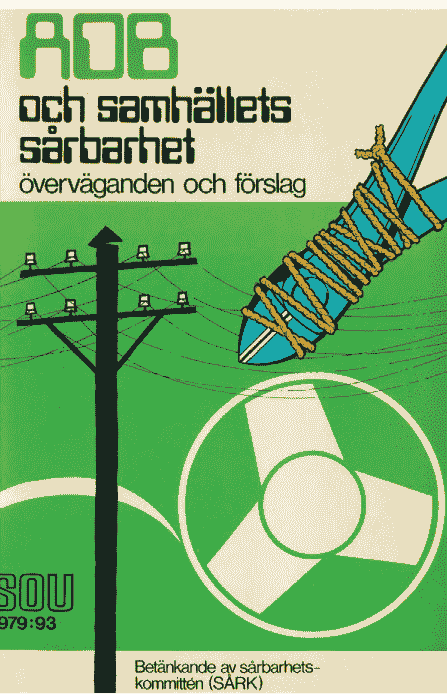

**图 3.16** 一幅使用 Data 70 和 Helvetica 字体的报告封面。《ADP 与社会的脆弱性：考量与建议》，SOU 1979:93。

一种合理的解释是，电信技术（电线杆和电线）以及文件中的信息（存储在磁带介质上）容易受到多种威胁，而这些威胁都被象征性的剪线钳所涵盖。然而，拟议的安全措施（在工具口上缠绕了几个圈的绳子）将为国家提供保护，使这一切都不至于与信息技术的未来发展隔绝。毕竟，在 Data 70 字体的加持下，三个粗大的字母 ADP 稳固地立在地面上，承认了该国家是这一发展中不可挽回的一部分。

## 被驯化的外星人

## 未来的愿景：期待与幻灭

20 世纪 50 年代末期见证了太空时代的诞生，进入太空的梦想首次得以实现。与计算机技术相结合，太空技术被视为是未来的技术。其他行星不仅被视为访问的地方，更被视为人类扩张领土的潜在殖民地。这些期待在 1986 年“挑战者号”航天飞机事故后被平灭了。在 1994 年的文章《机器人会继承地球吗？》中，人工智能研究人员马文·明斯基（Marvin Minsky）设想了一个未来：机器人变得如此先进，以至于可以接管许多人类执行的功能，甚至为身体提供至关重要的备件。然而，一些研究人员对这种情景的可能性或理想性并不确定。以下示例展示了如何使用机器读字体来唤起未来的愿景，以及当这些愿景受阻时随之而来的失望。本节分析了 1981 年一本关于机器人的儿童书和 2016 年一本关于月球上孤独警察的视觉小说。

## 机器人

波兰裔英国作家扬·皮恩科夫斯基（Jan Pienkowski）创作的翻翻画书《机器人》（1981）是一部科幻故事，可能可能是为儿童设计的，但所有年龄段都可以享受。封面标题和正文中使用的字体是 Data 70 的修改版本，其中几个大写字母经过了更改（A, D, K, M, N, R 和小写 x 都经过了修改）。这些变化让 DAD 这个词看起来是斜的，与 MUM 的直立线条形成对比。书通过一个回到地球旅行的儿子寄出的明信片展开。从书封面上可以认出一个以印刷电路板形式呈现的机器人脸。最明显的面部特征是眼睛，它们由标题 Robot 中的两个 O 组成。在 B 正下方，一个粉色部分充当鼻子，明信片的角从看起来像嘴巴的地方伸出来，也可以被解释为邮件口。我们可以读到文本的开头：“亲爱的妈妈和爸爸，希望你们在这里。我 . . . {}

## 第 3 章

> 曼彻斯特文学节 @McrLitFest · 2020 年 4 月 24 日
>
> 机器人 - 扬·皮恩科夫斯基
>
> 我一直以来最喜欢的书作家。他训练过埃德·维尔（Ed Vere）。你能想象吗！他的翻翻书是最好的。

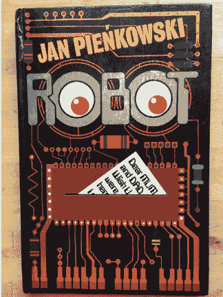

3 🔄 2

**图 3.17** 一本使用修改版 Data 70 字体的书封。Jan Pieńkowski, Robot (London: Heinemann, 1981). 曼彻斯特文学节，Twitter，@McrLitFest, 2020 年 4 月 24 日。

每一页跨页底部以及第一页的剩余文本延续了封面的内容：“想念妈妈的饭菜——预计妈妈正忙新事物忙不可开交。”图中可以看到妈妈正在读明信片，用一只手臂拿着它，同时在处理其他几项家务。在剩下的跨页中，文本以相同的方式继续，从前一页句子的最后一个单词开始，或以下一句的开头结束：

> 宝宝。希望爸爸在坚持他的“宇宙先生”计划。
>
> 爷爷在照顾我的地球生物吗？我敢打赌它长大了。姐姐怎么样？还在和那个尼安德特人男朋友约会吗？我怀念我的自行车。圣诞节见。爱你们的，ROB。

## 被驯化的外星人

## 107

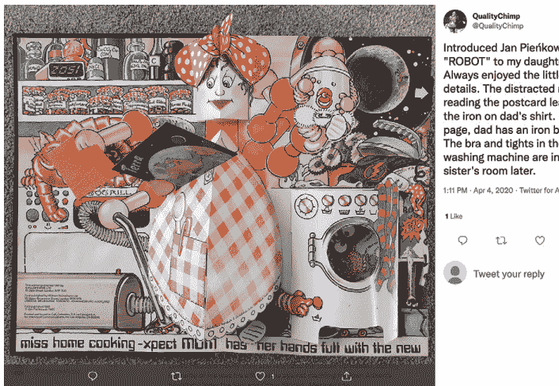

> QualityChimp
>
> @QualityChimp
>
> 向我的女儿介绍了 Jan Pierkowski 的《机器人》。总是喜欢这些小细节。心不在焉读明信片的妈妈把熨斗留在了爸爸的衬衫上。下一页，爸爸的衬衫被烫了。洗衣机里的内衣和裤袜后来出现在姐姐的房间。
>
> 下午 1:11 · 2020 年 4 月 4 日 · Android 版 Twitter

想念家的饭菜——预计妈妈正忙新事物忙不可开交

**图 3.18** Jan Pierkowski 作品，《机器人》(London: Heinemann, 1981) 中的第一个跨页。Quality Chimp, Twitter, @QualityChimp, 2020 年 4 月 24 日。

在这里，读者被提示翻页并阅读 Jan Pierkowski 作品，《机器人》(London: Heinemann, 1981) 中的第一个跨页。这种跨页通过这种方式促使读者翻页并阅读整个故事。在每个跨页上，拉页可以拉动并导致页面的元素跳出来。我们在自己的房间里遇到家庭成员，忙着看屏幕、举重、进行其他活动。与色彩溢溢的图像相比，文本非常简洁。Data70 字体让文本成为整体视觉风格的一部分，并与图像形成对比。人们可能会认为，文本需要这种装扮来彰显自己。

108

第 3 章

这是最友好的科幻小说。这些机器人的生活与人类的生活非常相似。在他们的书架上，有如《Lex Robotica》和《Encyclopaedia Cybernetica》之类的书籍。皮恩科夫斯基 1981 年的画书是一个后数字化未来的良好版本，在这个太空时代，地球并没有丢失，只是一个遥远的目的地，家庭生活及其传统的性别角色依然完好。在后数字化后人类未来，当我们自己变成了机器人时，就不需要担心计算机技术。

## 月球警察

由汤姆·高德（Tom Gauld）创作的 2016 年视觉小说《月球警察》讲述了一个被困在月球殖民地的孤独警察的故事。跟随他乘坐小警车穿越广阔荒凉的月球景观，履行日常职责。犯罪解决率为 100%，因为不断减少的人口没有犯罪。搬到月球并没有消除人类由不兼容适配器、系统故障和无意义的数据收集带来的烦恼。根据第一批定居者亨德森夫人（Mrs. Henderson）的说法，这个超现代的项目现在看起来像是一个坏主意。警察的转会申请被拒绝了。相反，他被提供了一个机器人治疗师，他和新到的咖啡馆服务员从悬崖的角度望向地球。高德利用了殖民其他行星的科幻陈词，但将其变成了对人类处境的忧郁反思。

书中的所有文本——对话气泡、标志牌和电脑上的——都是手写的。在封面上，标题是银色的 Data 70 大写字母，背景是蓝色的太空。月球警察手里拿着地图在月球岩石表面行走。地球悬浮在封面的右上角。标题下方，作者的名字是白色的 Futura 大写字母，尺寸小得多。MOONCOP 的方形形状与 Tom 中的 M 和 GAULD 中的 A 的尖角形成对比。在 Data 70 中，O、N 和 C 具有相似的矩形形状，在这里 MOONCOP 中它们形成了一个由初始 M 和最后的 P 保护的兄弟姐妹群体。

## 被驯化的外星人

109

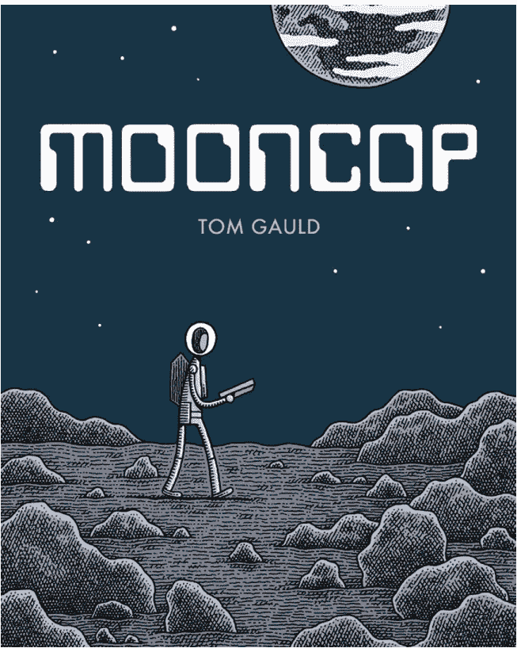

**图 3.19** 使用 Data 70 字体的书籍封面。Tom Gauld，《Mooncop》（蒙特利尔: Drawn & Quarterly, 2016）。© Tom Gauld。经 Drawn & Quarterly 许可使用。

字体设计师冈形寿（Toshi Omagari）曾撰写过关于 20 世纪 70、80、90 年代街机视频游戏的排字体，他解释了源自 MICR（电磁字符识别）字体的审美是如何演变的：


到 20 世纪 90 年代末，`MICR` 几乎灭迹，只有少数游戏仍依赖这一传统。该行业已转向一种微妙的艺术，不再依赖于那些大喊着“未来感！”的怪异细节，但人们对机械感字体的渴望从未消失。在现代游戏中，像 `DIN`、`Eurostile`、`Bank Gothic` 以及类似的正方形设计随处可见。今天，我们的口味已经变了，`Westminster` 和 `Data 70` 被视为复古，但我们不应忘记尊重这些曾作为未来面孔的老前辈。55

冈形似乎认同保罗·麦尼尔（Paul McNeil）的观点，`Data 70` 人格化了“过去对未来的愿景”。56 如果考虑到这些内涵，在图形小说《Mooncop》中使用 `Data 70` 不仅设定了书的基调，还总结了整个故事，从殖民项目的开始到结束。*Mooncop* 回顾了过去的未来——在那个月球居住曾是乌托邦的时代，并从未来的视角告诉我们它后来变成了什么样。故事与字体共享着平行的时间线和发展。正如图片《Robot》一样，《Mooncop》中的故事设定在一个后数字时代的未来，在那个时代技术已无处不在并渗透到日常生活，但与《Robot》相比，技术并未实现更美好未来的承诺。

## 外星与被驯化的形式

`OCR-A` 字体在 20 世纪 60 年代被埃德里安·富蒂格尔（Adrian Futiger）及其同事称为“机器人字体”。`OCR-A` 和 `E-13B` 的笨拙感与当时的机器人形态（无论是虚构还是真实的）相呼应。在埃德·鲁沙（Ed Ruscha）1984 年的画作中，我们看到了字母的物体性和物理性是如何被强调的。“机器人字体”既可以指字母本身作为小机器人，也可以指机器人可以读取的字体。

比例的变化会改变对字体的感知，并使其字母看起来像外星生物。这种效果在埃德·鲁沙 1984 年中大号 `E-13B` 字符，以及在 *net_condition: art and global media* 展览目录中的 `OCR-A` 案例中尤为显著。在 1984 年，放大使得字符的凸起变得可见；而在 *net_condition* 中，通过使用 `OCR-A` 字体的大号标题并结合多层设计，文本的视觉特质被推向前沿。当这些字体以正常文本大小看到时，这些特质并不十分突出。

奇特的字体在科幻电影的设计中已经找到了一席之地，正如《未来的排版：科幻电影中的字体设计与设计》中所示。57 我认为，机器可读字体的外星字母形状与几部科幻作品中出现的外星相貌之间存在相关性。某些电影和剧集包含外貌极端、远非人类的生物。在另一些作品中，非人类物种与人类的区别在于更微妙的方面。电视剧《星际迷航》中的瓦肯人（Vulcans）和巴卓尔人（Bajorans）就是两个例子——前者通过其显著的眉毛和尖耳朵来区分，后者则通过其鼻梁脊纹。两个著名的代表性人物是斯波克先生（Mr. Spock）和基拉上校（Colonel Kira）。就像 `E-13B` 的凸起以及 `OCR-A` 中的倾斜形状和角度一样，这些面部特征脱颖而出，但并没有阻碍人们将它们识别为某种字体或人类。我们仍然可以阅读文本，并将电影角色视为人类并产生认同。

## 时空旅行

尽管机器可读字体的许多内涵可以追溯到它们最初的计算背景，但这些字体产生了惊人广泛的可能内涵。这些字体在时空中旅行了从 20 世纪 50 年代到现在，从支票底部到大银幕。它们可以为支持乌托邦和反乌托邦的故事赋予形状，可以成为冷静设计和后现代布局的一部分，也可以被剥离其想象力色调并传达更写实的信息。

字体使用的上下文对于意义和内涵的创造起着至关的作用。当 `E-13B` 字体用于埃德·鲁沙 1984 年作品之一的独角表演时，它可能会引起观众的焦虑。当配合绘本《Robot》的移动画卷时，`E-13B` 的衍生字体 `Data 70` 强化了书籍的视觉风格并成为快乐图像的一部分。当 `OCR-A` 用于 ComRegia 的视觉身份识别系统时，它指的是功能性，并指出了工程创新的遗产。在展览目录 *net_condition* 中，由于布局几乎使文本不可读，功能性被淡化了，`OCR-A` 反而有助于强调当前技术发展的压倒性特征。

112

第3 章

在她的《字体很重要》（Why Fonts Matters）一书中，设计师莎拉·海德曼（Sarah Hydman）将 `Computer` 字体等归类在“星际通信”标题下，并指出“它们可以暗示一个乐观的未来乌托邦、一个黑暗的反乌托邦，或者一个未来的复古版本”。58 发现并阐述这个版本并不意味着回到历史现实。数字研究者扎克·华伦（Zach Whalen）问自己，为什么他在当代游戏中会遇到 `OCR-A`，因为这种字体直到 20 世纪 90 年代才用于游戏语境。他得出结论，过时是“我们讲述关于过去的未来故事的特征”。59 在图形小说《Mooncop》中，`Data 70` 促进了时间向前和向后的旅行。机器可读字体是未来在后视镜中的样子。

## 抵抗机器可读性和监控文化的后数字艺术

在 2001 年的 *net_condition* 文章《媒体时代的注意力》中，弗洛里亚安·罗策泽（Florian Rötzer）讨论了私密生活的自愿发布以及公共和商业空间复杂的监控策略。60 1996 年，一名美国青少年从她的大学宿舍启动了 `Jennicam`，成为居家 24 小时直播的先驱。61 这是她的自愿行为，与公共空间对人的监控形成对比。20 世纪 90 年代末，两所大学正在开发一种监控系统，可以区分超市和停车场中的“正常”和“可疑”行为。罗策泽预见到这种技术在未来将导致的偏执行为，届时人们将采取一种“显眼的形象”（inspicious appearance）来规避检测²

121

被驯化的外星人

在后数字时代，艺术家找到了不同的方法来反监控文化，我展示两个例子——一个关于伪装，一个关于字体。在千禧的第一个十年里，监控技术和计算机视觉继续朝着人脸识别的目标发展。2010 年，艺术家亚当·哈拉维（Adam Harvey）创作了作品 `CV Dazzle`，关于如何通过化妆扰乱系统来避免被监控摄像头识别。63 与帮助士兵融入植被的传统伪装不同，哈拉维的化妆基于几何形状和强烈的色彩对比。配合垂在脸前的发型是为了进一步困扰监控系统。虽然这些造型可能会吸引公共空间内其他人类的注意力。64 `CV Dazzle`65 提出了一种远离罗策泽所预测的“显眼形象”的方法。66

类似的策略在 2012 年由字体设计师桑·明（Sang Mun）部署，他设计了机器不可读的字体 `ZXX`。67 名字源于美国国会图书馆的语言代码系统，其中 `eng` 代表英语，`lat` 代表拉丁语，而 `zxx` 代表“无语言内容；不适用”。68 在桑的字体规格中，展示了六种不同的风格，其中四种被声称 `OCR` 无法识别但肉眼可见——`Camo`、`False`、`Noise` 和 `Xed`。为了混淆 `OCR` 软件，这四种字体应用了不同的干扰策略。在 `Camo` 中，脸部结构用斑块处理；在 `False` 中，小的相关字符嵌入较大的虚假字符中；在 `Noise` 中，字母被小方形覆盖；而在 `Xed` 中，字母被划掉。合成语音交流：“就像动物一样，我们需要开始采取新方法来躲避专权掠夺者，在这种情况下是政府和公司。”演示结束时强调了字体的目标群体：吹哨者、活动分子和普通互联网用户。69 根据艺术家的说法，“`ZXX` 是一个行动号召，无论在实践还是象征意义上，都是为了引发对隐私的质疑。”70

这两个艺术项目都依赖于一种后数字美学，挑战了数字与模拟之间的边界。`CV Dazzle` 不是数字的

113

114

第3章

Present & Correct

@presentcorrect

Dazzle Club 将在你的脸上绘制彩绘，以干扰面部识别监控。

instagram.com/thedazzleclub

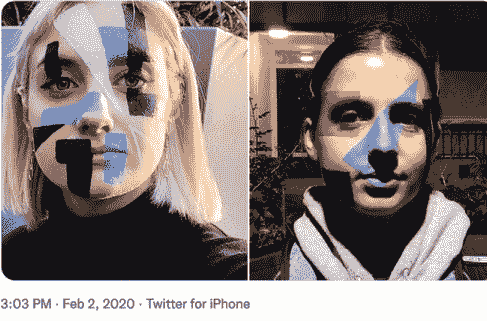

下午 3:03 · 2020年2月2日 · iPhone版 Twitter

165 次转发 52 次引用推文 621 个赞

**图 3.20** 受 Adam Harvey 的 `CV Dazzle` 启发的脸彩。Present & Correct, Twitter, @presentcorrect, 2020年2月2日。

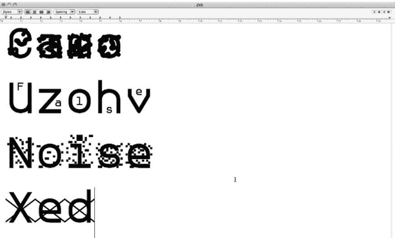

**图 3.21** Sang Mun 的《ZXX字体样本视频》截图，2012年，Vimeo, https://vimeo.com/42675696, @ Sang Mun。

在具体的技术意义上，但这些妆容风格和发型是在数字语境下构思的，作为对机器视觉逻辑的响应。71 `ZXX` 字体是由计算机执行的，但这种干扰是基于划掉文本和涂鸦，这些是真正让人联想到手写的人类手势。`CV Dazzle` 初看可能显得杂乱无章，但它具有与字体排学相关的正式特征。通过对不同伪装风格进行更深入的分析，可能会发现字母的升部部、下降部、笔画、装饰笔以及字母的其他身体部分。这两个项目都通过异化审美实践的传统形式，延续了机器可读字体的传统。当数字变得变得不可见并融入到日常生活时，后数字艺术可以有助于让这些技术及其影响再次变得可见。

# 4

# 多感官针式打印机

自 20 世纪中期成立以来，计算机行业经历了快速的创新。技术解决方案层出不穷，过时的设备被遗留在地下室和阁楼里吃灰。本章介绍的是其中一种技术——针式打印机，以及它为字体排学带来的挑战及其意料之外的听觉潜力。本章的目的是展示打印机的多感官特征是如何被探索的，既为了工业中的实用目的，也为了个人和艺术家的创作目的。打印机已成为我们文化和技术遗产的一部分，并在所有者和用户的记忆中占据了一席之地。当复古极客们在在线论坛和博客上提到并发布图片、广告和其他纪念品时，评论区就会出现怀旧的故事。打印机生成的输出结果具有独特的视觉外观，但不可否认，声音是它最显著的特征，这也就是为什么与针式打印机相关的记忆实践涉及音乐创作和表演。一些关键问题被提出：打印机带来了哪些字体排学挑战？它是如何营销的？打印机的多感官方面是如何被探索的？什么样的记忆实践与打印机相关？针式打印的当代应用有哪些？

## 理论与方法：物质性与拼贴

正如在第 3 章一样，约翰娜·德鲁克（Johanna Drucker）的物质性模型在这里同样适用，但方式略有不同，因为我非常关注

118

第4章

作为一台设备的打印机。打印机的机身、其运作方式以及它的故障构成了德鲁克所认为的“生产的物理、实质方面”，她将其视为模型中两个主要组成部分之一，该模型还考虑了社会背景。¹ 我通过分析 20 世纪 80 年代的说明书和广告研究它的营销方式，以及随后的几十年里爱好者、艺术家和普通用户如何使用和重复使用它，以此凸显了打印机的社会背景。与德鲁克的思想一致，打印机及其打印活动将参与到一个解释过程之中，这个过程并不预设设备具有任何“真实”的特质。

为了进行这样的解释，我使用了“拼贴”（bricolage）方法：这是一种折衷的方法，以一种有时不正统的方式将各种方法和来源组合在一起。² 我在之前的章节中也做过类似的事情，但我的查询更具开放性，因为我对于自己会发现什么当时只有模糊的设想。

为了勾勒出针式打印机过去和现在的图景，我查阅了学术期刊档案的数字化（因此是可搜索的）过期、似乎被时间冻结且最后一次更新于 2012 年的艺术组织网站，以及关于如何修理损坏打印机的当前视频等。这种考古式的挖掘要求我保持开放的心态，这使我意识到，尽管某项技术在市场上已成为“边缘媒体”，它在未来可能产生完全不同的意义。

本章的部分内容致力于探讨打印机的不同多感官方面——如何将声音转化为文字以监视正在打印的信息、糟糕的视觉印象如何与对设备的记忆联系起来，以及在音乐制作中是如何探索声音和图像的。在随后的章节中，还解释了多感官方法和“技术怀旧症”（technostalgia）的概念。

## 针式打印机与打印原理

针式打印机的黄金时代出现在 20 世纪 80 年代的家用电脑热潮，当时它是最常见的计算机外设之一。20 世纪 90 年代中期，它被喷墨打印机超越了，后者

127

# 多感官针式打印机 119

可以打印高分辨率彩色图像且噪音小得多。稍晚，在 20 世纪 90 年代后期，激光打印机成为家用电脑文字处理的首选打印机，针式打印机被边缘到了小众领域，这些领域目前仍在使用它。`AppleWriter` 于 1985 年推出，`Macintosh` 及其随附软件很快主导了桌面出版行业。小型企业现在可以在不需要专业排字机的情况下制作图形材料。但 Apple 的方案价格昂贵，其他型号在家用电脑市场上更受欢迎，包括 `Amstrad CPC`、`Commodore 64` 以及 `TRS-80`，以及后来的 `IBM PC` 及其许多克隆机型。针式打印机相对廉价，尽管质量不高，但它的灵活性具有巨大的吸引力。³ 这是一个整洁字母通过打字机输入的时代，而计算机输出意味着连接在大型机上的线路打印机上来自税务机关的大写字母。文字处理现在使得打印大写和小字母成为可能，并将句子部分设为斜体。过了几年时间，带有长长字体列表的下拉菜单才成为大多数平台和程序的标准。

位图图像由网格中的像素或点组成，计算机屏幕和现代打印机都是基于这种光栅图形的。针式概念早在 20 世纪 20 年代 `Hellschreiber` 针式电报发明时就已应用于打印，但基于该概念的技术直到桌面出版产生了对快速和灵活打印的需求时才真正成熟。直到 20 世纪 70 年代，计算机行业中最常见的打印机在一个重要方面上是相似的：它们有一组金属锻制的固定字符，击打色带。⁴ 打字机有字锤，线路打印机有滚筒、链条或杆。针式打印机的当代竞争对手是带有更换字轮的打印机。这些解决方案——每个字母形状对应一个实体——提供了高质量的打印效果，但由于打印机结构涉及许多机械部件，它们非常脆弱。它们也缺乏灵活性，因为更换字体非常复杂

## 第四章

而且非常耗时，如果这是可能的话。点字矩阵打印机缺乏那种预铸的字符，而是以矩阵中点点阵列的形式产生字母。

一个带有多个垂直排列针脚的打印头在纸张上移动，通过击打浸透了彩色墨水的织物丝带在纸张上留下痕迹。较简单的型号有七个针脚，这意味着它们不能打印“下伸字母”（descenders），例如 `g`、`p` 和 `y` 中延伸到基准线以下的部分（见图 4.19 中的 `y` 和 `g`）。现在，这些笔画本身坐落在基准线上，导致文本看起来很笨拙，并干扰了阅读。当新款机进行广告推销时，广告强调这些打印头可以处理“下伸字母”。1980 年发布并成为流行型号的爱普 `MX-80` 具有九个针脚，后期更复杂的型号则有二十四个针脚。某些型号还可以打印图形。

点字矩阵打印机在打印质量上无法与其竞争对手竞争，但在那个时代，它凭借灵活性、速度和单页成本的优势胜过了它们。它在扇形纸上打印，并可以处理复写。它可以在草稿模式下打印（速度快但质量较低），也可以在“近信质”模式（一个为了市场目的而创造的术语）下打印，这是通过打印头的多次通过实现的。草稿模式下，点间隙清晰可见；而在近信质模式下，字母更密集，但墨点仍然容易被辨认。点字矩阵打印机的最大分辨率为每英寸 240 点（dpi），而喷墨打印机和激光打印机的分辨率通常为 1200 dpi 或更高。这些类型的打印机也是基于点的，但这些点的尺寸更小，在打印时看起来会合并。

与手写不同，打印理应在每次运行时都产生相似的结果。但机械设备有其自身的特性，亚瑟·柯南·道尔（Arthur Conan Doyle）在他的小福尔摩斯侦探小说之一的《身份谜案》中探讨了这一事实。福尔姆斯通过对比手写信件解决了谜团，并根据损坏和磨损的字母得出结论：这些信一定是在同一台机器上打印的。在法医学领域，需要识别文档的创建方式，并在可能的情况下将其与特定的打字机或打印机联系起来。设备磨损（如针弯针）是识别点字矩阵打印机的方法之一。另一种方法是根据矩阵设计的基础和字母的形式进行识别。

# 感官点字矩阵打印机

**图 4.1** 爱普打印机点字字体字符。所有字符都设计为适应一个九点高、五点宽的矩阵。David A. Lean，《爱普 MX 打印机手册》，GraftraxPlus（圣地亚：CompuSoft, 1982），附图 F。

**图 4.2** 点字矩阵打印机的打印头。*Delta 用户手册（日本静冈：Star Micronics, 1983），75页。* © Star Micronics Co. Ltd.

**图 4.3** 台爱普 `MX-80F/T` 点字矩阵打印机。由 Wikimedia Commons 的 Phrontis 感谢。CC-BY-SA-3.0。

# 感官点字矩阵打印机

**图 4.4** 源自两种不同打印机的字母 `a` 的两种设计。James A. Blanco，“识别点字矩阵计算机打印机打印的文档”，“法医学科学国际》59 (1993): 46。

矩阵设计的基础和字母的形式进行识别。⁵ 虽然点字矩阵打印机的字形设计可能性有限，但仍有空间进行变化，使其能够将它们区分开。这种文档比较是警察人员执行的平庸法医工作的一部分。它是“个性化原则”的例子——即没有两个物体是完全相同的——这一原则也是柯申鲍姆（Kirschenbaum）的文学概念的基础。

## 点字矩阵打印机的字形功能

那个时代的打印机手册揭示了许多关于排版方法的信息。1982 年的爱普系列手册介绍了当时采用的排版方法。在引言中提到，“对于那些自己编程的人，或者对于任何初学者来说，熟悉 `BASIC` 语言就足够了，” 这种语言是当时被使用的。在连接打印机之前，用户被鼓励按下换行（LF）按钮，在打印机上进行所有字符的测试打印。这种打印机打印的字符在纸张上出现正体和斜体。

**图 4.5** 爱普 `MX-80F/T` 打印机中的所有字符打印。爱普 MX 打印机手册，GraftraxPlus（圣地亚：CompuSoft, 1982），14页。

可以变化的三种打印功能是宽度、字体和打印质量。正常宽度指的是等宽打字机，即每英寸十个字符。如果选择压缩宽度，字间距会变得更密。这种效果可以通过打印机再次通过纸张来实现。类型字体功能指的是正体和斜体，这是当时唯一的样式。打印质量可以通过让打印头再次扫描纸张来增强。通过这种方式，字间距会变得更密或更宽。在手册的最后，有一个章节介绍了这些功能如何帮助用户“释放创造力”并设计自己的字形。

该手册由著名的计算机书籍作者 David A. Lean 以个人化易于理解的风格编写。为了增加文本的轻快和非正式语调，手册还包含了许多卡通风格的插图。在另一种打印机手册中（针对 Star Micronics `Delta-10` 和 `Delta-15`），制造商向业主保证 (1) 手册不仅为自己编程的人编写，也为任何倾向于将编程交给他人、只需向计算机/打印机系统插入购买程序（软件）的初学者编写。“非常像你的人……” 并且 (2) “它读起来会是一件愉快的事，”因为它是由计算机科学深奥艺术的专家精心设计的，并由同样精通的

# 感官点字矩阵打印机


**图 4.6** 用户在爱普打印机上创建的几种字体。爱普 MX 打印机手册，GraftraxPlus（圣地亚：CompuSoft, 1982），14-9页。

普通英语艺术从业者！¹⁸ 尽管如此，无论是 Delta 还是爱普的手册都没有发现，利用打印机功能需要许多计算机技能，尤其是关于排版的技能。这是一个过渡时期，微型计算机一直是痴迷编程的爱好者的爱好，现在变成了家庭电脑或个人电脑，面向更广泛的受众。

与今天的标准相比，排版可能性是有限的，但当时的制造商热衷于推销打印机的功能。例如，Delta 打印机上的字符被称为字字体，如下：

- 1. 标准 pica 字——每英寸十个字符
- 2. 标准 elite 字——每英寸十二个字符
- 3. 压缩字——每英寸十七个字符
- 4. 斜体 pica 式——每英寸十个字符
- 5. 强调 pica 字——每英寸十个字符

126

第 4 章

`$m_1 m_2 m_3 m_4 m_5 m_6 m_7 m_8 m_9 m_{10} m_{11}$`

| | | | | | | | | |
|---|---|---|---|---|---|---|---|
| 1 | | | | | | | | `$n_1 =$` |
| 2 | | | | | | | | 降部部 (Descender) |
| 4 | | | | | | | | 宽度 (Width) |
| 8 | | | | | | | | |
| 16 | | | | | | | | `$n_2 = Descender * 16 + Width` |
| 32 | | | | | | | | 格式: |
| 64 | | | | | | | | 转义 Esc `$n_1, n_2, \dots, m_{11}$` |
| 总计 | 4 20 52 52 20 4 | | | | | | |
| | 10 10 72 10 10 | | | | | | |

**图 4.7** 来自一份名为“创建你自己的字符”的手册章节说明。《Delta 用户手册》（日本静冈：星友打印机，1983年），79页。星友打印机有限公司。

就像 *pica*（品）一样，*elite*（等线）是另一个参考打字机字体设计的术语，定义了文本的字母。像 New Roman 和 Helvetica 等字体与点矩阵打印的世界仍然非常遥远。想要更多字体的用户可以在计算机程序的帮助下从零开始设计，并下载到打印机的随机访问存储器（RAM）中。手册第 7 章给出了如何使用点矩阵设计字符的详尽解释：“你已经看到星友的工程师如何使用网格布局点来设计他们的字符了。现在你可以用完全相同的方法来定义字符。”选作展示的符号是用于桥牌和其他纸牌游戏的四种花色。手册中提供了让人联想到针织图案的插图，以及指示打印机执行字符的命令语法。图 4.7 中的指令与 Rüdiger Schlömer 的《字字针织：从像素到图案》（*Typographic Knitting: From Pixel to Pattern*）中第一章提到的指令相似。针织与使用点矩阵打印机的生产方法是不同的。针织的速度比大多数计算机打印机慢得多，且只需要针这种基础技术，但其起点——一个带有设计的模板——是相同的。¹¹⁰。

## 多感官点矩阵打印机

## 将打印机作为珍贵的新家庭成员进行营销

打印机不仅仅是生产文本和图形的手段。它本身也是一个实体对象。打印机手册的前几页通常用于设备的拆箱、设置和测试。按钮、旋钮、开关、杠杆和插槽的位置和功能在图和图中被指出来。但这些手册的目的不仅仅是强调设备的所有功能及其工作方式。它们还起着超越功能的作用，即让所有者对新获得的东西产生感情。新主手册通常从祝贺新主开始，爱普生的手册也不例外。在作者 David A. Lien 的一封便中写道：“祝贺你决定购买 EPSON MX 系列打印机！这是一台真正非凡的硬件，我相信它是当今市场上计算机打印机中性价比最高的。”¹¹ 在前一页，画有一个穿着（白色）大褂、口袋里插了两支笔的男人，一个拟人化的爱普生打印机像宠物一样坐在桌子上，有着眼睛和微笑的嘴，摇动着尾巴，而男人正拍着它的头。这个男人似乎在对宠物说话，他们正在进行眼神交流。这幅画象征着新获得的设备被视为一个珍贵的物品，像家人一样被珍爱。男人的装扮让他显得有些模糊。他既可能是打印机设计背后的工程师，现在正将他那顺从又满足的生物交给他的新主人；也可能是负责的新主人/技术人员。口袋里的大褂和笔是另一个参考，代表了从微型计算机到个人电脑、从业余程序员到用户的转变，正如《Delta》手册中所述，用户“只需将商店买来的程序（软件）插入到他的计算机/打印机中”。¹²

1982 年在微型计算机杂志《字节》（Byte）上关于系列爱普生打印机的两页广告传达了类似的信息——购买家用电器可以比作增加一个新家庭成员。

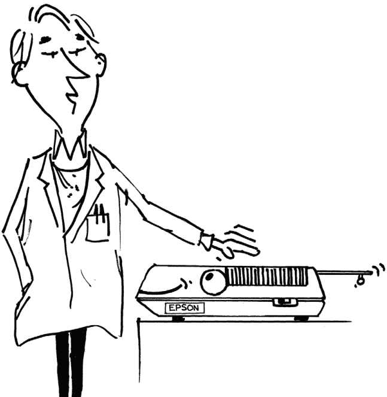

**图 4.8** 一个带着“宠物”打印机的男人。《*爱普生 MX 打印机手册，GraftraxPlus（圣地亚哥：CompuSoft，1982），iv。

标题写着“传奇的诞生”。背景是一个产房，三位微笑的护士拿着三个包裹在毯子里的新生打印机，将它们呈现给惊讶的父亲。照片下方文本的第一部分写道：“新一代爱普生 MX 打印机已经到来。尽管它们拥有让爱普生闻名的家族特质——如无与伦比的可靠性和极细打印——但它们拥有更多成为传奇的特质。例如，它们多了一些额外的字体样式.¹³”

广告中对家庭的引用是双重的。首先，爱普生公司本身就是一个拥有“世代”和家族特质的家庭。

## 多感官点矩阵打印机

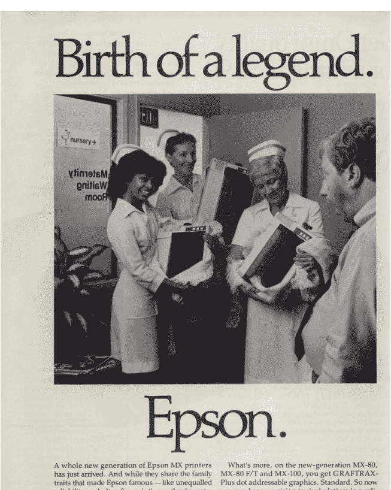

**图 4.9** “传奇的诞生”：爱普生的广告。

新一代爱普生 MX 打印机已经到来。尽管它们拥有让爱普生闻名的家族特质——如无与伦比的可靠性和极细打印——但它们拥有更多成为传奇的特质。例如，它们多了一些额外的字体样式³

对家庭的引用是双重的。首先，爱普生公司本身就是一个拥有“世代”和家族特质的家庭。

## 点矩阵矩阵打印机

爱普生美国公司

123 Kabushi Street, Irvine, CA 92616

| 功能 | ORIGINAL MX-60 | ORIGINAL GRATRAX-60 | ORIGINAL MX-100 | MX-100 带 GRATRAX-Plus |
| :--- | :---: | :---: | :---: | :---: |
| 双向打印 | X | X | X | X |
| 逻辑寻 | X | X | X | X |
| 可弃式打印头 | X | X | X | X |
| 速度: 80 CPI | X | X | X | X |
| 矩阵: 9 x 9 | X | X | X | X |
| 可缩放进纸 | X | X | X | X |
| 纸张处理功能 | | | | |
| 行速度控制 | X | X | X | X |
| 可编程表格长度 | X | X | X | X |
| 可编程水平制 | X | X | X | X |
| 用户分区 | X | X | X | X |
| 打印模式和字体 | | | | |
| 96 DPI | X | X | X | X |
| 斜体字体 | X | X | X | X |
| 普通、强调、双倍和和强调模式 | X | X | X | X |
| 粗体/反向打印模式 | X | X | X | X |
| 下划线模式 | X | X | X | X |
| 5 CPI | X | X | X | X |
| 7 CPI | X | X | X | X |
| 8.36 CPI | X | X | X | X |
| 点图形模式 | | | | |
| 线条图形 | X | X | X | X |
| 位图 60 | X | X | X | X |
| 位图 100 | X | X | X | X |
| 控制功能 | | | | |
| 标准 - 中心式 8 位并行 | X | X | X | X |
| 可选 - RS-232 控制带 2k 缓冲区 | X | X | X | X |
| 无缓冲器的 RS-232 | X | X | X | X |

* 只有 MX-100 提供 GRATRAX

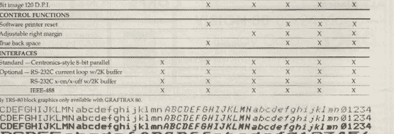

图 4.9（续）

# 多感官矩阵式打印机

131

其次，这三台新“婴儿”打印机将迎来它们的主人的家庭，就像一位第一次看到新生儿的父亲一样。在照片中，它们仍在专业人士的人手中，但在手册的帮助下，父母们很快就会学会如何照顾他们的孩子。在孩子旁边，宠物通常被列为有价值的家庭成员。爱普（Epson）手册插图中的男子被描绘成一位仁慈的主人，已经与他的新宠物相处融洽。这种“家庭成员”营销策略是公司让消费者与其产品建立情感联系的一种方式.¹14 电脑市场的打印机，如此处提到的爱普和 Delta 型，具有许多适用于这种策略的特质。它们体型小狗一样大，听从指令，并且在打印时会“活过来”，发出声音和动作。15

## 多感官机器

打印的目的是产生视觉输出。然而，和其他打印机一样，矩阵式打印机也是一种多感官机器：它发出视觉、听觉、触觉以及嗅觉信息。媒体理论家 W. J. T. 密切尔（W. J. T. Mitchell）认为，不存在所谓的视觉媒体，所有媒体都是混合媒体。图像几乎总是涉及其他感官——特别是听觉和触觉。他所举的例子是呈现出厚层油料的刮纹画法（pastoise painting）技术，以及在电影院放映时总是伴有现场音乐的无声电影.¹16 尽管矩阵字符集具有独特的特性，但定义打印机特征的并非输出的视觉外观，而是它打印时发出的声音。在说明书中，通常没有提到噪音，可能是制造商没有引起对可能被视为产品缺点的关注。行式打印机有独特且非常响亮的声音，但它们被锁在机房里，许多人听不到。矩阵式打印机是公司和家庭的常用设备，其奇特的声音在记忆描述中被反复提及，如下所示。但声音不仅是记忆的来源，它还是信息的来源，可以揭示正在打印什么

## 阅读声音：声学窃听

即使对于那些不应该接触这些信息的人来说。

矩阵式打印机产生的声音来自多个来源——电机、在纸上往复移动打印头的小车、打印头针针撞击墨带，以及打印机其他机械部件的运动。声音不仅是打印过程的副作用。它还是一种符号资源，携带着可以被人类和机器解读的意义。当用于打印文本和图形的原始用途时，矩阵式打印机发出的声音可以向频繁用户揭示打印机发送了什么种输出内容。《古电子学》（Paleotronic）杂志上的一关于矩阵式打印机的文章提到了打印机的这一方面：

它们声音大且独特，打印头上的针钉击穿墨带，将墨水压入下方的纸张，这种在树浆上呈现图案的行为也创造了独特的节奏，如果你听过一次，就能学会识别它们——“噢，那是读后报告。那是份简历。噢，那一定是一个 Print Shop 的横幅！”¹17

这些引言证明了打印物类别如何具有特定的声学声音、节奏和音调，这些特征肉耳可以轻易辨别。矩阵式打印机甚至可以向知道自己在寻找什么且拥有正确设备的人揭示更多信息。在用矩阵式打印机打印机密或秘密信息的背景下，可能会发起侧信道攻击以获取信息。

# 多感官矩阵式打印机

根据德国的一项研究，侧信道攻击“利用计算机与现实世界接触的未保护区域：键盘、显示器或打印机附近，在信息加密之前或翻译成人类可读格式之后的阶段.¹19 在2010年进行研究时，德国的许多医生和银行仍在使用矩阵式打印机。进行了一项现场性攻击，通过记录矩阵式打印机打印七份虚构处方时的声音，可以检索多少信息。处理录音的方法源自语言技术领域，该领域已开发了自动语音识别和用于音频处理及文档连贯性的机器学习技术。第一阶段涉及“一个训练阶段，打印字典中的单词，提取这些单词的特征性声音特征并存储在数据库中。²⁰ 采用基于单词的方法是因为在识别单个字母声音时存在模糊效应。为了观察如果修改设置的某些参数实验将如何运行，研究使用了不同的字体类型和打印机型号。从等宽字体更改为比例字体，或切换到另一种类型的矩阵式打印机，对识别率几乎产生很小的负面影响。最常用的内置等宽字体使文本没有比例字体那么紧凑，因此更容易解码。比例字体增加了模糊效应，使得难以区分字母和单词的声音。如果使用领域特定语料库进行分析（在本例中为医学领域），识别率为95%。该研究得出结论，声学屏蔽是最简单的对策之一.¹21 实验中值得注意的是，使用了用于分析人声的语音识别技术，这意味着打印机拥有声音。将矩阵式打印机的声音视为声音，是爱普手册中新生婴儿那种拟人化的另一个实例。语音助手和机器人的拟人化是当代研究的一个课题。²2 然而，矩阵式打印机的声音远未达到恐怖谷效应，那种机器人与人类高度相似但在某些方面又被认为诡异所引发的效应。²3 矩阵式打印机的声音有时会被生动地描述，正如Ben Edwards在2013年其博客《经典计算与游戏：经典技术冒险》中发布的那样，该文包含了1983年Star Delta-10的广告。作为一个幼儿，埃华斯经常观察打印机击打横幅和日历：“但我最记得的是，当然是它发出的声音：像一只尖叫的老鼠用小机关枪向孔式纸喷射。像任何矩阵式打印机一样，一旦你听过它的工作声，那个声音就永远不会离开你。”²4 这种描述注定会读者的记忆。一位名为techingress的评论者写道：

我记得90年代初在计算机课上对矩阵式计算机非常着迷，看着它们产出我做的 . . 某些东西（我忘了），并小心地将其从打印机中取出，静置几分钟以确保所有墨水干透。自从有了高质量的彩色激光打印机后，打印机对我来说失去了那种魔力。也许是它们发出的独特声音让那种体验变得如此魔幻。²5

## 多感官点阵打印机

135

在二战后的时代。27 但对于点阵打印机来说，奇怪的声音可能只是假警报，而不是故障信号。Carsten Langbo 在 YouTube 频道 Nostalgia Nerd 上这样评论道：

我总是喜欢点阵打印机，因为它们在按照意图[sic]工作时，听起来就像是在撕碎什么东西，或者正在发生严重的持续故障。28

Langbo 与其他评论者和博主一样，表达了他对点阵打印机的赞赏，这种赞赏方式涵盖了该设备的粗糙与光滑特质。众所周知音乐能引起听众的情感共鸣，但其他类型的声音也能产生同样的效果。29

教学视频是互联网上的一种流行视频类型，通常用于分享技术知识。一位发布视频的微型计算机私人收藏家是新西兰的 Terry Stewart。他运营着“Terry Stewart’s (Tezza’s) Webzone for Classic Computers”网站，该网站“致力于从我个人的视角关注那个年代（1975–1986年）的计算机并培养当时的文化，并且通常带有‘南半球’的特色。它存在的意义是在那些经历过的人遗忘它们之前保留一些历史，或者让那些没有经历过的人发现它们。”30 他的 YouTube 频道拥有近八千订阅者，其中包含一段 2014 年的视频《Terry 经典计算机收藏中的点阵打印机》。在视频中，他对打印机技术进行了概述，从线式打印机开始，然后在插图的帮助介绍了点阵打印机的原理。他转向一台放在桌子上的松下 KX-P1081 打印机，系统地展示了外部和内部细节，并拆下外壳展示打印机构、打印机端口和插头。随后我们看到它在打印自检和文本文档时运作。他还展示了说明书以及他收藏中的其他打印机：“它们就在那儿，我的宝贝们。”

Stewart 在视频结束时说，经历过那个时代的人可能从这段视频中中学不到什么，但“希望这为你们带来了一点怀旧感，再次看到这些旧机器并听到它们工作的声音。如果你很年轻，只听说过点阵打印机，希望这段视频对你有所帮助。”31 正

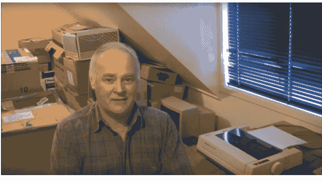

**图 4.10** 显示 Terry Stewart 和一台点阵打印机的截图。Terry Stewart，“Dot Matrix Printers. As Seen in Tezza's Classic Computer Collection，”YouTube，2014年10月4日，@ Terry Stewart。

正如他在网站上承诺的那样，他兼顾了这两个目标群体。这段视频在其方法论且全面的呈现风格上，有点让人想起打印机手册。就像手册中的图画一样，视频从多个角度展示了打印机，同时也能够传达动作和声音，提供了多感官的体验。同时看到并听到机器是引起感情的，并可能产生怀旧感，这也是 Stewart 在结尾表达的愿望。

对于一些评论者来说，这段视频唤起了他们的童年记忆：

- **rwdplz1**

我记得小时候第一次看到苹果点阵打印机时，被它缓慢出现在页面上的文字深深迷住了。

- **William M**

我确实记得我是和点阵打印机一起长大的——我们家里有一台，学校也有——看到你的视频带回了那些视觉、声音和气味（这些打印机机构有一种独特的气味——我不确定是墨水/色带还是机构上的某种东西）¹

打印机的声音在点阵打印机的语境下经常被提及，但这两条评论引值得注意——第一个是因为它突显了打印机的表演属性，第二个是因为它突显了记忆的多感官特征。

## 多感官点阵打印机

记忆不仅关于最终产品，即打印出的页面。打印的过程也是一种迷人的来源。看着文字显现类似于在模拟胶片冲洗盆中看照片在显影中出现，尽管打印页面是通过“点”出现的，而照片是作为整幅图像出现的，起初很淡，然后逐渐变暗。关于气味的评论是我在点阵打印机博客和论坛领域遇到的唯一一个。在谈到广义计算机时，气味可能不是首先想到的东西，但它们确实具有嗅觉的维度。在上面的评论中，记忆是由看到视频触发的，因此一种感官就可能足以唤起涉及多种感官的记忆.³33

教学视频的一个子类别是专门用于维护和修理技术设备的——在这种情况下是过时的计算机设备。这些视频既面向那些仍在使用旧设备的人，也面向那些想要翻新他们的博物馆藏品以获得功能性收藏的人。YouTube 频道 Tech Tangents 拥有 10 万订阅者，包含了关于各种技术和计算机相关问题的视频，以及如何修理损坏的设备。其中一个实操视频是《修复卡住的点阵打印机针—Micro Tangent》，发布于 2020 年.³ 除别诉诸视觉和听觉外，这段视频还通过展示频道所有主在操作打印机不同部位的手部，诉诸了触觉。一台 Apple ImageWriter 无法正常打印，因为其中一个键卡住了，这通过一份打印件看出，每行的下半部分缺失了。


`ImageWriter`是一台 9 针打印机，纸上打印的文字（“我现在是 8 针打印机了”）读起来有些困难。频道所有者展示了问题所在：织物色带上的墨水卡在了针头上。然后他开始拆卸打印头，同时说：“当维护和可维修性是人们寻找的关键特征时，点阵打印机非常流行。”打印头的特写显示了上面聚集了多少墨水。他先用牙刷刷掉，并将打印头放入溶剂中。当清洗后，他进行了一次新的测试打印，显示打印机现在运行如：

138

第 4 章

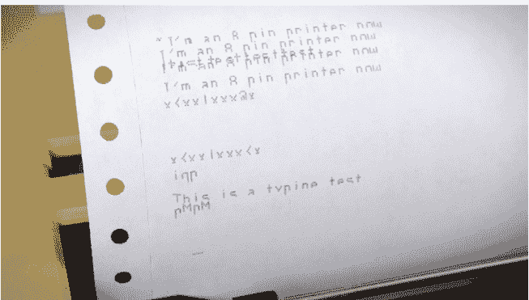

**图 4.11** 显示打印问题的截图。“Fix Dot Matrix Printer Stuck Pin—Micro Tangent，”YouTube，2020年3月18日。© Shelby Jueden, Tech Tangents。

正如预期所示，显出的文字说：“又回到 9 针了！”他惊呼道：“啊，是的，好多了！[打印机正在打印。]我很喜欢矩阵打印机。那种声音听起来很真实……嗯，是的[加强语气，并用手做了 OK 手势]。我觉得大多数人可能听过那种声音，要么是通过这些设备，要么是在 DMV。”视频的最后二十秒聚焦在运行中的打印机，没有任何评论。这是一个中介物质性的例子。电影化的特写既是为了教学目的，也是为了传达一种沉浸在机械和任务中的感觉。观众被鼓励去弄脏手，不要害怕机器内部。视觉媒体没有提供与所展示材料的直接接触，但它们可以包含触觉和其他多感官的线索.³³⁵

就像 Terry Stewart 的视频一样，这段视频唤起了许多观众的童年记忆。正如一位评论者 AttilaSVK 写的：

这让我想起了我的童年。1996 年，我母亲是一名会计，有时她必须在家里工作，特别是在我生病的时候，那时没人照顾我。她会带一台 386SX 笔记本电脑回家，以及一台爱普生 LX-100 点阵打印机。我能从打印机的节奏判断她是在打印发票，还是银行报告等等.³³⁶

# 多感官矩阵式打印机

这段评论为谁使用过计算机和打印机的记忆提供了背景，包括他们所处的环境以及他们的目的。它还具体说明了声音是什么以及如何对其解读。然而，人类可以识别不同类型的打印任务，但无法识别每一个字母，就像上面描述的侧道攻击中的语音识别系统那样。

几位评论者（如 Bluehfreak）对关于维护的陈述了反应：

“[当维护和可维修性是人们寻找的核心特征时。[原文如此] 你并不知道这句话给我造成了怎样的无法言喻的悲伤。为什么现在没有更多人在寻找这个了？37

对这段视频的许多评论揭示了人们对计算机设备过时速度快以及不利于维修的产品构造的担忧。与修理损坏的设备相比，买一个新的替代品更便宜、也更容易。许多人向往过去那种不同、更可持续的思维盛行的时代。所涉及的不仅是实体物体和材料浪费。投入到机器中的技能和知识也随着这些器品而消失了。上述提到的两个视频的吸引力超出了浅层的认可。它涉及到对技术知识的维护，而频道所有者可以被视为这些知识的守护者。

# 从噪音中创造音乐：与矩阵式打印机相关的实践

声音根据几个因素可能被认为是烦人的，其中音量和音调。38 根据 HP 计算机博物馆网站的，“‘电锯’和‘地狱的锤子’等术语被恰当地用于矩阵式打印机。”39 这些打印机的噪音很大，以至于所售的配件可以减少它们的噪音。1983年，《科学美国》快杂志上发表了一篇关于该主题的短文：“吱吱，嘎，吱吱。矩阵式打印机的声音——细小的针头撞击纸张的声——会让家人或同事感到紧张。当我把我的爱普 MX80 放入 SoundTrap（一种新型声学外壳）时，我对其降噪效果感到惊讶。”40 当时的工程研究还探讨了如何通过改变打印机的结构来减少此类声源。41 除了音量之外，音调是另一个可能被认为是烦人的因素，而矩阵式打印机会产生显著的音调噪声。这也可以被视为资产，因为它将打印机变成了一个潜在的乐器或其自身的音乐机器。42

在技术和小配件是常见话题的博客 Boing Boing 上，Jason Weiner 在 2019 年发表了名为《啊，矩阵式打印机的声音！的文章。他写下了关于 20 世纪 80 年代后期第一份工作中使用矩阵式打印机的记忆，该帖子引发了许多评论。作为回帖，评论者 Purplecat 发布了一个由矩阵式打印机播放的歌曲《虎之眼》（Eye of the Tiger）的链接。对此，一位评论者回复道：

“现在才像样子。美好的时光。我记得在大学计算机房里随着 2 Star LC-100 打印表格的声音跳舞。人们以前会互相提醒，如果有好的纸张（好的意思是有很多表格和图表，那些听起来最好听）要出来，就会举办一个小小的‘舞蹈’派对。带着啤酒和（如果人们没看着的话）薯片。43

这是计算机文化特征——俏皮性的另一种表达，就像计算机中心的 ASCII 艺术一样（第 2 章）。随着打印机声音跳舞可以被视为一种以非预期方式使用设备的数字实践。

20 世纪 50 年，前卫音乐运动“具体音乐”（musique concrete）将环境声音作为创作的起点。在博客评论者她的舞蹈记忆的帮助下，矩阵式打印机可以被看作是在制作直接且未经中介的具体音乐，而不需要作曲家对声音材料进行录制和处理。这段记忆中一个有趣的方面是舞蹈“曲调”的随机出现，仿佛其他打印任务的用户在统一地充当着远程 DJ。某种类型的输出（带有表格和图表的文档）被认为最适合跳舞，这表明一个为了交流思想而建立的基于字母、图表和科学公式的系统可以被视为一种音乐记谱。这是我在下文中提到的这一点。

在 2019 年《Paleotronic》杂志的一篇关于矩阵式打印机的文章中（它们是“小道具墓场”（Gadget Graveyard）系列的一部分），打印机的音乐能力得到了类似的认可：“驱动打印头和轴的电机会嗡嗡响，在某些型号中，打印头会撞击在打印机的边缘，就像在完成一套技术无政府主义的鼓组.^44 此外，除了音调外，打印机还会产生节奏性声音，这是音乐的另一个重要元素。对打印机工作原理及其特定部分产生声音的描述，变成了一个乐器，或者说是一组乐器——一套鼓组。

为了应对通常围绕着新媒体的新奇性炒作，许多艺术家在创作艺术时采用了媒介考古的方法，使用过时技术来制作艺术.^45 一个例子是加拿大当代艺术团体 [The User]，由作曲家 Emmanuel Madarch 和艺术家 Thomas McIntosh 组成。1998 年，他们创作了《矩阵式打印机交响曲》（Symphony for Dot Matrix Printers），这部作品在 1999 年的多个艺术节上表演过，其中包括奥地利的电子艺术节（Ars Electronica）。46 学校和朋友捐给了他们十二台旧打印机，每台打印机连接到网络中的一台个人电脑。这十二台打印机充当乐团，而一台服务器扮演了指挥的角色：“局域网从字母和其他符号组成的文本文件中读取内容，打印时会创造出纹理、音调和节奏，”Madarch 在一次采访中说道。47 摄像机被插入打印机中，以便观众可以看到机构的运动。50 2001 年在赫尔辛基的 Avanto 节上表演时，节日网站写道：“[The User]《矩阵式打印机交响曲》的天才之处在于它所使用的图形方式创造了从怀旧的、雾雾蒙日的20世纪工业主义向当代信息社会‘微数字爱好者’世界的延续；^51 2004 年，作品的另一个版本被呈现，即《矩阵式打印机四重奏》（Quartet for Dot Matrix Printers），这次是以画廊装置的形式。在德国多特蒙德 PhoenixHalle，四台打印机被放在玻璃展示箱内。装置中间的一把办公椅让访问者有机会听打印机声音，观察它们打印，并在画廊墙上观看内部投影。访问者因此“沉浸在完全由打印机复制的创作文本所编排的垃圾美学视听环境中，”根据网站上对作品的描述是.^52 这个例子展示了如何

# 多感官针式打印机

同一项工作可以通过多种方式进行变体和呈现，从而引出底层的概念和思想。

针式打印机的音乐潜力不仅被前卫艺术家所挖掘，还被那些不参与当代艺术界、但属于 DIY 文化的、具备音乐和技术技能的人们所发掘。他们可能是匿名的，使用别名，并主要在 YouTube 等频道发布自己的作品。他们与前卫艺术家的共同点是媒体考古学的方法以及对摆弄（tinkering）的使用.^53。他们还通过拆解设备并将其用于设计者意之外之外用途，展示出一种后数字黑客态度。一个例子是由一个德国人在 2012 年创立的 Vimeo 频道 MIDI Desaster，目标是“滥用旧硬件播放音乐”，^54 两年后，他启动了同名的 YouTube 频道，并声称：“除了打印，针式打印机还能做什么？这太显而易见了！做音乐！这就是我们做的，在结果中寻找乐趣。”在其中一个视频中，所有者详细介绍了他如何将一台旧的 24 针针式打印机转换为一个与乐器数字接口（MIDI）兼容的生成器.^55 [User] 的作品基于打印机的“自然”行为和功能，并且“完全根据打印机复制的谱写文本进行编排”，^56 而 MIDI Desaster 则对设备进行了重大修改，将其变成一种乐器，甚至是一个独立的弦乐团。这些频道包含了三十首名歌曲和音乐作品的翻唱，其中包括圣诞歌曲《O Tannenbaum》，在歌曲中，打印机被装饰了一根树枝，并在打印头上放置了一个树灯。一个小型灭火器完善了这种氛围感。大多数歌曲展示了未加修饰的打印机、其内部构造以及频道的 URL。播放次数最多的歌曲是 Purplecat 在 Boing Boing 贴中提到的《Rocky 的打印机——针式打印机上的〈虎之眼〉》，^57，这首歌充分利用了打印机处理节奏和旋律的能力。当打印头在页面上缓慢移动时，许多针头被启动以创造出复部音乐，并在纸上留下了视觉足迹。它形成了一个具有深浅不一部分的图形图案，与可读的文本相比，它看起来像是用密文写的秘密信息。

图 4.13 一张显示针式打印机的截图。MIDI Desaster，“针式打印机上的《Rocky 的打印机——〈虎之眼〉》，”，“Vimeo，2013年1月25日。© MIDI Desaster。

打印机的功能被颠倒了：是声音决定了视觉输出，而不是反过来（正如通常情况那样）。其中一些评论者注意到了这一点：

### Kitsune Shan

也很酷的是，你真的从音乐中获得了一个字面上的打印图像。一种“看”音乐的新方法。

### Guido Belluum

这基本上就像乐谱，你只需要显微镜就能阅读它。

### Minthidis

这就像在这个过程中你也制作了乐谱。如果能制作出能够读取这种谱子并将其作为音频播放出来的东西就太酷了.^58

引用的评论为打印图案的解释开启了三种不同的符号学路径。第一种是音乐的样子。这种图案是一种视觉上体验音乐的方式，符合联联觉（synesthesia）的概念，意味着感官之间可以发生转换。俄罗斯画家瓦西里·康定斯斯基（Wassily Kandinsky）是探索过音乐可以具有视觉等价物这一观点的艺术家之一，在20 世纪初，他创作了许多与音乐相关的抽象作品.^59 虽然艺术家可以解释音乐并将其转化为视觉形式，但打印输出似乎并没有经过人类大脑的加工，而似乎是作为声音产生的副产物自动呈现的。因此，这些图案可以被视为索引符号（indexical signs），就像人踩在沙上留下的脚印。

第二种解释打印机图案的符号学路径是将图案与标准的西方音乐记法进行比较，后者是基于线条和间线的五线谱，音符写在上面。这是一个清晰且无歧义的系统，旨在帮助作曲家写下他们的作品并帮助音乐家演奏这些作品.^60 MIDI Desaster 打印机创建的图案既不清晰无歧义，但评论者 Guido Bellomio 对其可渗透性提出了一个巧妙的解释——符号的微小尺寸。图案中可能隐藏着一个类似于传统音乐记法的代码系统，只是它太小了，肉眼无法阅读。

第三条路径由 Mithis 指出，他询问是否可能反转这一过程，“制作出某种能够读取这种谱子并将其作为音频播放的东西。”对于上述每条评论，我们都在疏远人类和人类的能力。第一条评论关于（可能的）人类视觉，第二条关于通过显微镜增强的人类视觉，而第三条则暗示了一个具有计算机视觉能力和执行音乐能力的人工智能系统。如果视为密码，该图案也许可以通过使用法医化学技术而不是依赖视觉检查来解密。正如在 YouTube 视频《Rocky 的打印机——针式打印机上的〈虎之眼〉》以及其他一些内容中所示，打印机在某些地方沉积了非常厚的墨层。墨水的量用肉眼很难判断，但可能可以通过实验室方法来确定。额外的符号学路径是，该图案是一个无人能破解的秘密代码。

### TECHNOSTIA

信息技术通常被认为是抽象且无物质的，并在某种程度上与物理世界对立。然而，如上所示，信息技术高度依赖于物理设备及其材料特性。针式打印机的多感官特征使其令人记忆，这并不意味着其他打印机缺乏特征。针式打印机、矩阵打印机和激光打印机也有声音，但针式打印机是许多人能够共鸣并分享记忆的第一种打印机，正如上述引文所示。怀旧（nostalgia）一词在引文中反复出现。对电脑和针式打印机等外围设备的喜爱可以视为一种技术怀旧。在 Urban Dictionary 中，技术怀旧被定义为“对简单技术的怀旧。通常由世纪初的技术过度饱和引发。”定义中的示例句子是“一想到我的青少年时代，我对我那台笨笨的录带随身机陷入了技术怀旧。”61 在 Wiktionary 中，技术怀旧被定义为“对过时技术的怀念或渴望。”62 媒体历史研究者 Tim de Heijden 将技术怀旧定义为“当代记忆实践中过去媒体技术的回忆。”63 针对本章的主题，根据上述定义，提出了以下定义：“技术怀旧是涉及简单和过时技术的记忆实践的驱动力。”收集、修复和展示旧物品都是此类实践的例子。

多感官矩阵式打印机

## 欢迎来到过时技术网站

**图 4.14** 史夫的老旧计算机博物馆（Steve's Old Computer Museum）网站的链接页面。© Steven Stengel。

这些设备带有幽默和反思的色彩。这在那些致力于唤起过去计算时代记忆的网站名称中尤为易见，包括 *Paleotonic* 杂志（有一系列名为“垃圾坟场” Gad Graveyard 的文章）、二进制恐龙（Binary Dinosaurs）、8位比特天堂（8-Bit Nirvana）、字节细胞地下室（Byte Cellar）、电脑衣柜（Computer Closet）、怀旧宅（Nostalgia Nerd）和硅谷库（The Silicon Vault）。它们可能有时间引用（如石器时代或恐龙时代）或空间引用（如房屋中偏僻的地方，如衣柜、地下室，或存放旧物品的“天堂”，如涅槃）。幽默和趣味不仅体现在网站的文字层面，也体现在它们的视觉设计中。早期与计算机相关的字体（如 Data 70）、按钮、框架以及来自麦苹果第一个图形界面的元素，以及 20 世纪 90 年代的整体网页设计，都是技术怀旧（technostalgia）网站的共同特征。其中一个例子是史夫的老旧计算机博物馆，其链接页面上的一个标题使用了 Computer 字体设置了“欢迎来到过时技术网站”文字。

技术的飞速发展和消费者升级的压力导致了计算机设备的加速过时。矛盾的是，许多这些批量生产的工业产品变得稀有且难以获得。史夫的老旧计算机博物馆网站的所有者认为旧电脑是濒危物种，代表了需要保护的文化和技术遗产。这种诉求显示在网站的“关于”页面上：“帮助拯救电脑——请通知我们任何潜在的救援机会。”可以认为，艺术团体 [User] 的成员们通过将旧设备重新用于他们的音乐作品来救助这些旧设备，而赋予给他们的“垃圾美学”与怀旧以及对那个矩阵式打印机不再是垃圾的渴望紧密相连。同时，这些作品怀旧的讽刺之处在于，这些打印机功能完备，而且它们在舞台和画廊中的运行本身违背了“垃圾”的定义，这就是为什么这些作品非常符合反思性怀旧的定义。

148

第 4 章

在澳大利亚的 HP计算机博物馆（HP Computer Museum）网站上，有一个页面专门介绍 HP 矩阵式打印机型号 2934A：“293X 打印机仍然非常可靠。博物馆有四台，它们都能正常工作。”这位收藏者的这段评论很有深意，因为它既强调了矩阵式打印机的长寿，也强调了大多数博物馆对保持设备运行的重视。访问者来这里不仅是为了看空壳和遗迹，更是为了看运行中的设备。与国家艺术、历史或文化博物馆不同，计算机博物馆（目前）尚未被认为对国家形象很重要，因此没有安置在宏伟的博物馆建筑中。然而，鉴于信息技术对我们这个时代的重要性，可能会有那么一天，国家需要计算机博物馆来唤起一个关于创新和创业精神的英雄式过去，到那时，怀旧也可能成为一种修复性怀旧。无论规模和所有权如何，教学和教育的雄心将这些机构联系在一起。

## 依然强劲：矩阵式打印的当代用途

技术故事通常被描述为一条不断进步和演化的直线。事实上，那条线是弯曲的，或者在平行轨道上运行。传统的点打式打印机不仅仅是一个产生怀旧感的博物馆物品。它一直存在着，并且仍然由 Epson 和 Oki 等公司制造。从在 20 世纪 80 年代和 90 年代的显赫，它被边缘到了西方打印机市场的边缘，在那里它主要被用作实用打印机，用于收据、仓库报告、货运单和类似用途。它仍然是一个功能完备的设备，与其他打印机类型相比某些优势，可以在恶劣环境中运行，处理多联表格，并且因为它是点打式打印机，可以制作复写副本。每页成本低，打印机寿命长。矩阵概念虽然是在其他技术的帮助下实现的，但提供了灵活性，并使得在非平面上打印成为可能。可读性仍然是读者（无论人类还是其他）必须面对的问题。接下来的章节将给出突出该打印机和打印概念的问题与优点的三个示例

# 多感官矩阵式打印机

章节。这些矩阵式打印当代用途示例的共同点是，它们并不涉及营销产品。

## 皇家邮政与光学字符识别 (OCR)

简单来说，上述侧信道攻击实验可以描述为一台计算机在听另一台计算机的声音，而在这种背景下，后者正不由情地泄露信息且并不特别配合。矩阵式打印机主要不是视觉媒体。然而，即使它的视觉输出也可能是很有要求的，并且经常给光学字符识别 (OCR) 系统带来问题。它可以被看作一台计算机试图读取另一台计算机写的内容，而两者都是半文盲状态。尽管如此，在涉及大量数据时，使用 OCR 比雇用人类更高效。例如，邮政服务通常使用 OCR 来读取信件和其他邮政物品上的地址标签。矩阵打印的字符比打印文本更难读，因为字符元素（即点）是断开的。这从英国皇家邮政（Royal Mail）发布的指南中显而易见，“皇家邮政可读信件指南”。希望获得 OCR 服务的公司必须符合关于信封大小、重量的设计和排版要求。对于打印质量，建议使用低分辨率矩阵打印机，此外，“字符不能模糊、污渍、变形或不完整”。如果使用矩阵（特别是聚合物上），点之间没有间隙。矩阵打印被特别强调为 OCR 过程中可能的问题。这既涉及使用传统矩阵打印机打印地址，也涉及使用现代喷墨打印机直接在信封上打印地址。

150

第 4 章


在他的关于邮政系统如何影响 19 世纪文学创作的书中，媒体理论家西格蒙·西格特（Sigmund Siegert）描述了英国邮政系统的标准化和机械化如何变成一个所有人都受益的高效通信系统。根据西格特的说法，系统完全机械化的唯一缺失的是在末端读取邮件的机器。即使使用今天的技术，这也不容易实现。

**图 4.15** 有问题的打印地址样本。“皇家邮政可读信件指南，”2019 年 8 月 27 日。

## 印度铁路

YouTube 上关于矩阵打印机维护和维修的视频很多都是印地语。印度铁路仍然使用这种打印机是因为它的可靠性、低廉的页成本、复写处理以及允许不同字母的灵活字体功能等。在 Quora（一个用于问答的在线论坛）的一个帖子中，“为什么印度铁路仍然使用相同的矩阵打印机？”这个问题得到了印度铁路前高级工程师尼昆·巴特亚（Nikunj Bhatia）的全面回答，他解释了如何利用复印功能制作订票表的四份副本：“一份副本去总部，一份给检票员，一份留在站台上，一份留在火车上。这一功能是该打印机仍然是印度铁路不可或缺的设备的原因之一。那个时代的故事通过几张火车、车站和票据的照片进行了说明。”巴特亚在回答结束道：“来源：我的经验。”

## 多感官点阵打印机

## 151

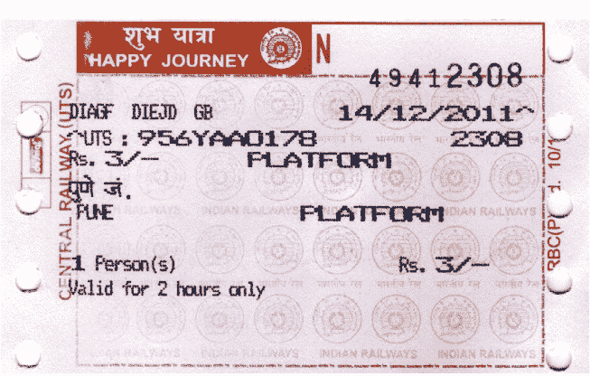

**图 4.16** 一张在点阵打印机上打印的印度铁路机票。Nikunj Bhatia，“为什么印度铁路仍在使用同一种点阵打印机？”，Quora，2014年12月。

## 包装上的日期标记

当代点阵打印的一个主要应用领域是食品包装行业中的日期标记。喷墨打印机可以在移动的物体上进行无色打印，因此可以在包装物在传送带上输运时对其进行打印。通过这种方式，点阵打印已经超越了那种带有击打头和纸质单据打字机式设置，后者预设了是在平整的纸张上打印。日期标记是西方消费者遇到点阵打印文本的少数几种场景之一。不同国家对日期标记的规定和建议存在很大差异。英国废物与资源行动计划（WRAP）发布的标签指南指出：“日期标签必须清晰、易读且不可擦除。例如，在深绿色背景上使用黑色墨水是不可接受的；不要在图片或其他文字上喷射墨水。”⁷这一建议指出了消费者在食品商店经常遇到的某些问题。包装上的日期标记往往难以发现且难以辨认。它们有时被打印在不平整或脆弱的表面上，文本通常是断裂或扭曲的。

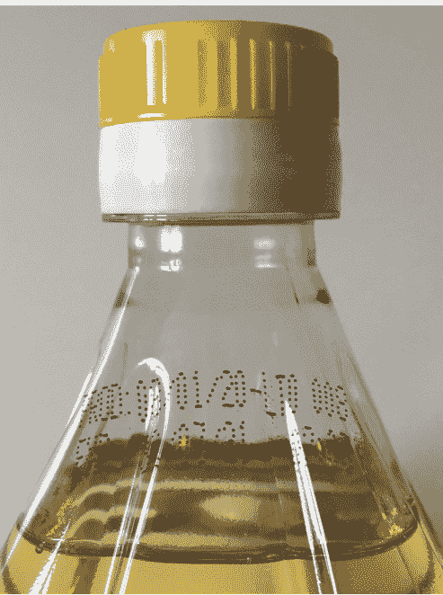

**图 4.17** 使用点阵打印概念在瓶上的日期标记。

日期标记通常嵌入在不供消费者阅读的额外信息和代码中。与包装设计的其他部分不同，日期标记并不是产品营销的一部分。可以说，它属于图形设计的底层，在那里，生产过程中的速度和便利性凌驾于可读性和美学之上。一家销售能够识别点阵文本的 OCR 软件的公司承认了可读性问题：

虽然条形码已让机器识别产品变得容易，但一种也能被人类消费者直接读取的格式仍然非常重要。为此，由喷墨打印机产生的点阵字符仍然是产品包装上人类可读文本的最常见形式。如果设置得当，喷墨打印机可以提供清晰的打印效果；然而，生产线和打印面的现实导致了文本打印方式的差异/缺陷。这些缺陷使得自动追踪读取变得困难。⁷

食品包装上的日期标记是许多妥协的结果。它必须对人类和非人类自动化 OCR 系统都具有合理的可读性。它必须出现在包装上，但不能占用其任何宝贵的营销表面。墨水必须是永久的，施加标记的过程必须是快速。高分辨率和“近乎字体质量”的理想已被抛弃，字母的碎片化、模块化结构被接受为在效率和可读性权衡中的必要妥协。

## 低分辨率与“点”回归

本章开头打印机手册中描述的更先进的打印机功能可能可能是为了电脑爱好者而非普通家庭消费者。直到 20 世纪 90 年代后期以及互联网的增长，业余爱好者才开始在很大程度上设计和交换字体。⁷⁸ 然而，一些专业图形设计师在早期就受到了数字技术可能性和限制的吸引——特别是 Zuzana Licko，她为自己和 Rudy VanderLands 于 1984 年创办的前卫设计杂志 *Emire* 创建了实验性字体：“与其复制（在点阵打印机上）已经适应书法、铅字和照相排版的字体形式，Licko 使用公有软件创建了位图字体。⁷⁹ 在 Apple Macintosh 桌面个人电脑上工作时，她……”

（注：此处由于原文在句子中断，翻译也随之结束）

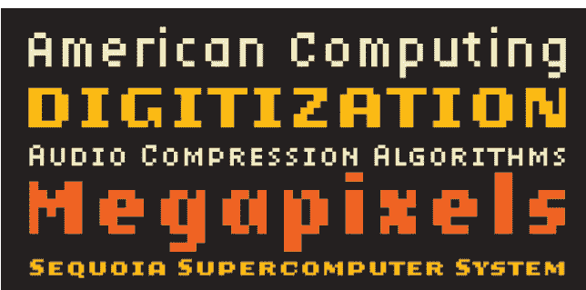

**图 4.18** Lo-Res 字体示例。© Suzana Licko.

## 多感官点阵打印机

# 157

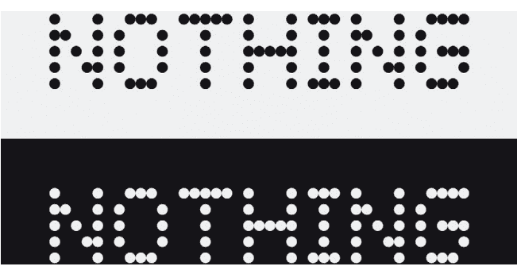

**图 4.21** 消费科技公司 Nothing 的标志，使用点阵字字体打印。© Nothing Technology Limited.

该标志是在工程网格纸上用“点、点、点”画出来的，仿佛设计师们遵循了上文讨论的 Star Micronic 的《Delta 用户手册》中的指令：“你已经看到 Star Micronic 的工程师们是如何使用网格布局圆点来设计他们的字符的。现在你可以用完全相同的方式来定义字符了。”当最后拼出“Nothing”这个公司名称时，可以辨出点阵打印机的声音。这种从有机视觉风格到几何视觉风格的转变，可以被解释为从混乱且缺乏想象的设计，向根据严格工程原则而进行的原创设计的转变。

此前暗示的模拟缺陷被留在了可以看作是结合了技术与后数字时代的尝试中，旨在吸引年轻一代——这些人由于太年轻了，没有亲眼见过点阵打印机，且点阵风格对他们而言具有积极的内涵。数字设备已无法作为“闪亮的新数字产品”卖给一个对技术革命叙事产生抵触的后数字世代了。点阵打印的缺陷被转化了一种优势，尽管 Nothing 的宣传视频中展示的是点阵打印的理想状态——而不是“皇家邮政机器可读信件与大字体用户指南”示例中所示的现实世界问题。点阵字字体在流行文化中扮演的角色，类似于第 3 章中查看的机器可读字字体在流行文化中扮演的角色，它们是早期计算机文化的符号。在最后这一节中，我们已经

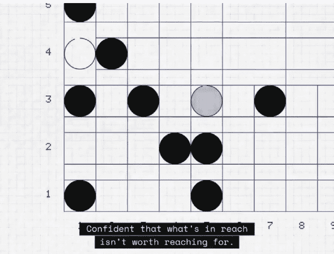

看到物理打印机退居背景，而点阵打印这一概念本身占据了更显眼的位置。然而，看到文字浮现的吸引力依然强大，打印的表演性方面可以通过动画来实现，例如上述引用视频中 Nothing 标志的逐渐出现，而不是通过物理打印机。

最初初意是研究点阵打印的视觉文化，重点是排版及其间隙、不规则和低分辨率的视觉外观，当我发现声音在用户记忆中所起的作用时，这项研究很快扩展到一种多感官的探究。特定视觉特征与特定听觉特征的结合使得这种打印机令人记忆深刻，并为设计师预期之外的创意实践开启了可能。设计师未预料到的另一个特征是，当声音被计算机系统“读取”并转化为字母和单词时所发生的符号翻译。

这种打印机现在在某些语境下已经过时，而在另一些语境仍在在使用。在这两种情况下，都强调了操作性和维护：即使作为文化遗产对象，打印机也应该能够工作。然而，它的遗产不仅依赖于物理实体，还依赖于点阵本身以及它在新字体和字母样式中的视觉实例化。本章表明，通过将像点阵打印机这样“被遗忘”的设备纳入排版与计算的历史写作，可以反驳线性技术进步的观点。

# 5

# 字体仇恨与 ComicICANS 的话语

在本章中，我在更晚近的历史层次中进行挖掘，直到现在，社交媒体和移动设备已成为日常通信中几乎不可或缺的一部分。在这个新的媒体格局中，排版得以扩张其在流行文化中的角色。尽管我将焦点从过时设备的设备装置转移到社交媒体软件的技术基础设施，但我应用了在前章节中使用的相同考古方法论。这种基础设施对于 Comic Sans 字体话语的出现至关重要。社交媒体平台的可用性促进了这种话语，但它们的软件结构和算法限制了它。

## 一只小褐狐狸

**图 5.1** Comic Sans 字体示例。Comic Sans 是 Micro- 公司的商标。

它为了适应程序，并从漫画书中汲取灵感，以实现一种圆润、手写的视觉效果。“Comic Sans 设计初衷并非为了作为一种字体，而是为了解决计算机界面中经常被忽视的部分——即用于传递信息的字体问题而提出的解决方案，”Connare 在他的网站上写道.¹¹¹ 它从未被用于过 Microsoft Bob，而是出现在了 Microsoft 3D Movie Maker 中。随后，微软决定将 Comic Sans 作为标准字体包含在 Windows 95 中，与 Arial、Courier、Times New Roman 以及其他字体一起.¹¹² 从此以后它一直是微软操作系统的一部分，目前没有迹象显示它会被移除。前几章节中关于某种已经过时的陈旧技术的叙述虽然仍在在使用，但因此这种说法并不适用于 Comic Sans。

作为一种标准字体，Comic Sans 成为使用最频繁的字体之一。它是标准字体集中唯一的非正式字体，在小学教师以及许多其他语境中广受欢迎。因此，在生日邀请函、失踪猫告示、商店招牌、酒瓶标签、患者传单、墓碑以及高压警告标志上都能看到 Comic Sans 的身影.¹³ 它被频繁使用的原因之一可以与平面设计师 Paul McNeil 在其书籍《字体视觉史》（*The Visual History of Type*）中对字体的真实性描述有关：

> 它的设计看起来就像完全没有设计过，而是用毛毡笔或圆珠笔匆忙写下的。它圆润、不对称的特征赋予了它一种易近人、谦逊且诚实的印象。不相连的字母落在跳动且不平的基线上增强了这种真实感，加上较大的字字母高度（x-height）以及在所谓的直立姿态中特别不规则的扭曲，显得尤为明显。¹¹⁴

这种对视觉外观的解读，比“Comic Sans 仅仅是设计糟糕”的普遍判断要精细得多。然而，尽管许多设计师认为 Comic Sans 过于泛滥且不专业，但同样的评价也适用于许多其他并没有引起同等程度愤恨的字体。

# 字体仇恨与关于 Comic Sans 的话语

riley @toxicjungle · 6月18日

他们竟然胆敢使用 comic sans

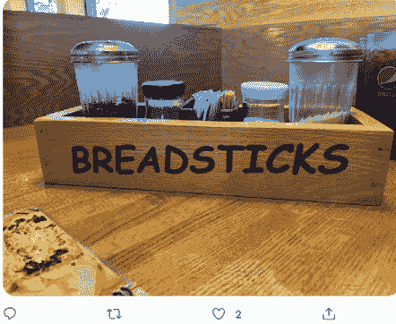

**图 5.2** 餐厅调料盒上的 Comic Sans 示例。riley, Twitter, @toxicjungle., 2022年6月18日。

字体设计师兼作家 Allen Haley 在他的《字体仇恨：我们爱而又恨的字体》一文中，将仇恨置于历史视角，并提出了四类分类来解释为什么字体会被仇恨：

1. 设计被过度使用。

2. 它是另一个字体的复制。

3. 它被认为质量低下。

4. 它是可恨的。

虽然许多人会说 Comic Sans 被过度使用，但 Haley 得出 Comic Sans 属于第 4 类。在进入 Comic Sans 的广泛话语之前，我想提到两个范围更窄的字体仇恨案例，这些例子发生在行业内部，针对的是字体字体面向专业用途销售的字体。

## 源于并针对字体的仇恨

艺术与设计领域的仇恨与人与人之间的仇恨显著不同。尽管如此，在字体设计方面的话语中仍涉及强烈的情感。对某些字体的蔑视并非随着数字时代而来的，尽管它现在已变成一种更广泛的文化现象，某种国民性的消遣，并且不再局限于设计师的专属俱乐部。“根据 Allen Haley 的说法，今天，字体仇恨已达到了流行规模，”¹⁶ 此外，老一字体设计师的设计——例如活跃于 19 世纪末和 20 世纪初的 Frederic Goudy，以及生活并工作在 18 世纪的 John Baskerville——也遭遇过相当程度的嘲讽。Haley 回想起他自己职业生涯中的几次仇恨事件，特别是 ITC Souvenir，这种字体在 70 年代引起了设计师中极度强烈的负面情绪。下面给出的仇恨话语示例发生在专业背景下：

## 艺术总监反对 FUTURA BOLD CONDENSE

这个例子包含了一个针对 Futura Extra Bold 字体的恶搞仇恨运动，设计师 Jerry Kugel 认为该字体被过度使用了。他制作了一份十二页的讽刺手册，召集了他的同行们，要求他们通过提交请愿书为该活动做出贡献。该手册在《艺术传播》杂志上发表，后来被收录于《字体设计师协会年鉴》（Typography: The Annual of the Type Directors Club）中，获奖作品在那里得到了展示。其中一页写着：“想象如果萨达姆·侯塞因是一种字体，”下一页写着：“Futura Extra Bold Condensed：字体之母。是时候让世界抵制使用 Futura Extra Bold Condensed 了——它是广告史上最过度使用的字体。摧灭陈词滥调的大撒旦，消灭便利的小撒旦，集结支持更好的字体选择事业。请填写随附的请愿书并将其寄到我们的总部。它将引导我们行业的意见领袖转向我们正义且值得的事业。齐心协力，我们可以赢得这一切。”¹⁷

对该手册的修辞分析得两个拟人化的案例——当 Futura 被比作独裁者萨达姆·侯塞因，同时被呈现为“字体之母”，声称 Futura 是字体设计的起源。对于 Kugel 而言，他“使用萨达姆·侯塞因作为一个比喻反派，来强调[该字体被过度使用的这一点]。”海湾战争是该时期主要的政治主题¹⁸ 此外，文本基于宗教和军事隐喻，提到了撒旦，并使用了“鞭打”、“摧毁”和“集结”等词。该手册通过“想象”、“请填写”和“邮寄”等祈使句直接面对读者，并要求他们通过将请愿书寄到总部来采取行动；这种字体仇恨话语的贡献是基于单向交流的，缺乏互联网提供的交流语境。下一个例子发生在 Futura 手册十年多年后。它涉及网络出版物中的文章以及随之在评论领域的讨论。

## 带有刺痛的字体

2004 年，平面设计师 Michael Bierut 在《设计观察》上写了一篇题为《我讨厌 ITC Garamond》的文章¹⁹ 他本打算读的一本书是使用 ITC Garamond 排版的，因此他无法静下心来读它。他也有其他他不喜的字体，但 ITC Garamond 引起的是情感反应：“它以一种我难以解释的、从本能上令我反感。” 尽管如此，他仍然在文中尝试这样做。这种字体过时了，让我想起 70 年代。它的小写字母高度太大了。其他设计师对该字体的观点是它偏离原始的 Garamond 太远。但这并没有说服 Bierut，尽管他意识到自己并不是出于任何理性原因讨厌它；他讨厌它就像讨厌指甲划过黑板一样。我讨厌它。这篇文章引发了 117 条评论——来自其他设计师（其中一些是很有名的）、字体设计爱好者、一些非设计师以及 Bierut 的两个孩子——他们对他的立场表示赞同或反对，并提供了更多视角。评论者发表了观点，表达情感，并对字体设计提供了历史和技术上的解释。有些评论很简短，有些则成了独立的短文。《设计观察》网站拥有简单的评论功能，采用没有嵌套的扁化结构，因此所有评论一个接一个出现。穿插在其他评论之间的是 Bierut 对这些评论的回应¹²⁰

## 字体仇恨与 Comic Sans 的话语

有人指责作者和评论者们（包括他自己）浪费时间在一个字体上感到烦恼。另一人回答道：“得吧，哥们，放轻松。这只是个玩笑，是几个极客在聊极客话题时读到的而已。”Bierut J. 表示：“我很抱歉有这么多人都对‘恨’这个词变得具有敌意，”这表明字体仇恨是字体设计行业内部术语的一部分，不应从字面意思理解，尽管并非每个人都能精通这种说法。只有业内人士才能辨别出“恨”被用夸张、涉及深层情感时的细微差别和语境。

有几个强调仇恨程度的词汇。在一条评论中，平面设计师 Jonathan Hofler 解释说，ITC Garamond 是 1975 年的一项创新，它脱了早期技术的束缚，为设计师的意愿留出了空间。尽管他不认为这种创新已经随着时间的推移而变得完美但他但他：“尽管如此，我恨 Garamond。我真的、真的该死恨它，我感谢 Michael 让在这一地区说出这句话变得可以接受。”除了这种直觉的论点，他还给出了一个理性的论点并补充道：“如果有人开启关于 Optima 或 Rotis 的帖子，请告诉我。”平面设计师 Erik Speckermann 接受了恨这两种字体的挑战并表示：“让我坦白吧：我恨这三个字体，恨之入髓。我像 Michael 一样恨它们，因为：我无法忍受它们。我恨它们是因为它们每一种都代表了一种我所讨厌的态度。”Steve Mack 使用了同样的强调性语言，他在评论中针对一整类字体：“我开始对充斥现代排版的数百万种特殊字体产生深根蒂固的仇恨。”

作者诉诸修辞技巧——如重复、使用“深根蒂固的”等形容词以及“恨之入髓”等表达——来强调他们对字体的感情深度。但也许理解为何为字体仇恨寻找理性理由有多么困难的一种方法是转向影响理论（affect theory）。在这一主题的开创性著作中，社会理论家 Brian Massumi 声称情感（emotion）和影响（affect）逻辑不同：“情感是一种主观内容，是体验质量的社会语言融合，从该点起被定义为个人的，”而影响在本质上是身体和自主的。²¹ 在情感和影响之间做出这种区分是否存在争议，但为了分析的清晰，此处应用了它。²² 影响关于直觉感知、关于皮肤感觉、关于对声音的肌肉反应、关于心跳的减慢或加速。不同的感官模式在影响领域共同运作，例如，触觉感知可以通过联感的方式转化为视觉。²³ 在 Beirut 的文本中有几处指向了影响的影响。他提到，尽管 ITC Garamond 不像以前那样常用，但当他在一个没有预料会看到的地方发现它的出现并感到措手时，它仍然带给他一个“糟糕的开始”。他的整个身体都被这次相遇所影响，并产生了反射性反应。他用一个比比来描述厌恶的本质：“我恨它就像我恨黑板上的指甲声。”这种声音产生了一种不愉快的感觉，科学家通过其频率、粗糙度以及与尖叫的相似性来解释它。²⁴ 通过这种比较，他试图让大多数人理解他对该字体的感受。


在收到来自文本读者的若干评论后，他在自己的评论中回到了身体感受，他表示他已经想清楚了这个问题并仍然坚持他的理由是非理性的：“——老老实说，我恨 ITC Garamond 就像我恨抱心菜 [sic] 一样。”它们较好的味道让某些人感到作呕，这些人无法强迫自己吃这种甘蓝类植物。一个人对抱心菜的态度实际上取决于个人的遗传倾向。这不仅仅是一个被理解为偏好的味觉问题：它是作为个人身体构造的整合组成部分的味觉。²⁵ 这些例子展示了 Beirut 如何招募视觉、听觉和味觉，为对一种字体的体的仇恨建立一个多感官的论据。²⁶ Haley 在描述 ITC Souvenir 在他心中产生的强烈厌恶时也诉诸了身体感受。“在受痛苦等级表上，它与根管治疗和纸划并列。在这个等级表上，肉体疼痛可能高于厌恶，并且这是一种更深入身体的感觉。受感染的根管已知会引起身体脆弱部位的剧烈疼痛。纸划往往让人防不胜备，因为我们没有准备好受到一片看起来看似无害的纸的攻击。这几个取自 Allan Haley 和 Michael Beirut 文章的例子，仅构成了字体设计师用来唤起对某些字体仇恨的、尽管可能看起来矛盾的他们对艺术的热情的性语言的一个小样本。红的仇恨而非爱，讽刺的是恰恰是击碎 Beatrice Warde 水晶杯所需的。²⁷ 我认为，后数字时代的激烈辩论比 20 世纪 90 年代壮观的后现代平面设计更成功地让排版这种透明的艺术形式变得可见并成为公众关注的问题。

## 字体仇恨流行了：网络上的 Comic Sans

在 Comic Sans 的案例中，这种对抗并没有局限于专业圈。2002 年，字体设计师 Dave Combs 和 Holly Combs 发起了“禁用 Comic Sans”的活动，他们对该字体有共同的厌恶。尽管他们对该字体的仇恨是发自内心的，但从内部玩笑开始的活动最终吸引了全球观众。2019 年，Dave 认为这个玩笑开过头了，因此他将活动名称改为“使用 Comic Sans”。⁹ 以下是“禁用 Comic Sans”宣言的原始完整版本：

- 我们相信排版的神圣性，并认为这项工艺的传统应该贯穿始终。从古登的印刷机到数字时代，所有形式的字体都是神圣且不可或缺的。字体排版变成了一种俗气的竞争。这个行业的先驱们都是受过高教育的人。然而，今天对这种媒介的广泛使用证明了即使是不足的 [sic] 机会亵渎这种艺术形式；破坏了排版的完整性。就像说话的语调一样，字体的特征传递着意义。字体的设计本身就是它的声音。因此，在设计“禁止进入”标志时，使用粗体、引起注意的字体（如 Impact 或 Arial Black）是合适的。然而，使用 Comic Sans 的信息将是荒谬的。这种情况经常发生，但这不能证明其使用的合理性。我们号召全球无产阶级协助我们进行革命。我们号召普通人反抗这种排版无知的邪恶。我们相信福音信息“禁用 Comic Sans”。它对识字者将是救星。通过团结从地球上消除这种字体，我们努力确保后代能从这种流行中解放出来，再也不必遭受我们时代的灾害。³⁰

## 字体仇恨与对 Comic Sans 的论述

正如在《反对 Futura Extra Bold Condensed 字体》的小册中一样，“禁止 Comic Sans”的宣言中也存在拟人化的现象。字体被认为是一种与人体密切相关的声音，因此是人的人的借代（metonymy）。此外，Comic Sans 被比作小丑的服装，这是另一个对人的借代性替身。在“禁止 Comic Sans”宣言中，存在一些关于暴力的隐喻，但宗教比喻占据主导地位，并伴随着革命和疾病的隐喻。其叙事风格是圣经式的，而 Comic Sans 瘟疫可以被视为上帝的惩罚，唯一的忏悔方法就是停止使用 Comic Sans。字体排版是神圣的，应该由祭司处理。数字革命让这门工艺变得触手可及，而缺乏字体知识的人导致了它的衰败。该作品的特征是双色的修辞，将避难所与亵渎对立，将受过教育的人与未受教育的人对立起来。

文化修辞学者加雷特·W·尼尔斯（Garrett W. Nichols）也观察到了这种划分，他在《字体揭示文化：对糟糕字体的辩护》中，用蔑视的态度关闭了讨论人们可能产生这些行为原因的原因的可能。³¹ 尼尔斯认为，使用“糟糕”字体的人可能是刻意为之，以达到一种亲切且不加掩的修辞效果。他以一份教会简报为例，该简报混合了多种字体，且标题结构杂乱无章，这种设计可能是为了达到上述目的，以向成员传达一种开放和欢迎的态度。这种观点——即 Comic Sans 的使用并非出于错误或无知，而是刻意为之——与上述保罗·麦尼尔（Paul McNeil）的陈述一致，即设计者的初衷就是将 Comic Sans 设计成现在的样子——“它设计得看起来就像完全没有设计过一样”，这赋予了字体一种真实感。³² 这些论点反驳了 Comic Sans 是由文盲人士创建和使用的观点，并支持了其创作者和使用者意识到字体排版文化内涵的观点。

## 论述的背景：社交媒体平台

很难确定“禁止 Comic Sans”运动是否是千禧年前后出现的反对该字体的广泛运动的起始信号，这场运动在 2010 年左右获得动力，并且目前在社交媒体和其他媒体上仍然活跃，但关于该字体的文章和书籍经常提到这次运动。³³ Comic Sans 与世界维网网处于同一时代，这种论述在许多方面是个人网站、博客、社区以及各种社交媒体平台（如 Facebook、Instagram、Quora、Reddit、Twitter 和 YouTube）所提供的特性（affordances）的功能。

在《连接文化：社交媒体的批判性历史》一书中，媒体学者约瑟·范·迪克（José van Dijck）认为，此类平台可以被视为“技术文化构建”，这一概念强调平台是通过技术和人类因素结合实现的。她区分了这些构建的三个主要组成部分：技术、使用和用法，以及内容。技术部分又可以细分为数据、算法和界面。³⁴ 例如，当用户在 Twitter 上发布推文时，会生成一个时间戳。推文本身可以看作数据，而时间戳属于元数据（metadata）类别，提供关于数据的信息。另一种元数据是人们在用户简介中输入的个人信息。数据和元数据都被 Twitter 算法用于，以决定用户对什么感兴趣以及哪些推文应该出现在他们的动态流顶端。为了指示推文的内容并使其更具搜索性，用户可以添加多个标签（hashtags），这些标签充当关键词（例如参见图 5.7，#womenmarch）。Twitter 的界面左侧有菜单，右侧有热门话题，每条推文下方是回复、转发、点赞和分享的符号。这些其他软件功能影响并引导了用户行为，以及用户在平台上进行通信的方式。

在《平台社会：连接世界中的公共价值》中，范·迪克及其合作者托马斯·波尔（Thomas Poell）和马丁·瓦尔（Martijn Waal）详细阐述了范·迪克之前书中的观点，特别是关于平台机制和平台化的商业方面。这种技术基础设施的重要性无论如何估计都不为过，因为它已经影响了社会的大多数方面。³⁵ 《平台社会》中提出的框架将平台机制分为数据化、商品化和选择化。各种用户活动和互动——如“评分、付费、注册、观看、约会、搜索，以及加好友、点赞、发布、评论和转发”——都可以转化为数据。上述提到的 Twitter 功能只是这些互动中的子集，当它们经过数据化过程后，可以在下一步被转化为商品。根据范·迪克等人的观点³⁶ 人不仅可以将活动商品化，还可以将情感、思想和人类商品化。例如，Facebook 在状态更新中增加了一个功能，让用户指示当前的心情——无论是悲伤、快乐还是疲劳。范·迪克等人的³⁷ 第三种选择，意味着用户看到的内容是通过算法帮助进行筛选和策划的，算法以用户生成的数据作为输入。这种个性化特别发生在和服务广告中，但它也决定了例如某人的 Instagram 动态流中显示的话题类型。对用户来说不透明的内容，实际上是平台公司实施的刻意非商业策略。³⁷

## Twitter 热搜：勒布朗·詹姆斯的案例

Twitter 是主要的社交媒体平台之一，是一个通用的消息系统，最初设计是为了让人们能够让朋友了解他们的当前活动。⁸ 推文的最大长度最初设定为 140 个字符，与短信息（SMS）的文本长度相同，并在 2017 年翻倍为 280 个字符。截至 2022 年，该平台拥有 2.2 亿用户。⁹ 对 Comic Sans 的关注在特定事件中激增——特别是当 2010 年，篮球运动员勒布朗·詹姆斯（LeBron James）决定离开克利夫兰湖队加入迈阿密热火时，克利夫兰队的所有者格尔伯特（Gilbert）在球队网站上发布了一封公开信。这封信是用 Comic Sans 编写的，因此该字体在 Twitter 上的热度超过了勒布朗·詹姆斯的话题。

对 Comic Sans 的（社交）媒体关注掩盖了事件本身。根据 Twitter 算法，一个话题的位置取决于其频率⁴⁰ 格尔伯特因为他使用的语言和标点符号而受到嘲笑，并因为字体的选择与信中愤怒的语调相冲突，产生了意料之外的幽默效果。《华尔街日报》的体育专栏作家建议，“它应该被送进史博物馆，作为 21 世纪的亮点。”⁴¹ Twitter 上的反应之一是这个笑话：“Helvetica 与迈阿密签约。Comic Sans 留在克利夫兰。”⁴² 在对角色的借代性游戏中，将“优雅”的字体 Helvetica 与“愚蠢”的字体 Comic Sans 代替了丹·格尔伯特，而 Helvetica 是一种广泛使用的、以清晰和中立为特征的字体，通常被认为是现代的。³ Comic Sans 与 Helvetica 或另一种高地位字体的对立，是 Comic Sans 论述中经常使用的修辞手段，用使其变得滑稽。

还有过其他事件，对 Comic Sans 的媒体关注掩盖了事件本身，例如约翰·道德（John Dowd）在 2019 年针对特朗普弹劾调查提交众院情报委员会的信，以及 2021 年欧洲核子研究中心（CERN）科学家对希格斯玻色子的发现。³⁴⁵ 与 Comic Sans 相关的媒体风暴的共同要素是涉及该领域的高级人物——一个值得嘲笑的人，他“本应该更懂”，但对平面设计一无所知。嘲笑克利夫兰队所有者、CERN 科学家和特朗普的律师很容易的，Twitter 和其他社交媒体平台当时充斥着笑话和讽刺。⁴⁶

## 字体仇恨与 Comic Sans 话语

在勒布朗·詹姆斯（LeBron James）案例中，用户的动态流中可能会出现更多关于运动和 Comic Sans 的帖子。这就是平台机制如何维持、传播和倍增 Comic Sans 话语的。

## 趣味与斗争

Comic Sans 的话语包含了许多修辞和文学手段——例如转喻、称词、比较、双关语和讽刺——这些手段在霍拉斯式（Horian）和朱威纳式（Jovennial）传统中被用于嘲讽 Comic Sans。笑话、嘲弄和蔑视构成了 Comic Sans 话的骨干，研究笑话是理解其许多侧面的合适方式。47 笑话可以是文本的、视觉的，或者是两者的结合，将“我是一个平面设计师”或“我并非出于讽刺而使用 Comic Sans”等矛盾修辞以 Comic Sans 字体印在讽刺 T 恤、咖啡杯和社交媒体贴文中。这类单句非常适合 Twitter 的短文本格式，也适合在网络上被分享和二次创作的迷因（memes）。48 笑话是获得关注、点赞和新粉丝的工具。与 Comic Sans 关联最紧密的迷因类别是“狗狗包”（Dog memes），其中一只表情滑稽的柴犬与彩色的 Comic Sans 字体的破碎英语短语结合在一起。

喜剧作家兼编辑尼克·道格拉斯（Nick Douglas）认为，迷因文化中的趋势之一是网络美学，其特点是对“粗糙和业余的庆祝”。49 这种风格的迷因示例是愤怒漫画（rage comics），它们基于对愤怒脸的粗糙描绘。道格拉斯认为，网络美学与后数字时代常见的流行趋势——“新美学”（New Aesthetic）不同，后者使用 QR 、像素化和机器可读图像通过计算机的视角来重新诠释物理世界。“网络丑”（Internet ugly）几乎是其对立面，是在一个充满平滑渐变、修瑕 Photoshop 和自动纠正功能的在线世界中强加的忧郁。50 “网络丑”的出现是为了短时间内在 4chan 等频道上快速发布的需求。迷因创作者将“丑”作为一种真实性的标志。一旦这种风格被主流文化劫持，它就会演变成新事物，并继续以许多形态存在下去。51

第 5 章

Comic Sans 有时被用于迷因，但它并不像道格拉斯所描述的那样归属于“网络丑”。Comic Sans 的大多数应用都缺乏作为“网络丑”特征的反叛性，而且我认为这种字体太整洁了，无法为这种风格的“丑”增添任何东西。尽管 Comic Sans 常被认为是丑且缺乏品味的，但我认为它是一种与“网络丑”不同类型的“丑”。由于其无处不在，Comic Sans 可以被视为后数字视觉文化的缩影，但很难将 Comic Sans 归为某个特定的趋势。它在许多语境下被视为局外人，并在流行文化中拥有了自己的地位。它随手可得，且具有独特、易于识别的风格，这也许就是它适合成为笑话素材的原因。

## 有品味还是否

与字体仇恨相关的品味问题，是由上述引用的贝贝鲁特（Beirut）的文章《我讨厌 ITC Garamond》中的第一位评论者提出的：“我很兴听到你竟然对品味这种既过时又时髦的事情大惊小怪。”52 如果品味在 2004 年文章发表时已经过时了，那么它在过去十年的 Comic Sans 话语中无疑经历了复兴。关于该字体的许多笑话都是关于品味或缺乏品味的。社交媒体莎拉·欧斯（Sarah Owens）解释了关于该字体的循环论证是如何运作的：“设计师每天生产的所有东西都是‘糟糕的设计’。因为他们使用了 Comic Sans，由于 Comic Sans 设计得很糟糕，所以任何使用 Comic Sans 的都是糟糕的设计。糟糕的设计很容易通过使用 Comic Sans 来被识别出来。”53

考虑以下陈述：“你是人类中的 Comic Sans”54 “Crocs 是鞋类中的 Comic Sans。”55 第一个陈述出现在 T 恤和帽子上，旨在侮辱读者。它与第二个陈述类似，其中 Comic Sans 是一个象征丑陋和缺乏品味的称词。根据《城市字典》（Urban Dictionary）的定义，Crocs 是“可能是史上最丑但最舒适的鞋”。56 这种鞋和字体在人气、不受欢迎和普及程度方面具有相似之处。《城市字典》的定义继续观察到，这种鞋被不同年龄和阶层的人使用，Comic Sans 也是如此。

## 字体仇恨与 Comic Sans 话语

以下两个陈述曾用于抗议标语，有的是 Comic Sans 字体，有的是写的，可以在 Twitter 及类似平台发布的照片中看到：“唐纳德·特朗普使用 Comic Sans”57 和“英国脱欧比 Comic Sans 更糟。”在第一个陈述中，通常归于该字体的负面特质被转移到了所谓的使用者身上。第二个陈述基于两个互不匹配实体之间的荒诞比较，其中 Comic Sans 充当了低水位标记。

这些只是 Comic Sans 如何成为丑陋和缺乏品味代名词的极少数例子。尽管 Comic Sans 的敌意包含了“智者指责未开化的文本生产者”的元素，但皮埃尔·布尔迪厄（Pierre Bourdieu）的阶级理论未能解释 Comic Sans 话语的复杂性。59 加雷特·W·尼尔斯（Garret W. Nichols）认为，使用 Comic Sans 可以被视为一种工人阶级的策略，用于抵制主导力量及其文化表达。使用“糟糕”的排版可以被视为一种修辞行为。60 这在许多情况下可能是真的，但基于那些高知名事件，我会认为使用 Comic Sans 并非如此。字体的代码并不容易被解码，例如时尚代码是易于获取的。61 排版内部的规范更为微妙且更难理解。有时人们会反抗他人对其选择所做出的判断。针对 2019 年约翰（John）引发的骚动，爱普斯坦写了一篇题为《有品味还是否，我都会坚持使用 Comic Sans》的评论，给出了该字体对作者可能有用的理由：根据我显然糟糕的品味，我计划继续使用 Comic Sans。我喜欢字母之间的间距。我可以在其中看到在其他字体中无法看到的整个句子。它为我写作提供了一种清晰度，对修改非常有帮助——而且正如所指出的，那正是写作的本质。6²

## 第五章

Oscar Mangas

@ovmn_

# 脱欧欧（Brexit）比 Comic Sans 字体更糟糕。给这家哥点个赞！

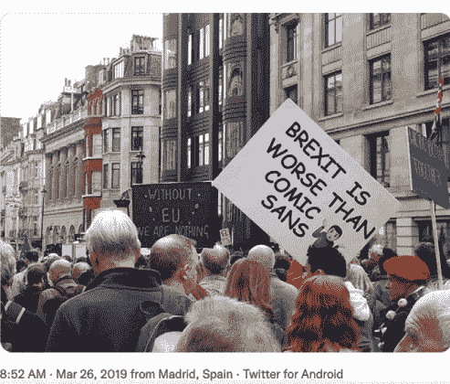

上午 8:52 · 2019年3月26日 · 发自西班牙马德里 · 手机版 Twitter

**图 5.8** 抗议现场的 Comic Sans 标志：“脱欧欧比 Comic Sans 更糟糕。”Oscar Mangas，Twitter，@ovmn_，2019年3月26日。

著名的作家以及高中校刊的编辑们也使用个人电脑。这些电脑在多个价格位段进行销售，但大多数都配备了微软 Office 的标准字体。在默认字体集的帮助下，普通设计师能够创建基础的图形设计材料，但专业设计师需要获取字体字厂的专业资源。为了追求他们的技艺，他们既需要经济资本，也需要文化资本——布尔迪厄的另一个概念，指人们积累的知识和教育，这为他们提供了特定的社会地位。⁶⁴

正如篮球队所有者 Dan Gilbert、律师 John Dowd、CERN 研究人员以及作家 Epstein 的案例所示，品味与 Comic Sans 的问题并不一定取决于阶级。

## 字体仇恨与 Comic Sans 的话语

## 战斗与流血

到目前为止，呈现出的笑话相当温和，属于霍拉斯式传统（Horatian tradition）。在这一节中，我处理了虐用尺度中更具攻击性的一端，并展示了如何利用战争、暴力和痛苦的隐喻，按照朱利安讽刺（Julianian satire）的传统来描述对 Comic Sans 的讨厌。我的研究结果与 Nichols 的观点一致，“一个犯罪与惩罚的框架渗透在 Comic Sans 的话语中。”⁶⁵ 然而，我认为这个框架更广泛，包含了战争、暴力、痛苦和疾病。这些类别及其相关概念在某种程度上是重叠的，它们之间没有明确的界限。战争意味着暴力，疾病会导致痛苦。它们有时也被用作彼此的隐喻，例如“犯罪是疾病”。⁶⁶ 这些隐喻构成了一个连贯修辞的一部分，影响了我们对这种字体的思考方式。⁶⁷


战争隐喻是公共话语中最常见的隐喻类型之一。⁶⁸ 军事被用于推广排版及其对于传递文化和教育的重要性。在1931年出版的一份小书中，字体设计师 `Frederic W. Gody` 在他对排版英雄历史的草绘结束时写道：“我是征服世界的领导军。我是字体。”⁹ 战争隐喻被用来描述排版行业，例如20世纪30年代各造字厂之间围绕某种字体使用权的竞争。⁷⁰ 20世纪90年代发生了一场著名的战斗，当时桌面出版和打印的不同字体标准导致了 `Adobe`、`Apple` 和 `微软` 之间的冲突。这些字体战争随后得到了解决，但这一概念一直存在，并被应用于其他排版相关的争端，例如 `IKEA` 在 2009 年将其字体从 `Futura` 改为 `Verdana`。这次切换遭到了许多人的敌对反应，并被称为“`Verdana` 事件”（`Verandanagate`）。⁷¹ 另一个使用的术语是合成字体争议（`portmanteau fontroversy`）。这两个词——字体战争和字体争议——都与 `Comic Sans` 联系在一起——例如，在一篇关于设计的报纸文章中：“字体战争正在全球范围内蔓延，似乎 `Comic Sans` 正在遭受猛烈火。⁷²

在《反对 `Futura Extra Bold Condensed` 的艺术总监》手册中的军事隐喻，以及《`Comic Sans` 宣言》中的暴力隐喻，在许多关于 `Comic Sans` 的陈述中均可见。战争隐喻的特点是战斗者之间的战斗，其中一方扮演敌人角色。接下来的两个例子关于不同类型的战斗。它们都结合了视觉和言语修辞。

## Undertale 动画

2016 年，一个名为“`Sans` 战斗动画：最终决战”的粉丝游戏动画发布在一个拥有大量订阅者的 `YouTube` 频道上。⁷³ 该频道的所有者 `NCHProductions` 是一个以制作电脑游戏恶搞剧而闻名的独立动画师。基于电脑游戏《`Undertale`》的动画截至 2022 年 5 月已获得超过 300 万次观看和 2 万条评论，且数量仍在不断增加。⁷⁴ `YouTube` 界面为评论提供了两种排序原则：最新和热门。这让想要加入对话的用户更容易获取之前的评论概述。“`Sans` 战斗动画”视频起始于订阅者的请求集合，他们敦促频道所有者制作一场“`Sans` 战斗”。在角色扮演游戏《`Undertale`》中，一个角色名为 `Sans`，他用 `Comic Sans` 字体“说话”。他有一个名叫 `Papyrus` 的兄弟，他们两人在游戏中以骨架的形式出现，这个游戏并不是关于排版的，而是怪物与人类之间的战争。这篇同人小说相当是对 `Comic Sans` 话语的次越游。名为 `Sans` 的角色挑衅了一组由 `Arial` 头的其他字体，它们劫了 `Papyrus` 人质。当战斗开始时，`Sans` 成功地保护了自己并释放了 `Papyrus`。视觉上的变化和多样性是由一系列字体创造的，这些字体挑战 `Sans` 并被他的超能力击败——`Broadway`、`Cooper`、`Creepy`、`Impact`、`Jokerman`、`Rosewood`、`Stencil`、`Tahoma` 和 `Times New Roman`。包括 `Sans` 在内的所有字体都由其字体名称代表，而不是拟人化的头像。`Sans` 的对手们把自己变成由其字母身体元素制成的武器，金属质的声音插图帮助我们将其感知为剑或枪。这以其自己的方式，是对排版中字形多样性的致敬。在创作视觉场景时，动画师使用了许多视觉设备，如气泡、速度线和爆炸。⁷⁵ 在图像中，`Sans` 处于攻击之下，尽管他正在使用 `Comic Sans` 字体。


这种以其自己的方式，是对排版中字形多样性的致敬。在 `Comic Sans` 字体中。⁷⁵

在图像中，`Sans` 处于攻击之下，尽管他正在使用 `Comic Sans` 字体。

（注：由于原文存在大量重复，此处翻译已根据逻辑处理）

## 字体仇恨与 Comic Sans 的话语

187

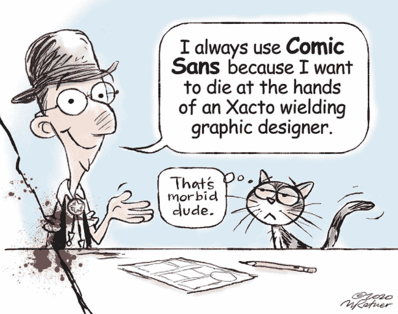

**图 5.10** `Marc Ratner`，“我总是使用 `Comic Sans`，”漫画，科罗拉多大道，2020年3月1日。@ `Marc Ratner`。

特别是 `Comic Sans`。其他标签（`#blood`、`#bloody`、`#therewillbe-blood`、`#xacto #knife`、`#blade` 和 `#morbid`）都指向暴力的方向，并强化了图片所给出的视觉印象。这个例子说明了像话题标签（`hashtags`）这样的平台功能如何引导话语，并影响其性质和方向。

## “为什么每个人都讨厌 Comic Sans？”——关于 Comic Sans 仇恨的元话语

虽然关于 `Comic Sans` 的大部分话语可以被归类为针对字体的字体仇恨，但有一部分不容忽视的内容包含了试图解释这种仇恨及其产生的原因。关于这种仇恨的想法、解释和论证已经出现在社交媒体和设计出版物中，如 *Print*、*Communication Arts* 和 *Creative Review*。一些最常见的论点可以总结为三类，其中一些与上述 `Allan Haley` 提到的字体仇恨列表重合：

### 使用论点

- `Comic Sans` 被过度使用了。它无处不在，可以在各种通俗的语境中看到。（这与 `Haley` 字体仇恨的第一个理由一致）。
- `Comic Sans` 的使用不当。它最初被设计为某个特定儿童应用程序中对话框的屏幕字体，现在却被用于严肃和正式的语境。

### 美学论点

- `Comic Sans` 很丑，并且在连贯性、笔画变化、比例、字形特征（`letterfeit`）和其他设计参数方面违反了排版规范。（这与 `Haley` 字体仇恨的第二个理由一致）。

### 社会学论点

- `Comic Sans` 是由业余设计师所做的糟糕平面设计的缩影，这些设计师可以使用他们并不精通的桌面出版工具。专业平面设计师认为他们必须捍卫自己的领地，保持他们作为专家文化地位以及在动力市场中的地位。⁷

针对前两个论点（使用论点和美学论点）的一个常见反驳是：同样的观点也可以适用于许多其他没有遭受同等仇恨的字体。社会学论点引发了最多的争议。它主要围绕文化资本展开，但经济资本在这个论证中也起了作用，因为专业级的字体是商品，对于需要访问大量字体选择的光明设计师来说，这意味着成本。

元话语中最突出的贡献之一是由文案作家 `Mike Lacher` 提出的。他的讽刺文章《我是 `Comic Sans`，混蛋》（`I'm Comic Sans, Asshole`）于 2010 年发表在 `Sweeney` 的网站上，当时它是用 `Comic Sans` 字体设置的。⁸⁰ 该文本后来也在 *Creative Review* 杂志上以标准字体进行了印刷出版。⁸¹ 如果将在线版本与印刷版本进行比较，就会发现 `Comic Sans` 对于传达文本信息是不可或缺的。用 `Comic Sans` 设置的文本在 `Johanna Drucker` 的意义上永远无法被“去标记化”（`unmarked`），也永远不会消失成页面上的一块灰色区域。

`Lacher` 的第一人称文章一直是重制的对象，例如动画，并且作为独白表演过。⁸² 其语调具有侵略性，并从社会学角度出发探讨了：

## 字体仇恨与 Comic Sans 的话语

那些看不起他的平面设计师：“我是 `Comic Sans`，我是自约翰内斯·他妈的古腾堡以来排版界发生的最棒的一件事。”⁸³

他知道人们在诽谤他，认为他很俗气、无味，并对在随处的笔记和标牌中看到这种字体感到恼火。对他来说，这种字体的吸引力源于物质资源获取的不平等以及对现代主义审美标准的不平等，这唤起了一个傲慢设计师的漫画形象，一个不知道如何玩玩的闷蛋：

> 我们没有在十七英寸的 `MacBook Pro` 上坐着七十三种粗细的自命不凡的 `Helvetica`。抱歉，整个世界不能都用冷酷的欧陆式垃圾瑞士字体来完成。抱歉，有些人喜欢玩玩。抱歉，我阻碍了你们那种极简主义包豪斯式的法西斯式无聊催眠。也许某个时候，你脱掉你那件黑色高领衫，停止不断地调整你的 `Tumblr`，他妈地放松一次吧。⁸⁴

他继续解释说，人们喜欢他是因为他很有趣且懂得享受生活，与 `Gotham` 和 `Avenir` 这样的字体形成对比。他最后总结说，因为他父亲的原因，他不需要担心别人怎么看他：

> 我不仅仅是一个字体。我是一股他妈的大自然，直到每一个像你这样坐在扶手椅上的排字员傻蛋都被我那可爱的、受漫画启发的无衬线粗犷字体包围，我才不会休息。⁸⁵

在 `Lacher` 的独白中，`Comic Sans` 被描绘成一个硬汉和工人阶级，反击焦虑、不娘气的资产阶级设计师以及他们对这类字体的偏见。这与 `Comic Sans` 通常的刻画方式不同，通常认为具有解除防备且幼稚的性格，是无害的、良性的、温暖的、友好且易亲的。⁸⁶

在他的《平面设计：新史》中，历史学家 `Stephen Eskilson` 从“禁用 `Comic Sans`”宣言的角度认为，看起来桌面出版将毁掉排版，但从另一个角度来看，可以认为“争论”对 `Comic Sans` 的痛苦是这种困扰许多具有艺术倾向职业的傲慢鉴赏的典型表现。”⁸⁷

一些专业设计师无法抵制嘲笑 `Comic Sans` 及其使用者。他们可能不像 `Michael Beirut` 对 `ITC Garamond` 那样充满热忱，他们可能知道 `Comic Sans` 从未被设计成一种完整的字体，在

190

第 5 章

198

本章给出的许多例子是基于拟人化的，而其他例子则是基于将 `Comic Sans` 呈现为抽象现象的隐喻。隐喻的选择影响了看待 `Comic Sans` 的方式以及它的能动性。拟人化是一种常见的修辞手法，例如 `Michael Bierut` 在他的文章《我讨厌 `Garamond ITC`》中使用了它，他声称这种字体让他感到反感，并出现在意想不到的地方。他写到了字体的普遍生命周期：它们到来，磨损，它们

## 字体仇恨与 Comic Sans 的话语

走开吧，它们又复活了。这符合人类学家阿尔俊·阿帕杜莱（`Arjun Appurai`）在其著作《事物的社会生活：文化视角下的商品》中对商品的概念化，这基于他认为人与物并非完全不可通实体的信念。⁹¹ 字体设计师李正明（`Jungmyeung Lee`）对字体也有类似的观点：“`Comic Sans` 是一个很好的例子，说明了为什么我认为字体像人一样，有自己的生命轨迹、历史、思想和情感。”⁹²

有时，拟人化在关于字体设计学的写作中似乎占据了主角地位。无论是在弗雷德里克·古迪（`Frederic Goudy`）的《我是字体》还是在迈克·莱克斯（`Mike Lakes`）的《我是 `Comic Sans`，混蛋》中，字体和字体都在以第一人称说话。“我”暗示了“你”，而这种称呼是让读者参与人际互动的一种方式。当肖像中的人物似乎在直视观众，或者电影中的角色直接对着摄像机说话时就会产生视觉上的等效效果。⁹³

拟人化之所以自然地出现在 `Comic Sans` 的话语中，至少有两个原因。其之一是在字体设计文献中，字体经常被认为具有个性。⁹⁴ 在“反对 `Futura Extra Bold Condensed` 的艺术总监”手册的案例中，拟人化可以引出矛盾的性格——它是字体之母，也是当时一个令人畏惧的独裁者。

另一个原因是描述字体和字形时使用的强烈的拟人化语言。一个明显的例子是使用“`face`”（脸）一词，如 `typeface`（字体/字脸）。字体设计师纳迪·奇尼（`Nadine Chine`）认为，“字体就像人体。骨骼是字母底层的结构。”⁹⁵ 这种思维方式已经根植于整个字体设计术语中。在《字体解剖学视觉指南》中，奥拉纳·瓦尔纳德（`Orana Velarde`）将字母拆解为构成部分，像“`spine`”（脊柱）、“`leg`”（腿）、“`arm`”（手臂）、“`shoulder`”（肩部）这样的词汇被用来描述这些元素。⁹⁶ 这种拟人化的语言继续出现在文本中，如“`header`”（头部）和“`footer`”（页脚），⁹⁷ 尽管拉丁字母不同于象形文字是抽象符号，但拟人化的趋势是显而易见的。在艺术形式——如彼特·弗特纳（`Peter Flötner`）的《字母表》以及彼特·比拉克（`Peter Bilak`）2011 年的《人体》中，字体是一个恒定的参考框架。⁹⁸

`Comic Sans` 的第一个版本也带有一种拟人化的触感，在《`Undertale`》动画中，`Comic Sans` 被赋予了重要的视觉特征。在《我们赖以生活的隐喻》中，乔·莱考夫（`George Lakoff`）和马克·约翰逊（`Mark Johnson`）将字体现象视为拟人化的例子。在“字体袭击了我们的经济基础”这样的句子中，这种非人类实体可以被解释为一个对手：⁹⁹ 类比地，如果我们把 `Comic Sans` 视为一个战斗员，它在受到攻击时可以反击。针对 `Comic Sans` 用户而不是字体本身，是一种“代指的拟人化”。

**图 5.11** `Comic Sans` 字体。

## 字体仇恨与 Comic Sans 的话语

在上述例子中，`Comic Sans` 有时被定位为受害者，有时被定位为加害者。拟人化有助于创造一个被恨的对象，一个更具体的攻击目标。社交媒体讨论提出了一个问题：“人如何讨厌一种字体？”答案是，如果某物被变成一个人或一个角色，它是会被恨的。拟人化让像字体这种通常存在于基底上的薄墨线条的抽象现象，有可能从纸张基础上崛起并成为有血肉之躯。迈克·莱克斯的作品《我是 `Comic Sans`，混蛋》以 `Comic Sans` 声称它不仅仅是人类作为结尾，这在权力和主体性上挑战了拟人化。大自然的力量使得人类显得渺小而无力，尤其是那些讨厌 `Comic Sans` 的人。

**图 5.12** `Comic Sans` 字体。

## 利用 Comic Sans

关于 `Comic Sans` 的大部分材料可以被称为用户生成内容，由专业人士和业余爱好者制作。该推文使用了 `Comic Sans`，这是活动团队特意选择的，以吸引 `Comic Sans` 的粉丝并让他们转发信息，从而获得更大的受众。¹⁰⁴

无论何种情况，内容都吸引了关注。根据范·戴克（`Van Dijk`）的说法，文化内容对平台非常有价值，并提供了社交趋势。比任何事情都重要的是，文化内容——无论是文字还是视频——引发了人们对喜好、渴望或厌恶、感兴趣或的看法。

然而，`Comic Sans` 的声名使其成为募资和政治宣传的工具。根据字体设计师托尼·塞登（`Tony Seddon`）的说法，“由于应用不当或过度使用而饱受争议的字体，其伟大之处之一在于它们获得了一个可以利用的平台。”¹⁰²

2014 年 `Comic Sans` 上周年之际，英国癌症研究协会（`Cancer Research UK`）发起了一个广告活动。设计师和艺术家受邀以 `Sans` 字体为主题创作海报，产生了一场名为“对抗癌症”（`Comic Sans for Cancer`）的展览和目录。¹⁰³ 所有的作品都是对字体的幽默引用。

**图 5.13** 支持英国癌症研究协会的2014 年“对抗癌症”展览的网站首页。© 克里斯·弗莱克（`Chris Flack`）。

## 第五章

这曾是 `Twitter` 上的热门趋势，因为欧洲联盟的 `Twitter` 在无意中推动了这一信息在 `Twitter` 圈内的传播。欧盟已收到警告，不要继续传播一种他们其实希望支持的信息，而自由民主党则用带有警示性的推文作为回应，使用了 `Chiller`、`Comic Sans`、`Impact` 和 `Papyrus` 字体，这些字体通常用于迷因和网络笑话。人们对于这种狡猾策略的适用性分歧，这种策略由两对来自新西兰的“数字大师”设计，他们此前同一年曾帮助过澳大利亚自由党参加竞选。这一故事被《时代时报》、《卫报》和《电讯报》等英国主流报纸报道了。¹⁰⁵ 这个例子展示了对平台机制以及对引导用户行为的心理机制的了解，如何导致政治信息的大规模曝光。社交媒体是一个平台公司利用用户产生的数据领域，但它也是某些用户利用其他用户使用平台功能的场所，在本文中，即 `Twitter` 的点赞和转发功能。启动一个像“脱欧推文”这样的过程需要一个代理，在这种情况下，对 `Comic Sans` 的仇恨充当了生产性力量。

## Comic Sans 话语作为流行文化


## 第五章

这曾是 Twitter 上的热门趋势，因为欧洲联盟的 Twitter 在无意中推动了这一信息在 Twitter 圈内的传播。欧盟已收到警告，不要继续传播一种他们其实希望支持的信息，而自由民主党则用带有警示性的推文作为回应，使用了 Chiller、Comic Sans、Impact 和 Papyrus 字体，这些字体通常用于迷因和网络笑话。人们对于这种狡猾策略的适用性意见分不歧，这种策略由两对来自新西兰的“数字大师”设计，他们此前同一年曾帮助过澳大利亚自由党参加竞选。这一故事被《时代时报》、《卫报》和《电讯报》等英国主流报纸报道了。这个例子展示了对平台机制以及对引导用户行为的心理机制的了解，如何导致政治信息的大规模曝光。社交媒体是一个平台公司利用用户产生的数据领域，但它也是某些用户利用其他用户使用平台功能的场所，在本文中，即 Twitter 的点赞和转发功能。启动一个像“脱欧推文”这样的过程需要一个代理，在这种情况下，对 Comic Sans 的仇恨充当了生产性力量。

## Comic Sans 话语作为流行文化

有几种方式可以将 Comic Sans 解释为与流行文化叙事相契合的流行文化现象。我认为，在后数字视觉文化中，这种字体是一个流行文化英雄。Comic Sans 是一个在社交媒体上上演的持续参与式肥皂剧的主角。只要微软不从其标准字体菜单中撤下它，这种字体就有潜力生存很多个季节。

拟人化是 Comic Sans 话语中反复出现的元素，它促进了仇恨，但也促进了叙事。角色是叙事中至关重要的部分。它们是通过处理情节中呈现的冲突来推动情节发展的代理。字体的仇恨提供了许多冲突机会——例如，将 Comic Sans 和 Helvetica 设为对手。上述提到的与勒布朗·詹姆斯从克利夫兰骑士队转会到迈阿密热火队相关的玩笑（推文“Helvetica 与迈阿密签了合同。Comic Sans 留在了克利夫兰”）是一个两个角色在情节中采取不同行动的短篇叙事示例。这可以被充成一个完整的故事，并作为漫画书、电视节目、游戏或其他传统的流行文化形式进行营销。

**图 5.14** 保守党，Twitter，@Conservatives，2019年10月22日。

> 现在是议员们支持新协议并完成脱欧的时候了。

> #GetBrexitDone

> 下午4:27 · 2019年10月22日 · Twitter for Android

**图 5.15** 对保守党脱欧推文的回复。自由民主党，Twitter，@LibDems，2019年10月22日。

> 注意了，libdems.org.uk/online-ads

> 如果你转发糟糕的内容，无论是为了不同意它还是仅仅说它很糟糕，你都只是帮助制造这些内容的人传播他们糟糕的信息

> 下午5:32 · 2019年10月22日 · Twitter for Android

大多数电脑游戏都是在游戏引擎的帮助下开发的，它们是促进游戏构建的软件框架，使开发者不必从零开始。游戏引擎通过对设计提供便利并施加某些限制，影响了可以制造什么样的游戏。¹⁰⁶ 类似，我认为社交媒体平台充当了“故事引擎”，促进了关于 Comic Sans 持续故事的集体和参与式讲述。转发和点赞是两个实现传播和反馈的软件功能。技术基础设施和字体的仇恨在延续 Comic Sans 的名声方面相互相成。还需要技术和修辞手段来保持它的延续。

## 6 共同主题与结语

在最后一章中，我总结了书中对 ASCII 艺术、机器可读字体、点阵打印机和 Comic Sans 字体仇恨四个现象的讨论，涉及八个共同主题和概念——物质性；表演、拟人化和叙事声音；位移；自助；以及技术怀旧与过时。

## 物质性与刻写表面

字体设计的物质方面涉及印刷制品本身和打印过程。材料是产生不同意义和内涵的符号资源。纸仍然是主要的刻写表面，尽管电子出版正在占据一席之地，但纸的死亡似乎迫在眉睫。在《后数字印刷：1894年以来的出版演变》中，Alessandro Ludovico 预见了一个未来，混合出版项目可以结合传统技术和数字技术的优势。在后数字时代，许多文本信息并不是以传统意义上的打印，而是呈现在屏幕上。

对于磁性字符识别 (MICR) 字体和光学字符识别 (OCR) 字体，银行票是参考对象，尽管这些字体也打印在其他类型的基质上。可以根据墨水质量、墨水厚度、墨水气味、纸质、重量和切割方法识别支票。对于线打印机和点阵打印机，都使用墨带将墨水涂在纸上。点阵打印机仍在使用扇页。这种纸已成为早期计算及其技术背景的象征，而标准办公纸与激光打印机相关。标准办公纸是数字纸——一种通用材料，既适用于打印机，也适用于手写文档和通过物理邮寄寄出的信件。

电影《Helvetica》包含了许多 Helvetica “出现在世界中”的例子——从垃圾车上细小而平凡的标志到时装公司的粗体海报——旨在展示一种渗透我们日常生活环境的字体的无处不在和多功能。² 对于 Comic Sans 并没有这样的庆祝。样本集发布在社交媒体上，作为警示性案例。一个受过教育的客人会发现 Comic Sans 是一个反面教材。

## 表演、具身拟人化与叙事声音

拟人化和叙事声音在 Comic Sans 的话语中扮演着重要角色。角色是叙事中至关重要的部分。它们是通过处理情节中呈现的冲突来推动情节发展的代理。字体的仇恨提供了许多冲突机会——例如，将 Comic Sans 和 Helvetica 设为对手。上述提到的与勒布朗·詹姆斯从克利夫兰骑士队转会到迈阿密热火队相关的玩笑（推文“Helvetica 与迈阿密签了合同。Comic Sans 留在了克利夫兰”）是一个两个角色在情节中采取不同行动的短篇叙事示例。这可以被充成一个完整的故事，并作为漫画书、电视节目、游戏或其他传统的流行文化形式进行营销。

然而，这些拟人化的实例与涉及打印机的例子不同。在《Undertale》动画中，所有涉及的字体都具有了形态并发出战斗号。⁴ Comic Sans 回应它的对手，就像它是一个有血肉之躯的人。

用笔写作始终是过程性的，无论是流草字体的流畅，还是块字断断续续的节奏。展示主角正在写作是一种常见的电影手法，也是一种视觉故事的视觉形式，增加了叙事的张力。同样，尽管打印的目标通常是产生某种制品，但打印过程本身就是引人入胜的，可以被视为一种表演。看着文本和图像从打印机内部出现在纸上，这本身就是一种奇观。打印的表演潜力可以发展为一场真正的表演，如 IBM 线打印机的非官方演示程序 Edith 所示。⁷ 这种叙事方法直接接触听众，使用了第一人称叙述。与在剧院舞台上由对观众无知的演员表演的戏剧不同，这种表演直接涉及打印机周围的观众。场景类似于篝火旁的故事。叙述者的声音不可闻，但通过文本的口语和对话特征，计算机被赋予了清晰的声音，通过打印行为得以物质化。

另一个会说话打印机的实例是说“我现在是一个 8 点打印机了，”⁸ 破碎的字母让我们想象打印机忧伤的声音。打印机并不是代表计算机说话。相反，它被呈现为一个独立的人。声学窃听可以被视为另一种表演形式，点阵打印机在打印时发出的声音可以通过自动语音识别和机器学习技术的帮助转换为文字。⁹ 在这种情况下，“脚本”并不


有几种方式可以将 Comic Sans 解释为与流行文化叙事相关的流行文化现象。我认为，在后数字视觉文化中，这种字体是一个流行文化英雄。Comic Sans 是一个在社交媒体上上演的持续参与式肥皂剧的主角。只要微软不从其标准字体菜单中撤下它，这种字体就有潜力生存很多个季节。

拟人化是 Comic Sans 话语中反复出现的元素，它促进了仇恨，但也促进了叙事。角色是叙事中至关重要的部分。它们是通过处理情节中呈现的冲突来推动情节发展的代理。字体的仇恨提供了许多冲突机会——例如，将 Comic Sans 和 Helvetica 设为对手。上述提到的与勒布朗·詹姆斯从克利夫兰骑士队转会到迈阿密热火队相关的玩笑（推文“Helvetica 与迈阿密签了合同。Comic Sans 留在了克利夫兰”）是一个两个角色在情节中采取不同行动的短篇叙事示例。这可以被充成一个完整的故事，并作为漫画书、电视节目、游戏或其他传统的流行文化形式进行营销。

**图 5.14** 保守党，Twitter，@Conservatives，2019年10月22日。

> 现在是议员们支持新协议并完成脱欧的时候。

> #GetBrexitDone

> 下午4:27 · 2019年10月22日 · Twitter for Android

**图 5.15** 对保守党脱欧推文的回复。自由民主党，Twitter，@LibDems，2019年10月22日。

> 注意了，libdems.org.uk/online-ads

> 如果你转发糟糕的内容，无论是为了不同意它还是仅仅说它很糟糕，你都只是帮助制造这些内容的人传播他们糟糕的信息

> 下午5:32 · 2019年10月22日 · Twitter for Android

大多数电脑游戏都是在游戏引擎的帮助下开发的，它们是促进游戏构建的软件框架，使开发者不必从零开始。游戏引擎通过对设计提供便利并施加某些限制，影响了可以制造什么样的游戏。¹⁰⁶ 类似地，我认为社交媒体平台充当了“故事引擎”，促进了关于 Comic Sans 持续故事的集体和参与式讲述。转发和点赞是两个实现传播和反馈的软件功能。技术基础设施和字体的仇恨在延续 Comic Sans 的名声方面相辅相成。还需要技术和修辞手段来保持它的延续。

## 6 共同主题与结语

在最后一章中，我总结了书中对 ASCII 艺术、机器可读字体、点阵打印机和 Comic Sans 字体仇恨四个现象的讨论，涉及八个共同主题和概念——物质性；表演、拟人化和叙事声音；位移；自助；以及技术怀旧与过时。

## 物质性与刻写表面

字体设计的物质方面涉及印刷制品本身和打印过程。材料是产生不同意义和内涵的符号资源。纸仍然是主要的刻写表面，尽管电子出版正在占据一席之地，但纸的死亡似乎迫在眉睫。在《后数字印刷：1894年以来的出版演变》中，Alessandro Ludovico 预见了一个未来，混合出版项目可以结合传统技术和数字技术的优势。在后数字时代，许多文本信息并不是以传统意义上的打印，而是呈现在屏幕上。

对于磁性字符识别 (MICR) 字体和光学字符识别 (OCR) 字体，银行票是参考对象，尽管这些字体也打印在其他类型的基质上。可以根据墨水质量、墨水厚度、墨水气味、纸质、重量和切割方法识别支票。对于线打印机和点阵打印机，都使用墨带将墨水涂在纸上。点阵打印机仍在使用扇页。这种纸已成为早期计算及其技术背景的象征，而标准办公纸与激光打印机相关。标准办公纸是数字纸——一种通用材料，既适用于打印机，也适用于手写文档和通过物理邮寄寄出的信件。

电影《Helvetica》包含了许多 Helvetica “出现在世界中”的例子——从垃圾车上细小而平凡的标志到时装公司的粗体海报——旨在展示一种渗透我们日常生活环境的字体的无处不在和多功能。² 对于 Comic Sans 并没有这样的庆祝。样本集发布在社交媒体上，作为警示性案例。一个受过教育的客人会发现 Comic Sans 是一个反面教材。

## 表演性、具身化的拟人化与叙事声音

拟人化和叙事声音在 Comic Sans 的话语中扮演着重要角色。角色是叙事中至关重要的部分。它们是通过处理情节中呈现的冲突来推动情节发展的代理。字体的仇恨提供了许多冲突机会——例如，将 Comic Sans 和 Helvetica 设为对手。上述提到的与勒布朗·詹姆斯从克利夫兰骑士队转会到迈阿密热火队相关的玩笑（推文“Helvetica 与迈阿密签了合同。Comic Sans 留在了克利夫兰”）是一个两个角色在情节中采取不同行动的短篇叙事示例。这可以被充成一个完整的故事，并作为漫画书、电视节目、游戏或其他传统的流行文化形式进行营销。

然而，这些拟人化的实例与涉及打印机的例子不同。在《Undertale》动画中，所有涉及的字体都具有了形态并发出战斗号。⁴ Comic Sans 回应它的对手，就像它是一个有血肉之躯的人。

用笔写作始终是过程性的，无论是流草字体的流畅，还是块字断断续续的节奏。展示主角正在写作是一种常见的电影手法，也是一种视觉故事的视觉，增加了叙事的张力。同样，尽管打印的目标通常是产生某种制品，但打印过程本身就是引人入胜的，可以被视为一种表演。看着文本和图像从打印机内部出现在纸上，这本身就是一种奇观。打印的表演潜力可以发展为一场真正的表演，如 IBM 线打印机的非官方演示程序 Edith 所示。⁷ 这种叙事方法直接接触听众，使用了第一人称叙述。与在剧院舞台上由对观众无知的演员表演的戏剧不同，这种表演直接涉及打印机周围的观众。场景类似于篝火旁的故事。叙述者的声音不可闻，但通过文本的口语和对话特征，计算机被赋予了清晰的声音，通过打印行为得以物质化。

另一个会说话打印机的实例是说“我现在是一个 8 点打印机了，”⁸ 破碎的字母让我们想象打印机忧伤的声音。打印机并不是代表计算机说话。相反，它被呈现为一个独立的人。声学窃听可以被视为另一种表演形式，点阵打印机在打印时发出的声音可以通过自动语音识别和机器学习技术的帮助转换为文字。⁹ 在这种情况下，“脚本”并不为了表演或为了娱乐。打印机无法避免被偷听。它并不是一个有意识的实体，在意识到自己被植入监控时能够低语或降低声音。

打印机的声音和身体在艺术和音乐表演中被不同的方式使用。《点针式打印机交响曲》（Symphony for Dot Matrix Printers）涉及了由服务器指挥、像管弦乐团一样使用文本文件的打印机。¹⁰ 在这种情况下，打印机扮演了音乐家的角色，打印机上安装了麦克风以捕捉它们发出的声音。打印头的节奏运动在顶视屏幕上可见的。这部作品在剧院里面对坐着的观众进行表演，就像传统的音乐会一样。这是一个混合活动，既是现场的又是媒介的。指挥家是计算机，但人类作曲家在表演期间现场，像完全可见的傀儡师一样照顾着计算机。在另一个更近期的例子中，打印机变成了声音生成器，播放著名的翻唱歌曲。¹¹ 这些音乐表演涉及我所谓的“具身拟人化”，这与前一段讨论的更具口语化的拟人化是不同的形式。它们不像 Edith 或关于缺陷型 ImageWriter 的声音那样去面对或邀请观众成员互动。相反，重点在于一个可听的、表演无歌词歌曲的声音。打印机的声音变成了打印机的身体，并将文本信息置于背景。许多音乐家觉得他们的乐器是身体的延伸。然而，乐器无法像声音那样与人体紧密连接，因为声音是从身体中产生并由特定身体的构造而形成的。¹² 将打印机的声音视为声音是一种拟人化，与我们在爱普生打印机说明书和广告中看到的“动物化”（zoomification）和“拟人化”（anthropomorphization）有关。¹³

上述所有表演都极大地扩展了与字体和排版相关的声音和个性的传统意义。通过将打印设备包含在场景中，开启了一个新的领域，那里有更多的感官被参与。通过字母形状的外观听到的不仅是写者的声音。在思考型计算机 Edith 中，通过它的嘴巴——打印机，正在与观众互动。计算机具有清晰的身体意识这一点在要求观众翻动其外围身体部位外部的开关时变得显而易见。损坏的点针式打印机同样展示了对它身体的意识：它知道其中一个针头是有缺陷的。

## 位移：通往流行文化的路径

本书讨论的所有四种排版现象都属于德鲁克（Drucker）的“标记文本”类别。这是成为流行文化中角色的要求。然而，用于正文的常用字体或常见的显示字体，无论它们在平面设计行业中多么为人知，都不符合条件。它必须具有奇异的特质，这种特质通常出现在其起源的历史中。这四种现象已经产生了意料之外且难以预测的轨迹。它们从一个地方开始，然后将排版推入一个扩张的领域，一个令人困惑的新领土，在那里的排版规则似乎并不适用。说这四种现象已经被流行文化吸收是不错误的。这个过程更可以被描述为一种交换。

在之前的章节中，我描绘了这四种现象在通往流行文化的道路上采取的不同路径。无论差异如何，它们的路径有一些共同点。所有现象都是为了严肃的目的而创建的——打印列表、提供带有代码的银行支票、打印文字处理文本，以及制作一种适合用户友好操作系统界面的屏幕字体。但程序员、设计师、用户和公司看到了这些技术解决方案其他应用的潜力。程序员创作了字母艺术，设计师从受限的 MICR 字符集中创建了完整的字体，用户将点针式打印机变成了乐器，微软决定将屏幕字体提供给他们所有的用户。这些步骤是由个人和公司经理采取的——在某些情况下是在技术仍在在使用时，而在另一些情况下是在它已被新的解决方案取代之后。重要的并不仅仅是步骤的方向或长度或最终终点。我认为，“位移”本身为字体被流行文化接纳创造了机会。在跃迁或悬在空中时，有一个非常短暂的时刻，此时一种现象（无论是排版的还是其他的）是可用的，并可以获得新的意义并融入新的语境。流行文化的创造者和实践者通常对这种机会有敏锐的直觉，这些机会通常与技术的转变有关。

## 致敬早期计算：DIY 与创客文化

广义而言，排版在传统的流行文化中迈出了一大步。一系列流行实践围绕涉及打印装置和字体的排版展开。当人们自己进行平面设计时，他们设计字体、获取字体、讨论字体、评估字体并应用字体。字母艺术和打字机艺术在成为 ASCII 艺术很久以前就是流行文化的一部分。在行字打印机震耳欲聋的噪音消失后，这种艺术形式迁移到了家用电脑打印机、公告板系统和互联网。这种艺术仍在被实践，既是为了制作基于几个字符的简单签名，也是为了制作复杂的、写实的图像。它并非出于需要或缺乏更好的替代方案，而是作为对早期计算的致敬。ASCII 艺术与后数字文化中流行的 DIY（自己动手）创客文化和手工运动非常契合。对旧点针式打印机的处理同样有效：一些仍用于打印并可能需要修理，另一些被操纵并变成了音乐机器。扭曲和操纵都是作为流行文化不可分割的一部分日益流行的文化的一部分。¹⁵ 教学视频和教程视频是创客文化中的重要流派，视频属于典型创客/杂家者/修补者的工具箱。参与社交媒体需要此类媒体技能，而社交媒体是创客文化和 DIY 的重要场景。因此，我结合 Comic Sans 引入的平台化讨论对于其他三种现象同样相关。DIY 运动将社交媒体作为分发手段，同时它为平台提供了用户生成的内容。正如 José Van Dijck 指出的，文化内容对平台公司来说是极具价值的资产，尤其是那些能引发争议的内容，如 Comic Sans。¹⁶

## 技术怀旧与过时

“技术怀旧”（Technostalgia）是我用来分析涉及点针式打印机的记忆实践的概念。这种怀旧是对过去技术更简单、更易理解的向往。技术发展的速度意味着某些设备在用户习惯并学会处理它们时正变得过时。同样的过时的技能和知识。技术怀旧也可以适用于 ASCII 艺术和机器读取字体。技术怀旧的一个例子是印有计算机先驱艾兰·图灵 ASCII 肖像的 T恤。图灵在1954 年去世，当时 ASCII 艺术尚未成为文化现象。这张图像是时代错误的，但 ASCII 艺术标志着“早期计算机时代”，为了实现这一点，它不需要符合历史事实。这个例子也说明了书中涵盖的某些现象的生命力。过时并不是旧媒体和技术退场的理由，某些设备似乎比猫更有寿命。这是一种媒体考古学的观点：

> 尽管关于媒体死亡的论点作为反对死亡的策略可能是有用的：死亡只关注媒体的新颖性，我们认为媒体会腐烂；腐烂、重组、混杂、被历史化、重新解释和被收集……要么留在土壤中作为残渣并留在空气中作为具体的死媒体，要么通过艺术、修补的方法被重新利用。¹⁷

持久性不仅涉及维护和翻新的物理设备，还涉及设计对象，如机器读取字体，这些字体继续作为科幻故事中的符号资源被使用。

从年龄来看，Comic Sans 目前还意味着过时。尽管创建于 1994 年，该字体仍然是当代的一种大众化产品。它出现在几乎每台电脑上，随处可见。可以提出一个假设性问题：当微软停止该字体时会发生什么？Comic Sans 在未来会成为一种怀旧实践吗？收藏者会在 eBay 上买卖使用 Comic Sans 设计的旧咖啡馆菜单吗？重构的程序代码会出现在 GitHub 上并被爱好者下载，像点针字体那样吗？到目前，关于 Comic Sans 最持久的似乎是对它的敌意。

# 史学反思与未来研究的建议

当杂草未被清理、蜿蜒的小径未被平整时，历史写作就是如此。这本书填补了某些空白，但同时也揭示了其他空白。我希望它证实了媒体考古学的观点，即历史不应将死胡同和失败者排除在记录之外。边缘现象有着有趣的故事可以讲述，并让整体画面更易于理解——有时也更难以理解，从而使进一步调查的必要性显而易见。

将这些内容汇编成一本书获得了什么？通过让它们合力工作，我强调了它们的立场以及它们从边缘向关注中心移动的过程，这如果将它们视为孤立的现象是无法实现的。它们并不总是协同工作，但我的结论是，它们相互摩擦，并以一种富有活力的方式赋予彼此动力。此外还有时间维度以及随着时间推移而发生的变化，如果这本书只关于四种现象中的一种，这些内容将会丢失。

这本书包含了许多例子，但它们仅代表我在研究中发现的一小部分，甚至是现存材料中更小的一部分。但这些材料正在消失。正如我在关于 ASCII 艺术的章节中所述，我的研究应该在十或二十年前进行，这样就可以进行更多的采访。二十年后，对 Comic Sans 字体的研究将能够获取哪些材料？数字物质性并不依赖于青铜或陶瓷。这不仅是一个关于消失的网页或一个可能不再被使用的技术基础设施的断链的问题。在几十年后，研究 Comic Sans 的网络话语可能涉及到建立一个网络服务器，执行计算机历史博物馆工作人员为了翻新计算机及其外围设备所做的同样的辛苦工作。

尽管如此，我对未来研究提出了一些建议。字版学、计算和流行文化结合并形成研究基础的方法，比我在这里研究中展示的例子要多得多。

- 例如，可以更深入地研究普通字版学如何本身成为一种流行文化，就像我在 Comic Sans 案例中所做的那样。
- 我提到了声音问题，特别是在关于针式打印机的研究中。然而，使用旧电脑设备制作音乐的实践并不局限于打印机。各种设备——如软磁盘驱动器、硬盘和扫描仪——都会发出声音，并可用于音乐创作或其他基于声音的作品¹¹¹。我的出发点是艺术和视觉研究，我承认需要音乐和音乐学方面的专业知识来推进听觉方面。
- 性别问题在我们的时代具有话题性，本书的几个主题引发了关于性别平等和性别呈现的问题。因为计算机行业和字版贸易都是男性主导的领域，对 ASCII 艺术的研究为从性别视角对该实践的视觉和社会方面进行进一步研究提供了肥沃的土壤。
- 未来研究还可以涉及更广泛的地理视野。这本书主要以西方为中心，但这四种现象，或其他类似的现象，可以开启涉及世界其他地区的研究。

# 注释

# 第一章

1. 参见，例如 Welby Ings, “When We Go to War: Multimodality and Film Title Design,” *Multimodal Communication 4*, no. 2 (2015): 169。
2. 一个著名的后现代主义字体是 Dead History，它由 P. Scott Makela 于 1990 年创造。
3. “扩张领域”（the expanded field）概念指的是 Rosalind Krauss 的开创性论文“Sculpture in the Expanded Field,” *October 8* (1979): 31–44。
4. 参见，例如这热门文章：Gary T. Marx, “The Surveillance Society: The Threat of 1984-Style Techniques,” *The Futurist*, June 1985, 21–26, http://web.mit.edu/gtmarx/futurist_sur_soc.pdf。
5. 一家计算机制造商将其描述为“小的欧洲问题”。
6. 除其他外，我还研究了社交媒体中的摄影以及博物馆展览中数字可视化的使用。
7. 字版学可以被视为印刷媒体或数字媒体的一部分，但它也可以作为一种媒介。参见 Kate Brigade, *The Typographic Medium* (Cambridge, MA: MIT Press, 2021)。
8. Michel Foucault, *The Order of Things: An Archaeology of the Human Sciences*, trans. (London: Routledge, [1966] 1989); Michel Foucault, *The Archaeology of Knowledge*, trans. A. M. Sheridan Smith (London: Routledge, [1969] 1989)。
9. Erkki Huhtamo and Sami Parikka, *Media Archaeology: Approaches, Applications, and Implications* (Berkeley: University of California Press, 2019), 20–21。
10. John Storey, *Cultural Theory and Popular Culture: An Introduction*, 9th ed. (New York: Pearson Education, 2021), 8–12。
11. Dustin Kidd, “Popular Culture,” *Oxford Bibliographies*, February 28, 2017, https://www.oxfordbibliographies.com/view/document/obo-9780199756384/obo-9780199756384。


12. Steven Heller, *POP: How Design Shapes Popular Culture* (New York: All Group, 2010).

13. Philip B. Meggs and Alston W. Purvis, *Meggs' History of Graphic Design*, 6th ed. (Hoboken, NJ: John Wiley, 2016); Stephen Eskinson, *Graphic Design: A New History*, 3rd ed. (New Haven, CT: Yale Press, 2019); David Jury, *The Visual History of Type* (London: Laurence King, 2017); David Drucker, *Reinventing Print* (London: Bloomsbury Research, 2018).

14. Johanna Drucker and Emily McVarish, *Design: A Critical Guide*, 2nd ed. (Upper Saddle River, NJ: Pearson, 2012).

15. Paul E. Ceruzzi, *A History of Computing*, 2nd ed. (Cambridge, MA: MIT Press, 2021).

16. Alisa Freedman, "Cellphone and Internet Novels," in *The Companion to Global Internet*, Gerald Gogogg and Mark McLellan (New York: Routledge, 2017), 419–421.

17. Gerard O'Regan, *The Innovation in Computing* (Cham, Switzerland: 2018).

18. Edward Webster, *Print Unchained: Fifty Years of Digital Printing, 1950–2000 and Beyond* (West Dover, VT: DRA, 2000).

19. "Perspectives on the Postdigital," *Convergence* 22, no. 3 (2016), 324–338.

20. Wendy Hui Kyong Chun, *Updating to Remain the Same: Habitual New Media* (Cambridge, MA: MIT Press, 2016).

21. David M. Berry, "The Postdigital Constellation," in *Postdigital Aesthetics: Art, Computation and Design*, ed. David M. Berry and Michael Dieter (Houndmills, UK: Palgrave Macmillan, 2015).

22. Alessandro Ludovic, *Post-Digital: The Mutation of Publishing since 1894* (Eindhoven, Netherlands: Ontotype, 2012).

23. Christian Paul, "From Digital Art: Evolutions of an Art Form," in *a Companion to Digital Art*, ed. Christian Paul (Hoboken, NJ: John Wiley, 2016), 1.

24. Florian Cramer, "What Is 'Post-Digital?', *APRJA* 3, no. 1 (2014): 18; Goldsmith, *Creative Reinventing: Managing Language in the Digital Age* (New York: Columbia University Press, 2011), 72–77.

25. Rodney H. Jones, Alice Chic, and Christopher Hafner, eds., *Discourse and Digital Practices: Doing Analysis in the Digital Age* (London: Routledge, 2015).

26. 我没有按照 Robert Kozinets 对“民族志”一词的定义进行参与观察，这就是为什么我在这里没有使用这个术语。Robert V. Kozinets, *Ethnography: The Essential Guide to Qualitative Social Media Research*, 3rd ed. (London: SAGE, 2020).

27. Walter J. Ong, *Orality and Literacy: The Technologizing of the Word* (London: Routledge, [1982] 2002). 关于次口语和数字媒体的研究，参见

注释

211

例如，Oren Soffer，“从文本口语化到口语文本化：语音查询案例，”*Convergence* 26, no. 4 (2020): 927–941。

29. Theo van Leeuwen，《社会符号学导论》*Introducing Social Semiotics*（纽约: Routledge, 2005）， 285。

30. Gunther R. Kress 和 Theo van Leeuwen，《阅读图像：视觉设计的语法》*Reading Images: The Grammar of Visual Design*，第2版（伦敦: Routledge, 2006）， 14。

31. Theo van Leeuwen，“迈向排版语义学，”Information Design Journal + Document Design 14, no. 2 (2006): 139–155。

32. 参见，例如 Arthur Armashian 和 Maria Larson，“异中相同：嗅觉意象的案例，”*Frontiers in Psychology* 5 (2014), 论文第 34 号。

33. Sarah Hyndon 在她的书中探讨了味觉（伦敦: Virgin, 2016）。Ellen Upton 和 Andrea Lipp 的《感觉：超越视觉的设计》*Senses: Design beyond Vision*（New: Princeton Architectural Press, 2018）是结合 2018 年库珀·赫威特特史密森尼设计博物馆的展览出版的。一本致力于这一领域的学术期刊是《多感官处理各方面科学研究期刊》*Multisensory: A Journal of Scientific Research on All Aspects of Multisensory Processing》。

34. Johanna Drucker，《可见的世界：实验性排版与现代艺术，1909–1923》（芝加哥: University of Chicago, 1994）， 26。

35. Drucker，《可见的世界》，43–44。

36. Matthew G. Kirstenbaum，《机制：新媒体与法医学想象力》*Mechanisms: New Media and the Forensic Imagination*（Cambridge: MIT Press, 2008），–10。

37. Huhtamo 和 Parikka，《什么是媒体考古学？》*What Is Media Archaeology?*（Cambridge: Polity, 2012），第 6 章。

38. 我唯一的参与式观察记录是向此档案库贡献了一个水果贴纸：`fontsinsuse.com/uses/39164/conference-pear-fruit-sticker`。Karin Wagner，“会议梨子水果贴纸，”Fonts in Use，2021 年 3 月 12 日，`https://fontsinsuse.com/uses/39164/conference-pear-fruit-sticker`。

40. Fonts in Use，`https://fontsinsuse.com`。

41. 人民平面设计档案馆（The People’s Graphic Design Archive），`https://www.peoplesdesignarchive.org`。

42. 字形档案库（Letterform Archive），`https://letterformarchive.org`。

43. 数字艺术博物馆 DAM，`https://dam.org/museum`。

44. 电影标题合集（The Movie Titles Collection），`http://anyanas.com/screenshots`。

45. Print, `https://www.printmag.com`；Communication Arts, `https://www.commarts-com`; AIA Eye on Design, `https://eyeordesign.aiga.org`; Eye, `http://www.eyemagazine.com`。

46. Design Observer，`https://www.designobserver.com`。

47. Smashing Magazine，`https://www.smashingmagazine.com`。

48. 计算机博物馆，`https://www.computerhistory.org`。

49. 媒体考古实验室（MAL），`https://www.mediaarchaeologylab.org`；信息计算机博物馆（Computermuseum der Informatik），`https://www.f05.uni-stuttgart.de/en/department/computer-museum`。

50. 《Creative Computing》、《*Personal Computing* 和 *Byte* 杂志已数字化，可在 Internet Archive 获得：`https://archive.org/details/creativecomputing`, `https://archive.org/details/personalcomputing-magazine`, 以及 `https://archive.org/details/byte-magazine-1992-08/page/n393/mode/up`。

51. 复古计算机与游戏：经典技术的冒险（博客），`https://www.vintagecomputing.com/index.php/archives/973/retro-scan-of-the-week-star-dot-matrix-printer`。

52. Paleotronic：电子、计算与视频游戏史，`https://paleotronic.com/about`。

53. Tedium（博客），`https://tedium.com`。

54. Mike L，“我是 Comic Sans 字体，混蛋，”McSweeney’s，2010 年 6 月 15 日，`https://www.mcsweeneyweys.net`。

55. Kenneth Goldsmith，“创意写作：数字时代的语言管理，”*Creative Writing: Managing Language in the Digital Age*(New York: Columbia University Press, 2011), 72–77。

56. “eBay 可能是最早的社交媒体平台之一，自 1995 年以来就连接了买家和卖家吗？”Giselle Abramovich，“eBay 社交策略的演变，”Digiday，2013 年 4 月 8 日，`https://digiday.com/marketing/the-evolution-of-ebay-social-strategy`。

57. Vincent Connare，“为什么是 Comic Sans？”Connare, 2003, `http://www.connare.com/whycomic.htm`。

58. “ASCII 艺术品，”旧技术收藏”（Old Technology Collection），`http://q7.neurotica.com/Oldtech/ASCII`。

59. Ivo Vynckcker，“OCR 如何工作：光学字符识别回顾，”How OCR Works, `https://how-ocr-works.com`；Ivo Vynckcker，“如果可能就抓住真理：Spiegel、Abagnale 和 OCR，”Spiegel-ocr, `https://www.barcodingspiegel-ocr.com`。

60. 例如，“打印机历史，”GSM Barcoding, MindMachine Associates, `https://mindmachine.co/products/06_Dot_Matrix_01`。

61. Dave Addey，《未来的字体：科幻电影中的排版与设计》（Types in the Future: Typography and Design in Science Fiction）（New York: Abrams, 2018）。有很多关于关于 Annette Froehlich 等，《太空与大众文化：影响与相互作用》（Outer Space and Popular Culture: Influences and Interrelations）（Cham: Springer, 2019）。但这本书或任何其他书籍都没有涉及排版。

62. Tony Brook 和 Adrian Shaughnessy 等，《Letras：DIY 排版革命》（Letras: The DIY Revolution）（London: Unit Editions, 2018）。

63. Toshi Omagari，《街机游戏排版：像素艺术》（Arcade Game Typography: The Art of Pixel）（London: Thames & Hudson, 2019）。

64. Steven E. Jones，“实体数据：从纸孔到代码，”打孔卡时代的制品（Print Punch: Artefacts from the Punch Card Era），Patrick Fry（London: CentreCentre; 2020），21。

65. “关于 CentreCentre，”CentreCentre, `https://centref.co/pages/about`。

66. Rüdiger Schlömer，《排版编织：从像素到图案》（Typographic Knitting: From Pixel to Pattern）（New York: Prince Press, 2020）。

67. Brenda Danet，《网络游戏：在线交流》（Cyberplay: Communicating Online）（Oxford: Berg, 2001）。

68. Kristoffer Gansing，“像机器一样思考：瑞典福利国家的偶然艺术，”*Places in Art, Media and Science: Historical Investigations on the Migration of Knowledge》，Andreas Broeckmann 和 Alanadarajan（Weimar: VGG, 2008）。

69. Stephen Jones，《合成：1955–1976 年澳大利亚的艺术与技术》（Synthetics: Aspects of Art and Technology）（Cambridge: MIT Press, 2011）。

70. Mark Owens 和 David Reinart，“纯数据：机器读字体历史，”Virtual Communication 4, no. 2 (2005): 144–150。

71. Tim van der Heijden，“现在的怀旧：从技术的记忆到技术的记忆”（Technostalgia of the Present: From Technologies of Memory to Memory of Technologies），NECSUS: European Journal of Media Studies 4, no. 2 (2015): 103–121。

72. John Campocampiano，“记忆、临时性与技术怀旧的表现，”数字技术与文化43, no. 3 (2014): 75–85。

73. Karin Bisterveld 和 José van Dijk，《声音编织者：音频技术、媒体与文化实践》（Soundweavers: Audio Technologies, Media and Cultural Practices）（Amsterdam: Amsterdam University Press, 2009）。

74. Kate Burke 和 Charles Charret，“影响导论：‘迷因’，”Journal of Visual Culture 13, no. 3 (2014): 307–313。

75. Keith M. Murphy，“争议！或如何创造语言的形式，”语言与物质性：民族志与理论探索（Language and Materiality: Ethnographic and Theoretical Explorations），Jillian R. Cavanaugh 和 Shalini Shankar（Cambridge: University Press, 2017), 79–80。


76. Sarah Owens，“图形制品的专业与日常设计，”设计文化：物体与方法（*Design Culture: Objects and Approaches*），Julie Julier, Anders V. Munch, Hans-Christian Jensen 和 Nils Peter Skou（London: Bloomsbury Visual Arts, 2019）。

77. Garrett W. Nichols，“字体揭示文化：对糟糕字体的辩护，”*Type Matters: The Rhetoric of Letterforms*，Christopher Scott Wyatt 和 Danielle DeVoss（Austin: Parlor Press, 2018）。

## 第 2 章

1. Barbie Turlet，《打字机艺术：现代选集》（*Typewriter Art: A Modern Anthology*）（London: King, 2014），23。

2. Byron H. Kretzman，《新 RTTY 手册》（*The New RTTY Handbook*）（Toronto: Cowan, 1971）；TTY New (1982): 72–74；Dale Singer，“Don Roy RTTY 艺术先驱，”*New RTTY Journal* 47, no. 3 (1999年8月): 4–5；Alexis C. Madrigal，“ASCII 艺术的最后祖先，”*The Atlantic*，2014年1月30日，https://www.theatlantic.com/technology/archive/2014/01/last-ancestors-of-ascii-art/283445。Connections Museum 拥有 RTTY 收藏，并有一个 YouTube 频道：https://www.youtube.com/c/ConnectionsMuseum。图 2.2 中的截图取自视频 https://youtube.be/Ywf0IaZLuc。

3. 1974年，计算机协会计算机图形与交互技术特别小组（ACM SIGGRAPH）举行了首届年会，其会议论文集为关注计算机图形领域的发展提供了良好机会。参见 ACM SIGGRAPH，https://www.siggraph.org。关于计算机图形学历史，我们参见 Jacobi，《图像对象：计算机图形学考古》（*Image Objects: An Archaeology of Computer Graphics*）（Cambridge, MA: MIT Press, 2021）。

4. Darrell Ince，“ASCII 艺术，”互联网字典（*A Dictionary of the Internet*），第4版（Oxford: Oxford University Press, 2019）。

5. Kate O'Ryan，“ASCII 艺术，”新媒体百科全书：通信与技术的核心参考（*Encyclopedia of New Media: An Essential Reference to Communication and Technology*），Steve Jones（Thousand Oaks, CA: SAGE, [2003] 2007), 15–16。

6. 媒体理论者 Charlie Gere 将第一次击/视为基础。他从雅克·德里达的“迹痕”角度讨论了 ASCII，“数字图像的幽灵”（*The Haunting of the Digital Image*），*A Companion to Digital Art*（2016），206。

7. Eryk Salvaggio 认为 ASCII 是禅宗美学的极佳表现。他指出：“通过文字语言的崩溃，我们可以更清晰地表达图像，某种数字的沉默，或者互联网在说外语。”Eryk Salvaggio，“禅与 ASCII，”*frACM: Online Journal of Computer and Technology*, no. 6 (2001), https://dtcs-wus.org/elit/frame6/eryk.htm。

8. Xuemiao Lu, Linling Zhang 和 Tien-Sien Weng，“基于结构的 ASCII 艺术，”*ACM Transactions on Graphics*（SIGGRAPH 2010）卷29, no. 4 (2010): 1-10。

9. Joe Yusa，“旧 ASCII 艺术，”Google Groups，1999年4月28日，https://groups.google.com/g/alt.folklore.computers/ci-fXX。

10. Calm, 展示数字蒙娜莎的绘图视频，California Products，1968，https://www.digitalmonisa.com/video.html。

11. James Vincent，“回顾60年代的首场艺术竞赛：回旋硬币与正弦曲线，”*The Verge*，2015年7月13日，https://the.verge.com/2015/7/13/early-computer-art。

12. H. Philip Peterson，“数字蒙娜莎，”*Computers and Automation*，1965年12月，13。

13. Theodor H. Nelson，*Computer Lib / Dream Machines*，第三版特别增刊，1975，119，https://worrydream.com/refs/Nelson-ComputerLibDreamMachines1975.pdf。

14. A. Michael Knoll，“贝尔电话公司的早期数字艺术”（*Early Digital Art at Bell Telephone Laboratories, Incorporated*），*Leonardo* 49, no.1 (2016): 55–65。

15. Leon D. Harmon 和 Kenneth K. Knowton，“计算机生成的图像，”*Cybernetic Reality: The Computer and the Arts*，*Studio International* 特刊号，Jamie Reichardt 编（1968年9月）：87。

16. K. G. Pontus Hultén, 《机械时代末期眼中的机器》（纽约：现代艺术博物馆，1968）；Jasia Reichardt, “序言，”选自《控制论的偶然》（*Cybernetic Serendipity*）。

17. Ken Knowles, “作为年轻科学家的艺术家肖像，”*YLEM 杂志*（*YLEM Journal*）第25 卷，第 2 期（2005年1月–2月）: 8-11, https://www.kenknowlon.com/pages/04portrait-htm; Nate Christie, “计算机艺术先驱 Ken Knowles，”*艺术倡导者*（*Arts Advocates*），2019年11月7日, https://www.artsadvocates.org/about/what-s-new/computer-art-pioneer-ken-knowleton。

18. Johanna Drucker 和 Emily Varchnish, 《平面设计史：第2版》（上萨塞尔泽，新泽西州：佩尔逊出版社，2012），312。

19. Rachel Price 和 Giampaolo Bianconi, “Rachel Price 论 Waldemar Cordeiro 的计算机艺术，”*全球背景下的帖子*，现代艺术博物馆，2018年5月23日, https://www.moma.org/rachel-price-on-walddemar-cordiro-computer-art。

20. 《思考的机器：计算机时代的艺术与设计，1959–1968》，展览，现代艺术博物馆，2017年11月13日–2018年4月8日, https://www.moma.org/calendar/exhibitions/3863; 《MoMA 精选：来自现代艺术博物馆的 375 件》（纽约：现代艺术博物馆，2019），另一位与抽象 ASCII 合作的艺术家是 Frederick Hammersley。参见 Patrick Frank, 《分享代码：Art1，Frederick Hammersley 与艺术的黎明》，新墨西哥州佩鲁博物馆，2020年。

21. George Dickie, 《艺术与美学：一种制度分析》（伊萨卡加，纽约州：康奈尔大学出版社，1974）。参见 Hans Van Maenen, 《如何研究艺术世界：审美价值的社会功能》（阿姆斯特丹大学出版社，2009），17–29。

22. compart daDA：数字艺术数据库，http://data.compart-bremen.de。

23. Torley Wong, “ASCII艺术的八个洞见故事，”2009年1月25日，《粉碎杂志》（*Smashing Magazine*）, https://www.smashingmagazine.com/2009/01/8-inspiring-highlights-of-ascii-art。Norris 的肖像出现在《财富时代》（*Fortune*），1968年2月，127。

24. 参见 Stephen Jones, 《合成品：澳大利亚艺术与技术的美学，1956–1975》（剑桥，马萨诸塞州：麻省理工学院，2011），32, 35–36。“但这些中有任何一种接近艺术的吗？从我拥有的材料中，是否有某种可以附上的美学？所以，在澳大利亚，答案显然是否定的，它们与未来电子艺术的发展的关系是，它们引导了后来制造更复杂、更详细和更具原创性图像的能力。”Jones, 《合成品》，37。Jones 书的简短版本于2018年发布在网上，https://the-synthetic-image.com。肖像从未是 ASCII 艺术的流行题材，而且《财富时代》中的公司高管。在《滚石杂志》（*Rolling Stone*）第192页封底上有一张程序员、Resource One 组织创始人 Pam Hart 的 ASCII 肖像。参见 Tim Findley, “大陪审团：告别第五修正案，”*滚石杂志*，1972年12月7日，见计算机历史档案馆，https://archive.computerhistory.org/resources/access/text/2021/05/102711733-05-0-acc.pdf。我这里还有更多例子：印有计算机先驱 Charles Babbage 和 Alan Turing 肖像的 T 恤，尽管它们是时代错乱的。另一个例子是 Corey Holms 为 Steve Jobs 设计的海报，Jobs 为了电影《Jobs》改变了形象。参见 Corey Holms, https://www.coreyholms.com/jobs-1。

25. Dario Fritz, “早期数字艺术的国际网络，”选自《数字艺术指南》（*A Companion to Digital Art*），Christian Paul 和 Donna Arnold（霍霍肯，新泽西州：约翰·出版社，2016），54。

26. Ken Knowton, "作为年轻科学家的艺术家肖像，"*YLEM 杂志*（*YLEM Journal*）第25 卷，第 2 期（2005年1月）: 10–11, https://www.knownewton.com/pages/04portrait-htm。

27. Jim Bould, “感知研究：一个数字修复故事，”*Medium*，2021年3月14日, https://jimbould.com/studies-in-perception-a-restoration-story-241cd8c75ab1。

28. 《新黑客字典》（*The New Hacker's Dictionary*），版本 4.2.2, (1975) 2002, https://archive.org/stream/jarg422/jarg422.text

29. John Regehr, “使用 ASCII 艺术解释代码，”*学术中的嵌入*（博客），2019年2月18日, https://blog.regehr.org/1653。

30. 这是一个出生于 20 世纪 40 年代初的退休男性工程师。

54. "Harris" Taylor, “ASCII Art,” http://www-personal.umich.edu/~lpt/Divegeek/snoopy.htm。ASCII 艺术仍被用作基础计算机教育中的教学工具。例如，Erin Flanagan，“用文本艺术编程：课堂中的 ASCII 艺术，”*Erintegration*, 2018年10月22日，https://www.erintegration.com/2018/10/22/coding-with-text-ascii-art-in-the-classroom。

55. “来自击字式打印机的 ASCII 艺术，1972-1974，”目录号 102773972，计算机历史，https://archive.computerhistory.org/resources/access/text/2021/05/1022773972-05-occ.pdf

56. Klemens Krause，给作者的邮件，2021年5月11日。

57. Ed Post，“真正的程序员不使用 Pascal，”*Datavaning* 第29卷，第7期（1983年7月）：263-265页。

58. 《创意计算的精选》，第1卷，1976年，Atari 档案，https://www.atarichives.org/bcc1/showpage.php?page=16。

59. Mike Loewen，“ASCII 艺术，”与 Samuel P. Harbinson 的采访，2009年，*Old Technology Connection*, *Neurotica*，http://q/neurotica.com/Oldtech/

60. Abigail Solomon Gideon，“金星的另一面：女性展示的视觉，”收于《事物的性别：历史视角下的性别与消费》，由 Victoria De Grazia 和 Ellen Purcell 编（伯克利：加利福尼亚大学出版社，1996年），113-115页。

61. Maria Elena Buszek，《海报女：女性主义、性与流行文化》（达勒姆，北卡罗纳州：杜克大学出版社，2006年），236–244页。在这书中，Buszek 探讨了20世纪70年代的女性艺术家如何挪用这一类型来传达女性主义信息。

62. 另见 Brenda Danet，《Cyberplay：在线交流》（牛津：Berg，2001年），194–240页。

63. IBM 曾有一台 IBM System/360 Model 40，生产于 1964 年至1977 年间。Datacentral IBM, Alright，一张一名男子在计算机中心工作的照片，1971年12月20日，DigitalMuseum，https://digitalmuseum.com/021018076293/datacentral-ikebald。

64. 参见例如，“作业分离页，”IBM，来自 https://www.ibm.com/docs/en/zos/2.1.iotopic-job-separator-pages；https://imgur.com/wooE8.jpg。

65. Loewen，“ASCII 艺术，”与 Samuel P. Harbinson 的采访。

66. Loewen，“ASCII 艺术，”与 Samuel P. Harbinson 的采访。

67. Ian Parberry，“ASCII 艺术冒险，”*Leonardo* 第47卷，第3期（2014年）：262–263页。

68. Loewen，“ASCII 艺术，”与 Samuel P. Harbinson 的采访。

69. CuriousMarc，“使用复古 HP 85 计算机、HP 7970E 9轨磁带和 HP 2631G 针式打印机绘制的 ASCII 艺术演示，”YouTube，2016年2月1日，Douglas788 的评论，https://youtube.com/watch?v=YS9dGYUbNd0&feature=youtube。

70. 与 Klemens Krause 的邮件采访。这在一段播放 Edith 程序的视频中也被提到：“但一段关于蒸汽机‘大男孩’的非常显著的备注；长约5英尺，”CuriousMarc，‘IBM 1401 主机运行着 Edith’，”YouTube，2018年6月2日，由 Worldbestpilot 发布，2019年，https://www.youtube.com/watch?v=LtrTIXB5ggq&t=19s。

## 注释

## 219

- 71. Stick of Note，“Google 如何变成便利签贴画廊，”*The Keyword*, Google，2019年4月29日，https://blog.google/inside/life-at-google/sticky-note-pixel-art；两栋办公楼之间的便利签贴大战：史诗级终结；*Bored Panda*，2014年，https://www.boredpanda.com/building-post-it-notes-nyc-manhattan/utm_source=googleutm_medium=organic&campaign=organic。

- 72. Bob Neel，《Bob Neel 的打字机艺术之书》（英国 Zennor：Weavers Press Publishing，1982年）。

- 73. Loewen，“ASCII 艺术作品，”与 Samuel P. Harbinson 的采访。

- 74. CuriousMarc，“使用复古 85 打印机、HP 7970E-9轨和 HP 26361 矩阵打印机绘制的 ASCII 艺术，”YouTube，2016年2月1日，Myterit 的评论，2018年，https://www.youtube.com/watch?v=Y59dGYUbNbd0&feature=youtube。


- 75. Ben Edwards，“女性需要为叔叔纪念 banner 提供帮助，”Vintage Computing and Gaming，2013年5月8日，https://www.vintagecomputing.com/index.php/archives/979/women-needs-help-with-uncle-memorial。

- 76. Vuk Cosinc，“ASCII 卡拉OK，”艺术装置，Kongeist，2019年，https://www.kongeist.org/en/projekt/ascii-art-device/art-5/izloza-17/camera。

- 77. Dag Spicer，计算机历史博物馆策展员，偶尔通过 Twitter 发布 ASCII 打印品。参见 Dag Spicer，“计算机历史博物馆的1959年 IBM 1403 行打印机。1403每分钟可以打印600行(lpm)，或者每三秒一页，”Twitter，2019年8月1日，@dag_spicer，https://twitter.com/dag_spicer/status/116579221838492，以及 Dag Spicer，“今天是星际纪元76344。在 @ComputerHistory 的 IBM 1401 数据打印机上打印。这台打印机连接到我们的1959年计算机，”https://computerhistory.org/exhibits/ibm1401/#StarTOS。”Twitter，2022年4月22日，@dag_spicer，https://twitter.com/dag_spicer/status/12530247914335185。

- 78. Marcel Mauss，“论礼物与交换，”社会学杂志新系列1（1925年）：31-68页；Marcel Mauss，《礼物：古代社会的交换形式与功能》（伊利诺伊州格伦：Free Press，1954年）。

- 79. Eric S. Raymond，“信息圈中的定居，”2000年，Catb，https://www.catb.orghesteading/index.html。

- 80. Loewen，“ASCII 艺术作品，”与 Samuel P. Harbinson 的采访。

- 81. Julia Velkova，“文化生产，”First Monday，第21卷，第10期（2016年）。

- 82. Neill，《Bob Neel 的打字机艺术之书》。

- 83. Open Source，“材料的策展，”CCCB，当代文化中心，2019年6月28日，https://lab.cccb.org/open-source-embroidery-curatorial-of-networks。

- 84. Rüdiger Schlömer，“字体拼接：从像素到图案”（纽约：Princeton Press，2020年）。

- 85. Open Craft，https://github.com/opensource

- 86. Guy Fedoruk，“关于计算机历史博物馆的1401，”CHM 博客（博客），2019年2月19日，计算机历史，https://computerhistory.org/blog/about-the-computer-history-museums-1401/。

- 87. 它曾在美国、德国和瑞典等国家的其他计算机系统上运行。我写信 IBM 档案部门，公司没有关于该程序的信息。

- 88. Matthew G. Kirschenbach，《机制：新媒体与想象力》（马萨诸塞剑：MIT Press，2008年）。

- 89. Ben Edwards，“从未被报道的第一件计算机艺术（迷人的女性），”《大西洋》，2013年1月24日，https://www.theatlantic.com/technology/archive/2013/01/the-never-before-told-story-of-the-first-computer-art-its-sexy-dame/267439。

- 91. Zbigniew Sachniak，“软件恢复与收益，”IEEE 计算机史第41卷，第4期（2019年）：110–118页。

- 92. H. Philip Peterson，“数字计算机，”实物，1965年，计算机历史目录号 X1028.90，https://www.computerhistory.org/collections/catalog/X1028.90；来自击字式打印机的 ASCII 艺术，1972–1974，计算机历史目录号 102739972，https://www.computerhistory.org/collections/catalog/I10273972。

- 93. “ASCII 艺术，收藏与维多利亚和阿尔伯特博物馆，”https://www.va.ac.uk/search?q=ascii%c2%a1rt

- 94. Leon Harmon 和 Ken Kenyon，《感知研究1》，激光打印，1997年。https://collections.vam.ac.uk/item/0239963/studies-in-perception-1-print-harmon-leon/

- 95. Leon Harmon 和 Ken Kenyon，《计算机数字（感知研究1）》，激光打印，1997年，Weights 档案，https://www.weight20.com/auctions/2017/07/07/art-design/147；Waldemar Cordeiro 三件作品，油印胶版，MutualArt，https://www.mutualart.com/Artist/Waldemar-Cordeiro/49E78EB76BC7109B。

- 96. 在 ebay 上列出的物品，https://www.ebay.com/itm/Extremely-Rare-Star-Trek-Mr-Spock-ASCII-Art-Chaintrain-Line-Print-1997/193793453724 [已停产]。

注释

221

97. “极稀有的史波克先生《星际迷航》ASCII艺术/海报 普林斯顿计算机实验室 1973，”eBay 上列出的出售物品；atpicclick.com/Ultra-Rare-Mr-Spock-Star-Trek-ASCII-Artwork-14243866559.html。

98. Matthew Bird，“数字时代的设计研究”，《设计与文化》第 6 期，第 2 期 (2014): 233–249。

99. Dydia Delyser, Rebecca Sheehan, Andrew Curtis，“eBay 与历史地理学研究”，“《历史地理杂志》第 30 卷，第 4 期 (2004): 764–782。另见 Megha Rajguru，“由你出价：作为档案资源的 eBay”，“艺术与设计博客”（博客），2021 年 6 月 15 日。布莱顿大学人文学院，https://blogs.brighton.ac.uk/houd/2021/06/15/at-your-bidding-ebay-as-an-archival-resource。

100. 参见“适用于 Windows 的 8 种免费 ASCII 艺术生成器”，免费软件列表，https://listfirestore.com/free-ascii-art-generator-software-windows，以及“ASCII艺术生成器”，ASCII艺术俱乐部，https://asciiart.club。某些可以以 ASCII 风格渲染 ASCII 的图像过滤器。参见 Zoltan Erkovsky，“ASCII Art”，Filter Forge，https://www.filterforge.com/filters/9148.html。

101. 案例研究：从 ASCII 到亚像素 ASCII+艺术，大学案例研究，2017 年 6 月，https://newdigital.uk/case-studies/subpixel-ascii-plus-art。另见计算机科学中侧重提高制作 ASCII 图像速度的研究：“图像马赛克和 ASCII 艺术的快速渲染”，Marcus Fragatangeli, Igor S. Pandžić, 和 Jürgen Ahlberg，《计算机图形论坛》第 34 卷，第 6 期 (2015): 251–261；武内悠次, 中野恋, 高藤大志, 伊藤雅寿，“使用本地穷举搜索和 GPU 加速的字符艺术历”，“国际并行、新兴与分布式系统杂志》第 31 卷，第 1 期 (2016): 47–63。

102. Vrichard，“史努努比日历是永恒的 (C++)”，“那个被遗忘的地方”（博客），2012 年 8 月 10 日，https://vrichard.wordpress.com/2012/08/10/snoopy-calendar-is-forever-c。

103. dosfanboy，“在 Unix 中制作史努努比日历”，“Mike’s Computer Nerd”（博客），2017 年 1 月 5 日，https://dosfanboy.wordpress.com/2017/01/05/making-a-snoopy-calendar-in-unix。

# 第 3 章

- 1. 关于计算机视觉如何让机器可读内容变得日益日常，请参见 Katja Kastek，“如何被设计：一篇关于新美学的枯燥学术论文”，收于《数字美学：艺术、计算与设计》，Michael Dieter 和 David M. Berry 编（纽约：Palgrave Macmillan, 2015），72–85。

- 2. 某些案例可以被归类为多个类别，但我选择了认为最相关的一个。

- 3. Beatrice Ward 和 Henry Jacob，《水晶高杯：关于字体排版的十六篇论文》（伦敦：Sylvan Press, 1955）。

- 4. Johanna Drucker，《可见的字：：实验性排版与现代艺术 1909–1923》（芝加哥：芝加哥大学出版社，1994），94–98。Drucker，《可见的世界》，43–44。

注释

- 6. Theo Van Leeuwen 和 Carey Jewitt，《视觉分析手手册》（伦敦：SAGE, 2001）；Per Ledin 和 David Mach，《进行视觉分析：从理论到实践》（加利福尼亚州千树奥克斯：SAGE, 2018）。对于对动态图像的分析，参见 Karin Wagner，“客人与入侵者”，“国际电影》第 15 卷，第 4 期 (2017), 25–36。

- 7. Amy Weaver Fisher 和 James L. McKinney，“ERMA 银行系统的发展：历史的教训”，“IEEE 计算机历史杂志》第 15 卷，第 1 期 (1993): 44–57。还开发了一种基于线条的欧洲变体。

- 8. Digital Check，“支票上的通用 MICR 打印使用这种奇怪的字体吗？”，https://www.digitalcheck.com/micr-weird-magnetic-printing。

- 9. Mark Owens 和 David Reinfurt，“Pure Data：机器可读类型历史时刻”，“视觉传播》第 4 卷，第 2 期 (2005): 147。

- 10. 文献中评论了一些经典的书籍封面。例如，Charles Jencs，《建筑 2000：预测与方法》（伦敦：Studio Vista, 1971）；Mauro Trace，《控制论史》（伦敦：Studio Vista, 1971），收于《威斯敏斯特》：Ruth Leavith 编，《计算机》（新和谐：Harmony Books, 1976），收于《计算机》；以及 John Burger 系列《视觉之道》的标题。

- 11. Jane Lamarach，“Rub-Down”，“Eye》第 86 卷 (2013): 80, http://www.eyemazine.com/feature/rub-down；Tony Brook 和 Adrian Shaughness 编，《排版》（伦敦：Unit Editions），28。Owens 和 Reinfurt，“Pure Data：机器可读类型历史时刻”。MICR 和 OCR 字体的故事在 David Jury，《重造印刷：技术与工艺》（伦敦：Bloomsbury, 2018）中简述，107–108。

- 12. Paul McNeil，“字体历史》（伦敦：Laurence King, 2017），396。

- 13. Adrian Frutiger, Heidi Osterer 和 Stamm，《Adrian Frutiger—字体》（巴塞尔：Birkhauser, 2009），178。美国现在是国家标准 (ANSI)。

- 14. Frutiger, Osterer, 和 Stamm，《Adrian Frutiger—字体》，176。

- 15. Frutiger, Osterer, 和 Stamm，《Adrian Frutiger—字体》，178。

- 16. ISO 1073-1:1976 和 ISO 1073-2:1976。17. Frutiger, Osterer, 和 Stamm，《Adrian Frutiger—字体》，178。

- 18. Paola Antonelli，“数字字体：MoMA 收藏”，“Inside/Out”，2011 年 1 月 24 日，https://www.moma.org/explore/inside_out/2011/01/24/digital-fonts-in-moma。在该众领域也有较不成功的尝试，例如 Viatron 字体在光学识别市场上寿命很短。十年后，它在重制中获得了新生。Stephen Coles，“安迪·沃霍尔的美国”，“字体使用》，2019 年 3 月 13 日，https://fontsinuse.com/uses/2558/america-by-warhol。

注释

223

- 19. Frutiger, Osterer, 和 Stamm，《Adrian Frutiger—字体》，184。

- 20. Hubert L. Dreyfus，《计算机不能做什么：对人工智能理性的批判》（纽约：Harper & Row, 1972）；Joseph Weizenbaum，《计算机力量与人类：从判断到计算》（旧金山：Freeman, 1976）。

- 21. Louise Koenig，“工程师与计算机的关系”，“个人计算》，1981 年 10 月，24–32。

- 22. Peter Weibel 和 Timothy Decker 编，《net_condition：艺术与全球媒体》（剑桥：MIT Press, 2001）。

- 23. Jennifer L. Arnold，“net_condition：艺术与全球媒体”，“图书馆杂志》第 126 卷，第 8 期 (2001): 8。

- 24. “net_condition：艺术与全球媒体”，评论，《出版周》，https://www.publishersweekly.com/978-0-262-73138-6。

- 25. Rick Maynard，“不再有规则：平面设计与后现代主义”（伦敦：Laurence King, 2003），99。

- 26. Johanna Decker 和 Emily McVarish，“作为 90 年代数字文化的指数”：“文本和图像重叠并交叉，尊重传统的边界和规则。”Johanna Decker 和 Emily McVarish，《平面设计史》，第二版（新泽西州萨德尔河：Pearson, 2012），318, f. 15.9。

- 27. Lisa Lynch，“Net_Condition：艺术与全球媒体”，“网络研究中心 (RCCS)，https://www.archive.org/web/20200206011555/http://www.washington.edu/rccs。

- 28. Weibel 和 Decker 编，net_condition:projects/the-intruder。

- 29. Natalie Bookchin，“入侵者”，https://bookchin.net/the-intruder。

- 30. Natalie Bookchin，“入侵者”，收于 Weibel 和 Decker，《net_condition》，86。

- 31. Marco Lafia，“Vandemmar Memex 或被她的杀手剥光光的劳拉·罗特”，收于 Weibel 和 Decker，《net_condition》，208–209；Marco Lafia, Gabriela Marks, Darin Fog, Mark Meadows, 和 John Draper，“Vandemmar Memex 或被她的杀手剥光光的劳拉·罗特”，Memex Engine，http://memexengine.net/process/index.html。该标题指的是马塞尔·杜尚的名艺术作品《被她的单士们剥光衣服的新娘》，1915–1923。

- 32. Decker，《邪恶的》，140–168。

- 33. Claudia S. Quiñones Vila，“名字意味着什么？后数字时代的博物馆”，“桑坦德艺术与文化法律杂志》第 2 卷，第 6 期 (2020): 177–198。

- 34. David C. Gompert 和 Martin Libicki，“迈向量子互联网：后疫情时代的数字网络安全”，“生存》第 63 卷，第 1 期 (2021): 113–124。

- 35. 与 Zel Bettman 的访谈，2021 年 3 月 18 日。Bettman 是该项目的负责人，也是 Lövdhen Cenzing communications 的所有者。

- 36. Paul N. Edwards，《封闭的世界：冷战美国计算机与话语政治》（剑桥：MIT Press, 1996）。


37. “公众认为计算机让生活更美好，但表达了主要担忧”，*Computer S5*, no. 1 (1972): 15–16, https://doi.ieeecomputersociety.org/10.1109/C-M.1972.216859.

38. Lars Illshammar, “当计算机变得危险：20世纪60年代瑞典的计算机论，”*Human IT* 9, no. 1 (2007): 6–37.

39. Illshammar, “当计算机变得危险”, 27.

40. “使用 Abagnale SuperCheck 在范围内防止个人支票欺诈”，*Safe Checks*, https://www.safekecks.com/our-checks/abagnale-personal-supercheck.php.

41. Michael Dooley, “Ed 的词：印刷中的 Ruscha” 48, no. 5, (1994): 32–46, 125.

42. Edward Ruscha, 《二十六个加油站》，第3版（Alambra, CA: Cunningham Press, 1969）。

43. Edward Ruscha, 《她们叫她苯烯》（Pidon, 2000），倒数第9页。

44. “迈克尔·Bierut、埃德·Ruscha 与语言的冲击”，对 Michael Bierut 的访谈，*The Way I See It》电播节目，BBC 和现代艺术博物馆，2020年2月24日，https://www.moma.org/magazine/articles/232.

45. 他制作了几个版本，在尺寸和材料上略有不同。1984年的尺寸为 14½ 英寸 x 22½ 英寸，1984 [#2] 的尺寸为 14½ 英寸 x 23 英寸。它们是用铅笔上的石墨制成的。其他版本是用纸上的火药和铅笔制成的。埃德·Ruscha：绘画、纸上作品，全部，https://edruscha.com/search-works/?title=1984。

46. Allison Martino, “艺术家 Ed Ruscha 谈论并未发生的末日：1984 并没有终结世界，”*Los Angeles Magazine*,2014年7月16日，https://www.lamag.com/the80s/1984-did-nt-end-the-world-after-all.

47. Owens and Reinhurt, “Pure Data：机器可读类型历史中的时刻”，147.

48. ADB 与社会的合作：建议书（ADB 与社会的脆弱性：考虑与建议 (ADB and the Vulnerability of Society: (Considerations and Proposals)），SOU 1979:93, https://www.webburn.kb.se/metadata/833/SOU_8350833.htm.

49. Marvin Minsky, “机器人会继承地球吗？”，*Scientific American* 271, no. 4 (1994年10月): 108–113.

51. Dreyfus, 《计算机做不到的事；Weizenbaum, 《计算机力量与人类理性》。

52. Walter A. McDougall, “一个忧郁的太空时代纪念，”，《回顾太空时代：50周年会议集》（Baltimore: Johns Hopkins University Press, 2010), 389–396.

53. Jan Pieńkowski, 《机器人》（伦敦: Heinemann, 1981）。

# 注释

54. Tom Gauld, 《Mooncoop》（Montreal: Drawn & Quarterly, 2016）。

55. Toshi Omagari, 《街机游戏字体设计》（伦敦: Thames & Hudson, 2019), 130.

56. McNeil, 《字体的视觉史》，396.

57. Adley, 《未来的 Pyset》。

58. Sarah Whalen, 《为什么字体很重要》（伦敦: Virgin, 2016), 52.

59. Zach Whalen, “OCR 与机器视觉的残余美学，”在 2013 年现代语言协会年度会议上发表的论文，2013年1月3日，见 Zach Whalen, http://www.zachwhalen.net/posts/ocr-and-the-vestigial-aesthetics-of-machine-vision-net-condition.

60. Florian Rötzer, “媒体时代的注意力，”见 Weibelt and Druckney,

61. Billy Smith, “Jennicam，或现实生活的电报剧场，”*International Journal of Performance Arts and Digital Media* 1, no. 2 (2005): 91–100.

62. Rötzer, “媒体时代的注意力”, 69.

63. Dle 是 Harvey 在纽约大学交互式电信计划 (ITP) 的毕业设计。详见 Adam Harvey, “CV Dazz,” AHProjects, https://ahprojects.com/cvazzle；Yana Weiner, “比一千条帖子更多的脸：在社交网络中开发面部识别，”*Harvard Journal of Law & Technology* 26, no. 1 (2012年秋季): 165–240；Becky Kazansky, Stefania Milan, Astrid Mayer 和 Kristen Katzenbach, “身体而非模板：反抗主导算法想象，”*New Media & Society* 23, no. 2 (2021): 363–381.

64. Welinder, “比一千条帖子更多的脸，”见 Scott Contreras 和 Lukas Miro, 《新审美与艺术：后数字星系》(Amsterdam: Institute of Network Cultures, 2016), 159–162；“计算机视觉伪装，”CVDazzle,2015年6.

65. Adam Harvey, “CV Dazz,” AHProjects, https://ahprojects.com/cvazzle，用于特定算法。详见 Cameron Bishop 和 Lucy Pangrazio, “数字计数，”THEORY (2017): 1.

66.字体样式并不提供保护，但必须由 San 进行调整，《使其可见：反抗字体》，The Gradient，https://walkerart.org/magazine/san-defiant。ZXX 字体用于 2016 年旧金山现代艺术博物馆的展览：Ellen Shapiro, “SFMOMA 庆祝平面设计，”Print,6月13日，详见 studium.com. 详见 studium.com。

67. “MARC 语言列表，”MARC 标准，美国国会，https://www.loc.gov/marc/languages/code.html.

68. ZXX 字体视频，2012年，Vimeo,https://vimeo.com/426759.

69. “外设设备，他处，”美国工业百科书，https://www.referencebusiness.com/industries/Machine-Computer/Peripheral-Equipment.html.

70. Thomas Kraemer, “打印时代，”美国遗产与技术，2001年春季，18–27.

71. James A. Blanco, “数据识别文件，”*Forensic Science* 59, no. 2 (1993): 35–47.

72. David A. Lien, 《Grafts Plus》（San Diego: CompSoft Publishing, 1982), ix.

73. 打印机手册，4–8.

74. 《Delta 用户手册》（日本静冈: Star Micros, 1983), iii.

75. Rudiger Zummer, 《排版设计：从像素到图案》（New York: Princeton Architectural Press, 2020）。

76. 打印机手册，v.

77. 《Delta 用户手册》，iii.

78. “传奇的诞生，”Epson广告，Byte,1982年8月，396–397.

79. Giuseppe Pedelleletto, 《依恋与消费者情感：新兴研究与机会》（Hershey, PA: IGI Global, 2018).

80. 许多其他通过类似策略营销的打印机。例如，这张 1983 年 HP 针式打印机广告，它们被设定为教室里表现良好的学生：“介绍教养良好的打印机，”惠普广告，HP 博物馆，http://www.hpmuseum.net/upload_htmlFile/Print Ads/Ad1983_25634-A293Printers-35.jpg.

81. W. J. T. Mitchell, “没有视觉媒体，”*Journal of Visual Culture* 4, no. 2 (2005):257–276.

82. “设备坟：针式打印机，”Paleotronic,2019年8月26日，https://paleotronic.com/2019/08/26/gadget-graveyard-dot-matrix-printers.

83. John Sheesley, “针式打印机仍在敲击岁月，”TechRepublic,2008年10月2日，https://www.techpublic.com/blog/classics-rock/dot-matrix-printers-still-hammer-away-the-days.

84. W. Watt Gibbs, “如何在没有网络的情况下窃取秘密，”*Scientific American*,2009年5月，59.

85. Michael Bakkes, Markus Durmuth, Sebastian Gerling, Manfred Pinkal 和 Caroline Sporleder, “打印机的声学信道攻击，”第9届 USENIX 安全会议集，2010年8月11-13日，Washington, DC (Berkeley, CA: USENIX Association, 2010), 307.

86. Backes 等，“打印机的声学信道攻击，”11.

87. Alisha Pradhan, Leah Findlay 和 Amanda Lazar, “‘幻影朋友’与仅仅是信息盒子：针对老年人的语音助手的人格化与本体论分类，”*Proceedings of the ACM on Human-Computer* 3, no. CSCW (2019), 1–21.

88. Tiina Mänstö-Funk 和 Janita Sihvonen, “来自异界的声音，”*Digital Culture* 4, no. 1 (2018): 45–64.

89. Ben Edwards, [每周回顾扫描]针式打印机，Star Micros Dot-10 矩阵广告，《个人电脑》，1983年11月，28，见于《复古计算与冒险》，2013年4月8日，http://www.vintagecomputing.com/index.php/archives/973/retro-scan-of-the-week-dot-matrix-printer.

90. Edwards, [每周回顾扫描]针式打印机。

91. Muhammad H. Al-Haboubi 和 Shokri Z. Selim, “噪声变化作为维护的指标，”*Journal of Quality in Engineering* 6, no. 1 (2000): 20–27.

92. Ahmed, “故障硬盘发出的声音对恢复的意义，”Tierra Recovery,https://tierradatacovery.co/the-sounds-made-by-failed-hard-drives-and-what-they-mean-for-hard-drive-recoverydiscontinued].

31. Terry Stewart, “针式打印机：在 Tezza 的经典电脑收藏中所见”, YouTube, 2014年10月4日, https://www.youtube.com/watch?v=UWM20ZGF8v0.

32. Stewart, “针式打印机.”

33. Mitchell, “没有视觉媒体”, 262.

34. Tech Tangents, “修复针式打印机卡住针——Micro Tangent”, YouTube, 2020年3月18日, https://www.youtube.com/watch?v=Wxz82Vy40GY.

35. 关于弗朗西斯科·德·苏尔巴兰绘画中如何唤起敌意的示例，参见 Norman Bryan, 《观察被忽视的：关于静物画的四篇论文》(伦敦: Reaktion, 1990年), 60–95.

36. Tech Tangents, “修复针式打印机卡住针.”

37. Tech Tangents, “修复针式打印机卡住针.”

38. Joonhee Lee 和 Lily M, “噪声的调性和响度与烦躁感及任务表现的关系”, 《噪声控制工程期刊》, 第2期 (2017年): 71–82.

39. “打印机-配件”, HP 电脑博物馆, http://www.hpmmuseum.net/exhibit.php?class=5&acc=17.

40. John Free, “电脑扩展卡既酷又降噪”, 《科学美国》，1983年8月.

41. 高坂俊美(Toshifumi Kosaka) 和 高野雅(Masaharu Takano), “关于针式打印机的降噪”, 《日本打印工程学会杂志*, 第59期 (1979年): 1315–1320.

42. 用打印机制作音乐并非源于针式打印机。以前曾用线式打印机制作音乐。Kristoffel Ganning, 《人类制造机器：瑞典国家中世纪艺术》，艺术、媒体、科学与技术中的地点研究：边缘地点与知识的历史调查, Andreas Broeck 和 Gunalan Nadarajan 编 (德国魏玛: VGG, 2008年), 75–80.

43. Jason Weiberberg, “针式打印机的声音!”, Boing Boing, 2019年2月17日, https://bbs.boingboing.net/at/the-sound-of-a-dot-matrix-printer/139111/44.

44. Gadget Gateway: 针式打印机。

45. Erki Huhtamo 和 Jussi Parikka, 《媒体考古学：方法、应用与意义》(伯克利: 加州大学出版社出版社, 2019年).

46. Thomas McIntosh 和 Emanuel Daniel [User], 针式打印机交响曲, [User], http://www.theuser.org/dotmatrix/in/intro.html; Thomas McIntosh 和 Emmanuel Daniel [User], 针式打印机四重奏, Under, http://www.undefine.in/projects/symphony-for-dot-matrix-printers/quartet; “[The User] 针式打印机四重奏 @ 多特斯蒙德凤凰厅 (德) 2004”, Vimeo, 2009年, https://vimeo.com/undefinit; Joob Jackson, “针式打印机回归制作音乐”, 《Network World”, 2010年5月28日, https://www.networkworld.com/article/2210728/dot-matrix-printers-return-to-make-music.html. 涉及针式打印机的艺术装置的早期例子是 Hans Beder 1986年的《Ursonate》。参见 Herman Rapaport, “跨媒体：一种基于意识的过程”,对 Hans Bremer 的访谈, 2010年1月, 《PAJ: 表演期刊》第33卷第3期 (2011年): 11–23, https://www.mitpressjournals.org/doi/pdf/10.1162/PAJJ_a_00051.

47. Thomas McIntosh 和 Emanuel Madman [The User], 矩阵打印机第1号交响曲, 1998年, Undefined, http://www.undefined.ca/projects/symphony-for-dot-matrix-printers/symphony-1-for-dot-matrix-printers.

48. Joab Jackson, “针式打印机回归制作音乐”, 《Network World”, 2010年5月28日, https://www.networkworld.com/article/2210728/dot-matrix-printers-return-to-make-music.html.

49. Angela Pahlman, “The User”, Daniel Langlois 艺术、科学与技术基金, 2000年, https://www.fondation-langlois.org/html/page.php?NumPage=83.

50. Thomas McIntosh 和 Emanuel Madman [The User], 针式打印机第2号交响曲, 1999年, Undefined, http://www.undefined.ca/projects/symphony-for-dot-matrix/symphony-2.

51. “[The User],” Avanto 节, 2001年8月11日, http://www.avantofestival.com/avanto2001/2001-lp/user.html.


52. Thomas McIntosh 和 Emanuel Madman [The User]，针式打印机四重奏，2004年，Undefined，http://www.undefined.ca/projects/symphony-for-dot-matrix-printers/quartet。该装置的另一个版本于2008年在多伦多的当代艺术馆展出。Randy Gagne，“声音容器：多伦多的近期声音艺术”，《Senses》第4卷第1期（2009年）：111–116。

53. Garnet Hertz 和 Juli Parikka，“僵尸媒体：电路考古”，《Leonardo》第45卷第5期（2012年）：424–430。

54. MIDI Desider，“31个视频”，Vimeo，2013年，https://vimeo.com/57960167?utm_campaign=affiliate&utm_source=affiliate&utm_channel=06ca185。

55. MIDI Desider，“Benny Hill & It’s Done”，Vimeo。

56. Johnston Weiss，“针式打印机的声音”，Boing Boing，2019年2月17日，https://bbs.boingboing.net/at/the-sound-of-a-dot-matrix-printer/139111/44。

57. MIDI Desider，“Rocky的针式打印机[HD]”，YouTube，2014年2月15日，https://www.youtube.com/watch?v=u8l6tzg。

58. 有无数艺术家将视觉艺术与音乐融合。例如Grégoire Point，一位因在现场表演中使用动画绘图而闻名的法国艺术家，https://greirepoint.com。

59. 其他记谱系统已被发明：“音乐不是单一的实体；它是多用途的、跨学科的、取决于文化技术的。” Thor Magnusson，《声音写作：材料、符号与铭刻》（纽约：Bloomsbury Academic，2019年），95。

60. Urban Dictionary，technostalgia（技术怀旧），Le Roux 条目，2008年8月2日，https://www.urbandictionary.com/define?term=technostalgia。

61. Wiktionary，technostalgia（技术怀旧），https://en.wiktionary.org/wiki/technostalgia。

62. Tim Van Heiden，“现在的技术怀旧：从技术到技术的记忆”，《NECUS：欧洲媒体期刊》第4卷第2期（2015年）：103–121。以及 John Campoppiano，“记忆、时间性与我们的怀旧”，《Preservation Digital & Culture》（PD&C）第43卷第3期（2015年）：75–85。

63. Svetlana Boym，“怀旧”，变革地图，monumentotransformat.org/atlas-of-transformation.html/n/nostalgia/nostlana-boym.html。Svetlana Boym，《怀旧的未来》（纽约：Basic Books，2001年）。

64. Steve’s Old Computer Museum，http://oldpmuseum.com/display_item.php?hw=319。

65. HP 电脑博物馆，http://www.hpmuseum.com/display_item.php?hw=319。

66. 该策略的另一个例子是西雅图的 Living Computers 博物馆，其网站上写道：“在Living Computers实验室，我们通过计算技术赋能人类。大多数人在他们的员工面前放玻璃，而我们放了一把椅子。” “关于LCM+L，Living Computers 博物馆”，https://www.livingcomputers.org/About-LCML。

67. Jussi Parrika，《什么是媒体考古学？》（剑桥：Polity，2012年），Siegfried Zielinski 和 Gloria Custance，《媒体深度时间：技术手段视听考古学》（马萨诸塞：MIT出版社，2006年）。

68. “为什么针式打印机今天仍在被使用？”，Smart Print Supplies，2019年8月27日，https://smartprintupplies.com/blogs/news/why-dot-matrix-printers-are-still-being-used；2022年最佳针式打印机以及7台针式打印机的营收，Venturebeat，2022年9月19日，https://venturebeat.com/product-comparisons/best-dot-matrix-printer-printers。

69. Berrin A Yanikoglu，“针式文本的音高分段与识别”，《文档分析与识别国际期刊》第3卷第1期（2000年）：34–39。

70. Royal Mail 易读信封与大信封用户指南，Royal Mail，2017年8月，https://www.royalmail.com/rmt_docs/User_Guides_2019/Machine_Readable_Letters_and_Large_Letters_20190827.pdf。

71. Royal Mail 易读信封与大信封用户指南，2019年，12。

72. Bernard Siegert，《相对性作为斯坦福体系的一个时代》（加州斯坦福：斯坦福大学出版社，1999年），121。

73. 例如，Ultimate Hindi Tips，“爱普 LQ310针式打印机问题解决方案|打印头清洗”，YouTube，2019年12月24日，https://youtube.youtube.com/watch?v=XilsZ6VkbU。

75. “为什么印度铁路仍然在使用同一种点阵矩阵打印机？”，Quora，2014年12月，https://www.quora.com/Why-does-Indian-Railways-still-use-the-same-dot-matrix-printer。

76. 废物与资源行动计划（WRAP）提供的标签指南，https://food.ec.europe.eu/system/files/2021-05/fw_lib_dm_labeling-guide-wrap.pdf。

77. “Matrix SureDotOCR：读取点阵矩阵文本全球最全面的解决方案”，Mat Matrix Imaging，https://www.matrix.com/en/imaging/products/software/suredotocr。

78. Brenda Danet，《网络游戏：牛津的交流》（Berg，2001），289–344。

79. Rhonda Rubin，“声誉：Zuzana Licko”，《Eye杂志》，2002年春季，http://www.eyemagine.com/feature/article/reputations-zuzana-licko。

80. Zuzana Licko，“低分辨率”，1985年和2001年，Emigre Fonts，https://www.emigre.com/Fonts/Lo-Res。Kirchnerbaum探讨了低分辨率显示、电子字体以及Licko的设计。他指出，由于材料局限性产生的效果是“媒介审美身份中不可分割的方面”。Matthew G. Kirchnerbaum，《机制：新媒体与取证成像》（Cambridge，MIT Press，2008），309。

81. “低分辨率：位图字体的综合”，https://www.emigre.com/PDF/Lo-Res.pdf。

82. Stefan Müller 和 Core Windlin，“FF 点阵”，1994年，Linotype，https://www.linotype.com/53543/ff-dot-matrix.html [已停产]。

83. “Lineto，v1.0 遗留，Ligento”，https://legacy.com/1.0/content_6.html。

84. H&M 店内标识，“2006年”，2007年，《字体使用》，2012年1月9日，https://fontsi.com/use/169/hand-m-in-store-signs-2006。

85. 在一个网站上有 1001 Fonts（https://www.1001fonts.com）、Font Squirrel（https://www.fontsquirrel.com）以及 Free-Fonts（https://www.free-fonts.com）。Robin Eckert 继承了他的 FM Matrix 字体族，类似于 Epson FX 9 针打印机和 Epson FX-80 点阵打印机打印的文本。“FM Matrix 字体族”，Const-iterator，https://const-iterator.com/fxmatrix。另一个例子是 Nikita Zimin，他通过恢复 Robotron 9 针打印机的 ROM 字符创建了一个点阵字体。这种技术方法所获得的是一种“真实性”，nzeemin，“Robotron 点阵字体”，GitHub，2019年4月6日，https://github.com/nzeemin/robotron-dot-font。

86. Toshi Omagari，《街机游戏字体：像素字体的艺术》（伦敦：Hudson，2019），“复古游戏的增长：经典游戏的持久流行”，Plumarium，2020年11月18日，更新于2022年5月19日，https://plumarium.com/en/blog/the-rise-in-popularity-of-games。

87. 例如，Arthur Asa Berger，《视频游戏：流行文化》（New Brunswick，NJ：Transaction，2002），并未涉及游戏的排版方面。

88. Florian Cramer，“什么是后数字？”，APR 4月3日，第1期（2014）：15页。

89. 用户手册，76页。

## 第五章

1. Cristina Alaimo 和 Jannis Kallikos，“编码日常生活：社会数据装置并非单体、政策与问题”，由Cassidy Sugimoto、Hamin 和 Michael Mattioli 编入，77–90（Cambridge，MIT Press，2016）；José Van Dijk、Thomas Poell 和 Martijn Waal，《平台社会：创意世界中的公共声音》（New York：Oxford University Press，2018）。

2. David Machin 和 Andrea Mayr，《如何进行批判性话语分析：多模态方法》（Los Angeles：SAGE，2012）；Rodney H. Jones、Alice Chik 和 Christoph Hafner，《话语与数字实践：数字时代的话语分析》（London：Routledge，2015）。

3. Jussi Parikka，《什么是媒体考古学？》（Cambridge，2012），115页。

4. Barry Brummett，《流行文化中的修辞》，第3版（Tousand Oaks，Calif：SAGE，2011）。

5. Geoffrey Lakoff 和 Mark Johnson，《我们赖以生活的隐喻》（Chicago：Press，1980/2003）；Paul H. Thibodeau 和 Lera Boroditsky，“我们思考的喻：隐喻在推理中的作用”，PLoS ONE 6，第2期（2011），doi:10.1371/journal.pone.01678。

6. Lakoff 和 Johnson，《我们赖以生活的隐喻》，第33页，“2011年4月3日，第1期”。Lakoff and Johnson，《我们赖以生活的隐喻》，第33页，“2011年4月3日，第2期”。（注：此处原文似乎存在重复或页码错误导致的截断，已按原文呈现翻译）

20. 大多数评论是在2004年文章发表时产生的，但直到2013年一直有新评论出现，这表明文章吸引了长期的关注，并且可能仍在被阅读。《设计观察》（The Design Observer）始于2003年的一个博客。根据设计师 Jarrett Fuller 的说法，“这些帖子很有深度且经过了研究，评论也同样令人兴奋和有趣。评论写得很好且长度与帖子本身一样长的情况并不罕见。”Jarrett Fuller，“文化并非总是流行：（读）《设计观察》的15年”，Jarrett Fuller（博客），2018年12月10日，https://www.jarrettfuller.blog/2018/12/culture-is-not-always-popular。

21. Brian Wong，“情感的自主性”，《文化批判》（Cultural Critique），第31期，系统与环境的政治学，第2部分（1995年秋季）：88。

22. Karen Simecek，“情感理论”，《批判与文化理论年度工作》第25卷，第1期（2017年）：418–435。

23. Massumi，“情感的自主性”，96。

24. Sam Wong，“指甲划过黑板时的那种感觉是有名字的”，《科学家》（New Scientist），2017年2月28日，https://www.newscientist.com/article/21283018-the-feeling-you-get-when-nails-scratch-a-blackboard-has-a-name；Sukhhinder Kumar、Katharina Von Kriegstein、Karl Fischer 和 Timothy D. Griffith，“特征与感受：可听声学特征与价值的离表表”，《神经科学杂志》（Journal of Neurosciences）第32卷，第41期（2012年）：14184–14192。

25. Ryan M. Carey 和 Robert J. Lee，“上层先天免疫中的味觉受体”，第11，第9期（2019）。

26. 对字体的感官参与涉及从负面到面的整个情感和情绪（效价）。Sarah Hindman 探索了味觉与排版之间复杂的关系，她曾尝试通过改变字体来使食物味道变得不同。“字体品鉴作为一种研究，为什么字体很重要”，《伦敦》（伦敦，2016）。

27. Beatrice Ward 和 Henry Jacob，《水晶杯：关于排版的十六篇散文》（伦敦：Simon Press，1955）。

28. “禁用Comic Sans字体”（Ban Comics Sans）运动的原始页面可以在 Wayback Machine 的“Ban Comics”条目中找到：http://web.archive.org/web/20021210154438/bancomicsans.20megfrees.com/index.html。

29. Use Comics，Facebook，https://www.facebook.com/usecomicsdotcom；Kings Counties Production，赫芬邮报（Huffington Post），“影响者与创新——Comic Sans”，Vimeo，2013年，https://vimeo.com/76603722/fbclid=IwAR3Cu4KyRxXvh-Jmp3BOVazh4ZGaIBBWGNMaXvQtTLCq3H14Y81VC；Gould，“对 Comic Sans 的共同情感如何让两个人聚在一起”，CBC 报告（CBC Report），2019年10月25日，https://www.cbc.ca/radio/thecurrent/the-current-for-oct-25-2019-1.5335493/how-a-mutual-affect-for-comic-sans-brought-2-people-together-1.5336205。

30. Ban Comics Sans 宣言，http://web.archive.org/web/20021210155638/bancomicsans.20megfrees.com/about.html。

注释 235

- 31. Garrett W. Nichols，“字体揭示了文化：对糟糕字体的辩护”，收于《字体为要：字形的修辞》，Christopher Scott Wyatt 和 Danielle Nicole DeVoss 编（南卡罗来纳州安德森森：Parlor Press，2018年），48。

- 32. McNeil，例如 Patrick Kingsley，《字体的视觉史》，531。

- 33. 参见，例如，《为 Comic Sans 字体辩护》，《卫报》（The Guardian），2010年6月20日，https://www.theguardian.com/artanddesign/2010/jun/20/in-defense-comic-sans-font；Simon Garfield，《我的字体：一本关于字体的书》（伦敦：Profile，2010年），24-28。

- 34. José Dijck，《连接文化：社交媒体的批判性历史》（纽约：牛津大学，2013年），28。

- 35. Van Dijck 等人，《平台社会》（The Platform Society），46。

- 36. Van Dijck 等人，《平台社会》（The Platform Society），32。

- 37. Van Dijck，《连接文化》；Van Dijck 等人，《平台社会》。


38. “2022年第一季度至第一季度全球每日活跃用户（mDAU）”，Statista，2022年8月3日，https://www.statista.com/statistics/970920/monetizable-daily-active-twitter-users-worldwide。

40. Van Dijck 等人，《平台社会》（The Platform Society），30-31；“Twitter趋势”，帮助中心，Twitter，https://help.twitter.com/en/using-twitter。

41. Jason Gay，“LeBron 明白了；回到克利夫兰是一个好故事”，《华尔街日报》（Wall Street Journal），2014年10月30日。

42. NY-Futuristas，“在迈阿密演唱；留在克利夫兰”，Twitter @neofutistas，2010年7月8日，https://twitter.com/neofutistas/status/1808918467?=20。

43. Helvetica 是于1957年在瑞士由 Eduard Hoffmann 和 Max Miedinger 创建，该字体的名称指的是他们的国家语言。

44. 在2011年瑞士空运的一次广告活动中，有一个广告写道：“想象成世界中的 Helvetica。”

45. Dowd 表示，“叉子还不够，我喜欢这种字体。它看起来很舒服。”在30年里，没有人严肃地质疑过它。Brittany Shannon，“律师 John 被弹劾调查”，《华盛顿邮报》（Washington Post），2019年10月10日；Louise Whinnie，“言语之外：字体如何影响我们的感觉”，《The Conversation》，2013年。

46. 例如 Patrick Kingsley，“希格斯子与 Comic Sans：完美的融合”，《卫报》（The Guardian），2012年7月4日，https://www.theguardian.com/artanddesign/2012/jul/04/higgs-boson-comic-sans。

47. 关于数字文化中幽默作用的研究，参见 Viriya Taecharungroy 和 Pichanut Nueangajmon，“幽默2.0：表情的风格、类型与活力”，《创意传播杂志》（Journal of Creative Communications）第10卷，第3期（2015年）：288–302。该研究得出，讽刺和愚蠢是最常见的类型——对比、拟人化、夸张、惊讶（288）。

48. 根据《牛津英语字典》，迷因（meme）是一种图像、视频或文本，通常具有幽默性质，由互联网用户带有轻微的变化地复制并传播。进一步参见 Simon Shifman，《数字文化中的迷因》（马诸塞：MIT Press，2014年）；Your Meme 是一个追踪迷因的网站，有一篇关于 Comic Sans 的文章。参见 Ogunwood，“Comic Sans”，2011年，由 knowmeme.com 更新。

49. Nick Douglass，“简直是垃圾了：互联网美学”，《视觉文化杂志》（Journal of Visual Culture）第13卷，第3期（2014年）：34。

50. Douglas，“简直是垃圾”，315。

51. Douglas，“简直是垃圾”，316–317。

52. Bierut，“我讨厌 Garamond。”

53. Sarah Owens，“平面设计的专业性与日常”，收于《设计文化：对象与方法》（Design Culture: Objects and Approaches），例如 Guy Julier, Andrew V. Munch, Hans-Christian Nygaard 和 Nils Peter Koo 编（伦敦：Bloomsbury Arts，2019年）。

54. srtuk，“你是人类中的 Comic Sans”，T恤上的信息，Red Bubble，https://www.redbubble.com/i/t-shirt/You-are-the-comic-sans-of-humans-by-srtuk/3366390.NL9AC。

55. Louise Rose，“我们是人类中的 Comic Sans”，Twitter @Rose1138，2018年9月27日，https://twitter.com/rose1138/104531222640246375。

56. Urban Dictionary，“s. crow”，PiseeFrench 条，2022年5月30日，https://www.urbandictionary.com/define?term=crow。

57. Elizabeth Noble，“真的是怪物 #女性浴室”，Twitter @ENBrown，2017年1月21日，https://twitter.com/ENBrown/82285369567442113。

58. somehow phoenix，“BREIT 比 Comic Sans 还糟糕”，Twitter @mrphenix，2019年3月23日，https://twitter.com/mrphenix/status/110947704246938293。

59. Pierre Bourdieu，《区分：对品味判断的社会批判》，Richard Nice 译（Routledge, [1979]）1984。

60. Nichols，“字体揭示了文化”，52–55。

61. 广告通过充满富有且成功并散发着自信的人群的专属地点来彰显奢华。参见例如，Jae-Eun Kim, Stephen Lloyd, Keji Adebeshin 和 Ju-Young M. Kang，“解码大众奢侈与奢侈品牌中的时尚广告符号”，《营销与管理杂志》（Journal of Marketing and Management）第23卷，第2期（2019年）：277–295。

# 注释

## 237

62. Joseph Epstein，“无论品味好坏，我都要坚持我的 Comic Sans”，《华盛顿邮报》2019年10月25日，https://www.washingtonpost.com/opinions/2019/10/25/i-dont-care-others-says-this-is-typeface-me/?arc404=true。

63. Lauren Hudgins，“讨厌 Comic Sans 是一种残障主义歧视”，《The Establishment》2019年4月15日，https://theestablishment.com/hating-comic-sans-is-ableist-bc4ade8709/#vkujzc1b。

64. 布尔迪厄（Bourdieu），《字体揭示文化》，48页。使用犯罪比喻的一个例子是与 Matt Dempsey 合作的 Site Comic Sans 项目，https://www.comicansscriminal.com。另一个例子是“柏林字体”（Berlin Typography）博客，展示了柏林城市景观中的商店招牌和其他类型的通俗字体。它有一个“字体犯罪”类别，其中所有的招牌都是 Comic Sans，https://nberlintintypography.wordpress.com/2017/09/27/type-crimes-one-part。

66. Michael Hann，“犯罪与疾病：比喻的传染”，收录于《传染的犯罪化：疾病传播与刑法中的法律与伦理挑战》，Catherine Stanley 和 Hannah Kirk 编（剑桥：剑桥大学出版社，2016年），第35–54页。

67. Comic Sans 被指责像病毒一样传播、具有传染性和感染性。在线参考出现在视频《Comic Sans 必须死》中，视频中陈述道：“在过去的二十年里，Comic Sans 以一种糟糕的无衬线字体形式扩散到了整个统计数据中。”Gabriel Virata Alves，“Comic Sans 必须死—SBS2”，2014年，https://www.youtube.com/watch?v=-108892803。还有 Kyle Munzniederlich，“MCA 网站以艺术之名被 Comic Sans 感染”，《迈阿密新时代》，2010年3月15日，https://www.miaminewtimes.com/arts/mocas-website-infected-by-comic-sans-in-the-name-of-art-6485072；Cory Arcangel，《The Sharpe Image》，2010年，https://coryarcangel/things-made/2010-017-http-wwwmocanomorg。

68. Stephen J. Flusberg, Teenie McCulloch 和 Paul H. Thibodeau，“公共话语中的战争比喻”，《比喻与符号》第33卷，第1期（2018年）：第1–8页。

69. Frederic W. Goudy，《字体在说话》（费城：Lanston Machine Company，1938年）。

70. Simon Lex，《字体战争：字体铸字厂之间的竞争故事》，《Smashing Magazine》，2012年5月14日，https://www.smashingmagazine.com/2012/05/font-wars-story-on-rivalry-between-type-foundries。

71. Garfield，《Just Type》，第79–82页。

72. Vanessa Farquhar，“耻辱的字体：Comic Sans 字体可能不得不被弃”，《国家邮报》，2004年1月28日。

73. NCHProductions，“Sants 战斗动画”，YouTube，2016年11月22日，https://www.youtube.com/watch?v=AJtFkFoZo2g&list=RDCMUCCFojyUl6NKLz4uU8RNQVp&start_radius=1&t=1；“NCHProductions, 了解你的梗”，https://knowyourmeme.com/memes/nproduction

74. Undertale，*undertale.com。

75. Scott McCloud，《理解漫画：隐形的艺术》（纽约：Harper Collins，1994年）。

76. 另一个多模态 Comic Sans 笑话的例子是恶搞游戏 *Comic Sans*，这是由 Objective 公司在2021年创建的一个第一人称射击游戏的简化版。在这一恶搞游戏中，玩家通过显示文本“Comic Sans”在一个台老旧的黑白电视显示器屏幕上移动来得分。Comic Sans, Objective, 2021年，https://www.objectiveinc.com/comic-sans/Popstar350focp，“Comic Sans”，YouTube，2016年4月8日，https://www.youtube.com/watch?v=BwGaZBc0tW。

77. Mark Ratner，“自我提示：‘Sans’”，ColoradoBoulevard.net，2020年3月1日，https://www.coloradobulevard.net/note-to-self-comic-sans。这段“我总是使用 Comic Sans”也可以在 Instagram 上找到：https://www.instagram.com/p/B9mi-oi01。

78. 暴力的其他例子是用户被 Comic Sans 击中的动画片。例如，查看“10个点亮你天的搞笑 Comic Sans 梗”，Design Team（博客），2018年2月6日，https://www.logodesignteam.com/blog/10-hilarious-comic-sans-meme-light-day。

79. 这个论点由 Karen Kavett 提出，“Comic Sans：到底在闹什么什么？”2012年2月20日，https://www.youtube.com/watch?v=ep-KXvq2Y。

80. Lacher，“I’m Comic Sans”，McSweeney，2010年6月15日，https://mcsweeney.net/articles/comic-sans-asshole。

81. Mike Lacher，“I’m Comic Sans”，Creative Review，2010年8月，第49页。

82. 该作品由韩国的 Jeonju Players 。Decrawford，“来自 Comic Sans 的想象独白：一个晚会”，Tube，2014年12月16日，https://www.youtube.com/watch?v=d876LMQg。

83. Lacher，“I’m Comic Sans。”

84. Lacher，“I’m Comic Sans。”

85. Lacher，“I’m Comic Sans。”

86. Garfield，《Just Type》，第298页；平面设计：新历史》，第三版（康提纽德：耶尔大学出版社，2019年），第419页。

87. Steven Heller，“Daniel Pelavin 的后现代字体”，《Print》，2015年10月2日，https://www.printmag.com/imprint/the-post-lettering-of-pelavin。

88. Mitch Goldstein，“字体的严肃影响”，《Communication Arts》，2015年11月–12月，https://www.commarts.com/columns/the-serious-effects-of-typeface。

89. 2007年当纪录片出现时，Michael Bierut 有类似的期待：“像很多人一样，我希望这个领域最终进入大众。”Michael Bierut，“我们的小秘密”，Design Observer，2007年4月6日，https://designobserver.com/feature/our-little-secret/5367。

90. Arjun Appadurai，《物的社会生活：文化视角下的商品》（剑桥：剑桥大学出版社，1986年）。

91. Marie Hoejund，“字体的情感生活：对 JLTF 的采访”，《The Graduate》，2019年1月15日，https://walkerart.org/magazine/the-emotional-life-of-typefaces-interview-with-jungyeong-lee-from-type-foundry。

92. Gunther R. Kress 和 Theo Van Leeuwen，《阅读图像：字体的语法》，设计，第二版（伦敦：Routledge，2006年），第116–118页。

93. 关于，查看 Nick Carson，“定义字体性格的5个特征”，《Creative Blog》，2018年4月25日，https://www.creativeblog.com/features/5-traits-that-define-a。字体设计师和研究员 Sarah Hyndman 描述了 Baskerville 字体，Baskerville，“字体博客，”Sarah Hyndman，“Baskerville 生快乐”，2016年1月28日，https://typetypingnews.com/tag/baskerville。

94. Nadine Cahine，“字体设计桥：是什么以及为什么重要”，《Smashing Magazine》，2014年2月18日，https://www.smashingmagazine.com/2014/02/a-type-design-bridge-arabic-typography-calligraphy。

95. Orlana Varde，“字体解剖学视觉指南”，信息图，Visme，2017年11月30日，https://visme.com/blog-type-anatomy。

96. Rob Carter, Philip B. Meggs, Ben Day, Sasha Max 和 Mark Sanders，《字体设计：形式与交流》，第六版（新泽西州霍博肯：John Wiley，2014年），第31–48页。

97. Ellen Lupton，《字体思考：为设计师、作家和学生的批判指南》（纽约：Architectural Press，2004年），第15–17页；Matt Yow，“眼睛到 C，手臂到 E：字体设计中的拟人化”，2017年3月30日，https://medium.com/about-face/eyes-to-c-arms-to-e-a034793cb49。

98. Lakoff 和 Johnson，《我们比喻》。

99. Jean Paul Simon，“生成内容——用户、用户社区与前进：协同创新的方式”，《Info》。

100. Michael Backes, Markus Dürmitt, Sebastian Gerling, Manfred Pinkal 和 Caroline Lineporter，“打印机的声学侧道攻击”，《第19 届 USENIX 会议论文集，2010年8月11–13日》，华盛顿特区（伯克利：USENIX Association，2010年），第37页。

101. [The User]，针式打印机的对称，[The User]，https://www.theuser.org/dotmatrix/index.html。

102. MIDI Desaster，“针式打印机上的 Rocky 之眼[HD]”，YouTube，2014年2月15日，https://www.youtube.com/watch?v=u8liqqt_ZOCg。


103. Paul Atkinson，“歌剧与表演的体现，”收于《身体/体现：符号互动与身体社会学》，Dennis D. Waskul 和 Phillip Vanninin 编（Routledge，2016年），第95–108页。

104. 关于话语中比喻的使用，见 Stephen J. Flusberg, Teenie McCulloch 和 Paul H. Thibodeau，“公共话语中的战争比喻”，《比喻与符号》第33卷，第1期（2018年）：第1–8页。

- 15. 释放蛇形，“创作者文化与 DIY 技术：作为一种技术泛灵论实践重新功能”，*Continuum* 32, no. 2 (2018): 121–136; Deborah A. Fields, Alecia Marie Magnifico, Jayne C. Lammers, and Jen Scott Curwood，“DIY 创作”，《青少年与成人读写期刊》58, no. 1 (2014): 19–24。

- 16. José Van Dijk，《连接的文化：社交媒体的批判性史》(纽约：牛津大学出版社, 2013), 35。

- 17. Garnet Hertz and Jussi Parikka，“僵尸媒体：将电路弯曲媒体考古学转化为一种艺术方法”，*Leonardo* 45, no. 5 (2012): 424–430。

- 18. Pawel Zadrożniak，“The Floopotron”，YouTube, 2016年7月6日, https://www.youtube.com/watch?v=Oym7B7YIdKs。

# 索引

广告，3, 8–17–18, 21, 24, 46–n48, 51, 70–72, 76, 82, 98, 117, 127–n129, 133–134, 166, 175, 194, 202

情感理论，169–170

AIGA 设计设计 (杂志)，16

算法，161, 174–176

美国国家标准协会 (ANSI)，22, 27, 58

Amstr. 以及微型

Amstr ALT-386SX, 138

Amstr CPC, 119

拟人化，133, 192, 201

Apple 激光打印机，119

Arial (字体)，164, 172, 184–185

艺术史，5, 31, 35, 39

人工智能，68, 82, 105, 134, 145

艺术品，30, 24, 32–33, 32, 72, 77, 98, 101, 111

ASCII 艺术，27, 29–32, 35–36, 40–46–n47, 51, 53, 55, 58, 69–74, 88–n140, 199, 204–207

光环，2, 117–118, 131, 149, 162

自动数据处理 (ADP)，102–110

Avenir (字体)，189

“B Com Sans”，171–173, 178, 183, 189, 195–200

布兰多，布丽吉特，47, 50

BASIC (编程语言)，123

巴斯克斯维尔，约翰，166

BCD (二进制编码小数)，27

比鲁特，迈克尔，16, 99, 168–170, 178, 189–190

《维纳斯的诞生》，55

Boing Boing (博客)，18, 140, 143

布克金，86–87

波尔赫斯，豪尔·路易斯，86

波提切利，550

百老汇 (字体)，185

公告板系统 (BBS)，22, 27, 58, 204

Byte (杂志)，127, 129, 133

CalComp，32–33

佳能，6, 16, 21

卡里克，47, 49, 189

卡通，29, 40, 51, 53, 62, 101, 124, 133, 163–184–197。另见漫画

《猫鼠游戏对》，92–95, 98

C/C (编程语言)，74

Chiller (字体)，196

Cobol (编程语言)，4, 59

Combs，戴夫，171–173

Combs，霍莉，171–173

漫画，177。另见卡通

Comic Sans (字体)，2–3, 6, 8–9, 11, 18–19, 23, 25, 161–165, 167, 169, 171–201, 204–207

Comic Sans 用于癌症，194–195

Commodore 64, 119。另见电脑

交流艺术 (杂志)，166

计算机 (字体)，1, 85

计算机中心，4, 8, 30–51, 60–n61, 63–64

计算机博物馆，17, 52–54, 62–63, 66, 70

放射治疗与临床生理学 (报告)，43–45

计算，2, 3, 5–6, 8–9, 20–21, 24, 27, 46, 53, 58, 70, 82, 111, 135, 147, 159, 206

Connarte，文森特，19, 163, 174

鉴赏学，189

Cooper (字体)，184

奥德罗，瓦尔德马，36–37, 39–40, 71–72

创意计算 (杂志)，17, 54, 57

Creepy (字体)，184

网络缘分 (Cybernetic Serendipity)335

文化遗产，14, 21, 23, 68, 70, 117, 149

CV 仪表 (艺术品)，113–115

数据 (字体)，8, 78–79, 82–83, 85, 91, 103–112

日期标记，151–153

设计观察 (杂志)，16, 108

数字艺术 (DAM)，16

DIY，25, 63, 199

点打打印机，2–4, 8–9, 17–18, 22, 24, 63, 116–117, 123–127, 129, 131–159, 199–205

Doyle，亚瑟爵，120

Drucker，约翰娜，8, 12–13, 35, 76, 117–118, 203

Druckey，提摩西，85–88

杜尚，马塞尔，98

乌托邦，99, 111–112

E-B (字体)，8, 78–80, 91–92, 95, 98–99, 101–102

窃听，24, 132, 201

BCDIC (扩展二进制编码)，27

Edith (程序)，66–79, 201–202

嵌入式美国，41

Emigre (杂志)，16, 153

Emigre 字体，153

Epson LX-100，138

Epson MX-80，120, 122, 224

Epson MX Graftrax，121–125

错误，23, 60

艺术与技术实验 (E.)，39

打孔纸，30, 66, 70–71, 120, 199

FF 矩阵，154–155

电影，1, 3, 7–8, 11, 14, 16, 19, 22, 24, 30–33, 47, 58, 66, 75, 85, 91–95, 96, 98, 111

Fontographer (软件)，5

字体纷争，23, 183

字体使用 (文章)，15

字体大战，183

法医学，120

法医学科学 (期刊)，123

Fortran (编程语言)，51, 60, 74

财富 (杂志)，37

Frutiger，艾德里安，81, 110

Futura Bold Condensed (字体)，166–167, 183, 191

游戏，46–47, 73, 126, 198

街机，18, 62

电脑，21, 62, 88, 184

视频，18, 86, 110, 112, 154, 156

gauld，汤姆，108–109

性别，58, 85, 108, 199, 207

Gente Ampli* (艺术品)，37–40

礼物，61–65–92

IBM PC，119 (另见个人)

文化，62–64

IBM System 360/91 (电脑)，60

经济，64–65

IKEA，23, 58, 59, 183

GitHub，65, 205

Impact (字体)，23, 172, 184, 196

故障，11

喷墨打印机，118, 120, 149, 151–153

Gotham (字体)，189

指令，62, 65, 128。另见手册

Goudy，弗雷德里克，166, 183, 191

接口，53, 78, 88, 147, 163–174

平面设计，4–5, 8–9, 11, 15–16, 184, 186, 206

20–21, 88, 102, 149, 152–153

信息，4, 103, 155, 161, 171, 176, 182, 190, 145

图形，7, 22–27, 120, 124

Garamond (字体)，168–170, 132, 178–190

3D，73

Souvenir (字体)，166, 170

James,175–177

LeBron，175

vector，73

Jennicam，112

Grid，81, 129, 156

raster，1112, 156, 157

Jokerman (字体)，184

Gutenberg，约翰内斯，1, 189

Ketel，11, 64, 73, 94, 143

Hacker，11, 64, 73, 94, 143

Knowlton，肯尼斯，35, 39, 71

Haley，艾伦，165, 166, 170

Krause，克莱门斯，53, 55, 120, 156

afia，马克，38, 81

Harison，萨姆，72

Hardware，8–9, 19, 22, 33, 37, 60, 65, 70, 127

lettering，15, 20, 21, 24, 79, 80, 86, 101, 102, 111, 119, 148, 184, 191, 192

letterform，15, 24, 79, 80

Archive，15, 24, 79, 80

Hoefler，约翰丹，169

ico，16

Zuzana，16

Holmes,120

Sherlock,120

Line printer，15, 27, 29, 42, 46, 53, 60, 74, 119

Machine-readable，1, 4, 8, 9, 15, 16, 17, 18, 19, 21, 22, 23, 24, 27, 29, 30, 31, 32, 33, 35, 36, 37, 38, 39, 40, 41, 42, 43, 44, 45, 46, 47, 48, 49, 50, 51, 52, 53, 54, 55, 56, 57, 58, 59, 60, 61, 62, 63, 64, 65, 66, 67, 68, 69, 70, 71, 72, 73, 74, 75, 76, 77, 78, 79, 80, 81, 82, 83, 84, 85, 86, 87, 88, 89, 90, 91, 92, 93, 94, 95, 96, 97, 98, 99, 100, 101, 102, 103, 104, 105, 106, 107, 108, 109, 110, 111, 112, 113, 114, 115, 116, 117, 118, 119, 120, 121, 122, 123, 124, 125, 126, 127, 128, 129, 130, 131, 132, 133, 134, 135, 136, 137, 138, 139, 140, 141, 142, 143, 144, 145, 146, 147, 148, 149, 150, 151, 152, 153, 154, 155, 156, 157, 158, 159, 160, 161, 162, 163, 164, 165, 166, 167, 168, 169, 170, 171, 172, 173, 174, 175, 176, 177, 178, 179, 180, 181, 182, 183, 184, 185, 186, 187, 188, 189, 190, 191, 192, 193, 194, 195, 196, 197, 198, 199, 200, 201, 202, 203, 204, 205, 206, 207

# 索引

## 247

- Olofsson, Peter, 56

- Olsen, Bengt, 43

- 奥林匹亚（艺术作品）, 39

- 开源 (Open Source), 64–65, 77, 118

- 开源刺绣 (OSE), 65

- 操作员 (Operator)

    - 计算机, 27, 29, 47, 59, 60–61

    - 电传机, 27, 29

- Optima (字体), 169

- 奥威尔，乔治 (George Orwell), 79

- “O Tannenbaum”, 143

- 后现代主义, 7, 86

- 《印刷》杂志, 16

- Printread, 120, 122, 137, 143, 202

- 程序员, 3, 4, 39, 53, 46, 59, 62, 69, 73–74, 127, 203, 215

- 进展 (Progress)

    - 历史, 3

    - 技术, 141, 148, 150, 159

- 穿孔卡, 21, 27, 40–51, 53, 59

- 穿孔带, 61

- 绘画, 10, 33, 36, 55, 98–101, 131, 154, 191

- 《Paleontronic》杂志, 182, 130, 147

- 纸张故障（艺术作品）, 141

- 莎草纸, 184–185, 196

- 帕斯卡编程语言 (Pascal), 53, 74

- 天真 (Peanuts), 53

- 性能, 25, 39, 65–66, 68–69, 199, 201–202

- 个人电脑, 4, 17, 82, 85, 119, 125, 127, 151, 182. 另参见 计算 (Computing)

- 《个人计算》杂志, 18, 83

- 个性化, 175

- 人格化, 25, 163, 166, 173, 190–193, 199–202

- 人，H. 菲利普 (H. Philip Person), 32–34, 60

- 皮恩科夫斯基，扬 (Jan Pieńkowski), 105–108

- Pepinov, 20, 29, 36, 47, 52, 55, 58, 61, 69–70. 另参见 裸主义者 (Nudiste)

- 《花花公子》杂志, 51, 55, 58–79

- 大众文化, 2, 3–9, 18, 20, 23–24, 47, 55, 71–75, 88, 91, 157, 161, 178, 195, 196–203, 204, 206–207

- 《大众科学》杂志, 139

- 肖像, 27, 39, 49–50, 54–55, 69, 71, 185, 191, 205

- 后数字 (Postdigital), 7, 10–11, 21, 30, 65, 73–77, 80, 89–90, 108, 110, 112–113, 115, 140, 143, 154–156, 161, 171, 177–180, 196, 199–200, 204

- 针式打印机四重奏 (Quartet for Dot Matrix), 142

- 分辨率, 46, 62, 119–120, 153–154

- 修辞, 3, 25, 72, 161–163, 166, 169, 173, 177, 179–183, 190, 198, 200–201

- Rosewood (字体), 184

- Rotis (字体), 169

- RRTY (字体), 27, 29

- 擦除字母, 21. 另参见 擦字 (Letraser)

- Ruscha, 22, 98–101, 110–111

- 讽刺, 63, 183, 194

- 科幻小说, 18, 20, 24, 68–75, 80, 101–102, 115, 205

- 侧信攻击, 139

- 《Smashing》杂志, 16

- 史努比 (Snoopy), 8, 46, 51, 53–56, 61, 63

- 社交媒体, 3, 11, 24, 73, 161–162, 173–177, 183–194, 196, 200

    - 评论, 11, 14, 136, 138–140, 144–145, 168–170, 184

    - 平台化, 25, 174, 204

    - 平台, 13, 19, 161–162, 173–176, 198

- 软件, 7–9, 13–14, 25, 40, 42, 51, 65, 69, 85, 113, 119, 124, 127, 152, 161–162, 174, 198

- 音效, 12–23–24, 117–118, 131–141, 143–145, 157–158, 170–201–202, 207

- 针式打印机四重奏 #2, 141

- 打字机, 27–29, 53, 55, 60, 62, 65, 92, 119, 124, 141, 151, 204

- 语音识别, 123, 139, 201

- 斯佩克曼，埃里克 (Erik Spiekermann), 169

- 史皮尔伯格，斯坦 (Stern Spielberg), 19, 92–93, 95

- 打字机艺术, 28, 60, 62, 65

- Star Micros (打印机)

- Unix, 74

- Star Micros Delta, 124–125

- 用户指南, 149–150, 157. 另参见 手册 (Manual)

- Star Micros LC-10, 140

- 范德兰，鲁迪 (Rudy VanderLans), 153

- 《星际迷航》(Star Trek), 54, 71–115. 另参见 斯波克 (Spock)

- VDU（显示单元）, 27

- 奥之维纳 (Venus of Or), 39

- 模板字体 (Stencil), 184

- 视觉效应 (Vermundseffekt), 101

- 史提的旧电脑, 66. 另参见 复古计算与游戏：经典技术研究 #1, 35, 39, 71


- 监控，24, 46, 75, 85, 99, 112–113（博客），17, 63, 134

- 可视化，40–49

- 视觉感知，30–31

- 针式打印机四重奏，141–142, 202

- 声音，25, 113, 133, 149, 168, 171, 173, 199–202

- 王之 600 计算机，53, 55

- 沃德，贝翠丝（`Beatrice Warde`），76, 81

- 韦贝尔，彼得（`Peter Weibel`），85–88

- `Tahoma`（字体），384

- 品味，12, 110, 170, 177, 182, 194–195

- `Westminster`（字体），78–79, 110

- 全球网，3, 5, 11, 14, 85, 174, 183

- 技术怀旧（`Technostalgia`），22–23, 118, 145–146, 148, 199, 205。另参见 怀旧（`Nostalgia`）

- `TechPublic`（在线出版物），132

- `Tedium`（博客），18

- 多伦大学计算机博物馆（`YUCoM`），69

- 电传机，27, 29, 61, 119

- 电字机，27, 29, 51, 63

- 文本编辑器，40

- 媒体技术中心

- `[User]`（艺术团体），141, 143, 147

- 她们叫她史提（艺术作品），98

- 卡尔斯鲁厄，63

- 思考机器（字体），

- 思考机器：计算机时代的艺术与设计（展览），37, 40

- 《夺日金线》，1, 2

- `Times New Roman`（字体），126, 163–164, 18

- `ZXX`（字体），113–115

- 提香（`Titian`），39

- `TRS-80`，119。另参见 微型计算机（`Microcomputer`）

- 二十四六家加油站（艺术作品），98

- 设计字体协会，166
