# 从零到 Java 英雄：精通 Java 编程艺术


## 前言

“从零到 Java 英雄”不仅仅是一本书；它对于渴望进入 Java 编程领域的个人来说是一场变革之旅。当我回顾这些页面中的内容时，作者对提供全面且易于理解的指南的投入深深吸引了我。无论你是编程世界的新手，还是寻求扩展技能树的资深开发者，这本书都是你宝贵的伴侣。

## 序言

欢迎阅读“从零到 Java 英雄”，这是一本旨在将你转变为精通 Java 开发者的全面指南。本书的编写目标只有一个——赋予每个人（无论其先前的编程经验如何）掌握 Java 编程的复杂之处。

随着技术格局的演变，Java 仍然是编程语言领域的中流砥柱。它的多功能性、平台无关性和广泛的生态系统使其成为初学者和资深开发者极具吸引力的选择。无论你是在开启新的职业道路，还是寻求提升现有技能，这本书都是你精通 Java 的路线图。

**核心特性：**

- **渐进式学习模块**：本书遵循结构化方法，逐步建立你对 Java 概念的理解。每一章都建立在上一章的基础上，确保了平滑且逻辑性的演进。
- **实操练习**：理论很重要，但实践应用能巩固学习。在整本书中，你将发现许多实操练习，挑战你应用所学知识，增强你的理解和熟练程度。
- **真实世界示例**：Java 广泛应用于各种场景，从 Web 开发到移动应用。全书中的真实世界示例和案例研究提供了关于 Java 如何在实际场景中应用的见解。
- **全面覆盖**：从 Java 语法的基础到多线程和设计模式等高级主题，本书无一遗漏。它是新手和经验丰富的开发者的一本全面参考书。

## 谁应该读这本书

- **编程新手**：如果你是编程的新手，这本书为你提供了关于 Java 的温和且结构化的介绍，为你的编码之旅奠定了坚实的基础。
- **资深开发者**：即使你已经精通其他编程语言，“从零到 Java 英雄”也是快速掌握 Java 细微差别并利用其独特功能的宝贵资源。
- **学生和专业人士**：无论你是学习计算机科学的学生，还是寻求技能提升的专业人士，内容量均符合你的学习需求。

## 如何使用本书

- **顺序法**：对于初学者，建议按顺序阅读章节，因为每一章都建立在前章节获得的知识之上。
- **参考指南**：对于资深开发者，可以将本书作为参考指南。根据需要深入特定章节或主题以增强你的 Java 技能。

## 献辞

献给我最亲爱的儿子 Sean 和爱的女儿 Shamim，

本书带着巨大的爱和感激献给你们。在研究、编写代码和完善这些页面内容所花费的无数小时里，你们坚定不移的支持是我指路灯。

Sean，你的好奇心和对学习的热情每天激励着我。愿这本书成为终身学习和追求激情的见证。

Shamim，你的韧性和创造力是无尽快乐的源泉。当你开启属于自己的旅程时，愿这些章节中的知识能成为你自身追求和抱负的基础。

在生活的织锦中，家庭是穿梭于每一次经历、每一次挑战和每一次胜利的线。你们的存在不仅被珍视，更构成了这项事业的基石。

愿“从零到 Java 英雄”中探索的原则和技能能成为你们两人的灵感灯塔。当你们成长并踏上独特的道路时，请记住，这本书是坚持、好奇和追求卓越重要性的见证。带上我所有的爱。

## 概述

Java 编程语言最初由太阳微系统公司（Sun Microsystems）开发，由 James Gosling 发起，并于 1995 年作为太阳微系统平台（J2SE）的核心组件发布。Java 标准版的最新发布版本是 Java SE 8。随着 Java 的进步和广泛普及，构建了适用于各种类型的多种配置。例如：J2EE 用于企业应用，J2ME 用于移动应用。

J2 版本分别被更名为 Java SE、Java EE 和 Java ME。Java 是：

- **面向对象的**：在 Java 中，一切都是对象。Java 基于对象模型可以轻松扩展。
- **平台无关**：与 C 和 C++ 等许多其他语言不同，Java 编译时不是编译成特定平台的机器，而是编译成平台无关的字节码。这种字节码通过网络分发并在任何平台的虚拟机（JVM）上解释。
- **简单**：Java 设计得易于学习。如果你理解 Java 的基本概念，将很容易掌握。
- **安全**：Java 的安全特性使其能够开发无病毒、防篡改的系统。认证技术基于公钥加密。
- **架构中立**：Java 编译器生成架构无关的对象文件格式，使得编译代码在存在 Java 运行时的情况下可以在多个处理器上运行。
- **可移植性**：由于架构中立且规范不包含实现相关的方面，Java 是可移植的。Java 编译器用 ANSI C 编写，具有清晰的可移植边界，是 POSIX 子集。
- **健壮**：Java 通过强调编译时和运行时检查来努力消除出错的情况。通过 Java 的多线程特性，可以编写同时执行许多任务的程序。这种设计特性允许开发者构建平滑运行的交互式应用程序。
- **解释型**：Java 字节码现场翻译成原生机器指令而不存储在任何地方。由于链接是一个增量且轻量级的过程，开发过程更加快速和高效。
- **高性能**：通过使用即时编译器（JIT），Java 实现了高性能。
- **分布式**：Java 是为互联网的分布式环境设计的。
- **动态**：Java 被认为比 C 或 C++ 更具动态性，因为它被设计用于适应不断变化的环境。Java 程序携带大量的运行时信息，用于运行时验证和解析对对象的访问。

## Java 历史

James Gosling 于 1991 年 6 月启动了 Java 语言项目，用于他的许多机顶盒项目之一。该语言最初被名为“Oak”（源自 Gosling 办公室外的一棵橡树），后来也被称为“Green”，最终从一个随机单词列表中重命名为 Java。

Sun 公司于 1995 年发布了 Java 1.0 的第一个公共实现版本。它承诺“一次编写，随处运行”（Write Once, Run Anywhere, WORA），在流行的平台上提供免费的运行环境。

2006 年 11 月 13 日，Sun 公司根据 GNU 通用公共许可证 (GPL) 的条款将大部分 Java 作为免费开源软件发布。

2007 年 5 月 8 日，Sun 公司完成了这一过程，使 Java 的所有核心代码均免费开源（除 Sun 不拥有版权的一小部分代码外）。

### 你将需要的工具

为了完成本书中讨论的示例，你需要一台频率为 200 MHz 的奔腾电脑，至少配备 64 MB 内存（建议 128 MB）。

你还需要以下软件：

- Linux 7.1 或 Windows xp/7/8 操作系统
- Java JDK 8
- 微软记事本或其他文本编辑器

本书将提供使用 Java 创建 GUI、网络和 Web 应用程序所需的技能。首先，让我们编写第一段 Java 代码。

```java
public class MyFirstJavaProgram
{
    public static void main(String []args) {
        System.out.println("Hello World");
    }
}
```

### 环境搭建

搭建 Java 开发环境是你通往 Java 程序员之路至关重要的一步。下面，我将提供一份专业的、分步骤的指南来帮助你搭建 Java 环境。请注意，本指南假设你正在运行 Windows、macOS 或 Linux 的典型开发机器上工作。

#### 第 1 步：安装 Java 开发工具包 (JDK)

从 Oracle 网站或其他可靠来源下载最新版本的 Java 开发工具包 (JDK)。确保选择与你的操作系统（Windows、macOS 或 Linux）兼容的版本。

按照针对你特定操作系统提供的安装说明进行操作。

#### 第 2 步：设置环境变量

安装 JDK 后，你需要设置环境变量指向 JDK 的安装目录。

**在 Windows 上：**

1. 右键点击“此电脑”或“我的电脑”并选择“属性”。
2. 点击左侧的“高级系统设置”。
3. 点击“环境变量”按钮。
4. 在“系统变量”下找到“Path”并点击“编辑”。添加 JDK 中“bin”目录的路径（例如“C:\Program Files\Java\jdk1.8.0_241\bin”）。

**在 MacOS 和 Linux 上：**

1. 打开终端。
2. 编辑你的 shell 配置（例如 `.bashrc`）或添加以下行：

```bash
export PATH=$PATH:/path/to/your/jdk/bin
```

3. 使用 `source` 命令重新加载你的 shell 配置：

```bash
source ~/.bashrc
```

#### 第 3 步：验证 Java 安装

打开终端或命令提示符。

输入以下命令检查 Java 是否已正确安装。

```bash
java -version
```

你应该能看到关于已安装 Java 版本的信息。

#### 第 4 步：选择集成开发环境 (IDE)

虽然你可以在简单的文本编辑器中编写 Java 代码，但强烈建议使用集成开发环境 (IDE) 以获得更高效的体验。一些流行的 Java IDE 包括 Eclipse、IntelliJ IDEA 和 NetBeans。下载并安装你偏好的 IDE。

#### 第 5 步：创建 Java 项目

打开你选择的 IDE 并创建一个新的 Java 项目。你可以遵循 IDE 特定的项目创建向导进行。

#### 第 6 步：编写并运行你的第一个 Java 程序

1. 在你的项目中创建一个新的 Java 类。
2. 编写一个简单的“Hello, World!”程序以确保一切设置正确。
3. 运行你的程序以查看输出。

通过这些步骤，你已经成功搭建了 Java 开发环境。现在，你可以开始编写、编译和运行 Java 代码，开启你成为 Java 英雄的之旅。

### 基础语法

当我们考虑一个 Java 程序时，它可以被定义为一组通过调用彼此的方法进行通信的集合。现在让我们简要查看类、对象、方法和实例变量的含义。

- **对象 (Object)**：对象具有状态和行为。例如：狗有状态——颜色、名字、品种，以及诸如摇尾、吠叫、吃饭等行为。对象是类的实例。
- **类 (Class)**：类可以被定义为模板/蓝图，描述了该类型对象所支持的行为/状态。
- **方法 (Methods)**：方法本质上是一种行为。一个类可以包含许多方法。逻辑编写、数据处理以及所有操作的执行都在方法中完成的。
- **实例变量 (Instance Variables)**：每个对象都有一组独特的实例变量。对象的状态是通过赋值给实例变量的值创建的。

### 第一个 Java 程序

让我们来看一段打印“Hello”单词的简单代码：

```java
public class MyFirstJavaProgram {
    /* 这是我的第一个 java 程序。
     * 它将把 'Hello World' 作为输出
     */
    public static void main(String []args) { 
        System.out.println("Hello World"); // 打印 Hello World
    }
}
```

让我们看看如何保存文件、编译和运行：

- 将文件保存为 `MyFirstJavaProgram.java`。
- 使用 `javac MyFirstJavaProgram.java` 编译程序。
- 使用 `java MyFirstJavaProgram` 运行程序。

### 大小写敏感

Java 对大小写敏感，这意味着 `Hello` 和 `hello` 有不同的含义。

### 类名

对于所有类，第一个字母应该大写。

### 方法名

所有方法名应该以小写字母开头。

### 文件名

文件名称应与类名完全匹配。如果不匹配，程序将无法编译。

```java
class FreshJuice {
    enum FreshJuiceSize { SMALL, MEDIUM, LARGE }
    FreshJuiceSize size;
}

public class FreshJuiceTest {
    public static void main(String args[]) {
        FreshJuice juice = new FreshJuice();
        juice.size = FreshJuice.FreshJuiceSize.MEDIUM;
        System.out.println("Size: " + juice.size);
    }
}
```

上述示例将产生以下结果：

```
Size: MEDIUM
```

注意：枚举可以声明为独立，也可以声明在类内部。方法、变量、构造函数也可以定义在枚举内部。

### Java 关键字

以下列表显示了 Java 中的保留字。这些保留字不能作为常量、变量或任何标识符名称。

### Java 中的注释

Java 支持单行注释和多行注释，与 C 和 C++ 非常相似。任何位于注释内部的可用字符都会被 Java 编译器忽略。

```java
public class MyFirstJavaProgram {
    /* 这是我的第一个 java 程序。
    * 这将输出 'Hello World' 作为输出
    * 这是一个多行注释的示例。
    */
    public static void main(String[] args){
        // 这是一个单行注释的示例
        /* 这也是一个单行注释的示例。 */
        System.out.println("Hello World");
    }
}
```

### 使用空行

仅包含空白字符（可能带有注释）的行被称为空行，Java 完全忽略它。

### 继承

在 Java 中，类可以派生自其他类。基本上，如果你需要创建一个新类，而已经有一个类包含了你需要的一些代码，那么你就可以从已有的代码中派生你的新类。

这一概念允许你重用现有类的字段和方法，而不需要在新类中重写代码。在这种情况下，现有的类被称为父类（superclass），派生的类被称为子类（subclass）。

### 接口

在 Java 语言中，接口可以定义为对象之间如何通信的约定。在涉及继承概念时，接口起着至关重要的作用。

接口定义了派生类（子类）应该使用。但方法的实现完全取决于子类。

### 对象与类

Java 是一门面向对象的语言。作为一种具有面向对象特征的语言，Java 支持以下基本概念：

- 多态
- 继承
- 封装
- 抽象
- 类
- 对象
- 实例
- 方法
- 消息解析

在本章中，我们将深入研究类和对象这两个概念。

**对象** - 对象具有状态和行为。例如：狗有状态——颜色、名称、品种，以及行为——摇尾巴、汪叫、进东西。对象是类的实例。

**类** - 类可以被定义为模板/蓝图，描述了该类型对象支持的行为/状态。

### Java 中的对象

现在让我们深入研究什么是对象。如果我们考虑现实世界，我们可以在周围发现许多对象，汽车、狗、人类等。所有这些对象都有状态和行为。如果我们考虑一只狗，那么它的状态是——名称、品种、颜色，而行为是——汪叫、摇尾巴、跑步。如果你将软件对象与现实世界的对象进行比较，它们具有非常相似的特征。

软件对象也有状态和行为。软件对象的状态存储在字段中，行为通过方法显示。因此，在软件开发中，方法在对象的内部状态上操作，对象与对象之间的通信通过方法完成。

### Java 中的类

类是创建单个对象的蓝图。以下是一个类的示例。

```java
public class Dog{
  String breed;
  int ageC;
  String color;
  void barking(){ }
  void hungry(){ }
  void sleeping(){ }
}
```

一个类可以包含以下任何类型的变量：

- **局部变量**：定义在方法、构造函数或块内部的变量称为局部变量。变量将在方法内部声明并初始化，并在方法完成时被销毁。
- **实例变量**：实例变量是类内部、任何方法之外的变量。这些变量在类被实例化时初始化。在该特定类的任何方法、构造函数或块内部都可以访问实例变量。
- **类变量**：类变量是在类内部、任何方法之外、使用 `static` 关键字声明的变量。

一个类可以拥有任意数量的方法来访问各种方法的值。在上面的示例中，`barking()`、`hungry()` 和 `sleeping()` 是方法。

在研究 Java 语言的类时，需要讨论的一些重要主题如下。

### 构造函数

在讨论类时，最重要的子主题之一就是构造函数。每个类都有构造函数。如果我们没有为类显式编写构造函数，Java 编译器会为该类构建一个默认构造函数。

每次创建新对象时，至少会调用一次构造函数。构造函数的主要规则是它们必须与类名相同。一个类可以有多个构造函数。

以下是构造函数的示例：

```java
public class Puppy{
    public Puppy(){ }
    public Puppy(String name){
        // 这个构造函数有一个参数，name。
    }
}
```

Java 还支持单例类（Singleton Classes），你从中只能创建一个实例。

### 如何使用单例类？

单例的目的是控制对象的创建，将对象的数量限制在一个。单例通常控制对资源的访问，例如数据库连接。

### 实现单例

#### 示例 1

简单的实现包含一个私有构造函数、一个存储结果的字段，以及一个如 `getInstance()` 这样的静态访问方法。

```java
// 文件名：Singleton.java
public class Singleton {
    private static Singleton singleton = new Singleton();
    /* 私有构造函数防止任何
    类实例化。 */
    private Singleton() { }
    /* 静态 'instance' 方法 */
    public static Singleton getInstance() {
        return singleton;
    }
    /* 受单例保护的其他方法 */
    protected static void demoMethod() {
        System.out.println("demoMethod for singleton");
    }
}
```


这里是主程序，我们将创建一个单例对象：

```java
// 文件名：SingletonDemo.java
public class SingletonDemo {
    public static void main(String[] args) {
        Singleton tmp = Singleton.getInstance();
        tmp.demoMethod();
    }
}
```

这将产生以下结果：

```
demoMethod for singleton
```

### 示例 2

以下实现展示了经典的单例设计模式：

```java
public class ClassicSingleton {
    private static ClassicSingleton instance = null;
    private ClassicSingleton() {
        // 仅为了防止实例化。
    }
    public static ClassicSingleton getInstance() {
        if(instance == null) {
            instance = new ClassicSingleton();
        }
        return instance;
    }
}
```

`ClassicSingleton` 类维护一个指向唯一单例实例的静态引用，并通过静态 `getInstance` 方法返回该引用。在这里，`ClassicSingleton` 类采用了一种被称为懒实例化（lazy instantiation）的技术来创建单例；结果是在第一次调用 `getInstance()` 方法之前，单例实例不会创建。这种技术确保了单例实例仅在需要时才创建。

## 创建对象

如前所述，类为对象提供了蓝图。基本上，对象是从类创建的。在 Java 中，使用 `new` 关键字来创建新对象。

从类创建对象有三个步骤：

- **声明**：使用带有变量名和对象类型进行变量声明。
- **创建**：使用 `new` 关键字创建对象。
- **初始化**：`new` 关键字后紧跟对构造函数的调用。该调用会初始化新对象。

以下是创建对象的示例：

```java
public class Puppy {
    public Puppy(String name){
        // 此构造函数有一个参数，name。
        System.out.println("Passed Name is :" + name);
    }
    public static void main(String []args) {
        // 下述语句将创建一个对象 myPuppy
        Puppy myPuppy = new Puppy("tommy");
    }
}
```

如果我们编译并运行上述程序，它将产生以下结果：

```
Passed Name is :tommy
```

## 访问实例变量和方法

实例变量和方法通过创建的对象来访问。访问实例变量的完全限定路径如下：

```java
/* 首先创建一个对象 */
ObjectReference = new Constructor();
```

```java
/* 现在按如下方式调用变量 */
ObjectReference.variableName;
```

```java
/* 现在你可以按如下方式调用类方法 */
ObjectReference.MethodName();
```

## 示例

此示例解释了如何访问类的实例变量和方法。

```java
public class Puppy{
    int puppyAge;
    public Puppy(String name) {
        // 此构造函数有一个参数，name。
        System.out.println("Name chosen is :" + name);
    }
    public void setAge( int age) {
        puppyAge = age;
    }
    public int getAge() {
        System.out.println("Puppy's age is :" + puppyAge);
        return puppyAge;
    }
    public static void main(String []args){
        /* 创建对象 */
        Puppy myPuppy = new Puppy("tommy");
        /* 调用类方法设置狗狗的年龄 */
        myPuppy.setAge( 2);
        /* 调用另一个类方法获取狗狗的年龄 */
        myPuppy.getAge();
        /* 你可以如下所示访问实例变量 */
        System.out.println("Variable Value :" + myPuppy.puppyAge);
    }
}
```

如果我们编译并运行上述程序，它将产生以下结果：

```
Name chosen is :tommy
Puppy's age is :2
Variable Value :2
```

## 源文件声明规则

作为本章的最后一部分，让我们来看源文件的声明规则。在源文件中声明类、导入语句和包语句时，这些规则是至关重要的。

- 每个源文件只能有一个 `public` 类。
- 一个源文件可以有多个非公共类。
- `public` 类名应当与源文件名相同，并以 `.java` 结尾。例如：如果类名是 `public class Employee{}`，那么源文件应为 `Employee.java`。
- 如果类定义在包内部，则 `package` 语句应该是源文件的第一条语句。
- 如果存在 `import` 语句，它们必须写在包语句和类声明之间。如果没有包语句，则 `import` 语句应该是源文件的第一行。
- 导入语句和包语句适用于源文件中存在的所有类。无法在源文件中为不同的类声明不同的导入和/包语句。

类有几种访问级别，并且有不同类型的类；抽象类、最终类（final）等。我们将在访问修饰符章节中解释所有这些内容。

除了上述类型的类之外，Java 还有一些特殊的类，称为内部类（Inner classes）和匿名类。

## Java 包

简单来说，它是对类和接口进行分类的方法。在 Java 中开发应用程序时，会编写成百上千个类和接口，因此对这些类进行分类是必要的，会让生活变得简单许多。

## 导入语句

在 Java 中，如果给包含包名和类名的完全限定名，编译器就可以轻松定位源代码或类。`import` 语句是为编译器提供查找特定类的正确位置的方法。

例如，下行代码将要求编译器加载 `java_installation/java/io` 目录下的所有可用类：

```java
import java.io.*;
```

## 简单案例研究

在我们的案例研究中，我们将创建两个类：`Employee` 和 `EmployeeTest`。

首先打开记事本并添加以下代码。记住这是 `Employee` 类，且该类是一个 `public` 类。现在，以 `Employee.java` 命名保存此源文件。

`Employee` 类有四个实例变量——`name`、`age`、`designation` 和 `salary`。该类有一个显式定义的构造函数，它接收一个参数。

```java
import java.io.*;
public class Employee {
    String name;
    int age;
    String designation;
    double salary;
    // 这是 Employee 类的构造函数 
    public Employee(String name){
        this.name = name;
    }
    // 将 Employee 的年龄赋值给变量 age。 
    public void empAge(int empAge){
        age = empAge;
    }
    /* 将职位赋值给变量 designation。*/
    public void empDesignation(String empDesig) {
        designation = empDesig;
    }
    /* 将工资赋值给变量 salary。*/
    public void empSalary(double empSalary) {
        salary = empSalary;
    }
    /* 打印 Employee 详情 */
    public void printEmployee() {
        System.out.println("Name:" + name);
        System.out.println("Salary:" + salary);
    }
}
```

*(注：由于原始文本存在大量 OCR 识别错误和重复，以上内容已根据 Java 语法逻辑进行了修复和清理。)*

最大值为 `9,223,372,036,854,775,807`（`2^63 -1`）

当需要比 `int` 更宽的范围时使用此类型

默认值为 `0L`

示例：`long a = 100000L`, `long b = -200000L`

## float：单精度

`Float` 数据类型是单精度 32 位 IEEE 754 浮点数

`Float` 主要用于在大型浮点数数组中节省内存

默认值为 `0.0f`

`Float` 数据类型永远不用于货币等精确值

示例：`float f1 = 234.5f`

## double：双精度

`double` 数据类型是双精度 64 位 IEEE 754 浮点数

该类型通常用作小数的默认数据类型，通常是默认首选

`Double` 数据类型永远不用于货币等精确值

默认值为 `0.0d`

示例：`double d1 = 123.4`

## boolean：布尔型

`boolean` 数据类型表示一个位信息

只有两个可能的值：`true`（真）和 `false`（假）

此数据类型用于跟踪真/假状态的简单标志

默认值为 `false`

示例：`boolean one = true`

## char：字符型

`char` 数据类型是单 16 位 Unicode 字符

最小值为 `'\u0000'`（或 0）

最大值为 `'\uffff'`（或 65,535，包含边界）

`Char` 数据类型用于存储任何字符

示例：`char letterA='A'`

## 引用数据类型

引用变量使用类定义的构造函数创建。它们被用于访问对象。这些变量被声明为特定类型，且无法更改。例如，`Employee`、`Puppy` 等。

类对象和各种类型的数组变量属于引用数据类型。

任何引用变量的默认值都是 `null`。

引用变量可以引用声明的类型的任何对象或任何兼容类型。

示例：`Animal animal = new Animal("giraffe");`

## Java 字面量

字面量是固定值在源代码中的表示形式。它们直接表示在代码中，不经过任何计算。

字面量可以赋值给任何基本类型变量。例如：

```java
byte a = 68;
char a = 'A'
```

`byte`、`int`、`long` 和 `short` 也可以用十进制（基10）、十六进制（基16）或八进制（基8）数制表示。在使用这些数制表示字面量时，前缀 `0` 表示八进制，前缀 `0x` 表示十六进制。例如：

```java
int decimal = 100; int octal = 0144; int hexa = 0x64;
```

Java 中的 `String` 字面量与大多数其他语言一样，通过在双引号之间包含字符序列来指定。`String` 字面量的示例：

```java
"Hello World" "two\nlines"
\"This is in quotes\""
```

`String` 和 `char` 类型字面量可以包含任何 Unicode 字符。例如：

```java
char a = "\u0001"; String a = "\u0001";
```

Java 语言还支持 `String` 和 `char` 字面量的少数特殊转义序列。

它们是：

| 符号 | 表示的字符 |
|---|---|
| `\n` | 换行 (0x0a) |
| `\r` | 回车 (0x0d) |
| `\f` | 换页 (0x0c) |
| `\b` | 退格 (0x08) |
| `\s` | 空格 (0x20) |
| `\t` | 制表符 |
| `\"` | 双引号 |
| `\'` | 单引号 |
| `\\` | 斜杠 |
| `\dddd` | 八进制字符 (ddd) |
| `\xxxx` | 十六进制 Unicode 字符 (xxxx) |

本章解释了各种数据类型。下一个主题将解释不同的变量类型及其用法。这将让你很好地理解它们如何在 Java 类、接口等中被使用。

## 变量类型

变量为我们提供了命名的存储空间，我们的程序可以对其进行操作。Java 中的每个变量都有一个特定类型，该类型决定了变量内存的大小和布局；在该内存中可以存储的值范围；以及可以应用于变量的一组操作。

你必须在使用变量之前对其进行声明。以下是变量声明的基本形式：

```
data type variable [ = value], variable = value] ... ;
```

此处的 `data type` 是 Java 数据类型之一，`variable` 是变量名。要声明多个指定类型的变量，可以使用逗号分隔的列表。

以下是 Java 中变量声明和初始化的有效示例：

```java
int a, b, c; // 声明三个 ints, a, b, and c
int a = 10, b = 10; // 初始化示例
byte B = 22; // 初始化一个字节类型 B。
double pi = 3.14159; // 声明并分配 PI 的值。
char a = 'a'; // 字符变量 a 初始化为值 'a'
```

本章将解释 Java 语言中提供的各种变量类型。Java 中三种变量：

- 局部变量
- 实例变量
- 类/静态变量

## 局部变量

局部变量声明在方法、构造函数或块中。

局部变量在进入方法、构造函数或块时创建，一旦离开该方法、构造函数或块，变量将被销毁。

局部变量不能使用访问修饰符。

局部变量仅在声明的方法、构造函数或块内可见。

局部变量在栈级别实现。

局部变量没有默认值，因此在使用前应该对其赋值初始值。

### 示例

这里 `age` 是一个局部变量。其作用范围限于方法。

```java
public class Test{
    public void pupAge(){
        int age = 0;
        age = 7;
        System.out.println("Puppy age is : " + age);
    }
    public static void main(String args[]) {
        Test test = new Test();
        test.pupAge();
    }
}
```

这将产生结果：

```
Puppy age is : 7
```

### 示例

在方法中使用未初始化的 `age` 会导致错误。

```java
public class Test {
    public void pupAge() {
        int age;
        age = 7;
        System.out.println("Puppy age is : " + age);
    }
    public static void main(String args[]) {
        Test test = new Test();
        test.pupAge();
    }
}
```

编译时会产生以下错误：

```
Test.java:4variable age might not have been
^
```

## 实例变量

实例变量声明在类中，但在方法、构造函数或任何块之外。

当在堆中为对象分配空间时，会为每个实例变量创建一个槽位。

实例变量在对象使用 `new` 关键字创建时创建，在对象销毁时销毁。

实例变量持有被多个方法、构造函数或块引用的值，是贯穿整个类的对象的组成部分。

实例变量可以在类级别在使用之前或之后声明。实例变量可以使用访问修饰符。

实例变量在类中的所有方法、构造函数和块中都是可见的。通常建议将这些变量设为私有（`private`）。然而，可以使用访问修饰符为子类提供这些变量的可见性。

实例变量有默认值。对于数字，默认值为 `0`；对于 `Boolean` 为 `false`；对于对象引用为 `null`。值可以在声明期间或构造函数内部赋值。

实例变量可以在类内部通过调用变量名直接访问。然而，在静态方法内部（当实例变量具有访问权限时），应该使用完全限定名称。

### 示例

```java
import java.io.*;

public class Employee {
    // 此实例变量对任何子类可见。
    public String name;
    // salary 变量仅在 Employee 类可见。
    private double salary;
    // name 变量在构造函数中赋值。
    public Employee (String empName){
        name = empName;
    }
    // salary 变量被赋值。
    public void setSalary(double empSal) {
        salary = empSal;
    }
    // 此方法打印员工详情。
    public void printEmp() {
        System.out.println("name : "+ name);
        System.out.println("salary : "+ salary);
    }
    public static void main(String args[]) {
        Employee empOne = new Employee("Ransika");
        empOne.setSalary(1000);
        empOne.printEmp();
    }
}
```


`name : Ransika, salary : 1000.0`

## 类/静态变量

类变量也称为静态变量，它们在类中使用`static`关键字声明，但在方法、构造函数或块之外。

无论从该类创建了多少个对象，每个类变量都只有一个副本。

除了被声明为常量外，静态变量很少使用。常量是声明为`public`/`private`、`final`且`static`的变量。

常量变量的值永远不会从初始值改变。

静态变量存储在静态内存中。除了声明为`final`并用作`public`或`private`常量外，很少使用静态变量。

静态变量在程序启动时创建，在程序停止时销毁。

可见性与实例变量相似。然而，大多数静态变量被声明为`public`，因为它们必须对类的用户可用。

默认值与实例变量相同。对于数字，默认值为`0`；对于布尔值，为`false`；对于对象引用，为`null`。可以在声明期间或在构造函数内部赋值。此外，还可以在特殊的静态初始化块中赋值。

可以通过调用类名来访问静态变量。

当将类变量声明为`public static final`时，变量名（常量）全部使用大写。如果静态变量不是`public`且`final`，则命名语法与实例变量和局部变量相同。

## Example.io.

```java
import java.io.*;

public class Employee {

    // salary变量是一个私有静态变量

    private static double salary;

    // DEPARTMENT 是一个常量

    public static final String DEPARTMENT = "Development ";

    public static void main(String args[]) {

        salary = 1000;

        System.out.println(DEPARTMENT + "average salary:"+ salary);

    }

}
```

这将产生以下结果：

`Development average salary:1000`

注意：如果从外部类访问变量，应该通过`Employee.DEPARTMENT`访问常量。

## 修饰符类型

修饰符是添加到这些定义中的关键字，用于改变它们的含义。Java 语言有多种修饰符，包括：

- Java 访问修饰符
- 非访问修饰符

## Java 访问修饰符

Java 提供了许多访问修饰符，用于为类、变量、方法和构造函数设置访问级别。四个访问级别为：

- 对包可见（默认值）。不需要任何修饰符。
- 仅对类可见（`private`）。
- 对所有人可见（`public`）。
- 对包及所有子类可见（`protected`）。

### 默认访问修饰符 - 无关键字

默认访问修饰符意味着我们没有显式地为类、字段、方法等声明访问修饰符。

在没有任何访问控制修饰符的情况下声明的变量或方法对相同包中的任何其他类都是可见的。接口中的字段隐式地声明为`public static final`，接口中的方法默认是`public`的。

## 示例

变量和方法可以在没有任何修饰符的情况下声明，如下例：

```java
String version = "1.5.1";

boolean processOrder() {

  return true;

}
```

## 私有访问修饰符 - Private

声明为`private`的方法、变量和构造函数只能在声明的类内部访问。

`private`访问修饰符是限制最严格的访问级别。类和接口不能是`private`的。

如果类中存在`public`的 getter 方法，则声明为`private`的变量可以在类外部访问。

使用`private`修饰符是对象进行自我封装并向外部世界隐藏数据的主要方式。

## 示例

以下类使用了私有访问控制：

```java
public class Logger { 

    private String format; 

    public String getFormat() {

        return this.format;

    }

    public void setFormat(String format) {

        this.format = format;

    }

}
```

在这里，`Logger`类的`format`变量是`private`的，因此其他类无法直接检索或设置它的值。

因此，为了让此变量对外部可见，我们定义了`public`方法来返回`format`的值并设置它的值。

## 公共访问修饰符 - Public

声明为`public`的类、方法、构造函数、接口等可以从任何其他类访问。因此，在`public`类内部声明的字段、方法和块可以从 Java 宇宙中的任何类被访问。

然而，如果我们尝试访问的`public`类位于不同的包中，则需要导入该`public`类。由于类的继承，类的所有`public`方法和变量都会被其子类继承。

## 示例

以下函数使用了`public`访问控制：

```java
public static void main(String[] arguments) {

    // ...

}
```

程序的`main()`方法必须是`public`的。否则，Java 解释器（如`java`）无法调用它来运行该类。

## 保护访问修饰符 - Protected

在父类中声明为`protected`的变量、方法和构造函数只能由其他包中的子类或受保护成员类包内的任何类访问。

`protected`访问修饰符不能应用于类和接口。方法和字段可以声明为`protected`，但接口中的方法和字段不能声明为`protected`。

`protected`访问允许子类有机会使用辅助方法或变量，同时防止不相关的类尝试使用它。

## 示例

以下父类使用了`protected`访问控制，允许其子类重写方法：

```java
class AudioPlayer {

  protected boolean openSpeaker(Speaker sp) {

    // 实现细节

  }

}

class StreamingAudioPlayer extends AudioPlayer {

  boolean openSpeaker(Speaker sp) {

    // 实现细节

  }

}
```

在这里，如果我们将方法定义为`private`，那么它将无法从任何其他类访问。如果我们将其定义为`public`，那么它将对外部世界可见。但我们的意图是仅将其暴露给子类，这就是我们使用`protected`修饰符的原因。

## 访问控制与继承

强制执行以下关于继承方法的规则：

- 在父类中声明为`public`的方法在子类中也必须是`public`。
- 在父类中声明为`protected`的方法在子类中必须是`protected`或`public`；不能是`private`。

声明为`private`的方法完全不被继承，因此没有相关规则。

## Java 非访问修饰符

Java 提供了许多非访问修饰符来实现许多其他功能。

- `static`修饰符用于创建类方法和变量。
- `final`修饰符用于确定类、方法和变量的实现。
- `abstract`修饰符用于创建抽象类和方法。
- `synchronized`和`volatile`修饰符，用于线程。

## static 修饰符

### 静态变量

`static`关键字用于创建独立于类创建的任何实例而存在的变量。无论类的实例数量有多少，静态变量只存在一个。

静态变量也称为类变量。局部变量不能是`static`的。

### 静态方法

`static`关键字用于创建独立于类创建的任何实例而存在的方法。

静态方法不使用其所在类的任何实例变量。静态方法从参数获取所有数据并根据这些参数进行计算，不引用变量。

类变量和方法可以通过类名后跟一个点以及变量或方法的名称来访问。

## 示例

`static`修饰符用于创建类方法和变量，如下例：

```java
public class InstanceCounter {

    private static int numInstances = 0;

    protected static int getCount() {

        return numInstances;

    }

    private static void addInstance() {

        numInstances++;

    }

    InstanceCounter() {

        InstanceCounter.addInstance();

    }

    public static void main(String[] arguments) {

        System.out.println("Starting with " + InstanceCounter.getCount() + " instances"); 

        for (int i = 0; i < 500; ++i){

            new InstanceCounter();

        }

        System.out.println("Final count: " + InstanceCounter.getCount());

    }

}
```

```java
new InstanceCounter();

}

System.out.println("Created " + InstanceCounter.getCount() + "instances");

}
```

这将产生以下结果：

`Started with 0 instances`
`Created 500 instances`

## final 修饰符

## final 变量

一个 final 变量只能被显式地初始化一次。声明为 final 的引用变量永远无法重新赋值为指向不同的对象。

然而，对象内部的数据可以更改。因此，对象的状态可以改变，但引用不能改变。

对于变量，final 修饰符通常与 static 一起使用，以使常量成为类变量。

## 示例

```java
public class Test {

    final int value = 10;

    // 以下是声明常量的示例：

    public static final int BOXWIDTH = 6;

    static final String TITLE = "Manager";

    public void changeValue() {

        value = 12; // 将导致错误

    }

}
```

## final 方法

final 方法不能被任何子类重写。如前所述，final 修饰符防止方法在子类中被修改。

将方法设为 final 的主要意图是方法的内容不应被任何外部人员更改。

示例

你在类声明中使用 final 修饰符声明方法，如下例所示：

```java
public class Test {

    public final void changeName() {

        // 方法体

    }

}
```

## final 类

将类声明为 final 的主要目的是防止该类被子类化。如果一个类被标记为 final，则没有类可以继承自该 final 类的任何特性。

## 示例

```java
public final class Test {

// 类体

}
```

## abstract 修饰符

## 抽象类

抽象类永远无法被实例化。如果一个类被声明为 abstract，那么它的唯一目的是为了被扩展（继承）。

类不能既是 abstract 又是 final（因为 final 类不能被扩展）。如果一个类包含抽象方法，则该类应该声明为 abstract。否则将抛出编译错误。

抽象类可以同时包含抽象方法和普通方法。

## 示例

```java
abstract class Caravan { 

    private double price; 

    private String model;

    private String year;

    public abstract void goFast();

    //一个抽象方法

    public abstract void changeColor();

}
```

## 抽象方法

抽象方法是一种没有声明任何实现的方法。方法的主体（实现）由子类提供。抽象方法永远不能是 final 或 strict 的。

任何继承抽象类的类必须实现父类所有的抽象方法，除非该子类也是一个抽象类。

如果一个类包含一个或多个抽象方法，则该类必须声明为 abstract。抽象类不需要包含抽象方法。

抽象方法以分号结束。例如：`public abstract sample();`

## 示例

```java
public abstract class SuperClass{

    abstract void m(); // 抽象方法

}

class SubClass extends SuperClass{

    // 实现抽象方法 

    void m(){

        ........

    }

}
```

## synchronized 修饰符

synchronized 关键字用于表示该方法一次只能被一个线程访问。synchronized 修饰符可以应用于四种访问级别修饰符中的任意一种。

## 示例

```java
public synchronized void showDetails(){

........

}
```

## transient 修饰符

实例变量标记为 transient 用于 JVM 在序列化包含它的对象时跳过该特定变量。

该修饰符包含创建变量的语句中，位于变量的类或数据类型之前。

## 示例

```java
public transient int limit = 55; // 不持久化 public int b; // 持久
```

## volatile 修饰符

volatile 修饰符用于让 JVM 知道访问变量的线程必须始终将其私有的变量副本与内存中的主副本进行同步。

访问 volatile 变量会同步主内存中变量的所有缓存副本。volatile 只能应用于对象类型或私有类型的实例变量。volatile 对象引用可以为 null。

## 示例

```java
public class MyRunnable implements Runnable {

    private volatile boolean active;

    public void run() {

        active = true;

        while (active) { // 第1行

            // 此处一些代码

        }

    }

    public void stop() {

        active = false; // 第2行

    }

}
```

通常，`run()`在一个线程中调用（你使用 `Runnable` 启动的线程），而`stop()`从另一个线程调用。如果在第1行使用了`active`的缓存值，那么当你在第2行将`active`设为`false`时，循环可能不会停止。这时你就想要使用`volatile`。

要使用修饰符，你可以在类、方法或变量的定义中包含其关键字。修饰符位于语句其余部分之前，如下例所示。

```java
public class className {

// ...

private boolean myFlag;

static final double weeks = 9.5;

protected static final int BOXWIDTH = 42;

public static void main(String[] arguments) {

// 方法体

}
```


## 访问控制修饰符

Java 提供了许多访问修饰符来为类、变量、方法和构造函数设置访问级别。四个访问级别为：

- 对包可见，默认值。不需要修饰符。
- 仅对类可见（`private`）。
- 全局可见（`public`）。
- 对包和所有子类可见（`protected`）。

## 非访问控制修饰符

Java 提供了许多非访问控制修饰符来实现许多其他功能。

- `static` 修饰符用于创建类方法和变量。
- `final` 修饰符用于最终确定类、方法和变量的实现。
- `abstract` 修饰符用于创建抽象类和方法。
- `synchronized` 和 `volatile` 修饰符用于线程。

## 基础运算符

Java 提供了一组丰富的运算符来操作变量。我们可以将所有 Java 运算符分为以下几组：

- 算术运算符
- 关系运算符
- 位运算运算符
- 逻辑运算符
- 赋值运算符
- 其他运算符

## 算术运算符

算术运算符在数学表达式中的用法与在代数中的相同。下表列出了算术运算符：

假设整数变量 `A` 值为 10，变量 `B` 值为 20，那么：

| 运算符 | 示例 | 描述 |
| :--- | :--- | :--- |
| `+` | `+`（加法） | 相加运算符两侧的值 |
| `-` | `-`（减法） | 从左操作数减去右操作数 |
| `*` | `*`（乘法） | 相乘运算符两侧的值 |
| `/` | `/`（除法） | 将左操作数除以右操作数 |
| `%` | `%`（取模） | 将左操作数除以右操作数并返回余数 |
| `++` | `++`（递增） | 将操作数的值加 1 |
| `--` | `--`（递减） | 将操作数的值减 1 |

## 示例

以下程序演示算术运算符的简单示例。将以下 Java 程序复制并粘贴到 `Test.java` 文件中，编译并运行该程序：

```java
public class Test {

    public static void main(String[] args) {

    int a = 10;

    int b = 20;

    int c = 25;

    System.out.println("a + b = " + (a + b));

    System.out.println("a - b = " + (a - b));

    System.out.println("a * b = " + (a * b));

    System.out.println("b / a = " + (b / a));

    System.out.println("b % a = " + (b % a));

    System.out.println("c % a = " + (c % a));

    System.out.println("a++ = " + (a++));

    System.out.println("b-- = " + (b--));

    // 检查 d++ 和 ++d 的差异

    System.out.println("d++ = " + (d++));

    System.out.println("++d = " + (++d));

    }

}
```

这将产生以下结果：

```text
a + b = 30
a - b = -10
a * b = 200
b / a = 2
b % a = 0
c % a = 5
a++ = 10
b-- = 11
d++ = 25
++d = 27
```

## 关系运算符

Java 语言支持以下关系运算符。假设变量 `A` 值为 10，变量 `B` 值为 20，那么：

| 运算符 | 描述 |
| :--- | :--- |
| `==` 等于 | 检查两个操作数是否相等，如果相等则条件为真。 |
| `!=` 不等于 | 检查两个操作数是否相等，如果不相等则条件为真。 |
| `>` 大于 | 检查左操作数的值是否大于右操作数，如果是则条件为真。 |
| `<` 小于 | 检查左操作数的值是否小于右操作数，如果是则条件为真。 |
| `>=` 大于或等于 | 检查左操作数的值是否大于或等于右操作数，如果是则条件为真。 |
| `<=` 小于或等于 | 检查左操作数的值是否小于或等于右操作数，如果是则条件为真。 |

## 示例

以下程序是一个演示关系运算符的简单示例。将以下 Java 程序复制并粘贴到 `Test.java` 文件中，编译并运行该程序。

```java
public class Test {

    public static void main(String args[]) {

        int a = 10;

        int b = 20;

        System.out.println("a == b = " + (a== b));

        System.out.println("a!= b = " + (a != b));

        System.out.println("a > b = " + (a > b));

        System.out.println("a < b = " + (a < b));

        System.out.println("b >= a = " + (b >= a));

        System.out.println("b <= a = " + (b <= a));

    }

}
```

这将产生结果：

```text
a == b = false
a!=b = true
a > b = false
a < b = true
b >= a = true
b <= a = false
```

## 位运算符

Java 定义了几个位运算符，它们可以应用于整数类型：`long`、`int`、`short`、`char` 和 `byte`。

位运算符作用于位并执行逐位操作。假设 `a = 60` 且 `b = 13`；现在它们在二进制格式下的形式如下：

```text
a = 0011 1100
b = 0000 1101
```

```text
a&b = 0000 1100
a|b = 0011 1101
a^b = 0011 0001
~a = 1100 0001
```

下表列出了位运算符：

假设整数变量 `A` 存储 60，变量 `B` 存储 13，则：

| 运算符 | 描述 |
| :--- | :--- |
| `&`（位与） | 二进制与运算符。如果两个操作数中都存在该位，则将该位复制到结果中。 |
| `\|`（位或） | 二进制或运算符。如果其中一个操作数中存在该位，则复制该位。 |
| `^`（位异或） | 二进制异或运算符。如果该位在一个操作数中设置但另一个未设置，则复制该位。 |
| `~`（位取反） | 二进制取反运算符。这是一个一元运算符，具有“翻转”位的效果。 |
| `<<`（左移） | 二进制左移运算符。左操作数的值根据右操作数指定的位数向左移动。 |
| `>>`（右移） | 二进制右移运算符。左操作数的值根据右操作数指定的位数向右移动。 |
| `>>>`（无符号右移） | 移位零填充右移运算符。左操作数的值根据右操作数指定的位数向右移动，且移出的位用零填充。 |

## 示例

以下程序是一个演示位运算符的简单示例。将以下 Java 程序复制并粘贴到 `Test.java` 文件中，编译并运行该程序：

```java
public class Test {

    public static void main(String args[]) {

        int a = 60; /* 0011 1100 */

        int b = 13; /* 13 = 0000 1101 */

        int c = 0;

        c = a & b; /* 12 = 0000 1100 */

        System.out.println("a & b = " + c);

        c = a | b; /* 61 = 0011 1101 */

        System.out.println("a | b = " + c);

        c = a ^ b; /* 49 = 0011 0001 */

        System.out.println("a^ b = " + c);

        c = ~a; /* -61 = 1100 0011 */

        System.out.println("~a = " + c);

        c = a << 2; /* 240 = 1111 0000 */

        System.out.println("a<< 2 = " + c);

        c = a >> 2; /* 15 = 1111 */

        System.out.println("a>> 2 = " + c);

        c = a >>> 2; /* 15 = 0000 */

        System.out.println("a>>> 2 = " + c);

    }

}
```

这将产生结果：

```text
a & b = 12
a | b = 61
a ^ b = 49
~a = -61
a << 2 = 240
a >> 2 = 15
a >>> 2 = 0
```

## 逻辑运算符

下表列出了逻辑运算符：

假设布尔变量 `A` 存储 `true`，变量 `B` 存储 `false`，则：

| 描述 | 运算符 |
| :--- | :--- |
| `&&`（逻辑与） | 称为逻辑与运算符。如果两个操作数都非零，则条件变为真。 |
| `\|\|`（逻辑或） | 称为逻辑或运算符。如果两个操作数中任一个非零，则条件变为真。 |
| `!`（逻辑非） | 称为逻辑非运算符。用于反转其操作数的逻辑状态。如果条件为真，则逻辑非运算符将使其变为假。 |

## 示例

以下简单示例程序演示了逻辑运算符。将以下 Java 程序复制并粘贴到 `Test.java` 文件中，编译并运行该程序：

```java
public class Test {

    public static void main(String args[]) {

        boolean a = true;

        boolean b = false;

        System.out.println("a & b = " + (a && b)); 

        System.out.println("a || b = " + (a || b));

        System.out.println("!(a & b) = " + !(a && b));

    }

}
```

这将产生结果：

```text
a && b = false
a || b = true
!(a && b) = true
```

## 赋值运算符

以下是 Java 语言支持的赋值运算符：

| 运算符 | 描述 |
| :--- | :--- |
| `=` | 简单赋值运算符。将右侧操作数的值赋值给左侧操作数。 |
| `+=` | 加赋值运算符。将右操作数加到左操作数上，并将结果赋值给左操作数。 |
| `-=` | 减赋值运算符。从左操作数中减去右操作数，并将结果赋值给左操作数。 |
| `*=` | 乘赋值运算符。将左操作数乘以右操作数，并将结果赋值给左操作数。 |
| `/=` | 除赋值运算符。将左操作数除以右操作数，并将结果赋值给左操作数。 |
| `%=` | 取模赋值运算符。对左操作数和右操作数取模，并将结果赋值给左操作数。 |
| `<<` | 左移赋值运算符。 |
| `>>` | 右移赋值运算符。 |
| `>>>` | 无符号右移赋值运算符。 |
| `&=` | 位与赋值运算符。 |
| `\|=` | 位或赋值运算符。 |
| `^=` | 位异或赋值运算符。 |
| `~=` | 位取反赋值运算符。 |
| `<<=` | 左移赋值运算符。 |
| `>>=` | 右移赋值运算符。 |
| `>>>=` | 无符号右移赋值运算符。 |

## 示例

以下程序是一个演示赋值运算符的简单示例。将以下 Java 程序复制并粘贴到 `Test.java` 文件中，编译并运行该程序：

```java
public class Test {

    public static void main(String args[]) {

        int a = 10;

        int b = 20;

        int c = 0;

        a = b; // 简单赋值

        System.out.println("a = b = " + a);

        a += b; // 加赋值

        System.out.println("a += b = " + a);

        a -= b; // 减赋值

        System.out.println("a -= b = " + a);

        a *= b; // 乘赋值

        System.out.println("a *= b = " + a);

        a /= b; // 除赋值

        System.out.println("a /= b = " + a);

        a %= b; // 取模赋值

        System.out.println("a %= b = " + a);

        a <<= 2; // 左移赋值

        System.out.println("a <<= 2 = " + a);

        a >>= 2; // 右移赋值

        System.out.println("a >>= 2 = " + a);

        a >>>= 2; // 无符号右移赋值

        System.out.println("a >>>= 2 = " + a);

    }

}
```

## 其他杂运算符

Java 还支持一些其他运算符。

## 条件运算符（`?`）

条件运算符也称为三元运算符，它由三个操作数组成并用于评估布尔表达式。运算符的目的是决定将哪个值赋值给变量。运算符的格式为：

```text
变量 = 表达式 ? 真值 : 假值
```

以下是一个示例：

```java
public class Test {

    public static void main(String args[]) {

        int a = 10;

        int b = 20;

        int c;

        c = (a > b) ? 10 : 20;

        System.out.println("c = " + c);

        a = 30;

        c = (a > b) ? 10 : 20;

        System.out.println("c = " + c);

    }

}
```

在这里，优先级最高的运算符出现在表格顶部，优先级最低的运算符位于底部。在表达式中，高优先级运算符将先计算。

| 类别 | 运算符 | 结合性 |
| --- | --- | --- |
| 后置 | `()` `[]` `.`（点运算符） | 从左到右 |
| 一元 | `++` `-` `!` `~` | 从右到左 |
| 乘除 | `*` `/` `%` | 从左到右 |
| 相加减 | `+` `-` | 从左到右 |
| 移位 | `>>` `>>>` `<<` | 从左到右 |
| 关系 | `>=` `<=` `>` `<` | 从左到右 |
| 等于 | `==` `!=` | 从左到右 |
| 位按与 | `&` | 从左到右 |
| 位按异或 | `^` | 从左到右 |
| 位按或 | `\|` | 从左到右 |
| 逻辑与 | `&&` | 从左到右 |
| 逻辑或 | `\|\|` | 从左到右 |
| 条件 | `?:` | 从右到左 |
| 赋值 | `+=` `-=` `*=` `/=` `%=` `>>=` `<<=` `&=` `^=` `\|=` | 从右到左 |

## 循环控制

在某些情况下，你可能需要多次执行代码块。通常，语句是按顺序执行的：函数中的第一个语句首先执行，然后是第二个语句，依此类推。

编程语言提供了各种控制结构，允许实现更复杂的执行路径。

循环语句允许我们多次执行一条语句或一组语句，以下是大多数编程语言中循环语句的一般形式：

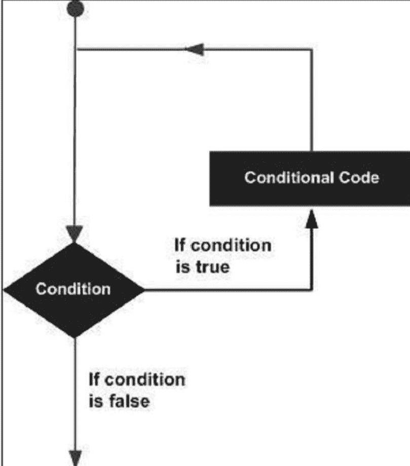

Java 编程语言提供了以下类型的循环来处理循环需求。点击以下链接查看详情。

| 循环类型 | 描述 |
|---|---|
| `while` 循环 | 当给定条件为真时，重复执行语句或一组语句。它在执行循环体之前测试条件。 |
| `for` 循环 | 多次执行语句，并缩短了管理循环变量的代码。 |
| `do...while` 循环 | 与 `while` 语句类似，区别在于它在循环体结束时测试条件。 |

## Java 中的 `while` 循环

Java 编程语言中的 `while` 语句在给定条件为真时重复执行目标语句。

## 语法

`while` 循环的语法为：

```text
while(Boolean_expression)

{

//语句

}
```

在这里，语句（s）可以是单条语句，也可以是一组语句块。条件可以是任何表达式，`true` 是任何非零值。

执行时，如果布尔表达式的结果为真，则循环内部的操作将被执行。只要表达式为真，这种就会持续。

当条件变为假时，程序控制将传递到循环紧之后的一行。

### 流程图

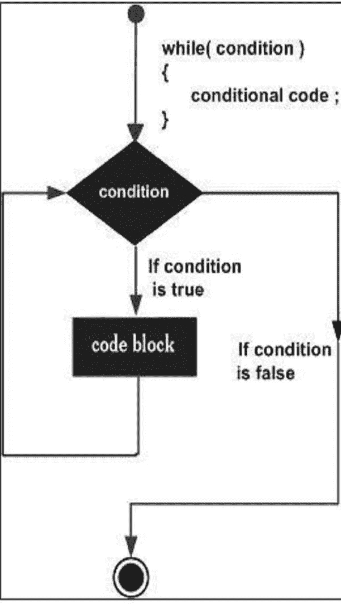

在这里，`while` 循环的关键点在于循环可能永远不会运行。当测试表达式且结果为假时，循环体将被跳过，执行 `while` 循环后的第一条语句。

## 示例

```java
public class Test {

    public static void main(String args[]) {

    int x = 10;

    while(x < 20 ) {

        System.out.print("value of x : "+ x);
```


## Java 中的 for 循环

`for` 循环是一种重复控制结构，允许你高效地编写一个需要执行特定次数的循环。当你知道任务需要重复多少次时，`for` 循环非常有用。

### 语法

`for` 循环的语法为：

```
for(initialization; Boolean_expression; update)
{
   //语句
}
```

以下是 `for` 循环中的控制流：

1. 初始化步骤首先执行，且仅执行一次。此步骤允许你声明并初始化任何循环控制变量，该步骤以分号（`;`）结束。
2. 接下来，评估布尔表达式。如果为真，则执行循环体。如果为假，则不执行循环体，控制跳转到 `for` 循环之后的下一个语句。
3. 在 `for` 循环体执行后，控制跳转回更新语句。此语句允许你更新任何循环控制变量。此语句可以留空并在末尾加分号。
4. 现在再次评估布尔表达式。如果为真，则执行循环并重复该过程（循环体、然后是更新步骤、然后是布尔表达式）。布尔表达式为假后，`for` 循环终止。

### 流程图

```
for( init; condition; increment ) {
   conditional code;
}
```

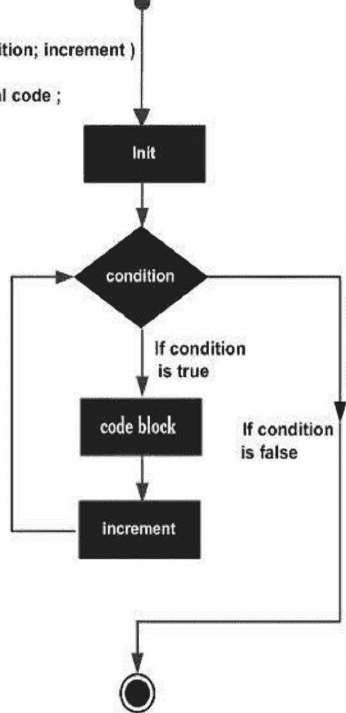

### 示例

以下是 Java 中 `for` 循环的示例：

```java
public class Test {
   public static void main(String args[]) {
      int x = 10;
      while(x < 20 ) {
         System.out.print("value of x : "+ x);
         x++;
         System.out.print("\n");
      }
   }
}
```

这将产生以下结果：

```
value of x : 10
value of x : 11
value of x : 12
value of x : 13
value of x : 14
value of x : 15
value of x : 16
value of x : 17
value of x : 18
value of x : 19
```

## Java 中的 do 循环

`do...while` 循环与 `while` 语句类似，但 `do...while` 保证至少执行一次。

### 语法

以下是 `do...while` 的语法：

```
do
{
   //语句
}while(Boolean_expression);
```

注意布尔表达式出现在循环末尾，因此在测试之前执行循环。

### 流程图

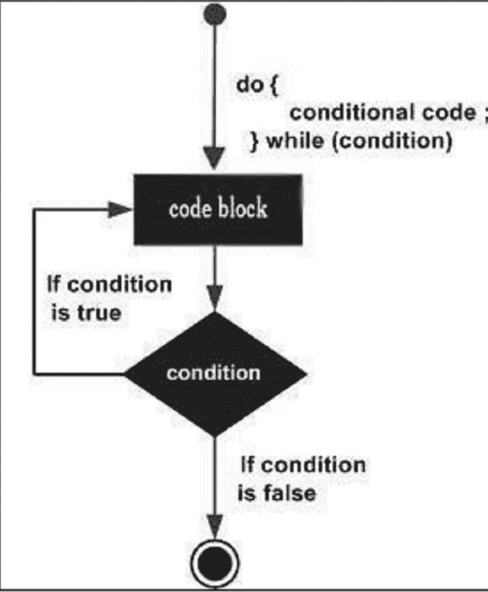

### 示例

```java
public class Test {
   public static void main(String args[]) {
      int x = 10;
      do{
         System.out.print("value of x : "+ x);
         x++;
         System.out.print("\n");
      }while( x < 20 );
   }
}
```

这将产生以下结果：

```
value of x : 10
value of x : 11
value of x : 12
value of x : 13
value of x : 14
value of x : 15
value of x : 16
value of x : 17
value of x : 18
value of x : 19
```

## 循环控制语句

循环控制语句改变其正常执行顺序。当离开作用域时，作用域内创建的所有自动对象将被销毁。Java 支持以下控制语句。点击以下链接查看详情。

| 控制语句 | 描述 |
|---|---|
| `break` 语句 | 终止循环或 `switch` 并跳转到其后的语句。 |
| `continue` 语句 | 跳过循环的剩余部分并立即跳转到下次迭代。 |

## Java 中的 break 语句

Java 语言中的 `break` 语句有两种用法：

- 当循环内部遇到 `break` 语句时，循环将立即终止，程序控制从循环后的语句恢复。
- 它可以用于终止 `switch` 语句中的 `case`（下章节介绍）。

### 语法

`break` 是任何循环内的单条语句：

```
break;
```

### 流程图

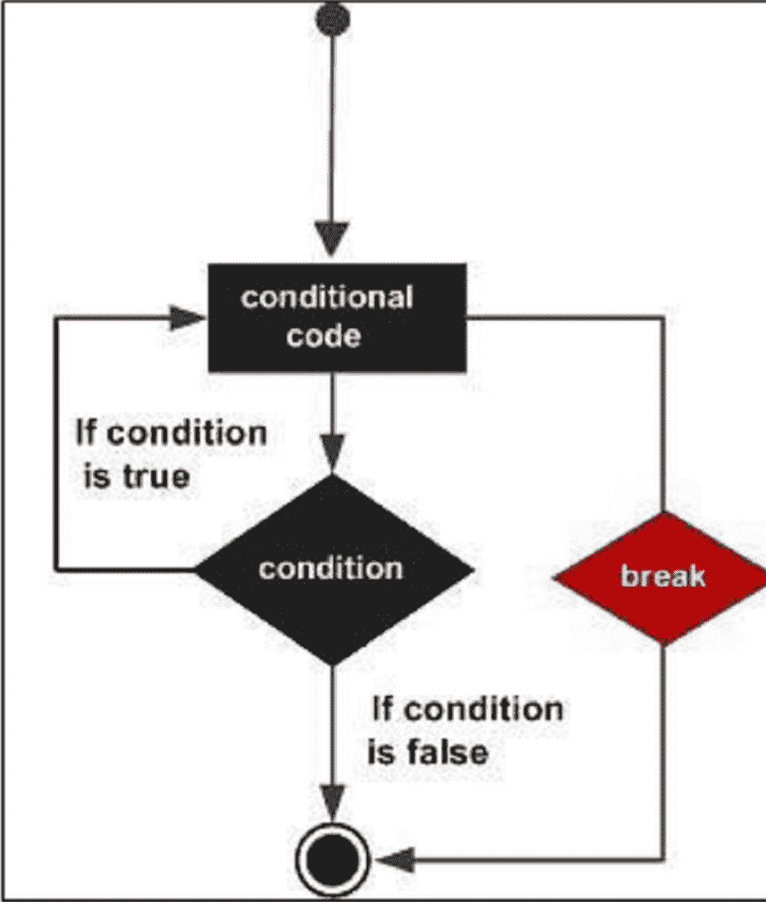

### 示例

```java
public class Test {
   public static void main(String[] args[]) {
      int [] numbers = {10, 20, 30, 40, 50};
      for(int x : numbers ) {
         if( x == 30 ) {
            break;
         }
         System.out.print( x );
         System.out.print("\n");
      }
   }
}
```

这将产生以下结果：

```
10
20
```

## Java 中的 continue 语句

`continue` 关键字可以用于任何循环控制结构。它导致循环立即跳转到下一次迭代。

- 在 `for` 循环中，`continue` 关键字导致控制立即跳转到更新语句。
- 在 `while` 循环或 `do/while` 循环中，控制立即跳转到布尔表达式。

### 语法

`continue` 是任何循环内的单条语句：

```
continue;
```

### 流程图

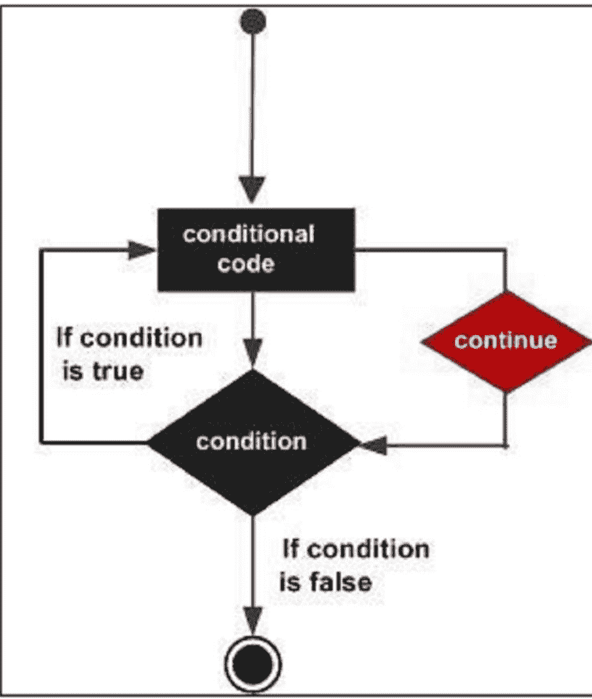

### 示例

```java
public class Test {
   public static void main(String args[]) {
      int [] numbers = {10, 20, 30, 40, 50};
      for(int x : numbers ) {
         if( x == 30 ) {
            continue;
         }
         System.out.print( x );
         System.out.print("\n");
      }
   }
}
```

这将产生以下结果：

```
10
20
40
50
```

## Java 中的增强 for 循环

从 Java 5 开始，引入了增强 `for` 循环。它主要用于遍历包括数组在内的元素集合。

### 语法

以下是增强 `for` 循环的语法：

```
for(declaration : expression) {
   // 语句
}
```

- **声明（Declaration）**：新声明的变量类型与你正在访问的数组元素类型兼容。该变量在块内可用，其值与当前元素相同。
- **表达式（Expression）**：其求值结果是你需要循环的数组。该表达式可以是数组变量，也可以是返回数组的方法调用。

### 示例

```java
public class Test {
   public static void main(String args[]) {
      int [] numbers = {10, 20, 30, 40, 50};
      for(int x : numbers ) {
         System.out.print( x );
         System.out.print(",");
      }
      String [] names={"James", "Tom", "Lacy"};
      for( String name : names ) {
         System.out.print(name );
         System.out.print(",");
      }
   }
}
```

这将产生以下结果：

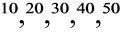

## 接下来是什么？

在下一章节中，我们将学习 Java 编程中的决策语句。

## 决策

决策结构具有一个或多个供程序评估或测试的条件，以及当条件为真时执行的语句，以及可选的当条件为假时执行的其他语句。以下是大多数编程语言中决策性结构的通用形式：

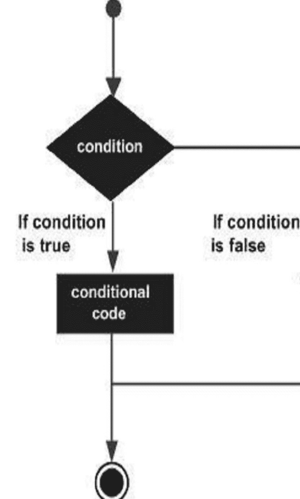

Java 语言提供了以下类型的决策语句。点击以下内容查看详情。

| 语句 | 说明 |
| :--- | :--- |
| `if` 语句 | `if` 语句由一个布尔表达式后续一个或多个语句组成。 |
| `if...else` 语句 | `if` 语句可以跟一个可选的 `else` 语句，该语句在布尔表达式为假时执行。 |
| 嵌套 `if` 语句 | 你可以在另一个 `if` 或 `else` 语句内部使用 `if` 语句。 |
| `switch` 语句 | `switch` 语句允许变量与一组值进行等值测试。 |

## Java 中的 if 语句

`if` 语句由一个布尔表达式后续跟一个或多个语句组成。

### 语法

以下是 `if` 语句的语法：

```
if(Boolean_expression) {
   // 如果布尔表达式为真，则执行语句
}
```

如果布尔表达式求值为真，则将执行 `if` 语句内部的代码块。如果不是，将执行 `if` 语句结束处（右大括号之后）的第一组代码。

### 流程图

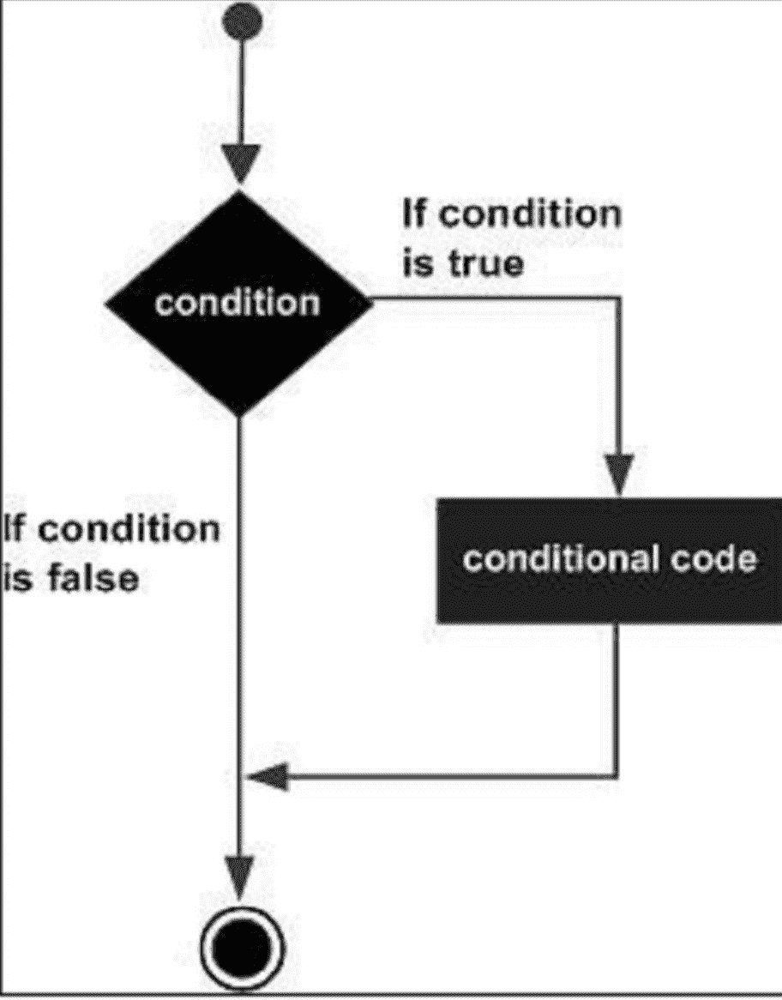

### 示例

```java
public class Test {
   public static void main(String args[]) {
      int x = 10;
      if( x < 20 ) {
         System.out.print("This is if statement");
      }
   }
}
```

这将产生：

```
This is if statement
```

## Java 中的 if-else 语句

`if` 语句可以跟一个可选的 `else` 语句，该语句在布尔表达式为假时执行。

### 语法

以下是 `if...else` 语句的语法：

```
if(Boolean_expression) {
   // 当布尔表达式为真时执行
} else {
   // 当布尔表达式为假时执行
}
```

如果布尔表达式求值为真，则执行 `if` 代码块，否则将执行 `else` 代码块。

### 流程图

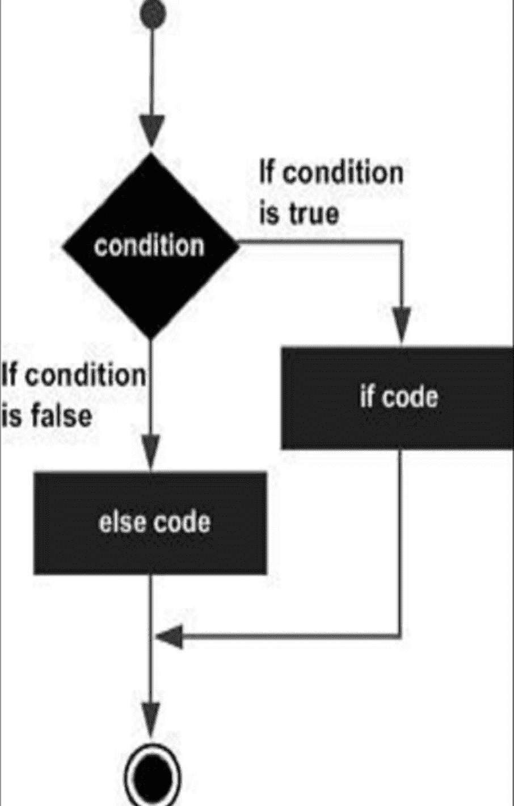

## if...else if...else 语句

`if` 语句可以跟一个可选的 `else if...else` 语句，这对于使用单个 `if...else` 语句测试各种条件非常有用。

在使用 `if`、`else if`、`else` 语句时，有几点需要注意：

- 一个 `if` 可以有零个或一个 `else if`，且它必须在任何 `else if` 之后。
- 一个 `if` 可以有零个到多个 `else`，且它们必须在 `else` 之前。
- 一旦某个 `else if` 成功，剩余的 `else if` 或 `else` 将不再被测试。

### 语法

以下是 `if...else` 语句的语法：

```
if(Boolean_expression 1) {
   // 当布尔表达式 1 为真时执行
} else if(Boolean_expression 2) {
   // 当布尔表达式 2 为真时执行
} else if(Boolean_expression 3) {
   // 当布尔表达式 3 为真时执行
} else {
   // 当上述条件都不真时执行
}
```

### 示例

```java
public class Test {
   public static void main(String args[]) {
      int x = 30;
      if( x == 10 ) {
         System.out.print("Value of X is 10");
      } else if( x == 20 ) {
         System.out.print("Value of X is 20");
      } else if( x == 30 ) {
         System.out.print("Value of X is 30");
      } else {
         System.out.print("This is else");
      }
   }
}
```

这将产生：

```
Value of X is 30
```

## Java 中的嵌套 if 语句

嵌套 `if-else` 语句总是合法的，这意味着你可以在另一个 `if` 或 `else` 语句内部使用 `if` 语句。

### 语法

嵌套 `if...else` 的语法如下：

```
if(Boolean_expression 1) {
   // 当布尔表达式 1 为真时执行
   if(Boolean_expression 2) {
      // 当布尔表达式 2 为真时执行
   }
}
```

你可以以类似于 `if` 语句的方式嵌套 `else if...else`。

### 示例

```java
public class Test {
   public static void main(String args[]) {
      int x = 30;
      int y = 10;
      if( x == 30) {
         if( y == 10) {
            System.out.print("X = 30 and Y = 10");
         }
      }
   }
}
```

这将产生结果：

```
X = 30 and Y = 10
```

## Java 中的 switch 语句

`switch` 语句允许变量与一组值进行等值测试。每个值被称为一个 `case`，被切换的变量会对每个 `case` 进行检查。

### 语法

`switch` 语句的语法为：

```
switch(expression){
   case value :
      // 语句
      break; // 可选
   case value :
      // 语句
      break; // 可选
   // 你可以有任意数量的 case 语句。
   default : // 可选
      // 语句
}
```

以下规则适用于 `switch` 语句：

- 用于 `switch` 语句的变量只能是整数、可转换整数（`byte`、`short`、`char`）、字符串和枚举。
- 你可以在 `switch` 中有任意数量的 `case` 语句。每个 `case` 后面都跟着一个要比较的值和一个冒号。

### 流程图

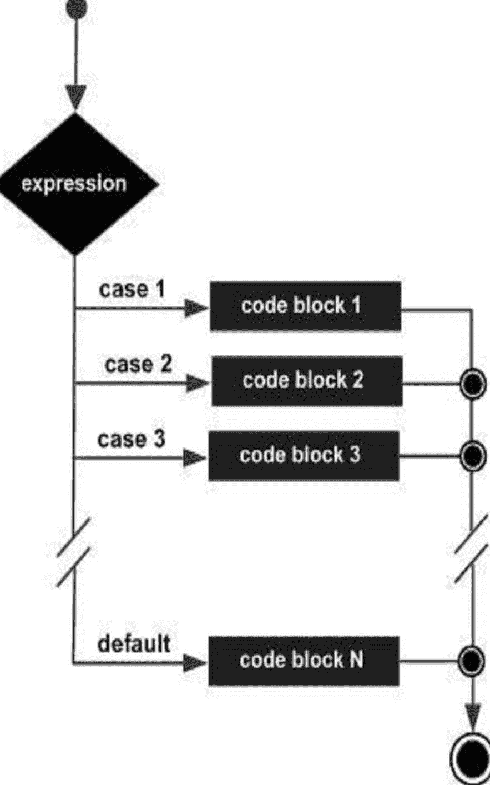

### 示例

```java
public class Test {
   public static void main(String args[]) {
      //char grade = args[0].charAt(0);
      char grade = 'C';
      switch(grade)
      {
         case 'A' :
            System.out.println("Excellent!");
            break;
         case 'B' :
         case 'C' :
            System.out.println("Well done");
            break;
         case 'D' :
            System.out.println("You passed");
         case 'F' :
            System.out.println("Better try again");
            break;
         default :
            System.out.println("Invalid grade");
      }
      System.out.println("Your grade is " + grade);
   }
}
```

使用各种命令行参数编译并运行上述程序。这将产生以下结果：

```
$ java Test
Well done
Your grade is C
```

### ? : 运算符

我们在上一节中已经涵盖了条件运算符 `?`，它可以用于替换 `if...else` 语句。它具有以下形式：

```
Exp1 ? Exp2 : Exp3;
```

注意冒号的使用。为了确定整个表达式的值，首先对 `Exp1` 求值。如果 `Exp1` 为真，则 `Exp2` 的值将作为整个表达式的值。如果 `Exp1` 为假，则求值 `Exp3`，其值变为整个表达式的值。

### 下节介绍是什么？

在下一节中，我们将讨论 `Number` 类（位于 `java.lang` 包中）及其子类。我们将查看在处理 `Numbers` 时需要了解的这些类的实例化，例如格式化、数学函数等。

## Numbers 类

通常，当我们与 `Numbers` 工作时，我们使用 `byte`、`int`、`long`、`double` 等原始类型。示例：

```java


`int i = 5000;`

`float gpa = 13.65;`

`byte mask = 0xaf;`

然而，在开发中我们会遇到需要使用对象而不是原始类型的情况。为了实现这一点，Java 包装类。所有的包装类（`Integer`、`Long`、`Double`、`Float`、`Short`）都是抽象类 `Number` 的子类。

包装类包含了相应的原始数据类型。因此，使用包装类只需将原始数据类型转换为对象，这个过程被称为装箱。`Number` 类负责处理这些。以下是装箱和拆箱的示例：

```java
public class Test {

    public static void main(String args[]){

        Integer x = 5; // 将 int 装箱为 Integer

        x = x + 10; // 将 Integer 拆箱为 int

        System.out.println(x);

    }

}
```

这将产生以下结果：

```
15
```

当 `x` 被赋值一个整数值时，编译器将其装箱，因为 `x` 是一个整数对象。随后，`x` 被拆箱，以便可以作为整数。

## Number 方法

以下是 `Number` 类实现的实例列表：

| 方法 | 说明 |
| :--- | :--- |
| - | 将此 `Number` 对象转换为 `xxx` 数据类型并返回。 |
| - | 比较此 `Number` 对象与参数。 |
| `equals()` | 确定此数字对象是否等于参数。 |
| `valueOf()` | 返回表示指定的 `int` 或 `Integer` 对象。 |
| `toString()` | 返回指定的 `String` 数据类型。 |
| `abs()` | 返回参数的绝对值。 |
| `ceil()` | 返回大于等于参数的最小整数。 |
| `floor()` | 返回小于参数的最大整数。 |
| `int()` | 返回最接近参数的整数。 |
| `round()` | 返回接近参数的 `long` 或 `int`。 |
| `min()` | 返回两个参数中的较小者。 |
| `max()` | 返回两个参数中的较大。 |
| `exp()` | 返回以 `e` 为底的参数幂。 |
| `log()` | 返回参数的自然对数。 |
| `pow()` | 返回第一个参数的第二个参数的幂。 |
| `sqrt()` | 返回参数的平方根。 |
| `sin()` | 返回指定的 `double` 值的正弦。 |
| `cos()` | 返回指定的 `double` 值的余弦。 |
| `tan()` | 返回指定的 `double` 值的正切。 |
| `asin()` | 返回指定的 `double` 值的反正弦。 |
| `acos()` | 返回指定的 `double` 值的反余弦。 |
| `atan()` | 返回指定的 `double` 值的反正切。 |
| `atan2()` | 将直角坐标 (`x`, `y`) 转换为极坐标 (`x`, `theta`) 并返回 `theta`。 |
| `toDegrees()` | 将参数转换为角度。 |
| `toRadians()` | 将参数转换为弧度。 |
| `random()` | 返回一个随机数。 |

## Java XXX 方法

### 说明

该方法将调用方法的 `Number` 对象的值转换为方法返回的原始数据类型。

### 语法

每个原始数据类型都有一个独立的方法：

- `byte byteValue()`
- `short shortValue()`
- `int intValue()`
- `long longValue()`
- `float floatValue()`
- `double doubleValue()`

### 参数

以下是参数的细节：

这些都是默认方法且不接受参数。

### 返回值

此方法返回签名中给原始数据类型。

### 示例

```java
public class Test{

    public static void main(String args[]) { 

        Integer x = 5;

        // 返回 byte 原始数据类型

        System.out.println(x.byteValue());

        // 返回 double 原始数据类型

        System.out.println(x.doubleValue());

        // 返回 long 原始数据类型

        System.out.println(x.longValue());

    }

}
```

这将产生以下结果：

```
5
5.0
5
```

## Java – compareTo 方法

### 说明

该方法比较调用它的 `Number` 对象与参数。可以比较 `Byte`、`Long` 等。

然而，不同类型无法比较；参数和调用方法的 `Number` 对象都应该是相同的类型。

### 语法

```java
public int compareTo(Number referenceName)
```

### 参数

以下是参数的细节：

这可以是 `Byte`、`Double`、`Integer`、`Float`、`Long` 或 `Short`。

### 返回值

如果 `Integer` 等于参数，则返回 0。
如果 `Integer` 小于参数，则返回 -1。
如果 `Integer` 大于参数，则返回 1。

### 示例

```java
public class Test{

    public static void main(String args[]) { 

        Integer x = 5;

        System.out.println(x.compareTo(3)); 

        System.out.println(x.compareTo(5)); 

        System.out.println(x.compareTo(8));

    }

}
```

这将产生以下结果：

```
1
0
-1
```

## Java – equals() 方法

### 说明

该方法确定调用方法的 `Number` 对象是否与作为参数的对象相等。

### 语法

```java
public boolean equals(Object o)
```

### 参数

以下是参数的细节：

- 任意对象

### 返回值

如果参数不为空且类型相同并具有相同的数值，则返回 `true`。对于 `Double` 和 `Float` 对象，Java API 文档中描述了一些额外要求。

### 示例

```java
public class Test{

    public static void main(String args[]){ 

        Integer x = 5;

        Integer y = 10;

        Integer z = 5; Short a = 5;

        System.out.println(x.equals(y)); 

        System.out.println(x.equals(z));

        System.out.println(x.equals(a));

    }

}
```

这将产生以下结果：

```
false
true
false
```

## Java – valueOf() 方法

### 说明

`valueOf` 方法返回持有传入参数值的相应 `Number` 对象。参数可以是原始数据类型、`String` 等。

### 语法

该方法是一个静态方法。该方法可以接受两个参数，其中一个是 `String`，另一个是进制。

以下是该方法的所有变体：

```
static Integer valueOf(int i)

static Integer valueOf(String s)

static Integer valueOf(String s, int radix)
```

### 参数

以下是参数的详情：
- `i` — 将返回其 `Integer` 表示形式的 `int` 类型。
- `s` — 将返回其 `Integer` 表示形式的 `String`。
- `radix` — 用于根据传入的 `String` 决定返回的 `Integer` 的值。

### 返回值

`valueOf(int i)`: 返回一个包含指定原始类型值的 `Integer` 对象。
`valueOf(String s)`: 返回一个包含指定字符串表示值的 `Integer` 对象。
`valueOf(String s, int radix)`: 返回一个包含指定字符串表示整数值的 `Integer` 对象，该值通过 `radix` 值进行解析。

```java
public class Test{

    public static void main(String args[]) {

        Integer x = Integer.valueOf(9);

        Double c = Double.valueOf(5);

        Float a = Float.valueOf("80");

        Integer b = Integer.valueOf("444",16);

        System.out.println(x);

        System.out.println(c);

        System.out.println(a);

        System.out.println(b);

    }

}
```

这将将产生以下结果：

```
9
5.0
80.0
1092
```

## Java – toString() 方法

### 说明

该方法用于获取表示数字对象值的 `String` 对象。

如果该方法接受原始数据类型作为参数，则返回表示该原始数据类型值的 `String` 对象。

如果该方法接受两个参数，则返回在第二个参数指定的基数下，第一个参数的字符串表示。

### 语法

以下是该方法的所有变体：

```
String toString()

static String toString(int i)
```

### 参数

以下是参数的详情：

- `i` — 将返回其字符串表示形式的 `int` 类型。

### 返回值

`toString()`: 返回一个表示此 `Integer` 值的 `String` 对象。

`toString(int i)`: 返回一个表示指定整数的 `String` 对象。

### 示例

```java
public class Test {

    public static void main(String args[]) {

        Integer x = 5;

        System.out.println(x.toString());

        System.out.println(Integer.toString(12));

    }

}
```

这将将产生以下结果：

```
5
12
```

## Java – parseInt() 方法

### 说明

此方法用于获取特定字符串的原始数据类型。
`parseInt()` 是静态方法，可以接受一个或两个参数。

### 语法

以下是该方法的所有变体：

```
static int parseInt(String s)

static int parseInt(String s, int radix)
```

### 参数

以下是参数的详情：

- `s` — 十进制的字符串表示。用于将 `String s` 转换为整数。

### 返回值

`parseInt(s)`: 返回一个整数（仅限十进制）。
`parseInt(i)`: 给十进制、二进制、八进制或十六进制数的字符串表示（`radix` 分别等于 10, 2, 8 或 16），返回一个整数。

### 示例

```java
public class Test {

    public static void main(String args[]) {

        int x = Integer.parseInt("9");

        double c = Double.parseDouble("5");

        int b = Integer.parseInt("444",16);

        System.out.println(x);

        System.out.println(b);

    }

}
```

这将将产生以下结果：

```
9
5.0
1092
```

## Java – abs() 方法

### 说明

该方法给出参数的绝对值。参数可以是 `int`, `float`, `long`, `double`, `short`, `byte`。

### 语法

以下是该方法的所有变体：

```
double abs(double d)

float abs(float f)

int abs(int i)

long abs(long lng)
```

### 参数

以下是参数的详情：

- 任意原始数据类型

### 返回值

该方法返回参数的绝对值。

### 示例

```java
public class Test{

    public static void main(String args[]) {

        Integer a = -8;

        double d = -100;

        float f = -90;

        System.out.println(Math.abs(a));

        System.out.println(Math.abs(d));

        System.out.println(Math.abs(f));

    }

}
```

这将将产生以下结果：

```
8
100.0
90.0
```

## Java – ceil() 方法

### 说明

`ceil` 方法给出大于或等于参数的最小整数。

### 语法

该方法有以下变体：

```
double ceil(double d)

double ceil(float f)
```

### 参数

以下是参数的详情：

- 一个 `double` 或 `float` 原始数据类型

### 返回值

该方法返回大于或等于参数的最小整数。以 `double` 类型返回。

### 示例

```java
public class Test {

  public static void main(String args[]) {

    double d = -100.675;

    float f = -90;

    System.out.println(Math.ceil(d));

    System.out.println(Math.ceil(f));

    System.out.println(Math.floor(d));

    System.out.println(Math.floor(f));

  }

}
```

这将将产生以下结果：

```
-100.0
-90.0
-101.0
-90.0
```

## Java – floor() 方法

### 说明

`floor` 方法给出小于或等于参数的最大整数。

### 语法

该方法有以下变体：

```
double floor(double d)

double floor(float f)
```

### 参数

以下是参数的详情：

- 一个 `double` 或 `float` 原始数据类型。

### 返回值

该方法返回小于或等于参数的最大整数。以 `double` 类型返回。

### 示例

```java
public class Test{

    public static void main(String args[]) {

        double d = -100.675;

        float f = -90;

        System.out.println(Math.floor(d));

        System.out.println(Math.floor(f));

        System.out.println(Math.ceil(d));

        System.out.println(Math.ceil(f));

    }

}
```

这将将产生以下结果：

```
-101.0
-90.0
-100.0
-90.0
```

## Java – rint() 方法

### 说明

`rint` 方法返回距离参数的整数，舍入到偶数邻居。

### 语法

```
double rint(double d)
```

### 参数

以下是参数的详情：

- `d` — 一个 `double` 值。

### 返回值

该方法返回距离参数的整数，以 `double` 类型返回。

### 示例

```java
public class Test{

    public static void main(String args[]) {

        double d = 100.675;

        double e = 100.500;

        double f = 100.0;

        double g = 90.0;

        System.out.println(Math.rint(d));

        System.out.println(Math.rint(e));

        System.out.println(Math.rint(f));

        System.out.println(Math.rint(g));

    }

}
```

这将将产生以下结果：

```
101.0
100.0
100.0
90.0
```

## Java – max() 方法

### 返回值

此方法返回两个参数中的最大值

### 示例

```java
public class Test {

    public static void main(String args[]){

        System.out.println(Math.max(12.123, 12.456));

        System.out.println(Math.max(23.12, 23.0));

    }

}
```


这将产生以下结果：

```
12.456
23.12
```

## Java – exp() 方法

### 描述

该方法返回自然数底 $e$ 的参数幂次。

### 语法

```java
double exp(double d)
```

### 参数

以下是参数的详细信息：

- `d` — 任意基本数据类型。

### 返回值

此方法返回自然数底 $e$ 的参数幂次。

### 示例

```java
public class Test{

    public static void main(String args[]){

    double x = 11.635;

    double y = 2.76;

    System.out.printf("The value of e is %.4f%n", Math.E);

    System.out.printf("exp(%.3f) is %.3f%n", x, Math.exp(x));

}

}
```

这将产生以下结果：

```
The value of e is 2.7183 exp(11.635) is 112983.831
```

## Java – log() 方法

### 描述

该方法返回参数的自然对数。

### 语法

```java
double log(double d)
```

### 参数

以下是参数的详细信息：

- `d` — 任意基本数据类型。

### 返回值

此方法返回参数的自然对数。

### 示例

```java
public class Test {

public static void main(String args[]){

double x = 11.635;

double y = 2.76;

System.out.printf("The value of e is %.4f%n", Math.E);

System.out.printf("log(%.3f) is %.3f%n", x, Math.log(x));

}

}
```

这将产生以下结果：

```
The value of e is 2.7183 log(11.635) is 2.454
```

## Java – pow() 方法

### 描述

该方法返回第一个参数的第二个参数的幂次方。

### 语法

```java
double pow(double base, double exponent)
```

### 参数

以下是参数的详细信息：

- `base` — 任意基本数据类型。
- `exponent` — 任意基本数据类型。

### 返回值

此方法返回第一个参数的第二个参数的幂次方。

### 示例

```java
public class Test{

    public static void main(String args[]) {

    double x = 11.635;

    double y = 2.76;

    System.out.printf("The value of e is %.4f%n", Math.E);

    System.out.printf("pow(%.3f, %.3f) is %.3f%n", x, y, Math.pow(x, y));

}
```

这将产生以下结果：

```
The value of e is 2.7183(11.635, 2.760) is 874.008
```

## Java – sqrt() 方法

### 描述

该方法返回参数的平方根。

### 语法

```java
double sqrt(double d)
```

### 参数

以下是参数的详细信息：

- `d` — 任意基本数据类型。

### 返回值

此方法返回参数的平方根。

### 示例

```java
public class Test{

public static void main(String[] args) {

double x = 11.635;

double y = 2.76;

System.out.printf("The value of e is %.4f%n", Math.E);

System.out.printf("sqrt(%.3f) is %.3f%n", x, Math.sqrt(x));

}

}
```

这将产生以下结果：

```
The value of e is 2.7183 sqrt(11.635) is 3.411
```

## Java – sin() 方法

### 描述

该方法返回指定的 `double` 值的正弦值。

### 语法

```java
double sin(double d)
```

### 参数

以下是参数的详细信息：

- `d` — `double` 类型数据。

### 返回值

此方法返回指定的 `double` 值的正弦值。

### 示例

```java
public class Test{

    public static void main(String args[]){

  double degrees = 45.0;

  double radians = Math.toRadians(degrees);

  System.out.format("The value of pi is %.4f%n", Math.PI);

System.out.format("The sine of %.1f degrees is %.4f%n", degrees,

  Math.sin(radians));

}

}
```

这将产生以下结果：

```
The value of pi is 3.1416
The sine of 45.0 degrees is 0.7071
```

## Java – cos() 方法

### 描述

该方法返回指定的 `double` 值的余弦值。

### 语法

```java
double cos(double d)
```

### 参数

以下是参数的详细信息：

- `d` — `double` 类型数据。

### 返回值

此方法返回指定的 `double` 值的余弦值。

### 示例

```java
public class Test{

    public static void main(String args[]){

        double degrees = 45.0;

        double radians = Math.toRadians(degrees);

        System.out.format("The value of pi is %.4f%n", Math.PI);

        System.out.format("The cosine of %.1f degrees is %.4f%n", degrees, Math.cos(radians));

    }

}
```

这将产生以下结果：

```
The value of pi is 3.1416
The cosine of 45.0 degrees is 0.7071
```

## Java – tan() 方法

### 描述

该方法返回指定的 `double` 值的正切值。

### 语法

```java
double tan(double d)
```

### 参数

以下是参数的详细信息：

- `d` — `double` 类型数据。

### 返回值

此方法返回指定的 `double` 值的正切值。

### 示例

```java
public class Test{

    public static void main(String args[]) {

    double degrees = 45.0;

    double radians = Math.toRadians(degrees);

    System.out.format("The value of pi is %.4f%n", Math.PI);

    System.out.format("The tangent of %.1f degrees is %.4f%n", degrees, Math.tan(radians));

}

}
```

这将产生以下结果：

```
The value of pi is 3.1416
The tangent of 45.0 degrees is 1.0000
```

## Java – asin() 方法

### 描述

该方法返回指定的 `double` 值的反正弦值。

### 语法

```java
double asin(double d)
```

### 参数

以下是参数的详细信息：

- `d` — `double` 类型数据。

### 返回值

此方法返回指定的 `double` 值的反正弦值。

### 示例

```java
public class Test {

    public static void main(String[] args){

    double degrees = 45.0;

    double radians = Math.toRadians(degrees);

    System.out.format("The value of pi is %.4f%n", Math.PI);

    System.out.format("The arcsine of %.4f is %.4f degrees%n", Math.sin(radians), degrees);

    }

}
```

此方法将产生以下结果：

```
The value of pi is 3.1416
The arcsine of 0.7071 is 45.0
```

## Java – acos() 方法

### 描述

该方法返回指定的 `double` 值的反余弦值。

### 语法

```java
double acos(double d)
```

### 参数

以下是参数的详细信息：

- `d` — `double` 类型数据。

### 返回值

此方法返回指定的 `double` 值的反余弦值。

### 示例

```java
public class Test {

    public static void main(String args[]){

        double degrees = 45.0;

        double radians = Math.toRadians(degrees);

        System.out.format("The value of pi is %.4f%n", Math.PI);

        System.out.format("The arccosine of %.4f is %.4f degrees%n", Math.cos(radians), degrees);

    }

}
```

此将产生以下结果：

```
The value of pi is 3.1416
The arccosine of 0.7071 is 45.0
```

## Java – atan() 方法

### 描述

该方法返回指定的 `double` 值的反正切值。

### 语法

```java
double atan(double d)
```

### 参数

以下是参数的详细信息：

- `d` — `double` 类型数据。

### 返回值

此方法返回指定的 `double` 值的反正切值。

### 示例

```java
public class Test{

    public static void main(String args[]){

        double degrees = 45.0;

        double radians = Math.toRadians(degrees);

        System.out.format("The value of pi is %.4f%n", Math.PI);

        System.out.format("The arctangent of %.4f is %.4f degrees%n", Math.sin(radians), degrees);

    }

}
```

此将产生以下结果：

```
The value of pi is 3.1416
The arctangent of 1.0000 is 45.0
```

## Java – atan2() 方法

### 描述

该方法将直角坐标 (`x`, `y`) 转换为极坐标 (`r`, `theta`) 并返回 `theta`。

### 语法

```java
double atan2(double y, double x)
```

### 参数

以下是参数的详细信息：

- `X` — `double` 类型的 `X` 坐标。
- `Y` — `double` 类型的 `Y` 坐标。

### 返回值

此方法从极坐标 (`r`, `theta`) 中返回 $\theta$。

### 示例

```java
public class Test{

    public static void main(String[] args) {

    double x = 45.0;

    double y = 30.0;

    System.out.println(Math.atan2(x, y));

    }

}
```

这将产生以下结果：

```
0.982793732247329
```

## Java – toDegrees 方法

### 描述

该方法将参数值转换为角度。

### 语法

```java
double toDegrees(double d)
```

### 参数

以下是参数详情：

- `d` — 一个 `double` 类型

### 返回值

该方法返回一个 `double` 值。

### 示例

```java
public class Test {

    public static void main(String args[]){

        double x = 45.0;

        double y = 30.0;

        System.out.println( Math.toDegrees(x) );

        System.out.println( Math.toDegrees(y) );

    }

}
```

这将产生以下结果：

```
2578.3100708887044

1718.8733853924698
```

## Java – 方法: toRadians

### 描述

该方法将参数值转换为弧度。

### 语法

```java
double toRadians(double d)
```

### 参数

以下是参数详情：

- `d` — 一个 `double` 类型。

### 返回值

该方法返回一个 `double` 值。

### 示例

```java
public class Test{

    public static void main(String[] args){

        double x = 45.0;

        double y = 30.0;

        System.out.println( Math.toRadians(x) );

        System.out.println(Math.toRadians(y));

    }

}
```

这将产生以下结果：

## Java – 方法: random()

### 描述

该方法用于生成一个 0.0 到 1.0 之间的随机数。范围是：0.0 <= `Math.random()` < 1.0。通过使用算术操作实现不同的范围。

### 语法

```java
static double random()
```

### 参数

以下是参数详情：

这是一个默认方法，不接受任何参数。

### 返回值

该方法返回一个 `double`。

### 示例

```java
public class Test{

    public static void main(String args[]) {

        System.out.println( Math.random());

        System.out.println( Math.random() );

    }

}
```

这将产生以下结果：

- 0.1763945061451657
- 0.400551253762343

注意：上述结果每次调用 `random()` 方法时都会变化。

## 接下来要做什么？

在下一章中，我们将介绍 Java 中的 `Character` 类。你将学习如何在 Java 中使用对象 `Characters` 类和原始数据类型 `char`。

## Character 类

通常，当我们处理字符时，我们使用原始数据类型 `char`。

### 示例

```java
char ch = 'a';

// 大写希腊字母 omega 字符的 Unicode 编码

char charChar = "\u039A";

// 一个字符数组

char[] charArray={'a', 'b', 'c', 'd', 'e'};
```

然而在开发过程中，我们会遇到需要使用对象而非原始数据类型的情况。为了实现这一点，Java 为原始数据类型 `char` 提供了包装类 `Character`。

`Character` 类提供了许多有用的类方法（即静态方法）来操作字符。你可以使用 `Character` 构造函数来创建一个 `Character` 对象：

```java
Character ch = new Character('a');
```

在某些情况下，Java 编译器也会为你创建一个 `Character` 对象。例如，如果你将一个原始 `char` 传递到期望对象的方法中，编译器会自动将 `char` 转换为 `Character`。如果转换方向相反，这种特征被称为自动装箱（boxing）或自动拆箱（unboxing）。

### 示例

```java
// 这里将原始 char 'a'

// 装箱为 Character 对象 ch

Character ch = 'a';

// 这里原始 'x' 为方法 test 进行装箱，

// 返回值被拆箱为 char 'c'

char c = test('x');
```


## 转义序列

以反斜杠（`\`）为缀的字符是转义序列，对编译器具有特殊含义。

换行符（`\n`）在书中经常用于`System.out.println()`语句中，以便在打印字符串后移动到下一行。

下表显示了 Java 转义序列：

| 转义序列 | 描述 |
| :--- | :--- |
| `\t` | 在文本此处插入一个制表符。 |
| `\b` | 在文本此处插入一个退格符。 |
| `\n` | 在文本此处插入一个换行符。 |
| `\r` | 在文本此处插入一个回车符。 |
| `\f` | 在文本此处插入一个分页符。 |
| `\'` | 在文本此处插入一个单引号字符。 |
| `\"` | 在文本此处插入一个双引号字符。 |
| `\\` | 在文本此处插入一个反斜杠字符。 |

当打印语句中遇到转义序列时，编译器会进行相应的解释。

## 示例

如果你想在引号内放置引号，必须对内部的引号使用转义序列`\"`：

```java
public class Test {

    public static void main(String args[]) {

        System.out.println("She said \"Hello!\" to me.");

    }

}
```

这将产生以下结果：

```text
She said "Hello!" to me.
```

## `Character`方法

以下是`Character`类的重要实例方法列表：

- `isLetter()`：确定指定的`char`是否为字母。
- `isDigit()`：确定指定的`char`是否为数字。
- `isWhitespace()`：确定指定的`char`是否为空字符。
- `isUpperCase()`：确定指定的`char`是否为大写。
- `isLowerCase()`：确定指定的`char`是否为小写。
- `toString()`：返回一个表示该字符的`String`对象。

## 返回值

如果传递的字符真的是小写的，则此方法返回`true`。

### 示例

```java
public class Test {

    public static void main(String args[]) {

        System.out.println(Character.isLowerCase('c'));

        System.out.println(Character.isLowerCase('C'));

        System.out.println(Character.isLowerCase('\n'));

        System.out.println(Character.isLowerCase('\t'));

    }

}
```

这将产生以下结果：

```text
true
false
false
false
```

## Java – 方法：`toUpperCase()`

### 描述

该方法返回指定`char`值的大写形式。

### 语法

```java
toUpperCase(char ch)
```

### 参数

以下是参数的详细信息：

- `ch` — 原始字符类型。

### 返回值

此方法返回指定`char`值的大写形式。

### 示例

```java
public class Test {

    public static void main(String args[]) {

        System.out.println(Character.toUpperCase('c'));

        System.out.println(Character.toUpperCase('C'));

    }

}
```

这将会产生以下结果：

```text
C
C
```

## Java – 方法：`toLowerCase()`

### 描述

该方法返回指定`char`值的小写形式。

### 语法

```java
char toLowerCase(char ch)
```

### 参数

以下是参数的详细信息：

- `ch` — 原始字符类型。

### 返回值

此方法返回指定`char`值的小写形式。

### 示例

```java
public class Test {

    public static void main(String args[]) {

        System.out.println(Character.toLowerCase('c'));

        System.out.println(Character.toLowerCase('C'));

    }

}
```

这将会产生以下结果：

```text
c
```

## Java – 方法：`toString()`方法

### 描述

此方法返回一个表示指定字符值的`String`对象，即一个单字符字符串。

### 语法

```java
String toString(char ch)
```

### 参数

以下是参数的详细信息：

- `ch` — 原始字符类型。

### 返回值

此方法返回`String`对象。

### 示例

```java
public class Test {

    public static void main(String args[]) {

        System.out.println(Character.toString('c'));

        System.out.println(Character.toString('C'));

    }

}
```

这将会产生以下结果：

```text
c
C
```

如需完整方法列表，请参考`java.lang.Character` API 规范。

## 接下来是什么？

在下一章中，我们将介绍 Java 中的`String`类。你将学习如何高效地声明和使用字符串，以及`String`类中的一些重要方法。

## `String`类

字符串在 Java 编程中被广泛使用，它是字符序列。在 Java 语言中，字符串被视为对象。

Java 平台提供了`String`类来创建和操作字符串。

## 创建字符串

创建字符串最直接的方法是编写：

```java
String greeting = "Hello world!";
```

每当在代码中遇到字符串字面量时，编译器都会创建一个带有该值的`String`对象（在本例中为“Hello world!”）。

与任何其他对象一样，你可以使用`new`关键字和构造函数来创建`String`对象。`String`类有 11 个构造函数，允许你通过不同的源（如字符数组）提供字符串的初始值。

```java
public class StringDemo {

    public static void main(String args[]) {

        char[] helloArray = { 'h', 'e', 'l', 'l', 'o', '.' };

        String helloString = new String(helloArray);

        System.out.println(helloString);

    }

}
```

这将产生以下结果：

```text
hello.
```

注意：`String`类是不可变的，因此一旦创建，`String`对象就无法更改。如果需要对字符字符串进行大量修改，那么你应该使用`StringBuffer`和`StringBuilder`类。

## Java – `StringBuffer`和`StringBuilder`类

当需要对字符字符串进行大量修改时，使用`StringBuffer`和`StringBuilder`类。

与`String`不同，`StringBuilder`和`StringBuilder`类型的对象可以反复修改，而不会留下大量新的未使用对象。

`StringBuilder`类从 Java 5 开始引入，`StringBuffer`和`StringBuilder`之间的主要区别是`StringBuilder`的方法不是线程安全的（未同步）。

建议尽可能使用`StringBuilder`，因为比比`StringBuffer`快。但是，如果需要线程安全，最佳选择是`StringBuffer`对象。

```java
public class Test {

    public static void main(String[] args) {

        StringBuilder sBuffer = new StringBuilder(" test");

        sBuffer.append("String Buffer");
        System.out.println(sBuffer);

    }

}
```

这将产生以下结果：

```text
test String Buffer
```

## `StringBuffer`方法

以下是`StringBuffer`类支持的重要方法列表：

| 方法 | 描述 |
| :--- | :--- |
| `public append(String s)` | 更新调用方法的对象的值。该方法接受`boolean`、`char`、`int`、`long`、`String`等。 |
| `public reverse()` | 该方法反转调用方法的`StringBuffer`对象的值。 |
| `public delete(int start, int end)` | 从`start`索引删除到`end`索引字符串。 |
| `public insert(int offset, int i)` | 此方法在`offset`指定的位置插入一个`s`。 |
| `public replace(int start, int end, String str)` | 此方法用指定的`String`替换此`StringBuilder`子串中的字符。 |

## Java – `StringBuffer`：`append()`方法

### 描述

此方法更新调用方法的对象的值。该方法接受`boolean`、`char`、`int`、`long`、`String`等。

### 语法

对于每个原始类型都有一个独立的方法：

```java
public StringBuffer append(boolean b)

public StringBuffer append(char c)

public StringBuffer append(char[] str)

public StringBuffer append(char[] str, int offset, int len)

public StringBuffer append(double d)

public StringBuffer append(float f)

public StringBuffer append(int i)

public StringBuffer append(long l)

public StringBuffer append(Object obj)

public StringBuffer append(StringBuffer sb)

public StringBuffer append(String str)
```

### 参数

以下是参数的详细信息：

参数取决于你尝试在`StringBuffer`中追加什么内容。

### 返回值

这些方法返回更新后的`StringBuilder`对象。

### 示例

```java
public class Test {

    public static void main(String args[]) {

        StringBuilder sb = new StringBuilder("Test");

        sb.append(" String Buffer");

        System.out.println(sb);

    }

}
```

这将产生以下结果：

```text
Test String Buffer
```

## Java – `StringBuffer`：`reverse()`方法

### 描述

该方法反转调用方法的`StringBuffer`对象的值。设 n 为旧字符序列的长度（即执行`reverse`方法之前包含在字符串缓冲区中的序列）。那么新序列中索引 k 处的字符等于旧序列中索引 n-k-1 处的字符。

### 语法

此方法的语法如下：

```java
public StringBuffer reverse()
```

### 参数

以下是参数的详细信息：

无

### 返回值

此方法返回反转序列的`StringBuffer`对象。

### 示例

```java
public class Test {

    public static void main(String args[]) {

        StringBuffer buffer = new StringBuffer("Game Plan");

        buffer.reverse();
        System.out.println(buffer);

    }

}
```

这将产生以下结果：

```text
nalP emaG
```

## Java – `StringBuffer`：`delete()`方法

### 描述

此方法删除此`StringBuilder`子串中的字符。子串从指定的`start`开始，到索引`end-1`字符结束；如果没有该字符，则到`StringBuffer`的结束。如果`start`等于`end`，则不进行任何更改。

### 语法

此方法的语法如下：

```java
public StringBuffer delete(int start, int end)
```

### 参数

以下是参数的详细信息：

- `start` — 起始索引，包含在内。
- `end` — 结束索引，不包含。

### 返回值

此方法返回`StringBuffer`对象。

### 示例

```java
public class Test {

    public static void main(String args[]) {

        StringBuffer sb = new StringBuffer("abcdefghijk");

        sb.delete(3, 7);
        System.out.println(sb);

    }

}
```

这将产生以下结果：

```text
abchijk
```

## Java – `StringBuffer`：`insert()`方法

### 描述

此方法删除此`StringBuffer`中子字符串的字符。子字符串从指定的`start`开始，延伸到索引`end - 1`处的字符；如果不存在该字符，则延伸到`StringBuffer`的末尾。如果`start`等于`end`，则不做任何更改。

### 语法

以下是针对每种原始数据类型的独立方法：

```java
public StringBuilder insert(int offset, boolean b)

public StringBuilder insert(int offset, char c)

public StringBuilder insert(int offset, char[] str)

public StringBuilder insert(int index, char[] str, int offset, int len)

public StringBuilder insert(int offset, float f)

public StringBuilder insert(int offset, int i)

public StringBuilder insert(int offset, long l)

public StringBuilder insert(int offset, Object obj)

public StringBuilder insert(int offset, String str)
```

### 参数

以下是参数的详细信息：

参数取决于你尝试插入的内容。

### 返回值

此方法返回修改后的`StringBuffer`对象。

### 示例

```java
public class Test {

    public static void main(String[] args) {

        StringBuilder sb = new StringBuffer("abcdefghijkl");

        sb.insert(3, "123");
        System.out.println(sb);

    }

}
```

这将产生以下结果：

```text
abc123defghijk
```

## Java – `StringBuffer`：`replace()`方法

### 描述

此方法用指定的`String`中的字符替换此`StringBuffer`中子字符串的字符。子字符串从指定的`start`开始，延伸到索引`end - 1`处的字符；如果不存在该字符，则延伸到`StringBuffer`的末尾。首先删除子字符串中的字符，然后在`start`处插入指定的`String`。

### 语法

以下是该方法的语法：

```java
public StringBuffer replace(int start, int end, String str)
```

### 参数

以下是参数的详细信息：

- `start` — 起始索引，包含在。
- `end` — 结束索引，不包含在。
- `String`将替换原有内容的字符串。

### 返回值

此方法返回修改后的`StringBuffer`对象。

### 示例

```java
public class Test {

    public static void main(String[] args) {

        StringBuilder sb = new StringBuilder("abcdefghijk");

        sb.replace(3, 8, "ZARA");
        System.out.println(sb);

    }

}
```


这将产生以下结果：

```
abcZARAijk
```

以下是与`String`类非常相似的其他方法（除`set`方法外）：

## 方法描述

- `int capacity()` 返回字符串缓冲区（注：此处原文误为String buffer）的当前容量。
- `char charAt(int index)` 返回由索引参数指定的当前字符串缓冲区表示的序列中的指定字符。
- `void ensureCapacity(int minimumCapacity)` 确保缓冲区的容量至少等于指定的最小容量。
- `void getChars(int srcBegin, int srcEnd, char[] dst, int dstBegin)` 将字符从此字符串缓冲区复制到目标字符数组`dst`中。
- `int indexOf(String str)` 返回此字符串中指定子字符串首次出现的索引。
- `int indexOf(String str, int fromIndex)` 返回从指定索引开始，此字符串中指定子字符串首次出现的索引。
- `int lastIndexOf(String str)` 返回此字符串中指定子字符串最右侧出现的索引。
- `int lastIndexOf(String str, int fromIndex)` 返回此字符串中指定子字符串最后一次出现的索引。
- `int length()` 返回长度。

`int indexOf(int ch)` 返回指定字符在此字符串中首次出现的索引。

`int indexOf(int ch, int randomIndex)` 返回指定字符在此字符串中首次出现的索引，从指定的索引开始搜索。

`int indexOf(String str)` 返回指定子字符串在此字符串中首次出现的索引。

`int indexOf(String str, int randomIndex)` 返回指定子字符串在此字符串中首次出现的索引，从指定的索引开始比对。

`String intern()` 返回字符串对象的规范化表示。

`int lastIndexOf(int ch)` 返回指定字符在此字符串中最后一次出现的索引。

`int lastIndexOf(int ch, int randomIndex)` 返回指定字符在此字符串中最后一次出现的索引，从指定的索引开始反向搜索。

`int lastIndexOf(String str)` 返回指定子字符串在此字符串中最右侧出现的索引。

`int lastIndexOf(String str, int randomIndex)` 返回指定子字符串在此字符串中最后一次出现的索引，从指定的索引开始反向搜索。

`int length()` 返回此字符串的长度。

`boolean matches(String regex)` 告知此字符串是否匹配给定的表达式。

`boolean regionMatches(boolean ignoreCase, int offset, String other, int offset, int len)` 测试两个字符串区域是否相等。

`boolean regionMatches(int offset, String other, int offset, int len)` 测试两个字符串区域是否相等。

`String replace(char oldChar, char newChar)` 返回一个新字符串，其中该字符串中所有的`oldChar`都替换为`newChar`。

`String replaceAll(String regex, String replacement)` 将此字符串中每个匹配给定正则表达式的子字符串替换为给定的替换字符串。

`String replaceFirst(String regex, String replacement)` 将此字符串中第一个匹配给定正则表达式的子字符串替换为给定的替换字符串。

`String[] split(String regex)` 根据给定正则表达式的匹配项分割此字符串。

`String[] split(String regex, int limit)` 根据给定正则表达式的匹配项分割此字符串。

`boolean startsWith(String prefix)` 测试此字符串是否以指定的前缀开头。

`boolean startsWith(String prefix, int offset)` 测试此字符串从指定的索引开始以指定的前缀开头。

`CharSequence subsequence(int beginIndex, int endIndex)` 返回一个新的该序列的子序列的新字符序列。

`String substring(int beginIndex)` 返回一个作为此字符串子字符串的新字符串。

`String substring(int beginIndex, endIndex)` 返回一个作为此字符串子字符串的新字符串。

`char[] toCharArray()` 将此字符串转换为新的字符数组。

`String toLowerCase()` 使用默认区域环境的规则将此字符串中的所有字符转换为小写。

`String toLowerCase(Locale locale)` 使用给定区域环境的规则将此字符串中的所有字符转换为小写。

`String toString()` 返回此对象本身（它已经是一个字符串了！）。

`String toUpperCase()` 使用默认区域环境的规则将此字符串中的所有字符转换为大写。

`String toUpperCase(Locale locale)` 使用给定区域环境的规则将此字符串中的所有字符转换为大写。

`String trim()` 返回字符串的副本，去除了开头和结尾的空白字符。

`static String valueOf(primitive data type x)` 返回传递的数据类型参数的字符串表示。

## Java – String 方法

### 描述

此方法返回从零开始的字符串索引处的字符。

## 语法

以下是该方法的语法：

```java
public char charAt(int index)
```

## 参数

以下是参数的详细信息：

- `index` — 要返回的字符的索引。

## 返回值

此方法返回指定索引处的`char`。

## 示例

```java
public class Test {
    public static void main(String args[]) {
        String s = "Strings are immutable";
        char result = s.charAt(8);
        System.out.println(result);
    }
}
```

这将产生以下结果：

```
a
```

## Java – StringTo 方法

### 描述

此方法将此字符串与另一个对象进行比较。

## 语法

以下是该方法的语法：

```java
int compareTo(Object o)
```

## 参数

以下是参数的详细信息：

- `o` — 要比较的对象。

## 返回值

如果参数字符串在字典序上与此字符串相等，则返回值 0；如果参数字符串在字典序上大于此字符串，则返回小于 0 的值；如果参数字符串在字典序上小于此字符串，则返回大于 0 的值。

## 示例

```java
public class Test {
    public static void main(String args[]) {
        String s1 = "Strings are immutable";
        String s2 = "Strings are immutable";
        String s3 = "Integers are immutable";
        int result = s1.compareTo(s2);
        System.out.println(result);
        result = s2.compareTo(s3);
        System.out.println(result);
        result = s3.compareTo(s1);
        System.out.println(result);
    }
}
```

## Java – String 方法

### 描述

此方法按字典序比较两个字符串。

## 语法

以下是该方法的语法：

```java
int compareTo(String another)
```

## 参数

以下是参数的详细信息：

- `another` — 要比较的字符串。

## 返回值

如果参数字符串在字典序上与此字符串相等，则返回值 0；如果参数字符串在字典序上大于此字符串，则返回小于 0 的值；如果参数字符串在字典序上小于此字符串，则返回大于 0 的值。

## 示例

```java
public class Test {
    public static void main(String args[]) {
        String s1 = "Strings are immutable";
        String s2 = "Strings are immutable";
        String s3 = "Integers are immutable";
        int result = s1.compareTo(s2);
        System.out.println(result);
        result = s2.compareTo(s3);
        System.out.println(result);
        result = s3.compareTo(s1);
        System.out.println(result);
    }
}
```

## Java – String 方法

### 描述

此方法忽略大小写按字典序比较两个字符串。

## 语法

以下是该方法的语法：

```java
int compareIgnoreCase(String another)
```

## 参数

以下是参数的详细信息：

- `another` — 要比较的字符串。

## 返回值

如果指定的字符串在忽略大小写的情况下大于、等于或小于此字符串，则返回负整数、零或正整数。

## 示例

```java
public class Test {
    public static void main(String args[]) {
        String s1 = "Strings are immutable";
        String s2 = "Strings are immutable";
        String s3 = "Integers are not immutable";
        int result = s1.compareIgnoreCase(s2);
        System.out.println(result);
        result = s2.compareIgnoreCase(s3);
        System.out.println(result);
        result = s3.compareIgnoreCase(s1);
        System.out.println(result);
    }
}
```

## Java – String 方法

### 描述

此方法将一个字符串附加到另一个字符串的末尾。该方法返回一个将传入方法的字符串值附加到调用此方法的字符串末尾的字符串。

## 语法

以下是该方法的语法：

```java
public String concat(String s)
```

## 参数

以下是参数的详细信息：

- `s` — 要附加到此字符串末尾的字符串。

## 返回值

此方法返回一个表示此对象的字符后跟字符串参数字符的字符串。

## 示例

```java
public class Test {
    public static void main(String args[]) {
        String s = "Strings are immutable";
        s = s.concat("all the time");
        System.out.println(s);
    }
}
```

## Java – String 方法

### 描述

当且仅当此字符串与`StringBuffer`指定表示相同的字符序列时，此方法返回 true。

## 语法

这是该方法的语法：

```java
public boolean contentEquals(StringBuffer sb)
```

## 参数

这里是参数的详细信息：

- `sb` — 要比较的`StringBuffer`。

## 返回值

当且仅当此`String`表示的字符序列与指定的`StringBuffer`中的序列相同时，此方法返回 true；否则返回 false。

## 示例

```java
public class Test {
    public static void main(String args[]) {
        String str1 = "Not immutable";
        String str2 = "Strings are immutable";
        StringBuffer str3 = new StringBuffer("Not immutable");
        boolean result = str1.contentEquals(str3);
        System.out.println(result);
        result = str2.contentEquals(str3);
        System.out.println(result);
    }
}
```

这将产生以下结果：

```
true
false
```

## Java – String (data) 方法

### 描述

此方法返回一个表示指定数组中字符序列的 String。

## 语法

这是该方法的语法：

```java
public static String copyValueOf(char[] data)
```

## 参数

这里是参数的详细信息：

- `data` — 字符数组。

## 返回值

此方法返回一个包含字符数组字符的 String。

## 示例

```java
public class Test {
    public static void main(String args[]) {
        char[] Str1 = {'h', 'e', 'l', 'l', 'o', ' ', 'w', 'o', 'r', 'l', 'd'};
        String Str2 = "";
        Str2 = Str2.copyValueOf(Str1);
        System.out.println("Returned String: " + Str2);
    }
}
```

这将产生以下结果：

```
Returned String: hello world
```

## Java – String (data, int offset, int count) 方法

### 描述

这返回一个表示指定数组中字符序列的 String。

## 语法

这是该方法的语法：

```java
public static String copyValueOf(char[] data, int offset, int count)
```

## 参数

这里是参数的详细信息：

- `data` — 字符数组。
- `offset` — 子数组的初始偏移量。
- `count` — 子数组的长度。

## 返回值

此方法返回一个包含字符数组字符的 String。

## 示例

```java
public class Test {
    public static void main(String args[]) {
        char[] Str1 = {'h', 'e', 'l', 'l', 'o', ' ', 'w', 'o', 'r', 'l', 'd'};
        String Str2 = "";
        Str2 = Str2.copyValueOf(Str1, 1, 2, 6);
        System.out.println("Returned String: " + Str2);
    }
}
```

这将产生以下结果：

```
Returned String: lo wo
```

## Java – String 方法

### 描述

此方法测试此字符串是否以指定的后缀结尾。

## 语法

这是该方法的语法：

```java
public boolean endsWith(String suffix)
```

## 参数

这里是参数的详细信息：

- `suffix` — 后缀。

## 返回值

如果参数表示的字符序列是此对象所表示的字符序列的后缀，则此方法返回 true；否则返回 false。注意，如果参数为空字符串或通过`equals(Object)`方法判断等于此 String 对象，则结果将为 true。

## 示例

```java
public class Test {
    public static void main(String args[]) {
        String Str = new String("Thisis really not immutable!!");
        boolean retVal;
        retVal = Str.endsWith("immutable!!");
        System.out.println("Returned Value = " + retVal);
        retVal = Str.endsWith("immu");
        System.out.println("Returned Value = " + retVal);
    }
}
```


这将产生以下结果：

```
Returned Value = true
Returned Value = false
```

## Java – String equals() 方法

### 描述

此方法将此字符串与指定的对象进行比较。当且仅当参数不为空且表示与此对象相同字符序列的`String`对象时，结果为`true`。

### 语法

这是该方法的语法：

```java
public boolean equals(Object anObject)
```

### 参数

这里是参数的详细信息：

- `anObject` — 与此`String`比较的对象。

### 返回值

如果`String`相等，则返回`true`；否则返回`false`。

### 示例

```java
public class Test {

    public static void main(String args[]) {

        String Str1 = new String("This is really not immutable!!"); String Str2 = Str1;

        String Str3 = new String("This is really not immutable!!");

        boolean retVal;

        retVal = Str1.equals( Str 2 ); System.out.println("Returned Value = " + retVal);

        retVal = Str1.equals( Str 3 ); System.out.println("Returned Value = " + retVal);

    }

}
```

这将产生以下结果：

```
Returned Value = true
Returned Value = true
```

## Java – String 方法

### 描述

此方法将此字符串与另一个`String`进行比较，忽略大小写。如果两个字符串长度相同，且两个字符串中对应的字符在忽略大小写的情况下相等，则认为这两个字符串相等。

### 语法

这是该方法的语法：

```java
public boolean equalsIgnoreCaseCase(String anotherString)
```

### 参数

这里是参数的详细信息：

- 与此`String`比较的`String`。

### 返回值

如果`String`相等，则返回`true`；否则返回`false`。

### 示例

```java
public class Test {

    public static void main(String args[]) {

        String Str = new String("Thisis really not immutable!!");

        boolean retVal;

        retVal = Str.endsWith("immutable!!" ); System.out.println("Returned Value = " + retVal );

        retVal = Str.endsWith("immu"); System.out.println("Returned Value = " + retVal );

    }

}
```

这将产生以下结果：

## Java – String (charset) 方法

### 描述

此方法使用指定的字符集将此字符串编码为字节序列，并将结果存入新数组。

### 语法

这是该方法的语法：

```java
public byte[] getBytes(Charset) throws UnsupportedException
```

### 参数

这里是参数的详细信息：

- 字符集的名称。

### 返回值

此方法返回结果数组。

### 示例

```java
import java.io.*;

public class Test {

    public static void main(String args[]) {

        String Str1 = new String("Welcome to java.com");

        try {

            byte[] Str2 = Str1.getBytes("UTF-8"); System.out.println("Returned Value " + Str2);

            Str2 = Str1.getBytes("ISO-8859-1"); System.out.println("Returned Value " + Str2);

        } catch (UnsupportedEncodingException e) {

            System.out.println("Unsupported set");

        }

    }

}
```

## Java – String 方法

### 描述

此方法使用默认字符集将此字符串编码为字节序列，并将结果存入新数组。

### 语法

这是该方法的语法：

```java
public byte[] getBytes()
```

### 返回值

此方法返回结果数组。

### 示例

```java
import java.io.*;

public class Test{

  public static void main(String[] args) {

    String Str1 = new String("Welcome to java.com");

    try {

        byte[] Str2 = Str1.getBytes(); System.out.println("Returned Value " + Str2);

    } catch (UnsupportedEncodingException e) {

        System.out.println("Unsupported set");

    }

  }

}
```

## Java – String 方法

### 描述

此方法将此字符串中的字符复制到目标字符数组中。

### 语法

这是该方法的语法：

```java
public void getChars(int srcBegin, int srcEnd, char[] dst, int dstBegin)
```

### 参数

这里是参数的详细信息：

- 字符串中要复制的第一个字符的索引。
- 要复制的最后一个字符之后的索引。
- 目标数组。
- 目标数组中的起始偏移量。

### 返回值

它不返回任何值，但会抛出`IndexOutOfBoundsException`。

### 示例

```java
import java.io.*;

public class Test {

    public static void main(String args[]) {

        String Str1 = new String("Welcome to java.com");

        char[] Str2 = new char[7];

        try {

            Str1.getChars(2, 9, Str2, 0); System.out.print("Copied Value = ");

            System.out.println(Str2);

        }

        catch (Exception ex) {

            System.out.println("Raised exception...");

        }

    }

}
```

已复制的值 = come t

## Java – String 方法

### 描述

该方法返回此字符串的哈希值。`String`对象的哈希值计算方式如下：

```
s[0]*31^(n-1) + s[1]*31^(n-2) + ... + s[n-1]
```

使用整数算术运算，其中`s[i]`是字符串的字符，`n`是字符串的长度，`^`表示幂运算。（空字符串的哈希值为0。）

### 语法

以下是该方法的语法：

```java
public int hashCode()
```

### 参数

以下是参数的详细信息：

这是一个默认方法，它不接受任何参数。

### 返回值

该方法返回此对象的哈希值。

### 示例

```java
import java.io.*;

public class Test {

    public static void main(String args[]) {

        String Str = new String("Welcome to java.com");

        System.out.println("Hashcode for Str :" + Str.hashCode() );

    }

}
```

这将产生以下结果：

```
Hashcode for Str :1186874997
```

## Java – String indexOf(int ch) 方法

### 描述

该方法返回指定字符在此字符串中首次出现的索引，如果字符未出现，则返回`-1`。

### 语法

以下是该方法的语法：

```java
public int indexOf(int ch )
```

### 参数

以下是参数的详细信息：

- `ch` — 一个字符。

### 返回值

参见描述。

### 示例

```java
import java.io.*;

public class Test {

    public static void main(String[] args) {

        String Str = new String("Welcome to java.com");

        System.out.print("Found Index : "); System.out.println(Str.indexOf('o '));

    }

}
```

这将产生以下结果：

```
Found Index :4
```

## Java – String indexOf(int ch, int fromIndex) 方法

### 描述

该方法返回指定字符在此字符串中首次出现的索引，搜索从指定的索引开始；如果字符未出现，则返回`-1`。

### 语法

以下是该方法的语法：

```java
public int indexOf(int ch, int fromIndex)
```

### 参数

以下是参数的详细信息：

- `ch` — 一个字符。
- 开始搜索的索引。

### 返回值

参见描述。

### 示例

```java
import java.io.*;

public class Test {

    public static void main(String[] args) {

    String Str = new String("Welcome to java.com");

    System.out.print("Found Index : "); System.out.println(Str.indexOf('o', 5));

    }

}
```

这将产生以下结果：

```
Found Index :9
```

## Java – String indexOf(String str) 方法

### 描述

该方法返回指定子字符串在此字符串中首次出现的索引。如果该字符串未作为子字符串出现，则返回`-1`。

### 语法

以下是该方法的语法：

```java
int indexOf(String str)
```

### 参数

以下是参数的详细信息：

- 一个字符串。

### 返回值

参见描述。

### 示例

```java
import java.io.*;

public class Test {

    public static void main(String[] args) {

    String Str = new String("Welcome to java.com"); String SubStr1 = new String("book");

    System.out.println( Str.indexOf( SubStr1 ));

    }

}
```

这将产生以下结果：

```
Found Index :11
```

## Java – String indexOf(String str, int fromIndex) 方法

该方法返回指定子字符串在此字符串中首次出现的索引，搜索从指定的索引开始。如果（子字符串）未出现，则返回`-1`。

### 语法

以下是该方法的语法：

```java
int indexOf(String str, int fromIndex)
```

### 参数

以下是参数的详细信息：

- 一个字符串。
- 开始搜索的索引。

### 返回值

参见描述。

### 示例

```java
import java.io.*;

public class Test {

    public static void main(String[] args) {

        String Str = new String("Welcome to java.com"); String SubStr1 = new String("java "); System.out.print("Found Index :" );

        System.out.println( Str.indexOf( SubStr1, 15 ));

    }

}
```

这将产生以下结果：

```
Found Index :-1
```

## Java – String intern() 方法

### 描述

该方法返回字符串对象的规范表示（canonical representation）。这意味着对于任何两个字符串`s`和`t`，`s.intern() == t.intern()`为真当且仅当`s.equals(t)`为真时。

### 语法

以下是该方法的语法：

```java
public String intern()
```

### 参数

以下是参数的详细信息：

这是一个默认方法，它不接受任何参数。

### 返回值

该方法返回字符串对象的规范表示。

### 示例

```java
import java.io.*;

public class Test {

    public static void main(String args[]) {

        String Str1 = new String("Welcome to java.com"); String Str2 = new String("Welcome to java.com");

        System.out.print("Canonical representation: ");

        System.out.println(Str1.intern() == Str2.intern());

    }

}
```

这将产生以下结果：

```
Canonical representation: true
```

## Java – String lastIndexOf(int ch) 方法

### 描述

该方法返回指定字符在此字符串中最后一次出现的索引，如果字符未出现，则返回`-1`。

### 语法

以下是该方法的语法：

```java
int lastIndexOf(int ch)
```

### 参数

以下是参数的详细信息：

- `ch` — 一个字符。

### 返回值

参见描述。

### 示例

```java
import java.io.*;

public class Test {

    public static void main(String[] args) {

        String Str = new String("Welcome to java.com");

        System.out.print("Last Index : "); System.out.println(Str.lastIndexOf('o'));

    }

}
```

这将产生以下结果：

```
Last Index :7
```

## Java – String lastIndexOf(int ch, int fromIndex) 方法

### 描述

该方法返回指定字符在此字符串中最后一次出现的索引，搜索从指定的索引开始；如果字符未出现，则返回`-1`。

### 语法

以下是该方法的语法：

```java
int lastIndexOf(int ch, int fromIndex)
```

### 参数

以下是参数的详细信息：

- `ch` — 一个字符。
- 开始搜索的索引。

### 返回值

参见描述。

### 示例

```java
import java.io.*;

public class Test {

    public static void main(String[] args) {

        String Str = new String("Welcome to java.com");

        System.out.print("Last Index : "); System.out.println(Str.lastIndexOf('o', 5));

    }

}
```

这将产生以下结果：

```
Last Index :7
```

## Java – String lastIndexOf(String str) 方法

### 描述

该方法返回指定子字符串在此字符串中最后一次出现的索引。如果（子字符串）未出现，则返回`-1`。

### 语法

以下是该方法的语法：

```java
int lastIndexOf(String str)
```


# Java – String lastIndexOf(String str) 方法

## 描述

该方法返回指定子字符串在此字符串中最后一次出现的索引。如果（子字符串）未出现，则返回 `-1`。

## 语法

以下是该方法的语法：

```
int lastIndexOf(String str)
```

## 参数

以下是参数的详细信息：

- `str` — 一个字符串。

## 返回值

参见描述。

## 示例

```java
import java.io.*;

public class Test {

    public static void main(String[] args) {

        String Str = new String("Welcome to java.com");
        String SubStr1 = new String("java");

        System.out.println(Str.lastIndexOf(SubStr1));

    }

}
```

这将产生以下结果：

```
Last Index :14
```

# Java – String lastIndexOf(String str, int fromIndex) 方法

## 描述

该方法返回指定子字符串在此字符串中最后一次出现的索引，搜索从指定的索引开始。如果（子字符串）未出现，则返回 `-1`。

## 语法

以下是该方法的语法：

```
int lastIndexOf(String str, int fromIndex)
```

## 参数

以下是参数的详细信息：

- `str` — 一个字符串。
- `fromIndex` — 开始搜索的索引。

## 返回值

参见描述。

## 示例

```java
import java.io.*;

public class Test {

    public static void main(String[] args) {

        String Str = new String("Welcome to java.com");
        String SubStr1 = new String("java");

        System.out.println(Str.lastIndexOf(SubStr1, 15));

    }

}
```

这将产生以下结果：

```
Last Index :14
```

# Java – String length() 方法

## 描述

该方法返回字符串中字符的数量。

## 语法

以下是该方法的语法：

```
public int length()
```

## 参数

该方法不接受任何参数。

## 返回值

该方法返回字符串的长度。

## 示例

```java
import java.io.*;

public class Test {

    public static void main(String args[]) {

        String Str = new String("Welcome to java.com");

        System.out.println("Length: " + Str.length());

    }

}
```

这将产生以下结果：

```
Length: 17
```

此方法返回此字符串的长度。长度等于字符串中 16 位 Unicode 字符的数量。

## 语法

以下是该方法的语法：

```
public int length()
```

## 参数

以下是参数的详细信息：

无

## 返回值

此方法返回此对象所代表的字符序列的长度。

## 示例

```java
import java.io.*;

public class Test{

    public static void main(String args[]){

        String Str1 = new String("Welcome to java.com");
        String Str2 = new String("java");

        System.out.print("String Length : ");
        System.out.println(Str1.length());

        System.out.print("String Length :");
        System.out.println(Str2.length());

    }

}
```

这将产生以下结果：

```
String Length : 16
String Length : 4
```

# Java – String matches() 方法

## 描述

此方法指示此字符串是否匹配指定的正则表达式。以`str.matches(regex)`形式调用该方法与`Pattern.matches(regex, str)`的结果完全相同。

## 语法

以下是该方法的语法：

```
public boolean matches(String regex)
```

## 参数

以下是参数的详细信息：

- `regex` — 要匹配此字符串的正则表达式。

## 返回值

当且仅当此字符串匹配正则表达式时，此方法返回`true`。

## 示例

```java
import java.*;

public class Test {

    public static void main(String[] args) {

        String Str = new String("Welcome to java.com");

        System.out.print("Return Value : ");
        System.out.println(Str.matches(".*java"));

        System.out.print("Return Value : ");
        System.out.println(Str.matches("java"));

        System.out.print("Return Value : ");
        System.out.println(Str.matches("Welcome.*"));

    }

}
```

这将产生以下结果：

```
Return Value :true
Return Value :false
Return Value :true
```

# Java – String regionMatches() 方法

## 描述

此方法有两个变体，用于测试两个字符串区域是否相等。

## 语法

以下是该方法的语法：

```
public boolean regionMatches(int offset, String other, int len)
```

或

```
public boolean regionMatches(boolean ignoreCase, int offset, String other, int len)
```

## 参数

以下是参数的详细信息：

- `offset` — 此字符串中区域的起始偏移量。
- `other` — 参数字符串。
- `ooffset` — 参数字符串中区域的起始偏移量。
- `len` — 要比较的字符数。
- `ignoreCase` — 如果为`true`，则比较时忽略大小写。

## 返回值

如果此字符串的指定区域匹配参数字符串的指定区域，则返回`true`；否则返回`false`。匹配是否精确或忽略大小写取决于`ignoreCase`参数。

## 示例

```java
import java.io.*;

public class Test {

    public static void main(String args[]) {

        String Str1 = new String("Welcome to java.com");
        String Str2 = new String("java");
        String Str3 = new String("JAVA");

        System.out.print("Return Value : ");
        System.out.println(Str1.regionMatches(11, Str2, 0, 9));

        System.out.print("Return Value : ");
        System.out.println(Str1.regionMatches(11, Str3, 0, 9));

        System.out.print("Return Value : ");
        System.out.println(Str1.regionMatches(true, 11, Str3, 0, 9));

    }

}
```

这将产生以下结果：

```
Return Value :true
Return Value :false
Return Value :true
```

# Java – String regionMatches() 方法

## 描述

此方法有两个变体，用于测试两个字符串区域是否相等。

## 语法

以下是该方法的语法：

```
public boolean regionMatches(int offset, String other, int len)
```

或

```
public boolean regionMatches(boolean ignoreCase, int offset, String other, int len)
```

## 参数

以下是参数的详细信息：

- `offset` — 此字符串中区域的起始偏移量。
- `other` — 参数字符串。
- `ooffset` — 参数字符串中区域的起始偏移量。
- `len` — 要比较的字符数。
- `ignoreCase` — 如果为`true`，则比较时忽略大小写。

## 返回值

如果此字符串的指定区域匹配参数字符串的指定区域，则返回`true`；否则返回`false`。匹配是否精确或忽略大小写取决于`ignoreCase`参数。

## 示例

```java
import java.io.*;

public class Test{

    public static void main(String args[]) {

        String Str1 = new String("Welcome to java.com");
        String Str2 = new String("java");
        String Str3 = new String("JAVA");

        System.out.print("Return Value : ");
        System.out.println(Str1.regionMatches(11, Str2, 0, 9));

        System.out.print("Return Value : ");
        System.out.println(Str1.regionMatches(11, Str3, 0, 9));

        System.out.print("Return Value : ");
        System.out.println(Str1.regionMatches(true, 11, Str3, 0, 9));

    }

}
```

# Java – String replace() 方法

## 描述

此方法返回通过将所有`oldChar`替换为`newChar`得到的字符串。

## 语法

以下是该方法的语法：

```
public String replace(char oldChar, char newChar)
```

## 参数

以下是参数的详细信息：

- `oldChar` — 旧字符。
- `newChar` — 新字符。

## 返回值

它返回一个通过将此字符串中的每个`oldChar`替换为`newChar`得到的字符串。

## 示例

```java
import java.io.*;

public class Test{

    public static void main(String args[]){

        String Str = new String("Welcome to java.com");

        System.out.print("Return Value : ");
        System.out.println(Str.replace('o', 'T'));

        System.out.print("Return Value :");
        System.out.println(Str.replace('T', 'D'));

    }

}
```

这将产生以下结果：

```
Return Value :WelcTme tT.com
Return Value :Wedcome to TutD.com
```

# Java – String replaceAll() 方法

## 描述

此方法将此字符串中每个给定正则表达式的子字符串替换为指定的替换字符串。

## 语法

以下是该方法的语法：

```
public String replaceAll(String regex, String replacement)
```

## 参数

以下是参数的详细信息：

- `regex` — 此字符串要匹配的正则表达式。
- `replacement` — 用于替换所找到表达式的字符串。

## 返回值

此方法返回结果字符串。

## 示例

```java
import java.*;

public class Test {

    public static void main(String[] args) {

        String Str = new String("Welcome to java.com");

        System.out.print("Return Value : ");
        System.out.println(Str.replaceAll(".*java..*", "AMROOD"));

    }

}
```

这将产生以下结果：

```
Return Value :AMROOD
```

# Java – String replaceFirst() 方法

## 描述

此方法将此字符串中第一个匹配给定正则表达式的子字符串替换为指定的替换字符串。

## 语法

以下是该方法的语法：

```
public String replaceFirst(String regex, String replacement)
```

## 参数

以下是参数的详细信息：

- `regex` — 此字符串要匹配的正则表达式。
- `replacement` — 用于替换所找到表达式的字符串。

## 返回值

此方法返回结果字符串。

## 示例

```java
import java.io.*;

public class Test{

    public static void main(String args[]){

        String Str = new String("Welcome to java.com");

        System.out.print("Return Value : ");
        System.out.println(Str.replaceFirst("(.*)java(.*)", "AMROOD"));

        System.out.print("Return Value : ");
        System.out.println(Str.replaceFirst("java", "AMROOD"));

    }

}
```

这将产生以下结果：

```
Return Value :AMROOD
Return Value :Welcome to AMROODpoint.com
```

# Java – String split() 方法

## 描述

该方法有两个变体，根据给定的正则表达式匹配项对此字符串进行分割。

## 语法

以下是该方法的语法：

```
public String[] split(String regex, int limit)
```

或者

```
public String[] split(String regex)
```

## 参数

以下是参数的详细信息：

- `regex` — 分隔符正则表达式。
- `limit` — 结果阈值，意味着返回的字符串数量。

## 返回值

它返回根据给定的正则表达式匹配项对此字符串分割后得到的字符串数组。

## 示例

```java
import java.io.*;

public class Test {

    public static void main(String args[]){

        String Str = new String("Welcome-to-java.com");

        System.out.println("Return Value :" );
        for (String retval: Str.split("-", 2)){ 
            System.out.println(retval);
        } 

        System.out.println(""); 
        System.out.println("Return Value : " ); 
        for (String retval: Str.split("-", 3)) {
            System.out.println(retval);
        }

        System.out.println(""); 
        System.out.println("Return Value : " ); 
        for (String retval: Str.split("-", 0)) {
            System.out.println(retval);
        } 

        System.out.println(""); 
        System.out.println("Return Value : " ); 
        for (String retval: Str.split("-")) {
            System.out.println(retval);
        }

    }

}
```


这将产生以下结果：

```
Return Value : Welcome to-java.com
Return Value : Welcome to java.com
Return Value : Welcome to java.com
Return Value : Welcome to java.com
```

## Java – String 方法

# 

该方法有两个变体，测试字符串是否以指定的索引开始（或默认从开头开始）于指定的前缀。

## 语法

以下是该方法的语法：

```java
public boolean startsWith(String prefix, int offset)
```

或者

```java
public boolean startsWith(String prefix)
```

## 参数

以下是参数的详细信息：

- `prefix` — 要匹配的前缀。
- `offset` — 从字符串中开始查找的位置。

## 返回值

如果参数表示的字符序列是此字符串表示的字符序列的前缀，则返回 `true`；否则返回 `false`。

## 示例

```java
import java.io.*;

public class Test {

    public static void main(String[] args[]) {

        String Str = new String("Welcome to java.com");

        System.out.print("Return Value :" );

        System.out.println(Str.startsWith("Welcome") );

        System.out.print("Return Value :" );

        System.out.println(Str.startsWith("java") );

        System.out.print("Return Value :" );

        System.out.println(Str.startsWith("java", 11) );

    }

}
```

这将产生以下结果：

```
Return Value :true
Return Value :false
Return Value :true
```

## Java – String 方法

# 

该方法有两个变体，测试字符串是否以指定的索引开始（或默认从开头开始）于指定的前缀。

## 语法

以下是该方法的语法：

```java
public boolean startsWith(String prefix, int offset)
```

或者

```java
public boolean startsWith(String prefix)
```

## 参数

以下是参数的详细信息：

- `prefix` — 要匹配的前缀。
- `offset` — 从字符串中开始查找的位置。

## 返回值

如果参数表示的字符序列是此字符串表示的字符序列的前缀，则返回 `true`；否则返回 `false`。

## 示例

```java
import java.io.*;

public class Test {

    public static void main(String[] args[]) {

        String Str = new String("Welcome to java.com");

        System.out.print("Return Value :" );

        System.out.println(Str.startsWith("Welcome") );

        System.out.print("Return Value :" );

        System.out.println(Str.startsWith("java") );

        System.out.print("Return Value :" );

        System.out.println(Str.startsWith("java", 11) );

    }

}
```

## Java – String 方法

# 

该方法有两个变体，返回一个此字符串的子字符串的新字符串。该子字符串从指定的索引字符开始，延伸到字符串的末尾，或者如果提供了第二个参数，延伸到 `endIndex - 1`。

## 语法

```java
public String substring(int beginIndex)
```

或者

```java
public String substring(int beginIndex, int endIndex)
```

## 参数

以下是参数的详细信息：

- `beginIndex` — 起始索引，包含在。
- `endIndex` — 结束索引，不包含。

## 返回值

指定的子字符串。

## 示例

```java
import java.io.*;

public class Test{

    public static void main(String[] args[]) {

        String Str = new String("Welcome to java.com");

        System.out.print("Return Value :" );

        System.out.println(Str.substring(10) );

        System.out.print("Return Value :" );

        System.out.println(Str.substring(10, 15) );

    }

}
```

## Java – String 方法

# 

该方法将此字符串转换为新的字符数组。

## 语法

以下是该方法的语法：

```java
public char[] toCharArray()
```

## 参数

无参数。

以下是参数详情：

`NA`

## 返回值

它返回新分配的字符数组，其长度为该字符串的长度，其内容初始化为包含该字符串所代表的字符序列。

## 示例

```java
import java.io.*;

public class Test{

  public static void main(String args[]){

    String Str = new String("Welcome to java.com");

    System.out.print("Return Value : ");

    System.out.println(Str.toCharArray());

  }

}
```

这将产生以下结果：

```
Return Value :Welcome to java.com
```

# 

该方法有两个变体。第一种变体根据给定 `Locale` 的规则将此字符串中的所有字符转换为小写。这等同于调用 `toLowerCase(Locale.getDefault())`。第二种变体接受 `locale` 作为参数，在转换为小写时使用。

## 语法

以下是该方法的语法：

```java
public String toLowerCase()
```

或

```java
public String toLowerCase(Locale locale)
```

## 参数

以下是参数详情：

`NA`

## 返回值

它返回转换为小写写的 `String`。

## 示例

```java
import java.io.*;

public class Test {

    public static void main(String[] args) {

        String Str = new String("Welcome to java.com");

        System.out.print("Return Value :");

        System.out.println(Str.toLowerCase());

    }

}
```

这将产生以下结果：

```
Return Value :welcome to java.com
```

### 描述

该方法有两个变体。第一种变体根据给定 `Locale` 的规则将此字符串中的所有字符转换为小写。这等同于调用 `toLowerCase(Locale.getDefault())`。

第二种变体接受 `locale` 作为参数，在转换为小写时使用。

## 语法

以下是该方法的语法：

```java
public String toLowerCase()
```

或

```java
public String toLowerCase(Locale locale)
```

## 参数

以下是参数详情：

`NA`

## 返回值

它返回转换为小写写的 `String`。

## 示例

```java
import java.io.*;

public class Test {

    public static void main(String args[]) {

        String Str = new String("Welcome to java.com");

        System.out.print("Return Value : ");

        System.out.println(Str.toLowerCase());

    }

}
```

这将产生以下结果：

```
Return Value :welcome to java.com
```

# String toString() 方法

### 描述

该方法返回自身。

## 语法

以下是该方法的语法：

```java
public String toString()
```

## 参数

以下是参数详情：

`NA`

## 返回值

该方法返回自身。

## 示例

```java
import java.io.*;

public class Test {

  public static void main(String args[]) {

    String Str = new String("Welcome to java.com");

    System.out.print("Return Value :");

    System.out.println(Str.toString());

  }

}
```

这将产生以下结果：

```
Return Value :Welcome to java.com
```

# String toUpperCase 方法

该方法有两个变体。第一种变体根据给定 `Locale` 的规则将此字符串中的所有字符转换为大写。这等同于调用 `toUpperCase(Locale.getDefault())`。

第二种变体接受 `locale` 作为参数，在转换为大写时使用。

## 语法

以下是该方法的语法：

```java
public String toUpperCase()
```

或

```java
public String toUpperCase(Locale locale)
```

## 参数

以下是参数详情：

`NA`

## 返回值

它返回转换为大写写的 `String`。

## 示例

```java
import java.io.*;

public class Test {

    public static void main(String args[]) {

        String Str = new String("Welcome to java.com");

        System.out.print("Return Value :");

        System.out.println(Str.toUpperCase());

    }

}
```

这将产生以下结果：

```
Return Value :WELCOME TO JAVA.COM
```

# String toUpperCase 方法

该方法有两个变体。第一种变体根据给定 `Locale` 的规则将此字符串中的所有字符转换为大写。这等同于调用 `toUpperCase(Locale.getDefault())`。

第二种变体接受 `locale` 作为参数，在转换为大写时使用。

## 语法

以下是该方法的语法：

```java
public String toUpperCase()
```

或

```java
public String toUpperCase(Locale locale)
```

## 参数

以下是参数详情：

`NA`

## 返回值

它返回转换为大写写的 `String`。

## 示例

```java
import java.io.*;

public class Test{

    public static void main(String args[]){

        String Str = new String("Welcome to java.com")

        System.out.print("Return Value :");

        System.out.println(Str.toUpperCase());

    }

}
```

这产生了以下结果：

```
Return Value :WELCOME TO JAVA.COM
```

# String trim() 方法

### 描述

该方法返回字符串的副本，并去除了开头和结尾的部分。

## 语法

以下是该方法的语法：

```java
public String trim()
```

## 参数

以下是参数详情：

`NA`

## 返回值

它返回去除了开头和结尾空格的字符串副本；如果字符串没有开头或结尾空格，则返回该字符串。

## 示例

```java
import java.io.*;

public class Test {

public static void main(String args[]){

String Str = new String(" Welcome to java.com ");

System.out.print("Return Value : ");

System.out.println(Str.trim());

}

}
```

这产生了以下结果：

```
Return Value :Welcome to java.com
```

# String valueOf() 方法

### 描述

该方法返回参数的字符串表示，取决于传入的类型。

## 语法

以下是该方法的语法：

```java
static String valueOf(boolean b)
```

或

```java
static String valueOf(char c)
```

或

```java
static String valueOf(char[] data)
```

或

```java
static String valueOf(char[] data, int offset, int count)
```

或

```java
static String valueOf(double d)
```

或

```java
static String valueOf(float f)
```

或

```java
static String valueOf(int i)
```

或

```java
static String valueOf(long l)
```

或

```java
static String valueOf(Object obj)
```

## 参数

以下是参数详情：

见描述。

## 返回值

该方法返回参数的字符串表示。

## 示例

```java
import java.io.*;

public class Test {

public static void main(String args[]) {

double d = 10299939.39;

boolean b = true;

long l = 123284;

char[] arr = {'a', 'b', 'c', 'd', 'e', 'f', 'g'};

System.out.println("Return Value : " + String.valueOf(d));

System.out.println("Return Value : " + String.valueOf(b));

System.out.println("Return Value : " + String.valueOf(l));

System.out.println("Return Value : " + String.valueOf(arr));

}

}
```

这将产生以下结果：

```
Return Value : 1.0299939939E8

Return Value : true

Return Value : 123284

Return Value : abcdefg
```

# 声明数组变量

要在程序中使用数组，必须声明一个变量来引用数组，并且必须指定该变量可以引用的数组类型。以下是声明数组变量的语法：

```java
dataType[] arrayRefVar; // 推荐方式。
```

或

```java
dataType arrayRefVar[]; // 可用但不推荐。
```

注意：优先使用`styleRefVar`。`dataType`类型来源于 C/C++ 语言，并在 Java 中被采用以适应 C/C++ 程序员。

示例

以下代码段是该语法的示例：

```java
double[] myList;    // 优先方式。
```

或

```java
double myList[];    // 可用但不是首选方式。
```

# 创建数组

你可以使用`new`运算符按照以下语法创建数组：

```java
arrayRefVar = new dataType[arraySize];
```


上述语句执行了两个操作：

- 它使用`new dataType[arraySize]`创建了一个数组。
- 它将新创建的数组的引用赋值给变量`arrayRefVar`。

声明数组变量、创建数组以及将数组引用赋值给变量可以合并在一个语句中，如下所示：

```
dataType[] arrayRefVar = new dataType[arraySize];
```

或者，你也可以按照以下方式创建数组：

```
dataType[] arrayRefVar = {value0, value1, ..., valuek};
```

通过数组索引访问数组元素。索引是从 0 开始的；也就是说，它们从 0 开始到`arrayRefVar.length - 1`。

## 示例

以下语句声明了一个数组变量`myList`，创建了一个包含 10 个`double`类型元素的数组并将其引用赋值给`myList`：

```
double[] myList = new double[10];
```

接下来的图片表示数组`myList`。在这里，`myList`持有十个`double`值，索引从 0 到 9。

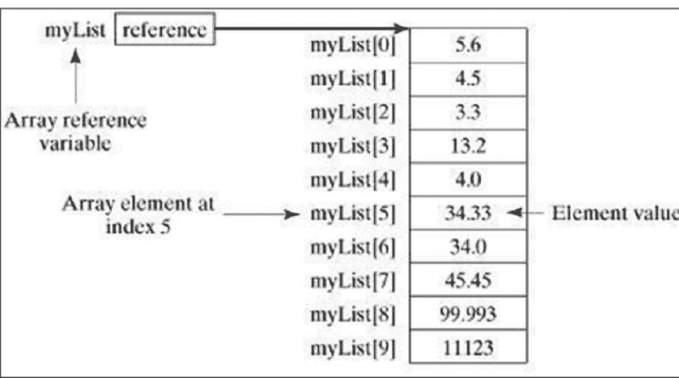

# 处理数组

在处理数组元素时，我们通常使用`for`循环或`foreach`循环，因为数组中的所有元素都是相同类型，且数组的大小是已知的。

## 示例

这是一个完整的示例，展示了如何创建、初始化和处理数组：

```java
public class TestArray {

    public static void main(String[] args) {

        double[] myList = {1.9, 2.9, 3.4, 3.5};

        // 打印所有数组元素

        for (int i = 0; i < myList.length; i++) { System.out.println(myList[i] + " "); }

    }

    // 求和所有元素 double total = 0;

    for (int i = 0; i < myList.length; i++) {

total += myList[i];

}

System.out.println("Total is " + total);

// 找到最大元素 double max = myList[0];

for (int i = 1; i < myList.length; i++) {

if (myList[i] > max)max = myList[i];

}

System.out.println("Max is " + max);

}

}
```

这将产生以下结果：

```
1.9
2.9
3.4
3.5

Total is 11.7
Max is 3.5
```

# foreach 循环

JDK 1.5 引入了一种新的`for`循环，被称为`foreach`循环或增强型`for`循环（enhanced `for`循环），它允许你在不使用索引变量的情况下按顺序遍历整个数组。

## 示例

以下代码显示了数组`myList`中的所有元素：

```java
public class TestArray {

public static void main(String[] args) {

    double[] myList = {1.9, 2.9, 3.4, 3.5};

    // 打印所有数组元素 for (double element: myList) {

    System.out.println(element);

    }

}

}
```

这将产生以下结果：

- 1.9
- 2.9
- 3.4
- 3.5

# 将数组传递给方法

正如你可以将基本类型的值传递给方法一样，你也可以将数组传递给方法。例如，以下方法显示了`int`数组中的元素：

```java
public static void printArray(int[] array) {

    for (int i = 0; i < array.length; i++) { System.out.print(array[i] + " ");

}

}
```

你可以通过传递数组来调用它。例如，以下语句调用了`printArray`方法来显示 3, 1, 2, 6, 4 和 2：

```java
printArray(new int[]{3, 1, 2, 6, 4, 2});
```

# 从方法返回数组

方法也可以返回数组。例如，以下方法返回一个另一个数组反转后的数组：

```java
public static int[] reverse(int[] list) {

  int[] result = new int[list.length];

  for (int i = 0, j = result.length - 1; i++, j--) {

    result[j] = list[i];

  }

  return result;

}
```

## Arrays 类

`java.util.Arrays`类包含了各种静态方法，用于排序数组、搜索数组、比较数组以及填充数组元素。这些方法针对所有基本类型都进行了重载。

# 方法及描述

| 方法 | 描述 |
| --- | --- |
| `public static int binarySearch(Object[]a, Object key)` | 使用二分查找算法在指定的`Object`数组（Byte, Int, double 等）中搜索指定的值。在调用此方法之前必须对数组进行排序。它返回搜索键的索引。 |
| `public static boolean equals(Object[] a, Object a)` | 如果两个数组相等则返回`true`。 |
| `public static void fill(int[] a, int val)` | 将指定的`int`赋值给数组`a`的每个元素。 |
| `public static void sort(Object[] a)` | 对数组进行升序排序。 |

# Date

Java 提供了`Date`类，该类封装了日期和时间。

| 序号 | 构造函数及描述 |
| --- | --- |
| 1 | `Date()` 该构造函数初始化为当前日期时间。 |
| 2 | `Date(long millis)` 该构造函数接受一个代表自 1970 年 1 月 1 日以来毫秒数的参数。 |

以下是该类的一些方法：

| 方法 | 描述 |
| --- | --- |
| `boolean after(Date date)` | 如果`Date`对象晚于指定的`date`则返回`true`。 |
| `boolean before(Date date)` | 如果`Date`对象早于指定的`date`则返回`true`。 |
| `int compareTo(Date date)` | 比较调用对象与`date`的值。如果值相等返回 0，如果调用对象早于`date`则返回负值，如果调用对象晚于`date`则返回正值。 |
| `int compareTo(Object obj)` | 如果`obj`是`Date`类型，则操作与`compareTo(Date)`相同。否则抛出`ClassCastException`。 |
| `boolean equals(Object date)` | 如果`Date`对象包含与`date`相同的时刻日期则返回`true`。 |
| `long getTime()` | 返回自 1970 年 1 月 1 日以来的毫秒数。 |
| `int hashCode()` | 返回调用对象的哈希值。 |
| `void setTime(long time)` | 设置日期为`time`指定的时间。 |
| `String toString()` | 将调用的`Date`对象转换为字符串并返回结果。 |

# 获取当前日期和时间

这是 Java 中获取当前日期时间的简单方法。你可以使用简单的`Date`对象通过`toString()`方法打印当前日期和时间：

```java
import java.util.Date;

public class DateDemo {

  public static void main(String args[]) {

    // 实例化 Date 对象

    Date date = new Date();

    // 使用 toString() 方法显示时间和日期

    System.out.println(date.toString());

  }

}
```

# 日期比较

以下是比较日期的三种方法：

- 你可以使用`getTime()`获取自 1970 年 1 月 1 日午夜以来的毫秒数，然后比较这两个值。
- 你可以使用`before()`、`after()`和`equals()`。因为月份的 12 号在 18 号之前，例如，`new Date(99, 2, 12).before(new Date(99, 2, 18))`返回`true`。
- 你可以使用`compareTo()`方法，该方法由`Comparable`接口定义并由`Date`实现。

# 使用 SimpleDateFormat 格式化日期

`SimpleDateFormat`是一个用于以区域敏感的方式格式化和解析日期的类。`SimpleDateFormat`允许你从选择任何自定义模式进行日期-时间格式化。例如：

```java
import java.util.*;
import java.text.*;

public class DateDemo {

public static void main(String[] args[]) {

Date dNow = new Date(); SimpleDateFormat ft =

new SimpleDateFormat("yyyy.MM.dd 'at' hh:mm:ss zzz");

System.out.println("Current Date: " + ft.format(dNow));

}

}
```

这将会产生以下结果：

```
Current Date: Sun 2004.07.18 at 04:14:09 PM PDT
```

## 使用 printf 格式化日期

使用`printf`方法可以非常容易地完成日期时间的格式化。你使用一个双字母格式，以`t`开始并以表中任意一个字母结束，如下所示代码所示：

```java
import java.util.Date;

public class DateDemo {

public static void main(String args[]) {

    // 实例化一个 Date 对象

    Date date = new Date();

    // 使用 toString() 显示时间和日期 

    String str = String.format("Current Date/Time: %tc",date);

    System.out.printf(str);

  }

}
```

这将会产生以下结果：

```
Current Date/Time : Sat Dec 15 16:37:57 MST 2012
```

如果你必须多次提供日期来格式化每个部分，那将有点愚蠢。出于这个原因，格式字符串可以指示要格式化的参数索引。

索引必须紧跟在`%`之后，并以`$`终止。例如：

```java
import java.util.Date;

public class DateDemo {

  public static void main(String args[]) {

    // 实例化一个 Date 对象

    Date date = new Date();

    // 使用 toString() 显示时间和日期 System.out.printf("%1$s %2$tB, %2$tY",

    "Due date: ", date);

  }

}
```

这将会产生以下结果：

```
Due date: February 09, 2004
```

或者，你可以使用`<`标志。它表示应该再次使用与前一个格式规范相同的参数。例如：

```java
import java.util.Date;

public class DateDemo {

  public static void main(String args[]) {

    // 实例化一个 Date 对象

    Date date = new Date();

    // 显示格式化后的日期

    System.out.printf("%s %tB %tY", "Due date:", date);

  }

}
```

这将会产生以下结果：

```
Due date: February 09, 2004
```

## 日期和时间转换字符

| 字符 | 描述 | 示例 |
| --- | --- | --- |
| `c` | 完整的日期和时间 | Mon May 04 09:51:52 CDT 2009 |
| `F` | ISO 8601 日期 | 2004-02-09 |
| `D` | 美国格式的日期（月/日/年） | 02/09/2004 |
| `T` | 24小时制时间 | 18:05:19 |
| `r` | 12小时制时间 | 06:05:19 pm |
| `R` | 24小时制时间，无秒 | 18:05 |
| `Y` | 四位年份（带前导零） | 2004 |
| `y` | 年份的最后两位（带前导零） | 04 |
| `C` | 年份的前两位（带前导零） | 20 |
| `B` | 完整月份名称 | February |
| `b` | 月份缩写名称 | Feb |
| `m` | 两位数月份（带前导零） | 02 |
| `d` | 两位日期（带前导零） | 03 |
| `e` | 两位日期（不带前导零） | 9 |
| `A` | 完整星期名称 | Monday |
| `a` | 星期缩写名称 | Mon |
| `I` | 三位一年中的天数（带前导零） | 069 |
| `H` | 两位小时（带前导零），在 00 到 23 之间 | 18 |
| `k` | 两位小时（不带前导零），在 0 到 23 之间 | 18 |
| `h` | 两位小时（带前导零），在 01 到 12 之间 | 06 |
| `h` | 两位小时（不带前导零），在 1 到 12 之间 | 6 |
| `M` | 两位分钟（带前导零） | 05 |
| `S` | 两位秒（带前导零） | 19 |
| `L` | 三位毫秒（带前导零） | 047 |
| `N` | 九位纳秒（带前导零） | 0470000000 |
| `P` | 大写上午或下午标记 | PM |
| `p` | 小写上午或下午标记 | pm |
| `z` | GMT 的 RFC 822 数字偏移量 | -0800 |
| `Z` | 时区 | PST |
| `s` | 自 1970-01-01 00:00:00 GMT 以来的秒数 | 1078884319 |
| `Q` | 自 1970-01-01 00:00:00 GMT 以来的毫秒 | 1078884319047 |

还有其他与 Date 和时间相关的类。有关更多细节，你可以参考 Java 文档。

## 使用 printf 格式化日期

使用`printf`方法可以非常容易地完成日期时间的格式化。你使用一个双字母格式，以`t`开始并以表中任意一个字母结束，如下所示代码。例如：

（此处代码略）

这将会产生以下结果：

```
Current Date/Time : Sat Dec 15 16:37:57 MST 2012
```

如果你必须多次提供日期来格式化每个部分，那将有点愚蠢。出于这个原因，格式字符串可以指示要格式化的参数索引。

索引必须紧跟在`%`之后，并以`$`终止。例如：

（此处代码略）

这将会产生以下结果：

```
Due date: February 09, 2004
```

或者，你可以使用`<`标志。它表示应该再次使用与前一个格式规范相同的参数。例如：

（此处代码略）

这将会产生以下结果：

```
Due date: February 09, 2004
```

## 将字符串转换为日期

`SimpleDateFormat`有一些额外的方法`parse()`，它根据`SimpleDateFormat`对象中的格式来解析字符串。例如：

（此处代码略）

## 睡眠

你可以让程序睡眠一段时间。使用`Calendar`睡眠某个时间。例如：

（此处代码略）

这将会产生以下结果：

（ 0略）  ）

```java
import java.util.*;

public class SleepDemo {

    public static void main(String args[]) {

        try {

            System.out.println(new Date());

            Thread.sleep(10);

            System.out.println(new Date());

        } catch (Exception e) {

            System.out.println("e an        

        }

    }

}
```

## 测量经过的时间

有时你可能需要使用毫秒来测量时间。再次编写上面的例子：

（此处代码略）

这将会产生以下结果：

```
Sun 03 18:1 51
```

## GregorianCalendar 类

`GregorianCalendar`是`Calendar`类的一个具体实现，它使用了当前的日期。我们没有讨论`Calendar`类的字段。`GregorianCalendar`定义了两个 eras：

| 构造函数 | 描述 |
| --- | --- |
| `GregorianCalendar()` | 一个默认的`CalendarCalendar` |


## `GregorianCalendar` 构造方法

| 构造方法 | 描述 |
| --- | --- |
| `GregorianCalendar(int year, int month)` | 使用当前的日期构造 `Calendar` |
| `GregorianCalendar(int year, int month, int date)` | 使用给定的日期构造 `Calendar` |
| `GregorianCalendar(int year, int month, int date, int hour)` | 使用给定的日期和小时构造 `Calendar` |
| `GregorianCalendar(int year, int month, int date, int hour, int minute)` | 使用给定的日期、小时和分钟构造 `Calendar` |
| `GregorianCalendar(long date)` | 使用给定的日期（毫秒）构造 `Calendar` |
| `GregorianCalendar(TimeZone zone)` | 使用指定的时区构造 `Calendar` |
| `GregorianCalendar(long date, TimeZone zone)` | 使用给定的日期和指定的时区构造 `Calendar` |
| `GregorianCalendar(int year, int month, TimeZone zone)` | 使用年份和指定的时区构造 `Calendar` |
| `GregorianCalendar(int year, int month, int date, TimeZone zone)` | 使用年份、日期和指定的时区构造 `Calendar` |
| `GregorianCalendar(int year, int month, int date, int hour, TimeZone zone)` | 使用年份、日期、小时和指定的时区构造 `Calendar` |
| `GregorianCalendar(int year, int month, int date, int hour, int minute, TimeZone zone)` | 使用年份、日期、小时、分钟和指定的时区构造 `Calendar` |

## `GregorianCalendar` 常用方法

| 方法 | 描述 |
| --- | --- |
| `add(int field, int amount)` | 根据日历规则向给定的时间字段增加指定的符号量。 |
| `protected void computeFields()` | 将 UTC 毫秒转换为字段值。 |
| `protected void computeTime()` | 覆盖，将字段值转换为 UTC 毫秒。 |
| `equals(Object obj)` | 比较此 `GregorianCalendar` 与对象引用。 |
| `get(int field)` | 获取给定时间字段的值。 |
| `getActualMaximum(int field)` | 根据当前日期返回该字段可能的最大值。 |
| `getActualMinimum(int field)` | 根据当前日期返回该字段可能的最小值。 |
| `getGreatestMinimum(int field)` | 如果该字段在不同时代有所异，则返回最大的最小值。 |
| `getGregorianChange()` | 获取格列日变更日期。 |
| `getLeastMaximum(int field)` | 如果该字段在不同时代有所异，则返回最小的最大值。 |
| `getMaximum(int field)` | 返回字段的最大值。 |
| `getTime()` | 获取此 `Calendar` 的当前时间。 |
| `getTimeInMillis()` | 获取此 `Calendar` 的当前时间的长整型。 |
| `TimeZone getTimeZone()` | 获取时区。 |
| `getMinimum(int field)` | 返回字段的最小值。 |
| `hashCode()` | 覆盖 `hashCode`。 |
| `isLeapYear(int year)` | 判断给定的年份是否为闰年。 |
| `roll(int field, boolean up)` | 在不改变较大字段的情况下，在给定的时间字段上增加或减少一个时间单位。 |
| `set(int field, int value)` | 设置时间字段的给定的值。 |

```java
void set(int year, int month, int date) Sets the values for the fields year, month, and date.
void set(int year, int month, int date,int minute) Sets the values for the fields year, month, date, hour, and minute.
void set(int year, int month, int date,int hour, int minute, int second) Sets the values for the fields year, month, date, hour, minute, and second.
void setGregorianChange(Date date) Sets the GregorianCalendar change date.
void setTime(Date date) Sets this Calendar’s current time with the given Date.
void setTimeInMillis(long millis) Sets this Calendar’s current time from the given long value.
void setTimeZone(TimeZone value) Sets the time zone with the given time value.
```

`String toString()` 返回此日历的字符串表示形式。

## 示例

```java
import java.util.*;

public class GregorianCalendarDemo {
    public static void main(String args[]) { String months[] = {
        "Jan", "Feb", "Mar", "Apr", "May", "Jun", "Jul", "Aug", "Sep", "Oct",
        "Nov", "Dec"
    };
    // Wait, the code is incomplete in the image. // placeholder
    int year;
    // Create a Gregorian calendar initialized
    // with the current date and time in
    // default locale and timezone.
    GregorianCalendar calendar = new GregorianCalendar();
    // Display current time and date information. System.out.print("Date: ");
    System.out.print(months[calendar.get(Calendar.MONTH)]);
    System.out.print(" " + calendar.get(Calendar.DATE) + " ");
    System.out.println(year = calendar.get(Calendar.YEAR));

    System.out.print("Time: "); 
    System.out.print(calendar.get(Calendar.HOUR) + ":");
    System.out.print(calendar.get(Calendar.MINUTE) + ":");
    System.out.println(calendar.get(Calendar.SECOND));
    // Test if the current year is a leap year
    if(calendar.isLeapYear(year)) {
        System.out.println("The current year is a leap year");
    } else {
        System.out.println("The current year is not a leap year");
    }
}
```

这将产生以下结果：

```
Date: Apr 22 2009
Time: 11:25:27
The current year is not a leap year
```

有关 `Calendar` 类中可用常量的完整列表，请参阅标准 Java 文档。

## 正则表达式

Java 提供了 `java.util.regex` 包，用于正则表达式的模式匹配。Java 正则表达式与 Perl 编程语言非常相似，并且非常易于学习。

正则表达式是一种特殊的字符序列，它使用模式中持有的专用语法，帮助您匹配或查找其他字符串或字符串集合。它们可用于搜索、编辑或操作文本和数据。

`java.util.regex` 包主要由以下三个类组成：

- **`Pattern` 类**：`Pattern` 对象是正则表达式的编译表示。`Pattern` 类不提供公共构造函数。要创建模式，必须首先调用其公共静态 `compile()` 方法之一，该方法将返回一个 `Pattern` 对象。这些方法接受正则表达式作为第一个参数。

- **`Matcher` 类**：`Matcher` 对象是解释模式并对输入字符串执行操作的引擎。与 `Perl` 类一样，`Matcher` 不定义公共构造函数。您可以通过在 `Pattern` 对象上调用方法来获取 `Matcher` 对象。

- **`PatternSyntaxException` 类**：此对象是一个未经检查的异常，表示正则表达式模式中的语法错误。

## 捕获组

捕获组是将多个字符视为单个单元的一种方式。它们是通过将需要分组的字符放在一组括号内创建的。例如，正则表达式 `(dog)` 创建了一个包含字母 `"d"`、`"o"` 和 `"g"` 的单一组。

捕获组通过从左到右计算其左括号来编号。例如，在表达式 `((A)(B(C)))` 中，有四个这样的组：

```
((A)(B(C)))
(A)
(B(C))
(C)
```

要找出表达式中存在多少组，请在匹配器对象上调用 `groupCount` 方法。`groupCount` 方法返回一个 `int`，显示匹配器模式中存在的捕获组数量。

还有一个特殊的组，组 0，它始终代表整个表达式。此组不包含在 `groupCount` 报告的总数中。

## 示例

以下示例说明了如何从给定的字母数字字符串中查找数字字符串：

```java
import java.util.regex.Matcher;
import java.util.regex.Pattern;
public class RegexMatches
{
    public static void main( String args[]) {
        // String to be scanned to find the pattern.
        String line = "This order was placed for QT3000! OK?"; 
        String pattern = "(\\d+)(.*)";
        // Create a Pattern object
        Pattern r = Pattern.compile(pattern);
        // Now create matcher object. 
        Matcher m = r.matcher(line); 
        if (m.find()) {
            System.out.println("Found value: " + m.group(0) );
            System.out.println("Found value: " + m.group(1) );
            System.out.println("Found value: " + m.group(2) );
        } else {
            System.out.println("NO MATCH");
        }
    }
}
```

这将产生以下结果：

```
Found value: 3000! OK?
```

## 正则表达式语法

以下是 Java 中可用的所有元字符的表格：

| 子表达式 | 匹配 |
| --- | --- |
| `^` | 匹配行的开头。 |
| `$` | 匹配行的结尾。 |
| `.` | 匹配除换行符以外的任何字符。 |
| `[...]` | 匹配括号内的任何字符。 |
| `[^...]` | 匹配不在括号内的任何字符。 |
| `\A` | 匹配字符串的开头。 |
| `\z` | 匹配字符串的结尾。 |
| `\Z` | 匹配字符串的结尾。如果存在换行符，则匹配换行符之前的位置。 |
| `re*` | 匹配前一个表达式的 0 次或多次出现。 |
| `re+` | 匹配前一个表达式的 1 次或多次出现。 |
| `re?` | 匹配前一个表达式的 0 次或 1 次出现。 |


# 正则表达式元字符

下表列出了正则表达式中常用的元字符及其描述：

| 元字符 | 描述 |
| --- | --- |
| `re{n}` | 匹配前面表达式恰好 `n` 次。 |
| `re{n,}` | 匹配前面表达式至少 `n` 次。 |
| `re{n, m}` | 匹配前面表达式至少 `n` 次且至多 `m` 次。 |
| `a\|b` | 匹配 `a` 或 `b`。 |
| `(re)` | 对正则表达式进行分组并记住匹配的文本。 |
| `(?:re)` | 对正则表达式进行分组但不记住匹配的文本。 |
| `(?>re)` | 匹配独立模式，不进行回溯。 |

## 预定义字符类

| 元字符 | 描述 |
| --- | --- |
| `\w` | 匹配单词字符。 |
| `\W` | 匹配非单词字符。 |
| `\s` | 匹配空白字符。等价于 `[\t\n\r\f]`。 |
| `\S` | 匹配非空白字符。 |
| `\d` | 匹配数字。等价于 `[0-9]`。 |
| `\D` | 匹配非数字。 |
| `\b` | 在方括号外时匹配单词边界；在方括号内时匹配退格符（`0x08`）。 |
| `\B` | 匹配非单词边界。 |
| `\n`, `\t` 等 | 匹配换行符、回车符、制表符等。 |
| `\Q` | 转义（引用）直到 `\E` 的所有字符。 |
| `\E` | 结束以 `\Q` 开始的引用。 |

# Matcher 类的方法

以下是 `Matcher` 类中一些有用的实例方法：

## 索引方法

| 序号 | 方法及描述 |
| --- | --- |
| 1 | `public int start()` <br> 返回上一次匹配的起始索引。 |
| 2 | `public int start(int group)` <br> 返回上一次匹配操作中由给定组捕获的子序列的起始索引。 |
| 3 | `public int end()` <br> 返回最后一个匹配字符之后的偏移量。 |
| 4 | `public int end(int group)` <br> 返回上一次匹配操作中由给定组捕获的子序列最后一个字符之后的偏移量。 |

## 研究方法

研究方法检查输入字符串并返回一个布尔值，指示是否找到模式：

| 序号 | 方法及描述 |
| --- | --- |
| 1 | `public boolean lookingAt()` <br> 尝试从区域开始处将输入序列与模式进行匹配。 |
| 2 | `public boolean find()` <br> 尝试在输入序列中查找匹配模式的下一个子序列。 |
| 3 | `public boolean find(int start)` <br> 重置此匹配器，然后从指定的索引开始在输入序列中查找匹配模式的下一个子序列。 |
| 4 | `public boolean matches()` <br> 尝试将整个区域与模式进行匹配。 |

## 替换方法

替换方法是用于替换输入字符串中文本的有用方法：

| 序号 | 方法及描述 |
| --- | --- |
| 1 | `public Matcher appendReplacement(StringBuffer sb, String replacement)` <br> 实现非终止的追加并替换步骤。 |
| 2 | `public StringBuilder appendTail(StringBuffer sb)` <br> 实现末尾追加并替换步骤。 |
| 3 | `public String replaceAll(String replacement)` <br> 替换输入序列中每个匹配给定替换字符串的子序列。 |
| 4 | `public String replaceFirst(String replacement)` <br> 将输入序列中第一个匹配模式的子序列替换为指定的替换字符串。 |
| 5 | `public static String quoteReplacement(String s)` <br> 为指定的字符串返回字面替换字符串。此方法产生的字符串可以在 `Matcher` 类的 `appendReplacement` 方法中作为字面量替换使用。 |

## `start` 和 `end` 方法

以下是计算输入字符串中单词“cat”出现次数的示例：

```java
import java.util.regex.Matcher;
import java.util.regex.Pattern;

public class RegexMatches {
    private static final String REGEX = "\\bat\\b";
    private static final String INPUT = "cat cat cat cattie cat";

    public static void main(String args[]) {
        Pattern p = Pattern.compile(REGEX);
        Matcher m = p.matcher(INPUT); // 获取一个匹配器对象
        int count = 0;

        while(m.find()) {
            count++;
            System.out.println("Match number "+count);
            System.out.println("start(): " + m.start());
            System.out.println("end(): " + m.end());
        }
    }
}
```

这将产生以下结果：

```
Match number 1
start(): 0
end(): 3

Match number 2
start(): 4
end(): 7

Match number 3
start(): 8
end(): 11

Match number 4
start(): 19
end(): 22
```

你可以看到这个示例使用了单词边界来确保字母“c”“a”“t”不仅仅是较长单词中的子字符串。它还提供了关于匹配发生在输入字符串中位置的有用信息。

`start` 方法返回上一次匹配操作期间指定组捕获的子序列的起始索引，而 `end` 返回匹配的最后一个字符的索引加一。

## `matches` 和 `lookingAt` 方法

`matches` 和 `lookingAt` 方法都尝试将输入序列与模式进行匹配。然而，区别在于，`matches` 要求匹配整个输入序列，而 `lookingAt` 则不需要。

这两个方法始终从输入字符串的开头开始。以下是解释其功能的示例：

```java
import java.util.regex.Matcher;
import java.util.regex.Pattern;

public class RegexMatches {
    private static final String REGEX = "foo";
    private static final String INPUT = "fooooooooooooooooo";
    private static Pattern pattern;
    private static Matcher matcher;

    public static void main(String[] args) {
        pattern = Pattern.compile(REGEX);
        matcher = pattern.matcher(INPUT);

        System.out.println("Current REGEX is: " + REGEX);
        System.out.println("Current INPUT is: " + INPUT);
        System.out.println("lookingAt(): " + matcher.lookingAt());
        System.out.println("matches(): " + matcher.matches());
    }
}
```

这将产生以下结果：

```
Current REGEX is: foo
Current INPUT is: foooooooooooooooooo
lookingAt(): true
matches(): false
```

## `replaceFirst` 和 `replaceAll` 方法

`replaceFirst` 和 `replaceAll` 方法替换文本。如其名称所示，`replaceFirst` 替换第一次出现的，`replaceAll` 替换所有。

以下是示例：

```java
import java.util.regex.Matcher;
import java.util.regex.Pattern;

public class RegexMatches {
    private static final String REGEX = "dog";
    private static final String INPUT = "dog cat dog";

    public static void main(String args[]) {
        Pattern p = Pattern.compile(REGEX);
        Matcher m = p.matcher(INPUT);
        StringBuilder sb = new StringBuilder();

        while(m.find()) {
            m.appendReplacement(sb, "cat");
        }
        m.appendTail(sb);
        System.out.println(sb.toString());
    }
}
```

## `appendReplacement` 和 `appendTail` 方法

`Matcher` 类还提供了用于替换的 `appendReplacement` 和 `appendTail` 方法。以下是示例：

```java
import java.util.regex.Matcher;
import java.util.regex.Pattern;

public class RegexMatches {
    private static final String REGEX = "a";
    private static final String INPUT = "abaaba";

    public static void main(String args[]) {
        Pattern p = Pattern.compile(REGEX);
        Matcher m = p.matcher(INPUT);
        StringBuffer sb = new StringBuffer();

        while(m.find()) {
            m.appendReplacement(sb, "b");
        }
        m.appendTail(sb);
        System.out.println(sb.toString());
    }
}
```

## `PatternSyntaxException` 类方法

`PatternSyntaxException` 是一种指示正则表达式语法错误的未检查异常。`PatternSyntaxException` 类提供了以下方法来帮助确定问题：

| 序号 | 方法及描述 |
| --- | --- |
| 1 | `public String getDescription()` <br> 获取错误描述。 |
| 2 | `public int getIndex()` <br> 获取错误索引。 |
| 3 | `public String getPattern()` <br> 获取错误的表达式模式。 |
| 4 | `public String getMessage()` <br> 返回包含错误描述及其索引、错误模式以及模式内错误索引视觉指示的多行字符串。 |

# Java 方法

Java 方法是一组为了执行操作而组合的语句。当你调用方法时（例如 `System.out.println()`），系统实际上执行多条语句来显示消息。

现在你将学习如何创建带或不带返回值的方法、调用带或不带参数的方法，并在程序设计中使用方法抽象。

## 创建方法

考虑以下示例来解释方法的语法：

```java
public static int methodName(int a, int b) {
    // 方法体
}
```

在这里：

- `public` 修饰符
- `int` 返回类型
- `methodName` 方法名
- `a`, `b` 形式参数
- `int a`, `int b` 参数列表

方法定义由方法头和方法体组成。相同的逻辑如下语法所示：

```java
modifier returnType nameOfMethod (Parameter List) {
    // 方法体
}
```

## 示例

以下是上述定义方法的源代码，该方法接收两个参数 `num1` 和 `num2` 并返回它们之间的最大值：

```java
/** 代码片段返回两个数字之间的最小值 */
public static int minFunction(int n1, int n2) {
    int min;
    if (n1 > n2)
        min = n2;
    else
        min = n1;
    return min;
}
```

# 方法调用

要使用一个方法，必须对其进行调用。方法调用有两种方式，即方法返回值或不返回任何内容（无返回值）。

方法调用的过程非常简单。当程序调用方法时，程序的控制权会转移到被调用的方法。被调用的方法在两种情况下会将控制权返回给调用者：

- 执行了 `return` 语句。
- 达到了方法的结束大括号。

返回 `void` 的方法被视为对语句的调用。让我们考虑一个例子：

```java
System.out.println("This is java.com!");
```

返回值的方法可以通过以下示例来理解：

```java
int result = sum(6, 9);
```

## 示例

以下是演示如何定义一个方法以及如何调用它的示例：

```java
public class ExampleMinNumber {
    public static void main(String[] args) {
        int a = 11;
        int b = 6;
        int c = minFunction(a, b);
        System.out.println("Minimum Value = " + c);
    }

    /** 返回两个数字中的最小值 */
    public static int minFunction(int n1, int n2) {
        int min;
        if (n1 > n2) {
            min = n2;
        } else {
            min = n1;
        }
        return min;
    }
}
```

这产生以下结果：

```
Minimum value = 6
```

# `void` 关键字

`void` 关键字允许我们创建不返回值的方法。在这里，在下面的示例中，我们考虑一个不返回任何值的 `void` 方法。对 `void` 方法的调用必须是一个语句，即以分号结尾的 Java 语句，如下例所示。

## 示例

```java
public class ExampleVoid {
    public static void main(String[] args) {
        methodPoints(5.7);
    }

    public static void methodPoints(double points) {
        if (points >= 2.5) {
            System.out.println("Rank:A1");
        } else if (points >= 2.4) {
            System.out.println("Rank:A2");
        } else {
            System.out.println("Rank:A3");
        }
    }
}
```


这产生以下结果：

`Rank:A1`

# 按值传递参数

按值传递参数意味着带有参数调用方法。在处理过程中，参数按照它们各自对应参数的顺序进行传递。参数可以按值传递，也可以按引用传递。通过这种方式，参数的值被传递给参数。

## 示例

下面的程序展示了按值传递参数的示例。在方法调用后，参数的值保持不变。

```java
public class swappingExample {
    public static void main(String[] args) {
        int a = 30;
        int b = 45;
        System.out.println("Before swapping, " + a + " and b = " + b);
        // 调用 swap 方法
        swapFunction(a, b);
        int c = a;
        a = b;
        b = c;
        System.out.println("After swapping, " + a + " and b = " + b);
    }
    public static void swapFunction(int a, int b) {
        System.out.println("Before swapping, " + a + " and b = " + b);
        // 交换 a 和 b
        int c = a;
        a = b;
        b = c;
        System.out.println("After swapping, " + a + " and b = " + b);
    }
}
```

这产生以下结果：

`Before swapping, a = 30 and b = 45`

`Before swapping (Inside), a = 30 and b = 45`

`After swapping (Inside), a = 45 and b = 30`

现在，交换前交换后的值在这里是相同的

# 方法重载

当一个类拥有两个或多个相同名称但参数不同的方法时，被称为方法重载。它与重写（`overriding`）不同。在重写中，方法具有相同的方法名、类型、参数数量等。让我们考虑之前那个查找整数类型最小值的示例。假设我们想找到 `double` 类型的最小值。那么，将引入重载的概念，以创建两个或多个相同名称但参数不同的方法。以下示例解释了这一点：

```java
public class ExampleOverloading {
    public static void main(String[] args) {
        int a = 11;
        int b = 6;
        double c = 7.3;
        double d = 9.4;
        int result1 = minFunction(a, b);
        // 相同的方法名不同的参数
        double result2 = minFunction(c, d);
        System.out.println("Minimum Value = " + result1);
        System.out.println("Minimum Value = " + result2);
    }
    // 针对整数
    public static int minFunction(int n1, int n2) {
        int min;
        if (n1 > n2) {
            min = n2;
        } else {
            min = n1;
        }
        return min;
    }
    // 针对 double
    public static double minFunction(double n1, double n2) {
        double min;
        if (n1 > n2) {
            min = n2;
        } else {
            min = n1;
        }
        return min;
    }
}
```

这产生以下结果：

`Minimum Value = 6`

`Minimum Value = 7.3`

重载方法使程序具有可读性。在这里，两个方法具有相同名称但不同的参数。整数和 `double` 类型的最小值是结果。

# 使用命令行参数

有时你会在运行时向程序传递信息。这是通过向 `main()` 传递命令行参数来实现的。命令行参数是在执行程序时直接跟在程序名称后面的信息。在 Java 程序内部访问命令行参数非常容易。它们存储在传递给 `main()` 的 `String` 数组中。

## 示例

下面的程序显示它被调用的所有命令行参数：

```java
public class CommandLine {
    public static void main(String args[]) {
        for(int i=0; i<args.length; i++){
            System.out.println("args[" + i + ": " + args[i]);
        }
    }
}
```

尝试如下所示执行此程序：

```bash
$java CommandLine this is a command line 200 -100
```

这产生以下结果：

```
args[0]: this
args[1]: is
args[2]: a
args[3]: command
args[4]: line
args[5]: 200
args[6]: -100
```

通常情况下，`this` 关键字用于：

在构造函数或方法中，当名称相同时，区分实例变量与局部变量。

```java
class Student{
    int age; 
    Student(int age){ 
        this.age=age;
    }
}
```

在一个类内部调用另一个类型的构造函数（带参构造函数或默认构造函数）。这被称为显式构造函数调用。

```java
class Student{
    int age; 
    Student() { 
        this(20);
    }
    Student(int age){
        this.age=age;
    }
}
```

## 示例

这是一个使用 `this` 关键字访问类成员的示例。将以下程序复制并粘贴到名为 `This_Example` 的文件中：

```java
public class This_Example {
    //Instance variable int num = 10;
    This_Example(){
        System.out.println("This is an example program on keyword this");
    }
    This_Example(int num) {
        //Invoking the default constructor
        this();
        //Assigning the local variable num to the instance variable num
        this.num=num;
    }
    public void greet(){
        System.out.println("Hi Welcome to java");
    }
    public void print(){
        //Local variable num int num = 20;
        //Printing the instance variable
        System.out.println("value of local variable num is : "+num);

        //Printing the local variable
        System.out.println("value of instance variable num is :"+this.num);
        //Invoking the greet method of a class this.greet();
    }
    public static void main(String[] args) {
        //Instantiating the class
        This_Example obj1=new This_Example();
        //Invoking the print method obj1.print();
        //Passing a new value to the num variable through parametrized constructor
        This_Example obj2=new This_Example(30);
        //Invoking the print method again obj2.print();
    }
}
```

这将产生以下结果：

```
This is an example program on keyword this
value of local variable num is : 20
value of instance variable num is : 10
Hi Welcome to java
This is an example program on keyword this
value of local variable num is : 20
value of instance variable num is : 30
Hi Welcome to java
```

## 变参数 (Variable)

JDK 1.5 允许你向方法传递任意数量相同类型的参数。方法中的参数声明如下：

```
typeName... parameterName
```

在方法声明中，你指定类型并在其后跟一个省略号（`...`）。方法中只能指定一个变长参数，且该参数必须是最后一个参数。任何普通参数必须在它之前。

## 示例

```java
public class VarargsDemo {
    public static void main(String args[]) {
        // Call method with variable args printMax(34, 3, 3, 2, 56.5);
        printMax(new double[]{1, 2, 3});
    }
    public static void printMax(double... numbers) {
        if (numbers.length == 0) 
            System.out.println("No argument passed");
            return;
        }
        double result = numbers[0];
        for (int i = 1; i < numbers.length; i++)
            if (numbers[i] > result)
                result = numbers[i];
        }
        System.out.println("The max value is " + result);
    }
}
```

这将产生以下结果：

```
The max value is 56.5
The max value is 3.0
```

## finalize() 方法

可以定义一个方法，在对象被垃圾回收器最终销毁之前被调用。该方法被称为 `finalize()`，它可以用于确保对象整洁地终止。

例如，你可能使用 `finalize()` 来确保该对象拥有的打开文件被关闭。

要为类添加终结器（`finalizer`），你只需定义 `finalize()` 方法。每当 Java 运行时准备回收该类的对象时，就会调用该方法。

在 `finalize()` 方法内部，你将指定在对象销毁之前必须执行的操作。

`finalize()` 方法具有如下通用形式：

```java
protected void finalize()
{
    // 在此处编写终结代码
}
```

在这里，关键字 `protected` 是一个修饰符，防止类外部定义的代码访问 `finalize()`。

这意味着你无法知道 `finalize()` 何时执行或将会执行。例如，如果你的程序在垃圾回收发生之前结束了，`finalize()` 将不会执行。

## 文件与 I/O

`java.io` 包包含了几乎你在 Java 中可能需要的用于执行输入输出（I/O）的所有类。所有这些流都代表一个输入源和一个输出目标。`java.io` 包中的流支持许多数据，如基本数据类型、对象、本地化字符等。

## 流 (Stream)

流可以定义为数据的序列。流有两种类型：

- `InputStream` 用于从源读取数据。`OutputStream` 用于向目标写入数据。

## 字节流

字节流用于执行 8 位字节的输入输出。字节流的超类是 `InputStream` 和 `OutputStream`。这些最常见的子类是 `FileInputStream` 和 `FileOutputStream`。

让我们将上述代码保留在 `ReadConsole.java` 文件中，并尝试按照程序进行编译和执行。该程序将持续读取并输出相同的字符，直到我们按下 `'q'` 为止：

```bash
$javac ReadConsole.java
$java ReadConsole
Enter characters, 'q' to quit.
1e e q
q
```

## 文件的读写

如前所述，流可以被定义为数据序列。`InputStream` 用于从源读取数据，而 `OutputStream` 用于向目标写入数据。

以下是处理输入和输出流的类层次结构。

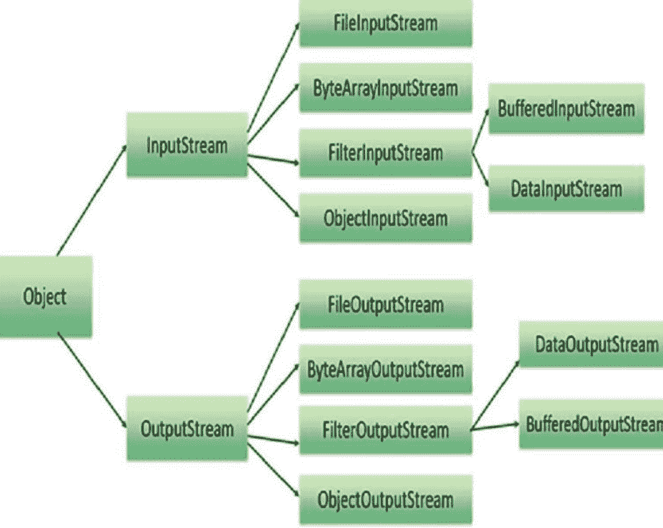

两个重要的流是 `FileInputStream` 和 `FileOutputStream`，它们将在本章中讨论。

## FileInputStream

此流用于从文件中读取数据。可以使用 `new` 关键字创建对象，并有几种类型的构造函数可用。

以下构造函数接受一个字符串形式的文件名来创建一个输入流对象以读取文件：

```
InputStream f = new FileInputStream("C:/java/hello");
```

下一个构造函数接受一个文件对象来创建一个输入流对象以读取文件。首先，我们使用 `File()` 方法创建一个文件对象，如下：

```
File f = new File("C:/java/hello"); 
InputStream f = new FileInputStream(f);
```

一旦你有了 `InputStream` 对象，就有一组辅助方法可以用于读取流或对流进行其他操作。

## 方法描述

- `public void close() throws IOException{}` 此方法关闭文件输出流。释放与文件相关的任何系统资源。抛出 `IOException`。

- `protected void finalize()throws IOException {}` 此方法清理与文件的连接。确保在没有更多对此流的引用时，调用此文件输出流的 `close` 方法。抛出 `IOException`。

- `public int read(int r)throws IOException{}` 此方法从 `InputStream` 中读取指定的字节数据。返回一个 `int`。返回下一个字节的数据，如果到达文件末尾，将返回 `-1`。

- `public int read(byte[] r) throws IOException{}` 此方法从输入流中读取 `r.length` 长度的字节到数组中。返回读取的字节总数。如果是文件末尾，将返回 `-1`。

- `public int available() throws IOException{}` 给可以从此文件输入流中读取的字节数。返回一个 `int`。

还有其他重要的输入流可用，更多细节请参考以下链接：

- `ByteArrayInputStream`

- `DataInputStream`

`ByteArrayInputStream` 类允许将内存中的缓冲区用作 `InputStream`。输入源是一个字节数组。`ByteArrayInputStream` 类提供了以下构造函数。

| 序号 | 构造函数及描述 |
|---|---|
| 1 | `ByteArrayInputStream(byte [] a)`: 此构造函数接受一个字节数组作为参数。 |
| 2 | `ByteArrayInputStream(byte [] a, int off, int len)`: 此构造函数接受一个字节数组和两个整数值，其中 `off` 是第一个要读取的字节，`len` 是要读取的字节数。 |

一旦你有了 `ByteArrayInputStream` 对象，就有一组辅助方法可以用于读取流或对流进行其他操作。

## 方法描述

- `public int read()` 此方法从 `InputStream` 中读取下一个字节数据。返回一个 `int` 作为下一个字节数据。如果到达文件末尾，它返回 `-1`。


# 输入流方法

- `public int read(byte[] r, int off, int len)`：此方法从输入流中从 `off` 开始读取最多 `len` 个字节到数组中。返回读取的字节总数。如果是文件末尾，将返回 `-1`。
- `public int available()`：给出从此输入流中可以读取的字节数。返回一个表示要读取的字节数的 `int`。
- `public void mark(int read)`：此方法设置流中当前的标记位置。参数给出了在标记位置失效之前可以读取的字节的最大限制。
- `public long skip(long n)`：从流中跳过 `n` 个字节。返回实际跳过的字节数。

## 示例

以下是演示 `ByteArrayInputStream` 和 `ByteArrayOutputStream` 的示例：

```java
import java.io.*;
public class ByteArrayTest {
    public static void main(String args[]) throws IOException {
        ByteArrayOutputStream bOutput = new ByteArrayOutputStream(12);
        while (bOutput.size() != 10) {
            // 从用户获取输入
            bOutput.write(System.in.read());
        }
        byte b [] = bOutput.toByteArray();
        System.out.println("Print the content");
        for(int x=0; x<b.length; x++) {
            // 打印字符
            System.out.print((char)b[x] + " ");
        }
        System.out.println(" ");
        int c;

        ByteArrayInputStream bInput = new ByteArrayInputStream(b);
        System.out.println("Converting characters to Upper case ");

        for(int y = 0; y < 1; y++) {
            while(( c = bInput.read())!= -1) {
                System.out.println(Character.toUpperCase((char)c));
            }
            bInput.reset();
        }
    }
}
```

以下是上述程序的运行示例：

```
Print the content
asdfgh
Converting characters to Upper case
S D F H L Y
```

# DataInputStream

`DataInputStream` 用于 `DataOutputStream` 的上下文并可以读取原始类型。

以下是创建 `InputStream` 的构造函数：

```java
InputStream in = new DataInputStream(in);
```

一旦你有了 `DataInputStream` 对象，就有一组辅助方法可以用于读取流或对流进行其他操作。

| 序号 | 方法描述 |
|---|---|
| 1 | `public int read(byte[] r, int off, int len)`：从输入流中读取最多 `len` 个字节到数组。返回读取的字节总数。如果是文件末尾，将返回 `-1`。 |
| 2 | `public int read(byte[] b)`：从输入流中读取某些字节到数组。返回读取的字节总数。如果是文件末尾，将返回 `-1`。 |
| 3 | (a) `public final readBoolean() throws IOException`，(b) `public final readByte() throws IOException`，(c) `public final readShort() throws IOException`，(d) `public final readInt() throws IOException`：这些方法将包含的字节读取为特定的原始类型。 |
| 4 | `public String readLine() throws IOException`：从输入流中读取行。它连续读取字节并单独转换为字符，直到遇到行终止符或文件结束；读取的字符将作为 `String` 返回。 |

## 示例

以下是演示 `DataInputStream` 和 `DataOutputStream` 的示例。该示例读取 `test.txt` 文件中的行，将其转换为大写字母，并复制到另一个文件 `test1.txt`。

```java
import java.io.*;
public class DataInput_Stream {
    public static void main(String args[]) throws IOException {
        // 将编码为修改 UTF-8 的字符串写入文件
        DataOutputStream dataOut = new DataOutputStream(new FileOutputStream("E:\file.txt"));
        dataOut.write("hello");
    }

    // 从同一个文件读取数据
    DataInputStream dataIn = new DataInputStream(new FileInputStream("E:\file.txt"));
    while(dataIn.available()>0) {
        String k = dataIn.readUTF();
        System.out.print(k+" ");
    }
}
```

接下来的构造函数接收一个文件对象以创建一个输出流对象来写入文件。首先，我们使用 `File()` 方法创建一个文件对象，如下：

```java
File f = new File("C:/java/hello");
OutputStream f = new FileOutputStream(f);
```

一旦你拥有了 `OutputStream` 对象，有一系列辅助方法可用于向流中写入数据或对流进行其他操作。

| 序号 | 方法及描述 |
| --- | --- |
| 1 | `public void close() throws IOException {}`：此方法关闭输出流。释放与文件相关的任何系统资源。抛出 `IOException`。 |
| 2 | `protected void finalize() throws IOException {}`：此方法会清理与文件的连接。确保当不再有对此流的引用时，会调用此文件输出流的方法。抛出 `IOException`。 |
| 3 | `public void write(int w) throws IOException{}`：此方法将指定的字节写入输出流。 |
| 4 | `public void write(byte[] w)`：从上述字节数组向 `OutputStream` 写入 `w.length` 个字节。 |

还有其他可用的输出流，更多细节可以参考以下内容：

- `ByteArrayOutputStream`
- `DataOutputStream`

# ByteArrayOutputStream

`ByteArrayOutputStream` 类流在内存中创建一个缓冲区，所有发送到流中的数据都存储在缓冲区中。以下是 `ByteArrayOutputStream` 类提供的构造函数列表。

| 序号 | 构造函数及描述 |
|---|---|
| 1 | `ByteArrayOutputStream()`：此构造函数创建一个具有 32 字节缓冲器的 `ByteArrayOutputStream`。 |
| 2 | `ByteArrayOutputStream(int a)`：此构造函数创建一个具有指定大小缓冲器的 `ByteArrayOutputStream`。 |

一旦你拥有了 `ByteArrayOutputStream` 对象，有一系列辅助方法可用于写入流或对流进行其他操作。

## 方法及描述

- `public void reset()`：此方法将字节数组输出流的有效字节数重置为零，因此流中所有累积的输出将被丢弃。
- `public byte[] toByteArray()`：此方法创建一个新分配的字节数组。其大小将是输出流当前的大小，缓冲区的内容将被复制其中。以字节数组的形式返回输出流的当前内容。
- `public String toString()`：将缓冲区内容转换为字符串。将根据默认字符编码进行转换。返回从缓冲区内容转换后的字符串。
- `public void write(int w)`：将指定的数组写入输出流。
- `public void write(byte []b, int of, int len)`：从偏移量开始向流写入指定数量的字节。
- `public void writeTo(OutputStream outSt)`：将此流的所有内容写入指定的流参数中。

## 示例

以下是一个用于演示 `ByteArrayOutputStream` 和 `ByteArrayInputStream` 的示例。

```java
import java.io.*;
public class ByteArrayStreamTest {
    public static void main(String args[]) throws IOException {
        ByteArrayOutputStream bOutput = new ByteArrayOutputStream(12);
        while( bOutput.size() != 10 ) {
            // 从用户获取输入
            bOutput.write(System.in.read());
            byte b [] = bOutput.toByteArray();
            System.out.println("Print the content");
            for(int x=0 ; x<b.length; x++) {
                // 打印字符
                System.out.print((char)b[x] + " ");
            }
            System.out.println(" ");
            int c;
            ByteArrayInputStream bInput = new ByteArrayInputStream(b);
            System.out.println("Converting characters to Upper case ");
            for(int y = 0 ; y < 1; y++) {
                while( c= bInput.read() != -1) {
                    System.out.println(Character.toUpperCase((char)c));
                    bInput.reset();
                }
            }
        }
    }
}
```

这里是上述程序的运行示例：

```
asdfghjkly
Print the content
s d f g h j k l y
Converting characters to Upper case
A S D F G H J K L Y
```

# DataOutputStream

`DataOutputStream` 流允许你将原始类型写入输出源中。以下是创建 `DataOutputStream` 的构造函数。

```java
DataOutputStream out = new DataOutputStream(OutputStream out);
```

一旦你拥有了 `DataOutputStream` 对象，有一系列辅助方法可用于写入流或对流进行其他操作。

| 序号 | 方法及描述 |
|---|---|
| 1 | `public final void write(byte[] w, int off, int len) throws IOException`：从指定的字节数组的 `off` 点开始向底层流写入 `len` 个字节。 |
| 2 | `public final void write(byte [] b) throws IOException`：将当前写入到此数据输出流的字节数写入。返回写入缓冲区的总字节数。 |
| 3 | (a) `public final void writeBoolean() throws IOException`，(b) `public final void writeByte() throws IOException`，(c) `public final void writeShort() throws IOException`，(d) `public final void writeInt() throws IOException`：方法将把指定的原始类型数据以字节的形式写入输出流。 |
| 4 | `public void flush() throws IOException`：刷新（flushes）数据输出流。 |
| 5 | `public final void writeBytes(String s) throws IOException`：将字符串作为序列写入底层输出流。 |

## 示例

以下是一个演示 `ByteArrayOutputStream` 和 `ByteArrayInputStream` 的示例。

```java
import java.io.*;
public class ByteArrayStreamTest {
    public static void main(String args[]) throws IOException {
        ByteArrayOutputStream bOutput = new ByteArrayOutputStream(12);
        while( bOutput.size() != 10 ) {
            // 从用户获取输入
            bOutput.write(System.in.read());
            byte b [] = bOutput.toByteArray();
            System.out.println("Print the content");
            for(int x=0 ; x<b.length; x++) {
                // 打印字符
                System.out.print((char)b[x] + " ");
            }
            System.out.println(" ");
            int c;
            ByteArrayInputStream bInput = new ByteArrayInputStream(b);
            System.out.println("Converting characters to Upper case ");
            for(int y = 0 ; y < 1; y++) {
                while( c= bInput.read() != -1) {
                    System.out.println(Character.toUpperCase((char)c));
                    bInput.reset();
                }
            }
        }
    }
}
```

这里是上述程序的运行示例：

```
asdfghjkly
Print the content
s d f g h j k l y
Converting characters to Upper case
A S D F G H J K L Y
```


接下来的构造函数接收一个文件对象以创建一个输出流对象来写入文件。首先，我们使用`File()`方法创建一个文件对象，如下：

```
File f = new File("C:/java/hello");
OutputStream f = new FileOutputStream(f);
```

一旦你拥有了`OutputStream`对象，有一系列辅助方法可用于向流中写入数据或对流进行其他操作。

| 序号 | 方法及描述 |
| --- | --- |
| 1 | `public void close() throws IOException {}`<br>此方法关闭输出流。释放与文件相关的任何系统资源。抛出`IOException`。 |
| 2 | `protected void finalize() throws IOException {}`<br>此方法会清理与文件的连接。确保当不再有对此流的引用时，会调用此文件输出流的方法。抛出`IOException`。 |
| 3 | `public void write(int w) throws IOException{}`<br>此方法将指定的字节写入输出流。 |
| 4 | `public void write(byte[] w)`<br>从上述字节数组向`OutputStream`写入`w.length`个字节。 |

还有其他可用的输出流，更多细节可以参考以下内容：

- `ByteArrayOutputStream`
- `DataOutputStream`

## ByteArrayOutputStream

`ByteArrayOutputStream`类流在内存中创建一个缓冲区，所有发送到流中的数据都存储在缓冲区中。以下是`ByteArrayOutputStream`类提供的构造函数列表。

| 序号 | 构造函数及描述 |
| --- | --- |
| 1 | `ByteArrayOutputStream()`<br>此构造函数创建一个具有32字节缓冲器的`ByteArrayOutputStream` |
| 2 | `ByteArrayOutputStream(int a)`<br>此构造函数创建一个具有指定大小缓冲器的`ByteArrayOutputStream` |

一旦你拥有了`ByteArrayOutputStream`对象，有一系列辅助方法可用于写入流或对流进行其他操作。

## 方法及描述

`public void reset()` 此方法将字节数组输出流的有效字节数重置为零，因此流中所有累积的输出将被丢弃。

`public byte[] toByteArray()` 此方法创建一个新分配的字节数组。其大小将是输出流当前的大小，缓冲区的内容将被复制其中。以字节数组的形式返回输出流的当前内容。

`public String toString()` 将缓冲区内容转换为字符串。将根据默认字符编码进行转换。返回从缓冲区内容转换后的字符串。

`public void write(int w)` 将指定的数组写入输出流。

`public void write(byte []b, int of, int len)` 从偏移量开始向流写入指定数量的字节。

`public void writeTo(OutputStream outSt)` 将此流的所有内容写入指定的流参数中。

## 示例

以下是一个用于演示`ByteArrayOutputStreamStream`和`ByteArrayInputStream`的示例。

```java
import java.io.*;
public class ByteArrayStreamTest {
    public static void main(String args[]) throws IOException {
        ByteArrayOutputStream bOutput = new ByteArrayOutputStream(12);
        while( bOutput.size() != 10 ) {
            // 从用户获取输入
            bOutput.write(System.in.read());
            byte b [] = bOutput.toByteArray(); 
            System.out.println("Print the content");
            for(int x=0 ; x<b.length; x++) {
                // 打印字符
                System.out.print((char)b[x] + " ");
            }
            System.out.println(" ");
            int c;
            ByteArrayInputStream bInput = new ByteArrayInputStream(b);
            System.out.println("Converting characters to Upper case "); 
            for(int y = 0 ; y < 1; y++) {
                while( c= bInput.read() != -1) {
                    System.out.println(Character.toUpperCase((char)c));
                    bInput.reset();
                }
            }
        }
    }
}
```

这里是上述程序的运行示例：

```
asdfghjkly
Print the content
s d f g h j k l y 
Converting characters to Upper case 
A S D F G H J K L Y
```

## DataOutputStream

`DataOutputStream`流允许你将原始类型写入输出源中。以下是创建`DataOutputStream`的构造函数。

```
DataOutputStream out = new DataOutputStream(OutputStream out);
```

一旦你拥有了`DataOutputStream`对象，有一系列辅助方法可用于写入流或对流进行其他操作。

| 序号 | 方法及描述 |
| --- | --- |
| 1 | `public final void write(byte[] w, int off, int len) throws IOException`<br>从指定的字节数组的`off`点开始向底层流写入`len`个字节。 |
| 2 | `public final void write(byte [] b) throws IOException`<br>将当前写入到此数据输出流的字节数写入。返回写入缓冲区的总字节数。 |
| 3 | (a) `public final void writeBoolean() throws IOException`, (b) `public final void writeByte() throws IOException`, (c) `public final void writeShort() throws IOException`, (d) `public final void writeInt() throws IOException`<br>方法将把指定的原始类型数据以字节的形式写入输出流。 |
| 4 | `public void flush() throws IOException`<br>刷新（flushes）数据输出流。 |
| 5 | `public final void writeBytes(String s) throws IOException`<br>将字符串作为序列写入底层输出流。 |

```java
public String getName() Returns the pathname string of this abstract
pathname's parent, or null if this pathname does not name a parent directory.
public File getParentFile() Returns the abstract pathname of this abstract
pathname's parent, or null if this pathname does not name a parent directory.
public String getPath() Converts this abstract pathname into a pathname
string.
```

```java
public boolean isAbsolute() Tests whether this abstract pathname is
absolute. Returns true if this abstract pathname is absolute, false otherwise.
public String getAbsolutePath() Returns the absolute pathname string of
this abstract pathname.
public boolean canRead() Tests whether the application can read the file
denoted by this abstract pathname. Returns true if and only if the file
specified by this abstract pathname exists and can be read by the application;
false otherwise.
public boolean canWrite() Tests whether the application can modify to the
file denoted by this abstract pathname. Returns true if and only if the file
system actually contains a file denoted by this abstract pathname and the
application is allowed to write to the file; false otherwise.
public boolean exists() Tests whether the file or directory denoted by this
abstract pathname exists. Returns true if and only if the file or directory
denoted by this abstract pathname exists; false otherwise.
public boolean isDirectory() Tests whether the file denoted by this
abstract pathname is a directory. Returns true if and only if the file denoted by
this abstract pathname exists and is a directory; false otherwise.
```

```java
public boolean isFile() Tests whether the file denoted by this abstract
pathname is a normal file. A file is normal if it is not a directory and, in
addition, satisfies other other system-dependent criteria. Any non-directory file
created by a Java application is guaranteed to be a normal file. Returns true if
and only if the file denoted by this abstract pathname exists and is a normal
file; false otherwise.
```


# File 类方法详解

## 文件操作相关方法

```java
public long lastModified()
```

返回此抽象路径名表示的文件最后一次被修改的时间。返回一个 `long` 值，表示文件最后一次被修改的时间，以毫秒为单位（自 1970 年 1 月 1 日 00:00:00 GMT 起），如果文件不存在或发生 I/O 错误，则返回 `0L`。

```java
public long length()
```

返回此抽象路径名表示的文件的长度。如果此路径名表示的是一个目录，则返回值未指定。

```java
public boolean createNewFile() throws IOException
```

以原子方式创建由此抽象路径名指定的新的空文件，前提是该名称的文件尚不存在。如果指定的文件不存在且成功创建，则返回 `true`；如果指定的文件已存在，则返回 `false`。

```java
public boolean delete()
```

删除此抽象路径名表示的文件或目录。如果此路径名表示一个目录，则该目录必须为空才能被删除。当且仅当文件或目录被成功删除时返回 `true`，否则返回 `false`。

```java
public void deleteExit()
```

请求在虚拟机终止时删除此抽象路径名表示的文件或目录。

```java
public String[] list()
```

返回一个字符串数组，命名此抽象路径名表示的文件和目录。

```java
public String[] list(FilenameFilter filter)
```

返回一个字符串数组，命名此抽象路径名表示的目录中满足指定过滤器的文件和目录。

```java
public File[] listFiles()
```

返回一个抽象路径名数组，表示此抽象路径名表示的目录中的文件。

```java
public File[] listFiles(FileFilter filter)
```

返回一个抽象路径名数组，表示此抽象路径名表示的、满足指定过滤器的文件和目录。

```java
public boolean mkdir()
```

创建由此抽象路径名指定的目录。当且仅当目录被创建时返回 `true`，否则返回 `false`。

```java
public boolean mkdirs()
```

创建由此抽象路径名指定的目录，包括任何必要但不存在的父目录。当且仅当目录及其所有必要的父目录被创建时返回 `true`，否则返回 `false`。

```java
public boolean renameTo(File dest)
```

重命名此抽象路径名表示的文件。当且仅当重命名成功时返回 `true`，否则返回 `false`。

```java
public boolean setLastModified(long time)
```

设置此抽象路径名表示的文件或目录的最后修改时间。当且仅当操作成功时返回 `true`，否则返回 `false`。

```java
public boolean setReadReadOnly()
```

将此抽象路径名表示的文件或目录标记为只允许读操作。当且仅当操作成功时返回 `true`，否则返回 `false`。

```java
public static File createTempFile(String prefix, String suffix, File directory) throws IOException
```

在默认的临时文件目录中创建一个新的空文件，使用给定的前缀和后缀生成其名称。返回一个表示新创建的空文件的抽象路径名。

```java
public static File createTempFile(String prefix, String suffix) throws IOException
```

在临时文件目录中创建一个空文件，使用给定的前缀和后缀生成其名称。调用此方法等同于调用`createTempFile(prefix, suffix, null)`。返回一个表示新创建的空文件的抽象路径名。

```java
public int compareTo(File pathname)
```

按字典顺序比较两个抽象路径名。如果参数等于此路径名，则返回零；如果此抽象路径名在字典顺序上小于参数，则返回小于零的值；如果此抽象路径名在字典顺序上大于参数，则返回大于零的值。

```java
public int compareTo(Object o)
```

将此抽象路径名与另一个对象进行比较。如果参数等于此路径名，则返回零；如果此抽象路径名在字典顺序上小于参数，则返回小于零的值；如果此抽象路径名在字典顺序上大于参数，则返回大于零的值。

```java
public boolean equals(Object obj)
```

测试此抽象路径名与给定对象是否相等。当且仅当参数不为 `null`，并且是一个表示与此路径名相同文件或目录的抽象路径名时，返回 `true`。

```java
public String toString()
```

返回此抽象路径名的路径名字符串。这仅仅是`getPath()`方法返回的字符串。

## 示例

以下是一个演示 `File` 对象的示例：

```java
import java.io.File;

public class FileDemo {
    public static void main(String[] args) {
        File f = null;
        String[] strs = {"test1.txt", "test2.txt"};
        try {
            // for each string in string array
            for (String s : strs) {
                // create new file
                f = new File(s);
                // true if the file is executable
                boolean absolute = f.canExecute();
                // find the absolute path
                String a = f.getAbsolutePath();
                // prints absolute path
                System.out.print(a);
                // prints
                System.out.println(" is executable: " + absolute);
            }
        } catch (Exception e) {
            // if any I/O error occurs
            e.printStackTrace();
        }
    }
}
```

假设当前目录中有一个可执行文件 `test1.txt` 和另一个不可执行的文件 `test2.txt`。编译并运行上述程序，将产生以下结果：

```
test1.txt is executable: true
test2.txt is executable: false
```

## FileReader 类

该类继承自`InputStreamReader`类。`FileReader`用于读取字符流。

该类有多个构造函数用于创建所需的对象。以下是`FileReader`类提供的构造函数列表：

| 序号 | 构造函数及描述 |
|---|---|
| 1 | `FileReader(File file)` 此构造函数根据给定的 `File` 对象创建一个新的 `FileReader`。 |
| 2 | `FileReader(FileDescriptor fd)` 此构造函数根据给定的 `FileDescriptor` 创建一个新的 `FileReader`。 |
| 3 | `FileReader(String fileName)` 此构造函数根据给定的文件名创建一个新的 `FileReader`。 |

一旦你拥有`FileReader`对象，就有一系列辅助方法可以用于操作文件。

| 序号 | 方法及描述 |
|---|---|
| 1 | `public int read() throws IOException` 读取单个字符。返回一个表示所读字符的 `int`。 |
| 2 | `public int read(char [] c, int offset, int len)` 将字符读取到数组中。返回读取的字符数。 |

### 示例

以下是一个演示该类的示例：

```java
import java.io.*;

public class FileRead {
    public static void main(String args[]) throws IOException {
        File file = new File("Hello1.txt");
        // 创建文件
        file.createNewFile();
        // 创建一个 FileWriter 对象
        FileWriter writer = new FileWriter(file);
        // 将内容写入文件
        writer.write("This\n is\n an\n example\n");
        writer.flush();
        writer.close();
        // 创建一个 FileReader 对象
        FileReader fr = new FileReader(file);
        char[] a = new char[50];
        fr.read(a); // 将内容读取到数组
        for (char c : a) {
            System.out.print(c); // 一个接一个打印字符
        }
        fr.close();
    }
}
```

这将产生以下结果：

```
This is an example
```

## FileWriter 类

该类继承自`OutputStreamWriter`类。该类用于写入字符流。

该类有几个构造函数来创建所需的对象。列表如下：

### 构造函数及描述

| 序号 | 描述 |
|---|---|
| 1 | `FileWriter(File file)` 此构造函数在给定 `File` 对象的情况下创建一个 `FileWriter` 对象。 |
| 2 | `FileWriter(File file, boolean append)` 此构造函数在给定 `File` 对象的情况下，通过一个布尔值指示是否要追加写入的数据，创建一个 `FileWriter` 对象。 |
| 3 | `FileWriter(Descriptor fd)` 此构造函数创建一个与给定文件描述符关联的 `FileWriter` 对象。 |
| 4 | `FileWriter(String fileName)` 此构造函数在给定文件名的情况下创建一个 `FileWriter` 对象。 |
| 5 | `FileWriter(String fileName, boolean append)` 此构造函数在给定文件名的情况下，通过一个布尔值指示是否要追加写入的数据，创建一个 `FileWriter` 对象。 |

一旦你拥有`FileWriter`对象，就有一系列辅助方法可以用于操作文件。

| 序号 | 方法及描述 |
|---|---|
| 1 | `public void write(int c) throws IOException` 写入单个字符。 |


| 2 | `public void write(char [ ] c, int offset, int len)` 写入从 `offset` 开始长度为 `len` 的字符数组部分。 |

| 3 | `public void write(String s, int offset, int len)` 写入从 `offset` 开始长度为 `len` 的字符串部分。 |

## 示例

紧跟 `java.io.*` 之后是一个演示该类的示例：

```java
import java.io.*;
public class FileReader{
    public static void main(String args[]) throws IOException { 
        File file = new File("Hello.txt");
        // 创建文件.createNewFile();
        // 创建一个 FileWriter 对象
        FileWriter writer = new FileWriter(file);
        // 将内容写入文件 writer.write("This\n is\n an\n example\n");
        writer.flush();
        writer.close();
        // 创建一个 FileReader 对象 
        FileReader fr = new FileReader(file); 
        char[] a = new char[50];
        fr.read(a); // 将内容读取到数组
        for(char c : a) {
            System.out.print(c); // 一个接一个打印字符
        }
        fr.close();
    }
}
```

这将将产生以下结果：

This is an example

## Java 中的目录

目录是一个包含其他文件和目录列表的 `File`。你使用 `File` 对象来创建目录，列出目录中的可用文件。有关完整详细信息，请检查 `File` 对象上可以调用的所有方法列表以及哪些方法与目录相关。

## 创建目录

有两个实用的 `File` 工具方法可以创建目录：

- `mkdir()` 方法创建一个目录，成功时返回 `true`，失败时返回 `false`。失败表示 `File` 对象中指定的路径已存在，或者因为整个路径尚不存在而无法创建目录。

- `mkdirs()` 方法同时创建目录及其所有的父目录。以下示例创建 `/tmp/user/java/bin` 目录：

```java
import java.io.File;
public class CreateDir {
    public static void main(String args[]) { 
        String dirname = "/tmp/user/java/bin"; 
        File d = new File(dirname);
        // 现在创建目录。
        d.mkdirs();
    }
}
```

编译并执行上述代码以创建 `/tmp/user/java/bin`。

注意：Java 会根据约定自动处理 UNIX 和 Windows 上的路径分隔符。如果你在 Windows 版本的 Java 使用正斜杠 (`/`)，路径仍然可以正确解析。

## 列出目录

你可以使用 `File` 对象提供的 `list()` 方法列出目录中所有的文件和目录，如下：

```java
import java.io.File;
public class ReadDir {
    public static void main(String[] args) {
        File file = null; 
        String[] paths; 
        try {
            // ... 省略
            file = new File("...");
            paths = file.list();
            for(String path : paths) {
                System.out.println(path);
            }
        } catch (Exception e) {
            e.printStackTrace();
        }
    }
}
```

*(注：由于原文中 `list()` 方法代码不完整，此处根据逻辑补全了结构，翻译保持原意)* 重新对应原文逻辑的翻译：

```java
import java.io.File;
public class ReadDir {
    public static void main(String[] args) {
        File file = null; 
        String[] paths; 
        try {
            // ... 
            file = new File("...");
            paths = file.list();
            // ...
        } catch (Exception e) {
            // ...
        }
    }
}
```

*(由于提供的原文代码块被截断，以下为基于文本内容的翻译)*

```java
import java.io.File;
public class ReadDir {
    public static void main(String[] args) {
        File file = null; 
        String[] paths; 
        try {
            //  
            file = new File("...");
            paths = file.list();
            // 
        } catch (Exception e) {
            // 
        }
    }
}
```

*(更正：原文代码块确实不完整，严格按原文可见字符翻译如下)*

```java
import java.io.File;
public class ReadDir {
    public static void main(String[] args) {
        File file = null; 
        String[] paths; 
        try {
            // ...
            file = new File("...");
            paths = file.list();
            // ...
        } catch (Exception e) {
            // ...
        }
    }
}
```

*(注：原文提供的 `list()` 示例代码不完整，翻译仅针对原文可见部分)*

这将产生以下结果：

...

## 异常

异常（或异常事件）是程序运行期间出现的问题。当异常发生时，程序的流会被中断并异常终止。异常可能由于多种原因引起。以下是某些场景：

- 用户输入了无效数据。

- 需要打开的文件未找到。

- 网络连接丢失， 内存耗尽（JVM has run out of memory）。

这些异常有些是由用户错误引起的，有些是由于程序错误引起的，还有是由物理资源故障引起的。这些异常分为三类。你需要了解它们以理解异常处理的工作。

## 检查异常

检查异常是在编译时发生的异常，也被称为编译时异常。这些异常在编译时无法简单忽略，必须捕获或声明抛出。

例如，如果你在程序中使用 `FileReader` 类从文件读取数据，如果指定的文件不存在，就会发生 `FileNotFoundException`，并且编译器要求处理 `IOException`。

```java
import java.io.File;
import java.io.FileReader;
public class FileNotFound_Demo {
    public static void main(String args[]) { 
        File file=new File("E");
        FileReader fr = new FileReader(file);
    }
}
```

如果你尝试编译上述程序，将得到以下异常：

C:\javac FileNotFound_Demo.java

FileNotFound_Demo.java:8: error: 未报告的异常 FileNotFoundException; 必须捕获或声明

FileReader fr = new FileReader(file);

^

1 个错误

注意：由于 `FileReader` 类的 `read()` 和 `close()` 方法抛出了 `IOException`，你可以观察到编译器要求处理 `IOException`，以及 `FileNotFoundException`。

## 未检查异常

未检查的异常是在执行期间发生的异常，也被称为运行时异常。这些包含了编程错误，例如逻辑错误或对 API 的不当。运行时异常在编译时被忽略。

例如，如果你在程序中声明了一个大小为 5 的数组，并尝试调用数组的第 6 个元素，就会发生 `ArrayIndexOutOfBoundsException`。

```java
public class Unchecked_Demo {
    public static void main(String args[]){
        int num[]={1,2,3,4}; 
        System.out.println(num[5]);
    }
}
```

如果你编译并执行上述程序，将得到以下异常：

Exception in thread "main"java.lang.ArrayIndexOutOfBoundsException: 5 at Unchecked_Demo.main(Unchecked_Demo.java:8)

## 错误

这些根本不是异常，而是超出用户或程序员控制范围的问题。错误通常在代码中被忽略，因为你很少对错误做任何什么。例如，如果发生了栈溢出，就会产生错误。它们在编译时被忽略。

## 异常层次结构

所有异常类都是 `java.lang.Exception` 类的子类型。异常类是 `Throwable` 类的子类。除了异常之外

还有一个名为 `Error` 的子类，它继承自 `Throwable` 类。

Error 是严重故障时发生的异常情况，这些异常不会被 Java 程序处理。生成 Error 用于表示运行时环境产生的错误。例如：JVM 内存溢出。通常，程序无法从错误中恢复。

`Exception` 类有两个主要的子类：`IOException` 类和 `RuntimeException` 类。

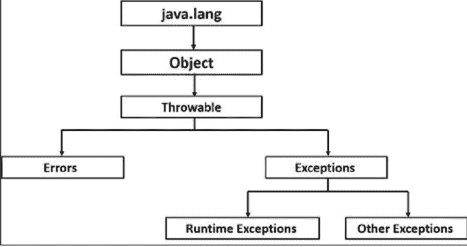

以下是 Java 最常用的受检异常和未检查异常内置异常列表。

## 内置异常

Java 在标准包中定义了多个异常类。这些异常中最通用的是标准类型 `RuntimeException` 的子类。由于 `java.lang` 被隐式导入到所有 Java 程序中，因此大多数派自 `RuntimeException` 的异常都是自动可用的。

Java 还定义了与其各种类库相关的其他类型异常。以下是 Java 未检查异常 `RuntimeException` 的列表。

| 异常 | 说明 |

| --- | --- |

| `ArithmeticException` | 算术错误，例如除以零。 |

| `ArrayOutOfBoundsException` | 数组索引越界。 |

| `ArrayStoreException` | 向不兼容的类型的数组元素赋值。 |

| `ClassCastException` | 无效的类型转换。 |

| `IllegalArgumentException` | 调用方法时使用了非法参数。 |

| `IllegalMonitorStateException` | 非法监器操作，例如在未锁的线程上等待。 |

| `IllegalStateException` | 环境或应用程序处于错误状态。 |

| `ThreadStateException` | 请求的操作与当前线程状态不兼容。 |

| `IndexOutOfBoundsException` | 某些类型的索引越界。 |

| `NegativeArraySizeException` | 使用负数大小创建数组。 |

| `NullPointerException` | 无效地使用空引用。 |

| `NumberFormatException` | 字符串到数字格式的转换无效。 |

| `SecurityException` | 尝试违反安全规定。 |

| `StringOutOfBoundsException` | 尝试访问字符串范围外的索引。 |

| `UnsupportedOperationException` | 遇到了不支持的操作。 |

以下是在 `java.lang` 中定义的 Java 受检异常的列表。

| 异常 | 说明 |

| --- | --- |

| `ClassNotFoundException` | 未找到类。 |

| `CloneNotSupportedException` | 尝试克隆一个没有实现 `Cloneable` 接口的对象。 |

| `IllegalAccessExceptionException` | 拒绝访问类。 |

| `InstantiationException` | 尝试创建抽象类或接口的实例。 |

| `InterruptedException` | 一个线程被另一个线程中断。 |

| `NoSuchFieldException` | 请求的字段不存在。 |

| `NoSuchMethodException` | 请求的方法不存在。 |

## 异常方法

以下是 `Throwable` 类中提供的重要方法列表。

| 序号 | 方法及说明 |

| --- | --- |

| 1 | `public String getMessage()` | 返回有关已发生异常的详细消息。此消息在 `Throwable` 构造函数中初始化。 |

| 2 | `public Throwable getCause()` | 返回由 `Throwable` 对象表示的异常原因。 |

| 3 | `public String toString()` | 返回类名与 `getMessage()` 结果拼接。 |

| 4 | `public void printStackTrace()` | 将 `toString()` 的结果以及堆栈跟踪打印到 `System.err`（错误输出流）。 |

| 5 | `public StackTraceElement [] getStackTrace()` | 返回一个包含堆栈跟踪中每个元素的数组。索引 0 元素表示调用堆栈的顶端，数组中的最后一个元素表示调用堆栈底部的方法。 |

| 6 | `public Throwable fillInStackTrace()` | 用当前堆栈跟踪填充此 `Throwable` 对象的堆栈跟踪，添加堆栈跟踪中之前的信息。 |

## 捕获异常

方法使用 `try` 和 `catch` 关键字的组合来捕获异常。`try/catch` 块放在可能生成异常的代码周围。`try/catch` 块内部的代码被称为受保护代码，使用 `try/catch` 的语法如下：

```
try
{
// 受保护代码
catch(Exception Name e1)
{
// 捕获块
}
```

将易发生异常的代码放在 `try` 块中。当发生异常时，该异常将由与其相关的 `catch` 块处理。每个 `try` 块后面应紧跟一个 `catch` 块或 `finally` 块。

`catch` 语句涉及声明你尝试捕获的异常类型。如果受保护代码中发生异常，将检查 `try` 之后的 `catch` 块（或多个）。如果发生的异常类型列在某个 `catch` 块中，则异常将传递给该 `catch` 块，就像传递传递方法参数一样。

## 示例

以下是一个声明了 2 个元素的数组。然后代码尝试访问数组的第 3 个元素，这将抛出异常。

```java
// 文件名：ExceptTest.java
import java.io.*;
public class ExceptTest{
    public static void main(String[] args){
        try {
            int a[] = new int[2];
            System.out.println("Access element three:" + a[3]);
        }catch(ArrayIndexOutOfBoundsException e){
            System.out.println("Exception thrown:" + e);
        }
        System.out.println("Out of the block");
    }
}
```

这将产生以下结果：

Exception thrown: java.lang.ArrayIndexOutOfBoundsException: 3

Out of the block

## 多个 Catch 块

`try` 块可以后跟多个 `catch` 块。多个 `catch` 的语法如下所示：


```
try
{
// 受保护代码
}catch(ExceptionType1 e1)
{
}catch(ExceptionType2 e2)
{
}catch(ExceptionType3 e3)
{
}
```

前面的语句演示了三个`catch`块，但你可以在单个`try`后面跟任意数量的`catch`块。如果异常类型匹配`ExceptionType`，它会在那里被捕获。这是一个示例：

```java
try
{
    file = new FileInputStream(fileName);
    x = (byte) file.read();
}catch(IOException i)
{
    i.printStackTrace();
    return -1;
}catch(FileNotFoundException f) // 无效！
{
    f.printStackTrace();
    return -1;
}
```

## 捕获多种异常

从 Java 7 开始，可以使用单个`catch`块处理多个异常，此功能简化了代码。做法如下：

```java
catch (IOException|FileNotFoundException ex) {
  logger.log(ex);
  throw ex;
}
```

## Throws/Throw 关键字

如果方法不处理受检异常，方法必须使用`throws`关键字进行声明。`throws`关键字出现在方法签名的末尾。

你可以使用`throw`关键字抛出异常，无论是新实例化的异常还是刚刚捕获的异常。尝试理解`throws`和`throw`关键字之间的区别：`throws`用于推迟受检异常的处理，而`throw`用于显式地调用异常。

以下方法声明它抛出`RemoteException`：

```java
import java.io.*;
public class className
{
  public void deposit(double amount) throws RemoteException
  {
    // 方法实现 throw new RemoteException();
  }
  // 类定义的剩余
}
```

方法可以声明抛出多个异常，在这种情况下，异常以逗号分隔的形式列出。例如，以下方法声明它抛出`RemoteException`和`InsufficientFundsException`：

```java
import java.io.*;
public class className
{
    public void withdraw(double amount) throws RemoteException, InsufficientFundsException
    {
        // 方法实现
    }
}
```

## Finally 块

`finally`块跟在`try`块或`catch`块之后。无论是否发生异常，`finally`块的代码都会执行。

使用`finally`块允许你运行任何你想要执行的清理语句，无论受保护代码发生了什么。

`finally`块出现在`catch`块的末尾，其语法如下：

```
try
{
}
catch(Exception e)
{
}
finally
{
}
```

```java
{
//Protected code
}catch(ExceptionType1 e1)
{
//Catch block
}catch(ExceptionType2 e2)
{
//Catch block
}catch(ExceptionType3 e3)
{
//Catch block
} finally
{
//The finally block always executes.
}
```

示例

```java
public class ExceptTest{

    public static void main(String args[]) {

        int a[] = new int[2];

        try {
            System.out.println("Access element three: " + a[3]);
        }catch(ArrayIndexOutOfBoundsException e) {
            System.out.println("Exception thrown :" + e);
        } finally {
            a[0] = 6;
            System.out.println("First element value: " +a[0]); 
            System.out.println("The finally statement is executed");
        }

    }

}
```

这将产生以下结果：

```
Exception thrown :java.lang.ArrayIndexOutOfBoundsException: 3
First element value: 6

The finally statement is executed
```

注意以下几点：

- `catch`句不能离开`try`语句独立。
- 当存在`try/catch`块时，并不强制要求有`finally`子句。
- `try`块不能没有`catch`句或`finally`子句。
- 任何代码不能出现在`try`、`catch`、`finally`块之间。

## try-with-resources

通常，当我们使用任何资源（如流、连接等）时，我们必须使用`finally`块显式地关闭它们。在下面的程序中，我们使用`FileReader`从文件中读取数据，并使用`finally`块关闭它。

```java
import java.io.File;
import java.io.FileReader;
import java.io.IOException;

public class ReadData_Demo {

    public static void main(String[] args) {

        FileReader fr=null;

        try{

            File file=new File("file.txt");

            fr = new FileReader(file); 

            char [] a = new char[50];

            fr.read(a); // 将内容读到数组中

            for(char c : a) {

                System.out.print(c); // 逐个打印字符

            }

        }catch(IOException e){

            e.printStackTrace();

        } finally {

            try {

                fr.close();

            }catch(IOException ex) {

                ex.printStackTrace();

            }

        }

    }

}
```

`try-with-resources`也被称为自动资源管理，是 Java 7 中引入的一种新的异常处理机制，它会自动关闭在`try`块中使用的资源。

要使用此语句，你只需要在括号内声明所需的资源，创建的资源将在块结束时自动关闭。以下是`try-with-resources`语句的语法。

```java
try(FileReader fr=new FileReader("file path"))
{
    // 使用资源
}catch(IOException e) {
    // catch 体
}
```

以下是使用`try-with-resources`语句从文件中读取数据的程序。

```java
import java.io.FileReader;
import java.io.IOException;

public class Try_with_Demo {

    public static void main(String args[]) throws IOException {

        try(FileReader fr=new FileReader("E:///file.txt")){

            char [] a=new char[50];

            fr.read(a); // 将内容读到数组中

            for(char c : a) {

                System.out.print(c); // 逐个打印字符

            }

        } catch(IOException e) {

            e.printStackTrace();

        }

    }

}
```

在使用`try-with-resources`语句时，需要记住以下几点：

- 要配合`try-with-resources`语句使用类，它必须实现`close()`方法，且该方法在运行时会被自动调用。
- 你可以在`try-with-resources`语句中声明多个类。
- 当你在`try-with-resources`语句的`try`块中声明多个类时，这些类将以反向顺序关闭。
- 除了在括号内的资源声明外，其他一切与普通的`try/catch`块的`try`块相同。

在`try`中声明的资源会在`try`块开始之前被实例化。

在`try`块处声明的资源被隐式地声明为`final`。

## 自定义异常

你可以在 Java 中创建自己的异常。在编写自己的异常类时，请记住以下几点：

- 所有异常必须是`Throwable`的子类。
- 如果你想写一个由 Handle 或 Declare 规则自动强制执行的检查异常（checked exception），你需要扩展`Exception`类。
- 如果你想写一个运行时异常（runtime exception），你需要扩展`RuntimeException`类。

我们可以如下所示定义自己的`Exception`类：

```java
class MyException extends Exception {
```

你只需要扩展预定义的`Exception`类来创建你自己的`Exception`。这些被视为检查异常。接下来的`InsufficientFundsException`类是一个扩展了`Exception`类的自定义异常，使其成为一个检查异常。异常类就像任何其他类一样，包含了有用的字段和方法。

## 示例

```java
// 文件名 InsufficientFundsException.java 
import java.io.*;

public class InsufficientFundsException extends Exception
{
    private double amount;

    public InsufficientFundsException(double amount)
    {
        this.amount = amount;
    }

    public double getAmount()
    {
        return amount;
    }
}
```

为了演示使用我们的自定义异常，下面的`CheckingAccount`类包含一个抛出`InsufficientFundsException`的`withdraw()`方法。

```java
// 文件名 CheckingAccount.java
import java.io.*;

public class CheckingAccount {
    private double balance;
    private int number;

    public CheckingAccount(int number) {
        this.number = number;
    }

    public void deposit(double amount) {
        balance += amount;
    }

    public void withdraw(double amount) throws InsufficientException {
        if(amount <= balance) {
            balance -= amount;
        } else {
            double needs = amount - balance;
            throw new InsufficientException(needs);
        }
    }

    public double getBalance() {
        return balance;
    }

    public int getNumber() {
        return number;
    }
}
```

```java
// 文件名 BankDemo.java
public class BankDemo {
    public static void main(String[] args) {
        CheckingAccount c = new CheckingAccount(101);

        try {
            c.deposit(500);
            System.out.println("Depositing $500...");
        } catch (Exception e) {
            e.printStackTrace();
        }

        try {
            c.withdraw(100);
            System.out.println("Withdrawing $100...");
        } catch (Exception e) {
            e.printStackTrace();
        }

        try {
            c.withdraw(600);
            System.out.println("Withdrawing $600...");
        } catch (InsufficientException e) {
            System.out.println("Sorry, but you short $" + e.getAmount());
        }
    }
}
```

编译所有上面的文件并运行`BankDemo`。这将产生以下结果：

```
Depositing $500...
Withdrawing $100...
Withdrawing $600...
Sorry, but you short $200.0
InsufficientFundsException
at CheckingAccount.withdraw(CheckingAccount.java:25)
at BankDemo.main(BankDemo.java:13)
```

## 异常

在 Java 中，可以定义两类异常和错误：

- JVM 异常：由 JVM 专门或逻辑上抛出的异常/错误。例如：`NullPointerException`、`ArrayIndexOutOfBoundsException`、`ClassCastException`。
- 程序化异常：由应用程序或 API 显式抛出的异常。例如：`IllegalArgumentException`、`IllegalStateException`。

## 内部类

在本章中，我们将讨论 Java 的内部类。

## 嵌套类

在 Java 中，就像方法一样，类的变量也可以有一个类作为其成员。在 Java 中允许在类内部编写类。在内部编写的类被称为嵌套类，持有内部类的类被称为外部类。

# 内部类（非静态嵌套类）

内部类是 Java 的一种安全机制。我们知道类不能与访问修饰符关联，但如果我们把类作为另一个类的成员，那么内部类就可以是私有的。这也被用于访问类的私有成员。

## 内部类

创建一个内部类非常简单。你只需要在类内部编写一个类。与类不同，内部类可以是私有的，并且一旦声明一个私有的内部类，它无法从类外部的对象被访问。

以下是创建内部类并访问它的程序。在给定的示例中，我们将内部类设为私有并通过方法访问该类。

```java
class Outer_Demo{
    int num;

    //内部类
    private class Inner_Demo{
        public void print(){
            System.out.println("This is an inner class");
        }
    }

    // 在 void display_Inner() 方法中访问内部类
    void display_Inner() {
        Inner_Demo inner = new Inner_Demo();
        inner.print();
    }
}

public class My_class{
    public static void main(String args[]){
        // 实例化外部类
    }
}
```


`Outer_Demo outer = new Outer_Demo();`

// 调用 `display_Inner()` 方法

`outer.display_Inner();`

你可以观察到 `Outer_Demo` 是外部类，`Inner_Demo` 是内部类，`display_Inner()` 是我们在其中实例化内部类的方法，该方法是从 `main` 方法中调用的。

如果你编译并执行上述程序，将得到以下结果。

```
This is an inner class.
```

## 访问私有成员

如前所述，内部类也被用于访问类的私有成员。假设一个类拥有私有成员，为了访问它们，在类中编写一个内部类，从内部类的方法中返回这些私有成员，最后，从另一个类（你想要访问这些私有成员的类）调用内部类的 `getValue()` 方法。

要实例化内部类，最初你必须实例化外部类。之后，使用外部类的对象，以下是你可以实例化内部类的方法。

```java
Outer_Demo outer=new Outer_Demo();
Outer_Demo.Inner_Demo inner=outer.new Inner_Demo();
```

下面的程序展示了如何使用内部类访问类的私有成员。

```java
class Outer_Demo {

    // 外部类的私有变量 
    private int num= 175;

    // 内部类
    public class Inner_Demo{
        public int getNum(){
            System.out.println("This is the getnum method of the inner class");
            return num;
        }
    }
}

public class My_class2{
    public static void main(String args[]){
        // 实例化外部类
        Outer_Demo outer=new Outer_Demo();

        // 实例化内部类
        Outer_Demo.Inner_Demo inner=outer.new Inner_Demo();
        System.out.println(inner.getNum());
    }
}
```

如果你编译并执行上述程序，将得到以下结果。

```
The value of num in the class Test is: 175
```

## 方法局部内部类

在 Java 中，我们可以在方法内部编写一个类，这将是一个局部类型。就像局部变量一样，内部类的作用域被限制在方法内部。

方法局部内部类只能在定义该内部类的方法中实例化。下面的程序展示了如何使用方法局部内部类。

```java
public class Outerclass {

    // 外部类的实例方法 
    void my_Method(){
        int num = 23;

        // 方法局部内部类 
        class MethodInner_Demo{
            public void print(){
                System.out.println("This is method inner class "+num);
            }
        } // 内部类结束

        // 访问内部类
        MethodInner_Demo inner = new MethodInner_Demo();
        inner.print();
    }

    public static void main(String args[]) { 
        Outerclass outer = new Outerclass();
        outer.my_Method();
    }
}
```

如果你编译并执行上述程序，将得到以下结果。

```
This is method inner class 23
```

## 匿名内部类

没有类名声明的内部类被称为匿名内部类。在匿名内部类的情况下，我们同时对其进行声明和实例化。通常，每当你需要重写类或接口的方法时，就会使用它们。匿名内部类的语法如下：

```java
AnonymousInner an_inner = new AnonymousInner(){
    public void my_method(){
        ....
        ...
    }
};
```

下面的程序展示了如何使用匿名内部类重写类的方法。

```java
abstract class AnonymousInner {
    public abstract void mymethod();
}

public class Outer_class {
    public static void main(String args[]){ 
        AnonymousInner inner = new AnonymousInner(){
            public void mymethod(){
                System.out.println("This is an example of anonymous inner class");
            }
        };
        inner.mymethod();
    }
}
```

如果你编译并执行上述程序，将得到以下结果。

```
This is an example of anonymous inner class
```

同样，你也可以使用匿名内部类重写具体类以及接口的方法。

## 匿名内部类作为参数

通常，如果一个方法接受接口、抽象类或具体类的对象，那么我们就可以实现接口、扩展抽象类，并将对象传递给方法。如果是一个类，那么我们可以直接将其传递给方法。

但在所有三种情况下，你都可以传递一个匿名内部类。如果是一个类，那么我们可以直接将其传递到方法。以下是传递匿名内部类的方法：

```java
AnonymousInner an_inner = new AnonymousInner
    public void my_method my
}
```

下面的程序展示了如何使用匿名内部类传递类的方法。

```java
interface Message {
    String greet();
}

class class_ {
    public void displayMessage(Message m){
        System.out.println(m.greet() + ", This is an example of anonymous inner class");        
}

public class My_class {
    public static void main(String args[]){
        class_ obj = new class_();
        obj.displayMessage(new Message()
{
            public String greet(){
                return "Hello";
            }
        });
    }
}
```

如果你编译并执行上述程序，将得到以下结果。

```
Hello, This is an example of anonymous inner class
```

## 静态嵌套类

静态嵌套类是外部类的静态成员。它可以在实例化外部类的情况下被访问。就像静态成员一样，静态嵌套类无法访问类的实例变量。静态嵌套类的语法如下：

```java
class Outer {
    static class Nested_Demo{
}
```

实例化静态嵌套类与实例化内部类不同。下面的程序展示了如何使用静态嵌套类。

```java
public class Outer{
    static class Nested_Demo{
        public void my_method(){
            System.out.println("This is nested class");
        }
    }

    public static void main(String args[]) {
        Outer.Nested_Demo nested = new Outer.Nested_Demo();
        nested.my_method();
    }
}
```

如果你编译并执行上述程序，将得到以下结果。

```
This is nested class
```

## Java 面向继承

继承可以定义为一个类获取另一个类的属性（方法和字段）的过程。通过使用继承可以层次化的方式管理信息。

继承其他属性的类被称为子类（派生类、子类），被继承的类被称为父类（基类、父类）。

## extends 关键字

`extends` 是用于继承类属性的关键字。以下是 `extends` 关键字的语法。

```java
class Super{
....
}
class Sub extends Super{
....
....
}
```

## 示例代码

这是一个演示 Java 继承的示例。示例中，你可以观察到两个类：`Calculation` 和 `My_Calculation`。

使用 `extends` 关键字，`My_Calculation` 继承了 `Calculation` 类的 `addition()` 和 `Subtraction()` 方法。

将以下程序复制粘贴到名为 `My_Calculation.java` 的文件中。

```java
class Calculation {
    int z;

    public void addition(int x, int y) {
        z = x+y;
        System.out.println("The sum of the given numbers:"+z);
    }

    public void Subtraction(int x,int y) {
        z = x-y;
        System.out.println("The difference between the given numbers:"+z);
    }
}

public class My_Calculation extends Calculation {
    public void multiplication(int x, int y) {
        z = x*y;
        System.out.println("The product of the given numbers:"+z);
    }

    public static void main(String args[]) {
        int a = 20, b = 10;
        My_Calculation demo = new My_Calculation();
        demo.addition(a, b);
        demo.Subtraction(a, b);
        demo.multiplication(a, b);
    }
}
```

如下所示编译并执行上述代码。

```
javac My_Calculation.java
java My_Calculation
```

执行程序后，将产生以下结果。

```
给定数字的和:30
给定数字的差:10
给定数字的积:200
```

在给定的程序中，当创建 `My_Calculation` 类的对象时，在该对象内部会创建一个父类内容的副本。这就是为什么使用子类的对象可以访问父类的成员的原因。

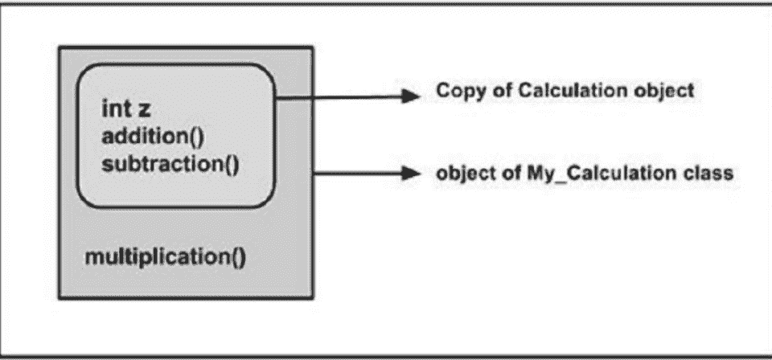

父类引用变量可以持有子类对象，但使用该变量只能访问父类的成员，因此，为了访问两个类的成员，建议始终创建指向子类的引用变量。

如果你考虑上述程序，可以像下面所示实例化该类。但使用父类引用变量（在此例中为 `cal`）你无法调用属于子类 `My_Calculation` 的方法。

```
Calculation cal = new My_Calculation();
demo.addition(a, b);
demo.Subtraction(a, b);
```

注意 - 子类继承其父类的所有成员（字段、方法和嵌套类）。构造函数不是成员，因此它们不会被子类继承，但可以从子类调用父类的构造函数。

## super 关键字

`super` 关键字类似于 `this` 关键字。以下是使用 `super` 关键字的场景：

- 如果父类成员与子类成员同同名，它被用于区分它们。
- 它用于从子类中调用。

## 区分成员

如果一个类继承了另一个类的属性，并且如果父类的成员名称与子类相同，我们像下面所示使用 `super` 关键字来区分这些变量。

```
super.variable super.method();
```

## 示例代码

本章为你提供了一个演示 `super` 关键字用法的程序。

在给定的程序中，你有两个类，即 `Sub_class`，它们都有一个名为 `display()` 具有不同实现的方法，以及一个具有不同值的变量 `num`。我们正在调用两个类的 `display()` 方法并打印两个类的变量 `num` 的值。在这里你可以观察到，我们使用了 `super` 关键字来区分父类和子类的成员。

将程序复制并粘贴到名为 `Sub_class.java` 的文件中。

```java
class Super_class{
    int num = 20;

    //父类的 display 方法
    public void display(){
        System.out.println("This is the display method of superclass");
    }
}

public class Sub_class extends Super_class {
    int num = 10;

    //子类的 display 方法
    public void display(){
        System.out.println("This is the display method of subclass");
    }

    public void my_method(){
        // 实例化子类
        Sub_class sub = new Sub_class();

        // 调用子类的 display() 方法
        sub.display();

        // 调用父类的 display() 方法
        super.display();

        // 打印子类变量 num 的值
        System.out.println("value of the variable named num in sub class:"+sub.num);

        // 打印父类变量 num 的值
        System.out.println("value of the variable named num in super class:"+super.num);
    }

    public static void main(String args[]) {
        Sub_class obj = new Sub_class();
        obj.my_method();
    }
}
```

使用以下语法编译并执行上述代码。

```
javac Super_Demo
java Super_Demo
```

执行程序后，你将得到以下结果 –

```
This is the display method of subclass
This is the display method of superclass
value of the variable named num in sub class:10
value of the variable named num in super class:20
```

## 调用父类构造函数

如果一个类继承了另一个类的属性，子类会自动获取父类的默认构造函数。但如果你想调用父类的参数构造函数，你需要像下面所示使用 `super` 关键字。

```java
super(values);
```

## 示例代码

本章提供的程序演示了如何使用 `super` 关键字来调用父类的参数构造函数。该程序包含一个父类和一个子类，其中父类包含一个接受字符串值的参数构造函数，我们使用了 `super` 关键字来调用父类的参数化构造函数。

将以下程序复制并粘贴到名为 `Subclass.java` 的文件中。

```java
class Superclass{
  int age;

  Superclass(int age) {
    this.age = age;
  }

  public void getAge() {
    System.out.println("The value of the variable named age in super class is: " +age);
  }
}

public class Subclass extends Superclass { 
Subclass(int age) {
  super(age);
```


使用以下语法编译并执行上述代码：

```
javac Subclass
java Subclass
```

执行程序后，你将得到以下结果：

```
The value of the variable named age in super class is: 24
```

## IS-A 关系

IS-A 是一种表示方式：该对象是某种的类型。让我们看看如何使用 `extends` 关键字来实现继承。

```java
class Animal {
}

class Mammal extends Animal {
}

class Reptile extends Animal {
}

class Dog extends Mammal {
}
```

现在，根据上面的示例，在面向对象的术语中：

- `Animal` 是 `Mammal` 的父类。
- `Animal` 是 `Reptile` 的父类。
- `Mammal` 和 `Reptile` 是 `Animal` 的子类。

现在，如果我们考虑 IS-A 关系，我们可以说：

- `Mammal` 是 `Animal`
- `Reptile` 是 `Animal`
- `Dog` 是 `Mammal`

因此：`Dog` 是 `Animal`

通过使用 `extends` 关键字，子类将能够继承父类的所有属性，除了父类的私有属性。

### 示例

```java
class Animal {
}

class Mammal extends Animal {
}

class Reptile extends Animal {
}

public class Dog extends Mammal {

    public static void main(String args[]) {

        Animal a = new Animal();

        Mammal m = new Mammal();

        Dog d = new Dog();

        System.out.println(m instanceof Animal);

        System.out.println(d instanceof Animal);

        System.out.println(m instanceof Animal);

        System.out.println(d instanceof Animal);

    }

}
```

这将产生以下结果：

```
true true true
```

由于我们已经很好地理解了 `extends` 关键字，让我们来看看如何使用 `implements` 关键字来获取 IS-A 关系。

通常，`implements` 关键字用于类继承接口的属性。接口永远无法被类扩展。

### 示例

```java
public interface Animal {
}

public class Mammal implements Animal {
}

public class Dog extends Mammal {
}
```

## instanceof 关键字

让我们使用 `instanceof` 运算符来检查 `Mammal` 是否真的是 `Animal`，以及 `Dog` 是否真的是 `Animal`。

```java
interface Animal {}

class Mammal implements Animal{}

public class Dog extends Mammal {

    public static void main(String args[]) {

        Mammal m = new Mammal(); 

        Dog d = new Dog();

        System.out.println(m instanceof Animal); 

        System.out.println(d instanceof Mammal); 

        System.out.println(d instanceof Animal);

    }

}
```

## HAS-A 关系

这些关系主要基于用法。它决定了某个类是否拥有某个东西。这种关系有助于减少代码重复和错误。

让我们来看一个示例：

```java
public class Vehicle{}

public class Speed{}

public class Van extends Vehicle{

    private Speed sp;

}
```

在面向对象的特性中，用户不需要操心哪个对象在执行实际工作。为了实现这一点，`Van` 类为 `Van` 类的用户隐藏了实现细节。因此，基本上发生的情况是用户要求 `Van` 类执行某个动作，而 `Van` 类要么自己完成工作，要么请求另一个类来执行该动作。

## 继承类型

如下所示，有多种继承类型。

| 类型 | 类 | 代码 |
| :--- | :--- | :--- |
| 单继承 | Class A | `public class A {` |
| | | `..............` |
| | | `}` |
| | Class B | `public class B extends A {` |
| | | `..............` |
| | | `}` |
| 多级继承 | Class A | `public class A {..............}` |
| | Class B | `public class B extends A {..............}` |
| | Class C | `public class C extends B {..............}` |
| 层次结构继承 | Class A | `public class A {..............}` |
| | Class B | `public class B extends A {..............}` |
| | Class C | `public class C extends A {..............}` |
| 多重继承 | Class A | `public class A {..............}` |
| | Class B | `public class B {..............}` |
| | Class C | `public class C extends A,B {` |
| | | `}` // Java 不支持多重继承 |

一个非常重要的事实是 Java 不支持多重继承。这意味着一个类不能继承超过一个类。因此，以下代码是非法的：

```java
public class extends Animal, Mammal{ {}
```

然而，一个类可以实现一个或多个接口，这帮助 Java 解决了多重继承无法实现的问题。

## 重写 (Overriding)

在上一章中，我们讨论了超类和子类。如果一个类从它的超类中继承了一个方法，那么只要该方法没有被标记为 `final`，就有机会重写该方法。

重写的好处是：能够定义一种特定于子类类型的行为，这意味着子类可以根据其需求实现父类方法。

在面向对象的术语中，重写意味着重写一个现有方法的功能。

### 示例

让我们来看一个例子。

```java
class Animal {

  public void move() {

    System.out.println("Animals can move");

  }

}

class Dog extends Animal {

  public void move() {

    System.out.println("Dogs can walk and run");

  }

}

public class TestDog {

    public static void main(String[] args[]) {

        Animal a = new Animal(); // Animal 引用和对象

        Animal b = new Dog(); // Animal 引用但 Dog 对象

        a.move();//运行 Animal 类中的方法

        b.move();//运行 Dog 类中的方法

    }

}
```

这将产生以下结果：

- Animals can move
- Dogs can walk and run

在上面的示例中，你可以看到尽管 `b` 是 `Animal` 类型，但它运行的是 `Dog` 类中的 `move` 方法。其由于是：在编译时，会对引用类型进行检查。但在运行时，JVM 会确定对象类型并运行属于特定对象的方法。

因此，在上面的示例中，程序将正常编译，因为 `Animal` 类拥有 `move` 方法。然后，在运行时，它运行特定于该的方法。

考虑以下示例：

```java
class Animal {

    public void move() {

        System.out.println("Animals can move");

    }

}

class Dog extends Animal {

    public void move(){

        System.out.println("Dogs can walk and run");

    }

    public void bark(){

        System.out.println("Dogs can bark");

    }

}

public class TestDog {

    public static void main(String[] args){

        Animal a = new Animal(); // Animal 引用和对象

        Animal b = new Dog(); // Animal 引用但 Dog 对象

        a.move();//运行 Animal 类中的方法 

        b.move();//运行 Dog 类中的方法

        b.bark();

    }

}
```

这将产生以下结果：

```
TestDog.java:30: cannot find symbol
symbol : method bark()
location: class Animal

b.bark();
^
```

该程序将抛出编译错误，因为 `b` 的引用类型没有名为 `bark` 的方法。

### 方法重写的规则

- 参数列表应与被重写方法的完全相同。
- 返回类型应该是与超类中原始被重写方法的返回类型相同，或其子类型。
- 访问级别不能比重写方法的访问级别更严格。例如：如果超类方法声明为 `public`，则子类中的重写方法不能是 `private` 或 `protected`。
- 实例方法只有在被子类继承时才能被重写。
- 声明为 `final` 的方法不能重写。
- 声明为 `static` 的方法不能重写，但可以重新声明。
- 如果方法不能被继承，则不能被重写。
- 与实例超类处于同一个包中的子类可以重写任何未声明为 `private` 或 `final` 的超类方法。
- 不同包中的子类只能重写声明为 `public` 或 `protected` 的非-final 方法。
- 重写方法可以抛出任何未检查异常，无论被重写方法是否抛出异常。然而，重写方法不应抛出比被重写方法声明的新或更广泛的检查异常。重写方法可以抛出更窄或少的异常。
- 声明为 `final` 的方法不能重写。

## super 关键字

当调用重写方法的父类版本时使用 `super` 关键字。

```java
class Animal {

    public void move() {

        System.out.println("Animals can move");

    }

}

class Dog extends Animal {

    public void move() {

        super.move(); // 调用父类方法

        System.out.println("Dogs can walk and run");

    }

}

public class TestDog {

    public static void main(String args[]) {

        Animal b = new Dog(); // Animal 引用但 Dog 对象

        b.move();//运行 Dog 类中的方法

    }

}
```

这将产生以下结果：

```
Animals can move
Dogs can walk and run
```

## 多态

多态是对象具有多种形式的能力。多态最常见的用法发生在父类引用引用子类对象时。

任何能够通过多个 IS-A 测试的对象都被认为是多态的。在 Java 中，所有对象都是多态的，因为任何对象都会通过其自身类型和 `Object` 类的 IS-A 测试。

重要的是，访问对象的唯一可能方法是通过引用变量。引用变量只能有一种类型。一旦声明，引用变量的类型无法更改。

只要引用变量不是 `final`，就可以将其重新赋值给其他对象。引用变量的类型将决定它可以在对象上调用的方法。

引用变量可以引用其声明类型的任何对象或其声明类型的子类型。引用变量可以声明为类或接口类型。

### 示例

让我们来看一个例子。

```java
public interface Vegetarian {}
```

```java
public class Animal{}
```

```java
public class Deer extends Animal implements Vegetarian{}
```

现在，`Deer` 类被认为是多态的，因为这具有多重继承。对于上述示例如下：

- A Deer IS-A Animal
- A Deer IS-A Vegetarian
- A Deer IS-A Deer
- A Deer IS-A Object

当引用变量事实应用于 `Deer` 对象引用时，以下声明是合法的：

```java
Deer d = new Deer();

Animal a = d;

Vegetarian v = d;

Object o = d;
```

所有的引用变量 `d`, `a`, `v`, `o` 都指向堆中的同一个 `Deer` 对象。

## 虚拟方法

在本章中，我将向你展示 Java 中重写方法的行为如何允许你在设计类时利用多态性。

我们已经讨论了方法重写，子类可以重写父类中的方法。被重写的方法本质上隐藏在父类中，除非子类在重写方法中使用 `super` 关键字，否则它不会被调用。

```java
/* File name : Employee.java */
public class Employee

{

    private String name; private String address; private int number;

    public Employee(String name, String address, int number)

    {

    System.out.println("Constructing an Employee");

    this.name = name; this.address = address; this.number = number;

    }

    public void mailCheck()

    {

    System.out.println("Mailing a check to " + this.name + " " + this.address);

    }

    public String toString()

    {

    return name + " " + address + " " + number;

    }

    public String getName()

    {

        return name;

    }

    public String getAddress()

    {

        return address;

    }

}
```

```java
public void setAddress(String newAddress)

{

    address = newAddress;

}

public int getNumber()

{

    return number;

}
```

现在假设我们如下扩展了 `Employee` 类：

```java
/* File name : Salary.java */
public class Salary extends Employee

{

    private double salary; //Annual salary

    public Salary(String name, String address, int number, double salary)

    {

        super(name, address, number);

        setSalary(salary);

    }

    public void mailCheck()

    {

        System.out.println("With mailCheck of Salary class ");

        System.out.println("Mailing check to " + getName() + " with salary " + salary);

    }

}
```


`public double getSalary()`

```
{}

```

```java
return salary;
}

public void setSalary(double newSalary)
{
    if(newSalary >= 0.0)
    {
        salary = newSalary;
    }
}

public double computePay()
{
    System.out.println("Computing salary pay for " + getName());
    return salary/52;
}
```

现在，请仔细学习以下程序并尝试确定它的输出：

```java
/* File name : VirtualDemo.java */
public class VirtualDemo
{
    public static void main(String [] args)
    {
        Salary s = new Salary("Mohd Mohtashim", "Ambehta, UP", 3, 3600.00);
        Employee e = new Salary("John Adams", "Boston, MA", 2, 2400.00);
        System.out.println("Call mailCheck using Salary reference --");
        s.mailCheck();
        System.out.println("\n call mailCheck using Employee reference--");
        e.mailCheck();
    }
}
```

这将产生以下结果：

```
Constructing an Employee
Constructing an Employee
Call mailCheck using Salary reference —
Within mailCheck of Salary class
ailing check to Mohd Mohtashim with salary 3600.0

Call mailCheck using Employeeereference—
Within mailCheck of Salary class
ailing check to John Adams with salary 2400.0
```

在这里，我们实例化了两个 `Salary` 对象。一个使用 `Salary` 引用，另一个使用 `Employee` 引用。

在调用时，编译器在编译时看到了 `Salary` 类中的 `mailCheck()`，而 JVM 在运行时调用了 `Salary` 类中的 `mailCheck()`。在 `e` 上调用 `mailCheck()` 是完全不同的，因为 `e` 是一个 `Employee` 引用。当编译器看到 `Employee` 类中的 `mailCheck()` 方法时。

在这里，在编译时，编译器使用了 `Employee` 中的 `mailCheck()` 来验证此语句。但在运行时，JVM 调用了 `Salary` 类中的 `mailCheck()`。

这种行为被称为**虚拟方法调用**（virtual method invocation），这些方法被称为**虚拟方法**。Java 中的所有方法都以这种方式运行，无论在编译时源码中使用的引用数据类型是什么，重写的方法都会在运行时调用。

## 抽象

根据字典定义，抽象（abstraction）是处理思想而非事件的性质。例如，当你考虑电子邮件（e-mail）时，发送邮件后立即会发生什么、你的电子邮件服务器使用的协议等复杂细节对用户是隐藏的。因此，发送电子邮件只需要输入内容、列出接收者地址并点击发送即可。

同样，在面向对象编程中，抽象是从用户处隐藏实现细节的过程，只向用户提供功能。换句话说，用户拥有的是关于对象做什么的信息，而不是它是如何做的。

在 Java 中，抽象是通过**抽象类**（Abstract classes）和**接口**（interfaces）实现的。

## 抽象类

在声明中包含 `abstract` 关键字的类被称为抽象类。

抽象类可以包含也可以不包含抽象方法（即没有方法体的方法 `public void get();`）。

但如果一个类至少有一个抽象方法，那么该类必须声明为抽象类。

如果一个类被声明为抽象类，它就不能被实例化。

要使用抽象类，你必须继承另一个类，并为其抽象方法提供实现。

如果你继承了一个抽象类，你必须为其所有的抽象方法提供实现。

## 示例

本章为你提供了一个抽象类的示例。要创建一个抽象类，只需在类声明的 `class` 关键字之前使用 `abstract` 关键字即可。

```java
/* File name : Employee.java */
public abstract class Employee {
    private String name;
    private String address;
    private int number;

    public Employee(String name, String address, int number)
    {
        System.out.println("Constructing an Employee");
        this.name = name;
        this.address = address;
        this.number = number;
    }

    public void mailCheck()
    {
        System.out.println("Mailing a check to " + this.name + " " + this.address);
    }

    public String toString()
    {
        return name + " " + address + " " + number;
    }

    public String getName()
    {
        return name;
    }

    public String getAddress()
    {
        return address;
    }
}
```

你可以观察到，除了抽象的，`Employee` 类与普通类是一样的。现在你可以尝试如下方式实例化 `Employee` 类：

```java
/* File name : VirtualDemo.java */
public class VirtualDemo
{
    public static void main(String [] args)
    {
        /* Following is not allowed */
        e = new Employee("George W.", "Houston, TX", 43);
    }
}
```

当你编译上面的类时，会给你以下错误：

```
Employee.java:46: Employee is abstract; cannot be instantiated
```

## 继承抽象类

我们可以像普通类一样通过如下方式继承 `Employee` 类，并继承它的属性：

```java
/* File name : Salary.java */
public class Salary extends Employee
{
    private double salary; //Annual salary

    public Salary(String name, String address, int number, double salary)
    {
        super(name, address, number);
        setSalary(salary);
    }

    public void mailCheck()
    {
        System.out.println("With mailCheck of Salary class ");
        System.out.println("Mailing check to " + getName() + " with salary " + salary);
    }

    public double getSalary()
    {
        return salary;
    }

    public void setSalary(double newSalary)
    {
        if(newSalary >= 0.0)
        {
            salary = newSalary;
        }
    }

    public double computePay()
    {
        System.out.println("Computing salary pay for " + getName());
        return salary/52;
    }
}
```

在这里，你不能实例化 `Employee` 类，但你可以实例化 `Salary` 类，并使用该实例如下面所示访问 `Employee` 类的三个字段和七个方法。

```java
/* File name : AbstractDemo.java */
public class AbstractDemo
{
    public static void main(String [] args)
    {
        Salary s = new Salary("Mohd Mohtashim", "Ambehta, UP", 3, 3600.00);
        Employee e = new Salary("John Adams", "Boston, MA", 2, 2400.00);
        System.out.println("Call mailCheck using Salary reference --");
        s.mailCheck();
        System.out.println("\n call mailCheck using Employee reference--");
        e.mailCheck();
    }
}
```

这产生了以下结果：

```
Constructing an Employee
Constructing an Employee

Call mailCheck using Salary reference —
Within mailCheck of Salary class
ailing check to Mohd Mohtashim with salary 3600.0

Call mailCheck using Employeeereference—
Within mailCheck of Salary class
ailing check to John Adams with salary 2400.0
```

## 抽象方法

如果你希望一个类包含某个特定方法，但希望该方法的实际实现由子类来决定，你可以在父类中将该方法声明为抽象（abstract）。

`abstract` 关键字用于将方法声明为抽象方法。在方法声明中，你必须在方法名之前放置 `abstract` 关键字。

抽象方法包含方法签名，但没有方法体。抽象方法不使用大括号，而是在末尾有一个分号（`;`）。

以下是抽象方法的示例：

```java
public abstract class Employee
{
    private String name;
    private String address;
    private int number;

    public abstract double computePay();
    // 类定义的剩余部分
}
```

将方法声明为抽象会有两个后果：

- 包含该方法的类必须声明为抽象类。
- 任何继承当前类的类必须重写该抽象方法，或者将其声明为抽象类。

注意：最终，后代类必须实现抽象方法；否则，你将拥有一个无法实例化的抽象类层次结构。

假设 `Salary` 类继承自 `Employee` 类，它应该如下所示实现方法：

```java
/* 文件名 : Salary.java */
public class Salary extends Employee
{
    private double salary; // 年薪

    public double computePay()
    {
        System.out.println("Computing salary pay for " + getName());
        return salary/52;
    }
    // 类定义的剩余部分
}
```

## 封装

封装是面向对象编程（OOP）的四个基本概念之一。另外三个是继承、多态和抽象。

Java 中的封装是将数据（变量）和对数据操作的代码（方法）共同封装在一个单一单元中的机制。在封装中，类的变量将对其他类隐藏，并且只能通过当前类的方法进行访问。因此，它也被称为数据隐藏。

为了在 Java 中实现封装：

- 将类的变量声明为 `private`。
- 提供公共（`public`）setter 和 getter 方法来修改和查看变量的值。

## 示例

以下是一个演示如何在 Java 中实现封装的示例：

```java
/* 文件名 : EncapTest.java */
public class EncapTest{
    private String name;
    private String idNum;
    private int age;

    public int getAge(){
        return age;
    }
}
```

```java
public String getName(){
    return name;
}
```

```java
public String getIdNum(){
    return idNum;
}

public void setAge( int newAge){
    age = newAge;
}

public void setName(String newName){
    name = newName;
}

public void setIdNum( String newId){
    idNum = newId;
}
```

`setXXX()` 和 `getXXX()` 方法是 `EncapTest` 类实例变量的访问点。通常，这些方法被称为 getters 和 setters。因此，任何想要访问变量的类应该通过这些 getters 和 setters 进行访问。

可以使用以下程序访问 `EncapTest` 类的变量：

```java
/* 文件名 : RunEncap.java */
public class RunEncap {
    public static void main(String args[]){
        EncapTest encap = new EncapTest();
        encap.setName("James");
        encap.setAge(20);
        encap.setIdNum("12345ms");
        System.out.print("Name : " + encap.getName() + " :Age :"+ encap.getAge());
    }
}
```

这将产生以下结果：

```
Name : James Age : 20
```

## 封装的优点

- 类的字段可以被设置为只读或只写。
- 类对存储在其字段中的内容具有完全控制权。
- 类的用户不知道类如何存储数据。类可以更改字段的数据类型，而类的用户不需要更改任何代码。

## 接口

接口（interface）是 Java 中的一种引用类型。它与类相似。它是一个抽象方法的集合。类实现接口，从而继承接口的抽象方法。

除了抽象方法外，接口还可以包含常量、默认方法（default methods）、静态方法（static methods）和嵌套类型。方法体仅存在于默认方法和静态方法。

编写接口与编写类相似。但类描述对象的属性和行为，而接口包含了类所实现的行为。

除非实现接口的类是抽象类，否则接口的所有方法都需要在类中定义。

接口在以下方面与类相似：

- 接口可以包含任意数量的方法。
- 接口写在 `.java` 扩展的文件中，接口名称与文件名匹配。
- 接口的字节码出现在 `.class` 文件中。
- 接口出现在包（packages）中，其对应的字节码文件必须位于与包名匹配的目录结构中。

然而，接口在几个方面与类不同，包括：

- 你不能实例化接口。
- 接口不包含任何构造方法。
- 接口中的所有方法都是抽象的。
- 接口不能包含实例字段。接口中可以出现的字段必须同时声明为 `static` 和 `final`。
- 接口不被类扩展，而是被类“实现”。
- 接口可以扩展多个接口。

## 声明接口

`interface` 关键字用于声明接口。这是一个声明接口的简单示例。

## 示例

以下是一个接口示例：

```java
/* 文件名 : NameInterface.java */
import java.lang.*;

public interface NameInterface
{
    public void eat();
    public void travel();
}
```

接口具有以下属性：

- 接口是隐式抽象的。声明接口时不需要使用 `abstract` 关键字。
- 接口中的每个方法都是隐式抽象的，因此不需要 `abstract` 关键字。
- 接口的方法是隐式公共（`public`）的。

## 实现接口

当类实现接口时，你可以将该类类为签署了合同，同意执行接口的行为。如果一个类没有执行接口的所有行为，则该类必须声明自己为抽象类。

类使用 `implements` 关键字来实现接口。`implements` 关键字出现在类声明中 `extends` 之后之后。


/* 文件名 : MammalInt.java */

```java
public class MammalInt implements Animal {

    public void eat() { System.out.println("Mammal eats"); }

    public void travel() { System.out.println("Mammal travels"); }

    public static void main(String args[]) { 

        MammalInt m = new MammalInt(); 

        m.eat();

        m.travel();

    }

}
```

这将产生以下结果：

```
Mammal eats
Mammal travels
```

在重写接口定义的方法时，需要遵循若干规则：

- 检查异常（Checked exceptions）在实现方法中的声明除了接口方法声明的异常或接口方法声明异常的子类之外。
- 重写时应保持接口方法的签名和相同的返回类型或子类型。
- 实现类本身可以是抽象的，如果是这样，则不需要实现接口方法。

一个类可以同时实现多个接口。一个类只能扩展一个类，但可以实现许多接口。

## 扩展接口

接口可以扩展另一个接口，类似于类可以扩展另一个类。`extends` 关键字用于扩展接口，子接口继承父接口的方法。

下面的 `Sports` 接口被 `Hockey` 和 `Football` 接口扩展。

```java
//文件名: Sports.java

public interface Sports

{

    public void setHomeTeam(String name);

    public void setVisitingTeam(String name);

}

//文件名: Football.java

public interface Football extends Sports

{

    public void homeTeamScored(int points);

    public void visitingTeamScored(int points);

    public void endOfQuarter(int quarter);

}

//文件名: Hockey.java

public interface Hockey extends Sports

{}
```

```java
{

  public void homeGoalScored();

  void visitingGoalScored();

  public void endOfPeriod(int period);

  void overtimePeriod(int ot);

}
```

`Hockey` 接口有四个方法，但它从 `Sports` 继承了两个；因此，实现 `Hockey` 的类需要实现所有六个方法。同样，实现 `Football` 的类需要定义 `Football` 的三个方法以及 `Sports` 的两个方法。

## 扩展多个接口

Java 类只能继承一个父类。不允许多重继承。然而，接口不是类，一个接口可以扩展多个父接口。

`extends` 关键字只使用一次，父接口用以逗号分隔的列表形式列出。

例如，如果 `Hockey` 接口同时扩展 `Sports` 和 `Event`，那么它的声明方式如下：

```java
public interface Hockey extends Sports, Event
```

## 标记接口

扩展接口最常见的用法发生在父接口不包含任何方法的情况下。例如，`java.awt.event` 包中的 `MouseListener` 接口扩展了 `java.util.EventListener`，后者的定义如下：

```java
package java.util;

public interface EventListener
```

```java
{}
```

没有任何方法的接口被称为**标记接口**（tagging interface）。
标记接口有两个基本的设计目的：

- **创建一个公共父类**：就像 `EventListener` 接口一样（它是 Java API 中几十个其他接口的扩展），你可以使用标记接口为接口组创建一个公共父类。例如，当一个接口扩展 `EventListener` 时，JVM 知道该接口将用于事件委托场景。

- **为类添加数据类型**：这就是“标记”（tagging）一词的来源。实现标记接口的类不需要定义任何方法（因为接口本身没有方法），但该类通过多态变成了一个接口类型。

## 包 (Packages)

Java 中使用包是为了防止命名冲突、控制访问权限、方便地搜索/定位以及使用类、接口、枚举和注解等。

一个包（Package）可以被定义为相关类型（类、接口、枚举和注解）的组合，提供访问保护和命名空间管理。

Java 中一些现包包括：

- `java.lang`：封装了基础类
- `java.io`：用于输入、输出函数的类封装在这个包中

程序员可以定义自己的包来封装一组类/接口等。将你实现的相关的类进行分组是一种良好的做法，这样程序员就可以轻松判断这些类、接口、枚举和注解是相互相关的。

由于包创建了新的命名空间，因此不会与其他包中的名称发生命名冲突。使用包可以更容易地提供访问控制，也更容易定位相关的类。

## 创建包

在创建包时，你应该为包选择一个名称，并在所有要包含在包中的类、接口、枚举和注解类型的源文件顶部包含一个该名称的 `package` 语句。

`package` 语句应该是源文件的第一行。每个源文件中只能有一个 `package` 语句，它适用于文件中的所有类型。

如果不使用包语句，则类、接口、枚举和注解类型将被放置在当前的默认包中。

要编译带有包语句的 Java 程序，你必须使用所示的 `-d` 选项。

```bash
javac -d Destination_folder file_name.java
```

然后会在指定的目录位置创建一个与包名相同的文件夹，编译后的类文件将放在该文件夹中。

## 示例

让我们来看创建一个名为 `animals` 包的示例。使用小写字母作为包名是一种良好的做法，可以避免与类和接口的名称冲突。

接下来的包示例包含一个名为 `Animal` 的接口：

```java
/* 文件名 : Animal.java */

package animals;

interface Animal {

    public void eat();

    public void travel();

}
```

现在，让我们在同一个包中实现上述接口：

```java
package animals;

/* 文件名 : Mammal.java **/

public class Mammal implements Animal {

    public void eat() { 

        System.out.println("Mammal eats");

    }

    public void travel() { 

        System.out.println("Mammal travels")

    }

    public int noOfLegs() {

        return 0;

    }

    public static void main(String args[]) { 

        Mammal m = new Mammal();

        m.eat();

        m.travel();

    }

}
```

现在按照所示编译 Java 文件：

```bash
$ javac -d . Animal.java

$ javac -d . Mammal.java
```

现在当前目录下会创建一个名为 `animals` 的包/文件夹，这些类文件将如所示放在其中。


你可以执行包内的类文件并获得下所示的结果。

```bash
$ java animals.Mammal

mammal eats

mammal travels
```

## import 关键字

如果一个类想要使用同一个包中的另一个类，则不需要使用包名。同包中的类互为寻址（find each other），不需要任何特殊语法即可找到对方。

## 示例

在这里，一个名为 `Boss` 的类被添加到已经包含 `Employee` 的 `payroll` 包中。然后 `Boss` 可以在不使用 `payroll` 前缀的情况下引用 `Employee` 类，如下所示的 `Boss` 类。

```java
package payroll;

public class Boss {

    public void payEmployee(Employee e) {

        e.mailCheck();

    }

}
```

如果 `Employee` 类不在 `payroll` 包中会怎样？`Boss` 类必须使用以下技术来引用不同包中的类：

- 可以使用类的**完全限定名**（fully qualified name）。例如：
```java
payroll.Employee
```

- 使用 `import` 关键字和通配符 (`*`) 导入包。例如：
```java
import payroll.*;
```

- 使用 `import` 关键字导入类本身。例如：
```java
import payroll.Employee;
```

注意：一个类文件可以包含任意数量的 `import` 语句。`import` 语句必须出现在 `package` 语句之后类声明之前。

## 包的目录结构

当类放在包中时，会发生两个结果：

- 包名成为类名的一部分，正如我们在上一章中讨论的那样。
- 包名必须与字节码所在的目录结构相匹配。

这里是在 Java 中管理文件的简单方法：

将类、接口、枚举或注解类型的源码放在一个文本文件中，文件名为该类型的简单名，扩展名为相应的后缀，例如：

```java
// 文件名 : Car.java

package vehicle;

public class Car {

    // 类实现

}
```

现在，将源文件放在与该类所属包名命名的目录中：

```
...\vehicle\Car.java
```

现在，限定类名和路径名如下：

类名 -> `vehicle.Car`
路径名 -> `vehicle\Car.java` (在 Windows 中)

通常，公司使用其反转的互联网域名作为包名。如果公司的互联网域名是 `apple.com`，那么所有的包名都会以 `com.apple` 开头。包的每个组件对应一个子目录。

如果公司有一个 `com.apple.computers` 包，其中包含一个 `Dell.java` 源文件，它将被包含在如下子目录中：

```
...com\apple\computers\Dell.java
```

```java
class Ups{

}
```

现在，使用 `-d` 选项如下如下编译此文件：

```bash
$javac -d . Dell.java
```

文件将编译如下：

```
.\com\apple\computers\Dell.class
\com\apple\computers\Ups.class
```

你可以按照如下方式导入 `\com\apple\computers\` 中定义的所有类或接口：

```java
import com.apple.computers.*;
```

与 `.java` 源文件一样，编译后的 `.class` 文件也应该位于一系列反映包名的目录中。然而，`.class` 文件的路径不需要与 `.java` 源文件的路径相同。你可以分别安排你的源目录和类目录，例如：

```
\sources\com\apple\computers\Dell.java

\classes\com\apple\computers\Dell.class
```

通过这种方法，可以向其他程序员提供类目录的访问权限，而无需暴露你的源代码。你还需要以这种方式管理源文件和类文件，以便编译器和 Java 虚拟机（JVM）能够找到你的程序所使用的所有类型。

类目录的完整路径 `\classes` 被称为类路径（class path），并通过系统变量 `CLSPATH` 设置。编译器和 JVM 都会通过将包名添加到类路径中来构建你的 `.class` 文件的路径。

假设 `\classes` 是类路径，包名为 `com.apple.computers\com\apple\computers`，那么编译器和 JVM 将在两个……中查找 `.class` 文件。

类路径可以包含多个路径。多个路径之间应该用分号（Windows）或冒号（Unix）分隔。默认情况下，编译器和 JVM 会搜索当前目录以及包含 Java 平台类的 JAR 文件，因此这些目录会自动在类路径中。

## 设置 CLSPATH 系统变量

要显示当前的 `CLSPATH` 变量，请在 Windows 和 UNIX (Bourne shell) 中使用以下命令：

```cmd
In Windows -> C:\> set CLSPATH

In UNIX -> % echo $CLASSPATH
```

要删除 `CLSPATH` 变量的当前内容，使用：

```cmd
In Windows -> C:\> set CLSPATH=

In UNIX -> % unset CLSPATH; export CLSPATH
```

要设置 `CLSPATH` 变量：

```cmd
In Windows -> set CLSPATH=C:\users\jack\java\classes

In UNIX -> % CLASSPATH=/home/jack/java/classes; export CLASSPATH
```

# III

# Java 高进

## 数据结构

Java 工具包提供的的数据结构非常强大，并具有广泛广泛的功能。这些数据结构由以下接口和类组成：

- `Enumeration`（枚举器）
- `BitSet`
- `Vector`（向量）
- `Stack`（栈）
- `Dictionary`（字典）
- `Hashtable`（哈希表）
- `Properties`（属性）

所有这些类现在都是旧有的，Java-2 引入了一个名为 `Collections Framework` 的新框架，它将在下一章进行讨论。

## Enumeration 接口

`Enumeration` 接口本身并不是一种数据结构，但在其他数据结构的上下文中非常重要。`Enumeration` 接口定义了从数据结构中检索连续元素的方法。

例如，`Enumeration` 定义了一个名为 `nextElement` 的方法，用于获取包含多个元素的数据结构中的下一个元素。

## Enumeration 接口

`Enumeration` 接口定义了你可以对对象集合中的元素进行枚举（一次获取一个）的方法。

这个遗留接口已被 `Iterator` 代替。虽然 `Enumeration` 没有被废弃，但对于新代码来说，它被认为是过时的。然而，它被 `Vector` 和 `Properties` 等遗留类定义的若干方法使用，也被许多其他 API 类使用，并且目前在应用程序代码中被广泛使用。

`Enumeration` 声明的方法总结如下表所示：

| 序号 | 方法及描述 |
|---|---|
| 1 | **boolean hasMoreElements()** 实现时，当仍有更多元素待提取时，必须返回 `true`；当所有元素都已枚举完毕时，返回 `false` |
| 2 | **Object nextElement()** 这返回枚举中的下一个对象，其类型为通用的 `Object` 引用。 |

## 示例

以下是一个显示 `Enumeration` 用法的示例。

```java
import java.util.Vector;

import java.util.Enumeration;

public class EnumerationTester {

    public static void main(String[] args) { 

        Enumeration days;

        Vector dayNames = new Vector();

        dayNames.add("Sunday");

        dayNames.add("Monday");

        dayNames.add("Tuesday");

        dayNames.add("Wednesday");

        dayNames.add("Thursday");

        dayNames.add("Friday");

        dayNames.add("Saturday");

        days = dayNames.elements();

        while (days.hasMoreElements()) { 

            System.out.println(days.nextElement());

        }

    }

}
```


这将产生以下结果：

- Sunday
- Monday
- Tuesday
- Wednesday
- Thursday
- Friday
- Saturday

## BitSet

`BitSet` 类实现了一组可以单独设置和清除的位或标志。当你需要跟踪一组布尔值时，这个类非常有用；你只需要为每个值分配一个位，或根据需要将其清除即可。

## BitSet 类

`BitSet` 类创建了一种特殊的数组类型，用于存储位值。`BitSet` 数组可以根据需要增大大小。这使得它类似于位向量。这是一个遗留类，但在 Java 2 中经过了工程设计。

`BitSet` 定义了以下构造函数：

| 序号 | 构造函数及描述 |
|---|---|
| 1 | `BitSet()` 此构造函数创建一个默认的 `BitSet` |
| 2 | `BitSet(int size)` 此构造函数允许指定其初始大小，所有位初始化为零 |

`BitSet` 实现了 `Cloneable` 接口并定义了下表列的方法：

| 方法 | 描述 |
|---|---|
| `void and(BitSet bitSet)` | 将调用 `BitSet` 的内容与 `bitSet` 进行与运算。结果放入调用对象中。 |
| `void andNot(BitSet bitSet)` | 对于 `bitSet` 中的每个置位，调用对象中对应的位将被清除。 |
| `void cardinality()` | 返回调用对象中的置位数量。 |
| `void clear()` | 清零所有位。 |
| `void clear(int index)` | 清零索引位。 |
| `void clear(int startIndex, int endIndex)` | 清零从 `startIndex` 到 `endIndex` 的位。 |
| `Object clone()` | 复制调用 `BitSet`。 |
| `boolean equals(Object bitSet)` | 如果位等于传递的对象，则返回 `true`；否则方法返回 `false`。 |
| `void flip(int index)` | 反转索引位。 |
| `void flip(int startIndex, int endIndex)` | 反转从 `startIndex` 到 `endIndex` 的位。 |
| `boolean get(int index)` | 返回指定索引位的状态。 |
| `BitSet get(int startIndex, int endIndex)` | 返回一个由 `startIndex` 到 `endIndex` 的位组成的 `BitSet`。调用对象不改变。 |
| `int hashCode()` | 返回调用对象的哈希码。 |
| `boolean intersects(BitSet bitSet)` | 如果调用对象和 `bitSet` 至少有一对对应位为 1，则返回 `true`。 |
| `boolean isEmpty()` | 如果调用对象中的所有位均为零，则返回 `true`。 |
| `int length()` | 返回持有调用 `BitSet` 内容所需的位数。此值由最后一个 1 位的位置决定。 |
| `int nextClearBit(int startIndex)` | 返回从指定索引开始的下一个清除位（即零位）的索引。 |
| `int nextSetBit(int startIndex)` | 返回从指定索引开始的下一个置位（即 1 位）的索引。如果没有，则返回 -1。 |
| `void or(BitSet bitSet)` | 将调用 `BitSet` 的内容与指定的 `bitSet` 进行或运算。结果放入调用对象中。 |
| `void set(int index)` | 设置索引位。 |
| `void set(int index, boolean v)` | 将索引位设置为传递的值 `v`。`true` 设置位，`false` 清除位。 |
| `void set(int startIndex, int endIndex)` | 设置从 `startIndex` 到 `endIndex` 的位。 |
| `void set(int startIndex, int endIndex, boolean v)` | 将从 `startIndex` 到 `endIndex` 的位设置为传递的值 `v`。`true` 设置位，`false` 清除位。 |
| `int size()` | 返回调用的 `BitSet` 对象中的位数。 |
| `String toString()` | 返回调用的 `BitSet` 对象的字符串表示。 |
| `void xor(BitSet bitSet)` | 将调用的 `BitSet` 对象的内容与 `bitSet` 指定的内容进行异或运算。结果存入调用的对象。 |

## 示例

以下程序说明了该数据结构支持的一些方法：

```java
import java.util.BitSet;

public class BitSetDemo {

    public static void main(String args[]) {

        BitSet bit1 = new BitSet(16);

        BitSet bit2 = new BitSet(16);

        // set some bits

        for(int i=0; i<16; i++) {

            if((i%2) == 0) bit1.set(i);

            if((i%5) != 0) bit2.set(i);

        }

        System.out.println("Initial pattern in bit1: ");

        System.out.println("\nInitial pattern in bit2: ");

        // AND

        bit2.and(bit1); System.out.println("\nbits2 AND bit1: ");

        System.out.println(bit2);

        // OR

        bit2.or(bit1); System.out.println("\nbits2 OR bit1: ");

        System.out.println(bit2);

        // XOR

        bit2.xor(bit1); System.out.println("\nbits2 XOR bit1: ");

        System.out.println(bit2);

    }

}
```

这将产生以下结果：

```
Initial pattern in bit1:

{0, 2, 4, 6, 8, 10, 12, 14}

Initial pattern in bit2:

{1, 2, 3, 4, 6, 7, 8, 9, 11, 12, 13, 14}

bits2 AND bits1:

{2, 4, 6, 8, 12, 14}

bits2 OR bits1:

{0, 2, 4, 6, 8, 10, 12, 14}

bits2 XOR bits1:

{}
```

## Vector

`Vector` 类类似于传统的 Java 数组，不同之处在于它可以根据需要增长以容纳新元素。与数组一样，`Vector` 对象的元素可以通过索引进行访问。使用 `Vector` 类的用处是，你不需要在创建时将其设置为特定大小；它会在需要时自动收缩和扩展。

## Vector 类

`Vector` 实现了一个动态数组。它与 `ArrayList` 相似，但有两个不同点：

- `Vector` 是同步的。
- `Vector` 包含许多不属于集合框架的遗留方法。

如果你预先不知道数组的大小，或者只需要一个在程序生命周期内可以改变大小的数组，`Vector` 被证明非常有用。

以下是 `Vector` 类提供的构造函数列表。

## 构造函数及描述

- `Vector()` 创建默认 `Vector`，其初始大小为 10。
- `Vector(int size)` 此构造函数接受一个等于所需大小的参数，并创建一个初始容量由 `size` 指定的 `Vector`。
- `Vector(int size, int incr)` 此构造函数创建一个初始容量由 `size` 指定、增量由 `incr` 指定的 `Vector`。增量指定了 `Vector` 向上调整大小时每次分配的元素数量。
- `Vector(Collection c)` 此构造函数创建一个包含集合 `c` 中元素的 `Vector`。

除了从父类继承的方法外，`Vector` 定义了以下方法及描述：

```
void add(int index, Object element) 在此 Vector 的指定位置插入指定的元素。

boolean add(Object o) 将指定的元素添加到此 Vector 的末尾。

boolean addAll(Collection c) 将指定集合中的所有元素添加到此 Vector 的末尾，添加顺序按照指定集合的迭代器返回的顺序。

boolean addAll(int index, Collection c) 将指定集合中的所有元素插入到此 Vector 的指定位置。

void addElement(Object obj) 将指定的组件添加到此 vector 的末尾，并将其大小增加一。

int capacity() 返回此 vector 的当前容量。

void clear() 移除此 vector 中的所有元素。

Object clone() 返回此 vector 的克隆。

boolean contains(Object elem) 测试指定的对象是否是此 vector 的组件。

boolean containsAll(Collection c) 如果此 vector 包含指定集合中的所有元素，则返回 true。

void copyTo(Object[] a, int index) 将此 vector 的组件拷贝到指定的数组中。

Object get(int index) 返回指定索引组件。

Enumeration elements() 返回此 vector 组件的枚举。

void ensureCapacity() 如果需要，增加此 vector 的容量，以确保它至少能容纳最小容量参数指定的组件数量。

boolean equals(Object o) 将指定的 Object 与此 vector 进行等性比较。

Object firstElement() 返回此 vector 的第一个组件（索引 0 项）。

Object get(int index) 返回此 vector 指定位置的元素。

int hashCode() 返回此 vector 的哈希值。

int indexOf(Object elem) 搜索给定参数的第一次出现，使用 equals 方法进行等性测试。

int indexOf(Object elem, int index) 从索引开始搜索给定参数的第一次出现，并使用 equals 方法进行等性测试。

Object set(int index, Object obj) 替换指定的元素。

boolean remove(int index) 移除指定位置的元素。

boolean remove(Object obj) 移除指定的对象。

int size() 返回 vector 中的元素数量。
```

当你从栈中弹出一个元素时，它是从栈顶出的。换句话说，你最后添加到栈中的元素是第一个被取出来的元素。

## Stack 类（栈）

`Stack` 是 `Vector` 的子类，实现了一个标准的后进先出（LIFO）栈。

`Stack` 只定义了默认构造函数，创建一个空栈。`Stack` 包含了 `Vector` 定义的所有方法，并添加了它自己的几个方法。

`Stack()`

除了继承自父类 `Vector` 的方法外，`Stack` 还定义了以下方法：

| 方法 | 描述 |
| :--- | :--- |
| `boolean empty()` | 检查此栈是否为空。如果栈为空则返回 `true`，如果栈包含元素则返回 `false`。 |
| `Object peek()` | 返回栈顶的元素，但不将其移除。 |
| `Object pop()` | 返回栈顶的元素，并在此过程中将其移除。 |
| `Object push(Object element)` | 将元素推入栈中。同时返回该元素。 |
| `int search(Object element)` | 在栈中搜索元素。如果找到，返回它相对于栈顶的偏移量。否则，返回 -1。 |

## 示例

以下程序说明了该集合支持的几个方法：

```java
import java.util.*;

public class StackDemo {

    static void push(Stack st, int a) { 

        st.push(new Integer(a));

        System.out.println("push " + a + " ");

        System.out.println("stack: " + st);

    }

    static void showpop(Stack st) { 

        System.out.print("pop-> "); 

        Integer a = (Integer) st.pop(); 

        System.out.println(a);

        System.out.println("stack: " + st);

    }

    public static void main(String args[]) { 

        Stack st = new Stack();

        System.out.println("stack: " + st); 

        push(st, 42);

        push(st, 66); 

        push(st, 99); 

        showpop(st); 

        showpop(st);

        try {

            showpop(st);

        } catch (EmptyStackException e) { 

            System.out.println("empty stack");

        }

    }

}
```

此程序将产生以下结果：

```
stack: [ ]

push(42) stack: [42]

push(66) stack: [42, 66]

push(99) stack: [42, 66, 99]

pop -> 99 stack: [42, 66]

pop -> 66 stack: [42] 

pop -> 42 stack: []

pop -> empty stack
```


# Dictionary（字典）

`Dictionary` 类是一个抽象类，定义了一种用于将键映射到值的数据结构。

当你希望通过特定的键而不是整数索引来访问数据时，这种方法非常有用。

由于 `Dictionary` 类是抽象的，它只提供了键映射数据结构的框架，而不是具体的实现。

## Dictionary 类

`Dictionary` 是一个抽象类，表示一个键/值对的存储库，其操作方式与 `Map` 类似。

给定一个键和一个值，你可以将该值存储在 `Dictionary` 对象中。一旦该值被存储，你就可以使用其键来检索它。因此，像 `map` 一样，字典可以被认为是一个键/值对的列表。

`Dictionary` 定义的抽象方法如下：

| 方法 | 描述 |
| :--- | :--- |
| `Enumeration elements()` | 返回字典包含的所有值的枚举器。 |
| `Object get(Object key)` | 返回与键关联的值的对象。如果键不在字典中，则返回 `null` 对象。 |
| `boolean empty()` | 如果字典为空则返回 `true`，如果包含至少一个键则返回 `false`。 |
| `Enumeration keys()` | 返回字典中包含的所有键的枚举器。 |
| `Object put(Object key, Object value)` | 将键及其值插入字典。如果键已不在字典中，则返回 `null`；如果键已经在字典中，则返回与该键关联的旧值。 |
| `Object remove(Object key)` | 移除该键及其值。返回与键关联的值。如果键不在字典中，则返回 `null`。 |
| `int size()` | 返回字典中条目的数量。 |

`Dictionary` 类已经过时。你应该实现 `Map` 接口来获取键/值存储功能。

## Map 接口

`Map` 接口将唯一的键映射到值。键是一个对象，你用它在以后检索值。

给定一个键和一个值，你可以将该值存储在 `Map` 对象中。值被存储后，你就可以使用其键来检索它。

当调用的 `map` 中不存在项时，某些方法会抛出 `NoSuchElementException`。

当对象与 `map` 中的元素不兼容时，会抛出 `ClassCastException`。

如果尝试使用 `null` 对象且 `map` 不允许 `null`，则抛出 `NullPointerException`。

当尝试更改不可修改的 `map` 时，会抛出 `UnsupportedOperationException`。

### 方法描述

| 方法 | 描述 |
| :--- | :--- |
| `void clear()` | 从调用的 `map` 中移除所有的键/值对。 |
| `boolean containsKey(Object key)` | 如果调用的 `map` 包含键 `k` 则返回 `true`。否则返回 `false`。 |
| `boolean containsValue(Object v)` | 如果调用的 `map` 包含值 `v` 则返回 `true`。否则返回 `false`。 |
| `Set entrySet()` | 返回包含 `map` 中条目的 `Set`。 |
| `boolean equals(Object obj)` | 如果 `obj` 是 `Map` 且包含相同的条目则返回 `true`。 |
| `Object get(Object key)` | 返回指定键映射的值。 |
| `int size()` | 返回 `map` 中映射的数量。 |
| `Object put(Object key, Object value)` | 将指定值与 `map` 中的指定键关联。 |
| `Object remove(Object key)` | 从 `map` 中移除键的映射。 |
| `Collection keySet()` | 返回包含 `map` 中所有键的集合。 |
| `Collection values()` | 返回包含 `map` 中所有值的集合。 |

`Map` 有多种实现类，如 `HashMap`。以下是一个示例：

```java
import java.util.*;

public class CollectionsDemo {

    public static void main(String[] args) { 

        Map<String, String> m1 = new HashMap<>();

        m1.put("Zara", "31");

        m1.put("Ayan", "12");

        m1.put("Daisy", "14");

        System.out.println();

        System.out.println("Map Elements");

        System.out.print(m1);

    }

}
```

此程序产生以下结果：

```
Map Elements
{Ayan=12, Daisy=14, Zara=31}
```

## Hashtable（哈希表）

`Hashtable` 类提供了一种基于用户定义键组织数据的方法。

例如，在地址列表哈希表中，你可以根据邮政编码等键而不是姓名来存储和排序数据。

键对于哈希表的具体含义完全取决于哈希表的使用以及其包含的数据。

### Hashtable 类

`Hashtable` 是原始 `java.util` 的，是 `Dictionary` 的具体实现。

然而，Java 2 重新工程了 `Hashtable`，使其实现了 `Map` 接口。因此，现在集成到了集合中。它与 `HashMap` 相似，但它是同步的。

以下是 `Hashtable` 类提供的构造函数列表。

| 构造函数 | 描述 |
| :--- | :--- |
| `()` | 这是哈希表的默认构造函数，实例化 `Hashtable` 类。 |
| `(int size)` | 此构造函数接受一个整数参数并创建一个初始大小由整数值 `size` 指定的哈希表。 |
| `(int size, float fillRatio)` | 创建一个初始大小由 `size` 指定、填充比例由 `fillRatio` 指定的哈希表。该比例必须在 `0.0` 到 `1.0` 之间，它决定了哈希表在向上扩容前可以有多满。 |
| `extends K, ? extends V>(V t)` | 这根据给定的映射构造一个 `Hashtable`。 |

除了 `Map` 接口定义的方法外，`Hashtable` 定义了以下方法：

### 方法描述

| 方法 | 描述 |
| :--- | :--- |
| `void clear()` | 重置并清空哈希表。 |
| `Object clone()` | 返回调用对象的副本。 |
| `boolean contains(Object value)` | 如果哈希表中存在与 `value` 相等的值，则返回 `true`。如果未找到该值，则返回 `false`。 |
| `boolean containsKey(Object key)` | 如果哈希表中存在与 `key` 相等的键，则返回 `true`。如果未找到该键，则返回 `false`。 |
| `boolean containsValue(Object value)` | 如果哈希表中存在与 `value` 相等的值，则返回 `true`。如果未找到该值，则返回 `false`。 |
| `Enumeration elements()` | 返回哈希表中包含的值枚举。 |
| `Object get(Object key)` | 返回与 `key` 关联的值的对象。如果 `key` 不在哈希表中，则返回 `null` 对象。 |
| `boolean isEmpty()` | 如果哈希表为空则返回 `true`；如果包含至少一个键，则返回 `false`。 |
| `Enumeration keys()` | 返回哈希表中包含的键枚举。 |
| `Object put(Object key, Object value)` | 向哈希表中插入一个键和一个值。如果 `key` 已不在哈希表中，则返回 `null`；如果 `key` 已经在哈希表中，则返回与该键关联的原值。 |
| `void rehash()` | 增加哈希表的大小并对其所有键进行重新哈希。 |
| `Object remove(Object key)` | 移除键及其值。返回与键关联的值。如果 `key` 不在哈希表中，则返回 `null` 对象。 |
| `int size()` | 返回哈希表中的条目数。 |
| `String toString()` | 返回哈希表的字符串表示。 |

### 示例

以下程序说明了该数据结构支持的几个方法：

```java
import java.util.*;

public class HashTableDemo {

    public static void main(String args[]) {

        // 创建一个哈希 map
        Hashtable balance = new Hashtable(); 
        Enumeration names;
        String str;
        double bal;

        balance.put("Zara", new Double(3434.34)); 
        balance.put("Mahnaz", new Double(1372.22)); 
        balance.put("Ayan", new Double(1378.00));
        balance.put("Daisy", new Double(99.22)); 
        balance.put("Qadir", new Double(-19.08));

        // 显示哈希表中的所有余额。
        names = balance.keys();
        while (names.hasMoreElements()) {
            str = (String) names.nextElement(); 
            System.out.println(str + ": " + balance.get(str));
        } 
        System.out.println();

        // 向 Zara 的账户存入 1000
        bal = ((Double)balance.get("Zara")).doubleValue(); 
        balance.put("Zara", new Double(bal+1000)); 
        System.out.println("Zara's new balance: " + balance.get("Zara"));
    }
}
```

这将产生以下结果：

```
Qadir: -19.08
Zara: 3434.34 
Mahnaz: 123.22
Daisy: 99.22
Ayan: 1378.0
Zara's new balance: 4434.34
```

## 属性

`Properties` 是 `Hashtable` 的子类。它用于维护值列表，其中键是 `String`，值也是 `String`。

`Properties` 类被许多其他 Java 类使用。例如，在获取环境值时，`System.getProperties()` 返回的就是该类型。

### Properties 类

`Properties` 是 `Hashtable` 的子类。它用于维护值列表，其中键是 `String`，值也是 `String`。

`Properties` 类被许多其他 Java 类使用。例如，在获取环境值时，`System.getProperties()` 返回的就是该类型。

`Properties` 定义了以下实例变量。该变量持有与 `Properties` 对象关联的默认列表 `defaults`。

### 构造函数和描述

`Properties()` 这种构造函数创建一个没有默认值的 `Properties` 对象。

`Properties(Properties)` 创建一个使用默认值的 `Properties` 对象。两种情况下，列表都是空的。

除了 `Hashtable` 定义的方法，`Properties` 定义了以下方法：

| 方法 | 描述 |
| :--- | :--- |
| `String get(Object key)` | 返回与 `key` 关联的值。如果 `key` 既不在列表中也不在默认列表中，则返回 `null`。 |
| `String get(Object key, String defaultProperty)` | 返回与 `key` 关联的值；如果 `key` 既不在列表中也不在默认列表中，则返回 `null`。 |
| `void list(OutputStream out)` | 将列表发送到输出流。 |
| `void load(InputStream in)` | 从输入流中加载列表。 |
| `Enumeration propertyNames()` | 返回键的枚举。这也包含了默认列表中的键。 |
| `Object put(Object key, String value)` | 将值与键关联。返回与该键关联的旧值，如果没有此类关联则返回 `null`。 |
| `void store(OutputStream out, String description)` | 写入指定的 `description` 后，将列表写入输出流。 |

### 示例

以下程序说明了该数据结构支持的几个方法：

```java
import java.util.*;

public class PropDemo {

    public static void main(String args[]) {

        Properties capitals = new Properties(); 
        Enumeration states;
        String str;

        capitals.put("Qadir", "-19.08"); 
        capitals.put("Zara", "3434.34"); 
        capitals.put("Mahnaz", "123.22");
        capitals.put("Daisy", "99.22"); 
        capitals.put("Ayan", "1378.0");

        states = capitals.propertyNames();

        while (states.hasMoreElements()) {
            str = (String) states.nextElement();
            System.out.println(str + ": " + capitals.get(str));
        }

        System.out.println();

        // 向 Zara 的账户存入 1000
        double bal = Double.parseDouble((String)capitals.get("Zara"));
        capitals.put("Zara", String.valueOf(bal+1000));
        System.out.println("Zara's new balance: " + capitals.get("Zara"));
    }
}
```


这将产生以下结果：

```
Qadir: -19.08
Zara: 3434.34 ahnaz: 123.22
Daisy: 99.22
Ayan: 1378.0
Zara’s new balance: 4434.34
```

## 集合框架

在 Java 2 之前，Java 提供了 `Dictionary`、`Vector` 和 `Properties` 等临时类来存储和操作对象组。虽然这些类非常好，但它们缺乏统一的主题。因此，使用 `Vector` 的方式与使用 `Properties` 的方式不同。

集合框架的设计是为了实现几个目标，例如：

- 框架必须是高性能的。基础集合（动态数组、链表、树和哈希表）的实现必须高效。
- 框架必须允许不同类型的集合以相似的方式并具有高度的互操作性。
- 框架必须能够轻松地扩展或适配集合。

为了实现这一目标，整个集合框架围绕一组标准接口设计。提供了这些接口的几种标准实现，你可以直接使用，也可以实现自己的集合。

集合框架是一个用于表示和操作集合的统一体系。所有框架都包含：

- 接口：这些是表示集合的抽象数据类型。接口允许独立于表示细节来操作集合。在面向对象的语言中，接口通常形成一个层次结构。
- 实现（即类）：这些是集合接口的具体实现。从本质上讲，它们是可重用的数据结构。
- 算法：这些是在实现集合接口的对象上执行有用计算（如搜索和排序）的方法。这些算法被认为是多态的：也就是说，相同的方法可以用于适当集合接口的许多不同实现。

除了集合之外，框架还定义了几个 `map` 接口和类。`Map` 存储键/值对。虽然在术语意义上 `map` 不是集合，但它们与集合是完全集成的。

## 集合接口

集合框架定义了几个接口。本章提供了每个接口的概述：

- `Collection` 接口：使你能够处理对象组；它位于集合层次结构的顶端。
- `List` 接口：扩展 `Collection`，`List` 实例存储有序的元素集合。
- `Set`：扩展 `Collection` 以处理集合，集合必须包含唯一元素。
- `extends Set` 用于处理排序集合。
- `Map` 此接口将唯一键映射到值。
- `Map.Entry` 描述 `Map` 中的一个元素（键/值对）。它是 `Map` 的一个内部类。
- `extends Map` 以便按升顺序维护键。
- `Enumeration` 这是一个遗留接口，定义了你可以枚举（一次获取一个）对象集合中元素的方法。该遗留接口已由 `Iterator` 取代。

## Collection 接口

`Collection` 接口是构建集合框架的基础。它声明了所有集合都具有的核心方法。这些方法在下表中作了总结。

由于所有集合都实现了 `Collection`，因此为了清晰地理解框架，熟悉它的方法是必要的。其中几个方法可能会抛出异常：

| 方法 | 描述 |
| :--- | :--- |
| `boolean add(Object obj)` | 将 `obj` 添加到调用的集合中。如果 `obj` 被添加到集合中，则返回 `true`。如果 `obj` 已经是集合的成员，或者集合不允许重复项，则返回 `false`。 |
| `boolean addAll(Collection c)` | 将 `c` 的所有元素添加到调用的集合中。如果操作成功（即元素已添加），则返回 `true`。否则返回 `false`。 |
| `void clear()` | 移除调用的集合中的所有元素。 |
| `boolean contains(Object obj)` | 如果 `obj` 是调用的集合中的一个元素，则返回 `true`。否则返回 `false`。 |
| `boolean containsAll(Collection c)` | 如果调用的集合包含 `c` 的所有元素，则返回 `true`。否则返回 `false`。 |
| `boolean equals(Object obj)` | 如果调用的集合与 `obj` 相等，则返回 `true`。否则返回 `false`。 |
| `int hashCode()` | 返回调用的集合的哈希码。 |
| `boolean isEmpty()` | 如果调用的集合为空，则返回 `true`。否则返回 `false`。 |
| `Iterator iterator()` | 返回一个用于调用的集合的迭代器。 |
| `boolean remove(Object obj)` | 从调用的集合中移除 `obj` 的一个实例。如果元素被移除，则返回 `true`。否则返回 `false`。 |
| `boolean removeAll(Collection c)` | 从调用的集合中移除 `c` 的所有元素。如果集合发生了变化（即元素被移除），则返回 `true`。否则返回 `false`。 |
| `boolean retainAll(Collection c)` | 移除调用的集合中除 `c` 以外的所有元素。如果集合发生了变化（即元素被移除），则返回 `true`。否则返回 `false`。 |
| `int size()` | 返回调用的集合中持有的元素数量。 |
| `Object[] toArray()` | 返回一个包含调用的集合中存储的所有元素的数组。数组元素是集合元素的拷贝。 |
| `Object[] toArray(Object[] array)` | 返回一个仅包含类型与 `array` 类型匹配的集合元素的数组。 |

## 示例

以下示例用于解释来自上述集合方法的各种类实现中的几个方法：

```java
import java.util.*;

public class CollectionsDemo {

    public static void main(String[] args) {

        //ArrayList
        List a1 = new ArrayList(); a1.add("Zara"); a1.add("Mahnaz"); a1.add("Ayan");
        System.out.println("ArrayList Elements:\t");
        System.out.println("\t" + a1);

        //LinkedList
        List l1 = new LinkedList(); l1.add("Zara"); l1.add("Mahnaz"); l1.add("Ayan"); System.out.println();
        System.out.print("LinkedList Elements:\t");
        System.out.print("\t" + l1);

        //HashSet
        Set s1 = new HashSet(); s1.add("Zara"); s1.add("Mahnaz"); s1.add("Ayan"); System.out.println();
        System.out.println(" Set Elements:\t");
        System.out.print("\t" + s1);

        //HashMap
        Map m1 = new HashMap(); m1.put("Zara", "8"); m1.put("Mahnaz", "31"); m1.put("Ayan", "12"); m1.put("Daisy", "14");
        System.out.println();
        System.out.println(" Map Elements:\t");
        System.out.print("\t" + m1);
    }
}
```

这将产生以下结果：

```
ArrayList Elements
[Zara, Mahnaz, Ayan]
LinkedList Elements
[Zara, Mahnaz, Ayan]
Set Elements
[Zara, Mahnaz, Ayan]
Map Elements
{Mahnaz=31, Ayan=12, Daisy=14, Zara=8}
```

## List 接口

`List` 接口扩展了 `Collection` 并声明了存储元素序列的集合的行为。

可以通过元素在列表中的位置（使用从0开始的索引）进行插入或访问。

列表可以包含重复元素。除了 `List` 定义的方法外，它还定义了一些自己的方法，在下表中作总结。如果集合无法修改，某些列表方法将抛出 `UnsupportedOperationException`；当一个对象与另一个对象不兼容时，会生成 `ClassCastException`。

| 方法 | 描述 |
| :--- | :--- |
| `void add(int index, Object obj)` | 在传递的 `index` 处将 `obj` 插入调用的列表中。插入点处或之后的任何现有元素都会向前移动。因此，元素不会被覆盖。 |
| `boolean add(int index, Collection c)` | 在传递的 `index` 处将 `c` 的所有元素插入调用的列表中。插入点处或之后的任何现有元素都会向前移动。因此，元素不会被覆盖。 |
| `boolean containsAll(Collection c)` | 如果调用的集合包含 `c` 的所有元素，则返回 `true`。否则返回 `false`。 |
| `boolean equals(Object obj)` | 如果调用的集合与 `obj` 相等，则返回 `true`。否则返回 `false`。 |
| `int hashCode()` | 返回调用的集合的哈希码。 |
| `boolean isEmpty()` | 如果调用的集合为空，则返回 `true`。否则返回 `false`。 |
| `int size()` | 返回调用的集合中持有的元素数量。 |
| `boolean contains(Object obj)` | 如果 `obj` 是调用的集合中的一个元素，则返回 `true`。否则返回 `false`。 |
| `Iterator iterator()` | 返回一个用于调用的集合的迭代器。 |
| `boolean remove(Object obj)` | 从调用的集合中移除 `obj` 的一个实例。如果元素被移除，则返回 `true`。否则返回 `false`。 |
| `boolean removeAll(Collection c)` | 从调用的集合中移除 `c` 的所有元素。如果集合发生了变化（即元素被移除），则返回 `true`。否则返回 `false`。 |
| `boolean retainAll(Collection c)` | 移除调用的集合中除 `c` 以外的所有元素。如果集合发生了变化（即元素被移除），则返回 `true`。否则返回 `false`。 |
| `Object[] toArray()` | 返回一个包含调用的集合中存储的所有元素的数组。数组元素是集合元素的拷贝。 |
| `Object[] toArray(Object[] array)` | 返回一个仅包含类型与 `array` 类型匹配的集合元素的数组。 |
| `void add(int index, Object obj)` | 在传递的 `index` 处将 `obj` 插入调用的列表中。插入点处或之后的任何现有元素都会向前移动。因此，元素不会被覆盖。 |
| `boolean add(int index, Collection c)` | 在传递的 `index` 处将 `c` 的所有元素插入调用的列表中。插入点处或之后的任何现有元素都会向前移动。因此，元素不会被覆盖。 |
| `Object get(int index)` | 返回指定索引处的元素。 |
| `int indexOf(Object obj)` | 返回 `obj` 在调用的列表中第一次出现的索引。如果不存在，则返回 -1。 |
| `int lastIndexOf(Object obj)` | 返回 `obj` 在调用的列表中最后一次出现的索引。如果不存在，则返回 -1。 |
| `boolean remove(int index)` | 从调用的列表中移除指定索引处的元素。如果元素被移除，则返回 `true`。否则返回 `false`。 |
| `void set(int index, Object obj)` | 将 `obj` 分配到指定索引的位置。 |
| `int size()` | 返回调用的集合中持有的元素数量。 |

上述接口在 `ArrayList`、`LinkedList` 等各种类中实现。以下示例用于解释 `List` 的功能：

```java
import java.util.*;

public class CollectionsDemo {

    public static void main(String[] args) {

        //ArrayList
        List a1 = new ArrayList(); a1.add("Zara"); a1.add("Mahnaz"); a1.add("Ayan");
        System.out.println("ArrayList Elements:\t");
        System.out.println("\t" + a1);

        //LinkedList
        List l1 = new LinkedList(); l1.add("Zara"); l1.add("Mahnaz"); l1.add("Ayan"); System.out.println();
        System.out.print("LinkedList Elements:\t");
        System.out.print("\t" + l1);
    }
}
```

这将产生以下结果：

```
ArrayList Elements
[Zara, Mahnaz, Ayan]
LinkedList Elements
[Zara, Mahnaz, Ayan]
```

## Set 接口

`Set` 是一个不包含重复元素的集合。它模拟了数学集合抽象。

`Set` 接口包含继承自 `Collection` 的方法，并增加了禁止重复元素的限制。

`Set` 还对 `equals` 和 `hashCode` 操作增加了更严格的约束，即使实现类型不同，`Set` 实例也可以进行有意义的比较。

| 方法 | 描述 |
| :--- | :--- |
| `boolean add(Object obj)` | 将对象添加到集合中。 |
| `void clear()` | 移除集合中的所有对象。 |
| `boolean contains(Object obj)` | 如果指定的对象是集合中的元素，则返回 `true`。 |
| `boolean isEmpty()` | 如果集合为空，则返回 `true`。 |
| `Iterator iterator()` | 返回一个集合的迭代器对象，可用于获取对象。 |
| `boolean remove(Object obj)` | 从集合中移除指定的对象。 |
| `int size()` | 返回集合中的元素数量。 |

## 示例

`Set` 在 `HashSet`、`TreeSet`、`LinkedHashSet` 等各种类中实现。以下示例用于解释 `Set` 的功能：

```java
import java.util.*;

public class SetDemo {

    public static void main(String args[]) {
        int count[] = {34,22,10,60,30,22};
        Set set = new HashSet();
        try {
            for(int i = 0; i<5; i++) {
                set.add(count[i]);
            }
            System.out.println(set);

            TreeSet sortedSet = new TreeSet(set);
            System.out.println("The sorted list is:");
            System.out.println(sortedSet);

            System.out.println("The First element of the set is: "+
                (Integer)sortedSet.first());

            System.out.println("The last element of the set is: "+
                (Integer)sortedSet.last());
        }
        catch(Exception e){}
    }
}
```


这将会产生以下结果：

```
[amro]$ java SetDemo [34,30, 60, 10, 22]
The sorted list is: [10,22, 30, 34, 60]
The First element of the set is: 10
The last element of the set is: 60
```

## SortedSet 接口

`SortedSet` 接口继承自 `Set` 并声明了按升序排序的集合的行为。除了 `Set` 定义的方法外，`SortedSet` 接口还声明了下表汇总的方法：

当调用的集合不包含项时，某些方法会抛出 `NoSuchElementException`。当对象与集合中的元素不兼容时，抛出 `ClassCastException`。

如果尝试使用 `null` 对象且集合不允许 `null`，则会抛出 `NullPointerException`。

### 方法及描述

- 返回调用的排序集合的比较器。如果该集合使用自然排序，则返回 `null`。
- `Object first()` 返回调用的排序集合中的第一个元素。
- `headSet(Object end)` 返回一个 `SortedSet`，其中包含调用的集合中所有小于 `end` 的元素。返回的排序集合中的元素也会被调用的集合所引用。
- `last()` 返回调用的排序集合中的最后一个元素。
- `subSet(Object start, Object end)` 返回一个 `SortedSet`，它包含 `start` 和 `end` 之间的所有元素。返回的集合中的元素也会被调用的对象所引用。
- `tailSet(Object start)` 返回一个 `SortedSet`，其中包含排序集合中所有大于或等于 `start` 的元素。返回的集合中的元素也会被调用的对象所引用。

### 示例

`SortedSet` 在各种类（如 `TreeSet`）中有实现。以下是 `TreeSet` 类的示例：

```java
import java.util.*;

public class SortedSetTest {
    public static void main(String[] args) {
        // 创建排序集合
        SortedSet set = new TreeSet();
        // 将元素添加到集合中
        set.add("b");
        set.add("c");
        set.add("a");
        // 遍历集合中的元素
        Iterator it = set.iterator();
        while (it.hasNext()) {
            // 获取元素
            Object element = it.next();
            System.out.println(element.toString());
        }
    }
}
```

这将会产生以下结果：

```
a b c
```

## Map 接口

`Map` 接口将唯一的键（key）映射到值（value）。键是你用于稍后检索值的对象。

给定一个键和一个值，你可以将值存储在 `Map` 对象中。存储值后，你可以使用其键来检索。

当调用的 `map` 中不存在项时，某些方法会抛出 `NoSuchElementException`。

当对象与 `map` 中的元素不兼容时，抛出 `ClassCastException`。

当尝试使用 `null` 对象且 `map` 不允许 `null` 时，会抛出 `NullPointerException`。

当尝试修改不可修改的 `map` 时，会抛出 `UnsupportedOperationException`。

### 方法及描述

- `void clear()` 从调用的 `map` 中移除所有键值对。
- `Boolean containsKey(Object k)` 如果调用的 `map` 包含键 `k`，则返回 `true`。否则返回 `false`。
- `boolean containsValue(Object v)` 如果 `map` 包含值 `v`，则返回 `true`。否则返回 `false`。
- `Set entrySet()` 返回一个包含 `map` 中所有条目的 `Set`。该集合包含类型为 `Map.Entry` 的对象。此方法提供了调用的 `map` 的集合视图。
- `boolean equals(Object obj)` 如果 `obj` 是 `Map` 且包含相同的条目，则返回 `true`。否则返回 `false`。
- `Object get(Object k)` 返回与键关联的值。
- `int hashCode()` 返回调用的 `map` 的哈希码。
- `boolean isEmpty()` 如果调用的 `map` 为空，则返回 `true`。否则返回 `false`。
- `Set keySet()` 返回一个包含调用的 `map` 中键的 `Set`。此方法提供了调用的 `map` 中键的集合视图。
- `Object put(Object k, Object v)` 在调用的 `map` 中放入一个条目，覆盖与该键关联的任何先值。键和值分别为 `k` 和 `v`。如果键已存在，则返回 `null`。否则返回与键关联的先值。
- `void putAll(Map m)` 将 `m` 中的所有条目放入此 `map`。
- `Object remove(Object k)` 移除键等于 `k` 的条目。
- `int size()` 返回 `map` 中键值对的数量。
- `Collection values()` 返回一个包含 `map` 中所有值的集合。此方法提供了 `map` 中值的集合视图。

### 示例

`Map` 在 `HashMap` 等各种类中有实现。

以下是一个解释 `map` 功能的示例：

```java
import java.util.*;
public class CollectionsDemo {
    public static void main(String[] args) {
        Map m1 = new HashMap();
        m1.put("Zara", "8");
        m1.put("Mahnaz", "31");
        m1.put("Ayan", "12");
        m1.put("Daisy", "14");
        System.out.println("Map entries: " + m1.keySet());
        // 遍历条目
        Iterator it = m1.entrySet().iterator();
        while (it.hasNext()) {
            Map.Entry entry = it.next();
            System.out.println(entry.getKey() + ": " + entry.getValue());
        }
    }
}
```

这将会产生以下结果：

```
Map entries: [Zara, Mahnaz, Ayan, Daisy]
Zara: 8
Mahnaz: 31
Ayan: 12
Daisy: 14
```

## Map.Entry 接口

`Map.Entry` 接口允许处理 `map` 条目。每个条目都是一个键值对。下表汇总了接口的方法：

### 方法及描述

- `boolean equals(Object obj)` 如果 `obj` 是 `Map` 且包含相同的条目，则返回 `true`。
- `Object getKey()` 返回此条目的键。
- `Object getValue()` 返回此条目的值。
- `void setValue(Object v)` 设置此条目的值。

### 示例

`Map.Entry` 接口允许处理 `map` 条目。以下是如何使用 `Map.Entry` 的示例：

```java
import java.util.*;
public class EntryDemo {
    public static void main(String[] args) {
        Map m = new HashMap();
        m.put("Zara", "8");
        m.put("Mahnaz", "31");
        m.put("Ayan", "12");
        m.put("Daisy", "14");

        Set set = m.entrySet();
        Iterator it = set.iterator();
        while (it.hasNext()) {
            Map.Entry entry = (Map.Entry)it.next();
            System.out.println(entry.getKey() + " is " + entry.getValue());
        }
    }
}
```

这将会产生以下结果：

```
Zara is 8
Mahnaz is 31
Ayan is 12
Daisy is 14
```

## SortedMap 接口

`SortedMap` 接口继承自 `Map`。它确保条目按键的升序维护。

`SortedMap` 声明的方法汇总在下表中：

```java
public static void main(String[] args[]) {
    // Create a hash map
    TreeMap tm = new TreeMap();

    // Put elements to the map tm
    tm.put("Zara", new Double(3434.34));
    tm.put("Mahnaz", new Double(123.22));
    tm.put("Ayan", new Double(1378.00));
    tm.put("Daisy", new Double(99.22));
    tm.put("Qadir", new Double(-19.08));

    // Get a set of the entries
    Set set = tm.entrySet();
    // Get an iterator
    Iterator i = set.iterator();
    // Display elements
    while(i.hasNext()) {
        Map.Entry me = (Map.Entry)i.next();
        System.out.print(me.getKey() + ": ");
    }
}
```

此将产生以下结果：

```
Ayan: 1378.0
Daisy: 99.22
Mahnaz: 123.22
Qadir: -19.08
Zara: 3434.34
```

Zara 的当前余额为：4434.34

## Enumeration 接口

`Enumeration` 接口定义了通过这些方法你可以对对象集合中的元素进行枚举（一次获取一个）。

这个遗留的接口已经被 `Iterator` 取代。虽然它没有被弃用，但在新代码中 `Enumeration` 被认为是过时的。然而，它仍被 `Vector` 和 `Properties` 等遗留类定义的多个方法使用，也被许多其他 API 类使用，并且目前在应用程序代码中广泛使用。

`Enumeration` 声明的方法总结表所示：

| 方法 | 说明 |
| :--- | :--- |
| `boolean hasMoreElements()` | 实现时，当还有更多元素待提取时，必须返回 `true`；当所有元素都已枚举完毕时，返回 `false`。 |
| `Object nextElement()` | 此方法作为通用 `Object` 引用返回枚举中的下一个对象。 |

### 示例

以下是一个展示如何使用 `Enumeration` 的示例。

```java
import java.util.Vector;
import java.util.Enumeration;

public class EnumerationTester {
    public static void main(String[] args) {
        Enumeration days;
        Vector dayNames = new Vector();
        dayNames.add("Sunday");
        dayNames.add("Monday");
        dayNames.add("Tuesday");
        dayNames.add("Wednesday");
        dayNames.add("Thursday");
        dayNames.add("Friday");
        dayNames.add("Saturday");
        days = dayNames.elements();
        while (days.hasMoreElements()) {
            System.out.println(days.nextElement());
        }
    }
}
```

此将产生以下结果：

```
Sunday
Monday
Wednesday
Thursday
Friday
Saturday
```

## Collection 类

Java 提供了一组实现 `Collection` 接口的标准集合类。其中一些类提供了完整的实现，可以直接使用；而另一些类是抽象类，提供了骨架实现，作为创建具体集合的起点。

标准集合类总结表所示：

| 类 | 说明 |
| :--- | :--- |
| `AbstractCollection` | 实现了 `Collection` 接口的大部分。 |
| `AbstractList` | 实现了 `List` 接口的大部分。 |
| `AbstractSequentialList` | 用于使用元素顺序访问而非随机访问的集合。 |
| `LinkedList` | 通过扩展 `AbstractSequentialList` 实现链表。 |
| `ArrayList` | 通过扩展 `AbstractList` 实现动态数组。 |
| `AbstractSet` | 实现了 `Set` 接口的大部分。 |
| `HashSet` | 用于哈希表。 |
| `LinkedHashSet` | 允许按照插入顺序迭代。 |
| `TreeSet` | 存储在树中的集合，继承 `AbstractSet`。 |
| `AbstractMap` | 实现了 `Map` 接口的大部分。 |
| `HashMap` | 使用哈希表。 |
| `WeakHashMap` | 使用弱引用键的哈希表。 |
| `LinkedHashMap` | 允许按照插入顺序迭代。 |
| `IdentityHashMap` | 在比较文档时使用引用相等。 |

`AbstractSequentialList` 和 `AbstractMap` 类提供了核心集合接口的骨架实现，以尽量减少实现它们所需的工作。

## LinkedList 类

`LinkedList` 扩展了 `AbstractSequentialList` 并实现了 `List` 接口。它提供了链表数据结构。

以下是 `LinkedList` 类支持的构造函数。

| 构造函数 | 说明 |
| :--- | :--- |
| `LinkedList()` | 此构造函数构建一个空链表。 |
| `LinkedList(Collection<? super E> c)` | 此构造函数构建一个用集合元素初始化的链表。 |

除了从父类继承的方法外，`LinkedList` 定义了以下方法：

| 方法 | 说明 |
| :--- | :--- |
| `void add(int index, E element)` | 在此列表的指定索引处插入指定的元素。如果指定的索引超出范围（`index < 0 \| index > size()`），则抛出 `IndexOutOfBoundsException`。 |
| `boolean add(E e)` | 将指定的元素添加到此列表的末尾。 |
| `boolean addAll(Collection<? extends E> c)` | 将指定集合中的所有元素添加到此列表的末尾，按照指定集合的迭代器返回的顺序进行。如果指定集合为 `null`，则抛出 `NullPointerException`。 |
| `boolean addAll(int index, Collection<? extends E> c)` | 从指定位置开始将指定集合中的所有元素插入此列表。如果指定集合为 `null`，则抛出 `NullPointerException`。 |
| `void addFirst()` | 将指定的元素插入到列表的开头。 |
| `void addLast()` | 将指定的元素添加到列表的末尾。 |
| `void clear()` | 移除列表中的所有元素。 |
| `Object clone()` | 返回 `LinkedList` 的浅拷贝。 |
| `boolean contains(Object o)` | 如果此列表包含指定的元素，则返回 `true`。更形式地说，当此列表包含至少一个满足 `(o==null ? e==null : o.equals(e))` 的元素时，返回 `true`。 |
| `int indexOf(Object o)` | 返回指定元素在列表中首次出现的索引，如果不包含，则返回 `-1`。 |
| `int lastIndexOf(Object o)` | 返回指定元素在列表中最后出现的索引，如果不包含，则返回 `-1`。 |
| `E removeFirst()` | 移除并返回列表的第一个元素。如果列表为空，则抛出 `NoSuchElementException`。 |
| `E removeLast()` | 移除并返回列表的最后一个元素。如果列表为空，则抛出 `NoSuchElementException`。 |
| `E remove(int index)` | 移除列表中指定位置的元素。如果指定的索引超出范围（`index < 0 \| index >= size()`），则抛出 `IndexOutOfBoundsException`。 |
| `boolean remove(Object o)` | 从列表中移除指定元素的首次出现。如果列表包含该元素，则返回 `true`。 |


| `Object set(int index, E element)` | 用指定的元素替换列表中指定位置的元素。如果指定的索引超出范围（`index < 0` \| `index >= size()`），则抛出 `IndexOutOfBoundsException`。 |

| `int size()` | 返回列表中元素的数量。 |

| `Object[] toArray(Object[] a)` | 按正确顺序返回包含此列表中所有元素的数组。返回数组的运行时类型是指定数组的类型。如果指定数组为 `null`，则抛出 `NullPointerException`。 |

```java
Il.removeLast();

System.out.println("Il after deleting first and last: " \
+ Il);
// get and set a value
Object val = Il.get(2);
Il.set(2, (String) val + "Changed"); System.out.println("Il after change: " \
+ Il);
}
```

这将产生以下结果：

`Il` 的原始内容：`[A, A², F, B, D, E, C, Z]`

删除后 `Il` 的内容：`[A, A2, D, E, C]` 删除第一个和最后一个后 `Il`：`[A2, D, E, C]` 更改后 `Il`：`[A2, D, E Changed, C]`

## ArrayList 类

`ArrayList` 类继承自 `AbstractList` 并实现了 `List` 接口。`ArrayList` 支持根据需要增长的动态数组。

标准的 Java 数组是固定长度的。在创建数组后，它们不能增长或缩小，这意味着你必须预先知道数组将包含多少元素。

数组列表（Array lists）创建时有一个初始大小。当超过此大小时，集合会自动扩大。当对象被移除时，数组可能会缩小。

以下是 `ArrayList` 类提供的构造函数列表。

### 构造函数与描述

- `ArrayList()` 此构造函数构建一个空的数组列表。

- `ArrayList(Collection c)` 此构造函数构建一个用集合元素初始化的数组列表。

- `ArrayList(int capacity)` 此构造函数构建一个具有指定初始容量的数组列表。容量是用于存储元素的底层数组的大小。当元素添加到数组列表时，容量会自动增长。

除了从父类继承的方法外，`ArrayList` 定义了以下方法：

### 方法及描述

| 方法 | 描述 |

| :--- | :--- |

| `void add(int index, E e)` | 在此列表的指定位置插入指定的元素。如果指定的索引超出范围（`index < 0` \| `index > size()`），则抛出 `IndexOutOfBoundsException`。 |

| `boolean add(Object o)` | 将指定的元素添加到此列表的末尾。 |

| `boolean addAll(Collection c)` | 将指定集合中的所有元素添加到此列表的末尾，其顺序由指定集合迭代器返回的顺序确定。如果指定的集合为 `null`，则抛出 `NullPointerException`。 |

| `boolean addAll(int index, Collection c)` | 将指定集合中的所有元素插入此列表，从指定的位置开始。如果指定的集合为 `null`，则抛出 `NullPointerException`。 |

| `void clear()` | 从此列表中移除所有元素。返回此 `ArrayList` 的一个浅拷贝。 |

| `boolean contains(Object o)` | 如果此列表包含指定的元素，则返回 `true`。更正式地说，如果此列表包含至少一个元素 `e`，其满足 `(o==null ? e==null : o.equals(e))`，则返回 `true`。 |

| `void ensureCapacity(int capacity)` | 如果必要，增加此 `ArrayList` 实例的容量，以确保它至少可以包含最小参数指定的元素数量。 |

| `Object get(int index)` | 返回此列表中指定位置的元素。如果指定的索引超出范围（`index<0` \| `index>=size()`），则抛出 `IndexOutOfBoundsException`。 |

| `int indexOf(Object o)` | 返回指定元素在此列表中第一次出现的索引，如果列表不包含该元素，则返回 `-1`。 |

| `int lastIndexOf(Object o)` | 返回指定元素在此列表中最后一次出现的索引，如果列表不包含该元素，则返回 `-1`。 |

| `Object remove(int index)` | 移除列表中指定位置的元素。如果指定的索引超出范围（`index < 0` \| `index>=size()`），则抛出 `IndexOutOfBoundsException`。 |

| `protected void remove()` | 从此列表中移除索引在 `Index`（包含）和 `Index`（不包含）之间的所有元素。 |

| `Object set(int index, E element)` | 用指定的元素替换列表中指定位置的元素。如果指定的索引超出范围（`index < 0` \| `index>=size()`），则抛出 `IndexOutOfBoundsException`。 |

| `int size()` | 返回此列表中的元素数量。 |

| `Object[] toArray()` | 返回一个包含列表中所有元素的数组，顺序正确；返回数组的运行时类型是指定数组的类型。 |

| `void trimToSize()` | 将此 `ArrayList` 实例的容量裁剪为列表当前的大小。 |

以下程序说明了 `ArrayList` 支持的几种方法：

```java
import java.util.*;
public class ArrayListDemo {
    public static void main(String args[]) {
        // 创建一个数组列表
        ArrayList al = new ArrayList();
        System.out.println("Initial size of al: " + al.size());
        // 向数组列表添加元素
        al.add("C");
        al.add("A");
        al.add("E");
        al.add("B");
        al.add("D");
        al.add("F");
        al.add(1, "A2");
        System.out.println("Size after additions: " + al.size());
        // 显示数组列表
        System.out.println("Contents of al: " + al);
        // 从数组列表移除元素
        al.remove("F");
        al.remove(2);
        System.out.println("Size after deletions: " + al.size());
        System.out.println("Contents of al: " + al);
    }
}
```

这将产生以下结果：

`Initial size of al: 0`

`Size after additions: 7`

`Contents of al: [C, A2, A, E, B, D, F]`

`Size after deletions: 5`

`Contents of al: [C, A2, E, B, D]`

## HashSet 类

`HashSet` 继承自 `AbstractSet` 并实现了 `Set` 接口。它使用哈希表存储。

`HashSet` 使用哈希机制存储信息，通过哈希码来确定唯一值；它允许一个 `null` 元素。

以下是 `HashSet` 类提供的构造函数。

### 构造函数与描述

- `HashSet()` 此构造函数构建默认的 `HashSet`。

- `HashSet(Collection c)` 此构造函数用集合的元素初始化 `HashSet`。

- `HashSet(int capacity)` 此构造函数根据指定的整数容量初始化 `HashSet`。当元素被添加到 `HashSet` 时，容量会自动增长。

- `HashSet(int capacity, float loadFactor)` 此构造函数根据参数初始化 `HashSet` 的容量和负载因子（也称为填充比例）。比例必须在 `0.0` 到 `1.0` 之间，它决定了 `HashSet` 在扩容前可以有多满。具体来说，当元素数量超过容量乘以负载因子的结果时，`HashSet` 将扩容。

也就是说，当使用迭代器遍历 `LinkedHashSet` 时，元素将按照它们被插入的顺序返回。

哈希码（hash code）随后被用作存储与键关联数据的索引。键到其哈希值的转换自动完成的。

以下是 `LinkedHashSet` 支持的构造函数列表。

### 构造函数与描述

| 构造函数 | 描述 |

| :--- | :--- |

| `()` | 此构造函数构建默认的 `HashSet`。 |

| `(Collection c)` | 此构造函数通过集合中的元素初始化哈希集合。 |

| `(int capacity)` | 此构造函数将 `LinkedHashSet` 的容量初始化为给定的整数值 `capacity`。当元素被添加到 `HashSet` 时，容量会自动增长。 |

| `(int capacity, float fillRatio)` | 此构造函数通过其参数同时初始化哈希集合的容量和填充率（也称为负载因子）。 |

### 示例

以下程序说明了 `LinkedHashSet` 支持的几个方法：

```java
import java.util.*;
public class HashSetDemo {
    public static void main(String args[]) {
        // create a hash set
        LinkedHashSet hs = new LinkedHashSet();
        // add elements to the hash set
        hs.add("B");
        hs.add("A"); hs.add("D"); hs.add("E"); hs.add("C"); hs.add("F");
        System.out.println(hs);
    }
}
```

这将产生以下结果：

`[B, A, D, E, C, F]`

## TreeSet 类

`TreeSet` 是 `Set` 接口的实现，该实现使用树进行存储。对象以升序排列的形式存储。

访问和检索速度非常快，这使得 `TreeSet` 在存储大量必须快速找到的排序信息时，成为一个极佳的选择。

以下是 `TreeSet` 类支持的构造函数列表。

| 构造函数 | 描述 |

| :--- | :--- |

| `()` | 此构造函数构建一个空树集，它将根据元素的自然顺序进行升序排序。 |

| `(Collection c)` | 此构造函数构建一个包含集合元素的树集。 |

| `(Comparator comp)` | 此构造函数构建一个空树集，它将根据给定的比较器进行排序。 |

| `(SortedSet s)` | 此构造函数构建一个包含给定 `SortedSet` 元素的 `TreeSet`。 |

除了继承自父类的方法外，`TreeSet` 定义了以下方法：

| 方法 | 描述 |

| :--- | :--- |

| `void add(Object o)` | 如果指定的元素不存在，则将该元素添加到此集合中。 |

| `boolean addAll(Collection c)` | 将指定集合中的所有元素添加到此集合中。 |

| `void clear()` | 从此集合中移除所有元素。 |

| `Object clone()` | 返回此 `TreeSet` 实例浅拷贝。 |

| `Comparator comparator()` | 返回用于排序此排序集合的比较器；如果该树集使用元素的自然顺序，则返回 `null`。 |

| `boolean contains(Object o)` | 如果此集合包含指定的元素，则返回 `true`。 |

| `Object first()` | 返回当前排序集合中第一个（最小的）元素。 |

| `SortedSet headSet(Element e)` | 返回此集合中元素严格小于 `e` 的部分的视图。 |

| `boolean isEmpty()` | 如果此集合不包含任何元素，则返回 `true`。 |

| `Iterator iterator()` | 返回此集合中元素的迭代器。 |

| `Object last()` | 返回当前排序集合中最后一个（最大的）元素。 |

| `boolean remove(Object o)` | 如果指定的元素存在，则从此集合中移除该元素。 |

| `int size()` | 返回此集合中的元素数量（其基数）。 |

| `SortedSet subSet(Element fromElement, Element toElement)` | 返回此集合中元素范围从 `fromElement`（包含）到 `toElement`（不包含）部分的视图。 |

| `SortedSet tailSet(Element fromElement)` | 返回此集合中元素大于或等于 `fromElement` 的部分的视图。 |

### 示例

以下程序说明了该集合支持的几个方法。

```java
import java.util.*;
public class TreeSetDemo {
    public static void main(String args[]) {
        // Create a tree set
        TreeSet ts = new TreeSet();
        // Add elements to the tree set
        ts.add("C");
        ts.add("A"); ts.add("B"); ts.add("E"); ts.add("F"); ts.add("D");
        System.out.println(ts);
    }
}
```

这将产生以下结果：

`[A, B, C, D, E, F]`

## HashMap 类

`HashMap` 类使用哈希表来实现 `Map` 接口。这使得基本操作（如 `get()` 和 `put()`）的执行时间即使对于大型集合也能保持不变。

以下是 `HashMap` 类支持的构造函数列表。

### 构造函数与描述

| 构造函数 | 描述 |

| :--- | :--- |

| `()` | 此构造函数构建默认的 `HashMap`。 |

| `(Map m)` | 此构造函数通过给定 `Map` 对象的元素初始化哈希映射。 |

| `(int capacity)` | 此构造函数将哈希映射的容量初始化为给定的整数值 `capacity`。 |

| `(int capacity, float fillRatio)` | 此构造函数通过其参数初始化哈希映射的容量和填充率。 |

除了继承自父类的方法外，`HashMap` 定义了以下方法：

### 方法描述

| 方法 | 描述 |

| :--- | :--- |

| `void clear()` | 从映射中移除所有映射。 |

| `Object clone()` | 返回 `HashMap` 实例的浅拷贝：键和值本身不拷贝。 |

| `boolean containsKey(Object key)` | 如果此映射包含指定的键，则返回 `true`。 |

| `boolean containsValue(Object value)` | 如果映射将一个或多个键到指定的值，则返回 `true`。 |

| `Collection values()` | 返回此映射中包含的值的集合。 |

| `Object get(Object key)` | 返回映射到指定键的值；如果映射不包含该键，则返回 `null`。 |

| `boolean isEmpty()` | 如果此映射不包含键值映射，则返回 `true`。 |

| `Set keySet()` | 返回此映射中包含的键的集合。 |

| `Object put(Object key, Object value)` | 将指定的值与映射中的键关联。 |

### 示例

以下程序说明了该集合支持的几个方法：


```java
import java.util.*;
public class HashMapDemo {
    public static void main(String args[]) {
        // Create a hash map
        HashMap hm = new HashMap<>();
        // Put elements to the hash map
        hm.put("Zara", new Double(3434.34));
        hm.put("Mahnaz", new Double(123.22));
        hm.put("Ayan", new Double(1378.0));
        hm.put("Daisy", new Double(99.22));
        hm.put("Qadir", new Double(-19.08));
        // Get a set of entries
        Set set = hm.entrySet();
        // Get an iterator
        Iterator i = set.iterator();
        // Display elements
        while(i.hasNext()) {
            Map.Entry me = (Map.Entry)i.next();
            System.out.print(me.getKey() + ": ");
            System.out.println(me.getValue());
        }
        System.out.println();
        // Deposit 1000 into Zara's account
        double balance = ((Double)hm.get("Zara")).doubleValue();
        hm.put("Zara", new Double(balance + 1000));
        System.out.println("Zara's new balance: " + hm.get("Zara"));
    }
}
```

## WeakHashMap 类

`WeakHashMap` 是 `Map` 接口的一种实现，它只对其键存储弱引用（weak references）。仅存储弱引用意味着，当一个键在 `WeakHashMap` 外部不再被引用时，该键值对就会被垃圾回收。

该类提供了利用弱引用特性的最简单方法。它适用于实现“类注册表”的数据结构，在这些结构中，当某个条目的键不再被任何线程访问时，该条目的用处就会消失。

`WeakHashMap` 的功能与 `HashMap` 相同，但有一个非常重要的区别：如果 Java 内存管理器不再对指定为键的对象持有强引用，那么 map 中的该条目将被移除。

弱引用：如果对对象的唯一引用都是弱引用，那么垃圾回收器可以随地回收该对象的内存。它不需要等到系统内存耗尽。通常情况下，它会在下次垃圾回收器运行时被释放。

### 构造函数与描述

- 此构造函数创建一个具有默认初始容量（16）和默认负载因子（0.75）的新空 `WeakHashMap`。
- 此构造函数创建一个具有给定初始容量和默认负载因子（0.75）的新空 `WeakHashMap`。
- 此构造函数创建一个具有给定初始容量和给定负载因子的新空 `WeakHashMap`。
- 此构造函数创建一个与指定的 `Map` 具有相同映射的 `WeakHashMap`。

### 方法描述

- `void clear()` 移除此 map 中的所有映射。
- `boolean containsKey(Object key)` 如果此 map 包含指定键的映射，则返回 `true`。
- `boolean containsValue(Object value)` 如果此 map 将一个或多个键映射到指定的值，则返回 `true`。
- `Object get(Object key)` 返回弱哈希 map 中指定键所映射的值；如果 map 中不包含此键的映射，则返回 `null`。
- `boolean isEmpty()` 如果此 map 不包含任何键值映射，则返回 `true`。
- `Set keySet()` 返回此 map 中包含的键的视图。
- `void put(Object key, Object value)` 在此 map 中将指定值与指定键关联。
- `void putAll(Map m)` 将指定 map 中的所有映射复制到此 map。这些映射将替换此 map 对指定 map 中当前任何键所拥有的映射。
- `void remove(Object key)` 如果此 map 中存在该键，则从此 map 中移除该键的映射。
- `int size()` 返回此 map 中键值映射的数量。
- `Collection values()` 返回此 map 中包含的值的集合视图。

### 示例

以下程序说明了该集合支持的几个方法：

```java
import java.util.*;
public class TreeMapDemo {
    public static void main(String args[]) {
        // Create a hash map
        TreeMap tm = new TreeMap();
        // Put elements to the map tm
        tm.put("Zara", new Double(3434.34));
        tm.put("Mahnaz", new Double(123.22)); 
        tm.put("Ayan", new Double(1378.00)); 
        tm.put("Daisy", new Double(99.22)); 
        tm.put("Qadir", new Double(-19.08));
        // Get a set of the entries
        Set set = tm.entrySet();
        // Get an iterator
        Iterator i = set.iterator();
        // Display elements
        while(i.hasNext()) {
            Map.Entry me = (Map.Entry)i.next(); 
            System.out.print(me.getKey() + ": ");
            System.out.println(me.getValue());
        } 
        System.out.println();
        // Deposit 1000 into Zara's account
        double balance = ((Double)tm.get("Zara")).doubleValue();
        tm.put("Zara", new Double(balance + 1000)); 
        System.out.println("Zara's new balance: " + tm.get("Zara"));
    }
}
```

这将产生以下结果：

```
Ayan: 1378.0
Daisy: 99.22
Mahnaz: 123.22
Qadir: -19.08
Zara: 3434.34
Zara's current balance: 4434.34
```

## LinkedHashMap 类

`LinkedHashMap` 扩展了 `HashMap`，并按照元素插入顺序维护一个目的链表。这使得对 map 的迭代可以按照插入顺序进行。你还可以创建一个 `LinkedHashMap`，使其按照元素最后访问的顺序返回其元素。

```java
// Deposit 1000 into Zara's account
double balance = ((Double)lhm.get("Zara")).doubleValue();
lhm.put("Zara", new Double(balance + 1000)); 
System.out.println("Zara's new balance: " + lhm.get("Zara"));
```

这将产生以下结果：

```
Zara: 3434.34 
Mahnaz: 123.22
Ayan: 1378.0
Daisy: 99.22
Qadir: -19.08
Zara's new balance: 4434.34
```

## IdentityHashMap 类

此类实现了 `AbstractMap`。它与 `HashMap` 类似，区别在于比较元素时使用的是引用相等性（reference equality）。

该类不是一个通用的 `Map` 实现。虽然该类实现了 `Map` 接口，但它刻意违反了 `Map` 的通用约定，该约定强制在比较对象时使用 `equals` 方法。

该类专门设计用于需要引用相等性语义的罕见情况。假设系统身份哈希函数（`System.identityHashCode(Object)`）能够将元素正确分散在桶中，该类为基本操作（`get` 和 `put`）提供了常数性能。

该类有一个调优参数（影响性能但不影响语义）：预期最大大小。该参数是 map 预期包含的最大键值映射数量。

以下是 `IdentityHashMap` 支持的构造函数列表。

### 构造函数与描述

- 此构造函数构造一个新的空身份哈希映射，具有默认的预期最大大小（21）。
- 此构造函数创建一个具有指定预期最大大小的新空 `IdentityHashMap`。
- 此构造函数构造一个新的身份哈希映射，其中包含指定 map 中的键值映射。

除了从其父类继承的方法外，`IdentityHashMap` 还定义了以下方法：

### 方法描述

| 方法 | 描述 |
| :--- | :--- |
| `void clear()` | 从此 map 中移除所有映射。 |
| `Object clone()` | 返回此身份哈希映射的浅拷贝：键值本身不会被克隆。 |
| `boolean containsKey(Object key)` | 测试指定的对象引用是否是该身份哈希映射中的键。 |
| `boolean containsValue(Object value)` | 测试指定的对象引用是否是该身份哈希映射中的值。 |
| `Set keySet()` | 返回此 map 中包含的映射的集合视图。 |
| `boolean equals(Object o)` | 将指定的对象与此 map 进行相等性比较。 |
| `Object get(Object key)` | 返回此身份哈希映射中指定键映射的值，如果 map 不包含该键的映射，则返回 `null`。 |
| `int hashCode()` | 返回此 map 的哈希码。 |
| `boolean isEmpty()` | 如果此身份哈希映射不包含键值映射，则返回 `true`。 |
| `Set keySet()` | 返回此 map 中包含的键的基于身份的集合视图。 |
| `Object put(Object key, Object value)` | 在此身份哈希映射将指定的值与指定的键关联。 |
| `void putAll(Map m)` | 将指定 map 中的所有映射复制到此 map 中。这些映射将替换此 map 对于指定 map 中当前任何键的现有映射。 |
| `Object remove(Object key)` | 如果存在，则从此 map 中移除该键的映射。 |
| `int size()` | 返回此身份哈希映射中键值映射的数量。 |
| `Collection values()` | 返回此 map 中包含的值的集合视图。 |

### 示例

以下程序说明了此集合支持的几个方法：

```java
import java.util.*;
public class IdentityHashMapDemo {
    public static void main(String args[]) {
        // 创建一个哈希 map
        IdentityHashMap ihm = new IdentityHashMap();
        // 将元素放入 map ihm
        ihm.put("Zara", new Double(3434.34));
        ihm.put("Mahnaz", new Double(123.22)); 
        ihm.put("Ayan", new Double(1378.00)); 
        ihm.put("Daisy", new Double(99.22));
        ihm.put("Qadir", new Double(-19.08));
        // 获取条目的集合
        Set set = ihm.entrySet();
        // 获取迭代器
        Iterator i = set.iterator();
        // 显示元素
        while(i.hasNext()) {
            Map.Entry me = (Map.Entry)i.next(); 
            System.out.print(me.getKey() + ": "); 
            System.out.println(me.getValue());
        }
        System.out.println();
        // 向 Zara 的账户存入 1000
        double balance = ((Double)ihm.get("Zara")).doubleValue();
        ihm.put("Zara", new Double(balance + 1000)); 
        System.out.println("Zara's balance: " + ihm.get("Zara"));
    }
}
```

这将产生以下结果：

```
Ayan: 1378.0
Zara: 3434.34
Qadir: -19.08 
Mahnaz: 123.22
Daisy: 99.22
Zara's new balance: 4434.34
```

上一章讨论了 `java.util` 定义的以下遗留类：

### 类描述

- `Vector` 这实现了一个动态数组。它与 `ArrayList` 类似，但有一些不同。`Vector` 实现了一个动态数组。它与 `ArrayList` 类似，但有一些不同。
- `Stack` `Stack` 是 `Vector` 的子类，实现了标准的后进先出栈。`Stack` 是 `Vector` 的子类，实现了标准的后进先出栈。
- `Dictionary` 是一个抽象类，表示键值映射，操作类似于 `Map`。`Dictionary` 是一个抽象类，表示键值映射，操作类似于 `Map`。
- `Properties` 是 `Hashtable` 的子类，表示具有默认值的属性列表。`Properties` 是 `Hashtable` 的子类，表示具有默认值的属性列表。
- `BitSet` 类创建了一个特殊的数组类型来存储位。`BitSet` 类创建了一个特殊的数组类型来存储位。

## Vector 类

`Vector` 实现了一个动态数组。它与 `ArrayList` 类似，但有一些不同：
- `Vector` 是同步的。
- `Vector` 包含了许多不属于集合框架的遗留方法。

如果你预知数组的大小，或者只需要一个可以随时间变化的数组，`Vector` 非常有用。如果你预知数组的大小，或者只需要一个可以随时间变化的数组，`Vector` 非常有用。

以下是 `Vector` 类提供的构造函数列表。

### 构造函数与描述

- `Vector()` 此构造函数创建一个默认 vector，其初始大小为 10。
- `Vector(int size)` 此构造函数接受一个所需大小的参数。
- `Vector(int size, int inc)` 此构造函数创建一个其初始容量由 `size` 指定、增量由 `inc` 指定的 vector。
- `Vector(Collection c)` 创建一个包含集合中元素的 vector。

除了从其父类继承的方法外，`Vector` 还定义了以下方法：

- `void add(int index, Object element)` 将指定的元素插入此 `Vector` 的指定位置。
- `boolean add(Object o)` 将指定的元素添加到 `Vector` 的末尾。
- `boolean addAll(int index, Collection c)` 将指定集合中的所有元素插入此 `Vector` 的指定位置。
- `void addElement(Object obj)` 将指定的组件添加到 vector 的末尾，其大小增加 1。
- `int capacity()` 返回此 vector 的当前容量。
- `void clear()` 从此 `Vector` 中移除所有元素。
- `Object clone()` 返回此 vector 的一个克隆。
- `boolean contains(Object elem)` 测试指定的对象是否是此 vector 中的组件。
- `boolean containsAll(Collection c)` 如果此 `Vector` 包含指定集合中的所有元素，则返回 `true`。
- `void copyInto(Object[] anArray)` 将此 vector 的组件复制到指定的数组中。
- `Enumeration elements()` 返回此 vector 组件的枚举器。
- `void ensureCapacity(int minCapacity)` 如果必要，增加此 vector 的容量以确保它至少能包含最小容量参数指定的组件。
- `boolean equals(Object o)` 将指定的 `Object` 与此 `Vector` 进行相等性比较。
- `Object firstElement()` 返回此 vector 的第一个组件（索引为 0 的项）。
- `Object get(int index)` 返回 `Vector` 中指定位置的元素。
- `int indexOf(Object elem)` 搜索给定参数的首次出现，使用 `equals` 方法进行相等性比较。
- `int indexOf(Object elem, int index)` 从索引处开始搜索给定参数的首次出现，并使用 `equals` 方法进行相等性比较。
- `void insertElementAt(Object obj, int index)` 将指定的对象作为组件插入此 vector 的指定索引处。
- `boolean isEmpty()` 测试此向量是否没有组件。
- `Object lastElement()` 返回向量的最后一个组件。


`int indexOf(Object elem)` 返回指定对象在此向量中最后一次出现的索引。

`int indexOf(Object elem, int index)` 从指定的索引开始向后搜索指定对象，并返回其索引。

`Object remove(int index)` 移除 `Vector` 中指定位置的元素。

`boolean remove(Object o)` 移除此 `Vector` 中指定元素的第一次出现项。如果向量中不包含该元素，则保持不变。

`boolean removeAll(Collection c)` 从此 `Vector` 中移除所有包含在指定 `Collection` 中的元素。

`void clear()` 移除此向量中的所有组件并将其大小设置为零。

`boolean removeFirst(Object obj)` 从此向量中移除参数的第一个（索引最小的）出现项。

`void removeRange(int fromIndex, int toIndex)` 从此 `List` 中移除索引在 `fromIndex`（包含）和 `toIndex`（不包含）之间的所有元素。

`boolean retainAll(Collection c)` 保留此 `Vector` 中包含在指定 `Collection` 中的元素。

`Object set(int index, Object obj)` 用指定的元素替换此 `Vector` 中指定位置的元素。

`void setElement(int index, Object obj)` 将此向量中指定索引的组件设置为指定的对象。

`void setSize(int size)` 设置此向量的大小。

`int size()` 返回此向量中组件的数量。

`List subList(int fromIndex, int toIndex)` 返回此 `List` 之间 `fromIndex`（包含）和 `toIndex`（不包含）部分的视图。

`Object[] toArray()` 返回一个包含此 `Vector` 中所有元素的正确顺序数组。

`Object[] toArray(Object[] a)` 返回一个包含此 `Vector` 中所有元素的正确顺序数组；返回数组的运行时类型为指定数组的类型。

`String toString()` 返回此向量的字符串表示，包含每个元素的字符串表示。

`void trimSize()` 将此向量的容量调整为向量当前的大小。

## 示例

以下程序说明了此集合支持的几个方法：

```java
import java.util.*;
public class VectorDemo {
    public static void main(String args[]) {
        //初始大小为 3，增量为 2
        Vector v = new Vector(3, 2); 
        System.out.println("Initial size: " + v.size()); 
        System.out.println("Initial capacity: " + v.capacity());
        v.addElement(new Integer(1));
        v.addElement(new Integer(2));
        v.addElement(new Integer(3));
        v.addElement(new Integer(4));

        System.out.println("Capacity after four additions: " + v.capacity());
        v.addElement(new Double(5.45)); 
        System.out.println("Current capacity: " + v.capacity()); 
        v.addElement(new Double(6.08));
        v.addElement(new Integer(7));
        System.out.println("Current capacity: " + v.capacity());

        v.addElement(new Float(9.4)); 
        v.addElement(new Integer(10));
        System.out.println("Current capacity: " + v.capacity()); 
        v.addElement(new Integer(11));
        v.addElement(new Integer(12));
        System.out.println("First element: " + (Integer)v.firstElement());
        System.out.println("Last element: " + (Integer)v.lastElement());
        if(v.contains(new Integer(3))) {
            System.out.println("Vector contains 3.");
            // 枚举向量中的元素。
            Enumeration vEnum = v.elements(); 
            System.out.println("\nelements in vector:");
            while(vEnum.hasMoreElements()) {
                System.out.println(vEnum.nextElement() + " ");
            }
            System.out.println();
        }
    }
}
```

这将产生以下结果：

```
Initial size: 0
Initial capacity: 3
Capacity after four additions: 5
Current capacity: 5
Current capacity: 7
Current capacity: 9
First element: 1
Last element: 12
Vector contains 3.
Elements in vector:
```

# Stack 类

`Stack` 是 `Vector` 的子类，实现了一种标准的后进先出栈。

`Stack` 仅定义了默认构造函数，创建一个空栈。`Stack` 继承了父类 `Vector` 的所有方法，并添加了自己的方法。

`Stack()`

除了从父类继承继承的方法，`Stack` 定义了以下方法：

| 方法 | 说明 |
| :--- | :--- |
| `boolean empty()` | 测试栈是否为空。如果栈为空则返回 `true`，如果栈包含元素则返回 `false`。 |
| `Object peek()` | 返回栈顶元素，但不移除它。 |
| `Object pop()` | 返回栈顶元素，并将其移除。 |
| `Object push(Object element)` | 将元素推入栈。该元素也会返回。 |
| `int search(Object element)` | 在栈中搜索元素。如果找到，返回它距离栈顶的偏移量。否则返回 `-1`。 |

## 示例

以下程序说明了此集合支持的几个方法：

```java
import java.util.*;
public class StackDemo {
    static void pushpop(Stack st, int a) { 
        st.push(new Integer(a));
        System.out.println("push " + a + " ");
        System.out.println("stack: " + st);
    }
    static void showpop(Stack st) { 
        System.out.print("pop-> "); 
        Integer a = (Integer) st.pop(); 
        System.out.println(a);
    }
    public static void main(String args[]) {
        Stack st = new Stack();
        pushpop(st, 1);
        pushpop(st, 2);
        pushpop(st, 3);
        showpop(st);
        showpop(st);
        System.out.println("Final stack: " + st);
        System.out.println("Top element: " + st.peek());
        System.out.println("Search for 1: " + st.search(new Integer(1)));
    }
}
```

这将产生以下结果：

```
push 1 
stack: [1]
push 2 
stack: [1, 2]
push 3 
stack: [1, 2, 3]
pop-> 3
pop-> 2
Final stack: [1]
Top element: 1
Search for 1: 1
```

```java
import java.util.*;
public class CollectionsDemo {
    public static void main(String[] args) { Map m1 = new HashMap();
    m1.put("Zara", "8"); m1.put("Mahnaz", "31"); m1.put("Ayan","12");
    m1.put("Daisy", "14"); System.out.println();
    System.out.println(" Map Elements");
    System.out.print("\t" + m1);
  }
}
```

这将会产生如下结果：

```
Map Elements
{Mahnaz=31, Ayan=12, Daisy=14, Zara=8}
```

## Hashtable 类

`Hashtable` 是原始 `java.util` 的一部分，是 `Dictionary` 的一个具体实现。然而，Java 2 重新设计了 `Hashtable`，使其也实现了 `Map` 接口。因此，`Hashtable` 现在被集成到了集合框架中。它与 `HashMap` 类似，但它是同步的。

与 `HashMap` 类似，`Hashtable` 在哈希表中存储键/值对。使用 `Hashtable` 时，你指定一个对象作为键，以及你想要与该键关联的值。键会进行哈希处理，生成的 `hashcode` 被用作在表中存储值的索引。

以下是 `HashTable` 类提供的构造函数列表。

### 构造函数及描述

| 构造函数 | 描述 |
| :--- | :--- |
| `Hashtable()` | 这是哈希表的默认构造函数。它实例化 `Hashtable` 类。 |
| `Hashtable(int size)` | 此构造函数接受一个整数参数，并创建一个初始大小由整数值 `size` 指定的哈希表。 |
| `Hashtable(int size, float fillRatio)` | 这创建一个初始大小由 `fillRatio` 指定的哈希表。该比例必须在 0.0 到 1.0 之间，它决定了哈希表在向上调整大小之前可以有多满。 |
| `Hashtable(Map<? extends K, extends V> t)` | 使用给定的映射关系构造一个 `Hashtable`。 |

除了 `Map` 接口定义的方法外，`Hashtable` 还定义了以下方法：

## 方法及描述

| 方法 | 描述 |
| :--- | :--- |
| `void clear()` | 重置并清空哈希表。 |
| `Object clone()` | 返回调用对象的副本。 |
| `boolean contains(Object value)` | 如果哈希表中存在与 `value` 相等的值，则返回 `true`。如果未找到该值则返回 `false`。 |
| `boolean containsKey(Object key)` | 如果哈希表中存在与 `key` 相等的键，则返回 `true`。如果未找到该键则返回 `false`。 |
| `boolean containsValue(Object value)` | 如果哈希表中存在与 `value` 相等的值，则返回 `true`。如果未找到该值则返回 `false`。 |
| `Enumeration elements()` | 返回哈希表中包含的值的枚举。 |
| `Object get(Object key)` | 返回包含与键关联的值的对象。如果键不在哈希表中，则返回一个 `null` 对象。 |
| `boolean isEmpty()` | 如果哈希表为空则返回 `true`；如果它包含至少一个键，则返回 `false`。 |
| `Enumeration keys()` | 返回哈希表中包含的键的枚举。 |
| `Object put(Object key, Object value)` | 向哈希表中插入一个键和一个值。如果键不在哈希表中，则返回 `null`；如果键已经在哈希表中，则返回与键关联的旧值。 |
| `void rehash()` | 增加哈希表的大小并重新哈希所有的键。 |
| `Object remove(Object key)` | 移除键及其值。返回与键关联的值。如果键不在哈希表中，则返回一个 `null` 对象。 |
| `int size()` | 返回哈希表中条目的数量。 |
| `String toString()` | 返回哈希表的字符串表示。 |

## 示例

以下程序说明了该数据结构支持的几个方法：

```java
import java.util.*;
public class HashtableDemo {
    public static void main(String[] args[]) {
    // 创建一个哈希表
    Hashtable balance = new Hashtable(); Enumeration names;
    String str;
    double bal;
    balance.put("Zara", new Double(3434.34)); balance.put("Mahnaz", new Double(123.22)); balance.put("Ayan", new Double(1378.00));
    balance.put("Daisy", new Double(99.22)); balance.put("Qadir", new Double(-19.08));
    // 显示哈希表中的所有余额。 names = balance.keys();
    while(names.hasMoreElements()) {
    str = (String) names.nextElement();
    System.out.println(str + ": " + balance.get(str));
    }
    System.out.println();
    // 向 Zara 的账户存入 1000

    bal = ((Double)balance.get("Zara")).doubleValue(); balance.put("Zara", new Double(bal+1000));
    System.out.println("Zara's new balance: " + balance.get("Zara"));
    }
}
```

这将会产生如下结果：

```
Qadir: -19.08
Zara: 3434.34 Mahnaz: 123.22
Daisy: 99.22
Ayan: 1378.0
Zara's new balance: 4434.34
```

## Properties 类

`Properties` 是 `Hashtable` 的子类。它用于维护值列表，其中键是 `String`，值也是 `String`。

`Properties` 类被许多其他 Java 类使用。例如，在获取环境变量值时，它是 `System.getProperties()` 方法返回的对象类型。

`Properties` 定义了以下实例变量。该变量持有与 `Properties` 对象关联的默认属性列表。

`Properties defaults;`

以下是 `Properties` 类提供的构造函数列表。

### 构造函数及描述

| 构造函数 | 描述 |
| :--- | :--- |
| `Properties()` | 此构造函数创建一个没有默认值的 `Properties` 对象。 |
| `Properties(Properties defaults)` | 创建一个使用 `propDefault` 作为其默认值的对象。在两种情况下，该属性列表都是空的。 |

除了由 `Hashtable` 定义的方法外，`Properties` 还定义了以下方法：

## 方法及描述

| 方法 | 描述 |
| :--- | :--- |
| `String get(String key)` | 返回与键关联的值。如果键既不在列表中也不在默认属性列表中，则返回 `null`。 |
| `String getProperty(String key, String defaultValue)` | 返回与键关联的值。如果键既不在列表中也不在默认属性列表中，则返回 `defaultValue`。 |
| `void store(OutputStream out)` | 将属性列表发送到与 `streamOut` 链接的输出流。 |
| `void load(InputStream in)` | 从与 `streamIn` 链接的输入流加载属性列表。 |


| `Enumeration stringPropertyNames()` | 返回键的枚举。这包括在默认属性列表中的键。 |

| `Object put(String key, String value)` | 将值与键关联。返回与键关联的旧值，如果没有此类关联，则返回 `null`。 |

| `void list(String description)` | 在写入指定的字符串后，写入属性列表。 |

## 示例

以下程序说明了该数据结构支持的几个方法：

```java
import java.util.*;
public class PropDemo {
    public static void main(String[] args[]) {
        Properties capitals = new Properties();
        Set<String> states;
        capitals.put("Illinois","Springfield");
        capitals.put("Missouri","Jefferson City");
        capitals.put("Washington", "Olympia");
        capitals.put("California","Sacramento");
        capitals.put("Indiana","Indianapolis");
        // 显示哈希表中的所有州和首府。
        states = capitals.keySet();
        Iterator itr = states.iterator(); while(itr.hasNext()) {
            str = (String) itr.next();
            System.out.println("The capital of " + str + " is " + capitals.getProperty(str) + ".");
        }
        System.out.println();
        // 查找列表中不存在的州 -- 指定默认值
        str = capitals.getProperty("Florida", "NotFound");
        System.out.println("Thecapital of Florida is " + str + ".");
    }
}
```

`boolean equals(Object obj)` 如果调用的位集与传入的位集等效，则返回 `true`。否则，方法返回 `false`。

`void flip(int index)` 反转由索引指定的位。

`void flip(int startIndex, int endIndex)` 反转从 `startIndex` 到 `endIndex` 的位。

`boolean get(int index)` 返回指定索引处位的当前状态。

`int getSet(int startIndex, int endIndex)` 返回一个由从 `startIndex` 到 `endIndex` 的位组成的 `BitSet`。调用的对象不会发生改变。

`int hashCode()` 返回调用对象的哈希码。

`boolean intersects(BitSet bitSet)` 如果对象和 `bitSet` 之间至少有一对对应的位为 1，则返回 `true`。

`boolean isEmpty()` 如果调用的对象中的所有位均为 0，则返回 `true`。

`int length()` 返回持有调用的 `BitSet` 内容所需的位数。该值由最后一个 1 位的位置决定。

`int nextClearBit(int startIndex)` 返回从 `startIndex` 指定索引开始的下一个未清除的位（即下一个 0 位）的索引。

`int nextSetBit(int startIndex)` 返回从 `startIndex` 指定索引开始的下一个设置位（即下一个 1 位）的索引。如果没有设置位，则返回 -1。

`void or(BitSet bitSet)` 将调用的 `BitSet` 对象的内容与指定的 `bitSet` 进行按位或（OR）。结果存入调用的对象中。

`void set(int index)` 设置由索引指定的位。

`void set(int index, boolean v)` 将索引指定的位设置为传入的值。`True` 设置该位，`false` 清除该位。

`void set(int startIndex, int endIndex)` 设置从 `startIndex` 到 `endIndex` 的位。

`void set(int startIndex, int endIndex, boolean v)` 将从 `startIndex` 到 `endIndex` 的位设置为传入的值 `v`。`True` 设置这些位，`false` 清除这些位。

`int size()` 返回调用的 `BitSet` 对象中的位数。

`String toString()` 返回调用的 `BitSet` 对象的等效字符串。

`void xor(BitSet bitSet)` 将调用的 `BitSet` 对象的内容与指定的 `bitSet` 进行按位异或（XOR）。结果存入调用的对象中。

## 示例

以下程序说明了该数据结构支持的几个方法：

```java
import java.util.BitSet;
public class BitSetDemo {
    public static void main(String args[]) { BitSet bit1 = new BitSet(16);
    BitSet bit2 = new BitSet(16);
    // set some bits
    for(int i=0; i<16; i++) {
        if((i%2) == 0) bit1.set(i);
        if((i%5) != 0) bit2.set(i);
    }
    System.out.println("Initial pattern in bit1: ");
    System.out.println(bit1);
    System.out.println("\nInitial pattern in bit2: ");
    System.out.println(bit2);
    // AND bits bit2.and(bit1);
    System.out.println("\nbits2 AND bit1: ");
    System.out.println(bit2);
    // OR bits bit2.or(bit1);
    System.out.println("\nbits2 OR bit1: ");
    System.out.println(bit2);
    // XOR bits
    bit2.xor(bit1);
    System.out.println("\nbits2 XOR bit1: ");
```

```java
System.out.println(bits2);
}
}
```

这将会产生以下结果：

```
Initial pattern in bits1:

{0, 2, 4, 6, 8, 10, 12, 14}

Initial pattern in bits2:

{1, 2, 3, 4, 6, 7, 8, 9, 11, 12, 13, 14}

bits2 AND bit1:

{2, 4, 6, 8, 12, 14}

bits2 OR bit1:

{1, 2, 3, 4, 6, 7, 8, 9, 10, 11, 12, 13, 14}

bits2 XOR bit1:

{1, 3, 5, 7, 9, 10, 11, 13}
```

## 集合算法

以下是集合框架中提供的一些用算法实现。

## 方法及说明

| 方法 | 说明 |

| :--- | :--- |

| `static int list(List list, Object value, Comparator c)` | 根据 `c` 排序的列表中搜索值。返回值在列表中的索引，如果未找到则返回 -1。 |

| `static int list(List list, Object value)` | 在列表中搜索值。列表必须排序。返回值在列表中的索引，如果未找到则返回 -1。 |

| `static void copy(List list1, List list2)` | 将 `list2` 的元素复制到 `list1`。 |

| `static Enumeration enumeration(Collection c)` | 返回集合的枚举。 |

| `static void fill(List list, Object obj)` | 将 `obj` 给列表每个元素。 |

| `static int binarySearch(List list, Object value)` | 搜索第一个出现的值。返回值在列表中的索引，如果未找到则返回 -1。 |

| `static int binarySearch(List list, Object value)` | 搜索最后一个出现的值。返回值在列表中的索引，如果未找到则返回 -1。 |

| `static T max(Collection c)` | 返回集合中的最大元素。 |

| `static T min(Collection c)` | 返回集合中的最小元素。 |

| `static void sort(List list)` | 将列表按自然顺序排序。 |

| `static void sort(List list, Comparator c)` | 根据指定的比较器对列表排序。 |

| `static void reverse(List list)` | 反转列表元素的顺序。 |

| `static void swap(List list, int i1, int i2)` | 交换指定索引处的元素。 |

| `static void rotate(List list, int n)` | 将元素向右旋转 `n` 位。 |

| `static void shuffle(List list)` | 使用随机排列洗乱列表元素。 |

## 如何使用迭代器？

通常，你可能想要遍历集合中的元素。例如，你可能想显示每个元素。实现此点最简单的方法是使用迭代器（iterator），它是一个实现了 `Iterator` 或 `ListIterator` 接口的对象。

`Iterator` 允许你遍历集合，获取或移除元素。`ListIterator` 扩展了 `Iterator`，允许对列表进行双向遍历并对元素进行修改。

## Iterator 方法及说明

这里使用 Java Iterator 列出了 `Iterator` 和 `ListIterator` 接口提供的所有方法及其示例。

## 如何使用 Iterator？

通常，你可能想要遍历集合中的元素。例如，你可能想显示每个元素。实现此点最简单的方法是使用迭代器，它是一个实现了 `Iterator` 或 `ListIterator` 接口的对象。

`Iterator` 允许你遍历集合，获取或移除元素。`ListIterator` 扩展了 `Iterator`，允许对列表进行双向遍历并对元素进行修改。

在通过迭代器访问集合之前，必须获取它。每个集合类都提供了一个 `iterator()` 方法，返回指向集合开头的迭代器。通过使用这个迭代器对象，你可以一次访问集合中的每个元素。

通常情况下，要使用迭代器遍历集合的内容，请遵循以下步骤：

- 调用集合的 `iterator()` 方法获取指向集合开头的迭代器。
- 设置一个循环，在其中调用 `hasNext()`。只要 `hasNext()` 返回 `true`，循环就继续。
- 在循环内部，通过调用 `next()` 获取每个元素。
- 对于实现了 `List` 的集合，你还可以通过调用 `ListIterator` 获取迭代器。

## Iterator 声明的方法

### 方法说明

| 方法 | 说明 |

| :--- | :--- |

| `boolean hasNext()` | 如果还有更多元素，则返回 `true`。否则返回 `false`。 |

| `Object next()` | 返回下一个元素。如果没有下一个元素，则抛出 `NoSuchElementException`。 |

| `void remove()` | 移除当前元素。如果在没有调用 `next()` 的情况下尝试 `remove()`，则抛出 `IllegalStateException`。 |

## ListIterator 声明的方法

### 方法说明

| 方法 | 说明 |

| :--- | :--- |

| `void add(Object obj)` | 将 `obj` 插入列表中，位于下次调用 `next()` 将返回的元素之前。 |

| `boolean hasNext()` | 如果有下一个元素，则返回 `true`。否则返回 `false`。 |

| `boolean hasPrevious()` | 如果有上一个元素，则返回 `true`。否则返回 `false`。 |

| `Object next()` | 返回下一个元素。如果没有下一个元素，则抛出 `NoSuchElementException`。 |

| `int nextIndex()` | 返回下一个元素的索引。如果没有下一个元素，返回列表的大小。 |

| `Object previous()` | 返回上一个元素。如果没有上一个元素，则抛出 `NoSuchElementException`。 |

| `int previousIndex()` | 返回上一个元素的索引。如果没有上一个元素，则返回 -1。 |

| `void remove()` | 从列表中移除当前元素。如果在调用 `next()` 或 `previous()` 之前调用 `remove()`，则抛出 `IllegalStateException`。 |

| `void set(Object obj)` | 将 `obj` 赋值给当前元素。该元素是调用 `next()` 或 `previous()` 返回的元素。 |

## 示例

这里是一个同时展示 `Iterator` 和 `ListIterator` 的示例。它使用了一个 `ArrayList` 对象，但通用原理适用于任何类型的集合。

当然，`ListIterator` 适用于实现了 `List` 接口的集合。

```java
import java.util.*;
public class IteratorDemo {
    public static void main(String[] args) {
        // 创建一个 array list
        ArrayList al = new ArrayList();
        // 向列表添加元素
        al.add("C");
        al.add("A"); al.add("E"); al.add("B"); al.add("D"); al.add("F");
        // 使用 iterator 显示 al 的内容
        System.out.print("Original contents of al: ");
        Iterator itr = al.iterator(); 
        while(itr.hasNext()) {
            Object element = itr.next();
            System.out.print(element + " ");
        }
        System.out.println();

        // 修改正在迭代的对象
        ListIterator lit = al.listIterator();
        while(lit.hasNext()) {
            Object element = lit.next();
            lit.set(element + " +");
        }
        System.out.print("Modified contents of al: ");
        itr = al.iterator();
        while(itr.hasNext()) {
            Object element = itr.next(); 
            System.out.print(element + " ");
        }
        System.out.println();

        // 现在，反向显示列表
        System.out.print("Modified list backwards: "); 
        while(lit.hasPrevious()) {
            Object element = lit.previous();
            System.out.print(element + " ");
        } 
        System.out.println();
    }
}
```

这将产生以下结果：

```
Original contents of al: C A E B D F

Modified contents of al: C+ A+ E+ B+ D+ F+

Modified list backwards: F+ D+ B+ E+ A+ C+
```

## 如何遍历集合？

通常，你可能想要遍历集合中的元素。例如，你可能想显示每个元素。实现此点最简单的方法是使用迭代器，它是一个实现了 `Iterator` 或 `ListIterator` 接口的对象。


`Iterator` 允许你遍历集合，获取或移除元素。`ListIterator` 扩展了 `Iterator`，允许对列表进行双向遍历并对元素进行修改。

在通过迭代器访问集合之前，必须获取它。每个集合类都提供了一个 `iterator()` 方法，返回指向集合开头的迭代器。通过使用这个迭代器对象，你可以一次访问集合中的每个元素。

通常情况下，要使用迭代器遍历集合的内容，请遵循以下步骤：

- 调用集合的 `iterator()` 方法获取指向集合开头的迭代器。
- 设置一个循环，在其中调用 `hasNext()`。只要 `hasNext()` 返回 `true`，循环就继续。
- 在循环内部，通过调用 `next()` 获取每个元素。
- 对于实现了 `List` 的集合，你还可以通过调用 `ListIterator` 获取迭代器。

## Iterator 声明的方法

### 方法说明

| 方法 | 说明 |
| :--- | :--- |
| `boolean hasNext()` | 如果还有更多元素，则返回 `true`。否则返回 `false`。 |
| `Object next()` | 返回下一个元素。如果没有下一个元素，则抛出 `NoSuchElementException`。 |
| `void remove()` | 移除当前元素。如果在没有调用 `next()` 的情况下尝试 `remove()`，则抛出 `IllegalStateException`。 |

## ListIterator 声明的方法

### 方法说明

| 方法 | 说明 |
| :--- | :--- |
| `void add(Object obj)` | 将 `obj` 插入列表中，位于下次调用 `next()` 将返回的元素之前。 |
| `boolean hasNext()` | 如果有下一个元素，则返回 `true`。否则返回 `false`。 |
| `boolean hasPrevious()` | 如果有上一个元素，则返回 `true`。否则返回 `false`。 |
| `Object next()` | 返回下一个元素。如果没有下一个元素，则抛出 `NoSuchElementException`。 |
| `int nextIndex()` | 返回下一个元素的索引。如果没有下一个元素，返回列表的大小。 |
| `Object previous()` | 返回上一个元素。如果没有上一个元素，则抛出 `NoSuchElementException`。 |
| `int previousIndex()` | 返回上一个元素的索引。如果没有上一个元素，则返回 -1。 |
| `void remove()` | 从列表中移除当前元素。如果在调用 `next()` 或 `previous()` 之前调用 `remove()`，则抛出 `IllegalStateException`。 |
| `void set(Object obj)` | 将 `obj` 赋值给当前元素。该元素是调用 `next()` 或 `previous()` 返回的元素。 |

## 示例

这里是一个同时展示 `Iterator` 和 `ListIterator` 的示例。它使用了一个 `ArrayList` 对象，但通用原理适用于任何类型的集合。

当然，`ListIterator` 适用于实现了 `List` 接口的集合。

```java
import java.util.*;
public class IteratorDemo {
    public static void main(String[] args) {
        // 创建一个 array list
        ArrayList al = new ArrayList();
        // 向列表添加元素
        al.add("C");
        al.add("A"); al.add("E"); al.add("B"); al.add("D"); al.add("F");
        // 使用 iterator 显示 al 的内容
        System.out.print("Original contents of al: ");
        Iterator itr = al.iterator(); 
        while(itr.hasNext()) {
            Object element = itr.next();
            System.out.print(element + " ");
        }
        System.out.println();

        // 修改正在迭代的对象
        ListIterator lit = al.listIterator();
        while(lit.hasNext()) {
            Object element = lit.next();
            lit.set(element + " +");
        }
        System.out.print("Modified contents of al: ");
        itr = al.iterator();
        while(itr.hasNext()) {
            Object element = itr.next(); 
            System.out.print(element + " ");
        }
        System.out.println();

        // 现在，反向显示列表
        System.out.print("Modified list backwards: "); 
        while(lit.hasPrevious()) {
            Object element = lit.previous();
            System.out.print(element + " ");
        } 
        System.out.println();
    }
}
```

这将产生以下结果：

```
Original contents of al: C A E B D F
Modified contents of al: C+ A+ E+ B+ D+ F+
Modified list backwards: F+ D+ B+ E+ A+ C+
```

## 如何遍历集合？

通常，你可能想要遍历集合中的元素。例如，你可能想显示每个元素。实现此点最简单的方法是使用迭代器，它是一个实现了 `Iterator` 或 `ListIterator` 接口的对象。

`Iterator` 允许你遍历集合，获取或移除元素。`ListIterator` 扩展了 `Iterator`，允许对列表进行双向遍历并对元素进行修改。

## 比较器？

`TreeSet` 和 `TreeMap` 以排序顺序存储元素。然而，是比较器定义了排序的含义。该接口允许你对给定的集合进行排序。该接口可以用于排序任何类（即使没有实现 `Comparable`）。

## 总结

Java 集合框架为程序员提供了预包的数据结构以及操作这些结构的算法。

集合是一个可以包含其他对象引用的对象。接口声明了可以对每个类型集合执行的操作。

集合框架的类和接口位于 `java.util` 包中。

# 泛型

如果我们能写一个单一的排序方法，可以对 `Integer` 数组、`String` 数组或任何支持排序的数组进行排序，那将是非常好的。

Java 泛型方法和泛型类允许程序员分别通过单个方法声明指定一组相关的方法，或者通过单个类声明指定一组相关类型。

泛型还提供了编译时的类型安全，允许程序员在编译时捕获无效类型。

使用 Java 泛型概念，我们可以写一个用于对对象数组排序的泛型方法，然后用 `Integer` 数组、`Double` 数组、`String` 数组等调用该泛型方法来对数组元素排序。

# 泛型方法

你可以编写一个单一的泛型方法声明，可以使用不同类型的参数进行调用。根据传递给泛型方法的参数类型，编译器会相应地处理每次方法调用。以下是定义泛型方法的规则：

所有泛型方法声明都有一个由角括号（`<` 和 `>`）分隔的类型参数部分，该部分位于方法的返回类型之前（在下一个示例中为 `<E>`）。

每个类型参数部分包含一个或多个用逗号分隔的类型参数。类型参数也称为类型变量，是一个指定泛型名称的标识符。

类型参数可以用于声明返回类型，并作为传递给泛型方法的参数类型的占位符，这些类型被称为实际类型参数。

泛型方法的体声明方式与其他任何方法一样。注意，类型参数只能表示引用类型，不能表示基本数据类型（如 `int`、`double` 和 `char`）。

## 示例

以下示例说明了我们如何使用单一的泛型方法打印不同类型的数组：


```java
public class GenericMethodTest{
  //泛型方法 printArray
  public static < E > void printArray(E[] inputArray) {
    // 显示数组元素
    for (E element : inputArray) System.out.printf("%s ", element);
    System.out.println();
  }
  }
  public static void main(String args[]) {
    // 创建 Integer, Double 和 Character 数组
  Integer[] intArray = { 1, 2, 3, 4, 5 }; Double[] doubleArray = { 1.1, 2.2, 3.3, 4.4 }; Character[] charArray = { 'H', 'E', 'L', 'O' };
  System.out.println(" integerArray contains:");
```

```java
printArray(int intArray ); // 传递一个 Integer 数组
System.out.println("\nArray doubleArray contains:");
printArray(double doubleArray); // 传递一个 Double 数组
System.out.println("\nArray characterArray contains:");
printArray(char charArray); // 传递一个 Characterarray
}
}
```

这将产生结果：

```
Array integerArray contains:

1 2 3 4 5 6

Array doubleArray contains:

1, 1, 2, 2, 3, 3, 4, 4

Array characterArray contains: H E L L O
```

# 边界类型参数

有时你可能希望限制传递给类型参数的类型。例如，一个操作数字的方法可能只希望接受 `Number` 或其子类的实例。这就是边界类型参数的用处。

要声明边界类型参数，列出类型参数的名称，后面跟着 `extends` 关键字，然后是它的上界。

## 示例

以下示例说明了 `extends` 如何在广义上被使用，表示“继承”（如类）或“实现”（如接口）。

此示例是一个返回三个 `Comparable` 对象中最大值的泛型方法：

```java
public class MaximumTest
{
    // 确定三个 Comparable 对象中最大的一个
    public static <T extends Comparable<T>> maximum(T x, T y, T z)
    {
        T max = x; // 假设 x 最初是最大的
        if ( y.compareTo( max ) > 0) {
            max = y; // 到目前 y 是最大的
        }
        if ( z.compareTo( max ) > 0){
            max = z; // 现在 z 是最大的
        }
        return max; // 返回最大的对象
    }
    public static void main( String args[] )
    {
        System.out.printf("Maxof %d, %d and %d is %d\n\n", 3, 4, 5, maximum(3, 4, 5));
        System.out.printf("Maxof %.1f,%.1f and %.1f is %.1f\n\n", 6.6, 8.8, 7.7, maximum(6.6, 8.8, 7.7) );

        System.out.printf("Maxof %s, %s and %s is %s\n","pear", "apple", "orange",maximum("pear", "apple", "orange") 

    }
}
```

这将产生以下结果：

```
maximum of 3, 4 and 5 is 5

maximum of 6.6, 8.8 and 7.7 is 8.8

maximum of pear, apple and orange is pear
```

# 泛型类

泛型类的声明看起来像非泛型类的声明，不同在于类名后面跟着一个类型参数部分。

与泛型方法一样，泛型类的类型参数部分可以有一个或多个用逗号分隔的类型参数。这些类被称为参数化类或参数类型，因为它们接受一个或多个参数。

## 示例

以下示例说明了我们如何定义一个泛型类：

```java
public class Box<T> {
  private T t;
  public void add(T t) {
    this.t = t;
  }

  public T get() {
    return t;
  }
  public static void main(String[] args) {
    Box<Integer> integerBox = new Box<>();
    integerBox.add(10);
    System.out.printf("Integer Value :%d\n", integerBox.get());

    Box<String> stringBox = new Box<>();
    stringBox.add("Hello World");
    System.out.printf("String Value :%s\n", stringBox.get());
  }
}
```

这将产生以下结果：

```
Integer Value :10

String Value :Hello World
```

# 序列化

Java 提供了一种机制称为对象序列化，可以将对象表示为字节序列，该序列包含了对象的数据以及类型信息。当序列化对象被写入文件后，可以从文件中读取并反序列化。

令人印象的是，整个过程是与平台无关的，这意味着对象可以在一个平台上序列化并在另一个平台上反序列化。

`ObjectInputStream` 和 `ObjectOutputStream` 是用于序列化和反序列化对象的流。`ObjectOutputStream` 类包含许多写入各种数据类型的方法，但有一个突出：

```java
public final writeObject(Object x) throws IOException
```

上述方法序列化对象并发送到输出流。同样，`ObjectInputStream` 类包含以下反序列化对象的方法：

```java
public final Object readObject() throws IOException, ClassNotFoundException
```

此方法从流中获取对象并反序列化。返回值为 `Object`，你需要将其转换为相应的类型。

为了演示序列化如何工作，我将使用早些讨论的 `Employee` 类。假设我们有如下 `Employee` 类，它实现了 `Serializable` 接口：

```java
public class Employee implements java.io.Serializable {
    public String name; public String address; public transient int SSN;
    public int number;
    public void mailCheck() {
        System.out.println("Mailing a check to "+ name + " " + address);
    }
}
```

注意，要成功序列化类，必须满足两个条件：

- 类必须实现 `Serializable` 接口。

- 类中的所有字段必须是序列化的。如果某个字段不是，则必须标记为 `transient`。

如果你想知道某个 Java 标准类是否可序列化，请查看其文档。测试方法很简单：如果类实现了 `java.io.Serializable`，那么它就是可序列化的；否则不是。

# 序列化对象

`ObjectOutputStream` 类用于序列化对象。以下 `ObjectSerializeDemo` 程序实例化一个 `Employee` 对象并将其序列化到文件中。

当程序执行时，会创建一个名为 `employee.ser` 的文件。程序没有产生任何输出，但研究代码并尝试确定程序在做什么。

注意：在将对象序列化到文件时，Java 的标准约定是给出文件扩展名。

```java
import java.io.*;
public class SerializeDemo
{
    public static void main(String [] args)
    {
        Employee e = new Employee();
        e.name = "Ryan Ali";
        e.address = "Phokka Kuan, Ambehta Peer";
        e.SSN = 11122333;
        e.number = 101;
        try {
            ObjectOutputStream out = new ObjectOutputStream(new FileOutputStream("employee.ser"));
            out.writeObject(e);
            out.close();
        } catch (IOException i) {
            i.printStackTrace();
        }
    }
}
```

```java
{
    FileOutputStream fileOut = new FileOutputStream("/tmp/employee.ser");
    ObjectOutputStream out = new ObjectOutputStream(fileOut);
    out.writeObject(out);
    out.close();
    fileOut.close();
    System.out.printf("Serialized data is saved in /tmp/employee.ser");
} catch(IOException i) {
    i.printStackTrace();
}
}
```

# 反序列化对象

下面的 `DeserializeDemo` 程序反序列化了在 `SerializeDemo` 程序创建的 `Employee` 对象。学习该程序并尝试确定它的输出：

```java
import java.io.*;
public class DeserializeDemo {
    public static void main(String [] args) {
        Employee e = null;
        try {
            FileInputStream fileIn = new FileInputStream("/tmp/employee.ser");
            ObjectInputStream in = new ObjectInputStream(fileIn);
            e = (Employee) in.readObject();
            in.close();
            fileIn.close();
        } catch(IOException i) {
            i.printStackTrace();
            return;
        } catch(ClassNotFoundException c) {
            System.out.println("Employee class not found");
            c.printStackTrace();
            return;
        }
        System.out.println("Deserialized Employee...");
}
```

这将会产生以下结果：

```
Deserialized Employee...

Name:Ryan Ali

Address:Phokka Kuan, Ambehta Peer

SSN: 0

Number:101
```

以下是需要注意的重要点：

- `try/catch` 块尝试捕获 `ClassNotFoundException`，这是由 `readObject()` 方法声明的。为了让 JVM 能够反序列化一个对象，它必须能够找到该类的字节码。如果 JVM 在反序列化对象期间找不到某个类，它将抛出 `ClassNotFoundException`。

- 注意 `readObject()` 的返回值被强制转换为 `Employee` 引用。

- 当对象序列化时，`SSN` 字段的值为 `11122333`，但由于该字段是 `transient` 的，此值没有发送到输出流。反序列化后的 `Employee` 对象的 `SSN` 字段为 `0`。

# 网络

网络编程术是指编写在多个设备（计算机）上执行的程序，其中这些设备都通过网络相互连接。

J2SE API 的 `java.net` 包包含了一系列类和接口，它们提供了底层通信细节，允许你编写专注于解决当前问题的程序。

`java.net` 包提供了对两种常用网络协议的支持：

- TCP 代表传输控制协议（Transmission Control Protocol），允许两个应用程序之间进行可靠通信。TCP 通常在互联网协议（称为 TCP/IP）上使用。

- UDP 代表用户数据协议（User Datagram Protocol），是一种无连接协议，允许在应用程序之间传输数据包。

本章将对以下两个主题提供良好的理解：

- Socket：这是网络编程中最广泛使用的概念，已进行了非常详细的解释。

- URL 处理

URL 代表统一资源定位符（Uniform Resource Locator），代表万维网上的资源，例如 Web 页面或 FTP 目录。

本章将向你展示如何编写与 URL 通信的 Java 程序。URL 可以被拆分为以下部分：

```
protocol://host:port/path?query#ref
```

协议的示例包括 HTTP、HTTPS、FTP 和 File。路径也称为文件名，主机也称为权威（authority）。

以下是一个协议为 HTTP 的网页的 URL：

```
http://www.amrood.com/index.htm?language=en#j2se
```

注意此 URL 没有指定端口，在这种情况下将使用该协议的默认端口。对于 HTTP，默认端口是 80。

# URL 类方法

`java.net.URL` 类表示 URL，并拥有一套完整的方法来在 Java 中操作 URL。

URL 类有几个构造函数来创建 URL，包括：

| 方法 | 描述 |
| :--- | :--- |
| `public URL(String protocol, String host, int port, String file)` throws URLException | 通过组合给定的部分来创建 URL。 |
| `public URL(String protocol, String host, String file)` throws URLException | 与上一个构造函数类似，区别是使用了给定协议的默认端口。 |
| `public URL(String url)` throws URLException | 从给定的字符串创建 URL。 |
| `public URL(URL context, String query)` throws URLException | 通过解析 URL 和 字符串参数来创建 URL。 |

URL 类包含许多方法用于访问所表示的 URL 的各个部分。URL 类中的一些方法包括：

| 方法 | 描述 |
| :--- | :--- |
| `public URL(String protocol, String host, int port, String file)` | |
| `public URL(String protocol, String host, String file)` | |
| `public URL(String url)` | |
| `public URL(URL context, String query)` | |
| `String getPath()` | 返回 URL 的路径。 |
| `String getQuery()` | 返回 URL 的查询部分。 |
| `String getAuthority()` | 返回 URL 的权威部分。 |
| `int getPort()` | 返回 URL 的端口。 |
| `int getDefaultPort()` | 返回协议的默认端口。 |
| `String getProtocol()` | 返回 URL 的协议。 |
| `String getHost()` | 返回 URL 的主机。 |
| `String getFile()` | 返回 URL 的文件名。 |
| `String getRef()` | 返回 URL 的引用。 |
| `String toString()` | 返回 URL 的字符串表示。 |
| `URLConnection openConnection()` | 打开连接。 |

以下 `URLDemo` 程序展示了 URL 的各个部分。


```java
// FileDemo
import java.net.*;
import java.io.*;
public class URLDemo {
    public static void main(String [] args) {
        try {
            URL url = new URL("http://www.amrood.com/index.htm?language=en#j2se");
            System.out.println("URL is " + url.toString());
            System.out.println("protocol is " + url.getProtocol());
            System.out.println("authority is " + url.getAuthority());
            System.out.println("file is " + url.getFile());
            System.out.println("host is " + url.getHost());
            System.out.println("path is " + url.getPath());
            System.out.println("port is " + url.getPort());
            System.out.println("default port is " + url.getDefaultPort());
            System.out.println("query is " + url.getQuery());
        } catch (IOException e) {
            e.printStackTrace();
        }
    }
}
```

该程序的示例运行将产生以下结果：

```
URL is http://www.amrood.com/index.htm?language=en#j2se
protocol is http
authority is www.amrood.com
file is /index.htm
host is www.amrood.com
path is /index.htm
port is -1
default port is 80
query is language=en
```

## URLConnections 类方法

`openConnection()` 方法返回一个抽象类（`URLConnection`），其子类表示不同类型的 URL 连接。

例如：

```java
// URLDemo
import java.net.*;
import java.io.*;
// ...
```

- 如果你连接到一个协议为 HTTP 的 URL，`openConnection()` 方法返回一个 `HttpURLConnection` 对象。
- 如果你连接到一个代表 JAR 文件的 URL，`openConnection()` 方法返回一个 `JarURLConnection` 对象。

`URLConnection` 类包含许多方法用于设置或确定有关连接的信息，包括：

| 方法 | 描述 |
| :--- | :--- |
| `Object getContent()` | 获取此连接的内容。 |
| `InputStream getInputStream()` | 获取此连接的输入流。 |
| `String getContentEncoding()` | 返回内容编码头部字段的值。 |
| `int getContentLength()` | 返回内容长度头部字段的值。 |
| `String getContentType()` | 返回内容类型头部字段的值。 |
| `long getLastModified()` | 返回最后修改头部字段的值。 |
| `long getExpired()` | 返回过期头部字段的值。 |
| `long getIfModified(long date)` | 返回此对象的 if ModifiedSince 字段的值。 |
| `void setInput(boolean in)` | 表示连接是否用于输入。默认值是 `true`，因为客户端通常从 `URLConnection` 读取。 |
| `void setOutput(boolean out)` | 表示连接是否用于输出。默认值是 `false`，因为许多类型的 URL 不支持写入。 |
| `InputStream getInputStream()` | 返回用于读取资源的连接输入流。 |
| `OutputStream getOutputStream()` | 返回用于写入资源的连接输出流。 |
| `URL getURL()` | 返回此 `URLConnection` 对象连接的 URL。 |

```java
// File Name : URLConnDemo.java
import java.net.*;
import java.io.*;
public class URLConnDemo
{
    public static void main(String [] args)
    {
        try {
            URL url = new URL("http://www.amrood.com");
            URLConnection urlConnection = url.openConnection();
            HttpURLConnection connection = null;
            if(urlConnection instanceof HttpURLConnection) {
                connection = (HttpURLConnection) urlConnection;
            }
            else {
                System.out.println("Please enter an HTTP URL.");
                return;
            }
            BufferedReader in = new BufferedReader(new InputStreamReader(connection.getInputStream()));
            String urlString = "";
            String current;
            while((current = in.readLine()) != null) {
                urlString += current;
            }
            System.out.println(urlString);
        } catch(IOException e) {
            e.printStackTrace();
        }
    }
}
```

该程序的示例运行将产生以下结果：

```
$ java URLConnDemo
......a complete HTML content of home page of amrood.com.....
```

## Socket 编程

Socket（套接字）提供了两个计算机之间使用 TCP 通信机制。客户端程序在其的一端创建一个 socket，并尝试将该 socket 连接到服务器。

建立连接后，服务器会在其通信的一端创建一个 socket 对象。现在，客户端和服务器可以通过向 socket 写入和从中读取数据来通信。

`java.net.Socket` 类表示一个 socket，而 `java.net.ServerSocket` 类为服务器程序提供了监听客户端并与之建立连接的机制。

使用 socket 在两个计算机之间建立 TCP 连接时，会发生以下步骤：

- 服务器实例化一个 `ServerSocket` 对象，指定进行通信的端口号。
- 服务器调用 `ServerSocket` 类的 `accept()` 方法。该方法会等待直到客户端在指定的端口连接到服务器。
- 在服务器等待期间，客户端实例化一个 `Socket` 对象，指定要连接的服务器名称和端口号。
- `Socket` 类的构造函数尝试将客户端连接到指定的服务器和端口。如果建立了连接，客户端现在就拥有了一个能够与服务器通信的 Socket 对象。
- 在服务器端，`accept()` 方法返回服务器上连接到客户端的新 socket 的引用。
- 连接建立后，可以使用 I/O 流进行通信。每个 socket 都有一个 `OutputStream` 和一个 `InputStream`。客户端的 `OutputStream` 连接到服务器，客户端的 `InputStream` 也连接到服务器。

TCP 是一种双向通信协议，因此数据可以同时跨两个流发送。以下是实现 socket 的有用类。

## ServerSocket 类

该类用于服务器应用程序获取端口并监听客户端请求。`ServerSocket` 类有四个构造函数：

| 方法 | 描述 |
| :--- | :--- |
| `ServerSocket(int port)` | 创建绑定到指定端口的服务器 socket。如果端口已被另一个应用程序绑定，则抛出异常。 |
| `ServerSocket(int port, int backlog)` | 上一个构造函数，`backlog` 参数指定在等待队列中存储多少个入站客户端。 |
| `ServerSocket(int port, int backlog, InetAddress address)` | 上一个构造函数，`InetAddress` 参数指定了要绑定的本地 IP 地址。 |
| `ServerSocket()` | 未绑定的服务器。使用此构造函数时，在准备好将服务器绑定到指定端口时，使用 `bind()` 方法。 |

| 方法 | 描述 |
| :--- | :--- |
| `int getPort()` | 返回服务器 socket 监听的端口。如果你传入 0 作为端口号并让服务器为你查找端口，则此方法非常有用。 |
| `Socket accept()` | 用于处理入站客户端。该方法会一直阻塞，直到客户端在指定的端口连接到服务器或发生超时（假设已使用 `setTimeout()` 方法设置了超时值）。否则，该方法将无限阻塞。 |
| `void setTimeout(int timeout)` | 设置服务器 socket 在 `accept()` 等待客户端的超时值。 |
| `void bind(SocketAddress address, int backlog)` | 将 socket 绑定到 `SocketAddress` 对象中指定的服务器和端口。如果你使用无参数构造函数实例化了 `ServerSocket`，请使用此方法。 |

当 `ServerSocket` 调用 `accept()` 时，在客户端连接之前该方法不会返回。在客户端连接成功后，`ServerSocket` 会在未指定的端口上创建一个新的 Socket 并返回此新 Socket 的引用。此时，客户端和服务器之间已建立 TCP 连接，可以开始通信。

## Socket 类方法

`java.net.Socket` 类表示客户端和服务器用于相互通信的 socket。客户端通过实例化来获取 Socket 对象，而服务器则从 `accept()` 方法的返回值获取 Socket 对象。`Socket` 类有五个客户端用于连接到服务器的构造函数：

| 方法 | 描述 |
| :--- | :--- |
| `Socket(String host, int port)` | 尝试连接到指定端口的服务器。如果此构造函数没有抛出异常，则连接成功，客户端已连接到服务器。 |
| `Socket(InetAddress host, int port)` | 与上一个构造函数相同，但主机由 `InetAddress` 对象表示。 |
| `Socket(String host, int port, int timeout)` | 连接到指定的主机和端口，在本地主机的指定地址和端口上创建一个 socket。 |
| `Socket(InetAddress host, int port, int timeout)` | 与上一个构造函数相同，但主机由 `InetAddress` 对象而非 `String` 表示。 |
| `Socket()` | 创建一个未连接的 socket。使用 `connect()` 方法将此 socket 连接到服务器。 |

当 `Socket` 构造函数返回时，它不仅仅是实例化了一个 Socket 对象，而是实际上尝试连接到指定的服务器和端口。这里列出了 `Socket` 类中一些感兴趣的方法。注意，客户端和服务器都有一个 Socket 对象，因此这些方法可以被客户端和服务器调用。

| 方法 | 描述 |
| :--- | :--- |
| `void connect(String host, int port)` | 将 socket 连接到指定的主机。只有当你使用无参数构造函数实例化 Socket 时才需要此方法。 |
| `InetAddress getInetAddress()` | 返回此 socket 所连接的另一台计算机的地址。 |
| `int getRemotePort()` | 返回 socket 在远程机器上绑定的端口。 |
| `int getLocalPort()` | 返回 socket 在本地机器上绑定的端口。 |
| `InetAddress getRemoteAddress()` | 返回远程 socket 的地址。 |
| `InputStream getgetInputStream()` | socket 的输入流。该输入流连接到远程 socket 的输出流。 |
| `OutputStream getOutputStream()` | socket 的输出流。该输出流连接到远程 socket 的输入流。 |
| `void close()` | 关闭 socket，使其无法连接到任何服务器。 |

## Inet 类方法

该类表示 Internet 协议（IP）地址。以下是你在进行 socket 编程时需要的有用方法：

| 方法 | 描述 |
| :--- | :--- |
| `static InetAddress getByName(String host)` | 根据原始 IP 地址返回一个 `InetAddress` 对象。 |
| `static InetAddress getByName(String host, byte[] addr)` | 根据提供的主机名和 IP 地址创建一个 `InetAddress` 对象。 |
| `static InetAddress getHost(String host)` | 根据给定的主机名确定其 IP 地址。 |
| `String getAddress()` | 返回文本形式的 IP 地址。 |
| `String getHostName()` | 获取此 IP 地址的主机名。 |
| `static InetAddress getLocalHost()` | 返回本地主机。 |
| `String toString()` | 将此 IP 地址转换为字符串。 |

```java
import java.io.*;
public class GreetingClient
{
    public static void main(String [] args)
    {
        String serverName = args[0];
        int port = Integer.parseInt(args[1]);
        try {
            System.out.println("Connecting to " + serverName + " on port " + port);
            Socket client = new Socket(serverName, port);
            System.out.println("Just connected to " + client.getRemoteSocketAddress());
            OutputStream outToServer = client.getOutputStream();
            DataOutputStream out = new DataOutputStream(outToServer);
            out.writeUTF("Hello from " + client.getLocalSocketAddress());
            InputStream inFromServer = client.getInputStream();
            DataInputStream in = new DataInputStream(inFromServer);
            System.out.println("Server says " + in.readUTF());
            client.close();
        } catch (IOException e) {
            e.printStackTrace();
        }
    }
}
```

## Socket 服务示例

以下 `GreetingServer` 程序是一个服务器应用程序示例，它使用 `Socket` 类在命令行参数指定的端口号上监听客户端。


```java
// File Name GreetingServer.java
import java.net.*;
import java.io.*;
public class GreetingServer extends Thread
{
    private ServerSocket serverSocket;
    public GreetingServer(int port) throws IOException
    {
        serverSocket = new ServerSocket(port);
        serverSocket.setSoTimeout(10000);
    }
    public void run()
    {
        while(true)
        {
            try {
                System.out.println("Waiting for client on port " + serverSocket.getLocalPort() + "...");
                Socket server = serverSocket.accept();
                System.out.println("Just connected to " + server.getRemoteSocketAddress());
                DataInputStream in = new DataInputStream(server.getInputStream());
                System.out.println(in.readUTF());
                DataOutputStream out = new DataOutputStream(server.getOutputStream());
                out.writeUTF("Thank you for connecting to "
                + server.getLocalSocketAddress() + "\nGoodbye!");
                server.close();
            } catch (SocketTimeoutException s) {
                System.out.println("Socket timed out!");
                break;
            } catch(IOException e) {
                e.printStackTrace();
                break;
            }
        }
    }

    public static void main(String [] args)
    {
        int port = Integer.parseInt(args[0]);
        try {
            Thread t = new GreetingServer(port);
            t.start();
        } catch(IOException e) {
            e.printStackTrace();
        }
    }
}
```

编译客户端和服务器，然后按照如下方式启动服务器：

```bash
$ java GreetingServer 6066
```

```
Waiting for client on port 6066...
```

按照如下方式检查客户端程序：

```bash
$ java GreetingClient localhost 6066
Connecting to localhost on port 6066
Just connected to localhost/127.0.0.1:6066
Server says Thank you for connecting to /127.0.0.1:6066
Goodbye!
```

# 发送电子邮件

使用你的 Java 发送电子邮件非常简单，但在开始之前，你应该在机器上安装 JavaMail API 和 Java Activation Framework。

你可以从 Java 的标准网站下载最新版本的 JavaMail（版本 1.2）。

你可以从 Java 的标准网站下载最新版本的 JAF（版本 1.1.1）。

下载并解压这些文件，在新建的顶层目录中，你会发现适用于这两个应用程序的多个 jar 文件。你需要在`CLASSPATH`中添加`mail.jar`和`activation.jar`文件。

## 发送简单的电子邮件

这是一个从你的机器上发送简单电子邮件的示例。假设你的本地主机已连接到互联网，并且具备发送电子邮件的能力。

```java
// File Name SendEmail.util.*;
import javax.mail.*;
import javax.mail.internet.*;
import javax.activation.*;
public class SendEmail
{
    public static void main(String [] args)
    {
        // 需要指定收件人邮件 ID。
        String to = "abcd@gmail.com";
        // 需要指定发件人邮件 ID
        String from = "web@gmail.com";
        // 假设你从本地主机发送电子邮件
        String host = "localhost";
        // 获取系统属性
        Properties properties = System.getProperties();
        // 设置邮件服务器属性。
        properties.setProperty("mail.smtp.host", host);
        // 获取默认 Session 对象。
        Session session = Session.getDefaultInstance(properties);
        try {
            // 创建默认的 MimeMessage 对象。
            MimeMessage message = new MimeMessage(session);
            // 设置头部的 From: 头部字段。
            message.setFrom(new InternetAddress(from));
            // 设置头部的 To: 头部字段。
            message.addRecipient(Message.RecipientType.TO, new InternetAddress(to));
            // 设置 Subject: 头部字段
            message.setSubject("This is the Subject Line!");
            // 现在设置实际消息
            message.setText("This is actual message");
            // 发送消息
            Transport.send(message);
            System.out.println("Sent message successfully.");
        } catch (MessagingException e) {
            e.printStackTrace();
        }
    }
}
```

编译并运行此程序发送简单的电子邮件：

```bash
$ java SendEmail
Sent message successfully.
```

如果你想向多个收件人发送电子邮件，将使用以下方法指定多个邮件 ID：

- `type`: 将被设置为 `TO`、`CC` 或 `BCC`。这里 `CC` 代表抄送（Carbon Copy），`BCC` 代表密抄（Blind Copy）。
- `addresses`: 需要使用`InternetAddress()`方法来指定邮件 ID。

## 发送 HTML 电子邮件

这是一个从你的机器上发送 HTML 电子邮件的示例。假设你的本地主机已连接到互联网，并且具备发送电子邮件的能力。此示例与上一个非常相似，只是这里我们使用`setContent()`方法设置内容，其第二个参数指定消息包含 HTML 内容。

使用此示例，你可以发送尽可能大的 HTML 内容。

```java
// File Name SendMLEmail.java
import java.util.*;
import javax.mail.*;
import javax.mail.internet.*;
import javax.activation.*;
public class SendMLEmail
{
    public static void main(String [] args)
    {
        // 需要指定收件人邮件 ID。
        String to = "abcd@gmail.com";
        // 需要指定发件人邮件 ID
        String from = "web@gmail.com";
        // 假设你从本地主机发送电子邮件
        String host = "localhost";
        // 获取系统属性
        Properties properties = System.getProperties();
        // 设置邮件服务器属性。
        properties.setProperty("mail.smtp.host", host);
        // 获取默认 Session 对象。
        Session session = Session.getDefaultInstance(properties);
        try {
            // 创建默认的 MimeMessage 对象。
            MimeMessage message = new MimeMessage(session);
            // 设置头部的 From: 头部字段。
            message.setFrom(new InternetAddress(from));
            // 设置头部的 To: 头部字段。
            message.addRecipient(Message.RecipientType.TO, new InternetAddress(to));
            // 设置 Subject: 头部字段
            message.setSubject("This is the Subject Line!");
            // 现在设置实际消息，尽可能大的 HTML 内容
            message.setContent(
                "This is actual message", "text/html"
            );
            // 发送消息
            Transport.send(message);
            System.out.println("Sent message successfully.");
        } catch (MessagingException e) {
            e.printStackTrace();
        }
    }
}
```

编译并运行此程序发送 HTML 电子邮件：

```bash
$ java SendMLEmail
Sent message successfully.
```

```java
import javax.activation.activation.*;
public class SendFileEmail {
    public static void main(String [] args) {
        // 需要指定收件者的邮件 ID。String to = "abcd@gmail.com";
        // 需要指定发件者的邮件 ID
        String from = "web@gmail.com";
        // 假设你从本地发送邮件
        String host = "localhost";
        // 获取系统属性
        Properties properties = System.getProperties();
        // 设置邮件服务器属性
        properties.setProperty("mail.smtp.host", host);
        // 获取默认的 Session 对象。
        Session session = Session.getDefaultInstance(properties);
        try {
            // 创建默认的 MimeMessage 对象。
            MimeMessage message = new MimeMessage(session);
            // 设置 From: 头部字段。
            message.setFrom(new InternetAddress(from));
            // 设置 To: 头部字段。
            message.addRecipient(Message.RecipientType.TO, new InternetAddress(to));

            // 设置 Subject: 头部字段
            message.setSubject("This is the Subject Line!");
            // 创建消息部分
            BodyPart messageBodyPart = new MimeBodyPart();
            // 填充消息
            messageBodyPart.setText("This is message body");
            // 创建一个多部分消息
            Multipart multipart = new MimeMultipart();
            // 设置文本消息部分
            multipart.addBodyPart(messageBodyPart);
            // 第二部分是附件消息
            messageBodyPart = new MimeBodyPart();
            String filename = "file.txt";

            DataSource source = new FileDataSource(filename);
            messageBodyPart.setDataHandler(new DataHandler(source));
            messageBodyPart.setFileName(filename);
            multipart.addBodyPart(messageBodyPart);
            // 发送完整的消息部分
            message.setContent(multipart);
            // 发送消息
            Transport.send(message);
            System.out.println("Sent message successfully....");
        } catch (MessagingException mex) {
            mex.printStackTrace();
        }
    }
}
```

编译并运行此程序以发送 HTML 邮件：

```bash
$ java SendEmail
Sent message successfully....
```

## 用户身份验证部分

如果需要向邮件服务器提供用户 ID 和密码进行身份验证，你可以按照以下方式设置这些属性：

```java
props.setProperty("mail.user", "myuser");
```

```java
props.setProperty("mail.password", "mypwd");
```

其余的邮件发送机制将保持上述说明不变。

## 多线程

Java 是一种多线程编程语言，这意味着我们可以使用 Java 开发多线程程序。多线程程序包含两个或多个可以并发运行的部分，每个部分可以同时处理不同的任务，从而最优化地利用可用资源，特别是当你的计算机有多个 CPU 时。

根据定义，多任务处理是指多个进程共享公共处理资源（如 CPU）。多线程将多任务的概念扩展到应用程序中，在应用程序中，你可以将单个应用程序内的特定操作划分为各个线程。每个线程都可以并行运行。操作系统不仅在处理时间分配给不同的应用程序，还将其分配给应用程序内的每个线程。

多线程允许你以一种方式编写代码，使得多个活动可以在同一个程序中并发进行。

## 线程的生命周期

线程在生命周期中会经历不同的阶段。例如，一个线程会出生、启动、运行，然后死亡。下图显示了线程的完整生命周期。


以下是生命周期的各个阶段：


- **新（New）**：新线程在新建状态下开始其生命周期。在程序启动线程之前，它一直保持在此状态。它也被称为出生（born）。

- **可运行（Runnable）**：新出生的线程启动后，线程变为可运行状态。处于此状态的线程被认为正在执行其任务。

- **等待（Waiting）**：有时，线程在等待另一个线程执行任务时转换到等待状态。只有当另一个线程信号等待的线程继续执行时，线程才会返回可运行状态。

- **定时等待（Timed Waiting）**：可运行线程可以进入指定时间间隔的定时等待状态。当该时间间隔过期或它等待的事件发生时，处于该状态的线程将返回可运行状态。

- **终止（Terminated/Dead）**：可运行线程在完成任务或其他终止时进入终止状态。

## 线程优先级

每个 Java 线程都有优先级，这有助于操作系统确定线程调度的顺序。

Java 线程优先级的范围在 `MIN_PRIORITY`（常量为 1）和 `MAX_PRIORITY`（常量为 10）之间。默认情况下，每个线程被赋予优先级 `NORM_PRIORITY`（常量为 5）。

优先级高的线程对程序更重要，应该在分配给低优先级线程之前分配处理器时间。然而，线程优先级无法保证线程执行的顺序，并且非常依赖于平台。

## 通过实现 Runnable 接口创建线程

如果你的类打算作为线程执行，那么你可以通过实现 `Runnable` 接口来实现。你需要遵循三个基本步骤：

**第一步**

作为第一步，你需要实现 `Runnable` 接口提供的 `run()` 方法。该方法为线程提供了入口，你将你的完整业务逻辑放在此方法中。以下是 `run()` 方法的简单语法：

```java
public void run()
```

**第二步**

作为第二步，你使用以下构造函数实例化 `Thread` 对象：

```java
Thread(Runnable threadObj, String threadName);
```

其中，`threadObj` 是实现 `Runnable` 的类实例，`threadName` 是给新线程的名称。

**第三步**

一旦创建了 `Thread` 对象，你就可以调用 `start()` 方法来启动它，这将执行 `run()` 方法。以下是 `start()` 方法的简单语法：

```java
void start();
```

**示例**

这是一个创建并启动线程的示例：

```java
class RunnableDemo implements Runnable {
    private Thread t;
    private String threadName;

    RunnableDemo(String name){
        threadName = name;
        System.out.println("Creating " + threadName);
    }

    public void run() {
        System.out.println("Running " + threadName);
        try {
            for(int i = 4; i > 0; i--) {
                System.out.println("Thread: " + threadName + ", " + i);
                // 让线程睡眠一会儿。
                Thread.sleep(50);
            }
        } catch (InterruptedException e) {
            System.out.println("Thread " + threadName + " interrupted.");
        }
        System.out.println("Thread " + threadName + " exiting.");
    }

    public void start () {
        System.out.println("Starting " + threadName);
        if (t == null) {
            t = new Thread(this, threadName);
            t.start();
        }
    }
}

public class TestThread {
    public static void main(String args[]) {
        RunnableDemo R1 = new RunnableDemo("Thread-1");
        R1.start();
        RunnableDemo R2 = new RunnableDemo("Thread-2");
        R2.start();
    }
}
```

这将产生以下结果：

```
Creating Thread-1
Starting Thread-1
Creating Thread-2
Starting Thread-2
Running Thread-1
Thread: Thread-1, 4
Running Thread-2
Thread: Thread-2, 4
Thread: Thread-1, 3
Thread: Thread-2, 3
Thread: Thread-1, 2
Thread: Thread-2, 2
Thread: Thread-1, 1
Thread: Thread-2, 1
Thread Thread-1 exiting.
Thread Thread-2 exiting.
```

## 通过扩展 Thread 类创建线程

创建线程的第二种方法是使用以下两个简单步骤创建一个扩展 `Thread` 类的新类。这种方法在处理使用 `Thread` 类可用方法创建的多个线程时提供了灵活性。

一旦 `Thread` 对象被创建，你可以通过调用 `start()` 方法来启动它，该方法会执行对 `run()` 方法的调用。以下是 `start()` 方法的简单语法：

```java
void start();
```

## 示例

以下是将前述程序重写以扩展 `Thread`：

```java
class ThreadDemo extends Thread {
    private Thread t;
    private String threadName;
    ThreadDemo(String name){
        threadName = name;
        System.out.println("Creating " + threadName);
    }
    public void run() {
        try {
            System.out.println("Running " + threadName);
            for(int i = 4; i > 0; i--) {
                System.out.println("Thread: " + threadName + ", " + i);
            }

            // 让线程睡眠一会儿。
            Thread.sleep(50);
        } catch (InterruptedException e) {
            System.out.println("Thread " + threadName + " interrupted.");
        }
        System.out.println("Thread " + threadName + " exiting.");
    }
    public void start () {
        System.out.println("Starting " + threadName);
        if (t == null)
        {
            t = new Thread(this, threadName);
            t.start();
        }
    }
}

public class TestThread {
    public static void main(String args[]) {
        ThreadDemo T1 = new ThreadDemo("Thread-1");
        T1.start();
        ThreadDemo T2 = new ThreadDemo("Thread-2");
        T2.start();
    }
}
```

这将产生以下结果：

```
Creating Thread-1
Starting Thread-1
Creating Thread-2
Starting Thread-2
Running Thread-1
Thread: Thread-1, 4
Running Thread-2
Thread: Thread-2, 4
Thread: Thread-1, 3
Thread: Thread-2, 3
Thread: Thread-1, 2
Thread: Thread-2, 2
Thread: Thread-1, 1
Thread: Thread-2, 1
Thread Thread-1 exiting.
Thread Thread-2 exiting.
```

# Thread 方法

以下是 `Thread` 类中提供的重要方法列表。

| 方法 | 说明 |
| :--- | :--- |
| `public void start()` | 在单独的执行路径中启动线程，然后在此 `Thread` 对象上调用 `run()` 方法。 |
| `public void run()` | 如果此 `Thread` 对象是使用独立的 `Runnable` 目标实例化的，则会在该 `Runnable` 对象上调用 `run()` 方法。 |
| `public final void setName(String name)` | 修改 `Thread` 对象的名称。也有 `getName()` 方法用于获取名称。 |
| `public final void priority()` | 设置此 `Thread` 对象的优先级。可能的值在 1 到 10 之间。 |
| `public final void setDaemon(boolean on)` | 参数为 `true` 表示此线程为守护线程。 |
| `public final wait(long millis)` | 当前线程在第二个线程上调用此方法，导致当前线程阻塞，直到第二个线程终止或通过指定的毫秒。 |
| `public void interrupt()` | 中断此线程，使其在被阻塞时继续执行。 |
| `public final boolean isAlive()` | 如果线程处于存活状态则返回 `true`，即从线程启动到运行结束之间的任何时间。 |

上述方法是在特定的 `Thread` 对象上调用的。`Thread` 类中的以下方法是静态的。调用其中一个静态方法将在当前运行的线程上执行。

| 方法 | 说明 |
| :--- | :--- |
| `public static void yield()` | 让当前运行的线程让等待调度的相同优先级线程。 |
| `public static void sleep(long millis)` | 让当前运行的线程睡眠指定的毫秒数。 |
| `public static void join()` | 等待线程死亡。 |

### Thread 方法示例

以下 `ThreadDemo` 演示了这些方法：

```java
class DisplayMessage implements Runnable {
    private String message;
    public DisplayMessage(String message) {
        this.message = message;
    }
    public void run() {
        int counter = 0;
        int guess = 0;
        do {
            System.out.println(message + " " + counter);
            counter++;
        } while (guess < 100);
    }
}
```

```java
class ThreadDemo {
    public static void main(String args[]) {
        Runnable hello = new DisplayMessage("Hello");
        Thread thread1 = new Thread(hello);
        thread1.start();

        Runnable goodbye = new DisplayMessage("Goodbye");
        Thread thread2 = new Thread(goodbye);
        thread2.start();
    }
}
```

```java
class ThreadDemo extends Thread {
    private Thread t;
    private String threadName;
    PrintDemo PD;

    ThreadDemo(String name, PrintDemo pd) {
        threadName = name;
        PD = pd;
    }

    public void run() {
        PD.printCount();
        System.out.println("Thread " + threadName + " exiting.");
    }

    public void start() {
        System.out.println("Starting " + threadName);
        if (t == null) {
            t = new Thread(this, threadName);
            t.start();
        }
    }
}

public class TestThread {
    public static void main(String args[]) {
        PrintDemo PD = new PrintDemo();
        ThreadDemo T1 = new ThreadDemo("Thread - 1 ", PD);
        ThreadDemo T2 = new ThreadDemo("Thread - 2 ", PD);

        T1.start();
        T2.start();
        // 等待线程结束
        try {
            T1.join();
            T2.join();
        } catch (Exception e) {
            System.out.println("Interrupted");
        }
    }
}
```

每次运行此程序时都会产生不同的结果：

```
Starting Thread - 1
Starting Thread - 2
Counter — 5
Counter — 4
Counter — 3
Counter — 5
Counter — 2
Counter — 1
Counter — 4
Thread Thread - 1 exiting.
Counter — 3
Counter — 2
Counter — 1
Thread Thread - 2 exiting.
```

# 带同步的多线程示例

以下是相同的示例，它在每次运行时都会按顺序打印计数器值，产生相同的结果。


```java
class PrintDemo {
    public void printCount() {
        try {
            for (int i = 5; i > 0; i--) {
                System.out.println("Counter --- " + i);
            }
        } catch (Exception e) {
            System.out.println("Thread interrupted.");
        }
    }
}

class ThreadDemo extends Thread {
    private Thread t;
    private String threadName;
    PrintDemo PD;

    ThreadDemo(String name, PrintDemo pd) {
        threadName = name;
        PD = pd;
    }

    public void run() {
        synchronized (PD) {
            PD.printCount();
        }
        System.out.println("Thread " + threadName + " exiting.");
    }

    public void start() {
        System.out.println("Starting " + threadName);
        if (t == null) {
            t = new Thread(this, threadName);
            t.start();
        }
    }
}

public class TestThread {
    public static void main(String args[]) {
        PrintDemo PD = new PrintDemo();
        ThreadDemo T1 = new ThreadDemo("Thread - 1 ", PD);
        ThreadDemo T2 = new ThreadDemo("Thread - 2 ", PD);
        T1.start();
        T2.start();
        // wait for threads to end
        try {
            T1.join();
            T2.join();
        } catch (Exception e) {
            System.out.println("Interrupted");
        }
    }
}
```

每次运行此程序时都会产生相同的结果：

```
Starting Thread - 1
Starting Thread - 2
Counter — 5
Counter — 4
Counter — 3
Counter — 2
Counter — 1
Thread Thread — 1 exiting.
Counter — 5
Counter — 4
Counter — 3
Counter — 2
Counter — 1
Thread Thread — 2 exiting.
```

# 线程间通信

如果你熟悉进程间通信，那么理解线程间通信将会很容易。当你开发一个需要两个或多个线程交换信息的应用程序时，线程间通信是非常重要的。

有三个简单的方法和一个小技巧使得线程间通信成为可能。所有三个方法列在下方：

## 方法描述

| 方法 | 描述 |
| :--- | :--- |
| `public void wait()` | 导致当前线程等待，直到另一个线程调用 `notify()`。 |
| `public void notify()` | 唤醒在该对象监视器上等待的线程。 |
| `public void notifyAll()` | 唤醒所有在同一对象上调用 `wait()` 的线程。 |

这些方法在 `Object` 中被实现为 `final` 方法，因此它们只能在 `synchronized` 上下文中调用。

## 示例

此展示了两个线程如何使用 `wait()` 和 `notify()` 方法进行通信。

```java
class Chat {
    boolean flag = false;

    public synchronized void Question(String msg) {
        if (flag) {
            try {
                wait();
            } catch (InterruptedException e) {
                e.printStackTrace();
            }
        }
        System.out.println(msg);
        flag = true;
        notify();
    }

    public synchronized void Answer(String msg) {
        if (!flag) {
            try {
                wait();
            } catch (InterruptedException e) {
                e.printStackTrace();
            }
        }
        System.out.println(msg);
        flag = false;
        notify();
    }
}

class T1 implements Runnable {
    Chat m;
    String[] s1 = {"Hi", "How are you?", "I am fine."};

    public T1(Chat m) {
        this.m = m;
    }

    public void run() {
        for (int i = 0; i < s1.length; i++) {
            m.Question(s1[i]);
        }
    }
}

class T2 implements Runnable {
    Chat m;
    String[] s2 = {"Hi", "what about?", "Great!"};

    public T2(Chat m) {
        this.m = m;
    }

    public void run() {
        for (int i = 0; i < s2.length; i++) {
            m.Answer(s2[i]);
        }
    }
}

public class TestThread {
    public static void main(String args[]) {
        Chat m = new Chat();
        new Thread(new T1(m)).start();
        new Thread(new T2(m)).start();
    }
}
```

# 死锁

死锁描述了两个或多个线程互相等待对方释放锁的情况。当线程以不同的顺序获取相同的锁时，就会发生死锁。这里是一个示例：

```java
public class Deadlock {
    public Object lock1 = new Object();
    public Object lock2 = new Object();

    public static void main(String args) {
        new Thread(() -> {
            synchronized (lock1) {
                System.out.println("Thread 1 holding lock 1");
                try { Thread.sleep(100); } catch (InterruptedException e) {}
                synchronized (lock2) {
                    System.out.println("Thread 1 waiting for lock 2");
                }
            }
        }).start();

        new Thread(() -> {
            synchronized (lock2) {
                System.out.println("Thread 2 holding lock 2");
                try { Thread.sleep(100); } catch (InterruptedException e) {}
                synchronized (lock1) {
                    System.out.println("Thread 2 waiting for lock 1");
                }
            }
        }).start();
    }
}
```

当你编译并执行上述程序时，你会发现输出如下：

```
Thread 1 holding lock 1
Thread 2 holding lock 2
Thread 1 waiting for lock 2
Thread 2 waiting for lock 1
```

上述程序会永远挂起，因为线程在等待对方释放锁。你可以通过 `CTRL+C` 退出程序。

# 死锁解决方案

让我们更改锁的顺序并运行相同的程序，看看线程是否互相等待：

```java
public class DeadlockSolution {
    public Object lock1 = new Object();
    public Object lock2 = new Object();

    public static void main(String args) {
        new Thread(() -> {
            synchronized (lock1) {
                System.out.println("Thread 1 holding lock 1");
                try { Thread.sleep(100); } catch (InterruptedException e) {}
                synchronized (lock2) {
                    System.out.println("Thread 1 holding lock 2");
                }
            }
        }).start();

        new Thread(() -> {
            synchronized (lock1) { // 更改顺序先获取 lock1
                System.out.println("Thread 2 holding lock 1");
                try { Thread.sleep(100); } catch (InterruptedException e) {}
                synchronized (lock2) {
                    System.out.println("Thread 2 holding lock 2");
                }
            }
        }).start();
    }
}
```

只需改变锁的顺序即可防止程序进入死锁状态，并得出以下结果：

```
线程 1: 持有锁 1...
Thread 1: 等待锁 2...
Thread 1: 持有锁 1 & 2...
线程 2: 持有锁 1...
Thread 2: 等待锁 2...
Thread 2: 持有锁 1 & 2...
```

上面的示例只是为了阐明概念，然而，这是一个复杂的概念，在开发用于处理死锁情况的应用程序之前，你应该对其进行深入研究。

# 线程控制

Core Java 为多线程程序提供了完全控制。你可以根据需求开发一个可以挂起、恢复或完全停止的多线程程序。有各种静态方法你可以在线程对象上使用，以控制它们的行为。下表列出了这些方法：

## 方法及描述

| 方法 | 描述 |
| :--- | :--- |
| `public void suspend()` | 此方法将线程置于挂起状态，可以使用 `resume()` 方法恢复。 |
| `public void stop()` | 此方法完全停止线程。 |
| `public void resume()` | 此方法恢复一个使用 `suspend()` 方法挂起的线程。 |
| `public void wait()` | 导致当前线程等待，直到另一个线程调用 `notify()`。 |
| `public void notify()` | 唤醒一个等待在此对象监视器上的单个线程。 |

请注意，Java 的最新版本已弃用了 `suspend()`、`resume()` 和 `stop()` 方法的使用，因此你需要使用可用的替代方案。

## 示例


```java
class RunnableDemo implements Runnable {
    public Thread t;
    private String threadName;
    boolean suspended = false;
    RunnableDemo( String name){
        threadName = name;
        System.out.println("Creating " + threadName);
    }
    public void run() {
        System.out.println("Running " + threadName);
        try {
            for(int i = 10; i > 0; i--) {
                System.out.println("Thread: " + threadName + ", " + i);
                // 让线程睡眠一会儿。 Thread.sleep(300);
                synchronized(this) {
                    while(suspended) {
                        wait();
                    }
                }
            }
        } catch (InterruptedException e) {
            System.out.println("Thread " + threadName + " interrupted.");
        }
        System.out.println("Thread " + threadName + " exiting.");
    }

    public void start() {
        System.out.println("Starting " + threadName);
        if (t == null) {
            t = new Thread(this, threadName);
        }
        t.start();
    }

    void suspend() {
        suspended = true;
    }
    synchronized void resume() {
        suspended = false;
        notify();
    }
}

public class TestThread {
    public static void main(String args[]) {
        RunnableDemo R1 = new RunnableDemo("Thread-1"); 
        R1.start();
        RunnableDemo R2 = new RunnableDemo("Thread-2"); 
        R2.start();
        try { 
            Thread.sleep(1000); 
            R1.suspend(); 
            System.out.println("Suspending First Thread"); 
            Thread.sleep(1000);
            R1.resume();
            System.out.println("Resuming First Thread"); 
            R2.suspend();
            System.out.println("Suspending thread Two"); 
            Thread.sleep(1000);
            R2.resume();
            System.out.println("Resuming thread Two");
        } catch (InterruptedException e) { 
            System.out.println("Main thread Interrupted");
        }
        try {
            System.out.println("Waiting for threads to finish."); 
            R1.t.join();
            R2.t.join();
        } catch (InterruptedException e) { 
            System.out.println("Main thread Interrupted");
        }
        System.out.println("Main thread exiting.");
    }
}
```

上面的程序产生了以下输出：

```
Creating Thread-1
Starting Thread-1
Creating Thread-2
Starting Thread-2
Running Thread-1
Thread: Thread-1, 10
Running Thread-2
Thread: Thread-2, 10
Thread: Thread-1, 9
Thread: Thread-2, 9
Thread: Thread-2, 8
Thread: Thread-1, 7
Thread: Thread-2, 7
Suspending First Thread
Thread: Thread-2, 6
Thread: Thread-2, 5
Thread: Thread-2, 4
Resuming First Thread
Suspending thread Two: Thread: Thread-1, 6
Thread: Thread-1, 5
Thread: Thread-1, 4
Thread: Thread-1, 3
Resuming thread Two
Thread: Thread-2, 3
Waiting for threads to finish.
Thread: Thread-1, 2
Thread: Thread-2, 2
Thread: Thread-1, 1
Thread: Thread-2, 1
Thread Thread-1 exiting. Thread Thread-2 exiting.
Main thread exiting.
```

# Applet 基础

`java.applet` 包在 Java 9 及更高版本中已被弃用，因为 Applet 不再在 Web 上广泛使用。Applet 是一种可以嵌入到网页中的 Java 程序。它在浏览器中运行并在客户端工作。Applet 是通过 `<applet>` 或 `<object>` 标签嵌入 HTML 页面中的。

内存。此时，您应该释放任何可能正在使用的资源。`stop()` 方法会在 `destroy()` 之前被调用。

## 创建 HelloWorld applet

让我们从 HelloWorld applet 开始：

```java
// A Hello World Applet
// Save file as HelloWorld.java
import java.applet.Applet;
import java.awt.Graphics;
// HelloWorld class extends Applet
public class HelloWorld extends Applet
{
    // Overriding paint() method
    @Override
    public void paint(Graphics g)
    {
        g.drawString("Hello World", 20, 20);
    }
}
```

解释：

上面的 Java 程序以两个 `import` 语句开始。第一个 `import` 语句从 `applet` 包导入 `Applet` 类。您创建的任何基于 AWT（抽象窗口工具包）的 applet 必须是 `Applet` 类的子类（直接或间接）。第二个语句从 `AWT` 包导入 `Graphics` 类。

程序中的下一行声明了 `HelloWorld` 类。该类必须声明为 `public`，因为它将被程序外部的代码访问。在 `HelloWorld` 内部声明了 `paint()` 方法。该方法由 AWT 定义，必须由 applet 重写。

在 `paint()` 内部调用了 `Graphics` 类的一个成员 `drawString()`。该方法从指定的 X、Y 位置开始输出字符串。它具有以下通用形式：

```java
void draw(String message, int x, int y)
```

在这里，`message` 是从 `x,y` 开始输出的字符串。在 Java 窗口中，左上角是位置 `0,0`。在 applet 中调用 `drawString()` 会导致“Hello World”消息从位置 `20,20` 开始显示。

注意，该 applet 没有 `main()` 方法。与 Java 程序不同，applet 不在 `main()` 处开始执行。事实上，大多数 applet 甚至没有 `main()` 方法。相反，当 applet 的类名传递给 `applet viewer` 或网络浏览器时，applet 会开始执行。

## 运行 HelloWorld Applet

在输入 `HelloWorld.java` 源码后，按照您之前编译 Java 程序的方式进行编译（使用 `javac` 命令）。然而，使用 `java` 命令运行 `HelloWorld` 将产生错误，因为它不是一个应用程序。

```bash
java HelloWorld

Error: Main method not found in class HelloWorld,
please define the main method as:
public static void main(String[] args)
```

这里有两种标准方法可以运行 applet：

- 在支持 Java 的 Web 浏览器中执行 applet。
- 使用 applet viewer，例如标准工具 `applet-viewer`。`applet viewer` 在窗口中执行您的 applet。这通常是测试您的 applet 最快、最简单的方法。

接下来将详细介绍这些每种方法。

### 使用支持 Java 的浏览器

要在网页浏览器中执行 applet，我们需要编写一个短的 HTML 文本文件，其中包含一个加载 applet 的标签。我们可以使用 `APPLET` 或 `OBJECT` 标签来实现此目的。

使用 `APPLET` 标签执行 `HelloWorld` 的 HTML 文件如下：

```html
<applet code="HelloWorld" width=200 height=60>
```

`width` 和 `height` 语句指定了 applet 使用的显示区域尺寸。`APPLET` 标签还包含了其他选项。

创建此 html 文件后，您可以使用它来执行 applet。

注意：Chrome 和 Firefox 不再支持 NPAPI（Java applet 所需的技术）。

### 使用 appletviewer

这是运行 applet 最简单的方法。要使用 `applet viewer` 执行 `HelloWorld`，您也可以执行之前所示 HTML 文件。例如，如果将之前的 HTML 文件保存为 `RunHelloWorld.html`，那么以下命令行将运行 `HelloWorld`：

```bash
appletviewer RunHelloWorld.html
```

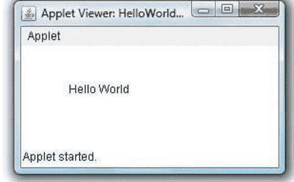

### 带有 Java 源文件的 appletviewer

如果您在 Java 源码文件头部包含包含 `APPLET` 标签的注释，那么您的代码就包含了必要 HTML 语句的原型文档，您只需通过启动带有 Java 源码的 applet viewer 即可运行编译后的 applet。如果您使用这种方法，`HelloWorld` 源文件看起来如下：

```java
// A Hello World Applet
// Save file as HelloWorld.java
import java.applet.Applet;
import java.awt.Graphics;
/*
<applet code="HelloWorld" width=200 height=60>
*/
// HelloWorld class extends Applet
public class HelloWorld extends Applet
{
    // Overriding paint() method
    @Override
    public void paint(Graphics g)
    {
        g.drawString("Hello World", 20, 20);
    }
}
```

通过这种方法，首先编译 `HelloWorld.java` 文件，然后只需运行下面的命令即可运行 applet：

```bash
appletviewer HelloWorld
```

为了证明上述点，即 `paint` 会被反复调用。

为了证明这一点，让我们先研究 Applet 中的“状态栏（Status Bar）”是什么：

“状态栏”位于 applet 窗口的左下角。要使用状态栏并在其中写入内容，我们使用 `showStatus()` 方法，其原型为 `public void showStatus(String)`。

默认情况下，状态栏显示“Applet Started”。默认背景颜色为白色。

为了证明 `paint()` 被反复调用，这里是代码：

```java
// A Hello World Applet
import java.applet.Applet;
import java.awt.Graphics;
// HelloWorld class extends Applet
public class HelloWorld extends Applet
{
    // Overriding paint() method
    @Override
    public void paint(Graphics g)
    {
        g.drawString("Hello World", 20, 20);
        showStatus("Applet Started");
    }
}
```

你只能将 JavaDoc 注释放在类声明或方法声明之前。此外，它们还描述了类或方法的用途以及如何使用它们。

与块注释和单行 Java 注释不同，JavaDoc 不包含任何实现细节。

当 Java 代码准备好发布时，一种特殊的 JavaDoc 工具会处理代码库中每个文件上的 JavaDoc 注释，并为代码的用户生成供其阅读的文档。

## JavaDoc 注释示例

以下代码包含了两个 JavaDoc 注释，以及内联注释和块 Java 注释，以证明将这三种类型混合使用是允许的：

```java
/** 这个 JavaDoc 注释应该描述该类。 */
public class JavaCommentsExample {

/** 这个 JavaDoc 注释应该描述该方法。 */
public static void main(String[] args) {

    System.out.println("This line will run."); // Java comment
    /* System.out.println("This is in a Java block comment."); */

}
```

## 如何使用 Java 注释

要有效使用 Java 注释，请遵循以下步骤：

- 如果注释描述了如何使用代码，请使用 JavaDoc 注释 `/** */`
- 如果注释仅跨一行，请使用内联注释 `//`
- 如果注释跨越多行，请使用块注释 `/* */`

有句古话：好的代码本身就是说明。这种观点有一定的道理。但同时，优秀的程序员会为代码编写注释。

在合理的时间和地方谨慎地为你的代码添加 Java 注释。这有助于他人理解你编写的代码。

## 参考文献

- Joshua Bloch 写的《Effective Java》(Effective Java)

这本书为编写更好的的 Java 代码提供了宝贵的见解，并为 Java 开发者提供了最佳实践。

- Herbert Schildt 写的《Java 全解》(Java: The Complete Reference)

一本关于 Java 的综合参考书，详细涵盖了语言的特性、库和用法。

- Kathy Sierra 和 Bert Bates 写的《Head First Java》(Head First Java)

一本用户友好的 Java 入门教程，将学习与有趣的互动式方法相结合。

- Brian Goetz 写的《Java 并发编程》(Java Concurrency in Practice)

重点关注 Java 的并发特性，并为编写多线程程序提供实践指导。

- Robert C. Martin 写的《洁净代码：敏捷软件之道》(Clean Code: A Handbook of Agile Software Craftsmanship)

虽然并非专门针对 Java，但这本书强调编写整洁、可维护的代码，这对任何 Java 开发者来说至关重要。


- Scott Oaks 写的《Java 性能：权威指南》(`Java Performance: The Definitive Guide`)

提供了优化 Java 应用性能的见解，这是 Java 开发的一个关键方面。

- Raoul-Gabriel Urma, Mario Fusco 和 Alan Mycroft 写的《Java 8 实战》(`Java 8 in Action`)

以实用的方式探索 Java 8 引入的新特性，如 `lambda` 和 `stream`。

- Vaskaran Sarcar 写的《Java 设计模式》(`Java Design Patterns: A Hands-On Experience with Real-World Examples`)

涵盖了 Java 中的核心设计模式，并通过真实案例演示了它们的应用。

- Maurice Naftalin 和 Philip Wadler 写的《Java 泛型与集合》(`Java Generics and Collections`)

关注 Java 的泛型类型和集合框架，帮助开发者利用泛型的威力。

- Prashant Padmanabhan, Vijay Garg 写的《Java EE 8 与 Angular》(`Java EE 8 and Angular`)

探索了如何使用 Java EE 8 和 Angular 构建现代全栈 Web 应用程序。
