# 前端 Web 开发：Big Nerd Ranch 指南


## 献辞

给爸爸妈妈，感谢为我们买了那台电脑。给 Dave 和 Glenn，感谢你们让小弟弟完全独占它。给 Angela，给了我远离屏幕的生活。

— C.A.

给我的爸爸妈妈，感谢你们让我有空间找到自己的道路。给我的妻子，感谢你爱一个宅男。

— T.G.

## 致谢

作为作者，我们可以对打字内容和创建图表享有全部功誉。（耶，我们了！）但事实是，如果没有大批贡献者、合作者和导师的努力，我们仍然盯着空白页发呆。

- 感谢 Aaron Hillegass，他相信我们两个能够创作出对起 Big Nerd Ranch 之名的作品。感谢你无法衡量的信任和支持。
- 感谢 Matt Mathias，他指导我们完成了本书的开发，特别是在关键的最后几里。你确保了本该花在看猫咪视频或重播《唐顿庄园》上的时间转而被投入到了写作中。
- 感谢 Brandy Porter，感谢她在多次场合对作者的照顾和（字面意义上的）喂养。你在幕后施展魔力，策划了一系列事件使这项工作的完成成为可能。感谢你。
- 感谢 Jonathan Martin，我们的共同讲师和语言专家。感谢你热心地教授作为本书基础的正在进行中的课程材料，并在多次修订中提供考虑周全的批评意见。
- 感谢我们的校对员、技术评审员和“小白鼠”们：Mike Zornek, Jeremy Sherman, Josh Justice, Jason Reece, Garry Smith, Andrew Jones, Stephen Christopher 和 Bill Phillips。感谢你们的志愿服务。
- 感谢 Elizabeth Holaday，我们无限耐心且令人安心的编辑。感谢你让我们走出回声室，成为理性的声音，并始终提醒我们读者。
- 感谢 Ellie Volckhausen，她设计了我们的封面。
- 感谢我们的校对 Simone Payment，她保持了一致性。
- 感谢 IntelligentEnglish.com 的 Chris Loper，他设计并制作了本书的印刷版和电子书。他的 DocBook 工具链也让生活变得简单许多。

最后，感谢无数参加一周培训的学生。没有你们的好奇心和问题，这一切都没有意义。这项工作是你们在这些周里带给我们的见解和灵感的反映。我们希望那些水獭让培训变得轻松了一些。

## 添加范围滑块

## 添加提交和重置按钮

## 10. 使用 JavaScript 处理表单

### 创建 FormHandler 模块

#### jQuery 简介

#### 导入 jQuery

#### 使用选择器配置 FormHandler 实例

### 添加提交 Handler

#### 提取数据

#### 接收并调用回调

## `npm init`

## `npm scripts`

## `Hello, World`

## `Adding an npm Script`

## `Serving from Files`

## `Reading a file with the `fs` module`

## `Working with the request URL`

## `Using the `path` module`

## `Creating a custom module`

## `Using your custom module`

## `Error Handling`

## `For the More Curious: npm Module Registry`

## `Bronze Challenge: Creating a Custom Error Page`

## `For the More Curious: MIME Types`

## `Silver Challenge: Providing a MIME Type Dynamically`

## `Gold Challenge: Moving Error Handling to Its Own Module`

## 16. 使用 WebSockets 进行即时通信

### `Setting Up WebSockets`

### `Testing Your WebSockets Server`

### `Creating the Chat Server Functionality`

### `First Chat!`

### `For the More Curious: socket.io`

### `For the More Curious: Service`

### `Bronze Challenge: Repeating?`

### `Silver Challenge: Speaking`

### `Gold Challenge: Chat`

## 17. 使用 ES6

### `Using Babel`

### `Compiling JavaScript`

### `The ChatClient`

### `Class syntax`

### `Building the `ChatMessage`

### `Class`

### `Gold Challenge: ``

## 18. ES6, Continues

### `Modules as Module`

### `The `ChatForm`

### `Bronze Challenge: Message`

### `Silver Challenge: ``

### `Gold Challenge: The Adventure`

## IV. Application Architecture

### `Introduction to Ember`

### `An MVC Framework`

### `Installing Ember`

### `Creating an application`

### `Starting up the server`

### `Configuration`

### `Bronze Challenge: Format`

### `Silver Challenge: ``

### `Gold Challenge: Customizing the NavBar`

## 20. Routing, Routes, and Models

### `generate`

### `Nesting Routes`

### `Ember Inspector`

### `Assigning Models`

### `beforeModel`

### `The `Controller`

## 21. Models and Data Binding

### `Model Definitions`

### `createRecord`

### `get` and `set`

### `Computed Properties`

### `For the More Curious: Retrieving Data`

### `For the More Curious: Destroying Data`

### `Bronze Challenge: Changing Computed Property`

### `Silver Challenge: Flagging New Sightings`

### `Gold Challenge: Adding Titles`

## 22. Data – Adapters, Serializers, and Transforms

### `Adapters`

### `Content Security`

### `Serializers`

### `Transforms`

### `For the More Curious: Ember CLI`

### `Silver Challenge: Content Security`

### `Gold Challenge: Mirage`

## 23. Views and Templates

### `Handlebars`

### `Models`

### `Helpers`

### `Conditionals`

### `Loops with {{each}}`

### `Binding element attributes`

### `Links`

### `Custom Helpers`

### `Bronze Challenge: Adding Rollovers`

### `Silver Challenge: Changing the Date Format`

### `Gold Challenge: Creating a Thumbnail Helper`

## 24. Controllers

### `New Sightings`

### `Editing a Sighting`

### `Deleting a Sighting`

### `Route Actions`

### `Bronze Challenge: Sighting Detail Page`

### `Silver Challenge: Sighting Date`

### `Gold Challenge: Adding and Removing Witnesses`

## 25. Components

### `Iterator Items as Components`

### `Components for DRY Code`

### `Data Down, Actions Up`

### `Class Name Bindings`

### `Data Down`

### `Actions Up`

### `Bronze Challenge: Customizing the Alert Message`

### `Silver Challenge: Making the `NavBar` a Component`

### `Gold Challenge: Array of Alerts`

## 26. Afterword

### `The Final Challenge`

### `Shameless Plugs`

### `Thank You`

## Index

没有一家公司能完全控制浏览器的运行方式。这意味着前端开发者不会获得一个年度一次的 `SDK` 发布，其中包含了他们在未来十二个月内可能需要处理的所有变化。原生平台像是一片结冰的湖面，你可以在上面舒服地滑冰。而 Web 是一条河流；它弯曲、流动迅速，并且在某些地方布满岩石——但这正是它的魅力所在。Web 是目前演变最快的平台。适应变化是前端开发者的生活方式。

本书的目的是教你如何为浏览器开发程序。随着本指南的引导，你将经历构建一系列项目的过程。每个项目都会要求前端技术光谱中不同技术的组合。由于可用的前端工具、库和框架数量极多，本书将重点介绍最核心且可移植的模式和技术。

### 前提条件

本书并不是一本编程入门书。它假设你具有编写代码基础知识的经验。你应该熟悉基础类型、函数和对象。

尽管如此，它也不假设你已经认识 `JavaScript`。我们会在你需要时，结合上下文向你介绍 `JavaScript` 概念。

### 本书的结构

本书将引导你编写四个不同的 Web 应用程序。每个应用程序在书中都有对应的章节。每个章节中的每一章都会为你正在构建的应用程序添加新功能。

构建这四个应用程序的工作将带你从前端光谱的一端走到另一端。

| Ottergram |
| --- |
| CoffeeRun |
| Chattrbox |
| Tracker |

在完成这些应用程序的过程中，你将接触到许多工具，包括：

- `Atom` 文本编辑器以及一些用于处理代码的实用插件
- 如 `Mozilla Developer Network`（MDN）之类的文档资源
- 命令行，使用 `OS X Terminal` 应用或 Windows 命令提示符
- `browser-sync`
- `Google Chrome’s Developer Tools`
- `normalize.css`
- `Bootstrap`
- `jQuery` 以及如 `crypto-js` 和 `moment` 等库
- `Node.js`、Node 包管理器 (`npm`) 以及 `nodemon`
- `WebSockets` 和 `wscat` 模块
- `Babel`、`Babelify`、`Browserify` 和 `Watchify`
- `Ember.js` 以及如 `Ember CLI`、`Ember Inspector`、`Ember CLI Mirage` 和 `Handlebars` 等插件
- `Bower`
- `Homebrew`
- `Watchman`

### 如何使用本书

本书不是一本参考书。它的目标是帮助你跨越最初的坎，让你能够充分利用现有的参考书和食谱书。它基于我们在 `Big Nerd Ranch` 的五天课程，在很大程度上，它是为了从头开始学习的。章节之间环环相扣，跳跃式阅读将毫无意义。

在我们的课程中，学生学习这些材料，但他们也受益于良好的环境——专门的教室、良好的食物和舒适的白板、一群充满动力的同伴以及一位可以回答问题的导师。

作为读者，你可能希望环境也是类似的。这意味着保证充足的睡眠并找一个安静的地方工作。这些因素也有帮助：

- 与你的朋友或同事建立一个阅读小组。
- 安排专门的专注时间来学习章节。
- 参加 `forums.bignerdranch.com` 为本书提供的论坛，你可以在那里讨论书籍并找到错误和解决方案。
- 找一个了解前端 Web 开发的人来帮助你。

### 挑战

本书中的大多数章节都以至少一个挑战结束。挑战是回顾你所学知识并将章节中的工作更进一步的机会。我们建议你尽可能多地尝试挑战，以巩固你的知识，并从我们这里学习 `JavaScript` 开发变为独立进行 `JavaScript` 开发。

挑战分为三个难度等级：

- **铜牌挑战**通常要求你做一些与章节中进行的内容非常相似的事情。这些挑战强化了你在章节中学到的知识，并迫使你在没有参考布局的情况下输入类似的代码。熟能生巧。
- **银牌挑战**要求你进行更深层次的挖掘和思考。有时你可能需要使用以前从未见过的函数、事件、标记和样式，但任务仍与章节中的内容相似。
- **黄金挑战**难度很大，可能需要几个小时才能完成。它们要求你理解章节中的概念，然后独立进行高质量的思考和问题解决。应对这些挑战将为你从事现实世界的 `JavaScript` 开发做好准备。

在进行任何章节的挑战之前，你应该为你的代码创建一个副本。否则，你所做的更改可能与后续练习不兼容。

如果你迷路了，可以随时访问 `forums.bignerdranch.com` 寻求帮助。

### 进阶好奇者

许多章节还有“进阶好奇者”部分。这些章节对书中介绍的话题提供了更深入的解释或额外信息。这些章节中的信息并非绝对必要，但我们希望你会发现它们有趣且有用。

### 使用电子书

如果你在电子阅读器上阅读本书，阅读代码有时可能会很困难。根据你选择的字体大小，较长的代码可能会换到第二行。

本书中最长的代码行是 86 个等宽字符，如下所示：

```
<link href="https://cdnjs.cloudflare.com/ajax/libs/normalize/3.0.3/normalize.min.css">
```

你可以调整电子阅读器的设置以找到最适合查看长代码的方式。

如果你在 iPad 上使用 `iBooks` 阅读，我们建议你进入`设置` 应用，选择 `iBooks`，并将`两对齐`关闭、`自动连字符`关闭。

## 第一部分：核心浏览器编程

### 第一章：搭建你的开发环境

前端开发有无数工具和资源，并且不断产生。对于所有水平的开发者来说，选择最好的工具都是一项挑战。在本书的项目中，我们将引导你使用一些我们最喜爱的工具。

在开始之前，你需要三个基础工具：浏览器、文本编辑器以及用于前端开发中许多技术的良好参考文档。此外，还有一些额外工具——虽然并非必不可少，但它们会让你的开发体验更加顺畅和愉快。

为了本书的需要，我们建议你使用与我们相同的软件，以便从我们的说明和截图中获得最大的益处。本章将引导你安装并配置 `Google Chrome` 浏览器、`Atom` 文本编辑器、`Node.js` 以及许多插件和扩展。你还将了解良好的文档选择，并学习一个关于在 Mac 和 Windows 上使用 `command line`（命令行）的快速课程。在下一章中，当你开始第一个项目时，你将开始使用这些资源。

#### 安装 Google Chrome

你的电脑默认应该已经安装了一个浏览器，但最适合前端开发使用的浏览器是 `Google Chrome`。如果你还没有最新版本的 `Chrome`，可以 [`www.google.com/​chrome/​browser/​desktop`](https://www.google.com/chrome/browser/desktop/) 获取（图 1.1](#ch01.html_fig-chrome-download-page "Figure 1.1  下载 Google Chrome")）。

**图 1.1 下载 Google Chrome**


#### 安装并配置 Atom

在众多的文本编辑器程序中，GitHub 开发的 `Atom` 编辑器是前端开发最好的选择之一。它是一个很好的选择，因为它高度可配置，拥有许多插件可以帮助编写代码，并且免费下载和使用。

你可以从 [`atom.io`](https://atom.io) 下载 Mac 或 Windows 版本的 `Atom`（图 1.2](#ch01s02.html_fig-atom-download-page "Figure 1.2  下载 Atom")）。

**图 1.2 下载 Atom**

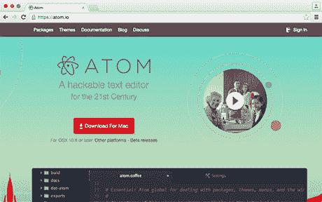

按照对应平台的安装说明进行操作。安装 `Atom` 后，你还会想要安装几个插件。

##### Atom 插件


你对文本编辑器的主要需求是文档查询、自动补全、代码格式化和代码静态检查（linting，稍后会详细介绍）。`Atom` 默认提供了其中一些功能，但安装几个插件会让它变得更好。

打开 `Atom` 并显示其设置（Settings）界面。在 Mac 上，通过选择 `Atom` → `Preferences...`（偏好设置）或使用快捷键 `Command-,`（即 Command 键加逗号）完成。在 Windows 上，你可以通过 `File` → `Settings`（设置）或使用快捷键 `Ctrl-,` 访问。

在设置界面的左侧，点击 `+ Install`（安装）（图 1.3](#ch01s02.html_fig-atom-settings-install "Figure 1.3 Atom 的安装包界面"）。

**图 1.3 Atom 的安装包界面**

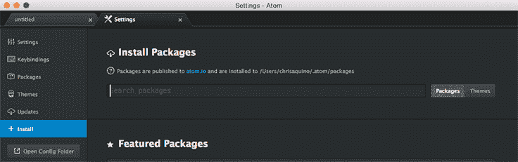

在这里，你可以通过名称搜索插件包。首先搜索“emmet”。

编写大量的 HTML 可能非常枯燥且容易出错。`emmet` 插件（图 1.4](#ch01s02.html_fig-emmet-install "Figure 1.4 安装 emmet")）让你能够使用方便的简写编写格式良好的 HTML。点击 `Install`（安装）按钮获取 `emmet`。

**图 1.4 安装 emmet**

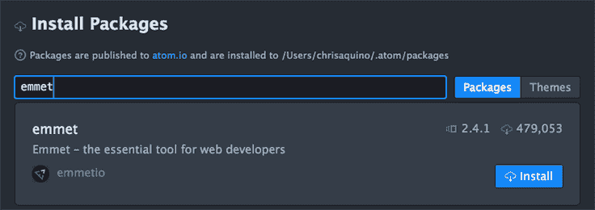

接下来，搜索“atom-beautify”。`atom-beautify` 插件（图 1.5](#ch01s02.html_fig-beautify-install "Figure 1.5 安装 atom-beautify"）有助于处理代码缩进，从而提高可读性。再次点击 `Install` 按钮获取该插件。

**图 1.5 安装 atom-beautify**

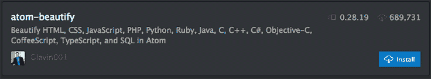

搜索并安装 `autocomplete-paths` 插件（图 1.6](#ch01s02.html_fig-autocomplete-install "Figure 1.6 安装 autocomplete-paths"）。通常情况下，你的代码需要引用项目中的其他文件和文件夹。该插件通过在输入时在自动补全菜单中提供文件名来帮助。

**图 1.6 安装 autocomplete-paths**

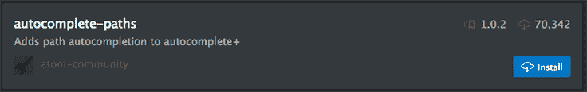

你下一个要安装的包是 `api-docs`（图 1.7](#ch01s02.html_fig-api-docs-install "Figure 1.7 安装 api-docs"），它让你根据关键词查找文档。它会在编辑器的单独标签页中显示文档。

**图 1.7 安装 api-docs**

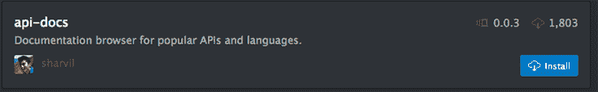

接下来，搜索并安装 `linter` 包（图 1.8](#ch01s02.html_fig-linter-install "Figure 1.8 安装 linter"）。`linter` 是一个检查代码语法和风格的程序。确保你找到并安装了名为“linter”的包。这是一个基础 linter，可以与特定语言的插件配合。为了使用下方的其他 linter 插件，你需要它。

**图 1.8 安装 linter**

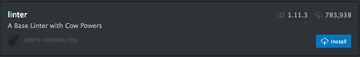

你有三个 `linter` 辅助插件想要安装，用于检查 CSS、HTML 和 JavaScript。从 `linter-csslint` 开始（图 1.9](#ch01s02.html_fig-csslint-install "Figure 1.9 安装 linter-csslint"），它确保你的 CSS 语法正确，并对编写高效 CSS 提供建议。

**图 1.9 安装 linter-csslint**

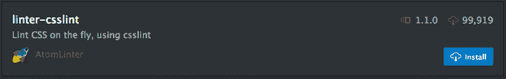

下一个要安装的 `linter` 辅助插件是 `linter-htmlhint`（图 1.10](#ch01s02.html_fig-htmlhint-install "Figure 1.10 安装 linter-htmlhint"），它确认你的 HTML 格式正确。它会警告你标签不匹配的问题。

**图 1.10 安装 linter-htmlhint**


最后一个要安装的 `linter` 辅助插件是 `linter-eslint`（图 1.11](#ch01s02.html_fig-eslint-install "Figure 1.11 安装 linter-eslint"）。该插件检查 JavaScript 的语法，并可以配置为检查代码的风格和格式（例如，缩进多少空格，注释前后留多少空行）。

**图 1.11 安装 linter-eslint**

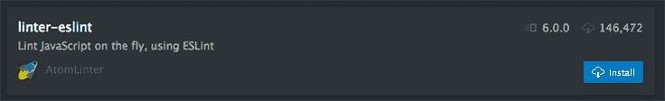

Chrome 和 Atom 现在已准备好进行前端开发。完成编码环境还需要最后几个步骤：访问文档、学习命令行基础知识以及下载两个工具。

## 文档与参考资源

前端开发与 iOS 和 Android 等平台的编程有所不同。除了明显的差异外，前端技术除了技术规范外没有官方的开发者文档。这意味着你需要从其他地方寻求指导。我们建议你熟悉以下资源，并在阅读本书以及继续进行前端开发时经常查阅。

Mozilla 开发者网络（MDN）是处理 HTML、CSS 和 JavaScript 相关任何内容的最佳参考。访问它的方法方法是 [devdocs.io](http://devdocs.io)，这是一个出的文档接口（图 1.12）。它从 MDN 获取核心前端技术的文档——并且可以离线工作，因此你即使在没有互联网连接时也可以查看。

**图 1.12 通过 `devdocs.io`访问文档**

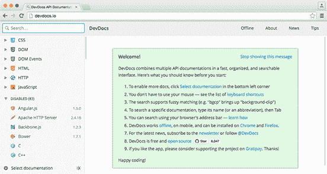

请注意，`Safari` 目前不支持 [devdocs.io](http://devdocs.io) 使用的离线缓存机制。你需要使用不同的浏览器，例如 `Chrome` 来访问它。

你也可以使用 MDN 的网站，[developer.mozilla.org/en-US/](https://developer.mozilla.org/en-US/)（图 1.13），或简单地将“MDN”作为搜索引擎关键词来找到你需要的信息。

**图 1.13 Mozilla 开发者网络网站**

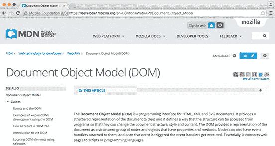

另一个值得关注的网站是 [stackoverflow.com](http://stackoverflow.com)（图 1.14）。从官方角度来说，这不是文档来源。它是开发者可以互相询问代码的地方。答案的质量差不齐，但通常非常详尽且非常有帮助。因此它是一个很有用的资源——只要你记住由于其众包性质，这些答案并不是决定性的。

**图 1.14 Stack Overflow 网站**

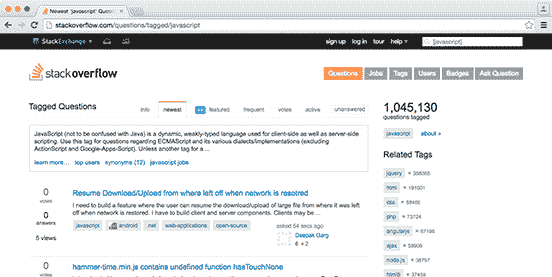

Web 技术始终在变化。对功能和 API 的支持随浏览器和时间而异。两个可以帮助确定哪些浏览器（以及各个浏览器的哪些版本）支持哪些网站是 [html5please.com](http://html5please.com) 和 [caniuse.com](http://caniuse.com)。当你需要关于功能支持的信息时，我们建议从 [html5please.com](http://html5please.com) 开始，以了解某个功能是否被推荐。关于特定功能哪些浏览器支持的更多详细信息，请访问 [caniuse.com](http://caniuse.com)。

## 命令行快速上手

在本书中，你将被指示使用 `command line`（命令行）或 `terminal`（终端）。你将使用的许多工具将专门作为命令行程序运行。

要在 Mac 上访问命令行，打开 `Finder` 并进入 `Applications` 文件夹，然后进入 `Utilities` 文件夹。找到并打开 `Terminal` 程序（图 1.15）。

**图 1.15 在 Mac 上查找 Terminal 应用**


你应该会看到一个看起来像[图 1.16]的窗口。

**图 1.16 Mac 命令行**

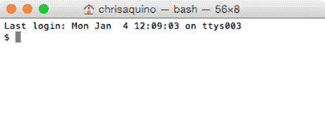

要在 Windows 上访问命令行，进入启动菜单并搜索“cmd”。找到并打开 `Command Prompt` 程序（图 1.17）。

**图 1.17 在 Windows 上查找 Command Prompt 程序**

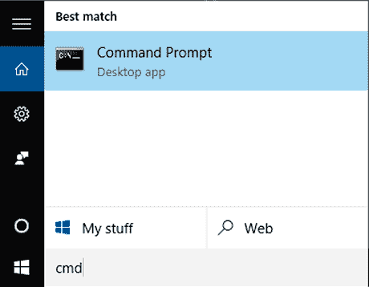

点击它来运行标准的 Windows 命令行界面，它看起来像[图 1.18]。

**图 1.18 Windows 命令行**

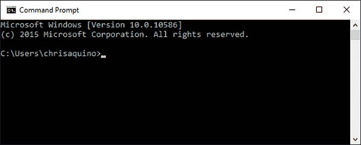

从现在起，我们将“终端”或“命令行”来同时指代 Mac 的 `Terminal` 和 Windows 的 `Command Prompt`。如果你不熟悉使用命令行，这里有一个关于常见任务的简要介绍。所有命令都通过在提示符处输入并按 Return 键来完成。

### 查找你所在的目录

命令行是基于位置的。这意味着在任何给定时刻，它都“位于”文件结构中的特定目录，你输入的任何命令都将在该目录内执行。命令行提示符显示它所在目录的缩略版本。要在 Mac 上查看完整路径，请输入命令 `pwd`（代表“print working directory”，即打印工作目录），如[图 1.19]所示。

**图 1.19 在 Mac 上使用 `pwd` 显示当前路径**

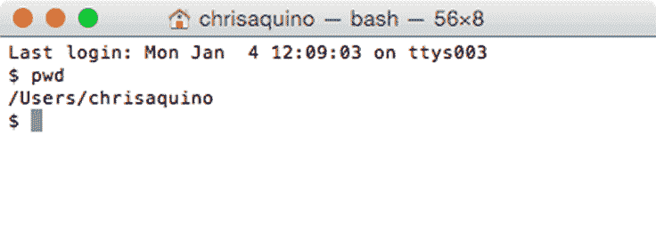

### 图 1.21 切换和检查目录

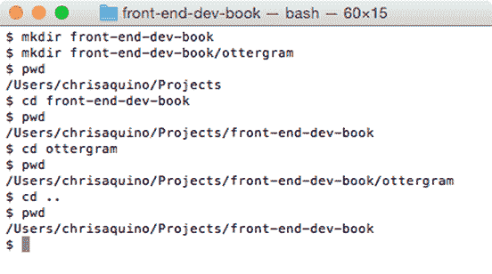

你并不局限于一次只向上或向下移动一个目录。假设你有一个更复杂的目录结构，如图 1.22 所示。

### 图 1.22 一个文件结构示例

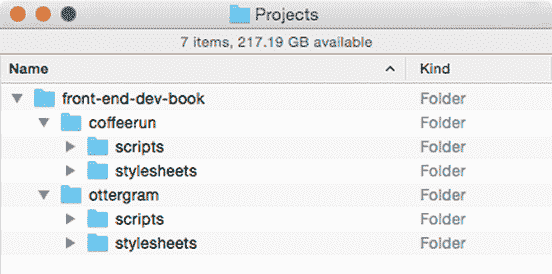

假设你处于 `ottergram` 目录，想要直接进入 `coffeerun` 目录下的 `stylesheets` 目录。你可以使用 `cd` 后加上路径，该路径的意思是“当前所在父目录的 `coffeerun` 目录下的 `stylesheets` 目录”：

```
cd ../coffeerun/stylesheets
```

在 Windows 上，你可以使用相同的命令，但要使用反斜杠：

```
cd ..\coffeerun\stylesheets
```

### 在目录中列出文件

你可能需要查看当前目录下的文件列表。在 Mac 上，你使用 `ls` 命令来实现此（图 1.23）。如果你想列出另一个目录中的文件，可以提供路径：

```
ls
ls ottergram
```

### 图 1.23 使用 ls 列出目录中的文件

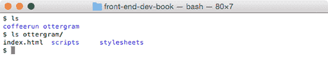

默认情况下，如果目录为空，`ls` 不打印任何内容。

在 Windows 上，命令是 `dir`（图 1.24），你可以选择地提供路径：

```
dir
dir ottergram
```

### 图 1.24 使用 dir 列出目录中的文件

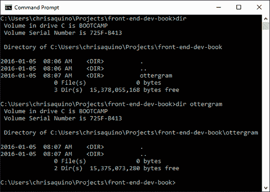

默认情况下，`dir` 命令将打印有关日期、时间以及文件大小的信息。

### 获取管理员权限

在某些版本的 OS X 和 Windows 上，你需要`superuser` 权限或管理员权限才能运行某些命令，例如安装软件或修改受保护文件的命令。

在 Mac 上，你可以通过在命令前加上 `sudo` 来给自己赋予权限。当你第一次在 Mac 上使用 `sudo` 时，它会给你一个严肃的警告，如图 1.25 所示。

### 图 1.25 sudo 警告

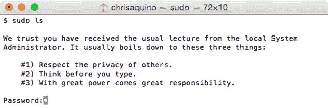

`sudo` 在以超级用户身份运行命令之前会提示你输入密码。在你输入时，按键不会回显，因此请务必小心输入。

在 Windows 上，如果你需要给自己赋予权限，可以在打开命令行界面的过程中完成。在 Windows 的 `开始菜单` 中找到命令提示符，右键点击它，并选择`以管理员身份运行`（图 1.26）。你在此命令提示符中运行的任何命令将以超级用户身份运行，因此请小心。

### 图 1.26 以管理员身份打开命令提示符

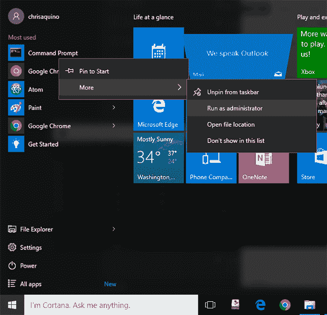

### 退出程序

在学习过程中，你会从命令行运行许多应用程序。其中某些完成工作后会自动退出，但另一些会一直运行直到你停止。要退出命令行程序，请按 Control-C。

## 安装 Node.js 和 browser-sync

开始第一个项目之前，还有最后一个配置步骤。

`Node.js`（简称 `Node`）允许你从命令行使用 JavaScript 编写的程序。大多数前端开发工具都是为配合`Node.js` 使用而编写。你将在第 15 章中学习更多关于`Node.js`的知识，但你现在就可以开始使用依赖它的工具——`browser-sync`。

通过 [nodejs.org](https://nodejs.org/en/) 下载安装程序来安装`Node`（图 1.27）。

### 图 1.27 下载 Node.js

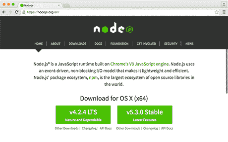

书中使用了 `Node.js`，你可能会看到不同的版本。`Node.js` 适用于。

# 建立你的第一个项目

当你访问一个网站时，你的浏览器会与服务器（互联网上的另一台计算机）进行对话。

浏览器：“嘿！可以给我看看名为 `cat-videos.html` 的文件内容吗？”

服务器：“没问题。我来找找……在这里了！”

浏览器：“啊，它告诉我还需要一个名为 `styles.css` 的文件。”

服务器：“当然可以。我来找找……在这里了！”

浏览器：“好的，那个文件说我还需要一个名为 `animated-background.gif` 的文件。”

服务器：“没问题。我来找找……在这里了！”

这种对话会持续一段时间，有时会持续数千毫秒（图 2.1）。

**图 2.1 浏览器发送请求，服务器响应**

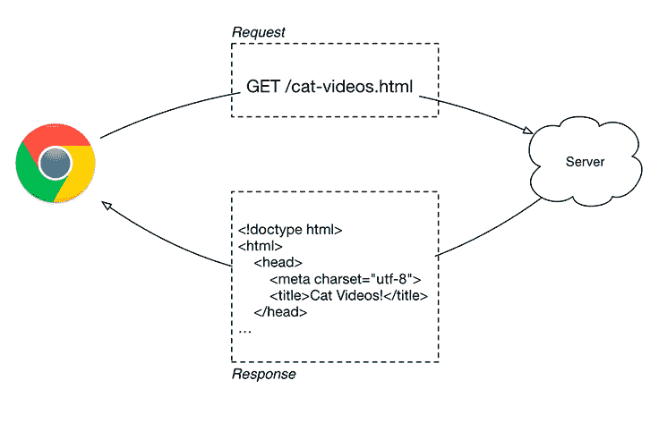

浏览器的工作是向服务器发送请求；解析从服务器响应中收 HTML、CSS 和 JavaScript；并将结果展示给用户。这三种技术中的每项都在用户对网站的体验中起着作用。如果你的应用是一个生物体，那么 HTML 就是它的骨骼和器官（机械结构），CSS 是它的皮肤（视觉层），而 JavaScript 则是它的性格（它的行为方式）。

在本章中，你将为你的第一个项目 Ottergram 建立基础 HTML。在下一章中，你将设置 CSS，并在第 4 章 中对其进行完善。在第 6 章 中，你将开始添加 JavaScript。

## 设置 Ottergram

在第 1 章中，你为书中的项目创建一个文件夹，同时也为 Ottergram 创建了一个文件夹。启动你的 `Atom` 文本编辑器，点击 `File`（文件）→ `Open`（或在 Windows 上点击 `File` → `Open Folder...`）打开 `ottergram` 文件夹。在对话框中，导航到 `front-end-dev-book` 文件夹并选择 `ottergram` 文件夹。点击 `Open` 告诉 `Atom` 使用此文件夹（图 2.2）。

**图 2.2 在 Atom 中打开你的项目文件夹**

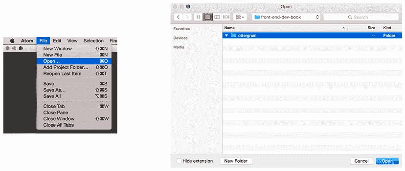

你会在 `Atom` 的左侧面板看到 `ottergram` 文件夹。此面板用于在项目的文件和文件夹之间导航。


你将使用`Atom`在`ottergram`项目文件夹内创建一些文件和文件夹。在左侧面板 Control-点击（右键点击）`ottergram`，并在弹出菜单中点击`New File`（新文件）。会提示你为新文件命名。输入`index.html`并按回车键（图 2.3）。

**图 2.3 在 Atom 中创建新文件**

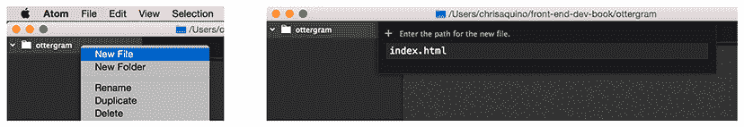

你可以使用相同的过程通过`Atom`创建文件夹。再次在左侧面板 Control-点击（右键点击）`ottergram`，但这次在弹出窗口中点击`New Folder`（新文件夹）。在出现的提示中输入名称`stylesheets`（图 2.4）。

**图 2.4 在 Atom 中创建新文件夹**

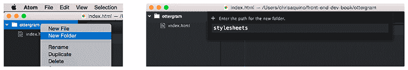

最后，在`stylesheets`文件夹中创建一个名为`styles.css`的文件：在左侧面板 Control-点击（右键点击）`stylesheets`并选择`New File`。提示符会预填充文本“stylesheets/”。之后，输入`styles.css`并按回车键（图 2.5）。

**图 2.5 在 Atom 中创建新的 CSS 文件**

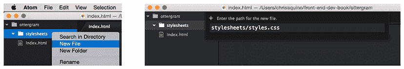

完成后，你的项目文件夹应该看起来像图 2.6。

**图 2.6 Ottergram 的初始文件和文件夹**

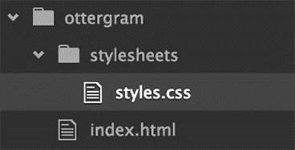

关于文件和文件夹的结构或命名并没有规定。然而，Ottergram（与书中的其他项目一样）遵循了许多前端开发者使用的约定。你的`index.html`文件将包含你的 HTML 代码。将主 HTML 文件命名为`index.html`可以追溯到网页早期，这种约定一直延续至今。`stylesheets`文件夹正如其名，将包含 Ottergram 的样式信息文件。这些将是 CSS，即“级联表”文件。有时开发者会根据 CSS 文件所属的页面或网站来命名，例如`header.css`或`blog.css`。Ottergram 是一个简单的项目，只需要一个文件，因此你将其命名为`styles.css`以反映其全局作用。

### 初始 HTML

开始编码吧。在`Atom`中打开`index.html`并添加一些基础 HTML 开始。

从输入`html`开始。`Atom`将为你提供自动补全选项，如图 2.7 所示。（如果没有，请确保你已按照第 1 章的说明安装了`emmet`插件。）

**图 2.7 Atom 的自动补全菜单**

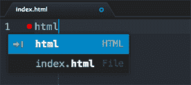

按下回车键，`Atom`将为你提供基础 HTML 元素（图 2.8）。

**图 2.8 使用自动补全创建 HTML**

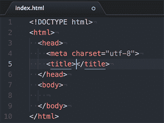

你的光标位于`<title>`和`</title>`之间——即起始和结束的`title`标签之间。输入“ottergram”为项目命名。现在，点击将光标放在起始和结束的`body`标签之间的空行中。在那里，输入“header”并按回车键。`Atom`将文本“header”转换为起始和结束的`header`标签，并在之间留有空行（图 2.9）。

**图 2.9 使用自动补全创建 header 标签**

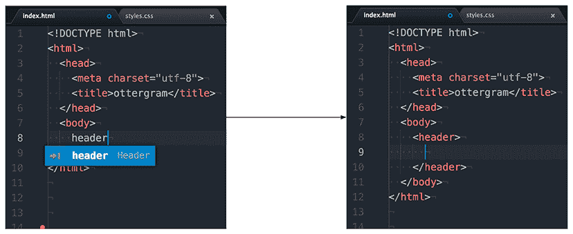

接下来，输入“h1”并按回车键。再次，你的文本被转换成了标签，但这次没有空行。再次输入文本“ottergram”。这将是出现在你网页上的标题。

你的文件看起来应该像这样：

```
<!doctype html>
<html
  <head>
    <meta charset="utf-8">
    <title>ottergram</title>
  </head>
  <body>
    <header>
      <h1>ottergram</h1>
    </header>
  </body>
</html>
```

`Atom`和`emmet`共同为你节省了一些打字时间，并帮助你构建了格式良好的初始 HTML。

让我们检查你的代码。第一行`<!doctype html>`定义了`doctype`——它告诉浏览器文档是用哪个版本的 HTML 编写的。浏览器可能会根据`doctype`略有不同地渲染或绘制页面。在这里，`doctype`指定的是 HTML5。

早期版本的 HTML 通常有很长、复杂且难以记忆的`doctypes`，例如：

```
<!DOCTYPE html PUBLIC "-//W3C//DTD XHTML 1.0 Transitional//EN"
"http://www.w3.org/TR/xhtml1/DTD/xhtml1-transitional.dtd">
```

通常，人们在每次创建新文档时都必须查找`doctype`。

在 HTML5 中，`doctype`既短又简洁。它将在书中所有的项目中被反复使用，你也应该在你的应用中使用它。

在`doctype`之后是一些基础的 HTML 标记，由`head`和`body`组成。

`head`将包含有关文档的信息以及浏览器应该如何处理该文档。例如，文档标题、页面使用的 CSS 或 JavaScript 文件，以及文档最后修改时间都包含在`head`中。

在这里，`head`包含一个`<meta>`标签。`<meta>`标签为提供提供有关本身的信息，例如文档作者的姓名或搜索引擎的关键词。Ottergram 中的`<meta>`标签`<meta charset="utf-8">`指定文档使用 UTF-8 字符集编码，该字符集包含了所有的 Unicode 字符。在你的文档中使用此标签，以便最广泛的浏览器能够正确解释它们，特别是当你预计会有国际流量时。

`body`将包含代表你页面内容的所有 HTML 代码：出现在页面上的所有图像、链接、文本、按钮和视频。

大多数标签都封装着其他内容。看看你包含的`h1`标题；它的结构已在图 2.10 所示。

**图 2.10 简单 HTML 标签的结构**

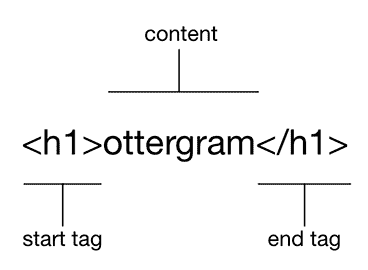

HTML 代表“超文本标记语言（hypertext markup language）”。标签被用来“标记”你的内容，指定它们的用途——例如标题、列表项目和链接。

一组标签封装的内容也可以包含其他 HTML。注意，例如，`<header>`标签封装了上面所示的`<h1>`标签（而`<body>`标签封装了`<header>`！）。

有许多标签可以选择——超过 140 种。要查看它们的列表，请访问 MDN 的 HTML 元素参考，地址位于 [developer.mozilla.org/en-US/docs/Web/HTML/Element](https://developer.mozilla.org/en-US/docs/Web/HTML/Element)。该参考包含了对每个元素的简要描述，并按用法对元素进行分组（例如：文本内容、内容分节或多媒体）。

### 链接样式表

在样式表中，在第 3 章 中，使用`<link>`标签将外部样式表连接到 HTML 文档。`<link>`标签有两个属性，告诉浏览器`stylesheets.css`。你将`rel`属性设置为`"stylesheet"`，让浏览器知道它的关系。`href`属性向`stylesheets`发起请求。

```
<!doctype html>
<<html>
  <head>
    <meta charset="utf-8">
    <title>ottergram</title>
    <link rel="stylesheet" href="stylesheets.css">
  </head>
  <body>
    <header>
      <h1>ottergram</h1>
    </header>
    ...
```

`<link>`标签是将将样式表连接到 HTML 文档的方式。它有两个属性（图 2.11）所示（属性的顺序并不重要）。

**图 2.11 带有属性的标签**


### 添加内容

没有内容的网页就像没有咖啡一样。你将使用`<ul>`标签添加一个无序列表（即项目符号列表）。在列表中，你包含五个`<li>`标签，在每个列表项目中你将包含由`<span>`标签封装的文本。

```html
<!doctype html>
<html>
  <head>
    <meta charset="utf-8">
    <title>ottergram</title>
    <link rel="stylesheet" href="stylesheets.css">
  </head>
  <body>
    <header>
      <h1>ottergram</h1>
    </header>
    <ul>
      <li>
        <span>Barry</span>
      </li>
      <li>
        <span>Robin</span>
      </li>
      <li>
        <span>Maurice</span>
      </li>
      <li>
        <span>Lesley</span>
      </li>
      <li>
        <span>Barbara</span>
      </li>
    </ul>
  </body>
</html>
```

嵌套在`<li>`标签内部的`<span>`标签没有特殊含义。它们是内容的通用容器。你将在 Ottergram 中用它们进行样式处理，并在继续阅读本书时将看到其他容器元素的示例。

接下来，你将为你输入的名称添加水獭的图像。

### 添加图像

书中所有项目的资源文件位于 [www.bignerdranch.com/downloads/front-end-dev-resources.zip](http://www.bignerdranch.com/downloads/front-end-dev-resources.zip)。它们包含了由 Michael L. Baird、Joe Robertson 和 Agunther 拍摄的五张 Creative Commons 许可的水獭图像，发现于 [commons.wikimedia.org](https://commons.wikimedia.org)。

下载并解压资源。在`ottergram-resources`文件夹中找到`img`文件夹。将`img`文件夹复制到你的`ottergram/`项目目录。（该 .zip 包含其他资源，但目前你只需要`img`文件夹。）

你希望列表不仅包含标题，还包含可以点击的缩略图。你将通过为`ul`中的每个项目添加锚点标签和图像标签来实现这一目标。在你输入这些内容后，我们将详细解释这些更改。（如果你使用自动补全功能，请注意你需要移动`</a>`标签，使其紧跟在`<span>`标签之后。）

```
...
    <ul>
      <li>
        <a href="#">
          
          <span>Barry</span>
        </a>
      </li>
      <li>
        <a href="#">
          
          <span>Robin</span>
        </a>
      </li>
      <li>
        <a href="#">
          
          <span>Maurice</span>
        </a>
      </li>
      <li>
        <a href="#">
          
          <span>Lesley</span>
        </a>
      </li>
      <li>
        <a href="#">
          
          <span>Barbara</span>
        </a>
      </li>
    </ul>
...
```

如果你的代码行没有良好对齐，你可以利用已经安装的`atom-beautify`插件。点击`Packages` → `Atom Beautify` → `Beautify`，代码就会自动为你对齐并缩进。

让我们来看看你添加了的内容。

`<a>`标签是`anchor`（锚点）标签。锚点标签让页面上的元素变得可点击，从而将用户带到另一个页面。它们通常被称为“链接（links）”，但注意：它们与你之前使用的`<link>`标签不同。

锚点标签有一个`href`属性，指示锚点指向的资源。通常该值是一个网页地址。但有时，你并不希望链接跳转到任何地方。目前的情况如此，所以你为`href`属性分配了“占位”值`#`。这会让浏览器在点击图像时滚动到页面顶部。稍后，你将使用锚点标签在点击缩略图时打开图片的放大版本。

在锚点标签内部，你添加了``或`image`标签，其`src`属性指示你之前添加的`img`目录中的文件名。你还为图像标签添加了描述性的`alt`属性。`alt`属性包含在图像无法加载时替换图像的文本。`alt`文本也是屏幕阅读器用于向视觉受障的用户描述图像的内容。

图像标签与大多数其他元素不同之处在于，它们不包裹其他元素，而是引用一个资源。当浏览器遇到``标签时，它会将图像绘制到页面上。这被称为“替换元素（replaced element）”。其他替换元素包括嵌入文档和应用程序（applets）。

因为它们不包含内容或其他元素，``标签没有对应的闭合标签。这使得它们成为自闭合标签（self-closing，也称为`void`标签）。有时你会看到自闭合标签在右角括号前带有一个斜杠，例如``。是否包含斜杠取决于个人偏好，对浏览器没有影响。在本书中，自闭合标签是不带斜杠书写的。

保存`index.html`。稍后，你将看到你代码的结果。

## 在浏览器中查看网页

要查看你的网页，你需要运行在第 1 章中安装的`browser-sync`工具。

打开终端并切换目录到你的`ottergram`文件夹。回想一下第 1 章，你使用`cd`命令加上要进入的文件夹路径来切换目录。获取`ottergram`路径的一种简单方法是在`Atom`左侧面板中 Control-点击（右键点击）`ottergram`文件夹，并选择`Copy Full Path`（图 2.12）。然后，在命令行输入`cd`，粘贴路径，并按回车。

**图 2.12 从 Atom 复制`ottergram`文件夹路径**

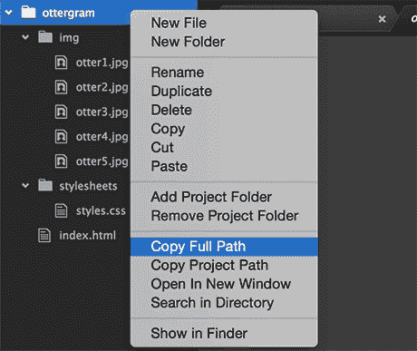

你输入的路径可能像这样：

```
cd /Users/chris/Projects/ottergram
```

一旦进入`ottergram`目录，运行以下命令在`Chrome`中打开 Ottergram。（我们把命令分成了两行。）

```
browser-sync --server --browser "Chrome"
--files "*.css"
```

如果`Chrome`是你的默认浏览器，你可以省略`--browser "Chrome"`部分：

```
browser-sync --server --files "*.css"
```

此命令以服务器模式启动`browser-sync`，允许在任何 HTML 文件更改时自动刷新浏览器。这让开发体验变得更加愉快。在像`browser-sync`这样的工具之前，你需要手动刷新页面。图 2.13 显示了在 Mac 上运行此命令的结果。

**图 2.13 在操作系统启动 browser-sync**


你在 Windows 上应该看到相同的输出（图 2.14）。

**图 2.14 在命令行提示符启动 browser-sync**


一旦 Ottergram 页面在 `Chrome` 中加载，你应该能看到带有“ottergram”标题、“ottergram”标签页以及一系列水獭照片和名字的页面（图 2.15）。

**图 2.15 在浏览器中查看网页**


## Chrome 开发者工具

`Chrome` 内置了开发者工具（通常称为“DevTools”），它们是用于测试样式、布局等的顶级工具。使用开发者工具比在代码中尝试要高效得多。开发者工具非常强大，将在你进行前端开发时成为你的伴侣。

我们下一章将使用开发者工具。现在，请打开窗口并熟悉它的主要区域。

要打开开发者工具，点击 `Chrome` 地址栏右侧的  图标。接下来，点击`更多工具` → `开发者工具`（图 2.16）。

**图 2.16 打开开发者工具**

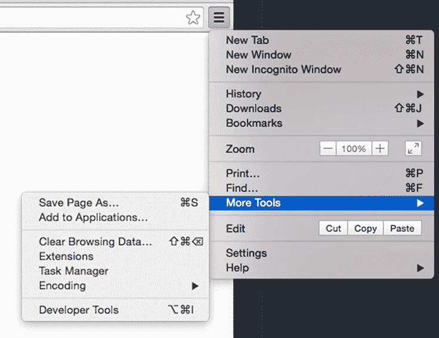

`Chrome` 默认将开发者工具（DevTools）显示在右侧。你的屏幕看起来类似于图 2.17。

**图 2.17 显示元素面板的开发者工具**

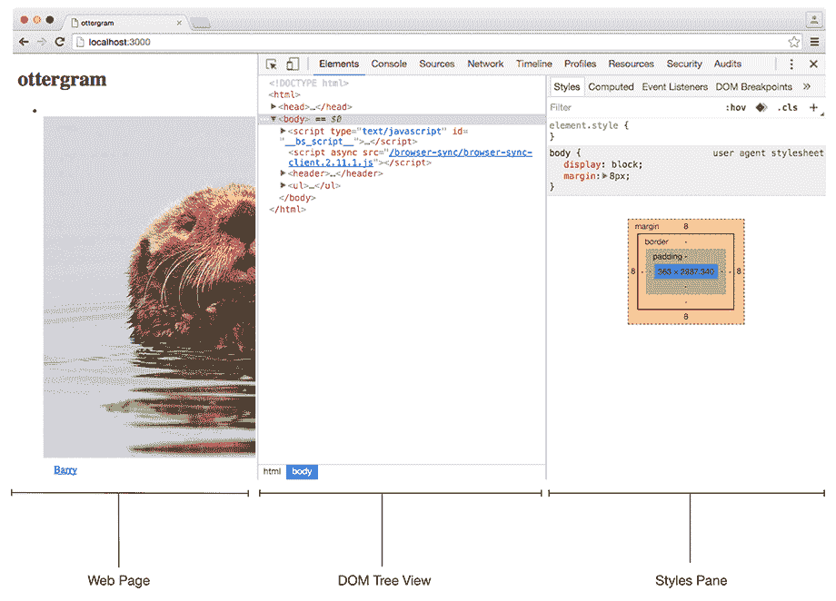

开发者工具展示了代码与生成的页面元素之间的关系。它们允许你检查单个元素的属性和样式，并立即查看浏览器是如何解释你的代码的。这种关系对于开发和调试都至关重要。

在图 2.17 中，你可以看到网页旁边的开发者工具，它正显示着元素面板。元素面板分为两个部分。左侧是`DOM 树视图`。这是 HTML 的表示，被解释为 DOM 元素。（在后续章节中，你将学习更多关于 DOM（即“文档对象模型”）的内容。）元素面板右侧是样式面板。它显示了应用于单个元素的任何视觉样式。

工作时将开发者工具停靠在屏幕右侧通常很方便。如果你想更改开发者工具的位置，可以点击右上角附近的按钮。这将显示一个选项菜单，包括`Dock side`（停靠侧边）按钮，它可以更改开发者工具的锚点位置（图 2.18）。

**图 2.18 更改开发者工具的停靠侧**

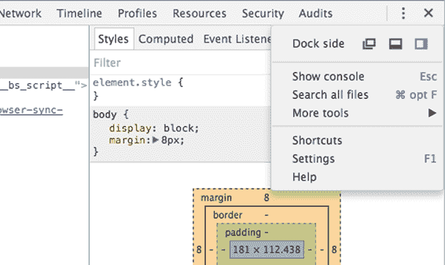

当水獭和标记准备就绪且开发者工具打开时，你已经准备好在下一章开始为你的项目样式了。

## 进阶探索：CSS 版本

CSS 的版本历史包含了标准版本 1、2 和 2.1。在 2.1 之后，人们决定标准变得太大了，需要进行拆分。

并没有所谓的版本 3。相反，CSS3 是许多模块的统称，每个模块都有自己的版本号。

**表 2.1 CSS 版本：现实与想象**

| 版本号 | 发布年份 | 显著特性 |
| --- | --- | --- |
| 1 | 1996 | 基础字体属性（`font-family`、`font-style`）、前景和背景颜色、文本对齐、外边距、边框和内边距。 |
| 2 | 1998 | 绝对、相对和固定定位；新的字体属性。 |
| 2.1 | 2011 | 删除了浏览器支持较差的功能。 |
| “3” | 各异 | 不同规范的集合，例如媒体查询、新选择器、半透明颜色、`@font-face`。 |

## 进阶探索：favicon.ico

你是否注意到在访问大多数网站时，浏览器地址栏左侧会出现一个小图标？有时它们也会出现在你的浏览器标签页中，如图 2.19 所示。

**图 2.19 `bignerdranch.com` 的 `favicon.ico`**

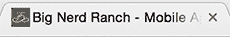

这就是 `favicon.ico` 图片文件。许多网站都有，浏览器默认会请求它。由于 Ottergram 没有，你可能会在开发者工具中看到类似图 2.20 中的错误。

**图 2.20 缺少 `favicon.ico` 的错误**

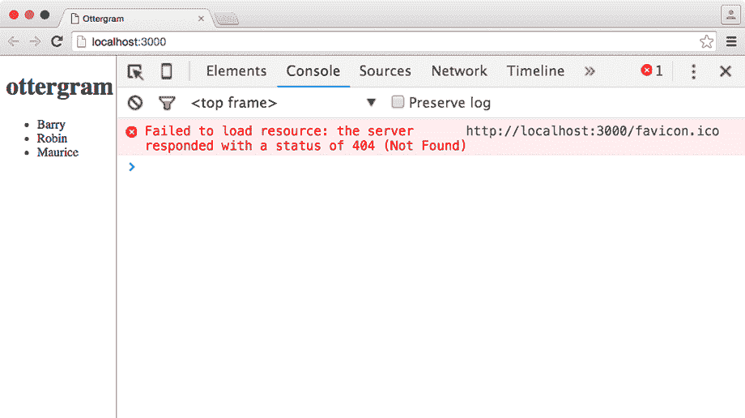

如果出现这个错误，请不要担心。它不会影响你的项目。不过，你可以轻松添加一个 `favicon.ico` 图片——这就是你的第一个挑战。

## 银牌挑战：添加 favicon.ico

你已经决定比起看到 `favicon.ico` 错误信息，你更喜欢水獭。你将使用其中一张水獭图像创建一个 `favicon.ico` 文件。

在网络上搜索“favicon generator”，你应该能看到一个可以为你进行文件转换的网站列表。大多数允许你上传图片，然后为你提供一个 `favicon.ico` 版本。

选择其中一个并上传任意一张水獭图像。

将生成的 `favicon.ico` 文件保存到与 `index.html` 文件相同的文件夹中。最后，刷新你的浏览器。你的浏览器标签页看起来将类似于图 2.21。

**图 2.21 带有 favicon.ico 的 Ottergram**


# 3 样式

在本章中，你将为 Ottergram 设计一个静态版本。在随后的章节中，你将让 Ottergram 交互起来。

当你到达本章结束时，你的网站将看起来像图 3.1。

**图 3.1 样式化**


本章介绍了许多概念和示例。如果你在结束时觉得还没有掌握所有内容，请不要担心。随着学习，你会反复遇到它们。

当然，我们只能介绍 CSS 中可用样式的一小部分。你可能需要查阅 MDN 获取有关完整属性和值的信息。

前端开发者在为网站建模时需要在两种方法之间选择：从整体布局开始到最小细节，或者从最小细节开始到整体布局。

从细节到大观的方法不仅能产生整洁、可重用的代码，它还有一个很酷的名字：原子样式。你将在样式缩略图时使用这种方法，然后是缩略图布局。在下一章中，你将处理整个网站的布局。

## 创建样式基准

你将从向项目添加 `normalize.css` 文件开始。`normalize.css` 帮助你编写的 CSS 在不同浏览器中显示一致。所有浏览器都自带一套默认样式，但不同浏览器之间的默认值不同。`normalize.css` 为网站或应用程序开发自定义 CSS 提供了一个良好的起点。

`normalize.css` 在线免费获取。你不需要下载它。要将其添加到 Ottergram，你只需要在 `index.html` 中链接它。

为了确保你使用的是最新版本的 `normalize.css`，你将从内容共享网站获取其地址。访问 `cdnjs.com/libraries/normalize/` 并找到以 `.min.css` 结尾的文件。（此版本比其他版本小，删除了多余空白。）点击 `Copy` 按钮复制其地址（图 3.2）。

**图 3.2 从 cdnjs.com 获取 `normalize.css`**

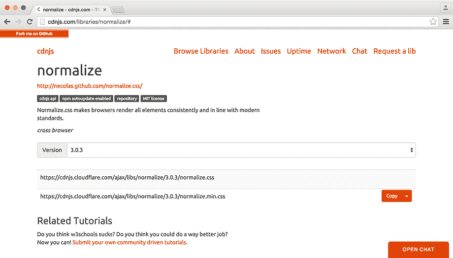

写作时的版本为 3.0.3，但你使用的版本可能更高。

在 `Atom` 中打开你的 Ottergram 文件夹，然后打开 `index.html`。添加 `<link>` 标签并粘贴地址。（在下面的代码中，`<link>` 标签为了适应页面被分成了两行。你可以让它保持单行。）

```
<!doctype html>
<html>
  <head>
    <meta charset="utf-8">
    <title>ottergram</title>
    <link rel="stylesheet"
      href="https://cdnjs.cloudflare.com/ajax/libs/normalize/3.0.3/normalize.min.css">
    <link rel="stylesheet" href="styles.css">
  </head>
```

确保你在 `styles.css` 的 `<link>` 标签之前添加 `normalize.css` 的 `<link>` 标签。浏览器需要先读取 `normalize.css` 中的样式。就这样这样，你的项目就可以利用这个工具了。不需要进行其他设置。你可能会奇怪为什么你要链接到一个完全不同服务器上的地址。事实上，HTML 文件指定不同服务器上的资源并不不寻常（图 3.3）。

### 图 3.3 从不同的服务器请求资源


在这种情况下，`normalize.css` 托管在 `cdnjs.com` 上，这是一个内容分发网络中的公共服务器。CDN 在全球都有服务器，每台服务器都有相同文件的副本。当用户请求文件时，他们会从最近的服务器接收，从而缩短该文件的加载时间。cdnjs.com 托管了许多流行前端库和框架的版本。

## 为样式化准备 HTML

在上一章中，你创建了一个名为 `styles.css` 的样式表，在本章中你将向其中添加许多 CSS 样式规则。但在添加样式之前，你需要设置 HTML，以便你的样式规则有可以引用的目标。你将添加 `class` 属性，将带有水獭名称的 `span` 元素标识为“缩略图标题”。`class` 属性是识别一组 HTML 元素的方法，通常用于样式化。你的“缩略图标题” `class` 将允许你一次性轻松设置所有名称。

在 `index.html` 中，为 `li` 元素内部的 `span` 添加 `thumbnail-title` 类名作为属性，如下所示：

```
...
    <ul>
      <li>
        <a href="#">
          
          <span>Barry</span>
          <span class="thumbnail-title">Barry</span>
        </a>
      </li>
      <li>
        <a href="#">
          
          <span>Robin</span>
          <span class="thumbnail-title">Robin</span>
        </a>
      </li>
      <li>
        <a href="#">
          
          <span>Maurice</span>
          <span class="thumbnail-title">Maurice</span>
        </a>
      </li>
      <li>
        <a href="#">
          
          <span>Lesley</span>
          <span class="thumbnail-title">Lesley</span>
        </a>
      </li>
      <li>
        <a href="#">
          
          <span>Barbara</span>
          <span class="thumbnail-title">Barbara</span>
        </a>
      </li>
    </ul>
...
```

稍后，你将使用这个类名为所有图片标题设置样式。

## 样式的结构

当你创建单独样式时，是通过编写样式规则来实现的，这些规则由两个主要部分组成：选择器 `selectors` 和声明声明 `declarations`）（图 3.4）。

### 图 3.4 样式规则的结构

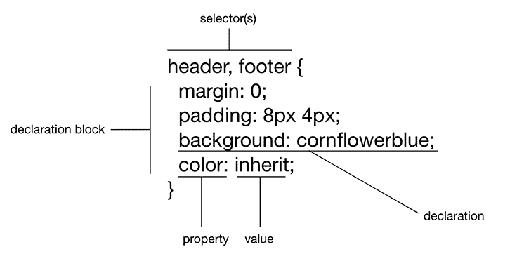

样式规则的第一部分是一个或多个选择器。选择器描述了样式应该应用的元素，例如 `h1`、`span` 或 `img`。但选择器不仅限于标签名。你可以通过增加选择器的 `specificity`（特殊性）来编写适用于更具针对性的元素集的选择器。

例如，你可以根据属性编写选择器——例如你刚刚添加到 `span` 标签上的 `thumbnail-title` 类属性。基于属性的选择器比基于元素名的选择器更具体。

除了可以确保样式仅应用于特定的元素集（例如，具有类名 `thumbnail-title` 的元素对比所有 `span` 元素）之外，特殊性还决定了选择器的相对优先级。如果一个样式表包含多个可以应用于同一个元素的样式，则将使用选择器特殊性较高的样式，而不是选择器特殊性较低的样式。你可以在本章末尾的“好奇进阶”章节中阅读更多关于特殊性的知识。

在本章中，你将接触许多具有不同特殊性的选择器。虽然有很多方法可以针对同一个元素，但理解特殊性是选择最佳选择器的关键，这样你的样式才是可维护的。

样式规则的第二部分是声明块，定义了要应用的样式。块中的每个声明都包含一个属性名称和该属性的值。

在你的第一个样式规则中，你将使用刚刚添加的 `class` 属性作为选择器应用样式。

## 你的第一个样式规则

要在样式规则中使用 `class` 作为选择器，需要在类名前面加一个点（period），例如 `.thumbnail-title`。你将添加的首批样式将设置 `thumbnail-title` 类的背景和前景颜色。

打开 `styles.css` 并添加你的样式规则：

```css
.thumbnail-title {
  background: rgb(96, 125, 139);
  color: rgb(202, 238, 255);
}
```

你将在本章稍后学习更多关于颜色的知识。现在只需查看你的更改。保存 `styles.css` 并确保 `browser-sync` 正在运行。如果你需要重启它，命令是：

```
browser-sync start --server --browser "Google Chrome"
                   --files "stylesheets/*.css, *.html"
```

将在 Chrome 中打开你的网页（图 3.5）。

### 图 3.5 稍微彩色 Ottergram

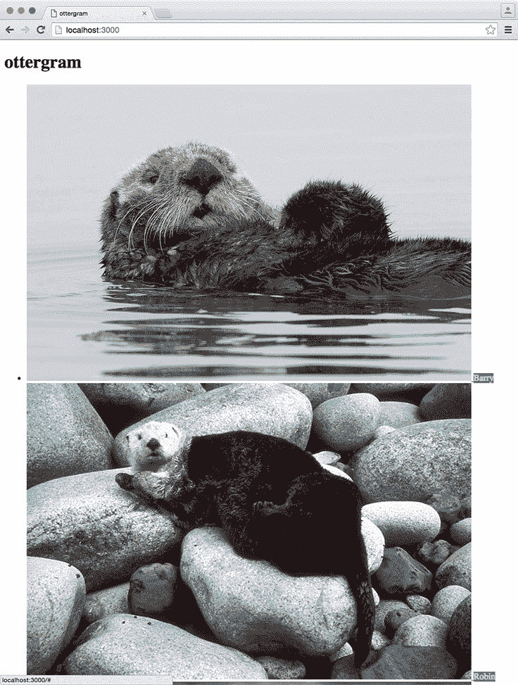

你可以看到你已经将缩略图标题的背景设置为深蓝色，字体颜色设置为浅蓝色。很好。

继续为缩略图标题：返回 `styles.css` 并在现有的 `.thumbnail-title` 类样式规则中添加，如下所示：

```css
.thumbnail-title {
  display: block;
  margin: 0;
  padding: 4px 10px;

  background: rgb(96, 125, 139);
  color: rgb(202, 238, 255);
}
```

你添加的三个声明都会影响元素的 `box`（盒）。对于每一个具有视觉呈现的 HTML 标签，浏览器都会在页面上绘制一个矩形。浏览器使用一种名为`标准盒模型”（或直接称为“盒模型”）的方案来确定该矩形的尺寸。

### 盒模型

为了理解盒模型，你将查看它开发者工具（DevTools）中的表示。保存 `styles.css`，切换到 `Chrome`，并确保开发者工具已打开（图 3.6）。

**图 3.6 探索盒模型**

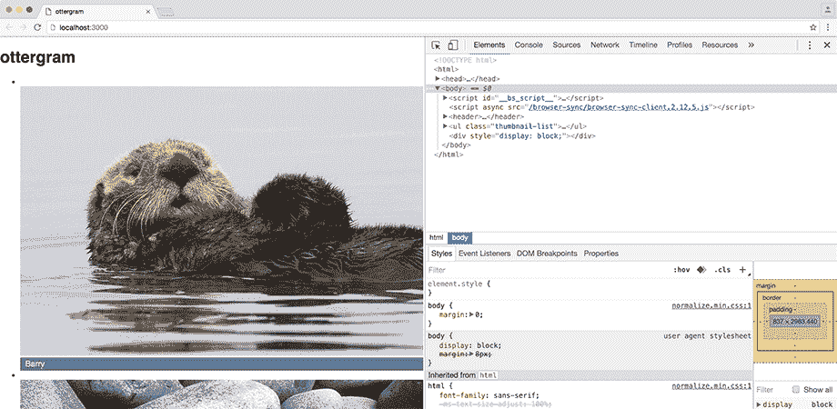

点击元素面板左上角的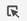按钮。这是`检查元素`按钮。现在，将光标移动到网页上的“ottergram”单词上。当你悬停在单词单词上时，开发者工具会用一个蓝色和桃红色的矩形框住标题（图 3.7）。

**图 3.7 悬停在标题上**

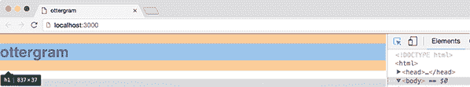

点击网页上的单词“ottergram”。尽管你不再看到彩色的叠加层，但该元素现在已被选中，元素面板中的 DOM 树视图将展开并突出显示相应的 `h1` 标签。

元素面板右下角的矩形图表示 `h1` 元素的盒模型。你可以看到，图中的某些区域与你检查标题时覆盖在标题上的矩形具有某些相同的颜色（图 3.8）。

**图 3.8 查看元素的盒模型**

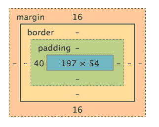

盒模型包含了为元素绘制的矩形的四个方面（开发者工具在图中用四种不同的颜色渲染它们）。

- content（显示为蓝色）：视觉内容——在这里是文本
- padding（内边距，显示为绿色）：内容周围的透明空间
- border（边框，显示为黄色）：内容和内边距周围的边界
- margin（外边距，显示为桃红色）：边框周围的透明空间


图 3.8 中的数字是`pixel`（像素）值；像素是计算机屏幕上可以显示单色的最小矩形区域的单位。对于`h1`元素，内容区域分配了 197 像素乘以 54 像素的（你的值可能不同，取决于浏览器窗口的大小）。左侧有 40 像素的内边距。边框设置为 0，元素上下有 16 像素的外边距。

那个外边距值是从哪里来的？每个浏览器都提供了一个默认样式表，称为`user agent stylesheet`（代理样式表），以防 HTML 文件未指定样式。你指定的样式会覆盖默认值。由于你没有为`h1`元素的盒指定值，因此应用了默认样式。

现在，你准备好理解你添加的样式声明了：

```
.thumbnail-title {
  display: block;
  margin: 0;
  padding: 4px 10px;

  background: rgb(96, 125, 139);
  color: rgb(202, 238, 255);
}
```

`display: block`更改了所有类为`.thumbnail-title`的元素的盒，使其占据其父容器元素允许的整个宽度。（注意图 3.6 所示，标题的背景颜色现在覆盖了更宽的区域）。其他的`display`值，例如你之后将看到的`display: inline`属性，会让元素的宽度适应其内容。

你还将缩略标题的外边距设置为 0，并将内边距设置为两个不同的值：4px 和 10px（`px`是“pixels”的缩写）。这把内边距设置为特定的像素值，覆盖了代理样式表设置的默认尺寸。

内边距、外边距以及某些其他样式可以写为`简写属性`，其中一个值被应用于多个属性。你在这里利用了这一点：当为内边距提供两个值时，第一个值应用于两个垂直方向（顶部和底部），第二个值应用于水平方向。

## 样式继承

接下来，你将添加样式来更改文本的大小和外观。在`styles.css`中添加一条新的样式规则，为`body`设置字体大小。要做到这一点，你将使用不同类型的选择器——`元素选择器`，通过使用元素的名称。

```
body {
  font-size: 10px;
}

.thumbnail-title {
  display: block;
  margin: 0;
  padding: 4px 10px;

  background: rgb(96, 125, 139);
  color: rgb(202, 238, 255);
}
```

这条样式规则将`body`的`font-size`设置为`10px`。你很少会在样式表中使用元素选择器，因为你通常不会想对特定标签的所有出现应用完全相同的样式。使用它们意味着你可能会在样式表中重复编写相同的声明。但在这种情况下，针对`body`元素的特殊性恰好。只有一个`<body>`元素，而且你不会复用它的样式。

保存`styles.css`并在`Chrome`中查看你的网页（图 3.9）。

**图 3.9 设置字体大小**

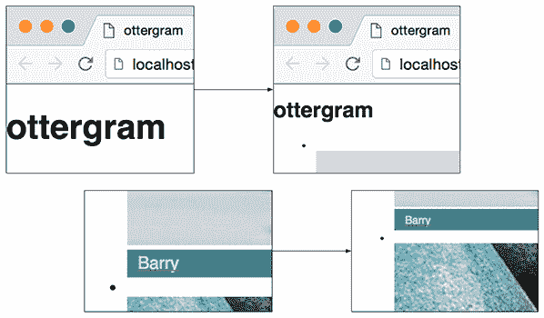

你的标题和缩略标题都变小了。你可能预到了这一点，也可能没有。虽然标题直接位于你声明`font-size`属性的`body`元素内，但缩略标题不是。它们嵌套了许多层。然而，许多样式（包括字体大小）会被应用于样式规则指定的元素以及这些元素的`后代`。

你文档的结构可以使用树形图来描述，如图 3.10 所示。将元素表示为树是可视化 DOM 的良好方法。

**图 3.10 简化的 Ottergram 结构**

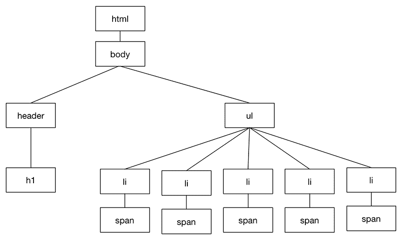

包含元素的元素被称为元素的后代。在这种情况下，你的`span`都是`body`（以及`ul`及其相应的`li`）的后代，因此它们继承了`body`的`font-size`样式。

在 DevTools 的 DOM 树视图中，找到并选择一个`span`元素。在样式面板中，注意标记为`Inherited from a`、`Inherited from li`和`Inherited from ul`的框。这三个区域如所示，显示了从用户代理样式表（user agent stylesheet）在每一层继承的样式。在`Inherited from body`下，你可以看到`font-size`属性已从`styles.css`中为`body`元素设置的集（图 3.11）。

**图 3.11 从祖先元素继承的样式**

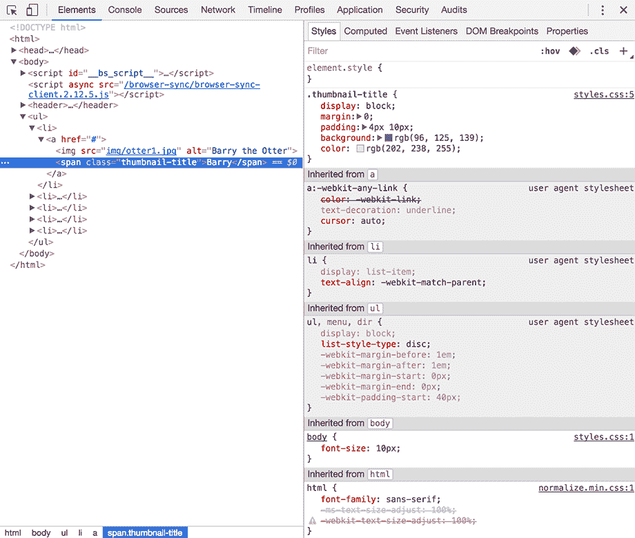

如果在另一个层级（例如`ul`）设置了不同的字体大小会怎样？来自更近祖先元素的样式具有优先级，因此在`styles.css`中为`ul`设置的字体大小将覆盖为`body`设置的，而为`span`元素本身设置的字体大小将同时覆盖两者。

要查看这一点，请点击 DOM 树视图中的`ul`元素。这将允许你尝试尝试样式。你在这里添加的样式将立即反映在网页视图中，但不会添加到你的实际项目文件中。

在元素面板中样式面板的顶部，你会看到一个标记为`elements.style`的区域。点击`elements.style`花括号之间的任何位置，DevTools 都会给出一个提示（图 3.12）。

**图 3.12 输入样式规则提示**

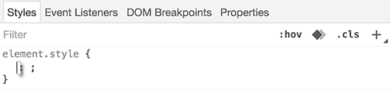

开始输入`font-size`，DevTools 将为你建议可能的补全选项（图 3.13）。

**图 3.13 样式面板中的自动补全选项**


选择`font-size`，然后按 Tab 键。输入一个大值，例如`50px`，并按 Return。你可能需要滚动页面，但你会发现`ul`的`font-size`已经覆盖了`body`的（图 3.14）。

**图 3.14 为`ul`设置 50px 的`font-size`**


并不是所有的样式属性都是继承的——例如，`border`就不是。要确定某个属性是否被继承，请参考该属性的 MDN 参考页面。

回到`styles.css`，更新`.thumbnail-title`类的声明块，以覆盖`body`的`font-size`并使用更大的字体。

```css
body {
  font-size: 10px;
}

.thumbnail-title {
  display: block;
  margin: 0;
  padding: 4px 10px;

  background: rgb(96, 125, 139);
  color: rgb(202, 238, 255);

  font-size: 18px;
}
```

对于类`.thumbnail-title`的元素，你将字体大小更改为了 18 像素。

保存`styles.css`，在`Chrome`中欣赏你的缩略图标题（图 3.15）。

**图 3.15 样式化的缩略图标题**


它们看起来很好，但用户代理样式表正在为`.thumbnail-title`元素添加下划线。这是因为你将它们（以及`.thumbnail-image`元素）封装在了锚点标签中，使它们继承了下划线样式。

你不需要这些下划线，因此你将通过在`styles.css`的新样式中更改锚点标签的`text-decoration`属性来移除它们。为此规则使用什么选择器？

如果你确定要移除缩略图标题以及 Ottergram 中任何其他锚点元素的下划线，你可以直接使用元素选择器：

```css
a {
  /* style declaration */
}
```

（`/* */`之间的文本是 CSS`注释`。浏览器会忽略代码注释；它们允许开发者在代码中记录以便将来参考。）

如果你认为可能将锚点用于其他用途（并希望对其进行不同的样式处理），可以将元素选择器与`属性选择器`配对，如下：

```css
a {
  /* style declaration */
}
```

此选择器将匹配具有`href`属性的元素。当然，锚点元素通常都有`href`属性，因此可能不够精确到仅匹配目标。为了使属性选择器更精确，你还可以指定属性的值，如下：

```css
a[href="#"] {
  /* style declaration */
}
```

此选择器将匹配`href`属性值为`#`的锚元素。

顺便说一下，你也可以单独使用带不值的属性选择器，例如：

```css
[href] {
  /* style declaration */
}
```

碰巧，Ottergram 是一个非常简单的项目，你实际上不会在缩略图和标题以外的地方使用标签。因此，使用元素选择器是安全的，而且你应该这样做，因为它是最直接的解决方案。

在`styles.css`中添加新的样式声明：

```css
body {
  font-size: 10px;
}

a {
  text-decoration: none;
}

.thumbnail-title {
  ...
}
```

保存文件并检查浏览器。下划线消失了，你的缩略图标题也变得精美了（图 3.16）。

**图 3.16 设置`text-decoration`为`none`后**


注意，你不应该移除正文中链接的下划线——即不是明显的标题、标题或说明的文本。链接的下划线是预期的重要视觉指示。你在这里这样做是因为缩略图不需要同样的视觉提示。用户会合理认为它们是可以点击的。

在本章的剩余部分，你将使用类选择器来为缩略图图像、无序列表、列表项（包括缩略图及其标题）以及页眉设置样式。先为`index.html`中的`h1`、`ul`、`li`和`img`元素添加类名以备之用。

```html
...
  </head>
  <body>
    <header>
      <h1>ottergram</h1>
      <h1 class="logo-text">ottergram</h1>
    </header>
    <ul>
    <ul class="thumbnail-list">
      <li>
      </li>
      <li class="thumbnail-item">
        <a href="#">
          
          
          <span class="thumbnail-title">Barry</span>
        </a>
      </li>
      <li>
      </li>
      <li class="thumbnail-item">
        <a href="#">
          
          
          <span class="thumbnail-title">Robin</span>
        </a>
      </li>
      <li>
      </li>
      <li class="thumbnail-item">
        <a href="#">
          
          
          <span class="thumbnail-title">Maurice</span>
        </a>
      </li>
      <li>
      </li>
      <li class="thumbnail-item">
        <a href="#">
          
          
          <span class="thumbnail-title">Lesley</span>
        </a>
      </li>
      <li>
      </li>
      <li class="thumbnail-item">
        <a href="#">
          
          
          <span class="thumbnail-title">Barbara</span>
        </a>
      </li>
    </ul>
...
```

通过为这些元素添加类名，你为你将要添加的样式设定了目标。

我们更倾向于使用类选择器而不是其他的选择器，你也应该这样做。你可以编写非常具描述性的类名，使你的代码易于开发和维护。此外，你还可以为元素添加多个类名，使它们成为样式化的灵活且强大的工具。

在继续之前，请确保保存`index.html`。

## 让图片适应窗口

遵循原子样式模式，接下来是需要进行样化的图片。它们太大了，除非浏览器窗口也很大，否则它们会被裁剪。在`styles.css`中为`.thumbnail-image`添加样式规则，使缩略图适应窗口：

```css
...
a {
  text-decoration: none;
}

.thumbnail-image {
  width: 100%;
}

.thumbnail-title {
  ...
}
```

你将`width`设置为`100%`，这将其限制在容器的宽度内。这意味着当你加宽浏览器窗口时，图片会按比例变大。尝试一下：保存`styles.css`，切换到浏览器，并放大和缩小你的浏览器窗口。图片会随着浏览器窗口同步放大和缩小，始终保持比例。图 3.17 显示了在一个较窄和一个较较宽的浏览器窗口中的 Ottergram。

**图 3.17 按宽度调整图片**


如果你仔细观察，`.thumbnail-title`周围的间距是不正确的，导致标题看起来和它们下方的图片在了一起。在`styles.css`中通过将`.thumbnail-image`的`display`属性设置为`block`来修复这个问题。

```css
...
.thumbnail-image {
  display: block;
  width: 100%;
}
...
```

现在，图片与其标题之间的空格消失了（图 3.18）。

**图 3.18 设置`.thumbnail-image`为`display: block`后**


为什么这样做有效？图片默认是`display: inline`。它们遵循与文本相似的渲染规则。当文本被渲染时，字母沿着共同的基线（baseline）绘制。某些字符，如`p`、`q`和`y`，具有“下降部”（descender）——即超出此基线的尾巴。为了容纳这些字符，基线下方会留了一些空白。

将`display`属性设置为`block`会移除空白，因为不需要容纳任何文本（或任何可能与图片并排渲染的`display: inline`元素）。

## 颜色

是时候深入探索颜色了。在`styles.css`中为`body`元素和`.thumbnail-item`类添加以下颜色样式：

```css
body {
  font-size: 10px;
  background: rgb(149, 194, 215);
}

a {
  text-decoration: none;
}

.thumbnail-item {
  border: 1px solid rgba(100%, 100%, 100%, 0.8);
}
```


你为`.thumbnail-item`的边框声明了两次值。为什么？注意到这两个声明使用了不同的颜色函数：`rgb`和`rgba`。`rgba`颜色函数接受第四个参数，即透明度。某些浏览器不支持`rgba`，因此提供两个声明是一种回退（fallback）机制。

所有浏览器都会看到第一个声明（`rgb`）并注册值。不支持`rgba`的浏览器会忽略第二个声明。支持`rgba`的浏览器将使用第二个声明并丢弃第一个。

（好奇`body`的背景颜色是用整数定义的，而`.thumbnail-item`的边框颜色是用百分比定义的吗？稍后我们会回来讨论。）

保存`styles.css`并切换到浏览器（图 3.19）。

**图 3.19 背景与边框**


在开发工具中，你可以看到 Chrome 支持`rgba`。它通过划掉样式表示`rgb`颜色未被使用（图 3.20）。

**图 3.20 使用 rgba**


现在，仍然在开发工具中，请选择`body`。在样式面板中，注意你刚刚添加的背景颜色声明。RGBA 值左侧有一个小正方形，显示了颜色的外观。

点击那个正方形，会打开颜色选择器（图 3.21）。颜色选择器允许你选择颜色，并以多种格式提供 CSS 颜色值。

**图 3.21 样式面板中的颜色选择器**


要以不同的颜色格式查看背景颜色，点击 RGBA 值右侧的向上和向下箭头。可以在 HSLA、HEX 和 RGBA 格式之间切换。

HSLA 格式（代表色相、饱和度、亮度透明度）的使用频率比其他格式低，部分是因为一些流行的设计工具没有提供适用于 CSS 的准确 HSLA 值。如果你对 HSLA 感兴趣，请访问 [css-tricks.com/examples/HSLaExplorer](https://css-tricks.com/examples/HSLaExplorer) 查看 HSLA 探索器。

查看背景色的 HEX 值：`#95C2D7`。HEX（或十六进制）是最古老的颜色规范格式。每个数字都代表一个从 0 到 15 之间的值。（如果你不熟悉十六进制，这是通过包含 A 到 F 字符作为数字来实现的。）每对数字则可以表示一个从 0 到 255 之间的值。从左到右，这些数字对对应于指定颜色中红、绿、蓝的强度（图 3.22）。

**图 3.22 HEX 值对应红色、绿色和蓝色值**


许多人认为 HEX 颜色并不直观。一种现代的替代方案是使用 RGB（红、绿、蓝）值。在这一模型中，每种颜色也被分配了一个从 0 到 255 之间的值，但这些值用更熟悉的十进制数表示，并用颜色隔开。如前所述，对于功能更强大的浏览器，第四个值可以指定指定颜色的透明度，范围从 0.0（完全透明）到 1.0（完全不透明）。该透明度正式被称为 <samp class="firstterm">alpha</samp> 值——因此 RGBA 中的 A 代表它。`body`背景色的 RGBA 值为`(149, 194, 215, 1)`。

除了为红、绿、蓝声明整数值外，你也可以使用百分比，就像你为`.thumbnail-item`边框做的那样。这两个选项在功能上没有区别。只需不要在同一个声明中混合百分比和整数即可。

顺便提一下，为了帮助选择好看的配色方案，Adobe 在 [<samp class="uri">color.adobe.com</samp>](https://color.adobe.com/) 提供了一个免费的在线工具。

## 调整项目之间的间距

Ottergram 现在有一些漂亮的颜色，让人联想到海獭的海园。但添加颜色后，`.thumbnail-item`元素的边框内部出现了一些不需要的空白。此外，那些讨厌的项目项目符号分散了人们对海獭光彩的注意力。

要去掉项目符号，请在 <samp class="filename">styles.css</samp> 中将`.thumbnail-list`的`list-style`属性设置为`none`：

```
...
.thumbnail-item {
  border: 1px solid rgb(100%, 100%, 100%);
  border: 1px solid rgba(100%, 100%, 100%, 0.8);
}

.thumbnail-list {
  list-style: none;
}

.thumbnail-image {
  ...
}
```

要消除空白，你将使用处理`.thumbnail-image`时相同的技术。每个`.thumbnail-item`默认都有该空白以适应列表中的项目，就像`.thumbnail-image`元素有空白以适应相邻文本一样。为`.thumbnail-item`添加`display: block`声明来移除它。

```
...
.thumbnail-item {
  display: block;
  border: 1px solid rgb(100%, 100%, 100%);
  border: 1px solid rgba(100%, 100%, 100%, 0.8);
}
...
```

通过这些添加，项目符号和图像上方的多余空间消失了，形成了更精美的布局，如图 3.23 所示。

**图 3.23 改进的布局**


如果你不需要项目符号，为什么要使用项目符号列表？最好的方法是根据 HTML 标签的含义而不是浏览器如何对其进行默认样式来选择。在这种情况下，你需要一个图像的无序列表，因此`ul`是正确的选择。当你向第 4 章中的项目添加详细细节图像时，用于图片的`ul`容器将允许你将其样式化为滚动列表。浏览器默认用项目符号表示`ul`这一点并不重要，因为它们很容易被移除。

接下来，你将调整列表项目的间距。单独的`.thumbnail-item`元素之间没有间距。你将在相邻的缩略图之间添加边距（margin）。

然而，你不想为*所有*列表项目添加边距。为什么呢？因为标题已经有了边距，所以第一个列表项目不需要。这意味着你不能直接使用`.thumbnail-item`类选择器，至少不能单独使用它。相反，你将使用根据元素与其他元素之间关系来目标元素的选择器语法。

### 关系选择器

再次查看图 3.10 中的项目图表。它看起来非常像家族树，不是吗？这种相似性为这组关系选择器命名：<samp class="firstterm">后代选择器</samp>、<samp class="firstterm">子级选择器</samp>、<samp class="firstterm">兄弟选择器</samp>和 <samp class="firstterm">相邻兄弟选择器</samp>。

关系选择器语法包含两个选择器（如类选择器或元素选择器），它们由一个名为 <samp class="firstterm">组合符</samp> 的符号连接，该组合符决定了它们之间的目标关系。要理解关系选择器如何工作，重要的是记住浏览器是从*右到左*读取选择器语法的。让我们看一些例子。

后代选择器针对是另一个指定元素的后代的任何类型元素。例如，要选择`body`元素的后代的任何`span`元素，语法为：

```
body span {
  /* 样式声明 */
}
```

此语法没有使用组合符。由于它是从右到左读取的，它针对任何来自`body`的`span`，在当前代码中这意味着缩略图标题。它还会影响可能在`header`或其他地方添加的任何`span`。

注意，你也可以在关系选择器中使用类选择器（或属性选择器，或任何类型的选择器），因此上面的选择器也可以写成：

```
body .thumbnail-title {
  /* 样式声明 */
}
```

子级选择器针对是另一个元素直接孩子的指定类型元素。子级选择器语法使用组合符`>`。要使用子级选择器针对 Ottergram 中所有的`span`，语法为：

```
li > span {
  /* 样式声明 */
}
```

从右到左读取，此选择器针对是`li`的直接孩子的`span`——再次缩略图标题。

兄弟选择器语法使用组合符`~`。正如你预期的，这种语法针对具有相同父元素的元素。然而，由于关系选择器的方向性，结果可能并不如你所愿。考虑这个例子：

```
header ~ ul {
  /* 样式声明 */
}
```

此选择器针对位于相同父元素的`header`之前的任何`ul`。此选择器会有效地针对 Ottergram 的`ul`，因为它在代码中前面有一个兄弟`header`。然而，反转语法（`ul ~ header`）会导致没有元素被选中，因为没有位于兄弟`ul`之前的`header`。

最后的关系选择器类型是相邻兄弟选择器，它针对*紧邻*指定类型兄弟之前的元素。相邻兄弟组合符为`+`：

```
li + li {
  /* 样式声明 */
}
```

此语法将选择所有紧邻兄弟`li`之前的`li`元素。结果是声明的样式将应用到第二个到第五`li`——但不是第一个，因为它的前面没有另一个`li`。（注意，由于 Ottergram 相对简单的结构，目前通用兄弟选择器和相邻兄弟选择器的效果相同。）

回到正要的任务：为每个列表项添加顶部边距，第一个除外。如果你使用后选择器或子选择器来定位`.thumbnail-item`类或`span`或`li`元素，那么边距将应用于所有五个缩略图。由于你想对第一个以外的所有项设置样式，请在`styles.css`中使用相邻兄弟语法，仅为那些紧跟在另一个缩略图之后的缩略图添加顶部边距。

```
...
a {
  text-decoration: none;
}

.thumbnail-item + .thumbnail-item {
  margin-top: 10px;
}

.thumbnail-item {
  ...
```

保存文件并在浏览器中查看结果（图 3.24）。

**图 3.24 相邻`.thumbnail-item`元素之间的间距**


请注意，开发者工具（DevTools）提供了一种查找元素嵌套路径的简单方法，这有助于编写关系选择器。如果你点击`li`元素内部的某个`span`元素，可以在元素面板的底部看到它的路径（图 3.25）。

**图 3.25 元素面板显示的嵌套路径**


为了对缩略图列表的外观进行最后一次微调，返回`styles.css`并覆盖`ul`继承自用户代理样式表的内内边距（padding），使得图像不再有缩进。

```
...
.thumbnail-list {
  list-style: none;
  padding: 0;
}
...
```

像往常一样，保存文件并切换到浏览器查看结果（图 3.26）。

**图 3.26 去除了内边距的 ul**


Ottergram 看起来开始精美了。通过为标题添加一些样式，你将拥有一个漂亮的静态网页。

## 添加字体

早些，你为`h1`元素添加了`.logo-text`类。使用该类作为`styles.css`中新样式规则的选择器。将它插入到锚点标签（anchor tag）样式之后。（通常情况下，只有当你对同一个选择器有多个规则集时，样式的顺序才重要。在 Ottergram 中，样式的排列与它们在代码中出现的顺序大致一致。这取决于个人喜好，你可以根据自己的需要组织样式。）

```
...
a {
  text-decoration: none;
}

.logo-text {
  background: white;

  text-align: center;
  text-transform: uppercase;
  font-size: 37px;
}

.thumbnail-item + .thumbnail-item {
  ...
```

首先，你为标题设置了白色背景。然后，你在`.logo-text`元素内部居中了文本，并使用`text-transform`属性将其格式化为大写。最后，你设置了字体大小。你的结果看起来将像图 3.27。

**图 3.27 标题样式化**


Ottergram 看起来极了。很棒……但对于一个有*水獭*的网站来说，有点单调。为了增添一些活力，你可以为标题使用除用户代理样式表提供的字体以外的字体。

我们在你已经下载并添加到项目目录的资源文件中包含了一些字体。要使用它们，你需要将`fonts`文件夹复制到你的项目中。将其放置在你的`stylesheets`文件夹*内部*（图 3.28）。

**图 3.28 stylesheets 文件夹内的 fonts 文件夹**


现在你只需要将某些样式指向这些字体。

资源文件包含了每种字体的多种格式。如既往，不同的浏览器厂商支持不同类型的字体。为了支持最广泛的浏览器，你需要将它们全部包含在项目中。是的，全部包含。

为了帮助你，`@font-face`语法允许你为字体族指定自定义名称，然后你可以在样其余部分使用它。`@font-face`块与你使用的块稍有不同。`@font-face`块包含三个主要部分：

*   首先是`font-family`属性，其值是一个字符串，用于识别你可以在样式其他部分使用的自定义名称。

*   接下来是几个`src`声明，指定不同的字体文件。

*   最后是修改字体的声明，例如`font-weight`和`font-style`。

在`styles.css`顶部为`lakeshore`字体族添加`@font-face`声明并使用该自定义字体。

```
@font-face {
    font-family: 'lakeshore';
    src: url('fonts/lakeshore.eot') format('opentype'),
         url('fonts/lakeshore.woff') format('woff'),
         url('fonts/lakeshore.ttf') format('truetype'),
         url('fonts/lakeshore.svg') format('svg');
    font-weight: normal;
    font-style: normal;
}

body {
  font-size: 10px;
  background: rgb(149, 194, 215);
}

}

a {
  text-decoration: none;
}

.logo-text {
  background: white;

  text-align: center;
  text-transform: uppercase;
  font-size: 37px;
}
```

诚然，要正确设置`@font-face`声明可能是困难的，因为各个`url`值的顺序很重要。保留一份声明以供参考是一个好主意。你还可以查看 Atom 的片段文档 `flight-manual.atom.io/using-atom/snippets/` 来了解如何创建你自己的“片段”或模板。

声明`@font-face`之后，你的 CSS 其他部分就可以访问`font-family`属性的新值`lakeshore`。在`.logo-text`声明中，你设置了`font-family: lakeshore`来应用新字体。

保存`styles.css`，切换到 Chrome，看看拥有像水獭一样时尚的网页感觉有多棒（图 3.29）。

**图 3.29 应用自定义字体**


## 铜挑战：更改颜色

更改`body`的背景颜色样式。使用开发者工具中的颜色选择器（图 3.21）来帮助选择。

为了获得更高级的色板，请访问 [color.adobe.com](https://color.adobe.com/) 并为`body`和`.thumbnail-title`背景颜色创建你自己的方案。

# 给更有好奇心的人：优先级！当选择器发生冲突时……

你已经看到了了如何覆盖样式。例如，你将`normalize.css`的链接放在了`styles.css`之前。这使得浏览器使用`normalize.css`的样式作为基准，而你的样式优先级高于这些基准样式。

这是浏览器如何选择将哪些样式应用于页面元素上的第一个基本概念，前端开发人员称之为“**时效性**”（`recency`）：当浏览器处理 CSS 规则时，新规则可以覆盖较早处理的规则。你可以通过更改`<link>`标签的顺序来控制浏览器处理 CSS 的顺序。

当规则具有相同的选择器时，这种情况非常简单（例如，如果你的 CSS 和`normalize.css`为`body`元素声明了不同的`margin`）。在这种情况下，浏览器会选择最近的声明。但对于被多个选择器命中的元素，该如何处理呢？

假设你在 Ottergram 的 CSS 中有以下两条规则：

```
.thumbnail-item {
  background: blue;
  }

li {
  background: red;
}
```


这两者都会匹配你的`<li>`元素。你的`<li>`元素将具有什么背景颜色？尽管`li { background: red; }`规则更晚，但`.thumbnail-item { background: blue; }`将被使用。为什么？因为它使用了类选择器，它比元素选择器更具特殊性（即被分配了更高的优先级值）。

类选择器和属性选择器具有相同的优先级，且它们的优先级都高于元素选择器。最高优先级属于`ID 选择器`，你还没有见过它。如果你给一个元素添加`id`属性，你就可以编写一个比任何其他选择器都更具体的 ID 选择器。

ID 属性看起来与其他属性相似。例如：

```html
<li class="thumbnail-item" id="barry-otter">
```

要在选择器中使用该 ID，需要在它前面加上`#`前缀：

```css
.thumbnail-item {
  background: blue;
}

#barry-otter {
  background: green;
}

li {
  background: red;
}
```

在这个例子中，`<li>`被三个选择器全部命中，但它将具有绿色背景，因为 ID 选择器的优先级最高。你的规则集的顺序在这里没有区别，因为每个规则的优先级都不同。

关于使用 ID 选择器的一点：最好避免使用它们。ID 值在文档中必须唯一的，因此你不能在文档的任何其他元素中使用`id="barry-otter"`属性。尽管 ID 选择器具有最高优先级，但它们关联样式无法重用，这使其成为维护上的“反实践”。

要学习更多关于优先级的知识，请访问 MDN 页面`developer.mozilla.org/en-US/docs/Web/CSS/Specificity`。

`specificity.keegan.st`上的优先级计算器是比较不同选择器优先级的 get 工具。查看它可以让你更精确地理解优先级是如何计算的。

# 使用 Flexbox 实现的 4 种响应式布局

前端开发人员的职责之一是无论用户使用什么设备或浏览器，都能为他们提供最佳体验。

这并不一直是主流态度，浏览器制造商对此负有部分责任。在 Web 早期，浏览器制造商正在进行一场战争。每个人都会发明新的非标准特性，试图超越对手。作为回应，Web 开发人员想出了方案来检测哪个浏览器正在请求文档以及使用了多大的屏幕尺寸。根据这些信息，会提供不同版本的文档。

遗憾的是，这意味着前端开发背上了沉重的负担，需要为网站上的每个页面创建多个副本，每个副本都是用适用于特定屏幕尺寸下运行的特定浏览器版本的标记和样式构建的。维护所有这些副本既耗时又令人令人沮丧。

幸运的是，浏览器大战已经结束，浏览器制造商现在力求符合同一套标准特性——现代前端开发人员可以自由地关注网站的单一代码库。需要创建特定特定页面的时代已经过去。但这并不意味着开发者不能再根据不同的屏幕尺寸或方向提供定制化页面了。新技术——如你将在本章中学习的`flexbox`——允许布局根据用户的屏幕尺寸进行调整，而不需要重复的文档。

在本章中，你将把 Ottergram 从一个简单的图像列表扩展为准备好处理交互内容的正式用户界面。使用 flexbox 和 CSS 定位，你将构建一组界面组件，它们会根据浏览器窗口大小的变化进行调整，同时保持整体布局。在章节结束时，Ottergram 将包含一个缩略图滚动列表以及一个显示单张图片大尺寸详细版本的区域（图 4.1）。

**图 4.1 具有灵活布局的 Ottergram**


你将分两个部分完成。首先，你将添加显示大图和缩小缩略图所需的最小标记和样式。然后，你将添加样式让页面部分拉伸和收缩以适应尺寸变化。

## 扩展界面

自从 iPhone 问世以来，通过手机而非桌面或笔记本电脑访问互联网的趋势一直在增长。

对于前端开发人员来说，这种趋势意味着“移动优先”（mobile-first）开发证明是最佳设计方法：先为小屏幕设计，然后在此设计的基础上构建平板电脑尺寸的设计，最后扩展到桌面尺寸的设计。

Ottergram 的简单布局已经是移动友好的。它以适合较小尺寸的比例显示文本和图像。正如此，你可以直接为布局添加下一级别的复杂度。

垂直滚动的海獭列表是可以的，但如果用户还能看到图片的放大版本将会更好。Ottergram 的计划是让缩略图列表水平滚动，同时展示一张更大的详细图。目前，详细图将位于列表下方。该计划如图 4.2 所示。

**图 4.2 Ottergram 的新布局**


你将从添加详细图开始。

### 添加详细图

目前，你的详细图将固定在单张图片上。在第 6 章中，你将添加功能，让用户点击缩略图使任何图片变为详细图。

在`index.html`中添加一段新代码来创建详细图：

```html
...
      <li class="thumbnail-item">
        <a href="#">
          
          <span class="thumbnail-title">Barbara</span>
        </a>
      </li>
    </ul>

    <div class="detail-image-container">
      
      <span class="detail-image-title">Stayin' Alive</span>
    </div>

  </body>
</html>
```

你添加了一个带有`detail-image-container`类的`<div>`。`<div>`是一个通用的内容容器——通常用于对包含的内容应用样式，而这正是你将使用它的方式。

在`<div>`内部，你添加了一个``标签来显示水獭图像的大尺寸。你还添加了一个`<span>`标签，包裹了详情图片的标题文本。你分别为``和`<span>`标签赋予了`detail-image`和`detail-image-title`类名。

保存`index.html`，切换到`styles.css`，最后限制你新定义的`.detail-image`类的宽度。

```
...
.thumbnail-title {
  ...
}

.detail-image {
  width: 90%;
}
```

保存`styles.css`并启动`browser-sync`在`Chrome`中打开你的项目（图 4.3）。（命令是`browser-sync start --server --browser "Google Chrome" --files "stylesheets/*.css, *.html"`。）

**图 4.3 详情图的初始样式**


你的`.detail-image`将出现在页面底部，比你的缩略图略窄。通过将详情图的宽度设置为容器宽度的 90%，你在它旁边留出了一点空间。浏览器会将`.detail-image-title`的文本放在该空间内（你将在本章稍后对该文本进行样式设置）。

如果你调整页面大小，你会发现一个 bug：当缩略图调整到新宽度时，详情图可能会被挤出视野。你将在本章的稍后部分解决这个问题。

## 缩略图的水平布局

接下来，你将更新`.thumbnail-list`和`.thumbnail-item`类，以便图像能够水平滚动。

为了帮助你测试滚动效果，请复制`index.html`中所有的五个`<li>`元素。这将为你提供大量内容供滚动。要做到这一点，只需选择`<ul class="thumbnail-list">`和`</ul>`之间的所有行，复制它们并将结果粘贴到`</ul>`之上。你最终应该会有 10 个列表项，其中包含两次`otter1.jpg`到`otter5.jpg`的图像。

完成后，务必保存`index.html`。在开发过程中复制内容是模拟更健壮项目的好方法。它能让你看到代码如何处理真实世界的情况。

对于水平滚动的缩略图列表，每个缩略图必须限制在特定的宽度，并且缩略图应该在单行内水平布局。

你已经多次使用的`display: block`属性无法产生预期的效果。它会导致浏览器在元素之前和之后渲染换行。然而，一个相关的样式`display: inline-block`非常适合这种情况。使用`inline-block`时，元素的盒模型绘制方式就像你声明了`display: block`一样，但没有换行——这允许你的缩略图保持成排对齐。

在`styles.css`中为`.thumbnail-item`类添加`width`声明并更改`display`声明。

```
...
.thumbnail-item {
  display: block;
  display: inline-block;
  width: 120px;
  border: 1px solid rgb(100%, 100%, 100%, 0.8);
  border: 1px solid rgba(100%, 100%, 100%, 0.8);
}
...
```

（注意，`Atom`的代码检查器可能会警告你“带有 border 使用 width 有时会导致元素比你预期的要大。”这是因为`width`属性仅适用于元素盒的内容部分——而不是内边距或边框。你不需要对此警告做任何处理。）

当`.thumbnail-item`元素的宽度设置为`120px`的绝对值时，`.thumbnail-image`也有效地被固定了，因为`.thumbnail-image`会根据其容器调整宽度。

为什么不直接将`.thumbnail-image`设置为`width: 120px`呢？你希望`.thumbnail-image`和`.thumbnail-title`具有相同的宽度。与其为这些元素每一个都设置`width`属性，不如在它们的共同父元素上设置。这样，如果你需要更改宽度，只需要在一个地方修改即可。通常情况下，让内部元素适应它们的容器是一种良好实践。

保存`styles.css`，在`Chrome`中检查你的页面。你可以看到`.thumbnail-item`元素并排排列——但当它们填满容器宽度时，它们会换行（图 4.4）。

**图 4.4 inline-block 创建行**


为了获得你想要的滚动效果，请在`styles.css`中设置`.thumbnail-list`禁止换行并允许滚动。

```
...
.thumbnail-list {
  list-style: none;
  padding: 0;

  white-space: nowrap;
  overflow-x: auto;
}
```

`white-space: nowrap`阻止了`.thumbnail-item`换行。`overflow-x: auto`告诉浏览器在`.thumbnail-list`的水平空间（x 轴）添加滚动条。再次保存文件并在浏览器中查看结果。缩略图现在处于单行中，你应该可以滚动了（图 4.5）。

**图 4.5 水平滚动的缩略图**


这是增强 Ottergram 界面的良好开始。它在某些尺寸下工作良好。然而，它并不完美，因为它无法很好地适应尺寸范围——特别是比你使用的电脑大得多的尺寸。

在接下来的两个章节中，你将添加代码使 Ottergram 具有流式布局，并允许其 UI——其用户界面——在不同布局之间切换。

## Flexbox

你已经见过指定`block`和`inline`属性的`display`样式。内联元素（如你新列表中的缩略图）彼此排列，而块元素占据自己的水平行（图 4.6）。

**图 4.6 块级与内联元素**


`display`属性告诉浏览器元素在布局中如何流动。对于博客或在线百科全书，`inline`和`block`值效果良好。但对于像 Web 版邮箱和社交媒体网站这样的应用程序布局，有一项新的 CSS 规范允许元素更动态地流动。这就是弹性盒模型，或 flexbox。

Flexbox CSS 属性可以确保缩略图和详情区域填充屏幕并保持它们之间的比例关系。这正是 Ottergram 所需要的。你还可以使用 flexbox 属性在水平和垂直方向上居中详情内容，这在使用标准盒模型属性时是一项极困难的任务。

### 创建一个 flex 容器

在添加你的第一个 flexbox 属性之前，请在`styles.css`中将你的`<html>`和`<body>`元素设置为`height: 100%`。`<html>`元素是你的 DOM 树的根元素，而`<body>`是在其内部绘制的子元素。将两者的`height`都设置为`100%`可以让内容填充整个浏览器或设备窗口。

```
@font-face {
  ...
}

html, body {
  height: 100%;
}

body {
  font-size: 10px;
  background: rgb(149, 194, 215);
}
...
```

注意，在这条样式规则中，你将两个选择器用逗号分组在一起。任何类型的选择器都可以以这种方式组合以设置通用样式。

同样注意，你现在有两个针对`body`元素选择器的样式规则。当浏览器看到某个选择器额外的样式声明时，它仅仅会将其添加到该选择器现有的样式信息中。在这种情况下，它首先看到`<body>`应该具有 100% 的`height`并存储了该信息。当它读取下一个针对`<body>`的样式规则时，它会将`background`和`font-size`信息与`height`样式一起存储。

现在你准备好创建你的第一个 flex 容器了。当一个元素成为 flex 容器时，它可以控制其子元素（即 flex 项目）的布局。在 flex 容器内部，flex 项目的尺寸和位置沿着`main axis`（主轴）和`cross axis`（交叉轴）发生（图 4.7）。

**图 4.7 flex 容器的主轴和交叉轴**


通过在`styles.css`的`<body>`元素样式规则中添加`display: flex`声明，让你的`<body>`元素成为 flex 容器。

```
...
body {
  display: flex;

  font-size: 10px;
  background: rgb(149, 194, 215);
}
...
```

如果你现在保存，你的浏览器将显示一个看起来相当忧伤的 Ottergram，如图 4.8 所示。这是因为主轴从左到右延伸，将 flex 项目（`<body>`的所有子元素）以行的方式排列。

**图 4.8 沿主轴排列的 flex 项目**


然而，你可以看到各个项目正在收缩以适应空间，而不是换行。这是第一个好消息。第二个好消息是，你只需要一种样式就可以修复布局。（嗯，几乎如此。）

### 更改 flex-direction

要修复布局，请在`styles.css`中将`<body>`元素的`flex-direction`设置为`column`：

```
...
body {
  display: flex;
  flex-direction: column;

  font-size: 10px;
  background: rgb(149, 194, 215);
}
...
```

这交换了 flex 容器的主轴和交叉轴方向，如图 4.9 所示。

**图 4.9 设置 flex-direction: column 的主轴和交叉轴**


在将`flex-direction`更改为`column`后，Ottergram 恢复了正常——几乎如此。当浏览器窗口比高宽很多时，布局中会出现一个视觉 Bug，如图 4.10 所示。

**图 4.10 页面拉伸宽时缺少缩略图**


你可以通过添加一个包装元素并应用新的 flexbox 属性来解决这个问题。

### 在 flex 项目内分组元素

`<body>`有三个 flex 项目：`<header>`、`.thumbnail-list`和`.detail-image-container`。无论 Ottergram 在开发（和使用）过程中发生什么，`<header>`的布局或复杂度都不可能发生很大变化。它将位于页面顶部显示文本。仅此如此。

另一方面，`.thumbnail-list`和`.detail-image-container`可能会发生。为了实现这一点，将`.thumbnail-list`和`.detail-image-container`包在一个`<main>`标签中（图 4.11）。

**图 4.11 包裹 .thumbnail-list 和 .detail-image-container**


通过将 `.thumbnail-list` 和 `.detail-image-container` 包裹在 `<main>` 元素中，你现在可以为 `<header>` 声明 `height`，并将 `<body>` 的剩余空间留给 `<main>` 占据。

```
<body>
  <header>
    <h1 class="logo-text">ottergram</h1>
  </header>
  <main class="main-content">
    <ul class="thumbnail-list">
      ...
    </ul>
    <div class="detail-image-container">
      
      <span class="detail-title">Stay' Alive</span>
    </div>
  </main>
</body>
```

### flex 写属性

`flex` 容器分配内部的空间。如果 `flex` 项目没有指定主轴上的尺寸，那么容器将根据 `flex` 项目的数量平均分配空间，每个项目在主轴上获得平等的份额。这是默认情况，如图 4.12 所示。

**图 4.12 三个 flex 项目之间的空间平均分配**


但想象一下图 4.12 中三个 `flex` 项目中的一个比其他更贪婪，占据了总空间的两个份额。在这种情况下，`flex` 容器将主轴上的空间分为四份。贪婪的项目占据了两份（一半空间），而其他项目每个获得一份（图 4.13）。

**图 4.13 三个 flex 项目之间的空间不均分配**


在 Ottergram 中，你希望 `.main-content` 元素成为贪婪元素，尽可能地沿主轴占据尽可能多的空间。相反，`.main-header` 应该占据尽可能少的空间。

`flex` 属性允许你的 `flex` 项目指定它们将占据可用空间的多少比例。它是一个简写属性，如图 4.14 所示。

**图 4.14 `flex` 简写属性及其值**


我们强烈建议你使用 `flex` 而不是它所代表的单独属性。这可以防止你无意中漏掉某个属性而导致意料之外的结果。

第一个值是目前需要关注的，因为它决定了 `flex` 项目可以增长多大。默认情况下，`flex` 项目完全不增长。你希望 `.main-header` 保持这种默认行为，但 `.main-content` 则不然。

在 `styles.css` 中，为 `.main-header` 类选择器添加声明块，指定带有默认值的 `flex` 简写属性：`0 1 auto`。

```
...
a {
  text-decoration: none;
}

.main-header {
  flex: 0 1 auto;
}

.logo-text {
  background: white;
  ...
```

值 `0 1 auto` 可以被读为：“我不希望增长得更大；我会根据需要进行缩小；请为我计算尺寸。” 最终结果是，`.main-header` 只占据它需要的空间，而不再多。

接下来，为 `.main-content` 添加声明块，将其 `flex` 设置为 `1 1 auto`。

```
...
.logo-text {
  ...
}

.main-content {
  flex: 1 1 auto;
}

.thumbnail-item + .thumbnail-item {
  ...
}
```

`.main-content` 的 `flex` 声明中的第一个值对应于 `flex-grow` 属性。值 `1` 告诉容器：“我想尽可能地增长。” 因为它唯一的兄弟元素已声明它*不会*增长，因此 `.main-content` 元素将增长以占据所有 `.main-header` 所需之外的空间。

`<body>` 的两个 `flex` 项目——`.main-header` 和 `.main-content` 元素——根据它们的需求占据弹性空间。现在是调整 `.main-content` 元素布局的时间了。

### flex 项目的排序、对齐和对齐

`Flexbox` 还允许你将 `flex` 项目细分为 `flex` 容器。这种技术让你专注于层级。稍后，你将让 `.main-content` 成为一个 `flex` 容器。

处理嵌套的 `flex` 容器是创建视觉组件外观和感受的原子样式方法的一个例外。与其先为最小、最内层的元素设置样式，然后向外处理到最大的元素，在用 `flexbox` 处理布局时，从最外层元素开始向内处理更有用。

这里是你接下来要处理的内容。你将把 `.main-content` 改为具有垂直主轴的 `flex` 容器。此外，你为 `.main-content` 的 `flex` 项目指定 `flex` 属性，以便 `.thumbnail-list` 占据默认空间，而 `.detail-image-container` 增长以填充剩余空间。最后，你将 `.thumbnail-list` 移动到 `.detail-image-container` 下（图 4.15）。

**图 4.15 将 `.main-content` 变为 flex 容器**


在 `styles.css` 中进行这些更改：为 `.main-content` 的声明块添加 `display: flex` 和 `flex-direction: column`，为 `.thumbnail-list` 的声明块添加 `flex` 属性，并为 `.detail-image-container` 类编写一个新的声明块。

```
...
.main-content {
  flex: 1 1 auto;
  display: flex;
  flex-direction: column;
}

...

.thumbnail-list {
  flex: 0 1 auto;
  list-style: none;
  padding: 0;

  white-space: nowrap;
  overflow-x: auto;
}

...

.thumbnail-title {
  ...
}

.detail-image-container {
  flex: 1 1 auto;
}

.detail-image {
  ...
```

你可能在奇怪，为什么你不像定义 `.detail-image` 宽度那样，用百分比来定义 `.thumbnail-list` 和 `.detail-image-container` 框的高度。将 `.thumbnail-list` 的高度设置为 25%，将 `.detail-image-wrapper` 设置为 75% 似乎合逻辑——但它不会按照你预期的方式工作。使用 `.detail-image` 的 `flex` 属性会导致 `.thumbnail-list` 太大或太小。简而言之，使用 `flex` 设置尺寸是不可行的。

要将项目移动到底部，可以使用 `order` 属性。`order` 的默认值为 `0`，告诉浏览器使用源顺序。任何其他值（包括负数）都会告诉浏览器在其他项目之前或之后绘制。给 `.thumbnail-list` 设置 `order: 2` 会告诉浏览器在任何值较小的项目之后绘制它。

保存 `styles.css` 并切换到 Chrome。你会看到缩略图已在底部渲染（图 4.16）。

**图 4.16 绘制元素的顺序**


`order` 属性可以分配任何整数。要更改顺序，为 `.thumbnail-list` 添加 `order` 声明。

```
...
.thumbnail-list {
  flex: 0 1 auto;
  order: 2;
  list-style: none;
  padding: 0;

  white-space: nowrap;
  overflow-x: auto;
}
...
```

接下来，你在处理 Ottergram 布局时将继续应用 `display: flex`。到目前为止，你处理的是只有几个 `flex` 项目的 `flex` 容器。让 `.thumbnail-list` 成为 `flex` 容器，以便你进一步探索 `flexbox` 能为你提供什么。

```
...
.thumbnail-list {
  flex: 0 1 auto;
  order: 2;
  display: flex;
  list-style: none;
  padding: 0;

  white-space: nowrap;
  overflow-x: auto;
}
...
```

如果你保存更改后看到缩略图渲染异常，请不要惊慌，如图 4.17 所示。

**图 4.17 异常的海獭**


要修复这个问题，请将 `.thumbnail-item` 的 `width` 声明替换为对声明，一个用于 `min-width`，另一个用于 `max-width`。这将消除导致奇怪布局的尺寸差异。

你也可以删除为 `.thumbnail-item + .thumbnail-item` 元素设置 `margin-top` 的声明块。它对于这种布局不再需要了。

```css
...
.thumbnail-item + .thumbnail-item {
  margin-top: 10px;
}

.thumbnail-item {
  display: inline-block;
  width: 120px;
  min-width: 120px;
  max-width: 120px;
  border: 1px solid rgb(100%, 100%, 100%);
  border: 1px solid rgba(100%, 100%, 100%, 0.8);
}
...
```

接下来，你将处理 `.thumbnail-list` 内部 `flex` 项目的间距。在 `styles.css` 中，为 `.thumbnail-list` 选择选择器添加 `justify-content` 声明。

```css
...
.thumbnail-list {
  flex: 0 1 auto;
  order: 2;
  display: flex;
  justify-content: space-between;
  list-style: none;
  padding: 0;

  white-space: nowrap;
  overflow-x: auto;
}
...
```

`justify-content` 属性允许 `flex` 容器控制 `flex` 项目在主轴上的绘制方式。你使用了 `space-between` 作为值，以确保每个单独的 `flex` 项目周围都有均匀的间距。

你可以为 `justify-content` 指定五种不同的值。图 4.18 阐释了这些值每一个是如何工作的。

**图 4.18 `justify-content` 属性的值**


你已经处理好了 `.thumbnail-list` 的布局。接下来，你将处理 `.detail-image-container` 及其内容。

### 居中详细图像

详细图像应该是 Ottergram 的视觉焦点。它应该处于正中央，以确保用户能够欣赏到水獭的雄伟姿态。它还应该装饰有一个酷炫的标题。

为了居中详细图像，你将首先将图像及其标题封装在一个容器中，然后在 `.detail-image-container` 内部居中 `wrapper`。这个思路在 图 4.19 中所示。

**图 4.19 `.detail-image` 和 `.detail-image-title` 的留框**


虽然你可以在 `.detail-image-container` 内部居中 `.detail-image` 本身，但很难正确偏移 `.detail-image-title`，因为 `.detail-image` 和 `.detail-image-container` 都在动态调整大小。

中间包装器元素是处理这种情况的一种非常有用的技术。它将限制 `.detail-image` 的尺寸，并为定位 `.detail-image-title` 提供参考依据。

在 `index.html` 中，首先开始添加一个类名为 `detail-image-frame` 的 `<div>`：

```html
...
      </ul>

      <div class="detail-image-container">
        <div class="detail-image-frame">
          
          <span class="detail-image-title">Stayin' Alive</span>
        </div>
      </div>
    </main>
  </body>
</html>
```

保存 `index.html`。现在，在 `styles.css` 中，为 `.detail-image-frame` 添加一个包含单一样式声明的声明块：`text-align: center`。这是不使用 `flexbox` 居中内容的方法之一，但注意它只对水平方向有效。

```css
...
.detail-image-container {
  flex: 1 1 auto;
}

.detail-image-frame {
  text-align: center;
}

.detail-image {
  width: 90%;
}
```

接下来，为了在 `.detail-image-container` 内部居中 `.detail-image-frame`，更新 `styles.css` 使 `.detail-image-container` 成为一个 `flex` 容器。使用 `justify-content: center` 将其 `flex` 项目绘制在主轴中心（在这种情况下是水平方向——默认值），并添加一个新的 `flexbox` 属性 `align-items: center` 将其 `flex` 项目绘制在交叉轴中心（垂直方向）。

```css
...
.detail-image-container {
  flex: 1 1 auto;
  display: flex;
  justify-content: center;
  align-items: center;
}
...
```

保存你的更改并欣赏这只在 `.detail-image-container` 中完美居中的自豪水獭（图 4.20）。

**图 4.20 在 .detail-image-container 内部居中 `.detail-image-frame` 后**


### 绝对定位

有时你需要将元素放置在另一个元素的精确位置。CSS 提供了使用**绝对定位**来实现这一点的方法。

你将使用绝对定位将 `detail-image-title` 放置在 `.detail-image-frame` 的左上角，如图 4.21 所示。

**图 4.21 绝对定位的 .title**


绝对定位有三个要求：

*   `position: absolute` 属性，告诉浏览器将其移出文档流而不是与其兄弟元素一起布局

*   坐标，通过 `top`、`right`、`bottom` 和 `left` 属性中的一个；绝对长度（如像素）或相对长度（如百分比）可以作为值使用

*   一个声明了 `position` 属性为 `relative` 的祖元素；如果祖元素没有 `position` 属性，绝对定位元素将相对于 `<html>` 元素（浏览器窗口）进行。

当你指定坐标时，你实际上是在相对于元素的边缘（相对于其容器的边缘）指定距离，如图 4.22 所示。

**图 4.22 绝对定位的示例**


图 4.22 显示了绝对定位的两个示例。在第一个示例中，元素的位置使其顶部边缘距离容器顶部边缘 `50px`，左边缘距离容器左边缘 `200px`。第二个示例显示了一个变体，即通过底部和左边缘对元素进行定位。

为了定位 `.detail-image-title`，首先在 `styles.css` 中声明 `.detail-image-frame` 为 `position: relative`。你将相对于它定位 `.detail-image-title`。

```css
...
.detail-image-frame {
  position: relative;
  text-align: center;
}
...
```


你为`.detail-image-frame`使用`position: relative`是因为你希望它保持在正常流中。你还希望它作为绝对定位后代的容器，因此它的`position`属性必须显式定义。

在`styles.css`的末尾，为`.detail-image-title`选择器添加一个声明块。现在，将标题设为白色，并将字体设置为默认值的四倍。

```css
...
.detail-image {
  width: 90%;
}

.detail-image-title {
  color: white;
  font-size: 40px;
}
```

到目前为止，一切顺利（[图 4.23）。但太基础了。


为了增加一点风格，让我们为`.detail-image-title`添加一些文本效果。在定位已样式的文本元素时，请记住元素的盒模型可能会因为自定义字体的视觉特征或其他效果而发生。在本示例中，你将在设置位置之前完成对`.detail-image-title`的所有文本样式设置。在`styles.css`中为`.detail-image-title`添加`text-shadow`属性。

```
...
.detail-image-title {
  color: white;
  text-shadow: rgba(0, 0, 0, 0.9) 1px 2px 9px;
  font-size: 40px;
}
```

顾如名，`text-shadow`属性为文本添加阴影。它接受一个阴影颜色、一对用于`offset`（偏移）的长度（即阴影落在文本的上方还是下方、左侧还是右侧），以及一个`blur radius`（模糊半径）——这是`text-shadow`声明中的可选部分，随着值的增大，阴影会变得越大且颜色越浅。

你为阴影设置了颜色属性`rgba(0, 0, 0, 0.9)`，使其呈现微透明的黑色。它向右偏移了`1px`，向下方偏移了`2px`（负值将使其置于文本左侧或上方）。最后一个值`9px`是模糊半径。图 4.24 显示了你新增的阴影。

**图 4.24 .detail-image-title 的`text-shadow`**


尝试在开发者工具元素面板的样式窗中调整`text-shadow`值，以感受它们是如何运作的（图 4.25）。

**图 4.25 使用开发者工具夸大文本阴影**


准备好后，使用自定义字体添加最后的点睛。就像你在第 3 章 中做的那样，在`styles.css`中添加`@font-face`声明，将 Airstream 字体引入项目。为`.detail-image-title`添加`font-family: airstreamregular`声明以使用它。

```css
@font-face {
    font-family: 'airstreamregular';
    src: url('fonts/Airstream-webfont.eot');
    src: url('fonts/Airstream-webfont.eot?#iefix') format('embedded-opentype'),
         url('fonts/Airstream-webfont.woff') format('woff'),
         url('fonts/Airstream-webfont.ttf') format('truetype'),
         url('fonts/Airstream-webfont.svg#airstreamregular') format('svg');
    font-weight: normal;
    font-style: normal;
}

@font-face {
    font-family: 'lakeshore';
    ...
}

...

.detail-image-title {
  font-family: airstreamregular;
  color: white;
  text-shadow: rgba(0, 0, 0, 0.9) 1px 2px 9px;
  font-size: 40px;
}
```

到目前为止，非常时髦（图 4.26！

**图 4.26 我想要更花丽的**


现在你已经完成了`.detail-image-title`的样式设置，给它添加`position: absolute`声明，这样浏览器将将其放置在`.detail-image-frame`内的精确位置。使用`bottom: -16px`和`left: 4px`指定该位置，使其刚好位于`.detail-image-frame`底部下方，并略位于`.detail-image-frame`的左边缘内部（坐标使用负值是可以的）。

```css
...
.detail-image-title {
  position: absolute;
  bottom: -16px;
  left: 4px;

  font-family: airstreamregular;
  color: white;
  text-shadow: rgba(0, 0, 0, 0.9) 1px 2px 9px;
  font-size: 40px;
}
```

在第 3 章中，你为 Ottergram 添加了`normalize.css`。这确保了任何查看 Ottergram 的浏览器都具有相同的默认样式。在这些默认样式的基础上，你可以放心地添加自己的 CSS，并确信它在不同浏览器之间的表现是一致的。

你将对布局视口（layout viewport）进行类似的操作。就像每个浏览器可能有不同的用户代理样式一样，每个浏览器也可能有不同的默认布局视口。然而，与使用`normalize.css`不同，你不会将所有浏览器的视口重置为相同的值。相反，你将使用`<meta>`标签告诉所有浏览器以设备物理屏幕的最佳尺寸显示 Ottergram。

在`index.html`中，添加一个`<meta>`标签，告诉浏览器布局视口的`width`与设备的屏幕宽度相同。确保通过将`initial-scale`设置为`1`来将缩放比例设置为 100%。

```
<!doctype html>
<html
  <head>
    <meta charset="utf-8">
    <meta name="viewport" content="width=device-width, initial-scale=1">
    <link rel="stylesheet"
      href="https://cdnjs.cloudflare.com/ajax/libs/normalize/3.0.3/normalize.min.css">
    <link rel="stylesheet" href="stylesheets/styles.css">
    <title>Ottergram</title>
  </head>
...
```

保存你的更改。这项技术将布局视口设置为`ideal viewport`（理想视口）。理想视口是浏览器制造商推荐的特定设备的最佳视口尺寸。由于存在许多许多不同的设备和相当数量的不同浏览器，这种尺寸差异很大。

表 5.1 总结了不同类型的视口。

### 表 5.1 不同视口的汇总

| 视口 | 描述 | 设备 |

| --- | --- | --- |

| viewport | 等于浏览器窗口的区域。它充当`<html>`元素的容器。 | 桌面式电脑，笔记本电脑 |

| layout viewport | 一个虚拟屏幕，比实际设备屏幕大，用于计算页面布局。 | 移动设备 |

| visual viewport | 用户可以在设备屏幕上看到的可以缩放区域。缩放对页面布局没有影响。 | 移动设备 |

| ideal viewport | 特定设备上特定浏览器的最优尺寸。 | 移动设备 |

启动`browser-sync`并确保在`Chrome`中打开了开发者工具（DevTools）。在`Elements`项目的左侧找到`Toggle Device Mode`（切换设备模式）按钮，它看起来像这样。它在图 5.3 中显示上下文。

### 图 5.3 切换设备模式按钮


点击此按钮激活`device mode`（设备模式）。你将看到网页视图现在在模拟的智能手机屏幕上显示 Ottergram。有一个菜单可以根据流行设备在不同的屏幕尺寸之间。你还可以点击预设下方的灰色条，在小、中、大屏幕尺寸之间切换。这里还有一个菜单可以快速选择横屏或竖屏屏幕方向。图 5.4 显示了本文写作时设备模式的截图。你的看起来可能完全不同，因为开发者工具会定期更新。

### 图 5.4 使用设备模式进行响应式测试


你可以看到，得益于你新的`<meta>`元素，Ottergram 在小屏幕（如智能手机）上显示良好。对于屏幕较大的设备（如平板电脑或笔记本电脑），不同的布局可能更合适。接下来，你将结合 flexbox 和媒体查询（media queries）应用不同的布局样式。

在继续之前，再次点击按钮以禁用设备模式。

## 添加媒体查询

媒体查询允许你组合 CSS 声明块，并指定应用它们的条件。这些条件可能类似于“如果屏幕宽度至少为 640 像素”或“如果屏幕宽大于高且具有高像素密度”。

语法以`@media`开头，后面跟着匹配的条件。接着是一组大括号，包裹整个声明块。让我们看看它是什么样的。

在`styles.css`的末尾开始你的第一个媒体查询。你将创建一个媒体查询，当视口至少为 768 像素时，在任何种设备上查看都会激活样式。

```
...
.detail-image {
  ...
}

@media all and (min-width: 768px) {
  /* 样式将放在这里 */
}
```

根据你的设计，缩略图应该位于左侧。你可以通过更改`.thumbnail-list`的`order`来解决这个问题。之前，你将其设置为`2`，以便让它在`.detail-image-container`之后绘制。现在，在`styles.css`的媒体查询将其设置为`0`，这样它就会遵循源顺序并在`.detail-image-container`之前绘制。

```css
...
@media all and (min-width: 768px) {
  .main-content {
    flex-direction: row;
    overflow: hidden;
  }

  .thumbnail-list {
    flex-direction: column;
    order: 0;
  }
}
```

保存你的更改并确认缩略图已绘制在页面的左侧。

你快要成功了！在`styles.css`中为`.thumbnail-list`和`.thumbnail-item`再添加一些样式，让尺寸和间距看起来更美观。

```css
...
@media all and (min-width: 768px) {
  .main-content {
    flex-direction: row;
    overflow: hidden;
  }

  .thumbnail-list {
    flex-direction: column;
    order: 0;
    margin-left: 20px;
  }

  .thumbnail-item {
    max-width: 260px;
  }

  .thumbnail-item + .thumbnail-item {
    margin-top: 20px;
  }
}
```

再次保存`styles.css`并切换到浏览器。无论视口是窄是宽，你的布局现在看起来非常精美（如图 5.7）。

**图 5.7 响应式水獭**


Ottergram 正在稳步进展！你已经创建了一个精美的网站，其布局可以适应许多屏幕尺寸。在下一章中，你将开始使用 JavaScript 为 Ottergram 添加一层交互性。

## 铜级挑战：竖屏模式

你目前的媒体查询根据视口的宽度来更改布局。你可以从不同的角度来看待：一种针对高度大于宽度的视口，另一种针对宽度大于高度的视口。这些是视口可能处于的两种`orientation`（取向）模式。

检查 MDN 关于媒体查询的文档，并更新你的媒体查询，使布局根据方向而不是宽度发生变化。

## 针对更有好奇心的人：Flexbox 布局的常见解决方案（及 Bug）

Philip Walton 是一个维护两个非常重要的 flexbox 资源的开发者。第一个是 Solved by Flexbox 网站（[`philipwalton.github.io/solved-by-flexbox`](https://philipwalton.github.io/solved-by-flexbox/)）），它提供了使用 flexbox 实现的常见布局演示，以及你亲自创建它们所需的所有信息。某些布局如果没有 flexbox 的话很难实现。

第二个资源是位于 [`github.com/philipwalton/flexbugs`](https://github.com/philipwalton/flexbugs) 上的 Flexbugs 页面。Flexbox 非常棒，但它并不完美。Flexbugs 为开发者在使用 flexbox 时遇到的常见问题提供了解决方案和规避方法。这些信息由遇到过这些 bug 的开发社区成员提供，且列表维护良好。

## 金级挑战：圣杯布局

在尝试尝试此挑战之前，务必为你的代码创建一个副本！这将对标记和样式进行重大更改。使用你的副本来完成挑战，并保留原始文件以便开始下一章。

以 Solved by Flexbox 为参考，在 Ottergram 中实现圣杯布局。创建一个带有缩略图的第二个导航栏，但将其放置在视口的另一侧。

确保在页面底部添加一个`footer`元素。使用`<footer>`标签并在里面放入一个`<h1>`。

# 6 使用 JavaScript 处理事件

你知道水獭酷的地方在哪里吗？除了其他之外，它们睡觉时会手拉手，这样它们就不会漂走了。在学习使用 JavaScript 中的事件回调时，请记住这个形象。

JavaScript 是一种通过操作页面上的 DOM 元素和 CSS 样式为网站添加交互性的编程语言。它最初是为非专业程序员设计的。它的功能和人气不断增长，现在被用于各种应用程序开发。当你使用 Gmail 或 Netflix 等网站时，你正在与用 JavaScript 编写的程序进行交互。事实上，`Atom`编辑器实际上是一个用 JavaScript 编写的桌面应用程序。

尽管它功能强大且被广泛使用，但它像任何编程语言一样也有自己的特性。当你继续开发 Ottergram 和书中的其他项目时，你将学会应对该语言的棘手部分，并利用它最好的部分。

JavaScript 有几个版本，你将在书中的项目中使用其中三个。它们都是一个被称为 ECMAScript（或“ES”）的标准规范的修订版。[表 6.1]对它们进行了总结。

**表 6.1 书中使用的 JavaScript 版本**

| ECMAScript 版本 | 发布日期 | 备注 |

| --- | --- | --- |

| 3 | 1999 年 12 月 | 支持最广泛的版本；涵盖了你将使用的大多数语言特性，如变量、类型和函数。 |

| 5 | 2009 年 12 月 | 向后兼容，带有增强功能，如`严格模式`，可以防止语言中易出错的部分。 |

| 6 | 2015 年 6 月 | 包含了新的语法和语言特性；在编写此时，大多数浏览器尚未支持 ES6，但 ES6 代码可以转换为 ES5 以便使用。 |

在本章中，你将使用 JavaScript 让 Ottergram 具有交互性：当用户点击或触摸缩略图时，详情图像和标题会发生。

为了实现这一点，你将编写一个 JavaScript`function`（一组浏览器遵循的步骤），来读取图像 URL 并将其显示在详情区域。然后你将确保在点击缩略图时运行该函数。你还将编写一个独立的函数，在按下 Escape 键时隐藏详情区域。

在本章结束时，Ottergram 将能够在详情图像中展示任何水獭（如图 6.1）。

**图 6.1 点击缩略图更改详情图像和标题**


在编写这些函数时，你将使用内置的预定义接口与页面进行交互。这些接口有很多，代码将引导你完成任务所需的部分。如果你好奇，可以在 MDN 的 [`developer.mozilla.org/en-US/docs/Web/API/Element`](https://developer.mozilla.org/en-US/docs/Web/API/Element) 上找到更多深入的信息。

## 为锚点标签准备就

在使用 JavaScript 添加交互功能之前，你需要对标记进行一些更新。你的缩略图封装在锚点标签中，但这些标签并没有链接到任何资源。相反，它们`href`属性使用的是`#`值，这告诉浏览器留在当前页面。为了让点击缩略图产生任何有趣的操作，你需要修复这个问题。


首先，在`index.html`中删除除五个以外的所有`.thumbnail-item`元素。你不再需要那些重复项了，因为你的布局已经很完善了。

然后，更改锚标签的`href`属性，使其不再使用占位符`#`。相反，将这些值设置为与每个``标签的`src`值相同。

`Atom`可以帮助你完成这些更改，消除处理HTML的繁琐工作。像任何文本编辑器一样，它都有查找和替换文本的方法。选择`Find`（查找）→`Find in Buffer`（在缓冲区中查找）或使用快捷键`Command-F`（Ctrl-F）。将在编辑器窗口底部打开`Find in Buffer`面板（图 6.2）。

**图 6.2 使用 Atom 的查找和替换功能**


在`Find in current buffer`文本框中输入`""`，在`Replace in current buffer`文本框中输入`"img/otter.jpg"`。然后点击右下角的`Replace All`（全部替换）。

这将将所有的`<a href="#">`标签更改为`<a href="img/otter.jpg">`。现在只需为每个标签添加相应的数字即可（`img/otter1.jpg`、`img/otter2.jpg`等）。

按Escape键关闭`Find in Buffer`面板。`index.html`看起来应该是这样的：

```
...
      <ul class="thumbnail-list">
        <li class="thumbnail-item">
          <a href="#">
          <a href="img/otter1.jpg">
            
            <span class="thumbnail-title">Barry</span>
          </a>
        </li
        <li class="thumbnail-item">
          <a href="#">
          <a href="img/otter2.jpg">
            
            <span class="thumbnail-title">Robin</span>
          </a>
        </li
        <li class="thumbnail-item">
          <a href="#">
          <a href="img/otter3.jpg">
            
            <span class="thumbnail-title">Maurice</span>
          </a>
        </li
        <li class="thumbnail-item">
          <a href="#">
          <a href="img/otter4.jpg">
            
            <span class="thumbnail-title">Lesley</span>
          </a>
        </li
        <li class="thumbnail-item">
          <a href="#">
          <a href="img/otter5.jpg">
            
            <span class="thumbnail-title">Barbara</span>
          </a>
        </li
      </ul>
...
```

接下来，你需要为你的锚元素添加额外的属性，以便你可以使用JavaScript访问它们。在用CSS进行样式设置时，你使用类名选择器来引用页面上的元素。对于JavaScript，你使用`data attributes`（数据属性）。

数据属性就像你一直在使用的其他HTML属性，不同之处在于与`src`或`href`等属性不同，数据属性对浏览器没有特殊含义。唯一的要求是属性名以`data-`开头。使用自定义数据属性可以让你指定JavaScript与页面上的哪些HTML元素交互。

从技术上说，在JavaScript中，你可以使用类名访问页面上的元素。同样，你也可以在选择器中使用数据属性来get样式设置。但你真的不应该这样做。如果你的JavaScript和CSS不依赖于相同的属性，你的代码将具有更好的可维护性。

使用数据属性更新`index.html`中的锚标签。请注意，下面代码中的换行符添加是为了确保所有内容都能良好地显示在页面上。你可以根据喜好自由添加或不添加。它们对浏览器没有影响。

```
...
        <li class="thumbnail-item">
          <a href="img/otter1.jpg" data-image-role="trigger"
                                   data-image-title="Stayin' Alive"
                                   data-image-url="img/otter1.jpg">
            
            <span class="thumbnail-title">Barry</span>
          </a>
        </li>
          <li class="thumbnail-item">
            <a href="img/otter2.jpg" data-image-role="trigger"
                                     data-image-title="How Deep Is Your Love"
                                     data-image-url="img/otter2.jpg">
            
            <span class="thumbnail-title">Robin</span>
          </a>
        </li>
        <li class="thumbnail-item">
          <a href="img/otter3.jpg" data-image-role="trigger"
                                   data-image-title="You Should Be Dancing"
                                   data-image-url="img/otter3.jpg">
            
            <span class="thumbnail-title">Maurice</span>
          </a>
        </li>
        <li class="thumbnail-item">
          <a href="img/otter4.jpg" data-image-role="trigger"
                                   data-image-title="Night Fever"
                                   data-image-url="img/otter4.jpg">
            
            <span class="thumbnail-title">Lesley</span>
          </a>
        </li>
        <li class="thumbnail-item">
          <a href="img/otter5.jpg" data-image-role="trigger"
                                   data-image-title="To Somebody"
                                   data-image-url="img/otter5.jpg">
            
            <span class="thumbnail-title">Barbara</span>
          </a>
        </li>
...
```

同时也为详情图像添加数据属性：

```
...
      <div class="detail-image-container">
        <div class="detail-image-wrapper">
    
    <span class="detail-image-title" data-image-role="title">Stayin' Alive</span>
        </div>
      </div>
...
```

你的JavaScript代码可以引用这些数据属性来访问页面上的元素，因为浏览器允许你使用JavaScript对页面内容进行查询。例如，你可以查询匹配选择器（如`data-image-role="trigger"`）的元素。如果查询找到项，它将返回匹配元素的引用。

当你拥有元素的引用时，你可以对该元素进行各种操作。你可以读取或更改其属性值，更改其内部文本，甚至访问其周围的元素。当你使用引用更改元素时，浏览器会立即更新。

在本章中，你将编写JavaScript代码来获取锚和详情图像元素的引用，读取锚数据属性的值，然后更改详情图像的`src`属性值。这就是你让Ottergram交互的方式。

你可能注意到锚标签和详情图像的``标签都有`data-image-role`属性，但它们的值不同。

为锚和`img`标签使用相同的数据属性名并不是必须的，但这是一个良好的习惯。它提醒你开发者，这些元素将属于同一个JavaScript行为。

在你开始编写JavaScript之前，你的HTML还需要进行最后一次更改：你需要告诉HTML运行JavaScript。通过在`index.html`中添加`<script>`标签来实现。此`<script>`标签将引用`scripts/main.js`文件，稍后你就会创建它。

```
...
        </div>
      </div>
    </main>
    <script src="scripts/main.js" charset="utf-8"></script>
  </body>
</html>
```

当浏览器看到`<script>`标签时，它会立即开始运行引用文件中的代码。在浏览器渲染HTML之前，JavaScript无法访问其内部的元素，因此将`<script>`标签放在`body`的底部可以确保你的JavaScript在所有标记解析完成之前不会运行。

你的HTML现在已经准备好与你即将编写的JavaScript连接了。在继续之前，请务必保存`index.html`。

## 你的第一个脚本

是时候创建一个`scripts`文件夹和`main.js`文件了。记得你可以在`Atom`编辑器内部创建文件夹。在左侧面板中用Control-点击（右键点击）`ottergram`，并在弹出窗口中点击`New Folder`。在出现的提示中输入名称`scripts`。

然后，在左侧面板中用Control-点击（右键点击）`scripts`并选择`New File`。提示框会预填充文本`scripts/`。之后，输入`main.js`并按Return键。

确保你的文件夹结构看起来像图 6.3 所示。

**图 6.3 | Ottergram 文件夹结构**


`main.js`这个名字对浏览器没有特殊意义，但它是许多前端开发者使用的常用约定。

在深入学习JavaScript之前的最后的一件事。你需要启动`browser-sync`，为此你需要稍微修改一下你一直在使用的命令：

```
browser-sync start --server --browser "Google Chrome"
                   --files "*.html, stylesheets/*.css, scripts/*.js"
```

你向文件列表添加了`scripts/*.js`路径，这样`browser-sync`就会监控JavaScript以及HTML和CSS的变化。

## Ottergram JavaScript 概述

在开始编码之前，有一个计划总是友好的。以下是你需要对Ottergram所执行的操作任务的纯白话版本。

1. 获取所有缩略图。

2. 监听每个缩略图的点击事件。

3. 如果发生点击，使用该缩略图的信息更新详细图片。

你可以将第3点分解为三个部分：

1. 从缩略图的数据属性（data attribute）中获取图像URL。

2. 从缩略图的数据属性中获取标题文本。

3. 在详细图片上设置图像和标题。

以下是以图表表示的相同计划（图 6.4）：

**图 6.4 | Ottergram 的执行计划**


本章将带你从最后一步开始创建代码。这是一种“自底向上”的方法，它在编写JavaScript时效果很好。

## 声明字符串变量

你的第一个JavaScript任务是为你在标记中添加的每个数据属性创建字符串变量。（如果对这些术语不熟悉，不要担心——我们稍后会解释。）

在`main.js`顶部，首先添加一个名为`DETAIL_IMAGE_SELECTOR`的变量，并为其赋值字符串`'[data-image-role="target"]'`。

```
var DETAIL_IMAGE_SELECTOR = '[data-image-role="target"]';
```

这段代码可能并不多，但值得仔细观察。让我们从中间的`=`符号开始。这是赋值运算符。与数学中不同，JavaScript中的`=`符号并不意味着两个东西相等。相反，它意味着“取右侧的值，并给它赋予左侧的名字”。

在这一次特定赋值的右侧是一个文本字符串：`'[data-image-role="target"]'`。字符串只是表示文本的字符序列，由单引号界定。单引号内的文本恰好是你的详细图片的属性选择器。这提示你将使用此字符串来访问该元素。

赋值的左侧是变量声明。使用`var`关键字，你正在创建一个名为`DETAIL_IMAGE_SELECTOR`的变量。接下来，在`main.js`中为详细标题和缩略图选择器声明变量。为它们分配字符串。

```
var DETAIL_IMAGE_SELECTOR = '[data-image-role="target"]';
var DETAIL_TITLE_SELECTOR = '[data-image-role="title"]';
var THUMBNAIL_LINK_SELECTOR = '[data-image-role="trigger"]';
```

正如变量名所示，它们的值可以被重新赋值。将变量名全大写是开发者在值不应改变时有时使用的一种约定。JavaScript正处于过渡期：ES5没有常量；ES6有——但正如我们之前说的，它尚未被完全支持。在常量得到完全支持之前，你可以遵循这一约定来标记不应改变的值。

顺带提，字符串可以用单引号或双引号界定。你可以自由使用任何一种，但本书将单引号作为约定，并建议你在本项目中这样做。

如果你想使用双引号，则必须对字符串中的任何双引号进行转义，以免浏览器将其错误解析为代码的一部分。要转义字符，要在它前面加上反斜杠，如下：

```
var DETAIL_IMAGE_SELECTOR = "[data-image-role=\"target\"]";
```

单引号并不保证你不需要转义字符。如果单引号界定的字符串包含单引号——省撇——你必须对其进行转义。

保存`main.js`。有了这些变量，让我们在`Chrome`的开发者工具中尝试一下吧。

## 在控制台中操作


开发者工具最有用的部分之一是控制台，它可以让你输入 JavaScript 代码并立即求值。这对于迭代开发修改页 JavaScript 代码特别有用。

在开发者工具中，点击 `Elements` 标签右侧的 `Console` 标签页（图 6.5）。

**图 6.5 | 选择控制台**


控制台有一个提示符，你可以在其中输入代码行。点击符号的右侧，使控制台准备好输入（图 6.6）。

**图 6.6 | 控制台准备好输入**


在控制台中输入以下数学表达式：

```
137 + 349
```

按下 Return 键。控制台将打印结果（图 6.7）。

**图 6.7 | 评估一个数学表达式**


控制台的主要工作是用最简单的语言告诉你你所输入代码的值。

正如生活中的许多事情一样，执行顺序非常重要。如果你需要将某些项目作为一个组进行评估，可以在它们周围加上括号。（这比背诵 JavaScript 在没有括号时会执行这些操作的顺序要容易得多。）请在控制台中输入以下表达式：

```
3 * ( (2 * 4) + (3 + 5) )
```

按下 Return 键，控制台将按照正确的顺序计算数字（图 6.8）。（顺便说一下，虽然为了可读性，我们在数字和运算符之间添加了空格，但你不需要包含它们。控制台不在乎这些。）

**图 6.8 | 评估一个复杂的数学表达式**


现在，使用你的变量。你可以通过点击控制台面板左角的图标或使用键盘快捷键 Command-K (Ctrl-K) 来清除控制台内容。

开始输入 `DETAIL_IMAGE_SELECTOR`。当你输入前几个字母时，你可以控制台已经知道你创建的变量，并提供了一个自动补全建议列表（图 6.9）。

**图 6.9 | 控制台的自动补全菜单**


按下 Tab 键，让控制台为你补全变量名。当你按下 Return 键时，控制台报告 `DETAIL_IMAGE_SELECTOR` 的值为字符串 `"[data-image-role="target"]"` 。

**图 6.10 | 控制台打印变量的值**


（控制台总是用双引号打印字符串，尽管你实际上在 `main.js` 中使用了单引号。）

字符串是 JavaScript 中五种原始值类型之一（数字和布尔值是另外两个）。它们之所以被称为“原始的”，是因为它们代表简单的值。这与 JavaScript 中更复杂的值形成对比，你接下来将学习这些内容。

## 访问 DOM 元素

你刚刚看到控制台允许你访问创建的变量。之前我们说，这些变量可以用于访问页面上的元素。你现在可以尝试一下。在控制台中输入以下内容：

```
document.querySelector(DETAIL_IMAGE_SELECTOR);
```

按下 Return 键。它将向你显示详情图的 HTML。在控制台中悬停在这些 HTML 之上。你会发现详情图在页面上被高亮了，就像你在元素面板中点击 HTML 一样（图 6.11）。

**图 6.11 | 控制台中的 HTML 与页面上的元素对应**


在你在控制台中编写的行代码中，`document` 词是浏览器内置的变量，允许你访问页面。它的值不是原始类型之一。它是一个复杂值，类型为对象。

`document` 对象对应于整个页面。它为你提供了许多方法来获取页面上元素的引用。方法是函数的一种（它们是具有明确指定所有者的函数，但你现在不需要担心这个细节）——供浏览器遵循的一系列步骤列表。你在控制台中输入的行使用了 `querySelector` 方法。`document.querySelector` 中的点运算符（即句号）是你访问对象方法的方式。

你要求 `document` 使用它的 `querySelector` 方法找到任何与字符串 `'[data-image-role="target"]'` 匹配的元素。`querySelector` 返回它找到的元素的引用，即详情图（图 6.12）。

**图 6.12 | 通过 querySelector 访问页面**


现在是术语。你并不是在“询问”页面匹配元素。你调用了 `document` 的 `querySelector` 方法，并向它传递了一个字符串。当你调用方法时，你是在让它执行设计的任务。你通常需要向它传递所需的信息。记住 `DETAIL_IMAGE_SELECTOR` 被赋值为 `'[data-image-role="target"]'`，这意味着这就是传递给 `querySelector` 的内容。

在后台，`querySelector` 使用此字符串搜索匹配元素。搜索时，`document` 并没有实际上搜索页面，它在搜索文档模型，即 DOM。DOM 是浏览器对 HTML 文档的内部表示。它在读取和解释 HTML 时构建这种表示。

在 JavaScript 中，你可以使用 `document` 对象及其方法（例如 `querySelector`）与 DOM 交互。每个 HTML 标签都有对应的元素，你可以使用 JavaScript 与这些元素交互。（通常，当我们说“元素”时，指的是“DOM 元素”。）

在控制台中再次调用 `document.querySelector`，传递 `DETAIL_IMAGE_SELECTOR` 以获取元素的引用。但这次，将引用赋值给名为 `detailImage` 的新变量：

```
var detailImage = document.querySelector(DETAIL_IMAGE_SELECTOR);
```

按下 Return，控制台将打印 `undefined`（图 6.13）。不要惊慌！这不是错误。控制台只是在执行它的工作，告诉你声明变量没有产生结果的值。在 JavaScript 中，值的缺失用关键字 `undefined` 表示。

这并不意味着你的 `detailImage` 变量没有被赋值。要检查它，只需在控制台中输入 `detailImage` 并按回车键（Return）。你将看到详情图片的 HTML 形式，就像你之前输入 `document.querySelector(DETAIL_IMAGE_SELECTOR)` 时看到的一样（图 6.14）。

**图 6.14 | 检查 `detailImage` 的值**


这一切的意义是什么？通过给变量赋值引用，你可以在任何需要引用该元素时使用该变量名。现在，你不再需要每次都输入 `document.querySelector(DETAIL_IMAGE_SELECTOR)`，只需输入 `detailImage` 即可。

当你拥有了详情图片的引用时，更改其 `src` 属性的值就很简单。在控制台中，将 `detailImage.src` 赋值为字符串 `'img/otter2.jpg'`。

```
detailImage.src = 'img/otter2.jpg';
```

使用点操作符，你访问了 `detailImage` 对象的 `src` 属性。属性类似于变量，但它属于一个特定的对象。当你将 `src` 赋值为字符串 `'img/otter2.jpg'` 时，你会发现另一只水獭占据了详情图片区域（图 6.15）。

**图 6.15 | 设置详情图片的 `src` 属性**


`src` 属性对应于 `index.html` 中 `` 标签的 `src` 属性。由于这种关系，实现相同结果另一种方法是使用 `detailImage` 的 `setAttribute` 方法。

在控制台中调用此方法并向它传递两个字符串：属性名称和新值。

```
detailImage.setAttribute('src', 'img/otter3.jpg');
```

详情图片再次发生变化（图 6.16）。

**图 6.16 | 使用 `setAttribute` 更改图片**


你现在已经拥有了创建更改详情图片方法所需的所有部分。准备好编写你的第一个函数吧！

## 编写 setDetails 函数

你一直在使用方法，并且已经看到它们可以被调用以运行一段代码。函数和方法本质上只是你想要反复使用的步骤列表。调用一个函数就像说“做个三明治”，而不是说“铺开两片面包。在一片面包上放上火腿、萨拉米和普罗沃奶。将另一片面包放在上面。”

在本章中，你将为 Ottergram 编写七个函数。你的第一个函数将完成两个任务：更改详情图片和图片标题。将此函数声明（function declaration）添加到 `main.js` 中。

```
var DETAIL_IMAGE_SELECTOR = '[data-image-role="target"]';
var DETAIL_TITLE_SELECTOR = '[data-image-role="title"]';
var THUMBNAIL_LINK_SELECTOR = '[data-image-role="trigger"]';

function setDetails() {
  'use strict';
  // 代码将在这里
}
```

你使用 `function` 关键字声明了一个名为 `setDetails` 的函数。在声明函数时，名称后面总是跟着一对括号。然而，它们并不是名称的一部分——你很快就会发现它们的作用了。

括号之后是一对大括号。大括号内部是函数体。函数体将包含函数需要执行的步骤。这些步骤有更正式的称为语句（statements）。

你函数的第一行是字符串 `'use strict';`。你将在所有函数的开头使用这个字符串，告诉浏览器它们符合 JavaScript 的最新标准版本。（关于严格模式的更多信息，请参阅本章末尾的“好奇读者”章节。）

`setDetails` 函数中的另一行是注释。像 CSS 注释一样，浏览器会忽略 JavaScript 注释，但它们对开发者很有用。单行的 JavaScript 注释可以这样用 `//` 编写。对于跨多行的注释，你可以使用 `/* */` 样式。这两种在 JavaScript 中都是正确的。

在控制台中，你已经尝试了更改详情图片照片所需的所有语句。回到控制台并按向上箭头键。你将看到你在提示符处输入的最后一条语句。向上和向下箭头允许你在语句历史记录中后退和向前移动。

使用方向键找到获取详情图片引用的语句：`var detailImage = document.querySelector(DETAIL_IMAGE_SELECTOR);`。从控制台中拷贝此行并将其粘贴到 `main.js` 中替换注释。然后，从控制台中拷贝并粘贴调用 `detailImage.setAttribute` 方法的行：`detailImage.setAttribute('src', 'img/otter3.jpg')`。

你 `main.js` 中的 `setDetails` 函数看起来应该是这样的：

```
...
function setDetails() {
  'use strict';
  // 代码将在这里
  var detailImage = document.querySelector(DETAIL_IMAGE_SELECTOR);
  detailImage.setAttribute('src', 'img/otter3.jpg');
}
```

保存 `main.js` 并返回控制台。输入以下并回车运行你的 `setDetails` 函数。

```
setDetails();
```

输入（或调用）函数名紧跟括号会使函数执行所有代码。你应该看到 `img/otter3.jpg` 现在显示为详情图片（图 6.17）。

`setDetails` 更改了图片，但没有更改图片标题。你希望它同时这样做。就像处理详情图片一样，你将添加语句来获取元素的引用并更改元素的属性。

在 `main.js` 的 `setDetails` 函数中，再次调用 `document.querySelector` 并传递 `DETAIL_TITLE_SELECTOR`。将结果赋值给名为 `detailTitle` 的新变量。然后，将其 `textContent` 属性设置为 `'You Should Be Dancing'`。

```
...
function setDetails() {
  'use strict';
  var detailImage = document.querySelector(DETAIL_IMAGE_SELECTOR);
  detailImage.setAttribute('src', 'img/otter3.jpg');

  var detailTitle = document.querySelector(DETAIL_TITLE_SELECTOR);
  detailTitle.textContent = 'You Should Be Dancing';
}
```

`textContent` 属性是元素内部的文本（不包括 HTML 标签）。

保存你的更改并在控制台中运行 `setDetails`。现在图片和标题都发生了变化（图 6.18）。

**图 6.18 | 使用 `setDetails` 更改图片和标题**


## 通过声明参数接收参数

`setDetails` 负责更改详细图像和标题的工作。但每当你运行它时，它都会将图片的 `src` 设置为 `'img/otter3.jpg'`，并将标题的 `textContent` 设置为 `'You Should Be Dancing'`。如果你想使用其他的图片和文本怎么办？

你需要一种方法来告诉 `setDetails` 在调用它时使用**哪张**图像和**什么**文本。

为了实现这一点，你需要让你的函数接受参数（arguments）——即传递给函数并供其处理的值。为了做到，你必须在函数声明中指定参数（parameters）。

在 `main.js` 中为 `setDetails` 添加两个参数：

```
...
function setDetails(imageUrl, titleText) {
  'use strict';
  var detailImage = document.querySelector(DETAIL_IMAGE_SELECTOR);
  detailImage.setAttribute('src', 'img/otter3.jpg');

  var detailTitle = document.querySelector(DETAIL_TITLE_SELECTOR);
  detailTitle.textContent = 'You Should Be Dancing';
}
```

现在，使用这些参数代替 `'img/otter3.jpg'` 和 `'You should Be Dancing'`：

```
...
function setDetails(imageUrl, titleText) {
  'use strict';
  var detailImage = document.querySelector(DETAIL_IMAGE_SELECTOR);
  detailImage.setAttribute('src', 'img/otter3.jpg');
  detailImage.setAttribute('src', imageUrl);

  var detailTitle = document.querySelector(DETAIL_TITLE_SELECTOR);
  detailTitle.textContent = 'You Should Be Dancing';
  detailTitle.textContent = titleText;
}
```

你的两个参数 `imageUrl` 和 `titleText` 被用作标签赋值给传递给 `setDetails` 的值。保存 `main.js` 并在控制台中尝试以查看效果。


调用`setDetails`并向它传递值`'img/otter4.jpg'`和`'Night Fever'`。（确保它们之间有逗号。）

```
setDetails('img/otter4.jpg', 'Night Fever');
```

你应该能看到新的图像和标题文本，如图 6.19 所示。

**图 6.19 向`setDetails`传递值**


实参（arguments）和参数（parameters）之间存在重要的区别。参数被定义为函数的一部分。在 JavaScript 中，参数与在函数体内部声明的变量相同。实参是在调用函数时提供给函数的值。

此外，请注意，无论你为实参使用什么变量名，它们的值始终映射到参数名上，以便在函数体内部使用。例如，假设你为图像 URL 和标题文本使用了变量。当你调用`setDetails`时，你将这两个变量作为实参传递进去。

```
var otterOneImage = 'img/otter1.jpg';
var otterOneTitle = 'Stayin\' Alive';

setDetails(otterOneImage, otterOneTitle);
```

`setDetails`函数接收这些值，用参数名`imageUrl`和`titleText`为它们标记，然后运行其函数体内部的代码。该代码使用了`imageUrl`和`titleText`，并将它们作为参数传递给`document.querySelector`。

就像变量名一样，参数名只是值的标签。你可以使用任何喜欢的参数名，但像你在这里这样做的那样使用描述性名称是一个良好的习惯，可以让你的代码更易阅读和维护。

## 从函数返回值

你已经完成了计划中的第一项（或者说，最后一项），并在此过程中获得了一些 JavaScript 知识。现在你将转向列表中的后两项：从缩略图中获取图像和标题。对于每一项，你将编写一个新函数。

在`main.js`中为`imageFromThumb`添加函数声明。它将接受一个参数`thumbnail`，它是缩略图锚元素的引用。它将获取并返回`data-image-url`属性的值。

```
...
function setDetails(imageUrl, titleText) {
  ...
}

function imageFromThumb(thumbnail) {
  'use strict';
  return thumbnail.getAttribute('data-image-url');
}
```

`getAttribute`方法的作用与你在`setDetails`函数中使用的`setAttribute`方法相反。它只接受一个参数，即属性名称。

与`setDetails`不同，`imageFromThumb`函数使用了`return`关键字。当你调用带有`return`的函数时，它会返回一个值给你。`querySelector`就是这样一个例子。

保存`main.js`并在控制台中尝试以下操作，在行之间执行。

```
var firstThumbnail = document.querySelector(THUMBNAIL_SELECTOR);
imageFromThumb(firstThumbnail);
```

控制台报告返回值为`"img/otter1.jpg"`，因为`imageFromThumb`返回了缩略图的`data-image-url`。

**图 6.20 `imageFromThumb`返回的值**


注意，`return`语句之后的任何语句都不会执行。

下一个要编写的函数是一个接受缩略图元素并返回标题文本的函数。

在`main.js`中为`titleFromThumb`添加函数声明，带有`thumbnail`参数。它将返回`data-image-title`属性的值。

```
...
function imageFromThumb(thumbnail) {
  ...
}

function titleFromThumb(thumbnail) {
  'use strict';
  return thumbnail.getAttribute('data-image-title');
}
```

保存`main.js`并在控制台中测试此函数：

```
var firstThumbnail = document.querySelector(THUMBNAIL_SELECTOR);
titleFromThumb(firstThumbnail);
```

**图 6.21 `titleFromThumb`返回的值**


下一个要编写的函数为了方便起见将其他三个函数整合在一起，这样你就不需要单独调用它们。它将接受缩略图元素的引用，然后调用`setDetails`，传递调用`imageFromThumb`和`titleFromThumb`得到的值。

在`main.js`中添加`setDetailsFromThumb`。

```
...
function titleFromThumb(thumbnail) {
  ...
}

function setDetailsFromThumb(thumbnail) {
  'use strict';
  setDetails(imageFromThumb(thumbnail), titleFromThumb(thumbnail));
}
```

注意`setDetails`被调用时带有两个参数——而这些参数本身也是函数调用。这是如何运作的？

在`setDetails`实际调用之前，其参数会被简化为它们的最值。首先，`imageFromThumb(thumbnail)`运行并返回一个值。然后，`titleFromThumb(thumbnail)`运行并返回一个值。最后，调用`setDetails`并传入由`imageFromThumb(thumbnail)`和`titleFromThumb(thumbnail)`返回的值。图 6.22 展示了这一过程。

**图 6.22 作为参数的函数调用**


保存`main.js`。你已经完成了所有代码，从缩略图中获取数据属性（data-attribute）值，并使用这些值来更新详情图像和标题的内容。

从低级操作向上移动，下一步的任务是编写代码，当用户点击缩略图时执行从缩略图到详情图的数据传输。

## 添加事件监听器

浏览器是繁忙的软件。每一次触摸、点击、滚动和按键都会被浏览器注意到。这些中的每一个都是浏览器可能会响应的`event`（事件）。为了让网站更具动态性和交互性，你可以在其中一个事件发生时触发你自己的代码。在本节中，你将为每个缩略图添加`event listeners`（事件监听器）。

事件监听器是一个对象，顾名思义，它“监听”特定的事件，例如鼠标点击。当分配的事件发生时，事件监听器会响应事件触发一个函数调用。

（鼠标事件如点击和双击，以及键盘事件如按键是最常见的事件类型。要查看事件完整列表，请检查 MDN 上 [developer.mozilla.org/en-US/docs/Web/Events](https://developer.mozilla.org/en-US/docs/Web/Events) 中的事件参考。）

每个 DOM 元素（包括`document`）都有`addEventListener`方法。和之前一样，你将先在控制台中尝试一些代码，然后使用测试过的代码在`main.js`中编写函数。

切换到`Chrome`并在控制台中输入以下代码。你需要按 Shift-Return 来换行。输入完所有代码后按 Return。

```
document.addEventListener('click', function () {
  console.log('you clicked!');
});
```

你输入的代码为`document`对象添加了一个事件监听器，用于监听页面上发生的任何点击。当点击发生时，事件监听器将使用内置的`console.log`方法在控制台中打印“you clicked!”（图 6.23）。

**图 6.23 为点击事件添加监听器**


点击页眉、详情图像或背景。你应该能看到控制台中打印出了“you clicked!”字样。（不要点击缩略图——那些链接会带你离开 Ottergram 的`index.html`页面。当你不在`index.html`页面时，你的任何标记、CSS 或 JavaScript 都不会在浏览器中加载和运行。）

`addEventListener`接受两个参数：一个包含事件名称的字符串和一个函数。每当元素发生该事件时，`addEventListener`都会运行这个函数。这个函数的写法初看之下可能有点奇怪。它是一个`anonymous function`（匿名函数）。

到此为止，你处理的是`named functions`（命名函数），例如`setDetails`和`titleFromThumb`。命名函数有名字——这并不意外——它们是使用函数声明创建的。

你也可以编写函数字面量值，就像你可以编写如`42`这样的数字字面量和如`"Barry the Otter"`这样的字符串字面量一样。函数字面量值的另一个名称是“匿名函数”。

匿名函数经常用作其他函数的参数，例如你作为第二个参数传递给`document.addEventListener`的那个函数。这种将函数传递给另一个函数的做法在 JavaScript 中非常常见，被称为`callback pattern`（回调模式），因为你作为参数传递的函数将在未来的某个时间点被“回调”（called back）。

使用命名函数作为回调是完全可以的，但许多前端开发者会使用匿名函数，因为它们比命名函数更具灵活性。你很快就会看到它是如何运作的。

现在，你将为单个缩略图添加事件监听器。在控制台中输入以下内容。（记得使用 Shift-Return 换行。）

```
var firstThumbnail = document.querySelector(THUMBNAIL_SELECTOR);
firstThumbnail.addEventListener('click', function () {
  console.log('you clicked!');
});
```

如果你尝试点击第一个缩略图（最左侧的 Barry），你的浏览器将带你进入大图。发生了什么？记住每个缩略图都包裹在一个锚点标签中，该标签的`href`指向一个图像，如`img/otter1.jpg`。这是浏览器在用户点击链接时的正常行为：但你不希望在点击缩略图时离开 Ottergram，而且你不应该将你的锚点标签改为其他内容。幸运的是，你可以从你的回调函数中处理这一切。

回想本章早些的内容，函数执行任务时无需你担心细节。通常你只需要知道需要传递什么信息作为参数以及将返回什么信息。当你将回调函数作为参数传递时，还有一件事你需要知道：什么信息将被传递给你的回调。

当你调用`addEventListener`时，你是在告诉浏览器：“当`firstThumbnail`被点击时，调用这个函数”——然后浏览器就会勤地等待该元素被点击。如果发生了点击，浏览器会记录关于事件的所有细节（例如鼠标的精确位置、是左键还是右键，以及是单击还是双击）。然后浏览器会将一个包含这些信息的对象传递给你的函数。这个对象就是一个`event object`（事件对象）。

这种关系在图 6.24 中示意，使用了`addEventListener`的虚拟实现。

**图 6.24 传递一个期望参数的匿名函数**


稍后，你将向`addEventListener`传递一个匿名函数，就像之前一样。这一次，你的匿名函数将期望接收一个参数。确保 Ottergram 处于`index.html`页面，并在控制台中输入以下内容：

```
var firstThumbnail = document.querySelector(THUMBNAIL_LINK_SELECTOR);
firstThumbnail.addEventListener('click', function (event) {
  event.preventDefault();
  console.log('you clicked!');
  console.log(event);
});
```

每当`firstThumbnail`被点击时，浏览器都会调用你的匿名函数，并向该匿名函数传递事件对象。通过使用这个对象（你将其标记为`event`），你调用了它的`preventDefault`方法。该方法将阻止链接将浏览器带到不同的页面。最后，你在`event`对象上调用了`console.log`，以便你可以在开发者工具（DevTools）中检查它。

现在点击第一个缩略图。你的浏览器仍留在 Ottergram 页面，事件被记录在控制台中：`MouseEvent {isTrusted: true}`。如果你点击`MouseEvent`旁边的展开箭头，你应该看到许多关于该事件的信息（图 6.25），包括页面上的鼠标坐标、点击了哪个鼠标按钮以及在点击期间是否按了任何特殊的修饰键。

**图 6.25 阻止事件默认行为并记录事件对象**


目前，不要关注事件对象的不同属性。只需要知道它携带了大量关于触发的浏览器事件的信息即可。

顺便说一下，回调函数的参数不需要命名为`event`——无论你给它起名字，它都会映射到传递进去的值。你可以使用任何喜欢的参数名称，但像你在这里做的那样，使用描述性名称是一个良好的习惯，可以使你的代码更易于阅读和维护。

你现在有了一个接受缩略图并添加事件监听器的函数。在`main.js`中添加一个名为`addThumbClickHandler`的函数声明。它应该定义一个名为`thumb`的参数。

你可以从控制台复制实验性的`addEventListener`代码并将其粘贴到`addThumbClickHandler`的函数体中。修改它，使其调用`thumb.addEventListener`。目前，你只需要在事件回调中保留对`event.preventDefault`的调用。

```
...
function setDetailsFromThumb(thumbnail) {
  ...
}

function addThumbClickHandler(thumb)
  'use strict';
  thumb.addEventListener('click', function (event) {
    event.preventDefault();
  });
}
```

在事件回调内部，你可以访问作为`addThumbClickHandler`声明的`thumb`参数。将其传递给`setDetailsFromThumb`调用。

```
...
function addThumbClickHandler(thumb) {
  'use strict';
  thumb.addEventListener('click', function (event) {
    event.preventDefault();
    setDetailsFromThumb(thumb);
  });
}
```

JavaScript 与许多其他编程语言一样，关于定义和访问变量及函数有相应的规则。你传递给`addEventListener`的匿名函数能够访问`setDetailsFromThumb`函数，是因为`setDetailsFromThumb`是在全局作用范围内声明的。这意味着可以从任何其他函数或控制台访问它。像`DETAIL_IMAGE_SELECTOR`变量也是如此，它同样在全局作用范围内声明。

然而，你在`setDetails`内部声明的变量`detailImage`和`detailTitle`仅在`setDetails`的函数体内可用。你无法从控制台或其他函数访问它们。这些变量声明在`setDetails`的函数作用域（或局部作用域）中。函数的参数用法非常像在函数内部声明的变量。它们也是该函数作用域的一部分。

通常，函数无法访问另一个函数作用域内的变量或参数。`addThumbClickHandler`的特殊之处在于它定义了参数`thumb`，而该参数被另一个函数——即你传递给`addEventListener`的回调函数——所访问。这是因为回调函数是`addThumbClickHandler`作用域的一部分。

你可以在章节末尾的“好奇进”（For the More Curious）部分阅读更多关于这一切的工作原理。

## 访问所有缩略图

在控制台中，你为第一个缩略图添加了事件监听器。现在你将使用一个新的 DOM 方法，为所有缩略图添加事件监听器。

当你获取详细图像和详细标题时，你使用了`document.querySelector`方法在 DOM 中搜索匹配所传选择器的元素。`document.querySelector`仅返回一个值，即使你传入了一个匹配多个元素的选择器。


相反，`document.querySelectorAll` 方法将返回所有匹配元素的列表。在控制台中调用 `document.querySelectorAll(THUMBNAIL_LINK_SELECTOR)` 并检查结果。你应该看到锚点元素的结果列表（图 6.26）。

**图 6.26 `document.querySelectorAll` 返回多个匹配元素**


得知此后，你可以正确地测试 `setDetailsFromThumb` 了。在控制台中，将调用 `document.querySelectorAll(THUMBNAIL_LINK_SELECTOR)` 的结果赋值给变量 `thumbnails`。使用括号语法从 `thumbnails` 列表中获取第五个元素，并传递给 `setDetailsFromThumb`。括号语法允许你通过数字索引指定列表中的项。索引从 0 开始，因此第五个元素的索引为 4。

以下是你的控制台代码：

```
var thumbnails = document.querySelectorAll(THUMBNAIL_LINK_SELECTOR);
setDetailsFromThumb(thumbnails[4]);
```

在控制台中运行此代码后，你可以看到 `thumbnails` 列表中的项可以传递给 `setDetailsFromThumb`，成功更新详细图像和标题（图 6.27）。

**图 6.27 将 `querySelectorAll` 项传递给 `setDetailsFromThumb`**


在 `main.js` 中，添加一个名为 `getThumbnailsArray` 的函数，并粘贴获取所有 `THUMBNAIL_LINK_SELECTOR` 元素并将结果赋值给 `thumbnails` 变量的代码。

```
...
function addThumbClickHandler(thumb) {
  ...
}

function getThumbnailsArray() {
  'use strict';
  var thumbnails = document.querySelectorAll(THUMBNAIL_LINK_SELECTOR);
}
```

在你继续操作之前，在使用 DOM 方法时有一个小“陷阱”。返回元素列表的方法并不返回 `arrays`（数组）。相反，它们返回的是 `NodeLists`。数组和 `NodeLists` 都是项列表，但数组拥有许多用于处理项集合的强大方法，其中一些方法在编写 Ottergram 时会用到。

你需要使用一段看起来很奇怪的 JavaScript 代码将 `querySelectorAll` 返回的 `NodeList` 转换为数组。现在不需要担心这种语法。这是一种将 `NodeList` 转换为数组的向后兼容（兼容）的方式。请在 `main.js` 中进行此修改：

```javascript
...
function getThumbnailsArray() {
  'use strict';
  var thumbnails = document.querySelectorAll(THUMBNAIL_LINK_SELECTOR);
  var thumbnailArray = [].slice.call(thumbnails);
  return thumbnailArray;
}
```

现在，你已经拥有了所有的水獭缩略图，可以将它们连接到你的事件监听代码中，该代码将根据点击操作更改详情图像和标题。

## 遍历缩略图数组

将缩略图连接到你的事件处理代码将非常简单。你将编写一个函数，它将是 Ottergram 所有逻辑的起点。其他编程语言具有启动应用程序的内置机制，而 JavaScript 缺乏这一点。但不用担心——手动实现非常容易。

首先，在 `main.js` 的末尾添加一个 `initializeEvents` 函数。该方法将把 Ottergram 交互的所有步骤结合在一起。首先，它将获取缩略图数组。然后，它将遍历该数组，为每个项添加点击处理器。写完函数后，你将在 `main.js` 的最末添加对 `initializeEvents` 的调用以运行它。

在新函数的体中，添加 `getThumbnailsArray` 调用并将结果（缩略图数组）赋值给名为 `thumbnails` 的变量。

```javascript
...
function getThumbnailsArray() {
  ...
}

function initializeEvents() {
  'use strict';
  var thumbnails = getThumbnailsArray();
}
```

接下来，你需要逐一遍历缩略图数组中的每一个项。当你访问每个项时，将调用 `addThumbClickHandler` 并将缩略图元素传递给它。这看起来似乎有很多步骤，但因为 `thumbnails` 是一个真正的数组，你可以通过单次方法调用完成这一切。

在 `main.js` 中添加对 `thumbnails.forEach` 方法的调用，并将 `addThumbClickHandler` 函数作为回调传递给它。

```javascript
...
function initializeEvents() {
  'use strict';
  var thumbnails = getThumbnailsArray();
  thumbnails.forEach(addThumbClickHandler);
}
```

注意你传递了一个命名函数作为回调。正如你之后将读到的，这并不总是一个好的选择。但在这种情况下它是有效的，因为 `addThumbClickHandler` 只需要在 `forEach` 调用它时传递给它的信息——来自 `thumbnails` 数组中的一个项。

最后，为了看到运行效果，在 `main.js` 的最末尾添加对 `initializeEvents` 的调用。

```javascript
...
function initializeEvents() {
  'use strict';
  var thumbnails = getThumbnailsArray();
  thumbnails.forEach(addThumbClickHandler);
}

initializeEvents();
```

记住，当浏览器读取你的 JavaScript 代码的每一行时，它会运行这些代码。对于 `main.js` 的大部分内容，它只是在运行变量和函数声明。但当它到达 `initializeEvents();` 这一行时，它将运行该函数。

保存并返回浏览器。点击几个不同的缩略图，观察你的劳动成果（图 6.28）。

**图 6.28 你确实应该在跳舞**


坐下，放松，享受点击水獭！在构建网站交互层时，有很多需要处理和吸收的内容。在下一章，你将通过添加视觉效果来增强趣味，从而完成 Ottergram。

## 银挑战：链接劫持

`Chrome` 开发工具提供了许多功能让你调试访问的页面。下一个挑战是更改搜索结果页面上的所有链接，让它们无法跳转任何地方。

访问你喜欢的搜索引擎并搜索“otters”。打开开发者工具控制台。以你在 Ottergram 中写的函数为参考，为所有链接附加事件监听器并禁用它们的默认点击功能。

## 金牌挑战：随机水獭

编写一个函数，更改随机水獭缩略图的 `data-image-url`，使得详情图像不再与缩略图匹配。使用你选择的图像 URL（尽管在网上搜索“tacocat”应该能提供一个不错的选择）。

作为一个额外挑战，编写一个函数将你的缩略图重置为它们的 `data-image-url` 值。

## 更有好奇心的人：严格模式

什么是严格模式（strict mode），它为什么存在？它是作为一种更简洁的 JavaScript 模式创建的，用于捕捉某些类型的错误（例如变量名中的拼写错误），引导开发者远离语言中某些出错的部分。

严格模式提供了许多益处。它：

- 强制使用 `var`
- 不需要 `with` 语句
- 对 `eval` 函数的使用方式进行限制
- 将函数参数中的重复名称视为语法错误

所有这一切仅仅是为了在函数顶部添加 `'use strict'` 指令。作为一个额外奖励，不支持该模式的旧浏览器会忽略 `'use strict'` 指令。（这些浏览器仅将其视为一个字符串）。

## 更有好奇心的人：闭包（Closures）

之前我们提到开发者通常倾向于使用匿名函数作为回调，而不是命名函数。`addThumbClickHandler` 说明了为什么匿名函数是更好的解决方案。

假设你尝试使用命名函数 `clickFunction` 作为回调。在那个函数内部，你可以访问 `event` 对象，因为它是由 `addEventListener` 传递进去的。但 `clickFunction` 的体无法访问 `thumb` 对象。该参数只在 `addThumbClickHandler` 函数*内部*可访问。

```javascript
function clickFunction (event) {
  event.preventDefault();

  setDetailsFromThumb(thumb); // < 这会导致错误
}

function addThumbClickHandler(thumb) {
  thumb.addEventListener('click', clickFunction);
}
```

另一方面，使用匿名函数确实使其获得了对 `thumb` 参数的访问，因为它也在 `addThumbClickHandler` 内部。在计算机科学术语中，这被称为闭包（closure）。

当 `addThumbClickHandler` 函数运行运行时，它会调用 `addEventListener`，这会将回调函数与点击事件关联起来。浏览器会跟踪这些关联，在内部持有回调函数的引用，并在事件发生时运行该回调。

从技术角度来说，当回调最终执行时，`addThumbClickHandler` 的变量和参数已经不再存在了。它们在 `addThumbClickHandler` 完成运行后就消失了。但是，回调“捕获”了 `addThumbClickHandler` 变量和参数的值。回调在运行时会使用这些被捕获的值。

若想深入了解，请查阅 MDN 上关于闭包（closures）的内容。

## 进阶好奇者：NodeLists 和 HTMLCollections

有两种方法可以获取 DOM 中的元素列表。第一种是 `document.querySelectorAll`，它返回一个 `NodeList`。另一种是 `document.getElementsByTagName`，它与 `document.querySelectorAll` 的区别在于，你只能向它传递带有标签名的字符串（例如 `"div"` 或 `"a"`），而且它返回的是一个 `HTMLCollection`。

`NodeLists` 和 `HTMLCollections` 都不是真正的数组，因此它们缺乏如 `forEach()` 等数组方法，但它们确实拥有一些非常有趣的属性。

`HTMLCollections` 是“活动节点”（live nodes）。这意味着当 DOM 发生变化时，`HTMLCollection` 的内容会改变，而你无需再次调用 `document.getElementsByTagName`。

要查看这是如何工作的，请在控制台中尝试以下操作。

```
var thumbnails = document.getElementsByTagName("a");
thumbnails.length;
```

在作为 `HTMLCollection` 获取所有锚点元素后，将该列表的 `length` 打印到控制台。

现在，使用 DevTools 中的元素面板从页面中移除一些锚点标签：按住 Control（右键点击）列表项之一并选择 `Delete element`（图 6.29）。

**图 6.29 使用 DevTools 删除 DOM 元素**


重复此操作几次，然后在控制台中再次输入 `thumbnails.length`。你应该会发现 `length` 发生了变化（图 6.30）。

**图 6.30 删除元素后长度值发生了变化**


将 `NodeLists` 和 `HTMLCollections` 转换为数组不仅让通过数组方法进行操作变得更加方便，而且你还可以保证即使 DOM 发生修改，数组中的项也不会改变。

## 进阶好奇者：JavaScript 类型

在整个章节中，你创建了变量以便在函数内部引用某些数据。早些时候告诉过你，字符串、数字和布尔（Boolean）是五种原始数据类型（primitive data types）中的三种。另外两种是 null 和 undefined。

表 6.2 总结了这五种原始类型的属性。

**表 6.2 JavaScript 中的原始数据类型**

| 类型 | 示例 | 描述 |
| --- | --- | --- |
| string | “And you get $100! And you get $100! And…!” | 包含在匹配引号内的字母、数字或符号。 |
| number | 42, 3.14159, -1 | 整数和小数。 |
| Boolean | true, false | 关键字 `true` 和 `false`，对应逻辑上的真和假。 |
| null | null | 表示无效的值。 |
| undefined | undefined | 未赋值给任何内容的变量的值。 |

JavaScript 中的所有其他类型都被视为复合类型（compound types）或复杂类型（complex types）。这些类型包括数组和对象，它们内部可以包含其他类型。例如，你写了一个生成缩略图对象数组的函数。数组也有属性（如 `length`）和方法（如 `forEach()`）。

在本书中你将继续处理原始数据类型和复杂数据类型。

# 7 使用 CSS 实现视觉效果

在上一章中，你赋予了 Ottergram 响应用户交互的能力，通过在用户点击缩略图时更改详细图片。在本章中，你将在此基础上为 Ottergram 添加三种不同的视觉效果。

第一种效果是简单的布局变化，涉及隐藏详细图片并让缩略图占据页面宽度。当用户点击缩略图时，你将让详细图片重新出现并将缩略图恢复原尺寸。

另外两种效果将使用 CSS 为缩略图和详细图片创建动画（图 7.1）。

**图 7.1 带有过渡效果的 Ottergram**


## 隐藏和显示详细图片

Ottergram 的用户可能希望在页面不显示详细图片的情况下滚动缩略图（图 7.2）。

**图 7.2 详细图片的显示与隐藏**


要实现这一点，你需要能够根据一个可以开关的条件为 `.thumbnail-list` 和 `.image-container` 应用样式。你可以通过创建新的类选择器（如 `.thumbnail-list-no-detail` 和 `.hidden-image-container`）并用 JavaScript 将这些类添加到目标元素来实现。这种方法的麻烦是效率低下。

导致详细图片隐藏的事件会`同时`导致缩略图列表重新定位。这是一个单一事件。分别地为你的 `<ul>` 和 `<div>` 元素添加类无法反映这一点。

更好的方法是使用 JavaScript 添加一个影响整体布局的`single`类选择器。然后，你可以在 `.thumbnail-list` 和 `.image-container` 是新选择器的后代时对它们进行定位。

你将动态地向 `<body>` 元素添加一个类名以隐藏详细图片并放大缩略图，然后动态移除该类名以恢复当前样式（图 7.3）。

**图 7.3 通过更改祖先类重构后代元素**


这种技术在两个方面与你使用媒体查询时使用的方法相似。

首先，它涉及当祖先元素满足特定条件时激活的样式。在媒体查询中，该祖先是视口，条件是最小宽度。在新的代码中，祖先将是为你选择的目标元素共同拥有的任何元素，条件将是该祖先具有特定的类名。

第二种相似之处在于，你必须将样式表中受影响元素的条件样式放在其他声明**之后**，因为当这些条件样式激活时，它们需要覆盖之前的声明。

你将分三个步骤进行：

1. 在你的 CSS 中，定义创建你尝试实现的视觉效果的样式。同时，在开发者工具（DevTools）中测试你的样式。
2. 编写 JavaScript 函数为 `<body>` 元素添加和移除类名。
3. 添加事件监听器来触发你的 JavaScript 函数。

### 创建隐藏详情图的样式

为了隐藏 `.detail-image-container`，你将添加一个为该元素设置 `display: none` 的声明。`display: none` 告诉浏览器该元素不应该被渲染。

你将动态添加到 `<body>` 的类将被称为 `hidden-detail`。因此，你只想在 `.detail-image-container` 是 `.hidden-detail` 的后代时，才对其应用 `display: none`。

在 `styles.css` 中添加隐藏详情图片的样式：


```
...
.detail-image-title {
  ...
}

.hidden-detail .detail-image-container {
  display: none;
}

@media all and (min-width: 768px) {
  ...
}
```

现在，考虑一下你的 `.thumbnail-list` 看起来会什么样。根据目前的样式，它在宽屏幕上将是左侧的一列，在窄屏幕上将是顶部的一行。无论屏幕大小如何，当详情图片隐藏时，居中的列会更好。

在 `styles.css` 中当 `.thumbnail-list` 和 `.thumbnail-item` 为 `.hidden-detail` 的后代时，添加样式。

```
...
.hidden-detail .detail-image-container {
  display: none;
}

.hidden-detail .thumbnail-list {
  flex-direction: column;
  align-items: center;
}

.hidden-detail .thumbnail-item {
  max-width: 80%;
}

@media all and (min-width: 768px) {
  ...
}
```

现在，当 `.detail-image-container` 隐藏时，`.thumbnail-list` 将始终以列的形式显示。

你还添加了一个声明，在详情图片隐藏时将 `.thumbnail-item` 元素的宽度设置为 `max-width: 80%`。这覆盖了其他地方为 `.thumbnail-item` 设置的 `max-width` 样式，使其成为页面的焦点。

当 `.detail-image-container`、`.thumbnail-list` 和 `.thumbnail-item` 元素嵌套在带有 `hidden-detail` 类元素的内部任何位置时，这些新样式将被激活。

注意，你将这些样式添加在了媒体查询（media queries）**之前**。如你所知，CSS 代码的顺序很重要，文件中出现较晚的样式会覆盖之前的样式。通常情况下，对于同一个选择器，浏览器使用它最近看到的样式。但在这种情况下，你的新样式使用的选择器比媒体查询中出现的选择器更具体，而优先级（specificity）优于后性（recency）。

通常情况下，最好将媒体查询放在文件的末尾。你的媒体查询通常会重用现有样式的相同选择器，因此将它们放在末尾可以确保你的媒体查询覆盖那些现有样式。此外，这使得你的媒体查询更容易定位，因为它们始终位于文件末尾。

保存文件。在编写依赖于已添加样式的 JavaScript 之前，测试它们是明智的。启动 `browser-sync`（使用 `browser-sync start --server --browser "Google Chrome" --files "*.html, stylesheets/*.css, scripts/*.js"`）并打开开发者工具。在元素面板中，按住 Control 点击（右键点击）`<body>` 元素，从出现的菜单中选择 `Add Attribute`。

**图 7.4 选择 Add Attribute 菜单项**


开发者工具提供了一个空间让你 `<body>` 标签内部开始输入。输入 `class="hidden-detail"` 并按回车键。

**图 7.5 添加 `hidden-detail` 类属性**


在开发者工具为 `<body>` 添加 `hidden-detail` 类后，详情图片消失了，缩略图变得大得多——正如你预期的那样。

**图 7.6 应用 `hidden-detail` 类后的布局变化**


#### 编写隐藏详情图片的 JavaScript

接下来，你将编写 JavaScript 来切换 `<body>` 元素的 `hidden-detail` 类。在 `main.js` 中，添加一个名为 `HIDDEN_DETAIL_CLASS` 的变量。

```javascript
var DETAIL_IMAGE_SELECTOR = '[data-image="target"]';
var TITLE_SELECTOR = '[data-role="title"]';
var HIDDEN_DETAIL_CLASS = 'hidden-detail';
```

现在，在 `main.js` 中写一个名为 `hideDetails` 的新函数。它的任务是为 `<body>` 元素添加类。你将使用 DOM 方法 `classList.add` 来操作类。

```javascript
...
function getThumbArray() {
  ...
}

function hideDetails() {
  'use strict';
  document.body.classList.add(HIDDEN_DETAIL_CLASS);
}

function initializeEvents() {
  ...
}
```

你使用 `document.body` 属性访问了 `<body>` 元素。这个 DOM 元素对应 `<body>` 标签。你还调用了 `document.body` 的 `add` 方法为 `<body>` 添加了 `hidden-detail` 类。

#### 监听 key 事件

现在你需要一种触发详情图片隐藏的方法。像之前，你将使用事件监听器，但这次你的事件监听器将监听按而不是点击。

我们通常用“keypress”泛指按下和释放键，但这个简单的过程实际上触发了多个事件。当键首次按下时，会发送 `keydown` 事件。如果是字符键（而不是 Shift 等修饰键），还会发送 `keypress` 事件。当键释放时，会发送 `keyup` 事件。

对于 Ottergram 来说，这些差异很小。你将使用 `keyup` 事件。

在 `main.js` 中，添加一个名为 `addHandler` 的函数，调用 `document.body.addEventListener`，传递字符串 `'keyup'` 和一个声明参数 `event` 的匿名函数。在这个匿名函数的体内部，确保对 `event` 执行 `preventDefault`，然后 `console.log` `event` 的 `keyCode`。

```javascript
...
function hideDetails() {
  ...
}

function addHandler() {
  'use strict';
  document.body.addEventListener('keyup', function (event) {
    event.preventDefault();
    console.log(event.keyCode);
  });
}

function initializeEvents() {
  ...
}
...
```

所有的按键事件都有一个名为 `keyCode` 的属性，对应触发事件的键。`keyCode` 是一个整数，例如 13 代表 Return，32 代表空格键，38 代表上箭头。

更新 `main.js` 中的 `initializeEvents` 函数，使其调用 `addKeyPressHandler`。你需要这样做以便 `<body>` 元素在页面加载时能够监听键盘事件。

```
...
function initializeEvents() {
  'use strict';
  var thumbnails = getThumbnailsArray();
  thumbnails.forEach(addThumbClickHandler);
  addKeyPressHandler();
}

initializeEvents();
```

保存并切换回浏览器。确保控制台可见，然后点击页面以确保焦点不在开发者工具（DevTools）上——否则事件监听器不会被触发。现在在键盘上按一些键。你会看到控制台上打印了数字（图 7.7）。

**图 7.7  将 `keyCode` 打印到控制台**


你希望在按下 Esc 键时隐藏详细图片，而不是按下任何键。如果你按下 Esc 键，你会发现对应的 `event.keyCode` 值为 27。你将利用它让你的事件监听器更具针对性。

在 `main.js` 顶部添加一个 Esc 键值的变量。

```
var DETAIL_IMAGE_SELECTOR = '[data-image-role="target"]';
var DETAIL_TITLE_SELECTOR = '[data-image-role="title"]';
var THUMBNAIL_LINK_SELECTOR = '[data-image-role="trigger"]';
var HIDDEN_DETAIL_CLASS = 'hidden-detail';
var ESC_KEY = 27;
...
```

现在，更新你的 `keyup` 事件监听器，当 `event.keyCode` 的值匹配 `ESC_KEY` 的值时调用 `hideDetails`。

```
...
function addKeyPressHandler() {
  'use strict';
  document.body.addEventListener('keyup', function (event) {
    event.preventDefault();
    console.log(event.keyCode);
    if (event.keyCode === ESC_KEY) {
      hideDetails();
    }
  });
}
...
```

你使用了严格相等运算符（`===`）来比较 `event.keyCode` 和 `ESC_KEY` 的值。当这些值相同时，你调用了 `hideDetails`。

你也可以使用等相等运算符（`==`）来比较这些值，但通常最好使用严格相等运算符。相等运算符之间的主要区别在于，等相等运算符会自动将值从一种类型转换为另一种类型。而严格相等运算符则不会进行这种转换。在严格相等的情况下，如果类型不相同，则比较的结果始终为 `false`。

许多前端开发者将这种自动类型转换称为**类型转换**（type coercion）。它在需要对值进行比较（使用相等运算符时）、相加（对于数字而言）或拼接（对于字符串而言）时执行。

由于这种自动转换，当你尝试将字符串 `"27"` 与数字 `42` 相加时不会产生语法错误——尽管结果可能不是你预期的（图 7.8）。

**图 7.8  JavaScript 会自动进行类型转换**


这在处理用户提供的数据时非常重要，你将在 第 10 章 中处理这些。

保存 `main.js` 浏览器中测试你的新功能（图 7.9）。

**图 7.9  砰！按下 Esc 隐藏了详细图片和标题**


### 再次显示详细图片

还需要添加一个小但重要的部分：让详细图片再次可见。这将在点击缩略图时触发。

你使用了 `classList.add` 为 `<body>` 元素添加类名。你将在点击缩略图时使用 `classList.remove` 移除该类名。在 `main.js` 中添加一个名为 `showDetails` 的新函数。

```
...
function hideDetails() {
  ...
}

function showDetails() {
  'use strict';
  document.body.classList.remove(HIDDEN_DETAIL_CLASS);
}

function addKeyPressHandler() {
  ...
}
...
```

现在，在你的 `addKeyPressHandler` 中添加对 `showDetails` 的调用——不需要添加事件监听器。

```
...
function addKeyPressHandler(thumb) {
  'use strict';
  thumb.addEventListener('click', function (event) {
    event.preventDefault();
    setDetailsFrom(thumb);
    showDetails();
  });
}
...
```

保存 `main.js` 并切换到浏览器。尝试你的新功能：隐藏详细图片，然后点击缩略图让它回来（图 7.10）。那些海獭看起来很赞同，不是吗？

**图 7.10  Esc 隐藏详情；点击查看详情**


现在，Ottergram 可以根据视口使用媒体查询动态调整布局。目前，布局的变化是突然发生的。在下一节中，你将使用过渡（transitions）来平滑处理。

## 使用 CSS 过渡实现状态更改

CSS 过渡创建从一个状态到另一个状态的渐变变化，这正是让 Ottergram 的显示/隐藏效果更精细所需的。

当你创建一个过渡时，你实际上是在告诉浏览器：“我希望这个元素的样式变为这些新属性，并且我希望这个过渡按照我指定的时间来发生。”

一个常见的例子是许多网站上看到的抽屉菜单，例如 [bignerdranch.com](http://www.bignerdranch.com) 的小屏幕版本。在视口较的浏览器中，点击菜单图标会使导航菜单从顶部出现——但并不是一次性出现的。相反，它从页头滑落，在视觉上从初始状态（隐藏）动画到结束状态（可见）（图 7.11）。再次点击菜单图标会使导航菜单向上滑回，直到再次隐藏。

**图 7.11  bignerdranch.com 的抽屉导航**


在创建显示和隐藏图片的过渡效果之前，你将为缩略图构建一个简单的过渡。

通常情况下，你应该通过三个步骤来创建过渡：

1. 决定结束状态应该是怎样的。一种方法是将结束状态的 CSS 声明添加到目标元素上。这允许你在浏览器中查看它们，并确保它们符合你的预期。

2. 将声明从元素的现有声明块移动到新的 CSS 声明块中。你可能想为新块的选择器使用一个新的类。

3. 为目标元素添加 `transition` 声明。`transition` 属性告诉浏览器它需要对当前 CSS 值到结束状态 CSS 值的变化进行视觉动画，并且该过渡将在特定的时期内发生。

### 使用 transform 属性工作

你的第一个过渡效果将在鼠标悬停在缩略图上时增大其尺寸（图 7.12）。然而，你不会直接更改 `width` 或 `height` 样式。你将使用 `transform` 属性，可以在不影响周围元素布局的情况下改变形状、大小、旋转和位置。

**图 7.12 具有放大效果的缩略图**


此过渡的目标元素是 `.thumbnail-item`。你将首先直接为 `.thumbnail-item` 元素添加 `transform` 声明。

在测试并确定其工作方式符合你的预期后，你会将变换移动到新的 `.thumbnail-item:hover` 声明块中。最后，你将为 `.thumbnail-item` 添加 `transition` 声明。

在 `styles.css` 中，首先为 `.thumbnail-item` 添加 `transform` 声明。

```
...
.thumbnail-item {
  display: inline-block;
  min-width: 120px;
  max-width: 120px;
  border: 1px solid rgb(100%, 100%, 100%);
  border: 1px solid rgba(100%, 100%, 100%, 0.8);

  transform: scale(2.2);
}
...
```

`transform: scale(2.2)` 告诉浏览器该元素应按原始大小的 220% 进行绘制。`transform` 有许多可以使用的值，包括高级 3D 效果。MDN 在 [developer.mozilla.org/en-US/docs/Web/CSS/transform](https://developer.mozilla.org/en-US/docs/Web/CSS/transform) 中对它们有很好的很好的介绍。

保存并在浏览器中查看更改（图 7.13）。

**图 7.13 异常巨大的水獭缩略图**


你可以看到缩略图现在比以前大大了。事实上，它们太大了。更改该值，让它们只变大一点：

```
...
.thumbnail-item {
  display: inline-block;
  min-width: 120px;
  max-width: 120px;
  border: 1px solid rgb(100%, 100%, 100%);
  border: 1px solid rgba(100%, 100%, 100%, 0.8);

  transform: scale(2.2);
  transform: scale(1.2);
}
...
```

保存后，你应该能看到水獭缩略图只比原始尺寸略大一点（图 7.14）。

**图 7.14 尺寸合适的水獭缩略图**


这个缩略图的比例看起来很好，所以你可以进行下一步了。

### 添加 CSS 过渡

现在是时候结束状态样式移动到新的样式声明中，并为 `.thumbnail-item` 元素设置过渡。

当用户将鼠标光标悬停在缩略图上时，该缩略图的 `scale` 应该增加 120%。在 `styles.css` 中添加一个使用 `:hover` 修饰器的声明块，指定仅在用户悬停在元素上时应用的样式。

```
...
.thumbnail-item {
  display: inline-block;
  min-width: 120px;
  max-width: 120px;
  border: 1px solid rgb(100%, 100%, 100%);
  border: 1px solid rgba(100%, 100%, 100%, 0.8);

  transform: scale(1.2);
}

.thumbnail-item:hover {
  transform: scale(1.2);
}
...
```

该修饰器的正式名称是 `pseudo-class`（伪类）。伪类 `:hover` 在用户将鼠标光标悬停在元素上时匹配该元素。有许多伪类关键字可以描述元素可能所处的各种状态。当你稍后在本书其他部分处理表单时会遇到一些，你可以搜索 MDN 了解更多信息。

接下来，通过在 `styles.css` 的 `.thumbnail-item` 中添加 `transition` 声明，使此变化变为过渡效果。你需要指定要动画的属性以及动画所需的时间。

```
...
.thumbnail-item {
  display: inline-block;
  min-width: 120px;
  max-width: 120px;
  border: 1px solid rgb(100%, 100%, 100%);
  border: 1px solid rgba(100%, 100%, 100%, 0.8);

  transform: scale(1.2);
}
...
（此处省略乱码部分）
```

你的悬停效果看起来不错！但它缺乏一种视觉上的“弹出”感，这会让它变得真正独特。通过 CSS 过渡（transitions），你不仅指定过渡所需的时间，还可以让它在段时间内以不同的速度进行过渡。

有几种计时函数可以配合过渡使用。默认情况下，使用 `linear` 计时函数，它会让过渡以单一、恒定的速率进行动画处理。其他函数则更有趣，能赋予过渡一种加速或减速的感觉。

更新你 `styles.css` 中的过渡效果，使其使用 `ease-in-out` 计时函数。这将使得过渡在开始和结束时速度较慢，而在中间较快。

```
...
.thumbnail-item {
  display: inline-block;
  min-width: 120px;
  max-width: 120px;
  border: 1px solid rgb(100%, 100%, 100%);
  border: 1px solid rgba(100%, 100%, 100%, 0.8);

  transition: transform 133ms ease-in-out;
}
...
```

保存，然后悬停在其中一个缩略图上。这种效果很微妙，但肉眼可见。

有很多可用的计时函数。请参 MDN 上的列表：[developer.mozilla.org/en-US/docs/Web/CSS/transition-timing-function](https://developer.mozilla.org/en-US/docs/Web/CSS/transition-timing-function)。

你的 `transition` 在过渡到（to）结束状态和从（from）结束状态过渡时都使用了相同的持续时间值和计时函数。这并非必须如此——你可以根据过渡的方向使用不同的值。如果你在起始状态声明和结束状态声明中都指定了 `transition` 属性，浏览器将使用它正要移动的那个声明的值。

在实践中观察这一点可能会更容易。为了快速演示，请在 `styles.css` 的 `.thumbnail-item:hover` 中添加一个 `transition` 声明。（在浏览器中尝试后，你会删除它。）

```
...
.thumbnail-item:hover {
  transform: scale(1.2);
  transition: transform 1000ms ease-in;
}
...
```

保存并再次在浏览器中悬停在某个缩略图上。缩放效果会非常慢，需要整整一秒才能完成。这是因为使用了为 `.thumbnail-item:hover` 声明的值。现在，将鼠标移出缩略图。这次，过渡耗时了 133 毫秒，即为 `.thumbnail-item` 声明的值。

在继续之前，从 `.thumbnail-item:hover` 中移除 `transition` 声明。

```
...
.thumbnail-item:hover {
  transform: scale(1.2);
  transition: transform 1000ms ease-in;
}
...
```

### 类名变化时的过渡

你的第二个过渡将使 `.detail-image-frame` 看起来像是从很远处放大进的。

这次，你将不再使用伪类选择器来触发过渡，而是通过 JavaScript 添加和删除类名来触发过渡。为什么呢？因为没有对应于点击事件的伪类。使用 JavaScript 可以让你更灵活地控制这些 UI 变化的触发方式和时机。

此外，你还将为过渡的开始和结束设置不同的持续时间。最终结果是，当你点击缩略图时，对应的水獭图像将作为详情图。它会立即缩小到详情区域中心的一个微小点，然后过渡到它的完整尺寸（图 7.18）。

**图 7.18 点击缩略图使其从极小尺寸放大到完整尺寸**


首先在 `styles.css` 中为名为 `is-tiny` 的新类添加样式声明。

```
...
.detail-image-frame {
  ...
}

.is-tiny {
  transform: scale(0.001);
  transition: transform 0ms;
}

.detail-image {
  ...
```

你为 `.is-tiny` 添加了两个样式。第一个 `scale` 将元素缩小到其原始尺寸的一小部分。第二个指定了针对 `transform` 属性的任何 `transition` 都应持续 0 毫秒，立即应用样式变化。换句话说，在变为 `.is-tiny` 类样式时，详情图实际上没有任何过渡。因为持续时间为 0 毫秒，所以不需要指定计时函数。

接下来，你将添加另一个持续时间为 333 毫秒的 `transition` 声明。该值将用于离开 `.is-tiny` 类时的过渡，使详情图在三分之一秒的时间内增长到正常尺寸。在 `styles.css` 的 `.detail-image-frame` 中添加此 `transition` 声明。

```
...
.detail-image-frame {
  position: relative;
  text-align: center;

  transition: transform 333ms;
}
...
```

### 使用 JavaScript 触发过渡

现在你的样式已经准备就绪，你需要用 JavaScript 来触发它们。从变量开始。为字符串 `'[data-role="frame"]'` 添加一个 `DETAIL_FRAME_SELECTOR` 变量。此外，为 `is-tiny` 类添加一个 `TINY_EFFECT_CLASS` 变量。

```javascript
var DETAIL_IMAGE_SELECTOR = '[data-role="target"]';
var DETAIL_TITLE_SELECTOR = '[data-role="title"]';
var DETAIL_FRAME_SELECTOR = '[data-role="frame"]';
var THUMBNAIL_LINK_SELECTOR = '[data-role="trigger"]';
var HIDDEN_DETAIL_CLASS = 'hidden-detail';
var TINY_EFFECT_CLASS = 'is-tiny';
var ESC_KEY = 27;
```

并不是要求按这种顺序排列变量。（这对浏览器没有影响。）但保持它们有序是一个良好的习惯。在 `main.js` 中，所有的选择器变量在一起，然后是类变量，最后是 Escape 键的数字。

现在，更新 `main.js` 中的 `showDetails()`，使其获取 `[data-role="frame"]` 元素的引用。为了触发过渡，你需要添加 `TINY_EFFECT_CLASS` 然后将其移除。

```javascript
...
function showDetails() {
  'use strict';
  var frame = document.querySelector(DETAIL_FRAME_SELECTOR);
  document.body.classList.remove(HIDDEN_DETAIL_CLASS);
  frame.classList.add(TINY_EFFECT_CLASS);
  frame.classList.remove(TINY_EFFECT_CLASS);
}
...
```

如果你保存这些代码并在浏览器中尝试，你将看不到过渡的发生。为什么呢？因为 `TINY_EFFECT_CLASS` 被添加后立即被移除。最终结果是没有任何实际的类变化需要渲染。这是浏览器的一种优化手段。

你需要在移除 `TINY_EFFECT_CLASS` 之前添加一个小的延迟。然而，JavaScript 并没有像其他语言那样的内置的延迟或睡眠函数。是时候采用通通方法了！

消息末尾的 ``` 代码块是对第 8 章的简要介绍，而指令之前的文本是关于 `setTimeout` 和 `cubic-bezier` 的详细教程。

根据你的指令，我对**正文内容**（关于 `setTimeout` 和 `cubic-bezier` 的教程）进行了分页处理，因为它包含了需要格式化的核心内容和变量。

你将使用 `setTimeout` 方法，它接受一个函数和一个延迟时间（以毫秒为单位）。延迟结束后，浏览器会将该函数放入执行队列。

在 `main.js` 中调用 `frame.classList.add` 之后添加 `setTimeout` 的调用。为其传递两个参数：一个包含执行步骤列表的函数，以及在调用该函数之前等待的毫秒数。这里执行一个步骤，即移除 `TINY_EFFECT_CLASS`。

```

...

function showDetails() {

  'use strict';

  var frame = document.querySelector(DETAIL_FRAME_SELECTOR);

  document.body.classList.remove(HIDDEN_DETAIL_CLASS);

  frame.classList.add(TINY_EFFECT_CLASS);

  setTimeout(function () {

    frame.classList.remove(TINY_EFFECT_CLASS);

  }, 50);

}

...

```

让我们仔细观察这段代码的作用。首先，它为 `frame` 元素添加了 `.is-tiny` 类。这应用了你的 `transform: scale(0.001)`。

然后，告诉浏览器等待 50 毫秒，之后它会将一个匿名函数添加到执行队列中。`showDetails` 函数执行完毕。五十毫秒后，匿名函数被放入执行队列。（基本上，它进入了 CPU 队列，排在其他其他已经在队列中的函数之后。）

当这个匿名函数运行时，它从 `frame` 的类名列表中移除 `TINY_EFFECT_CLASS`。这导致 `transform` 过渡效果在 333 毫秒内运行，使 `frame` 恢复到正常大小。

保存你的更改并欣赏结果。点击缩略图，享受那些搞怪的水獭进入视野的画面。

## 自定义计时函数

现在，为你的 Ottergram 蛋糕加点点睛：你可以为过渡效果创建自定义计时函数，而不是局限于内置函数。

计时函数可以通过图表表示，显示过渡效果随时间变化的进度。内置计时函数的图表（来自 [cubic-bezier.com](http://cubic-bezier.com) 网站）如图 7.19 所示。

**图 7.19 内置计时函数**


这些图表中的形状被称为 `cubic Bezier curves`。图表中的线条描述了动画随时间变化的行为。它们由四个点定义。你可以通过指定定义曲线四个点来创建自定义过渡。尝试在 `styles.css` 中 `.detail-image-frame` 的 `transition` 声明中使用以下 `cubic-bezier`。

```

...

.detail-image-frame {

  position: relative;

  text-align: center;

  transition: transform 333m cubic-bezier(1,.06,.28,1);

}

...

```

保存它并在浏览器中点击一些缩略图，查看过渡效果的区别。

感谢开发者 Lea Verou 及其她的网站 [cubic-bezier.com](http://cubic-bezier.com)，创建自定义计时函数是非常轻松的(图 7.20）。

**图 7.20 使用 `cubic-bezier.com` 创建自定义计时函数**


左侧是一个带有红色和蓝色拖柄的曲线。该曲线表示了在持续时间内过渡效果发生的比例。点击并拖动拖柄来改变曲线。随着曲线的变化，页面顶部的的小数值也会发生变化。

右侧是内置计时函数：`ease`、`linear`、`ease-in`、`ease-out` 和 `ease-in-out`。点击其中一个，然后点击 `Preview & compare` 旁的 `GO!` 按钮。代表两个计时函数的图标（自定义 `cubic-bezier` 和内置函数）将开始动画，让你看到自定义计时的效果，并将其与内置选项进行比较。

创建一个自定义计时函数，当你对它满意时，将网站上的值复制并粘贴到 `styles.css` 的代码中：

```

...

.detail-image-frame {

  position: relative;

  text-align: center;

  transition: transform 333m cubic-bezier(在此处输入你的值);

}

...


恭喜！Ottergram 功能完备了！保存你的文件并欣赏你的成品。你已经将 Ottergram 从一个简单的静态网页变成了一个带有动画视觉效果的交互式响应式页面。

你已经走了很长一段路，希望你喜欢学习开发基础知识。

在本章中，你将创建内部逻辑，并通过 DevTools 控制台与其进行交互，如图 8.1 所示。

**图 8.1 CoffeeRun，内部机制**


## 模块

CoffeeRun 比 Ottergram 复杂得多，因此组织代码以便于调试和扩展至关重要。CoffeeRun 将以组件化的结构组织，这些组件在图 8.2 中所示。

**图 8.2 CoffeeRun 组件与交互概览**


应用程序的每个部分将专注于某一个职责领域。负责应用程序内部逻辑的代码将管理数据。UI 代码将处理事件和 DOM 操作（类似于 Ottergram 的代码）。服务器通信代码将与远程服务器通信，在网络上保存和检索数据。

JavaScript 的创建是为了编写添加细微交互作用的极短脚本，而不是为了编写复杂的应用程序。CoffeeRun 并不极端复杂，但它打破了单个脚本文件应该完成任务的界限。

为了保持代码整洁分离，你将为应用程序功能子集创建三个 JavaScript 文件。你将为内部逻辑、UI 和服务器通信代码拥有不同的文件。你将通过将代码编写在独立的单元（或模块）来实现这种分离。

如何将代码分组为模块完全取决于开发者。大多数情况下，代码是围绕概念分组的，例如“库存”或“食物菜单”。在代码方面，模块将相关的函数组合在一起。某些函数将可以在外部可用，而另一些函数将仅在模块内部使用。

想一一家餐厅。厨房有很多有很多内部使用的工具和原料，但顾客只能看到一份包含几项菜品的菜单。该菜单就是顾客访问名为“厨房”的食物制作模块的接口。

同样，如果餐厅有一个吧，那么制作饮料的工具和原料是内部的；顾客只能访问饮品单上的项目，那是他们访问名为“吧”的饮品制作模块的接口。

作为顾客，你不能从厨房借用肉类刀，或使用吧台的搅拌机。你不能从冰箱里多拿一块黄油，或在你的鸡尾酒中多加一份酒量。你受限于厨房和吧台模块提供的接口。

同样，CoffeeRun 的每个模块都将保持部分功能为私有。只有部分功能将被公开可访问，以便其他模块可以与其交互。

对于 CoffeeRun，你将继续使用 ES5，截至本文编写时，它是支持得最好的 JavaScript 版本。（你的下一个项目 Chattrbox 将使用最新版本 ES6）。ES5 并没有一种正式的方法将代码组织成自包含的模块，但你可以通过将相关代码（变量和函数）放在函数体内部，来获得类似的组织结构。

### 模块模式

可以使用函数来组织代码，但为了这一目的，使用普通函数的变体是一种常见做法。在你开始新项目之前，让我们简要查看一下用于组织代码的模块模式，检查 Ottergram 中的一个函数如何重写为模块。

以下是一个基础模块的代码：

```javascript
(function () {
  'use strict';
  // 代码将放在这里
})();
```

这是你第一次看到这种模式，那么它看起来可能很奇怪。这被称为立即调用函数表达式（或 IIFE），最好从内向外来检查它。

它的主体部分是匿名函数：

```javascript
function () {
  'use strict';
  // 代码将放在这里
}
```

你在 Ottergram 中处理过匿名函数，所以这应该看起来很熟悉。

然而，在这里，匿名函数被包裹在括号中：

```javascript
(function () {
  'use strict';
  // 代码将放在这里
})
```

这些包裹的括号非常重要，因为它们告诉浏览器：“请不要将此代码解释为函数声明。”

浏览器看到括号后说：“啊。好的。我知道我正在看一个匿名函数。我将暂缓对它进行任何操作。”

大多数时候，你通过将匿名函数作为参数来使用它。在这种情况下，你是立即调用它。这是通过一对空括号实现的：

```javascript
(function () {
  'use strict';
  // 代码将放在这里
})()
```

当浏览器看到空括号时，它意识到你想让它调用它们之前的任何内容，并说：“哦！我看到有一个我可以运行的匿名函数！”

你可能在想：“这既疯狂又没用。”实际上，你已经写过功能类似的代码。回想 Ottergram 的`initializeEvents`函数。在你声明它之后，你立即调用了它，再也没有调用过。这里是该代码供参考。

```javascript
function initializeEvents() { // 函数声明
  'use strict';
  var thumbnails = getThumbnailsArray();
  thumbnails.forEach(addClickHandler);
  addKeyPressHandler();
}

initializeEvents(); // 函数调用
```

该函数的目的是将某些步骤打包并在页面加载时运行它们。这里是重写为 IIFE 的相同代码（你不需要更改 Ottergram 代码；这只是为了说明这一概念。）

```javascript
function initializeEvents() {
  (function () {
    'use strict';
    var thumbnails = getThumbnailsArray();
    thumbnails.forEach(addClickHandler);
    addKeyPressHandler();
  })();
}

initializeEvents();
```

当你要在不创建额外变量或函数的情况下运行某些代码时，IIFE 非常有用。为了理解为什么这很重要，请考虑你为 Ottergram 编写变量和函数。

在 Ottergram 中，你建立了一个有用函数的集合并在需要时调用它们。这些函数的名称如`getThumbnailsArray`和`addKeyPressHandler`。幸运的是，这些名称是唯一的。如果你尝试定义两个同名的函数，第一个会被第二个替换。

当你定义函数或变量时，它们默认被添加到全局命名空间。这是浏览器对你的 JavaScript 程序中所有函数和变量名的注册表，以及任何内置函数和变量。更广泛地说，命名空间是组织代码的方法：代码组织命名空间的方式与计算机上文件组织文件夹的方式相同。

在 CoffeeRun 中，你可能会有可能同名的函数，例如`add`或`addClickHandler`。与其将它们添加到全局命名空间（在那里可能会被意外覆盖），你可以将它们声明在函数内部。这可以保护它们不受函数外部代码的访问或覆盖。

当你将代码分组为模块时，你希望让某些（而非全部）功能对模块外部可见。为了实现，你将利用 IIFE 像任何函数一样可以接受参数的特性。

### 使用 IIFE 修改对象

IIFE 不仅适用于运行初始化代码（例如 Ottergram 的`initializeEvents`）。它们也适用于运行增强对象的代码，而该对象通常作为参数传递进来。为了说明它是如何工作的，我们将再次使用我们的朋友`initializeEvents`。

这里是`initializeEvents`的版本，它的作用是通过添加点击处理程序来修改缩略图。（为了简单起见，已删除了`addKeyPressHandler`的调用。）

```javascript
function initializeEvents() {
  'use strict';
  var thumbnails = getThumbnailsArray();
  thumbnails.forEach(addThumbClickHandler);
}

initializeEvents();
```

在这种形式下，`initializeEvents`使用`addThumbClickHandler`修改了缩略图数组。但它也可以作为参数接收数组。要做到这一点，你需要在函数定义中声明一个参数。然后，在调用它时，传入数组，如下：

```javascript
function initializeEvents(thumbnails) {
  'use strict';
  var thumbnails = getThumbnailsArray();
  thumbnails.forEach(addThumbClickHandler);
}

var thumbnails = getThumbnailsArray();

initializeEvents(thumbnails);
```

要将其重写为 IIFE，你需要删除函数名，将函数封装在括号中，并添加一对空括号来调用函数：

```javascript
(function initializeEvents(thumbnails) {
  'use strict';
  thumbnails.forEach(addThumbClickHandler);
})();

var thumbnails = getThumbnailsArray();

initializeEvents(thumbnails);
```

然而，你仍然需要将缩略图数组作为参数传递。你可以通过移动`getThumbnailsArray`的调用来实现。不要将结果赋值给变量，而是将结果传递给你的 IIFE：

```javascript
(function (thumbnails) {
  'use strict';
  thumbnails.forEach(addThumbClickHandler);
})(getThumbnailsArray());

var thumbnails = getThumbnailsArray();
```

在这个版本的代码中，一个数组（调用`getThumbnailsArray`的结果）被传递给 IIFE。IIFE 接收该数组并将其标记为`thumbnails`。在 IIFE 的体内部，事件监听器被绑定到数组中的每个项目（图 8.3）。

**图 8.3 IIFE 修改其参数**


任何内容都可以传递给 IIFE 进行修改。你的 CoffeeRun IIFEs 将接收`window`对象。但它们不会直接将模块代码附加到全局命名空间，而是将代码附加到全局命名空间*内部*的单一`App`属性上。每个 CoffeeRun 模块将包含在自己的文件中，并通过单独的`<script>`标签加载到浏览器。此过程的概述见图 8.4。

**图 8.4 `<script>`标签加载模块，并修改`window.App`**


## 设置 CoffeeRun

理论足够了——让我们开始工作吧。因为这是一个新项目，从创建一个新目录开始。打开`Atom`并选择`File` → `Add Project Folder...`。选择你的`front-end-dev-book`目录并点击`New Folder`。将新文件夹命名为`coffeerun`并点击`Open`。

接下来，在`Atom`的导航面板中 Control 点击（右键点击）你的新`coffeerun`文件夹。选择`New File`并输入文件名`index.html`。再次 Control 点击（右键点击）`coffeerun`并选择`New Folder`。将文件夹命名为`scripts`。

在`front-end-dev-book`文件夹中，你现在应该为每个项目`ottergram`和`coffeerun`一个文件夹，具有相似的文件结构（图 8.5）。

**图 8.5 为 CoffeeRun 创建文件和文件夹**


你现在准备好创建你的第一个模块了！

## 创建 DataStore 模块

你将编写的第一个模块将在简单的数据库中存储订单信息，就像手写记录一样。每个订单将通过客户的电子邮件进行存储。为了开始，你只需要跟踪文本描述，例如“四倍浓缩咖啡”（图 8.6）。

**图 8.6 CoffeeRun 数据库的初始结构**


以后你还将跟踪每个咖啡订单的大小、口味和咖啡因强度。客户的电子邮件地址将作为整个订单的唯一标识符，因此所有细节将与单个电子邮件地址关联。（抱歉，咖啡爱好者！每个客户只有一个订单。）

创建一个名为`scripts/datastore.js`的新文件。接下来，在`index.html`中添加`<script>`标签将新文件包含在你的项目中。

```html
<!doctype html>
<html>
  <head>
    <meta charset="utf-8">
    <title>coffeerun</title>
  </head>
  <body>
    <script src="scripts/datastore.js" charset="utf-8"></script>
  </body>
</html>
```

保存`index.html`。在`scripts/datastore.js`中，从你的模块结构的基础 IIFE 开始：

```javascript
(function (window) {
  'use strict';
  // 代码将放在此处
})(window);
```

## 将模块添加到命名空间

许多其他编程语言有特殊的语法来创建模块并将它们打包。ES5 没有。相反，你可以使用对象来获得类似的组织。

你可以使用对象将任何类型的数据与键名关联。事实上，这正是我们组织模块的方法。具体来说，我们将使用单个对象作为 CoffeeRun 应用程序命名空间。这个命名空间是各个模块注册自身的地方，以便其他应用程序代码可以使用它。

使用 IIFE 在命名空间中注册模块有三个步骤：

1. 获取命名空间的引用（如果它存在）。
2. 创建模块代码。
3. 将你的模块代码附加到命名空间上。

让我们看看在实践中它是什么样的。按照所示更新你在`datastore.js`中的 IIFE。在你输入代码后，我们将对代码进行解释。

```javascript
(function (window) {
  'use strict';
  // 代码将放在这里
  var App = window.App || {};

  function DataStore() {
    console.log('running the DataStore function');
  }

  App.DataStore = DataStore;
  window.App = App;
})(window);
```

在 IIFE 的体中，你声明了一个名为`App`的局部变量。如果`window`已经有一个`App`属性，你就将本地的`App`赋值给它。如果没有，标签`App`将指向一个全新的空对象（用`{}`表示）。`||`是默认运算符，也称为逻辑或运算符。它可以用于在第一个选择（`window.App`）尚未创建时提供一个有效值（在此例中为`{}`）。

你的每个模块都将执行相同的检查。这就像是在说：“谁先到：就尽管开始创建一个新对象。其他人都使用那个对象。”

接下来，你声明了一个名为`DataStore`的函数。稍后你将向此函数添加更多代码。

最后，你将`DataStore`附加到`App`对象上，并将全局`App`属性重新赋值为你新修改的`App`。（如果它还不存在且你必须创建一个空对象，则你必须将其附加。）

你已经开始创建`DataStore`类型了。现在，你将通过两个步骤对其进行自定义。在第一步中，你将为它提供一个内部用于存储数据的属性。在第二步中，你将为它提供一组用于与数据交互的方法。你不需要让其他对象直接访问该数据，因此该类型将通过一组方法提供外部接口。

对象工厂函数在 JavaScript 中被称为构造函数（constructors）。

在`datastore.js`的`DataStore`函数体中添加以下代码。

```javascript
(function (window) {
  'use strict';
  var App = window.App || {};

  function DataStore() {
    console.log('running the DataStore function');
    this.data = {};
  }

  App.DataStore = DataStore;
  window.App = App;
})(window);
```


构造函数的工作是创建并自定义一个新对象。在构造函数的体内部，你可以使用关键字`this`来引用该新对象。你使用点运算符在你的新对象上创建了一个名为`data`的属性，并为`data`赋值了一个空对象。

你可能已经注意到你将`DataStore`的首字母大写了。这是 JavaScript 中命名构造函数时的约定。这并不是必须，但它是良好的习惯，可以告诉其他开发者该函数应该被当作构造函数使用。

为了区分构造函数和普通函数，你在调用它时使用关键字`new`。这告诉 JavaScript 创建一个新对象，建立从`this`到该新对象的引用，并`隐式地`（implicitly）`返回`（return）该对象。这意味着它即使在构造函数中没有显式的`return`语句，也会`返回`该对象。

保存文件并返回控制台。为了学习如何使用构造函数，你将创建两个`DataStore`对象（或“实例”）并向它们添加值。先从创建实例开始。

```
var dsOne = new App.DataStore();

var dsTwo = new App.DataStore();
```

你通过调用`DataStore`构造函数创建了这些`DataStore`实例。此时，每个实例都有一个空的`data`属性。向它们添加一些值：

```
dsOne.data['email'] = 'james@bond.com';

dsOne.data['order'] = 'black coffee';

dsTwo.data['email'] = 'moneypenny@bond.com';

dsTwo.data['order'] = 'chai tea';
```

然后检查这些值：

```
dsOne.data;

dsTwo.data;
```

结果告诉你每个实例都持有不同的信息（图 8.8）。

**图 8.8  向`DataStore`实例赋值**


注意，你不需要编写`window.App.DataStore();`。这是因为`window`对象是全局命名空间。它的所有属性对你编写的任何 JavaScript 代码都可用，包括在控制台中。

## 构造函数

IIFE 让你利用函数作用域来创建命名空间，以组织代码的大部分。函数的另一种用途是使其像创建所有具有相似属性和方法的对象的工厂。在其他语言中，你可能会使用类（class）来进行这种组织工作。严格来说，JavaScript 没有类，但它确实提供了一种创建自定义类型的方法。

你已经开始创建`DataStore`类型了。现在，你将通过两个步骤对其进行自定义。在第一步中，你将为它提供一个内部用于存储数据的属性。在第二步中，你将为它提供一组用于与数据交互的方法。你不需要让其他对象直接访问该数据，因此该类型将通过一组方法提供外部接口。

（此处为后续翻译内容）

### 构造函数的原型

使用`DataStore`实例，你可以手动存储和检索数据。但在当前形式下，`DataStore`只是创建对象的迂折方法，任何使用`DataStore`实例的模块都必须编写为直接使用`data`属性。

这不是良好的设计。如果`DataStore`提供一个用于添加、删除和检索数据的公共接口，同时保持其工作细节的秘密，将会更好。

创建你的自定义`DataStore`类型的第二部分是提供这些与数据交互的方法。目标是让这些方法成为模块与`DataStore`实例交互时使用的接口。为了实现这一点，你将利用 JavaScript 函数的一个非常酷的特性：`prototype`属性。

JavaScript 中的函数也是对象。这意味着它们可以拥有属性。在 JavaScript 中，所有由构造函数创建的实例都可以访问一个共享的属性和方法库：构造函数的`prototype`属性。

为了创建这些实例，你在调用构造函数时使用了`new`关键字。`new`关键字不仅创建了你的实例并返回它，还从实例到构造函数的`prototype`属性创建了一个特殊链接。该链接对于使用`new`关键字创建构造函数时创建的任何实例都存在。

当你向`prototype`添加一个属性并为其赋值一个函数时，通过构造函数创建的每个实例都可以访问该函数。你可以在函数体内部使用关键字`this`，它将指向该实例。

为了看到运行效果，请在`datastore.js`中作为原型的一个属性创建`add`函数。你也可以删除对`console.log`的调用。

```
(function (window) {

  'use strict';

  var App = window.App || {};

  function DataStore() {

    console.log('running the DataStore function');

    this.data = {};

  }

  DataStore.prototype.add = function (key, val) {

    this.data[key] = val;

  };

  App.DataStore = DataStore;

  window.App = App;

})(window);
```

你为`DataStore.prototype`赋予了属性`add`，并为其赋值了一个函数。该函数接收两个参数：`key`和`val`。在函数体内部，你使用这些参数修改实例的`data`属性。

从`DataStore`如何处理咖啡订单的角度来看，它将使用客户的电子邮件地址（`key`）来存储订单信息（`val`）。

你并没有在建立一个真正的数据库，但`DataStore`对于 CoffeeRun 来说已经足够用了。它能够根据`key`指定的唯一标识符保存某些信息`val`。由于你使用 JavaScript 对象进行存储，因此每个`key`都保证是数据库中一个唯一的条目。（在 JavaScript 对象中，属性名始终是唯一的，就像命名空间内的函数名一样。如果你尝试使用相同的键存储不同的值，你将只会覆盖该键之前的任何值。）

JavaScript 对象的这一特性满足了任何数据库的一个首要需求：保持各个数据单元相互分离。

保存代码并切换回浏览器。在控制台中创建一个`DataStore`实例，并使用它的`add`方法存储一些信息。

```
var ds = new App.DataStore();

ds.add('email', 'q@bond.com');

ds.add('order', 'triple espresso');

ds.data;
```

检查`data`属性以确认它已正常工作（图 8.9）。

**图 8.9  调用原型方法**


### 为构造函数添加方法

接下来的工作是创建访问数据的方法。在`datastore.js`中，添加一个根据给定的`key`查找值的方法，以及一个查找所有键值对的方法。

```
...

  DataStore.prototype.add = function (key, val) {

    this.data[key] = val;

  };

  DataStore.prototype.get = function (key) {

    return this.data[key];

  };

  DataStore.prototype.getAll = function () {

    return this.data;

  };

  App.DataStore = DataStore;

  window.App = App;

})(window);
```

你创建了一个`get`方法，它接收一个`key`，在实例的`data`属性中查找该值并`返回`。你还创建了`getAll`方法。它几乎完全相同，但它不是查找单个键的值，而是返回`data`属性的引用。

你现在可以从`DataStore`实例中添加和检索信息了。为了完成这个循环，你需要添加一个删除信息的方法。现在将其添加到`datastore.js`中。

```
...

  DataStore.prototype.getAll = function () {

    return this.data;

  };

  DataStore.prototype.remove = function (key) {

    delete this.data[key];

  };

  App.DataStore = DataStore;

  window.App = App;

})(window);
```

当你调用新的`remove`方法时，`delete`运算符会从对象中删除一个键/值对。

到此，你已经完成了`DataStore`模块，它提供了 CoffeeRun 应用最重要的部分。它可以存储数据、响应查询提供存储的数据，并根据命令删除不必要的数据。

要看到你所有方法的运行情况，保存代码并在`browser-sync`重新加载浏览器后进入控制台。输入以下代码，它将测试`DataStore`的所有方法：

```
var ds = new App.DataStore();

ds.add('m@bond.com', 'tea');

ds.add('james@bond.com', 'eshpressho');

ds.getAll();

ds.remove('james@bond.com');

ds.getAll();

ds.get('m@bond.com');

ds.get('james@bond.com');
```

如图 8.10 所示，`DataStore`的方法现在应该工作了。这些方法与其他模块交互的方式完全相同。

**图 8.10  与 DataStore 操作**


## 创建 Truck 模块

你将编写的下一个模块是`Truck`模块，它将为餐车提供所有功能。它将具有创建和交付订单以及打印待订单列表的方法。图 8.11 显示了`Truck`模块如何与`DataStore`模块交互。

**图 8.11  Truck 模块与 DataStore 交互**


当`Truck`实例被创建时，它会被赋予一个`DataStore`对象。`Truck`拥有处理订单的方法，但它不需要担心如何存储和管理这些信息。相反，`Truck`将这些职责交给`DataStore`。例如，当你调用`Truck`的`createOrder`方法时，它会调用`DataStore`的`add`方法。

创建`scripts/truck.js`文件并在`index.html`中为其添加`<script>`标签。

```html
<!doctype html>

<html>

  <head>

    <meta charset="utf-8">

    <title>coffeerun</title>

  </head>

  <body>

    <script src="scripts/datastore.js" charset="utf-8"></script>

    <script src="scripts/truck.js" charset="utf-8"></script>

  </body>

</html>
```

保存`index.html`。在`scripts/truck.js`中，使用 IIFE 和`Truck`类型的构造函数设置你的模块。

```javascript
(function (window) {

  'use strict';

  var App = window.App || {};

  function Truck() {

  }

  App.Truck = Truck;

  window.App = App;

})(window);
```

接下来，你将在构造函数中添加参数，以便每个实例都有一个唯一的标识符和一个自己的`DataStore`实例。标识符只是用于区分不同`Truck`实例的名称。`DataStore`实例将扮演更重要的角色。

在`scripts/truck.js`中添加新参数。

```javascript
(function (window) {

  'use strict';

  var App = window.App || {};

  function Truck(truckId, db) {

    this.truckId = truckId;

    this.db = db;

  }

  App.Truck = Truck;

  window.App = App;

})(window);
```

你为`truckId`和`db`声明了参数，然后将它们中的每一个都赋值为新构造的实例的属性。

`Truck`实例需要用于管理咖啡订单的方法，接下来将添加这些方法。订单数据将包含电子邮件地址和饮品规格。

### 添加订单

第一个要添加的方法是`createOrder`。当调用此方法时，`Truck`实例将通过你之前声明的`DataStore`方法与其`db`属性交互。具体来说，你将调用`DataStore`的`add`方法，使用与订单关联电子邮件地址来存储咖啡订单。

在`truck.js`中声明这个新的原型方法。

```
...

  function Truck(truckId, db) {

    this.truckId = truckId;

    this.db = db;

  }

  Truck.prototype.createOrder = function (order) {

    console.log('Adding order for ' + order.emailAddress);

    this.db.add(order.emailAddress, order);

  };

  App.Truck = Truck;

  window.App = App;

})(window);
```

你在`createOrder`中向控制台打印了一条消息，然后使用`db`的`add`方法存储订单信息。

使用`add`方法非常简单，只需引用`Truck`的`db`实例变量并调用`add`即可。你不需要在此模块的任何地方指定`App.DataStore`命名空间或提到`DataStore`构造函数。`Truck`实例的设计旨在与任何具有`DataStore`相同方法的对象配合。`Truck`不需要知道超出此的任何细节。

保存文件并在控制台中使用以下条目测试`createOrder`：

```
var myTruck = new App.Truck('007', new App.DataStore());

myTruck.createOrder({ emailAddress: 'dr@no.com', coffee: 'decaf'});

myTruck.createOrder({ emailAddress: 'me@goldfinger.com', coffee: 'double mocha'});

myTruck.createOrder({ emailAddress: 'm@bond.com', coffee: 'earl grey'});

myTruck.db;
```

你的结果应该看起来像图 8.12。

图 8.12 对`Truck.prototype.createOrder`进行试运行


当控制台打印`myTruck.db`的值时，你需要点击图标，这样就可以看到嵌套属性（例如`data`对象内部的`dr@no.com`属性）。

### 删除订单

当订单交付时，`Truck`实例应该从其数据库中删除订单。在`truck.js`的`Truck.prototype`对象上添加一个新的`deliverOrder`方法。

```
...

  Truck.prototype.createOrder = function (order) {

    console.log('Adding order for ' + data.emailAddress);

    this.db.add(data.emailAddress, order);

  };

  Truck.prototype.deliverOrder = function (customerId) {

    console.log('Delivering order for ' + customerId);

    this.db.remove(customerId);

  };

  App.Truck = Truck;

  window.App = App;

})(window);
```


你将一个函数表达式赋值给`Truck.prototype.deliverOrder`。该函数接受一个`customerId`参数，然后将其传递给`this.db.remove`。`customerId`的值应该是与订单关联的电子邮件地址。

就像`createOrder`一样，`deliverOrder`只负责调用`this.db`的`remove`方法。它不需要关于`remove`实际工作的任何细节。

保存并切换到控制台。创建一个`Truck`实例，使用`createOrder`添加几个订单，然后确保`deliverOrder`将它们从实例的`db`中删除。（你可以在每次调用`createOrder`和`deliverOrder`后按回车或Shift-回车，但确保在每次`myTruck.db`条目后都按回车。）

```
var myTruck = new App.Truck('007', new App.DataStore());

myTruck.createOrder({ emailAddress: 'm@bond.com', coffee: 'earl grey'});

myTruck.createOrder({ emailAddress: 'dr@no.com', coffee: 'decaf'});

myTruck.createOrder({ emailAddress: 'me@goldfinger.com', coffee: 'double mocha'});

myTruck.db;

myTruck.deliverOrder('m@bond.com');

myTruck.deliverOrder('dr@no.com');

myTruck.db;
```

当你输入这些测试命令时，你会发现在调用`deliverOrder`后，`myTruck.db`中的订单信息发生了变化（图 8.13）。

图 8.13 使用`Truck.prototype.deliverOrder`删除订单数据


注意，控制台显示的是你点击图标时数据的状态。如果你在调用`deliverOrder`后没有检查`myTruck.db`中的值，看起来就像数据从未被添加过（图 8.14）。

图 8.14 控制台显示点击瞬间的值


### 调试

你已经写了这个方法的代码。但它开始会有一个 bug，你将使用`Chrome`的调试工具找到它。

让我们一步步来。首先在`truck.js`中创建`printOrders`的基础版本。在体体内，你将从`db`对象中检索所有咖啡订单。然后你将使用`Object.keys`方法获取一个包含电子邮件地址的数组。最后，你将遍历电子邮件地址数组，并为数组中的每个元素运行回调函数。

```
...

  Truck.prototype.deliverOrder = function (customerId) {

    console.log('Delivering order for ' + customerId);

    this.db.remove(customerId);

  };

  Truck.prototype.printOrders = function () {

    var customerIdArray = Object.keys(this.db.getAll());

    console.log('Truck #' + this.truckId + ' has pending orders:');

    customerIdArray.forEach(function (id) {

      console.log(this.db.get(id));

    });

  };

  App.Truck = Truck;

  window.App = App;

})(window);
```

在新的`printOrders`方法中，你调用`this.db.getAll`来以键值对的形式检索所有订单，并将它们传递给`Object.keys`，后者会返回一个仅包含键的数组。你将此数组赋值给变量`customerIdArray`。

当你遍历此数组时，你向`forEach`传递了一个回调函数。在该回调函数的体内，你尝试`get`获取与`id`（客户电子邮件地址）关联的订单。

保存并返回控制台。创建一个`Truck`的新实例并添加一些咖啡订单。然后尝试运行你的新`printOrders`方法。

```
var myTruck = new App.Truck('007', new App.DataStore());

myTruck.createOrder({ emailAddress: 'm@bond.com', coffee: 'earl grey'});

myTruck.createOrder({ emailAddress: 'dr@no.com', coffee: 'decaf'});

myTruck.createOrder({ emailAddress: 'me@goldfinger.com', coffee: 'double mocha'});

myTruck.printOrders();
```

你看到的不是咖啡订单列表，而是错误`Uncaught TypeError: Cannot read property 'db' of undefined`（[图 8.15]）。

**图 8.15 运行`printOrders`时的错误**


这是你在编写 JavaScript 时最常见的错误之一。许多开发者发现这种错误特别令人沮丧，因为很难确定原因。学会如何使用调试器（正如你即将要做的那样）是定位问题的关键。

### 使用 DevTools 定位错误

调试需要你重现错误，并逐步隔离故障代码。`Chrome`调试器让这个过程（几乎）变得愉快。

当发生错误时，控制台会显示导致错误代码的文件名和行号。（在图 8.15 中，引用的是`truck.js:30`；你的行号可能会有所不同。）点击该文本，在调试工具中打开错误的代码行（[图 8.16]）。

**图 8.16 在调试工具中查看错误**


你现在正在查看 DevTools 的“源代码”（sources）面板。点击问题行的红色图标以查看错误信息（[图 8.17]）。

**图 8.17 源代码面板中被引出的错误行**


此错误消息表明，浏览器认为你正尝试读取一个名为`db`的属性，但该属性所属的对象并不存在。

下一步是运行代码到导致错误的那行，然后检查该对象的值。在源代码面板中，点击带有错误标记的行左侧的行号。这为调试器设置了一个“断点”（`breakpoint`），告诉浏览器在尝试运行此行之前暂停。当你设置断点时，左侧的行号会变成蓝色，并在右侧的断点面板中添加条目（[图 8.18]）。

**图 8.18 设置断点**


按下 Escape 键在源代码面板的底部显示控制台（[图 8.19]）。这也被称为“抽屉”（drawer）。你需要能够同时查看源代码面板中的代码并与控制台进行交互。

**图 8.19 显示控制台抽屉**


在控制台中再次运行`myTruck.printOrders();`。浏览器将激活调试器，你的代码将在断点处暂停（[图 8.20]）。

**图 8.20 调试器在断点处暂停**


点击右侧面板顶蓝色按钮（图 8.27）。这将恢复你的代码，允许其继续执行。

**图 8.27 调试器控制面板**


在继续之前，再次点击蓝色行号来移除断点。蓝色指示器将会消失（图 8.28）。

**图 8.28 点击行号切换断点**


现在，是时候修复那个讨厌的 bug 了！

### 使用 bind 设置此值

在 JavaScript 中，当你调用一个函数时，函数内部的`this`关键字会被赋值赋值。对于构造函数和原型方法，`this`的值是实例对象。该实例被称为函数调用的`owner`（所有者）。使用`this`关键字可以让你访问所有者的属性。

正如我们之前提到的，对于回调函数，`this`不会自动分配给某个对象。你可以通过使用函数的`bind`方法手动指定哪个对象应该是所有者。（记住，JavaScript 函数实际上是对象，并且可以拥有自己的属性和方法，例如`bind`。）

`bind`方法接受一个对象参数，并返回函数的一个新版本。当你调用这个新版本时，它将使用传递给`bind`的对象参数作为函数体内`this`的值。

在`forEach`回调函数内部，`this`是`undefined`，因为回调函数没有所有者。通过调用`bind`并传递`Truck`实例的引用来修复它。

在`truck.js`中添加`bind`的调用。

```javascript
...

  Truck.prototype.printOrders = function () {

    var customerIdArray = Object.keys(this.db.getAll());

    console.log('Truck #' + this.truckId + ' has pending orders:');

    customerIdArray.forEach(function (id) {

      console.log(this.db.get(id));

    }.bind(this));

  };

...
```

在`forEach`回调函数的体外部，`this`关键字指向`Truck`实例。通过在匿名函数之后添加`.bind(this)`——但在`forEach`调用的括号内——你正在向`forEach`传递一个修改后的匿名函数。这个修改后的版本使用`Truck`实例作为它的所有者。保存并确认订单打印正确。你需要重新声明`myTruck`并再次运行`createOrder`。你的你的输出应该看起来像图 8.29 后 printOrders 正常工作"）。

**图 8.29 使用`bind(this)`后`printOrders`正常工作**


### 在页面加载时初始化 CoffeeRun

你的`DataStore`和`Truck`模块工作正常。你已经在控制台中实例化了一个新的`Truck`，并在创建时为其提供了一个新的`DataStore`。

现在你要创建一个在页面加载时执行相同步骤的模块。创建一个`scripts/main.js`文件，并在`index.html`中添加一个`<script>`标签。

```html
<!doctype html>

<html

  <head>

    <meta charset="utf-8">

    <title>coffeerun</title>

  </head>

  <body>

    <script src="scripts/datastore.js" charset="utf-8"></script>

    <script src="scripts/truck.js" charset="utf-8"></script>

    <script src="scripts/main.js" charset="utf-8"></script>

  </body>

</html>
```

保存`index.html`。你将像处理其他模块一样为`main.js`添加一个 IIFE（立即执行函数表达式），但这次你不需要导出任何新属性。

```javascript
(function (window) {

  'use strict';

  var App = window.App;

  var Truck = App.Truck;

  var DataStore = App.DataStore;

})
```

该模块的作用是接收`window`对象。技术上，你可以使用全名（例如`App.Truck`）编写所有代码，但使用较短的名字会让代码更具可读性。

### 创建 Truck 实例

现在，就像你在控制台中做的那样，你创建一个`Truck`实例。在`main.js`中调用`Truck`构造函数，向它传递`ncc-1701`和一个新的`DataStore`实例。

```javascript
(function (window) {

  'use strict';

  var App = window.App;

  var Truck = App.Truck;

  var DataStore = App.DataStore;

  var myTruck = new Truck('ncc-1701', new DataStore());

})
```

这与你在控制台中输入的代码几乎相同，但由于你创建的是局部变量，不需要用`App`前缀`Truck`或`DataStore`。

此时，你的应用程序代码几乎完成。然而，你仍然无法与`Truck`实例交互。为什么呢？该变量是在函数内部定义的，即`main`模块。函数保护其变量不被外部代码访问，包括你在控制台上编写的代码。

为了让你能够与`Truck`实例交互，在`main.js`中将其导出到全局命名空间。

```javascript
(function (window) {

  'use strict';

  var App = window.App;

  var Truck = App.Truck;

  var DataStore = App.DataStore;

  var myTruck = new Truck('ncc-1701', new DataStore());

  window.myTruck = myTruck;

})
```

保存工作并返回控制台。手动刷新页面以确保之前在控制台中进行的工作已清理。

开始输入`myTruck`，你应该能看到控制台尝试自动补全它（图 8.30）。这意味着它找到了你作为`window`对象属性导出的`myTruck`变量。

调用几次`myTruck.createOrder()`，并提供一些测试数据。你可以轻松地做到这一点，让控制台自动补全你之前的`createOrder`调用（图 8.31）。

## 图 8.31 控制台自动补全`createOrder`之前的调用


或者，输入以下代码以确认所有功能都符合预期。

```javascript
myTruck.createOrder({ emailAddress: 'me@goldfinger.com', coffee: 'double mocha'});

myTruck.createOrder({ emailAddress: 'dr@no.com', coffee: 'decaf'});

myTruck.createOrder({ emailAddress: 'm@bond.com', coffee: 'earl grey'});

myTruck.printOrders();

myTruck.deliverOrder('dr@no.com');

myTruck.deliverOrder('m@bond.com');

myTruck.printOrders();
```


在练习了`createOrder()`、`printOrders()`和`deliverOrder()`方法后，你应该看到类似图 8.32 的内容。

## 图 8.32 一辆忙碌的咖啡车


恭喜！你已经完成了 CoffeeRun 的基础工作。它目前还没有 UI，但你将在接下来的章节中添加。你不需要对核心代码进行更改，因为 UI 将简单地调用你已经编写并测试的`Truck.prototype`方法。

这就是模块化方法的优势：你可以分层构建你的应用程序，并且知道每个新层都是构建在底层模块的正常代码之上的。

## 铜级挑战：非星际迷者的 Truck ID

在`main.js`中，为`truckId`传递一个不同的字符串。

（一些不错的选择包括“Serenity”、“KITT”或“Galactica”。“HAL”可能是一个坏主意。）

## 进阶好奇者专属：私有模块数据

在模块内部，你的构造函数和原型方法可以访问在 IIFE 内部声明的任何变量。作为向原型上添加属性的替代方案，这可以在实例之间共享数据，但使其对模块外部的任何代码隐藏。它看起来如下：

```javascript
(function (window) {

  'use strict';

  var App = window.App || {};

  var launchCount = 0;

  function Spaceship() {

    // 初始化代码放在这里

  }

  Spaceship.prototype.blastoff = function () {

    // 闭包作用域允许访问 launchCount 变量

    launchCount++;

    console.log('Spaceship launched!')

  }

  Spaceship.prototype.reportLaunchCount = function () {

    console.log('Total number of launches: ' + launchCount);

  }

  App.Spaceship = Spaceship

  window.App = App;

})(window);
```

其他语言提供了声明`private`变量的方法，但 JavaScript 没有。你可以利用闭包作用域（使用外部作用域声明变量的函数）来模拟私有变量。

## 银级挑战：使数据私有

更新你的`DataStore`模块，使`data`属性对模块私有。

是否有任何理由你*不想*这样做？如果你声明了多个`DataStore`实例会发生什么？

## 进阶好奇者专属：在 forEach 的回调中设置 this

我们早之前撒了一个小谎。使用`bind()`并不是为`forEach()`回调设置`this`值的*唯一*方法。

查看 MDN 上`Array.prototype.forEach`的文档（[developer.mozilla.org/en-US/docs/Web/JavaScript/Reference/Global_Objects/Array/forEach](https://developer.mozilla.org/en-US/docs/Web/JavaScript/Reference/Global_Objects/Array/forEach)）。你可以看到`forEach`接收一个可选的第二个参数，它将作为回调中`this`的值。

这意味着你也可以这样写`printOrders`方法：

```javascript
...

Truck.prototype.printOrders = function () {

  var customerIdArray = Object.keys(this.db.getAll());

  console.log('Truck #' + this.truckId + ' has pending orders:');

  customerIdArray.forEach(function (id) {

    console.log(this.db.get(id));

  }, this);

};

...
```

然而，`bind()`是一个非常有用的方法，你将在后续章节中再次看到它。`Truck.prototype.printOrders`为介绍这种语法提供了一个很好的机会。

# 9 介绍 Bootstrap

在本章节中，你将为你的 UI 创建 HTML 标记。你将使用流行的 Bootstrap 框架提供的样式来为你的 UI 润色。

## 添加 Bootstrap

`Bootstrap`库提供了一系列可用于网站的样式。大多数情况下，你只需要包含 CSS 文件并向标记中添加类。你将使用的主要类之一是`container`类。

在`index.html`的`<body>`元素中添加`container`类。顺便为你的页面添加一个头部（header）。

### Bootstrap 如何工作

`Bootstrap`可以为你的网站或 Web 应用提供开箱用的响应式样式。大多数情况下，你只需要包含 CSS 文件并向标记中添加类。你将使用的主要类之一是`container`类。

```html
...

    <title>coffeerun</title>

    <link rel="stylesheet" href="https://cdnjs.cloudflare.com/ajax/libs/twitter-bootstrap/3.3.6/css/bootstrap.min.css">

  </head>

  <body>

  <body class="container">

    <header>

      <h1>CoffeeRun</h1>

    </header>

    <script src="scripts/datastore.js" charset="utf-8"></script>

    <script src="scripts/truck.js" charset="utf-8"></script>

    <script src="scripts/main.js" charset="utf-8"></script>

  </body>

</</html>
```

`container`类作为所有需要适应视口大小内容的容器。这为布局提供了基础的响应式行为。

保存`index.html`，确保`browser-sync`正在运行，并查看你的页面。它看起来应该类似于图 9.3。

**图 9.3 使用 Bootstrap 样化的页眉**


虽然你的页面目前还没有什么内容，但请注意，页眉周围已经有了舒适的内边距，并且应用了字体样式。

`Bootstrap`为大量不同的视觉元素提供了样式。CoffeeRun 将只是触毛角，但你将在后面的章节中机会探索更多样式。现在，是时候订单表单添加标记了。

### 创建订单表单

在`index.html`中你创建的`<header>`元素下方添加一个`<section>`标签、两个`<div>`标签和一个`<form>`标签。

```html
...

    <header>

      <h1>CoffeeRun</h1>

    </header>

    <section>

      <div class="panel panel-default">

        <div class="panel-body">

          <form data-coffee-order="form">

            <!-- 输入元素将放在这里 -->

          </form>

        </div>

      </div>

    </section>

    <script src="scripts/datastore.js" charset="utf-8"></script>

...
```

`<form>`标签将是所有重要操作发生的地方。你为它提供了一个值为`form`的`data-coffee-order`。在 CoffeeRun 中，你将使用数据属性从 JavaScript 访问 DOM 元素，就像你在 Ottergram 中做的那样。

对于布局，你添加了两个`<div>`标签。具体是否使用`<div>`标签并不重要。重要的是你对它们应用了`panel`、`panel-default`和`panel-body`类。这些是`Bootstrap`类，它们会为你触发样式。

记住，`<div>`只是用于其他标记的通用块级容器。它们占据其包含父元素所提供的全部水平空间。它们在 CoffeeRun 中会被频繁使用，你将在整个`Bootstrap`文档的各个示例中看到它们。

你可能奇怪为什么`<section>`标签包裹了你的`<div>`和`<form>`标签。`<div>`没有语义含义。`<section>`有：它们在逻辑上对其他标记分组。这一个将存放表单的 UI。你可以轻松地在页面上创建另一个`<section>`用于 UI 的其他部分。

### 添加文本输入字段

你关心的主要信息是咖啡订单本身。如果你在过去的十年里去过咖啡店，你就知道订单可以变得多复杂。现在，你将使用单行文本字段来表示订单。稍后你将添加更多字段来获取更多关于订单的信息。

当你使用`Bootstrap`创建表单时，你会添加额外的`<div>`元素，专门用于应用`Bootstrap`库定义的样式。

向`index.html`添加另一个带有类`form-group`的`<div>`。`form-group` `Bootstrap`类为表单元素提供了一致的垂直间距。然后添加`<label>`和`<input>`元素。

```html
...

      <div class="panel panel-default">

        <div class="panel-body">

          <form data-coffee-order="form">

            <!-- 输入元素将放在这里 -->

            <div class="form-group">

              <label>Coffee Order</label>

              <input class="form-control" name="coffee">

            </div>

          </form>

        </div>

      </div>

...
```

`form-control`类是另一个由`Bootstrap`定义的。它为你的表单元素提供了布局和排版样式。

保存`index.html`并在浏览器中检查结果（图 9.4）。

**图 9.4 咖啡订单的输入字段**


你的`<input>`元素默认为单行文本。除了`form-control`类外，它还有`name`属性。当表单提交时，`name`将发送到服务器。如果你将表单数据视为键值对，那么`name`属性就是键，用户输入的数据就是值。

### 关联标签与表单元素

`<label>`标签是表单元素重要的可用性增强。通过设置其`for`属性以匹配对应元素的`id`属性，你告诉`<label>`它标记哪个表单元素。

在`index.html`中分别为`<label>`和`<input>`元素添加`for`和`id`属性。赋予它们相同的`coffeeOrder`值。

```html
...

      <div class="panel panel-default">

        <div class="panel-body">

          <form data-coffee-order="form">

            <div class="form-group">

              <label for="coffeeOrder">Coffee Order</label>

              <input class="form-control" name="coffee" id="coffeeOrder">

            </div>

          </form>

        </div>

      </div>

...
```

当`<label>`与表单元素关联时，你可以点击页面上的`<label>`文字，它会让关联的表单元素变为激活状态。你应该始终将`<label>`与表单元素关联。

为了看到这种效果，保存`index.html`，切换到浏览器并点击`Coffee Order`标签文字。`<input>`将获得焦点，准备好开始输入（图 9.5）。

**图 9.5 点击关联标签会导致输入获得焦点**


### 添加自动聚焦

由于这是屏幕上的第一个字段，你希望用户在页面加载后立即就能向其中输入文本，而不是必须点击。

要实现这一点，请为`index.html`中的`<input>`添加`autofocus`属性。

```html
...

            <div class="form-group">

              <label for="coffeeOrder">Coffee Order</label>

              <input class="form-control" name="coffee" id="coffeeOrder" autofocus>

            </div>

          </form>

...
```

保存你对`index.html`的更改并返回浏览器。你将看到文本输入字段在页面加载后立即拥有光标和高亮显示（图 9.6）。

**图 9.6 页面加载时自动聚焦的输入字段**


注意`autofocus`属性没有值。它不需要值。只要在`<input>`标签中存在`autofocus`属性，浏览器就会激活该字段。`autofocus`属性是一个`Boolean`（布尔）属性，这意味着它的唯一可能值是`true`和`false`。你只需要在标签中添加属性名即可设置其值。当它存在时，其值为`true`。当它不存在时，该属性被视为`false`。

## 添加电子邮件输入字段

当你创建`Truck`和`DataStore`模块时，你通过客户的电子邮件地址来跟踪订单。现在你将使用另一个`<input>`元素来获取这些信息。

在`index.html`中添加另一个`.form-group`元素，并包含一个`<label>`和一个`<input>`。对于`<input>`元素，将`type`设置为`email`，`name`设置为`emailAddress`，`id`设置为`emailInput`。还要添加一个`value`属性并将其设置为空字符串。这确保了该字段在页面加载时是空的。最后，使用`id`将`<input>`和`<label>`关联。

```html
...

          <form data-coffee-order="form">

            <div class="form-group">

              <label for="coffeeOrder">Coffee Order</label>

              <input class="form-control" name="coffee" id="coffeeOrder" autofocus>

            </div>

            <div class="form-group">

              <label for="emailInput">Email</label>

              <input class="form-control" type="email" name="emailAddress"

                id="emailInput" value="">

            </div>

          </form>

...
```


保存`index.html`并检查浏览器以查看你的新表单字段（图 9.7）。

**图 9.7 电子邮件输入字段**


## 使用占位符文本显示示例输入

有时用户喜欢关于他们应该在文本字段中输入内容的提示。要创建示例文本，请使用`placeholder`属性。

在`index.html`中的你的新`<input>`元素上添加`placeholder`属性。

```
...

            <div class="form-group">

              <label for="emailInput">Email</label>

              <input class="form-control" type="email" name="emailAddress"

                id="emailInput" value="" placeholder="dr@who.com">

            </div>

...
```

保存你的文件。结果将如图 9.8 所示。

**图 9.8 电子邮件输入中的占位符文本**


`placeholder`属性的值会出现在文本字段中，直到用户输入某些文本，此时它就会消失。如果用户删除了字段中的所有文本，占位符文本将再次出现。

## 使用单选按钮提供选择

接下来，你希望用户能够指定咖啡饮料的大小。他们应该能够在短（short）、中（tall）和大杯（grande）之间选择——而且他们不能选择超过一种大小。对于这种类型的数据输入，可以使用`type`属性设置为`radio`的`<input>`字段。

你的单选按钮标记将与其他的`<input>`字段不同。每个单选按钮都将有一个`<input>`字段，并被`<label>`元素包裹。`<label>`将包裹在一个`<div>`中，其`class`也同样为`radio`。

`<label>`元素不需要你之前为咖啡订单和电子邮件标签添加的`for`属性。因为`<input>`被包裹在`<label>`内部，它们会自动关联。

如果你在想为什么单选按钮的 HTML 不同，是因为`Bootstrap`对它们的样式处理与其他表单元素不同。

在编写自己的代码时，你可以选择将`<input>`元素封装在`<label>`中，或者使用`for`属性——两者都是正确的。但当你使用`Bootstrap`时，必须遵循它的模式和约定，样式才能按预期工作。请参考`Bootstrap`文档查看有关如何构建 HTML 的示例（[getbootstrap.com/css/#forms](http://getbootstrap.com/css/#forms)）。

在`index.html`中，在电子邮件`<input>`之后添加单选按钮的标记。

```
...

              <div class="form-group">

                <label for="emailInput">Email</label>

                <input class="form-control" type="email" name="emailAddress"

                  id="emailInput" value="" placeholder="dr@who.com">

              </div>

              <div class="radio">

                <label>

                  <input type="radio" name="size" value="short">

                  Short

                </label>

              </div>

              <div class="radio">

                <label>

                  <input type="radio" name="size" value="tall">

                  Tall

                </label>

              </div>

              <div class="radio">

                <label>

                  <input type="radio" name="size" value="grande">

                  Grande

                </label>

              </div>

            </form>

...
```

你为三个单选输入框的`name`属性设置了相同的值（`size`）。这告诉浏览器一次只能被选中（checked）。你为单选按钮添加了一个名为`checked`的布尔属性。它的工作方式与`autofocus`相同：当它存在时，值为`true`；当它不存在时为`false`。

保存`index.html`并查看你的单选按钮（图 9.9）。

**图 9.9 咖啡尺寸单选按钮**

尝试点击单选按钮或旁边的文本。

## 添加下拉菜单

有些人非常喜欢风味咖啡。你希望给他们提供几种口味的选项。默认情况下，不会添加任何风味。

你可以使用一组单选按钮来实现，但你可能会向列表中添加很多口味。为了确保口味选择不会拥挤 UI，你将使用下拉菜单。

要创建一个使用`Bootstrap`样化的下拉菜单，在`index.html`中添加一个`class`为`form-group`的`<div>`。创建一个`class`为`form-control`的`<select>`元素。`Bootstrap`将此元素样式化为下拉菜单。使用`id` `flavorShot`将其与其`<label>`关联。在`<select>`内部，为你想显示的每个菜单项添加一个`<option>`元素，并为它们提供提供匹配的`value`。

每个`<option>`元素提供一个可能的`value`，而`<select>`元素则指定了`name`。

保存`index.html`并检查你的下拉菜单是否显示了你添加的所有`options`（图 9.10）。

**图 9.10 咖啡口味下拉菜单**


默认情况下，第一个`<option>`元素被选中。如果你想让第一个以外的元素被自动选中，也可以给`option`元素添加`selected`布尔值属性。

你将第一个下拉项的`value`属性设置为空字符串。如果你完全遗漏了`value`属性，浏览器将使用字符串`"None"`作为值。最好设置`value`属性，因为你永远不应该假设浏览器会按照你预期的方式运行。

### 添加范围滑块

并不是每个人都想要那种强效的咖啡因刺激。你想让用户在 0 到 100 之间选择一个咖啡强度值。另一方面，你也不希望他们必须输入精确的值。

为此，请在`index.html`中添加一个`type`为`range`的`<input>`元素。这会创建一个`range slider`。`<input>`和`<label>`应该关联起来并封装在一个带有`form-group`类的`<div>`中。对你的咖啡客户客气一点，提供一个默认值为`30`的`value`。

```
...

                <option value="mocha">Mocha</option>

              </select>

            </div>

            <div class="form-group">

              <label for="strengthLevel">Caffeine Rating</label>

              <input name="strength" id="strengthLevel" type="range" value="30">

            </div>

          </form>

...
```

保存`index.html`浏览器中尝试你的新滑块。它看起来会像图 9.11 所示。

**图 9.11 咖啡因强度滑块**


### 添加提交和重置按钮

标记中要做的最后一件事是添加一个`Submit`按钮。为了方便使用，你还应该添加一个`Reset`按钮来清除表单，以防用户想要重新开始。

通常，`Submit`按钮只是`type`为`submit`的`<input>`元素。同样，`Reset`按钮是`type`为`reset`的`<input>`元素。然而，为了利用`Bootstrap`的 CSS，将使用`<button>`元素。

在`index.html`中添加两个类名为`btn btn-default`的`<button>`元素。将第一个的`type`设置为`submit`，将第二个的`type`设置为`reset`。在起始和结束标签之间放入`Submit`和`Reset`作为描述性文本。

```
...

            <div class="form-group">

              <label for="strengthLevel">Caffeine Rating</label>

              <input name="strength" id="strengthLevel" type="range" value="30">

            </div>

            <button type="submit" class="btn btn-default">Submit</button>

            <button type="reset" class="btn btn-default">Reset</button>

          </form>

...
```

当你保存更改时，浏览器将会在表单底部添加这些按钮（图 9.12）。

**图 9.12 提交和重置按钮**


你的`Submit`按钮还没有任何作用。那将在下一章介绍。然而，你的`Reset`按钮会将值重置为默认值。

这些按钮有一对看起来可能冗余的类。这是`Bootstrap`的一种约定，完全是为了样式化。`btn`类提供了`Bootstrap`按钮的所有标准视觉属性。这包括圆角和内边距。`btn-default`类添加了白色背景颜色。

你已经使用`Bootstrap` UI 框架为你的 CoffeeRun 应用设置样式。通过应用`Bootstrap`的标记模式和类名，你的应用将在各种屏幕尺寸和浏览器版本上具有一致的外观效果。

要了解更多关于`Bootstrap`提供的功能，请参阅 [getbootstrap.com/css](http://getbootstrap.com/css/) 优秀的文档。

在你的`scripts`文件夹中创建一个名为`formhandler.js`的文件，并在`index.html`中为它添加一个`<script>`标签。

```html

...

          </form>

        </div>

      </div

    </section>

    <script src="scripts/formhandler.js" charset="utf-8"></script>

    <script src="scripts/datastore.js" charset="utf-8"></script>

    <script src="scripts/truck.js" charset="utf-8"></script>

    <script src="scripts/main.js" charset="utf-8"></script>

  </body>

</html>

```

与其他模块一样，`FormHandler`将使用 IIFE（立即调用函数表达式）来封装代码并将构造函数挂载到`window.App`属性上。

打开`scripts/formhandler.js`并创建一个 IIFE。在 IIFE 内部创建一个`App`变量。将其赋值为`window.App`的现有值。如果`window.App`尚不存在，则将其赋值为一个空对象字面量。声明一个`FormHandler`构造函数，并将其导出到`window.App`属性上。

```javascript

(function (window) {

  'use strict';

  var App = window.App || {};

  function FormHandler() {

    // 代码将位于此处

  }

  App.FormHandler = FormHandler;

  window.App = App;

})(window);

```

到为止，这段代码遵循了你在`Truck`和`DataStore`模块中使用的熟悉模式。不过，很快就会有所不同，因为它将导入并使用 jQuery 来完成工作。

### jQuery 简介

jQuery 库由 John Resig 于 2006 年创建。它是最流行的通用开源 JavaScript 库之一。除其他外，它还为 DOM 操作、元素创建、服务器通信和事件处理提供了方便的简写方法。

熟悉 jQuery 是很有用的，因为有大量的代码是使用它编写的。此外，许多库也复制了 jQuery 的约定。事实上，jQuery 直接影响了标准的 DOM API（`document.querySelector`和`document.querySelectorAll`就是这种影响的两个例子）。

现在不会深入介绍 jQuery。相反，将在需要时介绍它的某些方面，以帮助你构建 CoffeeRun 更复杂的部分。如果你想进一步探索 jQuery，请查看 [jquery.com](http://jquery.com) 上的文档。

就像你处理`Bootstrap`一样，你将从 [cdnjs.com](http://cdnjs.com) 为项目添加 jQuery 副本。访问 [cdnjs.com/libraries/jquery](https://cdnjs.com/libraries/jquery/) 找到版本 2.1.4 并复制其地址。（可能有更更新的版本，但你应该为 CoffeeRun 使用 2.1.4 以避免任何兼容性问题。）

在`index.html`的`<script>`标签中添加 jQuery。

```html

...

      </div>

    </section>

    <script src="https://cdnjs.cloudflare.com/ajax/libs/jquery/2.1.4/jquery.min.js"

      charset="utf-8"></script>

    <script src="scripts/formhandler.js" charset="utf-8"></script>

    <script src="scripts/datastore.js" charset="utf-8"></script>

    <script src="scripts/truck.js" charset="utf-8"></script>

    <script src="scripts/main.js" charset="utf-8"></script>

...

```

保存`index.html`。

### 导入 jQuery

`FormHandler`将以导入`App`相同的方式导入 jQuery。这样做是为了明确表示你的模块正在使用在其他处定义的代码。这是与团队成员协作以及未来维护的最佳实践。

在`formhandler.js`中，创建一个名为`$`的局部变量，然后将其赋值为`window.jQuery`。

```javascript

(function (window) {

  'use strict';

  var App = window.App || {};

  var $ = window.jQuery;

  function FormHandler() {

    // 代码将位于此处

  }

  App.FormHandler = FormHandler;

  window.App = App;

})(window);
```


当你添加 jQuery `<script>` 标签时，它会创建了一个名为 `jQuery` 的函数以及一个指向该函数的名为 `$` 的变量。大多数开发者倾向于在代码中使用 `$`。为了遵循这一习惯，你正在导入 `window.jQuery` 并将其赋值给局部变量 `$`。

为什么使用 `$` 作为变量名？JavaScript 变量名可以包含字母、数字、下划线（`_`）或美元符号（`$`）。（但只能以字母、下划线或美元符号开头——不能以数字开头。）jQuery 的创建者选择 `$` 变量名是因为它短，而且不太被项目中任何其他代码使用。

### 使用选择器配置 FormHandler 实例

你的 `FormHandler` 模块应该适用于任何 `<form>` 元素。为了实现这一点，`FormHandler` 构造函数将接收一个匹配 `index.html` 中 `<form>` 元素的选择器。

更新 `formhandler.js`，为 `FormHandler` 构造函数添加一个名为 `selector` 的参数。如果没有传递，则抛出一个 `Error`。

```javascript
(function (window) {
  'use strict';

  var App = window.App || {};
  var $ = window.jQuery;

  function FormHandler(selector) {
    // 代码将位于此处
    if (!selector) {
      throw new Error('No selector provided');
    }
  }

  App.FormHandler = FormHandler;
  window.App = App;
})(window);
```

`Error` 是一种内置类型，让你能够正式信号代码中存在意外值。目前，你的 `Error` 实例只会在控制台中打印你的消息。

保存并尝试在不传递参数的情况下实例化新的 `FormHandler` 对象（如果尚未运行，请启动 `browser-sync`）。

**图 10.3 不传递参数实例化 FormHandler 对象**


这是使 `FormHandler` 可复用的第一步。在 Ottergram 中，你为 DOM 代码中的选择器创建了变量。你将在 `FormHandler` 模块中这样做。相反，你将使用传递给构造函数的选择器并使用 jQuery 查找匹配的元素。

jQuery 通常用于查找 DOM 元素。要这样做，你调用 jQuery `$` 函数并传入一个字符串选择器。事实上，你使用它的方式与使用 `document.querySelectorAll` 相同（尽管稍后我们将解释它在底层的工作原理不同）。人们通常将此称为使用 jQuery “选择元素”。

在 `formhandler.js` 中声明一个名为 `$formElement` 的实例变量。然后使用该选择器在 DOM 中查找匹配的元素并将结果赋值给 `this.$formElement`。

```javascript
(function (window) {
  'use strict';

  var App = window.App || {};
  var $ = window.jQuery;

  function FormHandler(selector) {
    if (!selector) {
      throw new Error('No selector provided');
    }

    this.$formElement = $(selector);
  }

  App.FormHandler = FormHandler;
  window.App = App;
})(window);
```

在变量前加上 `$` 前缀表示该变量指的是使用 jQuery 选择的元素。在使用 jQuery 时，这个前缀并不是强制要求的，但它是许多前端开发者使用的一种常用惯例。

当你使用 jQuery 的 `$` 函数来选择元素时，它并不会像 `document.querySelectorAll` 那样返回 DOM 元素的引用。相反，它返回一个单一对象，该 `object` 包含了对所选元素的引用。该对象还具有用于操作这组引用集合的特殊方法。这个对象被称为“jQuery 包装选择”（jQuery-wrapped selection）或“jQuery 包装集合”（jQuery-wrapped collection）。

接下来，你需要确保选择成功从 DOM 中检索了元素。如果 jQuery 没有找到任何内容，将返回一个空选择——如果选择器没有匹配任何内容，它不会抛出错误。你需要手动检查，因为 `FormHandler` 在没有元素的情况下无法工作。

jQuery 包装选择的 `length` 属性可以告诉你匹配了多少元素。更新 `formhandler.js` 以检查 `this.$formElement` 的 `length` 属性。如果是 `0`，则抛出一个 `Error`。

```javascript
(function (window) {
  'use strict';

  var App = window.App || {};
  var $ = window.jQuery;

  function FormHandler(selector) {
    if (!selector) {
      throw new Error('No selector provided');
    }

    this.$formElement = $(selector);

    if (this.$formElement.length === 0) {
      throw new Error('Could not find element with selector: ' + selector);
    }
  }

  App.FormHandler = FormHandler;
  window.App = App;
})(window);
```

你的 `FormHandler` 构造函数可以根据传入的选择器被配置为与任何 `<form>` 元素工作。此外，它作为实例变量保留了该 `<form>` 元素的引用。这确保了你的代码不会对 DOM 进行不必要的访问。这是一种性能最佳实践。（另一种方案是反复调用 `$`，这每次都会重新选择相同的元素。）

## 添加提交处理器 Handler

下一步是让 `FormHandler` 监听 `<form>` 元素上的 `submit` 事件，并在事件发生时运行回调函数。

为了让 `FormHandler` 模块更具重用性，你将不会硬编码 `submit` 处理器的代码。相反，你将编写一个接受函数参数的方法，添加 `submit` 监听器并在监听器内部调用该函数参数。

首先，在 `formhandler.js` 中添加一个名为 `addSubmitHandler` 的原型方法。

```javascript
...
    if (this.$formElement.length === 0) {
      throw new Error('Could not find element with selector: ' + selector);
    }
  }

  FormHandler.prototype.addSubmitHandler = function () {
    console.log('Setting submit handler for form');
    // More code will go here
  };

  App.FormHandler = FormHandler;
...
```

你将不再像在 Ottergram 中那样使用 `addEventListener` 方法，而是使用 jQuery 的 `on` 方法。它与 `addEventListener` 类似，但提供了额外的便利性。不过，目前你将以与你使用 `addEventListener` 相同的方式使用它。（你将在下一章中利用一些额外的便利性。）

```javascript
...
    if (this.$formElement.length === 0) {
      throw new Error('Could not find element with selector: ' + selector);
    }
  }

  FormHandler.prototype.addSubmitHandler = function () {
    console.log('Setting submit handler for form');
    // More code will go here

    this.$formElement.on('submit', function (event) {
      event.preventDefault();
    });
  };
...
```

`on` 方法接受事件名称和一个在事件触发时运行的回调函数。它的回调函数应该预期接收事件对象。你调用 `event.preventDefault` 是为了确保提交表单不会用户离开 CoffeeRun 页面。（你在 Ottergram 的缩略图链接中也是这样做。）

### 提取数据

当表单提交时，你的代码应该从表单读取用户输入，然后对这些数据进行 `do` 操作。在 `formhandler.js` 的 `submit` 处理器中，创建一个名为 `data` 的新变量。将其赋值为一个对象字面量。它将保存表单中每个元素的 `value`。

```javascript
...
  FormHandler.prototype.addSubmitHandler = function () {
    console.log('Setting submit handler for form');

    this.$formElement.on('submit', function (event) {
      event.preventDefault();

      var data = $(this).serializeArray();
      console.log(data);
    });
  };
...
```

在你的 `submit` 处理器回调内部，`this` 对象是表单的引用。调用 `$(this)` 会给你一个包装对象。jQuery 提供了一个便利方法（`serializeArray`）来获取表单的值。为了使用 `serializeArray`，你需要“包装”表单。`serializeArray` 将表单数据以对象数组的形式返回。你将其赋值给临时变量 `data` 并打印到控制台。为了了解 `serializeArray` 什么样子，请保存文件并在控制台中运行以下代码：

```javascript
var fh = new App.FormHandler('[data-coffee-order="form"]');
fh.addSubmitHandler();
```

接下来，用一些数据填写表单并点击 `Submit` 按钮。你应该能在控制台中看到打印出来的数组。点击数组中的几个 `Object` 项。你会看到类似的内容：

**图 10.4 `serializeArray` 将表单数据作为对象数组返回**


你可以看到数组中的每个对象都有一个键，对应于 `<form>` 元素的 `name` 属性以及该元素用户提供的 `value`。

现在你可以遍历数组并从每个元素中复制值。在 `formhandler.js` 中为 `serializeArray` 添加对 `forEach` 方法的调用，并传递一个回调函数。当回调函数为数组中的每个对象运行时，它将使用该对象的 `name` 和 `value` 在 `data` 对象上创建一个新属性。

```javascript
...
  FormHandler.prototype.addSubmitHandler = function () {
    console.log('Setting submit handler for form');

    this.$formElement.on('submit', function (event) {
      event.preventDefault();

      var data = $(this).serializeArray();

      $(this).serializeArray().forEach(function (item) {
        data[item.name] = item.value;
        console.log(item.name + ' is ' + item.value);
      });

      console.log(data);
    });
  };
...
```

为了看到此效果，请保存更改，并在填写表单之前再次在控制台中运行你的测试代码：

```javascript
var fh = new App.FormHandler('[data-coffee-order="form"]');
fh.addSubmitHandler();
```

当你填写表单并点击 `Submit` 按钮时，你应该看到输入的信息已复制到 `data` 对象并打印到控制台（图 10.5）。

**图 10.5 在迭代器回调中复制表单数据**


### 接收并调用回调

现在你已经有了作为单个对象的表单数据，你需要将该对象传递给 `Truck` 实例的 `createOrder` 方法。但 `FormHandler` 无法访问 `Truck` 实例。（而且在这里创建一个新的 `Truck` 实例也没有帮助。）

你可以通过让 `addSubmitHandler` 接受一个函数参数来解决这个问题，它可以在事件处理器内部调用该函数。

在 `formhandler.js` 中，添加一个名为 `fn` 的参数。

```javascript
...
  FormHandler.prototype.addSubmitHandler = function (fn) {
    console.log('Setting submit handler for form');

    this.$formElement.on('submit', function (event) {
      event.preventDefault();
...
```

每当浏览器触发表单的 `submit` 事件时，`submit` 处理器回调就会被调用。当发生这种情况时，你想调用 `fn` 函数。

在 `formhandler.js` 的 `submit` 处理器回调内部调用 `fn`，并传递包含用户输入的 `data` 对象。

```javascript
...
  FormHandler.prototype.addSubmitHandler = function (fn) {
    ...
      console.log(data);
      fn(data);
    });
  };
...
```

现在，当创建 `FormHandler` 实例时，任何回调都可以被传递给 `addSubmitHandler`。从那时起，当提交表单时，回调将被调用，并传递用户输入到表单的任何数据。

### 使用 FormHandler

在 `main.js` 中，你需要实例化 `FormHandler` 实例，并将 `<form>` 元素的选择器传递给它：`[data-coffee-order="form"]`。在 `main.js` 顶部为该选择器创建一个变量，以便在需要时重用。

```javascript
(function (window) {
  'use strict';

  var FORM_SELECTOR = '[data-coffee-order="form"]';
  var App = window.App;
...
```

接下来，创建一个名为 `FormHandler` 的局部变量并将其赋值给 `App.FormHandler`。

```javascript
(function (window) {
  'use strict';

  var FORM_SELECTOR = '[data-coffee-order="form"]';
  var App = window.App;
  var Truck = App.Truck;
  var DataStore = App.DataStore;
  var FormHandler = App.FormHandler;

  var myTruck = new Truck('ncc-1701', new DataStore());
  ...
```

在 `main.js` 模块结束处，调用 `FormHandler` 构造函数并传递变量 `FORM_SELECTOR`。这将确保 `FormHandler` 实例将与匹配该选择器的 DOM 元素配合。将实例赋值给一个名为 `formHandler` 的新变量。

```javascript
...
  var Truck = App.Truck;
  var DataStore = App.DataStore;
  var FormHandler = App.FormHandler;

  var myTruck = new Truck('ncc-1701', new DataStore());
  window.myTruck = myTruck;

  var formHandler = new FormHandler(FORM_SELECTOR);
  formHandler.addSubmitHandler();
  console.log(formHandler);
})(window);
```


当你保存代码并返回浏览器时，控制台应该报告 `Setting submit handler for form`，显示在页面加载时调用了 `addSubmitHandler`。然而，如果你填写并提交了表单，你将得到一个错误（图 10.6）。

**图 10.6 在页面加载时调用 `addSubmitHandler`**


这是因为你没有向 `addSubmitHandler` 传递任何内容。你将在下一节中修正这一点。

### 将 createOrder 注册为提交处理器

你希望在每次发生 `submit` 事件时调用 `createOrder`。但你不能直接将 `createOrder` 的引用传递给 `formHandler.addSubmitHandler`。这是因为 `createOrder` 的 `this` 将是 `<form>` 元素，而不是 `FormHandler` 实例。为了修复这个问题，你可以使用 `bind` 将 `createOrder` 绑定到 `formHandler` 实例：

```javascript
formHandler.addSubmitHandler(formHandler.createOrder.bind(formHandler));
```

你可以通过表单的 `elements` 属性方便地访问单个表单字段。`elements` 是一个表单字段的数组，你可以通过索引引用它们，索引从 0 开始。

在 `formhandler.js` 中，在 `submit` 处理器回调函数中调用 `this.reset()` 之后，对第一个字段调用 `focus()` 方法。

```javascript
...
  FormHandler.prototype.addSubmitHandler = function (fn) {
    console.log('Setting submit handler for form');
    this.$formElement.on('submit', function (event) {
      event.preventDefault();
      var data = {};
      $(this).serializeArray().forEach(function (item) {
        data[item.name] = item.value;
        console.log(item.name + ' is ' + item.value);
      });
      console.log(data);
      fn(data);
      this.reset();
      this.elements[0].focus();
    });
  };
...
```

CoffeeRun 现在由 jQuery 驱动并可以接受用户输入了！你弥补了 HTML 和 JavaScript 模块之间的鸿沟。在下一章，你将根据从表单获取的数据创建交互式 DOM 元素，从而完成整个蓝图。

## 青铜挑战：加大尺寸

为咖啡订单添加另一个尺寸选项——使用一个听起来非常大的名字，例如“Coffee-zilla（咖啡巨兽）”。

使用这个大尺寸创建一个新订单，并在控制台中检查你的应用程序数据，以确保它被正确保存。

## 银挑战：当滑块变化时显示数值

为滑块的 `change` 事件创建一个处理器。随着滑块数值的改变，在滑块标签旁边显示该数字。

作为一个额外挑战，更改数字（或标签）的颜色以反映咖啡因强度的变化。淡咖啡使用绿色，中等强度咖啡使用黄色，极浓咖啡使用红色。

## 金牌挑战：添加成就

当用户提交一个带有风味加料的最大且最浓的咖啡订单时，解锁一项成就：弹出一个 `Bootstrap` 模态框告知他们惊人的强度和对风味的追求。询问他们是否想要使用他们的成就，如果是，添加一个额外的表单字段，该字段仅在在 `email` 字段中输入电子邮件地址时才可见。它应该让他们为咖啡选择一个或多个增强选项，如时间旅行、读心术或无 Bug 代码。

参考 `getbootstrap.com/javascript/` 上的文档了解如何包含和触发 `Bootstrap` 的模态框行为。（你需要从 `cdnjs.com` 添加一个 `<script>` 标签来引入 `Bootstrap` 的 JavaScript 代码。）

# 11 从数据到 DOM

在上一章中，你构建了 `FormHandler` 模块。它充当用户交互表单与你代码其余部分的桥梁。通过拦截其 `submit` 事件，你将用户的输入提供给 `Truck` 模块，由将其保存到 `DataStore` 实例中。

在本章中，你将构建另一部分 UI 代码：`CheckList` 模块。像 `Truck` 模块一样，它将接收来自 `FormHandler` 的数据，但它的工作是在页面上添加待处理订单清单。当清单项被点击时，`CheckList` 将其从页面上移除，并通知 `Truck` 从 `DataStore` 中将其移除。图 11.1 显示了配备了待处理订单清单的 CoffeeRun。

**图 11.1 让订单源源不断！**


## 设置清单

你将继续使用 `Bootstrap` 类来为你的表单元素设置样式。从 `index.html` 开始添加一对带有 `Bootstrap` 类名 `panel`、`panel-default` 和 `panel-body` 的 `<div>` 元素，就像你处理咖啡订单表单那样。在它们内部添加一个标题和一个用于实际清单项的 `<div>`。这些标记应该添加在包含表单的 `<div>` 之后。

```html
...
    <header>
      <h1>CoffeeRun</h1>
    </header>
    <section>
      <div class="panel panel-default">
        <div class="panel-body">
          <form data-coffee-order="form">
            ...
          </form>
        </div>
      </div>
      <div class="panel panel-default">
        <div class="panel-body">
          <h4>Pending Orders</h4>
          <div data-order="checklist">
        </div>
      </div>
    </div>
    </section>
```

像之前一样，你向 `Bootstrap` 添加了 `<div>`。`data-order="checklist"` 元素是创建单个咖啡订单并将其添加到 DOM 的 JavaScript 目标。保存 `index.html`，运行 `start-sync`，确保 `Bootstrap` 显示出一个空白区域（图 11.2 添加项标记后）。

**图 11.2 添加项标记后**


现在你准备好重新深入 JavaScript 了。

## 创建 CheckList

在你的 `scripts` 文件夹中创建一个 `checklist.js` 的新文件，并在 `index.html` 中引用它：

```html
...
    <script src="https://cdnjs.cloudflare.com/ajax/libs/jquery/2.1.4/jquery.js"
      charset="utf-8"></script>
    <script src="scripts/checklist.js" charset="utf-8"></script>
    <script src="scripts/formhandler.js" charset="utf-8"></script>
    <script src="scripts/datastore.js" charset="utf-8"></script>
    <script src="scripts/truck.js" charset="utf-8"></script>
    <script src="scripts/main.js" charset="utf-8"></script>
...
```

保存 `index.html`。在 `checklist.js` 中，使用 IIFE 添加标准模块代码。导入 `App` 命名空间和 jQuery，并将它们分别赋值给局部变量。创建一个 `CheckList` 构造函数，确保传递了选择器且该选择器匹配 DOM 中的至少一个元素。

```javascript
(function (window) {
  'use strict';
  var App = window.App || {};
  var $ = window.jQuery;

  function CheckList(selector) {
    if (!selector) {
      throw new Error('未提供选择器');
    }
    this.$element = $(selector);
    if (this.$element.length === 0) {
      throw new Error('未找到选择器对应的元素: ' + selector);
    }
  }

  App.CheckList = CheckList;
  window.App = App;
})(window);
```

`CheckList` 模块需要三个方法来完成工作。一个方法创建一个清单项，包括复选框和文本描述。将这组元素视为表格中的某行。

另一个方法是从表格中移除该行。第三个方法是为 `click` 事件添加监听器，以便你的代码知道*何时*移除该行。

你将处理第一个方法是为新订单创建的一行。图 11.3 显示了在提交表单时，`CheckList` 如何向页面添加待办列表项。

**图 11.3 提交表单时的事件顺序**


## 创建行构造函数

你无法在 `index.html` 中为待办列表项创建标记，因为它们需要在页面渲染后、响应表单提交时进行添加。相反，你将在 `CheckList` 模块中添加一个 `Row` 构造函数。

`Row` 构造函数将负责创建表示单个咖啡订单所需的所有 DOM 元素，包括复选框和文本描述。但 `Row` 构造函数不会导出到 `App` 命名空间。它将仅被 `CheckList.prototype` 方法方法之一在内部使用。

在 `checklist.js` 中，于 `App.CheckList = CheckList;` 语句之前添加 `Row` 构造函数。它应该接受一个名为 `coffeeOrder` 的参数，该参数与发送给 `Truck.prototype.createOrder` 的数据相同。

```javascript
...
    this.$element = $(selector);
    if (this.$element.length === 0) {
      throw new Error('Could not find element with selector: ' + selector);
    }
  }

  function Row(coffeeOrder) {
    // 构造函数代码在这里
  }

  App.CheckList = CheckList;
  window.App = App;
})(window);
```

## 使用 jQuery 创建 DOM 元素

你的 `Row` 构造函数将使用 jQuery 构建 DOM 元素。你将为组成待办列表项的各个元素声明变量。然后，构造函数将它们合并到一个 DOM 元素的 `subtree` 中，如图 11.4 所示。`CheckList` 将获取该子树并将其作为 `[data-coffee-order="checklist"]` 元素的子附加到页面的 DOM 树上。

**图 11.4 CheckList 创建了一行并追加其 DOM 元素**


（订单描述中的“[39x]”代表咖啡强度。）

图 11.4 中由 `Row` 构造函数创建的 DOM 子树等于以下标记：

```html
<div data-coffee-order="checkbox" class="checkbox">
  <label>
    <input type="checkbox" value="chewie@rrwwwgg.com">
    tall mocha iced coffee, (chewie@rrwwwgg.com) [39x]
  </label>
</div>
```

使用带有 `checkbox` 类的 `<div>` 来容纳你的 `<label>` 和 `<input>` 元素。`checkbox` 类将为 `<div>` 应用适当的 `Bootstrap` 样式。当你需要触发复选框的点击操作时，将在 JavaScript 中使用 `data-coffee-order` 属性。

注意 `<input>` 的 `type` 属性也是 `checkbox`。这告诉浏览器将输入框绘制为复选框表单元素。订单的纯文本描述紧跟在 `<input>` 之后。`<label>` 包裹了复选框输入和纯文本描述。这使得文本和输入变成了复选框的点击目标。

你将逐个创建 `<label>`、`<div>` 和 `<input>` 元素。然后你将手动将这些元素嵌套在一起，以创建一个 DOM 子树，并将其附加到实时 DOM（当前在页面上显示的 DOM 树）中。你还将创建一个包含订单文本描述的字符串，例如“tall mocha iced coffee, (chewie@rrwwwgg.com) [39x]”。

为了创建这些元素，你将使用 jQuery 的 `$` 函数。到目前，你只使用 `$` 函数从 DOM 中选择元素，但它也可以用于创建元素。

首先，你将通过在 `checklist.js` 的 `Row` 构造函数中调用 `$` 函数来创建 `<div>`。传递两个参数来描述你想要创建的 DOM 元素。让第一个参数为带有 DOM 元素 HTML 标签的字符串，在此例中为 `<div>`。让第二个参数为指定属性的对象。

```javascript
var $div = $('<div', {
  'data-coffee-order': 'checkbox',
  'class': 'checkbox'
});
```

注意你的两个属性名都带有引号。你可能从此假设应该始终在属性名周围使用引号，但实际上情况并非如此。具有特殊字符（如连字符）的属性名需要加引号，否则会被认为视为错误。在不使用单引号的情况下，可以在属性名（或变量）中使用的有效字符是字母、数字、下划线（`_`）和美元符号（`$`）。

`'class'` 使用单引号是因为“class”是 JavaScript 的保留字，所以需要单引号来防止浏览器将其识别为 JavaScript。

接下来，在 `checklist.js` 中用 `$` 函数创建 `<label>` 元素，但不传递对象参数。它不需要任何属性。

```javascript
var $label = $('<label></label>');
```

现在，通过调用 `$` 函数并传递 `<input>` 标签的 HTML 来创建复选框的 `<input>` 元素。对于第二个参数，指定类型为 `checkbox`，并将 `value` 为客户的电子邮件地址。由于这些属性名中没有使用特殊字符，因此你不需要为它们加上单引号。

```javascript
var $checkbox = $('<input></input>', {
  type: 'checkbox',
  value: coffeeOrder.emailAddress
});
```

通过将 `value` 设置为客户的电子邮件地址，你将复选框与客户的咖啡订单关联。稍后添加 `click` 处理器时，可以根据 `value` 属性中的电子邮件地址识别点击了哪个咖啡订单。

最后要创建的是显示在复选框旁文本描述。你将通过使用 `+=` 运算符拼接各个部分来构建这个字符串。

在 `checklist.js` 中创建一个名为 `description` 的变量。将其赋值为订单的 `size` 属性，然后添加一个逗号和空格。如果提供了口味（flavor），则使用 `+=` 将其拼接。接着拼接 `coffee`、`emailAddress` 和 `strength` 值。`emailAddress` 应该包裹在括号中，`strength` 应该放在方括号中并在后面加上字母“x”。（括号和方括号不是为了语法目的，仅仅是为了格式化文本。）

```javascript
...
  function Row(coffeeOrder) {
    ...
    var $checkbox = $('<input></input>', {
      type: 'checkbox',
      value: coffeeOrder.emailAddress
    });

    var description = coffeeOrder.size + ' ';
    if (coffeeOrder.flavor) {
      description += coffeeOrder.flavor + ' ';
    }
```


`description += coffeeOrder.coffee + ', ';`

`description += ' (' + coffeeOrder.emailAddress + ')';`

`description += ' [' + coffeeOrder.strength + 'x]';`

`+=` 拼接运算符在一步内完成加法和赋值。这意味着以下两行代码是等价的：

```
description += coffeeOrder.flavor + ' ';
description = description + coffeeOrder.flavor + ' ';
```

你现在已经检查了清单项目的所有各个部分，并准备好将它们拼接在一起（图 11.5）。

**图 11.5 将单个 DOM 元素组装成子树**


你将分三个步骤完成操作：

1. 将 `$checkbox` 添加到 `$label`
2. 将 `description` 添加到 `$label`
3. 将 `$label` 添加到 `$div`

更通地说，你将通过从左到右、从下到上的方式来构建子树。这种方法类似于你在第 3 章中为 Ottergram 开发 CSS 的方式，即从最小、最内层的元素开始向上构建。

在 `checklist.js` 中，使用 jQuery 的 `append` 方法将元素连接起来。该方法接受 DOM 元素或 jQuery 封装的集合，并将其作为子元素添加。

```
...
  function Row(coffeeOrder) {
    ...
    description += coffeeOrder.coffee + ', ';
    description += ' (' + coffeeOrder.emailAddress + ')';
    description += ' [' + coffeeOrder.strength + 'x]';
    $label.append($checkbox);
    $label.append(description);
    $div.append($label);
  }
...
```

你的 `Row` 构造函数现在可以使用传入的咖啡订单数据创建并组装元素子树。然而，由于 `Row` 被用作构造函数而不是普通函数，它不能简单地返回这个子树。（事实上，构造函数不应该有 `return` 语句；当你使用 `new` 关键字调用构造函数时，JavaScript 会自动为你返回一个值。）

相反，通过将子树赋值给 `checklist.js` 中的 `this.$element`，使其作为实例的属性可用。（选择这个名称仅仅是为了遵循你其他构造函数的命名约定；它本身没有任何特殊含义。）

```
...
  function Row(coffeeOrder) {
    ...
    $label.append($checkbox);
    $label.append(description);
    $div.append($label);
    this.$element = $div;
  }
...
```

`Row` 构造函数已准备就绪。它可以构建表示带有复选框的单个咖啡订单所需的 DOM 子树，并将该 DOM 表示存储在实例变量中。

## 在提交时创建检查清单行

接下来，你为 `CheckList` 添加一个方法，该方法将使用 `Row` 构造函数创建 `Row` 实例。它会将每个 `Row` 实例的 `$element` 添加到页面实时 DOM 上。

在 `checklist.js` 中，为 `CheckList.prototype` 添加一个名为 `addRow` 的方法。它应该接受一个名为 `coffeeOrder` 的参数，该参数是一个包含单个咖啡订单数据的对象。

在新方法中，通过调用 `Row` 构造函数并传入 `coffeeOrder` 来创建一个新的 `Row` 实例。将新实例赋值给变量 `rowElement`。然后将 `rowElement` 的 `$element` 属性（包含 DOM 子树）`append` 到检查清单。

```
...
  function CheckList(selector) {
    ...
  }
  CheckList.prototype.addRow = function (coffeeOrder) {
    // 使用咖啡订单信息创建行实例
    var rowElement = new Row(coffeeOrder);
    // 将行实例的 $element 属性添加到检查清单
    this.$element.append(rowElement.$element);
  }
  function Row(coffeeOrder) {
    ...
```

这就是添加检查清单项目需要的所有操作。

在 `main.js` 中，添加一个匹配检查清单区域 `[data-coffee-order="checklist"]` 的选择器变量。然后，从 `App` 命名空间导入 `CheckList` 模块到本地变量 `CHECKLIST_SELECTOR`。

```
(function (window) {
  'use strict';
  var FORM_SELECTOR = '[data-coffee-order="form"]';
  var CHECKLIST_SELECTOR = '[data-coffee-order="checklist"]';
  var App = window.App;
  var Truck = App.Truck;
  var DataStore = App.DataStore;
  var FormHandler = App.FormHandler;
  var CheckList = App.CheckList;
  var myTruck = new Truck('1701', new DataStore());
...
```

现在你可以实例化 `CheckList` 实例来添加检查清单项目了。

你可能想直接再添加一次 `formHandler.addSubmitHandler`，但结果可能不像你预期的那样。为什么呢？每次调用 `addSubmitHandler`，它都会注册一个新的重置表单的回调（通过调用 `this.reset`）。

考虑以下代码：

```
...
// 实例化一个新的 CheckList
var checkList = new CheckList(CHECKLIST_SELECTOR);
var formHandler = new FormHandler(FORM_SELECTOR);
formHandler.addSubmitHandler(myTruck.createOrder.bind(myTruck));
// 这不起你的效果！
formHandler.addSubmitHandler(checkList.addRow.bind(checkList));
...
```

这段代码注册了两个在表单提交时运行的回调。在第一个 `submit` 处理程序（`myTruck.createOrder`）调用后，表单被重置。当调用第二个 `submit` 处理程序（`checkList.addRow`）时，表单中已没有信息了。结果是数据被添加到 `DataStore` 中，但没有向页面添加检查清单项目。

为了解决这个问题，你需要向 `formHandler.addSubmitHandler` 传递一个匿名函数，并让该匿名函数同时调用 `myTruck.createOrder` 和 `checkList.addRow`。

此外，这些方法中的每一个都需要绑定到特定的实例上（这意味着它们的 `this` 关键字需要被设置）。你一直在使用 `bind` 来设置 `this` 的值，但在这里你将使用一种不同的技术。

### 使用 call 操控 this

`call` 方法的工作原理与 `bind` 类似，都用于设置 `this` 的值。两者的区别在于：`bind` 返回的是函数或方法的新版本，但并不会调用它；而 `call` 则会实际调用该函数或方法，并允许你将 `this` 的值作为第一个参数传入。（如果你需要向函数传递任何其他参数，只需将它们添加到参数列表中即可。）`call` 会运行函数体并返回通常会返回的任何值。

在这里你需要使用 `call` 而不是 `bind`，因为你除了设置 `this` 的值之外，还需要调用 `myTruck.createOrder` 和 `checkList.addRow`。

在 `main.js` 中，删除现有的 `formHandler.addSubmitHandler` 调用。添加新的 `formHandler.addSubmitHandler` 调用，并传递一个接收单个参数 `data` 的匿名函数。在匿名函数内部，使用 `myTruck.createOrder` 和 `checkList.addRow` 的 `call` 方法来设置 `this` 的值，并将 `data` 对象作为第二个参数传递。

```
...
  var myTruck = new Truck('ncc-1701', new DataStore());
  window.myTruck = myTruck;
  var checkList = new CheckList(CHECKLIST_SELECTOR);
  var formHandler = new FormHandler(FORM_SELECTOR);
  formHandler.addSubmitHandler(myTruck.createOrder.bind(myTruck));
                               function (data) {
    console.log(formHandler);
    myTruck.createOrder.call(myTruck, data);
    checkList.addRow.call(checkList, data);
  });
})(window);
```

你创建了一个单一的 `submit` 处理函数，它同时调用了 `createOrder` 和 `addRow`。当它调用它们时，传递了正确的 `this` 值和来自表单的 `data`。

保存更改并在浏览器中输入一些数据并提交表单来测试你的清单功能。当你提交每个订单时，你将看到它被添加到“Pending Orders”（待处理订单）列表中，如图 11.6 所示。

**图 11.6 提交表单向清单中添加一个项目**


## 通过点击行交付订单

你快要完成了！CoffeeRun 的用户可以通过填写表单来添加订单。当他们提交表单时，订单信息会被添加到应用程序数据库中，并为该订单绘制一个清单项。

接下来，用户应该能够勾选清单项。当一个清单项被点击时（意味着订单已经送达），订单信息应该从数据库中删除，并且清单项应该从页面上移除。图 11.7 显示了这一过程。

**图 11.7 时序图：点击清单项**


首先，你将创建一个从页面上移除清单项的功能。

### 创建 `CheckList.prototype.removeRow` 方法

当你创建一个 `Row` 时，`<input>` 的 `value` 被设置为客户的电子邮件地址。`removeRow` 将使用电子邮件地址参数来找到要从 UI 中移除的正确 `CheckList` 项。它将通过创建一个属性选择器来查找 `value` 属性匹配电子邮件地址的 `<input>`。

当找到匹配的元素后，它将向上移动 DOM 树直到找到 `[data-coffee-order="checkbox"]`。

这是一个包裹了构成行部分的所有元素的 `<div>`。最后，使用 jQuery 选中该 `<div>` 后，就可以调用它的 `.remove`。在 `checklist.js` 中添加 `removeRow` 方法并指定 `email` 参数。使用 `this.$element` 搜索任何 `value` 属性匹配 `email` 的后代元素。最后，对该元素调用 `remove`。（你会注意到这段代码中一些新语法，我们将在你输入后解释。）

```
...
  CheckList.prototype.addRow = function (coffeeOrder) {
    ...
  };
  CheckList.prototype.removeRow = function (email) {
    this.$element
      .find('[value="' + email + '"]')
      .closest('[data-coffee-order="checkbox"]')
      .remove();
  };
  function Row(coffeeOrder) {
    ...
```

在这里，你链式调用了多个方法。你可以像步骤列表一样编写它们。你只需要在最后一个方法调用的结尾包含分号。

链式调用的要求是方法必须返回一个 jQuery 包装的集合，以便在其后面链接另一个方法。`find` 返回一个 jQuery 包装的集合，`closest` 也是。这允许你将方法调用链在一起。

注意你使用了 `this.$element.find`。这是一个作用域选择：它不是搜索整个 DOM，而是只搜索清单的后代，而你通过 `this.$element` 获取了它的引用。

### 移除被覆盖的条目

保存文件并切换到浏览器。使用表单为同一个电子邮件地址输入两个订单。为第一个“order 1”和第二个“order 2”设置 `coffee`。在提交两个订单后，在控制台中调用 `myTruck.printOrders`。图 11.8 显示了结果。

**图 11.8 相同电子邮件地址的订单仍留在界面中**


你早就决定每个客户只允许一个开启订单。因为你使用简单的键值存储来处理数据，因此相同客户电子邮件地址的任何后续订单都会覆盖现有订单。所以，如控制台所示，“order 2”是唯一的待处理订单。

但清单并没有反映这一点——它仍然显示着“order 1”和“order 2”的行。当你为一个订单添加行时，你需要确保任何与相同客户电子邮件地址相关的现有行都被移除。

现在你已经可以根据客户的电子邮件地址删除行了，这非常简单。在 `checklist.js` 中，更新 `addRow` 原型方法，使其执行的第一步是调用 `removeRow` 并传入客户的电子邮件地址。

```
...
  CheckList.prototype.addRow = function (coffeeOrder) {
    // 删除任何与电子邮件地址匹配的现有行
    this.removeRow(coffeeOrder.emailAddress);
    // 使用咖啡订单信息创建行的实例
    var rowElement = new Row(coffeeOrder);
    // 将新行实例的 $element 属性添加到检查列表中
    this.$element.append(rowElement.$element);
  };
...
```

保存 `checklist.js` 并在浏览器中验证：当提交一个具有相同电子邮件的第二个订单时，第一个订单的检查列表项会被移除。

既然你已经可以从 UI 中移除检查列表的行了，现在请关注处理检查列表的 `click` 事件。

### 编写 `addClickHandler` 方法

为了处理对检查列表的点击，你将使用与处理 `FormHandler` 时相同的事件处理器注册技术。

`FormHandler.prototype.addSubmitHandler` 接收函数参数 `fn`，然后注册一个匿名函数来处理 `this.$formElement` 的 `submit` 事件。在匿名函数内部，`fn` 被调用。以下是该方法的定义供参考：

```
FormHandler.prototype.addSubmitHandler = function (fn) {
  console.log('Setting submit handler for form');
  this.$formElement.on('submit', function (event) {
    event.preventDefault();
    var data = {};
    $(this).serializeArray().forEach(function (item) {
      data[item.name] = item.value;
      console.log(item.name + ' is ' + item.value);
    });
    console.log(data);
    fn(data);
    this.reset();
    this.elements[0].focus();
  });
};
```


这使得 `FormHandler.prototype.addSubmitHandler` 变得非常灵活，因为可以传递任何在表单提交时需要运行的函数。这样，`FormHandler.prototype.addSubmitHandler` 就不需要知道该函数的细节或它执行的步骤。

你将为 `CheckList` 添加一个名为 `addClickHandler` 的原型方法，它的工作方式与 `FormHandler` 的 `addSubmitHandler` 相同。也就是说，它：

1. 接收一个函数参数。
2. 注册一个事件处理器回调。
3. 在事件处理器回调内部调用该参数。

`CheckList.prototype.addClickHandler` 与 `FormHandler.prototype.addSubmitHandler` 的区别在于，它将监听 `click` 事件并将回调 `bind` 到 `CheckList` 实例上。

在 `checklist.js` 中，添加 `addClickHandler` 方法并指定一个名为 `fn` 的参数。使用 jQuery 的 `on` 方法监听 `click` 事件。

在事件处理器函数内部，声明一个名为 `email` 的局部变量，并将其赋值为 `event.target.value`（即客户的电子邮件地址）。然后调用 `removeRow` 并传入 `email`。之后，调用 `fn` 并同样传入 `email`。请确保使用 `bind(this)` 来设置事件处理器函数的上下文对象。

```javascript
function CheckList(selector) {
  ...
}

CheckList.prototype.addClickHandler = function (fn) {
  this.$element.on('click', 'input', function (event) {
    var email = event.target.value;
    this.removeRow(email);
    fn(email);
  }.bind(this));
};

CheckList.prototype.addRow = function (coffeeOrder) {
  ...
};
```

允许编辑现有订单。你需要更改检查清单的工作方式。

如果用户双击某个订单，则将其加载回表单进行编辑。如果用户仅点击一次，则将该行变为灰色。几秒后，将该项目视为已送达，并将其从检查清单和应用程序数据中移除。

作为一个额外的奖励，请确保在用户完成编辑后，现有行是“原地更新”的，而不是被删除并替换为新行。

# 12 验证表单

CoffeeRun 运行良好良好！用户可以在表单中输入咖啡订单，订单信息会经过处理并存储。但如果有人提交了包含缺失或不可用信息的订单，你的应用程序以及你的咖啡餐车会发生什么呢？

别担心。你可以通过少量的代码来轻松处理这些场景，确保数据对于你的应用程序是有效的。事实上，如果你需要将数据发送回服务器，这一步是至关重要的。几乎所有现代浏览器都准备好在提交表单时验证表单数据。你只需要提供规则即可。

在本章中，你将学习两种表单验证的技术。第一种技术是在 HTML 中添加验证属性，允许浏览器的内置验证机制生效。第二种技术是使用 JavaScript 编写你自己的验证代码，使用 Constraint Validation API。

## required 属性

最基本的验证形式是检查字段是否具有值并且不完全为空。这种检查对于带有默认值的字段（如你的尺寸、口味和强度字段）没有意义。但对于你的订单和电子邮件字段来说，这正是你需要的——你绝对不希望在这些字段留空的情况下提交订单。

在 `index.html` 中，为订单和电子邮件字段添加 `required` 布尔属性。

```html
...
<div class="form-group">
  <label for="coffeeOrder">Order</label>
  <input class="form-control" name="coffee" id="coffeeOrder"
    autofocus required />
</div>
<div class="form-group">
  <label for="emailInput">Email</label>
  <input class="form-control" type="email" name="emailAddress"
    id="emailInput" value="" placeholder="dr@who.com"
    required />
</div>
...
```

记住布尔属性不应赋值。如果你犯了错误写了类似 `required="false"` 的代码，值将变为 `true` 且该字段将变为必填！浏览器只关心属性的**存在**，而忽略任何分配的值。

这一点值得重复：如果元素存在一个布尔属性，浏览器将认为该值为 `true`，无论你为它设置了什么值。

保存 `index.html`，确保 `browser-sync` 运行，并在浏览器中加载 CoffeeRun。尝试在不填写任何一个或两个必填字段的情况下提交表单。你会看到一个警告，如图 12.1 所示。

**图 12.1 必填字段为空时的错误**


此外，注意你的 `submit` 处理程序没有输出控制台消息。`submit` 事件仅在浏览器验证表单**之后**触发（图 12.2）。

**图 12.2 表单验证时两种可能的事件序列**


## 使用正则表达式进行验证

将字段设为 `required` 是确保用户不留空字段的简单方法。但如果你想对字段中的内容有具体要求呢？这种验证需要 `pattern` 属性。

在订单 `<input>` 的 `required` 属性之后，添加 `pattern` 属性。为它分配一个特殊格式的字符串，我们称为正则表达式，我们稍后会解释。

```html
...
<div class="form-group">
  <label for="coffeeOrder">Order</label>
  <input class="form-control" name="coffee" id="coffeeOrder"
    autofocus required pattern="[a-zA-Z\s]+" />
</div>
...
```

正则表达式是用于模式匹配的字符序列。正则表达式 `[a-zA-Z\s]+` 匹配由小写字母 (`a-z`)、大写字母 (`A-Z`) 和空白字符 (`\s`) 集合中的任何字符，重复一次或多次（`+`）。

简而言之，当你提交表单时，该字段只有在包含字母或空格才是有效的。

保存并重新加载。看看在订单字段中输入符号或数字并尝试提交表单会发生什么。

## Constraint Validation API

在浏览器中验证表单字段最健壮的方法编写验证函数。你可以结合 Constraint Validation API 使用验证函数来触发内置验证。

但有一个陷阱，而且不是小的：Apple 的 `Safari` 浏览器对 Constraint Validation API 的支持很差。

尽管有这一疏忽，编写针对标准行为的代码并添加一个支持不兼容浏览器的 JavaScript 库是非常重要的。（你可以在本章结尾名为 *好奇者：Webshims 库* 的章节中阅读更多信息。）

假设你的咖啡餐车仅供公司员工使用，因此你想确保客户是员工。实现此点的方法之一是确保提交的电子邮件地址来自你的公司域名。

你可以为 `emailAddress` 字段使用 `pattern` 属性。但这个问题是学习 Constraint Validation API 的很好的练习。（此外，在完成下一章后，你可以扩展简单的域名检查，查询远程服务器以判断电子邮件是否存在。）

创建一个新文件 `scripts/validation.js` 来存放你的验证函数。在 `index.html` 中为你的新模块添加 `<script>` 标签。

```html
...
</div>
</section>
<script src="https://cdnjs.cloudflare.com/ajax/libs/jquery/2.1.4/jquery.js"
  charset="utf-8"></script>
<script src="scripts/validation.js" charset="utf-8"></script>
<script src="scripts/checklist.js" charset="utf-8"></script>
<script src="scripts/formhandler.js" charset="utf-8"></script>
<script src="scripts/datastore.js" charset="utf-8"></script>
<script src="scripts/truck.js" charset="utf-8"></script>
<script src="scripts/main.js" charset="utf-8"></script>
</body>
</html>
```

保存 `index.html`。在 `validation.js` 中，添加一个 IIFE 模块，创建一个空对象字面量，将其赋值给名为 `Validation` 的变量，并将该变量导出到 `App` 命名空间。

```javascript
(function (window) {
  'use strict';

  var App = window.App || {};

  var Validation = {
  };

  App.Validation = Validation;
  window.App = App;
})(window);
```

你的新 `Validation` 模块将仅用于组织函数，因此它不需要是一个构造函数。

添加一个名为 `isCompanyEmail` 方法。该方法将使用正则表达式对电子邮件地址进行测试并返回 `true` 或 `false`。（你可以随时更改指定的电子邮件域名。）

```javascript
(function () {
  'use strict';

  var App = window.App || {};

  var Validation = {
    isCompanyEmail: function (email) {
      return /.+@bignerdranch\.com$/.test(email);
    }
  };

  App.Validation = Validation;
  window.App = App;
})(window);
```

你通过在正斜杠 `//` 之间放置模式创建了一个字面量正则表达式。在斜杠内部，你指定了一个由一个或多个字符（`.+`）组成的字符串，后面紧跟着是“@bignerdranch.com”——你还使用了反斜杠来表示 `bignerdranch.com` 中的点应该被视为字面上的点。（通常情况下，正则表达式中的点是匹配任何字符的通配符。）正则表达式末尾的“$”意味着“@bignerdranch.com”应该位于字符串的末尾——在其之后不应有任何字符。

该正则表达式是一个对象，并具有一个 `test` 方法。你可以将字符串传递给 `test` 方法，它将返回一个布尔值——如果正则表达式匹配字符串则返回 `true`，否则返回 `false`。（有关其他正则表达式方法的列表，请参见 [developer.mozilla.org/en-US/docs/Web/JavaScript/Reference/Global_Objects/RegExp](https://developer.mozilla.org/en-US/docs/Web/JavaScript/Reference/Global_Objects/RegExp)）。

在控制台上测试你的 `App.Validation.isCompanyEmail` 函数（图 12.3）。

**图 12.3 在控制台上测试 `App.Validation.isCompanyEmail`**


你现在有了一个可以检查有效电子邮件地址的函数。下一步要做的工作是将其连接到表单。

### 监听 input 事件

你应该何时使用此函数？当用户填写表单时，输入字段可能会触发几个事件。其中一个是在用户输入每个字符时发生的。另一个是用户失去字段焦点时发生的。或者你可以在提交表单时运行该函数。

约束性验证 API（Constraint Validation API）要求在提交之前标记无效的字段。如果任何字段无效，浏览器将停止触发 `submit` 事件。因此，在提交时才进行检查就太晚了。

当用户失去字段焦点时触发的事件被称为 `blur` 事件。这对于验证来说一个良好的选择。假设用户的光标位于电子邮件输入框中，因此该字段具有焦点。如果用户此时按了回车键，这将触发表单提交，但不会触发 `blur` 事件，任何与其绑定的验证都将不会被执行。

因此，验证检查需要在用户输入每个字符时发生。更新 `formhandler.js` 中的 `FormHandler` 模块，添加一个 `addInputHandler` 原型方法。它应该为表单的 `input` 事件添加一个监听器。与 `addSubmitHandler` 方法一样，它应该接受一个函数参数。

```javascript
...
FormHandler.prototype.addSubmitHandler = function (fn) {
  ...
};

FormHandler.prototype.addInputHandler = function (fn) {
  console.log('Setting input handler for form');
};

App.FormHandler = FormHandler;
window.App = App;
...
```

使用 jQuery 的 `on` 方法挂载 `input` 事件的监听器。确保使用事件委托模式来过滤掉由 `[name="emailAddress"]` 以外的任何内容创建的事件。

```javascript
...
FormHandler.prototype.addInputHandler = function (fn) {
  console.log('Setting input handler for form');
  this.$formElement.on('input', '[name="emailAddress"]', function (event) {
    // 事件处理代码在这里
  });
};

App.FormHandler = FormHandler;
window.App = App;
...
```

在事件处理程序内部，从 `event.target` 对象提取电子邮件字段的值。然后使用 `console.log` 输出运行 `addInputHandler` 的函数参数 `fn` 的结果，并将电子邮件字段的值传递给它。

```javascript
...
FormHandler.prototype.addInputHandler = function (fn) {
  console.log('Setting input handler for form');
  this.$formElement.on('input', '[name="emailAddress"]', function (event) {
    // 事件处理代码在这里
    var emailAddress = event.target.value;
    console.log(fn(emailAddress));
  });
};

App.FormHandler = FormHandler;
window.App = App;
...
```

### 将验证检查与输入关联

在 `main.js` 中，从 `App` 命名空间导入 `Validation` 并将其赋值给本地变量。

```javascript
...
var Truck = App.Truck;
var DataStore = App.DataStore;
var FormHandler = App.FormHandler;
var Validation = App.Validation;
var CheckList = App.CheckList;
var myTruck = new Truck('ncc-701', new DataStore());
...
```

导入 `Validation` 对象后，你可以将其连接到 `formHandler` 的新 `addInputHandler` 方法。

```javascript
formHandler.addSubmitHandler(function (data) {
```


`myTruck.createOrder.call(myTruck, data);`

`checkList.addRow.call(checkList, data);`

`});`

`formHandler.addInputHandler(Validation.isCompanyEmail);`

`})(window);`

保存并加载。填写电子邮件字段并查看控制台的输出。当你输入有效的电子邮件地址时，控制台会显示若干 `false` 结果，这些是由 `FormHandler.prototype.addInputHandler` 中的 `console.log(fn(emailAddress))` 行打印的。当你完成有效电子邮件地址后，你将在控制台上看到 `true`（图 12.4）。

**图 12.4 记录电子邮件验证检查**


你的验证函数会在电子邮件字段每次输入（或删除）字符时运行。当你确认它正在正确检查你的输入时，可以使用它显示自定义消息。

## 触发有效性检查

现在你已经可靠地测试了电子邮件地址是否来自你的公司，如果验证失败，你应该通知用户。你将使用 `event.target` 的 `setCustomValidity` 方法来将其标记为无效。

在 `formhandler.js` 中，移除 `console.log` 语句，并替换为一个警告消息变量以及一个 `if/else` 子句。如果 `fn(emailAddress)` 调用返回 `true`，则清除字段的自定义有效性。如果返回 `false`，则将 `message` 变量赋值为包含警告消息的字符串，并将自定义有效性设置为 `message`。

```javascript
...
FormHandler.prototype.addInputHandler = function (fn) {
  console.log('Setting input handler for form');
  this.$formElement.on('input', '[name="emailAddress"]', function (event) {
    var emailAddress = event.target.value;
    console.log(fn(emailAddress));
    var message = '';
    if (fn(emailAddress)) {
      event.target.setCustomValidity('');
    } else {
      message = emailAddress + ' is not an authorized email address!'
      event.target.setCustomValidity(message);
    }
  });
};
...
```

你传入了应该显示给用户的错误消息。如果没有错误，你仍然必须调用 `setCustomValidity()`，但要传入一个空字符串作为参数。这会将该字段标记为有效。

在你输入内容时发生的验证检查只会将字段标记为有效或无效。它并不会显示错误消息。当你按下 `Submit` 按钮时，浏览器会检查无效字段，如果发现，则会显示验证消息。

要尝试一下，在输入一个不匹配域的邮箱地址后提交表单。在你按下 `Submit` 按钮后，你应该能看到你的自定义验证消息作为警告出现在字段旁边（图 12.5）。

**图 12.5 仅允许有效的邮箱地址！**


## 为有效和无效元素设置样式

CoffeeRun 现在对订单字段和电子邮件地址进行验证。现在是时候通过视觉标记无效字段来增强 UI 了。对于这段非常短的 CSS，你将在 `index.html` 的 `<head>` 中的 `<style>` 标签中添加规则集。

```html
...
<head>
  <meta charset="utf-8">
  <title>coffeerun</title>
  <link rel="stylesheet" href="https://cdnjs.cloudflare.com/ajax/libs/twitter-bootrap/3.3.6/css/bootstrap.min.css">
  <style>
    form :invalid {
      border-color: #a94442;
    }
  </style>
</head>
...
```

这为你的表单中任何带有 `:invalid` 伪类的字段添加了边框。当表单运行验证检查时，浏览器会自动添加此伪类。

保存并返回浏览器。多按几次 `Tab` 键（或点击文本输入字段之外）以聚焦订单或邮箱字段以外的表单元素。这两个必填字段将具有红色边框（图 12.6）。

**图 12.6 相信我们：这些框是红色的**


如果边框只出现在必填且处于聚焦状态的无效字段上，会更合适。在 `index.html` 的选择器中再添加两个伪类：

```html
<head>
  <meta charset="utf-8">
  <title>coffeerun</title>
  <link rel="stylesheet" href="https://cdnjs.cloudflare.com/ajax/libs/twitter-bootrap/3.3.6/css/bootstrap.min.css">
  <style>
    form :focus:required:invalid {
      border-color: #a94442;
    }
  </style>
</head>
...
```

你指定了具有 `:focus`、`:required` 和 `:invalid` 三个伪类的字段将获得新的边框颜色（图 12.7）。

**图 12.7 :invalid 框颜色仅用于聚焦字段**

[注：此处缺少图片描述，由于您提供的文本在图片处截断。]

CoffeeRun 正在成为一个功能齐全的 Web 应用。在接下来的两个章节中，你将使用 Ajax 将数据同步到远程服务器。

## 进阶挑战：低咖啡咖啡的自定义验证

为你的 `Validation` 模块添加另一个函数。它应该接受两个参数：一个字符串和一个整数。如果字符串包含“decaf”单词且整数大于 20，函数应返回 `false`。

为咖啡订单文本字段和咖啡因强度滑动块添加监听器。对当前正在编辑并导致验证失败的字段触发自定义验证。

## 更有好奇心的人：Webshims 库

如前所述，一个不支持 Constraint Validation API 的显著浏览器是苹果的 `Safari` 浏览器。如果你需要支持 `Safari`，可以使用模拟该 API 的库或填充脚本（`polyfill`）。

该库有一个你需要了解的特性。在任何使用 `setCustomValidity()` 的地方，都必须用 jQuery 包装对象。对于 CoffeeRun，你需要包装 `formhandler.js` 中 `addInputHandler` 函数 get `event.target` 对象：

```javascript
...
FormHandler.prototype.addInputHandler = function (fn) {
  console.log('Setting input handler for form');
  this.$formElement.on('input', '[name="emailAddress"]', function (event) {
    var emailAddress = event.target.value;
    console.log(fn(emailAddress));
    var message = '';
    if (fn(emailAddress)) {
      $(event.target).setCustomValidity('');
    } else {
      message = emailAddress + ' is not an authorized email address!'
      $(event.target).setCustomValidity(message);
    }
  });
};
...
```

Webshim 的作者选择将 polyfill 功能完全作为 jQuery 的一个扩展来实现。除了这种封装之外，你并不需要修改你的代码。

在保存更改后，你可以在 `Safari` 中测试你的验证逻辑。如果你忘记填写咖啡订单或输入了无效的电子邮件地址，你应该能看到它也会报告问题（图 12.8）。

**图 12.8 将 Webshim 作为 Safari 的 polyfill**


Webshim 的功能远不止提供表单验证。你应该浏览一下文档，看看它还能为你的项目做些什么。

# 13 Ajax

在上一章中，你使用了浏览器的内置验证功能来确保用户输入的数据符合 CoffeeRun 的参数。在完成这些检查后，你就可以放心地将数据发送到服务器了。

目前，`FormHandler.prototype.addSubmitHandler` 方法调用了事件对象的 `preventDefault` 方法，以阻止浏览器向服务器发送请求。通常情况下，服务器会返回响应导致页面重新加载。而你现在是提取用户输入表单的数据，并使用 JavaScript 更新表单和检查列表。

在本章中，你将创建一个 `RemoteDataStore` 模块，它会向服务器发送请求并处理响应（图 13.1）。但它将在使用 `Ajax` 的后台执行操作，而不会导致浏览器刷新。

**图 13.1 章节结束时的 CoffeeRun**


Ajax 是一种通过 JavaScript 与远程服务器通信的技术。JavaScript 通常使用服务器返回的数据更改网页内容，而无需刷新浏览器。这可以提高 Web 应用的使用体验。

最初，“Ajax”是“异步 JavaScript 和 XML”的缩写，但现在它被泛指这种异步数据通信的风格，无论实际涉及什么技术。（异步通信意味着应用程序在发送请求后，无需等待服务器响应即可继续执行其他任务。）Ajax 现在已成为后台发送和接收数据的标准机制。

## XMLHttpRequest 对象

Ajax 的核心是 `XMLHttpRequest` API。在现代浏览器中，你可以实例化新的 `XMLHttpRequest` 对象，允许你向服务器发送请求而不会引起页面重新加载。它们在后台执行工作。

使用 `XMLHttpRequest` 对象，你可以将回调函数绑定到请求/响应循环的不同阶段，这就像你监听 DOM 对象上的事件一样。你还可以检查 `XMLHttpRequest` 对象的属性以获取有关请求/响应循环状态的信息。两个实用的属性是 `response` 和 `status`，它们会在任何变化发生时立即更新。`response` 属性包含服务器返回的数据（如 HTML、XML、JSON 或其他格式）。`status` 是一个数字代码，告诉你 HTTP 响应是否成功。这些被正式称为 HTTP 状态码。

状态码按范围分组，这些范围具有基本含义。例如，200-299 范围内的状态码是成功码，而 500-599 范围内的状态码意味着发生了服务器错误。你经常会看到这些范围被泛指地称为，例如“2xx”或“3xx”状态。

表 13.1 显示了一些较为常见的代码。

**表 13.1 常见的 HTTP 状态码**

| 状态码 | 状态文本 | 描述 |
| --- | --- | --- |
| 200 | OK | 请求成功。 |
| 400 | Bad Request | 服务器不理解请求。 |
| 404 | Not Found | 找不到资源，通常是因为文件或路径名与服务器上的任何内容都不匹配。 |
| 500 | Internal Server Error | 服务器遇到错误，例如服务器端代码中出现未处理的异常。 |
| 503 | Service Unavailable | 服务器无法处理请求，通常是因为负载过高或正在维护。 |

jQuery 拥有许多方法可以创建和管理 `XMLHttpRequest` 对象，并提供了一个简洁、向兼容且跨浏览器的 API。它不是管理 Ajax 请求的唯一库，但许多其他库只是效仿了 jQuery 的做法。你将使用 jQuery 的 `get` 和 `post` 方法来处理 Ajax `GET` 和 `POST` 请求，并使用 jQuery 的 `ajax` 方法来处理 `DELETE` 请求。

## RESTful Web 服务

你将通过远程 Web 服务来存储应用程序数据，从而增强 CoffeeRun。你将使用的服务器是为本书创建的。

CoffeeRun 服务器提供了一个 RESTful Web 服务。“REST”代表“表述状态转换”（representational state transfer），这是一种依赖 HTTP 动词（`GET`, `POST`, `PUT`, `DELETE`）和标识服务器上资源的 URL 的 Web 服务风格。

URL 路径（服务器名称之后的部分）通常指向集合（例如 `/coffeeorders`）或通过 ID 指定单个项目（例如 `/coffeeorders/[customer email]`）。

这种差异影响了 HTTP 动词的应用。例如，在处理集合时，`GET` 请求获取项目列表。对于单个项目，`GET` 请求则获取该项目的所有详情。

URL 和 HTTP 动词模式总结在表 13.2。

**表 13.2 RESTful URL 和 HTTP 模式示例**

| URL 路径 | `GET` | `POST` | `PUT` | `DELETE` |
| --- | --- | --- | --- | --- |
| `/coffeeorders` | 获取所有记录 | 创建记录 | - | 删除所有记录 |
| `/coffeeorders/a@b.com` | 获取记录 | - | 更新记录 | 删除记录 |

## RemoteDataStore 模块

稍后，你创建一个名为 `RemoteDataStore` 的模块。`RemoteDataStore` 的工作是代表应用程序与服务器通信。它具有与 `DataStore` 相同的方法——`add`、`get`、`getAll` 和 `remove`，它将使用这些方法与服务器通信（图 13.2）。

**图 13.2 `DataStore` vs `RemoteDataStore`**


你可以使用 `RemoteDataStore` 实例来代替 `DataStore`，而无需修改你的 `Truck`、`FormHandler` 或 `CheckList` 模块。（不过，你并不会删除 `DataStore` 模块。你可能想创建一个未来的增强，允许 CoffeeRun 根据应用是在线还是离线运行在两个存储模块之间切换。）

`RemoteDataStore` 的方法将通过在后台发送网络请求与服务器进行异步通信。当浏览器接收到服务器的响应时，它将有机会调用一个回调函数。

`RemoteDataStore` 的每个方法都接受一个函数参数，该参数在从服务器返回带有任何数据的响应到达后将被调用。

创建一个新的 `scripts/remotedatastore.js` 文件，并在 `index.html` 中为其添加一个 `<script>` 标签。

```javascript
...
<script src="scripts/validation.js" charset="utf-8"></script>
<script src="scripts/checklist.js" charset="utf-8"></script>
<script src="scripts/formhandler.js" charset="utf-8"></script>
<script src="scripts/remotedataster.js" charset="utf-8"></script>
<script src="scripts/datastore.js" charset="utf-8"></script>
<script src="scripts/truck.js" charset="utf-8"></script>
<script src="scripts/main.js" charset="utf-8"></script>
</body>
</html>
```

保存 `index.html`。在 `remotedatastore.js` 中，导入 `App` 命名空间和 jQuery，然后创建一个构造函数名为 `RemoteDataStore` 的 IIFE 模块。该构造函数应该接受一个远程服务器 URL 参数参数，如果没有传递 URL，则抛出错误。在模块定义的最后，将 `RemoteDataStore` 导出到 `App` 命名空间：

```javascript
(function (window) {
  'use strict';
  var App = window.App || {};
  var $ = window.jQuery;
```


```javascript
function RemoteDataStore(url) {
  if (!url) {
    throw new Error('No remote URL supplied.');
  }
  this.serverUrl = url;
}

App.RemoteDataStore = RemoteDataStore;
window.App = App;
```

## 向服务器发送数据

你创建的第一个方法是`add`方法，用于在远程网络服务上存储客户订单数据。

为`RemoteDataStore`添加一个原型方法。与`DataStore`的`add`方法一样，它将接受名为`key`和`val`的参数。注意，你不需要使用相同的参数名称，但保持它们一致是一个良好的习惯。

```javascript
...
function RemoteDataStore(url) {
  ...
}

RemoteDataStore.prototype.add = function (key, val) {
  // Code will go here
};

App.RemoteDataStore = RemoteDataStore;
window.App = App;
...
```

### 使用 jQuery 的 $.post 方法

在`RemoteDataStore`模块内部，你将使用 jQuery 的`$.post`方法。该方法作为`XMLHttpRequest`对象在后台发送`POST`请求（图 13.3）。

**图 13.3 `RemoteDataStore` 使用 jQuery 进行 Ajax**


`$.post`方法只需要两个信息：要发送请求的服务器 URL 以及要包含的数据。

在`remotedatastore.js`中，更新`add`方法的主体，使其调用`$.post`并为其传递`this.serverUrl`和`val`。

```javascript
...
RemoteDataStore.prototype.add = function (key, val) {
  // Code will go here
  $.post(this.serverUrl, val);
};

App.RemoteDataStore = RemoteDataStore;
window.App = App;
...
```

注意`key`参数没有被使用。它被保留作为方法声明的一部分，以便使`RemoteDataStore`的`add`方法与`DataStore`的`add`方法保持一致。两者都接受咖啡订单信息作为第二个参数。

### 添加回调函数

与许多 jQuery 方法一样，`$.post`可以接受额外的可选参数。当响应从服务器到达时，该函数将被调用。此函数应该预期一个参数，你将其标记为`serverResponse`。使用`console.log`将此`serverResponse`打印到控制台。

```javascript
...
RemoteDataStore.prototype.add = function (key, val) {
  $.post(this.serverUrl, val, function (serverResponse) {
    console.log(serverResponse);
  });
};

App.RemoteDataStore = RemoteDataStore;
window.App = App;
...
```

保存这些更改到`remotedatastore.js`后，启动`browser-sync`并打开控制台。使用显示的 URL 实例化`RemoteDataStore`对象，该地址是为此创建的测试服务器地址。（再次，此行为了适应页面被折断了。）

```javascript
var remoteDS = new App.RemoteDataStore
    ("http://coffeerun-v2-api.herokuapp.com/api/coffeeorders");
```

现在调用它的`add`方法，传递一些测试数据：

```javascript
remoteDS.add('a@b.com', {emailAddress: 'a@b.com', coffee: 'espresso'});
```

在控制台中，查看你的`console.log`语句打印的内容（图 13.4）。

**图 13.4 Console showing result of RemoteDataStore.add**


控制台语句中的对象包含了服务器响应返回的一些信息：`coffee`和`emailAddress`信息，以及一些随服务器而异的账目数据。

### 检查 Ajax 请求和响应

在开发工具中，点击顶部菜单中的`Network`（位于 Sources 和 Timeline 之间）来打开网络面板。此面板显示了浏览器发出的请求列表，并允许你检查每个请求以获取更多信息（图 13.5）。

**图 13.5 Viewing Ajax requests in the network panel**


你的网络面板列表中可能会有很多网络请求。点击 DevTools 左上角附近的``图标可以清除它。然后，激活底部的控制台抽屉，这样你就可以同时看到控制台和网络面板了。你可以按下键盘上的`Escape`键，或者点击右上角的``图标来实现。这将打开一个包含`Show console`（显示控制台）选项的菜单。

控制台抽屉将出现在 DevTools 的底部（图 13.6）。

**图 13.6 网络面板下方打开控制台抽屉**


在控制台中，输入以下内容：

```javascript
var remoteDS = new App.RemoteDataStore
    ("http://coffeerun-v2-rest-api.herokuapp.com/api/coffeeorders");

remoteDS.add('a@b.com', {emailAddress: 'a@b.com', coffee: 'espresso'});
```

你会在网络面板中看到一个新的条目（图 13.7）。

**图 13.7 网络面板中的 Ajax 请求**


若要了解更多关于该请求的信息，请点击该条目（图 13.8）。如果你隐藏控制台抽屉，查看详情可能会更方便。

**图 13.8 请求详情**


详情包含了顶部关于请求的一些通用信息以及底部的表单数据（Form Data）。中间是显示请求和响应`headers`（头部）的面板。头部是为请求和响应指定的元数据和选项。

在所有数据中，状态码（在`General`面板中）和`Form Data`面板在开发和调试 Ajax 请求时通常是最用的。

## 从服务器检索数据

你的`RemoteDataStore`模块可以将单个咖啡订单保存到服务器。下一步要做的是添加一个`getAll`原型方法，以便它可以从服务器检索所有订单。在`remotedatastore.js`中开始编写：

```javascript
...
RemoteDataStore.prototype.add = function (key, val) {
  ...
};

RemoteDataStore.prototype.getAll = function () {
  // 代码将在这里
};

App.RemoteDataStore = RemoteDataStore;
window.App = App;
...
```

接下来，你将添加对 jQuery 的`$.get`方法的调用。类似于`$.post`，你将为其传递服务器 URL。但你不会传递任何数据，因为你是在获取信息而不是保存信息。你需要传递一个函数参数，以便它在数据从服务器返回时知道如何处理这些数据。

在`RemoteDataStore.prototype.getAll`中调用`$.get`。

```javascript
...
RemoteDataStore.prototype.getAll = function () {
  // 代码将在这里
  $.get(this.serverUrl, function (serverResponse) {
    console.log(serverResponse);
  });
};

App.RemoteDataStore = RemoteDataStore;
window.App = App;
...
```

保存并返回浏览器中的 DevTools。

### 检查响应数据

在控制台中，使用与之前相同的 URL 实例化`RemoteDataStore`。（小技巧：与其重新输入带有 URL 的极长行，你可以使用上下箭头键循环切换你在控制台中输入过的语句）。然后调用它的`getAll`方法：

```javascript
var remoteDS = new App.RemoteDataStore
    ("http://coffeerun-v2-rest-api.herokuapp.com/api/coffeeorders");

remoteDS.getAll();
```

在 DevTools 的网络面板中，你会看到`GET`请求已发出。它应该在几十毫秒内返回。一些咖啡订单信息（来自服务器上预加载的数据）将出现在控制台中（图 13.9）。

**图 13.9 检查`getAll`的响应**


### 添加回调

`getAll`方法检索远程服务器上所有的咖啡订单，并将它们传递给传入的回调函数`cb`。你还需要实现`get`方法，该方法通过客户地址检索单个咖啡订单。像`getAll`一样，它将接受一个函数参数，它会调用该函数并传递检索到的咖啡订单。

将此`get`的实现添加到`remotedatastore.js`中：

```javascript
...
RemoteDataStore.prototype.getAll = function (cb) {
  $.get(this.serverUrl, function (serverResponse) {
    console.log(serverResponse);
    cb(serverResponse);
  });
};

RemoteDataStore.prototype.get = function (key, cb) {
  $.get(this.serverUrl + '/' + key, function (serverResponse) {
    console.log(serverResponse);
    cb(serverResponse);
  });
};

App.RemoteDataStore = RemoteDataStore;
window.App = App;
...
```

保存对`remotedatastore.js`的更改。在控制台中输入以下代码，向`remoteDS.get`传递一个匿名函数：

```javascript
var remoteDS = new App.RemoteDataStore
    ("http://coffeerun-v2-rest-api.herokuapp.com/api/coffeeorders");

remoteDS.get('a@b.com', function () {});
```

你的控制台看起来类似于图 13.10。

**图 13.10 Testing `RemoteDataStore.prototype.get`**


使用 Ajax，你现在可以将订单保存到服务器，并从服务器检索订单。最后需要做的工作是在订单交付后从服务器上删除这些订单。

要实现这一点，你将向单个订单的 URL 发送 HTTP 请求。就像你使用`RemoteDataStore.prototype.get`一样，你将使用服务器 URL，但在末尾添加一个斜杠和客户的电子邮件地址。

你将向服务器发送一个`DELETE`请求。`DELETE`是 HTTP 动词之一。如果服务器在相应的 URL 收到`DELETE`请求，它就会删除与该客户电子邮件地址相关的数据。

### 使用 jQuery 的 $.ajax 方法

jQuery 提供了`$.get`和`$.post`方法作为便利方法，因为这两个是两个中最常用的 HTTP 动词。例如，当浏览器请求 HTML、CSS、JavaScript 或图像文件（以及其他）时，会使用`GET`请求。当提交表单时，通常会使用`POST`请求。

jQuery 并没有提供通过 Ajax 发送`DELETE`请求的便利方法。相反，你需要使用`$.ajax`方法。（`$.get`和`$.post`实际上是为你调用了`$.ajax`，并指定`GET`和`POST`为 HTTP 动词。）

在`remotedatastore.js`中，添加`remove`原型方法。在其中，调用`$.ajax`方法并传递两个参数。第一个参数是单个咖啡订单的 URL，由服务器 URL、斜杠和`key`（客户的电子邮件地址）组成。第二个参数是一个包含 Ajax 请求选项或设置的对象。对于`remove`方法，你唯一需要指定的选项是`type`为`DELETE`。

```javascript
...
RemoteDataStore.prototype.get = function (key, cb) {
  ...
};

RemoteDataStore.prototype.remove = function (key) {
  $.ajax(this.serverUrl + '/' + key, {
    type: 'DELETE'
  });
};

App.RemoteDataStore = RemoteDataStore;
window.App = App;
...
```

（Ajax 请求有许多可用选项，你可以在`api.jquery.com/jquery.ajax`了解。）

保存并返回控制台。实例化一个新的`RemoteDataStore`并调用`remove`方法。传入你创建的测试订单的电子邮件地址。最后，调用`getAll`来确认它不再包含在服务器返回的订单中。

```javascript
var remoteDS = new App.RemoteDataStore
    ("http://coffeerun-v2-rest-api.herokuapp.com/api/coffeeorders");

remoteDS.remove('a@b.com');
remoteDS.getAll();
```

如果你检查`DELETE`请求的服务器响应，你可以看到服务器返回了关于它执行操作的信息。（正如我们之前提到的，其他服务器可能会在响应中提供不同的信息。）

**图 13.11 检查 DELETE 请求的响应**


### 将 DataStore 替换为 RemoteDataStore

你的`RemoteDataStore`模块已经完成。现在是时候将`DataStore`实例替换为`RemoteDataStore`实例了。

打开`main.js`。从`App`命名空间导入`RemoteDataStore`。

```javascript
(function (window) {
  'use strict';

  var FORM_SELECTOR = '[data-coffee-order="form"]';
  var CHECKLIST_SELECTOR = '[data-coffee-order="checklist"]';
  var App = window.App;
  var Truck = App.Truck;
  var DataStore = App.DataStore;
  var RemoteDataStore = App.RemoteDataStore;
  var FormHandler = App.FormHandler;
...
```

此外，添加一个名为`SERVER_URL`的新变量，并赋值为 CoffeeRun 测试服务器 URL 的字符串。

```javascript
(function (window) {
  'use strict';

  var FORM_SELECTOR = '[data-coffee-order="form"]';
```


`var CHECKLIST_SELECTOR = '[data-coffee-order="checklist"]';`

`var SERVER_URL = 'http://coffeerun-v2-rest-api.herokuapp.com/api/coffeeorders';`

`var App = window.App;`

`var Truck = App.Truck;`

`var DataStore = App.DataStore;`

`var RemoteDataStore = App.RemoteDataStore;`

...

```
接下来，创建一个 `RemoteDataStore` 的新实例，并向传递 `SERVER_URL`。

最后，不要向 `DataStore` 构造函数传递 `RemoteDataStore` 的新实例，而是传递 `remoteDS`。由于 `DataStore` 和 `RemoteDataStore` 具有相同名称的方法并接受（大部分）相同的参数，此更改将生效。

```

...

`var RemoteDataStore = App.RemoteDataStore;`

`var FormHandler = App.FormHandler;`

`var Validation = App.Validation;`

`var CheckList = App.CheckList;`

`var remoteDS = new RemoteDataStore(SERVER_URL);`

`var webshim = window.webshim;`

`var myTruck = new Truck(remoteDS);`

`window.myTruck = myTruck;`

...

```
保存你的更改并返回浏览器。输入一些订单信息并提交表单。在此操作期间保持网络面板打开。你应该能看到通过表单添加或通过清单交付的每个咖啡订单都有相应的网络事务。

**图 13.12 将咖啡订单保存到服务器**


恭喜！CoffeeRun 已经完全功能化，并与远程网络服务集成。

下一章是 CoffeeRun 的最后一章。它没有添加任何新功能。相反，它侧重于重构你的现有代码，以便你学习处理异步代码的新模式。

### 银牌挑战：针对远程服务器进行验证

你的验证代码目前执行简单的域名检查。更新你的验证代码，使其也能检查电子邮件地址是否已用于服务器上存在的订单。如果该地址已被使用，则阻止表单提交并提供适当的验证警告。

你可能想为 CoffeeRun 打开第二个浏览器窗口，并在两个窗口中输入不同的咖啡订单。

注意在进行此验证检查时向服务器发送请求的频率。（你可以在开发者工具的网络面板中看到这些。）你能找到一种好的方法来减少请求数量吗？

### 给更具好奇心的：Postman

向服务器发送测试请求的最佳工具之一是 `Postman`，它是 `Chrome` 的免费插件。它可以让你构建 HTTP 请求并指定 HTTP 动词、表单数据、头部和用户凭据。

**图 13.13 Postman**


`Postman` 是你在编写服务器通信代码之前探索 API 的不可或缺的工具。你可以从 `Chrome` 网上应用商店下载它，地址为：[`chrome.google.com/webstore`](https://chrome.google.com/webstore/)。（搜索搜索“Postman”即可找到。）

# 14 Deferred（延迟）与 Promise（承诺）

在 CoffeeRun 中，你的模块化代码已经帮助你避免了可怕的“面条代码”，这种代码在将事件处理（UI）代码与应用程序内部逻辑混合时很容易出现。

你的模块通过函数参数进行交互，这也被称为回调函数（callbacks）。对于代码仅依赖于单个异步步骤的情况，回调函数是一个极佳的解决方案。图 14.1 显示了 CoffeeRun 中其中一个异步流的简化版本。

**图 14.1 添加咖啡订单的异步流**


当你有许多相互依赖的异步步骤时会发生什么？一种方案是嵌套大量的回调，但这很快就会变得难以处理且危险。使用一个带有额外错误检查的提交处理程序代码简化版本，该方法可能如下所示：

```
formHandler.addSubmitHandler(function (data) {

  try {

    myTruck.createOrder(function (error) {

      if (error) {

        throw new Exception(error)

      } else {

        try {

          saveOnServer(function (error) {

            if (error) {

              throw new Exception({message: 'server error'});

            } else {

              try {

                checkList.addRow();

              } catch (e2) {

                handleDomError(e2);

              }

            }

          })

        } catch (e) {

          handleServerError(e, function () {

            // 尝试再次添加行

            try {

              checkList.addRow();

            } catch (e3) {

              handleDomError(e3);

            }

          });

        }

      }

    });

  } catch (e) {

    alert('Something bad bad.');

  }

});
```

`Promise`（你将在本章中学习）是一个更好的解决方案。同样的系列步骤可以被表示为 `Promise` 的 `chain`（链），如下：

```
formHandler.addSubmitHandler()

  .then(myTruck.createOrder)

  .then(saveOnServer)

  .catch(handleServerError)

  .then(checkList.addRow)

  .catch(handleDomError);
```

`Promise` 提供了一种以可管理的方式构建非常复杂的异步代码的方法，在本章中你将使用它们来简化 Coffee-Run 的架构。`Promise` 是一个相对新的特性，但在包括 `Chrome` 在最近浏览器中得到了良好支持。

在 CoffeeRun 中，你主要感兴趣的是如果当前步骤成功且没有错误，则执行下一步。`Promise` 让这变得简单。你将不再依赖回调参数，而是返回 `Promise` 对象，这让你能够进一步解耦你的模块。

## Promises 与 Deferred

`Promise` 对象始终处于三种状态之一：`pending`（待定）、`fulfilled`（已完成）或 `rejected`（已拒绝）（图 14.2

每个 `Promise` 对象都有一个 `then` 方法，它在 `Promise` 变为完成时被触发。你可以调用 `then` 并向其传递一个回调；当 `Promise` 完成时，回调函数会被调用，并传递 `Promise` 在执行异步工作时收到的任何值。

你还可以将多个 `then` 调用链在一起。与其编写接受并调用回调的函数，不如返回 `Promise` 对象并让调用者在该 `Promise` 之上链式调用 `then`。

你将从 jQuery 的 `Deferred` 对象开始，它在简单用例下的工作原理与 `Promise` 类似。

jQuery 的 `$.ajax` 方法（包括 `$.post` 和 `$.get`）返回一个 `Deferred`。`Deferred` 对象拥有方法，允许你为它的两种状态（`fulfilled` 和 `rejected`）注册回调函数。你将从更新 `RemoteDataStore` 开始，使其返回由 jQuery Ajax 方法产生的 `Deferred`。稍后，你将修改其他模块以向 `Deferred` 注册回调。

## 返回 Deferred

利用 jQuery `ajax` 方法返回的 `Deferred` 对象。在 `remotedastore.js` 中，更新原型以使其返回调用 `$.get`、`$.post` 和 `$.ajax` 的结果。

```
RemoteDataStore.prototype.add = function (key, val) {

  return $.post(this.serverUrl, val, function (serverResponse) {

    console.log(serverResponse);

  });

};

RemoteDataStore.prototype.getAll = function (cb) {

  return $.get(this.serverUrl, function (serverResponse) {

    console.log(serverResponse);

    cb(serverResponse);

  });

};

RemoteDataStore.prototype.get = function (key, cb) {

  return $.get(this.serverUrl + '/' + key, function (serverResponse) {

    console.log(serverResponse);

    cb(serverResponse);

  });

};

RemoteDataStore.prototype.remove = function (key) {

  return $.ajax(this.serverUrl + '/' + key, {

    type: 'DELETE'

  });

};
```

因为它们现在返回 jQuery 产生的 `Deferred`，所以 `get` 和 `getAll` 并不绝对需要回调。为了考虑到没有回调的情况，添加一个 `if` 语句在调用回调之前检查是否传递了 `cb`。

```
RemoteDataStore.prototype.getAll = function (cb) {

  return $.get(this.serverUrl, function (serverResponse) {

    if (cb) {

      console.log(serverResponse);

      cb(serverResponse);

    }

  });

};

RemoteDataStore.prototype.get = function (key, cb) {

  return $.get(this.serverUrl + '/' + key, function (serverResponse) {

    if (cb) {

      console.log(serverResponse);

      cb(serverResponse);

    }

  });

};
```

保存 `remotedastore.js`。由于 `RemoteDataStore` 方法返回 `Deferred`，你需要更新 `Truck` 方法同样这样做。现在，你将专注于 `createOrder` 和 `deliverOrder`。

打开 `truck.js`，在在这两个方法中调用 `this.db` 的地方添加 `return`。

```
Truck.prototype.createOrder = function (order) {

  console.log('Adding order for ' + order.emailAddress);

  return this.db.add(order.emailAddress, order);

};

Truck.prototype.deliverOrder = function (customerId) {

  console.log('Delivering order for ' + customerId);

  return this.db.remove(customerId);

};
```

保存 `truck.js`。`Truck` 现在返回由 `RemoteDataStore` 生成的 `Deferred`。在使用 `Promise` 和 `Deferred` 时，从函数中返回它们是一项最佳实践。返回它们可以让任何调用 `createOrder` 或 `deliverOrder` 的对象注册回调函数，这些回调会在异步工作完成时被触发。

在下一节中，你将恰好执行这一操作。

## 使用 then 注册回调

`$.ajax` 返回一个 `Deferred`，它拥有一个 `then` 方法。`then` 方法注册一个回调，该回调会在 `Deferred` 解析（resolved）时运行。当回调被调用时，它将接收到服务器响应返回的值（图 14.3）。

**图 14.3 Deferred 对象调用了通过 `then` 注册的回调**


从 `then` 的简单用法开始。在 `main.js` 中，你的提交处理程序调用了 `createOrder` 和 `addRow`。修改它，使 `addRow` 注册为 `createOrder` 的回调。

打开 `main.js` 并更新对 `formHandler.addSubmitHandler` 的调用。在 `createOrder` 的调用后链式添加 `.then`。传递一个运行 `checkList.addRow` 的回调函数。

```
...

formHandler.addSubmitHandler(function (data) {

  myTruck.createOrder.call(myTruck, data);

    .then(function () {

      checkList.addRow.call(checkList, data);

    });

});

...
```

与其在 `createOrder` 之后立即调用 `addRow`，不如让 `addRow` 依赖于 `createOrder` 在没有错误或异常的情况下完成。

## 使用 then 处理失败

`then` 接收第二个参数，它会在 `Deferred` 变为拒绝（rejected）状态时被调用。为了看到这一效果，为 `main.js` 中的 `formHandler.addSubmitHandler` 添加一个第二个函数参数（确保在两个函数参数之间添加逗号）。在该函数内部，显示一个带有简单错误信息的 alert。

```
...

formHandler.addSubmitHandler(function (data) {

  myTruck.createOrder.call(myTruck, data)

    .then(function () {

      checkList.addRow.call(checkList, data);

    },

    function () {

      alert('无法访问服务器。请稍后再试。');

    }

    );

});

...
```

在 `main.js` 顶部错拼服务器名称以使 Ajax 请求失败。（此更改将是临时的，因此你可能只需要从 URL 中剪掉一段，稍后粘贴回来。）

```
(function (window) {

  'use strict';

  var FORM_SELECTOR = '[data-coffee-order="form"]';

  var CHECKLIST_SELECTOR = '[data-coffee-order="checklist"]';

  var SERVER_URL = 'http://coffeerun-v2-rest-api.herokuapp.com/api/coffeeorders/';

  var App = window.App;

...
```

保存你的更改，确保 `browser-sync` 正在运行，并在浏览器中打开 CoffeeRun。填写表单。当你提交时，你应该会看到弹出一个 alert（图 14.4）。

**图 14.4 Ajax 调用失败时显示的 alert**


将 `SERVER_URL` 恢复为 `http://coffeerun-v2-rest-api.herokuapp.com/api/coffeeorders/`。你也可以删除显示 `alert` 的函数参数。

```
(function (window) {

  'use strict';

  var FORM_SELECTOR = '[data-coffee-order="form"]';
```


`var CHECKLIST_SELECTOR = '[data-coffee-order="checklist"]';`

`var SERVER_URL = 'http://coffeerun-v2-rest-api.herokuapp.com/api/coffeeorders/';`

...

`formHandler.addSubmitHandler(function (data) {`

`myTruck.createOrder.call(myTruck, data)`

`.then(function () {`

`checkList.addRow.call(checkList, data);`

`},`

`function () {`

`alert('无法访问服务器。请稍后再试。');`

`}`

`);`

`});`

...

## 在仅限回调的情况下使用 Deferred

有时你需要将基于 `Deferred` 的代码与仅限回调的 API（例如事件监听器）进行协调。目前，`formHandler.addSubmitHandler` 会重置表单并聚焦第一个元素。

你如何知道 `Deferred` 是否已完成（fulfilled）？你希望在 Ajax 请求成功时执行这些操作。你的函数 `SubmitHandler` 可以返回 `Deferred`。

在 `main.js` 中，在回调中添加 `return` 关键字。

```
...

  formHandler.addSubmitHandler(function (data) {

    return myTruck.createOrder.call(myTruck, data);

      .then(function () {

        checkList.addRow.call(checkList, data);

      });

  });

...
```

保存 `main.js`。接下来，打开 `formhandler.js`，找到 `addSubmitHandler` 方法，并定位到匿名函数 `fn` 的调用。因为该匿名函数现在返回一个 `Deferred`，你可以在其结尾链式调用 `.then`。使用 `.then` 注册一个重置表单并聚焦第一个元素的回调。

```
...

  FormHandler.prototype.addSubmitHandler = function (fn) {

    console.log('正在为表单设置提交处理程序');

    this.$formElement.on('submit', function (event) {

      event.preventDefault();

      var data = {};

      $(this).serializeArray().forEach(function (item) {

        data[item.name] = item.value;

        console.log(item.name + ' is ' + item.value);

      });

      console.log(data);

      fn(data);

      .then(function () {

        this.reset();

        this.elements[0].focus();

      });

    });

  };

...
```

之前，你有三个顺序语句：调用回调、重置表单和聚焦第一个元素。现在，你有一个依赖于上一个语句结果的语句。你调用回调，并且——*如果*承诺的工作正常执行完毕而没有遇到异常——*那么*你就重置表单并聚焦第一个元素。

这里有一个需要的问题。当你使用 `.then` 注册回调函数时，该回调函数具有新的作用域。你需要 `.bind` 该匿名函数，以便将 `this` 的值设置为 `FormHandler` 实例。

在 `formhandler.js` 中进行此更改。

```javascript
...

  FormHandler.prototype.addSubmitHandler = function (fn) {

    ...

      fn(data)

        .then(function () {

          this.reset();

          this.elements[0].focus();

        }.bind(this));

    });

  };

...
```

保存 `formhandler.js`。

同样，你只想在调用 `Truck.prototype.deliverOrder` 成功时，才从检查列表中移除项目。

在 `checklist.js` 中，在传递给 `addClickHandler` 的函数后面链式调用 `.then`。记得为匿名函数 `.bind` `this` 的值。

```javascript
...

  CheckList.prototype.addClickHandler = function (fn) {

    this.$element.on('click', 'input', function (event) {

      var email = event.target.value;

      this.removeRow(email);

      fn(email);

        .then(function () {

          this.removeRow(email);

        }.bind(this));

    }.bind(this));

  };

...
```

保存 `checklist.js`。回你在 `main.js` 中调用了 `addClickHandler`：

```javascript
checkList.addClickHandler(myTruck.deliverOrder.bind(myTruck));
```

不需要对此方法调用进行任何更改。因为 `Truck.prototype.deliverOrder` 返回一个 `Deferred`，所以 `addClickHandler` 将按编写的方式工作。

你的所有数据都是远程的，这意味着你需要加载它们并为每个咖啡订单绘制检查列表项。你可以使用 `Truck.prototype.printOrders` 方法配合 `CheckList.prototype.addRow` 方法来实现这一点。

你将对 `printOrders` 进行两个更改。首先，你将更新 `printOrders` 以支持 `Deferred`。然后，你将为 `printOrders` 添加一个函数参数，它将在遍历数据进行打印时调用该参数。

在 `truck.js` 中，你目前 `Truck.prototype.printOrders` 的代码如下：

```javascript
...

  Truck.prototype.printOrders = function () {

    var customerIdArray = Object.keys(this.db.getAll());

    console.log('Truck #' + this.truckId + ' has pending orders:');

    customerIdArray.forEach(function (id) {

      console.log(this.db.get(id));

    }.bind(this));

  };

...
```

更新此实现以调用并返回 `this.db.getAll`，并对其链式调用一个 `.then`。向 `.then` 传递一个匿名函数并使用 `.bind` 设置其 `this` 关键字：

```javascript
...

  Truck.prototype.printOrders = function () {

    return this.db.getAll()

      .then(function (orders) {

        var customerIdArray = Object.keys(this.db.getAll());

        console.log('Truck #' + this.truckId + ' has pending orders:');

        customerIdArray.forEach(function (id) {

          console.log(this.db.get(id));

        }.bind(this));

      }.bind(this));

  };

...
```

你的匿名函数期望接收一个包含从服务器检索的所有咖啡订单数据的对象。从该对象中提取键，并将它们赋值给名为 `customerIdArray` 的变量。

```javascript
...

  Truck.prototype.printOrders = function () {

    return this.db.getAll()

      .then(function (orders) {

        var customerIdArray = Object.keys(orders);

        console.log('Truck #' + this.truckId + ' has pending orders:');

        customerIdArray.forEach(function (id) {

          console.log(this.db.get(id));

        }.bind(this));

      }.bind(this));

  };

...
```

同样，更改 `console.log` 语句，使其不再调用 `this.db.get(id)`。它应该使用 `allData` 对象，该对象已经包含了所有的咖啡订单。你不应该为每个需要打印的项进行额外的 Ajax 调用。

```javascript
...

  Truck.prototype.printOrders = function () {

    return this.db.getAll()

      .then(function (orders) {

        var customerIdArray = Object.keys(orders);

        console.log('Truck #' + this.truckId + ' has pending orders:');

        customerIdArray.forEach(function (id) {

          console.log(this.db.get(id)); orders[id]);

        }.bind(this));

      }.bind(this));

  };

...
```

`printOrders` 应该接受一个可选函数参数。你需要检查它是否被传递，如果传递，则调用它。当你调用它时，将把当前的 `allData` 传递给它。

```javascript
...

  Truck.prototype.printOrders = function (printFn) {

    return this.db.getAll()

      .then(function (orders) {

        var customerIdArray = Object.keys(orders);

        console.log('Truck #' + this.truckId + ' has pending orders:');

        customerIdArray.forEach(function (id) {

          console.log(this.db.get(id));

          if (printFn) {

            printFn(orders[id]);

          }

        }.bind(this));

      }.bind(this));

  };
```

保存 `truck.js`。在 `main.js` 中，调用 `printOrders` 并向其传递 `addRow`。确保 `addRow` 已经绑定到 `CheckList` 实例。

```javascript
...

  checkList.addClickHandler(myTruck.deliverOrder.bind(myTruck));

  myTruck.printOrders(checkList.addRow.bind(checkList));
```

保存并返回浏览器。CoffeeRun 应该显示现有的咖啡订单。手动刷新以确认检查列表已重新填充。检查网络面板，查看 Ajax 请求正在发生。

在 `datastore.js` 中，你将更新 `add` 方法。首先，创建一个 `Promise` 变量并将其赋值为 `window.Promise`。虽然这并非绝对必要，但继续这种模式（即从全局作用域导入模块内部所需的任何内容）是一个是一个好习惯。

在 `add` 方法内部，创建一个名为 `promise` 的新变量。将其赋值为一个新的 `Promise` 实例。确保在 `add()` 结束时返回 `promise` 变量。

```javascript
(function (window) {

  'use strict';

  var App = window.App || {};

  var Promise = window.Promise;

  function DataStore() {

    this.data = {};

  }

  DataStore.prototype.add = function (key, val) {

    this.data[key] = val;

    var promise = new Promise();

    return promise;

  };

...
```

`Promise` 构造函数需要一个函数参数。传递它一个接受两个函数参数 `resolve` 和 `reject` 的匿名函数。

```javascript
...

  DataStore.prototype.add = function (key, val) {

    this.data[key] = val;

    var promise = new Promise(function (resolve, reject) {

    });

    return promise;

  };

...
```

当 `Promise` 执行工作时，它将调用该匿名函数参数并传递两个值：`resolve` 和 `reject`。调用 `resolve` 函数用于将 `Promise` 对象的状态更改为已完成（fulfilled）。调用 `reject` 函数用于将 `Promise` 对象的状态更改为拒绝（rejected）。

接下来，将数据存储行（`this.data[key] = val;`）移动到匿名函数的体内部。为了确保 `this.data` 正确地指向 `DataStore` 的 `data` 实例变量，使用 `bind` 将匿名函数绑定到 `this`。

```javascript
...

  DataStore.prototype.add = function (key, val) {

    this.data[key] = val;

    var promise = new Promise(function (resolve, reject) {

      this.data[key] = val;

    }.bind(this));

    return promise;

  };

...
```

### 解析 Promise

在匿名函数的最后面，不带参数地调用 `resolve`。

```javascript
...

  DataStore.prototype.add = function (key, val) {

    var promise = new Promise(function (resolve, reject) {

      this.data[key] = val;

      resolve(null);

    }.bind(this));

    return promise;

  };

...
```

为什么要使用 `null` 作为参数？向 `DataStore` 添加值并不会产生值，因此没有值可以进行解析。当你需要显式返回一个非值时，应该使用 `null`。（你也可以使用 `resolve(val)` 来让链中的下一个函数访问新存储的值。对于 `CoffeeRun` 来说，这不是必要的，因此未包含在示例中。）

### 将其他 DataStore 方法 Promise 化

你可以使用相同的代码模式手动更新其他三个方法。但为了避免重写所有代码，可以创建一个名为 `promiseResolvedWith` 的辅助函数，用于创建一个 `Promise`、解析它并返回它。更新 `DataStore.prototype.add` 以使用此辅助函数。

```javascript
...

  function DataStore() {

    this.data = {};

  }

  function promiseResolvedWith(value) {

    var promise = new Promise(function (resolve, reject) {

      resolve(value);

    });
```


```
return promise;
```

```
DataStore.prototype.add = function (key, val) {
  var promise = new Promise(function (resolve, reject) {
    this.data[key] = val;
    resolve(null);
  }.bind(this));
  return promise;
  return promiseResolvedWith(null);
};
```

`promiseResolvedWith` 是你在`add`方法中编写的`Promise`代码的可复用形式。它接受一个名为`value`的参数，创建一个名为`promise`的新变量，并将其赋值给新的`Promise`实例。它向`Promise`构造函数传递了一个匿名函数，该函数接受两个参数：`resolve`和`reject`。

当你为浏览器编写 JavaScript 时，你的代码可以访问如`document`和`window`等全局对象，以及其他 API 和库。通过`Node`，你的代码可以访问硬盘、数据库和网络（图 15.1）。

**图 15.1 在浏览器中运行 JavaScript 与通过 Node 运行**


使用`Node`，你可以创建从命令行工具到 Web 服务器的任何内容。在接下来的章节中，你将使用`Node`来帮助创建一个名为 Chattrbox 的实时聊天应用（图 15.2）。

**图 15.2 Chattrbox：专用于重要对话**


Chattrbox 将由两部分组成：`Node.js`服务器和一个在浏览器中运行的 JavaScript 应用程序。浏览器将连接到`Node`服务器并接收 HTML、CSS 和 JavaScript 文件。此时，浏览器中的 JavaScript 应用将开始通过 WebSockets 处理实时通信。这一过程在图 15.3 中进行了示意。

**图 15.3 Chattrbox 应用网络图**


你将在下一章中学习 WebSockets。本章侧重于让你熟悉`Node`。

## Node 和 npm

当你在第 1 章中安装`Node.js`时，你获得了两个命令行程序：`node`和`Node`包管理器`npm`。你可能还记得`npm`允许你安装开源开发工具，例如`browser-sync`。`node`程序负责运行用 JavaScript 编写的程序。

在本章中，你的大部分工作将通过`npm`完成。`npm`命令行工具可以执行各种任务，例如安装可以集成到项目中的第三方代码，以及管理项目的工作流和外部依赖。在本章中，你将使用`npm`来：

* 使用`npm init`创建`package.json`文件
* 使用`npm install --save`添加第三方模块
* 运行保存在`package.json`的`scripts`部分频繁使用的工具

`Node`不仅仅是`node`和`npm`命令。它还包含许多实用的模块，这些模块提供了构造函数，帮助你完成如操作文件和文件夹、通过网络通信以及处理事件等工作。此外，在为`Node`编写 JavaScript 时，你可以使用实用函数，方便 JavaScript 与`Node`模块生态系统的交互。例如，`Node`提供的模块模式比你为 CoffeeRun 使用的 IIFEs 模式要简单得多。

上述的`package.json`文件是一个作为你`Node`项目清单的文件。它保存了项目名称、版本号、描述和其他信息。更重要的是，你可以在这里存储配置设置和命令，供`npm`在测试和构建你的应用程序时使用。

你可以手动创建此文件，但让`npm`为你创建要好得多。

### npm init

在你的项目文件夹中创建一个名为`chattrbox`的目录。在终端程序中切换到该目录并运行`npm init`，让`npm`创建`package.json`。

`npm`会提示你输入项目信息。它还会提供默认答案，这些答案目前是可以的。按回车键接受默认值（图 15.4）。

**图 15.4 运行`npm init`**


在`Atom`中打开`chattrbox`项目文件夹。你会发现`package.json`文件确实为你创建了（图 15.5）。

**图 15.5 npm init 之后的`package.json`内容**


### npm scripts

在`package.json`中，注意`scripts`部分。这是用于你在开发项目期间可能需要反复运行的命令的。在构建 Chattrbox 时，你将添加一个`"start"`脚本（注意你必须在`"test"`行末尾添加逗号）：

```json
"scripts": {
  "test": "echo \"test specified\" && exit 1",
  "start": "node index.js"
}
```

这让你能够通过运行`npm start`来启动你的`Node`服务器。

## Hello, World

为了向你介绍浏览器之外的 JavaScript 的世界，你将从一个经典的`Hello, World`程序开始。在你的`chattrbox`文件夹中创建一个名为`index.js`的新文件并输入以下内容，我们将在输入后进行解释：

```javascript
var http = require('http');
var server = http.createServer(function (req, res) {
  console.log('Responding to a request.');
  res.end('<h1>Hello, World</h1>');
});
server.listen(3000);
```

在第一行，你使用了`Node`的内置函数`require`来访问随`Node`一起的`http`模块。该模块提供了许多处理请求和响应的工具，例如`http.createServer`函数。

`http.createServer`接收一个参数，即函数。该函数会在每次 HTTP 请求时被调用。你可能记得你在浏览器事件中使用过回调模式，在这里是服务端事件（接收 HTTP 请求）触发了回调。

在你的回调中，向控制台打印一条消息并向响应写入一些 HTML 文本。在`Node`中，常用`req`和`res`作为 HTTP 请求和响应对象的变量名。

最后，你通过`server.listen`让服务器监听端口 3000。这通常被称为“绑定端口”。

保存你的文件。要运行你的`Node`服务器，运行命令`npm start`。终端结果如图 15.6 所示。

接下来，打开浏览器并访问[`localhost:3000`](http://localhost:3000)。你的结果看起来类似于图 15.7。（注意，在 Chrome 之外的一些浏览器中，你可能会看到 HTML 显示为纯文本。这些浏览器期望响应中包含一个`doctype`或额外的元数据，以声明该响应应被解释为 HTML。你将在章节末尾的挑战之一中解决这个问题。）

**图 15.7 在浏览器中访问你的 Node 服务器**


与你运行 Ottergram 和 CoffeeRun 时不同，浏览器中没有可以查看的 JavaScript。当你看到这个页面时，你的 JavaScript 代码已经在服务器上完成了它的工作。

回到你的终端。你应该看到当接收到请求时，`console.log`输出了`Responding to a request`（图 15.8）。

**图 15.8 请求到达时的 console.log**


## 添加 npm 脚本

除了让你编写命令行 JavaScript 程序外，Node 还提供了一种方法，让你在开发这些程序时编排你的工作流。这是一个你应该利用的强大功能。为了查看它是如何工作的，你将为项目添加一些自动化。

以运行服务器为例。每当你想要在代码中尝试新事物时，都必须重复几个步骤：

* 在编辑器中修改代码
* 切换到终端
* 按 Control-C 停止程序
* 运行`npm start`重新启动程序

你可以写一个程序来自动完成重启服务。不过，你很幸运——已经有人为你写好了，一个名为`nodemon`的模块。尽早将`nodemon`集成到你的工作流中将让编写程序的体验顺畅得多。

在终端中，停止你的程序并运行以下命令安装`nodemon`模块：

```bash
npm install --save-dev nodemon
```

你将看到下面的行，`npm`正在警告你`package.json`文件中的某些空字段。不要担心——只需知道`npm`是一个非常注重细节的人。

```bash
npm WARN chattrbox@1.0.0 No description
npm WARN chattrbox@1.0.0 No repository field.
```

注意你在此`npm install`命令中使用的`--save-dev`选项。它告诉`npm`帮助你维护应用程序依赖的第三方模块列表。该列表存储在你的`package.json`文件中。如有必要，可以通过运行`npm install`命令（不带任何参数）安装列表中的所有依赖项。这意味着当你共享代码时，不需要同时包含所有的第三方模块。

如果你查看`package.json`文件，你会发现`npm`为你创建了一个新的`"devDependencies"`部分，其中包含`nodemon`的条目。

```json
...
  "author": "",
  "license": "ISC",
  "devDependencies": {
    "nodemon": "¹.9.1"
  }
```

现在，更新你的`package.json`以向`"scripts"`部分添加另一个项目：

```json
...
"scripts": {
  "test": "echo \"Error: no test specified\" && exit 1",
  "start": "node index.js",
  "dev": "nodemon index.js"
},
...
```

在终端中，通过你的新`npm`脚本运行命令`npm run dev`来重启`node`程序。注意命令不是简单的`npm dev`。这与`npm start`的区别在于`npm`假设某些命令（如`start`）存在。对于自定义的`npm`脚本，你必须指定要`run`它们。

你应该看到`nodemon`现在正在管理你的`node`程序（图 15.9）。

**图 15.9 通过 npm run dev 运行**


在`index.js`中，将`"Hello, World"`改为`"Hello, World!!"`并保存更改。`nodemon`会感知并自动重启你的`node`程序（图 15.10）。

**图 15.10 代码更改时 nodemon 重启**


在接下来的章节中继续使用`node`和`npm`时，你会定期引入新模块来提供帮助。

## 从文件提供

能够在服务器上编写和运行 JavaScript 是很好的。大多数服务器还希望提供并处理存储在文件中的内容。下一个任务是让服务器从子文件夹读取文件并将其作为响应发送回浏览器。这与早期章节中`browser-sync`为你做的事情类似。

在`chattrbox`项目文件夹内创建一个名为`app`的新文件夹。在里面创建一个包含以下文本的`index.html`文件：

```html
Hello, File!
```

你不需要在这个文件中包含任何 HTML —— 它只需要一些可以读取的内容。你的项目文件夹看起来类似于图 15.11。

**图 15.11 Chatbox 项目布局**


### 使用 fs 模块读取文件

在`index.js`中，导入 Node.js 文件系统模块`fs`并调用它的`readFile`方法。

```javascript
var http = require('http');
var fs = require('fs');
var server = http.createServer(function (req, res) {
  console.log('Responding to a request.');
  res.end('<h1>Hello, World</h1>');
  fs.readFile('app/index.html', function (err, data) {
    res.end(data);
  });
});
server.listen(3000);
```

`readFile`方法接收一个文件名和一个回调函数。在你的回调函数中，你使用`res.end`发送了文件内容而不是 HTML 文本。

注意你的回调函数也接收一个`err`参数以及读取文件的数据。这是 Node.js 的编程规范，我们将在本章的晚些部分讨论。

`nodemon`应该已经重启了你的程序，所以你可以直接访问浏览器并刷新。在浏览器中，你应该能看到你在`index.html`文件中编写的所有内容：

```html
Hello, File!
```

### 处理请求 URL

首先，你需要从请求对象中获取 URL 路径。如果路径只是`'/'`，返回`index.html`文件是最佳做法。这是 Web 早期的一种常见习惯。

否则，你应该尝试返回请求对象所请求的文件。

在`index.js`中，更新你的回调函数以检查浏览器正在请求哪个文件。

```javascript
var http = require('http');
var fs = require('fs');
var server = http.createServer(function (req, res) {
  console.log('Responding to a request.');
  var url = req.url;
  var fileName = 'index.html';
  if (url.length > 1) {
    fileName = url.substring(1);
  }
  console.log(fileName);
  fs.readFile('app/index.html', function (err, data) {
    res.end(data);
  });
});
server.listen(3000);
```

通过使用请求对象的`url`属性，你可以查看浏览器是在请求默认的`index.html`还是另一个文件。如果是另一个文件，你调用`url.substring(1)`来剥离第一个字符，该字符通常是`'/'`。

目前，你只是将文件名记录到控制台。

在`nodemon`重启你的程序后，尝试访问`http://localhost:3000/woohoo`或任何其他路径，包括默认的`'/'`路径。终端中的结果看起来会像图 15.12 所示。

**图 15.12 记录请求的文件路径**


（回想第 2 章，浏览器会自动请求`favicon.ico`文件，因此你可能也会在终端中看到针对该文件的请求记录。）

现在是时候利用这些路径信息了。

### 使用 path 模块

你可以直接将`fileName`传递给`fs.readFile`，但使用`path`模块更好，因为它提供了处理和转换文件路径的实用程序。使用该模块的一个微小但重要的原因是，某些操作系统使用正斜杠，而另一些则使用反斜杠。`path`模块可以轻松处理这些差异。

更新`index.js`以导入`path`模块并使用它找到被请求的文件。

```javascript
var http = require('http');
var fs = require('fs');
var path = require('path');
var server = http.createServer(function (req, res) {
  console.log('Responding to a request.');
  var url = req.url;
  var fileName = 'index.html';
  if (url.length > 1) {
```


`fileName = url.substring(1);`

```
console.log(fileName);
var filePath = path.resolve(__dirname, 'app', fileName);
fs.readFile('app/index.html'filePath, function (err, data) {
  res.end(data);
});
```

`server.listen(3000);`

在浏览器中测试几个文件路径以确保你的应用程序仍然运行。默认路径应该返回`index.html`，而不存在的路径（如`'woohoo/'`）应该显示为空并记录其文件名。接下来，在`app`文件夹中创建一个`test.html`文件。在文件中写入以下内容：

```
Hola, Node!
```

尝试在浏览器中访问它。你的`node`程序应该能够毫无问题地返回它（图 15.13）。

**图 15.13 获取 test.html**


你已经添加了根据 URL 成功提供特定文件的代码。下一步要工作是将该功能抽象到自己的模块中。

## 创建自定义模块

你的回调函数（至少）有两个任务：它确定请求了哪个文件，并读取该文件并在响应中返回。为了让代码更具模块化和可维护性，应该将这些职责之一移动到它自己的模块中。在 Coffee 中，你在 IIFE 中声明模块，并为全局命名空间的一个属性赋值。Node 中的模块工作方式有所不同。你仍然在文件本身编写模块代码，但不需要 IIFE。

在与`index.js`相同的目录下创建一个名为`extract.js`的新文件（不要在`app`目录下）。添加一个名为`extractFilePath`的函数来查找合适的文件。（这段代码与你在`index.js`中写的代码非常相似。）

```
var path = require('path');

var extractFilePath = function (url) {
  var filePath;
  var fileName = 'index.html';

  if (url.length > 1) {
    fileName = url.substring(1);
  }

  console.log('The fileName is: ' + fileName);
  filePath = path.resolve(__dirname, 'app', fileName);
  return filePath;
};
```

你已经从`index.js`中提取了大部分代码并将其放在它自己的函数`extractFilePath`中。接下来，是让`extractFilePath`函数可用，以便其他模块可以使用`require`导入它。要做到这一点，将`extractFilePath`赋值给名为`module.exports`的全局变量。这是 Node 提供的一个特殊变量。赋值给它的任何值都是其他模块能够导入的值。任何其他变量或函数对其他模块都是不可见的。

```
...
  filePath = path.resolve(__dirname, 'app', fileName);
  return filePath;
};

module.exports = extractFilePath;
```

这一新行告诉 Node，当你通过调用`require('./extract')`导入模块时，返回的是`extractFilePath`函数。现在在`index.js`中执行此操作。

## 使用自定义模块

更新`index.js`使用你新的`extract`模块来处理这些职责。

```
var http = require('http');
var fs = require('fs');
var path = require('path');
var extract = require('./extract');

var server = http.createServer(function (req, res) {
  console.log('Responding to a request.');
  var url = req.url;
  var fileName = 'index.html';

  if (url.length > 1) {
    fileName = url.substring(1);
  }

  console.log(fileName);
  var filePath = path.resolve(__dirname, 'app', fileName);
  var filePath = extract(req.url);

  fs.readFile(filePath, function (err, data) {
    res.end(data);
  });
});

server.listen(3000);
```

你使用`require`函数导入了自定义模块。你将模块的值赋值给了新变量`extract`。现在你可以像使用`extractFilePath`函数一样使用`extract`函数。

在`nodemon`重新加载代码后，测试一些 URL 路径并确认默认的`index.html`和`test.html`仍然加载。此外，确保不存在的路径显示为空页且不报错。

## 错误处理

还有最后一项任务。当找不到文件时，返回错误代码比默默地假装一切正常要好。为了实现，你需要检测`fs.readFile`返回的是错误而不是文件。

在 JavaScript 中，向 API 方法传递回调是常见做法。Node.js 也是如此，并且回调通常接收错误作为第一个参数。由于错误在结果之前，因此你至少会看到错误，无论你是否处理它。

在`index.js`中检查文件错误，如果发现了错误，则写入`404`错误代码：

```
var http = require('http');
var fs = require('fs');
var extract = require('./extract');

var handleError = function (err, res) {
  res.writeHead(404);
  res.end();
};

var server = http.createServer(function (req, res) {
  console.log('Responding to a request.');
  var filePath = extract(req.url);

  fs.readFile(filePath, function (err, data) {
    if (err) {
      handleError(err, res);
      return;
    } else {
      res.end(data);
    }
  });
});

server.listen(3000);
```

保存你的更改。在`nodemon`重启后，访问一个不存在的路径，例如`http://localhost:3000/woohoo`。在开发者工具中打开网络面板，你应该能错误代码，如图 15.14 所示。

**图 15.14 网络面板中的 404 状态码**


在回调函数中，你第一件事是检查此`err`参数是否具有非`null`或`undefined`的值，并对其进行处理。在这个示例中，你将错误信息传递给函数`handleError`，然后`return`退出匿名回调。

错误永远不应该被静默丢弃。目前一个简单的`404`就可以了，这正是`handleError`所做的。

这种模式——“错误优先，尽早返回”是`Node`生态系统的最佳实践之一。所有随`Node`一带的模块都遵循这种模式，大多数开源模块也是如此。

你仅用几十行 JavaScript 代码就构建了一个可以运行的 Web 服务器，并且使用了你已经熟悉的模式（如回调）。

`Node`提供了一系列丰富的模块用于处理网络和文件，例如你在此项目中使用的`http`和`fs`模块。得益于`Node`的`require`和`module.exports`关键字，你可以非常地将自己的代码模块化。

在接下来的三个章节中，你将继续构建 Chattrbox 服务器以及可以运行的前端。

## 进阶阅读：npm 模块注册表

有大量可以通过`npm`安装的包。你可以在模块注册表 [www.npmjs.com](https://www.npmjs.com) 中搜索或浏览这些包。

确保查看了 [docs.npmjs.com](https://docs.npmjs.com) 上的`npm`文档。你可能对创建自己的模块供他人使用感兴趣。如果是，请参见 [docs.npmjs.com/getting-started/creating-node-modules](https://docs.npmjs.com/getting-started/creating-node-modules)。

## 铜级挑战：创建自定义错误页面

当你访问不存在的文件路径时，你目前会得到一个空白浏览器页面和 404 状态码。

对于这个挑战，请创建一个特殊的错误页面显示给用户，而不是通过状态码返回错误。

## 进阶阅读：MIME 类型

你是否曾好奇过计算机如何知道用视频播放器打开电影文件，用文档查看器打开 PDF 文件？你的计算机保留了一个文件类型以及与这些类型关联的程序表。它通过查看文件扩展名（例如`.html`或`.pdf`）来推断文件的类型。

浏览器需要同样的关联，以便它知道是将响应渲染为 HTML、使用插件播放音乐，还是将文件下载到硬盘。但 HTTP 响应没有文件扩展名。相反，服务器必须告诉浏览器响应是什么类型的信息。

它通过在响应的`Content-Type`头部中指定`MIME type`或`media type`来实现。例如，图 15.15 显示了如果你检查 [www.bignerdranch.com](https://www.bignerdranch.com) 的响应，在开发者工具的网络面板中会看到的内容。

**图 15.15 在`www.bignerdranch.com`上检查 Content-Type header**


`Content-Type`头部被设置为`text/html` —— HTML 的 MIME 类型。你可以在你的项目中设置此头部。Chatattrbox 的代码看起来是这样的：

```
...
var server = http.createServer(function (req, res) {
  console.log('Responding to a request.');
  var filePath = extract(req.url);

  fs.readFile(filePath, function (err, data) {
    if (err) {
      handleError(err, res);
      return;
    } else {
      res.setHeader('Content-Type', 'text/html');
      res.end(data);
    }
  });
});

server.listen(3000);
```

（注意你必须在结束响应之前设置头部。）

要了解更多关于一般的 MIME 类型，请查看 [en.wikipedia.org/wiki/Media_type](https://en.wikipedia.org/wiki/Media_type)。更多关于在`Node`程序中设置头部的信息，请访问 [nodejs.org/api/http.html#http_response_setheader_name](https://nodejs.org/api/http.html#http_response_setheader_name)。

## 银级挑战：动态提供 MIME 类型

根据文件类型为你的响应动态提供 MIME 类型。为了完成此任务，请使用`npm`安装`mime`模块。关于`mime`模块的信息和文档可以在 [github.com/broofa/node-mime](https://github.com/broofa/node-mime) 获取。

向你的`app`文件夹添加不同文件，包括纯文本、PDF、音频文件和电影。确保你的浏览器显示正确。

## 金级挑战：将错误处理移动到模块

将文件读取和错误处理的代码移动到自己的模块中。

此外，使该模块可配置，以便导入时可以指定 HTML、CSS 和 JavaScript 所在的目录。

# 16 使用 WebSocket 进行实时通信

对于普通的 GET 和 POST 请求，浏览器每次与服务器交换数据都需要发送新请求并等待响应。正如你在前面的章节中学到的，Ajax 请求也是如此。虽然 Ajax 请求不会导致页面刷新，但它们会产生同样的网络流量，每个请求和响应都需要一些开销来生成和处理。

相反，WebSocket 在 HTTP 之上提供了一种双向通信协议。它创建一个单一连接并保持开启以进行实时通信（图 16.1）。

**图 16.1 多次 Ajax 请求与单个 WebSocket 连接**


通过 WebSocket，Web 应用程序可以超越保存和加载远程数据。推送通知、协作文档编辑和实时聊天只是开始。WebSocket 使服务器能够处理物联网的负载（例如智能灯、智能锁、智能汽车）。传统的 Ajax 轮在协调如此密集的流量时并不有效。

在本章中，你将构建一个聊天客户端和服务器。如果你使用 Ajax 来构建此功能，你将需要同时处理两个连接——一个用于轮询新消息，另一个用于发送消息。使用 WebSockets，你可以通过单个连接实现同样的功能。

当你读到本章结束时，Chattrbox 将能够处理多个同时在线的客户端，并将新消息发送给每个客户端（图 16.2）。

**图 16.2 海盗聊天-arr**


## 设置 WebSockets

为了为 Chattrbox 配置 WebSockets，你将执行以下操作：

1. 安装`ws`模块
2. 创建一个 WebSockets 服务器
3. 为服务器添加聊天功能
4. 通过服务器向新用户发送消息历史来适应新用户

从基础开始。

Node.js 自带的`http`模块为你提供了一种启动 HTTP 服务器的简单方法，以便浏览器可以与服务器通信。

同样地，`ws`模块为你的 Node.js 程序提供了通过 WebSockets 通信的便利。有多个实现 Node.js WebSockets 的模块，但`ws`是标准实现且性能良好。

首先在你的 Chattrbox 目录中安装`ws` WebSockets 模块。（如果你看到`npm`关于项目缺少描述或存储库字段的警告，请不要惊慌。）

```
npm install --save ws
```

接下来，在 Chattrbox 的根文件夹中创建一个名为`websockets-server.js`的文件。添加以下代码来导入`ws`模块并开始监听。

```
var WebSocket = require('ws');
var WebSocketServer = WebSocket.Server;
var port = 3001;
var ws = new WebSocketServer({
    port: port
});

console.log('websockets server started');
```

你使用`require`语句导入了`ws`模块。该模块包含一个`Server`属性，你创建可运行的 WebSockets 服务器时需要它。

代码`var ws = new WebSocketServer(/*...*/);`正是此类操作。当这段代码运行时，WebSockets 服务器将建立并绑定到指定的端口（此处为`3001`）。

与你在`extract.js`中创建的模块不同，你不需要`module.exports`赋值。`websockets-server.js`中的代码会在被导入时运行。它处理了所有与 WebSocket 相关的初始化和事件。

现在你有了一个 WebSockets 服务器，你要做的第一件事就是处理连接。在`websockets-server.js`中，为你的 WebSockets 服务器的任何`connection`事件建立回调函数：

```
var WebSocket = require('ws');
var WebSocketServer = WebSocket.Server;
var port = 3001;
var ws = new WebSocketServer({
    port: port
});

console.log('websockets server started');

ws.on('connection', function (socket) {
  console.log('client connection established');
});


事件处理语法与 jQuery 类似。你会发现许多 JavaScript 库（在 Node 和浏览器中）都使用这种风格。

你的事件处理器回调接受一个名为 `socket` 的参数。当客户端连接到你的 WebSockets 服务器时，你可以通过这个 `socket` 对象访问该连接。

在编写聊天服务器代码之前，你将设置服务器来重复任何发送给它的消息。这通常被称为回显服务器（echo server）。

通过在 `websockets-server.js` 中为客户端连接生成的任何 `message` 事件注册回调，添加回显功能。

```javascript
console.log('websockets server started');

ws.on('connection', function (socket) {
  console.log('client connection established');

  socket.on('message', function (data) {
    console.log('message received: ' + data);
    socket.send(data);
  });
});
```

你直接在 `socket` 对象上注册了事件处理器。你的 `message` 事件回调将接收来自客户端发送的任何信息。目前，你只是简单地将其 `send` 回同一个 `socket` 连接。

稍后你就能看到它的运行效果。

你可以使用命令 `node websockets-server.js` 独立运行你的 WebSockets 服务器，但将其连接到 `index.js` 同样简单。这样做的好处是利用 `nodemon`，当你对 `websockets-server.js` 或 `index.js` 进行更改时，它会自动重新加载你的代码。

在 `index.js` 顶部添加一个 `require` 语句来导入 `websockets-server` 模块。

```javascript
var http = require('http');
var fs = require('fs');
var extract = require('./extract');
var wss = require('./websockets-server');
...
```

保存文件，`nodemon` 将重新加载你的代码，以便你进行尝试。

## 测试你的 WebSockets 服务器

测试服务器的一种简单方法是使用 `wscat` `npm` 模块。`wscat` 是用于连接并与 WebSockets 服务器通信的工具。该模块提供了一个命令行程序，你可以将其作为聊天客户端。

打开第二个终端窗口并全局安装 `wscat`。你可能需要以管理员权限运行此命令。（如果你需要复习，请参考第 1 章）。

```bash
npm install -g wscat
```

安装 `wscat` 后，你就可以连接到你的 WebSockets 服务器了。

在第二个终端窗口中运行命令 `wscat -c ws://localhost:3001`。你应该会在第二个窗口中看到 `connected (press CTRL+C to quit)`，在第一个窗口中看到 `'client connection established'`。

在第二个终端窗口中输入一些文本。每当你输入文本并按下回车键时，WebSockets 服务器都会重复你的文本，如图 16.3 所示。

**图 16.3 Testing the server with wscat**


现在你已经可以通过 WebSockets 与服务器通信，是时候添加驱动 Chattrbox 聊天系统的实际功能了。

## 创建聊天服务器功能

现在可以构建聊天服务器。聊天服务器需要：

* 记录到目前为止发送到服务器的消息
* 为加入聊天的人广播旧消息
* 向所有客户端广播新消息

记录用户发送的消息对于向新用户发送消息历史是必要的，因此你首先处理这个问题。

在 `websockets-server.js` 中创建一个数组来存放消息。

```javascript
var WebSocket = require('ws');
var WebSocketServer = WebSocket.Server;
var port = 3001;
var ws = new WebSocketServer({
    port: port
});
var messages = [];

console.log('websockets server started');
...
```

如果你正在创建一个更健壮的聊天系统，可能会将消息存储在数据库中。目前，使用简单的数组即可。

接下来，在每条新消息到达时调用 `messages.push(data)` 将其添加到数组中。

```javascript
...
ws.on('connection', function (socket) {
  console.log('client connection established');

  socket.on('message', function (data) {
    console.log('message received: ' + data);
    messages.push(data);
    socket.send(data);
  });
});
```

就这样，你拥有了一个包含了聊天服务器接收到的所有消息的数组。

下一步是允许新用户看到之前所有的消息。更新 `websockets-server.js` 中的连接事件处理程序，在每个新连接建立时，将所有旧消息发送给该连接。

```javascript
...
ws.on('connection', function (socket) {
  console.log('client connection established');

  messages.forEach(function (msg) {
    socket.send(msg);
  });

  socket.on('message', function (data) {
    console.log('message received: ' + data);
    messages.push(data);
    socket.send(data);
  });
});
```

一旦建立连接，服务器就会遍历消息并将每条消息发送给新连接。

最后一个工作是在每条新消息进入时，将其发送给所有用户。WebSockets 会为你跟踪已连接的用户。在 `websockets-server.js` 中使用此机制来广播你收到的消息。

```javascript
...
ws.on('connection', function (socket) {
  console.log('client connection established');

  messages.forEach(function (msg) {
    socket.send(msg);
  });

  socket.on('message', function (data) {
    console.log('message received: ' + data);
    messages.push(data);

    ws.clients.forEach(function (clientSocket) {
      clientSocket.send(data)
    });

    socket.send(data);
  });
});
```

`ws` 对象通过其 `clients` 属性跟踪所有连接。这是一个你可以遍历的数组。在你的迭代器回调函数中，你只需要 `send` 消息数据即可。

最后，由于你在遍历所有套接字时会将消息发送给你自己的套接字，因此你不再需要调用 `socket.send(data)`。删除该调用可以让代码变得非常整洁。

## 第一次聊天！

让我们测试一下新功能。确保 `nodemon` 已经重新加载了代码。（如果需要，你可以用 Control-C 手动停止 `nodemon` 并用 `npm run dev` 重新启动。）

打开第三个终端窗口并运行命令 `wscat -c http://localhost:3001`。（你应该有一个运行 `nodemon` 的终端和两个运行 `wscat` 的终端。）在连接到服务器的两个窗口中输入一些聊天消息。

在你和自己聊了一会儿后，打开第四个终端并运行 `wscat -c http://localhost:3001`。这个聊天客户端应该收到之前所有的消息。

如果一切顺利，你应该会看到类似图 16.4 所示的内容。

**图 16.4 与一些朋友聊天**


恭喜你！你使用 WebSockets 编写了一个功能完备的聊天服务器——而且用了不到二十行的 JavaScript 代码。

## 给更有好奇心的人：socket.io WebSockets 库

`ws` `npm` 模块是一个非常好的 WebSockets 实现。但坦率地说，它在某些方面存在不足。例如，WebSockets 连接有时断开，但 `ws` 模块没有提供自动重连的方法。

另一个问题是 `ws` 运行在 `Node.js` 中。这意味着它只在服务器端可用。在你的客户端 JavaScript 中，你需要学习另一个完全不同的、实现本质相同任务的库。

此外，在客户端你可能还会面临额外的挑战：如果你的浏览器很旧且不支持 WebSockets 怎么办？你需要提供某种回退机制。

`socket.io` ([socket.io](http://socket.io)) 为这些问题提供了解决方案。对于浏览器，它提供了向后兼容的回退方案，包括一个 Flash 实现。此外，它还被移植到了许多其他平台，包括 iOS 和 Android。

## 给更有好奇心的人：作为服务的 WebSockets

如果你对实时平台服务（PaaS）感兴趣，你可能想尝试 `firebase` ([www.firebase.com](https://www.firebase.com/))。如果说 `socket.io` 尝试让编写服务器变得简单，那么 `firebase` 更进了一步：它为你提供了整个服务器，包括客户端共享和同步数据的机制。`firebase` 为 Web、iOS 和 Android 提供了解决方案。

## 铜牌挑战：我在重复吗？

更新你的 `message` 处理程序，使得每条收到的消息都发送给用户两次。

使用 `wscat` 进行测试并确认每条消息都重复了。

为了达到非常有趣的效果，每发送一条新消息时，将重复次数加一。

## 银牌挑战：秘密酒馆 (Speakeasy)

在美国，20 世纪 20 年代生产或销售酒精是非法的。作为回应，出现了“秘密酒馆”：即销售酒精类饮料的秘密场所，在顾客被允许进入之前需要密码。

创建一个你聊天程序的秘密酒馆版本——但不要酒精。在用户输入密码之前，对他们隐藏所有消息。（出于历史原因，“Swordfish”是一个很不错的选择。）

当用户输入密码时，将所有消息发送给他们。

## 金牌挑战：机器人

你使用 `WebSocket.Server` 创建了聊天服务器。以下行是一个示例：

```javascript
var chatClient = new WebSocket('http://localhost:3001');
```

[github.com/websockets/ws](https://github.com/websockets/ws) 的文档中有一个发送和接收文本的简单示例。创建一个自动连接到服务器的聊天机器人。它应该欢迎每个用户，除非被召唤，否则保持沉默。例如，如果你的机器人对名字“Jinx”有响应，你可以输入“Jinx, put in space”，你的机器人就会做出恰当的回复。（恰当的回复取决于你。）

# 17 使用 Babel

# 使用 Babel 使用 ES6

JavaScript 语言创建于 1994 年，在 1999 年接受了几次更新，但在 1999 年到 2009 年间保持不变。2009 年引入了一系列小改，导致了被称为 ES5（或标准第五版）的 JavaScript 版本。

在 2015 年，作为标准的第六版，增加了许多语言方面的改进。这些新语言特性中的许多受到了 Ruby 和 Python 等语言的影响。从技术上讲，这个第六版命名为 ES2015，但它更广为人知的 ES6。

`Google Chrome`、`Mozilla Firefox` 和 `Microsoft Edge` 都支持 ES6。这些都是“长青版”（evergreen）浏览器，意味着它们会自动更新，用户无需手动下载和安装最新版本。随着谷歌、Mozilla 和微软在他们的浏览器中添加了更多 ES6 兼容性，他们能够快速向用户推出这些增强功能。

然而，非长青版和大多数移动浏览器对 ES6 的支持很差。图 17.1 显示了最新桌面和移动浏览器对 ES6 特性的支持比例。（在图中，IE = `Internet Explorer`、FF = `Mozilla Firefox`、CH = `Google Chrome`、SF = `Safari`、KQ = `Konqueror`、AN = `Android`。）

如果你想更详细或查看浏览器对 ES6 的支持情况，请访问 [`kangax.github.io/compat-table/es6/`](http://kangax.github.io/compat-table/es6/) 查看最新信息。该表的创建者 Juriy Zaytsev 会经常更新数据。

在旧版浏览器中支持情况可能不稳定，但我们非常、非常喜欢 ES6。它是一个很美的东西，尽早切换是值得的，而不是等到支持变得完全通用。

在本章中，你将开始编写 Chattrbox 的面向用户部分，你将使用许多 ES6 特性来编写它。为了确保你的应用程序在所有浏览器上都能运行，你将使用开源工具 `Babel` 来处理兼容性。

在开始之前，有一项准备工作需要处理。为了让你能够专注于学习 ES6 和使用 `Babel`，Chatrbox 的 `index.html` 和 `stylesheets/styles.css` 文件已在 [`www.bignerdranch.com/downloads/front-end-dev-resources.zip`](http://www.bignerdranch.com/downloads/front-end-dev-resources.zip) 备。下载 .zip 文件并将其内容（包括整个 `stylesheets/` 文件夹）提取到你的 `chattrbox/app` 目录。（`index.html` 将替换你现有的 `index.html` 副本。）

此外，注意一点：在学习本章代码时，你可能会在控制台中看到 CSS 文件 MIME 类型的警告。可以忽略这个警告。

继续前进！到本章结束时，Chattrbox 将通过 WebSockets 与你的聊天服务器通信（图 17.2）。

**图 17.2 本章结束时的 Chattrbox**


## 编译 JavaScript 的工具

`Babel` 是一个编译器。它的工作是将 ES6 语法翻译成相应的 ES5 代码，以便由浏览器的 JavaScript 引擎运行（图 17.3）。

**图 17.3 从 ES6 文件构建 ES5 代码**


为了能够有效地使用 `Babel`，你需要安装几个 `npm` 模块来创建一个自动化构建过程。你将使用 `Babel` 将你的 ES6 代码编译为 ES5，使用 `Browserify` 将你的模块打包成单个文件，并使用 `Babelify` 让两者协同工作。此外，你将使用 `Watchify` 在你任何保存代码更改时触发构建过程（图 17.4）。

**图 17.4 编译工作流**


首先，你需要安装 `Babel`。根据你的需求，它有几个不同的组成部分。在你的情况下，你需要具备以两种方式进行编译的能力：通过命令行和通过编程。`babel-cli` 和 `babel-core` 工具分别将满足这些需求。你还需要安装一个适用于编译 ES6 标准的 `Babel` 配置，它被称为 `babel-preset-es2015`。

在你的 `chattrbox` 目录中运行以下 `npm` 命令来安装相应的 `Babel` 工具。（如果你需要复习如何以管理员权限运行 `npm install -g`，请参考第 1 章）。

```bash
npm install -g babel-cli
npm install --save-dev babel-core
npm install --save-dev babel-preset-es2015
```

现在，你需要配置 `Babel` 以使用你安装的 `es2015` 预集进行编译。在你的根 `chattrbox` 目录下创建一个名为 `.babelrc` 的文件并向其中添加以下配置信息：

```json
{
  "presets": [
    "es2015"
  ],
  "plugins": []
}
```

最后，将 `Babelify`、`Browserify` 和 `Watchify` 安装到 `chattrbox/node_modules/` 目录：

```bash
npm install --save-dev browserify babelify watchify
```


在你运行`Babel`之后，你将在本章的稍后部分使用这三个工具。

## Chattrbox 客户端应用程序

你已经构建了 Chattrbox 服务器，它提供静态文件并处理通过 WebSockets 的通信。客户端应用程序将通过 WebSockets 向服务器发送和接收消息。它将定义单个消息的格式。用户可以在列表中查看消息，还可以通过在表单中输入文本创建新消息。

这些职责将由三个模块处理：

*   `ws-client`模块将管理客户端的 WebSocket 通信
*   `dom`模块将向 UI 显示数据并处理表单提交
*   `app`模块将定义消息结构并在`ws-client`和`dom`之间传递消息，如图 17.5 所示。

**图 17.5 Chattrbox 应用程序模块**


在你的`chattrbox/app`文件夹中创建`scripts`、`scripts/dist`和`scripts/src`目录，如图 17.6 所示。

**图 17.6 chattrbox/app 目录结构**


现在，在`scripts/src`中创建四个 JavaScript 文件：

*   `app.js`
*   `dom.js`
*   `main.js`
*   `ws-client.js`

你的文件结构应该像图 17.7 所示。

**图 17.7 chattrbox/app**


## 使用 Babel 的第一步

现在你已经安装了工具并准备好了文件，是时候开始学习 ES6 了。

目前，你将从命令行使用`Babel`。稍后，你将其添加到`npm`脚本中，这样编译就会自动进行。这样，当你使用新的 ES6 特性时，可以专注于新语法，而无需担心在终端中运行额外的命令。

### 类语法

你构建 Chattrbox 客户端时使用的第一个 ES6 特性是`class`关键字。请记住，ES6 的`class`关键字的工作方式与其他编程语言中的类并不完全相同。相反，ES6 类仅仅为构造函数函数和`prototype`方法提供了一种更短的语法。

打开`app.js`并定义一个名为`ChatApp`的新类。

```javascript
class ChatApp {

}
```

在本章中，`ChatApp`不会做什么。但最终，`ChatApp`将负责你应用程序的大部分逻辑。

目前类的定义为空。添加一个带有`console.log`语句的`constructor`方法：

```javascript
class ChatApp {

  constructor() {

    console.log('Hello ES6!');

  }

}
```

`constructor`是一个在你创建类的新实例时都会运行的方法。通常，构造函数会为属于实例的属性设置值。

接下来，在`app.js`中类声明之后创建`ChatApp`的实例：

```javascript
class ChatApp {

  constructor() {

    console.log('Hello ES6!');

  }

}

new ChatApp();
```

让我们给代码运行一次测试。打开第二个终端窗口并切换到 Chattrbox 的根目录，即`package.json`、`index.js`和`app/`所在的目录。你将使用此窗口运行构建命令，并保持另一个窗口打开运行服务器。

要测试你的代码，使用`Babel`编译`app/scripts/src/app.js`并将结果输出到`app/scripts/dist/main.js`：

```bash
babel app/scripts/src/app.js -o app/scripts/dist/main.js
```

如果你在终端中没有看到任何变化，那是正常的——也是好消息。除非发生错误，否则`Babel`不会在命令行报告任何内容（图 17.8）。

**图 17.8 Babel 静静地工作**


确保你的`Node`服务器在另一个终端中运行（使用`npm run dev`），并在浏览器中打开`http://localhost:3000`。现在你将看到你的结果（图 17.9）。

**图 17.9 Hello, ES6!**


你的`app/index.html`引用了你从`app.js`生成的`main.js`。由于`app.js`创建了一个`ChatApp`，`ChatApp`构造函数中的代码会被执行，打印出“Hello ES6!”。

现在你已经确认`Babel`可以处理单个 JavaScript 文件，现在是时候开始处理多个模块了。

## 使用 Browserify 打包模块

ES5 不具备的一个特性是内置模块系统。当你构建 CoffeeRun 时，你使用了一种让你编写模块化代码的变通方案——但这依赖于修改全局变量。

ES6 提供了真正的模块，就像许多其他编程语言中的模块一样。`Babel`理解 ES6 模块语法，但没有等效的 ES5 代码供其转换。这就是为什么`Browserify`是必需的。

图 17.10 显示了`Browserify`和`Babel`将如何协同工作。

**图 17.10 使用 Babel 和 Browserify 将 ES6 模块转换为 ES5 模块**


默认情况下，`Babel`将 ES6 模块语法转换为等效的`Node.js`风格的`require`和`module.exports`语法。然后`Browserify`将`Node.js`模块代码转换为 ES5 友好的函数。

打开`package.json`并为`browserify`添加配置：

```json
{

  "scripts": {

    "build": "babel app/scripts/src/app.js -o app/scripts/dist/main.js",

    "watch": "watchify app/scripts/src/app.js -o app/scripts/dist/main.js",

    "start": "nodemon app/scripts/dist/main.js"

  },

  "browserify": {

    "transform": [

      {

        "loader": "@babel/transform",

        "options": {

          "presets": ["@babel/preset-env"]

        }

      }

    ]

  }

}
```

默认情况下，`Babel`将 ES6 模块语法转换为等效的`Node.js`风格的`require`和`module.exports`语法。然后`Browserify`将`Node.js`模块代码转换为 ES5 友好的函数。

`npm`将运行你的`build`命令，该命令将运行`browserify`。在执行每个命令时，它会向你显示它正在做什么。不过，`Browserify`本身会保持沉默，除非发生错误（图 17.11）。

**图 17.11 通过 npm run build 运行 Browserify**


当`Browserify`成功后，它会将经过 Babel 处理的`main.js`打包到`app/dist/`文件夹中，就像你之前手动操作的那样。

现在重新加载浏览器查看输出。你没有添加任何新功能，只是重构了`ChatApp`构造函数调用的位置。因此，你应该会在控制台中看到与之前相同的消息（图 17.12）。

**图 17.12 Hello again!**


要集成的下一个部分是`Watchify`。`Watchify`运行`Browserify`构建的作用与`nodemon`运行你的`Node.js`服务器相同：每当你修改源代码文件时，它都会自动触发重新构建。

在你对代码进行更改时启动`Watchify`以开启构建过程：

```
npm run watch
```

`Watchify`将确认它正在运行（图 17.13）。

**图 17.13 通过 npm run watch 运行 Watchify**


`Watchify`比`Browserify`更话多。每当它运行`Browserify`时，它都会告诉你它向文件写入了多少字节。这并不特别有趣，但它能告诉你输出何时发生了变化。在你继续开发 Chattrbox 时，让`Watchify`运行在其中一个终端中。（你的服务器应该仍然运行在另一个终端中。）

## 添加 ChatMessage 类

在两个终端之间聊天很有趣（而且让你在咖啡馆看起来很酷），但现在是时候升级到从浏览器到浏览器发送消息了。你将编写一个辅助类来处理消息数据的构建和格式化。

对于每条消息，你想要跟踪三部分信息。你需要知道消息文本、发送者以及发送时间。

JavaScript 对象表示法（JavaScript Object Notation，通常被称为 JSON（根据创始人 Douglas Crockford 的说法，读作“Jason”））——是一种轻量级的数据交换格式。你已经在`package.json`文件中使用过 JSON。它是人类可读且与语言无关的，非常适合发送和接收你想与 Chattrbox 交换的数据类型。

这是一个格式化为 JSON 的示例消息：

```json
{

  "message": "I'm Batman",

  "user": "batman",

  "timestamp": 614653200000

}
```

Chattrbox 消息数据来自两个不同的源。一个源是客户端，当用户填写表单时；另一个源是服务器，当消息通过 WebSocket 连接发送到其他客户端时。

当消息数据来自表单，你需要在发送到服务器之前添加用户名和时间戳。当数据来自服务器时，所有三部分信息都应该包含在内。如何处理这种差异？有许多选择。让我们简要查看其中一些，包括一些利用便利 ES6 特性的方法。

在`app.js`中创建一个类来表示单条聊天消息。

```javascript
class ChatApp {

  constructor() {

    console.log('Hello ES6!');

  }

}

class ChatMessage {

  constructor(data) {

  }

}

export default ChatApp;
```

处理此问题的一种方法是使用简单的构造函数，接收消息文本、用户名和时间戳。（不要在文件中进行此更改。这只是一个示例。）

```javascript
...

class ChatMessage {

  constructor(message, user, timestamp) {

    this.message = message;

    this.user = user || 'batman';

    this.timestamp = timestamp || (new Date()).getTime();

  }

}

...
```

你已经见过这种模式多次。你将值分配给实例属性，并为`user`和`timestamp`提供回退值。这样做可以，但 ES6 提供了一种使用默认参数编写此代码的更紧凑的方法。

```javascript
...

class ChatMessage {

  constructor(message, user='batman', timestamp=(new Date()).getTime()) {

    this.message = message;

    this.user = user;

    this.timestamp = timestamp;

  }

}

...
```

这种语法清楚地看出哪些值是必须的，哪些是可选的。但使用这种语法，你失去了默认参数的便利性。幸运的是，你可以结合这两种技术。构造函数的这个最终版本是你应该添加到`app.js`中的：

```javascript
...

class ChatMessage {

  constructor({

    message: m,

    user: u='batman',

    timestamp: t=(new Date()).getTime()

  }) {

    this.message = m;

    this.user = u;

    this.timestamp = t;

  }

}

...
```

在这个版本中，你正在从传递给构造函数的对象中提取值。对于任何不存在的值，都提供了默认值。

虽然默认参数只能作为函数（或构造函数）定义的一部分，但解构可以作为赋值的一部分。你也可以这样写构造函数：

```javascript
...

class ChatMessage {

  constructor(data) {

    var {message: m, user: u='batman', timestamp: t=(new Date()).getTime()} = data;

    this.message = m;

    this.user = u;

    this.timestamp = t;

  }

}

...
```

解构看起来可能有点奇怪，但它是这样工作的。你这样调用构造函数：

```javascript
new ChatMessage({message: 'hello from the outside',

                 user: 'adele25@bigneranch.com', timestamp:1462399523859});
```

你的`ChatMessage`类将所有重要信息存储在属性中，但它的实例也继承了`ChatMessage`的方法和其他信息。这使得`ChatMessage`实例不适合通过 WebSocket 发送。你需要一个该信息的精简版本。

在`app.js`中编写一个`serialize`方法，将`ChatMessage`属性中的数据表示为一个普通的 JavaScript 对象。

```javascript
...

class ChatMessage {

  constructor({

    message: m,

    user: u='batman',

    timestamp: t=(new Date()).getTime()

  }) {

    this.user = user;

    this.message = message;

    this.timestamp = timestamp;

  }

  serialize() {

    return {

      user: this.user,

      message: this.message,

      timestamp: this.timestamp

    };

  }

}

export default ChatApp;
```

你的`ChatMessage`类现在已经准备就绪。是时候进入 Chattrbox 的下一个模块了。

## 创建 ws-client 模块

`ws-client.js`模块将处理与你的`Node` WebSocket 服务器的通信。

它将承担四个职责：

*   连接到服务器
*   在首次建立连接时进行初始设置
*   将传入的消息转发给它们的处理器
*   发送传出的消息

查看这些职责与你其他组件的关系（图 17.14）。

**图 17.14 `ws-client`的接口**


在你构建客户端时，还将浏览一些新的 ES6 特性。

### 连接处理

首先，构建你的连接处理。从打开`ws-client.js`并为 WebSocket 连接声明变量开始。

```javascript
let socket;
```

此声明使用了 ES6 中定义变量的新方式，称为`let`作用域（let scoping）。如果你使用`let`作用域来声明变量——使用关键字`let`而不是`var`——你的变量将不会被“提升”（hoisted）。

提升意味着变量声明会被移动到创建它们的函数作用域顶部。这是 JavaScript 解释器在后台执行的操作。遗憾的是，它可能会导致难以发现的错误。

你将在章节末尾读到关于提升的更多。现在，请记住`let`是在`if/else`子句和循环体内声明变量更安全的方法。

现在，为`ws-client.js`添加一个方法来初始化你的连接。

```javascript
let socket;

function init(url)  {

  socket = new WebSocket(url);
```


`console.log('connecting...');`

`init` 函数连接到 WebSocket 服务器。接下来，你想将`ws-client.js`与`app.js`中的`ChatApp`关联起来。

为了成为一个功能模块，`ws-client.js`需要指定它导出了什么。你需要导出单个值：一个将导出函数作为属性的对象代码。你将使用在章节开始时使用的`export default`语法——再加上额外的 ES6 便利功能。

如所示，在`ws-client.js`的末尾添加导出语句。

```
...

function init(url)  {

  socket = new WebSocket(url);

  console.log('connecting...');

}

export default {

  init,

}
```

注意，你不需要指定属性名。这种语法快捷方式等同于：

```
export default {

  init: init

}
```

如果键和值的名称相同，ES6 允许你省略冒号和值。键将自动成为变量名，值将自动成为与该名关联的值。ES6 的这一特性是“增强对象字面量”（enhanced object literal）语法。

现在你已经设置好了`ws-client`模块，是时候在`app.js`中导入它提供的值了。从在`app.js`顶部添加导入语句开始：

```
import socket from './ws-client';

class ChatApp {

  constructor() {

    console.log('Hello ES6!');

  }

}

...
```

`socket`将是你从`ws-client.js`导出的对象。

接下来，在`ChatApp`构造函数中调用`socket.init`并传入你的 WebSocket URL。

```
import socket from './ws-client';

class ChatApp {

  constructor() {

    console.log('Hello ES6!');

    socket.init('ws://3001');

  }

}

...
```

你的`npm`脚本应该重新构建代码。（你可能需要在不同的窗口中重启`npm watch`和`npm dev`）。重新加载浏览器，你应该能看到控制台打印了`'connecting...'`，如图 17.15 所示。

**图 17.15 初始化时记录的日志**


此时，你的应用程序骨架已经建立并运行。

## 处理事件和发送消息

当你的`App`模块调用`init`时，会实例化一个新的`WebSocket`对象并与服务器建立连接。但你的`App`模块需要知道这个过程何时完成，以便它对连接进行某些操作。

`WebSocket`对象有一组用于处理事件的特殊属性。其中之一是`onopen`属性。分配给此属性的任何函数会在建立连接时被调用。在此函数内部，你可以执行任何需要执行的步骤。

为了让`ws-client`模块具有灵活的可复用性，你不会硬编码`App`模块在连接时需要的操作步骤。相反，你将使用在 CoffeeRun 中处理点击和提交处理器时使用的模式。

在`ws-client.js`中添加一个名为`registerOpenHandler`的函数。`registerOpenHandler`将接收回调，将函数分配给`onopen`，然后在`onopen`函数内部调用回调。

```
let socket;

function init(url)  {

  socket = new WebSocket(url);

  console.log('connecting...');

}

function registerOpenHandler(handlerFunction) {

  socket.onopen = () => {

    console.log('open');

    handlerFunction();

  };

}

...
```

此函数定义与你之前写的不同。这是一种新的 ES6 语法，称为“箭头函数”（arrow function）。箭头函数是匿名函数的简写。除了写起来更简单外，箭头函数的工作原理与匿名函数完全相同。

`registerOpenHandler`接收一个函数参数（`handlerFunction`），并将一个匿名函数分配给连接的`onopen`属性。在这个匿名函数内部，你调用传入的`handlerFunction`。

（使用匿名函数比编写`socket.onopen = handlerFunction`要复杂。当你需要对事件做出响应，但在转发事件之前必须执行中间步骤时（例如像你在这里做的那样，写一条日志消息），这种模式将对你有帮助。）

接下来，你需要编写一个接口来处理通过 WebSocket 连接传来的消息。在`ws-client.js`中编写一个名为`registerMessageHandler`的新方法。为`socket`的`onmessage`属性分配一个箭头函数；该箭头函数应该预期接收一个事件参数。

```
...

function registerOpenHandler(handlerFunction) {

  socket.onopen = () => {

    console.log('open');

    handlerFunction();

  };

}

function registerMessageHandler(handlerFunction) {

  socket.onmessage = (e) => {

    console.log('message', e.data);

    let data = JSON.parse(e.data);

    handlerFunction(data);

  };

}

...
```

箭头函数的参数放在括号内，与普通函数一样。

Chatrbox 客户端在`registerMessageHandler`内部的`onmessage`回调中接收来自发送的对象。该对象代表事件，并有一个`data`属性，包含来自服务器的 JSON 字符串。每当你收到一个字符串时，都会将该字符串转换为 JavaScript 对象。然后将其传递给`handlerFunction`。

最后一部分是实际将消息发送到你的 WebSocket 代码。在`ws-client.js`中编写一个名为`sendMessage`的函数。你将分两部分完成：首先，你将消息负载（包含消息、用户名和时间戳）转换为 JSON 字符串。然后，你把该 JSON 字符串发送到 WebSocket 服务器。

```
...

function registerMessageHandler(handlerFunction) {

  socket.onmessage = (e) => {

    console.log('message', e.data);

    let data = JSON.parse(e.data);

    handlerFunction(data);

  };

}

function sendMessage(payload) {

  socket.send(JSON.stringify(payload));

}

...
```

最后，使用增强的对象字面量语法为你的新方法添加导出。

```
...

function sendMessage(payload) {

  socket.send(JSON.stringify(payload));

}

export default {

  init,

  registerOpenHandler,

  registerMessageHandler,

  sendMessage

}
```

完成后，`ws-client.js`就具备了与服务器往返通信所需的一切。你在`ws-client.js`中的最后一个任务是通过发送消息来测试它。

## 发送并响应消息

更新`app.js`中的`ChatApp`构造函数。在调用`socket.init`之后，调用`registerOpenHandler`和`registerMessageHandler`并向它们传递箭头函数。

```
import socket from './ws-client';

class ChatApp {

  constructor() {

    socket.init('ws://localhost:3001');

    socket.registerOpenHandler(() => {

      let message = new ChatMessage({ message: 'pow!' });

      socket.sendMessage(message.serialize());

    });

    socket.registerMessageHandler((data) => {

      console.log(data);

    });

  }

}

...
```

连接建立时，你会立即发送一条伪消息。当收到消息时，你会将其打印到控制台。

构建过程完成后，保存代码并重新加载浏览器。你应该看到一条消息已发送并回显（图 17.16）。

**图 17.16 WebSocket 的调用与响应**


干得好！你已经实现了 Chattrbox 三个主要模块中的两个。你将在下一章通过创建一个将现有模块连接到 UI 的模块来完成 Chattrbox。该模块将新消息绘制到消息列表中，并在提交表单时发送消息。

## 给好奇者：从其他语言编译为 JavaScript

有许多语言可以编译为 JavaScript。这里是一个短列表：

* CoffeeScript: [coffeescript.org](http://coffeescript.org/)
* TypeScript: [www.typescriptlang.org](http://www.typescriptlang.org/)
* C/C++: [kripken.github.io/emscripten-site](http://kripken.github.io/emscripten-site/)

其中最著名的是 CoffeeScript，它为一些最常见的模式提供了简写语法（例如匿名函数的箭头语法）。事实上，CoffeeScript 对 ES6 有过重大影响。

Google、Mozilla 等公司正在合作开发一个名为 WebAssembly 的项目来标准化 JavaScript。目标是创建一种可以从不同语言编译的高级语言。WebAssembly 的意图是补充 JavaScript 而不是替代它，并利用多种语言的优势。例如，JavaScript 擅长创建浏览器应用程序，但不擅长数学计算密集型游戏。与此同时，C 和 C++ 擅长图形渲染。WebAssembly 项目源于一个名为 asm.js 的早期项目，该项目规定了语言的一个子集。更多信息请查看 JavaScript 创造者编写的这篇博客：[breaneich.com/2015/06/asm-js-to-webassembly](https://breaneich.com/2015/06/asm-js-to-webassembly)。

### 青铜挑战：默认导入命名

在`main.js`中，你的导入语句创建一个名为`ChatApp`的本地变量。如果你将其更改为`ApplicationFort`会发生什么？

尝试一下（同时修改下一行的`new`语句），并找出它是否仍然有效。如果是，为什么？如果不是，为什么？

### 银牌挑战：连接关闭提示

在`ws-client`模块中添加另一个名为`registerCloseHandler`的函数。它应该接收一个回调，在 socket 触发`close`事件时调用。

在`main.js`中，使用`registerCloseHandler`通知用户连接已关闭。然后测试以确保它正常工作。

如何测试它？显然你不能关闭浏览器窗口。你需要关闭连接的另一端。

作为额外奖励，编写一个尝试重连的函数。你可以使用`setTimeout`，也可以提示用户确认（请搜索 MDN 获取详情）。

它的解释就像是你写了：

```
function logSomeValues () {

  var myVal;

  console.log(myVal);

  myVal = 5;

  console.log(myVal);

}
```

如果你在控制台调用`logSomeValues()`，你会看到这些：

```
> logSomeValues();

undefined

5
```

注意，只有`declaration`（声明）被提升了。赋值语句留在原处。自然地，这可能会导致困惑，尤其是当你尝试在`if`语句或循环内部声明变量时。在其他语言中，大括号表示一个`block`（块），它有自己的作用域。在 JavaScript 中，大括号块不会创建作用域。只有函数会创建作用域。

看另一个例子：

```
var myVal =  11;

function doNotWriteCodeLikeThis() {

  if (myVal > 10) {

    var myVal = 0;

    console.log('myVal was greater than 10; resetting to 0');

  } else {

    console.log('no need to reset.');

  }

  return myVal;

}
```

你可能预期`'myVal was greater than 10; resetting to 0'`会打印到控制台并返回值`0`。相反，打印的内容将是：

```
> doNotWriteCodeLikeThis();

no need to reset.

undefined
```

声明`var myVal`被移动到了函数的顶部，因此在`if`子句被评估之前，`myVal`的值为`undefined`。赋值语句保留在`if`块内部。

函数声明也会被提升，但是整体提升。这意味着这段代码运行良好良好：

```
boo();

// 在调用后声明：

function boo() {

  console.log('BOO!!');

}
```

JavaScript 将整个函数声明块移动到顶部，允许`boo`的调用没有任何问题地发生：

```
> boo();

BOO!!
```

`let`语句不受提升影响。`const`语句允许你声明不能重新赋值的变量，也不受提升影响。

## 针对更好奇的人：箭头函数

我们撒了谎。箭头函数的工作方式并不*完全*像匿名函数那样。在某些情况下，它们*更好*。

除了提供更短的语法外，箭头函数：

* 工作方式就像你写了`function () {}.bind(this)`一样，使得`this`在箭头函数体内按预期工作

* 如果你只有一个语句，则允许你省略大括号

* 当省略大括号时，它返回单个语句的结果

例如，这里是 CoffeeRun 的`CheckList.prototype.addClickHandler`方法：

```
CheckList.prototype.addClickHandler = function(fn) {

  this.$element.on('click', 'input', function (event) {

    var email = event.target.value;

    fn(email)

      .then( function () {

        this.removeRow(email);

      }.bind(this));

  }.bind(this));

};
```

将匿名函数替换为箭头函数使得这段代码变得更清晰了一些：

```
CheckList.prototype.addClickHandler = (fn) => {

  this.$element.on('click', 'input', (event) => {

    let email = event.target.value;

    fn(email)

      .then(() => this.removeRow(email));

  });

};
```


没有了 `function` 和 `.bind(this)` 的额外噪音后，`addClickHandler` 正在执行的工作更加明显了。

# 18 ES6，冒险继续

Chatrbox 是一个可以运行的应用程序，但现在它专注于“内部”的业务逻辑。它连接到 WebSocket 服务器。它定义了消息格式并能够发送和接收消息。

在本章中，你将通过连接 UI 层来完成 Chattrbox。你将继续使用 `Node` 和 `npm` 来管理你的构建过程并作为服务器，在章节结束时，你将拥有一个功能完整的 Web 聊天应用程序（图 18.1）。

**图 18.1 完成的 Chattrbox**


当你构建 CoffeeRun 时，你创建了对应于表单和列表区域的 `FormHandler` 和 `CheckList` 模块。你将在 Chattrbox 中使用相同的模式来创建 `ChatForm` 和 `ChatList` 模块。

你还将创建一个 `UserStore` 模块，它将存储当前用户的信息。

## 作为模块安装 jQuery

Chatrbox 将使用 jQuery 进行 DOM 操作。但你不会在 HTML 中使用 `<script>` 标签，因为 `Browserify` 会处理其余工作。从将 jQuery 安装到 `node_modules` 文件夹开始：

```
npm install --save-dev
```

打开 `dom.js` 开始编写此模块。因此，集成 jQuery 所需的就是通过 `import` 包含它。

```
...
```

在本章的晚些时候，你将安装并使用另一个第三方库。当你这样做时，将遵循这些相同的步骤来安装和导入它。

## 创建 ChatForm 类

正如你在 CoffeeRun 中做的那样，你将创建一个对象来管理表单元素。使用 ES6 类将使你的代码比 CoffeeRun 代码更具可读性。创建 `ChatForm` 实例和初始化事件处理程序将分两个步骤进行，因为构造函数的工作应该只是设置实例属性。其他工作（如附加事件监听器）应该在其他方法中完成。

在 `dom.js` 中定义 `ChatForm`，带有一个接收选择器的构造函数。在构造函数中为实例所需的元素添加属性。

```
import $ from 'jquery';

class ChatForm {
  constructor(formSel, inputSel) {
    this.$form = $(formSel);
    this.$input = $(inputSel);
  }
}
```

接下来，添加一个 `init` 方法，将回调函数与表单的 `submit` 事件关联。

```javascript
...
class ChatForm {
  constructor(formSel, inputSel) {
    this.$form = $(formSel);
    this.$input = $(inputSel);
  }

  init(submitCallback) {
    this.$form.submit((event) => {
      event.preventDefault();
      let val = this.$input.val();
      submitCallback(val);
      this.$input.val('');
    });

    this.$form.find('button').on('click', () => this.$form.submit());
  }
}
```

为了确保在点击按钮时提交表单，你添加了一个点击处理程序，触发了表单的 `submit` 事件。你通过使用 jQuery 获取表单元素，然后调用 jQuery 的 `submit()` 方法来实现此点。你使用了单表达式形式的箭头函数，这允许你省略大括号。

为了让这个模块变得有用，你需要导出（`export`）`ChatForm`。在上一章中，你使用 `export default` 来实现这一目的。这允许你为模块导出一个单一的值。在某些情况下，你使用一个普通的 JavaScript 对象将多个值封装在那个单一默认值中。

在本章中，你将使用 `named exports`（命名导出）来导出多个命名的值，而不是单一默认值。

通过在 `class` 声明之前添加 `export` 关键字，将 `ChatForm` 作为命名值导出给该模块的用户。

```
...
export class ChatForm {
  constructor(formSel, inputSel) {
    this.$form = $(formSel);
    this.$input = $(inputSel);
  }
  ...
```

非常简单。现在在 `app.js` 中导入 `ChatForm`。

在 Ottergram 和 CoffeeRun 中，你使用 `var` 关键字处理选择器字符串。在 ES6 中，你可以为此目的声明常量，因为字符串的值不会改变。像 `let` 一样，`const` 是块级作用域的，这意味着它对同一组大括号内的任何代码都是可见的。当它位于所有大括号之外时（此处正是如此），它对同一文件中的任何代码都是可见的。

在 `app.js` 中，导入 `ChatForm` 类并为表单选择器和消息输入选择器创建常量。

```
import socket from './ws-client';
import {ChatForm} from './dom';

const FORM_SELECTOR = '[data-chat="chat-form"]';
const INPUT_SELECTOR = '[data-chat="message-input"]';

class ChatApp {
  constructor() {
    this.chatForm = new ChatForm(FORM_SELECTOR, INPUT_SELECTOR);

    socket.init('ws://localhost:3001');
    socket.registerOpenHandler(() => {
      let message = new ChatMessage('pow!');
      socket.sendMessage(message.serialize());
    });
    socket.registerMessageHandler((data) => {
      console.log(data);
    });
  }
}
...
```

当你导入 `ChatForm` 时，你将它包裹在花括号中：`{ChatForm}`。这表示一个 `named import`（命名导入）。`ChatForm` 的命名导入声明了一个名为 `ChatForm` 的本地变量，并将其绑定到 `dom` 模块中同名的值。

### 将 ChatForm 连接到 socket

在上一章中，你发送了一条伪消息：`"pow!"`。现在你准备好从 `ChatForm` 发送真实的表单数据了。

在 `socket.registerOpenHandler` 回调内部，你将初始化 `ChatForm` 实例。在 socket 打开之后执行这一点是非常重要的，而不是在创建实例后立即初始化。通过等待，你可以防止用户在消息实际发送到服务器之前输入聊天消息。（那将是一件糟糕的事情。）记住 `ChatForm` 的 `init()` 方法接受一个回调函数。该回调将用于处理表单提交。

在 `app.js` 中，删除你的伪消息代码，并将其替换为对 `ChatForm.init` 的调用，传递一个回调函数将来自 `ChatForm` 的消息数据发送到你的 `socket`。

```
...
class ChatApp {
  constructor() {
    this.chatForm = new ChatForm(FORM_SELECTOR, INPUT_SELECTOR);

    socket.init('ws://localhost:3001');
    socket.registerOpenHandler(() => {
      let message = new ChatMessage('pow!');
      socket.sendMessage(message.serialize());
      this.chatForm.init((data) => {
        let message = new ChatMessage(data);
        socket.sendMessage(message.serialize());
      });
    });
    socket.registerMessageHandler((data) => {
      console.log(data);
    });
  }
}
...
```

让我们看看 `ChatApp` 现在在做什么。首先，它打开到服务器的 socket 连接。当连接打开时，`ChatApp` 使用表单提交回调初始化你的 `ChatForm` 实例。

现在，当用户在表单中提交消息时，`ChatForm` 实例将获取该数据并发送给 `ChatApp` 的回调，然后回调将将其封装为 `ChatMessage` 并发送到 WebSockets。

### 创建 ChatList 类

这处理了发出的消息。你的下一个工作是显示来自服务器的新消息。既然 `ChatList` 有了构造函数，它也需要能够为消息创建 DOM 元素。

为 `ChatList` 添加一个 `drawMessage()` 方法。它将期望接收一个对象，并将该对象解构为与消息相关的用户名、时间戳和文本的本地变量。（为了更清楚地说明解构在做什么，使用了单字符本地变量。）

```
...
import $ from 'jquery';

export class ChatForm {
  ...
}

export class ChatList {
  constructor(listSel, username) {
    this.$list = $(listSel);
    this.username = username;
  }

  drawMessage({user: u, timestamp: t, message: m}) {
    let $messageRow = $('<li>', {
      'class': 'message-row'
    });

    if (this.username === u) {
      $messageRow.addClass('me');
    }

    let $message = $('<p>');

    $message.append($('<span>', {
      'class': 'message-username',
      text: u
    }));

    $message.append($('<span>', {
      'class': 'timestamp',
      'data-time': t,
      text: (new Date(t)).getTime()
    }));

    $message.append($('<span>', {
      'class': 'message-message',
      text: m
    }));

    $messageRow.append($message);
    $(this.listId).append($messageRow);
    $messageRow.get(0).scrollIntoView();
  }
}
```

你的 `drawMessage()` 方法为消息创建了一行，并显示用户名、时间戳和消息本身。如果你是消息的发送者，它会添加一个额外的 CSS 类用于样式设置。然后它将你的消息行添加到 `ChatList` 的列表元素中，并将新消息行滚动到视图中。

现在，`ChatList` 已经准备就绪了。是时候将其集成到 `ChatApp` 中。

在 `app.js` 中，更新 `dom` 导入语句，使其也导入 `ChatList`。为列表选择器添加一个 `const` 变量，然后在构造函数中实例化一个新的 `ChatList`。

```
import socket from './ws-client';
import {ChatForm, ChatList} from './dom';

const FORM_SELECTOR = '[data-chat="chat-form"]';
const INPUT_SELECTOR = '[data-chat="message-input"]';
const LIST_SELECTOR = '[data-chat="message-list"]';

class ChatApp {
  constructor() {
    this.chatForm = new ChatForm(FORM_SELECTOR, INPUT_SELECTOR);
    this.chatList = new ChatList(LIST_SELECTOR, 'wonderwoman');

    socket.init('ws://localhost:3001');
...
```

你已经快要运行了。实现基本聊天功能的最后一步是通过调用 `chatList.drawMessage` 在新消息到达时将其绘制出来。请在 `app.js` 的 `registerMessageHandler` 中执行此操作：

```
...
class ChatApp {
  ...
    socket.registerMessageHandler((data) => {
      console.log(data);
      let message = new ChatMessage(data);
      this.chatList.drawMessage(message.serialize());
    });
  }
}
...
```

你使用传入的数据创建一个新的 `ChatMessage`，然后对 `message` 进行 `serialize`。这是一个预防性步骤，用于剔除可能添加到数据中的额外元数据。从 socket 数据创建新的 `ChatMessage` 可以让你获得消息，而 `this.chatList.drawMessage` 则将该 `serialize` 后的消息绘制到你的浏览器中。

是时候尝试一下了。如果你还没有，请启动 `Watchify`（通过 `npm run watch`）和 `nodemon`（通过 `npm run dev`）。打开或刷新浏览器并输入消息（图 18.2）。

**图 18.2 查看你自己的聊天消息**


万岁！你现在有了一个可以工作的聊天应用程序。它只需要进行一些设计上的调整来完善。

## 使用 Gravatars

Gravatar 是一个免费服务，让你将个人头像与电子邮件地址关联。Gravatar 让每个用户的头像通过一个特殊格式的 URL 可用。例如，图 18.3 显示了我们测试账户之一的 Gravatar。

**图 18.3 Gravatar 图像示例**


看到 URL 的末尾了吗？那是根据用户电子邮件地址生成的唯一标识符。该标识符被称为 `hash`，可以通过名为 `crypto-js` 的第三方库轻松地生成。

使用 `npm` 将 `crypto-js` 添加到你的项目中：

```
npm install --save-dev crypto-js
```

`crypto-js` 现在已安装在你项目的本地 `node_modules` 文件夹中，并准备好使用。

在 JavaScript 中创建字符串时，你通常需要将字符串与其他值拼接。ES6 提供了一种更好的方法来创建包含表达式和变量中值的字符串，称为 `template strings`（模板字符串）。你将使用此功能来创建访问 Gravatar 图像的 URL。

在 `dom.js` 中，为 `crypto-js` 库的 `md5` 子模块添加另一个 `import` 语句，使用 `/` 分隔主模块名称和子模块名称。然后，编写一个 `createGravatarUrl` 函数接收用户名，生成 MD5 哈希并返回 Gravatar 的 URL。

```
import $ from 'jquery';
import md5 from 'crypto-js/md5';

function createGravatarUrl(username) {
  let userhash = md5(username);
  return `http://www.gravatar.com/avatar/${userhash.toString()}`;
}
...
```

注意：在 `` `http://www.gravatar.com/avatar/${userhash.toString()}` `` 中，那些不是单引号。它们是反引号（backticks），在大多数美式键盘布局上位于 Escape 键下方。

在反引号内部，你可以使用 `${userhash.toString()}` 语法将 JavaScript 表达式的值直接包含在字符串中。在这里，你引用了变量 `userhash` 并调用它的 `toString()` 方法。

接下来，你将使用 `createGravatarUrl` 函数来完善 Chattrbox。

```
...

=

.

message);

    $

    (0).IntoView();

...
```


运行你的聊天应用程序，这次你应该能看到一个 Gravatar 弹出（图 18.4）。

遗憾的是，该 `username` 没有 Gravatar。

## 提示输入用户名

成为神奇女侠很酷。但成为一名 JavaScript 开发者更酷。为了知道是谁在使用 Chattrbox，你需要提示用户输入用户名。与 UI 交互是 `dom` 模块的职责，因此在 `dom.js` 中创建一个 `promptForUsername` 函数。将其添加到 `export` 中，而不是作为 `ChatForm` 或 `ChatList` 的部分。

```javascript
function createGravatarUrl(username) {
  let userhash = md5(username);
  return `http://www.gravatar.com/avatar/${userhash.toString()}`;
}

export function promptForUsername() {
  let username = prompt('Enter a username');
  return username.toLowerCase();
}
```

在 `promptForUsername` 函数中，你创建了一个 `let` 变量来存储文本。然后你返回该文本的小写版本。

接下来，你需要更新 `app.js` 以使用这个新函数。更新 `dom` 模块的 `import` 语句并调用 `promptForUsername` 函数为 `username` 变量赋值：

```javascript
import socket from './ws-client';
import {ChatForm, ChatList, promptForUsername} from './dom';

const FORM_SELECTOR = '[data-chat="chat-form"]';
const INPUT_SELECTOR = '[data-chat="message-input"]';
const LIST_SELECTOR = '[data-chat="message-list"]';

let username = '';
username = promptForUsername();

class ChatApp {
  ...
}
```

现在，更新 `ChatMessage` 以使用该用户名作为默认值。记住，只有从服务器接收到的消息才有 `data.user` 值。

```javascript
...
class ChatMessage {
  constructor({
    message: m,
    user: u='batman', username,
    timestamp: t=(new Date()).getTime()
  ...
}
```

最后，将用户名传递给 `ChatList` 构造函数：

```javascript
...
class ChatApp {
  constructor() {
    this.chatForm = new ChatForm(FORM_SELECTOR, INPUT_SELECTOR);
    this.chatList = new ChatList(LIST_SELECTOR, 'wonderwoman' username);
    ...
}
```

构建过程完成后，重新加载浏览器并在提示框中输入用户名（图 18.5）。

**图 18.5 提示用户名**


现在，尝试发送消息。你应该能看到你选择的用户名回显，以及与该用户名关联的 Gravatar（图 18.6）。

**图 18.6 你的用户名**


Gravatars 是使用电子邮件地址分配的。如果你的电子邮件地址没有关联 Gravatar，请尝试使用 `diana.prince@bignerdranch.com` 或 `clark.kent@bignerdranch.com`。

## 用户会话存储

每次重新加载页面都输入用户名很麻烦。将该用户名存储在浏览器中会更好。对于简单的存储，浏览器提供了两个用于存储键值对的 API（但有一个限制——值必须是字符串）。这些是 `localStorage` 和 `sessionStorage`。存储在 `localStorage` 和 `sessionStorage` 中的数据与你的 Web 应用程序服务器地址相关。不同网站的代码无法访问彼此的数据。

使用 `localStorage` 可以运行。但你可能希望在关闭标签页或窗口之前保留用户名，因此这种情况下你将使用 `sessionStorage` API。它与 `localStorage` 相似，但数据会在浏览会话结束（关闭浏览器标签页或窗口）时清除。

你将创建一个新的类来管理你的 `sessionStorage` 信息。

在 `app/scripts/src` 文件夹中创建一个名为 `storage.js` 的新文件并添加类定义：

```javascript
class Store {
  constructor(storageApi) {
    this.api = storageApi;
  }

  get() {
    return this.api.getItem(this.key);
  }

  set(value) {
    this.api.setItem(this.key, value);
  }
}
```

你的新 `Store` 类是通用的，可以与 `localStorage` 或 `sessionStorage` 使用。它是 Web Storage API 的一个薄封装。你在实例化时可以指定想要使用的存储 API。

注意，代码中存在对 `this.key` 的引用，但它在构造函数中*并没有*被设置。此 `Store` 的实现并不打算单独使用。相反，你通过构建一个定义了 `key` 属性的子类来使用它。

使用 `extends` 关键字创建一个子类，用于在 `sessionStorage` 中存储用户名：

```javascript
class Store {
  constructor(storageApi) {
    this.api = storageApi;
  }

  get() {
    return this.api.getItem(this.key);
  }

  set(value) {
    this.api.setItem(this.key, value);
  }
}

export class UserStore extends Store {
  constructor(key) {
    super(sessionStorage);
    this.key = key;
  }
}
```

`UserStore` 只定义了一个构造函数，它执行两个操作。首先，它调用 `super`，调用 `Store` 的构造函数并传递对 `sessionStorage` 的引用。其次，它设置了 `this.key` 的值。

现在，`Store` 的 `api` 值已设置，`UserStore` 实例的 `key` 值也已设置。这意味着 `UserStore` 实例调用 `get` 和 `set` 方法的所有部分都已就绪。

`UserStore` 将是 `app.js` 使用的，因此我们在这里导出它。

现在来使用你新的 `UserStore`。将 `UserStore` 导入 `app.js`，创建一个实例并使用它来存放用户名：

```javascript
import socket from './ws-client';
import {UserStore} from './storage';
import {ChatForm, ChatList, promptForUsername} from './dom';

const FORM_SELECTOR = '[data-chat="chat-form"]';
const INPUT_SELECTOR = '[data-chat-input"]';
const LIST_SELECTOR = '[data-chat-list"]';

let username = promptForUsername();
let userStore = new UserStore(sessionStorage);

if (username) {
  userStore.set(username);
}
...
```

## 格式化和更新消息时间戳

你的消息具有非人类易读的时间戳。（说真的，谁会根据自 1970 年 1 月 1 日以来的毫秒数来计时？）为了提供更好的时间戳（例如“10 分钟前”），你将添加名为 `moment` 的模块。使用 `npm` 安装并将其保存为开发依赖：

```bash
npm install --save-dev
```

你的每条消息通过数据属性存储时间戳。为 `ChatList` 编写一个 `init` 方法，调用内置函数 `setInterval` 接收两个参数：要运行的函数以及该函数运行的频率。你的函数将更新每条消息的可读时间戳。

要设置时间戳字符串，在 `dom.js` 中使用 jQuery 查找所有具有 `data-time` 属性且值为数值时间戳的元素。使用该数值时间戳创建一个新的 `Date` 对象并将其传递给 `moment`。然后调用 `fromNow` 方法来生成最终的时间戳字符串。

```javascript
...
  drawMessage({user: u, timestamp: t, message: m}) {
    ...
    $message.append($('<span>', {
      'class': 'timestamp',
      'data-time': t,
      text: (new Date(t)).getTime()
      text: moment(t).fromNow()
    }));
    ...
```

最后，更新 `app.js`，在 `socket.registerOpenHandler` 回调中添加对 `this.chatList.init` 的调用：

```javascript
...
class ChatApp {
  constructor () {
    this.chatForm = new ChatForm(FORM_SELECTOR, INPUT_SELECTOR);
    this.chatList = new ChatList(LIST_SELECTOR, username);
    socket.init('ws://localhost:3001');
    socket.registerOpenHandler(() => {
      this.chatForm.init((text) => {
        let message = new ChatMessage({message: text});
        socket.sendMessage(message.serialize());
      });
      this.chatList.init();
    });
    ...
```


保存并让你的 `npm` 脚本编译更改。刷新浏览器并开始聊天。你应该能看到新的时间戳随你的消息文本一起出现。几分钟后，你会发现消息时间戳会更新（图 18.8）。

图 18.8 并不秘密的身份


你已经走到了 Chattrbox 程序的终点。尽管它只跨越了几章，但包含了许多复杂的组件。你学习了如何在 `Node.js` 中编写两种服务器：基础 Web 服务器和 WebSocket 服务器。你使用 ES6 构建了客户端应用程序，利用 `Babel` 和 `Browserify` 将代码编译为 ES5，以便 Chattrbox 可以在旧版浏览器中使用，并且通过 `npm` 脚本实现了工作流的自动化。

Chattrbox 是你到目前为止所学技术的结晶。下一个应用程序 Tracker 将向你介绍 `Ember.js`，一个用于构建大型应用程序的框架。它将基于你苦学获得的关于模块化、异步编程和工作流工具的知识。

## 铜级挑战：为消息添加视觉效果

为新消息添加视觉效果。你可以让它们淡入，或者让它们滑入。（查阅 jQuery 的 `Effects` 文档以获取选项。）

为了增加挑战性，仅将此效果应用于真正的新消息——而不是在用户首次登录或刷新浏览器时由应用加载的聊天中已有的消息。

你如何判断哪些消息是旧的，哪些是新的？每条消息都有一个数据属性，可以帮助你判断它是否已经有一秒或两秒。

## 银级挑战：缓存消息

如果你在聊天过程中需要刷新浏览器，你所有的消息都会消失。你的 `UserStore` 记得你的用户名这很不错，但如果你也有一个类似的机制来缓存聊天消息会更好。

创建一个继承自 `Store` 的 `MessageStore` 子类。它应该在消息进入时进行存储，确保不重复存储同一条消息。

当页面加载时，Chattrbox 应该从 `MessageStore` 获取任何缓存的消息。决定你是否希望在浏览器标签页关闭并重新打开后消息依然存在。（如果是这样，你会使用 `sessionStorage` 的什么替代方案？）

## 金级挑战：分离聊天房间

这个挑战将要求你同时修改服务器和客户端应用程序。

为你的用户添加独立的聊天房间。在输入用户名后，提示他们输入想要使用的聊天房间名称。

当用户登录某个聊天房间时，他们应该通过 WebSocket 连接接收该房间的消息。你可能需要更改在服务器上存储消息的方式、向客户端发送消息的方式，或者两者都有。

为了增加挑战性，在客户端 UI 中显示可用聊天房间的下拉列表，以便用户可以在房间之间切换。当切换到另一个房间时，确保从服务器接收任何新消息并将其显示在聊天列表中。

# 第四部分

# 应用程序架构

# 19

# MVC 与 Ember 简介

模型-视图-控制器（MVC）是一种极有用的软件设计模式。它在 Web 应用程序中运行良好，允许你在不同的层级中构建结构。本章介绍了 MVC 模式，并引导你完成安装和设置 `Ember`——一个用于 MVC 的框架。接下来的几章将关注该模式的各个部分，并带你层层创建一个新的应用程序层。

对 MVC 的解释有很多，特别是在前端领域。图 19.1 展示了我们将使用的那种解释。

图 19.1 模型-视图-控制器模式


以下是各层功能的分解：

* `Models`（模型）管理数据。当数据更改时，模型会通知所有监听者。
* `Views`（视图）管理用户界面。它们处理模型的呈现并监听任何变化。此外，当响应用户输入触发 UI 事件时，它们会调用控制器中的处理函数。
* `Controllers`（控制器）持有应用程序逻辑。它们获取模型实例并将它们交给视图。它们还包含对模型实例进行更改的处理函数。

如果这听起来像是一个循环，那它确实如此。这三个部分协同工作。应用程序数据从模型流视图。事件数据从视图流控制器。控制器根据 UI 事件触发模型的数据更改。

你可能在想，是如何进入 MVC 循环模式的。在第 8 章中，你创建了 CoffeeRun 应用程序并将所有功能封装在 `Window.App` 对象中。每个添加的模块都有特定的角色。MVC 模式需要一个初始化函数（如创建一个 `Truck`）来加载控制器。控制器反过来加载模型和视图。

你的下一个应用程序 Tracker 将在 HTML 文件中仅加载一个空的 `<body>` 标签。初始化应用程序的脚本也将从此 HTML 文件加载。在 MVC 模式中，视图（HTML 内容）根据路由和数据（模型）的状态动态渲染。

你将构建的应用程序将比 CoffeeRun 的七个模块更多。MVC 模式帮助你将模块拆分为特定功能的文件并保持一致的组织——无论你有几十还是上百。

## Tracker

你的 Tracker 应用程序将包含 `URL 路由`，这是 Web 应用程序最好的功能之一。它将拥有定义模型、处理用户操作控制器、定义 UI 模板以及将模型分配给模板路由。

Tracker 的客户是一个神秘动物学家，环游世界寻找大脚、食人兽、尼湖怪物和独角兽。这位客户想要一个程序来追踪这些神秘生物并记录任何目击情况的信息。需求可能会改变（通常也是如此），但开始时用户应该能够：

* 列出现有目击记录
* 添加新的目击记录
* 将生物与目击记录关联
* 通过闪消息（flash messages）查看最新的目击记录

每次目击应包含以下模型数据和关联：

| 目击模型属性 | 属性类型 |
| --- | --- |
| 发现生物的日期 | date 对象 |
| 位置 | string |
| 生物 | 生物模型键 |
| 目击者(们) | 目击者键数组 |

每个生物都应包含以下模型数据：

| 生物模型属性 | 属性类型 |
| --- | --- |
| 名字 | string |
| 类型 | string |
| 图片路径 | string |

每个目击者都应包含以下模型数据和关联：

| 目击者模型属性 | 属性类型 |
| --- | --- |
| 名字 | string |
| 姓 | string |
| 全名 | string: 名字和姓的拼接 |
| 邮箱 | string |
| 目击记录 | 目击记录键数组 |

构建 Tracker 与构建书中本书之前的应用程序略有不同。它将更接近真实世界的应用开发。章节中的代码会更多，即时反馈会更少。然而，你将获得对应用开发的真实感受，并构建出一个令人满意的复杂应用程序（图 19.2）。

**图 19.2 完成的 Tracker 应用**


## Ember: 一个 MVC 框架

在构建 Tracker 时，你将学习使用领先的 MVC 框架之一 `Ember` 进行 Web 应用开发的基本模式。`Ember` 整合了允许快速开发的概念和命名规范。在构建应用程序的过程中，你将学习 `Ember` 的基础。

如 `Ember` 主页（[`emberjs.com`](http://emberjs.com)）所示，`Ember` 是“一个用于构建宏大 Web 应用的框架”。与 jQuery 这样的库不同，像 `Ember` 这样的框架会告知应用的结构，并通常包含`脚手架工具`（scaffolding tools），这些是在正确目录下创建样板代码文件的脚本。自 2011 年成立以来，`Ember` 社区一直在构建一个多样化的库和工具生态系统以加速开发。

你将从 `Ember CLI` 开始你的 `Ember` 之旅，它是 `Ember` 用于脚手架、开发、测试和构建的工具。如果你熟悉 `CLI` 术语，它代表“命令行界面”。你将通过此工具创建新项目、加载依赖、生成你的 `Ember` 对象并构建和运行 Tracker 应用程序。

### 安装 Ember

要开始之前，你需要安装一些工具。

首先，确保你正在使用最新版本的 `Node.js`（>0.12.0）。你可以通过终端命令 `node --version` 检查版本。在本文写作时，`Node` 的版本是 5.5.0。（是的，这与 0.12.0 的最低要求相比有巨大差异。更多关于 `Node` 何时以及为何从版本 0.12.0 跳到 4.0.0 的历史信息，请查看维基百科上的 [`en.wikipedia.org/wiki/Node.js`](https://en.wikipedia.org/wiki/Node.js) 文章。）

如有必要，请从 [`nodejs.org`](https://nodejs.org) 下载更新版本的 `Node.js`。

一旦 `Node` 更新到最新，你就可以使用以下终端命令安装 `Ember CLI` 了：

```
npm install -g ember-cli@2.4
```

安装可能需要几分钟。如果你收到此错误：`Please try running this command again as root/Administrator`，说明所有权限存在问题。**不要使用** `sudo` 重新运行安装命令，因为 `npm` 和 `sudo` 并不兼容。相反，请运行此命令：`sudo chown -R $USER /usr/local`。然后重新运行原始安装命令（不带 sudo）。

在安装 `Ember CLI` 时，你可能会遇到其他与现有系统不兼容相关的错误。大多数错误都提供了修复安装过程的说明。某些安装错误可能需要通过基础互联网搜索来更新运行在你计算机上的现有程序。如果你需要更多信息，`Ember CLI` 网站有一个关于常见问题的页面（[`ember-cli.com/user-guide/#commonissues`](http://ember-cli.com/user-guide/#commonissues)）。

接下来，安装 `Bower`，另一个资源管理工具。

```
npm install -g bower
```

`Bower` 和 `npm` 是创建 `Ember` 应用所必需的。

接下来，为 `Chrome` 安装 `Ember Inspector` 插件。执行此操作，打开 `Chrome` 并在地址栏输入 `chrome://extensions/`。在扩展程序面的底部，点击“获取更多扩展”。搜索“Ember Inspector”（图 19.3），点击“添加至 Chrome”，并按照提示安装扩展。

**图 19.3 为 Chrome 安装扩展**


`Ember CLI` 在运行时会使用一个名为 `Watchman` 的程序。`Watchman` 是一个与浏览器集成以启用应用程序热重的命令行工具。

在 Mac 上，你可以通过 `Homebrew` 安装 `Watchman`。`Homebrew` 是 OS X 的包管理器，可以使用从其网站 [`brew.sh`](http://brew.sh/) 复制的终端命令下载。一旦安装了 `Homebrew`，使用此终端命令安装 `Watchman`（3.0.0 或更高版本）：

```
brew install watchman
```

在 Windows 上安装 `Watchman` 的说明可以在 [`facebook.github.io/watchman/docs/install.html`](https://facebook.github.io/watchman/docs/install.html)找到。

现在，你已经拥有了开始 `Ember` 项目 Tracker 所需工具。

### 创建 Ember 应用

`Ember` 对约定和模式的强调允许你用少的代码创建应用程序。框架在后台执行了大量工作，在你的应用程序启动时生成许多对象和事件。当你构建更多的 Tracker 应用时，你将使用自己的对象替换 `Ember` 为你创建的对象。

在终端中，导航到你的项目文件夹。`ember new [project name]` 命令将创建一个目录并脚手架化开发所需的所有文件。

创建一个名为 `tracker` 的新 `Ember` 应用：

```
ember new tracker
```

创建一个新的 `Ember` 应用可能需要几分钟。正如你从终端输出中所看到的（部分内容所示），`ember new` 命令会创建基础项目文件和目录结构。此外，它还会使用 `npm` 和 `Bower` 来加载外部库资源。这些库对于运行 `Ember` 应用至关重要，对于运行服务器来编译、构建和测试你的应用程序也同样重要。

```
installing app

  create .bowerrc
  create .editorconfig
  create .ember-cli
  create .jshintrc
  create .travis.yml
  create .watchmanconfig
  create README.md
  create app/app.js
  create app/components/.gitkeep
  create app/controllers/.gitkeep
  create app/helpers/.gitkeep
  create app/index.html
  create app/models/.gitkeep
  create app/router.js
  create app/routes/.gitkeep
  create app/styles/app.css
  create app/templates/application.hbs
  . . .

Successfully initialized git.
Installed packages for tooling via npm.
Installed browser packages via Bower.
```

当 `Ember` 完成 Tracker 应用的设置后，通过启动本地服务器来验证一切是否运行正常。

### 启动服务器

稍后，你将使用 `ember server` 命令（或者对于想少敲几个键的人，可以使用 `ember s`）来构建你的应用程序并启动服务器，以便可以在本地访问它。为了方便起见，`ember server` 会监控你的文件更改并重启构建/服务/监听过程，以确保只在浏览器中看到最新的代码（类似于你在 Ottergram 和 CoffeeRun 中使用的 `browser-sync` 工具）。

`Ember CLI` 使用 `Broccoli` 程序进行编译。如果你用过 Java 或 Objective-C 等语言，你可能对“编译”的理解与 JavaScript 中的含义有所不同。在这种情况下，`Broccoli` 会合并运行你的应用程序所需的所有 JavaScript 文件，同时确保所有依赖项都已满足。

现在是时候“为用户而战”了。进入 Tracker 文件夹并启动服务器：

```
cd tracker
ember server
```

在 `Chrome` 中，打开新浏览器窗口并访问 `http://localhost:4200` 来查看你新 `Ember` 应用的运行情况（图 19.4）。你可能还会打开开发者工具中的 `Ember` 标签，如所示。

**图 19.4 Ember server**


如上所述，当你对应用程序文件进行更改时，`Ember CLI` 会刷新浏览器页面。这被称为 `Livereload`，你将在终端输出中看到它：

```
Livereload server on http://localhost:49152
```

在图 19.4 中，请注意控制台和 `Ember Inspector` 都列出了为你生成的各种组件及其版本。本书使用的 `Ember` 和 `Ember Data` 均为 2.4 版本。在出版时，`Ember CLI` 生成的是 2.x 版本的 `Ember` 应用，正如图中的版本号所示。如果你看到以 1.x.x 开头的版本号，则你可能跳过了安装或更新 `Ember-CLI` 的步骤。

（注意，你在终端启动服务器后看到的 `Version` 是 `Ember CLI` 的版本，而不是你启动的实际 `Ember` 应用的版本。）

## 外部库与插件

`Ember CLI` 的设计旨在许多方面为开发者提供速度，包括添加来自开源社区的代码。在之前的章节中，你通过 `npm` 向本地环境添加了 `node` 模块。在本章较早部分，我们讨论了通过另一个包管理器 `Bower` 加载外部库。

`Ember CLI` 与这两个包管理器都能良好地工作。安装库或工具可以使用简单的命令完成：

```
npm install [package name] --save-dev
npm install [package name] --save
bower install [package name] --save
```

当使用外部库时，这些命令行工具会将文件加载到 `bower_components` 和 `node_modules` 目录中。

你在 CoffeeRun 中使用了 `Bootstrap`，现在启动 Tracker 时也会使用它。要通过 `Bower` 添加 `Bootstrap`，请在终端输入以下命令：

```
bower install bootstrap-sass --save
```

你现在已经在本地加载了 `Bootstrap` 库，包含了所有的 JavaScript 和样式文件。你将把此库引入到 `Ember CLI` 构建过程中，这样你就可以带着应用程序所需的 `Bootstrap` 资源发布你的应用程序。

开发脚本和样式的现代 Web 工作流包含了编译。你将添加一个工具来帮助降低编译的复杂性：`ember-cli-sass` 将在 `Ember CLI` 构建过程中处理 SCSS 表格转换为 CSS。SCSS（通常被称为“Sass”）为你的样式表添加了许多熟悉的编程结构，如变量、函数、循环和键值对——而又不会丢失你熟悉并喜爱的 CSS 语法。

从终端安装 `ember-cli-sass`：

```
ember install ember-cli-sass
```


`ember-cli-sass` 是 `Ember` 插件的一个示例。插件（[emberaddons.com](https://www.emberaddons.com)）是添加外部库或配置代码、创建辅助函数或组件或为你完成其他繁重工作的项目。`Ember CLI` 允许你通过 `ember install` 命令轻松将这些现有项目添加到你的项目中。

注意 `Ember CLI` 是一个相对新的工具，插件可能会不同步。如果你在某个插件上遇到问题，请访问该插件 GitHub 仓库的 issues 页面。

你刚刚增加了编译 SCSS 文件的能力。现在你需要将 `app/styles/app.css` 改为 `.scss` 文件。将 `app/styles/app.css` 重命名为 `app/styles/app.scss`。完成后重启 `Ember` 服务器以便新工具初始化。

为了测试这个新工具，你将在样式表中添加一个 SCSS 变量。以 `$` 为前缀，创建一个键值对来测试 `app/styles/app.scss` 中的 SCSS 编译：

```scss
$bg-color: coral;

html {
  background: $bg-color;
}
```

检查你的浏览器。你的页面现在显示了背景颜色（图 19.5）。

**图 19.5 Compiling SCSS: test**


接下来，你将为项目添加 `Bootstrap` 样式和脚本。之前你已经通过 `bower install bootstrap-sass` 添加了 `Bootstrap` 的 SCSS 版本。要将该库添加到你的样式表中，你需要将样式库导入到你的文件中，并配置 `Ember CLI` 使用这些资源构建你的应用程序。

## 配置

我们之前提到的编译引擎 `Broccoli` 在添加新的 JavaScript 和样式表资源时，需要一些配置。

`Ember-CLI` 会生成一个名为 `ember-cli-build.js` 的配置文件。你可以在此文件中注入依赖并配置应用程序的输出结构。对于 Tracker 来说，你只需要添加外部库和针对 SCSS 编译的设置。

打开 `ember-cli-build.js`，为目录路径 `bootstrap` 分配变量，并将 `Bootstrap` 的 `stylesheets` 目录添加到 `sassOptions` 中的 `includePaths` 键中：

```javascript
...
var EmberApp = require('ember-cli/lib/broccoli/ember-app');

module.exports = function(defaults) {
  var bootstrapPath = 'bower_components/bootstrap-sass/assets/';
  var app = new EmberApp(defaults, {
    // Add options here
    sassOptions: {
      includePaths: [
        bootstrapPath + 'stylesheets'
      ]
    }
  });

  // ... Template comments ...
  // Create paths to bootstrap assets
  // Add assets to app with import
  app.import(bootstrapPath + 'javascripts/bootstrap.js');

  return app.toTree();
};
```

你已经配置了 `Ember CLI`，使其在 `bower_components/bootstrap-sass/assets/stylesheets` 目录中查找 `*.scss` 文件。保存文件并重启 `Ember` 服务器，以便新配置能够随应用程序一同加载。

现在，你可以在 `app.scss` 文件中使用 `@import` 指令来导入 `Bootstrap` 的样式了：

```scss
$bg-color: coral;

html {
  background: $bg-color;
}

// ----------------------------
// bootstrap variable overrides
// ----------------------------
// end bootstrap variable overrides

@import 'bootstrap';
```

`@import` 指令会将 `bootstrap.scss` 的内容添加到 `app.scss` 中，该文件将由 `Ember CLI` 构建过程创建。`Bootstrap` 的文件位于 `bower_components/bootstrap-sass/assets/stylesheets/` 目录。

在 `ember-cli-build.js` 中，你通过 `app.import(bootstrapPath + 'javascripts/bootstrap.js');` 将 `Bootstrap` 的 JavaScript 组件添加到了应用程序构建过程中。在 CLI 构建配置中的导入会将文件添加到资源列表中，并合并成单独的 `dist/assets/vendor.js` 文件。`Bootstrap` 的 `bootstrap.js` 在一个文件中包含了用于折叠 DOM 元素、模态框、标签页、下拉菜单等许多许多独立 JavaScript 模块。添加所有的 JavaScript 组件可能有些过度了，但未来你可以调整 `ember-cli-build.js` 配置，仅添加你需要的特定组件。

在添加资源后，在继续之前，你应该始终确保它们工作正常。在 `app` 目录下有一个 `index.html` 文件——但这里并不是测试你新 `Bootstrap` 代码的地方。该文件主要用于构建过程。

相反，你所有的 HTML 元素将分别添加到 `app/templates` 目录下的应用程序模板中。你将在第 23 章中更详细地学习模板。

现在，为 `app/templates/application.hbs` 添加一个 `Bootstrap` `NavBar` 组件：

```html
<h2 id="title">Welcome to Ember</h2>

{{outlet}}

<header>
  <nav class="navbar navbar-default">
    <div class="container-fluid">
      <!-- Brand and toggle get grouped for better mobile display -->
      <div class="navbar-header">
        <button type="button" class="navbar-toggle collapsed"
          data-toggle="collapse" data-target="#top-navbar-collapse">
          <span class="sr-only">Toggle navigation</span>
          <span class="icon-bar"></span>
          <span class="icon-bar"></span>
          <span class="icon-bar"></span>
        </button>
        <a class="navbar-brand">Tracker</a>
      </div>

      <!-- Collect the nav links, forms, and other content for toggling -->
      <div class="collapse navbar-collapse" id="top-navbar-collapse">
        <ul class="nav navbar-nav">
          <li>
            <a href="#">Test Link</a>
          </li>
          <li>
            <a href="#">Test Link</a>
          </li>
        </ul>
      </div> <!-- /.navbar-collapse -->
    </div> <!-- /.container-fluid -->
  </nav>
</header>

<div class="container">
  {{outlet}}
</div>
```

## 铜牌挑战：限制导入

修改 `ember-cli-build.js`，使其仅导入 `collapse.js` 和 `transition.js` 文件。这样做后，你的 `vendor.js` 体积会变小，且你的 `NavBar` 组件仍能正常工作。

在进行任何更改之前，找到 `dist/assets/vendor.js` 并记录代码行数（或文件大小）。进行更改并对比新文件大小。

## 银牌挑战：添加 Font Awesome

Font Awesome 是一个 UI 库，用于为项目添加常用的图标。这些图标可以像字体一样缩放。使用 `Ember CLI` 插件添加 Font Awesome，并在 `app/templates/application.hbs` 中添加一个图标。请查看该插件的 GitHub 仓库以获取更多信息。

## 金牌挑战：自定义 NavBar

`Bootstrap` 是用 SCSS 编写的，并大量使用了变量和函数。当你在项目中使用 SCSS 版本时，你可以控制库编译样式规则的方式。你甚至可以创建 `Bootstrap` 主题来修改默认变量。

通过仅在 `app/stylesheets/app.scss` 中添加或更改变量，来修改 `NavBar` 的 `background-color`、`border-radius` 和 `padding` 值。

# 20 路由、路由与模型

到此时，你已经拥有了 Tracker 应用的外壳。现在，你需要决定你的应用程序将包含哪些页面——或 `routes`（路由）。

路由就像一个交通警察：当用户访问特定的 URL 时，路由会将用户引导至组成该页的数据。在早期的项目中，你为表单提交和按钮点击构建了事件监听器。路由类似于事件监听器，但它监听的是当前 URL 的变化。

每个网站都使用某种形式的路由。例如，如果你访问 [www.bignerdranch.com/we-teach/](https://www.bignerdranch.com/we-teach/)，服务器会将路由 `/we-teach/` 映射到服务器上名为 `we-teach` 文件夹中的 HTML 文件。其他服务器的处理方式可能不同：它们可能不是检索静态 HTML 文件，而是运行一个输出某些 HTML 的函数。

`Ember` 应用也可以同样同样，但不需要向服务器请求 HTML。当你的应用需要跳转到不同的屏幕时，它将用新的路由名称更新 URL。作为主应用对象的子对象的 `Router` 拥有针对 URL 变化的事件监听器和处理器。使用新路由，它会在路由表中进行查找并找到一个 `Ember.Route` 对象。然后 `Router` 会调用该路由对象的系列方法，开始获取下一个屏幕所需数据的过程。这个回调过程被称为 `route lifecycle hooks`（路由生命周期钩子）。

创建路由是 `Ember` 开发的基础。`Ember` 的命名规范假设你会创建与路由名称匹配的相关控制器和模板。例如，当你创建一个名为 `sightings` 的路由时，路由器会将对 `/sightings` 的请求映射到 `SightingsRoute`，后者反过来会设置 `SightingsController`，并最终渲染 `app/templates/sightings.hbs` 模板。

在本章中，你将学习 `Ember` 应用构造，并使用 `Ember CLI` 创建 Tracker 的路由模块文件和模板。路由是 `Ember` 应用的关键，本章的工作将帮助你为接下来的五章节开发应用做好准备。

图 20.1 显示了本章结束时的 Tracker 状态。

**图 20.1 Tracker 应用**


## ember generate

`Ember CLI` 提供了一个名为 `generate` 的脚手架工具，在你学习 `Ember` 的规范和命名模式时它非常有用。你将使用 `ember generate`（或简写 `ember g`）来创建文件并向项目添加模板代码。

回想一下 Tracker 的目的是记录对神秘生物（cryptids）的目击——比如大脚野生物。它将跟踪有关目击事件、神秘生物和见证人的信息。它需要许多路由：

| 路由 | 路由路径 | 路由数据 |
| --- | --- | --- |
| index | /index | 无数据 – 重定向到 sightings |
| sightings | /sightings | 目击列表 |
| cryptids | /cryptids | 神秘生物列表 |
| witnesses | /witnesses | 证人列表 |
| sighting | /sighting | 单个目击详情 |
| cryptid | /cryptid | 单个神秘生物详情 |
| witness | /witness | 单个证人详情 |
| sightings index | /sightings/index | 目击落地页 |
| sightings new | /sightings/new | 创建目击的表单 |
| sighting index | /sighting/index | 单个目击落地页 |
| sighting edit | /sighting/edit | 编辑目击的表单 |

你将使用 `ember generate` 创建所有这些。打开终端并导航到你的 `tracker` 目录。逐运行以下命令来生成路由：

```bash
ember g route index
ember g route sightings
ember g route sightings/new
ember g route sighting
ember g route sighting/index
ember g route sighting/edit
ember g route cryptids
ember g route cryptid
ember g route witnesses
ember g route witness
```

这看起来像图 20.2。

**图 20.2 生成路由**


现在，看看 `ember g` 为你创建了什么。你应该在 `routes/` 和 `templates/` 目录下看到新文件。

打开 `app/routes/index.js`，注意该模块 `import` 了 `Ember` 并 `export` 了一个 `Ember.Route`：

```javascript
import Ember from 'ember';

export default Ember.Route.extend({
});
```

`extend()` 方法创建一个 `Ember.Route` 的子类并接受一个 JavaScript 对象作为参数。使用 ES6 模块语法，你可以为每个路由创建独立的模块。

`Ember CLI` 会自动找到你创建的 `Ember.Route` 模块并将其导入应用——无论你是使用 `generate` 命令（如此处所示）还是手动创建模块。`generate` 非常方便，因为它在文件中添加了一些模板代码。

打开 `app/templates/index.hbs`，这是 `Ember CLI` 也为你生成的。此模板将用于 `IndexRoute`。它内部有一行代码：`{{outlet}}`。

你可能在上一章编辑 `templates/application.hbs` 文件时记得过这段代码。这个辅助器允许模板在路由之间嵌套内容。你很快就会学到更多关于 `{{outlet}}` 辅助器的知识。

现在，原样保留 `app/templates/index.hbs` 中的这一行，并在上方添加一个 HTML `<h1>` 元素：

```html
<h1>Index Route</h1>
{{outlet}}
```


现在使用`ember server`启动应用。在开发项目时请保持服务器运行。如果你需要与`Ember CLI`交互（例如生成更多模块），只需打开第二个终端即可。服务器会将新模块加载到你的`Ember`应用中并重新加载浏览器。

在`Chrome`中，导航到`http://localhost:4200`。你的应用看起来应该像图 20.3 所示索引路由。

### 图 20.3 索引路由

你应该能看到来自`app/templates/application.hbs`的`NavBar`元素以及来自`app/templates/index.hbs`的`<h1>`元素。这个元素是如何出现在这里的？当你创建应用程序时，系统会为你生成许多文件，包括`app/router.js`和`app/routes.js`。`app/router.js`文件是你的应用程序的起点，负责处理初始化等工作。它拥有创建新`Ember`应用的函数，例如在`Ember`中创建一个新的`Route`。

特别的是，`Ember`应用在加载加载时会实例化`Router`对象和`ApplicationRoute`对象。这两个对象控制着你的应用程序。在你的`router.js`文件中，你会注册`routes`以将 URL 与特定页面关联。每个`route`都可以配置一些选项。你甚至可以创建嵌套路由。`Ember`强大的功能允许你在不同的屏幕上复用内容和逻辑。

打开`router.js`并查看注册路由的方法：

```javascript
import Ember from 'ember';
import config from './config/environment';

const Router = Ember.Router.extend({
  location: config.locationType
});

Router.map(function() {
  this.route('sightings', function() {
    this.route('new');
  });

  this.route('sighting', function() {
    this.route('edit');
  });

  this.route('cryptids');
  this.route('cryptid');
  this.route('witnesses');
  this.route('witness');
});

export default Router;
```

`Router.map`接收了一个回调函数。在这个回调内部，`route`方法注册了你的路由。该方法也接受回调。`Ember`将这些嵌套回调转换为路由的层级结构。该层级结构的顶部是`ApplicationRoute`。当你访问嵌套路由的 URL 时，`Ember`会使用父模板的 HTML。在那个父模板内部，它会寻找`{{outlet}}`辅助函数，它表示“这里是你放置子模板 HTML 的地方”。

### 工作原理

`Ember`渲染`ApplicationRoute`的内容，并嵌套在其中的`IndexRoute`内容。在后台，`Ember`会检查项目`routes/`文件夹中是否存在名为`index.js`的文件。你可以通过在相应的文件夹中创建`index.js`为任何路由创建一个落地页。事实上，这是你自己的`Ember`应用中应该使用的常用做法。

你可能已经注意到`router.js`中没有对`index`路由的引用。`Ember`为所有带有嵌套子路由的父路由自动生成`index`路由，就好像它们出现在`router.js`中一样：

```javascript
...
Router.map(function() {
  this.route('index');
  this.route('sightings', function() {
    this.route('index');
    this.route('new');
  });

  this.route('sighting', function() {
    this.route('index');
    this.route('edit');
  });

  this.route('cryptids');
  this.route('cryptid');
  this.route('witnesses');
  this.route('witness');
});
...
```

## 嵌套路由

路由允许你在视图中结构化数据。就像文件夹一样，嵌套路由将相关路由在基础 URL 下分组在一起。将父路由视为名词，将子路由视为动词或形容词是有帮助的：

```javascript
// 父路由是名词
this.route('sightings', function() {
  // 子路由是动词或形容词
  this.route('new');
});
```

`sightings`是一个代表`sightings`的父路由，它指的是事物（名词），而`new`是一个代表“创建”目击动作（动词）的嵌套路由。`this.route`用于构建包含父路由和子路由在内的 URL。

通过模板嵌套，网站的部分内容可以在所有路由上渲染（例如导航），而其他部分将只显示在更特定的路由上（如`sightings`）。开始，编辑`app/templates/sightings.hbs`模板，并在`{{outlet}}`之上添加一个`<h1>`元素：

```handlebars
<h1>Sightings</h1>
{{outlet}}
```

接下来，编辑`app/templates/sightings/index.hbs`模板。添加另一个`<h1>`元素并删除`{{outlet}}`：

```handlebars
<h1>Index</h1>
```

现在，将浏览器中的 URL 更改为`http://localhost:4200/sightings/`以查看结果。父模板使用`{{outlet}}`来嵌套视图。

这么多路由！甚至比你生成的还要多。注意，有许多以`loading`和`error`结尾的路由。这些是为路由中加载数据的周期状态自动生成的路由。就像`index`路由一样，这些对象是由`Ember`创建的，用于填充从一个路由状态到另一个路由状态之间的空白。

## 分配模型 (Models)

下一步是使用路由的`model`回调为每个路由获取数据。每个`Ember.Route`都有一个方法将模型（记住，它是支持模板的数据）分配给控制器。该方法名为`model`，它返回一个`Promise`类型的数据。

在底层，当 URL 变化时，`Ember`应用会初始化`Route`对象。该`Route`对象有四个钩子（hooks）来设置自己：`beforeModel`、`model`、`afterModel`和`setupController`。

我们现在重点关注`model`回调。

在`app/routes/sightings.js`的`SightingsRoute`的`model`回调中添加一些虚拟数据：

```javascript
import Ember from 'ember';

export default Ember.Route.extend({
  model(){
    return [
      {
        id: 1,
        location: 'Asilomar',
        sightedAt: new Date('2016-03-07')
      },
      {
        id: 2,
        location: 'Asilomar',
        sightedAt: new Date('2016-03-07')
      },
      {
        id: 3,
        location: 'Asilomar',
        sightedAt: new Date('2016-03-07')
      },
      {
        id: 4,
        location: 'Asilomar',
        sightedAt: new Date('2016-03-07')
      },
      {
        id: 5,
        location: 'Asilomar',
        sightedAt: new Date('2016-03-07')
      },
      {
        id: 6,
        location: 'Asilomar',
        sightedAt: new Date('2016-03-07')
      }
    ];
  }
});
```

注意`model`钩子的语法：

```javascript
model() {
  [your code goes here]
}
```

这是 ES6 的简写形式：

```javascript
model: function() {
  [your code goes here]
}
```

在接下来的章节中，你将使用这种语法在`Ember`中定义你的对象方法。

`model`回调是获取渲染模板所需数据的地方。`Ember.Route`中的路由周期方法为每个钩子返回对象。`model`钩子最终会将数据返回给`setupController`钩子，该钩子会在`SightingsController`上设置名为`model`的属性。你可以在模板中访问这些数据：`app/templates/sightings.hbs`和`app/templates/sightings/index.hbs`。

按照所示编辑`app/templates/sightings/index.hbs`。我们会在输入代码后解释这些代码。

```handlebars
<h1>Index Route</h1>
<div class="panel panel-default">
  <ul class="list-group">
    {{#each model as |sighting|}}
      <li class="list-group-item">
        {{sighting.location}} - {{sighting.sightedAt}}
      </li>
    {{/each}}
  </ul>
</div>
```

如果你从未用过模板语言，这段代码看起来可能很奇怪。双括号 (`{{ }}`)）中的单词本质上是伪装成语句的 JavaScript 函数。用英语来说，这些行的意思是：“对于`model`属性每一个`sighting`（预期是一个数组），渲染一个带有`sighting`的`location`和`sightedAt`日期的`<li>`元素。”

你即将在 第 23 章 中学习通用的`{{ }}`语法，特别是`{{#each}}`语法。

在浏览器中切换到[`localhost:4200/sightings`](http://localhost:4200/sightings)，此时你的应用应该看起来像图 20.7。

**图 20.7 Index 模型列表**


你现在通过将数据传递给模板进行显示完成了路由周期的第一部分。在下一章中，你将探索`Handlebars`模板语言。这种语言允许你通过控制器的属性来表示应用程序的状态，并在应用程序状态发生变化时仅渲染必要的 DOM 元素。

## beforeModel

如上所述，路由对象会调用一系列函数，从`beforeModel`开始。该函数是在获取数据之前检查应用程序状态的好地方。它也是重定向无法访问某个页面的用户的好地方，例如检查用户身份验证。

你将使用`beforeModel`无条件地将用户跳转到新页面。`IndexRoute`是执行此操作的好。你未来可能想添加一个仪表板，但目前落地页将是`sightings`。

在`app/routes/index.js`中添加一个`beforeModel`回调：

```javascript
import Ember from 'ember';

export default Ember.Route.extend({
  beforeModel(){
    this.transitionTo('sightings');
  }
});
```

现在，当你导航到[`localhost:4200/`](http://localhost:4200/)时，URL 变为[`localhost:4200/sightings`](http://localhost:4200/sightings)，你应该能看到`app/templates/sightings.hbs`中的发现列表。

最后两个路由钩子`afterModel`和`setupController`在 Tracker 中不会使用。在创建`route`文件时，你正在克隆`Ember.Route`对象并覆盖方法，类似于 Java 等语言中的接口。`setupController`钩子默认运行，以便在控制器上设置`model`属性。

此时，你的应用程序已经有一些概述其功能的示例路由：落地页、发现列表以及添加新发现的路由。你为路由创建了模板并为`sightings`路由添加了模型数据。你重定向了索引路由到。你有了一个很好的开始！

在下一章中，你将学习`Ember.Model`、适配器（adapters）、计算属性和存储机制。

## 给好奇心强的读者：setupController 和 afterModel

`setupController`钩子用于在控制器上设置将用于渲染的属性。你可以在执行设置`model`属性的默认行为的同时，通过`this._super`设置其他活跃的控制器属性：

```javascript
setupController(controller, model) {
  this._super(controller, model);
  // this.controllerFor('[other controller]').set("[property name]", [value]);
}
```

`afterModel`钩子在`model`钩子（一个`Promise`）解析后运行。注意，在某些特殊情况下，由于`Promise`已经解析，`model`钩子不会被调用。在这些情况下，`afterModel`在`setupController`之前被调用，并可以作为在传递给控制器之前测试模型数据完整性的方法。

你已经在使用对象字面量形式的数据上过相当多的工作了。你已经创建并修改了对象及其属性，并且创建了函数来快速创建带有默认值的对象。你已经知道如何在`localStorage`和`sessionStorage`中存储数据。

在 Tracker 中，你将处理以模型（models）形式存在的数据。模型本质上是创建具有特定属性和方法的函数。它们是流经你的应用程序的数据架构。

`Ember`拥有一个可以处理你定义应用数据架构初始需求的对象类：`Ember.Object`。所有的`Ember`类都继承自这个类。通过简单的定义和命名模式，`Ember`赋予了你在应用运行期间创建、检索、更新和销毁模型实例的能力。

然而，对于你的现代应用程序，你需要比`Ember.Object`更多的功能。你的模型需要在业务逻辑要求它们从数据源检索或保存数据时，能够实现持久化。

这就是`Ember Data`，这是一个构建在`Ember.Object`之上的 JavaScript 库，它可以帮助你添加模型特定的功能。`Ember Data`增加了基于`Ember.Object`构建的类，这些类抽象了处理各种数据源的复杂性：`RESTful APIs`、`localStorage`甚至静态固定件数据。

`Ember Data`还为数据添加了一个内存存储（store）。数据存储是你创建、检索、更新和删除模型实例的地方。

## 模型定义

`Ember CLI`已经加载了`Ember Data`库，所以你已经准备好构建你的模型了。

在上一章中，你使用了`ember g route [route name]`让`Ember CLI`为你创建路由文件。你也可以使用`ember generate`通过命令`ember g model [model name]`来创建模型文件。

创建所需的模型文件，以支持关于神秘生物（cryptids）、目击（sightings）和证人（witness）的路由：

```bash
ember g model cryptid
ember g model sighting
ember g model witness
```

Cryptid 在`app/models/cryptid.js`文件中有一个模型定义。打开此文件并为`cryptid`模型添加名称、神秘生物类型（物种）、个人头像和目击属性：

```javascript
import DS from 'ember-data';

export default DS.Model.extend({
  name: DS.attr('string'),
  cryptidType: DS.attr('string'),
  profileImg: DS.attr('string'),
  sightings: DS.hasMany('sighting')
});
```


`Ember Data` 在此处被称为 `DS`（代表“data store”），它有一个用于指定模型属性的 `attr` 方法。当从源解析数据时，`attr` 返回该值。如果你给 `attr` 一个属性类型，它将被强制转换为该类型。如果你不设置属性类型，你的数据将原封不动地传递给相应的键。

内置了一些属性类型：`string`、`number`、`boolean` 和 `date`。你也可以使用 `transforms` 创建自定义模型属性，你将在[第 22 章]中学习。

`attr` 还可以接受第二个参数来指定默认值。这个可选参数是一个包含单个键的哈希：`defaultValue`。以下是一些示例：

```javascript
name: DS.attr('string', {defaultValue: 'Bob'}),
isNew: DS.attr('boolean', {defaultValue: true}),
createdAt: DS.attr('date', {defaultValue: new Date()}),
numOfChildren: DS.attr('number', {defaultValue: 1})
```

在 cryptid 定义中，使用了 `name`、`cryptidType`、`profileImg` 和 `sightings` 属性。`sightings` 关系是一个多对多的关联。

| 关系 | 所有者模型 | 被所有模型 |
| :--- | :--- | :--- |
| 一对一 | `DS.hasOne` | `DS.belongsTo` |
| 一对多 | `DS.hasMany` | `DS.belongsTo` |
| 多对多 | `DS.hasMany` | `DS.hasMany` |

## 定义证人模型

如果你的 API 能够一次发送所有数据，你可以将 `async` 值设置为 `false`。对于 Tracker 应用，请保持该值为 `true`。

接下来，打开 `app/models/witness.js` 中的证人模型，并为证人的名、姓、电子邮件地址和记录的目击添加属性：

```javascript
import DS from 'ember-data';

export default DS.Model.extend({
  fName: DS.attr('string'),
  lName: DS.attr('string'),
  email: DS.attr('string'),
  sightings: DS.hasMany('sighting')
});
```

你定义的证人是一个包含名（`fName`）、姓（`lName`）、电子邮件地址（`email`）以及与目击多对多关系（`sightings`）的对象。

## 定义目击模型

最后，打开你的第三个模型文件：`app/models/sighting.js`。为你的 `sightings` 模型添加关于目击人物、事件、地点、时间以及记录日期的属性：

```javascript
import DS from 'ember-data';

export default DS.Model.extend({
  location: DS.attr('string'),
  createdAt: DS.attr('date'),
  sightedAt: DS.attr('date'),
  cryptid: DS.belongsTo('cryptid'),
  witnesses: DS.hasMany('witness')
});
```

目击的定义与证人和 cryptid 非常相似，基本属性定义为字符串。`location` 是用户在应用中输入的值，而 `createdAt` 和 `sightedAt` 将在目击被添加到数据库时在服务器端添加。

`cryptid` 属性的关系是一个新的形式：`DS.belongsTo('cryptid')`。该方法是一种一对多的关系，将一个 `cryptid` 实例链接到 `sighting` 实例——之所以是一对多，是因为每个 cryptid 都有多次 sightings。

## createRecord

当应用程序初始化时，`Ember Data` 会创建 `store`，这是一个本地存储对象。`this.store` 是用于创建、检索、更新和删除 Tracker 应用所有模型记录的对象。`Ember` 在所有的 `Routes`、`Controllers` 和 `Components` 中注入了 `store` 对象。在路由方法的作用范围内，你可以通过 `this` 访问 `store`。

要创建一条记录，你将调用 `this.store.createRecord`。该方法接受两个参数：作为字符串的模型名称，以及作为对象的记录数据。

打开 `app/routes/sightings.js`。删除你的占位 sightings 并创建三个新的 `sighting` 记录，每个记录都包含一个字符串形式的 `location` 值和一个 `new Date` 形式的 `sightedAt` 值：

```javascript
import Ember from 'ember';

export default Ember.Route.extend({
  model() {
    return [
      {
        id: 1,
        location: 'Asilomar',
        sighted_at: new Date('2016-03-07')
      },
      ...
      {
        id: 6,
        location: 'Asilomar',
        sightedAt: new Date('2016-03-07')
      }
    ];

    let record1 = this.store.createRecord('sighting', {
      location: 'Atlanta',
      sightedAt: new Date('2016-02-09')
    });

    let record2 = this.store.createRecord('sighting', {
      location: 'Calloway',
      sightedAt: new Date('2016-03-14')
    });

    let record3 = this.store.createRecord('sighting', {
      location: 'Asilomar',
      sightedAt: new Date('2016-03-21')
    });

    return [record1, record2, record3];
  }
});
```

在第 20 章中，`sightings` 路由模型返回的是一个数组。现在你不是返回 JavaScript 对象，而是创建了三个 sighting 记录并将这些记录作为一个数组返回。如果尚未运行，请运行 `ember server` 以在 `sightings` 路由查看你的新记录：[`localhost:4200/sightings`](http://localhost:4200/sightings)（图 21.1）。

**图 21.1 create sightings**


这个示例显示，创建 `Ember Data` 模型与创建 JavaScript 对象非常相似。拥有 `Ember Data` 模型对象的优势在于对象为你提供的所有方法。让我们从 `get` 和 `set` 开始。

## get and set

`Ember Data` 模型记录的核心是一个 `Ember.Object`。该对象包含了 `get` 和 `set` 方法。与大多数语言不同，JavaScript 并不强制在实例上使用 getters 和 setters。`Ember` 通过这些方法应用 getters 和 setters 的概念，以便在更改对象属性时强制运行函数。这允许 `Ember` 在 `set` 中添加事件触发器，并让程序员在获取属性时更具目的性。

`get` 方法接受单个参数（即属性名），用于检索属性值。在 `app/routes/sightings.js` 的 `model` 回调中尝试一下：

```javascript
import Ember from 'ember';

export default Ember.Route.extend({
  model() {
    let record1 = this.store.createRecord('sighting', {
      location: 'Atlanta',
      sightedAt: new Date('2016-02-09')
    });

    console.log("Record 1 location: " + record1.get('location') );

    ...
    return [record1, record2, record3];
  }
});
```

重新加载浏览器。确保开发者工具已打开并选中了 JavaScript 控制台。你应该能看到来自 `Ember` 的日志，最后一行是：“Record 1 location: Atlanta.”

接下来，回到 `app/routes/sightings.js`，在创建记录之后、记录属性之前，`set` `record1` 的 `location` 的值：

```javascript
import Ember from 'ember';

export default Ember.Route.extend({
  model() {
    let record1 = this.store.createRecord('sighting', {
      location: 'Atlanta',
      sightedAt: new Date('2016-02-09')
    });

    record1.set('location', 'Paris, France');
    console.log("Record 1 location: " + record1.get('location'));

    ...
    return [record1, record2, record3];
  }
});
```

重新加载浏览器，你将看到控制台反映了 `set` 的值：“Record 1 location: Paris, France”。

**图 21.2 set location**


这些是 `get` 和 `set` 的基础示例。在模型记录上设置属性时，你还可以将其他模型记录赋值给记录属性，以便为通过 `hasMany` 或 `belongsTo` 定义的属性创建模型记录之间的关系。

## Computed Properties

计算属性是管理模板和组件模型属性的重要部分。`Ember.computed` 是一个方法，它接收作用域属性的值并在方法结束时返回一个值。例如，调用以下代码将得到一个将对象的 `first_name` 属性转换为小写的计算属性：

```javascript
Ember.computed('first_name', function(){
  return this.get('first_name').toLowerCase();
});
```

在这个示例中，`Ember.computed` 充当 `first_name` 变化的事件监听。你不需要更改 `set` 方法来触发事件，不需要添加事件监听，也不需要更改 `first_name` 属性。你只需要创建一个返回所需值的新属性。

计算属性的使用在 `Ember` 中是全局性的。在第 25 章中，你也将为组件创建计算属性。计算属性要么用于视图或组件的“装饰”（如上面的示例），要么用于检索嵌入模型对象中的特定数据。

“装饰”数据意味着以特定方式对其格式化——例如将字符串转换为小写。来自 API 的数据并不总是你想要的格式。装饰器是输入参数并输出专门用于应用程序视图层的对象或数组的函数。新装饰数据的格式化或构建通常不会返回数据库。因此，装饰器通常被添加到控制器中，除非每个页面都在渲染来自数据库中未格式化的模型数据。

在你的 `app/models/witness.js` witness 模型中添加一个 `fullName` 的计算属性：

```javascript
import DS from 'ember-data';

export default DS.Model.extend({
  fName: DS.attr('string'),
  lName: DS.attr('string'),
  email: DS.attr('string'),
  sightings: DS.hasMany('sighting'),
  fullName: Ember.computed('fName', 'lName', function(){
    return this.get('fName') + ' ' + this.get('lName');
  })
});
```

（如果自动重启服务器报错，请确保你已经在 `sightings` 属性声明中添加了尾逗号。这是一个很容易被漏掉的细节。）

你添加到 `witness` 模型中的属性是一个函数，每当 `fName` 和 `lName` 改变时它都会被调用。计算属性可以接受任意数量的参数作为观察属性，最后一个参数是返回值的函数。每一个作为属性的参数都会触发该函数的调用。

打开 `app/routes/witnesses.js` 并创建一个新的 witness 记录以测试 `witness` 模型的计算属性：

```javascript
import Ember from 'ember';

export default Ember.Route.extend({
  model() {
    let witnessRecord = this.store.createRecord('witness', {
      fName: "Todd",
      lName: "Gandee",
      email: "fake@bignerdranch.com"
    });

    return [witnessRecord];
  }
});
```

为了让你的 witness 数据显示在屏幕上，编辑 `app/templates/witnesses.hbs`，使用与 `app/templates/sightings/index.hbs` 相同的 `{{#each}}` 迭代器：

```handlebars
{{outlet}}

<h1>Witnesses</h1>

<div class="row">
  {{#each model as |witness|}}
    <div class="col-xs-12 col-sm-6 col-md-4">
      <div class="well">
        <div class="thumbnail">
          <div class="caption">
            <h3>{{witness.fullName}}</h3>
            <div class="panel panel-danger">
              <div class="panel-heading">Sightings</div>
            </div>
          </div>
        </div>
      </div>
    </div>
  {{/each}}
</div>
```


导航到`http://localhost:4200/witnesses`并查看结果（图 21.3）。

**图 21.3 证人列表**


在此视图中，你添加了证人列表（目前仅包含一个证人），并使用计算属性来显示证人的`fullName`属性。该属性是根据你在创建证人记录时添加的值生成的。通过`witnessRecord.set`，你可以在模型回调返回记录之前提供不同的名或姓，以查看属性的变化。

在关于`Ember`的这前几章中，你已经取得了很大的进展！你现在可以定义数据模型、创建记录、创建计算属性并获取和设置属性值。稍后，你将学习如何使用 API 获取、更新和销毁记录。

在下一章中，你将学习使用适配器（adapters）、序列化器（serializers）和转换器（transforms）将你的数据模型与网络上的数据连接起来。

## 深入探索：获取数据

如上所述，数据存储管理模型数据并知道如何检索它。在上一章中，你在`SightingRoute`模型回调中返回了一个数组数据。在第 22 章中，你将在此路由中通过`this.store.findAll`和其他数据检索方法以`Promise`的形式检索模型数据。

下面是`Ember Data`的`store`对象用于从 API 获取数据、将其存储在内存中并返回给请求者的方法列表。

| 请求类型 | 获取所有记录 | 获取单个记录 |
| --- | --- | --- |
| 查找持久化和本地记录 | `findAll` | `findRecord` |
| 仅查找本地记录 | `peekAll` | `peekRecord` |
| 查找过滤后的记录 | `query` | `queryRecord` |

检索方法有几种形式：持久化和本地、仅本地、以及过滤后的持久化和本地。大多数用例都需要`findAll`和`findRecord`。每个方法的参数与`Ember Data`创建的请求 API 数据的端点非常匹配。

对于`findAll`，唯一需要的参数是模型名称。例如，获取所有证人的请求为`findAll('witness')`。对于`findRecord`，需要额外的参数，通常是记录的`id`，例如`this.store.findRecord('witness', 5)`。

`peekAll`和`peekRecord`需要相同的参数来检索数据。调用这些方法将立即返回数据，而不是`Promise`。

查询 API 是形成请求的另一种方法。如果你的 API 支持查询参数，`Ember Data`将向`/witnesses/`发起请求。

虽然上述没有提到这一点，但在检索数据时，`store`会对数据发送`get`请求。在保存数据时，如果数据在持久化源中不存在，则会发送`POST`类型请求；如果数据已存在并正在更新，则会发送`PUT`类型请求。

当你调用`createRecord()`时，如之前所述，你并没有将数据保存到数据库。你只是创建了一个内存中的对象。调用`save()`是用于创建和更新的。

销毁记录是最后一步。与检索和更新记录的方法类似，`modelRecord.destroyRecord()`使用请求方法——在此例中为`DELETE`——来从持久化源中移除记录。然后`store`会从内存中移除该记录。与`save()`类似，`destroyRecord()`实际上是两个函数调用合为一：`deleteRecord()`和`save()`，因为`deleteRecord()`只在本地删除记录。`destroyRecord()`更为常用，因为它将这些步骤合并为了单一操作。

## 铜牌挑战：更改计算属性

`fullName`计算属性目前使用`fName`和`lName`。将绑定的属性更改为`email`和`fName`，以创建一个显示为`Todd - tgandee@bignerdranch.com`的`fullName`。

## 银牌挑战：标记新发现

为 sightings 增加一个新的布尔类型属性`isNew`。为该属性提供一个值为`false`的`defaultValue`。将此属性添加到你创建的一个记录中并将其设置为`true`。导航到`sightings`路由，并使用`Chrome`中的`Ember Inspector`审查该路由的数据。应该有一个 sightings 实例的`isNew`属性被设置为`true`。

## 金牌挑战：添加标题

证人需要一个正式的头衔，例如`Mr.`Gandee 先生。为模型添加一个`title`属性，然后为除一条记录以外的每个证人记录设置它。添加一个带有`defaultValue`的对象参数。为没有指定标题的实例选择一个有趣的默认标题。在创建`title`属性并为你创建的记录提供一些新数据后，添加一个计算属性来显示`titleName`。

尽情发挥你的默认标题吧。Wikipedia 有一个很棒的任务列表（[en.wikipedia.org/wiki/Title](https://en.wikipedia.org/wiki/Title)）。“Mahatma Gandee”听起来很不错……

# 22 数据 – 适配器、序列化器和转换器

应用程序需要数据进出接口。连接到数据源是开发应用程序的一个重要方面。否则，你将拥有一个复杂的表单、事件和列表系统，但没有任何数据可显示。

在本章中，你将学习在`Ember`中连接数据源的一些基础知识。你将使用为本书创建的 API，并为你的应用程序创建一个适配器。

本章与书中的其他章节略有不同。它包含更多的信息和更少的代码。然而，本章将为你提供一个使用服务器和数据库进行应用程序开发的重要现实视角，而这些可能并不由你控制。在下一章中，你将回到原来的内容。

```javascript
import JSONAPIAdapter from 'ember-data/adapters/json-api';

export default DS.JSONAPIAdapter.extend({

  host: 'https://bnr-tracker-api.herokuapp.com',

  namespace: 'api'

});
```

与其他`Ember`类一样，命名模式也适用于适配器（adapters）——并且可以通过创建适配器来定制任何模型的 API 需求。服务器端数据结构的不规则性可以包含在单个适配器中，而不是强制所有模型都去适应边缘情况。

你添加到`app/adapters/application.js`的内容是针对所有数据请求的全局设置。对于 Tracker 来说，这足够了，因为 API 从同一个主机和命名空间发送所有 JSON 响应。但如果`witness`模型需要不同的命名空间或主机，你可以创建一个`app/adapters/witness.js`文件，并为`witness`请求配置特定的适配器。

接下来，你需要通过`store`从 API 获取数据。API 已经准备好了`cryptid`和`witness`数据。

打开`app/routes/witnesses.js`。删除哑数据，并替换为你在第 21 章中学习的检索方法调用。

```javascript
...

  model(){

    let witnessRecord = this.store.createRecord('witness', {

      fname: "Todd",

      lname: "Gandee",

      email: "fake@bignerdranch.com"

    });

    return [witnessRecord];

    return this.store.findAll('witness');

  }

});
```

现在，在终端中使用`ember server`重新启动应用程序，并将浏览器指向[`localhost:4200/witnesses`](http://localhost:4200/witnesses)（图 22.3）。

**图 22.3 Witnesses 列表**


与`Ember`中的大多数生命周期流一样，适配器有许多方法可以将你的数据从 API 传输到`store`，并传输到你的路由、控制器和模板。特定适配器（如`JSONAPIAdapter`）的目的是处理通用的模式，并处理每个模型的预期输入/输出。我们的示例使用了由`MongoDB`数据库支持的`Node.js`服务器，使用`json-api` `node`模块来处理符合`JSONAPI`数据的 API 端点。

与遵循特定模式（仅有少数不规则边缘情况）的 API 工作会让程序员感到愉快。你可能还需要在请求中处理一些额外数据，例如身份验证或请求头。适配器可以自定义以处理任何场景。

`Ember`以前内置了其他数据源场景的适配器，例如`localStorage`和固件数据（fixture data）。这些适配器以及其他的现在都是插件（addons）。当你的模型数据需要与其他源同步时，可以通过`Ember CLI`添加它们。

如果你发现自己必须拼凑一个适配器，请深入研究文档以寻找答案。值得注意的方法和属性有：`ajaxOptions`、`ajaxError`、`handleResponse`和`headers`。

此时，你的应用程序正在向服务器发送请求以接收`witness`集合。在继续阅读关于内容安全策略、序列化器（serializers）和转换器（transforms）之前，你将使用相同的方法`this.store.findAll`从 API 获取所有`cryptid`记录。因为`cryptids`没有视图模板，你将使用`Ember Inspector`检查返回的记录。

将方法调用添加到`app/routes/cryptids.js`：

```javascript
import Ember from 'ember';

export default Ember.Route.extend({

  model(){

    return this.store.findAll('cryptid');

  }

});
```

现在数据已经返回了，请在浏览器中重新加载应用并导航到[`localhost:4200/cryptids`](http://localhost:4200/cryptids)。使用`Ember Inspector`检查返回的数据：在 DevTools 中，选择`Ember`标签页并点击`Data`，然后点击`cryptid(4)`（图 22.4）。

**图 22.4 Cryptid 数据**


到此为止，还没有深入使用`Ember Inspector`的需求。在这里使用是为了展示`store`如何与模型数据协作。追踪请求路径可能是乏味的。当你遇到这个问题时，`Ember Inspector`应该是第一个查看的地方。

## 内容安全策略 (Content Security Policy)

`Ember`利用 JavaScript 中一种新的安全层来检测跨源请求。工作标准被称为“内容安全策略”（Content Security Policy）。

有一个插件可以设置某些值并将安全策略集成到你的应用中：`ember-cli-content-security-policy`。Tracker 不需要它，但了解一下它是好的。这个插件使得添加环境变量来设置安全策略变得更容易。以下是`contentSecurityPolicy`对象的示例：

```javascript
module.exports = function(environment) {

  ...

  // config/environment.js

  ENV.contentSecurityPolicy = {

    'default-src': "",

    'script-src': "",

    'font-src': "",

    'connect-src': "",

    'img-src': "",

    'style-src': "",

    'media-src': null

  }

  ...

}
```

安全策略的每一行都为每种请求创建一个“白名单”——一组安全的路径。`default-src`是一个通用的设置，最初被设置为`null`，以强制程序员白名单他们需要的设置。其他设置（如`script-src`和`connect-src`）用于应用程序域之外的请求，例如[`bnr-tracker-api.herokuapp.com`](https://bnr-tracker-api.herokuapp.com)。

更多信息请参阅 MDN *Content Security Policy* 页面和`Ember CLI`插件的 GitHub 仓库。

## 序列化器 (Serializers)

当数据进出时，JSON 结构会被序列化和反序列化。适配器使用序列化器从 store 获取数据，以构建和解析请求/响应数据。

你可以使用`ember g serializer [application or model name]`创建序列化器，它将创建一个包含模板代码的序列化器文件，如下：

```javascript
import DS from 'ember-data';

export default DS.JSONAPISerializer.extend({

});
```

序列化器（serializer）是赋值给适配器`serializer`属性的对象。如果你的应用程序没有特定的序列化器文件，`Ember`将使用默认的适配器和序列化器，即`JSONAPIAdapter`和`JSONAPISerializer`。

当你为应用引入一个新的序列化器时，该序列化器将成为`app/adapters/application.js`文件的`defaultSerializer`。在`ember g serializer`中使用模型名称作为选项，允许你对特定模型的数据进行自定义序列化。

与`JSONAPIAdapter`一样，只有当你的 API 不符合`JSONAPI`规范或你有特殊的边缘情况时，才应该更改配置。如果你在自己项目中需要对请求或响应数据进行更改，这里是一些在`Ember Data`文档中可以研究的方法：`keyForAttribute`、`keyForRelationship`、`modelNameFromPayloadKey`和`serialize`。

`keyForAttribute`是一个将模型属性名称转换为请求中的键名的方法。该方法接收三个参数：`key`、`typeClass`和`method`。对于`JSONAPISerializer`，此方法返回经过短横线化（dasherized）的`key`，这意味着键名中的任何下划线或驼峰命名将被转换为横线。例如，如果模型有一个属性`first_name`，请求对象将有一个键`first-name`。如果你的 API 使用`first_name`，你需要修改`keyForAttribute`方法来解决命名问题。

`keyForRelationship`遵循相同模式，仅适用于关系键。如果你的模型名称包含下划线，当你链接了`belongsTo`或`hasMany`关系的模型时，你需要为`JSONAPISerializer`编辑此方法。某些 API 要求为这些关系添加`_id`或`_ids`后缀。这是进行该更改的方法。

你为 Tracker 使用的`bnr-tracker-api`使用了带有短横线的适当`JSONAPI`键名，例如`cryptid-type`。你不需要在应用中添加序列化器。但是，为了说明，这里有一个使用`Ember`工具方法`Ember.String.underscore`来更改输入和输出 JSON 数据属性键的示例。

```javascript
import Ember from 'ember';

import DS from 'ember-data';

var underscore = Ember.String.underscore;

export default DS.JSONAPISerializer.extend({

  keyForAttribute(attr) {

    return underscore(attr);

  },

  keyForRelationship(rawKey) {

    return underscore(rawKey);

  }

});
```

`Ember`在`Ember.String`对象上提供了许多字符串处理方法。`Ember.String.underscore`将带有短横线或驼峰的字符串转换为使用下划线分隔单词。

序列化器方法在数据请求的生命周期期间调用，例如`this.store.findAll('witness')`。检查数据请求回调流的一种方法是在此代码中添加`debugger`语句，以查看进入和离开方法的内容。

这里是一个示例：

```javascript
import Ember from 'ember';

import DS from 'ember-data';

var underscore = Ember.String.underscore;

export default DS.JSONAPISerializer.extend({

  keyForAttribute(attr) {

    let returnValue = underscore(rawKey);

    debugger;

    return returnValue;
```


```
return underscore(rawKey);
```

```
keyForRelationship(rawKey) {
  return underscore(rawKey);
}
```

在与新 API 工作时，这种调试风格非常有用。当你需要操作`attr`参数来序列化你的键名时，可以使用`Ember.String`对象。幸运的是，`Ember`和`Ember`社区为许多 API 模式构建了适配器和序列化器。

## 转换 (Transforms)

`Ember Data`让你能够从 API 转换数据以适应应用程序的需求。你已经在第 21 章中看到`Ember Data`有内置的转换——方法`DS.attr('string')`、`DS.attr('boolean')`、`DS.attr('number')`和`DS.attr('date')`。

当你向应用中添加转换时，可以带有你的目标属性类型调用`DS.attr`。转换类似于 JavaScript 的强制类型转换——它们接收一个值并返回指定类型的值。这里是一个基础的`DS.attr('object')`转换示例：

```javascript
export default DS.Transform.extend({
  deserialize(value) {
    if (!Ember.isObject(value)) {
      return {};
    } else {
      return value;
    }
  },
  serialize(value) {
    if (!Ember.isObject(value)) {
      return {};
    } else {
      return value;
    }
  }
});
```

该转换有两个方法：`deserialize`和`serialize`。第一个方法`deserialize`测试传入的数据是否为对象并返回它；否则，它返回一个空对象。第二个方法`serialize`如果输出数据是对象，则返回该数据，否则返回一个空对象。转换保证了从 API 返回和发送到 API 的数据都是模型中定义的类型。

## 给更好奇的读者：Ember CLI Mirage

前端应用开发中最常见的障碍之一是 API。可能会出现许多问题：API 可能还没有创建，API 可能正在开发中，或者在你开发时 API 处在防火墙之后。

访问不可用 API 的简单解决方案是使用静态文本或模拟数据。但这种解决方案可能会引入许多其他问题，例如为了不可访问的数据修改应用程序逻辑、更改`this.store`的请求，或更改适配器或序列化器。

`Ember CLI Mirage`是一个插件，它可以代理请求到特定的 API 路由。你可以设置模型来建立关系，设置工厂来填充数据，为特定响应创建模拟数据，并定义 CRUD 路由来拦截特定的 API 请求。一旦设置好，你就可以像 API 已存在一样进行开发。

当`Mirage`启用时，所有请求将重定向到本地`Mirage`配置。

在打印时，`ember-cli-mirage`版本为`0.2.0-beta.8`。你很快将作为挑战的一部分探索`Mirage`。要了解更多关于`Ember CLI Mirage`的信息，请访问 [www.ember-cli-mirage.com](http://www.ember-cli-mirage.com/)。

在下一章中，你将整合最后三章的概念，并创建一个路由请求和显示数据的运行应用程序。在第 24 章中，你将创建、编辑和删除内容。当你可以在模型上调用`save`和`destroyRecord`且数据无需费力即可发送到 API 时，你将看到`Ember Data`、适配器（adapters）和序列器的威力。

## 银牌挑战：内容安全

在应用程序中添加安全层始终非常重要。如上所述，现在有一个新的内容安全策略（Content Security Policy）浏览器 API，`Ember`有一个环境对象来处理配置应用程序的白名单策略。安装插件并根据控制台错误，确保应用程序的请求请求端已添加到策略中。

## 黄金挑战：Mirage

`Ember CLI Mirage`是你开发工具箱的极佳补充。它允许你在后端团队完成技术栈之前开发应用程序的 API 需求。

从终端安装`ember-cli-mirage`开始使用它：

```
ember install ember-cli-mirage
```

接下来，要开启或关闭`Mirage`，请向`config/environment.js`添加一个环境变量：

```
if (environment === 'development') {
  // ENV.APP.LOG_RESOLVER = true;
  // ENV.APP.LOG_ACTIVE_GENERATION = true;
  // ENV.APP.LOG_TRANSITIONS = true;
  // ENV.APP.LOG_TRANSITIONS_INTERNAL = true;
  // ENV.APP.LOG_VIEW_LOOKUPS = true;
  ENV['ember-cli-mirage'] = {
    enabled: true
  }
}
```

最后，以`factories`的形式为你的证据（witness）和神秘生物（cryptid）端添加伪数据。

为了操作你的 Tracker 应用，你可以从`Tracker/Data_Chapter/mirage-example`提供的示例资源中获取配置好的`app/mirage`目录。我们将保持示例与插件的当前发布版本同步。

# 23 视图与模板

MVC 中的 V 代表`views`（视图）。在 Tracker 中，视图将是模板。模板通过 JavaScript 处理以创建 HTML 元素。这允许你在不向服务器发送新请求的情况下更改 DOM。

在本章中，你将创建模板文件并添加在路由`model`钩子中获取的数据。`Ember`内置的模板语言和辅助函数允许你除常规 HTML 语法之外，以极小的努力创建模板。

在本章结束时，你将创建类似图 23.1 的列表。

### 图 23.1 发现列表


## Handlebars

你将使用`Handlebars`，这是一种用于创建动态模板的语言。它类似于`PHP`、`JSP`、`ASP`和`ERB`等服务器端模板语言。它包含了 HTML 标签和用于处理对象的分隔符。

在`Handlebars`中，分隔符是双大括号，例如`{{}}`。在“双括号”内部，你可以渲染数据字符串并使用辅助方法执行有限的逻辑。你已经见过两个这样的辅助方法：`{{outlet}}`和`{{#each}}`。

`Ember`对`Handlebars`的实现最近过渡到了一种被称为“HTMLBars”的新机制。本章中语言的某些细节源自 HTMLBars，但也适用于旧版本的`Ember`（至少追溯到 1.13.x 版本）。

## 模型

在`Ember`中，模板始终由模型支持。这意味着当模板渲染为 HTML 字符串并附加到 DOM 中时，一个对象（或对象数组）将作为参数传递。

模型对象可以具有字符串、数组或其他对象的属性。当使用`Ember`和`Handlebars`编写模板时，你通过双大括号访问此对象。

当你想要显示模型属性的值时，你编写`{{model.name}}`，其中`name`是`model`对象上的一个属性。点点语法应该很熟悉，但不要被误认为任何 JavaScript 代码都可以放在大括号内。

## 辅助函数 (Helpers)

`Handlebars`模板是由 JavaScript 函数插值的字符串。当函数遇到双大括号时，它会尝试用对象属性解析分隔符的实例，或调用嵌套函数来返回字符串。这些嵌套函数被称为`helpers`（辅助函数），并在应用程序中创建。

辅助函数可以有两种形式。第一是内联辅助函数，使用语法`{{helper arguments}}`。参数可以包括哈希（hash），例如：

```
{{input type="text" value=""}}
```

更复杂的辅助函数使用块（block）：

```
{{#helper arguments}}
  [content]
{{/helper}}
```

例如，如果你只想对已登录的用户显示登录链接，你可以使用类似块的内容：

```
{{#if isSignedIn}}
  <a href="/">Sign In</a>
{{/if}}
```

对于块辅助函数，内容可以传递给块以增强输出。下一节中描述的`Handlebars`内置条件判断就是块辅助函数。

### 条件判断

条件语句允许你在`Handlebars`模板中引入基本的控制流。它们的语法看起来如下：

```
{{#if argument}}
  [content]
{{else}}
  [content]
{{/if}}
```

或者，如下所示：

```
{{#unless argument}}
  [content]
{{/unless}}
```

条件语句接受一个解析为真（truthy）或假（falsy）值的单个参数。`truthy`值是在布尔上下文中求为真的的值。所有值均为真，除了定义为`falsy`的值：`false`、`0`、`""`、`null`、`undefined`和`NaN`。

开始工作了。打开`app/templates/sightings/index.hbs`并添加条件语句，使发现记录显示位置，或者如果没有位置数据，则显示关于缺失数据的友好警告。

```
<div class="panel panel-default">
  <ul class="list-group">
    {{#each model as |sighting|}}
      <li class="list-group-item">
        {{sighting.location}} - {{sighting.sightedAt}}
      </li>
    {{/each}}
  </ul>
</div>

<div class="row">
  {{#each model as |sighting|}}
    <div class="col-xs-12 col-sm-3 text-center">
      <div class="media well">
        <div class="caption">
          {{#if sighting.location}}
            <h3>{{sighting.location}} - {{sighting.sightedAt}}</h3>
          {{else}}
            <h3 class="text-danger">Bogus Sighting</h3>
          {{/if}}
        </div>
      </div>
    </div>
  {{/each}}
</div>
```

你修改了观测（sightings）模板的 DOM 结构，开始以样式化元素的格式输出观测信息，使用了`Bootstrap`的`wells`样式。使用`{{#if}}`和`{{else}}`允许你在未添加观测位置时渲染不同的 HTML。

现在，你需要更改从路由发送到模板的数据，以查看你新条件判断的结果。在`app/routes/sightings.js`中的观测路由模型中，将一个观测的`location`属性设置为空字符串。

```
...
  model(){
    ...
    let record3 = this.store.createRecord('sighting', {
      location: 'Asilomar',
      sightedAt: new Date('2016-03-21')
    });
    return [record1, record2, record3];
  }
});
```

启动服务器并将浏览器指向`http://localhost:4200/sightings`，以查看新的观测列表（图 23.2）。

**图 23.2  虚假观测**


条件语句评估了最后一个观测实例中空字符串的真值（truthy）。因此，模板渲染了带有文本“Bogus Sighting”的块内容。

### 使用 {{#each}} 循环

你已经在索引模板中使用`{{#each}}`块辅助器。该助手将数组中的每个对象渲染为块内内容的一个实例。`{{#each}}`的参数是`array`，并作为`|instance|`包含在块参数中。只有当传递给`{{#each}}`的参数至少包含一个元素的数组时，块才会渲染。

与`{{#if}}`块辅助器一样，该助手支持`{{else}}`块，当数组参数为空时渲染该块。

使用`{{#each}} {{else}} {{/each}}`在`app/templates/cryptids.hbs`中创建所有记录的神秘生物列表——如果没有的话，则显示文本“No Creatures”：

```
{{outlet}}

<div class="row">
  {{#each model as |cryptid|}}
    <div class="col-xs-12 col-sm-3 text-center">
      <div class="media well">
        <div class="caption">
          <h3>{{cryptid.name}}</h3>
        </div>
      </div>
    </div>
  {{else}}
    <div class="jumbotron">
      <h1>No Creatures</h1>
    </div>
  {{/each}}
</div>
```

与观测类似，你正在样式化的`wells`中列出神秘生物。`{{else}}`块允许你在所列出的数组没有项目时，在模板中包含一个条件。你的应用可以为这个空模型数组的条件渲染不同的元素。

导航到`http://localhost:4200/cryptids`查看你新的神秘生物列表（图 23.3）。

**图 23.3  神秘生物列表**


现在，在`app/routes/cryptids.js`中通过注释掉`return`语句来移除`model`回调，以执行你条件中的`else`分支。

```
...
  model(){
    // return this.store.findAll('cryptid');
  }
});
```

重新加载`http://localhost:4200/cryptids`。你的神秘生物列表现在是空的（图 23.4）。

**图 23.4  空的神秘生物列表**


通过`{{each}} {{else}} {{/each}}`，你可以根据数据的是否存在创建条件视图，并且只需要非常少的条件逻辑。现在你已经见了（并测试了）条件迭代器的奇之处，将`app/routes/cryptids.js`恢复到之前的状态：

```
...
  model(){
    // return this.store.findAll('cryptid');
  }
});
```

### 绑定元素属性

元素属性值可以从控制器属性渲染，就像内容在 DOM 元素标签之间渲染一样。在早期版本的`Ember`中，有一个用于绑定属性的助手器`{{bind-attr}}`。现在，多亏 HTMLBars，你只需要使用`{{}}`即可绑定属性。

向`app/templates/cryptids.hbs`中添加一张图片：

```
<div class="row">
  {{#each model as |cryptid|}}
    <div class="col-xs-12 col-sm-3 text-center">
      <div class="media well">
        <div class="caption">
          <h3>{{cryptid.name}}</h3>
        </div>
      </div>
    </div>
  {{else}}
    <div class="jumbotron">
      <h1>No Creatures</h1>
    </div>
  {{/each}}
</div>
```


与块 `{{if}}` 助手不同，内联 `{{if}}` 助手不会产生块内容。内联助手将第一个参数评估为布尔值，并输出第二个或第三个参数。

在这里，你对第一个参数评估 `{{cryptid.profileImg}}` 的真值。如果为真，则输出神秘生物的图片路径；否则，指定一个占位符图片。

现在刷新 [`localhost:4200/cryptids`](http://localhost:4200/cryptids) 并查看你的新图片（图 23.5）。

### 图 23.5 带有图片的加密生物列表


### 链接

正如第 20 章中讨论的，路由是浏览器应用程序特有的。`Ember` 监听一些事件钩子来管理你应用程序中的路由。出于如此，你应该使用 `{{#link-to}}` 块辅助函数创建链接。该辅助函数将路由（由字符串表示）作为第一个参数来创建一个锚点元素。例如，`{{#link-to 'index'}}首页{{/link-to}}` 会创建一个指向根索引页的链接。

为了查看它是如何工作的，你将使用 `{{#link-to}}` 辅助函数更新你的主导航链接。

从 `app/templates/application.hbs` 开始。将 `NavBar` 的测试链接替换为指向你的目击记录、加密生物和见证者的链接：

```
...
      <div class="collapse navbar-collapse" id="top-navbar-collapse">
        <ul class="nav navbar-nav">
          <li>
            <a href="#">Test Link</a>
          </li>
          <li>
            <a href="#">Test Link</a>
          </li>
          <li>
            {{#link-to 'sightings'}}目击记录{{/link-to}}
          </li>
          <li>
            {{#link-to 'cryptids'}}加密生物{{/link-to}}
          </li>
          <li>
            {{#link-to 'witnesses'}}见证者{{/link-to}}
          </li>
        </ul>
      </div><!-- /.navbar-collapse -->
```

现在你已经有了通各个列表页的链接，请刷新你的应用并测试它们。到处点击几下。点击后退按钮。你拥有了一个运行良好的 Web 应用程序！花点时间庆祝一下。

你的下一个任务是让加密生物页面上的图片链接到每个生物的单独页面。为了实现这一点，将利用 `{{#link-to}}` 辅助函数可以接受多个参数来自定义链接的特性。在 `app/templates/cryptids.hbs` 中，使用 `cryptid.id` 作为第二个参数，用指向特定加密生物的链接包裹 `` 标签：

```
...
    <div class="media well">
      {{#link-to 'cryptid' cryptid.id}}
        
      {{/link-to}}
      <div class="caption">
        <h3>{{cryptid.name}}</h3>
      </div></div></div>
    </div>
...
```

现在你已经有了指向 `cryptid` 路由的链接，并且锚点具有 `cryptids/[cryptid_id]` 的路径，你需要编辑 `router.js`，以便 `CryptidRoute` 知道要接收一个动态值。

```
...
Router.map(function() {
  this.route('sightings', function() {
    this.route('new');
  });
  this.route('sighting', function() {
    this.route('edit');
  });
  this.route('cryptids');
  this.route('cryptid', {path: 'cryptids/:cryptid_id'});
  this.route('witnesses');
  this.route('witness');
});
...
```

尝试一下。点击其中一张加密生物图片后，你应该看到一个空白页面。这是好的。你的应用正将你路由到 `CryptidRoute`，它正在渲染单数的 `app/templates/cryptid.hbs`。该文件目前是空的。

如果你点击了独角兽 Charlie 的图片，可能会收到一个错误。记得他的记录是在 `beforeModel` 钩子中创建的，并且没有 `id`。这意味着它尝试传递给 `{{#link-to}}` 辅助函数的值是 `null`。

这是一个移除该 `beforeModel` 钩子的好机会。创建操作应该留给创建新加密生物的页面，我们将在第 24 章中介绍。

从 `app/routes/cryptids.js` 中移除该钩子。

```
...
  beforeModel(){
    this.store.createRecord('cryptid', {
      "name": "Charlie",
      "cryptidType": "unicorn"
    });
  },
  model(){
    return this.store.findAll('cryptid');
  }
...
```

接下来，在 `app/routes/cryptid.js`（单数）中添加加密生物数据的请求。

```javascript
import Ember from 'ember';

export default Ember.Route.extend({
  model(params){
    return this.store.findRecord('cryptid', params.cryptid_id);
  }
});
```

`cryptid_id` 动态路由参数被传递给路由的 `model` 钩子。使用 `store.findRecord` 方法获取加密生物。

现在，编辑单数的模板 `app/templates/cryptid.hbs` 以显示生物的图片和名称：

```handlebars
{{outlet}}
<div class="container text-center">
  
  <h3>{{model.name}}</h3>
</div>
```

使用 `NavBar` 导航到加密生物并查看其详情页（图 23.6）。

```
...
          {{#if sighting.location}}
            <h3>{{sighting.location}} - {{sighting.sightedAt}}</h3>
            <p>{{moment-from sighting.sightedAt}}</p>
          {{else}}
...
```

`moment-from` 助手函数接受单个参数，并返回格式化为 HTML 字符串的日期。当你使用自定义助手函数渲染 HTML 元素时，`Ember` 提供了 `Ember.Handlebars.SafeString` 方法来输出整洁的标记。

查看你新格式化的日期（图 23.7）。

**图 23.7 观测 `moment.js` 日期**


`moment.js` 库接收日期对象并将其格式化为类似“2 个月前”的内容。这看起来比“Tue Feb 9 2016 19:00:00 GMT-0500 (EST)”要好得多！（`moment.js` 有许多格式化日期的选项——访问 [`momentjs.com`](http://momentjs.com) 了解更多信息。）

通过创建一个输出特定文本的助手函数，你可以从模板中移除一些逻辑。自定义助手函数允许你减少重复并集中处理 UI 格式化。这是将代码抽象为 `Ember Components` 的第一步，你将在第 25 章中学习到相关内容。

在本章中，你学习了如何显示基础模型属性，并使用条件判断和循环自定义模板。你将 HTML 元素属性绑定到属性，并创建了带有动态属性的新路由，以加载单个记录作为模板的后数据模型。最后，你使用了助手函数进行页面链接，并通过构建一个自己的用于格式化日期的助手函数，完善了对助手函数的理解。

在下一章中，你将通过控制器创建和编辑数据来完成应用程序的生命周期。你将学习操作（actions）、从数据存储中检索多个集合以及创建装饰器（decorators）。

## 铜级挑战：添加链接悬停效果


你创建的链接需要一些悬停内容。要实现这一点，请为你的`{{#link-to}}`助手添加`title`属性。该标题应该是神秘生物（cryptid）的名称。

## 银级挑战：更改日期格式

`{{moment-from}}`助手函数让日期不再那么笨拙，但现在它提供的信息没有那么充分。查看`moment`文档并更改助手函数的输出，将日期格式化为“Sunday May 31, 2016”。

## 金级挑战：创建一个自定义缩略图助手

神秘生物缩略图的标记有点长。创建一个自定义助手，通过将图像路径传递给助手来显示神秘生物缩略图。在所有出现神秘生物图像的地方使用助手来清理你的代码。

# 24 控制器

控制器是 MVC 模式的最后一部分。正如你在第 19 章中学到的，控制器持有应用程序逻辑，检索模型实例并将其交给视图，并且包含更改模型实例的处理器函数。

你在本章中构建的控制器不会是巨大的代码块。这就是 MVC 的理念：将应用程序的复杂性分配到它所属的地方。管理数据是模型的工作，处理 UI 是视图的职责。控制器只需要，嗯，*控制*模型和视图。

在你不知情的情况下，`Ember`在程序运行时一直在向你的应用程序添加控制器对象。控制器是路由对象和模板之间的代理，负责传递模型。当你没有添加控制器对象时，`Ember`知道模型数据足够传递给模板，它会为你完成这一操作。

在`Ember`中创建控制器允许你在激活时定义操作。为了让用户能够创建新的观测，你需要路由、控制器和属性。为了让现有的观测被编辑，你需要创建一个控制器。新的观测需要拥有一个（has）或多个（has many）见证者。你已经创建了`app/sightings/new.js`。你的表单将看起来像图 24.1。

**图 24.1 观测缩略图表单**


当你设置好所有内容后，将使用该组件来管理新表单的事件。

## 新观测

你设置的`SightingsRoute`模型返回所有观测。对于新观测，将返回单个观测。为了这样做，你需要神秘生物和见证者。

让我们开始。打开`app/sightings/new.js`并添加一个`model`钩子来返回一个`Promise`集合：

```javascript
...
export default Ember.Route.extend({
  model() {
    return Ember.RSVP.hash({
      sighting: this.store.createRecord('sighting')
    });
  }
});
```

当此路由激活时，返回一个新的观测记录。如果你返回`sightings`，你会看到空条，因为你创建了一个记录。你将在本末处理*脏数据*（已更改但未保存的模型数据）。现在，知道`createRecord`已向本地集合添加了一个新观测。

在创建新观测时，你需要神秘生物和见证者列表。这里使用`Ember.RSVP.hash`表示你正在返回一个`Promise`哈希。唯一的键是`sighting`，这意味着你模板中的`model`引用需要查找`model.sighting`来引用你创建的观测。

在此哈希中添加神秘生物和见证者的检索方法（不要忘记`this.store.createRecord('sighting')`之后的逗号）。

```javascript
...
export default Ember.Route.extend({
  model() {
    return Ember.RSVP.hash({
      sighting: this.store.createRecord('sighting'),
      cryptids: this.store.findAll('cryptid'),
      witnesses: this.store.findAll('witness')
    });
  }
}
```

所有模型数据设置完成后，你现在可以编辑模板`app/templates/sightings/new.hbs`来创建一个新的目击表：

```html
<h1>New Route</h1>
<h1>New Sighting</h1>
<form>
  <div class="form-group">
    <label for="name">Cryptid</label>
    {{#x-select value=model.sighting.cryptid class="form-control"}}
      {{#x-option}}Select Cryptid{{/x-option}}
      {{#each model.cryptids as |cryptid|}}
        {{#x-option value=cryptid}}{{cryptid.name}}{{/x-option}}
      {{/each}}
    {{/x-select}}
  </div>
  <div class="form-group">
    <label>Witnesses</label>
    {{#x-select value=model.sighting.witnesses multiple=true class="form-control"}}
      {{#x-option}}Select Witnesses{{/x-option}}
      {{#each model.witnesses as |witness|}}
        {{#x-option value=witness}}{{witness.fullName}}{{/x-option}}
      {{/each}}
    {{/x-select}}
  </div>
  <div class="form-group">
    <label for="location">Location</label> {{input value=model.sighting.location
      type="text" class="form-control" name="location" required=true}}
  </div>
</form>
```

哇！这包含了你一直以来所的一切——甚至更多。该路由使用了新的`Ember.RSVP`方法，模板使用了辅助函数（helpers），并且使用了新的`x-select`和`x-option`组件。

`x-select`组件的构建用于使用`<select>`元素为属性赋值。它的设计工作方式就像在`Ember`数据绑定环境中的原生`<select>`元素一样。你将`value`赋值给 sightings 模型的`cryptid`属性，当选择新选项时，该组件将处理`onchange`事件。这之所以行得通，是因为`cryptid`属性需要一个`cryptid`记录作为它的值。

对于 witnesses（见证者），有一个额外的属性`multiple=true`，它允许用户为一次目击选择多个见证者。多次选择将转换为`hasMany`见证者的集合。

在继续下一步之前，你需要为 sightings 路由添加一个链接，这样你就有办法进入`sightings`路由了。打开`app/templates/sightings.hbs`并处理它：

```html
<h1>Sightings</h1>
<div class="row">
  <div class="col-xs-6">
    <h1>Sightings</h1>
  </div>
  <div class="col-xs-6">
    {{#link-to "sightings.new" class="pull-right btn-primary"}}
      New Sighting
    {{/link-to}}
  </div>
</</div>
{{outlet}}
```

你的链接利用了`Bootstrap`格式的简单性来创建一个按钮。加载[`localhost:4200/sightings`](http://localhost:4200/sightings)查看它（图 24.2 新目击按钮）。

**图 24.2 新目击按钮**


现在你拥有了导航到`sightings.new`路由的能力。新按钮添加了一个可以在 sightings 路由树中任何地方创建新目击的链接。

此外，注意当你处于`sightings.new`路由时，按钮是激活状态。`Ember`考虑了一切，即使当前路由就是该链接的路由，也会为链接提供一个激活类（active class）。按钮或链接上的激活状态以 UI 的形式表示当前路由。

动作（Actions）是处理表单事件——你应用中任何其他事件的关键。`actions`是一个哈希（hash），你在其中将函数赋值给键。这些键将在模板中用于触发回调函数。

你已准备好使用此终端命令为`sightings.new`路由创建控制器了：

```bash
ember g controller sightings/new
```

`Ember`创建了`app/controllers/sightings/new.js`文件。打开它并添加创建目击所需的`create`和`cancel`动作：

```javascript
import Ember from 'ember';

export default Ember.Controller.extend({
  actions: {
    create() {
    },
    cancel() {
    }
  }
});
```

在创建表单元素时，`action`属性通常有一个提交表单的 URL。在`Ember`中，表单元素只需要函数名称即可运行。

在`app/templates/sightings/new.hbs`中，让表单元素为`submit`设置动作。同时添加`Create`和`Cancel`按钮：

```html
<h1>New Sighting</h1>
<form {{action "create" on="submit"}}>
...
  <div class="form-group">
    <label for="location">Location</label> {{input value=model.location
      type="text" class="form-control" name="location" required=true}}
  </div>
  <button type="submit" class="btn btn-primary-block">Create</button>
  <button {{action 'cancel'}} class="btn btn-link-block">Cancel</button>
</form>
```

`Atom`可能会对带有`action`的辅助函数的行发出警告。你可以忽略这些警告。（你也可以安装`Language-Mustache`并在`Atom`偏好中启用它，以便`Atom`识别这种语法。该软件包可以在[atom.io/packages/language-mustache](https://atom.io/packages/language-mustache)找到。）这两个`action`辅助函数使用的字符串参数与你在`app/controllers/sightings/new.js`中创建的动作匹配。`action`辅助函数接受一个`on`参数，你将动作赋值给它。如果你没有添加`on`参数，则会将点击事件绑定到该动作。

在新目击表单中，你为`submit`设置了`action`，以指定调用`create`动作。另一方面，你没有为取消按钮提供`on`参数，因此事件将是点击事件。

```javascript
import Ember from 'ember';

export default Ember.Route.extend({
  model() {
    let record1 = this.store.createRecord('sighting', {
      location: 'Atlanta',
      sightedAt: new Date('2016-02-09')
    });
    record1.set('location', 'Paris, France');
    console.log("Record 1 location: " + record1.get('location'));

    let record2 = this.store.createRecord('sighting', {
      location: 'Calloway',
      sightedAt: new Date('2016-03-14')
    });

    let record3 = this.store.createRecord('sighting', {
      location: '',
      sightedAt: new Date('2016-03-21')
    });

    return [record1, record2, record3];
    // return this.store.findAll('sighting', {reload: true});
  }
});
```

现在你的应用已经具备创建和检索功能。

请注意`findAll()`的第二个参数，即带有单个键`reload`的对象字面量。此参数告诉`store`在每次调用路由模型时都从 API 请求新鲜数据。添加此参数可以显式地表示，你希望每次查看列表时都始终获取最新的数据。

接下来，`cancel`操作需要删除内存中的“脏”（dirty） sighting 记录实例。你将像在第 21 章中做的那样使用`model.deleteRecord()`。将其添加到`app/controllers/sightings/new.js`。

```javascript
...
  actions: {
    create() {
      var self = this;
      this.get('model.sighting').save().then(function() {
        self.transitionToRoute('sightings');
      });
    },
    cancel() {
      this.get('model.sighting').deleteRecord();
      this.transitionToRoute('sightings');
    }
  }
...
```

删除记录后，用户将返回到列表页。这种场景在用户点击`cancel`按钮时有效，但当使用顶部导航返回列表页或其他路由时，会发生什么呢？

如果你不销毁这个脏记录，它会在用户会话激活期间一直留在内存中。要销毁该记录，你将在路由中使用一个操作。

在路由的生命周期中，会有操作在不同的状态和转换期间调用。你可以重写这些操作，为路由转换的不同阶段自定义回调函数。

打开`app/routes/sightings/new.js`并重写`willTransition`操作，以确保脏记录被删除：

```javascript
...
  model(){
    return Ember.RSVP.hash({
      sighting: this.store.createRecord('sighting'),
      cryptids: this.store.findAll('cryptid'),
      witnesses: this.store.findAll('witness')
    });
  },
  actions: {
    willTransition() {
      var sighting = this.get('controller.model.sighting');
      if(sighting.get('hasDirtyAttributes')){
        sighting.deleteRecord();
      }
    }
  }
});
```

操作`willTransition`将会在路由发生改变时触发。使用`deleteRecord()`将销毁模型对象，但仅当模型属性`hasDirtyAttributes`为 true 时才执行。

现在你已经处理了创建过程中的脏记录问题。你也准备好通过对控制器极少的更改即可将数据保存到持久化数据源。

## 编辑 Sighting

在创建和读取数据之后，CRUD 告诉我们更新是下一步。你有一个针对 sighting 的编辑路由，但你需要通过在 sighting 列表中添加一个导航到编辑路由的按钮来使用它。你还需要向编辑模板添加一个包含 sighting 字段的表单；让编辑路由的`model()`获取证人（witnesses）、cryptid 和 sighting；以及在`app/router.js`的路由对象中添加路由参数。最后，你需要创建一个控制器为编辑表单添加操作。

让我们从`app/templates/sightings/index.hbs`中添加一个`Edit`按钮开始。为了给列表更多上下文，同时也添加被发现的 cryptid 的名称和图像。


```handlebars
...
      <div class="media well">
        
        <div class="caption">
          <h3>{{sighting.cryptid.name}}</h3>
          {{#if sighting.location}}
            <h3>{{sighting.location}}</h3>
            <p>{{moment-from sighting.sightedAt}}</p>
          {{else}}
            <h3 class="text-danger">Bogus Sighting</h3>
          {{/if}}
        </div>
        {{#link-to 'sighting.edit' sighting.location}}
          Edit
        {{/link-to}}
      </div>
```

(注：由于原始文本中存在部分截断和重复，此处已根据上下文修复了逻辑排版)

与创建模型记录类似，更新操作像调用`save`一样简单。你只需要在记录发生变化时才调用 API，因此可以使用`sighting.get('hasDirtyAttributes')`。`Ember`已经考虑了一切！

注意`Ember.computed.alias`的使用。这是一个赋值的计算属性，这样在调用活跃的`sighting`时就不需要输入这么多内容。你可以为任何属性设置别名以进行快速访问，当属性是嵌套的时尤其如此。

## 删除目击记录

偶尔会有报告的神秘生物目击被证明是骗局。虽然这很罕见，但你确实需要一种方法来删除旧或被揭穿的数据。回想第 1 章，销毁记录是通过调用`record.destroyRecord`实现的。非常简单。

实现它：在`app/templates/sighting/edit.hbs`模板中添加一个删除按钮。

```handlebars
 <button type="submit" class="btn btn-info btn-block">Update</button>
  <button {{action 'cancel'}} class="btn btn-block">Cancel</button>
</form>

<hr>
<button {{action 'delete'}} class="btn btn-block btn-danger">
  Delete
</button>
```

除了新按钮外，你在表单元素之间添加了一个水平规则（一条简单的线），将`Update`（更新）和`Cancel`（取消）按钮与新的`Delete`（删除）按钮分开。`<hr>`是你使用的一种 UI 工具，用于表示删除记录是一个与编辑记录独立的进程。

接下来，在你的控制器`app/controllers/sighting/edit.js`中添加`delete`动作：

```javascript
...
    cancel() {
      if(this.get('sighting').get('hasDirtyAttributes')){
        this.get('sighting').rollbackAttributes();
      }
      this.transitionToRoute('sightings');
    },
    delete() {
      var self = this;
      if (window.confirm("Are you sure you want to delete this sighting?")) {
        this.get('sighting').destroyRecord().then(() => {
          self.transitionToRoute('sightings');
        });
      }
    }
  }
});
```

`delete`动作添加了`window.confirm`来获取用户的确认。除了条件判断外，此动作与其他动作相似：获取模型，调用一个方法，并添加一个异步的`then`在 API 请求完成后调用。

现在导航到`http://localhost:4200/sightings`并点击其中一个目击记录的`Edit`按钮，查看`app/templates/sightings/edit.hbs`及其新的`Delete`按钮（图 24.5）。

**图 24.5 编辑目击记录表单**


循环完成：从创建到销毁。

## 路由动作

动作不仅用于控制器。路由可以为模板声明动作并覆盖生命周期动作。当动作被调用时，它会从模板向上冒泡到控制器、路由以及父级路由。

因此，在不需要定义控制器时，路由可以充当控制器的角色。在我们讨论了分离应用程序关注点之后，这似乎是矛盾的，但`Ember`确实将控制器的工作分成了两个单元：路由信息和控制器逻辑。有时路由文件包含更多逻辑，有时控制器包含更多逻辑。当另一个文件有大量动作或装饰器时，文件分离允许产生小而易于理解的代码块。

为了看到如何工作，你把`create`和`cancel`动作从`app/controllers/sightings/new.js`移动到`app/routes/sightings/new.js`。此更改还将拓宽你对这些文件之间传递的方法和对象的视角——而且当你只想用路由文件和组件来控制应用视图时，这是一个良好的实践。（你将在下一章中学习组件。）

首先，在`app/routes/sightings/new.js`中添加动作：

```javascript
import Ember from 'ember';

export default Ember.Route.extend({
  model() {
  ...
  },
  sighting: Ember.computed.alias('controller.model.sighting'),
  actions: {
    willTransition() {
      var sighting = this.get('controller.model.sighting');
      if(sighting.get('hasDirtyAttributes')) {
        sighting.deleteRecord();
      }
    },
    create() {
      var self = this;
      this.get('sighting').save().then(function(data) {
        self.transitionTo('sightings');
      });
    },
    cancel() {
      this.get('sighting').deleteRecord();
    }
  }
});
```

你还在路由中为`sighting`创建了`Ember.computed.alias`。`model.sighting`将免去你每次都输入那些内容。

现在，从`app/controllers/sightings/new.js`中删除动作：

```javascript
import Ember from 'ember';

export default Ember.Controller.extend({
  actions: {
    create() {
      var self = this;
      this.get('sighting').save().then(function() {
        self.transitionToRoute('sightings');
      });
    },
    cancel() {
      this.get('sighting').deleteRecord();
      this.transitionToRoute('sightings');
    }
  }
});
```

确保你的应用程序已加载（或重启`ember server`）。导航到[`localhost:4200/sightings/new`](http://localhost:4200/sightings/new)并创建一个新的目击记录，以确保你可以运行路由动作。

此时，`app/controllers/sightings/new.js`是不再需要的。你可以删除该文件。`Ember`在应用程序运行时仍创建控制器对象，但你不需要它来填充`app`目录。

本章专注于`Ember`控制器，向你展示如何为模板创建动作和属性、保存数据后跳转到新路由，并在取消或更改路由时销毁记录。动作允许你通过简单的回调更改应用程序的模型数据。控制器属性允许你在向模型数据添加关系之前拥有页面属性。最后，你完成了从编辑路由更新和删除记录的基本 CRUD 操作。

`Ember`通过允许在需要路由特定细节时可选创建控制器，实现了快速开发。动作是用户交互的关键。此外，动作可以位于路由、控制器和组件中——这些是下一章（也是最后一章）的主题。

## 铜级挑战：目击详情页

使用`app/templates/sighting/index.hbs`和`app/routes/sighting.js`创建一个目击详情页，显示神秘生物图片、位置和证人列表。为了起见，添加一个`Edit`按钮。（提示：你可以在路由上添加动作。）

## 银级挑战：目击日期

在创建和编辑目击（`sighting`）时，为控制器添加一个`sightingDate`属性以及一个绑定到该属性的输入框。使用基础文本输入或`input[type="date"]`来获取目击日期。使用`moment`将日期转换为 ISO8601 字符串，并用该字符串设置目击属性`sightingAt`。

## 黄金挑战：添加和删除证人

在创建新的目击时，通过`select onchange`动作构建一个证人列表。为证人列表创建一个新属性。在创建时，将对象添加到`sightings`的`witnesses`属性中。

在页面上，让选定的证人集合渲染为带有`Remove`按钮的列表。使用`select`元素向列表添加项，同时从`select`元素中移除选项。你需要两个动作：`addWitness`和`removeWitness`。

# 25 组件

组件是`Ember`中持有控制器和视图属性的对象。组件背后的概念是拥有具有独立上下文或作用域的可复用 DOM 元素。组件接受属性（`attributes`）来定制其模板内部渲染的内容。此外，组件允许从父控制器或父路由将动作分配给属性（图 25.1）。

**图 25.1 组件属性**


当你评估应用程序架构时，你会开始在许多路由和模板中看到具有微小差异的组合。如果一组元素可以从模板中移除，并通过描述元素状态的变量来描述，那么它们就是变成组件的理想候选。

本章将向你展示将 DOM 元素封装在 JavaScript 对象中以便在多个路由中使用的简单示例。就像你在第 23 节中看到的助手一样，组件以属性的形式接收参数并生成 HTML。它们还具有额外功能，即拥有自己的动作和作用域属性，以便在用户交互时更新自身。

本章仅向你展示扩展应用开发的冰山一角。生产环境中的`Ember`严重依赖组件来创建一致的用户界面和可维护的代码库，这些代码库有时跨越数百个路由。然而，你在这里看到的示例将为未来的项目提供基础理解，在你想将路由模板转换为可复用页面或单个元素时。

## 作为组件的迭代项

经常可以变成组件的组合元素示例是`{{#each}}`迭代器中渲染的元素。可能会有一个根据迭代对象具有特定`className`的`<div>`容器元素、一个标题、图像路径、带有动作的按钮，和/或根据对象的属性状态的样式。为了让这些易于复用，你可以将所有 DOM 代码封装在组件模板中，并创建一个组件 JavaScript 文件来处理控制器通常处理的装饰器和动作。

你的目击列表是用`{{#each}}`迭代器构建的，你将创建第一个组件来表示目击列表项。首先在终端通过`Ember CLI`生成组件：

```bash
ember g component listing-item
```

这创建了三个文件：`app/components/listing-item.js`、`app/templates/components/listing-item.hbs`以及测试文件`tests/integration/components/listing-item-test.js`。

现在组件已创建，你需要找到想要让组件替换的代码。打开`app/templates/sightings/index.hbs`并找到此代码块。稍后你把这段部分代码移动到组件中。现在，只需查看它。

```handlebars
<div class="row">
  {{#each model as |sighting|}}
    <div class="col-xs-12 col-sm-3 text-center">
      <div class="media well">
        
        <div class="caption">
          <h3>{{sighting.cryptid.name}}</h3>
          {{#if sighting.location}}
            <h3>{{sighting.location}}</h3>
            <p>{{moment-from sighting.sightedAt}}</p>
          {{else}}
            <h3 class="text-danger">Bogus Sighting</h3>
          {{/if}}
        </div>
        {{#link-to 'sighting.edit' sighting.id tagName="button"
          class="btn btn-success btn-block"}}
          Edit
        {{/link-to}}
      </div>
    </div>
  {{/each}}
</div>
```

带有`col-xs-12`类的容器`<div>`（即阴影部分的`<div>`）需要位于此特定页面。（注：原文此段存在大量重复文本，翻译已按要求处理）。

```handlebars
<div class="row">
  {{#each model as |sighting|}}
    <div class="col-xs-12 col-sm-3 text-center">
      <div class="media well">
        
        <div class="caption">
          <h3>{{sighting.cryptid.name}}</h3>
          {{#if sighting.location}}
            <h3>{{sighting.location}}</h3>
            <p>{{moment-from sighting.sightedAt}}</p>
          {{else}}
            <h3 class="text-danger">Bogus Sighting</h3>
          {{/if}}
        </div>
        {{#link-to 'sighting.edit' sighting.id tagName="button"
          class="btn btn-success btn-block"}}
          Edit
        {{/link-to}}
      </div>
      {{#listing-item imagePath=sighting.cryptid.profileImg
        name=sighting.cryptid.name}}
      {{/listing-item}}
    </div>
  {{/each}}
</div>
```


你已经用单行代码替换了大量的代码。在此过程中，某些功能被删除了，但你很快就会修复它们。下一步是在组件元素上添加容器样式。它目前缺少了 `"media"` 和 `"well"` `Bootstrap` 样式。

打开`app/components/listing-item.js`并为`listing-item`组件添加一个`classNames`属性：

```javascript
import Ember from 'ember';

export default Ember.Component.extend({
  classNames: ["media", "well"]
});
```

`classNames`属性将将其值传递给组件创建的`div`元素的`classNames`属性。

现在渲染后的组件看起来如下：

```html
<div class="media well">
  
  <div class="caption">
    <h3>[name string]</h3>
    {{yield}}
  </div>
</div>
```

接下来，你将向组件模板的`{{yield}}`部分添加元素，使得该组件实例的实现对于`sightings`路由是唯一的。首先，在`app/templates/sightings/index.hbs`中，添加将渲染在`{{yield}}`中的组件语境内容：

```handlebars
...
      {{#listing-item imagePath=sighting.cryptid.profileImg
        name=sighting.cryptid.name}}
        {{#if sighting.location}}
          <h3>{{sighting.location}}</h3>
            <p>{{moment-from sighting.sightedAt}}</p>
        {{else}}
          <h3 class="text-danger">Bogus Sighting</h3>
        {{/if}}
        {{#link-to 'sighting.edit' sighting.id tagName="button"
          class="btn btn-success btn-block"}}
          Edit
        {{/link-to}}
      {{/listing-item}}
```

这段代码看起来很眼熟，它恢复了目击地点、时间以及`Edit`按钮。

## 用于 DRY 代码的组件

是时候让你的代码 DRY 一了。

什么？DRY 是一项编程原则，全意思是“不要重复”（don’t repeat yourself）。换句话说，如果你写了一些内容，请只在一个地方写它。

目击（sightings）和神秘生物（cryptids）的列表都使用了带有`class="media well"`的元素，并包含图片和标题。因此，这是可以进行 DRY 处理的代码。组件与神秘生物的列表项并不完全匹配，但这正是`{{yield}}`发挥用场的地方。

在神秘生物的列表中添加新的`{{#listing-item}}`组件。在`app/templates/cryptids.hbs`中，替换`div class="media well"`元素及其子元素：

```handlebars
<div class="row">
  {{#each model as |cryptid|}}
    <div class="col-xs-12 col-sm-3 text-center">
      <div class="media well">
        {{#link-to 'cryptid' cryptid.id}}
          
        {{/link-to}}
        <div class="caption">
          <h3{{cryptid.name}}</h3>
        </div>
      </div>
      {{#link-to 'cryptid' cryptid.id}}
        {{listing-item imagePath=cryptid.profileImg name=cryptid.name}}
      {{/link-to}}
    </div>
  {{else}}
    <div class="jumbotron">
      <h1>Creatures</h1>
    </div>
  {{/each}}
```

你注意到你在两个模板中引用组件的方式之间的差异了吗？目击模板使用了`{{#listing-item}}`，而神秘生物模板使用了`{{listing-item}}`。这是因为目击模板使用`{{yield}}`来渲染块特定的内容，而神秘生物模板只是向组件传递了参数。

`{{listing-item}}`组件是一个可重用的封装器。通过`{{yield}}`，我们可以为每个路由注入不同的内容，同时将公共布局（`media well`结构）保留在一个地方。

在这里，你为`typeClass`添加了一个计算属性，它将用于为组件的`<div>`元素添加一个`className`。该计算属性期望一个名为`alertType`的属性（你稍后会添加它），并返回一个带有`"alert-"`前缀的`"alertType"`字符串。这让你允许你传入一个值为`"success"`、`"info"`、`"warning"`或`"danger"`的属性，以提供警报的上下文。你将在另一个计算属性中使用同一个这个`alertType`属性。

最后，在`app/components/flash-alert.js`文件中添加绑定到组件属性的`className`绑定：

```javascript
...
export default Ember.Component.extend({
  classNames: ["alert"],
  classNameBindings: ['typeClass'],
  typeClass: Ember.computed('alertType', function() {
    return "alert-" + this.get('alertType');
  })
});
```

这会根据计算属性`typeClass`的值向`classNames`数组中添加一个`className`。当你设置`alertType`属性时，组件上的样式会发生变化。

使用`classNameBindings`专门用于元素的`classNames`属性。对于其他属性，有一个补充的`Ember`组件属性：`attributeBindings`。你可以将组件属性绑定到组件元素的属性上。一个基础示例是将链接的`href`设置为一个`computedProperty`。例如：

```javascript
export default Ember.Component.extend({
  attributeBindings: ['href', 'customHREF:href'],
  href: "http://www.mydomain.com",
  customHREF: "http://www.mydomain.com"
});
```

通过属性绑定，你可以使用传递到组件的状态数据设置组件的所有属性。如需进一步探索，请查看在线的`Ember`文档。

接下来，添加一个计算属性来以字符串形式显示警报类型。组件模板期望一个`typeTitle`属性，因此你必须将此计算属性添加到`app/components/flash-alert.js`：

```javascript
import Ember from 'ember';

export default Ember.Component.extend({
  ...
  typeClass: Ember.computed('alertType', function() {
    return "alert-" + this.get('alertType');
  }),
  typeTitle: Ember.computed('alertType', function() {
    return Ember.String.capitalize(this.get('alertType'));
  })
});
```

现在，你在消息中有一个绑定到警报类型的字符串，该字符串已首字母大写，并且在模板中是一个`<strong>`元素。你通过通过`alertType`属性传递到组件的数据计算每个值的值，为组件绑定了一个类名和一个装饰性属性。

接下来，你需要将你的组件添加到`app/templates/application.hbs`页面中：

```handlebars
<header>
  ...
</header>
<div class="container">
  {{flash-alert}}
  {{outlet}}
</div>
```

该组件是一个内联组件（inline component），这意味着`{{yield}}`中将没有要渲染的元素，且组件模板不需要`{{yield}}`。

## 数据向下传递 (Data Down)

此时，警报没有任何状态数据来渲染内容和`classNames`，只有容器。在`app/templates/application.hbs`中传递组件的状态：

```handlebars
...
  {{flash-alert message="This is the Alert Message" alertType="success"}}
  {{outlet}}
</div>
```

启动服务器并打开浏览器访问`http://localhost:4200/sightings`，查看`{{flash-alert}}`组件如何用你提供的内联数据渲染（图 25.3）。

**图 25.3 Flash 警报**


现在警报已出现在屏幕上，你想动态地设置`message`和`alertType`属性。你需要一个应用控制器来实现这一点。使用`Ember CLI`生成器添加控制器：

```bash
ember g controller application
```

应用控制器将维护`{{flash-alert}}`组件的动态状态。控制器需要属性来维护警报的状态。在`app/controllers/application.js`中添加以下属性：

```javascript
import Ember from 'ember';

export default Ember.Controller.extend({
  alertMessage: null,
  alertType: null,
  isAlertShowing: false
});
```

你添加了将被 action 设置的属性。现在你有了可以传递给`app/templates/application.hbs`中`flash-alert`组件的控制器属性：

```handlebars
...
</header>
<div class="container">
  {{#if isAlertShowing}}
    {{flash-alert message="This is the Alert Message" alertType="success"
                          alertMessage alertType=alertType}}
  {{/if}}
  {{outlet}}
</div>
```

应用控制器维护`{{flash-alert}}`组件的动态状态。控制器需要属性来维护警报的状态。在`app/controllers/application.js`中添加以下属性：

```javascript
import Ember from 'ember';

export default Ember.Controller.extend({
  alertMessage: null,
  alertType: null,
  isAlertShowing: false
});
```

你添加了将被 action 设置的属性。现在你有可以传递给`app/templates/application.hbs`中`flash-alert`组件的控制器属性：

```handlebars
...
</header>
<div class="container">
  {{#if isAlertShowing}}
    {{flash-alert message="This is the Alert Message" alertType="success"
                          alertMessage alertType=alertType}}
  {{/if}}
  {{outlet}}
</div>
```

应用控制器维护`{{flash-alert}}`组件的动态状态。控制器需要属性来维护警报的状态。在`app/controllers/application.js`中添加以下属性：

```javascript
import Ember from 'ember';

export default Ember.Controller.extend({
  alertMessage: null,
  alertType: null,
  isAlertShowing: false
});
```

应用控制器维护`{{flash-alert}}`组件的动态状态。控制器需要属性来维护警报的状态。在`app/controllers/application.js`中添加以下属性：

```javascript
import Ember from 'ember';

export default Ember.Controller.extend({
  alertMessage: null,
  alertType: null,
  isAlertShowing: false
});
```

应用控制器维护`{{flash-alert}}`组件的动态状态。控制器需要属性来维护警报的状态。在`app/controllers/application.js`中添加以下属性：

```javascript
import Ember from 'ember';

export default Ember.Controller.extend({
  alertMessage: null,
  alertType: null,
  isAlertShowing: false
});
```

应用控制器维护`{{flash-alert}}`组件的动态状态。控制器需要属性来维护警报的状态。在`app/controllers/application.js`中添加以下属性：

```javascript
import Ember from 'ember';

export default Ember.Controller.extend({
  alertMessage: null,
  alertType: null,
  isAlertShowing: false
});
```

*(注：原文中包含大量重复的代码块和句子。我将根据技术教程的逻辑提供一个清晰的整合版本。)*


最后一步是添加用于从屏幕上移除警告的动作（action）和事件。你只想在创建新消息后显示`flash-alert`，因此在移除它时，你需要切换开关来隐藏警告。

在`app/controllers/application.js`中，添加一个名为`removeAlert`的动作：

```javascript
...
export default Ember.Controller.extend({

  alertMessage: null,
  alertType: null,
  isAlertShowing: false,
  actions: {
    removeAlert(){
      this.set('alertMessage', "");
      this.set('alertType', "success");
      this.set('isAlertShowing', false);
    }
 }
});
```

这会将`isAlertShowing`设置为`false`，将`alertMessage`设置为空字符串，并将`alertType`设置为`"success"`。

接下来，向组件发送`removeAlert`动作。在`app/templates/application.hbs`中添加以下内容：

```handlebars
......</header>
<div class="container">
  {{#if isAlertShowing}}
    {{flash-alert message=alertMessage alertType=alertType}}
      close=(action "removeAlert")}}
  {{/if}}
  {{outlet}}
</div>
```


`close=(action "removeAlert")` 语法看起来可能很奇怪。这是 `Ember` 2.0 的新特性，被称为“闭包动作”（closure action）。该函数字面量被传递，并作为名为 `close` 的属性从组件调用，就像别名一样。

旧版本的 `Ember` 这种流程版本更为复杂。从底层来说，闭包动作不仅仅是作为参数从对象传递函数。要了解更多关于闭包动作的信息，请访问 EmberJS 博客上关于版本 1.13 和 2.0 特性的文章：[emberjs.com/blog/2015/06/12/ember-1-13-0-released.html](http://emberjs.com/blog/2014/06/12/ember-1-13-0-released.html)。

接下来，你需要从组件中调用此动作。组件是 DOM 元素的实例；因此，它们拥有代表 DOM 元素事件的键值对。你可以添加 `click` 事件监听器的声明，`Ember` 会将该监听器添加到包裹模板的 `<div>` 元素上。在 `app/components/flash-alert.js` 中添加以下内容：

```javascript
import Ember from 'ember';

export default Ember.Component.extend({
  ...
  typeTitle: Ember.computed('alertType', function() {
    return Ember.String.capitalize(this.get('alertType'));
  }),
  click() {
    this.get('close')();
  }
});
```

属性 `close` 在被调用时将触发在应用程序控制器上定义的 `"removeAlert"` 动作。通过使用闭包动作，你将组件的属性分配了一个定义在父控制器中的函数，并将组件的功能绑定到其父级的作用域中。你可以在任何级别添加 `flash-alert`，并根据上下文为 `close` 分配不同的功能。

你添加了一个可以响应向下传递的数据以自定义组件，以及一个可以响应向上上传的动作以从父控制器设置组件外部状态的组件。这就是组件的生命周期：数据向下，动作向上。在创建组件时，请记住这种模式。

在整个应用程序架构章节中，你学习了使用 `Ember` 构建的现代应用程序的结构。你学习了 MVC 模式以及此框架如何帮助你通过预构建的 JavaScript 对象分离关注点。它还帮助你通过命名模式、脚架生成、构建工具和约定来保持逻辑清晰。从现在起，你可以放心地使用 `ember new` 创建新应用。你可以直接投入到应用程序的需求：建模数据、创建路由和构建组件。

`Ember` 社区维护着这个极佳的框架，并随着 JavaScript 的成熟不断提高效率。这个框架是由这些人构建的，他们在磨练 JavaScript 技能时遇到过与你相同的挑战。记住，当某些功能不起工作时要提问，当你发现有错误时帮助修复，并在可能时给予回馈。你现在是整个 JavaScript 社区的一员。

## 铜级挑战：自定义警告消息

你在添加发现时触发的 `{{flash-alert}}` 是通用的。请将发现的位置和日期添加到消息中。

## 银级挑战：将 NavBar 变为组件

将应用程序模板中的 `NavBar` 变为组件。添加一个属性状态来显示两个版本的导航。在 `NavBar` 组件中添加条件语句以显示特定的链接。

## 金级挑战：警告数组

重构 `flash-alert` 组件，使其接受一个带有不同警告类型和消息的警告数组。你可能需要同时在屏幕上显示多个警告。使用 `Ember.ArrayProxy` 代替单独的警告属性设置。向数组中添加消息、类型和一个新的 `index` 属性，以便你可以在点击它时从数组中移除该项。

# 26

## 后记

恭喜你！你已经到达了本指南的终点。并不是所有人都有自律完成你所做的事情。你的努力得到了回报。

## 终极挑战

我们还为你留了最后一个挑战：成为一名`优秀`的前端开发者。你可能会从哪里开始？这里是一些想法：

- **编写代码**：现在就开始。如果你不应用你的知识，很快就会忘记所学到的。写一些代码来玩玩你喜欢的东西。

- **学习**：在本书中你学习了许多领域的知识。是否有某些内容激发了你的想象力？找到并阅读更多关于它的文档——或者一整本书。

- **结识他人**：线下聚会（meetups）是结识志同道合开发者的好地方。许多顶级开发者活跃在 Twitter 上。你可以参加会议（甚至是我们的大会！）。

- **探索开源社区**：前端开发在 [www.github.com](http://www.github.com) 爆发。当你发现一个酷的库时，查看其贡献者的其他项目。分享你自己的代码——你不知道谁会觉得它有用或有趣。我们发现 WDRL（Web 开发列表）邮件列表是查看前端社区动态的好方式（[wdrl.info](https://wdrl.info/)）。

你可以在 Twitter 上找到我们。Chris 是 `@radishmouse`，Todd 是 `@tgandee`。

如果你喜欢这本书，请查看其他 Big Nerd Ranch 图：[www.bignerdranch.com/books](http://www.bignerdranch.com/books)。我们还为开发者提供了广泛的周课课程，让你能够在一个周内轻松学会一本书的内容。当然，如果你只需要有人来编写出色的代码，我们也提供合同编程服务。欲了解更多信息，请访问 [www.bignerdranch.com](http://www.bignerdranch.com)。

没有像你这样的读者，我们的工作将不复存在。感谢你购买并阅读我们的书。

# 索引

A B C D E F G H I J K L M N O P Q R S T U V W X Y

### 符号

- `+=` (连接运算符),使用 jQuery 创建 DOM 元素

- `.` (点运算符),访问 DOM 元素

- `:focus` 伪类、设置有效和无效元素的样式

- `:hover` 伪类、添加 CSS 过渡效果

- `:invalid` 伪类、设置有效和无效元素的样式

- `:required` 伪类、设置有效和无效元素的样式

- `<a>` 标签、添加图片

- `<body>` 标签、初始 HTML

- `<div>` 标签

- `>` 关于、添加详情图片,创建订单表

- `>` 用于 Bootstrap 样式设置、添加文本输入字段

- `<form>` 标签、创建订单表

- `<h1>` 标签、初始 HTML

- `<head>` 标签、初始 HTML

- `<hr>` 标签、删除查看记录

- `` 标签、添加图片

- `<input>` 标签

- `>` 用于复选框、使用 jQuery 创建 DOM 元素

- `>` 用于单选按钮、使用单选按钮提供选项

- `>` 用于范围滑块、添加范围滑块

- `>` 用于重置按钮、添加提交和重置按钮

- `>` 用于提交按钮、添加提交和重置按钮

- `>` 用于文本输入、添加文本输入字段

- `>` 链接到 `<label>` 标签、标签与表单元素的绑定,使用单选按钮提供选项

- `<label>` 标签

- `>` 关于、标签与表单元素的绑定

- `>` 链接到 `<input>` 标签、标签与表单元素的绑定,使用单选按钮提供选项

- `<link>` 标签、链接样式表

- `<meta>` 标签、初始 HTML

- `<option>` 标签、添加下拉菜单

- `<script>` 标签、准备锚点标签

- `<section>` 标签、创建订单表

- `<select>` 标签、添加下拉菜单

- `<span>` 标签、添加内容

- `<style>` 标签、设置有效和无效元素的样式

- `<title>` 标签、初始 HTML

- `<ul>` 标签、添加内容

- `=` (赋值运算符)、声明字符串变量

- `==` (相等运算符)、监听按键事件

- `===` (全等运算符)、监听按键事件

- `@font-face` 声明、添加字体

- `@import` 指令、配置

- `@media` 声明、添加媒体

- `{{each}}` 助手、循环 `{{each`

- `{{if}}` 助手、条件判断

- `{{link-to}}` 助手、链接

- `{{action}}` 助手、新特性

- `{{if}}` 助手、绑定元素属性

- `{{outlet}}` 助手、Ember 生成

- `{{x-select}}` 组件、新特性

- `{{yield}}` 助手、作为迭代器

- `||` (默认/逻辑运算符)、添加命名空间

### A

- `<a>` 标签、添加图片

- 绝对定位、绝对与相对定位

- `{{action}}` 助手、新特性

- 实际视口（见 `layout`](ix01.html_idm494069336)

- `add` 方法、编写 JavaScript 隐藏图片

- `addEventListener` 方法、添加事件监听器

- `afterModel` 方法、进阶：控制器与 afterModel

- Ajax

- `>` 关于、Ajax

- `>` 和 jQuery、XMLHttpRequest

- `>` `XMLHttpRequest` API、XMLHttpRequest

- `align-items` flexbox 属性、图片居中

- `alt` 属性、添加图片

- 锚标签（见 `<a>`](ix01.html_idm4940706782)

- 匿名函数

- `>` 关于、添加事件监听器

- `>` 与回调中的具名函数、进阶：闭包

- `arguments`、通过声明参数接收参数

- 箭头函数

- `>` 关于、处理事件和发送消息

- `>` 与匿名函数、进阶：箭头函数

- 赋值运算符 (`=`）、声明字符串变量

- 异步通信

- `>` 关于、Ajax

- `>` 在回调中、添加回调参数

- Atom

- `>` 使用 emmet 自动补全、初始 HTML,添加内容

- `>` 复制项目路径、在浏览器中查看网页

- `>` 创建文件、设置 Ember

- `>` 创建文件夹、设置 Ember

- `>` 查找并替换文本、准备锚点标签

- `>` 安装、安装与配置 Atom

- `>` 打开项目、设置 Ember

- `>` 插件、Atom 插件](ch01s02.html_idm49407107258)

- `>` 代码片段、添加字体

- `class`: 为样式化准备 HTML

- `data`: 为功能准备锚标签

- `for`: 链接标签与表单元素

- `href`: 链接样式表, 添加图像

- `id`: 链接标签与表单元素

- `name`: 添加文本输入字段

- `pattern`: 使用正则表达式进行验证

- `placeholder`: 使用占位符显示示例输入

- `rel`: 链接样式表

- `required`: required 属性

- `src`: 添加图像

- `type`: 通过单选按钮提供选择

- `autofocus` 属性: 添加自动聚焦, UI 增强

### B

#### Babel

- `about`: 编译 JavaScript 的工具

- `for compiling`: 类语法

- `installing`: 编译 JavaScript 的工具

### Babelify

- `about`: 编译 JavaScript 的工具

- `installing`: 编译 JavaScript 的工具

- `beforeModel` 方法: beforeModel

- `belongsTo` 方法: 模型定义

- `bind` 方法

    - `about`: 使用 `bind` 设置 `this` 的值, 将 `createOrder` 注册为提交处理器

    - `vs call`: 使用 `call` 操作 `this`

- `binding to a port`: Hello, World

- `blur` 事件: 监听输入事件

- `<body>` 标签: 初始 HTML

- `Boolean attributes`: 添加自动聚焦, required 属性

- `Booleans`: 进阶进读：JavaScript 类型

### Bootstrap

- `adding`: 添加 Bootstrap

- `btn` 类: 添加提交和重置按钮

- `btn-default` 类: 添加提交和重置按钮

- `checkbox` 类: 使用 jQuery 创建 DOM 元素

- `container` 类: Bootstrap 的工作原理

- `documentation`: 添加提交和重置按钮

- `form-control` 类: 添加文本输入字段, 添加下拉菜单

- `form-group` 类: 添加文本输入字段

- `installing with Bower`: 外部库和插件

- `borders`: 盒模型

- `Bower`, installing: 安装 Ember

- `box model`: 你的第一个样式规则

- `bracket syntax`: 访问所有缩略图

- `Brackets`: 进阶读：Atom 的替代方案

- `breakpoints`

    - `removing`: 使用开发者工具调试

    - `restarting paused code`: 使用开发者工具调试

    - `setting`: 使用开发者工具调试

- `browser-sync`

    - `install`: 安装 Node.js 和 `browser-sync`

    - `running`: 在浏览器中查看

- `Browserify`

    - `about`: 编译 JavaScript 的工具

    - `and JavaScript dependencies`: 将 `jQuery` 安装为 Node 模块

    - `install`: 编译 JavaScript 的工具

- `browsers`

    - `communication with servers`: 设置项目

    - `support for JavaScript`: 使用 Babel 运行 ES6`

    - `support for web technologies`: 文档与参考

    - `user agent stylesheet`: 盒模型

- `bulleted list` (see `<ul>`](ch01.html)

### C

- `call` 方法 vs `bind`: 使用 `call` 操作 `this`

- `callbacks`

    - `about`: 监听事件

    - `anonymous functions in`: 监听事件

    - `named functions in`: 遍历缩略图数组

    - `named vs anonymous in`: 进阶读：闭包

- `aniuse.com`: 文档与参考

- `cdnjs.com`: 创建样式布局

- `change` 事件: 银牌挑战：显示滑块值`

- `checkboxes` (see `<input`](ch01.html)

- `checked` 属性: 通过单选按钮提供选择

- `child selectors`: 选择器

- `Chrome` (see Google Chrome`

- `class` 属性

    - (参见类名)

    - `about`: 为样式化准备 HTML

    - `adding dynamically`: 编写 JavaScript 隐藏图像

    - `as a selector`: 你的第一个样式规则

    - `removing dynamically`: 再次显示图像

    - `vs data attributes`: 为功能准备锚标签

- `class selectors`: 你的第一个样式规则

- `classes in JavaScript`: 类语法

- `classList.add` 方法: 编写 JavaScript 隐藏图像

- `classList.remove` 方法: 再次显示图像

- `click` 事件: 监听事件

- `close` 事件: 银牌挑战：连接关闭警告`

- `closures`: 进阶读：闭包

- `code comments`

    - `CSS`: 样式继承

    - `HTML`: 编写 `setDetails` 函数

    - `JavaScript`: 编写 `setDetails` 函数

- `color formats`: 颜色

- `color functions`: 颜色

- `command line` (see 终端命令`

- `compound (or complex) types`: 进阶读：JavaScript 类型

- `concatenation operator (`+=`)): 使用 `jQuery` 创建 DOM 元素`

- `connection events`: 设置 WebSockets

- `console`

    - `about`: 在控制台中工作

    - `entering line breaks`: 监听事件

    - `logging statements`: 监听事件

    - `opening in the drawer`: 使用开发者工具调试, 检查 Ajax 请求和响应

- `console.log` 方法: 监听事件

- `constants`: 声明字符串变量, 创建 `ChatForm` 类

- `constructor` 方法: 类语法

- `constructors`

    - `about`: 构造函数, 创建 `ChatForm` 类


- `implicit returns`，构造函数
- `naming conventions`，构造函数
- `prototype property`，构造函数的原型
- 内容分发网络，创建样式基准
- MVC 中的控制器，介绍 MVC 和 Ember
- `create method`，新发现
- `createRecord method`，`createRecord`
- `crypto-js`，使用 Gravatars

## CSS

- `about`，设置 Ottergram
- `history`，给更有好奇心的人：CSS 版本
- `properties`（参见 properties）
- `selectors`（参见 selectors (in CSS)）
- `styling rules`，样式结构

### CSS 过渡

- `creating`，使用 CSS 过渡处理状态
- `triggering with JavaScript`，使用 JavaScript 触发过渡
- `cubic-bezier property`，自定义计时函数
- `cubic-bezier.com`，自定义计时函数

## D

data 属性

- `about`，为锚点标签做好准备
- 使用...访问 DOM 元素，为锚点标签做好准备
- 与类属性对比，为锚点标签做好准备

调试

- `breakpoints`
- （参见 breakpoints）
- `Chrome 调试`，使用开发者工具定位 bug
- `declaration blocks`，样式结构
- `默认 (逻辑或) 运算符 (||)`，向命名空间添加模块

延迟对象 (Deferred objects)

- `about`，Promises 和 Deferreds
- 使用 `then` 的回调，使用 `then` 注册回调，在仅回调 API 中使用 Deferreds
- `DELETE 请求`，RESTful Web 服务，从服务器上删除数据，使用 jQuery 的 `$.ajax` 方法
- `descendent selectors`，后代选择器
- `deserialize method`，变换
- `destroyRecord method`，给更有好奇心的人：保存和销毁数据
- `devdocs.io`，文档和参考源

开发者工具（参见 DevTools）

DevTools

- `about`，Chrome 开发者工具
- 给元素添加伪类，添加 CSS 过渡
- 给元素添加属性，创建隐藏详情图片的样式
- `console`（参见 console）
- 设备模式，重置视口
- `Ember Inspector`，安装 Ember，启动服务器，Ember Inspector
- `opening`，打开 Chrome 开发者工具
- 查看 Ajax 请求，检查 Ajax 请求和响应
- `display: block 属性`，盒模型，让图片适应窗口，Flexbox
- `display: flex 属性`，创建一个 flex 容器
- `display: inline 属性`，让图片适应窗口
- `display: inline-block 属性`，缩略图的水平布局，Flexbox
- `display: none 属性`，隐藏详情图片的样式
- `<div>`
  - `about`，添加详情图片，创建表单
  - 使用 Bootstrap，添加文本输入
- `doctype`，初始 HTML
- `document 对象`，访问 DOM 元素
- `document 对象 (DOM)`，样式继承，访问 DOM 元素

文档资源

- `aniuse.com`，文档和参考源
- `html5.com`，文档和参考源
- `Mozilla Developer Network`，文档和参考源
- `stackoverflow.com`，文档和参考源
- `.` 运算符，访问 DOM 元素
- `DS.attr 方法`，模型定义
- `DS.belongsTo 方法`，模型定义
- `DS.hasMany 方法`，模型定义
- `DS.hasOne 方法`，模型定义
- `.extend 方法`，`ember generate`
- `findAll 方法`，给更有好奇心的人：获取数据
- `findRecord 方法`，给更有好奇心的人：获取数据

### E

- `each helper`，[自定义计时函数]
- `element selectors`，样式继承

Ember

- `about`，Ember: MVC
- `actions 属性`，新发现
- `adapters`，适配、序列化和变换
- `addons`，外部库
- `afterModel 方法`，给更有好奇心的人：设置控制器
- `ApplicationRoute`，`ember generate`
- `attribute binding`，类绑定
- `beforeModel 方法`，启动服务器
- 构建并运行项目，启动服务器
- `class name binding`，类绑定
- `closure actions`，动作
- `components`，迭代项作为组件
- `computed properties`，计算属性
- `Content Security Policy`，内容策略
- `controllers`，新发现
- `create method`，新发现
- `createRecord method`，`createRecord`
- `creating a project`，创建一个 Ember 应用
- `deserialize method`，变换
- `destroyRecord method`，给更有好奇心的人：保存和销毁数据
- `get method`，`get` 和 `set`
- `generating adapters`，适配器
- `generating components`，迭代项作为组件
- `generating controllers`，新发现
- `generating custom helpers`，自定义助手
- `generating models`，模型定义
- `generating routes`，`ember generate`
- `generating serializers`，序列化器

## Data API

- `JSONAPIAdapter` 对象，数据 – 适配器、序列化器与转换
- `model` 方法，分配模型
- `models`，模型与数据绑定
- `naming conventions`，路由、路由规则与模型
- `nesting routes`，嵌套路由
- `nesting templates`，嵌套模板
- `peekAll` 方法，进阶奇技：检索数据
- `peekRecord` 方法，进阶奇技：检索数据
- `query` 方法，进阶奇技：检索数据
- `queryRecord` 方法，进阶奇技：检索数据
- `route lifecycle hooks`，路由、路由规则与模型
- `route` 方法，`ember generate`，嵌套路由
- `Route` 对象，分配模型
- `Router` 对象，路由、路由规则与模型，`ember generate`
- `Router.map` 方法，`ember generate`
- `save` 方法，进阶奇技：保存与销毁数据
- `serialize` 方法，转换
- `serializers`，数据 – 适配器、序列化器与转换，序列化器，转换
- `set` 方法，`get` 和 `set`
- `setupController` 方法，分配模型，`beforeModel`，进阶奇技：`setupController` 和 `afterModel`
- `store` 对象，创建记录
- `templates`，配置，视图与模板
- `transforms`，数据 – 适配器、序列化器与转换
- `transitionToRoute` 方法，新发现
- `URL routing in`，`ember generate`，嵌套路由
- `x-select`，新发现
- `{{outlet}}` 辅助函数，`ember generate`，嵌套路由

## Ember CLI

- Ember CLI Mirage，进阶奇技：Ember CLI Mirage
- Ember CLI，安装，安装 Ember
- Ember Inspector
  - 关于，启动服务器，Ember Inspector
  - 安装，安装 Ember

## Ember 对象、方法与属性

### 对象、方法与属性

- `Ember.computed` 方法，计算属性
- `Ember.computed.alias` 属性，编辑一个发现
- `Ember.Object` 类，模型与数据绑定，`get` 和 `set`
- 增强型对象字量量，连接处理
- `Error` 类型，使用选择器配置 `FormHandler` 实例
- 字符转义，声明字符串变量
- 事件委托，编写 `addClickHandler` 方法
- 事件监听器，添加事件监听器，监听按键按下事件
- 事件对象，添加事件监听器

### 事件

- 关于，添加事件监听器
- `blur`，监听输入事件
- `change`，银色挑战：滑块变化时显示值
- `click`，添加事件监听器
- `close`，银色挑战：关闭连接
- `connection`，设置 WebSocket
- `input`，监听输入事件
- `keydown`，监听按键按下事件
- `keypress`，监听按键按下事件
- `keyup`，监听按键释放事件
- `message`，设置 WebSocket
- `onchange`，新发现
- `submit`，添加提交
- `export` 关键字，用于命名导出，创建 `ChatForm` 类
- `.extend` 方法，`ember generate`
- `extends` 关键字，用户 Session

### Favicon

- `favicon.ico`，进阶奇技：`favicon.ico`
- 过滤选择器，编写 `addClickHandler` 方法
- `findAll` 方法，进阶奇技：检索数据
- `findRecord` 方法，进阶奇技：检索数据
- `firebase`，进阶奇技：作为服务的 Firebase

## Flexbox

- 关于，使用 Flexbox 进行响应式布局
- `display: flex` 属性，创建 flex 容器
- `flex containers`，创建 flex 容器，排序、对齐和对齐 flex 项目
- `flex items`，创建 flex 容器
- `flex` 简写属性，`flex` 简写属性
- `flex-basis` 属性，`flex` 简写属性
- `flex-direction` 属性，更改 `flex-direction`
- `flex-grow` 属性，`flex` 简写属性
- `flex-shrink` 属性，`flex` 简写属性
- `Flexbugs` 资源，进阶奇技：Flexbox 布局的常见解决方案与问题
- `main and cross axes`，创建 flex 容器
- `order` 属性，排序、对齐和对齐 flex 项目
- Flexbox 资源解决的方案，进阶奇技：Flexbox 布局的常见解决方案与问题
- 弹性盒模型（查看 `flexbox`）
- `focus` 方法，UI 增强
- `:focus` 伪类，为有效和无效元素设置样式
- Font Awesome，银色挑战：添加 Font Awesome
- `@font-face` 声明，添加字体
- 字体，添加，添加字体
- `for` 属性，链接标签和表单元素
- `forEach` 方法，遍历缩略图数组，进阶奇技：在 `forEach` 回调中设置 `this`
- `<form>` 标签，创建订单表单
- `function` 作用域，添加事件监听器

### Functions

- 关于，使用 JavaScript 处理事件，编写 `setDetails` 函数
- `anonymous`，添加事件监听器
- 回调中的匿名与命名，遍历缩略图数组，进阶奇技：闭包
- `arguments and parameters`，通过声明参数接收参数
- `arrow`，处理事件并发送消息，进阶奇技：箭头函数
- 作为参数，返回值
- 作为对象，构造函数的原型
- 回调，添加事件监听器
- 调用，编写 `setDetails` 函数
- 声明，编写 `setDetails` 函数
- 将实例导出到全局命名空间，创建卡车实例
- 命名的，添加事件监听器
- 属性，构造函数的原型
- 返回一个值，返回值

GET 请求，RESTful Web Services，使用 jQuery 的 `$.ajax` 方法

`getAttribute` 方法，从函数中返回值

全局命名空间，模块模式

全局作用域，添加事件监听器

Google Chrome

> 开发者工具（查看 DevTools）
> 安装，安装 Google Chrome

Gravatars，使用 Gravatars

### H

`<h1>` 标签，初始 HTML

Handlebars

> 关于，Handlebars
> 绑定元素属性，绑定元素属性
> 条件判断，条件判断
> 创建自定义辅助函数，自定义辅助函数
> 辅助函数，辅助函数
> 链接，链接
> 循环，使用 `{{#each}}`

`hasMany` 方法，模型定义

`hasOne` 方法，模型定义

`<head>` 标签，初始 HTML

Homebrew，安装，安装 Ember

水平线（查看 `<hr>` 标签）

`<hr>` 标签，删除查看记录

`href` 属性，链接样式表，添加图片

HTML，初始 HTML

HTML 属性（查看 attributes）

HTML 元素

> 在 JavaScript 中访问，编写隐藏详情图片的 JavaScript
> 列表，初始 HTML
> 替换，添加图片

HTML 标签

> `<a>`，添加图片
> `<body>`，初始 HTML
> `<div>`，添加详情图片，创建表单
> `<form>`，创建表单
> `<h1>`，初始 HTML
> `<head>`，初始 HTML
> `<hr>`，删除查看记录
> ``，添加图片
> `<input>`，添加文本输入字段，使用单选按钮提供选项
> `<label>`，标签与表单元素链接
> `<link>`，链接样式表
> `<meta>`，初始 HTML
> `<option>`，添加下拉菜单
> `<script>`，为 Duty 准备锚点标签
> `<section>`，创建表单
> `<select>`，添加下拉菜单
> `<span>`，添加内容
> `<style>`，为有效和无效元素设置样式
> `<title>`，初始 HTML
> `<ul>`，添加内容
> 关于，初始 HTML
> 列表，初始 HTML
> 自闭合，添加图片

`html5.com`，文档与参考

HTML 集合，感兴趣：列表

HTTP 状态码，XMLHttpRequest 对象

HTTP 动词

> 关于，RESTful Web Services
> 以及路径，RESTful Web Services

### I

`id` 属性，标签与表单元素链接

`ID` 选择器，感兴趣：选择性！

> 理想视口，重置视口
> `{{if}}` 辅助函数，绑定元素属性
> `{{#if}}` 辅助函数，条件判断

图像标签（查看 `` 标签）

`` 标签，添加图片

立即执行表达式 (IIFE)

> 关于，模块模式
> 使用 IIFE 修改对象

隐式返回，构造函数

`@import` 指令，配置

`import` 关键字，用于命名导入，创建 `ChatForm` 类

`input` 事件，监听输入事件

`<input>` 标签

> 复选框，使用 jQuery 创建 DOM 元素
> 单选按钮，使用单选按钮提供选项
> 范围滑块，添加范围滑块
> 重置按钮，添加提交和重置按钮
> 提交按钮，添加提交和重置按钮
> 文本输入，添加文本输入字段
> 链接到 `<label>` 标签，标签与表单元素链接，使用单选按钮提供选项

`:invalid` 伪类，为有效和无效元素设置样式

### J

JavaScript

> 类，类语法
> 将 ES6 编译为 ES5，JavaScript 编译工具
> 从其他语言编译，感兴趣：从其他语言编译为 JavaScript
> 默认参数，创建 `ChatMessage` 类
> 解构赋值语法，创建 `ChatMessage` 类
> 函数，使用 JavaScript 处理事件
> 类型（查看 types）
> 变量命名规范，引入 jQuery
> 版本，使用 JavaScript 处理事件，使用 Babel 使用 ES6

jQuery

> `$` 变量，引入 jQuery


> `$.ajax` 方法，使用 jQuery 的 `$.ajax` 方法

> `$.get` 方法，从服务器检索数据

> `$.post` 方法，使用 jQuery 的 `$.post` 方法

> 关于，引入 jQuery

> 这里的，引入 jQuery

> `append` 方法，使用 jQuery 创建 DOM 元素

> Deferred 对象，Promises 和 Deferreds

> 用于管理 Ajax 请求，XMLHttpRequest 对象

> `length` 属性，使用选择器配置 FormHandler 实例

> `on` 方法，添加提交 Handler

> `serializeArray` 方法，提取数据

jQuery 包装的选择，使用选择器配置 FormHandler 实例，提取数据

`justify-content` 属性，弹性项目的排序、对齐分布和对齐，居中详情图

### K

`keyCode` 属性，监听按键事件

`keydown` 事件，监听按键事件

`keypress` 事件，监听按键事件

`keyup` 事件，监听按键事件

### L

`<label>` 标签

> 关于，将标签与表单元素关联

> 关联 `<input>` 标签，将标签与表单元素关联，使用单选按钮提供选项

布局视口 (layout viewport)，使用媒体查询的自适应布局，重置视口

`linear` 时间函数，使用时间函数，自定义时间函数

`<link>` 标签，链接样式表

`{{#link-to}}` 助手，链接

代码检查 (linting)，Atom 插件

`list-style` 属性，调整项目间距

局部作用域 (local scope)，添加事件监听器

`localStorage` 与 `sessionStorage`，用户会话存储

逻辑或默认运算符 (`||`)，向命名空间添加模块

松等运算符 (`==`)，监听按键事件

### M

Mac Terminal，打开，命令行教程

`margin` 属性，盒模型

外边距 (margins)，盒模型

MDN（参见 Mozilla 开发者网络）

`@media` 声明，添加媒体查询

媒体查询 (media queries)

> 关于，添加媒体查询

> 在样式表中的位置，创建隐藏详情图的样式

媒体类型 (media types)，添加媒体查询，进阶阅读：MIME 类型

消息事件 (message events)，设置 WebSockets

`<meta>` 标签，初始 HTML

方法 (methods)

> （另参见 函数）

> （参见具体的方法名）

MIME 类型，进阶阅读：MIME 类型

移动优先开发 (mobile-first development)，扩展界面

`model` 方法，分配模型

模型-视图-控制器 (MVC)，MVC 和 Ember 简介

MVC 中的模型，MVC 和 Ember 简介

模块 (modules)

> 关于，模块

> 导出 (exporting)，使用 Browserify 打包

> 导入 (importing)，使用 Browserify 打包

> 模式 (pattern)，模块模式

moment，格式化和更新消息时间戳

Mozilla Developer Network，文档和参考资源

MVC（参见 模型-视图-控制器 (MVC)）

### N

`name` 属性，添加文本输入字段

命名导出 (named exports)，创建 `ChatForm` 类

命名函数 (named functions)

> 关于，添加事件监听器

> 与回调中的匿名函数对比，遍历数组，进阶阅读：闭包

命名导入 (named imports)，创建 `ChatForm` 类

命名空间 (namespaces)

> 关于，模块模式

> 向命名空间添加，向命名空间添加模块

> 使用对象，向命名空间添加模块

`new` 关键字，构造函数 (constructors)，构造函数的原型

Node.js

> 关于，Node.js 简介

> 自定义模块，创建自定义模块

> 错误处理 (error handling)

> `fs` 模块，使用 `fs` 模块读取文件

> `fs.readFile` 方法，使用 `fs` 模块读取文件

> `http` 模块，Hello World

> `http.createServer` 方法，Hello World

> 安装，安装 Node.js 和 browser-sync

> `module.exports`，创建自定义模块

> `nodemon` 模块，添加 npm 脚本

> `npm install --save-dev` 选项，添加 npm 脚本

> `npm` Registry，进阶阅读：npm Registry

> `path` 模块，使用 `path` 模块

> `require` 函数，Hello World

> `server.listen` 方法，Hello World

> 启动一个 Node 服务器，Hello World

> `ws` 模块，设置 WebSockets

`NodeLists`，访问所有项目，进阶阅读：NodeLists 和 HTML 集合

`normalize.css` 安装，创建样式基准

`null` 类型，进阶阅读：JavaScript 类型

数字，进阶阅读：JavaScript 类型

### O

对象 (objects)，访问 DOM 元素

`onchange` 事件，新内容

`<option>` 标签，添加下拉菜单

`order` 弹性属性，弹性项目的排序、对齐分布和对齐

`{{outlet}}` 助手，ember generate，嵌套路由

`overflow` 属性，添加媒体查询

`overflow-x` 属性，项目的水平布局

### P

`package.json`

> 关于，Node 和 npm

> 创建，`npm init`

`padding`，盒模型

`padding` 属性，盒模型

参数（在 JavaScript 函数中），通过声明参数接收参数

`pattern` 属性，使用正则表达式验证

`peekAll` 方法，进阶阅读：获取数据

`peekRecord` 方法，进阶阅读：获取数据

像素 (px)，盒模型

`placeholder` 属性，显示带有占位符文本的示例输入

`position: absolute` 属性，绝对定位与相对定位

`position: relative` 属性，绝对定位与相对定位

`POST` 请求，RESTful Web 服务，使用 jQuery 的 `$.ajax` 方法

Postman，进阶阅读：Postman

`preventDefault`，添加提交处理器

原始类型，在控制台工作，进阶阅读：JavaScript 类型

Promises

> 关于，Promises 和 Deferreds

> 创建，创建并返回 Promise

`prompt` 函数，提示用户名

属性 (properties)

> 关于，样式的解剖

> `align-items`，居中详情图

- `border`，盒模型

- `cubic-bezier`，自定义计时函数

- `display: block`，盒模型，让图片适应窗口，Flexbox

- `display: flex`，创建 flex 容器

- `display: inline`，让图片适应窗口

- `display: inline-block`，缩略图水平布局，Flexbox

- `display: none`，创建隐藏详情图的样式

- `elements`，UI 增强

- `flex`，flex 简写属性

- `flex-basis`，flex 简写属性

- `flex-direction`，更改 flex-direction

- `flex-grow`，flex 简写属性

- `flex-shrink`，flex 简写属性

- `justify-content`，flex 项目的排序、对齐和对齐，详情图居中

- `list-style`，调整项目之间的间距

- `margin`，盒模型

- `order`，flex 项目的排序、对齐和对齐

- `overflow`，添加媒体查询

- `overflow-x: auto`，缩略图水平布局

- `padding`，盒模型

- `position: absolute`，绝对定位与相对定位

- `position: relative`，绝对定位与相对定位

- `prototype`，构造函数的原型

- `shorthand`，盒模型

- `text-align`，详情图居中

- `text-decoration`，样式继承

- `text-shadow`，绝对定位与相对定位

- `textContent`，编写 setDetails 函数

- `transform`，使用 transform 属性

- `white-space`，缩略图水平布局

- `width`，让图片适应窗口

`prototype` 属性，构造函数的原型

### 伪类

- `:focus`，为有效和无效元素设置样式

- `:hover`，添加 CSS 过渡

- `:invalid`，为有效和无效元素设置样式

- `:required`，为有效和无效元素设置样式

- `about`，添加 CSS 过渡

- `testing in DevTools`，在 DevTools 中测试：添加 CSS 过渡

`push` 方法，创建聊天服务器功能

`PUT` 请求，RESTful Web 服务

### Q

- `query` 方法，进阶好奇者：获取数据

- `queryRecord` 方法，进阶好奇者：获取数据

- `querySelector` 方法，访问 DOM 元素

- `querySelectorAll` 方法，访问所有缩略图

### R

- 按钮表单字段（见 `<input>` 标签）

- range 滑块表单字段（见 `<input>` 标签）

- 优先级（在 CSS 中），进阶好奇者：选择器冲突时

- 正则表达式，使用正则表达式验证，验证 API

- `rel` 属性，链接样式表

- 关系选择器，关系选择器

- `remove` 方法，显示详情图

- `replaced` 元素，添加图片

- `required` 属性，required 属性

- `:required` 伪类，为有效和无效元素设置样式

- 重置按钮（见 `<input>` 标签）

- `reset` 方法，UI 增强

- `resource` 文件，添加图片

- `RESTful` Web 服务，RESTful Web 服务

- `return` 语句，返回

- `rgb` 和 `rgba`，颜色

- `route` 方法，生成路由，嵌套路由

- `Router.map` 方法，生成路由

### S

- `save` 方法，进阶好奇者：保存和销毁数据

- `<script>` 标签，准备锚点标签

- `scrolling`，缩略图水平布局

- `<section>` 标签，创建顺序

- `<select>` 标签，添加下拉菜单

### 选择器（CSS 中）

- `about`，样式的结构

- `attribute` 选择器，样式继承

- `child` 选择器，关系选择器

- `class` 选择器，你的首次样式

- `descendent` 选择器，关系选择器

- `element` 选择器，样式继承

- `grouping` 选择器，创建 flex 容器

- `ID` 选择器，进阶好奇者：选择器冲突时

- 使用伪类修改，添加 CSS 过渡

- `relationship` 选择器，关系选择器

- `sibling` 选择器，关系选择器

- `specificity`（优先级），样式的结构，进阶好奇者：选择器冲突时

- 优先级对比顺序，创建隐藏详情图的样式

- 自闭合标签，添加图片

- `serialize` 方法，变换

- `sessionStorage` 与 `localStorage`，用户会话存储

- `set` 方法，获取和设置

- `setAttribute` 方法，访问 DOM 元素

- `setCustomValidity` 方法，触发有效性检查

- `setTimeout` 方法，使用 JavaScript 触发过渡

- `setupController` 方法，分配模型，beforeModel，进阶好奇者：setupController 和 afterModel

- 链接，链接样式表

- 用户代理样式表，盒模型

- 样式规则（在 CSS 中），样式解析

- 子类，用户会话存储

- 提交按钮（参见 `<input>` 标签）

- 提交事件，添加 submit 处理器

- super 方法，用户会话存储

### T

- 模板字符串，使用 Gravatars

- 终端命令

    - 关于，命令行快速入门

    - 切换目录，切换目录

    - 创建目录，创建目录

    - 使用 npm 安装工具，安装 Node.js 和 browser-sync

    - 列出文件，在目录中列出文件

    - 退出程序，退出程序

    - 显示当前目录，查找所在的目录

    - 使用管理员权限，获取管理员权限

- 文本输入表单字段（参见 `<input>` 标签）

- `text-align` 属性，居中详情图片

- `text-decoration` 属性，样式继承

- `text-shadow`，绝对与相对定位

- `textContent` 属性，编写 setDetails 函数

- `then` 方法，通过 then 注册回调，在仅限回调的 API 使用 Deferred

- `this` 关键字

    - 关于，构造函数，构造函数的原型

    - 在回调函数中，使用 DevTools 定位 bug

    - 使用 bind 设置值，通过 bind 设置 this 的值

    - 使用 call 设置值，通过 call 操作 this

- 计时函数

    - 关于，使用计时函数，自定义计时函数

    - 自定义，自定义计时函数

    - ease-(in/out/in-out)，自定义计时函数

    - linear（线性的），使用计时函数，自定义计时函数

- `<title>` 标签，初始 HTML

- `transform` 属性，使用 transform 属性

- `transition` 声明，添加 CSS 过渡

- `transitionToRoute` 方法，新发现

- `type` 属性，通过单选按钮提供选项

- 类型强制转换，监听 keypress 事件，进阶阅读：类型转换规则

- 类型

    - Boolean（布尔型），进阶：JavaScript 类型

    - compound（复合型或复杂类型），进阶：JavaScript 类型

    - null，进阶：JavaScript 类型

    - number（数字型），进阶：JavaScript 类型

    - primitive（原始类型），在控制台中中使用，进阶：JavaScript 类型

    - string（字符串型），进阶：JavaScript 类型

    - undefined（未定义），进阶：JavaScript 类型

- `<ul>` 标签，创建文档

- Uncaught TypeError（未捕获的类型错误），使用 DevTools 定位 bug

- `undefined` 类型，进阶：JavaScript 类型

- `<ul>` 标签，测试 WebSocket 服务器

- URL 路由

    - 关于，路由


- 与模型，安装 Ember

- 用户代理样式表，盒模型

- 验证

    - 处理，创建文档

    - 通过，测试 WebSocket 服务器

    - 通过，创建文档

- 变量

    - 关于，声明

    - 声明，`ch06s04.html`

    - 处理，事件

- MVC 中的视图，介绍 Ember

- Visual Studio Code，替代 Atom

- WebAssembly，编译为 JavaScript

- Watchify

    - 关于，JavaScript 构建工具

    - 安装，JavaScript 构建工具

- Watchman，安装 Ember

- Web Storage APIs，用户会话存储

- WebSocket

    - 关于，使用 WebSocket 进行实时通信](#ch16.html)

    - 处理连接，设置 WebSocket

    - 安装，设置 WebSocket

    - `npm ws` 模块，设置 WebSocket

    - `onopen` 属性，处理事件并发送消息

    - `socket.io`，进阶：socket.io WebSocket 库

- `white-space` 属性，缩图的水平布局

- `width` 属性，图片适应窗口

- Windows 命令行，命令行快速入门

- `wscat` 模块，测试 WebSocket 服务器

### X

- `{{x-select}}` 组件，新发现

### Y

- `{{yield}}` 辅助器，迭代项作为组件
