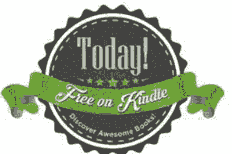

# 节俭生活：省钱储蓄的 50 简单方法

## 引言

作为对你下载本书的“感谢”，我们将送给你3本免费电子书。

点击领取免费礼物

在21世纪实现财务富足！

3本免费财富书籍

立即获取

## 如果你希望每周在邮箱中收到免费的畅销Kindle书籍

点击此处

感谢你下载《节约生活：省钱和储蓄的50种简单方法》。

本书包含了关于如何在享受生活的同时节省资金的经过证明的步骤和策略。节约生活的理念在现代世界中是一个相对较新的概念。它涉及的原理非常简单：买你需要的。不要买任何你不需要的东西。大多数人在日常生活中往往经常忘记这个简单的规则。买你想要的东西并放纵自己可能感觉很棒，但你会失去控制，最终在不需要的东西上花费大量金钱。

节约生活帮助你省钱，同时让你享受生活。这是节约生活的核心思想。金钱和财务困扰着我们所有人。但如果你在日常生活中对花费的钱极其谨慎，你最终能够在储蓄中积累大量资金。这是节约生活的一个极好的副作用。这个概念比单纯对金钱的需求深得多。它是为了平静地生活，不必为下一张工资单感到压力。

节约生活需要大量的努力、组织和创造力。如果你缺乏这些品质，不要担心。你会发现，在学习实践节约生活的，你可以培养这些品质。你应该忘记你在生活中遇到过的问题。你可以发现一种过满意生活的全新方式。

再次感谢下载本书，希望你喜欢！

## 第1章

### 什么是节约生活？

关于节约生活的准确含义，一直存在很大的困惑。我们并不是想说遵循节约生活的人比任何人都要，但事实是，当你把金钱从考虑之外时，你有更多的时间处理生活的其他所有事情。节约生活意味着你将停止关心金钱吗？答案是否定的，事实上，恰恰相反。想象一下这种场景：如果你拥有某样东西，并且意识到你没有它也能生活，那么你做其他事情时不会很从容吗？

这个观点很简单。如果你在做的每件事中都能省钱，那么你将达到一个阶段，最终你会有足够的钱，而不需要那么担心它了。那么节约生活等同于拥有大量的储蓄吗？实际上，答案是否定的。这个理念是尽可能简单地生活。

那么，节约生活到底是什么？这个概念就是节省更多的钱。这是我能想到的最基本的定义。对于你们中的一些来说，这可能听起来太晦涩，但事实是，大多数人通过外表来判断。我同意他们；大多数时候人们渴望更多的物质。节约生活并不意味着你必须在没有任何东西的情况下生活。它意味着明智地选择你购买的东西。我们需要被自己认为自己的东西。这完全没有问题。节约生活还能提高你的创造性思维。如果你认真对待节约生活，那么你可以放心，通过这种方式你可以学到至少一项重要技能。你可以学习关于水管、木工甚至是硬件的知识。

所以现在迫切的问题是，我如何开始节约？接下来的章节将帮助你理解节约生活的概念，以及可以立即开始的技巧。

## 第2章

### 从最昂贵的开始

以下是一些关于如何过上节约生活的技巧：

- 家庭汽车：无论你有几个孩子，这并不重要。这个观点很简单：如果你是一个家庭，一辆车就足够了。你可能在想，如果父母双方都是上班族，这如何可能。如果你们的一天同一时间开始，全家人一起拼车。这个理念是，通过减少两辆车的油耗，你可以节省大量的资金。如果你们的时间不同或工作区域不同，那么可以平均分配驾驶权。你们可以轮流谁开车上班，谁乘坐公共交通。如果你是那个开车的人，那么你也有责任送孩子上学。这把任务分担给了你们双方，有助于节省大量资金。

- 房屋的大小：我不理解为什么人们倾向于选择比他们需要的更大的房子。如果你是一个四口之家，那么一个三室的房子绰绰有余。如果客人突然到来，你可以让孩子们共用一个房间。我同意三室房子是一个很大的房子。当我说缩小房屋面积时，我的意思是只购买你将要使用的空间。如果你不需要家庭办公室，就没有必要购买额外的房间。

拥有一个家庭办公室。你们中的一些人可能居家办公，但如果你仔细考虑，完全不需要一个专门的家庭办公室。你可以将这个房间变成你孩子的卧室。这样，你就可以过得舒适而又不会浪费。

### 3. 小家庭，小汽车

我理解 SUV 看起来既大又气派。然而，与小车相比，它们的油耗简直很糟糕。哪种是更好的家用车，SUV 还是面包车？我的答案两者都不是，除非你是一个经常需要长途旅行的家庭。对于仅用于城市通勤的家庭来说，小车更好。小车更省油，而且通常更省钱包。所以，除非你真的需要大车，否则请选择小一点的车。“需要”和“想要”之间有很大的区别。

### 4. 买房？还是租房？

这通常是最大的问题。大多数人认为拥有房子更好，因为这带给你拥有财产的舒适感。我同意如果你决定买房，你会省下很多租金。但你也需要考虑贷款。我建议你在攒够足够的买房钱之前先租房。如果你没有钱买房，那么就不要尝试尝试。你可能会发现某些银行提供的优惠非常诱人，但利息会增加你的总支付成本，避开高利息对你最有利。

### 5. 先看后买

我确信你们大多数人会直接在线下单，或者走进最近的商店购买家里所需的任何新设备。新家具或设备会引起大脑的兴奋，但一直购买新物品是非常昂贵的。相反，要在家附近或网上寻找二手物品。你可以先从询问家人和朋友开始。如果他们最近升级了任何家用设备，他们可能对旧设备不再需要了。与购买全新的相比，你可以以低得多的价格购买。你可以查看 craigslist 或任何其他出售旧物品的网站。你甚至可以在旧货店和车库拍卖会上买到很多你需要的东西。

## 第3章

### 改变一些习惯

### 6. 少少外食

这真的这么简单。热狗摊主之所以以那个价格卖给你热狗是有原因的。热狗对你来说可能看起来便宜，但事实是，如果他不能比那个价格便宜得多制出热狗，他就不会以那个价格出售。这个故事的寓理是，如果你能自己做，总是更便宜。我不是说你应该取消所有的家庭聚餐。我的意思是，在绝对没有必要的时候不要花钱。你可以全家人一起决定一些很棒的晚餐并全家人一起做。是的，这需要更多精力。然而，如果你选择自己做饭，优点多于缺点。

### 7. 寻找廉价外食的方法

我们忽略优惠券太久了。是时候改变这个事实了。你为什么要忽略折扣呢？尽可能多使用优惠券。我不是说要使用你找到每一个优惠券。我的意思是如果你想买任何东西，确保你有它的优惠券。你会发现周围有许多地方提供定期优惠券，让你感到惊讶。你会在当地报纸中发现很多，还有一些在线优惠券。既然可以免费获得甜点，为什么要为三道菜付全价呢？这不是小啬，而是关乎明智。这关乎对金钱价值的理解。

### 8. 自带午餐

在看了之前的建议之后，这必须是显而易见的建议。你需要尽可能避免外食。根据公司的情况，你可能在公司食堂免费获得午餐。但如果你的公司不提供，每天在午餐上花钱会很贵。你可以从家里带午餐，这通常不需要花费太多时间。午餐有很多很棒的选择。你可以在周末为你和家人工作日所需的午餐制定计划。这可以是家人增进感情的极好方法。

### 9. 改变你的风格

如果你是一个喜欢打扮、拥有精美配饰和完美化妆的人，那么节约生活对你来说可能不是很好的选择。如果你想过节约的生活，你也需要理解如何节约地打扮。我们都想让自己看起来最好，但每天都看起来最好既需要钱也需要精力。选择很简单。仔细选择你想看起来最好的日子。在周的其他日子里，你可以过极简主义衣橱和非常淡的妆容。这节省了大量的时间和金。这对男生来说容易得多，因为我确信大多数人在衣服方面过得都很节约！然而，他们在手表等配饰上花费了更多钱。所以，如果你不需要，就减少开支。

### 10. 在线市场的诱惑

如果你需要某些东西，在线购物是一个很棒的选择。但是，在线购物更多是一种享受，而不仅仅是满足需求。在客厅里购物是很舒适的，这让我们产生冲动消费。舒适的幻象非常具有欺骗性，你永远不要上当。起初控制起来比较困难，但随着你习惯节约生活，你会对它有更好的理解。在初始阶段，不断提醒自己“需要”和“想要”之间的区别。

### 11. 对购物说不

大多数时候，我们买了完全不需要的东西。我们买是因为看到它们后单纯想要它们。这是因为购物中心的设计就是为了销售产品，所以当你面对这么多选择时，你会花得更多。如果你仍然发现自己在冲动购物，你最后的选择是注销信用卡。这将帮助你尽可能省钱。

### 12. 制定计划

为下个月的所有事情制定计划。如果有易腐的新鲜食品，就为它们制定预算并留出钱购买！这能让你理解你需要的物品和你冲动购买的物品。这也将帮助你跟踪财务和储蓄。刚开始时你可能会列错清单。可能会买多了，也可能买少了，但久而久之你会掌握。

### 13. 戒烟

吸烟是很昂贵的。当你看单根香烟时，你可能觉得不贵。但你每年在吸烟上浪费了数百美元。戒烟可以节省金钱，还可以避免支付数千美元的医疗费用。所以，是时候意识到吸烟不仅对健康有害，对你的钱包也有害。

### 14. 适度是关键

饮酒并不像人们所描述的那么糟糕。适度饮酒实际上对你有好处。但底线是你学会何时停止喝酒。偶尔喝一次和每天喝完全不同。酒精像香烟一样，会对你的口袋和健康造成很大负担。所以你不应该在这些习惯上浪费太多钱。

### 15. 减少甜食

甜食和甜点通常富含碳水化合物和脂肪，缺乏身体所需的其他必需营养素。这说明甜食和甜点除了甜味之外没有其他作用。在读了这么多建议后，你应该意识到节约生活意味着减少对必需的需求。而甜食对生活并不是必需的。

## 第 4 章

### 健康与娱乐

### 16. 剪掉有线电视

有线电视很贵。它可能不是贵到离谱，但在我看来，这是一种完全没必要的花钱方式。如果你想心里有个大概的概念，在美国，有线电视平均每月费用为 60 美元。这意味着每年花费720 美元。60 美元对你来说可能很便宜，也许确实如此。然而，真正的问题是：你需要它吗？我们生活在互联网时代。我们几乎可以在网上获得我们想要的所有娱乐内容。因此，对于点播娱乐来说，拥有有线电视订阅变得不再必要。没有电视机意味着你有更多时间去做其他活动。这将有助于你家庭和个人的成长。

### 17. 成为书呆虫

书籍在娱乐方面非常棒；这是一个被许多人忽视的事实。书籍可以创造世界、故事，甚至提供一些极佳的建议。所以，从当地图书馆借书，并尽可能地阅读。图书馆是娱乐的好去处，你在那里的同时也能学到很多东西。这还将帮助你从小培养孩子养成阅读的习惯。

### 18. 免费娱乐

不去周边的电影院或酒吧并不意味着你没有生活。你需要理解的是，在电影院看电影是很贵的。票价可能不贵，但他们卖的食物就很贵了。如果你晚上去看电影，你会产生强烈的冲动出去吃，或者在回家之前去当地的酒吧坐坐。这会花费大量的钱。通过寻找一些既便宜又更私密的绝佳娱乐方式，你可以省下很多钱。你可以租一部电影并自己做爆米花。你只需要花一部分钱就能得到更多的爆米花。你可以去徒步、去动物园或博物馆。

### 19. 节约健身

显然，第一步是取消你的健身房会员。增长肌肉和保持健康是有区别的。通过取消健身会员并寻找自己健身的方法，你可以节省大量的钱。你可以购买一套哑铃。去跑步或散步，而不是在跑步机上走动或跑。利用楼梯模拟交叉椭圆机的动作。你会发现，你可以在客厅里复制你在健身房做的大部分练习。这只需要一点开始的动力。

### 20. 保持健康并省钱

我们在医疗保健上花费的金额是天文数字。医院、药品和普通咨询从来不是免费的。我并不是说让你生病时呆在家里。我只是说，预防胜于治疗。照顾好你的身体，吃对食物，并定期锻炼。这应该让你的就医需求减半。

### 21. 为什么要订阅？

你可能订阅了当地报纸和一些杂志。我们认为这是一项非常棒的投资。它确实鼓励了阅读习惯，但你仍然需要在上面花一些钱。但为什么要在订阅上花钱呢？互联网充满了你想要阅读的所有新闻和信息。所以，取消所有的报纸和杂志订阅，在网上随心所欲地阅读吧。如果你不是影迷，也可以取消 Netflix 订阅。当你想看电影时，你可以租用或借 DVD 以获得更优惠的价格。

## 第 5 章

### 你的旅行方式

### 22. 使用自行车

我很好奇为什么更多人还没有发现。骑自行车非常让人心旷神怡，对身体也很有好处！当然，它也有缺点。如果你的工作地点离家太远，可以排除自行车。但是，如果你住在工作地点附近，那么没有比骑自行车上班更好的选择了。你可以快速到达那里，同时在途中获得一些宝贵的锻炼。让你的配偶开车吧，你可以享受自行车的益处。

### 23. 如果可以就拼车

同样，拼车是一个大多数人简单忽略的光明选择。拼车是一个很好的选择，不仅能帮你省钱，还能帮助你和朋友增进感情。在一辆可以载四个人的汽车里独自旅行有什么意义呢？所以，如果你有朋友或同事住在那里，那么对你来说最好的主意就是拼车。这能帮你省下很多钱。如果这不可行，请尝试经常使用公共交通工具。有时你可能会早起——如果是这样，就使用公共交通，因为你有更多时间来使用它。

### 24. 走路

很滑稽的是，如今我们大多数人甚至会开车去附近的超市。如果商店或超市在附近，我们完全可以步行或慢跑，而不是开车。如果你不想从钱的角度考虑，那么就从健康的角度考虑。经常走路没有更好的运动了。我们有腿是为了走路的，不是为了开车的。所以，请尽可能让这些腿发挥它们的本意。

### 25. 节约旅行

如果你计划度假，你也可以选择节约旅行。避开主要的旅游枢纽。有些地方并不出名，但同样美丽。如果你计划去巴哈马看白沙，你可以选择泰国这样的替代目的地。总会有比那里更便宜的国家可以访问，提前做研究总是有帮助的。记住机票贵得惊人，所以要提前计划并订票。

### 26. 节省油费

这可能是你在这个话题中期待的技巧。油价在全球范围内都在上涨，并且可能会继续上涨。所以，尽可能节省油费。这有助于减少我们的预算，并为我们提供了保护地球的机会。这里是一些节省油费的技巧：

- 保持车辆状况良好有助于节省大量燃料。性能不佳的引擎显然会消耗更多汽油。

- 检查你的轮胎——胎气充足的轮胎对油里程会有积极影响。

- 尽量避开早高峰——如果你通勤时无法避开早高峰，就早一点出门，晚一点回家。

- 不要过快或过慢。尽量尽可能平稳地驾驶。

- 当不需要时，你完全可以避免使用汽车；有很多事情是不需要汽车的。所以，尽可能步行或骑自行车！

## 第 6 章

### 建议列表的另一半

我确保了在涉及到节约生活时，涵盖了你生活的各个方面。前五章专门针对我们最常见的需求。这里是下一组更常见且有效的建议。

### 27. 简化你的生活

完全没有必要留着那些你不使用的东西。我同意有些东西对我们有纪念意义，比如你的第一块手表，或者父亲给你的笔。我不是要求你卖掉那些珍贵的物品。你可以卖掉那些不再修理的旧家具或旧汽车。卖得越多，赚得越多。这也会让你的生活变得简单得多，因为你周围环绕着需要的物品。

### 28. 节约送礼

送礼物是在浪费钱。我可能听起来很刻薄，但我认为有时我们推高了“好礼物”的界限。如今，孩子们期待在圣诞节收到 iPad 或 PS4。我并不是在说送礼物是错误的；我只是对送礼的高预期感到有些问题。你可以随时给你的孩子送他想要的，但要确保从小教他金钱的价值。

### 29. 四处都是水

水对你的健康有益。事实是，你怎么喝都不过量。你一天可以喝很多水，但我们大多数人实际上并没有喝够水。如果你真的渴望改善健康并同时保持节约，那么每当你想喝点什么时，就去喝水。我知道这个建议听起来显而易见，但事实是，我们大多数人喝大量的汽水或饮料，而这些对我们的健康有害。所以，下次当你发现自己渴望一杯咖啡时，尝试喝杯水。它既免费又健康。

### 30. 合并你的杂务

不要只去跑一两处差腿，而是将它们合并在一起，这样你就可以一次性完成所有任务。如果事情很紧急，你可以忽略这一点。但我们所有人都有可以合并并一次性完成的杂务。你将节省大量的汽油、时间和精力。要聪明地管理你的杂务。

### 31. 待家里

你待家里的时间越多，花钱就越少。这一事实是不否认的。这对于某些人来说听起来可能很遗憾，但事实是，呆家里不会让你或你的生活变得无聊。家里有很多可以学、可以做的。你可以通过待在家里自学来学习很多东西。如果你有孩子，有很多高质量的事情可以和孩子一起做以增进感情。你甚至可以开一个博客，或者深入内心深处，寻找你真正的热情。如果你在舒适的环境中给自己留出时间，很多事情都是可能的。

### 32. 拒绝信用卡

信用卡很棒。我知道它们很棒，但前提是当你正确使用它们时才如此。信用卡是贷款。你是在承诺以后会还钱的情况下下购买物品。除非你真的需要某样东西，否则不要使用你的信用卡。如果你发现自己自己在冲动购物，对你来说最好的办法是暂时注销信用卡订阅。这将帮助你买得更务实。在最近的一项研究中，发现平均支出者的债务高达8000 美元。你需要聪明点，避免花费你并不愿意付出的钱。

### 33. 动手做东西

这听起来可能很荒谬，但它是可能的。我不是说你应该为自己做一整张餐桌。我同意在掌握木工技术之前需要几年时间。我建议的是尝试着做一些更简单的东西。你可以为自己做一个简陋的书架或鞋架。你可以把这作为一个和孩子们一起进行的活动。这将教会他们自己制造东西并自给自足。你可以在网上找到一些很棒的主意，或者去图书馆学习一些所需的基础技能。你不仅能省钱，还能学会一项新技能。

### 34. 动手做（DIY）

你会自己给汽车换机油吗？还是把它交给修理工处理？换机油是一件相对简单的事情。你可以在网上找到很多关于这个主题的信息。在自己动手之前，你可以看一些视频。还有很多其他家务你可以自己处理，而不需要寻求专业人士的帮助。漏的水龙头很容易修理。你会惊讶地发现，你家里竟然有很多东西是你完全可以自己修好的。所以，去阅读、去观察并学习吧。

### 35. 利息是必须避免的

你需要开始担心你所支付的利息了。如果你已经有了房贷，请确保它是最后一个贷款。如果你试图过上节约的生活，就需要避免利息。想一想——你支付了这么多利息换回了什么？你应该尽可能地避免房贷和银行贷款。如果你需要现金，向家人借钱。作为节约生活的追随者，你会有足够的现金按时还给他们。

### 36. 拒绝“易烹饪”食品

再次，让我回到热狗的类比。为什么热狗摊主会以如此低的价格卖给你热狗？那仅仅是因为用原材料制作热狗比买成品要便宜得多。所以，你应该确保尽可能用天然食材进行烹饪。这听起来可能很乏味，但事实是它并没有听起来那么难。从简单的开始，你最终将会做得越来越好。我反对“易烹饪”食品的原因很简单：它们的成本比实际产品还贵，而且它们可能比不含任何防腐剂的天然食材食品更健康。减少包装食品并学习如何烹饪。烹饪是一项很棒的生活技能，学习起来也很有趣。花时间去学习一些很棒的新食材和食谱。

### 37. 减少手机使用

这在如今是一个非常不受欢迎的观点。40年前还没有手机，人们仍然能生存下来。所以事实是，你显然没有手机也能生存。我同意拥有手机已成为一种必需品。尝试买一个性价比高的手机。不要去买最贵的品牌。只把手机用于工作和紧急情况。这将为你节省大量的时间和金，而且当你下次和朋友家人见面时，你会与他们进行更有意义的对话，建立更深的关系。

### 38. 修理与回收

我经常看到人们因为一个小故障就更换一整套家居设备。但只要你的设备没有老旧到需要完全更换，修理和维护你的家用设备要便宜得多。最好的开始方法是从你的个人电脑开始。没必要每次想升级电脑时都买新电脑。尝试根据你的需求升级电脑的某些部分。如果你发现电脑慢到无法运行重要软件，就查看该软件的系统要求，并购买所需的零件。这听起来可能很难，但你实际上不需要硬件专家来修理你的电脑。你可以自己动手，你会发现它非常简单。你可以在网上找到很多可以解决硬件和软件问题的帮助。你应该总是尝试修理和回收，而不是去买新东西。

## 39. 打理自己

如果你对这个不感兴趣，可以跳过这一点。但事实是，你在打理自己身上花费了很多钱。我听过有人抱怨没钱，但与此同时，我发现这些人正去沙龙和美容院做指甲。剪头发并不难。有很多视频你可以参考来帮助你这样做。话虽如此，你不需要去外面打理头发。当然，这需要练习，但如果你不开始，你永远不知道自己是否擅长。

## 40. 节电

你可能猜到这将是书中的最后一个建议。节电可以节省大量的钱，更重要的是，它能为地球出一份力。大家都在谈论电，但没人谈论如何做到以下是一些节电的小建议：

- 将空调单元安装在采光最多的窗户。
- 偶尔清洁空调和加热器的过滤器。这不仅能让它们运行更高效，还能为你提供更清洁的空气。
- 不使用时拔掉插头。当你关闭电器时，仍有电流会继续流动。为了停止这一点，你需要拔掉它们。
- 如果外面很热，关上窗户。这会让房间冷却得更快。
- 不使用时应始终关闭灯和其他电器。

## 43. 学习提前计划

这是一条重要的生活建议，无论你是为了节约生活还是其他。学习提前计划将让你能够实现之前认为无法实现的目标。节约生活需要大量的创造力和规划。从简单的事情开始。正如我之前提到的，列出一份为期 30 天的杂货需求清单。如果你计划今天去外出办事，请提前考虑你在办事期间的饮食。你可以为自己打包午餐，在路上省下几块钱。如果你要在户外活动，带上冰水会有帮助。如果你知道家人的很快要过生日，最好在打折时购买礼物。所有这些简单的事情从长远来看都会对你有帮助。你将学会总是提前计划这一重要习惯。

## 44. 仅在需要时才洗衣服

你不需要每次穿完衣服都洗。“每次穿完就洗”的概念相对很新。回想起来，人们以前总是在洗衣服前多穿几次。我想表达的是，如果衣服不脏，你不需要洗。你可以每周洗一次或两次牛仔裤。这在某些听来可能太脏了，但牛仔裤的设计初衷正是如此。在决定洗衣服之前，你可以对衬衫进行嗅闻测试和检查。你会发现你的很多衣服比你想象的要新鲜得多。

## 45. 始终阳光晾晒

随着干机的发明，阳光晾晒一直是干衣服最好的方法。我相信这仍然是干衣服的最好方法。我同意干机速度更快，而且操作起来更符合我们的习惯。但我们谈论的是节约生活。在这种背景下，需要干机呢？通过遵循一种使用了几个世纪的技术，我们可以节省大量的电力。阳光晾晒还能延长衣服的寿命。在得出任何结论之前，你至少应该尝试一次。

## 46. 减少肉类摄入

如果建议你完全变成素食主义者，那是大错的。肉是任何人饮食中重要的一部分，但它并非必不可缺。人类是杂食性动物；这意味着我们可以依靠植物和动物性食物生存。所以，尽量尽可能地吃全素餐。原因显而易见：你可以吃你需要的，而不是你想要的。如果你在考虑买罐头肉，我建议你购买鲜肉。鲜肉在营养上更有价值，与罐头食品相比也是更好的选择。

## 47. 在杂货购物上省钱

杂货花费很高，但如果你知道如何省钱，就能省下很多钱。在下次购买下一批杂货时，请记住以下几点：

- 提前计划并列清单。这对于控制预算内非常有帮助。你计划得越好，购物效率就越高。所以，下次去逛杂货店之前，只需花点时间列个清单。
- 永远不要在饿的时候去买杂货。你的饥饿会驱使你购买你不需要的食物！
- 仅在绝对合理的情况下才批量购买。如果某种非易腐产品（如纸巾或灯泡）有极佳的优惠，那么囤货是符合逻辑的。
- 每家商店都会对少数几种精选产品提供特价。确保你在购物前询问特价。
- 在你的厨房里维护一份库存清单，记录剩下什么以及哪些是立即需要的。

## 48. 圣诞消费

圣诞是一个节日和快乐的时刻。我不反对圣诞节的概念。我享受家庭聚餐，但我不理解的是人们在圣诞期间疯狂的消费挥霍。我同意礼物可能很贵，但圣诞购物狂完全是另一回事。这种想法对零售商和整个资本主义来说很棒，但如果你试图节约生活，它就不那么妙了。不要回避圣诞节；相反，要努力在圣诞购物上保持聪明。在商店提供折扣时购买礼物。

## 49. 吃早餐，但要吃便宜的

早餐是全天中最重要的一餐，如果你想保持快乐健康，就不应该跳过！早餐是一天中最重要的一餐。那么为什么我坚持要吃便宜的早餐？原因很简单。如果你在咖啡上花了很多钱，你可以省掉。面包、黄油、吐司和果汁的简单早餐比你能买到的最贵的咖啡都要好。考虑到经常尝试这些，面包、黄油和果汁非常便宜。你可以尝试网上提供的其他廉价早餐食谱。尽可能避免购买包装麦片，因为它们很贵。

## 50. 拥有一个药草园

你住在哪里并不重要——你可以拥有一个拥有绝佳食材的奇药草园。你可以在高层公寓里弄一个，也可以在后院里弄一个。药草园能让你放松，并给你一个极具性价比的爱好。此外，使用自己后院的新鲜药草有着显而易见的优势。通过系统地种植，根据你的需求种植最好的药草。你可以选择香草类、药用草类或烹饪草类。无论你的选择是什么，药草园都是美丽的，并代表了你通过节约生活所努力实现的一切。

# 结

再次感谢你下载这本书！

希望这本书能够帮助你更好地理解节约生活的概念。这本书包含了一些经过时间检验的节约生活建议。这本书的顺序安排是为了确保你也能将节约生活的概念应用到你的生活中。我付了大量精力确保这些建议被组织成整洁的章节，以便学习。我相信世界上还有其他很棒的建议。这是我尽所能为你提供的尽可能多的建议。

下一步是你自己去尝试这些建议！我同意，在一次尝试中可能无法遵循所有的五个步骤。所以你可以选择你认为适用于个人情况的建议。
