# 函数式设计：原则、模式与实践 (Robert C. Martin 系列)

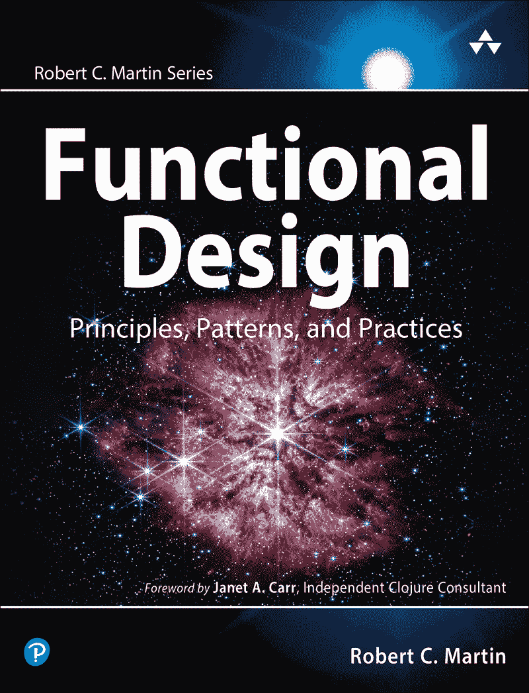

# 关于本 eBook

ePUB 是一种开放的行业标准电子书格式。然而，不同的阅读设备和应用程序对 ePUB 许多功能的支持程度不同。请使用您的设备或应用设置根据您的喜好自定义显示效果。您可以自定义的设置通常包括字体、字号、单栏或双栏、横屏或竖屏模式，以及可以点击或触摸放大的图片。有关您的阅读设备或应用上设置和功能的更多信息，请访问设备制造商的网站。

许多书籍包含编程代码或配置示例。为了优化这些元素的显示效果，请在单栏横屏模式下查看电子书，并将字体大小调整为最小设置。除了以重流文本格式呈现代码和配置外，我们还包含了模仿印刷版书籍显示效果的代码图像；因此，当重流格式可能会影响代码列表的显示时，您将看到一个“点击此处查看代码图像”链接。点击该链接查看高保真代码图像。要返回上一个页面，请点击设备或应用上的“返回”按钮。


## 献辞

给我的家人，我对他们的爱解释了我所做的一切。

首先，送给我那相守 50 年的妻子，那位美丽的 16 岁少女，有着闪烁的棕色眼睛和长黑发，她俘获了我的心并守护了它半个世纪。她依然像我遇到她的第一天一样美丽。那双闪烁的棕色眼睛和飘动的长发每天都让我着迷。我孩子的母亲。我生活的支柱。我唯一的爱。

给 Angela，我美丽的长女，永远忠诚的女儿，她那极具感染力的微笑会融化你的心，并让你相信世界一切完好。我曾问她她想成为什么。她的回答是“有趣！”她随后实现并远超了这一目标。她对生活无限的热情感染了她遇到的每一个人。她嫁给了 Matt，一个优秀、勤奋且诚实（且有趣）的男人。他们两人将共同的乐趣变成了一种充满山地车狂热的丰收事业。他们住在林木茂的山丘上，为我生了三个美丽、聪明且有才的女儿供我宠爱。

给 Micah，我的次子，充满激情的儿子。他继承了母亲那闪烁的棕色眼睛。我曾问他他想成为什么。他说：“富有！”我很高兴地报告，他确实过得非常好。他花了十年的时间与我共事，创立了自己的软件公司，并在几年后卖掉了它。接着他花了一年在车库里造了一架飞机。现在他正经营着另一家软件公司。他的成功很大归功于他的妻子 Angelique，一位美丽、勤奋且深性的女性。他们抚养了两个出色的年轻人。

给 Gina，我的第三女，带给我无尽惊喜。如果一个女人可以比我的妻子更漂亮，那么 Gina 就是那个女人。她成为了一名成功的化学工程师，处理铀、氟和浓氢氧化物等物质。她戴上安全帽，爬上反应容器，管理着化学操作员团队。她嫁给了 Keith，一位优秀、勤奋且诚实的机械工程师。他们交换着在大型复杂工厂冒险的故事。他们繁育了两个孩子——一男一女孩——这是我的孩子中第一个享有这一特权幸运的家庭。

拥有满溢子孙和孙辈的人是幸福的。

# 1. 作弊

# 2. 创建副本

# 3. 结构性共享

## 1. 迭代

### 1.1. 极短的 Clojure 教程

### 1.2. 迭代

### 1.3. TCO、Clojure 与 JVM

## 2. 递归

## 1. 惰性累加

## 2. 可以，但为什么？

## 3. Coda

## 1. 我们何时必须变异

## 2. 软件事务内存 (STM)

## 3. 生活很艰难，软件更难

## 1 第 6 章 质因数](#ch06.xhtml_ch06)

### 1.1. Java 版本

### 1.2. Clojure 版本

### 1.3. 结论

### 2.1. Java 版本

### 2.2. Clojure 版本

### 2.3. 结论

### 3.1. Java 解决方案

### 3.1.1. 司机

### 3.1.2. 路由

### 4.1. 函数式工资单

### 4.2. 命名空间与源文件

### 4.3. 结论

## 5 第 10 章 类型](#ch10.xhtml_ch10)

# 7. 第三部分 函数式设计](#part03.xhtml_part03

## 1 第 11 章 数据流](#ch11.xhtml_ch11)

### 2.1. 单一职责原则 (SRP)

### 2.2. 开放封闭原则 (OCP)

### 2.2.1. 函数

### 2.2.2. 带有虚函数表的对象

### 2.2.4. 独立部署性

### 2.3. 里可替换原则 (LSP)

### 2.3.1. ISA 规则

### 2.3.2. 不！

### 2.3.3. 规则

### 2.4.1. 不要依赖你不需要的东西

### 2.4.2. 为什么？

### 2.4.3. 结论

### 2.5. 依赖倒置原则 (DIP)

### 2.5.1. 来自过去的冲击

### 2.5.2. 违背

### 2.5.3. 结论

## 1 第 13 章 测试](#ch13.xhtml_ch13)

### 1.1. 什么是 REPL？

### 1.2. 什么是 Mock（Mock）？

### 1.3. 属性测试

### 1.4. 诊断技术

## 2 第 14 章 GUI](#ch14.xhtml_ch14)

### 2.1. Clojure 中的海龟画图

## 3 第 15 章 并发](#ch15.xhtml_ch15)

### 3.1. 结论

## 1 第 16 章 设计模式](#ch16.xhtml_ch16)

### 1.1. 函数式编程中的模式

### 1.2. 抓痒

### 1.3. 用 Clojure ？

### 1.5. 函数式？

# 10. 第六部分 案例研究](#part06.xhtml_part06

### 1.1. 等一下

### 1.2. 淋澡解决问题

### 1.3. 是时候疯狂现了

### 1.4. 那鲨鱼呢

我曾在网上大量编写过 Clojure 中的经典设计模式，因此发现这本书在向读者展示代码之前，先通过深思熟虑的图表来处理设计模式的使用问题。当你到达这些章节时，你已经能够根据图表脑海出 Clojure 代码了。然后，代码随之而来。最后，《函数式设计》通过带你使用设计原则和模式在 Clojure 中实现一个“企业级”应用，将这一切串联在一起。

—Janet A. Carr，独立 Clojure 顾问

# 前言

这本书是写给处于战壕中的程序员的，他们想要学习如何使用函数式编程语言来解决实际问题。因此，我不会花费大量时间在函数式编程更具理论性的方面，例如 `Monads`（单子）、`Monoids`（半群元）、`Functors`（函子）、`Categories`（范）等。并不是说这些观点无效、没有价值或无关；而是它们并不经常影响程序员的日常生活。这是因为它们已经被烘焙”进了常用语言、库和框架的“蛋糕”里。如果你对函数式理论感兴趣，我推荐 Mark Seemann 的著作。

这本书关于在为真实客户构建真实系统的日常工作中，如何以及为什么要使用函数式编程。在接下来的页面中，我们将对比 `Java` 等面向对象的语言中常见的编码结构与 `Clojure` 等函数式语言中常见的结构。

我特别选择了这两种语言，是因为 `Java` 被广为人知和使用，而 `Clojure` 学习极其简单。

## 函数式编程与过程化编程简史

1936 年，两位数学家艾兰·图灵（Alan Turing）和阿隆佐·丘奇（Alonzo Church）独立解决了大卫·希尔伯特著名的挑战之一：`可判定性问题`（The Decidability Problem）。本介绍的范围不足以详细描述这个问题，只能说它与寻找整数公式的通用解有关。这与我们有关，，因为数字计算机中的每个程序都是一个整数公式。

[1] 丢番方程（Diophantine equations）。

这两个人独立证明了不存在这样的通用解，他们证明了某些整数永远无法通过比自身更小的整数公式计算出来。

这种说的另一种表达是，某些数字是任何计算机程序无法计算的。事实上，这就是艾兰·图灵采取的方法。在他著名的 1936 年的论文中，图灵发明了数字计算机，然后证明了某些数字即使在无限的时间空间内也是无法计算的。

[2] A. M. Turing, “On Computable Numbers, with an Application to the Entscheidungsproblem” (May 1936).

另一方面，丘奇通过他发明的 `lambda calculus`（λ 演算）——一种处理函数的数学形式——得出了相同的结论。通过在其形式的逻辑中进行操作，他证明了存在某些无法解决的逻辑问题。

图灵的发明是所有现代数字计算机的祖先。每台数字计算机在任何意义上都是一台（有限的）图灵机。每个在数字计算机上执行过的程序在任何意义上都是图灵机程序。

丘奇和图灵后来合作证明了图灵和丘奇的方法是等价的。图灵机中的每个程序都可以在 `lambda calculus` 中表示，反之亦然。

函数式编程在任何意义上都是在 `lambda calculus` 中进行编程。

所以这两种编程风格在数学意义上是等价的。任何程序都可以使用过程化（`Turing`）风格或函数式（`Church`）风格编写。我们在书中要检查的并不是等价性，而是使用函数式方法如何影响我们程序的结构和设计。我们将试图确定这些不同的结构和设计在某种意义是否优于或劣于使用图灵方法产生的结构。

我为这本书选择 Clojure，是因为学习一种新语言和一种新范式是一项双倍困难的任务。因此，我试图通过一种足够简单的语言来简化这项任务，使其简单到不会干扰学习函数式编程和函数式设计。

`Clojure` 在语义上很丰富，但在语法上极其简单。这意味着语言本身的语法非常简单，学习时只需要很少的努力。`Clojure` 的学习曲线全在语义侧。库和惯用法需要大量的努力来内化；但语言本身几乎不需要任何努力。我希望这本书能给你提供一种学习和欣赏函数式编程的方法，同时不会被新语言的语法所分心。

[4] 到最后，你会认为我是个骗子。

我在书中使用的测试框架是 `speclj`。随着章节的进行，你会看到越来越多的它。它与其他流行的测试框架非常相似，所以随着页面的翻页，你不应该难以熟悉它的各种功能。

[5] `https://github.com/slagyr/speclj`

这本书的主要重点是描述用于函数式构建的系统的设计原则和架构。为了这一目标，我将采用统一建模语言（UML）图，并引用软件设计的 `SOLID` 原则、设计模式以及整洁架构（Clean Architecture）的概念。不要担心，我将在过程中进行解释，并在你需要时引用许多外部参考文献。

[6] Robert C. Martin, *Clean Architecture* (Pearson 2017), p. 57.

[7] Erich Gamma, Richard Helm, Ralph Johnson, and John Vlissides, *Design Patterns: Elements of Reusable Object-Oriented Software* (Addison-Wesley, 1994).

许多人认为面向对象编程和函数式编程是不兼容的。接下来的内容将证明事实并非如此。你在这里看到的程序、设计和架构将是函数式和面向对象概念的混合体。根据我的经验，我坚坚定地认为，这两种风格是完全兼容的，优秀的程序员可以并且应该将它们结合起来。

在本文中我将使用 `functional`（函数式）一词。我会对其进行定义并详细阐述。随着章节的推进，我也会对其进行一些灵活处理。有些示例虽然是用函数式语言和按照函数式风格编写的，但并不是 `purely`（纯粹）函数式的。在大多数此类情况下，我会给 `functional` 一词加上引号，并使用脚注来指出我所做的灵活处理。

为什么要进行这种处理呢？因为这是一本关于实用主义的书，而非理论。我感兴趣的是从函数式 `style`（风格）中提取益处，而不是严格遵循某种理想。例如，正如我们在第一章中看到的，从用户获取输入的“函数”并不是纯函数式的。然而，我会根据需要使用此类“函数”。

所有章节中示例的源代码都在一个的 GitHub 仓库中，名为 `https://github.com/unclebob/FunctionalDesign`。

在 InformIT 网站上注册您的《Functional Design: Principles, Patterns, and Practices》副本，以便在更新或更正发布时方便访问。要开始注册过程，请访问 `informit.com/functionaldesign` 并登录或创建账户。产品 ISBN (`9780138176396`) 将会被自动填充。在“Registered Products”（注册产品）选项卡中查找该产品旁的“Access Bonus Content”链接，点击该链接访问任何可用的奖励材料。如果您希望接收新版本和更新的独家优惠通知，请勾选接收我们的电子邮件。

# 致谢

感谢 Pearson 勤奋且专业的同事，他们帮助引导了本书走向完成：Julie Phifer，我长期以来一直乐于帮助和支持我的出版社；以及她的同事 Menka Mehta、Julie Nahil、Audrey Doyle、Maureen Forys、Mark Taber 以及许多其他人。与你们工作一直是一件乐事，我期待未来有更多合作。

感谢 Michael Feathers，他在 20 年前建议我研究函数式编程。当时他正在学习 `Haskell`，并对这种可能性充满热情。发现他的热情非常有感染力。

感谢 Mark Seemann (`@ploeh`)，他一如既往的富有见解的作品，对我作品给出的敏锐且具有毁灭性理性的评论，也感谢他的道德勇气。

感谢 Rich Hickey，他在 90 年代初与我就 `C++` 和面向对象设计进行过辩论，随后他创建并精通地指导了 `Clojure` 的开发。Rich 对软件的见解持续令我惊叹。

虽然我从未见过他们，但我对 Harold Abelson、Gerald Jay Sussman 和 Julie Sussman 抱有感激之情，感谢他们那本书真正启发了我追求函数式编程。那本书《The Structure and Interpretation of Computer Programs (SICP)》可能是我读过的所有软件书籍中影响最大的一本。可以在网上免费获取。只需搜索“SICP”即可。

感谢 Janet Carr 提供的序言。某天我在浏览 Twitter 时偶然发现了 Janet 的工作，发现她在函数式编程和 `Clojure` 方面得出了许多与我相同的结论。

# 关于作者


**Robert C. Martin (Uncle Bob)** 自 1970 年起就是一名程序员。他是 Uncle Bob Consulting, LLC 的创始人，并与其儿子 Micah Martin 共同创立了 The Clean Coders, LLC。Martin 在各种各种行业期刊上发表了数十篇文章，并是国际会议和贸易展览会的常驻演讲者。他编写并编辑了许多书籍，包括《Designing Object-Oriented C++ Applications Using the Booch Method, Pattern Languages of Program Design 3, More C++ Gems, Extreme Programming in Practice, Agile Software Development: Principles, Patterns, and Practices, UML for Java Programmers, Clean Code, The Clean Coder, Clean Architecture, Clean Craftsmanship》以及《Clean Agile》。作为软件开发领域的领导者，Martin 曾担任 `C++ Report` 主编，并在敏捷联盟（Agile Alliance）的首任主席。

## 1 不变性


### 什么是函数式编程？

如果你问一个普通程序员什么是函数式编程，你可能会得到以下答案之一：

*   使用函数进行编程。

*   函数是“一等”元素。

*   使用引用透明进行编程。

*   基于 Lambda 演算的编程。

虽然这些断言可能是正确的，但它们并没有特别帮助。我认为更好的答案是：`没有赋值语句的编程`。也许你觉得这个定义并没有好在哪里，甚至让你感到不安。毕竟，赋值语句与函数有什么关系呢？

考虑以下简单的 C 程序：

```c
int main(int ac, char** av) {
        doSomething();
}
```

这个程序是几乎每个编写的程序的核心循环。它字面意思是：“做一些事情直到完成”。而且，这个程序没有赋值语句。它是函数式的吗？如果是，是否意味着每个编写过的程序都是函数式的？

```c
int n=1;
int sum=0;
int done() {
  return n>10;
}

  sum+=n*n;
  ++n;
}

void sumFirstTenSquares() {
    while(!done())
}
```

这个程序不是函数式的，因为它在 `doSomething` 函数中使用了两个赋值语句。那两个全局变量也非常糟糕。让我们改进它：

```c
int sumFirstTenSquares() {
  int i=1;
loop:
  if (i>10)
    return sum;
  sum+=i*i;
  i++;
  goto loop;
}
```

这个变好了；全局变量变成了局部变量。但它仍然不是函数式的。也许你正在担心那个 `goto`。它的存在是有充分理由的。请考虑这个微小的修改，它使用一个工作函数将局部变量转换为函数参数：

点击此处查看代码图像

```c
int sumFirstTenSquaresHelper(int sum, int i) {
  if (i>10)
    return sum;
  sum+=i*i;
  i++;
  goto loop;
}

  return sumFirstTenSquaresHelper(0, 1);
}
```


这个程序仍然不是功能性的；但它是一个重要的`里程碑`，我们稍后会提到它。但现在，通过最后的修改，神奇的事情发生了：

```
int sumFirstTenSquaresHelper(int sum, int i) {

  if (i>10)

    return sum;

  return sumFirstTenSquaresHelper(sum+i*i, i+1);

}

int sumFirstTenSquares() {

  return sumFirstTenSquaresHelper(0, 1);

}
```

所有的赋值语句都消失了，这个程序是有功能性的。它也是递归的。这并非偶然。如果你想消除赋值语句，`必须`使用递归。递归允许你将局部变量的赋值替换为函数参数的`初始化`。

它还会消耗大量的栈空间。然而，我们有一个小技巧可以用来解决这个问题。

这个小技巧被称为`尾调用优化 (TCO)`，所有的函数式语言都利用了它^(1)

1. 以这种方式或那种方式。`Java 虚拟机 (JVM)` 让 TCO 变得复杂了一些。当然，C 并不进行 TCO，因此我在 C 中所有的递归示例都会增加栈空间。

注意，TCO 有效地将最后一个程序转换成了`里程碑`程序。在`里程碑`程序中，`sumFirstTenSquaresHelper` 的最后三行实际上是递归函数调用。这意味着`里程碑`程序也是功能性的吗？不，它的行为完全相同。在源码层面，该程序不是功能性的，因为它包含赋值语句。但如果我们向后退一步，忽略局部变量被改变了而不是在新的栈帧中重新实例化的事实，那么这个程序`表现`就像一个功能性程序一样。

### 赋值的问题

首先，让我们定义一下所说的`赋值`。给变量赋值值会`改变`变量的原值，变为新赋值的值。正是这种变化使其成为赋值。

在 C 中，我们这样初始化变量：

```
```

但我们这样给变量赋值：

```
x=1;
```

在第一种情况下，变量 `x` 以值 `0` 产生；在初始化之前，不存在变量 `x`。在第二种情况下，`x` 的值被改为 `1`。这看起来可能意义，但其影响是深远的。

在第一情况下，我们不知道 `x` 是否真的是变量。它可能是一个常量。在第二种情况下，毫无疑问。我们通过给它分配新值来改变 `x`。因此，我们可以说函数式编程是`没有变量`的编程。函数式程序中的值`不会改变`。

为什么这是理想的？考虑以下内容：

```
.

.

x=1;

.

//Block B

.
```

`Block A` 执行期间的`系统状态`与 `Block B` 中的系统状态不同。这意味着 `Block A` 必须在 `Block B` `之前`执行。如果交换这两个块，系统可能无法正确执行。
这被称为`顺序或时间耦合`——一种时间上的耦合；你可能对此非常熟悉。`Open` 必须在 `close` 之前调用。`New` 必须在 `delete` 之前调用。`Malloc` 必须在 `free` 之前调用。这样的组合列表^(2) 是无穷无尽的。在很多方面，它们是我们存在的噩梦。

2. 它们就像西斯人；总有两个。

你有多少次忘记关闭文件、释放内存块、关闭图形上下文或释放信号量？你有多少次调试一个棘手问题，结果发现只需交换两个函数调用的位置就能修复它？

然后是垃圾回收。
垃圾回收是一个糟糕的^(3)技巧，我们将其引入到语言中是因为我们太不擅长管理时间耦合。如果我们擅长跟踪已分配的内存，我们就不依赖某些糟糕的后台进程来为我们清理。但悲哀的事实是，我们管理时间耦合实在太差，以至于我们为保护自己免受其影响而建立的拐杖都倍受庆祝。

3. 并且，不是，引用计数

如果一个函数总是可以用它的值来替换函数调用，那么这个函数就是引用透明的。让我们用我们计算前十个整数平方和的函数式算法来尝试：

```
int sumFirstTenSquaresHelper(int sum, int i) {

  return (i>10) ? sum : sumFirstTenSquaresHelper(sum+i*i, i+1);

}

int sumFirstTenSquares() {

}
```

当我们将第一次对 `sumFirstTenSquaresHelper` 调用替换为它的实现时，它变成了：

```
  return (1>10) ? 0 : sumFirstTenSquaresHelper(0+1*1, 1+1);

}
```

当我们替换下一个函数调用时，它变成了：

```
int sumFirstTenSquares() {
  return
    (1>10) ? 0 :
      (2>10) ? 0+1*1
              : sumFirstTenSquaresHelper((0+1*1)+2*2,
                                         (1+1)+1);
}
```

我想你可以看出这里的趋势了。每次对 `sumFirstTenSquaresHelper` 的调用都简单地替换为它的实现，参数也被相应的替换。

注意，你不能对该程序的非函数式版本进行这种简单的替换。哦，如果你喜欢，你可以展开循环；但这与简单地将每个函数调用替换为它的实现不是回事。

因此，函数式程序是由真正的数学、引用透明的函数组成的。这就是为什么这被称为函数式编程。

### 没有状态改变？

答案是，函数式程序从旧状态计算出一个新状态，*而不改变旧状态*。如果这听起来很困惑，那么下面的示例应该能解释这一点：

```
State system(State s) {
}
```

你可以从某个初始 `state` 开始`system`，它将连续地将 `system` 从 `state` 移动到 `state`，直到到达最终 `state`。`system` 没有改变状态变量。相反，在每次迭代中，都会从旧 `state` 创建一个新的 `state`。

如果我们关闭 TCO（尾递归优化）并允许栈随着每次递归调用而增长，那么栈将包含所有之前的状态，且保持不变。此外，`system` 函数在数学意义上是一个真正的函数。如果你用 `state1` 调用 `system`，它每次都会返回 `state2`。

如果你仔细观察我们函数式版本的 `sumFirstTenSquares`，你会发现它正是通过这种方法来改变状态的。没有变量，没有内部状态。相反，算法从初始状态移动到最终状态，一次改变一个状态。

当然，我们的 `system` 函数似乎无法响应任何输入。它只是从某个初始 `state` 开始，然后运行完成。但通过简单的修改，我们可以创建一个对输入事件响应得非常出色的“函数式”程序：

```
State system(State state, Event event) {
  return done(state) ? state : system(state, getEvent());
}
```

现在，`system` 计算出的下一个 `state` 是当前 `state` 和传入的 `event` 的函数。好极！我们创建了一个非常传统的、可以实时响应事件的有限状态机。

注意我在上面给 *functional* 一词上加的引号。这是因为 `getEvent` 并不是引用透明的。你每次调用它都会得到一个不同的结果。因此，你不能将该调用替换为它的返回值。这意味着我们的程序实际上不是函数式的吗？

严格来说，任何以这种方式获取输入的程序都不可能是纯函数式的。但这不是一本关于纯函数式程序的书。这是一本关于函数式*编程*的书。上面程序的风格是“函数式”的，即使输入不是纯的；而我们在这里感兴趣的正是这种风格。

所以，这里为了增加趣味性，有一个用 C 语言编写的、“函数式”的简单小实时有限状态机。这是一个经典的地铁道闸机示例。玩得开心吧。

```
#include <stdio.h>

typedef enum {locked, unlocked, done} State;

typedef enum {coin, pass, quit} Event;

  printf("Locking.\n");

}

void unlock() {

  printf("Unlocking.\n");

}

void thankyou() {

}

void alarm() {

  printf("Alarming.\n");

}

Event getEvent() {

  while (1) {

    switch (c) {

      case 'c': return coin;

      case 'p': return pass;

      case 'q': return quit;

    }

  }

}

  switch (s) {

    case locked:

      if (e == 'coin') {

        unlock();

        return unlocked;

      }

      return locked;

    case unlocked:

        thankyou();

        return done;

      } else if (e == 'quit') {

        lock();

        return locked;

      }

      return unlocked;

    case done:

  }

}

State turnstileSystem(State s) {

  return (s == done) ? done : turnstileFSM(s, getEvent());

}

int main(int ac, char**av) {

  return 0;

}
```

### 不可变性

这意味着函数式程序不包含变量。状态的变化从一次调用传递到下一次，而不修改任何之前的状态。如果不需要这些之前的状态，TCO 可以将其优化掉；但在本质它们仍然存在，保持不变。

## 2

## 持久数据


到为止，这似乎相对简单。以“函数式”风格编写的程序只是没有变量的程序。与其给变量赋值，不如使用递归用新值初始化函数参数。简单。
数据元素很少像我们想象的那样简单。所以，让我们来看一个稍微复杂一点，*埃拉托尼筛法*：

```
package sieve;

import java.util.ArrayList;

import java.util.List;

public class Sieve {

  boolean[] isComposite;

  static List<Integer> primesUpTo(int upTo) {

    return (new Sieve(upTo).getPrimes());

  private Sieve(int upTo) {

    if (upTo<1)

      upTo=1;

    isComposite = new boolean[upTo+1];

    Arrays.fill(isComposite, false);

    isComposite[0]=isComposite[1] = true;

    for (int i=0; i<isComposite.length; i++)

        for (int c=i+i; c<isComposite.length; c+=i)

          isComposite[c] = true;

  }

  public List<Integer> getPrimes() {

    ArrayList<Integer> primes = new ArrayList<>();

    for (int i=0; i<isComposite.length; i++)

      if (!isComposite[i])

    return primes;

  }

}
```

这个可爱的 Java 程序计算到限制范围内的质数。注意所有的赋值语句。变量随处可见，所以这个程序一定不是函数式的。

但话又回来，看看顶部的静态函数。`Sieve.primesUpTo` 是一个真正的数学函数。每当你传入 `n` 调用它时，它都会返回直到 `n` 的所有质数。所以我们可以耍个小聪明说，尽管底层算法使用了变量，但该算法的结果是函数式的。

### 关于耍聪明

在某种意义上，我们的计算机是有限的`图灵机`；它们不是基于 lambda 演算的。丘奇-图灵假设告诉我们，图灵机和 lambda 演算是等价的形式；但这并不意味着你可以轻松地在它们之间进行转换。函数式程序是一个*看起来像* lambda 演算但实现在有限图灵机上的程序。而这种实现要求我们进行“欺骗”。

我们看到的第一个“欺骗”是 `TCO`（尾递归优化）。我们用一个实用主义的理由将其抛之脑后。毕竟，既然我们永远不需要那些历史栈帧（stack frames），我们为什么要保留它们呢？但这仍然是一种欺骗。在底层，我们的实现正在改变现有变量的值。从图灵机的角度来看，我们所有所谓的常量实际上都是变量。
我们可以继续将这种欺骗向上推。这个可爱的 `Sieve` 算法完全在构造函数中运行，所以它全都是初始化！正如我们所学的，初始化并不是赋值。所以这个程序底层拥有变量这一事实与 `TCO` 没有区别。最终，结果仍然是函数式的。

这很有趣！我们可以继续将这种欺骗向上推。我们可以一直推，直到它位于我们计算机的有限图灵机之外。然后我们就可以对自己说：“运行在这台计算机上的每个程序都是函数式的，因为它们在给定相同输入时总是产生相同的输出。不要管输入和输出包含了计算机内存中的每一个位。不要管那个了。没错。这就对了。”

当然，如果我们采取这种观点，那么学习函数式编程就没什么意义了，不是吗？所以让我们从这种最高级别的欺骗中退出来，继续将这些欺骗向下推，直到我们在实践上再无法逃避它们为止。

`TCO` 是没有合理的逃避方法的。我们没有无限的栈。我们不希望函数式程序无意义地消耗几个 GB 的栈空间直到它们崩溃。所以 `TCO` 是一个实践上无法避免的欺骗。

那么，那个 `Sieve` 算法呢：我们能把欺骗推得更低吗？我们能写那个算法，让它不使用任何赋值语句吗？

问题当然在于所有的 `for` 循环。我们需要将这些循环转换为递归函数，以消除赋值语句。我们还需要对这两个数组做些处理。我们不能改变现有数组中的元素，对吧？那会让这些数组变成变量。所以每当我们需要更改元素时，都必须创建它们的副本：

```
import java.util.ArrayList;

import java.util.Arrays;

import java.util.List;

public class Sieve {

  static List<Integer> primesUpTo(int upTo) {

    return getPrimes(

        makeSieve(Math.max(upTo, 1)),

        0),

      new ArrayList<>(), 0);

  }

  private static boolean[] makeSieve(int upTo) {

    boolean[] sieve = new boolean[upTo+1];

    Arrays.fill(sieve, false);

    return sieve;

  }

  private static boolean[] computeSieve(boolean[] sieve, int n) {

    if (n>=sieve.length)

      return sieve;

    else if (!sieve[n])

      return computeSieve(markMultiples(sieve, n, 2), n+1);

    else return computeSieve(sieve, n+1);

  private static boolean[] markMultiples(boolean[] sieve,

                                         int prime,

                                         int m) {

    int multiple = prime * m;

    if (multiple>=sieve.length)

      return sieve;

    else {

      var markedSieve = Arrays.copyOf(sieve, sieve.length);

      markedSieve[multiple] = true;

      return markMultiples(markedSieve, prime, m+1);

    }

  }

  public static List<Integer> getPrimes(boolean[] sieve,

                                        List<Integer> primes,

                                        int n) {

      return primes;

    else if (!sieve[n]) {

      var newPrimes = new ArrayList<>(primes);

      newPrimes.add(n);

      return getPrimes(sieve, newPrimes, n+1);

    } else {

      return getPrimes(sieve, primes, n+1);

    }

}
```


这并不漂亮，对吧？然而，它确实很函数式。你可能会对`makeSieve`中的赋值有意见，我也同意这有一点欺骗，但它看起来足够像初始化，可以满足我。

所以，是的，所有重大的赋值操作都被消除了。所有的命名实体都是常量，而栈（如果没被`TCO`删除的话）包含了每个递归函数每次调用的历史。

但代价是什么？每当两个数组中的任何一个被修改时，都会创建一个新数组。为了防止之前的数组被改变，都会创建一个新数组。这种内存占用可能是巨大的。想象一下寻找直到 100,000 的质数会产生多少`sieve`数组？产生多少`primes`数组？执行时间又是如何？复制所有数组将消耗掉惊人的循环。难道这就是函数式编程的代价吗？

## 结构共享

幸运的是，并不是。事实证明某些数据结构的行为类似于数组，但可以有效地维护它们的状态。这些数据结构是`n`树。`n`越大，效率越高。但为了简单起见，我将在示例中使用`n=2`——二叉树。

假设我们要表示一个从 1 到 8 的整数数组。实现这一点的二叉树所示（`ch02_images.xhtml_f020-01`）。

**图 2.1 表示数组的二叉树**

如果你观察叶并忽略分支，你会发现叶形成了一个数组。分支仅仅提供了一种有序遍历的方式。这种顺序就是数组的索引！

要获取索引为 0 的元素，只需取每个节点的左分支。要获取索引为 1 的元素，在最后一个节点之前向右。我不重复这一点，我确定你们都理解二叉树。

现在，假设我们想在数组末尾追加一个 42，同时保留之前的数组。实现这一点的二叉树所示（`ch02_images.xhtml_f020-01`）。（图片占位符）

**图 2.2 表示 [1..8, 42] 但保留了原始 [1..8] 数组的二叉树**

现在树有两个*根*。左角的根仍然表示 1..8 的数组。右上角的根表示追加了 42 的新数组。

现在停下来仔细思考这一点。显然，以这种方式将线性数组表示为树，允许我们在执行添加、插入和删除的同时保留之前排列，而无需大量的数组复制。

最终，数组的每个过去版本都将由一个新的根节点连接少量额外的分支节点表示，从而允许数组的大部分元素在所有版本之间共享。

# 3

现在考虑一下如果我们使用 32 叉树而不是二叉树会发生什么。对于一个一百万元素的数组，树的深度大约只有四到五个分支。复制五个每个包含 32 个元素的节点比复制一百万个元素快得多，需要的内存也少得多。事实上，这种成本虽然不是零，但小到对于大多数应用来说可以忽略不计。

因此，我们有一种方法来表示一个可索引的线性数组，它可以随着时间进行版本化，同时保留所有历史版本。我们将其称为*持久化*（persistence）。^ 持久化数据结构具有发生变化的同时记住自身所有历史版本的能力。

> 1. 不要与描述离线存储数据的重载术语混淆。

## 持久化与高级数据结构

但是哈希映射、集合、栈和队列等更高级的数据结构呢？我们如何让它们都变得像我们的线性索引数组一样持久化呢？当然，所有这些数据结构都可以使用索引数组来实现。事实上，由于计算机内存无非一个巨大的索引线性数组，你可以在计算机内部表示的每个数据结构也可以在持久化数组中表示。

既然这个问题解决了，后续所有的示例都将用 Clojure 编写，这是一种本质上支持持久化数据结构的语言。

## 递归与迭代


在第 1 章 不可变性中，我提到过函数式编程利用递归来消除赋值。在本章中，我们将观察两种不同的递归；我们将一个称为迭代，另一个将保留原名：递归。

### 迭代

`TCO`（尾调用优化）是解决无限递归循环导致的无限栈深度的补救。然而，只有当递归调用是函数内执行的最后一个操作时，`TCO`才适用。此类函数通常被称为尾调用函数。

以下是一个创建斐波那契数列表的函数非常传统的实现：

点击此处查看代码图片

```
(defn fibs-work [n i fs]
  (if (= i n)
    fs
    (fibs-work n (inc i) (conj fs (apply + (take-last 2 fs))))))

(defn fibs [n]
  (cond
    (< n 1) []
    :else (fibs-work n 2 [1 1])))
```

该程序是用 Clojure 编写的，它是 Lisp 的变体。你可以这样调用这个函数：

```
(fibs 15)
```

它返回一个前 15 个斐波那契数的数组：

点击此处查看代码图片

```
[1 1 2 3 5 8 13 21 34 55 89 144 233 377 610]
```

#### 极简短的 Clojure 教程

1. 这是 C、C++、C# 和 Java 中典型的函数调用：`f(x)`。
2. 这是 Lisp 中相同的函数：`(f x)`。
3. 现在你认识 Lisp 了。教程到此结束。

这并不夸张。Lisp 的语法确实那么简单。

Clojure 的语法稍微复杂一点点。所以让我们逐步拆解上面的程序，一次处理一条语句。

首先是`defn`，它看起来像是被当作函数调用的。我们暂时这样认为吧。事实很大程度上符合这种观点。因此，`defn`“函数”从它的参数定义了一个新函数。被定义的函数名为`fibs-work`和`fibs`。函数名后的方括号括住了函数参数的名称.^ 所以`fibs`函数接受一个名为`n`的单一参数，而`fibs-work`函数接受三个名为`n`、`i`和`fs`的参数。

> 1. 实际上，方括号是 Clojure 中表示“向量”（数组）的语法。在这种情况下，该向量包含表示参数的符号。

紧随参数列表之后的是函数体。因此，`fibs`函数的体体是对`cond`函数的调用。把`cond`想成一个返回值的 switch 语句。`fibs`函数返回`cond`返回的值。

好的，现在你应该对 Clojure 有了良好的掌握。随着学习的深入，我们还会遇到该语言的更多特性。但现在，让我们回到迭代和递归的话题。

### 迭代

注意对`fibs-work`的递归调用是一个尾调用。`fibs-work`函数执行的最后一步就是调用它自己。因此，该语言可以利用`TCO`（尾递归优化）来消除之前的栈帧，并将递归调用转换为`goto`，有效地将递归转换为纯迭代。

所以，在任何意义上，采用尾调用的函数都是迭代的。

### TCO、Clojure 与 JVM

`Java 虚拟机 (JVM)`并不让语言容易使用`TCO`。事实上，我刚才向你展示的代码并没有使用`TCO`，因此在迭代过程中栈会不断增长。因此，在 Clojure 中，我们通过使用`recur`函数显式地调用`TCO`，如下：

点击此处查看代码

```
(defn fibs-work [n i fs]
  (if (= i n)
    fs
    (recur n (inc i) (conj fs (apply + (take-last 2 fs))))))
```

`recur`函数只能从尾部位置调用，它有效地重新调用闭包函数而不会增加栈空间。

使用真正的递归，有一种更自然、更优雅的方式来编写斐波那契算法：

点击此处查看代码

```
(defn fib [n]
  (cond
    (<= n 2) 1
    :else (+ (fib (dec n)) (fib (- n 2)))))

(defn fibs [n]
  (map fib (range 1 (inc n))))
```

现在`fib`函数应该是自言自语的。毕竟，`fib(n)`仅仅是`fib(n−1) + fib(n−2)`。然而请注意，对`fib`的调用不在函数的尾部。`:else`子句执行的最后操作是`+`函数。这意味着我们不能使用`recur`函数，而且无法实现`TCO`。这意味着随着算法的进行，栈将会增长。

`range`函数接受两个参数`a`和`b`，返回从`a`到`b−1`的所有整数列表。`map`函数接受两个参数`f`和`l`。参数`f`必须是一个函数，参数`l`必须是一个列表。它对`l`的每个成员调用`f`并返回一个包含结果的列表。

这个版本的`fib`效率极低。考虑这个执行概况：

点击此处查看代码

```
fib 20 = 6765
fib 25 = 75025
"Elapsed time: 11.735279 msecs"
fib 30 = 832040
"Elapsed time: 106.490355 msecs"
fib 34 = 5702887
"Elapsed time: 735.689834 msecs"
```

我并没有费力分析这个算法。但快速的曲线拟合表明该算法的复杂度是`O(n³)`。所以，尽管实现看起来很优雅，但它永远无法适用。

我们可以通过如下迭代方式来大幅提高性能：

点击此处查看代码

```
(defn ifib
  ([n a b]
   (if (= 0 n)
     (recur (dec n) b (+ a b))))
  ([n]
   (cond
     (< n 1) nil
     (<= n 2) 1
     :else (ifib (- n 2) 1 1))))
```

`ifib`函数有两个重载：`[n a b]`和`[n]`。由于它是迭代的，它不会导致栈空间增长，而且比之前的递归版本快得多。事实上，我相信大部分时间都花在打印输出上，而不是真正的计算。

点击此处查看代码

```
ifib 20 = 6765
"Elapsed time: 0.185508 msecs"
"Elapsed time: 0.177111 msecs"
ifib 30 = 832040
"Elapsed time: 0.14596 msecs"
ifib 34 = 5702887
"Elapsed time: 0.148221 msecs"
```

当然，我们失去了递归算法的大部分表达能力。我们可以通过记住**引用透明性**（referential transparency）来恢复这一点：在函数式语言中，函数给定相同的输入总是返回相同的值。因此，没有必要重新评估函数。

## 4 惰性


考虑以下对程序的加粗修改，用于计算斐波那契列表：

点击此处查看代码

```
(declare fib)

(defn fib-w [n]
  (cond
    (< n 1) nil
    (<= n 2) 1
    :else (+ (fib (dec n)) (fib (- n 2)))))

(defn lazy-fibs []
  (map fib (rest (range))))
```

`range`函数在这里被调用时返回从零开始的整数列表。你问返回多少个？你需要多少。`range`函数是**惰性的**（lazy）。或者说，`range`函数返回的是一个**惰性**列表。

什么是惰性列表？惰性列表是一个知道如何计算下一个值的对象。在 Java、C++ 和 C# 中，我们称对象为*迭代器*。

Clojure 与惰性列表非常友好。大多数库函数尽可能返回惰性列表。因此，在上面的程序中，`rest`和`map`都返回惰性列表。这意味着`lazy-fibs`也返回一个惰性列表。

你会如何使用`lazy-fibs`呢？像这样：

点击此处查看代码

```
(take 10 (lazy-fibs))
returns: (1 1 2 3 5 8 13 21 34 55)
```

`take`函数接受两个参数：数字`n`和一个列表。它返回一个包含参数列表前`n`个元素的列表。实际上，这并不完全准确，但我稍后会解释。

现在，让我们再次过一遍`lazy-fibs`。`range`函数返回一个从零开始的惰性整数列表。`rest`函数获取该列表，丢弃第一个元素，然后返回一个剩余整数的惰性列表，在本例中，这些整数是从一开始的。`map`函数将这些整数中的每一个都应用于`fib`函数，返回一个从`(fib 1)`开始的斐波那契数的惰性列表。

你可以根据需要获取任意数量的斐波那契数，只要没有发生溢出或其他机器限制即可。例如：

```
(nth (lazy-fibs) 50)
returns: 20365011074
```

`nth`函数接收一个列表和一个整数`n`，并返回列表的第`n`个元素。因此，它返回的是第 50 个斐波那契数。

现在考虑以下情况：

```
(def list-of-fibs (lazy-fibs))
```

`def`函数（它实际上不是一个函数，但假定它是）创建一个新符号并将其与一个值关联。因此，符号`list-of-fibs`指向一个斐波那契数的惰性列表，如下文所示：

```
returns: (1 1 2 3 5)
```

请注意：当我们执行创建`list-of-fibs`的`def`时，没有任何斐波那契数被计算，也没有为斐波那契数分配内存。只有在访问列表的元素时，计算才会发生，内存也只会被分配。请记住，在幕后，惰性列表实际上只是知道如何计算下一个元素的迭代器。一旦该计算发生，内存就会被分配，值会被放入一个真实的列表中^(1)

目前这样认为是一种很方便的办法。实际上，正如我们很快看到的，只有当程序需要保留这些值时，内存才会分配，列表才会增长。

将惰性列表看作无限的是很诱人的。当然，它们并不是。它们仅仅是无界的。你可以根据需要遍历任意数量的项，但那个数字始终是有限的。

### 惰性累积

很清楚，如果你继续通过`map`、`rest`和`take`等函数（是的，`take`实际上返回的是一个惰性列表），你会在后台累积一条长长的迭代器链。这些迭代器中的每一个必须持有计算其下一个值的函数。它还必须持有该计算所需的所有数据。

我写过包含数千个元素的列表应用程序，每个元素都持有另一个包含数千个其他元素的列表；而且所有这些列表都是惰性的。现在记住，我们是在*推迟*计算。在访问最终结果之前，任何计算都不会发生。因此，大量的推迟迭代器可以通过所有这些列表链联起来。

在你耗尽用于持有所有这些推迟迭代器的内存之前，这种方法运行良好。因此，每不时，将你的惰性列表转换为真实列表可能是一个好主意。在 Clojure 中，我们使用`doall`函数来实现：

```
(def real-list-of-fibs (doall (take 50 (lazy-fibs))))
```

`doall`函数使得`real-list-of-fibs`变成一个占用内存且不包含任何推迟迭代器的真实列表。所有的计算已经完成。

### 好，但为什么？

问得好！惰性不是免费的。推迟计算需要内存和周期。此外还有累积问题可能导致内存耗尽。

尽管有这些成本，惰性仍然是函数式语言中一种常见的——如果不是普遍的特性。某些语言（如 Haskell）天生是惰性的。Clojure 天生不是惰性的，但有许多库函数是惰性的，以至于你无法避免惰性。F# 和 Scala 允许惰性，但你必须明确表示出来。

为什么？为什么这些语言都接受惰性的代价？

因为惰性将你*需要做什么*与*需要做多少*解耦。你可以编写一个创建一个惰性序列的程序，而不需要用户想要多大的序列。你的用户可以决定他们需要序列的多少部分。

```
(nth (lazy-fibs) 500)
```

返回 `22559151616193633087251269503607207204601132491375819058863`➥`8866418474627738686883405015987052796968498626N`

由于`lazy-fibs`对其创建的斐波那契数数量没有限制，你可以请求你需要的任何数量。

或者，考虑这个例子。我可以这样创建一个包含 51 个整数的列表：

```
(range 51)
```

或者像这样：

```
(take 51)
```

注意在第一个例子中，`51`远多于第二个。

### 结语

关于惰性还有很多需要学习的。我这里的目的是让你意识到它的存在，因为它非常常见。在接下来的章节中我们将看到很多它。

## 5 状态性


最终每一个写过的程序都只是 *y = f(x)*，其中 *x* 是你提供的输入，*y* 是它交付的所有输出。

这个定义对于所有的批作业都是足够的。例如，在一个工资系统中，输入 *x* 是员工记录和工时，输出 *y* 是工资单和报告。

```
void p(Input x) {
  while (x != DONE)
    x = getInput(f(x))
}
```

在某种非常真实的意义上，程序在每次迭代期间的状态就是 *x*。如果你在调试某个故障，你会想要知道 *x* 的值，并很可能将其称为系统状态。

确实，在上面的程序中，有一个名为`x`的变量持有系统状态并在每次迭代时更新。

然而，我们可以通过如下“函数式”编写程序来消除该变量：

```
if (x!=DONE)
  p(getInput(f(x)));
```

现在这个程序没有更新以持有系统状态的变量。相反，该状态作为参数从`p`的一次调用传递到下一次调用。

几年前，我用 Clojure 写了一个函数式程序，看起来非常像这样。它是老电脑游戏 *Spacewar!* 的版本。你可以在`https://github.com/unclebob/spacewar`查看（并玩）这个程序。游戏是视觉化交互式的，并且是以“函数式”风格编写的。

`spacewar`程序的内部状态极其复杂。它由`Enterprise`、几十个克林贡人、数百颗恒星、数十枚鱼雷、相位炮击射、动能射物、基地、运输器以及大量的其他实体和属性组成。所有的复杂性都维持在一个名为`world`的对象中。`spacewar`的执行流程在所有意义上都是：

点击此处查看代码图像

```
(when (:done? world)
  (System/exit 0))
(recur (update-world world (get-input world)))
```


换句话说，`spacewar` 程序是一个循环，如果 `world` 的 `:done?`^(1) 属性为 `true`，它就会退出；否则，它会将 `world` 展示给用户，并获取输入来更新 `world`。

1. Clojure 中的关键字以冒号开头。因此 `:done?` 是一个关键字，它只是可以作为标识符使用的常量。它们通常被用作哈希映射（hash maps）的键。当作为函数使用时，关键字就像哈希映射的访问器。因此，`(:done? world)` 直接返回 `world` 哈希映射中的 `:done?` 元素。

以下是目前 `spacewar` 中实际 `update-world` 函数：

```
(defn update-world [ms world]
  ;{:pre [(valid-world? world)]
  ; :post [(valid-world? %)]}
       (game-won ms)
       (game-over ms)
       (ship/update-ship ms)
       (shots/update-shots ms)
       (explosions/update-explosions ms)
       (clouds/update-clouds ms)
       (klingons/update-klingons ms)
       (bases/update-bases ms)
       (view-frame/update-messages ms)
       (add-messages)
       ))
```

线程宏（`->>`）简单地将参数 `world` 传递给 `game-won`，其输出被传递给 `game-over`，其输出再传递给 `ship/update-ship`，以此类推。每一个函数都会返回一个更新版本的 `world`。

我向你展示这些是为了让你对该程序管理的复杂性有一个一斑。请记住，`world` 并不是一个可变变量。每一个 `world` 被传递进去的线程化函数都会返回一个 `world` 的新版本并将其传递给下一个。它并没有被存储在变量中并进行变异。

让我再给你展示一下这种复杂性：

```
                      [::x ::y ::warp ::warp-charge
                       ::impulse ::heading ::velocity
                       ::selected-view ::selected-weapon
                       ::selected-engine ::target-bearing
                       ::engine-power-setting
                       ::weapon-number-setting
                       ::weapon-spread-setting
                       ::heading-setting
                       ::dilithium ::shields
                       ::kinetics ::torpedos
                       ::life-support-damage ::hull-damage
                       ::sensor-damage ::impulse-damage
                       ::warp-damage ::weapons-damage
                       ::strat-scale
                       ::destroyed
```

你看到的是 `Enterprise`（玩家飞船）类型规范的一小部分。Clojure 提供了一种名为 `clojure.spec` 的机制，使我们能够比大多数静态类型语言更精确、更有控制力地设计数据结构。

所有这些状态复杂性都是通过在 `spacewar` 程序中将 `world` 函数与函数之间进行传递，然后递归地传回 `spacewar` 来管理的。`world` 永远不会保存在一个变量中。

而且，游戏在大屏幕上以每秒 30 帧的速度运行。

### 我们必须变异时

`spacewar` 程序使用一个名为 `Quil` 的图形用户界面（GUI）框架^(2)。该框架允许使用它的程序以“函数式”风格编写。它在内部可能并不是函数式的，但从外部向内看，不需要任何可见的可变状态。

2. 参见 [www.quil.info](http://www.quil.info)。Quil 使用 `Processing`。

典型的并发更新问题通常会产生 `o[f]`，导致 `g` 的操作丢失。程序员通常通过 `locking o` 来解决这类问题，使得 `g` 无法中断 `f`，反之亦然。锁强制中断的线程等待直到 `o` 被解锁。然而，问题在于，这可能导致可怕的“死锁（deadly embrace）”。^(4)

4. 有时称为 `deadlock`。

假设我们有两个对象 `o` 和 `p` 以及两个函数 `f(o, p)` 和 `g(p, o)`。这些函数在操作参数之前会先锁定参数。假设 `f` 和 `g` 在不同的线程中执行，并且 `g` 在 `f` 锁定 `o` 之后中断了 `f`。现在 `g` 锁 `p` 但无法锁定 `o`，因为 `o` 被 `f` 锁定，所以 `g` 在等待。现在 `f` 唤醒并尝试锁定 `p`，但无法锁定，因为 `p` 被 `g` 锁定——没有任何操作可以进行。函数 `f` 和 `g` 处于死锁状态。

通过每次都按照相同的顺序锁定一切可以避免死锁问题。如果 `f` 和 `g` 同意先锁定 `o` 后锁定 `p`，那么死锁就不会发生。然而，这些约定很难强制，而且随着系统变得越来越复杂，推导出正确的锁定顺序可能非常困难。

STM 通过*不*锁定来解决这个问题，而是使用一种提交/回滚（commit/rollback）技术。我们把这种技术称为 `swap`。我们可以通过 `swap(o, f)` 来实现它，它会在 `o[h]` 中暂存 `o` 的当前值，计算 `o[f] = f(o)`，然后在一个 `atomic`^(5) 操作中，将 `o` 的当前值与 `o[h]` 进行比较，如果它们相同，则将 `o` 交换为 `o[f]`。如果比较失败，则从头开始重复操作，并持续重复直到比较成功。

5. 原子操作不可被中断。

在 Clojure 中使用 STM 有几种方法，但简单的是 `atom`。`atom` 是一个可以使用 `swap!` 函数进行修改的 `atomic` 值。这里有一个示例：

```
(def counter (atom 0))

(defn add-one [x]
  (let [y (inc x)]
    (print (str "(" x ")"))
    y))

(defn increment [n id]
    (print id)
    (swap! counter add-one)))

(defn -main []
  (let [ta (future (increment 10 "a"))
        tx (future (increment 10 "x"))
        _ @ta
        _ @tx]
```

第一行创建了名为 `counter` 的 `atom`。`-main` 程序使用 `future` 启动两个线程，它们都调用了 `increment` 函数。`@ta` 和 `@tx` 表达式等待各自线程完成。

`add-one` 函数为其参数加 1，但那个 `print` 函数可以允许另一个线程插入；而恰恰就发生了这种情况。这里是输出示例：

```
a(0)a(1)a(2)a(3)a(4)xa(5)x(5)(6)(6)x(7)(7)a(8)(8)
x(9)(9)a(10)(10)x(11)a(11)(12)(12)a(13)x(13)(14)(14)
x(15)(15)(16)x(17)x(18)x(19)
Counter is:  20
```

起初，线程 `a` 无中断地运行了一会儿。但在第五次递增时，`x` 线程插了进来，两者互相争斗。注意当 `swap!` 检测到冲突并重复时出现的重复值。最后，线程 `a` 完成，线程 `x` 不再经历进一步的中断。最终计数 20 是正确的。

如果能完全生活在函数式世界里将是好。函数式世界中的多个线程通常没有竞态条件。^(6)毕竟，如果你从不更新，就不会有并发更新问题。但我们往往被框架或遗留代码强制推回多线程的非函数式世界。当那种情况发生时，STM 的机制可以帮助我们避免本就极其糟糕的情况变得变得更糟。

6. 参见第 15 章 并发，了解它们何时会发生。

# II 比较分析

以下是对用传统的面向对象风格和函数式风格编写的一系列练习的比较分析。前两个练习看起来很熟悉；第三个很复杂。下一个更加复杂。方法之间的差异变得更加明显。例如，最后一个是最复杂的。

## 质因分解

我们从一个简单的测试开始：

```java
public class FactorsTest {
  public void factors() throws Exception {
    assertThat(factorsOf(1), is(empty()));
  }
}
```

我们通过这种简单的方式让它通过：

```java
private List<Integer> factorsOf(int n) {
  return new ArrayList<>();
}
```

```java
assertThat(factorsOf(2), contains(2));
```

```java
private List<Integer> factorsOf(int n) {
  ArrayList<Integer> factors = new ArrayList<>();
  if (n>1)
    factors.add(2);
}
```

接下来是 3：

```java
```

我们通过一点小技巧将 `2` 替换为 `n` 来使其通过：

```java
  ArrayList<Integer> factors = new ArrayList<>();
  if (n>1)
    factors.add(n);
  return factors;
}
```

接下来是 4，这是我们的列表第一次包含多个因数：

```java
assertThat(factorsOf(4), contains(2, 2));
```

而我们通过一个看起来非常糟糕的黑科技让它通过：

```java
private List<Integer> factorsOf(int n) {
  ArrayList<Integer> factors = new ArrayList<>();
    if (n % 2 == 0) {
       factors.add(2);
      n /= 2;
    }
  }
  if (n>1)
    factors.add(n);
}
```

接下来的三个测试在没有任何更改的情况下通过了：

```java
assertThat(factorsOf(6), contains(2,3));
assertThat(factorsOf(7), contains(7));
```

情况 8 是我们第一次在因子列表中看到超过两个元素：

```java
assertThat(factorsOf(8), contains(2, 2, 2));
```

我们通过将其中一个 `if` 语句优雅地转换为 `while` 语句通过了这一测试：

```java
  ArrayList<Integer> factors = new ArrayList<>();
  if (n>1) {
    while (n % 2 == 0) {
      factors.add(2);
      n /= 2;
    }
  }
  if (n>1)
  return factors;
}
```

下一个测试 9 也会失败，因为我们的解决方案中没有提取因子 3 的逻辑：

```java
assertThat(factorsOf(9), contains(3, 3));
```

为了解决它，我们需要提取因子 3。我们可以这样操作：

```java
private List<Integer> factorsOf(int n) {
  ArrayList<Integer> factors = new ArrayList<>();
  if (n>1) {
    while (n % 2 == 0) {
      factors.add(2);
      n /= 2;
    }
    while (n % 3 == 0) {
      n /= 3;
    }
  }
  if (n>1)
    factors.add(n);
  return factors;
}
```

但这是糟糕的，因为它意味着无尽的重复。我们可以通过将另一个 `if` 更改为 `while` 来解决这个问题：

```java
private List<Integer> factorsOf(int n) {
  ArrayList<Integer> factors = new ArrayList<>();
  while (n>1) {
    while (n % divisor == 0) {
      factors.add(divisor);
      n /= divisor;
    }
    divisor++;
  }
  if (n>1)
  return factors;
}
```

稍微重构一下，我们就得到了这个：

```java
private List<Integer> factorsOf(int n) {
  ArrayList<Integer> factors = new ArrayList<>();
  for (int divisor = 2; n > 1; divisor++)
    for (; n % divisor == 0; n /= divisor)
      factors.add(divisor);
  return factors;
```

该算法足以计算任何^(4) 整数的质因数。

4. 只要有足够的时间空间。

### Clojure 版本

和之前一样，我们从一个简单的退化测试开始：^(5)

5. 使用 `speclj` 测试框架。

```java
```

我们像预期的那样，通过返回一个空列表让它通过测试：

```java
```

下一个测试紧随 Java 版本之后：

```java
(should= [2] (prime-factors-of 2))
```

所以解决方案是：

```clojure
(defn prime-factors-of [n]
  (if (> n 1) [2] []))
```

```java
(should= [3] (prime-factors-of 3))
```

```clojure
(defn prime-factors-of [n]
  (if (> n 1) [n] []))
```

但是对于 4 的测试，Clojure 和 Java 的解决方案开始分叉：

```java
(should= [2 2] (prime-factors-of 4))
```

```clojure
(defn prime-factors-of [n]
  (if (> n 1)
    (if (zero? (rem n 2))
      (cons 2 (prime-factors-of (quot n 2)))
      [n])
    []))
```

解决方案是递归的。`cons` 函数将 `2` 添加到 `prime-factors-of` 返回的列表开头。相信你理解为什么！`rem` 和 `quot` 函数仅仅是整数取余和除法操作。

在 Java 程序的这里，并没有迭代。两个 `if(n>1)` 段落并不是迭代。但在 Clojure 版本中，我们看到：（等等，让我重新对齐文本流）。

情况 8 是我们第一次在因子列表中看到超过两个元素：

```java
assertThat(factorsOf(8), contains(2, 2, 2));
```

我们通过将其中一个 `if` 语句优雅地转换为 `while` 语句通过了这一测试：

```java
private List<Integer> factorsOf(int n) {
  ArrayList<Integer> factors = new ArrayList<>();
  if (n>1) {
    while (n % 2 == 0) {
      factors.add(2);
      n /= 2;
    }
  }
    factors.add(n);
  return factors;
}
```

下一个测试 9 也会失败，因为我们的解决方案中没有提取因子 3 的逻辑：

```java
assertThat(factorsOf(9), contains(3, 3));
```


为了解决它，我们需要提取因子 3。我们可以这样操作：

```java
private List<Integer> factorsOf(int n) {
  ArrayList<Integer> factors = new ArrayList<>();
  if (n>1) {
    while (n % 2 == 0) {
      factors.add(2);
      n /= 2;
    }
      factors.add(3);
      n /= 3;
    }
  }
  if (n>1)
    factors.add(n);
  return factors;
}
```

但这是糟糕的，因为它意味着无尽的重复。我们可以通过将另一个 `if` 更改为 `while` 来解决这个问题：

```java
private List<Integer> factorsOf(int n) {
  ArrayList<Integer> factors = new ArrayList<>();
  while (n>1) {
    while (n % divisor == 0) {
      factors.add(divisor);
      n /= divisor;
    }
    divisor++;
  }
  if (n>1)
  return factors;
}
```

稍微重构一下，我们就得到了这个：

```java
private List<Integer> factorsOf(int n) {
  ArrayList<Integer> factors = new ArrayList<>();
  for (int divisor = 2; n > 1; divisor++)
    for (; n % divisor == 0; n /= divisor)
      factors.add(divisor);
  return factors;
}
```

该算法足以计算任何^(4) 整数的质因数。

4. 只要有足够的时间空间。

## Clojure 版本

好了，这在 Clojure 中是什么样的？

和之前一样，我们从一个简单的退化测试开始：^(5)

5. 使用 `speclj` 测试框架。

```clojure
(should= [] (prime-factors-of 1))
```

我们像预期的那样，通过返回一个空列表让它通过测试：

```clojure
(defn prime-factors-of [n] [])
```

下一个测试紧随 Java 版本之后：

```clojure
(should= [2] (prime-factors-of 2))
```

所以解决方案是：

```clojure
(defn prime-factors-of [n]
  (if (> n 1) [2] []))
```

第三个测试的解决方案采用了相同的巧妙替换，将 `2` 替换为 `n`：

```clojure
(should= [3] (prime-factors-of 3))

(defn prime-factors-of [n]
  (if (> n 1) [n] []))
```

但是对于 4 的测试，Clojure 和 Java 的解决方案开始分叉：

```clojure
(should= [2 2] (prime-factors-of 4))

(defn prime-factors-of [n]
  (if (> n 1)
    (if (zero? (rem n 2))
      (cons 2 (prime-factors-of (quot n 2)))
      [n])
    []))
```

解决方案是递归的。`cons` 函数将 `2` 添加到 `prime-factors-of` 返回的列表开头。相信你理解为什么！`rem` 和 `quot` 函数仅仅是整数取余和除法操作，分别。

在 Java 程序的这里，并没有迭代。两个 `if(n>1)` 段落并不是迭代。但在 Clojure 版本中，我们看到：（等等，让我重新对齐文本流）。

第三，Java 的推导过程相对直接；从一个测试到下一个测试之间几乎没有惊喜。但当我们进行针对 `9` 的测试时，Clojure 的推导发生了 180 度的大转弯。这是因为我们选择使用非尾递归而不是迭代的 `loop` 结构来解决针对 `4` 的测试。这意味着，当我们有选择时，我们应该优先使用尾递归结构，而不是非尾递归。

最终结果是一个与 Java 解决方案相似的算法，但至少有一个令人惊讶的区别：它不是双层嵌套循环。Java 的解决方案有一个循环用于增加除数，另一个循环用于不断将当前除数作为因子。Clojure 的解决方案用两个独立的递归替换了这个双层嵌套循环。

哪种解决方案更好？Java 解决方案快得多，因为 Java 运行速度比 Clojure 快得多。除此之外，我没有看到哪一种有特别的优势。对于精通这两种语言的人来说，两者在阅读或理解上都一样容易。没有一个比另一个风险更大，或者结构更好。从我的观点来看，不不相秋。除了 Java 本身的速度外，没有哪种风格的优势可以压倒另一种。

## 保龄球游戏


1. Robert C. Martin, *Clean Craftsmanship* (Addison-Wesley, 2021)。

### Java 版本

一如既常，我们从一个什么都不做的测试开始，仅仅是为了证明我们可以编译和执行：

```java
public class BowlingTest {
  @Test
  public void nothing() throws Exception {
  }
}
```

接下来，我们断言可以创建 `Game` 类的实例：

```java
@Test
public void canCreateGame() throws Exception {
  Game g = new Game();
}
```

然后，通过引导集成开发环境（IDE）创建缺失的类，让它编译并通过测试：

```java
public class Game {
}
```

接下来，我们看看是否可以投出一个球：

```java
@Test
public void canRoll() throws Exception {
  Game g = new Game();
}
```

然后，我们通过引导 IDE 创建 `roll` 函数，让它编译并通过测试，并给参数起一个合理的名称：

```java
public class Game {
  public void roll(int pins) {
  }
}
```

测试中已经存在一些重复代码。我们应该消除它。因此，我们将创建游戏的过程提取到 `setup` 函数中：

```java
public class BowlingTest {
  private Game g;

  @Before
  public void setUp() throws Exception {
    g = new Game();
  }
}
```

这使得第一个测试完全空了。因此我们删除了它。第二个测试也相当用，因为它没有断言任何内容，所以我们也删除了。

接下来，我们想要断言可以为游戏评分。但要做到这一点，我们需要投完整场游戏：

```java
@Test
public void gutterGame() throws Exception {
  for (int i=0; i<20; i++)
    g.roll(0);
  assertEquals(0, g.score());
}

public int score() {
  return 0;
}
```

接下来是全中：

```java
@Test
public void allOnes() throws Exception {
  for (int i=0; i<20; i++)
    g.roll(1);
  assertEquals(20, g.score());
}

public class Game {
  private int score;

  public void roll(int pins) {
    score += pins;
  }

  public int score() {
    return score;
  }
}
```

测试中的重复可以通过提取一个名为 `rollMany` 的函数来消除：

```java
public class BowlingTest {
  private Game g;

  @Before
  public void setUp() throws Exception {
    g = new Game();
  }

  private void rollMany(int n, int pins) {
    for (int i=0; i<n; i++) {
      roll(pins);
    }
  }

  @Test
  public void gutterGame() throws Exception {
    rollMany(20, 0);
    assertEquals(0, g.score());
  }

  @Test
  public void allOnes() throws Exception {
    rollMany(20, 1);
    assertEquals(20, g.score());
  }

  @Test
  public void oneSpare() throws Exception {
    rollMany(21, 5);
    assertEquals(24, g.score());
  }

  @Test
  public void oneStrike() throws Exception {
    rollMany(21, 10);
    assertEquals(70, g.score());
  }

  public int score() {
    int score = 0;
    for (int i = 0; i < 10; i++) {
      score += scoreOfFrame(i);
    }
    return score;
  }

  private int scoreOfFrame(int i) {
    if (isStrike(i)) {
      return 10 + roll(i+1) + roll(i+2);
    } else if (isSpare(i)) {
      return 10 + roll(i+2);
    } else {
      return roll(i) + roll(i+1);
    }
  }

  private boolean isStrike(int i) {
    return roll(i) == 10;
  }

  private boolean isSpare(int i) {
    return roll(i) + roll(i+1) == 10;
  }

  private int roll(int pins) {
    // implementation
  }
}
```


第三，Java 的推导过程相对直接；从一个测试到下一个测试之间几乎没有惊喜。但当我们进行针对 `9` 的测试时，Clojure 的推导发生了 180 度的大转弯。这是因为我们选择使用非尾递归而不是迭代的 `loop` 结构来解决针对 `4` 的测试。这意味着，当我们有选择时，我们应该优先使用尾递归结构，而不是非尾递归。

最终结果是一个与 Java 解决方案相似的算法，但至少有一个令人惊讶的区别：它不是双层嵌套循环。Java 的解决方案有一个循环用于增加除数，另一个循环用于不断将当前除数作为因子。Clojure 的解决方案用两个独立的递归替换了这个双层嵌套循环。

哪种解决方案更好？Java 解决方案快得多，因为 Java 运行速度比 Clojure 快得多。除此之外，我没有看到哪一种有特别的优势。对于精通这两种语言的人来说，两者在阅读或理解上都一样容易。没有一个比另一个风险更大，或者结构更好。从我的观点来看，不相上下。除了 Java 本身的速度外，没有哪种风格的优势可以压倒另一种。

然而，这是最后一个结果仍具有模糊性的例子。随着我们从一个例子到另一个，差异将变得越来越显著。

## 保龄球游戏


现在让我们来看另一个传统的 TDD 练习：保龄球游戏 kata。以下是《洁净之道》（*Clean Craftsmanship*）中该 kata 的简化版本。^(1)还有一个相关的视频，《保龄球游戏》。你可以通过注册 [`informit.com/functionaldesign`](https://informit.com/functionaldesign) 来访问该视频。

1. Robert C. Martin, *Clean Craftsmanship* (Addison-Wesley, 2021)。

### Java 版本

一如既常，我们从一个什么都不做的测试开始，仅仅是为了证明我们可以编译和执行：

```
@Test
public void nothing() throws Exception {
}
```

接下来，我们断言可以创建 `Game` 类的实例：

```
@Test
public void canCreateGame() throws Exception {
  Game g = new Game();
}
```

然后，通过引导集成开发环境（IDE）创建缺失的类，让它编译并通过测试：

```
public class Game {
}
```

接下来，我们看看是否可以投出一个球：

```
@Test
public void canRoll() throws Exception {
  Game g = new Game();
  g.roll(0);
}
```

然后，我们通过引导 IDE 创建 `roll` 函数，让它编译并通过测试，并给参数起一个合理的名称：

```
public class Game {
  public void roll(int pins) {
  }
}
```

测试中已经存在一些重复代码。我们应该消除它。因此，我们将创建游戏的过程提取到 `setup` 函数中：

```
public class BowlingTest {
  private Game g;

  @Before
  public void setUp() throws Exception {
    g = new Game();
  }
}
```

这使得第一个测试完全空了。所以我们删除了它。第二个测试也相当无用，因为它没有断言任何内容，所以我们也删除了。

接下来，我们想要断言可以为游戏评分。但要做到这一点，我们需要投完整场游戏：

```
@Test
public void gutterGame() throws Exception {
  for (int i=0; i<20; i++)
    g.roll(0);
  assertEquals(0, g.score());
}
```

```
public int score() {
  return 0;
}
```

接下来是全中：

```
@Test
public void allOnes() throws Exception {
  for (int i=0; i<20; i++)
    g.roll(1);
  assertEquals(20, g.score());
}
```

```
public class Game {
  private int score;

  public void roll(int pins) {
    score += pins;
  }

  public int score() {
    return score;
  }
}
```

测试中的重复可以通过提取一个名为 `rollMany` 的函数来消除：

```
public class BowlingTest {
  private Game g;

  @Before
  public void setUp() throws Exception {
    g = new Game();
  }

  private void rollMany(int n, int pins) {
    for (int i=0; i<n; i++)
      g.roll(pins);
  }
}
```

为了通过这一步，我们需要经过几个步骤。第一步是将 `rolls` 数组拆分成帧（frames）并对这些帧求和。最初，我们假设每帧只有两个掷：

```
(defn to-frames [rolls]
  (partition 2 rolls))

(defn add-frame [score frame]
  (+ score (reduce + frame)))

(defn score [rolls]
  (reduce add-frame 0 (to-frames rolls)))
```

4. `partition` 函数将 `rolls` 列表拆分为一个对对列表。因此 `[1 2 3 4 5 6]` 变成了 `[[1 2][3 4][5 6]]`。

现在 `reduce` 函数发挥了它的作用。它循环遍历这些数对，并将它们累加成得分。

这个更改让之前所有的测试都能通过，但仍然无法通过补中（spare）测试。为了通过该测试，我们必须对 `to-frames` 和 `add-frame` 函数添加特殊处理。我们的目标是将计算一帧所需的所有掷数放入帧数据中。

```
(defn to-frames [rolls]
  (let [frames (partition 2 rolls)
        possible-bonuses (concat (map #(take 1 (drop 2 %)) frames) [[0]])]
    (map concat frames possible-bonuses)))

(defn add-frame [score frame-and-bonus]
  (let [frame (take 2 frame-and-bonus)]
    (if (= 10 (reduce + frame))
      (+ score (reduce + frame-and-bonus))
      (+ score (reduce + frame)))))

(defn score [rolls]
  (reduce add-frame 0 (to-frames rolls)))
```

5. `#(…)` 形式创建了一个匿名函数。`%` 符号是该函数的参数。你也可以使用 `%n`，其中 `n` 是代表第 *n* 个参数的整数。所以 `#(take 1 %)` 是一个返回包含参数第一个元素的列表的函数。

7. `concat` 函数将列表连接在一起。因此 `(concat [1 2] [3 4])` 返回 `[1 2 3 4]`。

仔细观察这段代码。里面有很多小巧思的技巧和变通方法。为什么呢？因为 Clojure 充满了许多精妙、诱人的小工具，你可以使用它们将数据转换成*几乎*你想要的格式，然后使用一些小技巧将数据操纵到*恰好*你想要的格式。如果你不小心，这些小技巧可能会开始主导代码。

例如，看看你是否能弄明白为什么我在 `to-frames` 中向 `concat` 函数传递了 `[[0]]`。^(8)另一个例子，问问自己为什么我用 `#(take 1 %)` 而不是直接用 `first`。^(9)

9. `(take 1 x)` 返回一个包含 `x` 中第一个元素的列表。`first` 返回第一个元素。

由于这段代码的复杂性，如果你在费力理解它，不要太担心。我在回看它时也感到很困难。所以……

当这些小技巧泛滥时，是时候重新考虑解决方案了。因此我将解决方案重构为一个简单的 `loop`：

```
(defn to-frames [rolls]
  (loop [remaining-rolls rolls
         frames []]
    (cond
      (empty? remaining-rolls)
      frames
      (= 10 (reduce + (take 2 remaining-rolls)))
      (recur (drop 2 remaining-rolls)
             (conj frames (take 3 remaining-rolls)))
      :else
      (recur (drop 2 remaining-rolls)
             (conj frames (take 2 remaining-rolls))))))

(defn add-frame [score frame]
  (+ score (reduce + frame)))

(defn score [rolls]
  (reduce add-frame 0 (to-frames rolls)))
```

这看起来好多了。而且，它开始看起来有点像 Java 的解决方案了。下一个测试是全中：

```
(should= 20 (score (concat [1 2] [3 4])))
```

这看起来好多了。而且，它开始看起来有点像 Java 的解决方案了。下一个测试是全中：

到目前为止，在这项对比分析中，我们还没有发现函数式编程优于面向对象（OO）编程的充分理由。所以，让我们来看一个稍微有趣一点的问题。

面向对象诞生于 1966 年，当时 Ole-Johan Dahl 和 Kristen Nygaard 对 `ALGOL-60` 语言进行了一些修改，以使其更适用于离散事件模拟。这种新语言命名为 `SIMULA-67`，被认为是第一种真正的面向对象编程语言。

传说中他们当时正在模拟挪威的海上航运。

那么，让我们对一个简单的离散事件模拟器进行对比分析吧。这应该让问题完全处于面向对象编程的优势范围内。一个很好的题目是“八卦的公交司机”（`Gossiping Bus Drivers`） kata。

[八卦的公交司机 题目](https://kata-log.rocks/gossiping-bus-drivers-kata)

给定 `n` 个司机，每位司机都有一个自己的环形站点路线，确定需要多少步才能让每位巴士司机已知的八卦被所有司机所知。只有当司机同时到达同一个站点时，他们才会交换八卦。

那么，假设 Bob 知道八卦 X，行驶路线为 `[p,q,r]`。Jim 知道八卦 Y，行驶路线为 `[s,t,u,p]`。Bob 和 Jim 什么时候能分享八卦？如果他们从时间 0 开始，那么在时间 3 时，他们都会到达站点 `p`；记住，路线是环形的。

该过程限制在 480 步内。

当司机超过两个且路线更复杂时，这个问题就变得更有趣了。

### Java 解决方案

我用 Java 写了该问题的解决方案。我从一种非常传统的面向对象分析和设计开始（参见[图 8.1]）。

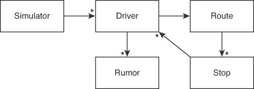

**图 8.1.** Java 版本的简单对象模型

`Simulator` 持有多个 `Drivers`。每个 `Driver` 拥有一个 `Route`，每个 `Route` 包含多个 `Stops`。每个 `Stop` 有多个 `Drivers`，每个 `Driver` 拥有多个 `Rumors`。

这是一个相当简单的对象模型。甚至没有隐含任何继承或多态。因此，它的实现应该非常直接。

当然，我使用 TDD（测试驱动开发）编写了 Java 代码。这里是测试用例。你可以看到，它们相当冗长；但至少它们都位于同一个测试类中。


# 排版后的文档

## Gossiping Bus Drivers

### 测试代码

```java
package gossipingBusDrivers;

import org.junit.Before;

import static org.hamcrest.MatcherAssert.assertThat;
import static org.hamcrest.collection.IsEmptyCollection.empty;
import static org.hamcrest.collection.IsIterableContainingInAnyOrder.containsInAnyOrder;
import static org.junit.Assert.assertEquals;

public class GossipTest {
  private Stop stop1;
  private Stop stop2;
  private Stop stop3;
  private Route route1;
  private Route route2;
  private Rumor rumor1;
  private Rumor rumor2;
  private Driver driver1;
  private Driver driver2;

  @Before
  public void setUp() {
    stop1 = new Stop("stop1");
    stop2 = new Stop("stop2");
    route1 = new Route(stop1, stop2);
    route2 = new Route(stop1, stop2, stop3);
    rumor1 = new Rumor("Rumor1");
    rumor2 = new Rumor("Rumor2");
    rumor3 = new Rumor("Rumor3");
    driver1 = new Driver("Driver1", route1, rumor1);
    driver2 = new Driver("Driver2", route2, rumor2, rumor3);
  }

  @Test
  public void driverStartsAtFirstStopInRoute() throws Exception {
    assertEquals(stop1, driver1.getStop());
  }

  @Test
  public void driverMovesToNextStop() throws Exception {
    driver1.drive();
    assertEquals(stop2, driver1.getStop());
  }

  @Test
  public void driverReturnsToStartAfterLastStop() throws Exception {
    driver1.drive();
    assertEquals(stop1, driver1.getStop());
  }

  @Test
  public void firstStopHasDriversAtStart() throws Exception {
    assertThat(stop1.getDrivers(), containsInAnyOrder(driver1, driver2));
  }

  @Test
  public void multipleDriversEnterAndLeaveStops() throws Exception {
    assertThat(stop1.getDrivers(), containsInAnyOrder(driver1, driver2));
    assertThat(stop2.getDrivers(), empty());
    assertThat(stop3.getDrivers(), empty());
  }
}
```

### Driver

```java
package gossipingBusDrivers;

import java.util.Arrays;
import java.util.HashSet;
import java.util.Set;

public class Driver {
  private String name;
  private Route route;
  private int stopNumber = 0;
  private Set<Rumor> rumors;

  public Driver(String name, Route theRoute, Rumor... theRumors) {
    this.name = name;
    route = theRoute;
    rumors = new HashSet<>(Arrays.asList(theRumors));
    route.stopAt(this, stopNumber);
  }

  public Stop getStop() {
    return route.getStop(stopNumber);
  }

  public void drive() {
    route.leave(this, stopNumber);
    stopNumber = route.getNextStop(stopNumber);
    route.stopAt(this, stopNumber);
  }

  public Set<Rumor> getRumors() {
    return rumors;
  }

  public void addRumors(Set<Rumor> newRumors) {
    rumors.addAll(newRumors);
  }
}
```

### Route

```java
package gossipingBusDrivers;

public class Route {
  private Stop[] stops;

  public Route(Stop... stops) {
    this.stops = stops;
  }

  public Stop getStop(int stopNumber) {
    return stops[stopNumber];
  }

  public int getNextStop(int stopNumber) {
    return (stopNumber + 1) % stops.length;
  }

  public void stopAt(Driver driver, int stopNumber) {
    stops[stopNumber].addDriver(driver);
  }

  public void leave(Driver driver, int stopNumber) {
    stops[stopNumber].removeDriver(driver);
  }
}
```

### Stop

```java
package gossipingBusDrivers;

import java.util.ArrayList;
import java.util.HashSet;
import java.util.List;
import java.util.Set;

public class Stop {
  private String name;
  private List<Driver> drivers = new ArrayList<>();

  public Stop(String name) {
    this.name = name;
  }

  public String toString() {
    return name;
  }

  public List<Driver> getDrivers() {
    return drivers;
  }

  public void addDriver(Driver driver) {
    drivers.add(driver);
  }

  public void removeDriver(Driver driver) {
    drivers.remove(driver);
  }

  public void gossip() {
    Set<Rumor> rumorsAtStop = new HashSet<>();
    for (Driver d : drivers)
      rumorsAtStop.addAll(d.getRumors());
    for (Driver d : drivers)
      d.addRumors(rumorsAtStop);
  }
}
```

### Rumor

```java
package gossipingBusDrivers;

public class Rumor {
  private String name;

  public Rumor(String name) {
    this.name = name;
  }

  public String toString() {
    return name;
  }
}
```

### Simulation

```java
package gossipingBusDrivers;

import java.util.HashSet;
import java.util.Set;

public class Simulation {
  public static int driveTillEqual(Driver... drivers) {
    int time;
    for (time = 0; notAllRumors(drivers) && time < 480; time++)
      driveAndGossip(drivers);
    return time;
  }

  private static void driveAndGossip(Driver[] drivers) {
    Set<Stop> stops = new HashSet<>();
    for (Driver d : drivers) {
      d.drive();
      stops.add(d.getStop());
    }
    for (Stop stop : stops)
      stop.gossip();
  }

  private static boolean notAllRumors(Driver[] drivers) {
    Set<Rumor> rumors = new HashSet<>();
    for (Driver d : drivers)
      rumors.addAll(d.getRumors());
    for (Driver d : drivers) {
      if (!d.getRumors().equals(rumors))
        return true;
    }
    return false;
  }
}
```

快速浏览这段代码会让你信服，它是以非常传统的面向对象风格编写的，并且对象很好地封装了它们自己的状态。

在编写 Clojure 版本时，我并没有从设计草图开始。相反，我依赖我的 TDD 测试来帮助我设计。测试如下：

```clojure
(ns gossiping-bus-drivers-clojure.core
  (:require [clojure.set :as set]))

(defn make-driver [name route rumors]
  {:name name :route route :rumors rumors})

(defn move-driver [driver]
  (update driver :route rest))

(defn move-drivers [world]
  (map move-driver world))

(defn get-stops [world]
  (loop [world world
         stops {}]
    (if (empty? world)
      stops
      (let [driver (first world)
            stop (first (:route driver))
            stops (update stops stop conj driver)]
        (recur (rest world) stops)))))

(defn merge-rumors [drivers]
  (let [rumors (map :rumors drivers)
        all-rumors (apply set/union rumors)]
    (map #(assoc % :rumors all-rumors) drivers)))

(defn spread-rumors [world]
  (let [stops-with-drivers (get-stops world)
        drivers-by-stop (vals stops-with-drivers)]
    (flatten (map merge-rumors drivers-by-stop))))

(defn drive [world]
  (-> world move-drivers spread-rumors))

(defn drive-till-all-rumors-spread [world]
  (loop [world (drive world)
         time 1]
    (cond
      (> time 480) :never
      (apply = (map :rumors world)) time
      :else (recur (drive world) (inc time)))))
```

5. `assoc` 向 map 中添加元素。`(assoc {} :a 1)` 返回 `{:a 1}`。

7. `update` 函数返回一个改变了一个元素的新 map。`(update m k f a)` 通过应用函数 `(f e a)` 来改变 `m` 的 `k` 元素，其中 `e` 是元素 `k` 的旧值。因此，`(update {:x 1} :x inc)` 返回 `{:x 2}`。

8. `union` 函数来自 `set` 命名空间。注意顶部的 `ns` 将 `clojure.set` 命名空间别名为 `set`。

9. `vals` 返回 map 中所有值的列表。`keys` 返回 map 中所有键的列表。

这个解决方案占了 42 行，而 Java 解决方案分布在五个文件中，占了 145 行。

两种解决方案都包含了 `Driver` 的概念，但我并没有尝试将 `Route`、`Stop` 和 `Rumor` 的概念封装成独立的对象。它们都愉快地存在于 `Driver` 之中。

糟糕的是，`Driver` "对象"并不是传统面向对象编程意义上的对象。它没有方法。系统中只有一个方法 `move-driver`，它在单个 `Driver` 上操作，但它只是为了更有趣的 `move-drivers` 函数提供的小辅助函数。

即使我们认为 `Driver` 是一种对象，它也是不可变的。模拟的 `world` 不仅仅是一个不可变 `Driver` 列表。`drive` 函数接收 `world` 并产生一个新的 `world`，在这个世界中，所有的 `Driver` 都已经移动了一步，并且在任何到达了多个 `Driver` 的站点，`Rumors` 都已传播开。

那个 `drive` 函数是一个重要概念的示例。注意 `world` 是如何通过函数流水线传递的。在这种情况下，只有两个函数，`move-drivers` 和 `spread-rumors`，但在较大的系统中，流水线可以很长。在流水线的每个阶段，`world` 都会被修改成略微不同的形式。

这告诉我们，这个系统的划分不是关于对象的，而是关于函数的。相对未划分的数据从一个独立函数传递到下一个函数。

你可能会认为 Java 代码相对直观，而 Clojure 代码太密集且晦涩。请相信我的话，要习惯这种密集的程度并不费时间，而且那种感知到的晦涩只是一个基于不熟悉而产生的幻觉。

Clojure 版本缺乏划分是一个问题吗？在它目前的规模下不是；但如果这个程序像大多数系统那样增长，那个问题将会猛烈地显现出来。划分面向对象程序比划分函数式程序要自然一点，因为划分的分界线要明显且突出得多。

另一方面，我们为 Java 版本选择的分界线并不能保证导致有效的划分。似乎这个系统的更好划分可能沿着操作展开，而不是 `Route`、`Stop` 和 `Rumor`。

### 结论

我们看到了 Prime Factors 和 Bowling Game kata 的差异，但这种差异相对较小。Gossiping Drivers 的差异要大得多。这可能是因为后者稍大一点（我说是两倍），而且因为它是一个真正的状态机。*有限状态机* 状态转移取决于输入的事件和当前状态。当此类系统以 OO 风格编写时，状态倾向于存储在具有方法的可变对象中。但在函数风格中，状态外化在不可变数据结构中。

我们可以从此推断，像 Prime Factors 这样简单的计算程序受 OO 或函数风格的影响都很小，毕竟它们没有任何状态改变。那些由状态改变驱动的程序，如 Gossiping Drivers，将看到两种风格之间的巨大差异。OO 风格导致的划分与数据内聚相关，而函数风格导致的划分与行为内聚相关。哪种风格更好我将留给后续章节。

## 9 面向对象编程


*   佣金制员工每隔周五发放一次工资。他们的工资由基本工资加佣金组成。基本工资和佣金率是员工记录中的字段。佣金计算方法是用佣金率乘以该员工销售收据的总和。
*   时薪制员工每周五发放一次工资。他们的时薪是员工记录中的一个字段。他们的工资计算方法是将其时薪乘以该周工卡上的工时总和。如果该总和大于 40 小时，剩余小时将按时薪的 1.5 倍支付。
*   员工可以选择将工资单邮寄到家庭地址、保存在薪主办公室，或直接存入其银行账户。地址、薪主和银行信息都是其员工记录中的字段。

解决此问题的典型对象（OO）解决方案如统一建模语言（UML）图 图 9.1 所示。

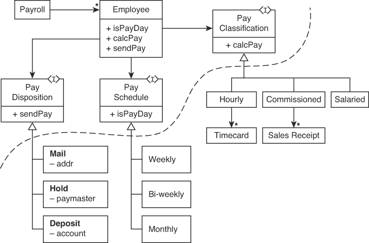

**图 9.1.** 薪资问题的对象模型

也许最好的起点是 `Payroll` 类。在 Java 中，它有一个如下所示的 `run` 方法：

```java
public class Payroll {
  public void run() {
    // 实现细节
  }
}
```


```
void run() {
  for (Employee e : db.getEmployees()) {
    if (e.isPayDay()) {
      Pay pay = e.calcPay();
      e.sendPay(pay);
    }
  }
}
```

我已经多次并在许多地方（包括上述书籍）强调过，这段小小的代码片段就是*纯真理*。对于每个员工，如果今天是他们领工资的日子，就计算他们的工资并发送给他们。

从这段小代码片段中，其余的实现应该非常清晰。这里使用了三次 *Strategy*^(3) 模式：一个用于实现 `calcPay`，另一个用于实现 `isPayDay`，最后一个实现 `sendPay`。

3. Erich Gamma, Richard Helm, Ralph Johnson, and John Vlissides, *Design Patterns: Elements of Reusable Object-Oriented Software* (Addison-Wesley, 1995), 315.

同样清晰的是，这种对象结构必须由 `getEmployees` 函数构建，该函数从数据库中读取员工并对其进行妥善安排。数据库中的数据不太可能像这里看到的对象结构。

这里还有一个非常清晰的架构边界（虚线），横跨了所有继承关系，将高层抽象与低层细节隔离开。

## 函数式薪资管理

图 9.2 显示了这作为一个函数式程序可能的样子。

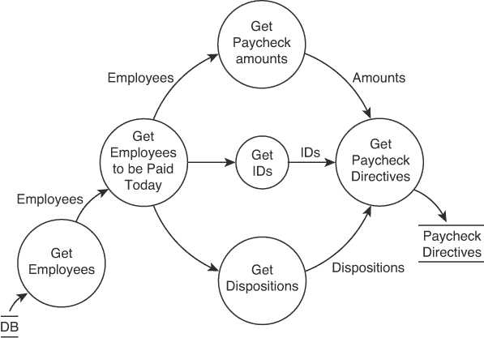

**图 9.2.** 薪资问题的数据流图

我选择数据流图（DFD）来表示函数式解决方案，这很有趣吗？DFD 在描述过程与数据元素之间的关系方面非常有帮助，但在描述架构决策方面，它们远没有 UML 类图有用。

尽管如此，DFD 帮助我们提出了*纯真理*的函数式版本：

```
(defn payroll [today db]
  (let [employees (get-employees db)
        employees-to-pay (get-employees-to-be-paid-today
                            today employees)
        amounts (get-paycheck-amounts employees-to-pay)
        ids (get-ids employees-to-pay)
        dispositions (get-dispositions employees-to-pay)]
    (send-paychecks ids amounts dispositions)))
```

注意，这与 Java 版本不同之处在于它不是一种迭代方法。相反，员工列表流经程序，根据数据流图在每个阶段被修改。这是函数式程序构思和编写的典型方式。函数式程序往往更像*水管*而不是逐步执行的过程。它们调节并修改数据流，而不是逐步迭代数据。

那么，架构又是呢？在 OO 版本的 UML 图中有一个很棒的架构边界。函数式版本中的架构边界在哪里？

让我们深入观察一点。测试可能会给我们提供一些提示：

```
(it "pays one salaried employee at end of month by mail"
  (let [employees [{:id "emp1"
                    :schedule :monthly
                    :pay-class [:salaried 5000]
                    :disposition [:mail "name" "home"]}]
        db {:employees employees}
        today (parse-date "Nov 30 2021")]
    (should= [{:type :mail
               :id "emp1"
               :name "name"
               :address "home"
               :amount 5000}]
             (payroll today db))))
```

在这个测试中，数据库包含一个 `employee` 列表，每个 `employee` 都是带有特定字段的哈 map。这与对象没有太大区别，不是吗？`payroll` 函数返回一个工资单指令列表，每个指令都是一个哈 map——另一个对象。

```
(it "pays one hourly employee on Friday"
  (let [employees [{:id "emp1"
                    :schedule :weekly
                    :pay-class [:hourly 15]
                    :disposition [:deposit "routing" "account"]}]
        time-cards {"emp1" [["Nov 12 2022" 80/10]]}
        db {:employees employees :time-cards time-cards}
        friday (parse-date "Nov 18 2022")]
    (should= [{:type :deposit
               :id "emp1"
               :routing "routing"
               :account "account"
               :amount 120}]
             (payroll friday db))))
```

4. 这不是 80 除以 10。相反，它是理数 `80/10`。这确保了后续数学计算不会将该值视为整数。

这个测试展示了 `employee` 和 `paycheck-directive` 对象如何根据 `:schedule`、`:pay-class` 和 `:disposition` 变化。它还显示了数据库包含与 `id` 关联的 `time-card`。由此，第三测试是可以预期的：

```
(it "pays one commissioned employee on an even Friday by Paymaster"
  (let [employees [{:id "emp1"
                    :schedule :biweekly
                    :pay-class [:commissioned 100 5/100]
                    :disposition [:paymaster "paymaster"]}]
        sales-receipts {"emp1" [["Nov 12 2022" 15000]]}
        db {:employees employees :sales-receipts sales-receipts}
        friday (parse-date "Nov 18 2022")]
    (should= [{:type :paymaster
               :id "emp1"
               :paymaster "paymaster"
               :amount 850}]
             (payroll friday db))))
```

```clojure
(defn get-pay-class [employee]
  (first (:pay-class employee)))

(defn get-disposition [paycheck-directive]
  (first (:disposition paycheck-directive)))

(defmulti is-today-payday :schedule)
(defmulti calc-pay get-pay-class)
(defmulti dispose get-disposition)

(defn get-employees-to-be-paid-today [today employees]
  (filter5 #(is-today-payday % today) employees))

(defn- build-employee [db employee]
  (assoc employee :db db))

(defn get-employees [db]
  (map (partial6 build-employee db) (:employees db)))

(defn create-paycheck-directives [ids payments dispositions]
  (map #(assoc {} :id %1 :amount %2 :disposition %3)
       ids payments dispositions)

(defn send-paychecks [ids payments dispositions]
  (for7 [paycheck-directive
        (create-paycheck-directives ids payments dispositions)]
    (dispose paycheck-directive)))

(defn get-paycheck-amounts [employees]
  (map calc-pay employees))

(defn get-dispositions [employees]
  (map :disposition employees))

(defn get-ids [employees]
  (map :id employees))
```

5. `(filter predicate list)` 为 `list` 中的每个成员调用 `predicate`，并返回所有 `predicate` 结果非 *falsey* 的成员组成的序列。

6. `partial` 函数接收一个函数和一些参数，并返回一个新函数，该函数中的所有参数已经过初始化。因此，`((partial f 1) 2)` 等同于 `(f 1 2)`。

7. 在这种情况下，`for` 函数为 `create-paycheck-directives` 返回的列表中的每个 `paycheck-directive` 调用 `dispose`。

你看到那些 `defmulti` 语句（加粗部分）了吗？它们与 Java 接口类似，但并不完全相同。每个 `defmulti` 都定义了一个多态函数。然而，该函数并不是根据内在类型进行分发（不像 Java、C# 甚至 Ruby 和 Python 那样）。相反，它们根据名称之后指定的函数结果进行分发。

所以，`get-pay-class` 函数返回 `calc-pay` 函数将进行多态分发的值。`get-pay-class` 返回什么？它返回 `employee` 的 `pay-class` 字段的第一个元素。根据我们的测试，这些值是 `:salaried`、`:hourly` 和 `:commissioned`。

那么 `calc-pay` 函数的实现在哪里？它们在程序的*靠后*：

```clojure
(defn-8 get-salary [employee]
  (second (:pay-class employee)))

(defmethod calc-pay :salaried [employee]
  (get-salary employee))

(defmethod calc-pay :hourly [employee]
  (let [db (:db employee)
        time-cards (:time-cards db)
        my-time-cards (get9 time-cards (:id employee))
        [_ hourly-rate]10 (:pay-class employee)
        hours (map second my-time-cards)
        total-hours (reduce + hours)]
    (* total-hours hourly-rate)))

(defmethod calc-pay :commissioned [employee]
  (let [db (:db employee)
        sales-receipts (:sales-receipts db)
        my-sales-receipts (get sales-receipts (:id employee))
        [_ base-pay commission-rate] (:pay-class employee)
        sales (map second my-sales-receipts)
        total-sales (reduce + sales)]
    (+ (* total-sales commission-rate) base-pay)))
```

8. 末尾的 `-` 使该函数成为私有函数，因此只有文件中的函数可以访问它。

9. `(get m k)` 返回映射 `m` 中 `k` 的值。

10. *解构* `employee` 的 `pay-class` 并忽略第一个元素。

我将 *further down* 一词使用了斜体，是因为这在 Clojure 程序中非常重要。Clojure 程序不能调用调用点之后声明的函数。但这些函数*确实*是在调用点之后声明的。这意味着存在源码依赖倒置。`calc-pay` 的实现被 `payroll` 函数调用；但 `payroll` 函数位于 `calc-pay` 实现的上方。

事实上，我可以将 `defmulti` 函数的所有实现移动到另一个源文件中，而 `payroll` 源文件不需要 `require` 该文件。

如果我们画出这些源文件之间的关系，就会得到图 9.3 中的图。

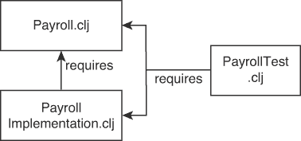

**图 9.3.** 依赖倒置

箭头描述了源文件之间的 `requires` 关系。`payroll.clj` 中这些 `requires` 的源码所示：

```clojure
(ns payroll
  (:require [payroll-interface [get-pay-class get-disposition]]
            [payroll-logic [calc-pay]]))

  (defn payroll [today]
    (let [paid (get-employees-to-be-paid-today today)
          amounts (get-paycheck-amounts paid)
          dispositions (get-dispositions paid)
          ids (get-ids paid)]
      (send-paychecks ids amounts))))
```

在 Clojure 中，命名空间（namespaces）和源文件是紧密相连。每个命名空间必须包含在自己的源文件中，且该文件名必须与命名空间的名称对应。这与 `Java` 强制将公共类放入以类命名的独立源文件中非常相似。这与 `C++` 和 `C#` 程序员使用的文件/类约定也十分相似。这可能会让你认为每个 Clojure 命名空间都像是一个类。

通过一个简单的转换算法。

当然的，这种对应关系并不是完美的。Clojure 命名空间的内容完全不需要像类。但总的来说，这个概念并不坏。

在像 Clojure 这样的函数式语言中，一种巨大的诱惑是以随意的、凭直觉的方式将函数分组到命名空间中。由于没有面向对象（OO）结构来强制我们将函数划分为存在于独立源文件中的类，我们最终得到的源文件结构往往比应该有的更不稳定、更脆弱。

因此，在编写函数式程序时，考虑面向对象的拆划分规范并继续应用它们并不是坏主意。在我们之后研究原则、模式和架构时，我们将看到更多此类内容。

## 结论

首先，函数式程序和面向对象程序是不同的。函数式程序倾向于构建调节数据流转换的“管道”，而可变的面向对象程序倾向于对对象进行逐步迭代。然而，从架构的角度来看，这两种风格是完全兼容的。事实证明，我们可以将函数式程序的函数划分为与面向对象程序相同的具有架构意义的元素。从架构角度来看，两者区别极小。

函数式程序可能不是由语法上强制的、封装方法并定义对象的类所组成的。然而，对象在函数式程序中仍然存在。这些对象与其操作它们的函数之间的绑定没有在面向对象语言中那么紧密。这是优势还是劣势，我们将在接下来的章节中继续探讨。

我们将看到，随着这些页面越来越转向设计和架构，函数式程序与不可变对象的面向对象之间的差异将变得越来越不相关。

# 10 节点


前面的章节可能让你感到有些困扰。我所说的那些对象仅仅是哈希映射（hash maps），并且完全没有类型。任何人可以在没有任何限制的情况下向它们放入任何内容。`:pay-class` 中的薪水可以是一个字符串而不是数字。`:schedule` 字段可以是一个整数而不是适当的关键字。

简而言之，这些对象不是静态类型的。编译器不检查它们。因此，一切都会陷入混乱！


许多函数式语言以及许多面向对象语言都是静态类型的，以防止这种混乱。其他语言如`Clojure`、`Python`和`Ruby`则依赖其他机制来防止这种混乱。

我们这些实践 TDD（测试驱动开发）的人通常并不担心这种混乱。我们的测试通常能确保我们传递的对象是构造良好的。尽管如此，在复杂系统中，由于所有对象的总体可能变得非常复杂，我们需要一种更正式、更完整的方式来确保类型的完整性，而这是动态类型语言（甚至是大多数静态类型语言）所能提供的。

在`Clojure`中，我使用`clojure.spec`库来实现类型完整性的目标。我们工资单示例的类型规范如下：

[点击查看代码图像]

```
(s/def ::id string?)
(s/def ::schedule #{:monthly :weekly :biweekly})
(s/def ::salaried-pay-class (s/tuple #(= % :salaried) pos1?))
(s/def ::hourly-pay-class (s/tuple #(= % :hourly) pos?))
(s/def ::commissioned-pay-class (s/tuple #(= % :commissioned)
                                         pos? pos?))
(s/def ::pay-class (s/or :salaried ::salaried-pay-class
                         :Hourly ::hourly-pay-class
                         :Commissioned ::commissioned-pay-class))
(s/def ::mail-disposition (s/tuple #(= % :mail) string? string?))
(s/def ::deposit-disposition (s/tuple #(= % :deposit)
                                      string? string?))
(s/def ::paymaster-disposition (s/tuple #(= % :paymaster)
                                        string?))
(s/def ::disposition (s/or :mail ::mail-disposition
                           :deposit ::deposit-disposition
                           :paymaster ::paymaster-disposition))
(s/def ::employee (s/keys :req-un [::id ::schedule
                                   ::pay-class ::disposition]))
(s/def ::employees (s/coll-of ::employee))

(s/def ::date string?)
(s/def ::time-card (s/tuple ::date pos?))
(s/def ::time-cards (s/map-of ::id (s/coll-of ::time-card)))

(s/def ::sales-receipt (s/tuple ::date pos?))
(s/def ::sales-receipts (s/map-of
                           ::id (s/coll-of ::sales-receipt)))

(s/def ::db (s/keys :req-un [::employees]
                    :opt-un [time-cards ::sales-receipts]))

(s/def ::amount pos?)
(s/def ::name string?)
(s/def ::address string?)
(s/def ::mail-disposition (s/tuple #(= % :mail)
                               string? string?))
                               (s/keys :req-un [::id
                               name
                                                

(s/def ::routing string?)
(s/def ::account string?)
(s/def ::deposit-disposition (s/tuple #(= % :deposit)
                                  string? string?))
                               (s/keys :req-un [::id
                                                   account
                                                   amount]))

(s/def ::paymaster string?)
(s/def ::paymaster-disposition (s/tuple #(= % :paymaster)
                                    string?))
                                  (s/keys :req-un [::id
                                                     paymaster
                                                     amount]))

(s/def ::paycheck-directive (s/or
                              :mail ::mail-disposition
                              :deposit ::deposit-disposition
                              :paymaster ::paymaster-disposition))

(s/def ::paycheck-directives (s/coll-of ::paycheck-directive))
```

[1]. `(pos? x)`如果`x`是大于零的数字则返回 true。

如果这看起来很吓人，那确实如此。这里有很多细节。但请记住，这就是为了捕获所有类型约束，在静态类型语言的模块中必须指定的详细程度。

随着我们不断深入，我们看到`::employee`是一个哈希映射，要求包含键`:id`、`:schedule`、`:pay-class`和`:disposition`。继续探索你会发现，`:id`必须是一个字符串；`:schedule`必须是`:monthly`、`:weekly`或`:biweekly`之一；而`:salaried-pay-class`是一个元组，包含`:salaried`，后跟一个正数。

`s/or`语句可能会让你有点困惑。参数是成对出现的，每对中的第一个参数只是该备选方案的。因此，在`::disposition`的定义中，`:mail`只是`::mail-disposition`备选方案的名字。不用担心这个，如果你某天决定阅读`clojure.spec`文档，一切都会变得明朗。

那么，给定这个详尽的类型规范，我们如何使用它呢？我有时会在测试中如下使用它：

点击此处查看代码图片

```
(it "pays one salaried employee at end of month by mail"
  (let [employees [{:id "emp1"
                    :schedule :monthly
                    :pay-class [:salaried 5000]
                    :disposition [:mail "name" "home"]}]
        db {:employees employees}
        today (parse-date "Nov 30 2021")]
    (should (s/valid? ::db db))
    (let [paycheck-directives (payroll today db)]
      (should (s/valid? ::paycheck-directives 
                     paycheck-directives))
      (should= [{:type :mail
                 :id "emp1"
                 :name "name"
                 :address "home"
                 :amount 5000}]
               paycheck-directives))))
```

寻找对`s/valid?`的调用，该函数在数据匹配规范时返回 true。仔细看你会发现，我在输入时检查了`::db`规范，在输出时检查了`::paycheck-directives`规范。这非常安全。如果我的测试覆盖率很高，并且它们都检查了调用函数的输入和输出规范，那么类型违规的情况将极其罕见。

偶尔我还会使用 Clojure 的`:pre`和`:post`特性，在应用程序的主处理函数执行之前之后对关键数据运行规范。

例如，这里我几年前编写的`spacewar`^(2)游戏的主处理步骤：

2. [`github.com/unclebob/spacewar`](https://github.com/unclebob/spacewar)

点击此处查看代码图片

```
(defn update-world [ms world]
  ;{:pre [(valid-world? world)]
  ; :post [(valid-world? %)]}
  (->> world
       (game-won ms)
       (game-over ms)
       (ship/update-ship ms)
       (shots/update-shots ms)
       (explosions/update-explosions ms)
       (clouds/update-clouds ms)
       (klingons/update-klingons ms)
       (bases/update-bases ms)
       (romulans/update-romulans ms)
       (view-frame/update-messages ms)
       (add-messages)))
```

`:pre`和`:post`语句被注释掉了，^(3)但如果我怀疑发生了某种糟糕的类型损坏，它们随时可以重新断言。

3. 我并不喜欢注释掉的代码。随着项目的成熟，我会删除这些行。

### 结论

关于静态类型与动态类型的问题，存在着许多哀嚎和咬牙切齿。双方都在向对方吼，却不听取对方在说什么。我认为双方都有道理。动态类型让代码更易编写。静态类型让代码安全得多、更容易理解，并且在内部逻辑上具有更强的一致性。在我看来，像`clojure.spec`这样的库达了极佳的平衡。它让你能够根据需要进行尽可能多或尽可能少的类型检查。它允许你指定何时进行类型检查，何时不进行。此外，它还允许你指定任何静态类型系统无法检查的动态约束。因此，在我看来，这样的库带给你的是比两者兼得更好的体验。

# III

# 函数式设计

## 11

## 数据流


在第 9 章面向对象编程中，我建议函数式程序的设计更像水管系统而不是过程。它有明确的数据流倾向。这是因为我们倾向于使用`map`、`filter`和`reduce`将列表内容转换为其他列表，而不是通过逐个元素迭代问题来产生结果。

我们在之前的许多示例中都能看到这种倾向，包括保龄球游戏、八卦的公交车司机以及第二部分。

作为另一个例子，考虑这个 Advent of Code 问题 1。任务是模拟一个具有两条指令的简单处理器。第一个指令是`noop`，占用一个时钟周期但没有影响。另一个指令是`addx`，它接受一个整数参数`n`并将其加到`x`寄存器中。该指令消耗两个周期，并在两个周期都完成后才更改`x`寄存器。当且仅当在周期开始时`x`寄存器匹配时钟周期时，屏幕上的像素才可见。

为了让情况稍微复杂一点，`x`寄存器与时钟周期的匹配被扩大，使得 22、23 和 24 匹配时钟周期 23。换句话说，`x`寄存器指定了一个三个像素的窗口。只要时钟周期落在窗口内，光束就会激活。

由于屏幕宽 40 像素，高 6 像素，时钟周期与`x`的匹配是取模 40。任务是执行一组指令并产生一个六字符串列表，每个字符串 40 个字符，用`#`表示可见像素，用`.`表示不可见像素。

如果你用 Java、C、Go、C++、C#或任何其他过程/面向对象的语言编写此程序，可能会创建一个逐周期迭代的循环，同时累积每个周期的相应像素。循环将根据指令消耗并修改`x`寄存器。

这里有一个典型的 Java 示例：

```java
package crt;

public class Crt {
  private int x;
  private String pixels = "";
  private int extraCycles = 0;
  private int cycle = 0;
  private int ic;
  private String[] instructions;
  public Crt(int x) {
    this.x = x;
  }

  public void doCycles(int n, String instructionsLines) {
    instructions = instructionsLines.split("\n");
    ic = 0;
    for (cycle = 0; cycle < n; cycle++) {
      setPixel();
      execute();
    }
  }

  private void execute() {
    if (instructions[ic].equals("noop"))
      ic++;
    else if (instructions[ic].startsWith("addx ")
             && extraCycles == 0) {
      extraCycles = 1;
    }
    else if (instructions[ic].startsWith("addx ")
             && extraCycles == 1) {
      extraCycles = 0;
      x += Integer.parseInt(instructions[ic].substring(5));
      ic++;
    } else
      System.out.println("TILT");
  }

  private void setPixel() {
    int pos = cycle % 40;
    int offset = pos - x;
    if (offset >= -1 && 1 >= offset)
      pixels += "#";
    else
      pixels += ".";
  }

  public String getPixels() {
    return pixels;
  }

  public int getX() {
    return x;
  }
}
```

注意所有这些可变状态。注意它是如何一个周期一个周期地填充像素的。还要注意`extraCycles`的巧妙处理，它是为了考虑到`addx`需要两个周期才能执行。

最后，请注意，尽管程序被很好地划分成了几个小函数，但这些函数都通过可变状态变量耦合在一起。这，当然，是可变类方法的常见情况。

我今天用 Clojure 解决了这个问题。我得出的解决方案与上面的 Java 代码非常不同。在阅读此处内容时请记住从底部开始看。Clojure 程序总是从自底向上编写的。

点击此处查看代码图片


```clojure
(ns day10-cathode-ray-tube.core
  (:require [clojure.string :as string]))

(defn noop [state]
  (update state :cycles conj (:x state)))

(defn addx [n state]
  (let [{:keys [x cycles]} state]
    (assoc state :x (+ x n)
                 :cycles (vec (concat cycles [x x])))))

(defn execute [state lines]
  (if (empty? lines)
    state
    (let [line (first lines)
          state (if (re-matches #"noop" line)
                  (noop state)
                  (if-let [[_ n] (re-matches
                                   #"addx (-?\d+)" line)]
                    (addx (Integer/parseInt n) state)
                    "TILT"))]
      (recur state (rest lines)))))

(defn execute-file [file-name]
  (let [lines (string/split-lines (slurp file-name))
        starting-state {:x 1 :cycles []}
        ending-state (execute starting-state lines)]
    (:cycles ending-state)))

(defn render-cycles [cycles]
  (loop [cycles cycles
         screen ""
         t 0]
    (if (empty? cycles)
      (map #(apply str %) (partition 40 40 "" screen))
      (let [x (first cycles)
            offset (- t x)
            pixel? (<= -1 offset 1)
            screen (str screen (if pixel? "#" "."))
            t (mod (inc t) 40)]
        (recur (rest cycles) screen t)))))

(defn print-screen [lines]
  (doseq [line lines]
    (println line))
  true)

(defn -main []
  (-> "input"
      execute-file
      render-cycles
      print-screen))
```

`TILT`是我最喜欢的错误信息。很久以前，如果你为了物理上倾斜机器来操纵小球，弹珠机就会显示这条信息并取消你的游戏。

`execute-file` 函数将命名文件中的指令列表转换为结果 `x` 值的列表。然后 `render-cycles` 函数将 `x` 值的列表转换为像素列表，最后将其 `partition`（分区）为 40 个字符的字符串。

注意，当然，这里没有可变变量。相反，`state` 值流过每个函数，就像流过流水线一样。

`state` 值始于 `execute-file`，然后流向 `execute`，然后反复流向 `noop` 或 `addx`，再次回到 `execute`，最后回到 `execute-file`。在这一流向的每个阶段，都会从旧值创建一个新的 `state` 值，而不改变旧值。

如果你觉得这听起来异常熟悉，那确实应该是。这非常像我们在命令行 Shell 中习惯的管道（pipes）和过滤器（filters）。数据从管道流入命令，经过该命令转换，然后流出。

这些人员可以被分为称为 `roles`（角色）或 `actors`（参与者）组。一个 `actor` 是一个人或一组，他们对系统有相同的需求。他们请求的更改类型将是一致的。相反，不同的参与者需求需求。一个参与者请求的更改对系统的影响与其他参与者请求的更改截然不同。这些迥然不同的更改甚至可能背道而驰。

当一个模块负责多个参与者时，这些竞争参与者所请求的更改可能会相互干扰。这种干扰通常会导致 `fragility`（脆弱性）这一设计气味；导致系统在进行简单更改时以意想不到的方式崩溃。

对于经理和客户来说，没有什么比系统在进行简单功能更改后突然以惊人的方式出错更令他们恐惧了。如果这种情况发生太频繁，他们能得出的唯一结论就是开发者已经失去了对系统的控制，并且不知道自己在做什么。

违反 `SRP` 可能仅仅是将 GUI 格式化代码和业务规则代码混合在同一个模块中。也可能非常复杂，例如在数据库中使用存储过程来实现业务规则。

这里有一个用 Clojure 写的糟糕 `SRP` 违反示例。首先，让我们看看测试，因为它们讲述了整个故事：

点击此处查看代码图像

```clojure
(describe "Order Entry System"
  (context "Parsing Customers"
    (it "parses a valid customer"
      (should=
        {:id "1234567"
         :name "customer name"
         :address "customer address"
         :credit-limit 50000}
        (parse-customer
          ["Customer-id: 1234567"
           "Name: customer name"
           "Address: customer address"
           "Credit Limit: 50000"])))

    (it "parses invalid customer"
      (should= :invalid
               (parse-customer
                 ["Customer-id: X"
                  "Name: customer name"
                  "Address: customer address"
                  "Credit Limit: 50000"]))
      (should= :invalid
               (parse-customer
                 ["Customer-id: 1234567"
                  "Name: "
                  "Address: customer address"
                  "Credit Limit: 50000"]))
      (should= :invalid
               (parse-customer
                 ["Customer-id: 1234567"
                  "Name: customer name"
                  "Address: "
                  "Credit Limit: 50000"]))
      (should= :invalid
               (parse-customer
                 ["Customer-id: 1234567"
                  "Name: customer name"
                  "Address: customer address"
                  "Credit Limit: invalid"])))
    (it "makes sure credit limit is <= 50000"
      (should= :invalid
               (parse-customer
                 ["Customer-id: 1234567"
                  "Name: customer name"
                  "Address: customer address"
                  "Credit Limit: 50001"])))))
```

第一个测试告诉我们，我们正在将某些文本输入解析为客户记录。该记录有四个字段：`id`、`name`、`address` 和 `credit-limit`。接下来的四个测试告诉我们关于语法错误，例如缺失或格式不正确的输入。

最后一个测试是有趣的。它测试了一个业务规则。作为解析输入的一部分来测试业务规则是显而 `SRP` 违反。解析代码可以安全地验证语法错误，但它应该避免所有的 `semantic`（语义）检查，因为这些检查属于另一个参与者的范畴。指定输入格式的参与者与指定最大允许信用额度的参与者不是同一个人。

即使这两个参与者是同一个人，这一点仍然成立。在这种情况下，那个人扮演了两个不同的角色。

通过了这些测试的代码加剧了问题：

点击此处查看代码图像

```clojure
(defn validate-customer
  [{:keys [id name address credit-limit] :as customer}]
  (if (or (nil? id)
          (nil? name)
          (nil? address)
          (nil? credit-limit))
    :invalid
    (let [credit-limit (Integer/parseInt credit-limit)]
      (if (> credit-limit 50000)
        :invalid
        (assoc customer :credit-limit credit-limit)))))

(defn parse-customer [lines]

  (let [[_ id] (re-matches #"^Customer-id: (\d{7})$"
                           (nth lines 0))
        [_ name] (re-matches #"^Name: (.+)$" (nth lines 1))
        [_ address] (re-matches #"^Address: (.+)$" (nth lines 2))
        [_ credit-limit] (re-matches #"^Credit Limit: (\d+)$"
                                     (nth lines 3))]
    (validate-customer
      {:id id
       :name name
       :address address
       :credit-limit credit-limit})))
```

看 `validate-customer` 函数是如何将语法检查与语义业务规则混合在一起的。更糟糕，考虑一个使用 `clojure/spec` 来定义 `customer` 类型的程序员：

点击此处查看代码图像

```clojure
(defn validate-customer
  [{:keys [id name address credit-limit] :as customer}]
  (if (or (nil? id)
          (nil? name)
          (nil? address)
          (nil? credit-limit))
    :invalid
    (let [credit-limit (Integer/parseInt credit-limit)]
      (if (> credit-limit 50000)
        :invalid
        (assoc customer :credit-limit credit-limit)))))

(defn parse-customer [lines]

  (let [[_ id] (re-matches #"^Customer-id: (\d{7})$"
                           (nth lines 0))
        [_ name] (re-matches #"^Name: (.+)$" (nth lines 1))
        [_ address] (re-matches #"^Address: (.+)$" (nth lines 2))
        [_ credit-limit] (re-matches #"^Credit Limit: (\d+)$"
                                     (nth lines 3))]
    (validate-customer
      {:id id
       :name name
       :address address
       :credit-limit credit-limit})))
```

该规范正确约束了 `customer` 数据结构在语法上是正确的；但它也施加了信用额度不超过 50,000 的语义业务规则。

## 开闭原则 (OCP)


`OCP` 由 Bertrand Meyer 在其经典的 1988 年著作《面向对象的软件构造》中首次提出。换句话说，它认为软件模块应该是对扩展开放的，对修改关闭的。这意味着你希望设计你的模块，使得扩展或更改其行为不需要修改其代码。

这听起来可能有些矛盾，但实际上我们经常在这样做。考虑 C 语言中的 `copy` 程序：

```c
void copy() {
  int c;
  while ((c = getchar()) != EOF)
    putchar(c);
}
```

该程序从 `stdin` 复制字符到 `stdout`。我可以随时向操作系统添加新设备。例如，我可以向系统添加光学字符识别 (OCR) 和文本语音合成器。这个程序将继续正常运行，并乐意地将字符从 OCR 复制到语音合成器，而无需修改甚至重新编译它。

这是一个非常强大的想法，它允许我们将高层策略与底层细节分离开来，并保持高层策略不受底层细节变化的影响。然而，这要求高层策略通过一个抽象层来访问底层细节。

在面向对象（OO）程序中，我们通常通过多态接口来创建这个抽象层。在 Java、C# 和 C++ 等静态类型语言中，这些接口是带有抽象方法的类。高层策略通过这些接口获得对实现或继承自这些接口的底层细节的访问权限。

Java 和 C# 中的 `interface` 关键字定义了其中每个方法都是抽象方法的类。

在 Python 和 Ruby 等动态类型面向对象语言中，这些接口是鸭子类型（duck types）。“鸭子类型”在语言内部没有特定的语法。它们仅仅是供高层策略调用并由底层细节实现的函数签名集合。动态类型系统通过匹配这些签名，在运行时确定多态分发。

某些函数式语言（如 F# 和 Scala）建立在面向对象的基础之上，因此可以利用该基础的多态接口。但函数式语言长期以来一直有另一种机制可以创建 OCP 的抽象层：函数。

### 函数

考虑这个简单的 Clojure 程序：

点击此处查看代码图片

```clojure
(defn copy [read write]
  (let [c (read)]
    (if (= c :eof)
      nil
      (recur read (write c)))))
```

这在本质上与用 C 语言编写的 `copy` 程序相同，区别在于读写函数是作为参数传递进的。尽管如此，OCP 的抽象层仍然完整。

作为参数传递或作为值从函数返回的函数有时被称为`高阶函数`。

顺便提一下，我使用以下测试运行了这个程序。我想你会发现这很有趣。

点击此处查看代码图片

```clojure
(def str-in (atom nil))
(def str-out (atom nil))

(defn str-read []
  (let [c (first @str-in)]
    (if (nil? c)
      :eof
      (do
        (swap! str-in rest)
        c))))

(defn str-write [c]
  (swap! str-out str c)
  str-write)

(describe "copy"
  (it "can read and write using str-read and str-write"
    (reset! str-in "abcedf")
    (reset! str-out "")
    (copy str-read str-write)
    (should= "abcdef" @str-out)))
```

我使用 `atom` 是因为 I/O 是一种副作用，因此不是纯函数式的。毕竟，当你从输入读取或向输出写入时，你正在改变它们的状态。因此，底层的 I/O 函数不是纯函数式的，并使用软件事务内存（Software Transactional Memory）来管理状态的变异。

### 带有 Vtable 的对象

对于渴望面向对象编程的人，可以使用以下技术将“对象”传递给 `copy`：

点击此处查看代码图片


```
(defn copy [device]
  (let [c ((:getchar device))]
    (if (= c :eof)
      nil
      (do
        ((:putchar device) c)
        (recur device)))))
```

测试简单地加载了带有函数的设备映射：

点击此处查看代码图片

```
(it "can read and write using str-read and str-write"
    (reset! str-in "abcedf")
    (reset! str-out "")
    (copy {:getchar str-read :putchar str-write})
    (should= "abcdef" @str-out))
```

C++ 程序员会识别出 `device` 参数仅仅是一个 vtable（虚函数表）——这是 C++ 中的多态机制。无论如何，显而易见的是你可以为 `copy` 程序定义许多不同的设备。你可以扩展 `copy` 的行为而无需修改它。

### 多方法（Multi-methods）

该主题的另一个变体是使用多方法。许多语言（无论是否是函数式）以某种方式支持多方法。`多方法`是鸭子类型的另一种形式，因为它们创建了一个松散的方法组，并根据函数签名和参数的“类型”^(7)进行动态分发。

7. 我在这里使用引号是因为参数的“类型”并不一定与其特定的数据类型相关。事实上，那个“类型”可以是一个完全不同的概念。

在 Clojure 中，我们使用传统的`分发函数`dispatching function）来指定该“类型”：

点击此处查看代码图片

```
(defmulti getchar (fn [device] (:device]))
```

在这里我们看到 `getchar` 和 `putchar` 被声明为多方法。它们并不令人意外。

```
(defmulti getchar (fn [device]
  (let [c ((getchar device))]
    (if (= c :eof)
      nil
      (do
        ((:putchar device) c)
        (recur device)))))

(defmulti putchar (fn [device]
  (let [c ((putchar device))]
    (if (= c :eof)
      nil
      (do
        ((:getchar device) c)
        (recur device)))))
```

当 `device-type` 为 `:test-device` 时，将调度这些实现。显而易见，可以创建许多此类方法。

### 独立部署

我们期望从 OCP 获得的处之一是可以在独立的模块中编译高层策略和底层细节，并独立部署它们。在 Java 和 C# 中，这意味着将它们编译成单独 `jar` 或 `dll` 文件并动态加载。在 C++ 中，我们会编译模块并将二进制文件放入动态加载的共享库。

上述 Clojure 解决方案没有实现这一目标。高层策略和底层细节无法从单独的 `jar` 文件动态加载。

这在 Java 或 C# 中并不是大问题，因为“加载”一个 Clojure 程序几乎总是^(8)涉及到编译它。因此，虽然高层策略和底层细节可能无法从 `jar` 文件动态加载，但它们是从*源代码*文件动态编译并加载的。因此，独立部署 `jar` 文件的大多数好处都得以保留。

8。Clojure 在某些情况下允许预编译。

然而，如果你绝对必须完全且彻底的独立部署，还有另一种选择。你可以使用 Clojure 的协议（protocols）和记录（records）：

```
(defprotocol device
  (getchar [_])
  (putchar [_ c))
```

该协议将成为一个 Java `interface`，可以独立编译成 `jar` 文件以进行动态加载。该协议的实现（如下所示）同样可以独立地编译和加载：

点击此处查看代码图片

```
(defrecord str-device [in-atom out-atom]
  device
  (getchar [_]
    (let [c (first @in-atom)]
      (if (nil? c)
        :eof
        (do
          (swap! in-atom rest)
          c))))

  (putchar [_ c]
    (swap! out-atom str c)))

(describe "copy"
  (it "can read and write using str-read and str-write"
    (let [device (->str-device (atom "abcdef") (atom nil))]
      (copy device)
      (should= "abcdef" @(:out-atom device)))))
```

注意测试中的 `->str-device` 函数。它本质上是实现 `device` 协议的 `str-device` 类的 Java 构造函数。同样注意，我像上一个示例一样将 `atom`s 加载到了设备中。

事实上，我并没有为了运行这个示例而修改 `copy` 程序。`copy` 程序与多方法示例中的完全一致。这就是 OCP 的用处！

如果觉得 Clojure 的协议/记录机制看起来像面向对象（OO），那是因为它确实 OO。JVM 是一个 OO 基础，而 Clojure 非常完美地在该基础之上。

### 里斯夫替换原则 (LSP)


任何支持 OCP 的语言也必须支持 LSP。这两个原则是关联的，因为对 LSP 的任何违反都是对 OCP 的潜在违反。

`LSP` 最早由 Barbara Liskov 在 1988 年描述^(9)，为子类型提供了一个或或少正式的定义。本质上，她认为在任何使用基类型的程序中，子类型都必须能够替换基类型。

9。巧合的是，那是 Bertrand Meyer 发布 OCP 的同一年。

为了澄清这一点，假设我们有一个使用类型 `employee` 的程序 `pay`：

点击此处查看代码图片

```
(defn pay [employee pay-date]
  (let [is-payday? (:is-payday employee)
        calc-pay (:calc-pay employee)
        send-paycheck (:send-paycheck employee)]
    (when (is-payday? pay-date)
      (let [paycheck (calc-pay)]
        (send-paycheck paycheck)))))
```

注意我正在使用 vtable 方法来创建类型。同样注意，类型内部的数据对 `pay` 函数来说是完全隐藏的。`pay` 函数能看到的只有 `employee` 类型中的方法。你还能得到多种 OO 的程度呢？

这里是使用该类型的测试代码。注意 `make-test-employee` 函数创建了一个使用`鸭子类型（duck typing）`来符合 `employee` 类型的对象：

点击此处查看代码图片

```
(defn test-is-payday [employee-data pay-date]
  true)

(defn test-calc-pay [employee-data]
  (:pay employee-data))

(defn test-send-paycheck [employee-data paycheck]
  (format "Send %d to: %s at: %s"
          paycheck
          (:name employee-data)
          (:address employee-data)))
(defn make-test-employee [name address pay]
  (let [employee-data {:name name
                       :address address
                       :pay pay}

        employee {:employee-data employee-data
                  :is-payday (partial test-is-payday
                                      employee-data)
                  :calc-pay (partial test-calc-pay employee-data)
                  :send-paycheck (partial test-send-paycheck
                                          employee-data)}]

    employee))

(describe "Payroll"
  (it "pays a salaried employee"
    (should= "Send 100 to: name at: address"
             (pay (make-test-employee "name" "address" 100)
                  :now))))
```

注意 `make-test-employee` 函数使用了指向实现（PIMPL）^(10) 模式来隐藏 `:employee-data` 字段中的数据，并只暴露方法。最后，注意所有多态方法都将 `employee-data` 作为第一个参数。噢，太 OO 了！但完全是函数式的。

10。将所有数据保留在单个字段后面以保持其私有性。参见 [`cpppatterns.com/patterns/pimpl.html`](https://cpppatterns.com/patterns/pimpl.html)。

显而易见，我可以创建许多不同员工对象并将它们传递给 `pay` 函数，而完全不需要修改 `pay` 函数。

为了实现这一功能，我们需要像如下定义 `set-h`、`set-w` 和 `area` 函数：

```cl
(defn set-h [rect h]
  (assoc rect :h h))

(defn set-w [rect w]
  (assoc rect :w w))

(defn area [rect]
  (* (:h rect) (:w rect)))
```

这里没有什么令人意外的。矩形对象是不可变的。`set-h` 和 `set-w` 函数只是通过带有更改的参数创建了新的矩形。

所以，让我们详细扩展一下，创建一个使用我们矩形的小系统。以下是测试用例：

点击此处查看代码图片

```cl
(describe "Rectangle"
  (it "计算正确的面积和周长"
    (should= 25 (area (make-rect 5 5)))
    (should= 18 (perimeter (make-rect 4 5)))
    (should= 12 (-> (make-rect 1 1) (set-h 3) (set-w 4) area)))

  (it "最小化增加面积"
    (should= 15 (-> (make-rect 3 4) minimally-increase-area area))
    (should= 24 (-> (make-rect 5 4) minimally-increase-area area))
    (should= 20 (-> (make-rect 4 4) minimally-increase-area area))))
```

这里是通过这些测试的函数：

点击此处查看代码图片

```cl
(defn perimeter [rect]
  (let [{:keys [h w]}13 rect]
    (* 2 (+ h w)))

(defn minimally-increase-area [rect]
  (let [{:keys [h w]} rect]
    (cond
      (>= h w) (make-rect (inc h) w)
      (> w h) (make-rect h (inc w))
      :else :tilt)))
```

13。这会将映射（map）解构为命名的组件。在这种情况下，它等同于 `(let [h (:h rect) w (:w rect)]`……

再次，这没有什么特别奇怪的。也许你对 `minimally-increase-area` 函数感到困惑。这个函数只是以可能的最小整数值增加矩形的面积。(14)

假设所有的长度和宽度都是整数。

现在，让我们想象这个系统已经运行了多年，并且非常成功。但最近，这个系统的客户一直要求正方形。我们如何在系统中添加正方形呢？

如果我们应用 ISA 规则（所属关系），我们可能会认为正方形是一个矩形，因此，我们应该让接受矩形的函数也能接受正方形。在 Java 中，我们可以通过从 `Rectangle` 类派生 `Square` 类来实现。在 Clojure 中，我们可以通过简单创建边相同的矩形来实现：

```cl
(defn make-square [side]
  (make-rect side side))
```

这应该让我们感到有些困扰，因为 `square` 对象的大小与 `rectangle` 对象的大小相同。`square` 类型的对象应该更小，因为它们不需要同时具备高宽。但内存是廉价的，而且我们想保持简单，对吧？

问题是，我们所有的测试还能通过吗？它们理应可以通过，因为我们的正方形真的只是矩形（啊，这就是 ISA 规则！）。

这些测试通过良好：

点击此处查看代码图片

```cl
(should= 36 (area (make-square 6)))
(should= 20 (perimeter (make-square 5)))
```

这个也通过了，但它很困扰，因为在某个地方，“正方形性”丢失了：

点击此处查看代码图片

```cl
(should= 12 (-> (make-square 1) (set-h 3) (set-w 4) area))
```

函数 `set-h` 和 `set-w` 在接收到 `square` 时并没有返回 `square`。这有点奇怪；但以某种诡异的方式它实际上是有意义的。我的意思是，如果你在不改变宽度的情况下设置 `square` 的高度，它就不再是一个 `square` 了，对吗？

如果你现在感到后脑有点发痒，那你可能应该关注一下。

不管怎样，我们的 `minimally-increase-area` 测试呢？它通过了吗？

点击此处查看代码图片

```cl
(should= 30 (-> (make-square 5) minimally-increase-area area))
```

是的，它也通过了。当然，它应该通过，因为该函数只是根据需要增加高度或宽度。

所以看起来我们完成了，而且运行得非常棒！

#### 才没！

几天后我们的客户打给了我们电话，他不高兴。他一直试图获取正方形，但他得到的老是矩形。“我要的是正方形，你却给了我一个矩形！”他说。“而且正方形是矩形，但矩形不是正方形！”

这就是 ISA 规则的问题。如果我们把 `square` 定义为 `rectangle` 的子类，那么任何适用于 `rectangle` 的函数也应该适用于 `square`。但在我们的情况下，函数 `set-h` 和 `set-w` 返回的是 `rectangle`，而不是 `square`。这意味着当我们使用这些函数时，“正方形性”丢失了。

为了修复这个问题，我们需要让 `set-h` 和 `set-w` 在接收到 `square` 时返回 `square`。

```cl
(defn set-h [rect h]
  (if (square? rect)
    (make-square h)
    (assoc rect :h h)))

(defn set-w [rect w]
  (if (square? rect)
    (make-square w)
    (assoc rect :w w)))
```

但现在我们有了一个新问题！如果我们把 `square` 的高度改为与宽度不同的值怎么办？它就不是正方形了！这就是 ISA 规则真正崩溃的地方。

解决方案是根本不使用 ISA 规则。相反，我们应该使用组合。我们可以将 `square` 定义为一个包含 `rectangle` 的对象。

```cl
(defn make-square [side]
  {:rect (make-rect side side)})

(defn area [square]
  (area (:rect square)))
```

通过将 `square` 与 `rectangle` 组合，我们避免了 ISA 规则的所有问题。这是一种更加灵活且健壮的设计。

点击此处查看代码图像

```java
public class AtmInteractor implements AccountInteractor,
                                      AmountInteractor,
                                      PinInteractor {
  void requestAccount() {…};
  void requestAmount() {…};
  void requestPin() {…};
}
```

或许图 12.1 中的 UML 图会使这变得更清晰。通过分离接口，这三个用户仅依赖于他们需要的方法；然而，这些方法可以由单个类来实现。

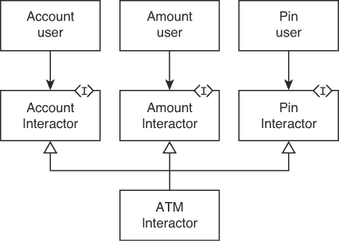


## 图 12.1. 分离的接口

在 Clojure 中，我们可以使用我们的鸭子类型（duck typing）技术之一来解决这个问题：

```clojure
(defmulti request-account :interactor)
(defmulti request-amount :interactor)
(defmulti request-pin :interactor)
```

这三个多方法（multi-methods）并没有绑定在单一声明下。事实上，它们甚至不需要保持在同一个源文件中。相反，它们可以在特定于其功能的模块中声明。因此，如果一个方法的签名发生了变化，或者添加了新的多方法，将不会影响那些未更改的多方法的用户。如果它们经过了预编译，^(15)它们将不再需要重新编译。

15. Clojure 允许模块进行预编译以加快加载速度。

这意味着在动态类型语言（如 Clojure）中，更容易避免依赖于你不需要的东西。但这并不意味着该原则不适用。

## 不要依赖于你不需要的东西

回到名称上。`接口隔离原则` 中的 `Interface`（接口）一词并不仅仅等限于 Java、C# 和 C++ 中的接口类。相反，它适用于该词的通用含义。模块的“接口”仅仅是该模块内所有访问点的列表。

Java 和 C#（根据强惯例还有 C++）是基于类的语言，类与源文件之间存在着强耦合。Java 特别要求每个源文件必须以该源文件中声明的唯一公共类命名。这自动设定了 ISP 试图避免的条件。方法组被耦合在一个单一模块中，用户将依赖于该模块，即使他们并不依赖于这些方法中的每一个一个。因此，除非设计者足够小心，否则这些用户将依赖于他们不需要的东西。

Ruby、Python 和 Clojure 等动态类型语言没有这种从类到模块的限制。你可以在任何喜欢的源文件中声明你喜欢的任何内容。如果你愿意，甚至可以将整个应用程序写在一个源文件中！^(16) 因此，在这些语言中，设置导致模块用户依赖于他们不需要的东西会变得更加容易。

16. 不推荐。 ;-)

这不是功能性语言特有的情况。功能性语言也无法免于这种情况。设计者可以很容易用大多数用户需要的各种访问点来污染他们模块的接口。

## 为什么？

我们为什么要关心依赖于包含比我们需求更多的模块？如果我们的模块只使用了另一个模块中的十个函数中的一个，这为什么要困扰我们呢？

在静态类型语言中，代价可能是严重的，因为对我们不使用的函数之一的更改可能会迫使我们的模块重新编译并部署。如果我们的模块只是二进制组件（如 `jar` 文件）中的许多模块之一，那么整个组件都需要重新部署。这些是每个严肃的设计者都应该小心的耦合。

在动态类型语言中，代价降低了，但并非为零。例如，在 Clojure 中，有一个严格的要求^(17)模块之间的源代码依赖必须是无环的。模块包含的函数越多，影响该模块的输出和输入源代码依赖就越多，它参与循环的可能性也就越大。

17. 我们将在第 17 章《Wa-Tor](#ch17.xhtml_ch17)中遇到这种情况。

但关注这些依赖关系最好的理由可能是：限制多余依赖的模块结构是*有说服力的*（cogent）。这表明智能的人类已经足够关注并分离关注点并降低耦合。你代码的读者将感谢你的细心。

### 结论

ISP 的真正含义是：

* 将一起使用的东西聚集在一起。
* 分离那些分开使用的东西。
* 不要依赖于你不需要的东西。

## 依赖倒置原则 (DIP)

在 SOLID 原则中，可以说 OCP 是道德核心，SRP 是组织力量，而 LSP 和 ISP 则是环绕在疏忽造成的坑周围的警告标志。这留下了 DIP，它是所有其他原则的底层机制。在几乎每种违反原则的情况下，涉及到一个或多个关键依赖的倒置。在过去的几十年里，软件是这样受限地构建的。源代码依赖与运行时依赖并行的，如图 12.2 所示。

**图 12.2. 古老的结构**

虚线是运行时依赖。它们显示了高层模块调用中层模块，再调用底层模块。实线是源代码依赖。它们显示了源代码依赖于它调用的模块。那些源代码依赖是像 `#include`、`import`、`require` 和 `using` 这样的语句，提到了下游源文件的名称。

在过去的古代时代，这两种依赖总是^(18)并行的。如果模块 `X` 对模块 `Y` 有运行时依赖，那么它对模块 `Y` 有源代码依赖。

18. 嗯，并不总是。在 50 年代末 60 年代初，操作系统工程师付出了巨大的努力反转某些关键依赖，以创建设备无关的抽象。除了显式指针之外没有其他工具，所以他们非常小心。

这意味着高层策略不可分割地依赖于底层细节。深思这句话的影响。

但在 60 年代后期，Ole-Johan Dahl 和 Kristen Nygaard 将 ALGOL 编译器中的一个数据结构^(19) 从栈移动到堆，并发现了对象对象性^(20)。随着这一发现，程序员获得了轻松且安全地反转依赖的能力。

19. 数据结构是函数调用的栈。他们创建的语言是 Simula 67。

20. Simula 发明的历史非常迷人。在 Edsger W. Dijkstra、Ole-Johan Dahl 和 C. A. R. Hoare 编写的 1972 年书籍 *Structured Programming* 中有简要描述，在 Dahl 和 Nygaard 的论文《The Development of the Simula Languages》中有更详细的描述。

又过了 25 年，面向对象语言才开始进入主流。但从那时起，几乎所有的程序员都能轻松地打破那种并行依赖。他们像图 12.3 所示那样做。

## 图 12.3. 通过插入接口反转依赖

`HL1` 对 `ML1` 中的 `F()` 有运行时依赖；但 `HL1` 对 `ML1` 既没有直接的，也没有间接的源代码依赖。相反，它们都依赖于接口 `I`。

在动态类型语言中，接口 `I` 不会以源代码模块的形式存在。相反，它将是一个 `HL1` 和 `ML1` 都遵循的鸭子类型（duck type）。

这种获取任何源代码依赖并将其反转的能力赋予了我们巨大的力量。我们可以轻松且安全地安排软件的源代码依赖，以确保高层模块*不依赖于*低层模块。

这允许我们创建如图 12.4 所示的结构。

## 图 12.4. 插件式结构

在这里我们看到高层业务规则对用户界面（UI）和数据库有运行时依赖，但对这些模块没有源代码依赖。DIP（依赖反转原则）的应用意味着 UI 和数据库是业务规则的*插件*，并且可以轻松替换为不同的实现，而不影响业务规则，从而符合 OCP（开闭原则）。

当然，实际情况是 UI 和数据库实现了包含在业务规则中的接口。业务规则在这些接口上操作，允许控制流流向 UI 和数据库，同时保持源代码依赖反向指向业务规则（参见图 12.5）。

## 图 12.5. 业务规则内部的接口允许插件的存在。

注意，所有的依赖都指向抽象。这引导我们用一种方式来描述 DIP：

在尽可能的情况下，将所有源代码依赖指向抽象。

### 怀旧的回响

理论部分足够了。让我们来看看它的实际工作。我将从我的朋友兼导师 Martin Fowler 那里借用一个怀旧的示例。他在那本精彩著作《重构》（Refactoring）的第一版中介绍了这个*视频租赁店*（Video Store）例子。当然，我将使用 Clojure 而不是 Java。

以下是测试用例：

```
(describe "Video Store"
  (with customer (make-customer "Fred"))

  (it "makes statement for a single new release"
    (should= (str "Rental Record for Fred\n"
                  "\tThe Cell\t9.0\n"
                  "You owed 9.0\n"
                  "You earned 2 frequent renter points\n")
             (make-statement
               (make-rental-order
                 @customer
                 [(make-rental
                    (make-movie "The Cell" :new-release)
                    3)]))))

  (it "makes statement for two new releases"
    (should= (str "Rental Record for Fred\n"
                  "\tThe Cell\t9.0\n"
                  "\tThe Tigger Movie\t9.0\n"
                  "You owed 18.0\n"
                  "You earned 4 frequent renter points\n")
             (make-statement
               (make-rental-order
                 @customer
                 [(make-rental
                    (make-movie "The Cell" :new-release)
                    3)
                  (make-rental
                    (make-movie "The Tigger Movie" :new-release)
                    3)]))))

  (it "makes statement for one childrens movie"
    (should= (str "Rental Record for Fred\n"
                  "\tThe Tigger Movie\t1.5\n"
                  "You owed 1.5\n"
                  "You earned 1 frequent renter points\n")
             (make-statement
               (make-rental-order
                 @customer
                 [(make-rental
                    (make-movie "The Tigger Movie" :childrens)
                    3)]))))

  (it "makes statement for several regular movies"
    (should= (str "Rental Record for Fred\n"
                  "\tPlan 9 from Outer Space\t2.0\n"
                  "\t8 1/2\t2.0\n"
                  "\tEraserhead\t3.5\n"
                  "You owed 7.5\n"
                  "You earned 3 frequent renter points\n")
             (make-statement
               (make-rental-order
                 @customer
                 [(make-rental
                    (make-movie "Plan 9 from Outer Space" :regular)
                    3)]))))
```

这里是 `statement-calculator` 测试。从现在起，我将包含所有的 `ns` 语句，以便你可以看到模块的名称及其源代码依赖关系。

`ns` 代表命名（namespace）。这些语句通常出现在每个 Clojure 模块的开头，用于模块的名称及其依赖项。

```
(ns video-store.statement-calculator-spec
  (:require [speclj.core :refer :all]
            [video-store.statement-calculator :refer :all]))
(declare customer)

(describe "Rental Statement Calculation"
  (with customer (make-customer "Fred"))

  (it "makes statement for a single new release"
    (should= {:customer-name "Fred"
              :movies [{:title "The Cell"
                        :price 9.0}]
              :owed 9.0
              :points 2}
             (make-statement-data
               (make-rental-order
                 @customer
                 [(make-rental
                    (make-movie "The Cell" :new-release)
                    3)]))))

  (it "makes statement for two new releases"
    (should= {:customer-name "Fred",
              :movies [{:title "The Cell", :price 9.0}
                       {:title "The Tigger Movie", :price 9.0}],
              :owed 18.0,
              :points 4}
             (make-statement-data
               (make-rental-order
                 @customer
                 [(make-rental
                    (make-movie "The Cell" :new-release)
                    3)
                  (make-rental
                    (make-movie "The Tigger Movie" :new-release)
                    3)]))))

  (it "makes statement for one childrens movie"
    (should= {:customer-name "Fred",
              :movies [{:title "The Tigger Movie", :price 1.5}],
              :owed 1.5,
              :points 1}
             (make-statement-data
               (make-rental-order
                 @customer
                 [(make-rental
                    (make-movie "The Tigger Movie" :childrens)
                    3)]))))

  (it "makes statement for several regular movies"
    (should= {:customer-name "Fred",
              :movies [{:title "Plan 9 from Outer Space",
                        :price 2.0}
                       {:title "8 1/2", :price 2.0}
                       {:title "Eraserhead", :price 3.5}],
              :owed 7.5,
              :points 3}
             (make-statement-data
               (make-rental-order
                 @customer
                 [(make-rental
                    (make-movie "Plan 9 from Outer Space"
                                :regular)
                    1)
                  (make-rental
                    (make-movie "8 1/2", :regular)
                    2)
                  (make-rental
                    (make-movie "Eraserhead" :regular)
                    3)])))))
```


我们在这里所做的是将格式化的租用账单替换为包含该账单中所有数据的数据结构。这允许我们实现格式化与计算分离，如`statement-calculator`的实现所示：

点击此处查看代码

```
(ns video-store.statement-calculator)

(defn make-customer [name]
  {:name name})

(defn make-movie [title type]
  {:title title
   :type type})

(defn make-rental [movie days]
  {:movie movie
   :days days})

(defn make-rental-order [customer rentals]
  {:customer customer
   :rentals rentals})

(defn determine-amount [rental]
  (let [{:keys [movie days]} rental
        type (:type movie)]
    (condp = type
      :regular
      (if (> days 2)
        (+ 2.0 (* (- days 2) 1.5))
        2.0)

      :new-release
      (* 3.0 days)

      :childrens
      (if (> days 3)
        (+ 1.5 (* (- days 3) 1.5))
        1.5))))

(defn determine-points [rental]
  (let [{:keys [movie days]} rental
        type (:type movie)]
    (if (and (= type :new-release)
             (> days 1))
      2
      1)))

(defn make-statement-data [rental-order]
  (let [{:keys [name]} (:customer rental-order)
        {:keys [rentals]} rental-order]
    {:customer-name name
     :movies (for [rental rentals]
               {:title (:title (:movie rental))
                :price (determine-amount rental)})
     :owed (reduce + (map determine-amount rentals))
     :points (reduce + (map determine-points rentals))}))
```

这比之前简单了一些，并且封装得很好。注意`ns`语句显示该模块没有源代码依赖。该模块中的所有内容都是关于格式化的。账单非常简单：

点击此处查看代码

```
(ns video-store.formatter-spec
  (:require [speclj.core :refer :all]
            [video-store.formatter :refer :all]))

(describe "Formatter"
  (it "formats a statement"
    (should= (str "Rental Record for CUSTOMER\n"
                  "\tMOVIE\t9.9\n"
                  "You owed 100.0\n"
                  "You earned 99 frequent points\n")
             (format-rental-statement
               {:customer-name "CUSTOMER"
                :movies [{:title "MOVIE"
                          :price 9.9}]
                :owed 100.0
                :points 99}))
```

这应该是自而易懂的。实现也很简单：

```
(ns video-store.formatter)

(defn format-rental-statement [statement-data]
  (let [customer-name (:customer-name statement-data)
        movies (:movies statement-data)
        owed (:owed statement-data)
        points (:points statement-data)]
    (str
      (format "Rental Record for %s\n" customer-name)
      (apply str
             (for [movie movies]
               (format "\t%s\t%.1f\n"
                       (:title movie)
                       (:price movie))))
      (format "You owed %.1f\n" owed)
      (format "You earned %d frequent points\n" points))))
```

再次，我们拥有一个封装良好且没有源代码依赖的模块。为了确保这两个模块协同工作，我添加了一个简单的集成测试：

```
(ns video-store.integration-specs
  (:require [speclj.core :refer :all]
            [video-store.formatter :refer :all]
            [video-store.statement-calculator :refer :all]))

(describe "Integration Tests"
  (it "formats a statement for several regular movies"
    (should= (str "Rental Record for Fred\n"
                  "\tPlan 9 from Outer Space\t2.0\n"
                  "\t8 1/2\t2.0\n"
                  "\tEraserhead\t3.5\n"
                  "You owed 7.5\n"
                  "You earned 3 frequent renter points\n")
             (format-rental-statement
               (make-statement-data
                 (make-rental-order
                   (make-customer "Fred")
                   [(make-rental
                      (make-movie
                        "Plan 9 from Outer Space" :regular)
                      1)
                    (make-rental
                      (make-movie "8 1/2", :regular)
                      2)
                    (make-rental
                      (make-movie "Eraserhead" :regular)
                      3)]))))))
```

从 SRP（单一职责原则）的角度来看，这好得多。如果营销人员对报告格式进行细微更改，只有格式测试和集成测试会失败。任何计算测试都不会失败。在像这样的小例子中，这看起来可能不是一个巨大的胜利。但在测试用例数千计的实际应用中，这确实是一个巨大的胜利。

我们还受到了不受业务规则变化的保护。如果财务人员决定更改价格的计算方式，格式测试将不受影响，只有计算测试和集成测试会受到影响。

## DIP 违背

在获得这些优势的同时，你是否注意到了某个 DIP 的违背？你可能错过了它，因为它不在生产代码中，而是在集成测试中。

看看`ns`语句。你看到那两行提到`statement-formatter`和`statement-calculator`的代码了吗？这两行代码对这些模块的具体实现创建了源代码级的依赖。这是一个高层策略依赖于具体的低层细节。这是定义上的 DIP 违背。

也许这让你感到困惑。一个测试怎么能是高层策略？测试难道不是尽可能低层级的吗？它们难道不是终极的细节吗？

是的，确实如此。但特别是集成测试是高层策略的代身。再次看看那个集成测试。它所做的正是应用程序高层策略所必须做的事情。它调用`make-statement-data`并将结果传递给`format-rental-statement`。由于这两个函数都是具体实现，我们的高层生产代码将面临与集成测试相同的 DIP 违背。

我们是否在测试中总是关注 DIP 呢？时刻保持这种意识总是是明智的。但强制合规可能并不总是明智的。某些测试最好与低层实现保持耦合。然而，如果你想让测试套件既健壮又灵活，而且你不希望在更改生产代码中的某一个微小变动时导致数百个测试失败，那么关注测试与生产代码之间的耦合是一个好主意^(25)

25. 在我的书籍《洁净之道》（*Clean Craftsmanship*, Addison-Wesley, 2021）中，我在这个主题上花了大量时间。

但也许你仍然不被说服。那么让我们添加一个新功能。有时我们希望账单显示在文本终端上，有时我们希望它显示在浏览器上。因此，我们需要`format-rental-statement`的文本和 HTML 版本。

让我们再添加一个新功能。我们的一些商店提供“买二送一”策略。所以，如果你租了三部视频，你只需要支付最贵的两个的费用。

如果我们在面向对象的语言中实现这一点，我们可能会倾向于创建两个新的抽象类或接口。`StatementFormatter`抽象类将有一个`format-rental-statement`方法，该方法将在`TextFormatter`和`HTMLFormatter`实现中实现。同样，`StatementPolicy`抽象将在`NormalPolicy`和`BuyTwoGetOneFreePolicy`中实现`make-statement-data`函数。

我们可以很容易地通过我们在 OCP（开闭原则）章节中讨论的三种方法中的一种来模拟这种设计。我们可以为这两个抽象类构建虚表（vtables）。或者我们可以使用`defprotocol`和`defrecord`来构建真正的 Java 接口和实现。或者最后，我们可以使用多方法（multi-methods）。

让我们看看多方法的方法是什么样子的。记住，这是一个伪装成成年人情况的儿童级问题。你在这里看到我这样做是为了展示更大规模的问题是如何设计和划分的。

最后，如图 12.6 所示，我将整个系统分为十一个模块，其中三个是测试。

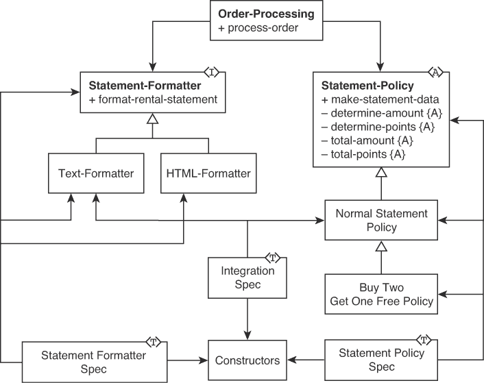

**图 12.6.** 将视频商店应用程序拆分为模块

图 12.6 看起来像是一个面向对象解决方案的 UML 图。依赖反转应该是显而易见的。`order-processing`模块是最层策略。它依赖于两个抽象。`statement-formatter`是一个接口，而`statement-policy`是一个有一个实现方法的抽象类。

如果你对我使用面向对象的术语来描述 Clojure 函数式程序感到困惑，你不应该困惑。我使用的 OO 词汇在函数式世界中有非常直接的类比。

`statement-formatter`接口由`text-formatter`和`HTML-formatter`实现。`statement-policy`抽象类由`normal-statement-policy`实现。`buy-two-get-one-free-policy`实现继承自`normal-statement-policy`但覆盖了它的其中一个方法。所有这些“继承”背后的机制很快就会变得清晰。

测试出现在底部。它们被标记为`<T>`。它们使用一个名为`constructors`的小工具模块，该模块知道如何构建基本数据结构。然后每个测试使用其特定的生产代码部分来测试它们需要的内容。

现在来看源代码。特别注意`ns`语句，并注意它们与 UML 图上的箭头匹配。

让我们从`constructors`开始。它们非常自而易见：

点击查看图像

```
(ns video-store.constructors)

(defn make-customer [name]
  {:name name})

(defn make-movie [title type]
  {:title title
   :type type})

(defn make-rental [movie days]
  {:movie movie
   :days days})

(defn make-rental-order [customer rentals]
  {:customer customer
   :rentals rentals})
```

`constructors`在`ns`语句中没有外向依赖，并且只构建基础的数据结构。

集成测试在`integration-specs`模块中：

点击查看图像

```
(ns video-store.integration-specs
  (:require [speclj.core :refer :all]
            [video-store.constructors :refer :all]
            [video-store.text-statement-formatter :refer :all]
            [video-store.normal-statement-policy :refer :all]
            [video-store.order-processing :refer :all]))

(declare rental-order)

(describe "Integration Tests"
  (with rental-order (make-rental-order
                       (make-customer "Fred")
                       [(make-rental
                          (make-movie
                            "Plan 9 from Outer Space"
                            :regular)
                          1)
                        (make-rental
                          (make-movie "8/2", :regular)
                          2)
                        (make-rental
                          (make-movie "Eraserhead" :regular)
                          3)])
  (it "formats a text statement"
    (should= (str "Rental Record for Fred\n"
                  "\tPlan 9 from Outer Space\t2.0\n"
                  "\t8/2\t2.0\n"
                  "\tEraserhead\t3.5\n"
                  "You owed 7.5\n"
                  "You earned 3 frequent renter points\n")
             (process-order
               (make-normal-policy)
               (make-text-formatter)
               @rental-order))))
```

另外两个测试更为具体。请特别注意，它们的源代码依赖仅引入了它们所需要的的内容：

点击此处查看代码图片


`statement-formatter-spec` 测试了两种格式。格式由`format-rental-statement`的第一个参数指定。该参数由`make-text-formatter`和`make-html-formatter`函数创建，这些函数在相应的模块中实现，正如你所看到的。

```
(ns video-store.statement-formatter-spec
  (:require [speclj.core :refer :all]
            [video-store.statement-formatter :refer :all]
            [video-store.text-statement-formatter :refer :all]
            [video-store.html-statement-formatter :refer :all]))

(declare statement-data)
(describe "Rental Statement Format"
  (with statement-data {:customer-name "CUSTOMER"
                        :movies [{:title "MOVIE"
                                  :price 9.9}]
                        :owed 100
                        :points 99})
  (it "Formats a text statement"
    (should= (str "Rental Record for CUSTOMER\n"
                  "\tMOVIE\t9.9\n"
                  "You owed 100.0\n"
                  "You earned 99 frequent points\n")
             (format-rental-statement
               (make-text-formatter)
               @statement-data))
  (it "Formats an html statement"
    (should= (str "<h1>Rental Record for CUSTOMER</h1>"
                 "<table>"
                 "<tr><td>MOVIE</td><td>9.9</td></tr>"
                 "</table>"
                 "You owed 100.0<br>"
                 "You earned <b>99</b> frequent points")
             (format-rental-statement
               (make-html-formatter)
               @statement-data))))
```

最后一个测试是`statement-policy-spec`：

```
(ns video-store.statement-policy-spec
  (:require [speclj.core :refer :all]
            [video-store.constructors :refer :all]
            [video-store.statement-policy :refer :all]
            [video-store.normal-statement-policy :refer :all]
            [video-store.buy-two-get-one-free-policy :refer :all]))

(declare customer-policy formatter
(declare new-release-1 new-release-2 childrens
(declare regular-1 regular-2 regular-3)

(describe "Rental Statement Calculation"
  (with customer (make-customer "CUSTOMER"))
  (with normal-policy (make-normal-policy))
  (with new-release-1 (make-movie "new release 1" :new-release))
  (with new-release-2 (make-movie "new release 2" :new-release))
  (with children (make-movie "childrens" :childrens))
  (with regular-1 (make-movie "regular 1" :regular))
  (with regular-2 (make-movie "regular 2" :regular))
  (with regular-3 (make-movie "regular 3" :regular))
  (context "normal policy"
    (it "makes statement for a new release"
      (should= {:customer-name "CUSTOMER"
                :movies [{:title "new release 1"
                          :price 9.0}]
                :owed 9.0
                :points 2}
               (make-statement-data
                 @normal-policy
                 (make-rental-order
                   @customer
                   [(make-rental @new-release-1 3))))
    (it "makes statement for two new releases"
      (should= {:customer-name "CUSTOMER"
                :movies [{:title "new release 1", :price 9.0}
                         {:title "new release 2", :price 9.0}],
                :owed 18.0,
                :points 4}
               (make-statement-data
                 @normal-policy
                 (make-rental-order
                   @customer
                   [(make-rental @new-release-1 3)
                    (make-rental @new-release-2 3)]))))
    (it "makes statement for one childrens movie"
      (should= {:customer-name "CUSTOMER"
                :movies [{:title "childrens", :price 1.5}],
                :owed 1.5,
                :points 1}
               (make-statement-data
                 @normal-policy
                 (make-rental-order
                   @customer
                   [(make-rental @childrens 3)]))))
    (it "makes statement for several regular movies"
      (should= {:customer-name "CUSTOMER"
                :movies [{:title "regular 1", :price 2.0}
                         {:title": "regular 2", :price 2.0}
                         {:title": "regular 3", :price 3.5}],
                :owed 7.5,
                :points 3}
               (make-statement-data
                 @normal-policy
                 (make-rental-order
                   @customer
                   [(make-rental @regular-1 1)
                    (make-rental @regular-2 2)
                    (make-rental @regular-3 3)])))))
  (context "buy two get one policy"
    (it "makes statement for regular movies"
      (should= {:customer-name "CUSTOMER"
                :movies [{:title "regular 1", :price 2.0}
                         {:title": "regular 2", :price 2.0}
                         {:title": "new release 1", :price 3.0}],
                :owed 5.0,
                :points 3}
               (make-statement-data
                 (buy-two-get-one-free-policy)
                 (make-rental-order
                   @customer
                   [(make-rental @regular-1 1)
                    (make-rental @regular-2 2)
                    (make-rental @new-release-1 3)]))))
```

`statement-policy-spec` 测试了各种定价规则。你已经看到了第一部分。现在进入生产代码。从`order-processing`模块开始：

```
(ns video-store.order-processing
  (:require [video-store.statement-formatter :refer :all]
            [video-store.statement-policy :refer :all]))

(defn process-order [policy order]
  (-> order
       (make-statement-data policy)
       (format-rental-statement)))
```

没什么复杂的。注意源代码依赖引用了`statement-formatter`接口和`statement-policy`抽象。

`statement-formatter`接口非常简单：

```
(ns video-store.statement-formatter)

(defmulti format-rental-statement
            (fn [formatter statement-data]
              (:type formatter)))
```

`defmulti`语句大致相当于 Java 或 C# 中的抽象方法。由于该模块只有一个抽象方法，它大致等同于接口。分发函数是轻易的，它只返回格式器的`:type`。

`statement-policy`抽象更有趣一点：

```
(ns video-store.statement-policy)

(defn- policy-movie-dispatch [policy rental]
  [(:type policy) (-> rental :movie :type)])

(defmulti determine-amount policy-movie-dispatch)
(defmulti determine-points policy-movie-dispatch)
(defmulti total-amount (fn [policy _rentals] (:type policy)))
(defmulti total-points (fn [policy _rentals] (:type policy)))

(defn make-statement-data [policy rental-order]
  (let [{:keys [name]} (:customer rental-order)
        {:keys [rentals]} rental-order]
    {:customer-name name
     :movies (for [rental rentals]
               {:title (:title (:movie rental))
                :price (determine-amount policy rental)})
     :owed (total-amount policy rentals)
     :points (total-points policy rentals)}))
```

`statement-policy`模块包含四个抽象方法和一个实现方法。注意看它是如何使用模板方法^(27) 模式的。同样注意，`determine-amount`和`determine-points`函数使用元组（tuple）作为分发代码。这非常有趣。这意味着我们可以根据两个自由度而不是一个来分发这些函数。这在大多数面向对象（OO）语言中是很难做到的。我们很快就会看到它的用法。

27。参见第 17 章，“Wa-Tor”。

但首先，让我们来看`text-statement-formatter`的实现：

```
(ns video-store.text-statement-formatter
  (:require [video-store.statement-formatter :refer :all]))
(defn make-text-formatter [] {:type ::text})

(defmethod format-rental-statement
           ::text
           [_formatter statement-data]
  (let [customer-name (:customer-name statement-data)
        movies (:movies statement-data)
        owed (:owed statement-data)
        points (:points statement-data)]
    (str
      (format "Rental Record for %s\n" customer-name)
      (apply str
             (for [movie movies]
               (format "\t%s\t%.1f\n"
                 (:title movie)
                 (:price movie))))
      (format "You owed %.1f\n" owed)
      (format "You earned %d frequent renter points\n" points))))
```

这应该没什么意外的。我只是把代码移到了这里，没有做太大改动。注意顶部的`make-text-formatter`函数。

`html-statement-formatter`应该也不算意外：


`statement-policy` 模块包含四个抽象方法和一个实现方法。注意看它是如何使用模板方法^(27) 模式的。同样注意，`determine-amount` 和 `determine-points` 函数使用元组（tuple）作为分发代码。这非常有趣。这意味着我们可以根据两个自由度而不是一个来分发这些函数。这在大多数面向对象（OO）语言中是很难做到的。我们很快就会看到它的用法。

27. 参见第 17 章，“Wa-Tor”。

但首先，让我们来看 `text-statement-formatter` 的实现：

点击此处查看代码图片

```
(ns video-store.text-statement-formatter
  (:require [video-store.statement-formatter :refer :all]))
(defn make-text-formatter [] {:type ::text})

(defmethod format-rental-statement
           ::text
           [_formatter statement-data]
  (let [customer-name (:customer-name statement-data)
        movies (:movies statement-data)
        owed (:owed statement-data)
        points (:points statement-data)]
    (str
      (format "Rental Record for %s\n" customer-name)
      (apply str
             (for [movie movies]
               (format "\t%s\t%.1f\n"
                 (:title movie)
                 (:price movie))))
      (format "You owed %.1f\n" owed)
      (format "You earned %d frequent renter points\n" points))))
```

这应该没什么意外的。我只是把代码移到了这里，没有做太大改动。注意顶部的 `make-text-formatter` 函数。

`html-statement-formatter` 应该也不算意外：

点击此处查看代码图片

```
(ns video-store.html-statement-formatter
  (:require [video-store.statement-formatter :refer :all]))

(defn make-html-formatter [] {:type ::html})

(defmethod format-rental-statement ::html
  [formatter statement-data]
  (let [customer-name (:customer-name statement-data)
        movies (:movies statement-data)
        owed (:owed statement-data)
        points (:points statement-data)]
    (str
      (format "<h1>Rental Record for %s</h1>" customer-name)
      "<table>"
      (apply str
             (for [movie movies]
               (format "<tr><td>%s</td><td>%.1f</td></tr>"
                       (:title movie) (:price movie))))
      "</table>"
      (format "You owed %.1f<br>" owed)
      (format "You earned <b>%d</b> frequent renter points"
              points))))
```

更有趣的模块是两个策略模块。让我们从 `normal-statement-policy` 开始：

点击此处查看代码图片

```
(ns video-store.normal-statement-policy
  (:require [video-store.statement-policy :refer :all]))

(defn make-normal-policy [] {:type ::normal})

(defmethod determine-amount [::normal :regular] [_policy rental]
  (let [days (:days rental)]
    (if (> days 2)
      (+ 2.0 (* (- days 2) 1.5))
      2.0)))

(defmethod determine-amount
           [::normal :childrens]
           [_policy rental]
  (let [days (:days rental)]
    (if (> days 3)
      (+ 1.5 (* (- days 3) 1.5))
      1.5)))

(defmethod determine-amount
           [::normal :new-release]
           [_policy rental]
  (* 3.0 (:days rental)))

(defmethod determine-points [::normal :regular] [_policy _rental]
  1)

(defmethod determine-points
           [::normal :new-release]
           [_policy rental]
  (if (> (:days rental) 1) 2 1))

(defmethod determine-points
           [::normal :childrens]
           [_policy _rental]
  1)

(defmethod total-amount ::normal [policy rentals]
  (reduce + (map #(determine-amount policy %) rentals)))

(defmethod total-points ::normal [policy rentals]
  (reduce + (map #(determine-points policy %) rentals)))
```

这很不同，不是吗？仔细看那些 `defmethod` 语句。我们同时对策略类型和电影类型进行了分发。这真的非常很好地隔离了业务规则。

你可能担心两个自由度会产生 N*M 问题，导致“determine”函数的泛滥。你很快就会看到我是如何处理它的。

注意顶部的被我们的测试使用的 `make-normal-policy` 构造函数。

现在，让我们来看 `buy-two-get-one-free-policy` 模块：

点击此处查看代码图片

```
(ns video-store.buy-two-get-one-free-policy
  (:require [video-store.statement-policy :refer :all]))

(defn make-buy-two-get-one-free-policy [] {:type ::free})

(defmethod determine-amount [::free :regular] [_policy rental]
  (let [days (:days rental)]
    (if (> days 2)
      (+ 2.0 (* (- days 2) 1.5))
      2.0)))

(defmethod determine-amount
           [::free :childrens]
           [_policy rental]
  (let [days (:days rental)]
    (if (> days 3)
      (+ 1.5 (* (- days 3) 1.5))
      1.5)))

(defmethod determine-amount
           [::free :new-release]
           [_policy rental]
  (* 3.0 (:days rental)))

(defmethod determine-points [::free :regular] [_policy _rental]
  1)

(defmethod determine-points
           [::free :new-release]
           [_policy rental]
  (if (> (:days rental) 1) 2 1))

(defmethod determine-points
           [::free :childrens]
           [_policy _rental]
  1)

(defmethod total-amount ::normal [policy rentals]
  (reduce + (map #(determine-amount policy %) rentals)))

(defmethod total-points ::normal [policy rentals]
  (reduce + (map #(determine-points policy %) rentals)))
```


这很不同，不是吗？仔细看那些`defmethod`语句。我们同时对策略类型和电影类型进行了分发。这真的非常很好地隔离了业务规则。

你可能担心两个自由度会产生 N*M 问题，导致“determine”函数的泛滥。你很快就会看到我是如何处理它的。

注意顶部的被我们的测试使用的`make-normal-policy`构造函数。

现在，让我们来看`buy-two-get-one-free-policy`模块：

点击此处查看代码图片

```
(ns video-store.buy-two-get-one-free-policy
  (:require [video-store.statement-policy :refer :all]))

(defn make-buy-two-get-one-free-policy [] {:type ::free})

(defmethod determine-amount [::free :regular] [_policy rental]
  (let [days (:days rental)]
    (if (> days 2)
      (+ 2.0 (* (- days 2) 1.5))
      2.0)))

(defmethod determine-amount
           [::free :childrens]
           [_policy rental]
  (let [days (:days rental)]
    (if (> days 3)
      (+ 1.5 (* (- days 3) 1.5))
      1.5)))

(defmethod determine-amount
           [::free :new-release]
           [_policy rental]
  (* 3.0 (:days rental)))

(defmethod determine-points [::free :regular] [_policy _rental]
  1)

(defmethod determine-points
           [::free :new-release]
           [_policy rental]
  (if (> (:days rental) 1) 2 1))

(defmethod determine-points
           [::free :childrens]
           [_policy _rental]
  1)

(defmethod total-amount ::normal [policy rentals]
  (reduce + (map #(determine-amount policy %) rentals)))

(defmethod total-points ::normal [policy rentals]
  (reduce + (map #(determine-points policy %) rentals)))
```

许多函数式编程者说他们不需要 TDD，因为他们在 REPL 中测试了一切。我也在 REPL 中进行大量的实验；但在大多数情况下，我会将学到的内容编码为测试。测试就像钻石一样，是永恒的。而 REPL 中的实验在第二天就不复存在了。

## 那么模拟（Mocks）呢？

`Mocking`（模拟）是 TDD 实践者使用的一种技术，用于将测试与系统的大部分区域离开来。实际上，他们创建了名为`mocks`^(3)的对象来代表这些部分，并使用里氏夫替换原则（LSP）用这些模拟对象替代它们。

3. 它们的正式名称是`test-doubles`（测试替身），但在本文中，我将继续使用这种口语化的表达。

由于 LSP 被视为一种面向对象（OO）原则，而且 OO 语言中的模拟是基于多态接口的，因此“函数式语言不支持模拟”似乎已经变成了一个都市传说。

但正如我们所看到的，LSP 在函数式语言中的运作与在 OO 语言中一样好，而且多态接口通常非常容易创建。因此，以各种形式编写模拟的能力在函数式语言中完全不受阻碍。

例如，这里来自我的`more-speech`^(4)应用程序的一个测试，它使用了两个模拟：

4. [`github.com/unclebob/more-speech`](https://github.com/unclebob/more-speech)

点击此处查看代码图片

```
(it "adds an unrooted article id to a tab"
  (let [message-id 1
        messages {message-id {:tags []}}
        event-context (atom {:text-event-map messages})]
    (reset! ui-context {:event-context event-context})
    (with-redefs [swing-util/add-id-to-tab (stub :add-id-to-tab)
                  swing-util/relaunch (stub :relaunch)]
      (add-article-to-tab 1 "tab" nil)
      (should-have-invoked :relaunch)
      (should-have-invoked :add-id-to-tab
                           {:with ["tab" :selected 1]}))))
```

不要太担心这个测试做了什么。只需查看`with-redefs`语句即可。这个测试模拟了`swing-util/add-id-to-tab`和`swing-util/relaunch`函数，使用了具名的存根（stubs）。这些存根是完美的空操作（no-ops）。它们接受任意数量的参数并且不返回任何内容.^(5)。但它们会记住发生在它们身上的事情.^(6)。所以，在底部，我们看到`:relaunch`存根应该被调用，而`:add-id-to-tab`存根应该带有三个参数调用：`"tab"`、`:selected`和`1`。

5. 有办法让它们返回数值，但这超出了本文的范围。如果你感兴趣，请查看`speclj`文档 ([`github.com/slagyr/speclj`](https://github.com/slagyr/speclj))。

6. 从技术上讲，它们是间谍（spies）。

## 基于属性的测试（Property-Based Testing）

和函数式编程者在一起，最终一定会听到 QuickCheck 和基于属性的测试。遗憾的是，这个话题经常作为 TDD 的反论出现。我不会尝试去支持或反驳这一论点。相反，我想向你展示在 TDD 体系内基于属性的测试是非常强大的。

首先，什么是基于属性的测试？`Property-based testing`（属性测试）是一种验证和诊断技术，它采用了随机生成输入和非常强大的缺陷隔离策略。

假设我刚刚写了一个计算给定整数的质因数的函数：

点击此处查看代码图片

```
(defn factors-of [n]
  (loop [factors [] n n divisor 2]
    (if (> n 1)
      (cond
        (> divisor (Math/sqrt n))
        (conj factors n)
        (= 0 (mod n divisor))
        (recur (conj factors divisor)
               (quot n divisor)
               divisor)
        :else
        (recur factors n (inc divisor)))
      factors)))
```

假设我也是使用 TDD 写了这个函数。以下是我的测试：

点击此处查看代码图片

```
(defn power2 [n]
  (apply * (repeat n 2N)))

(describe "factor primes"
  (it "factors 1 -> []"
    (should= [] (factors-of 1)))
  (it "factors 2 -> [2]"
    (should= [2] (factors-of 2)))
  (it "factors 3 -> [3]"
    (should= [3] (factors-of 3))))
```

这样很棒。我可以随机生成大量输入，然后对输出进行属性检查。

### 一种诊断技术

但我曾把基于属性的测试称为一种诊断技术，不是吗？让我们来看一个更有趣的例子，我会向你们展示我的意思。

还记得我们上一节中的视频商店（Video Store）示例吗？让我们对它进行一些基于属性的测试。

首先，请记得我们写了一个名为`make-statement-data`的函数，它接收一个`policy`和一个`rental-order`，并生成`statement-data`，然后将其传递给我们的格式化器之一。这里是使用`clojure.spec`定义的`rental-order`类型规范：

点击此处查看代码图片

```
(s/def ::name string?)
(s/def ::customer (s/keys :req-un [name]))
(s/def ::title string?)
(s/def ::type #{:regular :childrens :new-release})
(s/def ::movie (s/keys :req-un [::title ::type]))
(s/def ::days pos-int?)
(s/def ::rental (s/keys :req-un [::days ::movie]))
(s/def ::rentals (s/coll-of ::rental))
(s/def ::rental-order (s/keys :req-un [::customer ::rentals]))
```

这并不难读。从下往上看：

* `:rental-order`是一个包含两个元素的 map：`:customer`和`:rentals`。

* `:rentals`元素是`:rental`项目的集合。

* `:rental`是一个包含`:days`和`:movie`元素的 map。

* `:days`元素是一个正整数。

* `:movie`元素是一个包含`:title`和`:type`的 map。

* `:type`是`:regular`、`:childrens`或`:new-release`之一。

* `:title`是一个字符串。

* `:customer`是一个包含单个`:name`元素的 map。

* `:name`是一个字符串。

有了这个类型规范，我们就可以编写一个生成器来产生符合该类型的租赁订单。首先，这些是生成器：

点击此处查看代码图片

```
(def gen-customer-name
  (gen/such-that not-empty gen/string-alphanumeric))

(def gen-customer
  (gen/fmap (fn [name] {:name name}) gen-customer-name))

(def gen-days (gen/elements (range 1 100)))

(def gen-movie-type
  (gen/elements [:regular :childrens :new-release]))

(def gen-movie
  (gen/fmap (fn [[title type]] {:title title :type type})
            (gen/tuple gen/string-alphanumeric gen-movie-type)))

(def gen-rental
  (gen/fmap (fn [[movie days]] {:movie movie :days days})
            (gen/tuple gen-movie gen-days))

(def gen-rentals
  (gen/such-that not-empty gen/vector))

(def gen-rental-order
  (gen/fmap (fn [[customer rentals]]
              {:customer :rentals})
            (gen/tuple gen-customer gen-rentals))

(def gen-policy (gen/elements
                  [(make-normal-policy)
                   free-policy)]
```

我在这里不会解释`clojure.check`的内部细节，但我会带你过一遍生成器的作用：

* `gen-policy`从两者中选择一个。

* `gen-rental-order`根据`gen-customer`和`gen-rentals`创建一个 map。

* `gen-rentals`根据`gen-rental`创建一个 vector 并确保它不空。

* `gen-rental`根据`gen-movie`和`gen-days`创建一个 map。

* `gen-movie`根据`gen/string-alphanumeric`和`gen-movie-type`创建一个 map。

* `gen-movie-type`在三种类型中选择。

* `gen-days`从 1 到 100 之间选择整数。

* `gen-customer`创建一个带有来自`gen-customer-name`名字的 map。

这只是一堆符合`rental-order`类型的随机数据。但让我们检查一下：

点击此处查看代码图片

```
[
 {:customer {:name "5Q"},
  :rentals [{:movie {:title "", :type :new-release}, :days 52}]}
 {:customer {:name "3"},
  :rentals [{:movie {:title "", :type :new-release}, :days 51}]}
 {:customer {:name "XA"},
  :rentals [{:movie {:title "r", :type :regular}, :days 82}
            {:movie {:title "", :type :childrens}, :days 60}]}
 {:customer {:name "4v"},
  :rentals [{:movie {:title "3", :type :childrens}, :days 29}]}
 {:customer {:name "0rT"},
  :rentals [{:movie {:title "", :type :regular}, :days 52}]}
```

这是一堆完美符合`rental-order`类型的随机数据。但让我们检查一下：

点击此处查看代码图片

```
[
 {:customer {:name "5Q"},
  :rentals [{:movie {:title "", :type :new-release}, :days 52}]}
 {:customer {:name "3"},
  :rentals [{:movie {:title "", :type :new-release}, :days 51}]}
 {:customer {:name "XA"},
  :rentals [{:movie {:title "r", :type :regular}, :days 82}
            {:movie {:title "", :type :childrens}, :days 60}]}
 {:customer {:name "4v"},
  :rentals [{:movie {:title "3", :type :childrens}, :days 29}]}
 {:customer {:name "0rT"},
  :rentals [{:movie {:title "", :type :regular}, :days 52}]}
```


这样很棒。我可以随机生成大量输入，然后对输出进行属性检查。

### 一种诊断技术

但我曾把基于属性的测试称为一种诊断技术，不是吗？让我们来看一个更有趣的例子，我会向你们展示我的意思。

还记得我们上一节中的视频商店（Video Store）示例吗？让我们对它进行一些基于属性的测试。

首先，请记得我们写了一个名为`make-statement-data`的函数，它接收一个`policy`和一个`rental-order`，并生成`statement-data`，然后将其传递给我们的格式化器之一。这里是使用`clojure.spec`定义的`rental-order`类型规范：

```
(s/def ::name string?)
(s/def ::customer (s/keys :req-un [name]))
(s/def ::title string?)
(s/def ::type #{:regular :childrens :new-release})
(s/def ::movie (s/keys :req-un [::title ::type]))
(s/def ::days pos-int?)
(s/def ::rental (s/keys :req-un [::days ::movie]))
(s/def ::rentals (s/coll-of ::rental))
(s/def ::rental-order (s/keys :req-un [::customer ::rentals]))
```

这并不难读。从下往上看：

- `:rental-order`是一个包含两个元素的 map：`:customer`和`:rentals`。
- `:rentals`元素是`:rental`项目的集合。
- `:rental`是一个包含`:days`和`:movie`元素的 map。
- `:days`元素是一个正整数。
- `:movie`元素是一个包含`:title`和`:type`的 map。
- `:type`是`:regular`、`:childrens`或`:new-release`之一。
- `:title`是一个字符串。
- `:customer`是一个包含单个`:name`元素的 map。
- `:name`是一个字符串。

有了这个类型规范，我们就可以编写一个生成器来产生符合该类型的租赁订单。首先，这些是生成器：

```
(def gen-customer-name
  (gen/such-that not-empty gen/string-alphanumeric))

(def gen-customer
  (gen/fmap (fn [name] {:name name}) gen-customer-name))

(def gen-days (gen/elements (range 1 100)))

(def gen-movie-type
  (gen/elements [:regular :childrens :new-release]))

(def gen-movie
  (gen/fmap (fn [[title type]] {:title title :type type})
            (gen/tuple gen/string-alphanumeric gen-movie-type)))

(def gen-rental
  (gen/fmap (fn [[movie days]] {:movie movie :days days})
            (gen/tuple gen-movie gen-days))

(def gen-rentals
  (gen/such-that not-empty gen/vector))

(def gen-rental-order
  (gen/fmap (fn [[customer rentals]]
              {:customer :rentals})
            (gen/tuple gen-customer gen-rentals))

(def gen-policy (gen/elements
                  [(make-normal-policy)
                   free-policy)]
```

我在这里不会解释`clojure.check`的内部细节，但我会带你过一遍生成器的作用：

- `gen-policy`从两者中选择一个。
- `gen-rental-order`根据`gen-customer`和`gen-rentals`创建一个 map。
- `gen-rentals`根据`gen-rental`创建一个 vector 并确保它不空。
- `gen-rental`根据`gen-movie`和`gen-days`创建一个 map。
- `gen-movie`根据`gen/string-alphanumeric`和`gen-movie-type`创建一个 map。
- `gen-movie-type`在三种类型中选择。
- `gen-days`从 1 到 100 之间选择整数。
- `gen-customer`创建一个带有来自`gen-customer-name`名字的 map。

这只是一堆完美符合`rental-order`类型的随机数据。但让我们检查一下：

```
[
 {:customer {:name "5Q"},
  :rentals [{:movie {:title "", :type :new-release}, :days 52}]}
 {:customer {:name "3"},
  :rentals [{:movie {:title "", :type :new-release}, :days 51}]}
 {:customer {:name "XA"},
  :rentals [{:movie {:title "r", :type :regular}, :days 82}
            {:movie {:title "", :type :childrens}, :days 60}]}
 {:customer {:name "4v"},
  :rentals [{:movie {:title "3", :type :childrens}, :days 29}]}
 {:customer {:name "0rT"},
  :rentals [{:movie {:title "", :type :regular}, :days 52}]}
]
```

在这里我们看到了用于`statement-data`的`clojure.spec`，以及确保`make-statement-data`输出符合该规范的`quick-check`。很棒。

在通过了这些测试后，我们可以非常确定生成器正在生成有效的租借订单。现在，让我们进行属性检查（property checks）。

我们可以检查的一个属性是：确保当`make-statement-data`将`rental-order`转换为`statement-data`时，`statement-data`对象的`:owed`成员是该对象中列出的所有电影项目的价格之和。

针对该属性的`quick-check`可能如下：

```
(it "statement data totals are consistent under all policies"
  (should-be
    :result
    (tc/quick-check
      100
      (prop/for-all
        [rental-order gen-rental-order
         policy gen-policy]
        (let [statement-data (make-statement-data
                               policy rental-order)
              prices (map :price (:movies statement-data))
              owed (:owed statement-data)]
          (= owed (reduce + prices)))))))
```

这个`quick-check`中有一个 bug。你能发现它吗？

这是我运行它时的输出：

```
{:shrunk
 {:total-nodes-visited 45,
  :depth 14,
  :pass? false,
  :result false,
  :result-data nil,
  :time-shrinking-ms 3,
  :smallest
    [{:customer {:name "0"},
      :rentals [{:movie {:title "", :type :regular}, :days 1}
                {:movie {:title "", :type :regular}, :days 1}
                {:movie {:title "", :type :regular}, :days 1}]}
     {:type
      :video-store.
        buy-two-get-one-free-policy/buy-two-get-one-free}]},
  :failed-after-ms 0,
  :num-tests 7,
  :seed 1672092997135,
  :fail
   [{:customer {:name "4s7u"},
     :rentals
     [{:movie {:title "i7jiVAd", :type :childrens}, :days 85}
      {:movie {:title "7MQM", :type :new-release}, :days 26}
      {:movie {:title "qlS4S", :type :new-release}, :days 99}
      {:movie {:title "X", :type :regular}, :days 87}
      {:movie {:title "w1cRbM", :type :regular}, :days 11}
      {:movie {:title "7Hb41O5", :type :regular}, :days 63}
      {:movie {:title "xWc", :type :childrens}, :days 41}]}
    {:type
     :video-store.
       buy-two-get-one-free-policy/buy-two-get-one-free}],
  :result false,
  :result-data nil,
  :failing-size 6,
  :pass? false}
```


在这里我们看到了用于`statement-data`的`clojure.spec`，以及确保`make-statement-data`的输出符合该规范的`quick-check`。很棒。

在通过了这些测试后，我们可以非常确定生成器正在生成有效的租借订单。现在，让我们开始属性检查。

我们可以检查的一个属性是：确保当`make-statement-data`将`rental-order`转换为`statement-data`时，`statement-data`对象的`:owed`成员是该对象中列出的所有电影项目的价格之和。

针对该属性的`quick-check`可能如下：

```
(it "statement data totals are consistent under all policies"
  (should-be
    :result
    (tc/quick-check
      100
      (prop/for-all
        [rental-order gen-rental-order
         policy gen-policy]
        (let [statement-data (make-statement-data
                               policy rental-order)
              prices (map :price (:movies statement-data))
              owed (:owed statement-data)]
          (= owed (reduce + prices)))))))
```

这个`quick-check`中有一个 bug。你能发现它吗？

这是我运行它时的输出：

```
{:shrunk
 {:total-nodes-visited 45,
  :depth 14,
  :pass? false,
  :result false,
  :result-data nil,
  :time-shrinking-ms 3,
  :smallest
    [{:customer {:name "0"},
      :rentals [{:movie {:title "", :type :regular}, :days 1}
                {:movie {:title "", :type :regular}, :days 1}
                {:movie {:title "", :type :regular}, :days 1}]}
     {:type
      :video-store.
        buy-two-get-one-free-policy/buy-two-get-one-free}]},
  :failed-after-ms 0,
  :num-tests 7,
  :seed 1672092997135,
  :fail
   [{:customer {:name "4s7u"},
     :rentals
     [{:movie {:title "i7jiVAd", :type :childrens}, :days 85}
      {:movie {:title "7MQM", :type :new-release}, :days 26}
      {:movie {:title "qlS4S", :type :new-release}, :days 99}
      {:movie {:title "X", :type :regular}, :days 87}
      {:movie {:title "w1cRbM", :type :regular}, :days 11}
      {:movie {:title "7Hb41O5", :type :regular}, :days 63}
      {:movie {:title "xWc", :type :childrens}, :days 41}]}
    {:type
     :video-store.
       buy-two-get-one-free-policy/buy-two-get-one-free}],
  :result false,
  :result-data nil,
  :failing-size 6,
  :pass? false}
```

是的，我知道这看起来很糟糕；但这正是`quick-check`真正魔力展现的地方，所以请耐心等待。

首先，你看到顶部名为`:shrunk`的元素了吗？那是理解这里发生了什么的一个大线索。当`quick-check`发现错误时，它会寻找最小化的反例。这里的输出显示了一个具体的失败案例，其中包含了“买二送一”的策略导致了测试失败。

是的，我知道这看起来很糟糕；但由于`:owed`成员应该是所有电影的价格和，而`quick-check`在收缩（shrinking）过程中找到了一个更简单的用例，揭示了 bug 的存在。这个错误可能在于计算总和时没有正确考虑到`buy-two-get-one-free`策略带来的免费项。

你可能已经注意到`polygon`函数似乎并不是函数式的，因为它没有从输入中产生返回值。相反，它具有在屏幕上绘图的副作用。此外，每条命令都会改变乌龟的状态。因此，`turtle-graphics`程序不是函数式的。

尽管如此，`turtle-graphics`框架是“函数式的”。或者更准确地说，它达到了 GUI 程序所能达到的最大函数化程度。（8）毕竟，GUI 程序的目的就是改变屏幕的状态。

8. 尽管你可能觉得这个很有意思：https://fsharpforfunandprofit.com/posts/13-ways-of-looking-at-a-turtle/。

`turtle-graphics`框架从配置和调用 Quil 开始：

```
(defn ^:export -main [& args]
  (q/defsketch turtle-graphics
               :title "Turtle Graphics"
               :size [1000 1000]
               :setup setup
               :update update-state
               :draw draw-state
               :features [:keep-on-top]
               :middleware [m/fun-mode])
  args)
```


我在这里不会对 Quil 进行完整的教程，但有几点我应该指出。请注意 `:setup`、`:update` 和 `:draw` 元素。每个元素指向一个函数。

`setup` 函数将在程序开始时调用一次。

`draw-state` 函数每秒会被调用 60 次以刷新屏幕。屏幕上应该显示的所有内容必须由 `draw` 函数绘制。屏幕不记得任何东西。

`update-state` 函数将在 `draw-state` 函数之前被调用。这个函数用于改变正在绘制的内容的状态。将其想象成将元素移动到未来 1/60 秒的函数。

把它想象成一个非常简单的循环：

```
(loop [state (setup)]
  (draw-state state)
  (recur (update-state state)))
```

如果你将其认为一个尾递归循环，那么屏幕的内容就是尾递归的值。因此，尽管我们正在改变屏幕的内容，但我们是在递归的尾部进行操作，在那里改变是无害的。（9)）所以，虽然不是纯函数式的，但它和任何支持尾调用优化（TCO）的系统（10)）一样函数式。

9。大多无害。

10。记得我们在第 1 章中关于尾调用优化的讨论。

这是我的 `setup` 函数：

```
(defn setup []
  (q/frame-rate 60)
  (q/color-mode :rgb)
  (let [state {:turtle (turtle/make)
               :channel channel}]
    (async/go
      (turtle-script)
      (prn "Turtle script complete"))
    state))
```

这看起来非常简单。它将帧率设置为 60fps，将颜色模式设置为 RGB，并创建了将传递给 `update-state` 和 `draw-state` 的 `state` 对象。

`async/go` 函数启动了一个新的轻量级线程，我们的 `turtle-script` 将其中执行。

`state` 对象由 `channel` 和 `turtle` 组成。我们稍后讨论 `channel`。现在，让我们关注 `turtle`：

```
(s/def ::position (s/tuple number? number?))
(s/def ::heading (s/and number? #(<= 0 % 360)))
(s/def ::velocity number?)
(s/def ::distance number?)
(s/def ::omega number?)
(s/def ::angle number?)
(s/def ::weight (s/and pos? number?))
(s/def ::state #{:idle :busy})
(s/def ::pen #{:up :down})
(s/def ::pen-start (s/or :nil nil?
                         :pos (s/tuple number? number?)))
(s/def ::line-start (s/tuple number? number?))
(s/def ::line-end (s/tuple number? number?))
(s/def ::line (s/keys :req-un [::line-start ::line-end]))
(s/def ::lines (s/coll-of ::line))
(s/def ::visible boolean?)
(s/def ::speed (s/and pos? number?))
```

```clojure
(defn update-position
  [{:keys [position velocity heading distance] :as turtle}]
  (let [step (min (q/abs velocity) distance)
        distance (- distance step)
        step (if (neg? velocity) (- step) step)
        radians (q/radians heading)
        [x y] position
        vx (* step (Math/cos radians))
        vy (* step (Math/sin radians))
        position [(+ x vx) (+ y vy)]]
    (assoc turtle :position position
                  :distance distance
                  :velocity (if (zero? distance) 0.0 velocity))))

(defn update-heading [{:keys [heading omega angle] :as turtle}]
  (let [angle-step (min (q/abs omega) angle)
        angle (- angle angle-step)
        angle-step (if (neg? omega) (- angle-step) angle-step)
        heading (mod (+ heading angle-step) 360)]
    (assoc turtle :heading heading
                  :angle angle
                  :omega (if (zero? angle) 0.0 omega))))

(defn make-line [{:keys [pen-start position weight]}]
  {:line-start pen-start
   :line-end position
   :line-weight weight})

(defn update-turtle [turtle]
  {:post [(s/assert ::turtle %)]}
  (if (= :idle (:state turtle))
    turtle
    (let [{:keys [distance
                  state
                  angle
                  lines
                  position
                  pen
                  pen-start] :as turtle}
          (-> turtle
              (update-position)
              (update-heading))
          done? (and (zero? distance)
                     (zero? angle))
          state (if done? :idle state)
          lines (if (and done? (= pen :down))
                  (conj lines (make-line turtle))
                  lines)
          pen-start (if (and done? (= pen :down))
                      position
                      pen-start)]
      (assoc turtle
             :state state
             :lines lines
             :pen-start pen-start))))
```

注意 `update-turtle` 拥有一个 `:post` 条件，用于在更新后检查乌的类型。当你更新一个大型结构时，如果知道自己没有搞乱其中的某个小部分，这种感觉很棒。

如果 `turtle` 的 `:state` 为 `:idle`，意味着它既不在移动也不旋转，那么我们就不进行任何更改。否则，我们会更新 `turtle` 的位置和朝向，然后对其内部进行*解构*（destructure*）。当当前动画运动中剩余的距离和角度为零时，我们就完成了。如果任务完成，我们将 `:state` 设置为 `:idle`。

如果我们完成了任务且笔处于下笔状态（`:down`），则会将正在绘制的线条添加到之前的线条列表中，并更新 `pen-start` 为当前位置，为下一条线条做准备。

更新位置和朝向是简单的函数，它们执行必要的三角计算，将乌放置在适当的位置和方向上。它们都使用乌的 `:velocity` 来调整每次更新时步进的大小。

现在来处理命令部分：

```clojure
(defn handle-commands [channel turtle]
  (loop [turtle turtle]
    (let [command (if (= :idle (:state turtle))
                    (async/poll! channel)
                    nil)]
      (if (nil? command)
        turtle
        (recur (turtle/handle-command turtle command))))))
```

如果乌是 `:idle`，那么我们就准备好接收命令了。因此我们轮询 `channel`。如果 `channel` 上有命令，通过调用 `turtle/handle-command` 处理它，然后重复直到 `channel` 上没有剩余为止。

处理每个命令非常直接：

```clojure
(defn pen-down [{:keys [pen position pen-start] :as turtle}]
  (assoc turtle :pen :down
                :pen-start (if (= :up pen) position pen-start)))

(defn pen-up [{:keys [pen lines] :as turtle}]
  (if (= :up pen)
    turtle
    (let [new-line (make-line turtle)
          lines (conj lines new-line)]
      (assoc turtle :pen :up
                    :pen-start nil
                    :lines lines))))

(defn forward [turtle [distance]]
  (assoc turtle :velocity (:speed turtle)
                :distance distance
                :state :busy))

(defn back [turtle [distance]]
  (assoc turtle :velocity (- (:speed turtle))
                :distance distance
                :state :busy))

(defn right [turtle [angle]]
  (assoc turtle :omega (* 2 (:speed turtle))
                :angle angle
                :state :busy))

(defn left [turtle [angle]]
  (assoc turtle :omega (* -2 (:speed turtle))
                :angle angle
                :state :busy))

(defn hide [turtle]
  (assoc turtle :visible false))

(defn show [turtle]
  (assoc turtle :visible true))

(defn weight [turtle [weight]]
  (assoc turtle :weight weight))

(defn speed [turtle [speed]]
  (assoc turtle :speed speed))

(defn handle-command [turtle cmd]
  (condp cmd
    :forward (forward turtle)
    :back (back turtle)
    :right (right turtle)
    :left (left turtle)
    :pen-down (pen-down turtle)
    :pen-up (pen-up turtle)
    :hide (hide turtle)
    :show (show turtle)
    :weight (weight turtle)
    :speed (speed turtle)))
```

你可能不熟悉我在这里使用的电话术语。事实上，如果你是在 2000 年之后出生，你可能对电话本身都不熟悉。所以，出于历史和怀旧的角度，让我带你走一遍这个过程。

Bob 想给 Alice 打电话。Bob 拿起听筒^(1) 并将其放在耳边。电话公司（telco）向听筒发送一个拨拨号音^(2)。听到该音调后，Bob 拨号^(3) Alice 的号码。电话公司随后向 Alice 的手机发送一个铃响电压^(4)，向 Bob 的听筒发送一个回铃音^(5)。Alice 听到手机响铃声并拿起听筒。电话公司接通了 Bob 和 Alice，Alice 对 Bob 说了“你好”。

- 1。 20 世纪初的电话有一个挂钩可以挂听筒。到 20 世纪 60 年代，挂钩被放置听筒的底座取代；但它仍然被称为 hook。
- 2。 这是一个非常容易识别的声音，意味着电话系统已准备好让你拨打想要通话的号码。
- 3。 动词 `dial` 意味着输入电话号码。在 20 世纪 60 年代，这是通过使用电话上的旋转盘来实现的。
- 4。在美国为 90 伏。
- 5。 另一个非常独特的声音，旨在等待被叫电话接听期间让呼叫者。

在这个场景中有三个有限状态机在运行：Bob、telco 和 Alice。Bob 和 Alice 分别运行 图 15.2 所示的用户状态机^(6)。

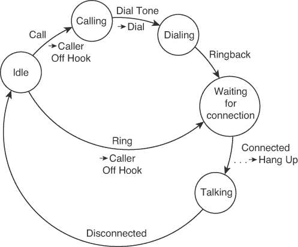

**图 15.2.** 用户状态机

- 6。 这些状态机经过缩写以保持简单。实际上，所有状态都有返回到 Idle 的转换。

Telco 状态机在 图 15.3 所示。

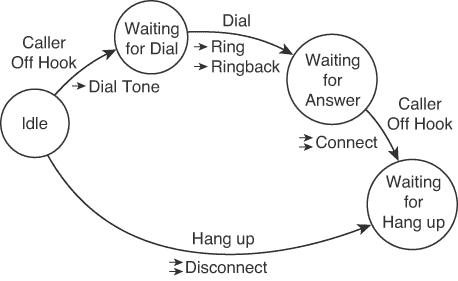

**图 15.3.** Telco 状态机

在这些图中，`->` 符号意味着向另一个状态机发送相应的事件。

所以，当 Bob 决定打电话（来自 Idle 状态的 call 事件）时，用户状态机向 Telco 发送 off-hook 事件。当 Telco 处于 Waiting for Dial（等待拨号）状态并接收到来自用户的 `Dial` 事件时，它会向相应的的用户状态机发送 `Ring` 和 `Ringback` 事件。

如果你仔细研究这些图，你应该能够看到状态机和消息是如何交互以允许 Bob 拨通给 Alice 的的。

我们可以非常简单地用 Clojure 编写这些状态机：

```
(def user-sm
  {:idle {:call [:calling caller-off-hook]
          :ring [:waiting-for-connection callee-off-hook]
          :disconnect [:idle nil]}
   :calling {:dialtone [:dialing dial]}
   :dialing {:ringback [:waiting-for-connection nil]}
   :waiting-for-connection {:connected [:talking talk]}
   :talking {:disconnect [:idle nil]}})

(def telco-sm
  {:idle {:caller-off-hook [:waiting-for-dial dialtone]
          :hangup [:idle nil]}
   :waiting-for-dial {:dial [:waiting-for-answer ring]}
   :waiting-for-answer {:callee-off-hook
                        [:waiting-for-hangup connect]}
   :waiting-for-hangup {:hangup [:idle disconnect]}})
```

每个状态机简单都是状态的哈希映射（hash map），每个状态都包含一个事件的哈希映射，指定了新状态和要执行的操作。

所以当 `user-sm` 处于 `:idle` 状态并获取到 `:call` 事件时，它转换到 `:calling` 状态并调用 `caller-off-hook` 函数。

这些状态机可以通过以下 `transition` 函数执行：


(defn transition [machine-agent event event-data]

  (swap! log conj (str (:name machine-agent) "<-" event))

  (let [state (:state machine-agent)

        sm (:machine machine-agent)

        result (get-in7 sm [state event])]

    (if (nil? result)

      (do

        (swap! log conj "TILT!")

        machine-agent)

      (do

        (when (second result)

          ((second result))

        machine-agent))

```

# 8. 简而言之，解构是将复杂的数据元素分解为具名组件的方便方法。更多细节请参阅 Clojure 文档。

基于此实现，我们应该能够通过以下代码在 Bob 和 Alice 之间拨通电话。我以测试的形式验证了它：

```
(it "should make and receive call"

  (let [caller (make-user "Bob")

        callee (make-user "Alice")

        telco (make-telco "telco")]

    (reset! log [])

    (send caller transition :call [telco caller callee])

    (Thread/sleep 100)

    (prn @log)

    (should= :idle (:state @caller))

    (should= :idle (:state @callee))

    (should= :idle (:state @telco))))
```

这个测试通过了，这意味着在 100ms 之后，所有的状态机都返回了空闲（`idle`）状态。日志输出如下：

```
"Bob<-:call" "Bob goes off hook"

"telco<-:caller-off-hook" "dialtone to Bob"

"Bob<-:dialtone" "Bob dials"

"telco<-:dial" "telco rings Alice"

"Alice<-:ring" "Alice goes off hook"

"Bob<-:ringback"

"telco<-:callee-off-hook" "telco connects"

"Bob<-:connected" "Bob talks"

"Alice<-:connected" "Alice talks"

"Bob hangs up"

"Alice hangs up"

"telco<-:hangup" "disconnect"

"Alice<-:disconnect"

"Bob<-:disconnect"

"telco<-:hangup"
```

你可以看到线程是如何交错执行的，而三个有限状态机共同工作，驱动通话成功完成。

这三个代理具有可变状态；但不会出现并发更新问题，因为代理会对它们的操作进行序列化。所以没有竞态条件，对吧？

别这么急，Newt。让我们来调查另一个场景。

我即将在图 15.4 中向你展示的，是 60 年代电话系统中存在的一种竞态条件。^(9) 我们再次从 Bob 拨打 Alice 开始。但这一次 Alice 正好也要拨给 Bob。

9. 如果你使用固定电话，这现在可能仍然存在。

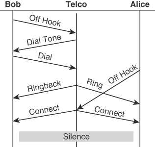

**图 15.4.** 电话系统中的竞态条件

你看到问题出在哪里了吗？那些交叉的线路就是问题所在。这是一个竞态条件。电信公司尝试拨打 Alice 的电话；但在声音发出之前，Alice 为了拨给 Bob 拿起了听筒。从电信公司的角度来看，一切都是正常的。它响了电话，Alice 接听了。于是，电信公司高兴地连接了 Bob 和 Alice。但 Alice 坐在那里等待拨号音；而 Bob 则很困惑，因为没有人打招呼，而且回铃音已经停止了。

最可能的结果是双方在没有交谈的情况下挂了电话。或者，Alice 可能会说些什么，Bob 可能会回应，他们就会陷入“到底是谁打给谁”的喜剧性循环。

我们能让我们的状态机模拟这种故障吗？这里是设置，再次以测试的形式给出：

```
(it "should race"

  (let [caller (make-user "Bob")

        callee (make-user "Alice")

        telco1 (make-telco "telco1")

        telco2 (make-telco "telco2")]

    (reset! log [])

    (send caller transition :call [telco1 caller callee])

    (send callee transition :call [telco2 callee caller])

    (Thread/sleep 100)

    (prn @log)

    (should= :idle (:state @caller))

    (should= :idle (:state @callee))

    (should= :idle (:state @telco1))

    (should= :idle (:state @telco2))))
```

注意，我们现在有四个状态机：一个给 Bob，一个给 Alice，以及每个通话对应一个电信公司。测试失败了。在 100ms 之后，状态机没有返回 `Idle` 状态。

那么，日志告诉了我们什么？

```
"Bob<-:call" "Bob goes off hook"

"telco1<-:caller-off-hook"

"Alice<-:call" "Alice goes off hook"

"telco2<-:caller-off-hook"

"dialtone to Bob"

"Bob<-:dialtone" "Bob dials"

"telco1<-:dial" "telco rings Alice"

"Bob<-:ringback"

"Alice<-:ring" "TILT"
```

你可以看到线程是如何交错执行的，而所有三个有限状态机共同工作驱动通话成功完成。这三个代理具有可变状态；但不会出现并发更新问题，因为代理会对它们的操作进行序列化。所以没有竞态条件，对吧？

## 图 16.1. 开关和灯的最简单解决方案

`Switch` 类调用了 `Light` 类的 `TurnOn` 方法。

3. 记住，这是一个面向对象（OO）论坛。不要纠结于 *class*（类）这个词。

对这种方案的反对意见是 `Switch` 类可以被用来开启其他东西，比如风扇（Fans）或电视机（Televisions）。因此，`Switch` 类不应该知道 `Light` 类。两者之间应该引入一种抽象，如图 16.2 所示。

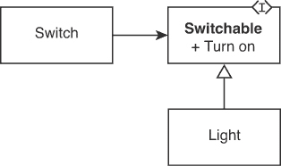

## 图 16.2. 抽象服务器

现在 `Switch` 类使用一个名为 `Switchable` 的接口。`Light` 类实现了 `Switchable`。

这解决了问题。现在我们可以有任意数量设备受 `Switch` 控制。这种解决方案是 `DIP`、`OCP` 和 `LSP` 最简单的表达之一。它也有一个名字，被称为 *Abstract Server*（抽象服务器）。^(4)

4. Robert C. Martin, *Agile Software Development: Principles, Patterns, and Practices* (Pearson, 2002), 318.

如果我们在一个团队中讨论如何保护 `Switch` 类不被显式耦合到 `Light` 类，团队中的某人可能会插话说：“我们可以使用抽象服务器。”如果所有团队成员都认识这个名字及其包含的含义，他们就能快速决定该解决方案是否合适。

这是一种设计模式，即特定语境下问题的命名解决方案。设计模式的价值在于，其名称和解决方案是规范化的（canonical），因此，熟悉这些规范的人只需通过使用名称就能相互理解。你说“Abstract Server”，我立即可理解为你的意思是“在客户端和服务器之间引入一个接口”。

但设计模式中的语境（context）部分呢？让我们回到我们的团队。有人刚刚建议使用抽象服务器模式。另一位团队成员说：“不，你不明白，我们并不拥有 `Light` 类；它是第三方库的一部分，所以我们无法修改它来实现接口。”

因此，问题的语境是我们想要将 `Switch` 与 `Light` 解耦，但我们无法修改 `Light`。于是团队中的另一个人说：“嗯，我们可以使用一个 *Adapter*（适配器）。”

如果你在团队中且不知道什么是适配器模式，你就无法理解他们的建议。但如果你熟悉设计模式规范，你就能快速评估该建议。再次，设计模式的益处在于知道名称和规范形式，以便你快速应用它们。

适配器模式看起来如图 16.3 所示。


## 图 16.3. 适配器模式的对象形式

`LightAdapter` 实现了 `Switchable` 接口，并将 `TurnOn` 调用转发给 `Light`。即使在还没白板上画出来之前，团队中的每个人都能在脑海中看到它，因为他们熟悉设计模式规范。所以他们都对这个想法表示赞同。

正当他们准备进入下一个问题时，团队中的某人说：“等等，我们应该使用哪种形式的适配器？”

事实证明，设计模式的规范名称并不一定描述单一的解决方案。某些模式有多种形式。适配器就是其中一种。它看起来可能像图 16.3，也可能看起来像图 16.4。

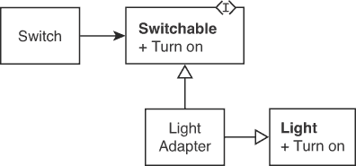

## 图 16.4. 适配器模式的类形式

前者被称为适配器的 *对象*（object）形式，因为 `LightAdapter` 是它自己的一个对象。后者是适配器的 *类*（class）形式，因为 `LightAdapter` 是 `Light` 的子类。

团队成员对这两种形式讨论了一会儿，决定适配器的类形式目前已经足够，并且可以减轻他们构建一个独立 `LightAdapter` 对象的复杂性。

### 函数式编程中的模式

多年来我们听到的奇怪传闻之一是设计模式是为了绕过 OO 语言产生的问题“黑科技”（hacks），而在函数式语言中它们是必要的。

正如你将在后续章节中看到的，某些设计模式确实在某些方面似乎是 OO 语言某些缺陷的权宜之计；但这并不适用于所有设计模式。此外，即使那些特定的设计模式也有更通用的形式，使其在函数式语言中适用。

### 抽象服务器


那么，抽象服务器在函数式语言中长什么样？

再次考虑 `Switch/Light` 问题。以下是我们在 Clojure 中可能这样表达：

```clojure
(defn turn-on-light []

  ;turn on the bloody light!

  )

(defn engage-switch []

  ;Some other stuff...

  )
```

这两个存根节点（stubs）模拟了目标函数。我们带有 `{:type :light}` 参数调用 `engage-switch` 函数。然后，我们测试这两个目标函数是否确实被调用了。

我将抽象服务器模式（Abstract Server pattern）的 `protocol/record` 形式留作练习。到此时，显然该模式在函数式语言中既适用又很有用。

### 适配器 (Adapter)


当你有一个想要使用服务器的客户端，但客户端期望的接口与服务器提供的接口不兼容时，就会使用适配器模式。

例如，假设我们有前面讨论中提到的 `engage-switch` 函数，但我们想给它传递第三方的 `:variable-light`。`:variable-light` 的 `turn-on-light` 函数接受一个表示光强度的参数：`0` 表示关闭，`100` 表示全亮。

`:variable-light` 的接口与 `engage-switch` 函数的预期不兼容。因此，我们需要一个适配器。

适配器最简单的形式可能看起来如下：

```clojure
(defn turn-on-light [intensity]

  ;Turn it on with intensity.

  )

(defmulti turn-on :type)

(defmulti turn-off :type)

(defmethod turn-on :variable-light [switchable]

  (turn-on-light 100))

(defmethod turn-off :variable-light [switchable]

  (turn-on-light 0))

(defn engage-switch [switchable]

  ;Some other stuff...

  (turn-on switchable)

  ;Some more other stuff...

  (turn-off switchable))
```

我用以下测试对其进行了测试：

```clojure
(describe "Adapter"

  (with-stubs)

  (it "turns light on and off"

    (with-redefs [turn-on-light (stub :turn-on-light)]

      (engage-switch {:type :variable-light})

      (should-have-invoked :turn-on-light {:times 1 :with [100]})

      (should-have-invoked :turn-on-light {:times 1 :with [0]}))))
```

如果我在 UML 中画出这个结构，我可能会画出类似图 16.5 所示的内容。

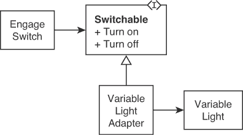

**图 16.5.** 适配器模式的对象形式

`defmulti` 函数对应于 `Switchable` 接口。`{:type :variable-light}` 对象结合两个 `defmethod` 函数对应于 `VariableLightAdapter`。`EngageSwitch` 和 `VariableLight` “类”对应于我们尝试适配的两个函数。

也许你觉得这没什么说服力。毕竟，这只是一个包含几个 `defmulti` 函数的简单程序。没有像 UML 中所示的那种明显的对象（OO）结构。因此，让我们通过拆分源文件来强制这种结构。

我们从 `switchable` 接口开始。在 `ns` 语句中，我使用了约定：`turn-on-light` 是包含 `switchable` 命名空间的项目的整体命名空间：

```clojure
(ns turn-on-light.switchable)

(defmulti turn-on :type)

(defmulti turn-off :type)
```

这是一个多态接口。注意它没有源代码依赖。同时请记住，Clojure 中的 `ns` 语句与 Java 对类具有相同的源文件要求。源文件和命名空间必须具有对应的名称 `switchable.clj`。因此，当我们将这些代码元素移动到不同的命名空间时，我们也将它们移动到不同的源文件中。

特别是，`turn-on-light.switchable` 命名空间必须位于名为 `turn_on_light` 的目录下的 `switchable.clj` 文件中。

接下来，让我们 `engage-switch` 和 `variable-light` 命名空间：

```clojure
(ns turn-on-light.engage-switch

  (:require [turn-on-light.switchable :as s]))

(defn engage-switch [switchable]

  ;Some other stuff...

  (s/turn-on switchable)

  ;Some more other stuff...

  (s/turn-off switchable))

————————————————

(ns turn-on-light.variable-light)

(defn turn-on-light [intensity]

  ;Turn it on with intensity.

  )
```

这里没有意外。`engage-switch` 命名空间依赖于 `switchable` 接口。`variable-light` 命名空间没有向外的源代码依赖。

`variable-light-adapter` 命名空间将 `switchable` 接口连接到 `variable-light`。注意 `make-adapter` 构造函数。测试将使用它：

```clojure
(ns turn-on-light.variable-light-adapter

  (:require [turn-on-light.switchable :as s]

            [turn-on-light.variable-light :as l]))

(defn make-adapter []

  {:type :variable-light})

(defmethod s/turn-on :variable-light [switchable]

  (l/turn-on-light 100))
```


(defmethod s/turn-off :variable-light [switchable]

  (l/turn-on-light 0))

到此时，你应该已经相信这就是 GOF^(6) 书中的适配器模式了。你还应该预期许多其他 GOF 模式可以用 `Clojure` 这样的函数式语言来表达。或许重要的是，你应该将命名空间/源文件结构作为函数式程序设计和架构的一部分。

6. *`GOF`* 是我们在 90 年代对《设计模式》一书的亲切称呼。它代表“四人帮”，因为有四位作者：Erich Gamma、John Vlissides、Ralph Johnson 和 Richard Helm。

## 命令 (Command)

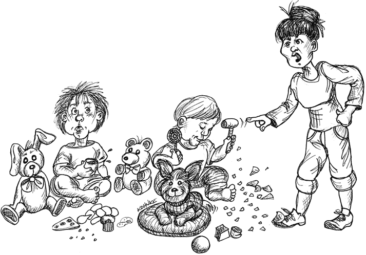

在 GOF 书中所有的设计模式中，`Command` 是令我最感兴趣的一个。不是因为它复杂，而是因为它非常`simple`。非常，非常简单。

顺便提一下，这也是我对 `Clojure` 感兴趣的地方。正如我在本书引言中所说的，`Clojure` 在语义上非常丰富，但在语法上极其简单。嗯，`Command` 模式具有同样的属性。它的丰富性在于其不可置信的简单。

在 `C++` 中，我们可以这样写 `Command` 模式：

```cpp
class Command {

  public:

    virtual void execute() = 0;

};
```

仅此而已。只有一个抽象类（接口）和一个单一的纯虚（抽象）函数。如此简单。但通过这种模式，你可以做很多有趣的事情。要深入探讨这种丰富性，请参阅*敏捷软件开发：原则、模式、实践*中的相应章节。^(7)

7. Martin, *Agile Software Development*, 第 181 页。

在像 `Clojure` 这样的函数式语言中，你可能会认为这种模式消失了。毕竟，如果你想把一个命令传递给其他函数，你只需要传递 `command` 函数即可。你不需要把它封装成对象，因为在函数式语言中，函数*就是*对象：

```clojure
(ns command.core)

(defn execute []

  )

(defn some-app [command]

  ;Some other stuff. . .

  (command)

  ;Some more other stuff. . .

  )

(ns command.core-spec

  (:require [speclj.core :refer :all]

            [command.core :refer :all]))

(describe "command"

  (with-stubs)

  (it "executes the command"

    (with-redefs [execute (stub :execute)]

      (some-app execute)

      (should-have-invoked :execute))))
```

8. 细心的读者会发现，这里所写的命令并不是一个纯函数（引用透明函数）。然而，显而易见的是纯函数可以按所示的方式进行传递。

如你所见，测试将 `execute` 函数传递给 `some-app`，而 `some-app` 函数调用了该命令。没什么大不了。

现在，如果你想创建一个带有数据元素的命令，并将其作为参数传递给 `execute` 函数将会呢？在 `C++` 中，我们会这样做（请原谅内联函数）：

```cpp
class CommandWithArgument : public Command {

  public:

    CommandWithArgument(int argument)

    :argument(argument)

    {}

    virtual void execute()

    {theFunctionToExecute(argument);}

  private:

    int argument;

    void theFunctionToExecute(int argument)

    {

      //do something with that argument!

    }

};
```

在 `Clojure` 中我们这样做，这再次证明了在函数式语言中函数实际上是对象：

```clojure
(describe "command"

  (with-stubs)

  (it "executes the command"

    (with-redefs [execute (stub :execute)]

      (some-app (partial execute :the-argument))

      (should-have-invoked :execute {:with [:the-argument]}))))

(defn execute [argument]

  )

(defn some-app [command]

  ;Some other stuff. . .

  (command)

  ;Some more other stuff. . .

  )
```

## 撤销 (Undo)

`Command` 模式的一个更有用的变体可以在下面的 `C++` 代码中看到：

```cpp
class UndoableCommand : public Command {

  public:

    virtual void undo() = 0;

};
```

那个 `undo()` 函数开启了许多有趣的可能性。

很久以前，我参与过一个类似于 `AutoCAD` 的 GUI 应用程序。它是一个用于建筑平面图、屋顶平面图、物业边界图等的绘图工具。GUI 是典型的调色板/画布结构。用户点击调色板来选择功能。

我们使用 `defmulti` 函数创建了 `undoable-command` 接口。我们在 `add-room-command` 命名空间实现了该接口，并在 `command.core` 命名空间的 `gui-app` 函数中模拟了 GUI。

测试存根了 `add-room-command` 的低层函数，并确保它们被正确调用。它带有一个 `palette-actions` 列表调用了 `gui-app`。

`add-room-command` 的两个方法通过多态派发。对于 `execute` 情况，这似乎并不是必要的，因为 `gui-app`刚刚创建了 `add-room-command` 对象。但如果我们向该系统添加更多命令，`execute` 的多态派发将变得更加必要。

`undo` 的多态派发即使在这个小示例中显然也是必要的，因为当从调板收到 `:undo-action` 时，我们并不知道哪个命令正在被撤销。

在这里，我们再次看到，随着应用程序复杂性的增加，GOF 模式的标准形式开始显现出来。对于单方法命令，我们可以使用普通的函数（确切说是函数对象）来解决。但当应用程序需要更丰富的命令类型时，我们又回到了 GOF 风格。

### Composite（组合）


`Composite` 延续了语义丰富性和语法简单性的主题。它是我在 Jim Coplien 的书中首次读到的旧式句柄/体（handle/body）方法的绝佳示例。Composite 模式的结构如 图 16.6 所示。

[9] James O. Coplien, *Advanced C++ Programming Styles and Idioms* (Addison-Wesley, 1991).

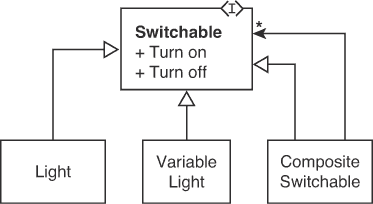

**图 16.6.** 组合模式

我们的老朋友 `Switchable` 接口由我们的其他老朋友 `Light` 和 `VariableLight` 实现。`CompositeSwitchable` 也实现了 `Switchable`，并包含一个其他 `Switchable` 实例列表。

`CompositeSwitchable` 中 `TurnOn` 和 `TurnOff` 的实现简单是将相同函数的调用传播到列表中的所有实例。因此，当你对 `CompositeSwitchable` 实例调用 `TurnOn` 时，它会对其其包含的所有 `Switchable` 实例调用 `TurnOn`。

在 Java 中，我们可以这样实现 `CompositeSwitchable`：

点击此处查看代码图像

```java
public class CompositeSwitchable implements Switchable {

  private List<Switchable> switchables = new ArrayList<>();

  public void addSwitchable(Switchable s) {

    switchables.add(s):

  }

  public void turnOn() {

    for (var s : switchables)

      s.turnOn();

  }

  public void turnOff() {

    for (var s : switchables)

      s.turnOff();

  }

}
```

在函数式语言（如 Clojure）中，人们倾向于避免组合模式，简单地使用 `map` 或 `doseq` 函数，如下面的测试所示：

点击此处查看代码图像

```clojure
(ns composite-example.switchable)

(defmulti turn-on :type)

(defmulti turn-off :type)

—————

(ns composite-example.light

  (:require [composite-example.switchable :as s]))

(defn make-light [] {:type :light})

(defn turn-on-light [])

(defn turn-off-light [])

(defmethod s/turn-on :light [switchable]

  (turn-on-light))

(defmethod s/turn-off :light [switchable]

  (turn-off-light))

———————

(ns composite-example.variable-light

  (:require [composite-example.switchable :as s]))

(defn make-variable-light [] {:type :variable-light})

(defn set-light-intensity [intensity])

(defmethod s/turn-on :variable-light [switchable]

  (set-light-intensity 100))

(defmethod s/turn-off :variable-light [switchable]

  (set-light-intensity 0))

———————————

(ns composite-example.core-spec

  (:require [speclj.core :refer :all]

            [composite-example

             [light :as l]

             [variable-light :as v]

             [switchable :as s]]))

(describe "composite-switchable"

  (with-stubs)

  (it "turns all on"

    (with-redefs

      [l/turn-on-light (stub :turn-on-light)

       v/set-light-intensity (stub :set-light-intensity)]

      (let [switchables [(l/make-light) (v/make-variable-light)]]

        (doseq [s-able switchables] (s/turn-on s-able))

        (should-have-invoked :turn-on-light)
```

```clojure
(ns composite-example.circle

  (:require [clojure.spec.alpha :as s]

            [composite-example.shape :as shape]))

(s/def ::center (s/tuple number? number?))

(s/def ::radius number?)

(s/def ::circle (s/keys :req [::shape/type

                              ::radius

                              ::center]))

(defn make-circle [center radius]

  {:post [(s/valid? ::circle %)]}

  {::shape/type ::circle

   ::center center

   ::radius radius})

(defmethod shape/translate ::circle [circle dx dy]

  {:pre [(s/valid? ::circle circle)

         (number? dx) (number? dy)]

   :post [(s/valid? ::circle %)]}

  (let [[x y] (::center circle)]

    (assoc circle ::center [(+ x dx) (+ y dy)])))

(defmethod shape/scale ::circle [circle factor]

  {:pre [(s/valid? ::circle circle)

         (number? factor)]

   :post [(s/valid? ::circle %)]}

  (let [radius (::radius circle)]

    (assoc circle ::radius (* radius factor))))

———————

(ns composite-example.square

  (:require [clojure.spec.alpha :as s]

            [composite-example.shape :as shape]))

(s/def ::top-left (s/tuple number? number?))

(s/def ::side number?)

(s/def ::square (s/keys :req [::shape/type

                              ::side

                              ::top-left]))

(defn make-square [top-left side]

  {:post [(s/valid? ::square %)]}

  {::shape/type ::square

   ::top-left top-left

   ::side side})

(defmethod shape/translate ::square [square dx dy]

  {:pre [(s/valid? ::square square)

         (number? dx) (number? dy)]

   :post [(s/assert ::square %)]}

  (let [[x y] (::top-left square)]

    (assoc square ::top-left [(+ x dx) (+ y dy)])))

(defmethod shape/scale ::square [square factor]

  {:pre [(s/valid? ::square square)

         (number? factor)]

   :post [(s/valid? ::square %)]}

  (let [side (::side square)]

    (assoc square ::side (* side factor))))
```

注意方法上的 `:pre` 和 `:post` 条件。我正在使用这些条件来检查输入和输出函数的类型。你完全可以担心所有这些检查带来的运行时开销。我会要么全局禁用它们，要么在确认我的类型管理得当后，有针对性地将它们注释掉。

有一个编译时开关可以禁用所有的断言（assert），包括 `:pre` 和 `:post`。

注意 `translate` 和 `scale` 函数返回的是新的 `shape` 实例。它们在行为上是完全函数式的。

现在，让我们来看下 `composite-shape`：

点击此处查看代码图片

```clojure
(ns composite-example.composite-shape

  (:require [clojure.spec.alpha :as s]

            [composite-example.shape :as shape]))

(s/def ::shapes (s/coll-of ::shape/shape-type))

(s/def ::composite-shape (s/keys :req [::shape/type
```


我们之前在`light`/`variable-light`示例中见过这种模式。然而这一次，`composite-shape`返回了一个带有新`shape`实例的新`composite-shape`。因此，它是函数式的。

对于好奇的朋友，这里是我使用的测试代码：

点击此处查看代码图片

```clojure
(ns composite-example.composite-shape

  (:require [clojure.spec.alpha :as s]

            [composite-example.shape :as shape]))

(s/def ::shapes (s/coll-of ::shape/shape-type))

(s/def ::composite-shape (s/keys :req [::shape/type

                                       ::shapes]))

(defn make []

  {:post [(s/assert ::composite-shape %)]}

  {::shape/type ::composite-shape

   ::shapes []})

(defn add [cs shape]

  {:pre [(s/valid? ::composite-shape cs)

         (s/valid? ::shape/shape-type shape)]

   :post [(s/valid? ::composite-shape %)]}

  (update cs ::shapes conj shape))

(defmethod shape/translate ::composite-shape [cs dx dy]

  {:pre [(s/valid? ::composite-shape cs)

         (number? dx) (number? dy)]

   :post [(s/valid? ::composite-shape %)]}

  (let [translated-shapes (map #(shape/translate % dx dy)

                               (::shapes cs))]

    (assoc cs ::shapes translated-shapes)))

(defmethod shape/scale ::composite-shape [cs factor]

  {:pre [(s/valid? ::composite-shape cs)

         (number? factor)]

   :post [(s/valid? ::composite-shape %)]}

  (let [scaled-shapes (map #(shape/scale % factor)

                           (::shapes cs))]

    (assoc cs ::shapes scaled-shapes)))
```

你可能已经注意到，在接下来的章节中，我使用了更多 Clojure 的高级特性。这是故意的。我预计你在阅读这本书时，身边会有一份 Clojure 参考资料，因此我为你提供了一系列查阅和熟悉语言的机会。

正如我们所见，Composite 是另一种非常适合函数世界的 GOF 模式。一旦我们开始利用多态分发（通过虚表、多方法或协议/记录结构），GOF 模式就能完美契合，正如 GOF 所描述的那样。

### 装饰器

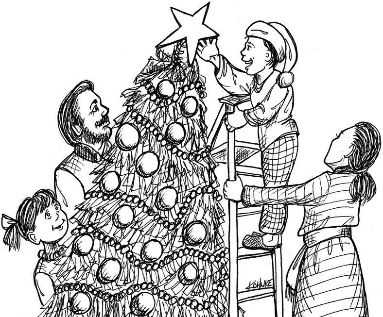

句/body 模式的另一种形式是装饰器（Decorator）。装饰器模式是在不直接修改类型模型的情况下为其添加功能的方法。

例如，让我们继续之前的`shape`项目。我们有一个支持`circle`和`square`子类的`shape`类型模型。在该类型模型内部，只要它符合里氏替换原则（LSP），我们就可以`translate`和`scale`任何`shape`子类，而无需知道我们正在操作的具体类型。

现在，让我们添加一种新的可选功能：`journaled-shape`。`journaled-shape`是一个记录了自创建以来执行的所有操作的`shape`。我们希望对`square`和`circle`记录日志；但仅针对特定的`square`和`circle`。我们不希望每个`circle`和`square`都记录日志，因为内存和处理开销太大了。

当然，我们可以通过向`shape`抽象类添加一个`:journaled?`标记，然后在`circle`和`square`的实现中放置`if`语句来实现它。但那样太乱了。我们真正想要的是一种可以在不改变`shape`抽象或其任何子类型（包括`circle`、`square`和`composite-shape`）的情况下添加此功能的方法（即 OCP）。

引入装饰器模式（Decorator pattern）。UML 图如图图 16.7 所示。

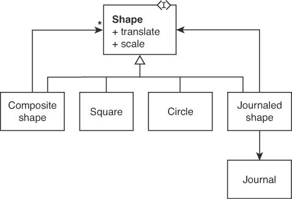

**图 16.7.** 装饰模式

我包含了`composite-shape`，因为它目前是`shape`类型模型的一部分。`journaled-shape`是装饰器。`journaled-shape`继承自`shape`并持有对`shape`的引用。当在`journaled-shape`上调用`translate`或`scale`时，它会在日志中创建一个条目，然后将调用委托给包含的`shape`。

这里是 Clojure 的实现：

点击此处查看代码图像

```clojure
(ns decorator-example.journaled-shape

  (:require [decorator-example.shape :as shape]

            [clojure.spec.alpha :as s]))

(s/def ::journal-entry

       (s/or :translate (s/tuple #{:translate}11 number? number?)

             :scale (s/tuple #{:scale} number?)))

(s/def ::journal (s/coll-of ::journal-entry))

(s/def ::shape ::shape/shape-type)

(s/def ::journaled-shape (s/and

                           (s/keys :req [::shape/type

                                         ::journal

                                         ::shape])

                           #(= ::journaled-shape

                               (::shape/type %))))

(defn make [shape]

  {:post [(s/valid? ::journaled-shape %)]}

  {::shape/type ::journaled-shape

   ::journal []

   ::shape shape})

(defmethod shape/translate ::journaled-shape [js dx dy]

  {:pre [(s/valid? ::journaled-shape js)

         (number? dx) (number? dy)]

   :post [(s/valid? ::journaled-shape %)]}

  (-> js (update ::journal conj [:translate dx dy])

      (assoc ::shape (shape/translate (::shape js) dx dy))))

(defmethod shape/scale ::journaled-shape [js factor]

  {:pre [(s/valid? ::journaled-shape js)

         (number? factor)]

   :post [(s/valid? ::journaled-shape %)]}

  (-> js (update ::journal conj [:scale factor])

      (assoc ::shape (shape/scale (::shape js) factor))))
```

11。集合可以用作测试成员性的函数。

`::journaled-shape`对象拥有`::shape`和`::journal`字段。`::journal`字段是`::journal-entry`元组的集合，形式为`[:translate dx dy]`或`[:scale factor]`，其中`dx`、`dy`和`factor`为数字。`::shape`字段必须包含有效的`shape`。

`make`构造函数创建一个有效的`journaled-shape`（通过`:post`条件检查）。

`translate`和`scale`函数将相应的日志条目添加到`::journal`中，然后将其各自的函数委托给`::shape`，返回一个更新了`::journal`并修改了`::shape`的新`journaled-shape`。

这是测试。我只用`square`测试了`journaled-shape`，因为如果它对`square`有效，它就适用于每个`shape`：

点击此处查看代码图像

```clojure
(describe "journaled shape decorator"

  (it "journals scale and translate operations"

    (let [jsd (-> (js/make (square/make-square [0 0] 1))

                  (shape/translate 2 3)

                  (shape/scale 5))]

      (should= [[:translate 2 3] [:scale 5]]

               (::js/journal jsd))

      (should= {::shape/type ::square/square

                ::square/top-left [2 3]

                ::square/side 5}

               (::js/shape jsd)))))
```

我们创建了一个包含`square`的`journaled-shape`。我们对其进行`translate`和`scale`操作，然后确保`::journal`记录了`translate`和`scale`调用，并且`square`具有平移和缩放后的值。

再次，我包含类型规范只是为了给你一个挑战并演示如何使用它们。但坦率地说，我认为测试已经很好地检查了类型；因此，在现实生活中，我怀疑我不会为此使用如此详细的类型规范。

### 访问者 (Visitor)

当然，我们可以通过向`shape`抽象类添加一个`:journaled?`标记，并在`circle`和`square`的实现中放置`if`语句来实现。但那样太乱了。我们真正想要的是一种可以在不改变`shape`抽象或其任何子类型（包括`circle`、`square`和`composite-shape`）的情况下添加此功能的方法（即 OCP）。

引入装饰器模式。UML 图如图图 16.7 所示。


**图 16.7.** 装饰模式

我包含了`composite-shape`，因为它目前是`shape`类型模型的一部分。`journaled-shape`是装饰器。`journaled-shape`继承自`shape`并持有对`shape`的引用。当在`journaled-shape`上调用`translate`或`scale`时，它会在日志中创建一个条目，然后将调用委托给包含的`shape`。

这里是 Clojure 的实现：

```clojure
(ns decorator-example.journaled-shape

  (:require [decorator-example.shape :as shape]

            [clojure.spec.alpha :as s]))

(s/def ::journal-entry

       (s/or :translate (s/tuple #{:translate}11 number? number?)

             :scale (s/tuple #{:scale} number?)))

(s/def ::journal (s/coll-of ::journal-entry))

(s/def ::shape ::shape/shape-type)

(s/def ::journaled-shape (s/and

                           (s/keys :req [::shape/type

                                         ::journal

                                         ::shape])

                           #(= ::journaled-shape

                               (::shape/type %))))

(defn make [shape]

  {:post [(s/valid? ::journaled-shape %)]}

  {::shape/type ::journaled-shape

   ::journal []

   ::shape shape})

(defmethod shape/translate ::journaled-shape [js dx dy]

  {:pre [(s/valid? ::journaled-shape js)

         (number? dx) (number? dy)]

   :post [(s/valid? ::journaled-shape %)]}

  (-> js (update ::journal conj [:translate dx dy])

      (assoc ::shape (shape/translate (::shape js) dx dy))))

(defmethod shape/scale ::journaled-shape [js factor]

  {:pre [(s/valid? ::journaled-shape js)

         (number? factor)]

   :post [(s/valid? ::journaled-shape %)]}

  (-> js (update ::journal conj [:scale factor])
```


`(assoc ::shape (shape/scale (::shape js) factor))))`

## 11. 集合

集合可以用作测试成员性的函数。

`::journaled-shape` 对象拥有 `::shape` 和 `::journal` 字段。`::journal` 字段是 `::journal-entry` 元组的集合，形式为 `[:translate dx dy]` 或 `[:scale factor]`，其中 `dx`、`dy` 和 `factor` 为数字。`::shape` 字段必须包含有效的 `shape`。

`make` 构造函数创建一个有效的 `journaled-shape`（通过 `:post` 条件检查）。

`translate` 和 `scale` 函数将相应的日志条目添加到 `::journal` 中，然后将其各自的函数委托给 `::shape`，返回一个更新了 `::journal` 并修改了 `::shape` 的新 `journaled-shape`。

这是测试。我只用 `square` 测试了 `journaled-shape`，因为如果它对 `square` 有效，它就适用于每个 `shape`。

```clojure
(describe "journaled shape decorator"

  (it "journals scale and translate operations"

    (let [jsd (-> (js/make (square/make-square [0 0] 1))

                  (shape/translate 2 3)

                  (shape/scale 5))]

      (should= [[:translate 2 3] [:scale 5]]

               (::js/journal jsd))

      (should= {::shape/type ::square/square

                ::square/top-left [2 3]

                ::square/side 5}

               (::js/shape jsd)))))
```

## 双分发

我们从某处获取一个 `Shape` 对象。我们创建一个 `JsonVisitor`。我们通过 `accept` 方法将 `JsonVisitor` 传递给我们的 `Shape`。`accept` 方法会多态地分发到 `Shape` 的相应子类型——假设它是一个 `Square`。`Square` 的 `accept` 方法会在 `JsonVisitor` 上调用 `visit(this)`。由于 `this` 的类型是 `Square`，因此调用了 `JsonVisitor` 的 `visit(Square s)` 函数。该函数为 `Square` 生成 JSON 字符串并将其保存在 `JsonVisitor` 的一个成员变量中。`getJson()` 函数返回该成员变量的内容。

你可能需要读几次才能理解。这种技术被称为“双分发”（`double-dispatch`）。第一次分发部署到 `Shape` 的子类型，因此现在我们知道了该子类型的类型。第二次分发部署到访问者正确的子类型，并传递了该子类型的真实类型。

如果你理解了所有这些，就会发现 `ShapeVisitor` 的每个派类都是 `Shape` 类型模型的一个新“方法”，但我们对 `Shape` 唯一添加的只是 `accept` 方法。因此（符合开/闭原则 OCP），你现在也应该理解为什么我们不能使用装饰器（Decorator）了。新函数强依赖于子类型。如果你不知道它是一个 `Square`，你就无法为它制作 JSON 字符串。

现在，我告诉这一切是为了说明这一点：所有这些复杂性都是由于语言的限制。是的，是的……这些设计模式反对者确实有道理的地方。访问者模式之所以如此复杂，是因为特定的语言特性。

那是什么特性呢？关闭式类（`Closed classes`）。

### 是关闭，还是 Clojure？

在 C++ 和 Java 等语言中，我们创建的类是“关闭”的。这意味着我们无法通过在一个新的源文件中放置新方法的声明来向类添加新方法。如果在关闭式语言中为类添加新方法，我们必须打开该类的源文件，并在类的定义内部添加该方法。

Clojure 没有这种限制。C# 在某种程度上也是如此。事实上，许多语言允许你在更改包含类定义的源文件的情况下向类添加方法。

Clojure 没有这种限制的原因是类并不是该语言的特性。我们通过约定创建类，而不是通过语法。

所以，等一下，这意味着在 Clojure 中我们不需要装饰器或访问者模式吗？不，完全不是如此。事实上，正如我们看到的，我们仍然需要 GOF 形式的装饰器。否则你该如何实现 `journaled-shape` 呢？

然而，在拥有开放类的语言中，GOF 形式的访问者并不是必要的。或者说，GOF 形式的某些细节是不必要的。

所以，让我给你看 Clojure 中这个特定的访问者。首先是测试部分：

```clojure
(ns visitor-example.core-spec

  (:require [speclj.core :refer :all]

            [visitor-example

             [square :as square]

             [json-shape-visitor :as jv]

             [circle :as circle]]))

(describe "shape-visitor"

  (it "makes json square"

    (should= "{\"top-left\": [0,0], \"side\": 1}"

             (jv/to-json (square/make [0 0] 1))))

  (it "makes json circle"

    (should= "{\"center\": [3,4], \"radius\": 1}"

             (jv/to-json (circle/make [3 4] 1)))))
```

这不应该太意外；尽管你应该特别注意源代码的依赖。这个测试几乎需要所有东西。

现在让我们回想 `shape` 类型模型是什么样的。为了简单起见，我移除了所有的 `clojure.spec` 类型规范：

```clojure
(ns visitor-example.shape)

(defmulti translate (fn [shape dx dy] (::type shape)))

(defmulti scale (fn [shape factor] (::type shape)))

———————

(ns visitor-example.square

  (:require

    [visitor-example.shape :as shape]))

(defn make [top-left side]

  {::shape/type ::square

   ::top-left top-left

   ::side side})

(defmethod shape/translate ::square [square dx dy]

  (let [[x y] (::top-left square)]

    (assoc square ::top-left [(+ x dx) (+ y dy)])))

(defmethod shape/scale ::square [square factor]

  (let [side (::side square)]

    (assoc square ::side (* side factor))))

————————

(ns visitor-example.circle

  (:require

    [visitor-example.shape :as shape]))

(defn make [center radius]

  {::shape/type ::circle

   ::center center

   ::radius radius})

(defmethod shape/translate ::circle [circle dx dy]

  (let [[x y] (::top-left square)]

    (assoc square ::top-left [(+ x dx) (+ y dy)])))

(defmethod shape/scale ::circle [circle factor]

  (let [side (::side square)]

    (assoc square ::side (* side factor))))
```

在 Java、C# 和 C++ 中，我们可以通过 `abstract factory`（抽象工厂）来解决这个问题，`App` 可以使用它来实例化 `visitor` 对象，而不需要直接依赖它。

在 Clojure 中，我们有另一个更好的选择。我们可以直接如下所示将 `json-shape-visitor` 的接口与其实现分离：

```clojure
(ns visitor-example.json-shape-visitor

  (:require [visitor-example

             [shape :as shape]]))

(defmulti to-json ::shape/type)

————————

(ns visitor-example.json-shape-visitor-implementation

  (:require [visitor-example

             [json-shape-visitor :as v]

             [circle :as circle]

             [square :as square]]))

(defmethod v/to-json ::square/square [square]

  (let [{:keys [::square/top-left ::square/side]} square

        [x y] top-left]

    (format "{\"top-left\": [%s,%s], \"side\": %s}" x y side)))

(defmethod v/to-json ::circle/circle [circle]

  (let [{:keys [::circle/center ::circle/radius]} circle

        [x y] center]

    (format "{\"center\": [%s,%s], \"radius\": %s}" x y radius)))
```

这里的诀窍在于确保 `json-shape-visitor-implementation` 模块被 `main` `require`（引入），这样 `defmethod` 就能正确地注册到 `defmulti` 中：

```clojure
(ns visitor-example.main

  (:require [visitor-example

             [json-shape-visitor-implementation]]))
```

通常，`main` 在应用程序的任何部分之前被调用，因此应用程序没有对 `main` 的源码依赖。遗憾的是，我的测试无法访问真实的 `main`，因此必须包含该依赖：

Martin，*Clean Architecture*，第 231 页。

```clojure
(ns visitor-example.core-spec

  (:require [speclj.core :refer :all]

            [visitor-example

             [square :as square]

             [json-shape-visitor :as jv]

             [circle :as circle]

             [main]]))

(describe "shape-visitor"

  (it "makes square"

    (should= "{\"top-left\": [0,0], \"side\": 1}"

             (jv/to-json (square/make [0 0])))

  (it "makes circle"

    (should= "{\"center\": [3,4], \"radius\": 1}"

             (jv/to-json (circle/make 3 4)))))
```

所以这就是在 Clojure 中一个功能性且架构上合格的 Visitor 模式。如图 16.10（`#ch16.xhtml_ch16fig10`）中的 UML 所示，所有的依赖都跨越了架构边界，指向边界更高层（抽象）的一侧。赞美上帝！

**图 16.10。**功能性且架构上合格（等等，检查文本）。

因此 Visitor 模式是一个 GOF 形式被当年的语言限制所污染的案例。在 1995 年 GOF 书出版时，闭源类被认为是静态类型语言的必要属性，因此无处不在。

## 抽象工厂

`DIP`（依赖倒置原则）建议我们避免对既易变又具体的事物产生源码依赖。因此，我们创建抽象结构，并尝试将依赖路由到它们上。然而，当我们创建对象实例时，我们往往不得不违反这一建议；这会导致架构上的困难，如图 16.11（`#ch16.xhtml_ch16fig11`）中的 UML 所示。

**图 16.11。**由于创建导致的 DIP。

图 16.11（`#ch16.xhtml_ch16fig11`）中的 `App` 使用了 `Shape` 接口。它需要做的一切都可以通过接口完成，但有一个例外。`App` 必须创建 `Circle` 和 `Square` 派类的实例；这迫使 `App` 对相应的模块挂载了源码依赖。

我们实际上在之前的示例中见过这种情况。例如，考虑早些 `visitor-example` 中的代码。注意，测试对 `square` 和 `circle` 的源码依赖其唯一目的是为了调用那些 `make` 函数：

```clojure
(ns visitor-example.core-spec

  (:require [speclj.core :refer :all]

            [visitor-example

             [square :as square]

             [json-shape-visitor :as jv]

             [circle :as circle]]))

(describe "shape-visitor"

  (it "makes square"

    (should= "{\"top-left\": [0,0], \"side\": 1}"

             (jv/to-json (square/make [0 0])))

  (it "makes circle"

    (should= "{\"center\": [3,4], \"radius\": 1}"

             (jv/to-json (circle/make 3 4)))))
```

也许这看起来是一个很小的代价。但正如图 16.12（`#ch16.xhtml_ch16fig12`）所示，如果我们增加了架构边界，代价就变得清晰了。

**图 16.12。**跨边界的依赖。

在这里我们看到*依赖规则*被违反了：源码依赖必须跨越边界指向高层侧。通过这种方式，我们处理了 `creates` 依赖。`Circle` 和 `Square` 模块是 `App` 的低级细节。Robert C. Martin，*Clean Architecture*（2017）。

`Abstract Factory` 模式提供了一个很好的解决方案。正如图 16.13（`#ch16.xhtml_ch16fig13`）所示：

**图 16.13。**抽象工厂解决了依赖规则。

所有跨边界的源码依赖现在都指向高层侧，从而解决了 `creates` 依赖。这在 Clojure 中很容易实现。我们只需要 `shape-factory` 接口及其实现：

```clojure
(ns abstract-factory-example.shape-factory)

(defmulti make-circle

  (fn [factory center radius] (::type factory)))

(defmulti make-square

  (fn [factory top-left side] (::type factory)))

—————

(ns abstract-factory-example.shape-factory-implementation

  (:require [abstract-factory-example

             [shape-factory :as factory]

             [square :as square]

             [circle :as circle]]))

(defn make []

  {::factory/type ::implementation})
```


(defmethod factory/make-square ::implementation

  [factory top-left side]

  (square/make top-left side))

(defmethod factory/make-circle ::implementation

  [factory center radius]

  (circle/make center radius))

我们可以编写一个模拟我们的 `App`：

点击此处查看代码图片

```
(ns abstract-factory-example.core-spec

  (:require [speclj.core :refer :all]

            [abstract-factory-example

             [shape :as shape]

             [shape-factory :as factory]

             [main :as main]]))

(describe "Shape Factory"

  (before-all (main/init))

  (it "makes a square"

    (let [square (factory/make-square

                   @main/shape-factory

                   [100 100] 10)]

      (should= "Square top-left: [100,100] side: 10"

               (shape/to-string square))))

  (it "makes a circle"

    (let [circle (factory/make-circle

                     @main/shape-factory

                     [100 100] 10)]

      (should= "Circle center: [100,100] radius: 10"

                 (shape/to-string circle)))))
```

关于此测试需要注意的第一点是，它对 `circle` 或 `square` 没有源文件依赖。它只依赖于两个接口：`shape` 和 `shape-factory`。这是我们的架构目标。

但这个 `main` 依赖是什么？你看到测试开头的 `(before-all (main/init))` 这一行了吗？它告诉测试运行器在执行任何测试之前调用 `(main/init)`。这模拟了 `main` 模块在启动 `App` 之前初始化所有内容。

这里是 `main`：

点击此处查看图片

```
(ns abstract-factory-example.main

  (:require [abstract-factory-example

            [shape-factory-implementation :as imp]]))

(def shape-factory (atom nil))

(defn init[]

  (reset! shape-factory (imp/make)))
```

噢，天哪！我们有一个名为 `shape-factory` 的全局 `atom`！这个 `atom` 正在被 `init` 函数初始化为 `shape-factory-implementation`。

所以，回过头来看测试，我们看到 `make-circle` 和 `make-square` 方法传递的是被引用的 `atom`。

像这样设置全局变量是处理工厂的一种非常常见的策略。主程序创建具体的工厂实现，然后将其加载到所有人都可以访问的全局变量中。在静态类型语言中，该全局变量的类型将是接口 `ShapeFactory`。在动态类型语言中，不需要这种类型声明。

### 再次 90 度

再次查看图 16.13 中的那张 UML 图。你看到 `ShapeFactory` 中的 90 度旋转了吗？你也可以在 `shape-factory` 代码中看到它。`ShapeFactory`（以及 `shape-factory`）拥有与 `Shape` 子类型对应的方法。

这给 Visitor 模式引起的问题在这里也存在，尽管形式略有不同。每当添加一个新的 `shape` 的子类型时，都必须修改 `shape-factory`。这违反了 OCP（开闭原则），因为我们必须修改架构边界高侧的模块。如果 OCP 确实重要，它在跨越此类边界时尤为重要。仔细研究那张 UML 图，直到你明白我的意思。

我们可以通过用一个接受不透明令牌（opaque token）的方法替换 90 度旋转来解决这个问题。如下所示：

点击此处查看图片

```
(ns abstract-factory-example.shape-factory)

(defmulti make (fn [factory type & args] (::type factory)))

——————————

(ns abstract-factory-example.shape-factory-implementation

  (:require [abstract-factory-example

             [shape-factory :as factory]

             [square :as square]

             [circle :as circle]]))

(defn make []

  {::factory/type ::implementation})

(defmethod factory/make ::implementation

  [factory type & args]

  (condp = type

    :square (apply square/make args)

    :circle (apply circle/make args)))

————————————————

(ns abstract-factory-example.core-spec

  (:require [speclj.core :refer :all]

            [abstract-factory-example

             [shape :as shape]

             [shape-factory :as factory]

             [main :as main]]))

(describe "Shape Factory"

  (before-all (main/init))

  (it "creates a square"

    (let [square (factory/make

                   @main/shape-factory

                   :square

                   [100 100] 10)]

      (should= "Square top-left: [100,100] side: 10"

               (shape/to-string square))))

  (it "creates a circle"

      (let [circle (factory/make

                     @main/shape-factory

                     :circle

                     [100 100] 10)]

        (should= "Circle center: [100,100] radius: 10"

                 (shape/to-string circle)))))
```

注意传递给 `shape-factory/make` 的参数是不透明的。也就是说，它不是由任何其他模块定义的，包括——特别是——`square` 和 `circle` 模块。`:square` 和 `:circle` 关键字没有命名空间，也没有在任何地方声明。它们只是恰好有名字的不透明值。我大完全可以用 `1` 代表 `square`，用 `2` 代表 `circle`，或者使用 `"square"` 和 `"circle"` 字符串。

这种不透明性是该解决方案的关键。如果我们以后需要添加 `triangle` 子类型，边界线以上的任何内容都不需要更改（符合 OCP）。

### 类型安全？

在像 Java 这样的静态类型语言中，这种技术放弃了类型安全。不透明值是非类型安全的。例如，在 Java 中无法使用 `enum` 来解决这个问题。

在 Clojure 中，我们不关心静态类型安全，但动态类型规范呢？在这方面我们也无为了。使用 `clojure.spec` 无法获得优势，因为无论是否使用 `clojure.spec`，所有错误都将在运行时产生。

例如，没有任何能阻止 `shape-factory/make` 在传入 `sqare`（故意拼错）时直接抛出一个运行时异常。

### 总结

我认为在这里回顾一下引言中的希望和目标是明智的。现在应该很清楚，函数式编程和面向对象编程（OOP）是兼容且互利的。至于*单例模式（Singleton）*：直接创建一个即可。

### 后记：OO 毒？


因此，Clojure 是一种面向对象（OO)/函数式语言。Scala、Elixir 和 F# 等语言（仅列举少数几个）在某种程度上也是如此。而且，既然事实如此，面向对象的思维模式仍然是这些语言中为应用程序建模的一种完全有效的方法。

OOFL？FOOL？嗯，也许我们应该避免使用这些缩写。

我们仍然可以使用接口和类、类型和子类型来描述我们的函数式程序。我们仍然可以划分源文件并管理它们的依赖关系，以创建健壮、独立部署且独立开发的架构。在这方面，没有任何改变。

*发生*改变的是函数式编程对我们施加的额外限制，即对副作用的消除，或至少是强力隔离。我们的类和模块将强烈倾向于使用不可变对象而非可变对象。但它们仍然是对象，并且仍然可以被表示和组织为实现 `interfaces` 的 `classes`。

这意味着，我们在面向对象语言中发现非常有用的设计原则和设计模式，在 Clojure 等其他函数式语言中仍然适用且有用。

# VI 章

# 案例研究

## 17

## Wa-Tor


在本书的最后一章，你和我将玩一个关于小游戏的游戏。我们要玩的那个小游戏叫做 `Wa-Tor`；这是一个由 A. K. Dewdney 在 1984 年 12 月份的《科学美国》（Scientific American）杂志描述的简单细胞自动机。你和我要玩的游戏是*假装* `Wa-Tor` 是一个在架构和设计上需要大量心血的企业级应用程序。

唉，*SciAm*，我很熟悉它了……

我的意思是，诚实地说，我可以在几个小时内拼凑出一个 `Wa-Tor` 并满意地离开。但对于这一章，我希望我们真的能像对待一个拥有 5000 万行代码（LOC）的巨兽一样，认真思考这些问题。

那么什么是 `Wa-Tor` 呢？脚注中引用的维基百科条目应该会提供理解它所需深度的所有信息（其实不多）。但本质上，`Wa-Tor` 是一个使用鱼和鲨的典型捕食者/猎物模拟。鱼随机移动并偶尔繁殖。鲨也随机移动，但如果旁边有鱼，就会吃掉它。如果鲨吃了足够的鱼，就会偶尔繁殖。如果鲨在饿死之前没有吃到鱼，就会死亡。

[`en.wikipedia.org/wiki/Wa-Tor`](https://en.wikipedia.org/wiki/Wa-Tor)

鱼和鲨生存的世界没有陆地；全是水。此外，顶部与底部相连，左侧与右侧连，所以拓扑上是一个环面。因此，`Wa-Tor` 代表 `WAter TORus`（水环面）。

我们稍后会详细讨论程序的功能。目前，架构和设计的考量有哪些？

让我们从基础开始。SRP（单一职责原则）。参与者是谁——我们想要保持分离的是谁？

在大多数大型企业系统中，有许多不同的参与者。但在这个小应用中，只有两个需要担心。它们是用户体验（UX）设计师，他们在真正喜欢屏幕上显示的内容之前，无疑会改变十几次主意。然后是建模者，他们也可能反复调整鲨鱼/鱼的行为，并可能在组合中加入更多动物。

所以我们从 [图 17.1] 开始，这是一个非常明显且非常传统的划分。

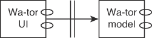

**图 17.1.** Wa-Tor 明显且传统的划分

`WatorUI` 组件的级别低于 `WatorModel` 组件。根据依赖规则（Dependency Rule），这意味着源代码的依赖必须跨越架构边界并指向 `WatorModel`。正因如此，`WatorUI` 将成为 `WatorModel` 的插件。

目前为止，这种划分中只有两个组件和一个边界。在更大的系统中，我们将会看到更多的边界以及每个边界内部的更多组件。

让我们先关注模型。我们需要哪些类？

是的，我说了“类”。我们可能正在使用一种函数式语言。

所以，初看之下，函数式设计和面向对象设计是硬币的两面。

**17.2.** 初始模型看起来如下：

```
(ns wator.cell)

(defmulti type)
```

```
(ns wator.water)

(def make {} ::type)
```

```
(ns wator.animal)

(defmulti move)

(defmulti reproduce)

(defn tick [animal])
```

```
(ns wator.fish)

(def make {} ::type)

(defmulti tick [fish])

(defmulti move [fish])

(defmulti reproduce [fish])
```

```
(ns wator.shark)

(def make {} ::type)

(defmulti tick [shark])

(defmulti move [shark])

(defmulti reproduce [shark])

(defn eat [shark])
```

但让我们暂时把这些都搁置一边。这种前期设计就够了。让我们看看能不能为一些行为编写代码。

`water` 的行为是什么？我们询问我们的建模人员，他们告诉我们，如果给予足够的时间，`water` 细胞会随机演变成一个 `fish` 细胞。这里是我对该规则的实现：

点击此处查看代码图片

```
(ns wator.core-spec

  (:require [speclj.core :refer :all]

            [wator

             [cell :as cell]

             [water :as water]

             [fish :as fish]]))

(describe "Wator"

  (with-stubs)

  (context "Water"

    (it "usually remains water"

          (with-redefs [rand (stub :rand {:return 0.0})]

            (let [water (water/make)

                  evolved (cell/tick water)]

              (should= ::water/water (::cell/type evolved)))))

    (it "occasionally evolves into a fish"

      (with-redefs [rand (stub :rand {:return 1.0})]

        (let [water (water/make)

              evolved (cell/tick water)]

          (should= ::fish/fish (::cell/type evolved))))))))

———

(ns wator.water

  (:require [wator

             [cell :as cell]

             [fish :as fish]

             [config :as config]]))

(defn make [] {::cell/type ::water})

(defmethod cell/tick ::water [water]

  (if (> (rand) config/water-evolution-rate)

    (fish/make)

    water))

——————

(ns wator.config)

(def water-evolution-rate 0.99999)
```


所以，我们立刻看到了这个程序的“函数式”性质。`tick` 的返回值是一个新的`cell`。我不知道那个`water-evolution-rate`是否正确。建模人员还没有告诉我们速率应该是多少。所以我只是猜的。我预计他们会等到看到模型的行为后，再告诉我们修改它。

差不多。`(rand)` 的调用是不纯的。

到目前为止，我还没有指定任何动态类型。现在说这个还有点早。但我确定它是会来的。

总之，让我们看看能不能让一条`fish`移动。

等一下。你如何移动一条`fish`？`fish`在哪里？`fish`知道自己的位置吗，还是由`world`知道？

`cell`被排列在一个二维矩形笛卡尔网图中，网格从左到右、从上到下循环。因此，`cell`的位置是元组`[x y]`。`world`可以用二维数组存储`cell`，也可以用一个以位置元组为键的 map。

我喜欢对这类事情使用 map，所以让我们创建一个充满`water`细胞的`world`：

```
(context "world"

  (it "creates a world full of water cells"

    (let [world (world/make 2 2)

          cells (:cells world)

          positions (set (keys cells))]

      (should= #{[0 0] [0 1]

                 [1 0] [1 1]} positions)

      (should (every? #(= ::water/water (::cell/type %))

                      (vals cells))))))
```

————

```
(ns wator.world

  (:require [wator

             [water :as water]]))

(defn make [w h]

  (let [locs (for [x (range w) y (range h)] [x y])

        loc-water (interleave locs (repeat (water/make)))

        cells (apply hash-map loc-water)]

    {:cells cells}))
```

你注意到传递给`interleave`的`water`细胞惰性列表了吗？现在我们应该能够把一条`fish`放入世界并让它到处移动了。这是我的第一次尝试：

```
(context "animal"

  (it "moves"

    (let [fish (fish/make)

          world (-> (world/make 3 3)

                    (world/set-cell [1 1] fish))

          [loc cell] (animal/move fish [1 1] world)]

      (should= cell fish)

      (should (#{[0 0] [0 1] [0 2]

                 [1 0] [1 2]

                 [2 0] [2 1] [2 2]}

               loc)))))
```

这非常直观。我们创建了一个中心有一条`fish`的 3x3 `world`。然后我们移动了这条`fish`。最后，我们确保它仍然是一条`fish`，并且它的目的地是其中之一。

```clojure
(defn do-move [animal loc world]

  (let [neighbors (world/neighbors world loc)

        destinations (filter

                       #(water/is?

                         (world/get-cell world %))

                       neighbors)

        new-location (rand-nth destinations)]

    [new-location animal]))
```

非常漂亮。我们向`world`请求该位置的`neighbors`，过滤掉所有不是`water`的单元格，然后随机选择一个。很酷。

我认为最好的办法是确保所有的环面数学计算都很好地封装在`world`内部。我不希望这些逻辑泄露到所有的`animal`中：

```clojure
(defn wrap [world [x y]]

  (let [[w h] (::bounds world)]

    [(mod x w) (mod y h)])

  )

(defn neighbors [world loc]

  (let [[x y] loc

        neighbors (for [dx (range -1 2) dy (range -1 2)]

                    (wrap world [(+ x dx) (+ y dy)]))]

    (remove #(= loc %) neighbors)))
```

### 你准备好面对那些不漂亮的内容了吗？

上面的代码拒绝编译，因为（你准备好了吗？）`water`依赖于`fish`（为了进化），`fish`依赖于`animal`（为了`do-move`），而`animal`又依赖于`water`。这是一个依赖循环，Clojure 非常讨厌依赖循环。参见图 17.3。

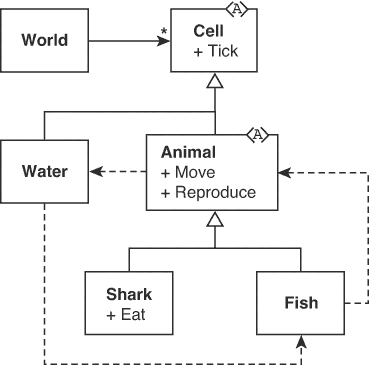

**图 17.3.** 一个依赖循环

好了，深呼吸。记住，我们是在这里玩游戏。在像`Wa-Tor`这样简单的应用中，我不会如此冷酷地划分这些文件。事实上，我很有可能直接把整个程序写在一个文件里，让恶魔随心所欲。但我们现在假装这是一个百万行的企业级应用程序，因此我们将对所有这些源代码依赖关系极其审慎。对吧？

所以，我们解决这个问题的方法是回到类似于旧 C 语言的声明与实现机制。参见图 17.4。

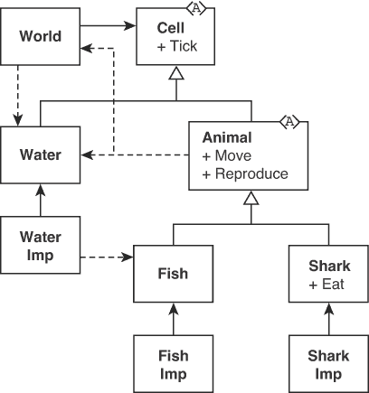

**图 17.4.** 打破依赖循环

通过拆分`water`使得其对`fish`的依赖位于`water-imp`中，并确保`water-imp`依赖于`water`而不是反过来（即依赖倒置原则 DIP），循环被打破了。为了一致性，我也拆分了`fish`和`shark`。我可能也需要拆分`animal`。

实际上，只有`fish`。我在图中拆分了`shark`，但在代码中没有。YAGNI（你不需要这些功能），YAGNI，YAGNI。

未来的 Uncle Bob：. . .不。

所以现在的代码看起来是这样：

```clojure
(ns wator.world

  (:require [wator

             [water :as water]]))

(defn make [w h]

  (let [locs (for [x (range w) y (range h)] [x y])

        loc-water (interleave locs (repeat (water/make)))

        cells (apply hash-map loc-water)]

    {::cells cells

     ::bounds [w h]}))

(defn set-cell [world loc cell]

  (assoc-in world [::cells loc] cell))

(defn get-cell [world loc]

  (get-in world [::cells loc]))

; . . .
```

—————

```
(ns wator.cell)

(defmulti tick ::type)
```

—————

```
(ns wator.water

  (:require [wator

             [cell :as cell]]))

(defn make [] {::cell/type ::water})

(defn is? [cell]

  (= ::water (::cell/type cell)))
```

——————————

```
(ns wator.water-imp

  (:require [wator

             [cell :as cell]

             [water :as water]

             [fish :as fish]

             [config :as config]]))

(defmethod cell/tick ::water/water [water]

  (if (> (rand) config/water-evolution-rate)

    (fish/make)

    water))
```

———————

```
(ns wator.animal

  (:require [wator

             [world :as world]

             [cell :as cell]

             [water :as water]]))

(defmulti move (fn [animal & args] (::cell/type animal)))

(defmulti reproduce (fn [animal & args] (::cell/type animal)))

(defn tick [animal]

  )

(defn do-move [animal loc world]

  (let [neighbors (world/neighbors world loc)

        destinations (filter #(water/is?

                               (world/get-cell world %))

                             neighbors)

        new-location (rand-nth destinations)]

    [new-location animal]))
```

————

```
(ns wator.fish

  (:require [wator

             [cell :as cell]]))

(defn make [] {::cell/type ::fish})
```

——————

```
(ns wator.fish-imp

  (:require [wator

             [cell :as cell]

             [animal :as animal]

             [fish :as fish]]))

(defmethod cell/tick ::fish/fish [fish]

  (animal/tick fish)

  )

(defmethod animal/move ::fish/fish [fish loc world]

  (animal/do-move fish loc world))

(defmethod animal/reproduce ::fish/fish [fish]

  )
```

```clojure
(ns wator.world

  (:require [clojure.spec.alpha :as s]

            [wator

             [cell :as cell]

             [water :as water]]))

(s/def ::location (s/tuple int? int?))

(s/def ::cell #(contains? % ::cell/type))

(s/def ::cells (s/map-of ::location ::cell))

(s/def ::bounds ::location)

(s/def ::world (s/keys :req [::cells ::bounds]))

(defn make [w h]

  {:post [(s/valid? ::world %)]}

  …)
```

好的，这样好多了。现在，我们需要什么来复现它呢？建模者说，如果`fish`（鱼）紧邻`water`（水）单元格且年龄超过了某个值，它就会繁殖。两个后代`fish`（鱼）的年龄将重置为零。否则，`fish`的`::age`会随时间增加。

以下是测试用例：

```clojure
(it "reproduces"

  (let [fish (-> (fish/make)

                 (animal/set-age config/fish-reproduction-age))

        world (-> (world/make 3 3)

                  (world/set-cell [1 1] fish))

        [loc1 cell1 loc2 cell2] (animal/reproduce

                                  fish [1 1] world)]

    (should= loc1 [1 1])

    (should (fish/is? cell1))

    (should= 0 (animal/age cell1))

    (should (#{[0 0] [0 1] [0 2]

               [1 0] [1 2]

               [2 0] [2 1] [2 2]}

             loc2))

    (should (fish/is? cell2))

    (should= 0 (animal/age cell2))))

(it "doesn't reproduce if there is no room"

  (let [fish (-> (fish/make)

                 (animal/set-age config/fish-reproduction-age))

        world (-> (world/make 1 1)

                  (world/set-cell [0 0] fish))

        failed (animal/reproduce fish [0 0] world)]

    (should-be-nil failed)))

(it "doesn't reproduce if too young"

      (let [fish (-> (fish/make)

                     (animal/set-age

                       (dec config/fish-reproduction-age)))

            world (-> (world/make 3 3)

                      (world/set-cell [1 1] fish))

            failed (animal/reproduce fish [1 1] world)]

        (should-be-nil failed)))
```

注意，如果`fish`（鱼）繁殖了，返回值将包含两个后代。但如果发生了某些错误，我们返回`nil`。这是因为我认为`fish`的高层策略包含了类似这样的内容：

```clojure
(if-let [result (animal/reproduce …)]

  result

  (animal/move …))
```

无论如何，这里是通过该测试的简化代码：

```clojure
(ns wator.animal

  (:require [clojure.spec.alpha :as s]

            [wator

             [world :as world]

             [cell :as cell]

             [water :as water]

             [config :as config]]))

(s/def ::age int?)

(s/def ::animal (s/keys :req [::age]))

(defmulti move (fn [animal & args] (::cell/type animal)))

(defmulti reproduce (fn [animal & args] (::cell/type animal)))

(defmulti make-child ::cell/type)

(defn make []

  {::age 0})

(defn age [animal]

  (::age animal))

(defn set-age [animal age]

  (assoc animal ::age age))

;. . .

(defn do-reproduce [animal loc world]

  (if (>= (age animal) config/fish-reproduction-age)

    (let [neighbors (world/neighbors world loc)
```


`birth-places` (filter `#(water/is? (world/get-cell world %))` neighbors)

(if (empty? `birth-places`) nil [loc (set-age animal 0) (rand-nth birth-places) (make-child animal)]) nil)

---

`(ns wator.fish (:require [clojure.spec.alpha :as s] [wator [cell :as cell] [animal :as animal]]))`

`(s/def ::fish (s/and #(= ::fish (::cell/type %)) ::animal/animal))`

`(defn is? [cell] (= ::fish (::cell/type cell)))`

`(defn make [] {:post [(s/valid? ::fish %)]} (merge {::cell/type ::fish} (animal/make)))`

`(defmethod animal/make ::cell/type (fish))`

---

`(ns wator.fish-imp (:require [wator [cell :as cell] [animal :as animal] [fish :as fish]))`

`. . .`

`(defmethod animal/reproduce ::cell/type (do-reproduce))`

但现在我被 `world` 中的 `water` 依赖困扰着。有一个术语可以描述我对它的感觉。那个词是*恶心*（icky）。那个依赖在某种程度上是*错的*。

我需要洗个澡。我在洗澡时能解决很多问题。

### 洗澡能解决问题

好了，我洗完澡回来了，这是我在喷淋头下对自己进行的对话。

“在 `world` 中创建 `water` 感觉*恶心*。我的意思是，我只是把 `world` 分成了两部分，因为创建 `fish` 导致了循环。所以创建 `water` 也可能导致循环。但等等，这都是关于创建的。也许我需要一个工厂！对，一个名为 `cell-factory` 的抽象工厂，它将接受像 `:fish` 和 `:water` 这样的不透明令牌，然后. .（噢！）。. . 以及 `:default-cell`。是的，然后. . 等等，为什么我需要一个全新的工厂？为什么 `world` 不能就是工厂呢？没错！这就是`工厂方法`（Factory Method）模式。这就对了！”

此设计的 UML 图（在 图 17.6 中）非常有启发性。

一个架构边界出现了。所有的依赖都向高层侧跨越，遵循依赖规则（Dependency Rule）。我可能在实际架构中不会这个边界，但如果我需要，它就在那里。

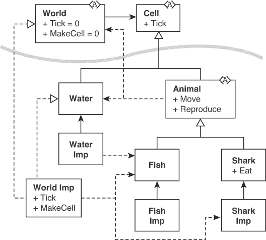

**图 17.6.** 使用工厂方法模式的 Wa-Tor

现在代码看起来是：

```
(ns wator.world
  (:require [clojure.spec.alpha :as s]
            [wator
             [cell :as cell]
             [water :as water]]))

(s/def ::location (s/tuple int? int?))
(s/def ::cell #(contains? % ::cell/type))
(s/def ::cells (s/map-of ::location ::cell))
(s/def ::bounds ::location)
(s/def ::world (s/and (s/keys :req [::cells ::bounds])
                      #(= (::type %) ::world)))

(defmulti tick ::type)
(defmulti make-cell (fn [factory-type cell-type] factory-type))

(defn make [w h]
  {:post [(s/valid? ::world %)]}
  (let [locs (for [x (range w) y (range h)] [x y])
        default-cell (make-cell ::world :default-cell)
        loc-water (interleave locs (repeat default-cell))
        cells (apply hash-map loc-water)]
    {::type ::world
     ::cells cells
     ::bounds [w h]}))

;. . .
```

---

```
(ns wator.world-imp
  (:require [wator
             [world :as world :refer :all]
             [animal :as animal]
             [fish :as fish]
             [shark :as shark]
             [water :as water]]))

(defmethod world/tick ::world/world [world]
  (-> (make 2 1)
        (set-cell [0 0] (water/make))
        (set-cell [0 1] (animal/set-age (fish/make) 1))))

(defmethod world/make-cell ::world/world [world cell-type]
  (condp = cell-type
    :default-cell (water/make)
    :water (water/make)
    :fish (fish/make)
    :shark (shark/make)))
```

`make-cell` 中的 `factory-type` 仅作为 `::world` 传入。这允许 `defmethod ::world/world` 来解析它。

我对这个改变寄予很大期望。请注意，整个变化是由一个测试驱动的，我让这个测试通过 `tick` 中一个虚拟实现来通过，这再次提醒了我们 TDD 是一种设计技术。

好了，现在让那个虚拟实现失败吧。这是失败的测试：

```
(it "moves a fish around each tick"
  (doseq [scenario
          [{:dimension [2 1] :starting [0 0] :ending [1 0]}
           {:dimension [2 1] :starting [1 0] :ending [0 0]}
           {:dimension [1 2] :starting [0 0] :ending [0 1]}
           {:dimension [1 2] :starting [0 1] :ending [0 0]}]]
    (let [fish (fish/make)
          {:keys [dimension starting ending]} scenario
          [h w] dimension
          small-world (-> (world/make h w)
                          (world/set-cell starting fish)
                          (world/tick))
          vacated-cell (world/get-cell small-world starting)
          occupied-cell (world/get-cell small-world ending)]
      (should (water/is? vacated-cell))
      (should (fish/is? occupied-cell))
      (should= 1 (animal/age occupied-cell)))))
```

我创建了四个可能的 1x2 场景，并确保 `world` 在 `tick` 之后得到了正确的更新。

让它通过迫使我再次更改了设计。`animal/move`、`animal/reproduce` 和 `cell/tick` 函数必须返回一个 `[from to]` 列表，其中每个元素都是包含 `{loc cell}` 的单元素 map。看看 `world-imp` 你就知道为什么了：

```
(ns wator.world-imp
  . . .)

(defmethod world/tick ::world/world [world]
  (let [cells (::world/cells world)]
    (loop [locs (keys cells)
           new-cells {}
           moved-into #{}]
      (cond
        (empty? locs)
        (assoc world ::world/cells new-cells)

        (contains? moved-into (first locs))
        (recur (rest locs) new-cells moved-into)

        :else
        (let [loc (first locs)
              cell (get cells loc)
              [from to] (cell/tick cell)
              new-cells (assoc new-cells loc cell)
              moved-into (conj moved-into to)]
          (if (empty? locs)
            (assoc world ::world/cells new-cells)
            (recur (rest locs) new-cells moved-into))))
; . .
```

```clisp
(ns wator.core-spec . .)
(describe "Wator"
  (with-stubs)
  (context "Water"
    (it "usually remains water"
      (with-redefs [rand (stub :rand {:return 0.0})]
        (let [water (water/make)
              world (world/make 1 1)
              [from to] (cell/tick water [0 0] world)]
          (should-be-nil from)
          (should (water/is? (get to [0 0]))))))

    (it "occasionally evolves into a fish"
      (with-redefs [rand (stub :rand {:return 1.0})]
        (let [water (water/make)
              world (world/make 1 1)
              [from to] (cell/tick water [0 0] world)]
          (should-be-nil from)
          (should (fish/is? (get to [0 0]))))))))

;. . .

  (context "animal"
    (it "moves"
      (let [fish (fish/make)
            world (-> (world/make 3 3)
                      (world/set-cell [1 1] fish))
            [from to] (animal/move fish [1 1] world)
            loc (first (keys to))]
        (should (water/is? (get from [1 1])))
        (should (fish/is? (get to loc)))
        (should (#{[0 0] [0 1] [0 2]
                   [1 0] [1 2]
                   [2 0] [2 1] [2 2]}
                 loc))))

    (it "doesn't move if there are no spaces"
      (let [fish (fish/make)
            world (-> (world/make 1 1)
                      (world/set-cell [0 0] fish))
            [from to] (animal/move fish [0 0] world)]
        (should (fish/is? (get to [0 0])))
        (should (nil? from)))))
```

还有一个我认为会失败的场景——两条 `fish` 竞争同一个位置：

```clisp
(it "move two fish who compete for the same spot"
  (let [fish (fish/make)
        competitive-world (-> (world/make 3 1)
                              (world/set-cell [0 0] fish)
                              (world/set-cell [2 0] fish)
                              (world/tick))
        start-00 (world/get-cell competitive-world [0 0])
        start-20 (world/get-cell competitive-world [2 0])
        end-10 (world/get-cell competitive-world [1 0])]
    (should (fish/is? end-10))
    (should (or (fish/is? start-00)
                (fish/is? start-20)))
    (should (or (water/is? start-00)
                (water/is? start-20)))))
```

这是一个简单的 3x1 `world`，两端各有一条 `fish`。只有其中一条可以移动到中间的位置。另一个必须留在原处。这个测试失败是因为 `animal/move` 函数并不知道有一条 `fish` 移动到了目标位置。

解决这个问题意味着要某种方式将 `moved-into` 列表发送给 `animal/move`。我不喜欢给 `animal/move` 再增加一个参数，所以也许我们可以将这些信息存储在传递给 `animal/move` 的 `world` 中：

```clisp
(ns wator.world-imp . ....)

(defmethod world/tick ::world/world [world]
  (let [cells (::world/cells world)]
    (loop [locs (keys cells)
           new-cells {}
           moved-into #{}]
      (cond
        (empty? locs)
        (assoc world ::world/cells new-cells)

        (contains? moved-into (first locs))
        (recur (rest locs) new-cells moved-into)

        :else
        (let [loc (first locs)
              cell (get cells loc)
              [from to] (cell/tick
                          cell loc
```


(assoc world :moved-into moved-into))

new-cells (-> new-cells (merge from) (merge to))

to-loc (first (keys to))

to-cell (get to to-loc)

moved-into (if (water/is? to-cell)

moved-into

(conj moved-into to-loc))]

(recur (rest locs) new-cells moved-into))))))

———————

```
(ns wator.animal . ....)
```

```
; . . .
```

```
(defn do-move [animal loc world]

  (let [neighbors (world/neighbors world loc)

        moved-into (get world :moved-into #{})

        available-neighbors (remove moved-into neighbors)

        destinations (filter #(water/is?

                               available-neighbors)

                               (world/get))

        new-location (

                               (if (empty? destinations)

                               nil

                               (rand-nth destinations)))

    (if new-location

      (animal/move animal new-location world)

      nil)))
```

这要求我充实 `shark` 模块，并进行一个微小的设计调整。我使用了 `Template Method` 模式来获取动物的繁殖年龄。测试用例暗示了这一变化：

点击查看代码图片

```clojure
(context "animal"
  (it "moves"
    (doseq [scenario 
             [{:constructor fish/make :tester fish/is?}
              {:constructor shark/make :tester shark/is?}]]
      (let [animal ((:constructor scenario))
            world (-> (world/make 3 3)
                      (world/set-cell [1 1] animal))
            [from to] (animal/move animal [1 1] world)
            loc (first (keys to))]
        (should (water/is? (get from [1 1])))
        (should ((:tester scenario) (get to loc)))
        (should (#{[0 0] [0 1] [0 2]
                   [1 0] [1 2]
                   [2 0] [2 1] [2 2]}
                 loc)))))
  (it "doesn't move if there are no spaces"
    (doseq [scenario 
             [{:constructor fish/make :tester fish/is?}
              {:constructor shark/make :tester shark/is?}]]
      (let [animal ((:constructor scenario))
            world (-> (world/make 1 1)
                      (world/set-cell [0 0] animal))
            [from to] (animal/move animal [0 0] world)]
        (should ((:tester scenario) (get to [0 0])))
        (should (nil? from)))))
  (it "reproduces"
    (doseq [scenario 
             [{:constructor fish/make :tester fish/is?}
              {:constructor shark/make :tester shark/is?}]]
      (let [animal ((:constructor scenario))
            reproduction-age (animal/get-reproduction-age animal)
            animal (animal/set-age animal reproduction-age)
            world (-> (world/make 3 3)
                      (world/set-cell [1 1] animal))
            [from to] (animal/reproduce animal [1 1] world)
            from-loc (-> from keys first)
            from-cell (-> from vals first)
            to-loc (-> to keys first)
            to-cell (-> to vals first)]
        (should= from-loc [1 1])
        (should ((:tester scenario) from-cell))
        (should= 0 (animal/age from-cell))
        (should (#{[0 0] [0 1] [0 2]
                   [1 0] [1 2]
                   [2 0] [2 1] [2 2]}
                 to-loc))
        (should ((:tester scenario) to-cell))
        (should= 0 (animal/age to-cell)))))
  (it "doesn't reproduce if there is no room"
    (doseq [scenario 
             [{:constructor fish/make :tester fish/is?}
              {:constructor shark/make :tester shark/is?}]]
      (let [animal ((:constructor scenario))
            reproduction-age (animal/get-reproduction-age animal)
            animal (animal/set-age animal reproduction-age)
            world (-> (world/make 1 1)
                      (world/set-cell [0 0] animal))
            failed (animal/reproduce animal [0 0] world)]
        (should-be-nil failed))))
  (it "doesn't reproduce if too young"
    (doseq [scenario 
             [{:constructor fish/make :tester fish/is?}
              {:constructor shark/make :tester shark/is?}]]
      (let [animal ((:constructor scenario))
            reproduction-age (animal/get-reproduction-age animal)
            animal (animal/set-age animal (dec reproduction-age))
            world (-> (world/make 3 3)
                      (world/set-cell [1 1] animal))
            failed (animal/reproduce animal [1 1] world)]
        (should-be-nil failed)))))
```

————————

```
(ns wator.animal …)
```

```
(defmulti move (fn [animal & args] (::cell/type animal)))
(defmulti reproduce (fn [animal & args] (::cell/type animal)))
(defmulti make-child ::cell/type)
(defmulti get-reproduction-age ::cell/type)
```

```
; . . .
```

————————

```
(ns wator.fish . . .)
```

```
(defmethod animal/get-reproduction-age ::fish [fish]
  config/fish-reproduction-age)
```

```
; . . .
```

——————

```
(ns wator.shark
  (:require [clojure.spec.alpha :as s]
            [wator
             [config :as config]
             [cell :as cell]
             [animal :as animal]]))
(s/def ::shark (s/and #(= ::shark (::cell/type %))
                      ::animal/animal))
(defn is? [cell]
  (= ::shark (::cell/type cell)))
```

```
(defn make []
  {:post [(s/valid? ::shark %)]}
```

```
(defmethod animal/get-reproduction-age ::fish [fish]
  config/fish-reproduction-age)
```

*（注：提供的文本后半部分似乎包含重复/碎片化的草稿笔记。我已根据提供的规则清理了格式，同时保持了如所示的核心逻辑和结构。）*

我们创建了一个 2x1 的 `world`，其中有一个 `shark` 邻着 `fish`。经过一个 `tick` 后，`shark` 应该出现在 `fish` 之前的位置，而 `water` 应该出现在 `shark` 之前的位置，并且 `shark` 的 `::health` 应该增加。

为了让这段代码通过，我被迫放弃了向 `animal/tick` 的委托，因为 `shark` 应该先尝试 `reproduce`，然后尝试 `eat`，最后才尝试 `move`：

点击此处查看代码图片

```
(ns wator.shark . ....)

(defn eat [shark loc world]
  (let [neighbors (world/neighbors world loc)
        fishy-neighbors (filter #(fish/is?
                                  (world/get-cell world %))
                                neighbors)]
    (if (empty? fishy-neighbors)
      nil
      [{loc (water/make)}
       {(rand-nth fishy-neighbors) (feed shark)}]))
  )

(defmethod cell/tick ::shark [shark loc world]
  (if (= 1 (health shark))
    [nil {loc (water/make)}]
    (let [aged-shark (-> shark
                         (animal/increment-age)
                         (decrement-health))]
      (if-let [reproduction (animal/reproduce
                              aged-shark loc world)]
        reproduction
        (if-let [eaten (eat aged-shark loc world)]
          eaten
          (animal/move aged-shark loc world))))))
```

这一切都很顺利地完成了。我们已经渡过了设计的瓶颈，现在正在收获成果。

建模人员告诉我们，鲨只有在健康值高于阈值时才会繁殖。让我们测试一下。事实上，让我们先进行这个更改^(18)，看看哪些测试会报错：

18. TDD 违背！警报！警报！

点击此处查看代码图片

```
(ns wator.shark . ....)

(defmethod animal/reproduce ::shark [shark loc world]
  (if (>= (health shark) config/shark-reproduction-health)
    (animal/do-reproduce shark loc world)
    nil))
```

如所料，鲨鱼场景下的动物繁殖测试失败了。我们可以通过在那个测试中加入一个小黑科技（hack）来解决这个问题：

点击此处查看代码图片

```
(it "reproduces"
  (doseq [scenario [{:constructor fish/make :tester fish/is?}
                    {:constructor
                       #(-> (shark/make)
                            (shark/set-health
                              (inc config/shark-reproduction-
                                   health)))
                     :tester shark/is?}]]
; . . .
```

是的，这有点丑，但它起作用。我想我应该添加一个测试来检查该阈值的另一侧：

点击此处查看代码图片

```
(it "doesn't reproduce if not healthy enough"
  (let [shark (-> (shark/make)
                  (shark/set-health
                    (dec config/shark-reproduction-health))
                  (animal/set-age config/shark-reproduction-age))
        world (-> (world/make 3 3)
                  (world/set-cell [1 1] shark))
        failed (animal/reproduce shark [1 1] world)]
    (should-be-nil failed)))
```

好了。最后一件事。母鲨鱼的健康值会被分配到两个女儿鱼之间：

点击此处查看代码图片

```
(it "shares health with both daughters after reproduction"
  (let [initial-health (inc config/shark-reproduction-health)
        pregnant-shark (-> (shark/make)
                           (animal/set-age
```


### 测试：繁殖后与两个子鲨共享健康值

```clojure
(it "shares health with both daughters after reproduction"
  (let [initial-health (inc config/shark-reproduction-health)
        pregnant-shark (-> (shark/make)
                           (animal/set-age
                             (inc config/shark-reproduction-age))
                           (shark/set-health initial-health))
        world (-> (world/make 2 1)
                  (world/set-cell [0 0] pregnant-shark))
        new-world (world/tick world)
        daughter1 (world/get-cell new-world [0 0])
        daughter2 (world/get-cell new-world [1 0])
        expected-health (quot (dec initial-health) 2)]
    (should (shark/is? daughter1))
    (should (shark/is? daughter2))
    (should= expected-health (shark/health daughter1))
    (should= expected-health (shark/health daughter2))))
```

没错。测试失败是因为预期的健康值不正确。这很容易修复：

```clojure
(ns wator.shark . ....)

(defmethod animal/reproduce ::shark [shark loc world]
  (if (< (health shark) config/shark-reproduction-health)
    (animal/do-reproduce shark loc world)
    nil))
```

### 结论

我们创建了一个 2x1 的 `world`，其中有一个 `shark` 邻着 `fish`。经过一个 `tick` 后，`shark` 应该出现在 `fish` 之前的位置，而 `water` 应该出现在 `shark` 之前的位置，并且 `shark` 的 `::health` 应该增加。

---

为了让这段代码通过，我被迫放弃了向 `animal/tick` 的委托，因为 `shark` 应该先尝试 `reproduce`，然后尝试 `eat`，最后才尝试 `move`：

```clojure
(ns wator.shark . ....)

(defn eat [shark loc world]
  (let [neighbors (world/neighbors world loc)
        fishy-neighbors (filter #(fish/is?
                                  (world/get-cell world %))
                                neighbors)]
    (if (empty? fishy-neighbors)
      nil
      [{loc (water/make)}
       {(rand-nth fishy-neighbors) (feed shark)}]))

(defmethod cell/tick ::shark [shark loc world]
  (if (= 1 (health shark))
    [nil {loc (water/make)}]
    (let [aged-shark (-> shark
                         (animal/increment-age)
                         (decrement-health))]
      (if-let [reproduction (animal/reproduce
                              aged-shark loc world)]
        reproduction
        (if-let [eaten (eat aged-shark loc world)]
          eaten
          (animal/move aged-shark loc world))))))
```

这一切都很顺利地完成了。我们已经渡过了设计的瓶颈，现在正在收获成果。

建模人员告诉我们，鲨只有在健康值高于阈值时才会繁殖。让我们测试一下。事实上，让我们先进行这个更改^(18)，看看哪些测试会报错：

18. TDD 违背！警报！警报！

```clojure
(ns wator.shark . ....)

(defmethod animal/reproduce ::shark [shark loc world]
  (if (>= (health shark) config/shark-reproduction-health)
    (animal/do-reproduce shark loc world)
    nil))
```

如所料，鲨鱼场景下的动物繁殖测试失败了。我们可以通过在那个测试中加入一个小黑科技（hack）来解决这个问题：

```clojure
(it "reproduces"
  (doseq [scenario [{:constructor fish/make :tester fish/is?}
                    {:constructor
                       #(-> (shark/make)
                            (shark/set-health
                              (inc config/shark-reproduction-
                                   health)))
                     :tester shark/is?}]]
; . . .
```

是的，这有点丑，但它起作用。我想我应该添加一个测试来检查该阈值的另一侧：

```clojure
(it "doesn't reproduce if not healthy enough"
  (let [shark (-> (shark/make)
                  (shark/set-health
                    (dec config/shark-reproduction-health))
                  (animal/set-age config/shark-reproduction-age))
        world (-> (world/make 3 3)
                  (world/set-cell [1 1] shark))
        failed (animal/reproduce shark [1 1] world)]
    (should-be-nil failed)))
```

好了。最后一件事。母鲨鱼的健康值会被分配到两个女儿鱼之间：

```clojure
(it "shares health with both daughters after reproduction"
  (let [initial-health (inc config/shark-reproduction-health)
        pregnant-shark (-> (shark/make)
                           (animal/set-age
                             (inc config/shark-reproduction-age))
                           (shark/set-health initial-health))
        world (-> (world/make 2 1)
                  (world/set-cell [0 0] pregnant-shark))
        new-world (world/tick world)
        daughter1 (world/get-cell new-world [0 0])
        daughter2 (world/get-cell new-world [1 0])
        expected-health (quot (dec initial-health) 2)]
    (should (shark/is? daughter1))
    (should (shark/is? daughter2))
    (should= expected-health (shark/health daughter1))
    (should= expected-health (shark/health daughter2))))
```

没错。测试失败是因为预期的健康值不正确。这很容易修复：

```clojure
(ns wator.shark . ....)

(defmethod animal/reproduce ::shark [shark loc world]
  (if (< (health shark) config/shark-reproduction-health)
    (animal/do-reproduce shark loc world)
    nil))
```


最后，我认为这才是软件本该的样子。

顺便一下，你可以在 [`github.com/unclebob/wator`](https://github.com/unclebob/wator) 找到所有的源代码。

## 后记

2022 年 3 月，我参加了一个朋友的生日派对，无意中听到几个男生在调侃代码。我介绍了自己——当时我正在寻找一些编程朋友。当我们结束了显而易见的寒暄后，其中一个人向我抛出了一个重磅性的问题。

他问：“那么，你首选的技术栈是什么？”

我脑海里的每一个小碎片都在疯狂地寻找答案，同时我还在试图理解他在问什么，直到最后我非常不自信地回答道：“Clojure？”

他向后退了一步，露出明显的惊讶，惊呼道：“真的吗？！全栈的？”

[我脑海中放起了彩花——搞定了！]

他很震惊，继续说道：“……前端和后端都用 Clojure？我以前从没听说过。它是怎么运作的？Clojure 是一种 Lisp 语言，对吧？它是函数式语言。”

是的，它是，但是——噢不！又一个问题……“它是怎么运作的？”

嗯，如果你正在阅读这里，那么我假设你已经读了前面的页面，因此已经得到了比我在这里能提供的更好、更详尽的解释，所以，让我们直面那个显而见的问题：为什么问我首选的技术栈是一个重磅性的问题？

几乎在生日派对之前的整整 11 年，我在伊利诺伊州大都会波利斯（Metropolis, IL）作为一名化学工程师和工会破坏开始了职业生涯，在那里，我接受了操作六氟化铀生产中工艺和设备的培训。在接下来的十年里，我的职业晋升到了各种化学制造工厂的生产领导岗位。

在这十年中，我学习了许多关于流程、状态、人员、企业文化以及那些我缺乏技能去修复的破碎流程。然后，在 2020 年 3 月，当我努力平衡这些破碎流程的需求与压倒性的生活变化时，我们所认知的世界停止了运转。在八周时间里，我突然发现自己经常出现在某身边，他不仅拥有我所缺乏的技能，还制定了掌握那些技能的规则。

于是，我问我爸爸（或者你可能认识他的称呼：“Bob 叔”），学习软件需要什么才能达到足够的深度，以解决那些我如此渴望想要解决的问题。

那天晚上，他向我展示了他目前的项目之一——一个按县统计 COVID-19 感染和死亡人数的自动每日表。当我不认识语法时，他借此机会向我介绍了 Clojure。

我立刻产生了疑问，因为我以前只了解过 `Java` 和 `Python` 这种语言的基础。他解释了面向对象过程化语言与函数式语言之间的基本区别，以及为什么他喜欢 Clojure。在一个例子中，他向我展示了为什么函数式语言比那些严重依赖可变状态的语言更“安全”、更不复杂，他为我描述了一个竞态条件，那个条件与第 15 章中 Bob 和 Alice 之间的电话内容几乎相同。

然后我们深入了代码，他给了我一个我不轻视的机会：与他一起开发他的 COVID 图表。我大部分只是写了几个基础算术函数（当然，我们还为这些函数写了测试）。

他还带我学习了 `Quil`，以及它在很大程度上也是函数式的，它是如何不是改变状态，而是在每次迭代中递归生成新状态的。这在当时有点超出了我的理解范围，但在接下来的一年里，我经常回想起这段对话——我现在面前甚至放着我们那天晚上编写的源代码打印件，作为我写这篇文章的灵感来源。

一年多以后，我“毕业”了我的软件学徒生涯，成为了 Clean Coders Studio 的全职开发人员。

那么，回到那个问题：截至 2022 年 3 月，我对软件来说仍然还是个新手；由于 COVID-19，还没有发生多少大型活动；而且因为路易斯安那州巴顿鲁日（Baton Rouge, LA）在软件领域有一些增长机会，我作为一名开发者一直相当孤立，很少接触到常见的行业术语。

那个生日派对给了我第一次与 Clean Coders 之外的开发者进行面对面交流的机会，当我被问到首选的技术栈时，我只有足够的知识来翻译并拼凑这个问题。而且这是一个重磅性的问题，因为我不确定自己是否拥有了所有的碎片。

解决了这些，我留给你最后的两个小知识。

1. Clojure 真正让我大开眼界的时刻，是当我们正在开发一个基于 `Java` 项目的项目，该项目使用 `Angular` 作为前端。在 `Angular` 中实现任何功能时，我们当然必须在 `Angular` 和 `Java` 中创建几乎相同的方法（有时在 Clojure 中，因为我们正在迁移一个遗留系统）。处处都是双倍的工作！

    然后他们要求一个使用与我们 Clojure 特性完全相同功能的移动应用程序。我们将大部分核心功能提取到一个 `cljc` 库中，从那里，我们能够以极少甚至没有代码重复或重写来构建移动应用。

    我们为 `cljs` 移动应用使用了通用函数，就像我们在后端做的那样，通过利用 Clojure 通用命名空间。

    在多少种语言中，你可以说你做过这件事——让后端以及可能的多个前端都在在同一段经过同步测试的代码上运行？

## 索引

- 在薪资（Payroll）示例中，98, 100, 105
- 在形状（shape）示例中，271, 273, 275–276
- 在 Wa-Tor 应用中，289, 312–313
- 架构。*参见* 清洁架构的依赖规则
- 数组
- 以及 *n*-叉叉树，23–25
- 在埃拉托尼筛法（Sieve of Eratosthenes）算法中，20–22
- 赋值
- 定义，7–8
- 无类编程，4–6, 20–22
- `assoc`，90n5
- `async/>!!` 函数，213
- `async/go` 函数，205
- `atom`（原子值），50–51
- 原子操作，50

### B
- 批量处理与交互式应用，44
- 行为内聚性，94, 336
- 二叉树。*参见* *n*-叉树
- 保龄球游戏（Bowling Game）问题
- Clojure 版本，71–75
- 解决方案的比较，75–76
- Java 版本，66–71
- 业务规则
- 以及依赖关系，154–155
- 测试，127–131

### C
- 阴射线管（CRTs），118
- 变更请求与单一责任原则，126–131
- 丘奇，阿隆佐（Alonzo Church），xvi–xvii
- 丘奇-图灵论题，xvi–xvii, 19
- 类
- 闭的，267, 273
- 以及接口，132, 283–284
- 对比命名空间，107
- *清洁架构*（Martin），96, 126
- Cleancoders，126, 213
- *清洁手工艺*（Martin），53, 79n
- Clojure
- 以及类，267
- 编译，137, 150, 256n, 300
- 特性与约束，41, 281, 282–284
- 接口隔离，149–150
- 关键字语法，45
- 关于学习，xvii–xviii
- 命名空间与源文件，107–108
- 源码依赖，104–105
- 语法概述，29–32
- `clojure.spec` 库，47, 110
- 严密性，151
- 内聚性，94
- 命令模式（Command pattern）
- Undo 变体，245–249
- 使用，242–245
- 比较交换（compare-and-swap）协议，48–51
- comp.object（社交网络），230
- 组合模式（Composite pattern）
- 形状示例，254–259
- 在 switch 与光中，249–254
- `concat` 函数，73
- 常量，以及函数式程序，16
- Coplien, Jim，*Advanced C++ Programming and Idioms*，250
- 拷贝示例
- 在 C 中，131–132
- 在 Clojure 中，133–136
- 拷贝制作，20–22
- 耦合
- 通过惰惰性避免，41–42
- 在保龄球游戏中，76
- 时间上的，8–10
- 以及测试，166
- CRT。*参见* 阴射线管（CRTs)
- `cycle`，906

### D
- Dahl, Ole-Johan，78, 153
- 数据内聚性，94, 96, 336
- 数据流。*参见* Advent of Code 2022
- 在命令行 shell 中，123
- 作为编程风格，118, 124
- 数据流图（DFDs），示例，99
- 数据结构。*参见* *n*-叉树
- 持久的，25
- 致命拥抱（又名死锁），49
- `declare` 函数，35
- 装饰器模式（Decorator pattern）
- 形状示例，260–263
- 使用，260, 264
- `def` 形式，39
- `def`，103
- 依赖关系
- 源码与运行时，152–155
- 源码倒置，104–105
- 依赖倒置原则（DIP）
- 形状示例，274
- 源码与运行时依赖，152–155
- 在视频店示例中，165–174
- 在 Wa-Tor 中，300, 310
- 清洁架构的依赖规则，271, 275–276
- 设计模式。*参见* 抽象工厂; 抽象服务器; 适配器模式; 命令模式; 组合模式; 装饰器模式; 访问者模式
- 关于，227, 230–231
- *设计模式：可复用面向对象的元素*（Gamma 等，简称 GOF 书），98, 227n, 259, 270, 273
- Dewdney, A. K.,288
- DFDs。*参见* 数据流图（DFDs)
- 诊断测试，190–197
- 离散事件仿真。*参见* 聊天的巴士司机问题
- 分发函数，135
- `doall` 函数，40
- `doseq` 函数，251
- 双分（或双重）分发，266, 270

### E
- `duck typing`, 132, 139, 149。另参见多态方法

### F
- *欧拉项目 (Euler Project, The)*, 213
- 扩展与修改, 131
- 波那契数字示例
    - 使用迭代, 28–32
    - 使用惰性列表, 38–40
    - 使用真递归, 32–35
- Fikes, Mike, 200
- `filter`, 102n5
- 有限状态机
    - 与编程风格, 93–94
    - 地铁道闸机示例, 13–15
    - 电话系统示例, 216–225
- `flatten`, 91n10
- `for` 函数, 102n7
- Fowler, Martin, *重构 (Refactoring)*, 155
- F# 语言, 41, 132
- 脆弱性, 127
- 函数式语言。另参见 Clojure
    - 与设计模式, 233
    - 特性, 7, 34, 41, 124, 185, 245, 281
    - 接口机制, 132, 150
    - 与变异, 48
    - 类型输入, 110
    - 使用, 225
- 函数式编程
    - 定义, 4
    - 与 Lambda 演算, xvii
    - 与摩尔定律, 225–226
    - 与 OOP 兼容性, 282–284
    - 与资源成本, 19–20, 25
    - 与状态改变问题, 12–15, 93–94
    - 与测试, 63, 184
    - 与变量, 7–8
- 函数式程序
    - 特性, 10–12, 15–16, 18, 100, 335–336
    - GUI 框架, 200
    - 与面向对象程序, 93, 108, 167
    - 与竞态条件, 216
    - 函数
        - 作为抽象层, 133
        - 在数学中, 10
        - 私有的, 103n, 283

### G
- 垃圾回收, 9, 42
- `get`, 103n9
- GOF 书籍。另参见可重用对象模式 (Design Patterns: Elements of Reusable-Oriented Software)
- GOF (四人帮), 242
- get 驱动 (Gossiping Drivers)
    - Clojure 方案, 88–92
    - 方案对比, 92–93
    - 描述, 78
    - Java 方案, 78–88
- 图形。另参见龟形图形
- GUI
    - 架构应用, 245–249
    - 框架, 200

### H
- 处理/主体模式 (handle/body patterns)。另参见组合模式; 装饰器模式
- Haskell 语言, xiv, 41, 283
- 高层策略与低层细节, 132, 136–138, 154–155
- 高阶函数, 133n

### I
- 不变性, 15–16, 47, 93–94, 281。另参见可变性
- 独立部署性, 136–138
- 初始化, 6, 7–8, 18, 19
- 集成测试, 165–166
- 交互式程序, 44
- 接口隔离原则 (ISP)
    - 示例, 147–150
    - 使用, 150–151
- ISA 规则, 142–145, 179
- 迭代
    - 波那契数字示例, 28–30
    - 与递归, 35
    - 迭代器, 40

### J
- `jar` 文件, 136–137
- Java 虚拟机, 7n, 32, 138

### L
- Lambda 演算, xvi–xvii, 19
- 语言。另参见 Clojure; 函数式语言
    - 耦合, 150
    - 类型, 147
- 里德夫替换原则 (LSP)
    - 代码示例, 139–142
    - 代表性规则, 146–147
- 锁, 49
- 低层细节。另参见高层策略与低层细节

### M
- `map` 函数, 33
- Martin, Robert C.
    - *敏捷软件开发：原则、模式与实践*, 53, 96, 126, 184n, 231n4, 243
    - *整洁架构 (Clean Architecture)*, 96, 126
    - *整洁工艺 (Clean Craftsmanship)*, 53, 79n
    - *重构 (Refactoring)*, 155
- 记忆化, 34–35
- `memoize` 函数, 35
- 内存使用
    - 垃圾回收, 9, 42
    - 与惰性, 39–41
    - 使用 *n* 叉树, 24–25
    - 在埃拉托尼筛算法中, 22
- 消息序列图，216–217
- Meyer, Bertrand, *Object-Oriented Software Construction*, 131
- 模拟 (mocks)，184–186, 236
- 修改 vs. 扩展，131
- 模块
    - 依赖，150–151
    - 扩展 vs. 修改，131–132
- 摩尔定律，225
- `more-speech` 应用，48n, 185
- 多方法方法 (multi-methods)
    - 在 ATM 交互器示例中，149–150
    - 在拷贝示例中，135–136
    - 在 switch 和灯光问题中，235–236, 240–241
    - 在视频语句格式化示例中，167–179
    - 在 Wa-Tor 中，312
- 可变性 (mutability)。*另见* 不可变性
    - 与并发，216
    - 在语言和框架中，47–48, 124, 200
    - 与测试，197

### N
- 命名空间与源文件，106–108, 238–239
- *n*-元树，23–25
- 90 度旋转，265, 270–271, 279
- `ns` (命名空间)，159n, 238
- Nygaard, Kristen, 78, 153

### O
- 面向对象 (OO)
    - 与函数式编程，53, 93–94, 108, 282–283
    - 起源，78, 153
    - 程序特特性，93, 96
- *Object-Oriented Software Construction* (Meyer)，131
- OCP。*见* 开闭原则 (OCP)
- 不透明参数，279–281
- 开闭原则 (OCP)
    - 使用函数，133–134
    - 独立部署性，136–138
    - 使用多方法，135–136
    - 使用，131–132
    - 使用虚函数表 (vtables)，134

### P
- Papert, Seymour, 201
- `partial` 函数，102
- `partition` 函数，72
- 分区
    - 在 Gossiping Drivers 中，93
    - 在 Wa-Tor 中，335
- 工资发放问题 (Payroll problem)
    - Clojure 解决方案，98–107
    - Java 解决方案，97–98
    - 需求，96–97
    - 类型规范，110–113
- 持久数据结构，25
- 指向实现的 (`PIMPL`) 模式，140
- 多态接口，在架构图中，248–249
- 多态
    - Clojure 中的机制，134, 238–239, 249, 282, 283
    - 与模拟，185
    - 在 OO 中，96, 132
    - 质因数，186–189
- 质因数 (Prime Factors)
    - Clojure 版本，60–63
    - 解决方案对比，63–64
    - Java 版本，56–60
    - 私有函数，103n, 283
- *Processing* 框架，47n, 200
- 基于属性的测试 (property-based testing)，186–189
- 协议/记录 机制，137–138

### Q
- `quick-check`,194, 195, 197
- QuickCheck，188
- Quil 框架，47, 200

### R
- 竞态条件 (race conditions)
    - 定义，9
    - 在有限状态机中，226
    - 在电话系统示例中，223–225
- `range` 函数，33, 38
- 递归
    - 与赋值语句，6–7
    - 在斐波那契示例中，32–35
    - 与迭代，35
    - 状态的变化，15–16
    - `reduce` 函数，72
    - 重构 (Refactoring)，155
- 引用透明性 (referential transparency)，11–12
- `repeat` 函数，71
- REPL，184
- 代表性，146
- `rest` 函数，38
- 运行时依赖，152–155

### S
- Scala 语言，41, 132
- 框架，200
- 语义验证 vs. 业务规则，127–131
- 序序耦合 (sequential coupling)。*另见* 时间耦合
- 形状 (shape)
    - 抽象工厂模式，276–281
    - 组合模式，254–259
    - 装饰器模式，260–263
    - 与实例化，274–276
    - 访问者模式，264–267, 268–270, 271–273
- 副影响，254, 283–284
- 拉托斯特尼筛 (Sieve of Eratosthenes)，18–19, 20–22
- SIMULA-67, 78, 153n20
- 单一责任原则 (SRP)
    - 定义，126–127
    - 使用，130–131, 288
    - 违反示例，76, 127–130, 159
- 软件事务内存 (STM), 48–51
- SOLID 原则。另见 依赖倒置原则 (DIP); 接口隔离原则 (ISP); 里氏夫替换原则 (LSP); 开闭原则原则 (OCP); 单一责任原则 (SRP)
    - 资源, 126
- 源码依赖
    - 以及实例创建, 274–276
    - 反转, 104–105
    - 以及运行时依赖, 152–155
- 源文件
    - 加载自, 137
    - 以及命名空间, 106–108
- Spacewar!, 45–47, 114, 200
- `speclj` 框架, 184
- 正方形与矩形示例, 142–147
- 系统状态。另见 有限状态机
    - 在函数式程序中, 12–13, 15–16, 44–45
    - 以及结构共享, 23–25
    - 以及时间耦合, 8
- 地铁进闸机示例, 13–15
- 平方和示例, 4–6, 9–10, 11
- Swing 框架, 48, 200
- 开关与灯问题
    - 抽象服务器模式, 234–236
    - 适配器模式, 236–242
    - 组合模式, 250–254
    - 描述, 230–233

### T
- 尾尾函数, 28
- 尾递归优化 (TCO)
    - 定义, 7
    - 显式调用, 32
    - 用法, 19–20, 35
- `take` 函数, 39, 40, 73
- TCO。另见 尾递归优化 (TCO)
- TDD。另见 测试驱动开发 (TDD)
- 电话系统
    - 在 Clojure 中, 219–223
    - 有限状态机, 216–217
    - 竞态条件, 223–225
- 模板方法模式, 175, 324
- 时间耦合, 8–10
- 测试驱动开发 (TDD), 53, 184。另见示例
- 测试
    - Mock, 184–186
    - 基于属性的测试, 186–189
- 线程宏 (`->>`), 45, 46
- 线程
    - 以及竞态条件, 216
    - 用法, 9, 48–51
- TILT 错误消息, 122
- 图灵, Alan, xvi–xvii
- 图灵机, xvi–xvii, 19
- 海龟图形学
    - 命令处理, 210–212
    - 框架与绘制函数, 202–210
    - 用法, 200–202
- 海龟 (打印设备), 200–201
- 类型完整性
    - 使用 `clojure.spec` 库, 110–113
    - 使用 `:pre` 和 `:post`, 113–114
- 类型模型，以及装饰器模式, 260–263
- 类型安全, 281
- 类型。另见 鸭类型
    - 在里氏夫替换原则中, 139

### U
- 撤销命令模式, 245–249
- 统一建模语言 (UML) 图, 97
- `union` 函数, 91n8
- `update` 函数, 91n7

### V
- `vals`, 91n9
- 变量
    - 赋值, 7–8
    - 在函数式程序中, 15–16, 18–19
- 视频商店问题, 155–165, 166–179
- 访问者模式
    - 在示例中, 264
    - 用法, 264
- vtables, 134, 139, 235

### W
- Wa-Tor 应用
    - 10 测试, 322–323
    - 演员, 288–289
    - 模板方法解决方案, 312–322
    - 鱼的移动, 295–305
    - 鱼的繁殖, 305–309
    - 作为函数式和面向对象的, 335–336
    - 游戏概念, 288
    - 对象, 289–292
    - 截图, 335
    - 鲨鱼类, 324–334
    - 水行为, 293–295
    - 世界依赖, 309–312

