# Java 基础：从 0 开始编写 Java 代码

## 关于作者

AK Ray 是一位卓越的软件开发专业人士，拥有十多年的丰富经验。他的职业生涯特点是在知名产品开发跨国公司的核心软件开发方面做出了重大贡献。AK Ray 精通多种技术，熟练 `Java`、`Spring Boot`、微服务、`Docker`、道德黑客攻击（Ethical Hacking）以及应用安全。

他对软件设计和架构的热情使他编写了一本关于软件设计模式的著名书籍，展示了在该领域的思想领导力。AK Ray 在久誉的阿尔伯塔大学获得的软件设计与架构认证进一步证明了他对卓越的追求。

AK Ray 丰富的经验加上全面的技能，使其成为软件工程和架构领域备受追捧的专家。他对创新和持续学习的投入不断驱动着他的成功，使成为行业内的宝贵资产。

欢迎随时联系我：

- 电子邮箱：`akr.technolab@gmail.com`
- Facebook：`https://www.facebook.com/akr.technolab`
- LinkedIn：`https://www.linkedin.com/in/akr-technolab-074b5828b`

衷心感谢你选择和我一起探索 Java 函数式编程的世界。你的支持和热情激励了我分享知识的承诺，并为其他开发者提供了在 Java 生态系统中脱颖而出所需的工具。

愿未来的代码不仅功能强大而且优优雅！

诚挚的问候，

## 关于本书

《深入精通 Java：全面指南》是对 Java 基础知识的丰富探索，提供了一条从初学者到专家的渐进式学习路径。本书详尽涵盖了关键概念，包括类、接口、面向对象编程原则、SOLID 设计模式、访问修饰符、操作符、`Stream API` 和集合。书中对实时编码最佳实践给予了独特关注，为开发者提供了编写健壮且高效代码的实战见解。从基础类奠定基础，到 `Stream API` 和 SOLID 设计原则等高级主题，本书确保了全位的理解。

读者将从复杂的概念中获得清晰的思路，使他们能够将 Java 基础无缝地应用到现实场景中。书中充满了实践示例和编码练习，是所有技能水平开发者的宝贵资源，引导他们成为精通的 Java 实践者。无论是处理面向对象的概念，还是深入研究 `Stream API` 的细节，开发者都会发现这本书是精通 Java 编程的全面且易于理解的伴侣。

### 8.4 Set

## 10. 环境搭建

### 什么是 Java?

Java 是一种高级、多功能、面向对象的编程语言，由 Sun Microsystems（后被 Oracle 公司收购）于20世纪中期开发。它被设计为平台无关，这意味着 Java 程序可以在任何安装了 Java 虚拟机（JVM）的设备或操作系统上运行。

#### Java 的主要特性包括

- **平台无关**：Java 代码可以编写一次并在到处运行。"编写一次，随处运行"（WORA）原则通过将 Java 代码编译为一种称为字节码的中间形式实现的，字节码可以在任何具有兼容 JVM 的设备上执行。

- **面向对象**：Java 是一种面向对象的编程语言，这意味着它使用对象的模块化结构来组织代码。这促进了代码重用、灵性和维护性。

- **自动内存管理**：Java 使用垃圾回收器自动管理内存。这有助于开发者避免与内存泄漏常见的编程错误，并使 Java 程序更加健壮。

- **多线程**：Java 通过提供创建和管理线程的内置功能支持并发编程。这允许开发者编写可以同时执行多个任务的程序。

- **丰富的标准库**：Java 自带了一套全面的库，为网络、文件 I/O、数据库连接等任务提供了支持。这有助于开发者编写强大高效的程序，而无需从零开始构建一切。

- **安全性**：Java 具有内置的安全功能，有助于保护系统免受有害活动。Java 运行环境（JRE）使用安全管理器控制对资源的访问并确保 Java 应用程序的安全。

Java 广泛应用于各个领域，包括 Web 开发、移动应用开发（Android 应用通常用 Java 编写）、企业级应用以及大型分布式系统。由于其可移植性、可靠性和广泛的社区支持，几十年来一直是一种受欢迎的编程语言。

#### Java 历史

Java 的历史始于 20 世纪 90 年代初，当时由 James Gosling、Mike Sheridan 和 Patrick Naughton 领导的 Sun 微系统（Sun Microsystems）工程师团队启动了一个名为"Green"的项目。Green 项目的目标是为消费电子开发软件，包括交互式电视。然而，随着项目的演进，团队意识到他们的工作在消费电子领域之外的潜力。

以下是 Java 历史关键事件的时间线：

- **1991 年**：Green 项目在 Sun 微系统启动。这个被称为"Green Team"的团队为嵌入式系统构思了一种新的编程语言。

- **1992 年**：由于 Gosling 办公室外的一棵橡树，项目被更名为"Oak"。Oak 的设计侧重于可移植性和在各种设备上运行的能力。

- **1995 年**：Oak 正式更名为"Java"。更名是因为商标问题，当时已经有一家名为 Oak 的计算机公司。Java 编程语言发布，口号是"编写一次，到处运行"（Write Once, Run Anywhere, WORA），强调了它的平台无关性。

- **1996 年**：Java 1.0 发布，标志着该语言第一个正式版本的诞生。它包含了关键特性，如 applet（可以嵌入网页的小型、可下载程序）和 Java 虚拟机（JVM）。

- **1997 年**：Sun 微系统发布 Java 1.1，引入了内部类、JavaBeans 和 JDBC（Java 数据库连接）API。

- **1998 年**：Java 2（也称为 J2SE 1.2）发布。该版本带来了重大增强，包括 Swing GUI 工具包、集合框架（Collections framework）以及 Java 命名和目录接口（JNDI）。

- **2004 年**：随着 Java 5（J2SE 5.0，代号为"Tiger."）的发布，Java 经历了重大重构。该版本引入了泛型、元数据注解、枚举类型和增强循环。

#### Java 新发布

| 版本 | 构建版本 | 发布日期 | 支持结束 | 扩展支持 |
| :--- | :--- | :--- | :--- | :--- |
| Java SE 16 | 60 | 2021年3月16日 | 2021年9月 | - |
| Java SE 17 (LTS) | 61 | 2021年9月14日 | Oracle 至 2024年9月，Eclipse Temurin 至 2027年10月，Red Hat 至 2027年10月，Amazon Corretto 至 2028年10月，Azul 至 2029年9月 | Oracle 至 2029年9月 |
| Java SE 18 | 62 | 2022年3月22日 | 2022年9月 | - |
| Java SE 19 | 63 | 2022年9月20日 | 2023年3月 | - |
| Java SE 20 | 64 | 2023年3月21日 | Oracle 至 2023年9月及2026年10月，Eclipse Temurin 至 2029年9月，Red Hat 至 2029年9月，Amazon Corretto 至 2030年10月，Azul 至 2031年9月 | Oracle 至 2031年9月 |
| Java SE 21 (LTS) | 65 | 2023年9月19日 | 2023年9月 | - |
| Java SE 22 | 66 | 2024年3月19日 | 2024年9月 | - |

截至目前（2023 年 11 月），Java 的最新版本是 Java SE 21(LTS)。

如你所见，`java 8`、`java 11`、`Java 17` 和 `java 21` 都是 LTS 版本。

#### 什么是 LTS 版本？

在 Java 的背景下，LTS（长期支持）版本是指维护者指定的提供长期支持的 Java 开发工具包（JDK）版本。LTS 版本旨在提供更长时间的稳定性和支持，适用于需要可预测且良好支持平台的应用程序和系统。

以下是 Java LTS 版本的关键特征：

- **扩展支持期**：与普通的非 LTS 版本相比，LTS 版本可以获得更长时间的更新和补丁。这种扩展支持期通常持续几年。

- **可预测的维护计划**：LTS 版本遵循可预测的更新和维护计划，允许组织有信心地计划并安排必要的更新。

- **稳定性和兼容性**：LTS 版本优先考虑稳定向后兼容，使其成为需要可靠且一致的开发和运行环境的企业和项目的首选。

- **推荐用于生产环境**：LTS 版本通常推荐用于对长期稳定支持至关重要的生产环境。相比之下，非 LTS 版本可能更适合想要最新特性和改进的开发者。

- **企业级采用**：许多大型企业和组织倾向于在 LTS 版本上标准化其软件开发和部署，以最大程度地减少中断风险并确保基础设施得到良好支持。

**注意**：Java 常规特性版本每六个月发布一次，LTS 版本每三年发布一次。

#### Java 的特性

##### 编写一次，到处运行 (WORA)：

你编写一次程序，它就可以在不同类型的设备和系统上运行，无需重大更改。这就像有一份可以在不同厨房通行的单一食谱。

一旦你写了代码，它可以在任何平台上的执行。

##### 面向对象：

Java 就像一种允许你使用称为"对象"的构建块来构建程序的语言。想象这就像用乐高积木创造更大的东西。

你在 Java 中能做的一切都仅通过对象来实现，对于任何要执行的操作你都需要类、方法、变量，最后是对象。如果没有大脑，身体无法执行任何动作，对象就像 Java 的大脑一样。

我们将在本节稍后讨论类、方法、变量和对象。

##### 平台无关性：

Java 不管你的电脑是 Windows 还是 Mac；它就像有一本无论是英文还是法语都能阅读的书。这是 Java 的美丽之处之一，它可以在任何地方编译。

##### 自动内存管理：

想象有一个机器在你完成任务后帮你打扫房间。Java 有一些帮助管理内存的东西，所以你不需要担心。

##### 多线程：

Java 允许你的程序同时处理不同的任务，比如聊天或下载文件。

##### 丰富的标准库：

Java 自带一个巨大的工具箱（像瑞士军刀），可以帮助你完成许多事情，而无需从头开始一切。

##### 安全性：

Java 具有内置的卫士来保护你的电脑免受坏派侵害。这就像有一个超级英雄保护你的程序安全。

##### 社区支持：

世界上有许多人使用 Java 并互相帮助。这就像加入了一个大型俱乐部，成员们分享技巧和窍门，即使你仍面临问题，也可以简单地在 Google 上获得最佳答案。

### 为什么我们应该选择 Java

最终，编程语言的选择取决于项目的具体需求，但 Java 的多功能、社区支持和特性使其成为广泛应用程序的强有力候选者。

Java 一直是大多数软件应用的行业选择，这是因为它的灵活性、简单性、健壮性、安全性、可维护性以及许多其他此类特性。

确实是艺术，我们将主要关注这部分。

在开始 Java 编码之前应该知道的 Java 特性：

1. 类 (Class)
2. 变量 (Variable)
3. 方法 (Method)
4. 访问修饰符 (Access modifier)

### 什么是对象：

通过实例来理解类、对象和方法。

仔细观察下面的图片，你可以看到有一个框，这个框包含了不同的形状，如圆形、方形和三角形。


- 我们有不同的形状，如圆形、方形和三角形。
- 所有的这些形状都是类型，我们可以说 SHAPE 是类。
- 每一个圆形、方形和三角形都是类的实例。
- 每个对象都是面向对象编程的基本单元。

它是现实世界中具有属性和行为的实体。

**属性（Attributes）：** 对象具有描述它们的属性。正如你上面看到的，长度、宽度和半径是属性。

**方法（Methods/Behaviors）：** 对象可以执行动作或行为。正如你在图中看到的，圆形、方形和三角形可以执行不同的动作。在 Java 编程中，这些属性被称为属性，动作被称为方法。

```
希望你已经清楚了类和对象的概念。

现在我们将转向如何使用类和方法编写代码。
```

### 变量

变量是执行过程中保存值或对象引用的容器。

变量用于在程序内部存储和处理数据。

每个变量都有数据类型，定义了它可以包含的数据类型（例如数字、字符或对象）。

#### 如何声明变量：

变量声明

`类型 变量名;`

示例：

`int number;`

`double salary;`

变量初始化

```
int num=12;
// num 是 'int' 类型的变量，值 = 12；
// 你可以给这个变量分配整数值
// 它属于整数的范围
```

- `int num2 = 15;` 变量声明
- `int num3 = 3; num3=20;` 变量初始化

#### 数据类型

在 Java 中，数据类型定义了变量可以包含的值类型。每个变量必须使用特定的数据类型进行声明，这指示它可以存储的数据种类。

Java 有两类数据类型：基本数据类型和引用数据类型。

简单来说，你可以说数据类型无非"数据的类型"。

在编写代码时，你可能会有机会保存不同类型的数据，可能是数字、小数、字符串、字符、引用或对象。为了持有这些不同类型的数据，你需要提供正确的数据类型变量声明/初始化。

如果我给你一个数字，你可以很容易地识别出类型是整数、有理数、实数还是指数，但 JVM 将如何知道呢？这就是为什么你需要为变量提供正确的数据类型，以便 JVM 能够理解并在需要时完成正确的工作。

#### 基本数据类型

##### 整数类型

它表示数值，可以是任何不带小数的整数。

你可以使用下面提供的数据类型来声明数值。

```
byte : 8位符号整数。
short : 16位符号整数。
int : 32位符号整数。
long : 64位符号整数。
```

```
数据类型 变量名;
示例：
int number;
double salary;
```

#### 类的属性

#### 类的方法

| 属性 | 动作 |
| :--- | :--- |
| 圆形/方形可以操作表面。 | |
| 圆形可以是执行的。 | |
| 长度 | |
| 宽度 | |
| 半径 | |


### 什么是类？

正如上面的图片所示，框包含了各种元素，如圆形、方形和三角形。所有这些元素都是类型，无非是类。

在 Java 中，类是创建对象的蓝图或模板。对象是类的实例，类定义了对象将拥有的属性和行为。


#### 通过另一个例子来理解

有两个对象，一个是基础电话（Phone），用于打电话。

另一个是智能手机（smartPhone），具有语音通话、视频通话的能力，用户也可以访问互联网。

每一个这些对象都有某些属性，如长度、宽度、价格、名称等。这两个对象都具有某些动作。


这些属性在面向对象编程中被称为属性，动作被称为方法。

属性告诉关于关于对象的信息，而方法执行某些任务。

```java
return Objects.hash(name, employeeAddress);
}
}
```

### 方法

它应该从小写字母开头。

如果名称包含多个单词，应以小写字母开头，后续跟随大写字母，例如 `actionPerformed()`。

它应该是一个动词，例如 `main()`、`print()`、`println()`。

语法：

| modifier return_type methodName() // 带参数 |
| :--- |
| modifier return_type methodName(method arguments) // 带参数 |
| public int getGetRollNo() // 带参数 |
| public int getSumOfTwoNumbers(int number1,int number2) // 带参数 |

#### 什么是方法？

方法（Method）是一段执行特定任务的代码块，可以定义在类或接口中。

它对于组织和结构化代码有用，可以使其变得模块化和可重用。

方法可以向调用者返回某些值。

方法可以被任何方法或代码块调用。

让我们考虑一个用例，正如我们知道的，方法是可以根据执行某些特定任务的代码块。

#### 用例：编写一个将两个数字相加的方法

让我们思考，如果你想相加 2 个数字，需要什么。

输入：我们需要 2 个数字（Integer）。

假设 `number1=10` 且 `number2=20`；

让我们看看如何声明和初始化存储这些值的两个变量。

```java
int number1=10;
int number2=20;
```

由于我们需要相加 2 个数字并获得和作为结果，我们将编写一个返回整数和的方法。

```java
// 方法体：不带方法参数
public int getSumOfTwoNumbers(){
    int number1=10;
    int number2=20;
    int sum=0;
    sum=number1+number2;
    return sum;
}
```

#### 方法体：带方法参数

```java
public int getSumOfTwoNumbersWithArgs(int number1,int number2){
    int sum=0;
    sum=number1+number2;
    return sum;
}
```

#### 如何调用方法？

静态方法（static method）：它可以直接跟类类名调用。

示例：`class_Name.methodName(method arguments)`


```java
public class SumDemo {
    public static int addTwoNumbers(){
        System.out.println("##### addTwoNumbers method is called");
        int number1=10;
        int number2=20;
        int sum=0;
        sum=number1+number2;
        return sum;
    }

    public static void main(String[] args) {
        System.out.println("########### Add two Numbers #######");
        int sumNums=addTwoNumbers();
        System.out.println("#### SUM :: "+sumNums);
    }
}
```

结果：

```text
############# Add two Numbers #######
#### addTwoNumbers method is called.adding 2 numbers..
##### SUM :: 30
```

非静态方法（non-static method）：它可以直接跟类类名调用（注：此处原文描述误，应通过对象调用）。

```java
public class SumDemo {

    public int addTwoNumbers(){
        System.out.println("##### addTwoNumbers method is called");
        int number1=10;
        int number2=20;
        int sum=0;
        sum=number1+number2;
        return sum;
    }

    public static void main(String[] args) {
        System.out.println("########### Add two Numbers ##########");
        SumDemo sumDemo=new SumDemo();
        int sumOfNums=sumDemo.addTwoNumbers();
        System.out.println("#### SUM :: "+sumOfNums);
    }
}
```

结果：

```text
########### Add two Numbers ##########
#### addTwoNumbers method is called.adding 2 numbers..
##### SUM :: 30
```

## 什么是构造函数？

构造函数（constructor）是一种特殊的方法，用于初始化对象。

它在使用 `new` 关键字创建对象时被调用。

构造函数的主要目的是通过为其实例变量赋值或执行其他必要的设置任务来设置对象的初始状态。

语法：

构造函数的名称与声明它的类名相同。

它没有返回类型，甚至没有 `void`。

它在创建对象时被隐式地调用。

## 构造函数的示例

```java
public class Employee {
    ///构造函数
    public Employee() {
        ///你可以在这里添加初始化代码
    }
}

public class Employee {
    String name;
    int employeeId;

    public Employee(String name, int employeeId) {
        this.name = name;
        this.employeeId = employeeId;
    }
}
```

类可以有参数构造函数也可以也可以默认构造函数（不带任何参数）。

正如我们知道的，当使用 `new` 运算符创建类对象时，构造函数会被调用。

```java
package org.example;

public class Employee {
    String name;
    int employeeId;
    double salary;

    //无参构造函数
    public Employee() {
    }
//带有 name 属性的参数构造函数
    public Employee(String name) {
        this.name = name;
    }
//带有 employeeId 属性的参数构造函数
    public Employee(int employeeId) {
        this.employeeId = employeeId;
    }
    public Employee(double salary) {
        this.salary = salary;
    }
    public Employee(String name, int employeeId) {
        this.name = name;
        this.employeeId = employeeId;
    }
    public Employee(String name, double salary) {
        this.name = name;
        this.salary = salary;
    }
    public Employee(int employeeId, double salary) {
        this.employeeId = employeeId;
        this.salary = salary;
    }
}
```

```java
public abstract void makeSound();
```

如你所见，`makeSound()` 方法没有任何具体实现。

抽象方法的主要目的是创建一个带有签名的方法，并将其提供给用户/客户端，以便客户端可以根据自己的需求提供这些方法的实现。

在向客户端暴露抽象方法时，我们期望他们提供实现，而该方法的访问修饰符和返回类型将适用于被实现的方法。

```java
public abstract int int addTwoNumbers(int number1,int number2);
```

我们现在有了方法 `addTwoNumbers(int number1,int number2)`，它将简单地加两个整数类型的数字：`number1` 和 `number2`。

```java
public abstract class CalculatorDemo {
  // 抽象方法声明
  public abstract int addTwoNumbers(int number1,int number2)
}
```

如你所见，在上面的代码中有一个抽象类 `CalculatorDemo`，它有一个抽象方法 `addTwoNumbers(int number1,int number2)`，该方法有 2 个整数类型的参数。该方法没有任何任何实现。这意味着我们**没有**在该方法中添加任何加两个数字的逻辑，我们只是定义了一个规则：该方法将加两个数字并返回一个整数类型的结果。

由于我们为客户端创建了这个方法，并期望他们根据自己的需求提供实现，且方法应该返回整数类型的结果，但我们**没有**对——如何编写加两个数字的逻辑设置任何限制。

如果任何类继承了 `CalculatorDemo` 类，那么该类需要提供 `addTwoNumbers(int number1,int number2)` 方法的实现，或者该类应该声明为“抽象类”。

如果你是 Java 新手，可能会有这样的问题：如果我们不提供实现，那么创建这个方法的意义是什么？

简单来说，我们可以说：我希望有人根据他们的需求提供此实现。在这里，我只是一个向客户端暴露服务的权威，并设置了一些规则，例如该方法如何被访问以及它应该返回什么值。这确实有助于提高代码的灵活性和可重用性。

# 关于抽象类的一些关键信息

1. 如果一个类包含任何抽象方法，那么该类必须是抽象类；但如果一个类是抽象类，那么该类**不一定**非包含抽象方法。

2. 抽象类不能被实例化。这意味着不能为该类创建对象。

3. 如果你不希望别人为你的类创建对象，而只想向客户端暴露你的服务/方法，那么将该类声明为抽象类是一个良好的做法。

4. 如果你继承某个抽象类，那么你**并不**必须实现它的抽象方法。如果你不想实现某个方法，只需将你的类声明为抽象类。

让我们创建一个抽象类 `EmployeeService` 并在下方添加一些抽象方法。

```java
public abstract class EmployeeService { 3 次使用 1 个继承者 1 相关问题
    public abstract double getEmployeeSalary(int employeeId); 无使用 1 个实现
    public abstract String getEmployeeAddress(int employeeId); 无使用 1 个实现
}
```

用例 1：继承上面的抽象类 `EmployeeService` 且为抽象方法提供实现。

```java
public class EmployeeServiceHelper extends EmployeeService {
// 类 'EmployeeServiceHelper' 必须声明为抽象或实现 'EmployeeService' 中的抽象方法 'getEmployeeSalary(int)'
// 实现方法：混合抽象... ...
// org.example.basic
public abstract class EmployeeService
// 来自 Javafundamentals
}
```

正如我们已经看到的，我们需要为抽象方法提供实现，或者将类声明为抽象类。

在这里，我们将类声明为抽象类。

```java
public abstract class EmployeeServiceHelper extends EmployeeService{
```

# 用例 2：通过子类继承抽象类并实现其抽象方法。

```java
public class EmployeeServiceHelper extends EmployeeService{
    @Override
    public double getEmployeeSalary(int employeeId) {
        // 你可以添加自己的实现
        if(employeeId==1){
            return 10000;
        }
        if(employeeId==2){
            return 20000;
        }
        else {
            return 30000;
        }
    }

    @Override
    public String getEmployeeAddress(int employeeId) {
        // 你可以添加自己的实现
        if(employeeId==1){
            return "Raj";
        }
        if(employeeId==2){
            return "Syam";
        }
        else {
            return "Rohan";
        }
    }
}
```

**用例 3：**尝试创建抽象类的实例/对象

```java
public class EmployeeDemo {
    public static void main(String[] args) {
        EmployeeService employeeService=new EmployeeService(); // 'EmployeeService' 是抽象的；无法实例化
        // 实现方法更多操作...
    }
}
```

# 为什么我们不能创建抽象类的对象？

在 Java 中，你不能直接创建抽象类的对象，因为抽象类可能包含没有实现的抽象方法。抽象类旨在作为其他类的基类或蓝图，它通常包含不完整的或抽象的方法，这些方法需要由其子类来实现。

## 不完整的实现：

抽象类可能包含一个或多个抽象方法，这些方法是在声明时没有方法体的。

由于抽象类在本身中缺乏实现，因此创建抽象类的对象是不合适的，因为该对象将是不完整的。

## 强制子类实现：

抽象类旨在设计供其他类扩展。

抽象类提供了一个结构，包括抽象方法，并期望子类提供这些方法的具体实现。

## 作为蓝图的抽象类：

抽象类通常作为其他类的蓝图或模板。

由于抽象类可能缺乏完整的实现，因此不适合直接实例化。

```java
public abstract class Animal {
    // 抽象方法
    public abstract void makeSound();

    // 具体方法
    public void sleep() {
        System.out.println("睡觉...");
    }
}

public class Dog extends Animal {
    // 抽象方法的实现
    @Override
    public void makeSound() {
        System.out.println("汪汪...");
    }
}

public class Main {
    public static void main(String[] args) {
        // 不能创建抽象类的对象
        // Animal animal = new Animal(); // 这一行会导致编译错误
        // 创建具体子类的对象
        Animal dog = new Dog();
        dog.makeSound(); // 调用 Dog 类中重写的方法
        dog.sleep(); // 调用抽象类中的方法
    }
}
```

## 语法：

```java
interface Interface_Name
```

示例：

```java
interface EmployeesService
interface StudentService
```

## 如何声明接口：

```java
public interface Interface_Name {

//任何抽象/静态/私有/默认方法
}
```

## 示例：

```java
public interface StudentService {

public abstract double getStudentMarks(int studentId);
public abstract String getStudentAddress(int studentId);
```

我们可以在接口中拥有静态方法、私有方法、默认方法和抽象方法。这些方法都有它们自己的用途。作为开发者，你需要了解它们的用法。

## 让我们创建一个包含这些方法组合的接口

```java
public interface OrganizationService ( 

// 抽象方法
public abstract String getEmployeeData(int employeeID);
public double getEmployeesSalary(int employeeID);

// 默认方法，如果你想为你的方法添加一些默认实现
default String getOrgName() {

    return "XYZ pvt ltd";
}

// 添加静态方法，
public static int getOrgId() {

    return 234;
}

// 添加私有方法，用于内部使用
private String getOrgKey() {

return "secret-abc";
}
}
```

创建一个实现接口的类。

如你上方所示，你的接口可能有一个抽象方法。当你为接口提供实现时，我们必须实现它的抽象方法，或者类名应该是是抽象的。

```java
public abstract class OrganizationServiceImpl implements OrganizationService{

    @Override
    public double getEmployeesSalary(int employeeId) {
        return 10000;
    }

    @Override
    public String getOrgName() {
        return OrganizationService.super.getOrgName();
    }
}
```

```java
public class OrganizationServiceImpl implements OrganizationService{
    @Override
    public String getEmployeeData(int employeeID) {
        if(employeeID == 1){

return "Raj";
}
return "Mona";
}

@Override
public double getEmployeesSalary(int employeeId) {
    return 10000;
}

@Override
public String getOrgName() {
    return OrganizationsService.super.getOrgName();
}
```

## 访问修饰符


访问修饰符是定义程序中类、方法和字段可见性或可访问性的关键字。这些修饰符控制其他类或程序的哪些部分可以访问所声明的元素。

Java 有四种主要的访问修饰符：

## `public`

`public` 修饰符使类、方法或字段可以从任何其他类访问。它具有最广泛的范围，并允许无限制的访问。

```java
public class MyClass {
    public int publicVariable;
    public void publicMethod() {
        // 此处编写代码
    }
}
```

在上面的示例中，`publicVariable` 和 `publicMethod` 可以从任何其他类访问。

## `private`

`private` 修饰符将类成员的可见性限制在在其所属类内部。它提供了最严格的访问限制。

```java
public class MyClass {
    private int privateVariable;
    private void privateMethod() {
        // 此处编写代码
    }
}
```

在这里，`privateVariable` 和 `privateMethod` 只能在 `MyClass` 内部访问。

## `protected`

`protected` 修饰符允许访问同包内的成员以及子类（即使子类在不同的包中）。

```java
public class MyClass {
    protected int protectedVariable;
    protected void protectedMethod() {
        // 此处编写代码
    }
}
```

`protectedVariable` 和 `protectedMethod` 可以被同一个包中的类以及子类访问，无论是在同一个包中还是不同的包中。

## 默认（包私有，无修饰符）

如果没有指定访问修饰符（默认或包私有），该元素在同包内可访问，但不能从包外部访问。

```java
class MyClass {
    int defaultVariable;
    void defaultMethod() {
        // 此处编写代码
    }
}
```

在这里，`defaultVariable` 和 `defaultMethod` 可以被同一个包内的类访问，但不能被不同包的类访问。

根据程序所需的封装和安全性选择合适的访问修饰符是非常重要的。使用访问修饰符有助于强制封装、提高代码重用性，并防止对代码某些部分的未经授权的访问。

# OOP 概念

面向对象编程 (OOP) 是一种使用对象——类的实例来组织和结构代码的编程范式。Java 是一种面向对象的编程语言，它支持的 OOP 概念。

以下是 Java 中主要的 OOP 概念：

## 类和对象

**类**：类是创建对象的蓝图或模板。它定义了类对象将具有属性（字段）和行为（方法）。

```java
public class CarDemo {
    // 类属性（字段）
    String model;
    int year;

    // 类方法
    void startEngine() {
        // 启动引擎的代码
    }
}
```

**对象**：对象是类的实例。它代表一个真实的实体，并可以自己独特的状态和行为。

假设我们有一个 `Student` 类，其中包含 `model` 和 `year` 属性。

```java
package org.example;

public class Student {
    String name;
    int roll;

    public String getName() {
        return name;
    }

    public void setName(String name) {
        this.name = name;
    }

    public int getRoll() {
        return roll;
    }

    public void setRoll(int roll) {
        this.roll = roll;
    }

    Student(String name, int roll) {
        this.name = name;
        this.roll = roll;
    }

    public static void main(String[] args) {
        //创建 name="Raj" 和 123 的 Student 对象
        Student student = new Student("Raj", 123);
        System.out.println("student data:"+student);
    }
}
```

## 封装

封装是将（属性）和操作数据的方法封装在一个单元（类）中。

封装是将变量和方法包装成一个类的方式。

如图像所示，这个胶囊包含了多种成分，这些成分帮助我们从疾病中康复。

在 Java 中，类也包含不同的属性和方法，帮助我们执行某些任务。这里整个类像胶囊一样工作。

封装只是将属性和方法封装在类中的方式。


```java
public class BankAccount {
    private double balance; // 封装的属性

    // 访问余额的公共方法
    public double getBalance() {
        return balance;
    }
    // 存款的公共方法
    public void deposit(double amount) {
        balance += amount;
    }
}
```

## 继承

继承是一种允许类（子类/派生类）继承另一个类（父类/基类）属性和行为的机制。

继承是一种类获取另一个类属性的机制。

例如，孩子继承父母的特质。

通过继承，我们可以重用现有类的字段和方法。因此，继承促进了重用，是 OOP 的重要概念。

它促进了代码重用并建立了类与类的关系。

在设计软件时，关注点分离是最重要的方面之一。我们通常将公共的属性和方法放在父类中，其他类只需继承这些共同行为。这就是继承。在 Java 中，子类使用 `extends` 关键字来继承父类的特征。

### 医生

外科医生继承医生的属性。

IS-A 关系

### 外科医生

## 继承类型

**单继承**：一个类继承另一个类（只有一个类）

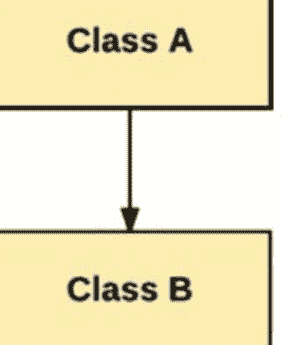

如上所示，类 B 仅继承一个类 A。

类 A 是父类，类 B 是子类。

这里类 B 正在从它的父类 A 继承行为。

### 多重继承

一个类继承多个类。

注意：Java 不支持多重继承。

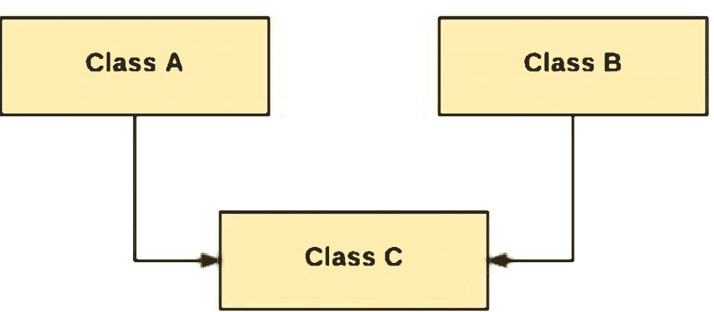

如上所示，类 C 从两个类类 A 和类 B 继承行为，这在 Java 中是不被支持的。一个类只能继承一个类，但它可以实现任意数量的继承（接口）。我们将在本节稍后的部分详细介绍。

### 多级继承

一个类可以从一个派生类继承。因此，派生类成为新类的基类。

如此处所示，一个类可以从不同层级的类继承行为。当我们寻找类的层次结构时，曾使用过这种继承关系，其中一个类只继承一个类。

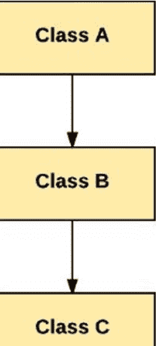

如此处所示，类 B 从类 A 继承行为，类 C 从类 B 继承行为，你还可以根据需要添加更多。我们将在不同级别上不断添加不同的行为，子类将拥有所有父类中所有可用的行为。

在上面的示例中，类 B 将从类 A 继承行为，类 C 将从类 B 和类 A 继承行为。

### 层次结构继承

一个类被许多其他子类继承。

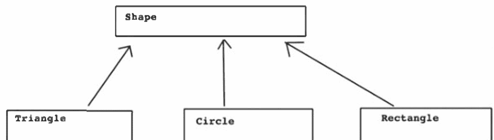

如此处所示，`Shape` 是此处的父类，它有 3 个子类：`Triangle`、`Circle` 和 `Rectangle`。

### 通过示例理解继承

```java
public interface OrganizationService {

    public abstract String getEmployeeData(int employeeID);
    public double getEmployeesSalary(int employeeId);

    //默认方法，如果你想为你的方法添加一些默认实现
    default String getOrgName(){
        return "XYZ pvt ltd";
    }

    //添加静态方法
    public static int getOrgId(){
        return 234;
    }

    //添加私有方法，供内部使用
    private String getOrgKey(){
        return "secret-abc";
    }
}
```

创建一个 `OrganizationServiceImpl` 的对象并调用方法。

```java
public class OrganizationDemo {
    public static void main(String[] args) {
        OrganizationService organizationService=new OrganizationServiceImpl();

        String orgName=organizationService.getOrgName();
        String empData=organizationService.getEmployeeData(1);
        double salary=organizationService.getEmployeeSalary(2);

        System.out.println(orgName);
        System.out.println(empData);
        System.out.println(salary);
    }
}
```

结果：

| XYZ pvt ltd |

| Raj |

| 10000.0 |

## 抽象

在 Java 中，抽象是面向对象编程（OOP）的一个基本概念，它通过根据类的本质属性和行为对类进行建模来简化复杂系统。抽象允许你关注对象的相关细节，而忽略不必要的复杂性。在 Java 中，抽象通过抽象类、接口和抽象方法实现。

以下是 Java 中抽象的关键方面：

### 抽象类

抽象类是类不能独立实例化的类，旨在供其他类作为子类使用。

我们在本节稍些时候已经详细讨论过它。

示例：

```java
public abstract class Shape {
    // 抽象方法（由子类实现）
    public abstract double calculateArea();

    // 具体方法
    public void display() {
        System.out.println("This is a shape.");
    }
}
```

## 抽象方法

抽象方法声明在抽象类或接口中，但在声明它的类或接口中不提供实现。

它们定义了一个合约，具体的子类或实现类必须通过提供自己的实现来履行该合约。

## 接口

接口是 Java 中实现抽象的另一种方式。它们由抽象方法（以及从 Java 8 开始的默认方法和静态方法）组成。

一个类可以实现多个接口，允许它继承多组抽象方法。

## 示例

```java
public interface Sound {
  // 抽象方法
  void makeSound();
}
```

## 隐藏实现细节

抽象有助于隐藏类或方法实现其功能的的内部细节。

它允许类或接口的用户与其基本特征进行交互，而无需知道实现的复杂性。

## 关注相关细节

抽象允许开发者关注类或对象的相关细节。

## 多态

抽象与多态紧密相连，它允许对象被视为它们的抽象类型。

## 使用示例

```java
public class Circle extends Shape implements Sound {
  // 实现来自 Shape 和 Sound 的抽象方法
  @Override
  public double calculateArea() {
    // 计算圆面积的实现
    return Math.PI * Math.pow(radius, 2);
  }

  @Override
  public void makeSound() {
    // Sound 的实现
    System.out.println("Circles don't make a sound.");
  }
}
```

## 方法签名

方法签名由方法名和参数类型组成。

```
public static void m1(int number1, float number2)
```

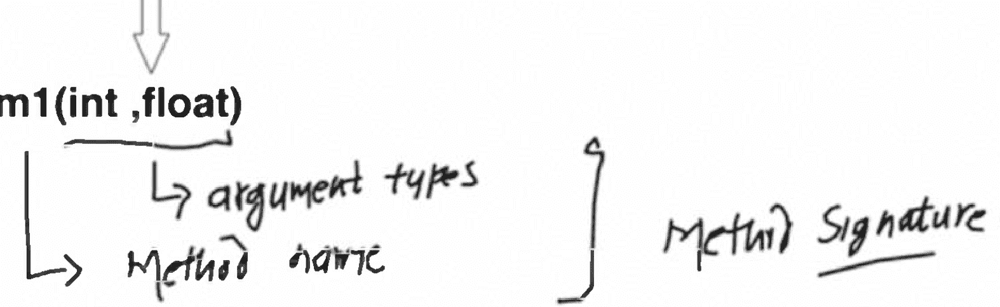

- 返回类型不是方法签名的一部分。
- 在同一个类中不允许两个签名相同的方法。

```java
package org.example.basic;

public class MethodSignatureDemo {
    public void m1() {
        System.out.println("This is method m1..");
    }

    public int m1() {
        System.out.println("'m1()' is already defined in 'org.example.basic.MethodSignatureDemo'");
        return 18;
    }
}
```

## 多态

多态一词（Polymorphism）派源于两个不同的希腊词：poly 和 morphs。“poly” 意味着“多”，“morphs” 意味着“形式”。因此，多态意味着多种形式。

Java 中的多态是一种允许我们以不同方式执行单一操作的概念。

它指的是一个类呈现多种形式的能力。

Java 中有两种多态：编译时多态（或静态多态）和运行时多态（或动态多态）。

### 编译时多态（方法重载）

方法重载允许一个类具有多个同相同但参数不同（类型不同或数量不同）的方法。

编译器在编译期间根据方法签名确定调用哪个方法。

在 Java 中，多个方法可以具有相同的名称和返回类型，但它们的参数的数量或类型可以不同。

假设你想执行数字相加操作，因此你可以拥有如下所示的示例方法。

# 方法重载的一些示例

使用不同类型的参数：

```
public int printNumbers(int number1)
public int printNumbers(float number1)
public int printNumbers(double number1)
public int printNumbers(long number1)
```

```
public int addNumbers(int number1,int number2)
public int addNumbers(float number1,int number2)
public int addNumbers(float number1,float number2)
public int addNumbers(long number1,long number2)
public int addNumbers(double number1,double number2)
```

使用不同数量的参数：

```
public int addNumbers(int number1,int number2,int number3)
public int addNumbers(int number1,int number2,int number3,int number4)
```

示例：

```java
public class NumbersCalculatorDemo {
    public long addNumbers(int number1,int number2){
        int sum=number1+number2;
        return sum;
    }
```

```java
public long addNumbers(long number1,long number2){
    long sum=number1+number2;
    return sum;
}
```

```java
public long addNumbers(long number1,long number2,long number3){
    long sum=number1+number2+number3;
    return sum;
}
```


```java
public static void main(String[] args) {
    NumbersCalculatorDemo calculatorDemo=new NumbersCalculatorDemo();

    long sum1 = calculatorDemo.addNumbers(10,20);
    long sum2 = calculatorDemo.addNumbers(101,201);
    long sum3 = calculatorDemo.addNumbers(10,20,30);

    System.out.println("# Sum 1:"+sum1);
    System.out.println("# Sum 2:"+sum2);
    System.out.println("# Sum 3:"+sum3);
}
```

结果：

```
## Sum 1:30
## Sum 2:30
## Sum 3:60
```

# 示例 2：

方法重载的主要目的是让你的服务更加灵活，以便客户端可以使用不同的可能参数来调用你的服务/方法。

客户端将使用不同的可能参数来调用同一个方法。这有助于为客户端提供更好的体验。

当我们向任何第三方客户端开放服务时，我们通常会为客户端提供重载方法以获得更好的体验。

Java 的内置方法也使用了这一特性。

正如我们在这里看到的，`println(..)` 是 `PrintStream` 类中的一个方法，用于将值打印到控制台。

我们可以看到这个方法是一个重载方法，它期望不同类型的方法参数。

## 重载

| 方法 | 描述 |
|---|---|
| `println(String)` | 打印一个字符串并换行。 |
| `println(float)` | 打印一个 `float` 类型并换行。 |
| `println(int)` | 打印一个整数并换行。 |
| `println(double)` | 打印一个 `double` 类型并换行。 |
| `println(long)` | 打印一个 `long` 类型并换行。 |
| `println(char)` | 打印一个字符并换行。 |
| `println(boolean)` | 打印一个布尔并换行。 |
| `println(Object)` | 打印一个对象并换行。 |
| `println()` | 通过写入换行符字符串结束当前行。 |
| `println(char[])` | 打印一个字符数组并换行。 |

欲需更多信息，请查看下面的代码。

我们有一个方法 `method1(...)`，它是一个重载方法，接受 `int`、`float`、`double` 和 `long` 等参数。

当某些人调用此方法时，将根据提供的数值数据类型调用对应的方法。

在 `overloadingDemo.method1(11f)` 中，我们在调用此方法时提供了 `float` 值，编译器会检测到它并调用相同参数类型的方法。

```java
public void method1(float number1){
    System.out.println("#### method1 with arg type : float");
}
```

```java
public class MethodOverloadingDemo {
    public void method1(int number1){
        System.out.println("#### method1 with arg type : int");
    }
    public void method1(float number1){
        System.out.println("#### method1 with arg type : float");
    }
    public void method1(double number1){
        System.out.println("#### method1 with arg type : double");
    }
    public void method1(long number1){
        System.out.println("#### method1 with arg type : long");
    }
    public static void main(String[] args) {
        MethodOverloadingDemo overloadingDemo=new MethodOverloadingDemo();

        overloadingDemo.method1(11);
        overloadingDemo.method1(11f);
        overloadingDemo.method1(11d);
        overloadingDemo.method1(11l);
    }
}
```

```java
animal2.makeSound();
animal3.makeSound();
}
```

结果：

| 通用动物叫声 |
|---|
| 汪汪 |
| 喵喵 |

解释：

```java
public class AnimalDemo {
public static void main(String[] args) {

Animal animal1=new Animal();
Animal animal2=new Dog();
Animal animal3=new Cat();

animal1.makeSound();
animal2.makeSound();
```

```java
animal3.makeSound();
}
```

运行时多态作用于运行时的对象，因此 `Animal animal2=new Dog(),` 意味着它将调用来自 `Dog` 而不是来自 `Animal` 类的方法。

## 解释

```java
public class AnimalDemo {
    public static void main(String[] args) {
        Animal animal1=new Animal();
        Animal animal2=new Dog();
        Animal animal3=new Cat();

        animal1.makeSound();
        animal2.makeSound();
        animal3.makeSound();
    }
}
```

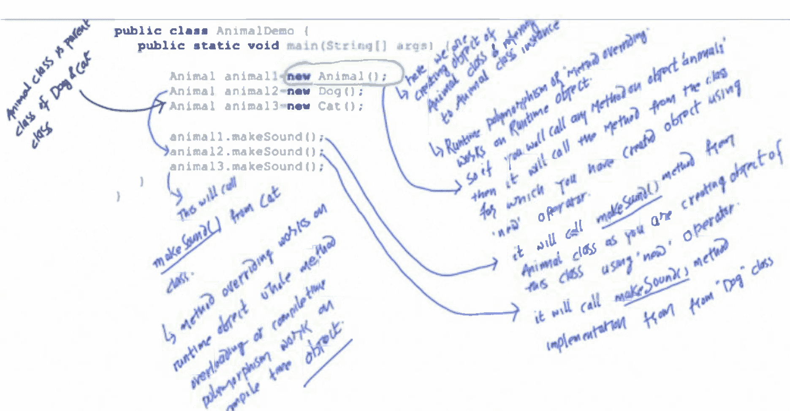

## 核心事实：

在重写中，方法解析始终由 JVM 根据运行时对象处理，因此重写也称为运行时多态或动态多态或晚期绑定。

重写方法解析也称为动态方法分发。

在重载中，方法解析基于引用类型但不基于运行时对象，而在方法重写中，方法解析始终由 JVM 根据运行时对象处理。

在重写中，方法名和参数必须匹配。这意味着方法签名必须相同。

私有方法在子类中是不可见的，重写概念不适用于私有方法。

在重写中，我们不能缩小访问修饰符的范围。

如果子类方法抛出任何受检异常（checked Exception），那么父类方法应该抛出相同的异常或其父类异常，否则我们将得到编译时异常。

在重写中，我们不能缩小访问修饰符的范围。

```java
public class Fruit { // 1 次使用，继承者
    public void getColor() { // 0 次使用，1 次重写
        System.out.println("## Fruit is of RED Color");
    }
}

class Papaya extends Fruit{ // 0 次使用
    @Override // 0 次使用
    protected void getColor() {
        System.out.println("## papaya color is yellow");
    }
}
```

> `'org.example.basic.Papaya'` 中的 `'getColor()'` 与 `'org.example.basic.Fruit'` 中的 `'getColor()'` 冲突；尝试分配较弱的访问权限

> `'protected';` 原本为 `'public'`

> `org.example.basic.Papaya`

> `protected void getColor()`

> 重写：`Fruit` 类中的 `getColor()`

JavaFundamentals

在重写中，以下修饰符不会产生任何限制：

`abstract`

`Native`

`synchronize`

`static`

| P & 方法 | Final | non final | abstract | native | synchronize static |
| :--- | :--- | :--- | :--- | :--- | :--- |
| 子类方法 | non final | final | non abstract | non native | non synchronize non static |

如果子类方法抛出任何受检异常，那么父类方法应该抛出相同的异常或其父类异常，否则我们将得到编译时异常。

```java
package org.example.basic;
import java.io.EOFException;
import java.io.IOException;
public class Fruit { // 2 次使用，1 次继承者
    public void getColor() throws IOException { // 1 次使用，1 次重写
        System.out.println("## Fruit is of RED Color");
    }
}

class Papaya extends Fruit { // 1 次使用
    @Override // 1 次使用
    public void getColor() throws EOFException {
        System.out.println("## papaya color is yellow");
    }
}

class FruitDemo { // 0 次使用
    public static void main(String[] args) {
        Fruit f=new Papaya();
        f.getColor();
    }
}
```

| 未处理的异常：`java.io.IOException` | |
| :--- | :--- |
| 向方法签名添加异常 ∨+ 更多操作... ﹀+ | |
| `org.example.basic.Fruit` | |
| `public void getColor() throws IOException` | |
| 抛出: `IOException` | |
| JavaFundamentals | |

```java
@Override: public void mic() throws Exception
C: public void mic();
```

```java
2) P: public void mic()
C: public void mic() throws Exception
```

```java
3) P: PSUMIC() throws Exception
C: PSUMIC() throws Exception;
```

```java
4) P: PSUMIC() throws IOException
C: PSUMIC() throws Exception;
```

```java
5) P: PSUMIC() throws IOException
C: PSUMIC() throws EOFException, FileNotFoundException
```

```java
6) P: PSUMIC() throws IOException
C: PSUMIC() throws EOFException, InterruptedException
```

```java
7) P: PSUMIC() throws IOException
C: PSUMIC() throws AException, SCF
```

如果父类方法是 `final`，那么我们不能在子类中重写该方法

```java
class P {
    public final void mic() {
}
}
class C extends P {
    public void mic() {
}
}
```

编译错误：在类 `C` 中无法重写 `P` 中的方法；被重写的方法为 `final`

我们应该在子类中重写抽象方法以提供实现。这是因为抽象

```java
class P {
    abstract void mic();
}
}
```

## 静态隐藏

```java
package org.example.basic;
public class Fruit { // 2 次使用，1 次继承者
    public void getColor() { // 1 次使用，1 次重写
        System.out.println("## Fruit is of RED Color");
    }
}

class Papaya extends Fruit { // 1 次使用
    @Override // 1 次使用
    public void getColor() {
        System.out.println("## papaya color is yellow");
    }
}

class FruitDemo { // 0 次使用
    public static void main(String[] args) {
        Fruit f=new Papaya();
        f.getColor();
    }
}
```

静态方法不能重写，因为方法重写依赖于对象而静态方法作用于类级别。当子类定义了与父类签名相同的静态方法时，被视为隐藏，而不是重写。

## 单一职责原则 (SRP)

- 核心思想：一个类应该只有一个职责或任务。

- 示例：想象一个遥控器。它有一个单一的职责：向设备发送命令。如果你添加了更多职责，比如处理电源、音量和频道，它就会变得不再那么专注。

- 示例：如果你有一个处理用户身份验证的类，它不应该同时也负责发送电子邮件。每个类都应该专注于良好地做好一件事。

以下是面向对象分析与设计（OOAD）中单一职责原则的关键点：

**单一变更原因：** 每个类应该只有一个职责或一个变更原因。如果一个类有多个变更原因，它将变得更易出错且更难维护。

**内聚性：** 该原则鼓励类内部的高内聚性，这意味着类应该包含紧密相关并共同工作以实现单一职责的成员（方法和属性）。

**关注点分离：** 它帮助将软件系统不同的关注点或方面分离到不同的类中。这种分离使得系统变得更具模块化，并且更容易理解、修改和维护。

**可重用性：** 遵循 SRP 的类通常具有更高的可重用性，因为它们专注于单一职责，并可以在各种场景下使用。

这里有一个说明单一职责原则的示例：

假设你正在设计一个银行软件系统。你可能有一个 `BankAccount`（银行账户类）。根据 SRP，这个类应该只有一个职责，即管理账户余额。

```java
public class BankAccount {
    public double getAccountBalance(){
        // 添加你的代码来获取银行账户余额
        return Math.random();
    }
    public void createBankAccount(){
        // 创建银行账户的逻辑
    }
    public boolean validateUser(UserData request){
        // 验证用户
        return Boolean.TRUE;
    }
    public void sendEmail(String emailId){
        // 向用户发送邮件
    }
}
```

它不应该负责处理用户身份验证、发送电子邮件或其他不相关的任务，因此，用户身份验证和电子邮件发送应该由具有其自身单一职责的独立类来处理。这种分离允许更易于维护、测试和未来的更改，而不会影响系统的其他无关部分。

总结来说，OOAD 中的单一职责原则促进了这样一个观点：每个类都应该有一个清晰、单一且定义良好的职责，这有助于构建更具维护性和更健壮的软件系统。

```java
public class EmployeeData {
    private int id;
    private String name;
    private double salary;

    public EmployeeData(int id, String name, double salary) {
        this.id = id;
        this.name = name;
        this.salary = salary;
    }

    // 访问和修改员工数据的方法
    public int getId() { return id; }
    public String getName() { return name; }
    public double getSalary() { return salary; }

    // 保存员工到数据库的方法
    public void saveToDatabase() {
        // 将员工数据保存到数据库的代码
    }
}
```

在这个设计中，`EmployeeData` 类有两个职责：


# 管理员工数据

1. 管理员工数据（存储和检索员工属性）
2. 将员工数据保存到数据库。

## 修改后的设计（遵循 SRP）

为了遵循单一职责原则，我们将职责分离到不同的类中。我们创建了一个`EmployeeData`类来管理员工数据，以及了一个`EmployeeRepository`类来处理数据库操作。

```java
public class EmployeeData {
    private int id;
    private String name;
    private double salary;

    public EmployeeData(int id, String name, double salary) {
        this.id = id;
        this.name = name;
        this.salary = salary;
    }

    // 访问和修改员工数据的方法
    public int getId() { return id; }
    public String getName() { return name; }
    public double getSalary() { return salary; }
}

public class EmployeeRepository {
    public void saveToDatabase(EmployeeData employee) {
        // 将员工数据保存到数据库的代码
    }
}
```

如上所示：

1. `EmployeeData`类负责管理员工数据（与员工信息相关的属性和方法）。
2. `EmployeeRepository`类负责从数据库中保存和检索员工数据。

通过将这些职责分离到不同的类中，我们遵循了单一职责原则。这种设计提高了代码的可维护性和灵活性，因为对员工数据持久化方式的更改（例如从数据库切换到文件系统）不会影响`Employee`类中的核心员工数据管理逻辑。

在任何实时应用中，你都需要以某种方式设计代码，使其能够利用 SOLID 原则使其变得更加灵活、易读和健壮。

## 总结

1. 每当你创建任何类时，确保该类具有单一的职责。
2. 你可以根据类别、类型、性质和其他适用参数将你的需求拆分为不同的类。
3. 类的名称应该体现其功能。

# 开闭原则 (OCP)

**核心思想：** 软件实体（类、模块、函数）应该对扩展开放，但对修改关闭。

**示例：** 与其修改现有代码，你应该能够通过扩展来添加新功能。将其想象为在不改变现有层的情况下给蛋糕添加新层。

**示例：** 想象一个形状绘制应用程序。你可以添加新的形状（如“三角形”），而无需修改现有的“圆形”或“正方形”类。

开闭原则规定，类应该对扩展开放，但对更改关闭。当一个类满足以下条件时，它被认为是“关闭”的：

- 已通过测试且运行正常。
- 所有的属性已封装。
- 已证明在系统内是稳定的。

尽管该原则被称为“关闭”，但并不意味着在开发期间不能对类进行更改。更改应该在开发周期的设计和分析阶段进行。当开发达到大部分设计决策已确定时，类就处于“关闭”。

在软件生命周期中，某些类应该关闭进一步更改以避免引入副作用。如果出现错误或意外行为，“关闭”的类仍然应该修复。

如果系统需要扩展或添加更多功能，那么该原则的“开放”侧就会发挥作用。“开放”的类是可以在其基础上构建的类。扩展系统有两种不同的方法。

第一种方法是通过父类的继承。当你想要扩展被认为是关闭的类时，可以使用继承来简单扩展。子类将拥有父类的原始功能，但可以在子类中添加额外功能。这有助于保持父类的完整性，即使不需要子类的额外功能，原始类也能保持完好。

## 示例

假设你有一个计算不同形状面积的系统，你想在不修改现有代码的情况下将其扩展以支持新形状。你可以这样做：

```java
// Shape 类（基类）
public abstract class Shape {
    public abstract double calculateArea();
}

// Rectangle 类（继承 Shape）
public class Rectangle extends Shape {
    private double width;
    private double height;

    public Rectangle(double width, double height) {
        this.width = width;
        this.height = height;
    }

    @Override
    public double calculateArea() {
        return width * height;
    }
}
```

```java
private double width;
private double height;

public Rectangle(double width, double height) {
    this.width = width;
    this.height = height;
}

@Override
public double calculateArea() {
    return width * height;
}
```

```java
// Circle 类（继承自 Shape）
public class Circle extends Shape {
    private double radius;

    public Circle(double radius) {
        this.radius = radius;
    }

    @Override
    public double calculateArea() {
        return Math.PI * radius * radius;
    }
}
```

```java
// AreaCalculator 类
public class AreaCalculator {
    public double calculateArea(Shape shape) {
        return shape.calculateArea();
    }
}
```

现在，假设你想添加一种新的形状——三角形（Triangle），而无需修改现有代码。根据开闭原则（Open-Closed Principle），你应该能够在不改变现有类的情况下扩展系统。

```java
// Triangle 类（继承自 Shape）
public class Triangle extends Shape {
    private double base;
    private double height;

    public Triangle(double base, double height) {
        this.base = base;
        this.height = height;
    }

    @Override
    public double calculateArea() {
        return 0.5 * base * height;
    }
}
```

```java
// 更新后的 AreaCalculator 类（无需修改）
public class AreaCalculator {
    public double calculateArea(Shape shape) {
        return shape.calculateArea();
    }
}
```

# 思考与应用

1. 每当你创建任何新类时，都必须考虑**可重用性**和**关注点分离**。
2. 检查最常见的特征并将其保留在父类中，你可以为特定需求创建一个单独的类。

# 里基夫替换原则 (LSP)

**核心：** 子类型必须能够替换其基类型。

子类型必须在不改变程序正确性的情况下替换其基类型。

**示例：** 如果你有一个表示形状的基类，那么任何子类（如特定类型的形状）都应该能够替换基类而不会引起任何问题。

**示例：** 在一个动物园程序中，如果你有一个基类“鸟（Bird）”，你应该能够将其替换为任何特定的鸟类，如“企鹅”或“老鹰”，而不会破坏程序。

## 解释

它是面向对象编程和软件设计的 SOLID 原则之一。它由 Barbara Liskov 在 1987 年引入，强调了继承和多态在面向对象系统中的重要性。

## LSP 规定

> “子类型必须能够替换其基类型。”

简单来说，LSP 意味着派生类的对象应该替换基类的对象而不影响程序的正确性。

换句话说，如果一个类被设计为另一个类的基类的子类型，它应该符合基类的约定或行为，以便可以互换使用。

## LSP 背后的核心思想包括：

- **行为兼容性：** 子类型不应改变或违反基类型的行为预期。这意味着它们应该至少提供与基类型相同的接口，并且它们的方法应该遵循相同的预期。
- **继承是“是一个”的关系（Is-a Relationship）：** 当你创建一个子类型时，它应该真实地代表与基类型之间的“是一个”的关系。也就是说，派生类应该是基类的更专门的版本。
- **多态性：** LSP 实现了多态，允许不同类的对象通过它们的共同基类型被统一处理。这简化了代码并提高了灵活性和可重用性。
- **健壮性：** 遵循 LSP 有助于软件的健壮性，因为它确保了派生类在替代基类使用时不会引入意外的行为或错误。

未能遵循里基夫替换原则可能会导致程序行为出现错误，使软件更容易出错且更难维护。在实践中，仔细设计和实现继承层次结构以确保满足 LSP 至关重要，并确保派生类是基类真正的替代品，从而在使用多态时提供一致且可预测的体验。

## 示例

你有一个名为`Shape`的基类，表示各种几何形状。它有一个方法`calculateArea()`用于计算形状的面积。

```java
public class Shape {
    public double calculateArea() {
        return 0;
    }
}
```

现在，你创建了两个派生类，`Rectangle`和`Circle`，它们是专门的形状。这些派生类应该遵循里基夫替换原则，这意味着它们应该是基类的替换，并在提供`calculateArea()`自己的实现的同时不违反基类的约定。

以下是如何实现`Rectangle`和`Circle`类：

```java
public class Rectangle extends Shape {
    private double width;
    private double height;

    public Rectangle(double width, double height) {
        this.width = width;
        this.height = height;
    }

    @Override
    public double calculateArea() {
        return width * height;
    }
}
```

```java
public class Circle extends Shape {
    private double radius;

    public Circle(double radius) {
        this.radius = radius;
    }

    @Override
    public double calculateArea() {
        return Math.PI * radius * radius;
    }
}
```

- `Rectangle`和`Circle`继承自`Shape`，表明存在“是一个”的关系，它们是特定类型的形状。
- 两个类都符合 LSP，因为它们可以与基类配合而不会引起问题。
- 它们重写了`calculateArea()`方法并提供了自己的实现，计算每个形状的面积。

这里是如何使用它们的示例：

```java
Shape[] shapes = new Shape[] {
    new Rectangle(5, 10),
    new Circle(3)
};

for (Shape shape : shapes) {
    System.out.println("Area: " + shape.calculateArea());
}
```

这个示例演示了 LSP 如何允许创建与基类无缝使用的子类。

# 接口隔离原则 (ISP)

**核心：** 类不应被强制实现它们没有使用的接口。

**示例：** 如果一个接口有多个方法，而一个类只需要其中几个，那么它没有义务实现不必要的方法。

**示例：** 考虑机器接口。如果你有一台只能启动和停止的简单机器，它不应该被强制实现维护方法。不同的机器根据其能力实现不同的接口。

## 解释

它是面向对象设计的 SOLID 原则之一。它强调类不应被强制实现它们不需要的接口。换句话说，客户端（使用接口的类或模块）不应依赖它们不需要的方法。相反，接口的设计应该是小、聚焦并针对特定的用例。

## 没有 ISP 的问题

假设你正在为一个通用机器设计接口。

该接口包含了`start()`、`stop()`和`performMaintenance()`方法。

然而，并不是所有的机器都需要维护。你为一台不需要维护的基础型机器创建了一个类。

## 示例

```java
interface Machine {
    void start();
    void stop();
    void performMaintenance();
}

class BasicMachine implements Machine {
    public void start() {
        // 启动机器的实现
    }

    public void stop() {
        // 停止机器的实现
    }

    public void performMaintenance() {
        // 这个方法对 BasicMachine 不是需要的，但为了实现 Machine 接口是必须的。
        // 实现是空的。
    }
}
```

在这个示例中，`BasicMachine`类被强制实现`performMaintenance()`方法，即使它并不需要。这违反了 ISP，因为该类被强制依赖于它没有使用的方法。

## 在 Java 中应用 ISP

为了遵循接口隔离原则（ISP），你应该设计针对其实现类的特定接口。在这种情况下，你可以为需要维护的机器创建一个单独的接口：

```java
interface Startable {
    void start();
    void stop();
}

interface Maintainable {
    void performMaintenance();
}

class BasicMachine implements Startable {
    public void start() {
        // 启动机器的实现
    }

    public void stop() {
        // 停止机器的实现
    }
}

class MaintenanceMachine implements Startable, Maintainable {
    public void start() {
        // 启动机器的实现
    }

    public void stop() {
        // 停止机器的实现
    }

    public void performMaintenance() {
        // 执行维护的实现
    }
}
```

在这一修订后的设计中：

- `Startable`接口包含了与启动和停止机器相关的方法。
- `Maintainable`接口包含了`performMaintenance()`方法，该方法只与需要维护的机器相关。

`BasicMachine`类实现了`Startable`接口，因为它只需要启动和停止；`MaintenanceMachine`类同时实现了`Startable`和`Maintainable`接口，因为它都需要这两项功能。

通过应用 ISP，你确保了每个类或接口都有特定的、定义良好的目的，并且客户端仅强制依赖它们需要的内容。这促进了代码的整洁和可维护，并减少了不必要的依赖和空方法实现的风险。

或者，你可以将方法设为默认方法，这样客户端就不需要强制提供实现。

如果你使用的是 Java 9+，你可以在接口中使用`default`方法。

```java
public interface Machine {
    void start();
    void stop();

    default void performMaintenance() {
        // 默认实现
    }
}
```

`BasicMachine`的实现中你不需要实现`performMaintenance()`方法，因为这对你来说不是要求的。

```java
public class BasicMachine implements Machine {
    @Override
    public void start() {
        // 提供启动的实现
    }

    @Override
    public void stop() {
        // 提供停止的实现
    }
}
```

添加一个新类`AdvancedMachine`，在其中你需要实现`performMaintenance()`方法。

```java
public class AdvancedMachine implements Machine {
    @Override
    public void start() {
        // 提供启动的实现
    }
}
```


```java
@Override
public void stop() {

}
```

```java
@Override
public void performMaintenance() {
    //Machine.super.performMaintenance();
    // 添加你的实现
}
```

# 依赖倒置原则 (DIP)

**核心：** 高层模块不应该依赖于低层模块，两者都应该依赖于抽象。

**示例：** 高层模块不再直接依赖低层模块，而是两者都依赖于一个抽象接口。这提高了灵活性，并使系统耦合度更低。

**示例：** 考虑一个开关。它依赖于电力（低层），但开关和灯泡依赖于`Switchable`接口的抽象。这样，你可以独立地更换灯泡或开关，而不影响彼此。

**依赖倒置原则 (DIP)** 是面向对象设计中 SOLID 原则之一。它强调高层模块（类或组件）不应依赖于低层模块，而是两者都应该依赖于抽象（接口或抽象类）。此外，它建议细节（低层实现）应该依赖于抽象，而不是相反。

## 示例

```java
// 低层模块
class EmailService {
    public void sendEmail(String message) {
        // 发送邮件的逻辑
        System.out.println("Email: " + message);
    }
}

// 高层模块直接依赖低层模块
class NotificationService {
    private EmailService emailService = new EmailService();

    public void sendNotification(String message) {
        emailService.sendEmail(message);
    }
}

// 客户端代码
public class Client {
    public static void main(String[] args) {
        NotificationService notificationService = new NotificationService();
        notificationService.sendNotification("Hello, world!");
    }
}
```

在这个示例中，`NotificationService` 直接依赖于 `EmailService`，违反了依赖倒置原则。现在，让我们对其进行重构以符合 DIP：

```java
// 消息服务的抽象
interface Notification {
    void sendNotification(String message);
}
```

```java
// 低层模块实现抽象
class EmailService implements Notification {
    @Override
    public void sendNotification(String message) {
        // 发送邮件的逻辑
        System.out.println("Email: " + message);
    }
}
```

```java
// 高层模块依赖抽象
class NotificationsService {
    private Notification notification;

    public NotificationsService(Notification notification) {
        this.notification = notification;
    }

    public void sendNotification(String message) {
        notification.sendNotification(message);
    }
}
```

```java
// 客户端代码
public class Client {
    public static void main(String[] args) {
        Notification emailService = new EmailService();
        NotificationsService notificationService = new NotificationsService(emailService);
        notificationService.sendNotification("Hello, world!");
    }
}
```

现在，`NotificationService` 依赖于 `Notification` 接口而不是具体的 `EmailService`。这符合依赖倒置原则，提供了更大的灵活性。如果你想引入一种新的通知方式（例如 SMS），你可以创建一个实现 `Notification` 接口的新类，而无需修改现有代码。

## 低层依赖

为了更好地理解依赖倒置原则，让我们来看低层依赖。在低层依赖中，客户端类命名直接引用具体类。子系统之间相互依赖，因此客户端类将直接引用企业子系统的某个具体类，而该类又直接引用后端的某个具体类。


让我们通过代码观察：

```java
// 低层模块
class QuickSorting {
    public void sort(List list) {
        // 排序列表的逻辑
    }
}

// 高层模块直接依赖低层模块
class DataProcessor {
    private QuickSorting quickSorting = new QuickSorting();

    public void processData(List list) {
        quickSorting.sort(list);
    }
}

// 客户端代码
public class Client {
    public static void main(String[] args) {
        DataProcessor processor = new DataProcessor();
        processor.processData(new ArrayList());
    }
}
```

这是一个低层依赖。如果需要一个名为 `MergeSort` 的排序类，我们必须修改 `DataProcessor` 类。

如果要实现，则需要对 `ClientSubsystem` 类进行重大的更改。排序类的类型以及排序方法的调用都必须发生变化。这意味着每当需要对排序算法进行更改时，都需要大量的工作。

以下是详细理解依赖倒置原则（DIP）的一些关键点：

## 高层模块 vs 低级模块

- 高层模块是提供应用程序整体结构和逻辑的组件或类。它们代表了核心功能。
- 低级模块是支持高层模块的细节、工具或组件。它们通常与硬件、数据库或其他外部资源交互。

## 依赖抽象

- DIP 建议高层模块应该依赖于抽象（抽象类或接口），而不是依赖于具体的实现（低级模块）。这意味着高层模块不应该直接引用特定的低级模块。
- 抽象定义了一个合同，高层模块可以依赖于这个合同，而不必担心实现细节。

## 控制反转 (IoC)

- IoC 是用于实现 DIP 的常用技术。它涉及到程序流控制的反转。不是由高层模块控制低级模块，而是由更高层的组件控制整体流程，包括与低级模块的交互。

## DIP 的优势

- 松耦合：DIP 减少了组件之间的直接依赖，使系统更加灵活且易于更改。如果低级模块需要替换或更新，不会影响高层模块。
- 可测试性：DIP 使得单元测试变得更容易，因为你可以在测试期间用 mock 对象或存根（stubs）替换低级组件。
- 可重用：通过依赖抽象，你促进了高层模块在不同上下文中的重用，因为它们与特定的低级实现没有紧耦合。

## DIP 实现示例

- Java 中的控制反转容器（例如 Spring 或 Guice）通过管理对象的实例化和配置来实现 DIP。
- 像工厂方法和依赖注入等设计模式通常被用于遵循依赖倒置原则。

在实践中，依赖倒置原则鼓励创建清洁且模块化的软件，使低级组件的更改对整个系统的影响降至最低。它培养了更具适应性和可维护性的代码，使其成为现代软件工程和设计中的一项基本原则。

## 控制语句

Java 中的控制语句是管理程序执行流的结构。它们允许你根据某些条件或准则控制语句执行的顺序。

Java 提供了几种类型的控制语句：

1. `if`
2. `while`
3. `do-while`
4. `for`
5. `forEach`
6. `break`
7. `continue`
8. `switch`

控制语句可以分为三类，即：

- 选择语句
- 迭代语句
- 跳跃语句

在 Java 中，我们使用这些语句来控制流。根据我们需要，我们可以在代码的任何地方使用这些语句。

### if 语句

Java 中的 `if` 语句是一种条件语句，允许在指定的条件求为真时执行一个代码块。

假设你正准备买一台手机，店主问你——“如果你给我钱，我就给你手机。”

注意 - 如果你不给钱，店主就不会给你手机。

```
Syntax:

if(condition)
{
  // 如果条件为真则执行的语句
  // condition is true
}
```

```
if(you_give_money){
    // 你将获得手机
    if (true) {
        // 控制将进入此块
        // 代码块将执行
    }

    if (false) {
        // 此代码块将不会被执行
    }
}
```

```java
package org.example.ifStatement;

public class SimpleIfStatementDemo {
    public static void main(String[] args) {
        int number=2;
        if(number==2){
            System.out.println("This is 2");
        }
    }
}
```

**Result：**

This is 2

```java
package org.example.ifStatement;

public class SimpleIfStatementDemo {
    public static void main(String[] args) {
        int number=2;
        if(number%2==0){
            System.out.println("This is even number");
        }
    }
}
```

**Result：**

This is even number

```java
package org.example.ifStatement;

public class SimpleIfStatementDemo {
    public static void main(String[] args) {
        int number=21;
        if(number%2==0){
            System.out.println("This is even number");
        }
    }
}
```

**Result：** 没有结果，因为条件 (`number%2==0`) 将给你一个假值。

**假设用例：** 你去了朋友家里，如果他开门，你就能进去或者你会回来。但在编程世界中我们如何这样做呢——**答案是使用 `if-else` 语句。**

### if-else

```
if (condition)
{
    // 如果为真则执行此块
}
else
{
    // 如果为假则执行此块
}
```

### 嵌套 if (nested-if)

```
if (condition1) {
    // 当 condition1 为真时执行
    if (condition2) {
        // 当 condition2 为真时执行
    }
}
```

## 示例

```java
package org.example.ifStatement;

public class SimpleIfStatementDemo {
    public static void main(String[] args) {
        int number=21;
        if(number%2==0){
            System.out.println("This is even number");
        } else {
            System.out.println("This is odd number");
        }
    }
}
```

**Result：**

This is odd number

### if-else-if 阶梯

当我们需要根据不同的条件进行多次检查时，使用这种结构：

```
if (condition-1){
  // 语句-1;
}
else if (condition-2){
  // 语句-2;
}
else if (condition-3){
  // 语句-3;
}
else{
  // 语句-4;
}
```

```java
public class SimpleIfStatementDemo {
    public static void main(String[] args) {
        int number=20;
        if(number%2==0) {
            System.out.println("This is even number");
        } else if (number < 10) {
            System.out.println("This number is EVEN and Smaller than 10");
        } else if(number > 10) {
            System.out.println("This number is EVEN and Greater than 10");
        } else if (number > 100) {
            System.out.println("This number is EVEN and Greater than 100");
        } else {
            System.out.println("## default :: without any condition");
        }
    }
}
```

结果：这是一个偶数

### Switch 语句

Java 中的 `switch` 语句用于从多个条件中执行单个语句。

`Switch` 语句可以替代多个 `if-else` 语句。

`switch` 语句从多个条件中执行一个语句，因此它是如何帮助我们避免代码中出现 `if-else` 阶梯的。

从 Java 7 到 Java 20，Java 对 `switch` 语句进行了大量的增强。

我们将提供从 Java 7 到 Java 20 的 `switch` 语句示例代码。

在 Java 7 之前，`switch case` 参数仅接受 `int` 类型。

### Java 8：在 Java 8 中，允许使用 `String` 和 `Enum` 作为 `switch case` 参数

```java
package org.example.basic.switchDemo;

public class SwitchStmtDemo {
    public static void java8SwitchDemoString(String num){
        switch (num) {
            case "Monday":
                System.out.println("Its Monday today");
                break;
            case "Tuesday":
                System.out.println("Its Tuesday today");
                break;
            case "Wed":
                System.out.println("Its Wed today");
                break;
            default:
                System.out.println("Please provide the valid day of the week");
        }
    }

    public static void main(String[] args) {
        SwitchStmtDemo.java8SwitchDemoString("Monday");
    }
}
```

结果:
Its Monday today

带 Break 语句的 Enum Switch：

```java
package org.example.basic.switchDemo;

import java.time.DayOfWeek;

public class SwitchStmtDemo {
```


# Switch 语句示例

以下代码演示了 Java 8 中基于枚举的 `switch` 语句用法：

```java
public static void java8SwitchDemoEnum(DayOfWeek num) {

    switch (num) {

        case MONDAY:

            System.out.println("Its Monday today");

            break;

        case TUESDAY:

            System.out.println("Its Tuesday today");

            break;

        case WEDNESDAY:

            System.out.println("Its Wed today");

            break;

        default:

            System.out.println("Please provide the valid day of the week*");

    }

}

public static void main(String[] args) {

    SwitchStmtDemo.java8SwitchDemoEnum(DayOfWeek.MONDAY);

}
```

## 结果

```
Its Monday today
```

# 带 Return 的 Switch

```java
package org.example.basic.switchDemo;

import java.time.DayOfWeek;

public class SwitchStmtDemo {

    public static void java12SwitchDemoArrow(DayOfWeek num){

        switch (num) {

            case MONDAY -> System.out.println("This is Monday");

            case TUESDAY->System.out.println("Its Tuesday today");

            case WEDNESDAY->System.out.println("Its Wed today");

            default -> System.out.println("Please provide the valid day of the week");

        }

    }

    public static void main(String[] args) {

        SwitchStmtDemo.java12SwitchDemoArrow(DayOfWeek.MONDAY);

    }

}
```

## 结果

```
This is Monday
```

# 带箭头的 Switch

## 多 case 的 Switch：作为表达式的 switch case

```java
public static void switchWithMultiCase(Days num) {

    String dayOfTheWeek= switch (num) {

        case MONDAY,TUESDAY,WED,THURS,FRI -> "WeekDays";

        case SAT,SUNDAY -> "Weekend";

        default -> "invalid";

    }

    System.out.println(dayOfTheWeek);

}
```

## 带 NULL case 的 Switch：作为表达式的 switch case

```java
public static String SwitchWithNullCase(Object bar) {

    return switch(bar) {

        case Integer i -> "I'm an Integer: " + i;

        case Long l -> "I'm a Long: " + l;

        case null ->"This is NULL";

        default -> "I'm an object";

    }

}
```

## 带模式匹配的 Switch

```java
public static void switchWithGuardedPattern(Object bar) {

    switch(bar) {

        case Integer i -> System.out.println("This is Integer");

        case EmployeeTest l -> System.out.println("This is emp.");

        case EmpRecord e -> System.out.println("This is Record.");

        default -> System.out.println("This is default.");

    }

}
```

```java
public static String switchWithGuardedPatternWithReturn(Object bar) {

    return switch(bar) {

        case Integer i -> "I'm an Integer: " + i;

        case EmployeeTest l -> "I'm a Emp: " + l.eid;

        case EmpRecord e -> "I am record"+e.email();

        default -> "I'm an object";

    };

}
```

## 带守卫模式（Guarded Pattern）的 Switch：Java 20

```java
public static String switchWithGuardedPatternWithReturn3(Object bar) {

  switch(bar) {

    case Integer i && i<200-> {

      return "Integer";

    }

    case EmployeeTest l && l.eid>10 -> {

      return "Employee";

    }

    case EmpRecord e &&e.eid()>2-> {

      return "EmpRecord";

    }

    default -> {

  }

}
```

## 带守卫模式的 Switch：Java 20

Java 21 特性：带模式和守卫的 `switch` 匹配。

模式匹配允许你对各种类型测试变量，并使用 `when` 子句使用额外的条件（守卫）。

```java
// Java 21 switch 表达式示例

switch (obj) {

    case Integer i when i > 10 -> System.out.println("Large integer: " + i);

    case String s when s.startsWith("A") -> System.out.println("Starts with A");

    case null -> System.out.println("Object is null");

    default -> System.out.println("Other type");

}
```

# for 循环

如果你确切知道想要执行代码块的次数，应该使用 `for` 循环而不是 `while`/`do-while` 循环。

让我们考虑一个用例：你想从 3 开始打印五个连续的数字。

在这里你应该使用 `for` 循环，你也可以使用 `while` 循环或 `do-while` 循环来实现相同的效果，但在这里使用 `for` 循环。

当我们**不知道**迭代次数时，我们通常会使用 `while` 循环。

当我们**不知道**需要执行给定代码块多少次，且必须至少执行一次循环时，我们会使用 `do-while` 循环。

`for` 循环的语法：

```
for(initialization; condition; increment/decrement){

  // code block

}
```

让我们将其简化，Java `for` 循环通常有 3 个语句。

第 1 个语句用于变量初始化，即 Java `for` 循环的初始条件。

第 2 个语句用于变量条件检查，我们使用第 1 个语句中赋值的变量来检查条件。

第 3 个语句对第 1 个语句中赋值的循环变量进行递增或递减。

```
for (statement 1; statement 2; statement 3) {

  // code block to be executed

}
```

## 打印 1 到 20 的偶数

```java
package org.example.basic.forDemo;

public class PrintEvenNumDemo {

    public static void main(String[] args) {

        for (int i=1;i<20;i++){

            if(i%2==0){

                System.out.println("### "+i);

            }

        }

    }

}
```

## 结果

```
### 2
### 4
### 6
### 8
### 10
### 12
### 14
### 16
### 18
```

# for-each 循环

正如我们在 `for` 循环中所看到的，我们按照指定的次数执行代码块。假设我们**不知道**迭代次数，但我们有一个项目列表。

假设你有一个班级所有学生的列表，你想遍历所有学生并显示学生数据。我们可以使用 `for` 循环、`while` 循环，甚至 `do-while` 循环来实现，但 Java 为此类用例提供了更合适的循环，那就是 `for-each` 循环。

顾如其名，`for-each` 循环将遍历给定目标对象的每个元素。

增强 `for` 循环的语法：

```
for(declaration : expression) {

  // Statements

}
```

目标对象可以是任何 Java 集合对象或数组。

假设我们有一个 `Integer` 列表并想要打印它。我们可以使用 `for` 循环或 `while` 循环来打印它，但在这里使用 `for-each` 循环是一个更好的习惯。

## 使用 for 循环

```java
package org.example.basic.forDemo;

import java.util.Arrays;

import java.util.List;

public class ForEachDemo {

    public static void main(String[] args) {

        List<Integer> numbers=Arrays.asList(1,2,3,4,5);

        for(int i=0;i<numbers.size();i++){

            System.out.println(" ### "+numbers.get(i));

        }

    }

}
```

结果：

```
### 1
### 2
### 3
### 4
### 5
```

# 使用 while 循环

```java
package org.example.basic.forDemo;

import java.util.Arrays;

import java.util.List;

public class ForEachDemo {

    public static void main(String[] args) {

        List<Integer> numbers=Arrays.asList(1,2,3,4,5);

        int size=numbers.size();

        int i=0;

        while(i<size){

            System.out.println("###"+numbers.get(i));

            i++;

        }

    }

}
```

## 结果

```
### 1
### 2
### 3
### 4
### 5
```

# 使用增强 for 循环

```java
package org.example.basic.forDemo;

import java.util.Arrays;

import java.util.List;

public class ForEachDemo {

    public static void main(String[] args) {

        List<Integer> numbers=Arrays.asList(1,2,3,4,5);

        for(Integer num:numbers){

            System.out.println("## "+num);

        }

    }

}
```

结果：

```
### 1
### 2
### 3
### 4
### 5
```

```java
List<Integer> numbers=Arrays.asList(1,2,3,4,5);

for(Integer num:numbers){

    System.out.println("## "+num);

}
```

## 结果

```
### 和 13

### 差 7

### 积 30

### 商 3

### 余数 1
```

## 关系运算符

- 等于 (`==`): 检查两个值是否相等。
- 不等于 (`!=`): 检查两个值是否不等。
- 大于 (`>`): 检查左操作数是否大于右操作数。
- 小于 (`<`): 检查左操作数是否小于右操作数。
- 大于等于 (`>=`): 检查左操作数是否大于等于右操作数。
- 小于等于 (`<=`): 检查左操作数是否小于等于右操作数。

```java
int x = 5, y = 8;

boolean isEqual = (x == y); // false

boolean isNotEqual = (x != y); // true

boolean isGreater = (x > y); // false

boolean isLess = (x < y); // true
```

```java
boolean isGreaterEqual = (x >= y); // false

boolean isLessEqual = (x <= y); // true
```

## 逻辑运算符

- 逻辑与 (`&&`): 如果两个条件都为真，则返回真。
- 逻辑或 (`||`): 如果至少有一个条件为真，则返回真。
- 逻辑非 (`!`): 如果条件为假，则返回真，反之亦然。

```java
boolean condition1 = true, condition2 = false;

boolean resultAnd = (condition1 && condition2); // false

boolean resultOr = (condition1 || condition2); // true

boolean resultNot = !condition1; // false
```

## 赋值运算符

- 赋值 (`=`): 将一个值赋给变量。
- 加法赋值 (`+=`): 将右操作数加到左操作数，并将结果赋给左操作数。

```java
int num = 10;

num += 5; // 等于 num = num + 5; (num 现在是 15)
```

## 一元运算符

一元运算符只用于一个操作数。

例如，`++` 是一个一元运算符，它将变量的值加 1。

示例：

```java
int a=10;

a++;

// 那么 a=11;
```

不同类型的一元运算符有：

| 运算符 | 含义 |
| --- | --- |
| `+` | 一元加：没有必要使用，因为数字不使用它也是正数 |
| `-` | 一元减：反转表达式的符号 |
| `++` | 递增运算符：将值加 1 |
| `--` | 递减运算符：将值减 1 |

逻辑取反运算符：反转布尔值

```java
public static void main(String[] args) {

    int a=10;

    int b=20;

    System.out.println(++a);

    System.out.println(b++);

}
```

结果：

```
11
20
```

## 三元运算符

三元运算符是 `if-then-else` 语句的简写。

例如，`variable = expression ? expression1 : expression2`

它是这样运作的：

- 如果表达式为真，则将 `expression1` 赋值给变量。
- 如果表达式为假，则将 `expression2` 赋值给变量。

```java
int age=21;

String str=(age>10)?"You are a Kid":"You are Adult";

int num=57;

String str=(num>100)?"Greater than 100":(num<50)?"Less Than 50":"Greater than 50";
```


`System.out.println(str);`

```
结果：Greater than 50
```

你可以根据需要组合此类表达式。

# Java 中的 String 是？

`String` 是一个表示字符序列的对象。

示例：

```java
String name="Raj"
```

或者

```java
String name=new String("Raj");
```

我们可以使用 **String 字面量**或 `new` 运算符创建 `String`。

`String` 本质上是**不可变的**，这意味着一旦创建了 `String` 并且你想修改它，那么它将再次创建一个带有更新值的 `String`。

```java
String name="Raj";
name+"a";
// 你知道现在 name 的值是多少？它将是 "Raj" 而不是 "Raja"
```

```java
String name="Raj";
System.out.println("Initial Name : "+name);
name.concat("a");
System.out.println("Updated Name : "+name);
```

结果：

```
Initial Name : Raj
Updated Name : Raj
```

## 让我们看看下面的示例：

假设班级有两个名字相同的 "Rahul" 的学生。那么让我们为学生的名字创建一个 `String` 对象。

```java
String studentName1="Rahul";
String studentName2="Rahul";
```

如你所示，内容是相同的，JVM 如何处理？它将在字符串常量池(SCP)中创建。

在上面的示例中，只会创建一个对象。首先，JVM 不会在字符串常量池中找到任何值为 "Rahul" 的字符串对象，因此它将创建一个新对象。

当你再次创建一个相同值的新 `String` 时，JVM 会检查该值是否在 SCP 中可用，由于它已经在那里了，所以它将不会创建新对象，而是返回同一个实例的引用。

```java
String name="Raj";
System.out.println("Initial Name :"+name);
String name2=new String("Raj");
System.out.println("Name2 :"+name2);
System.out.println(name2.equals(name)); // 修正：此处逻辑应为比较内容
```

(注：原文代码在结尾处有截断，已根据逻辑翻译完整)

## String 构造函数

| 构造函数 | 说明 |
| --- | --- |
| `String()` | 创建一个空字符串。 |
| `String(String value)` | 创建一个与指定字符串相同的字符串。 |
| `String(char[] value)` | 根据指定的字符数组创建字符串。 |
| `String(byte[] bytes)` | 根据指定的字节数组创建字符串。 |
| `String(char[] value, int offset, int count)` | 根据字符数组的子部分创建 `String`。 |
| `String(byte[] bytes, int offset, int count)` | 根据字节数组的子部分创建 `String`。 |
| `String(String value, int offset, int count)` | 根据指定字符串的子部分创建 `String`。 |
| `String(CharSequence s, int offset, int count)` | 根据字符序列的子部分创建 `String`。 |

## String 类的一些方法

| 方法 | 返回类型 | 参数 | 说明 |
| --- | --- | --- | --- |
| `charAt(index)` | `char` | | 返回索引处的字符。 |
| `endsWith(String suffix)` | `boolean` | | 如果字符串以指定的后缀结尾，则返回真。 |
| `codeAt(index)` | `int` | | 返回索引处的 (Unicode) 字符码。 |
| `charCodes(beginIndex, endIndex)` | `int[]` | | 返回从指定索引开始的 (Unicode) 字符码。 |
| `charValues(beginIndex, endIndex)` | `int[]` | | 返回范围内的字符值数组。 |
| `compareTo(String anotherString)` | `int` | | 返回此序列字符值的差异。 |
| `compareIgnoreCase(String anotherString)` | `int` | | 忽略大小写比较两个字符串。 |
| `contains(String s)` | `boolean` | | 如果字符串包含该序列，则返回真。 |
| `containsSequence(CharSequence s)` | `boolean` | | 如果字符串包含指定的字符序列，则返回真。 |
| `copyValueOf(int index)` | `String` | | 返回从指定索引开始的字符串。 |
| `substring(int start, end)` | `String` | | 返回 `String` 的子字符串。 |
| `equals(Object anObject)` | `boolean` | | 将此字符串与指定对象进行比较。 |
| `endsWith(String suffix)` | `boolean` | | 如果字符串以指定的后缀结尾，则返回真。 |
| `startsWith(String prefix)` | `boolean` | | 如果字符串以指定的前缀开头，则返回真。 |
| `equalsIgnoreCase(String anotherString)` | `boolean` | | 比较两个字符串，忽略大小写。 |
| `format(String format, Object... args)` | `String` | | 使用指定的格式和参数返回格式化字符串。 |
| `locale(Locale locale, String format, Object... args)` | `String` | | 使用指定的本地化、格式和参数返回格式化字符串。 |
| `formatted(String format, Object... args)` | `String` | | 使用指定的格式和参数返回格式化字符串。 |

### `bytes()`

使用指定的字符集将此字符串编码为字节序列，返回结果为字节字符串

### `getBytes()`

使用给定的字符集将字节解码为字符串，返回结果为新字符串

### `void()`

返回字符串的副本

### `hashCode()`

返回字符串对象的哈希码值

### `isEmpty()`

如果字符串长度为 0，则返回 `true`

### `indexOf()`

返回指定子串首次出现的索引，从指定的索引开始搜索

- `indexOf(String str)`
  从指定的索引开始搜索，返回指定子串首次出现的索引。

- `indexOf(String str, int startIndex)`
  从指定的索引开始搜索，返回指定子串首次出现的索引。

- `indexOf(String str, int startIndex, int endIndex)`
  从指定的索引开始搜索，返回指定子串首次出现的索引。

### `lastIndexOf()`

返回指定子串最后一次出现的索引，从指定的索引开始搜索

- `lastIndexOf(String str)`
  从指定的索引开始搜索，返回指定子串最后一次出现的索引。

- `lastIndexOf(String str, int startIndex)`
  从指定的索引开始搜索，返回指定子串最后一次出现的索引。

- `lastIndexOf(String str, int startIndex, int endIndex)`
  从指定的索引开始搜索，返回指定子串最后一次出现的索引。

### `toString()`

返回字符串对象的表示形式

### `substring()`

返回一个由指定范围内的字符组成的新字符串

- `substring(int beginIndex)`
  返回一个由指定范围内的字符组成的新字符串。

- `substring(int beginIndex, int endIndex)`
  返回一个由指定范围内的字符组成的新字符串。

### `startsWith()`

如果字符串以指定的前缀开头，则返回 `true`

- `startsWith(String prefix)`
  如果字符串以指定的前缀开头，则返回 `true`。

- `startsWith(String prefix, int startIndex)`
  如果字符串从指定的索引开始以前缀开头，则返回 `true`。

### `endsWith()`

如果字符串以指定的后缀结尾，则返回 `true`

- `endsWith(String suffix)`
  如果字符串以指定的后缀结尾，则返回 `true`。

- `endsWith(String suffix, int startIndex)`
  返回此字符串的子串

| `String` | `Length()` | `charAt(int index)` | `startsWith(String prefix)` | `endsWith(String suffix)` | `contains(String str)` | `indexOf(String str)` | `indexOf(String str, int beginIndex)` | `lastIndexOf(String str)` | `lastIndexOf(String str, int beginIndex)` | `replace(String regex, String replacement)` | `replaceFirst(String regex, String replacement)` | `replaceAll(String regex, String replacement)` | `split(String regex)` | `substring(int beginIndex)` | `substring(int beginIndex, int endIndex)` | `repeat(int count)` | `match(String... regex)` | `matches(String regex)` | `toCharArray()` | `toCharArray(int beginIndex, int endIndex)` | `toBytes()` | `toBytes(int beginIndex, int endIndex)` | `toString()` | `String()` |

| `String` | `char[]` | `String` | `String` | `String` | `String` | `String` | `String` | `String` | `static String` | `static String` | `static String` | `static String` | `static String` | `static String` | `static String` | `static String` | `static String` | `static String` | `static String` | `static String` | `static String` |
| --- | --- | --- | --- | --- | --- | --- | --- | --- | --- | --- | --- | --- | --- | --- | --- | --- | --- | --- | --- | --- | --- |
| `toLowerCase()` | `toLowerCase()` | `toLowerCase()` | `toLowerCase()` | `toUpperCase()` | `toUpperCase()` | `toUpperCase()` | `toUpperCase()` | `toUpperCase()` | `valueOf(boolean)` | `valueOf(char)` | `valueOf(char[])` | `valueOf(byte[], int offset, int count)` | `valueOf(char)` | `valueOf(double)` | `valueOf(float)` | `valueOf(int)` | `valueOf(long)` | `valueOf(Object)` | `valueOf()` | `valueOf()` |
| | 返回一个包含此字符串作为新字符数组的字符串 | 使用默认区域语言规则将此字符串中的所有字符转换为小写。 | 使用给定的区域语言规则将此字符串中的所有字符转换为小写。 | 使用默认区域语言规则将此字符串中的所有字符转换为大写。 | 此方法返回一个已经是空的空字符串。 | 返回此字符串的字符串表示形式，其中每个字符在字符串字面量中翻译为大写。 | 返回此字符串的字符串值，移除所有前导和尾空格，空格（空格字符） | 返回字符数组的字符串表示。 | 返回字符数组的字符串表示。 | 返回 `float` 数组的字符串表示。 | 返回 `double` 数组的字符串表示。 | 返回 `int` 数组的字符串表示。 | 返回 `long` 数组的字符串表示。 | 返回对象参数的字符串表示。 |

# StringBuffer

它与 `String` 类似，但有一些额外的属性。

- 它是线程安全的
- 天生可变的
- `StringBuffer` 的主要操作是 `append` 和 `insert` 方法，这些方法被重载以接受任何类型的数据

示例：

```java
public class SBDemo {
    public static void main(String[] args) {
        StringBuffer b1=new StringBuffer("Raj");
        b1.append("Kumar");
        System.out.println(b1);
    }
}
```

我们可以从 `String` 创建一个 `StringBuffer`。

```java
public class SBDemo {
    public static void main(String[] args) {
        String name="Raj";
        StringBuilder b1=new StringBuilder(name);
        b1.append("Kumar");
        System.out.println(b1);
    }
}
```


# StringBuilder

它类似于 `String` 和 `StringBuilder`，但具有一些特定特性。

- 它本质上是可变的
- 它**不是**线程安全的
- 它比 `StringBuilder` 快，因为是非同步的
- 此类提供了与 `StringBuilder` 兼容的 API，但不保证同步性

## 构造函数摘要

| 构造函数 | 描述 |
| --- | --- |
| `StringBuilder()` | 构建一个没有字符且初始容量为 16 个字符的构建器。 |
| `StringBuilder(int capacity)` | 构建一个没有字符且初始容量由 `capacity` 参数指定的构建器。 |
| `StringBuilder(CharSequence seq)` | 构建一个包含与指定 `CharSequence` 相同字符的构建器。 |
| `StringBuilder(String str)` | 构建一个初始化为指定字符串内容的构建器。 |

## StringBuilder 类的一些方法

将布尔值参数的字符串表示追加到序列中。

将 `char` 参数的字符串表示追加到此序列中。

将 `char` 数组的字符串表示追加到此序列中。

将 `char` 数组子数组的字符串表示追加到此序列中。

将 `double` 参数的字符串表示追加到此序列中。

将 `float` 参数的字符串表示追加到此序列中。

将 `long` 参数的字符串表示追加到此序列中。

将指定的字符序列追加到此 `StringBuilder` 中。

追加 `CharSequence` 的子序列，从 `start` 到 `end`。

将对象参数（`object argument`）的字符串表示。

将指定的字符串追加到此序列中。

将指定的 `StringBuilder` 追加到此序列中。

将 `codePoint` 的字符串表示追加到此序列中。

返回当前容量。

返回指定索引处的 `char` 值。

返回指定索引处的字符（Unicode 代码点）。

返回指定索引之前的字符（Unicode 代码点）。

返回指定索引、`start`、`end` 范围内的 Unicode 代码点数量。

返回一个扩展此序列中 `char` 值的 `int` 流。

按字典顺序返回来自此序列的代码点值流。

将两个 `StringBuilder` 实例与另一个进行比较。

| 修饰符和类型 | 方法 | 描述 |
| --- | --- | --- |
| `StringBuilder` | `append(boolean b)` | 将布尔值参数的字符串表示追加到序列中。 |
| `StringBuilder` | `append(char c)` | 将 `char` 参数的字符串表示追加到此序列中。 |
| `StringBuilder` | `append(char[] str)` | 将 `char` 数组的字符串表示追加到此序列中。 |
| `StringBuilder` | `append(char[] str, int offset, int len)` | 将 `char` 数组子数组的字符串表示追加到此序列中。 |
| `StringBuilder` | `append(double d)` | 将 `double` 参数的字符串表示追加到此序列中。 |
| `StringBuilder` | `append(float f)` | 将 `float` 参数的字符串表示追加到此序列中。 |
| `StringBuilder` | `append(long len)` | 将 `long` 参数的字符串表示追加到此序列中。 |
| `StringBuilder` | `append(CharSequence seq)` | 将指定的字符序列追加到此 `StringBuilder` 中。 |
| `StringBuilder` | `append(CharSequence seq, int start, int end)` | 追加 `CharSequence` 的子序列，从 `start` 到 `end`。 |
| `StringBuilder` | `append(Object obj)` | 将对象参数的字符串表示。 |
| `StringBuilder` | `append(String str)` | 将指定的字符串追加到此序列中。 |
| `StringBuilder` | `append(StringBuilder sb)` | 将指定的 `StringBuilder` 追加到此序列中。 |
| `StringBuilder` | `append(int codePoint)` | 将 `codePoint` 的字符串表示追加到此序列中。 |
| `int` | `capacity()` | 返回当前容量。 |
| `IntStream` | `charAt(int index)` | 返回指定索引处的 `char` 值。 |
| `int` | `charAt(int index)` | 返回指定索引处的字符（Unicode 代码点）。 |
| `int` | `codePoint(int index)` | 返回指定索引之前的字符（Unicode 代码点）。 |
| `int` | `codePointCount(int index, int start, int end)` | 返回指定索引、`start`、`end` 范围内的 Unicode 代码点数量。 |
| `IntStream` | `chars()` | 返回一个扩展此序列中 `char` 值的 `int` 流。 |
| `IntStream` | `codePoints()` | 按字典顺序返回来自此序列的代码点值。 |
| `int` | `compareTo(StringBuilder another)` | 将两个 `StringBuilder` 实例与另一个进行比较。 |

## 构造函数

| 构造函数 | 描述 |
| --- | --- |
| `StringBuilder()` | 创建一个没有字符的缓冲区。 |
| `StringBuilder(int capacity)` | 创建一个初始容量的缓冲区。 |
| `StringBuilder(CharSequence seq)` | 创建一个与 `CharSequence` 相同内容的缓冲区。 |
| `StringBuilder(String str)` | 创建一个包含字符串内容的缓冲区。 |

Java 为 `StringBuilder` 类提供了一组方法简化你的工作。

| 方法 | 描述 |
| --- | --- |
| `StringBuilder append(boolean b)` | 添加布尔参数的字符串表示。 |
| `StringBuilder append(char c)` | 添加字符参数的字符串表示。 |
| `StringBuilder append(char[] str)` | 添加字符数组的字符串表示。 |
| `StringBuilder append(char[] str, int start, int end)` | 添加字符数组子集的字符串表示。 |
| `StringBuilder append(double d)` | 添加 `double` 参数的字符串表示。 |
| `StringBuilder append(float f)` | 添加 `float` 参数的字符串表示。 |
| `StringBuilder append(int i)` | 添加 `int` 参数的字符串表示。 |
| `StringBuilder append(String s)` | 添加指定的字符串。 |
| `StringBuilder append(CharSequence s)` | 添加指定的 `CharSequence`。 |
| `StringBuilder append(CharSequence s, int start, int end)` | 添加指定 `CharSequence` 的子序列。 |
| `StringBuilder append(Object obj)` | 添加对象参数的字符串表示。 |
| `StringBuilder append(String str)` | 添加指定的字符串。 |
| `StringBuilder append(StringBuilder sb)` | 添加指定的 `StringBuilder`。 |
| `StringBuilder append(int codePoint, int count)` | 添加 `codePoint` 参数的字符串表示。 |
| `capacity()` | 返回当前容量。 |
| `charAt(int index)` | 返回序列中指定索引处的字符值。 |
| `charRange(int startIndex, int endIndex)` | 返回此序列字符值的 `int` 字符串。 |
| `codePointAt(int index)` | 返回指定索引处的字符（Unicode 代码点）。 |
| `codePointCount(int startIndex, int endIndex)` | 返回序列指定范围内的 Unicode 代码点数量。 |
| `codePoints()` | 返回此序列的代码点值字符串。 |
| `compareTo(StringBuilder another)` | 按字典顺序比较两个 `StringBuilder` 实例。 |
| `delete(int start, int end)` | 删除范围 `[start, end)` 内的字符。 |
| `deleteCharAt(int index)` | 删除序列中指定位置的字符。 |
| `setCapacity(int minCapacity)` | 确保容量至少等于指定的最小容量。 |

希望 `StringBuilder` 的概念现在已经清晰，你可以访问官方 API 文档获取更多关于方法的信息。

```
void getChars(int srcIndex, int start, int end, char[] dst)
```

从序列中将所需的字符复制到目标数组 `dst`。

```
void getChars(int start, int end, char[] dst)
```

从指定的索引开始，返回指定子字符串最后一次出现的索引。

```
int lastIndexOf(String str, int start)
```

返回此序列中指定子字符串首次出现的索引。

```
int indexOf(String str, int offset, int len)
```

返回此序列中指定子字符串首次出现的索引。

```
int indexOf(String str, int offset)
```

返回此序列中指定子字符串首次出现的索引。

```
int indexOf(String str)
```

返回此序列中指定字符首次出现的索引。

```
int indexOf(char ch, int offset)
```

返回此序列中指定字符首次出现的索引。

```
int indexOf(char ch)
```

从指定的索引向后搜索，返回指定子字符串最后一次出现的索引。

```
int lastIndexOf(String str)
```

返回此序列中指定字符最后一次出现的索引。

```
int lastIndexOf(char ch, int offset)
```

返回此序列中指定字符最后一次出现的索引。

```
int lastIndexOf(char ch)
```

返回从指定索引开始且指定长度的字符串子序列。

```
int substring(int start, int len)
```

返回位于指定起始和结束索引之间的字符串子序列。

```
int substring(int start, int end)
```

返回从指定索引开始的字符串子序列。

```
int substring(int start)
```

返回指定序列的长度。

```
int length()
```

| 类型 | 方法 | 描述 |
| --- | --- | --- |
| `CharSequence` | `subSequence(int start, int end)` | 返回一个该序列的子序列的新字符序列。 |
| `String` | `substring(int start)` | 返回一个包含当前字符序列中包含的字符子序列的新 `String`。 |
| `String` | `substring(int start, int end)` | 返回一个包含序列中包含的字符子序列的新 `String`。 |
| `String` | `toString()` | 返回一个表示此序列数据的字符串。 |
| `void` | `trimToSize()` | 尝试减少用于字符序列的存储空间。 |

# 包装类

如所示，包装类用于将原始类型封装为对象类型。

Java 为每个原始类型提供了包装类。

原始数据类型如 `int`、`char` 和 `float` 在基础数据存储方面简单高效，但对于处理对象和执行某些操作并不是最好的。为了弥补原始类型和对象之间的差距，Java 提供了一组包装类。包装类是封装原始数据类型的类，使其能够作为对象处理。

下面是 Java 中提供的原始数据类型：

## 原始数据类型

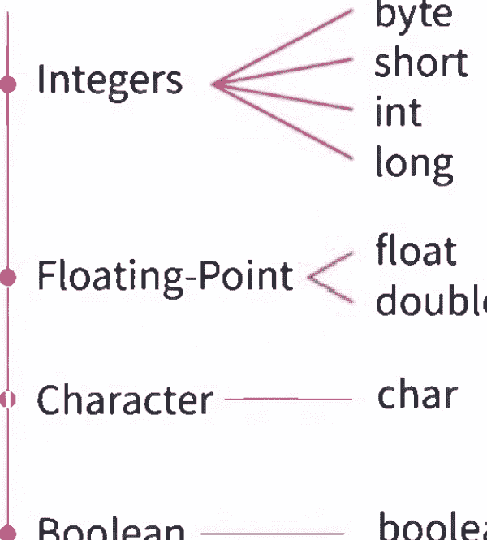

你可以简单地将原始数据类型转换为 Java 中对应的包装类。

Java 中的每个包装类都有一个接收对应原始数据类型作为参数的构造函数。例如，你可以使用 `Integer` 类将 `int` 值转换为 `Integer` 对象：

```
int number = 100;
```

```java
Integer numberWrapped = new Integer(number);

Integer ii=Integer.valueOf(110); // 建议使用
```

## Java 中 Integer 包装类的声明

```java
package java.lang;
```

```java
import ...
```

`Integer` 类将基本类型 `int` 的值封装在一个对象中。`Integer` 类型的对象包含一个类型为 `int` 的单字段。

此外，该类还提供了几种方法，用于将 `int` 转换为 `String` 以及将 `String` 转换为 `int`，以及在处理 `int` 时有其他常量和方法。

这是一个基于值的类；程序员应该将相等的实例视为可互换的，并且不应将实例用于同步，否则可能会发生不可预知的行为。例如，在未来的版本中，同步可能会失败。

实现说明：“位操作”方法（如 `highestOneBit` 和 `numberOfTrailingZeros`）的实现基于 Henry S. Warren, Jr. 的著作《Hacker's Delight》（Addison Wesley, 2002）。

自于：1.0

作者：Lee Boynton, Arthur van Hoff, Josh Bloch, Joseph D. Darcy

```java
java.internal.ValueBased
public final class Integer extends Number
    implements Comparable<Integer>, Constable, ConstantDesc {

    一个持有 int 可拥有的最小值的常量,-2^31。

    @Native public static final int MIN_VALUE = 0x80000000;
```

每个基本数据类型都有对应的包装类：**`Integer` 对应 `int`**、`Character` 对应 `char`、`Boolean` 对应 `boolean` 等，如下所示。

| 基本数据类型 | 包装类 |
|--- |--- |
| `byte` | `Byte` |
| `short` | `Short` |
| `int` | `Integer` |
| `long` | `Long` |
| `float` | `Float` |
| `double` | `Double` |
| `boolean` | `Boolean` |
| `char` | `Character` |

包装类提供了实用的方法，用于基本类型值与字符串之间的转换，以及值的比较。让我们以一个包装类为例，看看它是如何工作的，这将帮助我们轻松地理解其他包装类。

让我们以 `Integer` 包装类为例。

`Integer` 包装类是一个表示 `int` 数据类型的类。简单来说，你可以说它是基本数据类型 `int` 的对象格式。

```java
Module java.lang
Package java.lang
Class Integer
java.lang.Object
java.lang.Number
java.lang.Serializable
implements Comparable<Integer>, Constable, ConstantDesc
public final class Integer
extends Number {
```

`Integer` 类是对基本类型 `int` 的封装。`Integer` 类型的对象包含一个类型为 `int` 的字段。
此外，该类提供了实用的方法，用于将 `int` 转换为 `String` 以及 `String` 转换为 `int`，以及在处理 `int` 时的其他方法和函数。
这是一个基于值的类，因为值相等使其具有不可变性，并且对于同步或性能是有益的。例如，在多线程中，同步是很容易的。

实现说明：“`Integer`”方法（如 `hashCode()` 和 `toString()`）的实现基于 Java S. Bloch, Joshua M. Bloch 的著作《Effective Java, 2018》。

## 该类由 java 定义了一些字段，以使我们的工作简单

例如，`MAX_VALUE`：它将给你 `int` 类型的最大值。

## 示例

```java
System.out.println(Integer.MAX_VALUE);
System.out.println(Integer.MIN_VALUE);
System.out.println(Integer.TYPE);
System.out.println(Integer.SIZE);
```

结果：

```
2147483647
-2147483648
int
32
```


### 描述

用于用补码二进制形式表示 `int` 值所使用的字节数。

一个持有 `int` 可拥有的最大值的常量，$2^{31}-1$。

一个持有 `int` 可拥有的最小值的常量，$-2^{31}$。

用于用补码二进制形式表示 `int` 值所使用的位数。

表示基本类型 `int` 的类实例。

## `Integer` 包装类的一些方法

| 修饰符和类型 | 方法 |
|---|---|
| `static int` | `byte(int i)` |
| `byte` | `byteValue()` |
| `static int` | `compareTo(int x, int y)` |
| `int` | `compareTo(Integer anotherInteger)` |
| `static int` | `compare(int x, int y)` |
| `static int` | `compress(int i, int mask)` |
| `static Integer` | `decode(String s)` |
| `Optional Integer` | `describe(constant[])` |
| `static int` | `divideAndRemainder(int dividend, divisor)` |
| `double` | `doubleValue()` |
| `boolean` | `equals(Object obj)` |
| `static int` | `expand(int i, int next)` |
| `float` | `floatValue()` |
| `static Integer` | `getInteger(String s)` |
| `static Integer` | `getInteger(String s, int val)` |
| `static Integer` | `getInteger(String s, Integer val)` |
| `int` | `hashCode()` |
| `static int` | `hashCode(int value)` |
| `static int` | `highestOneBit(int i)` |
| `int` | `longValue()` |
| `long` | `longValue()` |

### 示例

```java
public class WrapperDemo {

    public static void main(String[] args) {

    }
}
```

### 描述

返回指定的 `int` 值在补码二进制表示中某位的值。

在进行窄基本类型转换后，返回 `Integer` 作为字节的值。

数值上比较两个 `Integer` 数字。

数值上比较两个 `Integer` 对象。

数值上比较两个 `int` 值。

```java
package org.example;

import java.util.ArrayList;

public class SBDemo { no usages

    public static void main(String[] args) {

        ArrayList<Integer> intList = new ArrayList();

        intList.add(11);

        intList.add(12);

        intList.add(13);

        intList.add("raj");

        // Required type: Integer
        // Provided: String
        // Wrap using 'Integer.valueOf()' More actions...

    }
}
```

# 包装类的好处

以下是 Java 包装类（Wrapper classes）的一些主要优势。

## 将基本数据类型表示为对象

包装类提供了一种将基本数据类型作为对象的方法，这在某些只接受对象的情况下是必要的，例如在 `ArrayList` 和 `HashMap` 等集合中。使用包装类而不是基本数据类型始终是一种良好的编程习惯。

## 存储 `null` 值

Java 中的基本数据类型不能存储 `null` 值，但包装类可以被设置为 `null`，这在表示缺失或未知的值时非常有用。

## 自动装箱和拆箱

包装类通过称为“自动装箱”和“拆箱”的功能，在基本数据类型与其对应的包装对象之间提供了自动转换。

Java 中的自动装箱是指将基本数据类型自动转换为其对应的包装类。

在 Java 5 之前，在 Java 中将基本值转换为其对应的包装类需要使用包装类的构造函数进行手动转换。在 Java 5 之后，JVM 将处理自动转换。

```java
import java.util.*;
import java.lang.*;
import java.io.*;

class WrapperExample1{
    public static void main(String args[]){

        int a=10;

        //自动装箱：将 int 转换为 Integer
        Integer aa=Integer.valueOf(a);

        //自动拆箱：将 Integer 转换为 int
        int bb=aa;
        int cc=aa.intValue();

        System.out.println("+a+", "+aa+", "+bb+", "+cc+");
    }
}
```

运行结果: `10:10:10:10`

**自动拆箱**：将包装类对象转换为对应的基本类型的过程。

# 异常处理

## 什么是异常？

异常是在程序执行过程中发生的非预期或意外的事件，它会破坏程序的执行流。

让我们假设一些会发生异常的场景。

- 如果你想将一个整数除以 0，那么就会发生异常，因为这在数学上是不可能的。
- 你正尝试打开某个文件，但该文件在预期路径上不存在。
- 你有一个 Java 对象，并且正尝试从该已经运行的对象中访问数据。

简单来说，你可以说异常是破坏执行流的东西。

## 如何处理异常？

为了处理异常，我们必须编写一些代码来防止执行过程中出现任何错误。

Java 中的异常处理是对异常发生做出响应的过程。

异常处理有助于识别异常情况，并通过处理/避免已发生的错误来保持程序流按预期运行。在某些情况下，它被用于使程序对用户友好。

## 异常层次结构

众所周知，Java 是一门面向对象的语言，每个类都继承自 `Object` 类。

所有的异常（exceptions）和错误（errors）都是 `Throwable` 类的子类。

`Throwable` 是 Java 中异常处理层次结构的基类/父类。该类进一步扩展为 `exception`、`error` 等不同的类。

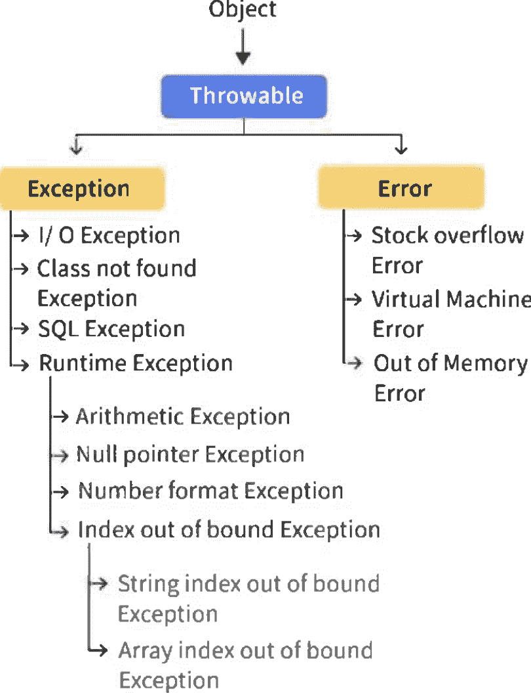

# 异常类型

主要有两种类型的异常：检查异常（checked）和未检查异常（unchecked）。

- 1. 检查异常
- 2. 未检查异常

## 检查异常

检查异常是那些在编译时由编译器检查的异常。

如果不处理这些异常，程序将无法编译。

这些异常是 `Exception` 类的子类。

检查异常是 Java 编译器要求我们处理的异常。我们要么必须声明式地将异常抛向上层调用栈，要么必须由自己处理。

## 未检查异常

未检查异常是那些在运行时由 JVM 检查的异常，因为编译器无法检查未检查异常。

带有未检查异常的程序可以成功编译，你不会得到任何编译错误，但如果不处理，你将获得运行时错误。

这些是 `Runtime` 类的子类。

`ArithmeticException`、`NullPointerException`、`NumberFormatException`、`IndexBoundException` 是 Java 中的一些未检查异常。

## 检查异常与未检查异常的区别

| 检查异常 (Checked Exception) | 未检查异常 (Unchecked Exception) |
| --- | --- |
| 发生在编译时。 | 发生在运行时。 |
| 编译器会检查检查异常。 | 编译器不检查未检查异常。 |
| 如果不处理检查异常，将得到编译错误。 | 如果不处理未检查异常，将得到运行时错误。 |
| 可以在编译时处理。 | 在运行时无法捕获/处理。 |
| 它们是 `exception` 类的直接子类，但不继承 `RuntimeException` 类。 | 它们是 `Runtime` 类的子类。 |
| 例：`IOException`、`ClassNotFoundException`、`SQLException` 是常见的检查异常。 | 例：`ArithmeticException`、`NullPointerException`、`NumberFormatException`、`StringIndexOutOfBoundsException`、`ArrayIndexOutOfBoundException` 是常见的未检查异常。 |

让我们来看一个值除以 0 的例子，众所周知它将抛出异常。


# 程序员如何处理异常

作为开发者，当我们编写可能出现异常的代码时，我们需要处理它，或者可以使用 `throw` 关键字将异常委托给调用者。

Java 提供了使用 `try-catch` 块来处理异常的机制。

```java
try {
    // 可能抛出异常的代码
}
catch(Exception e) {
    // 异常的消息
}
```

## 示例

```java
package org.example.exception;

public class ExceptionDemo {

    public static void main(String[] args) {

        int num=10;

        try {
            int result = num / 0;
        }
        catch (Exception e){
            System.out.println("### 数字不能除以0");
        }
    }
}
```

## 运行结果

```
/Users/aray/Library/Java/JavaVirtualMachines/openjdk-21/Contents/Home/java -javaagent:/Applications/IntelliJ IDEA CE.app/Contents/lib/idea_rt.jar -64711 :/IntelliJ IDEA CE.app/Contents/Dfile.encoding=UTF-8 -Dsun.stdout.encoding=UTF-8 -Dsun.stderr.encoding=UTF-8 -classpath=/Users/aray/Documents/lperror/new/JavaFundamentals/target/classes/org.example.exception.ExceptionDemo

### 数字不能除以0
```

# `try` 块

`try` 块用于执行可能抛出异常的怀疑语句。

`try` 块可以包含多个语句。

`try` 块不能独立执行，它必须至少有一个 `catch` 块或 `finally` 块。

如果在 `try` 块中发生了任何异常，控制将自动跳转到上述代码中的 `catch` 块。

```java
try {
    // 可能会抛出异常的代码
}
```

## `catch` 块

`catch` 块用于为异常提供解决方案或替代方案。

`catch` 块通过在参数中声明异常类型来处理异常。

声明的异常必须是异常层次结构中的父类异常、生成的异常类型或用户自定义异常。

你可以在单个 `try` 块配合多个 `catch` 块。

```java
try {
    //可能抛出异常的代码
} catch(Exception e) {
    // 异常的消息或替代方案
}
```

## 使用 `finally` 块的 `try-catch`

`finally` 块与 `try`、`catch` 块配合使用。

无论是否抛出异常，它都会执行。

`finally` 块用于执行重要的语句，例如关闭语句、释放资源、释放内存或任何你想要执行的代码段。

`finally` 块可以配合 `try` 块使用，也可以不带 `catch` 块。

如果你在代码中有 `finally` 块，那么一旦发生异常，控制权将进入 `finally`，然后进入 `catch` 块。

`finally` 块用于执行程序的必要代码。无论异常是否被处理，它都会执行。

```java
try {
    // 可能会抛出异常的代码
}
catch(Exception e) {
    // 任何消息或异常的替代方案
}
finally {
    // 关闭资源
}
```

```java
package org.example.exception.exception;

public class ExceptionDemo {

    public static void main(String[] args) {

        int num=10;

        try {
            int result = num / 0;
        }
        catch (Exception e){
            System.out.println("### Number cant be divided by ZERO");
        }
        finally {
            System.out.println("### This is finally block");
        }
    }
}
```

## 结果

```
/Users/aray/Library/Java/JavaVirtualMachines/openjdk-21/Contents/Home/bin/java -javaagent:/Applications/IntelliJ IDEA CE.app/Contents/lib/idea_rt.jar=65334:/Applications/IntelliJ IDEA CE.app/Contents/bin -Dfile.encoding=UTF-8 -Dsun.dstd.encoding=UTF-8 -classpath=/Users/aray/Documents/lpError/new/JavaFundamentals/target/classes org.example.exception.ExceptionDemo

### Number cant be divided by ZERO
### This is finally block
```

**需要记忆的点**

在编写任何代码时，首先你需要考虑这段代码是否可能抛出异常。如果你认为在任何可能的用例中抛出异常的可能性，那么你必须将该代码放在 `try` 块中，并为其添加相应的 `catch` 块。

如果存在抛出异常的可能性，作为开发者，你需要处理该异常，或者必须委托该异常，以便代码的调用者需要处理该异常或将其委托给它的调用者。这就是 Java 中异常处理的工作机制。

当方法内部发生异常时，由该方法负责处理异常，或者将其委托给该方法的调用者。这种异常处理的委托通过使用 `try-catch` 块捕获异常，或者在方法签名中使用 `throws` 子句声明该方法可能会抛出异常来实现。

## 如何抛出异常

在 Java 中，`throws` 关键字用于将异常委托给其调用者。

如果任何方法中发生了任何异常，处理该异常是该方法的责任，但如果异常没有被该方法处理，那么它应该被委托给方法的调用者，因此方法的调用者仍然需要处理该异常或也可以进行委托。

`throws` 关键字简单地用于将异常传递给其调用者。

Java 中的 `throws` 关键字用于方法签名，用以指示该方法可能会抛出 Java 异常类层次结构中的一个异常。

`throws` 关键字仅用于受检异常（checked exceptions），如 `IOException`，因为与未检异常（unchecked exceptions）一起使用没有意义（未检异常可以通过修正编程错误来避免）。

`throws` 关键字可以用于声明一个异常。

```java
package org.example.exception;

import java.io.IOException;
import java.nio.file.Files;
import java.nio.file.Path;
import java.nio.file.Paths;
import java.util.List;

public class FileDemo { no usages

    public static List<String> readFile() throws IOException { // 1处用法

        Path filePath = Paths.get(first: "c:/temp/files", ...more: "data.txt");

        List<String> lines = Files.readAllLines(filePath);
    }

    public static void main(String[] args) {

        List<String> data=readFile();

        // 未处理的异常: java.io.IOException
        // 为方法签名添加异常 更多操作...

        org.example.exception.FileDemo
        public static List<String> readFile() throws IOException
        // 抛出: IOException
        JavaFundamentals
    }
}
```


如上面的示例代码所示，在我们尝试读取文件时，我们正在进行文件操作，那里有抛出 `IOException` 的可能，由于它是受检异常，我们必须处理它，或者将其委托给方法的调用者。

```java
import java.io.IOException;
import java.nio.file.Files;
import java.nio.file.Path;
import java.nio.file.Paths;
import java.util.List;

public class FileDemo { no usages

    public static List<String> readFile() throws IOException { // 1处用法
        Path filePath = Paths.get(first:"c:/temp/files", ...more:"data.txt");
        List<String> lines = Files.readAllLines(filePath);
    }

    public static void main(String[] args) {
        List<String> data=readFile();
    }
}
```

你可以在两个示例中观察到，在上面的第一个示例中，我们将异常传递给了调用者。在下面的示例中，我们使用了 `try-catch`。

```java
import java.io.IOException;
import java.nio.file.Files;
import java.nio.file.Path;
import java.nio.file.Paths;
import java.util.List;

public class FileDemo { no usages

    public static List<String> readFile() throws IOException { // 1处用法
        Path filePath = Paths.get(first:"c:/temp/files", ...more:"data.txt");
        List<String> lines = Files.readAllLines(filePath);
    }

    public static void main(String[] args) {
        try {
            List<String> data=readFile();
        } catch (IOException e) {
            throw new RuntimeException(e);
        }
    }
}
```

## throw 关键字

`throw` 关键字用于显式抛出异常。

我们可以用它抛出受检异常和未检异常。

我们指定要抛出的异常类。异常带有某些消息，用于提供错误描述。

简单来说，我们可以说根据某些条件用例，你可以简单地抛出某些 Java 定义异常的子类的定义的异常。

在执行 `throw` 语句后，程序的执行流会立即停止，并检查最近的 `try` 块查看是否有与异常类型匹配的 `catch` 语句。

它会尝试寻找所有的 `catch` 块直到找到相应的处理器，否则会将控制权转移给默认处理器，后者将停止程序。

```java
package org.example.exception;

import java.io.IOException;
import java.nio.file.Files;
import java.nio.file.Path;
import java.nio.file.Paths;
import java.util.List;

public class FileDemo {

    public static List<String> readFile() throws IOException {
        Path filePath = Paths.get("c:/temp/files", "data.txt");
        List<String> lines = Files.readAllLines(filePath);
    }

    public static void main(String[] args) {
        try {
            List<String> data=readFile();
        } catch (IOException e) {
            throw new RuntimeException(e);
        }
    }
}
```

如上面的示例代码所示，我们在发生任何错误时抛出异常。在这里我们可以带上适当错误消息抛出适当异常。

```java
package org.example.exception;

import java.io.IOException;
import java.nio.file.Files;
import java.nio.file.Path;
import java.nio.file.Paths;
import java.util.List;

public class FileDemo {

    public static List<String> readFile() throws IOException {
        Path filePath = Paths.get("c:/temp/files", "data.txt");
        List<String> lines = Files.readAllLines(filePath);
    }

    public static void main(String[] args) {
        try {
            List<String> data = readFile();
        } catch (IOException e) {
            throw new UserDefinedException("error message");
        }
    }
}
```

```java
}
}
```

`NotDefinedException` 指用户根据其需求创建的任何异常。

假设你正在根据某个关键词搜索数据，并且如果你在没有找到该关键词的数据时，你想抛出一个异常。如果没有找到数据，你只是想抛出一个类似于 `DataNotAvailableForKeyException` 的异常，或者你可以创建一个带有任何意义名称的异常。

## throw new DatanotAvailableForKeyException(" error message");

这就是你抛出异常的方式。

## throw vs throws

如你所见，这两个名字看起来很相似，所以对新开发者来说有些困惑。

简单来说，我们可以说 throwing（抛出）意味着将异常处理权委托给调用者，意味着你**不再**继续处理该异常了。

`throw` 意味着根据你要求的某些给定逻辑，你可以抛出任何合适的异常。正如我们之前看到的，如果你在验证用户名并发现用户名**不是**有效的，那么你可以简单地创建一个如 `UserNameNotValid` 的自定义异常并直接将其抛出。

| throw | throws |
| :--- | :--- |
| 用于在程序中的任何代码块中显式地抛出异常。 | 用于函数签名，声明方法在执行过程中可能抛出的异常。 |
| `throw` 用于方法内部。你一次只能抛出一个异常。 | `throws` 用于方法签名内部。可以在声明中添加任意数量的异常。 |
| `throw` 关键字可以用于抛出检查异常（checked）和未检查异常（unchecked）。 | `throws` 关键字只能用于检查异常。 |

```java
throw new AnyException("error message"); void methodName() throws
ArithmeticException,FileNotFoundException,AnyUserDefinedException
```

如果你在任何方法内部使用 `throw` 关键字抛出异常，那么你**必须**使用 `try-catch` 来处理它，或者使用 `throws` 关键字将其委托给方法的调用者。

```java
public static boolean validateUserName(String userName) throws InvalidUserNameException {
    if(userName.equalsIgnoreCase("Raj")){
        throw new InvalidUserNameException(400,"User Name is not valid");
    }
    return true;
}
```

## 创建异常 或 自定义异常 或 用户定义异常

正如我们已经讨论过的，如果你在真实环境中工作，那么异常处理是你需要非常小心且聪明地对待的最概念之一。

它确实让你的应用程序对用户更加友好，而且如果发生了错误，开发者将更容易找到确切的问题。

假设，作为一名开发者，你正在开发某个功能，一段时间后客户遇到了问题。这些问题可能是任何问题，可能是数据问题，也可能是某些功能问题，或者是由于代码其他部分引起的任何其他问题，最关键的一点是，它可能是任何类型的问题，甚至是不可预测的。因此，作为开发者，你需要以这种方式添加异常处理代码，使其能够简单地处理任何类型的异常，并在发生故障时提供适当的错误信息，这样你或其他开发者就能轻松找到根源并尽快修复它，以避免任何形式的升级。

诚实地说，这在日常开发环境中是非常直接且常见的现象。

假设你正在方法中验证“用户名（user name）”，你需要验证哪些基本内容？它可能是用户模式、空检查或任何你针对用户名需要验证的规则。现在你已经写了验证输入数据的逻辑，一旦数据通过验证并发现任何问题，你就**需要**抛出一个带有适当错误信息的正确异常，以便最终用户能够理解。此错误信息应该是清晰的，即使是开发者也能理解根源，这将有助于开发者轻松修复它。

我们可以通过扩展属于 `java.lang` 包的 `Exception` 类来根据需求创建异常。

这些是与业务逻辑相关的异常，开发者希望用户按照要求的格式提供输入，如果用户未能这样做，就会抛出异常，用户将获得关于问题是什么以及如何解决的说明。这对应用程序用户或开发者理解准确的问题非常有帮助。

示例：如果用户想要设置年龄（Age）限制，我们可以使用自定义异常并提供所需的注释作为输出。

现在我们将看到作为开发者的如何创建一些自定义异常。

## 语法：

```java
class YourExceptionName extends Exception"/Any Predefined Exception" {
    // 添加你的属性，如错误消息、错误代码等
    // 添加构造函数以初始化异常对象
}
```

如上所示，我们只是在创建一个 `YourExceptionName` 类，它继承自 Java 的 `Exception` 类或其他其他 `Exception` 类。

这无非我们正尝试通过继承将 `Exception` 类的行为继承到我们的类中。

到目前为止，我们清楚了如果一个类继承另一个类，那么子类将自动继承父类的行为。在上面的示例中，`Exception` 类是父类，所以我们的类 `YourExceptionName` 将拥有异常类的行为。

这就是你如何根据需求在 Java 中创建自定义异常类。

示例：

```java
class UserNameNotValidException extends Exception {
    public UserNameNotValidException(String userName) {
        // 调用父类 Exception 的构造函数
        super(userName);
    }
}
```

示例 2：

```java
public class DuplicateEntityException extends RuntimeException {
    private static final long serialVersionUID = 1L;
    private int code;

    public DuplicateEntityException(int code, String msg) {
        super(msg);
        this.code = code;
    }

    public int getCode() {
        return code;
    }

    public void setCode(int code) {
        this.code = code;
    }
}
```

### InvalidUserName 异常

```java
package org.example.exception;

public class InvalidUserNameException extends Exception{
    private static final long serialVersionUID = 1L;
    private int code;

    public InvalidUserNameException(int code, String msg) {
        super(msg);
        this.code = code;
    }

    public int getCode() {
        return code;
    }

    public void setCode(int code) {
        this.code = code;
    }
}
```

## 让我们创建一个方法并在代码中抛出 InvalidUserName 异常

```java
package org.example.exception;

public class FileDemo {

    public static boolean validateUserName(String username) throws InvalidUserNameException {
        if(username.equalsIgnoreCase("Raj")){
            throw new InvalidUserNameException(400,"User Name is not valid");
        }
        return true;
    }

    public static void main(String[] args) throws InvalidUserNameException {
        String yourUsername="Mahesh";
        Boolean isUsernameValid=validateUserName(yourUsername);
        System.out.println(" ### isUsernameValid :"+isUsernameValid);
    }
}
```

如上面的代码所示，我们使用 `validateUserName(..)` 方法验证用户：

`Boolean isUsernameValid=validateUserName(yourUsername);`

如果你查看这个方法的声明，你可以看到根据我们的需求，如果用户名不是有效的，我们会抛出 `InvalidUserNameException`。

```java
throw new InvalidUserNameException(400,"User Name is not valid");
```

## Java 异常处理：最佳实践

- 最佳实践是只捕获可以处理的异常。
- 在 `catch` 块中不要返回空值而不是处理异常，这会消耗异常导致错误永久失败且程序崩溃。
- 不要获取异常类，而是捕获特定的子类。
- 永远不要在 `finally` 块中抛出异常，因为即使 `try` 块没有产生任何异常，`finally` 块在执行 `try-catch` 块后也会抛出异常。
- 如果你不处理异常，请使用 `finally` 块代替 `catch` 块。
- 始终使用 `finally` 块关闭使用的资源。
- 最佳实践始终在使用后关闭/终止资源，如果可能，使用 `try-with-resources`，这样 JVM 会自动关闭未使用的资源。

## 数组：Java 中的数组是什么？

它包含具有相似数据类型的元素。

Java 中的数组在单个变量中存储多个相同类型的值。

数组的元素存储在连续的内存位置中。

它们是能够包含固定数量元素的对象，每个元素都有一个索引用于访问它。

我们以前只在声明时提供数组的大小。

数组的索引从 0 开始，因此数组的第 1 个元素存储在第 0 个索引，第 2 个元素存储在第 1 个索引，以此此类推。

| 0 | 1 | 2 | 3 | 4 | 5 | 6 | 7 | ... |
|---|---|---|---|---|---|---|---|---|

## 语法：

```
data_type arrayName[ ];
data_type[ ] arrayName;
```

## 示例：

```java
int numbers[];
String names[];
int[] pinCode;
Integer dates [];
```

```java
// 因此它的类型是 'int'
// 它只接受 'int' 类型的元素
int numbers[];
```


`String names[];`

## 数组初始化

一旦声明了数组，我们就可以简单地初始化它们，或者可以在声明时直接初始化。

```java
int arr[] = new int[5];
int numbers[] = {1, 2, 3, 4, 5, 6};
String names[] = {"Raj", "Heera"};
Float arrFloat[] = new Float[4];
```

```java
int[] anArray = new int[] {1, 2, 3, 4, 5}; //它将拥有从索引 0开始的5个元素
```

## 如何从数组访问值

众所周知，数组是相似数据类型元素的集合，因此数组的元素可以通过索引访问。数组的索引从 0 开始。

```java
int numbers[] = {1, 2, 3, 4, 5, 6};
```

这里这个数组中有 6 个元素，索引从 0 开始，因此元素 1 将位于第 0 个位置。

我们可以直接使用索引访问此元素。

`numbers[0]` 将是 1

- 第 1 个元素 = 第 0 个位置，即值 = 1
- 第 2 个元素 = 第 1 个位置，即值 = 2
- 第 3 个元素 = 第 2 个位置，即值 = 3

## 示例

```java
package org.example.arrayDemo;

public class ArrayTestDemo {

    public static void main(String[] args) {

        int numbers[] = {1, 2, 3, 4, 5, 6};

        int num1 = numbers[0]; //第 0 个索引

        int num2 = numbers[1]; //第 1 个索引

        System.out.println(" # num1 " + num1);

        System.out.println(" # num2 " + num2);

    }

}
```

结果：

### num1 1
### num2 2

注意：

括号之间的数字是我们访问的数组特定位置。

访问数组元素时，如果传递的索引为负数或超出最后一个单元格，Java 将抛出 `ArrayIndexOutOfBoundsException`。

```java
int numbers[] = {1, 2, 3, 4, 5, 6};
```

这里有 6 个元素，所以索引从 0 开始到 5 结束。

- `numbers[0]` = 1
- `numbers[5]` = 6

但如果你尝试 `numbers[6]` 或任何更大的索引，你将得到异常 `ArrayIndexOutOfBoundsException`。

因此我们应该注意不要使用负索引，或大于或等于数组大小的索引。

## 遍历数组元素

可以使用索引访问数组元素。

```java
package org.example.arrayDemo;

public class ArrayTestDemo {

    public static void main(String[] args) {

        int numbers[] = {1, 2, 3, 4, 5, 6};

        for (int i = 0; i < (numbers.length); i++) {

            System.out.println(numbers[i]);

        }

    }

}
```

结果：
1
2
3
4
5
6

## 更简化的方法

```java
package org.example.arrayDemo;

public class ArrayTestDemo {

    public static void main(String[] args) {

        int numbers[] = {1, 2, 3, 4, 5, 6};

        for (int num : numbers) {

            System.out.println(num);

        }

    }

}
```

结果：

- 1
- 2
- 3
- 4
- 5
- 6

Java 提供了内置类来处理数组操作。
你可以使用 `java.util` 包中的 `Arrays` 类。

该类包含了各种处理数组的方法（例如排序和搜索）。该类还包含一个静态工厂，允许数组被视为列表。

让我们看看 `Arrays` 类如何简化数组操作的示例。

```java
package org.example.arrayDemo;

import java.util.Arrays;

public class ArrayTestDemo {

    public static void main(String[] args) {

        int numbers[] = {1, 2, 3, 4, 5, 6};

        Arrays.sort(numbers);

        for (int num : numbers) {

            System.out.println(num);

        }

    }

}
```

结果：

- 1
- 2
- 3
- 4
- 5
- 6

Java 提供了内置类来处理数组操作。
你可以使用 `java.util` 包中的 `Arrays` 类。

该类包含了各种处理数组的方法（例如排序和搜索）。该类还包含一个静态工厂，允许数组被视为列表。

让我们看看 `Arrays` 类如何简化数组操作的示例。

```java
package org.example.arrayDemo;

import java.util.Arrays;

public class ArrayTestDemo {

    public static void main(String[] args) {

        int numbers[] = {1, 2, 3, 4, 5, 6};

        Arrays.sort(numbers);

        for (int num : numbers) {

            System.out.println(num);

        }

    }

}
```

结果：

- 1
- 2
- 3
- 4
- 5
- 6

Java 提供了内置类来处理数组操作。
你可以使用 `java.util` 包中的 `Arrays` 类。

该类包含了各种处理数组的方法（例如排序和搜索）。该类还包含一个静态工厂，允许数组被视为列表。

让我们看看 `Arrays` 类如何简化数组操作的示例。

```java
package org.example.arrayDemo;

import java.util.Arrays;

public class ArrayTestDemo {

    public static void main(String[] args) {

        int numbers[] = {1, 2, 3, 4, 5, 6};

        Arrays.sort(numbers);

        for (int num : numbers) {

            System.out.println(num);

        }

    }

}
```

结果：

- 1
- 2
- 3
- 4
- 5
- 6

结果：

- Dog
- Cat
- Horse

## 示例 2：从数组转换为 ArrayList

```java
import java.util.Arrays;

import java.util.List;

public class ArrayTestDemo {
    public static void main(String[] args) {

        Integer nums[] = {1, 2, 3, 4, 5};
        List<Integer> numList = Arrays.asList(nums);
        System.out.println("## numList :: " + numList);

    }
}
```

结果：## numList :: [1, 2, 3, 4, 5]

```java
import java.util.ArrayList;

public class ArrayTestDemo {

    public static void main(String[] args) {

        ArrayList<Integer> nums = new ArrayList<>();

        nums.add(11);

        nums.add(13);

        nums.add(10);

        nums.add(12);

        System.out.println(" ## nums :: " + nums);

    }

}
```

结果：## nums :: [11, 13, 10, 12]

## 注意

在处理任何真实项目时，你肯定会有机会操作集合数据。让我们来看一个非常基础的排序用例：排序。

我们将使用工具类 `Collections` 和 Stream API 对 `ArrayList` 数据进行排序。

我们已经在本这本书的 Stream API 章节中涵盖了许多此类案例，因此我们只需要进行一个高层面的快速浏览介绍。

## 排序 ArrayList

按逆序和自然序对集合数据进行排序。

```java
import java.util.ArrayList;

import java.util.Collections;

public class ArrayTestDemo {

    public static void main(String[] args) {

        ArrayList<Integer> nums = new ArrayList<>();

        nums.add(11);

        nums.add(13);

        nums.add(10);

        nums.add(12);

        System.out.println(" ## nums :: " + nums);

        Collections.sort(nums);

        System.out.println("## Natural sorted :: " + nums);

        Collections.sort(nums, Collections.reverseOrder());

        System.out.println("## Reverse sorted :: " + nums);

    }

}
```

结果：
## nums :: [11, 13, 10, 12]
## Natural sorted :: [10, 11, 12, 13]
## Reverse sorted :: [13, 12, 11, 10]

```java
package org.example;

import java.util.Objects;

public class EmployeeDemo {

    String name;

    String designation;

    Long empid;

    public EmployeeDemo(String name, String designation, Long empid) {

        this.name = name;

        this.designation = designation;

        this.empid = empid;

    }

    @Override

    public boolean equals(Object o) {

        if (this == o) return true;

        if (o == null || getClass() != o.getClass()) return false;

        EmployeeDemo that = (EmployeeDemo) o;

        return name.equals(that.name) && designation.equals(that.designation) && empid.equals(that.empid);

    }

}
```

```java
public int hashCode() {

    return Objects.hash(name, designation, empId);

}
```

```java
public String getName() {

    return name;

}
```

```java
public void setName(String name) {

    this.name = name;

}
```

```java
public String getDesignation() {

    return designation;

}
```

```java
public void setDesignation(String designation) {

    this.designation = designation;

}
```

```java
public Long getEmpId() {

    return empId;

}
```

```java
public void setEmpId(Long empId) {

    this.empId = empId;

}
```

```java
import java.util.ArrayList;

import java.util.Collections;

import java.util.Comparator;

import java.util.List;

public class EmployeeDataDemo {

    public static void main(String[] args) {

        EmployeeDemo e1 = new EmployeeDemo("Raj", "SSE", 12L);

        EmployeeDemo e2 = new EmployeeDemo("Mohan", "SE", 15L);

        EmployeeDemo e3 = new EmployeeDemo("Akash", "Engineer", 14L);

        EmployeeDemo e4 = new EmployeeDemo("Niru", "DevOps", 11L);

        List<EmployeeDemo> empObj = new ArrayList<>();

        empObj.add(e1);

        empObj.add(e2);

        empObj.add(e3);

        empObj.add(e4);

        Comparator<EmployeeDemo> ee = (a, b) -> (int) (a.getEmpId() - b.getEmpId());

        Collections.sort(empObj);

        for (EmployeeDemo obj : empObj) {

            System.out.println("### " + obj.getName() + "," + obj.getEmpId() + "," + obj.getDesignation());

        }

    }

}
```

结果：
### Mohan ,15 ,SE
### Akash ,14,Engineer
### Raj ,12,SSE
### Niru,11 ,DevOps

## LinkedList

`LinkedList` 与 `list` 类似，并允许保持顺序。

## Set

`Set` 不允许重复元素。`LinkedList` 是一个数学集合的抽象，Java 提供了三种通用实现：`HashSet`、`TreeSet` 和 `LinkedHashSet`。`Set` 接口提供了添加、检索和删除元素的方法。

## HashSet

`Set` 不允许重复元素。`HashSet` 是由哈希表实现的。它在基本操作（`add`、`remove`）上具有常数时间性能。

## HashMap

`Set` 不允许重复元素。`HashMap` 包含元素。它不保证元素的迭代顺序。

```java
Set<Integer> numbers = new HashSet<>();

numbers.add(1);

numbers.add(2);

numbers.add(3);
```

## HashSet

`Set` 不允许重复元素。`HashSet` 是 `Set` 的一种实现。

```java
Set<String> hashSet = new HashSet<>();

hashSet.add("Apple");

hashSet.add("Banana");

hashSet.add("Orange");
```

## LinkedHashSet

`Set` 不允许重复元素。`LinkedHashSet` 保持元素的插入顺序。

```java
Set<String> linkedHashSet = new LinkedHashSet<>();

linkedHashSet.add("Apple");

linkedHashSet.add("Banana");

linkedHashSet.add("Orange");
```

## TreeSet

`Set` 不允许重复元素。`TreeSet` 按照自然序或提供的比较器对元素进行排序。

```java
Set<String> treeSet = new TreeSet<>();

treeSet.add("Apple");

treeSet.add("Banana");

treeSet.add("Orange");
```


## TreeMap

- 使用红黑树实现的 `map`。
- 按照排序顺序维护键值对（自然顺序或指定的比较器）。
- 在基础操作上，速度比 `HashMap` 和 `LinkedHashMap` 慢。

```java
Map<String, Integer> treeMap = new TreeMap<>();
treeMap.put("One", 1);
treeMap.put("Two", 2);
treeMap.put("Three", 3);
```

## 基础 Map 操作

### 添加键值对

```java
map.put("Key1", "Value1");
map.put("Key2", "Value2");
map.put("Key3", "Value3");
```

### 通过键检索值

```java
String valueForKey2 = map.get("Key2"); // 获取 "Value2"
```

### 检查键是否存在

```java
boolean containsKey = map.containsKey("Key3"); // true
```

### 遍历键值对

```java
for (Map.Entry<String, Integer> entry : map.entrySet()) {
    String key = entry.getKey();
    Integer value = entry.getValue();
    System.out.println(key + ":" + value);
}
```

### 移除键值对

```java
map.remove("Key1");
```

## Map 的大小

```java
int size = map.size(); // map 中键值对的数量
```

## 清空 Map

```java
map.clear(); // 从 map 中移除所有键值对
```

# Stream（流）

`Stream` 是可以流水线处理的元素序列。

- 它支持顺序操作和并行操作。
- 它在 Java 8 中引入，作为 `java.util.stream` 包下 Java Streams API 的一部分。
- 流被用于以函数式和声明式的方式处理数据序列，例如集合（如列表、集合、映射）或其他数据源。

注意，`java.util.stream` 与 `java.io.stream` 没有任何关系；`java.io.stream` 专门用于文件 I/O 操作；而 `java.util.stream` 通过顺序或并行方式通过流流水线处理数据。

## Java Streams 的特性和功能

1. **函数式编程**：从 Java 8 开始，`Stream` 促进了 Java 中的函数式编程方法。`Stream` 提供了一种非常简单的方法来处理数据、转换数据、过滤数据并收集到所需的集合对象中。你可以使用一系列高级操作来处理数据，例如 `map`、`filter`、`reduce` 和 `collect`，而不是显式地编写循环。我们将在本节稍后详细介绍。

2. **懒惰性**：`Stream` 天生是懒惰的，这意味着它们只在需要时处理元素。在调用终端操作之前，对 `Stream` 上的操作不会执行。这可以提高性能并减少内存消耗；我们将会详细介绍中间操作和终端操作。

3. **链式调用**：链多个操作对给定的数据集进行数据转换是 `Stream` 中的常见操作。你可以将多个操作链在一起创建一个数据处理流水线。这允许你以简洁且可读的方式表达复杂的数据转换。

4. **并行性**：Java Streams 可以轻松并行化，这意味着你可以利用多个 CPU 核心并发处理数据。并行流使用 `parallelStream()` 等方法创建。创建并行 `Stream` 会消耗可用的 CPU，但我们也可以覆盖这一行为。它使用了工作窃取（work stealing）算法，当当前任务完成后，作业会自动选取可用的待处理任务，它还将使用 `combiner` 合并结果。

5. **不可变性**：`Stream` 天生是不可变的，因此它们不会修改底层数据源。相反，它们会创建一个带有转换数据的新 `Stream`，保持原始数据不变。

## Stream 是如何工作的？

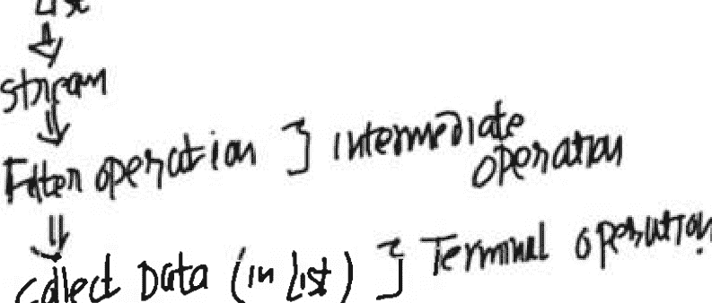

```java
public class StreamDemoTest {
    public static void main(String[] args) {
        List<EmployeeBean> empData = EmployeeUtil.getAllEmployeeList();
        Stream<EmployeeBean> employeeBean = empData.stream();
        Stream<EmployeeBean> filteredEmpStream = employeeBean.filter(x -> x.getName().startsWith("A"));
        List<EmployeeBean> finalData = filteredEmpStream.collect(Collectors.toList());
        finalData.forEach(x -> System.out.println(x));
    }
}
```

我们将在本节稍后将所有的流操作链在一起。上述代码：我们将在本节稍后将所有的流操作链在一起。上述代码：我们将在本节稍后将所有的流操作链在一起。上述代码：我们将在本节稍后将所有的流操作链在一起。

我们将在本节稍后将所有的流操作链在一起。上述代码：我们将在本节稍后将所有的流操作链在一起。上述代码：我们将在本节稍后将所有的流操作链在一起。

## 何时使用 Streams

在现实中，我们主要处理集合并需要处理数据。`Streams` 是处理这种情况的一种特别强大的方法。

- 1. I de-ment starts with "A"
- 2. I want to de-ment
- 3. 3.
- 4. We-m-e---- 50"
- 5. We have the de-u-tion
- 6. Er-- the de-gn-ter
- 7. So-m-e de-ment- on the de-cl-e-tion
- 8. Design-i-gn-ationion.

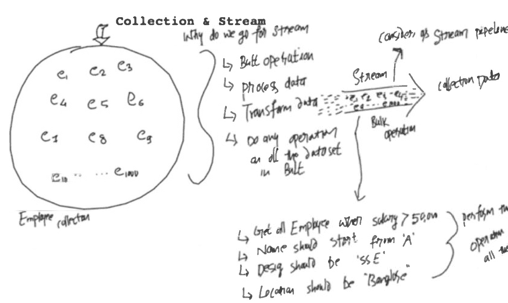

这是创建 `Stream` 最常见的方式。我们需要考虑性能。我们需要考虑性能。我们需要考虑性能。我们需要考虑性能。我们需要考虑性能。我们需要考虑性能。我们需要考虑性能。我们需要考虑性能。

# 4. 从数组创建

```java
int number[] = {1, 2, 3, 4, 5};
IntStream intStr = Arrays.stream(number);
Integer[] v = {1, 2, 3};
Stream<Integer> b = Arrays.stream(v);
```

# 5. 使用 builder

```java
Stream.Builder<Integer> strBuilder = Stream.builder();
Stream<Integer> sst = strBuilder
    .add(1)
    .add(2)
    .add(3)
    .build();

Stream.Builder<String> strBuilder1 = Stream.builder();
Stream<String> sst1 = strBuilder1
    .add("Ram")
    .add("Shyam")
    .add("Mohan")
    .build();
```

# 6. 使用 iterate() 方法

```java
Stream.iterate(2, x -> x * 2)
    .limit(10)
    .forEach(p -> System.out.println(p));
```

## 结果

| 2    |
| :--- |
| 4    |
| 8    |
| 16   |
| 32   |
| 64   |
| 128  |
| 256  |
| 512  |
| 1024 |

## 使用 generate(...) 方法和 Supplier<T>

```java
Supplier<Double> doubleSupplier = () -> Math.random();
Stream.generate(doubleSupplier).limit(5).forEach(System.out::println);
```

结果：

0.0995608561480672
0.7482631084077372
0.39385704955594336
0.06439871238649875
0.1001304919733238

```java
Supplier<String> strSupplier = () -> "ram";
Stream.generate(strSupplier).limit(5).forEach(System.out::println);
```

结果：

Ram
Ram
Ram
Ram
Ram

# 7. 从用户自定义类创建 Stream

让我们看看如何从集合数据（`list`、`set` 等）中创建 `Stream`。

```java
Sequential Stream:
Stream<EmployeeBean> empStreamSequential = EmployeeUtil.getAllEmployeeList()
    .stream();

Parallel Stream:
Stream<EmployeeBean> empStreamParallel = EmployeeUtil.getAllEmployeeList()
    .parallelStream();
```

让我们从 `Employee` 集合创建一个 `Stream`。

步骤：

- 1. 创建 `Employee` pojo
- 2. 从 `Employee` pojo 创建集合（`List`/`Set`）
- 3. 从 `Employee` 集合创建 `Stream`

## 创建 Employee 类

```java
public class Employee {
    private Integer id;
    private String name;
    private String email;

    public Employee(Integer id, String name, String email) {
        this.id = id;
        this.name = name;
        this.email = email;
    }

    public Integer getId() {
        return id;
    }

    public void setId(Integer id) {
        this.id = id;
    }

    public String getName() {
        return name;
    }

    public void setName(String name) {
        this.name = name;
    }

    public String getEmail() {
        return email;
    }

    public void setEmail(String email) {
        this.email = email;
    }

    @Override
    public String toString() {
        return "Employee{" +
            "id=" + id +
            ", name='" + name + '\'' +
            ", email='" + email + '\'' +
            '}';
    }
}
```

# 从 Employee 创建 Employee 集合

```java
import functionalJava.bean.Employee;
import java.util.List;

public class EmployeeUtility {
    public static List<Employee> getEmployeeList() {
        Employee e1 = new Employee(1, "Ishan", "ishan@gmail.com");
        Employee e2 = new Employee(1, "Mohan", "mohan@gmail.com");
        Employee e3 = new Employee(1, "Shyam", "shyam@gmail.com");
        Employee e4 = new Employee(1, "Shivansh", "shivansh@gmail.com");
        List<Employee> employeeList = List.of(e1, e2, e3, e4);
        return employeeList;
    }
}
```

## 创建 Employee 数据 Stream

```java
import functionalJava.bean.Employee;
import util.EmployeeUtility;
import java.util.List;
import java.util.stream.Stream;

public class CreateStreamDemo {
    public static void main(String[] args) {
        List<Employee> employeeList = EmployeeUtility.getEmployeeList();
        Stream<Employee> employeeStream = employeeList.stream();

        // 打印 stream 值 - 使用 Lambda
        employeeStream.forEach(x -> System.out.println(x));

        // 打印 stream 值 - 使用方法引用
        employeeStream.forEach(System.out::println);
    }
}
```

结果：

### 顺序 Stream

Employee[id=1, name='Ishan', email='ishan@gmail.com']
Employee[id=1, name='Mohan', email='mohan@gmail.com']
Employee[id=1, name='Shyam', email='shyam@gmail.com']
Employee[id=1, name='Shivansh', email='shivansh@gmail.com']

### 并行 Stream

Employee[id=1, name='Ishan', email='ishan@gmail.com']
Employee[id=1, name='Mohan', email='mohan@gmail.com']
Employee[id=1, name='Shyam', email='shyam@gmail.com']
Employee[id=1, name='Shivansh', email='shivansh@gmail.com']

让我们考虑一个用例，有一个 `Employee` 列表，我们根据以下标准进行过滤：

- 1. 姓名以 A 开头
- 2. 工资大于 70000
- 3. 收集到 `List`

解决方案：
我们可以从某些源获取数据。

`EmployeeBean`：

```java
import java.util.Objects;

public class EmployeeBean {
    String name;
    String city;
    String dept;
    String desig;
    Integer salary;

    public EmployeeBean(String name, String city, String dept, String desig, Integer salary) {
        this.name = name;
        this.city = city;
        this.dept = dept;
        this.desig = desig;
        this.salary = salary;
    }

    public String getName() {
        return name;
    }

    public void setName(String name) {
        this.name = name;
    }

    public String getCity() {
        return city;
    }

    public void setCity(String city) {
        this.city = city;
    }

    public String getDept() {
        return dept;
    }

    public void setDept(String dept) {
        this.dept = dept;
    }

    public String getDesig() {
        return desig;
    }
```


```java
public void setDesig(String desig) {
    this.desig = desig;
}

public Integer getSalary() {
    return salary;
}

public void setSalary(Integer salary) {
    this.salary = salary;
}

@Override
public boolean equals(Object o) {
    if (this == o) return true;
    if (o == null || getClass() != o.getClass()) return false;
    EmployeeBean that = (EmployeeBean) o;
    return name.equals(that.name) && city.equals(that.city) && dept.equals(that.dept) && desig.equals(that.desig) && salary.equals(that.salary);
}

@Override
public int hashCode() {
    return Objects.hash(name, city, dept, desig, salary);
}

@Override
public String toString() {
    return "Employee{" +
        "name='" + name + '\'' + 
        ", city='" + city + '\'' + 
        ", dept='" + dept + '\'' + 
        ", design='" + desig + '\'' + 
        ", salary=" + salary +
        '}';
}
```

提供 `Employee` 数据的 `EmployeeUtil`：

在这种情况下，你可以根据需求调用任何服务方法。

```java
import functionalJava.bean.EmployeeBean;
import java.util.List;

public class EmployeeUtil {
    public static List<EmployeeBean> getAllEmployeeList() {
        EmployeeBean e1 = new EmployeeBean("Raj", "Patna", "Development", "SSE", 140000);
        EmployeeBean e2 = new EmployeeBean("Mohan", "Bangalore", "Development", "SSE", 160000);
        EmployeeBean e3 = new EmployeeBean("Amit", "Delhi", "Development", "SSE", 110000);
        EmployeeBean e4 = new EmployeeBean("Heera", "Patna", "R&D", "SSE", 240000);
        EmployeeBean e5 = new EmployeeBean("Jawed", "Bangalore", "Development", "SSE", 140000);
        EmployeeBean e6 = new EmployeeBean("Khali", "Delhi", "R&D", "SSE", 340000);
        EmployeeBean e7 = new EmployeeBean("Abhinash", "Bangalore", "Development", "SSE", 140000);
        EmployeeBean e8 = new EmployeeBean("Rahul", "Patna", "HR", "SSE", 220000);
        EmployeeBean e9 = new EmployeeBean("Pandu", "Chennai", "Support", "SSE", 160000);
        EmployeeBean e10 = new EmployeeBean("Mohit", "Bangalore", "Development", "Architect", 44000);
        EmployeeBean e11 = new EmployeeBean("Ashish", "Bangalore", "Development", "SSE", 190000);
        EmployeeBean e12 = new EmployeeBean("Aayan", "Delhi", "R&D", "Architect", 54000);
        EmployeeBean e13 = new EmployeeBean("Amresh", "Bangalore", "Development", "SSE", 123000);
        EmployeeBean e14 = new EmployeeBean("Akash", "Delhi", "Development", "SSE", 110000);
        EmployeeBean e15 = new EmployeeBean("Ajay", "Delhi", "Development", "SSE", 4000);
        List<EmployeeBean> list = List.of(e1, e2, e3, e4, e5, e6, e7, e8, e9, e10, e11, e12, e13, e14, e15);
        return list;
    }
}
```

创建 `Employee` 集合 `Stream` 并过滤数据：

```java
import functionalJava.bean.EmployeeBean;
import util.EmployeeUtil;
import java.util.List;
import java.util.stream.Collectors;
import java.util.stream.Stream;

public class CreateStreamDemo {
    public static void main(String[] args) {
        // 过滤 Employee Data
        List<EmployeeBean> employeeBeans = EmployeeUtil.getAllEmployeeList();
        List<EmployeeBean> employeeFilteredData = employeeBeans.stream()
                .filter(x -> x.getSalary() > 70000)
                .filter(y -> y.getName().startsWith("A"))
                .collect(Collectors.toList());
        System.out.println("######## Filtered data:");
        employeeFilteredData.forEach(System.out::println);
    }
}
```

######## 过滤后的数据：

```
{name='Amit', city='Delhi', dept='Development', desig='SSE', salary=110000}
{name='Abhinash', city='Bangalore', dept='Development', desig='SSE', salary=140000}
```

# Stream 操作

`Stream` 支持两种类型的操作。

1. 中间操作（Intermediate Operation）
2. 终端操作（Terminal Operation）

## 中间操作

1. 中间操作返回另一个 `Stream` 作为结果。
2. `Stream` 本质上是惰性的。
3. 在被终端操作调用之前，中间操作不会执行。
4. 中间操作可以链式调用构建流水线。
5. 中间操作主要用于数据转换和处理。
6. 可以根据需要将多个中间操作链在一起。

以下是一些中间操作：

- `filter()`
- `map()`
- `flatMap()`
- `distinct()`
- `sorted()`
- `peek()`
- `limit()`
- `skip()`

## 终端操作

1. 终端操作返回一个单一值作为结果。从名称本身就可以想到它只是为了完成 `Stream` 操作。
2. 它返回一个单一值作为结果，而不是 `Stream`。
3. 它不能与其他任何终端操作链式调用。
4. 一旦在任何 `Stream` 上触发了终端操作，你就无法再对该 `Stream` 执行任何其他操作，作为副作用，它将产生一个值作为结果。

以下是一些 `Stream` 终端操作：

- `anyMatch()`
- `allMatch()`
- `noneMatch()`
- `collect()`
- `count()`
- `findAny()`
- `findFirst()`
- `forEach()`
- `min()`
- `max()`
- `reduce()`
- `toArray()`

通过上面的解释，很清楚 `Stream` 中间操作用于数据处理和转换，而终端操作用于最终结果收集。

# Stream 方法详解

## 过滤 Stream 数据

`Stream<T> filter(Predicate<? super T>)`

- 如我们所知，`filter(..)` 是中间操作，因此它将返回一个过滤后的数据的 `Stream`。
- 返回包含此流中匹配给定谓词元素的流。
- `Predicate` 本质上是一个返回布尔值的条件操作。
- `Predicate` 接受任何类型的一个输入并返回一个 `Boolean` 类型的输出。
- 它用于根据给定条件过滤数据。
- `Predicate` 是函数接口（Functional Interface），更多信息请参访函数接口章节。

我们可以简单地在任何 `Stream` 上应用此 `filter`，以获取给定条件的过滤数据。

`Predicate` 接收一个输入 `<T>` 并提供一个布尔值。

## 简化代码

```java
public class FunctionalInterfaceDemo {
    public static void main(String[] args) {
        // 创建谓词
        Predicate<Integer> isEvenNumber = (x) -> (x % 2 == 0) ? Boolean.TRUE : Boolean.FALSE;
        // 创建 Integer 数组
        Integer nums[] = {1, 2, 3, 4, 5, 6, 7, 8, 9, 10};
        Arrays.stream(nums)
            .filter(x -> (x % 2 == 0))
            .forEach(System.out::println);
    }
}
```

## 结果

```
2
4
6
8
10
```

考虑一个用例：你有一个包含 1 万名员工的列表，你想过滤出所有名字以 "A" 开头的员工。

## 使用自定义类的 Stream 过滤

让我们先不使用 `Stream` 来解决这个问题：

```java
import java.util.ArrayList;
import java.util.List;

public class FilterEmployeeDataWithoutStream {
    public static void main(String[] args) {
        List<EmployeeBean> empData = EmployeeUtil.getAllEmployeeList();
        List<EmployeeBean> resultList = new ArrayList<>();
        for (EmployeeBean employeeBean : empData) {
            if (employeeBean.getName().startsWith("A")) {
                System.out.println(employeeBean);
                resultList.add(employeeBean);
            }
        }
    }
}
```

使用 `Stream`：

```java
import java.util.List;
import java.util.stream.Collectors;

public class StreamDemoTest {
    public static void main(String[] args) {
        List<EmployeeBean> empData = EmployeeUtil.getAllEmployeeList();
        List<EmployeeBean> finalData = empData.stream()
            .filter(x -> x.getName().startsWith("A"))
            .collect(Collectors.toList());
        finalData.forEach(x -> System.out.println(x));
    }
}
```

## 结果

```
{name='Amit', city='Delhi', dept='Development', desig='SSE', salary=110000}
{name='Abhinash', city='Bangalore', dept='Development', desig='SSE', salary=140000}
{name='Ashish', city='Bangalore', dept='Development', desig='SSE', salary=190000}
{name='Aayan', city='Delhi', dept='R&D', desig='Architect', salary=540000}
{name='Amresh', city='Bangalore', dept='Development', desig='SSE', salary=123000}
```

## 链式调用多次操作

```java
import java.util.List;
import java.util.stream.Collectors;

public class StreamDemo {
    public static void main(String[] args) {
        List<EmployeeBean> empData = EmployeeUtil.getAllEmployeeList();
        List<EmployeeBean> resultWithFilter = empData.stream()
            .filter(x -> x.getName().startsWith("A"))
            .collect(Collectors.toList());
        List<String> names = resultWithFilter.stream()
            .map(EmployeeBean::getName)
            .collect(Collectors.toList());
        names.forEach(System.out::println);
    }
}
```

## 结果

```
Amit
Abhinash
Ashish
Aayan
Amresh
```

## Map Stream 数据

- `map(Function f)` 将每个元素映射为另一种。
- 一般来说，我们可以说 `map(..)` 用于将数据转换为另一种格式。
- `map` 方法是一个中间操作，用于转换流的每个元素。
- 它将给定的函数应用于流的每个元素并返回一个包含转换后元素的流。原始流保持不变。

```java
class Employee {
    String name;
    String email;
    String city;
    Double salary;
}
```

### 为什么要映射 Stream 数据？

在这里可以看到 `Employee` 对象有四个属性：`name`、`email`、`city` 和 `salary`。假设你有一个员工列表，因此每个员工实例都拥有这 4 个属性，我的需求是获取列表的名字。

所以我们可以简单地将员工实例映射为员工名字，因此结果只包含一个属性（`name`）。这就是我们使用 `map(..)` 方法的地方。

我们可以看到方法声明，它接受一个 `Function`，`Function` 是一个函数接口，将接受一个输入并提供一个输出。我们将在后面的部分详细介绍。

```java
String a[] = {"Ram", "Shyam", "Mohan", "BhanuPratap"};
Arrays.stream(a) // String 流
    .map(x -> x.length()); // 转换
```


这里的 `x` 是字符串

### 将字符串映射到字符串的长度

### `x -> x` 长度

`->` 这是一个将字符串元素转换为长度的函数

你可以简单地将表达式 `x->x.length()` 替换为你的函数。

```java
Function<String, Integer> getStrLength = (x) -> x.length();

String a[] = {"Ram", "Shyam", "Mohan", "BhanuPratap"};

Arrays.stream(a)
  .map(getStrLength)
  .forEach(System.out::println);
```

## 获取所有邮箱（使用 Lambda 表达式）：

```java
List<String> empEmailList=AppUtil.getEmpList()
  .stream()
  .map(x->x.getEmail()).collect(Collectors.toList())

empNameList.forEach(System.out::println);
```

## 获取姓名列表（使用方法引用）

```java
List<EmployeeBean> empList=AppUtil.getEmpList();

List<String> empNameList=empList.stream()
  .map(EmployeeBean::getName).collect(Collectors.toList())

empNameList.forEach(System.out::println);
```

## 结果：

`Krish`
`Marina`
`Saloni`
`Saloni`
`Saloni`
`Amir`

## Limit Stream 元素

```
Stream<T> limit(long maxSize)
将 Stream 的大小截断到指定的尺寸
```

```java
String a[]={"Ram","Shyam","Mohan","BhanuPratap"};

Arrays.stream(a)
  .map(getStrLength)
  .limit(2) // 只取 2 个元素
  .forEach(System.out::println);

Output: 3 5
```

## Match Stream 元素

```
boolean allMatch(Predicate<? super T> predicate)
返回此流中的所有元素是否都匹配提供的谓词。
```

给定的谓词（条件）将应用于所有元素，如果它对所有元素单独为真，则返回 `True`，否则返回 `false`。

```
boolean anyMatch(Predicate<? super T> predicate)
返回此流中是否有任意一个元素匹配提供的谓词。
```

给定的谓词（条件）将应用于所有元素，如果它对任意一个元素为真，则将返回 `True`，否则返回 `false`。给定的条件应对元素中的任意一个元素为真。

```java
boolean isAnyEven=Arrays.stream(num)
  .anyMatch(x->x%2==0);

System.out.println(isAnyEven);
```

如果 `Stream` 中至少有一个元素是偶数，则它将返回 `True`。

结果：`True`

## 中间操作和终端操作是如何工作的？

仔细查看下面的图，我们有一个包含数千条记录的 `Employee` 集合。我们正在对其执行“中间操作”以进行数据处理和转换，最后触发“终端操作”以从 `Stream` 获取所有转换后的数据。

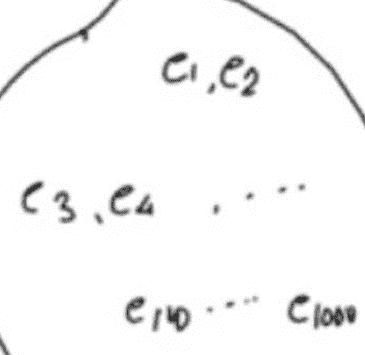


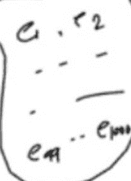
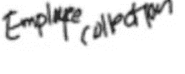


每当你处理 `Stream` 时，请记住你必须调用终端操作才能从给定的 `Stream` 获取结果，该结果将是值而不是 `Stream`。

`Stream API` 提供了终端操作 `collect(..)` 从给定的 `Stream` 中收集数据。

## 从 Stream 收集数据

```
collect(Collector<? super T,A,R> collector)
collect(Supplier<R> supplier, BiConsumer<R,? super T> accumulator, BiConsumer<R,R> combiner)
```

数据如何在 `Stream` 中收集的？

- 它允许我们执行多次折叠操作（将元素封装到某些数据结构并应用一些额外的逻辑、累加它们等）。
- `collect(..)` 允许你将流的元素收集到各种类型的集合中，例如列表、集合、映射，甚至自定义收集器。
- 这种归约操作的策略通过 `Collector` 接口实现类提供。

要理解 `collect(..)` 方法，我们必须先理解 `Collector` 接口。

可变归约操作将输入元素累加到一个可变的结果容器中。如果是并行的，则在处理所有输入元素后，它将把累加的结果转换为最终结果。归约操作可以按顺序或并行执行。

可变归约操作的示例包括：

1. 将元素累加到集合（`Collection`）中
2. 使用 `StringBuilder` 拼接字符串
3. 计算元素的摘要信息，如和、最小值、最大值或平均值
4. 计算“透视表”摘要，例如“卖者的最大价值交易”等。

`Collectors` 类提供了许多常见可变归约的实现。

`Collector` 由四个共同工作的函数指定，这些函数将条累加到可变结果容器中，并可选对结果执行最后的转换（针对并行归约操作）。

1. **supplier**：此函数创建一个新的可变结果容器。如果你使用并行 `Stream`，此函数可能会被多次调用。它每次都会返回一个新值。
2. **accumulator**：它本质上是无状态的。它用于将元素折叠到结果容器中。
3. **combiner**：将两个结果容器合并为一个。
4. **finisher**：它本质上是无状态的。它接受两个部分结果容器并将它们合并以获得最终结果。

- 归约操作可以是并行的或顺序的。
- 使用 `collector` 实现的归约的顺序实现将使用 `supplier` 函数创建一个单个结果容器，并为每个输入元素调用一次 `accumulator`。
- 并行实现将对进行分区，为每个分区创建一个结果容器，将每个分区的内容累加到该分区的子结果中，然后使用 `combiner` 将子结果合并为组合结果。

为了确保顺序和并行执行产生等的结果，`collector` 函数必须满足等价（identity）和结合律（associativity）约束。

## 什么是结合律约束

结合律约束规定操作的分组不应影响最终结果。在数学术语中，对于任意值 `a`、`b` 和 `c`，这种约束对并行评估的重要性可以通过将其扩展到四个项来看出来：

```
a op b op c op d == (a op b) op (c op d)
```

我们可以并行评估 `(a op b)` 和 `(c op d)`，然后在结果上调用 `op`。

满足结合律的操作示例包括数值相加、最小值、最大值以及字符串拼接。

- 在 `Streams` 中，当执行并行归约时，结合律约束很重要。
- 并行流将数据拆分成多个块并并发处理它们。
- 二元操作必须满足结合律以获得正确结果。

## 什么是等元约束

等元约束规定，必须有一个等元元素（也称为等元值或中性元素），它与任何其他元素结合时不会改变该元素的值。在数学术语中，对于任意值 `a`：

```
identityElement op a = a
```

## Collector

```
<R,A> R collect(Collector<? super T,A,R> collector)
对流的元素执行可变归约操作。
```

当利用 `Collectors` 类提供内置 `Collector` 实现时，它是非常有用的。

```java
String names[]={"Ram","Shyam","Mohan","BhanuPratap"};

Set<String> collectNames=Arrays.stream(names)
  .collect(Collectors.toSet());

System.out.println(collectNames);
```

## 看看另一个重载方法：

```
collect(Supplier<R> supplier, BiConsumer<R,? super T> accumulator, BiConsumer<R,R> combiner)
对流的元素执行可变归约操作。
```

在这里你可以传递任何 `Collector` 实例，我们稍后会详细介绍 `Collector`。

## collect 方法是如何工作的？

让我们考虑这样一个用例：将数组元素转换为逗号分隔的值。

输入：`[a,e,i,o,u]`

输出：`a,e,i,o,u` 或 `aeiou`

- `supplier` 函数每次调用都会返回一个新的 `StringBuilder` 对象。
- `accumulator` 函数将列表字符串元素追加到 `StringBuilder` 实例。
- `combiner` 函数合并 `StringBuilder` 实例。实例之间相互合并，并在它们之间加上逗号。
- 在第一情况下，我们有一个顺序元素流。因此它们一个接一个处理，只有一个 `StringBuilder` 实例。没有使用 `combiner` 函数。这就是为什么产生的输出是 `"abcde"`。
- 在第二种情况下，我们有一个并行字符串流。因此元素被并行处理，有多个 `StringBuilder` 实例被 `combiner` 函数合并。因此，产生的输出是 `"a,b,c,d,e"`。

让我们通过代码来理解 `supplier`、`accumulator` 和 `combiner` 这些术语。

### 创建一个提供 ArrayList 的 Supplier

// 使用 Lambda 表达式

```java
Supplier<ArrayList<String>> getList = () -> new ArrayList<>();
```

// 使用构造方法引用

```java
Supplier<ArrayList<String>> getList1 = ArrayList::new; // 构造方法引用
```

### 创建类型为 BiConsumer 的 accumulator：

// 使用 Lambda 表达式

```java
BiConsumer<ArrayList,String> biConsumer = (existingList, newElement) -> existingList.add(newElement);
```

// 使用方法引用

```java
BiConsumer<ArrayList,String> biConsumer1 = ArrayList::add; // 方法引用
```

### 创建类型为 BiConsumer<List,List> 的 Finisher：

// 使用 Lambda 表达式

```java
BiConsumer<ArrayList<String>,ArrayList<String>> listBiConsumer1 = (existingList, newList) -> existingList.addAll(newList);
```

// 使用方法引用

```java
BiConsumer<ArrayList<String>,ArrayList<String>> listBiConsumer2 = ArrayList::addAll;
```

用例：

`String userData[] = {"Raj", "Mahesh", "Himesh"};`

将这些数据收集为 `List`：

```java
List<String> stringArrayList1 = Arrays.stream(userData)
    .collect(() -> new ArrayList<>(), (existingList, newElement) -> existingList.add(newElement), (existingList, newList) -> existingList.addAll(newList));
```

使用方法/构造方法引用：

注意：我们将在下一节中详细介绍方法引用。

```java
List<String> stringArrayList = Arrays.stream(userData)
    .collect(ArrayList::new, ArrayList::add, ArrayList::addAll);
```

```
Collectors.toList()
返回一个 Collector，将输入元素累积到一个新的 List 中。
```

```java
List<EmployeeBean> finalData = empData.stream()
    .filter(z -> z.getSalary() > 80000)
    .collect(Collectors.toList());
```

### 使用额外的下游收集器收集数据

```java
collectingAndThen(Collector<T,A,R> downstream, Function<R,RR> finisher)
```

该方法允许你对收集器的结果执行最后的转换操作。它接受两个参数：第一个参数是收集元素的收集器，第二个参数是一个对收集器结果执行最后转换操作的函数。该转换的结果是 `collectingAndThen` 收集器的最终结果。

```java
// 创建一个整数列表
List<Integer> numbers = Stream.of(10, 20, 30, 40)
    .collect(Collectors.toList());
```

```java
// 使用 collectingAndThen 获取列表中所有整数之和
int sum = numbers.stream()
    .collect(Collectors.collectingAndThen(
        Collectors.summingInt(x -> x.intValue()),
        result -> {
            System.out.println("Transforming result Data: " + result);
            return result * result;
        }
    ));
System.out.println("Final result Data: " + sum);
```

结果：

结果: `100`

最终结果: `10000`

在上面的示例中你可以看到，我们从归约操作中获取了一些数字，然后再次对结果数据执行了额外的操作，并得到了该结果的平方。我们也可以使用普通的 `collect(..)` 方法实现，但可能需要分两步进行：首先获取和，然后获取结果的平方。

```java
// 获取 Employee 集合，引用之前的示例
Long avgSal = EmployeeUtil.getAllEmployeeList().stream()
    .collect(Collectors.collectingAndThen(Collectors.averagingInt(x -> x.getSalary()), x -> x.longValue() * 3));
System.out.println("average salary ::" + avgSal);
Result: average salary ::61140
```

# 环境搭建

下载 `IntelliJ`

`Intellij` 是行业内最常用的 `IDE` 之一，但你可以选择任何 `IDE`。在这里我们将看到如何在 `IntelliJ` 中创建和运行 `Java` 项目。

环境搭建是开始课程的第一步，但我将这一节放在了最后，因为我预计大家已经具备了 `Java` 基础。

从 `https://www.jetbrains.com/edu-products/download/other-IIE.html` 下载 `IntelliJ`


# 其他版本

| 版本 2022.2 | 2022.2.2 |
|---|---|
| 2022.2 - Linux (tar) | Version: 2022.2.2 (Release notes)<br>Build: 222.4345.35<br>Released: 27 October 2022 |
| 2022.2 - Windows (exe) | Major version: 2022.2<br>Released: 25 August 2022 |
| 2022.2 - macOS (dmg) | |
| 2022.2 - macOS Apple Silicon (dmg) | |

你可以根据喜好下载 `IntelliJ`。下载完成后，进行安装。

# 创建 Java 项目

创建项目的步骤：

1. 打开 `IntelliJ`，你将看到如下所示 `IntelliJ` 界面。


## 安装 IntelliJ 并创建项目

2. 根据你的喜好下载 IntelliJ。下载完成后，安装它。

3. 如果已有项目，点击“Open”。

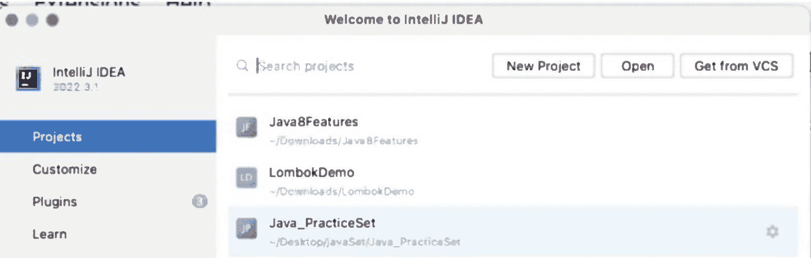

4. 如果想创建，点击“New Project”。

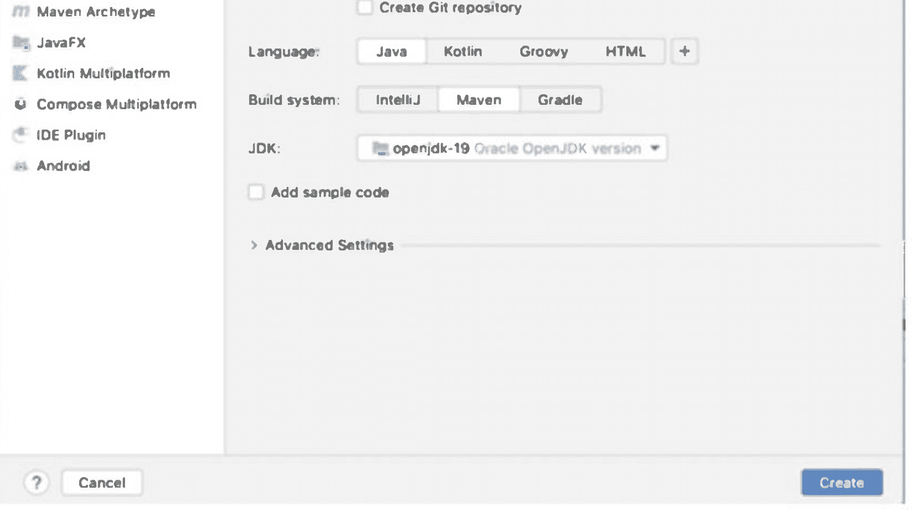

5. 输入项目名称并根据喜选择选项。

6. 选择 JDK 版本（建议使用最新的）。点击 JDK 下拉菜单，点击“Download JDK”为 IntelliJ 添加 JDK。

7. 点击“Create”后，你将看到如下界面。

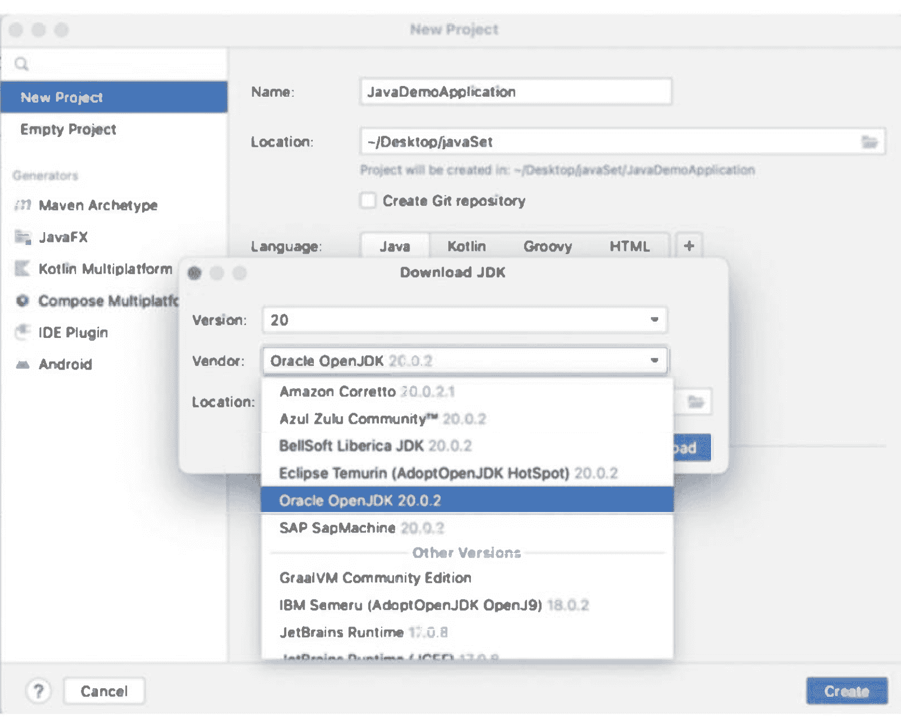

8. 创建一个包（进入`src/main`，选择`java`然后右键点击->`new`->`Package`）如下。

9. 根据下所示所示喜好输入包名。


10. 包已创建。


11. 在你的包中创建一个 Java 类。

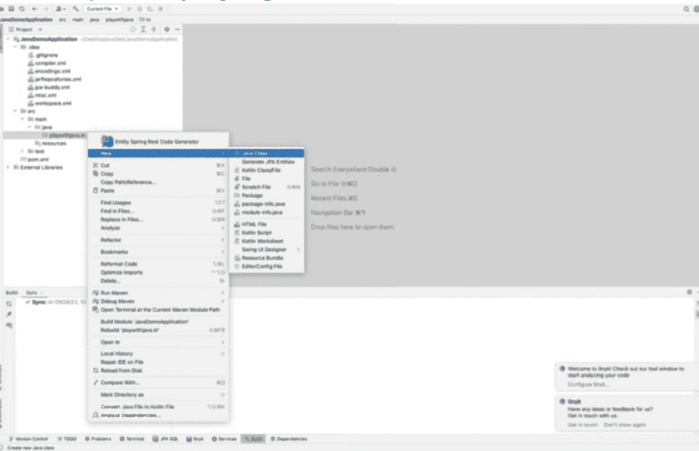

提供你喜欢的类名并继续。

12. 现在你的类已经创建完成。

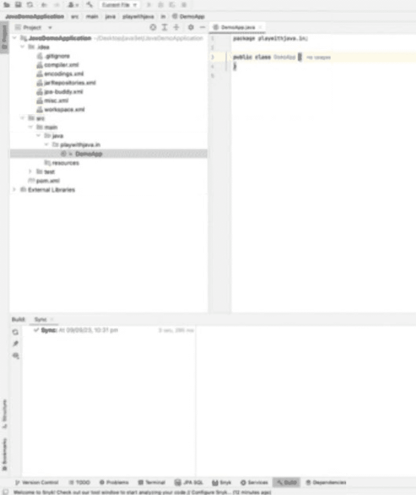

现在你的 Java 项目已就绪，你可以开始编写代码了。

## 创建 main 方法并启动

## 运行 Java 项目

9. 运行你的类。点击所示的 RUN 按钮。

10. 或者选择类文件然后“右键点击”->点击 RUN 选项如下。
