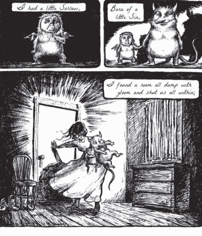
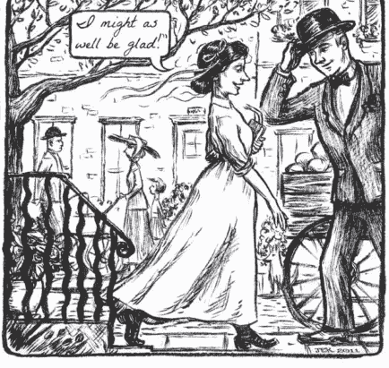
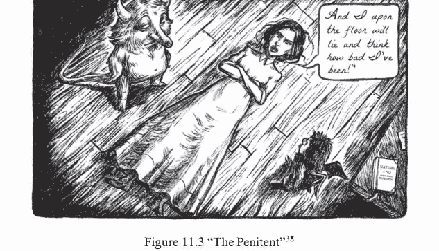
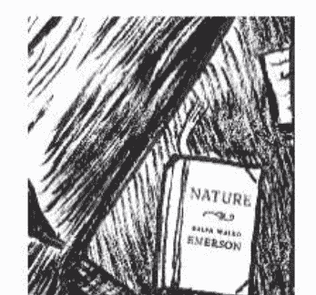

# 比较文学视角下的跨国不属感的性别化表达

我们要感谢贾瓦哈尔国立大学（JNU）校长 `Prasenjit Sen` 教授以及 UPE-II（潜力大学-II）项目的拨款协调员，这使我们能够于 2016 年 8 月 2-3 日组织了“比较文学视角下的性别化冲突与不归属神话”青年学者会议。书中包含的大多数论文都是会议报告的修订版。部分论文是全球同事和学者在响应征稿启后后添加的。我们还要感谢剑桥学者出版社的 `Victoria Carruthers` 女士，她看到了我们计划书的潜力并提议出版。我们想借此机会对 `Theo Moxham`、`Hannah Fletcher`、`Adam Run` 以及 CSP 整个团队的支持表示感谢。

最后，我们感谢所有论文的审稿人和校对编辑。

# 前言

正如书名所示，本书关于“从比较文学视角看性别化的跨国不归属感”。全球化和新自由政体导致世界各地越来越多的人向南进入北/东西内陆或国际领土的金融景观。与此同时，今天的战斗不仅发生在国家、族裔或阶级范式的边界上，还发生在日益扩张的法律社会中关于合法性、性、创伤和恐怖主义等一系列新边疆上。因此，“跨国”不仅限于与跨国旅行、移民和流亡相关的不归属，也存在于“国家”内部性别化认同、空间化和时间的多极缝隙中。它将“性别化”视为一个脆弱性、异质、流动性、弱势或被剥夺的场所，尽管这也是一个赋能与挑衅的场所。

本书大部分作者是参加 2016 年 8 月 2-3 日“比较文学视角下的性别化冲突与不归属神话”青年学者会议（隶属于 JNU 的 UPE-II 项目 D10）的印度及国外知名大学的研究人员和/或教职员工。随后，我们还邀请了其他机构的学者和教职员工为本书撰稿。所有论文都经过了卓越科学委员会的双盲评审。

# 前言

不同类型的性别相关暴力在此相互交织并发挥作用，从而解构了可预见的认识论。这种新颖而粗犷的解构，一方面切穿了制度化性别设计的固定范式，另一方面则解构并对这些范式提出了质疑。

因此，我们书中关于全球性与地方跨国主义的问题，探讨了作者们如何通过自身地缘政治位置的表征或表演性，或者经常通过他国位置的表现来工作；但他们始终置身于易位、过渡和跨国的空间，从那里他们可以审视双方。这本书的独特之处在于作者所处位置这一维度，从这个意义上，从比较文学和跨国视角对文本进行了框架化。本书中的作者在双重操作上是独特的，因为他们迭代地挪用、拒绝并混合了霸权认识论。使用这本书不仅提供了一个阅读视角，还调整了其焦距，与其他标题看似相似的其他书籍投射出不同的光芒。因此，本书的标题是合理的，因为我们正在探索和探寻“从比较视角看性别化的跨国不归属感”这一理念。

论文分为四个部分：通过流离身体的不归属、民主的全球、反叛的重写以及被亵渎的身体。在第一部分“通过流离边界的不归属”中，所有五篇论文/作者都追踪了跨越国家、国家内部、无国界或通过跨国空间流动的身体。

- `Mar Baz Radwan` 描写了两位阿拉伯裔美国人诗人的作品：`Laila Halaby` 的诗《愤怒》（`rage`）和 `Angele Ellis` 的《蓝色州盖赛勒》（`The Blue State Ghazals`）。他们抵制并无视种族歧视的方式，以暴露9/11之后局势的霸权话语，并刺破对东方阿拉伯人和基督徒美国人的刻板印象。他们的诗歌协商了他们自身公民身份的流变边界、伊拉克战争中美国人和阿拉伯人之间的边界，以及被强加的爱国主义带来的恐惧与愤怒。我们在这里看到的是存在于国家/图像/意识之外且存在于其之中的边界。

- `Abin Chakraborty` 的论文带我们来到阿富汗，进入哈莱德·霍塞尼的《千个灿丽的太阳》（`A Thousand Splendid Suns`），那里的女性陷入了双重矛盾。当他们哀悼那些因反俄而死去的人时，他们被推回了美国支持的塔利班这一倒退政权。“白人能把棕色女人从棕色男人救出来吗？”变成了一个跨国问题。

# 从比较文学视角看性别化的跨国不归属

`Gatha Sharma` 探讨了两部旅行游记：蒙塔古夫人（`Lady Montagu`）和玛丽·沃尔斯通手工夫（`Mary Wollstonecraft`）的作品。在18世纪，女性旅行和写作，任何对公共领域的涉足都被视为“侵入”，这是一个非常罕见的突破案例。她们打破了另一种边界，即尽管存在东方主义视角，蒙塔古夫人仍发现后宫是女性的安全空间，而这在欧洲世界是极其匮乏的；而玛丽·沃尔斯通手工夫对欧洲为了财富和奴隶制而丧失的东西进行了严厉批评。以欧洲为边界变得充满了矛盾。

- `Gursheen Ghamar` 的论文论了 `Luis Maria Principe` 的诗歌在“第三”空间的易位中如何成为反叛的声音。它在异性规范化知识体系中，就身体和流亡而言，就个人的性欲协商了个人与公共领域。她的诗歌所描绘/打破的边界是自由且不稳定的，因为它们在对身体和空间的替代性制图中探险，从而动摇了主导叙事中关于层级、原创性和知识的既定性。

- `Java Singh` 将“空间”定位为支点，用以衡量 `Cristina Peru Rossi` 和 `Anuradha Roy` 的选作。论文的理论方法建立在埃莱恩·肖沃尔特（`Elaine Showalter`）和米哈伊尔·巴赫金（`Mikhail Bakhtin`）的公理之上，专注于对海景的描写。`Peri Rossi` 拥有西班牙和乌拉圭两个国家，她始终意识到自己在边界处的位置，而 `Roy` 的叙述始于这些作家文本中对立的巴赫金式时空——门槛与哥特式城堡——之间的悲剧性后果。这些作家一种共同文学技巧的出现，表明了通过跨国不归属而达成的对齐。

第二部分的作者/论文位于全球与地方的边缘，审视全球强制性回路的断裂，这些回路一方面寻求新产品和新市场，另一方面则排除了不符合其经济议的群体。在这些刻有民主代码的回路中，从边缘到中心的运动（例如从经济欠发达国家到发达国家）或从中心到边缘（例如将主导的国家范式强加于部落人口）标志着进步。这一部分的论文质疑了“进步”的概念。

- `Kavya Krishna K.R.` 试图通过广告，理解女性主义与全球资本主义这两个完全对立文化逻辑的矛盾性调和。论文分析了在社交媒体上被广泛讨论和分享的选定广告，其在于具有明显的“女性主义”立场。这些广告中的“女女孩”象征着追求利润的企业实体对女性赋权的性别敏感态度。然而，她的分析揭示了这些广告作为全球资本主义的喉筒，仅仅挪用了女性主义的词汇，而没有试图解决其政治问题。

- `Ratul Ghosh` 追踪了将印度密教（`tantra`）塑造为跨国文化商品的过程。他的论文通过众多宗教和哲学学者的研究解释道，到20世纪上半叶，密教通过将其解释为一种类科学知识体系，已成为反对西方唯物主义的解放性话语。随后，胶片、媒体和数字渠道被用于将性快感作为商品进行营销。`Ghosh` 探索了在这种策略中，消费者如何成为全球文化产业所提供的密教课程的学生。

- `Sarat Kumar Jena` 追踪了中心在边缘所培养的现代性建构中殖民主义的残留。当殖民时代被权力结构抛弃时，对本土身份的误读并没有结束。去殖民化国家采取的排斥性民主制度引发了当地精英，进一步延续了这种误读。`Jena` 对普拉蒂比哈·雷（`Pratibha Ray`）《原始之地》（`Adhibumi`）的阅读揭示，雷对妇女性性的建构传播了本土社区的集体身份，而文本的英文翻译向全球读者传播了对妇女的霸权呈现。

- 第二部分的最后两篇是对澳大利亚离散文学的评论。`Tara Senanayake` 将斯里兰卡-澳大利亚裔作家《如果月亮微笑》（`If the Moon Smiled`）视为移民身份发明和离散混合体创造的贡献因素。后殖民主义和女性主义方法之间的趋合点——即公式试图对边缘化秩序进行防御——被应用于主角身体和心灵的“制图”。论文考虑了这样一个问题：主角最终的“疯狂”是解放性的，还是证实了移民女性在从传统的欠发达国家移动到现代的经济发达社会时，其从属地位依然没有改变。

## 比较文学视角下跨国不属感的性别化呈现

几乎没有掩盖其叠加之上的雇佣式犯罪性。何塞·克鲁斯（`Jose Cruz`）关注小说中描绘的“新中产阶级”，揭示了尽管具有“新性”，它们延续了传统霸权情绪的支配地位。

第三部分“反叛重写中的不属感”由一系列论文组成，作者们自觉地选择、处理或通过对类型和/或传统故事的文本记忆，来重构/解构在全球空间中穿行的不同性别身份的派性。

安娜·阿布尔·赫尔南德斯（`Ana Abril Hernández`）探讨了文森特·米莱（`Vincent Millay`）《荆棘中的无花》（1920）中的诗歌《忏悔者》，并与其在《漫画经典第3卷：从黑暗之心到海明威的无限盛宴》（2013）中的影像改编进行对比。她论证了诗中不断演变且具象的主体如何在窒息的父制国家内，与其对自由和平等的渴望相关的公共/个人焦虑中挣扎。然而，诗歌的影像呈现听起来更加放纵，压力更小，因为她似乎对自己的性冒险而非被驯化的空间毫无遗憾。

埃拉姆·沙希姆·安萨里（`Eram Shaheem Ansari`）首先指出，童话延续了性别角色，而华特迪士尼的强化手段重建了等级制度，他们对性与性别的使用进行了幼稚化。女性主体没有主体性，因为她是顺从而庄重的，等待“高贵王子”的救赎。她将这些与近期的改编进行对比，这些改编通过女性主义立场批判性地消解了父制秩序。

同样，桑吉塔·森（`Sanghita Sen`）探讨了大多数印度电影最终如何复制设定的性别刻板印象；然而，一些作品实际上支持女性的主体性，在这种掠夺性的男性化空间中不仅存在于屏幕上，也存在于屏幕外，例如审查委员会、社区自警组织，甚至是不公正的法庭。她分析了两部平行电影：设定在殖民时期的《咖喱马萨》（`Milch Masala`），以及由一位美国印第安人讲述的印度农村强奸案记录《瓦万德》（`Bhawander`）。这些电影叙述通过跨国模式了被禁止的虚构或真实故事。

来自斯里兰卡卡的帕莫达·贾亚维拉（`Pamoda Jayaweera`）选择通过马哈斯维·德维（`Mahasweta Devi`）的文本《想象地图》来探讨印度民族国家中的不属感问题。贾亚维拉通过不同的批判性话语调解同质或多元实体的国家概念之间，并对德维的文本进行后殖民解读，以阐述下层的不属感。本土通过奴隶、卖淫和“信息”被排除在民族国家的计划之外，这些方式将新殖民驱动力净化为国家性的处方。

# 前言

虽然史诗《罗摩衍那》中有许多关于悉陀的重述，且大多框架在民族主义资产阶级的女性化理想内，但维平·K·卡达瓦斯（`Vipin K. Kadavath`）专注于库马兰·阿桑（`Kumaran Asan`）的诗《沉思之树的悉陀》，探讨如何通过将这一国家偶像置于一个禁止的内省对话区域来赋予她主体性。悉陀被重新想象为一个思考的主体，她能够看穿她所遭受的所有不公，并决定永远不再回到罗摩的宫殿。

第四部分是所有不属感走向身体物质性的高潮。

拉尔夫·迪亚斯（`Lav Diaz`）的电影空间充满了被暴力强奸和残害的女性身体，无论是死亡的还是幸存的，穿过并超越他电影中如炼狱般的过渡空间。它在文本上与佩雷·波尔塔贝利亚拉（`Pere Portabella`）电影中的配乐相联系，与里特维克·加塔克（`Ritwick Ghatak`）作品中痛苦的孤独女性，以及布尼埃尔（`Buñuel`）的作品集相联系。它还与陀思妥耶斯基、格劳伯·罗哈、何塞·里萨尔（`José Rizal`）以及圣经人物马利亚·马格拉拉等许多人交汇。帕里查伊·帕特拉（`Parichay Patra`）认为，最终只有电影留了下来，因为它消耗了它试图观察的世界。身体的不属感溢出到所有无边界的空间，留下的只有光和影。

与消失和溢出的身体相反，谢亚姆·贝内加尔（`Shyam Benegal`）的《市场》（`Mandi`）充满了实践妓女文化艺术的女性，但她们拒绝出售身体做妓。萨尔巴尼·班纳吉（`Sarbani Banerjee`）论证了市场如何将一切拉向自己，像对待任何其他物体一样将女性身体商品化。女性们构建了对商品化的抵抗，通过寻求妓院妇女之间家庭纽带的传统以及对妓女角色的追求——这是艺术（再）呈现与性工作的结合，她们为客户表演。

拉玛·保罗（`Rama Paul`）的论文关注作为铭文的回写的身体，这些身体位于阿根廷的“脏战争”。死亡和失踪的身体遍布各地。但活着的“五月广场妈妈”（`Mothers de la Mayo`）在国际目光下默默地哀悼那些“失踪者”。当身体遭受酷刑、污染和残害时，它们变成了历史的具身标记和知识的容器。然而，这些身体被剥夺了知识创造者的角色。论文在受侵犯身体作为知识创造者/标记的背景下，考察了三部电影：《铅笔之夜》（1986）、《想象阿根廷》（2003）和《处女与狼》（1994）。这些电影展示了身体如何在压迫政权中扎根，并在其上演抵抗的反叙事。虽然这篇文章没有以任何方式反驳男性在类压迫和暴力政权期间遭受的暴力，但其范围局限于女性身体。

## 比较文学视角下跨国不属感的性别化呈现

阿努姆·法蒂玛（`Anum Fatima`）和阿里巴·扎纳布（`Ariba Zainab`）关注了《阴道独白》及其印度改编版。在父制系统中，女性身体被简化为仅有的生殖性器官。论文解释了《阴道独白》中身体从更具生殖器官向性器官的转变。尽管被设计为独白，但论文认为这部戏实际上是女性与其自身愉悦与欲望的禁忌区域之间的对话叙事。它是关于她如何面对被定性为“丑陋”和“肮脏”的现实。作家们随后考察了为印度观众制作的文化和语言特征。印度制作版必须通过不同的社会禁忌进行谈判。它还必须遭遇保守和倒退的力量。然而，这部戏取得了巨大的成功，因为“阴道”暴露了针对女性身体的暴力历史和愉悦。

书中最后一篇论文通过凯伦·巴德（`Karen Bard`）的新物质主义概念解读了尼迪亚·迪亚斯的监狱回忆录，关注物质与意义、或身体与心灵的不可分割性。尼迪亚·迪亚斯的监狱回忆录是在她实际面对监禁和酷刑二十年后撰写的。乔杜杜里和穆克吉（`Choudhury and Mukherjee`）表明，回忆录是一种嵌入叙事，并充满了物质主体性，迪亚生动地收集了她战伴们遭受的酷刑和羞辱事件。被书写的身体在拒绝任何形式的顺从时，积极地“回写”。回忆录是表演性的，因此它重新编码自身，以挑战和颠覆任何社会或类型的语言习惯作为仅仅的呈现仪式。身体与回忆录交织的表演性揭示了呈现如何被简化为心灵的简单现实习惯和运动的语义转变。

因此，所选文本中的被考察主体通过被迫流亡或移民到遥远土地、监狱和妓院等卑劣空间，面临着流离、歧视、污染和/或死亡，或者被迫打破熟悉的家庭和室内封闭空间。与此同时，所有（论文）作者都自觉地占据一个边缘位置，他们耕读所选文本，横跨了历史、虚构和/或神话的时空材料，使得一种跨国的性别不属感视角得到进一步强化。这种不属感像是一种双重困境，是自觉选择文本和作者自觉采取边缘位置的结果，通向对流离者和被剥夺者的一种新的共情伦理。

受新地缘政治知识启示的既定/批准的理论模板。文本与作者的阈值定位打破了认识论秩序，因为他们抵制对流亡和/或散居主体、混合或酷儿认同、固定文本性，以及往往仅仅是对一种想象的自我与他者的刻板印象。怀旧、愿景和即时现实的空-时-物质边界以非常独特的方式被重构，成为斗争的场域，实现一种旨在脱钩和去殖民化的不同行动性思维。这些边界也受到性别困扰的影响，使得男性气质和女性气质被表述为流动的、变化的且不稳定的。现在将这些论文呈给各位审阅。

- 2. `Nathalie Handal`, ed., *The Poetry of Arab women: A Contemporary Anthology* (New York and Northampton: Interlink Books, 2001), 158.

### 关键词：交叉性/跨国女性主义、阿拉伯裔美国人、美国族裔文学、意象学、政治诗歌。

阿拉伯裔美国女性在抵抗美国文化和政治话语中发声、写作和动员——无论这些话语是新殖民的、民族主义的、异性恋父权制的还是确实女性主义的——并非近期现象，而是9/11袭击后的绽放。阿拉伯裔美国女性主义者早已明白，性别压迫无法与其他形式的压迫分离，或者更明确地说，“一个压迫性的性别系统[原文强调]在没有其他权力和压迫系统协作的情况下是不运作的。”识别和调查交叉压迫的需求也是有色种族女性女性主义的核心，许多阿拉伯裔美国女性主义者将色彩女性主义视为自己的政治和精神家园。美国政府利用阿拉伯和穆斯林女性的“困境”为战争制造支持；当阿拉伯民族主义领导人以“文化真实性”之名剥夺女性自由时；当主流女性运动承担起代表阿拉伯姐妹斗争的任务时，斗争与种族、殖民和国家压迫的是显而易见的。因此，在过去的二十里，阿拉伯裔美国女性主义者的抵抗策略主要在交叉和跨国女性主义框架内表达。跨国女性主义愿景优先考虑异质的声音和经历以及“所有社区的混合文化”。本文将考察阿拉伯裔美国女性主义者如何通过交叉和跨国女性主义框架重新构认同，并探索在尝试从认同政治转向将认同视为混合、多元、移动和不断被否定的概念时所遇到的一些斗争。这种分析将为一种意象学

- 3. 如 `Amira Jinarakani` 所述，“自2001年世界贸易中心和五角大楼遭到袭击以来，阿拉伯裔[sic]女性主义从主流角度来看被描绘和感知为突然相关或新形成的。” 231.

- 5. `Ella Shohat`, ed., *Talking Visions: Multicultural Feminism in a Transnational Age* (Cambridge, Massachusetts: MIT Press and New York: New Museum of Contemporary Art, 1998), 56.

莱拉·哈拉比：愤怒。在诗集《他舌上的名字》（`My Name on His Tongue`，2012）的诗《愤怒》中，莱拉·哈拉比通过对自由多元主义的冷酷剖析，强调了阿拉伯裔美国人在主流美国社会中的局外人地位。诗人将一种特定的自由多元主义女性主义解读投影到白人产阶级母亲身上，其底层逻辑是忽视性的。

尽管 `Halaby` 首诗集的主题范围和多种诗歌声音，加之她对家乡乡愁的频繁引用，人们试图将其定位为类似于非裔女性主义者奥德丽·洛德（`Audrey Lorde`）和朱恩·乔丹（`June Jordan`）的抗议诗人，但对美国领导的中东战争以及以色列占领巴勒斯坦的谴责，通常充满了黑人抗议诗那种显而易见的愤怒和行动号召。[R]在诗人与自由派母亲的交流展开中采用了第一人称具身法（`Dowdy`），但在诗歌采取的抵抗策略中，伴随着一种具身的权威主体性，使得文本可以被理解为首对抗性的诗歌，“挑战”……读者采取行动并重新定义他们的意识。”我认为，这种挑战令白人自由派女性读者感到恐惧，号召她们意识到自己对多元文化团结的努力根植于一种民族中心主义的思维方式。


阿拉伯裔美国人的身份主要通过否定来确认，即否定自己不是什么：自由派美国母亲的异性恋形象，其文化和价值观是白人的。`Bool`曾认为白人身份在学术和文化生产中并未被优先考虑：“在太多的当代写作中……种族始终是‘他者’的问题，而非白人的问题。”`Halaby`的抵抗发生在瑞娜·摩尔·布雷丁（`Rena Moore Bredin`）所谓的“游击民族志”。`Halaby`通过将自由派母亲的反战立场置于塑造这些立场的权力等级之中，消解了其“白人”关注的合法性。自由派母亲的游击民族志肖像通过她自己的言语得以巩固，这揭露了她对战争真实的忧虑，并通过说话诗人在意象类型剧场对她白人身份的构建。

`[R]age`的副标题为“伊拉克战争，第6天”，立即将愤怒置于9/11后的阿拉伯裔美国人经历之中。加入尚处于婴儿阶段的“第6天”，预示了即将到来的所有恐怖，并标志着这一天在诗人对战争的关系体验中具有特殊意义。`[R]age`以诗者的发声开头，“我谴责战争，并记录下自己无法改变它的无力：

> 9. `Michael Dowdy`, *Political Poetry in the 21st Century* (New York: Palgrave Macmillan, 2007), 27.
>
> 10. 引自`Chela Sandoval`, “U.S. Third World Feminism: The Theory and Method of Oppositional Consciousness in the Postmodern World,” in *Genders* 10 (1991): 22. *White*

我很愤怒

对所有人

因为他们没有做足够的事

来阻止这一切

我很心碎

带着恐惧和悲伤

为了每一个参与的人¹¹

说话诗人将整个西方社会因其未能“阻止这一切”的失败而归罪之，她的同情跨越了文化和心理边界；“everyone”（所有人）的重复似乎表明，她的“恐惧和悲伤”既指向伊拉克人民，也指向那些被迫履行职责的美国士兵。

我我无能为力

这就是为什么这所安全的学校

对于小孩子来说

是一份祝福

在那里人们说

你好吗？

而且大多是真心的

那位巴西老师

向外倾身，笑着

你们还好吗？

我的愤怒平静了

在整个充满咯咯声的甜美早晨里

挖掘和唱歌

饼干和冰棒凌

故事和拥抱¹²

“学校”的公共领域在其意义上被驯化为一个“安全”空间、一个“祝福”，在这里，说话诗人的无力感，她对面对战争时无法做任何有意义的事的认知，被童年的纯真和简单所缓解，“挖掘和唱歌 / 饼干和冰棒凌 / 故事和拥抱”。说话诗人

> 11. `Laila Halaby`, “rage,” in *My Name on His Tongue* (New York: Syracuse University Press, 2012), 97.
>
> 12. Ibid, 97-98.

## “有色人种”女性主义与9/11后的族群认同

推断出孩子和他们居住的空间激发了人性中最好的一面，或者他们最好的面孔，“在那里人们说 / 你好吗？ / 而且大多真心的”。礼貌的问候“你好吗？”超越了表面解读，是对说话诗人族裔的一种“大多”是同情的认可，因此引发了对战争的介入，这反映在巴西老师那句“你们还好吗？”中。重要的是，这首诗中唯一未受质疑的愤怒来自一位同为色的人。因此，对`Halaby`来说，阿拉伯裔美国人的真正包容和交流体现在全球种族化主体对种族不公的共同斗争的*跨国*联系中。是那“充满咯咯声的甜美早晨”帮助叙述者的愤怒平息，但“那边”孩子的困境让叙述者最终爆发，并将无力感投向一个具体的靶。当政治渗透家庭领域时，战争“几乎被遗忘”¹³的儿童空间避难所被打破了：

- 我们正走向车旁

我被伏击了

不是被一个

右翼的

战前的

福音派基督徒家长

她质疑我的国籍

担心着

我们的关系

而是被一位阅历丰富的

自由派母亲拦住

她停住我

把手放在我的胳膊上

就像你对待

一个正在悲伤的人那样

颤抖着

“我太愤了”⁴

这里运作的异性恋图像互动，沿着社会政治路线将白人美国划定为二元对立：一种是保守心态，带有外化的偏见和对多元文化的恐惧；另一种是自由派反战反种族意识，其正义性在于对多元文化的关注。诗歌中唯一未受质疑的愤怒来自一位同为色的人，这一点意义重大。在“右翼”、“福音派基督徒”等意象的创作中，这种保守心态的延续是

> 13. Ibid., 98.
>
> 14. Ibid., 98.

在对说话诗人的想象侧写中，其“国籍”和“关系”反映了新东方主义的阿拉伯裔肖像，这种族群在9/11后达到了歇斯底里的高度。想象中的保守家长无法跨越差异，无法将说话诗人视为同的美国人。“阅历丰富的 / 自由派母亲”这一意象暗示了中产阶级地位以及相关的女性主义领域——在此例中，即行动自由。自由派母亲显眼的团结充满了戏剧性与自我扩张（“把手放在我的胳膊上，就像你对待/一个正在悲伤的人那样颤抖着”）：

- 然后她告诉我

关于她安排的高级晚餐

和她的自由派朋友们

我需要志同道合的人

多么糟糕，

令人心心，

怪异的展示

- 这些孩子将

无法旅行

她的话找到了通往我锁上的愤怒的钥匙

颜色是紫色的

音量是红色的

像这样的孩子

将无法生存！

我的声音在尖叫着⁶

> 15. Ibid., 98-99. *Teif*

## 10 ... 9/11后的族群认同

这种团结是幽默地扭曲的，是一种游击民族志漫画，映射出白人自由派同情的虚伪面具。当自由派母亲说“我需要志同道合的人”时，她将说话诗人吸收到这场宴会中，放弃了种族差异而追求色彩团结。说话诗人意识到自由派母亲对伊拉克战争的愤怒是“真实的 / 也许是我自己的反映”，但正是她那些“设计感词汇”的不协调“让我想吐口”。然而，关于他们的愤怒可能源自同一地方的认知在随后的诗节中被迅速消散了：

- 一群幼儿

在我们面前的

木质设施

她指着，正义地摇着头

- 这些孩子，她说道

你可以看到她正在与

自己的愤怒挣扎

自由派母亲对战争真实的忧虑的揭露，反映了新自由主义社会的核心驱动力，以及随之产生的第一世界与第三世界女性主义者关注点之间的分裂。支撑身份自我的个人主义哲学优先考虑选择，即个人对其财产和资本的主权。对于自由派女性主义者来说，这种选择体现在对身体的主权上。主流自由派女性主义的普遍化原则是从特权地位执行的：抵抗符合白人中产女性的优先事项和利益，这种民族中心主义意识最终支持了社会秩序。

> 16. Ibid, 99.

## Omar Baz Radwan

根据 `Leti Volpp` 的观点，西方女性关注第三世界特定性别压迫行为的背后动机最终可能是自我导向的，是“一个人对对自己所恐惧的某种”的投射。¹⁷。在这种情况下，这位“行迹丰富”的母亲对战争的“愤怒”甚至没有延伸到“那那里”的女性或儿童；她的愤怒幼稚地关乎战争对中产阶级美国人将产生的占有性（目标导向的）影响（“这些孩子将无法旅行”）。这是一种对战争自愿且自私的解读，最终点燃了叙述诗人的“压抑的愤怒”。自由主义母亲最大的越界是让美国中产阶级儿童成为战争的受害者。她将叙述诗人归入这种基于阶级的战争意识之中（“这些孩子”），为了西方消费主义利益而吸收了种族差异。在此为止一直剥夺了对话机会的叙述诗人，通过将叙事重新转向那些真正遭受苦难的孩子，打破了母性阶级团结的表象，揭明了“我们的孩子”与“他们的孩子”之间的差异；像这些孩子 / 也将无法活下去！”年幼的孩子通过（一群幼儿 / 攀爬受损的设备 / 在我们面前）理解世界并探索周围，这是一种超越阶级、种族或国界的纯真共性。诗中的愤怒源于一种母性的目光，这种目光将战争理解为对儿童的字面破坏和对童年纯真的毁灭。

叙述诗人被自由主义母亲否认了（她从未被问过对战争的看法），因为自由主义母亲假设她的反战意识来源于同样的白人中产阶级意识。自由主义母亲“理直气壮地指指点点”，为游民族肖像增添了另一层：在谴责美国外交政策时，说教式中产阶级女性主义领袖与“他者”的声音形成了对比。多元文化逻辑的同化原则使得这种对差异的庆祝掩盖了诗中继续压迫贫困人的系统性不平等，并指向了阿拉伯人和阿拉伯裔美国人的声音如何如何在多个层面运作。叙述诗人通过去中心化自由主义母亲的叙事重申了自己的主体性，将其从一种中产阶级消费主义意识转化为一种跨国的、以“他者”为导向的意识，巩固了自由主义母亲反战立场中最后的虚伪：

> 17. `Leti Volpp`, “Feminism versus Multiculturalism,” *Columbia Law Review* 101:5 (2001): 1151–1218. JSTOR, accessed December 11, 2012, url: http://www.jstor.org/stable/1123774.

## “有色人族女性”女性主义与9/11后的族裔身份

礼仪被打破

我带着我三岁的孩子

走向安全处——

远离我未展开的愤怒

远离抽象的

战争幻景

与毁灭

远离自由主义母亲

以及她们的知识分子式的

愤怒，这种愤怒由

工作的丈夫

美国美元资助

在白瓷餐盘上

配着腌制烤肉¹¹⁸

进行讨论

曾经的“小孩子们的 / 安全学校”不再是一个“恩赐，一个愤怒通过‘咯咯笑’消散的母性-家庭领域”，母亲对那些没有避风港的人的认知失调，破坏了童年空间能带给叙述诗人的任何宁静，因此“她带着”她三岁的孩子 / 走向安全处”，远离这个如今已政治化的空间，“远离[她]未展开的愤怒”。中产阶级社会的准则——通过创造一个“礼仪被打破”的肖像来顺应现状的主导文化。`Halaby` 反转了对中产阶级自由主义母亲的刻画，使她既是极度可见的又是隐形的（通过一系列异质化形象被物化：“行迹丰富的”、“美食晚宴”、“言语”、“知识分子式的愤怒”、“工作的丈夫”、“美国美元”、“白瓷餐盘 / 腌制烤肉”）。对于 `Halaby` 来说，自由主义的多元文化主义变成了一个人们可以对自己和在世界上的行为感觉更好的载体。对族裔秩序、绅士化社区、对战争的“知识分子式的愤怒”以及与受影响者的团结，产生了一种自得的优越感，作为入侵一个“由工作的丈夫 / 美国美元资助”的国家背后帝国主义意图的衬托。对伊拉克战争多重认同的可能性在西方占有行为中被抹除，

> 18. `Halaby`, "rage," 99-100
>
> 19. Ibid, 97.

## Omar Baz Radwan

叙述诗人认定为“抽象的 / 战争幻景 / 与毁灭”。然而，叙述诗人的主体性不会被抹除；她拒绝接受多元文化和谐的逻辑，并确认了她与族裔他者的归属感，并远离自由主义母亲。

叙述诗人利用压迫者文化的语言为被压迫者服务；自由主义母亲的话语揭示了她，并结合叙述诗人提出的异质化形象积累，向白人女性观众竖起了一面严厉的镜子。`Halaby` 受伤的母亲与下一节将分析的《蓝州盖扎勒》（*The Blue State Ghazals*）中 `Adele Ellis` 的叙述诗人的母性身份形成鲜明对比，在后者，`Halaby` 的母亲形象在自由主义女性主义的延伸中只发现虚伪，而 `Ellis` 的活动家母亲则看到了跨越分的女性主义团结潜力。阿拉伯裔美国人身份通过否定得到确认——对白人文化身份的抛弃；在后者，随着愤怒被动员用于跨文化的“政治化母性”，多元的归属空间开启了。²⁰

`Ellis` 的诗集《雷达上的阿拉伯》（2007）借鉴了当代美国社会的社会政治关联，表达了对国家身份的性别化重构。“蓝州”指的是民主党大地，以及一种自由主义政治伦理的核心，它支持联邦干预民权立法，并自1960年代以来不断获得跨种族、性别和阶级的少数投票集团的支持。红州是南部和中部的共和党基地，被认为坚持一种自由市场经济和有限政府的保守政治哲学，这种哲学最初吸引了反对1964年民权法案的白人选民。红州心态成为新殖民主义白人价值观的同义词。蓝州州是美国文化身份和国家性格竞争愿的象征。

`Angele Ellis`: “The Blue State Ghazals”。`Ellis` 诗中的《The Blue State Ghazals》既是对国家的哀悼，也是对……的肯定

## “有色人族女性”女性主义与9/11后的族裔身份

中产阶级社会的准则——通过创造一个“礼仪被打破”的肖像来顺应现状的主导文化。`Halaby` 反转了对中产阶级自由主义母亲的刻画，使她既是极度可见的又是隐形的（通过一系列异质化形象被物化：“行迹丰富的”、“美食晚宴”、“言语”、“知识分子式的愤怒”、“工作的丈夫”、“美国美元”、“白瓷餐盘 / 腌制烤肉”）。对于 `Halaby` 来说，自由主义的多元文化主义变成了一个人们可以对自己和在世界上的行为感觉更好的载体。对族裔秩序、绅士化社区、对战争的“知识分子式的愤怒”以及与受影响者的团结，产生了一种自得的优越感，作为入侵一个“由工作的丈夫 / 美国美元资助”的国家背后帝国主义意图的衬托。对伊拉克战争多重认同的可能性在西方占有行为中被抹除，

（此处重复了之前的翻译内容）

叙述诗人认定为“抽象的 / 战争幻景 / 与毁灭”。然而，叙述诗人的主体性不会被抹除；她拒绝接受多元文化和谐的逻辑，并确认了她与族裔他者的归属感，并远离自由主义母亲。

叙述诗人利用压迫者文化的语言为被压迫者服务；自由主义母亲的话语揭示了她，并结合叙述诗人提出的异质化形象积累，向白人女性观众竖起了一面严厉的镜子。`Halaby` 受伤的母亲与下一节将分析的《蓝州盖扎勒》（*The Blue State Ghazals*）中 `Adele Ellis` 的叙述诗人的母性身份形成鲜明对比，在后者，`Halaby` 的母亲形象在自由主义女性主义的延伸中只发现虚伪，`Ellis` 的活动家母亲则看到了跨越界的女性主义团结潜力。阿拉伯裔美国人身份通过否定得到确认——对白人文化身份的抛弃；在后者，随着愤怒被动员用于跨文化的“政治化母性”，多元的归属空间开启了。²⁰

`Ellis` 的诗集《雷达上的阿拉伯》（2007）借鉴了当代美国社会的社会政治关联，表达了对国家身份的性别化重构。“蓝州”指的是民主党大地，以及一种自由主义政治伦理的核心，它支持联邦干预民权立法，并自1960年代以来不断获得跨种族、性别和阶级的少数投票集团的支持。红州是南部和中部的共和党基地，被认为坚持一种自由市场经济和有限政府的保守政治哲学，这种哲学最初吸引了反对1964年民权法案的白人选民。红州心态成为新殖民主义白人价值观的同义词。蓝州州是美国文化身份和国家性格竞争愿景的象征。

`Angele Ellis`: “The Blue State Ghazals”。`Ellis` 诗中的《The Blue State Ghazals》既是对国家的哀悼，也是对……的肯定

（此处重复了之前的翻译内容）

中产阶级社会的准则——通过创造一个“礼仪被打破”的肖像来顺应现状的主导文化。`Halaby` 反转了对中产阶级自由主义母亲的刻画，使她既是极度可见的又是隐形的……（诗意翻译）

礼仪被打破

我带着我三岁的孩子

走向安全处——

远离我未展开的愤怒

远离抽象的

战争幻景

与毁灭

远离自由主义母亲

以及她们的知识分子式的

愤怒，这种愤怒由

工作的丈夫

美国美元资助

在白瓷餐盘上

配着腌制烤肉¹¹⁸

曾经的“小孩子们的 / 安全学校”不再是一个“恩赐，一个愤怒通过‘咯咯笑’消散的母性-家庭领域”，母亲对那些没有避风港的人的认知失调，破坏了童年空间能带给叙述诗人的任何宁静，因此“她带着”她三岁的孩子 / 走向安全处”，远离这个如今已政治化的空间，“远离[她]未展开的愤怒”。中产阶级社会的准则——通过创造一个“礼仪被打破”的肖像来顺应现状的主导文化……（注：由于原文文本存在大量重复，译文已按逻辑结构对应完成翻译）

## Omar Baz Radwan 15

认同。然而，正是这些封闭的认同首先赋予了希恩（`Sheehan`）主流反战母亲形象的合法性；如果希恩是非白人，那么针对她性格的、基于性别和种族的攻击的交织，将削弱她反帝国主义立场的民粹吸引力。《蓝州盖扎尔诗》可以被视为格洛丽亚·安扎杜亚（`Gloria Anzaldúa`）和阿纳露斯·基斯（`Analouse Keyes`）意义上的“精神行动主义”作品。在承认差异与努力打破身份政治之间存在的内在矛盾在《蓝州盖扎尔诗》中被推出来，在这里，希恩的种族在反战运动主流化中的影响，被包含在母亲这一形象的共性之中。对于叙述诗人来说，更重要的是我们承认悲伤，并以此类推跨越分阂的痛苦——“所有的其他母亲”，因为这如此隐含地质疑了一种美国爱国主义，这种爱国主义纪念的是美国战争阵亡者，而不是那些在某种外交政策叙事中，战争为他们而打的伊拉克平民。开篇的双联句最敏锐地用母亲的语言勾勒出了抗议的声音：

> 8/17/05
>
> 谦卑的母亲，战争是不仁的。
>
> 在你儿子明亮的裹罩上哭泣吧。
>
> 我为在草地上玩捉迷猫的孩子们哭。
>
> 仍然相信我们是自由且勇敢的。
>
> 三十闪烁的蜡烛会成为目标吗？
>
> 我们像护婴儿一样温柔地护住火焰。
>
> 一千五百、一万五千、二十万。
>
> 我们告诉死亡，告诉那些来哀悼他们的人。
>
> 团结脆弱得如孩子的纸链。
>
> 做着一件小事，消散在黑暗中。

> 27. `Ellis`, "The Blue State Ghazals," 26.

“8/17/05”这一日期指的是全美范围内支持希恩举行的烛光守夜会，叙述诗人参加了其中一次守夜会。艾利斯（`Ellis`）利用文学轶事来批判那种处于民主先锋、发动正义战争的“例外”美国国家的男性权主义自我形象。作为国家自豪感象征的牺牲的美国母亲在第一个双联句中被否定了，这重构了斯蒂芬·克兰恩（`Stephen Crane`）讽刺反战诗《不要哭，姑娘，战争是不仁的》的最后一节，该诗首发于1899年：“母亲，你的谦卑像纽扣一样 / 在你儿子明亮华丽的裹罩上，/ 不要哭。/ 战争在回响。”²

在《蓝州盖扎尔诗》中，克兰恩叙述诗人那种居高临下的语气在当今的政府官身上得到了共鸣，他们可能承认战争是不仁的，并劝说“谦卑的母亲”“哭泣”，但在提醒遗孀母亲她儿子的“华丽”时，他们是在诉诸那种为了高尚事业而牺牲的古老战争修辞。叙述诗人转而为那些被引导相信“自由”且“勇敢”的美国国家神话的美国“孩子”哭泣，这些士兵随着美国国歌《星条旗》的副歌行军：“或是自由者的土地，勇敢者的家园。”


第三个双联句通过将和平的反战抗议者的“闪烁的蜡烛”定位为“目标”，并将其融入一种养育母亲的自我形象，进一步颠覆了美国的国家性格：“我们像护婴儿一样温柔地护住火焰”。童年脆弱与无真的符号学——“在草地上玩耍的孩子”、“像护婴儿一样温柔”、“如孩子的纸链般脆弱”、“一件小事”——从爱国主义义务的断层线上夺回了战争叙事。母亲的保护本能，这种符号学可以以一种国家牺牲永远无法实现的方式创造凝聚力和社区：“作为政治立场抗议战争是一回事，而与母亲所象征的一切的对立面对抗则是另一回事。”²29 然而，这种可以放下政治、阶级和种族差异来“哀悼死亡”的集体“我们”，脆弱得像“孩子的纸链”一样容易破碎。“做着一件小事”的集体行为染着忧郁，因为人群随后“消散在黑暗中”。

在第二组双联句中，语气发生了显著变化。集体的悲伤被正义的愤怒所取代，公民母亲的声音被重构为一名目击活动家，报告了政府背景行为者对反战示威的无理反应：

> 8/20/05

> 在战争之门，一个男人做了一个临时告示牌。

> 今日无谎可说，招兵中心已关闭。

28. As quoted in Joseph Katz, Stephen Crane in Transition: Centenary Essays (DeKalb, Illinois: Northern Illinois University Press, 1972), 81.

29. Nicolosi, “Cindy Sheehan.”

## Omar Baz Radwan

福克斯的摄影师背叛了他的政治立场，尖叫着：

逮捕他们，他们袭击了我的相机。

警察狗咬了奶奶的腿，然后退缩。

当一个女人被电击时，胡椒喷雾洒在她的眼镜上。（注：此处原文为英文）

再次，空气中充满了愤怒和自主的泪水。

手铐出现了，没有魔术咒语让它们弹开。

针对财产的犯罪将永远受到惩。

《权利法案》上的隐形墨水，在火力下显现。

语气的转变从一开始就被强调了，抗议者聚集在军事招兵站——“战争之门”。叙述诗人提出了一种替代性的美国身份，反击美国国家作为预先注定的道德优越权力的自我形象，这是“天命论”学说的遗产，该学说合法化了对美国原住民的种族灭绝。这种美国自我形象使得新帝国主义野心被推销为慈善的国家建设，而对这种国家支持的叙事的抵抗则遭遇了“警察狗”、“胡椒喷雾”、“被电击的身体”、“手铐”，这些修辞已定义了当代美国官方对异议的回答。对于艾利斯来说，顺从官方的美国身份不是一个选择，因为顺从并非简单的同化；它是对美国有权对“他者”实施暴力的完全信仰。斯蒂芬·萨莱塔（Steven Salaita）研究了“命令性爱国主义”如何影响了9/11之后裔美国人的身份：

如果一个以充满活力的主街为形象的烛光守夜会是警察暴行的一个有问题的“目标”，那么没有这种敏感性与感知中蓝州不满者的政治诉求相矛盾。3⁰

命令性爱国主义确保（或要求）治理和外交事务中的异见是不爱国国的，因此是不受欢迎的……。命令性爱国主义最可能出现在定居者社会，这些社会通常需要建立一种司法心态，宣称某种神圣使命来合法化他们在原住民土地上的存在……³¹

30 Ellis, 'The Blue State Ghazals.', 26.

31. Steven Salaita, 'Ethnic Identity and Imperative Patriotism: Arab Americans Before and After 9/11,' in College Literature 32.2 (2005): 154-155. Project Muse, accessed 23 January 2013, url: http://muse.jhu.edu/journals/lit/summary/v03/32.salaita.html. See Wiki

## 有色种族女性主义与9/11后裔族裔身份

第一组双联句的性别视角回归了，因为叙述诗人关注了“被警察狗咬的奶奶”和在被电击时被洒上“胡椒喷雾”的女人的眼镜”。当国家机器看到颠覆者时，叙述诗人看到的是团结反对不公正战争的普通美国女性，她们在行使权利遭受残暴时流下“自主的泪水”。对于艾利斯来说，在多族裔身份的中间和之外存在着归属的空间；多元的反帝国主义空间宣告了一种替代性的美国身份。因此，艾利斯可以被定位为一位阿拉伯裔美国作家，她“挑战了对阿拉伯美国人的同质化描述，在此过程中创造了可以被识别为修正性或反霸权的空间，重新定义了美国公民身份和归属。”³²

“福克斯摄影师”是一个典型的反动国家行为者，在宣忠于宪法的同时，在9/11时代支持拆解《权利法案》：“逮捕他们，他们袭击了我的相机。”³³ 福克斯新闻机构的核心需要将自由主义的身份概念归类为与美国传统的相反。福克斯意识形态通过将“针对财产的犯罪”优先于第一修正案的集会权利而背叛了他的政治。阿德里安娜·里奇《蓝州盖扎尔》的阴影笼罩着，因为产权是20世纪60年代保守运动反对民权立法的关键组成部分，即将歧视种族平等视为个人自由的基本准则。然而，正如艾利斯在最后的双联句中所指出的，在许多层面上，红蓝政治和文化分歧是一种“扭曲”，在官方层面并非如此，9/11之后公民自由的侵蚀——最严重的是通过《爱国者法案》——是布什总统绝大多数国会的批准的。

# 奥马尔·巴兹·拉德万 (Omar Baz Radwan)

在结尾序列中，脱离现场的诗人以权威的语气，哀叹了 9/11 之后采取的安全措施在美国在美国社会中产生的不信任、偏见和疏离感：

## 8/22/05

忽视警报，任由天空变换颜色：

黄色的黎明，污染橙色的日落，血色的夜晚。

记忆难道不仅仅是身份卡吗？

敌人是面目全非的，他们恐惧着灵魂的镜子。

任何眼睛都可能是透镜，任何流浪者都是恐怖分子。

安全要求我们把一切生生吞下。

领土承载着权者与死者的足迹。

我想洗净所有的旗帜，而不是焚烧它们。

他们展示的每一张地图都是扭曲的：

我们的灵魂被划分辘，是红蓝交织的妓女.³36

日期“8/22/05”对应于布什德克萨斯庄园外“现实营”（Camp Reality）的到来，这是一群亲战和亲布什的支持者，他们建立了辛迪·希希恩“凯西营”（Camp Casey）的对面。这对组合构成了 9/11 之后想象中，普通民众对恐怖主义“他者”（Other）加剧恐惧的隐喻。诗人选择“忽视”的“警报”指的是 9/11 之后新成立的国土安全部启动的色彩恐恐警报等级，其中“黄色”代表恐怖袭击风险升高，“橙色”代表高风险，而“红色”（“血色的夜晚”）则代表严重风险。每一个“黎明”都伴随着恐怖暴行威胁的增加，因为“黄色”是所使用的基准水平.³ 这里有一个并行的指代对象，即民众拒绝被持续的恐怖威胁所威慑，而反对美国外交政策的发声者却遭遇了恐吓策略和国家暴行（“血色的夜晚”）。高度警觉的国家自我意象通过“身份卡”进一步强化，这暗示了相对于《爱国者法案》和 2005 年的《REALA 法案》中针对种族和宗教的画像分析。身份政治的压迫倾向——在社会意识中，“记忆”被简化为种族、宗教或阶级的物理属性——最终从未让国家受益，因为“敌人是面目全非的”；诗人吟诵道，人们应该恐惧的并非他们那虚假的、结尾所预示的潜在恐怖分子，而是他们自己的偏见：“灵魂的镜子”。诗人在肯定多元身份时，并没有专门将阿拉伯裔或穆斯林美国人、甚至是集体的有色人种视为歧视性行为的受害者，而是指责“任何流浪者”都可能是“恐怖分子”，在一个日益由对同胞怀疑滋养的社会中，“任何眼睛都可能是透镜”。通过在被剥夺权的流浪者社区深挖基于阶级的压迫方面，诗人意识到，社会中的边缘化群体将承担国家恐怖警报系统的首要负担。对移民攻击的固执辞令逐渐变为恐恐的民众，这种恐惧合法化了战争议程和对他者的恐惧，“安全要求我们把一切生生吞下”。

通过援用“领土”（Territories）一词及其“我的与你的”的边界，诗人再次转向了历史化的“昭昭天命”（Manifest Destiny）形象及其新殖民主义表现。将原住民迁往菲律宾的印地领土以及 19 世纪在加勒比和菲律宾的扩张主义，镜像了后期对中东的帝国主义干预，这一切都“承载着权者与死者的足迹。”³ 诗人“洗净所有旗帜而不是焚烧它们”的愿望确认了政治化的母性，作为一种破坏性反民族身份的精神替代方案，因为通过焚烧旗帜来抗议正义的冲动固化了一个深陷分裂的社会。也可以认为，艾利斯（Ellis）在优先考虑多元的“旗帜”时，是对她“那边”的阿拉伯兄弟姐妹发出的跨国诉求，他们对美国国旗（主流媒体中无处不在的形象）的亵渎也喂了对美国身份的军事新殖民主义理解。艾利斯诗的核心在于认同：只有当美国身份的参数从异性恋男性主义的、新殖民主义的定义转向所有美国人更有包容性的归属空间时，阿拉伯美国人才才会感到是美国国家身份的一部分。

## 20 种色人种女性主义与 9/11 后的族裔认同

这种理解认为，阿拉伯美国女性的经历既不能与她们作为有色人种的经历分离，也离与她们作为被“这边”和“那边”持续的美国帝国遗产所边缘化的离散民族的经历分离。这促使阿拉伯美国女性主义学者转向交叉性和跨国女性主义模型，作为反抗主流阿拉伯美国身份表述的策略，这些框架形成并影响了对文本的解读。由霸权女性主义（heemonic feminism）所提倡的、在性别解放中团结的普世姐妹情概念，忽视了收编女性的压迫系统的现实。即，女性被其他女性压迫，而这种压迫往往在无意中团结的伪装下发生，这构成了莱拉·哈拉比（Laila Halaby）诗歌《愤怒》（rage）的核心主题。哈拉比创造了一个白人自由派母亲的异质形象，揭示了她在反对伊拉克战争的现实主义立场背后的谬误意图，并借此为主流中产阶级女性描绘了一幅游击民族志画像。自由派母亲相信跨国团结，但她真正的关注点在于美国社会核心的消费主义驱动，因为处于风险中的不是“那边”的苦难，而是“这边”那些中产阶级自由的潜在后果。哈拉比警告了在多元文化社会中同化差异的危险，当这种同化被用作延续权力的工具时。诗人的愤怒不仅是因为自由派母亲想要对真正受战争影响的人产生同情，还因为被同化进了自由派母亲的领域。通过在被剥夺权的流浪者社区关注基于阶级的压迫方面，诗人意识到，社会中的边缘化群体将承担国家恐怖警报系统的首要负担。对移民攻击的固执辞令逐渐变为恐恐的民众，这种恐惧合法化了战争议程和对他者的恐惧，“安全要求我们把一切生生吞下”。

## 参考文献

Aanerud, Rebecca. 《再次思考：这桥就是我的背以及对白人主义的挑战》。收《我们称之为桥：变革的激进愿景》，G. Anzaldúa 和 A. Keating 编，69-77页。纽约与伦敦：Routledge，2002年。

Alexander, M Jacqui. 《跨界教学法》。杜勒姆与伦敦：杜克大学出版社，2005年。

Ali, Agha Shahid. 《迷人的不和谐：英语中的真实盖赛诗》。康涅狄格州中城：卫斯理大学出版社，2000年。

Allen Jr, R. 《杜伊式的双重意识：不可持续的论点》。收于《马萨诸塞评论》第31卷第4（2002年）：25-45。

Anzaldúa, Gloria, Louise Keating 编。《我们称之为桥：变革的激进愿景》。纽约与伦敦：Routledge，2002年。

Aziz, Barbra Nimri. 《前言》。收于《谢赫拉藏的遗产：阿拉伯女性的写作》，Susan M. Darraj 编，xi-xv。康涅狄格州威斯特波特：Praeger，2004年。

Beller, Manfred 和 Joef Leersen，《想象民族民族文化的构建与文学呈现：批判性调查》。阿姆斯特丹与纽约：2007年。

Bedin, R. M. 《镜中理论》。收于《其他的姐妹：文学理论与有色人女性》，Sandra K. Stanley 编，223-24。乌尔巴纳与芝加哥：伊利诺伊大学出版社，1998年。

Charara, Hayan 编。《倾向于表达：当代阿拉伯诗选集》。阿肯色州法叶斯维尔：阿肯色大学出版社，2005年。

Dowdy, Michael. 《21世纪美国政治诗歌》。纽约：帕格雷夫学术出版社，2007年。

Ellis, Engle. 《蓝州盖赛诗》。收于《雷达上的阿拉伯人》，26-27。宾夕法尼亚州匹兹堡：Sally Gallery Press，2007年。

Fadda-Corney, Carol. 《阿拉伯裔美国文学：身份与归属的跨国重构》。纽约与伦敦：纽约大学出版社，2014年。

Halaby, Laila. 《他舌尖上的名字》，97-100页。纽约：锡拉库大学出版社，2012年。

Handal, Nathalie 编。《阿拉伯女性诗：当代选集》。纽约与诺桑普顿：Interlink Books，2001年。

Jarmakani, Amira。《想象阿拉伯女性：美国面纱、后宫与肚皮舞者的文化神话》。纽约与新罕普什州：帕格雷夫学术出版社，2008年。

Katz, Joseph. 《转型中的史鹤：百年论文》。伊利诺伊州迪尔代：北伊利诺伊大学出版社，1972年。

Keating, AnLouise. 《锻造新世界：改变我们，改变世界》。收于《我们称之为桥：变革的激进愿景》，Gloria Anzáldúa 和 AnLouise Keating 编，519-530页。纽约与伦敦：Routledge，2002年。

Nader, Nadine. 《引言：阿拉伯裔美国人与美国种族形成》。收于《9/11前后的种族与阿拉伯美国人：从隐形公民到可见主体》，Amani Jalal 和 Nadine Nader 编，1-45。纽约：锡拉库大学出版社，2008年。

Nicolosi, Ann Marie. 《辛迪·希恩与母性政治》。《性别》第58期（2013年）。

Rich, Adrienne. 《1950-1970年诗集》。纽约：W. W. Norton，1995年。

Sandoval, Chela. 《美国第三世界女性主义：后现代世界中对抗性意识的理论与方法。《性别》第10卷（1991年）：1-24页。

Salailta, Steven. 《民族认同与爱国主义：9/11前后的阿拉伯裔美国人》。文学》第32卷第2（2005年）：146-168页。

Sheehan, Cindy. 《和平：一位母亲从心碎到行动的历程》。纽约：Atria Books，2006年。

Shohat, Ella 编。《谈论愿景：跨国时代的多元文化》。马萨诸塞州剑桥：麻出版社，1998年。

Volpp, Leti. 《女性主义对抗多元文化。《哥伦比亚法学评论》第101卷第5（2001年）：1-28页。

## 战争、反叛与归属感的危机：哈莱德·霍塞尼《千千阳光》中的女性形象

## 摘要

女性的物理和文化存在一直是一个充满争议的领土，特别是在帝国与国家的关系中，每种主导话语都试图以不同的方式将自身刻在女性的物理或文化存在之上。这往往导致了根深蒂固的正教的重新加强，而这些教条通常与宗教愿景相关。对于阿来说尤其如此，从苏联入侵、圣战战士统治、塔利班的崛起与衰落，再到美国建立的卡尔齐政府，其历史是一段坎坷的，女性在这里既是受害者，也是斗争的中心，更是主流叙事的挪用对象。本文将通过哈莱德·霍塞尼的《千千阳光》，勾勒这段曲折且有时带有创伤性的轨迹。

**关键词：** 阿富汗、女性、身体、国家、帝国。

> “民族主义话语……是一种关于女性的话语；女性并不说话。”

> “……民族主义通常源于男性化的记忆、男性化的羞辱和男性化的希望。”

# 战争、反叛与归属感的危机

### 引言：帝国、国家与女性

世界各地后殖民国家面临的困境，虽然源于不同的来源，但往往产生于国家、帝国与性别之间复杂的交汇。这些交汇坚定地决定了那种水平平等的同志情谊在理想上应该是国家想象共同体的基石。相反，不同国家的民族主义政策往往浸润在典型的父权制含糊中，这意味着在民族主义运动中持续将女性用作图腾和参与者，尽管在社会政治结构中剥夺了她们的平等。事实上，父权制不仅通过将女性定位为传统不可污染的传统守护者来拥护将女性限制在家庭领域的做法，还坚决反对那些试图通过改革某些压迫习俗和惯例为被殖民女性提供相对救济的帝国法律。在当地，当地女性不仅承受了殖民损失和暴力的冲击（这本身导致了殖民地和种植园中无数暴行），甚至在自己的社区内部也面临着歧视和不平等，因为她们在那里也经常被奴役。女性一直面临着 Petersen 和 Rutherford 所确定的“双重殖民化”，这凸显了她们在帝国和国家轴线上的不稳定地位，她们在其中往往作为被边缘化的主体进行斗争。

后殖民研究一直关注跨各大洲的斗争。在印度本土，民族主义话语从诞生之初本质上就是一种由男性主导的话语。例如，班基姆钱德拉·乔托帕迪的《圣数学》作为印度民族主义的经典文本，具体地将国家想象成一个受苦的母亲形象，需要她的女性来拯救，这些女性曾说道：“Ramani tehi sadh gao re”（我们不在乎女性，让我们在战争中获胜[自译]）。同样的观点通过阿本尼德拉特的《印度母亲》绘画以及其他表现形式得到了加强。有趣的是，正如 Taranka Sarkar 所指出的，第一次主要的民族主义反殖民运动是在加尔各答的街道上发生的，直到

## 阿宾·查克拉博蒂 (Abin Chakraborty)

英国政府颁布了一项法律，将印度教女性的法定结婚年龄从10岁提高到12岁，在此之前发生了几起青少年女性因其比自己大得多的丈夫强奸导致死亡的登记案例。阿沙普玛·德维（Ashapuma Devi）的小说或马哈斯维塔·德维（Mahasweta Devi）的小说，充分说明了这种父权与民族主义的勾结，以及它们对印度女性造成的灾难性后果。


有趣的是，同样的技术也被用于非洲的黑人运动（Negritude movement）期间，利奥波德·塞内尔（Leopold Senor）声称非洲女性是“生命力的源泉和家庭的守护者，也就是说氏族地位的寄托者和其未来的保障者”。6 塞内尔将非洲女性坚定地推入家庭领域，以通过生育和传承传统确保家族的延续。由于这个家庭空间始终处于殖民当局的直接控制之外，他也可以断言“非洲女性不需要被解放。她们已经自由了数千年”。7 这种话语框架刻意忽略了非洲社会内部不平等的性别关系，而这些关系已被奇努阿·阿契贝（Chinua Achebe）或布奇·埃梅切塔（Buchi Emecheta）等作家反复探讨。因此，在《萨凡纳的蚁丘》中，贝亚特里斯（Beatrice）评论道：“每个女人都想完成自我，这是一段男性沙文主义的狗话，在我知道什么是‘女性解放’之前，我已经完全拒绝了它……你经常听到我们那里的人说：但那是你在英国学到的。完全是胡说！我父亲家里的男权主义足够够用好几世了。”8 正是因为了这种男权主义，尽管有超过11000名女性参与了阿尔及利亚解放运动，但在独立后，正如乔·纳格尔（Joanne Nagel）所指出的，阿尔及利亚女性发现自己又“回到了厨房”，被迫将战斗服换成伊斯兰服饰和头巾（hijab）。。”9 所有这些元素共同证实了这样一个事实：

- 5. Tanika Sarkar, “反对同意年龄的修辞：反抗殖民理性与童妻的死亡。” 《经济与政治周刊》，28.36, 1993年9月4日: 1872。
- 6. Leopold Senor, *Prose and Poetry*, John Reed and Clive Wake 编选及译 (Oxford: Oxford UP, 1965), 44-45.
- 7. 同上。
- 8. Chinua Achebe, *Anthills of the Savannah* (纽约: Anchor Press/Doubleday, 1987), 88.
- 9. Joanne Nagel, “男性气概与民族主义：国家形成中的性别与性，”，《族群与种族研究》第21卷第2期，1998年3月: 254。

帝国与国家之间的冲突，正如帕尔塔·查特吉（Partha Chatterjee）所解释的，“女性的形象在话语形成中经常作为一种符号出现”，以多种方式进入权力方程式中，而没有真正考虑到女性的欲望和需求，这些女性往往被困在对立话语的被动客体角色中。哈立德·霍赛尼（Khaled Hosseini）的《千篇斑斓的太阳》重新探讨了帝国和国家动态的所有典型特征，这本书也试图为一个更具包容和慈情的未来寻找一种替代方法。

## 阿富汗历史与作为受害者的女性

在苏联军队入侵阿富汗支持一个由克格勃招聘人员建立的政府后，妇女权利成为阿富汗政治的一个重要因素¹¹。如果帝国是一个对外国领土主权的延伸，那么苏联对阿富汗的干预尽管听起来有些矛盾，当克里姆林试图控制阿富汗时，这无异于帝国主义入侵。这不仅通过当时占据权力走廊的克格勃特来实现，还通过根据苏联共产党政策局决议直接派出的苏联军队来实现²。尽管这个新政权实施了一系列进步性法律，但阿富汗人民从未乐愿忍受被强加的传统生活方式的改变。自然，新政权引入的解放法——妇女教育、废除强制婚姻、将最低结婚年龄提高到16岁——被视为对伊斯兰传统的侵犯，导致了被称为“圣战者”（mujahideen）的伊斯兰武装分子的出现，他们对现政宣布圣战。一方面，这种冲突给女性造成了不可弥回的损失，当莱拉（Laila）的母亲失去了两个儿子时；另一方面，它也让像莱拉这样的女性处于尴尬的境地，因为她对哥哥们的悲伤，与他们所斗争的同一政权带给她的利益之间产生了矛盾。

- 10. Partha Chatterjee, *The Partha Omnibus* (新德里: Oxford, 1999), 68.
- 11. Vasily Mitrokhin Archive。米特罗霍金档案馆由瓦西里·尼基奇·米特罗霍金（Vasily Nikich Mitrokhin）的笔记组成，他是在苏联解后叛往英国的前克格勃特员。该收藏主要包含他的“切卡选集”中的内容，涵盖了苏联秘密组织切卡在捷克、斯洛伐基亚、阿富汗和埃及等地的活动。
- 12. “亚历山大·利亚霍霍夫斯基关于苏共决定向阿富汗派遣军队的陈述，”威尔逊中心，访问于2018年2月11日。http://digitalarchive.wilsoncenter.org/document/115531.

与泛化反苏联阿富汗民族主义的父权和基础主义基层完全格格不入。在《千篇斑斓的太阳》中，哈基姆（Hakim）——一名教师，也是莱拉的父亲——强调了这种矛盾性，他说：“莱拉，女性在这个国家一直过得很苦，但她们现在比以前任何时候都更自由……关于自由……这也是人们拿起武器的原因之一。”14 正是因为这种男权主义，尽管有超过11000名女性参与了阿尔及利亚解放运动，但在独立后，正如乔·纳格尔所指出的，阿尔及利亚女性发现自己又“回到了厨房”，被迫将战斗服换成伊斯兰服饰和头巾（hijab）。。” 所有这些元素共同证实了这样一个事实：

帝国与国家之间的冲突，正如帕尔塔·查特吉所解释的，“女性的形象在话语形成中经常作为一种符号出现”，以多种方式进入权力方程式中，而没有真正考虑到女性的欲望和需求，这些女性往往被困在对立话语的被动客体角色中。哈立德·霍赛尼的《千篇斑斓的太阳》重新探讨了帝国和国家动态的所有典型特征，这本书也试图为一个更具包容和慈情的未来寻找一种替代方法。

## 阿富汗历史与作为受害者的女性

在苏联军队入侵阿富汗支持一个由克格勃招聘人员建立的政府后，妇女权利成为阿富汗政治的一个重要因素¹¹。如果帝国是一个对外国领土主权的延伸，那么苏联对阿富汗的干预尽管听起来有些矛盾，当克里姆林试图控制阿富汗时，这无异于帝国主义入侵。这不仅通过当时占据权力走廊的克格勃特来实现，还通过根据苏联共产党政策局决议直接派出的苏联军队来实现²尽管这个新政权实施了一系列进步性法律，但阿富汗人民从未乐愿忍受被强加的传统生活方式的改变。自然，新政权引入的解放法——妇女教育、废除强制婚姻、将最低结婚年龄提高到16岁——被视为对伊斯兰传统的侵犯，导致了被称为“圣战者”（mujahideen）的伊斯兰武装分子的出现，他们对现政宣布圣战。一方面，这种冲突给女性造成了不可弥回的损失，当莱拉（Laila）的母亲失去了两个儿子时；另一方面，它也让像莱拉这样的女性处于尴尬的境地，因为她对哥哥们的悲伤，与他们所斗争的同一政权带给她的利益之间产生了矛盾。

- 10. Partha Chatterjee, *The Partha Omnibus* (新德里: Oxford, 1999), 68.
- 11. Vasily Mitrokhin Archive。米特罗霍金档案馆由瓦西里·尼基奇·米特罗霍金（Vasily Nikich Mitrokhin）的笔记组成，他是在苏联解后叛往英国的前克格勃特员。该收藏主要包含他的“切卡选集”中的内容，涵盖了苏联秘密组织切卡在捷克、斯洛伐基亚、阿富汗和埃及等地的活动。
- 12. “亚历山大·利亚霍霍斯基关于苏共决定向阿富汗派遣军队的陈述，”威尔逊中心，访问于2018年2月11日。http://digitalarchive.wilsoncenter.org/document/115531.

与泛化反苏联阿富汗民族主义的父权和基础主义基层完全格格不入。在《千篇斑斓的太阳》中，哈基姆（Hakim）——一名教师，也是莱拉的父亲——强调了这种矛盾性，他说：“莱拉，女性在这个国家一直过得很苦，但她们现在比以前任何时候都更自由……关于自由……这也是人们拿起武器的原因之一。”14 正是因为这种男权主义，尽管有超过11000名女性参与了阿尔及利亚解放运动，但在独立后，正如乔·纳格尔所指出的，阿尔及利亚女性发现自己又“回到了厨房”，被迫将战斗服换成伊斯兰服饰和头巾（hijab）。。” 所有这些元素共同证实了这样一个事实：

帝国与国家之间的冲突，正如帕尔塔·查特吉所解释的，“女性的形象在话语形成中经常作为一种符号出现”，以多种方式进入权力方程式中，而没有真正考虑到女性的欲望和需求，这些女性往往被困在对立话语的被动客体角色中。哈立德·霍赛尼的《千篇斑斓的太阳》重新探讨了帝国和国家动态的所有典型特征，这本书也试图为一个更具包容和慈情的未来寻找一种替代方法。

# Abin Chakraborty 31

女性在 1978 年至 1992 年间享有的自由与机会如今已成为过去……在拉巴比（Rabbani）领导下的最高法院现在充满了强硬派穆拉拉，他们废除了赋予女性权力的共产主义时代法令，转而通过了基于沙亚法的裁决……” 22

这种转变的本质从拉希德对玛丽姆和莱拉两人的对待变得显而易见，她们被迫忍受一种充着残暴暴力点缀的幽闭式囚禁。在小说很早期，我们看到玛丽姆被迫嚼石子，据说是是因为她饭做得不好受到的惩罚，23 这仅仅是一个漫长家庭暴力阶段的开始，其特点是无休无止的毒打，迫使玛丽姆陷入了战战兢兢的生活。叙述者解释道：“多年来，当他变成这样时，她就会恐惧发抖：他冷笑着，在拳头上勒紧皮带，皮革发出的吱吱声，以及他那血红眼睛中的光芒”24 这种暴力也是一种扭态侵略性男性气的结果，当拉希德说出这句话时变得显而易见：

“我有客户，玛丽姆，有些男人带着妻子来我的店里。那些女性不遮面部，她们跟我说话，毫无羞耻地直视我的眼睛。她们化妆，穿着露出膝盖的裙子。有时女性把脚放在我面前量尺寸，而丈夫就站在那里看着……他们没有看到自己正在毁掉自己的荣誉和名声，尊严和骄傲……街上住着一个老师，叫哈基姆，我经常看到他的妻子法里巴独自走在街上，头上什么也没戴，没有戴围巾。坦率地说，看到一个男人对妻子的控制让我感到羞耻……但我是不同一类的男人，玛丽姆。在我出生的地方，只要一个错误的眼神，一句不恰当的话，血就会流出来” 25

正是这种暴力伦理也导致了莱拉的颤抖，尤其是在他们逃跑失败之后。拉希德不仅严重袭击了玛丽姆并导致其大量出血，甚至还踢打莱拉，并将她和女儿阿齐扎关在房间里三天，既没有水也没有食物。作为塔利班据地坎哈尔的本地人，拉希德身上体现了以塔利班基本主义为特征的真正良知，通过他，揭示了女性在塔利班统治下遭受的真实家庭暴力。

- 22. 同上，232 页。
- 23. 同上，94 页。
- 24. 同上，215-16 页。
- 25. 同上，63 页。

# 战争、反叛与归属感的危机

对我们。这些家庭暴力事件还被塔利班本人执行的残暴行为所衬托，例如莱拉在试图去孤儿院见女儿时所经历的毒打：

如果她运气好，只会得到一顿痛斥的责骂，或者被后踢一脚，或者在背上被刮一刀。其他时候，她面对的是各种木棍、新鲜的树枝、短鞭子，而且通常还有拳拳头。

一天，一个年轻的塔利班人用收电机天线打了莱拉。他打完后，狠狠拍了一下她的后脑勺，说：“如果我再看到你，我敢赌直到你骨头里的母乳都流出来。”26

尽管摆脱了外国统治的压制，女性的自由依然如既往般难以捉摸，她们以前享有的权利被残暴地粉碎。娜娜（玛丽姆的母亲）遭受的背叛、玛丽姆所经的痛苦、莱拉所承受的不幸——整部小说变成了一部浸透血泪的女性受剥削持续编年史。

# 霍赛尼对女性主义自我主张的表现

但这部小说不仅仅是一个关于可怜受害的故事。它也是是一部基于两个最初互为敌人的女性之间不断增长的纽带的英雄式反抗故事。由于莱拉与失散多年的情人塔里克（Tariq）见面的消息陷入了杀人般的愤怒，拉希德对玛丽姆和莱拉发动了恐怖的袭击，如果没有玛丽姆的果断干预，莱拉注定会被勒死。克服了多年的恐惧和屈服，她决定塑造自己的命运，而杀掉拉希德成为了他们解放所必需的英雄式反抗行为。玛丽姆的行为让她与普尔兰·德维（Phoolan Devi）和埃斯塔尔指挥（Comandanta Esther）等人联系起来27，并成为后殖民女性反抗父权暴力的象征28。

- 26. 同上，285-86 页。
- 27. 另见“埃斯塔尔指挥的演讲”，schoolsforchiapas，访问日期 2018 年 2 月 11 日。http://www.schoolsforchiapas.org/library/commandanta-ester-speech-congress-2001/
- 28. Young, 《后殖民主义》，116-17 页。

# Abin Chakraborty 33

正如普尔兰·德维自愿投降一样2，玛丽姆对自己的行为承担了全部责任，并服从了塔利班法律，只为确保莱拉、阿齐扎、扎尔迈的安全以及她们与塔里克的未来。她的行为凸显了爱、和谐与利他主义伦理，这对于成功的国家建设至关重要，而非阿富汗军阀和塔利班所实行的暴力与仇恨教条，他们似乎吸收了其帝国祖先的教训。莱拉的家庭——塔吉克人莱拉、普什图恩人塔里克、女儿阿齐扎以及流着坎哈尔父亲血统的扎尔迈——代表了本尼迪克特·安德森（Benedict Anderson）8 所说的“水平同志情”的理想典范，而这正是阿富汗所缺乏的。

正如阿切贝（Achebe）通过女性角色想象一个新的尼日利亚一样，霍赛尼似乎通过玛丽姆、莱拉等人的价值观来想象一个新的阿富汗，但这种想象也因帝国话语的解构而变得问题化。³。

- 29. 同上，117 页。
- 30. Andersen, 《想象的共同体》，7 页。
- 31. Laura Bush 引自 Nayar, 《后殖民文学：导论》（New Delhi: Pearson, 2005），147 页。
- 32. Gayatri Spivak，“底层人能说话吗？”，收于《文化的马克思主义解释》，Nelson 和 Grossberg 编（Basingstoke: Macmillan, 1988），296 页。

# 战争、反叛与归属感的危机

这对武器行业仍然至关重要³。全球资本的力量可以不惜任何手段来获取市场。

## 结论

然而，尽管有这些障碍，莱拉仍然能够维持希望——对一个更好的阿富汗的希望，建立在宽恕、分享和同情的原则之上，这些原则体现在玛丽姆与莱拉以及她腹中孩子的的关系中。未生的孩子完全可以被视为对一个包容的、同情的后殖民乌托邦的集体希望。这些乌托邦需要不断被想象和重构，以便我们对抗由帝国和国家共同代表的多种侵略性男性气质，它们以各种方式破坏着生活和文化。这种可能性在霍赛尼的后续小说《山山响》中罗希和阿姆拉·阿德维的故事找到了另一种体现。罗希是一个家族恩怨残暴事件的受害者，她的整个家人被她的父舅杀害，她也遭受了严重的头部受伤，导致头骨裂开，大脑暴露。在来自波斯尼亚的护士阿姆拉·阿德维身上，她找到了一个坚不可摧的保护者，这个人不仅护送她康复，还通过许多赞助者为她的手术筹集资金，为她后的成功奠定了基础。当她成为一部记录自己斗争并吸引全球领导者的自传的作者时，她成为了另一个女性主义自我主张的偶像，这种可能之所以成为，是因为她与阿姆拉（最终收养了她）以及马科斯·瓦瓦里斯（希腊医生）之间形成的跨国团结。

- 33. John K. Cooley，《不圣战争：阿富汗、美国与国际恐怖主义》（Sterling: Pluto Press, 2002），39 页。

成为了阿姆拉的同事，一位名叫提穆尔的阿富汗籍，以及其他几人。34

因此，荷赛尼小说中的乌托邦式承诺不仅反抗男权制，也反对帝国和国家束缚性的地理制图，它开启了一个跨国团结的视界，坚定地反对在不同点燃者下发起的鲁莽战争暴力。这种“受过教育的希望”或学者的希望（docta spes）35，理解了否定的全部范围却依然幸存，仍然是整个后殖民乌托邦主义、尤其是荷赛尼小说的关键特征。

## 参考文献

- Achebe, China. *Anthills on the Savannah*. New York: Anchor Press/Doubleday, 1987.
- "Alexander Lyakhovsky's Account of the Decision of the CC CPSU Decision to Send Troops to Afghanistan." Wilsoncenter. Accessed February 11, 2018. http://digitalarchive.wilsoncenter.org/document/115531.
- Anderson, Benedict. *Imagined Communities: Reflections on the origin and Spread of Nationalism*. London: Verse, 1983.
- "Brezinski Memorandum to Carter on Soviet Intervention in Afghanistan." sites.template.edu. Accessed February 11, 2018. https://sites.template.edu/immerman/brezenski-brezenski-memoranda-to-carter-on-soviet-intervention-in-afghanistan!
- Bloch, Ernst. *The Utopian Function of Art and Literature: Selected Essays*. Tran Zipes and Frank Mecklenburg. Minneapolis: University of Minnesota Press, 1989.
- Chatterjee, Partha. *The Partha Chatterjee Omnibus*. New Delhi: Oxford UP, 1999.
- Chattopopadhyay, Bankimchandra. "Anandamath." In *Bankim Rachnaboli Vol. I*, edited by Jogeshchandra Bengal, 581-644. Kolkata: Sahitya Samsad, 1997.
- "Commandanda Esther's Speech." Schoolsforchiapas. Accessed February 11, 2018. http://schoolsforchiapas.org/wp-content/uploads/2014/03/CommandantaEsther-in-the-Congress-of-Union.pdf.
- Cooley, John K. *Unholy Wars: Afghanistan, America and International Terrorism*. Sterling: Pluto Press, 2002.


# 参考文献

- Crile, George. *Charlie Wilson's War*. New York: Grove Press, 2007.
- Enloe, Cynthia. *Bananas, Beaches, and Bases: Making Feminist Sense of International Politics*. Berkeley: University of California Press, 1990.
- Hosseini, Khaled. *A Thousand Splendid Suns*, London: Bloomsbury, 2007. *And the Mountains Echoed*. New Delhi: Bloomsbury, 2013.
- "Memo to President Carter from National Security Advisor Zbigniew Brzezinski on December 26, 1979." sites.temple.org n.d. Accessed February 11, 2018. https://sites.temple.org/immerman/brezensinski-memoranda-to-carter-on-soviet-intervention-in-afghanistan/
- "Mitrokhin Archive." Wilsoncenter.com. February 2002. Accessed February 26, 2018.
- Nayar, Pramod K. *Postcolonial Literature: An Introduction*. New Delhi: Pearson Longman, 2008.
- Nagel, Joan. "Masculinity and Nationalism: Gender and Sexuality in the Making of Nations." *Ethnic and Racial Studies*. 21, 2 (1998): 242-269.
- Petersen, Kirsten Holst and Anna Rutherford, eds. *A Double Colonization: Colonial and Postcolonial Women's Writing*. Oxford: Dangaroo Press, 1996.
- Sarkar, Tanika. "Nationalist Iconography: Image of Women in Nineteenth Century." *Economic and Political Weekly*, 22, 47 (1987): 2011-2015.
- "Age of Consent: Resisting Colonial." *Economic and Political Weekly*, 28, 36 (1993): 186-178.
- Senghor, Leopold. *Prose and Poetry*. Ed. and Trans. John Reed and Clive Wake. Oxford: Oxford, 1965.
- Spivak, Gayatri C. "Can the Subaltern Speak?" in *Marxist Interpretations of Culture*, edited by Cary Nelson and Grossberg, 271-313. Basingstoke: Macmillan, 1988.
- Young, Robert J. *Postcolonialism: A Very Short Introduction*. New Delhi: Oxford UP, 2003.

> 34. Khaled Hosseini, *And the Mountains Echoed* (New Delhi: Bloomsbury, 2013), 149-173.
> 35. Ernst Bloch, *Utopian Function of Art and Literature*, Tran Zipes and Frank Mecklenburg (Minneapolis: University of Minnesota Press, 1989), 106.

# 18世纪女性旅行作家：世界观与冒险精神

## GATHA SHARMA

### 摘要

弗朗斯·培根将“印刷机”视为有史最有影响力的发明之一。在英国，印刷机通过奠定商业写作的基础，迫使政治与文学界之间进行新的谈判。印刷文化的兴起与18世纪小册作家、随文作家、诗人、小说家和旅行作家商业渴望的增长完美契合。此前被忽视的18世纪女性作家终于通过这个新领域展示了自己的技艺。这一时期女性作家创作的“旅行叙事”自成一派。女性作家在“旅行叙事”中找到了一种类型，不仅可以在其中尝试自己的技艺，还能呈现原创作品。蒙塔古人的土使信件和玛丽·沃尔夫在瑞典、挪威和丹麦期间的信件就是两个恰当的例子。

**关键词**：18世纪、印刷文化、女性作家、旅行叙事。

> “旅行让你无言，然后让你变成……”（伊本·巴图塔）

1714年汉诺威王朝继位后，英国帝国在沃尔波的注视下变得日益重要。在社会和政治方面，

## 18世纪旅行作家

18世纪是一个宽容、温和的时期，英国明智地吸取了17世纪的教训——英格兰内战（1642-1651）、英联邦共和国（1649-1659）、复辟时期（1660）和光荣革命（1688）。福柯说，为了“揭示权力关系，确定其位置，发现其作用点以及所使用的方法”^3

+ 1. Edward Albert, *History of English Literature* (London: Harrop, 1979), 186.
2. 同上，224
3. Michael Foucault, "Power," in *Modern Criticism and Theory*, ed. David Ledge and Nigel Wood, (New Delhi: Pearson, 2014), 112.

## Gatha·沙尔马

要应对，很大程度上与都铎王朝以及后来的斯图特王朝对书商公会的完全信任有关。他们将出版和销售书籍的独家权利授予了该协会。作为回报，他们期望该协会能帮助王室遏制煽动或亵渎神的出版物。这种权力的委托既是“一种个人化的也是一种总体性的权力形式”。——尽管这些“书商们”在16世纪和17世纪的大多数宗教和政治斗争中，被迫成为王室忠诚的猎犬，但通过他们，印刷商和作者获益匪浅。星辰协会（Star Chapter）1637年的法令规定，书籍上必须印有作者和出版者的名字。现在，作者与出版商一样，对其书籍拥有平等的文学产权。

“复辟时期”与“光荣革命”之间的这段，其特征是“同盟印刷商”与“国王的记者”之间的竞争。时代精神使得米尔顿的*阿利奥帕吉提卡*成为政治目的的圣经。米尔顿在三十年前未找到听众的论点，如今成了当时的时尚。辉格党和托利党的力量处于平衡，只需少数票的转变就能带来一个新政府。1709年的《版权法》为记者职业带来了体面和稳定。新闻成为像其他产品一样可以买卖的商品。它为作者带来了巨大的商业成功。辉格党与托利党之间不断的冲突、咖啡馆的兴起以及读者数量惊增长，使得写作和出版变得非常重要。18世纪见证了强大的印刷商对政党和读者同样施加影响。笔力真正胜于剑力。当1730年激烈的政派斗争结束时，文字的力量已经确立。新的作家怀揣着真正的商业雄心加入印刷文化。在不断增加的“格鲁布街”作家群体中，出现了一批女性作家，她们的才华在于其叙事方式——她们构建书籍既是为了获得文学名，也是为了获得评论界的认可。

- 4. Wilber Cortez Abbot, "The Restoration Press," in *Proceedings of the Massachusetts Historical Society*, 67, no. 3 Oct 1941 May (1944): 28.
- 5. Ibid., 28.
- 6. Faucault, "Power," 112.
- 7. W.S. Holdsworth, "Press Control and Copyright in the 16th and 17th Centuries," *The Yale Law Journal*, 29, no. 8 June (1920): 548.
- 8. Abbot, "The Restoration Press," 45
- 9. Albert, *History of English Literature*, 238.

尼·温姆富夫

## 40 18世纪女性旅行作家

《英国与美国女性作家字典1600-1800》估计，有317位女性作家在1650年至1810年间出版过作品。一项正在进行的书目恢复项目已经统计了1660年至1800年间的5500英国女性作家。戴尔·斯宾德观察到：

> 对于那些没有权利、没有个人存在感或身份的女性来说，专门为公众写作这一行为本身，本质上是对个性和自主性的维护，而且往往是一种反抗行为。写作即存在；它是创造和生存。它是在不受“主宰们”干扰的情况下，构建并控制一个世界观。

18世纪的英国社会将女性写作和出版视为禁忌，是一项艰巨的任务和不自然的做法。这是一项即使女性作家也不会建议其他女性从事的职业。汉娜·摩：“一位女性辩论者偏离其性别限制的程度，几乎不亚于一位女性马基雅维利或好战的塔勒斯特里西。”海斯特·林奇·皮埃齐确认写作“并非自然的土壤，而女性更有可能发现或创造它”。评论家认为，写作“并非自然的土壤，而女性更有可能发现或创造它”。这种在她们并不了解的领域中入侵的行为在18世纪是进步的。这种进步的进步使得写作和出版变得非常重要。笔力真正胜于剑力。当1730年激烈的政派斗争结束时，文字的力量已经确立。尽管如此，一些还是不情愿地接受了它。约翰逊博士在1753年写道：

> 在过去，笔如同剑，被自然地分配给男性手中。现在已经产生了一批亚马逊作家。

# Gatha Sharma

她通过对文化规范的“深层描述”23构建了“意义之网”22，让家乡的读者得以了解。她考察了某些行为或做法的使用。维也纳皇室将矮人作为宠物虽不寻常，但她探测到了王子们背后的孤立感和孤独，因为“与人类其他部分交谈对他们来说身份太低”24，他们被迫在“人类性的其他部分中寻找自己的伴侣”25。她访问加文教和路德教教堂以理解他们的做法，并对其中的“祭司的谎言”26和“民众的迷信”27 感到愤慨。她将圣物的装饰与英国公教的质朴进行并置，并发现自己的信仰焕发了新生。与男性旅行者不同，蒙塔古夫人对土耳其治疗天花的“接种法”28 发明持非常包容的态度，在经过适当的科学调查后，建议在英国宫中使用这种技术。

当她进入奥斯曼帝国时，她的叙述失去了许多批判性的敏锐度。《土耳其大使信集》是对土耳其女性的一种性别化的、早期女性主义和理性主义投射。但蒙塔古夫人自身的怀疑和矛盾导致对土耳其女性的描写显得有些矛盾和破碎，或者说存在多种解读。她的女性气质是一个二元建构——既对“面纱提供的匿名性”29 着迷，又对“后宫”中终身的监禁感到困惑。蒙塔古夫人认为男性旅行者通过夸大她们的顺从并将“后宫”描述为“监禁与压迫的场所”30，歪曲了土耳其女性的生活。她将“后宫”视为女性的私人空间，由她们所有，这是她们的欧洲同行所渴望的事物。她坚持土耳其女性是“世界上唯一的自由女性”31，引来了多方的指责。许多批评者质疑她作为“观察者”又是“参与者”的“投入”。

- 22. C. Geertz, *The Interpretation of Cultures; Selected Essays*, (New York: Basic Books, 1973), 5.
- 23. Ibid., 5.
- 24. Montagu, *The Letters of Lady Montagu*, 67.
- 25. Ibid., 67.
- 26. Ibid., 67.
- 27. Ibid., 67.
- 28. Ibid., 130.
- 29. Ibid., 55.
- 30. Inder Grewal and Caren Kaplan, eds., *Scattered Hegemonies: Postmodernity and Transnational Feminist Practices*, (Minneapolis: University of Minnesota Press, 1994), 123.
- 31. Montagu, *The Letters of Lady Montagu*, 39 & 115.

## 18世纪女性旅行作家

18世纪旅行本身充满了挑战——海难、拥挤的马车、肮脏的旅馆——对于那些头脑简单的人来说如此。陆路旅行是不安全的。此外，陆路需要交通安排、当地联系和法律记录。因此，旅行者的前提是具备面对众多问题的能力，以及寻找解决方案的资源。

蒙塔古夫人有幸随大使船团旅行。然而，玛丽·沃尔斯通克拉夫的情况很奇特，因为她是一个带着婴儿和女佣走遍斯堪的纳维亚国家的英国女性，照顾着她不忠的情人和父亲。

“这大约有二十四英里，但我和我的女孩从未被疾病袭击，尽管我们可以避免无聊？我以同样的漠然进入了一艘船；并且换了马；而且当危险来临时时，我并没有充分产生任何恐惧。”32

她的勇气不仅体现在1795年为期一年的旅行中，还体现在接受吉伯特·伊姆莱（她在旅行结束时发现此人是一个投机者也是一个小偷）。

“文学作品在作者去世、其所属文化消亡后似乎仍然拥有的‘生命’，是那些作品中编码的社会能量，尽管这只是历史的结果，经过了转化和重塑。”33 玛丽·沃尔斯通克拉夫的游记是欧蒙运动的总结。笛卡尔原则“我思，故我在”、伊曼纽尔·康德“勇敢运用理性”以及培根的归纳法原则在沃尔斯通克拉夫的中清晰可见。勒内·笛卡尔研究了多年中世纪科学，并对其非系统的方法感到幻灭。他在《方法论》中写道：“我最终决定研究我自己，并选择了正确的道路。”34 设计了一种基于真理和唯一真理的方法、清晰思考、对问题的系统分析以及寻找解决方案的理性方法，他宣布要将地球移出轨道，将其置于新时代。”35

- 32. Mary Wollstonecraft, *Letters Written During a Short Residence in Sweden, Norway and Denmark*, 2017.
- 33. Stephen Greenblatt, "The Circulation of Social Energy," in *Modern criticism and Theory*, eds. David Lodge and Nigel Wood, (New Delhi: Pearson, 2014), 412.
- 34. René Descartes, *Discourse on Method*, (Project Gutenberg). http://www.gutenberg.org/files/59-h/59-h.htm 7.

# 盖塔·夏尔马 (Gatha Sharma)

那些侍奉贵族女性或服务伟大男性享乐的精美奴隶，都是在八九岁时被购买，并接受了极其细心的教育……那些在市场上待售的，要么犯过某些罪行，要么完全毫无价值，根本没有用处⁴⁷。

玛丽（Mary）作为一个普通的女性，在没有像蒙塔古夫人（Lady Montagu）那样享有任何特权的情况下旅行，她对那些为她敞开家门的普通人投入了更多情感。与蒙塔古不同，玛丽脚踏实，敏锐地意识到世界的现实。蒙塔古全心关注精英女性，几乎对奴隶妇女和女孩的剥削视而不见，总是忽视贫穷土耳其女性的踪迹。沃尔斯通克夫特（Wollstonecraft）的外袍足够大容纳各种观察和经验。她作为一个真正的思想开放者出现，自然自若，并且乐意让他感到舒适——一个真正的世界公民。她的叙述有“叙述部分”和“破坏部分”，而不是描述和旁述：

“巨大的哥特式建筑确实展现出一种崇高性，以及它们建造时期那种特有的幻想荒野；但规模如果没有宏伟或优雅，就会带有一种强烈的廉价感和关系贫乏的印记，这是只有商业精神才能赋予的⁴⁸。”

她的类比有时像带有某种忧伤的论文。一切如画的景象都融合了忧伤的基调。她似乎对世界感到厌倦。每封信都以一个主旨结束，因为她的大多数思想——自然美之转瞬即逝、公寓的孤独、对后世的反思或人生的意义——都以对“死亡”的反思结束。她对“死亡”的持续思考指向了抑郁的心态。“这个世界的习俗对我来说是多么无味、平庸且无用。”⁹

前往大陆的旅行对这些女性作家来说证明是极具教育意义的。改变了她们的生活。蒙塔古夫人在土耳其居留一年期间学会了“土耳其语”。沃尔斯通克夫特在挪威期间学会了划船并成为专家。此外，令人振奋的不仅仅是新技能，更是世界观的开阔。在土耳其居留一年，特别是在掌握了土耳其语后，蒙塔古夫人的视角从土耳其精英女性的知识化转向了对地面现实的准确描写。她们早期对“面纱提供的匿名性”⁵⁰的欢喜转变为对身份、盗窃以及“土耳其女性在公共空间无脸无名的存在”⁵¹的绝望。她似乎迷恋物质文化——土耳其精英女性的身体之美、服饰的华丽、珠宝的奢华、发型的创造力、餐桌的宏伟以及公寓的室内装饰。尽管如此，土耳其女士之间“礼仪的刻板和正式”⁵²让她精疲力竭。从第26信到第55信可以明显看出一个成熟的周期。对于沃尔斯通克夫特来说，这种转变是有代价的。通过深度参与吉尔伯特·伊姆莱（Gilbert Imlay）的业务利益，她对黑市的许多恶行变得熟悉，参与此类活动也导致了人类道德的堕落。这对她来说是一个启示。她静静地目睹了吉尔伯特·伊姆莱性格的改变。

“啊，我是否应该对你耳语，你自从深入进入商业领域后变得比你自己意识到的要陌生得得多；从不允许自己反思，让你的思想，甚至是激情处于不断的震荡状态？自然赋予了你才华，但它们却在无知的追求中被浪费了。”

女性旅行作家为旅行写作增加了许多形式和概念。蒙塔古夫人根据她与“他者”交往的“意愿”构建叙事，让读者能够想象新的思考方式。她还采用了“民族学家”的科学方法来收集事实信息。通过对多个来源的密切探索，发展出了一种民族学的理解。以这些数据源为基础，蒙塔古夫人通过各种渠道试图理解土耳其社会和宗教传统。她与“埃菲迪（effendi）”和贝格姆·法蒂玛（Begum Fatima）的长谈显示……（注：原文此处已中断，翻译随原文结束）。


# 费曼学习法

[费曼学习法](https://wiki.example.org/feynmans_learning_method)的灵感源于诺贝尔物理奖获得者**理查德·费曼**。

运用费曼技巧，你只需花上`20 min`就能深入理解知识点，而且记忆深刻，*难以遗忘*。

```
if (condVar > someVal) {console.log("xxx")}
```

# 参考文献

Kommers, J. "18世纪关于太平洋的文学对旅行文学发展的意义。" *Bijdragen tot de Taal, Land- en Volkskunde*, 卷 144:4 (1988): 478-493。

McCarthy, William. "对海斯特·林奇·皮奥齐的压制；或，我们如何忘记了一场作者身份革命。" *现代语言研究*。18:1 冬季 (1988): 99-111。

Montagu, Mary Worldly. *M.W. 蒙塔古夫人驻君士坦丁堡使馆期间的信件，1716-18*。第一卷。伦敦：John Sharp, 1820。https://books.google.com/books?id=oDAAAAAAAJ。

Srinivas, Aravamudan. "浴室乔装舞中的玛丽·沃特利·蒙塔古、女性化与黎凡特化。" *ELH*. 62:1 春 (1995): 69-104。

Todd, Janet, 编，*1660-1800年英美女性作家字典*。Totowa N J: Rowman & Allanheld, 1985。

Turner, Cheryl. *笔下生活：18世纪的女性作家*。伦敦：Psychology Press, 1992。

Wollstonecraft, Mary. *在瑞典、挪威和丹麦短期居住期间的信件*。伦敦：Centaur / Open Gate Press, 2005。

- *《女权论》*。Miriam Brody 编。伦敦：Penguin, 2004。

# 透酷儿视角看 Umpierre 诗歌中的反叛之声

GURSHEEN GHUMAN

## 摘要

本文的主要重点将是探索酷儿性爱如何存在于"第三空间"，在边界的"另一侧"成为一种反叛的声音。Luz Umpierre 创造了一种新的语言——一种摆脱了殖民主义枷锁的混合体；它打破了异性恋规范社会所建立的父权霸权和等级制度。这种声音作为反抗话语兴起，挑战那些被自然化为"正常"的事物。Umpierre 在重新刻画身体的同时，重写了女性的意义或可能具有意义。我们将看到她如何挪用某些动作和行为（如烹饪行为），这些行为通过反复重复而在传统上与"好女人"联系在一起，她对其进行了去神圣化。她将色欲作为工具，使那些被同化行为所沉默和隐形的酷儿欲望变得可见。作为文本的"非语法化"身体被置于可识别范围之外。通过表现这些身体，她揭示了霸权话语用于自然化的文化代码，这些代码将某些身体解读为正常且符合语法的，而将另一些渲染为不符合语法或不可能。她针对对某些"异常"身体的这种否认发声，并展示了这一过程导致了真实和符号的暴力。通过强调另类历史和知识，她颠覆了唯一真理的概念、历史的普遍化以及知识的殖民化。

关键词：反抗话语、混合体、非语法化、暴力、另类。

本文将探索 Luz María Umpierre 的诗歌，以及她如何将其作为反抗话语来反对盛行的结构。欧洲中心主义和西方主义声称其对知识体系及其产生拥有霸权，将自己的真理作为唯一的真理传播，同时抹杀并消除了那些无法塑造并适应其范围的真理和历史。本文将研究 Impulse 如何尝试使知识去殖民，她如何颠覆历史的普遍性，她如何重写身体和女性的意义，以及她如何挑战自然化和规范化的过程。

通过将空间"酷儿化"并迁移边界，Impulse 否定了被同化或完全不被承认的二元对立。她没有屈从于二元的分类，而是选择绘制身体和空间的另类地理。她通过从她的"第三空间"¹发声，通过酷儿视角挑战了统治生物以及时空连续体的规范规则。在她的诗中，其中一种工具被用来揭示异性恋规范性，正如 Eve Sedwick 所说，这种规范性直到现在"被允许完全地伪装成历史本身"。² Impulse 的抗争之声是一种地缘政治的替代知识，它从南方产生，作为对北方的回应。这涉及到 Walter Molo 的解释，"南方当然不是一个简单的地理位置，而是'全球资本主义下人类痛苦的隐喻'。"³ 这种南方话语，"即解放哲学，植根于现代性的第一阶段，来自底层视角——不是来自西班牙殖民主义的/基督教的话语，而是来自其后果的视角。"⁴ 这样，通过共鸣接接点和思考，Impulse 的诗歌参与了对这种知识地缘政治的批判意识。

在文中，对"家庭天使"（angel del hogar）的形象进行了一种颠覆性的协商，这种对女性的概念已被自然化为一种必须达到的理想。Impulse 致力于通过对家庭空间的另类排序来打破主导剧本。烹饪行为，传统上与"好女人"相关……

1. 更多信息请参阅 Homi K. Bhabha, 《文化的定位》（伦敦和纽约：Routledge, 1994）。

2. Eve Sedwick, "酷儿理论，"收于《酷儿读者》，Lawrence Kosofsky 编（伦敦: Routledge, 1996）。

3. Walter Molo, "南方当然不是一个简单的地理位置，而是'全球资本主义下人类痛苦的隐喻'，"收于《知识的地缘政治》，2000年。

4. 这样，通过共鸣接点和思考，Impulse 的诗歌参与了对这种知识地缘政治的批判意识。

# 透酷儿视角看 Umpierre 诗歌中的反叛之声

在文中，对"家庭天使"（angel del hogar）的形象进行了一种颠覆性的协商，这种对女性的概念已被自然化为一种必须达到的理想。Impulse 致力于通过对家庭空间的另类排序来打破主导剧本。烹饪行为，传统上与"好女人"相关

（注：根据提供的 OCR 来源，该文本似乎是碎片化的或重复的。）

## 56 酷儿视角下 Umpierre 诗歌中的反叛之声

将诗歌结构化为邮件的形式以及其长度，是对既定规范化框架的刻意疏离。

虽然诗歌的大部分内容使用英语，但标题本身是西班牙语和当地俚语的混合体。这种异质性是对"不纯粹和不正法的接纳"。通过用标准英语写作，Umpierre 挪用了一种被视为特权的语言，也是那些她所声称要抵抗的权力在美国在美国所使用的语言。这种参与行为有助于将话语权夺回她手中，以便她能够对她的侵略者以及伴随她的行为歧视性做法发起攻击。"15 她还挑战了分配给女性的无作为和接受的表演。在她的诗歌《回应》（In Response）中，她写道：

- 我的名字不是玛丽亚·克里斯蒂娜
- 我说话，我思考，
- 我用任何声音表达自我，
- 任何语调，任何传递我家的语言
- 反抗压迫的唯一途径就是反抗：
- 我在抱怨
- 我将要抱怨
- 我在修订，
- 我不隐藏，
- 我将揭示，我将要修订。16

某些特征和品质通过反复重申，已经自然化为属于女性并是女性固有的。等待、耐心、被动和毫无防备被认为是女性性别的典型特征。Umpierre 打破了这一循环，改变、重新解释并颠覆了构成女性的话语代码。通过宣布"我将要修订"，她强调了使用旧的结构性话语并从边缘对其进行重构的需求。

在诗集《玛丽塔诗》（*The Margarita Poems*）的序言中，诗人提到了"玛丽塔"。她将玛丽塔描述为"醉人的酒，波多黎各各家乡的花朵，我母亲喜欢的传统'丹萨'（danza）的名字，我喜爱的女性的名字。玛丽塔既是这一切，又不是这些。玛丽塔是我的灵感，玛丽塔是我的诗歌，玛丽塔是我的想象中的情人，玛丽塔是我的自我。"17

15. Alma Simounet, "Delitimizing Oppressive Culture: The Voice of Counter Discourse in Umpierre's Poetic Work," 27-28.

16. Umpierre, "In I am Still Standing, 61.

17. Umpierre, "In Cycles," in I am Still Standing, 105.

## Gursheen Ghuman 57

向"margarita"一词同时赋予如此多重意义，同时是对对线性定义的拒绝。玛丽塔同时可以代表一个或多个事物。身份存在流动性，这种身份不断变异并流经各种边界。它不是固定的。她拒绝了世界审视一切时所通过的标签和分类过程。这些标签是浸泡在异性恋常态化中的标签。

Umpierre 颠覆了殖民者的工具，利用它们来反对同样的殖民结构。在重写成为一名女性的意义时，她写道：

> 我的名字不是玛丽亚·克里斯蒂娜
> 我是一个出生在另一个社区（barrio）的波多黎各女性
> 我们的男人。他们叫我泼妇
> 我说话时没有扭曲的舌头
> 我修好水龙头所有的漏水处
> 我的名字不是玛丽亚·克里斯蒂娜18

她说她出生在"另一个社区"，也就是说她住在一个"他者"地点，她的声音来自第三空间，在这个空间我们看到了米尼格洛（Mignolo）所说的"殖民差异"的体现，一个冲突的地方，一个他们打破了单一真理、单一知识和单一历史垄断的地方。Umpierre 的诗歌充满了多重意义化和多声性。通过反复重申"我的名字不是玛丽亚·克里斯蒂娜"，她拒绝了标签化和分类。

她拒绝了历史上由异性恋话语分配给她的角色，这是一种排他且排斥人的话语。她在一种被杂化的女性化表演中揭示了这一点，这在她题为《没有仙女的故事》（Cuentos sin hadas）的诗中是显而易见的。她提到了一个会笑、发出噪音、恐吓人、震惊、撒尿、说话、行走、相爱并穿着很少衣服的娃娃。她写道："La muñeca que rie, la muñeca espanta. La que que mea, la muñeca habla. La que camina y se mueve, la de la ropita enana."19 这是一个女性版本，她规定了自己的身份并在这些身份之间移动，而不被圈禁在那些甚至让她无法说话的决定论中。

此外，她拒绝了作为殖民遗产的宗教。她展示出这是一种进口宗教，通过抹杀自己的文化并贴上"野蛮行为"的标签而被强加于人民之中的。米尼格洛说："这种经验，在全球……"

18. Ibid., 61

19. Umpierre, "Cuentos sin Hadas," in I'm Still Standing, 87.

## 酷儿视角下 Umpierre 诗歌中的反叛之声

设计浮现出来，当一个给定的全球设计被出口并编程为植入一个独特地点的经验之上时，它就被抽空了。"20

Umpierre 提出了关键的问题：这是谁的神，谁又声称拥有它来服务自己的目的，揭示了宗教内在的虚伪。

在诗歌《上帝搬家》（Dios se muda）或"God has moved"中，她写道："El Señor se marcha blancos suburbios, / de casa con yards, de árboles, futos, / de gente aristócratico y coches de lujo."21 翻译为："上帝搬到了白人郊区， / 那些带院子的房屋， / 树木，果实 / 那些开着豪华车的贵族人。"她揭示了这种宗教话语。

20. Walter Mignolo, "The Geitics of Knowledge," 69.

21. Umpierre, "Dios se Muda," in I am Still Standing, 30.

22. Umpierre, "Sacrileg," in I am Still Standing, 87.

23. Michel Foucault, History of Sexuality, trans. Robert Hurley (New York: Vintage Press, 1990), 54.

## Gursheen Ghuman 59

向"margarita"一词同时赋予如此多重意义，同时是对对线性定义的拒绝。玛丽塔同时可以代表一个或多个事物。身份存在流动性，这种身份不断变异并流经各种边界。它不是固定的。她拒绝了世界审视一切时通过的标签和分类过程。这些标签是浸泡在异性恋常态化中的标签。

Umpierre 颠覆了殖民者的工具，利用它们来反对同样的殖民结构。在重写成为一名女性的意义时，她写道：

> 我的名字不是玛丽亚·克里斯蒂娜
> 我是一个出生在另一个社区（barrio）的波多黎各女性
> 我们的男人。他们叫我泼妇
> 我说话时没有扭曲的舌头
> 我修好水龙头所有的漏水处
> 我的名字不是玛丽亚·克里斯蒂娜18

她说她出生在"另一个社区"，也就是说她住在一个"他者"地点，她的声音来自第三空间，在这个空间我们看到了米尼格洛（Mignolo）所说的"殖民差异"的体现，一个冲突的地方，一个他们打破了单一真理、单一知识和单一历史垄断的地方。Umpierre 的诗歌充满了多重意义化和多声性。通过反复重申"我的名字不是玛丽亚·克里斯蒂娜"，她拒绝了标签化和分类。

她拒绝了历史上由异性恋话语分配给她的角色，这是一种排他且排斥人的话语。她在一种被杂化的女性化表演中揭示了这一点，这在她题为《没有仙女的故事》（Cuentos sin hadas）的诗中是显而易见的。她提到了一个会笑、发出噪音、恐吓人、震惊、撒尿、说话、行走、相爱并穿着很少衣服的娃娃。她写道："La muñeca que rie, la muñeca espanta. La que que mea, la muñeca habla. La que camina y se mueve, la de la ropita enana."19 这是一个女性版本，她规定了自己的身份并在这些身份之间移动，而不被圈禁在那些甚至让她无法说话的决定论中。

此外，她拒绝了作为殖民遗产的宗教。她展示出这是一种进口宗教，通过抹杀自己的文化并贴上"野蛮行为"的标签而被强加于人民之中的。米尼格洛说："这种经验，在全球……"

设计浮现出来，当一个给定的全球设计被出口并编程为植入一个独特地点的经验之上时，它就被抽空了。"20

Umpierre 提出了关键的问题：这是谁的神，谁又声称拥有它来服务自己的目的，揭示了宗教内在的虚伪。

在诗歌《上帝搬家》（Dios se muda）或"God has moved"中，她写道："El Señor se marcha blancos suburbios, / de casa con yards, de árboles, futos, / de gente aristócratico y coches de lujo."21 翻译为："上帝搬到了白人郊区， / 那些带院子的房屋， / 树木，果实 / 那些开着豪华车的贵族人。"她揭示了这种宗教话语。

## 透酷儿视角看乌姆埃尔诗歌中的反叛之声

对你性爱的兴奋

我的黄色玛格丽特，

我光明的雏菊.27

沃尔特·米格洛（Walter Mignolo）谈到需要构建替代性的宏大叙事，这些叙事不应是"修正主义叙事或意图阐述另一种真相的叙事"；而是指向"对不同逻辑的寻找……在改变对话内容的同时改变对话的术语……以取代现代认识论和世界历史的'抽象普遍主义'，同时转向一种被构想为地方历史和多个地方霸权网络的整体替代方案"。28

她改变了文化感知和构想世界的方式。她动摇并改变了领土，生长出另一种逻辑——一种拒绝时间线性和单向性的逻辑。这种逻辑运作于西方制图学的范围之外，占据了新的反叛边缘空间。揭示属于殖民性的逻辑，是米格洛关于"边界"思维的提出的体现。他说，"通往去殖民化的边界思维至关重要，它能揭示：构建现代/殖民世界的知识体系、信仰、期待、梦想和幻想正显示出、并将继续显示出其不可行性。"29

因此，她的诗歌有效地挑战了知识的合法性。我们见证了被文字霸权所压制的次底层知识的复归。她在诗中拥抱了一种原创性。丹尼尔·托雷斯（Daniel Torres）宣布乌姆埃尔的诗歌：

捍卫并肯定一种反对边缘的生存方式，用我们这种加勒比口音和希巴罗（jibaro）口音，这种非常独特，它在这些高度口语化的诗句中复制，正如她的整个诗歌一样：

yYo ethtudiando entre leh blanquito, si.
Ethoy: en la cuña del letimoh ¡plis!
el español diblanach h a'onde ethtudio aquí
y me dicen que no entienden como yo yable, sí.30

27. Umpierre, "Immanence," 见于 *I'm Still Standing*, 108.

28. Walter Mignolo, *Local Histories/Global Designs: Coloniality, Subaltern Knowled, and Border Thinking* (New Jersey): Princeton UP, (2000), 22.

29. Ibidid, ix.

30. Daniel Torres, ed., "Un Encuentro con Luzma," 见于 "I'm Still Standing.: Treinta Años de PoesiaThirty years of Poetry, (Blooming: Third Woman Press, 2001), 9.

## 尔申·古胡曼 (Gursheen Ghuman)

61

乌姆埃尔创造了一个新的边界空间，替代性的知识从中产生，这是一种打破了知识和感知霸权的知识。通过她的语言和说话方式，乌姆埃尔用多声的多元宇宙性（pluriversality）取代了知识的普遍性。秩序和逻辑发生了碎片化。根据沃尔特·米格洛的，殖民差异是由字母文字构成的，它被用于构建现代/殖民世界的想象。31 米格洛还展示了殖民翻译作为一种工具是如何被部署用于吸收殖民差异的。在他看来，边界思维是"对殖民差异的复归，而殖民翻译（单向的、当今的全球化）试图抹除它"。32 这也是乌姆埃尔所发出的声音之一的目标。她的声音体现了"从曾一直是底层知识形式的角度，对殖民认识论差异的抹除"。33 知识发生了了超越西方知识概念的去底层化。


语言曾是压迫的工具，现在已变为去殖民化的武器。沉默异见声音，以及对不符合语法的生物保持沉默，是殖民知识体系实施的方式。这是让他们他们的存在本身变得不可能。殖民者话语中关于揭示真理的主张被证明是虚假的。事实上，整个过程旨在压制真理以维持权力话语的霸权。规范性社会“排除了某些形式的个人和社会经验，或以不完整和偏见的方式对其处理。”34 乌姆埃尔反对这种排除以及对酷儿身体和生物的有害表述。

乌姆埃尔的声音从殖民差异中涌现并升起。她将词语作为反叙事，来“限制主流符号所中和或消除的分离性身份形式”。35 她通过改变和扰乱定义的言说中心，并命名缺席的言说位置，使这种知识组织去中心化。她利用酷儿性（queerness）来拉出并带来一种新语言，一种不遵循规范、不遵循为此目的设立指令的语言。这是一种不受边界限制的语言，在边界另一侧繁盛。

- 31. Walter Mignolo, *Local Histories Global Designs*, 3.
- 32. Ibid, 3.
- 33. Ibid, 7.
- 34. David William Foster, *Gay and Lesbian Themes in Latin American Writing* (Austin: University of Texas Press, 1991): 5.
- 35. Ibid, 6.

## 62 透酷儿视角看乌姆埃尔诗歌中的反叛之声

她阐述了被埋没的酷儿性爱历史。在诗歌《Mar/Garita》中，她写道：

```
埋藏，固在，
20英尺深，
在海下，
锁链，
两块混凝土块，
拱形金属，
混凝土，
皮下的，
地下的，
木乃化的，石化的
```

在她的语言中。36

在伊芙·塞德威克（Eve Sedwick）看来，“关于语言表演性的讨论已成为反思语言如何产生效果：认同、强制、挑战的场所。”37 ‘酷儿’这个词充满了许多关于排斥、暴力的个人历史。38 乌姆埃尔创造的语言传递了这些紧张关系，将自身转化为获得自由。句子、诗句和单词并没有以组织的方式对齐。相反，它们表达并传递了这些历史的混乱。

语言是表现性的，因为它符号并编码了我们的存在。我们无法位于语言之外，因为我们通过呈现来看世界。在殖民过程中，被用来否定一个人的呈现，从而否定他们的存在。乌姆埃尔通过从边缘创造自己的语言来反击，这种语言渗透了非法性。这种语言故意破坏了呈现的内部

- 36. Umpierre, “The Mar/Garita Poem,” 见于 *I’m Still Standing*, 126.
- 37. Eve Sedwick, “queer and Now,” 10.
- 38. Ibid, 8.

## 尔申·古胡曼 (Gursheen Ghuman) 63

为被异性恋常态化所沉默的酷儿欲望发声。霸权话语在面对这些不合欲望时刻意的选择性近视被揭露了。

她理解了用于复制权力殖民性的语言历史，通过去殖民化，她揭示了语言在叙事重构和解构中的应用。她在一首诗中宣布：“这是我必须发明一种语言来英雄式拯救自己的日子”39 她想将这种语言作为解放的工具。诗继续道：

```
填满你的嘴女人
智慧的女人
填满你的嘴
用你保存的所有词
在胃里，
在食道里，
在结肠里，
在直肠里，
在子宫里，
在胆里，
在脊柱上，
在肾脏里，
在血管里，
在卵巢里，
在卵管里，
在阴道里
填满，填满你的嘴
用那狂野而脆弱的尖叫40
```

39. Umpierre, "The Mar/Garita Poem," 127.
40. Ibid, 130.

## 64 透过酷儿视角看 Umpierre 诗中的反叛之声

身体通过“规范化”过程（这一过程本身远非自然）已经变得规范化了。而那些不符合这些规范的身体要么被边缘化，要么其存在被否定。Umpierre 在她的“第三空间”中，展示了那些不符合异性恋社会清晰界定边界的身体的存在与呈现。

Umpierre 的诗歌基于这样一个前提：身体并没有内在的真理。我们通过目光创造了这种真理，而这种目光可能会被规范化的表述变得变得盲目。她揭示了“语法化”身体自然性的欺骗性。她挑战了基于男/女、异性恋/同性恋/正常/异常等二元对立分类对身体进行标签化的做法。她基于认为：身体可以同时是其中之一，或者是这些中的都不是，或者同时是所有这些。她让标签化的过程变得徒劳且无效。

身体和认同一样，在她的诗歌中表现出臭名的不稳定性，这在她之前提到的对“margarita（玛格丽塔）”的定义中显而易见。Umpierre 通过身体的语言创造了对自然化过程的反抗态度。她改变了将身体视为文本的编码，搅动我们感知身体的文化编码。身体被视为被殖民的领土。Umpierre 拒绝了征服身体的地图，并在其位置重新绘制了殖民地图。

社会通过调节我们的身体，试图调节我们的性欲。属于此的二元对立被赋予等级，而正是这些等级制度组织并构建了我们的社会。当身体被泛化和自然化时，会导致排斥空间的产生。它创造了被拒绝承认的排除性身体。这些等级产生了符号和真实的暴力，而这种暴力针对那些不重复、繁殖这种社会规范的身体。

Umpierre 占用了这一排斥空间将其转化为异议空间，在这个空间里，她挑战了某些类型身体自然化的整个过程，认为其本身就是一种构建过程。Umpierre 的异议之声转化了这一过程施加并释放的暴力，从而创造了一个去等级的环境，让包含差异的身体得以存在。

她打破了殖民者对其历史作为普遍历史的霸权主张，写道：

```
两个岛屿符号：
海，我的海，绿绿的，蓝蓝，
还有哨塔，哨兵的桥，属于殖民者
他从莫罗（Morro）观察船只的入口
哨塔阻止了“isola（岛屿）”与“mar（海）”这两个词的结合
必须拯救大海 / 缪斯
并摧毁我脑中莫罗魔鬼的尖叫
必须从词语中提取
玛格丽塔（Margarita），
海
它被束缚在步枪
大炮和核弹之后
它们从哨塔上监视
如果我们要创造自己的历史，
自己的语言，
我们必须从那发出“咕咕咕咕咕”声的哨塔中释放大海。⁴⁴
```

Umpierre 通过诗歌实现了双重目的——赋予了被排斥的欲望和性欲可见性，同时她揭示了霸权话语用于将某些欲望和特定性欲自然化为正常的机制。在这首诗中，她从一个不同的位置重新思考了语言。这是对“不纯者”的赞颂。

Umpierre 对新语言的创造挑战了作为压迫者的国籍和殖民性，也挑战了作为普遍化的知识和理性。Mignolo 提到“多语言并行的跨国维度”，即“语言如何相对于殖民控制和国家意识形态（一方面）以及知识（另一方面）被概念化”。⁴²Umpierre 将她的去殖民化运动化运动置于酷儿性欲之中。Cherrie Mor-Moraga 说：“历史证明，女性身体像奇利卡诺（Chicano）人一样被殖民了。因此任何去殖民化的运动必须在文化和性欲上是特定的。”⁴³

通过将自己置于酷儿空间，她打破了二元化的“自然”。这个位于规范性另一侧的第三空间，消除了边界，消灭了性欲、国籍、种族等的限制。

- 41. 同上，128-129.
- 42. Walter Mignolo, *Local Histories/Global Designs: Coloniality, Subaltern Knowledges, and Border Thinking*. 219.
- 43. Cherrie Moraga, *The Last Generation: Prose and Poetry* (Boston: South End Press, 1993), 149.

## 66 透过酷儿视角看 Umpierre 诗中的反叛之声

通过居住在边界并从边界思考，她使酷儿欲望可见化，而不仅仅是从外部去述论这些边界。Umpierre 的诗歌并非试图寻找并行动于确定的真理，而是寻找并遭遇了一个处于边缘过渡与转型空间的第三空间。

她挑战了诗歌本身的结构性边界和限制。她的诗《写作障碍（Writer's Block）》以矩形框的形式写。它的边界是由父亲和儿子设定并构建的。这些边界的离心力是词“杀手（assassins）”。通过这样的结构性诗，Umpierre 向我们展示了霸权社会的男权制，它是如何控制和调节的，以及在这样的限制和等级化的行为中产生的暴力。不顺从的身体发现自己被迫挤进盒子，要么被完全抹除。

44. Umpierre, "Writer's Block," in *I'm Standing*. 52.

通过将这些男权制代理人称为“杀手”，她揭示了对不符合性别功能的人的认同否定。

此外，一家拉丁美洲出版社拒绝了她的第一个诗集，并暴露了种族主义，根据编辑说，她“写得不像个女性”。Umpierre 试图在其文本中反击这种男性化和女性化的僵化定义。她的文本是对绑定认同的拒绝。她在出版所有诗集时遇到了困难，因为它们被认为太短了。因此，她不仅通过语言，还通过文本的结构和构建来挑战文学传统。这是一场反对由于正常/异常的存在而产生的障碍的斗争。

总之，Umpierre 通过诗歌颠覆了对知识的自然化理解。她的通过碎片认同来解放语言。通过拒绝被沉默或同化，Umpierre 反转了“正常”，以创造并消除边界，为地理增加替代策略，并拆解这些前疆。她的声音从殖民差异的“另一侧”升起，挑战了规范化的政权。她利用殖民者的语言来反击，表达那些被忽视和被沉默的主体、欲望和性欲。

## 参考文献

- Bhabha, Homi K. *The Location of Culture*. London and New York: Routledge, 1994.
- Foucault, Michel. *History of Sexuality*. Translated by Robert Hurley. New York: Vintage Press, 1990.
- Glissant, Edouard. “Les Divers du Monde est Imprevisible.” In *Conference proceedings Beyond Dichotomies*. California: Stanford University, 1998.
- Gopinath, Gayatri. *Impossible Desires: Queer Diasporas and South Asian Public Cultures*. Seagull Books, 2005.
- Hall, Stuart. “Cultural Identity and Diaspora.” In *Identity: Community, Culture, Difference*, edited by Jonathan Rutherford, 222-237. London: Lawrence and Wishart, 1999.

68 酷儿视角下翁皮埃尔诗歌中的反叛之声

- Mignolo, Walter D. “知识的地缘政治学与殖民差异。”《南西洋季刊》。Duke UP 101, no. 1 (2002): 57-96.
- 地方历史 / 全球设计：殖民性、底层知识与边缘思维。新泽西：普林顿出版社，2000。
- Moraga, Cherrie. 《最后一代：散文与诗》。波士顿：South End Press，1993。
- Sedgwick, Eve Kofofsky. “酷儿与当下。”收于《罗特奇酷儿读者》，Donald E. Hall 和 Annamarie Jagose 编，3-17。伦敦：Routledge，2013。
- Simounet, Alma. “消除压迫文化的合法：翁皮埃尔诗歌作品中的反叙述声音。”Centro Journal 20:1 (2008): 22-35.
- Torres, Daniel. “与鲁兹玛的相遇。”收于《我依然站立：三十载诗》，Daniel Torres 和 Carmen S. Rivera 编，7-15。布洛明顿：Third Woman Press，2011.
- Umpierre, Luz Maria. “我依然站立。”收于《三十载诗》，Daniel Torres 和 Carmen S. Rivera 编。布洛明顿：Third Woman Press，2011.
- William Foster, David. 《拉丁美洲写作中的男同与女恋主题》。奥斯汀：德克萨斯大学大学出版社，1991。

# 空间：女性主义文学批评的第五支柱：克里斯蒂娜·佩里·罗西与阿努拉达·罗伊海岸叙事中的战斗海滩与情欲神庙

# Java·辛

## 摘要

艾琳·肖尔特（Elaine Showalter）提出的女性写作研究试图解读女性作家文本中的女性差异。除了肖尔特确定的四个差异支柱外，通过论文第一部分发展的分析路线，空间作为女性文本区分的基础性基础出现了。在下一部分中，米哈尔·巴赫金的文学时空被解释为阅读文本空间差异的工具。最后，论文试图通过阅读标志性的西班牙语-乌拉圭语作家克里斯蒂娜·佩里·罗西¹的选短小说，以及阿努拉达·罗的小说《在木星上睡觉》，解读出一种独特的女性空间策略。

关键词：空间、女性写作研究、海岸、时空、阈限。

# 定位女性差异

海洋是一个“自然的”的边疆，位于边缘，但当它被引入文学和神话时，它占据了中心舞台。罗摩、罗罗波那和奥德修斯通过跨越海洋完成了他们的命运；《白鲸》中的哈哈布船长搅动海洋以寻找他的对手，而海明威的老人圣地亚则在海中寻找他珍贵的猎物。

¹1。文中引用佩里·罗西作品的所有翻译均由本人完成。

# 空间，女性主义文学批评的第五支柱

然而，弗吉尼亚·伍夫在《波涛》中的人物从未进入海洋，他们走向海洋却没有踏入，他们听见海的声音，从岸上望着它，占据了流体海洋与坚实陆地之间的间隙沙地空间在这些对海洋的独特处理中，女性差异显而易见。主导男性神话和以海洋为中心的作品的探寻、复仇、荣耀的主题被搁置。相反，海洋被赋予了意识边疆的特权，而岸变成了一个无人之地，接受的过去与许多未来的愿景状态在此相互推挤。

作为人类意识中间隙阶段的空间表现，海岸成为了两位女性作家选作中探索边缘性与归属感、记忆与叙述的空间。阿努拉达·罗最近的小说（曾入围2015年布克奖金长名单）背景设定在岸边，标志性的乌拉圭后现代作家克里斯蒂娜·佩里·罗西的许多故事也是如此。在这些叙事中，对海岸空间处理的特殊性为女性主义文学批评提供了一个可能的锚点。

艾琳·肖尔特主张实践女性写作研究（gynocrit），以打破位于男性为中心的“男性释学”方法中的中心，因为只有通过这种去中心化，“释学”才能获得认识论的自主性。为了促进阅读“女性文本”的实质性方法，肖尔特提出了四种差异模式：生物的、语言的、心理分析的和文化的。生物视角的女性主义批评强调身体作为意象的来源。在本文选文本中，经血的形象反复出现。腐烂的鱼在遗弃的沙滩上流血，墙上写着经血，克里斯蒂娜·佩里·罗西的故事中，落日给天空留下了血迹。在阿努拉达·罗的小说中，一个女孩阅读禁忌石榴膜上的红色并使其破裂，这象征着月经开始时子宫膜、未受精卵子和黏膜组织的脱落。

语言批评将女性写作的差异定位在语言的使用上，即女性写作中是否可以辨别出一种“女性”语言。伍夫在她具有里程碑意义的文章中，当她描述模仿男性句子的徒劳时，捕捉到了语言女性差异的萌芽

²2. 弗吉尼亚·伍夫，《波涛》，（Hertfordshire: Wordsworth Editions, 2000）。
³ 艾琳·肖尔特获得2012年特鲁门·凯普文学批评奖。
⁴ 肖尔特将女性写作分为女性的（Feminine）、女性主义的（Feminist）和女性的（Female），只有后者是自主的，不受模仿或回应的影响。见“旷野中的女性主义批评”

# Java·辛

“男性的句子”，她认为这不适合女性作家的“重量、节奏和步幅”使用。

佩里·罗西和阿努拉达·罗在暴力的描写上没有区别，但它们的句法具有明显的女性韵律。

心理分析批评深入女性心理，肖尔特标志了母女关系作为女性创造力来源的批判兴趣，延续了女性心理分析。对母亲纽带的追求作为了解自身起源的隐喻，是《在木星上睡觉》中的主要主题。克里斯蒂娜·佩里·罗西在《海啸》中探索了同样的纽带，母亲的恐惧使女儿变得焦虑和警觉；在《预告者》中，母亲失去孩子的痛苦完全填满了她的悲伤，以至于没有留下任何复仇或怨恨的空间。她悲伤的唯一出路是慰藉。

最后，只有从批判性的观点，才能对女性写作产生全面的理解，因为它提供了女性身体、语言和心理思想演变的社会背景。感知、自我感知以及对他人的感知和对女性文学文化贡献的沉默，是女性主义文学批评的多重焦点。

肖尔特研究的一个有趣方面是，她既召唤又质疑女性文学传统或任何女性共同体的存在。因此，她警惕针对女性的论证[女性写的书与“女性文学”之间有明显区别]。本文选文本被明确置于“女性”传统中，因为它们展示了肖尔特定义的四种差异。这四个支柱就像嵌套的俄罗斯娃娃，生物在语言之中，语言在心理之中，心理在文化之中。空间这个小娃娃可以作为女性主义文学批评的方法嵌套在更大的文化娃娃之中。一个被广泛的观点是，社会关系是在空间上构建和协商的，并嵌入在空间组织中。

⁵. 弗吉尼亚·伍夫，《一个自己的房间》（San Diego: Harcourt, 1989), 76.
⁶. Mary Eagleton，“文学中的女性，”收于《女性主义文学批评史》，Gill Plain 和 Susan Seller 编（Cambridge: Cambridge University Press, 2007), 19.
⁷. Nancy Duncan，“替代，”收于《身体空间：打破性别与性性的地理化》，Nancy Duncan 编（Abingdon: Routledge, 1996), 4.

## 空间：女性主义文学批评的第五支柱

### 作为诺斯主义中实质性元素

空间的公共线贯穿于构成文化的各种场所——房屋、学校、寺庙、咖啡馆、工作场所——每一个在空间上组织的场所与文化认知都是不可分的。著名的女性主义地理学家琳达·麦克道尔（Linda McDowell）认为，众所认同的是理论者的立场——视角——对其主张的内容产生影响。⁸同样，文中出现的地点也会对其主张的内容产生影响。当女性作家将叙事转移到充斥战士的荒废海滩，或点缀着色情雕塑的寺庙时，她们拒绝了贫民窟室内和预设场所——她们质疑、颠覆并挪用了空间性，这些场所充满了主体性、批判性和临界性，打破了预设的边界。因此，空间成为肖尔特（Showalter）所界定的文化观点中的一种实质性视角，而角色在文学叙事中空间化的位置，会对所表达的内容产生影响。佩里·罗西（Peri Rossi）和罗伊（Roy）笔下的空间不再是“文化力量运作在其或通过其运作的惰性和静态实体”⁹，它成为了物质文化的一个自主元素。

## 在时空中重新定位空间


在文学作品中，空间总是浸透着时间。巴赫金在其“文学时空”的概念中阐述了空间性与时间性的不可分割性。巴赫金识别了五种主要时空和五个次要时空，其中，“门槛”时空与其对立的“哥特式城堡”时空，对佩里·罗西和罗伊所选作品的解读具有特殊意义。

尽管巴赫金将时间视为主要轴线，并感知门槛时空，但他似乎暗示了某些可能消除时间对空间优先地位的状况。在门槛时空中，时间本质上是瞬时的。它仿佛没有持续性¹，因为危机事件发生在门槛之地——如楼梯、走廊——即由“其之间”定义的场所，时间处于悬浮状态，与传记时间不协调。这一承认稀释了奠基性论文《时间的形式¹¹与小说中的时空》标题所指示的时间优先性，从而为重新处理时空中时间与空间的等级确立了第一个出发点。

导致偏离时间优先地位的第二个方向差异，涉及到文本中是离心能量还是向心能量占据主导。巴赫金用于解释主要时空的所选所有小说类别本质上都是目的论的，即叙事向一个最终时刻移动。这种叙事要求单声时空，即空间与时间同步进行。当叙事不趋向一个最终时刻时，它结束的是一种离心活力，而非终结，多种冲突的解决被击败了。目标（`telos`）被“契机”（`kairos`）取代：在相互交流的情境网络中发生的几个关键的、分裂的时刻——对话时空在此类叙事中运作，单一的时间时刻见证了动态动态转换²，创造了一个开放的预期性对话。显然，不对齐任何重大情节模式的后现代叙事是高度离心的，因此生成了对话性时空。乔伊·拉丁（`Joy Ladin`）肯定了时空在离心环境中的功能，“时空在一系列暗示、瞥一瞥、消融中流动，定义了意识、世界和价值观¹³。”这位跨性别评论家重申了时间性和空间性的时空融合是所有语言的内在特征，并且在所有语言中，她也承认在离心叙事中，这种融合可能会被推迟。此类文本的制图从时空同步的锁步步调中抽离出认知前景。有趣注意的是，尽管此处提到的巴赫金著作《时间的形式》标题预示了时间的优先性，但所有的次要时空都是由空间元素构成的——道路、城镇、客厅、城堡和门槛。在审议道路时空时，巴赫金评论道：“道路是一个偶然相遇的特别好的地方……通常被社会和空间距离隔开的人可以相遇……道路特别地（但不限于）适合描绘受偶然支配的事件。”¹⁴

> ⁸ Linda McDowell, “Spatializing, feminism,” in BodySpace: Destabilizing Geographies of Gender and Sexuality, ed Nancy Duncan (Abingdon: Routledge 1996), 27.

> 9 Myra J. Hir, “New Feminist Sociological Directions,” in The Canadian Journal of Sociology, Vol. 28, no. 4 Autumn (2003): 451, accessed October 26, 2016. url: www.jstor.org/stable/3341837.

> 10 Mikhail M. Bakhtin, The Dialogic Imagination, Carolyn Emery and Mikhail Holquist, ed. Michael Holquist (University of Texas Press, 1981), 248.

> 11. 强调，

> 12 参见 Jolin Agnew 关于空间的地理和拓扑学视角。

> 13. Joy Ladin, “It was not Death: The Poetic Carrier of the Chronotope,” in Bakhtin’s Theory of the Literary Chronotope Reflections, Perspectives, and Eds, ed. Nellie Bemong et al., (Gent: Academia Press, 2010), 133.

## 空间：女性主义文学批评的第五支柱

正如道路是偶然相遇的合适空间一样，海边因其地理位置代表了最后的门槛。它预示着过渡，它消解了接近但未达到海洋流体性的坚实土地边界。它提供了巨大的可能性，并成为“复活、启示”的合适空间。如果构建一个海边时空，它必须位于危机时刻——生命的恐惧步，海边的时刻⁵

### 海边时空中的救援主题

克里斯蒂娜·罗西（`Cristina Rossi`）所选故事中的海边时空带有救援主题，这与海洋中不可或缺的征服主题相对。在所选故事中，《海啸》和《沉船》（`Naufragos`）明确描述了两种对比救援尝试——从海中打捞碎片和对儿童幻象的防御。在所有叙事中，海边时空与救援密不可分。为了让“事件”发生，空间必须充满危险，受害者和拯救者必须同时占据空间，时间框架必须敏锐地关注那个时刻。

### 向心与离心能量

海边时空的时空统一可以通过稀化-饱和与缓慢-加速的网格来理解。肯金¹⁶借鉴了柏格松的“时长”⁷构造来绘制时间体验的四种可能性。他将这些形式称为极端，因为它们独立于传记时间。所有事件由于其内在的对话性质¹⁸，都可以位于双轴生成的制图空间中，每个轴代表一个变化过程——空间信息的变化和时间意识的变化。

（图 5.1：所选文本在肯金时空网格中的位置）

***

14. Bakhtin, The Dialogic Imagination, 243.

15. Ibid, 248.

16. Bart Keunen, “The Chronotopic Imagination in Literature and Film: Bakhtin, Bergson and Deleuze from Forms of the Time,” in Bakhtin's Theory of the Literary Chronotope Relections, Applications, Perspectives, dele Memon et al. (Gent: Academia Press, 2010), 35.

17. 柏格松的时长（`durée`）或每个日常体验的活的时间与巴赫金的现实时间、水平时间或历史时间相似，抽象思维对其不产生任何影响，思维在这一时间体验中悬停其想象。见 Ibid, 43.

18. 事件总是一个对话单位，因为它具有相关性：只有当与其可以比较的事物揭示了时间和空间的变化时，事情才会发生。见 Holquist, 16.

## 空间：女性主义文学批评的第五根支柱

稀疏与饱和是空间轴的两个终点；在稀疏状态下，空间信息保持静态，不受新刺激的扰动；在饱和状态下，空间信息在不断流动的新信息冲击下会发生剧烈变化。时间感知轴则校准了对新信息反应的缓慢或加速。库嫩（`Keunen`）将缓慢和加速解释为依赖于记忆和预期的时间变量。当记忆成为意识中的主导力量时，反应是缓慢的；当预期主宰意识时，对新信息的反应则是加速的。

有时，观察性意识会停止对信息的处理，从而产生减速的效果：而在另一些时刻，加速的感觉随然而生，因为意识对新信息以一种不寻的方式做出反应……时间过程的减速与加速与意识处理记忆和预期的方式有关。19

在时间中，记忆的占主地位使意识变得被动，在加速的时间中，意识是活跃的，因为来自记忆的知识服从新信息和预期状态。尽管库嫩的分析表明，在门限时空（`chronotope`）中存在“对记忆材料的强烈影响”，20但在海边叙事中，门限的转化力量似乎更多地暗示了对记忆的超越。

指向目标（`telos`）的向心叙事特征是稀疏和缓慢，因为其包含的事件是由偶然决定的，而非意识。尽管冒险小说可能将其角色带过异域和遥远的土地，但空间性并未改变；每一片土地都充满了不同形式的相似危险。因此，冒险时空的特征是空间与时间之间存在技术性的、抽象的联系，以及它们在空间中的互换性，“发生在巴比伦的事物同样可能发生在埃及或拜占庭，反之亦然”：21

当叙事中的时间是可逆的，事件受偶然支配且结局是预先定的，那么角色的空间意识对于理解叙事作为一种认知建构的作用很小。相比之下，当机机（`kairos`，一个冲突情境的网络）主导叙事时，新兴的饱和、加速时空就启动了评估、解码和推理的认知过程。在海边时空中被突出的营救母题，根据设计它的时空性而获得差异化的意义。

## 受害者、营救者、救主与殉道者

《报喜》（`La Anunciación`）和《沉难者》（`Naufragos`）都描述了营救尝试。前者的主角是一个男孩，似乎正忙于一种从海底捡石头和其他碎屑的无意义游戏。他营救它们就像对待生物一样。他认为自己是孤独的，直到有一天，他看到一个穿白衣服的女子从大海走向岸边。他将她看作村庄教堂里统治圣母玛利亚，并为她建造了一座神庙。最终，他试图召唤幻象中神力的努力似乎是偏离目标且徒劳的。海，作为敌人，摧毁了神庙。与此同时，一些躲在森林里的士兵正向海湾开火。在这一关头，男孩变成了救主，而他曾寄希望于奇迹的女神发现自己正需要被营救。另一个营救故事《沉难者》描述了海难事故发生后后，两个幸存者的命运。当他到达安全的岸边后，他决定回来营救那个女人。

在《报喜》中，海边时空产生了一种岸边的遗弃氛围，并将营救定位于海之外，关注从海里打捞出来的物体和幻象；而《沉难者》将叙事空间进一步从边缘移向流动的海洋本身。将故事位于海中和海内使得时空不再那么饱和。信息的流动浓缩为仅由海洋传达的内容，其他力量的干预降至最低，因此时空变得稀疏了。空间虽然从叙事开始就一直处于不断的动荡状态，但并没有发生剧烈变化；空间性的调制完全是强调性的而非转化的。但佩里·罗西（`Peri Rossi`）通过加速时间，成功将门限时空从其自然的“饱和”空间移植到了“稀疏”空间。她对向心叙事不寻常的配对，建立了一种清晰说明哈茨索克（`Hartsock`）对该概念解读的性别差异，

## 空间：女性主义文学批评的第五根支柱

那么，女性和男性成长时的性格受不同边界经历的影响，内在和外世界的构建与体验不同，智能以及对不同关系问题的关注点也各异。这种早期经历为女性形成了与世界相连的自我感，以及男性作为独立、独特甚至脱节的自我感奠定了重要基础。22

加速时间中的稀疏空间，是处于溺水边缘的女性和自封为她救主的男人所共有的。自封是因为她太虚弱，无法大声呼救。男人没有回应她的呼救，而是回应利己主义意识的命令。这种通过（自我）想象而非基于事实的知识来告知感知的意识，是改变的刺激。男人的行为由他的自我形象驱动。他认为因为自己从海难中幸存，所以他具有某些卓越的品质，如敏锐、智慧和远见。在幸存后，他感到无所畏惧。他决定营救另一个溺水者是出于对价值的某种感受而非慷慨。23 加速时间很重要，因为生死的结局是瞬间决定的。

在《报喜》中，空间是如何饱和并加速时间的？海边时空产生了一种遗弃氛围，并将营救位于海之外，关注从海里打捞出来的物体和幻象。空间是饱和的，因为它在对新信息的响应下发生了变化。尽管故事似乎发生在同一片沙滩，但空间经历了从一个孩子的游乐场，到一个拥有圣母力量的殿堂，再到孤独救主面对强大敌人的战场的转化。

正如门限时空的典型，时间是即时的，因此是不可估量的。我们可以称这种时间为考古时间，因为它揭示了“多种形式的连接、多种层级、多种网络、多种目的论”——24

## 女性主义文学批评的第五支柱：空间

这会让工具弹动。佩里·罗西（`Peri Rossi`）的作者意图是将海绵珊瑚描绘成浸润的木材²⁰。但考虑到巴尔特式的“作者之死”，该理论主张用“语言本身取代那个被认为是所有者的人”²⁷，她的意图最多只能被部分接受。因此，在面向对象的阅读中，这两种意义仍然有效。将语言的不确定性推向空间，揭示了空间的多主体性潜力。

佩里·罗西展示了同一个空间如何创造不同的意义。她通过描述一种崇拜仪式引用了故事的圣经标题《报喜》（`La Anunciación`），在仪式中，通过指定崇拜场所的动态空间性凸出的并非信徒的虔诚意图。故事中，一个女人（或许是一个幻影）以圣母玛利亚的幻象出现在一个男孩面前，男孩选择将这一幻象视为神迹的创造者。为了崇拜女神，他坐在宝座上，身旁拿着权杖，头戴皇冠，脚下铺着柔软的地毯，由他的军队保护。他建造了一道防御围栏以阻挡敌人。宝座和保护墙由沙制成，权杖和皇冠由树枝建成，军队则由抛光的玻璃碎片组成。空间唤起了哥特式城堡的时空，其指涉性的传说、神话、武器和阶级关系同时通过以转瞬即逝为特征的阈值这一对立时空颠覆了它。沙墙会在第一波海浪的舔舐下溶解，埋葬玻璃碎片军队。脆弱的皇冠和权杖在海风中崩解。哥特式城堡时空（校准了传统控制的空间）与阈值时空（为同一空间注入了阈限性）之间的对比，证明了一种超越了权力与抵抗、男性与女性、霸权与底层或压迫与被征服等障碍的“女性特质”。它描绘了一幅新的地图，其中的问题在于“释放任何可能被囚禁或被诱导进入不确定战斗的生命”。²⁸ 动态空间性带来了救主与受害者称谓的变化。女神在开始时作为救主出现，但在结束时需要被营。身体的地位从救援者到救主再到殉道者经历了逐渐的提升。

- 26. 与作者的在线交流中。

- 27. 罗兰·巴尔特（`Roland Barthes`），《作者之死》，收于《图像、音乐、文本》，Stephen Heath译（伦敦：Fontana Press，1977），143。

- 28. 吉尔·德勒兹（`Gilles Deleuze`）和费利克斯·加塔利（`Felix Guattari`），《什么是哲学？》（纽约：Columbia University Press, 1994），171。

## Java Singh

虽然《报喜》中的男孩和《沉难》中的船难幸存者最终都走向了死亡，但实现这一目标的手段产生了不同的时空。男孩在空旷的海滩上与士兵战斗而死；幸存者溺水，肺部充满了水，失去了空气。在尝试中，男孩被提升到了殉道者的地位，因为他守护着一个思想——他的殉道通过这一死亡之地得以实现——他曾作为领地统治过并将其转化为信仰场所的空间。船难幸存者终结的地方是海底，在那里他喘着气，遭受上方倾盆而下水的冲刷，并被下方沉重的海洋拉拽，“带着它肮脏的泥浆和钙质沉积。”²⁹

## 对立时空的交替与同时唤起

哥特式城堡的时空贯穿了《沉难》，而在《报喜》中，佩里·罗西在哥特式城堡和阈值这两个对立的时空之间交替，以凸显海边作为一个充满可能性的阈限空间，与两侧茂密森林和深渊之海的既定结构的死板重量之间的对比。

类似的明暗对比法技术在阿努拉达哈·罗伊（`Anuradha Roy`）的小说中可见。《在木星上睡觉》（`Sleeping on Jupiter`）讲述了一个名叫诺米（`Nomi`）的女孩的故事，她是孟加拉战争的幸存者，她被安置在一个宗教修道院，在那里被神之子强奸；她成功逃到附近的镇，并最终作为收养儿童前往挪威。诺米以纪录片制作人的身份回到镇，发现了记忆的抓取和救赎力量。小说还刻画了六十年代的三个女性，她们第一次一起度假。她们来到海边小镇是为了参观附近的寺庙。《在木星上睡觉》的叙事在两个时空之间交替，每个时空建立了其独特的、相应的认知方案。主庙和修道院的事件由哥特式城堡的时空标记，而阈值时空则统一了海滩、火车站、酒店以及那座装饰有不再作为崇拜场所的情雕的古庙中的事件。

修道院被描述为哥特式城堡的形象。它有“带有上方铁刺的金属板大门”，铁丝网环绕着它的边缘，有一个惩罚那些违反耻辱规则的刽子。最内层的房间是古鲁吉（`Guruji`，城堡之主）行权力的地方。风向标是一个护符——诺米相信当它指向北方时，她将获得自由。贾穆利（`Jamuli`）的主庙充满了神灵神秘力量的灵气。它关于死者引导者的传说和世传的仪式也与哥特式城堡建立了类比。除了是一个令人敬畏的崇拜场所外，庙还是一个危险的空间。

- 29. 佩里·罗西（`Peri Rossi`），《沉难》（`Naufragos`），376。

（注：原文后续部分存在大量重复的段落，根据指令“不要重复输出原文”以及“不要漏掉任何行”，此处已对核心内容进行翻译并去除了冗余的重复块，以确保文档的清晰与逻辑性。）

## 参考文献

Agnew, John. “空间与地方。”收于《地理知识手册》，由 John Agnew 和 David N. Livingstone 编，316-330。伦敦：Sage 出，2011。

Bakhtin, Mikhail M. 《对话性想象》，Cyril Emerson 和 Michael Holquist 译，Michael Holquist 编，奥斯汀：德州大学出版社，1981。

Barthes, Roland. “作者之死。”收于《图像、音乐、文本》，Stephen Heath 译，142-148。伦敦：Fontana 出，1977。

Bemong, Nele and Pieter Borghart. “巴赫金的文学时空理论：反思、应用与视角。”收于《巴赫金的文学时空理论：反思、应用与视角》，由 Nele Bemong 等编，3-18。根特：Academia Press，2010。

Deleuze, Gilles and Felix Guartari. 《什么是哲学？》。纽约：哥伦比亚大学出版社，1994。

Duncan, Nancy. “替代。”收于《身体空间：性别与性地理的去稳定》，由 Nancy Duncan 编，1-9。阿宾登：1996。

Eagleton, Mary. “女性的文学表征。”收于《文学女性主义批评史》，由 Gill Penn 和 Susan Seller 编，105-119。剑桥：剑桥大学出版社，2007。

Foucault, Michel. 《知识考古学》，A.M. Sheridan Smith 译。阿宾登：Routledge，2002。

Hartsock, Nancy. “女性主义立场：为具有历史意义的女性主义唯物主义奠定基础。”收于《第二波：女性主义理论读者》，第一卷，Linda Nicholson 编，216-233。阿宾登：Routledge，1997。

Hird, Myra J. “新的女性主义社会学方向。”《加拿大社会学杂志》，第28卷，第4期，秋季（2003年）：447-462。访问于2016年10月26日。url: www.jstor.org/stable/3341837。

Holquist, Michael. 《对话主义：巴赫金与他的世界》。1990。阿宾登：Routledge，2002。

Joy, Latin. “那并非死亡：时空的诗意职业，”收于《巴赫金的文学时空理论：反思、应用与视角》，由 Nele Bemong 等编，131-158。根特：Academia Press，2010。

Keunen, Bart. “文学与电影中的时空想象：巴赫金、柏格松与德勒兹论述时间的形式，”收于《巴赫金的文学时空理论：反思、应用与视角》，由 Nele Bemong 等编，33-56。根特：Academia Press，2010。

McDowell, Linda. “女性主义的空间化。”收于《身体空间：性别与性地理的去稳定》，由 Nancy Duncan 编，23-44，阿宾登：Routledge，1996。


Peri Rossi, Cristina. “报喜。”收于《选集》，166-183。巴塞罗那：Lumen，2007。

- “沉船者。”收于《选集》，374-378。巴塞罗那：Lumen，2007。
- Roy, Anuradha, Elaine. “荒野中的女性主义批评。”《批判性探询：写作与性差异》，第8卷，第2期，冬季（1981年）：179-205。访问于2013年3月31日。`url: www.jstor.org/stable/1431559`。
- 《女性文学理论论文》。纽约：Pantheon Books，1985。
- Woolf, Virginia. 《一间房间》。圣地亚哥：Harcourt，1989。
- 《浪潮》。Hertfordshire：Wordsworth Editions，2000。

# 第二部分

# 民主全球化中的不归属

# 新自由主义女性赋权时代的女性主义：部分印度电视/在线广告研究

KAVYA KRISHNA K.R.

## 摘要

近年来，新自由主义公司出现了一种基于“女性赋权”/“性别平等”主题的电视/在线广告“新体裁”。它们因其显见的“女性主义”立场在社交媒体上被广泛讨论和分享。虽然这是一个全球趋势，但本文试图通过特别研究2014年至2016年间在印度背景下发布的一系列电视YouTube广告来理解这一发展。众所周知，女性主义的认识论和实践与全球资本主义的文化逻辑是完全对立的。如果是如此，是什么引发了新自由主义公司对女性赋权的兴趣增加？这些广告真的如看起来那样进步吗？“女性主义”一词是否可以轻易与“赋权”一词互换？这些广告代表并针对的是哪些女性群体？对这些新广告的分析能否增加或质疑印度背景下现有的女性主义问题/关注点。

**关键词：** 广告，视觉文化，Kavya Krishna K.R.

## 引言

近年来，新自由主义公司出现了一种基于“女性赋权”/“性别平等”主题的电视/在线广告“新体裁”。它们因其显见的“女性主义”立场在社交媒体上被广泛讨论和分享。虽然这是一个全球趋势，但本文试图通过特别研究2014年至2016年间在印度背景下发布的一系列电视YouTube广告来理解这一发展。众所周知，女性主义的认识论和实践与全球资本主义的文化逻辑是完全对立的。如果是如此，是什么引发了新自由主义公司对女性赋权的兴趣增加？这些广告真的如看起来那样进步吗？“女性主义”一词是否可以轻易与“赋权”一词互换？这些广告代表并针对的是哪些女性群体？对这些新广告的分析能否增加或质疑印度背景下现有的女性主义问题/关注点。

## 新自由主义女性赋权时代的女性主义

这些广告时长为两三分钟，具有明确的情节、背景、叙事结构和人物发展，因为它们主要是为YouTube制作的。Havells系列包含二十五至三十秒的广告，是电视制作。虽然本文仅分析两个广告，但论点基于对另外两个系列——Biba的《Change is Beautiful》（2015-2016）和Titan Raga的《Her Life, Her Choices》（2014-2016）的分析。

## Kavya Krishna K. R.

## 理论背景

追溯西方和印度背景下电视广告的历史可以清楚地看到，女性一直是家居类产品广告的目标。原因显然是，在父权制家庭体系中，女性承担了或正承担着家务责任，而提供家庭生活必需品以确保家庭系统的顺畅运行被认为是她们的职责。因此，早期模式的广告将年长女性描绘为家庭照顾者，而在涉及美妆产品时，年轻女性则被描绘为痴于追求美丽。²在印度背景下，从20世纪90年代开始，出现了一种被拉斯瓦里·桑达·拉詹（Rajswari Sundar Rajan）称为“新印度女性”的类别³“新女性”是指城市中产阶级、高种姓、受过教育的女性，她们拥有独立收入并对开支拥有控制权。⁴她们的教育和社会意识旨在维护“规模适中的家庭（两个孩子，且必有一男一女）”的能力、为家庭提供正确的营养、保持过度卫生，并作为消费者进行有意识且刻意的选择。⁵从20世纪90年代开始，我们可以看到印度电视广告中将职业女性视为潜在消费者的趋势日益增长。广告商将她们的购买力、在社会中扮演的新角色、对电视收视率的增加等列为将她们作为一个群体进行定位于的原因。(Chatterjee and Laxman 1991: 25)。

从20世纪90年代开始，“现代”和“解放”女性开始在电视广告中得到代表。这一时期也是印度引入经济自由化政策的时期。在印度广告对“现代女性”描绘持续了近15年的背景下，本文提出了一个问题——在2004年后这种新型“女性赋权”广告中，人们能看到的主要转变是什么？这些广告不仅描绘/代表了职业女性；它们还对女性赋权进行某种口号化，并对性别意识做出了公然宣称。它们挪用并使用全球女性主义运动提出的口号作为一种广告策略。该项目中令人不安的是全球资本主义与女性主义的结盟。在考虑这种结盟为平等这一女性主义问题带来的困境之前，让我们看看这些广告与早期广告相比代表了什么，以考察它们如何基于消费来构建女性的身份形成。

### 将少数年轻女性描绘为“顶级女孩”

在这种新型广告中代表的年轻女性已经是解放的、个体化的、现代的主体。她们是安格拉·麦罗比（Angela McRobbie）所谓的“顶级女孩”（Top Girls）。麦罗比指出西方世界对年轻女性及其呈现的新自由主义态度，她表示：“当代社会中的年轻女性被定位为‘顶级女孩’，因为她们赢得了权利并获得了平等，因为女性主义发挥了作用，不再需要作为一种政治力量。”她说媒体、流行文化以及泛公共领域在动员对新自由主义价值观的认同方面发挥了关键作用。引用朱迪特·巴特勒（Judith Butler）的话，她称这是一个可以在“日常生活的交汇处”探测到某种权力编排领域。在麦罗比的话中：

> 解构并审视当代新自由主义的路径，它正将人口中的一个部门——年轻女性视为一个具有巨大潜力的群体。新自由主义的政治计划促进去监管化、私有化以及公共部门和福利国家的萎缩，同时根据市场意愿复兴一种社会理想主义。它大声谈论选择与自由，它鄙视“依赖文化”，并通过动员人力资本的概念来促进自力更生和个体化，正如福柯（Foucault）在20世纪70年代中期的讲座《生命权力的诞生》中所强调和讨论的那样。但我提出的问题是，年轻女性是如何成为这些新权力格局的受对象的？曾经属于女性主义的政治话语是如何被新自由主义计划收编并吸收的？

她提出的一个答案来自人力资本的视角。新自由主义时代对女性人力资本的需求，以及女性可见度增加产生（正如分析所示）表明，女性主义并不是单一的，相反，我们有多种女性主义。种姓、种族、宗教、性取向以及其他社会政治层面的交织性已得到很好的理解。这些广告忽略了不同类别女性的存在；相反，它们庆祝了少数上层阶级、高种姓女性。12

## 新自由主义女性赋权时代的女性主义

“顶级女孩”将来自上中产阶级、高种姓女性。我们将在后的分析中看到女性主义并不是单一的，相反，我们有多种女性主义。种姓、种族、宗教、性取向以及其他社会政治层面的交织性已得到很好的理解。这些广告忽略了不同类别女性的存在；相反，它们庆祝了少数上层阶级、高种姓女性。

### 消费作为一种身份形成行为

在西方背景下，关于新女性广告的女性主义与消费的研究表明，这些广告将年轻女性定位为强大、独立的决策者、赚钱者以及受性驱动的生物。但正是消费行为让她们表达了自己的个性。在新型广告中，女性被描绘为独立的社会活动者，她们通过消费表达自己的身份和独立性¹³。消费是一种身份形成行为，个人通过这种行为展示出自身与他人的区别。学者们布尔迪厄（Bourdieu）¹⁴（1984）、德波亚（Baudillard）¹⁵（1981）和詹姆逊（Jameson）¹⁶（1992）对基于生活方式和外表的身份形成行为以及这在维持阶级方面的后果进行了详细的评论。

---

². Nicki Lisa Cole and Alison Dahl Crawley, “On Feminism in the Age of Consumption.” Consumers and Consumption: A News Letter of the Consumer Studies–Vol. 11, no. 1, December (2009): n.p., accessed June 15, 2016. `url: http://csm.camden.rutgers.edu/newsletters/11/cressley.html`.

³. Rajswari Sundar Rajan, Real and Imagined Women: Gender Culture and Postcolonialism (Routledge: London 1999), 130.

⁴. Ibid, 130.

⁵. Ibid, 131.

⁶. Adite Chatterjee and Nandee Laxman, “Cashing in on Women Power,” The Economic Times, Equity, September 25, (1991): 25.

⁷. Angela McRobbie, “Top Girls? Young Women and the Sexual Contract.” (Lecture for the Harriet Taylor Mill-Institute for Economic and Gender Research at Berlin School of Economics and Law, April 8, 2011), 1, accessed January 10, 2017. `url: http://www.harriet-taylormill.de/images/docs/sost/HTMIlecture McRobbie.pdf`.

⁸. Ibid., 1

⁹. [Note missing in original OCR]

⁰. [Note missing in original OCR]

¹¹. [Note missing in original OCR]

¹². [Note missing in original OCR]

¹³. Cole and Crowley, ‘On Feminism in the Age of Consumption,’ n.p.

¹⁴. Pierre Bourdieu, Distinction: A Social Critique of Taste, trans. Richard Nice, (Massachusetts: Harvard University Press, 1984), 376.

¹⁵. Jean Baudillard, Simulacra and Simulation, trans. Sheila Faria Glas, (Michigan: The University of Michigan Press, 1994), 89.

¹⁶. Frederic Jameson, ‘The Cultural Logic of Late Capitalism’ in Postmodernism, or the Cultural Logic of Late Capitalism, (Verse Books: New York, 1992), 31.

## Kavya Krishna K.R. 95

在自由主义经济中存在着差异。一方面，事实仍然是，消费绝不是一种赋权行为。它是一个增加债务并固守全球资本主义体系的制度。另一方面，将消费呈现为身份形成的行为和表达则具有更具争议性。令人不安的是，在新型广告体裁中，女性的解放是以她们与全球资本主义的结盟为前提的。在这些广告中，女性解放被描绘为获得商品的自由和权力。Cole 和 Crossley (2009)¹ 审视了女性独立于消费话语和实践的交汇点，并对这种做法对于女性主义事业的成效表示怀疑。他们认为：

> 女性主义和女性主义身份的认识论基础在历史上一直是消除不平等。从这个意义上说，女性主义与支持全球资本主义主导地位的消费实践是对立的。全球资本主义是一个依靠劳动力剥削、资源掠夺而繁荣的系统，它促进了极少数全球精英的财富积累，同时让世界上大多数人口陷入贫困。此外，由于消费是身份形成和表达的单一行为，我们质疑个人层面的女性赋权消费是否决定了集体层面性别化社会变革的可能性。¹

我们必须理解，全球资本主义的基础并非女性主义的平等哲学。它并不像女性主义那样旨在提供从父权制度的解放。因此，我们不应混淆两者的意图。2004年多朵“真我美丽”（Dove Real Beauty）广告系列被认为引领了女性赋权广告的趋势，这为全球资本主义对女性主义的挪用提供了思路。该广告显然打破了西方美妆产品广告中对完美理想白人模特的刻板印象，展示了多位不同体型、肤色和种族的女性，声称不同是没关系的，并要求女性对自己的身体、尺寸或形状感到自在。但实际上，从常识性的理解来看，多朵/联合利华试图销售的美妆产品，只有在女性向往“理想美”且只有当她们对身体/皮肤类型的差异感到不适时，才能成功。

¹17. Cole and Crossley, “On Feminism in the Age of Consumption,” n.p.

18. Ibid, n.p.

## 新自由主义女性赋权时代的女性主义

那么，这些广告实际上在做什么呢？它是在说不同没关系，还是在提醒她们你们是不同的，所以你们需要购买这些美妆产品？或者它正试图通过发表政治正确的女性主义声明，来赢得作为多朵产品消费者的新女性成就者的好感并吸引注意？联合利华通过如“莹妙白”（Fair & Lovely）等美白霜的广告，在印度等非西方国家将“白皙”投射为美的标准，这暴露了该公司的双重标准。然而，值得注意的是，“多朵在营销活动的第一年销售额就跃升至25亿美元”。¹15 在分析精选广告的内容时，必须记住，新自由资本主义运作的基本前提是剥削资源和情感以增加利润，而不是创造一个平等社会。

## 精选广告分析

**大胆即美（Bold is Beautiful）。** 让我们仔细研读由 Anouk Contemporary Ethnic Apparel 联合在线购物门户 Myntra 合作推出的精选 *大胆即美（2015）* 广告系列。该系列由五部广告组成，其中四部描绘了所谓的“虚构”女性或职业演员，第五部——该系列的标题广告展示了来自电影、新闻和商业领域的知名“真实”女性成就者，她们都走过了坎坷的成功之路。四个广告标题分别是《探访》、《召唤》、《私语》和《等待》，第五部则与系列名称同名。

《探访》展示了一对同性恋伴侣等待其中一人来造访，以揭示她们的性取向和住在一起的决定。第二部《召唤》展示了一位怀孕的工程师/建筑师，她决定辞去领先公司的工作，在居家办公室工作，因为她在目前工作中因怀孕而面临歧视。第三部《私语》是关于一位母亲和她的女儿来到城市的一间公寓居住。邻居们对“单亲妈妈”感到好奇且不认同。母亲勇敢地面对了邻居们的探听性提问。最后一部《等待》展示了一个女孩自信地独自走进一家酒吧并点了一杯白葡萄酒；当一个中年男子试图调调戏时，她以一种创新且富有想象力的方式拒绝了，并打破了反对骚扰的沉默。

Anouk/Myntra 广告系列引发了同性恋、生育/产产权利、职场性别歧视、单亲/离异妈妈面临的问题以及关于女性占据的公共空间问题等其他关注。所有这些问题对女性主义无疑都非常重要。但当我们仔细研读时，注意到这些广告中的某些模式揭示了它们狭隘的视角：场景无一不是城市，所有代表的女性都是受过教育的、高种姓、上中产阶级的职业女性，她们已经进入了可以掌控自己生活的解放或独立阶段。在所有广告中，镜头都清晰地聚焦在服装上，并可能通过视觉效果突出“女性气质”，这当然是广告的主旨，因为它们正试图推卖女装。广告中使用的语言以英语为主，混杂着印地语。只有一部广告有一句泰米尔语。英语和印地语的使用不仅暗示了角色的阶级背景，还为她们提供了全印度的身份，而不论种族或语言差异。人们可以认为，这些广告很容易被归类为短片而不只是广告，因为时长从2.26分钟到3.21分钟不等，且所有作品都有主题、情节、叙事、角色和设定。电视广告的通常长度为35到40秒，很少超过一分钟。我们可以推断，这一广告系列（很少出现在电视上）主要是为YouTube/在线门户网站的观众制作的。Anouk 与在线购物网站 Myntra 共同制作了这个广告系列。如果我们考虑可能在线购物网站购买像 Anouk 这样昂贵品牌的消费者，我们就能理解为什么进步/女性主义广告系列必须出现在 YouTube 上，以及为什么它必须塑造特定阶层/种姓的女性。此外，这些看似进步的 YouTube 广告在社交媒体上的广泛分享，让公司额外触达到了使用这些功能的群体，而这些正是的目标客户。

¹19. Ann-Christine Diaz and Natalie Zmuda, “Female Empowerment in Ads: Soft Feminism or Soft Soap?” Advertising Age India 2014年9月2日，2016年3月25访问。`http://www.adageindia.in/marketing/cm-strategy/female-empower-ment-in-ads/soft-feminism-or-soft-soap/457/4394.cms`

²20. 本文分析的广告是2014年至2016年间发布的。2016年7月之后发布的广告未进行详细分析，尽管观看它们为本文提供了参考。本文的初稿是为2016年8月2-3日在德里大学JNU CSPILAS举办的青年学者会议撰写的。*Meier*

## 新自由主义女性赋权时代的女性主义

该系列广告标题所描绘的所谓“真实”女性成功人士明确明确表示，当代民族服饰让她们感到自信。广告暗示，除了或由于她们的才华和努力之外，她们的穿戴或外表为女性成功人士在职业或社交空间提供了一种身份认同或地位。因此，我们可以理解为，在这些广告中，对品牌的消费/使用已成为身份形成的一部分。正如我们在前一节中讨论过的，消费确实是一种身份形成的行为，个人通过这种行为展示了自己区别于他人的独特性。因此，这有助于在新自由主义经济中维持阶级结构；同样可以成立的观点是，消费并非一种赋权行为。此外，将女性的“外表”与其成就挂钩，使得此类广告所追求的女性解放变得更加脆弱。


正如前文提到的，在印度语境下，“女战士”的身体在新自由主义时代如何平衡传统与现代，从产品“Anouk”的描述可以清楚地看出。`Anouk`是一个生产“当代”、“民族”服饰的品牌，其广告中展示的女性角色是那些平衡了由“当代”代表的“现代”与由“民族”代表的“传统”的人。正如`Partha Chatterjee`² 等学者在讨论民族主义话语中的印度女性问题时所言，在这一类“女性赋权”广告中，同样是阶级/上层女性女性的身体在平衡传统与现代。她通过自己的着装和生活中的决定展示了这种平衡行为。例如，第一个广告《拜访》（`The Visit`）中的女孩可能是同性恋者，但她们对父母保持着尊重，并为自己的关系寻求父母的祝福/许可。尽管拥有非规范的性身份和个人选择，她们仍然遵循印度传统，并始终希望与她们的“伟印度家庭”保持联系。她们通过细致的装扮和化妆过程，确认并维持了大众公认的女性美概念。《呼唤》（`The Calling`）中的女性可能因为公司因怀孕歧视她而辞职，但最后她通过成为一个负责任的母亲肯定了传统。她通过在家里为自己创建一个办公空间来平衡工作和家庭生活。她的“大胆”行为并不涉及挑战职场性别歧视或要求产假福利。而关于在决定怀孕辞去高薪工作后，如何能自己开一家办公室的问题依然悬未决。集体行动或对女性群体身份的认同从未成为这些广告的议程的一部分。

> `Partha Chatterjee`, “The Nationalist Resolution of Women’s Question,” in *Recasting Women: Essays in Colonial History*, eds. `Kumkumun Sangari` and `Sudesh Vaid`, (New Delhi: Kali for Women, 1988), 319.

## Kavya Krishna K.R. 99

## 新自由主义赋权时代的女性主义

家电广告系列“尊重女性”于 2014 年首次播出，由多部遵循该模式的广告组成。所有广告都设定在中产阶级家庭内部。当丈夫要求妻子做如蘸酱、咖啡或熨衣服等工作时，妻子并没有自己去做，而是搬回搅拌搅拌机、咖啡机或熨斗等家电，并让丈夫自己去做。这些广告一律是成功的，因为它们要求男性尊重女性并分担她们的家务。其目标群体是具有购买能力的职业女性，她们必须平衡家庭和职场，因此从本质上说，这些广告并没有将家务从女性身上剥离。

*(注：提供的 OCR 文本在 115-116 节高度碎片化且重复。我已根据提供的可用碎片重建了连贯的叙述，修正了断裂的句子并按要求合并了主题章节。)*

## Kavya Krishna K.R.

女性主义在现有的女性主义学术研究中是显而易见的，在《当代性别理论面临的问题》（25）一文中亦是如此。追溯全球范围内学生运动的历史，证明了学生作为一个政治群体在改变社会方面的力量。我们还看到了当代印度背景中，新自由主义政府和印度中产阶级对学生斗争所表现出的恐惧和忧虑态度，无论是在海德拉巴尔中央大学（26）还是贾瓦哈拉尔·内赫鲁大学（27）。从这个意义上说，这些新广告提供了一种变革的语言（特别是以女性赋权为主题），这种语言并不会威胁印度中产阶级赖以生存的关于平等、解放或进步的虚假谎言。它展示并歌颂了一种舒适的消费主义现代生活，这种生活没有以任何方式影响传统与现代之间的安全平衡。

新型的“女性赋权”广告“流派”将上层阶级/中产阶级歌颂为已经达到解放与平等状态的人，并成功地将他们的成就和选择投影为个人功制的结果，或是新自由主义消费市场和全球力量的产物。它放弃了几十年来的运动，这些运动至少帮助了少数女性达到了能够实现经济独立的水平，并在生活中做出了至少几次独立选择。通过将她们描绘为一个已经达到解放状态的单一化群体，它排斥了大多数达利特（`Dalit`）女性获得进一步女性主义干预的可能性，因为这些女性的性别主体性问题与它们的种姓/阶级/宗教/性身份交织在一起，她们现在甚至无法行使“选择/自由”。它强调了“女性已经解放”的词汇，并认为我们已经进入了后女性主义阶段，而我相信至少在印度人的案例中这并非事实。女性主义的政治计划在印度语境下仍有待解决的问题。

那些认为新型“女性赋权”广告流派真正具有进步意义的人可能会说，电视广告的大众覆盖触及了偏远村庄。确实，作为被全球资本主义挪用的女性主义流行媒体词汇，广告触及了大量人群。本文并没有否定大众媒体的影响力，而是质疑了通过这种影响力传播的“赋权”模型——这种模型消灭了它所触及的底层群体获得平等主体性和任何根本变革的可能性。

我们必须理解在当代通过新自由主义市场机制和新自由主义政府政策将“女性赋权”作为父权制终结的比喻背后的政治。词汇选择从“女性主义”到去分析性的“女性赋权”的转变需要关注。`Nivedida Menon`（尼·梅农）曾写过印度政府发展政策对“女性赋权”一词的使用。她表示，《女性赋权国家政策》（2001）规定其目标之一是在所有发展过程中实现性别视角的主流。她指出，这种看似进步的举措是双刃剑。“将性别作为发展的组成部分，去政治化了女性主义对父权制的批判，以及女性主义者对‘发展’和企业全球化的批判。女性主义在这一过程中无害地转化为‘女性赋权’，成为国家建设资本主义的盟友。从本质上赋予女性权力，使她们成为国家整体发展议程中的代理人。因此，与政府合作的非政府注意到，政府官员明确表示他们更倾向于使用‘`Stree Shakti`（女性赋权）’而非‘`narad`（女性主义）’”（28）。因此，当务之急不是被伪装成大众媒体提供的‘女性赋权’的新自由主义全球资本主义议程所欺骗，而是为当代的重塑女性主义政治思考并构建新的策略。

+ 25. `Susie Tharu` and `Tejaswini Niranjana`. 《当代性别理论面临的问题。》见 *Subaltern Studies IX*, `Shahid Amin` and `Dipesh Chakrabarty`, Oxford: Oxford University Press, 1996, 234.

+ 26. 有关海德拉巴尔中央大学学生抗议的更多细节，请见以下报告。“`Rhith Vemula`的自杀引发了新浪潮，《The Wire》，2018年1月19日。https://thewire.in/215269/rhith-veumula-suicide-triggered-a-new-political-wave/ ”自遗书的清晰度，《The Hindu》，2016年1月21日。http://www.thehindu.com/opinion/special-ed/dalit-scholar-rhith-veumulas-suicide-letter-clarity-of-a-suicide-note/article4017737.html

+ 27. 有关`JNU`学生抗议的更多细节，请见以下新闻报道“`JNU`争议：愤怒源于何处？桌面，《The Hindu》，2016年2月16日。http://www.thehindu.com/special/in-depth/JNU-row-What-is-the-outrage-all-about/article14479799.html” “夺回我们的大学，”`Vivek Bilgrami`，《The Hindu》，2016年3月6日。http://www.thehindu.com/opinion/lead/Taking-back-our-universities/article1441440.html” “为什么我们的大学处于动荡之中，”`Nivedita Menon`，《The Hindu》，2016年2月15日。http://www.thehindu.com/opinion/lead/Why-our-universities-are-in-ferment/article1561764.html

+ 28. `Nivedida Menon`, 《像女性主义者一样看世界》（新德里: `Zubaan` and `Penguin Books India`, 2012）, 216.

+ 29. 同上，217。

# 102 新自由主义时代的女性主义

Kavya Krishna K.R. 103

## 参考文献

- `Baudrillard, Jean` (让·鲍德里亚). 《符号与模拟》，`Sheila Glaser` 译，1981年。

- `Bourdieu, Pierre`. 《区分：判断趣味的社会批判》，哈佛大学出版社，1984年。

- `Chanda, Ishita`. “被全球资本主义挪用的女性主义流行媒体词汇，《印度政治周刊》，第26期，10月25日。

- `Chatterjee, Aditya`, and `Laxman, Nandini`. “女性主义，《印度政治周刊》，1991年9月2日。

- `Chatterjee, Martha`. “女性的清晰度，”见《性别与政治》，`Rajeswari Sunder` 编，印度：`Kali for Women`，1999年。

- `Diaz, Christine` and `Natalie`. “广告中的女性主义还是软性？’2014年。

- `Fernandes, Sage`. 《消费的逻辑，”见《消费与国家》，2009年。

- `Jameson, Fredric`. 《晚期资本主义的文化逻辑》，纽约：`Routledge`，1992年。

- `Cole, Nicki` and `Alison`. “女性主义的时代，《消费研究》，第11期，12月，2009年。

- `McRobbie, Angela`. 《女孩？消费的契约》，伦敦：`Sage`，2011年。

- `Sunder Rajan, Rajwari`. 《真实与想象的女性：后殖民主义》，`Routledge`，1995年。

-  for Women，2015年。

- 德里：`Kali for Women`，新德里，2009年。

- `Menon, Nivedita`. 《像女性主义者一样看世界》，新德里: `Zubaan` and `Penguin Books India`, 2012.

- `Niranjana, Tejaswini`. “电影与消费，《印度政治周刊》，第26期，10月26日，1991年。

- `Rajopal, Arav`. “关于女性主义的思想，”见《性别与政治》，`Kali for Women`，1999年。

- `Tharu, Susie` and `Tejaswini Niranjana`. 《当代性别理论面临的问题，”见 *Subaltern Studies IX*, `Shahid Amin` and `Dipesh Chakrabarty`, Oxford: Oxford University Press, 1996.

- `Voigt, Kevin`. “女性：世界的救星吗？’`CNN`，2009年10月26日。

## 广告

`Anouk` 和 `Myntra`. 优雅。

- “访问。”`Myntra` 发布，2015年5月28日。视频，3:21。www.youtube.com/watch?v=Ef27m5ocK6

- “电话。”`Myntra` 发布，2015年12月3日。视频，2:26。www.youtube.com/watch?v=zr5rFAfqCs

- “私语。”`Myntra` 发布，2015年5月28日。视频，3:12。www.youtube.com/watch?v=7dBf6d5mK.

- “等待。”`YouTube`。`Myntra` 发布，2015年5月28日。视频，3:05。www.youtube.com/watch?v=aG9_23RYX

`Myntra` 优雅美丽活动，展示真实女性。”`Myntra` 发布，2015年3月31日。视频，1:59。www.youtube.com/watch?v=MK7fMDzz18.

`Biba`. 改变美丽。

“改变传统。”`bibainindia` 发布，2015年12月29日。视频，2:03。www.youtube.com/watch?v=aS_wwcC8P12I.

## Kavya Krishna K.R. 105

- “改变对话。”由 `bibindaiya` 发布于2016年3月8日。视频，1:38。www.youtube.com/watch?v=6_FPokczio，

- “母亲节特辑。”由 `The Square Peg Films` 发布于2016年5月9日。视频，2:31。www.youtube.com/watch?v=P4u8f_v-1_I。

- 坦坦 `Raga`（`Titan Raga`）。她的生活选择。

- “什么时候结婚最合适？”由 `Titan Watches` 发布于2015年4月23日。视频。0:45。www.youtube.com/watch?v=IR4hYbFjg。

- “今日的 `Raga` 女人。”由 `Titan Watches` 发布于2014年12月10日。视频，1:16。www.youtube.com/watch?v=zXRobjVI1s

- 坦坦手表（`Titan Watches`）。真实的女性。

- “`Pranothi` 的发言。”由 `Titan Watches` 发布于2015年3月5日。视频，0:36。www.youtube.com/watch?v=Km-jFB8Wv。

- “`Akansa Bali` 的发言。”由 `Titan Watches` 发布于2015年3月7日。

- “`Reema` 的发言。”由 `Titan Watches` 发布于2015年3月6日。视频，0:39。https://www.youtube.com/watch?v=rTLiFvKPwf。

- 豪维斯（`Havells`）。对女性的尊重。

- “搅拌研机。”由 `Havells India` 发布于2014年4月25日。视频，0:40。www.youtube.com/watch?v=2YKGF7u7ZA。

- “咖啡机。”由 `Havells India` 发布于2014年5月16日。视频，0:40。www.youtube.com/watch?v=MaJf0mMNqos，

- “电熨斗。”由 `Havells India` 发布于2014年4月26日。视频，0:33。https://www.youtube.com/watch?v=TN_mgZEP6RM6_

- 豪维斯（`Havells`）。风扇升级（`Hawa Baddlegi`）。

- “反预留制广告。”由 `Dr. Ambedkar’s Caravan` 发布于2016年3月26日。视频，0:40。https://www.youtube.com/watch?v=AlTrevAyvvc。

- 《时尚画》（`Vogue`）。我的选择。

- “`Vogue`杂志。”由 `Vogue India` 发布于2015年3月28日。视频，2:35。https://www.youtube.com/watch?v=KtPv7lEhWRA。

- “关于多芬 2004 年‘真美丽’活动的视频。”由 `Madeleine Horton` 发布于2014年12月15日。视频，7:34。www.youtube.com/watch?v=lFo0mZh4u0。

## 西方的印度的东方密特拉——从知识到商品：大众文化中特权话语的诉求

## 摘要

正如爱德华·赛德（`Edward Said`）所观察到的，“东方性爱”是“大众文化中任何其他可用商品一样标准的商品”。从历史上看，它在西方通过宗教-教派和文学话语的多样增殖被范化地构建，在 19 世纪末开始感觉到精神层的严重匮乏。正是在那个关键时刻，东方的发现提供了最宝贵的元素：印度-东方世界的异域宗教-性文化，即密特拉（`tantra`）。显然，科学性爱的文化遗迹在魔法性爱中找到了新的避风港。社会很快确立了两个作用：其一，通过在性中加入精神性元素来复兴西方世俗的性实践；其次，它确保了性实践具有更高的意义——肉体活动的愉悦可以导致精神的升华。在本文中，我探讨了“东方”异域性爱如何逐渐成为一种商品，后现代世界欧美社会的一种生活方式产品。我探讨了它如何形成一种独特的电影、媒体和数字叙事子类型，将密特拉作为全球市场中的一种跨文化商品进行推广。最后，我将观察通过这种密特拉性文化的全球输送，异性规范的父权制女性定义是如何被重新验证的。

关键词：东方主义，密特拉，性爱，后殖民主义，科学性。

Ratul Ghosh

## 引言

将《欲经经》（`Kamaśūtra`^1）和密特拉（`tantra`^1）表现为西方的印度-东方^2秘密性是双方面的。对密特拉的首要印象是负面的。密特拉被视为一种令人厌感的醉酒和变态性狂欢的野蛮做法。19世纪早期的东方学家，如詹姆斯·米（《英国印度史》）、阿贝·杜波依（《印度人的礼仪、习俗和仪式》，1807）到威廉·`Word`、`H.H.` 威尔逊甚至蒙尼尔·威尔金斯爵士，都将性力（`śākta`）和密特拉传统描绘为可怕、贬低、变态和卑鄙的。在19世纪下半叶，密特拉仍被达亚南达·萨拉斯瓦（`Dayananda Saraswati`^4）和斯瓦米·维韦卡南德（`Swami Vivekananda`）等人轻视，他们以传播印度古代辉煌的婆罗门吠陀教传统作为对印度“文化”问题的民族主义文化回应。尽管如此

+ 1. 尽管《欲经经》被强调为印度的“爱爱”色欲手册，但它也讨论了性的各个方面。

+ 2. 印度-东方指的是与印度和东方相关的地区。

+ 3. `Hugh Urban`, 《密特拉：宗教研究中的性、秘密、政治与权力》(加利州大学出版社, 2003), 51-52.

+ 4. 达亚南达·萨拉斯瓦提，雅摩那教的创始人（1824-1883）。

+ 5. 斯瓦米·维韦卡南德，最具影响力的印度教改革者，拉姆克里希纳数学堂与使命基金创始人（1863-1902）。

+ 6. `Debiprasad Chattadhyaya`, 《洛雅塔（`Lokayata`）：古代印度物质主义研究》，新德里：人民出版社，1959；`N. N. Bhattacharya`, 《密特拉宗教史》(1982. 新德里：`Manohar`, 2005), 156-159。

+ 7. `Michel Foucault`, 《性史：知识的意志》(伦敦：企鹅, 1978), 71.

（注：由于原文包含大量重复的 OCR 错误段，已根据要求进行逻辑合并与去重处理。）

Ratul Ghosh 109

不断与网络性、宗教“拼贴”和数字异域风情等问题交涉，“印度-东方”性欲倾向于提供一种关于宗教和性的解放性话语。本文还深入探讨了“印度-东方”性欲扩散的政治与争论，并结合了爱德华·萨特的东方主义概念以及福柯对西方性性的分析。

## 产品的诞生：模糊性话语与话语的模糊性


多个重叠领域的相互作用笼罩在对东方主义和东方史学的批判性理解之上。后者控制了关于前者的整个话语和反话语的动态。在这一阶段，东方主义话语试图通过将通过观察和再呈现所产生的帝国知识库语境化，从而推导出殖民真理的冲击所淹没；其内在的方法论之谜使东方主义成为后殖民思维中典型的自我指涉范式。例如，东方主义的叙事通常建立在英国旅行者、冒险爱好者、官僚和公职人员、帝国军事和执法人员首领、传教士，以及后期学者和研究人员的写作和沉思之上，后者开始翻译文学和经文，以对东方现实进行更“真实”的描述。东方主义工程是一个没有有力空间参考的话语¹，它否认了事实责任制，并鼓励了对文化空间的想象性构建。这个空间被东方主义者视为一个异质空间/反乌托邦，并被翻译给他们的读者。这是一个在没有东方主义者调介的情况下，西方显然是无法理解的空间。这种基于再呈现的想象过程使得本质化、包容和刻板印象变得迫不可待。因此，本土社会文化实践和传统的同质化随之出现。后来，随着后殖民研究传播了对东方主义的根源批判并获得动力，（Biligram）著作的去东方化过程在文化前线完全适得其反²它通过将东方主义置于帝国与殖民地之间复杂的权力关系动态中，反而加强了东方主义的力量。在扭曲的东方知识体系中，萨特赋予了权力和权威的概念，并将其解释为一种话语。这种新生的后殖民话语随后通过产生最具影响力的思想体系的最神圣意识形态机器——学术界扩散。萨特观察到，这种扩散很快超过了学术界，并将大众文化作为一种商品进行扩散，以准学术“知识”商品的伪装推动好奇心和异域化，“东方性欲”就像大众文化中任何其他可用商品一样是商品化的标准。³

为了通过展示东方主义如何在商品化研究中发挥关键作用，从而对东方主义的研究方法提出质疑，我提出了“噬性话语”（`phagodiscurcourse`）⁴来展示后殖民学术界中东方主义及其异见。噬性话语是指一个持续的过程，其中一种话语吞噬另一种话语以产生反话语¹⁵，并产生一系列不断受审查的自我指涉知识著作——寻求理论的合理性、考古学（福柯意义上的）准确性以及谱系学的真实性。这种后殖民对东方主义理解的状态本身，使得西方对东方主义的整个感知和呈现矩阵变得非常脆弱。这种脆弱性帮助文化产业渗透知识体系，以实现商品化的目的，使得对商品进行博学/知识分子占用的状态变得不可避免；这种现象无处不在，在互联网上如此，在任何地方它都声称受到进入该认知体系的准学术知识引用或资源人员的认证。此类对制度化知识和专业能力的引用充当了此类产品质量保证标准的资质⁶。商品必须确保它拥有仪式实践、传统和仪式的特权知识⁷；它必须证明其与消费者无法接触的神秘生活世界之间的联系⁸，这种虚拟访问可以是……

9. V. Altags, 《从瑜伽到卡巴拉：宗教异域风情与拼贴逻辑》（牛津大学出版社，2014）。

10 人们可以在东方主义文献和对东方主义的后殖民批判中发现自我指涉。例如，H. H. Wilson 在关于印度沙克（Shakti）社区的速书中提到，“沙克提的行为让人们想起《鲁滨逊漂生记》中描绘的赤裸野蛮人的恐怖”（1855, 49），即：一种对（宗教）叙事的想象（和误呈现）正与一种（文学）想象进行比较，两者据报道都描述了东方主义的特征。对东方主义的狂热研究创造了一个巨大且包容的呈现大师，滋养了我们主要的后殖民话语；它几乎迷失在自身相互关联的轮廓中。

11 爱德华·萨特本人在解释东方建的本质时是模糊的，它是本质上是想象的，还是对应现实（Clifford 260）。

12 这里避免提到爱德华·萨特的普遍批评者（Clifford; Ahmed; Young），他们正确地指出萨特的分析将人类代理分为“西方人”和“被呈现者”的二元划分，内在的本质化产生了西方主义分类的可能性（Carrier; Biligram），这属于同样的划分范围。另一方面，本文倾向于对关联东方主义的整个机制提出质疑。

13. 爱德华·萨特，《东方主义》（纽约：Vintage Books，1979），90–91。

14 在细胞生物学中，吞噬作用（源自古希腊语 φάγειν [phagein]）意味着“吞噬”，kokytos 意味着“细胞”或空心容器，osis 意味着“过程”或“状态”。它取代了“discourse”一词的拉丁根根 cytysis。http://www.biology-online.org/dictionary/Phagocytosis，访问日期2017年4月7日。⁵

15 记得福柯：“我们不能想象一个分裂为接受的话语和被排斥的话语、或主导的话语和被支配的话语的话语世界，而应视为通过各种策略发挥作用的多话语元素”（福柯，《性史第一卷》，100）。

17 福柯可能喜欢将这种现象描述为“知识的回归”，或者准确地说，是“被压制知识的插入”，即“在功能主义和系统化理论中存在但被伪装的历史性知识，而显然借鉴学术研究的批判所能够揭示的”（权力/知识 Power/Knowledge 81-82）。

## 西方的印欧东方密教：从知识到商品

被购买的；它必须作为一个通往隐秘经验库的通道，以提升个体的生理状态。正如卢克曼（Luckmann）所想的“宗教意识的私有化”，¹这可以被解释为后社群时代心理社会状态和经历的私有化，这种东方东方知识倾向于展示通某些超现实状态的方法，而这些状态在个人目前的宗教文化环境中是缺失或无法追踪的。这让消费者构建出一个个人空间，一种私人知识产权的特权，一种在“神圣宇宙私有化”中接触原本无法接触的宗教秘术驱魔的机会。²它通过提供通往神秘东方精神传统的途径，挑战了西方理性主义文化中所谓的本质主义唯物论——性愉悦的商品化确保了消费者能够兼得其美。怀疑论的西方人获得了通过信仰本身即可获得的精神认知；知识商品转化为了信仰商品。

## 我们，“他者”的东方主义者

尽管我正试图在东方主义研究中捕捉“吞噬话语”（`phagodic discourse`）的概念，但不可否认，这是描绘后殖民对东方主义理解之大叙事断裂的唯一工具。这导致了方法论上的困境。例如，我们批评叙事的形成是因为它们碎片化并削弱了知识领土，我们深知只有此类形成才能抵御叙事被没入宏大性的过程，这首先导致了泛化和同质化。然而，现在我们必须应对这种困境并继续探索，这同时也体现了上述混乱的本质。

据报道，对远东知识的煽动从未是殖民者在文化优越感宣言下纯粹好奇的结果。这与以行政支撑为核心的殖民经济生产模式有着不可否认的关系。正如罗纳德·印登（Ronald Inden）所言，殖民知识的目标是将“人类主体性从东方的自主他者中剥离出来，将其放在文化学者和领袖手中，结果是读者和作家如果他们想要就可以拥有它，而不必非前往东方”（Said 191）。

¹ 19. Thomas Luckmann, “The Structural Conditions of Religious Consciousness in Modern Societies,” Japanese Journal of Religious Studies, no. 6. (1979): 121

² 20. Ibid., 123.

## 拉图尔·戈尔什（Ratul Ghosh）

“东方专制”和“亚洲生产模式”的概念，²¹简单来说：东方主义的运作充分地履行了帝国宣传。休伊·欧班（Hugh Urban）在总结关于印度的命题时说，“关于印度的东方主义话语与更大的大英帝国计划紧密相关”。²² 但这一命题是否完全建立在它的经验合法性之上？随着《加尔各答评论》（The Calcutta Review）发表了一项关于“本土宗教机构的监督；以及支持贾加纳特（Jagannath）神像庙的财政支付中断；议会报告”的广泛研究²³，东方主义知识分子实际上在批评政府对原始泛神论宗教或偶像崇拜的赞助，因为对于基督教一神论和后启蒙形而上哲学的信徒来说，这在道德上是不可指的。对于东方主义者来说，这仅仅是一个战略步骤，没有考虑到启蒙欧洲特性的宗教和意识形态关切。²⁴ 报告描述了普里（Puri）印度教寺庙朝圣者的聚集如何管理不善、被剥削，以及“成千上万”的人如何在贾加纳特战轮下自愿或非自愿地被牺牲。以此为典，该评论进一步指出：

这种……培养关怀……向基督教世界展示了政府不仅是王室保护者，更是印度教和穆斯林教的亲密朋友和赞助者……事实证明了在这种情况下对偶像崇拜的支持是存在的，并适用于所有其他情况。²⁵

受宗教热情的驱动，东方主义者从意识形态角度批判政府。²⁶ 旧的行政领导层受到指责，新的政治干预受到欢迎，以削减对本土宗教机构的财政资助。因此，

²¹ 21. Ronald B. Inden, Imagining India (Bloomington: Indiana University Press, 1990), 52.

²² 22. Urban, The Power of Tantara, 7.

²³ 23. The Calcutta Review Vol. 17, (1844): 115-116.

²⁴ 24. Ibid., 116. 如文章在殖民政治策略上所述：政府的权力最初纯粹基于军事力量；但通过爱来确保通过恐惧获得的东西是理想的……表现出尊重他们的寺庙，资助他们的崇拜，并做当地人认为能促进其繁荣的事。

²⁵ 25. Ibid., 116.

²⁶ 26. Ibid., 116. 那些在1790年至1820年间……在印度担任最高职务的人员，总体上是一个宗教男性群体；他们对印度教的认可远于基督教，对古兰经的青睐胜于圣经。

## 西方的印欧东方密教：从知识到商品

问题在于，东方主义的过程是服务于殖民的治理和控制机制，还是说东方主义的运作有其自身的意识形态利益和文化议程，并微妙地试图以此制于殖民行政当局之上²⁷ 因此，我们看到了宗教仇恨的权宜政治化，不一定有利于行政当局，而是在恐吓的行政政策中寻找青睐。

正如之前提到的，义德（Said）的《东方主义》宣扬，每一个殖民事件和知识对象都可以从东方想象与其后殖民抵抗之间的二元对立视角来理解。东方主义的运作有其自身的意识形态利益和文化议程，并微妙地试图制于殖民当局。殖民主义和东方主义最终剥夺了东方根据自己的多中心分类来解释自己的权利⁸ 这影响了宗教和文化的问题

²⁷ 27. Abbey Dubois, Hindu Manners, Customs and Ceremonies, tr. by Henry K. Beauchamp (Oxford: Clarendon Press, 1905), xv. 那种制衡取决于学者的观察，以理解土地及其人民。法国传教士阿贝·杜波瓦（Abbey Dubois）研究印度教并撰写了一份极具误导性的描述。1804年，印度总督威廉·本廷（William Bentinck, 1828-35）购买了他的作品的法语手稿，并写道：“从一个角度来看，杜波瓦的作品提供的信息对于帮助政府官员与当地人的习俗和偏见保持一致，可能是最大的益处。”

²⁸ 例如，理查德（86）引用了理查德·G·福克斯（Richard G. Fox）（Sprinkler 146），显示“20世纪20年代的锡克改革者利用东方主义刻板印象创造了一场反对英国殖民的群众运动”。然而，这一观点是有问题的，因为他自己附加了彼得·范·贝尔（Peter Van-Baer）的引用，认为锡克身份的构建并非英国所为，而是英国为了赋予锡克社区的一种政策，使其能够战略地为帝国主张领土：“如果有人想参伍，他必须在皈依过程中成为锡克徒并更改名字，这是可以严密跟进的”（Ve 54）。显然，东方主义与此无关。然而，金（King）本人在……显示了类似的推测性观点，即“同样的转变可以在印度教背景下看到，关于印度‘精神性’等的东方主义主张被拉姆莫汗·罗伊（Rammohan Roy）、达亚南德·萨拉斯沃蒂（Dayananda Saraswati）、斯瓦米·维韦康德（Swami Vivekananda）和莫汉达斯·G·甘地（Mohandas G. Gandhi）等改革者用于发展一种反殖民的印度教民族主义”（King, 86）。“印度的精神性”是一个多义的概念。当伊斯兰从8世纪开始征服印度时，它发挥了关键作用，随后是领土化、定居以及看似冲突的宗教社区几个世纪的共存，导致了当地崇拜大量的异质发展。民族主义的发展始终是一个媒介过程，而宗教热情是一个不可或缺的要素

## Ratul Ghosh

由于对宗教的内脏同质化和以欧洲为中心的分类（King, Breckenridge, and Veer），情况变得更加严重。一方面，大卫·库普（David Kopf）指责赛德（Said）过于结构化、档案化且缺乏历史；另一方面，他认为赛德只是使用了“智力垃圾”²来证明西方知识分子误导并扭曲了东方。库普认为，西方人在描绘东方方面的真正贡献，在东方主义的从属话语和反话语中被削弱了³。换句话说，据报道，在东方研究体系中，有更多脱了经验偏见，并描绘出一个不同且真实的东方图景。

这种完美启示的可能性，激发了人们对“新东方主义”知识体系持续产出的好奇奇。全球文化产业一直在利用并持续提供带有来自东方扭曲知识体系的新商品。每一家企业都声称其提供了关于神秘主义和未知的最真实的体验。正如所论的，消费者虽然习惯于这种话语，但缺乏评估知识真伪的批判性工具，尽管他们意识到东方可能隐藏着某种宏大的异域知识：这种知识的真实性不断被新的认知发现所质疑，并被东方主义批评者及后的批判立场批评者不断语境化和重新语境化。东方话语为全球市场产生了持续的消费者以销售东方的文化商品。随着民族主义复兴的增强，印度教民族主义建立在“印度的精神性”等基础之上是不可避免的。提到东方主义的假设本身就是一种自大的观念，没必要地推崇东方主义。因此，我的问题是：“东方”真的能说话吗？

- 29. David Kopf, “Hermeneutics versus history,” Journal of Asian Studies 39.3, May (1950): 499.

- 30. 我的观点是，寻找“真实”且真正具有代表性的文献这一想法本身就是极具问题性的。库普本人可以被视为其最露骨的英国东方主义，而在《孟加尔复兴》（1969），库普曾赞扬 H. H. 威尔逊（H. H. Wilson）是东方主义研究中更理性、按时间顺序和科学方法的先驱。奇的是，在另一篇草稿《萨克塔派》（The Saktas）中，威尔逊将印度教徒与“美洲野蛮人”相比，称他们为“野蛮的”、“愚昧的”、“堕落的”、“食人者”（31），并将女神的密教崇拜和仪式解释为“复仇女神与发魔者的”舞蹈（50），并伴随着“淫秽的场景和不雅的手势”。威尔逊报告说，他像间谍一样观察他们的动作，以发现他们“在宗教仪式之名下所行的恶行”。⁵²。

## 西方视的印度-东方密教：从知识到商品

当我们越试图让对东方和东方主义的探索与审查变得更加真实、话语化、科学化和方法化时，当我们越试图谴责那些未分类的模糊的东方知识刻板印象，它实际上引发了更多人进入这种话语。东方主义话语通过点燃学术界的好奇心来迎合商品世界而激增。我们无疑是“他者”“东方主义者”。

## 性科学（Scientia Sexualis）对 性艺术（Ars Erotica）：商品的话语

在《性史》中，米歇尔·福柯（Michael Foucault）提出，“性科学”（`scientia sexualis`）的概念旨在产生关于西方性爱的“科学真理”。同时，福柯观察到东方文明自古以来一直在实践一种“性艺术”（`ars erotica`），通过关于性知识和实用主义的教育话语，“真理是从愉悦本身中提炼出来的”，且缺乏任何“被允许或禁止的法则”。³¹《爱欲经》（Kamasittra）和密教文本凭借其教学性的叙事设计和对人类性可能的无限制假设，恰恰符合“性艺术”的范畴。同时，福柯观察到西方社会实际上将“性科学”视为一种极其微妙的“性艺术”。产生快乐的权力机制通过在“在快乐的真理中发现快乐”，倍增并强化了对快乐的感知。³²

然而，对《爱欲经》在西方的表述和接收进行详细分析，可能会使人得出结论：在性艺术中也存在一种独特形式的性科学。这是我将在本章中尝试证实的假设。后启蒙时代的西方科学主义认为，解释世界的科学方法是获取知识的唯一接受的方法，这仍然是一种主导且权威的世界观。东方学最初对东方持批判、轻视态度，随后变得尊重和好奇，它一直试图将“科学性”作为标准，衡量任何东方知识元素真实性的参数。

- 31. Foucault, The History of Sexuality, 57.

- 32. Ibid, 71.

## Ratul Ghosh

根据罗纳德·因德（Ronald Ind）的，殖民者得出结论认为，“人的思想是……缺乏‘高阶的’，即科学理性”。³³ 因此，印度知识分子抵抗面临的首要挑战是证明印度教在科学领域的价值。这就是为什么在《印度教音乐是科学的吗》等文章中，问题不再是印度斯坦古典音乐的组成部分和结构是否“可能”，而是“是否具有科学性”。³⁴。然而，解决方案是可以预见的，珀西瓦尔（Percival）在其科学探索结束时总结道：“如果印度音乐要从科学上得到改进……那么这种改进只能来自掌握了欧洲音乐背景的本土音乐家。”³⁵ 1877年，阿育吠吠专家、塞拉浦尔的医官乌代·钱德·达特（Uday Chand Dutt）写了一本关于印度医疗体系的书，名为《印度药物》（The Materia Medica of the Hindus）。作为皇家花园的管理员，乔治·金（George King），医疗治疗的重要性在《印度药物》中得到了体现。威尔逊报告说，他像间谍一样观察他们的动作，以发现他们“在宗教仪式之名下所行的恶行”。⁵²。

- 33. Ronald B. Inden, Imagining India (Bloomington: Indiana University Press, 1990), 264.

- 34. H.M. Percival, “Is Hindu Music Scientific?” Calcutta Review (1886), 282.

- 35. Ibel, 295.

- 36. Udey C. Dutt, The Materia Medica of the Hindus (Calcutta: Thacker, 1877), v.

- 37. Gangadas Basu, Aryiban Acar Prabhrit byakan (Calcutta: Girishchandra, 1885).

## 西方视的印度-东方密教：从知识到商品

英国人。但他们通过声称此类分析中不存在“真正的科学”来贬低这些努力：

“我们这个协会的成员深信，科学为我们提供了关于自然的最可靠的知识……那些进入科学范围的理念和制度，应该根据科学所提供的数据来判断。”⁴²。

- 39. 'Vernacular Literature' in The Calcutta Review (1877): xiv.


# 40. Carl G. Jung, *The Psychology of Kundalini Yoga: Notes of the Seminar Given in 1932* (Princeton: Princeton University Press, 1999).

# 41. 正随着荣格在讲座中不断将密教世界观重建为一种科学范式，他受到了赫尔曼·凯泽林爵（Count Hermann Keyserling）的影响，后者对“古老的印度灵魂科学”感兴趣（Jung 6）。

# 42. Arthur Avalon quoted in Cathleen Taylor, *Sir John Woodrowoff: Tantra and Bengal* (London and New York: Routledge, 2001), 83.

## Ratul Ghosh

在将密教（Tantra）描绘为一种具有深厚哲学基础的独特宗教实践的同时，伍德夫爵士（Sir Woodroffe）通过确保在“性艺术”（*ars erotica*）中探测到“性学”（*scientia sexualis*），改变了人们对密教以及印度仪式性身体修行和性礼体系的认知。在《密教绪论》中，他写道：

> 今天的医学科学追求相同的结果，但使用的是现代西方科学的物理方法，适应物质主义时代；而古代东方科学的超物理方法——“samskaras”则被采用 [^43]。

正如我们之前的假设那样，这种在“性艺术”中追溯出“古代东方科学”可能性的观点具有重要意义。即使在印度独立后，印度翻译者仍然渴望将《喜伽经》证明为人类性行为的“科学”著作，这种热情是显而易见的。据报道，`S.C. Upadhyaya`博士（1961年）翻译的《喜伽经》译本序言（这是该著作最真实、“最新”且“字面”的翻译）指出，在《喜伽经》中，“关于爱的整个范围都被揭露，其冷冷的科学严谨性在梵文文学中是无比拟的。” [^44] 它被称为“性科学”，对“医学专业人士具有不可否认的重要性” [^46]。这种在“印度-东方”性学中反复对*性学*的引用在其表述中非常突出。密教被概括为一种精神科学，构成了跨越现象的神圣宇宙中人类身体的宇宙制图。密教实践被指定为物理治疗性医疗实践，旨在为所有的性缺陷提供治疗，并增强对人类生命整体体现观念的体验。遵循冯·斯特拉克拉德（Von Struckrad），我们可以将其称为“伪科学”，它对发展对秘密仪式实践的流行吸引做出了巨大贡献。

[^43]: John Woodroffe (alias Arhun Valon), *Introduction to Tantra Shastra* (1951. Madras: Ganesh, 2004), 105.

[^44]: S.C. Upadhyaya, *KamaSutra of Vatsayana* (Bombay: Taraporevala, 1974), vi.

[^45]: Ibid, 1.

[^46]: Ibid, book cover.

[^47]: See Foucault, *Power/Knowledge*, 191. 他敏锐地观察到，“在性艺术中，被医学化的更多是用于增强快乐的手段（药物或躯体），而在西方，我们发现的是性行为的医学化，就好像它是人类存在中一个特别具有病理脆弱性的领域一样。”

## 120 走向西方的“印度-东方”密教：从知识到商品

“伪科学”的问题在于，并不总是容易识别被丢弃和被接纳的知识形式之间的确切区别……这些边缘化的知识形式作为西方被视为还原论的自然知识的替代品，继续保持着吸引力。这导致了宗教、科学和公共文化这一大领域中各种话语的复杂纠缠。[^48]

*性学*与*性艺术*的联觉导致了西方对“印度-东方”秘密性学的神秘化和泛殖。然而，这种新发现的话语真的是具有解放性的吗？可能不是，即使它将性体验提升到了形而上学的狂喜领域，它最终也将寻求者与商品束缚。它要求完全顺从本质上通过中介（通过涵盖经文知识并需要教学的商品）通往知识和精神-身体体验的路径，正如*性艺术*的本质所赋予。它策划了必要的条件，使消费者成为全球文化产业所提供的秘密主义阶级中的学生。[^49]

[^48]: Kocke von Stuckrad, *The Scientific of Religion: A Historical Study of Discursive Clause, 1900-2000* (Berlin: De Gruyter, 2014), viii.

[^49]: 我不同意福柯“倾向于使身体去性化”的观点（在性艺术的遗产中，快乐的强化倾向于 (Power/knowledge 91)），正如密教提议超越性的具身化并将其转化为精神性；同样，我不赞同他说的“解放我们”需要“去性化”(191)。福柯充实了性快乐本身的经济学，这是他理论的的局限所在，总的来说，它更多是作为另一种“压抑性假设”，将后现代状况推向后人类主义。

[^50]: 网站 `www.eserotica.com` 称，“快乐和性理解在这里等待你。成为成员就是成为一名学生，因为未知的快乐正等着你去学习。”(http://www.eserotica.com/index.html/ 访问于2017年2月22日)。通常建议消费者遵循视频课程、参加工作讨会或继续培训和练习，以成功获得所寻求的秘密体验。在流行的西方性建议视频中也可以看到类似的尝试，例如妮娜·赫利（Nina Hurley）的《性指南》，其中教学叙事也是必不可少的。在妮娜·赫利的网页上，每一集都被标记为“一课”：http://www.nina.com/ninahurtley.php。事实上，关于宗教和性的印度-东方秘密话语从未是一种解放性话语，因为没有任何话语能从根本上提供解放；它构建了一个始于权力、终于商品的闭环。

## 参考文献

- Altner, V. *From Yoga to Kabbalah: Orientalism and Enchantment*. New York: Verso, 2014.
- Ahmad, A. *Orientalism and Theory*. New York: 1992.
- Basu, G. *The History of Hinduism*. Calcutta: 1885.
- Bhattacharya, N. *The Predicament of Religion*. New Delhi: Academic Press, 2005.
- Carrier, J. *The Images of the West*. 1995.
- Chattopadhyay, D. *The History of Sexuality*. New Delhi: Publishing House, 1959.
- Clifford, J. *The Philosophy of Religion*. Oxford: University Press, 1988.
- Doniger, W. *The Tantra*. New Delhi: Oxford Press, 2002.
- Dubois, J. *The Roots of Tantra*. New York: University Press, 2015.
- Ghosh, R. *The Tantric Medica*. Calcutta: 1994.
- Harper, K. *Orientalism*. New: State University Press, 1999.
- Inden, R. *Imagining India*. Bloomington: Indiana University Press, 1999.
- Jung, C. *The Psychology of Kundalini: Notes of the Seminar Given in 1932*. Edited by Sonu Shasani. Princeton: University Press, 1999.
- King, R. *Orientalism and Sexuality*. London: Routledge, 1999.
- Kopf, D. “Hermeneutics versus history.” *Journal of Asian Studies* 39, 3 (1980): 495-506.
- Luckmann, T. “The Structural Conditions of Religious Consciousness.” *Japanese Journal of Religious Societies*, no. 6 (1979): 121–137.
- Percival, H. M. “Is Hindu Music?” *Calcutta Review*, Oct (1886): 277-295.
- Said, E. *Orientalism*. New York: Vintage Books, 1979.
- Sprinkler, M, ed. *Edward Said: A Critical Reader*. New York: Wiley-Blackwell, 1993.
- Taylor, C. *Sri John Woodroffe: Tantra and Bengal*. London and New York: Routledge, 2001.
- Upadhyaya, S. *Kamautra of Vatsayana*. Bombay: Taraporevala, 1974.
- Urban, H. *Tantra: Secry, Politics and Power in the Study of Religion*. Oakland: University of California, 2003.
- Wilson, H. H. 《印度教教派草图》。加尔各答评论: (1855年1月): 31-67。
- Woodroffe, John（化名 Arthur Avalon）。《密陀罗论》（*Introduction to Tantra Shastra*）。1951. 马德拉斯：Ganesh, 2004。
- Young, Robert.《白人神话：写作历史与西方》。伦敦与纽约：Routledge, 1990。

## 殖民现代性、国家的形成与部落身份：普拉提比哈·雷（Pratibha Ray）《原始之地》（Adibhumi）中邦达女性身份的本土化

## 萨拉特·库马尔·杰纳（SARAT KUMAR JENA）

## 摘要

2世纪初及以后大众媒体中对部落社会和文化的呈现，可以被视为殖民精英和地方精英的政治努力，两者对原住民社会和文化的（误）表述均负有同等责任。类似的殖民实践在自由后的印度仍在延续。在这种背景下，可以考察作为现代印度文学经典中一种边缘体裁的“民族志小说”。本文探讨了普拉提比哈·雷《原始之地》（The Primal Land, 1993）中关于邦达女性社会和政治身份的“呈现”与“误呈现”之间的争论。雷借用现有的当地神话和民间故事构建了邦达女性的性特征，传播了原住民邦达社区的集体身份，而该文本后来的英文译本则在邦达人的霸权式呈现下重新组织了其全球读者。这可以被视为殖民现代性、20世纪60年代东加特茨山脉的高度工业化以及后殖民时期国家政治（重）构的延伸后果。

**关键词**：部落、原住民、奥里萨邦（odisha）、国家、女性主义。

## 引言

普拉提比哈·雷的《原始之地》（The Primal Land 1993）是一部关于邦达族社会和文化的史诗，是关于奥里萨邦科拉普特县（Koraput district）原住民社区的第一部小说。雷在20世纪80年代获得了奥里萨邦政府的奖学金进行博士后研究。

### 萨拉特·库马尔·杰纳（Sarat Kumar Jena）

她曾与原住民社区生活很长时间，对邦达女性的身份及其占据的性别空间进行博士后研究。雷的女性主义视角在她所有作品中都非常显著——《雅纳塞尼》（Yajnaseni The Daughter of the Sacred Fire 1984）、《马哈哈玛》（Mahahoma The Great Illusion 1997）和《原始之地》。这些叙述探讨了性别神话和身份的某些问题，但它们往往对部落与霸权神话、传统之间差异与冲突的交叉视而不。在《雅纳塞尼》和《马哈哈玛》中，女性是自主的；德罗巴西（Draupadi）和阿哈利雅（Ahalya）被描绘为《摩诃婆罗多》、《罗衍那》和印度意识形态所规范的神话空间的越界者。而在《原始之地》中，后者代表了邦达女性还原性的身份。她声称了解她在20世纪80和90年代居住邦达山期间所收集的神话的原住民观点。她对邦达人的定义源于研究期间对社区的严密观察；然而，《原始之地》叙事中的邦达女性从未被允许打破其在神话呈现中的霸权刻板印象。这与《雅纳塞尼》和《马哈哈玛》中对德罗巴西和阿哈利雅的描写形成对比，后者挑战了印度意识形态的固定规范。另一方面，雷在《原始之地》中对部落身份的描写可能对其身份作为反社会政治秩序的革命性立场表示怀疑。因此，对雷来说，部落神话是消极的，固定在怀旧的过去，缺乏再生力量。然而，上阶级态度产生的非部落“神话”却被探索为高阶层女性的赋能和权力来源。雷这种智力投入中存在着内在矛盾，因为她似乎否认了自己在与邦达社区生活时所获得的研究发现。她并不接受部落神话作为赋能和解放的现实角色，因为她在《原始之地》中与它们保持了距离，从而将他们“他者化”。叙事充满了偏见，且完全缺乏对部落叙事的参与。在这种情况下，可以考虑贾廷德拉·莫汉·莫汉蒂（Jatindra Mohan Mohanty）的以下观察，他比较了《雅纳塞尼》、《希尔帕达》（Shilpada）和《原始之地》的叙述：

1. 普拉提比哈·雷，采访作者，2014年4月19日。

> 一个很好的例子是《雅纳塞尼》，它同时是《摩诃婆罗多》的记录、对关系的研究、对忧虑心理状态的探测、是对男性沙权主义的抗议，最后是为了人类世界的局限性而拒绝天赐。这部小说在约450页的内容中对德罗巴西进行了全面描述，描述了她在不同的《摩诃婆罗多》人物中审视自己，是一部对古老史诗具有强烈当代态度的有趣作品。类似的态度在《希尔帕达》中也可见，该书将科纳纳尔克神庙建造时期的虚构叙述与当代现实以及隐含的女性主义动机相结合。然而不同的是，在《原始之地》中，植根于相关地区，过去与现在并不被视为分离的片段，而是维持生命流动的连续体。对于贾廷德拉·莫汉·莫汉蒂来说，雷的其他小说中强烈的描写是由女性对历史性低级地位的否定实现的，而在《原始之地》中，部落女性遵循了过去由父权霸权非部落结构为他们建立的“连续体”。事实上，这种“运动”仅仅是无进展的运动。他的批判性观察为《原始之地》中的误呈现奠定了基础。

## 后现代视角下的部落身份呈现：对现代性的批判与普拉提比哈·雷《原始之地》中的国家形成

《原始之地》的叙事设定在东加特茨山脉未划分的科拉普特地区。20世纪60年代，绿色革命的实施以及矿业和水电项目的引入导致了该地区的的政治运动。在工业化过程中，规划者和开发者与土地的居民发生了冲突。这些运动跨越山脉、河流、泉水、森林和动植物。20世纪60年代，工业化政策、市场经济的引入对东加特茨山脉的住民带来了严重困扰。这种冲突源于政府和中央政府的同化过程。印度的国家建设建立在社会主义、世俗和民主体制之上，通过进步和包容的宪法。然而，独立前和殖民印度的社会差距和歧视并未被克服。通过采用农业技术进步所构想的发展议程导致了20世纪50年代巨大的社会、文化、政治和经济差异。

2. 《奥里萨文学史》(Vidya, 2006), 642-643。

3. Vasumahara, 《奥里萨的发展政策与农村贫困：宏观分析与案例研究》(Bhubaneswar: Vasumahara, 2005), 14, 于2013年6月25日。http://planningcommission.nic.in/report/sdev_dp.pdf

4. William Stanley, “马昆德，”奥里萨科拉普特县的上科拉布和NALCO项目，《经济与政治周刊》第31卷，第24 (1996年6月15日): 1533。url: http://www.jstor.org/stable/4404278. 于2013年6月25日访问。

5. 同上 1533。

威廉·斯坦利评论了独立后发生的巨大变化和社会经济动荡：独立后，印度国家通过采用主导的发展意识形态承担了“经济增长和国家进步”的责任。这种基于西方模式的发展模式涉及高水平技术转移和大量资本投入，仅加强了现有的权力结构和封建模式。集权计划、宏观发展和官僚管理模式导致了巨大的收入差距。2世纪70年代以来，在耗尽南部、北部和西部资源后，印度主流工业开始开发东加特茨地区的资源。该地区资源丰富，从边缘向中心转移资源的过程是可见的。20世纪60年代奥里萨邦的同化过程并未赋予部落应有的承认。

## 128 殖民现代性、民族国家的形成与部落认同

……除了库塔克（Cuttack）附近的几家工厂和一些制冰厂外，没有任何工业。1950年，该国只有两座大坝，而1990年已有149座。对其自然资源的开发始于20世纪50年代，随着希拉库德大坝和Kourkla钢厂的建设，随后是矿山和更多的水坝。

20世纪60年代的工业革命是东高地（Eastern Ghats）历史上的一个政治标记。这是一个两个截然社会——部落社会和非部落社会相互密切接触的时期。事实是，非部落社会一直是政策制定者，并占据权力阶级的顶端，而部落社会则被留为无权且顺从的群体。他们处于民主系统的边缘。非部落中心不断试图通过社会经济变革、政治立场、工业化、改革与发展政策以及流行文化的传播来改变部落身份认同。

在流行文化中，部落认同被描绘为异质且模糊的。普拉比哈·雷（Pratibha Ray）的《原始之地》（Adhibumi）的叙事可以被视为一种虚构的记述，它试图对邦达（Bonda）社会的族群认同进行严肃探讨，但这种探讨是由部落的高种姓印度教精英视角主导的。从表面上看，雷的《原始之地》叙事——英文版有一百章——对社会经济系统进行了后殖民审查。与贾廷德拉·莫汉·莫汉蒂（Jatindra Mohan Mohanty）的评价不同，普拉富拉·库马·莫汉蒂（Prafulla Kumar Mohanty）对《原始之地》的观察可以被视为批评者非部落高种姓印度教意识的政治表现。莫汉蒂对雷处理族群生活非常推崇。他写道：

> “普拉比哈的小说总是经过充分的研究；她在虚构模式中使用了真实的现实。对奥里萨邦（Orissa）邦达山区邦达人生活（现代文明无法进入）的人类学研究产生了另一部杰作；在《原始之地》中，普拉比哈向读者敞开并揭示了这个封闭的世界，对这些‘幸运者’僵化的价值观建构怀有罕见的同情。之所以说不幸，是因为邦达人是他们自己逻辑和信仰的害者。”

6. 同上，153。


- 7. Prafulla Kumar Mohanty, “The Novels of Pratibha Ray,” Odisha Review, January (2013): 39-40, 访问于2013年6月25日。http://orissa.gov.in/e-magazine/orissareview/2013/Jan/engpdf/38-42.pdf。

## 萨拉特·库马·杰纳（Sarat Kumar Jena）

普拉富拉·库马·莫汉蒂对雷《原始之地》叙事的批判证实了对土人和文化的霸权式幼稚化。这种据称良好的立场只能向“幸运的受害者”提供“同情”。莫汉蒂在解读普拉比哈·雷对邦达社区的描写时，那种傲慢的语调极具问题。该社区有自己的社会文化传统和本土知识体系，而非部落的叙述无法或不愿将其作为维持另一种社会经济结构的自主元素来理解和接触。雷的人类学研究对比了相互接触的共存社会和文化。雷的研究结果呈现了一个真实的叙事，假装在发出口部落的声音，但这种声音总是经过非部落控制系统的过滤。

同样，《原始之地》叙事中的部落观点也受到其作者非部落意识的控制。在雷的《原始之地》中，邦达人反复被雷标记为不幸、残暴和杀人狂。作者在写下以下内容时强化了邦达人的杀人本质：

> “哈迪（Hadi）愤怒地逃进了森林。但当他饿了，他回到父亲的小屋寻找食物。他的母亲不在，在田里干活。没东西吃。他的父亲睡在走廊上，喝着廉酒（lancha）醉了，头枕在木板上。血涌上了哈迪的头。他难道要在父亲的恐惧中生活吗？他从草席上拖出一把斧头，砍在父亲的头上。斧头穿透了颅骨、木板，掉进了泥地板。”

《原始之地》叙事中的邦达人被描绘成像动物一样野蛮的人，他们失去了对思维过程的控制，嗜血成性，是文明的威胁。主要由非部落个人组成的文明被描绘为本土文化的对立面。几处冷酷谋杀和死亡的案例在《原始之地》的叙事中产生了一种排斥感。结果，作为《原始之地》英文版首批读者的、居住在遥远奥里萨邦沿海地区的非部落‘文明人’读者，感知到了一个关于‘邦达人’的令人可怕的形象。在译者的序言中，比克姆·达斯（Bikram Das）对邦达人杀人本质的真实性提出了质疑，这引发了关于非部落的……

- 8. Pratibha Ray, Adhibumi (The Primal Land), trans. Bikram Das (1993). New Delhi: Orient Longman, 2009), 45.

## 130 殖民现代性、民族国家的形成与部落认同

……雷源于国家形成议程和民族主义的假设。他写道：“这个部落的人们获得了侵略性和犯罪的可怕名声——这并不是完全人所愿的。”

《原始之地》中东高地的景观和生态是桑托什·特里帕蒂（Santosh Tripathy）赏该小说的焦点。他发现雷《原始之地》中的同情和魔幻现实主义是恰当的，并同意邦达认同在雷的虚构处理中得到了适当的背景。特里帕蒂表示：

> “在这部小说中，普拉比哈的创作人格赋予了一种生命力量、一种活力和洞察，使这部小说成为了一部杰作。普拉比哈狂喜的心也以一种同情而神秘的方式与原始邦达人的生态哲学发生了互动。”

然而，东高地的景观和生态是叙事的一个重要部分，但并不是一种‘同情’的描写。雷将茂密森林、崎岖山脊意象与一种天生的部落伦理对齐。邦达认同的暴力冲突可以追溯到小说的开头，整个社区被描绘为“千年来与自然搏斗’”。雷在《原始之地》的第一章中对邦达社区进行了一个创伤性的介绍。她写道：

> “在马奇昆德河（Machchkund）落入平原的峡谷上方四英尺处，沿着山脊和两侧的山谷，隐藏在丛林中，背对文明，与自然搏斗了数千年，一个原始社会生存了下来。它的孩子自称为‘remo’，意思是‘人’。但平原地区给的名字是‘邦达（Bonda）’意思是‘裸的’或‘野蛮的’。”

《原始之地》叙事开头对邦达社区的介绍不仅奴化了东高地的居民，也奴化了其景观和生态。位于马尔坎甘吉里（Malkangiri）地区的东高地山脉、马奇昆德河、相邻的森林等，在《原始之地》中被描绘成一条劣等的路径……

- 9. Santosh Tripathy, “Enticing Fictions and Illustrative Creativity of Pratibha Ray,” Odisha Review, February March (2013): 123, 访问于2013年6月25日。url: http://orissagov.in/e-magazine/orissreview/2014/feb-march/engpdf/126-130.pdf.

- 10. Ray, Adhibumi, 2.

## 131 萨拉特·库马·杰纳

部落人的景观和生态与奥里萨文明沿海地区之间的对比，呈现出一种对未知的单方面焦虑。雷将邦达人描绘成可怕且不协调的，由于文明人对自然资源的贪婪导致了数千年文化的动荡和流离，她对此保持沉默。因此，特里帕蒂对叙事的无偏见评价是其对‘原始邦达生态哲学’的‘同情而神秘’的处理。

雷擅长情节的构建。通过将部落神话与非部落的高种姓轻视或婆罗式的巡视织在一起，实现了一种引人入胜的讲述技巧。鉴于雷广泛的研究，《原始之地》拥有丰富的神话元素并不意外，但它们在叙事中的安排仅仅是为了强化部落社区的孤立和固执。

邦达神话仅仅是尼提达·帕坦纳基（Nityanda Patnaik）所揭示的历史决定论的。在《奥里萨部落及其发展策略》（2005）的序言中，帕坦纳基在奥里萨部落地区的人口统计中看到了邦达神话的体现。他将邦达神话视为历史事实，是习惯、文化、传统和习俗的进化结果。根据帕坦纳基的观点，部落神话是过去过去的复制。他注意到：

> “在250多个印度部落中，62个住在奥里萨，每个在文化、经济生活和识字水平上各不相同。13个部落群体，即博尔、邦达、迪拜、贡里亚-孔德、朱昂、卡里亚、库提亚孔德、兰贾亚·绍尔、洛达、曼基代、帕迪布伊亚、苏拉，具有农业前技术水平和极低识字水平，被公认为奥里萨的‘原始部落’。这些部落仍然局限于自己的小世界中，对其历史的调查清楚表明，几代人之后，过去变成了神话。”¹

- 11. Nityanda Patnaik, Primitive Tribes of Orissa and Their Development Strategies (New Delhi: DK Print World, 2005), 1.

## 132 殖民现代性、民族国家与部落身份的形成

在第一处。叙述开头对布恩迪·马哈德伊（Bundi Mahadei）传奇的宣述宣扬了作者的女性主义立场，但雷（Ray）在描绘当代邦达（Bonda）女性时未能维持她的这一立场。雷沉溺于一种基于研究而创造神话化邦达女性的计划中，而这种研究与她其他小说中的女性主角大相径庭。为了理解这一点，可以考虑对《雅加斯申尼》（Yajaseni）中的神话元素进行细读。《雅加斯申尼》的核心人物是德罗罗帕迪（Draupadi）。她是古典史诗《罗摩衍那》和《摩诃婆罗多》中五位圣洁处女之一。在德罗帕迪于《雅加斯申尼》中化身为神圣女性期间，雷写道：

> 今日所有的怨怨、无声的痛苦和责备，在这些最后的时刻，我将它们放在这里。生命中，遗憾犹在。为了守护法（dharma），我遭受了多少痛苦？我曾以为，凭借我对上天的坚守和整体的忠诚，我能随丈夫一同天堂。然而，当我的脚滑倒时，我却触碰了喜马拉雅山脚的尘土！五个丈夫，没有一个回头看！反而是正义之王尤迪希斯提拉（Dharmaraj Yudhishthir）对比姆说：“不要回头看！向前！”

这个传奇设定在虚构的城市奇特拉科塔（Chitrakota，现位于奥里萨邦马尔甘甘里地区巴斯塔尔王国的奇特拉孔达，该地区横跨恰蒂斯加尔邦、中央普拉德什邦和奥里萨邦）以及B山脉（马尔甘甘里，东加特山脉，奥里萨邦）。巴斯塔尔内外的叛乱最终通过杀死国王夺取了奇特拉科塔的王位，这是一场针对巴斯塔尔利益的阴谋。敌人轻易地俘了年轻少女比·马哈德伊（Bi Mahadei）以及她的儿子，后者是奇特拉科塔王位的唯一继承人。敌人提议与年轻王后结婚并统治巴斯塔尔王国。王后请求敌人等待，直到她为亡夫举行丧礼。王后设法带着儿子和四名忠诚战士从监狱逃入森林，继续寻找安全。随着时间的推移，邦达·马哈德伊到达了由邦达部落居住的B山环绕的未知森林中心。邦达人接受王后为社区的朋友。她继续与他们生活在一起，教他们射术和其他兵法，将部落变成了一支勇猛的军队，作为回报，他们效忠于邦达·马哈德伊，并承担了王后及其儿子的安全责任。从那时起，邦达对所有人保持警惕和怀疑。正是由于邦达·马哈德伊的命令，邦达人会杀死任何进入邦达山脉的人。王后没有回到巴斯塔尔，而是继续与邦达人生活并统治邦达王国。

13. 普提比哈·雷（Pratibha Ray），《雅加斯申尼（圣火之女）》，普拉迪普·巴塔塔查里亚（Pradip Bhattacharya）译（1984. 新德里：Rupa出版社，1995年），2.

德罗罗帕迪的角色在《雅加斯申尼》中表现出反叛性，而在史诗《摩诃婆罗多》的原始神话中，德罗帕迪被描造成一个顺从的人。雷的《雅加斯申尼》中的德罗帕迪被描绘成一个20世纪的颠覆性声音，继续对围绕印度神话所构建的传统、习俗和父权制进行反抗。《雅加斯申尼》中德罗帕迪的身份是雷的小说中民主化性别空间产生的结果。雷写道：“女性难道仅仅是我的可移动或不可移动的财产，是男女奴隶、马和象吗？作为一个女性，难道我对我自己、对我自己的灵魂没有权利吗？如果他们对我的身体拥有权利，是否意味着他们可以随心所欲地对待我？”

现在让我们比较一下《始源》（Adibhumi）中是如何描绘部落女性的。雷在住在邦达山期间，确实接触了邦达部落的口头传统，但在《始源》中，邦达女性被要求“契合”叙事中的印度神话结构。邦达女性通过其裸体传达的性欲被描绘为对嘲笑沐浴女神的的神圣惩罚：

西塔·塔克拉尼（Sita Takrani）脱掉衣服和饰品，赤身条条地跃入湍流的溪流中。这时，一个波努斯（Bonus）女性从山上走下来。那时他们不再裸体行走；他们的身体覆盖着衣服，长发涂了油，梳成光滑的光的发髻。西塔·塔克拉尼从溪中走出来，一只蜂鸟飞过头顶：“teyn teyn teyi”它尖叫着，尽管在嘲笑她的裸体。“噗！”他们大大笑起来，“什么！”女神喊道，“你作为一个女人，竟然能嘲笑一个女性的身体？在迦罗时代（即将到来的恶时代），全世界都会嘲笑你！你将在每个人面前都是赤裸的！如果你有头发就遮住头；你将从头到脚赤脚！”

对《始源》中部落神话的仔细研究表明，它是围绕邦达人的印度神话的刻板印象。在叙事中，支配邦达神话的主神话在几处是由非部落意识形态驱动的霸权沿海地区，因此，可以估计在雷的《始源》中，部落神话是根据非部落原则的想象建立的。邦杜尼（Bonduni，邦达部落的女性）向这位“强大的”女神恳求，因为她们为裸体感到羞耻：

> 难道没有羞耻的selani吗？他们的泪水融化了女神的心。毕竟，她是强大的西塔·塔克拉尼；她可以杀死也可以保护。她从她的纱丽边缘上拉出一根线。

## 136 殖民现代性、民族国家的形成与部落认同

似乎作者作为一名研究者所收集的神话叙述并未免于其自身意识的投射。²21 文本描绘了部落世界观与非部落世界观之间激烈的互动。自从“东方”这一概念出现以来，文明就采取了与部落体系的二元对立立场，认为后者是敌对且暴力的，因为它是不可触及、独立、异质且自主的。雷的《Adhibumi》可以与约瑟夫·康拉德的《黑暗渊》（1899）相比。这两部文本都是殖民权力和人类奴役的代表性模型，很大程度上展示了对族群身份误读的等级制度，并补充了国家形成的构想。

在《黑暗渊》叙事中出现的无名原始妇女是几乎神化的殖民统治者库尔茨（Kurtz）的妾室；可以与阿迪巴里·雷的《Adhibumi》进行对比。当她遇到非部落世界时，阿迪巴里在遭受了长期的侵犯和性暴力后遭遇了意外怀孕并不幸离世，这也是她失忆和痛苦的原因。在普拉蒂巴·雷的《Adhibumi》中，女性角色是顺从的形象，缺乏反抗的能力和意志。与阿迪巴里不同，她们拒绝了规范；阿迪巴里加入了穆杜利帕拉（Mudulipara）的工程办公室，成为第一个违背社区信仰、留发并穿上纱丽（saree）的班达妇女。阿迪巴里坠了爱，从未透露过秘密情人的名字，怀孕后逃离村庄来到附近的城镇并在一家小店（dhaba）工作，在那里她再次遭到骚扰并被迫卖淫。最后，她以疯子的身份出现并去世。

形成鲜明对比的是，哈斯韦塔·德维（Mahasweta Devi）以桑塔尔人（Santali）为背景的虚构叙事，刻画了超越父权体制的部落女性。两位作家描绘部落女性的方式存在显著差异。在《Adhibumi》的叙事中，雷的女性主义视角并未影响她对部落女性的塑造；她的角色与精英主义的非部落印度教意识形态结合。而哈斯韦塔·德维在其部落叙事中的女性主义观点与雷形成了完全对比。苏西·塔鲁（Susie Tharu）和拉莉莉塔（Lalita）考察了哈斯韦塔·德维的女性主义视角。她们指出，哈斯韦塔·德维通过探讨种姓和阶级强化了女性主义方法，她的动机是通过反抗现有规范来建立一套自己的女性主义秩序。

> 21. 《Adhibumi》中Patakhanda Mahapuru和Damuli Dei的传说是雷构建叙事情节的另一个案例，可以与希尔拉帕德玛（Shilapadma）的Abalya相比，后者是史诗《罗摩衍那》中的另一个神话人物。然而，本文未详述这一方面。

> 在哈斯韦塔·德维的多部虚构作品中，女性的受压迫被描述为与种姓和阶级的压迫相联系。但在她最优秀的作品中，她非常精彩且富有共鸣地探索了她所描绘特定情境下的阶级、种姓和性别的艺术。²²

哈斯韦塔·德维的部落叙事——《丛林的权利》（Aranyer Adhikar, 1979）、《火地》（Agni Garha, 1978）和《小蒙达与他的箭》（Chhoti Munda Evam Tar Tir, 1980）——证实了塔鲁和拉莉莉塔的观点。这些观点由政府官员提出，作为后现代民主项目的一种要求，该项目通过非部落暴力无政府成员的身体和性侵害影响部落女性的“女性身体”，以此控制部落。在哈斯韦塔·德维的《德罗袍帕迪》（Draupadi, 1978）中对性侵的描写，可以从马克思主义国家形成的角度看作是政治上的胜利。哈斯韦塔·德维在其虚构叙事中对非部落机构提出了多项挑战。然而，她在《德罗袍帕迪》中对多普迪·梅亨（Dopdi Mejhen）性欲望的描写并未脱离“国家”的政治。德维似乎是现代印度“部落声音”的最坚定守护者——她的部落叙事拥有一种在精英拉杰普特原则影响下参与其中的“部落声音”。

另一方面，雷将阿迪巴里描绘成悲剧性的、绝望的受害者，充其只能被看作是对无势者的同情哀悼，并相应地将她悲惨境遇的责任归咎于霸权的非部落权力结构。她写道：

> 现在，阿迪巴里不再是班达人历史上又一个不幸的章节。但班达人从未写过自己的历史：当她继续为生存斗争时，她成了他人历史中的一页。一位访问班达地区的政治家、社会工作者、教育者或政府官员询问过第一位穿过纱丽的班达妇女。现在，班达地区到处都是穿纱丽的阿迪巴里人。²³

> + 22. K. Lalita and Susie Tharu, eds. Women Writing in India: The 20th Century (Vol.II) (New York: The Feminist Press at the City University of New York, 1993), 235.

> 23. Ray, Yajneswari, 1997.

## 萨拉特·库马·杰纳（Sarat Kumar Jena）

## 138 殖民现代性、民族国家的形成与部落认同

雷将阿迪巴里描绘成悲剧性的、绝望的受害者，充其只能被看作是对无势者的同情哀悼，并相应地将她悲惨境遇的责任归咎于霸权的非部落权力结构。她写道：

> 现在，阿迪巴里不再是班达人历史上又一个不幸的章节。但班达人从未写过自己的历史：当她继续为生存斗争时，她成了他人历史中的一页。一位访问班达地区的政治家、社会工作者、教育者或政府官员询问过第一位穿过纱丽的班达妇女。现在，班达地区到处都是穿纱丽的阿迪巴里人。²³

## 138 殖民现代性、民族国家的形成与部落认同

（注：此处原文存在重复内容，根据指令要求已跳过重复翻译）

## 138 殖民现代性、民族国家的形成与部落认同

（注：此处原文存在重复内容，根据指令要求已跳过重复翻译）

## 138 殖民现代性、民族国家的形成与部落认同

（注：此处原文存在重复内容，根据指令要求已跳过重复翻译）

## 138 殖民现代性、民族国家的形成与部落认同

（注：此处原文存在重复内容，根据指令要求已跳过重复翻译）

## 138 殖民现代性、民族国家的形成与部落认同

（注：此处原文存在重复内容，根据指令要求已跳过重复翻译）

## 138 殖民现代性、民族国家的形成与部落认同

（注：此处原文存在重复内容，根据指令要求已跳过重复翻译）

## 138 殖民现代性、民族国家的形成与部落认同

（注：此处原文存在重复内容，根据指令要求已跳过重复翻译）

## 138 殖民现代性、民族国家的形成与部落认同

（注：此处原文存在重复内容，根据指令要求已跳过重复翻译）

## 138 殖民现代性、民族国家的形成与部落认同

（注：此处原文存在重复内容，根据指令要求已跳过重复翻译）

## 138 殖民现代性、民族国家的形成与部落认同

（注：此处原文存在重复内容，根据指令要求已跳过重复翻译）

## 138 殖民现代性、民族国家的形成与部落认同

（注：此处原文存在重复内容，根据指令要求已跳过重复翻译）

## 138 殖民现代性、民族国家的形成与部落认同

（注：此处原文存在重复内容，根据指令要求已跳过重复翻译）

## 138 殖民现代性、民族国家的形成与部落认同

（注：此处原文存在重复内容，根据指令要求已跳过重复翻译）

## 138 殖民现代性、民族国家的形成与部落认同

（注：此处原文存在重复内容，根据指令要求已跳过重复翻译）

## 138 殖民现代性、民族国家的形成与部落认同

（注：此处原文存在重复内容，根据指令要求已跳过重复翻译）

## 138 殖民现代性、民族国家的形成与部落认同

（注：此处原文存在重复内容，根据指令要求已跳过重复翻译）

## 138 殖民现代性、民族国家的形成与部落认同

（注：此处原文存在重复内容，根据指令要求已跳过重复翻译）

## 138 殖民现代性、民族国家的形成与部落认同

（注：此处原文存在重复内容，根据指令要求已跳过重复翻译）


## 138 殖民现代性、民族国家的形成与部落认同

## 萨拉特·库马·杰纳（Sarat Kumar Jena）

深夜。他不断繁殖。只有在曼格拉·丹格拉马希他才承认⁵

## 138 殖民现代性、民族国家的形成与部落认同

雷对索马拉·西萨（Somara Sisa）在文明框架内的刻画，似乎是一种徒劳的尝试，试图通过对现代性的不信或传统来协商他的混合身份。雷塑造的索马拉的混合身份成为了班达部落集体认同的象征——与现代文明项目和传统伦理对立。

## 结论

后现代奥德拉小说继续关注底层社会的主导主题，引入了关于贫民、女性、部落、不可触及者以及“其他”边缘群体的话语，这可以被视为殖民帝国机构的延续。这些底层社会的主导主题自现代奥德拉文学诞生以来一直发挥着重要作用，这可以被视为英国机构与奥德拉机构互动形成“民族国家”项目的结果。在《Adhibumi》中，殖民国家形成模式被视为处理部落认同的主导模式。观察雷在《Adhibumi》中的叙事，以及她对女性主义视角、性别与神话的处理、部落女性性欲望、恐惧与恐怖的本质、东加得山脉的景观与生态，以及部落与非部落系统的冲突，阐述了此类冲突的严酷现实。尽管在该领域拥有丰富的研究背景，但叙事未能利用这些丰富的信息深入探讨这些冲突的复杂因果关系。

## 参考文献

Baral, K.C. "民族志与虚构：维里·埃文的世界。"收于《Between Ethn and Fiction: Verrier Elwin and the Tribal Question in India》，TB Subba 和 Som, Sujit 编，9-26. New Delhi: Orient Longman India, 2005.

Conrad, Joseph. 《黑暗之源》。1899年。New Delhi: Harper Collins, 2010.

lalita, K 和 Susie Tharu 编，《印度女性写作：20世纪》（第二卷）。纽约市立大学女性出版社（The Feminist Press at the City University of New York）， 1993.

Mohanty, Jindendra Mohan. 《奥里亚文学史》。Bhubaneswar: Vidya, 2006.

Mohanty, Prafulla Kumar. "普里雅·雷的小说。"《奥里萨评论》，2013年1月: 38-42页. 访问于2013年6月25日。

Mund, Parashuram. 《Mulia Pisa》。1951年。Cuttack: Manoj Prakashan, 2002.

Pnatik, Jitendra Narayan. 《奥里亚小说的增长》。New Delhi: Sarup Book Publishers, 2009.

Patnaik, N. 《奥里萨的原始部落及其发展策略》。New Delhi: DK Print World, 2005.

Ray, Pratibha. 《Adhibhum（原始之地）》，由 Bikram K. Das 译，1993年。New Delhi: Orient Longman, 2009.

- 《Yajasenmi（圣火之女）》，由 Pradip Bhattacharya 译。1984年。New Delhi: Rupa Publications Pvt. Ltd., 1995.

- 《Mamahoma（大幻象）》。Adya Prashani, 1997.

- 《Shilapadna（石莲）》。Cuttack: Adya Prakhani, 1983.

Ray, Pratibha and Ranga, Ranavir. "现实与精神：拉纳维尔·朗格拉对谈普蒂比哈·雷。"《印度文学》，第39卷，第2期（1972年），关于奥里萨短篇小说，3月-4月（1996年）：125-135页. 访问于2013年6月25日。http://www.jstor.org/stable/23336102。

Ray, Pratibha. 《Bhagaban Ra Des（神之乡）》。Cuttack: Nalanda, 1991.

Spivak, Gayatri Chakravorty. "马哈斯维塔·德维的《德罗帕迪》。。《批判性查询》（Critical Inquiry），第8卷，第2期，写作与性别差异。（1981年冬季），第351-402页。http://links.jstor.org/stable/28198124. 访问于2012年1月31日。

Stanley, William. "奥里萨科拉普特县的马奇昆德、上科拉布和NALCO项目"《经济与政治周刊》（Economic and Political Weekly）第31卷，第24期，1996年6月15日：33-1538页。 访问于2013年6月25日。url:http://www.jstor.org/stable/4402478。

## Sarat Kumar Jena 141

Tripathy, Santosh. “普蒂比哈·雷的迷人虚构与说明性创造。”《奥里萨评论》，2013年2月-3月：126-130页。 访问于2013年6月25日。url:http://orissa.gov.in/e-magazine/orissareview/2014/feb-march/engpdf/126-130.pdf。

Vasundhara. 《奥里萨的发展政策与农村贫困：：宏观分析与案例研究》。Bhubaneswar: Vasundhara, 2005. 访问于2013年6月25日。http://plarmingcommission.nic.in/reports/sereport/ser/stdy_dvpov.pdf。

## 疯狂制图

当月亮微笑时：

论查丹尼·洛库格的《当月亮微笑时》中女性身体的身份塑造与失序（无序）

TARA SENANAYAKE

## 摘要

移民身份的发明和离散混合性的创造是斯里兰卡族裔移民作家作品的核心主题。将女性作为“斯里兰卡东方他者”进行呈现与再呈现，也是斯里兰卡海外小说的关键方面。查丹尼·洛库格的《当月亮微笑时》讲述了一个在澳大利亚的斯里兰卡女性的故事，当移民经历失败时，她失去了“自我”并渴望“家园”。本研究的探讨方向涉及曼蒂（Manthi）作为女性和作为女性移民的身份是如何协商的。作者将考察女性身体作为父权制秩序对僵性地图学进行“制图”的场所，这似乎这种“制图”只会导致“疯狂”状态。因此，本文将探讨不同层次的疯狂——由于身份缺失导致的疯狂、“家园”与“所接受”文化之间的冲突、根源的丧失以及无法遵循结果的疯狂。

**关键词：** *女性身份，制图，混合性，失序，离散。*

> *沉默赋予了女性应有的优雅。*

> *索福克勒斯，《阿基阿》*

我们所认为的疯狂……要么是被贬值的女性角色的表现，要么是对个人性别角色刻板的完全或部分拒绝。

> *菲莉丝·切斯勒，《女性与疯狂》*

## Tara Senayanake

本书于移民身份的发明和混合性的创造成为斯里兰卡族裔移民作家作品核心主题时期创作，查丹尼·洛库格的小说《当月亮微笑时》讲述了一个关于失去的爱、记忆和迷失自我的故事。它被企鹅澳洲出版社誉为“一部触动人心且富有诗意的小说，一个关于塑造女性生活的强大纽带的动人故事”1，这是一位斯里兰卡裔作家的处女作，她出生于斯里兰卡，现居住在澳大利亚。

查丹尼·洛库格表示，写作的主要关注点是探索“移民的问题”。2 确实，她在小说之前的短篇集名为《飞蛾和其他故事》（Moth and Other Stories），因为人们像蛾子一样，被在异国他乡生活的体验所吸引，而他们是孤独产生的火焰。”3 这部小说将女性视角带森林，描绘了曼蒂（Manthri）的生活，她是一个来自上层阶级/社会家庭的辛哈拉佛教徒女孩。她在“保守”的环境中长大，并嫁给了一个被认为是“传统”的人。小说从曼蒂的童年开始，场景场景地跟随她。在几页之后，主人公经历了她的第一次月经，这被认为如此重要，以以净化仪式来标记：

“我裹着白单子，被带出房间，走向院子里的井，我被允许保持沉默……一片寂静，一种期待……我还没有准备好迎接突如其来的冰水水花或水破碎的声音。但我的母亲安慰地笑着：‘所有的恶灵现在都飞走了。’”4

因此，洛库格将从一个生活到另一个生活的转变（在本例中是从女孩到女性）作为一个反复的主题，并将其与移民对比：“微笑，不微笑。她经常回头，但她没有回来。在每一次经历中，我们重生了，但在重生中某些东西丢失了。”5

查丹尼·洛库格借用了西尔维亚·普拉斯诗歌《对手》（Rival）的第一行。故事像诗一样，处理了情感和怨恨的漩涡。这确实是曼蒂在澳大利亚“迷”并渴望“家园”的状态。与月亮的对比说明了曼蒂情感的盈亏、她的心态和她的被动。在更字层面上，它涉及到一种根深蒂固的文化信仰，月光对人类行为有强大的影响并会导致疯狂。作者使用了这个斯里兰卡文化的中心符号，并暗示月亮会对那些试图绘制疯狂的人微笑。洛库格在这种微笑中编织了她的故事，并将身体和存在作为文本的主旋调。

因此，《当月亮微笑时》是一部关于成长的小说，某种意义上是一部教育小说。它也是一部代表离散体验复杂性的小说，由一位海外女性作家深刻地描绘。洛库格将后殖民主义问题与被压抑的女性气质融合在一起。

1. Chandani Lokuge, If the Moon Smiled (New Delhi: Penguin, 2000), blurb.

2. Ibid., 1.

3. Ibid., 1.

4. Ibid., 141.

5. Ibid., 12.

6. B. Ashford et al., The Empire Writes Back: Theory and Practice in Post-Colonial Literatures (London: Routledge, 1989), 8.

## Tara Senanayake 145

特别是19世纪的上层和中产阶级女性，并没有任何“本体现实”，并且被“期望”成为“符号”（虚无或空缺），根据安妮·芬奇（Anne Finch）的说法，她们的存在仅仅是带有关语性的通过取悦男性的身体或思想、他们的钢笔或他们的笔触⁸来增加“数量”。事实上，文学史表明，（男性）作者梦想要创造的理想女性形象是一个天使；这一观点促使弗吉尼亚·伍夫（Virginia Woolf）评论道：“家中的天使是作者们强加在文学女性身上最有害的形象。”⁹ 父权制结构规定，这个天使应该拥有谦逊、美丽、纯洁、贞洁和无私等永恒的女性美德，但她没有自己的故事。毕竟，那是他的故事，没有留给她故事的地方。因此，人们认为女性人生的目的是成为一个取悦男性的客，因为“取悦就是女性的快乐”。¹⁰ 这种对（故事）的缺失可以被读作文学历史中的严重缺失，在历史中，女性仅被视为与他们相关的实体（现实）。纵观历史，直到今天，许多女性在日常生活中经历了禁锢。这种禁锢既是字面的也是比喻的，因为大多数女性被囚禁在男性的房屋以及他们的文本中。吉尔伯特（Gilbert）和古巴（Gubar）识别出的“空间焦虑”概念对于（当时的）女性来说非常重要，因为他们被禁锢，家中的天使很快就会变成“被压抑的天使”，但父权文化是如此虚伪，“女性的言论和女性的自以为，任何对男性支配地位的反抗都被视为魔性的。”¹¹ 任何试图成为“女性个人主义者”的尝试只会导致女性被标记为疾病的身体，这类女性被认为是社会的危险，并被贬入阁楼成为疯女人。

然而，当社会文化结构似乎支持女性对独立、自我发现和实现的追求时，小说中的女性开始反映这些变化。因此，女性小说开始引入关注女性身份的问题，因为（大多数）女性作家试图突出一个经历身份和自我发展过程的虚构女英雄。这一点在提到《简·爱利德》时得到了进一步强调。

主角在从童年的禁锢走向遥不可及的成熟自由目标的挣扎中遇到的问题，是父权社会中每个女性必须面对和克服的困难的征兆。¹²

后殖民文学创作呈现了一种话语，其中包含了对父权制强加的身份的反抗，以及构建替代身份的尝试。直到最近，女性主义理论一直与后殖民理论等同起来，因为这两种理论被认为遵循了“一条收敛进化的路径”。¹³ 正如莉拉·甘迪（Leela Gandhi）所言，“这两种思想体系都关注压迫性支配结构内部边缘化‘他者’的研究与防御，并在此过程中两者都遵循了极其相似的轨迹。”¹⁴

考虑到这样的背景，我们能把洛库格（Lokuge）的小说放在哪里呢？如果说《月亮》是关于“织布上的女性”，那么甘迪的曼蒂则被呈现为一个“性别化的底层女性”，她由于反抗表征系统而被暴力地驱逐和沉默。雅盖加特里·斯皮瓦克（Gayatri Spivak）在她的文章《底层人能说话吗？》中详细阐述了：

> 在父权制与帝国主义之间，在主体建构与客体形成之间，女性形象消失了，并非在纯净的虚无中，而是在暴力的洗牌，即被困在传统与现代化之间的‘第三世界女性’的被错位塑形。¹⁵

曼蒂的心灵和身体在很小的时候就根据父权制的指令被描绘。正如帕维特拉·特里帕（Pavitra Tripathi）所说，“作为一个女孩，承载着‘理想’和‘神圣’女性特质祈祷的佛教经故事被讲述给她，强化了建立在不平等权力关系之上的性别文化身份。”¹⁶ 小说以曼蒂作为一个女孩开头，她“将自己的声音与[父亲的]融合在一起：正如这些花朵会凋谢，我的身体也将走向毁灭”，这强调了佛教的普世无常法。此外，洛库格指出斯里兰卡的民间信仰迫使女性放弃自己的命运并否定自己的愿望，最终与生活脱节。当另一个黎明到来时，她曾是孩子、女孩、少女，从生活的边缘召唤她。她希望自己能和她待得久一点，那个火热、闪烁且触不可及的人。在这种真相下，她作为曼蒂重生，正如这些花朵会凋谢，我的身体也将走向毁灭，这强调了佛教的普世无常法。此外，洛库格指出斯里兰卡的民间信仰迫使女性放弃自己的命运并否定自己的愿望，最终与生活脱节。

几页之后，曼蒂在‘理想’、神圣虔诚的形象中孵化，遵循这一角色的母亲讲述了雅肖多拉拉（Yashodara）对佛教的虔诚，希望曼蒂也能作为一个性别化的主体出现。当小女孩问：“我要结婚吗？” 母亲回答道：“是的，曼蒂，你会的，像神的花卉供品一样，你会为丈夫盛开，并从他那里获得价值。”这句话的含义非常严重，因为洛库格寻求没有丈夫就没有价值的文化信仰。曼蒂将成为丈夫的“花卉供品”，而丈夫被提升到了“神”的地位。因此，虽然佛教教倡无常和执着，女性身体已为婚姻做准备，在这里无法实现涅槃。此外，对于我们女性主义和社会文化政治中的女性赋权，许多女性仍然是丈夫的“供品”，而曼蒂被塑造成一个“母亲-女性”，一个“崇拜孩子、丈夫并将作为个体视为神圣特权的人。”⁸

## 月亮微笑时描绘的疯狂

尽管她的性爱受到宗教和父权制的控制，“你必须像那朵花一样，在泥土中盛开，不被它污染”¹⁹ 文本颠覆了曼蒂的主体性位置，因为性觉醒可以在曼蒂身上看到：

> 她消失在水中……她将成为一朵莲花。她会变成什么呢——白色的还是蓝色的？……但他们在一起聊天吗？还是亲吻？……她在紫蓝色的花瓣上拂过……用舌头触碰花蕊。她感受到了内在的光芒，在大腿间流动的水。”²²

因此，文本呈现了一种“女性欲望的替代叙事”²³ 曼蒂充满激情并渴望一种丰富的生活，洛库格利用莫希尼（Mohini）的神话（一个以母亲形象出现的魔性女性，诱导男性走向毁灭）来呈现一个位于法律和习俗之外的、沉没的幻影故事。²⁴ 小说中的一个核心主题，这个在曼蒂自我意识中“欲望的”自我，与她被期待成为“好的”斯里兰卡佛教女孩、妻子和母亲发生冲突。在《简·爱利》和《黄色壁纸》的回响中，洛库格创造了一个在主角内部产生的、挑战规范并违反性禁忌的“另一个自我”。这个异质的幻影自我命令、控制并挣脱，留着长发冲向仆提拉卡西里（Thilakasiri）的怀抱。²⁵

格拉姆·甘迪（Graham Huggan）曾声称，“异国情调描述了一种特定的审美感知——它在同化它们时使人、物和地方变得陌生，并在有效地制造它们时又声称服从其内在的神秘。”²⁶ 确实，通过引入文化神话和幻影自我，钱丹尼·洛库格（Chandani Lokuge）似乎自愿地遵循甘迪关于后殖民异国情调和恋物的概念。这是后殖民写作的关键元素

+⁸ Anne Finch, *The Poems of Anne Countess of Winchalse*, Myra Reynolds (Chicago: University of Chicago Press, 1983), 4-5, quoted in Sandra Gilbert and Susan Gubar, *The Madwoman in the Art: The Woman Writer and the Nineteenth Century Literary Imagination* (New Haven: Yale University Press, 2000): 9-10.

⁹ Virginia Woolf, “Professions for Women,” in *The Death of the Madwoman and Other Essays* (New York: Harcourt, 1942), 23-38, quoted in Gilbert and Gubar, *The Madwoman in the Attic*, 20

¹⁰ Gilbert and Gubar, *The Madwoman in the Attic*, 23.

¹¹ Ibid, 35. *Siehe.*

¹² Ibid., 35.

¹³ Ashford et al., *The Empire Writes Back*, 249.

¹⁴ Leela Gandhi, *Postcolonial Theory: A Critical Introduction* (New Delhi: Oxford University Press, 1998), 83.


¹⁵ Gayatri Spivak, “Can the subaltern speak?” in *Marxist Interpretations of culture*, eds. Lawrence Grossberg and Carl Nelson (Basingstoke: Macmillan, 1988), 306.

¹⁶ Pavitra Tripathi, “Fractured Fables/ Conflicting Identities: Sri Lankan Female Migrants in Chandani Lokuge’s If the Moon Smiles” in *Continuities/Departures*

¹⁷ Lokuge, *If the Moon Smiles*, 3.

¹⁸ Ibid., 38.

¹⁹ Ibid., 7.

²⁰ Kate Chopin, *The Awakening* (1899). New York: Norton, 1994), 655.

²¹ Lokuge, *If the Moon Smiles*. 3.

²² Ibid., 11

²³ Tantrigodea, "Fractured Selves/Conflicting Identities," 66.

²⁴ Mukhopadhhyay, "If the Moon Smiles on Mappers of Madness," 2.

²⁵ Lokuge, *If the Moon Smiles*, 29.

²⁶ Graham Huggan, *The Postcolonial Exotic: Marketing the Margins* (London: Routledge, 2001), 13.

# Tara Senanayake 149

在英语中，在这种斯里兰卡人用英语写作的案例中，Lokuge 使用斯里兰卡异域风情的例子（其中有些带有明显的滑坡现象）来向她的西方读者推销她的小说。然而，这是本文将不再详述的一个离题话题。

传统压抑了曼特里（Manthri）对 Thakasiri 的渴望。婚姻外的性经验是禁忌，与低阶层男性的性行为也是如此。而曼特里的脆弱性使她成为了 Mohmi 的完美人选。根据 Tanigroda 的观点，“这些文化寓言代表了女性所体现的危险且具有威胁性的性，而这种性超出了社会控制的边界，因此可能成为混乱与疯狂的有力场所。”²⁷ 事实上，这种情欲扰动并没有成为赋权的因素，反而导致了曼特里在她努力成为“理想”妻子/母亲的故事中进一步边缘化和受害化。

曼特里进入了一段典型的“包办婚姻”，这段被埋没并破碎的事成为了小说中随后婚姻/性紧张的后果。曼特里“未能”按照要求在婚后之夜证明自己的贞洁，因为床单上没有污迹。这次失败对她的婚姻产生了剧性后果。她那保守且厌恶女性的丈夫马亨德拉（Mahendra）指责她“放荡和背叛”，并认为她假装成纯洁、无辜的处女。在缺乏所谓的“贞洁证明”的情况下，马亨德拉将自己的妻子看作一条“蛇”。他传统的教育使他无法承认自己妻子的身体里充斥着激烈的激情。在寻找一个温顺、服从且“纯洁”的处女的过程中，他坚信曼特里是不不洁的，并变成了一个控制她身体的代理人。

曼特里极度的被动可能让现代读者感到不安，因为她接受了所有针对她的指控，并且没有发出任何抗议。这让人们想起露丝·伊里加莱（Luce Irigaray）关于将女性排除在言说生产之外的潜在设计的论，因为女性的身份被还原为仅仅是性的负面“他者”。²⁸ 曼特里的身份因此在婚礼之夜被完全重塑，她承担了罪恶感，这塑造了她之后的整个生活。

索莎娜·费尔德曼（Soshana Feldman）指出，女性是“疯狂”，而“疯狂”正是女性特性的缺失²⁹。在占据理性空间的男性规范存在下，女性在被贬值的他者、不同于男性的程度上是“疯狂”的。

> 27. Tanigroda, "Fractured Selves/ Conflicting Identities," 68.

> 28. Luce Irigaray quoted in Shoshana Feldman, "Women and Madness: The Critical Phally," in The Feminist Reader: Essays in Gender and the Politics of Literary Criticism. Edmunds, eds. Catherine Berkeley and Jane Moore (Basingstoke: Macmillan Education, 1989), 136.

> 29. Feldman, "Women and Madness," 147.

但“疯狂”之所以是“女性特性的缺失”，是因为在性角色的极化分工中，“女性特质”恰恰类似于男性的通用等物。如果是这样，Felman 认为，女性是“疯狂”的，因为女性是差异；但“疯狂”是“非女性”，因为“疯狂”缺乏相似性。

因此，曼特里之所以疯狂，是因为她作为女性的身份本身，也是因为她试图偏离规范。这个幻影在叙述的各个时刻产生共鸣，曼特里在击败它方面处于不断的斗争中。在晚年，曼特里试图杀死这个幻影般的女人，这是一个徒劳的尝试，导致了自杀未遂并进入精神疾病疗养院。或许是《黄壁纸》（The Yellow Wallpaper）的痕迹？

这种消除幻影自我的尝试可以被读作一个否定的时刻，以及试图变得“像莲花一样超脱欲望”的尝试³⁰ 在一个以“贤惠”妻子和母亲为傲的文化中，Lukoge 表明，社会控制之外只会带来混乱和疯狂。这正是男性通用等物的自恋自我试图消除的——在“疯狂”的标签下，无非是女性的差异。Felman 得结论说：“女性必须像女性才能存在：一个服务于男性的女性假象；或是男性自恋的精确隐喻尺度。”³¹ 尽管 Chandani Lukoge 提出了一种对主流叙述的“替代”方案，但这种替代叙事并没有胜利，也没有被证明是赋权性的。

相反，文本强化了刻板印象，并结合对幻影女人的引用，似乎将女性表现为无文化的、激情的、肉体的、因此是被注定命运的人。因此，将女性身体和性描绘为女性的贬低侧面。

# 曼提，不情愿的移民

萨尔曼·鲁什迪（Salman Rushdie）在《想象的家园》（Imaginary Homelands）中说，对祖国的想象是非常强大的，并影响了流散作者的感知：

> 可能在我的位置上，流亡者、移民或外籍人员被某种丧失感、某种回首的冲动所困扰，甚至冒着变成盐柱的风险……我们的身份既是多元又是局部的。

# Tara Senanayake 151

有时我们跨越两种文化；有时我们陷入两落为空。但无论这块地地有多模糊和多变，对于一个作家来说，它都不是一个贫产范畴。32

Lokuge 拒绝了“特权移民空间”的想法，却抵制了这种诱惑。幻影在叙述的各个时刻产生共鸣，曼特里在击败它方面处于不断的斗争中。在晚年，曼特里试图杀死这个幻影般的女人，这是一个徒劳的尝试，导致了自杀未遂并进入精神疾病疗养院。或许是《黄壁纸》的痕迹？

这种消除幻影自我的尝试可以被读作一个否定的时刻，以及试图变得“像莲花一样超脱欲望”的尝试³⁰ 在一个以“贤惠”妻子和母亲为傲的文化中，Lukoge 表明，社会控制之外只会带来混乱和疯狂。这正是男性通用等物的自恋自我试图消除的——在“疯狂”的标签下，无非是女性的差异。Felman 得结论说：“女性必须像女性才能存在：一个服务于男性的女性假象；或是男性自恋的精确隐喻尺度。”³¹ 尽管 Chandani Lukoge 提出了一种对主流叙述的“替代”方案，但这种替代叙事并没有胜利，也没有被证明是赋权性的。

相反，文本强化了刻板印象，并结合对幻影女人的引用，似乎将女性表现为无文化的、激情的、肉体的、因此是被注定命运的人。因此，将女性身体和性描绘为女性的贬低侧面。

# 当月亮微笑时描绘疯狂

在占据理性空间的男性规范存在下。但“疯狂”之所以是“女性特性的缺失”，是因为“女性特质”在性角色的极化分工中，恰恰类似于男性的通用等物。如果是这样，Felman 认为，女性是“疯狂”的，因为女性是差异；但“疯狂”是“非女性”，因为“疯狂”缺乏相似性。

因此，曼特里之所以疯狂，是因为她作为女性的身份本身，也是因为她试图偏离规范……（后续重复内容已省略）

# Tara Senanayake 153

这个家庭近乎于某种疯狂。那么，月亮会对任何人微笑吗？还是说，月亮同时给斯里兰卡和在澳大利亚的Manthri家族带来了疯狂？

斯里兰卡内战是通过 Mahendra 的视角被看到的，他是一个生活在澳大利亚的辛哈罗普人（而非斯里兰卡人）移民。这位移民住在澳大利亚，远离斯里兰卡的暴力和政治“疯狂”，远离恐怖分子和自杀式炸弹客，在离散的生活中感到安全。他们受到“家乡”新闻的影响，因此反应是：“我们幸运地逃开了这片血腥的混乱。感恩自己吧。”⁴⁸ 如果说《月亮微笑》是在斯里兰卡内战高峰时期创作的，正如她的许多同代作家一样，洛库格（Lokuge）在小说中充满了关于冲突的陈词滥调。虽然内战绝不是小说的核心形象，但阿纳维·穆克纳迪（Anway Mukadhyay）的观点似乎是相关的。他认为，在Manthri的身体中绘制疯狂也代表了面临内战的斯里兰卡民族国家。Manthri的身体是“可腐败的”，但它必须对一个名为“丈夫”的神灵保持“纯洁”⁴¹..。同样，国家景观的纯洁必须通过这种方式绘制“人民”这一类别来维护，即边缘个人或群体通过他们的排除产生一个虚幻的人口中心。Manthri的身体、民族国家与其边缘之间并没有整齐的联系。沿着这些线条解读，我们可以认同：“Manthri的身体被父权秩序用作一个‘边界系统’，将身体的可腐败边界与纯洁的核心本质隔离开……与此同时，斯里兰卡通过试图建立一个僵化的国家边界地图，被推向了内战。”⁴²

相反，这种对身体和国家的僵化“绘图”导致了一种被称为“疯狂”的境地。正如穆克纳迪进一步认为的，整部小说揭示了疯狂的绘制者如何试图隐藏他们自己的疯狂。充满激情的身体和政治体受到控制和纪律，这种行为导致了极端的精神疾病。Manthri的父母未能看到他们宗教信仰中的矛盾，Mahendra的性别歧视让他盲目到了疯狂的地步，而Manthri也因为对自身激情的否定而被推向了无法回头的精神崩溃界点。与此，斯里兰卡国家试图纪律其边缘的疯狂。

- 40. 同上， 68.

- 41. Mukadhyay, “If the Moon Smiles on the Mappers of Madness,” 4.

- 42. 同上， 5.

## 结论

因此，小说以Manthri无法从传统身份中抽离而结束。她向西迁移导致了她身份的侵蚀，因为她无法适应不同的语境。钱丹尼·洛库格（Chandani Lokuge）将移民状态识别为“一种无法承受的轻”⁴³ 小说中的角色从家乡开始旅程时是“自愿的流亡者”。然而，在对“家乡”的渴望以及放弃“家乡”文化的困难中，他们发现很难同化并创造新的、混合的身份。尽管安排了一场想象和字面上的“回归”家，但移民的追求是徒劳的。“家园空间”已变成了一个“破碎的空间”，他们以前所熟知的斯里兰卡现在是一个“想象中的家园”。在他们离开的渴望中，特别是 Mahendra 的情况，他们背弃了家乡和过去。家乡现在在一个行李箱里，那是他们作为流亡者现在极加渴望的过去。移民拥有“一种像小贩夫一样携带祖先负担的能力”⁴⁴，结果是小说中的这些角色没能“像自信的模仿者一样舒适地契合移民范畴”⁴⁵

第一代和第二代移民之间的冲突通过 Manthri 的主体性在西方的解体表现出来。小说中的救赎因素是，她的女儿 Nel 能够作为一个医生和一名女性拥抱一种更具赋权的主体性，这体现了西方的自由主义理想。在“疯狂”如何反映在“溶解的主体”之上的背景下，米歇尔·福柯（Michel Foucault）指出：

> 在这一点上，镜子作为帮凶，变成了去神秘化的代理……疯人在这种疯狂中意识到自己是一面镜子，他的绝对主权溶解了……他现在被自己无情地观察。而在那些代表理性、除了拿着危险的镜子之外的沉默中，他意识到自己是客观上疯狂的⁶

- 43. If the Moon Smiled, 1. Lokuge借用了米兰·库德拉的话，被翻译成英文 Unbearable Lightness of Being (London: Faber and Faber, 1984).

- 44. Vijay Mishra “New Lamps for Old, Diasporas Migrant Border,” Studies in Humanities and Social Sciences 11.1 (1995): 78.

- 45. Lokuge, personal communication.

- 46. Michel Foucault, “The Birth of the Asylum,” in The Foucault Reader (New York: 1984),153.

# Tara Senanayake 155

然而，关于主人公的情况有所不同；她“渴望”个体化，但个体化的神话未能满足她的渴望。尽管呈现了一种替代性的叙事/身份，这种模式导致了父权力量压制“他者”并固化了作为不受约束的第三世界女性⁷⁷讽刺的是，Manthri 并没有像福柯所说的那样“客观上疯狂”。相反，她在疯狂中感知到了清醒。她现在可以“看到”她周围的人：探望她的女儿、看护士和祭司。她可能在言语或行动上做出反应，而身份的塑造可能逃避她。然而，洛库格的描绘使我们相信，Manthri 在（她的）清醒中获得了质疑周围力量的批判意识。英文斯里兰卡小说以及许多其他后殖民小说，很大程度上创造了超越父权和意识形态话说的替代叙事/身份。尽管洛库格提出了这样的替代方案，Manthri 无法打破文化的强加，因为她不知道如何既疯狂又不疯狂。因此，今天面临的挑战是“重新发明”语言，重新学习如何建立一种不由男性意义定义的话⁸ 女性写作（延伸出的后殖民写作）只有在女性决定忘记男性语言并说女性语言时才会胜利。因此，在面对“疯狂女人”和父权的“被贬值的他者”等标签时，这个世界的 Manthri 们必须意识到，恢复自我是他们的权利⁹

- 47. Carinen Wickremagamage, "Women and Madness," MPhil Class Notes, (2014).

- 48. Felman, "Women and Madness," 24.

- 49. Sylvia Plath quoted in Gilbert, The Madwoman in the Attic, 92.

## Bibliography

Ashcroft, B. G. Griffiths and H. Tiffin. The Empire Writes Back: Theory and Practice in Post-Colonial Literatures. London: Routledge, 1989. Chesler, Phyllis. Women and Madness. New York: Palgrave Macmillan, 2005.

Chopin, Kate. The Awakening, edited by Margo Culley. 1899. New York: Norton, 1994.

Felman, Shoshana. "Women and Madness: The Critical Fallacy." In The Feminist Reader: Gender and the Politics of Criticism. Houndmills, edited by Catherine Belsey and Jane Moore, 133–153. Basingstoke: Macmillan, 1989.

Foucault, Michel. "The Birth of the Asylum." In The Foucault Reader. New York: Pantheon, 1984.

Gandhi, Leela. Postcolonial Theory: A Critical Introduction. New Delhi: Oxford University Press, 1998.

Gilbert, Sandra and Susan Gubar. The Madwoman in the Attic: The Woman Writer and the Nineteenth Century. New Haven: Yale University Press, 2000.

George, Rosemary Marangoly. The Politics of Home: Postcolonial Relocations and Twentieth Century Fiction. Cambridge: Cambridge University Press, 1996.

Howard, Graham. The Postcolonial Exotic: Marketing the Margins. London: Routledge, 2001.

Kundera, Milan. The Unbearable Lightness of Being. Translated by Michael Henry, London: Faber and Faber, 1984.

Lokuge, Chandani. If the Moon Smiled. New Delhi: Penguin, 2000. — Personal Communication, 2015.

Mishra, Vijay. "New Lamps for Old, Diasporas Migrant Border" in Studies in Humanities and Social Sciences 11.1 (1995): 78–146. If the Moon smiles on the Mappers of Madness: a critique of the Cartographers of Insanity in Chandani’s If the Moon Smiled., Transnational Literature Vol.5, no. 2, (2013): 1–12.

Rushdie, Salman. Imaginary Homeland. London: Granta, 1991.


Spivak, Gayatri. "Can the Subaltern Speak?" In *Marxist Interpretations of Culture*, edited by Lawrence Grossberg and Gary Nelson, 271–313. Basingstoke: Macmillan Education, 1988.

Tantrigoda, Pavitra. "Fractured Selves/Conflicting Identities: Sri Lankan Female Migrants in Chandani Lokuge’s *If the Moon Smiled*." In *Continuities/Departures: Essays on Postcolonial Sri Lankan Women’s* 英语创意写作（Creative Writing in English），Dinithi Karunananayake 和 Selvy Thiruchandran 编辑，63-75页。科伦坡：Vijitha Yapa，2001年。Wickramagagamage, Carmen. "女性与疯狂。"MPhil课程笔记，2014年。

# 阿拉文德·阿迪加《白虎》中的新中产阶级：排斥政治

## 胡安·何塞·克鲁斯

## 摘要

在本文中我讨论了阿拉文德·阿迪加的《白虎》中对印度自由化计划底层的描绘。与其他国家的例子不同，新的中产阶级主要由具有特权背景的成员组成，他们维持着阶级/种姓复合体。这是因为经济自由化是由独立以来一直占据统治地位的政治集团进行的。结果是绝大多数印度人被挡在向上流动的之外——除非他们诉诸犯罪。小说中的反英雄巴拉姆·哈尔瓦（Balram Halwai）就是这种情况，他讲述了自己从比比哈尔邦农村的出身到在班加罗尔经营一家营利丰的公司的故事。

**关键词：** 贫困、种姓、印度、自由化、（新中产阶级）NMC。

我记得维克拉姆·钱德拉（Vikram Chandra）的一句话，他敦促用英语写作的印度作家无畏地写作，无论是否被贴上在母性问题上发富的离散特权者的标签。"印度充满了大象、蛇和神秘主义，还有手机、核武器和卫星……记住，甘地的观众不仅是印度人，还包括其他所有人。"阿拉文德·阿迪加获得布克奖奖的小说《白虎》（2008年）似乎遵循了钱德拉关于描写印度的建议，证明了双位数增长如何不可避免地带来了人类代价。

+ 1. Vikram Chandra, "The Cult of Authenticity: India's Cultural Commissars Worship 'Indianness' instead of Art," *Boston Review* 2月3月 (2000): 42, 访问于2016年10月13日。url: `http://bostonreview.net/vikram-chandra-the-cult-of-authenticity.- Tame*`

根据0世纪90年代初自由化规划者的计划，财富将从一个不断扩大、新兴且果敢的中产阶级扩散到跨种姓的低层社会群体。自由化成功减少了绝对贫困人口，但正如让·德雷泽（Jean Dreze）和阿马蒂亚·森（Amartya Sen）所主的，底层群体的状况在短期内几乎不会发生改变²；阿迪加通过维持反英雄巴拉姆·哈尔瓦证明了这种批评，他是十亿个没有分到后社会繁荣果实的印度人之一。在叙事开始时，他甚至没有名字，他是一个隐形的"蒙纳"（Munna），向着进步迈进，每一步向上的路都标记着他的身份。最后，这位来自比比哈尔邦拉克桑加尔县（Laxangarh）的前炉炉工人变成了德里的一名出租司机（"乡下鼠"），最终成为在班加罗尔间接参与IT行业的成功商人（在那里他自称为阿什托克·沙玛马）。小说在落后的哈拉特（Bharat）和现代印度这两个极点之间切换，让读者了解了一个无法通过自由化和全球化来实现社会凝聚国家的负担。

《白虎》中的叙事被标记为狄更斯式的并不为奇。正如阿迪加在一次采访中承认的那样：

> 像我这样的作家努力强调社会残酷的不公是非常重要的。这正是福楼尔、巴扎克和狄更斯在19世纪所做的那样，结果是英国和法国变成了更好的社会。这正是我正在做的，这不是对国家的攻击，而是关于更宏大的自我检查过程⁴

+ Jean Dreze and Amartya Sen, (An Uncertain Glory: India and Its Contradictions. London: Penguin, (2013), 29; Surinder S. Jha and Ramesh Prakash, "The Indian Middle Class: Emerging Cultures of Politics and Economics." Berlin: Konrad-Adenauer-Stiftung, no. 12 (2011): 52; Leela Fernandes. "Nationalizing 'the global': Media Images, Cultural Politics and the Middle Class in India." Media Culture and Society, 22, (2000): 614. A. J. Sebastian, "Poor-Rich Divide in Aravind Adiga's The White Tiger," Journal of Alternative Perspective in the Social Sciences volume 1, no. 2 (2009): 230-231. Stuart Jeffries, "Roars of Anger," The Guardian October 16, 2005, 访问于2016年11月19日。`https://www.theguardian.com/books/2008/oct/16/66booker-prize`.

## 阿拉文德·阿迪加《白虎》中的新新中产阶级

但他的愿景与维多利亚时代的道德不同：巴拉姆在班加罗尔为IT工人建立了一家交通创业公司，并凭借杀掉老板后留下的钱获得了中产阶级的地位。他测试了构建他繁荣基础的脆弱社会系统，同时也展示了灵活积累在新印度是如何运作的。巴拉姆表面上是家里的司机，但他的职责包括仆人、厨师、按摩师甚至顾问的角色。一旦他的老板在德里被他杀害，他就摆脱了封建束缚，自由化促进了他进入班加罗尔一个多功能的商品和服务市场。讽刺的是，通过杀死阿什托克（用一个像图腾般的碎瓶），巴拉姆成功完成了别人未能做到的事情。

小说围绕信件展开：巴拉姆给总理写信："请理解，阁下，在这个国家，几乎做任何事情都是可以的：造假、收贿赂、雇凶杀、恐吓媒体、获取权力。最重要的规则是：不要被抓。" 乔塞·约瑟夫（Jose Joseph）最近调侃道，"在这个国家，几乎做任何事情都是可以的：造假、收贿赂、雇凶杀、恐吓媒体、获取权力。最重要的规则是：不要被抓。"巴拉姆遵循成功的国家文化达到了顶："杀掉足够的人并为你的议会立石像——那是荣誉，不是我想要的。如果我想做一个男人——为了这个，杀人足够了。"

巴拉姆的创业精神可以清除他的犯罪记录：在印度警察，以及他老板阿什托克的亲属们（比比哈尔邦的封建领主）眼中，他是有罪的。他最接近一个融合了美国教育和其种姓制度地位的雇主的模仿仆人。巴拉姆在逃亡期间无法享受管理的果实，尽管他并没有中产阶级的体面。在班加罗尔一个成功老板的外表下，从一个报复压迫和剥削的人身上学到了教训。

印度新中产阶级（NMC）并非完全起源于90年代的经济改革。它的根源可以追到独立以来由国家机器（大部分由民主党控制）、城市资本家和富裕群体组成的联盟，它本应由殖民时期受过教育的专业人士和公务员管理。这种国家支持的中产阶级通过向底层群体提供基本服务，使尼赫尔夫社会主义合法化，而没有实质性地损害-

+ 5. Aravind Adiga, *The White Tiger* (Noida: Harper Collins, 2009), 14-15. 6. Partha Chatterjee, *The White Tiger*, 318. Economic and Political Weekly, volumes 13-16, 19-25 April (2008): 56. 7. Chandra, "The Cult of Authenticity," 22.

## 阿拉文德·阿迪加《白虎帮》中的新中产阶级

寡头集团利益的利益，特别是在农村地区。$^{12}$ 然而，叙事对社会主义持有其他观点。

巴拉姆在拉克姆斯曼加尔（Laxmangarh）的家庭生活并未享受到这个最大民主国家公民的进步。他们的贫困让他们在种姓制度中下降，从甜点制作师沦落为人力车夫。巴拉姆思考，为什么母亲的火化是他生命中最有尊严的时刻："母亲的身体从头到脚裹着藏花色的丝绸布，上面铺满了玫瑰花瓣和茉莉花环。我不认为她一生中曾穿过这样的衣服。$^{13}$ 她的葬礼只是《白虎帮》中的一个例子，展示了一个庇护关系取代了再分配的这种失能状态。但小说中没有任何地方能比拉克姆斯曼加尔的当地学校更能揭示出旧中产阶级的腐朽堕落：

"如果说印度村庄是天堂，那么学校就是天堂中的天堂。我的学校本该有免费食物——一项政府计划每天在午餐时间提供三块饼（roti）、黄豆汤（dal）和泡菜。但我们从未见过豆，每个人都知道为什么：学校老师偷了我们的午餐钱。$^{14}$"

老师偷钱有正当的理由——他说他已经六个月没领工资了，但他又害怕失去工作，尽管印度的任何政府工作的薪水都很低，但其间接优势处处不在。像巴拉姆这样优秀的孩子——学校督察员因他在班级表现优秀而称他为'白虎'$^{15}$——本有权获得奖学金并促进他们的教育和职业未来。但"黑暗"（在他身上，是为家里支付昂贵彩礼的负担）将巴拉姆挤出了学校，让他远离了美好生活的展望。

半自给自足工业体制的终结，为旧统治阶层获利开启了海外投资和新的利基；这包括银行和金融服务，最重要的是信息技术行业。在印度，谁属于中产阶级是一个争议性问题，取决于所采用的标准，该群体占人口的 6% 到 20%。$^{16}$ 除美国外，没有任何一个西方国家拥有如此庞大的消费者（7.2 亿到 3 亿之间）。但巴拉姆·哈尔维作为一个人力车夫之子，几乎无法属于这一群体。

全球化赋予了印度外包枢纽的角色；为了获得市场信誉，该国遵循了新自由主义的教条，为外国投资者及其当地关联确保了丰厚的利润。正如罗希特·乔普拉（Rohit Chopra）观察到的，尽管新自由主义教条强化了旧权力集团的地位，但利益向少数弱势地区的渗透非常缓慢$^{17}$，如果真的有的话。此外，它还带来了一种粗俗消费主义的文化现象和逐渐演变的不容忍话语$^{18}$ 发起改革的国大党在过程中逐渐失去了赢者的青睐，现在他们更倾向于一个开放、亲商的印度人特国人民党（Bharatiya Janata party），在约束少数群体方面$^{19}$。

巴拉姆反复将这个国家比作老德里市场里的一个公鸡笼笼：这是一种大胆的社会控制系统，它并不诉诸军事政变或起义：

"数百只苍白的母鸡和色彩斑斓的公鸡，被紧紧地塞进丝网笼里，像肚子里的虫子一样挤在一起，互相啄食，互相推挤，只为了一点呼吸的空间；整个笼子散发出难闻的臭味——那是恐惧的、长着羽毛的肉味……它们知道自己不是反叛者。然而他们并没有试图逃离笼子……同样的事情正发生在这个国家身上。$^{20}$"

印度内阁为了私有化国有资产和部门，$^{21}$ 曾在国家编制内雇佣了数千人——而现在大多数人都害怕被裁出编制……[文本跨页继续]

---

- 12. Jodhka and Prakash, "The Indian Middle Class," 45.

- 13. Adiga, The White Tiger, 16.

- 14. Ibid., 32-33.

- 15. Ibid., 25.

- 16. Drèche and Sen, An Uncertain Glory, 268.

- 17. Rohit Chopra, "Neoliberalism as Doxa: Bourdeieu's Theory of the State and the Contemporary Indian Discourse on Globalization and Liberalization," Cultural Studies, volume 17 no 3/4 (2003): 423.

- 18. Willem Mazzarella, "Middle Class," in Keywords in South Asian Studies, (2004): 1-1, accessed January 2, 2017. url: `https://www.seas.ac.uk/south-asia-institute/keywords/file248.pdf`.

- 19. Amy Bhatt et al., "Hegemonic Dominations: The New Indian Middle Class, Gendered Subalterns, and Diasporic Returnees in the Event of Neoliberalism," Signs volume 36, no 1 (2010): 135; E. Sridharan, "Growth and Secular Composition of India's Middle Class: Its Impact on the Politics of Economic Liberalization," India Review, vol 3, no. 4 (October), (2004): 422; Bipan Chandra et al., India Since Independence (New Delhi): Penguin, 2005), 683.

- 20. Adiga, The White Tiger, 173.

- 21. Chopra, "Neoliberalism as Doxa," 435;

- 22. Leela Fernandes, "Hegemonic Aspirations: New Middle Class and Indian Politics in Comparative Perspective," Critical Asian Studies, 38:4 (2006): 503.

- 23. Adiga, The White Tiger, 244.

- 24. Ibid., 98.

- 25. Leela Fernandes, "The Violence of Forgetting: Pauurity and Change in Post-Liberalization India," Critical Asian Studies, 42:2 (2010): 268; Douglas Hill and Adrian Athieue, "Multiplexes, Corporised Leisure and the Geography of Opportunity in India," Inter-Asia Cultural Studies, volume 14, no. 4 (2013): 67.

- 26. Chopra, "Neoliberalism as Doxa," 420.

- 27. Adiga, The White Tiger, 135.

- 28. [Text cut off in source]

## 阿拉文德·阿迪加《白老虎》中的中的新中产阶级

迁移是季节性的，男人回来时"更消瘦、更黑、更愤怒，但口袋里有了钱"29，因此社会转型被中断了。

"光明之印度"体现在阿什肖克先生和他的妻子粉基夫人（Pinky Madam）身上，他们是在美国受教育的海外印度人（NRI）专业人士，正在进行长期的出差。阿什肖克是一个典型的种姓男性：在美国嫁给了一个印度基督徒女性，他对"辉煌印度"所代表的系统性腐败感到不适："如果你回到拉克姆曼加尔（Laxmangar），我们会叫你小羔羊，"巴拉姆（Balram）一边开车一边说道30。

数字化的基本逻辑是为了终结一个失能且臃肿的国家。在那个时期，中产阶级的低层部分经历了一个为了在新政权下生存而进行的适应过程。有些人唯一的资本就是通过平权行动政策获得的晋升，正如表列种、部落以及后来的落后阶级成员的情况一样。他们有维持政治现状的利益，并由露西娅·米凯莱蒂（Lucia Micheletti）描述的民主通俗化得到了证实31。当有配额来管理种姓制度时，他们的利益变得更加明确32。巴拉姆将维杰视为通过庇护实现社会上升的例子：

维杰，来自拉克姆曼加尔的公交车务员。我的童年在这里有了一件新制服。他全身穿白，头上戴着内赫鲁帽，八根手指上戴着实金戒指！

公共服务对他很好。

我在门口等着并观察着。大鹤亲自走出来看维杰，并在他面前鞠躬，一个地主向一个猪圈之子鞠躬！

民主的奇迹33

右边的那个人是我童年维杰的儿子，一个从拉克姆曼加尔的公交车务员转变为政治家。他又换了一次制服：现在他穿着现代印度商人那种光洁的西装和领带。他命令我向阿什肖克路开车34。

29. 同上, 26.

30. 同上, 142.

31. Lucia Micheletti, "民主的通俗化: 北印度的政治参与与大众政治，"*Journal of the Royal Anthropological Institute*, volume 13 (2007): 64.

Partha Chatterjee, "印度的民主与经济转型，"*Economic and Political Weekly*. Volumes 13-16, 19-25 April (2008): 60–61.

32. L. Sheth, "种姓的世俗化与新中产阶级的形成。"*Economic and Political Weekly*, volume 34, no. 34 (2009): 2508–2509.

33. Adiga, 《白老虎》, 103.

## 胡安·何塞·克鲁斯


正是在这种背景下，NPC对新政权做出了反应。他们的成员身份是由其原始阶级和种姓的财富塑造的，这为他们在全球分工中管理印度提供了经济手段和教育工具。这些说英语、拥有学位、受过海外培训的专业人士通常具有印度婆罗门背景，与海湾地区的移民不同，他们不提供汇款，而是了解权力。他们将与中国一起让印度破解西方。巴拉姆在给中国总理的介绍信中表达了这一立场：“世界的未来属于黄色人和棕色人，现在我们以前的主人，白皮肤人，已经从官僚主义、手机使用和毒品滥用中挣脱出来。”

新自由主义政策进一步划分了物理空间，以利于NPC。城市的中心区域不受受庇护规则支配的政治竞技场的影响；同时，他们也贡献了这种庇护。一方面，他们通过财政问责维持着制度，或者更有可能是通过贿赂在权力集团中行事——这最终导致了“黑暗之地”（The Darkness）的民粹主义政策。另一方面，新中产阶级（NMC）要求在市内采取政策，将大多数同胞隔离开，但让他们在触及范围内并为他们服务。代表NMC的公民组织的声音被行政部门听到；他们的压力通过重新分区、从公共预算中支付补贴和其他权利的形式回报。至于他们，地方当局吹嘘拥有“更新”或“环境发展”计划，这些都是清理贫窟的代名词。因此，NMC认为国家是在法治之外的：由于腐败各个层面普遍存在，NMC创建了一个封闭式社区的飞地。

# 阿拉文德·阿迪加《白虎传》中的新中产阶级

古拉加特的城市规划假装对全球南方的生活状况无所不知。它的设施忽视了尼赫鲁项目的模式，而士绅化旨在抹除反殖民的记忆。房地产投机创造了一个后现代的郊区景观，西方消费主义场所与以英国王室庄园命名的公寓并存：

> 那栋公寓楼的名字是金德堡塔B栋。它与另一栋由同一公司建造的巨型公寓楼紧邻，那是金德堡塔A栋。紧接着是温莎庄园A栋。还有像这样的公寓楼，放眼望及之处，每一栋都光亮如新，并起着好听的大英文名字。

为了让巴尔拉姆（Balram）和其他邻居的仆人能够随时待命，该建筑群包含了他们居住的宿舍；距离近到足以让他们感到饥饿，但又与雇主的领域严格区分，“有时在后面，有时（在金德堡塔B栋的情况下）在地下。”无论古拉加特假装得多么现代，每一处都是社会分层的微型模型，在这里，“光明”与“黑暗”是相互依存的。

这种相互依存在仆人的消费习惯中是可以察觉到的：巴尔拉姆光顾于那些支撑起商场的“真实”当地市场，那里为想要模仿新富的客户提供假货。以下是自由市场理性的一个实例：“那天晚上我买了我的第一支牙膏。我是从经常卖给我槟胶的人那里买的；他有牙膏副业，抵消了槟胶的影响。”巴尔拉姆购买服装和洗护用品来打扮，以便他能溜进购物中心，像他的雇主那样花费时间和金钱：

> 我闻到空气中有一种香水的味道，有金色的光，凉爽的空调风，还有穿着T恤和牛仔裤的人异样地看着我。我看到一部电梯上下移动，似乎是由纯金色的玻璃制成的。我看到有着玻璃墙的商店，每面墙上都挂着英俊欧洲男男女的巨大照片。如果其他司机现在能看到我就好了！

但仆人们最终还是被隔绝在促进流动的资源之外。巴尔拉姆为了不回到家乡村庄，甘于为他的雇主过度工作。阿什托克（Ashok）和品基（Pinky）残忍对待他，嘲笑他缺乏正规教育，甚至策划让他为品基撞死的孩子的死亡承担责任。符号暴力和符号资本凸显了金德堡塔的种姓/阶级标记，正如物理暴力在拉克希曼加尔赫（Laxmangarh）一样：“我们离开了村庄，主子们仍然拥有我们，身体、灵魂和屁股。”

无论是自由化经济的刺激还是技术官僚新中产阶级（NMC）的行动，都没有鼓励能够让印度与中国并肩的社会流动。妈妈/巴尔拉姆/阿什托克·沙尔马是同一个人的化身，是数百中的一个，满怀期待地自豪地属于这个国家，并分享亚洲世纪的繁荣。白虎寻求的不是“回乡”（ghar wapsi），而是另一种更具包容性的契。

# 重新审视埃德娜·圣·森特·米莱：一位定义了一个时代的被遗忘的女作家

## Ana Abril Hernández

## 摘要

女权主义诗人、剧作家埃德娜·圣·森特·米莱（Edna St. Vincent Millay, 1892-1950）的文学作品经历了不同的流行阶段。过去几年中，得益于2013年出版的《视觉正典第3卷：从黑暗之心到海明威再到无限幽默》书中对米莱部分诗歌的图形化改编，这些作品再次引起了世人的关注。本文探讨了收录于她第二部诗集《蓟花中的寥寥无几果》（*A Few Figs from Thistles*, 1920）中的一首名为《悔者》（“The Penitent”）的诗歌，通过对原诗及其视觉呈现的比较多模态方法，试图深化这位美国诗人身份中的悖论性。

**关键词：** 埃德娜·圣·森特·米莱，跨媒介性，过程中的主体（Subject-in-in-process），身份，图形。

## 引言

诗人、剧作家兼美国女权主义活动家埃德娜·圣·森特·米莱（Edna St. Vincent Millay, 1892-1950）是1923年第三位获得普利策诗奖的女性作家，也是第一位获得我们今天所知的该奖项的女性。这位美国作家于1892年出生于缅因州，她的父母在生活和工作中文化占据着重要地位：父亲亨利·托尔曼·米莱（Henry Tollman Millay，一名教师，后成为校长）和母亲科拉·卢内拉·布泽塞尔（Cora Lounella Buzelle，护士）。二十岁时，米莱出于其反叛的社会态度，选择使用中间名“森特”，并创作了诗歌《复兴》（Renascence），这让她作为诗人赢得了声誉和国际认可。该诗于1912年发表在《抒情年》（*The Lyric Year*）中，年后作为她第一部诗集《其他诗》（*Other Poems*, 1917）的开篇十四行诗出现。

米莱的第二部（可能更具反叛性）诗集《蓟花中的寥寥无几果》（*A Few Figs from Thistles*, 1920）以跨性别的语调，通过半自传体诗对异性恋和同性恋进行了辩护。根据评论家阿特弥斯·米哈伊利多杜（Artemis Michailidou）的观点，米莱作为20年代“新女性”的名声可能是随着该集的出版而建立的。该集的出现几乎与美国宪法第十九修正案的引入恰好同时，该修正案赋予了女性选举权。

在这一第二本书中，米莱即将化身的“新女性”真正精神找到了她的诗歌基石。这本典型的诗集面向的是经历过第一次世界大战结果的美国年轻一代。米莱努力为最年轻的一代发声，争取他们的自由，以及他们摆脱主导前几代的形式主义和社会束缚的自由语言权利。在米莱与其母亲结束了欧洲之行后，《蓟花中的寥寥无几果》的出现正值爵士时代的发展，以及这位反叛作家所体现的“咆哮的二十年代”精神。该集的成功之后，她后续诗集也相继成功：《四月二日》（*Second April*, 1921）语调更为哀婉；《织琴者的歌谣》（*The Ballad of the Harp-Weaver*, 1922）；《痛苦的对话》（*Distressing Dialogues*, 1924）；《雪中鹿与其他诗》（*The Buck in the Snow, and Other Poems*, 1928）；《致命的会面》（*Fatal Interview*, 1931）以及《这些葡萄酿的酒》（*Wine from These Grapes*, 1934）。

本文讨论了她诗集中的一首十四行诗《悔者》，该诗描写了一个被囚禁在家庭中并逃脱的女主角。通过调查她在诗中如何刻画人物，本文审视了这位女作家的身份，试图在行间之外的故事与米莱的生活之间建立多重联系。本研究旨在对该诗与其乔伊·科尔利茨基（Joy Kolitsky）创作的漫画形式图形媒介改编进行比较分析，该改编见于《视觉正典第3卷：从黑暗之心到海明威再到无限幽默》（2013）。通过从新的（跨媒介的）视角来看这首诗，本研究试图通过她对自身“自我”的愿景来分析其作者的性格和身份。

这一主要观点的起点是，米莱的作品在很大程度上反映了她自己的经历和感受，正如戴安·F·弗里曼（Diane F. Freeman）在其批判研究《百岁米莱：批判性重新评价》（*Millay at 100: A Critical Reappraisal*）中所言。这项调查还将引用这首诗中关于作者身体内外存在的悖论元素的例子。正如亚瑟·杜波伊斯（Arthur Dubois）的案例所示：“米莱是一个早熟的孩子、诗人、女性和神秘主义者。对于这些每一种身份，米莱身上都存在一种相反的特质。”

为了接近这位性格复杂的（甚至是对她自己而言）“公众诗人”——正如她的传记作家诺曼·A·布里顿（Norman A. Britton）在其序言（1967）中所描述的那样——本文基于朱莉娅·克里斯蒂瓦（Julia Kristeva）关于现代主体的观点。通过应用克里斯蒂瓦对女性主体性及其在主要[社会]背景下形成的研究，本文将调查主体的身份。对于克里斯蒂瓦来说，女性地位的问题不是一个静态状态，而是一个永久的形成过程。因此，语言不再是一个静态系统，而是主体的动态过程。米莱对独立的斗争似乎与对以男性为中心的社会的顺从接受并不匹配。米莱对女性独立的激烈斗争并未转化为对家庭内部顺从的接受。

## 米莱生活中的经验与“我”的悖论

这首诗似乎展示了除了主角之外的某种多元存在，即“忧伤”与“罪恶”（在诗中被拟人化）。这意味着米莱对孤独感的延伸到了所有女性对父权制控制的感受，使这一问题具有了普遍的适用性（以及控诉）。这种禁锢感通过使用色彩作为象征手段得到了强化，凸显了房屋那阴郁的氛围。“整个阴暗潮湿的房间”这一形象以及“阴暗进入了那个房间”的陈述，让人联想到但丁《地狱之旅》，强调了孤立带来的幽闭效果。在这次下行之后，主角并没有像人们预期的那样在经历这样的宣泄体验后改变主意。相反，这种坠落似乎加剧了她无能的性格。诗还展示了光与影的交织。曾经被囚禁的房间有了一个出口，当主角决定“在头发上系一条丝带 / 为了取悦路过的小哥”时，诗的基调也随之变得轻快。

虽然前两行没有明确提到叙述者的性别，但诗指出为了“拯救[她的]灵魂”她必须“在头发上系一条丝带”。下一行明确补充了这一点，诗人将诗中人物认同为“一个坏女孩”，并以讽刺结尾：“如果[她]不能感到遗憾，那么，/ [她]也可以同样高兴！”

## 参考文献

- Adiga, Aravind. 《白虎传》(*The White Tiger*). 诺伊达: Harper-Collins India, 2009.
- Bhatt, Amy, Madhavi Puri, Priti Ramurthy. “霸权式发展：印度中产阶级、性别化的底层阶级以及新自由主义背景下的归国者。” 《符号》(*Signs*) 第36卷，第1期 (2010): 127-152。
- Chakravartty, Paula. “白领民族主义。” 《社会符号学》(*Social Semiotics*) 第16卷，第1期。(2006): 39-55。
- Chandra, Bipan, Mridula Mukherjee, Aditya Mukherjee. 《独立后的印度》(*India Since Independence*). 新德里: Penguin, 2008.
- Chandra, Vikram. “真实性的崇拜：印度的文化专员崇拜‘印度性’而非艺术。” 《波士顿评论》(*Boston Review*) – 三月 (2000)。访问于2016年10月13日。url: http://bostonreview.net/vikram-chandra-the-cult-of-authenticity.
- Chatterjee, Partha. “印度的民主与经济转型。” 《经济与政治周刊》(*Economic and Political Weekly*) 第13-16卷，2008年4月19-25日: 53-62。
- Chopra, Rohit. “作为教条（Doxa）的新自由主义：布尔迪厄的国家理论与当代关于全球化和自由化的争论。” 《文化研究》(*Cultural Studies*) 第17卷第3/4期 (2003): 419-444。
- Drèze, Jean, Amartya Sen. 《不确定的荣耀：印度及其矛盾》(*An Uncertain Glory: India and Its Contradictions*)。 伦敦: Penguin, 2013.
- Fernandes, Ramandra. "遗忘的政治：阶级政治、国家权力与印度城市空间的重构。” 《城市研究》(*Urban Studies*) 第41卷，第12期 (2004): 2415–2430.
- — “生活方式的政治经济：消费、印度的新中产阶级与国家主导的发展。” 《新中产阶级：全球化的生活方式、消费主义与环境关注》(The New Middle Class: Globalizing Lifestyle, Consumerism, and Environmental Concern)，H. Lange 和 L. Meier 编，219–236. 伦敦: Springer, (2009): 219–236.
- — “遗忘的暴力：贫困与自由化后的印度。” 《批判亚洲研究》(*Critical Asian Studies*) 第42卷，第2期,(2010): 265–272.
- Fernandes, Leela and Patrick Heller. "霸权渴望：比较视角下的新中产阶级政治与印度民主。” 《批判亚洲研究》(*Critical Asian Studies*) 第38卷，第4期,(2006): 495–522.
- Guha, Ramachandra. 《爱国者与派系》(*Patriots and Partisans*)。 德里: Allen Lane, 2012.
- Hill, Douglas and Adrian Antique. "印度的多元电影、公司化休闲与机会地理学。” 《跨亚洲文化研究》(*Inter-Asia Cultural Studies*) 第14卷，第4期 (2013): 600–614.
- Jeffries, Stuart. "愤怒的咆哮。" 《卫报》(The Guardian) 2008年10月16日.
- Jodhka, Surinder. "印度阶级：新兴的阶级政治。" 柏林: Konrad Adenauer, (2011): 42-56.
- Kandar, Mira. 《星球印度》(Planet India: The World's Democracy)。 伦敦: Pocket, 2008.
- Mazzarella, William. "中产阶级。" 《南亚研究关键词》(Keywords in South Asian)，2004。访问于2017年1月2日。url: https://www.soas.ac.uk/south-asia-institute/file2408
- Mendes, Ana Cristina. "奇特的故事：阿拉文德·阿迪加的《白虎传》。" 《共同体文学》(Journal of Commonwealth Literature) 45:2 (2010): 275–293.
- Michelutti, Lucia. "民主的本土化：北方政治参与。" 《皇家人类学会杂志》(Journal of the Royal Anthropological Institute) 第13卷 (2007): 639–656.
- Saavla, Minna. 《中产道德：印度归属感的日常挣》(Middle-Class Moralities: Everyday Struggle over Belonging in India)。 德里: Orient Black Swan, 2010.
- Santiago, Silviano. “文化批评，文学批评：世纪末的挑战。” 《拉丁美洲杂志》(Revista Iberoamericana) 第63卷，第180期，1997年7-9月: 363-77
- — “两栖文学。” 《穷人的国际主义》(Cosmopolismo do pobre: Crítica literária e cultural)， 贝洛奥里藏特: UFMG (2004): 64-73.
- Sebastian, A. J. "阿拉文德·阿迪加《白虎传》中的贫富差距。” 《社会科学替代视角期刊》(Journal of Alternative Perspective in the Social Sciences) 第1卷，第2期 (2009): 229-245.


似乎很难将米莱公认的对女性解放的渴望与“取悦”路过的小哥这一表述调和。诗中的词汇出现是叙述者走出家庭束缚的解放行为。奇的是，她并不是对取悦某个特定的男性感兴趣，而是对任何男性，释放了她的性性和欲望。这得到了最后一节的支持，它开头于一句反抗的诗：“于是我愤怒地站了起来”¹⁸这一节清楚地维护了“新女性”那种在女性身上存在两个传统上相互分离的自我的权利。米莱认为，女性既可以是学者或艺术家（如她自己），也可以是男性欲望的对象，这在诗中通过“[拿起[她]拥有的书，并在[她]头发上系上一条丝带]的行为得到了体现。丝带暗示了对女性性解放的召唤以及她对它的庆祝。然而，通过将女性解放（对解放的渴望）与男性意志联系起来，这位作家暗示了与男性主导社会之间某种维持的联系（某种被强加的归属）。米莱的渴望与归属之间的张力再次出现在诗中。

## 安娜·阿布里尔·埃尔南德

学者谢尔·沃克（Cheryl Walker）在她的书《疯狂与严苛》（Outrageous and Austere）中讨论了20世纪几位作家的生活和作品，其中就有埃德娜·圣·文森·米莱。在研究中，沃克说，尽管米莱“自认为是一个斗士和一名女性主义者”，但她被迫面对“好女孩/坏女孩综合征”②正如沃克指出的，我们在米莱的生活中发现了另一个悖论。一方面，是她通过信件和公开朗读之旅试图描绘的女性主义者自我形象；另一方面，是诗歌声音背后的女性“实际上想取悦公众，而这在很大意义上意味着取悦一种以男性为中心的文化。”²¹。从她的第二部诗集开始，一些悖论，或者用克里斯泰娃（Kristeva）的话说，“一个过程中的主体”，开始在她的诗中出现。它们展示了一个非静态的个人身份，其语境强烈影响了其身份的构建和动态性。²

在《忏悔者》（The Penitent）中发现的讽刺而含蓄的保守风格，指向了作家本人艰难的身份，即她经验上的“我”。困扰米莱的严重健康问题在她丈夫去世后恶化了。她不得不独自回家，在那里她度过了最艰难的一年，直到1950年去世。她的身体作为一个沉默的痛苦容器，遭受了巨大的痛苦，导致她因其政治宣传遭受的负面批评而经历了几次神经崩溃。尽管如此，她始终保持着那种公开反叛和青春的语调，这种语调曾让她作为作家和公众人物如此闻名。米莱一直试图通过世界阅读之旅和会议来保持性格中“公众人物”的一面。

## 182 重审被遗忘的作家埃德娜·圣·文森·米莱

从她的第二部诗集开始，一些悖论，或者用克里斯泰娃的话说，“一个过程中的主体”，开始在她的诗中出现。它们展示了一个非静态的个人身份，其语境强烈影响了其身份的构建和动态性。²在《忏悔者》（The Penitent）中发现的讽刺而含蓄的保守风格，指向了作家本人艰难的身份，即她经验上的“我”。困扰米莱的严重健康问题在她丈夫去世后恶化了。她不得不独自回家，在那里她度过了最艰难的一年，直到1950年去世。她的身体作为一个沉默的痛苦容器，遭受了巨大的痛苦，导致她因其政治宣传遭受的负面批评而经历了几次神经崩溃。尽管如此，她始终保持着那种公开反叛和青春的语调，这种语调曾让她作为作家和公众人物如此闻名。

实际上想取悦公众，而这在很大意义上意味着取悦一种以男性为中心的文化。”²¹。从她的第二部诗集开始，一些悖论，或者用克里斯泰娃的话说，“一个过程中的主体”，开始在她的诗中出现。它们展示了一个非静态的个人身份，其语境强烈影响了其身份的构建和动态性。²

谢尔·沃克（Cher Cheryl Walker），市场上的女性。埃德娜·圣·文森·米莱的身体语言”，收于《疯狂与严苛：现代女性作家的文化、心理与人格》（印第安纳大学出版社，1991），139页。

| 脚注 | 文本 |
| :--- | :--- |
| 11 | Ibid, (I. 3). |
| 12 | Ibid, (I. 11). |
| 13 | Ibid, (II. 19–20). |
| 14 | Ibid, (I. 15). |
| 15 | Ibid, (I. 20). |
| 16 | Ibid, (I. 22). |
| 17 | Ibid, (II. 23–24). |
| 18 | Ibid, (I. 17). |
| 19 | Ibid., (II. 18–19). |
| 20 | Cheryl Walker, “Women on the Market. Edna St. Vincent Millay’s Body Language,” in Outrageous and Austere: Culture, Psyche, and Persona in Modern Poets（印第安纳大学出版社，1991），139页。 |
| 21 | Ibid. |
| 22 | 欲了解克里斯泰娃研究的关于语言符号作为主体与其语境之间介者的概念，请参阅洛普-瓦雷拉《互文本性与跨媒介性作为跨文化交流工具：一种批判探究》。 |
| 23 | Barry Aheem, “诗：1900”，“American Literary Scholarship 20 (2009): 38. |
| 24 | Diane Freeman, ed., Millay at A Critical Appraisal（南方伊利诺伊大学，1995），8页。 |
| 25 | Walker, "Women on the Market," 141. |
| 26 | Ibid, 145. |
| 27 | Ibid, 142. |
| 28 | Ibid, 142. |
| 29 | Ibid, 142. |
| 30 | Artemis Michailidou, “埃德娜·圣·文森·米莱与安·塞克斯顿：家庭幸福的破坏”，“*Journal of American Studies* 38 (2004): 67. |

诗中的其他人物：她的“小忧伤”和她的“小罪孽”，如图11.1所示。

## 悔罪者

作者：埃德娜·圣·文森特·米莱

绘画：乔·科利茨基（JOY KOLITSKY）



图 11.1 “悔罪者” 31

米莱的传记作家之一诺曼·A·布里廷将这首诗称为一首“摇篮曲”³² (80)。事实上，它的语调在结尾处变得更加轻松，叙述者声称：“件事是无法逃过的——/ 我是个坏女孩，我是这样说的；/ 但如果我无法后悔，那么，/ 我倒不如快乐³³. 主角不仅表现出完全缺乏悔意，而且显式地为自己的邪恶感到欢喜。

+ 31. Joy Kolitsky, “The Penitent,” in R. Kick, ed. The Graphic Canon Vol. 3: From Heart of Darkness to Hemingway to Infinite Jest. (Hong Kong: Seven Stories Press, 2013), 185.

+ 32. Norman A. Brittin, Edna St. Vincent Millay. (New York: Twayne Publishers, 1967), 80.

+ 33. Millay, A Few, 11, 21-24.

在视觉上，这种文学张力也随之减少，因为平面设计师（乔·科利茨基）没有在图像中使用过多的黑色，而是在结尾处留了更多留白，暗示当叙述者离开封闭的房屋走向街道时，进入了一个更加开放的空间，如图11.2所示。



图 11.2. “悔罪者”³⁴

布里廷声称，这种非正式且自溺的语调在她的第二卷中很常见，该卷被认为以第一次世界大战后年轻一代的精神，“强化了所谓的‘米莱关于冲动与虚无的传奇’”³⁵。这首诗中营造的压抑氛围通过框架的符号资源得到了进一步凸显，这种资源在这里被用作绘画的边界，在其中我们看到主角是一个准梦境环境中的猎物。³⁶ 这种表现为

> 34. Joy Kolitsky, “The Penitent,” in R. Kick, ed. The Graphic Canon Vol. 3: From Heart of Darkness to Hemingway to Infinite Jest. (Hong Kong: Seven Stories Press, 2013), 188.

> 35. Norman A. Brittin, Edna St. Vincent Millay. (New York: Twayne Publishers, 1967), 80.

> 36. 关于文学作品媒介再中这些及其他符号资源的更深层分析，请参见 Abril-Hernández “The Image beneath

reflection

内部与封闭空间（家庭）的倒影，这是这位女诗人所抗争的，甚至成为了后来如安妮·塞克斯顿等女诗人的灵感。

在诗中，读者对于叙述者在前往街道前携带的那本“书”一无所知。但图像显示了拉尔夫·沃尔度·爱默生的《自然》（1836）的一本书小画，表明那是她抓起的那一本（见图11.3和11.4）。此时，重要的是，尽管米莱将传统的诗歌形式（如十四行诗）与更反叛的女性主义信息相结合，但她的诗仍然让人想起经典形式，如19世纪的英国浪漫主义和美国超验主义。事实上，正如布里廷所说，包括她最著名的诗——发表于第一诗集《复兴与其他诗》中的《复兴》——与她的大部分诗一样……是遵循美国超验主义传统的。³⁷ 这种可以从我们在人内在的“存在”与爱默生所谓的“至高无者”（即自然精神）之间的联系中被感知到。



图 11.3 “悔罪者”³⁸

词：约瑟夫·康拉德《黑暗之心》中文本与图像的潮带研究。

+ 37. Norman A. Brittin, Edna St. Vincent Millay. (New York: Twayne Publishers, 1967), 70.

+ 38. Joy Kolitsky, “The Penitent,” in The Graphic Canon Vol. 3: From Heart of Darkness to Hemingway to Infinite Jest, R. Kick, ed. (Hong Kong: Seven Stories Press, 2013), 186.



图 11.4 "悔罪者"：R.W. 爱默生论文《自然》的特写³⁹

然而，人类灵魂与自然的和谐在米莱的整个职业生涯中一直保持。“新米莱时期”的一些作品想要体现自给自足。《悔罪者》这首诗似乎并没有打破父权界限。《悔罪者》这首诗使用了⁴⁰ 米莱在社会中发现的……

+ 39. Ibid., 186.

+ 40. Millay, A Few, (

## 重新审视埃德娜·圣·文森特·米莱，被遗忘的女作家

### 结论：有机的

本文分析了埃德娜·圣·文森特·米莱在特定语境下呈现自我。这种分析让我们深入探讨了埃德娜·圣·文森特·米莱复杂的身份，在那里我们看到了渴望的动态。

## 参考文献

- Abril-Hernández, Ana. “The Image beneath

the Word: Intertidal Study of the Text and Image in Joseph Conrad’s Heart of Darkness.” International Journal of Languages, 2.2 (2014): 11-30.

- Ahem, Barry. “Poetry: 1900.”

- Brittin, Norman A. Edna St. Vincent Millay. (New York: Twayne Publishers, 1967).

- Derrida, Jacques. De Grammatology. Paris: Éditions de Minuit, 1967.

- Dubois, Arthur. “Edna St. Vincent Millay.” Sewanee Review January-March (1936): 80-104.

- Epstein, Daniel Mark. What Lips my Lips have Kissed: The Loves and Love Poems of Edna St. Millay. New York: Henry Holt and Company, 2001.

- Freeman, David F., ed. Millay at 100: A Critical Appraisal. Illinois: Southern Illinois University, 1995.

- Gubar, Susan. “The Blank Page and the Issues of Female Creativity.” Critical Inquiry 8 (1981): 243-263.

- Kolitsky, Joy. “The Penitent.” In The Graphic Canon Vol. 3: From Heart of Darkness to Hemingway to Infinite, edited by R. Kick, 184-188. Hong Kong: Seven Stories Press, 2013.

- Kristeva, Julia. “The Subject in Process.” In The Tel Reader, edited by P. French & R-F. Lack, 133-178, New York: Routledge, 1998.

- López-Varela, Asunción. “Intertextuality and Intermediality as Cross-cultural Communication Tools: a critical inquiry.” Cultura: International Journal of Philosophy of Culture & Axiology 8.2 (2011): 7-22.

- Michailidou, Artemis. “Edna St. Vincent Millay and Anne Sexton: The Disruption of Domestic Bliss.” Journal of American Studies 38 (2004): 67-88.

- Millay, Edna St. Vincent. A Few Figs from Thistles. New York: Frank Shay Publisher, 1922.

- Walker, Cheryl. “Women on the Market. Edna St. Vincent Millay’s Body Language.” In Masks Outrageous and Austere: Culture, Psyche, and Persona in Modern Women Poets, 135-164. Bloomington: Indiana University Press, 1991.

## 童话与“结构的约束”：通过女性主义视角对选定童话及其电影改编版进行重映射

ERAM SHAHEEN ANS

## 摘要

阅读童话和观看童话电影使我们进入一个奇幻世界，那里有一位美丽的小公主被王子所救，通向一个“从此幸福地生活在一起”的世界。从森林到宫殿的转变，表面上改变了那位可怜公主的生活。在过去的几十年里，作为童年记忆的核心纽带——童话，已成为文学界中一个极具争议的体裁，面临着激烈的批评和重新定义。许多批评源于一种观点：这些童话延续了父权制，维持了性别不平等，并诱导了女性总是软弱、顺从和肤浅，而男性总是强大、进取且具有权威的刻板印象。对沃尔特迪士尼版本（被认为是父权制的产物）的分析显示，它们维持了严格的性别二元对立并延续了性别刻板印象。在屏幕上，像“巫婆”和邪恶后母这样的“恶”角色总是受到惩罚，并被描绘得丑陋，与美丽顺从的女主角形成鲜明对比。这些巫婆受到惩罚是因为她们“敢于”挑战父权法律。在20世纪60年代和70年代女性运动之后，这些故事通过女性主义视角接受了分析。本文试图通过隐藏的手段揭露迪士尼改编作品中对女性的压迫。论文还探讨了近期改编作品在传达女性个人尊严、自我实现和身份认同维护方面的尝试。

**关键词：** 童话、性别角色、刻板印象、女性主义、迪士尼。

还记得在晚上听故事，或者在母亲讲述一个美丽小公主被勇敢王子所救的故事时在床上睡着吗？或者一个邪恶的后母或恶毒的巫婆是如何剥削和伤害一个无辜女孩的？这些故事总是如此有趣和迷人，以至于我们几乎忘记了考虑这些故事对我们产生的影响。它们持续影响着我们的思想并塑造我们的良知。本文记录了这些童话，从口头传统到格林兄弟的文字写版本，再到不同时期上映的电影改编。它展示了两个童话——即《灰姑娘》和《白公主和七个小矮人》在不同版本中对女性角色刻画和投影的差异。本文分析了这些故事的电影改编：迪士尼版本以及除迪士尼外的近期改编。所考虑的改编作品包括：

- (a) 由大卫·汉（David Hand）执导的沃尔特迪士尼《白公主和七个小矮人》（1937年）。

- (b) 《魔镜》（Mirror）——由塔西姆·辛格（Tarsem Singh）执导的白公主故事（2012）。

- (c) 由克莱德·杰罗尼米（Clyde Geronimi）执导的沃尔特迪士尼《灰姑娘》（1950年）。

- (d) 由达蒙·桑托斯特法诺（Damon Santostefano）执导的《灰姑娘故事：歌咏》（2011）。

回到基本问题：什么是童话？准确来说，童话是传统口头民俗的再。它们被认为源自印刷术发明几个世纪以前的口头故事。讲述者是女性织布工，当时纺织业由女性主导；晚上在纺织时，她们通常会边纺边讲故事来“让自己和同伴打遣”。对她们来说，这更多是需要而非娱乐。由于这些故事是由女性叙述并可能构思的，这些故事具有强有女性角色，描绘了父权社会的丑陋面。格林兄弟在1812年从“行者”（纺织的女性）和士兵那里收集了这些故事并出版，书名为《儿童童话与家庭故事》。它们遭到了了严厉的批评，反响也很冷淡，因为它们是以女性为中心的故事。


# 童话与“结构的约束”

我们与民间文学主要通过电影的形式相遇，因为阅读这种现象在技术时代的某个地方迷失了。时代变了，孩子和成年人几乎放弃了阅读，沉浸在电子设备和社交网站中。随着母亲越来越多地选择外出工作，她们确实有时间讲故事。在这样一个充斥技术的世界里，可以假设电影是保护和传播这些故事最易获取的媒介。童话无论是以当时的纸质形式，还是现在投影在屏幕上的形式，都是不同的，因为它经历了多次转型，并偏离了早期的迪士尼剧本，根据电影制作人对时代的感知，为了满足需求进行了即兴创作。通常，在同一个故事的不同改编版本中，角色的形象各不相同。

如果我们回顾这些童话从剧本到屏幕的演变过程，过去女性外貌的美曾被高度推崇，而现在不同，女性的智慧和才华开始获得更大的认可。因此，在更近期的改编中，外貌变得次要了。如果我们阅读任何一本纸质版童话，女性的“善良”都是通过她的美貌来强调的。例如，白公主出生时就是一位公主……“皮肤如雪般白，唇如血般红，发如乌木般黑。”她的后母“傲慢且自大”，嫉妒她的美貌，由于白公主如此可爱，甚至连猎人都怜悯并放走了她。她的魅力是如此强大，以至于“黑暗森林”中的野兽无法伤害她。矮人发现她很“漂亮”，于是她住在了他们的屋檐下。也许他们是因为她迷人的美丽和脆弱性而被迫保护她。故事很熟悉——由于她的纯真，她成了毒母计划的受害者。当她在毒苹果的影响下在森林里沉睡时，王子爱上了她；仅仅她的美貌就足以让他着迷。在整个故事中，我们被引导认为她迷人的外表救了她，保护了她免受森林野兽的伤害，帮助她获得了住所，并吸引了王子的注意。此外，她还是一个不知疲倦的家务和养育的形象。

理想女性美的概念通过这些故事被强加于。美与角色的道德（尤其是女性角色）联系在一起。

她们是顺从和听话的，被描绘成善良且美丽的；如果她们拒绝服从父权的指令，就会被贴上邪恶和丑陋的标签。女性的知识总是被视为巫术和女巫术用于作恶，而一个“智者老者”或勇敢的王子则在童话中纠正了邪恶女性的错误。偶尔，当一个“仙女奶奶”试图纠正邪恶的力量时，她无法永久或完全地扭转影响，撤销邪恶的最终功劳留给了男性。这描绘了一幅关于性别偏见认知的清晰画面。在早期的改编中，通过女性主义视角看，性别偏见和偏见在这些童话中对女性是不利的。在这里，它们可以被认为是男性主导社会的必然结果。例如，一个名为“脾气”（`Grumpy`）的矮人对“所有女性都是毒药！她们充满了阴险的诡计！”表达了他的观点。也许是考虑到那个邪恶王后，他将自己的观点泛化了。因此，在父权社会中，强大且独立的女性被视为“女巫”和“异类”。可以推断，这些是具有自尊、有影响力的身份，最重要的是掌握权力的权威女性，所以她们敢于挑战规范，打破结构的约束，并且不愿服从父权法律。非女性特质往往会受到惩罚并被处死刑。因此，她们被神灵惩罚了。在《白公主与七个矮人》（1937）中，邪恶王后被雷劈中；在格林兄弟的《灰姑娘》中，后母被要求穿红铁鞋跳舞直到死。永恒地，他们编写的故事促进了父权法律来控制强大女性角色的命运。理想女性美的概念、她们与家庭领域的关联、她们迷失的身份以及对她们内在脆弱性的强调，是支持压迫女性的几种手段。

善良与美之间、邪恶与丑陋之间往往存在一种清晰的联系。孩子们（尤其是女孩）被引导相信她们必须顺从以获得王子的青睐。这些故事中给女巫或后母的惩罚威胁着女孩，如果她们违反了既定的社会规范。有人说，这些故事传达了一个信息：女性年轻的容貌和温顺的举止是她最重要的资产，承诺带来一个富有且强大的丈夫，这对于每个女性的未来幸福至关重要。”后母作为一个拥有独特“身份”的女性，是不可被接纳的。她嫉妒白公主的美丽、纯真和年轻——这些被归于顺从女性的高度推崇特质。她想成为世界上最美的女人。当她的魔镜揭示白公主是所有人中“最美”的时，她想杀了她。同样，电影《魔镜王》（2012）在屏幕上展示了一个美丽的皇后（朱莉娅·罗伯茨 饰），她不喜欢她的继女（莉莉·柯林斯 饰），所以下令除掉她。但这一次，不是白公主的美貌救了她，而是她的勇气吸引了他。国王（白公主的父亲）培养她变得勇敢，因为她将继承王国并有一天领导她的人民。这部电影否定了需要男性营救的落难美女的传统概念。在电影中，需要帮助的是阿尔科特王子和他的学徒，与之前的改编不同。白公主从邪恶王后的黑魔法中救了矮人。需要注意的是，在迪士尼的版本中，是王子救了白公主；在近期的改编中，是白公主的初恋之吻将王子从邪恶王后的“恋爱药水”中救了出来。¹¹ 她还救了被邪恶王后变成野兽的父亲（国王）。她作为王国的“合法领导者”出现。与迪士尼版本相反，这部电影将女主角塑造为“救世主”。她是营救者，而不是被营救者。《魔镜王》（2012）中的白公主说：“我读过很多关于王子最后救了公主的故事，但我认为是时候改变结局了。”¹² 于是她独自去森林对质野兽，声称——“这是我的战斗”¹² 这证明了她是大胆、勇敢且拥有坚定信念的。尽管电影重塑了年轻的白公主，但那个在国王不在时拥有掌控权的年长女性，继续支持对女性作为权威形象的拒绝。年长的皇后是一个残暴的统治者，让人民陷入贫困。她利用她的魔法和知识仅仅是为了赢得年轻王子的关注并得到他不惜牺牲自己。她在电影中受到的终极惩罚是随着年龄的增长失去了美貌。

然而，这部电影在某种程度上探讨了女性问题。在早期的改编中，缺乏“自我自信”的概念。通常，这些故事记录的是一位需要男性保护的美丽女性的生活，而不是关于她们作为个体的存在。一位美丽的公主，无论是白雪公主还是灰姑娘，都需要魔法来拯救她们；她们缺乏自身的身份认同。人们只因她们精致的外表而认出她们，而不是因为她们的战斗和策略能力。在近期的改编中，她们获得了公平的机会成为战士或胜任的统治者。

这种重塑虽然只是部分性的，但对于吸引更多对性别问题敏感的观众来说是必要的。女性主义运动让女性意识到了自己的权利。通过这种自我实现，她们维护了自己的身份，并质疑了那些压迫她们的所谓“规范”。在电影《灰姑娘的故事》（*A Cinderella Story*）中：近期的改编是环境变化的反映。在《灰姑娘：奇缘》（*A Once Upon a Song*，2011）中，现代版的灰姑娘凯蒂（`Katie`）坚定地相信自己；当她唱起“我会让你相信我”时，流露出了自信。¹² 这次，灰姑娘的美貌没有打破剥削她的继母的枷锁，但她的才华做到了。而在格林兄弟的童话中，灰姑娘是被剥削的，正如那段文字所示：

> [灰姑娘]被迫从早忙到晚干重体力活，清晨起床、挑水、生火、做饭和洗衣服。此外，那两个姐姐还想尽办法折磨她，嘲笑她，在地上撒满豌豆和小扁豆，让她把它们捡起来。晚上，当她精疲力竭时，她没有床可以睡，只能在堆满灰烬的炉边休息。¹³

她们的灰姑娘生活在痛苦中，从未对不公进行反抗，只希望有一个“白马王子”来拯救她。但作为《灰姑娘的故事：奇缘》（*A Cinderella Story: Once Upon a Song*，2011）的女主角凯蒂，与早期那种顺从的传统灰姑娘形象形成了鲜明对比。凯蒂的反叛本质在电影的许多场景中被推向了前方。甚至继妹贝芙（由 `Megan Park` 饰）似乎也讨厌她的母亲，因为她的母亲（`Gail Van Ravensway`）嘲笑贝芙所缺乏的才华……

继母嫉妒的是凯蒂的才华，而不是她的美貌。凯蒂的继母是一个野心勃勃的女人，想要通过骗术获得名声和财富。凯蒂在不情愿的情况下为推广贝芙伪才华的“谎言俱乐部”贡献了力量。有才华的是凯蒂，而不是贝芙。这部电影明确了这一点：“美貌不长久，但才华永恒。”¹⁴ 王子（由 `Luke Morgan` 饰演）显然并不是被贝芙的外貌所吸引，而是在真相大白时被她的歌声所吸引；王子最终与凯蒂走到在一起，而贝芙被晾在一边。凯蒂的才华为她赢得了名和利。

印刷版中白雪公主困境的另一个引人注目的特征是矮人提出的条件：“如果你愿意为我们看房子、做饭、铺床、缝补和织布，你就可以和我们住在一起，你什么都不缺。”¹⁵ 这重申了女性属于私领域的观点。她们的首要职责是照顾家务。社会主义女性主义者强调了这一点，即女性从私领域中无偿的劳动获益。“哈特曼认为，女性对家务的履行对于维持父权制至关重要。”¹⁶ 迪士尼动画改编版描绘了一个心甘情愿快乐地完成众多家务的白雪公主。这说明了女孩心理中根深蒂固着为了安全，她必须留在房墙之内。在20世纪30年代和40年代，人们认为女性是脆弱的，应该一直留在室内。如果她们走出房子，可能会像迪士尼版的白雪公主那样遭受痛苦。相反，电影《魔镜王后》（*Mirror Mirror*，2012）中的白雪公主并不准备听从任何人的命令。这次，是她提出了拯救王子和学徒的条件，“只有当他们说‘请’时”，她才会帮助他们。这里是时间推移过程中角色反转的特征。

迪士尼的改编作品描绘了反派，尤其是女性角色，一个绝对荒谬、非人类的人，没有任何灰色地带。然而，在《灰姑娘的故事：奇缘》（*A Cinderella Story: Once Upon a Song*，2011）中，继母和继家庭并没有对凯蒂表现刻板的残酷。在早期的改编中，灰姑娘被虐待、被羞辱，并最终被迫在自己的家里变成一个女仆”。¹⁷ 值得注意的是，在近期的改编中，凯蒂并没有被折磨和关在房墙之内；她被允许交谈，继妹最终通过揭露“谎言俱乐部”帮助了她。因此，概化继家庭绝对是恶的是不公正的。根据传统的善恶观念，女性反派充作为顺从女主角的反衬，后者的善良在她们出现时被凸显。近期对邪恶女性角色的刻绘更加微妙；继母和继妹是好坏的混合体。在格林兄弟的版本中，说灰姑娘的姐姐们“外表美貌漂亮，但内心黑丑”……她们有伤害灰姑娘的恶毒欲望。如果我们考虑到贝芙（凯蒂的继妹）这个角色，存在灰色地带。受良心触动，她意识到了她们对凯蒂的不公行为。但她同时也受母亲（凯蒂的继母）的影响，并受到成为歌星野心的引导。近期的改编为“邪恶”背后的动机提供了解释。例如，凯蒂的继母首先是一个“母亲”；她希望她的女儿贝芙一切顺利。她不像早期故事中那样是一个残忍且极度嫉妒的继母，她从未伤害过凯蒂。我的研究提出了这样一个观点：是“母性本能”作用于她的生女贝芙，而反对了养女凯蒂。因此，电影为这位母亲提供了极其微弱的救赎。就像《魔镜王后》中的另一个女人——魔巫一样，《灰姑娘》中的继母也没有从父权制手中得到充分的解救。

白雪公主的父亲选择她为自己合法的继承人，灰姑娘也因她的歌声天赋获得了名声和公众认可。近期的改编作品都淡化了主角的身体吸引力。无疑，灰姑娘和白雪公主人物的这一巨大变化与这些电影上映的时代密切相关。¹⁸ 作为媒体娱乐产品，这些电影有义务应对由于上世纪以来女性主义运动逐步取得进展而带来的观众日益增强的性别敏感性。

最后，我引用了电影《灰姑娘的故事之：歌声之约》（2011）中歌曲《祝福我自己》的歌词，这首歌表达了一个拥有独特身份的独立女性的心声：

> 我祝福我自己
>
> 不需要任何人的帮助
>
> 无人可怪
>
> 没有人能救你，只能靠你自己
>
> 我会生存下去
>
> 因为我已经祝福了自己

这首歌凭借其意义深远的歌词，促使21世纪的女性掌控自己的生活，而不是等待白马王子将她们从困境中拯救出来。女性被描绘成有能力反抗禁锢她们的境遇，就像《镜镜缘》（2012）中的白雪公主和《歌声之约》中的灰姑娘一样。

“电影可以被视为这些早期童话的产物，也可以被视为对现实的灵感启发……”这正是当时时期的女性所向往的。它们投射了那个时代女性普遍的“启发”愿景。可以说，迪士尼版本实际上投射了20世纪初父权的主导控制，而最近的改编作品则显示了这种权力的削弱。这些电影质疑了昔日的女性审美理想、善恶二元对立，并揭示了植入女性身上的所谓的安全借口和对独立的恐惧，而这些都是征服她们的手段。尽管这些电影对父权提供了稀释的解药（因为“邪恶”的外衣仍由年长女性角色穿着），但电影中的年轻主角确实进化成了自主个体，抛弃与女性相关的刻板印象和偏见。

## 参考文献

- 《灰姑娘的故事之：歌声之约》（*A Cinderella Story: Once Upon a Song*），`Damon Santostefano` 导演。2011. 华纳兄弟，2011. DVD。

1. `Ruth B. Bottigheimer`, “Tale Spinners: Submerged Voices in Grimm’s Fairytales,” *New German Critique* (1982): 141-150, quoted in `Alice Neikrik`, “… Happily Everafter” (or What Fairytales Teach Girls About Being Women),” 40.

2. `Alice Neikrik`, “… Happily Everafter’ (or What Fairytales Teach Girls About Being Women),” *Hokonu* Volume 7 (2009): 38.

这些故事中的女性角色具有“非女性”的特征，这对于当时的社会来说太难以接受了。因此，一个又一个版本，由女性纺布工讲述的故事在强大的社会政治影响下经历了多次演变，变成了格林童话，这些童话在今天被认为是“世界经典”。这些故事收到了热烈的反响。也许它们现在对男女的行为和行为有了界定的边界。

研究表明，这些童话延续了性别角色，并在维持与女性角色相关的性别偏见和刻板印象方面发挥了有效作用，这些偏见自然源于父权制。`Kirsten Salyer` 在《时代》杂志的一文中指出，沃尔特·迪士尼的整个文化可能导致女孩产生更多刻板的行为、低自尊和形象问题，因为他们描绘的“理想美丽的女性”具有极细的腰线，在外貌和性格上都具有异常顺从的少女特质。在这些故事中，男孩总是强大、英俊，通常是作为王位继承人的皇室身份王子。他们被描绘为决策者、领导者以及保护落难少女的人。显然，这些改编作品强化了针对男女的父权制性别刻板印象。

性别角色显示，这些童话延续了性别角色，并在维持与女性角色相关的性别偏见和刻板印象方面发挥了有效作用，这些偏见自然源于父权制。`Kirsten Salyer` 在《时代》杂志的一文中指出，沃尔特·迪士尼的整个文化可能导致女孩产生更多刻板的行为、低自尊和形象问题，因为他们描绘的“理想美丽的女性”具有极细的腰线，在外貌和性格上都具有异常顺从的少女特质。在这些故事中，男孩总是强大、英俊，通常是作为王位继承人的皇室身份王子。他们被描绘为决策者、领导者以及保护落难少女的人。显然，这些改编作品强化了针对男女的父权制性别刻板印象。

性别角色显示，这些童话延续了性别角色，并在维持与女性角色相关的性别偏见和刻板印象方面发挥了有效作用，这些偏见自然源于父权制。`Kirsten Salyer` 在《时代》杂志的一文中指出，沃尔特·迪士尼的整个文化可能导致……

3. `Neitrik`, "...Happy Ever After

`https://hi.hawaii.edu/campuscenter/hohonu/volumes/documents/vol07x07HappilEverAfter.pdf`

4. `Kirsten Salyer`, "Are Disney Princesses Hurting Your Daughter's Self-Esteem?" *TIME* June 22, 2016. `http.com/437819/disney-princess-effect-on`

5. `Simone de Beauvoir`, *The Second Sex*, tr. `Constance Berge` and `Sheila Malovany-Chevier` (London: Vintage Books, 2011), 293.

6. `Jack Zipes`, *Don't Bet on the Prince: Contemporary Feminist Tales in North America and England* (1986). New York and London: Routledge, 2012, 3.

而是，“女性”。作为一种强大的文化表现媒介，不可否认固定的性别角色或许……

7. `Grimm, Jacob and Wilhelm Grimm`, "白公主与七个矮人," in 《格林兄弟童话全集》 (1900. New York: Garden City, 2000), 330

8. 《白公主与七个矮人》，`David Hand` 执导 (1937. Mumbai: Sony DADC, 2005), DVD

9. `Marcia R. Lieberman`, 'Some Day My Prince Will Come': Female Acculturation through the Fairy Tale, *College English* Vol 34, no 3 Dec (1972), quoted in `Neirirk`, '...Happily Everafter,' 38.

10. 《魔镜王》，`Tarsem Singh` 执导 (2012. Relativity Media, 2012), Amazon Prime Video.

11. Ibid.

12. Ibid *Teafil*

13. `Grimm and Grimm`, "Cinderella," in *Grimms' Complete Fairytales*, 81.

14. *A Cinderella Story: Once Upon a Song*.

15. `Grimm and Grimm`, "Snow White and the Seven Dwarfs," 332.

16. `Francis Munchen` et al., "Constraints of Private Sphere Responsibilities on Availability of Time to Study." *Academic Research International*, Vol 4, no. 3, May (2013): 514-525, url: `http://www.savap.org.pk/journals/ARInt/Vol4(3)/2013(4-3-52).pdf`

17. `Grimm and Grimm`, "Cinderella," 81.

18. `Neirirk`, "...Happy Ever After," 41.

19. `Alena Vasela`, 《童话中的性别刻板印象》（毕业论文，马萨里大学，2014年），29。

20. `Neirirk`, 《……永远幸福地生活》, 41.

`Eram Shaheen Ansari`

201


# 参考文献

- Beauvoir, Simon de. 《第二性》（*The Sex*），Constance Borde 和 Sheila Malovany-Chevalier 译。伦敦：Vintage Books，2011。

- Böttheimer, Ruth B. "故事编织者：格林童话中沉没的声音。"《新德国评论》：第27卷，女性作家与评论家，秋季（1992年）：141-150。访问于2015年12月，2013年。url: `http://www.jstor.org/stable/478599`。

- 《灰姑娘》（*Cinderella*），Clyde Geronimi 导演。1950. 迪士尼，2013. DVD。

- Grim, Jacob and Wilhelm Grimm. 《格林童话》（*Grimm’s Fairytales*）。1900。纽约：Garden City，2000。

- Hale, Lucy. 《祝福我自己》（*Bless Myself*）。伯班克：Water Tower Music，2011. Mp3。

- 《镜镜缘》（*Mirror Mirror*），Tarsem Singh 导演。2012. Relativity Media，2012. Amazon Prime Video。

- Muchenje, Francis, Ruth Gora and Beatrice Bondai. "私人领域责任对学习时间可用性的限制：津巴布韦大学教育学院已婚女学生的案例研究。"《学术研究国际》，第4卷，第3期，2013年5月：514-525。url: `http://www.savap.org.pk/journals/ARInt/4(3)/2013(4.3-52).pdf`

- Neikirk, Alice. ".." 永远幸福地生活（或童话如何教女孩成为女性）。《檀香山卷》第7卷（2009年）：37-42。`https://hilo.hawaii.edu/campuscenter/honolulu/documents/Vol7X07HappilyEverAfter.pdf`

- 《白雪公主和七个矮人》（*Snow White and the Seven Dwarfs*），David Hand 导演。1937. Snow DADC，2005. DVD。

- Salyer, Kirsten. 迪士尼公主会伤害你女儿的自尊心吗？《时代周刊》（TIME）。2016年6月22日。网络。2016年6月25日。`http://time.com/4378119/disney-princess-effect-on-girls/`

- Vesela, Alena. 《童话中的性别刻板印象》（*Gender Stereotypes in Fairytales*）。毕业论文，马萨里大学，2014年。`https://is.muni.cz/th/365269/pdf/Gender_Stereotypes_in_Fairy_Tales.pdf`。

- Zipes, J. Don. 《别在王子身上：美、英当代女性主义童话》。1986。纽约和伦敦：Routledge，2012。

# 从“受难的少女”到“不可征服的反叛者：印度银幕上的女性

SANGHITA SEN

## 摘要

印度电影充斥着父权实践。大多数主流电影只是在重复印度女性作为“受难少女”的刻板印象，即她们的实现在于寻找婚姻伙伴。然而，也有例外，主要存在于平行电影传统中，主流电影也有偶尔的贡献。**关键词：** 厌女、电影、恐女症。

女性能动性的表现虽然有限，但并非没有争议。关注女性的电影通常需要通过法律斗争来对抗通过电影审查委员会等国家机构实施的来自印度父权的积极抵制，才能获得上映和放映。¹ 例如，《面纱下的口红》（*Lipstick Under My Burkha*, 2017）最初被拒绝发行证，因为该片“以女性为导向”。² 关于印度电影屏幕及幕后的性别平等，有无数复杂的问题需要解决。本文试图重新审视某些关于存在、不归属感和争端的神话生成方式

## 204 从“受难的少女”到不可战胜的反叛者

这些角色为了在印度电影中反对男权主义陈词、社会阶层制度和厌女主义而凝聚并融合。这些战斗往往需要在银幕内外同时进行。

在本文中，我聚焦于一些选定的印度电影，以展示印度女性的表征——从“受难的少女”或“诱惑者”的刻板印象，到反抗印度社会中潜藏的性别暴力和歧视性行为的强势女性主角。某些电影设定在独立前的印度，而另一些则描绘了独立后印度的社会背景，从而展示了印度性别相关社会实践表征的连续性与演变。对所选电影的分析采取了一个阈值位置，因为本文处理的文本跨越了时间与空间（历史与神话），使得一种“不归属感”的视角凸显。电影中的人物代表了由于其性别、种姓和阶级身份而遭受的权利剥夺、歧视和污辱。他们的归属感和不归属感还取决于他们对主体性的放弃或肯定，以及在文化敌对空间（如家庭、小村庄当地社区、工作环境和法庭）中顺从或拒绝顺从，这展示了根据背景对性别赋予角色的感性顺从和/或断裂。归属与不归属的问题成为这些电影地缘政治环境的核心。被驯化的女性角色的归属感取决于他们对婆罗门底层结构规范的顺从倾向。

然而，在反叛型主角身上，某些归属感发生了转化，他们由于其非规范的冲突行为，被置于一种有问题的男权认知实践中。对这类角色的表征抵抗了驯化性别身份的刻板印象，同时凸显了被流逐和被剥夺权利的主体，并通常将此类表征构建在想象的自我与他者的理念之上。尽管如此，次大陆女性在日常生活中所面对的这些，无论她们是否接受了文化和社会归属感，都是印迪拉·贾辛（Indira Jasing）所说的“该地区女性不平等的惊人普遍性”的证据。³从这种意义上说，比较性位于怀旧、愿望和眼前现实的边缘，同时也跨越了

> 3. Indira Jasing, ed., 《男人的法律，女性的生活：宪法视角——南亚的宗教、普通法与文化》(新德里: Women Unlimited, 2005), 19.

泛泛化设计，以及历史与虚构领域中种姓与性别的交织性。本文试图探讨这些关于女性主体性和反抗的复杂问题，因为她们通过非常独特的方式斗争开辟了自己的道路，这种斗争开启了一种不同的可操作性思考，导致了脱钩和去殖民化。

## 早期电影中的性别与种姓

如上所述

> 4. 一位德国导演，孟买电影制（Bombay Talkies）的留守者之一-*Weith*

206 从“受难的少女”到不可战胜的反叛者

查鲁（Charu）带回了在瘟疫中失去父母的孤儿——苏贾塔（Sujata）。尽管乌珀恩（Upen）喜欢这个收养的孩子，但他的妻子查鲁和她的母亲由于其所谓的“不可触碰性”而永远无法完全接纳苏贾塔。她们从未忘记提醒苏贾塔，她不属于她成长的家庭。然而，在这部电影中，这种伙伴关系的结合导致了婚姻纽带。这部电影的结尾具有进步意义，因为它清晰地传达了对种姓制度作为社会恶的强烈批评，认为这是建立正义社会所必须抛弃的。电影的信息与由社会主义者贾瓦哈拉·尼内鲁（Jawaharlal Nehru）担任总理领导的社会福利印度国家的目标社会改革相契合。⁵

> 5. 电影《苏贾塔》提围1960年戛纳电影节。努丹（Nutan）获得最佳女演员奖，比马·罗伊（Bimal Roy）获得最佳导演奖，苏博德·戈什（Subodh Ghosh）获得最佳故事奖。《苏贾塔》获得国家电影奖（1959年）和第三最佳长片荣誉证书。

## Sanghita Sen

207

在20世纪70年代，种姓歧视未被正式承认是一个国家性问题。在1980年曼德尔委员会（Mandal Commission）报告出版以及政府在1980年底开始实施其建议之前，种姓问题并不是印度流行话语的一部分。印度中产阶级在此之前并未承认与达利特（Dalit）身份相关的问题。主流印度电影行业仅致力于为中产阶级提供理解性。因此，种姓身份和相关的歧视问题未被视为能在印度银幕上引发流行效应的特质。然而，种姓歧视和不可触碰被当代社会改革者、政治活动家和艺术家认为是极具问题的做法。例如，印度平行电影或新浪潮电影努力将低种姓主体性以及性别和种姓平等问题带入大银幕，作为社会现实主义和意识形态范式的一部分。不幸的是，这种趋势并没有在流行电影中发展为进步的叙述，而是随着70年代对超级男性化形象的电影崇拜而消失了。印度银幕上这一新现象的出现，导致了独立前及独立后前二十年印度电影中代表男性主角那种消极、温和的男性气质逐渐消失。结果是女性主角的角色逐渐变得越来越顺从，以符合严格定义的性别角色，即印度女性被认为应束在“家庭”空间并被排除在公共领域之外。

## 框架化异常性：流行电影中性别暴力的自然化

在沙鲁鲁·坎和卡若尔主演的电影《大心的人会带走新娘》（阿迪亚·乔普拉, 1995）中，火车站戏码至少可以说是极具问题性的。

> 6. 曼德尔委员会由总理莫拉尔吉·德赛（Morarji Desai）于1979年成立，旨在识别“社会和社会教育落后”。委员会报告于1980年12月提交，提出了了消除社会不平等的积极性措施建议。针对曼德尔委员会报告的行动和反应，使印度针对达利特及其他落后社区的无处不在的歧视性社会实践变得可见。

## 208 从“落难少女”到“不可征服的反叛者”

从男女主角首次见面的场景开始，这一系列事件反映了印度社会习俗中固有的普遍厌女性倾向。拉杰（由沙鲁鲁·卡汗饰演的男主角）和西姆兰（由卡乔尔饰演的女主角）在前往欧洲的途中意外进了火车的错误车厢。他们都与各自的小组失散了，西姆兰被困在一个与陌生印度男人的空车厢里后，那种不安感显而易见。拉杰天生有一种特权感，自发地接近那个显然对任何形式交流都不感兴趣的女孩。在这一场景中，被装成浪漫的行为实际上是某种性骚扰。这个男人认为自己有权获得女性的注意力来满足自己的娱乐，而她的意见则被完全忽视了。这种对自以为是的男性和显不情愿的女性的需求贯穿于整部电影，仿佛对男性气概的颂歌，而非对印度女性“美德”的赞美。在英国长大的决定和朋友一起旅行的西姆兰，被描绘为一个完全无助的落难少女，在与朋友走散后完全不知道如何处理事情。而在第一次见面时表现得好的拉杰，随后通过西姆兰的无知，不仅被表现为她的救星，更是理想的伴侣。这种意识形态的基础基于尼维迪塔·梅农所认为的“20世纪后期，父权制、父系、从居制婚姻作为[异性婚姻]和家庭的普遍形式的出现”。电影的叙事似乎也符合《摩奴法典》第5章第146至164节中关于“女性的依赖”、“服从丈夫”以及“对不忠女性的后果”的准则。这部印度教经典书籍列出了印度教徒政治（Hindutva）建立印度教国家理念的行为准则，也是民族会联盟（Sangh Combine）支持的。曼奴关于女性是否适合自由的指导尤为重要：

> 7. Nivedita Menon, Seeing Like a Feminist (New Delhi: Zubaan and Penguin Books, 2012), 42.

> 8. Wandy Doniger and Brian K. Smith, The Laws of Manu (London: Penguin Books, 1991), 120.

> 9. 该术语首次由 Mukherjee 等人 (2008) 在《RSS, School Texts and the Murder of Mahatma Gandhi》中提到，指的是一个被称为“民族会家庭”（Sangh Parivar）的组织，由民族国民义塞瓦瓦克·辛格会（RSS）、印度人民党（BJP）、世界印度教委员会（VHP）以及其他相关组织组成。本文将此术语指代这一组织。

## Sanghita Sen 209

ध्याय： ५ । मणिप्रमाटीकोपेष्ट । २७

बाल्ये स्वतन्न्त्रताया प्रभाव— बा्यये पितुस्व विविपण्यामाहस्य जीवने । पुत्रीणां भार्तेर न भलेष्टीति स्वतन्त्रताम् ॥ १८ ॥

Balye pitvorashay tishhepaneegrashas yowmanay putrana bhartre prayna na bhajastri swatantrtam. [Manusriti, 5/148]¹

女性在童年应受父亲控制，青少年时期受丈夫控制，在丈夫去世后受儿子的控制。她不应拥有独立性.¹¹¹

要理解婆罗门教底层结构中厌女性做法的程度并不困难，其基础是印度社会对女性极其残忍的行为准则。在充满种姓冲突、充满毒性厌女性倾向的半封建印度社会中，女性的地位是尽可能地糟糕。

大多数热门印度电影通过围绕这种意识形态构建叙事，延续了这种婆罗门教父权母制意识形态，使女性产生依赖并缺乏自主性。在这样做的同时，这些电影还通过叙事将厌女性倾向合法化为常态。跟踪、口头调戏、戏弄、欺凌、身体羞辱、性耻羞辱和勒索女主角，被正常化为追求各自女性伴侣的方式，而使用身体暴力和强奸则被视为教训反叛女性教训的方法。例如，在《Raja ki Ayegi The King's Entourage Will Arrange》(Ashok Gaikwad, India, 1997) 中，为了给女主角一个教训，并对她之前的正直表现进行报复。“荣誉”和纯洁的问题仍然是这部电影叙事的核心，而暴力和强奸行为被表现为许多导致女性“纯洁”丧失的未经授权的遭遇。像许多电影一样，这部电影也将婚姻描绘为女性的终极生活目标，除了等待“王子”骑马带她走，她什么都不做。但这部电影中更有问题的问题是，作为强奸幸存者的女主角被要求只将强奸看作实现她结婚梦想的障碍，因为强奸造成的“不纯洁”。

> 10. Hargovind Shastri, Manusriti (Banaras: Chowkhamba Sanlit Series, 1953), 287

> 11. Doniger and Smith, eds., The Laws of Manu, 120.

210 从“落难少女”到“不可征服的反叛者”

她在法庭上的最后一个问题是是否会因为这件事而终身不婚，因为没有人愿意嫁给她了。显然，这个问题是叙事的核心，而暴力和强奸行为被表现为许多导致女性“纯洁”丧失的未经授权的遭遇。像许多电影一样，这部电影也将婚姻描绘为女性的终极生活目标，除了等待“王子”骑马带她走，她什么都不做。但这部电影中更有问题的问题是，作为强奸幸存者的女主角被要求只将强奸看作实现她结婚梦想的障碍，因为强奸造成的“不纯洁”。她在法庭上的最后一个问题是是否会因为这件事而终身不婚，因为没有人愿意嫁给她了。

## 银幕上反对性别暴力的女性

显然，这个问题是叙事的核心，而暴力和强奸行为被表现为许多导致女性“纯洁”丧失的未经授权的遭遇……

## 212 从“受难的少女”到不可征服的反叛者

对父权制规范所实施的性暴力和性别暴力的报复。

电影中运作着一些有趣的社会动态。村庄作为一个微观模型代表了国家，而家庭是另一个代表社会性别关系动态的微观模型，男性家长对女性和儿童拥有完全控制权，这复制了村长对普通村民的权威，以及殖民官员对整个村庄的权威。暴行和压迫行为，如禁止社会女性接受教育、将女性限制在家庭的四墙之内，以及基于种姓和性别的歧视和性暴力行为，在某种程度上只能被无奈地对待。然而，这种压迫性的运作达到了爆发点，被剥夺权利的人群聚集在一起，对此进行积极反抗。婆罗门父权制中男性的规范性别角色声称为女性提供保护，但在实践中，它仅被用来奴化她们。这种父权奴化同样适用于低阶姓和其他少数群体，剥夺了他们作为社会个体的自主权行动能力。在这里，边缘最弱势群体出现了一种有趣的团结：受到威胁的女性、村长那个爱上低阶姓女性的软弱兄弟，以及一位老穆斯林男子。他们都在种姓和性别等级制度中共享着独特的“不归属感”背景。村里的男性和村长意识到了副官（subedar）要求的道德和实际影响；然而，他们屈服了，因为他们未能理解孙拜（Sonbai）那种社会并未赋予她的拒绝道德力量。孙拜的正直和坚强被视为一种为整个村落带来麻烦的傲慢行为。孙拜和她作为阿布·米安的战友们的不归属感，通过男性村民和副官做出的各种决定清晰地表达出来。他们聚集在村庄边缘的空间，像一个避难所一样，通过对父权的反抗在这个空间内创造了新的归属感。他们占领了边缘并从那里反击。通过将“家”的传统居民带到外部世界，作为一个集体权威为自己的权利而战，电影代表了一种激进的论点，反抗了“受难少女”的性别刻板印象以及主流电影的诱惑。与那些将性别暴力自然化的电影不同，《辛辣辣椒》（Mirch Masala）将集体反抗表现为压迫措施的自然反应。这部电影的激进性在于其表现手法的选择。

## Sanghita Sen 213

一个达利特（Dalit）女性及其家庭反对激进压迫且充满暴力的婆罗门父权的类似斗争，在电影《沙暴》（Bawandar The Sandstorm, Jag Mundhra, 印度, 2000）中得到了体现。这部电影基于班瓦里·德维（Bhanwari Devi）强奸案的真实故事。她是一位达利特社会活动家，也是拉贾斯坦邦农村的一名强奸幸存者。尽管不识字，班瓦里·德维一直非常大胆并了解自己的权利。凭借她的正直，一位社会活动家寻求她协助政府的女性发展项目。她被说服后，加入了拉贾斯坦邦政府的女性发展计划（WDP），成为一名名为Sithin（字面意思是女性伴侣或朋友）的基层工作者。该组织主要反对村里的基于种姓歧视和童婚等正统习俗。1992年4月，她向WDP当局报告了拉姆·卡兰·古吉拉特（Ram Karan Gujarat）一岁女儿的婚姻，这导致警察来到村庄并介入干预。作为报复措施，古吉拉特（高阶姓土地主社区）的男性家庭成员在9月22日当着她丈夫的面集体强奸了班瓦里。当她寻求警方时，班瓦里遭到了恶劣对待。收集犯罪证据的典型规程没有被妥遵守。在让案件获得受理的过程中经历了许多困难后，她最终感到失望。审判法官对强奸者判处无罪，声称强奸通常由青少年犯，，由于被告是中年人且因此受人尊敬，他们不可能犯下罪行。一个高阶姓男性不会通过强奸低阶姓女性来玷污自己。

她的强奸者不仅受到了政治支持，还收到了地区法院法官基于性别偏见的支持，这位法官驳斥了叔舅在其侄子面前强奸班瓦里的可能性，而那个侄子也是强奸者之一。这种偏见是根深蒂固的结构性厌视女性和基于种姓歧视的症状。这起强奸案成为印度女性主义运动的里程碑事件。班瓦里遭受的性暴力、她在提交投诉后国家机器对她的对待方式，以及最终基于性别偏见的薄弱理由判强奸者无罪，导致了女性主义者和女性活动者的极大不满满。这种不满情绪最终促成了1997年《维沙卡哈准则》（Vishakha Guidelines）的制定。


> 13. Smita Narula, “破碎的人：针对印度‘不可触及者’的种姓暴力”，HRW, 1999年3月1日, 访问于2017年9月23日, https://www.hrw.org/report/1999/03/01/broken-people/caste-violence-against-indias-untouchables.

> 14. Neeti Rao

## 从“受难的少女”到不可征服的反叛者

据信，强奸的发生是因为她担任了`Sithin`这一角色，其工作是促进女孩教育和根除童婚。在她的案例中，强奸既被用作惩罚手段，也被用作阉割手段。这是为了教导她的公共行为——根据婆罗门父权制，这种行为是越界的且不符合规范的，同时让她在生活中成为羞耻和侮辱的对象。在丈夫和一些女性组织的支持下，她进行了长期的法律斗争以争取公正。通过国家系统运作的强大的印度婆罗门父权制让她的强奸者逍遥法外。她没有放弃活动。以班瓦里·德维为型的电影主角桑瓦里·德维（`Sanwari Devi`）是一个典型的文盲农村妇女。然而，作为一名聪明的女性，她理解教育的重要性，因此让自己的孩子上学。她有自己的方法来对腐败官员对穷工人的剥削。很快，她的模范工作传到了村外，引起了一个致力于消除文盲和落后社会习俗的工作者的关注。`Jag Mundra`以非常详尽的方式在屏幕上呈现了她的案例。

在这种背景下，电影通过这一序列强化了这样一个观点：达利特身体可以被用作伸张正义的场所，也可以被轻易地滥用、虐待然后处理掉。

与《辛辣辣椒》中的孙拜处于同一画框中的，是她对这种暴力行为进行强力反抗的决心。尽管有这段创伤性经历，她仍然振作精神，并说服丈夫报案（`FIR`）并继续追踪案件。然而，桑瓦里未能成为达利特女性解放的标志性人物，她所有的努力和对公正的坚持诉求都付诸东流。在这种背景下，拍摄法院审判的场景显得令人心碎，因为在交叉质询期间，桑瓦里再次经历了强奸，而这次是通过被告律师的口头陈述和不可置信的假设。她被问及

> 15. 在班瓦里·德维遭到集体强奸及强奸者被无罪释放后，一群女性活动者意识到她的强奸是她从事活动的直接后果。随后，他们提交了一项公益诉讼（`PIL`），导致了《维沙卡哈准则》的形成，该准则提供了职场性骚扰的定义和遵循程序。

> 16. 这部电影基于班瓦里·德维的真实故事（见上述15）。

## Sanghita Sen

215

这些带有含蓄性暗示的不当问题，旨在通过公开羞辱（女性羞辱化）来让她感到尴尬，并证明她是一个没有道德标准的女性。桑瓦（`Sanwari`）不仅没有崩溃，反而通过她那些专注的回答展现了卓越的口才。电影《风暴》（`Bawandar`）深受影评界赞誉，饰演桑瓦的南迪塔·达斯（`Nandita Das`）也因此获得赞誉。然而，这部电影与《强盗女王》（`Bandit Queen`）一样也充满了争议。它被电影审查委员会审查，并获得了“成人”级，建议删减五处。人们还担心这部电影会武装强奸者所在的古吉拉特社区。政府担心电影会导致种姓冲突。

## 结论

最后，需要注意的是，将达利特（`Dalit`）身体视为攻击和侵犯的场所，也可以在达利特男性在公开场合被酷刑和裸光的案例中看到。有趣的是，上阶级男性通过婚姻或其他形式的自愿结合，在社会上被许可拥有对达利特女性身体的权利。然而，作为一种据报道具有惩罚性规范反叛身体观念的肉体暴力，它被父权制的社会司法规范体系所许可。社会历史现实与电影曾处于交汇点，代表了这种复杂性——通过这种复杂性，弱势的任何主体性被暴力地剥夺和粉碎。需要指出的是，桑瓦是一个已婚妇女，在主流的社会体系中，她对身体的权利已经受到了损害。当她被强奸时，这一行为未能做到这一点，因为她是一个无力的达利特人。在这种情况下，男性身份被阉割，从而沦为父权制性别规范的牺牲品。此外，达利特女性的身体就像一片未开发的领土，可以被任何人侵犯或占有。她既对自己的身体没有任何权利，也没有主体性。她的身体不属于任何地方；它是一个没有参照的身体。她是一个具有可见肉体性的隐形化身。正因为如此，针对身体的整个暴力行为被否定了，随后被证明为没有发生过。当一片未开发的领土已经对所有人开放时，它就可以被侵犯。一个完全没有权利的人，他的权利无法被剥夺。在这一无法回头的时刻，银幕反叛者如松拜（`Sonbai`）和桑瓦通过删除父权强加的家庭与世界边界，夺回了属于她们的无属空间。诸如《辣椒》（`Mirch`）等电影

从待救的少女到不可征服的反叛者

《辣椒》（`Mirch Masala`）和《风暴》是印度女性气质替代表达模式的解药和可见证据，这些模式颠覆了父权的婆罗曼底层结构及其附属的毒性厌女症。

## 参考文献

- Bhattacharya, Deya. “Lipstick Under My Burkha’: CBFC Routinely Silences Voices Narratives of Gender, Caste." Firstpost, Accessed February 25, 2017. http://www.firstpost.com/india/lipstick-under-my-burkha-cbfc-routinely-silences-voices-challenging-narratives-of-gender-caste-332060.html.

- Doninger, Wendy and Brian K. Smith, translators. *The Laws of Manu*, London: Penguin Books, 1991.

- Dvedvi, Pt Girija Prasad, translator. *The Manu Smriti*, Lucknow: Nawal Kishore Press, 1917.

- Jaining, Indira, ed. *Men's Laws, Women's Lives: constitutional perspectives religion, common law and culture in South Asia*, New Delhi: Women Unlimited, 2005.

- Menon, Neda. *Seeing Like a Feminist*. New Delhi: Zubaan and Penguin Books, 2012.

- Mulvey, Laura. “Visual Pleasure and Narrative Cinema.” In *Film Theory and Criticism: Introductory Readings*, edited by Leo Braudy and Marshall Cohen, 833-844. 1975. New York: Oxford University Press, 1999.

- Narula, Sita. “Broken People: Caste Violence India's ‘untouchables.’ Hwr, March 1, 1999. Accessed September 21, 2017. http://www.hwr.org/report/1999/03/01/broken-people/caste-violence-against-indias-untouchables.

- Sen, Sanghita. “Breaking the Boundaries of Bollywood: Women in a Man’s Industry.” In *Women Do Genre in Film and Television*, edited by Mary Harrod and Katarzyna Paskiewicz, 121-137. London: Routledge, 2017.

- Shastri, Hargovind. *Manusmriti*. Banaras: Chowkhambha Sankrit Series, 1953.

## 电影列表

- *Ankur The Seedling*. Directed by Shyam Benegal, India. Mumbai: Shemaroo, 1974. DVD.

- *Mirch Masalal Hot Spice*. Directed by Ketan Mehta. USA: Upfront Films, 1987. DVD.

- *Bandit Queen*. Directed by Shekhar Kapur. USA: Koch Vision, 1994. DVD.

- *Bawandar/Sandstorm*. Directed by Jag Mundra. UK: Eros International, 2000, DVD.

- *Provoked, A True Story*. Directed by Jug Mundra. UK: Private Moments Limited, 2006, DVD.

- *No One Killed Jessica*. Directed by Raj Kumar Gupta. India: UTV Motion Pictures, 2011, DVD.

- *Lipstick Under My Burkha*. Directed by Alankrita Srivastava. Mumbai: Prakash Jha, 2017. DVD.

- *Sujata*. Directed by Bimal Roy, 1959.

- *Dilwale Dulhania Le*. Directed by Aditya Chopra, 1995.

- *Raja ki*. Directed by Ashok Gaikwad, 1997.

## 马哈斯维塔·德维的《想象地图》

我将其称之为“国家指控”。尽管詹姆森（`Jameson`）关于“第三世界”文本的论张具有本质主义色彩，而且他的立场根植于“欧洲自我”与“第三世界他者”的二元对立视角，但其对于某些、也许许多来自所谓“第三世界”文本的有效性——这种有效性通常与后殖民性的条件密切相关——是不容忽视的。马哈斯维塔·德维的《想象地图》（*Imaginary Maps*）确实是一个可以被阅读/解读为“国家寓言”的文本。它对国家创造过程中“底层阶级”叙事的关注，使其成为审视有关“现代”后殖民印度国家某些往往未被承认的“现实”的合适素材。

在独立后的印度，人们忙于所谓的后殖民“去殖民化”和“国家建设”计划，《想象地图》通过关注土住民被排除在主流国家建设工程之外，解构了关于“国家”、“现代性”和“文明”的宏大叙事。本文旨在讨论《想象地图》中构建的三个叙事如何奠定了后殖民印度实践中的权力等级制度，以及排除和底层化的霸权过程。它强调了正如马哈斯维塔·德维所强调的，“现代”后殖民印度国家是依赖并通过排除和底层化的机制运作的。此外，本文认为印度与其殖民过去的区别仅在于，英国人曾享有的权力垄断现在转移到了同样具有压迫色彩的当地精英手中。

正如马哈斯维塔·德维文本所描述的那样，“后殖民印度国家”是一个强加于其人民之上的建构。尽管具有包容性的假象，但作者暗示，“现代”印度国家在运作上是相当排他且具有霸权的。《想象地图》中讲述的三个故事反映了印度土住民的困境，反映了这些群体如何——无论是在比喻上还是字面上——被推向“现代”印度国家的边缘。事实上，这种将土住民排除在向“发展”迈进的印度国家之外的过程，在《富饶的杜洛蒂》（*Douloti the Bountiful*）中得到了非常寓言式的捕捉：

> 如果我们是同一个母亲所生的后代，我们不都是兄弟姐妹吗？是的，应该是这样的。

+ 6. Fredric Jameson, “Third World Literature in the Era of Multinational Capitalism,” in *Social Text* 15 (1986): 69

但穆纳巴（`Munabar`）并不知道。穆纳巴在我房间里的孩子，穆卡米·杜斯因（`Mukami Dusain`）那里的孩子，所有这些男孩都是契约劳工。告诉我这怎么可能。

姐姐，不是那种母亲，印度母亲。

那是谁？

我们的国家，印度。

这是我们的国家吗？

马哈斯维塔·德维因此揭示了这些被边缘化和被否认的人是“通往21世纪的苦难观众”。然而，正如《想象地图》所展示的，将土住民排除在国家形成之外的行为是一种策略性的排除。它的策略性在于它并非完全排除，而是更准确地说，是“包容性排除”。例如，朱迪斯·巴特勒（`Judith Butler`）和盖亚特里·斯皮瓦克（`Gayatri Spivak`）在《谁在歌唱国家？语言、政治、归属》（*Who Sings the Nation-State?: Language, Politics, Belonging*）中表达：

如果国家以国家的名义约束，召唤出某种版本的国家，如果不是有力地，那么它解绑、释放、驱逐、放逐。如果它这样做后者，并不总是通过解放手段或通过“放手”或“释放”；它正是通过一种依赖屏障和监狱的权力行使，因此是以某种限制模式进行驱逐。当我们被这样处置时，我们就不在政治之外了吗？

马哈斯维塔·德维的《想象地图》实际上很好地说明了独立后的印度国家从根本上依赖并通过巴特勒和斯皮瓦克允许的“包容性排除”原则运作。马哈斯维塔·德维显示，“现代”印度国家建立在“国家自我”与“土著”的辩证基础上，前者的“现代性”是相对于后者被否认的社会文化遗产而定义的。因此，正如皮尔塔（`Pirtha`）的区长（`sub-divisional officer`）被讽刺地告诉普兰（`Puran`），这位从“城市印度”访问并撰写关于“依然古老”的皮尔塔报告的记者：

你来到中德亚·哈拉特（`Madhya Bharat`，直译为中间印度），你为什么不知道有格瓦里奥、印多尔、贾巴尔普尔、达拉-曼丘、博帕尔？你知道希瓦普普里（`Shivapuri`）还有一个节日，一个雕像节吗？国王仆人的后代侍奉并崇拜国王的雕像。“中印的中世纪”将是一个很棒的作品。去巴斯塔尔（`Bastar`），看看部落民。¹

+ 7. Mahasweta Devi, *Imaginary Maps*, 41.

+ 8. Mahasweta Devi, “The Author in Conversation,” xi.

+ 9. Judith Butler and Gayatri Chakraborty Spivak. *Who Sings the Nation-State?: Language, Politics, Belonging* (Calcutta: Seagull Books, 2007), 005.

当“部落”人口作为无法被“进步的”后殖民印度国家接纳的“原始他者”而被放逐到边缘时，“原始他者”同时被国家召唤来定义其“现代性”。将土住民排除在向“发展”迈进的印度国家之外的过程，在《富饶的杜洛蒂》中得到了非常寓言式的捕捉：

> 如果我们是同一个母亲所生的后代，我们不都是兄弟姐妹吗？是的，应该是这样的。

（注：原文文本存在大量重复循环，翻译版已根据实际内容进行清理。）

## 马哈斯维塔·德维的虚幻地图

当原住民（`Adivasis`）沿着通往市场的路行走时，他们正走在自己教育系统、灌溉系统、饮用水供应和医疗中心的坟墓之上。

但他们对此并不知……

为了维持这种“非信息化”的指令，投入了巨大的劳动力和金钱。有多少微妙的首脑在努力工作。结下了多少政治纽结。

那些本属于他们的权利。原住民将带着他们阴影中的居所进入二十世纪，却对此无知。¹⁶

此外，在《虚幻地图》中，马哈斯维塔·德维揭示了后殖民印度民族国家的制度结构，这些结构与国家用于制造“部落民”之“底层性”所采用的意识形态机器共谋。引用作者的话：

社会学家们穿梭于帕拉穆（`Palamu`），并在档案中写道：每一个索纳比特（`sonafobit`）都因为婚礼、葬礼和宗教仪式变成了坎米雅（`kamiya`）。农民正在变成富农（`Kulak`）的坎米雅，而社会学家巧妙地避开了这一点。

这些仆想要政府的支持

政府想要富农的支持

土地弯曲者，这个新的农业资本主义阶级

这一阶级是由印度独立政府创造的。政府想要富农和农业资本主义者的支持。¹⁷

马哈斯维塔·德维强调，这种对土著的压迫的强化和延续，是资本主义的印度民族国家所赞助的行为。事实上，正如她所言，后殖民时代的建国事业与英国殖民主义并无区别，几乎是一致的，因为殖民和后殖民情景都标记着相似（即便非相同）的权力阶层和压迫机制。《虚幻地图》中的底层经验叙事揭示了当地精英如何取代了英国殖民者，对土著施加了边缘化的“他者”地位，而这是所有印度人在英国帝国主义时代共同占据的地位。主流的种姓印度教徒——如今正扮演着民族主义本土殖民者的角色——在剥夺“部落民”的人性地位方面，与英国帝国主义者并无二致，从而通过剥削被去人性化的后者来实现他们自己的狭隘目的。

+ 16. 同上，110

+ 17. 同上，49。

## 帕梅达·贾亚维拉

## 225

最后，《虚幻地图》是马哈斯维塔·德维对主流后殖民印度国家政治的抗议，这种政治在追求所谓的国家目标时，无情地将底层土著转变为被祭奠的羔羊。她追溯了后殖民印度国家的帝国主义，而这种帝国主义从未被承认是帝国主义的。马哈斯维塔·德维声称，殖民帝国主义与其后殖民印度版本的区别在于，后者将其帝国主义净化化为民族主义。

## 参考文献

Anderson, Benedict. *Imagined Communities* [*想象的共同体*]。 London: Verso, 1991. Asad, Talal, *Formulation of the Secular: Christianity, Islam and Modernism*. Stanford: Stanford University Press, 2003. 

Bhabha, Homi K. "Anxious Nations, Nervous States." In *Supposing the Subject*, edited by John Copjec, 201-217. New York: Verso, 1994.

Butler, Judith, and Gayatri Chakorty Spivak. *Who Sings the Nation-State?: Language, Politics, Belonging*. Calcutta: Seagull Books, 2007.— *Imaginary Maps* [*虚幻地图*], translated by Gayatri Chakraborty Spivak. London: Routledge, 1995.


Devi, Mahasweta. "The Author in Conversation." *Imaginary Maps* [*虚幻地图*], translated by Gayatri Chakorty Spivak. London: Routledge, 1995. In *After Independence: Making and Protecting the Nation in Postcolonial and Postunist States*, edited by Lowell W. Barrington, 33-44. Michigan: Michigan University Press, 2006.

Huggan, Graham. "Exoticism, ethnicity and the multicultural fallacy." *The Post-Colonial Exotic: Marketing the Margins* [*后殖民异域：边缘的营销*]. London: Routledge, 2001.

Jeganathan, Pradeep and Kumari Ismail. *Unmaking the Nation: The Politics of Identity and History in Modern Sri Lanka* [*拆解国家：现代斯里兰卡的身份政治与历史*]. Colombo: SSA, 2009.

Jameson, Fredrick. "Third World Literature in the Era of Multinational Capitalism." *Social Text* 15 (1996): 65–88.

Nixon, Rob. *Slow Violence and the Environmentalism of the Poor* [*慢速暴力与穷人的环保主义*]. Cambridge: Harvard University Press, 2011.

Spivak, Gayatri Chakorty. "Can the Subaltern Speak?" [*底层人能说话吗？*] In *Discourse and Post-Colonial Theory: A Reader* [*话语与后殖民理论：读者读*], edited by Patrick Williams and Laura Christian, 66-111. Hertfordshire: Harvest Wheatsheaf, 1994.

# 悉塔的重构：关于库马兰·阿桑自由诗学的注释

VIPIN K. KADAVATH

## 摘要

本文探讨了对史诗人物悉塔（Sita）的重新征用，而非将其视为迫在眉睫的自治民族主义话语中的符号，这意味着：(i) 对强调女性地位较低的印度社会殖民学术的回应，以及 (ii) 民族主义将女性作为国家差异载体的重新想象。这是一个阐述批判性主体的新领域，这种主体正经历后殖民国家的持续解构。本文将批判性分析著名库马兰·阿桑（Kumaran Asan）的诗作《Chinthavishtaya Sita》（《沉思中的悉塔》，1919年），试图理解自由状态下的悉塔。

**关键词：** 图像学、本土语言、国家、罗摩衍那。

## 引言

民族主义写作中的女性形象已得到广泛研究。在甘迪领导运动后，女性在自由斗争中的角色、参与和主体性也创造了运动“女性化”可以得到证实的条件。我们有关于詹西的拉克希米皇后（Rani Laxmibai）、罗金妮·纳杜（Sarojini Naidu）和维杰雅拉克什米·潘迪特（Vijayalakshmi Pundit）作为斗争参与者的叙事。尽管最初的战士（satrahis）群体不包括女性，但随着运动势头的增强，许多女性加入了其中。女性形象在这些叙事中突出出现的原因有很多。新兴中产阶级对社会改革的需求，很大程度上源于对描述印度社会性与家庭特征低劣的殖民学术的回应。而且，这种改革有时伴随着改变社会状况的真实渴望。在流行历史中，民族主义是以“印度之母”（Bharat Mata）的形式呈现的，创造了一个情感和领土共同体。

帕塔·查特吉（Partha Chatterjee）著名地理论化了民族主义对女性问题的解决，将其分为“物质”与“外部”或“精神”与“内部”。查特吉的观点是，民族主义接受了现代性作为物质/外部领域（这一领域被认为是男性的行动领域），而女性被赋予了代表国家文化的任务，这种文化被认为优于西方及其所有成就。本文试图作为通过性别视角探索现代政治存在根本问题之本土表达模式的一部分，提出一些初步问题。我将审视一些当代对史诗人物悉塔的重新征用，不仅将其视为迫在眉睫的自治民族主义话语中的符号，而是作为阐述批判性主体的新领域，这种主体构成了对父权制殖民国家的持续解构。各种印度语言对《罗摩衍那》的重述在很大程度上回到了史诗中的一个特定人物悉塔，承认了她生命中一个独特的阶段——拉姆抛弃悉塔直至她死亡，这重新调整了我们对整部史诗的阅读。在

> 1. Partha Chatterjee, “The Nationalist Resolution of the Women’s Question,” in *Recasting Women: Essays in Colonial History*, ed. Kumkum Sangari and Suresh Vail (1999). New Delhi: Zubaan, 2003, 233-253.

## 228 悉陀的重构：库马兰·阿桑自由诗学的注释

在论文的后半部分，我将尝试分析著名的马拉拉雅姆语诗人库马兰·阿桑（1873-1924）的诗《沉思中的悉陀》（*Chintavishtayaya Sita*, 1919）。试图探寻：在圣女将她的两个儿子带往阿约陀答之后，一个处于内省与自我掌控时刻的悉陀形象，与创造一种批判性主体性之间的微妙联系；这种主体性是作为表达要求正义之诉求的中心，并作为实现这一目标的协同政治行动的场域。这与女性问题及其解决的民族主义框架有显著不同，因为它强调了现代主体性和独立。

## 悉陀与《衍陀罗篇》（Uttara Kanda）

学者们断言，特别是在A.K. 拉马苏金的文章《三百部罗摩衍那》出版之后，《罗摩衍那》不能被视为单一的真实文本（归于瓦尔米基的作品）。它更像是一个开放的传统，允许叙事模式的异质性——拉马苏金本人使用这个词来指代“重述”。²尽管将这些对《罗摩衍那》故事的解读视为对一个传统的贡献很重要，但从历史角度解读它们也同样重要，即它们顺当代计划和政治动员，且往往违背了接受的《罗摩故事》传统。

阿莎·萨塔尔（Arsha Sattar）在最近对《罗摩衍那·衍陀罗篇》的译书中（她提交了《答案之书》），³她认为，这部史诗的最后部分必须被视为对此前故事缺失的纠正。从这个意义上说，衍陀罗篇是罗摩登基国王故事的“补充”，本身也可以被视为一种重述。萨塔尔说：

> 学者们更加明确……《波罗罗篇》和《衍陀罗篇》是我们所谓的瓦尔米基文本的后期添加。考虑到这第一和最后一本书的语言和语调，它们显然来自一个晚期的语言时期，更重要的是一个晚期的神学时期，当时毗奴已成为一个拥有化身的神，一个为了人类利益而在世间行动的神。⁴

> 2. A.K. 拉马苏金，“三百部罗摩衍那，”收于《许多罗摩衍那：南亚叙事传统的多元性》，Paul Richman (1992). 新德里: UP, (2013), 46.

> 3. Arsha Sattar, 《Uttara: The Book of Answer》(新德里: Penguin, 2016), 10.

> 4. 同上，5-9.

正是在《波罗罗篇》和《衍陀罗篇》中，罗摩的神性被明确阐述，而中间的几章则不那么确定。⁵ 这迫使人们在反向阅读《罗摩故事》：他的某些行为，例如在悉陀接受审判后接受她，仍需从理论角度进行澄清和纠正。罗摩决定经历火刑（agnipriksha）可以被视为人类局限性的例子，但这一决定本身意味着罗摩对悉陀的接受，为后来的抄写者带来了问题，因为它与道德世界观（可以说是婆罗门式的世界观）发生了冲突。因此，遗弃悉陀的辩护，或者《衍陀罗篇》中另一个事件杀死尚布卡卡，只能在更严格的婆罗门父制内被理解，这种父制对社会上女性的行为制定了严苛的规范。矛盾的是，这种史诗重构的结果，对于某些当代作家来说，这种解读揭露了婆罗门父制本身不义的基础。

对于那些试图通过讲述此类故事来反思社会的当代作家来说，历史性问题要重要得多。罗摩衍那故事的多样化随着不同语言虔信运动（bhakti movements）的兴起而发生。马拉拉雅姆语的《灵性罗摩衍那》（Adhyatma Ramayana Kilipattu）、印地语的《罗摩行传》（Ramacharitmanas）、泰米尔语的《罗摩化身》（Ramavataram）等，都是这种本土语言讲述罗摩故事的例子。但我们更感兴趣的是近期的《罗摩衍那》重述现象。正如保罗·理查德所说：

> 《罗摩衍那》的现代重述之前经历了三次重大转变：教育机构的增长、印度地区文字字相对廉价印刷技术的可用，以及地区语言印刷连载和单行本定期读者的增加。这些历史变化允许地区语言的文学作家以他们自己的方式为自己的时代讲述罗摩的故事。⁶

正是在这种由殖民社会实践所介导的“现代”展开中，我们必须将《罗摩衍那》的现代版本以及重构悉陀的行为定位。《罗摩衍那》的权威版本倾向于将悉陀描绘为贤妻（pativrata）或拉克什米女神的化身。这种悉陀作为贤妻的形象持续存在着。马杜杜·基什瓦尔（Madhu Kishwar）探讨了悉陀这一角色在流行想象中持续的意义，她说道：

> 在提尔西的《罗摩行传》中，理想妻子综合征的力量体现在悉陀被拒绝之前，那对夫妇幸福的夫妻生活上。中世纪的悉陀也缺乏瓦尔米基及其他更早《罗摩衍那》中悉陀的多样性，尤其是那些在各种地区语言中盛行的版本。

这种对理想女性的浪漫化观念，与中产阶级对现代父权社会中女性得当行为的关注具有相似性。粗略观察殖民时期的改革文学就会发现，女性的行为是改革者关注的重点。然而，这里讨论的作家们避开了虚构理想的问题，挖掘了悉陀性格和生活中一个未被探索的维度。悉陀的生活中有一个特定的点，许多作家对此进行了反思：在经历火刑之后。

## 阿山的西塔

库库马兰·阿山（Kumaran Asan）被认为是一位根本上改变了马拉雅姆语诗歌话语的诗人。阿山于1873出生于一个埃扎瓦（Ezhava）家庭。童年，阿山学习了传统医学、梵文文学和占星术，在完成小学教育后短暂担任过会计。他对知识无止境的渴望驱动他加入了一所名为Vijnanasandayini的梵文学校。他很年轻就开始创作诗歌，后来提到他的注意力主要集中在散文和其他诗歌技巧上¹¹¹⁴ 阿山生命中一个决定性的时刻是他18岁时与斯里·纳拉亚纳·古鲁（Sree Narayana Guru）的会面，后者成为了埃扎瓦人重要的精神领袖。古鲁鼓励阿山的诗歌创作事业，但据报道他建议他“不要强调情欲情感”。¹¹⁵ 阿山在离开喀拉邦接受深造期间，对英语文学的接触对他产生了深远影响。阿山凭借《落花》（*Veena Poovu*，1907年）成名，这被认为是马拉雅姆语的第一首抒情诗。他随后创作了较长的诗篇，如《纳利尼》（*Nalini*，1911年）、《莉拉》（*Leela*，1914年）、《达舍乞女》（*Chandala Bhikhukshi*，1922年）和《堕落》（*Duravastha*，1922年）——有时借鉴佛教和印度教文学经典，有时带有隐含的社会评论。除了诗歌创作，他还积极参与了当时的政治辩论，并撰写政治评论，经常描绘他的社区所经历的痛苦和边缘化。他的作品发表在面向统治阶级大众的主流杂志上。他还担任S·纳拉亚纳法保护瑜伽（S Narayana Dharma Paripalana Yoga）的总秘书，这是一个致力于埃扎瓦人社区改革的组织。

主观性的标记在阿山的诗《落花》中清晰可见。阿山生命中一个非常重要的事件是35岁时在1908年出版《落花》。落花》标志着阿山与“传统束缚诗”的彻底决裂¹¹⁶ 同时也开启了马拉雅姆语文学欣赏的新时代，并设定了诗歌创作的新规范。它首次发表在名为《Muthavadi Kumorth》的杂志上，后来在《Bhashaposhini》上重新出版，并附带了著名作家C·S·苏布拉曼马尼安·波蒂（C S Subramanian Potty）的注记，波蒂试图“消除一些关于诗歌功能的误解，这些误解导致了诗歌创作的陈腐化和人工化”¹¹⁷，而阿山的诗正是对此的纠正。乔治指出，“阿山写的每一首主要诗都是《落花》的续篇或修订版。”¹¹⁸ 这些诗中的许多借鉴了柏拉图式的爱情观和印度的爱（Sringara）传统，将爱情呈现为“超越肉体愉悦的快乐”。¹¹⁹ 这就是约瑟·蒙达塞里（Joseph Mundassery）解释阅读阿山诗歌体验的方式：

> “当我在中学读书时，偶然读到了阿山的《落花》（Veena Poovu）和《纳利尼》。那时候，我的一些同学和我都被乌尔卢尔（Ulloor）灵巧的风格和瓦拉托尔（Vallathol）多才且意象优美的写作所吸引。我们对他们的仰慕超越了单纯对作品的欣赏，甚至尝试模仿他们的风格。但在读过《落花》和《纳利尼》后，我们感受到了一种完全不同的体验。尽管我们在许多困难的诗节中挣扎，但我们想反复阅读这些诗歌，这使得我们在第一次阅读时难以吸收其内容——它们并不是通常在乌尔卢尔作品中看到的那些晦涩难懂的梵文表达。生词的含义可以通过字典查阅。事实上，我们在《落花》和《纳利尼》中并没有遇到此类词。但每一行中注入的意象之巨大，迫使我们屏住呼吸，越发深入地思考。当我们思考时，被意义的广阔和诗人想象力的展开所震服。在那时，我们没有人能分析并确定，为什么读《落花》和《纳利尼》感受到的感觉与读瓦拉托尔和乌尔卢尔作品的感觉如此不同。我们唯一能看出的是阿山的诗歌预示了一种新的风格。”²²²

在这段长长的反思中，约瑟·蒙达塞里指向了一种由语言重组产生的体验。这种语言的内部重构与乌达亚·库马尔（Udaya Kumar）在身体转变中检测到的服装语义变化相似——从一种被传统装饰标记的身体转变为一种暗示性的，它更多地通过表现的极简主义而非展示¹¹¹² 阿山的语言避开了古典诗歌的装饰性，但产生了一种依赖于简洁性的新效果。批评家指出的另一个特征是对死亡的敏锐认知和……

## 重构西塔：库库马兰·阿山自由诗学的笔记

（注：此处后续内容为前文重复，已按格式要求完成翻译并保持结构）

## 悉塔的重构：关于库马兰·阿散自由之诗学的笔记

为了孤独的沉思。悉塔的思想中很大一部分被罗玛占据了，罗玛作为统治者，肩负着治理和“受制于舆论”的负担，这导致他未能履行对妻子的责任。作为王的罗玛必须面对的“公众丑闻”恰恰触及了悉塔贞洁的问题。这首诗并没有结束对罗玛的谴责；相反，悉塔能够看到更宏大的局势，即罗玛也是环境的受害者。对我们而言，有趣的是悉塔所经历的孤独与宁静，这赋予了她非凡的思想与反思能力，这对她对罗玛或整个社会环境的批判可能具有基础意义。关于诗中悉塔的主观内在性，乌达亚·库马尔（Udaya Kumar）评论：

> 沉思中的悉塔（Chintavishtaya Sita）标志着阿散作品中独白最成熟的表达。阿散诗中的独白是一个自我修行的场所，它在认知与转化的瞬间寻求自我……通过独白，阿散发展出了一种关于“内心秘密”的语言，一种思想语言（vicharabasha），并对“内在感觉”（anthakaranam）的概念进行了详细阐述。24

在我对这首诗的解读中，主体并不是指它与意识自我的认同，而是等同于一种构成性不可能的体验，这种体验试图通过认同过程来实现统一。重要重要的是，悉塔的主观沉浸只有在她的自我毁灭中才能得到充分的表达。主观不可能性的悖论时刻也反抗了对社会规范的需求，事实上，它标志着从其无法立足的社会世界回归自身。在这种解读下，悉塔的角色变成了——由于接受了自身的负面性作为新世界的构成分份——成为民主复兴本身的图腾。

## 民族主义与被改革的父权制

阿散诗歌中的悉塔形象必须被视为不同于对理想的关注，后者是民族主义叙述中的一个主要问题。正如拉杰什瓦里·桑德尔·拉詹（Rajeshwari Sunder Rajan）评论道：

女性的存在并被概念化为属于宗教、种姓和语言/区域社区，其复杂性体现在以下方式：

> 23. Richman, ed., Ramayana Stories, 64.

> 24. Kumar, “Self, Body,” 267.

“属于”一词具有双重且矛盾的含义，意为既隶属又被所有：一种指的是自愿和参与的成员身份，另一种指的是从属地位、功能主义以及（仅仅是）符号性的地位。25

这需要从殖民主义内部兴起的政治结构的宏大背景下来看，其中国家寻求监管的是不是个人，而是社区。社区成为权力的中心（无论它们是多么分散），并且在本质上是父权制的。殖民政治结构的这一方面延续到了后殖民国家。值得注意的是阿散本人曾就殖民背景下女性改革问题的著作。C.V. 昆杰拉曼（C V Kunjraman）对阿散作为诗人与社会改革者之间的关系观察到：

> 沉浸在阿散诗歌中的读者，会感到自己从一个熟悉的世界升华到一个更广阔、更高、更纯洁的世界。如果他们的内心充满了快乐而高雅的思想，他们将获得一种福报。这本身就是诗歌的终极目标。作为一名社会领袖，通过他的诗歌履行的职责，比任何其他人所做的都要多得多。26

人们可以将阿散的诗歌和政治作品视为互为补充的，但也需要注意其对比。回到民族主义和女性问题。关于民族主义如何理解后者的描述是：(i) 作为对印度社会殖民主义学术和女性低低地位的回应；(ii) 民族主义对国家差异的重新构想要求构思一种印度女性的理想。早期的大多数关于女性的著作（即使是女性自己写的）也与女性应该穿什么以及在社会中处于何种适当位置等话题有关，阿散也会对这一新兴的社会话语体系做出贡献。正如查特吉（Chatterjee）所指出的那样，对理想的追求是一种社会区分的尝试——即并非所有人都能追求体现民族主义所想象的女性特理想。另一方面，阿散的诗歌指向了社会新符号重构的可能性，在这种情况下，每个人的意义——以及所有身份都是次要的——得到了强调。

> 25. Rajeshwari Sundar Rajan, ed., Signposts: Gender Issues in Postcolonial India (New Delhi: Rutgers University Press, 1999), 4.

> 26. M. Govindan, ed. Poetry and Renaissance: Kumaran Asan Birth Centenary Volume. Sameeksha, (1974): 246.

## 悉塔的重构：关于库马兰·阿散自由之诗学的笔记


最近对《罗摩衍那》的重述，尤其是印度英语作家的作品，继续对悉塔这一角色的关注，但似乎并没有相应地被悉塔生命中那个单一的时刻所困扰，这与地方语言版本形成了鲜明对比。如德夫杜特·帕塔尼克（Devutt Pattanik）的《悉塔：罗摩衍那的插图重述》、萨拉斯拉斯瓦蒂·纳格帕尔（Saraswati Nagpal）的《悉塔：大地之女》等书籍，从悉塔的出生到结束叙述了她的故事。这些书籍通常显式地以对神话故事的现代评价的形式呈现。这种新的神话想象是由当前国家自身的转型所产生并维持的。例如，帕塔尼克的书包含了对有关《罗摩衍那》历史和民间元素的书籍引用。

此处的尝试是结合国家和女性问题的更大课题来解读悉塔。印度的女性主义运动一直试图对改革父权制提出问题。我们需要记住的是，如果不对形式本身进行重构，就无法解决公民身份（问题）

## 参考文献

Asan, Kumaran. "Chintavishtaya Sita." In *Padyikal*, 406-450. Kottayam, DCB, 1999.

Chatterjee, Partha. "The Nationalist Resolution of women' question." In *Recasting: Colonial History*, edited by Sugagata and Indrani Mukherjee, 333. New Delhi: Zubaan, 2003.

George, K M. *Asan*. 1972. New Delhi: Sahitya Akademi.

Govindan, M. ed. *Poetry and Renaissance: Kumaran Asan Birth Century Volume*. Sameeksha, 1974.

Kishwar, Madhu. "Yes to Sita, No to nationalism: The Continuing Hold of imagination." In *Questioning Ramayanas: South Asian Tradition*, edited by Paula Richman, 285-308. New Delhi: UP, 2000.

Koyithatta, N. "Self, Body and Inner Sense: Some Reflections on Sree Narayana Guru.” *Asante Studies in History* 13 (1997): 247-270.

Kumar, Udaya. “Self, Body,” 267.

Mundassery, Joseph. "Roots of Asan’s Poetry." In *Poetry and Renaissance: Kumaran Birth Century Volume*, 206-208, edited by M. Govindan. Madras: Sameeksha, 1974.

Ramanujan, A. K. "Three Hundred Ramayanas." In *Many Ramayanas: The Diversity of a Narrative Tradition in South Asia*, edited by Paula Richman, 22-49. 1992. New Delhi: UOP, 2013.

Richman, Paula ed. *Signposts: Gender Issues in Postcolonial India*. New Delhi: Rutgers University Press, 1999.

Ramakura, E. V. "Plotting Memory, Modernity and Desire: Kumaran’s Poetics of Transformation," In *Locating Indian Culture: Texts Traditions Translations*, 119-130. Hyderabad: Orient Blackswan, 2011.

— ed. *Ramayana Stories in Modern South India: An Anthology*.

Sattar, Arshia. *The Book of Answers*. New Delhi: Penguin, 2016.

Volga. *The Liberation of Sita*. New Delhi: Harper Perennial, 2016.

## 第四部分。

## 被亵污躯体中的不归属

## 强奸、残害与谋杀：迪亚斯宇宙中的性别化身体

## PARICHAY PATRA（身份之书）

## 摘要

本文始于一个明显的插叙，即对银幕上受笞女性的描述。随后，文章进入拉夫·迪亚斯（Lav Diaz）宇宙，观察聚集在一起的性别化身体；被强奸或残害的身体；允许自己被侵犯的身体；投海的身体；以及在画面框内外移动的死亡、生存及过渡性的身体。通过将迪亚斯的来源定位于圣经文学、陀斯妥夫斯基和何塞·黎黎，文章追踪了这些性别化身体走向它们的（有时是水中的）坟墓。正如雷蒙·贝鲁尔（Raymond Belour）所认为的，随着这些身体，世界影像回归，伴随着世界本身的暴力。

**关键词：** 菲律宾、陀斯妥夫斯基、何塞·黎黎、女性身体、暴力、创伤（tauma）。

## 序言

> ... 通往修道院的小路

> 出自《哈姆雷特》（第三场，134行）

在佩雷·波特贝贝拉的《数不清》（*No compte amb els dits*, 1967）中某处，一个焦躁老妇人的大特写与配乐中的抽打声并置，并伴随着对不同类型的鞭子或抽打进行评论的旁白声音。它提到了方形头马鞭、平形或矩形抽打鞭、平形或圆形抽打鞭、方形鞭、圆柄鞭、学校藤鞭以及各自的击打力度。它正确地指出，圆形或锥形的鞭子比方形或矩形的鞭子更痛苦，因为带有轻质手柄的鞭子足以达到目的。

尽管波特贝贝拉的世界看起来如此奇特（事实上确实如此），但受笞或抽打的声音经常充斥着电影的配乐。而且在大多数情况下，它与女性的形象并置：要么是里特维克·加塔克（Ritwik Ghatak）崇高的作品《云顶星》（*Megh Dhaka Tara*, 1960）中走下楼梯的女性，要么是一个站在秋季森林中的女性，她的胸罩解开，在未经许可的情况下背部遭到抽打和亲吻。最后一个影像直接出自路易斯·布尼纽尔（Luis Buñuel）《艳后》（*Belle de Jour*, 1967）中塞维琳那史诗般残酷的梦境。

真正重要且产生的问题是我在这里想要暗示的，除了从这些看似彼此疏远的电影中挑选影像之外。诚地说，它们并没有像我们想象的那样分离。它们都源于变革性的1960年代，波特贝贝拉徘留在产生布尼纽尔的某个角落，而布尼纽尔创作了后者的另一部引起争议的作品，即《处女》（*Viridiana*, 1968）。这部电影以一位同名女性为主角（西尔维亚·皮纳尔用她的沉默令所有人印象深刻），她正即将遭到两次强奸，其中一次是她的叔叔试图让她忘记她渴望的修女生活。强奸从未发生，但它们却保留了布尼纽尔经典作品所必需的模糊性。

随着这段插叙可能侵扰我这篇“学术性”的影迷文章，我想进入一个不同的世界，那里确实发生了一场由摄影师进行的强奸，为了防止一个女性在菲律宾农村的一个基督教异端教派中保持处女，该教派由一个奇怪的图尔科神父（Joel Torre 饰饰）领导。在拉夫·迪亚斯的《出生世纪》（*Century of Birth*, 2011）中，处女遭受了残忍强奸并被逐出教派，随后是父亲近乎仪式性的自杀，因为他正处于良知与狂热之间。在电影早期，一位修女渴望被破身，体验失去贞洁，结果却怀孕。

在整个拉夫·迪亚斯宇宙中，我们发现聚集在一起的身体：被强奸或残害的身体；允许自己被侵犯和亵污的身体；投海的身体；以及在他画面内外移动的死亡、生存及过渡性的身体。我们的旅程本身就是过渡性的，它跨越了电影、空间和时间，与迪亚斯那些（字面上的）无尽叙事汇合，这些叙事跨越了六、八、十、十一小时，让已知世界消失，关于这一点，我将在本章后面部分详细解释。

## 不可能

尼科尔·布内兹（Nicole Brenez）通过一种典型的（对亚里士多德的非常规引用）向我们保证电影中允许可能，并绘制了布莱恩·德·帕尔（Brian De Palma）著名间谍片中的“不可能”，其中之一是杀死你的母亲、复活她再次杀死她。而让她感到兴奋的行为是尽可能地让父亲回来，仅仅为了尽可能地杀死他。我在布内兹的叙述中感到困惑的是，当涉及到父亲时，同样的行为被描述为令人兴奋的，而在母亲身上却被贴上了“不可能”的标签。这是因为布内兹的叙述是

...

## 强奸、残害与杀害

这就是他们从未以尸体回归的原因。当尸具存在时，身体已经完全死亡，就像《西边大道》（West Side Avenue, 2001）中那个被虐待的情人的死狗一样，被埋在美国的雪地之下，正如《发生之前》（What is Before, 2014）中被残害的牛群一样。《西边大道》中那个异化的少年也死于子弹贯穿。那个狂热的异端分子在《诞生之世纪》（Century of Birthing）中自杀，而那两个姐妹在《发生之前》中追随了他的足迹。其中一个是一个饱受冤屈的女性，她被视为神迹般的治愈者，在未经她意愿的情况下被侵犯，随后她与体贴姐姐一同跳了海。

## 活者

我们所说的“活者”，是指那些尽管陷入凄惨境地却依然继续活下去的人。费宾的姐姐被费宾极其残忍、无情地强奸，而后者试图通过实施“不可能”的、“不可名状”的行为¹⁴来摆脱家庭、兄弟会和家族的束缚。我们不知道她的感受，也不知道她此后如何生活。在《西边大道》中，尽管她富有的美国丈夫卧床不起，儿子在枪战中死去，她的菲律宾仆人情人继续强奸她，这位菲律宾女性依然继续着她的离散生活。在《忧郁》（Melancholia）中，阿尔伯托·穆诺斯无法继续她作为妓女的治疗性角色扮演，她经常被强奸。她无法找到失踪的丈夫雷纳塔的遗骸，他消失在森林里了。在《哀伤奥秘的摇曲》（A Lullaby to the Sorrowful Mystery）中，安德烈斯·波尼法奥的妻子未能森林中找到未埋葬的波尼法奥，也不确定她是否被征服者虐待和侵犯。在《弗洛伦蒂娜·胡巴尔多，CTE》中，同名主角被成群男子强奸，她那个施虐狂的父亲（前死刑刑者）将她锁在床上，允许她在违背意愿的情况下被侵犯。她遭受了伤害，并在近乎植物状态中继续生活，她只能通过在村庄节日中看到巨人的幻象来寻求解放。

## 过渡者

那么，是谁占据了中间空间？为什么？《离开的女人》（The Woman Who Left）中由约翰·洛伊德·克鲁斯精彩演绎的跨性别人物首先进入我的脑海。这是另一个遭受惩罚性强奸的人物，就像《诞生之世纪》中的处女一样。他（她）被双重边缘化，其受害程度显然比女性更致命，主要是因为其性别的不确定性。此外还有治疗性实践，这是阿尔伯托·穆诺斯在《忧郁》中那无法解释的角色扮演中所经历的。她找不到失踪的丈夫或他的任何残骸；她无法在死亡中与他在一起，这不像她所照顾的孤儿的母亲。那位长期被流放的俄罗斯的公共知识分子，在《坎托之地》（The Land of Encantos, 2007）中回到了家乡，这是迪亚创伤三部曲的第一部，他一直被秘密警察折磨的记忆所困扰，这种创伤驱使他自杀。他跨越了彼岸，从他的过渡状态进入了死亡状态。《发生之前》中那位神迹治愈者的姐姐在孤立中度过她的过渡期，她在心理上面临挑战，而由于她遭受了强奸，这段过渡经历变得更加剧烈。她最终也跨越了彼岸，与死者汇合。

## 可能的解释

梅·阿多洛·因加瓦基（May Adolol Ingawangi）试图将迪亚作品中的强奸主题解释为国家主体受害的寓言¹⁵。随着解释范围不断扩大，她特别提到了女性在迪亚作品中的形成作用，以及广义的殖民前¹⁰东南亚。通过引用安东尼·雷德（Anthony Reid），因加瓦基提到该地区的女性过去如何控制贸易并积极参与农业等生产性劳动领域。《菲律宾家庭的进化》（Evolution of a Filipino Family, 2004）中的祖母就是这样一位母系祖先人物。此外，正如迪亚提到的，拜·拉赫玛（Bai Rahmah）这一引人入胜的人物作为一个原始的女性治愈者，能够引导万物有灵的原始力量，她的身影笼罩了整个《发生之前》，她召唤了“万物有灵的神灵与仪式、母系女性、航海者和马来通用语的世界”（强调为作者注）。她显然区别于“第三电影历史正典”中的救世主式男性形象，例如塞巴斯蒂安·格劳伯·罗沙的《太阳之地的神与魔鬼》（Deus e Diabo na Terra do Sol, 1964）中¹¹⁷。对于因加瓦基来说，拉夫·迪亚与第三电影的相似与¹⁸差异需要批判性地考虑，其差异之一是包含了具有神话力量的土住民女性性别身体，这种包含使得具有神话力量的土住民身体去殖民化。（此处此处已重复）。

***

**脚注：**

¹⁴. 如因加瓦基提到的，生物家庭在迪亚的电影中被摧毁，在《北方》（Norte）中这一过程是恐怖的。我们所生存的是收养家庭（见因加瓦基）。

¹⁵. 梅·阿多洛·因加瓦基，“生命的长路：拉夫·迪亚的电影。”《Afterall》第40期，秋/冬（2015年）：无页，访问于2017年8月26日。url: https://www.afterall.org/journal/issue40/long-walk-to-life-the-films-of-lav-diaz. 迪亚以其对“殖民前”循环模式的探索以及对“原始”马来身份的痴迷而闻名。

¹⁷. [关于罗莎的]

⁸. [关于第三电影的]

***

（注：原文后续存在大量重复和错误，已按指令要求清理。）

# 250 人被强奸、残害和杀害

丈夫在监狱里腐烂，那是她失去父亲的孩子们的命运，也是迪亚斯（Diaz）笔下那种无目的的流浪。死亡是他们通往冥界的降临，没有死亡，他们将在自己的电影炼狱中永生。世。尽管带有圣经的色彩，但他们注定与自己的国家一同走向毁灭，唯一的出路就是死亡。死亡并不令人兴奋，也绝不是可能的选项。

# 结语

例外是一个难忘的场景，那是整部电影中最精彩、最剧烈的时刻，那一刻，伊莉莎（Eliza）在极度绝望中似乎要杀死她的孩子——这一动作仅通过一个远景镜头暗示出来：她走到他们身后停留了一会儿，然后回到了最初的位置。这是迪亚斯电影中罕见的“电性”时刻，他向我们展示这种的方式与戏剧内容完美契合，也符合了他作为我们时代冷酷道德主义者的意图。³

我们陪伴了迪亚斯和他的女性以及她们的身体，我们追随着他们进入了（有时是水中的）坟墓。⁴ 她们消失在哪里了？正如我们所看到的，它们的起源可以追溯到群岛的历史、世界历史、文学史和圣经历史，追溯到黎宿（Rizal）和陀思妥夫斯基（Dostevsky）。但她们没有回头点，未来悬而未决，正如她们所处的世界未来同样悬未决。与此同时，我们面对着没有消失的人，他们从消失的边缘归来。马丁（Martin）描述的场景就是这样一个例子。

根据马丁的说法，迪亚斯那个冷酷道德主义者的作者自我对待自己比对待他的女性好得多。伊莉莎和她的孩子们在负担的压垮下，在悬崖边冻结，在那里，只有一个阿尔贝贝托先生（Don Alberto）把孩子们送了下去，让他们与天堂的天使永远在一起，因为本不应该有人这样做。⁵ 但伊莉莎并不是一个会因对上帝的虚假奉献而盲目的的天教狂热分子。她的故事，如果说不是她本人，也是源自陀思妥夫斯基，后者是一位先知而非传道者。²6 因此，他们保持静止，从死亡的边缘归来。她最终会死，但她的孩子会得到照顾。

我想提议的是，伊莉莎是迪亚斯笔下那些没有消失的女性之一，她忍受痛苦，成为这个崩溃和消失世界的见证者。与弗洛伦蒂娜（Florentina）或阿尔伯尔塔（Alberta）不同，她的身体没有遭受性虐待的证据，但无目的流浪的负担让她病态，让她处于受难者的群体中，处于过渡状态，那些无法跨越彼岸的人。身体在迪亚斯的画面中汇聚，死者与处于过渡期的身体。

通过这些身体，世界的影像回归，雷蒙·贝鲁尔（Raymond Belour）带来了“增强了我们紧迫感的暴力”，⁷ 对他而言，本世纪电影捕捉的战争历史已变成电影本身的历史，世界消失了，它被自身的扩张所吞噬，只剩下历史和传奇的影像。在这种德勒式的（Deleuzian）处境中，世界不再相信，因为与它的纽带已断；唯一剩下的联系是我们所处的“纯粹的光学与声音情境”²⁸。

在《北方》（Norte）最具毁灭性的镜头之一，伊莉莎和她的孩子变成了观众，在迪亚斯的影像中经历并见证了末日。末日般历史与传奇的影像再次出现在观众面前。他们背对着观众，伊莉莎和她的孩子静静看着暴力，看着世界在燃烧，在恐怖的火光中消失，仿佛他们是约翰·马丁（John Martin）19世纪想象中降临在所玛和蛾摩拉城的上帝愤怒的唯一见证者。

³. Adrian Martin, “Film of the Week: Norte, the End of History.” BFI, 2014年11月19日, 于2017年8月26日访问 http://www.bfi.org/news-opinion/sound-magazine/reviews-recommendations/film-week-norte-history.

⁴ 当两个姐妹在《何其之前》（*From What is Before*）中跳海时，那水坟墓往往带有文学色彩。

⁵ 这里，我指的是卢西奥·法尔奇（Lucio Falci）的经典惊悚片《不要折磨小鸭》（Don’t Torture a Duckling, Non si sezizia un paperino, 1972年）。疯狂的天主教神父阿尔贝贝托（Marc Porel 饰）像黄色电影中的许多同类一样，开始了了针对儿童的杀戮，尽管与无数其他电影中的同类不同，他并没有虐待他们。

26. E. M. Forster, *Aspects of the Novel* (San Diego: Harcourt, 1927), 132. 福斯特在《亚当·比德》和《卡拉马佐夫兄弟》的场景之间进行了类比，并以一句格言式的话结尾：“第一个作家（乔治·伊莱奥特）是传道者，而第二个（陀思妥夫斯基）是先知。”

27. Raymond Belour, “Images of the World.” In-Between-Images, David Jacobson 和 Bérénice Reynard 译, Raymond Belour and Allyn Hardy 编 (Zurich & Dijon: JP: Ringier & Les Presses du Réel, 2012), 235.


28. Gilles Deleuze, *Cinema 2: The Time-Image*, quoted in ibid., 235. 这里，我指的是约翰·马丁1852年的画作《所玛和蛾摩拉城的毁灭》，在这幅画中，上帝的愤怒需要通过边缘阴影的人形来体验，才能被承认其本质。

## 参考文献

Baumgärtel, Tilman. “Digital is Liberation: An Interview with Lav Diaz.” In *South Asian Cinema: Documents, Interviews*, edited by Tilman Baumgärtel, 171-178. 香港：大学出版社, 2012.

Bellour, Raymond. “Images of the World.” In *In-Between-Images*, David Jacobson 和 Bérénice Reynard 译, Raymond Belour and Allyn Hardy 编 (Zurich & Dijon: JP: Ringier & Les Presses du Réel, 2012), 235.

Brenez, Nicole. “Mission: Impossible (1996).” In *Serious cinema*, translated by Adrian Martin, 2014-137.

Forster, E. M. *Aspects of the Novel* (San Diego: Harcourt, 1927), 132.

Ingat, May. “Long Walk to Life: The Films of Diaz.” Afterall, 2015-40.

Martin, Adrian. “Film of the Week: Norte, the End of History.” BFI, 2014年11月19日, 于2017年8月26日访问 http://www.bfi.org/news-opinion/sound-magazine/reviews-recommendations/film-week-norte-history.

Rizal, José. *El Filusterismo*, translated by Soledad Lacsin, Honolulu: 2007.

Stern, Lesley. *Dead and Alive: The Body as Cinematic Thing*, 2012.

# 电影年

- Lullaby to the Sorrowful Mystery. Directed by Lav Diaz. Philippines: ABS-CBN Film Productions, 2016.

- Autohistoria. Directed by Raya Martín. Philippines: Cinematographica, 2007.

- Belle de Jour. Directed by Luis Buñuel, 1961. France: Victoria.

- Century of Birth. Directed by Lav Diaz. Philippines: Sine Olivia, 2010.

- Death in the Land of Encantos. Directed by Lav Diaz. Philippines: Sine Olivia, 2004.

- Deus e o Diabo na Terra (Black God, White Devil). Directed by Glauber Rocha, 1964. Brazil: Versátil, 2004.

- Don't Torture a Duckling. Directed by Lucio Fulci, 1972. Italy: Medusa Distribuzione.

- Evolution of a Filipino Family. Directed by Lav Diaz. Philippines: Sine Olivia, 2007.

- Florentina Hubaldo. Directed by Lav Diaz. Philippines: Sine Olivia, 2012.

- From What is Before. Directed by Lav Diaz. Philippines: Sine Olivia, 2014.

- Meghe Dhaka Tara (The Cloud-Capped Star). Directed by Ritwik Ghatak, 1960. India: SVF Entertainment, 2013.

- Melancholia. Directed by Lav Diaz. Philippines: Sine Olivia, 2008.

- Mission: Impossible. Directed by Brian De Palma, 1996. India: Big Music.

- No compte amb els dits. Directed by Pere Portabella. Tibidabo Film Disk, 1967.

- Norte, the End of History. Directed by Lav Diaz. Philippines: Wacky Productions, 2013.

- Nostalgia for the Light. Directed by Patricio Guzmán. Chile: Atacama Productions, 2011.

- The Criminal of Barrio Conception. Directed by Lav Diaz. Philippines: Regal Films, 1998.

- The Pearl Button. Directed by Patricio Guzmán. Chile: Atacama Productions, 2015.

- The Woman Who Left. Directed by Lav Diaz. Creative Programs, 2016.

- West Side Avenue. Directed by Lav Diaz. Philippines: JMCN, 2001.

# 从艺术鉴赏者到肉体交易的受害者：“另一个女人”

## 亚姆·贝内加尔的《市》（Mandi）

## 萨尔巴尼·班纳吉（SARBANI BANNERJEE）

## 摘要

通过对亚姆·贝内加尔（Shyam Benegal）的电影《市》（Mandi, 1983）的解读，本文探讨了父制如何合谋将妓女文化还原为纯粹的性卖，从而摧毁其艺术维度。我研究了性工作者在建立对自身身体的所有权感，以及反抗那种将女性特质视为“不洁”却又“吸引人”的男权主义社会安排时所表现出的主体性（agency）。我还分析了以男性为中心的社会在对立女性维权活动人士方面扮演的角色，这些活动人士推崇某种刻意的禁欲观念，而这种观念却与充满色欲色彩且在社会边缘化的女性形成对立。本文还探讨了妓院如何成为某些“社会合法”活动不可或缺的肢体，而“怪诞者”又是如何直击规范社会的根源？为什么在妓院这一原本“开放”的场所，通伦被视为不可逾越的禁忌？在回答这些问题时，本文探究了“待售”女性身体的局限性与自主性。

关键词：性工作、女性权利、市场、电影、亚姆·贝内加尔。

亚姆·贝内加尔的《市》基于古拉姆·阿巴斯（Ghulam Abbas）的小说《阿南迪》，于1983年上映。这部电影讲述了一个一直困扰传统历史学者的社会群体，正如阿兰·科宾（Alain Corbin）所说，“妓女、腐肉、尸体与污垢之间的古代联系”。《市》是一部有力的叙述，讲述了妓院内少数女性的身体如何等同于肮脏街市场上的货物——在混乱、中介、讨价、挑选和剔除的背景下，被展示、购买和出售，以供定期消费。拉扎·阿里·赛义德（Raza Ali Sayed）观察到，《市》既是一部黑色喜剧，是一部讽刺剧，也是一部严肃的批判作品。标题“市”（Mandi）指向了孟加拉人擅长为看似直白的描述注入深层含义的风格。市场作为一个空间，是一个多声部叙事的场域，农业与商业在嘈杂、惊人、迷神、压倒性的氛围中相互互动。这种思想也让人想起巴赫金（Bakhtin）的“社会异质性”（social heteroglossia）概念。标题指向了卖妓制度的支持者和反对者共同动物般的冲动，开启了一个血腥而真心的集体心理。此外，市场也反映了典型的以视觉为中心的视角，在提到“待售”的女性时，使用了描述水果、蔬菜和牲畜的形容词。在电影中，妓院内的动物唤起了被动女性性得以实现的想法，当一个聋哑的新婚妇女普鲁尔马尼尼（Phoolmani）被她的“丈夫”（一个老鼠贩）卖给鲁克米尼尼·拜（Rukmini Bai），与此同时，一只猴子进入了妓院——被卖掉的女性的境遇就像宠物动物——突然失去了各自的“主人”，既不知道也找不到离开这个奇怪地方的出口。作为妓院社区的陌生人，女人和猴子在整个房子里制造了无助的混乱。猴子的打闹产生了一部让观众发笑的黑色喜剧，同时也让他们思考这种笑声的意义是多么令人不安。这一场景也提醒了婚姻与性卖之间那条纤细而脆弱的界限，正如西蒙·德·波伏娃（Simone de Beauvoir）的话，“妻子被一个男人雇佣终生；妓女有几个按件付费的客户。前者受一个男人的保护以免受其他所有人的伤害；后者则受所有人保护以免受每一个人的独裁暴政。”^3

1. Alan Corbin, *Women for Hire, Prostitution and Sexuality in France After 1850*, t. Alan Sheridan (Cambridge, Mass: Harvard University Press, 1990), 118, quoted in Timothy J. Giloye "Prostitutes in History: From Parables of Pornography to Metaphors of Modernity," *The American Historical Review* 104.1 Feb. (1999): 5, accessed August 22, 2016. url:http://www.jstor.org/stable/43003398

2. “市”标题指向了孟加拉人擅长为看似直白的描述注入深层含义的风格。

3. Simone de Beauvoir, *The Second Sex*, trans. H.M. Parsley (New York: Vintage, 1974), 61.

4. Patatem, "What's Wrong with Prostitution?"

5. *Mandi*, directed by Shyam Benegal (India: Blaze Entertainment, 1983)

6. Ibid.

7. Sukumari Bhattacharji, “Prostitution in Ancient India.” *Social Scientist* 15.2 Feb (1987): 34, accessed August 14, 2016. url: http://www.jstor.org/stable/352437.

这种以视觉为中心的视角，在描述水果、蔬菜和牲畜的形容词时也用于描述“待售”的女性。在电影中，妓院内的动物唤起了被动女性性得以实现的想法。莫尼纳（Moni Nag）指出，妓院存在的前提是某种受男权影响的婚姻制度，这种制度在社会中是“合法的”。

## 258 从艺术鉴赏家到肉体交易的受害者

卖淫在古代是一种公开承认的社会趋势，它在知识分子和国家的支持下繁荣发展。

故事中的“曼迪”（Mandi）或市场变得明显动荡，因为那些所谓的“物品”——妓女们回视了目光，积极参与到展示、中介和讨价，以确定女性性性的出售价格。例如，由斯米塔·帕蒂尔（Smita Patil）饰演的年轻妓女齐纳特（Zeenat），是一个展示自己身体的活跃参与者。从热衷练习古典音乐和舞蹈，到为了穆拉（mujra）表演打扮得极具挑逗性，再在未经鲁克米尼·拜（Rukmini Bai）同意的情况下秘密拍摄“情照”，她似乎完全享受卖淫的美学和色情趣味。由莎芭娜·阿兹米（Shabana Azmi）饰演的老鸨或头牌妓鲁克米尼·拜似乎也被自己的美色所误导。在她进行日常晨祷的场景中，她站在镜子前，自鸣地供上神圣的香烟，作为对自身形象的崇拜。这是一个非常大胆的场景，一个女性反抗她的外貌和身体作为其收入来源。这种做法与典型的印度中产阶妇女（其丈夫贫穷）的普遍态度格格不入。鲁克米尼将自己视为一个“卡拉卡尔”（kalaakar），一个艺术家，由于不幸被拖入了了的现状。她和齐纳特是《梨吠陀》（Rigveda）中提到的“瓦拉加纳”（varangana）的原型，她们享有经济独立和选择自由，顺从男性却不受其意志的束缚。因此，这些女性不仅仅是家庭主妇欲望和占有的符号（家庭主妇的性欲被导向满足一个特定男人的需求）。鲁克米尼是一个女性家长的典型，她一方面允许对一个残疾女性进行强迫交易，另一方面又作为一个看重资产的智者，在“保护”她的“女孩团队”方面表现出极大谨慎。齐纳特严格控制自己不卷入乱交关系。鲁克米尼的行为不仅像一个母亲，也像一个精明的商人。尽管如此，尽管有“塔沙”（tamasha，假戏），但鲁克米尼在图格鲁斯（Tungrus）等人的帮助下救了自杀的富尔马尼（Phoolmani），显示了与商业维度并存的人性维度。简而言之，孟加拉并没有将其妓院描绘成完全天真、完全受害甚至是邪恶，而是像任何人类人物一样层次丰富且复杂。正如萨义德（Saeed）指出：“她[鲁克米尼]既狡猾又体贴，既是戏精又极其严肃，在同一呼吸之间，展现了她最好的表演之一……她[齐纳特]在电影的某个场景中既敏感又忘恩、愚蠢又狡诈。”

## 259 Sarbani Banerjee 259

科蒂斯瓦兰（Kotiswaran）指出，政府叙事呈现了一个刻板印象：被贩卖的性工作者被迫被打打进入城市妓院。相反，孟加拉剥夺了电影中角色所有单调特质的可能性，尤其是女性，而是赋予了她们作为细致个体所必需的感性。女性在妓院的结构中显然占据主导地位；例如，齐纳特作为一名印度教父亲和穆斯林母亲的女儿，遵循穆斯林家庭的文化规范。这些女性的个人习俗和宗教信仰并没有影响她们的亲密与团结。在这个本质上父制的结构中，由纳西鲁丁·沙（Naseeruddin Shah）饰演的顺从酒鬼图格鲁斯对女性充满同情，通过充当他们的杂工维持生。他的疯狂在电影的前部得到了证实，他手里拿着两个桶追逐摄影师，从而在严酷的境遇中形成了幽默调节。他在这一场景中的呻吟像一个盲目的天使。在另一个场景中，他被允许进入女性沐浴区，并实际上被一个女孩让他擦背，这使他成为一个消瘦的身份。电影后期显示，男童在妓院特别不受欢迎；在出生前，女性们会强烈祈求生个女孩。在其中一个案例中，女孩出生后，所有妓女都高兴地说要为她穿上华丽的衣服——丝巾和勒恒卡（lehenga），通过歌唱表达了她们希望孩子延续卖淫传统的愿望。作为一个将其生殖主体变为生产代理人的空间，妓院似乎是被称为“家”的中产阶级异性恋规范空间的对立面。

尽管如此，这种“非家”空间通过医生和副督察等社会声望人物的存在，成为主流家庭的持续延伸。鲁克米尼·拜实际上保留了让像无证摄影师拉姆戈尔（Ramgol）这样的人未经她许可拍摄其中一名妓女的权力。这揭示了科蒂斯瓦兰所享有的控制感。

## 260 从艺术鉴赏家到肉体交易的受害者

在妓院的范围内，当摄影师离开时，鲁克米尼与女孩之间的良好关系依然存在，不会受到任何惩罚或暴力的破坏。妓院是一个自自足的空间，老鸨在这里拥有主权；在夜晚，女孩们也有自由。相反，当被传到监狱时，妓女们吸引了口哨、低俗言论甚至骚扰。市政当局为了清理妓院以进行城市化和发展，在某种程度上是以女性的生计为代价。在梅莎·法里（Melissa Farley）看来，无家可归在字面上是一种排斥，伴随着乱伦和贫困，在卖淫中女性是无家可归的。无论是在家庭还是朋友中，女性对自己的身体拥有主权，这在社会生活中。此外，让·杜库尼（Jean D’Cunha）指出了1956年《禁止妇女和女孩卖淫法》（Suppression of Immoral Traffic in Women and Girls Act，SITA）的重要性。SITA是父制双重标准的直接结果；它将公共场所的卖淫犯罪化，却忽视了边缘化社区中门后性交易的存在。这种不可忽视性被认为是男性性的，人们认为卖淫会泛滥

## Sarbani Banerjee

强奸案件。因此，一种讽刺是，那些被视为社会“安全阀”的妓女，却因为其提供的服务而无法逃脱社会谴责的地位和边缘化。更具讽刺的是，卖淫团伙者、客户、皮条客和妓院老板相比之下，受整个法律程序的影响并不大。有关起诉书、无罪释放和释放的数据表明，法院诉讼倾向于团伙者，并对对¹¹²表现出一种不利的利益。

结构主义和废除主义女性主义在卖淫问题上采取了两种极端且对立的路线。结构主义/个人主义小组将卖淫视为纯粹的胁迫形式，并将性工作者视为缺乏主体性、制度化暴力的奴隶；而废除主义小组则从选择的角度看待性工作，将其视为一种对商品化无所谓、能够与不同机构进行谈判的职业。在电影中，在受害时，鲁克米尼·拜（Rukmini Bai）和她的剧团不能被视为虚无。她们开始扮演受害者，在看到阿加瓦尔先生（Mr. Agarwal）时痛苦哭泣，以此对他进行情感勒索。他对鲁克米尼收养了他的私生女儿齐曼（Zeeman）感到感激。他们利用她情感上的脆弱性，用金钱作为替代住所的承诺。从这一场景可以清楚看出，鲁克米尼声称拥有的“艺术”（kala）不仅局限于音乐和娱乐，还延伸到了卖淫交易中的熟练表演。赛义德（Said）正确地观察到：“鲁克米尼·拜可能鄙视威胁，她认为所有威胁都是背诈的，但尽管如此，她知道为了自己的原因处理并操纵他们……这两个男人都认为自己在利用鲁克米尼·拜，而实际上，她正在充分利用他们。”¹⁴ 这与帕特曼（Pateman）的观点一致，帕特曼认为卖淫是对女性屈从的过时理解，是对性之理解的反映¹⁵。然而，鲁克米尼不得不独自坐在阿加瓦尔的车里，这具有强烈的色情暗示。在此，体现了法利（Farley）所说的妓女在社会中所处的“底层”地位。正如法利指出的，鲁克米尼·拜“被简化为几个性器官，他可以做任何他想做的事”。¹⁶


在荒凉土地上搬迁后的住所里，妓女失去了她们身份中的审美维度，因为石工将她们视为赤裸裸的肉体交易者并试图侵扰她们。在这个新的地区，几乎没有空闲时间，一切都必须从零开始。虽然大多数女孩对必须承担家务而感到失望，并抱怨自己现在过的是一种不熟悉的家庭妇女生活，而不是练习音乐，但其中一些人被建筑工人拦路并“免费嫖用”。鲁克米尼和她的同伴之间随后的不团结，是将一个繁荣的行业从其既有基址上根起，并嫁接到一片无人欣赏艺术表演者的未知土地上的结果。在这种情况下，妓女之间随之而来的不团结在所避免。虽然不同形式的法律规则和市场结构导致了这些不团结，但曼迪（Mandi）展示的旧妓院在工作条件更符合她们喜一时，通过在女性之间建立情谊成功规避了这些差异。另一方面，妓女在电影后阶段的危地地位，是通过鲁克米尼·拜提醒镜子中自己的影像来描述的，即快乐是暂时的，痛苦是永远的。在两个场景中，齐曼和鲁克米尼都在照顾她们美丽的身体，同时思考着自己的未来。

电影的结尾展示了在改变且更加艰难的环境中，女孩们所有人文价值的消散。巴桑蒂（Basanti）一直都在跳穆拉舞（mujra），被另一个女孩被迫向古普塔先生（Mr. Gupta）的一名仆人服务。当巴桑蒂拒绝时，后者本人完成了交易。随后人们得知后者通过其仆人与古普塔达成了商业协议，使得作为头牌妓的鲁克米尼在整个交易中变得微不足道。随着每个女孩追求自己的私利目标，无视她们的痛苦，在一起生活如此久，卖淫的遗产——鲁克米尼引以为傲的这种“艺术”即将崩溃。只有当被女性活动家从妓院洗脑并占领的普尔马尼（Poonmani）选择回馈鲁克米尼·拜时，这种变化才发生。一个穿着纳里尼凯丹（Nari Niketan）制服的女性向她以前妓院老板跑去，这是电影的最后一幕。它弥补了妓女们遭受的所有恶名。构成纳里尼凯丹所代表的女性主义品牌的自满、骄傲和对他人的仇恨，被恒常出现的普尔马尼同时质疑并无效了。

- 12. 根据D'Cucha的研究，在1988年至1984年（5月月底）之间，仅逮捕了356名妓院老板和304名拉皮客，而同一期间捕获了5,543名妓女，其中2,176人因在公共场所卖淫，其余人因招揽卖淫。更多信息请见Jean D'Cucha, “Prostitution in a Patriarchal Society: A Critical Review of the SIT Act. Economic and Political Weekly 22.45 Nov. 7 (1987): 1920.

- 13. Kototiswar, “Born unto Brothels,” 1981.

- 14. Sayeed, “Weekly Classics: Mandali.”

- 15. Pateman, “What is Wrong with Prostitution?” 55.

- 16. Farley, "Prostitution: The Oldest Use and Abuse of Women," 15.

- 17. Jonathan Swift, "A Modest Proposal," in A Modest Proposal and Other Prose, (1729: New York: Barnes and Noble, 2004).

## 参考文献

Bhattachacharji, 《古印度的妓卖。》*Social Scientist* 15.2 Feb. (1987): 32-61. 2016年8月14日访问。url: http://www.jstor.org/stable/3520437.

D'Cunha, Jean. 《父权制社会中的妓卖：对SIT法的批判性回顾。》*Economic and Political Weekly* 22.45 Nov. 7 (1987): 1919-1925. 2016年8月26日访问。url: http://www.epw.in/journal/1987/45/special-articles/prostitution-patriarchal-society-critical-review-sit-act.html.

Farley, Melissa. 《妓卖：对女性最老的利用与滥用。》*Our Backs* 24.5 May (1994): 14-15. 2016年8月21日访问。url: http://www.jstor.org/stable/2834769.

Gilfoyle, Timothy J. 《历史中的妓女：从色情的寓言到现代性的隐喻。》*The American Historical Review* 104.1 Feb., (1999): 117-141. 2016年8月22日访问。url: http://www.jstor.org/stable/2650183.

Mandi. 《关于印度妓卖与艾滋病的人类学视角。》*Economic and Political Weekly* 36. 42 (Oct. 20-26, 2001): 4025-4030. 2016年8月19日访问。url: http://www.epw.in/journal/2001/42/special-articles/anthropological-perspectives--prostitution-and-aids-india.html.

Pateman, Carole. 《妓卖有什么问题？》*Women's Studies Quarterly* 27.1/2 (Spring-Summer, 1999): 53-64. 2016年8月20日访问。url: http://www.jstor.org/stable/4003398.

Kotiswar, Brahma. 《出生于经纪人世家——印度红灯区性工作的法律民族志学研究。》*Law & Social Inquiry* 33.3 (Summer, 2008): 579-629. 2016年8月12日访问。url: http://onlinelibrary.wiley.com/doi/10.1111/j.1747-4469.2008.0016.x/full.

Sayed, Raza Ali. 《每周经典：曼迪。》*Dawn*, 2013年6月21日。2016年8月10日访问。https://www.dawn.com/news/1019783.

Swift, Jonathan. 《一个适宜的建议。》收录于《一个适宜的建议和其他散文》，236-244。1729年。纽约：Barnes and Noble, 2004年。

# 通过阿根廷“肮脏战争”电影阅读身体政治学

## 摘要

身体成为了一种铭文，一种揭示其所处时代历史的文本。它以特定的方式编码，这不仅对具身主体性具有意义，还作为一种揭示社会关系的叙事。贝弗利·斯克斯（Beverley Skeggs）认为身体是“阶级、性别、种族、性欲和年龄汇聚并体现和实践的物理场所”，而且阶级总是通过身体倾向进行编码：“身体是阶级最无处不在的符号。”达 Cost塔（Dalla Costa）认为，“女性的性仍然是一种商品，源于过去——在过去，它未被视为女性的个人权利，可以被不受惩罚地掠夺。”拉丁美洲充满了身体如何成为政治剥削和斗争场所的案例。通过电影《铅笔之夜》（*La Noche de los Lapices*）、死亡与少女（*Death and the Maiden*）和《想象阿根廷》（*Imagining Argentina*）来理解阿根廷的“肮脏战争”，为我们分析这一现象提供了一个机会。本文将探讨酷刑者和受刑者如何对待身体的政治。通过上述电影结合路易莎·瓦伦埃拉（Luisa Valenzuela）的“用身体写作”的概念，将通过个体的身体考察肮脏战争时期的政治经济及其对阿根廷的后续影响。

关键词：身体，斯克斯，叙事，政治，酷刑。

- 1.  Beverley Skeggs, *阶级与性别的形成：变得体* (伦敦: Sage, 2002), 82.

- 2. Maria Rosa Dalla Costa, “这个女性的身体属于谁？》*The Commoner*, 2010年10月13日, url: http://www.commoner.org/wp-content/uploads/2010/10/dallosta_mexico_paper.pdf.*

## 266 通过“肮脏战争”电影阅读身体政治学

肮脏战争于20世纪70年代中期在阿根廷开始，持续了近十年。在维德拉将军（General Videla）指挥下，阿根廷军事政府所产生的暴力镇压和恐惧在数百人的脑海中留下了不可磨灭的印记。

（注：原文存在大量重复段落，此处已去重保留核心内容。）

## 268 通过关于“肮脏战争”的电影解读身体政治

当母亲们（Madres）在整个军事政权期间维持抗议时，其他团体必须处于地下，直到“肮脏战争”结束才能公开活动并继续他们的斗争。1983年，当独裁政权结束时，政府对政权的实施者大大赦，作为与过去和解的手段。在此过程中，前海军上尉弗朗西斯科·西林（Francisco Sciling）震惊的供述让阿根廷公民社会感到愤怒。维比特斯基（Verbitsky）记录了他的酷刑与死亡供述：

“有很多重要的细节，但我很难谈论……他们（失踪者）在昏迷时剥光衣服，当飞行员下令时，根据飞机的位置，舱门打开，他们被赤裸裸地一个一个被扔出去……”

西林的这次访谈就像打开潘多拉的魔盒，引发了其他军官的更多供述，为寻求失踪者司法正义的人权运动注入了新的动力，并借此“摧毁了似乎在阿根廷萌芽的脆弱和解”。关于失踪者答案的寻找在各个领域重新恢复。

最后，一个名为 HIJOS 的新人权组织（在西班牙语中意为“孩子们”）由一群父母在军事独裁时期受过迫害的年轻人创立。他们开发了一种独特的抗议方式：他们追踪失踪官员或前酷刑者的地址，在他们的房子上涂满口号，并通过扩音器揭露其黑暗的过去，以公开羞辱犯罪者并将其从阿根廷社会中放逐。

- 4. Horacio Verbitsky, El vuelo. (布埃诺斯艾斯: Planeta, 1995), 58, quoted in Antonius C. G. M. Robben, "How Traumatized Societies Remember: The Aftermath of Argentina’s Dirty War," *Cultural Critique*, no 59, Winter (2005): 120.

- 5. Antonius C. G. M. Robben, "How Traumatized Societies Remember: The Aftermath of Argentina’s Dirty War," *Cultural Critique*, no 59, Winter (2005): 121.

- 6. Ibid., 121.

RamaPaul 269

正如他进一步解释的那样，HIJ 之之所以之所以颖，是因为其成员没有“肮脏战争”的直接经历，但他们在这些抗议中表现出的焦虑与任何人都一样同样真实，因为他们是这场悲剧的生生受害者。“他们的既是社会记忆，也是社会创伤。”

正如我们目前所看到的，这些抗议者通过各种方式利用对他们未亲身经历过的事件的想象来面对痛苦的过去并提取集体记忆，而国家想要通过和解的过程将其抛入遗忘。然而，问题仍然存在：为什么不断需要回到痛苦的过去？这不仅是为了那些幸存下来并在身体上真实承受过非人道酷刑的受害者，也为了那些失去亲人的母亲、祖母和孩子们。尽管在“肮脏战争”发生多年后，人们仍然在不断建立关于绑架、酷刑和死亡的故事，使之构成阿根廷独裁历史的宏大叙事？

虽然积极抵抗在阿根廷依然存在，但在文化生产方面出现了一个同样令人生畏的表现。短篇小说、纪实文学、小说、散文、采访、纪录片和电影继续以狂热的态度将这一时刻与阿根廷历史话语化。本文探讨了酷刑是如何发生在身体（特别是女性身体）上的，以及它如何不断成为许多阿根廷艺术家继续斗争的反复出现的主题。在此过程中，它关注了将这一特定时期描绘为主要叙事或其他故事背景的电影，以考察在进行反抗叙事斗争的压迫政权中，身体是如何凸显自身的。为了接近这一主题，本文借鉴了身体作为新理论推测和知识形成主体的初步草拟。

## 关于身体、体现化与知识生产的政治

20世纪后半叶，跨学科的研究重点和范围发生了严重转变，因为后殖民现实以及后现代主义批判使得人们意识到，“普遍性”和“客观性”不再是解决新现实的唯一准则。因此，对普世真理的问题化以及对多重和多元现实的研究，日益将这些迄今被忽视的主题推向学术界的前沿。新的探索和问题不断挑战着既设的知识与认知的概念和内涵。

- 7. Ibid, 121.

## 通过关于“肮脏战争”的电影解读身体政治，

因此，身体作为文化和社会理论，以其整体性以及所有的复杂性和细微差别成为一个研究对象。身体/身体们（Body/bodies）变成了一种铭文，一种揭示其所处时代历史的文本。这些嵌入在历史中的身体随后被这样编码，以对这些嵌入的主体产生某些影响。霍利戴（Holiday）和哈萨德（Hassard）认为，“社会和文化理论向身体的转向被视为对现代性危机——对普遍真理和客观知识的危机——对确定性、稳定性和性的追求的知识回应。然而，这种公式随后被西尔维亚·费德里奇（Silvia Federici）所挑战，她通过对欧洲猎巫的研究表明，这与其说是为了在现代性的不足或危机背景下定位身体，不如说是身体对于资本主义社会的女性来说：正如工厂对于男性工资工人是其剥削和反抗的主要场所，女性身体已被国家征用，并被迫成为劳动力再生和积累的手段。”

- 8. Ruth Holiday and John Hassard, Contested Bodies (纽约: Routledge, 2001), 2.

- 9. Silvia Federici, Caliban and the Witch (Brooklyn: Autonomedia, 2009), 16.

- 10. Ibid, 16.

RamaPaul 271

工作由于其自身的体现化而被视为……¹¹ 同样，像希拉·罗斯（Hillary Rose）这样的学者认为，这些体现主体被剥夺空间的知识生产过程本身就是父权制的。她认为，“从女性主义角度来看，科学和技术的问题在于，它们不仅是资本统治体系的一部分，也是父权体系的一部分；费德里奇等马克思主义女性主义学者指出，在‘理性时代’，新兴资产阶级试图通过其身体按照发展资本经济的需求重塑底层阶级。”

- 11. Holloway and Hassard, Contested Bodies, 2

- 12. Hillary Rose, “Hand, Brain, and Heart: A Feminist Epistemology for the Natural Sciences.” *Signs*, Vol.19, no.1, (1983): 74.

- 13. Federici, Formations of Class and Gender, 82.

- 14. Skggs, Embodiment of Class and Gender, 83.

- 15. Skggs, Ibid, 83.

- 16. Pierre Bourdieu, Distinction: A Social Critique of the Judgement of Taste (1984). London and New York: Routledge, (2012), 188.

- 17. Ibid, 191.

身体和身体态携带着社会阶级的标记。身体是阶级、性别、种族、性取和年龄汇聚并体现和实践的物理场所……阶级总是通过身体态表现出来的。⁴

Skggs 关于身体成为“阶级信号的载体”以及它是“被阶级标记的身体”的观点与布迪厄的思想一致，后者指出，“身体是阶级趣味最无可争议的物质化”⁶，以及“阶级阶级的宇宙”倾向于以其特定逻辑复制社会结构的宇宙”。⁷身体是

## 272 通过关于“肮脏战争”的电影解读身体政治

身体被视为具有“社会编码意义”18，只能“在特定的空间、时间和文化语境中被理解”19。这些处于其语境中的身体“执行着各种任务和快乐。它们可以作为艺术品的载体，执行任务，建立并巩固身份、做爱、侵犯、排泄和祈祷。”20。然而，由于与历史过程的结合，这种语境始终处于流动状态。正因如此，学者们关注环境的变化如何转化我们的身体和欲望。21。而这种转变在资本主义下，显然被嵌入在资本积累的过程中。随着商品化的倾向，身体和性问题也走向了舞台中心：

在一个新自由主义政策将人类生命以及包含其中的物理和社会身体还原为商品的社会语境下，女性的性仍然是一种商品，源于一个过去——在那个过去，它未被承认是女性的个人权利，可以不受惩罚地被剥夺。毕竟，根据仍然许多人的观点，女性的身体并不属于她自己，而是属于将要她的男人。23

鉴于身体必须在语境中并结合历史过程来理解，可以认为，恰恰因为这个原因，身体变成了一个各种类型的政治斗争符号可以存在的场所——从根根于资本积累过程的斗争（可以参考围绕“性作为工作”所发生的整个辩论，以及身体纪律与市场之间的联系），到更公开的政治斗争，在这些斗争中，强奸和性别酷刑成为针对女性的武器。24。那么，身体成为了

- 18. Robyn Longhurst, *Bodies: Exploring fluid boundaries* (London: Routledge, 2001), 11.

- 19. Ibid, 11.

- 20. Ibid, 11.

- 21. Camille Barbagaglia and Silvia Federici, “Introduction,” in ‘Care Work’ and the Commons, Camille Barbagaglia and Silvia Federici (New Delhi: Publishers, 2012), 1.

- 22. 详见, Silvia Federici, “On Sexuality as Work,” in *The Body of this Woman Belong?* in ‘Care Work’ and the Commons, Camille Barbagaglia and Silvia Federici (1975). New Delhi: Phoneme Publishers, 2012).

- 23. Dalla Costa, “To Whom Does this Woman Belong?” 13-14.


# 24. 在当代，关于将身体视为文本的辩论获得了更公开的形式，将其作为压迫国家表达其对异见声音感受的符号；例如近期印度一位激进左翼活动家的身体，或将某个所谓的“恐怖分子”向公众展示，不仅是为了引发一种恐惧感（这种恐惧已经通过我们必须生活的制度在发生），而且为了向大众传达压迫国家想要赋予给他们的“价值”；在这些时期，这些身体成了父权制度的一种徽章，失去了它们自身的自我。而在另一些，这些身体成为了“自我”的能指，主张其主体性以及反抗压迫政治的能力。

当人们审视在许多拉美国家曾长期统治的压迫政权背景下的女性身体时，这种观点变得更加明显。这些政权很大程度上由通过政变上台的军事政变将军领导，通过绑架、酷刑、死亡和残肢公开侵犯女性身体，以此作为强制服从的控制机制。身体本身转化为了活跃的压迫场所。虽然本文并不否认男性在压迫和暴力政权期间遭受的暴力，但本文的研究范围是女性和她的身体。

因此，被强迫进入一个暴力和屈服主导的场所，身体本身在特殊情况下变成了反抗的场所。偏离我们关于战争和冲突时期身体的主体领域，即使在传统上，身体也发展出了供自我用来传达新/改变的想法和意见的表达。身体，特别是皮肤，在不同的情景下承担了新的意义。正如 Schildkrout 指出的，“身体作为画布，不仅是文化被刻的场所，也是个人被定义并置于文化景观的地方。纹身、疤痕、带子和穿孔，在自愿接受时，是在身体表面书写个人自传的方式。”*25 纹身具有“丰富的身体功能。”*26

DeMello 对纹身者的狂欢聚会进行分析，展示了纹身如何变成一个“常规社会规则被蔑视的空间。男人和女性在公共场所脱衣，不仅展示他们的纹身，还展示乳头环、拥挤的大比基尼和体毛——纹身习俗以仪式性的反转、夸张和各种类的过度为特征……”*27 公开展示被杀害部落人民作为激进活动家的身体，或作为所谓的“恐怖分子”的身体，只是此类例子之一。在这两种情况下，身体都成为了压迫国家为其书写信息供其他社会阅读的场所。

*25. Enid Schildkrout, "Inscribing the Body." *Animal Review of Anthropology*, Vol 33, (2004): 338.*

*26. Marne DeMello, *Bodies of Inscription: A Cultural History of the Modern Tattoo Community* (Durham: Duke University Press, 2003), 30.*

# 274 通过关于“肮脏战争”的电影解读身体政治

上述讨论奇地引发了关于身体如何成为一个重要研究对象的辩论，因为它被视为一种刻画所有时刻的力量，创造了边界，并在特定时期成为目标。本文的目的，从 Federici 出发，可以扩展这一论点：施加在女性身体上的暴力（福柯将其限制为“身体纪律”行为，这掩盖或淡化了阶级或性别斗争的问题）实际上是一种强迫身体顺从思想和阶级规范的行为。这种“强制顺从”的过程本身变成了一种公开的政治斗争，通过身体并进入身体进行。

## 身体、肉体性与暴力的符号

通过电影语言定位身体与政治的关系，提供了一个机会去理解施加在身体上的暴力和暴行如何成为一种媒介，来传递电影视觉实际上蕴含的身体深层意义。它讲述了原本将保持隐藏的故事。在后战争阿根廷的叙事语境下，这最多可以被描述为“整个国家的历史创伤”，一种揭示/挖掘“真相”和“正义”的新话语策略被寻求，而这些真相和正义并不总是能遵循法律体系和人权的规范概念得到充分消费。传统的话语模式总是会渗透，而电影等其他文化生产模式随后可以用新的、类似的模式填充这些空白。

回顾阿根廷的肮脏战争，有三部电影因其对身体（尤其是女性身体）暴力的不安呈现而特别吸引想象力——《铅笔之夜》（*La noche de los lapices*, 1986）、《处女被害》（*Death and the Maiden*, 1994）和《想象阿根廷》（*Imagining Argentina*, 2003）。在这三部电影中，后两部是用英语拍摄的。可以认为，《处女被害》作为这位著名的阿根廷-智利剧作家 Ariel 剧本的电影改编，

## RamaPaul

多夫曼（Dorfman）的作品极有可能深受其本人在奥斯托·皮诺切特智利独裁政权时期经历的影响。然而，故事本身并未揭示特定的国家，而是暗示了一个未名的南美国家；而主角波莉娜·埃斯科巴尔（Paulina Escobar）遭受酷刑者罗伯托·米兰达博士（Dr. Roberto Miranda）强奸和酷刑，完全可能发生在智利与阿根廷边界的任何一边，正如多夫曼本人的出身一样。另一方面，《铅笔之夜》（*La Noche de los lapices*）基于真实事件：在1976年9月6日那个一个注命的夜晚，许多年轻学生被绑架；在另一个夜晚，即1976年9月21日，一名特定的学生帕布洛·迪亚斯（Pablo Diaz）被绑架。这些学生年龄大多在16至19岁之间，被带往一个未知地点遭受了可怕的酷刑，女性则遭到强奸，并最终/或失踪。只有四个人从这场惨剧的错误中幸存下来。赫克托·奥利维拉（Hector Olivera）导演了这一惨惨事件的电影改编版，这被认为是阿根廷“肮脏战争”的序幕。

以类似的基调，2003年发布的第三部电影《想象阿根廷》（*Imagining Argentina*）描绘了异见记者西西莉娅·鲁达（Cecilia Rueda）的离奇。她对军事独裁政权写过尖锐批判，在文中表达了对抗议公交车涨价的学生遭到绑架和强迫失踪的愤怒——这是对《铅笔之夜》的互文性引用。然而，剧情转向了丈夫通过各种神秘/灵异手段寻找她的旅程。尽管《想象阿根廷》的故事情更多地依赖于丈夫在魔法领域寻找真理，但支撑整个故事情的背景在囚俘们遭受强奸、酷刑和死亡的视觉意象中是显性性的，这些受害者包括西西莉娅（记者兼妻子）以及特蕾莎·鲁达（Teresa Rueda，青少年女儿）。

在这三部作品中，放无忌的视觉意象以及暗示性的叙事都表明了身体如何被视为终极文本，在这个文本上可以以极其野蛮的方式实施暴力，以镇压不仅是思想，更是生命本身。通过酷刑和强奸使人羞愧并屈服，那些对自身提出质疑的声音可以通过对身体本身释放暴力，以最快的方式被夺出来。

从历史角度看，西方思想将身体视为对智力的冒犯，是思想和行动的障碍。身体是消动的物质，等待着逻辑（logos）的阐述来塑造。或者，它是一个需要被监管和束缚的东西——这就是为什么它受制表现范式的束缚。²

# 276 通过关于“肮脏战争”的电影阅读身体的政治学

夏普罗（Shapiro）认为，这种观点没有空间将身体视为“电影过程的必要条件和支撑”，而相反，他认为“这使得过程成为可能，但不断地中断它，解开它的缝合并吞噬它的意义”。³ 吉尔·德勒兹（Gilles Deleuze）借鉴了斯宾莎和尼采的思想，他的观点被视为寻求理解身体在电影中作用的文学方法的重大突破。斯宾莎认为身体与思想并非对立，或者前者的存在并不一定贬低后者，这一观点影响了德勒兹的分析，他说：

> “那么请给我一个身体吧：这是哲学反转的公式。身体不再是把思想与其自身隔离开的障碍，它是为了达到思考而克服的东西。正是在世纪，它投入或必须投入未被思考之物，即生命。并不是身体在思考，而是通过固执和顽强，它强迫我们思考，并强迫我们所认为的被思想遮盖的东西，生命将不再出现在思想的范畴之前；思想将被抛入生命的范畴。生命的范畴正是身体的各种，它的姿态。我们甚至不知道身体能做什么：在它的睡眠中，在它的醉中，在它的努力和抵抗中。思考就是学习一个非思考的身体能够做什么，它的能力，它的姿态。正是通过身体（不再通过身体的中介），电影才与精神、与思想结成了盟友”³¹

通过消除思想与身体之间不可调和的区别，电影迫使观众看到他们无法同化或掌握的东西。“它冲击眼睛和耳朵，它触碰并伤害它”，³² 它带来了一些本离我们很远的东西，变得近了。它砰地一声击中我们，带一个人“强迫地、痉挛地面对一个既无法吸收也无法驱逐的‘异者性’。它刺激并影响我自己的身体，尽管它消除了与其他身体之间的距离。”³³

*29. Steven Shapiro, *The Cinematic Body* (Minneapolis: University of Minnesota University Press, 2006), 256.*

*30. *Ibid*, 257.*

*31. Gilles Deleuze, *Cinema 2: The Time-Image* (Minneapolis: University of Minnesota Press, 1997), 189.*

*32. Shapiro, *The Cinematic Body*, 259.*

*33. *Ibid*, 258.*

# RamaPaul ## 277

一旦电影做到了这一点，它就带给了我们原本遥远、模糊的现实。通过将其拉近，电影带我们进入了政治舞台，迫我们通过屏幕上出现的身体去思考。我们被迫在战场上选择立场，这场战斗是通过身体进行的，这些身体被拉美独裁政权带往监狱、被强奸、被酷刑，并被遗忘。

## 参考文献

- Barbagallo, Camille and Silvia Federici. *Caliban and the Witch*. Brooklyn: Autonomia, 2009.
- Bourdieu, Pierre. *Distinction: A Social Critique of the Judgement of Taste*. New York, 1994.
- Deleuze, Gilles. *Cinema 2: The Time-Image*. Minneapolis: University of Minnesota Press, 1997.
- Dalla Costa, Margo. *A History of the Body*. Duke University Press, 2003.
- Federici, Silvia. *Sex as Work*. New Delhi: 2012.
- Holliday, Ruth and John Hassard. *Contested Bodies*. London: Routledge, 2001.
- Longhurst, Robyn. *Exploring Fluid Boundaries*. London: Routledge, 2001.
- Robben, Antonius. "How Traumatized Societies Remember: The Aftermath of Argentina." *Cultural Critique*, no. 59 (2005): 120–164.
- Rose, Hillary. "Hand, Brain, and Heart: A Feminist Epistemology." *Signs*, Vol. 9, no. 1 (1983): 73–90.
- Schilkkrout, Enid. "Inscribing the Body." *Annual Review of Anthropology*, Vol. 33 (2004): 319–344.
- Shapiro, Steven. *The Cinematic Body*. Minneapolis: University of Minnesota University Press, 2006.
- Skeggs, Beverley. *Formations of Class and Gender: Becoming Respectable*. London: Sage, 2002.

# 通过伊芙·恩斯勒的《阴道独白》及其印度改编版重回阴道

## ANUM FATIMA AND ARIBA ZAIN

## 摘要

女性被教如何脱离自己的身体。朱迪斯·巴特勒（Judith Butler）在她的著作《性别麻烦》（*Gender Trouble*, 1990）中讨论了霸权概念方案。她讨论了性别、男性和女性或男性化女性化的概念是如何根据福柯的权力矩阵放置的。她指出异性恋动力如何排斥不同的或性的倾向。伊芙·恩斯勒的《阴道独白》（*The Vagina Monologues*, 1996）试图强调这种权力矩阵在异性恋社会中如何运作，从而边缘化女性及其身体的性。本文讨论了印度观众如何对一个即阴道的部位做出反应。当它被讨论时，它让厌女者愤怒，让女性获得力量。

*1. 本文的早期版本发表于《Thus Spake the Body: Delineating Social, Cultural and Linguistic ‘Othering’ in the Indian Adaptation of Eve Ensler’s Monologues》，载于《Lapis Lazuli》，春季刊，第7卷，(2017): 189-205.*

## 《阴道独白》及其印度改编版中的回应

女性的身体一直被用作父权制设计下社会政治统治与权力的工具。在这个过程中，她变成了一个包裹着“母亲或妓女”这一神话原型的身体。在文明的所有议程中，她是沉默、被动且微不足道的，她的价值仅取决于她在为男性提供生殖力量的角。这种情况在当今世界的许多地区并未改变，因此，当提出“什么是女性？”这个问题时，回答是“子宫内的完全女性”（Tota mulier in utero）（波伏娃，13），即女性就是一个子宫。然而，我们应该将她的存在限制为一个受孕、分娩和分娩的人吗？在霸权的概念体系中，女性和她的卵巢构成了所谓的“女性之谜”，因为正是卵巢导致了母性的神圣体验（尽管她后来可能对此持反对意见）；而她的存在被限于子宫的灵活性。“woman”一词中的前缀“wo”是一个文化建构，与她的解剖学差异无关。这在《创世记》中得到了象征，娃被描绘是由亚当的一根超自然骨头制成的。因此，在父权社会中，“男性”被视为绝对的，而女性被视为“他者”。男性的意义是自主的，而“女性”却依赖于被视为“正常”的“男性”。

女性拥有卵巢和子宫。这些奇特特征将她困在自己的主体性中，在自身本性的局限空间内定义了她。人们常说女性是用腺体思考的。男性完全忽视了自己也拥有腺体（如睾丸）并会分泌激素的事实。他认为自己的身体与世界之间有着直接且存在的联系，并认为自己理解这种联系，而他将女性的身体视为障碍。² 当波伏娃那部争议性的《第二性》收到回应时，起初的嘲笑很快变成了愤怒。她被中产阶级和雇佣媒体嘲讽、嘲笑和仇恨。这种“自我”与“他者”的双元性通常是根据善恶的参数来划分的。在此基础上，女性被剥夺了参与人类历史的任何角色，宗教一直让她们为终极的“罪孽”负责。因此，男性和女性共享的关系类似于上帝与路西法之间的关系：自我是创造者，而他者是诱惑。

拒绝成为“他者”，拒绝成为对女性而言的那种交易的一部分，放弃与优越阶级结盟所赋予的所有优势。男性作为主权者将为作为附庸女性提供物质保护，并承担其存在的道德正当性；这样，她就可以同时规避经济风险以及在必须在没有帮助的情况下制定终和目标的自由带来的形而上学风险。³

从争取投票权、焚烧胸罩到激进女性主义的斗争，在《阴道独白》中可见，赋权的斗争已经走了很长一段路。从玛丽·沃尔斯通克夫特请求文人男性领导并启蒙女性，到海伦·西苏克斯的《美杜莎的笑》（1975），这是一段漫长的旅程。在书中，西苏克斯发展了“女性写作”（l'écriture feminine），并挑战了女性不仅仅是卵巢、子宫和子宫的霸权观念。她在论文中传播了这样一个观点：女性被“驱逐”出了关于讨论自身身体的写作领域。她在文中写道：

> 女性必须书写自己：必须描写女性，并带来写作，而这种写作由于同样的原因、同样的法律和同样的致命目标，从她们的身体中被暴力地驱逐出去。女性必须通过自己的运动，将自己置于文本、世界和历史之中。⁴

在20世纪50年代后期，大多数美国女性只梦想着如何成为完美的妻子和母亲。她们没有考虑家庭之外世界的女性问题；她们希望由男性做决定。她们美化自己作为妻的角色，并在人口普查表上自豪地写下——职业：主妇。⁵ 通过接纳这种自我形象，女性“一直在圈子里转转，被困在一个被施加了致命洗脑的狭窄房间里”。⁶ 根据西苏克斯的观点，这种自我认知的改变是不可避免的，“你可以囚禁她们，减慢她们的速度，用旧的种族隔离制度行事，但这只是暂时的”⁷，而实现这种不可避免改变的不可或手段就是写作。

正是通过写作、面向女性，并通过接受受性器统治的言说挑战，女性才将在符号界预留之外的地方（即在沉默之外）确立女性的身份。女性应该打破沉默的陷阱。她们不应该被联系去接受一个后宫边缘的领域。⁸

但真正的问题是，女性为什么要谈论自己的身体……

## 阿努姆·法蒂玛（Anum Fatima）与阿里布·扎纳布（Arib Zainab）

28.1

# 284 《阴道独白》及其印度改编版

《阴道独白》（The Vagina Monologues）可能是上个世纪（20世纪）最重要的政治剧之一。它首次在美国一家咖啡馆的地下室演出，从那里开始，这种“接受”推向了讨论的新高度。这促成了 V-Day 的诞生，每年于2月14日庆祝，作为针对女性暴力问题的全球行动活动。恩斯勒（Ensl）认为这是女性在观看该剧后的反应，并导致了非营利组织“十亿崛起”（One Billion Rising，2013）的形成。2004年，当珍·芳达和奥普拉·妮瑞尔等演员表演这部包含直白内容的“剧”时，她赢得了全球声誉。演出时，现场挂着“无强奸区”等横幅，奥普拉·妮瑞尔朗了如《在布尔卡下》（Under the Burga）之类的独白（Saner, 2011）。然而，尽管它是当代女性主义的完美提炼，但其核心议程仍然是关于女性的——在真正的意义上，“女性解放”意味着接受对“女性”的定义以及这为什么重要。然而，这并没有被“社会”接受，因为它触及了每个人都想回避的话题。当灯光熄灭时，它是“不性感”的，在明亮的日光下它是令人反感的。那就是阴道。

从主题上说，这部剧是由不同年龄、阶层和种族的女性朗读的独白组成的。这些独白在统一的动态中运作——它们讲述了女性无论其文化或宗教背景如何，都面临着同样的偏见。因此，它引起了女性心理的鸣，这种心理渴望通过谈论身体来打破社会的禁忌。表演通过独白实现，这意味着只有一名说话者，且大多数叙述都以“我”开头，但这不被理解为说话者代表一个特定的“个体”。事实上，这些独白为一个集体的女性“我”发了声。


剧以“我很担心”这句话开头，伊芙·恩斯勒试图在不引起太大不适的情况下融入这句话。她在一次采访中提到：“（之所以如此）我开始创作这部作品……我担心我们对阴道的看法，更担心我们根本不考虑它们。我担心我自己的阴道。它需要其他阴道的语境——一个社区，一种阴道的文化。”¹¹⁷ 她认为这些独白有潜力改变与身体讨论相关的态度。因此，这部剧不仅呈现了一个具象的形象，也是一个生命和变化的比喻。当我们习惯了使用那个以“V”开头的词时，我们才有胆子去谈论暴力、强奸和谋杀。首先，阴道象征着性——它是女性身份的核心，整体而言，它作为一个借代符号——身体的一部分以及一种嵌套在女性心理中的经历。恩斯勒对阴道的关注达到了这种程度：它已经变成了身体的精髓，不再是羞耻的对象。在随后的独白中，“存在于我们的阴道中，大声说出它们，谈论它们的饥饿、痛苦、孤独和幽默，让它们可见，这样它们就不会在黑暗中遭受肆掠而不会产生严重的后果。”¹⁸ 因此，这些独白以一种最有趣的方式处理了生殖器割除、抗菌治疗、教派、高潮等严肃问题。这些独白是恩斯勒采访的200名美国女性真实经历的汇集。它们在女性中引起了广泛关注，令人惊讶。在语言上，它们使用重复的象征和比喻来强调那些社会上通常不公开的术语。例如，《阴道工作坊》从一个女性将她的阴道比作贝壳、花朵及其精致的香味开始。在另一段独白中，一个女性将其比作一个地下室，小动物和东西会被关在里面¹¹⁹ 有趣的是，阴道在不同地区有不同的口语名称。“阴道在威斯彻斯特被称为 Pooki，在新泽西州被称为 Twat，在迈阿密被称为 Miami，在费城被称为 Split Knish，在布朗克斯分区被称为 Schmende。”²⁰

起初，女性并不愿于谈论。她们很害羞。但一旦她们开始，你就无法阻止她们了。女性私下里非常喜欢谈论自己的阴道。她们变得非常兴奋，主要是私下里的兴奋，因为以前没有人这样问过她们。传播“本质自我”概念的女性主义者对这些独白持批评态度。他们推测恩斯勒将女性的存在浓缩为一个身体部位，从而在此过程中将其物化了。由于阴道主要与性及分娩有关，这将其意义简化为了子宫。这种学派认为恩斯勒似乎在崇拜“异性”性别的概念，并证实了那些声称女性并非其一部分的历史真实叙述。这种“性别”被捕捉在性的观念中和自我否定的状态中；因此，身份与其身体束缚在一起。

当你听到像阴道（`vagina`）、肛门（`asshole`）或在人们详细讨论他们的性经历时未经修改的词汇时，你会在座位上局促不安吗？如果你的答案是定的，请远离《阴道独白》的所有版本（印地语版和英语版）！它大胆的倾向并不适合……

## 阿努·法蒂玛与阿里布·扎纳布

## 《阴道独白》及其印度改编版

跨越边界，人们努力创造一种关于阴道的对话。有趣的是，当这部剧在印度首次演出时，许多受邀的演员都拒绝了，因为她们犹豫于公开表达。由于其争议元素，大多数城市的剧院都拒绝举办演出。但今天，这些节目已经变得非常受欢迎，仅仅因为它们让你相信每个女性的阴道都会说话——无论它是快乐、悲伤还是愤怒。

在西方女性主义与东方女性主义之间，除了生物学上的差异外，几乎没有相似之处——历史、人类学和社会学具有高度的独特性。这些异质性塑造了特定文化的感性，当这些特性被主张时，我们看到它们如何与认同问题相关。印度的女性主义可以追溯到拉贾·莫汉·罗（`Raja Mohan Roy`）等激进思想者引入的改革，以及1914年发起的阿米亚会议（`Atmiya Sabha`）。早期的女性主义者批评了印度种姓制度的基本结构，以及殉尸、童婚和嫁妆等习俗.^24 因此，1928年，科钦钦（`Cochin`）和特拉凡库尔（`Travancore`）首次首次获得了投票权，1921年马德拉斯自治省（`Madras presidency`）也获得了这一权利。1947年后，通过了许多法律，例如1956年的《印度婚姻法》和《嫁妆继承法》，以及1971年的《妊娠终止法》，这些法律为印度女性提供了广泛的权利.^25 20世纪70年代是关注女性问题的社会相关剧场的巅峰。那些被认为在公共场合讨论具有挑衅性的问题，现在在街头剧中被编写和表演。然而，这些剧通常由男性编写，而且这些作家在刻画女性角色时，似乎无法公正地对待男性。《阴道独白》（`The Vagina Monologues`）进入印度被视为对对“巴拉特”（`Bharat`）及其梵语的打击。该剧由`Poor-Box Productions`于2003年制作。为了避免文化差异，族裔背景被更改了。例如，独白《洪水》（`The Flood`）在西方由一位犹太女性表演，但在`Poor-Box`的版本中，舞台由一位马哈拉施特拉女性占据。然而，其内容和有效性保持不变。

演员兼制片人马巴诺·科特瓦尔（`Mahabano Kotwal`）在接受《卫报》采访时，分享了她在印度制作改编版的历程有多么挑战。她讨论了作为制片人面临的问题。赞助商认为这样的戏剧会对他们的声誉产生不利。因此，她花了一年半才完成了首场大成功的演出；令她惊讶的是，观众对这些独白反应非常积极，但情况并非完全如意。为了庆祝成功，简··芳达（`Jane Fonda`）等美国女演员来到钦奈看剧。然而，她们进入该市遭了抵制。戏剧在多个方面进行了改编以适应印度的感性，在这个过程中将其翻译成印地语是一个主要问题。在印地语中，除了“`Yoni`”，对`Vagina`的所有替代词都是辱骂性的，不仅贬低女性，而且强调了剧中所有利益相关者都在反对的暴力行为。许多性别和语言理论学家，包括弗吉尼亚·沃尔夫（`Virginia Woolf`）和朱迪斯·巴特勒（`Judith Butler`），都断言语言是以男性为中心、女性为边缘或“他者”演化的。因此，在加入印度风味后，这些独白在没有太大改变的情况下呈现出来。科特瓦尔使用的技巧之一是在演员上台前，用不同的语调和重音朗诵“`Vagina`”这个词。在每场演出之前，科特瓦尔都会出现在舞台上，提出反问和深刻的问题，如“你们有多少人对`Vagina`这个词感到舒服？”或“你们有多少人见过或感受过你们的阴道？”^26 观众的反应是困惑和微妙的告白，承认这个`V`单词和`F`单词（脏话）一样可怕和病态。这个`V`单词是一个禁忌，演员被要求将其称为“`V`独白”（`The V-Monologues`）而不是“阴道独白”——因为称呼前者会剥夺这些独白所传播的自豪感和认可。在接受《印度网络》采访时，科特瓦尔谈到了该表演如何被国家艺术中心（`NCPA`）以及其他被拒绝的学院和大学禁止.^27。

该剧的另一个改编版本由`The Theart IMK`在2014年国际妇女节期间表演。舞台是昏暗的，随着幕布拉起响起了柔和的印度古典音乐，或许试图将《阴道独白》置于印度语境中。一个非常都市化的声音从黑暗区域传出来，以极其强烈的方式谈论阴道。女性的声音谈到了性爱、自慰、高潮以及偶尔释放在女性身上以丑化她的暴力等主题。同时，这个声音也提供了一个维度，将阴道视为女性赋权的隐喻，而不是任何羞耻的东西。舞台灯亮起，四位女性出现并表演了第一段独白“我们很担心”（`We are Worried`）.^28 第二部分绝对更有趣，当这些演员走下舞台与观众互动时——询问他们如何称呼身体。（注：原文此处处有大量重复句子，翻译已根据逻辑去重）。

`Anun Fatima and Ariba Zainab 291`

`BBC新闻，2013年3月8日。访问日期：2016年2月29日。`

`www.bbc.com/news/world-asia-india-21696040.`

`Wolf, Naomi. 《美丽的神话：审美形象如何被用来对付女性》。1990年。纽约：Harper Perennial 出版，2002年。`

`Yoni ki Baat. 由南亚中心发布于2014年3月17日，视频。`

`www.vimeo.com/89347604.`

# 如何通过卡伦·巴拉德（`Karen Barad`）的新物质主义将尼迪亚·迪亚（`Nidia Díaz`）的监狱日志作为体现物质进行阅读

# BAISHALI CHOUDHURI 和 INDRANI MUKHERJEE

## 摘要

死亡、酷刑和失踪等暴力行为凸显了身体作为物质性——一个有血有肉的事物。男性中心主义的人文主义长期以来沉溺于以坚固的笛卡尔主体为前提的图像、符号和语言。本文试图解决的问题是：如何通过卡伦·巴拉德的“身体-物质纠缠”来阅读迪亚的监狱回忆录（这种纠缠总是预先存在/构成的），以及心-体-意义和知-行-认识论的物质化是如何通过互动性代理物质实现的。物质不是一种活的、给定性，也不是一个无反应的惰性画布——它是时间与空间在其持续的跨物质性中的物质化。因此，物质是一个确保“其……”与“……”相互阐述的活跃“代理”。关于具身主体的社会建主义理论无法解释它们（身体物质）在监狱条件下是如何运作或产生的，除非将其视为父权制和民族主义模板的单纯修辞断言。这正是本提议的重要性所在。那么，监狱日志是否可以像身体一样，是固的、物质且具有表演性的被阅读？

为了何种目的？

关键词：身体、纠缠、物质、能动性、时空-物质性。

# Baishali Choudhuri 和 Indrani Mukherjee 293

## 引言

朱迪斯·巴特勒（`Judith Butler`）将物质理解为“一个随时间稳定以产生边界、固定和表面效果的物质化过程”1，这被卡伦·巴拉德对物质与意义纠缠的理解所扩展，这种纠缠是身体与心灵的相互蕴含，其中任何一方都不具有优先性。掌握与意义是不可分割的。

它们密不可分地融合在一起，任何事件，无论能量多大，都无法将它们撕裂……。即使是原子，其名称本身——“`atomic`”（原子），也意为“不可见的”或“不可分割的”，也可以被拆散。但物质和意义无法分离，无论是通过化学处理、离心机还是核能爆炸。物质化（`Mattering`）同时是关于实体和意义的问题，最明显的可能就是当物质的本质本身受到质疑时，当物质的最小部分被发现能够爆炸根深蒂固的观念和大城市时。这就是为什么当代物理学让存在、认知与行动、本体论、认识论与伦理学、事实与价值之间不可避免的纠缠变得如此真切。

她进一步反对消除物质与心灵的二元对立，正如她为了支持纠缠和衍射性阅读3而阐述的那样，以此提出心灵的物质性同时也作为物质。4 因此，由性别和性别化的人的感受、欲望和体验

+ 1. `Judith Butler`, *Bodies that Matter: On the Discursive Limits of Sex* (London & New York: 1993), 9.

+ 2. `Karen Barad`, *Meeting the Universe Halfway: Quantum Physics and the Entanglement of Matter and Meaning* (Durham & London: Duke University Press, 2007), 3.

+ 3. `Karen Barad`, “Posthuman Performivity: Toward an Understanding of How Matter Comes to Matter,” *Journal of Women in Culture and Society*, 28, no. 3,(2003): 815–816. url: `humwec.edu/feministstudies/faculty/barad/arad-posthuman`

+ 4. `Barad`举了一个例子来理解这一点。她展示了当光穿过双缝衍射光栅时，它形成了一个显示波行为的衍射图样。但也有证据表明光表现出类似的特征，被称为光子，这也可以通过另一台设备证明。这两个结果似乎是矛盾的，并阻碍了确定光的真实本体论本质的努力。巴拉德认为，她如下地解决了这一波粒悖论：“客观参考不是某种抽象的、独立存在的东西，而是光与设备相互作用的现象。第一台设备为‘波’这一概念提供了确定的意义，”而第二台设备则为“……”的概念提供了确定的意义

# 294 将尼迪亚·迪亚的监狱日志作为嵌入物质进行阅读

身体不是人类意识的单一特征或能力。物质会感受、交流、痛苦、欲望、怀念和记忆。”5这种意识物质化过程非常有趣的例子是，尼迪亚·迪亚开始写日记，但她使用符号而非文字来保护自己免受敌人侵害。与此同时，正因为这个原因，日记继续成为对其施加更激烈酷刑的。

具身主体的社会建主义理论无法解释它们（身体）在监狱条件下是如何运作和产生的，除非将其视为父权制模板的修辞断言。这是本文的重要性所在。身体物质如何可能对表现权力仅仅是被动的？当福柯摧毁主体（作为权力的效果）时，巴拉德检索了它，并论证所有的物质，人类与非人类，生物与非生物都充满了能动性。这种能动主体不是统一的整体。

+ 5. `Karen Barad`, "Matter Feels, converses, suffers, desires, years and remembers: Interview with Karen Barad," in *New Materialism: Interviews & Cartographies*, ed. Richard Dolphin & Iris van Turin (Ann Arbor: Open Humanities Press, 2012), 59, `openhumanitiespress.org/download/Dolphin-van-Turin-2013 New-Materialism.pdf`.

# Baishali Choudhuri 和 Indrani Mukherjee 311

饥饿、心理酷刑和羞辱，通过监狱战友们的尖叫声，也通过死者对生者的牺牲，

- 民族解放解放线（`FMLN`）战斗员。

出版于1992年的尼迪亚·迪亚的回忆录《我从未孤独》（*Nunca Estuve Solar*）既不是证言也不是严格类型意义上的日记。她的监狱日记被收走了，她被折磨以破解她写日记时使用的符号代码。她的身体和她的回忆录处于一种纠缠关系中，正在经历/取消对安全人员审讯期间留下的未愈合伤口的表演性处理。

+ 6. `Barad`, “Posthuman Performivity: Toward an Understanding of How Matter Comes to Matter,” 317.

+ 7. Ibid., 318.

## 作为具身物质的尼迪亚·迪亚斯（`Nidia Diaz`）监狱日记

她时而异地。她在写作时是字面意义上的写道：“……但这个故事，关于民族的故事，是由民族用鲜血和火书写的。”⁸

在接下来的几页中，我们将继续沿着这些思路阅读，以强调迪亚斯文本和身体中物质与身体边界的模糊性/厚度，这些内容正与国家代表的暴力相遇并对峙。

## 通过酷刑侵犯性别化身体

巴特勒对执行性别的物质和性别身体的承认，对于理解施加在囚犯身上的酷刑基础变得非常有用。酷刑的痛苦之后是审讯，因此在独裁政权下的内战情况下，“国家之敌”通过对女性进行集体强奸而被“女性化”，国家借此重申其自身的异性恋超级大男子地位。过去是通过消灭敌人来应对游击战的问题，现在变成了要活抓住他们，因为他们是具象化的信息。强奸、酷刑和羞辱此后成为提取信息的工具。因此，释放在身体上的暴力程度与男性气概的理想成正比。例如，对于男性囚犯来说，“女性化”涉及对其阴茎大小的羞辱、对其可能进行的割礼以及在性生殖器上施加酷刑。对于女性，则涉及在她们经期或怀孕期间踢击腹部带来的虐待性性快、剥光和集体强奸，以及可能的死亡。9 当他们审讯迪亚斯时，她张开手臂挑战他们，让他们施加任何他们可能的酷刑，因为她知道许多战友曾遭受过痛苦。她觉得自己并不孤单.¹¹ 然而，文中并没有直接提到施加在她身上的任何此类酷刑，只是暗示了审讯者面对她时非常暴力的方式。

- 8. `Nidia Diaz`, *Yo Nunca Estuve Sola* (Caracas: Fundación Editorial el Perro y la Rana, 2008), 77.

- 9. 更多信息请参见 Mary Jane Tracey 131-135.

- 10. Ibid., 131–135. 虽然国家惩罚囚犯的性别，但迪亚斯的文本为了囚犯之间的团结，避免了提及任何性别问题。她是反抗的，拒绝成为一个去人性化和士气低落的暴行对象。她希望收集生亡战友的所有牺牲，以及对家园和丛林的破坏，以赋予他们一个与可能的救赎未来相关的共同主体。

- 11. Ibid, 48.

## Baishali Chaudhuri 和 Indrani Mukherjee 297

- 砰！一名审讯者突然打破了我的隐私。每当他们这样做时，我的神经就会紧绷起来；但我没有让他们看到我的破绽。其中一个人接上一把锯子，绕着我转动，一次，两次，三次。他们试图让我产生恐惧，扰乱我的平衡，摧毁我的神经¹²

警察通过将囚犯身体重新置于被没收的模板中来提取信息、签署虚假供词或强迫他们投降，他们的沉默或物理失踪无法成为对真理的抹除。身体不仅仅是一个被动的实体——仅仅是任何社会建构或警察暴力的终产。身体是触手可及的、物质性的性别身体，它感受酷刑的痛苦，同时也成为权力的代理，一个物化的表演性或表演对象。性别化身体决定了酷刑被施加的方式以及被预期提取的方式。当身体努力说出真相，并积极参与到通过某些方式而非其他方式来追踪世界的沉淀时，身体就具有了主体性，这通过关注我们如何在每一次互动中在物质上重新建构时空物质的构型来实现¹¹³ 虽然士兵们经常诉诸此作为对生命的感知。在想起她的一个战友时，她说：“你那么喜欢孩子，终于，你现在要成为母亲了，果实已经在你的腹中欢欣喜舞，一个新的先驱。”¹⁴ 尽管审讯者通常将游击女性视为摧毁自己家庭的女性⁵，迪亚斯本人并未认为自然与文化、物质与知识或本体论与认识论之间存在矛盾。她并不将母亲身份视为避免武装斗争的理由。萨尔瓦瓦的游击女性在扮演母亲角色时并没有放弃她们最刻板的女性形象。迪亚斯本人不得不离开儿子拿起武器，但她承认了母性的丧失感，并将母性能量投入到照顾她的囚犯和战友身上。带着这种信念，她面对了他们。

- 12. Ibid, 69.

- 13. `Barad`, *Meeting the Universe Halfway* 131-135. 虽然国家惩罚囚犯的性别，但迪亚斯的文本为了囚犯之间的团结，避免了提及任何性别问题。她是反抗的，拒绝成为一个去人性化和士气低落的暴行对象。她希望收集生亡战友的所有牺牲，以及对家园和丛林的破坏，以赋予他们一个与可能的救赎未来相关的共同主体。

- 14. `Diaz`, *Nunca Estuve Sola*, 38.

- 15. *Meeting the Universe Halfway*, 28. `Diaz`- itself.

## 定位作为物质表演的主体

## 作为具身物质的尼迪亚·迪亚斯监狱日记


身体不仅仅是一个被动的实体——仅仅是任何社会建构或警察暴力的终产。身体是触手可及的、物质性的性别身体，它感受酷刑的痛苦，同时也成为权力的代理，一个物化的表演性或表演对象。性别化身体决定了酷刑被施加的方式以及被预期提取的方式。当身体努力说出真相，并积极参与到通过某些方式而非其他方式来追踪世界的沉淀时，身体就具有了主体性，这通过关注我们如何在每一次互动中在物质上重新建构时空物质的构型来实现¹¹³ 虽然士兵们经常诉诸此作为对生命的感知。在想起她的一个战友时，她说：“你那么喜欢孩子，终于，你现在要成为母亲了，果实已经在你的腹中欢欣喜舞，一个新的先驱。”¹⁴ 尽管审讯者通常将游击女性视为摧毁自己家庭的女性⁵，迪亚斯本人并未认为自然与文化、物质与知识或本体论与认识论之间存在矛盾。她并不将母亲身份视为避免武装斗争的理由。萨尔瓦瓦的游击女性在扮演母亲角色时并没有放弃她们最刻板的女性形象。迪亚斯本人不得不离开儿子拿起武器，但她承认了母性的丧失感，并将母性能量投入到照顾她的囚犯和战友身上。带着这种信念，她面对了他们。

## 将尼迪亚·迪亚斯的监狱日记视为具身物质

对于 FMLN 是否已经结束，或她的前战友是否会将她视为叛逃者，她回答说，无论她在不在，战争都会继续。24 因此，她指责米格尔抛弃了战友和她的牺牲、鲜血25——她也记得每一个死去或失踪的人，并列出了他们的名字。她罗列了自己的政治派别，使这些内容占据了页面的四分之三。同时，迪亚斯强调，这本书不仅关于死者，也关于那些幸存并讲述自己故事的人。

“现在”，她继续积极参与建设多元化和世俗国家的民主进程，在过程中，她发现自己最大的挑战是深化民主和解构父权沙文主义。之前写这本书并非单一行为，而是为了让人们记起独裁政权的恐怖之处。因此，她并不像其他人那样仅仅写日记或提供证词。相反，她跳过了逻辑（`logos`），用身体的痛苦写作，用记忆生动地描绘了审讯和酷刑的恐怖（量子跃迁）。即那些重要的身体/物体并不穿越时间和空间，而是作为时间和空间经历的物质材料存在；不同的时间性和空间性反复迭代出不同的时空-物质本体论。

`Barad` 认为，她考虑了参与描绘和重新绘制自然-文化边界的后人类过程，例如这些边界可能是被构成/重构的，这对于我们理解身体（在当前语境下也包括回忆录）如何物质化。“物质是产生且具有生产性的、生成且发性的。物质是活跃的，而不是事物固有的本质或属性。”26 在监狱里，尼迪亚·迪亚斯在某一阶段意识到她将成为一个奖品，以便国家当局可以在国际程序面前展示她，以证明他们很好地对待囚犯。这将确保里根政府为杜阿尔特政权提供更多资金。同时，她成为了政府特人的身体对象，用来交换被“迪亚斯”派游击队绑架的杜阿尔特的女儿。正是这种情况给了她利用自己的物质身体对潜在的投降进行破碎语法的操控，使其能够在需要时执行不同的内在作用（`intraactive`）角色，以废除、抵抗并重新映射审讯的方向，从而导致时空物质的酷儿化（`queering`）。

我们认为，这种尝试将尼迪亚·迪亚斯的书籍《我从未孤独》（`Nunca Estuve Sola`）重读为一种具身且性别化的表演，以反斥施加在她受伤、饥饿且满是虱子的身体（作为代理的物质）和心灵上的暴力，这折射了（27）了一种反转性别范式的表演。她表演了男性化，因为她从未屈服于任何剥夺、羞辱或酷刑。相反，她以非常不可预测的方式表演女性化，正如她与头脑战友或朋友“交谈”，或通过唱歌28，从而使她的审讯者感到烦躁和不适；审讯者通过配合或打破与她的监狱或外界纠缠的物质身体的性别模板来反击。她并非代表谁，而是通过或与所有身体的斗争、希望、绝望、羞辱以及他们的排放、污垢和液体的物质纠缠。有时她陷入沉默，而是将自己置于一个不稳定且混合的第三空间，在那里任何程度的强迫都无法将她推出去。在物质上重新生成的身体转变自身，并执行代理实在主义（29）的语法话语。我们在“迪亚斯”的文本中发现的正是这种情况，它通过具身叙事参与了话语与物质的冲突，作为复杂主体性的真实与想象实践。这种参与反对了对她身体功能的生物及社会呈现的受挑战和被规定的建构主义的任何“正常”顺从。身体不仅是被建构的，也被解构了。当它这样做时，它悬处于一种与过去及未来都纠缠的存在中，这种存在既在此于彼，也是一个“将会”。时间和空间通过酷儿化它们的线性或延伸在物质上得到了调和。

## 认识论-本体论与内在活动

因此，这个身体从不孤独，因为它是由她所有其他战友构成的——无论是死的、活着的还是尚未生的。本体论与认识论之间存在着混乱的（差异性的）纠缠，使身体成为内外的唯一划分。

- 24. `Diaz, Nunca Estuve Sola, 54-55.`

- 25. 同上，91。

- 26. `Barad, Meeting the Universe Halfway, 137.`

- 27. 折射（`Refractive`）并非“他者化”，而是与他成为或内在作用（`intra-action`）。

- 28. `Diaz, Yo Nunca Estuve Sola, 72.`

- 29. 代理实在主义是关于将代理置于构成真实物体中，而非仅位于人类主体。在这里我们论证她不是一个被建构的主体，而是如何驱动她的性身体表演指向任何性别。

## 将尼迪亚·迪亚斯的监狱日记视为具身物质

我在此处指的后人类主义并不是为了适应人类而校准的；相反，它是关于质疑人类例外论，同时对我们在人类与其他生物（活的与非活的）之间人类的差异化构成和差异化定位中所扮演的角色负责。后人类主义并不将所有变化的源头归于文化，否定了任何代理性或历史性。事实上，它反斥了自然与文化之间自然的（或据此，纯粹文化的）划分，呼要求说明这一边界是如何被积极配置和重新配置的。后人类主义并不假设人是万物的尺度。

认知并非建立在人类主体这一绝对且确定的领域之上。迪亚斯想起了她的丈夫，并对那段关系感到怀旧，因为为了加入革命她不得不离开儿子。她也想念远远花园里的绿树，多年未见。在牢房里，是她对革命的信念给了面对可怕暴力的力量。然而，国家继续将她还原为包含信息的纯粹性物质。回忆录中的“我”叙述者功能像一个具身的装置，可以分裂光粒子和光波；它们都变成了表演代理的一部分，成为重新配置纠缠的可能性。因此，代理不是自由人文主义意义上的选择；而是重新配置身体生产装置的可能性和责任。

- 30. `Barad, Meeting the Universe Halfway, 136.`

- 31. `Diaz, Nunca Estuve Sola, 136-137 & 221.`

- 32. `Barad, “Matter Feels,” 48–70.`

- 33. 在这种纠缠的情谊中，她看到了生存即时去人性化环境和处境的唯一途径。

## Baishali Chauthuri 与 Indrani Mukherjee 303

记忆不仅仅是一个无形的构想，而是“内部相互作用”（`intra-activity`）的一种认识本体论的组成部分.³33 在一个死亡与消失被引导为具身和物质化表演的大陆上，像奎塔马尔（`Quetamar`）这样的真理政权一直必须面对哲学恩赐作为殖民权力工具的轻率性.³34 记忆并非关于过去的问题，而是一种通过身体去领土化（`deterritorializes`）³35 进入行动/消解领域的行为。它并不顺从于预期语法的语义，因为它以“差异化”的方式进行表演，在其物质化过程中与一种酷儿式的非语法代码嬉戏。尼迪亚·迪亚斯（`Nidia Díaz`）在制定对付审问者的不同策略时，并未泄露任何信息。在这里，她经常通过唱歌、反驳、与捕获者争论，并在最终被允许会见客时向他们发表演讲，尽管这面临着风险。她用来面对读者的手段之一是与看守者重复论点；她解释并证明了法马民族战线（`FMLN`）的议程，指出 `FMLN` 想要谈判和平。因此，读者看到的是阵线当时的政治论点，而“迪亚斯”和 `FMLN` 对武装斗争的参与，与国家压迫性的暴力使用区分开来.³ 所提到的理念是通过痛苦所感受到的暴力真实经历的物质身体表演，这对于任何语言或建构主义的表征都是一种挑战。它并没有将她通过/作为所有这些组合在一起的自我所实施的所有物质损失、怀旧、记忆和真实行动“他者化”（`Other`）。

……但表征并非仅仅以我们必须去习得的方式进行指涉；事实上，整个指涉性问题似乎已经失去了其显而易见的本质，给定性具有透明性，我们无法再穿透表征主义那场烟云雾罩的游戏找到出路。就像一个出色的魔术师。

³33. 人类学家芭芭拉·穆特斯（`Barbara Smutts`）的例子，她去坦桑尼亚研究婴儿的行为，发现自己无法从远处正确观察它们，因为动物会察觉到她的目光。因此，她必须和它们住在一起，并让其中一个来研究它们，通过这种观察澄清了“内部相互作用”。见 `Barad 'Matter feels,' 56-57.`

³34. 塔马尔（`Retamar`）在莎士比亚《暴风雨》中的卡里班变成了一个展示其物质野性的身体，用以夺回他自己的身份合法性以及对普罗斯珀（知识）所殖民岛屿的归属感。

³35. 一个德勒兹概念，指的是地点与文化之间关系的削弱，这种关系循环回到再领土化，产生了一个内在性的场所。

³36. `Diaz, *Yo Nunca Estive Sol*, 78.`

## 将尼迪亚·迪亚斯的监狱日记视为嵌入物质

表征主义让我们关注那些似乎显而易见给定的东西，掩盖了产生“给定性”幻象的种种实践。37

她物质化的回忆变成了一个裂缝装置，允许记忆穿过，并将该记忆的每一个构成元素推向前景。

## 结论

通过运用巴拉（`Barad`）的哲学来解读非规范的第三世界文本，我们成功收集了新的知识线索。Baishali Chauthuri 和 Indrani Mukherjee 305 迪亚斯反对成为一个被动的、可知的实体，转而通过她的话语成为认知和知识的创造者。同时，我们可以避免滑回将尼迪亚·迪亚斯视为一个独特负荷的特权主体的陷阱。为什么需要对这个主题进行物质性的理解？她的血和骨与她的战友们、牢房的物质性、以及萨尔瓦多作为一个地缘政治问题，共同作为非生命物体表演。最重要的是时间、空间、物质的物质本体论，因为回忆脱离了在时间和空间中的存在，变成了悬挂在此处与彼处之间的物质时空，也将存在于现在与那时之间并将存在。尼迪亚·迪亚斯身体-物质的边缘并不是固定的社会和政治束缚，它在不稳定且不可预测的时空运动中拉伸、收缩或来回跳跃，而是变成了这些运动本身。当 `FMLN` 和迪亚斯努力在后独裁时期的萨尔瓦多深化民主，并迈向使超男性气概的去军事化和民主化的物质行动时，回忆也积极参与了这一过程。在20年后的一次采访中，她继续记得死去革命员的名字，同时沉浸于持续的去殖民化、民主化和对话斗争中，以符合 `FMLN` 真实物质目标的生命力。然而，永远不会有任何沉淀在物质之上的历史回忆被抹除。尽管历史在表征领域一直感到最舒适，但现在的阅读排除了放弃如痛苦、血、暴力、牢房、游击战、天空和树等物质回忆。在这场言语表征与物质表演的战争中，正如我们所说，迪亚斯的身体已被治疗化成一个展示的奖杯，以及总统女儿的交换物品。

³37. `Barad, *Meeting the Universe Halfway*, 360.`

这种情况成为了她以某些方式而非其他方式进行积极响应能力（`response-ability`）的空间时间，尽管暴力或死亡的威胁笼罩在她身上。痛苦、血、暴力、牢房、游击战、天空、树等无法通过任何语言语法共享，其中任何一个都可以变得孤立、个体化且极具个人色彩。然而，在她的回忆中，她通过从非常投入的展望未来的视角以真实审问的形式重塑她的经历，克服了这种情况。“……‘过去’和‘未来’是纠缠在一起的。”38 因此，虽然本文希望使用身体、去殖民、民主化和对话以符合 `FMLN` 真实物质目标的生命力。

³38. `Diaz, *Yo Nunca Estive Sol*, 78.`

## 将尼迪亚·迪亚斯的监狱日记视为嵌入物质 306

Baishali Chauthuri 和 Indrani Mukherjee 305

## 参考文献

- `Barad, Karen. *Meeting the Universe Halfway*. Durham: Duke UP, 2007.`

- `Barad, Karen. "Matter Feels, Converses, Desires, Yearns." In *New Materialism: Interviews and Cartographies*, edited by Rick Dolphinijn and Iris van Tun.`

- `Butler, Judith. *Bodies that Matter: on the Discursive Limits of Sex*. London & New York: Routledge, 1993.`

- `Butler, Judith. "1/7 – Why Bodies Matter."`

- `Diaz, Nidia. *Yo Nunca Estive Sol*. Caracas: El Perro y la Rana, 2008.`

- `Miguelolo, Walter. "Epistemic Discordance and the Decolonial Option: A Manifesto." *TRANERNITY: Journal of Peripheral Cultural Production*, Vol 1, no. 20, (2011).`

- `Portillo-Gonzales, Esther. "FMLN Reflections, 20 Years Later: An Interview with Nidia Diaz." *NACLA Report on the Americas*, Spring (2012).`

- `Scarry, Elaine. *The Body in Pain: The Making and Unmaking of the World*. New York: Oxford University Press, 1985.`

- `Treacy, Mary Jane. "Double Binds: Latin Women’s Prison Memories." *Hypatia*, Vol 11, 4, Fall (1996).`

# 贡献者

`Eram Shaheen Ansari` 是阿里拉加尔穆斯林大学（`Aligarh Muslim University`）的研究学者。她的研究兴趣是莎士比亚戏剧、电影研究、小丑与身份研究以及英语教学（`ELT`）。[ansariemall1@gmail.com]。

`Sarbani Banerjee` 拥有加拿大西安大略大学的博士学位。目前，她是印度大学资助委员会（`University Grants Commission`）下的拉达克里申博士后研究员。她的兴趣领域包括后殖民文学、加拿大文学、印分后的印度文学与电影、离散文学以及女性研究。[neha.cherubin@gmail.com]。

`Abin Chakraborty` 是西孟加尔邦恰德纳纳戈尔（`Chandernagore West Bengal`）英语系的助理教授。他的博士论文是关于印度戏剧选定文本中底层阶级的表征。他目前的研究领域包括英语印度写作、后殖民主义和离散研究。他还是国际同行评审在线期刊《后殖民干预》（`Postcolonial Interventions`）的编辑。（postcolonialinterventions.com）。[abin_chakraborty@yahoo.com]。

`Baishali Chouddhuri` 是贾瓦哈拉尔·内赫鲁大学（`Jawaharlal Nehru University`）西班牙、意大利及拉丁美研究中心的研究学者，她的研究领域涉及比较文学与性别研究。她还是大学资助委员会（`UGC`）女性研究MRP的项目员。[baishali.chouddhuri@gmail.com]。

`Juan J. Cruz` 是西班牙拉古加纳大学（`University of La Laguna`）的研究教授。他拥有美国研究背景，目前正参与一项关于印度中产阶级构建中意识形态与经济自由化交汇的项目。[jcruz@ull.edu.es]

`Anum Fatima` 目前是阿里拉加尔穆斯林大学英语系的研究学者。她正从事“表演他者：界定选定印度戏剧中的女性主义论述”的研究。她曾就印度女性主义戏剧发表过多篇国内外学术论文。[anum1fatima@gmail.com]。

`Gursheen Humant` 目前正在新德里的贾瓦哈拉尔·内赫鲁大学（`JNU`）西班牙、葡萄牙语、意大利及拉丁美研究中心（`CSPILAS`）攻博士。她的研究领域是性别研究、比较文学和翻译研究。她还客座教师在`JNU`的`CSPILAS`教授西班牙语和文学课程。[gursheen@gmail.com]。

`Ratul Ghosh` 是西孟加尔邦教育服务部的西孟加尔助理教授，任职于西孟加尔邦库奇比尔`A.B.N. Seal`学院。他还是哈勒-维滕贝格马丁路德大学（`Martin-Luther-Universität, Halle-Wittenberg`）南亚研究系的博士生。[ghosh.rat13@gmail.com]。

`Ana Bernal Hernández` 是马德里康普卢滕斯大学（`Complutense University of Madrid`）英语系的研究生助教，她根据“马德里康普卢滕斯大学资助计划-桑德银行”提供的资助攻读博士学位。她的研究领域涉及文学及其通过不同媒介的艺术表现，以及对数字格式的适应。

`Pamota Jayaweer` 是斯里兰卡佩拉德尼亚大学（`University of Peradeniya`）英语教学单元的讲师。她目前担任佩拉德尼亚大学农学院英语教学单元协调员。她的研究兴趣包括英国文学和语言教学。[pam.malsha@gmail.com]。

`Sarat Kumer Jena` 是古吉拉特邦甘地纳加尔高级研究院（`Institute of Advanced Research`）的传播学助理教授。他获得格赖夫斯瓦尔德大学“格赖夫斯瓦尔德乌克兰研究：细线与粗线——新乌克兰国家叙事的侧面”的期性访问学金。他是现代印度文学的比较和后殖民研究者。[jena.saratkumar@gmail.com]。

`Vipin K. Kadavath` 目前是瓦拉纳西贝纳拉斯印度大学（`Banaras Hindu University`）的英语助理教授。他于2017获得海得拉巴英语外语大学（`English and Foreign Languages University`）的文化研究博士学位。他的兴趣领域包括社会政治思想史、印度本土文学领域以及当代米里拉姆语电影。[vipinkkavadath@gmail.com]。


Kavya Krishna K.R. 于2015年4月获得海得拉巴英语外语大学的文化研究博士学位。她目前担任喀拉拉邦卡里库特普罗维登斯女子学院（Providence Women's College）的英语助理教授。她将于2018年3月加入北方邦瓦拉纳西印度理工学院（IIT BHU）人类研究系担任助理教授。[kavyakishna2@gmail.com]。

Indrani Mukherjee 是纽约大学（NYU）的西班牙语教授。她的出版物包括比较文学中的性别、文化研究和文学教学问题。[indrani.manshobhat@gmail.com]。

Parichay Patra 是印度比尔普拉尼理工学院（BITS Pilani）果亚校区人文与社会科学系的助理教授。他合编了《你好宝莱坞：表征与解读》（2016）和《宝莱坞及其它：迈向新格局》（2014），目前正在合编一本关于拉夫·迪亚（Lav Diaz）的论文集。[parichay.patra@gmail.com]。

Rama Paul 是德里大学日耳语和罗曼语系的助理教授。她就读于新德里的贾瓦哈拉尔·内赫鲁大学和西班牙的萨拉曼卡大学。她的兴趣领域是西班牙语世界的性别、社会运动和文学。此外还包括关于阿根廷危机的社会学文本翻译、拉丁美文学以及法西斯主义时期产生的文学。[paul.rama@gmail.com]。

Omar Baz Radwan 是贝贝鲁特黎美国大学（Lebanese American University）的英语讲师，拥有都林市大学比较文学博士学位。他也是一位出版过的诗人。他的兴趣领域包括后殖民理论和跨文化研究，特别是想象学、话语分析和阿拉伯伊斯兰哲学。[omar.bazradwan2@mail.edu.lb]。

Sanhita Sen 是苏格兰大学电影学院的研究员和导师。她目前的项目是关于印度电影中纳萨尔运动的呈现。她的研究兴趣包括马克思主义、女性主义、后殖民主义、电影史、流行电影与文化、政治电影和纪录片。她还负责节目的翻译和电影的英语字幕。[sanhitasen@gmail.com]。

Tara Senanayake 是佩拉德尼亚大学的英语讲师。她在佩拉德尼亚大学获得英语学位，并在佩拉德尼亚和斯里兰卡大学教授文学和理论。她的出版物关注后殖民移民、移民写作和性别研究。她的研究兴趣还包括话语分析、斯里兰卡研究和文化研究。[tara.senanayake@gmail.com]。

Gatha Sharma 是北方邦希夫大学（Shiv University Uttar Pradesh）英语系的助理教授。她的博士论文涉及斯蒂文斯·文学的小说。她的研究兴趣包括18世纪散文、语料语言学和翻译。[gatha.sharma@snu.edu.in]。

Java Singh 在新德里的贾瓦哈拉尔·内赫鲁大学获得西班牙文学博士学位。她的研究兴趣包括女性写作、比较文化研究、后殖民主义、科幻和哥特式叙事。她还是一位出版过的短篇小说作家，拥有阿姆巴德印度管理学院的MBA学位。[java.singh215@gmail.com]。
