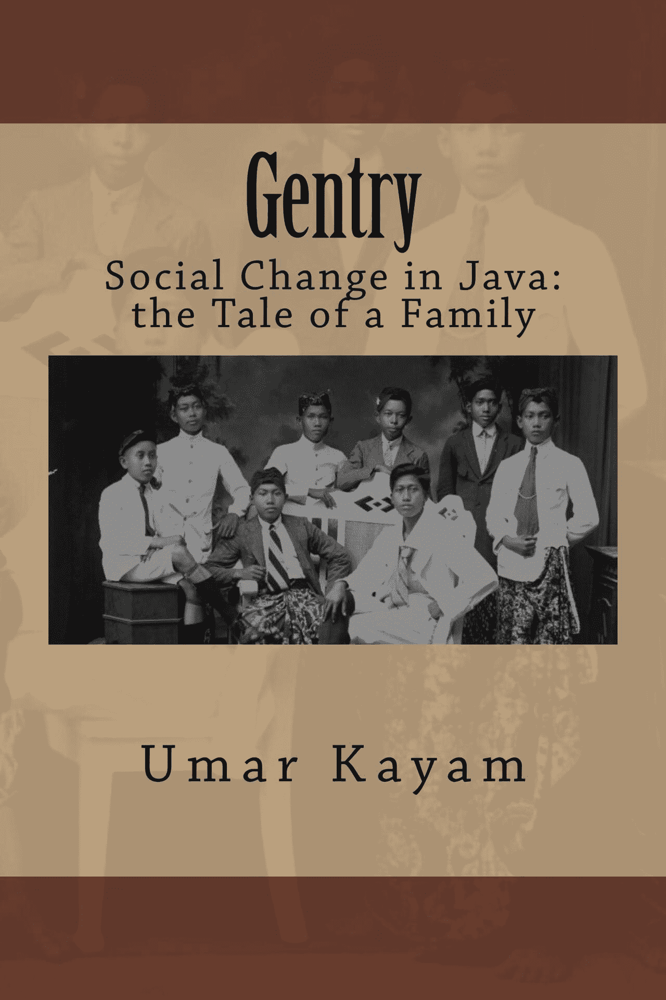

# Gentry：Java 中的社会变革：一个家族的故事：小说



## 作者及小说

乌马尔·卡亚姆（Umar Kayam, 1932-2002）出生于东爪哇的纳威，他在荷兰殖民教育体系内完成了小学和初中教育：分别在`Hollandsch Inlandsche School`和`Meer Uitgebreid Lager Onderwijs`机构学习。这两个层次是殖民政策设立的，旨在培养能够在荷兰荷属东印度特定官僚部门任职的本土精英。卡亚姆在当地读书时，他的父亲是索罗`Mangkunegaran HIS`的老师，这个男孩在独立后教育过渡重组期间于雅加达完成了高中教育。这些细节似乎只是一个爪哇青年求学历程中的寻常，但这段经历的意义在于其历史背景，正如本书描述的那样。

简之，在卡亚姆虚构传奇所涵盖的时期，爪哇比现在更多是一个由大部分中小型城市中心部分缓解的农村社会。那是一个人口增长、土地减少的时代，农民自古以来的困境变得比通常更加严峻。（克里福德·格尔茨的《农业内卷》等论述将为研究型读者提供背景，因为卡亚姆对这种局促的状况是含蓄的。）尽管如此，现代方式和思想正渗透进农村，提供了社会向上流动的前景和更有保障的生活。关键在于教育：这是爪哇苦难人民唯一的明亮希望之门。小说《Para Priyayi》（在此处译为《贵族》）的核心焦点是：对于任何想要逃离自身阶级苦难、通过进入殖民时期爪哇本质上的双层社会高阶层来实现家族境迁的农民来说，识字是必不可少的。那个较高的、文字阶层是`priyayi`（贵族），他们是一种官僚贵族，其上层逐渐与传统贵族融合，并在生活的大多数层面上充当农民与荷兰人之间的中介和文化过滤器（荷兰人本质上是一个疏离的、监督阶层，在故事中几乎不可见）。

作者本人作为学生和大学生的经历，为他描述那些往往是令人心碎且失败的获得基础教育的努力提供了现实主义色彩和可信度。卡亚姆后来的社会学研究使他对那些成功人士的社会文化保守主义产生了思考，随后对从 1942 年日本入侵开始的爪哇代代不变结构的革命性变化有了认识，这些变化在随后的二十年动荡中急剧加速。那些最初的震动以及随后的抽搐影响了贵族的角色，使其开始向各个方向发生转型，并最终在教育快速扩张和垂直延伸的后殖民时代背景下，质疑了`priyayi`一词本身的意义和相关性。

卡亚姆在学生时代以及上大学期间就开始撰写小说，因此，20 世纪 60 年代的政治文学问题，以及围绕`Manikebu`等类事件（即 1964 年颁布后不久被撤销的反共文化宣言，见后文）的狂热，对他产生了个人上的共鸣，尽管带有距离感，因为他在 1955 年至 1965 年的这十年大部分时间都在美国学习：最初在纽约扩展了他早期的印尼教育学研究，随后在康奈尔大学获得社会学博士学位。回国后，他在广播、电影、文化和综合新闻领域担任过多个高级职位，并是印尼多所大学的高级教师和教授、雅加达学院成员，以及印尼科学院成员。在他撰写《Para Priyayi》时，他是加查马达大学文化研究中心的主任，该校文学学院高级教授。小说于 1992 年出版。他的其他作品还包括设定在曼哈顿的短集（1972 年）、两部中篇小说（1975 年）和一本期刊专栏（1990 年）。

## 译者序

对`Para Priyayi`的此次翻译，目标是为读者提供一个英文版本，这个版本不仅要在数学上与印尼语原文保持一致（如果那是可能的话），更要显式地体现故事中所包含的文化、人类学、历史、语言和心理关联，而这些关联是原读者在潜意识中理解的。显然，对于本译者而言，对核心叙事的忠实是至关重要的，但他认为，如果不借鉴这五个领域及其他领域的色彩对背景进行某种开发和描写，许多意义将会丧失。如果这里的目标是对殖民地晚期和现代化时期的爪哇人进行一项社会科学研究，那么通常的脚注式注释将足以辅助对纯基于字典的字面翻译进行更深层次的理解。遗憾的是，那些脚注及其相关的上标将充斥并困扰这本书的几乎每一页。

这并非那样的研究，而是一部在旧式文学意义上的“娱乐”：希望它是一本具有启发性的、且可能对某些人来说是开见性的读物，但最重要的是一个供享受的故事，正如`Umar Kayam`的本意那样。那些技术性较较弱的烦人注释会分散心智注意力，减慢节奏，中断并通常损害审美乐趣。此处的做法反而是——审慎地——在任何可以自然方式实现的地方将重要的解释性信息融入文字的间隙中。也就是说，当对于印尼读者来说，一个单词或短语会勾勒出并意在直觉上勾勒出一个自身之外的世界时，这里的目标是通过某些可能并未严格出现在原著页码上的文本扩展，至少触及那个世界。在极少数情况下，为了向外国读者阐释`Para Priyayi`，这种投入已超出了释义，实际上变成了对作者意图的解读，而在某些段落中，这种解读被留在了推测。

Kayam 对其指导下的研究生有一项相当新颖指示：作为考官，他不关心拼写、标点和语法的细节——“那是打字员该担心的事，不是博士候选人的事”——这可能告诉我们关于他文学创作方法，并可能解释了`Para Priyayi`中某些细微的不一致和断层。创造性地阅读和翻译这个故事的另一个原因是：`Bahasa Indonesia`（印尼语）发展非常迅速，以服务行政、经济、军事和其他技术治理领域的需求；但在成为一种真正的文学语言之前还有很长的路要走。在 Kayam 的时代，它对于富有想象力的艺术家来说仍然是一个不完全的调色板。这种暂时局限性带来的挑战和收获在于，要求普通读者和译者在跟随这个故事时，在虚构作品中给予自己的想象比通常更大的空间。尽管如此，无论阅读和翻译过程中有心理还是纸面的干预，这终究还是 Kayam 的故事，没有人能创造它。

V. V. Zh.

## 术语表

这是一个关于社会阶级和等级的故事，这种社会在很大程度上根据家庭来衡量此类划分，每个人都通过表达家庭框架内真实或惯用地位的称号或名称被分配位置。文中使用的术反映了任何交流中称呼者和说话者的社会家庭/年龄地位。此外，某些段落有时会忽略或忽视西方的批评标准，例如我指的是通常的亚里士多德结构完整性原则。这里经常悬而未决的情况。人们可能会问，例如，当家庭剧在她家里发生时，Noegroho 叔叔的岳母在哪里？在 Hari 的双胞胎被用来如此悲剧地杀死母亲后，他们遭遇了什么？我只能希望，为了 Kayam 的史诗——为了对他宏大设计和成就的纯粹享受——译文中在调整与忽略之间采取的平衡，将得到每年成千上万访问这些岛屿的印尼爱好者的宽容接受，这部小说的译文正是献给他们的。

| `Adik, Dik` | 弟弟或妹妹 |
| --- | --- |
| `Ajeng, Jeng` | 对与说话者同龄或更小的女性的礼貌称呼 |
| `Anak, Nak` | 孩子；对晚辈亲切称呼，通常指年轻男性 |
| `Bagus` | 帅气的；优秀的 |
| `Bapak, Pak` | 父亲 |
| `Bapaké` | 妻子对丈夫的亲切称呼 |
| `Bapakné` | 对丈夫的亲切称呼 |
| `Budé` | 比父母年大的姨妈 |
| `Bulik, Lik` | 比父母年小的姨妈/舅妈 |
| `Buné` | 妻子对丈夫的亲切称呼 |
| `Bung` | 兄弟；平辈 |
| `Bupati` | 县长 |
| `Carik` | 纸张量词；扩展为：办事员 |
| `Dalang` | 皮影戏艺师 |
| `Dimas` | 对弟弟或下属的礼貌称呼 |
| `Dukuh` | 村庄；扩展为：村长 |
| `Embah, Mbah` | 祖父母；泛指老人；老师；神秘人物 |
| `Embok, Mbok` | 母亲；地位较低的女性 |
| `Eyang` | 祖父母；对受尊敬老人的尊称 |
| `Genduk, Nduk` | 丫姑娘；女仆 |
| `Guru` | 老师 |
| `Gus` | 对男孩和年轻男性的礼貌称呼 |
| `Haji` | 去过麦加朝圣的男性称号 |
| `Ibu, Bu` | 母亲；地位较低的女性 |
| `Jagabaya` | 村卫 |
| `Jaksa` | 检察官 |
| `Kaji` | 知识，尤其是宗教知识；扩展为：古兰经教师 |
| `Kakang, Kang` | 哥哥 |
| `Kakung` | 男性，礼貌用法 |
| `Kamas` | 哥哥；年长男性或上级 |
| `Kiai, Ki` | 受尊敬的学者；神秘人物；伊斯兰教师 |
| `Lurah` | 村长 |
| `Mantri` | 具有主管职责的中级专业人员 |
| `Mas` | 兄弟；男性平辈 |
| `Mbak, Mbakyu,Yu` | 对女性平辈或地位较低者的亲切称 |
| `Meneer (D)` | 先生 |
| `Nakmas` | 对晚辈男性的礼貌亲切称呼 |
| `Ndoro` | 称呼或指代 |
| `Nyai` | 对年长女性的尊称 |
| `Nyonya` | 夫人；太太 |
| `Opziener (D)` | 监工员或主管 |
| `Oom (D)` | 叔叔/舅舅 |
| `Pakdé` | 舅，比父母年长的舅 |
| `Paklik, Lik` | 叔叔，比父母年小的叔 |
| `Pakné` | 对丈夫的称呼 |
| `Polisi` | 警察；男警察 |
| `Putri` | 对女性的正式礼貌称呼 |
| `Raden, Den` | 表示极度尊重的称号；贵族头：`Raden, Den Bagus` – （阁下/大人）；`Raden, Den Mas` – （您/其）光辉；`Raden, Den Ajeng` – `Raden, Den Mas` 的女性对应词。用于身份不明男性的礼貌尊称 |
| `Romo` | 父亲，高度尊的称呼 |
| `Sepuh` | 受尊敬的长者 |
| `Seten` | 助理区长 |
| `Siti` | 授予出身女性的头衔，或作为具有阿拉伯背景的女性名前缀 |
| `Tante (D)` | 姨姨 |
| `Tolé, Lé` | 小伙；男孩；年轻人 |
| `Tuan` | 先生；对西方及（偶尔）西方化的成年男性的称呼/指代 |
| `Wedana` | 区长 |
| `Wedok` | 对女性的口语礼貌称呼 |

印尼语充满了缩写、略语和非正式借用词，这些词汇迅速产生生命力，是这种新兴语言新词汇的重要来源。尽管文中首次遇到此类术语时已提供了足够的解释，但读者可能希望将以下词表作为额外的记忆辅助：

| `AMS` | Algemene Middelbare School. 高级（“综合性”）中学 |
| --- | --- |
| `Bulog` | Badan Urusan Logistik Nasional. 国家后勤局 |
| `Bundan` | Peta（保卫队）中的步兵连，见文 |
| `Bundancho` | Peta（保卫队）中的连指挥官，见文 |
| `CGMI` | Central Gerakan Mahasiswa Indonesia. 印度尼学生运动中央协会 |
| `Chudan` | Peta（保卫队）中的步兵连，见文 |
| `Chudancho` | Peta（保卫队）中的连指挥官，见文 |
| `Daidan` | Peta（保卫队）中的营团，见文 |
| `van Deventer School /Pan Depenter` | 以殖民改革者命名的本土女寄宿学校 |
| `ELS` | Europeesche Lagere School. 为荷兰儿童及本土精英儿童开设的小学 |
| `Gerwani` | Gerakan Wanita Indonesia. 印度尼妇女协会 |
| `Gestapu` | Gerakan September Tiga Puluh. 9·30 运动：1965 年政变企图 |
| `Heiho` | 协助日本人的印尼劳工部队，1942-45 |
| `HIK` | Hollands Inlandsche Kweekschool. 荷兰语本土教师培训学校 |
| `HIS` | Hollandsch Inlandsche School. 为本土贵族儿童开设的小学 |
| `HKS` | Hogere Kweekschool. 高级贸易培训学院 |
| `HIS` | Himpunan Sarjana Indonesia. 印度尼学者协会 |
| `Kenpetai` | 日本军宪 |
| `KNIL` | Koninklijk Nederlandsch-Indisch Leger. 荷兰殖民陆军 |
| `Kweekschool` | 贸易培训学院 |
| `Lekra` | Lembaga Kebudayaan Rakyat. 人民文化协会 |
| `Lestra` | Lembaga Sastra Indonesia. 印度尼文学学院 |
| `Manikebu` | 文化宣言。1964 年的知识分子与文化宣言 |
| `MULO` | Meer Uitgebreid Lager Onderwijs. 荷兰语初中 |
| `Normaalschool` | 教师培训学院 |
| `OSVIA` | Opleidingsschool voor Inlandse Ambtenaren. 本土公务员培训学院 |
| `Pancasila` | “五项原则”，包含印尼宪法的断言：信仰并信奉一真神、人性、团结、民主和公正 |
| `Perwari` | Persatuan Wanita Republik Indonesia. 印度尼共和国妇女协会 |
| `Pesindo` | Pemuda Sosialis Indonesia. 印度尼社会主义青年 |
| `Peta` | Pembela Tanah Air. 日本占领期间的印尼辅助部队 |
| `PKI` | Partai Komunis Indonesia. 印度尼共产党 |
| `Pron Nasional` | 国家阵线 |
| `Schakel School/Sekakel` | 通过额外两年“链接”进阶教育或培训的小学 |
| `Schakel Particulier /Partikelir` | 非正式的 Schakel 学校，见文 |
| `SMA` | Sekolah Menengah Atas. 独立后建立的高中 |
| `Shodan` | Peta（保卫队）中的排级，见文 |
| `Shodancho` | Peta（保卫队）中的排指挥官，见文 |
| `STOVIA/Setopia` | School tot Opleiding van Inlandse Artsen. 本土医生培训学院 |
| `SS` | Staatsspoorwegen. 荷兰时期的国家铁路 |
| `TNI` | Tentara Nasional Indonesia. 印度尼国立军队 |
| `TNI Masyarakat` | 人民印尼军，见文 |

## 关于拼写的说明

本书涉及的大部分时期中出现的某些元音组合遵循荷兰语拼法，在直到 1947 年的出版物中仍然可见；许多辅音一直持续到 20 世纪 60 年代，当时改革后的印尼语开始使用。注意这些早期形式及其现代等效形式可能对发音有所帮助。例如，在现代印尼语中，`oe`已转换为`u`（发音为 oo）；`j`变为`y`；`dj`变为`j`；`tj`变为`c`。

## Wanagalih

这座城镇是一个爪哇某县的县府，这种省级地区被称为`kabupaten`，其名称源于县长的头衔：`bupati`。尽管这里自 19 世纪中期以来就具有长期的行政地位，但对于初来此地的陌生游客来说，这里显得相当矮小而质朴，透着一种梦幻而衰落的气息，仿佛已经错过了任何进一步增长的可能性，或是重新绽放的希望。

诚然，曾经贯穿`Wanagalih`主街两侧的那些枝叶巨大的罗望树——那些画面在我童年的记忆中依然清晰可见——如今已不复存在，取而代之的是更加纤细的新相欢树；而且确实，中央市场也穿上了一些现代购物场的装潢，因为它现在拥有一圈顶盖亭子自信地向外外，这无疑是为了承认其客源的普遍性；但在市场本身的环形内部，在那些亭子后面，人们依然售卖着我年轻时常见的商品。

那里有熟悉的由光光棉面料制成的黑色短裤，腰间用可靠的抽绳系着（这对我们的农民穿着者来说是一个令人放心的细节），一排排裤子挂在粉色、白色和黑色背心旁；今天售卖的还是那种宽腰带，乡下人进集市会将资金储在扣子的两边。还有什么呢？环顾四周，可以看到看到鞭子、宽大的圆锥帽、常见的蔬菜、绿色的榴米果、鸡和鸭；零食和饮料摊位后站着一排排食物小贩，有淋上花生酱的白水煮蔬菜沙拉，一杯杯浓稠的`wedang cemoe`——那种用甜豆酱加稠的柠檬草浸剂——还有被包裹在香蕉叶条里的层层叠叠豆腐；总的来说，所有那些货物和市场美味依然如故。还有市场的气味——刺鼻的、酸的、臭的、牲畜的尿味——那些也依然没有变。

### 现代变化？

然而，是的，人们不得不承认，在城镇的南缘现在有一个中等规模的巴士站，能够容纳来自`Solo`、`雅加加达`、`马迪润`和泗水，甚至来自`Denpasar`的大巴，在一天中的大部分时间里总有一几辆进进出出；而在一些居住区，我们刚刚开始看到现代风格的混凝土建筑。

我们确实看到了它们，但旧房子仍然占据主导地位，数量相当多，那些木质小屋似乎正缓慢地陷入地基，被`Wanagalih`黑色且易碎的土壤拉拽着。人们回忆起，正是因为这种土壤的不稳定性，那个时代的殖民当局禁止建造被认为可能发生突然坍塌的混凝土或石砌结构。嗯，木房子也会按部就班地屈于那种无情的侵蚀，但它们的顺从是持续多年的，在无人察觉的情况下持续着。

尽管如此，现在的人们对于如何建筑似乎有了自己的主意，过去的顾虑对他们来说不再像以前那样感兴趣了。也许发明了某种新技术来保护我们免受土壤的侵害？或者这种新建筑是我们对现代、对新奇物的痴迷的另一个迹象？又或是我们近年来在这些地区所获得的新财富的一种尤为鲁莽的展示？但也许这样的反思只会显出我已变得是多么古板，也许说明了我的年纪，以及我在荷兰时期的受教育背景。好吧，毫无疑问，那些最新的建筑确实让邻近的木小屋看起来破旧不堪且平庸，甚至有些滑稽。

### 古老的 Pendopo

但过去的一座建筑依然以其英俊而稳固的姿态屹立，城镇广场在它面前延伸。这就是旧的`pendopo`，一个开放式的听会厅，县长们曾在这里会见县里的精英。随着时间的推移，它经历过几次维修，但根据任何人的记忆，它的支撑柱没有一根需要更换过，它们都屹立不倒，没有任何疲劳或变形的迹象。关于这座古老建筑有一个值得讲述的故事，一个可以与这些逐渐从记忆中消失的神话时代形成对比的传奇。

#### Kiai Jogosimo 传奇


根据传统，制作`pendopo`柱子的木材来自曾经环绕`Wanagalih`最古老、最核心且最诡异的森林。传说在被砍伐之前，被选中的树木受邀讨论。当时的当地森林魔法专家、一位受尊敬的学者`Kiai Jogosimo`以其神圣和奥秘的力量闻名，他自己的后院对他来说并不比这片森林的最深处更陌生，他与那片绿色区域以及其中所有的万物都关系极好且了如指掌。老虎、猴子和其他动物来到他面前并臣服于他，树木和石头也尊崇`Kiai Jogo`并对他表现出父子般的尊重。传说说，他拥有这种权威是因为被赋予了与野兽、树木和石头交谈的能力，而他的名字`Jogo-simo`（在尊称变体中翻译为“老虎守护者”）正是因为这个名字很久以前就定给他的。

“现在的`Kiai Jogosimo`，他和先知所罗门——愿他的名受崇——知道什么？噢，那两个其实是同一个人！没错！”

这个关于乡间敬畏的例子是从挑水夫`Kang Man`那里得到的，他听过他的祖父母讲述关于那位巫师的故事。

故事继续下去，`pendopo`屋顶的候选支撑柱逐一被`Kiai Jogo`，他的身后是一群焚着香、带着供品的随从者，随后是县里的高级官员来见证这一切。树木被`kiai`询问它们是否愿意离开根部，成为`Wanagalih`权威与尊严的所在地，那里居住着县民。随着巫师与树木之间的对话进行，据说森林的氛围变得极度安静：猴子的喧闹、丛鸡的鸣叫、斑纹豹的低吼，在短时间内全部停止了；森林的叶子和叶片停止了沙沙声；连风和微风也进入了顺从的沉默，被咒语的力量所征服。然后被选中的树突然开始缓慢倾斜，先向左后向右，动作类似于`rongeng`舞者的柔韧体体；而周围未被选中或交谈的树则保持直立不动。

“那些树，你知道吗，Pak——扭动、跳舞之类的——看起来就像它们同意了`Kiai Jogo`的请求。而且，嗯，当然，如果是先知所罗门本人——愿他蒙福——所说的，你是没法否认的，对吧？”又是来自`Kang Man`的话。

既然我恰好提到这个话题，我也可以说，这种与植物、森林树木等交流的能力，绝不是像`Kiai Jogosimo`这样的圣者的垄断。我们乡下的人在采摘任何植物的叶或嫩芽做沙拉之前总是先征许可。现在想起来，我记得在成年早期读过，在苏拉威锡，建造那些被称为`pinisi`货船的布吉船匠，对他们砍伐木材的树木也有同样的敬意。

然而，回到正题：这些树干没有经过多余的仪式，就被一盆一盆的水冲洗干净。在那片森林深处，树根周围的地上摆了一席`selamatan`——各种丰盛的节日菜肴。`Kiai Jogosimo`、随从以及`kabupaten`（县）的显贵们坐了下来，庄庄严肃地享用起食物。树木被砍倒，树干被小心翼翼地送到目的地：一根作为`Wanagalih pendopo`的主柱，其余的作为辅助支撑物和支架。正如此——这些木材并非寻常之木，而是被圣化并渗透了神秘灵气的——这些木材至今依然坚固而笔直。有一种广公认的说法，只有像`Mangkunegaran pendopo`的主柱和次柱，以及`Kasununan`宫听证厅的柱子（两者位于苏罗），还有雅加加达皇宫的柱子，在精神上才更为强大且经久。我顺便提一下，同样的声称者对殖民时期为`bupati`（县长）建造的大厅支撑物唯有鄙夷。噢，你们会听到他们嘲讽道，那些在不神圣的目光下砍伐加工的世俗木材，根本没有可比性——它们的质量低劣到完全微不足道！

`Kang Man`在为`Wanagalih pendopo`辩护时解释了为什么它必须让位给上述王室建筑：“这个，你不能指望我们的`pendopo`比苏罗或雅加达的那些更神圣，对吧？那些可是老马达拉姆时代的产物！天哪，一想它们能胜过我们，简直是自招灾祸的！”

我也应该提一下延展在`Wanagalih pendopo`前方的那片开阔广场。覆盖那片区域的草坪绿意是细心、周全维护的证明，而中心两棵榕树明显的健康状况——那是一个真正引人注目的景致，高大、叶茂且高贵——表明了镇民同样的体贴。这个广场是东爪最大的，是从`bupati`到最卑微公民的骄傲；事实上，我想说人们对它有一种共同的所有感。想在上面踢足球的当地队伍必须按照严格的时间表进行比赛，甚至水牛、牛和羊的放牧也受到监控，以确保土地持续的肥沃。傍晚，当`Wanagalih`的一天进入凉爽与和平时，广场及其周围变得非常宜人。各种各色的人，年轻人、夫妻夫妇、孩子和婴儿，来到这里坐在草地上，呼吸着新鲜空气，吃着花生，喝着杯`wedang cemoe`。会有孩子们跑来跑去，十几岁的青少年更安静地坐着，也许在互相偷视，成年人则看顾后代，或偶尔向球赛的喧闹声望去：这就是那里的景象。

然而……然而，然而，这片广场——它现在突然带着恐惧、带着厌恶重新回到了我的脑海——这片拥有如此优雅、宁静氛围的广场，在我的少年时代，曾是人类屠杀的舞台——一个地面被血浸的竞技场！

是的，在1948年的那三个月里，在穆梭（`Muso`）的`Partai Komunis Indonesia`（印度尼西亚共产党党）在马地义发起起义后，我们这个`Wanagalih`就是承受随之风暴的镇子之一！那时，由`PKI`派遣执行者，以及随后其他来自`Siliwangi Division`（西里瓦吉师）的对应执行者，轮流屠杀了首先是被认为与政府结党的当地人物；然后是穆梭的追随者！在那几个月里，整个`Wanagalih`都处于恐怖之中！

我无法想象，像在那片广场上看到的这类事件在过去何时可能发生过。我确实听过关于古代处决的故事，关于罕见的绞吊某些强盗、帮派首领或显赫的反叛者；但这种屠杀，这些枪击，如此规模且如此有组织地——它们真的曾经发生过一次吗？例如，在迪波内戈罗王子（`Prince Diponegoro`）那场激烈的起义期间，可能发生这些事吗？或者在我们历史的其他动荡中？

我感谢上帝，这种残酷的经历没有再次发生。或者，我应该说，至少没有这样公开地发生在我们的广场上。甚至在1965年9月针对军队的失败共产主义政变之后也没有。那时看到的是漂在河里的尸体，有时是无头的，有时缺少手脚。但，谢天地，至少那个可怕、极其恐怖的事件很快就离开了`Wanagalih`。尽管偶尔还会听到关于这些事的偶尔讨论、偶尔的回忆……

但是，无论如何，无论如何……广场本身已恢复了旧有的模样：如以前般翠绿、健康，一个人们可以再次来到这里，信心地享受夜晚宁静的地方。我有时把那片老广场想成一个胖乎乎、和的巨人，是的，我是这么想的。他张大嘴巴，这个巨人，他吞下了经过他身上的各种事物，平静地将许多东西并入自身，不加区别地；然后，他满意地合上那张大嘴，一丝淡淡的微笑——就像某种在蜡花图案中若隐若现的设计——再次回到了他的脸上。……

但让我继续讲述我们这个小小镇吧。啊，是的，它的河流。那些运河和河流……我刚才是在沉思漂浮在水面上的东西吗？……实际上，准确地说，有不少于三条重要的河流流经`Wanagalih`，忙碌地冲刷着小镇的边缘：其中两条是`Madiun`和`Solo`，它们在小镇的一个外角下方汇合。现在，这样的河流交汇处曾具有战略意义，无论是经济上还是军事上，荷兰人在迪波内戈罗时期在该点建造的所谓“隐蔽堡垒”便是证明。即便现在，仍有许多船在古城墙下的水面上按照古老的方式运输产品和货物。

嗯，至于我自己，我不敢断言这部史诗描述了我们`Ketangga`的真正意义，但有许多人认为它确实如此。在圣日的夜晚，比如爪哇五天一轮回周期中的某些周二和周五，那些深信不疑的人中有些人会来浸没在河水中。我不会推测每一个人在这样做时都将自己奉为那股神圣之流的合适容器，绝非如此。不过，我会说，或许还有参考价值，我听过其他某些地方显然很懂行的人证实，`Joyoboyo国王`所提到的`Kali Ketangga`并非流经`Wanagalih`的那条河，而是东爪哇另一条同名的河。而且，这些学者——无论是真正的还是自封的——都な不带一丝嘲讽地断言，那些在`Wanagalih的Ketangga`中游泳的人对解释时代和征兆一无所知，也不正确地理解《`Joyoboyo时代`》本身，那是一本特别充满神秘象征的著作。事实上，我坦承认，当我听到围绕这个问题的辩论愈演愈烈时，发现自己很难不微笑；如果我还能保持自控，是因为我在提醒自己，我养父母的一位备受尊敬的长辈舅曾是这样一个戏水者。每当他的侄子侄女们就他夜间戏水的话题拦截他时，他总是陷入极大的怒火。

他会围着那些怀疑者，开始教导他们这个问题的精妙之处：“噢，我们中间真是怎样的一代人——看看你们现在！成了家，有了孩子，有了后代——却像他们中任何一个一样流着鼻涕！当你们的舅舅在周二晚上去你们所谓的‘戏水’——我说的是我们的，爪哇的周二！——当他冻得牙齿在脑袋里作响时，这和任何成为`Ratu`（王）的野心无关——笨蛋！和和巡回表演中宝座上的某个冒牌国王无关！那根本不是意图，完全不是我追求的！灵性力量，在这个世间行善的力量，这才是核心！为了世界的福祉；也许是救赎。你懂了吗，年轻人？你，姑娘？”

嗯，当然，他的听众没有认真对待过他的任何话，那些老人的长篇大论往往夹杂着充满活力的乡下表达，并充满了关于世界之美以及我们作为居民应承担的责任的陈词；特别是当这些话语与他们的感知相悖，且带着坏气说出来时，他们更不以为然。多年以后——那时我们听说他已经成了一个经营古老史诗和伪历史的巡回剧团的经理、班底（`bas`），并在同一天结婚了该剧团的两个首席女演员——我们才都开始领会到他的意思。到那时，我们的世界已经经历了无数次重塑，我们每一个人都走向了更加成熟的阶段。我脑海中有一个他晚年时期生机勃勃的形象，在当地范围内甚至算是个重量人物：嘴里镶着三四颗金牙，头上歪戴着一顶鲜艳的红色丝绒圆帽（`peci`）……

是的，`Wanagalih`曾是、且很大程度上现在如此。这个镇的名字诉说了它的起源，它结合了“森林”（`wana`）和“心木”（`galih`）。它曾被丛林环绕，随着时间的推移，森林退缩，它被残留的柚木林环绕，`Wanagalih`依靠木材生存，或者说那是过去的主要资源。荷兰殖民时期，`林业局`占据的办公室群——`Boschzen`（或按照我们当地的翻译为`Bosbesem`）是该镇上最好的古老建筑之一，且全部由最高品质的柚木建成。`部门`首脑备受推崇，在每一个具有县级（`kabupaten`）重要意义的活动或仪式场合，他都会无一例外地受邀请参加，并在观众席的第一排就。当他的职位最终交给一名本土官员时，那个人也像惯例一样，被邀请去县长（`bupati`）家中玩纸牌，在华人的`pei`（赌场）度过赌夜。

但那个细节很大程度上属于`Wanagalih的过去`，属于殖民时期，一直直到可能包括日本占领时期。现在，这个镇被视为仅仅更重要、更广泛的商业活动中的一个中转站，在那个更广阔的背景下显得非常普通，甚至毫无特色，即使考虑到它付尽努力证明自己没有在现代化的竞赛中被完全抛弃。年轻人离开去`泗水`、`雅加达`或任何他们能去的地方工作，而那些能继续深造的人则去任何有合适学校或大学的大城市。留下来的人在一段时间以来很大程度上是那些退休年龄的人，住在他们的木板房里，在那些过时的旧小屋里静静地沉入`Wanagalih独特的、黑色的、不凝聚且具有破坏性的土壤`之中。每天早晨，在祈祷之后，随着黎明的到来，`Wanagalih`的巷弄街道随着那些老人的晨间散步逐渐变得活跃，由于狗在凌乱的脚步旁互相追逐的嬉闹而变得热闹了一点。这些退休的老人从镇的各个角落来，成对或结成更大的人群一起行走，他们的凉鞋声发出清晰的`srek-srek`响；他们咳嗽着来，脖子上围着荷兰人仍称为`halsdoek`的围巾，那是那代人的特征，并与这个镇联系在一起。他们走向大广场，在环绕着古老榕树的围栏旁汇合，在茂密的树枝下停留一会儿，也许直到那些夜宿两棵树下的乞丐和流浪者变得过于纠缠，然后散步者可能会转移到县办公室外的守卫室。

他们的对话中进入了哪些主题，哪些问题？无疑有通常的彼此孩子和孙辈的常态比较，以及对自己后代习惯性的快乐赞美。也会对退休生活、对生命本身、对世界以及对世外生活的反思。这些对话通常是温和平淡的，至少在涉及孩子和退休方面；但在某些基本问题上，谈话可能会变得非常尖锐，我们的人在这些问题上的意见有时会发生冲突。那些颤抖而不稳定的老声音在咳嗽和为了咳痰而停顿中响起。我很清楚了解那一方面，因为我经常听到和我住在一起的老师`Guru Sastrodarsono`从这样的晨会回来后，仍然因为某些争论而感到愤怒和受挑衅，在他家里向我们发泄情绪。然而，他仍然坚持他的晨间常规：祈祷、晨步、聚会。

但我应该自我介绍一下：我的名字叫`Lantip`。不，实际上，那是我开始住在瓦纳加利（`Wanagalih`）塞特南路上的`Sastrodarsono`家后才变成我的名字。我出生时的名字是我母亲起的`Wagé`，这仅仅是爪哇语中“周六”的意思，那是我出生的那天。根据我们自己在人生的关键阶段获得新名的习俗——被带入`Guru Sastrodarsono`家中受教正是这样一个转折性的时刻——人们认为我需要一个更符合我成长背景的名称，而`lantip`一词带有“聪明”和“有学识”的含义。我应该解释一下，作为一名老师，我的恩人属于贵族，即`priyayi`，一个阶级划分森严的上层阶级成员，他们之间最普遍的共同特征就是脱离体力劳动。当我离开母亲来到瓦纳加利接受教育时，我也分得了同样的地位，而可怜的`Wagé`显然只是那种典型的“村落”名字。

在搬家之前，我一直和母亲住在瓦纳拉瓦斯（`Wanalawas`），那是离瓦纳加利几公里的一个大村。根据传统，瓦纳拉瓦斯在某种意义上是瓦纳加利的发源地。在马达拉姆统治爪哇大部分地区的时期，瓦纳加利现所在的河流交汇处曾一度被认为具有战略意义，当时的马迪恩统治者（马达拉姆的一个地方附庸）接到指令在交汇处建立一个大型定居点。他通过简单地铲除周围村庄实现了这一点。因此，瓦纳拉瓦斯在此之前还是一个规模较大的社区，但由于大多数人被强制迁徙，只剩下一个像`dukuh`（小村庄）的地方。在我生活的年代，住在那里的少数家庭中就有我母亲的以及她家族残存的成员：仅有她的母亲。这是一个种植水稻的农民社区，他们还额外种一些旱作作物，比如一点烟草之类的。我很快意识到我们的生活很艰辛，而且从我母亲那里听来，这种生活一直如此：家庭在不足一半公顷的土地上勉强维持，而且还有一个额外的劣势：这个地区的稻米依赖雨水，田地距离任何可以引引灌的溪流都有一段距离。从我们能追溯的最久远时期，我们的家族一直通过发酵豆豉制作`tempeh`（天贝），并在瓦纳加利市场和镇上上出售来补充农作。

至于我的父亲……唉，我能说什么呢？我对他完全没有任何记忆。母亲总是告诉我，他去很远的地方通过`rantau`（外闯）谋生了。直到多年后，在我住在`Sastrodarsono`家期间，那时我已被视为那里的一员，每当老师在某次愤怒中责备我时，我才会得到关于我父亲是个什么样的人暗示。`Guru Sastrodarsono`礼貌要求我称他为`Embah Kakung`（即“祖父”），他其实善良且公正，但他有时也会变得不耐烦且刻薄，能爆发出一连串的咒骂。正是在这种时候，我能间收集到关于我父亲的一些信息。`Embah Guru Kakung`会对我爆发出这样这样的话：“无知的猴子！猿类！混混之子！劫匪之后！…………”

当我被他认为执行某项任务太慢时，最常收到这类连珠炮：例如，当他赌牌手气不好时，让我向他妻子要更多钱。并不是老师沉迷于严重的赌博，完全不是，牌牌只是他那个圈子里底层贵族习惯的一种小乐，这种消遣被制度化在`kesukan`一词中，或者简单的“消遣”。尽管如此，在牌桌上输钱，无论金额大小，都是输了。情绪沸腾，挫败感像水汽一样升入大脑，各种情感交织在一起：恼怒、沮丧、甚至是痛苦、报复的渴望，想要一击夺回一切；而在这一切背后，可能还潜伏着某种羞愧。这时，`Embah Guru Kakung`失去了惯有的幽默感，完全变成了另一个人，对我那个时的孩子来说变成了一个可怕的存在：“白痴！已经叫你去拿钱了！流氓坏蛋的后代！”

面对这种机枪扫般的语言，我除了忧伤地低下头别无他法。那么，我是一个小贼之子？我的父亲曾是一个劫匪团的首领？这可能是真的吗？但我能向谁追问这些指控呢？我的母亲不愿意谈论我的父亲，对我的提问也很简短。当我被送到`Sastrodarsono`家时，我才六岁，我从她那里反复听到关于我父亲的少数细节只有这些：“孩子，你父亲走了，去了很很远的地方。他离开是为了有一天能给我们带回很多钱；这样我们就能有新房子，更大更肥沃的土地，也许还有头牛一头水牛以及许多东西。你会看到的，当你的`bapak`（父亲）回来时，你会很快的……”

当我清楚他永远不会回来时，我就不再询问我的父亲了。我询问的村里大人也说他去`rantau`了，去了某个未指定的“国外”去谋生；而至于那些同龄的孩子可能知道的——他们对我的父亲保持沉默。最后，正如我所说，我放弃了并接受了母亲的解释。毕竟，`Embah Guru Kakung`的那些爆发并不频繁，只有在他输了牌时偶尔才会发生。

在大约午后祷告的时候，我的母亲就会从巡回回来，她的脸因炎热而通红，汗水流淌，头发凌乱。这是我每天最期待的时刻。除了单纯地想念母亲，我总能指望她从市场带回一些好东西：例如`klepon`，一种中间有棕榈糖的蒸米糕；或者`onde-onde`，填充了绿豆的米粉球；又有`nagasari`，那些用织好的香蕉叶包裹着米粉和碎香蕉的小方块。直到今天，尽管我早已离开了青春时代，那种对这些朴素美味的期待感依然留在我记忆中，甚至现在，我还会让妻子在桌子上放一盘这样的东西。

后来有一个早上，`Embah Wedok`没有从床上起来，我们发现她去世了。我们在`Wanalawas`的角落，在这个小村子里只有几户人家，大家前来了不拥挤的慰问，我记得葬礼仪式也非常简简单快。我紧跟在运送灵体往村子墓地的成年人身后，然后又跟着他们回来。之后我注意到了一件奇怪的事：那个老太太一去世，房子就陷入了一种寂静。然而，她生前的声音是什么样的，她在世时我们听过她什么？在我的记忆中，她大部分时候都是沉默的，表情从未从深的忧郁中改变，眼睛经常望向远方；她嘴里发出的声音像是意义不明的呜咽或呻吟。葬礼第二天，邻居们结束对我们这孤僻居所的拜访后，我母亲（我现在记得清楚）对我提起了我的奶奶。她实际上只说了一两句话：“你的`Embah Wedok`，孩子，看到了许多失望，她的一生充满了悲伤，因为她被她所爱的人抛弃了。”

尽管我理解母亲这段不寻常的长话，但一个六岁的孩子真的能理解什么呢？我没有趁机要求她解释，她也没有表现出想对这个话题多说任何内容的迹象。这可能是一句随口之言，但多年后回起来，我相信那是对自己自己以及母亲人生轨迹的真实观察。


在我奶奶去世后，我的母亲决定带我一起去巡回。这意味着我必须帮助她准备当天的`tempeh`库存，然后在她穿过城镇时走在她身边或跟在她后面小跑。这既是一种享受，也让人精疲力竭。幸运的是，我不需要像其他孩子那样用大嗓门叫卖货物，因为我们大多有一套固定的客户要拜访。当我们穿过一条又一条街道和小巷时，我最深刻的记忆是阳光的灼人，`Wanagalih`是这种炎热的代名词，我知道我经常口渴得厉害。在很早的一次机会中，我试着哄妈妈买一杯冰糖水。她尖锐地回答道：“不。住口！”于是我沉默了。我知道母亲很和蔼，但她也很节约，而且很果断。她认为我们可以在广场拐角的公井处很好地解渴，否则总希望某个客户会为我们提供一些茶。

其中一间慷慨的房子是`Sastrodarsonos`一家的。`Setenan Road`位于城镇内部，距离我母亲其他客户有相当远的距离，但由于某种原因，她愿意那么远去那里提供她的`tempeh`。当我们到达时，已经很累了，满脸通红并闪着汗水，所以也许我们的样子触动了那些看到我们来的人。那时我自然不称呼那位老师为`Embah Guru`或`Embah Sastrodarsono`，而是跟随母亲更具尊重地使用`Ndoro`这一头衔，对他的妻子使用`Ndoro Putri`，这符合我们与这种镇上民的距离。他们可能会看到我们到达，老师会发表一些评论，用一种在我听起来如此平和且权威的语气，对面前的农妇女使用礼貌的`Mbak`：“那么，`Mbak`，你带你儿子过来了，嗯？”

我的母亲会顺从地发出嘶嘶声表示回应：“`Inggih`，`Ndoro`。家里没人照照顾他。”

“嗯，是的。真可惜。这么小的孩子，要在这种天气下满镇到处跑。”

“啊，`Ndoro`，我们我们还能怎样呢？”

我很好记得在那对尊贵的夫妇注视我们期间的漫长沉默。当然，我低着头，只敢用眼角捕捉一下我能看到的任何东西——一个六岁的村童，母亲是个`tempeh`小贩，怎么可能鼓起勇气抬头审视这些高贵人士的脸呢？那将是不可想象的，是不可能的。因此，在两个`priyayi`面前，我以最得体、实际上也是最自然且寻常的方式，低着头。

“现在去后面吧，`Mbak`，去厨房；叫他们给你倒茶！”

从那些早日子起，他们在`Setenan Road`上的房子就成了我们中断巡回的重要折点；随着时间的推移，那里不仅是一个躲避风雨解渴的地方，因为我们与`Sastrodarsono`一家的关系变得越来越融洽和习惯。那栋大木板房子虽然是一个我们知道可以躲避风雨的地方，但对我们来说实际上也变成了第二个家。不，我话说得太过了——那样宏伟宏大的建筑不可能是我们这种人的第二个家，我们在`Wanalawas`真正的家是一个由织竹板制成的简陋小屋！而且应该记住，除了华丽，那还是一个`priyayi`家族的房子，其主人是一个乡村学校的校长。在那时，校长在`Wanagalih`及其周围的人们眼中是有相当地位的，他作为高层阶级的身份深深植根每个人的意识中：他的教育背景、官方职位和固定薪毫无疑问地定义了他的这种身份。

尽管出身显贵，但`Sastrodarsono`夫妇的出身与我们自己的阶层并不完全遥远，正如他们生活方式中的某些地方色彩所显示的那样，因此我们很容易融入其中。当然，我们无一例外地称呼他们为“`Ndoro`”，并保持在他们下面的村民身份；我们与他们之间保持着尊重的距离，从不逾越造访的限度。

在那一两个小时里，我们可以在后排建筑的某一个睡平台上休息一会儿；等恢复了体力，我母亲就会定期加入仆人们的各项日常事务中：洗碗、扫地、捣稻等等。作为一个小男孩，我对这些活动的贡献微乎其微，只是跟在母亲身后。我最喜欢的是看外雇人员之一的`Kang Trimo`在傍晚祷告临近将水牛从稻田赶回来，那时我经常被允许坐在水牛背上，由它慢悠悠地走向牛棚。或者我加入另一位农工`Jairan`，把鸭子赶回圈里。

对于`Ndoro Guru`来说，尽管是一位校长兼绅士，但他仍然参与农耕。房子后面有一个大后院，生长着各种植物，如香蕉、红薯、木薯，以及一种被称为`uwi`的块茎植物，它的皮色深，缠绕着藤须，以此在树枝支撑自身。像典型的农院一样，角处长着成丛的高竹。在这片开阔的后院或旱地后面，是几公顷稻田。这整个耕种区提供了生活必需，并补充了校长的工资。最终，这将在很大程度上保障他的退休生活。

他还有一个庞大的家庭要经营：除了抚自己的孩子，`Guru Sastrodarsono`还要照顾几个侄子和一个女儿。简而言之，这是一个典型的富裕爪哇人家庭，父亲是大家族的核心支柱，亲属们的普遍预期是他会在自己的羽翼下（如果我可以这样用这个比喻的话）尽可能照顾那些不幸的成员。老师所获得的收入和社会地位，在他看来并不是上天为了个人享乐或虚荣而赋予的恩赐；我经常听到他教诫孩子以及任何在场听见的人，任何`priyayi`（贵族）家族的亲属落魄或任由其堕落是多么极不妥当、甚至是无耻的。陷入混乱和流离失所，在教育中得不到任何益处，偏离了那个阶层的正确道路——老师教训着他的听者说，这样一个丑闻的`priyayi`是坏的`priyayi`，根本就不是一个`priyayi`！

一个下午，在从惯常造访`Setenan Road`回来后，我和母亲坐在位于`Wanalawas`的房子门廊的竹睡台上。这一天正华丽地结束，西方的天空弥漫着铜红色的光芒，散发着奇异的光束和闪光。在渐渐汇聚的暮色中，我们的院子和外外的旷野变得越来越美丽，同时又奇异地陌生。我以前从未见过或受过这种笼罩着我们贫穷、简陋且破旧环境的氛围的影响。一感到恐恐，我向母亲靠拢，让我们的身体紧挨在一起。她抱了抱我，摸着我的头发。“亲爱的，当阳光像那样汇聚成束时，我们称之为`candikala`。它发生在天黑之前。”

我点点头，但这个解释并没有完全平息那种奇异的感觉。

“老人们说，当`Nyai Roro Kidul`站在军队簇拥周围时，天空就是那个样子。她是南海女王，老马达拉姆国王的妻子。”

我再次点头并紧贴着她。我觉得某种诡异而可怕的事情可能要发生了，当我看向母亲时，她的脸在那一刻显得非常美丽。也许是因为她刚洗完冷水，又也许是因为`candikala`的反射。她让我站在她面前。

“`Wagé`，亲爱的，我的孩子，听我说。”

听到自己那样说话，我吃了一惊。

“你大了。你六岁了。”

我又觉得这很奇怪。我们都知道我已经到了那个年龄。

“是你时候离开这里，离开这个狭小、局促的村庄了。你听我说了吗？”

“离开吗，`Mbok`？我们要离开吗？”

“不是我们，孩子。只有你。”

我突然感到非常恐惧，我觉得某种无法想象且可怕的事情即将发生。

“我要去哪儿，`Mbok`？”

“你要去和`Ndoro Guru`一住，住在`Setenan Road`。”

“那你要去哪儿，`Mbok`？”

“噢，你妈妈会留在这里，`Wanalawas`。现在亲爱的，别哭。”

而当然，我已经开始哭了，想象着我们的离别。

“我只想留在这里和你在一起，`Mbok`。”

“好了，亲亲的，我们每天都会见面的，不是吗？我会经过`Setenan Road`，不是吗？你去那里是为了快速学习如何变得聪明并成为一名学者。这里没有学校，什么也没有。你明白吗，对吧？那么呢？”

我看到母亲已经做出了决定，试图改变它是没用的。显然，她已经和老师及其妻子讨论过了。于是，第二天早上，在我们造访过`Setenan Road`后，我没有回到`Wanalawas`。

# Sastrodarsono 家

家里有四间卧室，当然最大的一间属于`Ndoro Guru Kakung`和`Putri`。在当时我看来，他们的房间显得既宽敞又豪华，摆放着一张大铁床，铺着床垫、枕头、靠枕，还有一个白得耀眼的蚊帐，蚊帐上织着白色的花纹图案。这间房间不是通往其他房间的过道，而是房子北侧的尽头。那床的规模和美感让我充满了敬畏：它本身似乎是一件庄严、甚至带有威严的物品。周围还有其他吸引人的东西：一个高大精美的柚木衣柜，南墙上挂着一面椭圆镜，一个用来存放老师的克里斯短刀（`kris`——贵族的配饰）的小柜子，角落里靠着他的礼用矛。我很熟悉那间房间，因为`Ndoro Guru Putri`把打扫那里作为我周日的职责之一。在其他日子，我去上学时，夫人本人和`Lik Paerah`会进行必要的打扫。至于其他房间，有两间是三个成年的`Sastrodarsono`子女造访时共用的，而最后一间是留给过夜的客房。最后，还有一个小储藏室，放着这三个孩子小时候的旧物和玩具，以及他们自己的孩子在假期来探望祖父母时留下的玩具。一道隔板横过这间小房，其中一边成了我的；于是我发现自己和一堆主要是旧玩具共用空间。

## 家族结构

当我来到成为`Sastrodarsono`家的一员时，老师的亲孩子已经离开去其他城市自立门户，并建立了自己的家庭。与普通的爪哇西核家庭相比，`Ndoro Sastrodarsono`只有三个孩子，会被认为规模相当小。长子`Ndoro Noegroho`住在`Yogyakarta`，在一所`Hollandsch Inlandsche School`（简称`HIS`）教学：那是一所为贵族孩子开设的小学。次子`Ndoro Hardojo`选择成为`Solo` `Mankunegaran`皇宫的一名宫廷官员，他负责该公国的乡村教育，包括成人教育，以及帮助年轻贵族在通往`wedana`（地区区长）职位的过程中提高教育水平。三个孩子中最小的是`Ndoro Soemini`，由于她的丈夫——`Karangelo`的助理`wedana` `Raden Harjono Cokrokoesoemo`地位相对较高，她被升为`Ndoro Raden Ajeng`。属于已成年子女的那两间房间在我那个时期大多是闲置的，只有在学校假期或斋月结束的传统节日期间，这三个成年人和他们的孩子（老师的孙孙辈）才会再次入住那里。那时，那两间通常寂静、空旷且一尘不染的房间，会被造访的一辈带来的喧闹声充满。

## 亭子与邻居

房子旁边稍靠后立着一个简洁的亭子，由两间小房组成：那是老师侄子和侄女的住所。当我开始住在`Setenan Road`时，这座亭子由`Raden Ngadiman`他的家人住着。过去这里还有其他的侄子和侄女，他们都在某种程度上曾由`Sastrodarsono`家抚养，然后四散去追寻自己的命运了。只有老师的表哥儿子`Den Ngadiman`留了下来，他在`kabupaten`（县政府）办公室担任职员。在我第一次来到这栋房子时，他和妻子有两个小孩子。

## 学习家务

在最初的几里里，`Ndoro Guru Putri`教我如何打扫和整理各个房间，以及摆放餐桌的方式。事实上，这本是`Lik Paerah`的日常职责，但我的女主希望我能尽早学习维持居家整洁的方法。她说，通过变得如此精通，一旦我完成了乡村学校的教育，我就能成为一名独立的劳动者；而且谁知道呢，她继续说道，我甚至可以在`Madiun`的一家餐厅或旅馆找一份工作。我低下头，一想到如此美好却遥不可及的前景就开心地点头；在随后的日子里，我充满渴望和喜悦，全身投入到掌握打扫和维护贵族家庭的技巧中。尽管我还是个孩子，学得很快。夫人表现出许多满意迹象，而`Lik Paerah`几乎无法相信这样的进步。

## 家务任务

在最初的日子里，`Ndoro Guru Putri`教我如何打扫和整理各个房间，以及摆放餐桌的方式。事实上，这本是`Lik Paerah`的日常职责，但我的女主希望我能尽早学习维持居家整洁的方法。她说，通过变得如此精通，一旦我完成了乡村学校的教育，我就能成为一名独立的劳动者；而且谁知道呢，她继续说道，我甚至可以在`Madiun`的一家餐厅或旅馆找一份工作。我低下头，一想到如此美好却遥不可及的前景就开心地点头；在随后的日子里，我充满渴望和喜悦，全身投入到掌握打扫和维护贵族家庭的技巧中。尽管我还是个孩子，学得很快。夫人表现出许多满意迹象，而`Lik Paerah`几乎无法相信这样的进步。

## 晚间职责

回想起来，在我第一次来到这栋房子时，我被分配的任务包括打扫餐碗、在厨房协助`Mbok Nem`和`Lik Paerah`准备米饭、劈磨椰子、榨椰子汁，以及在晚晚时用镰刀割草。晚上我有项特殊职责：当`Ndoro`坐着听甘美兰音乐时，我按摩他们的脚。我记得，我被分配的任务还包括洗碗和瓷具，由于我做得很足够了，甚至让他们的奶奶感到满意。对于这些，他们有时告诉我揉面做得很对。我记得，我曾坐在仆人区域，听`Kang Trimo`讲述历史故事，那些故事是六行诗形式的`macapat`，那是他在乡村学校上学时学的。奇怪的是，我的恩人们，尤其是`Ndoro Guru Kakung`，并不完全满意我花这么多时间在仆人区域，我不理解这一点：难道我不也像那些农民一样吗？

## 教育机会

母亲对我在`Setenan Road`发生的改变似乎很满意，在她短暂的访问期间，忙于家务时，她会幸福地看着我，而`Lik Paerah`则会惊讶地赞美我：“哇，保佑我，你很快就能学会一切了！”对我来说，这是一个重大的时刻，在一个周日，老师向她提出了让我上学的愿望。

他这样开头：“母亲，这孩子长大了；我们也注意到他干活很聪明。”

“`Inggih`！谢天谢地了，”母亲回答道。

“现在，情况是这样的。我们认为小`Wagé`是时候上学了。其实有点晚了：他快七岁了。你觉得怎么样，母亲？”

我的母亲沉默了一片刻，没有回答。接着我看到她的脸泛红，现在两行眼泪顺着脸颊流下！我震惊了。我的母亲竟然哭了？

“哇，`Ndoro Guru Kakung`，`Ndoro Guru Putri`，这真是天赐，远超我们这种阶层的所求。万谢！请原谅我这样哭。我和孩子确实希望过，但并不敢指望这样的礼物，诸位和夫人能敞开心扉给我们一个机会，我们已经知足了。”

“是的，老爷。我们都听凭您的。再次感谢您，万分感谢您！”

“嗯，是的。但还有一件事。”

“噢，老爷，还有什么事？”

“我们得改改你儿子的名字。`Wagé`这个名字对于一个将要成为受过教育的人来说并不合适。我建议改成`Lantip`。`Lantip`的意思是聪明的、思考者，之类的意思。你觉得怎么样，嗯？”

“遵从您的意愿，老爷。”

“还有你，孩子，你觉得呢？你想被叫`Lantip`吗？这个名字好听得多，比`Wagé`雅致多了。”

说实话，我当时并不完全理解改名字这件事是怎么回事，对于对自己新名字的感受也无从底；但我捕捉到了母亲的眼神，我也也低下了头表示接受。

“是的，老爷。”

“这就对了，孩子。那大家都达成共识了。现在，妈妈，去后面告诉`Nem`和`Paerah`做些加了棕糖的米粥，我们要办一个正式的小型`selamatan`（感恩仪式）来庆祝你儿子的新名字。”

全家人都忙起来执行`Sastrodarsono`老爷的命令，那天下午四点，大家在一个侧房间里围成一圈，庆祝我的改名仪式。仪式很短，由老师主持，邀请在场的人见证：从此以后我不再被叫`Wagé`，而是叫`Lantip`。这顿小盛宴的食物——两种粥，白米粥和所谓的“红”米粥——显而易地标志着这种看似浅薄却具有区分意义的转变。自然，在那时我并没有完全体会到仪式的庄严感——因为我年纪还小，两种米都极好吃，这最吸引我的注意力——但我瞥见了别的什么：我母亲的眼中闪烁着几不可压抑的泪水；我再一次一次无法明白她为什么要哭。`Wagé`难道不是一个典型的“乡下”名字、一个普通且不好听的名字吗？事实上，看到它被像`Lantip`这样高雅的新名字取代，她应该感到高兴甚至自豪才对！但无论如何，参与者刚齐声说完“是的！我们见证！”，大家都开始清空碗里的食物。白米粥味道很浓郁，并加了椰奶，而红米粥则用棕糖浆甜过并染了色。

第二天是周一，我发现自己正坐在老爷那辆闪发光的`Fongers`自行车的后架上，不知如何抓着座位，手里抱着一个装着石板、粉笔、练习本和铅笔的书包；还有一个包，里面装有一个保温壶的热甜茶和一包炸香蕉：那是老师中午休息时的零点心。学校所在的`Karangdompol`村位于马迪恩的对岸，每天`Guru`老师和我都会上一艘像筏一样的船，载着我们和其他许多乘客渡河。

我在同龄人中比较大，所以在学校里，我被分配坐在第一级后排的长凳上，以免挡别人。在那里，我立刻成了其他孩子（男孩和女孩）越肩偷视和窃私私语的对象：“新来的……新来的……”

接着，我在`Sastrodarsono`老师家的卑微身份也传开了：“校长的仆人……校长的仆人……”

我听到那些议论在房间里回荡，因为它们显然是说给我听的，而我什么也没说。它们说的是事实，否认它是没有意义的。我母亲教导我要有耐心，避免因其他孩子的闲话而生气，即使是他们的嘲讽，特别是不要被任何可能导致打架的事情挑起。“控制好你自己，孩子，”她警告过我，“记得你还是一个卖天贝（豆饼）的孩子，即使他们给了你`Lantip`这个名字并让你住在`Setenan`路。现在的重要的是发光，努力学习直到你变得受过教育且聪明！”她传达这些指令时那样平静而充满激情，深深地印在我的脑海里，成为任何可能损害这绝佳机会行为的制动器。我经历了那些试图考验新学生气的各种尝试，但我抵制了给骚扰者提供任何导致进一步欺扰的机会，并很快学会了如何将他们的注意力转移到其他事情上。幸运的是，我很快赶上了我错过的学业，在短时间内，我就能像那里其他人一样识字、写字和数数了。

由于学习上的快速进步而获得的自信，加上我母亲的建议，现在回想起来，我似乎那时开始培养一种与人相处和处理困难处境的通用天赋；效果确实如此，其他孩子很快就在他们中赋予了我一个协调者甚至是领导者的角色。为了说明，我可以讲述以下故事。


临近斋月结束的日子，课程停止时，学校总是一段特别的时光。学生们用学校花园里摘的叶子、花和果实装饰教室。庆祝活动的一个重要部分是在学校操场搭建的平台上进行的联合剧场表演。我那时上四级，我们班被安排与上一个年级的同学共同准备一个表演节目。老师把决定节目给了我们两个班，我们聚在一起讨论，正如往常一样，我的建议被采纳了。活动应包括一个`panembromo`（欢迎歌）；然后是一段用爪哇语演唱的献词曲；接着是一个剧团表演的`danse`（杂技动作）；然后是一段`pencak silat`（武术）式化的打斗；接着是另一首合唱；最后，是一场`ketoprak`（历史剧）。噢，我们班还有两对喜剧演员，需要在戏剧结尾之前为他们找一个表演小段的空间——最后的环节会让家长观众们心肠，无不落泪！大家对这个名单都很满意。我记得将所有元素整合成整体有多么累；但幸运的是`Guru`男老师和`Guru`女老师非常理解，我被允许留在学校组织这一切。对于那种为了某个结果而共同工作的许多人来说，如常，道路充满了笑声和泪水，而且往往交织在一起。我记得有一个女孩因为没有被选入`panembromo`而闹情绪。我学会了新的说服技巧来化解与她的关系；然后情况很危险，因为当我安慰她时，小组的其他人又在哄笑：“但她是个耳朵，`Lantip`！我们听起来会像在市场上讨饭的乞丐！”总之，我用她在在大戏结尾处一个龙套式的小角色来安抚了她；但那差点失败了，当有人开玩笑说她非常适合扮演沉默的女神`Dewi Bisu`时，她几乎又要再次哭了出来！但最终我说服了她自己角色的意义，一切都在微笑中结束。（我可以补充说，多年后，当我们都早已过了学生时代，我在雅加达国家物流局（`Bulog`）一位官员的妻子身上再次遇到了她，奇的是，我的那个小同学还记得那件事！）

啊，是的，青春：谁没有那段早年的记忆呢？但请让我多说一点，只需勾勒出我们那时纯真关注的本质，或许也能纠正那种“只有女孩才最难对付”的印象。在我们班级上有五个小男孩，体型矮小并非年纪小，每个人都因为自己轻盈的身材而适合占据我们`standen`的顶端，这个`standen`最初设想是代表一个锥形。但这意味着那五个男孩中只能有一个人成为那个顶点，而这五个人中的每个人都认为自己应该是站在那里的人，站在同学手臂、腿和背部组成的支撑框架上：唯有他才能向观众展示我们班级的礼敬。他们每一个人都决心站在那里，并且绝不放弃。经过一番思考，我提议决定一个更像皇冠的顶部，这样五个人都能挤得下了。成功了！这五个人以各自的姿势相互支撑着，整体看起来确实像一顶皇冠。不幸的是，观众的赞美和掌声刚刚开始，这个由人体连接而成的精妙结构就在一团乱肢体中摔倒在地板上！

尽管如此，我们的那个`standen`还因其原创性受到了赞誉。至于我们的`panembromo`，尽管竭力剔除音痴者，听起来依然显得很别扭。问题在于伴奏的甘美兰琴调得太高，以至于歌手们几乎脚尖着地，像火鸡一样伸着脖子，努力让声音达到那个音高。但那段小丑剧很成功，让观众笑得了腰，尽管现在我已经说不清楚幽默点在哪里了。然而，在这么多年以后回想起时，其他事情，比如那个跟不准调子的女孩和那五个坍塌的`standen`男孩，依然在我的记忆中活跃。我们脑子里确实有一些奇怪的档案柜和抽屉，我们在里面储存着最出意想不到的事物。

关于`ketoprak`，那场活动无疑被保存在那些抽屉之一，也许是因为那位扮演主角的漂亮女孩，我想我一定对她产生了一点爱——是的，她的名字叫`Surtiyem`，我现在想起来了——也可能因为那场戏确实达到了打动我们亲爱父母的心。它的元素包括一个年轻、不幸且长期受苦的少女，一个恶毒的继母和一个漠不在乎的父亲。她离开了家园，然后当她遇到并被一位英俊且恰好富有的王子追求时，她的命运发生了反转。自然地，我们认为这个情节是独一无二的，舞台调度也很精彩；`Surtiyem`表现得非常好，一个叫`Paiman`的男孩扮演了一个非常可信的父亲。接着，那场演出似乎还有一个奇奇怪的续集，在半个世纪后再次上演。当我去东爪的一个小镇出差时，我惊讶地发现`Surtiyem`和`Paiman`就在那里，在一个流动的`ketoprak`剧团中表演！正是那个我在学校里给她送过香蕉的`Surtiyem`，我曾为她画过皮影戏英雄`Wara Sembadra`的画像！现在，她成了一个流浪戏团的女主角，还是`Paiman`的妻子！我非常高兴，并邀请他们两人去了一家餐厅；奇怪的是，在我们那儿的期间，他们一直叫我`Bapak`，好像我不是他们的同龄人和老同学，而是某个需要尊称的老的老士一样。而且他们与我的对话也用最正式的爪哇语进行。我尽力让我们的小重聚回到更像同学的氛围；但不行，`Pak Lantip`已经成了一个高雅的雅达`priayi`，一个大学生，一个`Doktorandus`，你懂的。

总之，那场演出我们讨论了好几天，充满了巨大的满足感和自豪感。如果我对这段校园生活的片段描写得太久了，或许是为了在遥远的未来显现出的某些后果。从我多年后的来看，我当时承担的策划那场棘手事件及其各种冲突自我的任务——并以其微小的方式成功管理了——最终似乎具有很强的预言性。

我在`Setenan Road`的赞助者们非常高兴，并赞扬我完全没有负其新名。没有什么话比这听起来更悦耳了。

随后，我升到了五年级，开始看到在`Karangdompol`生活的终点。不久，每天骑在`Sastrodarsono`自行车后座，手里抓着书包、保温壶和一包炸香蕉的日子将不复存在。`Madiun`河上的渡轮——每天早上遇到各种各色的小贩、卖药用柚木叶之类的人在彼岸等待；下午，同一群人把从集市买的糖、烟草和孩子们必备的甜点带回村子——这些也将结束。我能预见到在年底我和同学们将散去，各奔东西方。他们的路将把他们带向何方？他们是当地的农村孩子。我想他们中是否有人能有机会在所谓的`sekakel`继续学业，那是七学制的`schackelschool`或“链接”学校，高年级用荷兰语教学。但那种学校很少对乡村的孩子开放；对我而言，我无法想象这种奇迹会降临在我身上。我很感激能获得在`Karangdompol`求的机会，学费被免除，而且在`Setenan Road`有一个避风港。如果接下来能找到一份工作并获得一份微薄收入，以此回报我的母亲，甚至可能回馈`Ndri`，我会将更加感激。

在我停下来后，`Ndoro Guru Kakung`让我坐在他的自行车后座，在`Pak Dukuh`的跟随下，我们出发前往了`Wanalawas`。一路上，老师不断试图通过从肩膀传来的安慰话来提振我的情绪：“`Lantip`，你必须努力放下对母亲的执念，从心中放过她。我们所有人，包括你和我，最终都会死去的。这些都是上帝的旨意。”

但我的眼里充满了泪水。我眨着眼睛，努力看清那条连接`Wanagalih`和`Wanalawas`的道路，那是一条干枯而炎热的土路，在远远处似乎在起伏。我看着两旁生长的植被和错身而过的房屋；一切都是那么亲切、那么如旧，仿佛时间遗忘了了我初次童期的这些场景，遗忘了这些我曾随母亲走过如此多次地区，仿佛时间在触碰其他一切时遗忘记了它们。

“还要记住，`Lantip`，她只是被寄托在这个世界上了一段时间。真拉呼召了她回归。我们必须接受。她现在很快乐。”

我保持沉默，因为我不知道该说什么。我想尽快到达`Wanalawas`，最后看一眼母亲，并让她向我解释她为什么会那样去世。当我们到达家时，那里聚了一群人：她的邻居、其他的天贝卖者、卖柚木叶的等等。他们围着我，领我进屋，我看到她躺在那里，铺在席子上，脸色苍白，透着一种青色的病态。但她的表情很平静，奇奇的是，她的嘴角带着一丝淡淡的微笑。那里最年长的邻居`Sumo`大妈走过来，摸了摸我的头发。

“噢，真拉呼，亲爱的孩子……你的`Mbok`走了，孩子。我们为你感到非常难过。这真不可思议，今天早上一切还和往常一样，现在突然她就走了。她是去田里找蘑菇了。真奇怪，你母亲几乎不吃那些。但是，孩子，这是真拉呼的旨意。她今天早上有一点空闲，就去寻找蘑菇了，她说她想吃一些。耐心点，这是上帝的意。”

我母亲的身体被妇女们清洗了，那天下午，她被安葬在村里的墓地，那里以前安葬着她母亲。傍晚，邻居的男人们来到家里，有些来念诵信仰信条，有些则只是坐在一起聊天。看到`Ndoro Guru Kakung`与村民们亲切交谈，我感到非常惊讶。这是一件意料之外的事：一位地区领先的贵族（`priyayi`）竟然在与这些人交往？在我们村子里，没有一个人的地位能接近他，但他与周围的人交谈，就好像他们已经相识多年一样。

我听到其中一个人，报告我母亲去世消息的村长`Suto`大叔，对他说：“确实，如果当初那些殖民官员（`gupermen`）允许您在这里开办的学校继续办下去，`Wanalawas`现在可能不会像这样死气沉沉。”

“是的，很有可能是这样。”

我吃了一惊。有更多迹象表明`Ndoro Guru`与`Wanalawas`很熟悉。为什么我以前对此毫无所知？他从未对这个地方表现出过任何兴趣，也没有在我面前和他的妻子讨论过它。我那去世的母亲，她又知道什么呢？如果真的有某种联系，她一定也察觉到了；那么为什么她从未对我提过什么呢？我带着疑问坐在房子阴暗的角落里。快九点时，老师站起身向大家告别，我陪他走到前篱外。

“你最好在这里留三天，直到他们为你母亲办完谢魂饭（`selamatan`）。我会派`Kang Trimo`去接你。”

“是的，`Ndoro`。”

我看着`Ndoro Guru`骑着车消失在夜色中，留下我独自在黑暗中感到困惑。我心里反复琢磨着他与`Pak Suto`对话的内容，以及他与母亲邻居们的其他对话。`Ndoro Guru`曾经在`Wanalawas`待过一段时间吗？是什么时候？

# 3. SASTRODARSONO：命运的承载者

当我租的马车转向北方行驶时，`Solo`和`Madiun`之间的主路消失在我的身后，我的心跳开始加速。现在我面前的是一条长约五公里的乡村小路，直直指向`Kedungsimo`：我的村庄，我父母的村庄。在那几公里的尽头，我的父亲会站在那里，张开双臂，带着同样宽阔且充满怀抱的微笑迎接我。我对那份欢迎毫无怀疑，对他的自豪和满意也是如此。还能怎样呢？今天，我，`Soedarsono`——农夫`Mas Atmokasan`的独子，`Kedungsimo`村的原民——正从`Madiun`回来，口袋里揣着一张`Ploso`助理教师的任命书。那份文件意味着我是我们所有亲属——从整个大家族到最遥远的远房亲戚——第一个获得贵族（`priyayi`）身份的人，成为了那个拿薪士绅阶层的一员，这个阶层通过等级制度一直延伸到爪哇岛贵族的顶点！诚然，我处于那个阶层的底层，但那目前并不重要；重要的是我已经踏上了那架梯子。几年后，通过对殖民官员的勤勉和忠诚服务，我将成为一乡村学校的正式教师，进一步巩固我的新地位；如果我能达到`Mantri Guru`——校长！的高度，哇，那将是了不起的荣誉。

## 家庭背景与早期教育

我的父亲只是一个村农，仅此而已，他出生并成长于此；我的舅舅们和祖父也是如此，他们都是农民。在我们大家族中的每个人，正如岛屿上其他大多数农民家庭一样，都希望有一天，他们中的某一个人能获得如此提升：希望某个对同类所遭受的永恒不变的命运感到不满的人，能而出，成为他人希望与福祉的源泉。

因此，带着这一目标，其他家庭也把孩子送到我们村里的学校，就像我的表兄弟们和我一样，他们无一例外地为后代怀育了这种愿景和抱负。但是，唉，由于是农村孩子，我们只把学校看作一个被隔成隔间的围圈，我们在一个被称为“老师”的凶猛看管支配下被聚集在一起。我的大多数同学，包括我在内，都没有天生的耐力，我们在这种禁闭的环境里找不到任何自己喜欢的东西。我们想念作为我们乐场的稻田和旱田，想念水牛和牛，想念用石头敲落树枝上的芒果，想念用投石器打下鸟，然后在一堆燃烧的叶子上面伴随着巨大的响声和兴奋之情将其烤。

而且，大多数父母也无法真正负担起长时间失去我们的劳动力，我们在家里和田里是极其迫切需要的。因此，我的父亲和母亲似乎具有非凡的毅力，如此坚定让我坚持上学。每当我表现出任何反抗的迹象，让我对游玩游戏的幼稚渴望危及我的学业时，我的父亲就会毫不留情地用鞭子抽我的背。我没有选择，父母强迫我留在学校；而我的舅舅们，例如，很快就加入了大多数因各种原因接回孩子或纵容他们逃学的人中。

我的父亲实际上很早就表现出他拥有非凡的意志力，这也许就是为什么我的祖父`Embah Martodikromo`比起舅舅们更器他。`Embah`当然也是个农民，但有证据表明他有更高的志向，因为他在像其他人一样耕作的同时，还兼任了离村不远的糖厂监工。虽然作为监工那是他职业生涯的顶点，但他对家庭的野心在至少一次场合表现得非常清楚，根据我父亲的讲述，当时`Embah`对他那时还年轻的孩子们发表了这段宣言：“听我的。你们可以选择容易的路无所事事——那样你们将在泥土中出生死去。或者你们可以向上提升自己。但为了此——成为`priyayi`（贵族）——你们必须上学。没有别的路。听我的并记住！”

时间证明，这个老人的判断没有被他的任何一个孩子采纳：他们中包括我的父亲在内，都没有完成最基础的教育。但由于自己未能做到，我的父亲似乎决心让我至少不要失败。

## 旅与社会地位

那棵榕树，我知道它像一个标记一样站在小路进入村庄的地方，从马车上还看不见，这意味着我距离目标还有大约三公里。到目前为止，没有任何显示出乡村在我离开期间发生了任何变化。道路两旁同样高大的大叶树在小路上投射着慷慨的阴荫：那是叶子构成的伞，能够遮挡旅行者免受正午最猛烈阳光的侵害。

在那些树林的后面延伸着一片稻田，到处都是稻田。随着微风拂过，或在炎热下午的光影下扭动摇曳，这些田地看起来像一片波动的绿海。这些是`Pak Lurah`（村长）、`Pak Carik`（村书记）、`Pak Jagabaya`（村警）以及`Ndoro Seten Kedungsimo`（县副县）的土地。在他们之外某处延伸着更小人物的田地，即像我父亲这样的农民的地块；只不过我的父亲很幸运，能够通过耕种一部分`Ndoro Seten`拥有的土地来扩大收获。

由于这种安排，他与后者的关系很好；尽管当然，那些关系是`Ndoro Seten Kedungsimo`（`priyayi`）与非常平民的`Pak Atmokasan`之间的关系。但正是因为这些关系，我出生时才得到了`Soedarsono`这个名字，否则给一个我社会出身的婴儿取一个如此响亮的名字是不可想象的。我的父亲告诉我，有一天，`Ndoro Seten`碰巧遇到了已经怀胎晚期的我的母亲，他意出奇地对她说：“孩子出生后，`Mbok`（母亲），如果是男孩，就叫他`Soedarsono`。”

## 命名过程

我的母亲吃了一惊。她其实一直在脑海中考虑了一些更为平实的伊斯兰教名字，尽管我们对信仰并不虔诚：诸如`Ngali`或`Ngusman`这样的名字。我的父亲自己不是有一个包含`Kasan`的复合名吗？而且那个名字的原始形式不是`Hasan`（先知之孙的名字）吗？她也怀疑一个农村孩子能否承担起`Soedarsono`这样名字的分量，可能会在婴儿时期就夭折。但我的父亲说服她接受了建议的名字，通过辩论和诱引让他如所愿：“来自`priyayi`的礼物怎么会带来厄运？不，不，这是一个非常安全的名字，别担心了。”

`Ndoro Seten`的慷慨并不止于这个名字的“礼物”，因为后来当我在村学校完成了五年的学习后，他为我铺平了前方的道路。通过他和`Ndoro Wedana`（县长）的关系，以及对曼齐纽其他各种人士的引荐，他为争取到了助教的职位。

正如我预期的那样，这是一次温暖而凯旋的归家，尽管表面上比后来几次所流露出的热情要克制得多。在我后来的日子里，当我自己的孩子们在完成荷兰的中学教育回到家里时，我和妻子很可能会喜悦的泪水流满脸颊，会被归来的孩子们毫无礼气地拥入怀中，甚至像欧洲人那样亲吻。我承认，这种习俗从未停止让我们俩感到不适，尽管我们已经习惯了其他的自由。但这些都是他们在大大中心受教育和生活过程中习得的习惯，也是从他们访问过的荷兰家庭中见到的。唉，好吧，我们互相说，时代在变，每个时代都有自己表达相同情感的方式。

在这一场合，我面带微笑的父亲向我走来，双臂确实张开了，但在最后一刻他收了回来，只是短促而紧紧握了握我的手，我则俯身吻他以示孝子之吻。至于我的叔伯们，他们只是拍了拍我的肩膀，领我进了屋里一间较凉的内室。我们坐在那里，喝着甜茶，吃着米糕和棕糖包裹的糯米块。我父亲再次问我很快将在哪里工作。

“在`Ploso`，`Pak`（父亲）。”

“噢，`Ploso`，Lé？哪一个`Ploso`？不是至少有两个：一个在`Wanagalih`以北，另一个在`Jogorogo`以南？哪一个是你的？”

“`Jogorogo`南边的那个，`Pak`。”

“哇，离这里有点远，Lé。不过没关系，你可以坐马车或手车去那里。”

接着，话题一会儿转向了村庄的名字，特别是靠近那两个叫`Ploso`的村庄；关于那些其他村庄的位置以及每个村庄的具体称呼，还引发了一些争议。在当时，大约公历1910年，爪哇岛的村庄仍然被茂密的森林所环绕，各种动物在森林深处游荡：例如斑纹虎——英俊而危险的猛兽——还有本土的野牛。事实上，我们村庄的名字`Kedungsimo`仍然保留了它“老虎之地”的意思，所以那些动物在附近一定很常见。同样，离`Wanagalih`不不远的村庄`Kedungbanteng`意思是“爪哇野牛之地”，这证明了此前`banteng`在该地区曾盛行。（是的，这让我想起来，在我成为`Karangdompol`的校长并住在`Wanagalih`之后，`Bosbesem`办公室送来了一份礼物，是一个这种`banteng`的标本和一张斑纹虎皮……）无论如何，话题一直持续下去，我几乎被遗忘了一会儿。

黄昏临近了，这意味着晚餐随时会上桌。在村子里，我们总是在这个时间点吃饭，不像镇上当地的`priyayi`（贵族）和政府工作人员，他们可能在晚上七点甚至八点才吃晚餐。农民工作一整天，中午有短暂的休息，在田间小屋里快吃顿饭，然后继续工作直到傍晚。到一天结束时，他们精疲力竭，准备好吃最后一顿饭并睡觉。但今晚显然是非同常的。炸鸡；有用椰奶煮的蔬菜配菜；有烤肉，上面撒着碎的`sembukan`并用香蕉叶包裹——是一种特殊的点心，也是用鱼做的，我父亲非常喜欢；还有用椰丝蒸的���鱼，也用香蕉叶包裹；当然，还有极其火辣的虾辣椒酱。


（我必须在这里说，关于用`sembukan`——又名`daun kentut`或臭味草——烹饪的食物，我从未理解它作为美食的名声究竟何在哪里。吃掉它的副作用是不言而喻的——对嗅觉而言。`kentut`（屁）一词正是因为揉碎的叶片散发出硫磺味，才贡献了“放屁”这个词；而那些食用它的人很快就让鼻子提供了充分的证据——那味道，`masya Allah`（真主保佑），总是糟糕透了！无论去哪里，都会面对这种用`sembukan`调味的、用香蕉叶包裹烤或蒸的鱼或肉类，以及随之而来的气味。然而我必须承认，这种刺鼻的蔬菜及其对食客消化的怀疑或实际后果，在当时似乎是友善——不用说幽默——的共餐中不可或缺的一部分，对外人来说无疑是粗鲁而奇异的，但显然向农民自己传达了一种属于他们土地的社交感。话虽如此，当我最终在`Wanagalih`自立门户时，那种特定的菜肴从我们厨房员工的词汇中消失了。每当我父亲偶然来访我们时，我们既不提供任何带`sembukan`的东西，甚至不会提这种食物，以防他要求吃。除了我讨厌它及其影响外，我和妻子认为这种食物只适合村庄用餐的独特氛围。但也许我又偏离主题了。）

当我们吃完饭，剩下的菜被清理并送到后屋后，我父亲和叔伯们依然坐在桌旁，上方点着一盏大旧煤油灯。烟草被传递着，并在干燥的玉米叶上卷好，当每个人都咯咯作响地吸着烟并吐出一缕缕烟雾时，我母亲忙着切更多的玉米叶。当她看到已经方便地堆在小烟盒旁边时，她拿出槟榔盒，给自己制了一口，开始嚼了起来。那时我还没有开始抽烟，也许只是偶尔吸一口玩伴们带到田里的香烟。

`Pakdé`（大舅）突然转头问我：“不抽烟吗？”

“不，还没，叔叔。”

“哇，你是个汉子了，孩子。你很快就能赚钱了。去抽吧。那是成年男人该做的事。”

大家都笑了，包括我的父亲和母亲。于是我也没有表现出任何不情愿，拿起一片玉米叶，取一把自产的辛辣烟草，把它卷成一管，然后吸了一口。

“看起来他一直很会抽烟，”有人说道。他们又笑了一阵。但过了一会儿，气氛变得严肃起来。每个人都转向我，我父亲开始说话了。

“`Lé`，`Pakdé`和你所有的叔伯们来这里不是无缘无故的：我是请他们今天来的。当然，我们来这里也是欢迎你，欢迎你作为一名助教回来，我们自然对此感到很高兴。但还有两件重要的事是你的叔伯们被请来见证并批准的。”

我父亲停了一下，深吸了一口烟，然后又开始道：“第一是，从今天起，我们认为你是成年人了。你是一名助教。有了任命。这本身就说明了一切。”

`Pakdé`和我的其他叔伯神情严肃地看着我，点头表示认可。

“因此，我的孩子，你现在应该有一个正式的成年人名字是理所应当的。`Soedarsono`是一个很好的名字，在小时候很适合你。现在它不再适合你了。`Sastrodarsono`将是你的新名字。我们认为它更适合老师。`Sastro`关乎书籍、写作和所有那些美好的事物。不是吗，孩子？”

我别无选择，点头接受并同意：“`Inggih, Pak`（是的，父亲）。”

我的父亲虽然是个村民，但在语言使用和对待乡绅阶层时所需的礼仪上非常严谨。他对爪哇语三个层次的了解，以及在不同场合使用哪种层次较多或较少合适，可以称得上非常精通。这可能是因为他经常与`Ndoro Seten`会面，以及在`priyayi`面前必须谨言慎行的需要，也可能追溯到我祖父的抱负。尽管那个老头从未跨越务农和工厂监工的阶层，但他知道`priyayi`的礼仪，而他的孩子们尽管没有完成乡村教育，也很好地掌握了高级爪哇语。例如，我的父亲对他自己的亲哥哥总是使用半正式的中层用语：“你愿意屈尊`Kang`，见证一下吗？你们其他人也可以见证。从今天起，这小孩子的名字将叫作`Sastrodarsono`。”

年长的哥哥屈尊了，“其他其他人”则以恭敬的“`inggih`，`Kang`”作为回应，通过这个头衔承认了他们与我父亲之间的从属兄弟关系。

我有些失神地坐着，没有预料到这一突如其来的发展。自然地，我本以为父母以后会给我一个成人名字，可能是在涉及到结婚和建立自己的家庭时，但那前景很渺茫，我并没有怎么想过。不，此时此刻还没有出现任何我生命伴侣人选的影子。在我还在`Kedungsimo`上学的一段时间，曾出现过一个叫`Sayem`的女孩，她的父亲是一个富裕农民。我们过去经常在田间和村子里待在一起，我想我对她已经足够友好了；但她父亲早就就把她嫁出去了。

“现在，我的孩子，说第二件事。你有什么结婚计划吗？”

我呆呆地坐着。他在读我的心事吗？

“还没有，父亲。”

“哎哟！他说还没有！你现在是个男人了，甚至还有职衔了。噢，好了，虽然只是个助教的职衔；但很快你就会成为一名正式老师了。”

“但是`Pak`，哇！……助教的工资是多少？那根本不够养活一家人的！”

我的叔伯们，老老的，爆发出一阵大笑，我父亲大笑着，带着不可置信的表情说：“我养大了一个笨蛋！从什么时候开始有人靠够钱养家的了？从来没发生过。问问你这儿`Pakdé`，还有你的任何一个叔伯，他们在那婚姻生活方面准备得有多如何。”

我转向`Pakdé`，他亲蔼地说：“亲爱的孩子，准备好了？差得远了。你祖父在完全没考虑的情况下就把我嫁给了你姨妈。他为我们找了一两公顷稻田，之后我们就自食其力了。”

我无话可说，低着头坐着，拼命想知道这一切将引向何方。

“好了，孩子，情况是这样的。我和你妈妈为你找了一个很好的女孩。这件事已经和你的`Pakdé`以及其他人商量过了。我们权衡了所有的因素。我们考虑了你作为一名绅士的新身份。那个女孩会是你完美的匹配。”

对于这一连串接踵而来的宣布，我能做出什么回应呢？我什么也没说，脑海里匆忙地过着各种可能性。他们到底为我选了谁？

“现在，新娘住得离这儿有点远。她叫`Ngaisah`，对吧？是你远房叔叔`Mukaram`叔的女儿。他在`Jogorogo`负责鸦片的销售。你还记得他吗？”

突然，我的母亲插话道：“你怎么说的父亲——`Ngaisah`、`Ngaisah`！一个好名字被你那句`Ngaisah`给毁了！”

“诶？什么？母亲，现在又是谁了？”

“我说的是`Aisah`、`A-isah`。那不是先知的妻子之一吗？怎么？”

“噢，我明白了。是的，`Ngaisah`……嗯，是的……那个，我们爪哇语不就是这么说的吗？这是我们的语言，不是吗？`Ngaisah`？”

我的叔伯们对这个插断笑了，但我母亲继续沉思并嘟囔了一会儿，抱怨男人总是自以为是，随心所欲。

“现在，我的孩子，你一定记得那个女孩。以前你上二年或三年级时，你的`Mukaram`叔叔邀请我们去`Jogorogo`外游。你现在记得了，对吧，对吧？”

我不能说我记得清楚：那是多少年前的事了？我的脑海中浮现出一个穿着碎花裙的小女孩的模糊影像。至于她的脸：什么也没有。我只能希望她长得漂亮。

“总之，重要的是`Jogorogo`那边已经同意了她是你合适的伴侣。下周我们会聚在一起，一起大家去那里让你们两个再见个面。只是为了看看，看一眼潜在的新娘。并且为了开始让两个家庭建立纽带。并决定婚礼的日期。”

我坐得不知所措。一天之内竟然有如此接连的发展！仅仅今天早晨我才离开`Madiun`；正午我坐在马车上穿过一片片稻田；而今晚，我突然被父母改了名字并被给了一个妻子。

“过几天你应该去拜访`Ndoro Seten`，还要去见`Pak Lurah`和`Pak Carik`，告诉他们你的任命。你不用操心那些其他计划：我和妈妈会去正式地宣布的。”

接下来的日子非常忙碌。我执行着父亲的嘱托，勤恳地走访，向各处汇报我的进展。在住处里，丈夫和妻子对我的成功消息都表现出高兴和满意，我听了`Ndoro Seten`的一段教诲。

“你应该意识到，亲爱的孩子，这是你生活中重要的一步。你现在进入了另一个圈子，你不再是平民了。永远记住这一点。你的世界将大不同。学会在这个新世界如何处事，现在对他人的态度应该是怎样的。通过谨慎、诚实、服从上级并遵守管理者的规定，你一定会晋升的。整个`priyayi`的世界现在都向你敞开了，我的儿子。”

我尽全力地倾听着：这里有简单却沉重且不容置疑的建议。我的生活将发生巨大的变化，我必须适应这种新秩序。但我预计自己能够应付，因为在马迪温恩（`Madiun`）学习成为助教期间，我有过机会近距离观察贵族（`priyayi`）。而且，内多罗·塞滕（`Ndoro Seten`）也是一位贵族；尽管我们之间存在许多隔阂，但他世界的细节几乎没有逃逸过我的观察，我很了解他的许多习惯。

清晨，他会要么步行，要么骑马在当地村庄周围转转，回来后在独立于房屋之外的敞开式凉亭（`pendopo`）里休息。他坐在摇椅上，抿着咖啡，吃着炸香蕉和市上的糕点。然后，他会洗完澡回来吃早餐，早餐由米饭和丰盛的配菜组成。接着，他会坐在凉亭附属的办公楼里，阅读由仆人递给他的报告。或者，他可能会乘马车去邦斯里（`Bangsri`）的县长住所，直到中午后才回来。在午后的酷热中，他与妻子坐在凉亭里，享受着拂过的凉风，凝视着院子和外的小路，喝着茶，从带盖的玻璃罐里吃着荷兰点心。

假期来临时，随着长大孩子及其子女从学校放假归来，那些下午确实变得热闹起来了。是的，我近距离观察过这一切，尽管显然是从另一个视角，因为一直以来，对我们之间隔阂的意识从未离开过我的脑海。即使当内多罗出于仁慈、在某些相对非正式的时刻邀请我去他住所玩耍时，我也不愿经常去。我父亲反复向我强调，在事序上，我们村民处于不同的平面。正如我所说，我觉得那个贵族的世界引人入胜，但我保持着适当的距离。而现在，我正被这位友善的男子引入其中，他在这种共同的身份上已仅仅是我的长辈。

## 前往乔格罗戈的旅行

我们要去乔格罗戈（`Jogorogo`）“看一看”，但实际上是为了正式见到我未来的妻子并定下日期。我们坐了五辆马车（`gharries`）出发，在前一天，我的家人已经先送了一辆车，上面装满了各种农产品：红薯、木薯、玉米、南瓜等等。马车里挤满了叔叔和婶婶们。随着旅行准备工作在我眼前不断扩大持续，我变得焦虑起来。

“但是爸爸（`Pak`），你不觉得我们太添麻烦了吗？”

“麻烦？我们是为了赢得未来岳父母的心！不然你觉得该怎么做？记住，你的穆卡拉姆（`Mukaram`）叔叔已经是贵族了。负责鸦片贸易的官员是受地方官信任的人，孩子。我们即使是农民，也得看起来体面、有派头。而且别忘了，我们推销的对象是你自己，你也是一个贵族。”

这是一段嘈杂、活跃且漫长的旅程。整个途中，马具发出持续的叮当声，其间夹杂着车辆间的叫声交流。我们不得不停下几次喝水休息，伸伸腿，在相雨豆树后或田边的季风排水沟旁解决方便问题。我们穿着最好的衣服：男人们（包括我在内）穿着纱笼（`sarongs`）、夹克和系成爪哇式轻头巾形状的头巾；妇女们穿着纱笼和衬衫。在白天的酷热中，这种全副武装意味着我们汗如雨下。最后，在经过数小时的无数弯道、森林地带和稻海后，前面的马车发出了停止信号。我们正接近乔格罗戈，需要下车整理一下凌乱的衣着。当车队重新移动时，我只记得，在到达目标的这段最后短路程中，我的焦虑已经耗尽了精力，无法想象前方可能发生什么。

## 到达穆卡拉姆叔叔家

穆卡拉姆叔叔的房子出现在我们面前。它很大，由木头建成，屋顶呈金字塔形，房子前面有一个宽敞的走廊。虽然他是贵族，但我叔叔的院子里和房屋周围的迹象显示，这里与周围村庄的生活并不遥远。鸡鸭到处乱跑，在房屋侧面附属建筑的茅草屋顶放着簸箕，里面晒着他餐桌上剩下的米糠。但在内部，很明显看出这是一个贵族的家，因为这里摆着精美的雕刻家具，天花板上挂着大油灯，玻璃门柜子里陈列着盘子、瓷器和时尚的小摆件。在前间屋的墙角，我看到一排插在木架上的仪式长矛。

在经过长时间的寒暄和问候后，我们来自肯敦西莫（`Kedungsimo`）的人被邀请在走廊和正房休息，茶水和点心上了；现在，两个家族的首领开始了一种令人困惑的习俗性恭维，用一种对我来说几乎无法听懂的语言。我一直对拓宽我们语言的公式和成语感兴趣，在学校里我的爪哇语很好，因在班级面前的简短演讲而受到赞扬。我们的老师认为我在语言和文学方面很有天赋，我也一直觉得礼貌的爪哇语听起来非常好。

然而，现在这两位长辈用了一些非常古老的规程，我才开始理解其意图。例如，我父亲优雅地弯曲手大拇指指向我，向他的主人介绍我，这种介绍在我看来是过于谦卑了，但这种介绍也顺便把我捧高了一大截：“是的，那里那个年轻人——也许你会记得他：流着鼻涕，在学校里是个小呆蛋——不可思议的是，谢天谢地，完成了课程，现在是一名助教。还有编制。在普洛索（`Ploso`）的五年制学校……”

然而，在我们拜访的那个时刻，我几乎没有心情去判断父亲与`Mukaram`叔叔交流得优劣。我的满脑子都是“小妹妹”`Ngaisah`、`Dik Ngaisah`，我的未婚妻。而且她到底在哪儿呢？从我们到达起，我一直谨慎地四处张望，焦虑而恐惧地试图捕捉她的身影。她是否已经发生了如此巨大的变化，以至于连我记忆中的那一点点她也变得陌生？我迫切地想看看她长什么样。我并没有真正预期她会是个某个惊世绝俗的美，但我由衷地希望她至少很漂亮，哪怕带着那种`Java`偏远地区女孩常见的、略显黝黑但甜美的面容。我必须考虑到，在未来的日子里，随着我有望步入晋升的阶梯，我的妻子需要是一个各方面都称职、能够与我并肩进步的伙伴。如果她平平，尤其是如果她丑，如果她笨拙，如果不聪明……唉，我的日子会不好过的。但是，`masya Allah`，我自责道，难道不是事实吗，`Dik Ngaisah`从出生起就是`priyayi`家族的成员，因此她对那个世界比我这个刚进入那里的人了解得多？我为自己的自大感到羞愧。尽管如此，我还是得见见她。

### Ngaisah 的抵达

傍晚降临，饭菜已上桌。`Dik Ngaisah`终于出现了，邀请客人们过来入座。

“哎呀，这就是我的女儿`Aisah`，`Atmokasan`兄弟，`Siti Aisah`，如果这丫头必须有个名字的话。请出于你的善良，把她当成自己的女儿对待。`Darsono`先生，我想你见过那个女孩一次了？`Atmokasan`兄弟，我就交给你了，我的好兄弟，请把她当成你的女儿吧，这不值事的孩子，还有点呆。她只在村学校读了五年书。噢，还在`Mbalong`糖厂`administrateur`的妻子那里住了一年，在那儿生活、干家务。他们对待她像亲人一样。现在会一点荷兰语了：`een`、`twee`、`drie`，什么来着？但还是那么笨拙，那么落后……”

`Mukaram`叔叔正轮到他的游戏。但对我来说，当我未婚妻进入房间时，感到何等的如释重负！`Dik Ngaisah`事实如我所希望的那样，拥有一张漂亮、黝黑、开朗且富有表情的脸，此刻脸上还带着一丝羞涩的微笑。此外，她还受过非常合理的教育，会说她的`een`、`twee`、`drie`荷兰语！接下来在访问`Jogorogo`期间会发生什么对我来说已经不再重要，除非被告知我们婚礼的日期。

### 婚礼计划

活动被定在我搬到`Ploso`之前举行。围绕我与`Siti Aisah`婚礼的庆祝——我父亲固执地继续称她为`Dik Ngaisah`，因此我也必须这样称呼她——引发了一场奢华的努力，至少是在两个家庭能力范围内的投入。可以预料到，双方都会竭尽全力举办一场在未来很长一段时间内广传的盛宴，这场盛宴配得上`Mukaram`的独女、绅士兼鸦片贸易当地监管官`Dik Ngaisah`，与近期被称为`Soedarsono`、现称`Sastrodarsono`、`Kedungsimo`村的自耕农`Atmokasan`独子之间的结合！

### 婚礼仪式

仪式分两个阶段进行。第一阶段在`Jogorogo`举行，许多政府官员出席，当然全都是各种层级的`priyayi`，以及许多经营鸦片贸易的华人商人。这是一场非常热闹的活动，一场盛大的铺陈，特色是一场`wayang`皮影戏，用皮偶表演了`Partokromo`——即`Arjuna`与`Sembadra`的婚礼，这显然被选作我们和谐夫妻的典范。大量的婚礼礼物随宾客如雪片般涌入。

接着下周，在庆祝女孩嫁到夫家的庆典上，场景转移到了我们的村子。我的父亲为了不输给新亲戚，动用了他所有的可用手段来让他的部分取得圆满成功。在他前院搭建的结构可以容纳百位宾客。众多祖外亲戚的劳动和其他贡献被毫不吝啬地投入使用。请了一支舞团来维持欢乐气氛：那是道德容易的职业者，亲吻等表演对他们来说易如反掌。`Kedungsimo`及周边村领军人物都受邀了，大多数人曾先后在不同时刻出现在舞台上，搂着舞者的腰，然后满头大汗地回来，在提供的充足`arak`酒中提提神。屋里有为男女宾客准备的牌桌，那里玩着带有独特小`ceki`牌的`pei`桌。这一切都非常有趣；尽管在我的父亲和我们亲戚付出的喧闹、欢乐和开销之后，这场迎新娘的宴会——或者像过去那样的抢亲——终究是一场农民的活动。与我姻亲在`Jogorogo`举办的那场相比（在当地那个时代被认为是奢华且高品味的），我们的那场无论如何做，尽管模仿了绅族的作风，终究只是质朴的乡村狂欢而已。

### Ndoro Seten 的特殊礼物

尽管如此，有一个例外。`Ndoro Seten`一直慷慨，他的婚礼礼物是一份令人难忘的礼物。他为我们提供了一场皮影戏，在节日活动之后的晚上举行，预计持续整个第二个晚上。`Wayang`、`gamelan`、操控木偶的`dalang`、伴奏的打击乐手——他承担了所有费用，只让我们选择要表演的情节。自然，我们谦卑地接受了，对这种慷慨感到叹为观止。故事是《Sumantri 的侍从》，被精心挑选，以契合我正要开启的人生阶段；正如`Ndoro Seten`严肃地说，它为所有准备投入公共服务的年轻`priyayi`反映了一面镜子。


我和父亲恭敬而庄重地点头示意。当`Ndoro Seten`开始教导时，他的论点细致入微且充满权威。当庆日的第二天晚上`wayang`演出开始时，没有人——包括我、我父亲或其他人——能移开眼睛盯着那个上演着皮影戏的屏幕。叙述者是`Pak Gito`，他在`Madiun`地区声名显赫。他操纵木偶的技巧、文学造诣、语言之美，这一切让那晚的表演极具说服力。`Sumantri`在`Pak Dalang Gito`的刻画下栩栩如生，触动人心：一个平民，勇敢而坚定地实现了闯入宫廷贵族圈的目标。但这种成功付出了惨重的代价：`Sumantri`亲手杀死兄弟，是这种野心的必然结果。当`Sumantri`射出穿透`Sukrasana`胸膛的箭时，我惊呆了：`Sukrasana`曾帮助过`Sumantri`，曾为哥哥的怜悯而流下泪水！这真是一个令人心碎的情节：我后脑的汗毛都竖了起来！权力的野心真的能牵引并影响一个人，以至于这种毁灭成为可能吗？难道一种权威必须至高无上且不受质疑于冷酷个人之上，以调节和维护我们的共同生活吗？为了这种社会秩序的延续，我们平民和`priyayi`难道不应该准备好牺牲个人理想吗？在`Sumantri`测试他的君主`Prabu Arjuna Sasrabahu`的神力的那一场景中，我感到自己的心跳加速了。`Sumantri`在傲慢中通过幻身成巨大的`Triwikrama`来炫耀他的魔力，激怒了`Rajah Arjuna`，后者反身又变成了一个更加庞大的巨人。`Sumantri`被制服了，痛哭起来。然而，凡人无论多么才华，无论想象自己的力量有多么神，必须隶从于他的统治者。我再次感到一种诡异的感觉，当黎明划破天空、整夜的演出终于结束时，我走向新房，这种感觉随我被带在了身上。

## 在 Ploso 的生活

我发现`Dik Ngaisah`熟睡在铺满茉莉花蕾和盛开花朵床上，那一瞬间，我沉重的思绪随之消散了。我面前的是我的妻子，愿主保佑，她未来将是我孩子的母亲。她睡着，脸上带着淡淡的微笑。我脱掉衣服，带着幸福的疲惫躺在她身边，轻轻地拥抱了她。

关于我们去`Ploso`的旅程，没什么说的，除了劳累。当同行的亲戚终于离开时，我们感到如释重负，独自留在那小房子里。那里离学校不远。

`alhamdulillah`，`Dik Ngaisah`证明是我所有理想的妻子，一个被父母培养良好、成为`priyayi`伴侣的女性。她聪明、能干，对那个角色的各个方面了如指。她证明自己是个出色的厨师，此外还能胜任管理家务。她在家中的权威是坚定的。她知道如何摆餐，如何布置我们的卧室和所有家具，客人们坐的前厅椅子应该怎么摆，其他人在房子四周应该如何安置；我进入婚姻生活时并不知道这些事情有如此的规矩。她所做的一切都留下了痕迹，表明这是一个`priyayi`家庭的房子。她训练仆人总是将盘子朝下放在桌子上，叉子和勺子放在左右，并记得餐巾。（啊，但他们经常忘记！）访客离开时，任何移动过的桌椅都必须复原。仆人被要求每天清洁房子里的每一件物品，使一切都闪闪发光。源于我的背景，我有时看着妻子的这些执行工作，带着一种近乎敬畏的神情。我感激地意识到她的家务支持是不可或缺的，因为我想起了`Ndoro Seten`说的话，关于我的世界将发生怎样翻覆性的变化。我的父亲虽然对这种受过良好教养的生活充满惊奇，但他从未能从那里把任何实质性的东西引入他自己的家里。我母亲经营家务、做饭、为我们端菜的方式：这一切都是乡土气息的，仅此而已。事情是不加装饰的，你知道和你和我族的人在一起只能随缘。然而，`Dik Ngaisah`显然出身于教养优优家庭，她的举止和语言都证明了这一点。我还应该说，虽然在婚姻初期她的表情很和蔼，脸上常带着羞涩的微笑，但我很快察觉到，这是一个在某些时刻表现得非常有果断的女人。在最初的那段时间，我经常反思自己拥有这样一个伴侣是多么幸运，直到后来我不再感到尴尬，并在她为我周围创造的这个家庭主的职位安顿下来。而`Ploso`这个比`Kedungsimo`稍小一点的村庄乐然接受了我们作为一个`priyayi`家庭：事实上，因为我们的陈设很有格调，我们实际上被其他老师视为某种社会领袖性质的人物！

## 调往 Karangdompol

但事实上，我们在`Ploso`只住了一年；`Ndoro Seten Kedungsimo`向他在`Madiun`的上级提出了申请，我被升为正式教师，并调到了`kabupaten Wanagalih`的`Karangdompol`村庄。我不知道是怎么发生的，甚至不知道发生了什么，直到有一天我被`schoolopziener`召回`Madiun`，开门见山地问我是否愿意搬到`Karangdompol`：那里的学校有一个空缺。他说那是因为重要的学校，因为那里靠近`Wanagalih`，且那里有日益发展的木材业需要当地劳动力；他也告诉我，这是根据他的推荐。

在返回`Ploso`的路上，我去了他在`Kedungsimo`的住所，向他汇报结果，并弄清楚自己是怎么做到的。

“Sastro——从现在起我们可以不用客气了，我会叫你 Sastro，好吗？”

这就是我到达听他解释时他说的第一句话。我以最谦卑、诚心的点头表示同意。

他继续道：“而且从现在起不要再叫我`Ndoro`了，好吗？”

“好的，`Ndoro`。”

“H’m。你可以叫我`Romo`，叫我妻子`Ibu`。既然我们对你就像是父母一样，那么你的父母现在对我和我妻子就像兄弟姐妹，你们全家人都会像我们自己的家人。这一切最重要的是你自己，Sastro。你将建立一个新的`priyayi`大家庭。多年来我一直观察你的进步，并代表你向`schoolopziener`推荐。”

对于这些观察，我点头赞同；然而，我觉得还有些什么，某种处于问题核心但我不理解的东西。我非常感激他对我给予的信任，但当我很快离开他时，我所知道的比来时不多。

`Dik Ngaisah`离开了`Ploso`前往`Wanagalih`，她怀第一个孩子已经三个月了。我们决定，如果是男孩，就叫`Noegroho`。

我们决定住在 Wanagalih 而不是 Karangdompol 本身（那里是我要教书的村庄），也是听从了 Romo Seten Kedungsimo 的建议（我发现自己很难在称呼中不称他为“Ndoro”），而这一建议也得到了我岳父 Romo Mukaram 的赞同。尽管 Karangdompol 有所学校，但它只是一个小村庄，比 Ploso 还要小，而且缺乏能够促进社会晋升或职业阶级提升的条件。根据他们的建议，通往这种晋升的一条重要途径，简单就是尽可能地结识其他的`priyayi`（贵族），但在 Karangdompol 能做多少这些呢？除了我学校里的的一些老师外，村庄及其周边地区完全是务农农民。无论如何，我想为自己开辟一种更加多元、多彩、比乡村单调日常生活更有趣的生活。一个各阶层人士聚在一起生活的城市预示着那样多样的生活。

事实上，这个决定证明是正确的。我们在 Setenan 路买了一栋由对接板建成的房子，虽然起初很小，但我们后来进行了扩建，而且幸运的是，墙壁、结构支撑以及门窗框都是由老旧而美丽的柚木制成的。Wanagalih 被柚木林环绕，在 Romo Seten Kedungsimo 和 Romo Mukaram 的帮助下（两人与林业局都有关系），再加上我现在作为教师相当不错的职位，获得这样一栋房子相对容易。我必须解释一下，这曾是一个`Bosbesem`官员的家，他离开了 Wanagalih 去退休。

如果房子并不大，但周围有一片广阔的土地。它有一个宽大的后院，种满了菜园，而在后面是一片适合种旱稻的田。我们很大程度上依赖父母的资助来支付大部分购买费用。显然，Romo Mukaram 对我们的支持比我父亲提供的多，尽管他刚从庆祝我婚礼的那笔皇室开支造成的财务亏损中恢复过来。我必须承认，接受岳父的帮助让我感到不安，我心中对他某些钱的来源有一种挥之不去的怀疑。但他很愉快地向我推让：他认为，他怎么不向自己的孩子伸援手呢？

“你现在也是我自己的人了，不是吗？在这个世界上，血缘和家庭就是一切；所以你可以说我只是在审慎。而且，实际上在你嫁给 Aisah 之前，我们已经是亲戚了，不是吗？”

我们一搬进新家，就带着仆人开始创造梦想中的家，一个适合体面年轻家庭的居所，这个家庭的目光充满希望地投向未来职业晋升的层层阶梯。然而，在我内心，甚至在 Ngaisah 内心，我以及她体内的农民血液仍有共鸣。我们决定不把土地租给佃户，就像 Romo Seten 与我父亲达成协议做的那样；我们而是雇佣工人，在收成时部分用钱、部分用稻作为报酬。随着季节流逝，我在耕作土地方面变得越来越熟练，我父亲和他哥哥来探望时给予了帮助。他们建议我，没有种水稻的地方应该种植各种根茎类植物、香蕉以及厨房所需的常用草药；至于水稻，因为我们的作物不会灌溉，必须依靠雨水，所以只有名为`gogo`的品种适合。

除了他务实的指导，我父亲还对我讲了这段小布道：“孩子，你现在可能是一个大绅士了，但记住你的出身：豆蔓不能忘记它生长的架子，对吧？你的房子可能是`priyayi`的，但你不能光靠工资来维持它。`priyayi`是受人仰望的人，而不是发富的人。他的学识让他受到尊重。如果你想富有，去做商人，做市场交易者。话虽如此，你还是得靠自己的双脚走路。做到这一点，你必须像我们的农民一样去种东西；种足够够锅吃、填饱肚子的，这样你才不会匮乏的担忧一直分散你的注意力。”

我父亲的话让我感到有些惊讶，因为我曾认为他希望看到我完全摆脱他那个世界的束缚，希望我处在一个完全不同的环境中，作为一个高于他自己阶层的家族的创始人。现在，他竟然在谈论豆子和豆架？也许是他开始感到自己老了，并担心我这个唯一的后代正在远离他？事实上，我对于成为这个新`priyayi`谱系的前景反应得越来越积极，也越来越意识到我出身的农村世界已不再是我的世界。从小起，父亲就反复告我不要过度干涉种稻和理稻的生活，允许我在其他孩子工作时尽情嬉戏、弄脏衣服。稻田对我并不是完全陌生，当然，我对它们很熟悉，了解饲养牲畜以及村里孩子们构出的各种恶作。然而，我父亲和祖父在我身上培养了有一天离开这一切步入另一种生活的意志。我接受并吸收了他们的野心，并将其变成了我自己的。我选择成为一名`priyayi`和一名拿薪政府官员，并理解这种选择意味着如果上帝保佑，我将建立一个有影响的家族，一个可以追溯到我的新后代亲缘关系。但通过离开过去，我并没有撤销对祖先的延续和义务。毕竟，我最终想将这些应用到自己的家庭中。毫无疑问，我将继续对我父亲的义务保持忠诚。

我们安顿下来，时间过得很快；很快，我们就熟悉了 Setenan 路上的邻居，并与其中几个人变得非常亲密。他们包括一个退休塞特南（seten）的家人，Setenan 路曾以他这位助理区长的名字命名；另一家是检察官`Raden Supangat`的家人，从他的头衔可以看出他出身名门；还有爪哇武术教官`Mansoor`的家人。我们和其他人也保持着友好的关系，比如住在路尽头的、水牛经纪人`Pak Martokebo`一家，他们的地位并不显赫，或许名声也不算好。作为这条街上最年轻的一对普里雅（priyayi，贵族）夫妇，我们逐一拜访了每家进行自我介绍，并很快被接纳为 Setenan 路社区的一员。通过我岳父的关系，我们结识了当地鸦片贸易主管和管理政府当铺庄的官员。此外，我们还结识了 Wanagalih 唯一的医生并建立了良好的交情，这对我们的家庭后来被证明非常便利。

这位就是`Doctor Soedradjat`医生，一位`Dokter Djawa`（爪哇医生），`Setopia`的毕业生。这个头衔是当地语言对荷兰语缩写`STOVIA`的转化，全称为`School tot Opleiding van Inlandse Artsen`（本土医生学院），旨在培养本土医生。尽管受过西方教育，但他依然穿着爪哇式的服饰，配有纱笼、白色夹克和头巾，他那随性随和、开玩笑的让他成为镇上广为人知且受欢迎的人物。是他见证了我们三个孩子的出生，并为两个儿子做了割礼；但或许重要的是，他向我妻俩介绍了`pei`和`ceki`游戏，后来我经常在一个名为`kesukan`（牌局）的小组里玩这些游戏，成员包括鸦片监管员我们的律师律师。我之所以说这很重要，因为正是在那些放松和社交的夜晚，我们交换消息，闲谈 Wanagalih 乃至整个马迪恩地区发生的各种趣事。这就是`Romo Seten`（塞特南父亲）建议我们与普里雅圈子保持关系的意图，而通过牌桌旁听到的谈话，我对普里雅事务的浅显经验大大拓宽了。正在那里，我开始听到印度尼西亚行政高层普里雅阶层中的通奸和严重赌博。起初我无话可说，几乎不懂他们指的是什么；后来我也开始发表一些意见，并得到了`Pak Dokter Dradjat`（我很快就开始亲切地这样称呼他）的鼓励。

“亲爱的小伙子，你能听到这些事是好的，关于我们这个所谓的体面世界那些奇特的黑暗角落里发生的事。像你这样年轻的老师需要这些人性的洞察。这会让你开眼界法的。”

我很快成了那些小组的常客，我认为也是受欢迎的成员，每当邀请妻子们时，我总有`Dik Ngaisah`陪伴。尽管聚会很愉快，但当邀请不仅限于周六晚上和假期，还出现在工作日期间时，这一切变成了对我们精力的消耗。当我们的牌局在凌晨三四点结束时，我真的得硬着头度过剩下的一天。我需要骑大约三公里到达`Madiun River`；在那里坐渡轮；然后再骑一多公里到达我在`Karangdompol`的学校。在整个路程中，我有时觉得自己像一只断了线的风筝。

我们的孩子隔两年出生一个，`Noegroho`在我们搬到 Wanagalih 后两个月出生了。因为他是第一个且是个男孩，我们双方的父母交替为我妻子哺乳养他时提供帮助。自然地，`Dik Ngaisah`和我都对他感到非常自豪，我们所有的亲戚也是如此。这是长子，他将把我们的愿景延续到不断壮大的家族中；这是我们一直期待、梦寐以求的儿子；在我们的想象中，我们看到他有一天会站在我的位置，成为`Sastrodarsono`家族的坚强支柱，作为一个年轻且日益繁荣、受人尊敬的普里雅家族的首领，在他周围将以一种不断增长的模式环绕着兄弟姐妹、孩子、外甥和外甥女、孙辈等等，层层不断。为了表达这一时刻的重要性，我们和父母为`Noegroho`的出生举行了一场特别的`selamatan`（谢宴），这是一场由大量 Wanagalih 贵宾参加的盛大仪式晚餐。

随后`Hardojo`和`Soemini`相继出生。我和妻子感到宽慰和感激，因为我们的三个孩子都健康地来到世，而且随着他们长大，没有一个人的长相上表现出任何明显标记他们是农民出身的特征。他们的唇部不厚，颧骨不突出，鼻子也不太平——噢，如果硬要说，他们的鼻子甚至是尖的！而肤色呈奶油黄，像`langsat`（龙眼果）一样，这种色调在当时的朝臣和时尚美女中受到推崇。我们两个完全无法理解为什么孩子会长那样；就我们自己而言，皮肤都像熟透的哈人果一样棕褐色，而且鼻子并不扁平，但也不尖，唇也不特别薄。我们承认自己确实具有显而易见的、出身的遗传特征：那么，我们的孩子是如何拥有这种——可以称之为——高贵的相貌的呢？我试图向妻子这样解释：这是我们创造一个普里雅的`Sastrodarsono`脉的强烈渴望的结果。这！很有可能，正如许多`wayang`（皮影）故事发生的那样，某种愿望和意志被真主听到了并应验了；在我们身上，神赐予了我们如此漂亮帅的后代，而且他们天生就带着注定要进入的阶层的特征。就是这样！

自然，我们没有打算把自己的后代送到任何普通的村庄学校。这类学校的设立目的非常有限：教育和指导村庄儿童达到被认为足够的水平，以便让极少数人能升到社区的领导职位，例如村里的`carik`（书记）；其他人可能成为某些需要一定识字能力的工作者；只有在极少数情况下，由于运气（比如像我这样），会让另一些人抓住一个可能提升他们地位的机会。不，我们会把孩子送往一所`HIS`学校，即`Hollandsch Inlandsche School`（荷兰本土学校），这是由殖民政府为普里雅儿童设立的小学，以维持本土上层阶级在政府服务中的延续。在`HIS`的普里雅儿童学习荷兰语，这对于获得政府机构职位或在初级、高级中学中进一步深造至关重要。那些学校被命名为`MULO`（高级初中）和`AMS`（普通中学）。通过荷兰语，一个人可以接受培训成为中学教师，首先在`Normalschool`（师范学校）、`Kweekschool`（教师学院）等学校学习该角色。

当孩子们开始上学接时机来临时，我在以下几个方面是幸运的：我当时已经在教育界有了一份工作；我是一个鸦片贸易视员的女婿；我与`Romo Seten Kedungsimo`有关系；我与`Doctor Soedradjat`以及`Wanagalih`的其他几位显要人物相熟。考虑到我当时只是一所乡村学校的老师，而且当时的殖民政府已开始实施某些行政限制，这些因素显著减轻了我们三个孩子入读`Wanagalih`自属`HIS`学校的难度。

在`Karangdompol`教了五年书后，我被分配到四年级的教学任务，这被认为是一项重要的责任，负责为学生进入村立小学最高级的最后一年级做准备。在当时，大多数当地儿童的教育在五年级就结束了，而那些设法完成完整五年学业的人，被周围的农村人口等同于开蒙，认为“掌握了科学”。也就是说，他们会算数、读写，通晓相当流爪爪哇语，甚至懂一点作为通用语的马来语。特别是在我们学校，我们的校长敦促并鼓励我们尽全力传授算术、书法和爪哇语的良好知识；而这种成果在我们的毕业生身上是显而易见的，他们通常字迹良好，熟能背诵乘法表，并能使用恰当的爪哇语语阶。我经常问过那些从`HIS`毕业的年轻人，为什么他们的字迹比我们乡村学校的学生的差：我从自己的孩子身上就能看到差别，他们的字迹没有我在`Karangdompol`的学生那么漂亮。我最后不得不认为，那是因为学习荷兰语和日益学术化的知识储备被认为更为重要了。无论如何，在四年级，我确实继续在教授算术、阅读、优美写作和爪哇语法方面倍加留心；这既是对校长政策的回应，也是因为我个人觉得`Karangdompol`的乡村学校应该是我们所能让我们都感到自豪的学校。它的毕业生离开时应该有一定的工作机会，至少是在某些部门的低级职位，而且如果有机会的话，他们应该有能力去接受稍高水平的学习课程。


显然，`schoolopziener`在某一次视察中可能对我的教学方法给予了一些青睐。有一天，在例行访问期间，他把我叫到校长办公室，校长为了这次会面暂时离开了。他赞扬了我的教学以及我维持课堂秩序的方式，后一点似乎令他格外关心，因为他认为我们`Karangdompol`的学生普遍纪律性不足。但我被接下来的那个关于我们校长`Kamas Martoatmodjo`的问题和评语惊了一跳：“Dik Sastrodarsono，你知道我们一直在关注`Dik Martoatmodjo`的活动吗，而且我们正在调查他？”

“Lho，调查？调查什么，关于`Kamas Martoatmodjo`的？”

“有两件事。第一，是他参与了某项运动。第二是他与`Karangjambu`村的一位职业舞女的关系。”

“Wah，我可没听过这些事儿！”

“嗯，现在你知道了，结果我们想警告你，`Dik Sastro`，要小心，不要参与`Dik Mart`的那些活动。此外，我们希望如果他完全越界了，你可以帮我们监视他。如果他继续追随那些倾向……唉，太可惜了。会有后果的。但如果他不听劝告，又能怎样呢？你必须准备好接替他。”

那次对话让我备受困扰。我一直和校长保持着友好且尊重的关系。他是一位很好的上级，体贴、机智，并愿意指导像我这样年轻且缺乏经验的同事。我确实听过关于他与`Karangjambu`一位舞女关系的模糊传闻，但这从未对我产生过什么严肃的兴趣。一方面，正如我想象的，那只是一个无根据的谣言；其次，请舞女的娱乐在爪哇人的生活中不是如此常见吗，以至于涉及其中一人的风流逸事根本不被重视？此外，有多少个`priyayi`（贵族）——而且社会地位稳固的——有多个妻子，或者在某处留着小妾？有很多。那么，为什么这个问题引起了我们`schoolopziener`的注意呢？难道是因为`Mas Martoatmodjo`所处的职位，考虑到作为学校校长，他应该被视为他人的特殊榜样？但为什么老师就不能调情甚至爱上舞女，而其他在政府任职的人在他们上级眼中似乎可以这样做呢？Wah，难道老师真的需要像副县长或鸦片视员那样成为纯洁的典范吗？嗯，也许他确实应该。但问题是否不关乎比较上的得体，而更有可能源于其他什么？我回到了`Kamas Opziener`最初提到的关于`Mas Martoatmodjo`与某些运动成员的联系。那真的可能是引起了`gupermen`的注意吗？但那种联系到底是什么，那些被描述为运动成员的人到底是谁？这些事情超出了我的知识范围；但有一点是肯定的：`Mas Martoatmodjo`处于一个危险的境地，非常危险。

“嗯，例如，你可能甚至没有意识到光是来这里就冒了多大的风险。”

我再次感到不安。

接着，Mas Martoatmodjo向我解释了他的处境。显然，他早已知道自己的活动正处于监视之下，不仅有`opziener`（监视），还有警察。他告诉我的话让我极度不安，让我意识到自己对Wanagalih发生的情况其实是知之甚少。而究竟是什么样的罪名引起了当局的注意呢？

他向我展示了几页我从未见过的报纸或杂志。其中一份名为`Sarotomo`的杂志，其标题源自阿尔朱那的圣弓，是用爪哇语编写的；另一份是马来语的，叫作`Medan Priyayi`，意为“贵族论坛”。我翻了其中好几页，停下来读了读`Medan Priyayi`的内容。它似乎是一份周刊，自称为“拉贾、本土土著贵族、绅士和商人的声音”。

“对`Medan Priyayi`感兴趣吗？拿回去读读吧。但它已经不再出版了。它的编辑被捕入监狱了。”

“但既然它不再出版了，你留着它的副本又有什么害呢？”

“嗯，有的。留着它并读它。”

“就此而已？”

“原则上，Dik（弟弟）。他们认为那是一份激进报纸。当局说它正试图煽动民众。而且`Serikat Dagang`（贸易协会）——即三罗Lawean蜡染街新成立的商会——那里几乎所有人都在读这些报纸。

“但你和三罗的人并没有什么关系，对吧，Mas？”

“其实正如此，我妻的表哥就来自那个街区，他来我们这里时会带这些报纸过来。还有一件事，我一直在把它们传给朋友们，讨论`Medan Priyayi`上印的文章等等。只是为了稍微拓宽他们对我们这个国家发生事情的理解。”

我问自己自己，为什么他从没有邀请我去看并讨论过那些报纸。他似乎看穿了我的心思，说道：“我必须向你道歉，Dik，没请你参加那些聚会，但你知道的……看，我很抱歉，但问题在于你的朋友，我们当地的贵族。我所做的事情并没有什么真正错误或重要的，但我想他们可能会误会。”

“噢？误会？”

“听着，是这样的。你的朋友都是相当高级的官员。他们被这种文章吓到了。他们担心失去职位。你看我是如何被警察和督察监视的吗？你能想象他们被监视、被向上级汇报吗？被降职的威胁威胁着吗？”

他又开始说道。

“但`opziener`的结论是正确的，我赞同他的观点。”

“噢，什么结论？”

“当他说你应该取代我时，Dik。”

“Wah（哇），别那样说，Mas！”

过了一小会儿，当我准备离开时，随带走了一页`Medan Priyayi`，我向他提到了第二件事：“关于另外那件事：我想那只是口口而已吧，Mas？”

“什么事？噢，你是说Karangjambu（望加布）吗？嘘，这儿一个字也不要提！我妻子对此不太高兴。”

他说这句话时，脸上露出了孩子般的笑容。看来是真的。

我在黑暗中蹬车回了Setenan路。

当我向Dik Ngaisah描述我和督察以及随后与Mas Mart的对话时，她先是担心，继而警觉；但与她迅速检查我带回来的那页报纸后的恐慌相比，那都不算什么。

“Wah，别和Mas Mart扯上！你到底在干什么，去那里找麻烦啊！如果发生了什么事，想想我，想想孩子们！……”

我妻子的反应让我愣了片刻，尽管在某种程度上我预料到了。我几乎不知道该想什么，当我冷静下来时，更仔细地阅读了页面上的各个栏目。它们涉及各种主题，非常有趣。

我读了一封马来语翻译的信件，那是某个署名为“Multatuli”的人写给威廉三世国王的。那是一份对改革的热情恳求，写得感人至深。另一篇文章谴责了所谓的“县长联盟”（`regenten bond`）：文章称，这是一群县长的集合，他们表现得像小拉贾，偏爱饮烈酒加苏打水以及豌火腿汤。而同一篇文章对比地赞美了三罗的苏苏霍南（Soesoehoenan）陛下，他最近开了一所宗教学校，并确保了真寺的修复，他自己在那里祈祷并诵古兰经。

我仍然困惑于当局为何会担心这样的文章，尽管我从未读过这种批评。我承认，到那时为止，我的阅读或多仅限于教学文本和偶尔读的爪哇文学著作，我的想法和忧虑也仅限于我们邻近社区发生的事情。我决定向Soedradjat医生和其他人、检察官、鸦片监察，以及在那晚的kesukan（运动聚会）上遇到的任何人提起这些事。我想看看他们怎么想。

“我亲爱的伙伴，玩火？别那样做。很危险，你知道的。”

在说出危险危险这个词时，Soedradjat医生把一张牌拍在桌子上。

他继续说道：“是的，我记得`Medan Priyayi`确实发表过一些评论；但现在它停刊了，Mas Tirto也入狱；所以就这样。别去找麻烦，孩子。你还年轻，前途无量。不要因为读那些东西毁了你的前程。结束了。”

我们小组的其他人也采取了同样的立场，劝我丢掉那份报纸，特别是不要和Mas Mart进行任何讨论。他们是我的长辈，我必须将他们的观点视作命令：我必须把那页纸还给校长。

我记得母亲听到我们谈论扩建时是如何笑的：“你们很快就会拥有一座体面的伦敦大宅了，房间多得像窝一样！”她用村子里的方言把荷兰说成*Hollander*（荷兰人）。

站在那里，看着我的三个孩子四肢交错地沉熟睡着，我再次想起了建立一个`priyayi`（贵族）家族的意愿。在上帝保佑下，这个家族将以传统的方式扩张，并具有我们种族许多经受考验的美德，但同时也也是现代的，顺应新的时代。因此，我必须创建一个设施完善的家，以维持这样一个家族的第一代，并树立一个不会让我们后代感到羞愧的榜样。

“还没睡吗？”

“没。我很心心。听你谈起`opziener`（监查）以及他关于`Mas Martoatmodjo`的话后，我就一直在担心我们的未来。”

“那就别担心了，那方面我会负责。你只需要考虑培养孩子的最好办法。”

“培养孩子，你这么说！说得容易，但当未来突然变得如此可怕时，我怎么能考虑这件事呢？”

“可怕什么可怕？什么都没有发生，你就开始恐慌了？如果真的发生了什么，难道我不会在那儿思考并决定最佳方案吗？交给我吧，我会解决的。”

“是，但你知道你当你 . . 的有多固执……”

“好了，`Dik`（姐姐），够了。很晚了，我明天还要工作。我们都得早起。”

我语气生硬地回答道，从眼角余光看到`Dik Ngaisah`僵了一下，当我片刻再次看向她时，泪水顺着她的脸颊流下。唉，女人！我没有表现出注意到任何事的迹象，换好睡衣躺了下。但在最终睡着之前，我做了一个决定：在下周开始的这个假期里，我要带家人去`Kedungsimo`和`Jogorogo`探亲。我们的父母已经好久没见到孙辈了，我想听听我的父亲、岳父，以及`Ndoro Seten`（姑妈）是如何看待`Karangdompol`出现的这些奇特发展和新前景的。

带家人去乡下度假的决定正如我预料的那样，受到了他们欢快的迎接，旅程虽然疲惫，却充满了兴奋和快乐的期待。`Jogorogo`是我们的第一站，岳父用他极大的善意欢迎了我们。老人家每当看到他的孙女时，脸上总是喜光溢溢，正如俗语所说，仿佛“发现了一个宝藏”；而孩子们反过来在他身边活泼吵闹。在经过了一段时间的放松和享受乡村生活后，我小心地向他提起了`Karangdompol`的问题。他的反应正如我所预料的那样，是一个鸦片贸易政府官员的反应。

“当然了，你们的医生、律师还有`Wanagalih`的那些人都是完全正确的。我的建议是，认同他们告诉你们的就行。还有你们的那个学校校长——他叫什么名字来，`Marto-something`？——他正在走自己的路，遵循自己的命运，所以你就随他去吧。看来他似乎在某场戏剧或悲剧中找到了自己的角色。很好，就让他去演吧。也别再想着去接替他的位置——受下吧，孩子！”

当他说话时，`Dik Ngaisah`坐在一旁，怀里抱着昏昏的`Soemini`，当她抚摸孩子的头发时，我看到她脸上露出释然的神情，她完全赞同父亲的话并点了点头。

在`Kedungsimo`，我的父亲也简单直接地看出了这个问题。

“听着，我只是个乡下人，我种地。我看这件事就像我们看待所有外来事务一样，像这里的务农者那样，作为小人物，`wong cilik`（平民），因为我们本质上就是这样。如果`gupermen`（官员）发给你们一项规定，那么，你就服从。如果你不从，那就完了，你错了。如果那个学校校长做了违反规定的事，而`gupermen`说他错了，那么你就不用再想了，他就是错了。如果他们让你接替他的位置，你就得接替。老天，你是要拒绝，甚至反抗他们吗？但无论如何正如我所说，那是农民的思想，单纯直接。你为什么不去去拜访`Ndoro Seten`呢？你知道的，我还是不能叫他为`Kamas`（舅）。问问他怎么想。你岳父是怎么说的？”

我告诉了他，我的父亲点了点头好几次。

“是的，他想得一样。他是一个`gupermen priyayi`（官员贵族），所以那自然会是他给你的建议。”

这一次是我的母亲和`Dik Ngaisah`听了我们的对话。我的妻子再次点头对我父亲的话表示了坚定的满意，她的脸上显示出她现在对这件事不可避免的结局感到非常宽慰。

我被`Romo Seten`的出现吓了一跳。自从我们上次见面已经这么久了吗？他似乎苍老了：他脸上的皱纹比我记忆中更深，头发里多了白发，眼睛也失去了以前的光彩。显然有些东西击中了他的精神。他是遇到了什么问题吗？自从我们上次见面已经这么久了吗？

“这什么可怕了？”

他。。什么都没有发生，你就开始恐慌了？”

他没有回答，带我们坐下，建筑里的沉默变得沉沉；附近偶尔传来的鸡叫声让气氛更加凝抑。最后我看到他深吸了一口气。

“我听说了关于`Wanagalih`的一些事。关于你们`Karangdompol`学校发生的事。”

“噢？你知道那件事，`Romo`？”

他不幸地笑了。

“嗯，我是这里的副县长，`Sastro`。我读到关于`Madiun`行政区的各种报告。而现在有了`Idenburg`总督执政，印度尼西亚的事情变得更有规矩了，监管更严了了……”

我试图猜测那个词引起了他的不悦。他又长吸了一口气。

“我认识那个`schoolopziener`，就是和你们说话的那个。真是浪费。我是说`Martoatmodjo`的情况。一个很好的教育家。而且是一个爱国者。”

他再次停下来，沉思了一会儿，然后又开始：“你知道我也订阅了`Medan Priyayi`和我们其他的本土报纸吗？”

“哇，我不知道，`Romo`。像你这样的高层`priyayi`会订阅那种报纸吗？”

“那是可能的。很多`bupati`甚至协助它的发行和销售。但自从`Idenburg`之后，情况变了。对出版内容的控制变得更加严格。那种新闻业已经死了。”

他再次停下来，这次持续更长，然后继续说道：“像那个`schoolopziener`那样该死的间谍和马屁精导致了一切的崩塌！”

“你觉得我为什么费尽心思让你进入那个教学课程，萨斯特罗？还有像你这样来自我管辖范围内村庄的人，我设方设法让他们受了教育？这一切都是为了我和那些拥有地位的精英（priyayi）长期以来一直努力的事业：创造一个现代爪哇官阶层——而不是那些甘于凌驾于民（wong cilik）的小王公！而像我们的学校督学员、警察局长，还有不知道其他肮脏的间谍之类——被几个银币就收买了，对告发同胞毫无廉耻——正破坏着我们努力建立的一切！”

哎，塞滕拉莫（Romo Seten）的情绪真是极其异常！我能看出他完全被愤怒所占据。而且显然这还未完：他似乎一直在等待，想找一个可以向其倾泄所有怨恨的人。但在停顿之后，他控制了自己，脸部恢复了往常的冷静，眼神也回到了此前的忧郁。

“现在，萨斯特罗，我发现我在这里的工作——我觉得那是我的责任——快要结束了。不，不，别说什么，让我说完。几个月前，我触怒了区长，似乎也得罪了县长（bupati）。我被指控鼓励农民抱负野心方面鲁莽。还被指控与现代主义运动的人士有联系是不负责。这是你和你朋友马托阿特莫德乔（Martoatmodjo）已经遇到的那种模式的一部分。尽管我的上级告诉我，他们的评论只是为了对我进行警告，一种严肃的警告，但我知道我在这个官僚体系中的前途到此为止了。曾有关于我晋升为区长的说法——好吧，那条路现在已经不通了。但这对我个人来说毫无意义，萨斯特罗。我不后悔任何事情。等到退休的时候，我会搬到水泗，在余生静静地照料我的子孙。”

这就是导致塞滕拉莫变成一个老人的原因。啊，多么遗憾，这种事竟然发生在一个如此善良且充满智慧的绅士身上，而他还在追求如此高尚的理想！真是令人悲哀！

“现在重要的是你自己，萨斯特罗。如果给了你机会，要果断接替马托阿特莫德乔的位置。我知道你不会乐意接替一个被那样降职的人，但你必须将其视为延续马托阿特莫德乔工作的手段。然而，你必须非常小心。印度属殖民地当局正变成一台比以前高效得多的机器，所以要审慎。但我向你强调这一点——要做新精英中的一员！”

我与塞滕拉莫的谈话就此结束。当我穿过黑暗回到父母家时，我把他与我的岳父、我在瓦纳加利（Wanagalih）的朋友们、医生、律师等人都进行了对比。显然，这位副区长属于一个具有高尚责任感的贵族阶层，对这种责任感有一种动态的构想；而其他人则能将他们的高位与顺从和稳定服务的角色调和起来。我想起我婚礼时他选的剧目《苏曼特里的服侍》（Sumantri’s Servitude）。现在看来，在考验那个英雄忠诚度方面，其维度似乎比塞滕拉莫那时要求我考虑的要多得多。

在父母家里，我责备父亲父亲没有告诉我关于塞滕拉莫发生的那些不幸进展；但我父亲回答说，那是塞滕拉莫本人的意愿，他强调他想亲自向我传达一项重要的指示。似乎那就是结束我们在邸中谈话的指令。在马车带回瓦纳加利的路上经过那里时，我感到几乎要哭了。我朝那栋建筑低了头，带着最深重的敬意和无尽的感激，感谢那个在墙内深思的人为我们所有人所做的一切。

在经过约格尔戈戈（Jogorogo）和肯东西莫（Kedungsimo）停顿了长时间后，抵达塞滕路时，我收到了一封任命信。我被提升为替马托阿特莫德乔担任学校校长：他被派到格辛（Gesing）村教书。格辛！一个干旱的地区，土壤坚硬、破碎、结块；孤立在肯登山脉（Kendeng Range）的山脚下。多么心碎、魔一般的结局！

一个下午，就在我们学校为他举行告别晚餐（selamatan）的前一天，马托阿特莫德乔带着妻子和孩子来看我们。我们带着所有的同情和几乎按捺不住的情绪欢迎他。迪·恩加萨（Dik Ngaisah）现在可以将她内心最关切的问题指向她认为受此影响最大的人，她把姆巴·马托和孩子们带到一边，而我听着她丈夫对我同情之情的安慰。

“不-不，没事的，迪·萨斯特罗。我们以挑战的精神接受这一切。如果你愿意的话，这是神灵的一种考验。也许祂想看看我在格辛的隐士生活能坚持多久，嗯？但我们在你家人和许多其他朋友的祝福下是坚实的。我预计，如果真主保意（insya Allah），将在新学校安静地继续工作。”

我心想，噢，多么高尚的精神！并好奇造物主是用什么样的物质塑造了这样的人：是如此正直，如此强大。

“接下来的一件事，迪·萨斯特罗：我请求明天学校的活动要低调进行，不要有反常。我还应该建议你，迪，不要对我表现得太友好，也不要表现得太遗憾，或者之类的。正如我曾经告诉过你的，周围会有人误解；而且你将在这里和他们生活。”

告别宴确实很低调；我们只是围着仪式性的黄饭，取了几粒，然后全学校向马托阿特莫德乔告别。到与他握手时，我强忍住泪水，几乎抱了他。他朝我愉快地眨了眨眼睛，转过离开，牵着孩子的手，妻子在后面跟着。

在Wanagalih HIS（荷兰立基础小学），老师们被称为“`Meneer`”（先生）。自然地，作为一个只在乡村学校读过五年级、仅受过助教培训的人，任何荷兰语单词对我来说都是一个陷阱。在得到我们邻居`priyayi`（贵族）和Dik Ngaisah那点不足道的“een-twee-drie”价值的帮助后，我把那个词发得最接近的音是“Menir”。不过，没关系，校长`Meneer Soetardjo`和教授荷兰语、地理和历史的`Meneer Soerojo`接受了我的努力。

他们对我的家庭非常友好，作为尽职且热情的老师，他们经常来我们家聊天，聊孩子的进展如何。当然，对于父母来说，没有什么比从老师那里听到孩子在学业上的进步和聪慧更令人感到欣慰了：那时，抚养他们所有的负担和艰辛在瞬间烟消云散了。


爪哇人有句俗语：“陶片中寻金子。”换句话说，无论孩子长得有多丑，在爪哇人父母眼里总是极其帅气的。表现不佳？完全没有，这个小乖在家里非常安静且听话。是个无知者？噢，它的父母会从中察觉出过人过人的智力！因此，当老师来赞美你的后代时：嗯，毫无疑问，他是在确认那块金子！

## 学业表现与语言

`Meneer Soetardjo` 和 `Meneer Soerojo` 通常给我们的孩子优异的成绩，而且三个孩子都展现了特定的天赋：

- `Noegroho` 在历史和地理方面很有天赋。
- `Hardojo` 特别是荷兰语，以及作文，他的数学也学得不错；
- `Soemini` 的荷兰语特别流利：我想这完全是可以理解的，因为她是个女孩。

在她身上，情况远超了所谓的“een-twee-drie”水平，因为根据两位老师的说法，她对语言的掌握简直无懈可击。他们的访问为 `Soemini` 提供了频繁展示流利程度的机会，在进出时说着“`Goedenavond, Meneer`”（晚上好，先生）和“`Dag, Meneer, tot ziens`”（再见，先生，回头），以及许多其他的礼貌用语，让我完全听不懂，并大为观止。我自己对这些短语的最好尝试结果总是变成类似 `Goeie napen, Menir` 和 `Dah, Menir, tot sien`。

## 未来计划与教育

我的妻子很可能夸过 `Soemini` 的荷兰语完全不亚于一个 `nyonya Belanda`（荷兰妇女），自然地，我也对这个估值表示认同，毕竟我曾住在 Mbalong 糖厂管理员的夫人住处；但现在，我仿佛突然意识到 `Soemini` 已经在上五年级了，两年后她的学业就要结束了。那时我们该让她怎么办呢？她确实很聪明，但很快就会成为一名成年女性。

毫无疑问，我和妻子认同贵族出身的 `Kartini` 的解放理想，她是 Japara 进步派摄政的女儿。我们通过让 `Soemini` 在 `HIS` 接受教育很好地证明了这一点。我们没有把她禁闭，也没有把她束缚在家里：我们为她买了一辆自行车，让她在 `kabupaten` 的 `pendopo`（大厅）学习跳舞，允许她去任何想去的地方，只要先征求我们，并且不在晚上留宿。

然而，女儿毕竟是女儿：她必须结婚、组家庭、抚养孩子、为丈夫和自己的家庭努力。进一步深造？对于女孩来说，在 `HIS` 上七年已经足够了。`Soemini` 用荷兰语表达自己非常出色，用爪哇语也是如此，她对后者各层级的掌握既自信又敏锐；那么哪里还需要额外的教育呢？她毕业时所拥有的能力已经足够让她当上最挑剔的 `priyayi` 的妻子了。凭借她的见识和智慧，什么样的丈夫会不觉得自己幸运地拥有了这样一个伴侣呢？

## 婚事讨论

一天晚上，我转向妻子讨论这件事。她笑了。

“噢天哪，父亲，老父亲……孩子才刚上五年级，你就在计划她的婚礼了！一个十二岁的小姑娘——看在份份上！”

我对她的态度感到惊讶。爪哇母亲通常乐于预见到女儿们被配对并顺利地迈入婚姻殿堂。

“嗯，是的，当然，她现在十二岁，上五年级。再过两年她就上七年级，十四岁了。等她毕业时，她就快十五岁了。”

“然后？”

“然后！我们难道不是现在就要开始看了吗，亲爱的？以我们自己的家庭背景，为 `Soemini` 这样的女孩找个人可不是易事。你觉得我们父母在安排我们的婚姻时，是一下就搞定一切的？如果我没记错的话，那花了相当长。”

## 选择候选人

似乎我的话起到了作用，因为在这次交流之后，我们开始共同考虑各种候选名单，既有在我们自己亲属网络内的，也有在外的。我们倾向于从更广泛的亲属圈内选择候选，只要关系足够远，就像我们自己配对时那样。

最后，我们征求了各自父亲的意见，他们提议打听一位 `Soemodiwongso`，那是一个住在 `Soemoroto` 与家人在一起的退休校长。他是岳母的表兄弟，因此从血缘上来说足够远。`Soemodiwongso` 有一个年轻人，毕业于 Proboling OSVIA（`Opleidingsschool voor Inlandse Ambtenaren`，土著官员培训学校），他目前在 `Karangelo` 地区担任警察督察。凭借他的精力和运气，他在两三年内将升为副县长。我和妻子决定调查这种可能性：他看起来很 `Mini`。

## 书信往来

我们派了一个信使送了一封信，信使自然也带了我们各种精选的产物：黑豆，在我们当地以煮熟后口感好且易剥皮闻名；红薯和木薯、两种糯米以及许多其他东西。按照礼节，这些仅仅是作为家人的口食。

接下来，我们准备迎接他们的拜访；绝不是我之前去迪克·纳萨（Dik Ngaisah）家里那样，为了敲定一场不可避免婚礼的最后细节：这次场合实际上仅仅是第一次调查性的一步，之后发生什么将取决于每个人对此留下的印象。日子一天到了，我的妻子忙碌了好几个小时打理房屋和院落的整洁，等客人到达时，她和仆人们已经摆好了一系列丰盛的小菜，而后厨正在准备一顿旨在彻底震撼他们的大餐。也被动员帮忙的索米尼（Soemini）完全不知道这一切忙碌和焦虑与她有什么关系。那时，男们已经完成了`HIS`学业，前往了雅加达（Yogya）的`Kweekschool`，在那里在那里成为老师。我们权衡了成本以及对他们未来最好的打算，并决定把他们送到那里。如果他们表现良好，就可以继续读`Hoge Kweekschool`，这种进步将使他们能够立即在任何 `HIS` 教学。对于一个村学的校长来说，还有什么能比看到儿子们获得比自己更高的教学职位更让他感到自豪的呢！如果他们通过了`HKS`，我听闻并几乎难以相信，他们的起薪将是 110 荷兰盾——那是一笔巨款！

我们的客人比我们年长，他们的儿子哈尔诺（Harjono）拥有拉登（Raden）头衔，是独生子。迪克·纳萨我和警察局长拉登·哈尔诺（Raden Harjono）留下了深刻的印象：我们发现他礼貌、英俊、聪明，在我们所能观察范围内，他似乎是一个善良的人。无论索米尼是否理解了状况，索莫迪翁翁索（Soemodiwongso）夫妇父母都对她非常满意，这两个年轻人立刻就成了朋友。他们很快用爪哇语和荷兰语混杂着聊天，那种随容自若的风范让我们所有人不禁屏息赞叹。他们在一起表现得很好，马斯·索莫迪翁翁索（Mas Soemodiwongso）甚至宣布，这对夫妇体现了我们现代年轻贵族的典范，正是卡提尼公主（Princess Kartini）在写她那些开明信件时所期许的。这次访问最重要的结果是双方达成共识，将再次见面以进一步享受彼此的陪伴。总而言之，当他们的马车离开我家，我们站在身后向他们挥手时，我们感到非常满足。

在提升家族命运方面，我们并未将那些我们认为负有福利和教育责任的对象局限于我们自己的三个孩子。正如其他爪哇贵族（priyayi）以及实际上爪哇农民那样，我们无法对更广泛的亲属漠不关心，也无法独自享受命运赐给我们的资源。帮助其他亲戚的责任感是我父亲刻在我脑子里的，迪克·纳萨则是她的母亲刻在她脑里的。因此，尽管我是独生子，我的妻子也是，但我们在父母家中从都不感到孤独，因为总有源源不断变化的亲戚与我们住在一起。我们在瓦纳加利赫（Wanagalih）的房子也是如此。我们有纳加迪曼（Ngadiman），他是我表兄弟的儿子，由他父亲委托交给我在瓦纳加利赫的`HIS`读书；我这边的另一个侄子；再加上迪克·纳萨那边的两个亲戚孩子。他们是索纳尔（Soenandar）、斯里（Sri）和索达尔敏（Soedarmin）。加上我们自己的三个，这是一群活跃的人。父母倾向于把孩子丢到我们手里，并说：“看看能不能往这小家伙脑袋里塞进点东西：一点点教育或许能让这混蛋值点粮食……”由于某个孩子可能被交给我们好几年，这种想法往往就是他们父母那种听天由命和天真观点的全部局限。而我和我的妻子快乐且全心地接受了这些监护对象，同时也清楚其中涉及的负担和责任。

尽管这些孩子是被无条件交给我们我们的，且我们与他们有着完全的父母关系，但现实情况是他们并不是我们自己的：是的，有亲缘，但不可否认他们源于产生我们三个孩子的其他因素。他们来到我们这里时已经在某种程度上成型了。纳加迪曼是一个极其害羞的男孩，胆小，并不特别聪明，但他诚实、勤劳且可靠。相反，索纳尔（Soenander）很快，但他证明自己是个阴谋家、不可靠且是个撒谎者。索达尔敏（Soedarmin）和斯里（Sri）是我妻子表兄弟的儿女，来自一个桑里（santri）农民村，是虔诚的伊斯兰教徒。他们是一对平凡的年轻人，经常祈祷，顺从，足够好学，但倾向于独处。鉴于我和妻子来自一个阿巴甘（abangan）传统，我们的伊斯兰教融合了某种爪哇化的印度教以及远古本土传说的元素，我们希望这两个人的到来能重新平衡我们孩子的宗教观：因为那三个孩子更倾向于喜欢皮影戏（wayang）的故事，而不是《古兰经》或启示先知耶稣的圣经。我们想，谁能知道呢，也许斯里（Sri）和达尔敏（Darmin）的良好影响可能会开启孩子们对伊斯兰教更精确的理解？我必须诚实地承认，我在肯杜格尼莫（Kedungsimo）那并不起眼的的宗教教育随着时间的推移在我的记忆中进一步淡化。自然，我总是向所有人宣布我们是一个穆斯林家庭，但这仅仅是对其官方身份的声明。事实上，我更受邻居医生和律师的话题吸引，一个关于神智学，另一个关于爪哇灵论；因此，我偶尔下决心送孩子们去学习古兰经文的想法，往往因为我反复多测的心态而很快消灭了。他们本一直有机会和我们著名的教员曼苏尔先生（Pak Mansoer）练习，曼苏尔住在我们附近，顺便教爪哇武术。但当斯里（Sri）和达尔敏（Darmin）到来时，我们认为这让孩子们有机会从他们亲属而非外人那里接受一种生动的伊斯兰教观。对于他们来说，学习皮影史诗中潘达瓦（Pendawas）和库拉瓦（Kurawas）之外的英雄人物是有好处的。但事实证明截然不同：相反，斯里（Sri）和达尔敏（Darmin）开始忽视祈祷，并加入了那些听我讲述伟大皮影人物事迹的行列：我经常在晚上为了其他孩子的利益和娱乐这样做。

与那两个孩子相比，我的侄子索恩纳尔（Soenandar）简直是另一个极端。他的坏行为无休止，给家里带来的混乱简直令人难以置信！他会等斯里（Sri）正在晚间祈祷时，用他的纱笼把自己裹起来，像一个恐怖的幽灵在她的窗外的黑暗中若隐出现。斯里会发出一尖叫，而他在窗外像个疯子一样大笑。有一次，我发现斯里和达尔敏（Darmin）都在流泪，因为他们被索恩纳尔的一个花招欺骗了，去吃了炸鸡血；当我赶到现场时，他正绕着他们蹦跳，念叨着：“是谁在吃鸡血，鸡血，鸡血！……” 这样，，有一天，当斯里和达尔敏分别上五年级和六年级时，他们的父母来要求把孩子接回去，这本就不应该意外了。

这两个村民显得既忧虑又恭敬且谦卑，但他们很坚决。“噢，万分、万分抱歉，马（Mas）……我们要向你们要孩子，心里真的心如刀割……只是，您看，我们在村子里建了一座新清真寺，我们家捐了土地，大家一起建了；现在我们觉得孩子们应该回来照顾清真寺，并帮助教导经文。他们在这里接受了这么多教育，我们认为他们现在应该回去带领村里的弟兄姐妹们了……”

接下是更多的道歉和更多的解释；尽管我接受了事实正如他们描述的那样，但我们不免觉得我们处理得不当，正被责备；我的妻子尤其感到如此，因为这些孩子是她那边的亲戚。我们将他们的行为解读为对我们的教学方式不满，或者不信任我们的家是孩子们成长的合适环境。斯里和达尔敏的变化，每当两个孩子回村度假时，对我妻的表亲们来说一定是显而易见的：在那些日子里，父母可能会产生一些合理的担忧观察。无论原因何，我们都感到难过又有些羞愧：难过他们的离开，因为我们已经把这两个孩子当作我们生活和家庭的一部分；也为他们教育的终止感到难过。

“但是我们偶尔还可以来看您和巴帕（Bapak）吗，布（Bu）？”

“当然可以，亲爱的；你们在这里都有第二个家，不是吗？”

斯里在最后一次拥抱我的妻子时哭了；索达尔敏（Soedarmin）离开时，向我们深深鞠了一躬。

我听到索恩纳尔在我身后咕咕道：“哇，再也没有圣徒（santri）小跟鬼可以嘲弄了……”

“哼！”我斥责了他，感到非常气愤。

我不禁在想，为什么我这个侄子对他的表兄弟姐妹如此霸道。似乎欺负他们，或者欺负任何其他孩子，能带给他某种只有自己知道的特殊满足感。从老师那里，我们不断收到关于他在学校行为不检的报告。他们承认他足够聪明，但说他很懒，经常不写作业，而且似乎他特殊的乐趣就是纠扰女孩和挑起与其他男孩的打架。最后，有一天，他被苏罗乔先生（Meneer Soerojo）带到了我们家，当时我恰好在家，身体不舒服没上班。我和妻子看到苏罗乔先生骑着自行车朝我们走来，后架上还载着索恩纳尔，不禁大吃一惊。

老师带着他往常和蔼的本性告诉我们发生了什么：“我很抱歉，马和妈（Mbak），这样拜访你们，带着你们的儿子索恩纳尔。”

“这真是很意外，米尼（Menir）。纳达？他又干什么了？”

苏罗乔先生笑了，给了那个低着头站着的男孩一眼，开始说道。

“是这样的，马和妈，请原谅我，但这次索恩纳尔真的太过分了。他被发现偷了一个同学的零花钱；而且，我们收到学校花园里摊位女人的报告，说索恩纳尔似乎喜欢从她那里拿零食但不给。”

我震惊了。在我那天的身体状况下，这种耻辱的消息足以让我感到一阵眩晕。

“天哪，苏罗乔先生，是我们必须向您道歉，也要向索塔德乔先生（Menir Soetardjo）道歉！这真是一种耻辱，这孩子确实已经超过了所有的耐心！但听着，我可以向您保证，我会狠狠揍他一顿让他变得老实实的！只要别开除他，我们求您了！”

“我已经和索塔德乔先生谈过这件事了。他已经上五年级了，开除他太可惜了；索塔德乔先生和我意见一致，认为这样做是不可能的，马。我们现在把孩子交给你们了，由你们处理他自己招惹的这些麻烦。”

苏罗乔先生的这次拜访让我感到极度尴尬。面对这样一个事实——我们家族中竟然有一个人的恶劣已经到了偷窃的地步，这让我们倍感羞辱。而两位老师的慷慨更加剧了我们的窘迫。

“纳达！”在我的愤怒和羞愧中，我自己的声音在我听来很不自然。“纳达！到这来！过来！”我手里拿着一根藤条。

“是的，帕（Pak）。”

“所以，你满身耻辱，你混蛋！偷朋友的东西！还不得付钱！你家族的耻辱！你算哪种贵族（priyayi）？”

但事实证明，这种严厉的惩罚似乎并没有让索南达（Soenandar）学到任何教训，对他来说也持续不了多久，他还是老样子。在他进入六年级前几个月，他再次偷窃东西被发现，我们被迫决定必须将他逐出，以结束这种循环：好老师们一次把他带到我这里接受新一轮的惩罚，给他再一次表现的机会，以此类推。我们在他们面前感到无颜无地，不知所措，我们作为贵族（priyayi）阶层的自尊心受到了极大的侮辱。

这件事还有另一个悲惨的一面。我们觉得我们对索南达的母亲是不尽的——这次她是我的表妹，一个住在村子里、生活贫困的寡妇。我和妻子达成一致，虽然索南达必须离开学校，但我们不会把他送回那里，因为如果他在家里继续胡闹，会给他的母亲带来额外的痛苦。我们给她写了一封信，解释了情况以及我们让她儿子留在瓦纳加利（Wanagalih）的计划。那个女人匆忙赶，带着几块陈旧坚硬的米糕作为礼物，可能是她为了某个特殊场合留了很久的。当她看到我们和她的儿子聚在一起迎接她时，她泪流满面。

“噢，真主，康（Kang）和玛碧（Mbak），万分抱歉，给你们俩添了这么多麻烦。惩罚这个孩子并把他从学校带走是正确的。他本该送回村子的，但那样在那里会变成什么样呢？”

她看起来很可怜：她的围裙和衬衫破旧且褪色，我猜她已经没有别的衣服穿。我们努力吃了一小块她的蛋糕，在霉斑最浅的地方细咬，以示礼貌的赞赏。

“噢，亲爱的，康，玛碧。恐怕这些蛋糕很普通。”

“不，不，它们很好吃。”

那天晚上，我们试图通过把索南达的计划描述得尽可能光彩来宽慰并让她安心，解释说她不用担心他，我们一定能为他找到合适的工作。几天后当她离开时，我们送别她，并准备了新衣服、一些钱和一些米。在我们住处期间，索南达努力表现得乖巧听话，我们对此深表感激。

当苏米尼（Soemini）读七年级时，婚书送到了。在信中，那位已经拥有`拉登（Raden）`头衔的年轻人，在名字后面增加了华丽的“乔克罗科苏穆（Cokroesoemo）”，我们现在得知`拉登·哈尔乔诺·乔克罗科苏穆`已被提拔为卡拉恩格洛（Karangelo）的副区长。不说而喻，我和妻子非常乐意接受这份婚约。自从第一次见面后，双方家人拜会过几次，在我们这边，我们注意到苏米尼和`拉登·哈尔乔诺`相处得越来越好；于是我们毫不犹豫地召集女儿和她的兄弟来召开家庭会议。恰好，那两个男孩当时正从教学课程请假回到我们。

和孩子们谈论这桩婚事感觉很奇怪，我很紧张，起初很难找到合适的开头。我突然意识到，这次聚会关乎我们家唯一的女儿的未来，也许我第一次真正意识到她已经过了童年，准备好结婚了，因此将离开我们，飞向她自己的新巢穴。这种即将失去的失落感可能就是我开始得如此笨拙的原因。然而，事实并非如此吗？我迅速对自己推论，爪哇式的婚姻是结合了两个家庭，苏米尼的订婚并不意味着她离开我们，而是意味着未来的姻亲将成为我们直系家庭的一部分，我们也成为他们的一部分？我也承认，我不擅长这种新的协商方式；在我父亲那个时代，事情简单得多。

“孩子们，情况是这样的。今天我们收到了住在苏莫罗托（Soemoroto）的舅舅苏莫迪翁索（Soemodiwongso）的婚书，请求苏米尼成为他的儿媳。你们看到的，因为你们的父亲不是一个保守的老贵族，所以我请你们，尤其是米（Mini），聚在一起，让你们三个人对这件重要的事发表意见。”

把话说完后，我严肃地等待他们的回应。我等了。他们没有表现出任何表达意见的迹象：他们静静地坐在椅子上。

“你呢，诺格罗霍（Noegroho）？你是大儿子。作为父亲，我想听听你的想法。”

又是一片沉默。我想那个年轻人可能感到不知所措；被要求对如此重大的决定贡献意见，对于一个现代年轻人来说可能有点太新奇了。然后他开口了：“父亲，就我的意见而言，是这样的。你应该问问米。她是被提求婚的人。”

听到这样直白毫无掩饰的回答，我大吃一惊。我以前绝不会这样随意而粗鲁地回答我父亲。唉，我想时代在变了：简洁明了可能正是他们受过荷兰式教育的另一个影响，我们这些老辈人必须习惯的。

“我明白了。行吧。那你呢，哈多乔（Hardojo）？”

哈多乔对我笑了笑，也平淡地说：“是的，我同意马·诺格罗霍（Mas Noegroho）。”

噢，我的天——潘德文特！又要上两三年的书了。在那段时间里，新郎要做些什么呢？难道能指望他等那么久吗？如果他不等，放弃那个女孩，我们为了这桩婚事所做的一切努力就付诸东流，徒劳一场了！……我永远无法面对 Soemodiwongso 那家人，他们对我们一直那么好。而且想再找像拉登·哈尔乔诺这样的人选——这又要容易多少？教育、家庭背景、地位、外貌——每一个条件都符合！在任何可以想象的未来，难道还能再次遇到这样一个幸运的缘分吗？


“亲爱的女儿……来吧，你不能只考虑自己，只考虑你想要的。多上几年书：意味着你的年轻人要等那么久。如果他有耐心就好——但如果没有呢？你应该仔细考虑一下，你知道的。”

“是的，当然了，爸爸（Pak）。但我已经考虑得很充分。”

在那一刻，我皱着脸想起，苏米尼（Soemini）从小就有一股倔劲，一旦她看中了什么，就非得立刻得到不可。谢天谢地，这种性格并不常显露，但确实存在。我转向她的母亲和哥哥们，听听他们对这一荒诞发展的看法。

“那么，妈妈？她是你的女儿。”

“这个继续上学的念头，亲爱的，是怎么想出来的？你读得还不够吗？”

“在我看来，`Bu`（妈妈）和`Pak`（爸爸），我还不够。我还没准备好结婚。等从`HIS`毕业时我就快十五岁了，仅此而已。我们不是贵族吗，难道不认同拉登·卡蒂尼（Raden Kartini）关于女孩不应该早婚的观点吗？我想了解更多世界，在一个比瓦纳加利（Wanagalih）更大的地方的好学校读一段时间。比如罗洛（Solo）的一所学校。”

我失去了耐心。这女孩简直越界了！“罗洛或某个地方的学校，她是这么说的！很好，你觉得你父亲是有钱吗，是巴达维亚（Batavia）那些百万富商人之一？为了让你们几个兄弟在罗洛和马格朗（Magelang）读书，我们已经竭尽竭力了——不，我的女儿，我不同意！”

苏米尼的脸红了，接着又变得苍白。房间陷入了沉默。没有人说话，沉默不断延长，直到壁虎的叫声和墙钟的滴答声变得清晰。我看到苏米尼正努力抑制眼泪，但泪水还是流了出来，她不得不用手帕捂住眼睛和鼻子。她压抑的抽泣在寂静中难以不察觉。哈多乔（Hardojo）抬头看向我。

“如果可以的话，父亲，我说句话行？”

“说吧！”

“请不要生气，爸爸，我也觉得米尼（Mini）现在结婚太小了。德文特（van Deventer）是一所很好的寄宿学校，并不贵。我也会住在附近，你知道的。别忘了苏米娜阿姨（Aunt Soeminah）住在罗洛。我们可以让米尼每个周六去探她，住在她那里陪她说话。两三年并不长。”

我瞥了一眼苏米尼，发现她的神色好了一些。她赞同哈多乔的话点了点头，并感激地看着他。诺格罗霍（Noegroho）似乎还在权衡他自己的考量。发现自己被这个小弟弟要求讲理时，我不太高兴。

“你呢，诺格罗霍？我们还没听到你的意见。你怎么看，你同意你哥哥吗？”

他有些不情愿地回答道：“嗯，`van Deventer`对于米尼这样的女孩来说是一所好学校，但我一直在想另一方面，当我们要求他们推迟婚礼时，Soemodiwongso 一家人会说什么。”

“但原则上来说，你是站在米尼和哈多乔那边的？”

“原则上，是的。但在苏莫罗托（Soemoroto）告诉他们将是一个微妙的问题。”

没有人再对此补充，我觉得自己被自己的孩子们逼到了墙角。一两刻，我心中涌起怨恨，甚至对他们感到愤怒。这些忘恩的人只考虑他们自己！对父母的责任都去哪儿了？难道他们不考虑我们为了这婚事所付出的努力吗？然后我费力让自己冷静下来，开始看到他们话中的某些道理。我发现自己被动摇了，同意我的苏米尼现在就离开我们的照顾确实太年轻了。她妈妈在我们结婚时也比她大。”

“很好，很好。如果你们都是这么想的。但我告诉你们，如果 Soemodiwongso 那边开始反对，我可能因为太丢脸而无法继续了。我不知道该怎么办。诺格罗霍，你是对的。我们必须非常、非常小心地向他们传达这件事。”

在大家再次沉思一番后，苏米尼说道：“如果你、`Bapak`（爸爸）和`Ibu`（妈妈）觉得有帮助，我可以写给卡兰格洛（Karangelo）的哈尔乔哥哥（Mas Harjono）。我会请求他的理解。我们现在很了解彼此了，如果我能让我的想法听起来合理，他可能会同意，并让他的父母也同意。”

我们决定这样做。苏米尼写了信，我派她的哥哥们去卡兰格洛送信。两天后他们回了，带来了一封非常诚挚的回信：那个年轻人不仅愿意耐心等待苏米尼完成更多学业，还赞美她是一个现代女性，他会自豪娶她为妻子。

每天下午，我和妻子习惯性地坐在面向庭院的前门台上，乘着那个时段的微风消消暑。瓦纳加利（Wanagalih）是一个炎热的城镇，位于肯登山脉的石灰岩山麓，那里一天中只有两个温度宜人的时期：黎明后和黄昏时分。大部分时候天气都是炎热、闷湿且相当压抑的。在大家的记忆里，这两个凉爽的时刻总是被留给某些非常特定的需求和愉快的活动。

黎明之后是我们的老辈们——无论是退休的`priyayi`还是仍在职的人——出现在街道和空旷地上，在清新的空气中散步，通常伴随着许多清晨的咳嗽和清清嗓子的声音，最后聚集在广场上，进行不可避免的八卦和和蔼的争论。瓦纳加利的妻子们起得比丈夫早，甚至更早，她们从不参与那种惯例。就好像有一条不成文的规则永远地宣告了她们的关注点在别处，她们出现在男性中间也是不恰当的。不，她们处理的是自己重要的晨间职责：准备热咖啡、炸香蕉和煮山药，准备早晨洗漱的一两桶温水，并监督早晨的高潮：早餐本身。我们这些丈夫一直把这种情况看作一种自然的分工，我们没有理由认为女性不接受她们的角色，并且这带给了她们满足。毕竟，丈夫和妻子会在简便的餐后相遇，然后在早餐时再次相聚。在我们家里，第一份小吃从未改变或让我们感到厌倦：总是炸香蕉、煮山药，以及小份米饭和配有花生酱的煮蔬菜：最后那道开菜由`Mbok Soero`用特殊的瓦纳加利风味做法制作，她总是按照固定的路线，用柚木叶包裹送给我们。这样一道菜如果撒上一些中国沙豆会更加诱人，或者如果配上炸天贝，口感结实且咸得正好，那也是当地的美味。事实上，我一直认为这顿早晨饭本身就和任何早餐一样美味。

一天的另一端是休息和吸入晚间香气的时刻，夫妻俩平静地坐在一起，尽管其他家人也可能随心加入。然而，由于我们的孩子在另一个城市，家里只有`Ngadiman`和`Soenandar`，而这两个孩子从不参与那种氛围，我们现在是唯一两个坐在廊台摇椅上的人。展现在我们面前的是前院，一个角落被一棵巨大的面包树占据着，它从我们搬进`Setenan Road`之前就一直长在那里了。那是一棵强壮的树，枝叶繁茂，结出的果实大得惊人且似乎无穷。那种果在整个社区都是闻名的，可能在我们道路的最尽头都有人享用过，在我们玩牌会上也让很多人流连忘返，无论是新鲜的还是做成糖的。看着这个特别夜晚的树，我突然意识到，自从我们第一次搬到这里来，二十年已经在我们不知察觉的情况下流逝了。

“父亲，怎么突然了？我们在这里看到的景象难道还不够数年头吗；你却觉得它们走得那么突然？”

我笑了笑。“母亲，我的意思是，我当时正看着那棵面包树，突然在心里想，它怎么变得这么大了？看看那些叶子，还有那些果实！于是我想，确实，二十年就这样过去了。”

“他又开始说他的‘突然’了。在这个家里，我们带来了三个孩子；又从亲戚那里收养了四个；我们经历了我们自己的麻烦；我们送走了孩子们去外地上学；我们隆重地嫁了你的女儿`Soemini`。还有什么呢？`Soemini`怀孕了，我们的儿子们正在闯荡，在我们还没回过神来时就会看到他们也结婚了。所以在那整系列事件中，你难道什么都没注意到吗？真的，父亲——突然之间！”

我笑了起来。`Dik Ngaisah`，小妹妹：我多久没那样叫她了？她一直是一个明理的妻子，一直勤恳工作，每当我们陷入某些困难时，她都是我们大家的支持，她也总能从自己的问题中很好地恢复。即使是在她父亲`Romo Mukaram`那场灾难中——他在被发现与中国走私者走私鸦片后被守卫员解雇了。她坚定地接受了那次打击。不久后，当他病了，变成一个忧伤、羞愧的男人并去世时，她依然保持着坚定的心。我知道，除了对父亲的悲哀，她也感到被丑闻羞辱、卑微。我知道她的感受，因为我不得不听取我们瓦纳加利这里鸦片贸易官员那些毫不掩饰的言论。他经常加入我们`Setenan Road`的聚会之夜。

“这就是你自己开始抽烟会发生的事。他为什么要干那样呢？那玩意儿会让你生病的。”

我能说什么呢？我深感尴尬，但必须保持沉默。总而言之，这是一段糟糕的经历。无论他有什么错，他都是我的岳父，我妻子的父亲，我尽一切努力让这件事低调模糊；但一旦我们的鸦片检查员——他自己是这行里的老兵，但话很多——泄露细节，这就变得不可能了。当八卦传到我们的圈子之外，我几乎无力限制它。有句俗话说：‘巷子再长，敌不过口舌长。’”

“好了，行了；那确实算是一场灾难，但我们应该考虑到他对我们家和他人所做出的贡献，不是吗？你不能否认，他把你抚养得很好，给了你良好的教育，而且他对各种亲戚都敞开大门，在生活中帮助他们。还有村里清真寺的建筑，也是他捐了款的。”

“是的，问题就在于。他做了那么多，结果生活在尽头就这样崩塌了，就在他快要拿到退休金的时候。”

这就是世道的常态，人生就是如此，母亲。我们那里有句真话，说得对各种事物的过度贪求会让人忘记其中有些东西是好的，而有些是坏的。”

“但你想想：我父亲还需要什么呢？他还会觉得自己需要什么呢？”

“嗯，这也是人性的一部分：我们总是在想要更多。”

于是我开始回想起我们在纸牌局里玩`ceki`时发生过的那些交流和争论。医生、鸦片管理员、律师现在都退休了，但他们依然是狂热的玩家，打破我们的惯例完全没有商量：除此之外，他们还有什么可以消遣的呢？所以我们经常在桌边沉思各种问题，例如生命的起源和目标；人类欲望的界限（如果有的话）；我们是否应该追求到这些极限并超越它们，还是应该克制自己并实践`sakmadya`：节制与适度。`Soedrajat`医生认为人类应该满足于任何对他们足够的东西。为什么要挣扎更多呢？这会让人变得贪婪，执着于永远无法实现的终极满足；检察官和鸦片管理员也表示赞同。但这是否是因为他们现在不再需要抚养孩子了，他们的政府退休金够生活，甚至还能留几比里亚在`ceki`桌上赌注？而至于关于起源和终点的讨论，`Soedrajat`医生认为生命仅仅是漫长途中中的一个短暂停留，好比在路边茶摊歇脚，我们应该只给予这种停留所应的随意的关注，而不要陷入兴奋地沉溺于那里提供的那些可怜的感官享受：狂欢到忘记了仍在继续的旅程。像往常一样，那位好医生在仔细研究手中牌牌的同时，对这些事情发表见解，有力地将一张牌拍在桌上，抿了一口`Wanalawas`农民酿的阿拉克酒，那酒杯习惯性地放在他的咖啡旁边。看看我们这里年轻的老师是怎么当上校长的，”他对着他的牌自自语道，“他必须算计、策划和操心吗？但接着，医生补充道，`sakmadya`并不意味着一个人要变成苦行僧、挨饿且没地方睡觉。我们那个当老师的孩子仍然需要他放松的夜晚，就像这里一样，他偶尔可以喝一点阿拉克酒，不是吗？当有派对时，有舞女时，他为什么不能偶尔和她们一起转一圈呢？这就是我的观点。但一切都要遵循`sakmadya`，`sak-ma-dya`！”他又在桌子上拍下了另一张牌。

“父亲。喂，父亲！……自从`Mas Martoatmodjo`搬到`Gesing`后，我们还有关于他的新消息吗？在他女儿结婚时寄来那封信之后，我们没能参加婚礼？”

在妻子问完这个问题后，我又沉默坐了一会儿，因为实际上我刚才从检察官那里听说`Mas Martoatmodjo`陷入了更大的麻烦。他被送到了岛东端的`Besuki`地区，因为他恢复了与活动分子的联系。此外，他在`Gesing`为不识字的农民开办了一所“私立”学校。人们认为他不仅在教他们读写和学习一点算术，还在煽动对殖民政府的不满。那位老律师在谈论我的前上级时通常保持着严谨的表情；但这一次，我很有兴趣地看到他在转述消息时带着几分同情的神色。被当局认为具有颠覆性的教学——这也是导致这位老师被送往更远方流放的部分原因——并非检察官所说的“通常的政治胡扯”，而是关于爪哇消逝辉煌的编年史。`Majapahit`的威严、Mataram 统治者`Sultan Agung`的权力、他的胜利、最终被入侵的荷兰人击败，这些都是`Mas Marto`课程的负担。我和检察官在讨论这次新的流放时，流出了不寻常的悲哀；现在，向妻子告诉我所知道的，我发现我必须字斟句酌，冷静地向她传达关于这位老师的最新消息。

“但天哪，Pak，他的妻子孩子怎么办？”

“噢，噢，根据我听说的，他们一起去`Besuki`了。”

我的妻子低声抱怨路途遥远，摇摇头：“她是个真正的`Sembadra`。忠诚，那样毫无疑问地跟随他。”

“哈，`Sembadra`有那么忠诚吗？难道没有她攻击`Arjuna`的情节吗？”

“如果有的话，那是发生在她捍卫自己婚姻的时刻。但至于`Mbakyu Marto`的婚姻，嗯，你认为她不知道丈夫在`Karangjambu`和那个舞女偷情吗？”

我感到有些局促，没有说话。所以妻子们听说了这件事并聚在一起议论。

“`Mbakyu Marto`让这件事过去了，没有闹大，她不是吗？她只是把知道的事藏在心里；但我知道她会耐心地尽力改善家庭。与此同时，他被搬到了`Gesing`，在陌生人中，她跟随他；接着他被送到爪哇的尽头，她再次跟随他。”

我听着妻子的诉说，想象着流放者离家园越来越远的忧虑和悲哀。逆境中的高贵，”`Romo Seten`曾这样说过。我觉得那位老师和他的妻子身上有一种力量，这种力量将确保他们生存并克服苦难。

# 事件

晚餐快结束时，我们突然被屋后后传来的声音惊醒了：先是一阵嘈杂，紧接着是几声尖叫！我们从那些声音中认出了`Paerah`：她早些时候离开了餐桌侍奉，回到了自己的房间。我们匆忙起身，去看看看到底发生了什么事。在女佣人的房间外（那里靠近厨房和储藏室），`Ngadiman`等人似乎正在目睹某场骚乱。我们赶到，挤在房间门口的人为我们让开了路。屋内，我看到`Paerah`瘫倒在床上，衣服凌乱，露出一条大腿，双眼圆睁的，四处乱转。在散乱的发丝下，她脸色苍白，满头大汗，在呼吸间隙喘息着尖叫，一只手臂僵硬地向身体外伸。`Soenandar`站在她床旁，抓着她伸出的手，正掐着她的手指，显然用了如老虎钳般的力度。

我们一到的瞬间，`Paerah`的叫声就变成了呜咽，`Soenandar`开始对着她的脸大吼：“你，里面那个！报出你的名字！还有你住在哪！你是住在外面那棵面包树上吗？还是后田的竹林里？还是在这房子里？你，里面那个——说话！”

被那样大吼后，`Paerah`再次发出惊恐的哀嚎，这似乎进一步激怒了`Soenandar`：“害怕了是吧？在里面大声说——说我是！”

“你是 R-raden . . . `Soenandar`；Ra-den，Ra-den . . . 哦，你弄疼我了！”当我看着他们之间来回，试图理解发生了什么时，`Soenandar`揉着`Paerah`的手，继续对着某个看不见的物体挑衅：“怕我吗，哈？那就离开吧！离开她的身体！离开她，邪恶的东西，鬼魂，没经书的女鬼！”他开始低声念着一些模糊不清的话，但听起来隐约像经文。

`Paerah`似乎冷静了下来，但我能看到她眼睛里充满了恐惧。我走进房间，想要结束这场疯狂。

“`Soenandar`，走开！立刻！”

“`Paerah`体里有魔鬼，`Pakdé`。”

“噢是吗？你是怎么发现？”

“她当时站在黑暗中的门后，突然开始尖叫。她身体僵硬，一直在发抖。”

“那你怎么做了？”

“我推开了门，`Pakdé`，然后她开始挣扎想要脱，于是我捏住她的大拇指，她又叫了起来。这是她体内有灵的证明，`Pakdé`。”

“难怪她会叫，你还那样掐着她的大拇指！”

我命人去拿了`k`冷水，我们制作了湿敷，我的妻子揉搓、抚摸着`Paerah`的手并安慰她：“一切都结束了，亲爱的。好了，现在静下来。外面是谁？快去我房间里拿那瓶香油来！快点！”

一个仆人跑去拿并回来，我的妻子在浸了凉水的手帕上滴了几滴药；不知是因为这些抚慰，还是因为那令人安心的声音，`Paerah`变得平静了，呼吸变得更加平稳，尽管她依然很紧张，但眼神里已经失去了那种恐惧。正这时，`Ngadiman`领着一个人进了房间，是一个老头。

“这是`Mbah Kromo`，`Pakdé`。牲肉市场后面的医医。”

还没等我反应过来，`Mbah Kromo`表现出职业性的效率，直接走向`Paerah`的床。看到这个留着白胡须的枯萎老者来到面前，`Paerah`又发出一声尖叫，巫师充满自信地看向我：

“哇，毫无疑问，`Ndoro Guru`。这女孩确实附身了。”

`Soenandar`和`Ngadiman`满意地点头，齐声说道：“是真的，`Pakdé`。”

“是附身，`Pakdé`，`Budé`。我看到了迹象，就像我告诉你说的一样。”

“附什么什么鬼，Nandar。如果她真附身了，我们三个在这里可按不住她！”

我想起前段时间在`Karangdompol`遇到的一个马车夫。他曾有过那种发作，要求让人送一束花来吃，然后三个旁观者也按不住他。但`Mbah Kromo`并不理会，采取了行动。他拿出一个小包，从中取出并虔诚地展开一条手帕，露出几小花枝和一截没用的乳香。

“等一下，`Mbah`，你打算用那些要干什么？”

“这些，`Ndoro Guru`，这些花和这香，是空气之灵的食物。我会把它们献给那个附身女孩的灵，只要你先让开一下，然后我会劝它回到居住的当地居所。”

“够了，谢谢你，`Mbah`，别太客气了。你回家吧。我们会照顾`Paerah`的。这是给你的辛苦费。”

那个被冒犯的巫师在看到我塞进他手里的五分钱后，表情立刻变成了喜的满意。

“万谢感谢，`Ndoro Guru`，万谢感谢！如果这姑娘又发作，尽管再找我！万谢感谢！”

就宗教而言，他当然是个穆斯林：正如我所说，他的原名`Kasan`具有伊斯兰教词源。`Atmo`是其前缀，意为“灵魂的”，并对印度教及其转世说带有某种敬意，这是在他被认为成年时被加上的。但至于祈告，我的记忆中，我从未在父母的家人中见过任何人做过过多的祈告。当然，我们都会庆祝`Idul Fitri`（斋月之结束），将其视为一个重要的家庭节日，子孙辈们都会齐聚一堂；但至于斋食本身，我们从未认真对待过伊斯兰教的`Ramadan`。我的父母会在周一和周四禁食，通常只吃没有配菜或盐的白饭，而且有时会持续几周。或者他们限制自己只吃山药、玉米或各种根茎类植物，也是简单的煮熟后不加调料。他们认为，按照伊斯兰传统在`Ramadan`期间斋食是微不足道的，无法引发人们在接近神灵时所需的轻盈灵性状态。我父亲常说，斋食不仅仅是仪式，不应该像“那种阿拉伯方式”那样半途而废。只有当涉及真正的肉体自我牺牲时，它才是精神事务。身体是不喜欢被搁置的，它会产生不适感，这会告诉你你走在了正确的道路上。是的，他们做到了一部分——再次强调，“那些阿拉伯人”——但远未达到真正的、爪哇式的斋食那种程度。他偶尔会提醒我按照那种传统禁食，一段时间内我会听从他。


但事实上，我父亲其实更关注如何务实地教育我：即在这个现世中过上良好、安全、愉快的生活，或者在环境所允许的范围内尽可能达到那些境界。这意味着要在社交活动中与人交往；像对待别人一样对待他们；根据自己的需要量大衣尺寸，但要剪成当时流行的款式。他会说，成为一个`priyayi`（贵族阶层），但也要学会谦卑；记住那些仍处于你之下、境遇不幸的大多数人。这些思想、民俗谚语和常识，我父亲先是从他父亲那里听来的，而他又是从他父亲那里听来的，我轮流接收了这些，并在如此大量的数量中吸收，随后又找到了机会将它们播种给自己的孩子。总而言之，正如我所说，对我们任何人来说，这都不算是一种深层的宗教传承。

在我们的`kesukan`小组中，正如提到的，我们经常交流人生观点，感叹世事无常等等，并认同相信生命具有灵性层面是有慰藉的，而且相信这种事情让人对最终能与神性（那种灵性的源头）合一并永恒存在产生希望。我们讨论此类问题越多，就越坚定地认为，各种宗教所规定的祈告和仪式实际上是毫无意义的身体行为，是重复的练习，与灵魂及其渴望融入神性本质的内在意图无关。这一点我也传达给了我的孩子。而这也成了我们有效不遵守宗教的借口。

因此，鉴于我对宗教事务的投入参差不齐，当男们要求向我们的一位邻居`Kamas Haji Mansoer`学习传统武术，并随后很快决定也想和他一起背诵古兰经文时，我乐然同意了。我重复一遍，我不反对孩子们更熟悉我们宗教的概念，必要时也包括仪式，认为这可以增加我偶尔传授给他们的那些爪哇苏非派精神主义碎片，让他们对伊斯兰教的理解最终得以拓宽。正是抱着这种精神，我们欢迎了`Sri`和`Darmin`进入我们的家；但在那里，当然发生了与我们预期的相反的情况，那两个人更多地融入了我们自己的`abangan`（俗派）和较为随意的教习中。好吧，我希望我们的男孩子们现在比我青少年时期更认真对待宗教的希望很快破灭了：在最初表现出虔诚后，他们变得无聊了。在我们为他们每人买了`sarongs`（围裙）和一顶`peci`（宋帽），并听到他们打算以完整的俯伏和鞠躬动作进行每日五礼拜，而且他们将去`Haji Mansoer`家参加宣礼之后。在几个清晨，我和妻子都会侧耳倾听，看孩子们将如何继续这种规范；但似乎他们突然找到了各种理由来打破它：足球训练、学校合唱团、当时正在举办的年终庆祝，借口多得是完。在好哈吉面前我感到尴尬和局促，试图鼓励那些不听话的孩子回到宗教学习，但最终无济于事。我很难责怪`Soenandar`在这段期间的失态，因为我自己的儿子们正如此无耻地任性。于是最后，唯一的方法就是我去`Kamas Haji Mansoer`道歉。

“不，不，别担心，`Dimas Sastro`，没事的。我们这些老人得有耐心。我相信他们想要回到这里的那刻会来的。如果不在这里，在他们人生的某一点他们也会重新发现祈告。那时我也确信，`Dimas`，在你家里会给他们做出最好的榜样，提供他们有用的指导。”

“嗯，是的。我们会尽尽力的，`Kamas`。”

“如果我可以问的话，`Dimas`，你到底给他们提供什么样的指导？”

“嗯。我必须说，`Kamas`，作为一名老师，我在这方面或许应该比现在做得更积极。我只是给他们讲故事。”

“故事？例如哪些故事？”

“嗯，主要是来自`wayang`（皮影戏）。我希望他们能学习各种戏目中最好的典范。”

这时，我看到`Kamas Haji Mansoer`灿然一笑。

“你知道吗，`Dimas`，所有的`wayang`故事都在古兰经里？”

我吃了一惊。“`wayang`故事在古兰经里？”

“当然，`Dimas`。而且不仅仅是`wayang`故事。一切，各种事物都在那里。古兰经毕竟是真主的书，不是吗？因此，只要我们勤勉、虔诚地阅读它，为什么，我们可以在其中找到任何东西，任何我们可能寻找的东西。”

我明白他希望我的孩子们，也许也我自己，在某一点开始认真背诵古兰经经文，可能和他一起，我答应会和孩子们谈这件事。我可以做出这个承诺，我知道那两个很快就要去另一个城市开始中学学业了。

Hardojo——我们叫他Yok——我们的次子，成长成了我们孩子中最聪慧的一个，而且与我们在一起时，他是最容易相处的一个。他是Soemini的宠儿，尽管Noegroho是我们孩子中最精明、最务实的一个，但他和这个天真的兄弟关系也很亲密。我们当父母很容易被Hardojo少年时的任何计划所打动：他性格如此有魅力，如此幽默、执着，而且是一个高明的辩论者。但可是，为什么在挑选妻子时，他非要让家里闹得不可开交呢？

Noegroho效法了他的妹妹Soemini，在一年年前毫无波澜地结婚了，现在被派到雅卡（Yogya）教学，正处于建立自己家庭的初始阶段。因此，他和Soemini已经真正步入了新生活。但Hardojo呢！我们第一次听到关于妻子的事，竟然是他写信问我们是否反对他娶一位老师——一位来自`Kweekschool`的毕业生，而且恰好是天主教徒！他说她的家庭背景显赫，父亲在索罗的`HIS Katolik`教学，她的全家人都非常适合做亲家。他在信中继续描述那个女孩：甜美、亲切、带点俏皮、灵巧机敏，长得简直如女神一般，不愧`Wara Srikandi`。他确信我们都会喜欢她。

我们放下Hardojo的信，面面相觑。一个从没有给任何人带来过麻烦或制造过困难、对父母是福气的儿子——竟然丢给了我们这样一个消息！

信件的内容没有误解：就我们家而言，那个女孩在各方面似乎无疑都是极佳的选择，唯独在一个方面——她的宗教。为什么，噢，为什么他就不能找一个和她一模一样、但又是穆斯林的人呢？就像他父母双方的每一个人都是穆斯林那样。是的，我们坦然承认，我和他的母亲从未是非常虔诚的教徒，但我们终归是穆斯林教。我们来自一个受该信仰约束的群体：出生、割礼、婚姻以及葬礼仪式。难道我们没有宣扬过信仰的大义吗：即唯有真主，`Muhammad`是他的先知？难道我们没有宣告过自己的信念吗？

虽然这个叫`Nunuk`的女孩来自一个天主教家庭，因此根据传闻，她的信徒对宗教的坚守正如我们对自己的信仰一样坚定。或者，这个`Nunuk`准备好按照伊斯兰仪式结婚；或者，愿上帝保佑希望，她会皈归伊斯兰教？但不，如果她的家庭把她培养成一个严格的天教徒，他们绝不会允许那样。更有可能是他们会说服Hardojo皈教。我们很困惑，找不到解决方法，于是决定召开一次家庭会议。Hardojo本人、Noegroho、Soemini及其丈夫都被召集到`Wanagalih`讨论情况。

## 家庭会议

会议开始得很愉快：对于一对年年增长的爪哇人夫妇来说，没有什么比子女孙女的探望更令人愉快的，看到他们聚在一起吃晚餐，在餐桌旁见证代代相传的生命延续。那时，我们只有一个孙辈，是Soemini的孩子，当时快两岁了。Noegroho的妻子`Sus`怀孕七个月了，怀着大肚子坚持要陪丈夫一起去。幸的是，`Yogya-Solo SS`快速又舒适，所以她在`Paliyan`下车乘马车前往`Wanagalih`时并没有感到过度疲劳。我的妻子看到`Sus`在这种状态下到来非常心疼，Noegroho必须向她保证，解释他们在索罗的`Suminah`姨妈家里休息了行程。

“是的，但你们为她满七个月举行`selamatan`了吗？到底举行没有？如果没有，你们绝对必须在这里吃这顿饭，否则会被某种可怕的东西击倒。魔王`Betoro Kolo`会吃掉孩子的！”

我们笑了。

“看你们大家，全在那儿笑！你们不知道`Sokolilo`盐务官员的妻子生了一个畸形儿吗？她也没有举行仪式，没有遵守满七规定。还有其他的例子……”

似乎例子多得不完，准备好详述它们所有的恐怖细节；直到Noegroho抚平了吵闹的参与者，说他们之前已经在雅加他妻子的父母家中严格遵守了规定。

我们在一种活跃且非常友好的氛围中吃了晚餐，这种气氛在我们家里几乎被遗忘了，因为现在餐桌旁的人经常只剩下我们两个。Soemini的孩子在午睡后被大家带着到处转，用它活泼的样子和话多偷走了所有人的心。然后我们聚在中厅，坐在圆桌旁，这里曾有多少夜晚在邻居陪伴下度过的`kesukan`之夜。

Hardojo拿出一张`Nunuk`的照片开了话题；Soemini俏皮地笑着说：“啊——看他多狡猾！你不是吗，哥哥（Mas）？拿出他女朋友的照片，我们就被攻服了。而且她像蜂蜜一样甜。看到那张脸后，谁还会反对呢，大家觉得同吗？”

我们很愉快地开始了讨论。Hardojo用他坚定的声音和富有说服力的温暖语气，一步一步地向我们介绍了他的`Nunuk`。她的全名是`Maria Magdalena Sri Moerniati`；她是`Beskalan`一所私立女校的小学老师。

他咬着嘴唇，环顾餐桌，一个接一个看向我们的脸。

“但你们真的相信我们这个家真的是真正的伊斯兰教徒吗？”

Noegroho现在反应过来，大吃惊道：“嘿，那什么意思？”

“我的意思是，Mas Noeg，我们真的坚持过遵守伊斯兰教的所有要求吗？”

“如果你指的是每天祈祷五次之类的，答案可能是否；但我们是穆斯林，Yok，伊斯兰教在我们的灵魂里，我们没有其他宗教可以选择。”

“但我想问你，Mas，一个伊斯兰教家庭，像我们这样的一个家庭，难道不能为一个天主教徒留出余地吗？”

“涉及到结婚，这就很难了，Yok。如果Nunuk嫁到我们这一边，她需要改教；如果你去他们那边，你可能也需要改教。很难，不是吗？”

话题再次停止了。Hardojo看起来很不愉快，陷入了沉思。我尝试用另一种方式寻求结果：“你知Nunuk是否已经和她的父母谈过这件事了？就像你现在对我们这样做一样，Yok？”

“我相信她还没有。”

“啊，那么我想我们应该等看看她从他们那里得到什么样的结果。”

他什么都没说，然后深吸了一口气叹息道：“天哪，为什么宗教要把我们关进这样的隔间里？想象一下，把人们划分得导致他们无法做像结婚这样自然的事？”

Soemini一直关注着对话，对她最喜爱的弟弟流露出同情的表情，现在她插话补充了我的观点：“Mas Yok，请耐心。我觉得父亲的观点是有道理的，在我们不知道那边情况如何的情况下，在这里苦苦地寻找某种办法并没有多好处。”

“我们现在至少可以决定一件事吗？如果Nunuk改信为伊斯兰教，我们就接受她？”

Soemini反驳道：“更有可能的是Nunuk的父母会允许她结婚，条件是她保持天主教徒身份，并将改教的问题推到你身上。那是我们需要回来讨论的问题，不是吗？”

我坐着思考我们将如何先处理第一种可能性，再处理另一种。Harjono（Mini的丈夫）一直保持沉默，以至于我认为他仅仅会赞同Mini说的任何话。现在他说话了：“在我看来，Mas Yok，如果你们两个都保留自己的宗教，那么一种办法就是不要通过牧师或伊目，而是在民事登记（burgerlijke stand）结婚。民事婚姻可能是解决方案。”

哇，又一个我们这种小镇见识之外的想法；不过，这是一个选择。但是，不。没有牧师，没有伊目？简直是地狱。那是什么什么样的解决方案？谁来提供必要的祈祷和祝福呢？我正准备对这种事表示反对，但看到可怜的Hardojo痛苦而困惑的表情时，我止住了口。

我的妻子在此时进入了我们的讨论：“我们今晚应该到此为止。天晚了，明天我们要跨到Karangdompol，然后顺河下去看看旧堡垒。我已经告诉Mbok Soero我们需要她尽早准备好一份她的花生沙拉。我也认为我们应该等Nunuk和她的父母谈完。”

对此没别别的话可说了。确实已经晚了，镇上的巡逻两次路过我们的房子，提醒所有诚实生活的居民要提防强盗，我们都累了。唯独Hardojo可能还在急于继续下去。

然后，在之后大约一个月，他再次拜访了我们。他的表情告诉我们他带来了不快的消息。

“Bapak, Ibu——我失去Dik Nunuk了。他们只同意教会婚礼，我必须受洗成为天主教徒。”

我的妻子走向我们的儿子抱住了他：这就像一只母鸟自发的动作，张开翅膀罩住一只困苦的雏鸟。我想起了Hardojo在那第一次会面时的抱怨。关于宗教如何如此频繁地分离而不是团结。

当我回想起抚养我们那批侄子和侄女的经历时，我得出结论我的成功率相当糟糕。我们自己接受了非常满意的教育，并在社会取得了良好的工作和职位；但涉及到他们的堂表兄弟时，结果就完全不同。正如我描述的，Sri和Soedarmin早被他们的父母从我们身边带走，我们怀疑是因为他们认为我们无法给孩子提供足够虔诚的教养。对于Ngadiman，情况稍微好一点：他在县（`kabupaten`）办公室获得了一个基础办事员的职位，他的父母把他嫁给了其中一个堂表兄弟，现在他们占据着我们后院的那个小亭，以前我们照顾的孩子们都住过那里。然而，我并不认为他算成功。是的，人们对待他像是一个比平民好一点的人，但也仅此如此。他的父亲，我的表哥，希望他的儿子能成为真正的贵族（priyayi），拥有像我孩子那样的地位；但的是的是，男孩并不聪明。他在课程上很迟钝、落后，以至于挂了两次科，仅仅是通过我在县政府（`kabupaten` administration）朋友的影响以及依靠我们律师邻居的帮助，我们才为那个孩子获得了他卑微的现状。必须说，他确实有一些成就，例如拥有一手工整清晰的字迹，而且他诚实且尽职；我毕竟不得不承认，光凭这些点，一个人在Wanagalih这样的地方生活就已经算有保障了。

我最明显的失败和持续焦虑的来源是Soenandar。在他幼年时期一定有邪灵附在他身上。他还有什么没有的坏品质吗？他残忍、狡诈，如果说不上愚蠢就是不可教；随着他长大，我们发现他是女性的威胁。Paerah被这种魔鬼般的行为困扰，几乎导致她请求回到村子里。藤条似乎对他无效，每次被挨打后他的行为只会变得更糟。我向他母亲承诺要让他留在Wanagalih并让他变得有用，这个承诺的后半部分继续未能实现。我们让他负责负责照看我们房子后方作物的男人，但他和他们的关系很快变坏了：他变得专横、残暴。

# 关于尊重与社会的反思

儿子，一个优秀的`priyayi`（贵族）接受下属的尊重，并反过来尊重那些上方的人。如果没有这种尊重，我们的等级制度和社会还能存在吗？那将是一个无法想象的。对尊重的敏感给予与接受，让我们意识到他人的真实处境，包括他们的感受，以及偶尔的忧愁与苦难。那些没有尊重能力、只贪图个人荣誉的人，将不会得来尊重。然而，没有人应该被过度的尊重所束缚。毕竟，一个`priyayi`终究야何时以及如何行动。

如果那些由家庭托付给我照照顾的农村年轻人，尽管我已尽尽地听从了这些建议，却仍然被震慑并变得畏缩，该怎么办？但索南达尔（Soenandar）呢？“尊重”和“敬畏”对他来说是陌生的词。

一天，在我们毫无预料的情况下，收到了一封来自`Mas Martoatmodjo`的信。看来他现在靠老师的退休金住在泗水（`Surabaya`），经营着一所私立的`schackel particulier`——那是位于当地`Plampitan`地区的一所非正式“子学校”。他似乎觉得退休生活很无聊，信中写道，他所做的教学虽然不在殖民督察局的批准范围内，但确实代表了促进社区发展的适度社会工作。我和妻子收到来自这位令人钦佩的人的消息，感到非常高兴。我们立即回信，对得知他和家人显然在岛屿屿东部荒野的流放生活中幸存无事表示欣喜和宽慰。当我邀请他们来`Wanagalih`探访时，妻子说她怀疑不会被采纳：她预测那段老老的`Karangjambu`往事对他们来说仍然是一个无法摆脱的问题。我笑了，心想女性往往有这类奇古怪的想法；但很快就收到了回信，信中`Mas Martoatmodjo`为目前无法接受我们的邀请表示歉。

“看，`Pak`（先生），我不是对的吗？我说他们不会来时，你就撇了撇嘴。”

我又笑了。但信中还有另一个有趣的部分。`Wanalawas`的村长`Pak Soetoredjo`是`Mas Marto`妻子的表亲，他遗憾道他的社区从未建立过乡村学校，甚至连三年学制的都没有，导致许多孩子错过了接受最基础教育的机会，而现在的年幼者也将错过。有几个孩子被父母允许去`Wanagalih`附近有学校的村庄上学，但整个`Wanalawas`难道注定于永远只能培养出售卖豆豆腐和柚子叶的小贩、酿造酒的酒师吗？难道没有希望一个受过教育的个人、一个先驱性的`priyayi`某一天从那里出现吗？`Mas Marto`想知道我是否能帮助在`Wanalawas`至少办一所三年制学校。我和县里（`kabupaten`）的许多官员关系良好：我难道不能为`Pak Dukuh Soeto`和他的族人做点什么吗？

我立即开始在人脉中探寻这种可能性，甚至向一两个助理县长进行了询问；但不知为何，我没有从任何人那里得到肯定的答。也许人们认为`Wanalawas`已经得到了充分保障，因为它被认为相对靠近`Wanagalih`以及`Madiun`流域的其他几个有学校的村庄。如果是这个原因，我觉得并不满意。在与`Mas Marto`的进一步交流中，他最终问我是否愿意根据自己的提议在`Wanalawas`开办一所“sekolah partikelir”——即他目前任教并向我们描述的那种学校。`Mas Marto`对那个小村庄的关注触动了我，想到这样一个项目让我变得颇为振奋；于是一个周日，我带着`Ngadiman`和`Soenandar`出发了，我们骑着自行车前往`Wanalawas`，去与`Pak Dukuh Soetoredjo`谈话。很快，一群村民聚集在他房子外，其中有许多孩子，年龄从三岁左右到那些我看来按他们的年纪本该经常坐在学校长凳上的孩子都有。孩子们的衣服破旧且不整洁，他们流着鼻涕，眼睛红肿，从他们干枯且打结的头发所呈现的红褐色，我能看出他们待在室内的时间很少。但这并不是一种健康的自由，因为他们的腿上布满了结痂，身体其他裸露部位显示出皮肤真菌的白色斑块。然而，我并没有在较小的孩子身上察觉到特殊的悲惨表情，因为他们快乐地推挤、互相追逐；只有在那些接近成年的男女中，我注意到了一种我认为的宁静的沮丧或顺从，一种动作上的迟缓。从年长的成年群体——环绕在`Pak Dukuh`周围的父母和长老那里，我捕捉到了更好的精神和质疑的目光。当我看着这群围着我的村民时，突然感到一阵剧痛，仿佛站在一个被共同痛苦困住的异之地。“哇，`Ndoro Mantri Guru`（教长先生），这一切只是因为我们的人渴望看一眼真正的校长。好久没有这样来自`Wanagalih`的高等级`priyayi`、`priyagung`（大贵族）访问我们了。希望`Ndoro Mantri`安好，无所无缺？”


“是的，是的，`Pak Dukuh`，我很好，谢谢大家的关照。我也希望来到这里的各位和村子里的一切都好。”

这次没有人回应，大多数人面面相觑，神情呆滞。最后，人群中处处传出几个零星的声音：

“为了学读字，`Ndoro`。”

“为了学算数。”

“很好。等你们学会了读、写和算数之后，你们打算做什么呢？”

他们再次面面相觑，直到后面有人开口道：“那就在县办公室（`kabupaten` office）工作吧，`Ndoro`。”

我看了一眼`Ngadiman`和`Soenandar`，他们一直默默地听着对话。`Ngadiman`露出一丝淡淡的微笑，或许是在想起自己自己在学校和办公室里经历过的困难，而`Soenandar`则面无表情。我转向村长，建议是时候在他家里讨论一些细节了，于是他、几位长者、我的两个侄子和我一起进了屋。但当我们排队走进去时，我不经回头看向那些才被`Pak Dukuh`遣散的村民，他们那阴郁、毫无色调的人群再次让我想起被赶往市场的牲畜。我问自己，为什么我现在会用这种眼光看他们？而以前在`Kedungsimo`时，我也曾是和他们一样的人。我不惊讶地吸了一口气，并对自己这些年来所走过的路之远感到摇头。

## 试听班

在村长家的那次会议上，我提议开设一个小型的读写班，针对七岁儿童以及其他几个年龄稍大但从未上过学的孩子。此外，我们还考虑了如何为那些想学读写的成年人安排教学时间。我决定让`Soenandar`留在村里担任常驻教师和管理员，而我和`Ngadiman`每周会从`Wanagalih`来两次：每个周四下午和整个周日。`Soenandar`对此决定显然是大吃一惊，但我努力向他传达，帮助这些平民（`wong cilik`）是他从事一项光荣的事，而且在人群中投身一些积极的工作对他自己的长远发展是有好处。

“别忘了，我亲爱的孩子，你也是来自这样一个村庄，你也是这些人的的一员！”

面对我的语气，`Soenandar`几乎不敢多说一句“`Inggih`（是）”，但我看出他对这个新角色的接受并不全心全意。他的偷窃行为唤醒了一些堕落的趣味，这些趣味在贫困的小村子里是难以满足的。但是，谁又说不定呢？这恰恰能引导他走向充满责任感并献给比自己更不幸的人的生活。不过，我必须说，对我自己的决定也有些意外。

## 后勤与支持

我不得不承认，我没有预料到整个项目将是多么负担。至少，我必须找到石板、板笔、粉笔和黑板。至于长凳和桌子，我不知道该从哪里来。显然，这一切都将涉及费用：我能向谁寻求帮助呢？但我没料到的是，当那所小学校开办时，我内心涌出的快乐和热情。也许是`Mas Marto`的精神触动了我，我确信他能认出那种满足感。我妻的帮助是无价的，考虑到她之前对`Mas Marto`的观点和活动表现出的反对态度，她的全心全意超出了我的预期。她可能和我一起赞佩那个家庭的勇气和决心，但我知道她内心保留着一份顾虑，担心我们看起来与他们联系太紧密。此外，我向所有的孩子都发了项目信息，`Hardojo`是第一个回信的，并承诺在需要时随时提供自己的服务。最触动我的是，他得知我的这项倡议时写下的自豪感。`Noegroho`像既往一样，想要仔细考虑如何让这件事最好成功，而不是仅仅凭着某种慈善理想的冲动草率启动。他说，这需要冷静的理性。但他也寄了钱，并提供了许多关于如何使用这些钱的建议：他是我孩子中最“荷兰化”的一个。

`Soumini`现在是一位高级官员、助理县长之妻，她发出了意料之中的警告：“父亲，你需要注意你的善举不要被认为与`Pakdé Marto`有任何联系。即使他现在不在政府（`gupermen`）学校系统中，他们仍在对他进行监控。他目前被怀疑参与了印尼民族党（`Partai Nasional Indonesia`）。”

这位忠诚的女儿也寄了钱。啊，我优秀的孩子们！

## 开课

最后，一切准备就绪，教学可以开始了。所有的材料尽管简陋，但已经收集齐了。村民合作社用当地木材制作了虽然粗糙但实用的长凳和桌子。教室设在`Pak Dukuh`房子的前厅，那是村里用于此类活动最宽敞的地方。

至于`Soenandar`，他住在`Mbok Soemo`那里，那是一个老寡妇和一个女儿`Ngadiyem`。两个女人靠制作和卖天贝（`tempeh`）为生。我必须说，把`Soenandar`安置在那里让我有些不安，部分是出于礼节，但主要是因为我对那个年轻人的性格过于了解。我与村长商量了：难道`Soenandar`没有别的地方吗？但那位长者认为`Mbok Soemo`的房子是最好的，那里不拥挤、干净，而且在如此贫困的定居点难得地拥有一个带隔间的房间。`Pak Dukuh`自己的住所挤满了从指定教室撤离出来的孩子，村里的其他房子在这方面也大同小。既然没有办法，而且`Soemo`的家至少离学校近，因此方便村长监督；于是，带着残留的顾虑，我妥协了。但那最后的不安很快被见证我们事业成功开端的幸福所取代；尽管如此，我还是让`Ngadiman`盯着那个经常游荡的堂弟。

## 进展与反思

无论如何，几个月后，学校成为了现实，一切似乎进展顺利：孩子们定期参加读、写写和算术课；在课余间隙，为了活跃气氛，我们教他们各种像童谣一样的部合唱歌曲。这些只是孩子们在`Wanagalih`和`Karangdompol`的月光下聚在一起即兴合唱时经常唱的小调，但我得知这里以前从未听过，我非常惊讶。`Wanalawas`竟然如此遥远，以至于这里的孩子们第一次听到这些小调时对我们感到惊讶？而根据传说，这个`Wanalawas`正是`Wanagalih`的源地，而现在是`Madiun`县一个重要县的首府！

然而，更令我们惊讶并深深触动我内心的是，看到父母也来学习的场景，以及他们表现出的快乐和热情。看到那些在田间和厨房里因体力劳动而变得僵硬、笨拙且粗糙的手，拿起板笔和石板，在一种完全陌生的节奏中移动手腕和手指，他们的主人面对失败时大笑，不气馁，坚持不懈；而当一个接一个学会有效地握住和操控笔时，能听到周围爆发出的掌声！

我的两个侄子似乎现在第一次展现了他们的真正价值，忠实地执行着我分配给他们的工作。`Ngadiman`终于在那些天赋远不如他的人面前展示了他作为书法家的优越之处，他的兴趣从未消减过。`Soenandar`则带着一种完全意料之外的新能量，尽职地履行着职责，或许是因为责任感的激励，或许是因为他认为自己是项目成败的关键；又或许是因为这种权威感让他感到满足；或者，最后，是因为他发现自己与那个女孩`Ngadiyem`的关系变得越来越好，她长相清秀，而且作为一个贫困村庄的居民，她保持得一洁不染。

然而，在学校开学不到一年、正当所有课程都进展顺利时——打击降临了！一切必须停止。这整个努力，我们家族的骄傲，必须关闭。彻底关闭。我想，这是真主的旨意吧。

我感到忧虑、心碎。我对`Wanalawas`的的人们感到如此羞愧，对`Pak Dukuh`、`Mbok Soemo`、她的女儿`Ngadiyem`，以及对所有现在能在某种程度上写字的人感到羞愧，他们正开始阅读我从各处乞求来的那些基础故事书，甚至开始进行相对困难的计算！我为那些孩子们感到多么抱歉，他们现在正合唱着那些简单的农村生活歌词，养着牲畜，在课间休息翻跟斗！

这种突然的转折有两个原因。

`Ndoro Schoolopziener`不请而访地来到我位于`Karangdompol`的学校，在没有任何预先正式手续的情况下，就这样这样质问我：“`Mantri`，我收到一份报告，说你和其他人在`Wanalawas`开办了一所学校。是真的吗？”

“噢，是的，是真的，`Ndoro Opziener`。”

这位督学员比那个导致`Mas Martoatmodjo`离职的那个还要年轻，而且更加傲慢，他认为自己在官僚族阶层中处于`Raden`等级，因此要求被尊称为`Ndoro`。

“但你们难道不知道，这样做是违反了规定吗？”

“当然不清楚，`Ndoro`。我的意思是，说到底，我们在那里的东西根本不能称之为学校。它只是一个帮助村民和他们的孩子读写字的小班。而且这是在我这里的工作时间之外开展的，`Ndoro`。”

“这完全无关，`Mantri`。那是一所野鸡学校，你们不能这么做，就此结束吧。”

我沉默了一会儿，低下了头。然后我又开口了，小心翼翼地给出一个绝望的合理解释，希望这或许能挽救局面：“`Ndoro`，我能说，这所所谓的学校是我家属作为`Raden Ajeng Kartini`的仰慕者所进行的一个项目吗？通过开办它，我们只是在响应那位伟大女士的现代化进程号召。”

“噢，行了！如果我提交一份报告，说明这一切都是由那个`Martoatmodjo`发议发起的，你会怎么说？”

“嗯，是的，`Ndoro`。我很了解`Kamas Martoatmodjo`，因为我是接替他成为这里现任校长的人。他确实告诉过我`Wanalawas`的悲惨状况，所以……”

“那就别浪费时间试图推卸了！听着，我只是想帮你，`Mantri`。`Martoatmodjo`是一个活动家，他被关在泗水了，这件事没什么可说的了。关闭学校，我就不会采取任何行动。无论如何，`Mantri`，如果你坚持下去，告诉我，你们的村民和孩子打算用他们新学的读、写、算术知识做什么？这有什么意义？他们会像以前一样继续过他们悲惨的生活。”

我再次低下了头。尽管我感到愤怒、受辱和难过，但我不得不对自己承认，这种残酷的看法确实有其道理。我曾希望或许最终能引导至少一些孩子去城镇工作，他们可以逐渐把更多的亲属带入有前景的领域。但事实上的结果如何现在已无法预知，在`schoolopziener`的反对面前，我无能为力。违抗是不可能的；如果我试图坚持办学校，有很多事情需要考虑：我的名声会受损，我的朋友和熟人会指责我是一个政府学校的校长，竟然敢对抗政府。如果我的声誉这样被破坏，我必须考虑我自己的处境，如果我固执地继续一个被上级判了死刑的项目，他们会过得怎样？他们，我的孩子们，会被卷入我自己的不幸中，会被他们自己的圈子、同事，可能还有他们的亲戚所谴责。突然我想到，这里也涉及到我年龄增长的问题，随着我和妻子越来越老，并预期会更多地依靠孙辈，他们的生活和福祉已成为我们务实的考量因素。我反思了像`Mas Martoatmodjo`这样的人的历史。我无法不惊奇地思考他们坚持自己认为重要事物的决心，坚持极原则，同时又考虑到他们家庭的困境：深知不仅他们自己由于反抗统治者几乎定会落入贫困，而且接受了在这种情况下他们孩子的未来也将被阻断。他们的坚毅和正直令我敬畏，但我仍然无法理解他们竟然愿意这样拿亲人的命运去赌博。

事情的真相大白了。看来`Soenandar`在`Mbok Soemo`家里住了一段时间后，赢得了`Ngadiyem`的心。那位母亲——自从她丈夫在某处远行后音讯全无以来，她一直被视为寡妇——看到这对年轻人之间萌芽的感情，内心充满了幸福和自豪，庆幸生活重新回了她那简陋且总是沉默的家。对于这个老妇来说，在`Soenandar`到来之前，生活无非周而复始的售卖天糕的循环，每一个漫长的日子都被同样的两个事件所束缚：清晨随着公鸡打鸣旭日升起，傍晚随着蟋蟋鸣夕日落山。而喜悦和新的兴奋感也被她的女儿感受到并表现出来，现在经常能听到她欢快的笑声，她的脸上洋满了笑容；就连制作和售卖天糕的工作似乎也变得轻快了。

这对年轻人的关系日益发展，直到有一天，`Ngadiyem`发现自己的月经出了些状况，她感觉到身体正在发生变化。当她告诉母亲时，那位喜极若狂的女人紧紧搂住女儿，兴奋地告诉她，这是最幸福的消息，她那亲爱的女儿——想象一下——竟然怀上了一个贵族族的骨肉！但当`Soenandar`得知此事后，他什么也没说，在随后的日子里，他的脸色变得阴沉不定，并开始对`Mbok Soemo`和她的女儿变得焦躁而愤怒。他现在声称房子太热或太小，饭后的配菜难吃且像是民的食物；最后，他对着`Ngadiyem`吼道，说她身上有一股老天糕的味道！接着那天晚上，他消失了。`Mbok Soemo`和`Ngadiyem`直到第二天早上发现`Soenandar`的房间空了，才发觉他走了，挂在衣架上的衣服也不见了，而且——这是最后也是致命的一击——那个放在竹架上的、形状像鸡的破旧土钱罐，里面存着这些女人的全部财产——也失踪了。两人魂飞魄散，心力交瘁地跑去找村长，村长也因此了解了`Soenandar`和`Ngadiyem`之间在这场灾难之前是如何发展的。

“事情就是这样，长官。万分抱歉，长官。这是上天对我们瓦纳拉瓦所有人的惩罚，因为我们太粗心了，长官。”

我几乎无法控制自己的愤怒和口舌。我对那个小社区的人们感到羞愧、羞愧，无限的羞愧。我只能嘶道：“噢，那个魔鬼`Soenandar`！噢，那个小偷！”接着道：“够了，村长。这不是你的错，也不是瓦纳拉瓦任何人的错。是那个腐烂的坏蛋`Soenandar`，我那儿子之一。我会一直找他，直到抓到他为止，然后我会揪着他的领子把他带回瓦纳拉瓦，让他娶了`Ngadiyem`！交给我吧，村长，你回去吧。告诉`Mbok Soemo`和`Ngadiyem`要耐心，相信上帝。我向你们保证，我会为他们把`Soenandar`带来的！”

在之后的许多几天里，我试图和`Ngadiman`追踪`Soenandar`，在每一家商店、每个摊位、每一个停下接客的路边亭、每一家廉价餐馆、赌场和河边妓院寻找他的消息。在向人们提供了`Soenandar`的详细描述后，有一两个人觉得可能见过他，但没有人能肯定地告诉我们他去哪里了。我们最终把这件事交给了警察；我甚至亲自向瓦纳加里的的警察巡捕求助，请他帮忙追踪我这个疯子侄子。我和我的妻子等了好几周，用自我质问和自责来消磨时间：我们错在哪里了？我们对此无止境地思考，试图发现自己的过失，在未能找到后，我们再次试图探寻这个男孩的本性。似乎任何教导方式、任何严厉的纠正对他都没有产生分毫的影响。他显然一心只想做他心所欲的事。但那是什么呢？仅仅是为了破坏吗？我的妻子只能说，`Soenandar`的母亲去世是一种庆幸：那个可怜的女人听到这最新的出事，心终究会碎的。

警察巡捕终于派了一个信使来到我们家：要求我去警察局报到。当我到达他的办公室时，他指着一张照片。那是一个由萨敏·根吉克（绰号“野猪”）带领的一群罪犯：那是一个像鲁莽公鸡一样的男人，尽管腿部变形且走路跛脚，但被当地人认为拥有奇异的力量。在照片中，萨敏站在两个背着卡宾枪、拔着刀的警察之间，而在这三个人后面可以看到一排他的同伙，他们同样是被警察看守着的俘虏。我发现自己在那一排人中，看到的脸竟然不是`Soenandar`莫别人！……真主保佑我们吧！`Soenandar`，我的侄子，我一个很亲的表亲的儿子，那个被她交到我手中培养成贵族的男孩——萨敏·根吉克劫匪团的一员！

“我在哪里能见到我的侄子，巡捕？”

巡捕看着我一会儿，然后用平稳的语气回答道：

“我很遗憾必须告诉你这些，弟弟。这张照片是几周前拍的，是在这些人在戈朗-加伦格地区作抢劫被捕后拍的。照片拍摄后，在被押往马迪恩的过程中，他们成功逃脱并击退了警察。具体做法正在调查中。他们逃到了村里的一间空房子并被包围了。一位知道萨敏拥有魔法力量的当地巫医建议烧掉那间房子。警察和村民照做了。房子被烧成了灰烬。”

“那劫匪们呢，巡捕？”

“恐怕，弟弟，他们全死了，完全被大火吞噬。其中包括，我很遗憾地说，你的孩子。”

我回到家时完全心灰意冷。多么可怕的命运，多么卑鄙的结局！`Soenandar`的父母犯了什么样的不可想象的罪，才会产生这样一个注定毁灭的孩子？第二天，我去瓦纳拉瓦执行一项更糟糕、更令人心碎的任务，去面对`Mbok Soemo`和`Ngadiyem`。在去村庄的路上，我绞尽脑汁想怎么告诉他们发生了什么。村长陪我去了他们家。我第一次注意到房子似乎在塌陷，需要修理，看起来很荒废，院子里布满了高大的杂草。我们在里面发现`Ngadiyem`和她的母亲坐在那里失神，当她们看向我们时眼神毫无表情。那个女孩已经显怀怀孕了。

在在校长家里讨论完以后他们需要时我该如何为他们提供资金支持后，我准备离开。穿过前厅时，我看到我们教室的长凳和黑板还在那里。房间里灰尘满满，已经有了蜘蛛网：校长显然出于某种徒劳的希望，还没有收回那间教室。当最初几天的记忆涌上脑海时，我深吸了一口气。在室外的院子里，然后是穿过村庄的小径——在雨季初期，这些路已经变得泥泞不堪——我骑着自行车慢慢路过那些无忧无虑玩耍的孩子。兴奋的一群人在松软的地上画有“抓得就着”标记的格子里跳来跳去；在我阴郁的心情下，我希望他们没有停下来向一位老老师致意，是因为游戏的热情，而不是出于某种刻意的漠视。

我再也没有回瓦纳拉瓦（`Wanalawas`）看望那两个女人了。

# LANTIP：英雄下决心

那天晚上，目送了`Ndoro Guru Kakung`回到`Wanagalih`后，我离开了篱笆，若有所思地回到了母亲家。村里的人一个个地向`Pakdé Soeto`和我告别，直到最后只剩下我和他。我有些不确定地走向他，问他是否要坐一坐，他显然意识到对他来说夜晚还没有结束，便很和蔼地走向屋里的一把粗糙的椅子坐下。他从荷兜里掏出烟草和一片玉米叶，卷了一根香烟，点燃并深吸了一口。他那样持续抽了好几会儿，耐心地注着我。

“`Pakdé`，我想问你几个问题。”

“噢，问题，孩子？”

我鼓起精神，准备询问那些在我心中积压已久的问题。

“`Pakdé`……”

我又深吸了一口气，重新开始道：“`Pakdé`，我的父母是谁？”

`Pakdé Soeto`笑了。

“现在很清楚，L，你是`Ngadiyem`的儿子。就是我们今天下午一起安葬的那一个`Ngadiyem`。”

“是的，我知道她是我的母亲，但我的父亲究竟是谁？”

`Pakdé Soeto`再次深吸了一口香烟。

“那么，你母亲口中他是谁？她给你提过你的父亲吗？”

“当我问她时，她确实会提到他。”

“那她告诉了你什么？”

“她说他是这片地方的人。现在去外面`rantau`（外地）打工了。”

“那么，既然你母亲是这么说的，你还想知道什么？”

“是的，我知道她是这么说的，`Pakdé`。我想我应该对此感到满意了。只是当你，`Pakdé`，和`Ndoro Guru Kakung`说话时，我觉得他很熟悉`Wanalawas`，也很熟悉这里的人。我听你说过，`Ndoro Guru`在这里办过一所学校。我以前从未听说过。据我所知，`Ndoro Guru Kakung`和`Putri`只在母亲来送`tempeh`（天面）时见过她。”

`Pakdé Soeto`什么也没说，只是继续抽着烟。

“而且，`Pakdé`，我记得有几次`Ndoro`赌牌输了，如果我不快带更多钱给他，他就会叫我各种名字：比如‘小贼的后代’之类的，他还大声叫着什么关于土匪的事。当时我不知道怎么想，`Pakdé`。现在我在想，我的母亲和`Ndoro Guru Kakung`是否知道一些关于我父亲的秘密。而且当我想到他们是如何友善地收留住在`Setenan Road`的家里的时……”

`Pakdé Soeto`沉默了许久，久到我终于指责地发作道：“`Pakdé`，你是否也对我瞒着什么秘密……关于我父亲的？”


他终于熄了烟，在给了我一个长长的、审视的目光后，开口道：“`Wagé`，我的孩子……今晚别介意我叫你 `Wagé` 而不是 `Lantip`：如果我要回答你的问题，这个名字似乎更贴合关于你父亲的整个故事。行吧，那我就告诉你这个在这个村子里埋藏了多年的秘密。我只想你做两件事。”

“是的，`Pakdé`。”

“第一，不要打断我，要勇敢、冷静地听着。第二，你必须承诺，在你听完我正要说的这件事后，不要把它告诉任何人，也不要责备任何人，特别是不要告诉 `Ndoro Mantri Guru Kakung` 或 `Putri`。同意吗？”

听到这些条件，我感到心跳变快了。这个秘密一定涉及某些极其可怕的事情。

“是的，`Pakdé`。”

`Pakdé` 没有再说话，直到他卷好并点燃另一根香烟，吸了一口。

“你父亲，L，是 `Den Bagus Soenandar`，是 `Ndoro Mantri Guru Kakung` 的侄子……”

故事就这样继续下去，正如我记忆并大致用 `Pakdé` 的话复述的：

“你父亲是 `Ndoro Mantri Guru Kakung` 的一位堂表妹的儿子；因此，他是老师自己孩子的二表兄弟。他们说你父亲来自一个离这里很远的偏远地区，由于你父亲是 `Ndoro Mantri Guru Kakung` 的一位堂表妹的儿子，所以他和老师的孩子们是二表兄弟。他们说你父亲来自一个离这里很远的偏远地区，那里就在 `Kedung`。那个偏远地区在爪鲁山（Mount Lawu）脚下，那里并不肥沃。`Den Bagus Soenandar` 的父亲和舅舅们都是农民。然而，似乎尽管有那种优势，你母亲似乎被她的兄弟们亏待了——她没有妹妹——当她嫁过去时，夫妇只有一公顷土地。现在这和你舅舅们拥有的三到四公顷稻田，`Ndoro Guru` 现在拥有的土地！所以你看到了父亲起步时的对比；甚至包括他后来在 `Setenan Road` 的遭遇。`Ndoro Guru` 很幸运有一个虽然是农民但有远见的父亲，让儿子受了教育成为老师，现在成了 Mantri Guru，这正是人与人之间产生差距的原因：财富或缺乏财富；机会或缺乏机会。如果我没记错，你父亲没有兄弟姐妹，据我所知是独子；但尽管有那种优势，他还是一个贫穷家庭的孩子，相比那些优渥的表亲。从小，他就必须努力帮助父母维持生。可以想象他对那些朋友和表亲可能怀有的怨恨，那些人看起来特权且宠坏。每当有时间加入其他孩子的群体和游戏时，他都会感到被轻视和被忽视——记住，`Wagé` 孩子，这些都是我自己的想法，但我对这件事已经思考很久了。现在也许那个成为你父亲的男孩，感到被排挤和被不公对待。他变得好斗、有攻击性。家庭命运的低谷发生在他父亲突然因某种胃痛演变成发热去世时。母亲和儿子陷入了彻底的困惑和绝望。幸运的是，当时的 `Ndoro Guru` 只是一个年轻老师，向他们伸出了手，被这个被自己兄弟们排挤和忽视的女性处境所触动。这就是 `Soenandar` 来到 `Wanagalih` `Setenan Road` 的原因，他在那里和其他侄子外女一起生活，受到了很好的对待并被养育良好，就像他们一样。但似乎损害已经造成，你父亲的眼光那时就已经定型了。”

故事继续讲述，帕德（`Pakdé`）宽容地原谅了我父亲的叛逆和犯下的小错：这些都是年轻骄傲的产物，其自尊心既受到这种慷慨的动摇，也像过去被感到的拒绝那样受到影响。

他描述了那个男孩离开学校的经历，描述了他在瓦纳拉瓦（Wanalawas）教学的机会作为年轻人被寄予的新希望，以及当他与母亲恩加迪姆（Ngadiyem）之间相互相爱的承诺因他抛弃怀孕的她而破灭时，那种喜悦与随后的痛苦。正是在这段悲剧发生时，帕德开始努力掩盖这些细节，敦促瓦纳拉瓦的人以及任何其他受他影响的人保持一种友善而谨慎的沉默。这样做出于对那个可怜家庭的同情，他们已经经历过一次索莫妈妈（`Mbok Soemo`）丈夫的离与失踪，却眼睁睁看着女儿身上发生类似的事情。关于我父亲加入劫匪团后去世的描述结束了故事，帕德总结道：

> “是的，故事就是这样。我从尼德罗·曼特里·古鲁（`Ndoro Mantri Guru`）那里听了部分，从你母亲那里听了部分，当然，我在场。对于我所知的事实，我没有增加或遗漏任何内容，没有把你父亲描绘得比他更好，也没有像你听到的那样，把他刻画成一个完全的坏人。我们都有缺点，他也是如此；所以接受吧，莱（Lé），当你晚上睡觉时，祈求他的罪孽得到宽恕，他所做的黑暗之事得到原谅，这样他在彼后的旅程才能变得轻松。要坚强果决，不要忘记你的承诺。我说的只是对你说的，不要传出去。不要向尼德罗·曼特里·卡孔（`Ndoro Mantri Kakung`）或普特里（`Putri`）寻求任何东西，也不要向他们索要什么。你母亲从未这样做。”

当帕德·索托（`Pakdé Soeto`）结束故事并不知疲倦地补充时，已经是黎明。最后，当晨光初现时，我发现自己已经流了很多泪水。我擦了眼睛，感谢帕德带来的真相，无论它多么沉重，因为它以一种我以前从未见过的方式驱散了我过去的阴影。

我在太阳升起时离开了他的家，内心沉重却又奇异地轻盈。回瓦纳拉瓦的路很长，但这个秘密的重量不再仅仅由我独自承担。

正如 Java 的其他地方一样，日军顺利地进入并占领了 `Wanagalih`。横跨 `Madiun River` 的 `Jamus Bridge` 是连接该镇与河东地区地区的唯一铁桥，它被荷兰人炸毁，但这对减缓日军的推进几乎没有什么作用。

我当时的感觉是，突然之间，几乎一夜之间，日军无处不在。他们迅速接管了所有的政府机构，前任政府的运作迅速陷入停滞。镇上到处贴满了告示，威胁要立即枪毙任何被抓到偷窃的人，民众对这些警告非常重视。

关于 `Dai Nippon` 非凡力量的各种故事和传闻在各处流传，可以理解，这些传闻已经带上了神话的色彩。一群秃头、弓腿、斜眼的小矮人轻而易举地击败了统治爪哇答土地几个世纪、高大胡须的 `Longo` 人。显然，这些绝非普通的矮人。一个能够推翻 `Marjangkung` 的后裔——即那个在 `1600s` 击败了 `Sultan Agung` 的 `Jan Peterszoon Coen` 的种族——一定拥有不可战胜的黑暗力量，不能被轻视或挑衅。

因此，普通的爪哇人对他们的到来充满了敬畏，并毫无疑问地执行了他们的命令。接着，日本人还说他们是为了把我们从荷兰殖民主义的枷锁中解放出来，我们相信了他们。在占领初期，我们被允许演唱《Indonesia Raya》，我发现这首歌是由名叫 `Wagé Rudolf Soepratman` 的人创作的。可以想象我当时感到有多么自豪，因为我也曾被称为 `Wagé`。

无疑，另一个拥有这个名字的人一定是位胸怀伟大的……

“你想想，布内（Buné），像我这个年纪的人，每天早上向北方卑躬作揖，向一个神灵行虔敬的问候——你能想象吗？这像什么事儿！冒犯吗？哎呀，我们经常都时候不从自己的礼仪，而现在却被命令向别人的神行礼！还有学习一门新语言——我从来没学过荷兰语，那在那儿都存在了几个世纪了；现在他们竟然指望我快速学会他们的日本语（Bahasa Nippong）！简直不可理喻！不，布内，我现在就要领养老金！但是，不，他们期待的另一件事是那些退休年龄的人要继续工作——我还得去`Karangdompol`！哈！走着吧！”

德罗·普特里（`Ndoro Putri`）继续保持沉默；而对我来说，德罗·卡库（`Ndoro Kakung`）的咕哝和抱怨引发了我不安的思绪：他真的意识到在日本统治下，旧传统已经改变了多少吗？难道他看不出，仅仅是尝试退休教学现在看来可能就像是反抗吗？也许考虑到了此类的事情，普特里试图分散丈夫并安抚他：“好了，好了。暂时这就够了，帕（Pak）。我们以后再考虑这些。吃点东西，然后进去睡个午觉。”

“还有一件疯事，布内。从下周开始，所有的小学生都得把头剃光，必须光着脑走路！你能想象吗？贵族的孩子们看起来像剃了头的羊！”

“是的，是的，帕内（Pakné）。我们去吃点吧。”

我跑进屋准备好桌上一切。但当他进来时，德罗老师卡库（`Ndoro Guru Kakung`）似乎没什么胃口，几乎没碰他最喜欢的酸味沙拉。

显然，德罗老师卡库对于退休的决心是认真的。从`Karangdompol`回来后，他告诉普特里，他刚刚在那里宣布了这一意图。我随他一起去了学校，事实上亲眼目睹了他向同事们这么做，同事们显得很惊慌，并劝他再留一段时间，等他重新考虑。但不，他要退休。普特里在发现争论无用后，从容地接受了他的决定。至于我，从他离开学校时的步态和他严峻的表情中，我很清楚，我见证了一个教师生涯的终结。但当我们坐在渡轮上过河时，他的神情变了。我看到他看着窗外那些划向马迪恩河（Madiun）和梭罗河（Solo Rivers）交汇处的小船、独舟和木筏，上面载着普通的蔬菜、柚木叶、鸡、一筐米和去集市的村民——我注意到变得平和了，仿佛卸下了负担，现在摆脱了所有的紧张和疲惫。

他指着水上交通说：“那边的人是幸运的，雷（Lé）。他们努力工作，勤劳且快乐。他们不受打扰，没人强他们每天早上向北方磕头。”

回想起来，我想在那次过河中，他看到了自己向某种更简单状态的转变，认为自己已经摆脱了新时代施在旧时代身上的严苛和谜团。

但在那周后的一个早晨，一群人来到了塞特南路（`Setenan Road`）的家里，其中一个穿着制服的日本军官，袖口上戴着一条白带，上面写着某种无法理解的字。其他人是印尼人，其中就包括苏塔尔乔先生（`Meneer Soetardjo`）。德罗老师卡库和普特里都赶忙迎接来客，德罗老师卡库对这群人的突然到来感到有些困惑，请他们入座。我注意到苏塔尔乔先生也不一样慌乱。

他开始解释入侵的事：“我……我抱歉，卡马·达索诺（`Kamas Darsono`）……来得这么突然……”

“哎，呃，没关系，米尼尔（`Menir`）……”

在这些尴尬的礼貌辞持续之前，日本先生（`Tuan Nippong`）用令人惊讶的马来语对苏塔尔乔先生插口道：“那个，他？萨斯罗达鲁索诺先生（`Tuan Sasturodarusono`）——是吗？”

“啊……是的，先生，是的。”

德罗老师卡库的困惑显然加深了。苏塔尔乔先生试图通过解释来安慰他，那位日本军官是当地行政区的佐藤先生（`Tuan Sato`），而佐藤先生只是想谈谈`Karangdompol`的学校。

“达鲁索诺先生，`Karangdomoporu`的老师——是吗？”

德罗老师卡库几乎只能点头。

“嗨——是的？”

苏塔尔乔先生快速看了了一眼德罗老师卡库，低声说：“说嗨，卡马（`Kamas`），嗨！”

“嗨，嗨，佐藤先生！”

我看到佐藤先生发黄的脸色突然变红。

“达鲁索诺，糟糕了（warui desu ne）！坏（Bad！臭（Stink）！”

随后是可怕的沉默。

“达鲁索诺不喜欢向我们致敬吗？（don’t rike saikere kita ni muke）？”

德罗老师卡库似乎快要完全失智了。他转向苏塔尔乔先生，结结巴巴地问了一个半请求帮助的问题：“他——他在说什么，迪马·米尼尔·塔乔（`Dimas Menir Tardjo`）？”

“噢老天，卡马。佐藤先生生气了，因为他收到报告说你不向北方行礼。”

突然，随他而来的一个印尼人……

他们的到来对老师来说证明是一剂有效的良药。自从经历了与那个日本军官的冲突后，他一直无精打采、食口不振且沉默寡言；但现在他精神好了很多。他的小儿子 `Ndoro Kakung Hardojo` 带着妻子和儿子 `Gus Hari`，后者比我小几岁；而 `Ndoro Noegroho` 和 `Ndoro Den Ajeng Soemini` 则仅带着丈夫到来。

噢，父子之间的感情是多么深厚啊！如果我也能感受到那种温暖，那种与我父亲之间的精神纽带该好了！接下来的几天，`Setenan` 路上的房子充满了交谈声和笑声。清晨时分，当准备洗漱的水时，大家都坐在屋内的圆桌旁，吃着早餐前的点心米饭、白灼蔬菜和花生酱：那是 `Mbok Soero` 的特产，用柚叶包裹，她在路过外面时大声吆着买来的。随后，大家高兴地成群结队去看后院的作物，欣赏生长的水稻，坐在田间小屋里，看着鹦鹉飞行并鸣叫，发出那忙碌的“叽-叽-叽”声。有时他们会派我去小屋给他们送午餐，那里便是一场欢快的盛宴。我会从厨房带来红米、香蕉叶蒸的白条鱼、虾酱、热炸天贝、腌制蔬菜；然后整个小屋对于这群人来说一点也不挤，因饥饿的客人们快乐的推搡而吱呀作响。在其他时候，这家人可能会乘独木舟出游，我们也加入了了往返市场码头运送产品的当地船只流量中。晚上，大家聚在内屋的餐桌旁，进行惯常的喧闹打趣和玩笑，也有严肃的交谈。那时，老师可能在几乎睡着时，躺在长椅上听着周围的声音，而我为他揉搓脚。多年来，我在那所房子里见证过许多这样的场景，这是我可以无尽享受的，就像看一部百看不不厌的老电影。对于 `Ndoro Guru Kakung Sastrodarsono` 来说，这些聚会似乎是一种强效灵药，为他的灵魂恢复了能量和精神。

### 特殊的要求

在访客们回到城市之前的几天的一个晚上，我们再次在内屋聚在一起。`Ndoro Guru Kakung` 让我把他的摇椅搬进来，当他坐得很舒服后，他示意我坐在旁边的地板上。这一切都很寻常，我以为他现在是想让我按摩脚。但不是，他另有打算。

“Tip，为我们唱一下《Wedhatama》史诗中《Pocung》的第一节；然后唱一下《Wulangreh》中《Kinanti》的第一节。”

我被要求这样做感到很惊讶。自从上次在学校朗诵那些诗节，或者在房子后面跟着 `Kang Trimo` 静静地唱它们，已经过去很久了。“Pocung”，“真理之束”，是一首来自高深智慧的歌，是一部神学著作，教导苦行的态度和自我控制；而“Kinanti”，“指导”，出自《传记与纪律》，它向皈依者介绍了克服情欲和利己主义的实用技巧。

“哇，`Ndoro`！万分抱歉——恳请原谅我！我很久没这么做过了。这里的各位 `Ndoro` 应该一定会对我的错误感到不高兴的。”

没有人信我，他们坚持让我立即开始。`Gus Hari` 从没听过我朗唱过 macapat 诗歌，他也加入了长辈们的行列。我鼓起勇气深吸了一气，在心中祈祷自己还能记得所有的词，然后开始吟诵《Pocung》中的古老诗句。

```
如此平静的知识
伴随着勇敢习得自律！
噢，何其聪慧
治愈了遗憾与伤害，
平息了心的狂热 . . .’
```

在显然已成功完成了那一节后，我继续朗诵《Kinanti》的节选：

```
用智慧加强你的精神；
留心观察一切，时刻保持警觉；
让心灵和灵魂敏捷；
避开身体的欲望：
以免那些饥饿和疲劳
扰乱你通往幸福的脚步 . . .’
```

这一节，感谢真主（alhamdulillah），我也顺利完成了。我转过头看向家人，看到他们点头表示赞同，松了一口气。成年人们沉默的满足感突然被 `Gus Hari` 响亮的掌声打破，随后他用手臂搂住我的肩膀。

“非常，非常棒，Tip！你真是个出色的歌手——哇！”

`Ndoro Guru Kakung` 和其他人对 `Gus Hari` 的自发行为笑了起来，现在他们也跟着一起赞美：“是的，Tip，Hari 说得对。你很好。非常感谢你。”

然后 `Den Ajeng Soemini` 问：“但是父亲，你为什么要让 `Lantip` 唱这些？你有什么想法吗？”

“是有理由的，Mini。或者有两个理由。首先，我觉得我们今晚应该听一些舒缓悦耳的东西。第二点与我选择这些诗节有关。我希望你们都注意到了它们是关于什么的。”

我们保持沉默，期待着老师正向我们传达某些重要而严肃的事情。

“实际上，我还有另一篇文本我想让你们听听，那就是《Tripama》，三样模式（注：此处原文为 Tripama, 译为 'The Three Patterns'），它和《Wedhatama》一样，是他的 Mangkunegara IV 殿下在上世纪创作的；但我把那留到以后。我选择这两件作品，是因为它们与我们正在经历的时期密切相关。日本人的几记耳光才让我意识到这些时代的严峻性。”

### 老师的课

`Ndoro Kakung` 在听到卖糖水的 `Pak To` 经过外面的声音时停顿了一下。通常情况下，大家会冲出去找他；但今晚没有人敢那样，我们坐在椅子上或地板上一动不动，老师继续说道：“我们刚刚听的这两组诗是互补的。《Pocung》告诉我们，宁静的智慧可以通过不断的努力获得，通过努力使内心平静。诗告诉我们要抵制那些阻碍理解的愤怒和兴奋的恶念。”

`Ndoro Kakung` 喝了一口咖啡，环顾家人，直到目光落在 `Gus Hari` 身上。

“Hari，这也关系到你，你知道吗；还有 Tip。你们都有一段很长的路要走，一段很长的教育。如果你们想从即将教给你们的东西获益，冷静的自律必须发挥作用。但即使对于你们其他人，我的成年孩子们，那些也是很有意义的诗节。毕竟，追求智慧是一场终生的努力，不是吗？你们已经成为了贵族（priyayi）。人们将根据你们在追求方面的努力，继续尊重你们。”

他的两个儿子和女儿点头表示认可，他们的配偶也是如此。我不得不自问他们的这种姿态多大程度上是有意义的，因为他们有机会熟悉那些古歌，并且现在已经接受或不接受了它们的内涵。或者他的孩子们在 HIS 上学和荷兰式中学教育期间，到底有没有听过这些诗？

我注意到 `Gus Hari` 在听到祖父最后的建议后显得有些不安，祖父现在对着男孩笑了。

“哇。听起来很难，Mbah。”

大家都大笑起来。他的父亲也笑着说：“哈里听说他得少吃炸饭，而且要在床上打呼睡到中午。这不可能，对吧，哈里？”

他们又笑了起来，尼多罗老师·卡贡（`Ndoro Guru Kakung`）继续说道，但语气很安慰：“好了，哈里。对你来说，因为你还小，你可以尽情吃，想吃多少多少，想睡多久睡多久。只要记住我们所说的核心：觉察，不受过多世俗考虑干扰的觉察才是一切。”大人们听到这些话，再次点头。

“我的孩子们，一个疯狂的时代已经开始了，我到处都能看到征象。但很久以前预言我们将被一个白人种族统治的先知者也说过，我们被一个来自北方的、像矮人一样的黄色人统治的时期，将像迷宫植物的寿命一样长。”

尼多罗·登·阿珍·苏米尼（`Ndoro Den Ajeng Soemini`）似乎从未听说过那个古老的凯迪里预预言，她惊呼道：“那可一点也不长！”

“是的，时间可能确实不长，孩子（Nduk），但我们可能会经历一段艰难的时期。不久前，你的父亲还因为抵抗那些矮人的统治而挨了板子。”

当尼多罗老师·卡贡说完这话时，我看到他正在微笑，我松了一口气。这意味着他自己对这件事持有一种哲学态度。其他大人也随他一起笑了，他们似乎也很感激他从那种态度中找到了慰藉。

“所以，让我们以古老教导的精神来面对这段困难时期吧。你们现在都有重要的位置和责任：在行为上要警惕，要深思且谨慎。”

这一次，从那一两个鞠躬回应前的迟疑时刻来看，老师的孩子和儿媳们很可能正在思考自己在日本人统治下的日常生活困境。


“哈多乔（Hardojo），我有一个请求。”

“是的，爸爸（Pak）？”

“如果你和你妻子同意的话，就把兰提（Lantip）带上路吧。他该进入学业的下一个阶段了，而且你只有一个孩子，哈里。诺格罗霍（Noegroho），如果你只有一个孩子，我会送他和你一起去雅加达（Yogya）；或者让你带着哈马斯·哈乔诺（Nakmas Harjono）去马迪汶（Madiun）。所以你觉得怎么样，哈多乔，你想这样做吗？”

“当然可以，爸爸。没问题。我们办得到。我们之前其实考虑过这种可能性。哈里，你对这感到开心对吧，能有兰提做朋友？”

古斯·哈里（Gus Hari）没有说话，再次用胳膊搂住我的肩膀，对着我的脸咧嘴大笑，将我来回晃了几次。对于老师这个意料之外的提议，我无言以对，只能顺从那个男孩并低下头。

第二天早上，我请假去瓦纳拉瓦（Wanalawas）探望母亲和祖母的坟，并向村长告别。我邀请古斯·哈里跟我一起，我们骑着自行车出发，没忘记带上弹弓去打田里的鸟。为了照顾在城市长大的古斯·哈里，我选择了一条沿着田田阴影一面的路线，那里较凉快，而且因为那里最可能遇到斑鸠和鸽子，或者至少是雀雀和麻雀，当它们从树上落在稻田里时。我已经很久没有那样打过鸟了，我想向古斯·哈里展示这些地区孩子的一种乡村乐趣。但在我心里，我知道这一天我也告别这一切：鸟儿、狩猎，以及乡村本身。我想在索罗（Solo）这样的大城市里，我很难再有机会拿着弹弓漫步或看到稻田了。所以我们走得很慢，经常停下来拿出武器。古斯·哈里从未用过弹弓，但很快学会了，当我们到达瓦纳拉瓦时，我们已经收获了一口袋：五只斑鸠和六只鸽子。快中午了，我们把鸟交给村长夫人（Bu Dukuh）烤来午餐，随后在她家里吃的那顿饭非常愉快。这是古斯·哈里第一次和真正的乡村家庭一起吃饭，他喜欢这里的食物和人，感到相处自在；事实上，他似乎对他遇到的每个人都有天然的同情心，无论他们的身份高低。如果我们没有贡献那些鸟，饭就只有一些水菜补充，并用一点加盐捣碎的辣椒调味。

之后，我带古斯·哈里去看母亲的房子。奇怪的是，村里似乎没人对处理那间房子感兴趣，它是空空且无人维护的。它被认为是不吉利的地方吗？前门歪着半开着；里面，蜘蛛网挂在满灰尘的椅子、桌子上，还有柜子和架子上。当我们走过时，一只蜥蜴然后一只鼠钻进了缝隙，很显然鼠已经在那里安了家了。古斯·哈里对我这间曾是我家的房子显得很困扰和惊讶。

“你住在这里，提（Tip）？真的吗？”

“就是这里，古斯（Gus）。我出生在这个房子，在那里长了几年。那是我们的房间；我母亲、祖母和我睡在那里。那间是我父亲的。”

“噢，你父亲独自睡他的房间里，而你们三个挤在那个房间里？”

“是的，似乎是这样，我不知道。”

“现在他们都去世了吗，提？”

“我母亲和祖母去世了。我父亲远走了，不知道去哪了。”

“如果你愿意，古斯，我们现在去墓地吧。”

“好的，走吧。我只是惊讶这房子竟然要变成蜥蜴和蜘蛛了，提。”

“是的，我知道，但看看现在，谁会住在这里呢？”

我们来到村里的墓，发现它被未打理的鸡蛋花树包围着：繁茂的花朵和交织的枝条似乎很久没人理会了，在树下的阴影中，我们费力才找到了那两坟。我觉得我本该早些来祭的。我默默祈了祷，然后我和古斯·哈里蹲在两座冢旁。

“你母亲去世时，你哭了吗，提？”

“噢，是的，古斯。毕竟那是我的母亲。”

“你祖母去世时？”

“那时我没哭。但我记得我母亲哭了。”

古斯·哈里凝视着坟墓，似乎在思索什么。然后他对我说：“我为你感到难过，提。没有祖母，母亲去世，父亲远去。看看你的房子快塌了。但当你开始和我们一起住在索罗生活时，你会开心的，提。”

我们离开墓地，在回路上停在村长家告别。

“祝你好运，孩子。做好孩子，听从和你一起生活的人的话。在学校和任何地方都要努力、诚实地工作。不要忘记我们的小约定。无论做什么，你记得那句座右铭：远远！深挖！”

我们缓慢地骑车穿过村子，就像在那个如今已遥远的时光，在我埋葬完母亲后离开时一样，我看到女孩在跳房子子，男孩在玩弹子。我们经过时，他们几乎没有看我们一眼，尽管其中许多人本该认出我。相反，哈里好奇地看着他们；在我们越过了村口的边界后，他又回头看向那个村子。

“你的村子很漂亮，提。”

“噢，是吗，古斯？”

“但也有点忧伤。”

我们继续骑着车，我在想，哈里这样一个出生于富裕城市、从未见过我们村子泥土的男孩子，怎么会想到说那样的话呢。

第二天一早，我们都上了一辆大马车（gharry）前往帕里扬车站，从那里我们将乘坐轮船前往索洛（Solo）。在我踏上车前的一刻，Ndoro Guru Kakung 俯下身，对着我的头顶吹了一口气；接着 Ndoro Putri 伸出手摸了那里一会儿，理顺了我的头发，她丈夫那个祈好运的姿势一定把头发弄乱了。

我会想念这两个好人的。

# 5. HARDOJO：新生活，第一变体：抵达与抽离

在 Dik Nunuk 失败后，生活中的许多兴奋感从我身上流失了。当我还期待与她结婚时，在那些早日子——那些令人陶醉的日子——当我开始感觉到我对她的感情并非单方面，并非他们所说的“单手拍掌”时，我感到充满了活力，充满了激情和能量。我在沃诺戈里（Wonogiri）的学校教书，从那个小镇到她学校所在的索洛大约三十公里；但我从未真正注意到这段距离，尽管这段路程意味着乘坐火车或公交车，有时甚至租出租车。一方面，我负担得起：我是一个月入 110 盾的单身汉；而且我可以住在佩努姆平（Penumping）市场附近的 Budé Suminah 家。但是 Dik Nunuk 本人让距离和旅程变得可以忍，让它们在全局看来显得是微不足道的不便，几乎难以察觉。每个周六下午，学校放假后，我就会坐在连接沃诺戈里和索洛的小火车的车厢里；或者如果某些任务耽误了我，让我错过了火车和公交车，正如我所说，我不介意打出租车。重要的是要在天黑前到达索洛。

Budé Suminah 是一位很久以前守寡的老妇，她忍受了一个陷入热恋的年轻人的躁动与焦急。每到周六，我赶到她那里，急着洗脸、换衣服并叫一辆当地的马车：因为那时还没有人力车。她笑着试图打消我的冲焰，她是个很会开玩笑的人。

“Jeng Nunuk 不可能突然发了失经，丢下你就跑出去吧，哈？急什么啊，雷？还早呢。”

“哈，你不了解现代女孩，阿姨。她们不像你们那个时代的人那么温顺和耐心。如果我不快快地赶到，她就走了。”

Budé 坚持着，微笑着很清楚自己在耽误我时间：“走了，你说走了，没带你去哪儿了？和谁在一起？”

“哇，Budé，像 Nunuk 那样的女孩？很多人都在盯着她，尤其是天主教徒中。我那里的竞争很大。如果我磨蹭，就会被甩在几里之外。”

但我并没有因此表现很久，因为我确实急不可待地想去；我想去 Nunuk 父母住的 Madiotaman 村。但即使当我坐上马车时，我依然能听到 Budé 从露台上传来的笑声：“当心，哈。别现在绊倒了。索洛女孩穿的那些披肩，缠起来可要了命。”

终于坐在车里了，我心里暗笑：Budé Suminah，一颗金子般的心。一路上，我停下来买了一些中餐充当晚餐，也许是面条或炒蔬菜、鸡肉串，也许是折着辣味肉块的薄蛋饼。Nunuk 的家人等我和他们一起吃饭，饭桌总会有我带回的东西。

那是一张社交且活跃的餐桌：一圈父母、年幼弟妹，以及不断变化的表亲们；我已经在那里感到了长时间的放松，即使当他们按照天主教的方式在餐前祈祷，我也不感到尴尬。我觉得那是完全自然的事，而且在他们祈祷的过程中，我有时几乎会口出一句“真主之名”（bismillah），我想他们会以同样的精神接受它。饭后，大家都有习惯的座位：Bapak 和 Ibu 坐在里屋。Dik Nunuk 和我和他们聊了一会儿，然后我们留下他们那里听收音机或在一起聊天喝茶。在一些年轻人的陪下，我们会出去在镇上逛逛或看电影或做任何脑子里想到的事情。如果我们两个不想出去，而且天气合适，我们就直接坐在他们的露台上安静地聊到深夜。周日早晨，全家人当然参加弥撒。我通常在教堂外等候他们，然后我们一起去他们家里，我在那里吃午饭，下午出发去桑克拉（Sangkrah）站乘坐回沃诺戈里的火车。这就是我很长一段时间的周末常规，尽管这看起来如此重复，但我从未厌倦。

“Perlip？噢，说谎，我说。我想，亲爱的，你想听你老阿姨说，去 Madiaman 找那个 Nunuk 永远不会厌倦吗？她可像 Sembadra 女神一样漂亮？”

我只能唯唯地憨笑了一声。

我的心开始加速。我从来不是一个特别虔诚的穆斯林，但听到来自另一个宗教的人评价我的宗教，我还是感到反感。尽管如此，意识到自己是那里的客人，处于我所尊敬的人之中，其中还有一个我深爱的人，我克制了自己。看向迪克·努努克（Dik Nunuk）和她的父母，我看到他们脸上不安不安，于是我的回答得尽可能中性：“好了，迪克·普兰（Dik Pran），事实是，猪肉不仅对穆斯林禁忌，对犹太人也是如此，对于那些早于伊斯兰教和基督教的宗教。因此，这种禁忌似乎源于一种非常古老的中东传统，有其自身的理由。猪肉吃起来可能很好，而这可能正是它被禁忌的原因——作为一种自律，一种抵御诱惑、尤其是感官诱惑的训练，迪克·普兰。”

我说话得尽可能冷静，我看到迪克·努努克和她的父母都松了口气，因为我没有采取愤怒的语气，也没有表现出任何被激怒的迹象，而且随着我所的话，这件事似乎已经结束了。但普兰（Pran）似乎比任何人预想的都要固执。

“很好，哈先生（Mas Har），我接受你的解释。现在我们来谈谈你们这些人允许娶四个妻子的问题。你能为我们澄清一下吗？”

真是个顽皮鬼。我正准备自己再给他上一堂小课，尽可能像我所知的那样耐心且详尽，但这时迪克·努努克的父亲打断道：“到此为止吧，普兰。我要求你不要多说了。我们不再再谈论别人如何管理自己的宗教了。每个宗教都有自己的规则，并为了满足自己人民的需求而成长。因此，我们必须持有这种观点：每个宗教都是好的。现在我们应该聊点别的。”

“但是帕克德（Pakdé），四个妻子的问题很重要！特别是对米巴·努努克（Mbak Nunuk）来说非常重要……”

“普兰！我刚才说了什么？够了，住口！无论你米巴·努努克的未来发生什么，都会由她母亲和我来处理。纳哈（Nak Har），我必须为你弟弟·普兰（Adik Pran）的这种固执向你道歉。我确定他没有恶意。你没有被介意吧？”

“当然没有，巴帕（Bapak）。我没看到任何问题。”

但我记得，那天晚上剩下的时间里，对话异常地谨慎和正式。迪克·努努克看起来也很沮落：比起对普兰的愤怒，这更多的原因让那个夜晚留在我的记忆中，成为一个不快的夜晚。而那场争吵的余波在下周显现出来，当时迪克·努努克和我在斯里韦达里（Sriwedari）游乐公园散步。我们一直在看动物，向笼子里扔花生，漫无事事地聊着天。迪克·努努克格外漂亮，但也很有心事。

“有一天你会厌倦我吗，哈先生（Mas）？”

我对这个问题感到很惊讶。我们正观察着大笼子里猴子的自作剧；有些游客在扔花生，有些在扔水果：周日显然是动物们的盛宴日。其中一只母猴怀里抱着一个小幼崽，吸引了一只雄猴的青睐，那只雄猴时而以非常友好的方式嗅闻母子；其他时候，它会收集扔进笼子的坚果并带给那两个。这种情况一直持续，直到那只雄猴由于某种不明的原因停止了对那里的关注，离开了笼子的另一个部分，现在可以看到它正无无事地与另一群猴子嬉戏。

“你被问了一个问题了，哈先生（Mas），我没听到回答？在做白日梦？”

我笑了。我确实被动物们的活动吸引了。

“噢，我听到你的问题了。厌倦？如果你长得像这些猴子那么……但真的，迪克（Dik），多么奇妙的想法！你知道我的布德·苏米纳（Budé Suminah）是怎么说的吗？她说你就像斯姆巴德拉（Sembadra），阿朱那（Arjuna）的妻子一样美丽。”

“真呐！就好像你的布德·苏米纳亲眼见过斯姆巴德拉一样！我打赌她认为斯姆巴德拉就像那些乡村剧团的演员：满是甜腻的对话、吹捧和讨娇。你会希望我变成那样吗？”

“我愿意，我愿意！”

我们都大笑起来。

“我是认真在问你，哈先生（Mas）。我不喜欢那种我追随你直到死亡，而你可以自由抛弃我去别处的想法。”

“但为什么突然担心这个？”

“哎，我没忘记你的宗教允许你拥有四个妻子的配额。”

哈！所以从那以后这段对话一直留在她心里。

“迪克·努努克（Dik Nunuk），你一直都在为普兰的那个胡话担心吗？”

“我知道，我不应该担心它。但显然我很在乎。这是一件让我挥之不去的事，也许是因为这件事对我们来说太陌生了：对我们天主教徒、新教徒来说。”

“噢，但你看，这个问题对于大多数穆斯林来说从未出现过。我的意思是，虽然多妻制事实存在，但我们大多数人都知道，极极少数男性能够在他们宗教设定的所有条件下履行它。”

“条件是什么？”

“一个男人必须对每个妻子都公正且一视。绝对如此。现在，谁能对四个妻子做到这一点？明白我的意思吧？所以大多数穆斯林在很早就放弃了拥有那四个妻子的念头。这并不可行。”

“我想你认为，那点的证明就是拥有超过四个妻子的穆斯林人数？”

“噢，你触及了一个不仅仅涉及伊斯兰教的问题。每个信仰中都有男人在他们正式结婚的人之外，拥有外情人和积攒的财产。那里，最终，问题回到了个人身上。”

“很好。那么现在，哈先生（Mas Har），你对这个问题的态度是什么？”

“迪克·努努克（Dik Nunuk），我惊呆了！你怎么能问那个？我这里有一个美与伦比的、简直是神性的美丽的妻子，我应该去找另一个？不，其实这并不怎么新奇。当我妈妈因为这类烦扰爸爸时，我爸爸也曾对她说。但让它成为一个家庭寓言吧。”

迪克·努努克捏了捏我，笑了。她现在看起来更开心了，也许是释怀了，也许是在预感到我母亲那些不断出现的焦虑和安抚所带来的快乐。

就这样这样，我们之间的情感不断变得更加强烈、亲密；在迪奥塔曼（Madiotaman）的房子每次拜访都越来越像我自己的家。努努克的父母把我当成家里人，我有时甚至会在那里过夜，睡在小迪沃乔苏马托（Dwidjosumarto）孩子们的房间里。我偶尔还会听到普兰（Pran）关于伊斯兰教和我是穆斯林的言论；但我和我其他人现在已经不再理会了。

我不再浪费时间，而是准备了我认为对我父母来说最好的妥协方式。在最终前往`Wanagalih`之前，我先给他们写了一封长信，用最严谨的语言详细阐述了我与`Dik Nunuk`的关系故事、我们正萌芽的爱情、对她家人的描述——他们是谁、他们是做什么的、当然还有他们的宗教信仰等等。我之所以发这封预警是为了减少任何不必要的意外，事实证明我的这种担心是完全有理由的，因为在我父亲的回信中，他不仅立刻召回我回去当面汇报，我还得知我的哥哥、姐姐以及他们的配偶也被叫到`Wanagalih`听取此事。我哥哥的态度让我感到更加不安，下周六，当我像往常一样在`Solo`时，他从`Yogya`赶来，他和妻子中途中行程，在前往家庭会议的途中在`Budé Suminah`的家住了一晚。

“你可真行，会提醒别人啊，`Yok`！关于这段巨大的感情，关于对某个女孩的这种`verliefd`，你一个字都没提，结果砰地一下！你宣布你要娶她了！一个天主教徒！Bapak-Ibu 听到那个消息时肯定都发呆了。”

“噢，真的吗，`Mas`，你了解我们父母的。他们没受过我们的教育，但他们很开明。不，我很乐观，`Mas`。而且在涉及到自己的宗教时，他们从来并不狂热。”

“好吧，希望你是对的，`Yok`。”

“在这件事上你会支持我的，对吧，`Mas`？”

“行吧，等一家人在`Wanagalih`聚齐了再谈吧。”

“你呢，`Mbakyu`，你会支持我的吧？”

“噢，看，我最好还是听听这次会议的结果。我现在可不敢说什么。”

“那么，我能请求你帮我说话吗，`Budé`？”

“亲爱的，我不去`Wanagalih`。但我可以告诉你，我会为你祈祷。我会祈祷你和家人的会议圆满结束，对所有人都有最好的结果。行了！”

老天爷，我心里想，为什么他们都变得如此谨慎，说话像像群外交官？我意识到可能正发生着我没有预料到的事情。毕竟，我可能误判了全家人的态度，认为跨宗教婚姻对他们来说无关紧要，认为任何对此的疑虑都能被轻易平息。难道我对他们对他信仰的宽容度估计完全错误了吗？他们或许可以忍受与自身信仰冲突的教派的穆斯林，但不能忍受另一个宗教的人？我曾一直在想，既然我的家人是一群具有融合色彩的`abangan Javanese`，那种不苛要求的伊斯兰教可以包容印度教甚至万物有灵论的特征，那么他们接受混合婚姻的存在应该并不太困难。然而，现在，看到哥哥`Noegroho`和他妻子的反应，甚至是`Bude Suminah`的反应——她在此之前还经常拿我和`Dik Nunuk`的关系开玩笑、打趣，从没有表现过反对或刻板——我感到精神有些低落了。难道我的全家人现在都会反对我吗，难道远近的亲戚都会排斥我吗？这完全无法想象。

遗憾的是，在`Wanagalih`的家庭会议上，我新的恐惧被证明是合理的。所有人的立场无一例外：`Dik Nunuk`必须皈依伊斯兰教，或者作为第二个极端的选择，婚姻可以在登记处，即`burgerlijke stand`举行。整个会议期间我一直处于混乱中，结束时感到精疲力竭。

Nunuk 停住了。她停止了哭泣，此刻正盯着我，那眼神让我不禁倒吸了一口气。接着，突然，我被另一种感觉攫住了：对她的欲望淹没了我，我想拥抱她，完全占有她的身体，与它合为一体，并尽情地品味它！我们投入了彼此的怀抱，激情而肆无忌忌，疯狂而长久地吻着；直到在这些疯狂时刻的顶点，我准备好把她带回我的房间。但同样突然地，那一刻过去了，我们从某种自制的储备中找到了缓慢分开的力量。这种感觉就仿佛有一只无形的手松开了我们那次激烈的拥抱。我们向后靠在沙发背上休息，就那样坐着，直到 Dik Nunuk 开口。她看起来很平静，面容纯净而无忧：“谢谢你，Mas Har。”

“噢，上帝。为了什么？”

“为了这一切。请现在带我回家吧。”

在去 Madiotaman 的路上，我告诉她下周日家人从教堂回来后，我会和她父亲谈谈。她点了点头。我们都意识到，那将是我们希望走向终结的一天。

我发现姨妈还没睡等我。在我思绪和情感的动荡中，她显得相当镇定，并让我惊讶地邀请我加入她的晚间祈祷。她知道我从不祈祷。

“至少洗个礼，坐在我后面。向上帝寻求指引。”

我听她的话做了。她是一个通透的女人，知道我现在真的无事可为了。事实上，当她在仪式性的开启手势中举起掌心时，我也效仿，尽管起初我只能一遍又地低喃着“真主至大”，但当她结束离开时，我依然盘腿坐在席垫子上，恳求真真主的慈悯。


下一个周日是奇怪的一天。我们，所有人——我、Dik Nunuk、她的父母、兄弟姐妹、恰巧在那里的各种表亲，甚至还有 Pran——表现出一种极其异常的冷静。关于我家庭处境的报告被严肃地接受了；对于对婚姻的反对，Dwidjosumarto 一方现在提出了相应的反对意见，一切都得礼貌且坦诚地进行。当她的家人做出结论时，Dik Nunuk 像我一样专注而安静地听着。我们两个别无他法了。在会议开始之前，每个人都知道我们这段“伟大爱情”的结局会是什么。Dik Nunuk 已经把一切告诉了她的家里人，他们准备好带着条件来见我。换句话说，齐聚在这里的所有人都面对着一个死胡同，并以文明而顺从的态度接受了这一事实。活动结束了，我们甚至一起吃了午饭；下午，我呆呆地坐在开往 Wonogiri 的火车上，望向车窗外的稻田。稻田，到处都是稻田。……

我只在 Wonogiri 的 HIS 教了两年书，大部分时间都花在克服那次灾难性的失败上。我亲身体会到求而不得之爱的伤口是多深、愈合得有多缓慢。作为一种治疗过程，我将自己沉浸在工作中。在 Wanagalih，我的老老师 Meneer Soetardjo 经常去学生的家里；我也曾这样做，但现在增加了访问的频率，与孩子们变得更加亲近。我组织足球赛、垒球比赛，带他们去 Gandul 山和 Ketu 森林露营，有时还去南岸。我那优秀的父母偶尔会来陪我住，担心我在 Wonogiri 孤单，担心我住在一个空房子里。他们从未经历过我的遭遇，倾向于夸大这些表面现象的意义。他们的婚姻是在双方父母和亲戚努力下安排得非常稳妥且整洁；结果是完美无缺的；因此，我这种独立尝试的崩溃对他们来说难地令人震惊，对他们来说是一场悲剧，尽管这种意义与我所感受的有所不同。

“亲爱的孩子，你经历的这一切证明了并不是每种现代方式都适合我们这里的人。”

“嗯。”

“是的，找自己的妻子这事，听我的，Yok。我们处理这类事情的方法很少失败到彻底崩溃的程度。我们总是顾全长远，权衡利弊，比较这个那个，并在所有成员之间进行讨论。等一切都讨论完毕、年轻人配对之后，就只剩下提亲的仪式要做了。”

“难道没有失败过吗，Pak？”

“有的，孩子，有的，但并不多。我相信，如果你从一开始就咨询我们的意见，一切都会有比这更好的结果。”

“是的，但是 Pak，即使我那样做了，你和我们的亲戚又如何解决不同信仰的问题呢？”

“噢，那根本没问题！因为我们会从最开始就唠叨你，让你不要去在你自己的宗教之外乱找寻，我们会揪住你的尾巴，而为了你好，你会被这样一圈反对和唠叨的圈子所围着，这会分散你的心神，让你永远无法离那个女孩太近。就是这样！”

事实上，每当这个话题出现时，我都想和我的父亲辩论一番，因为我觉得我没有做错任何事，Dik Nunuk 和我彼此之间的爱是美好的；但我放弃了与我父母中任何一方达成理解的希望。他们觉得他们应该参与到我与 Dik Nunuk 的关系中，因此，被排除在外的这件事对他们来说也是一个尊严受损和遗憾的问题。

# 意外与恢复

一个下午，我正在监督一场垒球比赛，一如往常，孩子们兴奋不已，现场充满了嬉打闹和喧闹声。轮到一个叫苏马蒂（Sumarti）的小女孩上场了。我之前就注意到她动作比较慢，不太擅长运动，这次机会她又漏了好几次球。好不容易击中球后，她甩掉球棒，开始向一垒垒蹒跄着跑去。

我们的操场是一片不平整的土地，过去曾种过作物，现在长满了草。尽管她动作很慢，但在周围的呼喊声和身后有人捡回球追赶她的声音催促下，苏马蒂绊了一脚，在地上摔了个大跟头，距离垒包只差一点。追赶者毫不留情地把球击在苏马蒂的背上。苏马蒂倒吸了一口气，但并不是因为球撞得疼，而是因为她的一个脚踝出了问题，她现在正显得十分痛苦地捂着那里。我停下比赛走向她，看来她是扭伤了，当我试图帮她扶起来时，她疼得皱起脸无法站立。我叫了一辆马车把她带到当地医生那里，然后送她回了家，她的脚踝从脚跟向上一直包着绷带。我们这样突然出现让苏马蒂的父母大为惊奇，当他们扶她一瘸一拐走进屋时，我按照惯常的礼节和客气被请进屋。我解释了发生的情况，告诉他们只是轻微扭伤，并建议苏马蒂脚部休息几天。

## 家庭背景

这次意外意味着我有一段时间每天都得去她家，看看我那名受伤的学生进展如何。她的父亲是一位退休的区长，曾在 `Selogiri` 担任过助理行政官（assistant wedana），现在和妻子以及这个独生女一起生活在 `Wonogiri`，是一名领养老金的退休老人。我当时想到，苏马蒂一定是这对夫妇晚年所得的孩子，因为在她父亲达到退休年龄时，她已经在 `HIS` 上读七级了。

她在学校的表现平平，不算出众但很稳健；她绝不是一个坏学生：事实上，能达到她的水平已经很难得了，尤其是考虑到这些科目是荷兰语、历史和地理，对于一个来自 `Wonogiri` 这种偏远县城的女孩来说，这超出了通常的范围。一个能将兴趣扩展到家务之外的 Wonogiri 女孩，如果能掌握足够的现代学科并完成 `HIS` 学业，会被视为 `algemeen ontwikkeld`，即“受过良好教育”，因此适合进入爪哇贵族阶层的世界。我开始进一步思考，这样的人，如果嫁给一个正日益崛起的 `priyayi`（贵族），应该能够很好地胜任该阶层的社交需求，能够与丈夫上级的夫人们以及当地荷兰区官员的欧洲妻子 `nyonya kontrolir` 交好。`苏米尼`（Soemini）就是这样一个例子，尽管她身上有某些优势，比如去过 `van Deventer` 等学校。现在，作为一名助理区长的妻子，我的姐姐在社交中游刃有余，荷兰语流利，在礼仪事务上无懈可击：简而言之，她是那个角色的理想妻子。苏马蒂就不是 `Soemini`，她的情况要谦卑得多，也称不上特别漂亮。并不是说她很丑。仔细看的话，她的脸还挺秀气的。当然，这很难与 `迪·努努`（Dik Nunuk）相比。但不过……额，还是少想这种念头好。

## 访问 Brotodinomo

我越来越成为位于 `Wonogiri` 监狱后面的 `Brotodinomo` 家的常客。起初，这部分是正式拜访：老师对其中一个学生的家庭背景感兴趣，聊聊可能影响学业的问题之类。此外还有照看苏马蒂伤情的额外缘机。但随着时间推移，我的访问逐渐变成了熟人且受欢迎的造访：我经常被发现坐在那里喝着茶，吃着炸香蕉或薯条片，这些都是当地典型的午茶。久而久之，他们的热情延伸到了晚餐：并不算奢华，但远比单身汉的晚餐要丰盛得多。我确实有一个为我做饭的仆人，但他的厨艺拙劣极了，而且最重要的是身处人群中的吸引力；尽管遗憾的是，对这些访问的期待往往会让我联想起在 `Madiotaman` 度过的其他夜晚。但到此为止吧，我一直这样告诉自己；久之，通过努力，我学会了通过一种小技巧来阻止那些侵入的场景：我会在心中穿插过去在 `Wanagalih` 家庭聚餐时同样愉快的温暖与笑语的记忆！

在我访问期间，苏马蒂本人很少露面，当她出来向我打时，带着一种内敛的神态，对我而言，在那里和在学校里一样都是“哈多乔先生”（`Meneer Hardojo`）。为了向她父母展示她的学校荷兰语水平，我会哄她说几句话，就像过去 `苏塔尔德乔先生`（`Meneer Soetardjo`）对 `苏米尼` 做的那样：是的，那是带着一种让我想起我父母的敬畏感，`Brotodinomo` 一夫妇就这样听着他们女儿说荷兰语。晚餐时，苏马蒂不和我们一起吃，而是站在桌旁，坐在旁边，鼓励客人——那位尊贵的“先生”（`Meneer`）多吃点这个那个，这一切都带着一个正接受 `priyayi` 礼仪世界的爪哇女孩的温柔语气和谦逊举止。

## 提议

一个早晨，我被传唤到校长办公室。当我进去时，看到那里坐着一个人，从他的长袍和头巾认出他是一位官员，由于 `Wonogiri` 属于 `Mangkunegaran` 管辖县，我推测他来自 `Solo` 的王公。校长 `苏尔德乔先生`介绍这位访客是一位宫廷绅士，他受王公指示招聘一名教师负责一个致力于成人教育和推广特定课外活动的中心。

“在我看来，哈多乔（Hardojo）先生非常适合您的需求。也就是说，如果您感兴趣的话，迪马。”

我无法回答，这个提议来得太突然。我需要探探底。

“被考虑这份工作我非常荣幸，但有些惊讶。难道没有更合适的人选了吗？”

苏尔德乔先生很理解我是在等待更多信息时表现出的推辞；而且无论如何立即给出如此肯定的回答是不妥的：那将违反爪哇式谈判的规则。

他回答道：“亲爱的哈多乔迪马，我们这些对本土教育体系感兴趣的人一直在关注你，并对你的组织和教学才留下了深刻印象。你喜欢运动、远足，会和孩子们一起露营，而且你对艺术的兴趣似乎感染了你的学生。”

我考虑了这份提议。薪水下降并未对我造成太大困扰，我还是单身；而且无论如何，宫廷提供的待遇一定足以满足员工的正常需求。在那一瞬间，想到住在索罗（Solo）——一个对我来说有着如此辛酸回忆的地方——几乎让我感到一阵眩晕，但我脑海中立刻将其拨开：已经过去了近两年，如果我打算作为一名专业人士和一个男人好好过日子的话，这段时间足够抹去那段特定的心痛了。这份提议既有吸引力又充满挑战。尽管我很乐于从事任何与教学有关的工作，但在沃诺吉里（Wonogiri）这样一个沉闷的小地方确实削减了这种满足感。

“你为什么不跟我来索罗呢，哈多乔先生，我可以向你介绍我的几位上级？有副县长，还有部长阁下，也许殿下本人也会亲口告诉我们能提供什么。”

“好的，如果这位迪马斯·哈多乔愿意的话，先生，我很乐意给他几天假。你觉得呢，迪马斯？”

慷慨大慈的苏迪尔乔先生（Meneer Soedirdjo），为了这一事业准备好失去自己的一名老师了！我同意了建议，并准备在第二天出发前往索罗。此外，在离开之前，我给父母以及弟妹写并寄了详细的信件，告知他们诸事外，我在宫廷面试后将去访问瓦纳加利（Wanagalih）。现在我变得更加小心，让每个人都了解我的任何重大意图。在去索罗的火车上，发生了一件奇事。也许是我对父母的一些挥之不记忆，他们如何订婚并生活得如此美好，这种想法现在与无尽的、生长且生生不息的稻田景观联系在一起，那是典型的爪哇特色，但我意识到自己一直向向窗外，想着苏马尔蒂（Sumarti）。当火车到达桑克拉（Sangkrah）站时，田野早已消失，取而代之的是她脸的影像。

宫廷官员在沃诺吉里亲切向我描述的场景确实发生了：各种宫廷官员向我详细介绍了我拟任职责的范围，在访问的最后一天，我被带到了殿下面前。当王子的邀请到来时，我显得有些不知措措。是的，我是一个贵族（priyayi）之子，但我父亲只是该阶层中地位最低的之一，仅仅是一所乡村学校的校长；我的家族并非索罗土著，而是来自马迪温（Madiun）地区。马迪温曾是马塔腊（Mataram）的属邦，在索罗脱离马塔腊很久之后仍保持着联系，而且索罗更受荷兰人的青睐，发展成为马塔腊首都雅格加达（Yogya）的竞争对手。我读过 `HIS`、`Kweekschool`，然后是针对爪哇人的高级 `Kweekschool`，这些固然很好，但不足以把我塑造为任何特别自信、老练、“欧洲化”的成年人。突然，我意识到我将见到爪哇皇室血脉的后裔；诚然，这是一位小王（rajah），他与一位地位比他高的苏丹同住索罗，因此仅仅是那个古老马塔腊碎片的两个头衔首领之一；然而，无论大小，这都是一位爪哇之王，我必须对他表示尊重，无论他的威严和权力是多么缩减。

我被告知要在 `Prangwedana pendopo` 报到，那是过去军事人员人员的聚集地。它是中心宫殿东侧的一座较小建筑，由我在沃诺吉里见过的那个官员护送我那里。他既是我在园内的向导，也是宫廷礼仪的导师，当我们进入 `pendopo` 时，他提到这座虽小但令人印象深刻的建筑已成为下一任顺位继承继承人的宫廷。一群男孩和女孩，我想是 `van Deventer` 的学生，可能还有一些来自 `Siswo Rini` 女校的，正结束他们的舞蹈课。我们坐在 `pendopo` 的南角一角等待。不久后，殿下大步向我们走来，当我们站起来时，我注意到的第一件事是他的穿着：象牙白色长外套、萨笼、巴提克头巾。我们虔诚地向他行 `sembah` 礼：双手合十，指尖向上并触碰额头。他让我们坐下，当我们回到座位采取恭敬的姿态时，我有机会迅速注意到，殿下，即王子兼最高县长、尊贵的曼库内加拉七世（Mangkunegara VII），似乎实际上是个很有风度的人，英俊的脸上留着小小而浓密的胡须。那个相当世俗的细节，以及那种丝毫不减弱威严感的快乐活力初印象，让我感到非常安心。

出乎意的是，他的第一句话是直接对我说的，而且是荷兰语：“`Hoe gaat ’t met U, Meneer Hardojo?’`

我用我所能的最精的爪哇语回答了问候：以此暗示我的荷兰语无法达到殿下所拥有的完美程度。接下的是一种在皮影戏（shadow play）中能听到的独白，国王向他的下属展示一个高贵、野心勃勃的心灵的高远计划和愿景。这段独白是用高级和中级爪哇语夹杂着荷兰语进行的，从未降到他那种身份的人可以使用的、毫无修饰且带有仪式性贬低的非正式程度。我只能因为这种慷慨的、本质上民主的行为而更加尊重他：通过这种方式，我们所有人都被提升到了同一个高度，即他的高度。

而内容也非常吸引人：他用生动的语言邀请我和我尊贵的向导想象曼库内加拉的领地，尽管它很小，但是一片迎接现代挑战的繁荣丰饶土地。两座中大型糖厂已经在塔西卡杜（Tasikadu）和乔洛马杜（Tjolomadu）运营；水稻和其他作物的产量良好；索罗地区因整洁而受到赞誉；学校正在建立，教学情况非常理想，尤其是 `HIS`，来自 `HIK`、`HKS` 和 `van Deventer` 的毕业生。艺术繁荣，各种甘美兰和舞蹈团都很活跃；在曼库内加拉 `pendopo` 经常演出舞蹈和皮影戏（wayang）。

“很好。我希望你们对我们在这里感到满意。无论如何，在这里你们将与你们自己的爪哇人行政当局共事，而不是那些 `gupermen` 的。”

于是，我做出了决定。我将在学年结束时搬到 `Mangkunegaran`，在 `Wonogiri` 留下最后一个学期的教学工作。在搭乘 `SS to Paliyan` 船前往 `Wanagalih` 的路上，我默默地思考着我目前为止的职业生涯：这是一段看似不可能的进步。谁能想到，在享受了 `gupermen HIS` 一份稳定的职位后，我竟然会考虑回到乡村教书，或者监督成年农民及其孩子的教学？

望向窗外，`Sumarti` 的思绪再次回到我的脑海。凝视着她的脸，我突然想：现在看看，这是什么？你这个年纪也有害鹿之情？这可能吗？一个如此平凡的女孩，与你相差大约八岁？我必须承认自己渐渐喜欢上了她，这种喜欢是在不知不觉的过程中发生的，从我带着那个受伤的可怜笨拙孩子回家那天开始，随后又在多次拜访中；与那时 `Dik Nunuk` 那种灿烂火焰相比，这种感觉是如此缓慢。我意识到，我对 `Sumarti` 的感情发展得要安静而无声；从未有过那些一起出门散步的时光，没有那些爱情探索与发现的流动场景；但通过在 `Sumarti` 家里那些积累的时刻，某种宁静却相似的东西已经萌发了。至少对她的感情是这样吧。但她回应了吗？我现在希望并想象她回应了。还是我在自欺欺人？无论如何，我必须和她谈谈。或者我应该先去找她父亲？`Sumarti` 到底多大了？可能不超过十四岁，或者如果她入学晚了或留过级，那就是十五岁。我想起在父母家里讨论 `Soemini` 的婚姻时，我支持了姐姐的请求，让她继续在 `van Deventer` 学校上学，这样她在结婚前就能受到更好的教育，年纪也再大一点。我现在可以追求同等年纪的 `Sumarti` 吗？我决定先搁置这些震惊的新发现，看看其他事情的发展如何。

父亲在 `Wanagalih` 迎接了我，满脸写满了喜悦之情。我寄给他的那封解释搬到 `Mangkunegaran` 的信确实令他很惊讶，但也让他感到很高兴。

“一个好选择，孩子。你妈妈和我为你感到骄傲。用一百一十荷兰盾的 `gupermen` 薪水换取在 `Mangkunegaran` 的服务，可不是件小事。我很看重这个决定。”

“是的，`Pak`，嗯，还有另一件事，他们提供的条件要有趣得多。”

“那是意料之中的。他们说这位 `Mangkunegara Number Seven` 下非非凡；可能是一个足以继承他祖父 `Mangkunegara Number Four` 的人才。”

“`Pak`，除了写过 `Wedhatama` 和 `Tripama`，祖父还因什么而闻名？”

“还有什么？他在 `Tjolomadu` 和 `Tasikmadu` 开办了糖厂，那是他所做的。他不仅是一位伟大的学者，还是一位务实的君主，懂得如何赚钱。他远见卓识，希望看到自己的领地繁荣，他的后代在他之后也能拥有稳固的财务。这位 `Number Seven`，根据他为你列出的计划……”

那六年的婚姻，以及在王公身边服务的七年——实际上直接在他手下工作——都是幸福且令人满意的。至于我的家庭生活，几乎与我父母的情况并无异；这种延续性是我完全没有预想到的，因为我自认为属于新一代、世俗的一代。过去，我的父母曾或或少显性地建议并促使我走他们的道路，我也曾点头并尽职尽责地回答一声“好的”；但我保留了自己的保留意见，我想找到属于自己的路。然而，令人惊讶的是，我的人生轨迹将我带向了`Sumarti`，在极少现代浪漫主义色彩的情况下，我们成功建立了一个相互满意且幸福的婚姻。`Sumarti` 比我小好几岁，很快成长为一名女性、一个妻子，以及我在社交生活中的伙伴。她迅速打理了我们的家，并恰当且聪明地遵循了我作为`Mangkunegaran`宫廷官员和员工的身份与职责。如果说我们在婚前对彼此一知于浅，那么婚后有充足的时间让我们彼此变成情人和恋人；直到偶尔我能想象父亲正从我们蚊帐的另一头观察着我们，对我们婚姻生活的进展点头，微笑并低声说道：我们难道没有告诉过你们吗？

### 我的工作与挑战

我的工作正如我预料的那样，也证明是充实且充满有趣挑战的。我频繁前往王国的各县和地区，视察偏远村庄的发展，最终熟悉了两个县（`kabupaten`）`Wonogiri`和`Karanganyar`的所有地区。这些地区包括`Wuryantoro`、`Jumapolo`、`Ngadirojo`、`Jatisrono`、`Eromoko`、`Mojogedang`、`Matesih`和`Tawangmangu`；我们在那里开展扫盲工作的行动远不止是教孩子，因为我走访学校，鼓励老师开设成人班，并强调课程内容必须与成人的日常生活产生兴趣且相关：语言应该符合他们在家里、田间、市场和村庄里听到的发音和词汇。


看着那些面朴的农民在这些课程上专注听课的脸庞，是一件令人欣悦且感动的事情；男人们往往直接从田里赶过来，把锄头和其他工具靠在校墙上，女人们可能比他们的丈夫来得早，经常带着婴儿一起上课。是的，他们的严肃，以及从那些质朴的乡村脸上闪出的热忱，几乎能让人流下泪来。我之所以如此激动，是因为我总能在脑海中浮现出这些人的生活：艰辛、一成不变且往往痛苦的？还是因为——这经常困扰着我——我知道他们正如此努力学习、阅读和书写的内容，代表了对他们来说价值不确定的知识和技能？有一次，我曾对父亲提过这些，我知道他曾在`Wanalawas`尝试过类似的事情，但那项倡议遗憾地失败了。

### 与父亲的对话

“是的，Lé，我明白你的意思，我也质疑过我所做事的意义。”

“然后呢？”

“嗯，你看，我对自己说，我会给他们提供这些知识，这些生活的保障（如果你愿意的话），我们看着吧。即使是我们的那些`wong cilik`（平民），本性也渴望获得更多的知识和对事物的认知；如果这对于大多数人来说仅仅是满足了这一点，至少还有少数人也能获得一些实际价值。”

“那么，Bapak，当你不得不中途停止时，你不后悔吗？”

“我遗憾的是因为你那个表弟`Soenandar`的过错而停止，那个可怜、不幸、命不好的男孩。但我并不后悔开始这个项目。对于我投身于此时的精神，我欠了你的`Pakdé Martoatmodjo`。他是一个勇敢的人，他开开了你父亲的眼界。如果说还有什么事困扰着我，那就是我没有勇气去面对那个该死的`schoolopziener`（学校督导）并承担被解雇的风险。”

他深吸了一口气，沉默了一会儿。

“但我必须告诉你，孩子，我和你母亲当时必须小心行事，要考虑到你、你哥哥和妹妹那时还没有在那里立足；因此，如果我失去了职位，我无法对你们尽尽父亲的责任，那就是我的不对了。我是这么想的。”

听到父亲这半带防御色彩的解释，我深受触动，并为他感到遗憾；同时也觉得自己似乎在窥探某些本该留不问的事。

“那么，Bapak，关于你抚养我们这件事，你和`Ibu`永远没有理由自责。我们三个能有你们做父母是非常幸运的。你们将永远是我们的英雄。”

有那么瞬间，我父亲的眼睛似乎闪烁着泪光，而如往常地，我母亲选择了正确的时机转换了话题。

“吃饭了。我们今晚有很不错的牛肉炖配米饭，如果我们现在不去就冷了。”

我很快就离开了他们，我知道我带走了父亲的一条未说出口的指令：去完成他在`Wanalawas`未能完成的事，将我在`Mangkunegaran`王公殿下所做的工作推向终点。

### 我们的儿子

我们常称我们的儿子为`Hari`，事实证明他是我们唯一的孩子。`Sumarti`相对于婴儿的大小来说是个相当瘦小的女性，分娩过程很艰辛，让大家都很担心。幸运的是分娩成功了，尽管很痛苦；然而`Sumarti`身体内部可能发生了什么，因为在那之后我们再也没有孩子了。几年后，我们看到那是`Allah`的旨意。毕竟`Sumarti`也来自一个小小的家庭，我们能有一个儿子已经足够幸运了。我们的满足感并非空穴来风，因为`Hari`成长了一个强壮的男孩，肤色正如我们预料的深，正如我们希望的那样聪明体贴。六岁时他就能很好地阅读和计算：显然，有一个从事扫盲工作的教师父亲，在这方面没有任何劣势。

但作为父母，特别吸引我们的是`Hari`对朋友的选择。当他开始上学时，那些朋友当然是其他小学生，而且由于他就读于`Mangkunegaran HIS Siswo`——一所为`priyayi`（贵族）子女开设的学校——他的同伴也属于那个社会阶层。但在家里，`Hari`会和我们房子后面的村里孩子混在一起。我们的家是`Punggawan`一排房屋中的一座，那是所谓的由砖石建造并拥有相对宽敞的前院和侧院的大宅。这一排房子主要由宫廷官员和`gupermen`（糖主）雇佣的人居住。后面是`Punggawan kampong`（村庄），大部分居民都是在糖厂和各种行业工作的劳工，那里还有各种自行车修理工、蜡染工、杂工、街头小贩之类的人。

那些住户紧挨在一起，往往是几个家庭占据了本属于一户人的空间：先住在那儿的人出租空房间或其他空间是常有的做法。村里的孩子们在随处可见的地方玩耍，在房屋间的空隙里，在道路和小径上，有的年仅四岁甚至更小，跟在他们那些 supposed 上学的哥哥姐姐后面跑。

`Hari`与那些衣衫破烂孩子的结交，始于我们院子里的两棵树——一棵芒果蜜和一棵番荔——果实累累的时候。那时他才五岁，作为我们这种身份的孩子，他唯一被允许越过栅栏的时候就是受邀请去加入被认为合适的朋友中，而且那是在他们家里，且必须有人人陪同。在那个下午，他正在芒果树下和`Sadimin`玩，`Sadimin`是我们的仆人，担任男孩的照顾者和游戏中的通用助手。一群村里的孩子聚集在栅栏另一边，站在那里。

其中一个孩子小声对`Hari`喊：“Gus，嘿 Gus，我们可以吃点芒果吗，求了？”

`Hari`惊讶地看着他们，仿佛是第一次见到他们这种渴望；然后他欢快地挥了挥手，露出微笑。

他们开心地回了手，同一个人又重复了请求：“是的，Gus，只要一小把，Gus，求了。”

“只要一小把？进来吧。想摘就摘多少吧。”

`Sadimin`震惊了，立刻反对道：“Wah，Gus，你爸爸妈妈会生气的——竟然邀请这么多脏兮兮的村里孩子进来！”

“噢，让他们进来吧。我打赌他们那里可没有果树。那让他们很难过。让他们进来吧。进来，进来。”

孩子们没多说，走了进来并开始在树上到处爬爬，`Sadimin`很快就向我报告了这一奇怪的违规行为。`Sumarti`和我都大吃一惊，想象着我们那个整洁、穿着得体的男孩置于一群破烂不堪的村里孩子之中，那些孩子可能很少洗澡，身上可能患有疥疮，满身布满了白色的真菌斑块。那似乎是他们典型的健康状况。

“现在，Sum，你儿子是怎么了？你现在居然让他和村里的孩子一起玩？快叫他进来！”

“是的，我知道，但他毕竟需要朋友的。他长得很快；虽然才五岁，但从他的思考和行为来看，成熟得多。我觉得他像个七岁的孩子。”

“但他们不是像`Hari`这样的人的合适伙伴，Sum，你不明白吗？他们用各种不体体难听的语言。我们是`Mangkunegaran`人。如果我们的孩子突然在同伴面前说出可怕的话，听起来会什么样？”

我看到`Sum`在微笑，这让我很惊讶地停下了手。

“好了，Mas，来吧。你说我们是什么样的人？我们来自`Wanagalih`和来自`Wonogiri`，两个小镇，几乎不比村庄大。”

“但他们不是……”

“所以我们包括`Hari`在内，和那些孩子并没有太大区别？”

“关于那里，Sum，我不同意。乡下的孩子可能很穷，但他们确实使用礼貌的语言，我担心的不是真菌和疥疮。”

`Sum`又笑了。

“你太容易看到问题了，Mas。`Hari`大部分时间都在这儿。如果我们听到他的语言被——污染了——我们难道不该把他带回正轨吗？”

我放弃了。最终，我尊重了妻子对这事的宽容，以及她愿意成为`Hari`和村里孩子良好榜样的意愿，于是我们随了她的安排。结果，我们现在经常在院子里看到划好区域的游戏场地、聚在一起玩弹子的孩子群等等。令人心痛的是那两棵树的状态：果实从未获得机会成熟，在青时就被无情地摘掉了。

`Hari`在那里是最小的孩子之一，但明显，即使是年纪较大的孩子也顺从他。是因为我们家庭的地位，还是因为他那时正读`HIS`一级，而他们上的是某种村学，或者根本没有学上，我无法说。

一天晚上，我受邀参加一个关于爪哇语发展的会议，主会者包括多位在文化领域和语言教学方面声名显赫的梭（Solo）学者。会议在`Prangwedanan`露天厅（pendopo）举行，殿下也将出席。事实上，他在留心倾听了来客们的发言后，也发表了演讲。

其中一位来客`Raden Mas Pringgokusumo`指出，年轻人对爪哇语的掌握正变得毫无章法，较年轻的爪哇人日益混淆语言层级；如今倾向于使用中间层级或非正式语言，无论谈话的对象是谁。

在`Denmas Pringgo`这一观察之后，关于谁应该负责纠正这种局面引发了长时间的辩论；得出结论是非教师和父母莫属。殿下在结束晚宴时发表了一段积极的教诲：爪哇语的美丽与丰富，作为我们祖先留下的遗产，也是我们文化不可或缺的一部分，必须免受误用，或者——上帝保佑——免于消亡。为了保护爪哇语这一目标，他希望引导孩子们完整地使用这种语言，并敦促他们即使与朋友和兄弟姐妹交谈也要使用正确的层级。孩子们应该熟练掌握语言层级所隐含和传达的微妙社会差别，并借获得社交交往中必要的礼仪。殿下说，正确的言辞和良好的举止是一个文明民族的镜子。

当我骑着自行车回家时，我思考着露天厅里提出的那些发人深省的观点，随后想起了经常视察的两个曼昆尼加拉兰（Mangkunegaran）县。我知道在那里，即使是在离宫廷最远的村庄，人们也使用良好的爪哇语。我经常问自己，那些普通的农民是如何如此精通我们这种复杂且令人困惑的语言的。另一方面，我记得`Wanagalih`周围的村庄，人们对层级的遵守并不十分严谨；这让我好奇，是否与我们`Wanagalih`的人距离爪哇`rajah`（君主）直接影响较远，以及他们更多地受`gupermen`（地方官员）的控制有关？抑或是那些住在`Wanagalih`周边的人从未觉得语言层级有如此重要？

然而，在我父母家里以及我父亲的朋友们中，这些层级无疑被认为是重要的。这与维护他们自己的地位有关吗：我父亲和他那些玩牌的同事们在`kesukan`桌子旁辩论时，是否认为完全精通爪哇语是一个`priyayi`（贵族阶层）的重要品质，在他们看来，或许是最最重要的？那么，`priyayi`到底是什么？他终究不只是行政阶梯上的一个爪哇人吗，不在意是谁雇佣，是`gupermen`还是别人？

接着，我想起了`Soetan Takdir Alisjahbana`之间尖锐而有趣的三方争论：他是一个现代主义者和解放主义者；`Sanoesi Pane`专注于印度-爪哇过去的辉煌；而`Ki Hadjar Dewantara`的关注点则在于创造一种实用的国民教育。他们是多么卓越且大胆，对我们的文化、我们的文明又有着多么远远的卓见！在未来`Tuan Alisjahbana`所渴望的、`Sanoesi Pane`所恐惧的、`Ki Hadjar Dewantara`视为必然的变革时代，爪哇的文化和语言能否得到守护？我想，最终即使是像我所在的梭地的`rajah`这样睿智且审慎的权威，对这个问题能产生多大影响。我完全理解为什么他需要谨慎和克制。曼昆尼加拉兰虽小而弱，但它仍是曾经强大的马塔兰（Mataram）王国的碎片，即便他今晚对我们巩固爪哇青年对其祖先语言和文化的指示，也可能导致`Purbayan`附近首领`Tuan`府邸内某些审慎的考量。那位绅士确实密切观察着王子的每一个举动；就此而言，他也观察着梭罗苏丹——那是另一个虽然活跃得不那么显眼、但作为马塔兰当地的潜在继任者。

还有时间从`Keprabon`的`Pak Kromo`那里为`Sumarti`买些炸面条；我回到家时她应该已经起床了。但我会看到谁离开了了`Pak Kromo`的手车，和她丈夫一起坐在一辆`gharry`（轿式马车）里？是`Dik Nunuk`。我本以为他们去雅加达（Semarang）了。

那晚，面条似乎奇怪地无味，只有在我盯着天花板看了很久之后，才终于睡着。

`Eyang Kusumo Lakubroto`对对我是一个非常遥远的舅公。当爪哇人说一个大家庭的成员（某个叔叔，无论是`pakdé`还是`paklik`）很远，或者一个侄子、外甥或其他亲戚很远时，他们的意思是这种联系几乎是不可见的，难以追溯的。`Eyang Kusumo Lakubroto`在我们家族树丛林中那种此前未被察觉的存在，直到这位绅士本人搬到`Setenan Road`与我们同住才突然显现出来，那时我还在`HIS`（小学）读书。

我父亲措手不及，但他很快恢复了过来，并用`Eyang`（祖父）这一头衔谨慎地向我们介绍他，尽管事实上，他对我们来说只是像长辈叔叔的程度，一个几乎无法察觉的遥远的`pakdé`。这种尊称的解释部分源于我父亲费力在一个复杂的、对我们来说无法理解的家族谱中找到访客所的位置。之所以需要那种称呼，是因为我们似乎刚刚在家里接纳了一位具有相当精神造诣和声望的人，他专门为了在我们神圣的河流`Ketangga`洗沐而来。

现在，可能大家已知但值得再次解释的是，`Ketangga`虽然与我们的`Solo`河和`Madiun`河相比只是一小溪，但那里的许多老人都认为它拥有一种非常且诡异的魔力。因此，作为一个在岛上游历、浸泡在这样的水中冥想的人，并且还认为采用`Kusumo Lakubroto`这个名字（直译为“苦行之花”）是合适的。

“新鲜空气？去你的吧，Nduk！你俩人什么都不懂。清晨的第一次散步，在你们眼里只是一次散步，但如果你和你的配偶知道，那是一场充满精神益处的行为。正因如此，我必须好好管管他。但我似乎总是错过了他。在他出发之前，我至少应该陪他吃顿早餐。”

“哇，爷爷，你几乎每天晚上都泡在`Ketangga`里，几乎一直到黎明。别想了。我们不在意的。爷爷，你想睡晚起就晚起，这也是你的家。”

“好吧，知道了。咖啡好了吗？”

“来了，来了。还有您的早点点心，爷爷。”

“哇，把那些留给孩子们吧。我早上要吃炒饭，明白了吗？我已经厌腻了这些总是上来的花生酱、煮米饭和蔬菜。”

“炒饭？马上就！”

母亲便冲出去去满足爷爷的要求。

但随着时间的推移，她和父亲也会在这些服务中感到疲惫。爷爷的逗留有时会持续几周，最终会让我们整个家庭产生一种焦躁的躁动；当某一天，他宣布他必须去其他圣地游历——去爪武山、梅拉皮山、克杜尔山，或者天知道哪座山——时，大家感到是如释重负！我的父亲会将一些钱塞进爷爷手里，几乎像是送他一程，这些钱起初会被拒绝，然后带着不情愿地收下。然而，当他回来时，无论几个月后还是何时，我记得我们是多么兴奋和热闹地再次迎接他。特别是母亲，她最终成了我们所有人中最忙碌的一个；她还会把任务分给`Soemini`，作为另一个女性，她在为`Eyang Kusumo`服务时也绝无无不至。

在我们长大并离开`Wanagalih`之后，每当我们回到`Setenan Road`，对那个老人的态度变得没那么畏惧，甚至敢于惹恼他。我记得那大约是`Lantip`刚来`Solo`和我们住在一起的时候。我们的侄子侄女也开始这样回应他们的“爷爷”。但当我们还年轻时，会在傍晚聚在他身边，在他深夜前往河边`kali`或其他当地奇迹之地之前，那时我们对他故事的期待正如他享受讲述时一样。`Eyang`没多少钱花在我们这些身上，但他通过连贯不断讲述的那些神秘又恐怖的精彩经历，弥补了这一点。

“爷爷，你去`Ketangga`沐澡时，真的被鬼魂和精灵骚扰过吗？还见过很多天仙美女？”

“啊，经常，孩子，很多次。”

“真的吗？经常？那么，它们长什么样？”

“哇，可怕极了。除非它们像姑娘一样来诱惑你。但它们的美貌只维持一小会儿，接着你就发现它们长了獠牙。为了吸你的血，懂吧。嘿嘿，但这确实让你吃一惊。”

“但是，爷爷，你并不会真的害怕吧？”

“我会，就那么一刻。但你们爷爷知道一些咒语来对付那些恶魔。当我开始念时，它们就溜了。”

我们惊讶地啧着舌；像`Mas Noeg`这样的人可能会问`Eyang`能不能教他其中一个咒语。

“嘿嘿嘿……还不到你那个年纪，孩子。等一天你读完初中你可能就准备好了，到时候爷爷会好好教导你的。”

但是，唉，这样的承诺从未带来过任何结果；那很可能是在我们这些“孙辈”们最后一次围着`Eyang`看他进行深夜表演时给出的，因为大约那时，他某一天早晨似乎彻底消失了，我们再也没有在`Wanagalih`见过他。过了很一段时间，当我完成了`HIK`（荷兰时期的高级教师培训学校）后，我们听说`Eyang Kusumo Lakubroto`成了一个流动剧团的头领，并为自己留了两个团中最好的女子。

那是多年后的一个下午，当我已经成家立业，在`Mangkunegaran`任，且`Lantip`已经和我们在一起了一段时间时，一辆马车进了我们在`Solo`的院子，坐在后面的人是谁？不正是`Eyang Kusumo`！是的，在顶篷下的身影绝不可能是别人了。只是当车辆停在我们门廊前时，我们再次吃了一了一惊：因为里面的`Eyang`，比起我们上次见到他时本该更老了，现在看起来却极其枯槁。他那原本尚算英俊成熟的面容布满了皱纹，眉头紧锁；如果我们曾想象过作为剧团经理的他，被他的后宫环绕，看起来像极`Prabu Anglingdarma`——毗湿奴的化身……好吧，我们被他呈现出的这种苦难的形象彻底震惊了。我们，我们所有人，我的妻子、`Hari`和`Lantip`，冲下楼来为这位下车的客人送上一齐的欢迎。

“给车夫付钱，好孩子。”

我迅速转到马车前，付了钱，并很快地回到妻子身边，扶着`Eyang`走台阶进屋。他的行李有一个非常旧的提箱，男孩子们把它提了上去。当我们进入房间后，还没等为他安排座位，他突然双臂搂住我，用一种心心的语气哀叹道：“噢，真，要是你们能体会这种痛苦就好了。”

苏马尔蒂和我面面相觑，心中有些失落。接着我们都笑了，向他点了点头。爷爷（Eyang）迅速站起身，用力地吻了我们两个人的脸颊，然后揉了揉哈里（Hari）的头发，甚至也揉了兰提（Lantip）。

“我的房间在哪里？”

苏马尔蒂和我再次相视。是的，库苏莫爷爷还是那个老库苏莫爷爷，我们需要迅速适应为他侍奉，不知道要持续多久。而且正如预料的那样，与他生活有时很混乱，他的要求也很难以满足；然而，也有许多娱乐的时刻。哈里和兰提没完没了地听着爷爷当年巡演和表演舞台剧时的故事：关于皇室安格林达玛（Anglingdarma）和他的神力；关于荣戈王子（Prince Ronggo），他是建立马塔拉姆王朝的伟大将领塞纳帕蒂（Senapati）与南海皇后拉图·杜尔（Ratu Kidul）所生的英才；关于被荣戈王子击败的恐怖蜘蛛`Siluman`：所有的故事都充满了激情和引人入胜的戏剧性。哈里的眼睛在这些表演期间闪闪放光；但爷爷也没有忽略对兰提说话，兰提显然谦卑到了让老人家满意的程度，称呼他为`Ndoro Sepuh`，并始终对他保持着严谨的态度。直到一天，在库苏莫爷爷和我们住在一起三个月后，苏马尔蒂气喘吁吁地来到我的办公室，脸上写满了担忧和不解。

“马（Mas），是帕克……我是库苏莫爷爷！”

“噢，他发生怎么了？”

“他走了，离开了我们！”

“什么？他去世了吗？”

“不，不，他离开了。他留了一张纸。”

苏马尔蒂把纸递给我；上面简要向他的“孩子们”解释说，他该上离开了。我们不应该试图寻找他或追随。相信，我们终有一天重逢。


我们回到家，发现哈里在流泪，兰提坐在那里沉思。然后我赶忙去瓦纳加利赫（Wanagalih）：谁知道呢，也许他去了`Setenan Road`。但并没有，他们没有看到他。

我父亲平静地对我说道：“随他去吧，哈多乔（Hardojo）。不要去找他。我们的爷爷一直是个不凡的人。一个自由的灵魂，像鸟一样，像一只在树上停留片刻飞走的鸟，谁知道去哪里或为什么。这是一种让他感到满足的生活方式。”

我只能不情愿地点头。在前往帕利延（Paliyan）站的马车上，普拉布·安格林达玛（Prabu Anglingdarma）的思想没有离开我的脑海。那位充满神秘的国王。

## 6. NOEGROHO：第二变奏：达到新的极限

当我从瓦纳加利赫探望父亲回来，为了安慰被那个该死的日本军官殴打后的他，我恢复了在雅加达（Yogya）`HIS Jetis`的教学。或者准确地说，那是荷兰东印度群（`Nederlandsch Indie`）行政时期的名字；日本人用他们那奇特的风格将其重新命名为综合性小学，或者叫“完善人民学校”。我必须说，在执行那个向北转斜的——`saikere kita ni muke`——这件事上，我从未像父亲那样鲁莽。我做了，我的同事也做了，我们完全服从了他们所有古怪的要求：带着学生在学校操场上八一组地进行`taiso`体操，并伴有广播扬声器里的钢琴声。好吧，你能做什么呢？在那个时间点的早晨，那是整个爪哇岛都在进行的一种表演。可怜的父亲，以为自己不需要担心新当局的事，因为他实际上已经退休且年事已高；但对我来说，我有三个孩子要抚养——看我为了小事冒险吧！在经历了父亲的那种经历后，这更是不可能的事。如果他们那样对待老人，我完全可以想象他们会对我做什么。他们的`Kenpetai`（宪兵队）到处都是眼睛和耳朵，总有关于他们那些极具创意的暴行的传闻。但无论如何，你总能从这些事情中看到有趣的一面；日本的要求真的那么过分吗？其实，早晨所有那些转体和`taiso`动作绝对非常健康！而且，如果我们向某个太阳神所谓的致意，而我们中没有人认真对待它，这到底有什么问题呢？我们还是像照常一样回家进行五次祷告，那些信教的人是如此的；对于我们而言，`Allah`是我们的神，`Muhammad`是他的使者，而那一边的摇摆晃动和我们这边的：好吧，你划清界限就行了，就此而已。

但对于占领期间我们学校发生的其他变化——多是一团糟！几乎一夜之间，我们必须用马来语（`Malay`）教学，它现在变成了我们新的`Bahasa Indonesia`（印尼语），每本荷兰教科书都必须换成印尼语的。我们这些老师非常熟悉马来语，尽管它并不常用，更从未被作为教学语言；但现在，它突然转变为国语言，我们被强烈要求精通它，并用它本身作为媒介来进行教学。我们和自己的学生一起成了学习者。但回想起来，起初确实有些生硬和困扰，但很快老师和孩子都能很好地使用这种交给我们的新语言。考虑到它曾被称为高地马来语而非市场马来语，印尼语被采纳的速度实际上令人惊讶。

这些是新的前景，然而生活却是阴惨的。在短短一年内，战时经济的紧迫感变得无处不在。各种物资，不仅是奢侈品，更是日常必需品，开始从市场上消失，有时甚至大米也一而难求。那些为日本人工作的人，我作为一名公职人员也是其中之一，会有大米和其他主食的配给，但数量总是远远不够。

我们现在明白，入侵前的我们生活得多么优裕：一个月薪 110 荷兰盾的高级老师已经过着非常富足的生活了。我的妻子，苏——Susanti，或者像她母亲叫她叫 Suz——在这一段衰落时期处于永的迷茫中，几乎感到绝望。在年轻时，她就爱上了荷兰点心，那些点心是她母亲在伊丽莎白医院当护士时带回家的。老太太在退休后，竟然还能设法从医院厨房拿到东西。

现在，`Sus` 处处碰碰壁，试图打理一个一切都变得匮乏的家庭。在好的时候，她总是快乐地宠着我们——我们没吃过什么呢！牛排、菲力排、里脊、各种做法的土豆、桌子上的果汁、加了蛋美滋的混合沙拉，这些对我们来说并不陌生。早晨吃炒饭时，我们可能会有几块奶酪或欧姆蛋；孩子们去上学时带着好面包和荷兰黄油做的明治，还有 `Betuwe` 果酱和神知道的各种东西。我们都有极佳的衣服，保养良好，穿着色彩和剪裁时尚的优质大衣，这些东西比普通爪哇人身上看到的任何衣服都不可比拟。每月一两次，家人会在 Oen 餐厅用餐，然后去 Tip-Top 吃冰淇淋。因此，我们堕入这个新时代的苦难，来是一个难以想象的冲击。`Sus` 从未停止对这些无法生存的条件哀号；而我能做的也寥寥，除了从我在武装部队的崇高视角向她解释，这是战争，一切都被战争的需要所剥夺了。当然，这对于平复她的情绪毫无作用。

接着在 1944 年初，我突然被征召加入新的国防军 `Peta`，即 `Pembela Tanah Air`（保家卫国）：我必须立即前往 `Bogor` 训练，然后将被分配到一个 `daidan`（大队），这些是日式模式建立的营，将驻扎在爪哇岛的各个地区。这个命令令我感到非常意外：在接受作为新 `tuans`（先生/老爷们）的 `kyoren`（受训过的）助理的种种好处时，我或或少地希望在涉及到任何比那种闹剧剧里的龙套角色更具积极性的事务时，自己能被撇开。

但这尤其让 `Sus` 感到惊恐：我完全可以想象她独自应对那个时期的困难和短缺！在过去，她拥有一副健康、匀称的身材，但自从战争爆发，她的许多光彩流失了，人也变瘦了。我们现在通常不得不交替吃米饭和某种廉质的粥。尽管如此，对此也无能为力，她必须应对，而我必须离开。我给在 `Wanagalih` 的父母写了一封信告诉他们这个消息，其他信给了我的弟弟和妹妹。`Solo` 的 `Hardojo` 离 `Yogya` 只有六十二公里：我指望他照看我的家人，并在需要时帮助他们。我告诉所有人，一旦 `Bogor` 的训练结束，我希望在分配到我的 `daidan` 之前去一趟 `Wanagalih`。

在去 `Bogor` 的路上，我坐在车厢里，仔细思考我生活中正在发生的变化，尤其是我正要投入的这份新职业。我——我要成为一名士兵了吗？`Sastrodarsono` 家族中并没有这种传统，没有任何类似的东西。在学校里，偶尔会有人吹嘘自己出身于曾随 `Diponegoro` 反抗荷兰人的战士后裔；或者另一个人可能声称其远亲在 1873 年跟随 `Mangkunegaran` 军团前往 `Aceh`，这次是作为荷兰人的辅助兵；又或者有人在荷兰属印度民群陆军（即殖民军队 `Koninklijk Nederlandsch-Indisch Leger`，简称 `KNIL`）中有叔叔或表哥；但即使是这种微不足道的联系，在我们的人中也是不为人知的：我们所有人追溯的都是典型的农民父辈，仅此而已。

现在，我将成为我们中第一个“拿起武器”的人？我对此特别感到自豪吗？我想我应该是自豪的。`priyayi`（贵族）本质上不是骑士吗，古典社会秩序中的第二阶，贵族战士，因此也是士兵？是的，但我们实际上在和谁战斗？这是一个令人混乱的问题。`Bapak Gatot Mangkoepradja`，一位战前的民族主义者和崇日者，是第一个梦想建立印尼国防军的人，据说他最近用自己的血给 `Bung Soekarno` 写了一封信，敦促他批准这样的力量。在我的理解中，我们的这个 `Peta` 是作为日本人的辅助武装建立的，用于印尼的内部防御，如果群岛遭到袭击，但它不会在我们的边界之外行动，就像战争早些时候招募的 `Heiho`（穗护）劳工兵团那样。因此，不能否认，日本人只是为了自己的目的在建立 `Peta`。好吧，随它去吧，优先优先，某种印尼军队正在从零建立。于是，带着对我新前景的示意，并带着模糊的考虑——如果发生战斗，我将为我的国家而战，无论最终敌人是谁——我在 `Bogor` 开始了训练。

正如我所希望的那样，在培训结束加入部队之前，我获得了准假回到万纳加利（Wanagalih），于是我带着家人抵达那里，那时我的哥哥姐姐也正带着家人刚到。这是多么令人松口气啊：在布加尔（Bogor）之后，这是一个放松心情、回归本质并再次与大家相聚的时间。在重要的时刻，有时这样回到万纳加利已逐渐成为我们的常态；当然，我的父母仍然是这些聚会的中心。我们正在成长，塑造自我，建立家庭，在世界中寻找自己的位置；但在那些时刻，我们让父母，尤其是我的父亲，再次成为我们环绕的太阳。是的，我想他们令我们目眩，并以一种温暖而镇静的方式让我们变回孩子。回想起来，父亲在那些聚会上说的话被我们视为老智者崇高、厚重且权威的话语，接受等同于教令（fatwas）且不容置疑。但随后又呢？当我们离开回到自己的问题和生活时，我们便重新审视或忘记了听过的话，走了自己的自己的路。这和普通人没什么区别，他们面对面时会说着“是的（`Inggih!`）”，然后就不再付努力执行他们所同意的事情。确实，我们爪哇哇人对长辈和上级怀有无尽的尊重，但将权威的声音简化为微弱可闻的回声总是多么容易！例如，在我们回答父亲时，他用从皮影戏（wayang）故事中汲取的英雄标准，教导我们关于“波春贡”（Pocung）和“基南蒂”（Kinanti），无疑是想让我们与日本人打交道时挺直腰板；我认为这是一个令人赞赏的诉求，但永远无法付诸实践。现在我在这里，一名军官，占领者语言中的 `chudancho`（中队长），似乎从布加尔起就充满了武士道（`bushido`）精神，他们的骑士准则：我该如何对待我的父亲？穿上日本军服对他的权威造成了什么影响？作为一个正如他所能说的、“适应”了那些侮辱过他自己父亲的新侵略者的儿子？但到底，真正重要的难道不是我们给予父母的爱和尊重吗？在那种义务之外……嗯，世界很大。

我在那个世界里活跃得足够努力，发现了万纳加利之外的可能，但我不得不说，老镇像其他地方一样吸引着我。回到那里时，我感到很柔和，变得感性。父母家里及周围那些从未改变的事物再次看到总是好的：稻田和从城镇边缘开始蔓延的副作物田；那个从未真正繁荣过、永远炎热的小镇；马迪恩河（`Madiun`）和梭罗河（`Solo`）：在经历了外面一段时间的压力和忙碌之后，这一切都是非常普通却能恢复力的景象。对于出生在其他地方的人来说，万纳加利没什么值得的，但对我们来说，它是我们受扰时的避风港，那里的一切都能带起与父母度过的其他时光，纯真的童年往事，特殊而令人兴奋。每当我们的三个孩子带到这里时，他们比在雅加（`Yogya`）家里要活跃得多。

但我预料到了；其中大部分在以后尤为如此。那天，我们从载着我、苏（Sus）和孩子们来到`gharry`（马车）塞特坦路（`Setenan Road`）的车下出来，前门廊的一排脸齐刷地转向我们。他们都在那里：`Bapak`（父亲）、`Ibu`（母亲）以及我所有的兄弟姐妹和家人，坐在那里等待第一眼看到家里的 `chudancho`。事实是，规定要求我身穿整套绿色的 `Peta`（防卫军）制服：大檐、靴和绑腿，全套装备，还带着一把看起来像玩具的短武士刀，与日本人随身携带的全尺寸相比。他们站起来为了更好地看清我，睁大眼睛，张着嘴盯着。

片刻后，哈多乔（Hardojo）发出一声尖叫并喊道：“我说——东条将军来了！东条将军到了！”

我呻吟道。蠢货——他们应该知道不要大喊这种事！日本人不是`Dutchmen`（荷兰人）。他们不仅仅是更傲慢了，他们还在建立自己的地位。不尊重是对他们权力的一种威胁，而他们有处理威胁的方法。我在布加尔很好地学到了这一点，在那里，日本教官对我们的几乎每一个惩罚都与这种感知到的不尊重的问题有关。我们应该记得我们父亲身上发生过什么。东条将军——老天！

“嘘！如果`Kenpetai`（宪兵队）来了你们就完蛋了！”

他们听到后安静了。然后我们都坐在门廊上聊天，我所有的亲戚，还有兰蒂普（Lantip）：他也和哈多乔在一起呆段时间了。他们围着我，有的站着，有的坐在椅子旁的地板上，每个人都急于听我是如何成为 `Peta` 军官的。他们摆弄我的刀、我的帽子；但最让他们惊讶的显然是我的头，剃得几乎光光。里（Hari）像往常一样，是我们孩子中最不逊于人的骚扰问题的人，走出来说：“`Pakdé`（舅），你知道你光着光头看起来就像个日本人！”

我强挤出一个微笑，我还能做什么呢？但他的父亲立刻责备他：“够了，里。人不能开大人头的玩笑。”

“但是，`Bapak`，我只是想说`Pakdé`看起来很凶，像个日本军。”

“是的，是的，里。我确定`Pakdé`听到你这么说会非常感激。”

大家都笑了，而里看起来很困惑。

我必须说，当兰蒂普叫我父亲为 Embah，叫我为 Pakdé，叫我妻子为 Budé 时，听起来很奇怪；但现在也没办法了：兰蒂普被 Hardojo 收养了，而 Hardojo 要求我们将这个孩子当作他的亲儿子对待，我的父母也祝福了这一安排。

“你还记得《三范》（Tripama）吗？还是说已经忘了？那是你巴帕（Bapak）现在工作的地方创作的一部著作。”

“我想我还记得，Embah。但如果我漏掉了什么，也许有人可以纠正我。”

“当然，当然。那么请开始吧。”

于是兰蒂普再次提高了嗓门，就像一两年前那样，那时我的父亲刚被一名日本军官羞辱过，我们听了更多那些古老的诗句。

“战士们，请从昔的典范中获得美德 . . . ”

声音此起彼伏。这是一个安静的夜晚，除了窗外的虫鸣。这一次，这些诗节讲述的是苏曼特里（Sumantri）对他的君主阿周那（Arjuna）的忠诚，卡尔纳（Karna）对苏尤达纳（Suyudana），以及库姆巴卡纳（Kumbakarna）对阿伦甘卡（Alengka）王国的忠诚。

当兰蒂普停顿时，一片沉默。接着哈里爆发了掌声，拍得响亮，我们都面面相觑。我似乎捕捉到某些脸上悠远的神情。就像是做完美梦后醒来的人。

“现在，孩子们，你们记得我们上次在这里见面，我让兰蒂普朗诵《道德精华》（Wedhatama）和《教戒》（Wulangreh）吗？就是那些道德和精神方面的教科书。当时我说过我们会轮流朗诵《三范》？现在就是那个时刻。”

我们点了点头。我们已经准备好了面对今晚的叙述之后不可避免的教诲。我推测我的父亲会说一些与我作为佩塔（Peta）军官的身份相关的话。

“我觉得我在此刻选择《三范》非常恰当，因为诺格罗霍（Noegroho）已经入伍了；但对于你，Hardojo，作为曼昆内加兰宫廷（Mangkunegaran court）的官员来说也是合适的；还有你，Nakmas Harjono，你被提升到马迪温地区（Madiun residency）的高层管理部门。《三范》，即三个典范，向我们描述了如何在艰难时刻保持尊严地行事。”

突然，我们的注意力被走廊传来的尖叫声打破：孩子们发现了卖煎糕（cemoe）的小贩！巴帕不得不推迟进一步的演说，小家伙们从走廊跑开，穿梭于各个房间，包括我们的房间。这种混乱状况只能由母亲们来处理，她们很快把孩子们关在后方的餐厅里，给他们每人一杯甜煎糕，而我们大人人则聚在一起再次倾听，抿着自己的杯子。兰蒂普和哈里留在我们身边。

“虽然《三范》似乎只关乎那些作战的人，但实际上它适用于所有属于普里雅（priyayi）阶级的人，因为其教学的核心关乎该阶级的坚守，以及对统治者和国家的忠诚。皮影戏中的这三个人物——苏曼特里、卡尔纳和库姆巴卡纳，以他们自己的方式诠释了那种忠诚和责任感。”

我看到 Hardojo 的脸上露出困惑，他说：“但是巴帕，像苏曼特里这样的人似乎很难成为他阶级的英勇典范。他更像是一个用来指的卑鄙普里雅。”

“好了，Mas Hardojo，不要无礼，让父亲说。”

“不，Mini，我只是想理解那个特定的形象。追求成为普里雅贡（priyagung）的野心，进入马斯帕蒂（Maespati）王国的宫廷贵族……额，他被那个职位的欲望吞噬了，不惜牺牲自己的弟弟。还有一种情况，为了成为阿周那的第一任大臣，苏曼特里击败了一千个王国并俘了他们的统治者，但随后他又挑战了自己的国王。这是什么样的武力奉献，竟然这样测试自己国王的力量？苏曼特里最终在战斗中保护阿周那而死，但这是一种被污的忠诚，对吧？”

我看到父亲微笑并点头。我这个小弟弟总是个话痨，有时很敏捷且有说服力。

“是的，很好，Yok。我可能没告诉过你，当年和你母亲结婚时，你的外爷爷 Eyang Seten Kedungsimo 送了我们一场皮影戏作为婚礼礼物。那场戏是《苏曼特里的侍奉》。Seten 爷爷选择它，就好像为我作为爪哇绅族官员的生活做准备。这就是苏曼特里在他看来是地值得赞誉。如果曼昆内加拉四世（Mangkunegara IV）也选择他作为典范，而且还是三个中的第一个，可能是因为苏曼特里为了履行对国王最终的服务，与巨人拉瓦纳（Rahwana）进行了英雄而绝望的战斗。在苏曼特里后期发现的高尚责任感之后，他的又选择了卡尔纳，是因为他坚定地站在邪恶的考罗瓦（Kaurawa）兄弟一边。”

“噢，Pak？那个故事是怎么说的？”

“这样的，Mini。卡尔纳实际上是潘达瓦（Pandawa）兄弟中的长子。他出生于神苏里亚（Surya），母亲是潘达瓦家族的库提（Kunti），他童年时被遗弃，在考罗瓦兄弟统治的纳斯蒂纳（Ngastina）王国由一名马夫抚养。因此，从青少年时期起，卡尔纳就他们，因为他伟大的圣洁，他是他们的支柱。当婆罗耶育达（Baratayuda）大战迫在眉睫，他的母亲请求他回到潘达瓦阵营。他拒绝了，因为根据骑士准则，责任必须给予给予自己的人。”

“即使这意味着要对抗自己的兄弟？”

“是的，尽管他死在弟弟帕索帕提（Pasopati）手中。”

我不得笑出来。我这个弟弟真是太会了！

“我同意马斯·诺格（Mas Noeg）的观点。我们在这里作为贵族（priyayi），都是国家的工具；只是有些属于军方，有些属于文官。如果国家处于，我们都处于战争状态，并遵循同样的义务准则。这些例子最终都归到一个义务问题。”

此时，伊布（Ibu）提醒我们夜色已晚，是时候休息了。

“是的，布内（Buné），我们马上就睡觉。让我给孩子们、诺格罗霍（Noegroho）以及大家总结一下。记得那个预言吗，日本人只会在这里直到宫姜枯枯。如果我计算得没错，没不了多久了。我们现在已经从荷兰人那里解放出来，谁知道我们很快也会从日本人那里获得自由。我们今晚谈到的对国家的义务，当然是对我们自己国家的义务。我们这个国家会变成什么样，我们还不知道。重要的是，你们所有人，都要对它忠诚并尽职。至于苏曼特里（Sumantri）、卡尔纳（Karna）或库姆巴卡纳（Kumbakarna）：义务之路有很多条，我由你们选择走哪一条。”

我们在瓦纳加利（Wanagalih）只待了几天，因为我必须回到班图尔（Bantul）向我的大团长（daidan）报告。


事实证明，在大团的生活过得还算不错。军官不需要和士兵一起住在兵营里：那里曾是一座战前的糖厂。我们有宽大且相当豪华的住房，那里曾属于欧洲员工。作为`Peta`（义军）的军官，我们发现自己比那些文职同事过得多，比如我以前留任教师的同事；即使有些不便，但至少我们的配给可以说是充足的；实际上绰绰有余。例如，哈多乔（Hardojo）作为曼库内加拉兰（Mangkunegaran）宫廷的官员，哀叹生活的艰辛，不得不依靠瓦纳加利提供的食物来援助。苏米尼（Soemini）的家庭境地好一些，因为她的丈夫哈尔乔诺（Harjono）可以依靠他父祖村的一块稻田。

苏（Sus）的情绪有所好转。尽管我在`Peta`的职位无法满足她对荷兰事物的喜爱，但现在无论什么样的美味佳肴，她都能享受到。孩子们对我们在杰布坎（Jebukan）的生活也没有什么太大影响，因为为了上学和娱乐，班图尔距离雅加达（Yogya）只需短途火车程。我发现作为一个`chudan`（连）指挥的职责并不特别艰巨：`shodancho`（排长）和`butancho`（曹长），即排和组的指挥官承担了所有繁琐的工作。毕竟他们本应该是步兵，而以我的军衔更倾向于参谋，尽管在理论上我最终负责一个步兵连。团里的`shodan`（排）级军官中，许多人是前`MULO`生，即`Meer Uitgebreid Lager Onderwijs`（荷兰语高级中学）的毕业生，另一些是`HIS`的毕业生。他们往往比`chudan`指挥官年轻，后者像我一样通常是前教师，受过`HKS`和`HIK`的教育。`Badan`（队）指挥官由乡村小学和中学的毕业生组成，而普通士兵只受过一些小学教育。后两类人（即曹长和士兵）中许多人直接从农村来到`Peta`的；不像排、连、团级军官那样大多数是`priyayi`（贵族），偶尔也有几个`santri`（教徒），他们之前的平民晋升是通过伊斯兰教育。我清楚地意识到，如果未来某时刻印尼获得独立，我们这些军官将成为国家军队的核心力量。我们都非常清楚这一点，也清楚在那种事件发生时我们的前景。

接着——似乎在一夜之间——日本战败了；但`Peta`本身很快就被解除武装并解散了。我们这些对和平到来想象了不同结果的人落得两手空空，目震惊呆。难道这就是我们设想的国家军队和职业生涯的终点吗？

我带着家人回到雅加达，暂时住在岳母家，她在三宝退休后搬到了那里。房子并不大，位于杰蒂区，实际上离我教过的一所小学不远，如果一切都失败了，我可能在那里再次找到工作。由于我们决定预先在雅加达成立一个准军事单位，我们的首要任务是武装自己，这意味着从日本人手中夺取武器。

如果我们以为能实践在波哥尔（Bogor）接受到的训练，那么事实证明那更像是一场暴乱。尽管如此，在富裕的塔巴鲁（Kotabaru）周围街头发生的战斗对我来说足以构成一次火的洗礼。如果我们所谓的力量仅由在`Peta`和`Heiho`（穗兵）受过训练的人组成，事情可能会按部就班，但许多雅加达居民加入了战斗，他们挤进进攻队伍，疯狂地渴望看到与日本人搏斗。子弹横飞，到处是伤员和垂死者的呻吟；等到日本人投降时，大约有二十名非正规士兵死亡，大多是城市各个村庄的少年。那些进入克里多索诺（Kridosono）体育场附近日营的人，把建筑里的一切翻了个朝天，夺走了各种武器，然后分给他们的朋友。之后他们表现得多么风光啊！各种各样的破衣烂者乞丐在城市的街道和村庄里穿梭，肩上挎着步枪，手枪插在腰带里，个都是英雄！但对于我们这些试图建立自由印尼胚胎军队的人来说，所有这些武器散落在不知是哪群乌合手中的想法令人担忧。但最终，通过分阶段，我们开始形成正规部队，武器被收集起来，在许多情况下还与那些携带武器的人聚在一起。

随着支持荷兰人的英军抵达，我看到了更严峻的战斗，指挥一支力量阻止英军从马格朗（Magelang）向南的推进。我们以最精简装备和任何适用的战术成功阻止了他们：运用在`Peta`中学到的机动进行进攻，利用非常规的机会，并始终依靠革命点燃的决心和激情。我们将他们赶回了安巴瓦（Ambarawa），最终他们回到了三宝的阵地。

当我从那次行动回到日惹时，我已为自己买了一辆汽车，决定休个假，并带着苏（Sus）和孩子们去望登（Magelang）和安巴拉瓦（Ambarawa）旅游。考虑到我们当时的实际军事状况以及后来发生的事情，我后来对自己竟然能带着全家人在乡间穿梭感到不可思。但在那时，人们很容易被早期的成功以及我们军队对爪哇部分后地区似乎取得的控制权所冲昏。我想，在那时显摆一下似乎是足够安全的。

当我们沿着三宝垄路旅行时，我指出了发生过冲突的地方。我们经过了一些被毁坏或损坏的房屋，可能是由于我们自己的焦土政策，也可能是由于炮火造成的；我们看到许多大而非常漂亮的房子，这些房子最近被日本人占领，在此之前是荷兰人的家园，现在却空空如也。我们停下来观察了其中几栋，发现里面一片混乱，杂物随处可见，尽管那里仍有各种完好且昂贵的物品。我们看到成套的欧洲式餐具，看起来主人们几乎没用过，苏毫不犹豫地说我们应该把这些东西带上，因为现在没人拥有它们了，如果我们留着，它们会被第一批路过的流氓抢走。我觉得这很有道理，于是命令我们的护卫人员把苏所指的任何东西装上车。当我们回到日惹时，车上已经装满了从安巴拉瓦周边房屋带回的纪念品。嗯，难道它们不是战利品吗？我们毕竟是胜利者，不是吗？

革命时期的痛苦被证明只是我们在日本统治下经历过的痛苦的延续。战争时期在外国占领下遭受的愤恨和短缺在革命阶段只是被延长了；人们觉得，在后期，这些痛苦是一个试图夺回自己领土的国家所承受的。城市由于电力限制继续处于黑暗状态，日用品难以获得，一切和以前完全一样。尽管如此，我们这些被称为 `republicans`（本土化译为 `kiblik`）的人，在那些困难时期并没有完全失去慰藉，甚至是娱乐。尽管存在某些匮乏和普遍的贫困，生活仍必须继续。日惹世界的中心马约博罗路，即使在深夜也挤满了散步的人，其中有各种粗鲁的士兵、留着浓密胡须和络腮的苦力夫，腰间挂着手枪，对荷兰人贴上的 `rebels`（反叛者）和 `fanatics`（狂热分子）的名声感到快乐。自行车、马车和人力车像稻田里的萤火虫一样来回穿梭，它们的光源是拧在油罐里闪烁的椰子纤维。

再次，谢天地，我们发现自己的处境比大多数从事平民职业的人要好。我认为我已经充分证明了自己的英勇，可以理成章地转到某些不那么辉煌但更有用的行政活动中去。我被负责我们军团的补给和福利，在这个职位上，人们总是可以带被认为超出需求的食物或其他必需品回家。你可以认为它们是多余的。苏在我们家里经营着一个安静的厨房，我们甚至能向最贫困的亲戚送一些东西。

最令人心心的是政治局势的不确定性，因为当荷兰人变得越来越活跃时，我们在军队中的人感到困惑，并对政府不可理喻的外交感到沮挫。内阁接一个又倒台，随之倒塌的是我们对政治领袖智慧的信念，因为他们与敌人签署的任何协议似乎都让我们处境更糟。无论是 `Linggardjati agreement`（林加尔贾蒂协议）还是 `Renville agreement`（仁维协议），结果都是我们军队控制区域的缩小，我们的部队不得不再次撤回到不断缩小的区域，来自被占领周边地区的难民涌入剩余的共和国城镇。

另一个令人恼火的方面是一系列新政党之间日益激进的政策冲突。我们这些关注军事结果、并将未来寄托在常规军事体制中的人，当各种意识形态开始动摇我们的军队、以及当部队被某一派系的活动分子渗透时，感到非常惊恐。在那个时刻，军队的苦恼达到了顶峰：时任总统 `Hatta`（哈达塔）决定裁减并精简武装力量，这在杂乱的成员中引起了一阵不安的震动。我和任何人一样焦虑：谁能告诉我这斧头会落在哪里？如果我这个现在的中校被降级为比如少校，那还可以忍受的；但如果被解雇了，怎么办？在那些紧巴巴的日子，我该如何养我的家人？但当打击来临时，事实证明我是安全的，只是被降到了少校衔：这让人松了一口气，考虑到我们的总司令自己也不得不降职。

接下来的担忧是 `Partai Komunis Indonesia`（印尼共产党党）的增长及其在军队内部的影响，特别是在索罗（Solo）。我一直在扩大我在军队的人脉，从他们以及我从那座城市的 `Hardojo` 那里得到的消息中，我构勒出一个处于混乱边缘的局面：有绑架和暗杀，部队之间的路障和对峙，某些单位拒绝按照 `Hata` 的政令要求解散。这一系列事件的高潮是 `September 1948 revolt in Madiun`（1948 年 9 月马迪万起义）。

马迪万——天哪！我立刻想到了 `Wanagalih`，那是马迪万地区的一个中心，如果冲突扩大，必将卷入其中。我的父母会怎么样？根据报告，当地高层贵族正被抓捕。`Soemini`（苏米尼）和 `Harjono`（哈乔诺）以及他们的孩子们会发生什么？我联系了 `Hardojo`，讨论去 `Wanagalih` 和马迪万 的方法，也许利用某些与对抗荷兰战争相关的战术问题作为借口，以便我们能通过叛军防线。但他认为最好等局势稳定下来，我们更了解那个地区发生了什么再说。`Lantip`（兰提）恰好在 `Wanagalih`，被 `Bapak` 请去那里修理谷仓，`Hardojo` 说服我应该让那个孩子照顾 `Bapak` 和 `Ibu`。我们同意推迟出发，我通过情报部门的同事关注进展。他们的信息不断证实绑架和杀戮正在发生，甚至连主席 Surjo 在 `Wanagalih` 不远处遇害。`Hardojo` 和我越来越担心 `Wanagalih` 会变成冲突点。最后，`Siliwangi` 师进入了马迪万、索罗和帕提（Pati）地区，成功清除了那里的印共产党单位。

当我们抵达瓦纳加利（Wanagalih）时，迎接我们的是父母的泪水拥抱，我们加入了先从马迪恩（M 迪 un）过去的 Soemini 及其家人。谢天的是，那些泪水是大家平安抵达的宽慰。但随着父母所经历的遭遇向我们展开，我和哈多乔（Hardojo）的宽慰很快被恐惧和震惊所取代。当我的父母、Soemini 丈夫以及兰蒂普（Lantip）描述起 `PKI` 部队的残暴以及该当地追随者的行径时，我几乎无法控制自己的愤怒。政府官员被杀害，宗教领袖、神秘运动的追随者以及穆斯林党马什米（`Masyumi`）成员也未能幸免。最让我愤怒的是，听到我的父亲——一位退休的校长，从未参与过任何革命政治——竟然也被列入了那些血腥的名单，被列为带到瓦纳加利自己的广场上处决！

通过我亲属的讲述，以及随后调查此事的军人员的报告，我了解了这场可怕叛乱，一幅画面浮出水：在爆发前，乡村到处充斥着愤怒的私语和谣言。流出的说法是，从人们将指导权交给资产阶级、封建元素和桑特里地主的那起，我们的革命就偏离了方向。人们现在必须夺回革命，而真正的领导者是由 `PKI` 领导的人民民主战。穆索（Muso）从俄罗斯回来并接手党的领导后，动员了大型集会来煽动这一要求。瓦纳加利的部队包含或或支持社会主义青年派别 `Pesindo` 的不正规民兵（lascar）成员，他们参与了煽动周边地区的起义。当共和国东部线的 `Pesindo` 领袖苏马索诺（Sumarsono）带着来自 `Dachlan` 旅的当地 `Pesindo` 军进入马迪恩，并宣布建立独立于共和国的民族统一时，起义大规模爆发。在马迪恩及其邻镇（如瓦纳加利和马格塔坦 Magetan），叛义军迅速开始进行清洗，涉及逮捕和扣留，接着是判处死刑，最后在这些城镇的广场上公开进行恐怖的处决。

哈乔诺（Harjono）作为行政体制的官员，很快察觉到自己和家人的危险，将他们送往父母的村庄。在那里，感谢真主，他和他们在整个清洗期间都奇迹般地没有被发现。我的父亲和 `Setenan Road` 上的许多人就没那么幸运。马尔托科博帕（Pak Martokebo）是一个水牛肉贩，也是老邻居，他自己也已高龄，结果竟然是一个共产主义者，并在整个瓦纳加利进行的清理行动中发挥了重要作用。他突然出现在父亲的门廊上，率领一群士兵，在前面赶着我们的其他邻居。不幸者中包括宗教老师哈吉·曼苏尔帕（Pak Haji Mansoer）、塞滕·松诺神父（Romo Seten Sunoko）和贾萨神父（Romo Jaksa）：最后两位是老牌区长助理和检察官，早已退休并领取养老金。当这群人到达父亲家时，马尔托科博在他们身后，大叫着咆哮着，在囚犯灰白的头发上方挥舞着砍刀。出于某种原因，正如向我们描述的那样，这个老交易员像风车一样挥舞砍刀的景象，在我父亲看来是如此不可思信又荒唐，以至于他无法忍不住，笑了起来。

马尔托科博的双眼凸出，他将刀尖对父亲的胸口，这个平时对父亲非常有礼貌的人，用低低的爪哇语对他吼道：“怎么了，达索诺（Darsono）？笑什么，你这个混蛋？笑什么，嘿？”

父亲震惊得哑口无言，也许是因为这种语言而不是刀尖的刺痛。

“再笑一个啊，你这家伙！试试看！一个乡村小领主，吸工农农民的血！你以为我没发现你吗，嘿，`priyayi`（贵族）？还是你那吸血的手段？自己从泥里爬出来，从那时起就对人民作威，怎么着？”

我的父亲沉默了。我完全可以想象在那一刻，冷汗一定已经浸透了他的全身。在我的父亲眼里，马尔托科博完全像个疯子，或者是被鬼附了的人。还能有什么解释呢？一个多年来一直表现得无懈可击、快乐且友好的男人——竟然会突然变成一个残暴、杀人的野兽？而那些被马尔托科博和他士兵爪党赶到那里的人也惊恐失措。哈吉·曼苏尔帕开始颤抖着轻声念诵 `astagfirullah`（求真主宽恕），`astagfirullah`，真主慈悲！真主慈悲！……直到被马尔托科博的一声吼打断：“又来一个！现在开始祈祷了！胡着阿拉伯胡话！想去地狱转转吗？说声来，我去帮你！”

然后——在马尔托科博疯狂的踱步中，他依然挥舞着砍刀，在死寂中、只有凉鞋摩擦声的间隙里——我的母亲出现了！她似乎是不小心闯入现场的。她走向门廊上的群人，平静地走到马尔托科博面前。父亲很惊讶，试图抓住她的手臂把她拉回来，但他太迟了，她用正式的爪哇语和平稳的声音对访客说道：“马尔托科博帕。来吧。让我们理智一点。我们都是你的邻居。我们一直生活在一起很好。我们中没有坏人。现在，这一切是为了什么？理智点，马托帕，耐心点。兰蒂普，给客人们多拿几椅子。”

不可置信的是，马尔托科博——他可能被恐惧和仇恨点燃，被母亲的态度完全搞懵了——陷入了沉默，顺从地坐到椅子上，手里依然握着砍刀。当他再次开口时，语气克制了很多：“兄弟姐妹们，就是这样。现在的政府在这里，在马迪恩。那是真正的政府。因为它是人民的政府。雅加（Yogya）那个不是真正的政府。因为那是苏加诺和哈塔领导的，他们是美国人的狗。像你们这些官僚、老师、`priyayi`、老鼠！你们所有人！”

我的父亲专注地听着马尔托科博的话，猜测这新路线会走向何方。马尔托科博再次陷入疯狂，在场的人脸色苍白地看着他起身再次挥舞武器。

“哈吉·曼苏尔帕、塞滕帕、贾萨帕，动起来！你们跟我走！”

松滕神父用颤抖的老人声音问道：“马托帕，我们要去哪里？”

“跟我走！——这就是你们需要知道的——跟我走！”

马尔托科博用砍刀指向那三个人和其他邻居，命令他的士兵团驱赶囚犯离开。

但我的母亲！她再次向马尔托科博走去，挡在他面前。

“马托帕，马托帕。我恳求你回想一下，马托帕。这些老先生都是好人，大家都是，你不记得了吗，马托帕？”

“闭嘴，老太！回去别插手——你……你……老师夫人（Bu Guru）！你想让我把你丈夫也和他们一起被赶走吗？”

在那个威胁面前，我母亲最后的意志崩溃了，她不再多说一句话。

兰蒂普每天都去广场，在不经意间，作为那些在当地放水牛的男孩之一，他目睹了围栏内对囚犯执行的死刑。成群的人被带到广场中心，有些被斩首，有些被枪决。一天，他看到帕哈吉·曼苏尔帕（Pak Haji Mansoer）与其他伊斯兰教老师以及一位灵性闻名的巫师一起被带往刑场。兰蒂普对帕哈吉·曼苏尔帕的到来感到格外难过，他那是 Setenan 路孩子们的武术和《古兰经》老师。这位老人家一直是个虔诚而和蔼的人，据说从未与当地的任何人发生过细微的分歧，兰蒂普为他感到非常惋惜。当教士和那些被枪决的人列队就位时，兰蒂普无法再看下去，他转过了头。他只听到受害者们杂乱的声吟喊着“真主至大！”，直到枪声响起。当兰蒂普再次转过头时，他看到地上横着一排参差不齐的倒地的身影。

然而，据他告诉我们，有一个人直立站着微笑！那是德恩马斯·库苏莫（Denmas Kusumo），在整个 Wanagalih 地区闻名的神秘术专精巫师。他除了众多的才华外，还精通武术，他的武术版本涉及将无形的影响作为身体动作的辅助。他还是一名婚媒人，能够治愈任何因恶灵入侵导致的疾病。

兰蒂普故事中接下来的情节，那些倾向于相信的人可以将其视为事实，也可能加入其他著名且难以反驳的传说，例如关于 Wanagalih 的基亚·乔西莫（Kiai Jogosimo）等人物的事迹。兰蒂普告诉我们，他和那天在那里目睹处决的其他男孩看到德恩马斯·库苏莫依然站立着，平静地回望着 PKI 的行决队。士兵们迅速重新整队，“开火！”命令再次响起，而——德恩马斯·库苏莫依然直立着，带着微笑！事实上，仿佛在表达对行决队的蔑视，他甚至在胸前挥了下手手，似乎在拂去第二轮齐射的烟雾！

行决队的队长既愤怒又不耐烦，他走到德恩马斯·库苏莫面前，对着他的脸吼道：“你想玩什么花？你有鬼为你效力吗？有个从灵？”

德恩马斯·库苏莫笑得更开花了，问道：“父亲（Bapak）想让我死吗？”

“是，该死的！我告诉你——死吧！”

“没什么这更容易了，帕。我会照做的。但有一个条件。”

“哈？什么条件？”

“首先，父亲必须向真主阿拉请求原谅；然后是我；最后是这里的所有人。”

“诶？什么条件？”

“首先，父亲必须向真主阿拉请求原谅；然后是我；最后是这里的所有人。”

“哇，这不合情理。”

（此处为翻译逻辑说明，由于提供的原文存在重复和逻辑断层，后续译文已根据语境进行了整合）

*注：由于原文文本中存在大量重复和逻辑混乱，以下为基于逻辑的连贯翻译：*

兰蒂普故事中接下来的情节，那些倾向于相信的人可以将其视为事实，也可能加入其他著名且难以反驳的传说，例如关于 Wanagalih 的基亚·乔西莫（Kiai Jogosimo）等人物的事迹。兰蒂普告诉我们，他和那天在那里目睹处决的其他男孩看到德恩马斯·库苏莫依然站立着，平静地回望着 PKI 的行决队。士兵们迅速重新整队，“开火！”命令再次响起，而——德恩马斯·库苏莫依然直立着，带着微笑！事实上，仿佛在表达对行决队的蔑视，他甚至在胸前挥了下手手，似乎在拂去第二轮齐射的烟雾！

行决队的队长既愤怒又不耐烦，他走到德恩马斯·库苏莫面前，对着他的脸吼道：“你想玩什么花？你有鬼为你效力吗？有个从灵？”

德恩马斯·库苏莫笑得更开花了，问道：“父亲（Bapak）想让我死吗？”

“是，该死的！我告诉你——死吧！”

“没什么这更容易了，帕。我会照做的。但有一个条件。”

“哈？什么条件？”

“首先，父亲必须向真主阿拉请求原谅；然后是我；最后是这里的所有人。”

“哇，这不合情理。”


“噢是的，他应该是我们人民民军（TNI Masyarakat）的女婿，马（Mas）。他们有足够的决心去占领马迪恩，在那里建立他们的阵线，他们的民族前阵线（Pron Nasional）。”

当其他人点头同意时，我指出了一个似乎他们都忽略了的点：“幸运的是我们有军队，这是我唯一能说的。谁知道在我们这个共和国，如果没有军队，会发生什么。”

哈尔乔诺（Harjono）沉默不语，苏米尼（Soemini）替他开了口：

“诺格（Noeg）正努力徒手对抗共产党（PKI）。但你知道的，马，我们这些文职人员也身陷其中。他们甚至杀了苏乔总督，还有不知道杀了多少其他人。”

“是的，没错，米。但终极武器，如果你愿意的话，罗玛史诗的终章，是什么呢？不就是战斗和军队吗？”

“既是又不是，马。”

我们对米尼的固执付笑了起来。

“我的意思是，那些叛乱者也是士兵，不是吗，马？”

“那是渗透进军队的共产党分子。”

“但他们构成了整个部队，他们当然也是士兵吧？”

“既是又不是，米。”

我们又笑了起来。

我还没讲述我孩子们的故事。在 1948 年那一年，我的长子苏哈托诺（Suhartono）——我们叫他托尼（Toni）——16 岁，是新成立中学（Sekolah Menengah Atas）B 班二年级，该学校位于雅加的哥塔巴鲁（Kotabaru）区。二女儿是斯里·苏马里亚蒂（Sri Sumaryati）——玛丽（Marie）。她和哈里穆尔蒂（Harimurti）、哈德乔（Hardojo）的孩子同岁。最小的是另一个男孩，斯托莫（Sutomo），那时十一岁——我们叫他汤米（Tommi）。托尼和玛丽虽然在我还在该学校教时在`HIS Jetis`接受过一些教育，但他们真的都应该被称为日本时期和革命时期的孩子。托尼还能记得一些荷兰语，因为在入侵时他在五年级，同样在`B`班，用过《印度殖民地的青年》（Voor Jong Indie）和《锦花》（Kembang Setaman）等课本；而玛丽的阅读水平仅在`Din en Roes`和`Pim en Mien`之间，辅以初级的`Tataran`，她的荷兰语真的少得可怜。他们的母亲苏（Sus）虽然很乐意跟我用荷兰语交流——特别是在聊那些她不想让孩子们听到的丑闻趣事时——但她对提高他们的荷兰语水平一直并不感兴趣。汤米出生在战争开始后，完全没有接触过荷兰语。

虽然托尼被教养得听话、礼貌，并且专心学业（虽不算优异但足够及格），但他和任何人一样，深受那个时代革命氛围的影响。那是一段充满激情、斗志和混乱的时期；而且，那时的学校上课表非常不规律。他的许多同学在课上学习和参与前线正在发生的事情的某种形式的活动之间分配时间。我们阻止他去前线，但发现自己不得不让他参加一些不那么危险的活动，例如守卫民政机关的办公室，参加城市里的巡逻，以及当时的一种流行的运动：搜查华人的房子。苏很担心她最年长最宠爱的儿子，但我试图向她解释，一个长大的男孩需要找到释放能量的渠道。其他的年轻人，托尼的同伴们，那些直到最近还在家里一起玩耍的男孩，正外出做着各种刺激的事情。我说，偶尔的守卫、巡逻、偶尔搜查一家华人的房子，就能激发这孩子体内的斗鸡精神；而且在当时的雅加（Yogya）这是安全的。

至于那两个小的，我们在这个阶段从未给他们惹过麻烦：他们是乖乖的小孩子。

接着，在某天的中午，消息传来了。我刚从村庄间巡回回到营地，向当地村长（lurah）那里征调了部队所需的食物和物资，这时一名信使从城送来了这个消息。托尼在回家探望母亲和兄弟的途中被荷兰人击杀了。真主在上（Masya Allah）！*Inna lillahi wa inna illaihi rojiun*，那句丧礼辞——我们属于真主，终也将归于他——自主地浮现在我的脑海中。接着，我真正意识到我刚才所说的话分量——我最大的儿子，去世了！长子，走了！那么年轻……我失控放声痛哭，抽泣，痛苦地哀嚎。片刻后，我想到了可怜的苏丝会遭受怎样的打击，她现在该是多么无法慰藉、心力交瘁，还有她的两个孩子。我的朋友们立刻围了上来，尽力安慰我，分担这份痛苦；但几乎每个人都劝我不要在这个关键关头尝试回城。根据信使的描述，我房子所在的特里马戈（Trimargo）地区已被封锁，荷兰人正在那里进行搜索和清理行动。事实上，托尼选择了那个不幸的时刻到达，显然被发现了，他在恐慌中试图逃跑，随后便没有任何犹豫地被击了。报告没有说明是哪些士兵：荷兰人、欧亚人，还是来自群岛其他地区的征召兵。

当时我正随部队在戈德安（Godean）地区，我知道其他人的建议确实是明智的：如果我尝试回去，可能会被发现并捕获。我心碎欲绝，为自己的无能为力而疯狂。我是一个父亲，我必须处理孩子的遗体，按照仪式要求进行清洗；我的儿子死在离这里不到二十公里的地方，而我却无能为力。这太令人愤怒了，真是个无耻的境遇！我独自回到营房，躺在竹床上，一躺了一整晚，盯着天花板。

第二天早上，我再也无法控制自己，于是去找执行官请假回日雅加（Yogya）短留一天：我哀求需要缓解我自己和家人的痛苦。他是一个曼纳多人，理解我的处境，而且他自己也只是一名少校，很难为为我。我被要求只能待一天，并警告说如果我被荷兰人抓到，会危及整个部队。我向他保证，我知道如何照顾自己，如果真的被俘了，我保证不会暴露我们的位置。我在中午左右离开，带了一名护卫，那是一个曾多次穿过战线、并熟悉日雅加周围荷兰人路口复杂情况的人。当时进出城的人流相当繁忙，我想我们这些穿着纱笼（sarong）、短袖衫和戴着佩奇（peci）帽的平民应该能顺利通过。我们什么都没带，甚至连钱也没有。

从街上望去，我的家里显得格外寂静，起初看起来毫无生机；但当我靠近时，我看到我的妻子和两个孩子静静地、沉默地坐在前门廊上。他们看起来像橱窗里的模特，毫无神采，没有生命。他们缓慢地站起来，害怕引起注意，只有当大家都进屋后，我们才拥抱亲吻，即使在室内，我们的哭泣也是低沉的。

“你的儿子，帕克（Pak），你的儿子！发生什么了，你的孩子怎么了，帕-阿（Pa-ak）？”

“是的，是的，我知道，布（Bu）。忍忍，布。接受吧。我们必须接受孩子已经走了。好了，布。还有玛丽和汤米，你们也是。我们都必须接受，不是吗？”

他们都点了点头低下了头。接着，我们又开始抽泣。

“噢，真主，帕-阿。这怎么会发生呢？那么乖、那么乖的孩子，可他就走了，走了那么快。真主想要带他回去，这么快……”

“够了，布，够了。只要信主，并记住我们的孩子只是暂时寄托在我们这里。祂想要带回他们时，祂就会带走他们。这一定是有好的理由的这一点我们必须确定。而且这是为了托尼自己永恒的幸福，人们必须是这么想的。”

在经历了许多这样的安慰后，苏丝似乎终于平静了一些；但噢，如果她能知道我内心的感受该好了！我陷在了情感的混乱中，面对着心心碎的家人，自己也痛苦不堪，甚至无法最后一眼我可怜儿子的遗体。但随着傍晚的临近，我们的绝望似乎减轻了，让我注意到周围环境的细节。自从我离开他们后，我的妻子和两个孩子明显变瘦了，脸色透着不健康的苍白，眼睛深陷，每个房间都显示出没怎么打理家务。似乎是邻居们接手了运送托尼遗体并将其葬在布尼亚（Blunyah）墓地的安排。他们处理得足够顺利且低调，以避开荷兰人或其间谍的注意。葬礼没有以任何方式宣布，尽可能快地完成了。

我不得不向家人解释，我无法和他们多留超过一个晚上，第二天早上离开时我会独自去祭奠托尼的墓。他们看到了我必须尽快回去的压力；但无论如何，那天晚上我们像一家人一样聚睡在一起，在共同的丧子之痛中得到哀伤的慰藉。早晨，当我的护卫检查通往布拉雅的路通畅时，我向苏丝和孩子们告了别。在新挖的坟墓——那只不过是一座没有种花的土堆前，我诵读了《开场章》（Al-Fatihah，古兰经的第一章）和《真主章》（Al-Ikhlas）。那句话说得很平淡，因为我真的无能为，无话可：“巴帕（Bapak）跟你们再见，蕾（Lé）。”

在我汇报回来后，职责没有留给我多少时间去思考私事。我被指示加倍努力收集物资，大家普遍感觉到某种重大且决定性的事件即将发生；事实确实，在几天后的一次简报中，我们被告知第三战区（Wehrise III）——即日雅加区全面进攻的 D 日定在 1949 年 3 月 1 日。

我没有参加那个历史性时刻发起的日雅加战斗，但我从总部的位置可以追踪我们部队的动向。我知道他们将从北而下，经过特里马戈和切马拉·贾贾尔（Cemara Jajar）。

# 7. 妻子们：转型中的婚姻

按照我们房东的钟表，现在凌晨三点，马尔曼（Marman），恩加迪曼（Ngadiman）的儿子坐车来接我。托勒爸爸（Bapak Tolé）还在和他几个久没见的朋友玩牌，所以不想和我一起回去。而且还有皮影戏（wayang），据说有一个来自梭地的演员（dalang）很有名。我想不起他现在叫什么了。反正故事是帕托·克罗（Parto Kromo）：帕托娶妻。我们受了这里恩莱（Ngale）村长的邀请去参加婚礼。那个人以前在卡当波尔（Karangdompol）时是托勒爸爸的学生，现在你想象吧，他今晚刚掉了他的大女儿！

Ngale 很安静，正如你在这个时间可能预料的那样；那些仍在庆祝活动的房屋除外。然而，在主道上，我们加入了一股前往五公里外小镇的人流。那是 Wanagalih 的集市日，小贩们带着货物去那里，村民们也带着他们的农产品。他们用那些冒着烟的、让你不想待在它们后面的火炬照亮道路。也有牛车：在黑暗中，你可以通过牲畜脖子上的铃铛声听到它们。

天气很冷。幸好我想起带了 Soemini 上次访问我们时从雅加达带给我的条围巾。围在脖子上很好；也能盖住胸部。七十岁了还会感冒可不是开玩笑的。实际上，这让人难以相信：七十岁。但毕竟已经是`1962`年了。事实是，以我这个年纪，我不应该跑那么远去参加那些派对。但你跟他说吧。`Bapak Tolé`本人快 80 岁了，他说他没感觉。他接受了几乎所有的邀请。当然，作为妻子，我必须陪他一起。俗话说，我们妻子是半个灵魂：所以另一半去哪儿，我就去哪儿。即使是`kesukan`之夜也是如此；尽管最近`Bapaké Tolé`总在黎明前就打完牌离开了。甚至是他们那些有跳舞女的、的派对，我也必须在场。在那里，他终于开始意识到自己再也跟不上那些年轻人，在地板上上蹦跳跳了。但看他眼睛闪烁的样子，看他拍手催促舞者并对她们大喊着“Ha-e! Ha-e! Ha-e!”的样子，他的精神确实完全在那儿，就在那些花花子中间。

实际上，看到他那种心情我只会觉得很有趣，对我没有任何伤害；这一幕再次再次证实了男人只不过是长大的男孩。各种游戏都是他们生活的中心。纸牌游戏、跳舞、和那些本该知自之明的女人胡闹。全都是游戏。但`Bapak Tolé`和女人？嗯。不，那太分过了，那是他从未涉足过的禁区。可他又涉足过吗？谁又知道呢？我确实没抓到他做过这种事，也没听过任何关于他与谁纠缠的消息。也许在这方面，`Bapak Tolé`可以得到一个“满意”的评价。

## 行程

“嘿，醒醒！”

我必须对司机厉声说道。那辆`gharry`似乎几乎没有移动。也许马也睡着了。

“哎呀，`Ndoro`，我醒了，”男人有些生气地回答道。反正，`Marman`——按照我们爪哇人的办事方式，这孩子对我们来说几乎是孙子——坐在司机旁边的`Marman`绝对睡着了。从后面我看到他的头随着马车的晃动而点头。我我不忍心责备他，可怜的孩子。现在是周六晚上，他们没让他看完整个`wayang`皮影戏。好吧，至少当`dalang`搬出三个小丑增加一点趣味性时，他看过了那段。当那三个人——`Semar`、`Gareng`和`Petruk`——被扮演时，有时会变得有些轻浮的。

## 对婚姻的反思

说到这儿，我回到了`Bapak Tolé`以及他可能在某个时刻与某个女人有过葛的可能性上。但不，我必须再次得出结论，在这方面他是无暇的。然而，然而…………每当我产生这个念头时，我也必须想起已过世的`Mas Martoatmodjo`。那里有一个像你所希望那样善良、诚实、强大的人，一个总是为他人着想、考虑改善平民的生活等等的人——竟然被抓在`Karangjambu`和一个舞者胡闹！你能解释这是为什么吗？显然，`Mas Marto`看起来像个英雄，就像许多其他丈夫一样会陷入那种特定游戏的诱惑中。

但是，如果这终究只是一场游戏，一种暂时的兴起，妻子难道不应该少担心、保持耐心，并假设随着时间的推移，大多数丈夫都会厌这种胡闹回到她们身边吗？而不耐心的妻子大多会失去她的丈夫。那时会发生一种多么可怕的家庭分裂，那是我们这个社会中可能发生的最可怕的事情，一种孩子们会反对、会反抗的分裂！这就是为什么`Parto Kromo`经常被选作婚礼主题。爪哇人说`Parto`或`Arjuna`与`Lara Ireng`或`Sembadra`是完美配的。尽管在世界上游荡、保护世界免受怪物和恶徒侵害的过程中，`Arjuna`从皇宫和荒凉的山中带走了几十个美丽的女性，并爱上了她们。但一切都圆满了，因为他总会回到自己的`Madukara`宫殿，那里`Sembadra`和她的后妃`Srikandi`和`Larasati`忠实地等待他的到来。嗯。在清晨，这种道德并不容易遵循。

## 到达

但我们终于到了这里，那辆可怜的马车停在我们房子前，让我挣扎着下车。

“咖啡准备好了，普特莉（Ndoro Putri）。等卡库爷爷（Ndoro Kakung）过来就可以倒了。我现在去拿点心。”

“好的”

我的孩子们和儿媳们们总是缠叨我，说我怎么宠溺他们父亲，甚至说我对他太体贴。我真对现在年轻人的思考方式感到惊讶。这种话说得出口：宠溺；太体贴！这一切不过是他们父亲和我之间的一种分工。爸爸（Bapak）为了挣养家口而竭尽全力，而我则是后方保障，确保一切顺利进行。如果不顺利，`托莱爸爸（Bapaké Tolé）`就会被打乱了节奏，大发雷霆，那又会影响他的工作。好吧，我们现在都退休了，但这种分工似乎仍在继续。难道合理的分工不正是让生活稳定、和谐的基石吗？当然，那是理想状态。我知道，无法保证总能保持一种良好的平衡，一种能确保家庭和平的平衡。事实上，我们自己的亲戚以及我们认识的人中，有不少人的婚姻完全不和谐。即便妻子在那个后方岗位做得足够尽职。那是因为有些丈夫无论你做什么都永远无法满足。但另一方面，有些妻子本可以在保持容貌和身材上多做些努力。在某些情况下，抹一点香水也无妨。是的，除了努力保持活跃和敏捷之外，她们也可以多增加一些优雅和魅力，多几分高雅。在态度和行为上应该更具女性的特质。当妻子努力保持她的女性韵味时，丈夫会保持快乐，不那么想外遇。还是说我有点天真了？有些霸道的丈夫是永远无法满足的，无论你怎么做；从外表到言行，他们依然会找着你，教训你。那么，`托莱爸爸`是那种人之一吗？嗯，是，也不是。关于女性魅力这个问题，我似乎记得他从不特别挑剔，也不要求苛刻；但对于我的行为以及我在他人面前的表现，比如我该如何衡量他人以及如何与我们的亲戚、熟人相处，我必须承认，`托莱爸爸`在塑造我方面有着相当的影响。毕竟，他受过更多的教育。当然，这并不意味着我事事事顺从他；我也坚持过自己的意见。我甚至有时毫无无故地反对，或者为了缓解变得有些沉重的话题，又为了更深地探听他的意图。然而，最后我总是顺从的，让他的意见胜出；否则，你又如何维持你们之间那种重要的平衡呢？我是维持平衡与和谐的坚定信者。你可以说这是我的哲学。

我听到邻居公鸡的叫声，头顶天空染上层粉红色；现在，爸爸`托莱爸爸`的马车到了。正是五点，正如我预料的那样。他不需要任何人扶他下车。我坐在摇椅上看着他，他稳健地穿过院子，走上门廊台阶。他坐在另一把椅子上，摘下头巾，解开外套的一两个纽扣。`帕拉赫（Paerah）`端着他的咖啡过来了。

“我觉得今天早上不想散步了，布（Bu）。刚天亮的时候，我就感到疲累困倦。”

“嗯，那是当然。那不是年轻人的身体了，帕（Pak），你还强迫它在晨练（kesukan）时熬到深夜。”

“实际上，你一走我就停止玩牌了，布内（Buné）。留我下来是因为那位来自泗水的皮影戏师（dalang）表演。”

“那个故事有什么特别的，帕内（Pakné）？阿周延那（Arjuna）想娶申姆巴德拉（Sembadra）。她向神界索要甘美兰（gamelan），然后是一支天牛的队伍。”

“是的，那是故事的大意，但那场皮影戏（wayang）呈现的方式让帕托·克罗（Parto Kromo）变得有些不同。”

“噢，怎么说？”

“申姆巴德拉看起来很勇敢，不像通常描写的那样被宠坏轻浮。而阿周延那既耐心又坚定，像是一个面对测试性挑战并自信地迎接它的人。”

“很有意思。大多数时候申姆巴德拉是个受宠的小姐姐，总是撅脸闹脾气。而阿周延又太像只斗鸡鸡了。”

“嗯，我必须说我不确定作为一个勇敢女性的申姆巴德拉。我更喜欢她的温柔文雅。”

“哎，帕，她为什么不能兼顾这两面呢？她清楚自己的主意，而且在这里她可能下定决心给阿周延一个证明自己值得她爱的机会。他确实证明了，于是他们结婚了。在那之后，她一直顺从地跟着他去哪里。”

我看到`托莱爸爸`正对我微笑。

“你今天早上话真多，布内（Buné）。我不知道该说什么好。”

我也回以微笑。男人。每当妻子说些有道理的话时，他们总是感到吃惊。我看着他回去吃饭。一个糯米团下肚；香蕉叶里更多的米饭；一个炸香蕉。对于那个年纪的人来说，他的胃口好得惊人。

“水准备好了吗，帕？”

“准备好了，卡库库爷爷（Ndoro Kakung）。在浴室里。”

“我走了，布（Bun）。我腰疼得厉害。”还是顺从了。


“嗯，我必须说我不确定作为一个勇敢女性的申姆巴德拉。我更喜欢她的温柔文雅。”

“哎，帕，她为什么不能兼顾这两面呢？她清楚自己的主意，而且在这里她可能下定决心给阿周延一个证明自己值得她爱的机会。他确实证明了，于是他们结婚了。在那之后，她一直顺从地跟着他去哪里。”

我看到`托莱爸爸`正对我微笑。

“你今天早上话真多，布内（`Buné`）。我不知道该说什么好。”

我也回以微笑。男人。每当妻子说些有道理的话时，他们总是感到吃惊。我看着他回去吃饭。一个糯米团下肚；香蕉叶里更多的米饭；一个炸香蕉。对于那个年纪的人来说，他的胃口好得惊人。

用她自己的话和对这件事的观点来说，她发现这是“一种廉耻的局面，只可能发生在没受过教育、低社会阶层、社交笨拙的俗子身上。这种不雅之事在我们父母还年轻的那个时代，当时爸爸（`Bapak`）在`Karangdompol`教学，或许在当时的小镇是可以被允许的，但在现代社会早已不再如此！”

简而言之，她的丈夫马斯·哈尔诺（`Mas Harjono`）在`Rawamangun`有了一个小三。看来米尼（`Mini`）是从她参与的某个组织的一位同事那里听说的，而那位同事实际上和那个小三有亲戚关系。马斯·哈尔诺在一个同事退休告别会上结识了那个女人。苏米尼（`Soemini`）当时在丈夫办公室的这次小型聚会上请了假，说她不舒服。

那个女人原来是政府部门组建的那些克隆贡（`keroncong`）流行乐队的一名歌手。本该有一辆车送乐队离开，但车满了，于是马斯·哈尔诺提议载她一程，事情就此发展。他开始很晚回家，有时是凌晨：他说有重要的会议、要加班，还有与西伊里安（`Irian Barat`）动荡有关的事务——“安全性质的事件”、“颠覆活动”等等，需要他的关注。米尼认为这一切都很正常，因为当时局势紧张，而马斯·哈尔诺现在是内政部的高级官员，经常工作到深夜是预期之中的。她自己也忙于某个女性组织，她说自己也可以因为疏忽、没留意丈夫在做什么而感到遗憾。然后，在一次会议结束时，另一个女性走向她。

“是的，小姐（`Mbak`）？”

“这个，女士（`Bu`），是这样的。有些事我想和您谈谈。”

“噢？什么事，小姐？”

“我很抱歉要向您汇报，女士，但这件事很重要。”

“那么，说吧，小姐。如果真的很重要的话。”

“我不喜欢议论别人，女士，您理解的，但事实就是事实，让您知道这一点非常重要。”

米尼告诉我们，她的心跳开始加速。接着她想到，这可能只是关于职级或工作负载的某种争纷，或者是组织里的某人在推卸责任。

“我的表妹斯里·阿西（`Sri Asih`），她在内政部当克隆贡歌手，是该部门工会的成员……”

接着她向米尼讲述了马斯·哈尔诺与斯里·阿西的关系。

“很抱歉，女士，要告诉您这件事，但这关系到我及亲属的名誉。也关系到您自己的人。”

米尼表示了感谢；根据我们对她故事的整合，她离开会议时看起来依然和平常无异；但在回家的路上，她说她突然感到头晕，眼睛似乎无法聚焦。她直接回到卧室，躺在床上思考她听到的那些话。难道这一切都是谎言吗？不，如果不是真的，告诉她这些事也就没有任何意义了。

然后她试图理解为什么马斯·哈尔诺会做这种事：与一个克隆贡歌手在一起，而他们已经结婚生活了这么多年，从未出现过那样的麻烦。为什么是现在呢？他们已经年纪渐长，成了祖父母，最大的孩子已经结婚了一段时间，其他的也都准备好建立自己的家庭了？马斯·哈尔诺需要一个小三干什么？这是高阶贵族（`priyayi`）在当代浮现出的某种“原始本能”吗，是贵族在夺回旧特权？她记得听父母讲过关于马尔托莫迪乔（`Pakdé Martoatmodjo`）的故事，是一个拥有高理想的坚定教育者，显然他也曾得找个舞者安置在那里。至少马尔托舅（`Pakdé Mart`）是他那个圈子、那个时代的人，在那里这类事很常见甚至可以说是习惯。更不用说那时他还很年轻；不像马斯·哈尔诺，一个现代共和国的高级部委官员，五十一岁，距离退休还有四五年。不。这一切都是极度、极度不妥。

还是是她的错？曾几何时她的丈夫不开心，当他回家发现她不在，处理女性小组的各种事务，发现自己得独自吃饭时，甚至会提出抗议。是的，但这并非每晚都发生，而且她事先已经为他准备好了一切。家里收拾得很好，仆人尽职，现在也没有孩子制造混乱。那么事实上，马斯·哈尔诺到底在找什么？最后，她亲自问了他。

“马斯·哈（`Mas Har`）。你认识一个叫斯里·阿西的人吗？”

他的惊讶显而易见。

“我认识。你怎么知道的？”

“我听说了。你和她是什么关系？”

“关系？嗯，她是我的朋友。”

“胡扯（`Rot`）。那段关系不只是朋友那么简单。”

她的丈夫沉默了，但从他的表情中可以看出，他正在寻找合适的措辞来解释事情，也许是把指控反过来推给她。

“好吧。我承认我与斯里的关系不仅仅是朋友。”

“你想说得具体一点吗？”

“具体来说，我需要一个可以建立亲密关系的女朋友。”

米尼现在感到被审判了，且无言。丈夫直白的坦白给了她沉重的一击，也给了其中暗示的对她的评价。

“那么，我，作为你的妻子，在那方面已经不再起作用了吗？”

“是这样的。你是我的妻子，一直是个很好的妻子。然而，现在，也许是因为我们都忙于自己的事务，也许是因为我工作的压力，或者与我的年龄有关，我发现我渴望另一种类型的女性。甚至是完全不同的类型。而斯里满足了那种需求。”

她一时什么也说不出来。野蛮！女人对他来说只是一个满足他需求的物件。

“从你的话来说，马斯·哈，我很清楚我对你没有用处了。”

“嘿，等一下！你还是我的妻子，我爱你。我娶你不是为了就这样甩掉你。”

他们继续争辩：每个人都试图建立某种稳定的道德立场，他负责防御，她负责从那里进攻：直到她突然感到厌倦，她决定了自己该怎么做。

“好了，够了，如果情况是这样的话。我不舒服。我明天去万加纳加利（`Wanagalih`）。我需要一个安静的地方考虑这件事。我一个人去，你不用来。如果由于某种原因我们需要你在，我会叫你的。没必要打扰孩子们，他们长大了，有自己的顾虑。”

“还有苏米（`Sumi`）。她的孩子可能会问奶奶去哪儿了。”

“那随你回答吧。我走了。”

如果说`Soemini`讲述发生的故事让我们觉得她是一个掌控全局且很酷的人，那么在讲述过程中，她一直在流泪，我们必须费力地安抚她。对我来说，我们面对的问题很显而易见，希望`Bapaké Tolé`能以同样的方式看待：可以用“过剩的婚姻”来形容。

当你回想他们过得有多好时，简直令人惊叹。丈夫在雅加达有职位；几乎实现了最高可能的等级；薪水以及工作带来的其他福利，生活绰绰有余；孩子们都过得很好，最近又有了可爱的孙子。那么，为什么不满足呢？你从不满足，突然之间发现东西太多了，一切都显得苍白。对于我们这些在`Setenan`路的人来说，日复一日忙碌，完全不知道“过剩”这个词的意思，这又是多么巨大的差别。也许是因为我们从小就乐于接受更卑微的命运，接受生活中满足感的局限。也许这种“过剩”的事情发生在那些如今总是向往更宏大目标，而不是环顾周围的人身上？

我的意思是，`Soemini`和`Harjono`只关心让他们自己的核心家庭变得更好，而我们涉及到他们的整个家族，从`Sri`和`Darmin`开始（他们充其量是太温柔太顺从了），还有`Soenandar`，他直到去世一天都在消磨我们的耐心。这仍然是我们的方式：`Ngadiman`现在年纪老了，他的孩子们成了我们的另一项负担。是的，如果`Soemini`和`Harjono`更关注亲情的真正含义，而不是这种紧紧缩在自己小窝的新风格，那么就没什么时间去制造争端了。

不出所料，`Bapaké Tolé`很难理解如何看待一个闹脾气的女儿回到父母家这种奇事。我记得那次当`Hardojo`无法娶`Nunuk`时，他是如何稳妥且聪明地处理可怜又忧心不已的`Hardojo`的。嗯，也许他现在对如何处理`Soemini`感到确定，是因为她是个女孩，一个被宠坏的独女，而且还非常任性。从他们的争吵中判断，她对丈夫的态度告诉我们，`Soemini`仍然是我们认识的那个小`Soemini`。最好别让父亲插进来，我决定这样做；他也乐意同意我稍后把她拉到一边好好谈谈。

“这不能持续下去，帕，她不能指望永远住在这里。”

“绝对不能。问题是，布内，在于如何让她明白这一点。我还没有想出具体该怎么做。但让她留在这里自怜自哀是不对的。而且你这个女儿很固执。真让人操心。他们两个都是成年人了。一个当祖母的人，竟然想和丈夫分开？我理解不了。”

“听着，帕，让我等会儿去和她谈谈。我们一会儿会能说服她的。我担心如果你开始和她说话，她会像老样子那样指望被宠溺。”

“嗯。好吧，我交给你了，布内。我的建议是，小心。打鱼不扰水，之类的原则。”

所以，融化`Soemini`的心就留给了我。大多数时候，我会在后院摘菜，采摘生长在周围篱笆丛的叶子，`Soemini`小时候常跟我一起去。这是她很久没做过的事，尤其是自从他们搬到雅加达以后，但当我们第二天早上出发时，旧习惯又回到了她身上。

“我看到你还是和以前一样健康强壮，布。”

“远没有我那时候了，我现在走不快了。”

“你在这片土地上最好小心。`Wanagalih`这里的黑土满了裂缝，会碎成块。实际上你根本不该自己出来。你可能会摔倒的。告诉`Paerah`或者其他人帮你摘菜吧。”

我们检查了划分菜园和稻田的篱笆，摘了豌豆和水葫豆，以及各种生长在竹架支撑藤蔓上的叶子。然后，在顺着竹架蔓延的一些黑土薯藤间，我发现了一些新出的浅黄色果实。

“那里突然长这么多‘毛老胡’熟了啊！”

“母亲！你不能那样叫它们！太没礼貌了！”

“噢，现在，这有什么不礼貌的？它们那样从那些纤维里伸出来，这就是为什么它们叫毛老胡。”

“哎哟，布。这不雅。别人会听见的。”

然后我们俩大笑起来。

“嚯嚯，我没给它们起那个名字。那是赶水牛的孩子们叫它们的。这没什么意思，恩杜克。而且反正只要周围没有男人，我可以随心所说。”

`Soemini`捏了捏我的手臂，我们一起大笑、咯笑，像一对在父母听不见的地方说些绯闻的小女孩。我们采了一些不那么名誉的果实，一边吃一边朝稻田边缘的埂走去，打算在通常守护稻子免受鸟侵害的孩子坐的避风处休息。我注意到`Trimo`的儿子正在稻田里工作。自从我们开始合作并发现自己无法妥善监督田间劳动后，我们就和我们的老仆人一起租种了。

我们坐着吃着水果喝着茶，很好。

“你考虑过给`Harjono`写信吗？”

“还没。让他静静一会。”

嗯。“我为他感到难过，敏，孩子们可能也一团糟。他不知道家里发生什么了。”

“没关系的，偶尔这样。我会得到感激。”

“你会想念他们的，等吧。比起雅加达，`Wanagalih`太安静了。”

`Soemini`没说话。接着说：“还在生他的气。”

“我明白，但你知道，长期生气是很累的。”

“只要你保持耐心和理智。别让你的愤怒无止境下去。我打赌，马斯·哈在几天内会来这里找你。如果他不来，我们就给他写封信。到那时，无论他来了或者写信了，你千万不要怀恨，也不要对他傲气。用好心情接他回来。”

“如果他不来呢？”

“他会来的。你想打赌吗？”

苏美尼笑了。无论我所说的话是否有任何价值或意义，至少我换来了她的一个笑容。

“现在，当他来时，把它看作是悔意的表现，这样就没必要向他要求道歉了。像平时一样对待他，等他请你跟他回去时，你就去吧。很简单。”

“男人的世界真美好。”

“恩杜克，只要我们和睦相处，对我们来说都是好的。现在，你回到雅加达后，尽量不要去参加你那些聚会了，照顾好你丈夫和家。我不是说让你当经理之类的，而是要表现出你在那里守护着你那个小世界的。然后你开始慢慢对付你丈夫，用一切办法让他远离那个桑蕾。事实上，他可能自己就会甩掉她。听你老妈（`Ibu`）的。”

苏美尼笑着摇了摇头。

“你懂男人的，布。但我觉得爸爸（`Bapak`）没给你带来过什么麻烦，对吧？”

“噢真主，你父亲？他是勤劳农民的后代。他的脑子里从来没有过狂野念头。至于那些游戏，你得去找真正的贵族去。”

早晨就这样过去了，直到帕埃拉（`Paerah`）到来，宣布托莱爷爷（`Bapaké Tolé`）等我们加入一起吃午饭。

谢天谢地，我的猜测是对的。哈乔诺（`Harjono`）来了，而且不是一个人来的，而是带着援军：带着大女儿苏米，她领着我那两岁半大的外孙，还有其他活泼吵闹的后代，他们都是大学最后毕业阶段的学生。我们现在有大学了：对于年轻人来说，没比这更好了！总之，幸福的混乱填满了我们在塞特南路上的房子。我已向托莱爷爷汇报了我和苏美尼的谈话，这立刻让他放松了。现在，被孙子们环绕拥抱着，被一个外孙亲着，他显然高兴不再去想那个危机了。我不禁暗笑，想这个好人是多么天真，他已经到了父亲、爷爷甚至更高级别的年纪，却还以为因为我们夫妻俩相处得如此顺遂，苏美尼的问题就能这样容易地解决。他那时可能没有想过，现在他们需要时间来彼此靠近并恢复到以前的亲密；实际上是需要很长时间，在这些期间误解和混乱可能会再次出现。但就目前而言，看到他们全家人聚在一起，心里变得轻盈了；苏美尼在孩子和孙辈的陪伴下如此快乐，尽管对哈乔诺还是有些没底。

这几天里，房子里就像是一场通用的蜜月现场，这种情绪感染了这对复合的夫妻——带点羞涩，有些局促——以及其他人。而所有那些雅加达人（我们现在这样称呼他们）从瓦纳加利（`Wanagalih`）获得的快乐，我也看作是重新发现曾经熟悉已变得疏远的事物。我们简陋的家庭菜园，土壤块结开裂；栅架外的稻田；两条大河，流淌着永恒的巧克力色水流，载满农民乘客的小木船；那座老堡垒，依然不在视野且难以寻觅——你会认为所有平庸的事物都因为这种化险为夷后的释然心情而被赋予了新的色彩或光芒。也许，也有人在思考那些被时间带走或被赋予了新意义、新吸引力的东西，对于那些现在更习惯了大城市景观的眼睛。这让我思考，是什么导致某人一天对一个地方毫无察觉，第二天却充满怀念。谁知道呢，这可能是上帝让我们彼此更有趣的方式。即使是像苏恩达尔（`Soenandar`）这样的坏小子，在这方面也是有趣的；至少比我们房子后面牲宰场的牲畜要有趣。即使是马尔托科博（`Martokebo`），比他交易的动物聪明不了多少，但如果你想的话，他在自己的领域也是令人惊讶的，尽管这种惊讶很可怕。苏恩达尔和马尔托科博，尽管本性丑陋，但仍然拥有人类特有的情感。或许，甚至他们也有灵魂去感知米尼和哈乔诺在雅加达带着遗憾所感受到的某些东西：他们的生活某种程度上失去了秩序？有灵魂在怀念那些永远消失在过去的美好瞬间，感到痛苦与喜悦交织在一起？这些和类似的想法在我脑海中闪过，我看着苏美尼和她的孩子们再次造访那些旧地，带着孩子第一次在周围的事物中发现意义的喜悦。家庭的温暖似乎也是他们重新发现的东西之一。

最后，他们出发前往首都的时间到了，我想哈乔诺吻我们手时，流露出的不仅仅是礼貌的尊重。

“爸爸，妈妈，我们在你们的许可和祝福下出发了。”

“去吧，我的儿子，去吧`Nakmas`。你们大家都要开心，和睦地生活。”

苏美尼接着吻了托莱爷爷；当她吻我时，她紧紧抱住我，用荷兰语低语了什么，我当然没听懂，但那是她感激的方式。

“好了，恩杜克，保重。”

年轻人们吻了姥姥公（`Embah`）的手，但在我这里亲了几个脸，那是现代的方式。

“再见，姆巴。去雅加达看我们。别推辞。”

我想，我不该太催促她解释这次奇怪的造访：“好了，恩杜克（`Nduk`），你来了。快坐下。喝茶还是咖啡？或者想从我们的陶土水罐（`kendi`）里喝杯凉水？城里的人似乎总是渴望陶罐水。”

“是的，布（`Bu`）。我要喝杯水，然后再来点热咖啡。”

“好，我就知道。啊！来口陶罐里的水，没错。”

当我把注意力放在那上面时，巴帕佩·托莱（`Bapaké Tolé`）直接问苏（`Sus`）：“你怎么一个人在这儿，恩杜克？卡玛（`Kamas`）怎么了？”

“诺格（`Mas No`）现在在欧洲，帕（`Pak`）。”

“呼！你那个卡玛到处跑。坐飞机就像我们坐马车去恩加莱（`Ngale`）一样。你的孩子呢？没人陪你过来吗？”

我看到苏深吸了一口气，脸色阴了下来。片刻后，她那种城里女士的派头崩了，哭了起来！我尽了最后的努力让她开始解释：“好了，苏，喝你的咖啡。慢慢来，然后告诉我们发生了什么事。”

苏慢慢喝着咖啡，调整好情绪向我们讲述了她的故事。

看来问题出在她的女儿玛丽（`Marie`）。那个年轻女孩现在二十七岁了。按理说，她现在应该结婚并有一堆孩子了；但玛丽是新时代的产物，并不急着找丈夫，尽管她的父母目睹了一排又一排从男朋友变成前男友。试图让她最终安定下来并选择一个正经的人，从未有人取得过进展。她显然已经厌倦了大学课程，退学了，无论是苏还是诺格霍（`Noegroho`）都无法说服她，更不用说让她回到学习了。某个时刻，玛丽的父母确实承认他们对待孩子太软弱了，两个孩子显然都被宠坏了。在托尼（`Toni`）去世后，苏尤其经常担心，可能在任何一个时刻会失去另一个孩子；她不断回味那次失去带来的震惊和痛苦，以及随后的悲惨和空虚感。结果是，父母双方，尤其是苏，对这两个孩子从未吝啬过任何东西，保护他们，顺着他们，尽一切让他们快乐。诺格霍很快就从托尼的去世中走了出来，但他理解妻子的痛苦，无法忍心责备她，尽管他们都曾担心这会向什么样的情况发展，特别是玛丽的行为。在父亲办公室安排好秘书工作后，玛丽经常工作做完一半就离开；她和男朋友出去吃午饭，那天剩下的时间再也没见过她；或者她可能根本就不来，谎称头疼之类的，事后却发现在镇上和朋友聚在一起狂欢到深夜。情况发展到苏终于开始感到严重不安和担忧，担心玛丽可能会陷入某种麻烦。她好几次几乎要和女儿谈谈，但又缩了回来，害怕惹怒她或引起她的某种小情绪：玛丽很容易发火。直到一天，苏鼓起勇气要和女儿进行一次严肃的谈话，切入正题。

“玛丽，自从在你父亲办公室工作以来怎么样？过得开心吗？”

“哎，工作？这真是个奇怪的问题，妈妈。是的，我很开心。在那儿很自由，想做什么就做什么。”

“噢？上班怎么能随心所欲呢？那里没有人、上级来指导你并安排你要做的事情吗？”

“当然。有纳尔托叔叔（`Uncle Narto`），还有特姐姐（`Mbak Tri`），他们是我的上级，妈妈。不过我想看他们怎么跟我摆架子。”

“真的吗？他们不给你一些负责的工作并指望你处理吗？在我看来，你有大量的空闲时间。”

玛丽笑了起来。“亲爱的妈妈。我在爸爸办公室的工作完全无关紧要。我打一两封信，寄到其他办公室，他们也会给我一些外活。就这样了。”

“是的，但是玛丽，即使是轻活，你总不能光在那儿随心所欲吧？”

“听着，妈妈，基本上是这样的：我在那里很自由，我安排自己的一天。”

“……他们都在爸爸的掌控下。爸爸是个退休上校，对吧？好吧，纳尔托叔叔在军队时只是个少校。他会去找比他级别高的人——也就是公司老板——闹事吗？”

苏告诉我们，她用担忧的眼神看着女儿。她什么也没说，但心想诺格霍是否知道玛丽对工作有这种态度。苏必须找机会和他谈谈。

“别提了，妈妈。别担心。我在办公室一切都好。”

苏虚弱地笑了。她的女儿是个很有魅力的叛逆少女，知道如何给人留下印象并达到自己的目的。噢，好吧……但还有另一个担忧。玛丽一起出去的那些偶尔停下来接她的熟人是谁？


“噢，妈妈，真的。重要的是这个，那个，还有这个。”

她指了指自己的额头、胸口，然后指向了更下方。

“玛丽！你到底变成一个什么样的女孩了？这太粗俗了。”

玛丽觉得那番话更有趣了，而苏斯感到震惊和恐惧，只能在心中祈求真主。

“玛丽，听我的。马里迪詹不是适合你的人。”

“哎呀。妈妈，我们算什么，什么让他不合适呢？”

“这个家族的背景你很清楚，而他来自某个村庄，不是吗？你是一个受过荷兰教育的校官的女儿。我们把你培养大，玛丽，作为`priyayi`（贵族）的后代，具有`Europeesch`（欧洲）倾向的现代`priyayi`。”

苏斯看着女儿再次笑了起来。在玛丽显然觉得她的话很滑稽的方式中，这里对父母还有一丝尊重吗？这女孩的态度是伤人的，令人痛苦的。

“妈妈，噢妈妈……告诉我我们家到底是什么样的。好吧，`Bapak`（父亲）是个受过荷兰教育的校官。但`Wanagalih`的`Embah Kakung`（祖父）是谁的儿子？他的父亲不也是个村里的农民吗？你和`Bapak`可能认为自己是先进的乡绅，是你们说的`Eropis`（欧洲人），能随口说出一句荷兰语。但我们最终不都是来自农民，仅此而已吗？”

“也许吧，但我并不喜欢你和他变得这么亲密。而且，他比你年轻得多。而且看起来好像一分钱也没有。”

玛丽离开了房子，依然欢快地笑着，不知道去了哪儿，也许是去见马里迪詹了。苏斯认为那个男孩没钱时并不在夸张，因为自从玛丽和他在一起后，她就要求父母在她的办公室工资之外增加给她的生活费。很容易推断出，那些钱都花在了马里迪詹自己无法支付的娱乐活动上。苏斯再次走向丈夫，想对这段关系做些处理，但他像过去一样付之一笑，告诉她这完全是她对孩子们过度关心的表现。

某一天，当苏斯在午后的酷热中休息时，玛丽进了房间，把自己摔在床上，在她母亲身边瘫坐着。那时`Noegroho`在国外。玛丽和苏斯并肩躺了一会儿，一言不发。苏斯从闷热中的打盹中醒来，等待玛丽宣布某些事情：自从她上次作为一个被宠溺、被哄着的小女孩这样来到父母的床边，已经过了很久了。

“妈……”

“嗯？”

玛丽可能希望得到一些鼓励的回答，于是片刻没有继续下去。

“妈，我想说件事。”

“好，说吧。”

接着玛丽转向母亲，那个年轻女子的样子令人惊讶：她神情恍惚，眼圈带着黑眼，很疲惫，在苏斯的注视下，她哭了起来。真主啊！——玛丽哭了？

“我惹麻烦了，妈妈。在这里。”

苏斯无法从女儿的脸上移开眼睛。

“妈妈，我……我想我可能怀孕了。”

“哈——？”

苏斯发不出别的了。就像有一堵石墙在她面前升起，挡住了任何有用的评论、问题或判断。女儿那悲惨的脸只能换来一种回应：两个女人拥抱在一起，哭了起来。

等苏斯向我们讲述完发生了什么，她又流起了泪水。我看向坐在摇椅上的`Bapaké Tolé`，他显然被震动了，眼神模糊地望向街外。我可以想象他的感受：无疑是对儿媳的境遇感到哀伤，但同时，作为一个爪哇族家族的长者和核心，面对这突如其来威胁到所有成员自尊和荣誉的事件，他也有着他自己的痛苦。我也觉得我们现在的处境很糟糕，尽管我的想法更直接地向着如何拯救我的孙女，并担心怀孕安全以及她子宫里那个小生命的健康之类的事情。`Bapaké Tolé`首要关心的将是如何拯救`Noegroho`的名声，一位退休校官和一家国家企业的董事；为玛丽所做的（此处原文误，应为为玛丽能做的事）只是更大问题的一角。

“爸爸，妈妈，我尽所谦卑、尽所诚恳地请求你们原谅我没有好好照顾你们的孙女。我由于如此疏忽、宠坏了她，是我的错。当`Mas Noeg`听到这件事时怎么办？他会对我发大火的！”

她又开始抽泣。`Bapaké Tolé`从他陷入思考的地方走出来，他的语气很公事公办：“够了，苏斯，别一直哭了。现在重要的是，首先，你知道你女儿是和谁怀的吗？”

“知道，`Pak`。是那个马里迪詹，`Pak`。”

“玛丽告诉你了？”

“是的，`Pak`。”

“既然如此，别再浪费时间了——叫你丈夫回家。接着，和马里迪詹把这件事解决好。这很重要，`Nduk`（女儿）。但是，他准备好娶那个女孩了吗？”

“是的，看起来是。”

“哎，她说看起来是！你必须快确认他愿不愿意。这关系到人们对这个家族的看法。我们的名声。”

苏斯刚开始控制眼泪，现在`Bapaké Tolé`的紧迫催促下又哭了起来。

“这就是问题，爸爸。噢天主，他可能会……”

“可能会什么，苏斯？”

“消失。”

`Bapaké Tolé`什么都没说。我希望他脑海中在回顾`Soenandar`失踪的历史，留下可怜的`Lantip`。我很快介入了这件事，试图安抚他们。

“好了，苏斯。让我们冷静下来，不要对马里迪詹胡思乱想。但现在，女儿，你经历了长途跋涉，去休息一下吧。”

苏斯听从了建议，吃了一点东西后进了一个房间，因为她确实累坏了。

“我的遗憾，Pakné，是他们始终无法放下 Toni，正如我们教导的那样，在人去世后必须放手。结果就是，那个男孩占据了他们的脑海，并影响了他们对待其他孩子的方式。他们对孩子们的关怀过度了，给了他们他们想要的一切。就好像你拥有了这世间的所有东西，就能保证生活一样。`Sus`和`Noegroho`和我们中任何人一样虔诚，我想他们每天都会做祈祷，但他们似乎最终忘记了我们终究凡胎之躯。他们忽视了孩子成长中的那方面。”

“Bundy，你知道我看到了什么吗？我看到的是，我们从`Wedhatama`、`Wulangreh`和`Tripama`中学到的所有关于价值观和原则的教诲，从未对`Noegroho`产生过任何影响，如果它们导致的只是这些农场里的胡闹。现在当鸡窝里的蛋碎了，他要如何让它完好如初呢？还剩下两个，现在这一个又碎了。女人的麻烦：总是一件特别糟糕的事。”

可怜的`Bapaké Tolé`，这样一个诚实、直率的人，在他这个年纪仍在学习生活，肩上依然顶着为人父母的问题。在快乐的日子里，家里那些热闹的聚会，在悲伤的日子里，为了分享忧乐，一直让我们所有人保持紧密和睦。那是好事，那是老一辈；但当新方法失败时，这是否让那些年轻人对我们过于依赖了？

“够了，Pakné。我们睡觉吧。明天我会去找`Sus`谈谈，让她再开心一点，我们会为他们所有人找到从现在开始最好的出路。”

第二天，在和`Sus`又聊了一些之后，我们都决定她应该回到雅加达，`Lantip`也应该随她去。在`Noegroho`不在的这段痛苦时期，他可以陪着她，而且他可以见见`Maridjan`，认识他，也许能找到让这一切重回秩序的方法。当`Sus`同意后，我们迅速联系了在`Yogya`的`Lantip`，几天后他和`Hari`一起到达了`Wanagalih`。

我们可以依靠`Lantip`。他快三十岁了，从`Gadjah Mada University`毕业并在那里担任老师，现在他在雅加达有更高的职业前景。他仍然未婚，尽管有很好的职位，但他仍和养父`Hardojo`生活。我们知道多年来他一直是那个家庭正直的成员，体贴且乐于助人，为家事务做出贡献，是`Hari`亲密的朋友和导师，可以指望他以一种干练、幽默且不刻意的精神来帮助。这就是我们向`Sus`提议的、最适合帮助她的人。`Tommi`，`Marie`的弟弟，没什么大不了的。从我们了解的情况来看，他似乎比他姐姐更受宠溺。到目前为止，他还没有完成学位，随心所欲地在不同的课程之间跳来跳去。我们的希望是稳定、体贴的`Lantip`能给`Noegroho`家带来一些平静，而`Sus`和她的丈夫回来时也能根据需要得到其他兄弟姐妹及其家庭的支持。

当`Hari`、`Sus`和`Lantip`出发，而我们在前院向他们挥手时，`Bapaké Tolé`对我嘟囔道，等到了那时候，我们大概还有足够的精力去雅加达参加`Marie`的婚礼。他听起来对这很有信心，但我不得不微笑。关于他自己的体力，他可能是对的也可能不对，但至于我，年轻的`Dr Waluyo`不久前还警告我日常活动要加小心，说血压有些问题，我应该少吃盐，多休息，谁知道还有诸如此类的事。而且最近家里这些紧张局势对我的神经也没有什么好处。这倒不是我自己感觉到了什么特别的问题，不像真正的疾病。只是，我最近睡眠有点断续。但我想那是老年的自然现象。而且我腰部这种疼痛，确实随着年龄增长可以预料到的。当我感到头晕和身体不适时，我会去找一位专家，她通过用硬币边缘沿着脊柱划动，效果奇奇。她还会按摩。没有什么比一次好的按摩更能让老妻的身体恢复活力了。医生说这与高血压有关，仅此而已；反正我也顺命了这一切。真主安拉赐予的七十年是一段很漫长的时光，我感谢祂的每一天；也感谢`Bapaké Tolé`依然保持健康和敏捷。至少大体如此。他快八十岁了，但似乎并没有慢下来。当他说我们要去雅加达参加外孙的婚礼时，这让我笑了：他从不看重自己的健康状况，因为他从未生病。至于我，我必须谦逊得多。当医生跟我谈起我的年龄时，我知道他是在慈祥地告诉我，我的日子已确然进入了黄昏。随它吧，我很庆幸活得足够长，帮助我的孩子们解决了一些问题。

当我考虑到我的那些孩子和他们的家庭时，我只想向神灵感谢赐予了他们所有人，我很感激我们的三个都在祂的恩赐之中，我很感激自从他们离开后，我们一直如此顺遂。是的，`Noemini`在丈夫那里经历过一些困难，而`Noegroho`失去了孩子，这一切我被看作是祂对仆人的考验。希望他们能通过测试。而且`Bapaké Tolé`和我并没有被排除在这些测试之外。但感谢主，一切都会顺畅的。尽管确实有那个女孩的问题，但有了`Hari`，生活一直很顺利。一个那样出生的孩子，能变得如此忠诚，我赞美主，真主。

但真的，我不认为我能参加`Marie`的婚礼。没关系，我会在`Wanagalih`为她祈祷。为了她的幸福，可怜的女孩。

我们将`Hari`留在瑜格亚，抵达雅加达后，我直接去了`Pakdé Noegroho`的家，与`Marie`和`Tommi`会了面。对他们虚荣且受宠的描述遗憾的是准确的；而且我还必须面对他们对我那种老而熟悉的冷淡态度。显然，对他们来说，我仍然是`Soenandar`的儿子，那个给这个家庭带来许多困难的`Soenandar`；而且我仍然是一个`Wanalawas`腐乳卖主的儿子。显而易见，他们不愿承认我为亲人，这让我感到很困惑，因为我已经被接受为`Bapak Hardojo`家庭以及广义的整个`Sastrodarsono`家族的一员这么久了。`Budé Sus`向她的孩子们解释说，我是来在`Pakdé Noegroho`不在期间帮忙的，协助寻找和会见`Maridjan`的家人等事务，总而言就是“处理一些事情”。

“妈妈，我们为什么要打扰`Lantip`？你不觉得`Maridjan`会自己过来吗？”

“噢，`Marie`，不要在`Mas Lantip`面前摆架子。到目前为止我们还没有看到`Maridjan`的迹象，不是吗？你和我们其他人一样担心，所以快清醒一点；我们都必须共同努力才能获得最好的结果！”

我必须说，`Budé Sus`对`Marie`使用了那种尖锐的语气令我很惊讶；这与她平时完全不同，说明她一定感到被逼窘了且内心不安。我试图通过转向手头的事情来缓解房间里的紧张气氛，用一种我希望是平静且积极的态度。

“让我们冷静地谈谈这件事吧，`Mbak Marie`。Mbak，我们首先需要知道的是`Maridjan`在哪里。他是在这的租屋里，还是回家和家里人在一起了？”

`Marie`在我面前显然感到不安，也许是不愿让自己处于一个会感到从属于我的位置；而`Tommi`的不自在更有可能是因为一个需要他做决定、且他宁愿避免的情况；但一旦她觉得我只是在务实办事，`Marie`的语气就变得和和了：“我不确定，Tip。他可能在租屋里。如果他不在那里，我想他可能去了`Wonosari`回他父母那里。”

“如果是那样的话，我们先去他的租屋看看。`Mas Tommi`，你应该跟我一起去，你不觉得吗？”

“噢，看，Tip，你最好自己去。事情变得情绪化时我真的不擅长。我可能会失言说出错话。”

我不禁对他的这种不在乎笑了出来；但当然，无法强求。`Marie`对她哥哥态度的冷漠让我稍微有些惊讶，她没有表现出恼怒或反感。显然，我可以被依靠完成这项任务，所以她哥哥那份不情愿的帮忙就可以省了。没关系，我已经准备好独自行动了。

“很好。`Mbak Marie`可以在家里休息休息，我去找`Mas Maridjan`。他租屋的地址是什么？”

那天下午我去了那里，在房间里找了`Maridjan`。事实证明他是一个非常年轻的年轻人，比`Marie`幼几岁，长得很帅，那双明亮的眼睛闪烁着自信和趣味；我突然想，这个人太享受他的青春生活了，以至于很难过渡到成熟成年期。他的衣服很凌乱，头发没梳，我推测他早上没有洗脸。

我介绍了自己，为了澄清我与`Noegroho`家族的关系，我和他聊起了自己在`Wanagalih`和`Wanalawas`的乡村出身，花了一些时间描述了那里种植的米质量很差、当地闻名的腐乳、水牛、马迪汶河和索罗河。他似乎乐意被带入对`osari`的回忆，那里同样贫瘠干旱，人们显然必须步行走几公里去某个小红土泉水。他父母的家实际上离`Wonosari`镇有一段距离，他们的村子位于`Kidul`山的`Baron`海滩侧。我对那个地区很熟悉，因为在读`Gadjah Mada University`时就认识过那里的学生。

“现在，`Mas Maridjan`，你想对这件事怎么处理？”

他沉默了，右手举向头部开始抓挠，左手的一根手指摸着鼻尖。

“你还没告诉你父母，是这样吗，Mas？”

“不，还没。但没问题，Mas，他们会同意的。当我告诉他们女孩的父亲是一个退休上校、政府企业的经理时，你还能抱什么期待呢？”

“那么延迟的原因是什么，Mas？”

他笑了，再次开始抓头。我在想，这些古怪的动作以及他眼中那种坦诚、欢快的灵光、那孩子般的微笑，是否正是吸引了`Marie`的地方。

“我想我是那个原因，Mas。”

“噢？”

“我得考虑以后如何养活`Marie`还有宝宝。”

“噢，那个？你一直担心的就这个吗？加油，汉子，承担责任，像他们说的那样坚决地向前，事情会解决的。”

“`Mas Lantip`，你的意思是，事情会在我岳父的帮助下解决。这有点不体面，不是吗？这哪是什么姐夫啊！”

在`Pakdé Noegroho`回国前的几天，局势再次变得紧张：`Budé Sus`本已平复并接受了现状，但随着每一天的过去，她又变回了一个焦虑的女人。她不断教导孩子们用新方法来安慰`Pakdé Noeg`，教他们和她如何共同面对这场不可避免的风暴，教他们如何承受而不至于崩溃，等等。我为她感到怜悯，显而易见她正背负着巨大的负担，其中显然包含了对`Marie`痛苦的同情，以及对未能尽丈夫职责的疚感。

大日子到了，我们所有人包括`Maridjan`在内都去了`Kemayoran`机场接`Pakdé Noegroho`。当他终于穿过隔离带时，他被妻子的迎接所淹没了。对于他终于抵达接手家庭问题，我可能感到和任何人都一样如松了一口气，但看到他脸上那种明显强的归家之喜，还是让人感到痛苦的，因为那双眼睛同时在不同的欢迎者之间游移，流满了困惑与凄哀。

他的妻子急忙地介绍了`Maridjan`，此时`Pakdé`的痛苦和犹豫变得更加明显：在一个惊人的时刻，他似乎开始发火了，但事实证明他无法决定是先握住他未来女婿的手，还是很有气概地拍拍他的肩膀，最后两个动作一起做了。`Maridjan`方面则顺从周围发生的一切，带着男孩般的不安微笑，并间歇性地抓着后脑勺。至少看起来机场上并不会发生爆发冲突，我看到`Marie`如释重负地看着她父亲与她未来丈夫的第一次会面。`Budé Sus`近期来笼罩在她家庭之上的焦虑阴霾暂时消散了。

在家里，`Pakdé`的心境并不容易解读。旅行者的礼物被按规定拆开，连晚餐也进行得异常平淡，直到结束时，`Pakdé`才表现出他终于找回了我所认为的、作为一家之主和退役指挥官的风范。他开始了期待已久的讨论。至少在当晚`Maridjan`在场时，他的态度是公事公办的，带着前上校的粗鲁，如果那不是军情部门审讯者的口吻。

“我听说，`Maridjan`，你已经通知你父母了？”

“通知了，Pakdé。”

“很好。现在的恰当做法是让他们过来为`Marie`提亲。虽然是程序性的，但很重要。同意吧？”

“是的，Pakdé。”

“按照你来说，他们什么时候能到？”

`Maridjan`显然没有预料会有如此具体的要求，停顿了一会儿。

“什么时候，`Maridjan`？越快越好，没意见吧？”

“是的，Pakdé。我会立刻联系他们。”

“很好。`Marie`，你怀孕多久了？”

`Marie`和`Budé Sus`发现提问如此直接地转向那个话题，而且是在这种公开场合和这种时刻，两人都吃了一惊。

“三……三个月，Pakdé。”

“是根据医生的，还是你自己的估计？”

“根据医生的，Pakdé。”

“所以，`Maridjan`，你心里很清楚状况。我们时间紧迫。”

“是的，Pakdé。我明白。”

会议结束时，每个人都尽力维持一种克制、礼貌的基调。不久后，`Maridjan`离开回到他的租屋。他离开的一瞬间，气氛发生了翻覆性的变化：`Pakdé Noeg`卸下了上校的面具，显露自己是一个被处境困住的非常传统的父亲；也就是说，在这种情况下，他是一个陷入精神混乱的悲伤且羞愧的男人。

“噢，真主，Nduk，Nduk！你怎么能让自己陷入这种境地？还有你，Bu……我们怎么能如此糟糕地没有照顾好唯一的女儿？噢上帝……”

我从未见过`Pakdé Noeg`脸如此通红，现在脸上挂满了泪水，这些泪水他似乎一直英雄地克制直到这一刻。在我的经验中，他很少称呼妻子为Bu，通常用某个对“母亲”的荷兰语昵称称呼她，我将这种倒退看作向他生命最深层源头的绝望坠落；同样，听到他对他女儿使用亲切的Nduk也同样很奇怪。

“Bu，我们要去哪里才能没脸见人？我以后见到人时会有什么感觉？……”

在好几分钟里，他就像一个被悲剧撕裂的演员，独自站在舞台上表演；只是这不是演戏，事实上，他的情感并非无人共情，因为`Budé Sus`也随他一起抽泣，`Marie`在短暂的自制后也崩溃了。只有`Tommi`，像往常一样不愿或无法参与这种危机，一言不发地消失在房间里。

我忧伤地看着这一幕，这种忧伤主要不是因为`Marie`的麻烦（我认为通过`Maridjan`嫁给她已经得到了妥善解决），而是因为在我的想象中，`Embah Kakung`和`Embah Putri Sastrodarsono`这两个这个血脉和这个家族的缔祖正站在我面前：两个高尚的灵魂，他们以这样的坚韧、远见和高尚理想，培养并指导他们的孩子，使他们在其他爪哇人眼中成为开明进步的典范。此刻出现在我面前的这些后代，如果`Sastrodarsono`夫妇不尽努力，现在无疑会是村民，在泥土里刨食生存。而现在坐在这里的是`Pakdé Noegroho`，他们本期望寄托`Sastrodarsono`姓氏的长子，却被一个不听教的女儿哭得不成声。


# 转折点

我觉得自己无法再听听周围这些哀伤、懊悔和责备的声音。于是，我在一种绝望中开口道：“万分，Pakdé，Budé，还有你，Mbak Marie；请原谅我，但在这种情况下，光是流泪并没有真正帮助，我们需要……”

“继续（Lantip）。”

“不，请原谅我的冒昧之举，Pakdé，但你们真的应该听听我的建议。”

房间陷入了沉默。Pakdé 和 Budé 都盯着我，仿佛是第一次见到我。显然，并不是因为我平平无奇的话，而是我作为一个安慰者的发声本身，向他们揭示了他们堕入悲惨的程度。这起到了预期的效果：他们似乎振作了一些，并向我点点头。

“让我们忘记过去，考虑接下来的步骤。Mas Maridjan 愿意尽一份力，如果我们接受了这一点，那么我们应该考虑婚礼的后续安排了，毕竟这是一件庆祝的事。我们应该为此做准备，有很多事要做，时间不是无限的。那么你们怎么看，我们是不是该开始处理那些实事了，Pakdé，Budé？”

再次陷入了沉默；至少那种可怕的哀恸停止了。意料之外，Pakdé Noegroho 伸出手，把放在我的肩膀上并摇了摇我。

“Lantip，孩子。谢天谢地。也谢谢你提醒你的 Pakdé 和 Budé，我们像孩子一样在哭鼻子。”

“是的，Lantip，我同意你叔的。而且你们一定觉得我最近表现得很糟糕，不是吗，Lé？”

“哇，Pakdé 和 Budé。今晚发生的一切都没有坏处。我看到的是父母对孩子深沉的爱；我在这里看到了自尊的力量，对家庭的尊严；这些都是非常美好的事情，Pakdé，Budé 和 Mbak Marie。”

气氛活跃起来，变得愉悦了许多。

“很好，Tip。明天我们会卷起自己的袖子，也卷起外套的袖子。我们要为我们的女儿举办一场规模盛大的婚礼送别她！”

于是，我们的心情变得更加欢快、亲切，Marie 的眼中再次恢复了神采，这时——以真主的名义！——门铃响了一声巨响，有人送来一封电报：Embah Putri Sastrodarsono 已在 Wanagalih 世世。

当我们抵达 Setenan 大路时，前院里已经搭好了棚篷，摆放了一排排椅子，人们来来去去送别最后的哀悼。我们小组匆忙走进屋子里。我们几乎开车了一整晚夜，后期还有 Bulik Soemini 和 Paklik Harjono 坐车陪同我们。由于沿着沿海路线，我们只在 Semarang 稍作休息吃顿饭；但现在终于到了这里，完全没有理由陷于疲劳或睡眠不足。在屋内，我们看到 Embah Kakung 坐在摇椅上，陷入了沉思，而我的养父母和 Gus Hari 在他周围忙碌。他们早早从 Yogya 到达，接手处理了这场悲痛活动的组织工作。我们亲吻了 Embah Kakung 的手，有些人没能忍住情绪抱住了他，由此发现他最近身体已变得是如此虚弱。事实上，他看起来很憔悴：现在已过八十高龄，加上这些年来出现的皱纹，他的疲态和健壮的流失是不言而喻的。然而，就在不久前，当我带 Budé Sus 回雅加达时，他看起来还相当活泼强壮，体格依然结实。那天早上，我看到已经发生了很大变化。那里的每个人都试图用一些愉快的话题逗他，他会点头赞同或摇头，但嘴里发出的只有呢喃：“Dik Ngaisah . . . Dik Ngaisah . . .”

Embah Putri 的遗体交给了我们队伍中的成年女性进行礼拜清洗，孩子们则轮流在其身上洒水。她裹在寿罩中，只有脸部可见，Embah Putri 在安详的表情中似乎找回了许多生前的青春和愉悦容颜。我感到很自责，没有履行回到 Wanagalih 与她共度时光的承诺。看来我上次察觉到她外表上的不常迹象确实是一个严重的警告。Gus Hari 从 Bapak 那处得知 Embah Putri 一段时间一直在忍受肝病的痛苦。我们现在才知道，因为 Waluyo 医生建议 Bapak、Pakdé Noeg 等人保守这个消息，以免让 Embah Kakung 担心。她的去世对 Embah Kakung 造成的明显影响，说明了医生敏感的建议是多么明智。

下午两点左右，我们开始将 Embah Putri 的遗体运往墓地。从吊者的数量可以看出，这位女士在 Wanagalih 广为人知备受尊敬。通往墓地的路经过 Jamus 桥离开小镇，对我来说是一条熟悉的路，因为它通往 Wanalawas 方向，这提醒我我太久没有去祭奠母亲和祖母的墓了。我决定趁这次机会去去一次。我们到达墓地时发现 Embah Kakung 已经在那里了，是 Pakdé Noeg 开车送来的。Bulik Soemini 等人曾劝他留在家，但他坚持要去。他说他想在 Dik Ngaisah 的墓前撒花。再次听到那个久违的小昵称，我感到异样的触动，它将我带回了早年在 Karangdompol 上学的日子，在那时，“Dik Ngaisah”甚至能唤起他们婚姻中青涩的温柔。也许她的离开以及随之而来的所有令人伤心的变迁，将他带回了生命中那段因她的到来而发生的早期变迁——那时她来到他身边，占据位置，共同分享未来岁月的酸甜苦乐。他非常小心地将花洒在墓丘上，手部缓慢而有节奏地移动着，从她头部所处的北端一直到脚脚。他在做这些事时似乎在低声念着什么，我们恭敬地站在墓地不远处等候，试图听听他在说什么，但听不见。

那天下午，当我们回来并坐在一旁休息时，Embah Kakung 奇迹地恢复了精神。当他显而易见地愉快地喝着咖啡时，脸上红润、更有生动的表情慢慢散开在他脸上。他坚定地看向周围的人并微笑。我们也回以微笑。

“好了，我的子孙辈们。Embah Putri 被全真主召回了，没有人能违抗那召唤。因此，我们必须坦然送别她。大家同意吗？所有人？”

我们齐声应道：“Inggih！”

“很好。本该如此。这样我们的哀悼就结束了，对吧？”

“噢，inggih！”

“现在，让我们说出我们对 Embah Putri 最美好的回忆，那些能想起来的趣事和快乐的事。”

Embah Kakung 哭了起来，抽泣声似乎从他那苍老躯壳的深处迸发出来。

我们都惊呆了。我看到`Soemini`和其他妇女面面相觑，神情忧虑，随后露出了近乎恐慌的神色，男人们迅速起身，半扶半抱地护着`Embah Kakung`回到房间，帮他躺在床上。我拿来了`kendi`，他咕了几口水，一次，两次。由于房间很闷热，`Budé Sus`和`Bulik Soemini`为他扇着风；他渐渐睡着了，我们便安静地离开了。

我们在`Wanagalih`留了一周，然后我们大多数人都离开了，例外是`Bulik Soemini`、我的养母和`Gus Hari`。我本想留在这里他们身边多照顾照顾`Embah Kakung`，但我需要返回`Jakarta`帮助`Marie`和`Maridjan`即将到来的婚礼。

`Gus Hari`愿意花时间陪伴他的祖父，这得到了大家的赞许，对我来说一点也不意外，我不认为他的父母会感到意外。他们和我一样知道（因为他从小就由我护着长大），他天生具有非凡的慷慨和对他人的苦难的敏感性。而在这里，当然，这涉及到一位特别受爱的奶奶和祖父。尽管如此，我不禁想，他将如何暂时从所有那些事务中抽身，因为他参与了`Lekra`（左翼人民文化协会），在爪哇中部和`Yogya Special District`（日惹特区）都办了多个剧团，还经营着合唱团和讨论组。尽管他有这些“进步主义”的身份，但他与`Sastrodarsono`家族那种传统的亲密关系显然对他来说依然重要。

当我们准备离开时，大家聚在`Embah Kakung`的房间里向他行礼并拥抱他，他聚聚了足够的精神，向`Pakdé Noeg`和`Budé Sus`发表了一段告别性的诲：“Noegroho，还有你，Nduk Sus。你们正面临着一件大事，要出嫁我的第一个完婚的孙女`Marie`。要用心、体面地去做，在送别女儿时要勇敢。我无法在你们身边了。我不认为我现在还能走那么远的路。但请带上我的祝福。”

接着，他对`Marie`说：“Nduk Marie，孩子。你很快就会成为妻子，也会成为母亲了。在这两个角色上都要善良、尽责，对你的丈夫忠诚，并尽一切努力确保他也会对你忠诚。在你面前设定一个最重要的目标，那就是建立一个和谐繁荣的家庭。我的祝福与你同在。”

当其他人离开，轮到我向他道别时，他对我低声说：“看好他们。确保婚礼顺利。你懂的。”

我低着头隐藏住惊讶，低声回答道：“Embah，我会尽我所力的。”

我们出发了：我一方面忧心`Embah Kakung`日益恶化的健康状况，另一方面则肩负着要让`Marie`婚礼成功的责任。

在婚礼日子大约两周前，`Noegroho`家里再次陷入了混乱。`Maridjan`已经一段时间没来过家里了，我被派去他的租住处询问情况是怎么回事。房东告诉我，他在一个多星期前就搬了房间，带走了所有的东西，她并没有被告知他具体去哪里了，显然是某个朋友那里了。当我问她她是否听到`Maridjan`说他要结婚时，那个女人盯着我。

“哈？结婚？他又要去结什么婚啊？”

轮到我呆在原地，几乎目瞪口呆。

“又结？这怎么可能呢，Bu？大约一周后`Maridjan`就要嫁我的一个亲戚。一位退休军官的女儿。”

“噢，他完全可以，嫁给你的亲戚，将军女儿之类的。我只知道已经嫁给了以前在这里工作的女孩之一。他还有一个孩子。妻子放在她父母那里，不知道住在爪哇的哪里。”

Masya Allah! . . 真是一只精明的小公鸡！而`Marie`…… 看上这样的人，然后还指望跟他结婚！我匆忙向房东道别后离开了，回来的路上想着该如何向`Marie`的父亲和家人宣布这个消息。我绞尽脑汁，甚至考虑过掩盖事实，实际上就是欺骗他们；但除了真相，告诉他们任何事情都是徒劳的，真相终会以某种更灾难的方式揭露。我尽力委婉地汇报了情况，但这是一项注定失败的任务，`Pakdé Noegroho`的脸涨得通红。

“什么！`Maridjan`有妻子和孩子了？狗娘！混蛋！该死的烂根子！！”

`Budé Sus`几乎晕了过去；`Marie`脸色苍白，除了紧绷的下颌和下脸部，她的眼神望向了远方的某处；`Tommi`平常的漠不关心也闪过了一丝不安的迹象；而在这些印象的背景中，我听到`Pakdé`继续大吼道：“. . . 看起来那么和蔼的乡下孩子，结果呢？是个骗子！外表无辜 . . . 好了，Marie？这就是你在城里到处游荡的报应，逆女女孩！现在我们该怎么办？”

我们出发前往 Wonosari。巧的是，哈里曾随一个 Lekra 剧团去过 Mount Kidul 地区，所以对那里非常熟悉。那个剧团是一个名为`Mardi Budaya`的“民俗文化”团体，当时在惹加特区非常流行，由学生、大学生和业余“民间艺术家”组成。我们要找的村庄离巴伦海（Baron Beach）不远，因此相对很容易找到。

事实上，我们真的找到了 Maridjan 和他的父母。古斯·哈里我和这对夫妇行了诚意的问候礼，之前他们来正式求娶玛丽时，我已经见过他们一次了。我介绍了古斯·哈里，不再客气，直接要求他解释一下 Maridjan 最近的荒唐。从我们出现的那一刻起，显而易见他们三个人都感到非常局促。

“万分抱歉，Lantip 少和哈里少。我们给 Noegroho 先生家添了很大麻烦。自从上次来雅加达提亲后，没有再出现是有原因的。”

我们两个保持沉默。Maridjan 的父亲 Wongsokarjo 先生应该有时间自己解释。

“到目前，Lantip 少和你 Noegroho 先生全家人应该都听说 Maridjan 结过一次婚了？”

“曾经？不是现在吗，Wongso 先生？”

Maridjan 的父亲沉默了一下，看着他的儿子，儿子的表情正如人们所说的，胜过千言万语，完全不一致。

“确实是这样，少。是结过，不是现在。”

“噢？”

“Maridjan 曾经娶过一个叫 Suminten 的女孩，那是来自 Sleman 的一个女孩，他们有一个孩子。但他和她离婚了。情况就是这样，少。”

古斯·哈里和我面面相觑。我觉得这个关于离婚的新消息听起来非常可疑，同样的怀疑显然也掠过了了古斯·哈里的脑海。

“Maridjan 哥，你什么时候和 Suminten 离婚的？”

在回答之前，Maridjan 看了看他的父母，然后他父亲替 Maridjan 话道：“是这样的，Lantip 少。这个意图已经持续了一段时间，但是……”

“等一下，Wongso 先生。请让 Maridjan 自己告诉我们。”

古斯·哈里的打断让我吃了一惊，尤其是他那种干脆利落的语气，但这符合我自己的心情。我也想看看 Maridjan 在这种情况下如何为自己辩护，此时我对这个年轻人的做法已经感到有些不耐烦了。他最近对我、Pakdé 和 Budé 说过他愿意娶玛丽，我本认为那番话是可行的、是真实的。现在看来，他似乎在维持这种承诺的同时，还隐瞒了自己已或结过婚并有孩子的秘密。而且他非常紧张。

“我只能诚恳地请求你们宽谅，Hari 哥和 Lantip 哥。我明白你们、Noegroho 先生和夫人，尤其是玛丽，现在一定这样看我：我想我是个窝囊的混蛋，甚至更糟。我理解这一点。但我之前没有提到结婚的事，是因为当时我正在和妻子 Suminten 离婚。我担心提到这个，因为这会让当时 Noegroho 先生家里正在发生的麻烦更加复杂。”

“是的，但说真的，你不能隐瞒这种事。而且家里现在已经一团糟了。那么，你现在的情况是怎样的？”

“离婚手续已经在宗教事务局办好了，正式了。我向你们保证，我正准备回雅加达娶玛丽，正如我说的那样。”

“所以你和你前妻的所有事宜——关于孩子等等——都解决了吗？”

“是的，都解决了，哥。”

“因为，听着，这不是我们的闲事，Maridjan 哥，但建议你尽早和 Marie 姐好好谈谈。关于这一切，特别是孩子：例如，孩子姓谁。总总有一天，孩子会想知道他父亲是谁的。”

“当然了，哥。我一直在计划和她谈谈这些事。”

“那很好。我觉得你明天最好和我们一起去惹加特。我们在那里住一晚，第二天早晨出发回雅加达。”

再次在返回都城的途中，我感到有些宽慰。事情似乎并没有看起来那么糟糕，还没有到无法挽救的地步，至少就目前和婚姻而言。至于他们婚后将如何生活，那是命运的问题了。我剩下的担心是 Suminten：她身上有些东西反映出了我那被遗弃的母亲，以及我极年幼时的自己。好吧，至少 Maridjan 那个顽劣的家伙在离婚这件事上被他妻子处理得当；但孩子呢？他会像我一样幸运，被像那些抚养并鼓励我完成多年学校和大学教育那样善良的人抚养长大吗？在那方面我是极其幸运的。

古斯·哈里早就听过我的故事了，现在在我们向西进的某个时刻，当我沉浸在这些中，而 Maridjan 坐在车上离我们不远的地方时，他看着我的脸说：“你想你母亲，对吧？”

“是的，古斯。你会读心术。”

“噢，不，这不难。我们这又是在护送 Maridjan。生活总是重复。但我同意你的看法。希望玛丽每天都能变得通透。算我的女性直觉吧。”

Budé 那里已经爆发出一连串急促的荷兰语，其中`koppig`——固执的、死脑筋的——被重复了好几次；现在轮到她自己试图和女孩讲理了：“玛丽，听你爸爸和 Maridjan 的话，他们完全正确的。什么二妻的什么鬼？你为什么要让一切都变得这么复杂？想想如果你的`Tante Mini`听说了这会变成什么样！她可是`Perwari`——印尼妇女协会的领军成员！她绝对会对我们所有人都嗤之以鼻，并为有你这样一个亲戚感到羞耻！在`Perwari`，他们想要让家庭和女性的角色现代化，而你……玛丽，你难道没有意识到你谈论的是纳妾吗？”

“噢，算了，妈妈。亏你把`Tante Mini`也扯进来。当`Oom Harjono`准备好要找个小妾时，她就慌了！当她被一个`kampong`歌手抢了位置时，她也慌了！现在，是我在退后，让出我的位置来为这个局面带来公正。难道不是这样吗？”

玛丽的语气不容反驳。随后是一段长时间的沉默。我环顾四周，注意到`Pakdé Noeg`的脸色变得阴暗，正准备迎接新一轮爆发，而 Budé 则几乎要落泪泪了。Tommi 在桌子上玩着铅笔，而来到雅加达协助婚礼的`Gus Hari`坐得安静却无所事事。我感到老老师及其妻子无言的嘱托正压在我身上。我必须设想办法打破这个僵局。

“Pakdé，Budé。如果你们允许的话，我在这里是否可以提一个建议，一个可能的解决方案？”

“好吧，Tip，听听看！看在地上，听听看！”

“听着，Mbak Marie。离婚程序已经完成，词已经说了。所以根据宗教法，`Suminten`已经不再是`Maridjan`的妻子了。我现在理解并同情你的担心。你想帮助她和她的孩子。很好，如果这种帮助的形式是她在她再婚之前提供一些支持怎么样？而且孩子也可以被允许经常见到并和父亲在一起？这听起来可能太理性了，但我们也应该用常识来面对这些问题，不是吗？现在有感情固然很好，但 Mbak Marie，以后作为二妻生活的情感代价会非常、非常沉重。你应该考虑一下。”

玛丽严厉的表情慢慢融化了，片刻后她对我笑了。

“你躲藏着多少个妻子啊，Tip？听起来你在这方面很有经验。但我想你是对的。`Maridjan`，我想你也应该同意。事实上，你最好同意！”

“是的，是的，我同意，玛丽。”

看来事情就此定了。我的建议被接受了，大家开始重新呼吸。自然地，如此重要且充着伏击和混乱的聚会，必须以一顿便饭来结束；当我们大家都走向餐厅时，我看到`Gus Hari`走向玛丽，快速地在她脸颊上吻了一下。

“Mbak Marie，你太棒了。我为你感到骄傲。”

我不确定其中是否有一丝讽刺，但那个姿势引发了轻松的气氛，很快让围在`Pakdé`和`Budé Noegroho`桌子旁的所有人恢复了活力，并变得快乐许多。我觉得食物特别好吃。

婚礼仪式是由`宗教事务局`的一位教目主持的，那天雨下得倾盆如注，以至于合同词句需要重复多次，`Maridjan`才能听清并宣布接受。当教士对这对新夫妇发表讲道时也是如此：几乎没有人听懂任何一个词，直到齐聚在那里的人突然意识到他们听到的是`wassalamualaikum warohmatullahi wabarokatuh`的公式，那是结束语“愿上帝的祝福与你们同在”。随后，一位担任`MC`的人邀请客人们来到房子外帐篷下搭建的三张桌旁。在那里，在暴如般的雨水冲击着帆布时，人们尽可能地躲着，手里拿着一盘盘食物。


顾不得场合的种种不便，`Pakdé` 和 Budé Noegroho 满脸上洋着得意，因为主事终于在没有进一步困难或危险的情况下结束了，并在这么多宾客和家庭成员的见下得到了不可逆转的认可和祝福。他们微笑着催促人们多吃点食物，停下来和这里的人聊几句，和那个人交换着传统的婚礼笑话，总之，在这个终于让他们摆脱了忧虑的日子里，失去女儿的悲伤几乎没有被注意到。诚然，有一个例外，一个不可避免的忧伤时刻。在爪哇家庭中，当婚礼仪式中年轻夫妇将脸和唇贴在父母膝盖上，即将告别孩子的长辈几乎无法抑制住临近离别时的某种激动。正如预期的那样，由于父母与这个女孩的情感关系一直波折且亲密，玛丽跪在她的父母面前——这一动作回忆了童年的依赖，并唤起了那段时期的全部历史——确实在父母脸上露出了突然的痛苦和失落的表情。

晚上的招待会会在`印尼大使酒店`举行，代表了当天庆祝活动的高潮。`Pakdé No`一定动用了他声望和职位所能提供的所有力量，让派对如此不可置疑地“哇！”

婚礼几天后，我的养父母、`Gus Hari`和我离开了雅加达前往 Yog 雅。

`Gus Hari`已经成长为一个体贴的年轻人，对那些被迫生活艰苦、匮乏的人非常敏感。这是他性格的一部分，从他小时候起就显而易见。另一部分则反映了他的智慧和对艺术的热爱。Embah Kakung Sastrodarsono 经常遗憾自己在爪哇艺术上的平庸，以及他没能将这一领域尽可能传授给孩子们。如果这确实是对事实的真实陈述，那么我的养父一定是通过直觉获得了对我们艺术的热爱；而且，他决心要让古斯·哈和我拥有并享受他可能仍旧缺失的一切。

在革命发生前，当他仍是曼昆内加兰（Mangkunegaran）宫的员工时，爸爸（Bapak）经常带着我和古斯·哈去看梭风格的古典爪哇舞蹈表演。后来，他鼓励我们加入 Anggana Raras 团体学习舞蹈，该团体活跃于向公国当地青少年推广这项技能。我们两个还被迫学习演奏木琴和金属琴等甘美兰（gamelan）乐器。虽然从上乡村学校起我就熟悉甘美兰乐队的各种打击乐器，但从古斯·哈最早的尝试就可以看出，他的熟练程度将远超我。他也很快成为一名出色的舞者，并被纳入曼昆内加兰宫廷举办的多场演出中。他在上中学期间，特别擅长的一个特定角色是“加图特卡卡·甘德鲁”（Gatutkaca Gandrung），这是《摩诃婆罗》中一个苦情的潘德达瓦（Pendawa）人物，采用特定的曼昆内加兰风格编舞。在甘美兰乐器中，他最喜欢的是木琴和`kendang`（一种小型双面鼓）。每当古斯·哈晚上在家里开始练习木琴时，有时甚至持续到深夜，一种愉悦的、仿佛氛围被清雨洗过的感觉就会渗透进整栋房子和听力所及的整个社区。我只能对自己与他相比显得迟钝的触感感到叹气，并感叹我发现的天赋在学习音乐和舞蹈方面，真的只够于乡村夜晚那种未经教导的、简单的快乐。

1950 年，当新独立的大部分公职人员迁往雅加达时，我的养父选择在雅格加达（Yogya）的特别特区的一个部门工作。看来，尽管他对梭罗公国冷落共和国并同情荷兰人的行为感到失望，但他仍然倾向于生活在一个保留了君主色彩的制度下。为新的印度尼西亚工作但又处于由苏丹领导的传统爪哇文化氛围之中——尽管苏丹是一个现代化且性格上具有共和主义的人物——这种折中方案非常适合他。他能从老传统中看到新国家的许多价值，看到它们的丰富性、美感和稳定性，所有住在他家里的人都被灌输了这种精神。值得注意的是，哈德乔（Hardojo）家庭比诺格罗霍（Noegroho）或哈尔乔家族更保守，在我住那里期间，从未出现过上述那种家庭问题。我们所有的亲戚和所有认识我养父母的人都形容我们为一个简单而和谐的家庭。至少，在古斯·哈随着成年获得新的独立并完成社会学和政治学学位之前，这种描述是可以接受的。

正如所说，他是一个非常聪颖的年轻人，吸收所教的学科知识时几乎没有困难；而我，在同一学院旁听相同课程，似乎在考虑和接受相同材料时需要两倍的时间。大多数时候我在思考时，会发现他正享受地观看舞台表演（通常是传统题材的），或者他亲自参与其中。他在曼昆内加兰舞蹈形式上的造诣现在增加了马达拉拉变体的技巧；他的甘美兰技术在雅格加达也进一步得到了扩展。我带着钦佩和惊讶的心情看着我所监护的（在某种意义上我视他为学生）的所有成就和胜利，他父亲也是如此；直到我们两个学生遇见了苏纳里约（Sunaryo），某些事情发生了变化。

他比我们大几岁，在读一门高级课程，是一个和蔼、善交的伙子，刚从东欧社会主义国家的旅行回来，在那里参加了在普拉格举行的青年戏剧节。古斯·哈立刻被苏纳里约吸引，视为灵魂契合者，一个聪明且热爱艺术的人，主要是由于相同的形式：舞蹈、戏剧和甘美兰音乐。他们迅速成为好朋友并经常在一起，活跃于大学戏剧活动，直到古斯·哈和我即将完成基础学位。由于我自己没有参与那些课外兴趣，我一味努力尽快完成课程，因为我深知养父母在支持我，因此在最后那时期，我没有仔细关注古斯·哈、苏纳里约以及圈子里其他人做什么。突然，我开始注意到古斯·哈对艺术的态度发生了转变。似乎现在这些艺术对他来说变成了政治不可分割的一部分，隶属于政治并成为政治的工具。直到那时我才真正意识到苏纳里约是一个马克思主义者，与马克思主义者联系，并严肃地参与马克思主义研究。他与`Lekra`的成员有各种联系，还与一个名为印度尼西亚学生运动中央理事会的左翼学生组织（其全称为 Central Gerakan Mahasiswa Indonesia，缩写为`CGMI`）以及一个学术协会`Himpunan Sarjana Indonesia`（印度尼西亚学者协会）都有联系。

一个下午，当我们在家休息时，古斯·哈出来说：“我说，提普（Tip），我还是告诉你好。我加入了`Lekra`和`CGMI`。你不介意吧？”

“没人阻止你加入任何组织，古斯。”

“是的，没错，但我想知道你的看法。”

“嗯，显然我并不反对。这是你的选择，你有权利。”

古斯·哈笑了起来，我看出他很高兴开启话题，他继续说道：“你很快必须对加入某个组织做决定了，提普。今天你不能既是一个受过教育的人又保持中立。而且你还在向往学术生活。”

“哇，典型的自由主义资产阶级调，提普。是谁把这些东西灌输进你脑里的？”

“哦，古斯，得了。我们上过同样的学校，读过同样的书，讨论过同样的观点。如果你想和那些出身不同的人辩论，你应该去找你父母谈谈。”

“很有趣，提普，和`Bapak`（父亲）和`Ibu`（母亲）这样的人讨论这类事情。他们是`priyayi`（贵族），当然带着封建观点。他们的政党如果加入的话，也会是国民党，一个上层阶级的政党。和他们争论有什么意义？那将是一场灾难。”

话题就此戛然而止，与其说是被午后昏沉的影响所压抑了。但从那以后进一步发展的是，`Gus Hari`与`Lekra`的关系变得更加紧密，而他对古典戏表演、影戏中的神话题材以及音乐厅甘兰音乐的兴趣却减退了；因为正如他所说，那些代表了高雅的、大传统的、封建的文化。从这个时期起，占据他思想的是巡回剧团的演出、民间戏剧的半历史题材以及“社会边缘”的甘兰音乐。他告诉我，这些才是更真正的普遍性的戏剧艺术；它们是为人民、属于人民的。如果封建阶级可以利用艺术来实现压迫目的，那么`wong cilik`（小平民）也可以以此来反制他们。

我也注意到，这段时间`Gus Hari`交了一个女朋友，这至少让我感到明确的非常欣慰。她是一个女诗人，而且当然属于`Lekra`。她的名字叫`Retno Dumilah`，但她更倾向于被称为笔名`Gadis Pari`——字面意思是“水田里的女孩”——以此将自己与一个过分“带有封建味”的原名隔离开来。她的诗句确实犀利，充满了对贵族阶层含蓄而讽刺的攻击。

至于我，生活仍在继续，当我接近三十岁时，我还没有遇到过任何人。选择范围在缩小；但我有一个好朋友`Halimah`，她是一个助教兼同事，一个来自西苏门腊的`Pariaman`女孩子。最近我一直在想：她会是那个人吗？

# 9. HARIMURTI：第三个变体：越界

那天晚上`Gadis`想买单。我清楚记得那天，日期是`1964 年 5 月 8 日`，那是革命伟大领袖——我们当时用着这些绕口的称呼——宣布镇压`Manifesto Kebudayaan`（文化宣言）的时刻。这份被简称为`Manikebu`的反共主义宣言，是前一年由那些反对`Lekra`的社会主义现实主义和政治活跃的反应派作家们所宣布的。`Gadis`说她想和我单独庆祝。

我们走在`Malioboro 路`，一路向南，直到我们在`Sentul`方向向左转。我们的目标是`Yu Marsinem`的摊位，如果你能称之为摊位的话，它实际上只是附在建筑上的一个带遮阳篷的廊。在那里，可以吃到著名的雅加加塔特产`gudeg`（木瓜脑）：一种用香料和椰奶烹煮的嫩木瓜制物。市内到处都是卖`gudeg`的摊位，这意味着这种顶级美味的名字已经转移到了那些供应它及类似甜点的地方。将`Yu Marsinem`的`gudeg`——这个地方——与其他许多地方区分开来的，并不是这位女士拥有什么特殊的烹饪才艺，而是因为她的店是`Lekra`艺术家和作家的首选聚集地。不，与市中心上班族光顾的那些`gudeg`店（比如聚集在`Wijilan 街`街角的那些摊位），甚至与 Kranggan 市场里的`gudeg`店相比，`Yu`的店非常普通，甚至可以说很简陋。`Yu`可能还会为你提供鸡蛋、豆腐和天贝，偶尔还能做个鸡，但也仅此而已。`Yu`没有希望积累足够的资金来与那些大经营者竞争，因为她只能从那些通常收入拮据且健忘的`Lekra`客户那里赚到点钱。

`Marsinem gudeg`如何成为`Lekra`许多人的聚足点本身就是一个故事。那个女人曾是`Sentul`地区某位政府官员家的女佣，不知道被谁谁怀了孕，被雇主赶了出来，然后被一位属于人民艺术家兄弟会的画家所营救。他娶了她，帮她摆起了摊位，并经常带同事去那里做客；在那里，他以及许多`Lekra`人习惯性地花一整晚在那里聊天。`Gadis`尽管是一个小学监事的女儿，因此她自己也属于士绅阶层，但她喜欢来到这个破败的地方，参加关于艺术和政治的无休止的会议，并与他们中最能的人争论。我正是在那里遇见了她。坦率地说，起初我更倾向于保持沉默克制，而不是考虑爱上她。一个那个年纪的女孩，对文化和社会有如此权威的观点，表达方式竟然如此直接！我以前从未接触过任何年轻的爪哇人——还是一个`priyayi`——能像她那样，毫不费力且不带任何言辞技巧地发表各种意见和果断性的宣告。我在此之前认识的女孩，以及我约会过的女孩，都出身于良好家庭，并且精通所属阶层应具备的礼仪。那种背景的女孩往往局限于表现谦虚和有礼貌，这些特质对任何男性来说是非常令人赞叹的。

`Gadis`完全不同。在我们的第一次谈话中，她对我神话历史剧的观点提出了激进的挑战。由于它通常由乡村剧团演出，因此显然属于人民，我曾一直积极参与其中；而现在`Gadis`对我过于中立的理解发表了一番犀利的批判。显然，我从封建美学的视角在审视它：也就是说，尽管我对它所吸引的内容认同情却是不政治的。她批评我害怕解构那些流行的不现实的故事，以强调更具社会主义现实主义色彩的方面：换句话说，那些更能突出劳动阶级历史地位的方面。为了艺术而存在的戏剧——辩论在哪里？

“别担心，我刚从《灯笼》（The Lantern）那里拿了些东西。而且我有一堆诗会在《更生》（Renewal）上发表，最后也能赚到钱的。”

“你不会觉得我们做得太过头了吧？”

“哎呀，食物是好吃的，你也会下去的，所以别那么虚伪了。人民艺术家的偶尔挥霍大吃又怎么了？况何况，这些钱是我自己赚来的，是合法的（halal），而且而且……”

“看起来有点像是胜利者的狂欢。”

“确是如此，我的朋友。我将从消灭这道甘豆脑（gudeg）开始。”

于是我们继续用餐。我从未见过加迪斯（Gadis）吃得这么多、如此如此痛快。马尼凯布（Manikebu）群体的失败显然对她意义非凡。

“我很高兴。他们被封锁了。他们完蛋了。他们在艺术学院的掩体已经被拆除了。你觉得他们现在还能去哪儿？他们还能去哪里、写些什么？”

我也饿了，一边听她说话一边抬头看着她；嘴里塞满鸡肉，我几乎要对她的兴奋笑出来。然而，有时捕捉到她眼中那抹明亮而苦涩的光，我也感到有些困扰。她真的那么恨那些反对派作家吗？为了开启话题，我在咀嚼间问她对查赖尔·安瓦尔（Chairil Anwar）那名为《锚定地的夜色》（Nightfall at the Anchorage）的作品的看法。这个问题让她的连贯说停顿了一下。接着她笑了。

“哈，我知道你想挑唆我说那首诗很糟糕，对吧？你会失望的，哈里师傅（Mas Hari）。那是一首美的诗。”

“美？我们不是刚刚谴责了他那群人文主义普遍主义者吗？”

“等一下！根据我们资产阶级自由者的审美理解，它是美的。这部作品成功地唤起了一种疏离、寂静和内心空虚的氛围。别无他。查赖尔在我们的斗争中毫无用。事实上，他的影响是负面的，里面没有任何乐观主义。它对大众有什么实际价值？”

随后我们继续大声而愉快地争论这个问题以及其他各种事情。看到她如此沉浸在胜利的喜悦中，被能量如此充盈，以至于现在会激发她写下更多她的作品，我感到很高兴。尽管如此，她的激情也让我担心，她那种摧毁敌人的非凡渴望，她最终在所有意义上都是认真心的。在我看来，我们的敌人是非实体的，只存在于思想和意识形态的领域，仅此而已。

那天晚上，我们坐着人力车去她的旅馆，延续了这种挥霍。已经晚了，即将到来的凉爽季节的空气很清新。在人力车上，加迪斯想要被抱来取暖，我乐意满足了她，起初搂住她的肩膀，然后滑到她的腰间。我们就这样骑着，黑暗中链条的吱呀声和我们自己的呼吸声清晰可见。到达旅馆时，灯全熄了。加迪斯说今晚那里没人了。房东太太和家人去索罗（Solo）参加亲戚的婚礼了，所以我送她上房间。我们进去，她打开了角的一盏灯。

“邻居会怎么说？”

“他们已经睡觉了。”

“佣人呢？”

“谁？姆博·纳（Mbok Nah）？她在后屋房间里睡了。别操心了，贵族（priyayi）。”

我们坐在床上咯咯直笑。我拍了拍垫子的头。

“好了。现在不准讨论了，”我说，“我了解你，你一旦开始，就会吵醒邻居的。”

“谁在讨论呀？”

我们又在一起轻声笑了起来，坐在她的床边。那是一大旧的四柱床，两头都有铁艺装饰，上面罩着蚊帐，用某种花朵状的银色扣子固定在每个柱子上。床罩是洁白干净的，边缘有蕾丝，所有这些细节都出乎意料。在审视了房间、氛围以及我们共同出现在此处的意义后，我轻笑了起来。

“你笑什么？怎么了，师傅（Mas）？”

但她的问题只让我们的处境对我来说更有趣了。

“不，只是我想起了奥托·贾贾（Otto Djaja）画的那幅画，一个男和一个女孩坐在这样的床边。画里甚至还有蚊帐。”

“我明白了。我记得那是个妓院的场景。这还激发了你骨里的势利眼吗？你这个无礼的混蛋！”

“不，不，我甚至忘记了那是奥托·贾贾实际画的内容了。刚才我脑海中浮现的只有浪漫的一面，以及一个有趣的想法：画里有两个正要做爱的人，而那两个个人认为极其重要的其他一切，都在为某种如此简单的人性和自然的事情让路。我非常感谢奥托给了我这个有趣的见解。”

加迪斯那刻易敏感的情绪过去了，她变得温柔了。我们吻了。接着我们突然赤裸了身体，在她那张旧床上做爱，那张床证明非常软、非常家常；我们彼此低语了很久，大都是些废话，直到最后我们都入睡了。我们沉睡直到黎明，被公鸡的鸣声和附近挂着的笼子里几只白鸽的咕咕声唤醒。我跳下床，收好衣服，准备踮脚离开。我昨晚来时穿的所有，从衬衫到鞋子，都在我手里，我看到加迪斯笑着看着我。

“你这样要去哪儿？你没梳头。”

“能把梳子借我吗？”

“那没什么用，兄弟（Bung）。洗间在那边。”

那晚之后，我们一直在一起。我们参加各种会议和讨论，看画展，听诗朗，看民间戏剧，有时也看现代戏剧。总来说，我们最喜欢、最理解的艺术是那些似乎能为苦大众开辟前景并承诺自由的艺术。唉，当我在这些领域的态度和热情成熟时，我注意到父母对这种发展感到不安，我像哥哥一样爱的兰提普也不快乐。我本预料父亲最终会质疑我的生活方式，但当他和母亲这样做时，我还没有准备好面对这种显而易见的差距。

我为他们感到难过。委婉地说，他们对我很失望；我看到他们的这种不悦正日益加剧，对我的期望也日益幻灭。一段时间以来，我一直担心自己正在给他们带来痛苦。

“爸爸、妈妈，我真的很抱歉让你们伤心。我理解你们两位认为，也许我们`Sastrodarsono`圈子里的其他人也认为，我正在做一些不恰当的事情。好吧，我已经选择了自己的路，但我恐怕对这个选择非常坚定。我对此下定了决心，并恳求允许我走这条路。如果事实证明这是错误的选择，我一定会回来谦虚地向你们寻求更好的指引。”

“如果这是你的选择，那就随你吧。我想知道的是你打算什么时候结婚，莱（Lé）。你这个年纪的人，心里怎么连一个女孩都没有？”

我不得不对母亲的固执付以微笑。延续是她的首要任务。当然，父亲也是如此；只是我能看出，除此之外，他对我的想法、对我对意识形态的选择也感到不适。他是一个`priyayi`（贵族阶层），事实上我最近得知，他是`印度尼西亚民族党`（Partai Nasional Indonesia）的成员；或许不是一个非常活跃的成员，但无论如何，我觉得他在社会变革必要性的观点上太温和了，因此我对`马克思主义`（Marxism）的倾向肯定不合他的胃口。

“现在，妈妈，别担心那个，我会找个女孩的。”

“听你这么说我很高兴，但是谁呢？你有人选了吗？”

连我的父亲和`Lantip`也对她的固执露微笑。

“我不是把加迪斯（`Gadis`）带在这里介绍给你们的了吗？她可能就是那一个。”

“加迪斯？你不觉得她相当独立吗？”

“噢？怎么说？”

“我的意思是，听听她的说话。她很有强调力，全是`tas-tes`（条理分明），一点接一点……”

“`Tas-tes`？那是什么，亲爱的？”

“噢，老天，哈多乔先生（`Meneer Hardojo`），哈多乔先生。`Tas-tes`指的是某人太聪明、反应太快、太敏锐了。哈里（Hari），你得留神，别让她甩下你，别让你发现自己无法跟上她的行事和想法。她听起来像是一个很容易走极端路线的人。”

“你不用担心，妈妈（`Bu`）。我们会处理好的。”

“这个加迪斯，她的政治倾向和你一样吗？”

“是的，爸爸（`Pak`）。可以这么说。”

“嗯。”

“听起来你对她的政治立场也不太满意，爸爸。”

“是的，不。我只是以为任何涉足政治的女性不会这么强硬。”

“噢，你不了解她，爸爸。她有一些坚定的见解，但她只是个诚实的孩子。只是她有时听起来有点固执，有点带刺。”


“是的，但这正是问题所在，莱（`Lé`）。如果女性不忘记自己还是女性，没有人反对女性进入政坛。那种轻盈感，你懂的：礼仪、社交、一点优雅、礼貌、谦逊。只有女性能很好地向我们做到或展示这些。如果这些社交美德被抛弃，哇，那将变成一个毫无吸引力、灰色的世界，莱，这就是我能说的全部。”

在那里，我向父亲放弃了辩论。显然，我们的观点不同，这无疑是典型的代际冲突。对他们来说，表面的才是最重要的：表演和外表是内在灵魂的表达。我对此有不同看法。我认为应该直接判断一个人的诚实和真诚。表面的礼节和举止是人生旅程中随时可以学到的东西。

但父亲用一些旨在安慰我的总结性的话缓解了我们的分歧：“但哈里（`Hari`），别误会我们，孩子。无论你选择结婚谁，我们都不会干预。你已经成年了。如果你决定要加迪斯（`Gadis`），那时你一定经过了充分的考虑。我们想要的只是看到你快乐，尽快拥有自己的家和家庭。”

我像一个尽职的爪哇（`Javanese`）儿子那样低下了头。可怜的父亲。我可能与这样一个好的人产生真正的冲突吗？

一天晚上，加迪斯和我正沉浸在准备一出戏中，准备要在雅加达特区（`Yogya Special District`）巡演。那是《曼吉尔阿根格》（`Ki Ageng Mangir`），一个关于民主村领袖的悲剧，讲述了曼吉尔的一位阿根（`Ageng`）在 16 世纪初马章帕希特（`Majapahit`）崩溃后的动荡时期，屈于总帅（`Senapati`）的集权专制统治。如果我们在`YSD`成功了，我们将巡演其他地区。在与剧团排练完一些场景后，我们在讨论这出戏。许多演员直到最近还是著名的印度尼西亚共和国广播（`Radio Republik Indonesia`）剧团的成员；事实上他们是该剧团的核心，我们感到他们加入非常荣幸。其中两个将担任主角，帕迪先生（`Pak Dadi`）和卡达尔瓦蒂女士（`Bu Kadarwati`），他们和其他一些人在刚刚结束的排练中向我们展示了精湛的才华，特别是剧中的三个核心场景。第一场显示了总帅（`Senapati`）指示他的女儿……（此处原文似乎不完整，按原文结尾翻译）。

“你不用担心，妈妈（`Bu`）。我们会处理好的。”

“这个加迪斯（`Gadis`），她的政治倾向和你一样吗？”

“是是的，爸爸（`Pak`）。可以这么说。”

“嗯。”

“听起来你对她的政治立场也不太满意，爸爸（`Pak`）。”

“是的，不不。我只是以为任何涉足政治的女性不会这么强硬。”

“噢，你不了解她，爸爸（`Pak`）。她有一些坚定的见解，但她只是个诚实的孩子。只是她有时听起来有点固执，有点带刺。”

“是的，但这正是问题所在，莱（`Lé`）。如果女性不忘记自己还是女性，没有人反对女性进入政坛。那种轻盈感，你懂的：礼仪、社交、一点优雅、礼貌、谦逊。只有女性能很好地向我们做到或展示这些。如果这些社交美德被抛弃，哇，那将变成一个毫无吸引力、灰色的世界，莱，这就是我能说的全部。”

在那里，我向父亲放弃了辩论。显然，我们的观点不同，这无疑是典型的代际冲突。对他们来说，表面的才是最重要的：表演和外表是内在灵魂的表达。我对此有不同看法。我认为应该直接判断一个人的诚实和真诚。表面的礼节和举止是人生旅程中随时可以学到的东西。

但父亲用一些旨在安慰我的总结性的话缓解了我们的分歧：“但哈里（`Hari`），别误会我们，孩子。无论你选择结婚谁，我们都不会干预。你已经成年了。如果你决定要加迪斯（`Gadis`），那时你一定经过了充分的考虑。我们想要的只是看到你快乐，尽快拥有自己的家和家庭。”

我像一个尽职的爪哇（`Javanese`）儿子那样低下了头。可怜的父亲。我可能与这样一个好的人产生真正的冲突吗？

一天晚上，加迪斯和我正沉浸在准备一出戏中，准备要在雅加达特区（`Yogya Special District`）巡演。那是《曼吉尔阿根格》（`Ki Ageng Mangir`），一个关于民主村领袖的悲剧，讲述了曼吉尔的一位阿根（`Ageng`）在 16 世纪初马章帕希特（`Majapahit`）崩溃后的动荡时期，屈于总帅（`Senapati`）的集权专制统治。如果我们在`YSD`成功了，我们将巡演其他地区。在与剧团排练完一些场景后，我们在讨论这出戏。许多演员直到最近还是著名的印度尼西亚共和国广播（`Radio Republik Indonesia`）剧团的成员；事实上他们是该剧团的核心，我们感到他们加入非常荣幸。其中两个将担任主角，帕迪先生（`Pak Dadi`）和卡达尔瓦蒂女士（`Bu Kadarwati`），他们和其他一些人在刚刚结束的排练中向我们展示了精湛的才华，特别是剧中的三个核心场景。第一场显示了总帅（`Senapati`）指示他的女儿……（注：原文此处已中断）。

“哇，听到你把爱在这里贬低为仅仅是一个细节，我感到有些错愕，Bung。他们的爱是真诚且动人的。我同意将军的女儿确实是带着她父亲设下的陷阱任务去曼吉尔的；但他们相遇并坠入爱河，就这样，坠入了爱河。这是一个细节吗？不，Bung，这是一个独立于之前情况的新局面。它需要被独立考虑，诚然它是与其他情况并列的。”

“天哪。这就是你忽视我们的后果，Bung，当我们在政党会议上见不到你时。我担心你对社会主义现实主义构成的理解，似乎与那种普遍人主义的自由理论杂在了一起，而这些理论最近在这个国家刚刚被清算了。”

我们继续辩论到了深夜。自然地，我不得不宣布失败；纳里奥邦（`Bung Naryo`）是一个强大的理论家，而且口才极佳且幽默。我怎么能比得上他在国内国内外积累的丰富经验呢？剧本`Ki Ageng Mangir`被拆解并重组，以符合他的主张。然而，一丝怀疑和不满继续在我心中纠结。爱——仅仅是一个细节？

加迪斯邀请我去瓦塔斯（`Wates`）见她的父母，他们住在库隆普罗戈（`Kulon Progo`）县办公室不远。他们简朴的房子收拾得很好且整洁，家具很旧，地板铺着旧风格的瓷砖，墙上装饰着廉价风景画和战前好莱坞电影星的框装复制。一切都一洁不染，透出一种经常有人维护的感觉；这立刻让我想起了我在瓦纳加利（`Wanagalih`）的奶奶家，那种同样的小资产阶级式的整洁与秩序感，愿上帝保佑她。至少在她那个时代，在她还活着的时候是这样的。

“进来，进来，孩子（`Nak`）。坐这儿。”

我在他们的前廊上坐下，看着窗外安静的街道。几乎没有交通流量，某处传来的鸽声让整体的寂静更加明显。

“是的，这就是我们的家，哈里（`Hari`）。一个退休人员的家，我想挺凄凉的。你知道乡下的情况的。”

“完全没有，爸爸（`Pak`），这里非常安静。这是你们县的大镇，但它还没有变得嘈杂拥挤。日惹（`Yogya`）因为那些学生们骑着自行车到处穿梭而变得一片混乱。”

加迪斯的父亲礼貌地笑了，就在这时，一个年轻人出现在房间里；或者是个男孩，我想的，因为我很难判断他的年龄。他留着光秃秃的大脑袋，表情显示出典型的智力障碍的忧郁特征。他蹒跚着向我走来，咯咯笑着，摇晃着，伸出手。我毫不犹豫地握了他的手。

“嘿嘿……哥哥（`Mas`）。我是肯图斯（`Kentus`）。你是，哈？”

“你好，我是哈里。加迪斯的朋友。”

“加迪斯？谁是加迪斯？”

加迪斯的母亲耐心地插话道：“那是杜米拉姐姐（`Mbak Dumilah`），亲爱的，杜姐（`Mbak Dum`）。现在去后面玩吧。快去。”

“哈里哥哥有口琴（`hamonica`）吗？”

“一个……什么？”

“哈-mo-ni-ca。口琴。”

“哦是的，我有一个。但我把它留在家里了。下次我会带上的，好吗？”

“那你会和我一起玩吗？”

“是的，当然可以，肯图斯。”

“万岁。我有我的口琴了。”

他跑了，我看到加迪斯脸都红了。她没有告诉我关于肯图斯的事。她的父母现在很快告诉我，他是她母亲一方一位去世亲戚的后代，被视为加迪斯的弟弟。

“我们为他感到很难过，孩子。他出了些事，他就无法进一步发育了。至少他还能说一点。”

我在想他的处境是否真的无可救，因为我发现与他聊天挺愉快的。也许在这种情况下，人们放弃得太早了。然后我被邀请吃饭，并被习惯性地警告不要对饭菜抱太大期望；当我们坐在屋里的桌旁时，食物确实主要是蔬菜和天贝豆（`tempeh`），配了一点鱼。但尽管我是第一次在加迪斯的家里吃饭，这顿简朴的食物反而让我感到更加放松：氛围是随和且平静的，她的父母亲切，完全没有压迫感。

用餐的后期，我们欣赏了肯图斯的口琴演奏，他选的曲目是《鹦鹉》，弹奏时眉头紧锁，专注程度与准确性成反比。后来发现这是他唯一会的一首调子，我们不得不又听了一遍，而且没有任何改进。但我尽力表现赞赏，最后加迪斯和我放下餐具，热心地为肯图斯鼓掌。加迪斯摸了摸他的头，俯身吻了他的脸颊。

“哇，我们这儿可位音乐家。”

“真的吗？我好，姐姐（`Mbak`）？”

“非常好。”

“万岁，我会吹口琴。哈里哥哥，你来，带上口琴。教我更多歌。”

“没问题。”

“什么歌？”

“哦，有很多。有《我们的群岛》、《前进！我的国家五诫》，还有《祖国、信仰与共产主义联盟》……还有很多。”

“够了，肯图斯。让你的姐姐和哈里哥哥吃完饭。”

“Bung Hari，你还记得和 Bung Naryo 的那场辩论吗？当他说在一个不正义的社会里，一切，甚至是爱，都受到统治阶级贪婪的制约时？嗯，Kentus 的故事以及随后和他父母发生的一切，都是其中的一部分：他们的苦难源于统治阶级的压迫性经济。”

“抱歉，Gadis，但那是某个特定母亲子宫里的某些意外，而不是由于任何阶级的行为。”

“噢，得了，你太固执了。你必须回溯，再回溯。如果他的家人不必过着惨惨的生活，如果生活在相对公正的经济条件下，他的母亲会有可能生下一个残废的儿子吗？嗯？”

“但难道不是最凄惨的乞丐也会生健康的孩子，而许多中产阶级家庭却有 Kentus 这样甚至糟的人吗？”

这场辩论的私语和低声持续了很长一段时间，直到我们用一个让我们双方都更满意的结论结束了它。并不是说还有多少时间做这件事，因为到那时黎明已经近了。

Kang Lantip 终于和 Halimah 订婚了，我为他感到高兴。这已经远远过了他应该做决定的正常时间，但当然，迟比比不好。至于我自己？照目前的发展趋势，我有时在想自己是否也会滑入老光棍的行列。问题在于，尽管 Gadis 和我已经约定总有一天要正式订婚然后结婚，但我们的承诺一直在增加，阻碍了这些事情的发生。我们甚至勉强赶上 Kang Lantip 的订婚派对回到家里，因为我之前一直在 Temanggung 演出《Ki Ageng Mangir》剧。那部在 Temanggung、Wonosobo 等地巡演的剧非常成功，引起了如此多的话题和会议，以至于我几乎忘记了父亲正在为 Kang Lantip 和 Halimah 举办派对。Gadis 和我不得不匆忙赶回来。

这是一场为双方亲戚和朋友举行的小型庆祝活动，包括代表 Halimah 父母的成员，他们无法离开西苏门答腊的村庄，因为那个省在 20 世纪 50 年代末的地区叛乱后尚未完全平稳。当我回到家时，我感到非常愉悦，看到眼前聚集在一起的所有亲戚的面孔；但的是，Embah Kakung Sastrodarsono 缺席了，他已不再旅行。除了再次见到所有亲亲的人感到高兴外，我也被这种直观证实了 Kang Lantip 真正融入了我们大家庭而深受触动。Pakdé 和 Budé Noegroho 曾对 Kang Lantip 态度有些疏远，在我父亲收留他时表现得并不完全满意，现在他们完全变了。他们非常感激他解决了 Marie 和 Maridjan 婚姻期间的困难。那两个人现在有两个孩子了，他们的婚姻很顺利。

我还发现我们这个家族持续的亲密关系和共同观点令我深受感动，这发人深思。我必须对自己承认，我很兴看到我们的整体纽带依然很稳固，在这里有一种感觉：无论自己会发生什么事，亲情永远是可以依靠的。这一切都让我感到不安，回想起我曾是如何开玩笑地称那些 priyayi（贵族）家族为对现代印尼西亚进步毫无用处的封建小圈子。

“哈喽，那个贪婪的地主过来要把我们赶出家了。Lé，你这次从哪里回来的？”

“呼，刚从巡演回来，Pakdé。”

“你觉得他怎么样，Mas？我这儿子的晋升？从大学毕业生到流浪戏团的首席大师？”

“嗯——。看来这小子一直以来都是爷爷 Kusumo Lakubroto 的安静仰慕者。那可是个著名的首席。你牙上金牙了吗，Lé？”

Gadis 无法加入这种打趣，她不知道那个时而漂泊、又像贝壳一样的 Eyang（爷爷）的家族史——他经常在 Ketangga 的水里发呆，并一度指挥过一个失败的戏团。

“但你有一天也会自己订婚吗，还是说，Lé？”

“哇，给我机会吧，Bulik Mini。我必须先进入正确的状态。”

“啊，那你是有人了？那这个一直躲着你姨姨的幸运候选人在哪儿？”

“Ayo，Hari，把 Gadis 介绍给你的 Bulik、Paklik、Budé、Pakdé——介绍给大家！”

所以我不得不拉着 Gadis 在整个剧团转转，他们都非常友好且幽默地接待并接受了她。

“Gadis，你这个名字真好。但你结婚后听起来会不会有点奇怪，有点稚气？”

“那不是我的真名，Mbak Sus。那是我的笔名。”

“哎呀，一个作家媳妇，还有笔名。那你叫什么名字，孩子？”

平时里机灵敏捷的 Gadis 突然犹豫了，然后羞涩地回答道：“Retno Dumilah，Tante。”

“Wat een prachtige naam, Meis！这是一个极不起的名字，姑娘。你知道它是 Madiun 高级 bupati（县令）的女儿吗，她后来成了 Senapati（马塔拉姆王朝创始人）的妻子？”

我从余光中看到 Gadis 脸脸红了，我看得出她正处于矛盾的情绪中：一方面是少女式的喜悦尴尬，另一方面是对想起那个被痛恨暴君的名字感到懊恼。

“谢谢您，Tante。您太客气了。”


接着，那一天降临了。我再次造访沃特斯，在那里我的出现以及与加迪斯家人的良好关系已是常便饭。到那时，我已经从他们那里得到了多次暗示，如果不久后加迪斯和我步入婚姻，他们将毫无异议。

那天下午，我们俩坐在他们前院的番石树下。肯图斯也在那里，展示他的琴技。正如承诺的那样，我教过他（或试图教过他）几首曲子，现在他想证明自己已经烂熟于掌。我们带着神情严肃而鼓励的目光听着，他充满活力地吹奏了那三首歌。看到他如何竭尽微弱的力量和能力，试图奏出那些简单的旋律，人们又怎能不动容呢？

当然，从《五项原则》、《群岛》或《国家、信仰与共产主义联盟》中，可以捕捉到一些原曲的影子，但不多。我们鼓掌，他欣若狂地接受了每一个他表现良好的信号，甚至请我们一起合唱来分享他的成功。于是，我们也唱了起来。院子里回荡着《万鲁达五项原则》进行曲的声音：“前进！我国家的五项原则；我生生将永远宣告它们……”接着是：“我们的群岛遥远，是一个民族和一种语言的家园……”最后，不可避免地是：“团结国家、信仰与共产主义，我们终将摆脱愚蠢的统治！……”肯图斯吹得精神高昂，用他那惯常的可怜的劲头吹着，而我们俩很难跟上他，因为我们的歌声和他的琴声一样杂乱无章：无论如何努力，都难以忍不禁。

突然，一辆摩托车到达，送来了两个来自`Lekra`的同事，我们被要求迅速回到协会办公室。国内的局势变糟了。他们说，将委员会发动了政变。那两人没多说什么就离去了，只有其中一人大喊了一声“merdeka（独立）！”自由。自由似乎确实再次受到了威胁。

那天晚上，我们被指示第二天与进步群众的其他其他力量汇合，参加一场支持革命委员会的游行。加迪斯和我离开协会会议回到了她的宿舍。那里又是一空空如，我们想试着进去，弄清楚雅加达那些混乱报告的含义。我们感到很不安，因为这些事件中似乎某些方面我们并不知情，可能是那些身在党内的同事们故意不告诉我们的。`Naryo`兄弟很亲党，可能自己也是某一段时间的成员了，他只是在办公室短暂露面，说确实发生了危机，但我们所有人都应该保持冷静，只听从党的指示，因为通过包括电台在内的其他渠道获得的信息是不可靠的。

在加迪斯的房间里，我们无法向彼此隐藏担忧和惊恐。发生的事件完全超出了我个人感兴趣的范围，以至于我很难想象出对它们的解释。

“加迪斯，你觉得正在发生什么？”

“我很害怕。我觉得我们和反动派之间将发生一场激烈的生死决斗。”

“我也有这种感觉。好像某种巨大而可怕的事情即将发生，但我并不知道是什么。”

（注：提供的源文件中的剩余文本包含大量重复/乱码短语，已根据保持核心叙事完整性的指令将其省略。）

“是加迪斯，刚。试着查查她发生了什么。如果你能以某种方式帮助她，那就太好了，就像你现在对我做的一样。”

“没问题，古斯。我这就去处理。”

“你真是我过生难的兄弟。”

我拥抱了他，那一刻各种情感在我心中交织在一起。最无关紧道的是对入监狱或其他形式的拘留的恐惧；比起这种担忧，我再次被这个诚实、真诚的男人对我们的爱意所触动，也被我们全家人的决心与奉献所触动；当然，我也为加迪斯感到痛苦，此时的她正怀着我们我们爱情中日益增长的结晶。我应该现在就他们提起这件事吗？不，我父母的痛苦已经足够深了。

几天后，我跟着兰蒂普（Lantip）来到哥塔巴鲁（Kotabaru）的一栋建筑，那里正在对涉嫌参与大盖萨政变的人进行调查：即“九月三十日运动”（`Gerakan September Tiga Puluh`），那是1965年9月30日试图夺取政府控制权的企图。

在监狱里，我有充足的机会去思考我的生活、过去和未来。人们可能会认为，直到我进入那间囚房之前，我一直被剥夺了这种回顾的能力，没有时间去思考和权衡我走到这一步所出的每一步；仿佛我的生活完全是由冲动和我给自己设定的工作的必要性所驱动的。我反复琢磨那个想法，直到几乎可以就我的结论提交一份报告，仿佛那是给审讯者的一份陈述。

是一份陈述，还是又连串后续的问题？我想，我我会开始，我所做的每件事中，无论多么模糊，一定存在某些推理和选择：解释我为什么决定加入“莱克拉”（`Lekra`），为什么曾乐意地指导剧团，为什么爱上了加迪斯？这些原因和选择是否受到我童年和青年的影响，它们是否是在我早期与邻里孩子的交往中形成的，在父亲的教养下形成的，还是在老师的教育下形成的？我只知道，从小起，我就意识到凡事上都得到父亲的支撑和指引；意识到我是父母唯一的孩子。尽管我完全没有像独生子女那样被宠坏，但我知道我的父亲一直在考虑如何为我的成长提供最好的条件，他对我寄予厚望。在选择名字“哈里穆尔蒂”（`Harimurti`）时，他也深视了未来，并在那里看到了辉煌的可能性。我的名字是“克里纳”（`Krishna`）的替代名称之一，是田园王国德瓦瓦蒂（`Dwarawati`）智慧全知的统治者。所以每当我偶尔表现不好时，他就会提醒我那另一个显赫的名字。他会指出，一个被称为“克里纳”的人表现顽劣是不可能的。后来，在大学里，我读了关于克里纳的原始印度描述，显示他不仅拥有高贵的品质和巨大的神圣力量，在他神性的属性中也有更多人性的特征，甚至有些类似于乡村的小浪子和恶作剧的人。因此，这个名字的分量对我的观点影响开始减小，而在此之前的我还是一个正常成长的贵族青年（priyayi）；事实上，我感到越来越倾向于卸掉这种负担。我想，主要留下的印象是我第一批玩伴——那些村里的孩子，以及“康格兰蒂普”（`Kakang Lantip`），还有小镇瓦纳加利（`Wanagalih`），胜过任何印度神话的影响，或是我在曼昆内格拉兰（`Mangkunegaran`）宫廷度过的时光，尽管那里那么美好美丽。相反，我记得最好的是在索罗（`Solo`）与父亲在农村乡村间的旅行，那些强壮而笨拙的成年努力争取他们碎片化教育的样子，我和村里孩子一起玩耍，以及乡村本身的风景：稻田、农民小屋、牲畜。也是“康格兰蒂普”（`Kakang Lantip`）真正教了我很多；不是通过学校教育的意义，而是通过他的本色：谦虚、善良、诚实。我知道从我们在瓦纳加利（`Wanagalih`）最早的日子以及访问瓦纳拉瓦斯（`Wanalawas`）开始，我就对他产生了兄弟般的爱。他出身的卑微和贫穷，或者他在塞特南路（`Setenan Road`）期间作为收养局外人的身份，都没有让他变得消沉，或怀恨那种毒性的自我卑微感——用殖民时期的术语说是“下民”（minder）——这种感觉本该在他身上产生的。他那纯真、冷静、接纳的本性，每当我以后在大学想起它时，都会引起我的困扰，几乎是恐慌。一个从阶级斗争角度看本该愤怒不已的人，如何能保持如此冷静？无疑，如果从加迪斯（`Gadis`）和苏纳里奥（`Sunaryo`）甚至帕克瓦纳拉瓦斯村长（`Pak Lurah Wanalwas`）可以理解的角度，那是被强加的命运：世界财富分配的不公，注定了像苏纳达尔（`Sunandar`）和肯图斯无数人的生命。然而相反，兰蒂普（`Lantip`）以一种毫不虚伪的接纳面对了他的命运以及更广泛环境的不公。是的，瓦纳加利（`Wanagalih`），在塞特南路（`Setenan Road`）那栋房子的生活，祖父（`Embah Kakung`）和祖母（`Embah Putri`）——我们这个所谓王朝的创始人——以及他们在危机期间和欢庆场合的聚会：这一切在我内心的某处也留下了问号。我在公国后花园的乡村世界中穿梭，在瓦纳加利（`Wanagalih`）和瓦纳拉瓦斯（`Wanalawas`）之间往返——如果不是发生在他兰蒂普出身的世界，那些无数的小史不太可能被注意到。

四个月后的一个早上，我被传到看守办公室。当我看到父母`Pakdé Noegroho`和`Kang Lantip`聚在那里时，我的惊讶可言喻。我被告知我可以回家了，但在软留期间居住。我离开牢房，提着一个小包，里面装着换洗的衣服、一些内衣和一把牙刷；在穿过庭院走向等待我的同胞出口时，我感到一种明显的不适。我低着头快走，我知道那些和我一起被捕并留在牢房里的人正透过栅窗盯着我。

我听到其中一个人喊道：“要出去了？嘿，他要去`Malioboro`了！替我们这儿的哥们好好开开眼吧！”

“行，我会的！”我回喊道。

“顺便向`Balokan`的姑娘们我们问好！”

“去你的鬼吧！”

我最后听到的是身后一阵密集的口哨声和苦笑声。我没有回头，挥了挥手就穿过了大门。我并不真正知道邻隔房间里的人是谁，但被这样单独点名并优待，我仍然感到很愧疚。我知道`Bung Naryo`绝对不在那所监狱里，事实上我甚至不知道他是否被捕了。`Gadis`也不在那里，传闻说女犯被关在三宝附近的某个特别拘留地；但据我所知，她可能还在躲着。

我们回了家，正如我预料的那样，桌上有一道仪式性的黄米饭；我看出其他的欢迎仪式也是不可避免的。父亲的一段短辞解释了在场显而易见的事：这一切程序都是为了庆祝一只迷途羊的回归。

我们背诵了`Al-Fatihah`，开始吃饭，我父亲开了口：“感谢谢真主，`Hari`，孩子。你简直是穿过了针眼才回。”

“是的，`Pak`。”

我点头继续吃。要让我的味蕾重新适应正餐的味道，还需要一段时间。配给饭的记忆会在我脑海中停留很久。

“如果没有你叔叔`Pakdé Noegroho`的帮助，我不知道我们如何能带回你。你还处于软禁状态，但这比牢房好多了，不是吗？”

我转向我的叔叔：“我非常、非常感谢，`Pakdé`。我欠你很大。”

`Pakdé`点点头，继续清理盘子里最后一点米饭和一片烤鸡肉。他终于满意地推开盘子，将注意力转向我并说道：“`Hari`我的孩子，没有什么比帮助侄子更让叔叔快乐的了。这是对家族完成的一项快乐职责，是对涵盖我们所有人的大家族的服务。”

“确实如此，`Pakdé`。”

“现在重要的是，`Hari`，你要对自己的处境做些思考，并对过去的某些行为做一些小的修正。你最近——原谅我吧——有点迷糊。那些共产主义教条就是让人变成那样。你那里走错路了，`Lé`。现在你留在这个房子里，重新阅读并学习`Pancasila`，即我们这个伟大国家赖以成立的五原则。嗯，让我看看，它们是什么：神、人性、统一、民主、正义：是五项吗？总之，这些都是印度尼西亚所需要的。要知道`Hari`，如果没有`Pancasila`，你所有的其他意识形态、运动、政党，甚至你的`komunisme`，即使成功夺了政，也就像小偷闯入空屋一样。”

“确实如此，`Pakdé`。”

“现在，如果你表现仔细，表现出你很好地吸收了`Pancasila`：那么，我可能为你争取些什么，让你稍微自由一点。明白我的意思吗？”

“我明白，`Pakdé`。再次感谢您。非常感谢。”

“太极了，`Hari`。你可以放心，我绝不会幻想让你掉进深渊。为了你的教育受一点苦是一回事，但我们不会让你发生比那更严重的事情。那不是我们爪哇哇人的做法。也不是你叔叔`Pakdé`的做法，毕竟我必须考虑我们姓族的声誉。不，不。而且你你自己，还有你兄弟`Lantip`，在处理`Marie`的小麻烦时，也是从同样的立场出发的。是的，我们有原则，这个家族有团结。”

这是精筋力竭的一天，我除了低头别无他法。我们散开回到自己的房间。我和`Kang Lantip`共同的那间房间在经历了几个月肮脏不堪的牢房后，显得干净得惊人、宽敞，甚至有些陌生。但那时，在被关进监狱之前的很段时间，我并没有怎么用过那间房间，我和`Lekra`的事务以及剧团的管理之类的，意味着我经常睡在朋友家里、`Lekra`办公室，或者当然是在`Gadis`一起住的租住房。这里的架子上整齐地堆着我学生时代的书籍，桌子上没有纸张，我的衣服折好放在衣柜里的原位。周全、周全的母亲。`Kang Lantip`也是。在我们两个中，他一直是更有秩序、更有组织的，而我，说好听点一直粗心。我看出他想说话。

“现在，`Gus`，别露那种表情。这只是我们的房间，你知道的。”

我得笑了。老`Lantip`，比比常更充满了温暖和友善。

“是，我知道，`Kang`。我刚在外闯了一闯，旅行回来发现一切都被照料得这么好。我闻到了什么气味吗，是妈妈在到处洒的吗？”

“很好，`Gus`——那是远波。但你知道，你不应该对发生的事情愤世嫉俗。享受外面的生活，让我们心感恩吧。”

“是的，抱歉，`Kang`。我应该为自己听起来不感激、没有真心感谢大家而道歉。不，能回来是一种祝福。”

`Kang Lantip`咯咯笑。

“你刚才说‘……确实，确实，叔叔’的时候，听起来可一点也不兴奋。”

我跟着他笑了起来：“我还能说什么呢？他安排的一切都是真的，不是吗？”

“哈，现在你又愤世嫉俗了，如果你是在暗示我们叔叔对`Pancasila`的深厚知识的话。”

“关于这一点你最清楚。我有段时间没跟上他的思维方式了。也许有些性格最适合用宽度而不是深度来衡量，我不知道。但至少他关于需要家族团结的话确实恰当。我必须承认，我背离了我们先辈的简单真理。听到`Pakdé`在谈到对忠诚和合作的需求时如此积极，我感到有些惊讶。我以前听过百遍了，但今天真正入心了。”

`Kang Lantip`静静地看了我一会儿，然后露出了大大的笑容。

“`Gus`，让我说，我非常、非常高兴你回到我们身边。在这里安静地休息吧；至于接下来会发生什么，别担心。我们明天再讨论，并决定最好的方案。”

我换了衣服，然后倒在床上。好一会儿，我盯着天花板，想着`Gadis`，想着`Bung Naryo`，以及他们可能发生的事情；`Gadis`怀孕并被追捕，`Bung Naryo`可能在躲藏或更糟。但我很累，很快睡着了。

我没花多久多久就重新适应了家里的环境，每个人都竭尽全力让我康复，并在某种程度上回到我孩提时的那段生活。我的母亲对我无微不至，做我最喜欢的菜，诸事如此；倒不是在那个时候，要满足我的胃会有什么困难。父亲与`Pakdé Noegroho`不同，他避免了教训我，至少没有谈论`Pancasila`的优点，或许是因为他对我们的国家纲领文本也模糊不清，但主要是出于他天性的体贴，我知道他想避免任何进一步的思想斗争。显而易见，他主要的关心的仅仅是让我在这由闲聊、家常所舒缓的氛围中感到舒适：比如提到`Embah Kakung`，他现在独自住在`Wanagalih`，尽管`Pakdé Ngadiman`他的家人一直在照看着他；谈起`Bulik Soemini`、`Paklik Harjono`和他们的孩子，谢天谢地，他们没有发生任何意外；当然，由于我的处境很大程度上取决于`Pakdé Noegroho`，他和他的家人经常出现在我们的谈话中。我下定决心，每当当局最终允许我自由旅行时，我会首选去`Wanagalih`。那个老人现在一定已经非常虚弱，再无法离开房子太远了。

尽管谈论这些计划以及想象在其他情况下可以做的各种事情是温暖愉悦的，但我作为软禁囚犯的身份这一严酷现实从未消失。而且我在人生中选择了一个导致我今日处境的方向，这让我陷入了苦涩的沉思。通常是苦涩的反思，因为当我考虑到，虽然我的信念从未真正定型，甚至被真正的马克思主义者温和地嘲讽过，但这些信念实际上只应用于艺术领域，而我尚未被说服在更广泛的领域中通过激进行动来实现它们的必要性，但我仅仅由于倾向，就落入了那些确实准备好让我们这个新国家翻个朝天的人之中。结果就是发生了现在这一切。这些想法不止一次突然打破了我在父母家中虚拟康复的宁静时光；当这些念头出现时，它们会刺痛我的想象力，让我再次设想`Gadis`可能的命运，她的父母，甚至在`Wates`的可怜的`Kentus`，还有`Bung Naryo`和我们的其他朋友，天知他们现在散落在何处。我现在可以听收音机看报纸，`Kang Lantip`带回了关于那场看似政变变的持续每日后果的报告，我了解到成千人在扩大的清洗中沦为牺牲，也许有几万、几十万。那些描述的恐怖令人毛骨悚然，那种集体的残忍像是一波浪潮，在不断向前涌动，走向某个未知的结论或出于某种目的；人们生活着，仿佛中了某种恶咒，神魂出窍，像石头一样麻木，无力停止这种疯狂。

然后后的一个下午，当我坐在走廊看书时，`Kang Lantip`下班回来了，看得出他很消沉，坐在我身边。他大口喝了几口母亲现在这段时间为我们送来的茶，审视性地看着我，开始说道：“我有关于`Mas Naryo`的消息，`Gus`。”

“那`Gadis`呢？”

“还没有关于她的消息。但关于`Mas Naryo`，我从一个证人那里听到了全过程。”

“呢？”

“`Gus`，我必须告诉你，他死了。被暴民杀死的。据他们说，是被被激起正义愤怒的群众处决的。在`Boko`地区，`Prambanan`附近。”

`Bung Naryo`曾躲在一个当地村民的家里，被发现了，一群人包围了那里；但他设法从厨房的窗户钻出去，逃进了稻田里。他在各个田地之间穿梭躲避，来到`Boko`寺庙遗迹附近的山边，他们就在运河岸边抓住了他。暴民无情地殴打他，踢踹他，直到一个拿着手枪的人命令他们散开。那人本要解决了他，但随后`Bung Naryo`难以置信地请求允许发表告别演讲！于是他们允许了。可怜的是，没人记得他说了什么，而且现场也几乎没有人做记录。这些都是桑特里（santri）村民，对身上带有一点`PKI`臭味的人没多少耐心，他们显然也没有心情认真听完这些。

但我并不需要字稿，我了解`Bung Naryo`的风格，了解过他那耐心兄长般的方式，可以想象他将如何处理那件事：可能在死亡面前依然微笑；可能带着微笑且恐惧，远非英雄主义或勇敢，毕竟谁在那样的被追捕和殴打下还能保持那样呢？我想，他会微笑，以此承认他人生的赌局——这场筹码和赌注都是思想与信念的赌局——已经结束。他需要用一场精彩的演讲来结束，因为像大多数政治家一样，他把世界看作舞台，每个演员都必须努力留下尽可能难忘的离场。那会是一场精彩的演讲，充满了对无形同志的保证，敦促不要因为这次暂时的转折而消沉或失去信念，充满了关于云开见光的修辞，是一篇论战，但无疑也是聪明且有说服力的，他本人在那最后时刻热切地需要信念。可怜的`Bung Naryo`，再见。那时我们曾争论过，产生过冲突，我无法接受他的观点；但没关系，我对他依然心存感激，在他离开时我也对他感到怀念。

`Kang Lantip`当然也认识他，忧伤地叹了口气说道：“那是几个月前的事了，`Gus`。我今天才听说。至于`Gadis`，别担心。我们很快会有她的消息。”

我重新思考`Bung Naryo`。忘记他需要时间。我长期沉浸在民间戏剧的各种元素中，现在我不禁想象他死在废弃`Boko`寺庙那剧场背景下。这让我想起《Lara Jonggrang》传说中的一个情节：`Bandung Bondowoso`坚信自己一夜能建成一座宏伟的寺庙，而`Lara Jonggrang`命令天大亮。故事结束。


“嗯，我想我们总是需要某种制度，而且人们的生活确实需要改善，这是不争的。但那些不惜一切推行冷酷、残酷制度的人，无论他们如何声称那是他们的目标，对底层阶级永远百无多益。问题在于，事实上，你们那些权贵、那些对权力的狂热追求者，对于小民（`wong cilik`）的生活很少有任何实际的了解。”

“但你说得对，我们无法离开某种制度。我们该如何创建一个既不会产生冷酷领导者，又能带给我们真正了解民众苦难者的制度呢？”

“我想我们必须更努力去创造一个让领导者相信民众的制度。”

“嗯。相信民众。”

“是的，我的意思是他们相信、接受其他人和他们自己一样，而不是到处划分和把每个人隔离开相互对立的阶级或集团或任何什么。相信我们都拥有观点、愿望、需求、选择、梦想和权利。基本上，在这些方面，我们都是平等的。一旦我们有了这个基础，就可以在此基础上建立一个清晰且透明的制度，让每个人都有发声的机会，宣布每个人的观点和抱负。因为我们决定承认每个人都有思考的能力并能形成观点，所以我们必须同情地倾听他人的意见，不受那些理论偏见的束缚，不受那些沉重思想的影响——那些思想让我们自以为地暗示我们比他们更聪明，比那些不会思考的大众更聪明，我们比他们自己更了解他们的需求和愿望。为什么呢——古斯（`Gus`），只要我们试一，这样放下思想和心灵，可能是一种正向的解脱！”

“要做到那种包容性很难啊，康（`Kang`）。”

“但归结底我谈论的都是我、你、我的朋友、你的、我们所有人。突然之间，你的制度出现了。一个消除了‘为了改善人们的生活必须杀掉无数人’这种观念的制度。我厌倦了看到那会导致什么：马迪恩、现在的这事，谁知道以后还有多少类似的事情。不，我们应该更谦卑地转向简单的讨论和对话。你想要革命性的改变？让它通过和平转型来实现：这可有一种革命性的想法！”

我们继续讨论关于实用性高低的观点，直到傍晚晚时候，体面的绅士（`priyayi`）需要离开去睡晚餐前的午觉。

大约两个月后，康·兰提带着关于加迪斯的消息回了家。我和父母正坐在桌旁刚吃完午饭，他冲进房间开始说道：“我们对的。加迪斯被关在普兰图根（`Plantungan`）。她在马格朗附近的一个藏身处被捕了，还有她几个参加妇女运动格万尼（`Gerwani`）的朋友。普兰图根是一个女囚犯拘留中心。但是……”

“什么，康？”

我内心平静波澜，兰提似乎在仔细地看着我。

“嗯，有些奇怪的事情我不理解。关于她的状况。”

“什么，康？”

“嗯，根据我的消息，关在那里的一个叫特诺·杜米拉（`Retno Dumilah`）的格万尼囚犯竟然怀孕了七个月。这怎么可能呢？”

我妈妈立刻否定了这一信息：“这不可能，康。”

“他们怎么能这样，康？他们认定我是个`Gerwani`煽动分子。我可没进过`Gerwani`，我是为`Lekra`写诗的！我是`Lestra`的成员，那是`Lembaga Sastra Indonesia`，也就是`Lekra`的文学分支。但我无法让他们明白理智。在这里，我们所有人都是`Gerwani`。然后当他们把我过去审讯时，他们又判定我很反叛。我和他们争论、顶嘴，他们就这么说。”

“好了，`Gadis`。你现在处在这个地方，还怀着孩子，所以省省精力，为了孩子也为了你自己，尽量保持健康。在和这里的当局打交道时，你必须聪明并控制好。”

她冷静下来，将注意力转移到`Lantip`会做什么来救她出来；他说认为可以依靠`Pakdé Noegroho`来处理事情，就像他以前在我身上成功过的那样。她撇了撇嘴唇。

“在军队里有个舅舅，真是一好事。太令人羡慕了，每个家庭都应该有一个，最好是上校。`Bung Hari`现在正舒服服地坐在家里，而我却挺着大肚子在这里独自腐烂。这合理吗，康？他应该呆在我这边的！”

“现在，`Gadis`，别再用这种念头折磨自己，别说这些傻话了。你很清楚`Hari`也在受苦，无法来到身边安慰你，无法和你一起规划孩子的未来。他非常爱你。他一直都在挂念你和你的家人。”

`Lantip`的坚定和好脾终于起到了往常的作用，而且`Gadis`她的身体状况也让她无法长时间维持她争论的斗志。

突然，她虚弱地对他说：“`Kang Lantip`，我现在想要的只是找一个干净、安静的角落，等到时候我可以在那里把孩子生下来。”

“这是我们正在考虑的事情之一。如果`Pakdé Noegroho`不能及时放了你，我们至少会尝试让他们让你在医院分娩。”

“如果发生在这里，在这个拥挤、窒息的破地方……唉，我只能说一句可怜的我，可怜的孩子。”

“我们会希望最好的。信神吧，`Gadis`。Insya Allah（如果真主意）。”

“你知道吗，我已经给孩子想好了名字。如果是男孩就叫`Sungkowo`；女孩就叫`Prihatin`。如今‘慰藉’和‘慈悲’是很紧缺的。”

“那很好，`Gadis`。把这些交给我们处理吧。最重要的是照顾好你的身体。如果你能保持精神，对你也有帮助。”

`Lantip`离开了她，他们都希望下一次见面时，是他带着`Pakdé Noegroho`来把她从`Plantungan`接走的。

然后`Lantip`去了`Wates`见那对父母。据他描述，从街上看，房子里一片寂静，他纳闷人们是已经离开了，还是被带走了；但当他进入前院时，他察觉到了一种诡异、不和谐的音乐，然后几乎认出了那是从口琴传出的、对应“一个群岛，一片土地”歌词的声音。夫妇从后门走出来，他介绍了自己，被请进屋，很快就向他们讲述了女儿的情况和处境。听到她已经怀孕晚期，他们感到震惊，但`Lantip`很快宽慰了他们的心，向他们保证我们接受`Gadis`，会接受这个孩子，并且正在尝试将她的身份提升为居家软禁。`Lantip`的安慰显然让父母平复了，当他提到`Gadis`已经为孩子临时想好了名字时，他们最后的忧虑化作了宽大的笑容和咯咯声。

我们怀着复杂的心情听着`Lantip`的报告：终于对`Gadis`的状况有了清晰，感到，感到欣慰，但也对她的健康状况以及这对胎儿意味着什么感到担忧。我们现在希望和焦虑中等待`Pakdé Noeg`的消息。一周过去了，两个周，然后三个周：毫无音讯。我们变得担心，并推测各种事情：他肯定不会拒绝帮助的，不会把`Gadis`看作外人、与我们没关系吧？但他终于在第四周来到了我们家，一尘不染，神采奕奕，看起来比我们上次见到他时更年轻、更有精神。我们一直受着焦急的煎熬，尤其是我的父亲显得很憔悴；但`Pakdé`的世界显然是一片大好，他可能被误认为是我父亲的晚辈。

父亲面对他活泼的到来带着难以掩饰的愤怒：“我们都在看着一棵椰子树长大呢，Mas，等你了呢！”

“嘿-嘿-嘿。抱歉，抱歉。没机会给你们发消息。最近有很多事情要处理。总之，我在这里了，我带来了好消息。”

大家精神立刻振作起来，尤其是我。

“首先，感谢你们的祈祷，我相信，也由于`Wanagalih`的`Bapak`的德行得到了上天的认可，我可以报告我获得了一个新职位：晋升为贸易部总司长。”

现场爆发出一阵欢喜的尖叫和欢呼：“哇！太棒了！”

`Pakdé Noeg`优雅地对大家点头。

“第二件事，我很高兴地告诉，关于我们这里的`Hari`。”

我没忍住，打断了`Pakdé`即将开始的长篇开白：“什么——`Pakdé Noeg`——关于`Gadis`有什么消息？”

“嘿-嘿-嘿。等一下，等一下。请别直接冲锋，你们可怜的老舅舅现在已经退休不做那套了。”

当其他人大笑时，我咬着唇等我舅舅重新夺回话语。

“是的，情况是这样的。我找了几个还在陆军总部的哥们，又找了几个在军事情的，拿到了所有需要的文件。所以现在`Gadis`正在被重新分类，她的拘留身份改变了。然后在回这里的路上，顺路去了一趟`Semarang`，办了一个许可，允许除了`Hari`之外的我们去`Plantungan`接`Gadis`。好了。都是正式的，alhamdulillah（感谢真主）；所以，`Hari`，你很快就能再次见到你的女孩了。嘿-嘿。”

我们欣喜若狂。在喜悦中，我跑向`Pakdé`拥抱住他，然后考虑到礼数，我也握起他的手吻了吻。

“嘿-嘿-嘿……Hari-i，Hari孩子，你可真是每一步都闯了子，对吧？玩政治，你选了PKI；选妻子，选了是个`Gerwani`的火药桶，怎么着？”

但在这种时刻我无法被激怒或抗议，我充满了喜悦和宽慰，对`Pakdé`感激之情。我的母亲和父亲一个接一个大声感谢：“行了，Hari。我是怎么对你的？要有耐心，顺从伟大真主的仁慈吧。向祂祈求，哎呀，祂应验了你的祈祷。感恩祂，也感谢你的`Pakdé Noeg`。”

`Pakdé`挥了挥手：“好了，好了，够了。我重复我上次说的话，这只是对家族、对Sastrodsono家族的责任。除了我，还有谁应该承担处理这些事情的责任？好了，我们就谈到这里吧。看到你们这么开心，我就得报了。”

第二天一早他们就出发了，开两辆车前往普兰图根（`Plantungan`）。而在他们离开期间，我做的正是：从上到下彻底打扫了整个房间。那曾经也是兰蒂普（`Lantip`）的房间，但他自愿让给了我们，带着他的床搬到了房子后面，那里有仆人房和厨房。我从客房搬了一张大床来替换我的床；反正在这个动荡且不确定的时期，来造访的客人似乎变少了。我先拖了地板，后来又改变主意，用`Creoline`擦了了地板以消毒，直到房间里闻起来像医院一样。被居家软禁也有好处：我已快要变成一名拖把上的一个小艺术家了。我权衡着挂在各处画作的价值，试图选出一幅看起来适合即将将有母子居住房间的画：也许是花卉，或者是加迪斯（`Gadis`）喜欢的风景。我知道特鲁布斯（`Trubus`）在某处画了一幅梅拉皮山（`Mount Merapi`）的画，我想知道那幅画去哪了，以及什么样的画能取悦新生的婴儿。是松格科沃（`Sungkowo`）还是普里哈廷（`Prihatin`）？我很快就会知道了，随时可能发生。我把画的事推后了，等他们回来再说。

傍晚晚些，我已经洗漱穿好衣服，换上了我最好的外套，我觉得自己看起来非常整洁利落。我坐在走廊的低矮竹凳上，从那里可以望向院子外的路。我发现自己的感觉和儿时等母亲从市场回家的那种心情一模一样。兰蒂普曾在独自在瓦纳拉瓦斯（`Wanalawas`）等待时，也描述过那种胆怯的希望和兴奋。接着，终于，在黑暗临近之际，第一辆车进了前院，我跳了起来，快步朝它走去。不知为何，门并没有立刻被推开，当门打开时，我听到母亲在里面哭泣。她走了出来，其他人也跟在她后面。她抽泣着，双臂搂住了我。

“噢，上帝，雷（`Lé`）。这是命，是命。那是你的妻子，孩子。你的妻子走了，去世了……”

我整个人石化了。我哭不出来，什么也做不了。我站着那里，听着父母告诉我，加迪斯几天前因为早产生下一对胞胎——一男一女——去世了。

“试着坚强，要坚定，雷，好吗？我们会尽力帮助你。这已经无可为力了。这是真主的决定。对你来说是一次可怕的考验。但要顺从，接受现实吧，孩子。”

那是我父亲的声音，我听起来像是从远处传来的回响。像是一个空空、无人的房间里发出的声音。

“好了，哈里（`Hari`）。好了。进来吧。我们都进去吧。”

我不记得是谁催促我进屋的，只记得请求留在外面；于是我独自在那小院子里徘徊。落日最后的余晖红红地低垂在空中，片刻后光线消失了，一切被夜晚的黑暗吞噬：邻居的房屋、树木，全都消失了。我发现自己转向太阳消失的方向，对加迪斯说，她赋予了生命以慰藉和慈悲；我希望她在那边一切安好。我能听到她在读她的那些诗之一：当然是政治性的，一如既常。那诗里是早晨，一个农民停下工作擦了脸叹了口气：“噢，赋予我生命的土地，你终将属于我吗？”那是他在问的，大概是这样。我听到肯图斯（`Kentus`）吹着口琴，那混合在一起的调子，那曾是我们那个时代伟大的赞歌：赞美团结，赞美国家，还有天天晓的什么。当我过一会儿转身回屋时，已是漆黑一片的夜晚。

# 10. 兰蒂普：终与传承

塞特南路（`Setenan Road`）前院角的角的榴蜜树终于折断倒下了。谁知道它长了多久，肯定至少有几十年了，因为人们说在埃巴·卡库恩（`Embah Kakung`）和埃巴·普特里（`Embah Putri`）萨斯特罗达索索夫妇（`Sastrodarsono`）搬进这个地址之前，它就在那里。树倒了，它对萨斯特罗达索索家族的使命也此结束；实际上对整条街也是如此，因为它是一棵著名的树，它慷慨的果实让社区里各阶层的人都能从中享受。周围每个人对它多汁的果肉和特殊的味道都很熟悉，无论是新鲜切下的，还是后来做成糖果或布丁。这棵树平等地慷慨给了这样的人：如牲畜商帕·马托科博（`Pak Martokebo`），他在马迪云起义中是`PKI`的地方成员；以及被同一叛乱分子杀死的帕哈吉·曼苏尔（`Pak Haji Mansoer`）。

我和古斯·哈里（`Gus Hari`）在瓦纳加利（`Wanagalih`）待了两周。加迪斯去世后不久，他被告知居家软禁的身份被放宽为仅限于他的城市。随之而来的是一项允许他因家事出行的特权：这无疑进一步证明了诺格罗霍帕舅（`Pakdé Noeghoho`）在雅加达那些阴暗人脉中幕后操纵。哈里现在已经享受了一年的这种自由，这种自由像一种慢效药一样逐渐对他产生影响，而我们在家里看到他那段时间重新恢复精神，感到很宽慰。当他似乎一天中大部分时间坐在走廊凳上发神时，我们曾很担心；但谢天，他终于从那种状态走了。他康复的第一步可能是他决定向父亲要一些钱，并请求使用我们的空车库为小学生建立一个小型图书馆。我们都积极响应并帮助他布置，因此在短时间内，他那少量的藏书吸引了社区及以外的读者。看到他的成长是令人欣慰且感动的。随后，哈里将他的图书馆活动扩展到教小学生英语。那事进展得很顺利，在我和父亲保证这些项目不会演变成颠覆性的温床后，官员没有提出任何困难。

接着，突然收到一封来自帕里克·纳迪曼（`Paklik Nagiman`）的快信，提醒我们埃巴·卡库恩的健康状况迅速恶化。他苍老了许多，我们都知道他说话经常很难听懂。哈里和我被爸爸和妈妈要求尽快离开前往瓦纳加利，协助帕里克·纳迪曼和他们照顾埃巴·卡库恩，并以任何可能的方式为老人服务。那是`1967`年，考虑到那代人对出生日不精确，意味着他大约有八三岁了。无论具体年龄是多少，对于爪哇人来说，这确实是一个不常的数字，我们全家人一直很担心，预感到会有埃巴·卡库恩健康最坏的消息。

就在那个下午，哈里和我站在那里，看着一群人砍伐并分分我们心爱的榴蜜树的树干、树枝甚至细小的枝条。孩子们和他们的羊也来了，为了分享树倒下带来的收获：第一批在收集，第二批在现场吃掉掉落并散落在地面上的叶子。这一切都是在埃巴·卡库恩自己的意愿和批准下进行的。当帕里克·纳迪曼、古斯·哈里和我进去告诉埃巴·卡库恩树倒了时，老人正坐在内室的一个软榻上打盹。他几乎是弹了起来，脸变得神光奕奕，我们在他脸上看到了一种近日已消失的警觉。

在他确认了我们所报告内容的属实后，他转向我们，言语极其清晰，克制且清醒，宣告道：“年轻人们，听我说！那棵已经倒下的波罗蜜树曾是这栋房子和居住在这里的家族的灵魂。它守护着我们家，守护着这墙内的一切和所有人。随着它的倒下，这棵树结束了它的守护职责。我希望将它捐给我们的子民，让它的灵魂被大家共享。任何人都可以它的木头、叶子，如果还有果实，也可以取用。”

这就是我们从`Sastrodarsono`家族祖先那里收到的命令，听到后，我们除了毫无疑问地遵循，别无他法。那天下午，`Paklik Ngadiman`和`Marman`被派了出去。当我们和其他人在前门廊的高处，看着那些受他们邀请的人在庆祝的氛围中分分那树的躯干时，突然听到身后传来拖鞋缓慢向我们走来的摩擦声——`srek-srek`。真主主啊——`Embah Kakung`爷爷，如此虚弱，竟然出现了，正蹒跚着走向他的旧摇椅！我们急忙转身扶他坐下。

“我只是想看看。看看大家过来了，如此高兴地分享我们的树和它的灵魂。嘿嘿嘿……你们自己玩得开心！欢迎大家！”

而我们作为他的后裔，也笑着，看到`Embah Kakung`精神再次好起来也感到高兴。当树的最后一部分被运走，所有来分得一份的人都离开了院子时，`Embah Kakung`做出示意，想要被扶回屋。`Gus Hari`和我迅速扶起他的双臂，慢慢带他回到屋内，再次听到下方传来拖鞋缓慢的摩擦声：`srek-srek` . . . `srek-srek` . . . 突然，`Embah Kakung`的身体在我们之间软了下去。天哪——他昏迷了！我们迅速将他抱进卧室，叫了`Doctor Waluyo`医生。

检查持续进行，我们围在床边，在沉默的共同焦虑中等待；然后医生示意我们离开房间，平静地告诉我们，`Embah Kakung`的情况建议我们尽快通知所有的家人。

我们发了电报并打了电话，在随后的几天里，父母、配偶和孩子们陆续抵达`Wanagalih`。`Halimah`也陪着我的养父养母。就在最后几个成员出现——`Mbak Marie`和`Mas Maridjan`——之时，`Embah Kakung`去世了。是的，他就在那时去世，仿佛他在等待他完整的世俗家人到齐后才前往另一个世界。没有人哭。我们都知道，时间到了他去跟随`Embah Putri`奶奶了。没有人哭，但房间里的每一个人无疑都被某种私密的情感所占据。我站在那儿，记得第一次进那个房间由`Embah Putri`指导拖地的技巧时。那时我对这间房间的华丽感到惊叹。嗯，对我来说，它依然很华丽。

我们决定举行葬礼，然后散去；但首先我们聚在一起，选择一个在`Embah Kakung`墓前发表最后的告别词。我本以为没有人比`Pakdé Noegroho`更合适的人了，他是`Embah`的长子之一，现在承担着长者和`Sastrodarsono`支系负责人的角色。但事实上他做出了不同的决定。他认为应该由年轻成员之一获得这份荣誉，以表达家族的延续，以及它的繁荣使其远离最初在`Kedungsimo`的起源有多远。我们都对`Pakdé`这个非常贴切且原创的想法点头表示赞同。其他男人们、他们的妻子和成年子女有趣地选择了`Gus Hari`来这项任务。


但他缓慢而不情愿地站起来向集会发言，声音平静而坚定：“亲爱的亲戚们。亲爱的整个`Sastrodarsono`家族成员们，在你们的爪哇等级制度中——`Pakdé`和`Paklik`、`Budé`和`Bulik`、`Kakak`、`Adik`等——我再次在学习感受归属感，在此之前我曾离开你们，并给你们带来了不安和羞愧。请允许我拒绝这份荣誉。我理解`Pakdé Noegroho`的意图，希望通过表彰我这样一个晚辈，来象征我们家族系统、我们的爪哇家族、特别是这个家族的完整性和覆盖范围，而且我还得罪过那个系统；但这里有一个被我们拥纳的人，他曾站在我们这个伟大大家庭更遥远的边缘，但通过我们的欢迎和接纳，他比我的案例更能代表这个家族慷慨的包容性：`Lantip`。我提议由我的兄弟`Lantip`来发言。诚实、真诚的`Lantip`，始终为我们所有人服务，从未为他无数的服务寻求回报，一个真正的`priyayi`（贵族）。”

好家伙！我感觉自己被雷劈中了。混乱和恐慌瞬间淹没了我。我摇了摇头。我是一个收养的孩子，一个曾玷污过这些人名声的犯人的私生子，破碎了我祖母和母亲的生活——现在，在这样一个无与伦比的重大时刻，我竟然被提议为`Sastrodarsono`家族最合适的发言人！……

`Pakdé Noegroho`点了点头，简单说道：“很好，`Hari`。我同意你。`Lantip`，你必须代表我们发言。”

`Pakdé`的短句充满了权威，随后引发了房间里连连赞同的低语：“同意，同意……”我低了头，既是因为无力接受，也是为了掩饰眼眶突然涌来的刺痛感。

葬礼队伍出发，在通往墓地的那条路上，我脑海中再次出现了母亲提着篮子蹒跚的身影，先向一侧，又向另一侧，在通往城镇边缘的小巷寻找买家。

我开口道：“愿你们平安，愿真主的慈悯降临在我们身上。亲聚在此的哀悼者们，我所尊敬并爱爱的你们。在`Embah Kakung Sastrodarsono`去世前几天，他位于`Setenan`路家中的前院里的一棵老面包树倾倒在了地上。我当时并未察觉这可能是某种神圣的启示，一个预兆和信号。是的，这是一个由真主派来的信号——赞美祂——它被理解为：一位德高望重的人物、一位做出巨大贡献并深受众人爱戴的人，正被召唤回到上帝的慈怀之中。

我当时没有领会到那个预兆的含义，因为对于真主的启示和内涵，我是不识途的，我在那方面很迟钝且不敏感，倾向于关注世俗事物表面的意义。只有当那个由真主发给我们的信号由`Embah Kakung`本人为我解读后，当他意愿将那棵面包树分给所有需要其部位的人，让所有人都收集它剩余的果实时，我才稍微开醒了些。

`Embah Kakung`已经决定，在他前往彼岸世界的途中，他将为他的子女、孙子和曾孙留下一份遗产。这份遗产并非可能让我们因拥有而自傲的华丽财富：`Embah Kakung`从来不看重世俗财富。他留给我们的是一种贯穿始终的慈善服务愿景，且这种服务面向的是尽可能广泛的人类群体。让我们带着慈悲与兄弟情谊去思考这段关于那棵树的故事，听从那个寓言；在那种精神下，我们作为进步的男女，每天都会变得更好，在上帝的人间推行祂的旨意。

“亲聚在此的哀悼者们，我所尊敬并爱爱的你们。`Embah Kakung`开始他这人生的漫长旅程，是在多年前迈出了他所知晓的通往`priyayi`（贵族）晋升之路的第一步。那段旅程始于他获得足够的教育，在远离此地的村庄成为一名助教，这在我们认识他并成为`Madiun`河对岸`Karangdompol`的学校校长之前。就在那些早年里，他种下了第一批种子，这些种子最终长成了我们现在周围的这个家庭。

他希望看到他的家庭像那棵面包树一样茁壮成长，坚韧，拥有一个坚实的核心，支撑着周围层层迥异的纹理。那个核心及其层级实际上是一种原则，即`priyayi`的服务原则。是的，他，一个出身农民的后裔，却不甘于不去巨大的努力去在自己培养并作为他人的榜样展示一种`priyayi`的精神——这种精神曾被永远认为，除非出生于那个阶层的人，否则很难成功做到。

由于有效地区分那些高尚理想的持有者与平庸之辈的，是前者的识字与后者的文盲，`Embah Kakung`不断强调了更广的教育机会的必要性；是的，要给`wong cilik`（平民）中的其他人一个机会去分享那种理想。这首要不是为了享受绅族阶层的优裕生活、精致与礼仪、优雅与复杂的文化——这些对许多人（包括许多`priyayi`本人）来说是那个阶层的全部特征；不，而是为了参与对该阶层更崇高的认知，即有责任服务他人，特别是最弱势的群体，在服务带来的满足感之外不求回报，在一种和谐与兄弟情谊的精神中服务。这种最终的民主化思想正是他想要灌输给他不断扩大的家族的，尽管其延续的后代正通过自己的经验体会到了和谐与兄弟情谊的必要性。

“亲爱的亲属们，受尊敬且受爱的。我被选中来回顾`Embah Sastrodarsono`的服务使命，并祝愿他在第二次漫长旅程中获得上帝的护佑，这段旅程是我们这里没有一个人真正能够想象的。我们只能祈祷，那段旅程的终点将报答甚至更多地报答`Embah`在他尘世旅途中的辛劳。我被你们选中，向这个家族的年轻后代展示我们对`Embah Kakung`生命的理解。正如我所说，他的生活遵循一种愿景，即为了那些不幸不幸的人而对`priyayi`理想的顺从，他希望在他的后代——由于他的努力，这些孩子现在已出生为`priyayi`——身上灌输那种高尚的观点。这就是我对`Embah Kakung`生命意义的理解。

“亲爱的亲属们，老老少。如果我无法向你们诠释那深植在我们所有人所爱之人内心的服务与义务的全部含义，请原谅我。我们这一代是在一个巨变时代以及未来将有更大变革预兆的时代成长的。我们目睹了一个又一个危机，一直直到现在，事实上，我们应该越来越擅长解读真主发给我们的预兆和信号。如果我们有时在解释周围事物的意义时仍有困难，那么，应对那种困惑是教育的一部分，生活是一所学校，学习是一场贯穿生活的旅程，只要我们活着，就没有选择不继续学习。亲爱的亲属们，让我们都勇敢、坚决并关心他人地走上那段旅程，带着那种居住在我们即将安葬之人身上的精神。

“现在，让我们诵读《开端章》（`Al-Fatihah`），我们宗教的核心经文。奉真主之，仁慈的，怜悯的……”

在返回车辆的路上，`Pakdé Noeg`、`Budé Sus`、`Bulik Soemini`和`Paklik Harjono`陪在我身边静静走过了一会儿，我听到`Pakdé`对我说话，听起来很困惑：“`Tip`，那番话说得好。但你知道，我们有些地方没听懂。你到底在表达什么？”

我快速环顾四周，注意到`Hari`和他的父母露出了微笑。其他人看起来很疲惫，在热浪中流汗，有些人在拍掉鞋上的墓土。我看到`Halimah`也对我笑了。

“我必须说，`Pakdé`，我心里并不完全清楚。如果听起来很混乱我很抱歉。”

“不，但在你看来，`Tip`，`priyayi`到底是什么意思？”

我没有立即回答，而是低下头。然后，我盯着地面说道：“说实话，`Pakdé`，我自己已经不知道了。这个词在这些时代正在失去它的意义和重要性。”

“噢，是的，这非常不同。但话又回来，其实也一样。迪·哈里（`Dik Hari`），这是一个重要的问题吗？关于我们苏答腊人之间有多大差异？”

“你看，古斯（`Gus`），你在受攻击！和这些来自帕里曼（`Pariaman`）的女性家长说话时必须非常小心。”

我们都笑了，我们都是新印度尼西亚的年轻公民。年轻，但可能已经被身后更年轻的群体所超越。我突然开始大声朗诵脑海中浮现的一段爪哇诗，那是苏伯卡斯托沃（`Subokastowo`）的作品之一。我看到远处肯登山在周围森林的边缘升起，那些诗句恰好符合这一景象。哈里立刻加入了我们，我们三个继续向前走，随着诗句的节奏放慢了脚步。诗句描述了《罗摩衍那》中一个凄性的片段：三位流放者`Rama`（罗摩）、`Sita`（悉多）和`Laksmana`（拉克什曼纳）首次进入他们被流放的幽暗森林，开始了他们在陆地和海洋上的漫长流浪：

世界向敬畏的流浪者们广阔无垠：

土地、海洋、城市流逝，悲伤永不愈合……

哈利马玛（`Halimah`）也不甘人后，她用自己家乡的歌词加入了我们的歌，那里传统的游居文化早已引发了许多关于思念、回忆场景以及对地方氛围印象的民谣：

```
日出升起，在曼达利亚的泉水旁；
白日涉水捕虾鱼，
沉醉在黄昏与清晨的感觉中，
还有那酒钱换得的夜晚。
用锡矿船运出巴舱湾；
涉过稻田泥泞的海域；
用汗水和血买下新娘：
却无人能让她的母族满意。
闽南男子要么干死要么溺死；
苦涩的泪水，如辣椒渗出的汁液。
日落山，是沉思之时
思及远涉的旅程与其他小镇。
```

这不是对某个引入并本土化的宏大传奇的转述，而是对更简单、未经雕琢的心境的表达，让内心比理性更多地回归到某个向往的、失去的起点。哈利马的歌中只有那三个短节，带着忧伤的幽默回首过去，每一节都以敬畏的感叹结束：“看暮色是如何降临的！”

我们继续向前走，天空确实在肯登山的坡地上涂染了色彩，夜色笼罩在我们四周。
