# 东地中海地理、宗教、神灵与圣徒（古代近东历史研究）

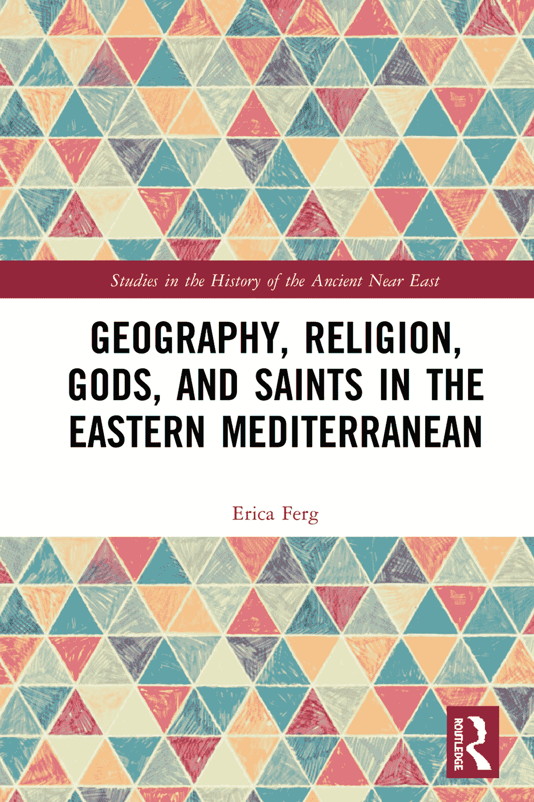

Ra’anan Boustan，美国加利福尼亚大学洛杉矶分校；Zeba Crook，加拿大卡顿大学；Elizabeth DePalma Digeser，美国加利福尼亚大学圣塔芭拉分校；Matthew Gibbs，加拿大温尼伯大学；John Lee，美国加利福尼亚大学圣塔芭拉分校；Harry Munt，英国约克大学；Richard Payne，美国芝加哥大学东方学院；Lucy Wadeson，比利时布鲁塞尔自由大学；Philip Wood，英国伦敦阿加汗信德大学；Alan Lenzi，美国太平洋大学。

[`www.routledge.com/classicalstudies/series/HISTANE`](https://www.routledge.com)

## 英国图书馆出版书目数据

英国图书馆可提供本图书的目录记录。

## 美国国会图书馆出版目录数据

**姓名：** Ferg, Erica，作者。

**书名：** 东中海的地理、宗教与圣人 / Erica Ferg。

**标识符：** `LCCN 2019034540`（印刷本） | `LCCN 2019034541`（电子书） | `ISBN 9780367182175`（精装） | `ISBN 9780429060151`（电子书）

**主题：** LCSH：宗教与地理。 | 中东–宗教。

**分类：** `LCC BL65.G4 F47 2019`（印刷本） | `LCC BL65.G4`（电子书） | `DDC 202/.13–dc23`

LC 记录见 [`lccn.loc.gov/2019034540`](https://lccn.loc.gov)

LC 电子书记录见 [`lccn.loc.gov/2019034541`](https://lccn.loc.gov)

**ISBN：** `9780367182175` (hbk)

**ISBN：** `9780429060151` (ebk)

由印度金买 Deanta Global Publishing Services 使用 Times New Roman 字体排版。

献给我的祖父 John Ferg (1928–2014) 和我的祖母 Gurli Ferg (1929–2007)。

# 致谢

我很荣幸地感谢帮助本书创作的人。首先，我想感谢 Andrea Stanton、Nader Hashemi、Scott Montgomery 和 Albert Hernandez，在丹佛大学利夫神学院读博期间提供的宝贵知识贡献和耐心指导。Greg Robbins 和 Mark George 在指导方面也非常慷慨，在协助处理特定章节方面非常博学。我还想感谢 Amy Balogh，我对她的见知见解和情谊表示感谢，同时也感谢 Eric C. Smith、Catherine Orsborn 和 Micah Saxton 的许多各种贡献。

在瑞吉斯大学（Regis University），我想感谢我的同事在本书写作最后阶段提供的友好且持续的支持。Bryan Hall、Janet Rumfelt、April Samaras、Anna Floyd、Denise Walton、Emma Thompson 和 Mary Jo Coe 提供了极大帮助。我衷心感谢学院及整个大学对该项目提供的支持。

Beverly Chico、Marilyn Kopelman 和 Lori Willard 在短的时间内阅读并对本书初稿发表了意见，对此深表感谢。我还要感谢 Routledge 和 Brill 的所有匿名读者阅读并对本项目提出的意见。你们的建议和批评使这个项目变得更好。

我想感谢在 2004 年和 2013 年实野调查期间在科罗拉多州、黎巴嫩、以色列、巴斯坦和叙利亚协助我的许多人。你们的慷慨帮助对我的研究至关重要。丹佛希腊正教总区、圣埃利亚亚安提俄正教教堂以及黎巴嫩巴曼德大学的几位人士在协助我的野外研究方面一直非常有帮助。还要感谢美国学院（IAU）和地中海学院（IAU College of the Mediterranean），他们在 2018 年夏季留我担任驻研究员，并在我的研究和写作期间慷慨分享了 IAU 图书馆资源。

Greg Fisher 博士、Elizabeth Risch、Ella Halstead、Lisa Sharp 和 Lisa Keating，以及 Taylor & Francis 出版社的所有编辑，都表现得极其专业且礼貌。我无法想象还有比更好的合作伙伴了。

感谢 Kara Taczak 博士，她在编辑协助和积极态度方面简直是一个永不疲倦的奇迹。

感谢许多未在文中列出名字、但从各个方面（无论大小）帮助了这本书所有阶段工作的人们，你们很清楚自己是谁的。谢谢你们。

最重要的是，我想诚挚地感谢我的家人和朋友——特别是我的妈妈和爸爸——感谢他们深爱的支持与鼓励。特别感谢 Wadi Muhaisen，你从头到尾支持了这本书。我希望你对自己在本书创作中所扮演的角色感到满意——没有你们，这本书的意义将大不相同了。

最后，我将此书献给我的祖父 John Ferg 和祖母 Gurli Ferg。感谢你们成为我最强大的支持者和最亲密的知音。你们对我学术工作的支持、对我想法的鼓励，以及对我个人的信任，塑造了今天的我。我非常幸运有你们做我的祖父母。我希望你们的一部分也能通过这本书延续下去。

# 1 东中海区域的地理与宗教

本书讲述了东中海地区一段很大程度上不为人知的宗教历史故事。[#chapter1.xhtml_fn-1] 这个故事本身不仅鲜为人知且经常被误解，而且重述它也为我们提供了一个观察东中海犹太人、基督徒和穆斯林宗教历史的隐蔽视角，同时也让我们窥见了前现代宗教的农业倾向。《东中海的地理、宗教、神灵与圣徒》一书探讨了地理对东中海宗教思想和动机的影响——这些动机在当地持续了数千年并保持盛行。

通过研究这些动机，本书还为黎凡特（Levant）地区宗教社区的兴起和逐渐发展开启了一扇窗——特别是犹太教、基督教和伊斯兰教的传统以及它们相互之间的关系。最终，本书认为尽管东中海的犹太人、基督徒和穆斯林是不同宗教社区的成员，但从历史或文本来说，犹太教、基督教和伊斯兰教的宗教传统并不是独立的。因此，本研究认为，在当地东中海的背景下，应将犹太人、基督徒、穆斯林和其他地区宗教群体理解为“不同但不孤立”。这些信仰的成员之间共同的宗教实践——这是这些社区之间历史和文本连续性的性标志——在今天可能被视为异类的、有问题的甚至是宗教上不正统的。相反，共同宗教实践是这一地理区域的自然特征，也是其宗教社区紧密发展的产物。尽管这些共同实践对外部观察者来说最初看起来很奇怪，但本书证明，共同宗教实践完全符合东中海真实的宗教历史和地理环境。

## 第一部分：黎凡特基督徒与穆斯林中的圣乔治与哈基德尔（al-Khiḍr）

在巴勒斯坦一座奉圣乔治的静静教堂内。[#chapter1.xhtml_fn-2] 当一小群履行还愿的穆斯林穿过门厅并沿着教堂中央过道走时，蜡烛摇曳。这群人来瞻仰一尊圣像，并向上帝表达感恩之情。他们来到教堂是为了崇拜并向一位特定的人物还愿：圣乔治，穆斯林称其为 `al-Khiḍr`（阿拉伯语意为“绿衣者”）。[#chapter1.xhtml_fn-3] 在黎巴嫩山 Ras el-Metn 的一家修道院里，来自周边的穆斯林和德鲁兹教徒来瞻仰著名的 14 世纪圣乔治/哈基德尔圣像，并向这位强大的人物祈祷和感谢。在其他地方，在遍布黎凡特山区的各处圣地朝圣圣乔治的基督徒称其为 `al-Khiḍr`——大多数人认同这个头衔也指代那位穆斯林人物。

在东中海地区，穆斯林人物 `al-Khiḍr` 在许多方面与基督教圣徒乔治是同的。许多人相信，圣乔治和 `al-Khiḍr` 会帮助任何寻求他们帮助的人，人们经常声称在梦中或生活中看到或与这些人物互动。在民俗中，圣乔治和 `al-Khiḍr` 被认为是该地区基督徒和穆斯林最强大、最重要的宗教人物之一。从受欢迎程度来看，他们可能仅次于当地备受喜爱的玛利亚。[#chapter1.xhtml_fn-4]

在过去的 1400 年里，该地区最大的宗教社区一直是穆斯林、基督徒、犹太人、阿拉维派和德鲁兹教徒。[#chapter1.xhtml_fn-5] 总之，东中海地区今天有约 1 亿穆斯林、1500 万基督徒和 650 万犹太人。[#chapter1.xhtml_fn-6] 仅叙利亚、黎巴嫩、以色列和巴勒斯坦黎凡特沿海国家（包括塞浦路斯以及土耳其南部和南部的部分以及埃及西奈半岛），就有约 2200 万穆斯林、600 万犹太人、570 万基督徒、250 万阿拉维派和 150 万德鲁兹教徒。[#chapter1.xhtml_fn-7]

回到巴勒斯坦的教堂内部，那些围绕 `al-Khiḍr` 和圣乔治进行崇拜或参与崇拜实践的穆斯林并不认为自己的行为是不常的或与他们的穆斯林身份相矛盾的。那些同时参与崇拜实践的基督徒对这些穆斯林的判断也是如此（尽管教区牧可能会抱怨穆斯林比基督徒多）。[#chapter1.xhtml_fn-8] 事实上，圣乔治和 `al-Khiḍr`——或者 `圣乔治-哈基德尔/哈基德尔-圣乔治`——更多地被视为所有人都可以接触和尊重的地区性人物，而非属于任何特定宗教传统的人物。[#chapter1.xhtml_fn-9]

穆斯林和基督徒对圣乔治和 `al-Khiḍr` 的崇拜并不新鲜；自至少 1200 年起，圣乔治和哈基德尔就拥有相似的圣像特征，并且在民俗想象中经常被混为一谈。[#chapter1.xhtml_fn-10] 此外，圣乔治和 `al-Khiḍr` 在地区范围内也有对应的人物，即伊利利亚。[#chapter1.xhtml_fn-11] 直到 20 世纪中期，东中海地区的阿拉伯语犹太人和穆斯林社区共同崇拜伊利利亚（阿拉伯语：`Ilyās`、`Ilyā` 或 `Elias`）和 `al-Khiḍr`，通常在共同的地点。[#chapter1.xhtml_fn-12]

因此，哈基德尔在东中海被民俗地同时认同为圣乔治和伊利利亚。由于伊利利亚和圣乔治都因捍卫“真”信仰的行为而广为人知,[#chapter1.xhtml_fn-13] 圣乔治和伊利利亚之间也被民俗地被认为存在联系。然而，圣乔治与伊利利亚之间的联系属于相似性，而非汇合，正如 `哈基德尔-圣乔治` 和 `哈基德尔-伊利利亚` 之间的情况一样。由于这些结合，直到 20 世纪，犹太人、基督徒、穆斯林、阿拉维派和德鲁兹教的地区宗教社区在整个地区的“共同地点”崇拜伊利利亚、圣乔治和 `al-Khiḍr`。[#chapter1.xhtml_fn-14] 在地区宗教社区中，这些人物在民俗中被认为类似于共同的地区遗产。[#chapter1.xhtml_fn-15]

正是这种共同的区域性现象构成了本书的动力。2010 年，当我遇到这种场景时，我被其显而易见的奇异性所震撼。我在想，穆斯林人怎么可能拜访一位基督教圣徒？该地区的基督徒怎么可能将他们的圣徒乔治称为“阿尔-海德尔”（al-Khiḍr）——而大多数人认同这是一个穆斯林人物？以利亚和阿尔-海德尔怎么会在犹太人和穆斯林社区之间被共同视为同一个形象？在至少过去的 800 年里，黎凡特地区的犹太人、基督徒和穆斯林社区——包括农民农业社区和来自大城镇的“城民”——是如何在很大程度上共同并联合崇拜以利亚、圣乔治和阿尔-海德尔这些人物的？

这一现象令我惊讶，因为法违背了我对该地区宗教和宗教社区的认知。^(16) 毕竟，“常识”和我自己的宗教研究训练都表明，穆斯林、基督徒和犹太人是非常不同且完全孤立的，特别是在政治和宗教上充满争议的黎凡特地区。这种观点或许是意料之中的。大多数宗教历史书籍——事实上，大多数关于整个地中海地区的文献历史——都被划分为不同的时期和主题，以一种人工的无菌方式研究宗教，就好像这些宗教与过去和当代的多重影响线索没有紧密联系一样。

相比此，本书调查了这些影响和关联，以阐明地中海宗教历史中一条单一的互联线索。《东地中海的地理、宗教、神灵与圣徒》讲述了以利亚、圣乔治和阿尔-海德尔如何在该地区的宗教文本、图像学和实践中产生联系的故事。通过这种方式，它揭示了地中海宗教历史上一个很大程度上未被承认的方面：互联性。

## 这些人物的文献叙事与传统故事

在黎凡特以外，以利亚、圣乔治和阿尔-海德尔各自在他们的文本和生活传统中分别作为犹太、基督教和穆斯林人物具有非常重要的地位。然而，在黎凡特以外，以利亚、圣乔治和阿尔-海德尔在犹太人、基督徒和穆斯林社区之间并非以完全相同的方式共享的，这些人物也没有经常表现出下述的特殊特征。在黎凡特以外，由于剥离了地理、历史和宗教的影响，这些人物通常仅通过其文本叙事的内容为人知。

圣经先知以利亚是希伯来圣经中的一个强大人物（《列王纪上》17–19，21，《列王纪下》1–2），他的先知角色是确保社区对神 YHWH（或雅威）进行正确的崇拜。由于他被传统性地纳入重要的犹太仪式（如割礼仪式和逾越节晚餐），以利亚继续履行着这一角色。由于其在希伯来圣经中丰富的叙述，以利亚在数千年来一直是东地中海地区多个宗教社区中极受欢迎的人物。

圣乔治被许多基督教社区认为是公元 4 世纪早期一位有影响力的基督教殉道者。地中海地区内及以外的社区尊崇圣乔治为需要之者的帮助者，并根据他与龙的传奇战斗，视为一位武力圣徒。他最终被授予从英国到莫斯科整个基督徒多数地区 30 多个城市和国家的主保圣。圣乔治最早的文献叙事（以及所有其他圣乔治生叙事的来源）是《圣乔治事传》，这是一个起源于公元世纪的希腊文本，其最完整的形式见于公元 600 年的叙利亚语版本。

阿尔-海德尔（Al-Khiḍr）是一个广受欢迎的穆斯林宗教人物，被认为是一位伊斯兰圣徒（或“瓦里”walī）、先知或圣人。阿尔-海德尔在古兰注释（tafsīr）中被称为摩西的老师（18:60–82），被认为会帮助有需要的人，并受到整个穆斯林多数地区穆斯林社区的尊敬，特别是从东欧到东南亚。

然而，在这些人物起源的黎凡特——仅在黎凡特^(17)——他们不仅被共享有时被混淆，还表现出“奇异”的额外特征。这些人物长期以来与雨水、风暴、雷电、闪电、绿色、肥沃和多产联系在一起；具有出现和消失的能力；与山脉和高地有关；与 4 月 23 日的当地节日或庆祝日有关；^(18)；并具有特定的形象呈现：骑在白马上（或脚立），举起手臂挥舞武器，正准备从龙口中杀龙，或对脚下的人类敌人致命一击。

与上述列出的“奇异”特征一致，现代的以利亚、圣乔治和阿尔-海德尔在各自的宗教传统中都得到了充分的研究和分析。解释者通常对这些人物的奇异特征感到不安，几个世纪以来，这些特征一直是关于人物宗教地位和意义的内部讨论和辩论的主题.^(19)。这些人物仅在以利亚、圣乔治和阿尔-海德尔文本和传说起源的黎凡特共享这些独特的特征和交汇，这要求在他们的原始背景下对这些人物进行研究。

## 传统的宗教研究视角

从传统的宗教研究角度（通常被称为“世界宗教”视角）来看，这一现象代表了至少两个悖论。首先是这些人物在东中海地区奇异与共享特征的悖论：为什么这些人物仅在当地表现出这些特征，为什么这些特征在人物之间是共享的？其次是黎凡特地区犹太人、基督徒和穆斯林社区在至少过去 800 年里共同崇拜这些人物的悖论。传统的宗教研究话语认为犹太教、基督教和伊斯兰教是独特独立的宗教传统，特别是在东中海地区。那么，这些人物为什么能被犹太人、基督徒和穆斯林社区共同崇拜，特别是在如此长的时间内呢？

传统的世界宗教视角在宗教研究教材和理论方法仍然占据主导.^(20) 这种组织和研究方法关注离散的、全面的传统以及规范性的信仰和实践.^(21) 这也是涉及以利亚、圣乔治和阿尔-海德尔调查的理论框架。因此，这些人物通常是从各自的宗教传统内部进行研究的。这种方法倾向于忽略人物之间的关联，并且倾向于将人物的“奇异”方面误认为是增补的或异常的。^(22)

最重要的是，这种传统的“世界宗教”方法缺乏对地方性如何影响宗教的认识。也就是说，它没有考虑到在特定宗教传统的表现中始终显而易见的时间与空间的交汇。以基督教这一宗教传统为例。构成 3 世纪叙利亚地区基督教的文本、教义、神学和生活习俗，与构成 20 世纪美国南部地区基督教的要素截然不同。传统的世界宗教理论很难解释这种复杂性，因为特定的理论视角倾向于将构成宗教的元素视为一个完整、不变的整体的一部分。

## 宗教地理视角

与宗教地理学领域相关的理论代表了一种更有前景的方法——这种方法考虑了地方性如何影响宗教。宗教地理学自 20 世纪 60 年代以来以各种方式演变，但其最重要的贡献之一是在地方性的、以地理为导向的宗教研究中“宗教的情境化”。^(23) 这些对宗教的局部研究在分析特定宗教传统时考虑了时间与空间的交汇。也就是说，根据宗教地理学的理论视角，宗教本质上是地理背景化的：特定地区内显而易见的政治、社会、宗教和物理地理条件，被认为影响了该地区宗教传统在任何时刻的发展和表现。

回到 3 世纪叙利亚的案例，世界宗教方法可能会建议我们通过理解反映在特定时期思想家和文本中的基督教表现来进行。在这种方法中，思想家和文本通常会被情境化，但这些文本和思想家往往也被以循环论的方式被看待，视为通往最终结果已知的完整传统道路上的路标。此外，在世界宗教理论框架内对宗教传统进行分析（特别是早期的传统）往往局限于对基础性宗教文本的分析。世界宗教理论强调文本的更大逻辑问题在于，人们往往会无根据地推论认为，如果一个人理解了一个传统的基基文本，他就可以声称在任何时间和地点都理解了整个传统，而事实并非如此。

相反，宗教地理学方法认为，在考察 3 世纪叙利亚的基督教时，应该考虑影响该传统的当时 3 世纪盛行的政治、社会、宗教和物理地理条件。也就是说，这些影响是如何结合在一起影响那个特定时空下的基督教表现的？这一传统的习俗、教义和实践是以何种方式受到 3 世纪叙利亚地理地方性的影响并付诸实践的？此外，这一传统的文本、叙事、符号和人物是如何受到相邻宗教和文化力量的影响的？

## 使用地理视角


当我们通过地理视角审视以利亚、圣乔治和阿尔-海德尔（`al-Khiḍr`）时——这种视角不仅限于单一宗教内部的探究——几种优势便显现出来。首先，使用地理视角允许我们从比较的角度来观察这些人物，既是相互之间，也是随着时间的推移针对单个人物本身。其次，使用地理视角允许我们调查这些人物的区域影响，无论是政治、社会、宗教还是地理上的。第三，地理调查并不局限于单一时期。在不同时代，对这些人物的影响发生了变化，人物本身也发生了变化。通过地理而非时间来限制这一项目，使我们能够看到人物背后运作的影响的流动性，以及人物之间情境对齐背后的流动性。最后，使用地理视角有助于解决关于这些人物区域“特质”的明显矛盾，以及涉及犹太人、基督徒和穆斯林共同这些人物的问题。最终，对这一现象的地理视角有助于阐明为什么在该地区之外且剥离了其影响的情况下，这些人物不会被混淆，也不会以相同的方式在犹太人、基督徒和穆斯林社区之间共享。

## 过去的研究

总的来说，过去对人物的研究通常由具有宗教信仰的内部人士进行，他们的工作倾向于强化教义信条，并淡化、驳斥或忽略这些人物的共同方面和起源。关于这些人物的世俗学术始于 19 世纪后期，很大程度上遵循世界宗教理论框架的路线。对以利亚这一特定人物的著名学术研究通常分为几类：圣经的、塔勒德的和民间的；还有关于圣乔治和阿尔-海德尔的个体研究、对两个或多个人物的比较研究，在少数情况下是对所有三个人物的研究。^(24)

1969 年，哈桑·S·哈达达（`Hassan S. Haddad`）认为，以利亚、圣乔治和阿尔-海德尔之间的相似性和联系值得在更广泛的范围内考虑。^(25) 哈达达写了一篇名为《黎实的“乔治式”崇拜与圣人》的短文，在文中他注意到黎凡特犹太人、基督徒和穆斯林农业社区中以利亚、圣乔治和阿尔-海德尔的相似性。哈达达首次提出了一个挑衅性但未经证实的观点，认为“这些‘乔治式’圣人的崇拜是古代叙利亚巴尔（`Baals`）崇拜的带有变体的延续，”^(26) 指的是数千年以来在该地区占据主地位的人物——叙利亚-迦南风暴神巴尔-哈达德（`Baal-Hadad`），以及巴尔在区域性的融合表现。^(27)

在我们开始这项调查之前，有必要进行一些定义和澄清。尽管黎凡特地区是“肥沃新月”这一农业带的一部分，但其大部分地区仍然是干旱且多石的。这些气候条件是该地区独特的地理和地质特征的结果。正如我们在第二章中所示，地中海盆地主要由石灰岩基岩组成。这种基岩产生了薄薄、多石的土壤，这些土壤迅速风化，形成了暴露的岩石和洞穴。此外，由于黎凡特位于三个大陆板块——非洲板块、阿拉伯板块和欧亚板块——的交汇点，黎凡特的大部分地区在板块碰撞处为山地，并向东逐渐下降形成了一片石质平原。这种地理上的多样性在很大程度上塑造了该地区：从历史角度看，地理条件的多样性阻碍了地区间的政治统一，影响了当地河流的走向和特征，并有助于在山背风侧创造一个雨养耕作的肥沃带，而东部沙漠地区的水分则急剧减少。正如本书所示，黎凡特的地理深刻地影响了生活在那里的人们的宗教观念。

## 我们通常如何看待黎凡特的宗教史

宗教研究领域的学者和外行人士往往以一种时代错误的方式看待黎凡特以及更广泛的东中海地区的宗教史，将其视为一个由那些拥有我们现代宗教认同观念的人们所组成的地区。他们往往设想出相互独立的、在神学上成熟的社区。这种观点反映了一种现代宗教视角，这种视角在历史上是不准确的，而且直到最近，这种视角甚至是不可能实现的。

独立的、以神学为导向的宗教社区在很大程度上是现代识字文化的产物。只有现代识字文化才拥有产生大规模识字率所需的宗教和政治基础设施，用以创建和维护大量的崇拜建筑，并培养、装备和支持受过训练的宗教人员，由他们塑造和监管宗教认同。在该地区 20 世纪以前，这些条件是无法实现的。^(28)

以文本为基础的宗教视角以关注文本、特别是神学信息的排他性为特征，这需要大规模识字率。前现代文化缺乏大规模识字的能力，在缺乏这种基于文本的宗教视角的情况下，人们既不想也不需要将自己的宗教认同构想为神学上的“纯洁”，并与他人的宗教认同区分开来。^(29) 事实上，在古代甚至直到历史上的现代早期，人们对宗教认同的构想与其说是基于“宗教”或“信仰”，不如说是他们追随哪些神以及履行哪些仪式。^(30) 此外，对神的效忠在很大程度上并不是排他性的。

尽管我们在书中会遇到正典文本的告诫和宗教会议法令，但在历史的大部分时间里，该地区的大多数人在宗教上都是机会主义和多元主义的：一个人可以并确实追随那些强大的神，也可以并确实参与那些被认为有效的“魔法”的、祭祀的和护身符驱动的实践以及仪式——无论这些做法是独立于、“取代了”、“与……为辅”还是与某种“主要”宗教取向协同而进行的。^(31)

此外，近东的大多数文化都是相互相连且相互依赖的。这些“文化相互互动并相互关联。这意味着文化涵化过程不仅发生在‘希腊’、‘罗马’和多个‘近东’文化之间，也发生在近东文化和宗教内部。”^(32) 诚然，宗教认同是“动态的”、“多层面的”且“不断发展的”，而且“永远不存在一个跨越不同时期被传承的单一‘宗教认同’”。^(33) 但近东宗教文化之间的互动、重叠和关联程度，远比大多数关于东中海的宗教史书籍所呈现的要得多。东中海独立的、封闭的、神学排他性的宗教社区在很大程度上是现代政治和宗教影响的产物，因为它们基于识字社区，并导致了文本宗教的兴起。然而，这些都是现代宗教视角，不应以时代错误的方式投射到早期的时期。

## 民众宗教

我们对宗教认同的现代观点——特别是对文本宗教的主导地位——遮蔽了对东中海宗教史的准确理解。从现代定义的意义上，我们倾向于将“大众”或“民俗”宗教视为那些偏离宗教传统核心神学教的宗教实践和观念。此外，我们倾向于将宗教传统的核心教学等同于文本的、正典的宗教。通常，这些类别被称为“高宗教”和“低宗教”，其中高宗教等同于文本的、正统宗教，而低宗教指的是所有其他偏离文本视角的所有或“民俗”宗教实践和观念。

这种“大众宗教”概念的问题在于两点：首先，它是不准确的，因为它只从现代视角来看才有意义。也就是说，当我们试图将这一框架应用于历史分析时，它就崩溃了。“大众宗教”这一概念犯了一个错误，即将广泛的、继承而来的神学体系反过来强加于早期的时期。事实上，当我们开始考察“大众的”、非正典的和非正统的实践与观念是如何偏离正典文本时，我们忘记了在早期，这些正统学和正典文本正与当时的各种宗教文化同步创造并从之产生的。这一错误涉及关于“大众宗教”这一概念范畴的第二个缺陷：它假设正典、正统宗教的发展是早期的、原始的行为。

## 农业宗教

“大众宗教”的概念受限于语言的局限性，也由于人们在围绕这些概念时经常犯下的推理错误。相反，理解“大众宗教实践”这一术语（特别是在黎凡特地区）的一种更为有效的方法是通过“农业宗教”这一类别。正如詹姆斯·格雷汉（`James Grehan`）在《圣徒的黄昏：奥斯曼叙利亚和巴勒斯坦的日常宗教》中所指出的，农业宗教是一个跨越了大众、高/低以及城市/乡村等类别局限的概念，强调了“对日常生存中本质上的农业条件的精细调适”。^(34) “它既具有城市性又具有乡村性，是一个整个社会经济秩序的表达，其节奏与季节的缓慢转动相联系，并对大地、天空和环境的变幻有着精细的适应。”^(35) 无论社会阶层、地点、年龄和性别如何，这实际上是所有人共同的经历。

在格雷汉的表述中，黎凡特的农业宗教受地理影响驱动，其特征是圣地、基本的农业需求、共同的宗教文化以及圣徒和神圣。圣地与地理密切相关，通常从岩石景观中开凿，或简单地围绕自然奇观而创造。在黎凡特，圣地包括圣山、值得关注的岩石层和洞穴——尤其是通往地下水的洞穴。

农业关注点，尤其是水、干旱和产量，塑造了农业宗教的轮廓。农业宗教的另一个标志是宗派主义的减少。由于缺乏建立僵化或独特宗教身份所需的大众识字和宗教基础设施，黎凡特前现代农业宗教文化中的人们共享语言和文化传统，以及生存所需的相同农业需求。此外，人们不仅共享相同的空间，还共享相同的宗教历史。这在过去两千年里黎凡特地区的犹太人、基督徒和穆斯林社区中尤为显著，他们共同的宗教历史涉及常见的圣经宗教人物、叙事和文本。

黎凡特农业宗教较为显著特征之一是圣徒和神圣的盛行。圣徒是农业文化中最具识别度的人物。^(([36) 这一现象既与圣徒或神圣人物帮助满足的日常生存农业需求有关，也与近东普遍存在的传奇和英雄人物池有关。黎凡特地区面积较小，加上其内部发展的相关宗教社区，促成了该地区存在一个共同的传奇和英雄人物池、流行叙事和强大的母题。

此外，圣徒或神圣人物帮助为缺乏基础保健和医学知识的农业文化提供医疗需求保障。人们长期以来认为魔鬼会导致疾病、身体畸形，特别是他们认为是“疯狂”的心理和精神问题。因此，具有驱逐魔鬼能力的圣徒被视为神迹疗法的现成来源。

农业宗教中的圣徒与坟墓、朝圣以及为了祈求得到回应而交换名声的愿望有关。与圣徒崇拜相关的还有有效的疗法、治愈和保护，这些可以在强大的图像、圣像、魔法、护身符（图画和文字的）中找到，也可以在整个近东长期的血祭仪式中找到。

农业宗教关注生活的严酷条件并受地理环境塑造，主导了该地区前现代、文字之前的宗教。宗教学者倾向于认为该地区的历史宗教民族在神学上是彼此不同的。然而，在大众识字、文本宗教以及随之而来的排他性宗派宗教身份崛起之前，黎凡特宗教社区的特征更多是共享的农业宗教文化，而非取决于独特的教义特征。^(([37) 变化非常缓慢的地力和地质条件是黎凡特农业宗教的基础。因此，农业宗教文化的变化自然非常缓慢，^(38) 并与长历史（`longue-durée`）视角相关。这些与农业宗教相关的现象和特征在这一地区持续了很长时间，直到 20 世纪才开始被掩盖。^(([39)

## 正典宗教

书中所使用的“正典宗教”或“制度宗教”是与两个概念密切相关的术语：权威宗教文本的正典集，^(40)，以及宗教正统的概念。这两个概念——正典性和正统性——通常需要足够的政治权力来执行特定的教义、推广特定的文本，并建立正统与异端的类别。^(([41) 如上所述，正典宗教需要几个世纪才能形成。它也不是统一的，因为某一宗教传统内部的竞争社区在权威文本和神学概念上存在差异。

正典宗教与农业宗教的主要区别在于前者对文字文本的依赖。^(([42) 我们今天认为的“正典”文本通常始于一个口头故事或一系列口头传统，并在不同时间点以不同的文本版本被写下并在特定社区中流传。当一个宗教传统的政治或内部权力达到充分的执行水平时，其中一个或多个文本版本会被宗教官员选中，纳入由权威的、“真实的”文本构成的“正典”中。当被选中的文本获得这种与正典性相关的崇崇且往往是神性的地位时，它们随着时间的推移变化非常缓慢。^(([43) 这样一来，文字文本倾向于锚定、稳定并塑造正统的轮廓。^(([44)

此外，早期的宗教文本通常代表了关于事物应当如何的辩论性——也就是说，早期或基础性的宗教文本在很大程度上是当时宗教文化（或从后世角度看“之前的”宗教文化）的证据——而不是反映其自身多数宗教环境的准则。因此，在本项目中，我们将《巴尔循环》作为古代近东宗教群体的证据；将《希伯来圣经》作为迦南、埃及及其他古代近东宗教群体的证据；将《新约圣经》作为第一世纪第二殿时期犹太人等群体的证据；将《圣乔治事迹》作为五世纪罗马、希腊化、基督教和犹太宗教群体的证据；以及将《古兰经》作为晚期古代宗教世界的证据，特别是当时各种基督教、犹太教和阿拉伯多神教群体的证据。

在史学方法方面，本书将采用由费尔南·布罗德尔（`Fernand Braudel`）在 1949 年提出的上述`longue-durée`地理历史时间模型作为指南。在考察东中海地区的这一历史现象时，本书将认为，地质时间和语言时间是影响东中海人类历史的最深层且变化最缓慢的两个要素。

在最基础的层面，地理和地质影响着该地区生活和农业生产的气候现实。尽管东中海的气候自公元前 7000 或 6000 年以来偶尔发生变化，但在书中，该地区的气候被认为概括为每十年中有三个干旱年。此外，这种稳定的气候总体模式将在文中被描述为该地区具有重大且决定性的影响因素，以及其长期存在的地理母题。

我建议将语言史视为该模型中一个移动速度稍快的时间层次。从历史上看，黎凡特（`Levant`）一直是一个由闪米语系东方、中部和西北分支主导的地区，但公元前四世纪末希腊语的引入，以及元纪初拉丁语的引入除外。最后，我建议宗教史是该区域模型中变化较快的历史层次，而政治历史则是东中海地区变化最快的历史层次。

## 本书考察了什么以及为什么

文本、图像和遗址的功能就像人工，可以告诉我们许多关于其产生地社会的信息。它们代表了特定的时刻；每一个文本、每一个图像或每个遗址都像一扇通往历史的小窗。为了对所考察的每个人物进行地理背景化，以便我们能够将他们每一个都理解为时间和地的产物，本书调查了这些人物的重要文本、图像和遗址。

每个文本、图像或遗址都经过了对其当代宗教、政治和地理影响的考察。通过这样做，我们在每个文本、图像或遗址中看到了关于时间和空间的更广泛的证据，以及对特定宗教传统的反映。我们还在每个文本、图像或遗址中看到了农业宗教的证据，以及地理对圣山、岩石和洞穴等现象的影响；在涉及作物、水资源、干旱和收成的农业事务中；在教派身份被弱化的共同宗教文化中；以及在圣徒和神圣人物、坟墓、恶魔、图像、圣像、魔法和祭祀中的盛行。我们同样在每个文本、图像和遗址中看到了宗教中不断发展的正统性。通过一系列引人注目的近东人物、叙事和母题，我们看到了黎凡特古老近东宗教传统与犹太教、基督教和伊斯兰教之间关系的证据。最后，我们在这一考察中看到了黎凡特犹太教、基督教和伊斯兰教相互关联的历史，以及他们对一神教的特殊观念。

应当注意的是，尽管该项目同样关注了巴尔-哈达德（`Baal-Hadad`）、以利雅（`Elijah`）、圣乔治（`St. George`）和哈基德尔（`al-Khiḍr`）这些人物，但在现实中，在黎凡特少数穆斯林和基督徒社区中，这些最受推崇的人物是圣乔治和哈基德尔。这反映了过去 800 年的人口结构，特别是 20 世纪动荡的政治历史。最值得注意的是，这些影响包括第一次世界大战后建立的国家间的政治边界划分，以及以色列国家的建立。这两个政治事件都导致了特定人物能够排他性地进入曾经开放的遗址。尽管涉及犹太社区和以利雅人物的共同区域实践已不再像以前那样流行，但以利雅这一人物和犹太社区的流行做法对于准确理解这一历史现象是至关重要的。

另一个削弱了这些实践以及参与这些实践的现代穆斯林和基督徒社区规模的 20 世纪政治事件是排他性神学解释的兴起。这种排他性的神学取向很大程度上可以与文本宗教的兴起、政治伊斯兰主义运动的增长，以及 20 世纪和 21 世纪政治事件导致的普遍教派主义增加相关联。从排他性神学的角度来看，共同的宗教实践往往被谴为“民俗的”、“非正统的”、“混乱的”或“不当的”。

## 为什么很重要

### 地理对宗教的影响

宗教信仰、思想、符号和实践自然受到其神学阐述地社会和地理条件的影响。地理并不驱动宗教信仰，但它具有独特的塑造影响。只要地理仍被认为是对人类生活影响最大的因素，这种影响就一直存在于宗教文化之中。在干旱的黎凡特生存需要雨水的情况下，早期与风暴神人物相关的地理母题在黎凡特文化中保持着强大和灵验，并逐渐与区域宗教传统中相关的后续人物相关联。

### 母题的延续性

本书认为，这些人物的“特性”——涉及雨水、风暴、雷电、闪电、绿色、肥沃和多产，以及出现和消失的能力、与山脉和高地的联系、4 月 23 日的当地节日或庆祝日，以及对蛇或龙的击败——实际上是与区域地理需求相关的强大且灵验母题的延续。哈桑·哈达德（`Hasan Haddad`）首次提出以利雅、圣乔治和哈基德尔这些人物各都是“叙利亚巴尔神（`Baals of Syria`）崇拜的延续”。本书结论认为，尽管这些人物在时间上以各种方式相互关联，但每个人物（包括风暴神）都与黎凡特及更广泛的近东文化中强大且灵验的地理母相关联。这些母题起源于地理需求，这些需求与风暴神巴尔-哈达德人物同时出现，在某些情况下甚至早于他。

这种“崇拜的连续性”（`continuity of cult`）的概念，对于理解本书所强调的重要区域地理主题的连续性来说是一个非常有用的比喻。从这个意义上说，这种现象发生在宗教层面而非考古学层面。这些主题本身在农业宗教文化中仍然保持着强大和效力，首先，因为生活在连续世代的人对降水和作物生长一直有着同样紧迫的需求；其次，因为这些主题是文化现象，主题本身先于连续的后代而存在，而这些后代被教导承认这些主题是有效且强大的。^[54]

与“崇拜的连续性”的功能非常相似，在“主题的连续性”（`continuity of motif`）中，这些主题变得与相关的、连续的、区域宗教人物联系在一起。因此，我们能够识别为出现在非常早期的强大、有效且受地理影响的主题，在很长时间内继续被使用，但变得与宗教意义各异的宗教人物相关，尽管这些人物本身之间是不可分割地相互关联的。本书记录了这一过程在所研究的每个人物身上是如何发生的，在此过程中帮助我们理解人物之间的关系，以及他们各自宗教传统之间的关系。最终，《东中海的地理、宗教、神与圣徒》（`Geography, Religion, Gods, and Saints in the Eastern Mediterranean`）表明，这些地理主题在区域内很长的一段时间被这些人物共享，因为他们共享这一地区。

## 犹太教、基督教和伊斯兰教的逐渐出现

尽管人们通常认为，宗教并非完全成形的，也不是随着创始人物的大规模开始的。宗教产生于它们自身的当代宗教、政治和地理环境——通常是对另一种同时宗教传统的反应——并随着一个小规模早期社区的出现而产生。最终，这个社区开始在文本中记录核心思想，通常是为了使用图像，并频繁访问遗址（有时也会重新使用已存在的图像和遗址，正如本项目所强调的“主题的连续性”概念）。自然地，这些并不是线性过程，而是可以同时发生。逐渐地，更大的宗教社区从这些早期群体中成长起来，而宗教“传统”——以及其附随的神学、仪式、实践和信仰——在几个世纪中形成并发展。^[55]

同样，本书证明了黎凡特地区的宗教传统是在一个渐进的形成和相互区分过程中浮现的。因此，可以说犹太教、基督教和伊斯兰教是不同的宗教传统，但在历史时期并不是相互分离的宗教传统。

## 意义与启示

通过挑战这些宗教传统之间分离的传统叙事，挑战对该地区前现代、前文字、农业宗教主要以神学为导向的理解，并强调该地区共同的宗教实践，本书对区域宗教历史传统文献提供了一种创新的突破。它对东中海地区的宗教研究具有启示，并要求我们重新思考对犹太教、基督教和伊斯兰教的普遍认知，以及该地区的人类历史。

本书还阐明了近东特有的传奇和英雄人物、流行叙事以及强大的地理主题的共同池。它认为一神论是某种特定的宗教思想分支，这种思想是犹太人、基督徒和穆斯林人相互区分的特征，并与以多神教宗教传统为主导的近东宗教环境不同。


本书揭示了黎凡地区 `Baal-Hadad`（以及随后，正如我们将看到的，`Levantine Zeus` 和 `Jupiter`）、`Elijah`、`St. George` 和 `al-Khiḍr` 之间的关系和连续性，为我们理解涉及地理和宗教的更广泛现象提供了关键案例研究。在宗教研究领域，这种现象以及由此得出的论点在很大程度上仍未被提及：即承认全球性宗教具有区域特殊性，以及承认宗教传统之间存在区域特定的关系。

从现代意义上说，本书还具有当代政治影响。它帮助我们记住，长期以来连接着黎凡地区人们彼此、土地甚至跨越时间的文化共性元素。此外，存在文化共性元素，正如基督徒、穆斯林教、阿拉派、德鲁派和其他当地宗教社区之间 `St. George` 与 `al-Khiḍr` 之间的现代关联所示，这些元素也联系着中东的宗教团体。

最后，通过证明犹太教、基督教和伊斯兰教的宗教传统在历史或文本上都不是相互分离的，本书反驳了现代严苛和排他性宗教团体的说法，这些团体强调这些宗教传统与其当地社区之间的差异和分裂。《东中海的地理、宗教、神与圣徒》揭示了涉及 `St. George`、`al-Khiḍr` 和 `Elijah` 的共同现象，这种现象对于东中海的历史遗产以及该地区的共同宗教实践都是真实的。通过这种方式，它恢复了一段今天很大程度上仍不为人知的东中海互联的宗教史。

## 总结

本书的`Chapter Two`“黎凡的地理、历史与农业宗教”对整个东中海地区进行了调查：地理、气候和天气。这一章给出了一个没有现代政治边界和离散历史划分的区域印象，并调查了区域地理、地质和气候。该章的第二部分提供了该地区从青铜时代开始的政治、宗教和语言历史的总结。第三部分将不断变化的政治历史与农业宗教文化中持久的元素进行对比，给出了黎凡农业宗教体验的整体和随时间变化的印象。

## 第三章](#chapter3.xhtml_chapter3)，“迦南人宗教与风神巴尔-哈达德”，侧重于风神巴尔-哈达德这一形象，通过讨论产生巴尔-哈达德的古代近东风神群体来设定分析背景，随后重点关注西叙利亚和沿海迦南的风神巴尔-哈达德。本章考察了巴尔-哈达德最重要的文本——《巴尔循环》；其肖像学表现——《巴尔石碑》；以及与巴尔-哈达德相关的两个地点——`巴勒贝克`和`萨潘山`。文章指出，风神击败蛇或龙这一具有影响力的主题可能源于气象现象，并考察了巴尔-哈达德形象如何影响黎凡地区的希腊-黎凡特`宙斯`崇拜（例如`宙斯-巴尔`）以及当时的罗马-黎凡特`朱庇特`崇拜（例如`朱庇特-多利科纽斯`）。在约 1,000 年的时间里，奉献`宙斯`（以及后来的`朱庇特`）的崇拜逐渐取代了该地区的巴尔崇拜。本章强调了与巴尔-哈达德相关的叙事和主题，这些主题在随后的`以利亚`、`圣乔治`和`阿尔-海齐尔`等人物中产生了共鸣：与击败蛇或蛇类的关联——这种叙事被证明在整个地区具有长久的生命力；风暴神显意象，如雨水、风暴和闪电；与`萨潘山`和其他高地的关联；与丰产、繁殖以及季节循环的关联；以及反复的消失与回归。

## 第四章](#chapter4.xhtml_chapter4)，“希伯来圣经与以利亚”，侧重于`以利亚`这一形象，将古代以色列人和作为古代近东兴起的圣经传统置于其中。特别是，特别关注了圣经传统是如何在一个由`巴尔`（`巴尔-哈达德`）崇拜主导的古代近东和“迦南式”宗教环境中产生的。本章重点关注先知`以利亚`的圣经叙事，他在《列王纪上上》和《列王纪上下》中的叙事涉及为了捍卫真神`雅威`而铲除巴尔崇拜。本章随后考察了`以利亚`如何从公元前一千年后半叶一直到公元第一、二千年，在更广泛的近东地区一直是一个极受欢迎且极具影响力的人物，并以其捍卫“真”神而闻名。晚古代的`以利亚`对于本研究具有特殊的重要性，既是因为他的圣经叙事与`圣乔治`形象的关系，也是因为涉及`以利亚`和摩西、并将其与`阿尔-海齐尔`形象联系起来的晚古代民间故事。

## 第五章](#chapter5.xhtml_chapter5)，“早期基督教与圣乔治”，侧重于`圣乔治`这一形象，将公元一世纪基督教如何从犹太人社区中崛起，置于罗马国家多神教以及人类首几个世纪混合宗教环境的背景之下。本章考察了“乔治（George）”名字的词源，并认为词源学可能将早期基督教对圣徒`乔治`的崇拜与同时期的`宙斯-乔尔戈斯`当地崇拜联系起来。本章还分析了`圣乔治`最早的圣徒传——叙利亚语《圣乔治事迹》，展示了文中同时存在的宗教和政治影响力；其中，包含了`以利亚`的叙事和主题，其中`圣乔治`被呈现为真神的捍卫者，方式与《列王纪》中`以利亚`的叙事完全一致。本章还考察了东中海地区`圣乔治`崇拜的物质证据，重点关注`圣乔治`肖像的变化。特别关注了`圣乔治`肖像的变化如何与同时期的罗马多神教、发展的基督教、风神形象以及黎凡农业宗教的影响有关。

## 第六章](#chapter6.xhtml_chapter6)，“伊斯兰的兴与阿尔-海齐尔”，将《古兰经》（以及后来的伊斯兰）的出现置在其晚古代政治和宗教背景下，这些背景由当时的麦基派、雅各比派和聂斯托派基督教派、拉比犹太传统以及在`巴比伦`学院产的《塔木德》文本，以及阿拉伯多神教传统所主导。本章随后将`阿尔-海齐尔`叙事（《古兰经》18:60–82）置于背景中，这段被称为“摩西与仆人”的经文是一个关于神的神圣公正智慧文学故事。它调查了早期释经（`tafsīr`）将叙事中的“仆人”识别/命名为`阿尔-海齐尔`，并认为释经对`阿尔-海齐尔`的引用可能是晚古代`以利亚`形象的一个头衔。本章通过`阿尔-海齐尔`在文本和民间信仰中与`以利亚`形象的联系，以及通过他绿色和丰产的特征，考察了他在东中海的形象，这些特征在该地区与`以利亚`相似，在更广泛的黎凡地区则与`圣乔治`相似。最后，本章开始刻画东中海地区围绕这些人物的共同实践，随着公元八、九世纪起那里的基督徒、犹太人和穆斯林社区共同增长和演变。

## 第七章](#chapter7.xhtml_chapter7)，“东中海共同宗教史”，将讨论重新聚焦于现代东中海穆斯林、基督徒和犹太人社区之间的共同实践。它对本研究所揭示的这些人物之间关系的意义，并调查了关于迦南宗教、犹太教、基督教和伊斯兰教逐渐出现和发展的结论；关于农业宗教的普遍性和持久性；关于区域宗教历史的渐进性和连续性；特别是关于犹太教、基督教和伊斯兰的神学独特性。`第七章`以关于地理对地理主题发展的影响的思考结束——例如击败蛇或蛇这种在该地区流行了数千年的主题——对东中海共同宗教文化的影响，以及对区域宗教实践的历史和宗教真实性的影响。

## Notes

# 2 黎凡地理、历史与农业宗教

## 第一部分：黎凡地理

数百万年前，非洲、阿拉伯和欧亚大陆板块的碰撞形成了地中海地区，并在过程中迫使沿岸的复杂山脉向上抬升。逐渐地，地中海的东端和西端连接在一起，困锁了史前的提提斯海洋数千年，直到它最终蒸发，留下了石灰岩基地。然后突然，在约五百万年前的某一点，大西洋通过直布罗陀海峡冲入了一场持续百年的壮丽瀑布，创造了现代地中海。^(1)

作为一个由海洋而非陆地边界定义的独特地理区域，地中海与世界更大海洋的唯一连接是通过`直布罗陀海峡`（它在最窄处仅隔九英里隔开了非洲和欧洲）以及`苏伊士运河`（这条自 1869 年以来一直连接地中海与红海的人造水道）。因此，地中海及其环绕的山脉形成了一个自我聚焦的单元，它们不仅共享天气模式和气候带，还拥有共同的地质和人类历史。

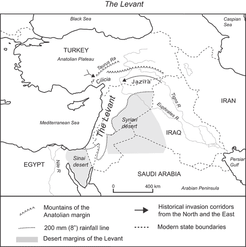

图 2.1  黎凡地图

这段共同的历史是本章的重点，本章探讨了黎凡特的地质、气候和农业历史图 2.1]。它概述了该地区的政治、宗教和语言历史，并详细描述了被称为“农业化”的长期现象，这种现象本身在很大程度上与该地理密切相关并受其塑造。本章呈现的历史背景为全书的其余部分提供了基础，同时也强调了黎凡特地区在数千年来共同分享的历史、文化和生活经验中的连续性元素。事实上，本书的一个核心观点是，随着时间的推移，居住在黎凡特不断变化的社区之间的断层比人们通常认为的要少。为此，本书的设计旨在反驳一种观点，即认为这一现象发生的东中海地区及其历史和传统，可以被划分为具有不同边界（政治、时间和宗教）的独立单元，这限制了人们对该地区及其长期连续性的深入理解。

### 地质

地中海最宽处跨度从直布罗陀延伸到黎巴嫩，长度达 2,300 英里。其南北跨差异巨大，尽管现代威尼斯与北非国家利比亚之间的最大长度为 680 英里。地中海的内陆性质实际上使其与世界潮汐隔离开来，因此其自身的潮汐主要是由月球和太阳对海面的影响造成的。

由于直布罗陀海峡狭窄的进出点，大西洋水流入而地中海水流出，地中海的温度比大多数海洋都要暖。地中海的盐度也高于大多数海洋，因此它支持的海洋生物物种比大洋少。地中海通常温暖且干燥的气候，加上经常不受阻挡的阳光影响，使得海水以每年约 57 英里的速度蒸发。这一过程过程进一步增加了地中海的盐度，尽管年度降雨、来自黑海和尼罗河的径流以及来自大西洋的冷水通常会补充流失的水分。区域气候和农业受地中海影响，居住在其周围的人们与海洋自身的命运交织在一起。

### 气候

大约 12,000 年前，地中海的气候接近目前的状况](#chapter2.xhtml_fn-3)。地中海属于温带和热带气候，有两个季节：10 月至次年 4 月为冬季，凉爽湿湿；5 月至 9 月为夏季，炎热干燥。在所有季节，温度都受到邻近海洋的调节。风模式随季节变化并在地中海的不同区域而波动。在冬季，引导低压区的急流会进入地中海。一系列低压中心在相对温暖的地中海上方形成并向东移动；低气压也可能从大西洋移入并在较温暖的地中海上方得到加强。当这些气团吸收了海洋的水分时，它们向海洋和附近的陆地倾降雨，因此地中海的大部分降水发生在冬季。事实上，冬季可能非常风暴，会危险地推高海平面并威胁到贸易和运输。

地中海周边的夏季炎热而干燥，由于大部分降水发生在冬季，在夏季，溪流可能是间歇性的。靠近海域的地区可能潮湿且非常炎热，尽管沿海山脉通常要凉得多。龙卷（由海上发生的旋涡形成的剧烈旋转的水柱和水喷射组成——本质上是从海面上升起的龙卷风）是地中海地区的一种气候特征。东中海的情况也是如此，我们将在第三章看到](#chapter3.xhtml_chapter3)chapter2.xhtml_fn-4)。

东中海的雨季在 10 月或 11 月再次以强雷雨暴的形式开始。冬季风暴横跨地中海向东移动，到达东部海岸线北部的陆地（安纳托利亚南部，位于安提俄克附近，靠近现代土耳其的安塔亚卡），并转向向东南方向穿过内陆地区](#chapter2.xhtml_fn-5)。携带大量水分的风沿着黎凡特的沿海山脉移动，在跨越它们之前凝结并降水，在山背风处留下一片干燥地区。因此，黎凡特的西部沿海山脉吸引了该地区的大部分降水，在东部创造了一个雨影区。与地中海所有地区一样，东中海每年的降水量变化可能很大。某年的降水量可能是年平均值的两倍；下一年可能只有一半，且地中海不同区域之间的降水量差异通常是巨大的](#chapter2.xhtml_fn-6)。

黎凡特平均降水中约 70% 落在 11 月至 3 月之间。受海拔、纬度和靠近地中海的影响，降水分布不均，向南方和东部剧减。在最南部，平均年降水量少于 100 毫米（4 英寸）；在最北部，可达 1100 毫米（43 英寸）。chapter2.xhtml_fn-7)。降雨随季节和年份变化，降水通常集中在破坏性的风暴中。在近东，每年至少 200 毫米（8 英寸）的降雨线（地区地图上的等降水量线）划分了耕地。确定可以耕作的区域必须落在 400 毫米（12 英寸）等降水量线内（见图 2.1](#chapter2.xhtml_fig2.1)）。例如，在现代以色列和 palest 斯坦的黎凡特南部地区，只有三分之一土地可耕种](#chapter2.xhtml_fn-8)。黎凡特经常发生旱灾，通常情况下其气候特征是每十年有三个干旱年](#chapter2.xhtml_fn-9)。

### 黎凡特的地理：区域、山脉、河流和水源以及植物

黎凡特由几个地质屏障界定。北部是陶罗斯山脉，它过渡到安纳托利亚高原不同的气候和文化区。东北部，黎凡特下降到幼发拉河和底格里斯河之间的草原草原地，该地区历史上被称为美索不达米亚。东部和南部是叙利亚沙漠和阿拉伯沙漠，区分了黎凡特与幼发拉河-底格里斯水系。西南，大部分荒凉的西奈半岛将黎凡特与埃及和尼罗河下游分开。西部是地中海。这些边界围成了一个与意大利大小相当的区域，今天与现代叙利亚、黎巴嫩、以色列、巴勒斯坦和约旦约重合。chapter2.xhtml_fn-10)。整个地区从南北延伸约 400 英里，东西延伸约 70 至 100 英里。

黎凡特地区由三个从北向南平行的不同地理区域组成。最西端是一条狭窄陆陆，被称为“沿海黎凡特”，拥有许多海港和农业区。黎凡特的中心是一带沿海山脉地带，而在东部，向东延伸至叙利亚沙漠和阿拉伯沙漠的区域则是一片由高原和平原构成的内陆区域。黎凡特从未聚合成一个单一政治单元的原因之一，是因为这些区域之间的地理隔绝：海岸、山脉和内陆平原，它们彼此都没有自然中心。在这些区域之间或跨越区域、甚至在区域内部的旅行一直都是困难的。西部的海岸和东部的内陆平原在南北方向都是开放的，这使得这些地区成为来自安纳托利亚、北美索不达米亚，以及来自埃及和西方外来者的经常入侵点。此外，山脉作为旅行的屏障，阻碍了海岸与内陆平原之间的交流，从而进一步加剧了地中海港口与内陆城市之间的文化差异。(([11)

将海岸与内陆隔开的山脉是黎凡特主要的物理特征，由一条南北走向、与地中海线平行且紧邻内陆的丘陵和山脉组成。这些山脉起始于北部基里匿的高海拔阿曼努斯山脉（Nur Dağları），随后是沿着叙利亚海岸的努塞利亚山脉（al-Nuṣayrīyyah Mountains）。努尔达格山脉中特别有一座山，位于现代叙利亚城市拉塔基亚以北，对本书至关重要：现代居民在土耳其语中称之为 `Kılıç Dağı`，在阿拉伯语中称为 `جبل الأقرع jebl al-āqra’`；古代近东的赫鲁人和赫梯特人称其为哈兹山（Mount Hazzi），古代迦 anaan 人称为萨丰山（Mount Saphon/Sapan），希伯来圣经中称为萨丰山，希腊语中称为 Kasios 山，拉丁语中称为 Casius 山。在本书书中，它常被引用为 `Mount Sapan`、`Mount Kasios` 或 `jebl al-āqra’`。这座山的位置与地中海盆地东部边缘最北部的陆地重合；因此，它正是地中海冬季风暴转向并向南方和西方陆地移动的区域。(([12) 作为一个长期与气候模式、航海实践，尤其是区域宗教历史相关的地理特征，这座山在贯书中占据重要地位。

在努尔达格山脉以南，广阔的黎巴嫩山脉平行于黎巴嫩海岸。黎巴嫩山脉的南部一个区域向东北方向突出，形成了反黎巴嫩山（Anti-Lebanon mountains），在它们之间形成了著名的贝贝卡山谷（Beka’a valley）和农业区。更靠南是卡梅尔山脉（Carmel Mountain range），点缀在海法市以南的以色列海岸。卡梅尔山脉东南部是巴勒斯坦或犹地高地（“丘陵地区”），它们向南延伸并缓慢向下过渡到内格夫沙漠。在东部，与巴勒斯坦高地平行的是旦旦斯坦山区（Transjordan Hills），它们一直向南延伸到红海的喀巴湾。巴勒斯坦高地与旦旦斯坦山区之间是约旦裂谷谷（Jordan Rift Valley）。由于非洲板块和阿拉伯板块的碰撞而被迫至海平面以下，约旦河和由此形成的死海成了地球上最低的物理位置，位于海平面以下约 1300 英尺。

黎巴嫩山位于地中海山脉的地理中心，只有两个缺口贯穿了这些沿海山脉。最北部的缺口被称为霍姆斯缺口（Homs Gap），位于现代黎巴嫩与叙利亚沿地中海的政治边界处，向东延伸到叙利亚城市霍姆斯。最南部的缺口被称为加利利缺口（Galilee Gap），它从海法市以北的地中海向东延伸到提比利亚湖（加利利海）。这些位于黎凡特中部山脉的缺口不仅作为地理特征具有意义，还因为它们是黎凡特地中海与内陆平原之间唯一的东西通道区域。

由于恰好位于三个板块——非洲、阿拉伯和欧亚板块的交汇处，这形成了黎凡特的地形，创造了它的三个地形区域：西部的平原、中央的山脉带以及东部的平原和高原。这种板块交汇现象也解释了黎凡特的另一个非常重要的地理特征：频繁地震。(([13)

### 河流与水源

黎凡特有三条主要河流。北部的奥伦特河（Orontes River）源于贝贝卡山谷的贝贝附近，穿越黎巴嫩和叙利亚向东北流动 355 英里，然后向西南进入土耳其，在安基亚（古代安提约克）附近进入地中海。奥伦特河在土耳其语和阿拉伯语中当地称为 `‘Asi`（反叛者河），因为与该地区的任何其他河流不同，它是向北而非向南流。塔尼河（Litani River）也源于贝贝克附近，穿过贝贝卡山谷向西南流动 87 英里，然后急转向西冲出黎巴嫩山脉进入沿海平原，并在泰尔市以北进入地中海。

历史上，奥伦特河还被希腊人称为 `Τυφῶ ‘Typhon’`（提丰），词源上与希腊语中的“烟”或“风暴”有关，并以被宙斯击败的恐怖蛇头风暴怪物命名。(([14) 在拉丁语以及可能更早的语言中，奥伦特河被称为 `Draco`，或“龙之河”。(([15) 塔尼河的名字词源上源于闪米语根 `ltn`，根据许多文献，它对应希伯来圣经中的神话海洋生物洛坦（Lotan，“利维坦），雅华击败了它。历史上，希腊恶魔提丰也与希伯来圣经中的人物洛坦有关。这些关联强调了区域神话的互通性，并指出了这些特定神话与区域河流之间的历史联系，这些将在随后的章节中讨论；特别是在第三章。对于本研究最重要的是，奥伦特河（提丰/Draco，“龙”）由于地理位置邻近，长期以来与萨丰山/Kasios 山/jebl al-āqra’相关联，这座著名的山位于现代叙利亚海岸城市拉塔基亚以北，长期以来被认为是风暴神巴尔哈达德（Baal-Hadad）的家。(([16)

约旦河源于黎巴嫩和反黎巴嫩山脉的支流，也源于叙利亚和以色列戈兰地区的支流。这些支流在胡马山谷汇合，形成了约旦河并填充了加利利海。约旦河从加利利海向南流动 156 英里，穿越约旦河谷并沿约旦裂谷，最终注入死海。数百条较小的（通常是季节性的）河流和支流沿沿海山脉的褶皱向西流。

居住在较干旱的内陆平原的人依靠少数地表湖泊以及较小的河流用水，例如全长 43 英里的亚尔穆克河（Yarmouk），它是约旦河的一条向东流的支流，构成了以色列、约旦和叙利亚之间现代边界的一部分，并排入约旦北部的豪兰高原。除了直接降水外，黎凡特地区的人还依靠地下含水层。黎凡特的含水层区主要用于饮用水和农业，大多是浅层水位——靠近地表——并通过区域径流、河流和湖泊获得补给，而这些水体本身自然地受到降水水平的影响。(17)


在黎凡特，叙利亚的主要水源是幼发拉底河和奥伦特斯河；约旦依赖亚尔穆克河和约旦河；伊拉克依赖幼发拉底河和底格里斯河；黎巴嫩的水源是利塔尼河、奥伦特斯河以及几条从沿海山脉向西流的较小河流；以色列依赖加利利海的水以及沿海和山地含水层；巴勒斯坦依赖主要位于西岸下方的山区含水层，而加沙依赖沿海含水层。在西岸和加沙，用水权受到以色列政府的限制，这促使许多人在当地含水层中挖掘非官方井，进一步动摇了这些资源的持续生存能力。

## 历史上的水保护与运输方法：蓄水池与坎儿井

在黎凡特的干旱气候下，降水集中在 11 月至次年 3 月的冬季，夏季炎热干燥，因此，收集冬季雨水以供一年中后期使用至关重要。在黎凡特许多地区及更广泛的中东，历史上对蓄水池的使用在夏季提供了现成的水源，并在采用雨养农业的地区延长了作物产量的保障。在石灰岩岩层中开凿的深度 5 至 25 米、衬有灰泥的深蓄水池，其位置设计旨在捕捉最大量的冬季雨水，可以储存两到三年的水。(18)

由于落在雨养农业作区的土地分布不均，历史上整个黎凡特及更广泛的中东，采用创新的水运输方法也同样重要。这可以通过两种水利系统实现：开式水渠，或被称为`qanats`（坎儿井）的地下通道。开式水渠适用于可以直接引引河水的地方，而源自伊朗的`qanats`由一条沿着精确浅坡度开挖的地下通道组成，并通过一系列垂直井与地表相连。地下隧道在水通过土壤径流时收集水资源——通常始于山脚或沿河旁——并以每小时 50–60 公里的速度逐渐向下流向终点。`Qanats`通常在大型蓄水池中收集水，水随后可以通过开式水渠输送到附近的田地，如果建造得当，其运行寿命可达一个世纪或更久。(19)

## 植物群系

地中海的植物群系在地中海东西岸非常相似，这在沙漠化过程侵入沿海之前，北非洲的大部分地区也是如此。(20) 地中海沿岸和山区的大部分植物生命由硬生灌丛（maquis）组成，这是一种强韧且耐旱的茂密植被。硬生灌丛由常绿灌木和树木组成，如橡树、松树、橄榄和月桂，以及矮生丛（garigue，由低矮的软叶灌木、丛草和芳香草组成，如杜松、薰衣草和鼠草），这些植物在地中海的干燥土壤中生长良好，并产生了该地区特征性的香气。

### 农业

农业的历史与土壤的历史密不可分。一种理想的农业土壤称为壤土，由粘土、粉土和沙混合而成，允许空气自由流通、良好的排水，并让植物容易获取氮、钾、磷等养分。(21) 土壤的特性反映了地形、气候和生物学，以及土壤下方的当地地质，后者提供了形成土壤的原料。一个地区的地质决定了产生土壤的种类，因为岩石在风化时会变成特定类型的土壤。花岗岩分解为岩土，而玄武岩则产生富含粘土的土壤。地中海盆地大部分地区的基岩石灰岩主要是溶解的，留下了拥有薄层土壤和洞穴的岩石景观。(22)

农业的历史与人类也密不可分。人类群体从东非洲扩散到西亚，大约在 10 万年前到达黎凡特，并约在 4 万年前到达地中海西端的西班牙。在当时资源丰富的生态系统中，旧石器时代的人采集植物、捕捞鱼类和甲壳类动物并狩猎哺乳动物。

随着人类适应自然环境，他们为了适应而创造的技术随时间推移变得越来越复杂和强大。在最近一次冰期之后以及气候变暖的时期，广义上从大约 1.2 万年前到 1 万年前，地中海盆地的人类社区开始在自然环境中采取新的生活方式。这些方法涉及对食物植物（如谷物类草）的季节性栽培，以及将牲畜动物及其迁徙纳入人类控制之下。叙利亚山丘肥沃地区以及尼罗河谷地每年泛滥的湖泊附近的人群，在 1.45 万年前到 1.3 万年前开始收获野生谷物，并最终开始从一个季节到另一个季节保存种子。(23)

一旦采取了保存和种植种子的步骤，使得社区内可以供养更多人，让有限区域内更大规模的定居人口得以生存。植物驯化提高了食物供应的可靠性并支持了更多的人口，但也需要定居社区来照料作物。随着农业出现还有织造、陶器制造以及更轻、更复杂的石器和武器的制作，这是新石器时代记录充分的特征。该地区早期主要的作物是大麦、小麦、燕麦、黑麦、豆类和亚麻。农民在收获后从最优秀的植物中挑选种子用于次年种植，从而实现了新品种作物的生长。(24)

随着小麦和小豆的驯化提高了粮食产出，黎凡特地区的人口开始迅速增长。到公元前 7000 年左右，小型农耕村已遍布整个黎凡特地区。最早的农民依靠雨水来灌溉作物。他们非常成功，到公元前 5000 年左右，人类人口几乎占据了中东所有适合旱地耕作的地区。这反过来又增加了从土地上获取更多食物的压力，并导致了农业方法的重大革命：灌溉^(26)

### 灌溉

早期的基于河流的灌溉文明（如美索不达米亚和埃及的文明）成为历史上首批伟大的帝国。水至关重要且赋予万物生命：在历史的这些时期，当水流由于自然或人为原因中断时，农作物产量下降，剩余粮食耗尽，王朝崩溃，饥荒和无政府状态威胁着整个社会系统.^(27)

事实上，水资源的呈现方式似乎对社会政治体系的性质产生了强烈影响。从历史上看，灌溉文化往往伴随着拥有大型官僚机构的集权国家。然而，雨养农业无法产生由灌溉所实现的粮食剩余、高人口密度和宏大文明.^(28) 因此，物理地理似乎以另一种方式影响了东地中海地区：黎凡特缺乏可以开发用于灌溉的大型季节性泛滥河流——以及对农业需求对雨水的极端依赖——可能也阻碍了该地区的政治整合.^(29)

## 土地和农业实践随时间的变化

气候的变化通常导致农业的改变，但有时农业实践的变化也会改变自然环境。侵蚀是土壤形成过程中必不可少的自然过程，但也可能由于森林砍伐、灌溉和耕作等人类活动而危险地加速——有时甚至会被完全冲刷掉.^(30)

从古代、中世纪一直到现代，农业一直是黎凡特地区最基本的经济活动。在古代和中世纪，农业生产以地中海主作物——谷物、橄榄和葡萄为主.^(31) 中世纪时期，地中海九之十以上的人口生活在农业农村环境中，并引入了甘蔗、柑类水果、甜瓜和草莓等新作物.^(32) 牲畜动物（牛、羊、山羊和猪）是食物和衣物的重要来源，马、骡子和驴被用于运输和耕作。这些动物在休耕地上放牧，并用粪便肥肥了土地。

前现代时期纺织业最重要的原材料是羊毛，而羊是数量最多的放牧动物之一。对羊毛的需求增加了羊群的规模，增加了它们对森林和草原的影响，并导致了土壤枯竭和侵蚀，因为羊对植被覆盖的破坏性是众闻名的.^(33) 木材对于造船和其他建筑、取暖、冶金、陶瓷制造和炼糖一直需求巨大。由于叙利亚、美索不达米亚和埃及的古代文明已耗尽了东地中海岸和山丘的木材资源，直到现代，木材必须从安纳托利亚沿岸北部地区寻找^(34) 事实上，光秃的景观是现代东地中海的特征。例如，`jebel al-āqra’`（卡西奥斯山/斯潘山的阿拉伯语名称，上述位于黎凡特北部海岸的重要山，位于现代土耳其与叙利亚边界）在阿拉伯语中意为“秃山”或“荒凉的山”，指的是该山森林被砍伐的状态.^(35)

从公元 17 世纪开始的现代早期，农业继续以地中海主作物为主，但也得到了绿色蔬菜和根茎植物的补充。来自美洲的新植物也出现了玉米、土豆和番茄；来自东方的作物包括水稻和棉花，在奥斯曼帝国（1453–1923 年）和埃及开始种植。在奥斯曼帝国，超出生存水平的农业生产会被国家征税以资助军事和官僚事务，而木材作为取暖、烹饪和熔炼的燃料来源仍然是主要的能量来源.^(36)

从公元 19 世纪开始的现代时期，工业革命引发的材料和工艺变化对自然环境产生了前所未有的影响。机械化——即使用热源驱动的金属机器应用于火车和农业——在整个地中海地区都是一项挑战，因为其土壤和地形的多样性。然而，蒸汽机带来的长途旅行和贸易变化在 19 世纪末和 20 世纪初开始迅速改变东地中海的贸易和旅行^(37) 东地中海的农业机械化直到 20 世纪中期才取得少量进展，在此之前，至少有 80% 的人口保持农业生活，生产谷物、烟草、稻、棉花、葡萄、小麦、橄榄油、糖、橙子和椰枣等作物^(38) 今天，东地中海平均只有不足 10% 的人口从事农业工作^(39)

在整个 20 世纪，生产方法和工具的变化是广泛的，这些变化对当地人口和城市基础设施的影响是巨大的。1800 年，黎凡特人口最多的城市伊斯坦布尔人口约为 75 万，到 1924 年已增长到 140 万。贝鲁特在 1860 年的人口为 1 万，到 1914 年激增至 15 万。在 1917 年到 1937 年间，开罗从 80 万增长到 130 万。基础设施资源在 20 世纪也有所增长，但改进速度往往赶不上人口增长。水务和污水系统、燃气、电力、电话服务、公交、电车和机动交通在 20 世纪 20 年代和 30 年代有所增加^(40)

第二次世界大战后，东地中海开始大规模集约农业，进一步加速了人口增长，并提高了地区河流和海洋中动物废弃物和农药的浓度。20 世纪黎凡特土地巨大的人为变化导致了多种环境问题的出现，特别是在过去的 50 年。这些环境问题包括水污染和储备匮乏、空气污染、有害的大规模农业实践、耕地荒漠化、动植物生物多样性丧失以及潜在的粮食短缺^(41) 因此，在相对短暂的现代，人类对自然系统的破坏超过了以往所有时代的总和^(42)

东地中海东部的地质历史是一部变化史：土地和气候的变化是自然过程和人类活动共同的结果。然而，直到最近——即公元 20 世纪中叶——在该地区最稳定且持续的人类经济和生计活动一直是农业和耕作。因此，在过去的几千年里，黎凡特（Levant）人类生活模式发生的最根本性的变化之一，是公元 20 世纪的机械化和大规模农业，这使得大多数居民不再需要首要从事农业工作。农业工作普及率的下降似乎与其它现代化变化并肩发生——例如大众识字能力的出现——这些变化影响了地区的宗教习俗（尽管这些变化对长寿的地区地理主题的影响似乎要小一些）。

这项分析中显示的另一个连续性是，该地区在农业上对雨水的长期性依赖。由于黎凡特地区干旱，且缺乏能够预测性地泛滥并沉积肥沃淤泥的大型灌溉河流，在人类居住的大部分历史中，该地区的农业民族主要依靠雨水（雨水也滋养了河流、含水层以及储水和保护技术）来满足农业需求。直到今天，农业用水仍占该地区用水量的约 70%。^(43)当然，所有早期人类农业社区都需要雨水来生存，但在黎凡特干旱的环境中——一个经常干旱的地区——对水的本质需求一直非常迫切。这种地区性的雨水普遍需求影响了历史上生活在黎凡特的人类群体，无论他们的政治、宗教或语言背景如何，并对涉及雨水、风暴和农业需求的地区主题的发展做巨大贡献——特别是我们在书中审视的那些。^(44)

## 第二部分：黎凡特的政治、宗教和语言历史

作为欧洲、亚洲和非洲三大大陆之间唯一的陆桥，黎凡特在历史上一直是各国民族和帝国往来的之地。由于由于地理位置的碎片化阻碍了政治上的统一，也因为黎凡特缺乏用于灌溉和贸易的大河（因此缺乏行政管理），黎凡特从未聚合成一个单一的政治实体。偶尔，它由内部统治者或王朝进行统治，但在历史的大部分时间内，黎凡特地区被更强大的势力所吸收。

总的来说，黎凡特北部、东部和西南部的集权灌溉帝国——及其历史继承者——曾多次交换过对黎凡特全部或部分的控制权。从历史角度来说，即使黎凡特的某些地区不受周围超级强国的直接控制，这些地区往往也会受到附近邻国的政治和文化影响：安纳托利亚和北美索不达米亚影响了北部；美索不达米亚和波斯影响了东部内陆平原；西方外国人影响了沿海地区；埃及影响了南部低地地区。

本章的第二部分旨在概述黎凡特人类历史叠加地区地理的方式。本节将概述本书中主要故事展开的人类舞台的政治、宗教和语言背景。通过这种方式，本节也旨在强调不同政治时代之间以及语言和宗教联系。

本章的政治历史部分被分为不同的时期，以便对整个地区及其随时间推移产生的历史印象。当然，我注意到，这些时期和称呼本身就是或可能成为关于其何时、如何、甚至是否构成这样构成的重大且重要的辩论的主题。此外，黎凡特经常受到复合的、竞争的且特定地区的统治，而且该地区显然并非铁板一块。意识到这些重要的告诫和辩论，我提供了以下概述作为背景信息，并支持我的观点：即黎凡特历史和黎凡特宗教一样，只有从整体上观察才能得到恰理解。宗教历史（传统意义上的）和语言历史的摘要将在本节末尾。

### 总结：黎凡特政治史

* 公元前 6000 年左右 地区定居点
* 公元前 3000 年左右 沿海城市
* 公元前 2334–2250 阿卡人（萨贡一世——统治延伸至叙利亚海岸）
* 公元前 2000 年左右 阿摩利人/迦南人/叙利亚巴勒斯坦城邦（阿勒波、比布鲁、大马士、耶路撒、乌加特等）
* 公元前 1550–1350 年 埃及控制黎凡特南北
* 公元前 1350–1200 年 赫梯人控制黎凡特北部；卡迭石镇与埃及接壤
* 公元前 1100 年 阿拉姆人位于内陆；菲利斯廷人在南部海岸；腓尼基人位于北部海岸；希伯来人位于山地
* 公元前 1000–929 年 希伯来王国；此后北部 929–722 年为以色列，南部 929–586 年为犹大
* 911–609 年 新亚述人
* 609–539 年 新巴比伦人
* 539–332 年 波斯人
* 332–323 年 希腊人
* 312–63 年 塞琉昔王朝
* 312–198 年 托密王朝
* 140–37 年 哈斯蒙尼王朝
* 公元前 63 年–公元 395 年 罗马人
* 395–610 年；627–636 年 拜占人
* 610–627 年 波斯人
* 636–661 年 正统德哈里发国
* 661–750 年 倭马亚王朝
* 750–978 年 阿拔斯王朝
* 860–905 年 图伦尼王朝
* 935–969 年 伊赫希德王朝
* 978–1071 年 法蒂玛王朝
* 1071–1098 年 塞尔柱王朝
* 1098–1187 年 法兰十字军王国
* 1187–1250 年 尤留王朝
* 1250–1516 年 马木鲁克
* 1516–1923 年 奥斯曼帝国
* 1920–1940 年代 法属、英保护国
* 1940 年代至今 叙利亚、黎巴嫩、以色列-巴勒斯坦、约旦、伊拉克

### 总结：传统的黎凡特宗教史

宗教概念并非真空接触类似的原始宗教思想。事实上，本项目的一个前提是，宗教思想与其他地区、政治和时间影响是不可分割的——包括邻近宗教群体的影响。此外，这里的摘要代表了对地区宗教历史的传统理解。正如第三部分将论证的、并在本书其余部分证明的那样，在历史的大部分时间里，该地区大多数人的日常宗教生活其特征更多是日常生存的农业关怀，而非现代意义上的制度化宗教及其随之而来的教义差异和边界问题。尽管如此，在这里大致勾勒某些教义宗教复合在地区出现的特定时期是有用的，用以展示本项目所处的一般历史和时间模式。

大约从公元前 2000 年（及更早），黎凡特地区的特征主要由所谓的“迦南教”以及其他古代近东宗教传统构成。大约从公元前 1000 年开始，希伯来传统开始从迦南教和其他古代近东宗教中兴起；这些传统在公元前 7 世纪和 6 世纪期间增长并巩固，形成了我们现在所说的犹太教。公元前 6 世纪中期，在阿契美尼德王朝统治下，琐罗亚德宗教思想在该地区出现；公元前 4 世纪最后三分之一出现了希腊宗教概念，公元前 1 世纪中期则出现了罗马宗教概念。基督教传统于公元 1 世纪中叶出现在黎凡特，犹太教拉比传统也随之出现。伊斯兰教宗教传统于公元 7 世纪中叶出现在黎凡特；公元 11 世纪出现了如德鲁兹派和阿拉维派等伊斯兰教教派传统；西方罗马基督教传统出现在公元 11 世纪及随后的世纪里；新教则从公元 19 世纪开始出现在黎凡特。(([45)

### 总结：黎凡特的语言史

尽管这种定性是概括性的，且语言传统与政治有着密不可分的关系，但可以观察到黎凡特的主要地区语言源于闪米语族。阿卡德语是近东的第一种行政通用语；西北闪米语（如亚拉姆语、迦南语、乌加里特语和希伯来语）在公元 13 世纪后在黎凡特出现并占据统治地位。在公元 6 世纪的波斯时期，亚拉姆语成为地区通用的行政语言，并有相应的口语变；亚拉姆语的叙利亚方言于公元 1 世纪出现。亚拉姆语作为黎凡特的主要口语持续了一千多年，直到公元 10 世纪。从公元前 4 世纪最后三分之一开始，希腊语成为一种行政语言并在某些社区中使用（希腊语仍是塞浦路斯岛希腊南部半岛的主要语言）；在公元早期，拉丁语成为行政语言，并在某些情况下取代了希腊语，尽管拉丁语并未广泛流行。相反，在公元 7 世纪后，阿拉伯语逐渐取代了亚拉姆口语（以及部分希腊语）。从古代贯到现代时期，黎凡特及更广泛近东的主要口语一直是阿拉伯语（以及自公元 11 世纪以来位于黎凡特北部的突耳曼语言），尽管像 1948 年以色列等现代国家的形成引入了现代希伯来语作为主要的地区口语。

## 第三部分：黎凡特的农业宗教

大多数关于黎凡特宗教史的学术研究假设，人们的宗教身份和日常实践反映了锚定正统宗教的教义、法律和文本，将历史上的宗教社区想象成现代教派宗教身份和社区的镜像。(([46) 然而，黎凡特实际实践中的日常宗教，其塑造在很大程度上取决于“日常生存中本质上的农业化条件”(([47)，而非围绕宗教的正统观念而展开。更重要的是，这种农业化的宗教实践和观点一直直到公元 20 世纪初仍然是黎凡特宗教表达的主导模式。(([48) 给黎凡特前现代宗教和文化留下最深远印记的并非文本、经律和法律，而是地理本身。(([49)

这种思维方式要求大多数读者重新思考他们对宗教史的认知。(([50) 除非另有说明，本章第三部分大部分基于詹姆斯·格雷汉（James Grehan）对农业宗教课题的开拓性研究。格雷汉的作品为更准确地理解黎凡特前现代宗教实践辟了新路径，从根本上说，它与本书揭示的宗教历史图景产生了共鸣。《东中海的地理、宗教、神与圣人》为农业宗教的实践提供了一个说明。

### 基础设施、宗教专业人员与文盲

虽然大多数关于黎凡特历史宗教的学术研究假设宗教表达的特征是以制度化或正统宗教为特征（正如我们今天理解这些概念的方式那样），但当地的设施现实表明，情况并非如此。首先，产生“正统”宗教身份的可能性完全取决于用于传授、执行和监管正统信仰与实践的宗教基础设施。宗教结构、宗教专家、识字率以及伴随这些机构的社会和政治机制——这些对于正统性的盛行都是必不可少的——在黎凡特一直匮乏，且在存在时也极度不平衡。(([51)

格雷汉的作品调查了大约 1600 年至 1800 年间的奥斯曼叙利亚和巴勒斯坦，其基于书面的朝圣记录以及自坦齐马特改革（1839–1876 年）以来的奥斯曼行政记录。尽管格雷汉的分析限于近代早期，但该时期在地区宗教史中代表了除公元 20 世纪外，地区宗教基础设施可能强大到足以传授、执行和监管正统信仰与实践的唯一点。这使得公元 1600 年至 1800 年的早期前现代时期，成为理解更早时期黎凡特历史宗教表达的有用框架。


也就是说，如果现代宗教身份是传授和执行正统性所需的宗教基础设施的产物，而这种基础设施需求在该地区直到公元 20 世纪才最早可能实现，那么正如我们在第一部分看到的，直到 20 世纪在社会和经济上都被“日常生存的农业关注”所标记的所有地区民族，必然会拥有类似的农业宗教实践和身份观念。此外，格雷汉本人建议农业宗教概念的许多方面为理解比他研究时期早得多的宗教史提供了一个有用框架，但他承认他的工作无法涵盖证明这一目标所需的范围。相此，本书允许我们考察黎凡特在更早时期农业宗教取向的存在、范围和功能。

近现代的宗教结构（如清真寺、教堂和犹太堂）可能在该地区少数较大的城镇中以基本形式存在，但在其他任何地方，宗教建筑都是简陋的。宗教人员——那些受过宗教教义训练并能通过传授官方认可的宗教知识来维持生计的人——主要集中在城镇，而不是在绝大多数人居住的农村。此外，直到现代国家改革时期之前，教育的匮乏（尤其是识字能力的缺乏）是处处存在的。因此，前现代的宗教并非由制度化宗教主导，因为宗教机构根本没有手段在全体人口中执行或“纠正”宗教信仰。此外，这种基础设施层面的现状在城镇居民和农民之间并没有区别，因为他们通常同样文目不识且缺乏知性。在历史的大部分时间里，该地区的大多数人对宗教是持机会主义和多元主义的：人们可以并且确实追随那些强大的神灵，也可以并且确实参与那些被认为是有效的“魔术”、祭祀、护身符驱动的实践和其他仪式——无论其宗教取向如何，无论这些行为是独立于、取代还是与某种“主要”宗教取向并存。

## 农业宗教

前现代黎凡地区的宗教并非由正统思想和实践定义，而是由地理和气候现实塑造的，并由魔法师主导；包括圣石和洞穴；水崇拜；圣树；闹灵的景观；咒语、护身符和有助于生育或作为魔法护盾以抵御恶魔及其带来的不幸和精神干扰的偶像；幻象和梦境；血祭；以及一种对教派关注较少的共同宗教文化。农业宗教的“核心痴迷”在于“管理一个敌对且不稳定的世界”。

## 圣人与魔法师

此外，黎凡对圣人（圣人）的崇拜超越了教派划分。所有宗教背景的人首先看向圣人，在日常宗教中，圣人是天与之间最重要的中介。虽然圣人有时是圣洁的人，但他们往往是宗教历史上的著名人物：先知和传奇人物，如`Elijah`、`St. George`和`al-Khiḍ`等案例所示。圣人所拥有的最令人信服的力量之一，也是人们最推赏的力量之一，是圣人对治愈艺术的精通。在一个主要由自然和饮食疗法组成的医疗水平低下的时代，死亡率很高，疾病随处可见。圣人在治愈和保护方面的力量也蕴含着报复的能力，因此他们也被认为是伟大的保护者。

## 墓地

宗教建筑的匮乏（尤其是在农村）导致墓——而非清真寺、犹太堂和教堂——成为该地区的中心宗教建筑。男女崇拜者的动力源于对子女的世俗担忧、求雨、求作物生长、求亲人回归以及生育。崇拜者来不仅是为了祈祷和恳求神调解；他们还寻求基本的服务和保护，因此墓也充当了社交场所。在圣地对圣人和圣者的崇拜在所有社区中同样盛行。“这些习俗实际上既不是‘穆斯林的’，也不是‘太太’。它们与官方教义无关。”

圣人崇拜的长寿反映了该圣人的能力。如果有足够多的人相信这位圣人，他们的崇拜就会持续。这对于本书来说尤为显著，因为对`Baal-Hadad`、`Elijah`、`St. George`和`al-Khiḍ`的崇拜确实已经存在非常久。在`Elijah`、`St. George`和`al-Khiḍ`的情况下，供奉他们的墓地或圣地的中心可以是他们身体的一部分——例如遍布地中海各地的`St. George`碎片。更多情况下，成百上地的地点是围绕与其中一个人物在某种程度上有关的地方建立的：那里发生过神迹，一位捐助者在梦中被告知在那里建立圣地，一处“高地”/山上，和/或一个与一个或多个人物长期相关联的地点。在 2013 年 8 月于黎巴嫩山山的`Ras el-Metn St. George 修道院`进行实地访谈期间，我被告知这座修院本身作为一座基督教修院是在 12 世纪建造的，原因正是因为当地一位德鲁教领袖在梦中遇到了`al-Khiḍ`，他得到了`al-Khiḍ`的指示，在那个地点为他自己（即`St. George`）付费建造一座修院。

## 神圣景观：岩石、洞穴、水崇拜与自然之力

圣经——无论是穆斯林的、基督教的还是犹太的——都描述叙利亚和巴勒斯坦是神圣启示和其他重要事件发生的地点，当地人确实可以随处找到这些证据。但这些与土地的联系与景观本身的力量有关，这种力量与该地区的地理和地质紧密相连。事实上，没有什么比对石头的流行使用能更好地揭示凡凡地区宗教与地质之间深层交织的关系了。

黎凡的地质最终与其石灰岩基岩有关，石灰岩在风化时主要发生溶解，留下留有薄层土壤的岩石景观和洞穴。这或许并不意外，当地人使用石堆来标记景观中的圣地。对于大多数文目不识的人群来说，以及对于外国旅行者来说，石堆往往是他们可以通往圣地的唯一可能地图。

景观中点布着这么多岩石，要解释为什么崇拜者崇拜某些岩石而非另一些并不总是易的。一个规律似乎是，人们相信具有异常物理属性的岩石可能是由超自然力量形成的。一片呈现出明显饱满圆形状的石堆，被认为是先知`Elias`（`Elijah`）为了报复一个拒绝施舍的农民而变成石的古代哈瓜。整个巴勒斯坦最著名的岩石标本无疑是耶路撒冷岩顶下的那块岩石。穆斯林认为岩石上的凹槽是先知`Muhammad`在夜登之夜留下的脚印，基督徒认为脚迹是`Jesus Christ`的，而犹太人则说脚迹属于亚伯拉罕（`Abraham`）。这块石头显然能够承载这些竞争性的说法，这恰恰凸显了人们对石头本身的崇敬。

同样，更早时期的古代人造石结构也受到尊崇，尽管它们的原始含义往往已被遗忘，但这些石头被纳入了同时代宗教团体的故事中。例如，在大马士革南方，有一根古老的石柱，纪念埃及法老`Rameses II`（拉美西二，公元前 1279–1213 年）的胜利，远在几个世纪后的当地人将其称为“约伯之石”。

洞穴是另一个与地中海石灰岩基础相关的地理特征，也引发了普遍的敬畏。许多此类洞穴或石窟不过是地面上浅浅的裂缝或狭窄扭曲的隧道。所有派系的当地人都相信，洞穴和石窟本身就是圣地，并且通过地下隧道网络相互相连。黎凡地区的几处`圣乔治`景点与洞穴和石窟有关，例如位于黎巴嫩朱尼湾（`Jouneih Bay`）著名的`圣乔治`洞。

正如我们在第一部分中看到的，黎凡地区没有主要的灌溉河流流经，尽管有几条小河因黎凡山脉的融水而产生。在这样一个干旱的环境中，对水的敬畏之产生当然是非常自然的。水源被认为流在守望神灵的注之下，这些神灵需要认可和贡品。为了祈求，村民不会犹豫地向某个主管重要溪流、泉水或井的当地圣人献祭。该地区的干旱，以及农业生产对天空降水的依赖，也导致了人们对某位神的长期崇敬，这位神长期以来被认为是天空及其生命之雨的居所——风暴神`Baal-Hadad`。

直到 1927 年，`Taufik Canaan`（陶菲克·卡南）在一次巴勒斯坦乡村的访问期间，遇到了一位渴望孩子的农妇女。看着她准备宰羊祭祀，他惊讶地得知她是在把羊献给“大海”：

我们将在第五章和第七章中看到这种 1927 年仪式更古老的先例：从迦南关于`Astarte`与海的叙述，到赫梯人的`Ullikumi`之歌，到埃及关于`Renenutet`与`Yamm`的故事，甚至是希腊关于`Perseus`与安德洛墨达的传说，女性试图安抚大海的故事在黎凡流传已久。

## 幽灵景观：神灵与恶魔

神灵和恶魔游荡在各地。无论是普通人还是宗教专业人士都相信这个生物领域的存在。灵界包含了多样的群体：天使、恶魔和精灵（jinn）。大多数情况下，人类世界和灵界是保持分离的，特别是人类明智地留在自己的定居点时。然而，神灵可以去任何地方，且已知居住在潮湿阴暗的空间里。洞穴被自动认为是神灵的居所，部分原因是因为水的存在，水同样诱诱神灵进入浴室、蓄水池、井和泉水。然而，恶魔和邪灵往往倾向于靠近。它们可以围困整个社区，或对单个家庭发动袭击。一种恶灵精灵“阿弗利特”（afrit）可以在屋顶上家，并溜入角落、火炉，或者门后和墙后。

一种特定的恶魔，在阿拉伯语中被称为`al-Qarīna`（“缠扰妇女/产妇的女性恶魔”，现代阿拉伯语中仍是称为子痫这种致命妊娠相关疾病的术语）；在希伯来语和犹太人中被称为`Lilith`（`Lîlît`，女性恶魔，来自`Lîlîtū`，指美索不达米亚的一种女性恶魔，词源源于语义词根`lyl`，意为“夜晚”）；在埃及埃及被称为`Alabasandria`；拜占庭时期的希腊语中被称为`Gylou/Gyllou`；而在公元后几个世纪的黎凡地区则被称为`Abyzou`或`Obyzou/Obyzouth`。这是一个恶毒的女性灵，她自身不孕且因嫉妒而疯狂，捕食新生婴儿和分娩后康复的妇女。

`Abyzou`可能源自阿卡德语术语`Apsu`，这是原始宇宙海洋的名字（特指具有某种宗教肥沃性质的淡水）。因此，无论被称为什么名字，这个恶魔在护身符上经常被描绘成带有蛇类特征，或者像希腊的`美杜莎`一样用活毒蛇当头发，通常被更强大的神、圣人或神圣人物鞭或击败。正如我们在第五章中再次看到的，这种威胁怀孕或新生婴儿的女性恶魔观念在黎凡数千年无处不在，是农业宗教中典型的信仰与实践连续性的良好范例。

## 恶魔与疾病

在史前和农业宗教背景下，一般的身体疾病以及我们今天可能认为的“精神疾病”通常被诊断为某种附身或恶魔攻击。由于对抽搐、昏厥或无法控制的痉挛等各种状况缺乏医学解释，人们在灵界寻找原因。因为精神疾病被视为一种恶魔附身，农业宗教知识建议只有圣人凭借其随之驱逐恶魔的能力才能对抗对手。

`圣乔治`曾著名地击败过恶魔/龙，被认为特别擅长这项特定技能。在靠近伯利恒的基督教城市`Bayt Jala`附近，有一座`圣乔治`修道院，来自整个巴勒斯坦的农民会带这里这里他们最严重的精神紊乱病例。即使在 20 世纪初，这些“疯子”也白天夜被链在教堂的墙上。根据僧侣们的说法，`圣乔治`本人会揭示疯狂症何时结束。他以老人的形象出现，取掉他们的颈链，当僧侣们第二天发现这一发现时，他们就知道该放走谁了。

同样，在 19 世纪末一份关于“黎巴嫩山第一所疯子之家申请”的资金请求书中，基督教传教士`Theophilus Waldmeier`写道：

此外，我们在更早时期的公元 4 世纪区域记载中，也看到了当时同样普遍的“疯狂”是由恶魔造成的观点。在艾芬尼乌斯的《异端论》（Panarion）中关于犹太人的书中，一个名叫`Josephus`的犹太人形象通过洒水（他先在水上画了十字架）从一个疯子身上驱逐了一个恶魔——尽管他本人（尚未）皈依基督教——并说道：“在被钉在十字架上的耶稣撒勒的名下，离开他，愿他恢复健康’。那个人发出一声巨大的叫声，倒地，口吐白沫并浑身扭动。”

## 魔法护盾：咒语、护身符、圣像

农业宗教灵界的危险需要多种形式的防御。人们只需祈祷或念诵上帝的名字，但护身符是最有力的防御措施。护身符的使用在所有阶层都很普遍，特别是在妇女中，它与正式宗教信仰的关系不大，是农业宗教实践中许多派派界限无关的领域之一。

尽管从现代宗教的角度来看这可能令人惊讶，但在黎凡特地区的农耕宗教背景下，所有有宗教信仰的人都被视为潜在的魔法专家。然而，掌握魔法技巧并不需要宗教知识和训练。神秘主义者、巫师和女巫满足了所有社会阶层对护身符和护佑符的需求。无论是镇民还是村民，男性还是女性，富人还是穷人都会将它们挂在脖子上，贴在门上，塞进孩子的衣服里，或固定在牲畜身上。

最复杂的护身符和守护符是那些带有书面文字的。由于识字极其稀少，这些物体的制造最为困难，且需要宗教专家的技能。最强大的词语是上帝的名字，而最复杂的护身符则包含了《古兰经》或《圣经》的整个经文。此类材料的确切来源“并不像其经文地位那样重要”，而这种地位正是其获得力量的手段。利用文字力量的护身符和护佑符是另一种长期存在的农耕宗教实践。因为只要黎凡特存在书写实践，带有文字的护身符就被认为是人们能拥有的最强大的辟邪物品之一。

在不识字的农耕宗教背景下，圣经本身往往充当着社区护身符的角色。在瘟疫或干旱等社区危机期间，霍姆斯市（Homs）当地的乌理玛（宗教学者）会站在长长队伍的前首，拿着他们珍贵的七世纪版本《古兰经》，向上帝祈求怜悯和解救。基督人也同样使用他们的经文，将自己放在《圣经》副本下方，以缓解头痛和背痛等苦难。在履行这些功能时，《古兰经》和《圣经》失去了大部分文本特性：这些仪式的大多数参与者并没有也无法阅读它们。对于绝大多数人口来说，它们仅仅作为魔法物品发挥作用。正如我们在第五章中所看到的，基督教圣像的功能也相似。

## 幻象与梦境

人们转向一系列魔法物品来管理与灵世界的互动，而夜晚的警惕尤为至关重要。

夜晚还带来了第二个预兆：幻象和梦境。为了寻求引导和预知，有些人会在墓地和神庙度过夜晚，从而在睡眠中寻求来自另一个世界的灵感。在海法外的卡梅尔山上有一座洞穴，里面有一个供奉先知以利亚的圣龛，以利亚在那里也被认同为卡希德尔（al-Khiḍr）。德鲁兹人、基督徒和犹太朝圣者支付小额费用在那里过夜，希望遇到以利亚/卡希德尔。这种实践，正如我们在第四章和第七章中看到的，在卡梅尔山的洞穴已持续几个世纪，并一直持续今天。

人在睡眠中能经历的最珍贵的相遇之一就是与卡希德尔相。“他们谈到梦中转瞬即逝的造访、冥想的神恍或突然的启示。像先知和其他宗教圣者一样，卡希德尔可以传递信息，可能是搬到另一个城市向新老师学习的命令，或者是小小的建议和指导。”

## 崇拜的共同语言

在许多祈祷和虔诚的动作中，黎凡特农耕宗教背景下的宗教边界并不能真正归类为穆斯林、基督徒或犹太教。这些实践和仪式对所有背景的崇拜者都是开放的。这种姿态和动作的融合没有任何地方比神庙更明显，无论如何，在那里宗派身份都被削弱了。例如，请求者通常会通过跪拜的行为表现自己，而这并不属于任何单一宗教传统。

农耕宗教环境中的普通崇拜者几乎不在意正式的神学区别。他们跨越边界，参与那些从教义或严格的宗派角度来看他们“本该”避开的仪式。人们理直气壮地向对方的圣圣徒宣誓，而这些人人都受到尊重。这种不顾宗派“宗教身份”而祈求召唤圣人的意愿在整个农耕人口中很常见。人们并不犹豫于遵守彼此的禁戒和节日。

这类共同仪式可能使得区分宗教社区变得具有挑战。实践者本身并不关心这种身份认同；只有识字的权威——而且通常是局外人——才试图将特定的实践归类为某一个教派的。

共同的宗教实践有助于促进群体之间的宽容。尽管教义存在差异，每个宗教社区的成员都能承认他们的宗教传统“源自同一个大源头，包括出现在所有圣经中的先知、传说和地标。”此外，宗教建筑以及当地人口的信仰转变已经持续了几个世纪。到中世纪晚期，该地区逐渐积累了穆斯林多数，许多崇拜场所也易了主。尽管如此，通常在没有受到任何骚扰的情况下，当地基督徒可以进入曾是教堂的清真寺祈祷。在另一座曾是圣乔治教堂的清真寺，基督徒的崇拜已成常态，至于霍姆斯的基督徒支付了油灯中燃烧的所有油的一半。穆斯林在教堂祈祷时也表现出同样的随性，带着他们来到神庙时同样的愿望进入，寻求一种超越了宗派归属的祝福。

在 1735 年出发进攻纳布卢斯的民兵之前，贝都因首领扎希尔·阿乌马尔（Ẓahir al-‘Umar）在拿撒勒的圣母教堂停留。他在门前跪拜，将脸贴在尘土上，向圣母祈求胜利，承诺在余生中为教会提供油，显然，他做到了。

多教派的并存同样建立在许多地区教堂的设计中。在伯生大教堂，除了基督教祭坛外，还有两个祈祷龛：一个指向麦加方向，另一个面向耶路撒冷。在贝特雅拉（Bayt Jala）的圣乔治教堂，圣乔治的圣像（穆斯林当然将其认同为卡希德尔）悬挂在麦加方向，因此穆斯林的祈祷方向与画像保持一致。

黎凡特共同的宗教文化在宗教节日中也明显可见，每个宗教团体都参与其中。人们聚集在社区或村庄社区中，共享相同的社会节奏，并在这些公共庆典中表达社区团结。

## 宗教身份在黎凡特农耕宗教中的意义

共同宗教文化的存在绝没有抹除宗派意识。大多数人会接受类似于“家庭式教义”的内容，了解有关圣经、基础祈祷和自身宗教传统中重要人物的基本知识。尽管如此，很少有人掌握其宗教教义的仅仅是初步知识。

独特的宗教社群得以维持，宗派主义也得以强化，但这主要还是通过出生、婚姻、税收和丧葬习俗来实现的。通婚（即使是同一宗教的不同教派之间）是不可想象的。这些婚姻禁令的主要影响是优先考虑某种社会边界。同样的逻辑也适用于丧葬习俗。每个宗教社群都在自己的墓地共同安葬死者，他们只与同一社群的成员葬在一起。另一方面，葬礼习俗——包括哀悼、亲属为尸体沐净以及祭墓——在所有地区宗教社群之间几乎是完全相同的。

在农业社会的宗教背景下，宗派宗教身份主要与社会和政治地位有关。这在皈宗过程中表现得为明显，在这一过程中，人们表面上放弃了某种“信仰”而转向另一种信仰。“皈宗等同于对新社会和政治地位的声明……双方都认为这是一种根本性的社会转型。”

## 农业宗教的终结

随着大众现代性的出现，黎凡地区的宗教社群和身份变得更具有现代意义上的“宗教性”——即“锚定于私人的良知和信仰”，并伴随着医疗技术的进步，以及地区农业身份的衰落。此外，在 19 世纪和 20 世纪，东中海地区的宗教社群开始被欧洲殖民行政官员进行分类和划分，创造了法律化的社群边界和划分，而这些在以前并不那样存在。在随后的后奥斯曼空间，少数民族和宗教少数开始被排除在国家领土之外，正如 1912 年 1913 年巴尔干战争期间发生的情况一样：穆斯林人口离开巴尔干、1915 年安纳托利亚的亚美尼亚人屠杀，以及凯末·阿塔图尔克时期希腊正教人口的大规模迁移：“在这些冲突中，整个社群被迫放弃他们的家园和圣所，仿佛为建立同质化的国家领土腾出空间。”随着这些发展，宗派意识有所增强，并伴随着向“对宗教传统更严格的经文解释”的转变。

这些变化也与大众识字的发展直接相关，这种能力在 20 世纪中期在该地区得以实现。识字的宗教文化通常倾向于强调其宗教文本的独特性，因此在倾向上更具意识形态化。在这些宗教环境中，宗派主义和宗教差异被放大了。当信徒能够研究和学习经文时，经文成为了他们宗教体验的新核心。“凡是这种引导逻辑[即关于识字宗教的首要地位]建立立的地方，宗教就会变成一组‘命题’，人们用不可动摇的信念来持有和倡导。”

这种对经文之字的特权化——普通信徒现在可以对其进行无介的阅读——与该地区宗教社群在 20 世纪发展的排他性宗教身份也有关系。在这种围绕文本知识的宗教重新定位中：


黎凡地区农业宗教的存在和持续在很大程度上被我们现代的识字宗教观所掩盖。今天，部分是因为大多数宗教社群“参与了真正全球性的信仰和仪式模式，而这些模式对于早先的人们来说是不可想象的”，他们“通过富有想象力的空白来阅读历史，将其扭曲到无法识别。他们采取了完全源于当代政治斗争和文化运动的视角，并将其向回投射。”^(121)更糟糕的是，他们误读了日常宗教，误读了在大众识字发展之前所实践的宗教。黎凡日常宗教的实践和信仰并不存在于教义、法律和宗教文本中，而是存在于当地环境的需求和模式之中。”^(122)

农业文化随着大众社会的出现逐渐消退，大众社会压倒并超越了世界古老的农业功能。^(123)尽管主要以大众城市化和农业社会经济组织的萎缩为特征，但旧的宗教模式仍然缓慢地遗弃。在黎巴嫩的农村，直到二战后几十年，社群求雨祷告才停止^(124)。

## 地理对前现代宗教和文化留下了最持久的印记

根结底，`Grehan` 对农业宗教的研究表明，如果我们真的要在宗教中寻找界限或“文化凝聚力区域”，我们最好从地理的角度来考虑，因为地理“对前现代文化留下了最持久的印记。”^(125)地理是一个“强大的约束，它对思想和观念的束缚不亚于对身体和商品的束缚”。黎凡的农业宗教“包含了不同宗教背景的人，尽管他们持有着相同的灵性和虔诚观念——恰恰是因为他们生活在一起并共享相同的当地文化。”^(126)事实上，人们只需要想起 19 世纪和 20 世纪来自欧洲的基督教和犹太传教士的反应，他们在中东定居后，立即发现与当地族群共享“共同宗教”并不能让那些人或他们的习俗、仪式和信仰显得不那么陌生。因此，黎凡的宗教史并非表面上看起来那样。事实上，“比前现代穆斯林、基督徒和犹太人之间的宗教差异大得多，是区分现代宗教性与其民间先驱的那些差异。”^(127)

尽管黎凡地区在大众识字、城市化、现代医疗治疗以及地区社会经济组织和身份的衰落方面有所发展，我们仍然看到直到今天黎凡存在的农业宗教文化元素及其长寿的共同宗教实践。通过研究古代迦南风暴神巴尔·哈哈达德、犹太人的以利亚、基督徒的圣乔治以及穆斯林的阿尔-海德尔，以及他们共同拥有的地理主题，《东中海的地理、宗教、神灵与圣人》第一手叙述了黎凡农业宗教如何随时间推移将地区人物和宗教社群联系在一起，以及该地区共同农业宗教实践的力量、遗产和持久性。

1928 年 2 月的一个早晨，叙利亚农民马哈穆德·梅拉·阿尔-齐尔（`Mahmoud Mella al-Zir`）在地中海东岸地区耕作，那里距离今天阿拉伯语称为 `Minet el-Beida`（意为“白港”）的海湾内陆约公里。当他的犁切开土壤时，钢头在表面下方碰到了一块巨石。马哈穆德过去检查障碍物，发现了一块石板。他除去上方的土壤，缓慢地抬起石板，发现下方有一条通往古老墓穴的地下通道。在墓内，马哈穆德发现了几件物品，并将它们卖给了一个古董商。不久，当地当局收到了在 `Minet al-Beida` 发现的消息，不久后，一支法国保护领考古队被派往该现场。很快人们发现，马哈穆德·梅拉·阿尔-齐尔在那个春天发现的不仅是一座墓，而且乌加特（`Ugarit`）墓地城的入口，它是古代世界最重要的失落地中海城市之一。^(1)最终从乌加特土壤中挖掘出的文本和物质发现，最终为古代世界以及圣经文本提供了宝贵的光亮。^(2)

乌加特的文本和物质遗存是我们除希伯来圣经之外关于迦南宗教和文化最全面的来源。^(3) 迦南宗教由至少从公元前二千年开始的叙利亚西部黎凡特的文化和宗教传统组成，并没有在青铜时代晚期甚至铁器时代消失，这与常识以及希伯来圣经中的说法均不符。^(4) 相反，正如我们在本章中看到的，迦南宗教的元素一直延续到公元前第一千年，影响了随后的区域宗教传统直到通用纪元后的几个世纪。

在乌加特城的遗址中，`Baal` 和 `Dagān`（一种美索不达米亚西北的神，通常被称为 `Baal` 的父亲，并经常等同于主神 `El` 或 `’Ilu`）的神庙统治着这座城市。^(5) 规模仅次于大宫的 `Baal` 和 `Dagān` 神庙需要大量的祭司和支持人员，在这些神庙中的崇拜可能作为一种国家宗教发挥作用。^(6) 正如第二章所示，黎凡的农业民族一直依赖天空降水来为作物生长提供充足的水分，因此，“本土宗教[在乌加特及周边地区]的核心主题之一，就是希望神灵 `Baal` 提供充足的雨水，以便作物茂盛，收获丰收。”^(7)

## 风暴神形象

风暴神的形象是古代近东宗教至关重要的组成部分，而不仅仅是在乌加特。^(8) 风暴神的主题在整个古代近东都有充分证明。^(9) 数千年来，风暴的恐怖——伴随着呼啸的风、雷鸣、倾盆的大雨和闪电——本身就是一种神显，或是对神显描述的基础。^(10) 但风暴神之所以重要，不仅是因为风暴。作为一种神性形象，风暴神出现在许多地方，代表了围绕风暴和丰产的概念的融合。最终，在大多数群体的演化过程中，风暴神在神话领域演变为当地神灵谱系中最著名的神灵之一，^(11) 并在几种崇拜和历史背景下，被视为无畏的战士、社会生字的提供者以及所有生命的守护者。

然而，在这些广泛的相似性中，风暴神在不同的文化背景下以不同的方式被理解。区域风暴神与本研究中的形象一样，其也具有地理背景性；即处于各种复杂的自然和历史过程的复合体之中。此外，除非在特定的地理和生态环境中考察特定的风暴神，否则就无法正确理解该风暴神的实际功能。事实上，古代近东风暴神之间在表现、外和力量上的主要差异因素，很大程度上归因于该风暴神演化所在区域的地理环境。^(12)

## 巴尔-哈达德的背景

为了理解 `Baal-Hadad` 在叙利亚和迦南沿岸出现的背景，我们首先简要考察古代近东世界主要区域较老且同时的风暴神：南美索不达米亚、北美索不达米亚、叙利亚、安纳托利亚和迦南海岸。然后，我们开始本章的主要工作，对 `Baal-Hadad` 形象进行地理背景化。首先，我们将考察在乌加特发掘出的《巴尔循环》文本，这被认为是与 `Baal-Hadad` 相关的最重要且影响力最大的文本。接下来，我们将考察 `Baal-Hadad` 的一个重要图像学表现，即著名的《巴尔石碑》，它同样在乌加特被发现。最后，我们将调查两个数千年来奉给 `Baal-Hadad` 的重要遗址和崇拜地点：位于现代黎巴嫩的 `Baalbek`（巴勒贝），以及 `Sapan 山/Hazzi/Kasios/Casius/Jebl al-āq‘`，后者在第二章中曾描述，位于现代土耳其和叙利亚之间。`Baalbek` 和 `Sapan 山` 特别值得关注，因为 `Baalbek` 通过奥龙特斯河（早期被称为 `drakōn` 或“龙之河”）与长期被称为风暴神家园的 `Sapan 山` 相连。

在本章中，我们还将注意风暴神以及受地理和可能的气象影响的击败蛇或龙的叙事，在公元前第一千年到通用纪元第一个半叶的黎凡文化中仍然具有吸引力和相关性——特别是，我们将观察分别与 `Zeus-Baal` 和 `Jupiter` 相关的希腊和罗马叙事及遗址，它们在当地作为 `Baal-Hadad` 的等价物（或延续）。正如我们所看到的，从公元前四世纪开始，对 `Zeus` 和 `Jupiter` 的区域崇拜逐渐取代对 `Baal-Hadad` 的崇拜。`Zeus` 和 `Jupiter` 的神话叙事和功能在很大程度上延续了更早时期 `Baal-Hadad` 的传统，并在通用纪元后的几个世纪中兴盛。

## 古代近东的风暴神

风暴中力量和威力的恐怖展示，伴随着巨大的雷声和横跨地平线的乌云，以及其与水、作物生长和人类生存相关的生命力，不容低估——这种最强大的自然现象被识别为“风暴神”，并在不同时代与各种名称和形象相关。^(14) 根据 `Daniel Schwemer` 的说法，最重要的——以及那些直接称得上古代近东“风暴神”称号的——是具有各种名称的闪姆语“`Hadda`”，并与叙利亚巴勒斯坦的 `Ba‘lu/Ba‘al`、胡里人的 `Tešub`、乌拉尔特人的 `Teišeba`、哈梯人的 `Taru` 以及赫梯-卢维维亚人的 `Tarḫun(t)` 相关。^(15)

### 南美索不达米亚、北美索不达米亚、叙利亚和迦南海岸

北部美索达米亚丘陵与南部美索达米亚平原在生态和地形上的差异，是理解关于地区风神的不同思维模式的关键。北部和西部的人民依赖天气的变化，依靠崇拜仪式从天空获取水分。南部的人民则主要依赖河流的命运——以及其典型的季节性洪水——来提供水源，他们引水并控制这些水来灌溉农田。^(16)

南部美索达米亚负责风暴、风、闪电、雨和雷电的苏米尔之神被称为 `Iškur`。他的名字使用的是与苏米尔语单词 `/im/`（“风，风暴”）相同的符号。对 `Iškur` 的崇拜可以追溯到史前时期，但关于他崇拜的文字证据来自萨尔贡之前的时代，约公元前 2400 年。在古巴比伦时期（公元前 2000–1600 年），`Iškur` 被称为 `Iškur-Adad`^(17)他通常属于众神中不那么重要的一位，这可能反映了巴比伦的地理和农业生产状况：“作为雨水者的风神在巴比伦的农耕仪式中没有角色，因为那里的农业是以灌溉为特征的。”^(18)

在北部美索达米亚、叙利亚、安纳托利亚和迦南沿岸——这些以雨养农业和旱作农业为特征的古代近东地区——那里受崇拜的风神“在众神中的地位比在巴比伦更为重要。”^(19) 丹尼尔·施维默（`Daniel Schwemer`）认为，对古代近东风神现象进行类型学研究的自然起点是亚述巴比伦风神 `Adad`，但也指出，古代近东地区和文化之间的广泛接触导致了“类型上相似但名称不同的神灵之间的认同与融合。相反，同一个神的不同局部形式可以在一个文化背景下，以各种不同的名称或头衔受到崇拜。”^(20)

`Adad` 起源于早期的闪闪语风神形象 `Hadda`，像闪闪语语言一样，在整个近东地区广为人知。在不同的地区和时代，被称为 `Hadda` 的神及其音变变体发展出了各种形象：`Hadda/Haddu/Hadad`、`Adad` 和 `Addu`。^(21) 对神 `Hadda` 的首次文字记载来自公元前三千年中叶北叙利亚北部城市 `Ebla` 的楔形文字。^(22) `Hadda`——并非南部美索达米亚苏米尔神系的一员——是最早被认同为北部美索达米亚破坏性地区性风暴的神灵。他的名字 `hdd` 很可能源于闪闪语词根，意为“通过暴力和剧烈响声摧毁”、“雨从天空落下的声音”以及“雷声”，这些含义都恰恰地描述了风神在雨养农业背景下的功能。^(23)

到青铜时代中期（公元前 1800–1600 年）开始，`Adad/Hadad` 已在叙利亚阿勒颇市等崇拜中心与胡鲁里-赫梯特风神 `Teššub/‘Teshub’` 等同。这一时期，文献首次开始出现在通常被称为“迦南”的叙利亚-巴勒斯坦地区，揭明了黎凡地区对 `Haddu`（即“`Baal-Hadad`”）的崇拜。由于迦南沿岸的地理位置，以及因为“风神与山神之间的联系对于可见云顶山山的景观是典型的”，黎凡的 `Hadad` 长期与地中海沿岸高耸的 `Sapan 山` 以及对航海业的保护联系在一起。^(24) `Hadad` 被视为整个地区最卓越的神灵，他作为凶猛战士和仁慈提供者及保护者的双重角色，在其崇拜于整个叙利亚及周边国家的显著传播和流行中得到了充分证实。

`Hadad` 在叙利亚西部和迦南被赋予了许多名称和各种头衔。其中，他作为 `Baal`（“主”）的头衔或绰号强调了他在人神之上的首要地位，最终与 `Hadad` 结合使用甚至取代了它，在随后的世纪里，`Baal` 成为了该神在黎凡地区的正式名称。^(25) 有趣的是，在现代阿拉伯语中，`b‘l /ﺒﻌled` 也意味着“主”；它可以指西闪语风神 `Baal-Hadad`，此外还意味着“依靠自然水源生长茂盛的土地或植物”。^(26)

`Baal-Hadad` 在干旱的黎凡被认为是一个脾气暴躁、反复无常甚至好战的神，他骑着黑暗且不祥的风暴云在空中疾驰，要么为他心爱的子降下恩赐，要么通过带来毁灭性的干旱和饥荒来惩罚他们或他们的敌人。尽管黎凡各地存在 `Baal-Hadad` 的通用崇拜中心，但他并不局限于特定的城市。^(27) 在该地区，事实上，`Baal-Hadad` 从青铜时代晚期直到第一个千年，在黎凡一直是卓越的风神。^(29)

## Yahweh

与古代近东的其他主神相比，`Yahweh` 最初似乎并不是风神或丰产神。`Yahweh` 在北阿拉伯的地理和文化背景中作为战士神出现，他在希伯来经中的神话和历史文本集中在跨越青铜时代晚期到铁器时代的迦南南部和约旦地区。^(30)

希伯来经以及其中的人物，包括神 `Yahweh` 和先知以利亚（将在第四章讨论），以及希伯人和 `Yahweh` 追随者，都产生于迦南的文化、宗教和农业环境中。^(31) 在那个迦南的环境中，`Baal-Hadad` 和他的滋润降雨是主导性的宗教和经济力量。因此，`Yahweh` 在很大程度上变得与 `Baal-Hadad` 的某些引人注目的特征相似，从而对迦南 `Yahweh` 主义者来说成为了可以接受的神，尽管 `Yahweh` 并不被严格归类为风神。^(32) 这些 `Baal-Hadad` 最引人注目的特征包括他的神性风暴、丰产力量。因此，在迦南农业环境中，“希伯来诗歌、散文和历史来源因此赋予了 `Yahweh` 大部分巴尔的神话特征，在此过程中使用了归属于叙利亚风神的相同神话和崇拜语言。”^(33)

## 第二部分：风神 Baal-Hadad 文本——巴尔循环

“巴尔循环”（`The Baal Cycle`）因其是由一系列关于巴尔的相关文本叙事组成而命名，于 1930 年至 1933 年间在乌加特（由 `Mella al-Zir` 发现的城市，现今的特拉斯沙姆拉）发土。该文献由 3000 行用古乌加特语写的诗句组成，^(34)分布在六块碎片上，并传统上分为三个部分，巴尔循环记录了巴尔在迦南众神神系中获得王位的过程。^(35)

这些泥板出土于一个被称为“大祭司的图书馆”的地方，位于高地上巴尔（`Baal`）和达甘（`Dagān`）两座神庙之间。这些泥板保存得尚好，尽管叙事远不完整，在某些区域存在残缺或完全缺失。该系列作品的原始长度未知，尽管现存泥板共包含 1,830 行。原始文本的估计高达 5,000 行，部分是因为该系列显示出多个阶段的迹象，这可能表明该系列的发展经历了长时期。

现存《巴尔循环》泥板的年代取决于对其书写者的归属。传统上将其归于书写者 `Ilimilku`（或 `Ilimalku`），他的名字记录在 `CAT 1.6 VI` 结尾的跋记中，这些泥板通常被定于公元前 14 世纪中期。由于整组泥板的书写笔迹高度一致，人们认为 `Ilimilku` 创作了出土的整个系列泥板。

将泥板定于公元前 14 世纪中期的主要证据在于，同一书写者的名字——`Ilimilku`——出现在两块该时期的阿卡德法律泥板上。然而，`Ilimilku` 这个名字在乌加特（`Ugarit`）可能常见，并没有确实证据表明这两个书写者是同一个人。此外，在公元前 12 世纪初的 `Urtenu`（公元前 13 世纪晚期国王 `Niqmaddu IV` 宫廷显赫官员）房屋破坏层中发现一个新的 `Ilimilku` 乌加特文本，似乎指向该书写者的年代较晚，这也是许多与拉斯沙姆拉考古团（`Mission de Ras Shamra`）有关的人的观点。因此，这些泥板的年代在公元前 14 世纪中期到 12 世纪初之间；大约公元前 1350–1190/85 年，这段时期包含了埃及和赫提人对乌加特的直接和间接政治控制。当乌加特在公元前 12 世纪初被摧毁时，那里便再也没有居住，标志着一个持续了 6,000 年的定居点的终结。

当然，《巴尔循环》可以从许多方面对其受同时代宗教、政治和地理的影响进行研究。在这里，我们将仅举几个例子，并从中提炼出重要的主题类别。这些关于《巴尔循环》的同时代宗教、政治和地理影响的示例是从许多可能性中选出的，因为它们对我们的研究具有重要意义：我们将提取以下主题类别（海/蛇/龙的失败；巴尔-哈达充满风暴气息的神显意象；来自巴尔-哈达的保护或毁灭；他与 `Sapan 山` 及其他高地的的联系；巴尔-哈达与季节性丰产和多产的联系；以及巴尔-哈达的经常消失与回归）构成了几个重要的区域性主题，我们研究中的其他人物也将借鉴这些主题，且这些主题与该地区的地理密切相关。

《巴尔循环》传统上分为三个主要章节：(1) 巴尔与 `Yamm` 的冲突，其名字既代表“海”也代表“河”（`CAT 1.1–1.3 I` 或 `II`）；(2) 巴尔寻找宫殿的之旅（`CAT 1.3 III–1.4 VII`）；以及(3) 巴尔与 `Mot` 的冲突，其名字意味着“死亡”（`CAT 1.4 III-1.6 VI`）。首先，我们将回顾叙事摘要，然后逐一考察各章节的宗教、政治和地理背景。

### 《巴尔循环》摘要

《巴尔循环》生动地讲述了巴尔王权的建立故事。在三个章节中，巴尔与其他强大神灵为了王权进行的斗争，设定在一个由各种神灵及其居所组成的皇家社会中，每个居所都代表了古代近东文化（尤其是乌加特人民）所知世界的各个方面。“通过巴尔权权的斗争，《巴尔循环》将人类、自然和神性联系在一起，从而产生了关于混沌、生命和死亡的政治愿景。”

第一块泥板的开头已不存，但剩余部分从宇宙之父神 `El/Ilu` 开始，他正与海神 `Yamm` 讨论攻击巴尔的计划，`Yamm` 的名字 `ymm` 意思是“海”，也被称为 `nhr`（意思是“河”）。海神 `Yamm` 也被称为“河”，这可能表明在古代世界，“海”和“河”的概念之间比现代概念的区别要小得多。在古代的观念中，由于河流扭曲和蜿蜒的形状（从上方或远处看），河流经常与蛇或巨蛇联系在一起。这或许也归因于河流总是流向海洋或更大的水体，因此将“海”和“河”这两个术语以非常相似的方式概念化可能是很自然的——这一切看起来就像一个连续且显然互相连的水体。接下来，所有的神被传唤参加 `El` 的宴会，`El` 在宴会上宣布支持 `Yamm`。随后，`El` 派遣他的信者传达了一条信息给 `Anat`，这位女神在通常通常被理解为巴尔的姐姐，这部分内容现已丢失，但可能描述了即将为 `Yamm` 建造宫殿的计划。

第二块泥板开头的几行未存，但叙事继续描述了工匠 `Kothar` 对 `El` 使者的回应，以及他再次前往与 `El` 交，随后 `Kothar` 在神灵王面前俯伏。

`Kothar` 被要求为 `Yamm-Nahar` 建造一座宏伟的宫殿，剩下的行太破碎无法翻译。神灵 `Shapshu` 和 `Athtar` 在第一列的剩余行中讨论 `El` 的宠爱，而第二列开始于巴尔的使者向 `Yamm` 递送信息，宣布因反抗巴尔而毁灭 `Yamm`。随后，`Yamm` 派遣他的使者向 `El` 的议会命令他们交出巴尔。`Yamm` 的使者进入了包括巴尔和 `El` 在内的众神参加宴会。


当集会成员认出`Yamm`的使者靠近时，他们低头致敬。巴尔责备他们，问他们为什么要屈从`Yamm`的使者，并宣布他将亲自回答`Yamm`的使者。`Yamm`的使者到达宴会，按照`Yamm`的指示，他们没有在`El`脚下跪拜，而是向`El`和集会的神灵宣读他们的指令：交出达甘之子巴尔，让`Yamm`羞辱巴尔并夺取他的黄金。`El`回使者回答说，巴尔是`Yamm`的奴隶，会为其带来贡品。

# 巴尔循环 (The Baal Cycle)

第三柱仅保留了几个字，但从剩余部分看来，该柱可能描述了由亚（Yamm）、巴尔（Baal）或两者共同通过信使发出的战斗宣言。第四柱描述了亚与巴尔之间的首次冲突，随后女神阿斯塔尔特（Astarte）宣告巴尔死亡。接着，科塔尔-瓦-哈西斯（Kothar-wa-Hasis）对巴尔说话，鼓励他击败亚并继承永恒的王位。作为，科塔尔为巴尔制造了一件武器，命名为“Yagarrish”，意为“他可驱之”，科塔尔宣称巴尔可以用它将亚赶出他的王座。这件武器像猛禽一样从巴尔的手手中跃出，击中了亚王子的躯干但他但他倒下。科塔尔又制造了另一件武器，命名为“Ayyamarri”，意为“他可驱逐一切”，他宣布巴尔可以用它将亚-纳尔（Yamm-nahar）赶出他的王座和领土。这件武器像猛禽一样从巴尔的手手中跃出，击中亚的双眼之间。亚倒在地上死去，巴尔将其肢解，摧毁了亚-纳尔。

女神阿斯塔尔特指示巴尔“驱散吧，噢云行者”（`rkb ‘rpt`，或“云行者”，是巴尔常用的称号），巴尔出去驱散了亚的遗骸。此时，其他神灵讲述了巴尔的胜利并宣告巴尔的王位：“亚死了！”“巴尔统治！”第三块板开头是史密斯（Smith）和皮塔尔（Pitard）认为是第一幕的结局：巴尔盛大的胜利盛宴，有丰食物、美酒、音乐、歌声，巴尔的女儿“皮德雷”（Pidray，意为“光”）和“塔拉伊”（Tallay，意为“雨”）在场。

## 第二章：宫殿建造

第二章详细描述了巴尔宫殿的建造——这是他王权以及对其他神灵统治的标志。故事始于`CAT 1.3 II`，描述了阿纳特（Anat）准备并进行的几场战斗：她是一个美丽且散发香气的青春期少女，尽管如此却是一个残忍嗜血、浑身充满征服者血迹的战士。战斗结束后，她回到家中沐浴/净化自己，化化妆，取出竖琴和里拉琴为巴尔和他的女儿们唱歌。

随后，巴尔指示他的信使向阿纳特传达信息，他们必须在阿纳特面前跪拜：

当巴尔那以农业命名的信使`Gapn`（意为“田”）和`Ugar`（意为“葡萄”）到达阿纳特的居所时，她误以为他们的到来是警告，称有敌人针对巴尔出现；阿纳特恐惧地发抖，并警告来客她战斗过或消灭的众多敌人，例如“埃尔的爱者欲望”、“埃尔之牛反叛”、“埃尔之犬烈火”以及“埃尔之女火焰”。在这一类敌人中，她提到了亚，她将其描述为`tnn`“图纳南”（Tunnan）或`Tinnīn`，以及`ltn`“扭曲之蛇”，即“拥有七个头的统治者；`tnn`和`ltn`在希伯来圣经中作为雅威的对手出现。”^(44) `Gapn`和`Ugar`向她保证巴尔没有威胁，他们传达了信息并邀请她前往萨潘山见巴尔。阿纳特前往那里，巴尔向阿纳特叹息自己没有其他神那房子；他需要一座宫殿来完成他的王权。他向阿纳特表达了愿望，让她请求埃尔允许巴尔建造宫殿，阿纳特向他保证她会这样做，埃尔会听从她的，否则就揍他。

阿纳特前往埃尔的居所，但没有被埃尔接待，必须在外室与他交谈。随后的行损坏太严重无法解释，但看起来阿纳特的追求没有成功，因为在接下来的场景中，阿纳特回到了萨潘山，巴尔开始了第二个计划：寻求阿提拉特（Athirat，也读作阿舍拉，希伯来圣经中经常出现的名字），众神之母、埃尔之妻的帮助，以说服埃尔巴尔应该有一座宫殿。

随后，巴尔派遣信使给`科塔尔-瓦-哈西斯`，抱怨缺乏宫殿，并请求科塔尔为阿提拉特制作礼物。科塔尔创作了数件精美的金银家居用品，巴尔和阿纳特一起去给阿提拉特送。他们发现阿提拉特正在海边从事家务，当她看到巴尔和阿纳特时，立刻感到恐惧，认为他们是来作战的。然而注意到金银的光芒，她意识到他们带来了礼物并为此感到欢喜。巴尔和阿纳特在宴会上向海洋阿提拉特夫人恳请求，尽管随后的行已损坏，但阿提拉特夫人显然同意了，因为叙述接着转向她的仆人准备前往埃尔。

阿提拉特出现在埃尔面前，恳求神之父：“我们的王是最强大的巴尔，我们的统治者，无人能在其之上……[但]巴尔没有像神那样的房子。”埃尔软化了并准了她的请求；开心的阿提拉特夫人随后回应埃尔非常智慧，因为“现在巴尔可以用他的雨带来富饶，愿他用倾盆的雨水带来富饶。愿他在云层中发出声音[雷声]，愿他向大地降下闪电。”^(45)

阿纳特高兴地将消息带给巴尔，巴尔开始准备建造他的宫殿。他聚集了最精良的银、金和矿石，召唤`科塔尔-瓦-哈西斯`为他快速建造一座宫殿。科塔尔建议在处开一个窗，但巴尔拒绝了，科塔尔回应巴尔会在窗户问题上妥协。科塔尔建造了一座奢华的宫殿，巴尔在这一节被称为“哈德”（Hadd'），通过准备一场神灵宴会感到欢喜。

随后巴尔开始了一场某种胜利之旅，巡视了该地区的城市和城镇。在叙述的这一点，巴尔真正在神灵和人类中登上了王位。不久后，巴尔扭转了反对窗户的决定，指示科塔尔在处开一个窗。科塔尔打开了窗，那是“云层中的裂缝”，巴尔发出了他的声音。雷声响彻万里，大地震动，巴尔的敌人躲藏起来。巴尔看到自己是东西方之主，他坐在家中，右手持一根雪松矛。他注意到无人能挑战他，但由于一个预兆性的动作，他派遣了一个代表团远往死神`莫特`（Mot）的地下。

尽管巴尔宣告他独自统治神灵和人类并“满足大地众生”，他指示信使告知莫特他的登位，莫特回应说他，死亡饥饿了，胃口像野外的狮子一样，他将撕碎巴尔，吞噬他；巴尔将进入莫特的喉中。他挑战巴尔邀请他，并承诺将吞噬巴尔，因为即使是满足大地众生并击败了“利坦[`ltn`] 逃逸之蛇、扭曲之蛇、七头统治者”的神也无法逃脱死亡。”^(46)

尽管恐惧，巴尔向莫特投降了。巴尔前往莫特的地下，那里被描述为一个“坑”、一片污秽之地，以及莫特坐在其上的低座。巴尔宣布自己永远是莫特的仆人，莫特感到欢喜。巴尔最后一次与神灵会面共宴，随后他被命令进入“地狱”（进入地下），并“带上你的云、你的风、你的闪电、你的雨。”^(47) 巴尔顺从了，但首先允许他在“死亡地的野外”与一头母牛交欢，她怀孕并生了一个男孩。”^(48)

巴尔（Baal）被发现坠落在地上，神之父埃（El）宣布他死亡并对其进行哀悼和哀悼。埃割了身体，用土蒙住头，披上麻布。埃哀号道：“巴尔死了！百姓该如何？达甘（Dagān）之子！众人该如何？”阿特（Anat）也为巴尔深表哀痛，并疑惑达甘之子巴尔死后，百姓将何何从。

阿特进入冥界，在女神沙帕什（Shapash，“神之灯”或“太阳”）的帮助下寻找巴尔。阿特找到了巴尔，将他的身体背在背上。她把巴尔带到`Mt. Sapan`的山顶，将他埋在地上一个神圣坑中。她宰了水牛、牛、羊、鹿、山羊和驴，作为献给强大的巴尔的祭品，然后她、埃和阿提拉特（Athirat）讨论了神中巴尔的可能继任者。然而，没有一个潜在的继任者能够匹配：其中一个太弱了，无法像巴尔那样奔跑或像他那样挥长矛；另一个又太瘦小——当他坐在强大巴尔的王座上时，脚够不到脚凳，头够不到顶端。

阿特哀悼并思念巴尔，在对莫（Mot）的愤怒中，她抓住他的衣边，命令他归还她的哥哥。莫特吹嘘说吞噬了巴尔，悲痛中的阿特抓住了莫特，用剑将他劈开，用筛子筛他，用火烧他，用磨石将他磨碎，并撒在田里。

埃做了一个光明的梦，预示着巴尔的回归，梦中说：“如果强大的巴尔活着……让上天降油，让山谷流蜜，那么我就知道强大的巴尔活着，这位王子、大地之主还活着。”埃向阿特哀叹，田里的垄沟已经干涸，并疑惑强大的巴尔在哪里，以便他能恢复耕种的土地。阿特寻求了女神沙帕什（“神之灯”或“太阳”）的帮助寻找巴尔，她在这次寻找中似乎成功了——由于文本的缺失这很难断定——因为巴尔回到了生命之地，夺回并击败了所有王位的掠夺者，并恢复了对大地的统治。叙述接下来可能转向对一个七年农业繁荣期的描述，期间莫特向巴尔抱怨自己充满了耻辱。巴尔和莫特随后展开了一场争夺霸权的史诗战斗，他们两人都倒下了，这可能表明没有人最终获胜，由他们代表的“生命”与“死亡”之间的循环是永恒的。

## 第一章中影响性地理主题的分析：巴尔大战亚姆（Yamm）

与所有文学一样，《巴尔循环》起源于人类的文化经验。受其创作时的宗教、政治和地理背景的影响，这段文字充满了影响的迹象。正如史密斯（Smith）和皮塔德（Pitard）指出的，除了文中可以读出的政治、宗教和社会元素外，《巴尔循环》还展示了与“与王室土地赐予、哀歌、诅咒、外交信函、赞美诗、魔法咒语、法律术语、数字格言，以及其他现代读者已失的体裁之间的语言关系”的直接证据。此外，其作者们对神灵表现出深切的敬畏，将其描绘为深奥且不可知的。在如此丰富的背景下，我们将重点关注该循环的三个主要章节：1——巴尔大战亚姆，2——巴尔登基于`Mt. Sapan`，以及 3——巴尔大战莫，以及从这些章节中出现的特定主题，例如对海洋/蛇/龙的击败；风暴般的神显性意象；与`Mt. Sapan`及其他高地的联系；与丰饶、多产和季节循环的联系；以及定期的消失与回归。这些受地理影响的主题构成了地理主题，书中的其他人物也将从中汲灵。

### 击败海洋/蛇/龙的主题

《巴尔循环》描绘了一个王社会，涉及各种神灵以及这些神灵统治的自然领域，其方式反映了古代乌加特（Ugarit）文化中政治和自然世界的方面。但正如我们上面看到的，该循环本身——以及/或其中的元素——可能远早于乌加特出土的公元 14 世纪至 12 世纪的神话版本。在这些更老的元素中，包含了巴尔击败亚姆的叙述（亚姆的名字意思是“海”，也被称为`nhr`，“河”），这一叙述与较早和较后的关于击败“海”以及秩序战胜混沌的叙述都有联系。

巴尔的敌人亚姆的形象，以及亚姆战败后巴尔随后获得的宇宙权威，是这个引人入胜的神话的核心元素，它有许多古代近东的对应物。“基础神话是一个屠龙者（无论是神还是人）杀死了一头既代表混沌又代表水的龙。”罗伯特·米勒（Robert Miller）基于语言分析认为，这一基础神话单元（mytheme）起源于并保存在印欧语系语言中，他假设该神话是原始印欧语（`PIE`）说话者所知，并由此传播到其他社会。基于语言和考古证据，他采取观点认为`PIE`说话者大约在公元 4000 年起源于黑海和里里海之间的陆地地区，即奔图斯草原（Pontus Steppes）。在公元前第四千年，一些`PIE`说话者迁移到了安纳托利亚，而另一些则在公元前 1800 年左右迁移到了伊朗和印度，解释了这一神话在地理上分散的群体中共同的语言和形式元素。米勒进一步利用语言证据认为，现存所有屠龙神话中最古老的是赫梯神话，这一神话直接继承自`PIE`时代，且它来自安纳托利亚地区，大约在公元前第四千年。

根据丹尼尔·舒韦默（Daniel Schwemer）的观点，“神灵新王战胜混沌海洋的神话单元可能起源于东中海，但它传播得太早，以至于传统历史的个人谱系已无法追溯。”罗伯特·米勒正如我们刚才看到的，神话确实可以通过对`PIE`语根的分析来追溯。尽管如此，舒韦默和米勒关于神话起源的结论——米勒认为是奔图斯草原和安纳托利亚，而舒韦默认为是东中海——并不意味着相互排斥。奔图斯草原与安纳托利亚的领土重叠，安纳托利亚与东中海也是如此。此外，这三个地区——奔图斯草原、安纳托利亚和东中海——都位于大型水域旁。无论如何，这些地区确实彼此邻近，并为我们早期版本的代表水和混沌的屠龙者基础神话提供了一组地理参考。

这一叙事在广范围内影响强大且引人入胜，另一个重要的近东对应叙事是巴比伦史诗`Enuma Elish`。这段创世神话讲述了美索不达米亚的神`Ea`和`Anu`击败了原始海水`Apsu`，以及神`Marduk`击败了盐水`Tiamaat`，`Marduk`利用其死亡躯体创造了世界。`Apsu`和`Tiamat`代表了混沌的水属性力量，而`Marduk`是那位击败海洋/蛇/龙的神。这种关于风暴神与宇宙海洋战斗的古近东神话原型，在乌加拉特和巴比伦王朝在其涉及神灵`Baal-Hadad`和`Marduk`的现存传统记录这些神话之前，就已经被该地区的人们广为人知并利用。

关于乌加拉特“巴尔循环”（Baal Cycle）中这一神话的形式，罗伯特·米勒（Robert Miller）认为它是其他几个风暴神史诗的混合体，它结合了西北闪米特语（阿摩利）元素、赫提特元素、胡里元素，可能甚至包含了印欧雅言元素。巴尔循环版本的这一神话涉及风暴神在其他神灵畏缩之后杀杀了被描绘为龙的海洋。尽管巴尔循环并不是像`Enuma Elish`那样的创世神话（因为它没有描述宇宙的起源），但“巴尔的山、萨丰山（Mount Zaphon），以及在程度上程度上巴尔代理的人类国王，仍然成为对抗战败混沌的安全象征”。事实上，正是萨潘山（Mount Sapan）——或赫提特人称为哈兹山（Mount Hazzi），希腊人称为卡西斯山（Mount Kasios），罗马人称为卡西斯山（Mount Casius）——作为海洋神`Yamm`混沌的屏障；在赫提特神话中被称为“Ullikumi”或“蛇”；在乌加拉特神话中被称为“`nhr`”（河流）、“`tnn`”（蛇）、“`ltn`”、“twisty serpent”（扭曲的蛇）以及在希腊神话中被称为蛇形“提丰”（Typhon）或“`drakōn`”（龙）；以及在拉丁语中被称为“Draco”（龙）——构成了东中海叙事中许多基本的共同元素。我们将在下文详细介绍萨潘山的影响力，以及这些东中海胡里-赫提特、迦南、希腊和罗马神话之间的联系。

### 巴尔-哈达德的气象与神显化意象

风暴神击败海洋这一无处不在的主题也可能借鉴了地质和气象意象，例如黎凡特沿岸盛行的自然天气状况。特别是这些地质和天气事件可能包括雨暴跨越地中海向东移动进入陆地的现象、被称为龙卷风的气象现象、区域河流的泛滥以及频繁发生的地震。此类气象和地质意象在美索不达米亚、圣经和希腊文学中经常被引用。“从赞克勒到提纳特-塞拉，从那不勒斯湾到所多玛，八世纪的人们通过发明‘恰好如此’的故事来解释他们在景观中发现的奇异现象。”因此，各地的古代人都会创造故事来解释他们无力控制的自然现象，如风暴、雨水、风、闪电、地底产生的气体、地震和火山。

在至少持续到公元 20 世纪的现代阿拉伯传统中，“tannīn”（源自闪米语`tnn`）仍被理解为强大的蛇形怪物，也指代龙卷风这一气象现象。这种自然现象最初看起来像一条从海洋升起并直达云层的黑蛇。

从气象角度来看，龙卷风是一柱在水体上方旋转的充满云气的气；其内部的水由云的凝结组成。龙卷风可以发生在所有海域，但在海湾和海湾等海岸线不规则的区域形成得比在公海上更频繁。尽管看起来如此，但龙卷风并不是从水中“喷射”出来的，而是从积云中下降的。

龙卷风形成的第一个阶段是水面呈现出深色，此时肉眼不可见的旋转旋风到达水面。接着，浅色和深色的条带开始从水面的那个深色点向外扩散，然后一个旋转的海雾环开始在深色点周围形成。一个可见的、扭曲的龙卷风开始形成，成熟的涡流可以被识别为从水面延伸到头顶云层的龙卷风。平均龙卷风的直径约为 165 英尺，持续五到十分钟，而最大的龙卷风直径可达 300 英尺或以上，持续达一小时。一旦进入涡流的热空气流减弱（这通常在龙卷风接触陆地时发生），龙卷风就会崩溃。

保存自公元十世纪的阿拉伯文学描述了一种当时流行的传统，“tanānīn”（‘龙’）起源于海底的黑风，升到水面并以气旋的形式（即龙卷风）到达云层。根据这些文献，人们认为 tanānīn 是黑蛇，它们的破坏力持续直到“云中天使”将它们从海中赶出，并将它们安置在“优绪与玛诸”（Yajuj and Majuj）之地，在那里云中天使向他们投掷冰。哈桑·哈达德（Hasan Haddad）注意到，同样的故事似乎反映在公元前 12 或 11 世纪马拉蒂亚（Malatya）狮子门门的赫提特时代浮雕中，描绘了风暴神和他的儿子攻击缠绕的蛇。大多数学者认为，这幅狮子门的图像代表了赫提特风暴神`Tarḫuna`击败蛇`Illuyanka`的叙事。图像的细节似乎与马苏迪（Mas‘udi）关于海中 tanānīn 被冰雹袭击的传说相似。

许多古代近东文化中对神性的描述通常以与风暴相关的自然现象的形式出现，因此如果涉及风暴神的神话同样基于自然现象的气象解释，也并不意外。记住，风暴神击败海洋/蛇/龙的基础神话可能起源于安纳托利亚黑海与里海之间的旁图斯平原，或东中海地区。这些地区每个都邻接会产生龙卷风的大片水域。2018 年 7 月，黑海的一场夏季风暴系统在几天内产生了多个龙卷风，其中一次在黑海沿岸的俄罗斯度假胜地金连里克湾（Gelendzhik Bay）让游客目了壮观的景象。

龙卷是一种视觉上令人惊叹且往往令人恐惧的自然现象，但破坏力极大的龙卷实属罕见。然而，当它们发生时，人们会长久地记住这些事件。公元 1555 年，在地中海国家马耳他，一次灾难性的龙卷袭击了大大港，导致圣约翰骑士团的四艘珍贵加利帆船沉没，并造成了 600 人死亡。

同样，奥伦特河（Orontes，源自 tnn）、利塔尼河（Litani，源自 ltn）以及东中海地区的所有季节性河流都可能发生危险且无常的洪水。公元前 300 年，塞琉昔·尼卡托创立了安提俄城，该城位于地中海海岸的卡西奥山附近，紧邻奥伦特河（“龙”河），并建立在山上。

事实上，奥伦特河及其周边河流的洪水数千年来一直是该地区广为人知的危险。直到今天，奥伦特河对阿穆克山地的社区依然构着威胁。通常在 8 月至 10 月期间，河流处于低水位。在这一年的其余时间里，河水位取决于降水量，当强风暴来袭时，河流就会泛滥。2003 年，一次灾难性的洪水导致奥伦特河岸溢出，“当地的遗址就像海中的岛屿。”

公元 6 世纪的安提俄历史学家约翰·马拉拉斯（John Malalas）重述了安提俄的保桑尼（Pausanias，约公元 358 年）较早的记载，保留了一段更早关于珀耳修与龙之河战斗的希腊叙事：

巴尔（Baal）在风暴中的神现展示了他对天空和地水控制的力量，通过这种力量使大地变得肥沃。巴尔的自我显现与雨、风、火、风暴、闪电、云层和山峰有关。巴尔常被描述为“云端骑行者”，云是他横跨天空并发出雷鸣的战车。这些神性的描述之所以重要，不仅在于它们融合了气象和其他自然现象的方式，还因为它们成为了重要的母题，而我们研究中的其他人物——以利亚亚、圣乔治和阿尔-海德尔（al-Khiḍr）——在不同程度上都从这些母题中汲取灵感。


龙卷、洪水和地震等破坏性自然现象是影响深远的气象事件，人类对此无能为力。即使在今天，这些事件似乎仍然是某个神明的过错或意志。在当代语境下，我们可能认为龙卷和洪水等现象都与天空风暴有关，正如我们今天对所感知的海洋和河流特征有着截然不同的范化认知一样。但正如我们的感知塑造了我们对遭遇现象的理解，对于古代近东直到共同时代的人们来说也是如此。正如罗伯特·米勒（Robert Miller）所写：“对于人类观察者来说，扭动和抽搐的海面看起来是有生命的，是一头奇幻邪恶的猛兽。”将海洋和河流比作蛇龙的故事——作为自身的主角——被用来解释破坏性气象现象的无情。同样，恶魔而非疾病或失衡被用来解释各种病症。除了这些概念本身固有的解释外，在两种情况下，都可以召唤同样强大的对立力量（如风暴神和圣人）来对这些怪物以及自然、生物和命运的反复无常提供某种程度的控制和保护。

## 王权：保护还是毁灭

《巴尔循环》的核心是关于巴尔王权的文学和宗教叙事；他权力的崛起以及对其他神灵、地球人类以及自然力量（特别是水域）的统治。通过这种手段，巴尔不仅统治了神灵，也统治了陆地，并向他选中的人展现了他的仁慈——或他的愤怒。

在《循环》中，巴尔既被描绘为伟大的战士和战争与毁灭的代表，也被描绘为他青睐者的仁慈帮助者。因此，当时的政治统治者试图通过仪式和祭品、建造寺庙、在条约中呼唤他的名字，以及用自己和家族为该神灵命名，来博得巴尔的青睐。

但巴尔王权这一提供保护或毁灭的主题在《巴尔循环》中并非仅仅通过巴尔一人的行为实现的；他得到了盟友的极大帮助，例如神灵工匠科塔尔-瓦-哈西斯（Kothar-wa-Hasis），他为巴尔提供了武器；还有随时准备代表巴尔对抗更强大敌人的阿纳特（Anat）。《巴尔循环》中权力动态的许多元素也可能反映了乌加特（Ugarit）的政治状况，乌加特是一个沿海缓冲国家，在赫梯、埃及和其他更强大的帝国之间及其间存在了几个世纪。无疑，《巴尔循环》中大神们通过信使进行交流，并在战斗中或面临战斗威胁时经常相互互动的主题，似乎在叙事中反映了当时的政治现实。

## 第二集中的影响性地理母题分析：巴尔坐镇于斯潘山

巴尔的传统家园、他宫殿的所在地，甚至是他巴尔与其主要敌人之间冲突的会合地点，都是那座被称为`ṣpn`的神山——萨丰山（或斯潘山，Mt. Sapan）。在阿卡德语中，这座极具影响力的山被称为`ba’liṣapûn`。在赫梯语中，这座山被称为`Mt. Hazzi`；在希伯来圣经中是`Mt. Zaphon`；在希腊语中是`Mt. Kasios`；在拉丁语中是`Mt. Casius`；在阿拉伯语中是`ﺍﻻﻘﺮﻉ ﺟﺒﻞ jebl al-āqra’`；在土耳其语中是`Kiliç Dağı`。巴尔在萨潘山与战姆战斗（CAT 1.1 I 4–5），并在那里也与莫特战斗（CAT 1.6 VI 12–13），这座山也是其他涉及风暴神的战斗的发生地。赫里人和赫梯关于风暴神与乌尔利库米（Ullikumi）的神话发生在`Mt. Hazzi`。在这里，我们不仅看到了关于风暴神在萨潘山冲突这一母题的长期共有宗教素材的证据，也看到了地理位置的影响。这座海拔超过 6000 英尺的卓尔群的山峰是黎凡特沿岸北段的最高峰。因此，它创造了一个吸引云层环绕的气象区域，从而接收了该地区最丰富的年雨量——超过 57 英寸——这使得这座俯瞰所有地方的萨潘山成为了该地区风暴神的理想家园。

## 希腊和罗马与风暴神及萨潘山的关联

几种地区文化都认为这座极具影响力的山是风暴神的所在地，而且是一个通过击败海怪获得王权的神。在青铜时代晚期毁灭之前，希腊语民族与黎凡特地区和地点之间的互动已持续了千年。随着公元前四世纪马其顿亚历三世征服后希腊对该地区的政治控制加强，这座极具影响力的山以及其北侧可见的蜿蜒入海河流的希腊名称，自然成为了这些特征的显著名称，而关于它们的地区神话早已流传：

希腊神话中有很多屠龙的神话。然而，只有巨龙`Typhon`与近东地区有关。根据可以追溯到至少公元前 700 年的希腊文献，`Typhon`无疑是最受推崇的龙。希腊历史学家`Strabo`在公元 24 年的著作中保留了这段关于`Zeus`与巨龙`Typhon`战斗的记录，后者既创造了也化为了`Orontes`河：

在`Hesiod`（赫西俄德）的《神谱》中，据说`Zeus`将`Typhon`摔入地面，并将其困在`Mt. Etna`山下，以此来解释这座雷电隆隆的火山。类似的叙述在公元 100 年左右的《伪阿波罗多洛洛斯》中也曾出现：

罗宾·莱恩·福克斯（Robin Lane Fox）指出，公元 8 世纪在东地中海地区`Iskenderun/Alexandretta`（现今土耳其哈塔伊省）`Mt. Sapan`山以北建立社区的欧波亚希腊人，在`Mt. Sapan`山看到了他们自己的“奥林匹斯山”（他们将其称为`Mt. Kasios`，源自赫鲁-赫梯语中对该山的名字“Mt. Hazzi”）。通过这种方式，`Mt. Kasios`充当了某种“近东奥林匹斯山”。此外，希腊和罗马的一种非正式惯俗是不将涉及相似神话和景观的故事归于一个“新”或“外来”神，而是将它们与自己的神灵和神话联系起来。

事实上，这种 8 世纪希腊人的归因可能绝不是人为的。在青铜时代晚期，迈锡尼时期的希腊人与`Mt. Sapan`周边的赫梯人（`Hittite`）和迦南人社区的早期接触，使得`Mt. Sapan`山以及居住在那里的风暴神通过神话这一介质被后世的希腊人所熟悉。福克斯还指出，希腊的 μύθοι（`mutmuthoi`，即“故事”）也依赖于社区对一个遥远且更辉煌的过去的认知，这对于 8 世纪的希腊人来说，可能反映在源自青铜时代晚期迈锡尼文化的传说和故事中。

## 迈锡尼时期希腊人与 Mt. Sapan 周边赫梯人和迦南社区的早期接触

公元前 8 世纪及以后，位于`Mt. Sapan`山以北定居点的希腊人在山上建造了祭祀“Zeus Kasios”的神庙，因为希腊天空之神`Zeus`与风暴神`Baal-Hadad`有许多共同元素。事实上，涉及`Zeus`形象的希腊神话可能在迈锡尼时期受到了与黎凡特以及那里地区主导人物的风暴神接触的影响。“Zeus Kasios”成为该山上神灵`Baal-Sapan`的希腊对应物，并在数百年的时间里，在该地区各地的神庙和高处受到崇拜。

福克斯还指出，虽然在各地旅行的希腊人社区长期一直“认为”`Zeus`与`Typhon`的战斗地点位于地中海各处地理位置恰当的地方，包括`Mt. Sapan/Kasios`山，但荷马在《伊利亚德》中对`Zeus-Typhon`战斗地点的文字指的是`Mt. Sapan`以外的地点；具体来说，福克斯将该地点确定为意大利的那不勒斯湾（Bay of Naples），其雷电隆隆的`Mt. Vesuvius`位于海。

`Mt. Vesuvius`自然是欧洲三大活跃火山之一，因此在许多方面与位于现代西西里岛的欧洲最大火山`Mt. Etna`相似。正如`Mt. Sapan`对希腊语社区充当“近东奥林匹斯山”的角色，福克斯认为，`Mt. Sapan`与`Orontes River`的地理环境与`Mt. Vesuvius`和那不勒斯湾的景观相似，自然会让说希腊语的旅行者联想起那段涉及`Zeus`与`Typhon`战斗的伪阿波罗多洛神话。当 19 世纪的考古学家兼作家格特鲁德·贝尔（Gertrude Bell）访问位于`Mt. Sapan`附近的同一个安条克湾（Bay of Antioch）时（她在 1907 年分别将其称为“塞琉基亚湾”和“卡西斯山”），她本人注意到了完全相同的地理相似性：“塞琉基亚湾与那不勒斯湾相似，美景也毫不逊色……Orontes 河在更南方流经沙地和淤土，景观被一系列陡峭的山脉阻挡，在南端汇聚成卡西斯山迷人的山峰，这座山峰在景观中取代了维苏威山的位置。”

最后，福克斯指出，诸如`Mt. Vesuvius`、`Mt. Etna`和`Mt. Sapan`这种极端的地质特征及其频繁的地震，也引发了其他“如此”的解释。大地的震动可以被视为`Typhon`被困在地下的地点——根据`Hesiod`的《神谱》并在《伪阿波罗多洛斯》中的呼应，它被困在`Mt. Etna`山下挣扎和扭动——特别是当它受到`Zeus`攻击时。在描述公元前 8 世纪的希腊旅行人，以及相似景观如何“自然地”解释或证实地质、地理现象以及神话时，福克斯写道：

公元前 300 年，马其顿亚历山大的将军兼继任者塞琉古·尼喀托（Seleucus Nikator）在塞琉基领土的沿海内陆平原建立了塞琉基亚-皮埃里亚（Seleucia-in-Pieria）、安条克（Antioch）、拉德狄亚（Laodicea）和阿帕梅亚（Apamea），统称为“叙利亚四城”。塞琉古在建立这些城市时，在 Kasios 山上祭祀`Zeus`，并在塞琉基亚铸造代表宙斯及其闪电的硬币。公元世纪的罗马历史学家阿庇安（Appian of Alexandria）写道，当塞琉古建造城市时，“雷电的预兆预示了它的建立，因此他将雷电奉为神灵。”安条克的约翰·马拉拉斯（John Malalas of Antioch）也记载道，在建立塞琉基亚-皮埃里亚之前，塞琉古曾向`Zeus`献祭，且是在 4 月 23 日进行的。

在随后该地区（且长期的）罗马统治期间，风暴神的名字和海兽的名字分别被罗马化为`Jupiter`（宙斯的罗马对应物）和`Draco`（`Typhon`的“龙”）。在`Jupiter`的许多近东地区表现中，罗马神灵`Jupiter Dolichenus`到公元 200 年已成为整个罗马帝国范围内广受欢迎的神。最初，`Jupiter Dolichenus`是 Doliche [即 Dülük] 的主神，那是古罗马叙利亚北部的一个小镇，现为现代土耳其的一部分。`Jupiter Dolichenus`被描绘为“站在公牛上挥舞着武器——双斧和闪电的威胁之神”，他与`Hadad`、`Teshub`和`Baal`等近东风暴神之间的相似性长期以来对观察者来说是易见的。

然而，考虑到风暴神崇拜与`Jupiter Dolichenus`崇拜之间的时间跨度，学者们对于`Jupiter Dolichenus`是代表了早期铁器时代的“崇拜延续”，还是该神灵的罗马崇拜者仅仅借用了一个区域性的符号持有意见分歧。然而，最近在 Dülük（现称 Baba Tepesi）主神庙开展的考古工作，已经提供了足够的证据来证明在东地中海地区，青铜时代和铁器时代的风神与希腊罗马时期的宙斯、朱庇特之间的宗教连续性，是地区宗教的一个自然特征，即使是“局外人”罗马皇帝，如公元 114–115 年访问过的图拉真和公元 363 年访问过的朱利安，也曾为萨潘山山顶的`Zeus Kasios`献祭并改善了神庙，而这些地点最初无疑是献给`Baal-Hadad`的。(110) 希腊的卡西奥斯山和罗马的卡西斯山确实是黎凡特地区 1000 多年希腊和罗马崇拜的中心，将这座山及其神话的重要性从古代延续到了公元后的几个世纪。(111)

## 第三幕中具有影响力的地理主题分析：巴尔 vs 莫特：消失与回归以及季节循环

巴尔与莫特冲突的这一章节具有明显的季节性农业色彩，似乎被用来解释巴尔的王权是有限的；即，仅限于巴尔显现且有效的季节——秋季、冬季和春天，此时雨水降临，大地变得翠绿。

在这一章节中，安纳特在地下界营救巴尔的戏剧尝试，以及她对“死亡”莫特采取的收割式对待，既显示了古代近东地区盛行的强有力当代宗教叙事共同体，也显示了气候和地理的影响。首先，涉及安纳特在地下界寻找巴尔的片段强烈呼应了美索不达米亚的`Tammuz`和`Inanna`传奇。关于巴尔和塔穆兹的传统在死亡方面相似，或许在复活方面也是如此；巴尔和塔穆兹都以不同的方式与农业肥沃有关；他们的神圣配偶——`Anat`和`Inanna`分别在地下界中为他们哀悼并寻找他们。(112)

其次，安纳特在极度悲伤驱动下对莫特进行的收割式对待——她用剑将他劈开，用筛子风干他，用火焚烧他，用磨石磨碎他并撒在田里——预示了巴尔的回归（正如农业生命回到生者世界），而这种“收割”行为本身源于农业领域。(113)

因此，《巴尔循环》这一章节中得出的另一个关于巴尔的影响性地理主题是巴尔定期的消失与回归。巴尔与季节循环和定期的区域干旱紧密相连，可能在夏天似乎消失了，因为那时干旱炎热，雨水不降（更不用说黎凡特地区经常经历的干旱，在那期间巴尔似乎显得痛苦地冷酷且/或无能为力），(114) 但人们明白他并没有死亡并永远离开。巴尔处于一个定期的回归循环中，在此期间，他会通过在萨潘山峰回响的秋季雷声宣告自己的回归，并在随后的几个月里向生者世界降下恩泽。

## 《巴尔循环》三个章节中雨水的重要性

雨水对乌加拉特人生活和经济的中心地位是该循环中巴尔形象描写的基础。史密斯和皮塔德认为，《巴尔循环》中的三个主要章节似乎都以巴尔降水的出现以及相关的神性力量达到高潮。例如，在第一章节中，巴尔在`CAT 1.2 IV`中对抗亚姆的武器代表闪电，而闪电通常是雨水的伴随。在第二章节中，巴尔从宫殿敞开窗发出的雷鸣神显结束了巴尔的登基场景，可能指的是秋季雨季的回归。最后，在涉及巴尔和莫特的第三章节中，巴尔的复活与长时间干旱后雨水的回归有关（`CAT 1.6 III 4–7`），而这本身既与安纳特涉及莫特的收割活动有关，也与秋季雨水的回归有关。史密斯和皮塔德认为，这种三重雨水意象是故意的，旨在加强对胜利的巴尔降送其生命之雨的刻画。(115) 这种对巴尔的描写非常适合一个降水作为生命和农业主要水源的地区。

## 《巴尔循环》作为众多引人注目的黎凡特宗教主题的来源

正如我们所看到的，《巴尔循环》深受物理和时间上邻宗教、政治和地理的影响，它是黎凡特人宗教信仰的主要元素，因此也应该被理解为表达了“西闪族宗教的核心，以色列宗教在很大程度上发展于此”。(116) 以色列的原始之神可能是`El`（可能在该神在古代以色列人中与来自南方的神`Yahweh`合并之前），`Baal`和`Athirat/Asherah`神灵（可能还有其他）正如希伯来圣经记载，在古代以色列被崇拜也被遭到谴责（见下文《列王纪》上下卷和第四章），而`Yahweh`作为坐位之王或神显描述中的风神的描写，分别与《巴尔循环》中对`El`和`Baal`的描写相似。(117)

《巴尔循环》中发现的许多西闪特语环境的叙事和主题通过希伯来圣经的描述进入了古代以色列文化。这些随后进入了新约和第二殿时期的其他犹太著作。这些引人注目的形象、叙事和主题反过来存在于公元的基督教著作和拉比著作中，甚至进入了《古兰经》的文本。(118) 《巴尔循环》中的许多引人注目的主题——无论是作为农业宗教文化的一部分，还是进入特定的宗教文本——在城市被毁后都经历了很长的历史，可以确信地说，西方文明和近东犹太教、基督教和伊斯兰教传统中的许多早期形式可以在《巴尔循环》中找到。

## 风神巴尔-哈达德：巴尔石碑

巴尔石碑（也被称为“闪电之巴尔”）可能是乌加拉特出土最重要的物品之一。它发现于公元 932 年 5 月 28 日，位于地表下 0.65 米（2 英尺）深，倒塌且倾斜，位于大神庙旁的一堆石块中。石碑本身由整块白色石灰岩雕刻而成，可能是在拉姆沙（Ras Shamra）附近开采的。石碑高 1.42 米（4.8 英尺），底部宽 0.5 米（64 英尺），顶部宽 0.47 米（54 英尺），厚 0.28 米（92 英寸）。由于石碑重量达 1000 千克（2204 磅）且保存良好，挖掘者认为巴尔石碑在城市被毁后并未移动过，它最初竖立在公元 932 年被发现的地方（图 3.1）。(20)

```
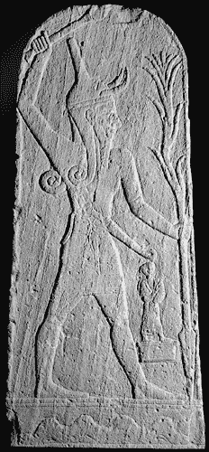
```

图 3.1 巴尔石碑 © [www.BibleLandPictures.com](https://www.BibleLandPictures.com) / Alamy Stock Photo

在石碑面上，以浮雕（更准确地说，是平饥刻法）刻画了一位站立的`Baal-Hadad`。他头戴角形冠，正向前迈步，右手举起挥舞着一柄权杖，左手则握着一根垂直的长矛（这种长矛有时被解释为闪电、麦穗，或两者兼有），矛尖指向地面。在巴尔背后的背景中，在长矛与神灵向前迈出的左腿之间，一个底座或祭坛上站着一个穿着长袍的小人（这个人物最常被认为是一位乌加里特的国王）。

巴尔的向前动作被描绘得非常精妙，巴尔看起来强大、优雅且充满活力。这块石碑清晰地让人联想到埃及风格和构图；这块石碑的艺术家似乎受到了埃及艺术流派的影响，因为石碑严格遵循了传统的构图公式：头部和腰部以下呈侧面观，胸部呈三之四视图。(121) 这块石碑的构图显然模仿了法老时期权力和统治地位的形象；特别是，巴尔石碑中神灵的姿态，与埃及法老`Narmer`调板上的“击杀”姿态几乎完全一致。纳尔麦是统一埃及的第一位法老，也是公元前第四千年末埃及第一王朝（约公元前 3000 年）(图 3.2)。

```
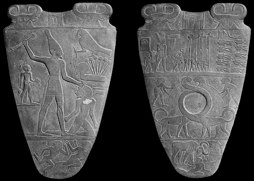
```

图 3.2 纳尔麦调板 © Art Collection 2 / Alamy Stock Photo

根据发现地以及巴尔的服饰、发型和胡须，这块石碑被断定在公元前 15 世纪至 13 世纪之间。(122) 乌加里特在公元前 1400 年至 1350 年左右受埃及的直接政治控制，随后在公元前 1350 年至 1200 年左右受赫梯帝国的控制；然而，这两种文化在漫长的时间里都影响了乌加里特文化，从乌加里特出土的几件遗物包含了中青铜时代（公元前 1800 年至 1600 年）带有象形文字的埃及物品。(123)

巴尔石碑的构图证明了埃及政治影响的证据，因为它采用了一种广泛且有影响力的权力统治形象，并使用了法老式的分层。然而，它也是古代近东人物、叙事和主题共同池运作的绝佳案例：巴尔石碑利用了一个影响力的埃及权力符号（也许它仅仅是一个无处不在的权力符号，因为“埃及”和“黎凡特”之间的严格区分更多反映了现代视角而非当代视角）来代表黎凡特风神`Baal-Hadad`，但其方式反映了黎凡特的地理文化环境。


巴尔石碑中的黎凡特元素包括巴尔的角形冠（这同时也参考了巴尔作为牛的身份），以及他的面容、发型、胡须和短袍，其中每一项都代表了独特的叙利亚风格，与`Narmer`调板的风格不同，例如。(124) 巴尔的武器也不同：`Narmer`右手持权杖，左手征服敌人；而巴尔右手持权杖击打，左手却握着长矛/闪电/麦穗。大多数评论家认为，这种形似闪电的长矛是巴尔的标志性武器，它的出现伴随着对农业丰产的概念。大多数人还同意，这一形象代表了根据他在《巴尔循环》中关于王权和击败敌人（如`Yamm`）的叙事所理解的巴尔，他使用了为完成任务而为其创造的武器。(125)

这块石碑所描绘的《巴尔循环》和黎凡地区特有的另一个方面是其地理元素：巴尔站在四座山上（许多人认为这代表了`Sapan山`及其四座低峰，站在乌加里特可以看到它们），同时也站在海洋的形象上，表明巴尔是山之王并对水拥有统治权。(126) 最后，巴尔石碑在背景方面与`Narmer`调板不同：调板详细描述了一场胜利的战斗和许多埃及元素，而在巴尔石碑中，背景中的唯一人物可能是一位穿着长祭袍的乌加里特国王，表明该人物对巴尔的崇敬，可能还（或祈求）巴尔的保护和/或神谕。(127)

巴尔石碑是黎凡和古代近东共同池运作的绝例，因为它挪用了一个引人注目的当代主题，但其方式反映了自身的黎凡特视角。通过采用“埃及”主题和权力形象——更不用说该作品可能是由埃及人委托的——此石碑的艺术家（及其赞助人）可能也旨在反映政治影响以及小国政治运作的需要，这在沿海缓冲国家乌加里特是很常见的。最后，这块石碑证明了`Baal-Hadad`及其叙事在黎凡文化中的重要性，以及农业需求对这些叙事的地理影响。

## 第四部分：风神 Baal-Hadad 遗址——贝贝贝克

最后，我们在本章中考察一个长期与风神相关的重要地理遗址：巴贝克（Baalbek），位于现今的黎巴嫩。巴贝克位于贝贝克山谷，该地区长期以来一直是肥沃地区，在罗马统治时期被称为罗马帝国的“粮仓”或“面包篮”。(128) 贝贝克遗址是贝贝克山谷上部的自然中心，因为它位于两条重要河流——奥伦特河（Orontes，即 al-‘Asi）和利塔尼河（Litani，即 Leontes）水源的分水岭最高处，并位于沿沿海山脉东侧平行的古代主要交通道路上。(129) 除了物流意义外，该遗址在象征意义上同样重要，因为它通过奥伦特河将巴贝克与`Sapan山`联系起来，从而在物理位置上结合了神话与地理。巴贝克圣所的名字与`Baal`有不可否认的关系，后者是该遗址最初为之建造的人物，即西闪米特风神。`Baalbek`的名字最可能意思是“贝贝克的巴尔”或“贝贝克之主”。巴贝克长期以来一直是`Baal-Hadad`的神庙所在地，该地可能一直是贝贝克山谷的宗教中心，因为在当地罗马时期朱庇特大庭挖掘中发现了一个土丘，证明了该地的人类活动至少可以追溯到青铜时代早期（约公元前 2900 年至 2300 年）。(130)

如今看到的这处罗马时期遗址曾被称为`Heliopolis`，供奉罗马神`Jupiter Heliopolitanus`（赫利奥波朱比特），他等同于希腊的`Zeus Heliopolitanus`，正如我们所看到的，这位神在地区范围内被等同于`Baal-Hadad`。请注意，`Jupiter Heliopolitanus`的形象包含了被认为与`Baal`相关的元素，例如随从的公牛，以及该塑像现已破损但最初是举起右臂的姿态，以及左只可能握着闪电棒的左臂；此外，它还包含了被认为是希腊的、罗马的和埃及的元素。(131) 在`Jupiter Heliopolitanus`的神庙附近，还有规模稍小的圣殿，分别供奉罗马女神`Venus`（维纳斯）和神`Bacchus`（巴克斯）。(132) 该遗址直到公元 4 世纪才完工，在此期间，`Heliopolis`以及整个罗马帝国的宗教重心开始在传统的希腊尼化异教和各种形式的基督教之间摇摆。在`Theodosius`（狄奥多西一，公元 379–395 年）统治期间，一座圣彼（St. Peter）大巴西教堂建立在主祭坛的位置，该遗址在公元 8 世纪阿拉伯统治下再次被称为`Baalbek`（巴勒贝），这是该遗址的当地闪米语名称。(133)

### 巴勒贝与萨潘山的地理与位置：引人注目的地理

`Baalbek`遗址及其周边位于肥沃的贝卡山谷（Beka‘a valley），是叙利亚风神的首要圣地，充满了地理和宗教的影响。该遗址刻意建造在地区两条最重要的河流的分水岭上，`Baalbek`的遗址和神庙在字面和比喻上都位于河流之上且处于源头，这可能代表了风神对这些河流的统治地位（图 3.3）。

```
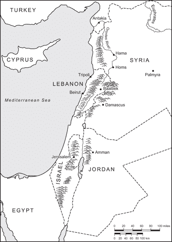
```

图 3.3 巴勒贝地图

南部流向着`Litani River`（利塔尼河），这个名字我们现在很熟悉，来自闪米语词根`ltn`（`Lotan`，或圣经中的`Leviathan`）；它的名字可能源于同名的地区海兽。北部流向着`Orontes River`（奥伦特河），同样通过闪米语词根`tnn`被称为`Drakon/Draco`“龙”或`Typhon River`；这条河的名字与希腊蛇兽`Typhon`（提丰）有关，他本人是一个被称为龙的希腊怪物，正如我们所看到的，他与`Yamm`形象有关。(134)

我们在`Baalbek`的案例中看到，其地理环境激发或强化了与`Baal-Hadad`传奇叙事相关的宗教概念，特别是关于`Baal`对`Yamm-nahar`（许多文化中长期被等同于奥伦特河和利塔尼河的敌人）以及他用来滋肥土地的其他水域的统治。我们在`Baalbek`同样看到，其地理位置通过`Orontes River`在字面和象征上与黎凡海岸的`Mt. Sapan`（萨潘山）相连。风神的家以及对神而言重要性与伦比的场所——`Mt. Sapan`位于奥伦特河口五英里内，河流在萨潘山以北处入海，从山坡上可见。(135)

`Mt. Sapan`在景观中占据着主导地位，以至于其高度影响了从地中海向东延伸的天气模式，其显眼的位置——显然是风神的家，往往被简单地等同并神化为`Baal-Hadad`——其对周围所有生命和其他物理特征的统治力是显而易见的。`Mt. Sapan`通过神话与`Orontes River`联系在一起，而奥伦特河本身在物理上与`Baalbek`遗址相连。古代人刻意在一个位于名为`tnn/drakon/Typhon`和`Litani`的两条河流之上的（这些是`Baal-Hadad`击败的蛇神的长期地区名称）的地方建造了`Baalbek`遗址，在物理位置上将神话与地理联系起来，强调了`Baal-Hadad`对他的敌人以及该地区水域的统治。

## 第五部分：结论——巴勒-哈达德的主题与黎凡共同性池

本章致力于对地区风神`Baal Hadad`进行地理背景化分析，这表明，正如我们将在本研究的其他人物中将看到的那样，`Baal-Hadad`本身受到了同时代宗教、政治以及在很大程度上受地理力量的影响。作为一个形象，他是他时代“共同性池”的产物，我们已在供奉`Baal-Hadad`的文本、图像和遗址中看到了共同池过程的证据。我们还看到了来自物理和时间上接近的群体的宗教影响证据，例如美索不达米关于`Marduk`（马杜克）和`Tiamaat`（提亚马特）的神话，以及其他涉及风神战胜海兽并击败敌人的叙事的影响力和宇宙起源故事。

在这些故事中，以及`Baal Stele`的同代图像表现中，我们也看到了当时政治影响的证据，例如碑文中使用的埃及法老权力统治主题。石碑本身是`Ugarit`（乌加特）政治背景的纪念碑，作为在赫特人和埃及等更强大帝国中的一个小国家，`Baal Stele`所反映的《巴勒循环》中西闪米人的`Baal Hadad`叙事，同样反映了青铜时代晚地区的政治。

最后，而且重要的是，我们在所有三种来源（文本、图像和地理遗址）中都看到了物理地理影响的证据。黎凡的地质和气象环境——特别是风神`Baal-Hadad`所在的北部——其壮丽的山脉、风暴、河流和山谷，自然地影响了那里的人的宗教概念。从位于重要河流源头中心的`Baalbek`，到主陆和海洋、从水面急剧升高一英里多、影响地区天气模式并代表当地降雨中心的`Mt. Sapan`，这些遗址说明了自然环境对宗教概念的深刻影响。(136) 这些地理影响可能是关于`Baal-Hadad`叙事的动力，或者它们可能被人们用作证实这些叙事的证据——或者，可能在一个漫长而持续的过程中二者兼有。

### 巴勒-哈达德的地理主题

我们通过`Baal-Hadad`看到的是一种迦南和古代近东的宗教环境，在这种环境中，降雨水对农业和人类生命都至关重要，神灵统治着自然环境并帮助解释那些令人困惑的美好而残酷的现象，而人类生命和权力的史诗与风神的恩宠或遗弃交织在一起——风神是该地区最强大的神灵。

无法高估巴尔-哈达德（Baal-Hadad）对此后地区宗教传统的影响。正如我们所见，巴尔-哈达德在晚青铜时代世界及乌加里特（Ugarit）等城市毁灭后，并没有作为一种地区影响力消失，而是在铁器时代的迦南农业文化中继续如故，并贯穿整个公元第一个千年的希腊和罗马时代，一直持续到公元后的几个世纪，因为他的崇拜逐渐被黎凡特地区的宙斯和朱庇特的崇拜所吸收。(137) 此外，与巴尔-哈达德相关的极具吸引力的地理主题，例如：击败海/蛇/龙；击打或征服敌人；涉及雨水、风暴以及在云中驾车的风暴神显意象；与萨潘山（Mt. Sapan）和其他山脉及高地的关联；与丰产、多产和季节循环的关联；以及定期的消失与回归；也是我们研究中其他人物所借鉴的主题：以利亚亚（Elijah）、圣乔治（St. George）和凯德尔（al-Khiḍr）最终都与这些主题联系在一起。这些地理主题的持续性证明了它们在非常长时期内对该地区居民的持久影响（以及反映在这些主题中的人们的持续需求）。

### 转向以利亚亚

巴尔-哈达德内在的主题之一——与萨潘山等高地的关联——是遍布整个地区的山区和高地上建造的数百座巴尔-哈达德神庙的建造动力。事实上，在公元前第一个千千年，巴尔常见的头衔之一是“巴尔-祖巴尔”（Baal Zubal），意为“巴尔王子”，他是“高地之主”。希伯来圣经的创作者们（正如我们在第四章）。正如我们在第四章中将看到的，当我们考察以利亚亚的形象时，在希伯来圣经公元第一个千千年期的《列王纪》中描绘的先知以利亚亚的首要使命，是从南黎凡特以色列宗教和政治生活中根除巴尔的崇拜——与真正的真主雅韦（Yahweh）相比，这种崇拜被视为假的。

## 注释

# 4 希伯来圣经与以利亚亚

## 第一部分：引言

先知以利亚亚与巴尔先知们在迦密麦山上的标志性竞赛，无疑是希伯来圣经中最令人记忆深刻的叙事之一。事实上，由于希伯来圣经在某种程度上可以描述为对清除古代世界“外来”神灵斗争的记录，以及对促进独一崇拜神 YHWH（雅韦）的斗争的记录，以利亚亚在迦密麦山的竞赛是希伯来圣经一个更宏大计划的象征。(1) 以利亚亚竞赛叙事进一步证明的是，以利亚亚的事迹以及更广义的希伯来圣经——与其内部涉及的雅韦地区主导地位叙事的意识形态相反——发生在一个由多个神灵组成的环境，而在那个环境中，巴尔-哈达德是最突出的。(2) 正如上面在第三章中提到的，雅韦在许多方面在希伯来圣经中被呈现为地区主导神巴尔的替代方案，因为雅韦在文中经常被描绘为赋予了某些迷人的特质和力量，这些力量在黎凡特早已与巴尔-哈达德相关联，例如巴尔的风暴神显语言、与海蛇或龙冲突的主题，以及萨潘山/扎丰山。(3) 然而，与巴尔-哈达德不同，也与其他涉及其他神的古代近东叙事不同，雅韦在希伯来圣经中被表述为一个在人类历史事件中行动并控制它们的神，尽管显然是从较后的时间角度进行描述的。(4) 也就是说，雅韦与当时的其他神相比的一个主要区别特征是，希伯来圣经作者将其描述为对一个特定民族感兴趣——一个同意将他——雅韦——置于所有其他神之上的民族。

然而，这群人往往未能完成任务，他们通过崇拜其他神反复背叛雅韦。根据叙事，这种玩职导致了雅韦对其子民的惩罚，导致了他们的痛苦和最终的悔改，此时，雅韦通过从他们中派遣一位公义的领袖来带领他们战胜当下的敌人，从而救了他们。贯穿整个希伯来圣经的涉及人类历史的基本序列是“立约、应许、叛教、悔改和救赎”，因此，尽管希伯来圣经中的历史叙事被呈现为对实际历史的描述，但实际上，信息的核心内容在很大程度上是一堂神学教训：崇拜雅韦以外的神会导致毁灭。(5)

在希伯来圣经的叙事中，雅韦的目标得到了他的先知（如以利亚亚）的协助，以利亚亚的大致使命是警告那些没有正确方式崇拜雅韦的人即将到来的毁灭，并向那些以正确方式和地点崇拜雅韦的人预示好运。因为他有着根除地区巴尔崇拜的热忱使命，以利亚亚是希伯来圣经中最引人注目的先知之一。以利亚亚被作者有意描绘成与摩西相似，摩西无疑是希伯来圣经中提倡正确且唯一崇拜雅韦的最原始、最重要的先知。然而，正如我们在本章中看到的，由于希伯来圣经叙事的结果，以利亚亚的形象也与巴尔-哈达德重要的地区地理主题联系在一起，例如对雨水的控制，以及通过天车进入风暴云层。

### 以利亚亚：地理背景化

为了给以利亚提供背景信息，本章将首先概述希伯来圣经，特别是出现“以利亚循环”的《列王纪》（涉及以利亚的助手以利沙的叙事循环也出现于其中）。本章的主要内容将在接下来的部分开始，对《列王纪》中的以利亚叙事进行分析。由于以利亚叙事成为了犹太教中涉及先知以利亚的经典性源头叙事，因此从后世历史的角度来看，它们可以被视为先知以利亚“浮现”的格式。将在希伯来圣经正文中对以利亚叙事进行调查，以寻找同时宗教、政治和地理影响的证据。在本章中，我们还调查了以利亚的常见形象。有趣的是，这引导我们进入了对后期基督教圣埃利亚斯（Saint Elias）的讨论，当然，他与许多形象相关，而这些形象也源自希伯来圣经记载的叙事。

此外，本章还考察了与以利亚相关的重要地理位置：位于现代以色列南部黎凡特海岸的`加密尔山`（Mount Carmel）。`加密尔山`据传是以利亚与巴尔先知比决的地方，长期以来那里存在不仅奉给以利亚、也奉给巴尔-哈达德的崇拜遗址。本章利用从以利亚文本、形象（以及缺失形象）和遗址的地理背景分析获得的信息，来调查这些数据反映了犹太教宗教传统的什么，以及以利亚这一人物对区域性引人注目的人物、叙事和主题共同池贡献了什么。

最后，本章将以拉比时期和基督教时期的以利亚作为概述结束，因为在近东，直到公元第一个和第二个千年，以利亚在经典宗教和农业宗教中一直是一个极受欢迎的人物，甚至一直延续今天。以利亚出现在一个由巴尔崇拜主导的环境中，作为一个代表逐渐开始认同自身宗教传统（部分程度上区别于其他古代近东宗教传统）的形象，以利亚从一个竞争性的宗教视角对巴尔构成了挑战。此外，本章强调了巴尔和其他迦南神灵在整个希腊和罗马时期直到 Common 时代早期，仍然是地区居民宗教生活的一部分，与犹太（以及后来的基督教）关于地区流行人物以利亚的概念并存。

## 第二部分：语境中的希伯来圣经传统

希伯来圣经是传说、法律、诗歌、预言、哲学和历史的汇，主要用希伯来语和阿拉米语编写，由起源于公元第一个千年整个黎凡特和古代近东不同时期的文本和口头传统组成，通过长期的收集、编写、编辑、抄写和修订过程缝合在一起。希伯来圣经是被称为犹太教的宗教传统的核心经典，因此它也构成了基督教正经的第一部分。希伯来圣经或`ﺍﻠﺘﻮ律师ﺓ` `al-taurat`同样被采纳为古兰经文献传统最早的经典，因此希伯来圣经对犹太教、基督教和伊斯兰的宗教传统产生了巨大的文本影响。

### 希伯来圣经的叙事

希伯来圣经的核心是一个描述被称为以色列的人们的故事，以及他们与神持续的关系（这位神在文中最早被称为“El”——与闪米特语中表示“神”的词根“il-”有关）。叙事从人类的创造开始，一直延续到一个家族的命运——亚伯拉罕家族，上帝选择他作为将追随上帝命令的人们的祖先。亚伯拉罕的后代，族长们，住在迦南地（亚伯拉罕是从乌尔呼召到那里的），但最终在大饥荒时期离开了那里前往埃及寻求庇护。然而，以色列人在埃及沦为奴隶，以色列的神随后选择了摩西作为中介，将人们从埃及解放出来，以此揭示以色列的神对抗埃及法老的威严力量，而当时的法老是当时世界上最强大的人类统治者。在一段难忘的事件序列中，以色列的神带领他的人民离开埃及进入西奈旷野，在那里向他的追随者揭示了自己作为`YHWH`（`雅和华`，Yahweh）的身份。在西奈山，通过摩西，雅和华给了子民一套法典，用以正确引导他们的生活和社区。这部法典的基础是命令不要崇拜雅和华以外的神。

希伯来圣经接着叙述了亚伯拉罕后代随后几个世纪的历史，通过通过征服迦南的叙事、在大卫王时期建立的王国，以及在大卫之子所罗门时期在耶路撒冷建立的奉给雅和华中心圣殿的叙事。然而，所罗门去世后，希伯来圣经记载十个北方部落从联合王国中分裂，迫使了两个对立王国的建立：北部的`以色列`和南部的`犹大`。

在过去的 200 年里，以色列（雅和华的人）的统治者和住在两个独立的王国，并反复陷入偶像崇拜和外神的诱惑。最终，雅和华派遣了外部入侵者（如叙利亚的阿拉拉米人）来惩罚以色列王国崇拜偶像且不忠的人们（被后世希伯来圣经作者描述为不可挽回的罪人）。最终，雅和华利用强大的亚亚述帝国摧毁了北方王国并放逐了其居民，大约一个世纪后，雅和华派遣了巴比伦帝国摧毁并放逐了南部的犹大王国。

在流亡期间，希伯来圣经叙事故事讲述了人民的苦难与悔改，以及雅和华在波斯帝国的解放支持下对其人民的最终拯救。从那时起，雅华社区的一些人从流亡回到耶路撒冷，并致力于圣殿的重建。这个位于耶路撒冷的、第二圣殿时期的流亡后社区热诚地致力于唯独崇拜雅和华，并致力于精确履行经文中概述的规定。

### 犹太传统中希伯来圣经的结构

希伯来圣经本身由 39 卷组成，传统上分为三个主要部分：托拉（`Torah`）、先知书（`neviim`）和文书（`khetuvim`），并以缩写`Tan|kh`命名这三个部分。`托拉`也称为摩西的五卷，或希腊语中的`Pentateuch`（五经），由`创世记`、`出埃及记`、`利未记`、`民记`和、申记`组成。通常来说，这些书叙述了以色列子民从世界创造到摩西在西奈山告别以色列社区的历史。

被称为“先知书”的部分又分为两组主要的经文：先知书，包括`约书亚记`、`士师记`、`撒记上上下`以及`列王纪上上下`，讲述了以色列子民从征服迦南到被亚述和巴比伦帝国击败并放逐的故事。后先知书包含了从公元前 8 世纪中期到公元前 5 世纪末生活的受灵者的启示、社会教导和弥赛主的期待。

被称为“写作”（Writings）的部分是一系列讲道、诗歌、祷词、格言和诗篇的集，代表了以色列社区最强烈的情感表达。这些著作是一个持续数百年的创作过程的产物，其中少数源于君主晚期和公元前 586 年耶路撒冷的被毁，大部分源于公元前五世纪至二世纪的波斯和希腊化时期。


希伯来圣经的主要历史著作包含在`Torah`（法书）或“五律书”，以及“先知书”（Former Prophets）中，它们叙述了以色列人从起源到耶路撒冷殿被毁的历史。圣经学者普遍认为，五律书的前四卷并非无缝衔接的合成，而是不同来源的马赛克组合——通常被确定为`J`（推崇神`Yahweh`并关注犹大地区的土地）、`E`（推崇神`El`——复数形式`Elohim`——关注北方地区和部落）以及`P`（意为“祭司”，指的是那些处理仪式事务的经文）。这些来源每一个都是在不同的历史背景下编写的，并为了推广不同的观点。然而，五律书的最后一卷《申命记》（`Deuteronomy`）则是完全的情况。它的术语与`J`、`E`和`P`来源不同且独特，“并且包含了对崇拜其他神的最毫不妥协的谴责，对神作为完全超越者的新观点，以及绝对禁止在耶路撒冷殿之外的任何地方对以色列的神进行祭祀崇拜。”

《申命记》对希伯来圣经整体重点和信息的影响是巨大的。自公元 20 世纪中期以来，圣经学者就意识到，《申命记》之后的书籍——《约书亚记》、《士师记》、《上、下撒母耳记》以及《上、下列王纪》的语言、神学信息和相关的叙述表明，这些书籍显然是有联系的，因此这七卷书被称为“申命记历史史”（`DH`）。`DH`叙述了以色列人从征服到流放的历史，这段历史的神学核心表达了一种宗教运动的意识形态，根据文本本身，这一运动起源于公元前七世纪的犹大，特别是在改革派国王`约西亚`（Josiah）统治时期。因为`DH`叙述了希伯来圣经大部分的历史思想核心，因此可以说它也表达了希伯来圣经的主要教学主题。`DH`最突出的主题之一是信息：`Yahweh`主宰于所有“外邦”神，崇拜`Yahweh`以外的神会导致灭绝。因此，必须专一且以正确的方式崇拜`Yahweh`。然而，希伯来圣经文本中大量的证据反驳了其中关于`Yahweh`主宰于所有“外邦”神的核心主张。也就是说，如果`Yahweh`当时对所有“外邦”神的主宰地位真的是事实，那么根本不需要专拜`Yahweh`的命令。

## 希伯来圣经中的迦南神

几位迦南神出现在希伯来圣经中；正如我们将看到的，有些神灵比其他的更为突出。神`El`、`Athirat/Asherah`、`Baal-Hadad`、`Dagon`和`Astarte`；`Anat`；恒星神，如太阳、月亮和`Venus`；以及冥界神`Mot`、`Resheph`、`Molech`和`Rephaim`——这些我们从乌加特文献中熟知的神和女神——构成了以色列宗教发展的背景和内部环境。

### El

与希伯来圣经中被称为来自南方的灵的`Yahweh`（`Deut 33:2`）相反，希伯来圣经中的`El`经常与北方的人和地方联系在一起。希伯来圣经中名为`El`的神使用了几个在乌加特文献中已知的古代迦南`El`所具有的头衔，例如`El-Shaddai`（“田野神”）、`El-Olam`（“永恒神”）、`El-Bethel`（“El之屋的神”）和`El-Elyon`（“至高神”）。在古希伯来语中，`El`在乌加特语（这也是一种西北闪米特语言）中被称为`ilu`——实际上是西北闪米特语言中“神”一词语法基础的一种形式。正如我们在第三章看到的，迦南的`El`位于乌加特神系的首位。最终，在希伯来圣经文本证实的漫长而复杂的历史过程中，`El`和`Yahweh`——原本是独立的灵，在以色列社区中都是强大且重要的——变得等同了。作为希伯来圣经的最高神，`Yahweh`同样在文中被描述为与尊崇的`El`共享若干特征；其中，`Yahweh`作为年老的神（`Job 36:26`）、`Yahweh`作为智慧者（`Gen 3:5`）、`Yahweh`作为创造者（`Ps 102:25`）以及`Yahweh`坐在天庭或神系首位者（`Ps 89:6–7`）。

### Athirat/Asherah

乌加特文献中的`Athirat`（我们在第三章看到她是最高神`El`的妻子或配偶）也出现在希伯来圣经中，她的名字通常译为`Asherah`。文中提到了 41 次`Asherah`。学术共识认为，尽管这种角色在希伯来圣经中没有保留，但`Asherah`可能在早期以色列社区中的功能与她在迦南社区中相似：作为最高神的配偶（在这种情况下是`Yahweh`）。`Asherah`在希伯来圣经中最常被提及为一种令人厌恶的外邦神，或通过“阿舍拉柱”（Asherah poles）被提及。除了文中经常与`Baal`配对之外，`Asherah`是被提及最频繁的外邦神。在`DH`中（例如迦密山上的争战）将`Asherah`与`Baal`配对可能是贬低`Asherah`崇拜的一种。这是因为从希伯来圣经作者的角度来看，可能没有哪个神像`Baal`那样受敌视。

### Baal

正如我们在第三章看到的，`Baal-Hadad`在公元前二一千年是黎凡特的主要神。`Baal`崇拜无处不在，以至于特定地区的人将`Baal`的化身与各个城市和山区联系起来，例如推罗的`Baal`、阿勒颇的`Baal`、乌加特的`Baal`以及萨潘山的`Baal`。`Baal`在不同时代也通过特定的头衔为人知，例如`Baal-Shamem`（天之神）。所有这些`Baal`的头衔，或者在希伯来圣经叙述中的复数`Baals`，都应该被认为是指地区的主宰神——迦南风暴神，因此也是植物、动物和人类繁衍丰饶的神`Baal-Hadad`。

`Baal`这个名字在希伯来圣经中出现了 58 次，`Baals`出现了 19 次。所有引用指向风神`Hadad`，大多数引用与该神特定的地名化身有关，例如`Baal-Gad`、`Baal-Hamon`、`Baal-Hazor`、`Baal-Hermon`、`Baal-Peor`、`Baal-Tamar`和`Baal-Zephon`（埃及的一处崇拜地点，是以叙利亚的山峰 Sapan 为蓝本），此外还有非常多。文本甚至提到了一个`Baal-Berith`，即“约之巴力”，一个在示赤有神殿的迦南神（提到于`Judg 9:4`和`Judg 8:33`）。

希伯来圣经中的许多人名也与`Baal`这一头衔相关，例如`Jerub-Baal`、`Ethbaal`，甚至还有融合了`Yahweh`和`Baal`的名字，包括`Bealiah`（《历代纪上》12:6，大卫的勇士之一）和`Yehobaal`（一个出现在公元 7 世纪印章上的名字）。`Bealiah`和`Yehobaal`这两个名字似乎分别意味着“巴力是雅和华”和“雅和华是巴力”；事实上，`Yahweh`在某一时期曾被人们等同于`Baal`，这一点在《何西亚书》2章的整个上下文中得到了明确引用。^(25)

在整个前一千年，黎凡特地区的`Baal`崇拜是非常顽固的。然而，圣经叙事的力量就在于，以至于我们已经把`以色列`的人们理解为一个专门崇拜神`Yahweh`的民族，特别是与“一神教”教义相关。事实上，常识认为，古代以色列人早在“出埃及”叙事时期就已经完全奉献给`Yahweh`了，根据文本内部的年代断代，这一时期发生在公元前 1250 年左右。然而相反，正如希伯来圣经文本本身所证明的，`Baal`崇拜在第一圣殿时期直到第二圣殿时期仍然普遍——事实上是占据主导地位。“独神崇”（monolatry，崇拜一个神但不否认其他神的存在）的概念——更不用说“一神教”（认为只有一个神的教义）——花了很长时间才发展出来。

此外，`Baal`崇拜——更不用说对其他神的崇拜了——在公元一千年内仍然常见，甚至在耶路撒圣殿内部也是如此。根据`DH`，耶路撒圣殿据称最初由`所罗门王`献给`Yahweh`，然后又由公元 8/7 世纪的犹大王`希西雅`重新献给`Yahweh`。然而相反，我们在希伯来圣经关于犹大王`约西亚`（约公元前 639–609 年）的纯洁宗教改革运动的记载中，生动地看到了耶路撒及其圣殿以及整个周围农村地区`Baal`崇拜之程度的证据。

`约西亚`在希伯来圣经中的赞誉甚至比他之前的`大卫王`还要高，他被描述为：“在[雅和华]眼中行正直的事，照他父亲大卫的路行；不向右偏也不向左偏”（《列王纪纪下》22:1–2；参见《列王纪纪下》23:25）。在得知耶路撒圣殿的大祭司`希利亚雅`在圣殿内发现了一卷“失落”的卷轴，称为《律法之书》（学者们广泛认为是改革派书籍《申命记》的前身文献）后，`约西亚`和他的百姓在`Yahweh`面前立了公开的约，承诺只崇拜`Yahweh`，并遵守《律法之书》中记载的`Yahweh`的诫命（《列王纪纪下》22:3–23:3）。在公元前七世纪，向特定的统治者立约或宣誓的仪式并不罕见，但`约西亚`向特定的神`Yahweh`立约的仪式（以及希伯来圣经中提到的归属于`所罗门王`和`希西雅`的“雅和华之约”），可能是古代近东的一个独特现象。^(26)

作为耶路撒圣殿重新献给`Yahweh`的伴随部分，`约西亚`命令`希利亚雅`和所有祭司从圣殿中搬出“凡为`Baal`、`阿舍拉`和一切天军[即其他神]所造的器皿”，并在耶路撒冷外将它们焚烧（《列王纪纪下》23:4）。他废黜了犹大城市中崇拜偶像的祭司，这些祭司曾受犹大王的命令，“向`Baal`、向太阳、月亮、星宿和一切天军[即其他神]献祭”。他从`耶和华`的家[即耶路撒的`Yahweh`圣殿]中搬出`阿舍拉`的像，然后在耶路撒冷外焚烧它，将其打成粉末并将并撒在“平民”的坟墓上（《列王纪纪下》23:5）。事实上，`约西亚王`在他时代禁止的“偶像崇”行为清单非常详尽，例如巫师、术士、`石aph`（家神）、偶像、丰产崇拜、多神教以及在各地建立的“高处”上所有的`Baal`坛（《列王纪纪下》23:6–25）。

但即使是`约西亚`广泛的改革也是不够的。在`约西亚`去世后，圣经文本记载他的继任者“在`YHWH`眼中行恶，就照他列祖所行的一样”（《列王纪纪下》23:37）。事实上，在`约西亚`之后的四位继君被记录为回到了之前的偶像崇之路，这表明，即使从希伯来圣经的角度来看，`Baal`崇拜（以及对`Yahweh`之外的神崇拜）直到公元前六世纪在该地区仍然占据主导地位。

# 第三部分：以利亚文本：列王纪中的以利亚（与以沙）循环

## 引言：列王纪

《列王纪》作为`Elijah`循环的背景，可以被理解为以色列君主时代的叙事性意识形态历史，涵盖了从大卫时期到公元前 586 年耶路撒冷殿被毁以及巴比伦之囚的开始。文本告诉我们，由于大卫王对雅华（Yahweh）的虔诚，他得以建立一个“统一”的王国，但大卫的领土很快分裂为竞争性的南北两个王国，这在一定是因为他的儿子所罗门通过外族通婚引入了对其他神的崇拜（`列王纪上 11–13`）。在之后的几个世纪里，由于以色列人和犹大人反复的偶像崇拜行为，雅华利用亚述帝国和巴比伦帝国摧毁了这两个王国（`列王纪下 17–25`）。

与希伯来圣经的其他书籍一样，《列王纪》是收集、编辑、编写和修订历史文献以及口头传统（如以利亚和以沙循环）的长期过程的结果。《列王纪》创作和编辑的清晰阶段可以追溯到希西家亚（公元前 727–698 年）和约西亚亚（公元前 639–609 年）执政时期，而最终修订是在公元前 586 年流放之后的某个时候完成的。

《列王纪》可以被视为具有叙事性、史学和教诲性的文学。《列王纪》的情节可以总结为：以色列在君主制下试图（通常是失败了）在迦南——“应许之地”作为上帝（即雅华）的人生活，以及神如何处理他们的成功与失败。《列王纪》也是史学文学，因为它讲述了一段政治历史。然而，这段政治历史的目的是揭示南北王国人民的宗教失败：由于背离雅华，这些人失去了民族自主权，成为残暴帝国的卑微流民。

最后，《列王纪》是教诲文学，因为它试图传授几条教训，这些教训都与一个核心思想相关：崇拜雅华以外的神会导致灭亡。首先，雅华是神（而其他神不是）；因此，雅华既掌控自然也掌控历史。其次，雅华要求排他的崇拜；因此，他崇拜的内容和地点都至关重要。第三，因为雅华定义了真正的信仰，他也审判并惩罚作恶者。然而，由于雅华对崇拜他的人是仁慈的，他尚未为那些可怜的流民留下一通过南方犹大王国大卫家后裔获得救赎之路，雅华青睐这些后裔——前提是这些后裔效法大卫的榜样，只崇拜雅华。

## 以利亚与以沙循环

在希伯来圣经中，体现了“崇拜雅华以外的神会导致灭亡”这一信息的较深刻的先知中，以利亚是一个引人注目的人物。他因显赫的战绩而闻名，《列王纪》中将以利亚个人片段结合在一起的主要统一主题是以利亚对巴力（Baal）崇拜的公然反对。

以利亚和以沙循环位于`列王纪上 17–19`、`21`以及`列王纪下 1–8`，最可能起源于后后被并入《列王纪》的口头故事。尽管目前出现的故事是长期发展的产物，但许多片段仍保留了短篇的轶事形式以及特定的形态和词汇特征（特别是在引用的对话中），这表明它们是古希伯来的北方方言，因此带有原始口头性的标记。圣经作者将这些故事整合进《列王纪》，并将背景设定在公元前 9 世纪北方以色列王国臭名昭著且崇拜偶像的亚哈王和耶西王后执政时期。以利亚的首要使命——以及他的继承者以沙的任务——是公然反对巴力崇拜，并促进对雅华的唯一崇拜。

在`列王纪上 17`中，我们首次在希伯来圣经文中遇到以利亚。他被介绍为提实的人以利亚，是基列亚的居民。从他的名字`אַלּיּﬣ ‘eli-yahu’`（“我的神是雅华”）我们可以知道他正处于一个多神并存的环境。此外，我们在以利亚的身上看到了这种多神环境的实践，因为以利亚的名字有效地融合了“El”（尽管是名词而非专名词）和“Yahweh”。在希伯来圣经的人物中，带有神性特征的名字并不罕见；在君主时期记载之前，包括“El”在内的神名非常频繁，而那个时期明确的雅华式名字似乎很少见。在《列王纪》中，涉及神雅华的人名很常见；特别是南方犹大王国的君王们。

正如我们在上面看到的，涉及巴力（Baal）名字的名字在《列王纪》记载的世界中同样流行，因此这些神性特征的名字也反映了当时的文化模式：一个以崇拜多个神为特征的环境。因此，希伯来圣经中记录的神性特征名字在概念上可以看作是“关系反义词”：它们代表了只有在对立思想存在时才有意义的概念；在这种情况下，`我的神是 YWH`标志着关于雅华优于其他神明的强有力论点，而在其他神中，巴力是该地区最著名的神。

巴力崇拜并非无故主导了《列王纪》的环境。正如我们在上面`第二章`和`第三章`中所看到的，崇拜巴力对该地区的居民是如此重要，因为这片土地（特别是干旱的南方凡特以及希伯来圣经描述的环境）的肥沃完全取决于雨水。如果没有足够的雨，作物就会干旱中枯死，人们饥饿而死。由于雨水、肥沃和多产被认为属于巴力的特定影响力范围，巴力是大多数人的主要神。雅华作为一个竞争性的神，如果雅华变得越来越像巴力哈达的那些迷人的方面（例如对自然的掌控，特别是对雨水的掌控），那么对于地区人民来说，作为巴力的替代方案是可能的。

然而，正如下文所看到的，以利亚本人在希伯来圣经随后的宗教传统以及更广泛的地区文化中成为了一个极具吸引力的人物。这是因为他作为真信仰守护者的标志性角色——以他典型地击败巴尔先知为体现；另一方面是因为以利亚通过他的叙事，与巴尔-哈达德相关的某些最引人注的力量联系在一起，例如控制雨水和干旱的能力，以及他通过天地风暴和火车生动地升天（尽管这一切完全是通过耶和华的力量实现的）。

## 1. 以利亚与大旱灾（列王纪上 17:1–24）

以利亚与北方以色列王国的奥马利王室之间的斗争——特别是与备受嘲笑的圣经人物哈哈王和他的王后西西别的斗争——主要涉及以利亚为清除北方王室的偶像崇拜而进行的战斗。

故事突然开始，耶和华的先知以利亚登场，介绍他曾向哈哈王宣告：“我所侍奉的以色列神耶和华起誓说，除了我的话，这几年既没有雨水也没有露水”（17:1）。在（通过耶和华）导致全国范围内发生干旱后——这场干旱部分上是为了惩罚哈哈王室的偶像崇拜——耶和华告诉以利亚，他需要离开并躲在约旦河东边的基珥山谷（Wadi Cherith），躲避强大的哈哈。

尽管到处都是干旱且在沙漠中寻求避难，但耶和华通过乌鸦，奇迹般地在早晨晚上给以利亚供应面包和肉（这在干旱条件下是极大的丰盛）。一段时间后，山谷因为干旱干涸了，耶和华便告诉以利亚去西顿的撒勒法（Zarephath，位于以色列领土之外的迦南领地），住在那里的一个寡妇那里由她提供食物。以利亚遇到了那个寡妇（作为寡妇，她在当时处于最贫穷、地位最低的社会阶层），正在城门口捡柴，以利亚叫她给她拿水和面包。

寡妇回答说，她只剩下少量的油和面粉，实际上正忙于捡柴，准备在自己和儿子饿死前为他们最后烤一块面包。以利亚宣告，如果她按照他的要求供养他们以及自己，耶和华将确保在耶和华再次降雨给大地之前，她的油和面粉储备不会耗尽。寡妇照以利亚所吩咐的，为他烤了面包并给了他水，她的油和面粉储备没有耗尽。

过了一段时间，寡妇的儿子“气断了”（17:17），因为他显然死于干旱导致的饥饿。寡妇指责以利亚，认为他是导致她儿子死亡的原因之一，以利亚回应，让她把儿子交给他。以利亚把男孩带上楼，进入他住的房间，对孩子施行了奇迹般的姿势，向耶和华祈求，让“这孩子的生命回到他的身体”（17:21）。耶和华听了以利亚的呼求，孩子的生命回到了他的身体。以利亚把孩子还给他的母亲，寡妇宣告以利亚确实是“神的人，你口中的耶和华的话是实实的”（17:23）。

## 2. 加密山之争战（列王纪上 18:1–46）

加密山之争战无疑是以利亚叙事中最具标志性的。这场比赛发生在以利亚宣告干旱后的第三年，当时饥荒已经变得严重，土地和人民都在忍挨饿。耶和华宣告给以利亚，以利亚应当到哈哈王面前，“好使我 [耶和华] 降在大地上降雨”（18:1）。

哈哈与他的仆人俄巴雅（俄巴雅暗中敬畏耶和华，此前曾在西西别王后针对先知们的杀戮行动中，通过将他们藏在山洞里救了 100 位耶和华的先知）说话，哈哈对俄巴雅说：“来，我们走遍这片土地，去找所有的水泉和山谷。也许我们能找到一些草，让马和驴子活过命……”（18:5）。他们分开寻找，以利亚在俄巴雅独自一人时遇到了他。俄巴雅恭敬地问候以利亚，以利亚告诉他向哈哈宣告他已到。俄巴雅流露出他对告诉哈哈的极大恐惧，因为哈哈长期以来在周围所有王国徒劳地寻找以利亚；而且俄巴雅担心以利亚可能会消失，“耶和华的灵会将你带到一个我不知道的地方”（18:12），随后哈哈将会在愤怒中杀死俄巴雅。

以利亚答应不离开，俄巴雅向哈哈宣告了以利亚的到来，哈哈去见以利亚。看到以利亚后，哈哈王问他是否真的是他，以色列的搅扰者以利亚。以利亚回答说他不是以色列的搅扰者；哈哈和整个奥马利王室都要对干旱负责任，因为他们背弃了耶和华的命令，并追随了巴尔神。


因此，以利亚要求哈哈将北方王国的全体子民聚集在加密山，包括“四百五十个巴尔的先知，和在西西别席旁吃饭的四百个阿示拉先知”（18:19）。一旦到达加密山，为了在比赛前营造戏剧性的场景，以利亚有针对性地询问会众：你们在两个意见之间犹豫要几几呢？如果耶和华是神，就跟从耶和华；如果是巴尔，就跟从巴尔。然而，百姓却沉默不语。

这设定了比赛的规则：以利亚和巴尔的先知各设一个祭坛，宰了一头牛（祭牲动物），但没有给祭物上火，按照惯。相反，每一方呼求自己的神用火回答，谁回答谁就是神。巴尔的先知反复呼求巴尔，但什么也没有发生；最终，以利亚嘲笑巴尔。

现在轮到以利亚了，以利亚设好祭坛，摆上祭物，并要求会众在祭物和坛上浇水（以此增加即将到来的奇迹）。以利亚呼求耶和华一次，祈求祂“使今日人知道，你是以色列的神”（18:36）。耶和华立刻回答，火从天降下，不仅烧光了祭物和坛的所有部分，连水也烧干了。百姓随后伏在地上，宣告耶和华是神。以利亚命令会众抓捕巴尔的先知；他们都被带到基训山谷，在那里被他杀了。

以利亚随后告诉哈哈，大雨要来了，所以他应当去吃喝。以利亚上加密山顶，进入奇迹般的祈祷姿势，显然是在求雨，并告诉他的仆人去海边看。仆人去了，但报告说什么也没看到。这种情况发生了七次，但在第七次时，仆人回来报告说海上升起一片“如人掌大小的小云”（18:44）。以利亚让仆人告诉哈哈，哈哈应当立刻驾车，以免大雨阻了他的归路。天空变暗，大雨。以利亚凭耶和华的灵，在哈哈的车前面跑回到耶实谷。

## 3. 往霍布山的旅程（列王纪上 19:1–21）

亚哈告诉耶西变为，以利亚是如何用剑杀掉巴力力的先知的，耶西变为发誓要报仇，要对以利亚做这一切，甚至更加厉。以利亚为了保命逃到犹大地最南端的伯是冷巴，独自从那里再走了一天进入一片旷野。精疲力竭的以利亚坐在一棵罗树下，祈求耶和华夺他的命。一个天使带着块饼和一壶水来到以利亚面前，吩咐他吃东西恢复体力。天使第二次送来食物，以利亚凭借那一次食物的力量，走了 40 天 40 夜到达了上帝的山，也作何利吕山。(36)。在何利吕山上，以利亚进入山洞住了一晚。耶和华的话临到他身上，问以利亚在做什么。以利亚重复了他的控诉，说尽管以色列背弃了与耶和华的约并拆毁了耶和华的祭坛，但他因为对耶和华热心而受到迫害。耶和华告诉以利亚出去，站在耶和华面前的山上，耶和华将以风暴的神迹显现给以利亚：风、地震和火，并告知以利亚，虽然耶和华与这些现象都有关，但他并不在这些之中。以利亚在神面前遮住脸，来到洞口。在那里，耶和华告诉以利亚去大马士的旷野，他要去那里膏立哈泽立为亚兰的王，膏立宁米实之子约户为以色列的王，并膏立亚伯米荷拉的沙法之子以利沙接替以利亚作先知。随后，耶和华发誓要通过成就他的计划来毁灭许多人（该计划是彻底铲灭耶罗波哈一家，约公元前 931–909 年，以及整个北国，因为耶罗波哈引入并首次犯了背道行为；见`列王纪上 14 章`），并宣告：“我要在以色列留下七千人，凡没有向巴力屈膝的，凡没有嘴亲过巴力的”（19:18）。以利亚离开去找以利沙，以利沙正带着 12 对牛在田间耕种。以利亚来到以利沙，将外衣披在他身上；以利沙明白是以利亚在叫他随自己去，便告别了家人，宰了一牛轭牛，用轭具的木头生火煮肉，分给百姓。然后，以利沙起来跟从以利亚，成为了他的仆人。

### 4. (4) 拿波伯的葡萄园（列王纪上 21:1–29）

耶斯冷人拿波伯在耶斯冷有一块葡萄园，紧邻撒马利亚王亚哈的宫殿，亚哈想把那块园据为己有。亚哈告诉他，要么给拿波伯另一块更好的葡萄园取代，要么用银子等价补偿他。拿波伯拒绝了，说：“和耶和华帮助我起誓，我必将我祖宗所得的产业卖给你”（21:3）。亚哈大发了气，回到家里躲在房间里生闷。耶西变为得知亚哈忧愁的原因是拿波伯拒绝卖葡萄园，便告诉亚哈不要忧心，因为她已经策划了一个阴险的诡计。耶西变为以亚哈的名义给拿波伯城的长老写信，吩咐他们宣布禁食（这是该城失去神宠的迹象）^(37)并让拿波伯坐在会的首位。随后她策划让两个坏人公开指控拿波伯“咒背神和王”（21:10，这符合禁食应有的过犯主题），从而煽动聚会用石头打死拿波伯。耶西变为的计划成功执行了，她高兴地告诉亚哈，因为拿波伯已经死了，亚哈可以占有拿波伯的葡萄园了。与此同时，耶和华的话临到以利亚：去撒马利亚迎接亚哈，他已经占领了拿波伯的葡萄园，并告诉他：“耶和华如此说：狗舔拿波伯血的地方，狗也必舔你的血，就是舔你的血！”（21:19）。以利亚找到亚哈，向他报告了耶和华的旨意，告诉亚哈耶和华说：“因你任由自己去行耶和华不喜悦的事……[导致以色列犯罪]’，耶和华必灭掉亚哈的家，正如他灭掉耶罗波哈家和巴拿家一样（21:20–22）。此外，耶和华发誓要因耶西变为诡计中的角色惩罚她，并定下狗将吃掉她。耶和华定断：“不像亚哈这样任由自己去行耶和华不喜悦的事，他是受他妻子耶西变为煽唆的。他随从偶像，照亚摩利人所行的事，而耶和华在以色列人之前已将他们赶出去”（19:25）。听到消息后，亚哈撕裂衣服，羞愧地禁食。耶和华被这悔改虔诚的行为所感动，告知以利亚，因此耶和华不会在亚哈生前降灾在他家里，而将降在他儿子的日子上。

### 5. (5) 以利亚与亚哈谢雅（列王纪下 1:2–18）

亚哈的儿子亚哈谢雅继承了北国的王位（亚哈在拉玛的色冷被大马士利亚王本哈单的军队在战斗中战死；亚哈谢雅意外从撒马利亚宫殿的窗棂上掉下受伤）。于是，他派遣使者去询问大马士的神巴力百伯，看亚哈谢雅是否能痊复。耶和华的话临到以利亚，吩咐以利亚去问他们：“以色列没有神吗？你们竟去询问大马士的神巴力百伯？耶和华如此说：‘你必离开你所躺的床，必死’”（1:3–4）。使者早回到亚哈谢雅那里，亚哈谢雅询问他们遇见的那个人的样貌，他们回答那人是“长毛发的人，腰束皮带”。亚哈谢雅便说：“那是推比人以利亚”（1:7–8）。于是，亚哈谢雅派遣五十百名精兵去迎接以利亚。那五十百官爬上以利亚坐的山丘，对他说：“上帝的人，王吩咐说：‘你下来！’但以利亚回答那五十百官说：“若我是上帝的人，就从天上降火来你人和你的五十人。”结果火从天上降下来，把他人和他的五十人吞烧了（1:9–10）。又派了一个五十百官上以利亚那里，这个明智的官求他和五十人的命：“诚然火从天上降下来烧了前两个五十百官和他们，如今求留我的命”（1:14）。耶和华的话再次临到以利亚，告诉他不要怕这第三个人，要去见王说话。以利亚遇到亚哈谢雅，说：“耶和华如此说：‘因你派遣使者询问大马士的神巴力百伯，好像以色列国内没有神可以寻求他的话，因此你必离开你所躺的床，必死’。”于是亚哈谢雅照着耶和华的话死了，他的兄弟约珥继承了他的王位。

这段叙述代表了以利亚在希伯来经中的最后一个故事。故事以这句话开头：“那时耶和华（YHWH）要趁风暴将以利亚接到天上去”，以利亚和以利沙正从基尔珥前往伯特利；然后前往耶利歌，接着前往约旦河。以利亚三次让以利沙留在原地，以利沙三次拒绝离开他的老师。当到达约旦河时，以利亚和以利沙可以看到对岸有 50 个先知之子在望着他们，以利亚取下外袍，把它卷起来，击打水面，水就分开了来（2:8）。当他们过到干岸时，以利亚问以利沙在他“我从你这里离开之前”他能为其做什么（2:9）。以利沙回答说，他希望“你灵的有加倍的份分给我”，[即儿子的遗产]，以利亚意味深长地回答说：“你看见我从你这里离开，就得了；若没有看见，就不得”（2:10）。当他们继续边走边谈时，“火马、火车出现，将他们分离开来，以利亚就在风暴中升天了。那时以利沙一直看着，大声喊：‘我父啊，我父！以色列的车辆和马兵！’他再也不见[以利亚]了。他就抓住他的衣服，撕成两半”（2:11–12）。之后，以利沙捡起以利亚的外袍——那是以利亚在风暴中被接到天上时掉落的——回到约旦河边站着。以利沙拿着以利亚的外袍正要击水面，问道：“以利亚的神耶和华，究竟在哪里呢？”当他击水面时，水就分开了来，以利沙就过去过去”（2:14）。在另一边，在耶利歌的先知之子看见以利沙，就说：“以利亚的灵降在以利沙身上了。”于是他们去迎接他，在他面前伏地行拜”（2:15）。他们认为也许“耶和华的风把[以利亚]吹走，将他摔在某座山上或某一个山谷里”，于是 50 个先知之子提议去寻找以利亚。以利沙被迫接受了他们的提议，那 50 个人找了三天，却找不到以利亚。当他们向住在耶利歌的以利沙报告失败时，以利沙回答说：“我不是告诉你们‘不要去’吗？”（2:18）。

## 叙述的宗教、政治和地理背景

《列王纪》中六个关于以利亚叙事的中心信息反映了希伯来经更大的核心信息：崇拜耶和华以外的神灵会导致毁灭，而排除所有其他神灵而崇拜耶和华则会带来丰饶和富足。因此，希伯来经中的以利亚是耶和华的先知，他既反对地区性的巴力崇拜，又服务于耶和华主宰地位的任务。

## 宗教背景

### 耶和华是神

显然，从叙事中呈现出的关于耶和华的信息是：尽管巴力崇拜盛行，且以利亚叙事发生在一个多神环境中，但耶和华是该地区的真神。然而，与其他神有限的能力不同，耶和华在这些叙事中出现的不仅是自然之神，更是施行强大神迹的神，甚至是人类历史的神。在六个以利亚叙事中，除了葡萄园叙事外，耶和华控制着自然地理和气候现象，如降雨（和旱灾）、风暴、风、地震、火闪电。

耶和华也能施行神迹：在寡妇和前往何利布之旅的叙事中，耶和华显然有能力神迹地喂养以利亚等人，并让一个少年复活。在何利布叙事中，耶和华在何利布山上向以利亚下令，我们不仅看到了耶和华打击该地区巴力崇拜的意，还看到了耶和华利用以色列人约沙和亚亚米王本哈达来铲灭崇拜偶像的北方王朝的计划。在葡萄园叙事中，我们还看到了耶和华要毁灭哈华和西西以及他们后裔的严厉誓言。

总的来说，我们看到这些叙事描绘的耶和华如此强大，以至于在巴力的领地内也处于主导地位。在寡妇叙事中，以利亚在迦南/腓尼基城市西（Zerephath）施行了耶和华的神迹。在巴力叙事中，我们看到耶和华和以利亚在迦密山上击败了巴力及其先知，正如我们将看到的，这意义重大，因为迦密山是另一座长期被视为巴力自己的山（(38)）。最后，在哈谢叙事中，我们看到耶和华通过以利亚拦截并劝阻了前往迦 anaan 城市以实咨询“巴谷西布”（Baal-zebub，这是希伯来经对巴力·哈达的蔑称）的信使（(39)）。

### 耶和华惩罚违反他律法的人

违反耶和华律法的人这一类，在希伯来经中很大程度上与不专一崇拜耶和华的人一致。在寡妇叙事以及我们对以利亚形象的介绍中，以利亚引起的旱灾是耶和华对北方因之前的背道者进行的惩罚。旱灾的情况一直持续到巴力叙事，当时的背景是第三年。

由于不专一崇拜耶和华而违反耶和华律法的惩罚也是巴力叙事中的一个主题，当在耶和华的惩罚下，以利亚和聚集的人群杀了 450 个巴力祭司。在何利布叙事中，耶和华对以利亚的授权旨在惩罚并毁灭耶罗波王家（以及之后所有的王），以及所有曾跪拜或亲吻巴力的人。然而，耶和华最严厉的斥责，留给了葡萄园叙事中的哈华王和西西西王后。

在这一情节中，我们看到了哈华和西西西完全显露的“堕落”。他们为了非法获得财产，不惜犯罪（或者在哈华的情况下纵容谋杀），而耶和华发誓要毁灭哈华和西西西，不仅是因为他们犯了这些过法罪，还是因为他们迷于偶像崇（列王纪上 21:25–26）。西西西在整个以利亚叙事中一直是一个受敌视的人物，但在拿伯叙事中，我们看到的正如作者所预期的：她不仅是偶像主义的煽动者，更是律法之外的人。事实上，西西西在希伯来文本中的名字本身 – AISבל（ay-zbl），“王子在哪里？”可能暗示了她的偶像主义本质，因为这显然是巴力在冥界时其痛苦的人类所发出的呼喊（(40)）。

在整个葡萄园叙事中，叙述者的信息非常清晰：耶和华惩罚违反他律法的人，也惩罚不专一崇拜他的人。然而，对于表现出真正悔改和懊意的人，即使是像哈华这样不可救药的人物，耶和华也可以是怜悯的。

在亚哈雅的叙事中，我们看到亚哈之家的覆灭，这是耶和华预定迟到的惩罚。亚哈雅执政仅两年，便在宫中因意外去世了。然而，从叙述者的角度来看，亚哈雅真正的过错在于他寻求耶和华之外的神的帮助；在这种情况下，亚哈雅派遣使者向埃克隆的神“巴尔-西布布”（Baal-zebub）询问他的命运。从其名字和祭坛所在的城市来看，可以清楚地认出他是迦南神灵中的`Baal-Hadad`。这段叙事表明，亚哈雅认为巴尔作为一个神足够吸引力，以至于迫使从撒马利亚派遣使者（那里已有几处耶和华的祭殿和先知），前往邻近非利亭城市的一个祭殿咨询巴尔。这一行为激怒了耶和华，耶和华作为惩罚，预定亚哈雅立即死亡。

在这段记载中，叙述者将巴尔称为“`Baal-zebub`”。正如我们上面所看到的，在第三章中，巴尔在乌加里文中经常被提到为“`zbl b‘l arṣ`”，即“地地的王子巴尔”。因此，学术界对此问题的共识是：`Baal-zebul`（巴尔王）作为巴尔的同代称号，被《列王纪》的叙述者故意扭曲为辩论性的名称“`Baal-zebub`”（希伯来文 בעל זבוב, `Baal-zӗbûb`），意为“巴尔”或“蝇虫之主”。^(41) 这与将巴尔的名字扭曲为“bōšet”（羞耻）以及将阿斯塔帖变形为“Ashtoreth”（使用了 bōšet 的元音）的做法并无二。^(42)

约翰·戴（John Day）指出，随后`Baal-zebul`这个名字在新约（NT）文献中也出现过。在`Mt 10:25`、`12:24`和`12:27`；`Mk 3:22`；以及`Lk 11:15`、`18–19`中，“Beelzebul”被用作“魔鬼之王”的名字；即撒旦。这个名字在几乎所有存手稿中的原始希腊语读法是`Βεελζεβούλ`。“Beelzebub”的读法后来出现在武利亚译本和伯佩什塔译本中，戴认为，这显然是试图让新约中的魔鬼之与《列王纪下 1:2》中埃克隆之神`Baal-zebub`的名字一致。此外，到新约使用的时期，`Baal-zebul`已经成为“魔鬼之王”之称，这或许并不意外（参考`zbl`意为“王子”），因为“当首领神[巴尔]的名字被憎恶时，自然而然地变成了[Beelzebul]了首领魔鬼[撒旦]的名字。”^(([43) 异教神灵就是魔鬼的想法也出现在《申记 32:17》；《诗篇 105:37》；《巴鲁书 4:7》；《诗篇 95:5》（七十士译本），以及新约的《哥林前书 10:20》和《启示录 9:20》中。此外，马太、马可和路加福音书中“魔鬼之王”的用法证明了该名字至少有一个一世纪的含义涉及神灵巴尔，而且在一个“异教”神巴尔/宙斯在周围人群中仍然保持流行的环境中，这种用法或许是非常恰当的。^(44)

最后，在亚哈雅的叙事中，耶和华心软了，没有向第三个兵丁和他的队伍降下“天火”，仅仅是因为那名兵丁在以利亚面前跪下，承认了耶和华的力量对前两支士兵队所造成的事果（《列王纪下 1:13–15》）。再次，叙述者通过这个例子向我们展示：诚恳地承认耶和华是至高无上的神会获得耶和华的青睐，而反之则会导致死亡和毁灭。

### 唯独敬拜耶和华使信徒获得耶和华的眷

这具有特别意义，因为这是每一个以利亚叙事中的一个明确信息。在寡妇叙事中，那个女子因对耶和华的信而获得回报——正如她最初顺从以利亚的要求所证明的——她的油罐和面粉没有耗尽，儿子也复活了。在巴尔叙事中，人们因对耶和华丝毫不含糊的信而获得了大雨和旱灾的结束，正如在以利亚与巴尔先知的比赛结束时所证明。以利亚本人得到了耶和华的青睐，这体现在贯穿叙事的耶和华的保护和关怀中，例如在寡妇叙事中，耶和华通过鸟和一位谦卑的寡妇神迹般地供养以利亚（这两者都不太可能是同时期的食物来源），以及在何利山叙事中通过一位天使。在葡萄园叙事中，正如我们上面看到的，亚哈因其真诚的悔改得到了耶和华的青睐（但未被宽恕），耶和华许诺推迟毁灭亚哈之家直到亚哈儿子；而在亚哈雅叙事中，第三个（也是智慧的）士兵的生命被留下，以回报他对耶和华主权的明确承认。最后，以利沙对耶和华的侍奉在火车叙事中得到了明确的回报，即以利沙看到了以利亚的离开，从而继承了他的职位。

### 关于以利亚的主题

#### 以利亚的任务是对巴尔崇拜的公开反对

连接以利亚在所有叙事中整体任务的主题是捍卫真神耶和华而对巴尔崇拜的公开反对。在其他例子中，这一主题在寡妇叙事中显而易见，以利亚在巴尔之地施行了神迹；在巴尔叙事中，以利亚为了维护耶和华对抗巴尔的先知；在何利山叙事中耶和华对以利亚的授权；在葡萄园和亚哈雅叙事中，以利亚谴责了崇拜巴尔的亚哈及其家族；在火车叙事中，以利亚由以利沙继承。

然而，在公开反对巴尔崇拜的同时，以利亚也与某些超自然现象联系在一起，如停止和引发降雨。这可能导致以利亚在流行文化中被认为与雨和风暴有关，例如一种流行的地区民间传说认为雷声是以利亚驾着他的火车在天上环行引起的。此外，以利亚在风暴中通过耶和华的火车进入天空，引发了关于以利亚不死的传说。这一事件为后来的听者或读者强调了以利亚本人的神迹属性（被壮丽地接到天上），并且并没有明确说以利亚死了；只是被“接升”（《列王纪下 2:9》）进入风暴（2:1；2:11），由耶和华（2:1）。就连在河对岸目睹这一事件的先知子们也不相信以利亚死了，还派人寻找他（2:16–18）。正如我们将会看到的，这种消失对于以利亚作为一个“永远在场”并能随时引导社区妥善履行律法的形象，产生了巨大的神学影响。

### 以利亚像摩西

在整个“霍雷布山与战车”叙事中，这些故事的作者刻意为`Elijah`注入了与希伯来圣经中摩西相关的母题和叙事。^(45) 他本身是反对偶像崇拜以及对雅和华进行唯一且正当崇拜的典型代表，因此这段段落的叙述者刻意在以利利亚的叙事中织入大量对摩西这位伟人的比喻，是恰合适的.^(46) 除了他们代表雅和华执行的任务相似性外，以利利亚叙事中对摩西的比喻也可以从以利利亚前往神之山的四十天四十夜的旅途中找到（列王纪上 19:8），而摩西曾在那里花费了“四十天四十夜”来接受律法（出埃及记 24:18）。(47) 同样，在`Mt. Horeb`上，以利利亚住在那里的一个洞中（列王纪上 19:8），并在雅和华经过时被命出来，正就像摩西在`Mt. Sinai`上为了雅和华类似的显性显现而曾站在“岩石的缝隙中”（出埃及记 33:22）。以利利亚在雅和华的神显显面前（列王纪上 19:11）用斗篷遮住脸（列王纪上 19:13），正如摩西在燃烧的荆棘丛前躲住自己的脸（出埃及记 3:6），这两种反应在古代近东“遇见”神性时都是不常见的反应。甚至是雅和华在西奈山通过雷电和火的出现，也在以利利亚的神性显现体验中得到了呼应（列王纪上 19:11–12）。最后，当我们在霍雷布叙事中遇到`Elisha`这个人物时，我们看到了与摩西的另一个相似之处：一个忠实仆人的出现，他成为了他的继承者。宁之子约书亚在任命为摩西的继承者之前，曾多年担任摩西的仆人（出埃及记 33:11，民数记 11:28，约书亚记 1:1）。(48)


在战车叙事中，以利利亚使用卷起的外袍——即他作为雅和华之先知的身份和地位——分开了约旦河，就像摩西分开大海一样（出埃及记 14:21）。同样在这段叙事中，以沙继承了以利利亚，正如宁之子约书亚继承摩西一样（约书亚记 1:1–9）。然而，与摩西不同，战车叙事中的以利利亚并没有死去。摩西已经去世并被埋葬，尽管是在神秘的情况下（申命记 34:5–6），而以利利亚在风暴中乘着雅和华的火车升入天空。利用这一意象，以利利亚的追随者赋予了他永生的品质；这种品质甚至超越了摩西。这导致在随后的几个世纪里，正经宗教和农业宗教圈都对以利利亚产生了巨大的兴趣，因为以利利亚既与对真信仰的捍卫联系在一起，又与不朽的品质联系在一起。

## 以沙是以利利亚合法的继承者

在战车叙事中承担了以利利亚的外袍——比意义上的以利利亚的先知职分后，以沙继承了以利利亚，正如宁之子约书亚继承摩西一样（约书亚记 1:1–9）。然而，与摩西不同，战车叙事中的以利利亚并没有死去。摩西已经去世并被埋葬，尽管是在神秘的情况下（申命记 34:5–6），而以利利亚在风暴中乘着雅和华的火车升入天空。利用这一意象，以利利亚的追随者赋予了他永生的品质；这种品质甚至超越了摩西。这导致在随后的几个世纪里，正经宗教和农业宗教圈都对以利利亚产生了巨大的兴趣，因为以利利亚既与对真信仰的捍卫联系在一起，又与不朽的品质联系在一起。

在寡妇与巴力的叙事故事中，我们看到了清晰的干旱背景。对于该地区来说，长达三年的干旱并不罕见，而在巴力的叙事案例中，我们确实看到了一场持续三年的严重干旱背景。同样在巴力的叙事中，我们也看到了雨水、风暴以及它们对生命的必要性。在以利亚成功赢胜了与巴力先知的争斗之后——特别是在聚集的社区宣布耶华是真神之后——以利亚登上加密的山顶近乎顶峰祈求降雨。他当时那个没有名字的助手登上山顶，最终看到从海面上升起的一朵小云，这导致了天空变暗并下大雨。我们在何利山叙事和战车叙事中也看到了耶华风暴中的神显（theophany）。最后，在巴力与亚哈谢雅的叙事中，我们看到了闪电，如下所示：以利亚在两种情况下都从天空召唤了“火”：在前一种情况下，这种闪电焚毁了祭物甚至是整个祭坛；在亚哈谢雅的叙事中，火吞了两了两各五十人的独立部队。这些“天降之火”的叙事强调了耶华是一个天神，他可以随心所欲地对敌人施放闪电。尽管语言存在差异（即，几种现代语言在概念上将火和闪电区分为不同的事物），但大多数学者都认为“天降之火”指的是闪电。考虑到闪电的温度达到 53,000 华氏度，比温度约为 3,000 华氏度的大篝火还要热几倍，而且闪电击可以点燃它击中的物体，很容易看出人们是如何自然地推想闪电是来自天空降下的“火”之击的。

## 农业背景

寡妇与巴力叙事中的严酷干旱凸显了同时代的农业背景：在干旱的背景下，寡妇面粉储备没有耗尽的奇迹显得尤为巨大，正如巴力叙事中用于浸湿祭坛的珍贵水水也是如此。在何利山叙事中，以利亚发现以利沙正带着几队牛耕种他的田地。虽然以利沙的牛显示了他的财富，但耕作和农业生活一直是所有阶层最常见的经济活动，并且直到公元 20 世纪在该地区仍然保持如此。在葡萄园叙事中，亚哈布觊觎拿伯的葡萄园作为他自己的菜园，或许并非没有理由：加密山附近的耶斯列山谷一直以其肥沃良的农田而闻名。

## 高处

高处在以利亚叙事以及更广泛的希伯来圣经中都占据重要地位，作为神龛的所在地或凡神所在的地方。在巴力的叙事中，加密山是以利亚争斗的背景，正如我们将在下方看到的，以利亚在那里的胜利因为加密山本是巴力之山而变得更加突出。在何利山叙事中，何利山/西奈山是故事的背景，也是耶华分别对摩西以及后来对以利亚说话的地方。在亚哈谢雅的叙事中，亚哈谢雅的士兵发现以利亚坐在一个山丘上，那里是以利亚从天空召唤天降火/闪电的区域（正如他在巴力叙事中在加密山所做的一样）。最后，在战车叙事中，以利亚消失在“天上”；也就是说，消失在耶华火战车中那风暴云云的高空之中。

## 以利亚文献：结论

我们在《列王纪记》中关于以利亚（以及以利沙）叙事的主题中，看到了两个主要的宗教影响流派。首先，这些叙事发生在一个多神并存的环境中；因此，发生在一个我们今天可能认为的多宗教传统的环境中——特别是，这些叙事发生在一个很大程度上由迦南宗教人物和实践主导的环境中，其中崇拜巴力神最为流行。其次，人们反复遇到一种神学信息，这种信息既是公元前 7 世纪犹大国王希西家和约西时期宗教改革运动的标志，也是《申命记历史》（DH）本身的标志：崇拜耶华以外的神灵会导致毁灭。

从这些文本叙事的历史角度来看，“毁灭”表现为当时具有侵略性和扩张性的政治力量的形式，例如阿拉米亚人、亚述述人、巴比伦人、埃及人和迦南人，从广义的《列王纪记》特别是特定的以利亚叙事中可以看到关于他们的充足证据。然而，《申命记历史》的著作是在很长的一段时间内编写、编译、编辑和修订的，创作的关键时刻可能发生在约西雅公元前 639–609 年的改革统治期间，以及公元 586 年流亡期间及之后。特别是以利亚和以利沙叙事的事件设定在公元前 9 世纪的以色列北王国，因此这些叙事不能说是对历史现实的准确且当时的描述，正如它们中所声称的那样。相反，这些历史是较晚时期写的的神学论证，主要从南方的视角出发，解释为什么南北王国被毁灭：以色列人和犹大人因敬拜其他神并效法其他国家的律法而得罪耶华，而耶华在以色列人之前夺了这些人（列王纪下 17:7–8）……

```
(列王纪下 17:7–20)
```

然后，描述耶路撒冷犹大的沦落，“他[犹大王西底家]行了耶华不悦的事，正如他的先任约雅实所做的一样。由于耶华的愤怒[巴比伦帝国围困并摧毁了耶路撒冷]，直到他[耶华]将他们除掉（王王纪下 24:19–20）。

因此，发展出来的神学论证——崇拜耶华以外的神会导致毁灭——是为了区分耶华的追随者与其他民族（参考埃及记 33:16）而设计的宗教运动的一部分。从《申命记历史》的角度来看，其他民族在宗教上似乎并不可区分，这也许解释了那些民族遭受的无差别毁灭。因此，对耶华一人的独一忠诚以及对耶华崇拜的性质和地点，对于约西雅的宗教改革和更广泛的《申命记历史》至关重要。这无疑是流亡时期在波斯犹大省（Yehud）发展的犹太社区的焦点。

# 第四部分：拉比时代、基督教传统和伊斯兰传统的以利亚

拉比时代的以利亚，以及基督教传统和伊斯兰传统中的以利亚，在正典和农业宗教实践中被理解的方式，这些方式既源于也不同于希伯来圣经中的以利亚。通常情况下，在后来的犹太传统中，以利亚作为一个神秘的人物，帮助确保律法得到正确遵循，并因此帮助犹太社区保持在正道上。由于以利亚通过火车进入风暴的奇异升天，以利亚被认为是犹太传统中极少数没有死的人之一。以诺在创世记 5:24 中是希伯来圣经中另一个被“神接走”的人物，因此关于以诺永朽的故事也很多，但以利亚是圣经中唯一一个被引人注目地说是“在风暴中升天”的人物。

在希伯来圣经中，以利亚的最后一次出现在`历代纪记上 21:12–15`中，那里有一封以以利亚的名义发出并写给犹大王约罗哈姆（公元前 851–843 年）的信，信宣布约罗哈姆像以色列人被引导入同样的偶像拜方式误导了犹大百姓，并预言约罗哈姆将面临痛苦的死亡。在犹太传统和希伯来圣经中，`历代纪记`传统上被列为《塔纳赫》（Tanakh）最后的四卷书之一。然而，在《七十士》（LXX）中——这是在托勒密时期公元前四世纪至二世纪在亚历山大完成的《塔纳赫/希伯来圣经》希腊语译本，并以参与该项目的所谓“70”学者命名——希伯来圣经的书卷被安排以 12 卷“后先知”结束。因此，在《七十士》以及随后的基督教圣经传统中，希伯来圣经或“旧约”的最后一本书是`玛拉基书`。这也是从《七十士》及随后的基督教传统的角度来看，以利亚最后一次出现的地方。在`玛拉基书 4:1–6`中，描述了一个即将来临的审判日，届时所有“骄傲和恶人将如糠秕”，但对于那些敬畏`雅华`的人来说，“公义的日要升起”。`雅华`告诫他的追随者说：

因此，以利亚为后来的犹太和基督教社区承担了弥赛亚先驱和末世（世界末日）先者的双重角色。

## 以利亚在拉比犹太教中的角色

以利亚是犹太教中一个神秘且受欢迎的人物。根据希伯来圣经中的记载，他被认为是一位为了正确崇拜`雅华`而表现得热诚且不妥协的先知。然而，以利亚在后世正统犹太教和农业宗教实践中的角色，主要源于他在拉比文学中的形象，包括《塔木德》和民间传说。(58) 拉比以利亚既是天使又是人类；神秘的，且与希伯来圣经中的以利亚仅有的相似。他能连接人类与上帝，充当超自然的媒介者。他教导智慧、拉比价值观和伦理标准；他提供建议，并经常在没有任何预警的情况下不可预测地出现解决问题。因为以利亚在希伯来圣经中并没有像凡人一样死去，而是被“带入风暴中”，后来的拉比认为以利亚可以自由穿梭于世界各地、天地之间，随心所欲出现在人们面前。(59) 拉比以利亚传统既源于口头故事，也源于`米拉希`，这使我们能够将以利亚与犹太教以及同一时代其他宗教传统中神与人类之间的中介者进行比较。犹太人和非犹太人自然会分享故事，尽管他们可能并不分享技术性的律法或经文解释。“超自然中介的传统，无论是神、圣徒还是天使，都娱乐并启发了古代互动的口头文化。”^(60) 因此，拉比时代的以利亚似乎也获得了与同时代希腊神`赫尔墨`相似的特征，这可能暗示了古代常见的“竞争性文化借用”。^(61)

以利亚在《巴比塔木德》中的角色可以分为四个主要领域：作为拉比智慧的老师、作为伦理模范、作为危难中的救星，以及作为上智慧的媒介。中世纪及以后涉及以利亚的故事倾向于描绘以利亚为对上帝神秘公义之信仰的肯定者。中世纪及以后犹太传统中的以利亚成为了“可能是犹太民间传说中最受欢迎的英雄”，^(62)履行了监督每场割礼仪式的角色，并在每场逾越节晚餐（Seder）中发挥作用。尽管后来的以利亚可能很神秘，但在涉及割礼仪式和逾越节晚餐的任务中，我们看到以利亚在正统和农业宗教背景下继续履行着我们在希伯来圣经中看到的他的重要角色：确保社区正确遵守`雅华`的律法。

## 基督教中的以利亚

主要由于以利亚在早期基督教传统中作为弥赛亚和末世先驱的角色——正如从`玛拉基书`中所理解的那样——耶稣基督和约翰洗约翰在`新约`文中都与以利亚联系。特别是约翰洗约翰，被描绘为外表和生活像以利亚一样狂野，并在约旦河地区开展他的事工，那里是以利亚在`列王纪下下`中升天的地方（参见`马福音 1:6`和`马福音 3:4`）。`新约`记录以利亚和摩西一同出现在`马福音 15:53–56`和`马福音 27:46–49`的耶稣变容中（参见后文图 6.2）。基督教神学观点认为，由于摩西作为律法保护者和以利亚作为弥赛亚保护者的角色，特别是因为`玛拉基书 4:4–6`中对摩西和以利亚的引用，以利亚和摩西因此出现在耶稣变容现场，以确认耶稣是真正的弥赛亚。^(63) 通过这种方式，以利亚一直是共同时代早期基督教传统以及许多其他同时代宗教传统中一个重要且极具吸引力的人物。以利亚这一形象在早期基督徒中如此受欢迎，以至于他被称为圣徒——圣以利亚（St. Elias），而不是像我们在下面看到的仅仅是一个希伯来圣经传说中的人物。

最后，以利亚形象甚至在某些斯拉夫部落皈归基督教的情况下被证明有用。以利亚在斯拉夫背景中特别有影响力，由于以利亚战胜了巴力的先知、控制了雨水并在风暴中乘着火车升天，中世纪的斯拉夫传教士将以利亚与各种异教的天神和风暴神等同。以利亚与原有的斯拉夫风暴神佩鲁恩（Perun）在俄罗斯基督教传统中很难区分；俄罗斯农民向以利亚祈求雨水，并将以利亚与佩鲁恩为人知的特质联系在一起。由于佩鲁恩崇拜的顽固性（涉及雷电和风暴之神），这位同样能从天降下火的基督教“圣徒”以利亚，在斯拉夫社区中充当了与佩鲁恩形象相类比的有用“风神”形象。^(64)

## 伊斯兰中的以利亚

以利亚在伊斯兰传统中的身份——特别是在《古兰经》中被称为以利亚（`Ilyās`）——主要源自希伯来圣经中关于以利亚的记载。在伊斯兰传统中，特别是在《古兰经》中被称为以利亚（`Ilyās`）时，以利亚的功能与其希伯来圣经中的角色非常相似：作为一位反对巴力崇拜并崇拜上帝（在《古兰经》中称为`Allāh`；即[唯一的]上帝，词源上源自闪米语中“神”的词根 `il-`）的热诚先知。

在犹太传统中，`Elijah`（以利亚）的常见形象虽然罕见，但并非无人知。对与`Elijah`相关的形象的限制是偶像崇拜（aniconism）传统的结果，这种传统在以色列和后来的犹太传统中逐渐发展起来，^(65) 它源于律法中的第二诫，即`Yahweh`（耶和华）在西奈山/霍令山向摩西启示的内容（申记 5:8–9）。

这条命令自然似乎源于第一条律法：“我是耶和华你的神，是把你从埃及地、从奴役之地领你出来的主。你不可不可有别的神（或：在我之外的）。”（申记 5:7；另见出埃及记 20:1–5，其希伯来语文本略有不同）。

从圣经的角度，特别是从`DH`（死亡海文献）的角度，偶像的使用或存在很容易被纳入对其他神的崇拜中（或作为其他神崇拜的代表），从而危险地模糊了当时对`Yahweh`的崇拜与所有其他神（包括`Baal`巴力）崇拜之间的界限（见列王纪 12:25–32 和何西书 2）。这种禁令的经典制定可能出现在流亡时期或之后。因此，为了符合申记时代的宗教改革（这些改革将`Yahweh`的追随者与其他神的追随者区分开），`Yahweh`的追随者被严厉禁止制造偶像：即`Yahweh`或任何其他神灵的形象、像、雕刻或刻画、金属铸造的像或塑像、复制品、图案、相似物或类似物。这种关于神灵表现的形象禁令传统，影响了后期某些犹太传统中对形象画的接受程度。

然而，犹太社区中的`Elijah`形象绝非不为人知，在某些时代，它们变得非常普遍。来自公元 3 世纪`Dura-Europos`（杜拉-欧玻波）犹堂社区的证据——该地位于今叙利亚幼格里斯河附近，沿着当时的罗马-帕提亚边界——拥有几幅源自其希伯来圣经叙事的`Elijah`形象。描绘`Elijah`使命场景的绘画遍布犹太堂墙壁，包括位于南墙的“巴力祭祀失败”(图 4.1)、“以利亚使寡妇的油和面粉增加”（南墙）、“以利亚复活寡妇之子”（西墙）以及“以利亚在迦密山上的祭祀”（南墙），后者与对`Baal`失败的祭祀形成了鲜明对比。^(66)

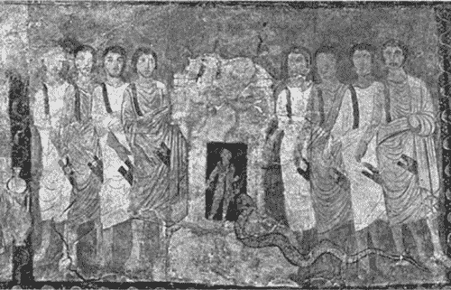

图 4.1 巴力祭祀失败——杜拉欧玻波犹太堂 © The Picture Art Collection/Alamy Stock Photo

注意图 4.1 中躲在`Baal`祭坛下的小祭司，以及咬死并杀死那个祭司的蛇，这些都代表了关于这段`Elijah`叙事的外传故事中的非圣经元素，这些元素发展于公元后的几个世纪。同样注意那些祭祀失败的、神情严肃的`Baal`祭司。此图像的最后一个有趣元素可能是那些祭祀失败的、神情严肃的`Baal`祭司。

## 犹太社区中的以利亚

然而，犹太社区中的`Elijah`形象绝非不为人知，在某些时代，它们变得非常普遍。来自公元 3 世纪`Dura-Europos`（杜拉-欧玻波）犹太堂社区的证据——该地位于今叙利亚幼格里斯河附近，沿着当时的罗马-帕提亚边界——拥有几幅源自其希伯来圣经叙事的`Elijah`形象。描绘`Elijah`使命场景的绘画遍布犹太堂墙壁，包括位于南墙的“巴力祭祀失败”(图 4.1 以以寡寡寡妇的油和增加增加增加”（）、）、）、以利亚复寡寡妇之西西西西））“在利亚在迦上的祭上的祭祭墙），后者与对`Baal`失败的祭祀形成了鲜明对比。^(66)


图 4.1 巴力祭祀失败——杜拉欧玻波犹太堂 © The Picture Art Collection/Alamy Stock Photo

## 以利亚先知

然而，犹太社区中的`Elijah`形象绝非不为人知，在某些时代，它们变得非常普遍。来自公元 3 世纪`Dura-Europos`（杜拉-欧玻波）犹太堂社区的证据——该地位于今叙利亚幼格里斯河附近，沿着当时的罗马-帕提亚边界——拥有几幅源自其希伯来圣经叙事的`Elijah`形象。描绘`Elijah`使命场景的绘画遍布犹太堂墙壁，包括位于南墙的“巴力祭祀失败”(图 4.1 以以寡寡寡寡妇的油和增加增加增加”（南墙）、“以利亚复寡妇之子”（西墙）、“以利亚在迦密山上的祭祀”（南墙），后者与对`Baal`失败的祭祀形成了鲜明对比。^(66)

## 以利亚的地理背景

在犹太传统中的以利亚先知：

然而，犹太社区中的`Elijah`形象绝非不为人知，在某些时代，它们变得非常普遍。来自公元 3 世纪`Dura-Europos`（杜拉-欧玻波）犹太堂社区的证据——该地位于今叙利亚幼格里斯河附近，沿着当时的罗马-帕提亚边界——拥有几幅源自其希伯来圣经叙事的`Elijah`形象。描绘`Elijah`使命场景的绘画遍布犹太堂墙壁，包括位于南墙的“巴力祭祀失败”(图 4.1 以以寡寡寡寡寡妇的油和增加增加增加”（南墙）、“以利亚复寡寡寡寡寡妇之子”（西墙）、“以利亚在迦密山上的祭祀”（南墙），后者与对`Baal`失败的祭祀形成了鲜明对比。^(66)

（注：由于原文中存在大量文本重复，译文已按原文结构进行对应翻译，并确保逻辑连贯性。）

# 第六部分：以利亚遗址——迦密山

`Mount Carmel`（迦密山）是由一系列沿海山脉和丘陵组成的，它们从今今的海法市开始，向地中海延伸约 24 英里。该地区主要由 5500 万年前形成的硬石灰岩组成，整个山脉宽度在 5 到 8 英里之间，散布着几个洞穴。^(68)

`Mount Carmel`（迦密山）这一称呼可以指整个山脉，也可以指该山脉西北部 12 英里的段，或者通常仅指该山脉西北端的海角(图 4.2）。

```
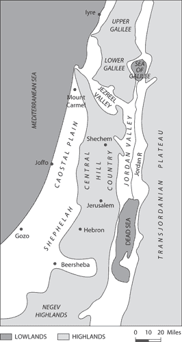
```

图 4.2 迦密山地区地图

“Karm”一词在希伯来语中（כֶּרֶם）意思是“花园”、“葡萄园”或“果园”，而 Karm-el（כרמל）字面意思是“El 的葡萄园”或“神的葡萄园”。这个名字可能反映了喀米尔山肥沃的环境，那里接收了来自海洋的西风和水分。该地区生长着森林，且橄榄、谷物和葡萄长期长期以来在那里种植。

喀米尔山的洞穴在圣经时代作为盗贼和土匪的藏身处而闻名，但这些洞穴也是该地区最早的人类和类人居住地之一。洞穴中的物质文化遗迹包括公元前 15,000 年至 10,000 年的艺术品，如动物头工具柄和珠子。该遗址最近的考古挖掘目前已发现了铁器时代的人类定居证据，尽管这些来源的匮乏可能表明，那个时期并不鼓励定居，或者密集的森林和灌木丛可能阻碍了人类的定居。该遗址的挖掘还发现了从君士丁时期到罗马帝国晚期、拜占庭时期，以及倭麦亚、阿拔斯和马木留克统治时钱币。


喀米尔山作为迦南式“高处”且位于沿海海岸的宗教意义，在圣经外文献中得到了充分证实。喀米尔山在埃及法老托特摩斯三世（公元前 1490–1436 年）的记录中被称为`Roš Qadeš`，意为“圣地角”。公元前 9 世纪的亚述文献表明，喀米尔山是一座神山，献给巴力（`Baal`）。这些文献不仅表明了这座山的宗教意义，还有助于解释为什么圣经作者（或最初流传以利亚和以利沙相关的口头传说的人，这些故事记载在《列王纪上》18 章和《列王纪下》2:25 和 4:25 中）选择此地作为以利亚与 450 名巴力先知之间著名竞赛的地点。正如圣经外证据所证明的，以利亚击败巴力及其先知之所以格外令人印象深刻，因为这是在巴力自己的领地上发生的。

然而，尽管希伯来圣经中的竞赛充满了戏剧性，但文本本身告诉我们，巴力崇拜在整个地区的“高处”持续，雅华（`Yahweh`）和其他神的崇拜也是如此。此后该地与以利亚形象紧密联系在一起；因此，喀米尔山的名称也变成了圣以利亚山（`Mt. Saint Elias`）。公元 12 世纪，一座罗马乡村修道院和一个“加密耳会”教团在所谓的战斗遗址建立并随后重建，该地区在阿拉伯和伊斯兰传统中也被称为 المحرّكه `al-maharrakah`，意为“焚烧之地”，指代雅华派来焚毁祭坛和祭物的剧烈大火。尽管如此，巴力崇拜在喀米尔山一直持续到 Common 后的几个世纪，与该地区的希腊和罗马存在有关。

1952 年，M. 阿维-约纳（`M. Avi-Yonah`）在喀米尔山的加密耳会修道院发现了一块公元 3 世纪初的大理石碎片，形状为底座上的右脚脚趾和前部。利用脚趾的大小作为估算，他认为该雕像应该是等身尺寸的两倍。右脚底下的底座刻有两行希腊文，内容为：“献给）赫利奥波斯的宙斯（`Zeus`），喀米尔之神（由）凯撒利亚的殖民者盖斯·尤留乌斯·尤提卡斯（立）。”这位喀米尔的神至少在公元 2 世纪（可能更早）就被识别为赫利奥波斯宙斯（罗马传统中的 `Iupiter Heliopolitanus`）。

正如我们在第三章中看到的，宙斯/赫利奥波斯宙斯是古代最广为人知的神之一，在整个旧罗马帝国范围内，他留下了大量的形象表征和数百处铭文。在希腊化和罗马化的中东，宙斯/赫利奥波斯宙斯被等同于（巴力）哈达（`Hadad`）。生活在公元 400 年左右的罗马哲学家兼作家马可罗比乌斯·安布罗西乌斯·奥多西乌（`Macrobius Ambrosius Theodosius`，简称“马可罗比乌斯”闻名）曾写道特拉真皇帝曾在贝勒贝克的巴力圣所咨询宙斯的神谕，“对于他们最崇敬、最伟大的神，他们给了他哈达的名字，”`deo enim, quem summum maximumque venerantur, Adad nomen dederunt`。”当然，阿达/哈达是风暴神巴力的当地叙利亚语称名。因此，喀米尔山的巴力崇拜一直持续到 Common Era 的几个世纪，就像在贝勒贝克和黎凡特地区其他地方一样。阿维-约纳声称，这是一场多神教宗教热潮，恰逢贝勒贝克大部分完工的寺庙在当地流行，这促使一位来自凯撒利亚的富贵族为他的祖神竖立塑像。

随着基督教在 Common Era 的前几个世纪在该地区流行起来，对迦南和希腊化叙利亚神、女神的崇拜开始衰落。到 20 世纪中叶，喀米尔山上那尊曾经双倍等大的哈达/宙斯像只剩下一块脚碎片，当时保存在该山上奉给以利亚的基督教修道院内。

## 第七部分：以利亚与黎凡共同池

### 以利亚文本、图像和遗址反映了关于古代以色列传统的什么内容

我们在以利亚形象中看到的，是一个由多个神女神主导的宗教环境，大部分是迦南神，而巴力-哈达在其中最为突出。这是因为巴力-哈达作为地区风暴之神，在一个降雨水对人类农业生活至关重要的宗教环境中长期占据主导地位。

然而，我们从以利亚形象中看到的，是贯穿整个希伯来圣经的一个主旨：雅华是至高神；在雅华之前没有其他神。因此，崇拜雅华以外的神会导致毁灭。由于雅华是至高神，雅华的行为与其他神有所不同；他是嫉忌的，他的追随者必须在他周围的特定地点以特定的方式行动。他们还必须热诚地奉献雅华，雅华将报答他们。这种行为在以利亚等先知身上（当然，还有摩西）树立了模范。我们从希伯来圣经以利亚的例子中了解到，雅华的虔诚人类崇拜者实际上应该像以利亚一样：对雅华的奉献是专一且不妥协的。

我们从以利亚形象中揭示的正统宗教，是一种在渴望与其他群体区分开来的愿望上具有专一性和排他性的宗教传统。它反映了一个小王国（或多个王国）和少数宗教传统试图在地区更大更强大的势力中生存并繁荣的视角。因此，希伯来文本中揭示的以及通过先知以利亚揭示的宗教传统，在与其他群体区分开来的愿望上是专一且排他的；部分是因为这些叙事发生在一个混合和异质民族的环境之中。

在以色列人和犹太人与当时强大权势抗争的地区历史动荡中，随着他们的宗教传统（们）在公元前一千年末演变为“犹太教”，希伯来圣经文本成为了犹太叙事历史的锚点和核心元素^(77)。因此，对于所有随后与希伯来圣经建立联系的传统（如基督教和伊斯兰教），这一传统的文本对基督教和伊斯兰教内部的叙事和人物也产生了巨大的塑造影响。随着以利亚在希伯来圣经中被纳入正经并在叙事中广传，这位极具魅力的先知以利亚人物成为了地区文化的一部分，并存在于那些源自希伯来圣经文本传统的后世宗教传统（如基督教和伊斯兰教）之中。

### 以利亚人物与黎凡凡特地区人物、叙事和地理主题的共同池

#### 以利亚从共同池中汲取了什么

`Baal`-`Hadad`是与`Elijah`永远联结在一起的人物，因为`Elijah`在希伯来圣经中的使命是铲除对`Baal`的崇拜。此外，`Elijah`还与击败并征服敌人的地区叙事和主题相关，敌人通常被描绘踩在脚下。^(78)在铲除`Baal`崇拜的过程中，`Elijah`与控制雨水、风暴和闪电的权力等地理主题产生了联结。由于他神秘的消失和升天，`Elijah`还与消失与回归的地区主题相关，并与作为引起雷声的天上战车驾驭者联系在一起。通过这些方式，`Elijah`成为了`Baal`-`Hadad`的对立面替代方案：`Elijah`并不是`Baal`-`Hadad`——事实上，他的使命是反对`Baal`的——但作为一个参与铲除`Baal`崇拜的人物，并因此也与`Baal`一些最具吸引力的地理主题产生了联结，以利亚这一人物在该地区也有效地发挥了作为`Baal`-`Hadad`对立面替代方案的功能。

### 以利亚为共同池贡献了什么

与`Elijah`相关且他回馈给共同池的引人注目的新元素包括：`Elijah`作为卓越捍卫者的角色（当然还有`Moses`）——捍卫“真”神反对偶像崇拜和多神教。`Elijah`与几个迷人的主题相关，例如：围绕干旱的神迹故事、被寡妇和乌鸦喂养、确保面粉和油储备永不枯、复活一个孩子、在加密山上与`Baal`进行的标志性比赛（涉及火焰/闪电并杀死了“假”先知）；与西奈山/霍勒布山的关联（再次类似于`Moses`）；与受诽谤的人物`Jezebel`、`Ahab`以及假神`Baal`-`Zebub`的关联；能够降临并吞噬敌人的火；与神的火车；以及在火风暴中升入天堂。

以利亚这位对`Yahweh`狂热且令人深刻的希伯来圣经先知，是希伯来圣经一个更大项目的象征：区分“真”神与“假”神，以及区分`Yahweh`的随者与任何其他神的随者。延续在希伯来圣经血脉中的后世宗教（如基督教和伊斯兰教）也参与了这一排他性项目的遗产，我们将在第五章和第六章中看到这一点。

本章概述了基督教兴起的历史和宗教背景，圣乔治正是这一背景下的产物。随后，本文探讨了圣乔治最早的文献：公元 600 年左右的叙利亚语版《圣乔治行传》，该文献是所有后续关于圣乔治的圣徒传记载的基础，也是我们所知的关于原始希腊语叙事（约公元 450 年）最早且最完的证词。接着，本章考察了早期基督教图像学传统的兴起，并区分其与希腊化及罗马化图像学实践的区别，以便理解圣乔治的图像表现。本节调查了圣乔治的形象如何随时间而发生变化，以及这些变化揭示了什么。在整个分析过程中，我们对文本和图像来源进行了分析，结合了来自正典宗教来源和农业宗教来源的当代宗教、政治和地理证据，以帮助将圣乔治在近地区的出现与演变进行背景化。

## 基督教从犹太教的发展

公元前一千年后半叶的流亡及流亡后期的犹太社区遍布整个地中海盆地，中心位于耶路撒冷、加利利、巴比伦，并最终到达亚历山大、安提约和罗马。犹太社区的大多数人居住在黎凡，处于我们所认为的多样化宗教环境中。到拿撒勒耶稣时代，东中地区的犹太人口中心——耶路撒冷、加利利、安提约、叙利亚和亚历山大——已经形成。

因此，在公元四世纪以后，犹太社区吸收了一些“希腊化”的格和习俗，同时保留了各种形式的“犹太性”。

罗马对该地区的政治军事控制始于公元前 63 年，当时罗马将西庇夺取了耶路撒冷的控制权。公元 6 年至 41 年，凯撒利亚成为罗马犹太行省的首府，当地治理被托付给该地区的非犹太人以度曼人，这加剧了自公元二世纪中期“马加比战”起义以来一直存在的紧张局势。随着罗马政治控制在公元前一世纪后半叶的加强，“犹太”身份与实践之间的区别变得愈发尖锐。

到拿撒勒耶稣出生时，且一直到公元 70 年罗马犹太战争时期，“犹太教”内部存在许多分歧，包括被称为撒都义派、法利赛派、艾森派、热心党和西加利人的主要群体。公元一世纪的犹太社区通常通过使用希伯来圣经卷籍，通过各种方式的信仰、实践和族群联系在一起，并在宗教实践中使用多种语言，包括希伯来语、亚兰语和希腊语，具体取决于所属群体。我们现在所说的“犹太教”宗教在公元一世纪既没有被定义，也没有统一。此外，犹太社区存在于当时的各种混合宗教冲动之中，此时，其中一个犹太社区的子群体开始采取特定的实践和信仰，以纪念来自加利利地区一位充满争议的拉比。

拿撒勒耶稣最早的犹太追随者与当时的大多数犹太人并无区别。拿撒勒耶稣的经历和教义与自公元前四世纪马其顿征服引发以来在犹太思想中早已显现的弥赛亚宗教和政治潮流相契。耶稣最早的追随者主要在他身上寄托了弥赛亚救赎，而非宗教改革。马丁·亨格尔（`Martin Hengel`）认为，弥赛亚犹太运动与公元一世纪未加入这一运动的大多数犹太群体之间的冲突，其涉及的争议并非关于犹太教的核心宗教关怀（神学信仰、希望和实践），而是“弥赛亚救赎与圣殿和托拉传统有效性之间的关系”。

因此，耶稣最早追随者的主要宗教背景是当时的各种形式的犹太教。因此，重要的是，早期“基督徒”在公元一世纪很大程度上作为一个犹太教派是无法区分的。在`使徒传 24:5`中，在描述保罗受审期间，由大祭司亚拿尼亚（`Ananias`）选择的耶路撒冷修辞辩护人提图拉图（`Tertullus`）提到了犹太人的“拿撒勒教派/异端”，“τε τ της τῶν Ναζωραίων αἵρέσεος”“拿撒勒人”是一个源自耶稣出生地拿撒勒城的名称。即使是同时期一世纪的罗马历史学家，如小普林尼（`Pliny the Younger`）和普布利斯·塔西佗（`Publius Tacitus`），也将早期基督徒的信仰称为一种在犹太地区开始的“迷信”（`superstito`），因此表明了这一运动的犹太起源。

事实上，许多学者认为，由于“早期基督教文献中压倒性的犹太教底层基础”，以及绝大多数新约作者都是犹太人基督徒这一事实，基督教新约中的大多数书籍都应被视为公元一世纪犹太教最重要的来源之一，当然还包括约瑟夫（`Josephus`）、斐凡哲（`Philo`）的著作、库姆兰图书馆以及早期的拉比传统。

然而，这个群体逐渐开始认为自己与当时的大多数犹太人有所不同。“这个社区虽然没有从崇拜形式或教义上与‘犹太教’分离出来，但仍然采取了如`使徒传 2:42`和`4:32`所记载的某些新实践，包括仪式、公餐餐、祷告和集体生活。”

早在公元一世纪，至少在某些地方（例如如`使徒传 11:26`中那样的早期社区），存在自称为基督徒并被识别为非犹太人的基督。在这一早期，甚至到公元四世纪，都不谈论“基督教和犹太教是完全形成的、有边界且独立的实体和身份”，但似乎确实存在“至少一些不是犹太人的基督徒，当然，还有许多不是基督徒的犹太人”。

丹尼尔·博雅林（`Daniel Boyarin`）有力地论证，正如公元二世纪开始的异端论作者的目标所示，基督教将“基督教”区别化为非犹太教的过程，既创造了基督教，在某种程度上也创造了犹太教。

虽然这种神学表述在公元五至七世纪后的犹太人社区成员中很可能是事实，但博亚林（`Boyarin`）论点中预示此类结论的术语将不会被本项目采用。“犹太教”作为一种传统，可能部分通过公元二、三、四世纪基督教和拉比比作者的异端论对话构建而成的，但博亚林假设犹太教的信仰和实践本身并非在公元前一千年从黎凡特地区早期的宗教框架中产生的；即这些框架在方向上是是的、迦南、古代近东、埃及、西奈/阿拉伯的，以及后来的倾向于希腊主义的，正如我们在第三章和第四章中所看到的。

博亚林将公元一世纪的犹太教描述为一种“民族”或“文化传统”，与特定的地点相关，并以一种“肉体化”的方式自我联系，但博亚林对犹太教和犹太身份构建的分析可能开始得太晚了。正如我们在第四章中所看到的，以色列（以及因此是犹太）宗教身份和实践本身部分是通过围绕《希伯来圣经》创作、命名、编纂和编辑的话语所构建的。

### 公元后几个世纪黎凡特的普遍宗教

这一时期该地区的大多数人——事实上，在现代之前的绝大多数时期里，正如第二章所论证的那样——彼此之间的宗教区别通常比我们今天倾向于假设或投射到他们身上的要小。公元后几个世纪乃至整个第一个千年的记载表明，人们之间的宗教身份并不那么尖锐，而是存在更多的不区分和重叠。(13)

生活在公元后几个世纪的绝大多数人似乎并不那么关注正统或正法，而是更感兴趣哪些神灵和实践是有效的。在黎凡特地区存在着多种宗教混合，包括各种形式的犹太教、各种形式的基督教、希腊和东方神秘教派、魔法、占星术、多神教、神圣人物（`θείοι ἄνδρες`）及其神迹的故事，以及流行的希腊哲学等等。(14)

那个时代的人似乎精通一种“宗教通用语”（`religious Koine`），用马丁·亨格尔（`Martin Hengel`）的话说，那是那个时代的共同宗教语言。(15) 伴人整天的信仰和实践（不仅仅是在特殊的节日或纪念日）涉及到宗教中更边缘、“非官方”的部分：魔法和迷信。另一方面，规范宗教是独立的，通常伴有官方神庙和代表人物，但“官方和非官方所共有的最重要的特征之一，是随着时间的推移发展出的信仰的高度同质化，至少在城市化的人口中是如此。”(16)

一份来自公元四世纪前三分（约君士丁时期）的关于宗教皈依的记载展示了这种信仰的高度混合。它涉及一位来自罗马叙利亚-巴勒斯坦省（犹太地区）提比里亚和斯基提奥波利斯的著名犹太人约瑟夫（`Josephus`）的改教叙述。这段记载之所以令人难忘，是因为它

因此，虽然本章以及整本书更泛地指的是“犹太的”、“基督教的”、“多神的”等社区和身份，但全文应当理解，对于直到 20 世纪的历史时期，该地区的大多数平民来说，宗教分类是模糊而非僵板的。(18)

### 宙斯/朱庇特

我们在前面的章节中见过的宙斯（以及朱庇特），是希腊和罗马时期黎凡特地区最受尊崇的宗教神或人物。根据拉丁语和希腊语铭文中提到的频率，希腊人中的宙斯和罗马人中的朱庇特都被视为最高神灵，其被召唤的频率至少是其他神灵的 2.5 倍。(19) 从该地区第一批希腊定居点开始，宙斯一直与风神的形象联系在一起，并可能部分源于该形象。(20) 正因如此，宙斯-巴尔（`Zeus-Baal`）、宙斯-哈达德（`Zeus-Hadad`），或仅仅是黎凡特特定地区的宙斯或朱庇特的崇拜，吸收了该地区的巴尔崇拜，并在公元后几个世纪一直保持流行甚至主导地位。有时，对巴尔的简单崇拜仍然存在，这从罗马作家马尔库斯·米尼尼丘乌斯·费利克斯（`Marcus Minucius Felix`）的神灵列表中可知：直到公元二、三世纪，费利克斯还将“巴尔”列为“迦尔德人”的神。(21)

一座供奉 `Zeus Baetocaece`（位于叙利亚）的神庙持续了约 500 年，从公元前 293-261 年到公元 260 年；在杜拉-欧罗波斯（`Dura-Europos`）发现了一座公元三世纪初的祭坛，上面用希腊语刻着：“献给奥伦特河边的祖先神宙斯-贝提洛斯（`Zeus Betylos`），来自第四斯基提军团的士兵迪菲拉诺斯（`Diphilanos`）为了完成愿望而献上[此祭坛]。”(22)

早期的迦南人关于巴尔-哈达德的信仰仍然当地希腊和罗马宙斯及朱庇特崇拜的一部分。雷姆斯·麦穆伦（`Ramsay MacMullen`）认为，这种改变了“标签”的崇拜“在形式上与其希腊或罗马征服之前几乎没有变化”。(23) 然而，费格斯·米勒（`Fergus Millar`）则认为，很难判断是否

事实上，本书认为这种“表达方式”的持久性反映了地区持续的需求和信仰。

由于阿拉拉姆语是与波斯帝国以及波斯对中东大部分地区进行进行政治统治的时期（约公元前 550 年至 332 年）相关的行政语言，因此阿拉拉姆语逐渐成为整个黎凡特地区的通用语言。在亚历山大之后，希腊语也成为商业以及希腊人和博学阶层使用的语言；因此，当地人口中的许多人学会了理解希腊语。^(25) 一些犹太社区也开始用希腊语阅读希伯来圣经，而另一些人则继续用希伯来语阅读。新约圣中的《保罗书信》和所有的福音都是用希腊语编写的，这表明了当时希腊化文化交流的程度。^(26) 进入公元后的几个世纪，拉丁语也成为该地区使用的语言，而叙利亚语作为一种公元世纪的叙利亚阿拉拉姆方言，“是这一时期唯一从[该地区]产生的语言，它作为异教和基督教文学的载体而发展，并且至今仍然是一种基督教语言。”^(27)

## 基督教的兴起与新约的发展

### 早期基督教社区

正如我们在上面看到的，最早的“基督徒”并没有从犹太崇拜或实践中分离，但他们开始通过采用某些新的实践和仪式来区分自己（《使徒行传》2:42 和 4:32）。在拿撒勒耶稣被钉十字架后，一个早期基督教社区在耶路开始发展，但当耶路在公元 70 年被罗马军队攻定时，该社区萎缩了。随着耶路社区的消失，安提俄日益壮大的基督教社区在该地区占据了主导地位。

早期基督教社区每周至少在家庭教会聚一次；起初是在安息日，最终变成了周日。在这些会议上行的礼拜类似于犹会堂的，包括祷告、读经、讲道、圣咏，但也有对“圣灵”的祈求。这些集会以共同进餐结束，包括掰饼和祝福圣杯的仪式，这与《最后的晚餐》中描述的事件相似。圣餐神学逐渐发展起来，包括这些元素以及《教会教程》（`Didache`）中概述的元素，这是一本公元一世纪末在叙利亚编写的文本，涉及了伦理、仪式（如洗礼和圣餐）以及教会组织。^(28)


在黎凡特地区约公元二世纪到第四世纪期间，基督教接触了所有社会阶层。最后一批罗马精英（既有多神教徒也有基督徒）出生于公元四世纪后期，处于一个“大多数人相信过去几千年的异教宗教秩序将无限持续的世界中”。^(29) 事实上，公元四世纪的世界“充满了神灵、神庙、教堂和犹太会堂，无论它们是正常运作、被回收利用、被掠夺、被破坏还是被遗弃。”^(30) 直到公元四世纪晚期，在尼西亚会议很久之后，精英多神教罗马人仍然“对君士坦丁的儿子们对一个正成为正式基督教的帝国建立正式基督教统治一无所知”。^(31)

## 基督教新约的发展

基督教新约的 27 卷书详细记录了“基督”耶稣的生活和事工，以及基督教的教义（通过保罗给早期教会的书信），以及耶稣的使徒跟随者的历史。最后一本书《启示录》包含了一系列末日预言，涉及基督教的最终胜利、耶稣的回归和最后的战斗，以及宇宙——天与地——的更新，天上的耶路撒冷降临到那片新地上。^(32) 就像希伯来圣经正典（直到公元后几个世纪才确立）一样，花了几个世纪（并经历了多次遗漏）才建立了基督教圣经 27 卷书的“正典”。

早期基督教社区在家庭教会阅读经文，但不同的社区使用不同的经文。^(33) 早在优西比乌时代（约公元 263–339 年），很显然，关于正典的争论尚未解决，因为即使在新约最后几本书产生后的约 200 年后，这些争论即使在原始正统圈内也依然存在。优西比乌将书籍分为“认可的”、“有争议的”和“伪造的”类。^(34)

优西比乌的列表及其模糊性在他死后的实践中继续存在。在接受的新约正典列表中最著名的、并成为大多数后续基督教社区标准的列表，是亚历山大主教亚他那修在公元 367 年的第 39 封《亚历山大节信》。^(35) 在信中，亚他那修列出了今天通常被认为是正典的 27 卷基督教圣经。亚他那修可能也是第一个使用“canon”（κανών）一词来指代封闭的神圣经集的人。尽管如此，正如我们看到的，基督教在尼西亚会议之后并没有“获胜”，这是描述基督教历史的一种常见但错误的方式。相反，多个基督教社区和正统的增长是逐渐的，而不是一蹴而就的。直到公元六世纪，黎凡特的多神教人口仍然很多。^(37)

## 基督教中的殉道者与殉道精神

罗马帝国在宗教事务上总体相当宽容，正如任何大帝国必须做的那样。宗教团体和倾向在罗马国家宗教旁边相对自由的存在。直到公元三世纪中期，对基督徒和犹太人的迫害仍然零星，而且往往是基督徒的生活招致了官方敌意。从罗马国家的角度来看，基督徒不受反对是因为他们的信仰和实践，而是因为他们声称某些神是假的，基督徒因此经常被称为“无神论者”。^(38)

第一次有详尽记载的迫害针对的是公元 112 年小亚细亚比提尼亚的基督徒。从当局的角度来看，这些迫害可以解释，因为基督徒“拒绝向[罗马国家]献奉那些据称赋予了帝国繁荣的神灵”。^(39) 小普林尼作为该行省的总督写给图拉真皇帝，表达了他对图拉真对待比提尼亚基督徒行动的担忧，他们的通信建立了一种有效的司法法原则，这种法原则一直应用到公元 250 年德西乌皇帝时期针对基督徒的法律行动中。通常做法是定罪那些承认自己是基督徒的人——而且通常只针对神职人员：主教、祭司和执事——但除非他们正式被非匿名控告者举报，否则不进行起诉。此外，他们通常宽恕那些最终同意向神献祭的人。^(40)

在公元二、三世纪，整个小亚细亚、亚历山大，以及叙利亚-巴勒斯坦地区发生了多次殉道事件。然而，这些殉道是零星的、性质有限的，并且似乎遵循《普林尼-图拉真信函》中建立的法律框架。在`Decius`皇帝（公元 249–251 年）时期，对基督徒的迫害发生了转折，因为在这种情况下，起诉是由帝国法令发起的。该法令要求帝国境内所有居民通过参加祭祀并祈求帝国拯救来表达他们对神明的虔诚或奉献，其目的是引发一种公开的忠诚表现，起初并非主要针对基督徒。然而，在这场运动中，迫害基督徒变成了现实，导致了恐惧，并在帝国内的基督教社群中产生了无数殉道者。

最令人记忆——也是最后一次——基督徒迫害是由皇帝`Diocletian`在公元 303 年发起的。该法令概述了摧毁教堂和经卷、剥夺所有上层基督徒的荣誉性头衔和特权、监禁教领，以及强迫所有人在肉体威胁下进行祭祀。在帝国东部（即东地中海地区），这种迫害尤为暴力且持久；大多数基督徒“殉道者”都是在这场迫害运动中产生的。`Constantine`在公元 313 年 3 月的《宽容法令》结束了罗马官方对基督教人口的官方迫害，尽管之后发生了各种其他的基督徒“殉道”，但已不再是以罗马官方的身份进行的。

然而，殉道的经历给基督教留下了印记：对耶稣痛苦和死亡的模仿已经影响了基督教的观点，并通过基督徒中漫长而感性的殉道历史得到了强化和重演。^(41) 此外，在许多情况下，殉道增强了基督教社群：并非所有基督徒都是目标，也不是所有人必须为了从殉道的声望和知名中受益而殉道；殉道提供了一种宗教信仰的真实性，这对许多皈依者具有吸引力：许多观察者被一种愿意为其而死的信仰的真实性所说服。最后，殉道在基督教世界留下了另一个持久的遗产：圣徒。虽然基督教早期的“圣人”来自许多地方，但到目前为止，成为圣徒以及崇拜遗骸最常见、最直接的途径就是殉道。^(42) 随着殉道的遗产，基督教在东地中海兴起的宗教和政治背景，构成了`St. George`（即`μεγαλομάρτυρ`，“大殉道者”）这一人物在公元四世纪兴起的环境。

### 圣乔治及其崇拜导论

`St. George`这一奇幻且广受欢迎的形象通常被归类为被称为“拜占庭战士圣徒”的类别。这些人物正如其名，是起源于罗马帝国东部的且战士的圣徒。这一类圣徒最早由`Hippolyte Delehaye`在 1909 年的《军事圣徒希腊传说》（*Les légendes grecques des saints militaires*）中研究。`George`作为“典范”般的战士圣徒，被`Delehaye`归为`état-major`（或主要战士圣徒）类。与`Ss. Theodore Tiron/Theodore Stratelates`、`Demetrius`、`Procopius`和`Mercurius`一起，`St. George`长期以来被认为是主要战士圣徒中的佼佼者，直到今天，他的崇拜依然出众。^(43)

然而，“战士圣徒”一词的起源远早于`Delehaye`的研究。据说，这一类圣徒是在公元三世纪和四世纪早期——因拒绝放弃基督教信仰而被处决的——的，特别是在帝国迫害的最后一次运动期间（约公元 303–313 年）。^(44) 然而，“战士圣徒”或“武力圣徒”与普通殉道者几乎没有区别。因此，将`St. George`既放在“战士圣徒”的语境下理解，又从他所具有的基本特征的殉道者总类别中来理解是非常重要的。

殉道者的本质特征是他们对信仰的见证和坚持至死亡；因此，`Eusebius`开始普及“运动员”（“ἄθλητής”）一词来描述这种忍耐的行为。^(45) 《殉道者传》，包括战士圣徒`George`在内的记载，属于史诗圣徒文学的领域。^(46)

圣徒的第二个特征——在崇拜产生和传播方面更具吸引力之一——是被赋予圣徒的为了生者利益的代祷力量。这一教义与同时期的圣物崇拜一起发展，由`Origen`（卒公元 254 年）制定，他将这一信仰建立在《马加比书下》（15:11–16）的一段经文上。随着祈求圣徒作为代祷者的做法增加（无疑，这种信仰在其他宗教社区中具有当代的相似物和先驱），基督教代祷教义通过`Gregory of Nyssa`（卒公元 394 年）在其《圣西奥多尔·提龙的赞歌》（*Encomium of Saint Theodore Tiron*）中变得更加完善。“人们相信圣徒能够为人类提供各种服务，”而“战士圣徒的职责将特别成为防止恶魔和人类敌人入侵的保护。”^(47)

尽管`St. George`个人的历史证据匮乏——事实上，早在公元六世纪，那些声称`St. George`是虚假圣徒的人就引用这种缺乏——“George”无疑成了一个受欢迎的人物。

### 乔治名字的词源

`George`的名字是他的另一个有趣方面，也是一个将他的崇拜与自然和风神紧密联系在一起的方面。名字`Γεώργιος`（georgios）源于希腊语单词`γεωργός`（georgós），意思是农民，或更准确地说，耕种土地的人。`Γεωργός`（农民）由两部分组成：`γε`意思是土地，而`εργον`意思是工作、劳动或辛劳。因此，名字`Γεώργιος`与`γεωργια`（georgia，农业）有关。虽然在希腊和拉丁文献中有很多关于`γεωργοι`（georgoi，农民）的引用，但`γεωργός`在早期文献中并非作为专名使用，仅作为耕种者这一类别的名词。^(48) 专名`Γεώργιος`（George）开始在公元三世纪出现，正如在`Aelios Herodianos`三世纪的神名列表中所示，其中包括：“Georgios, Demetrios, and Ammonios ……。”。^(49) 当希腊语后缀`-ιος`添加到名词时，它会产生“属于”、“关于……的”的意思，或者指示起源。因此，`Demetrios`是一个希腊男性名字，意思是“属于/奉献德墨忒尔”（Demeter，希腊谷物女神），而`Ammonios`意思是“属于/奉献阿蒙”（Ammon，埃及流行神灵`Amun`的希腊语形式）。这个列表中的`Georgios`可能意味着“属于/奉献宙斯·乔戈斯”（Zeus Georgos）；即属于`Ζεύς Γεωργός`，这位有充分记载的雅典农田和农作物神，关于他，我们将在下文中看到更多。^(50) 尽管专名`Γεώργιος`（George）是在三世纪出现的，但直到它被基督教对圣`George`的崇拜所普及后，它在公元五、六世纪才成为一个广泛使用的名字。^(51)

圣人的名字往往对应的不是他们的“原始”本名，而是他们的功能或使命。例如，圣彼得（西门·彼得）中的“彼得”一词源自希腊语中表示岩石的词“πέτρα（pétra）”。在《马太福音》16:18 中，记载耶稣说：“κἀγὼ δέ σοι λέγω ὅτι σὺ εἶ Πέτρος, καὶ ἐπὶ ταύτῃ τῇ πέτρᾳ οἰκοδομήσω μου τὴν ἐκκλησίαν…”。“我对你说，你是彼得（`Πέτρος`），在这块磐石（`πέτρᾳ`）上我要建立我的教会……”^(52)

这种现象的另一个例子（表述略有不同）来自圣露西娅。英文名`Lucy`源自拉丁语名`Lucia`。`Lucia`作为一个专名，与表示“光”的词`lux`共享同一个拉丁词根`lucis`。`Lucia`和`lux`都与动词`lūcēre`（意为“可见”）有关。据记载，露西娅在公元 304 年的叙拉古因戴克里先皇帝的最后一次运动中殉道，后来中世纪关于她传奇的记载开始描述，“露西娅”的眼睛在死前也作为酷刑被挖出。因此，圣露西娅在中世纪成为了一位“视觉”的圣人，这可能是因为中世纪对其名字进行了创造性的词汇联想。在后图像学中，露西娅经常被描绘成拿着自己的眼睛，她仍然是盲人或视力有问题者的主保圣。

因此，圣`George`（Γεώργιος）可能是赋予那个受农业社区崇拜的人物崇拜的名字。这种解释显然与乔治广为人知的农业特征相吻合，例如他与丰产、多产和雨水的联系。同样地，圣`George`（Γεωργός）也可能是赋予基督教圣人`George`的名字——这可能是一个当地黎凡特地区崇拜`Zeus Georgos`（“农夫宙斯/土地耕种者宙斯”）的崇拜的基督教化版本。^(53) Hasan Haddad 曾认为：

Allaire Stallsmith 指出：“希腊头衔也表达了神灵与当地的联系，无论是地理上的还是血缘上的，以及他的性格或功能在特定崇拜中表现出的侧面。……崇拜铭文使用诸如`Zeus Georgos`（农夫）或`Ge Kourotrophos`（护养者）之类的功能性头衔，以明确神灵在特定仪式情境中扮演着什么角色。”^(54) 在《来自利维迪亚的新铭文》（希腊中部的一个城镇）中，Jean Jannoray 同样观察到`Zeus Georgos`的角色和功能是“掌管植物世界的永恒循环，在那里生命不断紧随死亡之后。”^(55)

`Zeus Georgos`这个头衔不仅出现在地中海东部的文献中，也出现在考古遗迹中。在对阿克罗科林斯（科林斯斯上岸）德墨忒尔和科蕾圣所的公元六世纪至公元二世纪还愿品发掘的研究中，“祭祀饼”的名称包括“ναστός（nastos）：一种里面装有葡萄干、杏仁和蜂蜜酱的锥形蛋糕，献给 Zeus Georgos 和 Men’。”^(56)

公元后的前几个世纪充满了希腊和罗马神灵在基督教传统中转化为圣人的例子。其他晚三世纪至四世纪初的“拜占庭战士圣人”崇拜，例如圣`Demetrius`和`Mercurius`崇拜，可能至少是在同时对德墨忒尔和墨丘利（`/Greek: Hermes`）神人的崇拜开始衰落，而对基督教殉道者的崇拜开始兴起时形成的。Hans Kloft 认为，在德墨忒尔崇拜在公元四世纪开始消减后，女神的仪式和角色至少在部分上转移到了“圣德米特里乌”的人物和崇拜上。^(57)

Γεωργός`Georgos`——后来变为 Γεώργιος，`George`——充当“农夫”和农业社区的圣人，他最早被关联的主题（即使在文本中也是）是：雨、绿色、丰产、多产、雷电、4 月 23 日的节日，特别是对巨蛇或巨龙的胜利。所有这些数据点共同表明，圣乔治的极早期崇拜很可能起源于对 Zeus-Baal 或 Zeus-Georgos 的当地崇拜——或者至少与之重叠，又可能提供了一种替代方案——随后在基督教的解释功能中，通过这位殉道战士圣乔治的非凡事迹被定义。

### 圣乔治崇拜

大多数圣传作家关于圣乔治真实性的论证，并非基于对“乔治”生活的任何历史证据（对于一个历史人物来说并没有这种证据），而是基于对其崇拜的充足证据，从建筑遗迹来看，这些证据可以追溯到公元六世纪初。

最早记载且持续时间最长的圣乔治圣所位于巴勒斯坦的吕达（迪奥波利斯，今以色列洛德），建立在他据称遗骸周围。在公元 530 年左右，朝圣西奥多西乌斯写道：“In Diospolim, ubi sanctus Georgius martyatus est; ibi corpus est et multa miracula fiunt，”在迪奥波利斯，圣乔治在此殉道；他的身体在那里，许多奇迹发生。”^(58) 正如我们所看到的，在早期，乔治在地区并不像圣提奥多（Todore Stratelates）那样受欢迎，尽管圣乔治的崇拜已迅速传播到君士坦丁，那里至少有九座教堂纪念他。

除了吕达的圣所外，耶路撒冷境外还有一座尊奉圣乔治的教堂，可能建于公元四世纪后期。^(59) 公元 527 年，贝利撒留将罗马的塞巴斯蒂亚诺门交给圣乔治保护，乔治无处不在的遗迹一直到达法国南部，图尔格里（538-594 年）也拥有一个。^(60) 约旦的马达巴还有一座公元六世纪初尊奉圣乔治的拜占庭教堂。^(61) 最后，叙利亚埃兹拉（Zorava）有一座始于公元 514 年至 515 年的教堂，显然在 19 世纪仍在使用，根据其铭文，它是基于圣乔治的遗骸建立的，圣乔治“不是在梦中而是在现实中出现在[院长]”。它显然建立在一座被毁的异教寺庙之上，这种寺庙在公元六世纪的叙利亚非常常见，其铭文的开头——正如我们所看到的，是对圣乔治的恰当致意——写道：

围绕圣乔治传的几个奇幻故事正如我们所看到的具有多种影响来源，其中一些是可以识别的。与一般的圣传文学一样，《圣乔治传》与其说是历史记录，不如说是为了歌扬殉道精神和基督教神学的论证。《圣乔治传》描述了他作为喀法西基亚一位富有且具有军事影响力的罗马公民的出身，并指出在皇帝`Dadianus`（后来的作者代指戴克里先，约 284-305 年）可怕的迫害期间，乔治自愿站出来证明他对基督教上帝的信仰并殉道，以反对皇帝的假神，并说服他人信仰基督教上帝。

《圣乔治殉道录》最初写于公元 5 世纪初的希腊语，可能起源于小亚细亚的卡帕多基亚地区，那里受到多种因素的影响，其中包括波斯、希腊和基督教的影响。现存最古老的 5 世纪希腊语文本以残片形式存在，并保存于维也纳。叙利亚语版的《殉道录》大约在公元 5 世纪中叶从希腊版翻译过来，比原始希腊手稿完成后晚了几十年。现存最完整的《殉道录》副本，也是本项目将使用的版本，是一份叙利亚语手稿，写于公元 600 年左右。它保存在大英图书馆，`Add. 17205`，用叙利亚语的 Estrangelo 字体书写，这是最早的叙利亚语教会礼拜字体。

这本叙利亚语手稿`Brit. Mus. Add. 17205`在开头缺失了半叶，第 26 页（f. 26）之后缺失了两叶，`f. 27`缺失了九或十叶，`f. 28`之后缺失了一叶。`F. 23–26`顶部破损，`f. 28`底部破损。此处使用的英文翻译除非另有说明，否则是 E. W. Brooks 1925 年出版版本的改译。Brooks 为`Add. 17205`中缺失的页码提供了来自 11 世纪的叙利亚语 Sertā 字体手稿`Brit. Mus. Add. 14734`，该手稿在很大程度上保留了与早期叙利亚语版本`Add. 17205`相同的文本。

### 文本摘要

附后的摘要被分为若干片段，这些片段灵感来自 Kiraz 文中的标题，但既不是叙利亚语文本原文，也不是 Brooks 翻译原文。下文忠实于 Brooks `1925` 年的翻译（在另有说明处为我自己的译文）。

### 文本分析：竞争性的宗教环境

#### 混合的宗教背景

《殉道录》描绘了当时的混合宗教背景。我们看到了基督徒、罗马国家多神教，甚至巫术和魔法的存在：达迪亚努斯国王在马格尼提乌斯片段和乔治最终殉道的片段中，均称乔治为“巫师”。通过达迪亚努斯国王嘲讽的语气，很明显巫术和魔法被认为是虚假的，但能够施展魔法奇迹的“巫师”也是当时范式的一部分。

#### 罗马国家多神教

国家多神教是罗马帝国境内占主地位的宗教传统，其基础是：众神统治天体、气象现象以及人类领域。因此，这些神需要通过定期的祭祀活动获得承认和尊崇。从文中达迪亚努斯国王的陈述中，我们看到阿波罗神是“延伸天空”的太阳神，赫拉克勒斯“奠定了大地基石”，而塞拉皮翁和波塞冬则“约束海洋使其不跨越界限”。除了阿波罗和赫拉克勒斯（达迪亚努斯国王在折磨乔治的第一个片段中提到，没有其他神可以与之相比，“在女性[神灵]中，最伟大的是以弗所的女神阿尔忒弥斯”）之外。

我们进一步了解到，神灵在神庙（`ναός`）中被崇拜，这些神要求通过祭祀的形式定期表达债之的认可。然而，正如我们在乔治面对达迪亚努斯的初始片段中达迪亚努斯的演讲中所看到的，只要这个人最终通过祭品进行弥补，神灵就会原谅其忽视祭祀义务的过错。

#### 罗马对基督教的观点


通过文中对罗马国家多神教的这一窥视，我们也能在文中看到当时罗马对基督教的观点。在特拉奎里努斯神迹片段以及要求乔治向神献祭的章节中，我们看到罗马称当时的基督徒为“加利利人种族（`γένος`）”，重申了基督徒是一个最初源自犹太地的教派的观点，并强调了他们的犹太起源。

其次，通过对本文的分析，我们了解到罗马国家的观点嘲笑基督教信仰是荒谬。基督徒并不崇拜那些显然因其拥有天力“创造了可见的事物”而值得崇拜的神灵，而是崇拜一位在基督徒自己看来出生于人类妇女“玛利亚”的神，而犹太人——帝国境内一个几乎没有权力的民族——曾“用棍子鞭打并将其悬在树上”。

## 帝国基督教：三位一体论与圣经传统

我们还在文中看到了作者当时的基督教的反映，这种基督教深受当时辩论的影响，并拥护一种被称为“尼西亚会议之后”的观点。这里明显显示了两个主要的基督教思想流，涉及神的本质和基督徒的圣经传统。

### 三位一体论

在文中，基督教的神被明确识别为与圣经（希伯来经）中的同一个神。在乔治假装从从神献祭的章节中，他引用了`诗篇 22:20`并喊道：“主啊，不要远离我，神啊，快来帮助。”耶稣在第一个片段中称加百列为“我之约的天使（`διαθήκη`）”，并宣布乔治的勇敢行为将使人们“承认我并相信我是亚伯拉罕、以撒和以色列的神”，即圣经中的神。

然而，与希伯来经中描述神的方式完全不同，这篇叙述所揭示的基督教观念中的神在本质上是三位一体的。乔治向达迪亚努斯国王宣布他崇拜的是“一位真神，与其子和他的圣灵，三位一体且不分的神性”。此外，文中耶稣还被称为“活着的神”和“道肉身”的神，这符合尼西亚会议后当时的帝国基督教立场：耶稣是`homoousios`（`ὁμοούσιος`），即与父神“同性”，因此既是完全的人，又是完全的神。例如，叙事中的耶稣后来向乔治的脸吹入“圣灵”以复活乔治，从而展示了耶稣结合的神性和人性。

### 圣经传统

为了强调叙事中的宗教立场，或从圣经角度证实某些主张，《殉道录》引用了多处希伯来经和新约经文本。引用希伯来经的包括`诗篇 42:5`和`22:20`、`耶利亚书 10:11`和`创世记 18:3`；引用新约的包括`马太福音 16:23`、`路加福音 23:46`、`约翰福音 10:16`以及`使徒行录 9:18`和`6:15`。这些新约文本的选取符合亚坦那西之后“被认可”经卷的形成，并进一步将《殉道录》定位在一个特定的时期。事实上，本文中反映的基督论和三位一体信仰，以及对正经基督教文献的频繁引用，都将本文置于公元 4 世纪后的帝国基督教传统之中。

## 总主题

本文的核心信息是，基督教的神就是上帝。乔治士施行了若干神迹，以使人们相信基督教神的力量和真实性，其中包括奇迹般地忍受了极其痛苦的酷刑并展现了惊人的壮举。所有的神迹都遵循着一个明确的主题：基督教的神是真神，因为他是最强大的，掌控着生死。基督教的神能让死者复生——这回响了基督教关于复活的概念——并且同样可以消灭他的敌人。因此，在这个核心信息之外，还有两个相关的信息，它们同样呼应了《希伯来圣经》中关于以利亚的叙事：崇拜其他神会导致毁灭，而崇拜基督教的神会导致信徒获得上帝的眷顾。

## 崇拜其他神会导致毁灭

《行传传》将其他神描绘为不仅虚假，而且是企图误导人类的偶像和魔鬼。在乔治士假装向神祭祭以对抗阿波罗神像内部的“魔鬼”的情节中，乔治士向它质问：“你为什么要引导人们背离对活着的神的敬畏？”魔鬼回答道：“凭我为我准备的火地狱，如果我有能力，我也会毁了你，误导你且不放过你。”

崇拜这些“魔鬼”的毁灭性结果，在乔治士从石棺中的尘土状态中复活了两百人的情节中得到了展示：当乔治士质问刚从棺内尘土中复生的尤布拉时，乔治士问尤布拉：“你崇拜的是基督还是阿波罗？”尤布拉的回答是，

## 崇拜基督教的神会导致信徒获得上帝的眷顾

文中六次提到乔治士是基督教神的“奴”或仆人。因此，当我们看到乔治士多次被上帝拯救或以某种方式获得眷顾时，我们理解了一个明确的信息：上帝眷顾那些承认唯有基督教的神才是真的人。在亚历山德拉的情节中，这一信息同样清晰。当亚历山德拉受酷刑时，她哭道：“我的主，怜悯我吧，因为我得罪了你，基督徒的希望。”在下一个场景，当乔治士到达时，她向他呼道：“噢基督的运动员（`ἀθλητής`），请给我洗礼的印记，好我也进入基督的宫殿。”乔治士回答道：“亚历山德拉女王不要不要，也不要在洗礼的事上害怕；因为你可以在你的血中洗礼并洁净。”在被殉道之前，亚历山德拉大声呼道：“我们的主耶稣基督，看我现在为了你的名离开了我的宫殿，我没有关上门；我的主，你也请不要在你的女仆面前关上门。”作为回应，文中告诉我们，亚历山德拉从基督教神那里领得了殉道者的桂冠。

亚历山德拉对洗礼的焦虑，以及从石棺死者中复生的尤布拉的焦虑，进一步证明了接受基督教的洗礼仪式——从而表明了基督教神的至高无上——会导致上帝的眷顾中获得永生。上帝眷顾的后世被描述为“乐土乡”，与“火的深渊”形成极端对立，而尤布拉声称那是所有没有拥有“我们主洗礼印记”的人的结局。

文中崇拜基督教的神使信徒获得眷顾的最后手段，是通过基督教圣徒的代祷。在帕西克拉特对乔治叙事的引言中，他宣布：“在我们主耶稣基督的力量中，我们开始记录著名的乔治士、将军安东努斯和女王亚历山德拉的殉道与加冕（愿他们的祈祷与我们同在！阿们！）。”乔治士在他最后的殉道之前证实了这种力量，他向上帝进行了长长的祷和请求，希望所有记得、提到或向乔治士献祭的人都能免受酷刑、恐惧、噩梦、危险的诉讼、酷热、冰雹、疾病、魔鬼甚至是他们自己的罪。因此，当人们想起基督教圣徒时，将得到基督教神的报答。

## 达迪亚努斯王与 4 月 23 日：与风神相关的主题

### 达迪亚努斯王

正如我们将看到的，圣乔治士因击败龙的勇举而闻名。然而，在现存的图像中，乔治士在公元六世纪之前似乎与这一主题无关。在与乔治士相关的最早文本《行传》中，我们也没有读到乔治士击败龙的记载。然而，叙事早期有一个有趣的平行成分。达迪亚努斯王在文中被为乔治士的主要对手：一个嗜血的暴君，他与撒旦一起对基督徒进行了残忍的酷刑运动。达迪亚努斯被称为“眼镜蛇之王达迪亚努斯”，他威胁要对那些“违背崇拜神的叛逆者”进行严酷的酷刑。这一挑战了乔治士，乔治士面对并最终击败了达迪亚努斯。

在《行传》的叙利亚语版本中，翻译为“眼镜蛇”的词`ܚܽܘوܳܐ`（`ḥewwā`）最接近的意思是“蛇”。后十世纪的希腊语版本提供了`δράκων`，“龙”，因此似乎“蛇”和“龙”这些术语在希腊语和叙利亚语之间存在概念上的重叠，正如乌加拉语和希伯来语术语`ltn`（蛇）和`tnn`（龙）在巴尔循环和希伯来圣经中具有概念上的重叠一样。

因此，在《行传》中，我们见证了一场寓言式的杀死“龙”或“蛇”的行为，当《行传》的主角乔治士最终击败了反派达迪亚努斯。通过将达迪亚努斯命名为“眼镜蛇”，《行传》的作者明确利用了早先与风神相关的流行地区主题。

### 4 月 23 日

此外，《行传》记载圣乔治士“在尼散月二十三日被加冕（即殉道道）”。这确立了乔治士的瞻庆日，因为圣徒是在他们殉道的那一天被纪念的。也许是由于《行传》中的这一细节，以及现有的“乔治教式”崇拜实践——这显然无法确定——4 月 23 日最终成为了东方和西方教会历法中圣乔治士的节日日。4 月 23 日这一日期本身与地区农业有关。在整个中东被称为夏季的开始，

正如我们在上面看到的，在第三章中，亚历山大的继任者塞琉柯·尼卡特在公元前 300 年 4 月 23 日在卡西俄斯山向卡西俄斯神献祭，在安提俄克附近的建立了塞琉基亚城。这段叙述向我们传于约翰·马拉斯斯，他是一位安提俄的历史学家，生活在所描述事件发生很久之后，即公元六世纪的第一叶。马拉斯斯写的是早期的希腊事件，这些事件最早由罗马历史学家塔西佗在第一世纪首次记载，而马拉斯斯显然提供了 4 月 23 日这个日期。无论马拉斯斯关于塞琉柯早期献祭的细节历史真实性如何，我们从马拉斯斯的叙述和《行传》中实际上可以得知，到六世纪的该地区，4 月 23 日显然已不仅与地区农业有关，还与风神宙斯以及圣乔治士的崇拜有关。

无论是击败蛇或龙的主题，还是 4 月 23 日这一日期在《殉行录》中使用，是因为它们在更广泛的文化中作为“强大”的主题引起共鸣，还是因为在文本创作时，“乔治”崇拜的元素已经与当地的宙斯崇拜联系在一起——这在《殉行录》中对蛇/龙主题以及 4 月 23 日日的应用，有助于我们更好地理解圣乔治崇拜的发展方式。特别是对这些元素的刻意包含，帮助我们看到圣乔治崇拜是如何与当地风神崇拜的重要方面保持一致的。

## 亚历山德女王

关于圣乔治的故事后来也与乔治从龙手中拯救公主的叙相关联。(76)在这些叙书中，圣乔治救了一位公主——有时被称为“亚历山德”——这一英雄事迹要么激发了她的父亲国王将整个王国皈归基督教，和/或者乔治娶了这位公主。(77)在《殉行录》的正文中，达迪亚努斯王的妻子亚历山德并没有被圣乔治从身体上拯救，而是受到乔治的榜样和使命的影响，皈依基督教并亲自面对殉道。(78)这可能代表了一种精神上的“拯救”，但这与安东尼乌斯将军所获得的救援是相同的，而他并未出现在乔治叙事的后期版本中。

## 乔治的竞争不是宗教之间的竞争，而是神之间的竞争

我们在文中清楚地看到，乔治是基督的“仆人”或侍/奴隶。在基督的服侍中，乔治面对虚假的多神教或“异教”神，推广了基督教的真神。事实上，乔治的任务旨在让人们相信只有主耶稣基督才是神。当他们被说服时，正如我们在几个情节中看到那样，这导致了人们的信仰。

重要的是，在整个叙事中，人们被引导去“相信”或“承认”乔治的神——基督徒的神——是真神，而不是认为“基督教的教义”高于其他所有教义。因此，我们看到这并非是“宗教”概念之间的竞争，而是神之间的竞争。国王问尤布拉：“你崇拜基督，还是阿波罗？”当乔治与寡妇交谈时，他问她：“你是什么宗教的？”她的回答是“阿波罗的”。在其他可能的观察中，这表明当时的人们根据他们遵循哪位神来定义自己的“宗教”身份，而不是他们遵循哪种“宗教”。(79)这反映反映了当时的历史现实；即基督教（们）的教义仍处于构建过程中。

无疑，在整个时代至少的前六个世纪里，各种定义的、基督教教义、神学和仪式的这一庞大神学体系仍在形成。后来的基督徒会倾向于通过特定的教派神学来认同自己（(80)），而不是通过他们遵循哪位“神”，但在《殉行录》编写时期以及它所指的那个时代，基督教的宗教认同是不同的——并且与其自身的历史宗教环境有关——涉及到多个神之间的竞争。

## 关于圣乔治的主题

### 圣乔治是谁？

《殉行录》中的乔治来自一个卡帕多奇亚家庭，担任戴奥克里一皇帝军队的护军官，富有、英俊且年轻。在看到“基督受到侮辱，恶魔在他面前受到赞美”后，乔治将他的世俗财产分给了他人——社区主义在早期基督徒中是一种常见做法——并向达迪亚努斯王公开宣布自己是一个基督徒，尽管他将遭受肉体折磨，且他对此感到恐惧。乔治作为基督徒的身份（正如我们所看到的，这与帝国或尼西亚信经立场一致）深受他声称自己是基督的“仆人”（神格中的第二位）这一宣言的色彩影响。

在被达迪亚努斯王询问身份时，乔治回答说：“至于我的名字，我是一个基督徒。但，如果你按照世俗来询问，我被称为乔治（`γεωργός`）。”这个回答很有趣，因为《殉行录》的作者似乎想传达这样一个观点：殉道者本人是一个没有区分的“基督”殉道者。然而，如果“按照世俗”询问，他在他们中被称为“乔格斯（Georgos）”。《殉行录》中的这一细节可能进一步证明，“乔治”的名字与其说是一个名字，倒不如说是与一个具有农业崇拜的人物有关——要么是一个新的农业崇拜，要么是一个已经存在的崇拜，例如宙斯-乔治（Zeus-Georgos）崇拜。

此外，我们从文中了解到乔治可以驱除恶魔。在乔治假装向神祭祭的情节中，乔治“用脚跺地面，一个巨大的裂缝显露出来；圣乔治对[住在阿波罗像中的恶魔]说：‘邪恶魔，掉进这个深渊，直到你受苦的日子’。[接着，乔治]封住了那里，那里就不见了。”此外，我们从乔治殉道前对上帝最后的请求中得知，向乔治祈祷可以保护人们不受恶魔侵害。“主神，”乔治祈祷道

文中乔治的这些特质不仅表明乔治有驱除恶魔的能力，而且表明当时疾病、身体痛苦与“被恶魔驱使”的概念之间存在重叠，正如我们在上面在第二章中看到的，“黎凡特农业宗教。”(81)

最后，我们在《殉行录》中得知，由于上帝通过乔治施行了神迹，乔治本人表现出了一些神性的特质。在寡妇情节中，在乔治的祈祷治愈了她的儿子后，乔治出现在她面前，“脸（`πρόσωπον`）像阳光一样。”(82)这种描述在古代东方和圣经传统中是用来识别与神接触的人的。(83)在《出埃及记》中，摩西在西奈山与耶和对话并接受诫命后，摩西的脸发光，以至于他在别人面前不得不遮脸（出埃及记 34:35）。(84)

### 捍卫真神：基督教的神观

希伯来圣文中以利亚的任务是在捍卫真神耶和的同时，对巴力崇拜进行公然反对。同样，《殉行录》中圣乔治的任务是与罗马帝国的假神进行宗教竞争，并捍卫真神耶稣基督。正如我们所看到的，耶稣最早的追随者是犹太人，尽管一个围绕耶稣基督本质建立的独立“基督教”身份逐渐从这些追随者内部显现。同样，基督教的神观似乎扩大了希伯来圣经传统所代表的神的本质。事实上，在《殉行录》时代，基督徒认为耶稣不仅是一个来自犹太地的人，而且是神格第二位以及上帝化身的“儿子”——同时，与希伯来圣经中的神是同一个。(85)无论基督教对神之本质有何种明显的扩张或澄清，《殉行录》中的乔治显然被描绘成在捍卫真神，正如以利亚在希伯来圣经记载中所做的那样。

#### 乔治就像以利亚

此外，为了明显地强调乔治（George）与以利亚（Elijah）之间的联系，乔治也被刻意地描绘为共享了以利亚叙事中的几个元素；即：参与了明确的宗教竞赛、寄住在寡妇家中、为她施行涉及食物供应的神迹，并治愈了那位寡妇的儿子。^(86)

#### 乔治参与了宗教竞赛

除了《使徒行》（`Acts`）作为宗教竞赛叙事的总体之外，乔治在文中还参与了若干场较小的直接竞争。其中，在乔治第二次对抗达迪亚努斯（Dadianus）的情节中，在通过大天使米迦勒的圣水缓解了钉在脚上的铁鞋带来的痛苦后，乔治向达迪亚努斯国王提出了以下挑战：

这样，在其他例子中，乔治被描绘得像以利亚一样，参与了直接对抗和宗教竞赛。虽然以利亚的直接宗教竞赛发生在希伯来圣经关于加密律山的记载（`列王纪上 18 章`），但《使徒行》描绘了乔治参与了多次直接竞赛，例如他在挑战并击败阿波罗圣像中“恶魔”的情节中。

#### 寄住在寡妇家中并施行神迹

乔治也被描绘得与以利亚非常相似，曾被迫寄住在寡妇家中。在《使徒行》中，达迪亚努斯设计让他寄宿在一个卑微寡妇家中以羞辱乔治，但像以利亚一样，乔治利用这种尴尬的社交处境来增加他在那里所行神迹的价值。^(89) 正如以利亚在叙事中那样，乔治先向那个女子要了面包。当她回答说没有时，乔治得知她是“信阿波罗（[宗教]的）”，乔治回答道：“这就是为什么你家里没有面包。”这也很像以利亚的叙事，因为以利亚叙事中的妇女没有面粉，是因为雅和华（`Yahweh`）通过`以利亚`引发了饥荒，惩罚北方地区对巴力（Baal）的崇拜，而那里正是她镇子的所在地。

乔治叙事中的妇女随后离开去邻居家里为乔治取面包，乔治创造了两个神迹：第一，他只需靠着，就把房子里的一根柱子变成了一棵活树，树枝在寡妇房屋上方长了十五个肘（约 22.5 英尺）。第二，大天使米迦勒出现在乔治面前，并给了他“天上的食物”（参考乌鸦和天使加百列喂给以利亚的“天上的食物”），这让乔治恢复了精神并感到很快乐。当寡妇回到家中看到巨大的活树和摆满美味的桌子时，她恐惧地倒在圣人面前，惊呼道：“基督徒的神以肉身来到我这里。”乔治回答说，“我不是你所想的基督徒的神，我是耶稣基督的仆人。”

#### 治愈寡妇的儿子

随后，那个女子请求乔治治愈她那聋、盲且枯萎的儿子。她说，如果乔治能做到这一点，作为回报，“我也将相信你们的神。”乔治祈求“主耶稣基督医治你”，向男孩脸上吹了口气，他就治好了盲症。在随后的叙事中，乔治让男孩能够听见和行走，以至于这个男孩对乔治来说成了“言语的仆人”。正如以利亚叙事中的妇女一样，在`以利亚`让她儿子死而复生后，她宣布`以利亚`确实是“上帝的人，你口中的`雅和华`的话是实实在的”（`列王纪上 17:23`），乔治《使徒行》中的寡妇在自己的儿子奇迹般地痊愈后，也被打动开始相信基督教神的真实性。

#### 乔治可以从天空召唤火/闪电

最后，乔治可以从天空召唤闪电并引发神迹，正如《列王纪》中描述以利亚的那样。乔治的祈祷带来了闪电，击中了那十四把木椅并使它们再次变成活树，他的闪电复活了 200 个在石棺中化为灰尘的人。因此，我们得知乔治的神（以及延伸之，乔治本人）拥有生命的力量，无论是农业还是人类。

在最后一个场景中，乔治从天降下火，吞噬了 70 位国王，并借此使“每个人都信了活神”。乔治祈祷道

因此，我们得知乔治的神——延伸之，甚至乔治自己，像`以利亚`一样——也拥有死亡的力量。

#### 政治主题

##### 罗马针对基督徒的宗教运动

文中包含了对其当时政治环境的几处引用。叙事的背景显然是罗马国家对帝国内基督徒发起的一场宗教运动。记载以这句话结尾：“著名的乔治以及与他同在的、在达迪亚努斯国王时期殉道并加冕者的牺牲结束了。”^(90) 正如我们上面看到的，两次针对整个基督徒的明确运动——不仅仅是针对神职人员或罗马国家的繁荣——发生在第三和第四世纪，分别在皇帝德西乌（`Decius`，公元 249–251 年）和狄奥克利先（`Diocletian`，公元 284–305 年）统治时期。在两者之中，狄奥克利利的运动持续更长，大多数来源将乔治所谓的殉道时间定在四世纪初，正值狄奥克利先反对基督徒的期间。^(91)《使徒行》将这位国王称为“达迪亚努斯”，并暗示他是波斯国王，尽管后来的《使徒行》版本将迫害国王的名字记录为狄奥克利先。^(92)

##### 帝国迫害对基督徒社区的威胁

我们还从文中看到当时的基督徒担心社群的生存，这提醒我们，尽管我们知道迫害的结果以及几年后君士坦的《宽容法令》，但当时人的观点——甚至是《使徒行》的观点——认为基督徒社区确实会被“铲灭”，正如撒旦在叙事开头所暗示的那样。在圣乔治复活石棺内之人身体的神迹情节中，乔治祈求上帝完成他们的复活神迹。“主啊，看顾你的民，看顾你所爱的儿子主耶稣基督的羊群，不要让他们落在不义人的手中……”

##### 基督教对殉道经历的重视

由于酷刑是基督徒可能经历的经历，我们在文中也看到了一种重视殉道价值的信息以及对殉道者的赞美。因此，乔治和亚历山大后都表达了对酷刑的恐惧，乔治通过多次回忆耶稣所遭受的酷刑来激励自己。文中的殉道者被称为“运动员”或“战斗者”（`ἀθλητής`），他们残酷的竞争（`ἀγών`）导致了殉道的“冠冕”。

##### 基督徒的行为违反了罗马法


文中进一步展示了罗马对惩罚的视角：基督徒选择拒绝祭祭——蓄意无视罗马法——因此这些基督徒的惩罚不是一种迫害，而是审判。事实上，人们希望殉道者所遭受的惨死死亡能引导其他的基督徒走向光明。在乔治最后殉道的情节中，达迪亚努斯国王宣布：

“因此在这里，各位国王，因为我对她的血是无罪的。”

在《圣行传》中，乔治的几处神迹具有农业和气象方面。在乔治让人们从石棺中复活并受他们请求洗礼的神迹中，乔治的求水请求被拒绝，于是他用脚击地面，泉水喷涌而出。(93)

此外，在《圣行传》中，乔治经常施行将枯木变为活且茂盛树木的神迹。在马格内尼乌斯斯的故事中，乔治的祈祷降下雷电，雷电击中了 14 把国王宝座，导致它们生根并长成大树——有些结果实，有些没有，这取决于木头原本属于哪种树。在寡妇叙事中，乔治的触摸让家中的一根柱子变回了一棵高 15 尺的活树。

《圣行传》还包含了对天气现象的直接引用。针对基督徒的猛烈进攻被描述为一场狂暴的冬季风暴，“当基督的教会屹立时，各国的国王煽起了冬季风暴，并用威胁抓捕了真理的传道者，将他们带去崇拜魔，并强制他们牺牲。”“严的冬季风暴”是一个值得注意的引用，因为它反映了《圣行传》创作时东地中海的气候环境。

此外，《圣行传》还包含了风暴般的显神意象。耶稣基督出现了，“有大恐惧，群山震动；黑暗笼罩大地，有一团火云和火车的形象；我们的主耶稣出现在火车上方……”在最后的殉道情节中，上帝回应了乔治最后的祷，从“云中”对乔治说话。最后，乔治的祷告（他施行神迹的手段）引发了空气扰动、地震，当然闪电。这些引用表明了当时地区对上帝与风暴及气象意象相关性的持续认知。

### 圣乔治文本：结论

《圣行传》中的乔治被描绘为参与了一场非常类似于希伯来圣经中以利亚的竞赛：乔治在面对虚假的罗马神灵时代表了“真”神。因此，在某种程度上，《圣行传》是一本异端学文献，因为它构建了真神与假神的范畴，且是在竞争激烈的宗教环境中为此做的。相应的，《圣行传》也反映了许多关于罗马国家多神教，以及当时基督徒关于基督论、基督教之神的本质以及基督教宗教身份本质的观点。

通过施行相似的神迹并与特定叙事（如与寡妇和她的儿子）相关，乔治的形象显然是参考了希伯来圣经中的以利亚叙事而塑造的。以利亚在当时该地区是一个非常受欢迎的圣经人物，人们从他身上汲取关于竞争神灵之间竞赛的叙事和素材。通过采用这些与以利亚类似的意象和叙事，《圣行传》的作者旨在让乔治看起来非常像以利亚，但处于罗马和基督教的背景之下。与此同时，文文中诸如击败巨龙和 4 月 23 日这一农业日期等意象也被意意引入了，这可能反映了当时已经存在的“乔治”崇拜的元素。因此，我们在《圣行传》中看到了当时地区宗教社区对圣经中以利亚故事的共鸣，以及地区性龙和农业意象的共鸣，而这两者现在都被应用于一个具有基督教倾向的人物身上。

## 第三部分：圣乔治图标

### 圣乔治图标传统的渊源与发展

在古代，魔鬼被认为是超自然生物，它们可以为了人类的善或恶行使力量，但大多数时候是为了邪恶的目的。为了安抚/或驱逐魔鬼，人类可以佩戴或使用刻有文字和符号的护符，以阻止魔鬼的邪念。(94) 我们在上面以及在第二章“黎凡特农业宗教”中看到的在整个地中海长期存在的避邪护符，在公元后的几个世纪被基督教作家和教会会议谴责。四世纪末拉奥迪基亚会议的第 36 条规定，基督教祭司和神职人员不能是“魔法师、术士师或占星家”，而当时的《使徒规范》拒绝让制作 περιριάμμααata（perphylaktata）的人接受洗礼。(95)

尽管如此，基督徒和犹太人社区仍经常使用护符，最终基督教护符开始正式取代基督教社区中的“异教”护符。卡帕多基亚教父纳撒沙格略写道，三位一体是“伟大良好的护符”（phylacterion，防御危险的护符或符咒），尼撒格格略的姐妹马克里娜戴着被被称为护符的铁十字，以及一枚带有基督十字架碎片的戒指。(96)

所罗门崇拜在公元后的前几个世纪在犹太人、基督徒和异教徒中都很流行，甚至一直到七世纪。据说所罗门拥有医学知识和掌控魔鬼的力量，这些概念在我们在本章以及第二章黎凡特农业宗教中所看到的，在古典世界是密切相关的。公元一世纪，约瑟夫写道关于所罗门上帝赐予的对付魔术知识以及治愈疾病的咒语；公元三世纪左右的《所罗门约》（一部犹太基督教伪经）记载，大天使米加勒给了所罗门一枚密封戒指，他可以用它行使对魔鬼的力量，并列出了负责特定疾病的魔鬼名字。(97)

这种地区的所罗门崇拜产生了一种非常流行的所罗门类型护符，其一面刻着一个骑马的甲士形象。他手持长矛，矛指向一个俯伏的长发女性形象。所罗门通过传说 ΣΟΛΟΜΩΝ（Solomon）识别，背面写着 ΣΦΡΑΓΙΣ ΘΕΟΥ，即“神之印”。那个女魔鬼显然是 Abyzou/Obyzouth，在《所罗门约》中被列为在出生时勒死婴儿。记住，这种涉及女魔鬼的概念在农业宗教背景下很常见，我们在那里也看到她作为“莉莉丝”或“al-Qarīna”。(98) 克里斯托弗·沃尔特斯认为，“这是最初的、被称为‘圣骑士’的肖像类型，由此派生了杀杀巨龙、恶兽或迫害者的战士圣徒形象”，但他指出这种类型在古典艺术和埃及艺术中也有渊源。(99)

沃尔特斯认为，在基督教图标中，保护性的圣骑士逐渐承担了如圣乔治和圣狄西多等战士圣徒的身份，本书也将采用这一观点。然而，本书认为，击杀巨龙、恶兽或人类迫害者的圣骑士肖像类型是近东共同素材库中一种持久且富有吸引力的素材的典范：这种素材在与击败巨龙或蛇的叙事相关时，与东地中海风暴神巴力-哈达德的叙事也有联系。

除了图像和文字护身符外，公元早期的人们还使用神灵的形象作为其个人和家庭祭坛的保护者。尽管《希伯来书》中有明显的禁止偶像的规定，但犹太社区并未普遍遵守这一肖像禁令，正如我们在叙利亚杜拉欧罗波斯（Dura Europos）犹太教堂的壁画中看到的那样。

与他们的多教——以及一些犹太——同代人一样，基督教社区在宗教实践中也使用图像，这一特征在巴勒斯坦凯撒利亚亚主教优塞比乌在第四世纪的报告中有所记载：“我检查了他的门徒保罗、彼得以及基督本人的肖像，这些肖像保存在彩画中；这是可以理解的，因为古代人经常按照他们的异教习俗这种方式地崇拜救世主。”在公元前两个世纪，在异教家庭中受尊拜的少数“救世主”图像幸存了下来，这种做法似乎影响了基督教的圣像传统。

此类图像的一个例子是在于埃及法尤姆（Fayum）一处房屋的苏科斯（Suchos）与伊西斯（Isis）圣像（约公元 200 年）。这些神灵头顶环着光环，坐在带垫子的双人座上，手里拿着丰饶的象征物，大眼睛直视着观者。圣像的框架配有一个滑动盖，允许观者激活或隐藏神圣的临在，如果这种目光变得过于强烈的话。

家庭对神灵的崇拜不仅包括对确保家庭健康和成长的丰饶神的崇拜，还包括对军事神的私人崇拜，这些神可以保护人在现世和来世。赫拉克（Heron）是叙利亚广受推崇的流行军神，一张约公元 200 年的他与一位匿名军神的并列木板图像证实了他的保护地位。在那幅图像中，两个人物头周围环绕着如火环般的光环，都身着士兵，右侧的赫拉克持一根矛，并在胸甲上展示着一个恐怖的戈尔工头。同伴的军神手持双头斧和一根缠着眼镜蛇的矛，左下角的小女性形象可能代表这尊圣像的所有者。图像中的人物并不是在讲述故事，而是以静态的姿态呈现，通过他们强大的目光来吸引观者。

早期的基督教圣像延续了异教图像和罗马帝国艺术品的传统。一张来自埃及巴维特（Bawît）废弃的圣阿波罗修道院遗的基督与圣梅纳斯（St. Menas）圣像，显示其姿态和特征与上述来自叙利亚和埃及的异教肖像非常相似。矮小的全身像站在一个背景前，背景可能暗示了尼罗河的景观，用他们夸张的眼睛和目光吸引观者。基督形象拿着一本福音书，而圣梅纳斯拿着一个卷轴，卷轴可能代表他所属修道院的等级。这尊圣像的日期尚有争议，但极有可能起源于公元六至八世纪之间。

其他早期圣像表现出了罗马肖像画的元素，例如位于西奈圣凯瑟琳修道院的六世纪彼得圣像。在这尊圣像中，彼得的装束和姿态像古典演说家，采用了罗马肖像的半身格式，同时展示了他的基督教使徒身份符号，包括钥匙和殉道十字架。马修斯（Matthews）认为，最终发展的拜庭圣像传统是“异教”圣像体与罗马世俗肖像的融合，部分是为了将基督教圣像传统与异教图像区分开来。

### 圣乔治图像

这些同时代的图像影响了圣乔治的早期形象，他本身就是一个深受多重影响的人物。正如克里斯托弗·瓦尔特（Christopher Walter）所说，圣乔治“具有战士圣徒的所有特征，但也容易吸收那些在他所发展的崇拜地区接受的其他圣徒和神灵的特征。”因此，瓦尔特认为，圣乔治不应被理解为前基督教神灵的转世（他与这些神灵共享某些特征，瓦尔特暗示其中包括塔姆木兹、阿多尼丝、密特拉和荷鲁斯，后者骑着马刺穿了代表神灵 Setekh 的鳄鱼形象），而是认为“渗透”最终导致了圣乔治“在民间和大众崇拜中取代了他们”。瓦尔特所说的“渗透”，在书中理解为对极具吸引力的区域和地理主题的吸收和应用——甚至是延续。在这些主题中——同样适用于其他战士圣徒，如圣西奥多德（St. Theodore Tiron）——包含了击败人类或龙类敌人的圣骑士形象，正如我们将看到的。

基督教绘画圣像的教会传统可能始于公元四初，在君士丁的《宽容法令》颁布、基督教在罗马帝国随后合法化以及尼西亚亚大会议召开之后。基督教圣像在四世纪零星产生，其数量在五世纪增加，到“六世纪时，图像崇拜已稳固建立”。虽然六世纪留下的圣像寥寥无几，更早世纪也没有，但关于基督教圣像的文献证据，既来自巴勒斯坦凯撒利亚亚主教优塞比乌的四世纪著作（见上文），也来自公元 600 年的文本《西凯西奥多德传》（Life of Theodore of Sykeon），由他的门徒乔治撰写。在文中，西奥多德被描述为圣乔治的伟大信徒，乔治曾在他 14 岁时通过折磨并放逐导致西奥多德病情的恶魔，将他从疾病中救了。。此外，《西奥多德传》提到了两次当代圣像的使用实例：第一次是圣科斯马和达米亚的圣像，据报道挂在西奥多德的床头；第二次是西奥多德的祖母埃尔皮迪亚（Elpidia），圣乔治曾向她显现。埃尔皮迪亚看到的幻象是一个年轻人，“极其美俊，穿着闪亮的衣服，金发闪闪发。”埃尔皮迪亚认出幻象是圣乔治毫无困难，“因为他的肖像非常像。”因此，我们看到圣乔治的图像传统至少在六世纪就已经存在，可能更早。

现存最早的圣乔治圣像可能是西奈圣凯瑟琳修道院的“座上圣女与战士圣徒”图像。该修道院由拜占庭皇帝查士丁一世（在位：公元 527–565 年）根据法令在西奈当地传说的摩西遇见火之树的地点建立，因此受益于数个世纪的皇室赞助。圣凯瑟琳修道院的图像收藏之所以卓越，不仅是因为它自查士丁时代以来一直存在，还因为它包含了拜占庭教会历史上动荡时期——圣像破坏运动（或 Ekonomachia）之前及期间的早期图像。那是公元 726 年至 842 年间关于基督教实践中是否允许使用图像的一系列冲突，在此期间大多数拜占庭图像都被摧毁了。由于其位于西奈半岛远离君士坦丁堡的偏远位置，修道院内的图像得以幸存并持续创作。

“士兵圣徒间的宝座圣母”圣像于公元 6 世纪，描绘了圣母穿着拜占庭皇室紫色长袍和鞋子，坐在宝座上，两侧环绕着两位未名的士兵圣徒，大多数学者将他们分别识别为左侧的圣西奥多尔和右侧的圣乔治。（115) 这尊圣像中的乔治与西奥多尔一样，穿着帝国禁卫军的礼服。他年轻且英俊，留着金色的卷发，穿着一件浅灰色长袍，肩部和膝盖处有深紫色边缘和圆型装饰。在乔治的右肩上，他的薰衣色长篷（chlamys）由一个蝴蝶形胸针固定——他的同伴圣西奥多尔的长篷也是如此——这一特征将这尊圣像定位于公元 6 世纪。乔治和西奥多尔都拿着殉道十字架，并注视着观者。（116)

另一尊同样属于公元 6 世纪的乔治圣像，是在埃及巴维特（Bawît）圣阿波罗修道院废弃的北教堂中发现的。在这尊圣像中，乔治以全身形象出现，没有胡须，金色的卷发呈圆环状围绕着头部，长篷内穿着一件胸甲，左腰间插着一把剑。在第 18 号小堂里，还有一尊圣乔治的胸像圣像，具有类似的特征，并配有身份说明性铭文。（117)

我们从这些早期的圣乔治圣像中看到的是，至少在公元 6 世纪，他就被识别为一个年轻的军事圣徒，这些特征与他在公元 5 世纪文本《使徒行传》中的描述完全吻合。圣像学中早期认同的圣乔治的另一个叙事特征是他与巨龙或巨蛇的战斗。尼科尔·蒂里（Nicole Thierry）将公元 6 至 7 世纪一尊圣像的年代定定为位于卡帕多基亚辛丹农奥纽（Zindanönü）的圣乔治岩窟教堂，该像描绘了圣乔治击败巨龙，尽管辛丹农奥纽圣像的保存状况非常糟糕。（118)

然而，有一组 1985 年从马其其顿维尼察（Vinica）镇附近名为 Viničko Kale 的堡垒墙外发现的陶塑圣像，在这些圣像上乔治被点名并被描绘为杀死巨龙。在这尊圣像中，圣乔治站在圣克里斯多多的右侧，右手举着盾牌。两位圣徒都用矛刺向一条人头的蛇，尽管两位圣徒都没有穿军服，但都具有军事属性。由于文字是用拉丁文书写的，沃尔特（Walters）将这尊圣像定位于在该地区仍受罗马教会管辖的时期；即在利奥三世于公元 733 年将该地区纳入君士坦丁堡管辖之前的某个时期。（119)

### 其他屠龙者

在 Viničko Kale 陶塑中，还有一尊圣西奥多尔用矛刺巨龙的圣像，上面有铭文“Theodorus Draco”。早在公元 754 年的文本中，西奥多尔就与击杀巨龙的传说联系在一起。（120) 西奥多尔也出现在西奈山圣凯瑟琳修道院一尊九至十世纪世纪的圣像中，被描绘为与乔治一起击败巨龙，乔治以相同的姿态出现，但击败的是人类敌人而非巨龙。西奥多尔和乔治还曾在卡帕多基亚的两座教堂上（源自约公元 11 世纪的 Yilani Kılıse，“蛇教堂”），曾两次被描绘为共同杀死了两只缠绕在树上的巨蛇。沃尔特注意到，这种构图“在风格和圣像学上都回溯了早期的东方模型”。这尊来自卡帕多基亚 Yilani Kılıse 的圣像在风格上与公元前 12 世纪或 11 世纪马拉蒂亚（Malatya）狮子门门的赫梯时期浅浮雕非常相似，后者描绘了赫梯风暴神及其儿子正在攻击一条蜿蜒的蛇。（121) 因此，圣乔治和圣西奥多尔都与杀死巨龙联系在一起，但沃尔特认为，这种关联对于西奥多尔来说比对乔治更早且更广泛，而乔治最终在这一角色上取代或与西奥多尔合并。

沃尔特无疑是正确的，在这两个圣徒中，乔治最终变得更受欢迎，且与杀死巨龙的传说关联更频繁，尤其是在后后的世纪。然而，乔治和西奥多尔在圣像学上从早就就与龙有关，而且如果卡帕多基亚辛丹农奥纽圣乔治教堂乔治圣像的年代是正确的，那么这一传说在圣像学中的最早证言是乔治而非西奥多尔。

无论如何，年代的问题已不再重要，因为骑马者用矛刺向倒地的敌人或巨龙的圣像表现远早于圣乔治和圣西奥多尔：参见所罗门圣骑士护身符类型，以及公元 1 至 2 世纪罗马雕刻的塞图斯·瓦莱留斯·格纳利斯（Sextus Valerius Genalis）刺杀倒地的敌人。相反，这种圣像构图应该被理解为一种迷人的地区主题；一种在不同情况下使用的通用形象，就像埃及纳尔麦调板（见图 3.2）和巴尔石碑（见图 3.1）中人物共同的击姿一样。

### 拯救公主

圣乔治为人知的另一个文本和圣像传说是从龙手中拯救公主。虽然这已成为圣乔治的现代传说和形象，但乔治拯救公主的文本叙述目前尚未出现在 11 世纪的格鲁吉亚手稿之前。（122) 拯救公主的传说通过 13 世纪意大利雅各布·德·沃拉金（Jacobus de Voragine）的《黄金传说》（Legenda Aurea）的出版而广为流传，该书是一部圣徒传集，在西方仍是范本。拯救公主的最早现存圣像类型也来自格鲁吉亚的帕夫尼西（Pavnisi），定于公元 1158 年。

沃尔特注意到了乔治拯救公主的传说与早期的珀耳修斯和安德罗米神话之间的相似性，

然而，本书认为，乔治传说与珀耳修斯和安德罗米神话中拯救公主故事的相似之处，可以通过采用这种迷人的地区主题来解释。事实上，正如我们在第二章中所看到的，珀耳修斯与安德罗米神话本身可能与早期的阿斯塔忒和海洋传说有关。（125) 此外，《使徒行传》涉及一位女王——亚历山德拉，她并没有得到身体拯救，而是通过他的任务得到了精神上的拯救。因此我们看到，虽然乔治拯救公主的最早文本故事始于 11 世纪，但乔治与女王之间的关联在他最早的文本中也并非没有先例。

### 作为保护者的战士圣徒

凭借他们的军事品质，战士圣徒为崇拜和祈求他们提供了重要的保护地位。（126) 尼撒的格列部在 4 世纪晚期的《圣西奥多尔》（De Sancto Teodoro）中将圣西奥多尔归功于“免受恶魔、治愈疾病以及偶尔拯救生命”。（127) 拯救生命通过多种方式实现——免受恶魔和治愈疾病为主——但军事圣徒也被认为可以在战斗中提供协助、战胜不公正的统治者并拯救需要的人。

### 战斗中的协助

在武圣圣中，乔治以最频繁地干预战斗而闻名。据说他曾干预一场战斗以拯救拜占庭皇帝福卡斯（公元 602–610 年）的侄子多姆尼齐奥卢斯的生命。乔治·斯基尔齐泽（George Skylitzes）曾编写过一部法典，其中请求乔治协助帝国军队在战胜斯基提亚人、波斯人和蛮族方面取得胜利。(128) 然而，乔治不仅帮助了拜占庭人，他还受到了塞尔维亚国王的祈求，在 11 世纪和 12 世纪的黎凡特战役期间也被英国和法国十字军所采纳。1348 年，英国国王爱德华三世将他的嘉德勋章置于圣乔治旗下，从而确立了乔治作为英国守护圣的地位，并取代了圣保罗和圣彼得(129)

## 战胜不公正统治者

与圣乔治一样，另一位武圣德梅特留斯最终也与击败不公正统治者的叙事联系在一起。据信德梅特留斯在 13 世纪初成功保护塞洛尼城免受保加利亚国王伊万·卡洛扬的入侵，正如“乔治、塞尔吉斯、西奥多里和梅丘留斯在其时代被认为消除了其他的迫害者和敌人。”(130)传说中圣乔治的主要对手是戴奥克里先皇帝，他经常被等同于乔治圣像画中取代龙所描绘的人类敌人。(131)

## 救援：后马骑士

乔治救援他的干预也与他的军事身份有关。与圣乔治一个有趣的圣像关联是“后马骑士”，在圣像表现中，这个矮小的人物不仅伴随着乔治，有时还伴随着西奥多里和德梅特留斯。这种关联最早见于约公元 1250 年的《救援米提莱的少年》圣像，据传，这名少年是克里特岛上撒拉森人（穆斯林）的俘虏，在向他的俘虏递水时被营救，由圣乔治跨越爱中海带回米提莱的家中(图 5.1]。

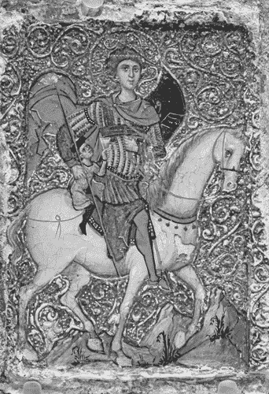

图 5.1 圣乔治与救援米提莱的少年 © World History Archive / Alamy Stock Photo

这一涉及圣乔治的圣像主题在土耳其征服后以及奥斯曼时期，在东中海东和小亚变得更加频繁。在这些时期，少年被描绘为苏丹宫中的基督徒仆人，但在基督教徒占少数的地区（如希腊和东欧），这一主题通常被用作乔治圣像的一部分。(132)


然而，涉及后马骑士的圣像类型既并非圣乔治所原创，也不是所有武圣共有的。至少自萨珊王朝以来，艺术品就描绘过萨珊国王巴赫拉姆五世（位位公元 420–438 年），他受到他喜爱的年轻琴师——奴女阿扎代德的射箭挑战。在《圣乔治与救援米提莱的少年》圣像中，我们看到了一个引人注目的区域性主题：年轻俘虏作为后马骑士被应用到被称为保护者的武圣的圣像叙事中。这种保护性的圣像主题对于圣乔治来说尤为合适，他是一位殉道的战士圣徒，击败了异教暴君，征服了龙，救了公主，并最终成为东中海最受欢迎的圣人。

## 第四：结论：圣乔治与黎凡特共同池

### 圣乔治的文献、图像和遗址反映了基督教传统的什么信息

我们在乔治的形象中看到了一种既合作又竞争的混合宗教环境。我们看到了犹太人、基督徒、罗马多神教徒/“异教徒”、犹太基督徒社区以及这些之间的各种分类。公元最初几个世纪的宗教环境正如许多农业宗教的特征一样，以魔鬼、圣徒、魔法和圣像的普遍信仰为主导，同时伴随着宗教组织中日益壮大的“正统性”群体，这一切我们都能圣乔治的文献和圣像中看到。

圣乔治形象本身——正如我们所看到的，它包含了多种宗教影响——对早期基督教所代表的是，一种与圣经传统认同、同时与犹太身份和实践区分开来的宗教运动。我们在早期基督教中看到一种宗教传统，它像犹太教一样，凭借其与圣经传统和希伯来圣经的关系，区别于希腊化世界的多神教传统。从《使徒行传》中，我们可以领略到新兴的基督教神观，即上帝与圣经中的上帝相同，但有了扩展或更清晰的描述：本质上是三位一体的，并且根据尼西亚会议后关于耶稣的当代帝国基督教立场，将耶稣纳入三位一体的第二位；既是人性又是神性，只是程度不异。

### 圣乔治与黎凡特共同池

在《使徒行传》中，我们看到圣乔治与圣经传统中的以利亚有明确的联系。乔治像以利亚一样，被被描绘成一个卓越的宗教竞赛人物，在面对假神时代表“真正的”神——在乔治的情况下，假神是罗马神。通过执行类似的奇迹并与特定的叙事（如寡妇和她的儿子）相关，《使徒行传》中的乔治显然是为他的观众基于希伯来圣经构建的。

我们从乔治的名字本身`Γεωργός`（`Georgos`）中也看到了他作为“农民”圣徒或崇拜形象的功能。他最早相关的符号（即使在文中也是如此）：雨水、绿色、丰饶、多产、闪电、4 月 23 日的节日日，特别是对蛇的胜利，这些表明圣乔治的早期崇拜可能起源于——或至少重叠，又可能提供了替代方案——当地的宙乌斯-巴尔或宙乌斯-格奥尔斯崇拜。

黎凡特共同池中一个早期就与圣乔治相关的重要主题，是击败人类敌人、龙或蛇的“圣骑士”。这种被无数罗马、犹太和基督徒人物所运用的无处不在的力量主题，不仅应用于圣像中，也应用于文献中乔治的形象中：在《使徒行传》中，乔治的作者刻意将乔治的对手命名为“蛇”或“龙”，将最终胜利的圣乔治定位为征服了具象的龙。

因此，不仅是公元 6 至 8 世纪最早的圣像证据，而且公元 5 世纪叶《使徒行传》的文献证据，证明了乔治从最早的证据开始就与征服龙有关。

因此，与龙的关联似乎是圣乔治形象的原始元素，并与其出生地东中海本土主题有关，而不是像通常声称的那样，是圣乔治传奇的“西方中世纪增补”。（133）

圣乔治因成为勇敢忠诚的基督徒殉道者而闻名，他经受了许多痛苦，最终在反对假神的宗教竞赛中取得了胜利。因此，圣乔治此后被人们永远与以利亚形象联系在一起，在他们看来，以利亚也曾捍卫过真上帝。

乔治因成为强大的保护者而闻名，能够拯救各种公主和俘虏；他是一位能够击败恶魔和巨龙的伟大救主。（134）此外，“绿色”乔治还是一位强大的农业人物，在地区范围内与闪电、风暴、雨水和作物有关。

## 结论

圣乔治是一个广受欢迎且强大的形象。在随后的几个世纪里，他成为了东地中海地区最盛传的圣人，也是最容易被认同为击败龙的圣人。即使在从公元 7 至 8 世纪开始的伊斯兰统治下，乔治仍然是一个广受欢迎和尊崇的人物。在从公元 1517 年开始的黎凡特奥斯曼帝国时期，基督教教堂的建造往往受到限制，但奉给圣乔治的教堂除外。（135）正如我们将看到的，黎凡特的穆斯林人非常尊敬圣乔治，并将他与《古兰经》中的人物海基德尔（`al-Khiḍr`）等同起来。

部分是因为圣乔治在基督教社区中的地区流行性，部分是因为奥斯曼帝国对其支持，今天，奉给圣乔治的教堂、圣地和修道院多于奉给任何其他圣人，仅次于受世人喜爱的玛利亚。（136）黎凡特的乔治遗迹要么位于有乔治圣像的教堂，要么分布在叙利亚、黎巴嫩、以色列和巴勒斯坦的各处，据传乔治曾在那里生活过、行过神迹或击败过巨龙。考虑到地理位置对这些叙事和主题发展的影响，意不意外，黎凡特境内许多据称是乔治与龙战胜场所的地点，通常与河流、洞穴和地下水有关。（137）

### 转向海基德尔（`al-Khiḍr`）形象

在公元 600 世纪和 700 世纪，当海基德尔这一形象出现在《古兰经》和经解/注释（`tafsīr`）来源中时，圣乔治是一个同时代的人物。正如我们所看到的，在那个时期，圣乔治是一个受欢迎的人物，但与黎凡特其他圣人和神灵相比，并不不像后来那样鲜明。此外，他的崇拜场所建立在整个东地中海的遗址，而不是在《古兰经》诞生的阿拉伯半岛。（138）

当海基德尔这一形象在 7 世纪出现在阿拉伯的文本中时，它正处于一种晚期古代的宗教环境之中。正如我们将看到的，圣经传统和圣经外的传说——以及更引人记忆的圣经人物（如以利亚）——构成了《古兰经》及其叙事和人物赖发展的晚期古代宗教环境的主体。说明的是，正如我们所看到的，早期伊斯兰文献（包括注释和哈训文献）中对海基德尔和另一个人物的最早文献引用和关联，总是指向以利亚的。

## 注释

“Der heliage Demetrius, Schutzheiliger der Bauern und Hirten, zugleich Beschutzer des Ackerbaus, schient, wie es Nilsson vermutet hat, zumindest teilweise das Erbe der mächtigen paganen Muttergottheit angetreten zu haben.” “圣德米特里，农民和牧羊人的主保圣人，同时农业的保护者，正如尼尔松所怀疑的，似乎至少部分继承了强大的异教母神遗产。”

Kloft, *Mysterienkulte der Antike*, 25.

# 6 伊斯兰的兴起与海基德尔

## 第一部分：引言与晚期古代伊斯兰的兴起

近东晚期古代（约公元 200–750 年）跨越了区域政治和社会组织的一系列巨大变革。（1）晚期古代时期通常被认为是古典罗马时代与古典伊斯兰兴起之间的活跃过渡期，它包含了罗马帝国分为西、东两部分、西部的政治覆灭以及帝国东部的兴起（我们现在称其为“拜占庭”，但当时他们并非如此）——地中海沿岸基督教的增长与分裂，以及在同时期的扩张拜占庭帝国和萨珊帝国内部及之间众多其他末世论和预言性宗教运动的激增。

拜占庭皇帝查士丁尼一世（公元 482–565 年）或许被认为是晚期古代最具代表的人物，因为他的阴影深深笼罩着东西方的历史。查士丁尼的遗产（在位公元 527–565 年）包括委托建造了现存的纪念性教会建筑和艺术品、东基督教正式的神学划分、将罗马法典修订为《民法大全》（`Corpus Juris Civilis`，至今仍是许多西方法律体系的基础），以及将帝国一度重新扩张到大西洋的宏伟计划。他既被称为“最后的罗马人”，又是“第一位拜占庭人”，考虑到拜占庭皇帝查士丁尼是伊斯兰宗教传统创始人穆罕默德·本·阿卜拉的同代人，这更加令人惊讶。

传统的穆斯林关于穆罕默德的记载他出生于公元 570 年，即查士丁尼去世五年后。（2）这种时间上的接近说明了本章将贯穿强调的一个大观点：《古兰经》和伊斯兰宗教传统的兴起，通常被描绘为与近东政治、宗教和社会历史的断裂和背离，但实际上它们是作为与晚期古代世界和社会知识潮流自然契合的运动而产生的。

在本章中，我们将考察海基德尔（`al-Khiḍr`，`الخضر`）形象。在穆斯林传统中，他因《古兰经》中相关的智慧文学叙事（`Q18:60–82`）而为人知，并在后的注释（`tafsīr`）中被命名。海基德尔是一个传奇人物，其阿拉伯名字大致意为“绿色的[者/人]”，在伊斯兰传统中被理解为教导摩西的智慧且奥秘的人物。这在随后的几个世纪里导致了海基德尔与穆斯林神秘主义传统苏菲派（`Sufism`）的联系，苏菲派围绕奥秘知识和`Q18:60–82`中展示的那种师徒教学关系而建立。海基德尔在早期伊斯兰文献中与圣经人物以利亚相关，且至少从公元 11 世纪起，他在东地中海地区被俗认为与以利亚和圣乔治这两个人物都相关。（3）

通过考察《古兰经》和注释性（`tafsīr`）文献中凯-希德尔（`al-Khiḍr`）最早的出现，本章从地理角度为伊斯兰人物凯-希德尔提供了背景。然而，与以利亚和圣乔治的文本不同，《古兰经》中与凯-希德尔相关的叙述并不称是对事件的历史记录，而是一个智慧文学的实例，使其成为一种超越时代且适用于所有时代的描述。（4）在凯-希德尔叙事进行地理背景化后，我们将其与类似的中世纪拉比“`al-faraj`”（解脱苦难”/“慰藉”）文学叙事进行了对比，后者涉及几乎相同的框架故事，但由以利亚取代了凯-希德尔作为智慧导师。本节调查了这些故事是如何相互影响的，以及它们如何影响了后来伊斯兰教中凯-希德尔与以利亚之间后续的文本关联。然后，本章考察了与凯-希德尔相关的重要形象，以及这些图像中的差异（通过地理起源地的思考得出的）预示了什么。本章认为，“凯-希德尔”这个名字很可能是古代晚期以利亚这一人物的头衔。在此之前，本章将对古代晚期的社会、宗教和政治环境进行历史介绍，《古兰经》及其人物和叙事正产生于其中。

## 阿拉伯环境

我们的描述于阿拉伯半岛，这是伊斯兰宗教传统最早的起源。从历史上看，定义阿拉伯和阿拉伯人的所在地一直是困难的，这很大程度上是因为起源于半岛中部和北部的阿拉伯人口传统上是游牧的。游牧可能是阿拉伯语词“`Arab`”（阿拉伯）的基础，因为从该词在圣经和亚述述文献中最早的历史出现开始，该术语就指的是在阿拉伯沙漠和叙利亚沙漠中季节性携带牲畜迁徙的人们。（5）因此，本项目中的“阿拉伯”（`Arabia`）一既指被红海和波斯湾环绕的阿拉伯半岛，（6），也指美索不达米亚以及现代叙利亚、约旦和伊拉克东部 200 毫米（8 英寸）等值线干侧的沙漠地区。（7）阿拉伯是一个面积近 150 万平方里的陆地；略比印度或欧洲大——涵盖了中东的大部分地区。（8）

### 阿拉伯地理

阿拉伯地理可以分为四个不同的地区：一个由坚硬岩石沙漠组成的中央高高原地区，被一系列三个相对较软且有时是沙质沙漠环绕。从北部开始是叙利亚沙漠，位于美索不达米亚和黎凡之间。那里南方是阿拉伯半岛北部的富德沙漠（`Nafuḍ`）；下方是鲁布哈利沙漠（`Rub’ al-Khālī`），即“空地”，世界最大的连绵沙漠，横跨半岛刀刃形中南部大部分地区。

半岛东部没有河流，但得益于丰富的地下水储备，几千年来一直支撑着定居人口和城市。该地区沿波斯湾或阿拉伯湾贯穿半岛东部，一直到现代阿曼。由于靠近美索不达米亚南部和伊朗较大的青铜时代文明，并由于其位于这些土地与阿曼铜矿之间的位置，半岛东部——特别是巴林岛及其周围的陆地（当时被称为迪尔拉克）——广为人知，并随着这些较大领土的命运而兴衰。（9）

阿拉伯半岛的南部地区大致与现代也曼重合，被罗马时代的地理学家称为“法利克斯阿拉伯”（`Arabia Felix`），意为“幸运的阿拉伯”。由于其地理位置，它接收季风雨，使其成为阿拉伯半岛唯一的大片茂盛地区。南部既能维持农业，又由于其植被——类似于东非（那里生长乳香和没药的灌木）——南部在公元前和公元后的第一个千年内成为强国的所在地，如巴伯/“谢巴”和希米尔（`Ḥimyar`），它们通过贸易致富。尽管被水环绕，但整个半岛沿岸唯一的适宜停靠港位于亚登（现代也曼），（10），为南部带来了贸易上的进一步优势：陆路和水路贸易路线都经过南部。

一条山脉贯穿半岛西部，并在南方达到最高点。因此，西部是山地，尤其是向西南方向，且通常不宜居住，除非是拥有地下水储备的地区以及某些支持固定社区的绿洲，例如塔伊夫（`Ṭā‘if`）、麦加、雅斯里/麦地那、哈伊巴（`Khaybār`）和泰马（`Taymā’`）。

由于半岛地理的多样性及其沙漠环境的恶劣本质，半岛的地区和民族在历史早期很大程度上是分离的，尽管从公元前第一个千年开始他们逐渐整合。最终，来自西部尤其是中部/北部的游牧人口（被称为阿拉伯人）开始主导半岛。（11）

### 阿拉伯贸易

尽管环境很大程度上不宜居住，但阿拉伯半岛位于历史上更大、更富有且政治组织更好的印度、美索不达米亚、非洲和地中海地区之间。对于大多数陆路贸易和所有的海上贸易，阿拉伯——大部分在边缘，但也包括穿过中部的沙漠——必须参与。这对于军事运输来说也是如此；有一个记载提到公元前 671 年的亚述国王埃萨哈德顿（`Esarhaddon`）感谢一位阿拉伯国王在他移动军队时提供骆驼和水袋的帮助。（12）

阿拉伯因其贸易和生产没药、乳香和其他香料而受推崇，同时也作为利润丰厚的丝绸之路贸易线上的重要站点，因此阿拉伯及其人民是更广泛的中东世界范围的一部分。虽然学术界对中东宗教历史的描述通常将中东的宗教和政治文化呈现为分割和离的，但事实上，神灵、故事以及我们现在所想的宗教概念在人们接触的地方都会自由流动。因此，贸易路线不仅应被视为物质商品的流动，也应被视为宗教思想和接触的媒介，并帮助我们想象中东宗教社区的连接性（图 6.1）。


图 6.1 中东贸易路线地图

## 阿拉伯宗教社区

贸易和阿拉伯半岛的偏远对地区宗教社区都具有吸引力。这在公元 451 年迦基会议之后对基督教社区尤为如此，当时阿拉伯成为一个教派传教极具吸引力的地点。由于位于竞争中的拜占庭和萨珊波斯基督教社区之间，阿拉伯为主教区提供了扩张潜力。(13)

### 阿拉伯多神教

关于阿拉伯地区内部宗教生活（后世伊斯兰历史记载之外）的已知情况，主要源于遍布整个半岛的数以万计的岩文。犹太人社区从公元前一千年起就存在于阿拉伯地区。然而，直到公元四世纪左右，大多数居民都是多神教徒。我们知道他们许多神灵的名字，是因为阿拉伯铭文最常见的形式是以某种方式祈唤神灵，通常是向神灵祈求或感谢。在大多数情况下，这些神灵在某些情况下与特定的地理区域有关，有时（正如受欢迎的女神`Allāt`那样）在阿拉伯半岛以及北叙利亚沙漠周边的地区（如帕尔米拉`Palmyra`和纳巴泰亚`Nabataea`地）广为人知并崇拜。

在半岛的西部，特别是希贾兹`Ḥijāz`地区（即麦加`Mecca`所在地），除了`Allāt`之外，似乎似乎也具有地方性；即阿拉伯古董学家命名的`al-‘Uzzā`和`Manāt`（《古兰经》16:16、19:80、22:72），以及至少在半千年前起就在叙利亚沙漠地区受到崇拜的女神。通常情况下，在阿拉伯多神教中，人们崇拜太阳、月亮和金星/`al-‘Uzzā`等星辰神。阿拉伯诸神通常与古典晚期更广的近东地区的多神教神女神相同，他们似乎像世界各地的神灵一样，代表了对人类重要但他们又无法控制的力量，如雨水、肥沃、健康、爱情和死亡。

阿拉伯宗教仪式和崇拜的一个特殊特征是，神灵是在被称为`aḥrām`（单数为`ḥaram`）的地方圣地（神庙）中被崇拜的。这些`aḥrām`由一个明确界定并标记的神圣区域组成，中心有一座神庙。通常由一个家族或部落担任神庙的守护者，在`ḥaram`范围内禁止暴力，这使其成为所有访问者尊仰神灵或进行贸易的神圣空间。正如阿拉伯城市塔夫`Ṭā‘if`和萨那`Ṣan‘ā`一样，穆罕默德`Muḥammad`的传统出生地麦加`Mecca`也是这样一个划分明确的圣地城市（至今依然如此），其中心是天房`Ka‘ba`。

### 阿拉伯的一一神教

阿拉伯半岛的犹太社区早在公元前一千年后半叶就已记载，特别是在半岛的西北和南部。到公元后的几个世纪，阿拉伯南部出现了相当大的犹太社区，特别是在希米亚尔`Ḥimyār`地区，一位犹太国王优素福·`Yūsuf Dhu Nawās`在公元六世纪早期统治过那里。

至少到公元三世纪，基督教社区已开始在阿拉伯建立。事实上，在五世纪特别是六世纪，在罗马/拜占庭帝国境内，鼓励阿拉伯半岛和非洲之角皈依基督教成为一项政策。公元 451 年山公会议`Council of Chalcedon`之后，不同派系的基督教社区开始在阿拉伯争夺新的领土和皈依者。因此，到六世纪，基督教社区遍布整个半岛。至少在南阿拉伯铭文方面，

尽管对公元四世纪后南部统治阶精英的宗教观点有此描述，但宗教倾向于多神教的大规模社区继续存在于整个阿拉伯半岛，这显然与当时广大近东地区的普遍宗教状况不同。在穆罕默德`Muḥammad`死后头两个世纪撰写的早期伊斯兰历史传统记载，强调了在穆罕默德的阿拉伯环境中，多神教社区的存在超过了同时代的犹太或基督教社区。鉴于这些传统记载在塑造对阿拉伯过去认知方面的影响，西方伊斯兰学者也接受了六、七世纪阿拉伯宗教构成主要是多神教倾向的观点，但随着新研究和视角的出现，这种情况开始发生变化。

考虑到阿拉伯犹太社区和基督教社区丰富的文本和物质证据，以及来自半岛以外来源的这些社区的文献证据——更不用说我们将看到的，《古兰经》`Qur’ān`正文中本身包含了这些社区存在的广泛证据——我们同样不应假设阿拉伯半岛在宗教构成上与晚期近东的其他地区有本质区别。到六七世纪，犹太人和基督徒社区（当然还有许多其他宗教团体）已遍布地中海、非洲、近东和中亚，正如在阿拉伯地区一样。因此，接下来我们将简要回顾六世纪末和七世纪初近东主要宗教社区的状态，因为这种环境构成了《古兰经》及其叙事和人物形成的宗教文化背景。

### 古典晚期近东的宗教潮流

在整个古典晚期时期，近东的主要政治力量是幼发底河`Euphrates River`西侧的罗马-拜占庭帝国和东方的萨珊王朝。所有其他地区政权——及其宗教社区都属于这两个宏大的轨道范围。拜占庭人和萨珊人不仅争夺领土，还争夺奢侈品——丝绸、香料和香料的贸易控制，这使得他们的利益与阿拉伯半岛紧密相连。在公元四到七世纪之间，拜占庭人和萨珊人发生了七次战争。

### 基督教派别与拜占庭帝国

正如我们在第五章（`chapter5.xhtml_chapter5`）中看到的，罗马拜占庭帝国在整个四世纪的帝国宗教倾向上变得基督教化，在世纪末将基督教确立为帝国官方宗教，并召开了多次教会会议旨在制定一套正统神学。因此，基督教的正统性是通过会议宣告的，会议宣布特定的神学教义是正确的，而其他则是异端。关于耶稣精确性质的神学辩论（称为基督论）随着正统观念的发展而演进。

早期的主流基督学以相信耶稣的人性为特征，因为使徒时代的基督教关注的是前三个福音和保罗的教导。然而，随着这种信仰的同时，正如我们在第五章中开始看到的，主流基督学的第二个基石正在形成；这一个基石开始主张耶稣的神性。这种基督学灵感源于《约翰福音》，其在该福音书中关于“道”（基督教三位一体中一个与“父”神不同的神性现实）化为肉身的的语言，而早在公元 180 年代，相信耶稣仅仅是人的基督徒（和/或犹太裔基督徒）就被标记为异教徒。然而，这种“道成肉身”的神学引发了棘手的问题，后几个世纪的神学家试图以不同的方式来回答；即，神性的“道”究竟是如何与耶稣的人格结合或化为肉身的？^(29)

公元 325 年的尼西亚会议建立了一个先例，宣布“道”是绝对且完全是神性的；与父神具有同性（同质，ὁμοούσιος）。尼西亚会议的结果在后来 381 年的君士坦丁会议上得到确认，此后，主流基督学变得与对“道”完全神性的信仰不可分割。随后，关于耶稣之母玛利亚的精确性质和头衔产生了争论。

在五世纪的前三分，君士坦丁主教聂斯丢（`Nestorius`）反对使用一个为马利亚发展的特定头衔——Θεοτόκος，“`Theotokos`”，意为“产神者”——因为他认为这个头衔在异教方面危害了马利亚的人性。聂斯丢更倾向于使用Ξριστόκος，“`Christokos`”，意为“产基督者”，因为这似乎是一个更合适的头衔。然而，公元 431 年的以弗所会议将马利亚的“产神者”头衔确认为正统，最终聂斯丢被逐出教会，这开启了基督教内部众多许多派系分裂的先河（一旦帝国正统立场与特定的神学立场相关联，派系主义就变得可能，正如 325 年的尼西亚会议所示）。聂斯丢及其追随者在萨珊波斯获得了庇护，并在那里发展了自己的教会，远离拜占庭那些执行帝国正统立场的人。这一教派被外部人士贬义地称为“聂斯丢派”，但该信条的成员自称为“东方教会”。

然而，关于耶稣的神性和人性究竟是如何结合的基督学问题仍然在发酵。主要的争论涉及耶稣的神性和性是二神性论的（两种性质；如果是这样，这两种性质是如何分离或结合的），还是耶稣的神性与人性的方面是单神性论的（一种性质）。公元 451 年，皇帝马提亚尼（`Marcian`）召开了迦基会议，以产生一份结束所有不确定性和争端的神学声明；会议宣布基督“在两种性中被承认”，但用这一主张平衡了立场基督也“在一个位格（`hypostasis`）中”。^(30)

“二本性”的表述对于叙利亚和埃及的主教们来说是一场神学灾难，他们认为这种表述不可挽回地违反了尼西亚会议的早期立场，尼西亚会议明确裁定基督与父神是“同性的”（`homoousious`）。^(31) 因此，公元 451 年的迦基会议产生了源自帝国基督教的第二个派系分裂：安提约（叙利亚）和亚历山大（埃及）教会拒绝了迦基表述，并颁布了自己的表述。

在安提约和亚历山大的表述中，基督被认为具有两种性质，但这些性质混合存在于一种性质或位格中——即与父神同性（ὁμοούσιος，`homoousious`）（这呼应了尼西亚会议的表述）。这些教派被称为东方正教（即：东方的正统，即神学立场由会议决定），并经常被错误地称为“单神性论”传统。事实上，这些教会实际上接受了耶稣的“二本性”——人性和神性的——性质，但认为这些方面在耶稣身上仅以一种混合的人性与神性的性质或位格存在。由于这个原因，对于东方正教，正确的神学称谓以及他们识别自己的分类是“合神性论”（`miaphysite`）。这些合神性论教会也被称为叙利亚正教教会和科普特正教教会。在古代晚期，这些教会通常被称为“雅各派”，因为合神性论的神学立场遵循叙利亚埃德萨主教雅各·巴拉代乌斯（`Jacob Baradaeus`），他从公元 543 年一直到公元 578 年去世。

迦基会议的效果还重新确认了由拜占庭皇帝认可的帝国正统神学立场。“正统”观点（即帝国可以强制执行的观点）是在迦基会议上阐述的信仰；即耶稣基督的二本性：这种理解认为两种性质，或位格（`hypostases`）——人类性和——在耶稣基督的人格中是分别关联的。坚持这一神学立场的教会被称为东正教，或希腊正教，反映了帝国基督教的语言。这些帝国正统教会在古代晚期被称为“麦尔基派”（`Melkite`），即“属于国王的”，源自叙利亚语`malkāyā`，意为“王权者”。

因此，在公元 451 年迦基会议之后，到六、七世纪，近东的基督徒包含了几个定义明确的社区，每个社区都有自己的神学解释。拜占庭或帝国正统的“麦尔基派”基督徒（礼仪语言为希腊语，有时为巴勒斯坦阿拉米语`CPA`或叙利亚语，^(32)）在安纳托利亚、巴尔干、希腊、巴勒斯坦和帝国权力中心占据主导地位。在叙利亚、埃及和亚美尼亚，特别是非城市地区，“雅各派”合神性教会（礼仪语言为叙利亚语和科普特语）是主流。在波斯和幼发拉河以东，“聂斯丢派”单神性论教会（礼仪语言为叙利亚语）盛行。

### 萨珊帝国与琐教

在幼发拉河以东是萨珊帝国（224–651 年），它向东延伸到阿富汗和中亚，首位于位于底斯封。这个大帝国许多人的主要语言是中波斯语（称为帕里维语）。除了琐教之外，帝国内还存在几个宗教社区。

自犹太人被掳流到公元前 587/6 年以来，波斯就有大型犹太人社区。事实上，就是在波斯的幼发拉河和底格里斯河沿岸，犹太学院的所在地，《巴比伦塔木德》也是大约在公元 600 年编纂的。此外，还有大量的基督徒社区，包括叙利亚合神性论者所谓的聂斯丢派；聂斯丢派（或东方教会）的主教席位于底斯封。除了许多较小的宗教社区外，帝国东部还有大量的佛教徒。

然而，最大的宗教传统，也是因与萨珊王朝合一而带有帝国色彩的传统，是罗亚斯教。罗亚斯教以其创始人琐罗亚斯德（زردشت‘zardosht’）命名，是一种二元论信仰，它将宇宙视为善恶力量斗争的场所，善的力量以神灵`Ahura Mazda`为代表，而恶的力量以神灵`Ahrimān`为代表。善的力量以光——尤其是火为象征，而恶的力量以黑暗为象征。罗亚教的仪式既涉及太阳，也涉及火庙，在火庙中，祭司们持续保持火焰燃烧.^(33) 许多罗亚教的思想被吸收进犹太教的信仰和教义中（因此进入了后来的基督教和伊斯兰教），并独立向西传播。其中最著名的理念是“二元论”（特别是关于天堂与地狱、善与恶、光与黑暗的概念）。^(34)

### 苦行主义与启示录主义

晚期古代宗教环境的一个普遍特征是趋向苦行主义的倾向。生活在埃及沙漠的基督教隐士效法他们认为耶稣所倡导的苦行生活，修道院社区于 3 世纪开始在埃及出现。4 世纪至 6 世纪期间，修道院在整个近东地区建立；特别是在巴勒斯坦的`Mar Saba`、叙利亚的`St. Simeon`以及美索波不达米亚的`Quartmin`。

通常，一位著名的隐士是建立修道院社区的基础，例如叙利亚的柱上修士（“柱上圣”；即生活在柱子或圆柱顶部的苦行者）`Simeon`。近东地区著名的苦行者经常受到平民的造访，希望借此获得这位神圣个人的一些圣性。总的来说，4 世纪到 6 世纪基督教内部一场更广泛的苦行运动“见了一系列流行宗教实践的形成，包括朝圣、游行、对圣徒圣迹和遗物的崇拜以及对圣像的尊崇”，这些实践为信徒提供了与神圣性具体的接触。^(35)

晚期古代宗教社区的另一个特征是对即将到来的“启示录”日益增强的感，即对即将到来的灾难性世界末日的预测。启示录传统通常涉及道德、灾难性的毁灭以及随之而来的一个正义者（有不同的定义）将获得奖赏的时代。^(36)

### 先知传统与虔诚

先知传统——即“遵循受神启示或认可的领导者的教导、伦理和法律”的社会宗教生活——至少可以被认为是从青铜时代起近东主要的宗教现象。^(37) 近东的多宗教并存和教派主义最好被理解为相互竞争的宗教运动，它们共同一个首要元素：即先知传统。

与晚期古代近东日益增长的苦行主义情绪相似但并不等同的是，是涉及虔诚导向和实践的宗教运动的增长。这最直接地体现在通过基督教政府代理对古典公民组织的重新诠释中：

### 圣经

晚期古代时期也可以通过圣经的汇编和编纂化来表征。在公元 2 世纪到 5 世纪之间，完成了权威的拉丁语、叙利亚语和其他版本的希伯来圣经和新约圣经。在萨珊时期，罗亚教的经文《阿维斯塔》（`Avesta`）被汇成文字形式，正如《阿维斯塔》的注释《但》（`Zand`）。从 5 世纪到 7 世纪，代表巴勒斯坦和美索波不达米亚两个犹比学者学术中心的巴勒斯坦塔木德（`Yerushalmi`）和巴比伦塔木德（`Bavli`）完成。^(39) 对《米纳》（约公元 200 年，`Mishnah`）中收集材料的详尽注释，以及拉比法律和传统的首个权威汇编《塔木德》（`Talmuds`），是近东和地中海犹太社区最卓越的法律文本。^(40) 因此，晚期古代近东的宗教社区其定义“在很大程度上取决于他们拥有自己的编纂圣经这一事实”。^(41)

### 《古兰经》：晚期古代宗教文本

《古兰经》由 6000 多节用阿拉伯语写的的神启“诵读”（`Q 75:17–18`）组成，大部分由“萨吉”（`sāj`）组成，这是早期阿拉伯诗人特有的韵律散文风格（`Q 68:41–42`）。传统的伊斯兰历史和主流学术将启示时期定于公元 610-632 年，并将《古兰经》官方版本的编纂定于哈里发`Uthman`统治时期，约公元 650 年。^(42) 这些日期在不久的将来可能会被修订，但目前它们仍是主流，本项目的视角也是《古兰经》在公元 7 世纪下半叶达到了其编纂形式。^(43)

在接下来的章节中，我们将讨论《古兰经》中的犹太人和基督徒，以及《古兰经》中的圣经。我们还将讨论《古兰经》的特定特征，例如它对三位一体的批判以及其独特的先知论——以`Muḥammad`为代表，但也体现在《古兰经》中的人物亚伯拉罕和摩西身上——以及这种先知论如何符合《古兰经》关于神的观点。这些信息对于准确理解晚期古代环境下的《古兰经》非常重要，这也是这也是关于“哈德尔”叙事的论框架。

《古兰经》并非像某些圣经那样按时间顺序排列，而是由启示发生后根据外部排序方案汇编的特定启示实例组成。从对《古兰经》的阅读中得出几个主要主题。首先，《古兰经》传递了严格的一神论信息，恳请听众承认并时刻神的独一（称为`tawḥīd`）。《古兰经》的大多数其他主题都源于这一独特的核心概念，如虔诚、义的生活、慈善、与犹太人和基督徒经文相关的“书”的概念，以及对“末日”的信仰，这反映了独特的启示录观点，以及先前的神慈。

《古兰经》所针对的听众是一神论者，大量的《古兰经》启示假设对圣经故事和传统的熟悉。此外，《古兰经》很少称其听众为“穆斯林”，而是将`Muḥammad`及其追随者称为“信徒”（`mu’minūn`）。`islām`和`muslim`这两个词都出现在《古兰经》中，但`muslim`只出现了 75 次，而信徒`mu’minūn`出现了近千次。^(45) 大多数学者认为，正如犹太教和基督教（或任何宗教传统）一样，“伊斯兰教”是逐渐成为一种独特的宗教传统的。这也是本书的观点，正如犹太教和基督教的排他性圣经传统一样，“伊斯兰教”的出现在很大程度上也是在与长期近东的多神教宗教实践的对比过程中产生的。

### 《古兰经》中的基督徒和犹太人

也许《古兰》受众中存在基督徒和犹太人最根本的证据，是它假定受众对圣经叙事、人物和传说的熟悉程度。《古兰》中几乎没有长篇叙事或对圣经故事的重述；相反，的是对叙事和圣经人物的援用。有时，《古兰》会对这些人物或故事进行评论，或给出额外的细节或解释。[⁴⁶]

《古兰》显然也假定受众中存在说阿拉伯语的犹太人。在《古兰》中，这一群体被提及了约 30 次，使用了“犹太人”（`yahūdī`、`yahūd`）、“宣称犹太教的人”的动词形式`hādū`，以及在提到摩西时代或托拉法启示时，称为“以色列人民”（`banū isrā’īl`）。[⁴⁸]

至少有四种方式证明了古兰受众中存在基督徒：
1. 《古兰》中存在非阿拉伯词汇（正如我们将看到的，主要是`叙利亚亚语`）；
2. 《古兰》中对同时代圣经之外传说的援用；
3. 对基督教教义和实践的独特批判；特别是对`三位一`概念；
4. 对基督徒的直接引用，主要称为`naṣār`（`拿撒勒人`）。[⁴⁹]

此外，伊斯兰传统记录了这些群体的人在早期伊斯兰历史中的重要性。传记（`sīrah`）传记文学以及圣训（`ḥadīth`）文学传统包含了`穆罕默德`与`雅斯里/麦地那`的几个重要犹太部落以及当地基督徒互动的记载。诸如`Waraqah ibn Nawfal`（据说是`穆罕默德`第一妻子`哈迪彻`的一位博学的亲）和`Sergius Baḥr`（据说见过儿时的`穆罕默德`并注意到其特质的叙利亚修士）等人物在伊斯兰传统中占重要地位。然而，在《古兰》的引用中，《古兰》并没有直接指代犹太人或基督徒，而是将这些群体称为“书之民”（`ahl al-kitāb`）、“经文之人”或“圣经之人”，共出现了 54 次，这不仅表明这些群体在当时的存在，而且特别体现了《古兰》视角认为犹太人和基督徒拥有权威性的经文。[⁵⁰]

关于《古兰》环境中存在这些群体的另一种证据源于后期的伊斯兰历史著作。特别是`Muhammad b. ‘Abd Allah al-Azraqī`所著作的《麦加纪事》（`Akhbār Mecca`），回溯了麦加和麦地那周围众多的基督教地标，包括玛利亚清真寺（`masjid Maryam`）、基督徒站（`mawqaf al-naṣār`）以及克尔白（`Kaba`）内的一个圣像。`Al-Azraqī`于公元 865 年去世，他的一生远晚于《古兰》时期。[⁵¹] 然而，他的记载仍然是九世纪麦加和麦地那同时代崇拜场所和建筑地标的重要记录，而且这些基督教空间不太可能是在伊斯兰成为帝国力量之后在伊斯兰世界的历史中心建造的。

### 《古兰》中的圣经

### 圣经作为《古兰》的底层文本

从内容来看，目前《古兰》环境中最为显著的经卷是希伯来经（`Q 5:44`）和拉比注释，以及福音书传统（`5:47`）和其他新约圣书。[⁵²] 圣经之外的传说，以及犹太和基督教正典之外所谓的伪经也同样重要。圣经传统之外的叙事和人物（例如来自《吉尔伽美什史诗》的）也可能是《古兰》中部分叙事的基础。[⁵³] 然而，《古兰》占据主导地位的宗教背景涉及同时代犹太人和基督教群体的正典和非正典圣经传统。

《古兰》还记录了几个非阿拉伯词，其中一些已被证明最终源自`阿卡德语`、`乌加拉语`、`希伯来语`、`阿拉米语`、`叙利亚亚语`、`埃塞俄语`以及可能的`希腊语`。[⁵⁴] 在《古兰》中引用宗教术语的章节，特别是关于基督教思想和实践的部分，大量具有`叙利亚亚语`和`格厄兹语`背景的词。[⁵⁵] 考虑到阿拉伯地区基督教宗教群体的构成——叙利亚沙漠地区的`叙利亚亚语使用者`以及贯布半岛任何存在`雅各派`社区，以及至少从六世纪初起存在于南部纳朱兰（`Najrān`）的`埃塞俄比亚/阿比西尼尼亚`社区（其礼仪语言为`格厄兹语`——这些宗教术语的语言起源是自然的，特别是当《古兰》中涉及到同时代的神学问题时。此外，《古兰》的环境主要与`叙利亚语`社区交汇，而非`希腊语`社区，后者在很大程度上限于叙利亚和巴勒斯坦的城市化沿海地区，如安提约和耶路撒冷。[⁵⁶]

压倒性的是，《古兰》中的外来词源于`叙利亚亚语`——根据某些估计，占非阿拉伯术语的高达 70%。[⁵⁷] 即使是`古兰`（阿拉伯语意为“诵读”）一词，早期也可能与叙利亚语词`qeryānā`有关，意指“选读本”或教会仪式上朗读的圣经部分。[⁵⁸] 近期的研究进一步证明了《古兰》语言叙事与`叙利亚基督教`叙事之间的联系。对叙利亚文学的理解有助于阐明《古兰》中关于`三位一`、`耶稣`的性质、`玛利亚`的叙事`睡室少年`的故事（`Q 18:9–26`）、`双角者`的叙事（`Q 18:83–98`）、`Q 56:22`中的`仙女`（`hūr`）乃至《古兰》的法律文化。[⁵⁹] 事实上，“在《古兰》中可以找到回响、援用或引发的基督教背景传说（包括正典和伪经），其可能的背景指向`阿拉米语`或`叙利亚亚语`。”[⁶⁰] 即使是希伯来圣经中的叙事以及`亚伯拉罕`、`约瑟`和`摩西`等古代圣经人物的故事，它们在《古兰》中被引用和呈现时，也可能具有`叙利亚语`背景。[⁶¹]

这些表明《古兰》中存在圣经及其相关传说，以及当代犹太和基督教社区及其神学取向和辩论的研究是如此普遍，以至于`Gabriel Said Reynolds`建议圣经可以被理解为《古兰》的“底层文本”。[⁶²] `Sidney Griffith`同样将《古兰》的角色之一描述为“一种阿拉伯语圣经注释，对圣经做出反应”，尽管他进一步澄清，“伊斯兰经文的范围和目的显然比与圣经的互动要得多，尽管其神圣信息被呈现为与早期经文连续的。”[⁶³]

考虑到阿拉伯语在伊斯兰教之前的写作水平，以及缺乏任何存世的伊斯兰前阿拉伯文学实例，古兰研究领域的主流结论是，《古兰》中出现的圣经及圣经外传说一定是在阿拉伯半岛的环境内以口语阿拉伯语传播的。阿拉伯犹太人和基督徒社区可能在教会或神职背景下，使用礼仪语言（例如叙利亚语、希伯来语、阿拉伯语，也可能还有希腊语）接触经文，可能也有口语阿拉伯语翻译。

考虑到《古兰》对圣经及其宗教社区的讨论性质，《古兰》似乎在其受众和环境的一部分，指的是那些遍布整个大近东的大多数和“主流”犹太人和基督徒社区。“根据伊斯兰经典文献对[犹太人]及其宗教习俗通过接受或批评的描述，以及它从他们的经文传统中所唤起的内容，《古兰》心中想的是 7 世纪初的犹太人。”在基督徒中，《古兰》中引用的圣经、伪经和教会传说“均在当时所谓的麦尔基派（`Melkite`）、雅各派（`Jacobite`）和聂斯里派基督教社区中流传”，这表明《古兰》中引用的基督教经文和社区反映了当时主流的近东基督教社区。

### 《古兰》的修正：对基督教三位的批判

正如最近的研究所强调的那样，《古兰》并非简单地引用圣经材料；相反，人物和叙事是以一种本质上的改革方式被重新回忆的，以此呈现出一种替代或“纠正后”的立场。《古兰》并不是要重述圣经故事，而是要在其自身话语的纠正框架内回想起并重新整理它们。”

例如，《古兰》对当时的基督教三位一体概念持高度批判态度，并对其予以断然拒绝（`Q 4:171, 5:72–78`）。《古兰》在 5:73 中谴责了“上帝是三者之一”的观点，即`thālith thalāthatin`，这一概念在当时的叙利亚基督教讲道文中很常见，其形容词形式为`tlîthāyâ`，意为“三者之一”、“三位一体”或“三位一体”。事实上，在 5:75 中，《古兰》指出：

在此段落中，《古兰》不仅批判了三位一体的概念（通过主张耶稣基督实际上是一个像之前的先知一样的人类使者），还加入了涉及玛利亚本质的基督教神学辩论。《古兰》明确将基督基督称为“玛利亚之子”`ibn marīam`，尖锐地认同了当时聂斯里派拒绝为玛利亚使用`theotokos`（诞神母）这一称号的做法，而雅各派和麦尔基派的教义接受了这一称号，转而采用`Christokos`（基督母）这一称号，因为后者强调了玛利亚的人性。

### 《古兰》的先知学

正如西德尼·格里菲斯（`Sidney Griffith`）敏锐指出的，《古兰》中圣经材料的值得关注之处在于，它并不涉及

圣经的大章节从未在《古兰》中被提到，例如保罗的书信，这些信对当时的基督教社区非常感兴趣。这似乎是因为，《古兰》呈现的是一种《古兰》特有的预言历史版本。

当先知在《古兰》中被唤起时，很少以一种引用圣经叙事的详细方式进行描述。相反，《古兰》中的引用更类似于“释义、影射和回声”，这表明《古兰》的受众应该是熟悉这些人物的。此外，《古兰》对先知、族长和圣经叙事的引用并非随机的，而是根据《古兰》独特的先知学进行选择的。

对预言人物的回忆是以一种方式呈现的，最终落实于穆罕默德的人物及其预言事业，他被描述为“先知的封印”`khātama al-nabīīn`（`Q 33:40`）；即最后的先知。正如格里菲斯描述的那样：

### 圣经与《古兰》中先知的差异

希伯来圣经中的先知是被明确选中并受神圣启示的个体，他们在特定的时地点进入救赎历史叙事，以对“雅华（`Yahweh`）是上帝”这一观点做出虔诚的见证，并恳求他们被派遣的社区也这样做，并严格按照雅华启示律法的精神生活。《古兰》中的先知（无论是圣经的还是《古兰》的）是救赎历史的主要人物，他们的角色是将上帝纯净且不变的信息传给他们被派遣的且他们所属的社区。他们面临来自社区的抵抗（参见路加福音 4:24），这些社区的成员最终也扭曲了带给他们的信息，但上帝总是支持先知的使命并为他们平反。

此外，《古兰》中有两类不同但重叠的先知类别，这些类别在圣经中并没有完全对应的对应物。先知`nābī`是上帝派遣给特定民族以宣扬上帝信息的个体，而使者`rasūl`是一个排他性强得多的类别，他向他的人民传达启示。《古兰》中引用的主要使者（还有其他）是亚伯拉罕，他被降了《启卷》`ṣḥuf ibrahīm`（`Q 87:19`）；摩西，他被降了《律法》`al-tauwrat`（`Q 5:36`）；大卫，他被降了《诗篇》`al-zabūr`（`Q 4:163`）；耶稣，他被降了《福音》`al-injīl`（`Q 57:27`）；以及穆罕默，最后的先知和使者（`Q 33:40`），他被降了作为最终且完美的启示的《古兰》（`Q 42:7`）。

### 严格一神论视角下《古兰》中的亚伯拉罕、摩西和穆罕默

《古兰》中最著名的著名的亚伯拉罕和摩西。亚伯拉罕在《古兰》的先知体系中极其重要，是因为他（与以实玛一起）建造了天殿`al-bayt`（`Q 2:127–128`），但主要由于他作为捍卫上帝的“偶像斗士”的角色。关于亚伯拉罕的传统在圣经中并未提到，而是源于三至五世纪用阿拉伯语编写的、关于《创世记》的流行的犹太教德拉希（寓言/讲道式注释），它详细阐述了亚伯拉罕生活的细节。伊斯兰传统描绘了穆罕默像亚伯拉罕一样，摧毁了穆罕默时代存在的偶像和偶像崇拜（这一次偶像是在天殿内），并力图引导人们信仰上帝，上帝是神圣经文的作者。此外，《古兰》引用的“亚伯拉罕的信仰”`millāt ibrahīm`与既不是犹太教也不是基督教相关，而是一个哈尼夫`ḥanīf`，一种虔诚的宗教取向，被认为与纯粹的一神论（`Q 3:67`）、与先知亚伯拉罕相契，并且“与穆罕默的消息相一致”。

《古兰》中按名字提到最多的先知是摩西。他被提到了 136 次，他的生活被详细描述，有时在多个章中重复出现。摩西信息的核心是

从这段文字我们可以总结出四个重要的要点：首先，古兰经中神的概念（`Allāh`）与希伯来经中的神被明确对应。其次，这节经文所体现的古兰经神观，与后期伊斯兰教教义声明中的“لا إله إلا ﷲ”，`lā ’ilāha ’illā llāh`（“唯有真主”）相呼应。第三，古兰经认知中的神不仅仅是一个神/神灵（`īlāh`），而且显然通过特定的名称`Allāh`来标识；因此，古兰经中的神至少具有某种阿拉伯关联，甚至是语言上的关联，尽管古兰经中所呈现的神（`Allāh`）与摩西的神是同义的。第四，被派遣接受托拉法的摩西，在`Muḥammad`的人物身上得到了对应，穆哈默德同样是一位接受了神圣经文启示使者。

古兰经中共有 18 次提到了托拉法的名称。在 12 次以上的情况下，托拉法被称为“我们带给摩西的经书”（`Q 2:53`和`2:87`）；有两次，托拉法被称为`al-furqān`（`Q 2:53`和`21:48`）。

通过这种方式，`Muḥammad`被描绘得与摩西相似，摩西带来了一部能够“区分”的神圣经文；同时也与亚伯拉罕相似，根据后期的`sīrah`文学，亚伯拉罕曾与偶像崇拜作战，并建立了古兰经中提到的一些最重要的仪式和圣地。在他之前的摩西和亚伯拉罕一样，`Muḥammad`在古兰经中呈现为一个典范式的先知和使者，穆哈默德在很大程度上通过带来一份“区分”或“分离”的文本实现了这一点。从这个意义上说，古兰经也可以被理解为一种异端文本，因为它创造了“真”与“假”崇拜的标准。最重要的是，古兰经推广了一种严格的一神教标准，这种标准既与当时的各种神教实践和社区形成对比，也与当时的一神教社区和观念（例如基督教的三位一体概念）形成对比，而这些在古兰经中被视为平庸的一神教形式。`El-Badawi`认为，古兰经的“严格一神教”是“一种本质上反三位一体、后拉比时代且具有末世论色彩的一神教”。本项目的观点亦如此。

### 本研究运用的古兰经版本

本研究中的古兰经引用自 1924 年标准版的开罗手抄本（`muṣḥaf`）。开罗`muṣḥaf`版本与与`‘Asim`（约公元 744 年）相关的古兰经特定读法`qīra’`相联系。此处的译文部分选自`A. J. Droge`的作品《*The Qur’ān: A New Annotated Translation》，或注明为我自己的翻译。

## 第二部分：al-Khiḍr 文本：`Q 18:60–82`

### 引言

《山洞洞章》（`Sūrah al-Kahf`）中关于摩西与神秘仆人的故事是古兰经中最奥秘的段落之一。它围绕着摩西寻求知识的旅行展开，他的人物在后期传统中被确认为`al-Khiḍr`（绿衣者）。在叙事中，摩西遇到了这位仆人并请求许可跟随他，但仆人警告说摩西将无法保持耐心。在整个旅途中，仆人执行了三个在摩西看来无法解释的行为：凿破一艘船、杀死一个少年以及在一座敌对城市中修复一墙。在每一个例子中，仆人都揭示了其行为背后的隐藏智慧，证明了摩西的理解是有限的，且神性的旨意在起作用。这段叙事深刻地说明了人类知识的局限性以及神圣引导的必要性。

《山洞章》的独特之处在于其包含了三个主要的叙事：首先是“穴中人”（18:9–26）；其次是“摩西与仆人”，在注释学（`tafsīr`）中，哈德尔（`Khiḍr`）后来被认定为这位“仆人”（18:60–82）；第三是“双角者”，这是一个关于一位通常被认认为是亚历山大王人物的叙事（18:83–98）。《山洞章》的特别不仅在于这些故事，还因为其中至少两个故事——“穴中人”和“双角者”——在叙利亚基督教文学中具有前身，因此，《古兰经》中这些叙事的细节通过与这些叙利亚平行的平行文本进行对比研究而得到了阐释。“摩西与仆人”的叙事之所以引人注目，是因为正如我们将会看到的，它是《古兰经》或圣经中关于摩西的唯一此类记载，尽管这一叙事也可以通过在智慧文学和师徒教学文学这两种体裁中理解它得到阐释，这两种体裁在当时的拉比传统和基督教传统中都是常见的。

本章除三个主要叙事之外的短故事和寓言包含了：劝诫人们遵循“经”（`al-kitāb`）中的神圣引导，即指《古兰经》（18:1–3）；反三位一体的论辩（18:3–8 和 110）；对先知其使命的鼓励（18:27–29）；对不信者凄惨后世的警告以及对信者天堂的许诺（18:29–31 和 102–108）；两个拥有邻接园林之人的寓言：一人富有但不虔诚，另一人财富和子孙较少但真正虔诚，并说“这是上帝所喜爱的”；前者的园林因过度扩张而荒废，听众被提醒：上帝是全能的，义行的行为持续时间更长，报酬也优于所谓的“今世的华丽”，如财富和子孙（古兰经 18:32–46）；反对偶像崇拜以及伊布力（`Iblīs`）^(93)和魔鬼^(94)的警告（古兰经 18:50–51）；启示性的审判场景（古兰经 18:47–49, 52–53, 99–101）；关于不信及其后果的警告（古兰经 18:54–59），以及一段简短说明：如果海洋作为上帝启示话语的墨水，那么海洋在上帝的话语用尽之前就会枯竭（古兰经 18:109）。

然而，这些伴随长篇的叙事和寓言并非随机或断裂的插入：它们在全章的整体结构中是有意义的。卡尔·恩斯特（`Carl Ernst`）指出，《山洞章》遵循一种特定的模式，这是“麦加中期及后期麦加章”的特征。^(95) 该章开头和结尾八节之间刻意的对称性体现了“环形结构”（`ring composition`），即开头和结尾的特定节在刻意上相互平行，主要围绕《古兰经》的启示（18:1 和 18:109）、启示录（18:2, 8 和 18:102）、反三位一体论（18:4–5, 18:110）、最后的审判（18:103–108）以及《古兰经》中关于穆罕默的先知论（18:6 和 18:110）。

除了开头和结尾部分的平行外，本章其余较短叙事和寓言位于“穴中人”段之后、“摩西与仆人”段之前，这表明第 18 章的叙事是根据特定目的安排在特定位置的，而不是随机聚集在一起。除了这些结构元素外，整个章还具有特定的神学取向，我们将在下文中看到。

### “穴中人”古兰经 18:9–26

“穴中人”的叙事（古兰经 18:9–26）通常被认为与著名的叙利亚基督教传说“以以以所弗的七个睡者”。^(96) 在那个最早出现在公元 6 世纪叙利亚语来源的记载中，“睡者们”是来自以弗所（现今土耳其）的年轻人，他们躲在一个洞穴里以避免臭名昭著的罗马皇帝德丢修（`Decius`，公元 249–251 年在位）的迫害。^(97) 在传说中，他们在洞穴里“睡着了”多年（即上帝将他们的灵魂带到天堂，而身体留在洞穴中）。^(98) 他们在狄奥多西乌二世（`Theodosius II`，公元 408–450 年）统治期间醒来，由于在那里停留太久，以至于帝国甚至皇帝本人都变成了基督教徒。然而，在狄奥多西乌二世时期，一些基督徒开始怀疑肉复活的真实性，而是主张只有灵魂复活。得知洞穴中人的后，皇帝急忙去看他们，他们向皇帝宣布他们被“唤醒”是为了证明复活的真理。

《古兰经》的叙事将“穴中同伴”列为上帝的神迹或标志（`ayāt`）。他们进入洞穴是因为，正如《古兰经》记载，这些年轻人敬畏上帝并拒绝了上帝以外的神，因此上帝指示他们在洞穴中避难。他们在那里停留了 309 年，直到上帝“复了他们”，使人们知道上帝关于身体复活的承诺是真的，并且对末日毫无疑问（古兰经 18:19–21）。

对这一故事的叙利亚语来源的近期研究帮助阐明了长期困扰注释者（`mufassīr`）的一个方面：即为什么《古兰经》的故事会提到一只狗（“它们的狗爪伏在门口”，古兰经 18:18），而在伊斯兰传统中狗是不洁净的。正如加布里尔·赛德（`Gabriel Said`）所证明的，《古兰经》中提到的“狗”在叙利亚文学和基督教传统的范围内是合理的。^(100) 在雅各·塞尔格（`Jacob of Serugh`，卒于 521 年）关于该主题的叙利亚语讲道（`mêmr`）中，塞尔格将“睡者们”描述为“一群羊”和“受祝福的羔羊”，上帝为他们留下了一个守望者来守护肢体。^(101) 根据塞尔格的牧牧比喻，守望者不仅可以被解释为看门狗或牧羊犬，^(102) 而且正如当时的访问者狄奥多西乌的旅行记录所示，到公元 530 年，以弗所已因其“七个睡觉的兄弟和他们脚下的狗 Virus”而闻名。^(103) 《古兰经》对基督教“七睡者”传说的描述展示了“古兰经如何一方面消除了基督教的框架，另一方面提供了一个伊斯兰的、《古兰经》式的视角，在这个视角下，传说具有全新的诠释意义。”^(104)

### “双角者”古兰经 18:83–102

“双角者”叙事中的主要人物通常被认认为是马其顿亚历山大三世（“大帝”，公元前 356–323 年）。^(105) 凯文·范·布拉德（`Kevin van Bladel`）遵循特奥多·诺尔德克（`Theodor Nöldeke`）和 G.J. 莱因克（`G.J. Reinink`）的原作，有力地证明了：名为`Neṣḥānâ dîleh d-Aleksandrôs`（“亚历山大的功绩”）的叙利亚语文本（约公元 630 年，一份由 E.A. 华利斯·巴吉（`E.A. Wallis Budge`）于 1889 年与叙利亚版的《亚历山大传》一同发现，并在学术界被称为“亚历山大传说”）是古兰经 18:83–102 中双角者故事的来源，而古古兰经的版本基本上是其重述。^(106)

结合 G.J. Reinink 的研究，`Van Bladel`证明了叙利亚《亚历山大传奇》写于“罗马人”与波斯人之间漫长而艰难的战争（603–630 年）末期，这场战争被证明是拜占庭帝国与萨珊王朝之间的最后战争。极有可能，《亚历山大传奇》写于公元 630 年，那一年赫拉克柳乌斯皇帝最终扭转了十多年来波斯对拜占庭帝国大片地区的控制，据报道赫拉克柳乌斯在这一年还将圣架遗迹带回了耶路撒冷。`Reinink`和`Van Bladel`均认为《亚历山大传奇》是一部启示录，也是“一份支持赫拉克柳乌斯的战后宣传品”，旨在重新恢复罗马对曾受波斯控制区域的统治，并克服帝国内卡尔基教派基督徒与非卡尔基教派基督徒之间分裂的基督论差异；其方法是将广为人知的亚历山大形象与赫拉克柳乌斯皇帝等同，并以一条“拜占庭帝国末世论的信息”作为传奇的结尾：预言一位拜占庭皇帝很快将建立一个全球性的基督教统治，随后将是世主的归来。”^(107)

《传奇》与《古兰》第 18 章 83–102 节所记载的事件在顺序上完全一致，且《古兰》故事中的几乎每一个元素在《亚历山大传奇》中都有更详尽的对应描述。因此，即便不是直接引用，而是通过口头传传，“一篇在穆罕默德生末期非常流行且重要的叙利亚语文本被改编成了《古兰》中的二十节经。”^(108)

然而，与《传奇》不同，《古兰》的叙述并没有包含最后的预言宣布罗马人最终将击败波斯人并建立一个持续到世主回归的全球性基督教统治。相反，《古兰》的叙述以双角王（`Dhū al-Qarnayn`）的警告结束，即上帝的审判即将来临（98–102 节）。因此，《古兰》的叙述通过强调其自身的信息对这一流行的当时故事进行了^(109) 适配：““古古兰》的叙述更强调事物的即将终结和上帝的审判，意不的是，它没有提到对罗马人建立全球性基督教帝国的任何期待。”^(110)

## 晚期古代的参考

除了《古兰》在“穴中人”和“双角王”叙事中分别与之对话的叙利亚基督教故事“七睡者故事”和《亚历山大传奇》外，第 18 章中还有几处对圣经经文和社群的援用，这有助于阐明《古兰》共有的人物、叙事和主题库。除了通过反三位一体论的辩论对当时的基督教形式（`Q 18:3–8`和 110 节）进行提及外，我们还看到了比喻（`Q 18:32–46`）的存在，这种比喻在晚期古代时期是一种流行的教诲性叙事体裁，并特别体现在归于耶稣的圣经语言中。^(111) 我们还看到了对天堂`firdaws`（`Q 18:107`）以及地狱`jahannam`/‘Gehenna’（100，106 节）和“火”`nār`（`Q 18:29`）的提及，这呼应了当时圣经（特别是基督教）及更广泛近东文献中二元论、启示录和末世论信仰。最后，我们在本章中看到了《古兰》共有人物和主题的反映：对圣经人物“哥及和马各”（`Q 18:94`，比较以结结书 38:2–3），对天使`malā’ikah`（`Q 18:50`），以及作为启示录的先驱，对“吹角声”（`Q 18:99`，比较马福音 24:31, 哥林多后书 15:52, 以及帖撒罗尼迦前书 4:16）的提及；这种提及在《古兰》中频繁出现（`Q 6:73, 20:102, 39:68, 69:13, 74:8, 和 78:18`）。本章中还有一段插曲，上帝命令天使向亚当俯拜（`Q 18:50`），这虽然不是《创世记》中叙述的一部分，但却是晚期古代基督教文学中盛行的主题（比较希伯来书 1:6, 《亚当与夏娃传》12:1–16:1, 以及叙利亚《宝库之洞书》（2:22–25））。^(112)

## “摩西与仆人”Q 18:60–82

“摩西与仆人”的叙事开始于本章的中部，位于“穴中人”叙事之后，直接接在“双角王”叙事之前。它全长 23 节，此处直接引用：

### 概述

这段叙述详述了摩西寻找特定地点——“两海交汇处”`majma‘ al-baḥrayn`的事迹，摩西和他年轻的仆人`fatā[hu]`在那里找到了上帝的“仆人”之一，“我们仆人中一个我们怜悯过的仆，”`abdan min ‘ibādin ātanā raḥmatan min ladunnā wa-‘allman`。

### 理解“摩西与仆人”

理解《古兰》中“摩西与仆人”的叙述具有挑战性，特别是尚未发现该故事的确切文学先例。因此，对该叙述的注释和学术工作以多种方式对其解读，从将其与亚历山大传奇等同，到将其理解为门徒与导师的典。后者的解释可能在后来的伊斯兰传统中被证明最具生命力，这个神秘的故事几个世纪以来一直作为神秘主义和苏菲派实践的典范。尽管这是伊斯兰传统和苏菲取向的主流且正统的解释，但我在此想对这段经文提出另一种理解；特别是考虑到其晚期古代的古兰经背景。

### 对摩西的不寻常描写

18:60–82 节关于摩西的叙述并非源自圣经。正如上文所示，摩西是《古兰》中的核心人物，被提及的频率远高于其他任何圣经先知。《古兰》中关于摩西的叙事整体来看，塑造摩西的方式与圣经记载大相似，但增加了一个重要性：摩西在《古兰》中被呈现为一个击败偶像崇拜并向他的人民传达上帝律法旨的先知使者典范。

这使得 18:60–82 节的记载格外值得注意：在其中，摩西被表现得既缺乏知识又缺乏耐心，这都不是圣经对摩西的通常描述。事实上，后续关于伊斯兰先知的性著作倾向于包含额外的章节来理解“摩西与仆人”叙事。^(113)

注释家们也致力于解释第 18 章 60–82 节关于摩西的记述。源自`Ubayy ibn Ka‘b` → `Ibn ‘Abbas` → `Sufyān ibn ‘Uyayna`叙述的注释解释，记载于阿尔·伯里（死于 922 年）的解经集之中。该解释说明道：为了回答以色列子人的提问，摩西声称自己是世上最有学问的人，对此，上帝指责了摩西，因为他没有将摩西的知识归功于上帝。作为回应，上帝告诉摩西，在“两海交汇处”有一个仆人拥有比摩西更多的知识。摩西问上帝如何才能遇到这位仆人，上帝告诉摩西，该仆人出现在[篮子里的鱼]消失的地方。(114)

布兰农·惠勒（`Brannon Wheeler`）认为，通过对 18:60–82 节的注释评论——特别是通过使用上述`Ubayy ibn Ka‘b`的叙述来解释摩西的傲慢——穆斯林注释家既试图解释摩西之所以失败是因为他拒绝承认自己只是凡人，又以此证明相比之下，穆罕默德是一个承认自己人性的先知，并且承认他知识的来源是神性的。(115) 然而，本书认同惠勒关于穆斯林注释目的的论点，但认为第 18:60–82 节的古兰经经文本身就已经传达了类似的信息，即主张上帝才是所有智慧的源头，特别是通过对“仆人”身份的进行匿名化处理。

正如上文所示，叙利亚语“七睡人”叙事和“亚历山大传奇”被证明是《古兰经》吸收并重塑的具有吸引力的晚期古代叙事；考虑到 60–82 节中关于摩西形象的不寻常元素，我在下文中详细说明了这种可能性：18:65–82 节可能像七睡人和亚历山大传奇一样，源自一部涉及摩西的当代智慧文学叙述；这种叙述同样可能在古兰经中被讲述以便在神学上进行重塑。首先，我们将讨论摩西/仆人故事中具有晚期古代平行性的方面，然后是叙述本身的形式元素，接着是当代智慧与师徒道义文学的实例，最后是涉及阿尔-海德尔（`al-Khiḍr`）形象的后期阿拉伯语注释参考。

### 与晚期古代时期亚历山大故事及宇宙观念的联系

18:60–82 节的开头部分，特别是第 60–65 节，已被证明既借鉴了亚历山大叙事，也借鉴了晚期古代流行的宇宙观和天堂信仰。托姆马索·泰西（`Tommaso Tesei`）通过研究四至五世纪的《亚历山大传》β版本、巴比伦塔姆木德（`Tamīd 32a-32b`）以及《亚历山大歌》（约 630–636 年）证明了，该叙述前五节的元素，特别是令人难忘的“鱼逃脱”段落（第 61 和 63 节），不仅可以追溯到《亚历山大歌》，还可以追溯到晚期古代世界乃至更早的宇宙和天堂观念。(116) 泰西指出，第 60–65 节中的鱼逃脱情节与早期亚历山大传说中的“生命之水”或“生命泉”主题有关，在那些传说中，一条咸鱼在接触到神奇水后就复苏了生命。泰西认为，鱼和生命之水的主题也是当时与基督教、洗礼和复活相关的当代基督教符号，这解释了为什么在随后的亚历山大叙述的塔姆木德记载中，省略了对那段复活之鱼段落的引用。(117)

泰西进一步证明，鱼进入海洋的神迹经过，在《古兰经》中用阿拉伯副词`saraban`（第 61 节）标记。这是一个棘手的词，它在正文中仅以这种形式出现一次，且其词根`srb`同时与第 24:39 中的`sarāb`（“海市蜃”）和`sarīb`（“出去或离开”）相关。它可以被理解为`sarab`的宾格形式，意为“隧道”或“地下挖掘”。`Saraban`在文中被用来描述鱼“走入海洋”的方式，即`fa-ttakhadha sabīlahu fi l-baḥr`；因此，它在注释和学术文献中被以多种方式翻译，以调和术语`sarab`作为“隧道”或“地下通道”的含义，与其所关联的海域地理位置之间的“表观不一致”。(118)

然而，泰西证明公元头几个世纪的基督教思想（如历史学家菲洛斯特吉乌斯`Philostorgius`，死于约 439 年和著名的叙利亚神神学家埃弗莱姆`Ephrem`，死于约 373 年以及纳拉西`Narasi`，死于 502 年等证据）认为，天堂是位于环绕地球海洋另一侧的一个物理空间，从天堂流出的四条河流（比孙、雅各、底格里斯和幼发拉河）穿过这片海洋到达人类居住。这在《创世记》2:10–14 中也得到了证实。(119)

从晚期古代流行的宇宙观和天堂观念来看，18:60–82 节的引用通过与亚历山大故事元素的接触——无论是对鱼的神奇复活（63 节）还是对鱼的神奇路径`saraban`（61 节）——使得 18:61 中的`saraban`非常可能“旨在描述[一条]地下通道”。(120)

### 古兰经语言

“摩西与仆人”的故事在《古兰经》中是通过插入词`wa-idh`引入的，`idh`是开始叙述或圣经外传说的特征性信号。(121) 这一点意义重大，因为`wa-idh`似乎被用于古兰经受众可能熟悉的叙事，但现在从古兰经的视角对其进行了处理。(122)

### 智慧文学

### 叙事分析

18:60–82 的叙事可以被理解为智慧文学的一个实例，探讨了上帝神秘的正义这一主题。这段记载清楚地表明，上帝的智慧是人类无法认知的，因为人类既缺乏理解神圣计划的能力，也缺乏足够的耐心`ṣabr`（这个词在第 23 节中提了七次）。后期的伊斯兰解经学认为，这一叙事与预定论（或`qadr`）的主题更为相关，但在其晚期古代的背景下，这段记载显然符合智慧文学的体裁。

正如海姆·舒尔茨鲍姆（`Haim Schwarzbaum`）在他 1959 年关于第 60–82 节神义论成分的作品中所指出的，正义神的概念与义人受苦、恶人得荣的世界中存在的邪恶之间的不和谐，“构成了人类历史上最关键且最困惑的问题之一。”近东智慧文学的类似案例，例如圣经中的《约伯记》，甚至是阿卡德语的《人类苦难对话》，都探讨了为什么义人似乎在受苦而恶人却在得荣的问题。这些及类似叙事提供的解决方案是，“凡人被敦促不要窥探上帝深不可测的旨意和神秘的行径”，因为人类的能力太有限，无法理解神圣那深奥且不可捉摸的奥秘。

在晚期古代时期的一段塔木德记载中，摩西也被描绘成向上帝请求三件事：第一，他祈求神圣降临在以色列人身上；第二，他祈求神圣不要降临在拜偶像者者身上；第三，他祈求上帝向他展示圣者的道路，而他得到了应允。“摩西在祂面前（即上帝）说：宇宙之主，为什么有些义人富足而另一些人陷入困境，有些恶人富足而另一些陷入困境？”因此我们看到，在晚期古代世界的拉比圈子中，他们不仅以各种方式探讨了神义论这一流行问题，而且至少有一段同代的叙事包含了摩西请求理解上帝神秘行径的形象。

## 师徒制的教学性叙事

18:60–82 中反映的师徒关系叙事结构也是晚期古代世界常见的文学形式。公元头几个世纪最受欢迎、最广泛的基督教文本之一是《教父格言集》（`Apophthegmata Patrum`），即[沙漠]教父的言语，这是一部收集了 1000 多条修道沙漠教父简短格言的集合，起源于公元 330 年至 460 年间的下埃及。《沙漠]教父的言语》最初是科普特语的口头传统，随后在公元 400 年代后期的巴勒斯坦的修道院中用希腊语写成。[沙漠]教父的言语有时是简短的格言，有时是年轻僧侣与其长辈之间教学片段的记录，是晚期古代寓言和民间智慧极其流行的形式。因此，它们被翻译成多种语言，包括在 7 世纪初由`Ânân Îshô`以《父辈乐园》（`Paradise of the Fathers`）为名翻译成叙利亚语。

拉比文本，尤其是如塔木德中所描述的那样，也具有教导性的性质。这些文本由涉及公元时代著名拉比和圣贤的故事组成，塔木德的引用往往包含了师徒授课的主题。巴比伦塔木德是在公元头几个世纪，在位于幼发底河和底格里斯河沿的拉比学院中用阿拉拉姆语编写和编辑的，并在公元 7 世纪初形成最终形式。鉴于晚期古代犹太社区之间的交流和互动水平，可以推断塔木德故事被广泛传播，并与非犹太人共享。

对巴比伦塔木德最近的研究表明，阿拉拉姆语塔木德文学与基督教修道“格言”之间存在共同的文学元素，特别是在萨珊王朝叙利亚语教会中所使用的元素。这些元素表明，晚期古代波斯帝国存在某种非论战性的犹太-基督教文学关系，此外提醒我们，那些似乎源自“明确”的“塔木德”或“叙利亚基督教”来源的流行晚期古代文献，本身可能与其他形式的近东当代宗教文献有关。

18:60–82 节与晚期古代智慧文学的体裁以及师徒教学的文学形式相一致。尽管目前我们还没有证据发现涉及摩西的平行当代晚期古代智慧文学叙事，但我们可以推断，无论是智慧文学的格式，还是摩西参与师徒教学的形象（例如在塔木德引用中），在古兰经的晚期古代背景下都不是陌生的。

## 谁是“仆人”？

我们确实无法从古兰经文本本身确定地回答“仆人”身份的问题，因为古兰经显然对这一人物进行了匿名化处理，称他为`abdan min ‘ibādinā`，“我们仆人中的一个仆人”（18:65）。然而，关于仆人形象，我们有一些后期的证据来源可以参考。

这个“仆人”最早出现在阿拉伯解经文献中`Mujāhid b. Jabr`（约公元 722 年去世）的`tafsīr`中。穆贾希德的`tafsīr`被认为最早的解经集集之一，其痕迹通过`al-Qāsim b. Nāfi‘ b. Abū Bazza`的校本，现今仅存在于后期人物如`al-Ṭabarī`（公元 922 年去世）和`Ibn Abī Hatim al-Razī`（公元 925 年去世）的`tafsīr`作品引用中。在穆贾希德的`tafsīr`中，18:65 中未命名的“仆人”被认为是`al-Khaḍir`，根据上述属于`Ubayy ibn Ka‘b`的`ḥadīth`，由`Ibn ‘Abbas`或`Wahb b. Munabbih`传。“这段记载描述了上帝如何责备摩西自称是人中最博学的，以及上帝如何告诉他`al-Khiḍr`拥有比任何人更深奥、更隐秘的知识。”

`Al-Khaḍir`的意义正如我们所见，是“绿者”；上述关于`Ubayy ibn Ka‘b`的引用随后在`Muqātil`（公元 767 年去世）的`tafsīr`中得到了阐述，他并没有引用穆贾希德作为来源。穆 qātil 则将`al-Khaḍir`等同于`Ilyasa‘`，即圣经先知以利亚，他的广阔（`wasī‘/wāsi‘`）知识涵盖（`yasa‘u`）“六层天和六层地的知识”。

从这些阿拉伯语注释中我们了解到，在《古兰经》18:60–82 节出现约 100 年后（假设《古兰经》的年代在公元七世纪初），穆贾希德（`Mujāhid`）通过对“al-Khaḍir”（“绿者”）这一晦涩的指代，将 18:60–82 节中的“仆人”识别出来；这个词可能是一个名字、一个称号、假名，或者是对某个已有人物特定特征的简称为指代。在穆卡提尔（`Muqātil`）的注释中，在穆贾希德之后约 50 年，“al-Khaḍir”进一步被认同于圣经中的先知以沙（`Elisha`）。他以注释的完整性（尽管没有注明出处）而闻名，“无论给定代词的指代有多显而，穆卡提尔都会毫不留情地通过某种等式、释义或插入呼语来解决它，”^(136) 穆卡提尔详述了穆贾希德早先将“al-Khaḍir”识别为“仆人”的观点，为了进一步将该人物等同于知识先知“伊利亚”（`Ilyasa‘`），即“以沙”。

然而，后来的注释者似乎调整了穆卡提尔的指代，将其改为“伊利亚斯”（`Ilyās`），即以利亚（`Elijah`）。在阿拉伯语中，“Ilyās”（以利亚）与“Ilyasa‘”（以沙）是同音词。此外，从圣经的角度来看，以利亚和以沙这两个人物往往是同源性交叉的。也就是说，他们参与了同一个使命，因此在概念上他们经常被成对出现。^(137) 穆卡提尔将“al-Khaḍir”等同于“Ilyasa‘”（以沙），这种认同在某种程度上——应当记住——被穆卡提尔所利用，为了押韵或使用双关语，并等同于那位知识如此“广博”（`wasī‘/wāsi‘`）以至于“涵盖了”（`yasa‘u`）六天六地的知识的“仆人”。“Ilyasa‘”（以沙）后来也被注释者等同于“Ilyās”（以利亚）——再次提醒，请记住这些名字和人物之间存在的同音和同源性交换（以及转换）。然而，最终，“Ilyās”（即以利亚）成为了古兰经注释者及其他后期阿拉伯文学中与 al-Khiḍr 形象关联频繁的人物。

布拉农·惠勒（`Branon Wheeler`）有力地论证，al-Khiḍr 的形象是穆斯林注释者为了挪用圣经和拉比故事中与以利亚相关的特征而发展出来的。^(138) “以利亚与肥沃和降雨的联系在圣经和拉比文学中广泛存在。以利亚在列王纪上 17:14–16 中能够让食物增加，在列王纪上 17:17–24 中使死者复生，并在列王纪上 18:41–45 中导致下雨，这一切都表明了他与肥沃有关。”^(139)

在圣训报告中，“al-Khiḍr”与绿色的词源关联被归于他使土地变得肥沃的能力：在一个归于穆罕默德、并出现在穆斯林和阿·塔巴里的的经典圣训和注释集中的言论中，al-Khiḍr 的名字被解释为“由于他[al-Khiḍr]坐在一块白皮（`jild`）上，它变绿了。”^(140) “纳瓦维维（`al-Nawawī`）和迪亚尔巴克里（`al-Diyārbakrī`)[后期圣训集的作者]评论说，‘皮’是土地的象征，强调了 al-Khiḍr 使土地肥沃的能力。”^(141)

惠勒认为，“正如他[后来]在其他语境下与以利亚相关一样，al-Khiḍr 人格化了不死，并在古兰经 18:60–65 的注释中，他与生命之水紧密等同。”^(142) 他总结道：

这本书完全同意惠勒敏锐的评估，即“从古兰经 18:60–82 解释中出现的 al-Khiḍr 是以利亚的紧密对应物”，但它是通过不同的推理得出这一结论的。也就是说，惠勒（和其他人）引用了多个注释来源，以证明“这两个名字[al-Khiḍr 和以利亚]以及人物属性[绿色、肥沃、博大的知识]之间密切的相似性”。^(144) 然而，本书认为，人物之间共享的名字和属性的相似性——特别是在“绿色”和“肥沃”这些关键特征上——只有在注释者将 al-Khiḍr（“绿者”）在最早的注释中（/首次）命名之后，才被识别出来。也就是说，以利亚与“al-Khiḍr”（“绿者”）之间在绿色和肥沃方面的相似性，是由于首次对“仆人”进行注释性命名才存在的。这种绿色和肥沃的相似性，仅存在于以利亚与“al-Khiḍr”（“绿者”）之间。如果没有这种对“绿色”的首次注释命名，那么在古兰经经文或最早的相关的注释中，与以利亚并没有其他明显的联系。最终，由于没有对以利亚的“自然”或明显的指代，因此无法解释为什么注释者最初会选择“开发”al-Khiḍr 这一形象来挪用圣经和拉比故事中与以利亚相关的特征。”^(145) 鉴于这些逻辑限制，本书相反认为，在将“al-Khiḍr”等同于“仆人”时，最早的注释者并不是为了挪用以利亚的特征，而是通过使用一个当时为人知的称号来等同以利亚本人——“al-Khiḍr”（“绿者”）——这个称号同时指向了以利亚为人知的特征，并反映了古兰经对一个模糊“仆人”的刻意指代。

在识别出“摩西与仆人”叙事以及随后的“双角者者”（`Dhū al-Qarnayn`）叙事中对亚山大故事的引用后，后期的阿拉伯注释学者还创作了相关解释，将`al-Khiḍr`这一人物（当时已是一个独立的人物）与亚山大人物以及亚山大叙事联系在一起。在塔巴里（卒于公元 922 年）极具影响力的注释书中，`al-Khiḍr`喝了“生命之水”，而亚山大没有喝，这解释了`al-Khiḍr`的不死以及亚山大的早逝。（147)）。这些注释上的关联产生了后续且广受欢迎的文学和艺术作品，其中包含了亚山大故事中的`al-Khiḍr`形象。（148)）。因此，我们看到`al-Khiḍr`和以利亚（同样已是不同的人物）在中世纪的阿拉伯注释中通过三点联系在一起：他们博大的知识、与丰产的联系以及他们的长生。

### 晚期古代文学中的以利亚

从 6 至 7 世纪晚期古代宗教环境的角度，以及其中存在的以利亚作为智者导师和引导者的丰富文学传统来看，将注释中的`al-Khaḍir`（以利亚的别名）等同于摩西寻求知识的“仆人”，这种做法至少不是不可思议的。晚期古代时期的以利亚在许多宗教社区中都是非常受欢迎的人物；其中犹太人和基督徒最为突出。以利亚不仅与《列王纪上》和《列王纪下》中的圣经记载有关，在地区上也被称为末日的信使者（参见弥拉基书 4:5），（149)），作为法律权威、智者导师、危机中之人的帮助者以及降雨者。（150)）。塔勒德时期的以利亚已经变成了一个与圣经中的以利亚完全不同的形象：“他部分是天使，部分是人类，因此他可以将人类与上帝连接起来，作为超自然的中介者。”（151)）。十字架上的旁观者疑惑以利亚是否来救援耶稣（马福音 15:35–36，马福音 27:46–49），这表明在这些福音叙事时代，以利亚已经被理解为出现在需要帮助的犹太人之前的帮助者。

塔勒德时代的以利亚最广为人知的身份是老师。作为塔勒德叙事的主题而极受欢迎，以利亚经常被描绘在一类故事中，在其中“一位拉比遇到以利亚并提了一个问题……以利亚可以教或分享关于各种主题的秘密知识。”（152)）。同样，

最后，当代基督教圣经和传说中广为人知且常见的关联涉及摩西和以利亚的共同出现。正如我们在上面第四章中看到的，以利亚和摩西在《新约》中都与弥赛亚的到来联系在一起。（154)）。在福音书中，摩西和以利亚被描绘在耶稣传道期间一同出现，那场活动后来被称为“变容”（马福音 9:4–8，马福音 17:3–8，路福音 9:30–33）。因此，在近东的基督教文学传统中，摩西和以利亚的同框出现有一个显著的先例，尽管这些人物的生平之间存在任何明显的“时间”差异（图 6.2）。（155)）。

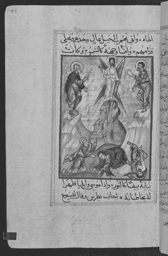

图 6.2 变容时的摩西与以利亚 © ART Collection / Alamy Stock Photo

### 第 18 章与《古兰经》的神学信息

正如我们在“穴中人”和“双角者者”叙事的示例中所看到的，合理的假设是：正如另外两个叙事一样，18:60–82 中“摩西与仆人”叙事的任何潜在晚期古代文学来源都不会逐字地出现在《古兰经》中。相反，像《古兰经》中的其他叙事，特别是喀麦章（`Sūrah al-Kahf`）中的叙事一样，该故事最可能经过了塑造，以符合《古兰经自身内部的神学信息。

本节的论点是，该叙事的晚期古代文学先例（一个包含以利亚担任“仆人”角色的）至少是可能的。我们提出这一论点基于：该叙事对摩西不寻常的描写；基于其他晚期古代文本是本章其他主要叙事的底层基础；基于智慧文学和具有师徒关系教诲导向的故事在晚期古代文学中很常见；基于早期阿拉伯注释传统将“仆人”形象等同于“al-Khaḍir”（绿色者）的证据；以及后续注释将`al-Khiḍr`与以利沙（`Ilyasa‘`）和以利亚（`Ilyās`）人物等同的证据；基于推论，`al-Khaḍir`作为 18:60–82 中“仆人”形象的解释性注释，必须是一个在文化中已预先存在且与此故事相关的形象；基于以利亚作为智者导师和引导者的故事在晚期古代文学中丰富；以及基于如果确实存在与《古兰经》对话的涉及摩西和以利亚的当代文本或故事，这也符合摩西和以利亚经常结合的晚期古代文学主题（见图 6.2）。

此外，本文的核心观点是，通过在自身的历史背景下研究 18:60–82 叙事，并将其置于第 18 章和《古兰经》更广泛的神学论证中，该叙事的意义会变得更加清晰。当我们观察整个 18 章时，看到从平行的开头和结尾备注（1–8 和 103–110，这些很大程度上是反三一体的，并促进了《古兰经》和先知穆罕默德的任务），通过强调上帝即将到来的审判和末日的寓喻（27–59），直到本章结束，第 18 章处理了当代的晚期古代宗教问题和叙事，其处理方式对于当时的基督教和犹太听众来说具有特别的意义。

在 18:60–82 中，我们可以识别出这样的信息：神的智慧与正义胜于人类——甚至胜于摩西。这种关于神智慧与正义的神学信息之所以能够实现，主要是因为那个“仆人”极具匿名性。因此，本书赞同惠希勒（`Wheeler`）关于穆斯林解经对 18:60–82 意图的观点，即其目的是证明上帝比摩西更有智慧——或许以此类推，也比摩西的宗教社区更有智慧，(156)——但本书认为，这样的计划并不仅限于解经。18:60–82 的古兰经经文本身就已经推崇了唯有上帝才是所有智慧的源头这一信息。通过将“仆人”的身份匿名化，古兰经还确保了这一人物——“我们仆人中的一个，我们赐了他怜悯并从我们自己的知识教导了他”——不会与任何特定的宗教社区联系起来。相反，匿名的“仆人”只能服务于古兰经关于神超越性的神学信息。

在整个第 18 章中，我们可以识别出同一种超越性的一神论信息，这种信息与古兰经相对于其同时宗教环境的宏大信息相一致。古兰经中的叙事促进了一种超越性的一神论愿景，它是反三位一体的、反拉比的、启示录式的，并得到了先知穆罕默德为代表的先知使命比的支持。

### 关于约书亚·本·莱维拉比与以利亚奇异行为的中世纪犹太传说

最终，哈德尔（al-Khiḍr）和以利亚这两个形象在伊斯兰教和犹太教文本来源中确实联系在一起，正如他们在穆斯林和犹太人的流行宗教实践中联系在一起的那样。一个有趣的文本例子可以在关于约书亚·本·莱维拉比和以利亚奇异行为的犹太传说中看到。这个创作于公元 1000 年左右的约书亚与以利亚的故事，最初以阿拉伯语记录在突尼西凯鲁万的犹太社区中，作为拉比尼西姆·b·雅雅库布·b·沙欣（`Rabbi Nissîm b. Ya‘aqobh b. Shâhîn`，以其阿拉伯语标题伊本·沙欣`Ibn Shāhīn`广为人知）所著著作《苦难后的解脱》（`al-faraj ba‘d al-shiddah`）的一部分。(157)

在这个传说中（与古兰经 18:65–82 中的“摩西与仆人”叙事高度平行），约书亚拉比（一位生活在三世纪并对巴勒斯坦太德学院做出贡献的著名太比人物）禁祷并请求见到以利亚。拉比故事中常见的题材是圣者们想要见到以利亚，(158)，在几个世纪的太德传说中，“约书亚·本·莱维广为人知是以利亚访问过的人。”(159)

在故事中，约书亚拉比在路上遇到了以利亚（另一个常见的犹太拉比题材），约书亚拉比请求陪同以利亚旅行，以观察以利亚的奇迹。以利亚同意了，但警告约书亚拉比，他无法忍受以利亚的行为，而他以利亚同样也不愿意解释自己的行为。约书亚拉比承诺不因问题困扰以利亚，以利亚同意了，条件是一旦约书亚拉比要求解释，他以利亚就必须离开。在执行了三个看似不公正且无法解释的行为后：杀掉了一个穷人的牛；重建了一个不友善的富人坍塌的墙；以及对一个不友好的犹太堂社区许愿“愿上帝让你们都成为首领”，同时对一个贫穷但慷慨的社区许愿“愿上帝只给你们一位首领”，约书亚拉比宣布他再无法忍了，并要求以利亚解释，随后他，约书亚拉比将离开以利亚。

在离开之前，以利亚解释说，穷人的妻子将在当天去世，以利亚恳求上帝让牛死而代之；重建墙让地下的财宝没有被那个不配的富人发现；一个有很多首领的地方注定会毁灭，而一个只有一个首领的地方注定会繁荣。最后，以利亚给了约书亚拉比具体的建议：

几项研究声称这个犹太传说是古兰经 18:65–82 叙述的前身，尽管并没有表明公元 1000 年左右伊本·沙欣的版本之前存在该传说的见证者。(161) 其他研究则相反声称，是伊本·沙欣的犹太传说依赖于古兰经 18:65–82，用著名的拉比人物约书亚·本·莱维替换了摩西。(162) 本项研究通常同意后者的观点；即伊本·沙欣的叙事在某些地方似乎受到了 18:65–82 的影响。然而，本研究认为，如果发现了某些拉比或其他晚期古代文本，并证明其早于古兰经叙述——这暗示该叙述可能是 18:65–82 和伊本·沙欣文本的潜在来源——那么伊本·沙欣的叙事在某些地方仍然可能受到 18:65–82 的影响。在伊本·沙欣生活的突尼西时期，18:65–82 已经成为流行的伊斯兰和阿拉伯叙事。(163)

### 第三部分：哈德尔形象与东地中海的哈德尔

哈德尔主要通过古兰经注释和后期的伊斯兰文学为人知。他的角色既源于古兰经的叙述，也源于与他相关的其他来源，例如波斯故事《亚历山大传》（`Iskandarnma`）。在全球各穆斯林文化中，哈德尔被视为一个流行的民间和文学英雄，因伊斯兰传统中类似于以利亚的人物而闻名，并被归与其他长寿人物如以诺克（参考创世记 5:24；以诺克在伊斯兰传统中关联并被称为伊德里斯`Idrīs`；参见古兰经 19:56 和 21:85）在一起；此外他还与绿色、肥沃、雨水、知识、智慧以及不死（在某种程度上通过亚历山大故事和生命之水有关）。由于他的不性，哈德尔被认为像以利亚一样，可以在任何时间出现在任何地方。(164)

在穆斯林世界各地，哈德尔因上述特质而闻名并受尊敬。再次，在穆斯林世界各地，哈德尔与他在苏菲派和神秘主义传统中的角色和身份联系在一起。由于古兰经叙述，哈德尔以深邃的智慧和理想导师而闻名；在苏菲传统中，这些特质被强调，哈德尔被视为典范。同样，在与苏菲派相关的圣者/瓦利里/pīr 传统中，哈德尔既被视为“圣者”也是先知，哈德尔的陵墓随处可见。

正如我们在上面看到的，在中世纪后期伊斯兰世界（特别是波斯化的世界），哈德尔通常被描绘成一个先知（面部被火焰环绕或未描绘）；通常以他与亚历山大冒险相关的角色出现(165)，以及进行年度哈真朝圣，或与以利亚一起祷告（见图 6.3）。

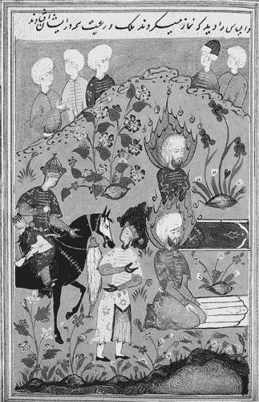

图 6.3 哈德尔与以利亚一起祈祷 © The History Collection / Alamy Stock Photo

自现代早期以来，由于其在全球范围内广泛的形象，阿尔-海德尔（al-Khiḍr）通常被描绘为一个睿智的、留胡须的老人；他知识渊博，且通常处于旅途中。阿尔-海德尔的这类形象通常描绘他骑在鱼上和/或拿着鱼，而位于生命之水之上或附近。这种在南亚背景下很流行的形象也可能与河神和毗湿奴的形象有关。(166) 在世纪和现代的图像描绘中，阿尔-海德尔通常被描绘穿着绿色衣服或长袍。

## 东地中海的阿尔-海德尔

在地中海地区和土耳其——尤其是东地中海国家——对阿尔-海德尔的流行理解和描绘与南亚和东南亚地区有所不同。在东地中海，阿尔-海德尔仍被认为是第 18:60–82 中的那位智者仆人，但长期以来，那里也将其等同于以利亚（`Elijah`）和圣乔治（`St. George`）。(167) 为了理解为什么会如此，我们需要在区域政治和宗教历史的背景下理解东地中海的阿尔-海德尔。

## 东地中海政治与宗教历史

早期的“穆斯林”阿拉伯军队从阿拉伯半岛出发，并在公元 636 年在雅尔穆克河击败了拜占庭军队。修道院的信函证实，希腊语和叙利亚语文献中提到的早期阿拉伯军队“muhājirūn”（叙利亚语为“Mhaggrayê”）(168)，即与希杰（`hijra`，“迁徙”）有关，在公元 637 年取得了耶路撒冷的政治和军事控制权，并在公元 640 年控制了大马士革。(169) 随着这些早期阿拉伯军队以逐渐扩张的模式征服领土，他们的习俗不是破坏城市（当然也有例外），而是获得当地领袖的认可，并在附近建造驻军区/米斯尔（`miṣr`）城镇，以监督特定地区。(170)

正如我们在前面的章节中所看到的，东地中海一直是大型基督教和犹太人社区的家园。阿拉伯和伊斯兰扩张的“暴力征服”和“强制改宗”模型在很大程度上已被证明是虚假的，因为几乎没有书面或考古证据支持此类主张。(171) 事实上，考古和文献证据表明，前拜占庭地区的基督教和犹太人社区继续像以前一样生活着。(172) 显然，没有任何教会或犹太堂的记录显示这些军队要求基督徒或犹太人皈依“伊斯兰”；在那个萌芽阶段，`muājirūn`军队更多地与超验的一神论以及对犹太人和基督徒经文和传统的普遍亲和联系在一起，而不是将自己理解为拥有与基督人和犹太人如此不同以至于需要其他社区“改宗”的宗教身份。(173)

我们现有的证据表明，“[叙利亚、巴勒斯坦、伊拉克和埃及]大多数由一神教徒组成的社区并没有被破坏甚至没有受到严重干扰，只是经历了主人[和收税员]的变更。”(174) 事实上，我们有早期穆斯林在教堂内祈祷的记录，因此这些地方被认为是合适的祈祷场所，也有征服后一个世纪内前拜占庭地区仍在建造教堂的记录。“伊斯兰”作为一种独特的宗教传统，在东地中海逐渐出现（正如在其他地方一样），(175)，而基督教和犹太人口向这种新宗教方向的改宗非常缓慢，特别是在最初。(176)

## 阿尔-海德尔、圣乔治与以利亚之间的流行关联

我们缺乏记录来表明东地中海穆斯林阿尔-海德尔与以利亚、圣乔治之间的流行关联是如何发生的。这可能并不意外，因为此类流行关联的记录很少存在。当我们开始遇到记录人们讨论诸如在梦中遇到阿尔-海德尔、圣乔治或以利亚，并将这些人物联系在一起或共同拥有一个崇拜场所时，他们之间的任何正式关联已经发生，并被作者作为既定事实呈现。(177)

然而，我们可以从通上推测此类关联是如何发生的。正如我们在上面看到的，“穆斯林”阿尔-海德尔在早期阿拉伯文本传统中就与圣经人物以利亚联系在一起，以利亚是整个近东已知且广受欢迎的人物。事实上，这本书暗示“阿尔-海德尔”最初可能只是“以利亚”的一个称号。因此，“阿尔-海德尔”与“以利亚”之间的关联自然地发生了。在东地中海，以利亚和圣乔治本身就已经存在联系：正如我们在第四章和第五章中看到的，以利亚和圣乔治都被广认为是捍卫真道（或真神）的人物，并因其与绿色、肥沃和雨水的相似关联性而闻名。鉴于阿尔-海德尔（“绿色者”）在伊斯兰传统中被理解为具有绿色和肥沃的关联，以及其他与以利亚类似的特质（包括不死和随心出现的能力），阿尔-海德尔、以利亚和圣乔治——三者在经文/文本中都有联系，并拥有共同的流行特征和图像表示，正如我们在前面的章节中看到的并在第七章中详细介绍的——在地中海的穆斯林、基督徒和犹太人社区中被联系在一起，这可能并不意外。

### 作为连接人物的阿尔-海德尔

事实上，在伊斯兰教的前几个世纪里，阿尔-海德尔在穆斯林-拜占庭政治边界变化的社区中可能充当某种过渡或中介人物的角色。(178) 埃塞尔·沃尔珀（`Ethel Sara Wolper`）认为，阿尔-海德尔的模糊性，以及他与流行宗教人物的明显相似性，让他成为社区的桥梁或过渡人物，特别是在拜占庭-伊斯兰边界地区。曾经奉给圣乔治（其他基督教人物）的教堂也与阿尔-海德尔联系在了一起。

沃尔珀的研究主要集中在安纳托利亚周围及内部的边界地区，对于本研究涉及的人物来说，这是一个特别有趣的区域。与东地中海大部分地区不同，安纳托利亚半岛大部分地区直到 11 世纪大部分处于拜占庭的政治控制之下——宗教方向大部分是基督教。公元 1071 年曼齐尔克特战后，土耳其穆斯林的影响开始在安纳托利亚增长。自然，正如基督教地中海其他地区的情况一样，安纳托利亚的任何形式的伊斯兰化都是在几个世纪内缓慢发生的，而且没有伴随着安纳托利亚伊斯兰教和土耳其社会的同步“拜占庭化”。(179) 弗里奥（`Vryonis`）在描述安纳托利亚穆斯林与基督徒之间的改宗和转移过程时写道：

正如我们在第五章中所看到的，乔治圣和西奥多尔圣在东地中海地区都与征服龙的骑马圣者这一主题相关联。al-Khiḍr（有趣的是，他在安纳托利亚主要被视为 al-Khiḍr 与以利亚亚的复合体，名为`Khiḍr-Ilyās`、`Khiḍrilyas`或`Khizirilyas`），他在东地中海地区一直与屠龙形象的圣乔治联系在一起，因此自然在安纳托利亚延续了这些与乔治圣的关联。

与地中海地区大多数其他语境下的 al-Khiḍr 不同，在地中海以及其他基督教和穆斯林人口共同居住的地方（例如东欧的部分地区），al-Khiḍr 的形象和身份与流行的乔治圣形象最为契合。因此，在东地中海，al-Khiḍr 的形象往往与乔治圣的形象完全相同（参见图 5.1）；事实上，乔治圣和 al-Khiḍr 经常被理解为同一个人，或者可能指的是同一个人物的不同方面。此外，至少从公元 1200 年代的现存记录开始，以利亚-Khiḍr 和乔治-Khiḍr 就被理解为同一个人，这在实践中将东地中海的穆斯林教、犹太徒和基督徒的这三个人物联系在一起。^(181) 这些关联作为该地区宗教社区历史的珍贵见证，在当地犹太人、基督徒和穆斯林社区——以及其他当地宗教社区之间一直持续到公元 20 世纪。今天，这些关联在基督徒和穆斯林社区之间依然显著地存在。^(182)

### 东地中海的 al-Khiḍr 遗址

整个东地中海有许多供奉 al-Khiḍr 的遗址。具有核心意义的纪念建筑，如`岩石圆`、`阿奎清真寺`和`大马士清真寺`，内部都包含了供奉 al-Khiḍr 的较小结构和/或空间。除了这些显眼的遗址外，该地区的其他几座清真寺供奉`Sayyidnā al-Khiḍr`（“sayyid”是穆斯林的尊称），而且还有许多较小的圣龛也供奉`Sayyidnā al-Khiḍr`，主要分布在山地和农村地区。

此外，当然，供奉乔治圣的基督教教堂和圣地也可以被穆斯林视为供奉 al-Khiḍr 的圣地，^(183) 特别是在较小的地区教堂中；例如，这种做法在供奉乔治圣的大教堂中并不常见。有时，曾供奉乔治圣或以利亚的教堂或其他遗址变成了供奉 al-Khiḍr 的清真寺。^(184) 在其他情况下，一座供奉 al-Khiḍr 的清真寺往往建在供奉乔治圣的教堂旁边。

想起奥斯曼帝国对基督教人物乔治圣的偏爱——这种喜爱源于黎凡特和安纳托利亚地区 al-Khiḍr 与乔治圣之间的关联——今天在黎凡特发现，供奉乔治圣的教堂比供奉任何其他人物的教堂都多（圣母玛利亚除外，这无疑由于穆斯林和奥斯曼对玛利亚形象的喜爱，玛利亚在穆斯林传统中被称为`Sittnā Maryam`）。^(185)

## 第四部分：结论：al-Khiḍr 与黎凡特共同池

### al-Khiḍr 的文本、图像和遗址反映了关于伊斯兰传统的什么内容

我们在 al-Khiḍr 形象中看到的反映，取决于我们观察的时间和地点。当我们研究`Qur’ān`以及`18:60–82`节叙事时，我们看到一个处于更广泛的晚古代世界宗教社区、政治潮流和末世论取向中的宗教文本。这段文本反映了一个虔诚且以一神教为导向的社区。这种超越性一神教的神学取向与圣经中的“独神”高度契合，尽管它是从阿拉伯语言的视角出发的。这个社区对“独神”的理解断然地拒绝了当时基督教的三位一体神观念，转而符合一种庄严且直接的超越、不可分割的一神教愿景。^(186)

具体来说，关于`古兰经“仆人”`这一形象，我们在他身上看到了一个参与当代讨论和辩论的社区，涉及神义学的古老问题以及上帝公正的神秘方式。`18:60–82`中的`Khiḍr 叙事`传达了上帝全知全能的本质是不可置疑且绝对的，以及人类对这位神信仰和耐心的必要性。

当我们研究阿拉伯语注释和中世纪文学传统时，我们在 al-Khiḍr 的形象中看到了一个不断扩张的宗教传统，它融入了更广泛的近东世界，并定义了伊斯兰宗教身份和实践的边界与组成。当我们观察世界范围内 al-Khiḍr 的图像和遗址时，我们看到了地理和文化的影响。苏菲传统中（尤其是南亚和中部）的 al-Khiḍr 图像和遗址反映了一种植根于并响应亚洲和印度文化背景的伊斯兰宗教传统。东地中海的 al-Khiḍr 图像和遗址反映了一种植根于并响应很大程度上基督教和犹太宗教文化背景的伊斯兰宗教传统。

### al-Khiḍr 与黎凡特共同池

#### 黎凡特共同池中引人注目的的人物、叙事和主题

在`18:60–82`的古兰经叙事中，我们遇到了智慧文学体裁，这种体裁从青铜时代时代起在整个近东世界都很流行。我们也看到了圣经中的人物摩西，他是圣经文本的基础，同样也是`古兰经`的基础，尽管其描写方式不寻常。我们在`18:60–82`的叙事中还看到了几个晚古代和农业的主题和叙事，包括关于天堂本质和地球地质结构的广泛信仰。

在后世的伊斯兰人物 al-Khiḍr 中（主要发展自古兰经注释和后来的阿拉伯文学，当然是基于`18:60–82`的古兰经叙事），我们看到了与流行的以利亚形象的直接关联，以及绿色、永生和神圣知识的主题。此外，本章暗示以利亚是释义称号`al-Khiḍr`的原始源头；即“绿者”。在后后的注释中，我们看到 al-Khiḍr（到那时他已不再是以利亚的称呼，而是一个独立的角色）也与流行的亚历山大形象和他的旅行相连。在东地中海，当 al-Khiḍr 与基督教人物乔治圣紧密认同后，我们看到 al-Khiḍr 与征服龙的图像和叙事相关。自然地，乔治圣关于降雨、绿色和丰饶的地理主题，在当地社区中同样与 al-Khiḍr 享有的相同主题产生了共鸣。

阿尔-希德尔（Al-Khiḍr）成为了一个广受欢迎的民间和文学英雄，被称为“绿色先知”，是一位激发了苏菲派和神秘主义传统的神秘导师。希德尔曾与亚历山大的传奇冒险以及生命之水联系在一起，同时也拥有长生不老和奥秘知识，这些品质伊利利亚（`Elijah`）和圣乔治（`St. George`）也共有。阿尔-希德尔以作为需要者的帮助者而闻名，能够快速跨越遥远距离，就像奇人的伊利利亚和神迹般的圣乔治一样。此外，和伊利利亚和乔治一样，阿尔-希德尔也作为一个强大的农业人物而闻名，与绿色、肥沃和作物生长等关键的地理主题相关联。

通过对阿尔-希德尔这一人物的分析，可以清楚看到为什么伊利利亚、圣乔治和阿尔-希德尔在东地中海的民间宗教实践中联系在一起。最后一章探讨了对巴尔-哈达德（`Baal-Hadad`）、伊利利亚、圣乔治和阿尔-希德尔等人物进行地理背景化处理，如何解释了这些人物之间的联系，以及区域宗教历史及其农业导向。

## Notes

### 7 东地中海共同的宗教历史

2015 年 8 月 19 日，以色列日报《哈拉雷兹报》（`Haaretz`）刊登了一篇关于“先知伊利利亚洞”的故事，该洞位于卡梅尔山。^(1) 这就是我们在第二章“黎凡的地理、历史与农业宗教”中遇到的同一个洞，并在第四章“希伯来圣经与伊利利亚”中再次提到的。^(2) 文章警告说，洞内的古代铭文面临着被无意的现代游客破坏的危险。今天，先知伊利利亚洞接待举行成年礼（`bar mitzvahs`）的访客，以及当地犹太人、穆斯林和德鲁兹人的造访，他们希望在这位著名的先知伊利利亚的洞中祈祷。洞穴本身从山体中延伸出来，建成了矩形砖结构，内部覆盖着现代犹太教宗教装饰，并在近似中心处被分为正统教男士侧和女士侧。

在当地当地学者的诉求后，以色列圣地管理局启动了一项为期两年的洞穴修复计划。该洞穴作为宗教场所的使用可以追溯到青铜时代晚期至铁器时代早期，洞内的铭文追溯到希腊化时期，反映了相互关联的历史的一个有趣案例，这在书中其他地方也得到了概述。对洞内铭文的分析表明，“伊利利亚洞”（自拜占庭时期起，即约公元 4 世纪到 7 世纪，便一直被这样称为）在此之前曾是卡梅尔山上祭奉宙斯的神庙。在此之前，研究人员认为该洞曾是祭奉卡梅尔巴尔（`of Carmel`）的神庙。^(3)

根据阿舍·奥瓦迪亚（`Asher Ovadiah`）自 1966 年以来对洞内铭文的分析，有 180 件希腊语铭文（追溯至公元前 4 世纪至公元 3 世纪）、1 件拉丁语铭文、2 件阿拉伯语铭文和 44 件希伯来语铭文，其中一些希伯来铭文追溯到该地区的拜占庭时期，大部分则追溯到公元 18 世纪和 19 世纪，显然是住在附近阿克里（`Acre`）的犹太人留下的。

尽管书写时间不同且针对不同的人物（正如我们所见，虽然人物不同但关系密切），但这些铭文在性质上非常相似——对家人朋友的献祭、对神圣治愈的请求，以及对特定事业成功的愿望。其中一件希腊语铭文是由名为埃利奥斯（`Elios`）的人留下的，他显然是公元前二或第一世纪住在阿克里的一名官员，他写道：“这个地方应对我的儿子基里罗斯（`Kyrillos`）有利，他将不再受发热的影响。”^(4)

正如我们在上面第四章中看到的，卡梅尔山以及黎凡地区其他突出的山脉和高地（如萨潘山`Mt. Sapan`），长期以来一直与风暴神巴尔-哈达德相关联。希伯来圣经《列王纪上》第 18 章中关于雅和华先知伊利利亚与卡梅尔山上 450 名“巴尔的先知”之间进行标志性竞赛的记载，使得伊利利亚在那里的壮丽胜利更发引人注目：它发生在巴尔自己的山上。^(5) 山上的巴尔之崇拜在希腊化时期逐渐被对宙斯的崇拜所取代。伊利利亚洞的一面墙上刻有一个男人的肖像——今天被一张拉比的画像所覆盖——研究人员认为这可能与宙斯有关，或者正如奥瓦迪亚主张的那样可能与巴尔有关。此外，我们在上面第四章中看到的，尊尊奉赫利奥波利宙斯（`Zeus Heliopolitanus`）的公元 3 世纪塑像足部于 1952 年在附近的祭奉伊利利亚的卡梅尔修道院发现，^(6)，这为该地点在希腊和罗马时期与宙斯神相关提供了进一步证据。

从公元 5 世纪开始，随着东地中海的基督教和犹太社区人口开始超过区域多神教社区，进入该洞穴的基督教和犹太游客将其转变为一个祭奉伊利利亚的场所。当然，在卡梅尔山/阿克里地区的当地犹太社区中，该洞址可能早在公元前一千年中叶起就与伊利利亚相关了，但洞内现存的最早的犹太游客铭文仅追溯到公元 4 至 6 世纪。洞内东北角的一个雕刻显示了一个带有圆圈的等边基督教十字架，另一个显示了双头灯台；这三处雕刻均源于拜占庭时期。从那时起，该地点一直与伊利利亚相关，而非宙斯或巴尔，因为围绕洞穴的传说表明这就是伊利利亚在与巴尔进行传奇战斗之前停留的洞（列王纪上 18:1–46）。随后的几个世纪里，连续的基督教、穆斯林和德鲁兹区域社区也来参观并体验伊利利亚洞，并经常正如我们在第四章中所看到的，在那里通过梦境寻求灵感。^(7)

在附近伯利恒地区约岸的阿尔塔（`Arṭās`）村，当地的巴勒斯坦基督教徒和穆斯林社区每年在 4 月聚集在一起举行农业“生菜”节。在集会上，社区的穆斯林和基督教儿童表演了一场恐扰当地村民的“龙”的剧（这条龙破坏了他们的房屋并将村民赶出土地）；龙最终被英勇的“圣乔治-阿尔-希德尔”在战斗中击败，他让人们回到了家园和土地，并因其控制雨水作物生长的力量而受到赞誉。因此，这场表演将反映 20 世纪政治历史的现代流离和占领主题，与长期的区域农业宗教叙事交织在一起。这些地理主题涉及传奇的击龙，并与控制雨水和作物生长有关，长期以来与这位本土英雄相关，对于社区来说，他既是圣乔治又是阿尔-希德尔。^(8)

在 4 月 23 日和 5 月 6 日，分别是西方教会和东方教会的圣乔治节纪念日，黎凡特地区不同教派的基督徒和穆斯林小群社区聚集在一起，庆祝并向广受喜爱的圣乔治-阿尔-海德尔（al-Khiḍr）致敬。这些庆祝活动发生在地中海东部地区的小社区中，从土耳其遗址到埃及尼罗河三角洲的村庄，再遍布黎巴嫩、叙利亚、巴勒斯坦、以色列和约旦周的山村。这些庆祝活动在某些地点尤为突出，例如伯利恒阿尔胡德尔（`al-Khodr`）村的圣乔治教堂，据说圣乔治的母亲就出生于那里。以色列洛德（`Lod`）的圣乔治教堂也是如此（该城镇曾名为吕达，在此之前迪奥斯波利斯），据说圣乔治的遗迹安放在于此；正如我们在[第五章]中所看到的，至少从公元六世纪起，这里一直是圣乔治的朝圣地。从公元 19 世纪后期开始，洛德的同一座圣乔治教堂在字面意义上已通过一堵隔墙与那里的阿尔-海德尔清真寺相连。

这些涉及地中海东部以利亚、圣乔治和阿尔-海德尔人物的现代节日和农业宗教实践案例，使我们的讨论回到了引发本研究的原始现象。在引言章节中，我们认为传统研究这些人物的方法——即从“世界宗教”视角出发，将每个人物视为其特定宗教传统的产物——是一种不恰当的方法论。

相反，我们建议从“宗教地理学”（`Geography of Religion`）理论的角度来研究每个人物（包括巴尔-哈达德，早期学术研究认为其可能是以利亚、圣乔治和阿尔-海德尔等人物的原始源头）。该理论认为，宗教以及延伸出的其文本和文本人物，始终是其起源或显现的时间和的共同产物。在这个模型中，宗教传统并非存在于真空之中，而是自然地具有地理背景化：即受到同时期宗教、政治和地理力量的影响。

## 宗教地理学：使用地理视角

### 区域地理学

因此，了解区域地理学对于充分理解这些人物，以及理解那里发展起来并在过去几千年里在黎凡特文化中保持相关性和吸引力的地理气象要素至关重要。特别是三个主要特征影响了地中海东部的地理。首先是其地质结构：地中海盆地由石灰岩基岩组成，风化迅速，留下了大量的岩石、薄的岩石土壤以及数以千计的洞穴和石窟。正如我们所看到的，这种景观清晰地塑造了黎凡特的宗教观念和实践。位于三个大陆板块（非洲板块、阿拉伯板块和欧亚板块）的交汇处，造就了该地区的地形，并导致了三个地形区域：西部的沿海平原、中间的山带，以及东部的平原和高原。这种大陆板块的交汇也解释了该地区地震的频率。

影响黎凡特地理的第二和第三大主要特征与水有关。广阔地中海地区的气候天气模式主着季节性风流以及降水。黎凡特位于地中海盆地的东岸，其位置影响了区域气候和降水模式。该地区的山地地形紧邻海边并位于狭窄沿海平原的内陆，这种地形决定了黎凡特哪些区域吸引降水（山脉的迎风面），哪些区域常年干旱（山脉的背风面，这些地方向东延伸至干旱的平原高原）。所有这些因素加上地区的水资源，显然影响了区域农业实践的可能性。

与美索不达米亚（幼发拉河和底格里斯河）或埃及（尼罗河）不同，，黎凡特缺乏类似的可以作为水资源和进行大规模灌溉的大型且年年水的河流。相反，黎凡特的三条主要河流——奥伦特斯河、利塔尼河和约旦河，以及较小的区域河流和数百条更小的季节性支流，加上几个地表湖泊和区域地下含水层，为黎凡特的生活提供了必要的水资源。

这类天气模式和水资源也清晰地塑造了黎凡特的宗教观念和实践。这些黎凡特河流的历史名称，尤其是北部靠近萨潘山（`Mt. Sapan`）的河流（那里被认为是风暴神的居住地），也与风暴神巴尔-哈达的叙事有关。奥伦特斯河被希腊人称为Τυφῶν（`Typhon`），在词源上与希腊语中的“风暴”有关，并以被宙斯击败的可怕的蛇头风暴怪物命名。在拉丁语中，奥伦特斯河被称为`Draco`或“龙”河。利塔尼河的名字在词源上源于同一个闪米特语根`ltn`，对应神话中的海洋生物洛坦（来自希伯来圣经的利维坦，雅华也击败了它）。回想《巴尔循环》中，巴尔最令人记忆的叙事之一是他击败了“扭曲蛇”洛坦（`ltn`），它也被命名为 Yam-Nahar，意为既“海”也是“河”。因此，人们可以从奥伦特斯/Typhon/Draco 以及利塔尼/`ltn`河的历史名称中，看到伴随早期风暴神的区域叙事。

总之，正如我们在[第二章]中看到的，地中海东部是干旱的，降水量从北向南、从西向东减少，干旱是常见的气候状况。尽管如此，黎凡特大部分地区位于 400 毫米（12 英寸）等降水量线内，因此该地区大部分通常获得足够的年降水量，以实现雨养农业的耕。此外，由于黎凡特位于“肥沃新月”西部弧形的位置，区域农业实践在此处传播，地中海东部长期一直实行农业。事实上，直到 20 世纪中期，该地区主要可以以农业经济基础为表征。因此，当我们研究黎凡特时，面对的是石灰岩基岩景观，以及一个以农业为导向的位置，这种位置既是干旱的，雨水始终是作物生长以及人类人口成败的主要水来源。因此，黎凡特的地理要素很大程度上与区域农业需求相关并由其需要——特别是对天空降水的需求。

地理并不是驱动宗教信仰的动力，但它具有独特的塑造影响，因为地理如此彻底地影响了人们的日常生活。特别是，本书揭示了地理对黎凡特（`Levant`）地区人类宗教取向巨大且长期的影响。古代近东的叙利亚-迦 anaan 神灵巴尔-哈达德（`Baal-Hadad`）是一位风神，他的名字本身意为“风暴之主”，其特征是区域性的地理和气候模式，包括冬季的雷雨、夏季巴尔的消失，以及他在秋季周期性地回到他在`Mt. Sapan`的山。巴尔-哈达德作为雨水的施予者和农业丰收的提供者，至少从青铜时代早期起就是该地区主地位的宗教实体。作为区域天气模式的体现，巴尔-哈达德被理解为一个强大但反复无常的神，他在天空中雷鸣，向他的人类臣民降下恩惠或严酷，但在得到适当的祈求后，也可以被召唤来帮助有需要的人。在 Common 后的前几个世纪里，巴尔在地区文化中保持着主地位，尽管他的崇拜逐渐开始被`Zeus`（随后有时是`Jupiter`）取代，这两者都代表了相似的气候特征，一直到公元前四世纪^(18)

以利亚（`Elijah`）是希伯来圣经中`Yahweh`的正义先知，他的名字`אַלּיּﬣוּ`意为“我的神是耶和华”，他带来了这样的信息：`Yahweh`而不是`Baal`才是该地区的真神。尽管希伯来圣经全文中的证据表明，`Baal-Hadad`确实仍然是该地区大多数人首选的神，但以利亚的先知使命是推销这样一种信息：是`Yahweh`控制着一切，包括雨水，而不是“假”神`Baal`。为了履行以利亚代表`Yahweh`执行的使命，以利亚施行了数次令人难忘的奇迹，包括停止和开始降雨（并引发了一场压抑的三年大旱）、从天空召下“火”（即闪电）、延伸一位寡妇的油和面粉供应（以此方式展示了`Yahweh`对食物供应的控制，类似于神灵`Baal`的方式），以及乘着架进入天空的神车神奇地消失。正如希伯来圣经文本所示，以利亚在这些方面的能力最终只有通过`Yahweh`的力量才成为可能；尽管如此，以利亚在后的文化中与`Baal`的几个区域文化中重要的主题联系在一起：与涉及雨水、风暴、闪电、雷鸣（通过驾驭天车）、作物生长、消失与回归的权力相关联，以及帮助有需要的人的能力。

圣乔治（`St. George`），希腊语‘γεωργός’‘Georgos’即“农民”圣人，也与这些基本的区域主题相关联，例如与雨水、风暴、肥沃、作物生长、消失与回归以及帮助有需要的人的能力。通过《圣乔治传》（`Acts of St. George`）中其与希伯来圣经中地区流行的以利亚事迹之间敏锐的叙事关联（以利亚曾在“假”神`Baal`面前捍卫“真”神`Yahweh`），乔治同样被视为“真”信仰的正义守护者。圣乔治的崇拜发展出了早期的农业基础，这种基础似乎与与以利亚相关的农业品质独立（尽管，圣乔治的这些农业品质可能通过与以利亚的叙事关联，在他的崇拜中得到了“确认”）。圣乔治农业品质的起源，通过他的崇拜阐述，并与区域性的与绿色、肥沃、雨水、风暴、作物生长等地理主题相关，以及与 4 月 23 日的农业节日相关，可能源于或与当地的`Zeus-Baal`崇拜叠加，甚至可能源于`Zeus-Georgos`，圣乔治的名字可能由此衍生。^(19) 和他的同类战士圣人西奥多尔（`Theodore`）和德米特里乌斯（`Demetrius`）一样，乔治至少在公元六至八世纪（可能更早）也与战胜龙或蛇的视觉主题相关联，这可能也引发了——或确认了——与风神农业品质的概念性关联。

阿尔-海德尔（Al-Khiḍr），`الضر`意为“绿色者”，通过他的名字，通过他在文本中与地区流行的、以农业为导的人物以利亚的关联，以及七八世纪以后通过他在基督教社区中与圣乔治的流行关联（圣乔治也是一位已知农业关联的受尊敬人物），阿尔-海德尔在东中海也与引人注目的雨水、风暴、绿色、肥沃、作物生长、消失与回归，以及作为一个能够远距离旅行并在任何时候出现的有需要者的帮助者的这些地理主题相关联。同样，海德尔在东中海与圣乔治、4 月 23 日的庆祝日期以及战胜龙的视觉主题的关联，可能加强了/或确认了他的农业品质，而这些品质在一种农业宗教文化中是如此重要。

本研究中的地点同样受到了区域地理的影响。正如我们上面看到的，当充满水分的风沿着黎凡特的沿岸山区移动时，它们在穿越山脉之前凝结并降水，有效地在沿岸山脉的西部和中心创造出一片绿色区域，并在东部和南部形成雨影区。此外，沿岸某座山的高度越高，它对云层和降水的吸引力就越大。对于古代黎凡特的人来说，这种地理和气候状况表明风神与高山空间相联系。正如我们在`第三章`中看到的，`Mt. Sapan`（/Kasios/Casius/Jebl āqra‘），作为黎凡特海岸最高的山，被认为是风神巴尔-哈达德的家，而南部的喀密麦山（`Mt. Carmel`——同样是黎凡特南部海岸的高山——也与许多巴尔的圣殿相关联。希伯来圣经中充满了对那些崇拜“高处”之者的谴责，因为这是黎凡特许多山脉和高处的常见宗教实践。尽管如此，即使是是以利亚这样排他性的圣经人物也与高处和山脉相关联，圣乔治和阿尔-海德尔的圣殿也是如此。

本书暗示的这些人物之间的关系

这些与雨水、风暴、雷鸣、闪电、绿色、肥沃、丰产、出现和消失的能力、与山脉和其他高处的关联、4 月 23 日的当地节日或庆祝日，以及战胜龙的主题，并不意味着以利亚、乔治和海德尔是风神巴尔-哈达德无区分的或随意的延续。^(20) 相反，这些主题被仔细地与人物之间的关系，以及与这些主题继续满足的区域地理需求联系在一起。

因此，与大多数地区宗教历史文献的观点以及《希伯来圣经》中所张的立场相反，地区性的风神形象——并以此推出的“迦南人”宗教习俗——据可以说一直持续到青铜时代、进入铁器时代和黎凡特地区的第一个千年纪，甚至持续到了公元后的几个世纪。此外，黎凡特地区的宙斯（`Zeus`）和朱庇特（`Jupiter`）形象主要不应被视为“希腊”或“罗马”宗教人物，即作为当地黎凡特宗教实践和信仰的外来或独立存在。相反，本书认为，黎凡特的宙斯和朱庇特首先应该被理解为嵌入在他们的当地语境中，并与`Baal-Hadad`的黎凡特崇拜不可分且受其影响。此外，该地区持续时间较长的重要主题之一是风神击败蛇或巨龙，本书在`第三章`中指出这种主题可能也源于龙卷风气象现象，并且可能与地区季节性洪水的发生以及地区性地震有关（或被其证实）。

考虑到这一长寿风神形象在黎凡特宗教和日常生活核心性及主导地位，《希伯来圣经》的主要神学信息之一——特别是`申命记历史`中的信息——即崇拜`雅威`（`Yahweh`）以外的神会导致毁灭。因此，先知以利亚在`《列王纪上、下》中的狂热使命是消灭`巴尔`（`Baal`）崇拜——不仅针对整个地区，而且专门针对以色列人。在《希伯来圣经》中，作者们确实将`雅 weh`呈现为`Baal-Hadad`的真实神性替代方案；然而，通过其反对`巴尔`崇拜的使命，以利亚在《希伯来圣经》中通过文本和地区文化，都关联性地与`Baal-Hadad`的重要地理和气象主题联系在一起，例如以雨水和干旱的形式控制天气的能力、与高地的联系，以及通过天车消失在风暴的天空中。通过这种方式，以利亚发挥了作为`Baal-Hadad`的对立替代方案的功能：以利亚并不是`Baal-Hadad`——事实上，他的使命是反对`巴尔`的——但作为一个致力于消灭`巴尔`崇拜的形象，并因此也关联性地与`巴尔`的一些最具吸引力的地理主题联系在一起，以利亚这一形象有效地发挥了作为`Baal-Hadad`的对立替代方案的功能。

圣乔治的形象是多层次且复合的，我们在书中已看到其充分的证据。然而，考虑到他的名字`Georgos`、他作为“农民”和农业社区圣人的功能，以及他早期在文本中被关联的主题——雨水、绿色、肥沃、多产、闪电、4 月 23 日的瞻瞻日，特别是对蛇或巨龙的胜利——圣乔治的极早期崇拜可能起源于——或至少与当地的`宙斯-巴尔`（`Zeus-Baal`）或`宙斯-Georgos`崇拜重叠，或者提供了替代方案。这种情况无疑符合其他 3 世纪末至 4 世纪初“战士圣人”崇拜的类似现象，例如圣德米特里欧（`Ss. ‘Demetrius’`）和圣墨尔丘留（`Ss. ‘Mercurius’`）的崇拜，这些崇拜可能在同时期的德墨忒尔和墨丘利（`/Greek: Hermes`）神灵崇拜开始衰落、基督教殉道者崇拜开始兴起时产生。

`Al-Khiḍr`，正如我们在`第六章`的详细论证中所建议的，在古代晚期可能是对以利亚的一个称呼。我们认为，释经来源中有证据表明，将`古兰经 18:60–82`中的匿名“仆人”与名为`al-Khiḍr`的形象等同，可能是当时对以利亚的引用和认同。”

上述观点对书中提出的主要论点进行了简要概述，下表根据本研究的建议初步详细说明了这些人物之间的关系（`图 7.1`）。


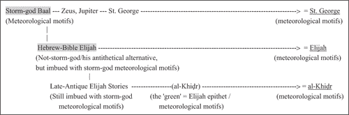


`图 7.1` 本书建议的这些人物之间的关系

该表暗示了这些人物之间时间关系，以及它们之间的概念关系。它暗示了以利亚、圣乔治和`al-Khiḍr`共同拥的气象主题的起源，并解释了为什么在过去的几百年里，黎凡特当地农业宗教社区会自然地联系并共享以利亚、圣乔治和`al-Khiḍr`这些“迥异”的人物：这些人物并不迥异；相反，他们密不可分。

此外，尽管这项研究涵盖了四个不同的人物，但实际上，该表表明所有四个人物的主要起源点仅归结为两个：风神`Baal-Hadad`，以及《希伯来圣经》中`Baal-Hadad`的“对立替代方案”以利亚，后者影响了圣乔治，并可能就是名为`al-Khiḍr`形象的名字。

这项工作的一项指导原则是：文本、图像和遗址就像人工制品，能够告诉我们关于其产生地的大量信息。从这个角度来看，每一个文本、图像或遗址都可以被视为通往历史的一扇小窗。为了将本研究中的每个人物理解为其自身时代和背景的产物，本书调查了这些人物的重要文本、图像和遗址，并在其中寻找了当代宗教、政治和地理影响的证据。通过这种地理背景分析，我们在每个文本、图像或遗址中看到了更广泛的证据，证明了地理对区域宗教观念和信仰发展的影响；农业宗教以及黎凡特地区一个由引人入胜的人物、叙事和地理主题组成的共同池的影响；黎凡特宗教之间的相互联系；以及正统性的缓慢发展。

## 我们在何处看到农业宗教

`Geography, Religion, Gods, and Saints in the Eastern Mediterranean` 让我们一窥了农业宗教的一角。正如我们在上面第二章中看到的，这种宗教与“正典”或“正统”宗教的观点明显不同，它是直到公元 20 世纪中叶，黎凡特大多数人宗教理解和实践的主导导向。在与书中人物相关的文本、图像和遗址中，我们看到了刻画农业宗教的几个概念^(32)。

黎凡特的农业宗教受“日常生存本质上是农业的条件”^(33) 主导，与该地区的地理位置以及由此产生的人类需求直接相关。我们在黎凡特的“神圣景观”中看到了这种地理特征，例如环境的岩石特性、许多洞穴和石窟，以及圣石。^(34)。我们还看到黎凡特洞穴和地下通道的观念是互相关联的^(35)。此外，我们看到该地区的地理反映在农业水崇拜的持续中，这些崇拜是由于黎凡特对水、特别是对天空降水的迫切需求而产生的。^(36)。

在 `Geography, Religion, Gods, and Saints in the Eastern Mediterranean` 中关于以伊利亚亚、乔治圣徒和哈德尔（`al-Khiḍr`）的案例中，我们还遇到了农业宗教的核心神圣：“圣徒”、“圣人”或“传奇人物”。^(37)。此外，我们在书中到处看到了大量关于农业宗教核心宗教建筑的证据：坟墓和神庙。^(38)。农业宗教中的圣徒和神圣人物被赋予了对抗恶魔的力量，我们在书中反复看到这种力量体现在黎凡特的人物身上，如所罗门，特别是乔治圣徒。

此外，我们还看到了在农业宗教语境下，恶魔无处不在的证据。^(39)。农业宗教中的“恶魔”至少在某种程度上是对灾祸无差别发生——尤其是死亡和疾病的解释。我们看到了长寿的女恶魔 `Abyzouth`、`Lilith`（莉莉丝）或 `al-Qarīna`（卡里娜），她们被认为会伤害新生婴儿及其母亲，^(40)，还有农业宗教观念，认为身体疾病（尤其是精神疾病）是由恶魔引起的。乔治圣徒在整个黎凡特因他驱除恶魔的力量而广为人知并深受推崇——部分是因为他最初壮丽地击败了一个以蛇或蟒蛇形式出现的“恶魔”。^(41)。

我们还看到了护符、护身符和圣像的频繁使用，这些在农业宗教语境中很常见。在这样一个变幻莫测的环境中，人们采取一切可能的手段对抗无情的自然力量和潜伏周围的恶魔，特别是在夜晚。^(42)。此外，农业宗教环境中的夜晚本身带有另一扇通往替代现实的窗户：幻象和梦。^(43)。在这种情况下，人们相信自己可以在梦和幻象中遇到圣徒和其他神圣人物，而寻求与神圣人物的梦中遭遇被认为是完全可能的。因此，我们在书中看到，在非常长的时期里，许多不同宗教传统的人都前往他在加密利山的洞穴，寻求以伊利亚亚以及哈德尔的建议和帮助。^(44)。

总的来说，我们在书中看到的频繁出现的证据是农业宗教的核心特征：宗教主题和叙事的长期模式、减少的派系冲突，以及一种共同的宗教文化。在黎凡特农业社区（包括犹太人、基督徒、穆斯林、德鲁兹派、阿拉维维派等）的共同宗教实践中，围绕着以伊利亚亚、乔治圣徒和哈德尔为中心，并在不同宗教群体之间频繁且连续地使用同一圣地，我们看到了派系冲突减少的证据。^(45)。在农业宗教语境下，节日往往围绕季节和天体周期建立。^(46)。通过共同的区域节日（例如 4 月 23 日的春季节日），我们看到了农业宗教共同宗教文化的展示。

在“阿斯塔忒与海”的故事中（该故事在该地区数千年来具有重要意义）；以“珀耳修斯与安德洛墨达”故事的形式；以乔治圣徒从龙手中救公主的叙事的形式；最后，以公元 1927 年一项仪式的形式出现（一位女性正在准备一只羊祭祀给“海”，以回报她的生育），我们看到了宗教主题和叙事的长期模式的证据。^(47)。农业宗教的稳定性使得故事、叙事、人物和主题能够在非常长的时间跨度内维持。那是因为人们对水、作物生长、生育以及免受疾病和伤害的需求，直到公元 20 世纪中叶在该地区一直保持相对稳定。农业宗教的稳定性比其他任何因素都促成了黎凡特共同人物、叙事和主题池的存在。这也是为什么我们在本章开头的关于加密利山以伊利亚亚洞穴的故事中看到，尽管那里崇拜的人物几年来可能发生了变化，但拜访那里的人的请求和请求在很大程度上保持不变。^(48)。

## 我们在何处看到黎凡特宗教之间的相互联系，以及正统性的缓慢发展

根据同样的分析逻辑，我们对本研究中每个人物进行的地理语境化，也证明了每个人物在文中呈现的特定时刻的独特性和特殊性。正如我们在第三章中所看到的，我们对`Baal Cycle`的文本分析表明，`Baal-Hadad`这一形象受到了同时宗教、政治和地理力量的影响。`巴尔循环`的叙事受到了当时关于风暴神战胜海怪物并击败混沌力量的叙事的影响^(49)。`巴尔循环`和其中的`Baal-Hadad`形象反映出当时西方闪米特“迦南”宗教的情况是：在一个宗教环境中，降雨水对农业和人类生活至关重要；神女神统治着自然环境并帮助解释其现象；人类生活和政治权力的事件与风神的恩宠或遗弃交织在一起，而风神无疑是该地区最强大的神灵。

第四章表明，希伯来圣经书中`以利亚`的叙事反映了一个由多个神女神（主要是迦南神）主导的宗教环境；其中`巴尔`是最突出的。正如希伯来圣经所描述，`巴尔`在迦南人以及以色列人和犹大人中的主导地位，是因为在一种降雨水对人类农业生活至关重要的环境中，他在宗教生活中具有优越性。

`以利亚`作为`雅和韦`的先知，例证了贯穿整个希伯来圣经的主题：`雅和韦`是至高神（而非`巴尔`），在他面前没有其他神。因此，崇拜除`雅和韦`以外的神会导致毁灭。因为`雅和韦`是至高神，他的行为也与其他神不同；他是嫉妒的，要求他的追随者必须专崇拜他，并在特定的地点通过特定的行为来实现。文中所传达的对`雅和韦`的热诚投入带来了`雅和韦`的恩宠。文中`以利亚`叙事所描绘的`雅和韦`人类崇拜者实际上应该表现得像`以利亚`一样：对`雅和韦`的奉献专一且不妥协。

希伯来圣经通过其中的`以利亚`形象揭示的宗教传统，是一种在渴望与其他群体区分开来这上具有显著排他性的传统。这在其他方面反映了一个小国（或多个国家）和少数宗教传统试图在地区内更大更强大的当代政治力量中生存并繁荣的视角。希伯来圣经中先知`以利亚`叙事所揭示的宗教传统，反映了与其他群体区分的坚定渴望——这些群体是“注定”被毁灭的。希伯来圣经叙事之所以之所以独特，是因为它们在一个混合和异族聚集的环境中，展现了将`雅和韦`的追随者与其他所有神的追随者区分开来的愿望。

《圣乔治传》让我们从`圣乔治`的形象中看到了一个主要以竞争为主的混合宗教环境，正如我们在第五章中所看到的。文本包含了当时由犹太人、基督徒、异教徒、犹太基督徒以及这些人群之间的各种分类所组成的环境。公元初几个世纪（无疑更久、也更早）黎凡地区的宗教环境受到对魔鬼、圣徒、魔法和偶像的普遍信仰的主导，同时宗教组织中日益壮大的“正统教”群体，这一切我们在`圣乔治`的文本和图像中都能看到反映。

`圣乔治`是一个受多重影响的人物——就其早期崇拜而言，`巴尔-宙斯`或`宙斯-格奥尔斯`可能在其中最为突出——他所反映的早期基督教是一场既认同于圣经传统，又与犹太教身份和实践区分开来的宗教运动。此外，文中反映的早期基督教是一种与犹太教一样的宗教传统，凭借其与一神教圣经传统和希伯来经文的联系，它与希腊化和罗马世界的多神教传统区分开来。《圣史》还揭示了一种新兴的基督教观念，认为神与圣经中的神相同，但具有扩展或更清晰的描述：本质上是三位一体的，并符合尼西亚会议后关于耶稣的帝国基督教立场：将耶稣纳入三位一体的第二位，他被认为在不同程度上同时具有人性和神性。

第六章中我们看到，《古兰经》中与`al-Khiḍr`形象相关的叙事，反映了一个处于更广泛的晚古代世界宗教社区、政治潮流和末世论宗教取向中的宗教文本。这些宗教社区最突出的是梅尔基派、雅各伯派和聂斯派基督徒，拉比犹太人以及六、七世纪的阿拉伯多神教徒。《古兰经》中的`Khiḍr`叙事反映了一个虔诚的宗教社区，其神学取向是严格的一神教的（尽管可能尚未被称为“穆斯林”）。这种对神的神学认知与圣经中的一神高度一致，强烈反反对当时基督教的三位一体神观，并直接对应统一的一神教概念。

## 黎凡地区的一神教：犹太教、基督教和伊斯兰教的对比

除了本书所示的地理对黎凡宗教思想的影响外，除了其文本中所反映的农业宗教文化和这些人物各自宗教传统的独特特征外，本书还阐明了这些宗教传统中关于一神教的一个有趣视角。具体来说，本书将一神教视为一种特定的宗教思想流，通过对比刻画了近东犹太教、基督教和伊斯兰教。

正如我们在第三章中所看到的，风暴神`巴尔-哈达德`作为气象现象的体现，也是人类生存或毁灭的源头，至少从青铜时代中期起就是黎凡地区杰出的神灵。希伯来圣经的一个主要神学论点是主张`雅和韦/YHWH`才是真正的神，除此之外没有其他神。希伯来圣经所揭示的长期发展的宗教传统，其特征是坚定地试图与其他异族群体和多神区分开来——其中`巴尔-哈达德`最为突出。

到公元元一世纪，`YHWH` 已经在犹太人社区中等同于简单的“上帝”（唯一的）。随着早期的基督教社区开始与同时期的犹太人社区区分开来，一种“基督教”的上帝神学观念开始出现，正如我们在上述第五章和第六章中所看到的，这种观念与希伯来经上帝的概念一致，但同时也得到了扩展，以阐释上帝具有三位一体的本质。神格中的第二个“位”逐渐被理解为上帝的“儿子”耶稣，与上帝“父”具有同性体。在《使徒行传》中，“真”神和“假”神也被界定，这表明了该文本在发展基督教身份认同观念方面具有异端论的性质，同时也反映了通过与多个同时期的宗教社区形成对立而建立的基督教上帝观的发展。

关于耶稣的人性与神性如何结合的观点，导致了早期基督教社区之间深层的分歧。这些分裂的基督教社区及其对上帝错综复杂的神学观念，在《古兰经》的上帝观中被明确否定，而《古兰经》转而符合一种更类似于希伯来圣经所反映的不可分割的一神教愿景。由于《古兰经》为关于上帝的“真”信仰和“假”信仰创造了标准，它也可以被描述为一种异端论文本。

对这些人物文本中所反映的一神教的这一简要概述（在之前的每个章节中进行了详细列出），在这里被汇总强调，以指示关于书中反映的一神教的一个有趣启示：一神教作为一种特定的宗教思想流派，在某些方面以不同的方式区分了犹太人、基督徒和穆斯林社区，这种区分既彼此之间，也与长期主导近东宗教倾向的大多多教传统相区别。

此外，回顾以色列人的神雅威韦^(50) 显然具有西奈/北阿拉伯起源，使人们能够考察一神教在更广泛的近东背景下（即，不局限于黎凡特地区）的发展状况。虽然本项目并非主张 `YHWH` 在“本质”上是一个一神教神，但本研究表明，我们应该将对一神教的分析扩展到更广泛的近东地区，超越黎凡特圣经历史的传统设定，以解释西奈和北阿拉伯文化背景对 `YHWH` 的影响。当 `YHWH` 与其他地区神（如迦南人的埃尔）结合，并以希伯来圣经所反映的一神教方式被感知时，`YHWH` 的西奈和阿拉伯起源为一神教的发展提供了更广泛的文化背景。

## 连续性与渐进性：宗教传统并非“完全成型”出生

除了考虑地理对区域宗教思想的影响，以及这些人物所反映的各自宗教传统的区别之外，本研究关于这些人物在文本和图像中被构建的方式，首先主张理解这些宗教传统形成过程中的连续性和渐进性，以反对传统主义对突如其来且戏剧性变化的描述。^(51)

这些宗教社区的创始起源视角声称其各自宗教传统的独特性、特殊性和“完整性”，并经常以这种方式呈现这些宗教传统，暗示它们是“出生时已几乎完全成型”。^(52) 然而，本研究已经证明了每一个宗教传统都具有显著的不清晰性和渐进性形成。此外，通过对《巴尔循环》中的巴尔、希伯来圣经中的以利亚利亚、《圣乔治传》中的圣乔治以及《古兰经》中的哈基德尔的研究，本研究显示，这些传统中的每一个都是逐渐从其同时期的宗教环境中浮出来的，并在很大程度上与当时盛行的宗教观念保持连续。

这暗示了两个主要的观察结果。首先，当我们把宗教传统视为从创始人物和早期文本开始“开始”时，我们在宗教研究中似乎误解或错误描述了宗教传统。事实上，需要几个世纪的时间和通常某种形式的政治控制，才能创造出后来这些传统所具有的正统（正统性）。此外，一个传统的创始人物和早期文本实际上与其说是其同时期宗教背景的产物，不如说是它们之后所发展的宗教传统的产物。以这种方式，我们应该将本研究中的文本视为关于人物本身的信息来源，同时也视为证明先前宗教传统证据的文本。^(53)

因此，《巴尔循环》可以被视为青铜时代晚期叙利亚-巴勒斯坦及更广泛近东宗教背景的证据，正如它也是巴尔历史的证据一样；希伯来圣经可以被视为铁器时代迦南和大近东宗教环境的证据，正如它也是以色列或犹太历史的证据；《圣乔治传》可以被视为四至六世纪混合多神教-基督教-犹太地区宗教环境的证据，正如它也是乔治历史的证据；而《古兰经》可以被视为同时期晚期古代阿拉伯异教、犹太和基督教社区的证据，正如它也是穆斯林历史的证据。^(54)

通过人物文本中所反映的这些传统形成的连续性和渐进性证据得出的第二个观察结果是：现代“基础主义”宗教倾向的成员（基础主义在这里是指试图重建“追溯”到创始人物和早期文本所反映的所谓宗教倾向的社区），在犹太人和基督徒社区中，或者某些逊尼穆斯林人的“萨拉斐派”宗教倾向成员中，在时代上错误地描述了他们的早期宗教传统，使其比历史记录所显示的更具独特性。事实上，如果这些类型的宗教倾向的成员能够“追溯”到他们传统的最早时期，他们可能会遇到一个与他们想象的完全不同的宗教环境。

## 地中海东部共同文化

本研究人物之间的联系和相似性长期以来被崇拜他们的社区所识别。人物之间的相似性主要围绕共同的地理和气象主题展开：雨、风暴、雷、电、绿色、丰饶、多产、出现和消失的能力、与山或其他高海拔的联系、4 月 23 日的当地节日或庆祝日，以及击败巨龙的主题。正如我们在上面看到的，这些主题主要由区域地理需求和考虑所塑造。

文本与图像中这些人物之间的联系同样将他们联系在了一。以利亚（`Elijah`）和圣乔治（`St. George`）在中东地区广为人知深受推崇，是因为他们具有捍卫“真”宗教反对“假”神的特质。阿尔-海德尔（`Al-Khiḍr`）与以利亚在伊斯兰宗教文献中特别相关，而阿尔-海德尔与圣乔治在黎凡地区则共享相同的肖像表现形式。这些相似性和联系使得在过去的至少 800 年里，黎凡犹太人、基督徒和穆斯林当地社区的流行实践中，阿尔-海德尔、以利亚和圣乔治融合在了一起。^(55)

这些人物在地中海犹太人、基督徒、穆斯林、德鲁兹派、阿拉维派等社区的流行实践中结合在一起，是因为这些社区以及他们各自的宗教传统和人物——是在当地农业宗教背景下共同演化的。正如我们在研究之初看到的，如果仅将这些人物视为各自宗教传统的产物，那么地中海以利亚、圣乔治和阿尔-海德尔所共有的特征长期以来一直认为是“奇特”的。然而，当我们把他们视为区域性宗教人物，并在宗教、政治和地理影响的背景下研究他们的文献时，他们在文本、图像和流行实践中的联系与关联就变得清晰得多，他们共同的农业主题也完全不再显得奇特了。

这种共同的地理和文化环境也解释了为什么这些人物在黎凡地区之外没有以相同的方式被共享。由于缺乏社区实践和肖像学中的长期关联，以利亚、圣乔治和阿尔-海德尔在世界各地的各自宗教社区中主要通过其正经文本的内容而广为人知。这些文本通常以特定传统的方式进行解读，这些方式强化了内部的神学原则和宗教身份，导致从文本角度来看，没有所谓的“自然”理由将巴亚勒-哈达德（`Baal-Hadad`）、以利亚、圣乔治和阿尔-海德尔理解为各自宗教社区中相互独立的、互不相关的形象。

最后，本研究强调了文化背景在宗教研究中的重要性。事实上，地中海犹太人、基督徒和穆斯林当地社区在过去至少 800 年里崇拜以利亚、圣乔治和阿尔-海德尔的现象，与地中海的文化背景是不可分割的。因此，如果不理解这一现象是置于地中海文化和宗教历史的背景下的，对这些人物及其关系的分析将是不可行的。这一切表明，我们宗教研究界需要更好地识别即使是全球性宗教也具有区域特殊性，并且我们需要承认宗教传统之间存在区域性的特定关系。在宗教研究领域，这类论点大多数时候并没有被提出甚至没有被想象。《地中海的地理、宗教、神灵与圣人》为我们更好地理解这一更广泛的现象提供了一个关键案例研究。

从公元 7 至 8 世纪后的某个点起，区域性犹太人、基督徒和穆斯林社区中这三个人物之间的联系变得常态且真实（再次参见图 7.1），因为这些人物被他们的社区理解为所有居民共有的区域性人物。当然，混合的宗教实践不能用一个完全不变的模型来表征：“它们在符号和实践上都是复杂的活动，其变化可以追溯到观察时盛行的政治、人口和社会状况。”^(56)此外，尽管人们可以拥有多重社会身份，

因此，本研究同样表明，涉及以利亚、圣乔治和阿尔-海德尔的犹太人、基督徒、穆斯林和其他宗教社区的区域宗教实践，在大多数政治条件下是常态化的，但在动荡时期是不稳定的，且主要是由外来人引发的动荡的结果。可能的有趣研究领域在于对公元 11 至 12 世纪十字军东征时期的考察，在此期间，法兰克十字军将他们在黎凡遇到的具有战争色彩且广受欢迎的圣乔治形象被据为己有。由于没有意识到圣乔治在多个当地宗教社区中的重要性，黎凡的穆斯林成为了外来十字军以及“他们”所青睐的圣人的攻击目标。^^(58)

另一个潜在的研究领域可能涉及 20 世纪动荡期间的若干事件，在此期间，划定了新的政治边界，建立了具有特定宗教人口的国家（在许多情况下是迁徙的），并成立了现代以色列政国家，这在很大程度上根除并驱逐了位于地中海东地区的传统犹太人社区及其共同的宗教实践。这一事件也导致了当地基督徒和穆斯林社区的流离，并导致特定人士能够专属进入曾经开放的场所，从而破坏了那里犹太人、基督徒、穆斯林和德鲁兹社区之间传统的共享宗教实践。^(59)

### 现代意义

在书初，我们提出犹太人、基督徒和穆斯林社区崇拜共同人物的现象是矛盾的且值得注意的，因为“常识”甚至宗教学术研究中传播的认识论概念认为，犹太人、基督徒和穆斯林处于不同且独立的宗教类别中，尤其是在充满争议的地中海地区。

将地中海描述为“充满争议的”反映了该地区 19 和 20 世纪动荡的政治历史，这段历史以殖民主义干预、在此前不存在的地方建立民族国家边界、威权统治者的遗产，以及第一次世界大战后传统社会和社区的重组为特征，这在一定程度上扰乱了涉及穆斯林、基督徒和犹太人社区的传统宗教实践。然而，必须记住，20 世纪巨大的政治变化叠加在了一个区域文化之上，这种文化长期以来反映了黎凡犹太人、基督徒、穆斯林和其他宗教社区之间共同且稳定的农业宗教历史。

现代政治考量与长期文化影响之间的紧张关系，是整个当代地中海地区许多冲突的核心。^(60) 随着该地区 20 和 21 世纪政治历史的紧迫需求展开，地中海往往被其离散宗教社区之间的划分和区别所表征，这既是准确的也是误导性的。不应忘记，尽管存在这些紧张关系，大量的且长期文化重叠和共性领域仍然存在。

此外，虽然今天人们正确地观察地中海并识别出不同的宗教社区（主要由穆斯林、基督徒和犹太人组成），正如我们在书中所示，但犹太教、基督教和伊斯兰教的宗教传统在文本或历史上并不是分离的。因此，本研究主张，在当地的地中海背景下，犹太人、基督徒和穆斯林是不同但并非分离的。

尽管东中海地区关于“不同但并不分离”的宗教传统的历史记载在其区域文化传统以及农业宗教的遗产中有所呼应，但当今宗教社区的成员也可能受到动荡政治局势的影响，并受到那些强调差异性、独性和分化的本质主义政治和宗教运动紧缩政策的冲击（`[61]`）。然而，这些宗教社区中没有一个能因对其共同区域历史的不完整或局部理解而受益。

《东中海的地理、宗教、神灵与圣人》展示了地理对于在该地区的人们的持久遗产，并表明居住在东中海的人们基于共同地理的联系，比他们宗教边界或不断变化的政权隔阂更为紧密、时间也更长。然而，本书认为，凯尔海德尔（`al-Khiḍr`）、圣乔治和以利亚亚的现象完全属于东中海的历史遗产。此外，它认为这种现象揭示了关于该地区传统宗教社区和社会和象征组织的大量信息。

涉及凯尔海德尔、圣乔治和以利亚亚等人物的共同实践是共同宗教和文化遗产的重要部分（`[图 7.2]`）（`[62]`）。今天，出于各种政治原因，这些实践通常由有限的基督徒和穆斯林社区参与，并主要涉及圣乔治和凯尔海德尔，有时也涉及圣以利亚（`[63]`）。由于与 20 世纪历史相关的许多原因，这种现象不再像过去那样盛行，并且变得越来越稀有。然而，作为该地区文化遗产的重要组成部分，重要的是，至今仍参与围绕这些人物共同实践的个人，其参与的行为并非任何意义上的异常或不正常，尽管此类共同宗教实践近期一直被这样定性（`[64]`）。

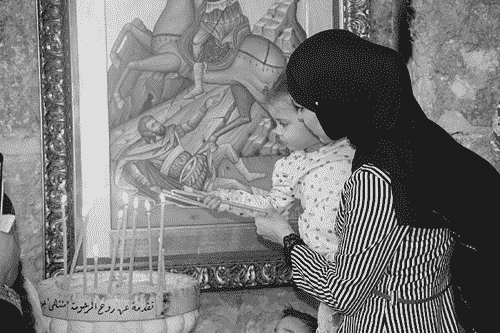

`[图 7.2]` 穆斯林妇女和孩子在洛德（`Lod`）的圣乔治教堂内，在圣乔治像前点燃蜡烛。（摄影：`Stephanie Saldaña`，2017 年。）

相反，今天那些由现代本质主义宗教倾向的成员所推动的排他性宗教实践才可能被认为是具有历史性的反常。相反，涉及圣乔治、凯尔海德尔和以利亚亚人物的共同实践——被广泛认为是“每个人的遗产”（`[65]`），正如这些区域人物确实是那样——既对于这些宗教传统的历史真实，对于黎凡特的历史宗教实践也是真实的。宗教实践是这一地理区域的自然特征，也是该地区宗教社区紧密发展的产物。

## 注释

# 参考文献

1. `Albera`, `Dionigi`, and `Maria Couroucli`, eds. *Sharing Sacred Spaces in the Mediterranean: Christians, Muslims, and Jews at Shrines and Sanctuaries*. New Anthropologies of Europe, edited by `Matti Bunzl` and `Michael Herzfeld`. Bloomington, IN: Indiana University Press, 2012.
2. `Alexander`, `Paul J`. *The Byzantine Apocalyptic Tradition*. Edited and with an introduction by `Dorothy deF. Abrahamse`. Berkeley, CA: University of California Press, 1985.
3. `Allen`, `Spencer`. *The Splintered Divine: A Study of Ištar, Baal, and Yahweh Divine Names and Divine Multiplicity in the Ancient Near East*. Studies in Ancient Near Eastern Records 5. Munich: De Gruyter, 2015.
4. `Alouf`, `Michel M`. *Baalbek*, 19th edition, 8th English edition. Beirut, Lebanon: American Press, 1949.
5. `al-Azmeh`, `Aziz`. *The Emergence of Islam in Late Antiquity: Allāh and His People*. Cambridge, UK: Cambridge University Press, 2014.
6. `Amiran`, `D. H. K`. “Land Use in Israel,” in *Land Use in Semi-Arid Mediterranean Climates*. Paris: UNESCO International Geographic Union, 1964.
7. `Ando`, `Clifford`, ed. *Roman Religion*. Edinburgh: Edinburgh University Press, 2003.
8. `Antoniadou`, `Sophia`, and `Anthony Pace`, eds. *Mediterranean Crossroads*. Athens: Pierides Foundation, 2007.
9. `Asad`, `Talal`. “The Construction of Religion as an Anthropological Category.” In *Genealogies of Religion: Discipline and Reasons of Power in Christianity and Islam*, 27–54. Baltimore, MD: Johns Hopkins University Press, 1993.
10. `Attwater`, `Donald`. *The Christian Churches of the East*, vol. 1: *Churches in Communion with Rome*. Religion and Culture Series, edited by `Joseph Husslein`. Milwaukee, WI: The Bruce Publishing Company, 1946.
11. `Attwater`, `Donald`. *The Christian Churches of the East*, vol. 2: *Churches Not in Communion with Rome*. Religion and Culture Series, edited by `Joseph Husslein`. Milwaukee, WI: The Bruce Publishing Company, 1947.
12. `Augustinovič`, `A`. *‘El-Khadr’ and the Prophet Elijah*. Translated by `Eugene Hoade`. Jerusalem: Franciscan Printing Press, 1972.
13. `Avi-Yonah`, `M`. “Historical Outline: History and Description of Antiquities and Sites.” In *Steimatzky’s Guides: Syria and the Lebanon*. Jerusalem: Steimatzky Co., 1942.
14. `Avi-Yonah`, `M`. “Mount Carmel and the God of Baal.” *Israel Exploration Journal* 2(2): 118–124, 1952.
15. `'Awadi`, `al- Mahmoud`. *Kitāb al-ziārāt bi-dimashq*. Edited by `Salāh al-din-Manjad`. Damascus, 1956.
16. `Badr`, `Habib`, `Slim`, and `Abou Nohra`, eds. *Christianity: A History in the Middle East*. Beirut: Middle East Council of Churches, 2005.
17. `Balogh`, `Amy L`. *Moses Among the Idols: Mediators of the Divine in the Ancient Near East*. Lexington/Fortress Press, 2018.
18. `Bannister`, `Andrew G`. *An Oral-Formulaic Study of the Qur’an*. Lanham, MD: Lexington Books, 2014.
19. `Bauer`, `Walter`. *Orthodoxy and Heresy in Earliest Christianity*, second edition, with added appendices by `Gerhard Krodel`. Translated by a team from the Philadelphia Seminar on Christian Origins, edited by `Robert A. Kraft`. Philadelphia, PA: Fortress Press, 1971.
20. `Bell`, `Gertrude L`. *Syria: The Desert and the Sown*. New York: Tauris Parkbacks, 2016 (First published London: Heinemann, 1907).
21. `Bernstein`, `Marc S`. *Stories of Joseph: Narrative Migrations between Judaism and Islam*. Detroit, MI: Wayne State University Press, 2006.
22. `Bladel`, `Kevin van`. “The Alexander Legend in the Qur’ān 18:83-102.” In *The Qur’ān in Its Historical Context*, edited by `Gabriel Said Reynolds`, Routledge Studies in the Qur’an 8, series editor `Andrew Rippin`, 175–203. New York: Routledge, 2008.
23. `Blömer`, `Michael`. “Religious Continuity? The Evidence from Doliche.” In *Religious Identities in the Levant from Alexander to Muhammed, Continuity and Change*, edited by `Michael Blömer`, `Achim Lichtenberger`, and `Rubina Raja`. Contextualizing the Sacred 4, series editors `Elizabeth Frood` and `Rubina Raja`. Turnhout, Belgium: Brepols, 2015.
24. `Blömer`, `Michael`, `Achim Lichtenberger`, and `Rubina Raja`. *Religious Identities in the Levant from Alexander to Muhammed: Continuity and Change*. Contextualizing the Sacred 4, series editors `Elizabeth Frood` and `Rubina Raja`. Turnhout, Belgium: Brepols, 2015.
25. `Bowerstock`, `G. W.`, `Peter Brown`, and `Oleg Grabar`, eds. *Late Antiquity: A Guide to the Postclassical World*. Cambridge, MA: The Belknap Press of Harvard University Press, 1999.
26. `Bowman`, `Glenn`. “Nationalising and Denationalising the Sacred: Shrines and Shifting Identities in the Israeli-Occupied Territories (in Arabic).” *Chronos: Revue d'Histoire de l'Université de Balamand* 16: 151–210, 2007.

27. `Bowman`, `Glenn`. 《巴勒斯坦与马其多尼亚几处共享圣地周围的认同过程》，收于《穿越的宗教：地中海基督徒、穆斯林与犹太人共享的圣地》。*《地中海研究》*，`Dionigi Albera` 和 `Maria Couroucli` 编。阿尔尔斯：Actes Sud，2009 年。

28. `Boyarin`, `Daniel`. 《界线：犹太基督教的分界》。宾夕法尼亚州，费城：宾夕法尼亚大学出版社，2004 年。

29. `Boyarin`, `Daniel`. 《为神而死：殉道与基督教及犹太教的形成》。加利福尼亚州帕洛阿尔托：斯坦福大学出版社，1999 年。

30. `Brakke`, `David`. 《公元四世纪埃及的经典形成与社会冲突：亚历山大的亚坦纳修的第三十九封节庆信》。*《哈佛神学评论》*87 (1994)：395–419。

31. `Braudel`, `Fernand`. 《地中海：腓力二世时代的地中海世界》。2 卷。`Siân Reynolds` 译。加利福尼亚州，伯克利：加州大学出版社，1995 年 (1949 年)。

32. `Brock`, `Sebastian`. 《亚利亚传统中的圣经》，第二修订版。*《Gorgias 手册》*7。新泽西州，皮斯卡特韦：Gorgias Press，2006 年。

33. `Bronner`, `Leah`. 《以利亚与以利沙的故事：作为反对巴力崇拜的论战》。*《普利托利亚东方系列》*6，`A. Van Selms` 编。莱登：E. J. Brill，1968 年。

34. `Brooks`, `E. W`. 《圣乔治事迹》。*《乔治选集》*8。新泽西州，皮斯卡特韦：Gorgias Press，2006 年 [原版出版于 1925 年《Muséon》杂志，第 38 卷]。

35. `Brotton`, `Jerry`. 《东西方之间的圣乔治》。收于《重新定位文艺复兴：与东方的文化交流》，`Gerald MacLean` 编，50–65。纽约：Palgrave Macmillan，2005 年。

36. `Brown`, `Peter`. 《圣徒崇》。伊利诺伊州，芝加哥：芝加哥大学出版社，1981 年。

37. `Brown`, `Peter`. “圣人”。收于《剑桥古代史》，第 XIV 卷《晚期古代：帝国及其继承者公元 425–600 年》，`Averil Cameron`、`Bryan Ward-Perkins` 和 `Michael Whitby` 编，781–810。英国，剑桥：剑桥大学出版社，2000 年。

38. `Brubaker`, `Leslie` 和 `John Haldon`. 《圣像破坏时期（约 680-850 年）的拜占庭：文献来源》。*《拜占庭与奥斯曼专著》*7，`Anthony Bryer` 和 `John Haldon` 编。佛蒙蒙特州，伯灵顿：Ashgate Publishing Company，2001 年。

39. `Budge`, `E. A. Wallis`. 《吕达的乔治，英格兰的主保圣人：埃塞俄比亚圣乔治崇拜研究》。伦敦：Luzac & Co.,1930 年。

40. `Budge`, `E. A. Wallis`. 《亚历山大大帝史：伪卡利斯提尼叙利亚语版本，根据五份手稿编辑，附带英文翻译与注释》。新泽西州，皮斯卡特韦：Gorgias Press，2003 年 [原版由剑桥大学出版社于 1889 年出版]。

41. `Bulliet`, `Richard W`. 《中世纪时期的伊斯兰教皈：定量历史论文》。马萨诸塞州，波士顿：哈佛大学出版社，1979 年。

42. `Burckhardt`, `John L`. 《叙利亚与圣地的之旅》。南卡罗来纳州，查尔斯顿：BiblioBazaar，2008 年。

43. `Burrus`, `Virginia` 和 `Rebecca Lyman`. “转移历史的焦点”。收于《人民基督教史》，第 2 卷《晚期基督教》，`Virginia Burrus` 编，1–26。明尼苏达州，明尼阿波利斯：Fortress Press，2005 年。

44. `Canaan`, `Taufik`. 《巴勒斯坦的穆罕默德圣徒与圣地》。伦敦：Luzac & Co.,1927 年。

45. `Canivet`, `Pierre`. 《1 世纪的基督教：地中海文明背景下：犹太、希腊、罗马与亚洲》。收于《基督教：中东一部史》，`Habib Badr`、`Suad Slim` 和 `Joseph Abou Nohra` 编，47–66。黎巴嫩，贝鲁特：中东教会委员会，2005 年。

46. `Caquot`, `André` 和 `Maurice Sznycer`. 《乌加特宗教》。*《宗教图像》*，第 XV 部分：美索不米亚与近东，第八辑，`Th. P. van Baaren`、`L. P. van den Bosch`、`L. Leertouwer`、`F. Leemhuis` 和 `H. Buning` 编。莱登：E. J. Brill，1980 年。

47. `Castelli`, `Elizabeth`. 《殉道与记忆：早期基督教文化的构建》。纽约：哥伦比亚大学出版社，2007 年。

48. `Chaillot`, `Christine`. 《东方正教教会中图像的角色与圣像崇拜》。日内瓦：Dialogue Entre Orthodoxes，1993 年。

49. `Chaillot`, `Christine`. 《安提俄的叙利亚教会及其当代开放性》（注：原文文本不全，根据 `Chaillot` 著作重建）。

50. `Cheette`, `Frederic`. “地中海”。收于《世界史指南》，第 2 卷，15–25。新泽西州，普林斯顿：Princeton Press，2014 年。

# 参考文献

71. `Dalrymple`, `William`. 《圣山：中东基督徒的旅程》。纽约：Henry Holt and Company, 1997。

72. `Dar`, `Shimon`. 《古代喀密尔山上的乡村定居点》。牛津：Archaeopress Archaeology, 2014。

73. `Day`, `John`. 《雅和华与迦南的神灵与女神》。《旧约研究期刊补充丛书》，第 265 卷，`David J. A. Clines` 和 `Philip R. Davies` 编。英国谢菲尔：Sheffield Academic Press, 2000。

74. `De Gaury`, `Lieut.-Colonel Gerald`, `M. C`. “英国与中东的圣乔治”。《《皇家中央中亚学会杂志》 32: 206–208, 1945。

75. `De Giorgi`, `Andrea U`. 《古代安提俄：从塞琉基时代到伊斯兰征服》。英国剑桥：Cambridge University Press, 2016。

76. `De Lange`, `Nicholas`. “查士丁尼时代的犹太人”。收于《查士丁尼时代剑读》，`Michael Maas` 编，401–426。纽约：Cambridge University Press, 2005。

77. `De Moor`, `Johannes C`. 《乌加里特宗教文本选》。宗教文本译本系列 NISABA 16，`M. S. H. G. Heerma Van Voss`, `J. Knappert`, `R. P. Kramers`, `B. A. Van Proosdij`, `J. D. H. Waardenburg`， 以及 `R. A. M. Van Zantwijk` 编。荷兰莱顿：E. J. Brill, 1987。

78. `Delehaye`, `Hippolyte`. 《圣人传》。伦敦：G. Chapman, 1962。

79. `Dixon-Kennedy`, `Mike`, 编. “佩鲁恩”，“俄罗斯和斯拉夫神话与传说百科全书》。加州圣巴巴芭拉：ABC-CLIO, 1998。

80. `Doniger`, `Wendy`. 《隐含的蜘蛛：神话中的政治与神学》。纽约：Columbia University Press, 1998。

81. `Donner`, `Fred M`. “伊斯兰的背景”。收于《查士丁尼时代剑读》，`Michael Maas` 编，510–534。纽约：Cambridge University Press, 2005。

82. `Donner`, `Fred M`. 《穆罕默德与信徒：伊斯兰的起源》。马萨诸塞州剑桥：哈佛大学出版社 The Belknap Press, 2010。

83. `Donner`, `Herbert`. 《马达巴的摩西地图》。古巴勒斯坦 Palaestina Antiqua 7。荷兰坎彭：Kok Pharos Publishing House, 1992。

84. `Draper`, `Jonathan A.`, and `Claytton N. Jefford`. 《教会纲要：早期基督教中块缺失的拼图》。早期基督教及其文学，14。佐治亚州亚特兰大：SBL Press, 2015。

85. `Droge`, `A. J`. 《古兰经：新注释译本》。比较伊斯兰研究，`Brannon Wheeler` 编。英国谢菲尔：Equinox Publishing Ltd., 2013。

86. `Ducellier`, `Alain`. “4 至 5 世纪拜占庭的专制与宗教”。收于《基督教：中东史》，`Habib Badr`, `Suad Slim`， 以及 `Joseph Abou Nohra` 编，93–120。黎巴嫩贝鲁特：中东教会委员会，2005。

87. `Eberhard`, `Otto`. “El-Chadr = 圣埃利亚 = 圣乔治骑士。一个巴勒斯坦宗教混合主义的教学案例。《古代史》2: 82–89, 1956。

88. `Ehrman`, `Bart D`. 《新约之后：早期基督教读读》。纽约：Oxford University Press, 1999。

89. `Ehrman`, `Bart D`. 《耶稣如何成为神：一位来自加利利的犹太传教者的升华》。纽约：HarperOne, 2014。

90. `Eisenberg`, `Ronald L`. 《塔尔木德中的关键人物》。英国普利茅：Jason Aronson, 2013。

91. `El-Badawi`, `Emran I`. 《古兰经与阿拉米亚福音传统》。Routledge 古兰经研究 13。纽约：Routledge, 2013。

92. `Engels`, `David`, and `Peter van Nuffelen`. 《古代的宗教与竞争》。布鲁塞尔：Latomus, 2014。

93. `Ernst`, `Carl W`. 《如何阅读古兰经：新指南及选译》。北卡罗来纳州教堂山：北卡罗来纳大学出版社, 2011。

94. `Ess`, `Margarete van`. 《赫利奥波斯巴贝克：1898–1998 发现遗迹》，第 2 版。柏林：Das Arabische Buch, 2001。

95. `Faraone`, `Christopher A`. 《古希腊护身符上的消失行为：从口头表演到视觉设计。《古典研究学院公告增刊》，伦敦：伦敦大学古典研究学院，2012。

96. `Ferg Muhaisen`, `Erica`. “连续性与区别：古代近东宗教地理研究”。

97. `Finkelstein`, `Israel`. 《被遗忘的王国：考古学与历史》。

98. `Finkelstein`, `Israel`. 《被发掘的圣经》。

99. `Firestone`, `Reuven`. 《荷马史诗》。

100. `Fox`, `Robin L`. 《异教徒与基督徒》。

101. `Fox`, `Robin L`. 《圣地之旅》。

102. `Franke`, `Patrick`. 《与哈德尔的相遇》。

103. `Frend`, `W`. 《早期教会的殉道与迫害》。

104. `Frick`, `Samuel`. 《锚定时代》。

105. `Fulghum`, `Mary M`. 《晚古代作为护身符使用的硬币》。

106. `Goode`, `Jonathan`. 《中世纪英国的圣乔治崇拜》。

107. `Ghanam`, `al-Sayyid`. 《Sayyidun al-Khir》。

108. `Gibson`, `John C`. 《迦南人神话》。

109. `Gilchrist`, `Cherry`. 《俄罗斯魔法：魔法景观中的活民间传统》。

110. `Gilliot`, `Claude`. 《穆贾希德的注释：麦加解经传统的起源、传承路径与发展》。

111. `Ginzberg`, `Louis`. 《犹太人传说》。

112. `Glassner`, `Jean-Jacques`. 《楔形文字的发明：苏美尔文字》。

113. `Görke`, `Andreas`, and `Johanna Pink`, 编. 《注释与伊斯兰知识史：探索一种流的边界》。

114. `Goldziher`, `Ignaz`. 《伊斯兰中的圣人崇拜》。

115. `Goldziher`, `Ignaz`. 《论异教与伊斯兰中对死者的崇拜》。

117. 戈特沙尔, `Peter`. 《超越印度教与穆斯林教：印度一个村庄叙事中的多重身份》。牛津：牛津大学出版社，2000 年。

118. 格兰, `Robert M`. 《神与独真神》。早期基督教图书馆（Library of Early Christianity），由 `Wayne T. Meeks` 编。宾夕法尼亚州，费城：威斯敏斯特出版社，1986 年。

119. `Gray`, `Patrick T. R`. “察尔铎的遗产”。收于《贾斯丁尼时代剑桥伴读丛》（The Cambridge Companion to the Age of Justinian），由 `Michael Maas` 编，215–283 页。纽约：剑桥大学出版社，2005 年。

120. 格瑞克斯, `Geoffrey`. “六世纪的拜占庭与东方”。收于《贾斯丁尼时代剑桥伴读丛》（The Cambridge Companion to the Age of Justinian），由 `Michael Maas` 编，477–509 页。纽约：剑桥大学出版社，2005 年。

121. 格林, `Alberto R. W`. 《古代近东的风暴神》。加州大学圣地亚哥分校圣经与犹太研究（Biblical and Judaic Studies from the University of California, San Diego）），由 `William Henry Propp` 编。印第安纳州，威诺纳湖：Eisenbrauns 出版社，2003 年。

122. 格雷, `Robert C`. 《共同的故事，竞争的讲述：犹太人、基督徒与穆斯林的早期接触》。英国，牛津：牛津大学出版社，2015 年。

123. 格雷汉, `James`. 《圣徒黄昏：奥斯曼时期叙利亚与巴勒斯坦的日常宗教》。牛津：牛津大学出版社，2014 年。

124. 葛菲特斯, `Sydney H`. “基督教传说与阿拉伯古兰经：古兰经与叙利亚基督教传统中的‘洞中奇’（Sūrat al-Kahf）”。收于《历史背景下的古兰经》（The Qur’ān in Its Historical Context），由 `Gabriel Said Reynolds` 编。劳特奇古兰经研究（Routledge Studies in the Qur’ān）8，由 `Andrew Rippin` 编，109–138 页。纽约：劳特奇出版社，2008 年。

125. 葛菲特斯, `Sydney H`. “古兰经中的纳萨拉（al-Nasārā）：一种诠释反思”。收于《古兰经视角：历史背景下的古兰经 2》（New Perspectives on the Qur’ān: The Qur’ān in its Historical Context 2），由 `Gabriel Said Reynolds` 编。劳特奇古兰经研究（Routledge Studies in the Qur’ān）12，由 `Andrew Rippin` 编，301–322 页。纽约：劳特奇出版社，2011 年。

126. 葛菲特斯, `Sydney H`. 《阿拉伯语圣经：伊斯兰语言中的‘书之民’》。从古代到现代犹太人、基督徒与穆斯林（Jews, Christians, and Muslims from the Ancient to the Modern World）20，由 `Michael Cook`, `William Chester Jordan` 和 `Peter Schäfer` 编。新泽西州，普林斯顿：普林斯顿大学出版社，2013 年。

127. 纪洛姆, `Alfred`. 《穆罕默德传：伊本·伊斯哈哈克的《真主的使者》（Sīrat Rasūl Allāh）译本》。牛津：牛津大学出版社，2002 年（1955 年重印）。

128. 古利里克, `John`. 《黎巴农村庄的社会结构与文化变》。纽约：温纳-格伦人类学研究基金会，1955 年。

129. 哈贝尔, `Norman C`. 《雅威华对阵巴力：一种宗教文化的冲突》。纽约：Bookman Associates 出版社，1964 年。

130. 哈达德, `Hassan S`. “巴尔-哈达德：对叙利亚风暴神的研究”。博士论文，芝加哥大学，1960 年。

131. 哈达德, `Hassan S`. “黎凡特地区的‘农耕式’崇拜与圣徒”。《Numen》杂志 16(1): 21–39 页，1969 年。

132. 哈尔曼, `H. Talat`. 《两海交汇之处：海德尔（Al-Khiḍr）与摩西——苏菲派注释中海德尔与摩西的古兰经研究作为精神指导》。肯塔基州，路易斯维：Fons Vitae 出版社，2013 年。

133. 哈尼夫, `Suzanne`. 《伊斯兰先知史：源自古兰经、圣训与注释》，第 2 卷。伊利诺伊州，芝加哥：Library of Islam 出版社，2002 年。

134. 哈里斯, `William`. 《黎凡特：破碎的马赛克》。普林斯顿中东系列丛（Princeton Series on the Middle East），由 `Bernard Lewis` 和 `András Hámori` 编。新泽西州，普林斯顿：Markus Weiner 出版社出版社，2003 年。

135. 哈里斯, `W. V`, 编. 《重新思考地中海》。纽约：牛津大学出版社，2005 年。

136. 哈尔维, `Susan A`. “雅各向谁传道？”收于《萨鲁格的雅各及其时代：六世纪叙利亚基督教研究》，由 `George Anton Kiraz` 编，115–页。Gorgias 东部基督教研究（Gorgias Eastern Christian Studies）8。新泽西州，皮斯卡塔韦：Gorgias 出版社，2010 年。

137. 哈斯勒克, `Frederick W`. 《苏丹统治下的基督教与伊斯兰教》，2 卷。牛津：Clarendon 出社，1929 年。

138. 霍廷, `G. R`. 《偶像崇拜观念与伊斯兰的兴起：从论辩到历史》。英国，剑桥：剑桥大学出版社，1999 年。

139. 希内尔, `John`. 《劳特奇宗教研究伴读丛简介》，第 2 版。纽约：劳特奇出版社，2010 年。

140. 霍登, `Peregrine` 与 `Nicholas Purcell`. 《腐败的海：地中海历史研究》。牛津：Blackwell, Ltd.，2000 年。

141. 霍登, `Peregrine` 与 `Sharon Kinoshita`, 编. 《地中海伴读》（A Companion to Mediterranean）。英国，萨克斯：Wiley 出版社，2014 年。

142. 霍斯利, `Richard` 与 `John Hanson`. 《强盗、先知与圣徒》。Trinity 出版社，1985 年。

143. 霍斯利, `Richard` 与 `John Hanson`. “狂热者”。《Nov》杂志 28:159–182 页，1986 年。

144. 霍登, `Robert G`. 《看到伊斯兰：晚期研究（Studies in Late Antiquity）》。新泽西州，普林斯顿出版社，1997 年。

145. 霍登, `Robert G`. 《从青铜时代到伊斯兰的阿拉伯人》。贝鲁特：Dar al-Fikr 出版社，2001 年。

146. 霍登, `Robert G`. “古兰经中的犹太人”。收于《古兰经视角：历史背景下的古兰经 2》（New Perspectives on the Qur’ān: The Qur’ān in its Historical Context 2），由 `Gabriel Said Reynolds` 编。劳特奇古兰经研究（Routledge Studies in the Qur’ān）12，由 `Andrew Rippin` 编，301–322 页。纽约：劳特奇出版社，2011 年。

147. 休斯, `Donald D`. 《地中海：自然与人类社会》。马萨诸塞州，圣巴巴巴拉：ABC 出版社，2005 年。

148. 亨普里斯, `Stephen D`. “莱巴德的新铭”。《Bulletin de Correspondance Hellénique》杂志 64–65: 36–59 页，1940 年。

149. 亨特, `Joel`. 《乌加里特语入门》。哥本哈根：G. E. C.,2007 年。

150. 亨廷, `Samuel P`. “文明的冲突？”《外交事务》杂志 72(3): 22–49 页，1993 年。

151. 伊本·卡西尔, `Isma'il bin 'Umar`. 伊本·卡西尔的大马士革编年史（The Damascus Chronicle of Ibn al-Qansi），由 `H. A. Gibb` 译。伦敦：Luzac & Co.，1932 年。

152. 伊本·伊斯哈哈, `Isma'il bin 'Umar`. 《先知传记》（Qiṣṣ al-Anbiā'）。贝鲁特：Dar al-Fikr 出版社，1989 年。

153. 尤纽尔, `G. H. A`. 《圣训全书》。莱顿：Brill 出版社，2006 年。

164. `Kiraz`, `George A`, 编. 《萨鲁格的雅各及其时代：六世纪叙利亚亚基督教研究》。Gorgias Eastern Christian Studies 8. 新泽西州皮斯卡韦: Gorgias Press, 2010.

165. `Kitzinger`, `Ernst`. 《形成中的拜占庭艺术：地中海艺术 3 至 7 世纪风格发展的主线》。马萨诸塞州剑桥: 哈佛大学出版社, 1977.

166. `Koester`, `Helmut`. 《新约导论》，第 1 卷：希腊化时代的历史、文化与宗教，第 2 版。de Gruyter, 1995.

167. `Korpel`, `Marjo C. A`. 与 `Johannes C. de Moor`. 《亚当、夏娃与魔鬼：一个新的开始》。希伯来圣经丛书 65，`David J. A. Clines` 与 `J. Cheryl Exum` 编。英国谢菲尔: Sheffield Phoenix Press, 2014.

168. `Laird`, `Lance D`. “殉道者、英雄与圣人：当代巴勒斯坦社会穆斯林与基督徒的共同符号。”博士论文，哈佛大学神学院，1998.收于 ProQuest 学学位论文数据库，检索自 `http://proquest.umi.com`（访问于 2011 年 6 月 2 日）。

169. `Laird`, `Lance D`. “边界与巴拉克：基督徒、穆斯林与一位巴勒斯坦圣人。”收于《神圣空间中的穆斯林与他人》，`Margaret Cormack` 编。美国宗教学院宗教、文化与历史系列 16，`Jacob N. Kinnard` 编，第 40–73 页。英国牛津: 牛津大学出版社, 2013.

170. `Le Strange`, `Guy`. 《穆斯林林统治下的巴勒斯坦：从公元 650 年至 1500 年的叙利亚与圣地描述》。贝贝鲁特：Khayats, 1965.

171. `Lee`, `A. D`. 《晚期古代的异教徒与基督徒：文献汇》。纽约：Routledge, 2000.

172. `Lemaire`, `André` 与 `Baruch Halpern`, 编. 《列王纪：来源、构作、史学与接受》。Vestus Testamentum 增补，第 129 卷，`Craig A. Evans` 与 `Peter W. Flint` 编。莱顿：Brill, 2010.

173. `Levine`, `Amy-Jill`. 《耶稣的短故事：一位充满争议拉比的神秘比喻》。纽约：HarperOne, 2014.

174. `Levine`, `Lee I`. 《罗马统治下的凯撒利亚亚》。晚期古代犹太研究，第 7 卷。莱顿：Brill, 1975.

175. `Lieu`, `Judith`, `John North` 与 `Tessa Rajak`， 编. 《罗马帝国中异教徒与基督徒中的犹太人》。伦敦：Routledge, 1992.

176. `Lindbeck`, `Kristen`. 《以利亚与拉比比：故事与神学》。纽约：哥伦比亚大学出版社, 2010.

177. `Lindsay`, `James E`. 《中世纪伊斯兰教世界的日常生活》。Greenwood Press “通过历史看日常生活”系列。印第安纳州印第波利斯：Hackett Publishing Company, Inc., 2005.

178. `Loosely`, `Emma`. “耶路撒冷的彼罗、保罗与雅哥：东方教会教义与政治演变。”收于《现代中东的东方基督教》，`Anthony O’Mahoney` 与 `Emma Loosely` 编，第 1–12 页。中东文化与文明 20，`Ian Richard Netton` 编。纽约：Routledge, 2010.

179. `Luckenbill`, `D. D`. 《亚述与巴比比伦的古代记录》，2 卷。伊利诺伊州芝加哥：芝加哥大学出版社, 1927.

180. `Maas`, `Michael`, 编. 《查士丁时代剑桥指南》。纽约：剑桥大学出版社, 2005.

181. `MacMullen`, `Ramsay`. 《罗马帝国的异教主义》。康涅狄格州新黑文：耶鲁大学出版社, 1981.

182. `MacMullen`, `Ramsay`. 《四至八世纪的基督教与异教主义》。康涅狄格州新黑文：耶鲁大学出版社, 1997.

183. `MacMullen`, `Ramsay` 与 `Eugene N. Lane`， 编. 《公元 100–425 年的异教主义与基督教：文献汇》。明尼苏达州明尼阿利斯：Fortress Press, 1992.

184. `Maraval`, `Pierre`. “二三世纪中东的基督教。”收于《基督教：中东历史》，`Habib Badr`、`Suad Slim` 与 `Joseph Abou Nohra` 编，第 73–92 页。黎巴嫩贝鲁特：中东教会委员会, 2005.

185. `Markus`, `Robert A`. 《古代基督教的终》。英国剑桥：剑桥大学出版社, 1990.

186. `Matar`, `Nabil`, 编并译. 收于《基督徒之地：17 世纪的阿拉伯旅行记》。纽约：Routledge, 2003.

187. `Mathews`, `Thomas F`. 《拜占庭：从古代到文艺复兴》。纽约：Harry N. Abrams, Inc., 1998.

188. `Mazzilli`, `Francesca`. 《约旦 Khirbet-Tannur 的纳巴泰神庙（公元前 100 年–公元 300 年）》。罗马考古 51.英国牛津萨默特顿：Archaeopress, 2018.

189. `Metzger`, `Jane D`. 《楔形文字与历史的写作》。收于《接近古代》，`Richard Stoneman` 编。伦敦与纽约：Routledge, 1999.

190. `Melchert`, `Christopher`. 《伊本穆哈希德与古兰经读法的建立》。Studia Islamica 91: 5–22, 2000.

191. `Miller`, `Robert D. II`. 《龙、山与民族：一个旧约神话、起源及其影响》。古代文明探索 6.Eisenbrauns, 2018.

192. `Milwright`, `Marcus`. 《伊斯兰考古导论》。新爱丁堡伊斯兰研究系列，`Carole Hillenbrand` 编。爱丁堡：Edinburgh University Press Ltd., 2010.

193. `Montgomery`, `David R`. 《泥：文明的侵蚀》。加利福尼亚州伯克利：加州大学出版社, 2007.

212. `Moss`, `Candida`. 《其他的基督：在古代基督教殉道思想中模仿耶稣》。牛津：牛津大学出版社，2010 年。

213. `Moss`, `Candida`. 《古代基督教徒的殉道：多样化的实践、神学与传统》。新海文市，康涅狄格州：耶鲁大学出版社，2012 年。

214. `Moss`, `Candida`. 《迫害的神话：早期基督徒如何发明殉道故事》。纽约：HarperOne 出社，2013 年。

215. `Moss`, `Christopher`, and `Katherine Kiefer`, 编。《拜占庭东方，拉丁西方：纪念库尔特·魏泽曼的艺术史研究》。普林斯顿，新新泽西州：普林斯顿大学艺术与考古系，1995 年。

216. `Mulroy`, `Kevin`, 主编。《国家地理中东图集》。华盛顿，哥伦比亚特区：国家地理出版社，2003 年。

217. `Narkiss`, `Bezalel`. “‘成为‘死者的生活’：作为早期犹太艺术中神圣形象的先知以利亚。”收《拜占庭东方，拉丁西方：纪念库尔特·魏泽曼的艺术史研究》，`Christopher Moss` 和 `Katherine Kiefer` 编。普林斯顿，新新泽西州：普林斯顿大学出版社，1995 年。

218. `Nehme`, `Lina M`. 《腓尼基巴勒别克：探访罗马时代的神庙》，第 2 版英文版。`Alfred Murr` 译。贝鲁特，黎巴嫩：Beirut, Aleph et Taw，2011 年。

219. `Neuirth`, `Angelika`. “形式。”收《古兰经百科全》，第 2 卷，`Jane Dammen MacAuliffe` 编，81–84。莱 iden：Brill 出社，2003 年。

220. `Newby`, `Gordon D`. 《阿拉伯犹太人史：从古代到伊斯兰教下的衰落》。比较宗教研究系列 8，`Frederick M. Denny` 编。哥伦比亚市，南卡罗来纳州：南卡罗来纳大学出版社，1988 年。

221. `Nicholson`, `Helen J`. 《第三次十字军编年史：〈朝圣之路与理查德王的事迹》的译本》。伯灵顿，佛 蒙特州：Ashgate 出社，2001 年。

222. `Nissim ben Jacob Ibn Shāhīn`. 《关于苦后余甘的优雅著作》。`William M. Brinner` 译并附序言及注释。耶鲁犹太系列 20，`Leon Nemoy` 编。新海文市，康涅狄格州：耶鲁大学出版社，1977 年。

223. `Noegel`, `Scott`, `Joel Walker`, and `Brannon Wheeler`, 编。《古代与晚古典世界的祈祷、魔法与星辰》。历史中的魔法系列 8。大学公园，宾夕法尼亚州：宾夕法尼亚州立大学出版社，2003 年。

224. `Noegel`, `Scott B`, and `Brannon M. Wheeler`. 《伊斯兰与犹太教先知历史词典》。宗教、哲学与运动历史词典系列 43，`Jon Woronoff` 编。兰哈姆，马里兰州：The Scarecrow Press, Inc.，2002 年。

225. `Obermann`, `Julian`. 《乌加里特神话：核心主题研究》。新海文市，康涅狄格州：耶鲁大学出版社，1948 年。

226. `Obermann`, `Julian`. “犹太-阿拉伯语传述中的两个以利亚故事。””收《希伯来联盟学院年卷第十三卷第一部分》，387–404。辛辛那提，俄亥俄州：希伯来联盟学院，1950 年。

227. `Ocak`, `Ahmet Y`. 《伊斯兰-土耳其信仰中的海德尔或海德尔-以利亚崇拜文化》。安卡拉：土耳其文化研究院，1985 年。

228. `O’Donnell`, `James J`. 《异教徒：传统宗教的终结与基督教的兴起》。纽约：Ecco/HarperCollins，2015 年。

229. `Ogden`, `Daniel`. 《塞琉琉斯的传奇：古代世界的王权、叙事与神话建构》。剑桥，英国：剑桥大学出版社，2017 年。

230. `Omar`, `Irfan`. “伊斯兰传统中的海德尔。”《穆斯林世界》第 73 期，3–4，1993 年。

231. `Onasch`, `Konrad`, and `Annemarie Schnieper`. 《圣像：迷恋与现实》。`Daniel G. Conklin` 译。纽约：Riverside Book Company, Inc.，1997 年。

232. `Ortlund`, `Eric N`. 《神显与混沌斗争：巴勒史诗、以赛亚书和〈十二先知书中神显形象的解读》。Gorgias 乌加里特研究系列 5。皮斯卡塔韦，新新泽西州：Gorgias Press，2010 年。

233. `Osborne`, `Robin`, and `Dominic Rathbone`. “农民。”收《布鲁尔新波利百科》，`Hubert Cancik` 和 `Helmuth Schneider` 编。Brill Online，2015 年。

234. `O’Sullivan`, `Anthony`, `Marie-Estelle Rey`, and `Jorge Galvez Mendez`. 《中东及北非（MENA）地区的机遇与挑战》。经济合作发展组织（OECD），1–27，2011 年。

235. `Ovadiah`, `Asher`, and `Rosario Pierri`. 《迦梅尔山上的以利亚之洞及其铭》。牛津，英国：Archaeopress Archaeology，2015 年。

236. `Pacini`, `Andrea`, 编。《阿拉伯中东的基督教社区》。

237. `Pagels`, `Elaine`. 《启示录：〈启示录〉中的幻象、预言与政治》。未来出版社。

238. `Pancar`, `Oya`. “游荡的屠龙者：锻造形象与身份的路径。”《Gesta》第 43(2)期：194 页。

239. `Parker`, `Dennis`. 《乌加里特叙事》。古代世界著作。

240. `Parker`, `Simon B`. 《拜占庭东方，拉丁西方：纪念库尔特·魏泽曼的艺术史研究》。

241. `Parker`, `Simon B`. 《基督教的起源》。

242. `Peters`, `Jack`. 《古典伊斯兰世界》。

243. `Patterson`, `James E`. 《伊斯兰的前夜》。

244. `Playne`, `Beatrice`. 《埃塞俄比亚》。

245. `Pritchard`, `Donald B`. 《古代的埃及、迦南与以色列》。

246. `Redford`, `Karen`. 《罗马帝国的现状。罗马帝国的挑战》。圣经文学协会。

247. `Ragette`, `Friedrich`. 《巴勒别克》。

248. `Rebillard`, `Éric`, and `Jörg Rüpke`. 《引言：晚古典时代的群体、个人与宗教身份》。

249. `Reeves`, `John C`, 编。《圣经与古兰经：经文互文性论文》。圣经文学协会研讨会系列 24，`Matthew` 编。

250. `Renard`, `John`. “海德尔/海德尔。”收《古兰经百科全》，第 2 卷，`Jane Dammen MacAuliffe` 编，81–84。莱 iden：Brill，2003 年。

259. `Riches`, `Samantha`. 《圣乔治：英雄、殉道者与神话》。英国格洛斯特郡：Sutton Publishing, 2000 年。

260. `Robbins`, `Gregory A`. “‘尤西比乌斯的‘规范性’词典’。”`Studia Patristica` 25: 134–141, 1993.

261. `Robson`, `Laura`. “现代阿拉伯世界阿拉伯社区的近期视角”。*History Compass* 9(4): 312–325, 2011.

262. `Rofé`, `Alexander`. “预言故事的分类”。*Journal of Biblical Literature* 89(4): 427–440, 1970.

263. `Saadi`, `Abdul-Massih`. “七世纪叙利亚语文献中的萌发伊斯兰”。收于《历史背景下的古兰经》，`Gabriel Said Reynolds` 编。`Routledge Studies in Qur’ān` 8，`Andrew Rippin` 编，217–222。纽约：Routledge, 2008 年。

264. `Sarug`, `Jacob`. 《萨鲁格关于以利亚的布道集》。`Stephen A. Kaufman` 译并并作序。`Texts from Christian Antiquity`，第 9–13 卷，`Sebastian Brock` 和 `George A. Kiraz` 编。普林斯顿：Gorgias Press, 2009 年。

265. `Sauma`, `Victor`. 《黎巴嫩圣人的足迹》，多卷。贝鲁特：FMA, 1994 年。

266. 《沙漠教父语录：字母顺序集》。`Benedict Ward` 译并带有前言。`Cistercian Studies` 59。`Cistercian Publications`, 1975 年。

267. `Schaeffer`, `Claude F`. “Minet-Beida 和 Ras-Shamra 的挖掘：第四次考古（1932 年春季）。简要报告。”14(2), 93–127。

268. `Schaeffer`, `Claude F`. “Ras-Shamra 的‘闪电之神’石碑（卢浮宫博物馆）”。*Monuments et Mémoires* 34(2): 1–18。

269. `Schlumberger`, `Gustave`. “古代拜占庭护符：用于对抗疾病。”*Revue des Etudes Grecques* 5: 73–93。

270. `Schöck`, `Cornelia`. “摩西”。收于《古兰经百科全》，第 3 卷，`Jane Dammen Maculiffe` 编，419–426。莱顿：Brill, 2003 年。

271. `Schram`, `Peninnah`. 《先知以利亚的故事》。新泽西州诺斯韦尔：Jason Aronson, 1997 年。

272. `Schwemer`, `Daniel`. 《楔形文字时代美索不达米亚和北叙利亚的风神形象：基于文字文献的材料与研究》。威斯巴登, 2001 年。

273. `Schwemer`, `Daniel`. “古代近东的风神：总结、综合与近期研究第一部分。”*Journal of Ancient Eastern Religions* 7(2): 121–168, 2007 年。

274. `Schwemer`, `Daniel`. “古代近东的风神：总结、综合与近期研究第二部分。”*Journal of Ancient Eastern Religions* 8(1): 1–44, 2008 年。

275. `Segal`, `Samuel M`. 《以利亚：犹太民俗研究》。纽约：Behrman’s Book House, 1935 年。

276. `Sendler`, `Egon`. 《偶像：不可见之物的影像》。加利福尼亚州雷东多海滩：Oakwood Publications, 1988 年。

277. `Sharkey`, `Heather J`. 《中东穆斯林、基督徒和犹太人史》。*The Contemporary Middle East*，`Beth Baron` 编。英国剑桥：剑桥大学出版社, 2017 年。

278. `Siegel`, `Michael Bar-Asher`. 《早期基督教修道文学与巴比伦塔古代》。英国剑桥：剑桥大学出版社, 2013 年。

279. `Sinai`, `Nicolai`. “穆卡提·本·苏莱曼的古兰经注释与早期释经文学（Tafsīr literature）的演变。”收于《释经与伊斯兰思想史：探索一种流派的边界》，`Andreas Görke` 和 `Johanna Pink` 编。`The Institute of Ismaili Studies Qur’anic Studies Series` 12，`Omar Alí-de-Unzaga` 编，113–146。牛津：牛津大学出版社, 2014 年。

280. `[Sinleqqiunninni]`. 《吉尔伽梅什史叙诗》。`Maureen Gallery Kovacs` 译并作序。加利福尼亚州 斯坦福：斯坦福大学出版社, 1985 年。

281. `Sioutas`, `Michalis`, `Tanja Renko`, `Wade Szilagyi`, 以及 `Alexander G. Keul`. “地中海中部上空的龙卷气象学。”收于`Proceedings of COMECAP 2014 —电子版论文集`，第 3 卷：154–158, 2014 年。

282. `Smith`, `Eric`. 《犹太玻璃与基督教石头：‘分道之路’的物质主义制图》。`Routledge Studies in the Early Christian World`。纽约：Routledge, 2017 年。

283. `Smith`, `Jonathan Z`. 《神圣劳作：早期基督教与晚期古代宗教的比较》。伊利诺伊州芝加哥：芝加哥大学出版社, 1990 年。

284. `Smith`, `Mark S`. 《乌加拉特巴尔循环：第一卷，KTU 1.1–1.2 引言、文本、翻译与注释》。`Supplements to Vestus Testamentum`，第一卷。

285. `Smith`, `Roger`. 《古兰经第 18:60–65 中晚期古代的一些宇宙观：光下的古兰经》。

286. `Smith`, `Mark S`. 《未曾说的故事：圣经与乌加拉特》。*Ugaritic Studies*。马萨诸塞州彼得堡：Hendrickson, 2001 年。

287. `Smith`, `Mark S`. 《跨文化对话中的神灵》。*Forschungen zum Alten Testament* 57，`Bernd Janowski` 和 `Hermann Spieg` 编。图宾根：Mohrbeck, 2008 年。

288. `Smith`, `Mark S`. 《乌加拉特巴尔循环：第二卷，KTU 1.3–1.4 引言、文本、翻译与注释》。`Supplements to Vestus Testamentum`。

289. `Smith`, `Roger`. 《什么是经文？”*Geography of Religion*。马里兰州兰哈姆：Rowman & Littlefield, 2008 年。

290. `Snyder`, `Graydon`. 《美国雅典学院期刊》。英国剑桥：出版社。

291. `Sokolowski`, `Francis`. 《卡帕多基亚教堂的年代》。*Bibliothèque Archéologique et Historique* 102。巴黎：Librarie Orientaliste Paul Geuthner, 1994 年。

292. `Solomon`, `Steven`. 《宗教地理学：信仰、地点与空间》。收于《锚点字典》，第 2 卷。纽约：Doubleday, 1992 年。

293. `Sulaymān`, `Muqtil bin`. 《穆卡提本·苏莱曼释经》。开罗：al-Hayaa, 1979 年。

294. `Spier`, `Jeffrey`. 《古代护符》。*Revue des Etudes Grecques* 5: 73–93。

295. `Stallsmith`, `Allaire B`. “德墨忒的名字。”*Byzantine and Studies* 48: 115–131, 2008 年。

296. `Stallsmith`, `Allaire B`. “科林斯山墨忒与科拉神庙的奉品。”*Hesperia* 66(1): 147–172。

297. `Stark`, `Rodney`. 《基督教的崛起：一个模糊边缘运动如何在几个世纪内成为世界主导宗教力量》。纽约：Harper Collins, 1996 年。

298. `Tamari`, `Salim`. 《海洋之山：关于巴勒斯坦社会与文化》。加利福尼亚州伯克利：加利福尼亚大学出版社, 2009 年。

299. `Tesei`, `Tommaso`. “古兰经第 18:60–65 中晚期古代的一些宇宙观：光下的古兰经。”*Journal of the American Oriental Society* 135(1): 19–32, 2015 年。

300. `Thierry`, `Nicole`. 《卡帕多基亚的中世纪早期：恰武辛地区的教堂，第二卷》。法国近东考古学院，`Bibliothèque Archéologique et Historique` 102。巴黎：Librarie Orientaliste Paul Geuthner, 1994 年。

301. `Thierry`, `Nicole`. “教堂的年代。”*Byzantinsche Zeitschrift* 88(2): 419–455, 1995 年。

302. `Thierry`, `Nicole`, 和 `Michel Teirry`. 《卡帕多基亚的新岩窟教堂：哈桑达基地区》。巴黎：Librarie Klincksieck, 1963 年。

306. `Tottoli`, `Roberto`. 《古兰经与穆斯林文学中的圣经先知》。Routledge Studies in the Qur’ān 3，`Andrew Rippin` 编辑。纽约：Routledge，2002 年。

307. `Tottoli`, `Roberto`. “以利亚”。收于《古兰经全书》，第 1 卷，`Jane Dammen MacAuliffe` 编，12–13 页。莱登：Brill，2003 年。

308. `Tugendhaft`, `Aaron`. 《巴力与诗歌的政治学》。《古代世界》，`Seth Sanders` 编。纽约：Routledge，2018 年。

309. `Van de Mieroop`, `Marc`. 《古代近东史：约公元前 3000–3323 年》。Blackwell 古代世界史。马尔登，马州：Blackwell Publishing，2003 年。

310. `Vivante`, `Bella`, 编。《改变古希腊的事件》。威斯特波特，康州：Greenwood Press，2002 年。

311. `Vorderstrasse`, `Tasha` 与 `Tanya Treptow` 编。《国际城市：老开罗的穆斯林、基督徒和犹太人》。东方研究所博物馆出版物 38。芝加哥，伊州：芝加哥大学东方研究所，2015 年。

312. `Vyronis`, `Speros Jr`. 《小亚中世纪希腊主义的衰落以及 11 世纪至 15 世纪的伊斯兰化过程》。伯克利，加州：加利州大学出版社，1971 年。

313. `Waldmeier`, `Theophilus`. 《黎巴嫩山精神病人首个住所诉求》。伦敦：Headley Brothers，1897 年。

314. `Walter`, `Christopher`. “圣西奥多与龙”。收于《光亮的玻璃镜：献给 David Buckton 的拜占庭与中世纪艺术及考古研究》，`Chris Entwistle` 编，95–106 页。Oxford：Oxbow Books，2003 年。

315. `Walter`, `Christopher`. 《拜占庭艺术与传统中的战士圣》。伯灵顿，佛特州：Ashgate Publishing Company，2003 年。

316. `Wansbrough`, `John`. 《教派环境：伊斯兰救赎史的内容与构成》。伦敦大学东方及非洲学院，伦敦东方系列 34。牛津：牛津大学出版社，1978 年。

317. `Watts`, `Edward J`. 《最后的异教一代：古典遗产的转型》。奥克兰兰，加州：加利州大学出版社，2015 年。

318. `Weitzmann`, `Kurt`. 《圣像：圣像——六世纪至十四世纪》。纽约：George Braziller，1978 年。

319. `Weitzmann`, `Kurt W`. 《西奈山圣凯瑟琳修道院，圣像，第一卷：六世纪至十世纪》。普林斯顿，新泽州：普林斯顿大学出版社，1976 年。

320. `Weitzmann`, `Kurt W`. 《西奈艺术研究：Kurt Weitzmann 论文集》。普林斯顿，新泽州：普林斯顿大学出版社，1982 年。

321. `Weulersse`, `Jacques`. 《奥龙特河：河流研究》。巴黎，1940 年。

322. `Wheeler`, `Brannon M`. “古兰经 18:65-82 的犹太教起源？重新审视 Arent Jan Wensinck 的理论”。《美国东方协会杂志》118(2): 153–171 页，1998 年。

323. `Wheeler`, `Brannon M`. 《古兰经与伊斯兰注释中的摩西》。Routledge Studies in the Qur’ān 4，`Andrew Rippin` 编。纽约：Routledge，2002 年。

324. `Wilkinson`, `John`. 《十字军征之前的耶路撒朝圣者》。沃明斯特，英国：Aris & Phillips, Ltd.，1977 年。

325. `Wolper`, `Ethel S`. 《城市与圣徒：苏菲派与中世纪安纳托利亚城市空间的转型》。大学公园，宾州：宾夕法尼亚州大学出版社，2003 年。

326. `Wolper`, `Ethel S`. “希德尔与中世纪世界的不断边疆”。中世纪的遭遇：汇流与对话中的犹太、基督教与穆斯林文化》17: 120–146 页，2011 年。

327. `Wyatt`, `Nick`. 《乌加拉特的宗教文献》。谢菲尔德，英国：Sheffield Academic Press，2002 年。

328. `Yon`, `Marguerite`. 《乌加里特城：特拉斯沙姆拉遗址》。威诺纳湖，印第州：Eisenbrauns,2006 年。

329. `Zellentin`, `Holger M`. 《古兰经的法律文化：以《使徒指令》为出发点》。蒂宾根，德国：Mohr Siebeck，2013 年。

330. `Zijl`, `Peter J. van`. 《巴力：乌加拉特史诗中与巴力相关的文本研究》。Verlag Butzon & Bercker Kevelar，1972 年。

331. `Zubaida`, `Sami`. 《伊斯兰、人民与国家：中东的政治思想与运动》。纽约：I.B. Tauris，2009 年。

332. `Zwettler`, `Michael`. “一份预言性的宣言：‘诗人’苏拉章与先知权威的古兰经基础”。收于《诗歌与预言：文学传统的开端》，`James L. Kugel` 编，75–119 页。纽约：康奈尔大学出版社，1990 年。

### 索引

1. 斜体页码表示插照片/地图。
2. 亚伯拉罕 `98`, `203`
3. 圣乔治的事迹 `4`, `17`, `135`–`36`, `144`, `147`–`48`, `157`–`58`, `162`–`64`, `169`, `173`, `177`, `174`–`85`, `245`, `251`, `254`, 圣经传统 `159`, 总结 `148`–`57`
4. 希律的 `145`
5. 农业宗教 `9`–`10`, `38`–`39`, `45`–`46`, `176`, `248`–`49`, 巴力与摩特 `75`–`76`, 现代世界 `48`–`49`, 圣徒/圣人 `10`, `39`–`40`, 护身符 `44`, 书面文字 `22`–`42`, `44`
6. 农业 `31`–`32`, `118`, 巴力与摩特 `75`–`76`, 变化 `32`–`34`, 灌溉 `30`, `32`, `243`, 起源 `31`–`32`, 雨养 `30`, `32`, `34`, `55`–`56`, `243`–`44`
7. 哈巴，王 `107`–`08`, `110`, `113`
8. 亚哈谢雅，哈巴之子 `110`–`11`, `114`

## 12. 凯基德尔 (al-Khiḍr)
2, 13, 179, 187–88, 223, 225, 244, 247, 247 ; 额外特征 4, 13, 223; 以及亚历山大 218, 223; 刻画 223, 224 ; 以及以利亚 188, 206, 216–17, 226, 229, 248; 祭典 4, 92–93n106, 245; 2 的符号；摩西与仆人的叙事 216, 218, 220–21; 黎凡特境外 3–4, 255; 作为 Sayyidnā al-Khiḍr 227; 蛇/龙的主题 229; 供奉其他的场所 227–28; 总结 205–11

## 13. 努赛里山脉 (al-Nuṣayriyyah Mountains)
28

## 14. 努赛里 (al-Nuṣayriyyah)
参见阿拉维社群

## 15. 卡西姆·本·纳菲·本·阿布巴扎 (al-Qāsim b. Nāfi‘ b. Abū Bazza)
216

## 16. 塔巴里 (al-Ṭabarī)
216, 218

### 17. 乌 (al-‘Uzzā)
190

## 18. 阿拉维社群 (Alawite communities)
2, 18n4, 18–19n5

## 19. 阿列维社群 (Alevi communities)
18–19n5, 另另阿拉维社群

## 20. 马塞顿的亚历山大三世（大帝）
74, 135, 162, 206, 208–09

### 21. 亚历山大传说 (Alexander Legend)
208–09, 211, 213

## 22. 亚历山德（王后）
155–56, 160, 162–63, 175

## 23. 亚历山大港 (Alexandria)
135

### 24. 安拉 (Allāh)
234n83

### 25. 阿特 (Allāt)
190

### 26. 护身符 (amulets)
参见护身符/护符

## 27. 阿南 (Ânân)
215

### 28. 阿纳特 (Anat)
62–64, 70, 101, 104

### 29. 安纳托利亚 (Anatolia)
66, 226–27

### 30. 反偶像 (aniconism)
123–24, 134n65, 170

### 31. 反黎巴嫩山脉 (Anti-Lebanon Mountains)
28

### 32. 安提俄克 (Antioch)
50n13, 50n14, 68–69, 74, 92n104, 135; 以及早期基督教 137

## 33. 安提俄克的伊庇凡尼四世 (Antioch Epiphanes IV)
103

### 34. 阿努 (Anu)
66

### 35. 阿帕米亚 (Apamea)
74

### 36. 启示论 (apocalypticism)
196, 209

### 37. 教父格言 (Apophtgmata Patrum / [Desert] Fathers)
215

### 38. 使徒会法 (Apostolic Constitutions)
169

## 39. 亚历山大的阿庇安 (Appian of Alexandria)
74

### 40. 阿普苏 (Apsu)
66

### 41. 含水层 (aquifers)
29–30, 51–52, 189

### 42. 阿拉伯 (Arabia)
191, 193

### 43. 丰饶阿拉伯 (Arabia Felix)
189

### 44. 阿拉亚多神教 (Arabian polytheism)
190, 192

### 45. 阿拉亚宗教社群 (Arabian religious communities)
190, 192; 基督徒 190, 192–93, 201; 犹太教 190, 192–93, 201

### 46. 阿拉斯 (Arās)
241

### 47. 修行主义 (asceticism)
196

## 48. 亚述述遗迹 (Assyrian ruins)
23

### 49. 阿塔尔斯 (Atars)
62, 101, 104, 114, 175, 250

### 50. 阿塔斯 (Atatis)
64, 104, 132

### 51. 阿坦纳西乌 (Athanasius, Bishop)
94

### 52. 阿特 (Ath)
63

### 53. 时代 (era)
197

### 54. 阿维 (Aviah)
128

### 55. 阿雅 (Ay)
73, 196

### 56. 阿伊 (Ayy)
62

### 57. 阿兹尔 (Az-Zir)
55

### 58. 巴尔 (Baal)
11, 56, 59–60, 66, 70, 87–88nn35–7, 90–91n86, 93n119, 250, 254 ; 与摩特的冲突 60, 64–65, 75–76 ; 人名 102, 106 ; 符号 77, 78, 79–80 ; 先知对比以利亚 96, 107–09 ; 他的神庙 55, 85n5, 86–87n24 ; 显现 69, 76

### 59. 巴尔循环 (Baal Cycle)
11, 56, 59–60, 66, 70, 87–88nn35–7, 90–91n86, 93n119, 250, 254 ; 对后世宗教的影响 77; 和雨 76

## 60. **巴尔·哈达德** (Baal-Hadad) 21n27, 58–59, 83–84, 243–44, 250, 252, 247; 作为城市守护神 87n27, 102; 公元时代 75; 以及多产 106; 希伯来圣经中的 100–102; 7 的图像表征；风暴神的一面 14, 59; 神显现 67

## 61. **巴尔石碑** (Baal Stele) 77, 78, 79–80, 83, 93–94n121

## 62. **巴尔·泽布布** (Baal-zebub) 111, 113–14

## 63. **巴勒贝克** (Baalbek) 29, 56, 80–81, 82, 83; 地理 81–83

## 64. **巴比伦** (Babylon) 66

## 65. **巴比伦塔米德** (Babylonian Talmud) 122, 195, 213, 215

## 66. **洗礼** (baptism) 46, 160

## 67. **贝卡亚谷** (Beka’a valley) 28–29

## 68. **格尔特德·洛斯蒂安·贝尔** (Bell, Gertrude Lowthian) 50n13, 74

## 69. **血祭** (blood sacrifices) 10

## 70. **丹尼尔·博雅里因** (Boyarin, Daniel) 137–38, 180n11

## 71. **E. 布鲁克斯** (Brooks, E.) 148

## 72. **拜占庭帝国** (Byzantine Empire) 193, 225; 法律典 187

## 73. **拜占庭武士** (Byzantine warrior) 144, 146

## 74. **迦 anaan** (Canaan) 58, 85n3

## 75. **迦 anaan 宗教传统** (Canaanite religious traditions) 37, 55, 250; 希伯来圣经中的 100–101; 以及以色列人的 102–04, 117, 128, 244; 104 的持续性

## 76. **正典的定义** (canon, defining) 22n40

## 77. **正典宗教** (canonical religion) 11, 22n40–41, 23n44, 38, 139, 180n11, 253; 参见制度宗教

## 78. **Carm 立山脉** (Carmel Mountain Range) 28, 126, 127, 128; 参见 Carm 立山

## 79. **圣嘉利亚会/修道院** (Carmelite order/monastery) 128

## 80. **洞穴** (caves) 31n22, 249; Carm 立山 126; 以利亚亚洞穴 240; Carm 立山洞穴 45, 126–128, 226, 240–241; 41 的崇拜

## 81. **基督教社区** (Christian communities) 2, 241, 252; 在阿拉伯阿拉伯 192–93, 201; 市民组织 197; 迫害 143, 167–68

## 82. **基督教** (Christianity) 176, 183n70; 亚历山大 194–95; 安提俄的 194–95; 随时间的变化 5, 181n36; 以及以利亚 122–23; 希腊正教 19, 20n13; 128 的增长; 以及希伯来圣经 98; 雅各派派 195; 景教派 194–95, 201; 起源 37, 136–38, 141, 251; 以及其他神 160; 罗马对 158 的观点; 派系主义 193–94, 参见圣徒/圣人; 特定的圣徒

## 83. **教会** (churches) 18n3, 226; 穆斯林 1, 4–46, 225, 258

## 84. **气候** (climate) 26–27, 30, 243; 12 长期模式 12

## 85. **社区图像** (communal imagery) 4, 7, 209–10, 255, 257

## 86. **社区宗教实践** (communal religious practices) 45–47, 250, 255–57

## 96. “约、盟约、叛道、悔改与救赎”循环 [96–97, 99–100, 112, 114, 119–20];以及基督教 [159–60]

### 97. 与耶和华的约 [103]

### 98. 所罗门崇拜 [170]

### 99. 圣物崇拜 [144, 147, 196]，另见 圣物

### 100. 文化共性 [15]

### 101. 迪达纽斯（国王） [148–51, 153–58, 161, 165]

### 102. 达甘 [61, 85n5]；属于 [55, 85n5] 的神庙

### 103. 达贡 [100]

### 104. 大马士 [225]

### 105. 大卫，国王 [99, 103–05]

### 106. 约翰·日 [114]

### 107. 死海 [127]

### 108. 德莱海，希波波利特 [144]

### 109. 恶魔/疾病 [43–45]

### 110. 杜尔卡尔奈 [206, 208–09, 219, 221]

### 111. 《使徒教程》 [141]

### 112. 迪尔蒙 [189]

### 113. 师徒叙事 [215]

### 114. 狗 [208]

### 115. 岩石圣 [41]

### 116. 多姆尼齐奥卢斯 [175]

### 117. 奥龙特斯河。见 奥龙特斯河

### 118. 龙。见 蛇/龙纹饰

### 119. 干旱 [10, 12, 27, 34–35, 44, 55–56, 76, 97, 244]；以利亚循环 [107–08, 18]

### 120. 德鲁兹社区 [2, 18, 241]；以及拉斯埃尔-梅特修道院 [40]

### 121. 旱作农业 [57]，另见 雨养农业

### 122. 旱年：频率 [12]，另见 气候

### 123. 迪吕克（Baba Tepesi） [75]

### 124. 杜拉-乌罗波 [140]

### 125. 杜拉-乌罗波犹太堂 [124, 25]

### 126. 一个 [66]

### 127. 早期基督教，以及圣徒/圣人 [143–44]

### 128. 地震 [29, 50, 74, 109, 112, 168, 243, 246]

### 129. 东地中海 [18]

### 130. 爱德华三世（国王） [175]

### 131. 埃及 [25, 79, 82, 191]；以及巴尔碑 [78–79]；迦密棉山的记录 [126–27]

### 132. 阿尔巴达维，伊姆兰·伊克巴尔 [204]

### 133. El/Ilu [61, 63–64, 77, 93n17, 100–101]

### 134. 以利亚 [2, 13, 17, 19–20, 84, 106, 110–11, 151, 169, 218–19, 220, 244, 250, 257]；关于其学术研究 [6]；额外特征 [4, 13]；以及凯基德尔 [188, 216–17, 226, 229, 248]；与风暴/雨的关联 [115, 130]；相关的 [240] 洞穴；以及基督教 [122–23]；与摩西对比 [97, 116]；作为真信仰的捍卫 [107, 115–16, 130]；节庆 [4, 20n18]；图像 [123–24, 125, 126, 220, 244]；以及伊斯兰教 [123]；巴尔-哈达达元素 [97, 246]；黎凡特境外 [3, 4]；巴尔的先知 [96, 107]；拉比约书亚本 [222]；拉比时代 [120]；升天 [2, 11–12]；以及圣乔治 [135, 165–66, 169, 178]；黎凡特地区内 [129–30]，另见 圣利亚

### 135. 以利亚循环 [97, 105, 117, 119–20]；地理 [117–18]；口头起源 [106]；摘要 [107–12]

### 136. 以利沙 [110–11, 151, 169, 218–19, 220, 244, 250, 257]

### 137. 以利沙循环 [105]

### 138. 农业时代的终结 [40–50, 240–242]

# 139. 士兵圣人间的宝座圣女像 172–73

# 140. 埃努玛埃利什 (Enuma Elish) 66, 184n73

# 141. 环境问题 34

# 142. 埃弗能 (Ephrem) 213

# 143. 恩内斯特，卡尔 (Ernst, Carl) 207

# 144. 侵蚀 32–33, 51n30

# 145. 幼发底河 30, 82, 243

# 146. 优西比乌 (Eusebius) 142, 144, 170

# 147. 排他性神学 13, 15, 48, 138, 251, 258

# 148. 节日日期 4, 20n18, 20nn18–19, 92–93n106, 135, 146, 161–62, 178, 241–42, 244, 259n9; 以利亚亚圣 125

# 149. 肥沃月带 7

# 150. 洪水 69

# 151. 植物群 30–31

# 152. 民间宗教 9, 48, 参见 流行宗教

# 153. 福克斯，罗宾·莱恩 (Fox, Robin Lane) 73–74

# 154. 基础基金主义宗教团体 254

# 155. 加利利差异 (Galilee Gap) 28

# 156. Gapn 62–63

# 157. 地理主题 70–71, 84, 244

# 158. 地理 244; 阿拉伯 188–89; 以利亚循环中的 117–18; 地区的 242–43; 以及宗教 38, 49

# 159. “宗教地理学”视角 5–6, 13

# 160. 地质学 24, 27, 31, 41, 242–44

# 161. 乔治·斯基莱 (George Skylitzes) 175

# 162. 黎凡特的“乔治式”崇拜 7

# 163. 希腊，与西山的关联 71–75

# 164. 希腊的 71–75

# 165. 希腊宗教概念 37

# 166. 纳齐安绪的格列高里 169

# 167. 尼撒的格列高里 (Gregory of Nyssa) 144, 169, 175

# 168. 格里汉斯，詹姆斯 (Grehan, James) 9–10, 38–39

# 169. 格里菲斯，西德尼 (Griffith, Sidney) 200, 202

# 170. 哈达 57–58

# 171. 哈达德，哈桑· (Haddad, S.) 7, 21n27, 146

# 172. 圣德传统 199, 205, 217

# 173. 希伯来圣经 11, 59, 96, 98–99, 184n73, 197, 233nn60–1, 245, 251, 254; 列王纪 104–05, 117; 迦 anaan/近东起源 16, 100–101; 申命记 99–101, 119–20; 以利亚循环 97, 105; 政治在 117; 以及古兰 98, 131n8, 198–203; 结构 99–100, 参见 以利亚循环

# 174. 希伯来传统 37

# 175. 希腊主义 135

# 176. 亨格，马丁 (Hengel, Martin) 137, 139

# 177. 希律 (Heron) 171

# 178. 赫西俄，《神起源》 72, 74

# 179. 圣书 197

# 180. 圣骑士 170, 172, 174

# 181. 霍姆斯 28

# 182. 伊本·哈提姆 (Ibn Hatim) 216

# 183. 伊本·沙因 (Ibn Shā) 222–23

# 184. 偶像/肖像画 170–71; 圣乔治 2, 18, 169–73, 171–73; 伊西斯

# 185. 偶像的毁灭 155, 203; 以及雅和 123–24

# 186. 图像 126

# 187. 制度性宗教 11, 参见 教会宗教

# 188. 伊拉克 25, 30

# 189. 什库 57

# 190. 伊斯兰 37; 早期 192, 198; 以及以利亚 187; 起源 225, 参见 古兰

# 191. 伊拉克叙利亚国 (ISIS) 23n53

# 192. 以色列 27, 30, 37, 82, 127, 239n182, 256; 在希伯来圣经中

# 193. 以色列人 138; 以及 巴尔崇拜 102–04, 117, 128, 244, 参见 犹太教

# 194. 伊斯坦布尔，人口 34

# 195. 雅各·塞尔赫 (Jacob of Serugh) 208

# 196. 詹利亚纪念 92n96

# 197. 耶罗波安一世（王）（Jeroboam I) 109

199. 耶路撒冷 82, 127, 225; 岩石顶 41; 圣殿 102–03

200. 耶稣基督 41, 122, 152–57, 163–64, 166, 168, 195, 252

201. 拿勒利的耶稣 136–37

202. 犹太社区 2, 136–37, 176, 239n182; 在阿拉伯亚 190, 192–93, 201; 波斯 195

203. 耶西巴，王后 107–10, 113, 133n40

204. 耶是利勒谷 127

205. 约翰·马拉拉拉斯 69, 162

206. 约旦 30, 82

207. 约旦裂谷谷 28

208. 约旦河 29–30, 127, 243

209. 约瑟斐斯 44

210. 约书亚·本·利维（拉比） 221–22

211. 约书亚·嫩之子 116

212. 约西雅 103

213. 约西雅（王） 119

214. 犹大 99

215. 犹太教 37, 138, 252; 在 136 中的分支；起源源 93n116

216. 犹太亚 136

217. 朱庇特 140, 180–81n19, 244

218. 杜利申朱庇特 75

219. 赫利奥波利朱庇特 94n131, 128

220. 查士丁尼一世（拜占庭皇帝） 187

221. 君主制 70

222. 洛夫特，汉斯 146

223. 科塔尔（工匠） 61, 63, 70

224. 景观，与圣经的（scriptural ties） 40–41

225. 语言 200; 阿卡德语 37; 阿拉语 231n32; 阿拉姆语 37, 140–41, 233n69; 希腊语 12, 37, 141, 231n32; 拉丁语 12, 23n48, 37; 波斯语 195; 原始印欧语 (PIE) 65–66; 闪米语 12, 37, 58; 叙利亚语 141, 199–200, 231n32; 土耳其语 37

226. 拉奥迪基 74

227. 黎巴嫩 30, 49, 82

228. 黎凡特 18n1, 25; 地理环境 7, 24–25, 27–29, 35, 41; 以及宗教身份 139; 时间线 35–36

229. 黎凡特朱庇特 15, 57, 246

230. 黎凡特宙斯 15, 246

231. 塞凯翁的西多德传 172

232. 闪电 118, 166

233. 莉莉丝 42–43

234. 利塔尼河 29–30, 82, 243

235. 读能力 39

236. 持续时间地理模型 12

237. 马加比起义 103, 136

238. 麦马伦，拉姆齐 140

239. 尼萨的马克里娜 169

240. 马格比乌斯·奥多西乌斯 128

241.玛拉基 121

242. 马特 190

243. 马库斯·费利克斯 140

244. 马尔杜克 66, 83

245. 婚姻，以及教派 47

246. 殉道者/殉道 142, 155, 160; 圣乔治 149, 150, 157

247. 玛利亚 18, 179, 194, 228

248. 大众识字：以及教派 8, 11

249. 玛修斯，托马斯 171

250. 麦加 192, 199, 231n20

251. 麦地 199

252. 地中海 25, 26

253. 洞窟叙事 207, 09, 219, 221

254. 索不达米亚 57, 243

255. 气象影像 67, 69, 247

256. 米勒，费尔格斯 140

257. 密勒，罗伯特 65, 66, 69, 70, 85n3

258. 米内特·贝伊达 55

259. 密什那 197

260. 现代边界 239n182, 256, 57; 影响 13, 48

261. 摩勒克 101

## 262. 一神教 15, 204, 225, 234n85, 252–53

## 263. 摩西 98–99, 203–04, 212, 214–15, 220 , 229; 与以利亚相比 97, 116; 在古兰经中 205

## 264. 摩西与仆人的经文 17, 206, 210–11, 214, 216–18, 222

## 265. 清真寺：基督徒造访 46; 奉给凯基德尔（al-Khiḍr）227

## 266. 摩尔苏 23n53

## 267. 动机（Mot） 64–65, 70, 75–76, 101

## 268. 主题 254–55; 13–14 的连续性 246–48; 以利亚 125, 130; 发现于巴力尔循环 77; 地理上的 65; 载后客 176, 177 ; 权力的 79–80; 以及圣乔治 162, 175; 蛇/龙 65–67; 风暴之神 56, 另见 蛇/龙主题

## 269. 山脉 27–28, 70–71, 80–83

## 270. 黎巴嫩山脉 28

## 271. 迦密尔山 45, 96–98, 118, 126, 127, 128, 241; 以利亚之洞 240–41; 以及以利亚 108–09, 另见 迦密尔山

## 272. 埃纳火山 74

## 273. 亥摩斯山 91–92n3

## 274. 霍勒山 109, 116, 118–19, 133n36

## 275. 黎巴嫩山 2, 28

## 276. 奥林匹斯山，斯潘山 73

## 277. 斯潘山/Kasios/eb al-ra 28–29, 33, 56, 64, 68, 71, 75, 162, 245; 在巴尔循环中 63, 66–67, 70–71; 与希腊的关联 71–75

## 278. 西奈山 118

## 279. 维苏威火山 73–74

## 280. 穆罕默德·阿卜杜拉 187, 204, 212, 229, 230n2, 234n79

## 281. 穆贾希德·贾布尔 216

## 282. 穆塔提勒 216

## 283. 穆斯林社区 2, 241

## 284. 耶斯列人拿拿伯 110

## 285. 纳富沙漠 189

## 286. 纳拉西 213

## 287. 纳尔梅调 78, 79, 80

## 288. 尼赫梅，莉娜·穆尔 94n132

## 289. 新石器时代 31–32

## 290. 聂斯留里（主教） 194

## 291. 新约 11, 114, 197; 141–42 的发展；以及犹太教 137; 以及古兰经 131n8, 199–200, 202

## 292. 努尔达格勒山脉（阿马努山脉） 28

## 293. 俄巴雅 108

## 294. 阿曼 189

## 295. 口头传统与宗教 11

## 296. 骑士团 175

## 297. 东方正教 194–95

## 298. 奥里根丁 144

## 299. 奥伦特河 29–30, 50n14, 68–69, 71–72, 82, 90n1, 243

## 300. 其他神灵 160

## 301. 奥斯曼帝国，农业 33

## 302. 多神教（或异异教信仰） 180n12

## 303. 巴勒斯坦 27, 30, 147, 183n58

## 304. 寓喻 209

## 305. 安提约的帕索尼 69

## 306. 珀耳修斯/安德罗墨达神话 174–75, 250

## 307. 鲁 122–23

## 308. 费洛斯尔吉乌 213

## 309. 福卡斯（拜占庭皇帝） 175

## 310. 毕德雷 62

## 311. 派塔德·韦恩· 65, 76

## 312. 小普林尼士 144

## 313. 多神教 158, 190, 192

## 314. 庞图斯草原 66

## 315. 民间宗教 8–9, 48, 另见 民间宗教

## 316. 圣塞巴斯蒂亚门（罗马） 147

## 317. 预言传统 196–97

## 318. 先知者 202–03, 212

## 319. 伪阿波罗洛德 72, 74

## 320. 坎儿井系统 30

321. `Qur’ān` 11, 197–99, 202–05, 232n42, 254; al-khiḍr 叙事 188, 205–11, 228, 252; 以及亚历山大传奇 208–09, 211, 213; 基督教/犹教在 198–99 中的存在；以及以利亚 123; 在 204 中的神；以及希伯来圣经 98, 131n8, 198–203; 关于新约 131n8, 199–200, 202; 关于三位一体 201, 207, 另见 伊斯兰

322. 拉比文本文 215

323. 雨养农业 30, 32, 34, 55–56, 243–44, 另见 旱作农业

324. 降雨量 83–84, 243–44; 以及巴尔 106; 以及巴尔循环 63–64, 69, 75–76; 以及以利亚 109, 118; 在萨潘山 71; 作为水源 29

325. Ras el-Metn 修道院 2, 40

326. Ras Shamra 77, 85n5

327. 圣遗 147, 169, 242, 另见 圣物崇拜

328. 宗教建筑：共同性 47; 转化 46

329. 宗教改依 139, 225, 另见 宗教身份

330. 宗教历史研究 5, 253, 255; 对 7–8 的过去的视角 9, 37–38, 49; 文本结构 3, 另见“世界宗教”视角

331. 宗教身份 8, 47, 163, 225, 238n75; 以及改依 48, 225; 以及黎凡特 139; 现代 38

322. 宗教基础设施 38–39, 另见 规范宗教

333. 宗教机会主义 8, 39, 46, 51n58

334. 宗教人员 39, 44

335. Rephaim 人 101

336. 米提利尼青年的营救 176, 177

337. Resheph 101

338. 复活 208; 巴尔 64; 由以利亚执行 107–08; 由以利沙执行 117; 由圣乔治执行 166–67

339. 雷诺兹，加百列 200, 208

340. 河流 29–30; 以及农业 57; 以及蛇/龙纹样 61; 对海洋 61, 另见特定河流

341. 罗马帝国 136; 关于基督教 158; 分裂 187; 对基督徒的迫害 142–44, 147–68; 多神教 158

342. Rubʾ al-Khālī 189

343. 圣地 40–42

344. 祭祀：血 10; 向海洋 42, 250; 献宙斯 74–75

345. 圣德米特里奥 175–76, 247

346. 圣以利亚 122, 124–25, 134n78, 另见 以利亚

# 347. 圣乔治 13, 130–31, 144–46, 163, 175, 227–28, 244–45, 247, 247

### 圣乔治的事迹
4, 17, 135–36, 144, 147–58, 162–64, 169, 173, 177, 184–85n90, 251

### 额外特征
4, 13, 135, 146, 178

### 奉给的教堂/圣殿
1–2, 147, 173–74, 179, 183n58, 227–28, 242

### 以及十字军军
256, 260n58

### 崇拜
146–47, 162

### 作为真信仰的守护者
149, 163–65, 178

### 描绘
18n2, 177

### 以及以利亚
135, 165–66, 169, 178

### 节庆
4, 20nn18–19, 92–93n106, 135, 146, 161–62, 241–42, 244, 259n9

### 圣像
2, 18n3, 169–73, 171–73, 258

### 作为殉道者
149–50, 156–57

### 以及心理健康
43

### 常用的纹样
3–4, 175, 255

### 骑兵
176, 177

### 拯救公主
174–75

### 以及蛇/龙
161, 178–79

# 348. 圣露西亚 145

# 349. 圣梅纳斯 171

# 350. 圣彼得 145, 171

# 351. 圣西奥多德/斯特拉提斯 144, 147, 172–76, 186n15, 227

# 352. 圣徒/圣人 249

### 以及农业宗教
10, 39–40

### 崇拜……的
40

### 以及早期基督教
143–44

### 以及医学
10, 40, 164

# 353. 萨珊王朝 193, 195–96

# 354. 沙特阿拉伯 25

# 355. 舍费尔 93–94n121

# 356. 施瓦茨鲍姆 214

# 357. 施维默尔 57–58, 66, 85n3

# 358. 加利利海 30, 127

# 359. 海洋对比河流 61

# 360. 派系主义 22n36, 48, 250

### 基督教 193–94

### 以及大众识字 10–11

### 在特定实践中 47

# 361. 皮埃利亚的塞琉基亚 74–75, 92n104, 162

# 362. 塞琉柯一世胜利者 74–75, 92n104, 162

# 363. 蛇/龙纹样 16, 65–68, 229, 246

### 与圣乔治相关 20, 173, 178

### 启示录 88,89

### 达迪亚王 161

### 河流 61

### 提丰斯 29, 50

# 364. 七个圣者 207–8

# 365. 共享 64

# 366. 圣龛 15

### 奉给圣乔治 2, 147, 227

### 在高处 40

* 374. Stallsmith, Allaire 146
* 375. 国家多神教 158
* 376. 统计：农业劳动 33; 人口 34; 宗教社区 2, 19n6
* 377. 卡梅尔雕像 128
* 378. 石头，崇拜 41
* 379. 风神 16, 56–57, 75, 122–23, 246
* 380. 斯特拉波 71–72
* 381. 苏科斯与伊西斯圣像 171
* 382. 苏伊士运河 24
* 383. 苏菲主义 188, 211, 223, 228
* 384. 喀麦山章 206–11, 219–21, 228
* 385. 叙利亚 82; 河流 30
* 386. 叙利亚沙漠 25, 189
* 387. 护身符/符咒 44, 169; 圣经文本 44–45, 185n96; 索罗门 170
* 388. 塔拉伊 62
* 389. 塔穆兹 76, 132n14
* 390. 坦尼因 67
* 391. 泰图卢斯 137
* 392. 泰塞西，托马索索 213–14
* 393. 帖舒布/‘特舒布’ 58
* 394. 索罗门箴言 170
* 395. 基于文本的宗教观点 8; 以及排他性神学 13, 48
* 396. 狄奥多西乌 147, 208
* 397. 《神谱》（赫西俄） 72, 74
* 398. 显现：巴尔的 56, 59, 69, 76; 以及自然现象 68, 84, 168; 雅和的 86n10, 106–07, 109, 116
* 399. 带有神性的名称 102, 106, 145
* 400. 蒂埃，尼科 173
* 401. 提玛 66, 83
* 402. 底格里斯河 30, 243
* 403. 陵墓 40
* 404. 贸易 191; 阿拉伯 189–90
* 405. 图拉真 143
* 406. 变容，摩西与以利亚 122–23
* 407. 特兰斯旦山脉 28
* 408. 特拉昆斯 152–53
* 409. 三位一体论 159, 177, 201, 207, 228, 251
* 410. “真信仰，” 2
* 411. 腾德哈夫特，亚伦 90–91n86
* 412. 隧道 40–42, 213–214
* 413. 土耳其 25, 225
* 414. 圣徒的黄昏（格汉） 9–10
* 415. 提丰 29, 50n14, 71–72, 91–92n93, 243
* 416. 提丰河。见奥龙特河
* 417. 乌加 62–63
* 418. 乌加拉特 55–56, 70, 77, 83, 85n5
* 419. 范·布拉德，凯文 205, 208–09
* 420. 崇拜实践：对……的态度 2; 社区 4–5, 45–46
* 421. 葡萄园叙事 110, 112–13, 117
* 422. 维尼奇科·卡莱 173
* 423. 幻象 249; 圣乔治/卡德里尔的 2, 45, 172
* 424. 冯·斯佩罗斯 227
* 425. 瓦尔德迈尔，西奥菲勒 43
* 426. 沃尔特斯，克里斯托 170
* 427. 战士 175, 见拜占庭
* 428. 水 243; 虔敬 41–42, 51–52
* 429. 水 26, 67–68, 90n74
* 430. 天气 26–29
* 431. 惠勒，布农 212, 217, 221
* 432. 寡妇叙事 107–108, 112, 118
* 433. 寡妇叙事（圣乔治） 153–54, 165–66
* 434. 智慧文学 17, 118, 187, 205, 212, 214–15, 228–29
* 435. 沃尔尔珀，埃塞尔·莎拉 226
* 436. “世界宗教”视角 4–5, 242, 256; 教义强化 6, 见宗教历史研究
* 437. 书面文字：早期阿拉伯语 233n64; 作为护身符 22n42, 44, 185n96, 见圣经
* 438. 雅加里什 62

### 439. 雅威 37, 59, 77, 103, 150–51, 244, 252–53; 相比巴力 106–107, 以及以利亚 107–109; 希伯来经中的 96–97, 101, 105–112; 偶像崇 123–124; 起源 87, 253; 信仰 115; 显现 86n10, 106–107, 109, 116

### 440. 亚姆 61–62, 65, 70

### 441. 雅穆河 30, 225

### 442. 也门 189

### 443. 亚拉尼凯利“蛇教堂” 173–74

### 444. 尤瑟夫·杜纳瓦斯 192

### 445. 扎希尔·奥马尔 47

### 446. 琐德 197

### 447. 宙斯 71–72, 140, 180–81n19, 244

### 448. 宙斯，朱庇特 140

### 449. 宙斯-巴力 57, 140, 另见黎凡特宙斯

### 450. 宙斯·贝托凯 140

### 451. 宙斯·贝提洛斯 140

### 452. 宙斯·格奥尔戈斯 146

### 453. 赫利奥波利斯的宙斯 128

### 454. 宙斯·卡西奥斯 73, 162

### 455. 奥林匹亚宙斯 103

### 456. 琐罗亚斯教理想 37, 184n83, 196

