# Get Coding：学习 HTML、CSS 和 JavaScript 并构建网站、App 和游戏

在西伯利亚的山脉中挖掘史前化石时，Bairstone 教授、Day 博士和狗狗 Ernest 意外发现了无价连城的“僧士钻石”。现在他们需要你的帮助来隐藏它，并保护它不受珠宝大盗的侵害！你准备好接受这项机密任务了吗？太棒了！

你只需要一台电脑和这本编程指南，这本书非常适合任何年龄的初学者来培养真正的编码技能。通过六个令人兴奋的任务，遵循逐步说明，你将学习 HTML、CSS 和 JavaScript。一旦你帮助保护了臭名昭著的僧士钻石，就可以继续通过编写自己的项目和完成自己的大胆任务来不断提高和测试你的专业知识！


```html
<!DOCTYPE html>
<html>
<head>
<title>The Monk</title>
</head>
<body>
<p>A Green diamond</p>
<style>
.diamond {
width=200px;
shape: diamond;
}
</style>
</body>
</html>
```

# 关于本书

你好！我们是 Young Rewired State，这是一个全球性的 18 岁及以下数字创作者组成的社区。我们编写这本书是因为我们希望你成为未来的科技明星。我们希望《开始编码吧！》不仅能教你如何编码，还能让你看到它是多么有趣和兴奋。编码是年轻人可以学习的最重要技能之一，现在是掌握它的最好时机。

# 这本书教了你什么？

这本书教你如何使用三种基础编程语言：HTML、CSS 和 JavaScript 进行编码。计算机可以被用来做几乎任何事情，但首先必须有人为它编写一个程序供它遵循。程序必须用计算机能理解的语言编写。编码的核心就是学习用这些不同的语言来编写程序。

HTML、CSS 和 JavaScript 是世界上最重要的三种编程语言。它们被 Web 开发人员用于构建你每天使用的网站以及基于网络的 App 和游戏。这本书将教你如何使用这些编程语言编写代码并构建程序。在书中，你将学习到真正的编码技能，你可以用这些技能进行各种编程。

了解更多关于 Young Rewired State 的信息。`www.yrs.io` `www.getcodingkids.com`


# 这本书是如何运作的？

本书共有六章。每一章包含一个任务，将教你新的 HTML、CSS 和 JavaScript 编码技能。你的任务是学习这些章节，并运用你的技能完成任务。你将加入 Bairstone 教授、Day 博士和 Ernest 的行列，他们需要你的帮助来保护一颗珍贵的钻石。

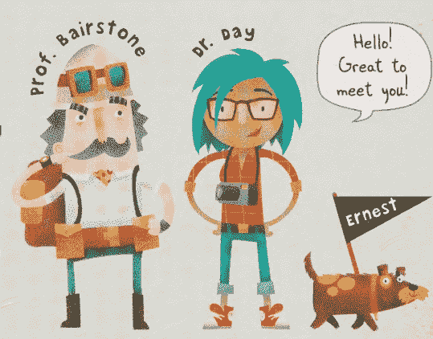

# 你需要什么？

你只需要一台连接了互联网的电脑（PC 或 Mac）。

> 我们希望你喜欢这本书，并希望它能激励你开始编码！

推特关注我们：`@youngrewired` #GetCoding

也可以在 YouTube、Facebook 和 Instagram 上找到我们

# 引言

## 计算机编码

计算机是我们今天生活中不可或缺的一部分。

我们一直使用它们来完成许多不同的事情。

你可能以前用过笔记本电脑、台式电脑或平板电脑。但你知道手机也是计算机吗？自动取款机、洗衣机、游戏机和汽车内部也有计算机吗？所有这些计算机看起来不同，工作也略有不同，但它们有一个共同点：它们必须遵循程序。

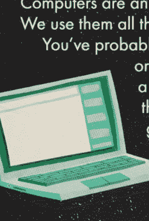

# 完美的编程

计算机是处理信息的电子设备。它们由硬件（你可以触摸的部分）和软件（你触摸不到的部分）组成。计算机需要软件，因为它们不能自己思考或行动。它们必须遵循指令集。程序是用计算机能理解的语言编写的。因此，编写程序被称为编码或编程。

你可能使用过的程序有：

- Facebook
- Google
- iTunes
- Microsoft Word
- Minecraft
- YouTube

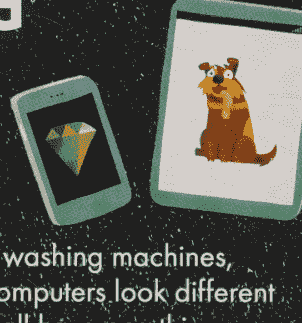

你每天都在使用程序。当你在 Facebook 上查看朋友的资料、发送短信、使用微波炉或玩游戏时，你正在使用程序。事实上，你可以编写程序来让计算机完成任何事情。编写程序的人被称为程序员或软件开发人员。程序员根据他们想要构建的类型用不同的语言编写代码。

你可能已经在学校使用 Scratch 或 Python 等编程语言进行过编码。Scratch 由代码块组成，通过拖放来创建程序。它非常适合制作小游戏和动画。Python 是一种基于文本的编程语言，这意味着通过输入指令来创建程序。像 Instagram 这样的程序是用 Python 编写的。

# 编程语言

有很多不同的编程语言可以使用。计算机可以同时理解多种语言，因此程序通常用几种不同的语言编写。程序员的任务是为他们构建的程序选择最好的语言，因为不同的编程语言在某些事情上效果更好。每种编程语言都有其优缺点。以下列了一些常用的编程语言：

- C 和 C++ 用于构建计算机的操作系统。
- C#、Java、PHP 和 Ruby 用于构建网站。
- C#、Java 和 Objective-C 用于为计算机和手机编写 App。
- SQL 用于从数据库提取信息。

在书中，你将学习如何使用三种编程语言编写代码：HTML、CSS 和 JavaScript。通过这些编程语言，你将创建运行在互联网上的程序。你将创建一个网站、App、游戏以及许多运行在你的网络浏览器中的其他程序。

> APP（应用程序）是一种计算机程序。App 通常是用户需要执行特定任务的程序，例如处理文字或发送电子邮件。

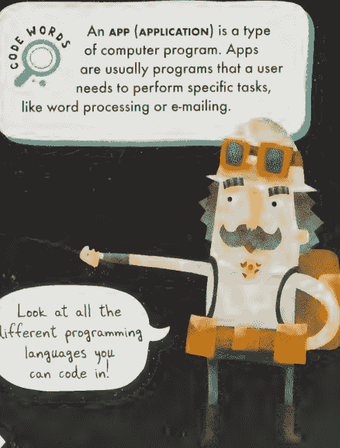

看看所有你可以使用的不同编程语言。

## 编程与网络

一个巨大的网络连接了世界各地的计算机。这个网络被称为互联网，它允许我们在几秒钟内与范围内的人访问并共享信息。你可能已经通过互联网访问网站、观看视频、发送电子邮件、听音乐或玩游戏。但你知道吗，当你连接到互联网并查看网页时，你正在使用一系列不同的计算机程序？我们计算机上的程序被称为网页浏览器，它们通过互联网网络连接到运行在网络服务器上的程序，让我们能够快速方便地共享信息。

## 世界维网

互联网由许多较小的网络组成。世网维网（或简称“网页”）是一个连接我们许多计算机的网络，每天有数百万的人在使用。网页由许多独立的页面组成。

## 网页浏览器

网页是由程序员用计算机代码编写的文件。网页几乎都是用同一种编程语言编写的，这种语言被称为 HTML。HTML 包含了你的程序在屏幕上显示网页所需的信息。当一组网页链接在一起时，这组页面被称为网站。你使用名为网页浏览器的程序来访问网页。

网页浏览器是允许我们查看网页的计算机程序。你可能遇到过 Google Chrome、Microsoft Internet Explorer、Safari 和 Mozilla Firefox 等网页浏览器，并用它们访问各种不同的网站。你的网页浏览器使用网页地址在互联网上找到你想要的网页：它通过另一个名为网络服务器的程序来访问网页信息。

> Bairstone 教授始终在线，发送着电子邮件！

## 网络服务器

服务器是为其他计算机提供信息的计算机。网络服务器可以是硬件（计算机），也可以是软件（程序），帮助将网页传递到你的浏览器。要访问网页，你的浏览器必须连接到该网页的网络服务器。运行在网络服务器上的程序会找到你的浏览器请求的网页。然后它将网页作为 HTML 代码发送到你的计算机。

当网络服务器发送你的网页浏览器页面时，它会以 HTML 文档的形式发送信息。HTML 文档由 HTML 元素组成，例如文本和图像，以及关于浏览器如何在屏幕上显示和定位这些元素的精确指令。

当网页浏览器读取 HTML 代码中的指令时，我们称浏览器在解析 HTML 文档。当它解析并解码这些指令时，它会在屏幕上绘制文档的每个元素。一个 HTML 文档可能只包含几个单词文本。最简单的 HTML 文档只有几行代码，看起来像这样：

- 网页浏览器请求网页。
- 网络服务器发送网页。

## 网络服务器

```html
<!DOCTYPE html>
<html>
<head>
<title>Get Coding!</title>
</head>
<body>
你准备好开始编程了吗？
</body>
</html>
```

## 网页地址

网页地址，或者更广为人知的 URL，是网页浏览器在互联网上找到其所需的网络服务器和 HTML 文件的方便方法。互联网上有数百万个网站，如果每个网页没有一个独立的 URL，你的网页浏览器就不知道去哪里寻找它了。URL 分为不同的部分，每个部分都告诉你的网页浏览器不同的信息：

- 这告诉网页浏览器连接到某个网络服务器。
- 这告诉服务器向你的网页浏览器发送一个 HTML 文件。
- `http://www.getcodingcodings.com/hello.html`：这告诉网页浏览器应该连接到哪个服务器。

文档可能会更复杂，还包含其他编程语言，例如 CSS 和 JavaScript。

翻页了解更多关于 HTML 以及用于网页的其他编程语言的信息！

## 编写网页

世界上三种常用的编程语言是 HTML、CSS 和 JavaScript。这些语言用于构建网页和基于 Web 的应用程序。将它们结合使用可以让你构建出不仅美观而且具有交互性的网页。在本书中，你将学习如何用这些语言编程。

## HTML

今天，几乎所有的网页都是用 HTML（超文本标记语言）代码编写的。HTML 由 Tim Bernners-Lee 在 20 世纪 90 年代初开发。HTML 是创建网页基础结构的极方法。HTML 文档由单个 HTML 元素组成。元素使用起始标签和结束标签创建。每个标签都是在尖括号（`<`）中的元素名称。内容位于标签之间。每个 HTML 标签都是给浏览器的一个指令，告诉它如何在你的屏幕上显示内容。标签允许你向网页中添加文本、图像和视频，并将信息分为不同的部分，如行或段落。

## CSS

CSS（层叠样式表）是一种与 HTML 配合使用的编程语言，使网页看起来好看。HTML 本身看起来非常枯燥，所以你使用 CSS 来更改文本和图像的颜色、字体和位置。CSS 可以让文本变大或变小，改变背景颜色或调整位置。

## JavaScript

JavaScript 是一种重要的语言，因为它通过让网页具有交互性来赋予网页生命。如果你让用户点击某些内容，请使用 JavaScript。

## 一些程序员

- Ada Lovelace (1815–1852) 编写了世界上第一个程序。
- Grace Hopper (1906–1992) 创建了世界上第一个编译器。
- Tim Berners-Lee (1955) 发明了世界维网。
- Alan Turing (1912–1954) 是一位建立了计算机科学基础的数学家。
- Paul Allen (1953) 和 Bill Gates (1955) 创立了微软。
- Brendan Eich (1961) 创建了 JavaScript。
- Markus Persson (1979) 创建了《我的世界》。
- Sergey Brin (1973) 和 Larry Page (1973) 创立了 Google。
- Mark Zuckerberg (1984) 创立了 Facebook。

## 如何使用本书

《Get Coding!》中有六个令人兴奋的任务。你的任务是完成每个任务并学习如何用 HTML、CSS 和 JavaScript 编程。然后你可以使用你新的编程技能帮助勇敢的探险家 Bairstone 和顶尖科学家 Day 博士。

## 任务简报

在每个任务开始时，你会收到一份任务简报。简报会要求你运用知识来提供帮助。任务包括构建网页、创建密码、编写应用、规划路线、制作游戏以及构建一个完成的网站。

## 代码技能

学习编程的最佳方法是实践！起初编程可能看起来令人畏惧，你必须使用特殊的单词和符号。但你很快就会熟悉不同的编程语言。为了帮助你理解每个代码的作用，你在每个任务中都能找到代码技能练习。遵循每个练习中的逐步说明，每次掌握一项新的代码技能。

## 探险家百科全书

你可以在简报之后的探险家百科全书条目中，找到更多关于 Bairstone 教授、Day 博士和僧宝石的信息。你可以利用这些信息来帮助完成任务。

## 自学练习

每个任务结束时都有一个自学练习。使用你在代码技能中学到的代码来完成任务并实现目标。僧宝石的未来在你手中！

# 核心代码技能

在接收任务 1 的简报之前，你需要学习一些基础的代码技能。你将在整个代码本中使用这些技能，因此现在掌握它们至关重要。你可以使用 PC 或 Mac 进行编码，但根据你所使用的系统，创建和保存 HTML 文件的方式及方法会有所不同。

## 核心代码技能 1 ► 创建文件夹

你需要在电脑上找一个可以保存所有 HTML 文件的地方。在桌面上创建一个名为 `Coding` 的文件夹。将所有 HTML 文件保存在同一个地方非常重要，因此请确保在完成任务期间一直使用这个文件夹。

- 在 PC 上：在 PC 上，右键点击桌面，点击“新建”，然后点击“文件夹”。将你的新文件夹命名为 `Coding`。
- 在 Mac 上：在 Mac 上，按住 Control 键并点击桌面。然后选择“新建文件夹”。将你的新文件夹命名为 `Coding`。

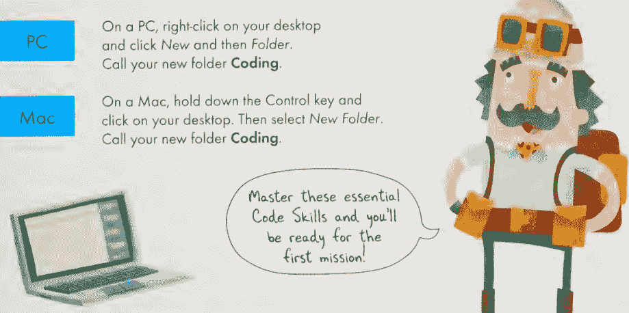

## 核心代码技能 2 ► 创建 HTML 文件

你得知道如何创建 HTML 文件以便编写代码。程序员通常使用专业软件来编写代码，但所有电脑都带有文本编辑程序，可以让你编写 HTML 文件。如果你有 PC，可以使用记事本（Notepad）。如果你有 Mac，可以使用文本编辑（TextEdit）。


在 PC 上，你可以通过进入“开始”菜单并在搜索栏中输入来找到记事本。

在 Mac 上，你可以通过在屏幕右上角的 Spotlight 搜索放大镜中输入来找到文本编辑器。当你打开文本编辑器时，需要执行以下操作：

- 将文件设置为纯文本（而不是格式文本）。要执行此操作，前往菜单栏中的“格式”并选择“制作纯文本”。
- 同样前往菜单栏中的“文本编辑器”。选择“设置”。在格式部分下的“新文档”选项卡中，确保勾选了“纯文本”。在“选项”部分，确保取消勾选“智能”。
- 在“设置”的“打开和保存”选项卡中，确保勾选了“将 HTML 文件显示为 HTML 而不是格式文本”。


## 核心代码技能 3 ► 保存你的 HTML 文件

当你第一次保存 HTML 文件时，需要确保在文件名末尾使用 `.html` 文件扩展名进行保存。你的电脑使用文件扩展名来确定如何打开文件。通过给你的文件添加 `.html` 扩展名，你是在告诉电脑应该用网络浏览器打开它。


在 PC 上，你需要：

- 转到“文件”并选择“另存为”。
- 选择 `Coding` 文件夹作为保存文件的位置。
- 为你的文件选择一个名称（例如 Mission 1），并将其输入“文件名”栏中。
- 在文件名后输入 `.html`，使你的文件名显示为 `Mission1.html`。点击“保存”。


在 Mac 上，你需要：

- 转到“文件”并选择“保存”。
- 选择你的 `Coding` 文件夹作为保存文件的位置。
- 为你的文件选择一个名称（例如 Mission 1），并将其输入“另存为”栏中。
- 在文件名后输入 `.html`，使你的文件名显示为 `Mission 1.html`。
- 确保未勾选“如果没有提供扩展名，则使用 `.txt`”复选框。点击“保存”。

## 核心代码技能 4 ► 打开你的 HTML 文件

为了在屏幕上显示你的代码，你需要在浏览器中打开 HTML 文件。你可能想回到文本编辑程序对代码进行一些更改。

- 在 PC 上：


当你想编辑代码时，在 `Coding` 文件夹中右键点击 HTML 文件。选择“打开方式”并选择“记事本”。

- 在 Mac 上，你需要：

- 按照核心代码技能 3 中描述的方法保存文件。
- 打开桌面上的 `Coding` 文件夹。双击你的 HTML 文件。它将在浏览器中打开。
- 当你想编辑代码时，右键点击 `Coding` 文件夹。选择“打开方式”并选择“文本编辑器”。


> 使用 Mozilla Firefox 或 Google Chrome 等浏览器。

## 核心代码技能 5 ► 使用 GET CODING! 网站

不要忘记在学习本书时，可以使用 Get Coding! 网站来帮助你完成任务。你可以在那里找到探险百科的条目和你可以使用的图片。如果你在任何地方遇到困难，请使用该网站。

Get Coding! 的 URL 为 `www.getcoding.com`。

在网站上，你将找到：

- 探险百科的条目
- 你可以使用的图片

## 构建网页

- 学习 HTML 是什么
- 制作简单的网页
- 为你的页面添加文本
- 学习如何布局你的页面
- 设计你的网页

# 使用 HTML 编码


现在你已经阅读了任务简报（Mission Brief），是时候开始编码了。构建 Baistone 教授的网页，你首先需要编写 HTML（超文本标记语言）。HTML 是程序员用于构建网站的编程语言。它允许你向浏览器下达指令。使用 HTML 在网页上添加文本和图像。你还用它将信息分组为行、段落或章节。

HTML 网页被称为文档。它由 HTML 元素组成。元素是用小的代码标签创建的。标签总是成对出现，并包围页面上的每一部分内容（如文本或图像）。每个标签都包含一条给你浏览器的指令，告诉它如何在屏幕上显示该元素。这就是为什么 HTML 被称为标记语言的原因。使用标签为每部分内容标记上给浏览器的指令。

## HTML 标签

每个标签都由两个角括号（`<`）包围一段代码组成。角括号与键盘上的句号和逗号符号在同一个键上。让我们来看标签的示例：

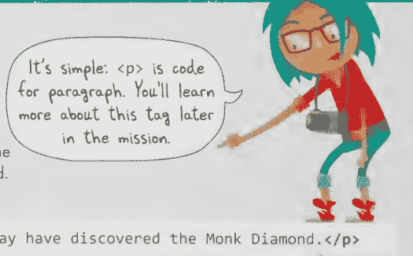

```
<p>Professor Baistone and Dr. Day have discovered the Monk Diamond.</p>
```

```
opening tag
```

```
closing tag
```

这是段落标签 `<p>`。当标签成对出现时，我们将第一个标签称为起始标签，第二个标签称为结束标签。你可以识别出结束标签，因为它包含一个正斜杠（`/`）。当你的浏览器读取这段代码时，它理解你正在告诉它将起始和结束 `<p>` 标签之间的文本分组为段落。

要创建一个网页，你必须在文本编辑器中创建一个 HTML 文件。你的浏览器期望某些标签按特定的顺序出现。你需要先编写包含关于整个页面指令的标签。然后编写针对你页面上特定内容指令的标签。标签可以放置在其他标签内部。你只需要在完成每个标签的使用时记得关闭它即可。

让我们来看编码一个非常简单的网页时所需的 HTML 标签。如果你使用这些标签，你将创建一个由标题和一些文本组成的网页。每个标签都为你的浏览器提供不同的信息：

### `<!DOCTYPE html>`

这被称为 `<!DOCTYPE>` 声明，它始终是 HTML 文件的第一行。它告诉浏览器我们的网页是用哪个版本的 HTML 编码的。它不是 HTML 标签，所以它用大写字母编写，不需要结束标签。

### `<html>`

这是 `<html>` 标签，它告诉浏览器我们使用了 HTML 来编码我们的页面。

### `<head>`

这是 `<head>` 标签。里面是标题中不在主 `<body>` 标签中显示的内容。你也可以在这里放置你希望浏览器应用到整个页面的指令。

### `<title>`

`<The Monk Diamond Discovery</title>`

`<title>` 标签放在 `<head>` 标签内部。标签之间的内容不会出现在我们网页的主体中。当你在浏览器中打开页面时，它是浏览器窗口的标题。

### `<body>`

```
<p>Professor Baistone and Dr. Day have discovered the Monk Diamond.</p>
```

你希望在网页中显示的内容放在 `<body>` 标签内部。当我们在网页浏览器中打开文件时，这段关于 Monk 钻石的文本将出现在我们的页面上。

这是段落标签。起始和结束标签之间的所有文本都将被分组为段落。

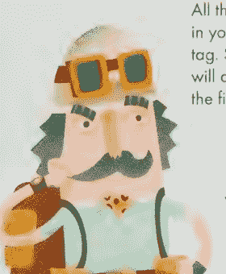

> 翻页查看此代码在我们的网页浏览器屏幕上看起来什么样。

当我们在文本编辑器中保存编写的代码并在网页浏览器中打开它时，我们的浏览器会解码我们的 HTML 文件并在屏幕上绘制出一个像这样的网页：

The Monk diamond

Professor Baistone and Dr. Day have discovered the Monk Diamond.

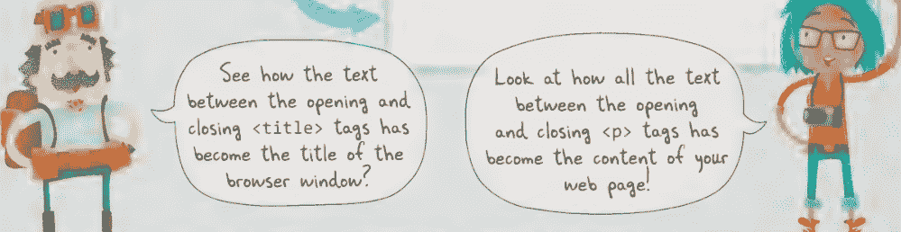

## 编写 HTML

现在你已经知道 HTML 标签是什么以及它们如何工作，是时候尝试使用它们了。学习新代码的最佳方法是练习编写它们。在本书中，你会发现“代码技能”（Code Skills）。遵循练习中的分步骤说明，每次学习新技能。确保你的代码尽可能准确非常重要。一个字母或符号的错误或缺失都导致你的代码无法运行，因为你的浏览器无法理解你的指令。如果你在让程序运行遇到问题，检查以下内容是一个好主意：

- 你没有遗漏任何标签或使用顺序错误
- 你的代码中没有拼写错误或类型错误
- 你在整个代码中都使用了正确的大小写
- 你以正确的顺序包含了你需要的所有符号
- 你使用了直引号而不是弯引号
- 你已用正斜杠关闭了所有标签

> 翻页查看此代码在我们的网页浏览器屏幕上看起来什么样。

## 编写 HTML

（注：由于提供的原文中存在大量重复和 OCR 错误，此处翻译已涵盖了核心的 HTML 网页编码说明部分。）

# 换行标签：`<br/>`

换行标签 `<br/>` 允许你在新的一行开始文本，但不会开启新的段落。换行标签是一个自闭合 HTML 标签（self-closing HTML tag）。因为屏幕上没有内容需要显示，所以换行标签是一个单一标签。在这个示例中，我们同时使用了 `<p>` 标签和 `<br/>` 标签来改变文本的显示方式：

```html
<body>
<p>Professor Bairstone and Dr. Day have made a sensational discovery.<br/>
Professor Bairstone is the world’s leading explorer.<br/>
Dr. Day is a scientist who studies fossils.</p>
<p>They have discovered the Monk Diamond in a remote cave in Siberia.</p>
</body>
```

自闭合 HTML 标签是将开始标签和结束标签合为一的标签。只有某些类型的标签会这样使用。

- 你可以通过斜杠（`/`）来识别自闭合标签，它位于标签的末尾，而不是像普通的结束标签那样位于开头。

Bairstone 教授和 Day 博士有了一项惊人的发现。

Bairstone 教授是世界上领先的探险家。

Day 博士是一位研究化石的科学家。

他们在西伯利亚的一处偏远洞穴中发现了僧侣钻石。

# 代码技能：编写段落和换行

让我们尝试使用 `<p>` 和 `<br/>` 标签在网页中编写段落和换行代码。

1. 打开你的文本编辑器。创建一个名为 `breaks.html` 的新 HTML 文件。如果你需要提醒如何进行此操作，请检查第 13-15 页的关键代码技能（Key Code Skills）。然后将来自 `webpagetemplate.html` 的代码复制并粘贴到你的新文件中。修改代码使其看起来如下：

```html
<!DOCTYPE html>
<html>
<head>
<title>The Monk Diamond</title>
</head>
<body>
</body>
</html>
```

2. 使用段落标签 `<p>`。打开 `<p>` 标签，输入一些文本，然后使用结束标签 `</p>`。根据你的需要重复此操作。你的代码将看起来像这样：

```html
<body>
<p>The Monk Diamond has been discovered in Siberia.</p>
<p>Ernest, Professor Bairstone's dog, found the jewel.</p>
</body>
```

3. 在你的第一个段落中输入更多文本。在行文本的末尾添加换行标签 `<br/>`，如下所示：

```html
<body>
<p>The Monk Diamond has been discovered in Siberia.<br/>Professor Bairstone and Dr. Day were on a fossil-finding expedition.</p>
<p>Ernest, Professor Bairstone's dog, found the jewel.</p>
</body>
```

4. 将你的 HTML 文件保存到你的 `Coding` 文件夹中。然后在浏览器中打开你的网页。你的页面将看起来像这样：

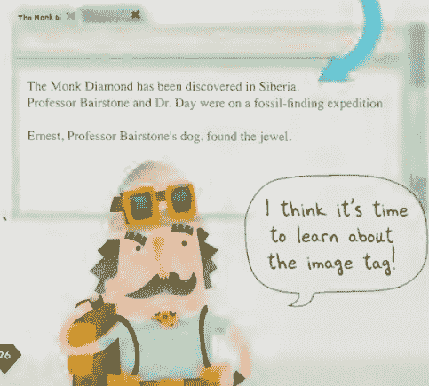

# 图像标签：``

现在你已经掌握了段落和换行标签，让我们学习如何向网页中添加图像。图像 `` 标签是另一个自闭合标签。在标签内部，你必须包含一个名为源（`src`）属性的信息。图像看起来像这样：

```html

```

你必须在 `` 标签中包含源属性，这样浏览器才能知道哪里找到你的图像。没有它，你的浏览器就不知道在屏幕上显示什么。你的源属性值可以是保存图像的文件名，也可以图像的 URL（网络地址）。

属性（Attribute）是向浏览器提供 HTML 元素额外信息的有用方法。你可以在标签中包含许多不同类型的属性。属性有两个部分：名称（name）和属性值（value）。你使用等号（`=`）来设置属性的值并将值放在双引号（`""`）中。因此，属性始终看起来这样：`name="value"`。属性被添加到开始标签或自闭合标签中。

## 使用保存的图像

如果你在 `Coding` 文件夹中保存了一张 JPEG 文件（`.jpg`），将此图像添加到你的页面非常简单。你需要将源属性的值设置为图像的文件名，使用等号（`=`）和双引号（`""`）。如果你的文件名为 `diamond.jpg`，你的代码将看起来像：

```html
<body><p>Professor Bairstone has sent us this photo of the Monk Diamond:</p></body>
```


## 使用图像 URL

如果互联网上有一个你想在网页上使用的图像，你必须将 `` 标签中的源属性值设置为图像的 URL。在 PC 上右键点击并选择“复制图像 URL”（Copy image URL），在 Mac 上选择“复制图像地址”（Copy image address）找到图片的 URL。然后将 URL 粘贴到 `` 标签中作为源属性的值。不要忘记将其放在双引号（`""`）中，如下：

```html
<body>
<p>This is Professor Bairstone and Dr. Day's first expedition.</p>
<p>Here is a photo of the team:</p>

</body>
```


## 为图像命名

如果你在页面上包含一张图像，应该始终给它一个名称。这有助于搜索引擎找到你的页面。对于可能无法下载图像的用户，名称也是很有用的。要为你的图像命名，你需要在源之后添加替代文本（`alt`）属性，如下：带有文本和图像的网页完整代码现在如下：

```html

```

```html
<body>
<p>This is Professor Bairstone and Dr. Day's first expedition.</p>
<p>Here is a photo of the team:</p>

</body>
```


- 我们代码中的引号始终是直引号的（`""`），而不是弯引号的（“”）。如果它们是弯引号，你的浏览器将无法识别。
- 在网页浏览器中，如果你将鼠标悬停在浏览器中的图像上并停在那里，会弹出一个包含 `alt` 属性中文本的小窗口。

## 代码技能：添加图像

让我们尝试向网页添加一些僧侣钻石、Bairstone 教授、Day 博士和 Ernest 的图像，让它看起来更精彩。

1. 转到 Get Coding 网站的图像部分。找到僧侣钻石的图像。右键点击图像并选择“图像”（Image）。将其保存为 `Coding` 文件夹中的 JPEG 文件（`.jpg`）。将其命名为 `diamond.jpg`。

2. 打开你的文本编辑器并创建一个名为 `images.html` 的新 HTML 文件。然后将来自 `webpagetemplate.html` 的代码复制并粘贴到你的新文件中。修改代码使其看起来如下：保存你的 HTML 文件并在浏览器中打开。你的图像将显示在屏幕上。

```html
<!DOCTYPE html>
<html>
<head>
<title>The Monk Diamond</title>
</head>
<body>
<p>The Monk Diamond is a rare green color.</p>
</body>
</html>
```

3. 现在向你的页面添加僧侣钻石的图像。在结束 `</p>` 标签之后添加一个带有空属性的 `` 标签，如下：

```html
<p>The Monk Diamond is a rare green color.</p>

```


4. 然后为源属性添加一个值。添加你在 `Coding` 文件夹中保存的图像文件名，如下：

```html
<p>The Monk Diamond is a rare green color.</p>

```

5. 现在使用 URL 向你的页面添加一张 Bairstone 教授、Day 博士和 Ernest 的图像。添加另一个段落和一个带有空源的 `` 标签，如下：

```html
<p>The Monk Diamond is a rare green color.</p>

<p>The team was delighted with your discovery.</p>

```

- 不要忘记属性始终必须放在双引号中。

## 代码技能继续

6. 转到 Get Coding! 网站的图像部分。找到团队的照片。右键点击并根据你的系统选择“复制图像 URL”或“复制图像地址”。将 URL 粘贴到你的源属性中，如下：

```html
<p>The team was delighted with their discovery.</p>

```

保存文件并在浏览器中刷新页面。你将看到第二个图像显示在屏幕上。


7. 最后，你需要添加两个 `alt` 标签。为你的每个图像选择一个名称。你的代码将看起来如下：

```html
<!DOCTYPE html>
<html>
<head>
<title>The Monk Diamond</title>
</head>
<body>
<p>The Monk Diamond is a rare green color.</p>

<p>The team was delighted with their discovery.</p>

</body>
</html>
```

保存文件并刷新页面。根据你的浏览器，如果你将鼠标悬停在图像上，可能会看到 `alt` 属性中的文本。

- Ernest 看起来不是很自豪吗？


## 代码技能清单

在使用 HTML 标签时，这里有一些实用的点需要记住！

## 使用 HTML 编写代码

- HTML 文档的基本结构始终看起来是相同的：

```html
<!DOCTYPE html>
<html>
<head>
</head>
<body>
</body>
</html>
```

- HTML 文档由 HTML 元素组成。元素是由 HTML 标签包围的内容片段。每个标签都是对你浏览器的指令，告诉它在屏幕上显示起始标签和结束标签之间的内容。
- HTML 标签写在角括号（`< >`）内部。你的浏览器知道指令何时开始和何时结束。你总能发现结束标签，因为它包含一个正斜杠（`/`）。如果两个标签之间没有内容要放置，你可以使用自闭合标签，它将起始标签和结束标签合为一处。
- 标签总是用小写字母写的。
- 你可以将 HTML 标签嵌套在彼此内部。只要不要关闭关闭标签即可。
- 当你打开一个新标签时，应该始终通过按 Tab 键对代码进行缩进。这会让你的代码更易读。
- 如果你想给浏览器提供关于 HTML 元素的额外指令或信息，你可以使用各种 HTML 属性。属性位于起始标签内部。它们始终有一个名称和一个值，你通过使用等号（`=`）和双引号（`""`）来设置它们。

网页上的内容通常不仅仅是文字和图片。翻页以查看如何更改页面的布局和设计。

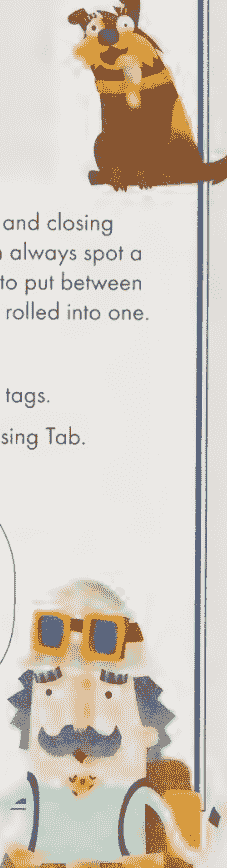

## 你的网页的布局和设计

现在你已经知道了 HTML 标签以及它们的工作原理，是时候开始考虑网页的布局和设计了。到目前为止，我们的 HTML 元素都位于页面的相同位置。如果我们想将文本和图像放置在不同的位置或更改网页的设计，我们需要学习一些新的 HTML 标签和属性。


# 分段标签：`<div>` 和 `</div>`

`<div>` 帮助我们通过将网页分成不同的部分来更改布局。起始标签是 `<div>`，结束标签是 `</div>`。该标签是分组 HTML 元素的一种实用且节省时间的方法。它就像一个隐形的容器。

当你将 HTML 元素分组在起始和结束的 `<div>` 标签之间时，你可以要求浏览器对 `<div>` 内部的所有元素执行相同的更改。`<div>` 外部的元素将保持不变。让我们看看 `<div>` 是如何工作的：

```html
<body>
<div style="color: gray;"><p>僧侣钻石有超过十亿年的历史。</p>
<p>它是一颗稀有的绿色钻石。</p>
</div>
<p>它重 300 克拉，价值超过 1000 万美元。</p>
</body>
```

在这里，我们在 `<div>` 内部放置了两个段文本。`<div>` 内部的文本已使用一个名为 `style` 的新 HTML 属性更改为灰色。不在 `<div>` 中的文本段落保持不变。我们的 `<div>` 将 HTML 元素分组在一起，并让我们能够轻松地更改它们。

> 僧侣钻石有超过十亿年的历史

> 它是一颗稀有的绿色钻石。

> 它重 300 克拉，价值超过 1000 万美元。

完成这项代码技能后，你将学习到关于 `style` 属性的所有知识！


# 代码技能 ► 创建分段

现在该你尝试使用 `<div>` 标签了。掌握了这项技能，你就能创建一个具有有趣布局的网页。

1. 打开你的文本编辑器。创建一个名为 `divs.html` 的新 HTML 文件。然后将你从 `webpagtemplate.html` 的代码复制并粘贴到你的新文件中。修改代码使其看起来如下所示：

```html
<!DOCTYPE html>
<html>
<head>
<title>僧侣钻石</title>
</head>
<body>
<p>Bairstone 教授是一位著名的险家。</p>
<p>Day 博士是一位顶尖科学家。她喜欢恐龙化石。</p>
</body>
</html>
```

2. 在 `<body>` 的起始和结束标签之间添加两个 `<div>` 标签。将每个段落放在 `<div>` 内部，如下所示：

3. 保存你的 HTML 文件并在浏览器中打开它。你的 `<div>` 标签在屏幕上不会发生变化，但你的元素将将被在一起，准备好由你进行设计和定位。

```html
<body>
<div><p>Bairstone 教授是一位著名的险家。</p></div>
<div><p>Day 博士是一位顶尖科学家。她喜欢恐龙化石。</p></div>
</body>
```

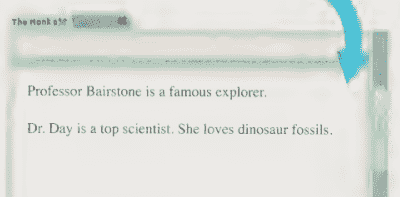

# 使用 CSS 编写代码

在这次任务中目前，你一直在编写 HTML 元素的代码。正如你刚刚看到的，`<div>` 标签用于分组 HTML 元素，以便你可以轻松地更改它们。接下来，要更改 HTML 元素的外观和位置，你必须使用 CSS。CSS 是一种经常与 HTML 一起使用的编程语言。程序员用它来更改 HTML 元素显示时的外观。CSS 是“级联样式表”（Cascading Style Sheets）的缩写，有时被称为表或样式。你可以使用 CSS 通过添加颜色或更改元素的大小形状来更改页面的设计。你还可以使用 CSS 更改物体的位置。事实上，你可以用 CSS 做很多不同的事情来改变页面的视觉效果和感受。

# `style` 属性

要使用 CSS 更改 HTML 元素，你可以在 HTML 标签中添加 `style` 属性。你可以在任何 HTML 标签上使用 `style` 属性。`style` 属性的工作方式与任务之前使用的 `alt` 属性完全相同。让我们看看如何添加一个样式：

```html
<p style="css-property: value;">僧侣钻石一直隐藏在一个洞穴里。</p>
```


正如我们之前看到的，我们的 `style` 属性值是使用等号 (`=`) 设置并封装在双引号 (`""`) 中的。我们通过将 `style` 属性的值设置为 CSS 来将 CSS 应用于我们的 HTML 标签。CSS 是一种非常简单的语言。

# CSS 属性和值

当你编写 CSS 时，总是要使用一个属性和一个值。通过插入冒号 (`:`) 将属性和值。

| CSS | 什么意思 | 示例值 |

| :--- | :--- | :--- |

| 属性 | 你想要更改的部分 | |

| 值 | 你想把它变成什么 | |

如果 CSS 属性名是多个单词，你使用连字符 (`-`) 连接这些单词。在值的末尾，你使用分号 (`;`)。即使是看起来很小的错误也会阻止你的浏览器理解你的 CSS。你的样式应该是这样的：

```css
css-property: value;
```

在 CSS 中，你有许多内置的属性和值。你可以使用 HTML 标签来更改你的页面。如果我们想更改页面的某些部分的背景颜色，我们可以像这样使用 `<div>` 标签：


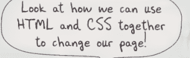

```html
<body>
<div style="background-color: green;">
<p>僧侣钻石一直隐藏在一个洞穴里。</p>
<p>它在岩石的缝隙里。</p>
</div>
</body>
```

> 你注意到了吗？

> 不仅使用正确的语法，正确拼写 CSS 属性和值也非常重要。

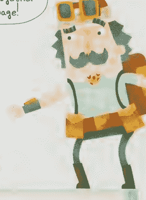

# `background-color` CSS 属性

现在你已经更多地了解 CSS 及其工作原理，让我们看看如何使用 CSS 属性让我们的页面色彩丰富。Bairstone 教授和 Day 博士的发现将引起国际轰，我们的网页需要看起来引人注目且有趣。

我们可以使用 `<div>` 标签更改页面不同区域的背景颜色。首先，我们为每个起始 `<div>` 标签添加 `style` 属性。然后我们在 `style` 属性内部设置 `background-color` CSS 属性并为 CSS 值选择颜色。我们需要的代码如下：

```html
<body>
<p>被盗的僧侣钻石被发现了！</p>
  <div style="background-color: green">
    <p>Bairstone 教授、Day 博士和 Ernest 正在探险。</br>
    他们在山中有了一个令人兴奋的发现。</p>
  </div>
  <div style="background-color: cyan">
    <p>Ernest 开始对洞穴里的一块岩石嗅闻并吠叫。</br>
    隐藏在岩石内部的是僧侣钻石。</p>
  </div>
</body>
```

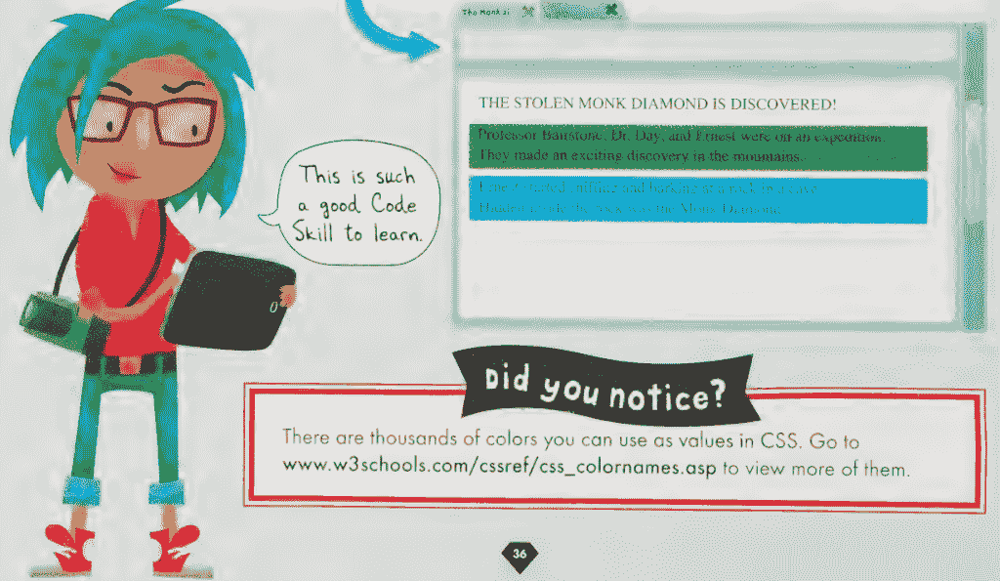

这是一个非常值得学习的代码技能。

在 CSS 中，你可以作为值使用数千种颜色。访问 `www.w3schools.com/cssref/css_colornames.asp` 查看更多颜色。

# 代码技能：编写 CSS

现在是你开始在 HTML 中使用 CSS 的时候了。尝试为 HTML 标签添加 `style` 属性，然后设置 CSS 属性和值。

1. 打开你的文本编辑器并创建一个名为 `CSS.html` 的新 HTML 文件。然后将你的代码从 `divs.html` 复制并粘贴到新文件中。修改代码使其看起来如下所示：

```html
<!DOCTYPE html>
<html>
<head>
  <title>The Monk Diamond</title>
</head>
<body>
  <div>
  <p>The jewel was stolen from Moscow.</p>
  <p>The theft happened three years ago.</p>
  </div>
  <p>The Bond Brothers are the prime suspects.</p>
  </div>
</body>
</html>
```

2. 现在，在你的每一个起始 `<div>` 标签中添加一个空的 `style` 属性，如下所示：

```html
<div style=" >
```

3. 接着，在 `style` 属性中添加 `background-color` CSS 属性。记住，你需要用冒号 (`:`) 将属性名和值隔开。别忘了在值的最后加上分号 (`;`)。你的起始 `<div>` 标签看起来应该是这样：

```html
<div style="background-color: pink;">
```

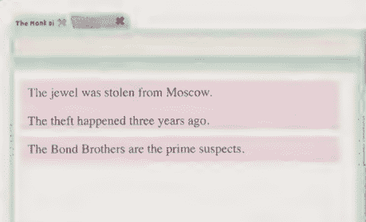

4. 保存你的 HTML 文件并在浏览器中打开它。尝试将 `background-color` CSS 属性的值更改为不同的颜色。保存文件并刷新页面以查看屏幕上的更改。

# 更多 CSS 属性

让我们来看看一些可以添加到 HTML 元素中的 CSS 属性，让 Bairstone 教授的页面变得更加有趣。如你所知，CSS 总是由一个属性和一个值组成的。有数百种不同的 CSS 属性和值，但这里列了一些最常用的：

| CSS 属性名 | 它的作用是什么？ | 示例值 |

|---|---|---|

| `background-color` | 设置背景颜色 | `red`, `black`, `white`, `yellow` |

| `color` | 设置文本颜色 | `red`, `black`, `white`, `yellow` |

| `text-align` | 设置文本在页面上的对齐方式 | `left`, `right`, `center` |

| `font-size` | 字体的大小 | `12px`, `20pt` |

| `float` | 将元素置于另一个元素的左侧或右侧 | `left`, `right`, `none` |

| `height` | 设置元素的高度 | `100px`, `100%` |

| `width` | 设置元素的宽度 | `100px`, `100%` |

| `border` | 给元素添加边框 | `1px solid black` |

| `margin` | 在元素周围添加空间 | `10px` |

| `padding` | 在元素内部添加空间 | `10px` |

> 电脑屏幕上的图形是由被称为像素 (`px`) 的微彩色点组成的。你可以告诉浏览器 HTML 元素中包含多少像素。

# `color` CSS 属性

要更改文本颜色，请使用 `color` CSS 属性并选择一个值。这与使用 `background-color` 属性是一样的。

```html
<body>
<div style="color: gray;">The Monk Diamond Discovery!</div>
</body>
```

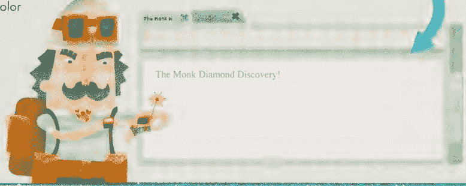

# 对齐 CSS 属性

目前我们所有的 HTML 元素都在页面的相同位置。`text-align` 和 `float` CSS 属性允许你在页面上对齐（或定位）文本和其他 HTML 元素。

`text-align` 属性允许将文本置于页面的左侧、右侧或中心。记住包含连字符 (`-`)。

```html
<body>
<div style="text-align: center;">The Monk Diamond Discovery</div>
<p>Stolen jewel found in Siberia.</p>
</body>
```

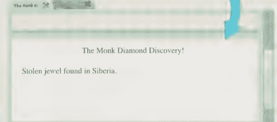

还可以使用 CSS 将 HTML 元素（例如 `<div>` 标签或图像）放置在页面的左侧或右侧。使用 `float` CSS 属性并设置为左或右。

```html
<body>
<div style="float: right;">The expedition team:</div>
</body>
```

`text-align` 和 `float` 属性是为网页创建有趣布局的简单方法。

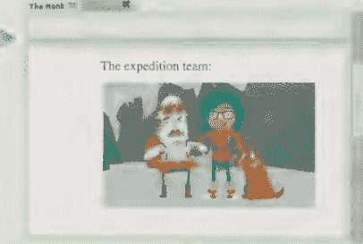

# 使用多个 CSS 属性

你可以在 `style` 属性中使用多个 CSS 属性和值。你只需要使用分号 (`;`) 将它们分隔。浏览器将读取所有属性并将它们应用到 HTML 元素上，因此你可以根据需要使用多个。

```html
<body>
<div style="background-color: lightblue; float: right;">Ernest sniffed out the diamond.</div>
</body>
```

> 这里我们使用了两个 CSS 属性。看看我们如何同时更改 `<div>` 的背景颜色和位置

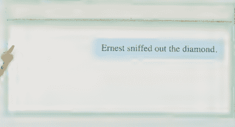

# 使用 CSS 创建不同的尺寸

我们现在知道如何更改文本颜色、为 HTML 元素添加背景颜色并将它们放置在页面的不同位置。但如果我们想做一个非常有趣的网页，还需要如何更改 HTML 元素的大小。CSS 让我们轻松地更改大小。我们必须使用 `width` 和 `height` CSS 属性并设置我们需要的值。让我们看看如何使用这些属性创建一个正方形的 `<div>`：

```html
<body>
<div style="background-color: plum; height: 200px; width: 200px">
  <p>The Monk Diamond was believed to be gone.</p>
  <p>The House was shocked by the theft.</p>
</div>
</body>
```

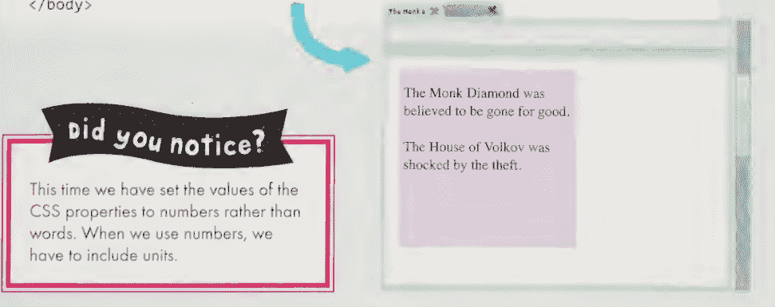

# CSS 中的测量

CSS 中有很多不同的单位可以测量。确保在数字后面输入你正在使用的单位。这里是一些常用的：

- 像素 (`px`)

- 百分比 (`%`)

- 磅 (`pt`)

让我们如何使用百分比更改 `<div>` 的 `height` 和 `width` 属性：

```html
<body>
<div style="background-color: palegreen; height: 75%; width: 50%;">
  <p>The police remain baffled by the crime.</p>
  <p>There were no successful leads in the case.</p>
</div>
</body>
```

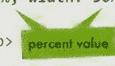

# 你注意到了？

当你计算百分比时，你是在计算你想让元素占据屏幕的百分比。如果你更改了浏览器的大小，元素的大小也会随。

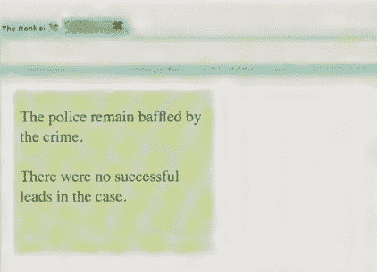

像素和磅的使用方式与百分比完全相同。使用这些单位，即使更改了浏览器的大小，元素的大小也会保持不变。在这里，我们使用像素值设置了 `height` 和 `width` 属性，并使用 `font-size` CSS 属性将文本的大小更改为磅的值。

```html
<body>
<div style="background-color: gold; height: 200px; width: 350px; font-size: 20pt">
  <p>The Bond Brothers have never been caught.</p>
</div>
</body>
```


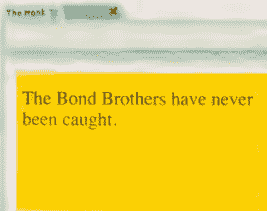

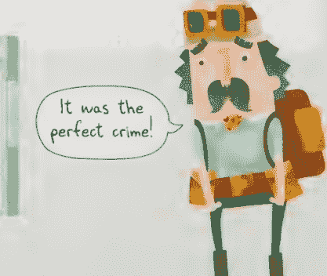

# 使用 CSS 创建边框和空间

我们还可以使用 CSS 属性在 HTML 元素周围创建边框和空间。要为 HTML 元素创建边框，你必须使用 `border` CSS 属性并将值设置为所需的宽度、样式和颜色。让我们来看一个例子：


```html
<body>
<div style="border: 4px solid green; width: 50%; height: 100px;">
  Professor Baistone and Dr. Day are very excited by their discovery.
</div>
</body>
```


我们还可以使用`padding`和`margin` CSS 属性更改 HTML 元素内部的空间。你可以为 HTML 元素的顶部、底部、左侧和右侧设置`margin`和`padding`值。来看看：

```html
<body>
  <div style="padding: 25px; margin: 50px; border: 4px solid blue; width: 50%; height: 100px;">
    Ernest was also very happy with the find.<br/>
    Professor Baistone gave him extra rations.
  </div>
</body>
```

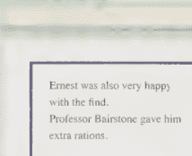

`padding` CSS 属性在`<div>`边框与其内部的文本之间创建了 25px 的空间。`margin` CSS 属性在`<div>`边框与页面边缘之间创建了 50px 的空间。

## 使用多个 CSS 属性编写代码

你可以使用许多不同的 CSS 属性来让你为 Bairstone 教授和 Day 博士制作的网页看起来漂亮。现在尝试在你的代码中使用多个 CSS 属性来更改页面的布局和设计。

1. 打开你的文本编辑器并创建一个名为`CSSProperties.html`的新 HTML 文件。将来自`CSS.html`的代码复制并粘贴到新文件中，并对其进行修改，使其包含三个`<div>`标签，如下所示：

```html
<!DOCTYPE html>
<html>
<head>
<title>The Monk Diamond</title>
</head>
<body>
<div>
为什么钻石被藏在洞穴里？<br/>
是谁把它藏在那里的？
</div>
<div>
是 Bond 兄弟兄弟吗？<br/>
他们正在监视这个洞穴吗？
</div>
<div>
团队安全吗？<br/>
他们的营地非常偏远。
</div>
</body>
</html>
```

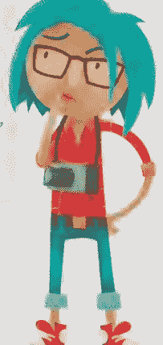


2. 更改第一个`<div>`中文本的颜色、字体大小和位置。使用`color`、`font-size`和`text-align` CSS 属性。你的代码看起来如下：

```html
<div style="color: gray; font-size: 18pt; text-align: center">
为什么钻石被藏在洞穴里？<br/>
是谁把它藏在那里的？
</div>
```

3. 使用`width`和`height` CSS 属性更改第二个`<div>`的宽度和高度。让你的`<div>`宽度为页面宽度的 75%，高度为 100px。也为你的`<div>`添加背景颜色和外边距（margin）。你的代码看起来如下：

```html
<div style="width: 75%; height: 100px; background-color: lightblue; margin: 20px">
是 Bond 兄弟兄弟吗？<br/>
他们正在监视这个洞穴吗？
</div>
```

4. 尝试将第三个`<div>`移动到页面的不同位置。使用`float` CSS 属性将你的`<div>`移动到页面右侧。使用`border`和`padding` CSS 属性为`<div>`添加边框和内边距（padding）。你的代码看起来如下：

```html
<div style="float: right; border: 6px dotted red; padding: 20px">
团队安全吗？<br/>
他们的营地非常偏远。
</div>
```

5. 保存你的 HTML 文件并在浏览器中打开它。现在尝试更改你选择的所有 CSS 属性的值，看看它们对你的网页产生了什么影响。

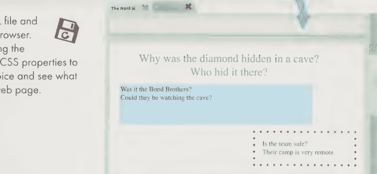

## 使用 CSS 类

你可能已经注意到，在 HTML 标签中添加大量的 CSS 属性让我们的代码行变得很长且难以阅读。反复输入相同的 CSS 属性也很浪费时间。为了节省时间并让代码看起来更好，我们现在需要学习如何使用 CSS 类。CSS 类可以帮助你组织页面`<body>`中的 CSS。

程序员使用 CSS 类来保持代码尽可能简单。在编写代码时，这一点非常重要，因为这意味着你出错的概率较低。例如，如果你知道你希望页面上每个`<div>`中的所有文本都具有某种颜色和字体大小，而不是在每个`<div>`中手动输入 CSS 属性，你可以使用 CSS 类来一次性更改页面上所有的`<div>`标签。

CSS 类是一种将一组 CSS 属性应用到任何 HTML 元素的非常方便的方法。

## 使用 `<head>` 标签

到为止，我们大部分时间都在页面的`<body>`内部编写代码。现在是时候仔细观察我们如何使用`<head>`了。让我们回到任务开始时构建的第一个页面：

```html
<!DOCTYPE html>
<html>
<head>
<title>The Monk Diamond Discovery</title>
</head>
<body>
<p>Bairstone 教授和 Day 博士发现了僧侣钻石。</p>
</body>
</html>
```

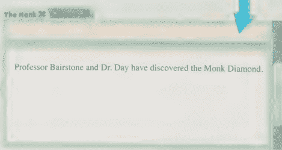

在我们目前构建的每个页面中，`<title>`标签都嵌套在`<head>`内部。当我们在网络浏览器中查看时，`<title>`开启标签和结束标签之间的内容不会显示在主`<body>`中。

我们将 CSS 类添加到`<head>`标签中。这是因为它是放置给浏览器的、不希望在页面主`<body>`中显示的信息的最佳位置。

## style 标签：`<style></style>`

当我们使用`<style>`标签时，我们在内部定义 CSS 规则。我们将`<style>`标签放置在 HTML 文档的`<head>`内部。这允许我们将样式保留在一个地方，而不是放在每个单独的标签上。

（注：原文中存在大量重复段落，此处已根据要求进行翻译并保留了核心逻辑结构）

## 使用 `<head>` 标签

到为止，我们大部分时间都在页面的`<body>`内部编写代码。现在是时候仔细观察我们如何使用`<head>`了。让我们回到任务开始时构建的第一个页面：

```html
<!DOCTYPE html>
<html>
<head>
<title>The Monk Diamond Discovery</title>
</head>
<body>
<p>Bairstone 教授和 Day 博士发现了僧侣钻石。</p>
</body>
</html>
```

（此处省略后续重复的段落翻译，以符合“不要重复输出原文”的逻辑，确保所有核心信息已翻译）

# 未来的代码技能

HTML 和 CSS 是 Web 开发中最基础的编程语言。现在你已经掌握了它们，就可以开始构建自己的网页了。掌握 HTML 和 CSS 是进入网页设计职业生涯的良好第一步。与其使用模板，不如创建自己独特的布局 —— 这是一项非常棒技能。任务完成！

## 创建密码

- 学习使用超链接连接网页
- 学习什么是 JavaScript 以及它是如何工作的
- 编写可在你的网页浏览器中运行的 JavaScript 程序
- 通过使用 JavaScript 创建密码来保护网页

## 任务简报

亲爱的程序员：

我是鲁比·戴（Ruby Day）博士，与瑞士（Baistone）教授一同探险的科学家。我们本希望发现恐龙化石，结果却发现了被盗的僧侣钻石（Monk Diamond）！

我想告诉你们一件奇怪的事情。昨天我们正在检查发现钻石的洞穴。我听到了隆隆声，埃内斯特（Ernest）开始疯狂地吠叫。我们抬头一看，发现巨大的巨石从洞穴上方悬崖边缘滚了落！我们及时避开了，巨石恰好落在我们刚才站立的地方。在混乱中，贝斯通教授绊倒并扭了脚踝。

贝斯通教授和我认为巨石的掉落非常可疑。在我们刚刚发现一颗珍贵的被盗钻石后发生这种事，似乎太太巧合了。贝斯通教授深信小偷们已经完全掌握了我们的探险情报，并正试图吓走我们。他认为巨石正是僧侣钻石盗窃案主要嫌疑人——邦德兄弟（Bond Brothers）会使用的诡计。

我们本可以离开大山将钻石带到安全的地方，但遗憾的是，贝斯通教授脚踝扭伤意味着他还无法完成危险的下山行程。在我们困在山上的期间，我认为关于钻石的消息必须保持最高机密。我担心为贝斯通教授建立的网页可能会被邦德兄弟访问，导致我们的安全受到威胁。请你为网页添加一个密码，以便目前只有贝斯通教授和我可以查看该页面？请使用`Ernest300`作为密码。

感谢你所有的帮助和努力。

从危险的大山送上最好的祝愿，

鲁比·戴

附：B教授让我向你发送了这条来自《探险家百科全书》的条目。

## 邦德兄弟

来自《探险家百科全书：冒险指南》

> 本条目关于邦德兄弟。有关珠宝盗窃的更多信息，请参阅“珠宝盗窃”（Jewel Thefts）。

**邦德兄弟**是一个顶秘密国际珠宝盗窃团。根据国际刑警组织的数据，在过去的十五年里，他们盗取的宝石总价值超过了5亿美元。

该团的战术与著名的“粉红豹”（Pink Panthers）团使用的类似。

- 首页
- 目录
- 特色发现
- 著名探险家
- 历史探险

# 盗窃僧侣钻石者通缉

## 邦德兄弟

## 100万美元赏金

### 凡提供导致寻回僧侣钻石或逮捕该团的情报

邦德兄弟通常针对世界各地的奢侈珠宝店。他们的袭击计划极其周密，目标在几周前就已侦察。

邦德兄弟的战术包括开车卡车冲进珠宝店窗户，以及钻穿商店地下室以获取保险库里的贵重物品。团员会伪装成工人以扰乱工作人员，然后砸碎展示柜。

尽管警方无法证明这一点，但大多数人认为，邦德兄弟对莫斯科沃尔尔科夫之家（House of Volkov）珠宝店僧侣钻石的未解盗窃案负责。该团的两名成员（一男一女）假装在寻找订婚戒指。当那个女性分散工作人员注意力时，那个男子用镐砸碎了僧侣钻石的展示柜。随后他们乘坐一辆伪装成出租车的汽车逃离了。

沃尔尔科夫之家及周围所有的监控摄像头在犯罪发生的一个小时内都被禁用了。因此，国际刑警组织认为，该团其中一名成员也精通网络犯罪。

# 使用超链接

在任务简报中，戴博士要求你创建一个密码。这个密码将防止邦德兄弟发现僧侣钻石的发现。在这次任务中，你将学习如何制作密码。

超链接（通常称为链接）存在于大多数网页上，对于创建我们称之为网站的网页组至关重要。超链接可以是一个你点击的单词、数字、短语或图像。当你点击链接时，你的网页浏览器会将你带到当前网页的另一个地方或一个全新的网页。

我们必须使用一种名为 JavaScript 的新编程语言来制作密码。但在之前，我们需要先学习如何使用 HTML 连接两个网页。

# 锚点标签：`<a>` 和 `</a>`

超链接是使用称为锚点的`<a>`标签的 HTML 标签制作的。起始标签为`<a>`，结束标签为`</a>`。在起始`<a>`标签内部，你必须包含一个`href`属性。`href`属性包含浏览器链接到新网页所需的 URL（或网络地址）。让我们来看：

| 锚点标签 | href 属性 | URL | 链接文本 |
| :--- | :--- | :--- | :--- |
| `<a` | `href=` | `https://www.monkdiamonddiscovery.com` | 钻石发现 |

```html
<a href="https://www.monkdiamonddiscovery.com">Diamond Discovery</</a>
```

我们将`href`属性的值设置为僧侣钻石发现页的 URL。我们设置此值的方式与在任务 1 中设置所有属性值的方式完全相同：通过使用等号（=）和双引号（""）将其括起来。起始和结束`<a>`标签之间的文本就成了你的链接。当你点击这段文本时，你就进入了链接。

## 代码技能：创建链接

创建链接是一项重要的技能。

1. 打开名为`links.html`的新 HTML 文件。

2. 添加带有空`href`属性的`<a>`标签：

```html
<!DOCTYPE html>
<html>
<head>
  <title>链接</title>
</head>
<body>
  <a href=""></a>
</body>
</html>
```

3. 选择一个单词或短语作为链接的文本。

4. 将 URL 放入`href`属性中：

```html
<body>
  <a href="#">点击这里</a>
</body>
```

## 连接网页

为了保护僧侣钻石的信息，我们首先需要创建一个页面。这个新网页将是用户看到的第一个。如果用户密码正确，他们将被发送到僧侣钻石网页。如果密码错误，什么都不会发生。通过链接我们的页面，我们创建了一个网站。

如果你的页面保存在计算机的同一个位置，你不需要为网页浏览器提供 URL ——只需使用文件名作为 URL 即可。

```html
<a href="filename.html">网页名称
```

## 第1页：`password.html`

```html
<!DOCTYPE html>
<html>
<head>
  <title>密码</title>
</head>
<body>
  <a href="monkdiamonddiscovery.html">点击这里访问僧侣钻石网页</a>
</body>
</html>
```

## 第2页：`monkdiamonddiscovery.html`

```html
<!DOCTYPE html>
<html>
<head>
  <title>僧侣钻石</title>
</head>
<body>
  <a href="password.html">点击这里退出</a>
</body>
</html>
```

## 代码技能：链接网页

让我们学习如何使用超链接连接两个网页，并构建一个非常简单的网站。

1. 打开你的文本编辑程序。创建一个名为`page1.html`的新 HTML 文件。确保它被保存在你的`Coding`文件夹中。在你的新文件中输入此代码：

```
<!DOCTYPE html>
<html>
<head>
<title>Page 1</title>
</head>
<body>
</body>
</html>
```

3. 现在创建一个超链接，将你的第一个页面连接到第二个页面。在你的第一个页面上，添加一个带有`href`属性的`<a>`标签。将`href`的值设置为你第二个页面的名称。然后在起始`<a>`标签和结束标签之间添加一些文本来创建你的超链接，如下所示：

```html
<body>
<a href="page2.html">Page 2</a>
</body>
```

2. 创建一个名为`page2.html`的第二个 HTML 文件。确保它被保存在你的`Coding`文件夹中。然后将你从`page1.html`中的代码复制并粘贴到新文件中。修改代码使其看起来像这样：

4. 现在打开你的第二个页面。创建一个返回你第一个页面的超链接。你的代码看起来如下：

```html
<body>
<a href="page1.html">Back to Page 1</a>
</body>
```

```html
<!DOCTYPE html>
<html>
<head>
<title>Page 2</title>
</head>
<body>
</body>
</html>
```

> 保存你的文件并在浏览器中打开它们。你将能够链接这两个页面。

## 使用 JavaScript 编码

超链接是创建一个响应用户操作的网页的重要第一步。但如果我们想编写一个真正具有交互性并能根据用户操作而变化的页面，我们需要使用一种名为 JavaScript 的新编程语言与 HTML 配合使用。

使用 JavaScript 配合 HTML 创建一个密码，这样关于“僧侣钻石”（Monk Diamond）的信息就能免受邦德兄弟网络犯罪犯的侵害。

JavaScript 是世界上最流行的编程语言。它通过让 HTML 和 CSS 网页具有交互性来转换网页。我们需要 JavaScript 来执行各种操作，例如创建按钮、警告以及存储信息。在这次任务中，我们将学习如何

我们在任务 1 中看到 HTML 文档是由不同的元素组成的，以及你如何使用属性来更改这些元素。JavaScript 也有它自己的语法（或者说一套规则）来编写代码。JavaScript 语法由称为语句、变量、操作符和函数的代码片段组成。让我们来学习这些内容，并看看我们如何使用它们来构建密码。

## 将 JavaScript 添加到你的 HTML 页面

在开始编写 JavaScript 之前，你需要告诉浏览器你正在从 HTML 切换到 JavaScript。你通过使用`<script>`标签来实现这一点。如果你不将 JavaScript 代码放在起始和结束的`<script>`标签之间，你的代码将无法运行。你可以在 HTML 文档中使用任意数量的`<script>`标签，并且可以将它们放在页面的`<head>`或`<body>`中。


```html
<!DOCTYPE html>
<html>
<head>
  <title>Password</title>
</head>
<body>
  <script>
  </script>
</body>
</html>
```

> 在这里，`<script>` 标签位于我们页面的 `<body>` 内。有时我们称称为 `<script>` 块。

当我们用 JavaScript 为浏览器编写指令时，我们称之为编写一条语句。JavaScript 程序通常包含许多语句。语句通常以关键字开头，该关键字告诉它将执行什么操作。它总是以分号（`;`）结尾。你的浏览器按照编写顺序一个接一个地运行语句。让我们来看一些 JavaScript 语句。当我们保存这段代码并在浏览器中运行它时，会发生这种情况：

```html
<!DOCTYPE html>
<html>
<head>
<title>Password</title>
</head>
<body>
<script>
alert("We need a password urgently!");
alert("Use the password Ernest300");
</script>
</body>
</html>
```

起始和结束 `<script>` 标签之间的两个语句接一个地运行了，弹出两个带有不同消息的警告框。警告（`alert`）是一段称为函数的 JavaScript 代码，它是你 Web 浏览器内置的。我们将在稍后的任务中学习更多关于它的知识。

JavaScript 是大小敏感的，因此确保你使用了正确的大写字母至关重要。当你为一段 JavaScript 命名时，不能在单词之间留空格。编写两个单词的良好方法是使用驼峰命名法（`camelCase`）。

> `CAMELCase` 是两个单词连接成一个单词的做法。

## 变量

变量是 JavaScript 的重要组成部分。它们是存储信息的一种。

变量需要：

- 关键字：要定义变量，你必须使用 `var` 关键字。它告诉你的浏览器你正在创建一个变量。

- 变量名：变量的下一个部分是变量名。你可以给变量起任何你喜欢的名称。变量命名的唯一规则是它们不能有空格（所以使用驼峰命名法）且不能以数字开头。

- 值：你必须使用等号（`=`）给你的变量一个值。这样做被称为赋值变量。如果你的变量值是文本，你必须将值放在双引号（`""`）中。在值之后，你必须包含分号（`;`）。

## 操作符

操作符是 JavaScript 的另一个关键部分。它们是改变变量值的方式。不同类型的操作符对你的变量执行不同的操作。

### 赋值运算符

赋值运算符允许你创建并设置变量的值。

- 等号（`=`）：你使用等号（`=`）给你的变量赋值。可以使用它将变量设置为数字或单词。如果你的变量是数字，则不需要双引号（`""`）。这里有一个值设置为数字的示例：

```javascript
var teamMembers = 3;
```

这里有一个值设置为单词并需要双引号的示例：

```javascript
var expeditionLeader = "Professor Bairstone";
```

### 算术操作符

算术运算符是一种使用数学计算来改变变量值的方法。它们是为变量创建数值的有用方法。

- 加法（`+`）：你使用加法操作符（`+`）加数字创建一个值。在这里，我们的 `campRations` 变量的值将被设置为 3。

```javascript
var campRations = 2 + 1;
```

- 减法（`-`）：你使用减法操作符（`-`）减数字创建一个值。在这里，我们的 `dogBiscuits` 变量的值将被设置为 1。

```javascript
var dogBiscuits = 5 - 4;
```

## 使用变量和运算符的代码技能

变量和运算符是 JavaScript 编程语言的重要部分。让我们使用它们来编写一些简单的 JavaScript 程序。

- 在我们编写任何 JavaScript 之前，我们需要创建一个在 `<body>` 中包含一个 `<script>` 标签的 HTML 文件。打开你的文本编辑器。创建一个名为 `variables.html` 的新 HTML 文件。在你的文件中输入以下代码：

```html
<!DOCTYPE html>
<html>
<head>
<title>Variables</title>
</head>
<body>
<script>

</script>
</body>
</html>
```

- 现在尝试写一些 JavaScript。在 `<script>` 开启标签和 `</script>` 结束标签之间创建一个变量。给你的变量命名，并使用赋值运算符（`=`）设置变量的值。让我们尝试一个数字，比如这个：

```html
<script>
var diamondCarats = 300;
</script>
```

不要忘记 JavaScript 是区分大小写的，所以请确保代码块中的大小写一致。还记得结尾要有分号（`;`）。如果你保存了 HTML 文件并在浏览器中打开它，什么都不会发生——但别担心。你已经将 300 存储在了 `diamondCarats` 变量中。

- 让我们使用 `alert` 函数确保你的变量已存储在浏览器中。在你的变量下方输入以下代码：

```html
<script>
var diamondCarats = 300;
alert(diamondCarats);
</script>
```

我们正在做的是让浏览器运行内置的 `alert`。`diamondCarats` 变量中的任何值都将显示在提示框中。

> 请检查你的浏览器是否禁用了弹出窗口。可以在网上搜索如何禁用你正在使用的浏览器中的弹出拦截器。


保存你的 HTML 文件并刷新页面。会弹出一个提示框，你将在屏幕上看到你的 `diamondCarats` 变量的值。点击 OK，提示框就会消失。刷新页面，提示框将重新加载。

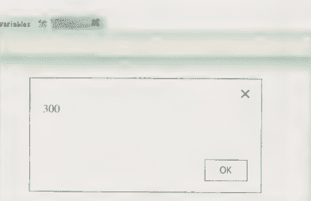

现在让我们使用加运算符（`+`）编写一个新的变量，计算 Bairstone 教授团队中人和狗的总数。我们将变量命名为 `teamMembers`，并设置 `alert` 来显示变量的值。修改 `<script>` 块使其看起来如下所示：

```html
<script>
var teamMembers = 2 + 1;
alert(teamMembers);
</script>
```

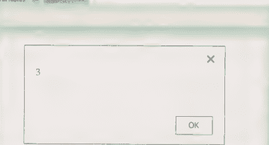

保存文件并刷新页面。你的提示框将显示为 `teamMembers` 变量的值。点击 OK。

最后，让我们尝试使用赋值运算符（`=`）创建一个变量并在变量中存储文本。不要忘记文本周围需要双引号（`""`）。设置一个 `alert` 显示变量的值。修改文件中的代码使其看起来如下所示：

```html
<script>
var jewelThieves = "The Bond Brothers";
alert(jewelThieves);
</script>
```

当你保存文件并刷新页面时，你将在提示框中看到你的文本。

## 比较运算符

除了赋值或执行计算外，运算符还可以用于比较变量的值。能够比较值允许我们让网页更具交互性。使用比较运算符，我们可以编写根据变量值执行特定操作的代码。以下是你可以使用的一些比较运算符：

这些运算符可以用于 JavaScript 语句，以对我们的变量提问。然后我们可以编写根据问题答案产生不同执行情况的代码。使用比较运算符的浏览器指令被称为 `if` 语句和 `else` 语句。这类语句被称为条件语句，因为它们取决于变量的值（或条件）。

| 运算符 | 含义 |
| :--- | :--- |
| `==` | 等于 |
| `!=` | 不等于 |
| `>` | 大于 |
| `<` | 小于 |
| `>=` | 大于等于 |
| `<=` | 小于等于 |

## IF 语句

语句是告诉浏览器只有在变量条件为真（`true`）时才执行指令的一种方式。如果变量条件为假（`false`），浏览器将不会执行代码中的指令。

我们必须以特定的方式构建语句。我们从语句关键字 `if` 开始。然后打开一对括号，并在其中放入 `if` 语句的规则。接着打开一对大括号（`{}`）。在大括号内部，我们放入只有在 `if` 为真时才执行的指令。

让我们看一个例子，我们使用相等运算符（`==`）创建了一个 `if` 语句。在这里，我们的变量值设置为 "Dr. Day"；然后我们创建一个 `if` 语句。

```html
<script>
var person = "Dr. Day";
if (person == "Dr. Day") {
  alert("You found the diamond!");
}
</script>
```

## ELSE 语句

`else` 语句与 `if` 语句配合使用，使网页更具交互性。你在 `if` 语句之后使用 `else` 语句来运行的代码块。如果 `if` 语句的条件为假，浏览器将运行替代的 `else` 语句。

`else` 语句的写法与 `if` 语句完全相同——你只需要使用 `else` 关键字。将你想运行的代码放在大括号（`{}`）中。让我们来看一个 `if` 语句和 `else` 语句工作的例子：

```html
<script>
  var name = "Tony Twinkles";
  if(name == "Dr. Day") {
    alert("Access Granted!");
  } else {
    alert("Access Denied!");
  }
</script>
```

## 编码技能 ELSE 语句

现在我们应该学习如何在 JavaScript 代码块中，配合 `if` 语句使用 `else` 语句。让我们尝试编写一个同时使用这两种条件语句的程序。

1. 打开你的文本编辑器。创建一个名为 `elstatements.html` 的新 HTML 文件。然后将 `ifstatements.html` 中的代码复制并粘贴到你的新文件中。修改代码使其如下所示：

```html
<!DOCTYPE html>
<html>
<head>
<title>Conditionals</title>
</head>
<body>
<script>
</script>
</body>
</html>
```

2. 在你的 `<script>` 块中使用小于或等于运算符（`<=`）创建一个新的 `if` 语句。将你的 `if` 语句的条件设为假。你的代码将如下所示：

```html
<script>
var diamondValue = 10;
if(diamondValue <= 9.9) {
alert("Value: Under $10 million!");
}
</script>
```

3. 现在在你的 `if` 语句之后添加一个 `else` 语句。如果 `if` 语句的条件为假，该语句将执行。你的代码将如下所示：

```html
<script>
var diamondValue = 10;
if(diamondValue <= 9.9) {
alert("Value: Under $10 million!");
}
else {
alert("Value: Over $10 million!");
}
</script>
```

4. 保存你的 HTML 文件并在浏览器中打开它。你的 `else` 语句将执行，并弹出一个警告框。

## 编码技能清单

### 编写 JAVASCRIPT

- JavaScript 必须写在 `<script>` 标签内部，这样你的浏览器就知道你正在从 HTML 切换到新的编程语言。你可以在页面的 `<head>` 或 `<body>` 中放置 `<script>` 标签。

- 与 HTML 和 CSS 一样，JavaScript 用特殊的方式编写的，并有自己的语法。它是一种区分大小写的语言。你应该在代码段之间留出空格，以便于阅读。

- 你给浏览器的每条 JavaScript 指令都称为语句（`statement`）。语句必须以分号（`;`）结尾。大括号（`{ }`）用于将语句分组成一个代码块，由浏览器一次性运行。

- 语句通常以关键字开头，该关键字告诉该语句将执行的操作。

- 你可以使用变量在浏览器中存储信息。变量有名称和值，值可以是文本也可以是数字。如果值是文本，则必须放在双引号（`" "`）中。如果你的变量名有两个单词，请使用驼峰命名法（`camelCase`）编写。

- 要更改或设置变量的值，你可以使用赋值运算符、算术运算符和比较运算符。

- `if` 语句和 `else` 语句被称为条件语句。使用条件语句允许我们根据变量的值让代码执行不同的操作。

> 使用 JavaScript 帮助我们创建能够响应用户的交互式网页。

## 函数

JavaScript 编码的另一个重要部分是学习如何创建和使用函数。你通过组合 JavaScript 语句来创建一个函数。在函数中分组的语句共同工作以执行特定的操作。在你告诉浏览器运行它之前，函数不会运行。这被称为“调用函数”。让我们看看如何创建一个会弹出警告框并告诉它内容的函数：

```html
<script>
function sayPassword() {
  alert("Password!");
}
sayPassword();
</script>
```

函数始终必须以相同的方式编写。每个部分对你的浏览器来说都是一条重要的指令。

- 函数需要：

- **function 关键字**：要定义并创建函数，请使用 `function` 关键字。

- **函数名**：然后给你的函数起一个名字。名称应该是短的，并解释函数执行的操作。名称始终以一对括号结尾。

- **大括号**：在函数名之后，打开一对大括号（`{ }`）。你想要在函数中分组的所有语句都放在大括号内部。

- **语句**：语句构成了函数的函数体。你可以使用任意数量的语句，每当你调用该函数时，该代码块就会在浏览器中运行。

- **函数调用**：要调用我们的函数并运行代码块，你必须输入函数名（包括括号）后跟一个分号。在定义函数之后，你可以在 `<script>` 块中的任何地方调用你的函数。

## 内置函数

除了分组语句创建你自己的函数外，你还可以使用浏览器内置的函数。内置函数是浏览器知道如何执行而无需编写任何代码的操作。程序员已经为你完成了这些艰苦的工作。你只需要给浏览器提供内置函数的名称以及它运行所需的信息。JavaScript 有许多内置函数。你已经在这次任务中使用其中一个了：`alert` 函数。要使用 `alert` 函数，你只需要输入 `"alert"`，你的浏览器就会弹出警告框。内置函数可以节省时间，并在你编程时让你完成更复杂的事情。

## 函数与参数

为了让函数执行任务，你有时会向它传递参数（`arguments`）。让我们看看它是什么样的：

```html
<script>
function sayHello(name) {
  alert("Hello, " + name);
}
sayHello("Dr. Day");
</script>
```

参数可以是文本、数字或变量。当你向函数传递参数时，它会在函数内部使用该信息。

## return 语句

到目前为止，我们一直使用函数来显示警告。但有时你希望函数给程序返回一个值。这就是 `return` 语句派用场。让我们看看如何使用它：

```html
<script>
function getName() {
  return "Dr. Day";
}
var scientist = getName();
alert(scientist);
</script>
```

在这个示例中，函数返回字符串 "Dr. Day"，然后将其存储在变量 `scientist` 中并显示。

## 编码技能函数参数

让我们尝试分组语句并创建一个函数。我们还应该尝试 `return` 语句，因为当我们为 Dr. Day 创建密码时它很有用。

1. 打开你的文本编辑器。创建一个名为 `functions.html` 的新 HTML 文件。在你的新文件中输入此代码：

```html
<!DOCTYPE html>
<html>
<head>
<title>Functions</title>
</head>
<body>
  <script>
</script>
</body>
</html>
```

2. 在你的 `<script>` 块内部，创建一个名为 `checkAccess` 的函数，在调用它时会弹出警告框。

```html
<script>
function checkAccess() {
  alert("Restricted access!");
}
checkAccess();
</script>
```

3. 保存你的 HTML 文件并在浏览器中打开它。将弹警告框。

4. 现在修改你的 `checkAccess` 函数，使其包含一个 `return` 语句。将函数的名称存储在一个变量中。然后让警告框弹出以显示你变量的值：

```html
<script>
function checkAccess() {
  return "Expedition team only!";
}
var webpage = checkAccess();
alert(webPage);
</script>
```

## 使用 HTML 让 JavaScript 运行起来

在整个任务中，我们已经看到了如何通过在 `<script>` 标签内部编写代码来为你的 HTML 网页添加 JavaScript。但现在，我们需要学习当用户点击 HTML 元素时让我们的 JavaScript 代码运行。如果我们希望在用户点击页面上的某些文本或图像时发生某些操作，我们就必须在 HTML 标签中添加 JavaScript。幸运的是，有一个属性可以实现这一点。

> 属性！你已经在任务 1 中了解了它们的所有信息。

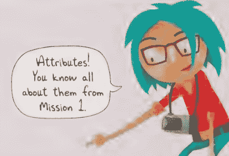


## `onclick` 属性

要让用户点击页面上的 HTML 元素时运行一段 JavaScript 代码非常简单。你只需要在你想要使其交互的 HTML 标签中包含 `onclick` 属性（或 "onclick" 字符串）。然后，当用户在浏览器中点击该 HTML 元素时，JavaScript 代码就会运行。`onclick` 属性与我们在此为止在任务中使用的所有其他属性一样。你将该属性添加到你想要点击的 HTML 元素的起始标签中。然后，使用等号（`=`）和双引号（`"`）将 `onclick` 的值设置为你想要运行的 JavaScript 代码。别忘记分号（`;`）。你可以在 `onclick` 中放入任何你想要的 JavaScript 代码。让我们来看：

```html
<!DOCTYPE html>
<html>
<head>
  <title>钻石颜色</title>
</head>
<body>
  <p onclick="alert('Green');">
    点击这里查看僧侣钻石的颜色
  </p>
</body>
</html>
```

当用户点击起始 `<p>` 标签和结束 `<p>` 标签之间的文本时，我们 `onclick` 中的 JavaScript 函数就会运行。会弹出一个警告框（`alert`）。

> 你知道绿色钻石非常稀有吗？

我们在传递给 `alert` 函数的参数周围使用了单引号（`''`）。这是因为我们已经使用了双引号来设置 `onclick` 属性的值。请务必在双引号内部使用单引号，否则你的代码将无法运行。

```
Green
OK
```

## 在 `return` 语句中使用 `true` 和 `false`

你还可以使用 `onclick` 属性来阻止浏览器执行代码中的某条指令。要做到这一点，你需要在 `onclick` 中使用 `return` 语句，并将其值设置为 "false"。

`return` 是 JavaScript 中的一个保留字。如果你使用 `return` 语句并将其设置为值 "true"，你的浏览器将继续运行代码。但如果你在 `return` 语句中使用 "false" 作为值，你的浏览器将立即停止运行代码。

> 我担心那些讨厌的邦德兄弟可能在附近——请快点给出密码！

保留字（RESERVED WORDS）是不能用作函数或变量名的单词。这是因为它们是浏览器能够理解的特殊命令。你不需要将保留字放在双引号（`""`）中。

## `onclick` 属性与超链接

我们可以通过 `onclick` 属性和值 "false" 创建一段非常有用的 JavaScript 代码。你可以使用 `onclick` 和 `return` 语句在用户点击超链接时阻止其工作。这在我们稍后在任务中编写密码时非常有用。如果用户输入的密码错误，他们将不会被带到僧侣钻石的网页。

要做到这一点，你首先需要像我们在任务开始时那样的完全创建一个超链接，使用锚点 `<a>` 标签和 `href` 属性，如下：

```html
<body>
  <a href="monkondiamonddiscovery.html">
    点击这里访问僧侣钻石网页
  </a>
</body>
```

然后你添加 `onclick` 属性和 `return` 语句。将 `return` 语句的值设置为 "false"，如下：

```html
<body>
  <a href="monkondiamonddiscovery.html" onclick="return false">
    点击这里访问僧侣钻石网页
  </a>
</body>
```

将 "false" 作为我们 `onclick` 的值意味着当用户点击链接时什么都不会发生。

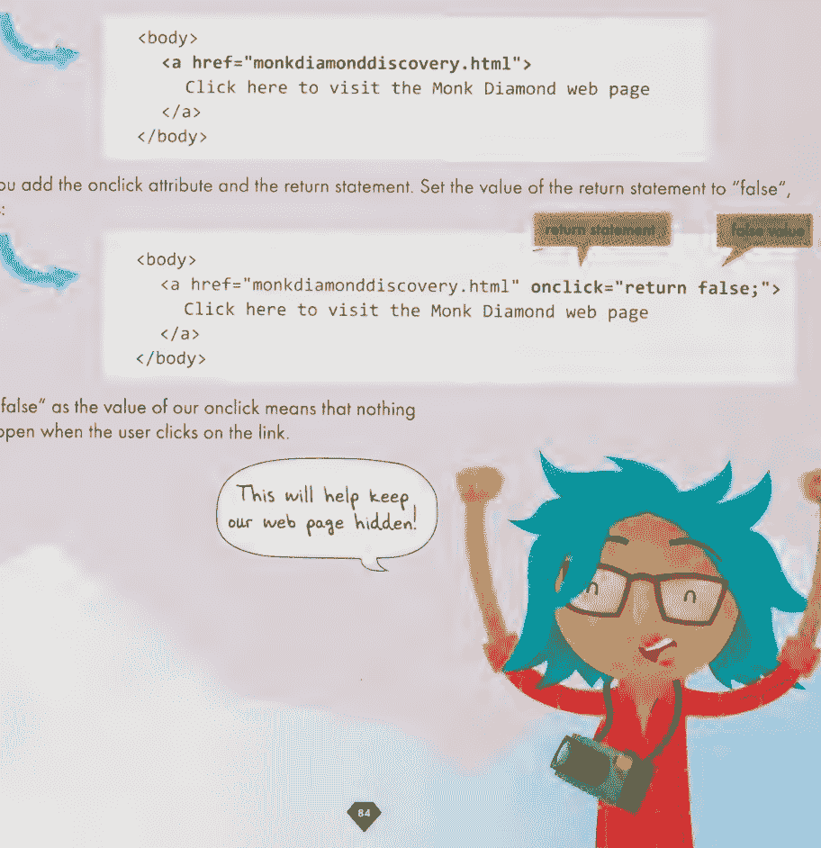

## 代码技能：让 HTML 代码运行 JavaScript

练习使用 HTML `onclick` 属性来运行一段 JavaScript 代码。学会如何做到这一点将意味着你可以让 HTML 元素对用户做出响应。

1. 打开你的文本编辑器。创建一个名为 `onclick.html` 的新 HTML 文件。在你的新文件中输入以下代码：

2. 在你的 `<body>` 中创建一个将用户带到 Google 的超链接。使用锚点 `<a>` 标签和 `href` 属性。将值设置为 Google 的 URL。你的代码看起来像这样：

```html
<!DOCTYPE html>
<html>
<head>
<title>OnClick</title>
</head>
<body>
<a href="https://www.google.com">Google</a>
</body>
</html>
```

3. 现在为你的起始 `<a>` 标签添加 `onclick` 属性。将你的 `onclick` 值设置为一个 JavaScript `alert`。记住为 `alert` 参数使用单引号（`''`）。你的代码看起来像这样：

```html
<a href="https://www.google.com" onclick="alert('Redirecting to Google');">Google</a>
```

4. 保存你的 HTML 文件并在浏览器中打开它。当你点击它时，会弹出一个警告框。

5. 在你的 `<body>` 中创建一个将用户带到 Google 的超链接。使用锚点 `<a>` 标签和 `href` 属性。将值设置为 Google 的 URL。你的代码看起来像这样：

```html
<a href="https://www.google.com" onclick="return false;">Google</a>
```

## 创建密码

现在你已经知道了如何使用 `onclick` 属性，我们开始构建我们的页面。让我们从基础开始：

```html
<!DOCTYPE html>
<html>
<head>
<title>密码</title>
  <style>
  body {
    background-color: lightblue;
    padding: 30px;
  }
</style>
</head>
<body>
<p style="font-size:30pt;">僧侣钻石发现</p>
<p>请输入密码查看此网页。</p>
<p>密码:</p>
<a href="monkondiamonddiscovery.html">点击这里提交密码查看网页</a>
</body>
</html>
```

> 别忘了：秘密是 0。


| 僧侣钻石发现 |

| 请输入密码查看此网页。 |

| 密码 |

| 点击这里提交密码查看网页 |

## `input` 标签：`<input/>`

网站通常需要你输入信息。这是你登录账户、购买电影票或使用搜索引擎的方式。因此，要求用户输入信息是编程常见的一部分。这被称为用户输入。

有很多标签可以用于用户输入，但你用最多的是 `<input/>` 标签。它非常适合在页面上创建可以让输入数据的框。它是一个自闭合标签，你在内部包含了两个属性：`id` 属性和 `type` 属性。正如你已经知道的，你使用等号（`=`）和双引号设置这些属性的值。让我们来看看如何在页面上使用 `<input/>` 标签：

```html
<body>
<p style="font-size:30pt;">僧侣钻石发现</p>
<p>请输入密码查看此网页。</p>
<p>密码:<input id="passwordBox" type="text"></p>
<a href="monkdiamonddiscovery.html">点击这里提交密码查看网页</a>
</body>
```

你使用 `id` 属性为你的 `<input/>` 标签提供一个唯一的名称。你必须选择 `id` 属性的名称。确保它容易记忆。在这里，我们把 `id` 属性的值设置为 "passwordBox"。

这样做允许我们能够在 JavaScript 中使用 `<input/>` 标签内部的值。我们使用 `id` 属性来告诉浏览器我们具体想要使用哪部分数据。没有 `id` 属性，你的浏览器将无法找到并检查密码是否正确。


## `type` 属性

有很多种不同的 `<input/>` 标签，因此你需要使用 `type` 属性告诉浏览器你确切需要哪种 `<input/>` 标签。你必须从 `type` 属性的定义值中选择。以下是可以在 `<input/>` 标签内部使用的常用 `type` 属性：

| 属性值 | 作用 |

| --- | --- |

| `text` | 创建一个输入文本的框 |

| `password` | 创建一个输入密码的框 |

| `button` | 创建一个可点击的按钮（配合 JavaScript） |

| `checkbox` | 创建一个用户可以勾选或取消勾选的框 |

你可能在上一页注意到，当我们将 `type` 属性设置为 `text` 时，密码会显示在框中。这并不安全！如果 Day 输入密码时，邦德兄弟在附近会发生什么？如果我们想保持密码秘密，可以将 `type` 属性的值更改为 `password`。这将通过将文本更改为点来隐藏用户输入的内容。让我们来看：

```html
<body>
<p style="font-size: 30pt;">THE MONK DIAMOND DISCOVERY</p>
<p>Please enter the password to view this website.</p>
<p>Password: <input id="passwordBox" type="password"/></p>
<a href="monkondiamondiscovery.html">
Click here to submit password and view website
</a>
</body>
```

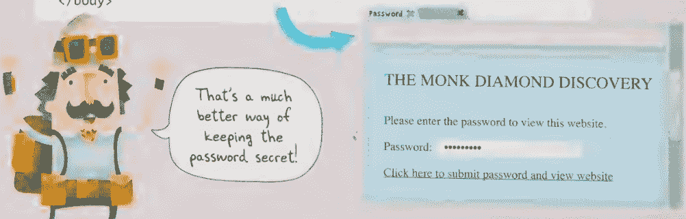

### 僧侣钻石的发现

请输入密码以查看此网站。

密码：*********

点击此处提交密码并查看网站

## 使用 JavaScript 检查密码

现在我们已经构建了页面的基础 HTML 结构，我们需要编写一些 JavaScript 来检查用户输入的密码是否正确。如果他们输入密码 `Ernest300`，他们将带到"僧侣钻石的发现"页面。如果他们输入了错误的密码，会弹出一个警告框告诉他们密码错误。

我们需要做的第一件事是创建一个函数，其中包含检查密码所需的所有代码。让我们在 `<head>` 内部创建该函数。你可以将 JavaScript 放在 HTML 网页的任何地方，在这个示例中，将其放在 `<head>` 中使我们的代码更易理解。不要忘记将 JavaScript 放在 `<script>` 标签内，如下：

```javascript
<script>
function checkPassword() {
  var password = document.getElementById("passwordBox");
  var passwordText = password.value;
}
</script>
```

然后，我们需要创建变量来存储密码的值，以便函数可以检查用户是否正确。让我们来看需要的两个变量：

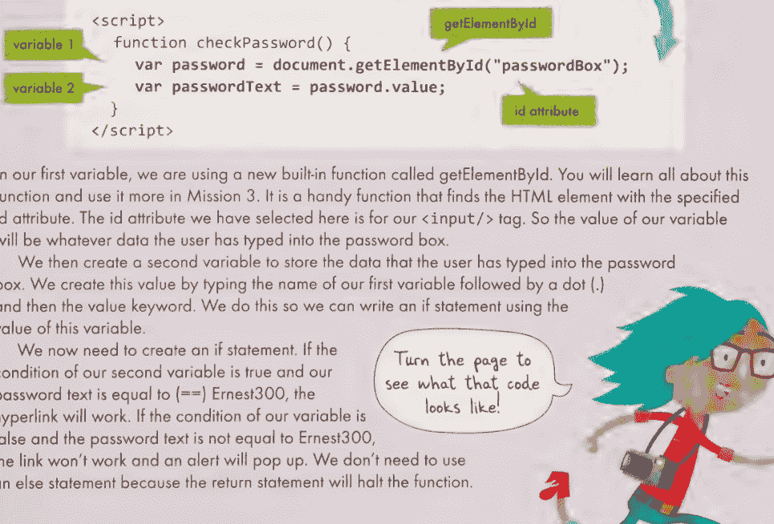

在第一个变量中，我们使用了一个名为 `getElementById` 的新内置函数。你将在任务 3 中学习关于该函数的知识并更多地使用它。这是一个方便函数，可以找到具有指定 `id` 属性的 HTML 元素。我们在这里选择的 `id` 属性是 `<input/>` 标签。变量的值将是用户在密码框中输入的任何数据。

然后我们创建第二个变量来存储用户在密码框中输入的数据。我们通过输入第一个变量的名字后加上点（`.`）以及 `value` 键来实现。这样做是为了可以使用该变量的值来编写 `if` 语句。

我们现在需要创建一个 `if` 语句。如果第二个变量的条件为 `true` 且我们的密码文本等于 `Ernest300`，超链接将生效。如果变量的条件为 `false` 且密码文本不等于 `Ernest300`，链接失效并弹出警告。我们不需要使用 `else` 语句，因为 `return` 语句会停止函数的执行。

带有新的 `if` 语句的完整密码 `<script>` 块如下：

```javascript
<script>
function checkPassword() {
    var password = document.getElementById("passwordBox");
    var passwordText = password.value;
    if(passwordText == "Ernest300") {
        return true;
    }
    alert("Access denied! Incorrect password!");
    return false;
}
</script>
```


最后，我们必须让 JavaScript 与我们的 HTML 元素配合。我们现在需要查看页面 `<body>` 中的代码。我们希望在有人点击页面上的超链接时调用 `checkPassword` 函数。因此，我们需要为起始的 `<a>` 标签添加一个 `onclick` 属性，如下：

```html
<body>
<p style="font-size: 30pt;">THE MONK DIAMOND DISCOVERY</p>
<p>Please enter the password to view this website.</p>
<p>Password: <input id="passwordBox" type="password"/></p>
<a href="monkondiamondiscovery.html" onclick="return checkPassword();">
Click here to submit password and view website
</a>
</body>
```


## 任务简报

亲爱的程序员：

很高兴告诉你，已经没有更多需要报告的悬疑事件了。我认为你为 Day 博士所做的工作非常成功，由于他们无法访问我们的网页，邦德兄弟已经跟不上我们的行程了。你再次令我印象深刻！

我受伤的脚踝现在已经痊愈了。我们昨天离开了山脉，目前正乘坐跨西伯利亚铁路前往莫斯科。我们的车厢非常豪华，我一直在给你和老朋友、沃尔尔科夫家族的维克多·沃尔尔科夫先生发邮件。如你所知，"僧侣钻石"在三年前从沃尔尔科夫家族被公然盗走。它是世界上最古老、最受尊敬的珠宝公司之一，因那场盗窃案遭受了巨大打击。

我已经告诉了沃尔尔科夫先生我们的发现。起初他简直不敢相信！但最终我说服了他，他希望我们能尽快带着钻石回到莫斯科。他已经在策划一场特别展览了。他将邀请世界各地的重要宝石收藏家见证我们的发现。

沃尔尔科夫先生需要策划展览方面的帮助。由于我们正在火车上，我希望我们能再次帮上忙。你有没有办法写一个待办事项列表 App？我们可以使用这个 App 来跟踪从现在到展览开幕期间我们需要完成的所有不同任务。由于人有时会很粗心，所以有这个 App 将非常有用。

如果我们不妥善地策划展览（并采取最高级别的安保措施），我担心邦德兄弟可能会尝试偷走钻石。我随附了一些关于展览开幕前需要完成的工作笔记，以及来自《探险家百科全书》关于沃尔尔科夫家族的条目，这将帮助你构建 App。

从舒适的车厢发来最诚挚的问候，

哈里·贝斯通教授

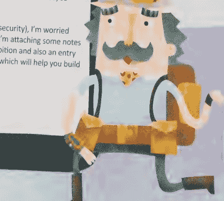

# 沃尔尔科夫家族

选自《探险家百科全书：冒险指南》

沃尔尔科夫钻石跳转至此。

沃尔尔科夫家族是世界上最老的珠宝店之一，以高品质钻石珠宝闻名。它还拥有一世界闻名的私人宝石收藏。沃尔尔科夫家族由弗拉基米尔·沃尔尔科夫于 17 世纪 90 年代在圣彼得堡创立，他因对最稀有珍贵宝石的热爱被称为"钻石王子"。沃尔尔科夫家族曾被任命为皇室官方珠宝商，为俄罗斯贵族提供设计精美的漂亮珠宝。

如今，沃尔尔科夫家族位于莫斯科最尊华的街道之一，靠近圣瓦西里大教堂。沃尔尔科夫钻石依然以其质量闻名，是世界上最昂贵的钻石之一。

现任主维克多·沃尔尔科夫在拍卖会上以一个未披露的价格买下了"僧侣钻石"。沃尔尔科夫家族私人收藏的核心作品曾陈在一个古董玻璃柜内向公众展示，直到在一次抢劫案中被盗。"僧侣钻石"案至今仍未破。自从抢劫案以来，沃尔尔科夫家族的销售额大幅下降，有传言说它可能会被出售。沃尔尔科夫先生在最近的采访中说："如果我家族世代经营的生意不得不关闭，我将心碎不已。"

- 首页

- 目录

- 特色发现

- 著名探险家

- 历史探险

| 行业：珠宝商 |

| :--- |

| 创立于：1794年 |

| 创始人：弗拉基米尔·沃尔尔科夫 |

| 总部：莫斯科 |

| 服务范围：全球 |

# 僧侣钻石特别展

## 待办事项列表

- 订制一个先进的防碎玻璃展示柜

- 为钻石订购一个新的丝绒垫子

- 聘佣私人安保

- 聘佣一名保镖保护沃尔尔科夫先生

- 邀请客人

- 购买钻石主题的零食和柠檬水

- 为欧内斯特购买狗饼

# 构建一个 Web 应用


为沃尔尔科夫家族策划“僧侣钻石”的特别展览对于贝斯通教授、`Day` 博士和沃尔尔科夫先生来说将是一项巨大的工程。在这项任务中，你将通过构建一个运行在网页浏览器中的 `App` 来帮助他们。贝斯通教授可以使用这个 `App` 创建他的待办事项列表。当他完成一项任务后，可以从列表中删除。

我们需要学习一些新的 `JavaScript` 函数来构建我们的 `App`。目前，在我们浏览器将页面绘制在屏幕上之后，页面并不会改变。贝斯通教授想要在他的列表中添加和删除项目，因此我们的 `App` 需要更具交互性。让我们看看我们的 `App` 会长什么样：

我们的 `App` 将有一个文本框，贝斯通教授可以在其中输入内容。当他点击按钮时，该项目将被添加到列表中。当他完成任务时，他可以从列表中将其移除。

## 让按钮运行代码

我们现在需要让应用程序中的按钮具有交互性。为了在点击按钮时运行 `JavaScript` 代码，我们需要在 `<input/>` 标签中添加 `onclick` 属性，就像我们在任务 2 中做的那样。当用户点击按钮时，我们希望调用一个 `JavaScript` 函数。我们要做的只是将 `onclick` 属性的值设置为我们想要的函数名称。

让我们编写一个按钮，在被点击时会弹出一个警告框（`alert`）。首先，创建你需要的 `JavaScript` 函数。然后为按钮的 `<input/>` 标签添加 `onclick` 属性。最后，将 `onclick` 属性的值设置为函数名称。使用等号 (`=`) 和双引号 (`""`) 来完成此操作。

```html
<!DOCTYPE html>
<html>
<head>
  <title>To-Do List App</title>
  <script>
  function addItem() {
    alert("Remember dog biscuits!");
  }
  </script>
</head>
<body>
  <p>Special Exhibition To-Do List</p>
  <br/>
  <input type="text" value="Type here to add task"/>
  <br/>
  <input type="button" value="Add item" onclick="addItem();"/>
  <br/>
</body>
</html>
```

当你点击按钮时，`onclick` 属性会调用 `JavaScript` 函数，并弹出一个警告框。

## 代码技能 ► 让按钮运行代码

现在练习使用 `onclick` 属性来创建一个会弹出警告框的按钮。

- 1. 打开你的文本编辑器。创建一个名为 `button.html` 的新 `HTML` 文件。然后将你从 `app.html` 中的代码复制并粘贴到新文件中。在你的 `<body>` 标签中，为按钮添加一个调用 `JavaScript` 函数的 `onclick` 属性，如下：

```html
<!DOCTYPE html>
<html>
<head>
  <title>To-Do List App</title>
</head>
<body>
  <p>Special Exhibition To-Do List App</p>
  <br/>
  <input type="text" value="Type here to add task"/>
  <br/>
  <input type="button" value="Add item" onclick="addItem();"/>
  <br/>
</body>
</html>
```

- 2. 在你的 `<head>` 中添加 `<script>` 标签。创建一个在被调用时会弹出警告框的 `JavaScript` 函数。你的代码看起来如下：

```html
<head>
  <title>To-Do List App</title>
  <script>
    function addItem() {
      alert("Hire security team!");
    }
  </script>
</head>
```

- 3. 保存你的 `HTML` 文件并在浏览器中打开它。现在，当你点击按钮时，它会弹出一个警告框。

## 文档对象模型 (DOM)

我们应用程序中的按钮和文本框现在可以工作了。但 `Bairstone` 教授如何向列表中添加和删除项目呢？为了让他实现这一点，我们需要使用文档对象模型（Document Object Model，简称 `DOM`）。

我们在任务 1 中学习过，`HTML` 网页文件被称为“文档”。正如你所知，`HTML` 文档是由许多较小的 `HTML` 部分组成的，这些部分被称为 `HTML` 元素。当我们保存 `HTML` 文件并在网页浏览器中运行代码时，浏览器会将这些元素绘制在屏幕上。如果我们想构建应用程序，我们需要在浏览器在屏幕上绘制页面之后，能够更改、删除或添加新的 `HTML` 元素。

正如我们在完成任务 2 时看到的，像 `alert` 这样的内置函数在编写代码时非常有用。`DOM` 是一组与你的网页浏览器协同工作的内置函数。这些内置函数使得构建动态网页变得简单，可以根据用户的操作发生变化。

## 编程接口

`DOM` 是一个应用程序接口（Application Program Interface，简称 `API`）。`API` 在你编码时很有帮助。它们是可以方便与 `HTML` 和 `JavaScript` 代码配合使用的内置函数集。

任务 2 中使用的 `alert` 函数就是一个内置函数。我们不需要自己编写警告框的代码，只需要输入 `alert` 关键字，浏览器就会知道该做什么。`DOM` 的工作方式非常相似。我们可以使用 `DOM` 的内置函数在 `HTML` 文档绘制在屏幕之后对其进行更改。

使用 `DOM` 让我们能够构建在用户操作时发生变化并响应的网页。如果我们希望我们的任务列表具有交互性，并在 `Bairstone` 教授添加新任务或勾选某一项时在屏幕上变化，我们需要使用 `DOM` 的方法和属性。

应用程序接口 (`API`) 在编写代码时可以节省大量时间，因为它们允许你使用内置函数。你不需要自己编写这些函数的代码，而可以在代码中使用 `API` 的函数。有许多 `API` 可以完成各种事情，从存储信息到为页面添加内容。

## 使用 DOM

`DOM` 允许我们与网页内容进行交互。通过使用 `DOM`，我们可以访问元素、更改其内容，甚至响应用户事件。这是创建现代交互式 `Web` 应用的关键。

## DOM 方法和属性

`DOM` 提供了与 `HTML` 元素交互各种方法和属性。方法是你可以在元素上调用的函数（例如 `getElementById`），而属性是你可以获取或设置的值（例如 `innerHTML`）。理解如何使用这些工具对于精通 `Web` 开发至关重要。

让我们来看看如何使用 `getElementById` 方法结合 `innerHTML` 属性来弹出一个警框：

```html
<!DOCTYPE html>
<html>
<head>
  <title>List Alert</title>
</head>
<body>
  <div id="list">Buy Ernest a new collar</</div>
  <script>
    var showList = document.getElementById("list");
    alert(showList.innerHTML);
  </script>
</body>
</html>
```

在这个示例中，我们使用了 `getElementById` 方法来找到 `id` 属性设置为 `"list"` 的 `<div>` 标签。你可能还记得任务 1 中用过的 `<div>` 标签。它们是内容的容器，你可以使用它们将页面划分为不同的部分。我们将该 `<div>` 的内容存储在了一个变量中。然后，我们使用 `innerHTML` 将警框中的文本设置为该变量的值。如果 `<div>` 中的文本发生了变化，警框内的文本也会随之改变，而我们无需编写任何代码。

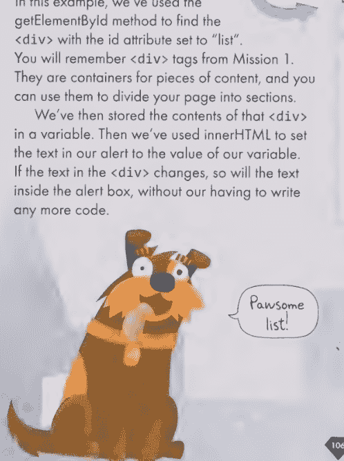

## 代码技能、方法与属性

让我们尝试使用 `getElementById` 方法和 `innerHTML` 属性来查找并更改 `HTML` 元素的内容。

- 1. 打开你的文本编辑器。创建一个名为 `methods.html` 的新 `HTML` 文件。在你的 `<body>` 中使用 `<input>` 标签创建一个按钮。同时创建一个空的 `<div>`，如下所示：

```html
<!DOCTYPE html>
<html>
<head>
<title>Methods</title>
</head>
<body>
<input type="button" value="Add item"/>
<div id="container"></div>
</body>
</html>
```

- 2. 现在在你的 `<head>` 中创建一个 `JavaScript` 函数，该函数使用 `getElementById` 方法找到你的 `<div>`。然后使用 `innerHTML` 将你空 `<div>` 的内容设置为某些文本，如下所示：

```javascript
<script>
function addItem() {
  document.getElementById("container").innerHTML = "Item to remember";
}
</script>
```

- 3. 接下来，让你的按钮在被点击时调用你的 `JavaScript` 函数。为你的 `<input>` 标签添加 `onclick` 属性，并将 `onclick` 属性的值设置为你的函数名称，如下所示：

```html
<input type="button" value="Add item" onclick="addItem();"/>
<div id="container"></div>
```

- 4. 保存你的 `HTML` 文件并在浏览器中打开它。你会看到一个按钮。当你点击该按钮时，`innerHTML` 定义的文本会被添加到你的 `<div>` 中。

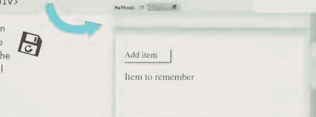

## 使用 DOM 为应用添加内容

我们现在已经知道了如何将 `DOM` 的方法和元素应用到应用中。这在应用中查找和更改 `HTML` 元素将非常有用。我们现在需要学习如何使用 `DOM` 来添加新的 `HTML`。毕竟，`Bairstone` 教授需要能够向列表中添加项目。`DOM` 有两个方法可以配合 `JavaScript` 使用。

## createElement 方法

`createElement` 方法用于创建一个新的 `HTML` 元素，例如 `<div>`、按钮或段落。你必须在关键字后的双引号 (`"`) 和括号中包含你想要创建的 `HTML` 元素类型名称，如下所示：然后你可以使用 `JavaScript` 使用我们在任务 2 中学过的赋值运算符 (`=`) 将你的新元素分配给变量。然后你可以使用 `innerHTML` 属性在浏览器屏幕上绘制它之前设置新元素的内容。

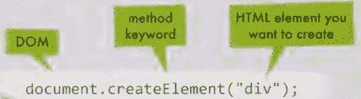

## appendChild 方法

`appendChild` 方法允许你向现有 `HTML` 元素添加新的 `HTML` 元素。当新元素绘制在屏幕上时，它将位于现有元素的下方。你必须在关键字后的括号内包含你想添加的 `HTML` 元素，如下所示：`appendChild` 和 `createElement` 方法允许你向应用列表添加每个项目。

```javascript
<script>
var newDiv = document.createElement("div");
newDiv.innerHTML = "Professor Bairstone";
document.body.appendChild(newDiv);
</script>
```

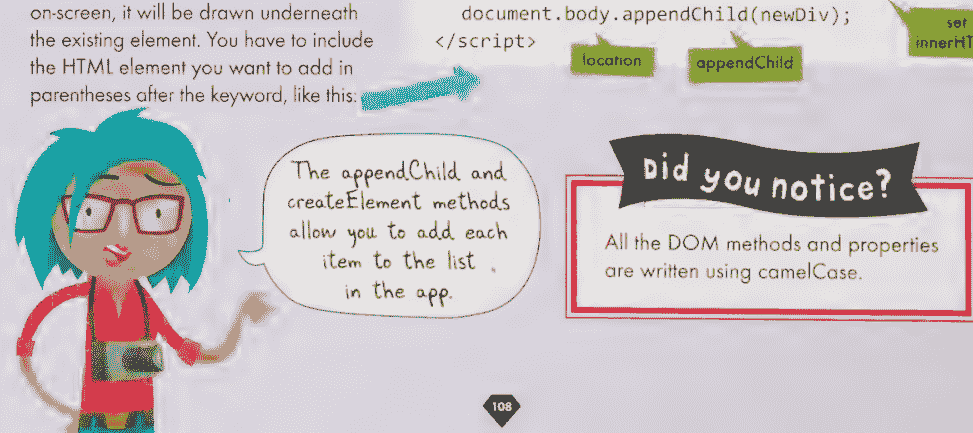

> 你注意到了吗？

> 所有的 `DOM` 方法和属性都是使用驼峰命名法（`camelCase`）编写的。

让我们来看一个使用 `createElement` 和 `appendChild` 方法在页面上创建新 `HTML` 元素的示例。`HTML` 元素将是一个包含文本的 `<div>`。`<div>` 是为其他 `HTML` 元素创建区域或容器的有用方法。

```html
<!DOCTYPE html>
<html>
<head>
<title>To-Do List</title>
</head>
<body>
  <div id="list">To-Do List</div>
  <script>
    var newItem = document.createElement("div");
    newItem.innerHTML = "Item added to list";
    document.getElementById("list").appendChild(newItem);
  </script>
</body>
</html>
```


我们做的第一件事是编写一个 `<div>` 并将其 `id` 属性设置为 `list`。这个 `<div>` 将是我们使用 `appendChild` 添加的 `HTML` 元素。然后我们打开 `<script>` 标签并创建了一个 `JavaScript` 块。在 `JavaScript` 的第一行中，我们使用 `createElement` 创建了一个 `<div>`。我们将这个 `<div>` 存储在一个名为 `newItem` 的变量中。我们在这里可以使用任何名称。在 `JavaScript` 的下一行中，我们使用 `innerHTML` 属性将变量的值设置为某些文本。我们存储在变量中的新 `<div>` 现在包含了文本。

| To-Do List |

| Item added to list |

在 `JavaScript` 的最后一行中，我们使用 `getElementById` 找到我们正在使用的第一个 `<div>`。然后我们使用 `appendChild` 将 `<div>` 添加到页面。当我们在浏览器中运行代码时，我们会发现新的 `<div>` 已被添加到第一个 `<div>` 中。

> 你不会相信 `Bairstone` 教授有多健忘！

## 代码技能：添加新元素

现在轮你尝试 `createElement` 和 `appendChild` 方法了。在你的代码中，使用 `DOM` 和 `JavaScript` 在现有元素被点击时创建一个新的 `HTML` 元素。像 `DOM` 这样的 `API` 让构建变得更容易。

- 1. 打开你的文本编辑器。创建一个名为 `newelements.html` 的新 `HTML` 文件。编写一个包含文本的带有 `id` 属性的 `<div>` 如下：

```html
<!DOCTYPE html>
<html>
<head>
<title>New Elements</title>
</head>
<body>
<div id="list">Click here to add item...</div>
</body>
</html>
```

- 2. 在你的 `<head>` 中创建一个新函数。你的代码看起来如下：

```html
<head>
<title>New Elements</title>
<script>
function addItem() {
}
</script>
</head>
```

- 3. 现在让你的函数使用 `createElement` 方法创建一个 `<div>`。将你的新 `<div>` 存储在一个变量中并给变量命名。然后使用 `innerHTML` 属性将你的新 `<div>` 的值设置为文本。你的代码看起来如下：

```javascript
<script>
function addItem() {
  var newItem = document.createElement("div");
  newItem.innerHTML = "New item";
}
</script>
```

- 4. 为函数添加最后一行。使用 `getElementById` 找到你 `<body>` 中的 `<div>`。使用 `appendChild` 方法将新的 `<div>` 添加到 `<body>` 中的 `<div>` 中。你的代码看起来如下：

```javascript
<script>
function addItem() {
  var newItem = document.createElement("div");
  newItem.innerHTML = "New item";
  document.getElementById("list").appendChild(newItem);
}
</script>
```

- 5. 现在唯一缺少的是代码 `<body>` 中的函数调用。为你 `<body>` 中的 `<div>` 添加 `onclick` 属性，这样当点击 `<div>` 时，就会调用你的 `addItem` 函数。你的代码看起来如下：

```html
<body>
<div id="list" onclick="addItem();">Click here to item</div>
</body>
```

- 6. 保存你的 `HTML` 文件并在浏览器中打开。每当你点击“Click here”文本，应用中就会添加一个新的 `<div>`。


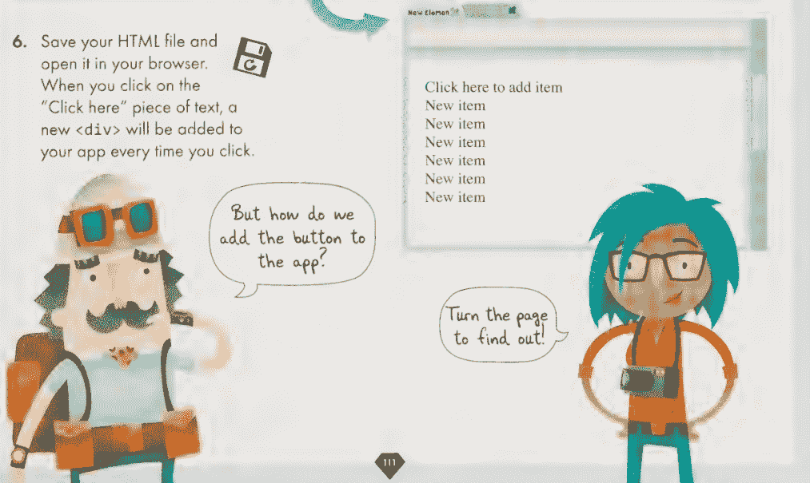

## 制作待办事项应用

现在你已经知道了 DOM 是什么以及如何工作，让我们整合所有的新技能创建一个待办事项应用。在任务开始时，你学会了如何使用 `<input/>` 标签构建文本框和按钮。让我们再次看一遍代码：

```html
<!DOCTYPE html>
<html>
<head>
  <title>To-Do List App</title>
</head>
<body>
  <p>Special Exhibition To-Do List</br>
  <input type="text" value="Type here to add task"/><br>
  <input type="button" value="Add item"/><br>
</body>
</html>
```

目前，Bairstone 教授可以在文本框中输入任务，但当他点击按钮时，什么都没有发生。我们必须使用 DOM 的方法和属性在点击按钮时向列表添加项目。

让我们从对 `<body>` 添加 `onclick` 的更改开始。我们需要为 `<input/>` 标签添加属性让我们的按钮工作。这个 `onclick` 必须调用一个函数。我们还需要创建一个空的 `<div>` 作为待办事项列表。当项目被添加到列表时，将使用 DOM 方法添加到这个空 `<div>` 中。我们的 `<body>` 块看起来如下：

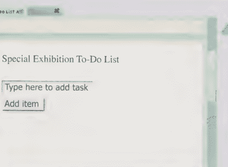

待完成事项

```html
<body>
<p>特展待办事项</p>
<br/>
<input type="text" value="在此添加任务"/>
<br/>
<input type="button" value="添加项目" onclick="addItem();"
<br/>
<div id="list"></div>
</body>
```

现在，让我们在 `<head>` 中创建一个函数，用于设置我们 `newItem` 变量内部的文本。最后，我们需要在点击按钮时运行它。我们的函数需要使用 `createElement` 方法来创建一个新的 `<div>`。这个新的 `<div>` 将存储在变量 `newItem` 中。然后，我们需要使用 `innerHTML` 将新的 `<div>` 添加到 `body` 中 id 为 "list" 的 `<div>` 中。我们在 `<head>` 中的 `<script>` 块将如下：

```javascript
<script>
function addItem() {
  var newItem = document.createElement("div");
  newItem.innerHTML = "New item";
  document.getElementById("list").appendChild(newItem);
}
</script>
```

当我们在浏览器中运行这段代码时，按钮可以工作。每当点击按钮，列表就会添加“New item”文本。

| 特展待办事项 |
| :--- |
| 在此处添加任务 |
| 添加项目 |
| New item |
| New item |
| New item |
| New item |

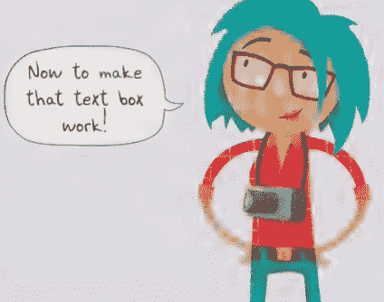

## 添加你自己的任务

我们的应用程序已经开始初具规模了。每当用户点击按钮时，列表就会添加一个项目。但 Bairstone 教授还无法将任何项目输入到文本框并将其添加到列表中。让我们看看如何允许他输入任务。

我们只需要在代码块中更改两行，就可以将文本框的值添加到列表中。我们需要做的第一件事是在 `<body>` 中。我们需要为文本框的 `<input/>` 标签提供一个我们自定义的 `id` 属性，如下：

```html
<input type="text" id="box" value="在此添加任务"/>
```

然后我们将修改 `<head>` 中的 JavaScript，使其将新 `<div>` 的 `innerHTML` 设置为文本框中输入的任何值。为了做到这一点，我们必须使用 `getElementById` 通过 `id` 属性找到文本框。然后我们通过修改我们的 `<script>` 块来访问值：

```javascript
<script>
function addItem() {
  var newItem = document.createElement("div");
  newItem.innerHTML = document.getElementById("box").value;
  document.getElementById("list").appendChild(newItem);
}
</script>
```

现在，Bairstone 教授可以将文本框中的文本替换为他想要添加到列表的项目了。我们的 `addItem` 将设置输入到新 `<div>` 中的任何值。他现在可以将他的项目添加到待办事项列表了。

## 特展待办事项

- 狗饼干
- 添加项目
- 玻璃展示柜
- 丝绒垫子
- 雇佣私人安保
- 邀请客人
- 零食和柠檬水

> 天哪！有这么多事情要做啊！


## 代码技能清单

## 使用 DOM API

- DOM（或文档对象模型）是一个 API（应用程序接口）。当你的 HTML 文档在网络浏览器中运行时，它会变成 DOM 的一部分，称为文档对象。文档对象的结构方式允许你编写代码来访问和更改单个 HTML 元素。
- 你可以使用 DOM 的内置函数在 HTML 元素绘制到屏幕上之后对其进行更改。如果你想创建一个能够响应用户的交互式网页或基于 Web 的应用程序，这一点非常重要。
- 要访问 DOM，你必须输入 `document` 关键字。你还需要使用点 (`.`) 符号。每个针对 DOM 的新指令都必须用点隔开。
- 你可以使用 DOM 方法和属性来更改你的 HTML 元素。
- `getElementById` 是一个 DOM 方法，允许你通过 `id` 属性找到页面上的 HTML 元素。
- `innerHTML` 是一个 DOM 属性。你可以设置任何 HTML 元素的 `innerHTML`。使用 `innerHTML` 是设置或更改 HTML 元素内容的好方法。
- `createElement` 是一个 DOM 方法，允许你创建一个新的 HTML 元素。你必须告诉浏览器你想创建什么种种的元素。
- `appendChild` 是一个 DOM 方法，允许你将新的 HTML 元素添加到现有的 HTML 元素中。

> DOM 为你节省了大量时间，并让创建动态网页变得简单得多！


## 代码技能：构建基础应用

让我们构建一个基础应用吧。该应用应该有一个文本框和一个按钮，Bairstone 教授可以使用它们将他的任务添加到列表中。使用 DOM 和 JavaScript，使得当点击按钮时，框中的任务会被添加到列表中。

- 1. 打开你的文本编辑器程序。创建一个名为 `basic.html` 的新 HTML 文件。使用 DOM 和 JavaScript，使得当点击按钮时，框中的任务会被添加到列表中。

```html
<!DOCTYPE html>
<html>
<head>
  <title>待办事项</title>
</head>
<body>
  <p>特展待办事项</p>
  <input type="text" id="box" value="在此添加任务"/>
  <input type="button" value="添加项目" onclick="addItem()">
  <div id="list"></div>
  <script>
  function addItem() {
    var newItem = document.createElement("div");
    newItem.innerHTML = document.getElementById("box").value;
    document.getElementById("list").appendChild(newItem);
  }
  </script>
</body>
</html>
```

- 2. 在 `<body>` 底部添加一个空的 `<div>`。为你的 `<div>` 提供一个自定义的 `id`。

- 3. 为你的按钮添加 `onclick` 属性。将 `onclick` 设置为调用函数。

- 4. 在 `<head>` 中添加一个 JavaScript 函数。

- 5. 现在使用 DOM 创建名为 `addItem` 的函数。该函数将使用 `innerHTML` 设置文本框的值。

- 6. 保存你的 HTML 文件并在浏览器中打开它。你现在可以将文本框中的文本替换为想要添加到列表的项目。

> 别忘记设置 `id`！


## 从应用程序中移除元素

你已经知道如何使用 DOM 在网页上查找并添加元素。但如果 Bairstone 教授犯了错误，向列表添加了错误的项目怎么办？或者如果他完成了一个任务并想从列表中移除它？我们需要学习如何使用 DOM 从应用程序中移除元素。

> 如果我把那双新毛袜加到列表里！太糟糕了！


## removeChild 方法

`removeChild` 方法的作用相反相反。它不是将 HTML 元素添加到另一个 HTML 元素中，而是从另一个 HTML 元素中移除 HTML 元素。你可以像使用 `appendChild` 一样使用它。通过 `id` 属性选择你想移除的 HTML 元素，然后告诉浏览器移除它，如下：

```javascript
document.getElementById("list").removeChild(this);
```

正如你熟悉的，HTML 标签可以嵌套在其他标签内部。任何在内部的 HTML 元素都是该元素的元素。外部的 HTML 元素被称为父元素。当你使用 `removeChild` 时，你会从父 HTML 元素中移除子元素。

当你使用 `removeChild` 方法时，还需要使用一个非常有用的 JavaScript 关键字 `this`。这个关键字指向调用该函数的任何 HTML 元素。

> 这些新的代码片段让我们的应用程序更具有交互性。

```html
<!DOCTYPE html>
<html>
<head>
<title>Things to Buy</title>
<script>
  function removeItem(item) {
    document.getElementById("list").removeChild(item);
  }
</script>
</head>
<body>
  <div id="list">
    Velvet cushion for diamond
    <div onclick="removeItem(this)">
      Woolly socks
    </div>
  </div>
</body>
</html>
```

在这个示例中，带有 id 属性 “list” 的第一个 `<div>` 是父元素。嵌套在它内部、包含 "Woolly socks" 文本的 `<div>` 是子元素。当我们点击 "Woolly socks" 文本时，我们正在使用 `getById` 来找到名为 `list` 的 `<div>`。

然后，我们使用 `removeItem` 方法和 `this` 关键字来移除这段文本。正如我们在任务 2 中学到的那样，我们必须为函数传递一个参数使其才能正常工作。我们使用参数 “item” 和 `this` 关键字来跟踪我们正尝试删除的 HTML 元素。Bairstone 教授现在可以通过点击它们从列表中删除物品。

| Velvet cushion for diamond |
| Woolly socks |
| Velvet cushion for diamond |

# 代码技能 ► 移除 HTML 元素

让我们尝试使用 `removeChild` 方法和 `this` 关键字来移除一个 HTML 元素。

- 1. 打开你的文本编辑器。创建一个名为 `remove.html` 的新 HTML 文件。在你的 `<body>` 中创建一个父元素和一个 `<div>`。设置父 `<div>` 的 id 属性，如下所示：

```html
<!DOCTYPE html>
<html>
<head>
  <title>Remove Items</title>
</head>
<body>
<div id="list">
  Security to protect Mr. Volkov
  Woolly socks
</div>
</body>
</html>
```

- 2. 现在向你的 `<head>` 中添加一个 JavaScript 函数，用于从页面中移除子 `<div>`。该函数将使用 `getElementById` 方法找到父 `<div>`。然后它将使用 `removeChild` 移除嵌套在内部的 `<div>`。你的代码看起来如下：

```javascript
<script>
function removeItem(item) {
  document.getElementById("list").removeChild(item);
}
</script>
```

- 3. 最后，为子 `<div>` 添加一个 `onclick` 属性，这样当点击其内部的文本时，它就会从列表中移除。`onclick` 应该调用你的函数并使用 `this` 关键字，如下所示：

- 4. 保存你的 HTML 文件并在浏览器中打开它。当你点击第二个项目时，它将从屏幕上消失。

```html
<div onclick="removeItem(this)">
  Woolly socks
</div>
```

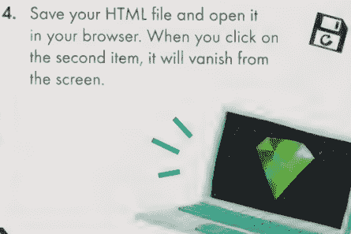

# 移除多个一个 HTML 元素

你进展得很快！现在你可以使用 `removeChild` 方法移除一个 HTML 元素。但如果 Baillargeon 教授想从他的列表中删除多个项目该呢？我们需要使用 DOM 和 JavaScript，这样所有项目在被点击时都能从列表中移除。为了做到这一点，每当我们使用 `createElement` 方法时，都必须添加一个 `onclick` 属性。你可以使用 DOM 方法通过 `onclick` 关键字来设置 `onclick`：

然后我们可以将我们的 `onclick` 设置为调用一个函数，在项目被点击时移除它，如下所示：

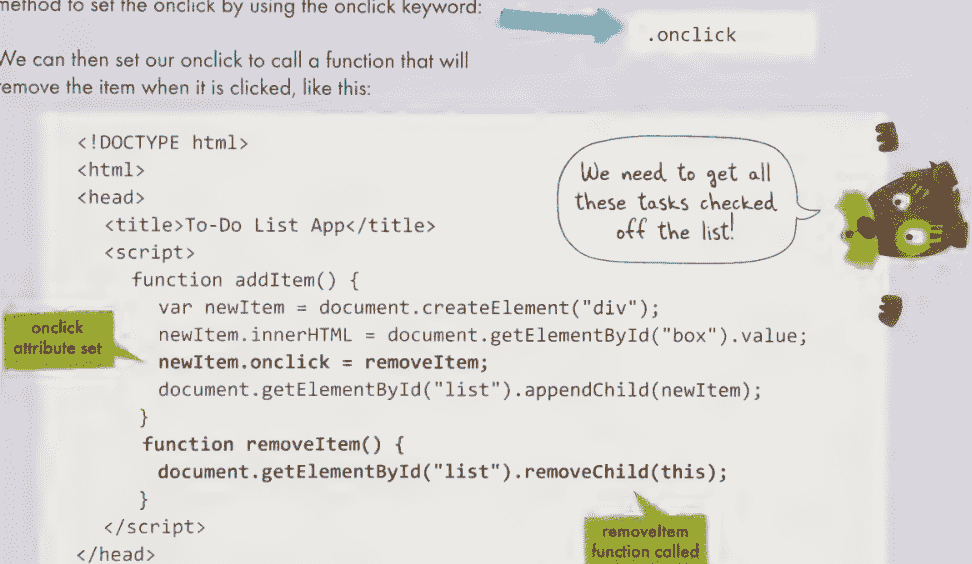

```html
<!DOCTYPE html>
<html>
<head>
<title>To-Do List App</title>
<script>
function addItem() {
  var newItem = document.createElement("div");
  newItem.innerHTML = document.getElementById("box").value;
  newItem.onclick = removeItem;
  document.getElementById("list").appendChild(newItem);
}
function removeItem() {
  document.getElementById("list").removeChild(this);
}
</script>
</head>
<body>
<p>Special Exhibition To-Do List</p>
<input type="text" id="box" value="Type here to add task"/>
<br/>
<input type="button" value="Add item" onclick="addItem();"/>
<div id="list"></div>
</body>
</html>
```

在这个示例中，我们使用 `createElement` 创建了一个新的 `<div>`。我们将该 `<div>` 存储在变量中，这样就可以将其 `innerHTML` 设置为文本框中输入的任何内容。然后我们使用 DOM 设置新项目的 `onclick` 属性。当此项目被点击时，它将调用 `remove-item` 函数并将其从列表中移除。

# 代码技能 ► 移除多个 HTML 元素

使用你学到的新知识创建一个应用程序，该程序在被点击时可以移除多个 HTML 元素。你学习的每项新技能都在让你的应用程序更加高级。

- 打开你的文本编辑器。创建一个名为 `removemore.html` 的新 HTML 文件。从 `basicapp.html` 复制并粘贴你的代码。你的代码看起来如下：

```html
<!DOCTYPE html>
<html>
<head>
<title>To-Do List App</title>
<script>
function addItem() {
  var newItem = document.createElement("div");


`newItem.innerHTML = document.getElementById("box").value;`

`newItem.onclick = removeItem;`

`document.getElementById("list").appendChild(newItem);`

```
}
</script>
</head>
<body>
<p>Special Exhibition To-Do List</p>
<input type="text" id="box" value="Type here to add task"/>
<br/>
<input type="button" value="Add item" onclick="addItem();"/>
<div id="list"></div>
</body>
</html>
```

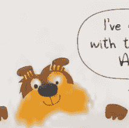

- 2. 现在通过在你的函数中设置 `onclick` 属性来修改 `addItem` 函数。为每个 HTML 元素添加 `onclick`。让你的 `onclick` 在被点击时调用新函数。将此行代码添加到你的 `<script>` 块中：

```javascript
<script>
function addItem() {
  var newItem = document.createElement("div");
  newItem.innerHTML = document.getElementById("box").value;
  newItem.onclick = removeItem;
  document.getElementById("list").appendChild(newItem);
}
</script>
```

- 3. 在你的 `<script>` 块中编写第二个函数 `removeItem`。该函数需要使用 `getElementById` 找到你 `<body>` 中的 `<div>`。然后它应该使用 `removeChild` 关键字来移除任何项目。写出此函数使你的 `<script>` 块如下：

```javascript
<script>
function addItem() {
  var newItem = document.createElement("div");
  newItem.innerHTML = document.getElementById("box").value;
  newItem.onclick = removeItem;
  document.getElementById("list").appendChild(newItem);
}

function removeItem() {
  document.getElementById("list").removeChild(this);
}
</script>
```

- 4. 你的应用程序完成的代码块看起来如下：

```html
<!DOCTYPE html>
<html>
<head>
<title>To-Do List App</title>
<script>
function addItem() {
  var newItem = document.createElement("div");
  newItem.innerHTML = document.getElementById("box").value;
  newItem.onclick = removeItem;
  document.getElementById("list").appendChild(newItem);
}

function removeItem() {
  document.getElementById("list").removeChild(this);
}
</script>
</head>
<body>
<p>Special Exhibition To-Do List</p>
<br/>
<input type="text" id="box" value="Type here to add task"/>
<br/>
<input type="button" value="Add item" onclick="addItem();"/>
<br/>
<div id="list"></div>
</body>
</html>
```

# 保存你的任务列表项目

Bairstone 教授现在可以根据需要向列表中添加和移除项目。你可能注意到如果你刷新页面，任务列表就会消失。这是因为我们从屏幕上添加或删除了 HTML 元素。我们没有保存列表或更改 HTML 文件。如果我们希望浏览器保存并记住我们的列表，我们需要使用 `localStorage`，这是一个 HTML5（HTML 编程语言的第五版本）提供的方便 API。

此 API 可以在浏览器中保存信息，即使页面刷新或关闭，你仍然可以访问数据。就像 DOM 一样，`localStorage` 是函数的集合，使用简单。

你只需要通过输入 `localStorage` 关键字（使用驼峰法编写）并给要存储的信息命名，即可告诉浏览器你想使用 `localStorage`。使用等号（`=`）和双引号（`""`）设置你想要的信息值，如下：

```javascript
localStorage.storageName = "information";
```

如果你想从 `localStorage` 中移除一条信息，只需留一个空值，如下：

```javascript
localStorage.storageName = "";
```

查看你使用 `localStorage` 保存的信息非常简单。你只需要使用关键字和 `localStorage` 名称，如下：

```html
<!DOCTYPE html>
<html>
<head>
<title>The Monk Diamond</title>
</head>
<body>
<script>
localStorage.valuableDiamond = "The Monk Diamond";
alert(localStorage.valuableDiamond);
</script>
</body>
</html>
```

## 使用 LOCALSTORAGE API 的代码技能

让我们尝试使用 `localStorage` 在我们的网络浏览器中存储信息。这样，Bairstone 教授应用中的列表将被安全地存储起来。

- 1. 打开你的文本编辑器。创建一个名为 `storage.html` 的新 HTML 文件。在新文件中 `<body>` 标签中输入以下代码：

```html
<!DOCTYPE html>
<html>
<head>
<title>Storage</title>
</head>
<body>
<input type="text" id="box" value="Type here to add task"/><br>
<input type="button" id="save" value="Save" onclick="save();"/><br>
<input type="button" id="load" value="Load" onclick="load();"/><br>
已保存的项目: <div id="savedList"></div>
</body>
</html>
```

- 2. 现在在 `<head>` 中编写一个函数，使用 `localStorage` 来保存你在浏览器中在文本框内输入的值。在编写 `localStorage` 关键字时，不要忘记使用驼峰命名法（camelCase）。你的代码看起来像这样：

```javascript
<script>
function save() {
  var newItem = document.getElementById("box").value;
  localStorage.box = newItem;
}
</script>
```

> 练习此练习时请忘记使用 Google Chrome 或 Mozilla Firefox。

现在在你的 `<script>` 块中编写第二个函数，使用 `getElementById` 方法找到你的那个空 `<div>`。使用 `innerHTML` 将空 `<div>` 的值设置为你使用 `localStorage` 保存的信息。确保你的函数看起来像这样：

```javascript
<script>
function save() {
  var newItem = document.getElementById("box").value;
  localStorage.box = newItem;
}

function load() {
  var savedDiv = document.getElementById("savedList");
  savedDiv.innerHTML = localStorage.box;
}
</script>
```

- 4. 保存你的 HTML 文件并在浏览器中打开它。在文本框中输入一些内容并点击 Save（保存）。

- 5. 现在点击 Load（加载）。你在文本框中输入的值将出现在屏幕上。刷新你的页面。该项目将从屏幕上消失。当你按下 Load 时，你使用 `localStorage` 保存的文本将加载到你的浏览器中。

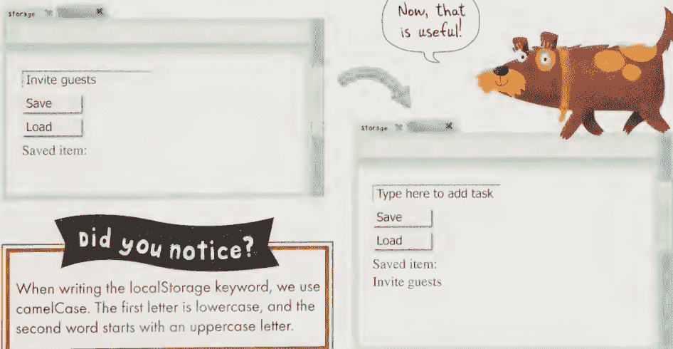

> 你注意到了吗？
在编写 `localStorage` 关键字时，我们使用驼峰命名法。第一个字母小写，第二个单词用大写字母开头。

## 使用 localStorage 保存和加载

现在你已经了解了 `localStorage`，让我们看看如何使用它来保存和加载 Bairstone 教授的应用。每当 Bairstone 教授更改待办列表时，它都需要存储在 `localStorage` 中。我们还需要编写代码，当 Bairstone 教授在浏览器中打开它时，从 `localStorage` 加载待办列表。让我们看看为了使用 `localStorage` 需要对 `<script>` 块进行哪些更改：

```html
<!DOCTYPE html>
<html>
<head>
<title>To-Do List App</title>
<script>
function addItem() {
  var newItem = document.createElement("div");
  newItem.innerHTML = document.getElementById("box").value;
  newItem.onclick = removeItem;
  document.getElementById("list").appendChild(newItem);
  saveList();
}

function removeItem() {
  document.getElementById("list").removeChild(this);
  saveList();
}

function saveList() {
  localStorage.storedList = document.getElementById("list").innerHTML;
}

function loadList() {
  document.getElementById("list").innerHTML = localStorage.storedList;
}
</script>
</head>
<body>
<p>Special Exhibition To-Do List</p>
<input type="text" id="box" value="Type here to add task"/>
<br/>
<input type="button" value="Add item" onclick="addItem();"/>
<div id="list"></div>
</body>
</html>
```

## 保存列表

为了保存列表，我们需要创建一个新的 `saveList` 函数，使用 `localStorage` 将其保存。为了做到这一点，我们必须选择一个变量名来为我们想要存储在 `localStorage` 中的信息赋值。然后我们使用 `getElementById` 找到页面 `<body>` 中的 `<div>`。最后，我们使用 `innerHTML` 获取 `<div>` 的内容。现在，我们 `<div>` 中的所有内容都将保存到 `localStorage` 中。

我们希望在每次添加或删除项目时都保存列表，因此我们还需要确保 `addItem` 和 `removeItem` 函数在运行后调用 `saveList` 函数。

## 加载列表

为了加载列表，我们需要创建第二个函数 `loadList`。每当 `loadList` 函数被调用时，它将把 `id=""` 的 `<div>` 的 `innerHTML` 设置为 `localStorage` 中保存的任何内容。

我们需要调用 `loadList` 函数，以便当我们的浏览器完成加载时，它也能加载我们的列表。为了确保我们不会尝试加载尚未保存的列表，我们必须在尝试使用 `localStorage` 之前使用一个 `if` 语句。我们需要的语句看起来如下：

```html
<div id="list"></div>
<script>
  if(localStorage.storedList) {
    loadList();
  }
</script>
```

该语句在尝试加载之前检查 `localStorage` 中是否有已保存的列表。当我们保存完整的代码块并在应用中运行它时，列表保存在 `localStorage` 中。


| Special Exhibition To-Do List |
| :--- |
| Invite guests |
| Add item |
| Glass display |
| Velvet |
| Hire security |

## 从 localStorage 中移除项目

为了保存列表，我们需要创建一个新的 `saveList` 函数，使用 `localStorage` 将其保存。为了做到这一点，我们必须选择一个变量名来为我们想要存储在 `localStorage` 中的信息赋值。然后我们使用 `getElementById` 找到页面 `<body>` 中的 `<div>`。最后，我们使用 `innerHTML` 获取 `<div>` 的内容。现在，我们 `<div>` 中的所有内容都将保存到 `localStorage` 中。

我们希望在每次添加或删除项目时都保存列表，因此我们还需要确保 `addItem` 和 `removeItem` 函数在运行后调用 `saveList` 函数。

为了加载列表，我们需要创建第二个函数 `loadList`。每当 `loadList` 函数被调用时，它将把 `id=""` 的 `<div>` 的 `innerHTML` 设置为 `localStorage` 中保存的任何内容。

我们需要调用 `loadList` 函数，以便当我们的浏览器完成加载时，它也能加载我们的列表。为了确保我们不会尝试加载尚未保存的列表，我们必须在尝试使用 `localStorage` 之前使用一个 `if` 语句。我们需要的语句看起来如下：

为了保存列表，我们需要创建一个新的 `saveList` 函数，使用 `localStorage` 将其保存。为了做到这一点，我们必须选择一个变量名来为我们想要存储在 `localStorage` 中的信息赋值。然后我们使用 `getElementById` 找到页面 `<body>` 中的 `<div>`。最后，我们使用 `innerHTML` 获取 `<div>` 的内容。现在，我们 `<div>` 中的所有内容都将保存到 `localStorage` 中。

```javascript
function loadList() {
  document.getElementById("list").innerHTML = localStorage.storedList;
  for(var i = 0; i < list.children.length; i++) {
    list.children[i].onclick = removeItem;
  }
}
```

循环被拆分为三部分：

- 循环的开始
- 循环的条件
- 循环的运行

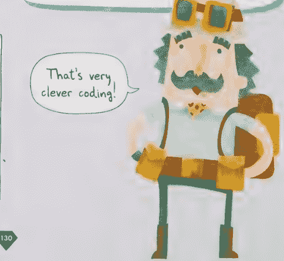

## 动手构建待办列表应用

现在使用你在任务中学到的技能构建 Bairstone 教授的待办列表。使用 DOM 和 `localStorage` 创建一个 Bairstone 教授可以添加项目的待办列表。确保当他完成任务时，可以点击项目将其移除。

## 待办应用简述

当你编写应用时，使用 HTML 和 JavaScript。确保包含：

- 使用 DOM 向列表添加项目的函数
- 使用 DOM 从列表中移除项目的函数
- 使用 `localStorage` 保存列表的函数
- 使用 `localStorage` 加载列表的函数
- 用户可以输入项目的文本框
- 用户可以点击添加项目的按钮

将文件保存在 Coding 文件夹中并命名为 `listapp.html`。

> 转页面查看你所需的完整代码块！

> 如果你需要帮助，请使用 Get Coding! 网站。

## 沃尔科夫家族

特别展览待办事项

```html
<input type="text" id="box" value="在此输入以添加任务"/>
<br>
<input type="button" value="添加项目" onclick="addItem();"/>
<br>
<div id="list"></div>
<script>
if(localStorage.storedList) {
  loadList();
}
</script>
```


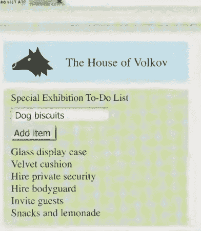

现在使用 CSS 来改变你应用的设计，使其看起来像这样。

# 未来的代码技能

在用 HTML、CSS 和 JavaScript 编写代码时，使用 DOM 和 localStorage 等 API 可以让你创建更复杂、更具交互性的网页或基于 Web 的应用程序。你可以使用 DOM 访问浏览器中的一些强大功能。它允许你在用户与你的页面或应用交互时，动态地更改 HTML。干得好！


# 规划路线

- 学习如何从另一个网页添加内容
- 使用 Web API 在你的页面中嵌入地图
- 使用 API 密钥
- 学习 `<IFRAME>` 标签如何工作
- 使用 Google Maps 规划路线


## 任务简报

亲爱的编码员：

听到这个消息你会很高兴，在长途跋涉之后，我们终于到达了莫斯科。我们目前躲在一个秘密地点，因为我们不希望除了沃尔科夫先生以外没人知道我们带着“僧侣钻石”抵达了这座城市。沃尔科夫先生找上了我们——他是一个非常有魅力的男人。找到他失落的宝石，我非常开心。

他和贝尔斯通教授（Professor Bairstone）一直忙于为展览做准备。你的应用非常有帮助，到目前为止一切都按照计划进行。只有一件事是贝尔斯通教授和沃尔科夫先生还没有考虑到：我们如何安全地将钻石从我们的秘密地点运送到沃尔科夫家族宅？

邦德兄弟（The Bond Brothers）以在大胆抢劫案中伏击并抢劫运送昂贵珠宝的快递车而闻名。我正发给你《探险家百科全书》中的一个条目，让你明白我的意思。我们可以自己把钻石送到商店，但贝尔斯通教授是一个非常有名的人物，我担心我们会引起别人的注意，从而影响展览计划。

我们决定最好的办法是由我带着钻石去加尔基公园（Gorky Park）。沃尔科夫先生的安全主管会在那里等我，我们将一起把钻石运送到沃尔科夫家族宅，那里就在圣瓦西里大教堂旁边。你能通过规划一条穿过城市的路线来帮助我们吗？如果有一个嵌入了地图的网页将非常有帮助。如果我们迷了路或者被邦德兄弟欺骗进入了错误的路线，那就太糟糕了。想象一下如果我们现在丢了“僧侣钻石”该怎么办！

感谢你再次帮助我们。一切都快就绪了。我们刚刚打印了展览邀请函，现在可以发送给客人们了。我也寄给你一张！

来自我们城市避风港的诚挚祝愿，
露比·戴博士（Dr. Ruby Day）


# 邦德兄弟抢劫案

选自《探险家百科全书：每个冒险指南》

其他珠宝盗，请参阅《著名的珠宝盗》

邦德兄弟的抢劫案是由邦德兄弟执行的大胆珠宝盗窃。邦德兄弟的抢劫案是由邦德兄弟执行的大胆珠宝盗窃。邦德兄弟的抢劫案是执行 看看。

### 目录
- 首页
- 热门视频
- 视频

 沃尔科夫家族 圣瓦西里大教堂 莫斯科 宝石 沃尔科夫家族 宝石 沃尔科夫家族 宝石 沃尔科夫家族 宝石 沃尔科夫家族 宝石 沃尔科夫家族 宝石 沃尔科夫家族 宝石 沃尔科夫家族 宝石 沃尔科夫家族 宝石 沃尔科夫家族 宝石 沃尔科夫家族 宝石 沃尔科夫家族 宝石 沃尔科夫家族 宝石 沃尔科夫家族 宝石 沃尔科夫家族 宝石 沃尔科夫家族 宝石 沃尔科夫家族 宝石 沃尔科夫家族 宝石 沃尔科夫家族 宝石 沃尔科夫家族 宝石 沃尔科夫家族 宝石 沃尔科夫家族 宝石 沃尔科夫家族 宝石 沃尔科夫家族 宝石 沃尔科夫家族 宝石 沃尔科夫家族 宝石 沃尔科夫家族 宝石 沃尔科夫家族 宝石 沃尔科夫家族 宝石 沃尔科夫家族 宝石 沃尔科夫家族 宝石 沃尔科夫家族 宝石 沃尔科夫家族 宝石 沃尔科夫家族 宝石 沃尔科夫家族 宝石 

# 使用 Web API 添加内容

学习如何从另一个网页添加内容。在用 HTML、CSS 和 JavaScript 编写代码时，使用 DOM 和 localStorage 等 API 可以让你创建更复杂、更具交互性的网页或基于 Web 的应用程序。你可以使用 DOM 访问浏览器中的一些强大功能。它允许你在用户与你的页面或应用交互时，动态地更改 HTML。干得好！

现在使用 CSS 来改变你应用的设计，使其看起来像这样。

## Web API

Web API 有时被称为 Web 服务。它们让你无需编写大量代码即可访问网站的功能。当你构建网站时，可以使用 Web API 完成许多事情。你可能在网站上见过这些 API，它们可以帮助你：

- 添加地图
- 添加 Facebook 点赞分享按钮
- 在 YouTube 和 Twitch 上分享视频

Web API 让每个人都能更快更容易地构建复杂的网站。为了嵌入地图并规划路线，我们将使用地图 API。互联网上有几个网站允许你将其地图嵌入网页中。大多数网站甚至允许免费使用。大多数地图 API 是 Google Maps 和 Bing Maps，它们分别由 Google 和 Microsoft 运营。我们将学习如何使用 Google Maps 为戴和沃尔科夫家族的安全主管找到最佳路线。

要使用 Google Maps API，你需要在 Google 注册并获取一段特殊的代码，称为 API 密钥。API 密钥是你的网页用于访问 Google 服务器上 Google API 的特殊密码。如果不使用 API 密钥，将无法嵌入地图。你可以通过访问以下网址获取 Google Maps API 密钥：

```
https://developers.google.com/maps/documentation/embed/
```

## 获取 Google Maps API 密钥的编码技能

让我们学习如何获取 Google Maps API 密钥。在稍后的任务中，你需要它来为 Day 博士创建路线。

1. 首先，访问 Google Maps API 网站。在浏览器中输入此链接：

```
https://developers.google.com/maps/documentation/embed/
```

2. 找到 GET A KEY（获取密钥）按钮。点击它。

3. 你会看到一个带有三个选项的弹出窗口。点击 CONTINUE（继续）。

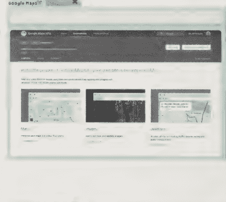

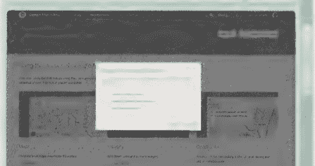

4. 现在登录你的 Google 账号。记住，如果你未满十三岁，需要请成年人帮助。你将被重定向到 Google 开发者控制台。确保（如果你符合年龄要求）或帮助你的成年人阅读了条款和条件。你需要同意这些条款才能继续。然后从下拉列表中创建一个新项目并点击 Continue（继续）。


5. 接下来会被要求创建一个 API 密钥。不需要填写任何内容——只需点击 Create（创建）。


6. 你的 API 密钥将显示出来。它是一个由数字和字母组成的长代码。每个密钥都是唯一的，但它看起来像这样：


7. 现在将你的 API 密钥复制并粘贴到你的文本编辑器中。将文件保存为你的 Coder 文件夹中的文本文件（使用扩展名 `.txt`）。将你的新文件命名为 `APIkey.txt`。

> 请妥善保存 API 密钥，因为你稍后在任务中需要它！

> Coder，注意！随着 Google 更新软件，这些步骤可能会发生变化。


## 如何嵌入内容

现在你已经知道什么是嵌入，并且获取了 Google Maps 的 API 密钥，我们可以开始为 Day 博士制作网页了。我们首先需要学习如何在我们的网页中嵌入来自另一个网站的内容。为了做到这一点，我们需要学习一些新的 HTML 标签和属性。

## `<iframe>` 标签：`<iframe>` 和 `</iframe>`

为了在我们的页面中添加 Google 地图，我们需要使用一个名为 `<iframe>` 的新 HTML 标签。起始标签是 `<iframe>`，结束标签是 `</iframe>`。该标签用于创建内联框架（inline frame），这是在页面中嵌入另一个网站内容的一种非常有用的方法。你还可以配合标签使用几个属性来更改嵌入内容的显示方式。

你必须包含的第一个属性是 source (`src`) 属性，我们在任务 1 中用过。source 属性告诉浏览器你想要嵌入的内容，其形式为 URL（统一网址）。当你集成网站时，URL 中的信息对你的浏览器来说非常重要。让我们看一个 Monk Discovery 页面的示例：

```html
<!DOCTYPE html>
<head>
<title>Diamond Discovery</title>
</head>
<body>
<iframe src="https://www.monkdiamonddiscovery.com">
</body>
</html>
```


作为 URL 的 Monk Discovery 页面小部分将出现在你的页面中。然而，在这个尺寸下很难看到嵌入页面。你需要在起始 `<iframe>` 标签内部包含其他属性来更改嵌入页面的尺寸和外观。让我们看看你可以使用的属性：

| 属性名称 | 它的作用 | 示例值 |
| --- | --- | --- |
| `src` | 提供要嵌入的内容 | `http://www.bing.com` |
| `width` | 设置 `iframe` 的最大宽度 | `600px`, `20%` |
| `height` | 设置 `iframe` 的最大高度 | `600px`, `20%` |
| `frameborder` | 设置 `iframe` 周围的边框 | `0px`, `4px` |
| `style` | 使用 CSS 属性设置 `iframe` 的样式 | `border: 0px` |

现在让我们看看如何使用这些属性来更改我们的 `<iframe>` 和嵌入内容的显示效果。记住，你必须像这样在起始标签内部添加属性：

```html
<!DOCTYPE html>
<head>
<title>Diamond Discovery</title>
</head>
<body>
<iframe src="https://www.monkdiamonddiscovery.com" width="350px" height="350px" frameborder="0px" style="border: 0px"></iframe>
</body>
</html>
```


在这里，我们将 `width` 和 `height` 属性设置为相同的像素值，使我们的 `<iframe>` 变成正方形。`frameborder` 属性和 CSS 属性都设置为 `0px`。这就是我们通常使用 `<iframe>` 的方法，使嵌入内容看起来是页面的一部分。

> 这个 `<iframe>` 标签很有用！


## 使用 `<iframe>` 标签的编码技能

现在你已经阅读了 `<iframe>` 标签及其工作原理，让我们尝试使用该标签及其属性来更改嵌入内容在网页中的显示方式。

1. 打开你的文本编辑器。创建一个名为 `iframe.html` 的新文件。在页面的 `<body>` 中添加起始和结束 `<iframe>` 标签，代码如下：

```html
<!DOCTYPE html>
<html>
<head>
<title>iframe</title>
</head>
<body>
<iframe></iframe>
</body>
</html>
```

2. 现在设置你的 `<iframe>` 属性。在起始 `<iframe>` 标签内部包含 `width`、`height`、`frameborder` 和 `style` 属性，如下：

```html
<body>
<iframe width="350px" height="350px" frameborder="0px" style="border: 0px"></iframe>
</body>
```

3. 最后，添加 source 属性。将其值设置为网站的 URL，如下：

```html
<iframe width="350px" height="350px" frameborder="0px" style="border: 0px" src="https://www.bing.com"></iframe>
```

4. 保存你的 HTML 文件并在浏览器中打开它。你选择的网站将嵌入到你的网页中。现在尝试更改 `<iframe>` 的高度和宽度，看看它对嵌入内容产生了什么影响。

> 我很喜欢这种在页面中嵌入内容的方式。


## 嵌入 Google 地图

如你所示，`<iframe>` 标签非常有用。现在让我们学习如何使用它将 Google 地图集成到我们的页面中。你可以添加的最简单类型的 Google 地图叫做嵌入搜索（embedded search）。你使用一个名为 Google Maps Embedded API 的 Google API。当用户给 API 提供一个关键词（如国家、城市或街道的名称）时，它将根据该关键词生成地图。

## URL

你需要在 `<iframe>` 的 source 属性中为 Google Maps Embedded API 提供一个 URL。为了嵌入正确的地图，URL 必须包含几项重要信息。让我们看看如果我们想在网页中嵌入一张莫斯科的地图，具体需要在 URL 中包含哪些信息：

```
https://www.google.com/maps/embed/v1/search?q=Moscow&key=API-KEY
```


```
https://www.google.com/maps/embed/v1?q=Moscow&key=API-KEY
```

在这个 URL 中，两个参数通过安培符号 (`&`) 分隔。第一个是查询键，第二个是 API 密钥。你的浏览器需要它们两者，因为它们包含了这些重要信息：

| 参数键 | 作用是什么 | 示例值 |
| --- | --- | --- |
| `q` | 提供你想要搜索的地点 | `Moscow`, `London` |
| `key` | 提供访问 Google 服务器所需的 API 密钥 | `API-KEY` |

Google Maps Embed API 需要这两个参数来找到我们想要嵌入的地图，然后将其集成到我们的页面中。让我们看看如果在我们的 URL 中使用这两个参数，并将其设置为 `<iframe>` 的源属性（source attribute）时会发生什么。当我们保存文件并在浏览器中打开它时，我们将看到页面中嵌入了一张莫斯科的地图。


```html
<!DOCTYPE html>
<html>
<head>
<title>Moscow</title>
</head>
<body>
<iframe
 width="450px"
height="450px"
frameborder="0px"
style="border: 0px"
src="https://www.google.com/maps/embed/v1?q=Moscow&key=API-KEY">
</iframe>
</body>
</html>
```

# 代码技能：嵌入 Google 地图

让我们在页面中嵌入一张莫斯科的 Google 地图。在我们为 Day 博士和安全主管规划路线之前，掌握这项技能至关重要。

1. 打开你的文本编辑器。创建一个名为 `citymap.html` 的新 HTML 文件。然后将你来自 `iframe.html` 的代码复制并粘贴到你的新文件中。修改它使其看起来像这样：

```html
<!DOCTYPE html>
<html>
<head>
  <title>City Map</title>
</head>
<body>
  <iframe>
  </iframe>
</body>
</html>
```

2. 现在在你的起始 `<iframe>` 标签内部添加 `width`、`height`、`frameborder` 和 `style` 属性。像如下所示设置值：

```html
<body>
  <iframe>
    width="450px"
    height="450px"
    frameborder="0px"
    style="border: 0px"
  </iframe>
</body>
```


3. 在你的起始`<iframe>`标签内部添加源属性（source attribute）。使用 Google Maps Embed API URL 并添加两个参数。将参数`q`设置为你地图所需的地点，并将参数`key`设置为你之前在任务中获得的唯一 API 密钥。你的源属性看起来像这样：

```
<iframe>
  width="450px"
  height="450px"
  frameborder="0px"
  style="border: 0px"
  src="https://www.google.com/maps/embed/v1?q=Moscow&key=API-KEY"
</iframe>
```


4. 保存你的 HTML 文件并在浏览器中打开它。你将看到地图嵌入在你的页面中。

## 使用 Google Maps 规划路线

现在你已经学会了如何在页面中嵌入地图，我们可以开始规划 Day 博士和安全主管需要穿过莫斯科的路线。要做到这一点，我们需要构建一个新的 URL 并使用 Google Maps Embed API 中的一个新函数。我们必须以稍微不同的方式创建我们的 URL。

我们需要使用 directions（路线）函数，而不是 search（搜索）函数。directions 函数将创建一个提供从指定地点到另一个指定地点的路线地图。Day 博士需要从高尔基公园（Gorky Park）带着僧侣之钻石前往圣瓦西里大教堂，所以我们新的 URL 将看起来像这样：


```
https://www.google.com/maps/embed/v1/directions?origin=GorkyPark,Moscow&destination=StBasil&key=API-KEY
```

和之前一样，我们 URL 的第一部分是通 Google Maps Embed API 的路径。然后我们请求使用 directions API 函数。接着我们使用三个参数：`origin`（起点）、`destination`（终点）和 API key。对于起点和终点，你可以放入很多值，但最简单的方法是放入城市名称的名字。这两个新键对你的浏览器是重要的，因为它们提供了以下信息：

| 参数键 | 作用是什么 | 示例值 |
| --- | --- | --- |
| `origin` | 提供你想要路线开始的地点 | `GorkyPark,Moscow` |
| `destination` | 提供你想要路线结束的地点 | `StBasil,Moscow` |

> 注意到了吗？我们包含了名称和城市，用逗号（`,`）分隔。逗号后面没有空格。


让我们将新的 URL 添加到源属性（source attribute）中，看看 Day 博士和安全主管需要穿过莫斯科的路线：

```
<!DOCTYPE html>
<html>
<head>
  <title>Top-Secret Route</title>
</head>
<body>
  <iframe
    width="650px"
    height="650px"
    frameborder="0px"
    style="border: 0px"
    src="https://www.google.com/maps/embed/v1/directions?
    origin=GorkyPark,Moscow&destination=StBasil,Moscow&key=API-KEY">
  </iframe>
</body>
</html>
```


> 这正是 Day 博士将僧侣之钻石运送到 Volkov 家需要的！

## 动手完成：规划路线

干得好！你学习了如何使用 web API 和 Google Maps 在页面中嵌入内容。现在使用你的新知识规划一条从高尔基公园到圣瓦西里大教堂的莫斯科路线。拥有路线将帮助 Day 博士保持安全。

## 莫斯科路线

当你规划路线时，使用你的新技能完成以下操作：

- **使用 API 密钥**：使用 Google Maps Embed API 获取 API 密钥。
- **创建一个 `<iframe>`**：使用这个 HTML 标签以便可以在页面中嵌入内容。
- **更改你的 `<iframe>` 显示方式**：使用属性更改高度、宽度和边框。
- **使用源属性（source attribute）**：嵌入一个连接到你所需的 web API 的 URL。
- **使用 Google Maps Embed API**：使用 API 创建地图。
- **使用内置 directions 函数**：使用此函数绘制路线。
- **设置参数**：为 directions 函数提供路线的起点和终点。

将你的文件保存在 **Coding** 文件夹中并将其命名为 **route.html**。

```
<!DOCTYPE html>
<html>
<head>
  <title>Top-Secret Route</title>
</head>
<body>
  <iframe
    width="1000px"
    height="1000px"
    frameborder="0px"
    style="border:0px"
    src="https://www.google.com/maps/embed/v1/directions?
    origin=GorkyPark,Moscow&destination=StBasil,Moscow&key=API-KEY">
  </iframe>
</body>
</html>
```

不要忘记使用保存的 API 密钥。

# 未来技能

了解如何使用 web APIs 意味着你可以轻松地在代码中包含其他应用或网站的功能。你可以使用它们来构建使用大型服务的页面和应用，例如 Facebook 或 Instagram 等社交网络，或者 Google Maps 或 Dropbox 等工具。这将节省你的时间，避免从头开始编码。

这就是你完成的代码的样子！

这条路线将阻止 Bond 兄弟并确保僧侣之钻石的安全！


# 制作游戏

- 在 JavaScript 中使用计时
- 学习什么是游戏循环以及它们如何工作
- 学习如何用 JavaScript 制作 HTML
- 构建一个测试反应时间的游戏

## 任务简报

亲爱的 MonkCoder：

僧侣之钻石昨天到达了 Volkov 家。Day 博士和我感谢你帮助规划路线。一切似乎进展顺利，尽管 Day 博士认为一个戴着大帽的胡子男人可能在跟踪他们。他很快消失了，但她感到有些惊慌。谢天钻石安全到达了。

它被放置在新的玻璃柜里，新的垫子上，看起来光彩夺目！我们一直在银盘上摆放零食，这是我们列表上的最后一个任务。今晚展览的大开幕一切已准备就绪。

私下里，自从岩石事件以来，我一直担心我们的安全安排。我知道我们一直小心地保守僧侣之钻石的发现，你为我们的网页创建一个密码做得非常好。但我担心 Bond 兄弟可能还在追踪（不要忘记其中之一是一个熟练的网络犯罪分子）。我最大的恐惧是他们再次再次偷钻石来破坏展览。

在伦敦最著名的博物馆之一工作的一位老友最近告诉我，她使用电脑游戏训练了一支极佳的安全团队。在她给我看数据之前，我并不相信她。游戏显著提高了团队的反应时间，他们对博物馆可疑情况的反应比玩游戏之前快得多。

我在想你是否能帮我构建一个可以测试 Volkov 家团队反应时间的游戏。我今天下午很忙，因为我还需要为 Ernest 买一个新项圈，所以我非常希望你能提供帮助。我附上了《探险家百科全书》中的一个私有条目。它包含了关于展览的敏感信息，请不要与任何人分享。

再次感谢你的极大帮助。来自繁忙莫斯科的最诚挚问候，
哈里·贝斯斯坦教授


## 安全训练游戏结果

## 沃尔科夫家族的安全团队

选自《探险家百科全书：各冒险指南》

这是一个访问限制的私有条目。点击此此处查看沃尔科夫家族的公开条目。

**沃尔科夫家族的安全团队**负责保护沃尔科夫家族私人收藏品中展出的极具价值的宝石。自从僧侣钻石被盗后，商店内展示的宝石被存放在强化玻璃制展柜内，这种玻璃的强度是普通玻璃的二百倍。

- 首页
- 特色发现
- 著名探险家
- 历史远征

## 安全训练游戏规则

- 每秒会在屏幕上显示 6 个人。
- 其中 5 个是客人；
- 1 个是小偷。
- 如果点击小偷，你将获得 1 分。
- 如果点击客人，你将失去 2 分。
- 总共会发生 6 次。
- 游戏的目标是识别出所有 6 个小偷并获得 6 分。

鉴于盗窃案，主人维克托·沃尔科夫（Viktor Volkov）已训练他的安全团队警惕行为可疑的客户。在过去的一年里，有几个小偷因试图用万能钥匙解锁展柜被抓获。

沃尔科夫先生为僧侣钻石举办的特别展将是沃尔科夫家族举办的规格最高的活动。沃尔科夫先生决定咨询贝克教授（Professor Baker）关于开幕之夜的安全策略。该团伙在过去的抢劫案中使用过伪装，贝克教授担心其成员可能会试图伪装成客人渗透展会。

商定的策略是使用李教授为博物馆开发的方法。一个具有简单规则的电脑游戏已被证明是提高安全团队反应时间的有效方法。该游戏需要尽快构建，以便团队在开幕前得到妥善培训。

## 构建游戏

现在你已经阅读了第 5 任务的简报，准备好开始构建你的游戏了。这项任务运作方式与你目前完成的任务略有不同。你将在执行任务的过程中构建游戏。按照分步骤说明并复制代码，你很快就能为贝克教授准备好游戏。

### 1. 创建一个 HTML 文件

与所有其他任务一样，我们需要做的第一件事是创建一个新的 HTML 文件。将你的 HTML 文件命名为 `game.html`。将此代码复制到你的文本编辑器中：

```html
<!DOCTYPE html>
<html>
<head>
<title>Security Game</title>
</head>
<body>
</html>
```

将你的 HTML 文件保存到你的文件夹中。

### 2. 构建游戏板

现在我们需要构建游戏的基础结构。我们需要在网页中编写一个游戏板的代码。游戏板将是游戏运行的区域。当安全团队玩游戏时，客和小偷将出现在游戏板上。

在 `<body>` 中通过编写一个空的 `<div>` 来添加你的游戏板。为你的 `<div>` 添加一个 `id` 属性。你的 `<body>` 代码看起来如下：

```html
<body>
<div id="board"></div>
</body>
```

然后在 `<head>` 中添加一个 CSS 类，用以更改你的 `<div>` 的外观。使用一种 CSS 选择器（称为 id 选择器），通过其 `id` 属性找到你的 `<div>`。CSS 选择器是选择各种元素组以进行样式的简单方法。使用 CSS id 选择器非常简单。你只需要使用哈希符号（`#`）和你想更改的 HTML 元素的 `id` 属性来创建一个类名。

创建一个名为 `board` 的 CSS 类，将你的 `<div>` 的 CSS 属性和值设置为这些内容。`<head>` 中 CSS 类的代码看起来如下：

游戏板需要：
- 1px 实线边框
- 灰色背景
- 高度 350px
- 宽度 650px

```html
<head>
<title>Security Game</title>
<style>
#board {
  border: 1px solid black;
  background-color: gray;
  height: 350px;
  width: 650px;
}
</style>
</head>
```

这就像任务 1 中的 CSS 元素选择器或任务 3 中的 CSS 属性选择器。保存你的 HTML 文件并在浏览器中打开它。你将看到屏幕上显示着你的空游戏板。做得好！

### 3. 添加一个按钮

现在我们有了游戏板，应该在页面上添加一个按钮。当玩家点击按钮时，我们的游戏代码将运行，游戏也将开始。

在 `<body>` 中的 `<div>` 之上添加你的按钮。像你在任务 3 中那样，使用 `<input>` 标签以及 `type` 和 `value` 属性创建按钮。将你的 `<input>` 标签的 `onclick` 属性设置为调用名为 `startGame` 的 JavaScript 函数，这将启动游戏。你的按钮代码看起来如下：

```html
<input type="button" value="Play" onclick="startGame()">
```

现在创建按钮在被点击时调用的 `startGame` 函数。将该函数添加到 `<body>` 中 `<div>` 的下方。你的 `<script>` 块看起来如下：

```html
<!DOCTYPE html>
<html>
<head>
<title>Security Game</title>
<style>
#board {
  border: 1px solid black;
  background-color: gray;
  height: 350px;
  width: 650px;
}
</style>
</head>
<body>
<input type="button" value="Play" onclick="startGame()">
<div id="board"></div>
<script>
function startGame() {
}
</script>
</body>
</html>
```

你文本编辑器中的完整代码看起来如下：

将你的 HTML 文件保存到桌面上。你将看到屏幕上显示空游戏板。等等，目前当你点击它时什么都不会发生。保存你的 HTML 文件并在浏览器中打开它。你将看到屏幕上显示空游戏板。

### 4. 创建 JavaScript 定时器

JavaScript 定时器（例如 `setTimeout` 函数）对于构建游戏非常有。让我们尝试使用 `setTimeout` 函数，这样你就知道它是如何工作的，稍后将其加入游戏。让我们编写一个每秒增加数字的程序。

等等，你注意到了吗？`setTimeout` 取两个参数：要调用的函数名和毫秒时间。每秒有 1000 毫秒。计算所需的毫秒数，将秒数乘以 1000。如果你想让函数在 3 秒后被调用，就用 3 乘以 1000。

翻页练习使用 `setTimeout` 函数！

4. 现在，我们需要向我们的 `<body>` 中添加一个函数调用。按照如下方式添加函数调用：

```html
<body>
  <div id="number">
  </div>
  <script>
    updateCount();
  </script>
</body>
```

5. 最后，我们必须在我们的 `<script>` 块中添加一个计时器，它会每秒调用一次我们的函数。我们需要使用 `setTimeout` 函数。我们必须将函数名和毫秒数作为参数传递给 `setTimeout` 函数。我们的 `<script>` 块看起来如下：

```html
<script>
var count = 0;
function updateCount() {
  count = count + 1;
  document.getElementById("number").innerHTML = count;
  setTimeout(updateCount, 1000);
}
</script>
```

保存你的 HTML 文件并在浏览器中打开它。你将看到计时器正在运行。`setTimeout` 函数将每秒调用一次你的 `updateCount` 函数。该函数将运行，并且每秒你的变量值都会加 1。浏览器中的数字将自动更新。


### 5. 创建游戏循环

游戏是你可以编写的最困难的任务之一，构建它们有许多方法。一种流行的方法是使用游戏循环。你在任务 3 中使用了循环，现在我们将学习更多关于循环的知识来构建我们的游戏。

游戏循环是一个 JavaScript 函数，它在游戏运行期间会被反复调用。你可以使用游戏循环来检查玩家是否执行了某些操作、在屏幕上绘制 HTML 元素，以及运行游戏代码。

我们可以使用内置的 `setTimeout` 函数来创建游戏循环。我们需要添加一个新的 `<script>` 块，它每 3 秒弹出一个警框。我们将此函数命名为 `gameLoop`。当你点击按钮时就会调用这个新函数。让我们来看看代码块：

```html
<!DOCTYPE html>
<html>
<head>
<title>Security Game</title>
<style>
#board {
  border: 1px solid black;
  background-color: gray;
  height: 350px;
  width: 650px;
}
</style>
</head>
<body>
<input type="button" value="Play" onclick="startGame();">
<div id="board"></div>
<script>
function startGame() {
  gameLoop();
}
```


```
function gameLoop() {

  alert("Game over!");

  setTimeout(gameLoop, 3000);

}

</script>

</body>

</html>
```

> 我在想我能不能嗅出邦德兄弟们。我的鼻子非常灵敏。

一旦你完成了这些更改，保存代码并在浏览器中打开它。当你点击按钮并调用`startGame`函数时，游戏循环将开始运行。你的`gameLoop`函数将每 3 秒被调用一次，每次都会弹出一个警框。每次弹出时，点击“确定”，以便它能持续弹出。


> 任务开始得很顺利！但小偷在哪里？


### 6. 将客人和小偷添加到游戏板上

现在你已经编写了游戏板、按钮和游戏循环，我们需要将角色添加到游戏中。我们希望有六个不同的角色每秒在屏幕上闪烁一次。其中五个角色是客人；一个角色是小偷。安全团队将通过在小偷在屏幕上闪烁时点击他来测试他们的反应时间。


让我们开始在游戏板上创建角色。每个角色都需要它自己的`<div>`。在你的游戏板`<div>`内部嵌套创建六个`<div>`标签，并将它们编号为 1 到 6，如下所示：

```html
<div id="board">
<div>1</div>
<div>2</div>
<div>3</div>
<div>4</div>
<div>5</div>
<div>6</div>
</div>
```

保存你的代码并刷新页面。你将在游戏板上看到这六个`<div>`标签，如下所示：

现在让我们使用 CSS 来改变`<div>`标签的设计和布局。让我们创建一个名为`character`的 CSS，它会让我们的`<div>`标签变成蓝色的方框。在你的文本编辑器中，将这个新的 CSS 类添加到`<head>`中的`<style>`标签中。现在完整的`<style>`块看起来如下：

```html
<!DOCTYPE html>
<html>
<head>
<title>Security Game</title>
<style>
#board {
  border: 1px solid black;
  background-color: gray;
  height: 350px;
  width: 650px;
}
.character {
  background-color: lightblue;
  width: 120px;
  height: 120px;
  padding: 10px;
  margin: 10px;
  float: left;
}
</style>
</head>
```


> 注意到了吗？我们使用了`float`属性。这会让我们的`<div>`标签对齐。


然后，使用`class`属性将新的`character`类应用到每个`<div>`标签，就像你之前做的那样。你的`<body>`如下：

```html
<body>
  <input type="button" value="Play" onclick="startGame();">
  <div id="board">
    <div class="character">1</div>
    <div class="character">2</div>
    <div class="character">3</div>
    <div class="character">4</div>
    <div class="character">5</div>
    <div class="character">6</div>
  </div>
  <script>
    function startGame() {
    gameLoop();
  }
  function gameLoop() {
    alert("Game over!");
    setTimeout(gameLoop, 3000);
  }
  </script>
</body>
</html>
```


> 开始看起来像个游戏了！

保存你的代码并刷新页面。你将看到 CSS 属性应用到了你的`<div>`标签上。


> 有些思考。

| | | |
|---|---|---|
| 1 | 2 | 3 |
| 5 | 6 | |

### 7. 使用游戏循环停止游戏

现在我们已经把角色添加到了游戏板，我们需要对游戏循环进行一些更改。目前，它每 3 秒弹出一个警框。我们需要更改循环，让它在一段时间后停止。我们将通过计算循环的次数来实现这一点。当循环运行一定次数后，游戏将结束。

为了计算循环，让我们创建一个每次被调用时值都会增加的变量。为此，我们应该在`gameLoop`函数之前的`<script>`块中编写一个值为 0 的变量`loops`：

```html
<script>
function startGame() {
  gameLoop();
}
var loops = 0;
function gameLoop() {
  alert("Game over!");
  setTimeout(gameLoop, 3000);
}
</script>
```

我们需要在`gameLoop`函数中使用这个变量。我们希望在每次函数被调用时给它的值加 1。为此，我们可以这样写：

```javascript
loops = loops + 1;
```

然而，我们实际上可以使用一个新的 JavaScript 运算符以更简单更快捷的方式编写相同的指令。它被称为自增运算符 (`++`)，和我们在任务 2 中学到的运算符一样。我们可以使用自增运算符 (`++`) 来给变量的值加 1。我们只需要写道：

我们可以在`gameLoop`函数中使用自增运算符 (`++`) 来计算循环被调用的次数。从你的`gameLoop`函数中移除`alert`，并用新代码替换它，如下：

```javascript
function gameLoop() {
  loops++;
  setTimeout(gameLoop, 3000);
}
```

> 这给了我思考的空间！


现在我们希望确保游戏在结束前循环固定的次数。我们通过在`gameLoop`函数中添加`if`语句和`else`语句来实现这一点，这将跟踪循环运行的次数。

我们需要确保当循环运行一定次数后，调用循环的`setTimeout`函数将停止并弹出一个警框。我们希望循环运行 12 次。它将每 3 秒运行一次，直到第 12 次循环，此时游戏结束。我们的游戏在结束第 12 次循环之前总共持续 33 秒（11  3）。让我们来看看带有新变量、`if`语句和`else`语句的整个`<script>`块：

```html
<script>
function startGame() {
  gameLoop();
  var loops = 0;
  function gameLoop() {
    loops++;
    if(loops < 12) {
      setTimeout(gameLoop, 3000);
    } else {
      alert("Game over!");
    }
  }
}
</script>
```

`if`语句跟踪循环运行的次数。如果小于 (< 12 次)，它将通过再次调用`setTimeout`继续运行。如果是 12 次或更多，`else`语句将运行并弹出警框。

保存你的新代码并刷新页面。按下“Play”按钮并等待警框弹出。你的游戏现在会在一段时间后结束。


> 别忘了，你必须等待 33 秒警框才会弹出！

### 8. 使用 css 显示和隐藏角色

在我们的游戏中，访客和小偷角色会在屏幕上闪烁。沃尔科夫庄园（House of Volkov）的安全团队必须在小偷消失之前发现并点击它。我们需要使用 CSS 来让角色在游戏循环运行时出现和消失。为了做到这一点，我们需要学习一种新的 CSS 属性，它可以让 HTML 元素在我们的浏览器中出现或消失。然后我们可以使用 JavaScript 将该属性应用到我们的角色上。

| CSS 属性名称 | 作用 | 示例值 |
| --- | --- | --- |
| display | HTML 元素在屏幕上的显示方式 | block, none |

`display` CSS 属性有很多不同的值。我们游戏需要的两个值是 "block" 和 "none"。如果你将 HTML 元素的`display`属性设置为`none`，该元素将不会出现在屏幕上。如果你将`display`属性设置为`block`，HTML 元素将以正方形的形式显示。

在你的文本编辑器中，添加两个名为`hidden`和`visible`的新 CSS 类。使用`display`属性使你的`<style>`块看起来如下：

```css
<style>
#board {
  border: 1px solid black;
  background-color: gray;
  height: 350px;
  width: 650px;
}
.character {
  background-color: lightblue;
  width: 120px;
  height: 120px;
  padding: 10px;
  margin: 10px;
  float: left;
}
.hidden {
  display: none;
}
.visible {
  display: block;
}
</style>
```

- 保存你的代码。

让我们尝试使用这个新的 CSS 属性吧！

### 使用 DISPLAY CSS 属性的技能

尝试使用 CSS`display`属性让 HTML 元素在你的屏幕上出现和消失。你需要它来让你的角色在游戏中正确显示。

1. 打开你的文本编辑器。创建一个名为`display.html`的新 HTML 文件。输入下面的代码，然后保存 HTML 文件并在浏览器中打开它。你的页面看起来像这样：

```html
<!DOCTYPE html>
<html>
<head>
<title>Display</title>
</head>
<body>
<div>Security</div>
<div>Thief</div>
<div>Guest</div>
</body>
</html>
```

2. 在文本编辑器中重新打开你的文件。修改你的第二个`<div>`，添加`display` CSS 属性，使其看起来像这样：

```html
<body>
<div>Security</div>
<div style="display:none;">Thief</div>
<div>Guest</div>
</body>
```

3. 保存文件并刷新页面。`display` CSS 属性和`none`值会让你的第二个`<div>`从屏幕上消失。

### 9. 让角色动动起来

现在，我们需要将我们那两个新的 CSS 类（`hidden`和`visible`）应用到我们的游戏循环中，以便让角色的`<div>`标签具有动画效果。为了做到这一点，我们需要让游戏循环从我们的`<div>`标签中添加和移除新的 CSS 类。

当我们的游戏运行时，我们希望角色在屏幕上闪烁。我们目前正在循环 12 次，所以角色的`<div>`标签需要在 6 次循环中可见，在另外 6 次循环中不可见，以创建闪烁效果。我们需要的第一步是一个名为`peopleVisible`的新变量来存储这些信息。我们需要将此变量设置为`false`，如下：

```javascript
var peopleVisible = false
```

我们需要在开始时将变量设置为`false`，这样角色的`<div>`标签在屏幕上最初是隐藏的。然后当变量被设置为`true`时，角色就会出现在我们的屏幕上。

当游戏循环运行时，我们希望角色在屏幕上闪烁（出现和消失）。为了做到这一点，我们需要让游戏循环从我们的`<div>`标签中添加和移除新的 CSS 类。

当我们的游戏运行时，我们希望角色在屏幕上闪烁。我们目前正在循环 12 次，所以角色的`<div>`标签需要在 6 次循环中可见，在另外 6 次循环中不可见，以创建闪烁效果。我们需要的第一步是一个名为`peopleVisible`的新变量来存储这些信息。我们需要将此变量设置为`false`，如下：

```javascript
var peopleVisible = false
```

我们需要在开始时将变量设置为`false`，这样角色的`<div>`标签在屏幕上最初是隐藏的。然后当变量被设置为`true`时，角色就会出现在我们的屏幕上。

当游戏循环运行时，我们希望角色在屏幕上闪烁（出现和消失）。为了做到这一点，我们需要让游戏循环从我们的`<div>`标签中添加和移除新的 CSS 类。

当我们的游戏运行时，我们希望角色在屏幕上闪烁。我们目前正在循环 12 次，所以角色的`<div>`标签需要在 6 次循环中可见，在另外 6 次循环中不可见，以创建闪烁效果。我们需要的第一步是一个名为`peopleVisible`的新变量来存储这些信息。我们需要将此变量设置为`false`，如下：

```javascript
var peopleVisible = false
```

我们需要在开始时将变量设置为`false`，这样角色的`<div>`标签在屏幕上最初是隐藏的。然后当变量被设置为`true`时，角色就会出现在我们的屏幕上。

当游戏循环运行时，我们希望角色在屏幕上闪烁（出现和消失）。为了做到这一点，我们需要让游戏循环从我们的`<div>`标签中添加和移除新的 CSS 类。

当我们的游戏运行时，我们希望角色在屏幕上闪烁。我们目前正在循环 12 次，所以角色的`<div>`标签需要在 6 次循环中可见，在另外 6 次循环中不可见，以创建闪烁效果。我们需要的第一步是一个名为`peopleVisible`的新变量来存储这些信息。我们需要将此变量设置为`false`，如下：

```javascript
var peopleVisible = false
```

我们需要在开始时将变量设置为`false`，这样角色的`<div>`标签在屏幕上最初是隐藏的。然后当变量被设置为`true`时，角色就会出现在我们的屏幕上。

当游戏循环运行时，我们希望角色在屏幕上闪烁（出现和消失）。为了做到这一点，我们需要让游戏循环从我们的`<div>`标签中添加和移除新的 CSS 类。

当我们的游戏运行时，我们希望角色在屏幕上闪烁。我们目前正在循环 12 次，所以角色的`<div>`标签需要在 6 次循环中可见，在另外 6 次循环中不可见，以创建闪烁效果。我们需要的第一步是一个名为`peopleVisible`的新变量来存储这些信息。我们需要将此变量设置为`false`，如下：

```javascript
var peopleVisible = false
```

我们需要在开始时将变量设置为`false`，这样角色的`<div>`标签在屏幕上最初是隐藏的。然后当变量被设置为`true`时，角色就会出现在我们的屏幕上。

当游戏循环运行时，我们希望角色在屏幕上闪烁（出现和消失）。为了做到这一点，我们需要让游戏循环从我们的`<div>`标签中添加和移除新的 CSS 类。

当我们的游戏运行时，我们希望角色在屏幕上闪烁。我们目前正在循环 12 次，所以角色的`<div>`标签需要在 6 次循环中可见，在另外 6 次循环中不可见，以创建闪烁效果。我们需要的第一步是一个名为`peopleVisible`的新变量来存储这些信息。我们需要将此变量设置为`false`，如下：

```javascript
var peopleVisible = false
```


### 8. 使用 CSS 显示和隐藏角色

在我们的游戏中，访客和小偷角色会在屏幕上闪烁。科夫庄园（House of Volkov）的安全团队必须在小偷消失之前发现并点击它。我们需要使用 CSS 来让角色在游戏循环运行时出现和消失。为了做到这一点，我们需要学习一种 CSS 属性，它可以控制元素在浏览器中显示或消失。我们可以用 JavaScript 将该属性应用到我们的角色上。

| 属性 | 作用 | 示例值 |
| --- | --- | --- |
| `display` | HTML 元素在屏幕上的显示方式 | `block`, `none` |

`display` CSS 属性有很多不同的值。我们游戏需要的两个值是 `"block"` 和 `"none"`。如果你将 HTML 元素的 `display` 属性设置为 `none`，该元素将不会出现在屏幕上。如果你将 `display` 属性设置为 `block`，HTML 元素将以正方形的形式显示。

在你的文本编辑器中，添加两个名为 `hidden` 和 `visible` 的新 CSS 类。使用 `display` 属性使你的 `<style>` 块看起来如下：

```css
<style>
#board {
  border: 1px solid black;
  background-color: gray;
  height: 350px;
  width: 650px;
}

.character {
  background-color: lightblue;
  width: 120px;
  height: 120px;
  padding: 10px;
  margin: 10px;
  float: left;
}

.hidden {
  display: none;
}

.visible {
  display: block;
}
</style>
```

- 保存你的代码。

让我们尝试使用这个新的 CSS 属性吧！

### 使用 DISPLAY CSS 属性的技能

尝试使用 CSS `display` 属性让 HTML 元素在你的屏幕上出现和消失。你需要它来让你的角色在游戏中正确显示。

1. 打开你的文本编辑器。创建一个名为 `display.html` 的新 HTML 文件。输入下面的代码，然后保存 HTML 文件并在浏览器中打开它。你的页面看起来像这样：

```html
<!DOCTYPE html>
<html>
<head>
<title>Display</title>
</head>
<body>
<div>Security</div>
<div>Thief</div>
<div>Guest</div>
</body>
</html>
```

2. 在文本编辑器中重新打开你的文件。修改你的第二个 `<div>`，添加 `display` CSS 属性，使其看起来像这样：

```html
<body>
<div>Security</div>
<div style="display:none;">Thief</div>
<div>Guest</div>
</body>
```

3. 保存文件并刷新页面。`display` CSS 属性和 `none` 值会让你的第二个 `<div>` 从屏幕上消失。

### 9. 让角色动起来

现在，我们需要将我们那两个新的 CSS 类（`hidden` 和 `visible`）应用到我们的游戏循环中，以便让角色的 `<div>` 标签具有动画效果。为了做到这一点，我们需要让游戏循环从我们的 `<div>` 标签中添加和移除新的 CSS 类。

当我们的游戏运行时，我们希望角色在屏幕上闪烁。我们目前正在循环 12 次，所以角色的 `<div>` 标签需要在 6 次循环中可见，在另外 6 次循环中不可见，以创建闪烁效果。我们需要的第一步是一个名为 `peopleVisible` 的新变量来存储这些信息。我们需要将此变量设置为 `false`，如下：

```javascript
var peopleVisible = false
```

我们需要在开始时将变量设置为 `false`，这样角色的 `<div>` 标签在屏幕上最初是隐藏的。然后当变量被设置为 `true` 时，角色就会出现在我们的屏幕上。

当游戏循环运行时，我们希望角色在屏幕上闪烁（出现和消失）。为了做到这一点，我们需要让游戏循环从我们的 `<div>` 标签中添加和移除新的 CSS 类。

### 开始编码吧！

在你的文本编辑器中检查你的代码。你游戏所需的代码看起来像下面的块。在每次玩游戏之间，你必须刷新页面。进行任何需要的更改，并保存文件。

```html
<!DOCTYPE html>
<html>
<head>
<title>Security Game</title>
<style>
#board {
  border: 1px solid black;
  background-color: gray;
  height: 350px;
  width: 650px;
}

.character {
  background-color: lightblue;
  width: 120px;
  height: 120px;
  padding: 10px;
  margin: 10px;
  float: left;
}

.hidden {
  display: none;
}

.visible {
  display: block;
}
</style>
</head>
<body>
```


```html
  <input type="button" value="Play" onclick="startGame();"/>
  <div id="board">
    <div class="character">1</div>
    <div class="character">2</div>
    <div class="character">3</div>
    <div class="character">4</div>
    <div class="character">5</div>
    <div class="character">6</div>
  </div>
  <script>
    function startGame() {
      gameLoop();
    }

    var loops = 0;
    var peopleVisible = false;

    function gameLoop() {
      peopleVisible = !peopleVisible;
      flashCharacters();
      loops++;
      if (loops < 12) {
        setTimeout(gameLoop, 3000);
      }
      else {
        alert("Game over!");
      }
    }

    function flashCharacters() {
      var board = document.getElementById("board");
      var classToSet = peopleVisible ? "character visible" : "character hidden";
      for(var index = 0; index < 6; index++) {
        board.children[index].className = classToSet;
      }
    }
  </script>
</body>
</html>
```

> 但哪些角色是客人，哪一个又是小偷？


> 函数调用

> 简化的 if 语句

> 翻页来创建角色！


### 12. 创建小偷

在目前我们的游戏中，每隔 3 秒，我们的角色就会在屏幕上闪烁一次。我们现在需要做的是，在每次游戏循环运行时，改变角色在屏幕上的位置。每隔 3 秒，角色需要移动到游戏板上的不同位置。我们需要让其中一个角色成为小偷。

我们首先需要添加一个函数，在每次游戏循环运行时，创建一组位于不同位置的新角色。让我们把这个函数命名为 `createCharacters`。通过在你的 `gameLoop` 函数中添加该函数开始如下：

```javascript
function gameLoop() {
  peopleVisible = !peopleVisible;
  createCharacters();
  flashCharacters();
  loops++;
  if (loops < 12) {
    setTimeout(gameLoop, 3000);
  }
  else {
    alert("Game over!");
  }
}
```


然后于你的 `flashCharacters` 函数之前编写新的 `createCharacters` 函数：

```javascript
function createCharacters() {
  var board = document.getElementById("board");
  for(var index = 0; index < 6; index++) {
    board.children[index].innerHTML = "Guest";
  }
}
```


这与之前创建的设置每个角色 `<div>` 的 CSS 类的函数非常相似。但这一次，我们像在任务 3 中那样，使用了 `innerHTML` 来将每个角色的值设置为 "Guest"。

保存你的 HTML 文件并刷新页面。现在当你点击“Play”时，你会看到每个角色 `<div>` 标签都被标记为“Guest”。

现在，我们需要在你的 `createCharacters` 函数中添加一些代码，在每次循环运行时，从 6 个 `<div>` 标签中选取一个作为小偷。我们需要编写一段能够选取随机数的代码。在 JavaScript 中没有简单的方法来选取随机数，所以接下来的代码相当复杂。仔细将这段新代码输入到 `createCharacters` 函数末尾，如下所示：

```javascript
function createCharacters() {
  var board = document.getElementById("board");
  for(var index = 0; index < 6; index++) {
    board.children[index].innerHTML = "Guest";
  }
  var randomNumber = Math.floor(Math.random() * 6) + 1;
  board.children[randomNumber-1].innerHTML = "Thief";
}
```

在这里，我们在使用一个新的 `Math` API。它的工作方式与任务 3 中使用的 DOM 和 `localStorage` API 相同。`Math` API 允许你访问浏览器内置的函数。要找到随机数，你需要进行以下计算：

`Math.floor(Math.random()) * BIGGEST_NUMBER + SMALLEST_NUMBER`

我们的游戏中有 6 个角色，最大数字是6，最小数字是1。我们需要编写：

```javascript
Math.floor(Math.random() * 6) + 1;
```

然后我们将计算结果存储在一个变量中。接着我们可以在下一行代码中使用这个变量。我们使用 `innerHTML` 来设置匹配随机数的 `<div>` 值，如下：

```javascript
board.children[randomNumber-1].innerHTML = "Thief";
```

因为 JavaScript 中的数字从 0 开始计数，我们将从随机数中减去 1，这样我们只会得到 0, 1, 2, 3, 4 和 5。

保存你的代码。你新的 `createCharacters` 函数已经在你的游戏中添加了一个小偷。现在当你点击 Play 时，每次循环运行，游戏板上的随机角色就会变成小偷。

> 我们必须夺回钻石！

### 13. 创建评分

现在我们有一个每3秒显示一组不同角色的游戏板。其中一个是安全团队需要抓住的小偷。我们现在需要做的是一种让用户点击小偷的方法。当用户点击时，他们抓住了小偷并得分。

我们首先需要一个名为 `gameScore` 的变量来跟踪分数。它位于 `<script>` 块顶部的 `startGame` 函数下方：

```javascript
var loops = 0;
var peopleVisible = false;
var gameScore = 0;
```

每当玩家点击小偷时，我们需要给他们的增加1分。为了让玩家注意，每当他们点击客人时，我们应该扣除2分。为了创建我们的评分系统，我们需要在游戏循环运行时为每个角色添加一个 `onclick`。将这段新代码加入你的 `createCharacters` 函数：

```javascript
function createCharacters() {
  var board = document.getElementById("board");
  for(var index = 0; index < 6; index++) {
    board.children[index].innerHTML = "Guest";
    board.children[index].onclick = function() {
      gameScore -= 2;
    }
    var randomNumber = Math.floor(Math.random() * 6) + 1;
    board.children[randomNumber-1].innerHTML = "Thief";
    board.children[randomNumber-1].onclick = function() {
      gameScore++;
    }
  }
}
```

我们像在任务3中一样使用 `onclick`。当创建客人或小偷时，就会添加一个 `onclick`。我们正在使用两个新的算术运算符来更改 `gameScore` 变量的值。如果用户点击客人，`+=` 运算符意味着后面的值加到变量。在这种情况下，后面的值是 -2，意味着从 `gameScore` 值中减去2。如果用户点击小偷，递增运算符 (`++`) 意味着变量值上增加了1。

我们还需要更改游戏结束时的提示消息，以便告知用户分数。修改你 `gameLoop` 函数中的 `else` 语句，使其使用 `gameScore` 变量值，如下：

```javascript
function gameLoop() {
  peopleVisible = !peopleVisible;
  createCharacters();
  flashCharacters();
  loops++;
  if (loops < 12) {
    setTimeout(gameLoop, 3000);
  }
  else {
    alert("You scored " + gameScore);
  }
}
```

我们在提示文本的末尾留了一个空格，这样消息就能正确显示 `gameScore` 的值。

保存你的 HTML 文件并刷新页面。尝试在小偷每次在屏幕上闪烁时点击它。看看游戏结束时你得了多少分。记住，在每次玩之前你需要刷新页面。

> 万岁！钻石现在一定安全了！

### 14. 简化代码

我们的游戏运行良好，沃尔科夫家族的安全团队很快就可以开始训练了。但你可能注意到，我们的 `createCharacters` 和 `flashCharacters` 函数非常相似。一个创建我们的角色，另一个为它们添加 CSS 类。

我们现在可以合并这些函数来简化我们的代码。在解决问题时，简化代码是一项非常常见的事。它会让你的代码变得更容易理解。

我们应该修改 `createCharacters` 函数，让它在创建角色的同时添加 CSS 类。将函数修改为如下：

```javascript
function createCharacters() {
  var board = document.getElementById("board");
  var classToSet = peopleVisible ? "character visible" : "character hidden";
  for(var index = 0; index < 6; index++) {
    board.children[index].className = classToSet;
    board.children[index].innerHTML = "Guest";
    board.children[index].onclick = function() {
      gameScore += -2;
    }
  }
  var randomNumber = Math.floor(Math.random() * 6) + 1;
  board.children[randomNumber-1].innerHTML = "Thief";
  board.children[randomNumber-1].onclick = function() {
    gameScore++;
  }
}
```

这个函数现在完成了所有工作。每当游戏循环运行时，它都会选取正确的 CSS 类，创建角色，然后为每个角色设置 `onclick`。我们不再需要 `flashCharacters` 函数，所以可以将其删除。同时，从你的 `gameLoop` 函数中删除该调用，使其看起来如下：

```javascript
function gameLoop() {
  peopleVisible = !peopleVisible;
  createCharacters();
  loops++;
  if(loops < 12) {
    setTimeout(gameLoop, 3000);
  } else {
    alert("You scored " + gameScore);
  }
}
```

### 15. 使用 CSS 设计游戏

我们现在已经让游戏的基本结构运行起来了，但它在屏幕上看起来并不有趣。让我们使用任务 1 中的 CSS 技能来设计它。首先，看看我们能否让小偷在屏幕上闪现时看起来更有特色。在我们的 `<style>` 块中添加一个名为 `thief` 的新 CSS 类，如下：

```css
.character {
  background-color: lightblue;
  width: 120px;
  height: 120px;
  padding: 10px;
  margin: 10px;
  float: left;
}
.thief {
  background-color: red;
}
```

然后我们需要将这个 CSS 类应用到 JavaScript 中。每当小偷被添加时，我们需要添加这个新的 CSS 类。为了做到这一点，我们需要对代码进行如下更改：

```javascript
var randomNumber = Math.floor(Math.random() * 6) + 1;
board.children[randomNumber-1].innerHTML = "thief";
board.children[randomNumber-1].onclick = function() {
  gameScore++;
}
board.children[randomNumber-1].className = classToSet + " thief";
```

每当游戏循环运行时，这会将我们的小偷 CSS 类应用到我们的 `<div>` 中并使其变成红色。保存你的 HTML 文件。你的小偷将与访客有所不同。

> **你注意到了吗？**
> 代码 "thief" 中有一个空格。这个空格至关重要，因为我们正在使用两个 CSS 类：我们通过 `classToSet` 变量选取的 CSS 类（隐藏或可见），以及 `thief` CSS 类。我们需要这个空格，以确保它不会变成 "hiddenthief"。

### 16. 使用图像作为角色

如果我们想让角色的 `<div>` 标签变得更有趣一点，我们将学习一些新的 CSS 属性。这些新属性非常简单，工作方式与你在任务 1 中学到的完全相同。
首先，访问 Get Coding! 网站找到这两张图片：将这些图片与你所有其他 HTML 文件一起保存在桌面上的 **Coding** 文件夹中。你以前在任务 1 中这样做过，如果需要提醒，请回到第 28-30 页。
现在，我们要修改 `<style>` 块中的 CSS 类。我们将使用两个新的 CSS 属性：`background` 和 `background-size`。

| CSS 属性 | 作用是什么？ | 示例值 |
| :--- | :--- | :--- |
| `background` | 将 HTML 元素的背景设置为图像 | `url('image.jpg')`, `none` |
| `background-size` | 设置 HTML 元素中背景图像的大小 | `cover`, `650px` |

我们可以在 `character` 和 `thief` CSS 类中使用这两个新的 CSS 属性，如下：

```css
.character {
  background: url('guest.jpg');
  background-size: cover;
  width: 120px;
  height: 120px;
  padding: 10px;
  margin: 10px;
  float: left;
}
.thief {
  background: url('thief.jpg');
  background-size: cover;
}
```

使用 `background` CSS 属性，我们要求浏览器使用保存的图像作为 `<div>` 标签的背景。然后，使用 `background-size` 属性，我们要求浏览器确保图像足够大，以覆盖每个 `<div>` 的整个背景。

- 保存你的 HTML 文件，看看新的 CSS 属性对你的游戏做了什么。

现在我们已经将图像设为 `<div>` 标签的背景，让我们移除访客和小偷的标签。毕竟，我们不希望对用户来说太简单。通过更改你 `<script>` 块中的这二行来移除文本：

```javascript
board.children[index].innerHTML = "Guest";
board.children[randomNumber-1].innerHTML = "Thief";
```

将它们更改为空字符串，如下：

```javascript
board.children[index].innerHTML = "";
board.children[randomNumber-1].innerHTML = "";
```

- 保存你的 HTML 文件。现在你的游戏将由图片组成。

### 17. 修改游戏面板

现在我们知道了 `background` 和 `background-size` 属性是如何工作的，我们可以轻松地将游戏背景从灰色改为图像。访问 Get Coding! 网站找到背景图像。将其保存在你的 **Coding** 文件夹中。
我们现在要做的是向 `<style>` 块中的 `board` 类添加 `background` 和 `background-size` 属性。不要忘记删除 `background-color` 类，因为它不再需要了。
你的代码看起来如下：

```css
#board {
  background: url('background.jpg');
  background-size: cover;
  border: 1px solid black;
  height: 350px;
  width: 650px;
}
```

我们还应该确保在游戏开始加载到浏览器中时，我们只看到游戏面板。然后当我们点击 *Play* 时，我们看到角色。为了实现这一点，我们需要将 CSS 属性添加到角色的 `<style>` 块中，如下：

```css
.character {
  background: url('guest.jpg');
  background-size: cover;
  width: 120px;
  height: 120px;
  padding: 10px;
  margin: 10px;
  float: left;
}
```

保存你的 HTML 文件。当你的游戏加载时，你将看到游戏面板的新背景。当你点击 *Play* 时，你的角色将加载到屏幕上，你的游戏将开始。

## 启动屏幕

## 游戏屏幕

### 18. 让游戏更难

你可能已经注意到3秒的延迟让点击小偷变得很容易。我们现在需要让游戏变难，使其更具挑战性。角色在屏幕上闪现的时间需要更短，这样点击小偷的时间就更少了。为了这一点，我们需要修改 `setTimeout` 调用，如下：

```javascript
setTimeout(gameLoop, peopleVisible ? 1000 : 3000);
```


我们正在使用简化的 `if` 语句，就像我们在任务早期做的那样。我们更改了 `setTimeout` 调用，使得如果 `peopleVisible` 为真，`gameLoop` 函数将在1秒后被调用。如果 `peopleVisible` 为假，我们的 `gameLoop` 函数将在屏幕上闪闪1秒，但当它们被隐藏时会隐藏3秒。

保存你的代码并开始玩你完成的游戏。你能得到6分吗？


# 实践任务

你完成的游戏

编写游戏具有挑战性，而你已经在这个任务中掌握了它。Bairstone教授会非常高兴的。游戏将测试安全团队的反应时间。

| 安全训练游戏简报 |

检查你是否在`securitygame.html`文件中正确编写了以下所有内容，并确保已保存在你的 Coding 文件夹中。不要忘记，你可以更改游戏速度，使其更快，对用户来说更难。

- 一个游戏面板
- 5个访客
- 1个小偷
- 一个播放按钮
- 分数提示

> 翻页查看游戏的完整代码块。

```html
<!DOCTYPE html>
<html>
<head>
  <title>Security Game</title>
  <style>
    #board {
      background: url('background.jpg');
      background-size: cover;
      border: 1px solid black;
      height: 350px;
      width: 650px;
    }
    .character {
      background: url('guest.jpg');
      background-size: cover;
      width: 120px;
      height: 120px;
      padding: 10px;
      margin: 10px;
      float: left;
      display: none;
    }
    .thief {
      background: url('thief.jpg');
      background-size: cover;
    }
    .hidden {
      display: none;
    }
    .visible {
      display: block;
    }
  </style>
</head>
<body>
  <input type="button" value="Play" onclick="startGame();"/>
  <div id="board">
    <div class="character">1</div>
    <div class="character">2</div>
    <div class="character">3</div>
    <div class="character">4</div>
  </div>
</body>
</html>
```

```javascript
function startGame() {
  gameLoop();
  var loops = 0;
  var peopleVisible = false;
  var gameScore = 0;

  function gameLoop() {
    peopleVisible = !peopleVisible;
    createCharacters();
    loops++;
    if (loops < 12) {
      setTimeout(gameLoop, peopleVisible ? 1000 : 3000);
    } else {
      alert("You scored " + gameScore);
    }
  }

  function createCharacters() {
    var board = document.getElementById("board");
    var classToSet = peopleVisible ? "character visible" : "character hidden";
    for (var index = 0; index < 6; index++) {
      board.children[index].className = classToSet;
      board.children[index].innerHTML = "";
      board.children[index].onclick = function() {
        gameScore += -2;
      };
    }
    var randomNumber = Math.floor(Math.random() * 6) + 1;
    board.children[randomNumber - 1].innerHTML = "";
    board.children[randomNumber - 1].onclick = function() {
      gameScore++;
    };
    board.children[randomNumber - 1].className = classToSet + " thief";
  }
}
```

这项任务是学习 JavaScript 游戏编程的重要一步。你使用了游戏循环（这是几乎所有电脑游戏的核心部分）来驱动你的游戏，并为用户创建了交互式体验。这并不是一件易事，做得好！你现在可以使用关于游戏循环的知识来构建更复杂的游戏，这些游戏将以不同的方式响应你的用户。

# 未来代码技能

## 你完成的网站

- 学习如何使用线框（WIFRAMES）
- 使用 HTML 和 CSS 构建一个网站
- 链接你的网页
- 让你的网站上线

## 任务简报

亲爱的编码员：

我们认为你听到这个消息会很高兴：沃尔尔科夫之家（House of Volkov）的特别展览取得了圆满成功！我们要感谢大家的帮助和努力。当沃尔沃哥（Mr. Volvo）向客人们展示僧侣钻石（Monk Diamond）时，每个人都感到惊讶。这是我们职业生涯中最自豪的时刻。

不过，那个晚上并不平静。正如我们所担心的那样，邦德兄弟（Bond Brothers）发现了这颗钻石。他们伪装成客人，并使用虚假邀请函进入了展览。幸运的是，他们进入内部后，安全团队的一员立即注意到他们在钻石玻璃柜附近的行为可疑。沃尔沃先生介入了，警察也及时被请来。多亏了你们，邦德兄弟现在正身陷牢笼。

关于僧侣钻石的消息很快传开，在莫斯科和全球范围内引起了相当大的波动。沃尔沃先生对钻石回到它所属的家感到非常高兴，他想向公众开放这个特别展览。现在我们知道安全团队能够应对挑战，我们认为这将是一场盛大的演出。如果莫斯科的人喜欢这个展览，沃尔沃先生正考虑带着它世界巡演。

只剩下最后一件事要做了，我们希望你能提供帮助。沃尔沃先生需要建立一个网站（而不仅仅是一个网页），告诉全世界的每个人关于展览的情况。我们希望最后能再依靠你一次！也许有一天你能来看看僧侣钻石！我们渴望与你见面。

来自沃尔尔科夫之家的最诚挚的祝愿，
斯通恩教授、戴博士和埃内斯特

附记：附有斯通恩教授在《探险家百科书》上的最新条目以及沃尔沃先生的一封信。

# 探险家百科书

### 每场冒险指南

- 首页
- 特色发现
- 历史远征

### 僧侣钻石的发现

## 维克多·沃尔尔科夫 (VIKTOR VOLKOV)

亲爱的编码员：

只想写封短信，感谢你为将僧侣钻石带回沃尔尔科夫之家所做的一切。当它被偷时我心碎了，在那些黑暗时刻，我以为我不得不卖掉生意。但多亏了你、斯通恩教授、戴博士和埃内斯特，僧侣钻石已经回来了。我很高兴能举办这次展览并展示这颗宝石。

正如你一样，它的安全回归获得了一项奖励。我很高兴能举办这次展览并展示这颗宝石。正如你一样，它的安全回归获得了一项奖励。我很高兴能举办这次展览并展示这颗宝石。正如你一样，它的安全回归获得了一项奖励。我很高兴能举办这次展览并展示这颗宝石。

此致，最诚挚的问候，
维克多·沃尔尔科夫

正如你一样，它的安全回归获得了一项奖励。我很高兴能举办这次展览并展示这颗宝石。与你面见。

此致，最诚挚的问候，
维克多·沃尔尔科夫

斯通恩教授以在世界各地发掘古代文物而闻名。他总是由埃内斯特陪同进行远征。在发现僧侣钻石之前，他最著名的发现在奥尔克尼群岛发掘的一处维京宝藏。戴博士是一位研究化石的科学家。她目前正在研究一种羽毛恐龙，以证明这种生物拥有羽毛。

钻石发现的消息在全世界的各大媒体上引起了头条。斯通恩教授受邀就这一发现进行演讲，他的传记将于明年出版。戴博士是她大学的一位高级研究员。

沃尔尔科夫之家展出的关于宝石的特别展览非常受欢迎。沃尔沃先生告诉记者，这里对钻石的回归感到“非常高兴，展览非常成功”。排队长达两个小时，销售额增加了一倍多。

让我们来看看我们将编写的五个网页，用于构建“僧侣钻石”（Monk Diamond）网站：

| 网页 | 内容 |
| --- | --- |
| `index.html` | 我们的首页，介绍发现和展览 |
| `diamond.html` | 僧侣钻石的历史，包括盗窃事件 |
| `discovery.html` | 贝尔斯通教授（Professor Bairstone）和戴博士（Dr. Day）发现的故事 |
| `exhibition.html` | 展览详情，包括开放时间 |
| `volkov.html` | 如何到达斯科的沃尔科府（House of Volkov） |

在执行此任务的过程中，我们将查看网站每个页面的线框（wireframe）。然后你可以使用你在其他任务中学到的 HTML、CSS 和 JavaScript 技能，在文本编辑器中编写每个网页。

## 更多 CSS 属性

在任务 1 中，你学习了 CSS 是一种编程语言，它可以让你更改 HTML 网页的外观。在开始查看线框之前，我们需要学习更多一些 CSS 属性和值。

## 使用图像

当你向页面中添加图像时，可以通过许多不同的方式改变它们的大小。最好的方法是在``标签中添加`style`属性，并将`width` CSS 属性设置为像素（px）或百分比（%），如下：

```html

```

```html

```

你的浏览器会自动计算图像应该的高度。如果你想拉伸图像并改变其比例，可以在`style`属性中同时使用`width`和`height` CSS 属性，如下：

```html

```

## 让图像填充`<div>`

创建有趣布局的好方法是使用`<div>`标签将页面划分为不同的部分。如果你想用图像作为`<div>`的背景并创建一个横幅，你应该像在任务 5 中那样使用`background`和`background-size` CSS 属性。使用 CSS 属性缩放图像有多种方法。

| CSS 属性 | 作用 | 示例值 |
| --- | --- | --- |
| `background` | 为 HTML 元素设置背景图像 | `url(filename.jpg)` |
| `background-size` | 设置 HTML 元素的大小 | `contain`, `cover`, `auto` |

在任务 5 中，你`background-size` CSS 属性使用了`cover`值。`cover`值会缩放背景图像，使其足够大以完全填充你的`<div>`。图像的一部分可能会被裁剪以适应`<div>`的大小。

除了`cover`值之外，你还可以使用`contain`值。`contain`值使背景图像尽可能大，而不会拉伸变形。根据图像的大小，它可能无法填充你的`<div>`。如果图像没有填充空间，你的浏览器将重复它。

如果你使用`auto`作为`background-size` CSS 属性的值，它也会根据需要重复图像，直到填满`<div>`。

```html
<style>
  .team {
    width: 600px;
    height: 600px;
    background: url(team.jpg);
    background-size: contain;
  }
</style>
```


当我们缩放（SCALE）图像时，我们通过使其变大、变小或赋予不同的比例来调整其尺寸。当我们裁剪（CROP）图像时，切掉它的边缘，使图像变小。

## 对齐文本和图像

你可以通过两种简单的方法让图像和文本对齐，我们在任务 1 中查看过。你可以在包含文本和图像的`<div>`上使用`text-align` CSS 属性。或者你可以在``标签内部的`style`属性中使用`float` CSS 属性，如下：

```html

```

## 更多 CSS 颜色值

到为止，你一直使用颜色名称作为 CSS 属性的值。默认情况下，你的浏览器支持约 140 种颜色名称。除了这些名称，你还可以使用 HEX 代码创建自己的颜色。使用 HEX 代码的方法与使用颜色名称完全相同。它们看起来像这样：

```html
<body>
  <div style="background-color: #0BFF54">
    贝尔斯通教授、戴博士和埃内斯特在探险队中。
  </div>
</body>
```


幸运的是，你不需要记住 HEX 代码。有很多网站可以帮助计算它们。你可以使用 `www.color.adobe.com` 调色板混合自己的颜色并创建自己的 HEX 代码。只需从页面上将 HEX 值复制到你的代码中，并记得让 HEX 代码颜色以井号（`#`）开头。


## 1. 首页：index.html

首页（`index.html`）是你网站最重要的页面，因为它是人们首先看到的页面。它应该解释僧侣钻石的发现和展览。

首页将包含一个带有其他页面链接的页眉（header）、一个包含故事的主内容区域以及一个带有沃尔科府链接的页脚（footer）。

这是首页的线框图：


### Header

### 文本

### 按钮

### 页脚

## 2. 钻石页面：diamond.html

钻石页面（`diamond.html`）是你网站的第二个网页，它将告诉用户关于僧侣钻石的所有历史，包括盗窃事件。

钻石页面将包含一个带有其他页面链接的页眉、一个包含历史的主内容区域以及一个带有沃尔科府链接的页脚。

这是钻石页面的线框图：


### 菜单栏

### 大图像

### 文本

### 图像

### footer

## 3. 发现页面：discovery.html

发现页面（`discovery.html`）是第三页，它将讲述 Bairstone 教授和 Day 博士是如何找到僧侣钻石（Monk Diamond）的。让我们创建一个与上一个页面布局略有不同的线框图，如下所示：

### 菜单栏
- 这应该与钻石页面上的菜单栏相同。记得更新链接。

### 大图
- 在你的 `<style>` 块中，创建一个 CSS 类，将 `width` 属性设置为 100%，将 `height` 设置为 200px，并将 `padding` 设置为 0px。使用 `background` 和 `background-size` 属性添加图像。将此 CSS 类应用到 `<body>` 中的第二个 `<div>` 中。

### 文本列
- 创建 `<div>`，使用 `style` 属性将 `width` 设置为 80%，并将 `padding` 设置为 50px。添加你的文本，使用 `<p>` 和 `<br/>` 标签将文本分为不同的部分。

### 图像列
- 创建另一个 `<div>`，并使用 `style` 属性将 `width` CSS 属性设置为 20%。将此 `<div>` 浮动包含文本的 `<div>` 右侧。
- 在你的 `<div>` 内部添加图像。使用 `style` 属性的 `width`、`height` 和 `text-align` CSS 属性使其居中。

### 页脚
- 使其与首页相同。

当你完成页面编码后，将你的 HTML 文件保存到你的 `Coding` 文件夹中。将文件命名为 `discovery.html`。


## 4. 展览页面：exhibition.html

展览页面（`exhibition.html`）将包含关于 Volkov 庄展览的所有细节。由于它包含了重要信息，我们希望保持布局简单，以便信息易于查看和理解。让我们看看线框图：

### 菜单栏
- 这应该与钻石页面和发现页面上的菜单栏相同。记得更新链接。

### 大图
- 这也与钻石页面和发现页面相同。

### 文本
- 为每个信息部分创建一个 `<div>`。
- 你可以使用 `style` 属性并将 CSS `margin` 属性设置为 10px 来对文本缩进。

### 页脚
- 使其与首页相同。


> 使用 `<div>` 标签来创建不同的布局非常有效！

### 文本 / 页脚

当你完成页面编码后，将你的 HTML 文件保存到你的 `Coding` 文件夹中。将文件命名为 `exhibition.html`。

## 5. Volkov 庄页面：volkov.html

在我们网站的最后一个页面（`volkov.html`）中，我们需要为 Volkov 庄提供指引，让人们知道在哪里找到它。我们应该提供地址，并像我们在任务 4 中做的那样，使用 Google Maps Embed API 嵌入一张地图。让我们看看线框图：

### 菜单栏
- 这应该与钻石页面、发现页面和展览页面上的菜单栏相同。记得更新链接。

### 大图
- 这也与钻石页面、发现页面和展览页面相同。

### 文本列
- 创建一个 `<div>`，使用 `style` 属性将 `width` 设置为 80%，并将 `padding` 设置为 50px。使用 `<p>` 和 `<br/>` 标签将文本分为不同的部分。

### 地图列
- 创建另一个 `<div>`，并使用 `style` 属性将 `width` CSS 属性设置为 20%。将此 `<div>` 浮动包含文本的 `<div>` 右侧。
- 添加一个 `<iframe>` 并设置 `width`、`height` 和 `border` 属性。添加一个指向 Google Maps Embed API 的 URL 的 `source` 属性。使用搜索 API 函数并嵌入一张显示莫斯科圣西里大教堂的地图。

### 页脚
- 使其与首页相同。


当你完成页面编码后，将你的 HTML 文件保存到你的 `Coding` 文件夹中。将文件命名为 `volkov.html`。

## 你完成的网站

现在你已经构建了五个网页，你最后需要做的是确保所有的链接都是正确的，并且你的页面是按照你计划的方式连接的。检查你每个网页上的菜单栏在每个链接中是否具有正确的文件名。如果链接不对，你的网站将无法工作，因为用户无法在页面之间导航。你每个链接的代码看起来如下：

```
<a href="index.html">Home</a>

<a href="diamond.html">The Diamond</a>

<a href="discovery.html">Discovery</a>

<a href="exhibition.html">Exhibition</a>
```

## 加入 Young Rewired State

加入 Young Rewired State，我们将通过在全球范围内举办的免费活动（例如我们的代码节 Festival of Code），为你介绍志同道合的伙伴和专家导师。通过我们，你将学习如何构建应用程序、网站和算法，并激发你的运用技能来解决现实世界中的挑战。

Young Rewired State_
更多关于 Young Rewired State 的信息：`www.yrs.io` `www.getcodingkids.com`

# 目录

- 备用属性 (alt) 28
- 锚点 `<a>` 标签 62–63
- `appendChild` 方法 108–111
- 应用程序接口 (APIs) 103
- API 密钥 139–141
- 数学 API 177
- Web APIs 138–141
- 应用 (applications) 7
- 基于网页的 98–133
- 属性 27–28, 32, 34, 48, 82–85, 101–102, 142–144
    - 属性 34–45, 168–169, 182–183, 193–195
    - 在 JavaScript 中使用 172
    - 值 34, 193–195
    - 显示属性 168–169
- `div` `<div>` 标签 32–33
- 自行其任务 (DIY Tasks) 55, 91, 131, 150, 185
- `<!DOCTYPE>` 声明 21
- 文档对象模型 (DOM) 103–124
- 方法和属性 104–111, 118–120
    - 背景属性 182–183, 194
    - 背景颜色属性 36–37
    - 背景尺寸属性 182–183, 194
- `body` `<body>` 标签 21
- 边框属性 43
- 按钮 98–100, 112–113
    - 元素 53–54
    - `el` 语句 75–76
    - 嵌入内容 138, 142–147
    - 空字符串 172
    - 游戏制作 156–187
- `getElementById` 方法 105–107
- Google Maps 139–141, 145–149
    - 驼峰命名法 (camelCase) 66
- 类 48
- 代码块 56–57, 92, 132–133, 151, 174–175, 186–187
- 代码技能 23, 26, 29–30, 33, 37, 44–45, 50–52, 63, 65, 70–71, 74, 76, 81, 85, 100, 102, 107–111, 116–117, 120–122, 124–126, 127–140, 141, 144, 147, 160–161, 169
    - `head` `<head>` 标签 21, 46
- 高度属性 41–42
- HEX 进制代码 195
- `href` 属性 62–63
- 首页 196–197
- 托管 203
    - 颜色属性 39, 195
- 6
- `createElement` 方法 108–111
- 裁剪 194
- CSS (层叠样式表) 10
- 类 46–48, 50–54
- 编码 34–54
- 测量值 41–42
    - HTML (超文本标记语言) 10
    - 编码 20–33
    - 文档 9
    - 元素 9, 10, 13, 104–111, 118–124
    - 标签 10, 20–30, 142–144
    - 在 JavaScript 中使用 82–90
- HTML5 `localStorage` 125-130
- 超链接 62-65, 84
- `id` 属性 87
- `id` 选择器 157
- `if` 语句 72-74
- 内联框架 `<iframe>` 标签 142-144
- 图片 `` 标签 27-30, 193-194
- `innerHTML` 属性 105-107
- `input` `<input>` 标签 87-88, 98-102
- 8-9
- JavaScript 10
- 编码 66-93
- 函数 78-81, 101-102, 159-161
- 运算符 69-72, 166
- 语句 76
- 在 JavaScript 中使用 172
- 在 HTML 中使用 82
- 变量 68
- 像素 41
- 编程语言 7
- 原型 100
- `removeChild` 方法 118
- 关键字 83
- 缩放 194
- `script` `<script>` 标签 66
- 自闭合标签 25
- 软件 6
- 源 (`src`) 属性 27
- 字符串参数 145–146
- `style` 32, 34
- `<style>` 标签 47
- 语法 35
- 文本框 98–100
- 文本对齐属性 39
- 文本编辑程序 114
- `title` `<title>` 标签 21
- `type` 属性 88
- `type` 选择器 157
- URLs 9
- 图片 28
- Web 地址 See URLs
- Web 浏览器 8-9
- Web 页面 64
- Web 服务器 8
- 网站 8, 64, 203
- 宽度属性 41–42
- 线框 192
- World Web 8

```html
<html>

<head>

<title>The</title>

</head>

<body>

var diamond = 1000;

</body>

</html>
```

文本版权 © 2016 Young Rewired State
插图版权 © 2016 David

保留所有权利。未经出版者书面许可，本书的任何部分不得以任何形式或通过任何手段（图形、电子或机械包括复印、录带和录音）复制、传输或存储在检索系统中。

美国版 2017

美国国会登记号待定
ISBN 978-0-736-9833-1 (精装)
ISBN 978-0-736-9276-6 (平装)

17 18 19 20 21 22 LEO 10 9 8 7 6 5 4 3 2 1

中国广东佛山打印
本书使用 Futura 和 Bakko 字体。
插图为数字创建。

Candlewick Press
99 Dover Street
Somerville, Massachusetts 02144

访问我们的网站 `www.candlewick.com`

3 1398 00488 6413
