# Java 精进之路：从现实应用和问题解决程序开始学习 Java 编程（英文版）

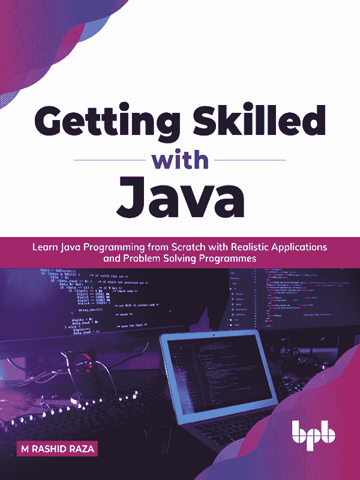


[www.bpbonline.com](http://www.bpbonline.com)

**2022 年第一版**


# 献给

*我亲爱的父母*

`M Sarmad`

`Mazda Tabassum`

&*

*我的家人和朋友*

# 关于作者

**Mohammad Rashid Raza** 是一位软件开发者，对微服务、信息论、基础编程、系统与架构以及分布式系统等领域有着广泛兴趣。他曾作为全栈开发人员参与过 CGP、CMS、教育、支付与金融、航空和旅游等多个领域的 Web 应用程序和软件开发众多项目。他从新德里的的德里大学获得政治学学士学位，并在新德里的的因德拉·甘迪国立开放大学获得计算机应用硕士学位。他获得了 Adobe 的 Adobe Experience Manager 开发者和架构师认证，以及微软的 Microsoft .Net 框架开发者认证。他是一位定期的博客作者（地址为 `rashidjorvee@blogspot.com`），并是计算机编程教育的热爱好者。

# 关于评审员

**Rati Mehra** 是一位 Java 架构师，在 Java 技术以及 Web 世界解决方案和架构设计方面拥有 12 年的丰富经验。Rati 在诺伊达的 Amity 大学获得了技术学士学位，在浦那那的 Symbiosis 大学获得硕士学位。

**Amritpal Singh** 在 IT 行业拥有 9 年经验，是全栈开发的爱好者。他目前在 Larsen & Toubro Infotech 担任项目主管。他在 Web 应用程序、后端应用程序、中间件应用程序、云等领域的技能使他成长为一名 Java 全栈开发专家。Amritpal Singh 此前曾工作于 HCL Technologies、Tech Mahindra、Cognizant Technologies 等顶级 IT 公司，并为美国航空、美国银行、沃尔玛、诺基亚和花银行等顶级客户项目做过贡献。他通过著作《Affinity》探索了写作身份。他目前担任导师并担任新人才招聘的面试官。Amrit 还是 Stack Overflow 的贡献者。他现在专注于将自己的知识投入开源项目，并通过指导他人、创建 POC、举办工作讨会、撰写博客来与社区分享，帮助世界变得更美好、更发达。

**Neha Sehdev** 拥有 Guru Nanak Dev 大学的计算机应用学士学位和旁遮普技术大学的计算机应用硕士学位。Neha 拥有 8 年计算机科学和编程教学经验，对与年轻学习者一起充满热情。Neha 喜欢利用她的技能帮助孩子在所有发展领域取得进步。教学之外，Neha 还对写文章和博客充满热情，并为许多小学书籍做过贡献。Neha 喜欢阅读、烹饪、听音乐、与家人朋友度时光，以及看恐怖故事。

# 致谢

有几个人我想感谢他们在我写这本书期间对我提供的持续和不断的支持。首先，我要感谢我的父母所有的付出和支持，以及鼓励我写这本书的朋友们。

我很感谢我的导师，他们也帮助我学习并引导我在 Java 编程和其他计算机及互联网技术方面提高技能。感谢 Oracle 和 Java 博客作者提供的优秀在线发布说明和 Java 文档，让我深入理解产品和新功能。

感谢 BPB Publications 团队，他们提供了足够的支持，给了我充足的时间编写草稿，并在整个出版过程中提供指导。BPB 的整个团队，包括技术评审员（Amrit、Neha 和 Rati），对于将这本书完善到我个人无法做到的水平起到了关键性作用。

# 前言

本书涵盖了高级计算机编程语言 Java，从计算机编程基础开始到使用核心 Java 程序的高级编程概念。核心重点是引导初学者或开发者从零学习 Java 编程，并实现不同的类、对象和库。本书聚焦于一些常用的面向对象设计模式及其实现。书中描述了 Java 的每个模块的理论概念（即编写程序所需的知识），以及帮助将需求转换为 Java 程序的分析部分。书中还演示了 Java 开发环境的机器设置，以及是 Java 开发工具包（即 `JDK`）的安装指南。每一章都有示例和样例程序，帮助理解实际概念，随后还有一些具有挑战性的问题、练习和任务，为读者提供测试其所学技能的机会。

在`第 6 章]`中，我们将学习如何处理`String`对象和`String`数据类型，并使用不同类型的`String`类及其方法来操作或控制`String`数据。

在`第 7 章]`中，我们将讨论如何使用单个变量来管理数据列表或相同数据类型的多个值。此外，我们还将学习创建常数数据的固定列表。在这里，我们将讨论`Array`和`Enum`类型的对象。

在`第 8 章]`中，我们将学习决策技能，或者说执行任何语句之前如何设置条件，然后根据这些条件在 Java 编程中执行一组语句。此外，我们将学习迭代或循环，以便根据条件从列表中读写数据或写入列表，或者根据条件多次执行或运行块代码或语句。

在`第 9 章]`中，我们将学习类型转换以及使用包装类将变量封装到类中，并学习如何使用泛型使代码类型安全，以避免程序出现运行时错误。

在`第 10 章]`中，我们将学习编程的核心特征——面向对象编程，它能帮助开发者在设计解决方案时选择正确的编程方法。在这里，我们将学习使用封装、抽象、继承和多态的所有 OOP 编程方法。

在`第 11 章]`中，我们将学习如何处理程序和应用程序中的运行时错误。这是开发者应该遵循的一项非常重要的特性，以确保在接收到错误或糟糕的数据/信息后仍保持应用程序的活跃。处理异常和错误有助于我们处理无效和糟糕数据或对象的情况，并帮助执行一些额外活动以使程序流流向不同的方向。

在`第 12 章]`中，我们将学习如何使用 Java Collection 管理一组数据。这是 Java 编程中的一项高级级功能，我们用它来处理一组数据并使用各种 Java 集合类和接口操作数据。此外，我们还将讨论帮助编写程序的`collections`类及其方法。

在`第 13 章]`中，我们将学习关于序列化和反序列化的知识，即将数据存储到文件中以及从文件中读取数据。在这里，我们将学习用于读写和处理不同类型文件（例如 `JSON`、`XML`、`TXT`、`XLS`、`CSV`）的不同类和方法。

在`第 14 章]`中，我们将学习如何利用 CPU 同时执行多个程序，或者通过`Thread`将程序部分分成最小执行单元来分块执行同一个程序。我们还将练习`Thread`的创建，以及如何分块并运行我们的程序。

在`第 15 章]`中，我们将看到如何在 Java 程序或应用程序与数据库（`SQL` 或 `NoSQL`）之间建立桥梁。我们将学习如何与任何数据库管理系统建立连接，并在 Java 中获取和设置数据。我们将讨论在 Java 中执行所有这些操作的各种库和类。

在`第 16 章]`中，我们将深入探讨 Java 内存管理，查看 Java 如何管理我们机器的内存。Java 有一个名为`garbage collection`的内置功能，负责 Java 对象的内存分配和释放，并确保我们的程序或应用程序在不发生任何内存泄漏的情况下保持活跃。

# 代码包与彩色图片

请点击链接下载本书的`Code Bundle`和`Coloured Images`：

# [`rebrand.ly/034fe8`](https://rebrand.ly/034fe8)

本书的代码包也托管在 GitHub 的[`github.com/bpbpublications/Getting-Skilled-with-Java`](https://github.com/bpbpublications/Getting-Skilled-with-Java)上。如果代码有更新，将在现有的 GitHub 仓库中更新。

我们在丰富的书籍和视频目录中提供了许多代码包，地址为[`github.com/bpbpublications`](https://github.com/bpbpublications)。快去看看吧！

# 错（Errata）

我们对 BPB Publications 的工作感到非常自豪，并遵循最佳实践以确保内容的准确性，为订阅者提供享受的阅读体验。读者是我们的镜子，我们利用他们的反馈来反映并改进出版过程中可能发生的任何人为错误。为了方便我们维护质量并帮助可能因不可预见的错误遇到困难的读者，请通过以下邮箱与我们联系：

`errata@bpbonline.com`

BPB Publications 大家庭非常感谢您的支持、建议和反馈。

您知道吗？BPB 出版的每本书都提供 eBook 版本，并提供 PDF 和 ePub 文件。您可以在[www.bpbonline.com](http://www.bpbonline.com)升级到 eBook 版本，作为纸质书客户，您有权获得 eBook 版本的折扣。欲了解更多细节请联系我们：`business@bpbonline.com`。

在[www.bpbonline.com](http://www.bpbonline.com)上，您还可以阅读免费技术文章集，订阅一系列免费新闻邮件，并接收独家优惠。

# 版权

如果您在互联网上发现我们作品任何形式的非法盗版，如果您能向我们提供网站地址名称，我们将不胜感激。请通过`business@bpbonline.com`联系我们并提供材料。

# 如果您有兴趣成为作者

如果您在某个领域拥有专长，并有兴趣编写或为书籍做贡献，请访问[www.bpbonline.com](http://www.bpbonline.com/)。我们已经与成千上万像您这样的开发者合作，帮助他们分享见解。

# 评论

请留下评价。在您阅读并使用此书后，为什么不在购买的网站上留个评价呢？潜在读者就可以看到并参考您的客观意见做出购买决策。我们 BPB 团队可以了解您的想法，作者也可以看到对书的反馈。谢谢！

更多关于 BPB 的信息，请访问[www.bpbonline.com](http://www.bpbonline.com)。

在本章中，我们将讨论以下主题：

- `Java`编程
- 计算机编程历史
- 为什么开发者偏于使用`Java`
- 软件开发包（`SDK`）
- Java 开发工具包（`JDK`）
- Java 虚拟机（`JVM`）

## 目标

成功完成本章后，你将能够：

- 讨论并解释计算机编程的历史及其必要性
- 讨论各种计算机编程语言
- 理解 Java 编程语言
- 理解为什么 Java 编程被程序员广泛使用
- 解释各种类型的编程语言及其用途
- 解释软件开发包（`SDK`）和 Java 开发工具包（`JDK`）
- 讨论编译器、解释器和程序执行的机制
- 解释 Java 架构

# Java 简介

Java 是一种高级、面向对象、函数的编程语言，用于开发和设计基于计算机或移动设备的应用程序和软件。Java 编程模式基于`C++`，`C++`也是一种面向对象的编程语言。Java 由计算机科学家 James Gosling 及其团队于 1991 年在 Sun Microsystems 实验室开发。

## 编程语言类型

我们用于在计算机和机器上执行某些操作的编程语言有两种类型。

### 低级语言

低级语言可以直接被计算机处理器所理解。我们只能使用二进制数字`0`和`1`与硬件交互，因为机器和处理器只理解二进制数字，并且需要所有输入都为二进制格式以执行操作。我们有两种低级语言：

### 机器语言

机器语言由二进制数字组成，其中每条命令都以二进制格式编写。这种语言速度非常快，因为不需要解释器将命令传递给处理器。处理器可以轻松地理解用二进制编写的步骤。机器语言被称为`第一代语言`（`1GL`）。

以下是一个相两个数字变量的机器语言程序示例。该程序仅向你展示机器码的样式。不要纠结于此：

| 地址十六进制 | 指令代码二进制 | 指令代码十六进制 | 指令 | 注释 |
| :--- | :--- | :--- | :--- | :--- |
| 100 | 0010 0001 0000 0100 | 2104 | `LDA 104` | 将第一个操作数加载到 AC |
| 101 | 0001 0001 0000 0101 | 1105 | `ADD 105` | 将第二个操作数加到 AC |
| 102 | 0011 0001 0000 0110 | 3106 | `STA 106` | 将和存储在位置 106 |
| 103 | 0111 0000 0000 0001 | 7001 | `HLT` | 停止计算机 |
| 104 | 0000 0000 0101 0011 | 0053 | `operand` | 十进制 83 |
| 105 | 1111 1111 1111 1110 | FFFE | `operand` | 十进制 -2 |
| 106 | 0000 0000 0000 0000 | 0000 | `operand` | 将和存储在此处 |

**示例 1.1：**相两个数字变量的机器语言程序示例

### 汇编语言

汇编语言也是一种低级语言，但它为人类编写程序以及理解他们将命令处理器执行的指令提供了便利。我们不再使用二进制数字（即`0`或`1`），而是使用符号操作码来编写语句，例如`add`、`sub`、`mov`。

在汇编器的帮助下，汇编语言程序被编译并转换为由`0`和`1`组成的字符串，供处理器执行。汇编语言被称为`第二代语言`（`2GL`）。

以下是一个相两个数字的汇编语言程序示例。该程序仅向你展示汇编程序的样式。不要纠结于此：

```asm
data segment
a db 09h
b db 02h
c dw ?
data ends
code segment
assume cs:code,ds:data
start:
mov ax,data
mov ds,ax
mov al,a
mov bl,b
add al,bl
mov c,ax
int 3
code ends
end start
```

**示例 1.2：**相两个数字的汇编语言程序示例

上述程序仅供你参考，以便你直观地看到汇编程序的样式。

### 高级语言

高级语言也被称为`第三代语言`（`3GL`）。高级语言由语句和语法组成。这些语法是有意义的，人们可以很容易学习和理解程序。

Java 是高级语言的一个示例。`C`、`C++`、`COBOL`和`FORTAN`都是`高级语言`（`HLL`）的示例。

```java
public class AddNumbers {
    public static void main(String[] args) {
        int a = 5, b = 6, result;
        result = a + b;
        System.out.println("Addition of two numbers is: " + result);
    }
}
```

**示例 1.3：**相两个数字的高级程序示例

上述程序仅供你参考，以便你直观地看到高级程序的样式。

# 计算机编程历史

第一种编程语言是由 Ada Lovelace 在计算机时代为 Charles Babbage 开发的。之后有一系列由计算机科学家开发的编程语言列表：

- **分析机算法**：1883 年，数学家 Ada Lovelace 写出了一个计算伯努利数的算法。
- **汇编语言**：1949 年，Kathleen Booth 创建了一种用于与计算机交互的新语言。这是一种低级语言……
- **自动码（Autocode）**：第一种自动码及其编译器是由英国计算机科学家 Alick Edwards Glennie 为曼彻斯特大学的 Mark1 计算机开发的。自动码是第一种使用编译器来编译用自动码编写程序的编程语言。
- **公式翻译语言（Fortran）**：1957 年，John Backus 开发了一种语言来简化科学、数值、统计和数学计算，我们将其命名为 Fortran。
- **COBOL**：COBOL 代表`通用面向业务的语言`。1959 年，美国计算机科学家 Grace Brewster Murray Hopper 开发了这种语言用于业务。
- **BASIC**：1964 年，数学家 John Kemeny 和 Thomas Kurtz 开发了一种非结构化通用的计算机编程语言，以便非技术专业的学生也能使用计算机。
- **C**：1972 年，贝尔实验室的美国计算机科学家 Dennis Ritchie 开发了 C 编程语言。它是基于`BCPL`（基础组合编程语言）的。这被认为是第一种高级程序语言，并广泛用于与硬件交互。自 1989 年以来，C 语言已由`ANSI`和`ISO`标准化。它被用于操作系统应用、超级计算机和嵌入式系统。
- **C++**：Bjarne Stroustrup 在 1985 年将 C 升级为`C++`。这是一种基于类、面向对象的通用编程语言，用于高性能的软件和应用程序。
- **Python**：1991 年，Python 由 Guido Van Rossum 开发。Python 是一种用于数据科学程序的面向对象、容易（此处应为易用）、易用且高效的编程语言。使用 Python，我们只需要编写极少数代码，通过直击重点且逻辑的代码即可获得预期结果。
- **Visual Basic**：1991 年，该语言由微软公司开发。这是计算机历史上第一种开发者可以复用现有代码模块作为组件的编程语言。为此，Visual Basic 提供了丰富的图形用户界面（`GUI`），只需简单地拖放复用组件，即可将该代码的功能添加到新的应用程序和软件中。


- **Java**：1995 年，James Gosling 在太阳微系统公司开发了 Java。Java 是一种基于类、面向对象、函数型、多用途编程语言。Java 以其最大的特性而闻名：一旦编译，Java 代码可以在任何操作系统上运行，这使得 Java 具有平台无关性。编译代码可以在任何安装了 `JVM` 的机器上运行。2019 年 9 月，Oracle 发布了 Java 13。

- **C# (C sharp)**：2001 年，微软发布了 C#。C# 也是一种面向对象的编程语言，其开发模式与 Java 和 `C++` 相同。这种语言用于几乎所有的微软产品。

- **GO**：2009 年，Google 针对当前编程世界的需求开发了这种编程语言。用 Go 编写的程序是一种快速、静态类型、编译型语言，但感觉像动态类型、解释型语言。Go 使用的语法类似于 C。

在这里，我们尝试列出软件开发者最常用的几种编程语言。编程语言列表非常长且在不断更新。在这个计算机时代，我们每天都有需求，为了满足需求并填补空白，计算机科学家不断开发框架和语言。

## Java 的特性

Java 具有许多其他编程语言不具备的独特特性。我们将讨论 Java 的几个突出特性，这些特性鼓励开发者使用 Java 编程编写应用程序和软件。使用 Java，我们可以开发完整的应用程序和软件。以下是 Java 编程语言的特性：

- **平台无关**：Java 是平台独立的；这意味着我们可以一次构建代码，然后在任何机器或服务器上部署和运行。

- **可扩展性**：Java 是一种面向对象的编程语言，这使得代码是模块化、可扩展且易于使用和编写的。

- **库**：Java 在市面上有一个非常巨大的开源库可用。由于它是开源且免费的程序，任何人都可以为创建 Java 库做出贡献。这些库以后可以被开发者用于编写代码。

- **面向所有设备开发**：它支持所有平台的各种开发。我们可以使用 Java 开发桌面端、Web 和移动端应用程序。

- **开源 JDK**：Java 是开源的。用户可以从官方网站下载 `JDK` 并使用。Java 的学生或开发者无需支付任何费用即可使用 Java。个人开发者或开发者小组也可以向 `JDK` 贡献以构建新的类和方法。

- **易用**：Java 易于学习和使用。有很多书籍和在线材料可用于学习 Java 语言。

- **开发工具**：为 Java 开发者提供了一些优秀的 IDE，如 `Eclipse`、`NetBeans` 和 `IntelliJ`。这些工具具有 `IntelliSense`，可以不断为开发者提供提示以完成代码的语法和语句。

Java 的这些特性使其在开发者中流行，并鼓励他们使用 Java 编写程序。

## 运行 Java 所需的软件

每个软件都带有一个软件开发工具包。该软件开发工具包包含了所有所需的库和包，我们需要编写它们并构建开发者编写的代码。要开始使用 Java，我们需要在机器上安装 Java 开发工具包（`JDK`）。`JDK` 是免费提供的，可以从 Java 官方网站下载。市上有三种 Java 模块可用：

- **J2EE**：Java 企业版进阶模块，我们可以在其中使用 `EJB`、`servlet`、`JNDI` 和 `JMS`。它还包含了 `J2SE`。因此，我们可以在高级 Java 编程中使用 Java 的 API 和库。

- **J2SE**：Java 标准版是用于核心 Java 库和 API 的 SDK，我们主要用它开发应用程序和程序。这包含了 `util` 和 `lang` 等 API。

- **J2ME**：Java 微型版是 Java `SDK` 的轻量级。它主要用于为手机、平板电脑等便携和小型设备开发应用程序和软件。

这三个模块用于不同的目的。你可以从标准版开始，对于 Java 开发者来说，标准版几乎提供了所有所需内容。

### Java 开发工具包

`JDK` 是一种软件开发工具包，提供了编写和执行 Java 程序所需的完整开发环境。每种编程语言都有自己的软件开发工具包。它在你的机器上创建开发环境，并为你提供所需的库。你可以参考 JDK 官方文档来了解所有内置的 API 规范。

`JDK` 由 `JRE` 和 `JVM` 组成。

### JDK 的作用

- `JDK` 将 Java 源代码（`.java`）编译成字节码（`.class`）。这种字节码以后可以在 `JRE` 上执行，以运行软件和应用程序。编译后，`JDK` 为每个 Java 文件创建一个同名的 `.class` 文件。例如，`example.class` 是 `example.java` 的编译版本。

- `JDK` 也帮助我们调试代码。我们可以使用现代 IDE 轻松启动调试选项并逐语句执行程序。

### Java 运行环境

每个 Java 程序都需要一些库和组件来运行 Java 应用程序或程序。`JRE` 为你的 Java 程序提供这些库和组件，以便你的程序解析所需的依赖项。使用 `JRE`，你只能运行好的 Java 应用程序和程序。你不能使用 `JRE` 编写并编译新的 Java 程序。要这样做，你需要 `JDK`。

### Java 虚拟机

Java 虚拟机为 Java 程序提供执行平台，Java 编写的程序在此执行。这使得你的计算机能够兼容用 Java 编译的软件和应用程序。它解释编译代码（`.class` 文件）使其能够运行。

当你机器上安装 `JDK` 或 `JRE` 时，Java 会在操作系统（`OS`）中创建自己的虚拟机 `JVM` 来运行用 Java 编写的程序。

### 即时编译编译器 (JIT)

即时编译编译器是 Java 虚拟机的一部分，出现在任何有 `JVM` 的地方。它帮助 `JVM` 将接收来自 `JRE` 的字节码（`java .class` 文件）编译成机器码指令。由于机器及其硬件只能理解机器语言，`JIT` 帮助 `JVM` 将这些代码/程序转换为机器语言，以便机器进行执行和操作。

下面的 `图 1.1` 解释了 Java 开发包的完整架构及其作为 `JDK` 一的成员。我们已经讨论了 `JDK` 的各个部分，如 `JRE`、`JVM` 和 `JIT` 以及它们在 Java 中的作用：

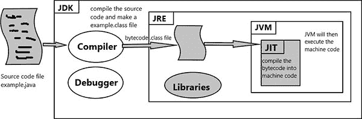

**图 1.1:** Java 代码的编译与执行过程

`图 1.1` 显示了用 Java/Java 源编写的代码如何在机器中执行，以及它必须经过哪些步骤才能完成成功执行并生成结果。

在第一步中，`example.java` 文件由 `JDK` 编译，将 Java 代码转换为字节码并将其保存为新文件 `example.class`。此外，所有的语法错误和编译错误只能在此时修复。如果你的代码有任何语法错误，编译器将无法编译你的源文件。

在第二步中，`JRE` 开始出现，作为输入，它接收由 `JDK` 创建的带有 `.class` 扩展名的字节码文件。在我们情况下，它是 `example.class`。现在，`JRE` 将所需的类和对象解析字节码，并将其传递给 `JVM` 执行。

在第三步中，`JVM` 接收 `example.class` 文件。由于 `JVM` 不理解字节码，它将其发送给其成员之一的 JIT，JIT 将字节码转换为机器码，以便 `JVM` 理解并执行该代码。

## 结论

Java 是一种高级计算机编程语言，用于为任何设备设计应用程序和软件。它是平台无关的。Java 编译后的代码可以在任何机器上运行。`JDK` 是 Java 的软件开发工具包，由 `JRE` 和 `JVM` 组成。Java 于 1995 年进入市场，最新的 Java 版本是 13，它于 2019 年 9 月发布。

机器只能理解用机器语言编写的程序。在机器语言中编写用于长时间计算的程序是非常的。因此，我们使用高级编程语言来编写程序。这些程序随后由编译器编译和解释转换为字节码和机器语言。

计算机语言分为三类：机器语言、汇编语言和高级语言。这也被称为计算机编程语言的代。

在本章中，你学习了 Java 编程的基础架构、计算机编程的历史及其类型。希望大家对这些内容心中都有了清晰的认识。在下一章中，我们将学习如何为 Java 配置我们的机器或计算机。

## 记忆要点

*   编写 Java 程序需要 Java 开发工具包 (`JDK`)。

*   Java 是平台无关的，可以在任何操作系统上运行。

*   当你在机器上安装 `JRE` 和 `JDK` 时，Java 会机器内部创建一个自己的虚拟机来运行 Java 程序。

*   `JRE`、`JVM` 和 `JIT` 是 `JDK` 的组成部分。

## 单选题

1.  **哪个负责将字节码解释为机器码？**

    1.  Java 虚拟机

    2.  Java 运行环境

    3.  Java 编译器

    4.  即时编译器

2.  **Java 是哪一年开发的？**

    1.  1987

    2.  1990

    3.  1995

    4.  1991

3.  **Java 运行环境 (JRE) 包含：**

    1.  `JDK` 和 `JVM`

    2.  `JDK` 和 `JIT`

    3.  `JDK`、`JRE` 和 `JVM`

    4.  `JVM`

## 答案

1.  **d**

2.  **c**

3.  **d**

# question

1. 什么是 `JDK`、`JRE` 和 `JVM`？

2. 为什么 Java 是平台无关的？

3. 谁发明了 Java 编程？什么时候时候？

## 核心术语

*   **IntelliSence**：一项代码补全功能，用户可以获得完成代码语句下一个可能的方法和参数的提示。这也被称为自动补全或代码辅助。

*   **Functional programming**：函数式编程是一个术语，我们将程序的每条语句都拖到一个数学函数中。我们使用运算符、操作数、函数并专注于解决问题。

*   **Object oriented programming**：这是一种基于对象的编程模式。它将由基于真实世界系统的类和对象组成。

*   **Compiler**：它将用高级语言编写的程序转换或解释为机器语言（二进制）。

## 术语表

*   **ANSI**：美国国家标准协会

*   **CLI**：命令行界面

*   **GL**：代语言

*   **GUI**：图形用户界面

*   **HLL**：高级语言

*   **ISO**：国际标准化组织

*   **JDK**：Java 开发工具包

*   **JIT**：即时

*   **JRE**：Java 运行环境

*   **JVM**：Java 虚拟机

*   **OS**：操作系统

*   **SDK**：软件开发工具包

*   **IDE**：集成开发环境

## 参考文献

1.  `https://www.oracle.com/technetwork/java/downloads/index.html`

2.  `https://docs.oracle.com/en/java/11/api/index.html`

3.  `https://docs.oracle.com/en/java/13/books.html`

4.  `https://en.wikipedia.org/wiki/History_of_programming_languages`

要在我们的机器上安装 JDK，我们首先需要从 Java 官方网站（[`www.oracle.com/technetwork/java/javase/downloads/index.html`](https://www.oracle.com/technetwork/java/javase/downloads/index.html)）根据你想要安装的操作系统和版本下载 JDK。

以下是安装 JDK 的步骤：

1. 转到上述 Oracle 下载中心，下载适用于你机器的最新兼容 JDK 版本。如果你想要免费版本，可以下载 Java 8，尽管更高版本对于学生和练习目的也是免费的。

2. JDK 以单个 jar 文件的形式提供。解压下载的 ZIP 文件。打开解压后的文件夹，只需双击 `jdk-<version>.exe` 文件即可安装 Java，如如下截图所示：

    

    **图 2.1:** Oracle JDK 安装文件

    1. 点击 `Next` 并勾选 `I agree for term and condition.` 复选框。然后完成安装：

        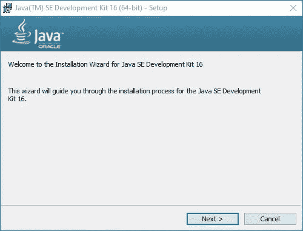

        **图 2.2:** Java 安装向导

    2. 将出现 `Java has been successfully installed` 消息：

        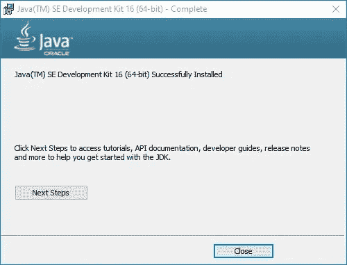

        **图 2.3:** JDK 成功安装窗口

安装成功后，使用命令提示符（CMD）检查机器上安装的 Java 版本。要这样做，打开 CMD 并输入命令 `java -version`，如图 2.4 所示：

    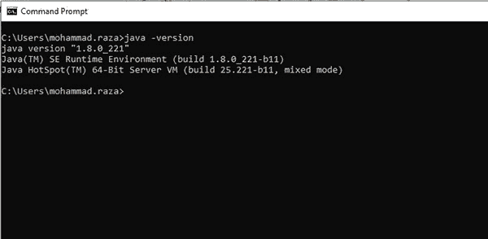

    **图 2.4:** 检查机器上安装的 Java 版本

前面的代码段显示此机器已安装 Java，Java 版本为 1.8.0_221，并带有 JRE 和 JVM 信息。

## 设置类路径变量

当我们编写程序并尝试使用 Java 编译器进行编译时，机器将寻找 JDK 用来编译和运行程序。因此，我们要么在每次执行命令时指定软件库的目录，要么将其设置为环境变量，这样机器就可以根据命令从环境变量中自动获取库路径。环境变量存储了我们机器上安装的软件路径。

我们设置变量 `JAVA_HOME` 来编译和运行 Java 程序：

`JAVA_HOME = C:\Program Files\Java\jdk1.8.0_201`

你也可以直接在环境变量下的系统 `CLASSPATH` 变量和 `PATH` 变量部分设置 JDK 路径。在机器上设置 `JAVA_HOME` 有两种方法。

## 使用命令行参数

使用命令行设置环境变量简单且快速的方法。我们只需两个步骤即可使用 CMD 进行设置：

1. 打开命令行（CMD）。要打开 CMD，点击 `Start` 按钮并在 Windows 机器的搜索区域输入 CMD，然后点击命令提示符以打开命令行界面（CLI）：

    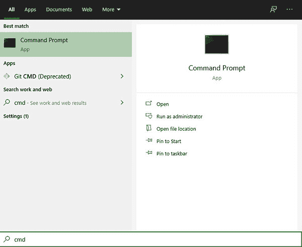

    **图 2.5:** 在 Windows 10 中打开 CMD

打开命令提示符另一种方法是进入 `Run`（运行）并输入 `cmd` 然后按回车，这将让你打开命令行：

    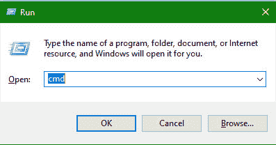

    **图 2.6:** 使用运行选项打开 CMD

2. 输入命令：

    ```
    setx -m JAVA_HOME post JDK path
    ```

    例如：`setx -m JAVA_HOME "C:\Progra~1\Java\jdk1.8.0_201"`

    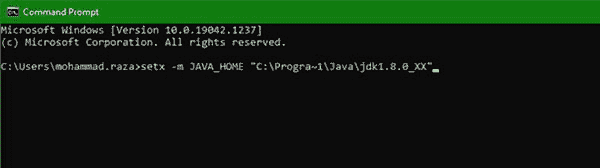

    **图 2.7:** 使用命令行设置环境变量

## 使用 GUI 向导

我们也可以在 `MyComputer` 属性下使用向导选项设置 `JAVA_HOME` 环境变量。以下是设置环境变量的步骤：

1. 右键点击 `My PC` 或 `My computer` 或 `This PC`。

2. 进入 `Properties` 选项。

3. 点击左侧的 `Advanced system settings`，如图 2.8 所示：

    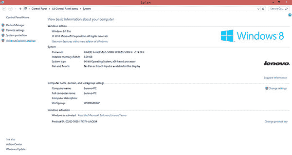

    **图 2.8:** Windows 设置

4. 将出现一个名为 `System Properties` 的新窗口，如图 2.9 所示。现在，点击窗口右下角的 `Environment Variables` 按钮：

    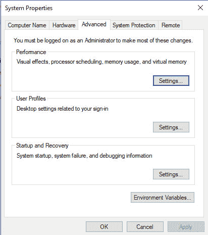

    **图 2.9:** 系统属性

5. （后续逻辑省略后续步骤，但保持格式不变）

在本章中，我们讨论并学习了如何为 Java 开发准备机器。Java 开发工具包（`JDK`）是一个用于 Java 的软件开发工具包，我们需要它来编写和运行用 Java 语言编写的程序和应用程序。在上一章中，我们已经讨论了 JDK 的不同部分及其作用，如 `JRE`、`JVM` 和 `JIT`。你可以参考这些内容进行复习。

我们还需要设置环境变量或系统变量，以便我们的机器拥有 `JDK` 的引用，并识别 Java 命令，使其在 Java 类路径上被执行。

在下一章中，我们将讨论编程基础和 Java 编程的语法。当我们开始学习一种语言时，是从词汇开始的。同样，Java 也有许多我们在编写程序时需要的单词。这些单词在编程语言中被称为关键字。

## 注意点

- `JDK` 是一个 SDK，是进行 Java 开发的先决条件，需要在你的机器上进行安装。

- 源代码的编译和解释仅由 `JDK` 处理。

- 我们需要设置环境变量，以便机器能够自动选择库路径来运行程序或应用程序。

## 单选题

1. 命令 `javac` 用于：

   1. 调试代码

   2. 编译 Java 源代码

   3. 执行 Java 程序

   4. 编写 Java 程序

2. Java 程序文件的扩展名是什么？

   1. `.java`

   2. `.javac`

   3. `.class`

   4. `.txt`

## 答案

1. **b**

2. **a**

## 问题

1. 什么是环境变量？我们为什么我们需要它？

2. 如何从 `.java` 文件生成 `.class` 文件？

## 参考文献

1. [`www.oracle.com/java/technologies/javase/jdk13-archive-downloads.html`](https://www.oracle.com/java/technologies/javase/jdk13-archive-downloads.html)


2. [`www.oracle.com/technetwork/java/javase/downloads/index.html`](https://www.oracle.com/technetwork/java/javase/downloads/index.html)

3. [`www.java.com/en/download/help/path.xml`](https://www.java.com/en/download/help/path.xml)

4. [`rashidjorvee.blogspot.com/2019/07/environment-variable.html`](https://rashidjorvee.blogspot.com/2019/07/environment-variable.html)

# 第 3 章：类、对象和变量

在本章中，我们将讨论 Java 编程语言的基础和基本知识。这些对于学习、编写和理解 Java 源代码非常重要。如果不具备这些术语和语法的知识，你将无法编程的概念和设计。

## 结构

在本章中，我们将讨论以下主题：

- 类 (Classes)
- 对象 (Objects)
  - 类加载器 (Class loader)
    - 启动类 (Bootstrap)
    - 扩展类 (Extension)
    - 系统类 (System)
- 包 (Packages)
- 访问修饰符/限定 (Access modifiers/specifiers)
  - 私有 (Private)
  - 公有 (Public)
  - 保护 (Protected)
  - 默认 (Default)
- 变量 (Variables)
  - 变量类型 (Types of variables)
    - 类变量 (Class variable)
    - 实例变量 (Instance variable)
    - 局部变量 (Local variable)
    - 常量变量 (Constant variable)
- 数据类型 (Data types)
- 方法 (Methods)
- 带参数的方法 (Methods with arguments)
- Java 语句 (Statements in Java)
- 注释 (Comments)

## 目标

完成本章后，你将能够：

- 解释类、类的设计以及类的类
- 解释对象及其创建
- 理解将多个源代码文件打包成包的过程
- 解释类加载器、什么样的类会被加载到内存中、何时加载以及这些类加载器的意义
- 讨论数据类型及其用于存储不同值的各种类型，以及这些数据类型的默认值
- 理解访问修饰符或限定符，它们为类、方法和变量提供了范围和可见性
- 解释变量、Java 编程中不同类型的变量及其需求
- 理解 Java 在源代码中添加注释的可用方法
- 解释语句以及如何开始和结束一条语句

面向对象编程的一个卓越特性是拥有类。类在保持代码模块化和扩展性方面起着至关重要的作用。我们将在后续章节中讨论模块化和可扩展的代码。在本章中，我们将学习如何创建一个类、我们可以写的类类型，以及如何使用或重用类。此外，我们将讨论对象并使用 `new` 关键字创建类的对象。

在编程中，我们需要变量来存储数据。例如，如果我们想执行某些操作，我们仅通过变量存储结果并为操作数提供值。在这里，我们还将讨论如何创建变量以及可以使用哪些数据类型来创建变量。数据类型是特殊含义，告诉变量该变量只能存储特定类型。

## 类

类是对象的结构，是变量、方法、函数和算术操作的结合。在类中，我们使用不同的运算符编写所有操作，成功执行后将得到预期的结果。

类可以有不同的可见性，这为类设置了限制并创建了边界。根据命名规范，类必须大大字母开头。让我们看看如何在 Java 中创建一个类。

声明类的语法：

`<access specifier/visibility> class <NameOfClass>{}`

例如：

```java
public class JavaProgram {
    // 在这里编写你的语句和操作。
}
```

类还可以使用 `abstract`、`interface` 和 `final` 等关键字声明。我们使用这些关键字来实现不同的目的并在其中包含一些独特的特性。这些关键字本身就是一个主题。因此，我们将在后续章节中讨论。在这里，我们将看到如何使用这些关键字来创建类。

类可以是空的，也可以有主体。类体定义在大括号和小括号之间。所有的语句、构造函数、方法和变量只能在体内部声明。在体外部，我们无法声明任何内容。

```java
public class ClassA {
    // 这是类的体，我们所有的内容都写在这里内部
}
```

一个 Java 源文件可以包含多个类。但只有一个类会用 `public` 修饰符声明。其他类可以是私有的、抽象的或最后的。

**示例 3.1**：所有代码都是单个 `ExampleTest.java` 文件的一部分：

```java
package rashid.example.abc;

public class ExampleTest extends Base {
    public static void main(String[] args) {
        ExampleTest exampleTest = new ExampleTest();
        Base b = new Base();
    }
}

class Base {
    private void MethodEx() {
        System.out.println("Base class method");
    }
}

abstract class NewMan {
}
```

类成员和方法在类中使用 `static` 关键字进行声明。这些成员和方法被该类的所有实例所共享。我们可以使用类名来访问类成员和方法。访问类成员不需要创建类的对象。我们将在本章稍后的类变量部分进一步讨论这一点。

## 对象 (Object)

对象是类的真实副本，我们在程序中创建它是为了处理或操作在类中定义的变量、方法、构造函数和操作。每当我们创建一个对象时，它都会创建一个该类的独立副本并加载到内存中。两个对象的特征可能完全相同，但它们的内存管理是完全不同的，且两者都不会互相干扰。对象共享两个特性——状态和行为。每个对象都有某些状态，并且状态不断变化。此外，对象具有行为，且对象对指令的操作也不同。例如，汽车就是一个对象。以下可能是汽车对象的状态和行为：

**状态**：停止，移动

**行为**：换挡，启动，刹车，鸣笛

我们需要对象来访问和处理实例方法以及类的成员。如果不创建类的对象，无法访问类的实例成员。实例成员在类加载时不会加载到内存中，但一旦我们创建了该类的对象/实例，实例成员的内存就会被分配。

我们使用 `new` 关键字创建类的对象。例如，我们有一个类 `NewYear`，现在我们想创建两个 `NewYear` 类的对象：

```
NewYearobjectOne = new NewYear();
NewYearobjectTwo = new NewYear();
```

这就是我们创建类对象的方式。每当我们需要使用新的对象名编写此语句时，就会创建一个该类的类对象。

### 类加载器 (Class loader)

类加载器是 JRE 的一部分，负责将每个 Java 类文件加载到内存中，并使字节码可供 JVM 按需执行。`ClassLoader` 类是一个抽象类。它提供了类的二进制名称。在 Java 中，库以归档文件格式的形式存在，被称为 **Java 归档** (`JAR`)。类加载器还负责从内部和外部库文件中加载类。每个 Java 类都必须由类加载器加载后才能执行。

类加载是 Java 编程中最迷人的特征之一。它侧重于类的加载、链接和初始化，并使该类可以被 JVM 运行。

- **加载 (Loading)**：加载有助于定位类的二进制表示并将其引入 JVM。
- **链接 (Linking)**：链接是一个将加载过程加载的类并将该类型整合到运行时状态/模式中，以便由 JVM 执行的过程。
- **初始化 (Initialization)**：初始化是执行该类对象的过程。

当 Java 虚拟机启动时使用了三种类加载器。这些被称为内置类加载器。

### 启动类加载器 (Bootstrap class loader)

启动类加载器负责将核心 Java 库类加载到 Java 虚拟机。这里，库是用原生 Java 编写的，并存在于 JRE 的 `/jre/lib` 目录下。例如 `java.*`、`javax.*` 等。启动类加载器没有父类，通常表示为 `null`。

### 扩展类加载器 (Extension class loader)

- 扩展类加载器负责从库中加载类，这些类存在于 JRE 的 `/jre/lib/ext` 扩展目录或系统属性 `java.ext.dirs` 指定的任何目录下。`/jre/lib/ext` 目录中的任何 JAR 文件都被 **Java 运行环境** (`JRE`) 视为扩展。
- `java.ext.dirs` 是一种通用的类加载机制，告知 JRE 在何处加载扩展类。
- 从 Java 6 开始，扩展 JAR 文件也可以存于独立于任何 JRE 的位置，这样扩展就可以被系统上安装的所有 JRE 共享。在 Java 6 之前，`java.ext.dirs` 的值是指单个目录，但现在，Java 6 是一个目录列表（例如 `CLASSPATH`），指定了搜索扩展程序的位置。路径的第一个元素始终是 JRE 的 `lib/ext` 目录。第二个元素是 JRE 之外的目录。此位置允许扩展 JAR 文件安装一次并供该系统上安装的多个 JRE 使用。

### 系统类加载器 (System class loader)

系统类加载器负责从系统环境变量 `CLASSPATH` 列出的系统类路径中加载类。你可以参考上一章中的设置类路径变量以获取更多细节。这也被称为应用程序类加载器。

## 包 (Package)

包是一种捆包或容器或库，我们在其中放置一个或多个 Java 类、接口以及相关的其他实体/信息。这意味着将多个相关的程序文件放在一个地方。包是任何 Java 程序的第一条语句。

要创建包，我们只需要创建一个简单的文件夹，并在编译时使用 `-d` 选项：

```
javac -d C://example/program/SampleClass.java
```

创建包的目的是将相关的实体组织在一个地方。我们还可以设置可见性，这意味着使用默认访问修饰符声明的变量、方法和类对于包内的所有内容都是可见的。其他修饰符关键字（如 `private`、`public`、`protected`）按照它们设计方式工作。

包还可以用于分离两个同名的类，以便它们都被视为不同的。我们还提供了该包的唯一名称，称为命名空间。通过使用此命名空间，可以使用该包中定义的类和接口的功能。

将类放在包下的语法：

```
package <包的名称>
```

例如，`package org.bpb.program.sample;`。包名应该始终使用小写，并用点 (`.`) 分隔单词。

在 Java 编程中，`import` 关键字帮助我们把包注入到程序中，这样我们就可以使用那些类。

例如：

```
import java.lang;
import java.util.List; // 仅从 util 包导入 List 类
import java.util.*; // 这将从 util 包导入所有类。* 代表所有。
```

Java 库位于包之下。例如，`java.util` 和 `java.lang` 是提供不同类和接口的包，我们利用它们开发程序。下表针对 `java.lang` 包，它包含了 `String`、`Math`、`List`、`Object`、`System` 等更多类。

## 访问修饰符 (Access specifier)

访问修饰符是我们用于设置可见性或范围或定义变量、方法和类边界的关键字。这也被称为修饰符（modifier）。Java 编程中有四种访问修饰符。

### 私有 (Private)

声明为私有的变量、方法和类只能在代码块 `{}` 内部被访问。例如，如果一个私有变量声明在方法内部，那么它只能在方法体内被访问。

**示例 3.2**：私有变量的作用：

```java
public class ExampleTest {
    public void MethodEx() {
        private String firstName = "Priyank";
    }
    public static void main(String[] args) {
        ExampleTestexampleTest = new ExampleTest();
        exampleTest.firstName = "Raju"; // 我们无法在 main 方法中访问这个私有变量。
    }
}
```

上述程序将产生编译错误，因为我们正尝试在 `main` 方法中访问方法 `MethodEx` 的私有成员 `firstName`。

让我们来看另一个示例，在类外部声明和访问私有方法：

**示例 3.3**：私有方法的作用：

```java
package rashid.example.abc;
public class ExampleTest extends Base{
    public static void main(String[] args) {
        ExampleTestexampleTest = new ExampleTest();
        Base base = new Base();
        base.MethodEx();
    }
}
class Base {
    private void MethodEx() {
        System.out.println("Base class method");
    }
}
```

上述程序将在 `base.MethodEx();` 所在的行产生编译错误。“类型 `Base` 中的方法 `MethodEx()` 不可见”，这是因为我们正尝试访问基类的私有成员，该成员只能在 `Base` 类内部访问，不能由任何其他类访问，包括继承该基类的类。

### 公有 (Public)

`public` 修饰符使所有内容变为公有。使用 `public` 修饰符声明的变量、方法和类可以被任何类和方法访问。`public` 没有定义任何限制或边界。

### 保护 (Protected)

访问修饰符 `Protected` 介于私有和公共之间。它允许同一包内的所有类以及其他类的子类进行访问。在这里，派生类或子类意味着 `protected` 将允许从基类或父类继承属性。

让我们设计两个类 `ParentClass` 和 `ChildClass`。`ChildClass` 继承自 `ParentClass`。因此，除了私有的之外的所有属性都可以被 `ChildClass` 访问。以下是该程序：

```java
Class ParentClass
package rashid.example.abc;
public class ParentClass {
    protected String cityName = "New Delhi";
    protected String surname = "Raza";
}
Class ChildClass
package rashid.example.abc;
public class ChildClass extends ParentClass {
    public static void main(String[] args) {
        ChildClasschildClass = new ChildClass();
        System.out.println(childClass.cityName);
        System.out.println(childClass.surname);
    }
}
```

在前面的示例中，`ParentClass` 有两个保护变量 `cityName` 和 `surname`。普通类可能无法访问其他类的保护成员。然而，通过继承，当我们使用 `extends` 关键字继承一个类时，被继承的类会将其所有的变量和方法暴露给派生类。这在两个类之间建立了一种关系，就像现实世界中我们与父亲的关系一样。我们确实有权访问父亲的资产。我们将在继承章节中更多关于基类和派生类的内容。

### 默认 (Default)

当我们在类声明中不写任何修饰符时，默认就是访问修饰符。默认修饰符使类在同一个包内可被访问。

## 变量 (Variable)

变量是一个表示并持有某个值的唯一名称。变量可以是任何有效名称（基于特定的命名规范），也可以是你的名字。Java 关键字不能作为变量；例如，`public`、`abstract`、`interface`；我们无法使用这些名称创建变量。有关 Java 关键字的完整列表，请参考本章节末尾 Java 关键字部分。

人的名字就像一个代表人类的变量。当有人叫一个名字时，我们的脑海中会立即创建一个值的图像，代表 X 先生。

Java 对有效变量有特定的命名规范。这些命名规范有助于其他开发者理解开发者编写的代码。Java 变量应该始终以英字母（A 到 Z 或 a-z）、数字（0 到 9）、美元符号（`$`）或下划线（`_`）开头。我们不能使用这三种字符以外的字符作为开头。

声明变量的语法如下：

`<访问修饰符><数据类型><变量名>`

例如：

```java
private String firstName = "Rajan";
private int marks = 350;
```

2018 年 3 月，Java 发布了新版本 Java 10。从 Java 10 开始，我们多了一种更简单的方法使用 `var` 关键字来声明变量。`var` 关键字的优点是声明变量时不需要指定数据类型。根据赋值的值，系统会自动分配所需的数据类型来存储该值。例如：


```java
var firstName = "Mohit";
```

此变量的值是字符串类型；因此，变量 `firstName` 自动为其分配了 `String` 类型。

```java
var age = 8; // 此变量 age 将被视为整数类型
```

`var` 声明的一个缺点是不允许复合声明。我们不能在单个语句中用逗号（`,`）分隔来声明多个变量。

**无效声明：**

```java
var firstName = "Mohammad", lastName = "Raza";
```

要声明多个变量，我们需要每个变量写一个新语句。

例如：

```java
var firstName = "Mohammad";
var lastName = "Raza";
```

一个使用 `var` 声明进行除法运算的示例程序：

```java
public class VarExample {
    public static void main(String args[]) {
        var a = 5;
        var b = 6;
        var c = b/a;
        System.out.println(c);
    }
}
```

## 变量类型

存在不同类型的变量，用于不同的用途。让我们详细了解变量的类型。

### 类变量

类变量是那些在类级别声明的变量，该类的所有实例都将共享具有相同值的同一个变量。如果任何实例更新了类变量的值，该类的所有实例都将更新。通过任何程序更新类变量的值并不是良好做法。具有固定值的变量应该声明为类变量。我们使用 `static` 关键字来声明类变量。`static` 关键字确保只创建一个变量的实例。类变量也被称为静态变量。下面是变量声明和赋值的示例。

```java
static int age = 5;
```

如果你没有在静态变量中分配任何值，并在程序中使用该变量执行某些操作，那么它将根据数据类型指定的默认值给你该变量的默认值。

**示例 3.4：** JVM 默认值赋值。

例如：

```java
public class StaticVariable {
    static int age;
    public static void main(String[] args) {
        System.out.println(age);
    }
}
```

上述程序将成功运行并打印 0，这是 Java 中 `int` 的默认值。

**注意：任何使用 `static` 关键字声明的内容都会在类加载时加载到内存中。静态不依赖于对象的初始化。因此，类变量始终声明为静态。**

### 常量变量

常量变量是那些固定的变量，一旦对其赋值了值，你就无法更改它。它将始终保持不变。如果你尝试重新赋值或更新 `final` 变量的值，编译器将为你生成一条错误信息“The final field FinalVariable.XYZ cannot be assigned”。使变量成为常量的关键字是 `final`。建议使用大写字母编写常量名，并仅使用下划线分隔两个单词。

例如：

`<access specifier> final <data type><VARIABLE_NAME>`

`public final String USER_NAME = “Value”;`

**示例 3.5：** 一个创建常量变量的示例程序：

```java
public class FinalVariable {
    final int AGE = 5;
    public void AccessVariable() {
        System.out.println(AGE);
    }
    public static void main(String[] args) {
        FinalVariablefinalVariable = new FinalVariable();
        finalVariable.AccessVariable();
    }
}
```

**注意：如果将基本类型或字符串定义为常量，程序将在编译时将代码中所有该该常量替换为所赋值的值。我们也可以将常量称为编译时常量。**

### 实例变量

实例变量声明在方法、构造函数和任何代码块之外。每个实例都有独立的内存分配，每个实例都处理其自己的实例变量副本。实例变量只能通过创建类的对象来访问。这也被称为非静态变量。

实例变量的声明位置与类变量的位置相同，但这里我们不使用 `static` 关键字来声明变量：

```java
public class InstanceVariable {
    int zip=110019;
    public static void main(String[] args) {
        System.out.println(zip);
    }
}
```

我们无法在不创建类对象的情况下在静态字段上使用实例变量。要访问非静态变量和字段，我们必须通过创建实例来更新程序，并使用对象如下所示调用变量：

**示例 3.6：** 实例变量：

```java
public class InstanceVariable {
    int zip;
    public static void main(String[] args) {
        InstanceVariable instanceVariable = new InstanceVariable();
        System.out.println(instanceVariable.zip);
    }
}
```

现在，让我们创建 `InstanceVariable` 类的两个对象，更新变量 `zip` 的值，并使用类对象获取值：

```java
public class InstanceVariable {
    int zip;
    public static void main(String[] args) {
        InstanceVariable instanceVariable = new InstanceVariable();
        instanceVariable.zip=11002;
        InstanceVariable instanceVariableTwo = new InstanceVariable();
        instanceVariableTwo.zip=44001;
        //现在使用不同的实例访问变量 zip。
        System.out.println(instanceVariable.zip);
        System.out.println(instanceVariableTwo.zip);
    }
}
```

**输出：**

`11002`

`44001`

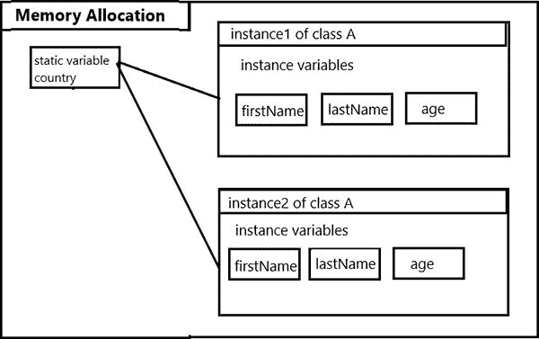

**图 3.2：** 静态和非静态变量的内存分配。

### 局部变量

局部变量是私有变量或用私有可见性声明的变量，或者是作为方法的参数接收的变量。这些变量的作用范围非常有限，在执行该方法或块后会从内存中移除。必须为局部变量赋值。如果你使用了未赋值任何值的变量，你将得到编译时错误“The local variable xyz may not have been initialized”。局部变量不会像类和实例变量那样获得数据类型的默认值。

**示例 3.7：** 局部变量：

```java
public class LocalVariable {
    public static void main(String[] args) {
        String lastName;
        System.out.println(lastName);
    }
}
```

当你尝试编译上述程序时，它将无法编译并生成编译错误。

要修复编译错误，请使用 `lastName`。

### Set

可以使用 `final` 配合 `public`、`private` 和 `protected` 设置变量。

### 参数

`float` 是一个 32 位 IEEE 754 浮点数。

**示例 3.8：** 参数：

```java
public class FinalVariable {
    void MethodOne(String) {
        System.out.println(userName);
    }
    public static void main(String[] args) {
        pv = new FinalVariable();
    }
}
```

## 数据类型

数据类型是特殊的表示方式。我们使用数据类型来存储值。

### 基本数据类型

基本类型是预定义的类型。支持八种基本类型。它们如下：

1. `byte`：`byte` 是 8 位符号补码的整数。`byte` 可以存储最小 -128 和最大 127。

   `short`：`short` 数据类型是 16 位符号补码表示的整数。它的最小值为 -32,768，最大值为 32,767。

2. `int`：`int` 数据类型是 32 位符号补码的整数。它的最小值为 –2147483648，最大值为 2147483647。在 Java 8 及更高版本中，你可以使用该数据类型表示无符号 32 位整数。使用 `Integer` 类可以将 `int` 作为无符号整数使用。

3. `long`：`long` 数据类型是 64 位符号补码的整数。当我们需要存储 `int` 无法实现的更大的值时，使用 `long` 数据类型。有符号 `long` 的最小值为 -2⁶³，最大值为 2⁶³-1。在 Java 8 及更高版本中，你可以使用该数据类型表示无符号 64 位长。在编写 `long` 值时，建议在值末尾写 `l`（小写 L）或 `L`；例如，`long telephone = 009191919191L;`。

4. `float`：`float` 数据类型是单精度 32 位 IEEE 754 浮点数。我们用它来替代 `byte` 和 `short` 以处理精确值。`float` 可以表示具有高达 6 到 7 位精度的小数值。此数据类型绝不应用于精确值（例如货币）。对于这种情况，你需要改使用 `java.math.BigDecimal` 类。在编写 `float` 值时，建议在值末尾写 `f` 或 `F`；例如，`floatpercentage = 23.674f;`。

5. `double`：`double` 数据类型是双精度 64 位 IEEE 754 浮点数。它是存储小数的首选。我们应该使用 `double` 代替 `int` 和 `long` 来处理小数。`double` 可以表示高达 16 位精度的小数值。在编写 `double` 值时，建议在值的末尾写 `d` 或 `D`；例如，`double pec=52731632.32462438891d;`。

6. `char`：`char` 数据类型是单个 16 位的 Unicode 字符。它的最小值为 `'\u0000'`（或 0），最大值为 `'\uffff'`（或 65,535，包含）。我们在单引号 ‘’ 之间编写 `char` 值。例如，`char firstAlpha = ‘A’;`。

7. `boolean`：`boolean` 数据类型是 1 位数据类型，只有两个可能的值：`true` 和 `false`。我们使用这种数据类型来设置标志并检查条件。例如，`boolean flag = true;`。

8. `String`：除了这八种基本数据类型外，Java 还提供了另一种数据类型 `String` 来支持字符字符串。通过导入 `java.lang.String` 类，可以在 Java 程序中使用这种 `String` 数据类型。字符串是常量；它们的值在创建后不能被更改。我们在双引号 `""` 内编写 `String` 值。将您的字符字符串包含在双引号内将自动一个新的 `String` 对象；例如，`String s = "You are learning Java.";` 和 `String s = new String(“You are learning Java”);`。

## 原始数据类型的默认值

| 数据类型 | 默认值（用于字段） | 位 符号 | 最小值和最大值 |
| :--- | :--- | :--- | :--- |
| `boolean` | False | 1 bit | true or false |
| `byte` | 0 | 8 bit | -128 to 127 |
| `short` | 0 | 16 bit | -32,768 to 32,767 |
| `int` | 0 | 32 bit | -2³¹ to 2³¹-1 |
| `long` | 0L | 64 bit | -2⁶³ to 2⁶³-1 |
| `float` | 0.0f | 32 bit | 1.4E-45 to 3.4028235E38 |
| `double` | 0.0d | 64 bit | 4.9E-324 to 1.7976931348623157E308 |
| `char` | '\u0000' | 16 bit | ‘\u0000’ to ‘\uffff’ |
| `String` | Null | | |

表 3.2：数据类型及其详细信息。引用数据类型持有对象的引用，可以与类、接口、数组和枚举一起。引用类型不持有任何实际值；它始终引用并依赖其他对象来获取和设置值。

## 引用数据类型

引用数据类型持有对象的引用，可以与类、接口、数组和枚举一起。引用类型不持有任何实际值；它始终引用并依赖其他对象来获取和设置值。

## 字面量

字面量用于声明常量变量；你可能会注意到，我们不需要使用 `new` 关键字创建对象来为基本类型变量赋值。例如，`String name = “Mohan Das”;` 是一个字符串字符串类型字面量。

字面量是固定值的源码表示；字面量直接表示在您的代码中，不需要计算。

- **布尔字面量：** 布尔字面量只有两个可能的值：`true` 和 `false`。例如：

  ```java
  boolean status = true;
  ```

- **整数字面量：** 我们可以以不同的格式在字面量放置整数值。整数字面量允许 `int` 和 `long` 类型的数据类型。例如：

  ```java
  int score = 320;
  long population = 12321322L;
  ```

- **浮点数字面量：** 浮点数字面量是持有小数和指数值的常量变量，我们可以使用 `float` 和 `double` 数据类型进行声明。例如：

  ```java
  float number = 12.321F;
  double number = 21313.234223D;
  ```

- **数字字面量中的下划线：** 我们使用下划线字符来分隔长数字（就像我们在数字组之间放置逗号 (,) 或空格 () 一样），以便于理解和可读性。数值之间的下划线会被编译器忽略。

  ```java
  long mobileNumber = 99999_99999L;
  float salary = 12_523.98f;
  ```

- **字符字面量：** 字符字面量是在单引号内定义单个字符值。

  ```java
  char attendance = ‘P’;
  ```

- **字符串字面量：** 除了基本数据类型外，还有一种 `String` 类型的字面量。

  ```java
  String name = “Rashid”;
  ```

- **null：** 还有 `null`。

## 方法

方法是一个代码块，只有在被调用时才会运行。你可以定义一次方法并多次使用。

### 方法定义的语法

```java
<访问修饰符> 返回类型 方法名(参数) {
  // 方法体
}
```

例如：

```java
static void myMethod() {
  System.out.println("Hello My World!");
}
```

### 调用方法

要调用方法，使用其名称后跟括号：

```java
myMethod();
```

### 方法参数

方法可以向它传递信息，这些被称为参数。

```java
static void myMethod(int x, int y) {
  System.out.println(x + y);
}

// 带参数的调用
myMethod(10, 20);
```

### 返回值

方法还可以返回数据。我们使用 `return` 关键字从方法返回值。

```java
static int addNumbers(int n1, int n2) {
  return n1 + n2;
}

// 调用并赋值
int result = addNumbers(5, 3);
```

### 方法重载

Java 允许方法在参数不同的情况下具有相同的名称。这被称为方法重载。

```java
static void show(int a) {
  System.out.println("Integer: " + a);
}

static void show(double b) {
  System.out.println("Double: " + b);
}

static void show(String s) {
  System.out.println("String: " + s);
}
```

```java
public static void main(String[] args) {
    MethodExample example = new MethodExample();
    String UserName = example.withReturnType();
    System.out.println(UserName);
    example.withoutReturnType();
}
}
```

**输出：**

```text
Method with return type.
Rashid
Method without return type.
```


# 带参数的方法

方法也可以带有参数；我们可以在方法中传递任意数量的参数或变量。这里是一个带参数方法的示例。在接下来的方法重载和重写章节，我们将更深入地讨论这一点。

**示例 3.10**: 带参数的方法：

```java
public class MethodExample {
    private String withReturnType(String name) {
        System.out.println("Method with return type name = " +name);
        return name;
    }
    private void withoutReturnType(int number) {
        System.out.println("Method without return type value: " +number);
    }
    public static void main(String[] args) {
        MethodExample example = new MethodExample();
        String UserName = example.withReturnType("Alice");
        System.out.println(UserName);
        example.withoutReturnType(5);
    }
}
```

**输出**：

```
Method with return type name = Alice
Alice
Method without return type value 5
```

# 语句

在编程中，需要一次性执行的一行或多行代码被称为语句（statement）。语句以分号（`;`）结束并终止。我们可以在单行中写多个语句，也可以在多行中写一个语句。

```java
int score = 5; String firstName= "John"; Class obj = new Class(); obj.Execute();
```

在上面的上一行代码中，我们写了四条语句：第一条是声明值为 `5` 的 `int` 类型字面量变量 `score`；第二个是值为 `John` 的字符串字面量；第三是创建 `Class` 的对象或实例；第四是调用实例方法 `Execute()`。由于这四条是不同的语句，它们将一个接一个地执行。

```java
Class Mainclassmain =
new ClassMain(System.in);
```

前面的两行代码仅仅是一个语句，会被一次性执行。JVM 将寻找语句的终止点，将分号（`;`）之前的所有内容加起来视为一个语句，并一次性执行。

# 注释

注释是一项非常有用的特性，它们不会被编译和执行。解释器或编译器会忽略注释部分下的内容。在 Java 源代码中，我们使用注释具有许多有意义的目的。它使得后续维护我们编写代码的其他开发者能够更易地阅读和理解代码。对于可扩展的系统设计，添加注释非常重要。注释可以用于：

* 在方法和类定义处添加注释，让程序员知道这个类和方法将要做什么，它将返回什么，以及调用此方法需要哪些参数

* 在你的源代码中添加作者姓名

* 解释常量变量

* 我们不希望执行的代码行或代码块

在 Java 源代码中放置注释有三种方法：一种是单行注释，另一种是多行注释，第三是 Javadoc 注释：

* **单行注释：** 单行注释用于编写简短的注释。单行注释可以写在双斜杠后面：

  `// 注释`

* **多行注释：** 多行注释用于编写代码的简短笔记或解释。多行注释可以以斜杠和星号符号开头，以斜杠后跟星号结束。在 Java 源代码中编写多行注释有两种方法；语法如下：

  ```
  /*
  注释
  */
  ```

  *或者*

  ```java
  /*
  *注释
  *注释
  */
  ```

* **Javadoc 注释：** Javadoc 注释是使用 Javadoc 工具为类、接口和方法生成的特殊注释。它包含了接口和方法中使用一些常用元素的定义和解释。这通常在我们创建任何 API 或面向的类和方法时完成。JDK Javadoc 工具在准备自动生成的文档时使用 doc 注。

  Javadoc 在注释中包含的元素有：

  * `@return`: 这表示此类和方法将返回你什么。

  * `@param`: 这表示程序为使用此方法或类必须传递多少参数，以及这些参数的类型是什么。

  * `@throw`: throw 表示此类和方法将抛出什么错误和异常，以便你可以在本地进行处理。

  * `@since`: since 仅适用于核心 API 类和方法，表示此类和方法从 Java 版本 xx 开始可用。

  ```java
  /**
  *
  *
  */
  ```

  例如：

  ```java
  /**
   * @param name
   * @return String
   */
  private String withReturnType(String name) {
      return name;
  }
  ```

# Java 关键字

Java 关键字是语言中具有意义的预定义内置关键字。每个关键字都有其特定的特性和使用术。我们不能直接将这些关键字作为标识符来命名变量、方法和类。以下是 Java 关键字：

* `abstract`

* `break`

* `case`

* `catch`

* `class`

* `continue`

* `do`

* `double`

* `else`

* `enum`

* `exception`

* `extends`

* `final`

* `float`

* `for`

* `implements`

* `instanceof`

* `int`

* `interface`

* `long`

* `main`

* `new`

* `out`

* `private`

* `protected`

* `public`

* `return`

* `static`

* `String`

* `super`

* `switch`

* `system`

* `this`

* `throws`

* `try`

* `var`

* `void`

* `while`

# 结论

类是一个蓝图或模板，用于以结构化的方式将变量方法放在一起。类也可以用于分离代码文件并分成较小文件。我们需要对象来访问类的实例/非静态变量或方法。数据类型是一种特殊的引用，帮助编译器识别该标识符（也称为变量）可能的值和操作。Java 包是将根据功能和关系的多个文件组合在一起，并给出一个唯一的包名，以便我们引用它。

类加载器是 JRE 的一部分，负责将每个类文件加载到内存中，并使字节码按需供 JVM 执行。类加载器有三种：启动（bootstrap）、扩展（extension）和系统（system）。

# 多选题

1. **哪个是有效的变量名？**

   1. `+yourName`

### 2. `xXyt`

### 3. `#67te`

### 4. `@firstname`

## 2. 哪种是声明类的有效语法？

1. `Class ClassName`

2. `class SampleProgram`

3. `AddTwoNumber class`

4. `Public Class ExampleP`

## 3. 哪一个不是有效的变量名？

1. `$youname`

2. `9812For`

3. `&age`

4. `_00Name`

## 4. 我们可以创建同一个类中的两个对象吗？

1. 是

2. 否

## 5. 创建 `JavaProgram` 类对象的正确语句是哪个？

1. `JavaProgramjp;`

2. `JavaProgramjp = new JavaProgram;`

3. `JavaProgram 0Pr = new JavaProgram();`

4. `JavaProgramjavaPro = new JavaProgram() {};`

## 6. 在 Java 源代码中写注释的无效方法是哪个？

1. `//* this is a constant variable`

2. `/* write your comment here */`

3. `/* write your text * * this method will return zero; */`

4. `**/`

# 答案

1. **b**

2. **b**

3. **c**

4. **a**

5. **c**

6. **d**

# 问题

1. Java 中提供了哪些类型的访问修饰符？

2. public 和 protected 修饰符之间的区别是什么？

3. 实例变量与类变量有什么不同？

4. 为什么我们不能使用 Java 关键字作为标识符？

5. 什么是对象？如何创建一个类的对象？

6. 什么是 32 位数据类型？

7. 什么是方法？什么是方法头？

8. Java 编程中的语句是什么？

# 核心术语

- **标识符 (Identifier)**: 用于唯一标识变量、类和方法的名字。

- **修饰符 (Modifier)**: 访问修饰符或访问限定符，用于设置标识符的可见性。

- **派生类 (Derived class)**: 继承其他属性的类。

# 练习

**练习 1**: 创建一个带有静态成员的类，并通过类名访问这些成员以打印值。

1. 创建名为 `MobileDevice` 的类。

2. 在类中添加以下静态成员：

   1. 一个 `String` 类型变量 `deviceName` 用于存储设备名称。

   2. 一个 `String` 类型变量 `manufacturedBy` 用于存储公司名称。

   3. 一个 `int` 类型变量 `price` 用于存储设备价格。

   4. 一个名为 `feature` 的方法，用于打印该设备的描述。

3. 在 `MobileDevice` 类的 `main` 方法下打印变量和方法的描述。

# 参考文献

1. [`docs.oracle.com/javase/tutorial/java/nutsandbolts/datatypes.html`](https://docs.oracle.com/javase/tutorial/java/nutsandbolts/datatypes.html)

2. [`docs.oracle.com/javase/tutorial/java/data/numberformat.html`](https://docs.oracle.com/javase/tutorial/java/data/numberformat.html)

3. [`docs.oracle.com/javase/tutorial/ext/basics/install.html`](https://docs.oracle.com/javase/tutorial/ext/basics/install.html)

4. [`docs.oracle.com/javase/9/docs/api/java/lang/ClassLoader.html`](https://docs.oracle.com/javase/9/docs/api/java/lang/ClassLoader.html)

5. [`www.oracle.com/technetwork/java/javase/documentation/codeconventions-141999.html`](https://www.oracle.com/technetwork/java/javase/documentation/codeconventions-141999.html)

# 第 4 章

## 构造函数

构造函数是一种特殊的方法，其名称与类名相同。构造函数用于以各种方式声明默认变量并加载或提供程序的先决条件，以便我们的程序能够顺利执行。在本章中，我们将学习构造函数及其在编程中的作用。

## 结构

在本章中，我们将讨论以下主题：

- 构造函数

- 参数化构造函数

- 默认构造函数

- `super`

- `this`

## 目标

在成功完成本章后，你将能够：

- 解释构造函数及其不同类型

- 理解 `super` 和 `this` 的用法

## 构造函数

构造函数是编程中的一种特殊方法，我们用它来初始化成员变量和成员对象。构造函数的名称与类名应始终相同，构造函数带有括号 `()`。构造函数没有返回值。当我们在构造函数中写返回值时，它将不再是构造函数，编译器会将其视为一个带有警告消息的方法。

```java
public class ConstructorExample {
    ConstructorExample() {
    }
}
```

### 默认构造函数

没有参数的构造函数被默认构造函数。每当我们使用 `new` 关键字创建一个类的对象时，都会初始化默认构造函数。之后，系统会隐式地调用该构造函数。

```java
public class DefaultConstructor {
    DefaultConstructor() {
        //在此处编写语句
    }
    public static void main(String[] args) {
        DefaultConstructor = new DefaultConstructor();
    }
}
```

### 参数化构造函数

带有参数的构造函数被称为参数化构造函数。这被称为构造函数重载。可以声明不相同但在参数数量、参数类型和参数顺序上有所不同的构造函数。我们根据不同的目的重载构造函数，并根据接收到的参数或输入来初始化内容。

```java
public class Car {
    Car() {
        System.out.println("默认构造函数");
    }
    Car(int types) {
        System.out.println("带有整数参数的构造函数");
    }
}
```

```java
Car(String model) {//带字符串参数的构造函数
  System.out.println("constructor with a string parameter");
}

Car(float milage {//带浮型参数的构造函数
  System.out.println("constructor with a float parameter");
}

Car(String model, tyres tyres {//带字符串和整数参数的构造函数
  System.out.println("constructor with two parameters sting and integer");
}

Car(int types, String model) {//带整数和字符串参数的构造函数
  System.out.println("constructor with two parameters integer and string");
}

public static void main(String[] args) {
  Car car = new Car();
  new Car(2);
  new Car("Porsche");
  new Car(3.4f);
  new Car("Maruti", 4);
  new Car(6, "Honda");
}
}
```

这里的每个构造函数都是唯一的，因为它们的方法签名不同。当方法的的方法签名（参数类型、参数数量和参数顺序）相同且顺序一致时，构造函数或方法可以被视为相同的。

## 关于构造函数的更多信息

构造函数是从基类到派生类调用的。这意味着父类的构造函数先被调用，然后是子类的构造函数。我们将在接下来的章节中详细讨论父类和子类的概念。让我们通过以下示例程序来理解：

**示例 3.2**: 构造函数继承：

```java
public class GrandchildClass extends ChildClass {
  GrandchildClass() {
    System.out.println("Constructor from grandchild class.");
  }
  public static void main(String[] args) {
    GrandchildClass cp = new GrandchildClass();
  }
}

class ChildClass extends ParentClass {
  ChildClass() {
    System.out.println("Constructor from child class.");
  }
}

class ParentClass {
  ParentClass() {
    System.out.println("Constructor from parent class.");
  }
}
```

**此程序的输出：**

```
Constructor from parent class.
Constructor from child class.
Constructor from grandchild class.
```


**解释**：程序始终从`main`方法开始执行。当执行到达程序的`main`方法内部时，该方法的第一步是创建一个`GrandchildClass`的对象。此语句触发了对默认构造函数的调用，并在`GrandchildClass`类中找到了默认构造函数。此外，`GrandchildClass`类继承自另一个类`ChildClass`。然后，程序将移动到`ChildClass`并查找`ChildClass`下是否定义了构造函数。它发现有一个构造函数，并且该类继承自一个名为`ParentClass`的类。程序的光标移动到`ParentClass`并找到了一个构造函数。由于`ParentClass`没有继承自其他类，因此`ParentClass`的构造函数将被执行并打印第一行输出“Constructor from parent class.”。随后，它将执行`ChildClass`构造函数并打印“Constructor from child class.”。之后，它到达执行开始的实际类，并执行`GrandchildClass`构造函数，打印“Constructor from grandchild class.”。

对于为什么会发生这种情况是否感到很熟悉，即为什么一个构造函数会一直调用其父类的构造函数？这都是由于`super()`关键字的。

让我们详细讨论一下`super`方法。

### super

`super`关键字用于调用父类中的构造函数。当我们声明任何构造函数时，该构造函数的第一条语句都是`super()`。无论我们是否写它，构造函数的设计都是这样的。编译器会自动考虑构造函数的第一条语句`super()`。我们也可以显式地添加。此`super()`将调用父类的默认构造函数（不带参数的构造函数）。

`super()`关键字应该始终是构造函数的第一个语句。如果你尝试将`super()`写在第二位并在构造函数内部后续添加语句，编译器将抛出错误“Constructor call must be the first statement in a constructor.”。

你不能使用`super`关键字调用私有构造函数。使用`super`，你只能调用定义的protected和public构造函数。如果你在声明构造函数时不写访问修饰符，默认情况下该构造函数的可见性将是public。

**示例: 3.3** `super`关键字的使用

```java
public class SuperMethodEx extends SuperClass {
  public SuperMethodEx() {
    super("Jorvee");
  }
  public static void main(String[] args) {
    SuperMethodEx superMethodEx = new SuperMethodEx();
  }
}

class SuperClass {
  SuperClass(String name) {
    System.out.println("This constructor received name argument " + name);
  }
}
```

**输出：**

```
This constructor received name argument Jorvee
```

如果父类中没有默认构造函数但有一个参数构造函数会发生什么？在这种情况下，我们如何调用父类的参数构造函数？

如果父类/父类中没有默认构造函数，则什么都不会执行，且不会报错。编译器将只检查并跳到下一步。但在参数构造函数的情况下，程序员必须使用相同的`super`方法并具有完全相同的参数数量和顺序，显式地调用该父类的参数构造函数。如果我们不显式调用，编译器将产生编译时错误“Implicit super constructor SuperClass() is undefined. Must explicitly invoke another constructor”。

让我们通过一个例子来理解。

在这个程序中，我们有两个类——一个是`SuperMethodEx`，另一个是`SuperClass`。`SuperClass`是`SuperMethodEx`的父类。

两个类都有构造函数。`SuperClass`有一个参数构造函数，期望调用一个字符串。另一方面，`SuperMethodEx`有一个默认构造函数。

**问题**：仔细观察程序并预测输出或错误，什么导致了问题？

```java
Line 1: public class SuperMethodEx extends SuperClass{
Line 2:   public SuperMethodEx() {
Line 3:
Line 4:   }
Line 5:
Line 6:   public static void main(String[] args) {
Line 7:     SuperMethodEx superMethodEx = new SuperMethodEx();
Line 8:
Line 9:   }
Line 10:}
Line 11:
Line 12: class SuperClass {
Line 13:
Line 14:   SuperClass(String name) {
Line 15:     System.out.println("You have called ParentClass constructor with parameter " + name);
Line 16:   }
Line 17:}
```

**说明**：上述程序将抛出编译异常，因为父类中没有默认构造函数，而是参数构造函数，我们需要显式调用。

程序的第2行会导致编译错误。

要修复此编译错误，请在第3行调用父类的参数构造函数，例如`super("You Name");`。

### this

`this`关键字代表同类中的成员（例如，变量或方法）。`this`的工作原理与super关键字相似。在构造函数中，我们使用`this()`关键字来调用或引用定义在同类中的构造函数。应该是构造函数的第一条语句。如果你将`this()`写在第二条或之后，系统将产生编译错误。

一个类可以有任意数量的构造函数，通过`this()`关键字的帮助，构造函数可以与类中的其他构造函数进行通信。`this`关键字充当兄弟之间的通信器，当我们想要相互交流时必须使用它。

### 示例 3.4: this关键字的使用:

```java
public class ConstructorThis
{
    ConstructorThis()
    {
        this(2);
        System.out.println("Default Constructor.");
    }
    ConstructorThis(int i)
    {
        this(2,3);
        System.out.println("Constructor with one argument.");
    }
    ConstructorThis(int i, int j)
    {
        this(2,3,4);
        System.out.println("Constructor with two arguments.");
    }
    ConstructorThis(int i, int j, int k)
    {
        System.out.println("Constructor with three arguments.");
    }
    public static void main(String[] args) {
        ConstructorThis constructorThis = new ConstructorThis();
    }
}
```

**输出**:

```
Constructor with three arguments.
Constructor with two arguments.
Constructor with one argument.
Default Constructor.
```

以下是一些有效和无效的构造函数定义示例：

### 有效构造函数：

- **有效语法**:

    ```java
    RecursiveConstructor() {
    }
    ```

- **构造函数的第一条语句**: `Super`和`this`关键字总是第一条语句：

    ```java
    RecursiveConstructor() {
        this(2);
        System.out.println("Print your message");
    }
    RecursiveConstructor(int a) {
        super();
        System.out.println("Print your message");
    }
    ```

### 无效构造函数：

- **同时使用Super和this**: 你不能在构造函数的第二条语句中编写super和this：

    ```java
    ConstructorThis()
    {
        System.out.println("Constructor.");
        this(2); // 这行代码将抛出编译错误。
    }
    ```

    或者

    ```java
    ConstructorThis()
    {
        System.out.println("Default Constructor.");
        super(2); // 这行代码将抛出编译错误。
    }
    ```

- **Super关键字**: 你不能在构造函数中编写多个super：

    ```java
    public SuperMethodEx() {
        super();
        super("Jorvee");
    }
    ```

- **私有构造函数**: 你不能调用父类中定义的私有构造函数：

    ```java
    public class SuperMethodEx extends SuperClass {
        public SuperMethodEx() {
            super("Jorvee");
        }
        public static void main(String[] args) {
            SuperMethodEx superMethodEx = new SuperMethodEx();
        }
    }
    class SuperClass {
        private SuperClass(String name) {
            System.out.println("This constructor received name argument " + name);
        }
    }
    ```

- **带有返回类型的构造函数**: 你不能在构造函数中写返回类型：

    ```java
    public String Car() {// 这将变成普通的 Java 方法。
        System.out.println("default constructor");
    }
    public String Car() {
        System.out.println("default constructor");
        return "String";
    }
    ```

- **相同的构造函数**: 你不能声明并定义两个或多个具有相同方法签名的构造函数。这会让处理器在运行时对于调用哪个构造函数感到困惑：

    ```java
    ConstructorThis(int i, int j) {}
    ConstructorThis(int i, int j) {}
    ```

- **递归构造函数**: 递归调用是不可能的。它将抛出“Recursive constructor invocation”的编译错误，如下：

    ```java
    Public class RecursiveConstructor {
        RecursiveConstructor() {
            this(2);
        }
        RecursiveConstructor(int a) {
            this();
        }
    }
    ```

    或者

    ```java
    RecursiveConstructor() {
        this();
    }
    ```

## 结论

构造函数用于注入类的依赖或前提条件，并初始化类的成员变量。每个类都有一个默认构造函数。我们只需要提供该默认构造函数的定义。

在下一章中，我们将讨论`static`关键字以及在`class`、`method`和`variable`中使用`static`关键字的不同方法。`static`是一个非常强大的关键字，在我们程序的执行中起着至关重要的作用。

## 记忆的要点

- 单类中不允许存在两个或多个相同的构造函数。

- 参数（Parameter）也称为参数（Argument）。例如，参数的数量可以指的是参数的数量。

- 构造函数只能调用一个父类构造函数。默认情况下，它会调用默认构造函数。当你显式作为构造函数的第一语句调用`super()`时，它将再次调用默认构造函数。如果你显式调用带参数的`super`，则它将调用匹配参数的参数化构造函数，而不会执行父类的默认构造函数。

- 构造函数的第一条语句始终是`super()`或`this()`。

- Java中不存在递归构造函数调用；它将抛出编译错误。

## 多选题

1. 使用哪个关键字从构造函数中调用构造函数？

2. 使用哪个关键字在类中调用构造函数？

3. 一个类可以有多个一个构造函数。

4. 构造函数允许哪些访问修饰符？

## 答案

1. **b**

2. **a**

3. **b**

4. **d**

## 问题

1. 什么是构造函数？

2. 什么是构造函数重载？

3. 什么是super关键字？我们为什么需要它？

4. 为什么我们不在构造函数中放置任何返回类型？

5. 预测以下程序的输出：

```java
public class SuperMethodEx extends SuperClass {
    public SuperMethodEx() {
        super();
        super("Jorvee");
    }
    public static void main(String[] args) {
        SuperMethodEx superMethodEx = new SuperMethodEx();
    }
}
class SuperClass {
    SuperClass(){
        System.out.println("rashid");
    }
    SuperClass(String name) {
        System.out.println("This constructor received name argument " + name);
    }
}
```

6. `super()`和`this()`的区别是什么？

## 练习

**练习 1**: 创建一个有两个构造函数的类并使用this调用构造函数。

1. 创建一个带有main方法的Human类。

2. 创建两个参数化构造函数；保持一个构造默认，另一个带字符串参数。

3. 在Human类中创建main方法，并在main方法下创建Human对象。

4. 通过this关键字从默认构造函数调用参数化构造函数。

**练习 2**: 创建Human和Heart类。两个类都应该有默认构造函数。使用`super()`关键字调用父类的构造函数。

1. 创建Human和Heart类。声明Human类为public，Heart类为protected。让Human类继承Heart类。

2. 在两个类中创建构造函数。

3. 在Human类中创建main方法，并在main方法下创建Human对象。

4. 使用super关键字调用Heart类的构造函数。

5. 执行程序。

`static`是Java以及其他编程语言中的关键字。它是一个强大的关键字，我们可以将其作为变量、类、方法和块的修饰符。在本章中，我们将通过示例讨论Java程序中不同形式的`static`用法。

## 结构

在本章中，我们将讨论以下主题：

* static关键字

* 静态变量

* 静态方法

* 静态代码块

* 静态类

* main方法

## 目标

在成功完成本章后，你将能够：

* 理解`static`关键字、`static`方法和`static`变量

* 理解`static`在类和代码块中的作用

* 解释为什么将类的`main`方法声明为`static`

## static关键字

我们在程序中使用`static`声明的任何内容都直接与类关联，并在类加载器将类加载到内存中时被加载。此外，所有声明为`static`的项（即类的静态成员）会首先执行。由于这个结果，我们将`main`方法声明为`static`。使用`static`声明的类、变量、方法和初始化块被称为类的静态成员。类的静态成员可以在创建该类的对象或实例的情况下访问。我们可以直接通过类名访问静态成员。


在 Java 6 之前，我们也可以使用 `static` 块来执行程序。但 Java 6 之后，Java 改变了程序的的设计和执行方式，始终从 `main` 方法开始，尽管这是一个 `static` 方法，尽管 `static` 声明的项在类加载时就会加载到内存中。

类加载器从上到下读取并加载类。因此，块、方法和变量等静态成员也按照它们在程序中从上到下的顺序被加载和执行。类类中的两个静态成员将按顺序执行。第 1 行的成员先执行，然后执行第 2 行的成员。

静态成员用于使我们的程序和应用程序内存高效。我们使用静态成员来引用公共属性，这些属性对于类的所有实例都保持不变。

让我们详细讨论静态成员。

### 静态变量

静态变量也被称为类变量。静态变量在类加载到 JVM 时加载到内存中。静态变量只会创建一个副本，该类的所有实例共享该变量的同一个副本。如果我们更新了静态变量的值，它将更新该类的所有实例。静态变量可以被覆盖任意次数。我们可以在不创建类对象的情况下通过类名访问静态变量。让我们通过示例来理解静态变量。

**示例 5.1**：静态变量示例

```java
public class StaticMember extends StaticBase{
    static int score = 4 ;
    public static void main(String arg[]) {
        StaticMember staticMember = new StaticMember();
        System.out.println("没有类和对象引用的静态变量: " +score);
        System.out.println("通过类对象访问静态变量: " +staticMember.score);
        score = 6; // 将 score 变量的值更新为 6。
        StaticMember staticMemberTwo = new StaticMember();
        System.out.println("没有类和对象引用的静态变量: " +score);
        System.out.println("通过类对象访问静态变量: " +staticMemberTwo.score);
    }
}
class StaticBase {
    StaticBase() {
        System.out.println("基类中静态变量 score 的值: " +StaticMember.score);
    }
}
```

**输出**：

```text
基类中静态变量 score 的值: 4
没有类和对象引用的静态变量: 4
通过类对象访问静态变量: 4
基类中静态变量 score 的值: 6
没有类和对象引用的静态变量: 6
通过类对象访问静态变量: 6
```

### 静态方法

静态方法用于处理类的公共功能。静态方法不能被重写。这意味着静态方法中给出的定义永远不会改变，任何类和对象都无法更改静态方法的定义。它也可以被创建用于在类的实例之间共享公共功能，或者用于类在创建对象/实例之前需要执行的任何操作。声明静态方法的语法如下：

`<修饰符> static <返回值><方法名> () {}`

静态方法只能访问静态变量。静态方法内部不允许使用非静态变量。我们不能在 `static` 方法内部声明静态变量，但我们可以在静态方法内部声明普通变量和 `final` 变量：

**示例 5.2**：静态方法示例：

```java
public class StaticMem {
    static int countryCode;
    static void staticMethod() {
        countryCode = 23;
        final String name = "India";
        String lastName = "AA";
        System.out.println(lastName);
    }
    public static void main(String[] args) {
        staticMethod();
    }
}
```

**输出**：

```text
AA
```

### 静态代码块

静态方法用于处理类的公共功能（注：此处原文内容重复了静态方法的描述，翻译保持其原文结构逻辑）。静态方法不能被重写。这意味着静态方法中给出的定义永远不会改变，任何类和对象都无法更改静态方法的定义。它也可以被创建用于在类的实例之间共享公共功能，或者用于类在创建对象/实例之前需要执行的任何操作。声明静态方法的语法如下：

`<修饰符> static <返回值><方法名> () {}`

静态方法只能访问静态变量。静态方法内部不允许使用非静态变量。我们不能在 `static` 方法内部声明静态变量，但我们可以在静态方法内部声明普通变量和 `final` 变量：

（注：此处原文再次重复了静态方法的描述，翻译保持其原文结构逻辑）

静态块没有任何名称。我们只需使用 `static` 关键字和块 `{}`。静态块的声明如下：

```java
static {
    //编写一些内容
}
```

让我们通过一个场景来理解静态块。我们在程序中写了一些函数，这在 Java 中已经可用。许多内置库和类都是这样实现的。

这里有一个使用静态块打印消息的示例：

**示例 5.3**：使用静态块打印消息：

```java
public class StaticMember {
    static {
        System.out.println("静态块");
    }
    public static void main(String arg[]) {
    }
}
```

**输出**：

```text
静态块
```

我们不能在静态块内部声明静态变量和方法。但我们可以使用静态块来初始化静态变量。让我们做一个练习并理解程序中的静态块。

**示例 5.4**：静态块中的静态成员：

```java
public class StaticMember {
    static int rem ;
    static {
        rem = 3;
    }
    public static void main(String arg[]) {
        System.out.println(StaticMember.rem);
    }
}
```

**输出**：

```text
3
```

此外，我们不能在静态块内部访问非静态变量。静态块不能嵌套，这意味着我们不能在一个静态块内部创建另一个静态块。让我们练习另一个示例，在静态块中使用非静态变量。

**示例 5.5**：静态块中的非静态变量：

```java
int countryCode;
static {
    countryCode = 91; //无法对非静态字段 countryCode 进行静态引用
    static {//这是非法的，我们不能创建嵌套静态
    System.out.println("静态块中的静态块");
    }
}
```

在前面的示例中，程序将无法执行并抛出编译错误。变量 `countryCode` 是非静态的，而我们正尝试在静态块内部访问非静态变量。此外，我们在这里创建了嵌套静态块，这是非法的。

### 静态类

静态类是一种可以在不创建该类对象/实例的情况下被另一个类访问的类。我们不能创建静态外部类，或者可以说，在 Java 中没有“静态类”这个术语。但我们有静态嵌套类，并且可以将内部类设为静态的。静态嵌套类不能调用类实例的非静态成员。可以在不创建外部类实例的情况下访问静态嵌套类：下面是一个静态类的示例，请在机器上运行此类并体验静态类与非静态类之间的区别。

**示例 5.6**：静态内部类和实例创建：

```java
public class StaticClassEx {
    static class InnerClass {
    }
    class InnerNoStatic {
    }
    public static void main(String[] args) {
        InnerNoStatic noStatic = new InnerNoStatic(); // 访问类型为 StaticClassEx 的外部实例。
        必须使用类型为 StaticClassEx 的外部实例进行分配（例如 x.new A()，其中 x 是 StaticClassEx 的实例）。
        InnerClass innerClass = new InnerClass();
    }
}
```

**解释：** 在上一个示例中，我们看到可以在没有外部类帮助/引用的情况下创建静态内部类 `InnerClass` 的实例。但同样，如果我们尝试创建非静态内部类 `InnerNoStatic` 的实例，编译器会生成错误。要修复此编译错误，我们必须更新逻辑，例如为非静态成员创建实例。首先，我们创建了外部类 `StaticClassEx` 的实例。然后，通过该外部类的引用创建内部类的实例：

```java
StaticClassEx staticClassEx = new StaticClassEx();
InnerNoStatic noStatic = staticClassEx.new InnerNoStatic();
```

### main 方法

程序的执行始终从 `main` 方法开始。每个 Java 程序都必须包含一个 `main` 方法，以识别执行点并启动程序或应用程序进程的执行。`main` 方法是 Java 程序执行的入口，随后将根据应用程序/程序的需求调用其他语句、方法和类。`main` 方法的语法由此签名固定：

`public static void main(String[] args)`

`main` 方法的访问修饰符将始终是 `public`，并带有 `static` 关键字。你可以更改这两个关键字的顺序，可以写成 `static public` 或 `public static`；两种顺序都是有效的。

`main` 方法从不返回任何数据，因此它被声明为 `void`（void 代表空和无）。

然后，我们有关键字 `main`，在括号内是一个数组类型的参数。你可以给该参数起任何名称。

为了这一目的并满足要求，我们将 `main` 方法声明为静态，这样类加载器会将方法加载到内存中，JVM 在不创建该类实例的情况下执行它。

我们可以重载 `main` 方法，但 JVM 将执行具有单个字符串数组参数的 `main` 方法。类中的其他 `main` 方法必须像调用静态方法一样显式地调用：

**示例 5.7**：`main` 方法在 Java 中的工作原理以及重写 `main` 方法：

```java
public class MultipleMainMethods {
    public static void main(int[] args) {
        System.out.println("Main with Integer argument.");
    }
    public static void main(String[] args) {
        System.out.println("Main with String argument.");
        int[] arr = {1,2,4};
        main(arr);
    }
}
```

**输出：**

```text
Main with String argument.
Main with Integer argument.
```

## 结论

`static` 关键字在设计你的应用程序和软件时起着至关重要的作用。使用 `static`，你可以为整个应用程序或类创建通用内容，整个应用程序中的类所有实例都可以访问同一个静态实例以完成执行。它对于内存管理也非常有帮助。

在类中，我们可以创建静态变量、字段、方法、嵌套类、内部类或静态块，所有这些成员都可以在没有类实例的情况下被访问。在下一章中，我们将讨论字符串（`string`）。`string` 是一种数据类型，也是一个类。`String` 是强大的，并帮助我们在 Java 编程中处理数据。

## 记忆点

- 我们不能在内部类中声明静态方法。
- 我们不能在静态块内部声明静态变量。
- 只有 `final` 变量在静态块内部是合法的。
- 你可以仅通过使用类名来访问和调用静态成员。我们不需要创建类的对象即可访问静态成员。
- 除非类是另一个类的成员，否则类不能是静态的。

## 单选择题

1. **我们可以重写类的 `main` 方法。**
   1. 正确
   2. 错误

2. **静态块可以访问类的非静态成员。**
   1. 正确
   2. 错误

3. **此程序的输出将是什么？**

   ```java
   public class StaticVariables {
       public int score;
       static void assignValue() {
           score = 320;
           System.out.println("Current score is: " + score);
       }
       public static void main(String[] args) {
           assignValue();
       }
   }
   ```

   1. 编译错误
   2. Current score is: 320
   3. 运行时错误
   4. 320

## 答案

1. **a**
2. **b**
3. **a**

## 问题

1. 什么是静态成员？
2. 创建一个带有静态变量的类，并在静态方法中分配并打印该变量。
3. 创建静态块和静态嵌套类的目的是什么？

## 术语

- **内部类（Inner class）**：另一个类内部类，或者是另一个类的成员。
- **嵌套类（Nested class）**：单个 Java 程序中的多个类。

## 词汇表

1. [`docs.oracle.com/javase/tutorial/java/javaOO/nested.html`](https://docs.oracle.com/javase/tutorial/java/javaOO/nested.html)

`String` 是一种非常强大的数据类型，可以存储任何类型的数据，包括转义字符。`String` 解决了存储多个字符值的问题，因为 `char` 仅支持单个字符，而我们无法在 `char` 类型变量中存储一个以上的字符。在 `String` 变量中，我们可以放置一行字符。这里有一个创建一个 `String` 变量的示例：

例如：

```java
String text = “This is a string variable declared using the String data type”;
```

我们也可以声明 `String` 对象来存储文本数据。使用 `new` 关键字，我们创建了一个 `String` 类的对象。例如：

```java
String text = new String(“This is a string variable declared using the String data type”);
```

## String 字面量（String literal）

String 字面量是在不创建 `String` 类对象的情况下创建变量的概念。我们可以简单地使用 `String` 关键字作为数据类型，并像声明基本数据类型那样声明变量。每当编译器在代码中发现任何 `String` 字面量时，编译器都会自动创建一个带有字符串字面量值的 `String` 对象。

在这里，我们将看到一些 `String` 字面量的示例：

```java
String firstName = “Samantha”;
```

在这里，编译器将自动创建一个值为 `Samantha` 的 `String` 对象 `firstName`。

所有变量和方法直接存储在堆内存下。在堆内部，**Java 虚拟机**（`JVM`）创建了一个名为字符串池（String pool）的单独内存区域来管理 `String` 字面量。`JVM` 还确保内存中不会有两个或多个对象的内容相同。当编译器遇到 `String` 字面量时，它会检查字符串池，查找是否存在完全相同的 `String` 内容/值。如果找到匹配，则新字面量的引用将指向现有的 `String`，内存中不会创建新的 `String` 字面量对象。因此，从内存角度来看，一旦字面量的内存分配分配我们就无法更改它的值。这种行为使得 `String` 是不可变的。字符串池始终为内容分配内存，正因如此，`String` 内容获得了内存分配而不是变量名，而变量名仅持有堆内存中字面量值的引用（地址）。当我们尝试更改字面量的值时，它实际上在堆中为该值分配新内存，并将变量的引用更新为新值。让我们通过示例来理解。

下面的图 6.1 是这些变量内存分配的图形表示：

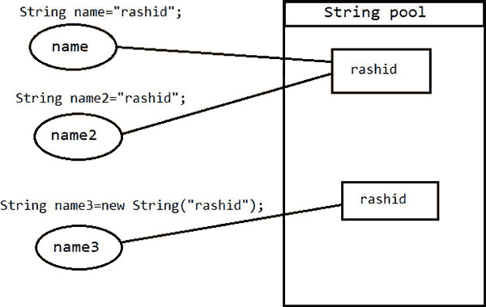

**图 6.1：** 字符串池内存管理

我们创建了两个 `String` 字面量 `name` 和 `name2`，并为这两个字面量分配了相同的值 `rashid`。在程序的第一个语句中，编译器将执行 `String name`，`String` 值 `rashid` 的内存被分配在字符串池中，因为此时字符串池中还不存在内容 `rashid`。然后，编译器执行下一个 `String name2`，并在字符串池中查找是否已经存在完全相同的 `String` 值。编译器发现 `rashid` `String` 已经在字符串池中了。它没有为 `name2` `String` 值分配新内存，而是将相同 `String` 值 `rashid` 的地址设置给变量 `name2`。在这种情况下，`name` 和 `name2` 都指向值 `rashid` 的同一个内存地址。


我们在这里通过`new`关键字借助`String`类创建了另一个对象。每当我们使用`new`关键字创建对象时，该对象在内存中都会获得单独的分配，尽管它持有相同的值。在这里，`name3`是我们创建的对象，并分配了与`name`和`name2`相同的值。然而，为`name3`分配了单独的内存。

让我们用 Java 程序来创建并理解上述场景。

**示例 6.1**: 字符串池内存分配：

```
public class StringPool {
  public static void main(String[] args) {
    String name = "rashid";
    String name2 = "rashid";
    String name3 = new String("rashid");
    System.out.print("Address for both name and name2 are same? ");
    System.out.print(name==name2);
    System.out.print(", and value for both variables is? "+name.equals(name2));
    System.out.println();
    System.out.print("Address for both name2 and name3 are same? ");
    System.out.print(name2==name3);
    System.out.print(", and value for both variables is? "+name2.equals(name3));
    System.out.println();
    System.out.print("Address for both name3 and name are same? ");
    System.out.print(name3==name);
    System.out.print(", and value for both variables is? "+name3.equals(name));
    System.out.println();
  }
}
```

**输出：**

```
Address for both name and name2 is the same? true, and value for both variables are? true
Address for both name2 and name3 are same? false, and value for both variables are? true
Address for both name3 and name are same? false, and value for both variables are? true
```

在上述示例中，你可以看到程序的输出。当我们使用`==`运算符比较变量`name`和`name2`时，它返回`true`，因为`==`比较的是内存地址而不是值。而当我们使用`==`比较`name2`和`name3`时，它返回`false`，因为它们指向两个不同的对象。但如果我们使用`equals()`方法来比较它们的值，它会返回`true`，因为两个变量的值相同。

`endsWith(String)`方法返回`Boolean`，并接收一个类型为`char`的参数。它将给定`String`最后一个索引处的字符与传入参数的`char`进行匹配；如果在`String`的最后一个索引处找到了该字符，则返回`true`；否则返回`false`。

```
String word="running";
System.out.println(word.endsWith("g"));
```

在这里，`print`语句将打印 true，因为声明的`word`变量以字符`g`结尾：

```
System.out.println(word.endsWith("n"));
```

上一个打印语句将打印`false`，因为声明的`word`变量以字符`g`结尾，而不是`n`。

注意：您可以使用`startWith()`方法来检查字符串是否以某个字符开头。例如`word.startWith("r")`；

### substring(begin) or substring(begin, end)

`substring(begin)`或`substring(begin, end)`方法返回`String`。该`String`将是给定`String`的子字符串。要从`String`中创建子字符串，我们需要指定起始点或起始和结束索引。我们在`String`类中有两个子字符串方法。其中一个是带单个参数的，它只接收字符串的起始索引并返回该起始索引之后的剩余字符串值。另一个子字符串方法接收两个参数`start`和`end`索引；作为返回，它将给出给定索引之间的字符串值。让我们通过示例来理解这一点：

```
String word="Rahul was running that day";
System.out.println(word.substring(18));
```

上一个`substring`方法将打印子字符串`"that day"`。由于我们在`substring`方法中传递了索引数字 18，因此第 18 个索引将是起始点，之后将打印单词的剩余文本。

```
System.out.println(word.substring(10, 17));
```

上一个`substring`方法将从句子“Rahul was running that day”中仅打印文本`"running"`。如果你查看`substring`方法中的参数，会发现这次我们传递了两个参数——第一个是起始索引，第二个是结束索引。因此，子字符串将打印从索引 10 到 17 的字符。

### split(regex)

`split(regex)`方法返回`Strings`并接收`regex`作为参数。该方法常用于根据字符拆分句子和单词：

```
String sentence ="this_isth&new message";
String[] newwords = sentence.split("[&|+|]");
for(inti=0;i<newwords.length;i++) {
    System.out.println(newwords[i]);
}
```

上一个代码段可以在任何 Java 程序中执行。在这里，我们将`String`句子拆分为单词并使用系统控制台打印。我们根据`String`中存在的不同特殊字符（如`&`、`+`和`()`空）来拆分句子。

在正则中，`re`传递了`[&|+|]`，字符`|`是或（OR）操作的分隔符。

### matches(regex)

`matches(regex)`方法返回`Boolean`并接收`regex`作为参数。如果给定字符串匹配给定的`regex`模式，则返回`true`；否则返回`false`。

```
String regex = "\\w.*";
String word="this_isth&new message";
System.out.println(word.matches(regex));
```

上一个代码片段可以直接粘贴到 main 方法并执行。在上一个代码中，我们通过`regex`检查`String word`是否包含任何单词。在结果中，这将给你输出`true`。

正则解释：最前面的`\`用于转义字符，`\w`匹配任何单词字符（等同于`[a-zA-Z0-9_]`），`.*`匹配任何字符（行终止符除外）。

## StringBuffer

`StringBuffer`类似于`String`类，我们用它创建`String`对象来操作字符串数据。我们必须显式创建一个`StringBuffer`对象，然后才能在其中存储值。`String`和`StringBuffer`的唯一区别是`String`是不可变的，而`StringBuffer`是可变的，这意味着我们可以更新存储在`StringBuffer`对象的值。此外，我们可以直接使用`String`字面量在不创建对象的情况下声明`String`，但我们不能那样声明`StringBuffer`。`StringBuffer`拥有`reverse()`和`delete()`方法，而`String`并不具备。

`StringBuffer`也像`String`一样是线程安全的，它的方法是同步的。`StringBuffer`不允许多个线程同时使用和操作对象；它只允许一个线程使用对象，其他想要使用的线程将进入等待队列，并逐个使用`StringBuffer`对象。

声明`StringBuffer`的语法：

```
StringBuffer <objectName> = new StringBuffer();
```

`StringBuffer`的默认初始容量为 16，它会根据你的数据不断增加。我们可以在创建`StringBuffer`对象时指定初始容量：

```
StringBuffer sb = new StringBuffer(10);
```

在这里，`StringBuffer`对象`sb`的声明将具有 16 的默认容量。你可以使用`capacity()`方法来检查`StringBuffer`的容量：

当我们声明对象时传递`int`参数，它将设置对象的容量。这里，`StringBuffer`创建了一个初始存储大小为 10 的对象。由于较大的值导致溢出时，`StringBuffer`会自动增大大小以存储字符。

### append("string")

`append("string")`方法用于在`StringBuffer`末尾添加值。`StringBuffer.append()`方法接收一个`String`类型的参数。

### insert(start, "String")

`insert(start, "String")`方法用于在指定索引处插入任何值或数据而不替换现有数据。它会在指定的索引处插入数据，并将之后的数据移动。该方法接收两个参数——第一个参数是指定起始索引的整数，第二个参数是要存储在对象中的`String`值。

### reverse()

`reverse()`方法用于反转存储在对象中的`String`。例如，如果我们想从另一个方向读取单词，可以使用`reverse`方法。

```
String name = "JAVA";
String reverseName = StringBuffer.reverse(name);
```

上行代码将在控制台打印`AVAJ`。

### delete(start, end)

`delete(start, end)`方法接收两个整数参数（`start`和结束索引）。该方法用于从指定的起始和结束索引删除`String`数据。

**示例 6.2**: StringBuffer 示例：

```
public class StringBufferEx {
    public static void main(String[] args) {
        StringBuffer sb = new StringBuffer();
        System.out.println(sb.capacity());
        sb.append("This is an ");
        sb.append("object of ");
        sb.append("StringBuffer");
        System.out.println(sb);
        sb.delete(0, 4);
        sb.insert(0, "That");
        System.out.println(sb);
        sb.reverse();
        System.out.println(sb);
        System.out.println(sb.capacity());
    }
}
```

**输出：**

`16`

`This is an object of StringBuffer`

`That is an object of StringBuffer`

`reffuBgnirtSfotcejbonasitahT`

`34`

在之前的`StringBuffer`示例中，第 4 行我们声明了一个`StringBuffer`类的对象`sb`。在第 5 行声明之后，我们在控制台上打印了该对象的容量，输出结果为 16。

然后，从第 6 行到第 8 行，我们向`sb`对象中存了一些数据。在第 9 行，我们编写了打印对象`sb`的语句，输出结果为`"This is an object of StringBuffer"`。

在第 10 行，我们使用`delete()`方法删除了从索引 0 到 4 的字符。

在代码的第 11 行，我们在 String 对象的开头插入了字符串`"That"`。因此，我们在`insert`方法中传递了索引 0 和字符串`"That"`。

同样在第 12 行，我们在控制台上打印了对象 sb，输出结果为第 3 行所示`"That is an object of StringBuffer"`。在这里，你可以看到新插入的值已经替换了被删除的值。

在代码的第 13 行，我们反转了存储在`sb`对象中的 String 数据，在紧接的一行中，我们编写了打印对象 sb 当前值的语句。结果显示，控制台上打印了`"reffuBgnirtSfotcejbonasitahT"`。

在代码的第 15 行，我们再次检查并打印了对象 sb 的当前容量。这将返回对象的当前容量或该对象中存储的字符数，作为结果，它打印了 34（这是对象中`char`的数量）。

## StringBuilder

StringBuilder 与`StringBuffer`几乎相同，不同之处`StringBuilder`不是线程安全的，且方法没有同步机制。所有方法、特性和声明方式都与我们见过的`StringBuffer`相同。

### 声明 StringBuilder 的语法：

```
StringBuilder <objectName> = new StringBuilder();
```

**注意：Java 编程语言还支持一些用于`char`和字符串字面量的特殊转义序列：`\b`（退格）、`\t`（制表符）、`\n`（换行）、`\f`（分页）、`\r`（回车）、`\"`（双引号）、`\'`（单引号）以及`\\`（反斜杠）。**

## 结论

为了管理和存储字符串数据，Java 有三个类——`String`、`StringBuffer`和`StringBuilder`。字符串字面量在 JVM 中有一个唯一的标识，它会在内部创建`String`类的对象。我们无法创建这些 String 类的子类，因为它们都是 final 类。我们可以在 String 中存储任何类型的数据或值，包括特殊字符或转义字符。String 是不可变的，但`StringBuffer`和`StringBuilder`是可变的。

这些类都是为了不同的目的设计的。根据我们的需求，我们可以选择正确的类来操作字符串数据。

在下一章中，我们将讨论数组和枚举数据类型。数组是一个在单个变量中存储相同数据类型的多个值的集合，而枚举用于声明常量变量。

## 注意事项

*   `String`对象在 String 常量池中创建。我们可以在不使用`new`关键字的情况下创建`String`类对象。

*   `String`和`StringBuffer`是线程安全的，它们的方法是同步的。

*   `StringBuffer`和`StringBuilder`是可变的。

*   `String`是不可变的。

*   `Strings`拥有`equals()`和`hashcode()`方法来操作字符串。

*   `StringBuffer`和`StringBuilder`拥有`reverse()`和`delete()`方法。

*   我们无法创建`String`、`StringBuffer`和`StringBuilder`类的子类。

## 多选题

1.  **使用哪个 String 方法来比较两个字符串的文本？**

    1. `substring()`

    2. `equal()`

    3. `compareTo()`

    4. `equals()`

2.  **`split()`方法用于：**

    1. 根据指定的正则表达式分割给`String`

    2. 比较两个或多个 String 地址

    3. 将`String`拆分为子字符串

    4. 从给定的字符串中删除字符串的一部分

3.  **以下哪项不是声明 StringBuffer 的有效方式？（多选）**

    1. `StringBuffer stringB = new StringBuffer();`

    2. `String stringB = new StringBuffer();`

    3. `StringBuffer stringB = new StringBuffer(35);`

    4. `StringBuffer stringB = "value";`

## 答案

1.  **d**

2.  **a**

3.  **b and d**

## 题目

1.  写出`StringBuilder`和`StringBuffer`的区别？

2.  预测以下程序的输出：


```java
public static void main(String args[]) {
    StringBuffer sb2 = new StringBuffer();
    sb2.append("My name is ");
    sb2.insert(11, "Gerard");
    System.out.println(sb2);
}
```

3. `append()` 是做什么的？

4. 如何将字符串转换为大写和小写？

数组根据索引号存储值，索引从 `0` 开始。例如，如果我们在数组中存储 5 个值，那么这些值的索引将是 `0`、`1`、`2`、`3` 和 `4`。数组的大小可以通过 `n-1` 计算，其中 `n` 是数组中元素的数量。

声明数组的语法：

`<data type>[] <name of array>`

或

`<data type><name of array>[]`

`空数组`

`String cars[] = null;`

`给数组赋值。`

`cars[0] = “Audi”;`

`cars[1] = “BMW”;`

## 数组的创建与初始化

`int[] arrayName = {1, 2, 3, 4, 5};`

创建固定大小或长度的数组：

`int[] arrayName = new int[5]`

我们用大括号 `{}` 包数组变量，并用逗号（`,`）隔开数组的值或元素。

我们不能在声明后分配带有连续值的数组。因此，当我们想要给数组分配一组连续的值时，必须在声明时完成。

## 访问数组

存储在数组类型变量中的值通过其索引号进行访问。此外，要在数组中添加或删除值，我们将全部使用它们的索引号。让我们通过一个示例来理解数组的索引。

**示例：**

`String cityName[] = {“Delhi”, “Mumbai”, “Kolkata”}; //line 1`

`cityName[3] = “Chennai” //line 2`

`System.out.println(cityName[1]); //line 3`

让我们理解前面的语句。在第 1 行中，我们创建了一个字符串类型的数组 `cityName`，并用三个初始城市名作为元素初始化 `cityName`。`Delhi`、`Mumbai` 和 `Kolkata` 是 `cityName` 数组的元素。Delhi 位于索引零，Mumbai 存储在索引一，Kolkata 存储在索引二。这将形成一个长度为 3 的数组。

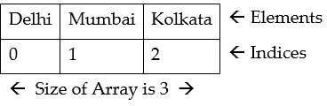

在第 2 行，我们在 `cityName` 数组的第四位置（索引号三）添加了一个元素。现在，由于我们在 `cityName` 数组中增加了一个城市名称，元素数量增加到了 4。现在，问题是如果我们写 `cityName[2] = “Chennai”` 会发生什么？它将替换之前的那个元素。在我们的案例中，它将用 Chennai 替换 Kolkata。新的数组元素将是 `{“Delhi”, “Mumbai”, ”Chennai”}`。

# 数组类中的方法

`Array` 类中有很多方法，可以帮助我们让评估更快、更简单。在本章中，我们将看到一些方法的示例。

## 复制数组

我们可以将元素从一个数组复制到另一个数组，也可以只将数组的少数元素复制到另一个。这在 Java 编程中被称为复制数组。

执行此任务有两种简单的方法：

1. 你可以简单地将一个数组赋值给另一个数组，这将该数组中的所有值复制到新数组中。

   `int[] a = {1,3,4,5};`

   `int b[] = a;`

2. 另一种方法是使用 copy Array 方法：

   `int[] c = new int[b.length];`

让我们通过一个示例来理解数组的复制：

**示例 7.1**：复制数组示例：

```java
public class CopyTwoArrays {
    public static void main(String[] args) {
        int[] a = {9,2,13,6};
        int[] b = {3,5};
        int c[] = a;
        System.out.println("Values of array b.");
        for(int i=0; i<b.length; i++) {
            System.out.println(c[i]);
        }
        int[] d = new int[c.length];
        System.out.println("Values of array c.");
        for(int i=0; i<d.length; i++) {
            System.out.println(c[i]);
        }
    }
}
```

**输出：**

```text
Values of array b.
9
2
Values of array c.
9
2
13
6
```

## 枚举（Enum）

枚举是一种特殊数据类型，用于声明一组具有相似含义的变量常量列表。例如，我们创建枚举来管理月份列表、星期名称以及其他类似值的列表。

我们通过 `enum` 关键字声明枚举，由于它持有的是常量值，因此限制是使用大字母写值。

在常见的现实场景中，我们可以将枚举理解为具有含义的代码简写。在编程中，当我们想要向最终用户隐藏实际数据时，我们倾向于使用枚举。例如，在我们的程序中，我们希望用户输入一个数字，0 代表周日，7 代表周六。但当我们为这些数字设置枚举时，我们将使用天的名称而不是序列 0 或 1，这将是周日、周一等，随后我们进一步在程序中使用它进行评估。通过这种方式，我们还可以误导黑客识别程序中使用了什么值，他们无法轻易破解使用枚举编写的程序。让我们通过示例来理解这一点：

**示例 7.2**：枚举常量示例：

```java
public enum Day {
    MONDAY, TUESDAY, WEDNESDAY, THURSDAY, FRIDAY, SATURDAY, SUNDAY
}
```

这里，我们声明了一个枚举 `Day`，它持有周日的名称。

现在，在程序中访问此常量变量：

`<name of enum>.<constant name>`

例如，`Day.MONDAY`

```java
public class EnumImpl {
    public enum Day {
        MONDAY, TUESDAY, WEDNESDAY, THURSDAY, FRIDAY, SATURDAY, SUNDAY
    }
}
```

## 结论

数组是处理相同类型值集合的特殊数据类型，简单来说，数组存储多个相同数据类型的值。存储在数组中的每个值都有一个地址，即索引，通过该索引我们可以设置和获取值。

`Enum` 是一种用于创建常量列表的特殊数据类型，且枚举也可以作为类类型使用。

## 要点

- `Enum` 类型仅用于常量。
- 我们可以在一个数组变量中存储多个具有相同数据类型的值。
- 数组元素的地址被称为 `index`（索引）。通过 `index`，我们可以操作 `array`（数组）中的值。

## 选题

1. **下列哪种是声明和赋值数组变量的正确方法？**

   1. `String flowers[] = {“Rose”,”Lily”,”Sunflower”,”Tulip”};`
   2. `String[] flowers = “Rose”,”Lily”,”Sunflower”,”Tulip”;`
   3. `String[] flowers[] = {“Rose”,”Lily”,”Sunflower”,”Tulip”};`
   4. `int flowers[] = {“Rose”,”Lily”,”Sunflower”,”Tulip”};`
   5. `String flowers[] = [“Rose”,”Lily”,”Sunflower”,”Tulip”];`

2. **下列哪种是声明枚举的正确方法？**

   1. `public enum Day {MONDAY, TUESDAY, WEDNESDAY, THURSDAY, FRIDAY, SATURDAY, SUNDAY}`
   2. `String[] enumflowers = “Rose”,”Lily”,”Sunflower”,”Tulip”;`
   3. `Enum = {JAN, FEB,MAR};`
   4. `Enum en1=new Enum({CIRCLE, TRIANGLE, SQUARE});`

3. **可以用枚举类型声明类。**

   1. 正确
   2. 错误

## 答案

1. **a**
2. **a**
3. **a**

## 练习

1. 使用 `Array` 创建一个城市列表并将前五个城市复制到一个新的 `array` 中。
2. 创建一个月份的 `enum`（枚举），并使用 `switch` case 对每个月份执行某些操作。

## 核心术语

- **Constant（常量）**：保持不变或永不改变的值。
- **Array（数组）**：在单个列表中存储多个相同类型的数据被称为 `Array`。
- **Initialize（初始化）**：将值放入或赋值给对象或 `variable`（变量）。

# 第 8 章：If/else、Case 和循环

在本章中，我们将学习条件，以及我们为什么需要以及如何在程序中使用这些条件。此外，我们还将看到应用条件和决策过程的方法。这些也被称为程序的控制流。

控制流是代码中按照它们在程序中出现的顺序顺序执行的部分，但在执行之前会进行检查。它会检查条件，只有当给定条件为真时，该段代码才会被执行。

在这里，我们将学习并练习 Java 编程中不同的控制流，如 `if`、`if-then`、`if-then-else` 和 `switch`。通过这些语句，我们管理程序的执行流，并在运行时对程序下一步将执行哪种流做出决策。

我们还将学习循环；循环是某些语句，允许根据条件或表达式多次重复一段代码块。只要表达式返回真，循环就会不断重复执行在循环体中的相同代码块。我们将看到 Java 编程中提供的循环类型以及如何在程序中实现它们。

## 结构

在本章中，我们将讨论以下主题：

- `If-then-else`
- `switch` case
- 循环
  - `while`
  - `do-while`
  - `for`

## 目标

成功完成本章后，你将能够理解编程中不同的控制流。你还将学习如何以及何时控制程序的执行。你将能够解释不同类型的循环。你将理解 `while`、`do-while`、`for`、增强型循环和嵌套循环。

### If

`if` 语句是一种强大的语句，我们用它在程序中做，并在给定条件为真时执行代码块。这也被称为 if-then 语句。

例如：

```java
if(color=="blue") {
    system.out.println("Color is blue.");
}
```

下图是 `if` 语句程序执行的图形化表示或流程图：

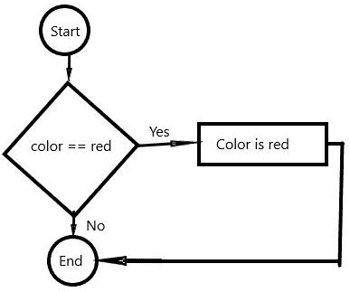

**图 8.1：** If 语句流程图

### IF/ELSE

如果 `IF` 语句中给定的条件不成立，那么 `if` 块内部的代码块将不会执行。为了处理假条件，我们编写一个 `else` 语句代码块，它将代替 `if` 语句执行。这也被称为 if-then-else 语句。

例如：

```java
if(color=="red") {
    System.out.println("Color is red.");
} else {
    System.out.println("Color is not red.");
}
```

下面的流程图显示了 `if-else` 语句的执行流：

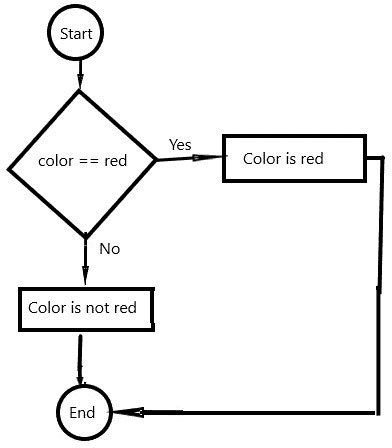

**图 8.2：** 流程图

### 嵌套 IF/ELSE

如果 `IF` 语句中给定的条件不成立，那么写在 `if` 块内部的代码块将不会执行。为了处理假条件，我们编写 `else` 语句代码块，它将代替 `if` 语句执行。这也称为 if-then-else 语句。

例如：

```java
if(color=="red") {
    System.out.println("Color is red.");
} else {
    System.out.println("Color is not red.");
}
```

### Switch case

`switch` case 是另一种做出决策和执行块的方法，类似于嵌套的 if-else。我们使用 `switch` 关键字创建 `switch` 语句并将 `variable` 作为参数：

```java
switch(variable) {
```

在 `switch` 的体中，我们声明用于检查可能值的 case，以及一个处理无匹配的 `default` case。`switch` 的体被称为 switch 块。以下是 switch case 的示例：

```java
String color = red;
switch(color) {
    case "red":
        System.out.println("Color is red.");
        break;
    case "yellow":
        System.out.println("Color is yellow.");
        break;
    default:
        System.out.println("Not matched!");
}
```

在每个 case 标签之后，必须编写 `break` 语句，它将终止 `switch` 语句并停止执行。如果不写 `break` 语句，它将执行 switch 中所有的 case。

## 循环

循环是允许在满足给定范围和条件下重复代码块的语句。有四种创建循环并遍历值范围的方法。

### while

`while` 语句用于迭代/重复代码块，直到给定条件保持真。`while` 语句在表达式后返回布尔值 `true` 或 `false`。当它返回真时，光标将进入 `while` 块体并执行语句。当它返回 `false` 时，它将不执行 `while` 块的代码。

**语法：**

```java
while(expression/condition) {
    statements…
}
```

## 示例 8.1：while 循环示例

```java
public class WhileLoop {
    public static void main(String[] args) {
        int a = 2;
        while(a<=4) {
            System.out.println("Current value of a is "+a);
            a++;
        }
    }
}
```

**输出：**

```text
Current value of a is 2
Current value of a is 3
Current value of a is 4
```

### do while

`do while` 类似于 `while` 循环，用于相同的目的。`while` 和 `do while` 的唯一区别在于，在 `do while` 中，我们在稍后检查条件，而在 `while` 中，我们在开始处检查条件。光标移动到 `do while` 块内部并执行 `do` 块下编写的语句，随后检查条件。因此，无论条件变为真还是假，`do while` 块都会至少执行一次 `do` 部分。然后，它执行 `while` 来检查条件；如果条件返回真，则程序将重复执行 `do` 语句，直到条件不再为真；否则，程序将退出。

### 语法

```java
do {
    statements...
} while();
```

### 示例 8.2：do while 循环示例

```java
public class DoWhileLoop {
    public static void main(String[] args) {
        int a = 2;
        do {
            System.out.println("Current executing index :"+a);
            a++;
        } while(a<=4);
    }
}
```

**输出：**

```text
Current executing index :2
Current executing index :3
Current executing index :4
```

在前面的程序中，即使我们更新 `while` 中的条件使其永远不会变为真，我们的程序仍会成功运行并执行一次 `do` 语句。这里有一个示例：

### 示例 8.3：do while 示例

```java
public class DoWhileLoop {
    public static void main(String[] args) {
        int a = 2;
        do {
            System.out.println("Current executing index :"+a);
            a++;
        } while(a<=1);
    }
}
```

**输出：**

```text
Current executing index :2
```


前面的程序将执行并运行`do`语句以及写在`do`语句下的代码块。在最后，它将检查条件。由于变量`a`的初始值为`2`，而在`do`块中我们将`a`的值增加了`1`，现在`a`的值为`3`。因此，条件将变为`false`，此程序将不再执行`do`语句。

## for

`for`循环是一种创建循环非常清晰且简单的方法。在`for`循环中，我们在同一个语句中编写循环的所有三个参数。`for`语句必须包含三个必需参数选项，每个参数之间用分号（`;`）分隔。它们如下：

- `Initialization`（初始化）：值范围的起始点。它在循环开始时执行一次。
- `Termination`（终止）：值范围终点的表达式，即光标退出循环的点。如果我们没有在循环中指定终止点，循环将进入无限状态，并一直执行到我们手动停止程序或系统关闭为止。
- `Increment`（递增）：该表达式在循环的每次迭代后被调用，负责增加或减少我们在终止表达式中检查的值。

### for 循环的语法

```
for (initialization; termination; increment) {
    statements...
}
```

### 示例 8.4: for 循环示例

```java
for(int i=1; i<=5; i++) {
    System.out.println("Value of i "+i);
}
```

**输出：**

```
Value of i 1
Value of i 2
Value of i 3
Value of i 4
Value of i 5
```

在前面的代码段中，我们声明了一个`for`循环，它被执行了五次。我们声明并初始化了一个整数变量`i`。

在第一个参数中，我们将变量`i`初始化为`1`，这意味着该循环将从初始值`1`开始。

在第二个参数中，我们定义了终止点`i<=5`，这意味着该循环将一直执行，直到`i`的值小于或等于`5`。

在最后一个参数中，我们定义了`i++`。该表达式在每次迭代后通过`i = i + 1`增加`i`的值。每次执行此循环时，`i`的值都会增加`1`。

## 嵌套循环

我们也可以在另一个`for`语句的体内编写一个`for`循环，这意味着循环下的循环。这被称为嵌套循环。这是一个嵌套`for`循环的示例。

### 示例 8.5: 嵌套 for 循环示例

```java
for(int i=1; i<=5; i++) {
    System.out.println("Value of i "+i);
    for(int j=1; j<=i; j++) {
        System.out.println("value of j is " +j);
    }
}
```

**输出：**

```
Value of i 1
value of j is 1
Value of i 2
value of j is 1
value of j is 2
Value of i 3
value of j is 1
value of j is 2
value of j is 3
Value of i 4
value of j is 1
value of j is 2
value of j is 3
value of j is 4
Value of i 5
value of j is 1
value of j is 2
value of j is 3
value of j is 4
value of j is 5
```

前面的代码在另一个`for`语句的体内有一个`for`循环。在这里，我们将理解嵌套循环的执行过程。嵌套`for`循环从父到子执行；这意味着每次迭代首先从父到子执行。

## forEach

`foreach`是`for`语句的增强版本，可用于遍历集合或数组类型的数据。当我们不知道数据的实际计数以指定循环的初始和终止点时，但希望根据给定对象或变量中存在的数据运行相应的次数。

### 示例 8.6: 增强循环程序示例

```java
int numberOfTimes[] = {1,2,3,4,5};
for(int temp : numberOfTimes) {
    System.out.println(temp);
}
```

**输出：**

```
1
2
3
4
5
```

### 示例 8.3: forEach 示例

```java
Integer arrayValue[] = {1,2,3,4,5};
List<Integer> list = new ArrayList<>(Arrays.asList(arrayValue));
list.forEach(listItem-> {
    System.out.println(listItem);
});
```

**输出：**

```
1
2
3
4
5
```

循环和`forEach`用于执行重复任务，或者在条件变为假之前持续执行一组语句。当我们知道元素的索引以及确切的何时停止（即执行次数）时，我们使用循环，这样就可以固定执行过程。但在许多场景下，我们并不知道索引。在这种情况下，我们使用`forEach`，`forEach`将对给定对象的每个值执行循环操作。

## 结论

Java 提供了`if-else`、`if-then-else`和`switch`来处理程序的执行流。这些控制流在做出决策以及当条件为真时执行程序部分代码起着至关重要的作用。为了处理假结果，它还允许我们编写通用的控制流（`else`或`default`）。

我们还拥有循环来重复语句的评估，或者对集合或数组类型的数据进行迭代。每个循环都有自己的优势，可以根据需求使用。`while`循环用于在满足条件时重复步骤。`do-while`用于当我们希望即使在条件不满足时也至少执行一次程序时。`for`循环用于对一组索引范围进行迭代。

在下一章中，我们将讨论包装类和泛型。包装类是帮助我们创建基本数据类型值之对象的类。泛型是自定义类，我们在其中对类及其成员给出了自己的定义。泛型帮助我们在运行时将数据映射到自定义对象类型中。

## 需要记忆的点

- `if-then`和`if-then-else`是处理程序执行流的程序控制流。
- 每个循环都应该包含三个要素 - 初始化、终止和递增/递减。
- 如果我们不在循环中指定终止点，循环将进入死循环。

## 多选择题

1. **下列哪项不是循环的类型？**

   1. `for`
   2. `foreach`
   3. `while`
   4. `switch`

2. **下列哪项是声明 for 循环的错误方式？**

   1. `for(a=1; a<4; a++) {…}`
   2. `for(int b=4; b>=2; b--) {…}`
   3. `forLoop(inti=1;i<=3;i++) {…}`
   4. `for(;i<=3;i++) {…}`

3. **预测以下程序的输出：**

```java
public class DoWhileLoop {
    public static void main(String[] args) {
        int a = 2;
        do {
            System.out.println("Current executing index :"+a);
            a++;
        } while(a<3);
    }
}
```

   1. Current executing index: 2
   2. Current executing index: 2

      Current executing index: 3
   3. Current executing index: 3
   4. Current executing index: 1

      Current executing index: 2

## 答案

1. **d**
2. **c**
3. **a**

## 问题

1. 写一个程序，使用`switch`语句根据月份序列计数获取月份名称。例如，1 代表一月，2 代表二月，依此类推。
2. `while`循环和`do-while`循环的区别是什么？
3. 创建`for`循环需要的三个参数是什么？

## 术语

- **Lambda 表达式**：Lambda 表达式只是编写方法实现以供以后执行的简短方式。
- **迭代器 (Iterator)**：迭代器是逐个读取对象集合的过程。

# 第 9 章 包装类与泛型

在本章中，我们将学习包装类、包装类的需求以及用处。包装类是基本数据类型的替代方案，我们主要在集合中使用它们。此外，我们将讨论从基本数据类型到包装类以及反之的转换。我们还将在章中涵盖类型转换和泛型，在其中我们将讨论各种类型的转换、何时进行转换，以及类型转换的优缺点。

在 Java 编程中，泛型用于使我们的代码免于运行时发生的类`CastException`。为了防止运行时数据转换错误，我们使用泛型，以便编译器在运行时强制检查代码，确保不会发生与数据转换相关的运行时错误。我们将看到设计泛型的方法，包括泛型类、泛型接口和泛型方法。

## 结构

在本章中，我们将讨论：

- 包装类
- 类型转换
  - 窄转换
  - 宽转换
- 泛型
  - 参数类型
  - 泛型类
  - 泛型接口
  - 泛型方法

## 目标

本章介绍了类型和包装类。此外，在本章中，我们将通过示例演示转换。我们将涵盖泛型及其相应的类型。

## 包装类

包装类是帮助我们创建基本数据类型值之对象的类。这意味着当我们使用基本数据类型（`int`、`char`、`float`）声明变量时，使用的是它们的包装类。

下表列出了八种基本类型及其包装类：

| 基本类型 | 包装类 |
| :--- | :--- |
| byte | Byte |
| short | Short |
| int | Integer |
| long | Long |
| float | Float |
| double | Double |
| char | Character |
| boolean | Boolean |

**表 9.1:** 基本类型与包装类

在处理集合 API 和数据结构时，我们需要这些包装类和它们的对象。由于基本类型不属于任何类，为了在集合中管理数据，我们需要将基本类型转换为对象。

例如：

```java
List<Integer> listNumber = new ArrayList<Integer>();
```

我们不能用基本类型代替包装类来编写上述代码。这会导致编译错误：

```java
List<int> listNumber = new ArrayList<int>(); // List 声明无效
```

前面的代码是自动装箱（autoboxing）的示例。在这个示例中，我们可以无地将`int`类型的数据添加到`Integer`类类型中。代码的第 3 行声明了一个`int`变量`roll`，它持有值`1234`（基本数据类型）。在接下来的第 4 行，我们声明了一个`Integer`类型的列表（包装类）并据此创建了一个对象`list`。该列表是 Java 编程中集合 API 的成员。在代码的第 5 行，我们将`int`值添加到`list`对象中。我们写了一句简单的`list.add(roll)`语句，但在底层，编译器将执行类似下面的操作：

```
list.add(Integer.valueOf(roll));
```

因此，这被称为**自动装箱**。

## 拆箱 (Outboxing)

当我们显式地转换包装类对象并将其赋值给基本类型时，它被称为**拆箱**（outboxing）。

例如：

```
long longValue = 1234567891233232324l;
int intValue = longValue; // 这行代码会产生编译错误。
```

在上述语句中，我们有两个变量；一个是`long`类型，另一个是`int`类型。与`int`相比，`long`类型是一种较大的数据类型。因此，当我们尝试将`long`值赋值给`int`变量时，编译器将生成编译错误“类型不：无法从 long 转换为 int”。但我们可以使用强制转换将该`long`值显式转换为`int`。在下面的代码行中，我们在强制转换`(int)`的帮助下将`long`值转换为了`int`变量：

```
int intValue = (int) longValue;
```

### 类型转换 (Type casting)

类型转换是将一种类型的值赋值给另一种类型的概念。类型转换有助于我们进行内存管理，当我们把较大数据类型的值赋值给较小的数据类型时，我们需要显式进行类型转换。在 Java 编程中，当我们尝试将较大的字节数据类型赋值给较小的数据类型时，编译器将抛出编译错误`“Type mismatch: cannot convert”`。

每个数据类型都有内存大小限制来存储值。我们只对基本数据类型的值执行类型转换：

| 数据类型 | 符号位 |
| :--- | :--- |
| boolean | 1 bit |
| byte | 8 bit |
| short | 16 bit |
| int | 32 bit |
| long | 64 bit |
| float | 32 bit |
| double | 64 bit |
| char | 16 bit |

**表 9.2：** 数据类型及其内存大小

*[表 9.1]* 显示了所有基本数据类型及其在位中的内存大小，这是根据系统为数据类型管理或存储值而分配的位大小。我们已经讨论过这些类型及其内存，[第 3 章：类、对象和变量]。现在，回到类型转换，我们将看到执行类型转换的方法以及在 Java 编程中如何操作。类型转换有两种类型——收窄转换和宽转换。让我们详细查看这些类型。

## 收窄转换 (Narrowing)

当我们把高尺寸数据类型赋值给较小尺寸时，我们需要在程序中显式地进行收窄。以下是基本数据类型按大小从大到小的排列顺序：

`double > float > long > int > char > short > byte`

例如，当我们尝试如下将`long`类型变量赋值给`int`类型变量时，JDK 将生成编译错误`“Type mismatch: cannot convert from long to int”`：

```
long longValue = 123456789l;
int intValue = longValue;
```

同样，当我们将`long`值赋值给`int`时，通过将`long`值转换为`int`也可以实现这一点。这是一个示例：

```
long longValue = 123456789l;
int intValue = (int) longValue;
```

你可以参考本章最后示例程序部分的程序 1。

### 宽转换 (Widening)

当我们把小尺寸数据类型赋值给高尺寸数据类型时，被称为宽转换。宽转换由编译器自动处理，我们在赋值时不需要编写任何显式参数，就像收窄转换的情况那样。在宽转换的情况下，编译器会自动转换该值且不会抛出任何错误：

```
int intValue = 1234;
long longValue = intValue;
```

在前面的变量赋值情况下，编译器不会抛出任何错误，并将整数值赋值给`long`变量将无问题地工作。以下是基本数据类型按大小从小到大的排列顺序：

`byte > short > char > int > long > float > double`

**注意：只有当我们确定高尺寸数据类型中的可用数据能够放入小尺寸类型时，我们才应该进行类型转换；否则，编译器将压缩你的数据以适应较小尺寸的数据类型，我们可能会丢失实际值。请研究本章最后解决方案程序部分的程序 2，以理解当我们尝试压缩无法放入小尺寸数据类型的大值时会发生什么。**

## 泛型 (Generics)

泛型用于使我们的代码类型安全，并避免程序出现运行时错误或类转换异常。运行时错误和异常通常发生在我们接收到的无法转换为另一种类型的数据时，这在处理集合时很常见。泛型帮助我们使代码更安全，以便我们可以根据需要正确地类型转换数据，编译器在编译时检查泛型。使用泛型的一个很好的原因是，如果在运行时发生错误，很难识别并修复。因此，最好在编译时使用泛型并修复这些类型转换问题。Java 编程中有三种方式定义泛型。泛型确保类型集合只存储指定类型的数据。如果程序尝试向整数类型的集合插入字符串数据，则会抛出错误。

例如：

```
List<Integer> marks = new ArrayList<Integer>();
marks.add(20);
marks.add("rashid"); // 这行代码将产生错误。
```

代码的第 3 行将产生编译错误`The method add(Integer) in the type List<Integer> is not applicable for the arguments (String)`，因为我们试图将字符串类型的值赋值给整数类型。

### 参数类型

参数类型可以是任何 POJO 类和接口。创建泛类对象时，我们需要显式指定数据类型或 POJO 作为类型参数，以便编译器运行检查确保获取正确类型的值。常用的类型参数名称有：

- `E` - Element（元素）
- `K` - Key（键）
- `N` - Number（数字）
- `T` - Type（类型）
- `V` - Value（值）
- `S, U, V` 等 —— 第二、第三、第四类型

你将在整个 Java SE API 中看到这些参数名。这些类型的参数也可以是数组类型。

## 边界类型参数 (Bounded type parameters)


泛型使参数不受任何数据限制，但有时我们需要限制某些类型并仅允许特定数据，特别是在进行任何数据操作时，我们的类或方法有对特定类型数据执行的操作。在这种情况下，我们使用边界类型参数，并通过 `extends` 关键字将泛型参数数据类型绑定。让我们来看边界类型参数泛类的示例。

例如：

```java
public class BoundedTypeParameter<T extends Number> {
    private T params;

    public T getParams() {
        return params;
    }

    public void setParams(T params) {
        this.params = params;
    }

    public static void main(String[] args) {
        BoundedTypeParameter<Integer> gen2 = new BoundedTypeParameter<>();
        gen2.setParams(123);
    }
}
```

在前面的程序中，我们声明了一个边界类型参数。要使一个类成为边界类型，我们需要在声明类、接口或方法时，将数据类型扩展为参数类型。在我们的案例中，`T` 扩展了 `Number`，这意味着这些参数类型仅允许数值值 `BoundedTypeParameter<T extends Number>`。

当我们尝试在该程序的 `main` 方法下添加以下行代码时，编译器将生成编译时异常 `“Bound mismatch: The type String is not a valid substitute for the bounded parameter <T extends Number> of the type BoundedTypeParameter<T>”`。因为我们把 `BoundedTypeParameter` 类声明为参数化类，但使用了一个包装为 `Number` 的边界类型包装类，而在这些语句中，我们正尝试将一个 `String` 值赋值给 `Number` 数据类型，这是不可能的：

```java
BoundedTypeParameter<String> gen1 = new BoundedTypeParameter<>();
gen1.setParams("GenericOne");
```

### 泛型类

泛型类（Generic class）是一个与类相关参数类型的类。该类型可以是 Java 的参数、数据类型、类或接口，并且可以在尖括号内拥有一个或多个参数作为类型。

例如：

```java
public class GenericsWithTypeParam<T> {
    private T type;
    public T getType() {
        return type;
    }
    public void setType(T type) {
        this.type = type;
    }
    public static void main(String[] args) {
        GenericsWithTypeParam<String> typeString = new GenericsWithTypeParam<String>();
        typeString.setType("I am String generic type.");
        System.out.println(typeString.getType());
    }
}
```

前面的类被声明为带有类型参数 `T` 的泛型类。泛型类型 `T` 指向一个类型，该类型可以是任何形式的数据。在这个类中，我们创建了一个类型为 `T` 的私有变量，并创建了 getter 和 setter 方法来从类型变量中设置或获取值。

在创建此泛型类的对象时，我们需要显式地指定数据类型，以便编译器运行检查，以确保将正确类型的值赋值给变量。在我们的案例中，我们创建了 `String` 数据类型的对象，因此只有 `String` 值可以设置到类型中。

**注意：请参考本章末尾解决方案部分的程序 3 和程序 4，以理解泛型的其他方法，例如无类型对象和泛型中的多类型参数。我们也可以在泛型中将参数类型声明为数组。**

### 泛型接口

泛型接口（Generic interface）的声明方式与泛型类相同。唯一的区别是声明关键字 `interface`，我们将其用于接口声明，其他步骤与处理泛型类时相同。

例如：

```java
public interface GenericClass<K, V> {
    //在此处编写你的代码
}
```

### 泛型方法

泛型方法（Generic method）是一种引入其自己的类型参数的方法，类似于泛型类。当我们不想让整个类都参数化时，就会声明泛型方法。因此，为了使类的某个部分参数化，我们使方法或构造函数变为泛型。这里是一个泛型方法的示例：

```java
package generics;

public class GenericMethodEx<T> {
    public static <T> String genericMethod(GenericMethodEx<T> a, GenericMethodEx<T> b) {
        return "First generic is " + a.getParams() + ", and second generic is " + b.getParams();
    }

    private String params;

    public String getParams() {
        return params;
    }

    public void setParams(String params) {
        this.params = params;
    }

    public static void main(String[] args) {
        GenericMethodEx<String> gen1 = new GenericMethodEx<>();
        gen1.setParams("GenericOne");
        GenericMethodEx<String> gen2 = new GenericMethodEx<String>();
        gen2.setParams("GenericTwo");
        System.out.println(genericMethod(gen1, gen2));
    }
}
```

**输出：**

`First generic is GenericOne, and second generic is GenericTwo`

在前面的类 `GenericMethodEx` 中，有一个泛型方法 `genericMethod()`。该方法有两个类型为 `T` 的参数并返回 `String`。方法的参数也必须与 `T` 类型相同才能成功编译。

在程序的 `main` 方法中，我们创建了 `GenericMethodEx` 类的两个对象 `gen1` 和 `gen2`，它们也是参数类型 `T` 和泛型类。通过将这些对象作为参数传递给 `genericMethod`，我们正在执行该泛型方法。

# 泛型类的最佳实践

- 不允许在类或接口中声明静态泛型参数化成员。当我们尝试这样做时，编译器将生成编译错误：`Cannot make a static reference to the non-static`。

  例如：

  ```java
  public class GenericInterface<T> {
      static T rollNumber; // 这是无效的
      private T rollNumber; // 这是有效的
  }
  ```

- 在创建此泛型类的对象时，我们需要显式地指定数据类型，以便编译器运行检查，以确保将正确类型的值赋值给变量。在我们的案例中，我们创建了 `String` 数据类型的对象，因此只有 `String` 值可以设置到类型中。

  例如：

  ```java
  GenericInterface<int> generic = new GenericInterface<int>(); // 无效
  GenericInterface<Integer> generic = new GenericInterface<Integer>(); // 有效
  ```

- 我们不能将泛型类声明为异常类（Exception class）。当我们尝试将异常类用于泛型类时，会产生类型错误。

  例如：

  ```java
  public class GenericInterface<T> extends Exception {} // 无效
  ```

## 总结

Java 包装类是原始数据类型的类，我们在集合中使用。在使用集合框架时，始终使用包装类而不是原始数据类型。类型转换是将类型从小到大以及从大到小的过程。这个过程有助于我们管理内存。泛型是一种允许对象根据其类型自由管理数据的机制。

在下一章中，我们将讨论**面向对象的编程语言**（**OOPS**）的概念及其特性，包括封装、抽象、继承、重载和重写。

## 重点

- 类型转换是将一种类型赋值给另一种类型的概念。
- 我们不能将泛型参数类型声明为静态成员。
- 边界参数类型是将泛型类型参数限制在特定的数据类型。
- 包装类是原始数据类型的类，我们在集合中使用。通过包装类，我们可以创建原始类型无法创建的对象类型。
- 泛型用于确保我们的代码类型安全，并避免程序出现运行时错误或类转换异常。我们通过泛型类、接口、方法和构造函数来实现泛型。
- 类型转换有两种类型：收缩和拓宽。

## 单选题

1. **以下哪项不是包装类？**
   1. `Integer`
   2. `Boolean`
   3. `Double`
   4. `Long`

2. **收缩和拓宽是泛型的类型。**
   1. 正确
   2. 错误

3. **泛型用于防止运行时异常。**
   1. 正确
   2. 错误

4. **在泛型中编写参数化方法的正确方式是？**
   1. `public static <T> genericMethod(G<T> a, G<T> b){}`
   2. `public String genericMethod(G<T> a, G<T> b){}`
   3. `public <T> String genericMethod(G<T> a, G<T> b){}`
   4. `public static String genericMethod(G<T> a, G<T> b){}`

5. **带有参数边界类型的泛型类的正确声明方式是？**
   1. `public class BoundedTypeParameter<T extends Number> {}`
   2. `public class BoundedTypeParameter<T> {}`
   3. `public class BoundedTypeParameter<T extends int> {}`
   4. `public class BoundedTypeParameter<T extends ?> {}`

## 答案

1. **b**
2. **b**
3. **a**
4. **c**
5. **a**

## 问题

1. 写出所有基本数据类型及其对应的包装类。
2. 设计一个类型为 `K` 和 `V` 的泛型类，存储学生的成绩。计算平均分和百分比并在输出中打印。
3. 解释类型转换中的窄化（narrowing）概念。
4. 什么是类型参数？边界类型参数与普通类型参数有什么区别？

## 核心术语

- **泛型 (Generics)**：泛型是一种帮助我们编写无错误的功能。
- **边界 (Bounded)**：限制泛型类型参数。
- **宽化 (Widening)**：将较小的数据类型赋值给大的数据类型。
- **窄化 (Narrowing)**：将大的数据赋值给小的数据类型。
- **装箱 (Outboxing)**：将包装类型赋值给基本数据类型。

## 示例程序

**程序 1：** 使用类型转换将 `long` 类型变量赋值给 `int` 类型变量。

```java
public class LongToInt {
    public static void main(String[] args) {
        long longValue = 123456789l;
        int intValue = (int) longValue;
        System.out.println(intValue);
    }
}
```

**输出：**

`123456789`

**程序 2：** 相同值和变量的反向类型转换。

```java
public class LongToInt {
    public static void main(String[] args) {
        int intValue = 1234;
        double doubleValue = intValue;
        System.out.println("Value of int after it gets converted to double:" + doubleValue);
        long longValue = 1234567891233232324l;
        intValue = (int) longValue;
        System.out.println("Long value after converted into int type:" + intValue);
        longValue = intValue;
        System.out.println("Reverse value from int to long:" + longValue);
    }
}
```

**输出：**

`Value of int after it gets converted to double:1234.0`

`Long value after converted into int type:-1072736828`

`Reverse value from int to long:-1072736828`

**程序 3：** 带有键值对数据的泛型简单示例。

```java
package generics;

public class TypeParameters<K, V> {
    private K key;
    private V value;

    public static void main(String[] args) {
        TypeParameters<String, String> typeP = new TypeParameters<String, String>();
        typeP.setKey("rankOne");
        typeP.setValue("rashid");
        System.out.println(typeP.getValue() + " got the " + typeP.getKey());
    }

    public K getKey() {
        return key;
    }

    public void setKey(K key) {
        this.key = key;
    }

    public V getValue() {
        return value;
    }

    public void setValue(V value) {
        this.value = value;
    }
}
```

**输出：**

`rashid got the rankOne`

**程序 4：** 使用同一个泛型类创建不同类型的对象。

```java
package generics;

public class TypeParameters<K, V> {
    private K key;
    private V value;

    public static void main(String[] args) {
        TypeParameters<String, String> typeP = new TypeParameters<String, String>();
        TypeParameters<String, Integer> typeB = new TypeParameters<String, Integer>();
        typeP.setKey("rankOne");
        typeP.setValue("rashid");
        System.out.println(typeP.getValue() + " got the " + typeP.getKey());
        typeB.setKey("roll number");
        typeB.setValue("rashid");
    }
}
```

```java
public void setName(String name) {
    this.name = name;
}

public float getPercentage() {
    return percentage;
}

public void setPercentage(float percentage) {
    this.percentage = percentage;
}
```


在前面的`EncapsulationEx`类中，我们声明了三个变量，并为这些变量编写了`getter`和`setter`方法，以便其他类访问这些变量：

```java
public class EncapsulationExImpl {
    public static void main(String[] args) {
        EncapsulationEx ee = new EncapsulationEx();
        ee.setName("ABC");
        ee.setPercentage(68.3f);
        ee.setScore(24);
        System.out.println(ee.getName());
        System.out.println(ee.getPercentage());
        System.out.println(ee.getScore());
    }
}
```

**输出：**

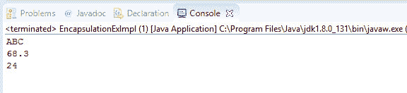

**图 10.1：**`EncapsulationExImpl`类的输出

在前面的实现程序中，我们创建了`POJO`类对象，并使用`setter`方法为`POJO`类的变量赋值，然后使用`getter`方法获取这些变量的值。`setName()`方法为`EncapsulationEx`类的变量`name`赋值，其他变量也同样如此。我们将在接下来的章节中详细讨论`getter`和`setter`。

### 抽象（Abstraction）

抽象是面向对象编程中的一个概念，它隐藏具体的实现，仅向外部世界或继承该抽象类的类暴露功能。当我们使用`abstract`关键字声明类时，该类就可以是抽象类。抽象类可以包含抽象方法和非抽象方法，非抽象方法可以同时包含声明和定义。抽象类不能初始化，这意味着我们不能创建抽象类的对象，但继承抽象类的类可以初始化它。要继承抽象类，我们需要使用`extends`关键字扩展该类，并为其所有的抽象方法提供定义。以下是抽象方法声明的示例：

```java
public abstract class AbstractClass {
    abstract int additionaOfTwoNumber();
    void displayName() {
        System.out.println("This is a non-abstract method in abstract class.");
    }
}
```

在前面的示例中，我们声明了一个名为`AbstractClass`的`abstract`类，包含两个方法：一个是抽象的，另一个是非抽象的。抽象方法只能有声明，不能有定义；抽象方法的定义将由继承抽象类的类提供。

### 继承（Inheritance）

继承是继承和遵循其他类、父类（超类）或接口属性的机制。继承是面向对象编程中的一个强大概念，一个类通过建立关系与其他类共享属性。

Java编程不支持多重继承，这是为了避免逻辑混淆。让我们通过这种方式理解它：假设我们有一个类`A`，它有三个方法`animal()`、`food()`和`speed()`。另一个类`B`拥有两个方法`animal()`和`life()`。当第三个类`C`尝试扩展类`A`和`B`并尝试重新定义方法`animal()`时，编译器将会感到困惑，无法判断应该调用来自类`A`还是类`B`的`animal`方法。

Java因为歧义不支持多重继承，但在接口的帮助下，我们可以在Java中实现多重继承，这意味着我们不能扩展两个类，但可以在一个类中实现两个或多个接口。

### 多态（Polymorphism）

多态是以多种方式使用方法或类，或根据需要以不同的行为重用这些类和方法的机制。我们在Java编程中通过继承来实现多态，其中子类继承父类的属性，并用自己的定义覆盖这些方法。用简单的英语来说，多态意味着一个对象以多种形式使用。实现多态有两种：方法重载和方法重写。

### 方法重载（Method overloading）

方法重载是Java编程中的一个强大概念，可以使代码具有扩展性和可重用性。方法重载是多态的概念。具有相同名称但返回类型和方法签名（参数的类型和顺序）不同的Java方法被称为`方法重载`。在这种情况下，我们通过不同的返回类型或参数编写相同的方法，且参数的类型和顺序可能不同。以下是一个方法重载程序的示例：

```java
public class MethodOverloading {
    public static void main(String[] args) {
        MethodOverloading mo = new MethodOverloading();
        System.out.println(mo.addTwoNumber(4.3F, 88.12F));
        System.out.println(mo.addTwoNumber(2, 3));
    }
    private int addTwoNumber(int a, int b) {
        return a*b;
    }
    private String addTwoNumber(float a, float b) {
        return "Addition of two float numbers is : " +a*b;
    }
}
```

**输出：**

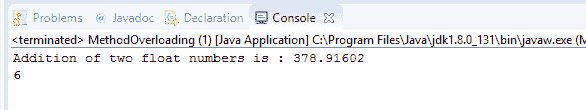

**图 10.2：**`MethodOverloading`类的输出

在前面的程序中，定义了两个名称相同但参数类型不同的方法。在类内部创建同名但不同参数类型的方法就是`方法重载`。

### 方法重写（Method overriding）

方法重写是在子类中使用相同名称和相同类型方法的概念。例如，如果你在父类中声明了一个方法，并在子类中实现该方法时，为该方法提供相同的参数和方法名。`@Override`注解告诉编译器该方法旨在重写父类的方法。该注解帮助编译器检查父类中是否存在该方法。以下是一个方法的程序示例：

```java
package oops;
public class Flower {
    public void flowerRose() {
        System.out.println("I'm Rose. My color is Red.");
    }
    public void flowerName(String name) {
        System.out.println("I'm a flower. My name is "+name+".");
    }
}
```

子类继承`Flower`类，重写`Flower`类的方法并改变其定义。让我们通过一个示例程序练习这个概念。

```java
package oops;
public class Flora extends Flower{
    public static void main(String[] args) {
        Flora flora = new Flora();
        flora.flowerName("Marigold");
        flora.flowerRose();
    }
    @Override
    public void flowerName(String name) {
        System.out.println("I'm a flower. My name is "+name+".");
    }
    @Override
    public void flowerRose() {
        System.out.println("I'm Rose. My color is White.");
    }
}
```

### 接口（Interface）

接口是一种完全抽象，帮助我们暴露可以被实现接口的外部世界调用的方法。例如，考虑接口中的汽车，汽车的功能或特征如启动、停止、移动、播放音乐和转弯是接口声明的方法。当子类实现汽车接口时，子类可以访问并调用父类，并为该方法提供自己的定义以调用父类的功能。接口可以包含默认方法、静态方法和常量。抽象方法在接口中没有体（定义），但接口内部的默认方法和静态方法可以包含声明和定义。

接口中声明的每个方法无论我们是否显式声明为`abstract`，默认都是抽象的且公共的。实现接口的类必须在编译之前提供接口所有方法的定义。如果我们不这样做，将抛出编译时错误（compilation error）。接口不能被初始化，只能由其他类实现或由其他接口扩展。

我们在Java编程中创建接口是为了向外部世界、第三方应用程序和软件暴露对象的特性，主要用于开发服务或应用程序接口（`APIs`）。这里是一个接口的示例：

让我们来看一个`Car`接口类：

```java
package oops;

public interface Car {
    void start();
    int speed();
    default String model() {
        return "This is a luxury car";
    }
}
```

在前面的示例中，`Car`是一个拥有三个方法的接口；`start`和`speed`是抽象方法，而`model`是默认方法。默认方法也有定义，但`start`和`speed`方法只有以分号结尾的声明。现在，实现此接口的类必须给出所有抽象方法的定义。如果我们不这样做，将抛出错误：`The type InterfaceExample must implement the inherited abstract method Car.<method name>`。`InterfaceExample`是实现接口`Car`的类：

```java
package oops;

public class InterfaceExample implements Car{
    public static void main(String[] args) {
        InterfaceExample interfaceExample = new InterfaceExample();
        interfaceExample.start();
        System.out.println("Your car is running with speed: "+interfaceExample.speed());
    }

    @Override
    public void start() {
        System.out.println("Engine has been started.");
    }

    @Override
    public int speed() {
        return 50;
    }
}
```

在前面的示例中，`InterfaceExample`类是一个继承了接口`Car`并为其所有抽象方法提供定义的Java类。如果需要，你也可以重写默认方法，但这不是强制性的，你可以跳过并忽略非抽象方法。如果程序员不想在子类中实现所有抽象方法，那么他们需要创建的是抽象类，而不是创建接口。

## 结论

在本章中，我们讨论了面向对象编程的各种原则，以及我们如何在软件和应用开发中使用面向对象编程机制。封装是为了隐藏数据，抽象是为了隐藏实现，而继承是为了从一个类共享或继承属性和方法。我们还学习了方法以及如何通过方法重载和重写来重用和重新设计方法。

在下一章中，我们将详细讨论程序中的异常和错误处理，以及异常和错误的类型。我们还将讨论如何编写自定义异常以及显式抛出错误和异常。我们也会讨论故障安全（fail safe）和快速失败（fail fast）类型的程序。

## 记忆点

- 封装是`OOPS`的一个概念，用于隐藏类的数据或字段，并限制子类和其他Java程序对该信息的直接访问。
- 抽象是一个向其他类隐藏方法的实现并暴露功能的概念。
- 多态是以不同形式使用方法的概念。实现多态有两种方法——方法重载和方法重写。
- 子类继承父类的功能，并对父类中已有的具有相同名称、类型和参数数量的方法进行重新定义，这被称为方法重写。
- 声明相同名称但不同返回类型、不同参数类型和参数数量的方法称为方法重载。这是在同一个类内部创建的。

## 单选题

1. **以下哪项不是面向对象编程的原则？**
   1. 抽象
   2. 多态
   3. 异常处理
   4. 封装

2. **哪种`OOPS`原则用于将方法和属性组合成类？**
   1. 多态
   2. 封装
   3. 继承
   4. 抽象

3. **哪个关键字用于从接口继承方法？**
   1. `Extend`
   2. `Extends`
   3. `Implement`
   4. `Implements`

## 答案

1. **c**
2. **b**
3. **d**

## 问题

1. 什么是面向对象编程？
2. 面向对象编程的原则有哪些？
3. `has-A`（包含关系）和`is-A`（继承关系）之间有什么区别？
4. 为什么Java不支持多继承？
5. 什么是方法签名？

## 核心术语

- **超类（Super-class）**：超类是与子类共享属性的父类，或继承父类的类。
- **子类（Sub-class）**：子类是继承另一个类的特征和功能的类。
- **封装（Encapsulation）**：隐藏数据。
- **多态（Polymorphism）**：重用或重新定义方法。
- **抽象（Abstraction）**：隐藏类的实际实现。
- **继承（Inheritance）**：共享类的属性。

异常（Exception）是一种描述异常状况的事件，它发生在运行中的程序和软件代码上，并中断程序的正常执行。这种非预期的中断可能发生在程序接收到错误且无效的数据及数据类型时。当程序发生错误时，程序会创建一个对象，其中包含了程序的错误和异常细节，例如错误何时发生、错误的原因是什么以及错误的状态等。程序会将所有这些答案交给运行时系统。

为了管理异常并处理可能的错误场景，我们通常使用三个代码块来编写程序：`try`、`catch`和`finally`。

## Try-catch

`try`块是一个我们在其中编写执行过程中可能产生错误的代码块。`try`关键字用于声明`try`块。你想要监控异常的语句放在`try`块中。`try`块后面必须紧跟`catch`块或`finally`块。

然后，为了处理来自`try`块的错误，我们编写`catch`块。在`catch`块中，我们写一个带有异常类型参数的`catch`方法，然后在`catch`块下编写语句，以便在程序发生该类型异常时执行相应的操作。没有`try`块无法使用`catch`块。`try`块之后可以有多个`catch`块，每个块处理不同的异常类型。我们可以编写多个`catch`块，尽可能处理多个异常类，或在单个`catch`块中处理同一组的多个异常类。在下面的语法部分，我们可以参考`catch`块的示例。当方法或程序中发生异常时，运行时系统会寻找相应的异常处理器方法来处理错误；该处理器被称为`catch`块。

**try-catch语法：**

```java
try {
  //statements
}
catch (ExceptionType objectName) {
  //statements
}
/*
* 处理多个异常类的 Catch 块。
*/
catch (ExceptionType objectName | ExceptionType objectName) {
  //statements
}
```

运行时系统从发生错误的方法开始寻找异常处理器（`catch`块），并按照方法或程序执行的反向顺序在调用堆栈（call stack）中继续搜索。当找到合适的处理器时，运行时系统将异常传递给该处理器以处理错误；如果系统无法找到合适的处理器，运行时系统将终止。

异常处理是一种处理可能的错误场景的高级机制，可以避免应用程序和软件的终止。这有助于我们打印错误信息、恢复错误、在发生异常时采取替代措施，并向用户提示错误以采取所需的操作。

## Finally block

`finally`块是一个与`try-catch`块一起使用的块，用于执行我们希望在所有情况下都执行的代码语句。无论程序是否发生错误，`finally`代码块都应该执行。当我们的程序执行时，`finally`块始终执行；我们使用此块编写始终希望执行的语句，例如关闭数据库连接、关闭IO对象等。这有助于释放内存并为终端用户生成任何消息。

**finally块语法：**

```java
finally {
  //write your statement here
}
```

下面的图表示了`Exception`类及其层次结构，以及与编程中其他类的关系。异常有两种类型——检查异常（checked exceptions）和未检查异常（unchecked exceptions）：

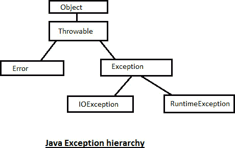

**图 11.1**：错误和异常类的层次结构

### 检查异常（Checked exception）

检查异常是编译器在编译时生成的异常。程序员在编写程序时必须处理这些检查异常。这些异常应该使用`try-catch`块进行处理，或者在异常类中使用`throws`关键字在方法声明中进行声明。

以下是一些检查异常类：

- `SQLException`
- `IOException`
- `ClassNotFoundException`
- `InvocationTargetException`

### 未检查异常（Unchecked exception）


未检查异常是在 Java 虚拟机运行期间，由于用户或其他应用程序提供的无效或错误数据而发生或抛出的异常。

以下是常用的未检查异常类，它们是 `RuntimeException` 类的子类：

- `NullPointerException`
- `ArrayIndexOutOfBoundsException`
- `ArithmeticException`
- `IllegalArgumentException`
- `NumberFormatException`

## 自定义异常 (Custom exception)

自定义异常也称为用户定义异常。它是开发者创建的用于定义和处理任何新类型的异常，预定义的异常类中不存在这种异常。在 Java 编程中，我们可以通过 `extends` 关键字继承 `Exception` 类来创建自定义异常，并相应创建方法。

让我们通过示例来理解自定义异常：

```java
package exceptions;
public class MainClass {
  public static void main(String[] args) {
    try {
      String error = "Exception occurred due to custom exception.";
      throw new CustomException(error);
    } catch(CustomException e) {
      System.out.println(e);
    } finally {
      System.out.println("Execution of the completed.");
    }
  }
}

/**
* 此类用于定义自定义异常。
*/
class CustomException extends Exception {
  String errmsg;
  public CustomException(String errorMessage) {
    errmsg = errorMessage;
  }
  public String toString() {
    return "Custom Exception: " + errmsg;
  }
}
```

**输出**：

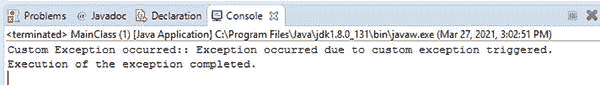

**图 11.2**：`CustomException` 的输出

## 错误 (Error)

错误由于 Java 虚拟机中的硬链接失败和动态链接失败引起，这些错误无法使用 `catch` 块处理。这类错误无法通过使用异常类或显式抛出异常来处理。

## Try 带资源的 try (Try with resources)

Try with resources 是编写 `try` 块的一种高级方式。使用 try with resources，我们可以声明一个或多个实现了 `AutoClosable` 接口并继承 `Closable` 接口的类或资源，这样在程序成功或失败执行后，这些资源将在执行 `catch` 和 `finally` 块之前由虚拟机自动关闭，我们无需程序中显式地关闭这些对象。

**语法**：

```java
try (FileReader fr = new FileReader()) {
  //statements
}
```

Try with resources 特性是在 Java 7 中引入的；在此之前的 Java 版本中，我们使用 `finally` 块来显式关闭我们在 `try` 块或方法内部创建的资源。

让我们通过示例来理解这一点：

```java
package exception;
import java.io.File;
import java.io.PrintWriter;
public class TryWithResources {
  public static void main(String[] args) {
    try (PrintWriter writer = new PrintWriter(new File("data.txt"))) {
      writer.print("this is a file written using try with resources.");
    } catch(Exception e) {
      System.out.println(e);
    }
  }
}
```

```java
System.out.println("File writing completed.");
}
}
}
```

**输出:**

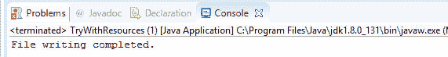

**图 11.3:** 上述 `TryWithResources` 类的输出

之前的示例程序是 try with resources 的一个示例，在编写 `try` 块时，在打开 `try` 块之前，我们已经声明了 Java IO 的 `PrintWriter` 资源。此 `PrintWriter` 资源将进一步使用 `try` 块，并在执行后，资源将自动关闭。我们不需要显式地关闭 `PrintWriter` 类对象。这是 try with resources 的优势，对于内存管理和垃圾回收非常有用。

## 显式抛出异常

在 Java 编程中，我们还可以使用 `throw` 关键字显式地抛出异常。这意味着我们可以在代码的任何语句中显式地抛出异常，而不会产生任何自动生成的错误或异常。这将帮助我们在某些检查时触发异常，并执行所需的的操作。

## 结论

异常处理是计算机编程中一个强大且重要的概念，用于防止和处理软件和应用程序的意外行为，包括坏数据、错误请求以及所需数据或系统缺失或不可用。我们使用 `try-catch-finally` 块处理异常，这在所有其他高级编程语言（如 C#）中都是常见的。

我们可以创建自己的异常类，并使用该类通过处理器根据需求进一步处理异常，这被称为自定义异常。处理器是方法，在方法中尝试解决异常或将指针传回上一步执行步骤。

在下一章中，我们将讨论 Java 集合框架以及 Java 编程语言中可用的集合类型，用于管理数据或内容。

## 注意事项

- 我们创建一个 `catch` 块来处理异常。
- 使用 `throw` 关键字，我们可以在程序的任何语句处显式地抛出异常。
- `catch` 块是处理 `try` 块中发生异常的块。程序可以有多个 `catch` 块。
- `finally` 块是我们创建的执行此类异常的块，无论是否发生异常，我们总是希望它在程序中执行。

## 单选题

1. **哪种是正确的 catch 语句？**

   1. `catch {// statements}`
   2. `catch (ExceptionType Ex) {//Statements}`
   3. `catch (Exception) //statements}`
   4. `Try-catch() {//statements}`

2. **在 try-catch 异常处理中强制要求至少有一个 catch 块吗？**

   1. 正确
   2. 错误

## 答案

1. **b**
2. **b**

# question

1. 写一个程序并使用 try with resources 处理空指针异常。
2. 为什么 `finally` 块很重要？

## 术语表

1. [`javadoc.scijava.org/Java6/java/lang/RuntimeException.html`](https://javadoc.scijava.org/Java6/java/lang/RuntimeException.html)

# 第 12 章：集合 (Collections)

在本章中，我们将讨论 Java 编程的高级特性，我们使用各种 Java 集合类和接口来处理一组数据并操作这些数据。通常来说，集合是一组可以一起管理和存储的对象。`Collection` 是根接口。`List`、`Queue` 和 `Set` 是 `Collection` 接口的子类。

集合是 `java.util` 包的一部分，该包实现了 `Collection` 接口和不同的数据结构以解决数据存储的各种目的。

## 结构

在本章中，我们将涵盖 Java 编程的高级特性：集合框架：

- `List`
  - `ArrayList`
  - `Vector`
- `Queue`
  - `PriorityQueue`
  - `LinkedList`
- `Set`
  - `HashSet`
  - `LinkedHashSet`
  - `TreeSet`
- `Map`
  - `HashMap`
  - `LinkedHashMap`
  - `TreeMap`

## 目标

成功完成本章后，你将理解并解释集合框架，这有助于我们处理不同的对象组。你还将学习 `collection` 接口，它提供了对对象执行各种操作的方法。在本章中，我们还将查看集合的类型，并结合它们的实现和示例程序详细讨论每种集合。我们实际上并不直接使用集合接口进行实现，但实现是通过它们的子类完成的，这将在本中涵盖。让我们从这里开始集合的之旅。

## 集合 (Collection)

`Collection` 是 Java 提供的一个用于管理一组对象的预定义类和接口框架。`Collection` 是 `Array` 的扩展，并拥有 `List`、`Queue` 和 `Set` 等接口。通过集合的帮助，我们可以将许多元素分组为一个元素。在通用语言中，我们可以将集合视为一个容器，可以在其中将多个元素放在一起。这里是属于集合框架的接口和类的层次结构：

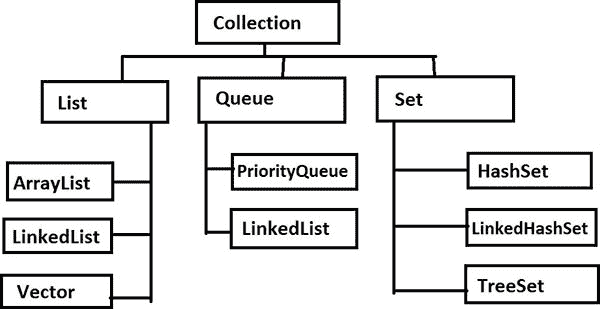

**图 12.1:** 集合框架中接口和类的层次结构

集合框架主要有三个接口 - `List`、`Queue` 和 `Set` 以及一个额外的接口 `Map`，它继承自 `collection` 接口。这些接口不是用于直接实现的，而是为了实现，我们需要使用前所示的子类。

作为集合框架实际实现的集合类使用 `collection` 接口的方法。因此，所有集合类如 `HashMap`、`HashSet`、`LinkedList`、`TreeSet`、`PriorityQueue` 都使用 `add()`、`contains()`、`equals()`、`iterator()`、`clear()`、`remove()`、`size()` 等许多方法。

## 列表 (List)

`List` 是一种有序集合，按照元素添加到列表对象中的顺序来存储一组对象。我们可以通过索引号从列表的任何索引访问元素。`List` 是核心 `Array` 类的扩展，其索引分配方式与数组的操作方式相同。列表的第一个元素将位于索引 零(0) 处，列表的最后一个元素索引为 *n*-1，其中 *n* 是元素的数量。我们可以使用索引号在列表的任何索引上插入、删除和获取数据。列表对象可以包含任意数量的 `null` 元素和重复值。

`List` 可以实现 `ArrayList`、`LinkedList` 和 `Vector`。所有列表类都有某些优缺点，根据它们的特性，推荐或优先使用它们来处理适用于解决方案的不同情况。让我们讨论 `ArrayList`、`LinkedList` 和 `Vector` 的优点、缺点和特性。

### ArrayList

当我们想要对数据列表进行快速访问和排序时，首选使用 `ArrayList`。`ArrayList` 内部使用数组来存储数据。`ArrayList` 是动态的，由于这种行为，当我们尝试在声明的大小之外插入元素时，它会自动扩大数组的大小。当我们从 `ArrayList` 中删除元素时，`ArrayList` 也会缩小大小。`ArrayList` 自动增加或减少当前数组列表大小的一半；例如，如果我们声明了一个初始大小为 10 的 `ArrayList`，并尝试向其中添加第 11 个元素，那么 `ArrayList` 的大小会自动增加到 15。

在增加的情况下；当我们尝试向超出定义索引的数组推一个元素时，数组的大小会自动增加：

`Size of ArrayList = n + n/2;`

在减少的情况下；在数组一半的索引变为空之前，数组不会移除索引：

`Size of ArrayList = n - n/2;`

这里 `n` = 数组的当前大小。

一个使用 `ArrayList` 的 `List` 接口示例程序：

```java
import java.util.ArrayList;

public class arrayList {
    public static void main(String[] args)
    {
        ArrayList<String> list = new ArrayList<String>();
        list.add("FIRST");
        list.add("SECOND");
        list.add("THIRD");
        list.add("FOURTH");
        list.add("FIFTH");
        for (int i = 0; i < list.size(); i++) {
            System.out.println(list.get(i));
        }
        System.out.println("Size of array " + list.size());
    }
}
```

**输出：**

```
FIRST
SECOND
THIRD
FOURTH
FIFTH
Size of array 5
```

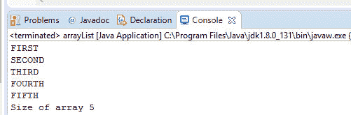

**图 12.2：** 前述 `ArrayList` 程序的输出

### LinkedList

当我们想要对列表数据进行频繁操作时，优先使用 `LinkedList`。使用 `LinkedList` 搜索速度慢，会降低应用程序的性能。`LinkedList` 拥有与 `ArrayList` 相似的所有方法，声明方式也与 `ArrayList` 相似。`LinkedList` 中的每个元素都被称为 `Node`，每个 `Node` 持有两个项：第一个元素的值或内容，以及下一个 `Node` 的地址或指针。让我们用图形的形式来理解链表。这里是一个单链 `LinkedList` 对象的示例：

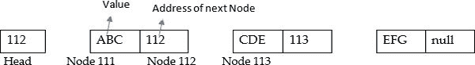

**图 12.3：** 单链 `LinkedList` 对象的示例

**注意：Head 始终是 `LinkedList` 的第一个元素，它不持有任何值，而是 `LinkedList` 第一个 `Node` 的地址。**

`LinkedList` 的最后一个 `Node` 没有下一个 `Node` 的引用或地址，因为那是列表的末端；所以地址部分包含 null。

### Vector

`Vector` 是一个动态数组，根据需要增加或减少数组的大小。我们可以像访问数组元素或使用元素的唯一索引号一样访问 vector。当我们声明一个初始大小为 5 的 vector 并想要向其插入第 6 个元素时，`Vector` 将自动将其对象的大小翻倍。因此，在这种情况下，插入第 6 个元素后，vector 的大小增长到 10。`Vector` 也是线程安全的且同步的，这意味着一次只有一个线程可以访问 vector，而另一个想要访问相同 vector 对象的线程必须等待。我们将在 `第 14 章：线程` 中详细学习 `Thread`。

### Queue

`Queue` 是一个集合接口或一种数据结构，它支持从队列的两端进行插入和删除。`Queue` 传统维护 `FIFO`（**先入先出**）顺序，这意味着先插入队列的元素将先被处理，但并不是所有情况下都如此，因为我们可以从队列的任何一侧（前端和尾部）执行操作。因此，元素可以从任何侧被插入、修改和移除。`Queue` 不允许 null 元素，但某些队列实现如 `LinkedList` 允许 null 元素。我们可以在队列中添加重复元素。

类似于 `List` 接口的对象，我们无法从中间或除第一个最后一个之外的任何其他索引访问元素。队列只能从前端进行迭代并从尾部进行插入。下面的图可以帮助我们理解队列：

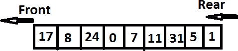

**图 12.4：** 存储在 `Queue` 中的元素

前端（即头部侧）仅用于获取和移除元素。在队列中插入/添加新元素始终从尾部（称为尾）发生。

`Queue` 没有直接的实现类；我们使用 `Queue` 的子类在程序中实现 `Queue`。Java 编程可以使用两种类型的队列。

### PriorityQueue

`PriorityQueue`：这是队列的一种实现，其中元素根据指定的比较器存储在队列中。我们在声明 `PriorityQueue` 时指定比较器。`PriorityQueue` 是队列基本原则的一个例外，该原则规定队列支持 FIFO（先入先出），且队列中的元素只能从队列的开头或结尾添加和移除。但 `PriorityQueue` 中的元素可以根据提供的比较器、元素的自然顺序或根据要求的 LIFO（后入先出）进行放置。如果我们不传递比较器来指示存储项，那么 `PriorityQueue` 将按照其自然顺序存储元素。例如，`PriorityQueue` 将分别维护数字的 0-9 和字符的 A-Z 顺序。

无论我们为 `PriorityQueue` 提供的存储元素顺序是什么，在队列中添加和移除元素的操作只能从尾部和头部。尾部用于添加新元素，头部用于从队列移除元素。

### LinkedList


`LinkedList` 是队列的一种实现，元素根据指定的比较器存储在队列中。我们在声明 `PriorityQueue` 时指定比较器。`PriorityQueue` 是队列基本原则的一个例外，该原则规定队列支持 FIFO（先入先出），且队列中的元素只能从队列的开头或结尾添加和移除。但 `PriorityQueue` 中的元素可以根据提供的比较器、元素的自然顺序或根据要求的 LIFO 进行放置。如果我们不传递比较器来指示存储项，那么 `PriorityQueue` 将按照其自然顺序存储元素。例如，`PriorityQueue` 将分别维护数字的 0-9 和字符的 A-Z 顺序。

## Operation on Queue

无论我们为 `PriorityQueue` 提供的存储元素顺序是什么，在队列中添加和移除元素的操作只能从尾部和头部。尾部用于添加新元素，头部用于从队列移除元素。

## Set

`LinkedList` 是队列的一种实现，元素根据指定的比较器存储在队列中。我们在声明 `PriorityQueue` 时指定比较器。

## HashSet

`HashSet` 类维护数据的唯一性且不存储重复的元素，但 `HashSet` 允许存储 `null` 元素。`HashSet` 内部使用并存储 `HashTable` 中的元素，而 `HashTable` 是 `HashMap` 的一部分。`HashTable` 以键值对（key and value）的形式存储元素。当我们创建一个 `HashSet` 对象时，`HashMap` 对象会随 `HashSet` 一起自动创建，用于存储数据元素。我们将在本章稍后详细讨论 `HashTable` 和 `HashMap`。

当我们在 `HashSet` 中添加元素时，该元素将作为 `HashTable` 中的键被添加，并在值的位置放入一个占位值（dummy value）。占位值由集合自动创建一个 `Object` 类型的最终常量对象 `PRESENT`，并存储为每个键的值。`PRESENT` 对象的自动声明如下：

```java
private static final Object PRESENT = new Object();
```

`PRESENT` 常量对象是 `HashSet` 中存储的所有键的值。这不会在面向程序员的界面端任何地方出现；这完全是关于内存中存储和数据的管理。

一个使用 `HashSet` 创建城市列表的示例：

下图显示了键和值对：

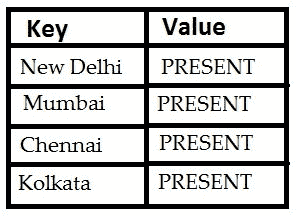

**图 12.5：** `HashSet` 中键及其对应值的映射

现在我们查看存储城市列表的 `HashSet` 程序。让我们通过一个示例 Java 程序来理解它：

```java
package collectionSet;

import java.util.HashSet;
import java.util.Iterator;

public class HashSetCollection
{
    public static void main(String[] args)
    {
        HashSet<String> cities = new HashSet<String>();
        // 下面代码将从 HashSet 中移除元素
        cities.add("New Delhi");
        cities.add("Mumbai");
        cities.add("Chennai");
        cities.add("Kolkata");
        // 下面代码将从 HashSet 中移除元素
        cities.remove("New Delhi");
        Iterator iterator = cities.iterator();
        while(iterator.hasNext()) {
            String nameOfCity=(String) iterator.next();
            System.out.println(nameOfCity);
        }
    }
}
```

**输出：**

```
Chennai
Kolkata
Mumbai
```

前面的程序有一个类型为 `HashSet` 的对象 `cities`。在 `cities` 中，我们使用 `add()` 方法添加了四个城市的名称：`New Delhi`、`Mumbai`、`Chennai` 和 `Kolkata`。之后，我们使用集合接口的 `remove()` 方法移除了一个元素 `"New Delhi"`。随后，我们创建了 `Iterator` 类的对象，它将帮助我们从 `HashSet` 中读取和检索元素，然后使用 `while` 循环遍历了 `HashSet` 的每个元素并在控制台上打印了该值。

## LinkedHashSet

`LinkedHashSet` 类继承自集合接口，它维护了 `HashSet` 的插入顺序，并在内部使用双链表来存储数据并管理数据结构。`HashSet` 和 `LinkedHashSet` 区别如下：

`LinkedHashSet` 按照元素推入对象的顺序进行排序，而 `HashSet` 不会。因此，使用 `LinkedHashSet` 我们可以知道并获取第五次添加的第五个元素以及第三次添加的第三个元素。但使用 `HashSet` 我们不知道顺序，当我们从 `HashSet` 读取元素时，它们可以是任何位置的任何元素。

`LinkedHashSet` 不是同步的，多个线程可以并发添加和删除对象，因此存在数据歧义和数据不匹配的可能性。我们可以使用 `Collections` 框架的 `synchronized()` 方法使对象变为线程安全。以下是使 `LinkedHashSet` 安全的语法：

```java
Collections.synchronizedSet(new LinkedHashSet(<NameOfTheLinkedHashSet>));
```

## TreeSet

`TreeSet` 是 `Set` 接口的另一种实现，它按升序维护数据的排序。为此，我们必须在声明 `TreeSet` 时指定并提供比较器（comparator）。如果我们不提供任何比较器，`TreeSet` 将根据自然升序（如 0-9 或 A-Z）对元素进行排序。`TreeSet` 内部与其他 `Set` 类一样使用 `TreeMap`。使用 `TreeSet` 实现的基本操作（如 `add`、`remove` 和 `contains`）的提供了保证的 `log(n)` 时间复杂度。

`TreeSet` 不是同步的，这意味着任意数量的线程可以同时访问 `TreeSet` 对象并在对象上执行基本操作。为了使其线程安全，我们必须显式地同步对象，以便一次只有一个线程可以访问，而其他线程保持等待状态，直到一个线程的操作完成。

`TreeSet` 是快速失败的（fail-fast），这意味着我们在创建迭代器后尝试向 `TreeSet` 添加元素时，会产生 `ConcurrentModificationException` 异常，但当我们使用自己的方法（如 `remove()`）进行操作时不会抛出异常。

声明 `TreeSet` 的语法如下：

```java
TreeSet<DataType> treeSetObject = new TreeSet<>();
```

一个 `TreeSet` 实现的示例程序：

```java
import java.util.TreeSet;

public class TreeSetCollection
{
    public static void main(String[] args)
    {
        TreeSet<String> treeSet = new TreeSet<String>();
        // 向 treeSet 添加元素
        treeSet.add("A");
        treeSet.add("Z");
        treeSet.add("N");
        treeSet.add("K");
        treeSet.add("B");
        treeSet.add("D");
        treeSet.add("Y");
        System.out.println(treeSet);
    }
}
```

**输出：**

```
[A, B, D, K, N, Y, Z]
```

前面的程序是 `TreeSet` 的实现，声明用于存储字符串类型。通过 `add()` 方法，我们添加了 Z、N、K、B、D 和 Y。当我们读取 `TreeSet` 时，发现它是按照字母升序存储对象的，即 A, B, D, K, N, Y, Z。

## Map

`Map` 是一个接口，通过以键值对的形式存储元素并将键映射到值。`Map` 对象可以包含一个 `null` 键。

## HashMap

`HashMap` 类似于 `Set`，并以键值对存储元素。每个键都映射到一个值。`HashMap` 可以有一个 `null` 键，但可以有多个 `null` 值。`HashMap` 支持并接受重复元素也仅作为值，`HashMap` 的桶中不允许有重复键。

`HashMap` 内部使用 `hashCode()` 和 `equals()` 方法来生成键的哈希值并放置在 Map 中，这有助于实现并维护 `HashMap` 键的唯一性。我们将在本章稍后详细讨论这些方法。

## LinkedHashMap

`LinkedHashMap` 类继承自 `HashMap` 并实现了 `Map` 接口，以为 `HashMap` 类添加更多功能。该实现放置并维护了对象的插入顺序。因此，我们可以根据插入顺序预测可以在哪个位置找到特定的对象。即使删除了任何条目或向列表中重新插入条目，插入顺序也不会受到影响。它还像 `HashMap` 一样将条目存储在键值值对的形式中。由于我们已经熟悉 `LinkedList` 数据结构，同样的原理在这里也适用，`LinkedHashMap` 使用双向链表来管理和存储数据。

`LinkedHashMap` 不是同步的，也不是线程安全的，但我们可以使用 `collections` 接口的 `synchronized` 方法使对象变为线程安全。如果我们想限制程序，只允许一个线程对对象执行操作，并在一个线程执行操作时为其他线程锁定代码块，那么我们可以使 `LinkedHashMap` 对象变为线程安全，以克服数据不一致的情况。以下是使用 `Collections` 接口的 `synchronizedMap()` 方法使 `LinkedHashMap` 对象变为线程安全的语法：

```
Collections.synchronizedMap(new LinkedHashMap(<NameOfTheLinkedHashMap>));
```

`LinkedHashMap` 使用与 `HashMap` 完全相同的初始容量和负载因子，即初始容量为 16，负载因子为 0.75。`LinkedHashMap` 是快速失败的（fail-fast），这意味着由迭代器方法返回的迭代器只能会被自身的 `remove()` 方法修改；如果我们尝试 `put` 一个对象，迭代器将抛出 `ConcurrentModificationException`。

## TreeMap

`TreeMap` 实现了 `Map` 接口并将对象存储在键值对中。`TreeMap` 类继承自 `AbstractMap` 类并实现了 `NavigableMap` 接口，以实现 `Map` 和红黑树数据结构的功能。`TreeMap` 是排序的，它根据声明时提供的比较器对对象进行排序；或者如果没有指定比较器，它将根据键的自然顺序对对象进行排序。

`TreeMap` 不是同步的，也不是线程安全的，我们需要显式地使 `TreeMap` 变为线程安全，以便一次只有一个线程可以执行读写操作。我们可以通过 `Collections` 接口的 `synchronized()` 方法使 `TreeMap` 变为线程安全。

```
Collections.synchronizedSortedMap(new TreeMap(<NameOfTreeMap>));
```

`TreeMap` 实现为 `get`、`put` 和 `remove` 等操作提供了保证的 `log(n)` 时间开销。`TreeMap` 是快速失败的，这意味着由迭代器方法返回的迭代器会被其 `remove()` 方法以外的其他操作修改，并产生 `ConcurrentModificationException`。因此，我们不能在创建迭代器后 `put` 任何对象，但可以 `remove` 对象。

## 结论

`Collection` 是一个强大的框架，它让开发者能够更轻松地管理长元素（long）或对象的列表。它是 `java.util` 包的一部分，所有的 `Collection` 接口和类都是 `util` 包的一部分。

`Collection` 类使用 `collection` 接口的方法来执行如 `add`、`remove`、`modify`、`retrieve`、`contains` 等操作。

在下一章中，我们将讨论 Java 中的文件系统以及 Java 编程中存在的不同类型的类，用于读取、写入和管理各种类型的文件，如文本文件、图像文件、PDF、Word 文档等。

## 需要记忆的点

*   `List`、`Queue`、`Set` 和 `Map` 是 `Collections` 框架的四个主要实现。

*   `ArrayList` 和 `Vector` 是动态数组。它们会动态增加大小，并随着元素的添加或删除自动增加或减少列表的大小。`ArrayList` 按当前数组大小的一半增加大小，而 `vector` 将大小增加到当前 vector 大小的两倍。

*   `HashSet` 内部使用 `HashMap` 来存储对象。`HashSet` 对象被存储为键，其值则映射为一个常量对象 `PRESENT`。

*   `Queue` 是一种管理数据并对元素实现 FIFO（先进先出）策略的数据结构。但某些队列并不受 FIFO 顺序的限制，例如 `LinkedList`，它可以根据提供的比较器进行排序。

## 多选题

1. **vector 是同步的吗？**

    1. 是

    2. 否

2. **以下选项中哪是正确的？**

    1. `ArrayList` 是同步的，而 `Vector` 不是。

    2. `ArrayList` 自动按当前数组大小的一半增加其大小。

    3. `Vector` 自动按当前 vector 大小的一半增加其大小。

    4. `Lists` 不接受空元素。

3. **以下中哪一个不是集合接口？**

    1. `List`

    2. `Array`

    3. `Set`

    4. `Queue`

4. **使用哪个方法可以从队列中删除元素而不抛出异常？**

    1. `delete()`

    2. `remove()`

    3. `poll()`

    4. `truncate()`

5. **使用哪个方法向 Map 添加对象？**

    1. `add()`

    2. `put()`

    3. `offer()`

    4. `push()`

6. **`HashMap` 可能会存储重复的键。这个陈述是对是错？**

    1. 对

    2. 错

## 答案

1. **a**

2. **b**

3. **b**

4. **c**

5. **b**

6. **b**

## 问题

1. 使用 `HashMap` 编写一个程序并使用迭代器放入 1 到 10？

2. `ArrayList` 和 `LinkedList` 的区别是什么？

3. `ArrayList` 和 `Vector` 的区别是什么？

4. `HashMap` 和 `HashSet` 之间有哪些主要区别？

5. `PriorityQueue` 和 `Dqueue` 的区别是什么？

6. 使用 `LinkedHashMap` 编写一个程序并执行添加删除操作。

## 术语

*   **Synchronized (同步)**：程序同时执行多个线程。

*   **Concurrent (并发)**：并行操作多个任务。

*   **Iterate (迭代)**：从列表中逐个读取元素。

*   **Mapping (映射)**：将键与值配。

## 词表

1. `https://docs.oracle.com/en/java/javase/11/docs/api/java.base/java.util/Queue.html`

2. `https://docs.oracle.com/javase/8/docs/api/java/util/Collection.html`

本章旨在让学生熟悉 Java 编程中的文件和输入输出术语。在学习本章后，学生可以解释 `File` 类、输入和输出对象，并在编程实践中使用这些概念。在成功完成本章后，你将能够解释文件或输入输出流中使用的各种术语。你还将能够使用文件编写和理解 Java 程序及应用程序，并对文件系统中的文件进行操作。我们还将讨论序列化和反序列化，以及这些技术如何帮助不同应用程序和软件之间的数据传输和通信（主要是在 API 和网络服务方面）。

此外，我们将通过示例程序查看一些读取（reader）和写入（writer）类及其用例。


输入和输出是处理不同类型文件的重要编程概念，用于对文件系统中的文件执行读、写和删除操作。`java.io` 是自 Java 1.0 以来用于处理文件的类包。在 Java 7 中，我们又得到了一个 `java.nio.file` 包，它拥有在 IO 之上设计的更高级的方法，克服了 `java.io.File` 的各种局限性。

让我们了解 `File` 的不同类。

## File

`File` 类是为 Java 虚拟机提供访问文件系统的类。通过它，我们可以在计算机内存中创建和定位文件。`File` 类的对象是不可变的，这意味着一旦对象被创建，它永远不会改变。

声明 `File` 类对象的语法如下：

```java
File newFile = new File(<包含文件名的路径>);
```

路径名可以是相对路径也可以是绝对路径。相对路径必须根据从其他路径名或应用程序当前路径获取的信息来解释，该路径通常是 JVM 运行应用程序和程序的路径。绝对路径是完整的，包含了驱动器和目录，不需要其他信息即可定位文件。默认情况下，`java.io` 包中的类始终根据当前用户目录解析相对路径名。

**示例 13.1：** 使用 Java 中的 `File` 类创建文件的示例程序

```java
import java.io.File;
import java.io.IOException;

public class FileExample {
    public static void main(String[] args) throws IOException {
        File newFile = new File("ListOfCities.txt");
        if (newFile.createNewFile()) {
            System.out.println("File created.");
        } else {
            System.out.println("File exists.");
        }
    }
}
```

**输出：**

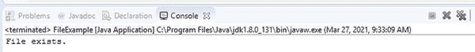

**图 13.1：** `File` 示例程序的输出

上一个程序将在当前项目目录下创建 `ListOfCities.txt` 文件，因为我们只将文件名作为 `File` 类的参数，这会被 JVM 视为相对路径。下一行代码使用 `createNewFile()` 方法检查系统中是否存在同名文件，该方法返回 `true` 或 `false`。根据 `createdNewFile` 的返回值，我们在控制台上打印一条文本消息；因此在我们的案例中，该方法返回 `false`。因此，光标移动到 `else` 部分并打印消息 `“File Exists”`。

我们也可以将绝对路径作为 `File` 对象的参数，以便在该路径下创建文件。

例如：

```java
File newFile = new File("D:\sample book\io\ListOfCities.txt");
```

## Stream

流（Stream）是从源流向目的地的数据序列。在这里，源称为输入，目的地称为输出。输入和输出流支持许多数据类型，如字符、字符串和对象。

流有两种类型，即输入流和输出流，并且两者都实现了字节和字符类型的流来读取和写入数据：

- **字节流（Byte Streams）**：字节流用于执行 8 位字节的输入输出。`FileInputStream` 和 `FileOutputStream` 等类支持字节流。
- **字符流（Character Streams）**：字符流用于执行 16 位 Unicode 字符的输入输出。`FileReader` 和 `FileWriter` 等类支持字符流。

### Input Stream

输入是从任何源（如文件、设备、套接字和控制台）读取数据的过程。人类第三方应用程序与系统交互时，系统将期望某些输入以处理后续步骤。输入流帮助我们读取来自外部源的字节。`InputStream` 是所有输入类的抽象类和超类。让我们详细学习一些输入类和读取类。

### FileReader

`FileReader` 是一个使用默认缓冲区大小从文件中读取字符或文本的类。它只从文件中读取字符流并与文件建立连接。

声明 `FileReader` 类对象的语法：

```java
FileReader fileReaderObj = new FileReader("<文件名>");
```

如果我们必须读取字节流，请考虑并使用 `FileInputStream`，因为 `FileReader` 仅用于读取文件中的文本和字符。

### FileInputStream

`FileInputStream` 是一个帮助我们从文件获取输入字节并在存储系统中的文件与应用程序之间建立连接的类。

`FileInputStream` 构造函数用于打开文件的连接，参数对象或名称是存储在文件系统中的文件：

```java
FileInputStream(File fileObject) or FileInputStream(String fileName)
```

该类具有以下被认为很重要的方法，其中一些方法是使用 `FileInputStream` 的类必须实现的：

- `read()`：此方法返回一个整数值并从输入流中读取一个字节数据。`Read` 方法可能或不带有字节长度的参数。
- `close()`：此方法类型为 `void`，不返回任何值。它用于关闭输入流并释放与流相关的系统资源。
- `finalize()`：此方法类型为 `void`，不返回任何内容。`Finalize` 方法确保在读取所有输入后在输入流上执行 `close()` 方法，并释放所有引用以便清理内存。
- `available()`：此方法返回一个整数值，提供可以从输入读取的剩余字节估计。
- `skip()`：此方法返回一个 `long` 值，并接受一个 `long` 值作为参数，跳过并丢弃输入流中指定数量的字节数据。

在上述方法列表中，`read` 和 `close` 必须由所有类实现。除此之外的方法是可选的，其实现取决于场景和开发人员。

### Output Stream

输出流将数据作为输出写入数组、文件或任何输出设备。这是一个抽象类，其子类通过实现来生成输出。输出流部分的类包括 `BufferedOutputStream`、`ByteArrayOutputStream`、`FileOutputStream` 和 `ObjectOutputStream`。让我们详细讨论一些输出流。

### FileOutputStream

`FileOutputStream` 用于在文件系统中创建文件并将数据写入该文件。如果你尝试使用 `FileOutputStream` 向现有文件写入数据，而该命名文件在文件系统中不存在，则 `FileOutputStream` 将创建一个同名文件并将数据添加到其中。

让我们查看 `FileOutputStream` 的语法：

```java
OutputStream f = new FileOutputStream("path of the file");
// 或 File 类的对象
```

要使用 `FileOutputStream` 创建文件，我们需要传递一个参数来调用构造函数并创建文件。该参数可以是文件的绝对路径或相对路径，也可以如前面的语法所示的 `File` 类的对象。

**示例 13.2：** 使用 `BufferedReader` 配合 `FileReader` 从文件中读取文本的程序：

```java
import java.io.FileOutputStream;
import java.io.IOException;
import java.io.OutputStream;

public class OutputStreamExample {
    public static void main(String args[]) {
        try {
            OutputStream oStream = new FileOutputStream("Output.txt");
            oStream.write(70);
            oStream.write(65);
            oStream.write(78);
            oStream.close();
            System.out.println("Successfully created and written the file.");
        } catch (IOException e) {
            System.out.print("Exception");
        }
    }
}
```

**输出：**

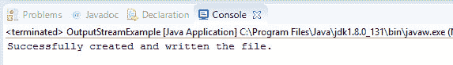

**图 13.2：** 该文件程序 `OutputStreamExample` 的输出

上述程序将在当前目录中成功创建一个文件 `Output.txt`，并写入数字 70、65 和 78 的 Unicode 字符（FAN）。下图显示了 `Output.txt` 文件的内容：

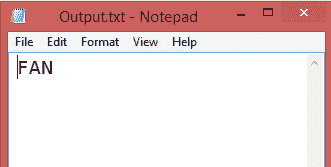

**图 13.3：** `Output.txt` 文件内容

要将字符串写入文件，我们必须将 `String` 的字节转换为字节数组，然后使用 `write` 方法将字节数组写入文件。例如：

```java
String s = "FileOutputStream Java IO example.";
byte b[] = s.getBytes(); // 这一行将字符串 s 转换为字节数组 b。
oStream.write(b); // 将字节数组 b 写入文件。
```

**注意：** `FileOutputStream` 主要用于写入原始字节流，例如图像或视频文件的数据。对于向文件写入字符流，我们应该考虑使用 `FileWriter` 类。

## Writer（写出器）

`Writer` 类是一个抽象类，帮助写入字符流。`Writer` 类没有直接的实现，但我们使用它的子类来在文件上执行写操作。`write()`、`close()` 和 `flush()` 方法必须由 `Writer` 类的子类实现：

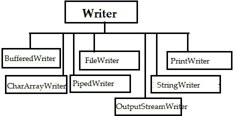

**图 13.4：** `Writer` 类内部的类和子类

`Writer` 类的一些著名子类包括 `BufferedWriter`、`CharArrayWriter`、`FilterWriter`、`OutputStreamWriter`、`PipedWriter`、`PrintWriter` 和 `StringWriter`。我们将在本章通过示例详细讨论几个类。

### FileWriter

`FileWriter` 类用于使用默认缓冲区将文本写入字符文件。`FileWriter` 写入字符流并使用字符集（charset）将字符编码为字节。该类继承自 `OutputStreamWriter` 类。`OutputStreamWriter` 类的所有特征和方法也可以用于 `FileWriter`。

以下是声明 `FileWriter` 类对象的语法：

```java
FileWriter fileWriterObj = new FileWriter(File file);
```

上述代码语句将创建一个 `FileWriter` 对象并打开指定的文件，用默认字符集写入字符。如果我们也想指定 `charset`，则可以在此默认构造函数中再添加一个参数：

```java
FileWriter fileWriterObj = new FileWriter(File file, Charset charset);
```

`FileWriter` 不用于存储原始字节流。如果我们需要将字节流存储到文件中，应该使用 `FileOutputStream`。

所有 `File` 和 IO 类都实现了 `AutoCloseable` 和 `Flushable` 接口。`AutoCloseable` 帮助我们自动触发 `close()` 方法。

文件 `ListOfCities.txt` 包含了控制台输出所示四个城市的名称。以下是 `ListOfCities` 文件内容的截图：

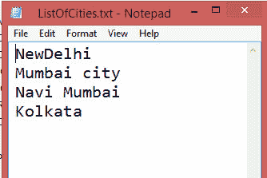

**图 13.7：** 示例 13.2 中使用的文本文件 `ListOfCities` 的快照

### BufferedReader

`BufferedReader` 类是 `Reader` 类的子类，它用于读取文本或缓冲字符或字符输入流，并提供对字符、行或数组的高效读取。如果我们需要处理巨大的输入流，可以指定缓冲区的大小，或者直接使用默认缓冲区大小。它可以与 `FileReader`、`InputStreamReader` 或其他读取类配合使用，从文件或流中读取字节输入并返回序列化和反序列化的数据。

以下是通过指定大小来声明 `BufferedReader` 的语法：

```java
BufferedReader bReader = new BufferedReader(readerObject);
```

通过指定大小声明 `BufferedReader` 的语法：

```java
BufferedReader bReader = new BufferedReader(readerObject, int size);
```

**示例 13.3：** 使用 `BufferedReader` 配合 `FileReader` 从文件读取文本的程序：

```java
import java.io.BufferedReader;
import java.io.FileReader;
import java.io.IOException;

public class FileAndBufferedReader
{
    public static void main(String[] args) throws IOException
    {
        FileReader fReader = new FileReader("SampleFile.txt");
        BufferedReader bReader = new BufferedReader(fReader);
        int records;
        while((records = bReader.read()) != -1) {
            System.out.print((char)records);
        }
        bReader.close();
        fReader.close();
    }
}
```

**输出：**

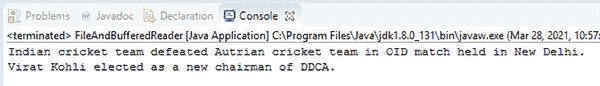

**图 13.8：** 示例 13.3 的输出

上述 Java 程序展示了如何实现 `FileReader` 类以打开与文件系统中的文件 `SampleFile.txt` 的连接。在这里，`BufferedReader` 类帮助从指定的文件对象读取字符。

在完成读取操作后，我们在程序结束时通过 `close()` 方法关闭对象并移除引用。

**注意：** 建议在操作完成后对所有的 `Reader` 和 `File` 类执行 `close` 方法。如果我们不关闭连接，可能会导致内存问题或达到打开连接数的阈值。

## 序列化与反序列化

序列化是将 Java 对象转换为字节流的过程。当我们序列化一个对象时，意味着我们实际上是在将其状态转换为字节流，以便该字节流以后可以转换为 Java 对象的副本。我们可以通过实现 `java.io.Serializable` 接口或其子接口 `java.io.Externalizable` 来使 Java 对象变为可序列化。可以通过实现序列化来持久化任何对象的状态，并在网络上传输或传递该对象，以便其他系统或应用程序消耗或使用该字节流。这也有帮助我们把对象的状态存储到文件或数据库中作为永久存储。字节流是与平台无关，这意味着我们可以在任何机器或平台上进行序列化和反序列化，并且可以被任何系统读取和理解。当我们有某些数据或文件需要传输到其他系统/应用程序或与外部应用程序通信时，主要使用序列化方法。

`Serializable` 是一个标记接口（marker interface），标记接口不包含任何方法或成员。它标记了一个 Java 类，使得该类的对象具有某些额外的功能，并且 JVM 会以不同的方式处理这些对象。

`Serializable` 只保存或持久化对象的非静态成员；对象的静态成员不会被序列化。如果我们不想序列化类的任何非静态成员，则可以将该成员声明为 `transient`。如果我们尝试序列化一个不支持序列化的对象，系统将为此抛出 `NotSerializableException`。

反序列化是序列化的反向操作，即将字节流转换为 Java 对象。

`ObjectOutputStream` 和 `ObjectInputStream` 是具有 `writeObject` 和 `readObject` 方法的 IO 类，这些方法帮助我们写入和读取类对象的状态。`writeObject()` 方法负责写入该类的对象状态，而 `readObject()` 方法负责从流中读取并恢复类的字段。

### 序列版本 UID（Serial Version UID）

实现序列化的类将获得一个唯一的 `long` 类型 UID。此 UID 由编译器自动生成，或者我们可以显式地给它分配一个唯一的 `long` 值。序列版本 UID 在映射和识别正确的类方面非常有用，它可以帮助 JVM 检查序列化对象的发送方和接收方是否加载了同一个类。如果 UID 不匹配，编译器将抛出 `InvalidClassException`。

例如：

```java
private static final long serialversionUID = 123456789001L;
```

上述语句是为可序列化类生成的 `serialversionUID` 示例。

## 结论


文件输入和输出是使用 Java 编程执行文件操作的方法。输入流用于从文件读取字节或字符，输出流用于将字节和字符写入文件系统的文件中。我们分别使用 `FileReader` 和 `FileWriter` 类来读写字符流，并使用 `FileInputStream` 和 `FileOutputStream` 类来读写原始字节流。

我们可以使用 `try-with-resources` 来避免显式地为对象编写 `close()` 方法。

1. 使用 `FileReader` 编写一个程序，从本地系统的存储文件中读取文本。文件名应为“Fruits.txt”，并包含至少 10 种水果名称。
2. 字节流（Byte stream）和字符流（Character Stream）之间的区别是什么？
3. 什么是 `charset`？包含哪些类型的 `sets`？请写说明。
4. 什么是反序列化（deserialization）？

## 核心术语

- **流 (Stream)**：流是从源到目的流动的数据序列。
- **字节 (Byte)**：字节是计算机上信息或数据大小的测量单位。
- **字符集 (Charset)**：它是十六位 Unicode (UTF-16) 字符序列与字节之间的命名映射。
- **文件系统 (File system)**：文件系统管理数据在存储磁盘（通常是硬盘驱动器 HDD）上的存储方式和位置。
- **文件 (File)**：文件是存储某些内容的永久存储器。例如：文本文件、PDF、Word 文件、图像文件等。
- **序列化 (Serialization)**：序列化是将 Java 对象转换为字节流或字符流的过程。
- **反序列化 (Deserialization)**：反序列化是将字节流或字符流转换为 Java 对象的过程。

## 词汇表

1. Javadoc `FileInputStream` [https://docs.oracle.com/javase/7/docs/api/java/io/FileInputStream.html]
2. [https://docs.oracle.com/en/java/javase/11/docs/api/java.base/java/io/Reader.html]
3. [https://docs.oracle.com/en/java/javase/11/docs/api/java.base/java/nio/charset/Charset.html]
4. [https://docs.oracle.com/javase/tutorial/essential/io/file.html]
5. [https://docs.oracle.com/en/java/javase/11/docs/api/java.base/java/io/FileWriter.html]
6. [https://docs.oracle.com/en/java/javase/11/docs/api/java.base/java/io/FileOutputStream.html]
7. [https://docs.oracle.com/en/java/javase/11/docs/api/java.base/java/lang/AutoCloseable.html]
8. [https://docs.oracle.com/javase/7/docs/api/java/io/Serializable.html]

# 第 14 章

## 线程 (Thread)

在本章中，我们将讨论线程和进程。线程是程序执行的最小单元，我们利用 CPU 的空闲状态给其他线程执行的机会，这被称为多线程。多线程是一种概念编程模型，将一个程序划分为可以并发执行的子程序。我们将在本章详细讨论多线程的概念。还将详细讨论线程和进程，以及 `Thread` 类中可用于处理多线程的所有方法。此外，我们还会解释线程优先级、如何设置和获取线程优先级以及线程的不同状态。

有许多方法可以帮助处理多线程应用程序，如 `join`、`wait`、`sleep`、`notify` 等，用于拆分执行过程并与进程内的线程进行通信。我们将在本章学习线程和多线程的所有概念。

## 结构 (Structure)

在本章中，我们将讨论以下主题：

- 线程
- 进程与线程
- 多任务处理
- 多线程
- 线程的创建
- 线程的周期
- `Thread` 类的方法
- 线程优先级

## 目标 (Objectives)

成功完成本章后，你能够理解并解释线程、多任务和多线程的概念。在 Java 编程中，我们通过扩展 `Thread` 类或实现 `Runnable` 接口来实现多线程概念。我们将在本章通过示例程序展示这两种方法。

## 线程 (Thread)

线程是进程的最小执行单元，进程可以有很多同时执行的线程。线程在进程内有自己的执行路径，并与其他线程共享进程内存。

### 进程与线程 (Process and thread)

在本章中，我们将讨论线程和进程。线程是程序执行的最小单元，我们利用 CPU 的空闲状态给其他线程执行的机会，这被称为多线程。多线程是一种概念编程模型，将一个程序划分为可以并发执行的子程序。我们将在本章详细讨论多线程的概念。还将详细讨论线程和进程，以及 `Thread` 类中可用于处理多线程的所有方法。此外，我们还会解释线程优先级、如何设置和获取线程优先级以及线程的不同状态。

有许多方法可以帮助处理多线程应用程序，如 `join`、`wait`、`sleep`、`notify` 等，用于拆分执行过程并与进程内的线程进行通信。我们将在本章学习线程和多线程的所有概念。

### 进程 (Process)

在本章中，我们将讨论线程和进程。线程是程序执行的最小单元，我们利用 CPU 的空闲状态给其他线程执行的机会，这被称为多线程。多线程是一种概念编程模型，将一个程序划分为可以并发执行的子程序。我们将在本章详细讨论多线程的概念。还将详细讨论线程和进程，以及 `Thread` 类中可用于处理多线程的所有方法。此外，我们还会解释线程优先级、如何设置和获取线程优先级以及线程的不同状态。

有许多方法可以帮助处理多线程应用程序，如 `join`、`wait`、`sleep`、`notify` 等，用于拆分执行过程并与进程内的线程进行通信。我们将在本章学习线程和多线程的所有概念。

成功完成本章后，你能够理解并解释线程、多任务和多线程的概念。在 Java 编程中，我们通过扩展 `Thread` 类或实现 `Runnable` 接口来实现多线程概念。我们将在本章通过示例程序展示这两种方法。

多线程是并发执行多个线程的概念。线程是进程内部轻量级的顺序流控制单元。单线程进程在执行期间遵循单一的控制序列。多线程进程拥有许多控制序列；因此，多线程进程能够同时执行多个独立动作。这核心在于允许其他线程从同一个进程中执行。多线程应用程序通过利用 CPU 加快了进程处理和执行，提高了对象的效率，并在更短时间内完成任务，这在单线程应用程序中是无法可能的。

通过这种方式，我们提高了应用程序的响应能力，并确保在其他线程正在等待任何外部资源或用户输入时，程序仍在运行。

下图展示了 Java 程序如何被分为可以相互并行运行的子程序：

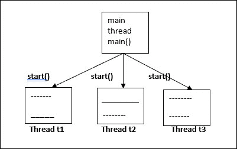

**图 14.4：** 在 Java 中将单个应用程序拆分为多线程应用程序

在这里，Java 程序的主线程 `main()` 方法是一个 `NORM_PRIORITY`（普通优先级）线程，也是程序的入口点。随后在 `main` 方法中，我们创建了三个线程 `t1`、`t2` 和 `t3`，它们彼此并行运行并在多个流中执行程序。

在 Java 编程中，实现多线程和开发多线程应用程序有两种方法：通过实现 `java.lang.Runnable` 接口或继承 `java.lang.Thread` 类。我们将在本章中通过示例详细讨论这两种方法。

## 创建线程

在 Java 编程中，创建线程类有两种方法：第一是继承 `Thread` 类，第二是实现 `Runnable` 线程。

### 使用 `Thread` 类

创建线程的第一种方法是通过让我们的类继承 `Thread` 类。`Java.lang.Thread` 是 `Thread` 类，它可以被子类继承以声明和使用线程。类通过 `extends` 关键字继承 `Thread` 类。以下是 `Thread` 类的声明：

```java
public class MyThreadClass extends Thread {
    public void run() {
        // 在处做某些操作
    }
}
```

扩展了线程类的类必须重写线程类的 `run()` 方法，该方法是线程执行的入口点。

**示例 14.1：** 使用 `Thread` 类创建线程的示例程序：

```java
class MyThreadClass extends Thread {
    public void run() {
        System.out.println("Hello");
    }
}

public class MainClass {
    public static void main(String s[]) {
        MyThreadClass t1=new MyThreadClass ();
        MyThreadClass t2=new MyThreadClass ();
        t1.start();
        t2.start();
    }
}
```

当我们执行 `t1.start()`（此处是在调用线程）时，它会请求调用线程的 `run()` 方法。每次输出将取决于 CPU 调度。但如果仅实现 `t1.run()`（此处是在调用一个方法），那么我们仅仅调用了该方法。在这里，`t1` 和 `t2` 是同一个线程类 `MyThreadClass` 的两个线程对象。

线程不能启动两次。如果尝试这样做，将抛出 `IllegalThreadStateException`。以下代码段将抛出 `IllegalThreadStateException`：

```java
MyThread t1 = new MyThread();
t1.start();
t1.start();
```

在同一线程上执行第二次 `start()` 方法将抛出异常。

### 使用 `Runnable` 接口

创建线程的另一种方法是使用 `Runnable` 接口。类应该实现 `Runnable` 接口并重写其 `run()` 方法。`run` 方法是线程的入口点，当在该线程上执行 `start()` 方法时，执行从此处开始。以下是使用 `Runnable` 接口创建线程的语法：

```java
public class MyThreadClass implements Runnable {
    public void run () {
        // 在处编写你的语句
    }
}
```

让我们通过示例理解使用 `Runnable` 接口创建线程。

**示例 14.2：** 使用 `Runnable` 接口创建线程的示例程序：

```java
public class MainClass {
    public static void main(String[] args) {
        MyThreadClass myThreadClass = new MyThreadClass();
        Thread t1 = new Thread(myThreadClass);
        t1.start();
    }
}

class MyThreadClass implements Runnable{
    @Override
    public void run() {
        System.out.println("Hello");
    }
}
```

**输出：**

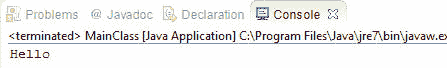

**图 14.5：** 前述线程程序的输出窗口（示例 14.2）

当我们实现 `Runnable` 接口时，必须创建 `Thread` 类对象，并将我们的线程类对象作为 `Thread` 类的参数。如前面的程序所示，`MyThreadClass` 就是我们的 `MyThreadClass`。

## 线程的生命周期

在执行期间，线程会自动或显式地通过调用方法改变其状态。从线程创建到线程结束，线程有五种状态。下图展示了所有阶段：

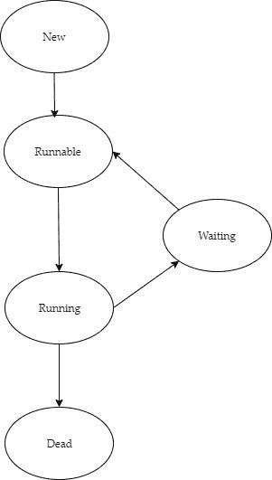

**图 14.6：** 线程的不同阶段

- **NEW（新建）**：线程一旦被声明就会处于新状态，并在我们调用 `start` 方法之前一直保持该状态。新创建的线程不会自动启动，它会一直等待 `start` 方法来改变状态。
- **RUNNABLE（可运行）**：线程在调用 `start()` 方法后移动到可运行状态。这是线程准备好执行并等待处理器可用的状态。
- **WAITING（等待）**：线程处于等待状态以满足依赖关系或其他先决条件。线程在执行 `wait` 或 `join` 方法后进入此状态，当在该线程上调用 `notify()`、`notifyAll()` 或 `interrupted()` 方法时，线程恢复执行。
- **RUNNING（运行中）**：当调用线程的 `run` 方法时，线程移动到运行状态并在进程中执行。
- **TERMINATED（已终止）**：当线程完成执行或显式通过 `stop` 方法停止时，线程处于终止状态。

上述五种线程状态是高层次的阶段。除了这些，线程还通过不同的线程方法进入状态的子状态。让我们深入研究线程方法并查看线程如何从一个阶段移动到另一个：

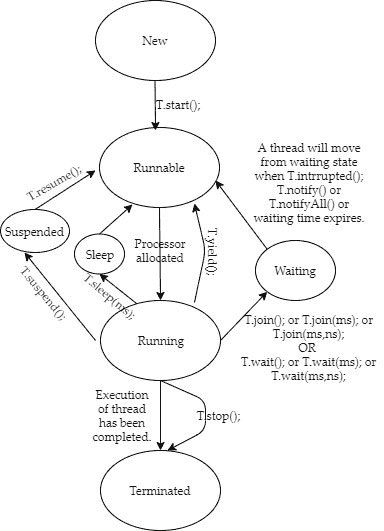

**图 14.7：** 线程在整个生命周期中不同状态间的移动

`Thread` 类的 `getState()` 方法用于识别并获取线程当前的状态。`getState()` 方法将在六种线程状态中返回线程状态；它们是 `new`、`runnable`、`blocked`、`waiting`、`timed_waiting` 和 `terminated`。在这里，`blocked` 和 `timed_waiting` 是等待状态的两个子状态。

- **BLOCKED（阻塞）**：线程处于阻塞状态，是因为需要执行的进程或代码语句被其他线程锁定。
- **TIMED_WAITING（超时等待）**：线程处于带有指定时间的这种中。当在该线程上调用 `wait(millisecond)` 或 `sleep(millisecond)` 方法时，线程将进入此状态。

上述状态被称为线程的生命周期，即线程在终止之前必须经过的阶段。线程方法负责将线程从一个状态移动或传输到另一个状态。以下是我们在线程中使用的方法。

## 线程方法

线程方法是 `java.lang.Thread` 类的方法，它们帮助我们管理和处理线程。以下是开发者在 Java 编程中使用的几个方法：

- `start()`：新创建的线程不会自动启动。你需要调用 `start` 函数。调用 `start()` 方法会将线程中的虚拟 CPU 激活并变为可运行状态。
- `yield()`：此方法赋予其他可运行线程执行的机会。`yield` 将调用线程放入可运行线程组，并允许另一个可运行线程运行。如果没有其他可运行线程，`yield` 则什么都不做。
- `run()`：`start()` 方法用于创建新线程；一旦线程被创建，就会请求调用 `run()` 函数进行执行。
- `wait()`：此方法用于将线程推入对象监器，并停止线程执行，直到被 `notify`、`notifyAll` 或中断方法唤醒。
- `wait(time)`：此方法用于将线程推入对象监器，并停止线程执行指定的时间。参数接受 `long` 类型的值，表示毫秒时间。
- `sleep(time)`：此方法将暂停线程执行指定的时间。参数接受 `long` 类型的值，表示毫秒时间。
- `join()`：此方法用于将线程加入执行队列。一旦在线程上调用该方法，当前线程将等待直到被调用线程完成其执行。
- `join(time)`：此方法用于将线程加入执行队列。在调用此 `join`（毫秒）方法后，当前线程将等待指定的时间，而不会等待其他线程死亡或完成执行。
- `notify()`：此方法用于唤醒等待在该对象监视器上的单个线程。线程通过调用 `wait()` 方法在对象监器上等待。
- `notifyAll()`：此方法用于唤醒所有等待在该对象监视器上的线程。
- `stop()`：此方法用于停止或终止线程。
- `suspend()`：此方法用于挂起线程使其停止执行。
- `resume()`：此方法将恢复被 `suspend()` 方法挂起的线程的执行。

还有其他方法用于获取线程详细信息。

## 线程优先级

在 Java 编程中，每个线程都有一个优先级；该线程优先级帮助 JRE 优先执行线程。高优先级的线程总是先执行。新线程的初始优先级设置为等于创建线程的优先级，且当且仅当创建线程是守护线程时，新线程也是守护线程。

线程优先级有 10 个逻辑范围；逻辑值是 1 到 10 整数，可以使用 `setPriority(int)` 方法设置到任何线程对象。`Thread` 类中定义了三个用于优先级的静态变量。Java 线程的默认优先级是 `NORM_PRIORITY`：

- `MAX_PRIORITY`：线程可以拥的最大优先级。逻辑线程值为 10。
- `MIN_PRIORITY`：线程可以拥有的最小优先级。逻辑线程值在 1 到 4 之间。
- `NORM_PRIORITY`：分配给线程的默认优先级。逻辑线程值在 5 到 9 之间。

要识别并获取执行中线程的优先级，我们可以借助 `Thread` 的 `getPriority()` 方法进行检查。

**注意：** 如果两个线程被设置为相同的优先级，那么我们无法决定也无法哪个线程将先执行。这取决于线程调度器的算法（例如：轮询算法、先来来算法）。

## 线程同步

同步是 Java 编程语言中的一个关键字，它方便程序员控制共享数据的线程。这是 Java 技术中提供谨慎处理数据机制的最佳方法。`synchronized` 关键字用于声明方法或创建方法或语句块使其成为线程安全的，这意味着同一时间只有一个线程可以访问该代码块，其他线程将处于等待状态，直到第一个线程完成执行。这在我们想要在评估后获取更新的数据，或者在修改对象时会这样做，以确保其他线程在对象被成功修改后仅获取更新后的值。如果我们不锁定代码块，其他线程可能会在同一个对象上执行操作，从而导致歧义并损坏实际数据。

让我们通过程序来说明线程同步的概念。


**示例 14.3**：一个展示使用`synchronized`关键字实现线程安全的示例程序：

```java
package coreJava;

class SynchronizedEx {
    synchronized void show(String p){
        try {
            System.out.println("*****");
            System.out.print(p);
            Thread.sleep(1000);
            System.out.println("#####");
        }
        catch(InterruptedException e){
            e.printStackTrace();
        }
    }
}

class MyThread implements Runnable {
    Thread c;
    String m;
    SynchronizedEx r;
    MyThread(SynchronizedEx w, String k) {
        r=w;
        m=k;
        c=new Thread(this);
    }
    public void run(){
        r.show(m);
    }
}

public class test {
    public static void main(String s[]) throws InterruptedException {
        SynchronizedEx d=new SynchronizedEx();
        MyThread t1=new MyThread(d,"Hello");
        MyThread t2=new MyThread(d,"JAVA");
        t1.c.start();
        t2.c.start();
        t1.c.join();
        t2.c.join();
    }
}
```

**输出：**

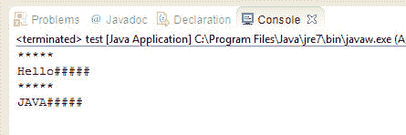

**图 14.8**：上述同步类的输出窗口

在前面的程序中，我们创建了两个线程`t1`和`t2`。这里使用了`synchronized`关键字；如果`t1`先捕获了`show`方法，则`t2`无法同时共享该资源，但可以执行其他工作。即使在执行`join`方法后，由于`t1`正在执行，`t2`也无法运行`show()`方法。

线程是任何 Java 程序中执行的最小单元。Java 程序的`main`方法也是一个线程，也是执行的入口。通过多线程，我们将应用程序的单个执行流拆分为多个执行流；因此，多个线程可以在 CPU 中并发执行。通过这种方式，我们也可以停止、启动、设置依赖并释放线程的执行。

- 多线程是指在应用程序中同时执行同一程序的多个线程。一个线程被划分为若干块并变成更小的线程，同时在 CPU 中与其他线程一起开始执行。

- `Synchronized`是使代码块或方法变更为线程安全的关键字。

- 线程不能被启动两次。如果我们尝试这样做，将抛出`IllegalThreadException`。

## 多选题

1. **创建线程的正确语句是哪一个？**

   1. `Thread t1 = new Thread();`

   2. `Runnable run = new Thread();`

   3. `Thread t2 = new Runnable();`

   4. `Thread thread;`

2. **创建线程类的两种方法是哪些？**

   1. 实现`Thread`接口

   2. 扩展`Runnable`接口

   3. 扩展`Threading`类

   4. 扩展`Thread`类

   5. 实现`run()`方法

   6. 实现`Runnable`接口

3. **Java 线程的默认优先级是什么？**

   1. `MIN_PRIORITY`

   2. `MAX_PRIROTY`

   3. `HIGH_PRIORITY`

   4. `NORM_PRIORITY`

4. **线程类必须实现哪个方法？**

   1. `start()`

   2. `join()`

   3. `create()`

   4. `run()`

5. **哪一个不是线程的有效状态？**

   1. `Active`

   2. `New`

   3. `Runnable`

   4. `Waiting`

## 答案

1. **a**

2. **d and f**

3. **d**

4. **d**

5. **a**

## 问题

1. `yield`方法和`sleep`方法之间有什么区别？

2. `join(1000)`与`wait(1000)`有什么不同？

3. `sleep`方法和`wait`方法之间有什么区别？

4. 进程和线程之间有什么区别？

5. 预测以下线程程序的输出：

```java
public class MainClass {
    public static void main(String[] args) {
        MyThreadClass myThreadClass = new MyThreadClass();
        Thread t1 = new Thread(myThreadClass);
        t1.start();
        t1.start();
    }
}
class MyThreadClass implements Runnable{
    @Override
    public void run() {
    }
}
```

6. `wait()`和`wait(time)`有什么区别？

## 核心术语

- `ProcessBuilder`

- `Dom Thread`

## 术语表

1. [`docs.oracle.com/javase/7/docs/technotes/guides/vm/thread-priorities.html`](https://docs.oracle.com/javase/7/docs/technotes/guides/vm/thread-priorities.html)

2. [`docs.oracle.com/javase/7/docs/technotes/guides/vm/thread-priorities.html`](https://docs.oracle.com/javase/7/docs/technotes/guides/vm/thread-priorities.html)

```java
private static final String INSERT_SQL = "INSERT INTO employee " + " (empid, name, email, country, password) VALUES " + " (?, ?, ?, ?, ?);";
private static final String UPDATE_SQL = "update employee set name = ? where id = ?;";
private static final String jdbcUrl = "jdbc:mysql://localhost:8080/mysql_database?useSSL=false";
private static final String username = "admin";
private static final String password = "admin";

public static void main(String[] args) {
    try (Connection conn = DriverManager.getConnection(jdbcUrl, username, password);) {
        conn.setAutoCommit(false);
        try (PreparedStatement insertStmt = conn.prepareStatement(INSERT_SQL); PreparedStatement updateStmt = conn.prepareStatement(UPDATE_SQL);) {
            // 创建带有参数化值的插入语句
            insertStmt.setInt(1, 200);
            insertStmt.setString(2, "java7");
            insertStmt.setString(3, "java7@mail.com");
            insertStmt.setString(4, "IN");
            insertStmt.setString(5, "password@123");
            // 执行插入语句填充表格
            insertStmt.executeUpdate();
            // 将更改提交到数据库
            conn.commit();
            System.out.println("Data inserted and committed successfully.");
        } catch (SQLException e) {
            System.out.println(e);
            if (conn != null) {
                try {
                    // 回滚事务
                    System.out.println("Transaction is being rolled back.");
                    conn.rollback();
                } catch (Exception ex) {
                    ex.printStackTrace();
                }
            }
        }
    } catch (SQLException e) {
        System.out.println(e);
    }
}
```

**输出：**

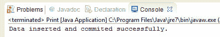

**图 15.2:** 前述 JDBC 程序的输出截图

# ResultSet

`ResultSet`是一个提供检索和操作结果的方法的接口，它在数据库上执行 SQL 查询时生成。默认情况下，结果集是单向且不可更新的。我们可以从第一行到最后一行按顺序读取数据，而无法修改结果集中的数据。结果集有三种类型：

- `TYPE_FORWARD_ONLY`：结果集不能滚动；其游标只能向前移动，从第一行之前移动到最后行之后。结果集中包含的行取决于底层数据库生成结果的方式。也就是说，它包含了在查询执行时或检索行时满足查询条件的行。这是默认的结果集类型。

- `TYPE_SCROLL_INSENSITIVE`：结果可以滚动；其游标相对于当前位置可以向前或后移动，也可以移动到绝对位置。在结果集打开期间，它对底层数据源所做的更改不敏感。它包含了在查询执行时或检索行时满足查询条件的行。

- `TYPE_SCROLL_SENSITIVE`：结果可以滚动；其游标相对于当前位置可以向前向后移动，也可以移动到绝对位置。结果集在保持打开状态时会反映底层数据源的更改。

并不是所有数据库都支持所有类型的结果集。要检查数据库支持哪些结果集，我们可以调用`DatabaseMetaData.supportsResultSetType(<ResultsetType>);`方法；如果该方法对指定的`ResultSet`类型返回`true`，则表示支持；否则返回`false`。我们也可以借助`DatabaseMetaData.supportsResultSetConcurrency(<specifyConcurrency>)`来检查并发级别。

# RowSet

`RowSet`对象派自`ResultSet`接口，所有的`RowSet`都具有结果集的功能。`RowSet`具有一些额外的特性属性、JavaBean 通知以及滚动能力或可更新性；这些功能在`ResultSet`中是不存在的：

- 第一，属性是表格的字段，并有相应的 setter 和 getter 方法。

- 第二，`RowSet`对象使用 JavaBeans 事件模型，当发生特定事件时，注册的组件会收到通知。游标移动、插入或更新或删除行以及`RowSet`内容的变化是产生通知的三类事件。

- 第三，`RowSet`默认是可滚动和可更新的，每个`RowSet`对象都具有从结果中读取行的滚动功能。

`RowSet`接口扩展了标准的`java.sql.ResultSet`接口。`RowSet`接口提供了一组属性，允许`RowSet`实例被配置为连接到 JDBC 数据源并从数据源读取某些数据。`RowSet`有两种类型：

- 连接型 RowSet (Connected Rowset)：连接型`RowSet`与数据源建立连接并在整个生命周期内保持连接。

- 断开型 RowSet (Disconnected Rowset)：断开型`RowSet`不始终与数据源保持连接。它打开连接获取数据，之后断开连接。

`RowSet`易于使用，在从数据源读取数据非常有用。

**注意：** `ResultSet`取决于驱动的支持。

在本章中，我们将讨论 Java 内存管理，以及 Java 虚拟机 (`JVM`) 如何为执行 Java 应用程序和程序自动管理内存。堆（Heap）是在 RAM 中创建的用于随机访问的内存，用于创建类、对象和成员。垃圾回收（Garbage collection）是 JVM 处理内存以及从堆中分配和回收内存的核心机制。

堆和栈（stack）是随机内存类型，其中堆是 Java 编程使用的主要内存。堆内存进一步细分为三个逻辑部分，称为代（generations）——新生代（new）、年代（old）和永久代（permanent）是堆内存的三个代。所有三代内存都由 Minor（小）、Major（大）和 Full（全）垃圾回收进行管理和处理，通过删除堆中未引用的对象来帮助系统回收未使用的内存。

## 结构

在本章中，我们将涵盖并详细讨论内存管理以及 JVM 如何管理程序的内存。作为本章的一部分，让我们讨论内存管理的主题：

- 垃圾回收及其类型

- Finalize

- 堆大小

- 堆内存的处理

## 目标

成功完成本章后，你将能够理解并解释垃圾回收、垃圾回收器及其在管理 Java 应用程序内存中的作用。

此外，你能够理解增加和减少堆内存大小的过程，以及如何通过指令 JVM 参数`-XX`为任何代和应用程序设置内存。

# 垃圾回收

`Garbage collection` (`GC`) 是一种内存管理过程，它会找到并移除或清理分配给对象的未使用堆内存，并保持内存可重用且供新资源使用。垃圾回收自动执行，并移除那些不再持有任何引用且不再使用的对象和成员的分配内存，通俗地说，我们可以说回收了未使用的堆内存。当我们在机器上执行 Java 程序时，它需要内存。

堆是 Java 对象在运行时用于进程和操作的内存，这是唯一由垃圾回收管理的内存，它还确保并为 Java 程序的执行提供所需的空闲内存。`Java virtual memory` (`JVM`) 提供了多种垃圾回收器，帮助系统或操作系统提高内存的性能和效率。

有两种方法`Runtime.gc()`和`System.gc()`它们可以向 JVM 生成并发送垃圾回收请求。我们无法强制垃圾回收器回收未使用的内存，JVM 会自动管理所有这些以运行应用程序或程序，开发者不需要担心 Java 中的内存管理。可以通过以下任何一种方法强制执行 GC：

```java
System.gc();
```

```java
Runtime.getRuntime().gc();
```

```java
System.runFinalization();
```

```java
Runtime.getRuntime().runFinalization();
```

**注意：调用上述方法并不保证 GC 会立即开始执行并回收内存。当所有堆内存满时，将抛出`java.lang.OutOfMemoryError`错误。**

当 GC 无法为新对象分配内存且无法回收内存时，JVM 将生成并抛出`java.lang.OutOfMemoryError`。这意味着堆已满，无法为新对象进一步扩展内存。此错误可能有多种原因，我们需要进行诊断和确定。但大多数情况下，这是由于堆内存不足导致的，为了防止此错误，我们需要使用堆大小参数增加 JVM 的堆内存大小。我们将在本章后面讨论并调查如何设置不同的 GC 内存大小。

# 代

Java 堆内存（Hotspot 堆结构）被称为`generations`（代）。代是根据对象的寿命或期限逻辑划分的堆空间，用于存储资源和对象。堆内存中有三代：新生代（young generation，也称为 new generation）、年代代（old generation）和永久代（permanent generation）。这里是堆内存的图：

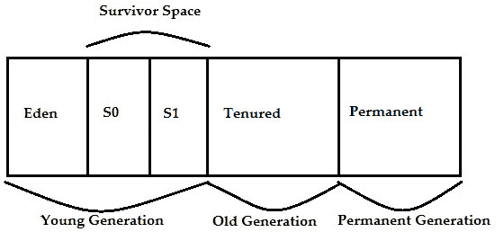

**图 16.1:** 堆内存的逻辑划分

上图显示了堆内存的划分以及对象如何根据使用情况在内存中生存。这里的新生代、年代代和永久代是对象根据年龄生存的三个栈。

首先，我们有新生代，它分为三个部分：一个`Eden`和两个幸存空间`S0`和`S1`，它们通过执行 Minor 垃圾回收将对象从一个部分移动到另一个部分。


其次，我们有年代代（称为 tenured generation），它存储未被新生代 Minor GC 清理的对象。如果程序或应用程序仍在使用该对象，则该对象将被移动到堆内存的年代代。新生代对象的年龄定义了一个阈值。一旦达到该阈值年龄，对象会自动从新生代移动到年代代。Major 垃圾回收在年代代上运行，以清理对象并回收内存。

第三个是永久代，它持有在运行程序或应用程序内存中执行和加载的类、对象和成员的元数据。它还持有 Java 库类和方法。Full 垃圾回收在永久代上运行，当这些类和方法不再需要时，从内存中清除类。

# 垃圾回收的类型

有三个在堆内存各个代执行的垃圾回收器。让我们通过示例讨论并理解所有三个垃圾回收器（Minor、Major 和 Full）：

- Minor GC：它在新生代运行，负责清理死亡对象并回收内存，并保持新生代的内存可用。Minor GC 还将对象从 Eden 移动到新生代内的幸存空间，随后移动到年代代。
- Major GC：它在堆内存的年代代运行，负责清理旧/长期堆空间。当年代代满时，JVM 执行大垃圾回收以回收死亡对象的内存。它还会清理在后台运行的守护线程以保持 JVM 正常运行。与小垃圾回收相比，大垃圾回收速度较慢，且运行频率较低。
- Full GC：它清理整个堆内存，包括新生代和年代空间。

这三个在堆内存各个代上运行的垃圾回收器确保我们的应用程序活跃运行，且不会出现内存泄漏或内存溢出问题。

# Finalize

Finalize 是垃圾回收的一种方法，由垃圾回收器在对象上调用，以便在回收内存之前识别并检查该对象的引用。`finalize()` 方法识别没有引用的对象并将它们推入垃圾回收队列以回收内存。`finalize()` 方法不会将任何存活或活跃的对象发送到垃圾回收。

当我们知道程序将不再使用某个对象并希望将其从内存中移除时，可以显式地调用对象上的 `finalize()` 方法。但再次，这完全取决于垃圾回收（GC），内存是否会被回收。我们无法保证在调用 `finalize` 方法后，该对象的内存会被释放并回收。显式调用 `finalize()` 方法可能会因为 CPU 占用率高而影响应用程序的性能。以下是重写垃圾回收 `finalize()` 方法的示例：

```java
@Override
protected void finalize() throws Throwable {
    super.finalize();
}
```

通常优于使用父类调用 `finalize`，以消除在子类或继承中可能发生的歧义。因此，当该父类的所有子类都执行完毕后，`finalize` 将会被执行。要理解 `super` 关键字的作用，请参阅本书第 10 章 `第 10 章：面向对象编程]` 中的继承章节。

# 堆大小（#toc.xhtml_s311a）

任何机器的堆大小取决于每个进程的最大地址空间。下表显示了各种平台每个进程的最大地址值：

| 操作系统 | 每个进程的最大地址空间 |
| --- | --- |
| Redhat Linux 32 位 | 2 GB |
| Redhat Linux 64 位 | 3 GB |
| Windows 98/2000/NT/Me/XP | 2 GB |
| Solaris x86（32 位） | 4 GB |
| Solaris 32 位 | 4 GB |
| Solaris 64 位 | Terabytes |

**表 16.1：** 操作系统及其每个进程最大地址空间的列表。

# 堆调优（#toc.xhtml_s312a）

我们可以在启动程序时控制任何应用程序或程序的堆内存大小。以下是运行用于设置堆大小并指示 JVM 将指定的堆内存分配给应用程序的参数：

- `-Xms<value>`：`Xms` 定义内存的最小堆大小。
- `-Xmx<value>`：`Xmx` 定义内存的最大堆大小。
- `-XX:MinHeapFreeRatio=<minimumValue>`：JVM 在每次 GC 时都会增大或缩小堆，以尝试在每次收集时将空闲与存活对象的比例保持在特定范围内。最小范围通过参数 `-XX:MinHeapFreeRatio=<MinValue>` 设置，在 `-Xms` 和 `–Xmx` 参数限制的总大小内以百分比表示。
- `-XX:MaxHeapFreeRatio=<maximumValue>`：JVM 在每次 GC 时都会增大或缩小堆，以尝试在每次收集时将空闲与存活对象的比例保持在特定范围内。最大范围通过参数 `-XX:MaxHeapFreeRatio=<MaxValue>` 设置，在 `-Xms` 和 `–Xmx` 参数限制的总大小内以百分比表示。
- `-XX:NewRatio=<ratio>`：当堆的大小增大或缩小时，JVM 会自动重新计算年轻代和老年代的大小。然而，我们可以通过使用 `-XX:NewRatio` 参数指定 `NewRatio` 来显式维护年轻代和老年代的大小。让我们更好地理解这一点：设置 `-XX:NewRatio=3` 意味着年轻代和老年代之间的比例为 3:1，Eden 以及两个幸存区的总大小将是整个堆的四分之一。
- `-XX:NewSize=<size>`：此参数用于设置年轻代的最小大小。
- `-XX:MaxNewSize=<size>`：此参数用于设置年轻代的最大大小。
- `-XX:+AggressiveHeap`：此参数检查机器资源（如内存大小和处理器数量），并尝试设置各种最适合长时间运行应用程序和任务的 JVM 参数。

我们可以在运行 `jar` 文件或应用程序时设置这些参数中的任何一个或所需的数量。以下是在打开 `jar` 时添加堆内存调优参数的示例：

```bash
java –jar javaCoreProject.jar -Xmx1024m -Xms3m -Xmn1m -XX:PermSize=20m -XX:+UseSerialGC -XX:MaxPermSize=256M
```

`java –jar` 是打开构建并封装成 `jar` 的应用程序的命令。在这里，我们使用 JVM 堆内存参数打开了 `javaCoreProject.jar` 文件。在这里，使用参数 `–Xmx1024m` 将最大内存设置为 1024mb，最小设置为 `2mb`，接下来是 `-Xms`，依此类推。

# 结论（#toc.xhtml_s313a）

内存管理是任何程序或应用程序在任何系统上运行的最关键点。JVM 借助垃圾回收提供了强大的开箱可用内存管理功能。由于 JVM 的这一功能，开发者在开发 Java 应用程序时不需要担心内存管理，因为所有这些事情都由 JVM 自己处理。

我们可以使用调优参数显式指定并设置应用程序的内存大小，并指示和强制 JVM 触发 GC。Minor GC、Major GC 和 Full GC 是帮助 Java 应用程序从未使用或死对象中回收内存并为新对象提供内存的三个 GC。如果没有 GC，将非常有挑战性且困难。

# 注意事项（#toc.xhtml_s314）

- `finalize` 方法在每个对象上被调用。
- 堆被分为年轻代、老年代和永久代。
- Minor、Major 和 Full GC 是帮助 Java 应用程序从未使用或死对象中回收内存并供新对象使用的三种 GC。

# 多选题（#toc.xhtml_s315）

1. 哪种垃圾回收在老年代上运行？
   - a. Full
   - b. Major
   - c. Minor
2. 幸存区是哪种代的部分？
   - a. Permanent
   - b. Old
   - c. Young
3. 新创建对象的分配发生在哪个堆内存？
   - a. Survivor space
   - b. New generation
   - c. Old generation

# 答案（#toc.xhtml_s316）

1. b
2. c
3. d

# 问题（#toc.xhtml_s317）

1. `Final`、`Finally` 和 `finalize` 之间的区别是什么？
2. 写出垃圾回收的类型。
3. 为什么 JVM 不保证显式执行？简述。

# 关键词（#toc.xhtml_s318）

- `Heap`：堆是存储对象的动态分配内存，位于计算机的 RAM 中。
- `Generation`：代是堆的逻辑划分部分。
- `GC`：垃圾回收（Garbage Collection）。
- `JVM`：虚拟机是 Java 程序的平台。

# 术语表（#toc.xhtml_s319）

1. [`docs.oracle.com/cd/E19159-01/819-368/abeik/index.html`](https://docs.oracle.com/cd/E19159-01/819-368/abeik/index.html)
2. [`www.oracle.com/webfolder/technetwork/java/gc01/index.html`](https://www.oracle.com/webfolder/technetwork/java/gc01/index.html)

# 索引（#toc.xhtml_ind）

## A

- abstraction 136
- 访问修饰
  - about 32
  - default 35
  - private 32, 33
  - protected 34
  - public 34
- append（string）method 89
- application programming interface（APIs）140
- array
  - about 96
  - accessing 97
  - copying 97, 98
  - creating 96
  - 初始化 96
- 数组类
  - 方法 97
    - `ArrayList` 158
- 汇编语言 3
- 自动装箱 119, 120

## B

- 组合编程语言（BCPL）6
- 引导类加载器 30
- 边界类型参数 123
- `BufferedReader` 类 182, 183
- 字节流 174

## C

- `catch` 块 146
- 字符流 174
- 检查异常
  - 关于 148
  - 类 148
- 类
  - 关于 27, 28
  - 在 Java 中创建 27
- 类加载器
  - 关于 29
  - 引导类加载器 30
  - 扩展类加载器 30
  - 系统类加载器 30
- 类路径变量
  - 使用命令行参数使用 16-18
  - 使用 GUI 向导使用 18-21
  - 设置 16
- 类变量 36, 72
- 集合 156
- 集合类 157
- 集合框架 157
- 注释 48
- 常用面向型语言（COBOL）5
- 计算机编程
  - 分析引擎算法 5
  - 汇编语言 5
  - 自动代码 5
  - BASIC 5, 6
  - C++ 6
  - 常用面向型语言（COBOL）5
  - C 语言 6
  - C 语言（C#）6
  - Formula 翻译（Fortran）5
  - Go 语言 6
  - 历史 5
  - Java 6
  - Python 6
  - Visual Basic 6
- 连接的 RowSet 213
- 常量变量 37
- 构造函数
  - 关于 56
  - 概述 59, 60
  - 带返回类型的构造函数 65
  - `contains(charValue)` 方法 86
- 自定义异常 149, 150

## D

- 数据类型
  - 关于 41
  - 布尔数据类型 42
  - 原生数据类型 41
- 默认构造函数 57
- `delete()` 方法 89
- 反序列化 183, 184
- 断开的 RowSet 213
- `do while` 循环 108, 109
- 驱动管理器 209

## E

- 封装 134-136
- `endsWith(String)` 方法 86
- `enum` 99-101
- `equals(Object)` 方法 86
- 错误 150
- 异常
  - 关于 146
  - 检查异常 148
  - `finally` 块 147
  - `try-catch` 146, 147
  - 非检查异常 148
- 扩展类加载器 30

## F

- `File` 类 172, 173
- `FileInputStream` 174
  - `FileInputStream` 方法
    - `available()` 175
    - `close()` 175
    - `finalize()` 175
    - `read()` 175
    - `skip()` 175
- `FileOutputStream` 175-177
- `FileReader` 174
- `FileWriter` 类 178
- `finalize` 方法 220, 221
- `finally` 块 147, 148
- 第一代语言（GL）3
- 先进先出（FIFO）160
- `foreach` 循环 112, 113
- `for` 循环 109, 110
  - `for` 循环参数
    - 递增 109
    - 初始化 109
    - 终止 109

## G

- 垃圾回收（GC）
  - 关于 218, 219
  - 方法 218
  - 类型 220
  - 代际 219, 220
- 泛型类
  - 关于 124, 125
  - 最佳实践 127
  - 泛型接口 125
  - 泛型方法 126
- 泛型
  - 关于 122, 123
  - 边界类型参数 123, 124
  - 参数类型 123
- 图形用户界面（GUI）6

## H

- `HashMap` 166
- `HashSet` 162-164
- 堆大小
  - 关于 221
  - 参数 222
- 堆调优
  - 关于 221
  - 示例 222
- 高级语言（HLL）4, 5

## I

- 相同构造函数 65
- `if-else` 语句 105
- `if` 语句 104
- 继承 137
- 初始化 30
- 输入流 174
- `InputStreamReader` 类 180, 181
- 实例变量 38
- 实例 139
- 无效 64
- `isEmpty()` 方法 86

## J

- Java
  - 关于 3
  - 创建 27
  - 特性 5
  - 软件 5
- 数据库连接（JDBC）213
- 开发包（JDK）3
- 存档（JAR）5
- 运行时环境（JRE）5
- 虚拟机（JVM）9, 83
  - 即时编译器（JIT）9, 10

## L

- `length()` 方法 85
- `LinkedHashMap` 167
- `LinkedHashSet` 164
- `LinkedList` 159, 161
- 链接 30
- list
  - 关于 157
  - `ArrayList` 158
  - `LinkedList` 159
  - `vector` 160
- 字面量 43, 44
- 加载 30
- 局部变量 39

## Loop

- loop
  - 关于 107
- `do while` 循环 108, 109
- `foreach` 循环 112, 113
- `for` 循环 109, 110
- 嵌套循环 110, 111
- `while` 循环 107
- 低层级语言
  - 关于 2

## A

- 汇编语言 3
- 机器语言 3

## M

- 机器语言 3
- 主方法 77
- map
  - 关于 166
  - `HashMap` 166
  - `LinkedHashMap` 167
  - `TreeMap` 167, 168
- `matches(regex)` 方法 87, 88
- method
  - 关于 44-46
  - 带参数的 47
- 方法重载 137, 138
- 方法重写 138, 139
- 修饰符 32
- 多行注释 48
- 多任务 192, 193
- 多线程 193, 194

## N

- 窄转换 121
- Native-API 驱动 209
- 嵌套 `if else` 105, 106
- 嵌套循环 110, 111

## O

- object
  - 关于 29
  - 类加载器 29
- 输出箱 120
- 输出流
  - 关于 175
  - `FileOutputStream` 175-177
  - `FileWriter` 类 178
  - `StringWriter` 类 178, 179
  - `Writer` 类 177

## P

- 包 31, 32
- 参数 40
- 带参数的构造函数 57, 58
- 参数类型 123
- 多态 137
- 原始数据类型
  - 关于 41
  - `byte` 数据类型 41
  - `char` 数据类型 42
  - 默认值 42
  - `double` 数据类型 42
  - `float` 数据类型 41
  - `int` 数据类型 41
  - `long` 数据类型 41
  - string 42
- `PriorityQueue` 161
- 私有构造函数 64
- 基于进程的多任务 192
- 进程 190, 191
- 编程语言，类型
  - 关于 2
  - 高层语言 4
  - 高层语言（HLL）5
  - 低层语言 2

## Q

- 查询数据库 209, 210
- 队列
  - 关于 160
  - `LinkedList` 161
  - 操作 161, 162
  - `PriorityQueue` 161

## R

- reader 类
  - 关于 179
  - `BufferedReader` 182, 183
  - `InputStreamReader` 180, 181
- 递归构造函数 65
- 引用数据类型 43
- `ResultSet` 212
- 结果集


`TYPE_FORWARD_ONLY` 212

`TYPE_SCROLL_INSENSITIVE` 212

`TYPE_SCROLL_SENSITIVE` 212

`reverse()` 方法 89

`RowSet`

关于 213

`connected RowSet` 213

`disconnected RowSet` 213

`runnable` 接口

使用 195, 196

# S

第二代语言 (2GL) 3

序列化 183, 184

set

关于 162

`HashSet` 162

`LinkedHashSet` 164

`TreeSet` 164

`setSavepoint()` 方法 210

单行注释 48

`split(regex)` 方法 87

statement 47, 48

static block 74

static class 76, 77

static keyword 28, 72

static method 73, 74

static variable 72

stream 174

stream, 类型

输入流 174

输出流 174

`String` 82

`StringBuffer`

关于 88

`append()` 方法 89

`delete()` 方法 89, 90

`insert()` 方法 89

`reverse()` 方法 89

`StringBuilder` 91

`String` 类

关于 85

`contains(charValue)` 方法 86

`endsWith(String)` 方法 86

`equals(Object)` 方法 86

`isEmpty()` 方法 85

`length()` 方法 85

`matches(regex)` 88

`matches(regex)` 方法 87

`split(regex)` 方法 87

`substring(begin, end)` 方法 86, 87

`substring(begin)` 方法 86, 87

`String` 字面量 82

`StringWriter` 类 178, 179

`substring(begin, end)` 方法 86, 87

`substring(begin)` 方法 86, 87

`super` keyword 60

Switch case 106, 107

`system` 类 30

# T

第三代语言 (3GL) 4

`this` keyword 62, 63

thread

关于 190

`runnable` 接口 195, 196

基于线程的多任务 192

thread class 194, 195

thread lifecycle 197, 198

thread methods 199, 200

thread synchronization 201, 202

thread stages 197

new 198

runnable 198

running 198

terminated 198

waiting 199

thread synchronization 201, 202

throw exception 152

`TreeMap` 167, 168

`TreeSet` 164, 166

try-catch 146, 147

try with resources 150, 151

type casting

关于 120, 121

窄转换 121

宽转换 122

# U

unchecked exception

关于 148

classes 148

user-defined exception 149

# V

valid constructor

example 63

variable 35, 36

variable, types

关于 36

class variable 36

constant variable 37

instance variable 38

parameter 40

set explicitly 40

`vector` 160

# W

waiting states

blocked 199

timed-waiting 199

while loop 107

widening 122

wrapper classes

关于 118, 119

自动装箱 119, 120

自动拆箱 120

`Writer` 类 177
