# 树莓派上的 Java 入门指南


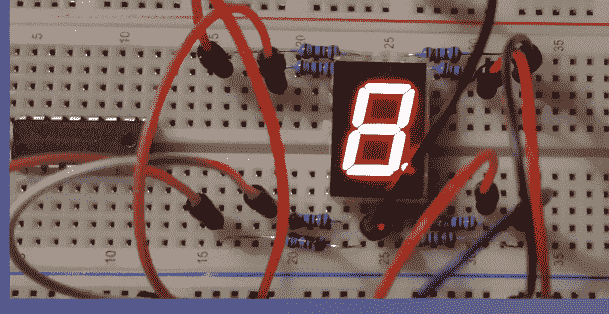


Frank Delporte

webtechie.be

通过许多中小型示例，向你介绍 Java (11+)、JavaFX (11+)、Pi4J、Spring、队列等……结合树莓派的硬件项目。

Frank Delporte


这是一本 Leanpub 书籍。Leanpub 通过“精益出版”（Lean Publishing）流程为作者和出版社赋能。精益出版是指使用轻量工具和多次迭代来发布进行中的电子书，获取读者反馈，不断调整直到完成正确的书籍，并在成功后建立影响力。

# 推特这本书！

请通过在 Twitter 上传播这本书来帮助 Frank Delporte！

建议此书的推文为：

#JavaOnRaspberryPi 结合 #JavaFX、#Spring、#Pi4J 和硬件组件非常有趣！

在书中通过大量示例探索发现：由 @FrankDelporte 编写的 "Getting started with Java on the Raspberry Pi" - https://leanpub.com/gettingstartedwithjavaontherraspberrypi

建议此书的标签为 #JavaOnRaspberryPi。

点击此链接在 Twitter 上搜索该标签，查看其他读者对这本书的评价：

## 第 8 章：位与字节: 169

## 第 9 章：Pi: 195

## 第 10 章：Spring: 262

- 什么是 Spring Boot?: 264
- 什么是 Spring Initializr?: 265
- 与 Mark Heckler 的访谈: 268
- 示例 1: Pi 上的最小服务器: 270
- 从 Initializr 项目开始并修改 `pom.xml`: 270
- 属性: 271
- 图片控制器: 271
- Swagger 配置: 276
- 在 Pi 上运行: 277
- 结论: 278
- 示例 2: 用于 Pi 上物联网数据的数据库 REST 服务: 279

# 目录

- `pom.xml` 设置 . . . . . . . . . . . . . . . . . . . . . . . . . . . . . . . . 279
- 创建数据库实体 . . . . . . . . . . . . . . . . . . . . . . . . . . 280
- 在数据库中存储数据 . . . . . . . . . . . . . . . . . . . . . . . . 285
- 添加 REST 服务 . . . . . . . . . . . . . . . . . . . . . . . . 285
- 添加 Swagger . . . . . . . . . . . . . . . . . . . . . . . . . . . . . . . . 287
- 运行应用程序并使用 REST 服务 . . . . . . . . . . . . . . . . . . . . . . . . . . 288
- 在 Pi 上运行的配置 . . . . . . . . . . . . . . . . . . . . . . . . 292
- 结论 . . . . . . . . . . . . . . . . . . . . . . . . . . . . . . . . . 294
- 与 Vlad Mihalcea 的访谈 . . . . . . . . . . . . . . . . . . . . . . . 295
- 示例 3：在 Pi 上用于切换 LED 的 REST 控制器 . . . 297
- Info REST 控制器 . . . . . . . . . . . . . . . . . . . . . . . . . . . 297
- GPIO 管理器 . . . . . . . . . . . . . . . . . . . . . . . . . . . . 298
- GPIO REST 控制器 . . . . . . . . . . . . . . . . . . . . . . . . . . 301
- 在 Pi 上运行应用程序 . . . . . . . . . . . . . . . . . . . . . 302
- 结论 . . . . . . . . . . . . . . . . . . . . . . . . . . . . . . . . . . 306
- 示例 4：响应式数据 . . . . . . . . . . . . . . . . . . . . . 307
- 代码 . . . . . . . . . . . . . . . . . . . . . . . . . . . . . . . . 307
- 在 Pi 上运行流式应用程序 . . . . . . . . . . . . . . . . . . . 311
- 结论 . . . . . . . . . . . . . . . . . . . . . . . . . . . . . . . . . . 312

# 只是一个念头：冒充者综合征 . . . . . . . . . . . . . . . . 313

## 第 11 章：消息队列 . . . . . . . . . . . . . . . . . 314

### 在 Pi 上使用 Mosquitto . . . . . . . . . . . . . . . . . . . . . . 316

- 安装 . . . . . . . . . . . . . . . . . . . . . . . . . . . . . . . . . 316
- 在 Pi 上测试 Mosquitto . . . . . . . . . . . . . . . . . . . . . 317

### 示例 1：在 Pi 和 PC 之间共享数据 . . . . . . . . . . 319

- 修改 `pom` 和 `module-info` . . . . . . . . . . . . . . . . . . . . 319
- 连接并发布到 Mosquitto . . . . . . . . . . . . . . . . . . 320
- 订阅 Mosquitto . . . . . . . . . . . . . . . . . . . . . 320
- 用户界面 . . . . . . . . . . . . . . . . . . . . . . . . . . . . . 321

### 示例 2：通过 Mosquitto 从 JavaFX 控制 Arduino . . 323

- 定义消息 . . . . . . . . . . . . . . . . . . . . . . . . . . 324
- Arduino 部分 . . . . . . . . . . . . . . . . . . . . . . . . . . . . 324
- Java 应用程序 . . . . . . . . . . . . . . . . . . . . . . . 333
- 完成的设置 . . . . . . . . . . . . . . . . . . . . . . . . . . . . . . 346
- 提示：检查 Arduino 和 Pi 之间的网络包 . . 346

# 结论 . . . . . . . . . . . . . . . . . . . . . . . . . . . . . . . 348

# 第 1 章：引言

欢迎阅读！无论你是 Java 新手并想通过示例进行学习，还是已经熟悉该语言并想尝试电子设备和树莓派，我希望你在这里能够发现有价值的新信息！

这本书并不是为了学习 Java 语言的每一个方面。市场上已经有很多比我更优秀的程序员编写的此类书籍，请查阅你的书店或在线课程。

# 本书使用的源代码和脚本

在书中，描述并使用了许多开源项目。因此，书中作为示例给出的所有源代码和脚本也都以开源形式共享。

# 在何处找到它们

所有内容都包含在一个 GitHub 项目中：JavaOnRaspberryPi！请关注该项目以获取任何更改和修正。更改将列在 `CHANGES.md` 文件中。

源代码的结构与书中的章节相对应，因此你可以轻松找到每个示例。

# 获取源代码

如果你在 GitHub（源码控制系统）上，只需点击网站上的下载按钮，即可获得一个文件中包含所有内容的完整副本。

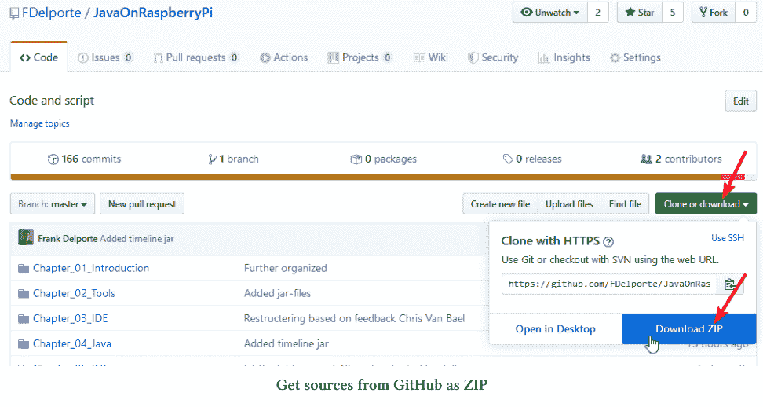

另一方面，如果你知道如何检出（check out）代码，请尽管这样做！这将让你获得所有代码和脚本的副本，如果你知道如何操作，还可以进行更改和改进，并以拉取请求（pull requests）的形式提交。**我非常期待你的拉取请求。**

以下是将代码检出到 Pi 的主目录的方法：

> https://github.com/FDelporte/JavaOnRaspberryPi

> https://github.com/FDelporte/JavaOnRaspberryPi/blob/master/CHANGES.md

```
$ cd /home/pi
$ mkdir Book
$ cd Book
$ git clone https://github.com/FDelporte/JavaOnRaspberryPi.git
```

在大多数项目中，你会发现一个 "target" 目录，其中包含 jar 文件，如果你不想修改代码和/或自己构建项目，可以直接运行它。书中后面将会有关于构建和运行的更多信息……

# 本书使用的样式

书中的所有代码和脚本格式均如下所示，其中 "..." 表示书中跳过的代码部分，但在源代码中完全可用。

```
public class HelloWorld{
    public static void main(String[] args[]) {
        System.out.println("Hello World!");
    }
}
```

命令和脚本示例具有相同的样式，当行以 "$" 开头时，意味着你必须在终端中输入的命令，接下来的行是你将获得的输出，例如，对于命令 `java -version`：

```
$ java -version

openjdk 11-BellSoft 2018-09-25
OpenJDK Runtime Environment (build 11-BellSoft+0)
OpenJDK Server VM (build 11-BellSoft+0, mixed mode)
```

我们在 GitHub 项目中使用的所有引用看起来像这样，指向 GitHub 项目中的子目录：

> https://github.com/FDelporte/JavaOnRaspberryPi

Chapter_01_Introduction > README.md

提示将如下所示显示：

> 不要忘记检查 README 文件！

> https://github.com/FDelporte/JavaOnRaspberryPi

# 阅读 README！

根目录下有一个 README 文件，在每个章节中也有，有时在项目中也有。这将帮助你轻松地使用脚本、设置项目等。

大多数章节的 README 还有一个“Read more”（更多）部分，你可以在那里找到关于该章节主题更多信息的链接。

添加 README 文件是一个良好的习惯，即使你是该项目的唯一开发者！它至少需要包含标题和描述、如何操作项目，以及如何构建、测试和运行它。

# 指南

README 使用了一系列约定来格式化，这些是书中常用的：

+ 使用 `##` 或 `###` 用于标题
+ 使用 `*` 用于项目符号
+ 使用 `[title](link)` 用于链接
+ 代码块前后使用三个反引号 ```

# 示例

这是一个短的示例文件：

``````
# 第 1 章：Java

描述 Java 的历史、现状以及如何在 Pi 上安装的章节。

# 链接

[OpenJDK JDK](https://openjdk.net/)

[下载 Liberica JDK](https://bell-sw.com/)

[Java 内存详解](https://lightcone.com/the-java-memory-explained-118397.html)

[Java Docker](https://www.docker.com)

[Windows SDK](https://engeor.com/2010/12/07/sdman-windows.html)

# 脚本

查看 `scripts` 目录在 Pi 上安装特定的 Liberica SDK 版本。

要检查已安装的 Java 版本，请在终端中运行此命令：

$ java -version

...
``````


当你在线查看此文件时，它看起来像这样：

# 第 3 章：Java

描述 Java 的历史、现状以及如何在 Pi 上安装的章节。

# 链接

+ AdoptOpenJDK
+ BellSoft Liberica JDK
+ Java 吉祥物 Duke 详解
+ SDKMAN
+ Windows SDKMAN

# 脚本

查看 `scripts` 目录在 Pi 上安装特定的 Liberica SDK 版本。

要检查已安装的 java 版本，请在终端中运行此命令：

```
$ java -version
```


## 第 2 章：本书中使用的工具和硬件

树莓派官网上的下载链接

选择 ZIP 文件并等待下载完成。在此期间，你可以下载一个工具将此文件“烧录”到 SD 卡中。在 PC 上，我更倾向于使用 `Rufus`，你可以下载便携版并直接运行，无需安装任何内容。

- 在 Linux 上，你不需要安装额外的软件即可将操作系统烧录到 SD 卡，但可以使用终端中的 `dd` 命令。

请按照树莓派官网上的这个[分步教程](https://www.raspberrypi.org/documentation/installation/installing-images/linux.md)，确保你选择了正确的写入位置。

当前带有桌面和推荐软件的 Raspberry Pi OS 约为 7GB。如果你使用 8GB 的微 SD 卡，将仅剩下 1GB 空间，这不足以对 Java 和应用程序进行实验……因此，建议使用 16GB 或更大的 SD 卡。你还需要一个适配器，以便在 PC 的大多数 SD 插槽中使用微 SD 卡。我们将小 SD 卡插入到适配器中，以便在 PC 上向其写入操作系统。

微 SD 卡和适配器

> 下载链接：https://rufus.ie/

运行 `Rufus` 并选择“Device”（确保选择的是 SD 卡而不是你 PC 的硬盘！）以及将下载的带有 Raspian 的 ZIP 文件作为“Boot selection”。

你可以对其他输入保持默认设置，并点击“START”，之后你需要进行确认。

确认覆盖 SD 卡

这是你确保已选择正确设备的最后机会！点击“OK”后，状态栏将显示进度，等待“READY”出现。

你现在可以将 SD 卡从 PC 上取下，并将小卡插入 Pi 中。注意方向，不要推得用力过猛，否则意味着你没有正确插入卡。

现在启动你的 Pi，很快就能看到桌面视图了。点点击几处以检查预安装的程序。你也可以配置 WiFi 连接将其连接到你的本地网络。

- 不要直接拔掉电源，而要在 Raspberry 中关机。否则，你的卡可能会损坏！这个主题在 [StackExchange](https://raspberrypi.stackoverflow.com/questions/381/how-do-i-turn-off-my-raspberry-pi) 上有详细讨论。

### 调整 SD 卡的根分区大小

当你使用新 SD 卡首次启动 Pi 时，根分区将自动调整大小以使用最大可用容量。如果你需要手动执行此操作，可以使用 `raspi-config`，它提供了一系列配置和维护选项。在 Pi 的终端上启动它：

```bash
$ sudo raspi-config
```

为了确保你正在使用该工具的最新版本，请选择选项“8 Update”。然后工具将重启，现在选择“7 Advanced options”。

在这个高级界面中，选择第一个选项“Expand Filesystem”。你的 Pi 需要重启，然后你可以使用以下命令检查磁盘：

```bash
$ df -h
```

SD 卡的磁盘使用情况

磁盘被分为多个分区，最大的部分是根分区，所有程序、文件……都存储在那里。在我的情况下，使用 32GB 的卡，根分区大约有 29GB 的空闲空间。

### Pi 与面包板之间的连接

将电线和硬件连接到 Pi 非常容易，但数字标记可能会让人困惑。有不同的解决方案供选择，其中我测试了：这个 T 型板可以直接插在面包板上，你可以轻松地从上面读取数字。缺点是电线占据了大量空间。你可以在网上找到很多不同的类型，例如搜索“raspberry pi header”。

### 面包板

对于这块板，你必须在按下之前对齐 Pi 和面包板，尽量不要弯曲引脚。如果你遵循在线手册，可以按照[指南](https://youtube.com/)将 Pi 插入面包板，可以使用剩余空间。

| 命令 | 描述 |
|---|---|
| `pwd` | 显示当前目录的名称。 |
| `ls` | 列出目录内容。 |
| `ls [path]` | 列出指定目录的内容。以易读的格式显示文件。 |
| `cd [path]` | 切换到 `[path]`。 |
| `cd ..` | 切换到父目录（注意 `cd` 和 `..` 之间的空格）。 |
| `cd /` | 切换到根目录。 |
| `cd ~` | 切换到用户目录（由 `$HOME` 变量决定）。 |
| `mkdir [name]` | 在工作目录下创建目录 `[name]`。 |

| 命令 | 描述 |
|---|---|
| `rmdir [name]` | 删除空目录 `[name]`。 |
| `rm [name]` | 删除文件。 |
| `rm *` | 删除当前目录下的所有文件。 |
| `rm -r *` | 删除当前目录下的所有文件和目录。 |
| `cp [from] [to]` | 将文件从 `[source]` 复制到 `[destination]`。 |
| `cp -r [from] [to]` | 将目录从 `[source]` 复制到 `[destination]`。 |
| `mv [from] [to]` | 将文件从 `[source]` 移动到 `[destination]`。 |
| `mv -r [from] [to]` | 将目录从 `[source]` 移动到 `[destination]`。 |
| `find` | 搜索匹配模式的文件。 |
| `sudo [command]` | 超用户。以提升权限执行 `[command]`。允许你执行没有权限的操作。常见示例：启动 Raspberry 配置工具。 |
| `sudo apt-get install [package]` | 安装软件包。 |
| `sudo apt-get update` | 更新软件包列表而不安装任何内容。升级软件包到通过 `apt-update` 获取的版本。 |
| `sudo apt-get upgrade` | 升级软件包。 |
| `sudo su` | 为多个命令切换到超级用户。 |
| `cut [name]` | 显示文件内容。 |
| `head [name]` | 显示文件的开头。 |
| `tail [name]` | 显示文件的末尾。 |
| `chmod [who][+,-]=[permissions] [name]` | 更改文件的权限。 |
| `chmod u+x [name]` | 为文件所有者添加执行权限。 |
| `chmod 777 [name]` | 允许所有用户读、写和执行文件 `[name]`。 |
| `tar -cvf [name] [path]` | 从 `[path]` 中的内容创建压缩文件 `[name]`。 |
| `tar -xvf [name]` | 解压压缩文件的内容。 |

```bash
rm --help
```

`[path]` 指的是绝对路径或相对路径。

让我们尝试几个示例，打开终端并从列出目录 `ls` 开始。默认情况下，终端将在你的主目录位置启动，该命令将向你显示当前目录的内容，在此例中，即为主目录 `/home/pi`。

```bash
$ ls
- Desktop Documents Downloads MagPi Music Public Templates Videos
```

通过在 `ls` 命令后添加一个路径，我们可以获取指定目录的内容，例如系统根目录 `/` 或主目录 `home`：

```bash
$ ls /
- bin dev lost+found mnt proc run srv tmp var
- boot etc lib media opt root sbin sys usr
- ls /home
- pi
```

为了获取更多信息，我们可以使用额外的 `-la` 参数，包括：

- `l`：添加额外信息（用户权限、所有者、大小等）
- `a`：包括以 `.*` 开头的隐藏文件（即点文件）

```bash
$ ls -la
total 44M
drwxr-xr-x 2 pi 4K Jan 1 18:59 ..
drwxr-xr-x 3 root 4K Sep 26 01:00 .
-rw-r--r-- 1 pi 22K Sep 26 01:09 .bash_logout
-rw-r--r-- 1 pi 35K Sep 26 01:09 .bashrc
drwxr-xr-x 7 pi 4K Jan 7 19:00 .cache
drwx------ 6 pi 4K Jan 7 19:00 .config
drwxr-xr-x 2 pi 4K Sep 26 01:46 Desktop
drwxr-xr-x 2 pi 4K Sep 26 01:46 Documents
drwxr-xr-x 2 pi 4K Sep 26 01:46 Downloads
drwx------ 3 pi 4K Sep 26 01:48 .gng
drwxr-xr-x 3 pi 4K Sep 26 01:48 .local
drwxr-xr-x 2 pi 4K Sep 26 01:46 Music
drwxr-xr-x 2 pi 4K Sep 26 01:46 Pictures
drwx------ 3 pi 4K Jan 7 18:59 .pki
-rw-r--r-- 1 pi 8K Sep 26 01:09 .profile
drwxr-xr-x 2 pi 4K Sep 26 01:46 Public
drwxr-xr-x 2 pi 4K Sep 26 01:46 Templates
drwxr-xr-x 2 pi 4K Sep 26 01:46 Videos
drwx------ 3 pi 4K Jan 7 18:29 .vnc
-rw-r--r-- 1 pi 16K Jan 7 18:54 .wget
-rw------ 1 pi 56K Sep 26 01:46 .authority
-rw------ 1 pi 3K Sep 26 01:46 .session-errors
```

在书中我们将使用 `nano` 编辑器，所以让我们通过 `man nano` 查看一下手册吧：

```bash
$ man nano

NANO(1)          Commands Manual

NAME
nano - Nano 的编辑器，一个增强的免费克隆

SYNOPSIS
nano [options] [[line,column]] file

DESCRIPTION
nano 是一个小型而友好的编辑器。它复制了 Pico 的外观和感受，但它是免费软件，并实现了 Pico 缺失的一些功能，例如：打开多个文件、按行滚动、撤销/重做、语法高亮、行号以及过长行的软换行。

在命令行上提供文件名时，可以通过在文件名之前添加加号 (`+`) 来将光标置于特定行，通过添加逗号 (`,`) 将光标置于特定列。

作为一种特殊情况：如果提供的不是文件名而是连字符 (`-`)，nano 将从标准输入读取数据。
```

该手册内容很长，这只是初始部分。按 `q` 键退出。现在让我们来执行几个步骤：

- 在根目录 `tmp/` 中创建一个名为 `experimenting` 的目录
- 使用文件 `myfile` 文本编辑器并输入 `Hello!`
- 若要退出并保存更改：
  - `CTRL+X` -> 退出
  - `Y` -> 保存更改
  - `Enter` -> 确认文件名
- 使用 `head` 检查创建的文件内容
- 使用 `ls -l` 检查创建的文件的大小
- 再次删除该文件

```bash
$ mkdir /tmp/experimenting
$ ls -l /tmp/experimenting/
total 0
$ nano /tmp/experimenting/myfile
$ head /tmp/experimenting/myfile
Hello:
$ ls -l /tmp/experimenting/
total 4
-rw-r--r-- 1 pi 7 Dec 15 22:07 mymyfile
$ rm /tmp/experimenting/myfile
$ ls -l /tmp/experimenting/
total 0
```

一些额外的提示：

- 使用 `tab` 键自动补全路径，例如在 `ls -l /t` 中按下 `tab` 键。这将自动补全为 `ls -l/tmp/`，因为只有一个以 `/t` 开头的目录。
- 使用上方向键。


## 第 2 章：本书中使用的工具和硬件

终端将在你的主目录位置启动，该命令将向你显示当前目录的内容，在此例中，即为主目录`/home/pi`。

```bash
$ ls
- Desktop Documents Downloads MagPi Music Public Templates Videos
```

通过在`ls`命令后添加一个路径，我们可以获取指定目录的内容，例如系统根目录`/`或主目录`home`：

```bash
$ ls /
- bin dev lost+found mnt proc run srv tmp var
- boot etc lib media opt root sbin sys usr
- ls /home
- pi
```

为了获取更多信息，我们可以使用额外的`-la`参数，包括：

- `l`：添加额外信息（用户权限、所有者、大小等）
- `a`：包括以`.*`开头的隐藏文件（即点文件）

```bash
$ ls -la
total 44M
drwxr-xr-x 2 pi 4K Jan 1 18:59 ..
drwxr-xr-x 3 root 4K Sep 26 01:00 .
-rw-r--r-- 1 pi 22K Sep 26 01:09 .bash_logout
-rw-r--r-- 1 pi 35K Sep 26 01:09 .bashrc
drwxr-xr-x 7 pi 4K Jan 7 19:00 .cache
drwx------ 6 pi 4K Jan 7 19:00 .config
drwxr-xr-x 2 pi 4K Sep 26 01:46 Desktop
drwxr-xr-x 2 pi 4K Sep 26 01:46 Documents
drwxr-xr-x 2 pi 4K Sep 26 01:46 Downloads
drwx------ 3 pi 4K Sep 26 01:46 .gng
drwxr-xr-x 3 pi 4K Sep 26 01:48 .local
drwxr-xr-x 2 pi 4K Sep 26 01:46 Music
drwxr-xr-x 2 pi 4K Sep 26 01:46 Pictures
drwx------ 3 pi 4K Jan 7 18:59 .pki
-rw-r--r-- 1 pi 8K Sep 26 01:09 .profile
drwxr-xr-x 2 pi 4K Sep 26 01:46 Public
drwxr-xr-x 2 pi 4K Sep 26 01:46 Templates
drwxr-xr-x 2 pi 4K Sep 26 01:46 Videos
drwx------ 3 pi 4K Jan 7 18:29 .vnc
-rw-r--r-- 1 pi 16K Jan 7 18:54 .wget
-rw------ 1 pi 56K Sep 26 01:46 .authority
-rw------ 1 pi 3K Sep 26 01:46 .session-errors
```

在书中我们将使用`nano`编辑器，所以让我们通过`man nano`查看一下手册吧：

```bash
$ man nano
NANO(1)          Commands Manual

NAME
nano - Nano 的编辑器，一个增强的免费克隆

SYNOPSIS
nano [options] [[line,column]] file

DESCRIPTION
nano 是一个小型而友好的编辑器。它复制了 Pico 的外观和感受，但它是免费软件，并实现了 Pico 缺失的一些功能，例如：打开多个文件、按行滚动、撤销/重做、语法高亮、行号以及过长行的软换行。

在命令行上提供文件名时，可以通过在文件名之前添加加号 (`+`) 来将光标置于特定行，通过添加逗号 (`,`) 将光标置于特定列。

作为一种特殊情况：如果提供的不是文件名而是连字符 (`-`)，`nano`将从标准输入读取数据。

该手册内容很长，这只是初始部分。按`q`键退出。现在让我们来执行几个步骤：

- 在根目录`tmp/`中创建一个名为`experimenting`的目录
- 使用文件`myfile`文本编辑器并输入`Hello!`
- 若要退出并保存更改：
  - `CTRL+X` -> 退出
  - `Y` -> 保存更改
  - `Enter` -> 确认文件名
- 使用`head`检查创建的文件内容
- 使用`ls -l`检查创建的文件的大小
- 再次删除该文件

```bash
$ mkdir /tmp/experimenting
$ ls -l /tmp/experimenting/
total 0
$ nano /tmp/experimenting/myfile
$ head /tmp/experimenting/myfile
Hello:
$ ls -l /tmp/experimenting/
total 4
-rw-r--r-- 1 pi 7 Dec 15 22:07 mymyfile
$ rm /tmp/experimenting/myfile
$ ls -l /tmp/experimenting/
total 0
```

一些额外的提示：

- 使用`tab`键自动补全路径，例如在`ls -l /t`中按下`tab`键。这将自动补全为`ls -l /tmp/`，因为只有一个以`/t`开头的目录。
- 使用上方向键。


一些额外的提示：

- 使用 `tab` 键自动补全路径，例如在 `ls -l /t` 中按下 `tab` 键。这将自动补全为 `ls -l /tmp/`，因为只有一个以 `/t` 开头的目录。
- 使用上方向键。

# 第2章：本书使用的工具和硬件

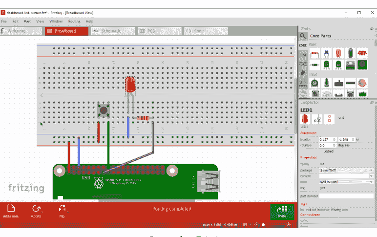

## 原理图

本书中的图表使用 yworks 提供的 yEd Graph Editor 制作，这是一个快速绘制图表的免费工具。他们还提供了商业库（针对 Java、.NET、web），可以将此类图表集成到你的软件中。

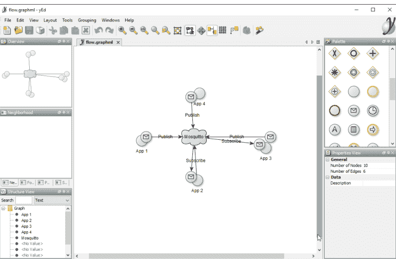

> 21https://www.yworks.com/downloads#yEd

## 硬件组件

### 电阻

这些是我们所有项目中都需要的基础组件。由于它们无法被分离，你将能够根据色环来计算它们的数值。大多数使用的电阻有 4 个色环，你需要这张表来计算数值。

电阻色环编码表

| 名称 | 颜色 | 数值 | 倍率 | 误差 | 温度系数 |
| --- | --- | --- | --- | --- | --- |
| 黑 | #000000 | 0 | 1Ω | | 250ppm/K |
| 棕 | #761d1d | 1 | 10Ω | 1% | 100ppm/K |
| 红 | #cc0000 | 2 | 100Ω | 2% | 50ppm/K |
| 橙 | #ffa500 | 3 | 1K | | 15ppm/K |
| 黄 | #ffff00 | 4 | 10K | 0% | 25ppm/K |
|  | #008000 | 5 | 100K | 0.5% | 20ppm/K |
|  | #0000cc | 6 | 1M | 0.25% | 10ppm/K |
| 紫 | #88e2ee | 7 | 10M | 0.1% | 5ppm/K |
| 灰 | #808080 | 8 | 100M | 0.25% | 1ppm/K |
| 白 | #ffffff | 9 | 1G | 0% | |
| 金 | #ffd700 | | 0.1Ω | 5% | |
|  | #c0c0c0 | | 0.01Ω | 10% | |
| 无 | | | | 20% | |

色环编码表

> 该色环编码表是以 JavaFX 应用的形式创建的。JavaFX 将在本书后后部分进行介绍。如果你想对其进行实验或用它来计算下文所述的电阻值，可以查看源码。

`Chapter_02_Tools > javafx-resistors`

在 Pi 和 Arduino 项目中最常用的电阻类型是 330Ω，用于限制 LED 的功率。

金色永远不会是第一个色，所以我们需要从另一侧开始。


- 前两个色环给出数值 = 橙-橙 = 33
- 第三条色环是倍率 = 棕 = 10Ω
- 第四条色环是误差 = 金 = 5%
- 所以 (33 * 10) = 330Ω，误差为 5%

通过使用 JavaFX 应用，我们确实得到了相同的结果：

### 电阻值计算器（3, 4, 5 或 6 环）

| 橙 | 橙 | 棕 | 金 | | 清除 |

电阻值为 330Ω，误差为 5.0%

计算 橙-橙-棕-金 的电阻值

我们再来看一个：

- 棕 (1)，黑 (0)，绿 (100KΩ) 倍率，金 (5) 误差
- 10 * 100KΩ，误差为 5%
- 1MΩ，误差为 5%

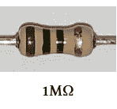

### 电阻值计算器（3, 4, 5 或 6 环）

| 棕 | 黑 | 绿 | 金 | | 清除 |

电阻值为 1MΩ，误差为 5.0%

计算 棕-黑-绿-金 的电阻值

### LED

除了电阻，LED 也是本书中最常用的元件。它们有各种颜色和尺寸。发光二极管顾如其名，当电流流过二极管时会发光，并阻挡反方向的电流。LED 产生的电压降大部分在 1.2 到 3.6 伏之间，建议电流在 10 到 30 mA 之间。


它们有正极和负极引，很容易记住哪一个是正极。最长的那个是正极！你有更多选择。如果引脚被切断，塑料平整的一边是负极。LED 中的电流只能从正极（阳极）流向负极（阴极）！

Pi 输出 3.3V，而大多数 Arduino 输出 5V，我们需要电阻来防止损坏 LED。

计算电阻值的公式：
`resistorValue = (sourceVoltage in V - ledVoltage in V) / ledCurrent in A`

对于 3.3V GPIO 配合 2.2V 和 20mA 的 LED 示例，你可以在数据表或包装上找到这些。
(3.3V - 2.2V) / 02A = 55Ω

为了安全起见，大多数情况下使用 330Ω 电阻。JavaFX 应用也有一个计算工具：

### LED 电阻

| 输入电压 (V) | 3.3 | LED 电压 (V) | 2.2 | LED 电流 (A) | 02 |
| --- | --- | --- | --- | --- |
| 需要 55Ω 电阻 | | | | |

### RGB LED

RGB LED 将三种颜色结合在一起。它们共用一个阴极 (-) 或阳极 (+)。幸运的是，你不会因为连接方式错误而损坏它们，你可以用 Pi 的固定引脚快速检查。正如你在第 9 章“输入和输出 > RGB LED”中看到的，不同颜色的亮度不同，你需要查看数据表以定义每个引脚使用的电阻。

### 共阳极 / 共阴极


红色 共阴极

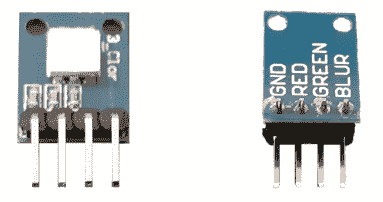

RGB LED 的引脚

共用引脚是最长的，顺序为红-绿-蓝。有些（Arduino）启动套装包含连接在小 PCB 上的 RGB LED。在这种情况下，你需要检查板本身以确保连接正确。在上面的图中，你可以看到一个带有指示的示例。

### LED 灯带

LED 灯带有两种“口味”：WS2812B（WS2811 的改进版本，也称为 AdaFruit NeoPixel）和 WS2813，它们的主要区别是连接数（3 个对 4 个）。关于 LED 灯带有两个重要的说明：
- 仅连接电源是不够的，在控制器发送数据之前它们不会动作。
- 它们需要大量功率，所以不要从 Pi 取电，而要使用外部电源。

### LED 灯带电源

为了你需要哪种电源，需要进行一些计算……检查你使用的灯带数据表，以知道单个 LED 在最大亮度下使用的电流。例如，取每个 LED 最大 60mA 的。顺便说，如果你只使用颜色，实际使用会更低。

| 电流/LED | LED/米 | 1 米总量 | 5 米总量 |
| --- | --- | --- | --- |
| 60mA | 30 | 1.8A | 9A |
| 60mA | 60 | 3.6A | 18A |
| 60mA | 144 | 8.64A | 43.2A |

如果我们只想进行一些测试，可以使用只有 10 个 LED 的短段。这在全亮度下需要 0.6A (600mA)。但即使这对于 Pi 来说也太多了。5V 引脚的电来自 USB 电源，Pi 系统本身也在使用，当然只为这个引脚留下了几百毫。

对于 Arduino，取决于类型和电源，但大约有 400mA 到 800mA 可用。确实，正如我在设置“第 11 章：消息队列”中描述的示例项目时发现的，短带可以直接从 Arduino 供电。

> 备注，Arduino 示例在某时刻不起工作，是因为我把板连接到了 PC。所以板由 PC 供电，而我使用了带有独立电源的长 LED 灯带。由于它们没有共用地，数据完全乱了，LED 没有显示我预期的效果。所以记住将它们共接地！

### 结论

- Pi：在所有情况下将 LED 灯带的电源连接到独立的电源。
- Arduino：测试短带可以的。
- 确保板子和灯带共用地。

34

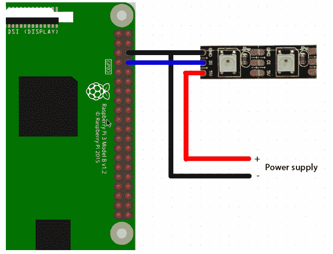

使用外部电源将 LED 灯带连接到 Pi

在实验灯带时要小心眼睛受伤，因为它们可能非常亮！

### WS2812B = 单线连接控制

此类灯带中的每个 LED 都可以单独控制，因为每个 LED 内部嵌入了一个 WS2812B 芯片，注意 LED 内部的小黑点。在大多数情况下，这是一个 5050 LED。LED 的控制通过通过单根数据线完成。这些灯带的最大刷新率为 400Hz。

### WS2813 = 双线连接控制

WS2813 是 WS2812B 的更新版本，使用两根数据线，如果一个 LED 损坏，灯带其余部分将继续工作。另一个优势是更高的刷新率 2000，但这专门对于显示用途非常重要，而在书中我们只是做“有趣的 LED 灯带”实验。

缺点：与 WS2812B 灯带相比，它们稍微贵一点。

### 带 Arduino 板电子套件

在本书的示例中，我们还将使用 Arduino、LED、电阻等……如果你购买了一个良好的入门套件，你将获得书中示例所需的大部分组件。

请确保你有一块面包板和跳线线，以便快速搭建示例。

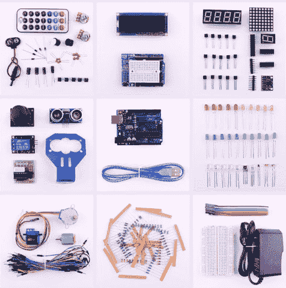

Elektor.com 提供的 Arduino 学习套件

### 一点想法：通过教学来学习

我在 2014 年初在比利时创建了两个 CoderDojo 俱乐部（Roeslare 和 Lierse），直到今天仍在组织 Lierse 的那个。CoderDojo 是一个让孩子们学习编程的俱乐部。不是通过正式课程，而是通过引导孩子们进行实验和发现。教练们只在其他所有方法都失败时提供帮助。在 2014 年那个时候，关于软件和电子项目缺乏工程师的问题存在着很多“议论”。


| 2011-2 | 2012-13 | 2013-14 | 2014-15 | 2015-16 | 2016-17 | 2017-18 | 2018-19 |
|---|---|---|---|---|---|---|---|
| 1794 | 1944 | 2058 | 2297 | 2472 | 2669 | 2644 | 2918 |
| 11312 | 11711 | 11888 | 12547 | 13040 | 13394 | 13661 | 13642 |

佛兰德的工程学生

该图表基于比利时佛兰德工程学生（机电一体、数字艺术与娱乐、电子-ICT、多媒体和通信技术……）的数量 ^1 得益于 CoderDojo 和其他 STEAM 计划；这种教育在这些几年中变得流行，女性群体从 15% 增加到了 21%。

在 2018-2019 学年进入高中的所有学生（240,332 人）中，只有 16,560 人（即 7%）进入了这个工程方向，这几乎保证了你能找到一份有趣且具有挑战性的工作！随着 STEAM 在未来高度依赖技术的社会变得越来越重要，我们需要激励更多的人……

写这段长长的引言是为了说明，我不仅在 CoderDojo 中“教育”孩子们，还在 First Lego League^2 团队中教育同事的孩子们。在那个时时刻刻，你会发现自己什么都不知道……完全不知道孩子们是什么样的。同时，当你开始尝试新事物时，一个新世界向你敞开了门。对我来说，那是我发现 Arduino、树莓派、Mindstorms 以及许多许多物的时刻。因为我相信知识分享的力量，也包括博客、写作、演讲以及再次发现新世界。

只有当你精通了某事，或者通过研究、尝试、失败、重新开始、记录时，你才能解释它。这正是我试图为这本书所做的事情……

> ^1 https://coderdoojo.com/
> ^2 发表于 www.vlaanderen.be/publicities > "Hoger onderwijs in cijfers"
> ^3 科学、技术、工程、艺术和数学
> ^4 http://firstlegolegoleague.org/

### 与 Karen Mouws 的采访


Karen Mouws @LimsKaren，白天是教育设计师，尽可能当一名创客教育工作者。兼职成人，并为此自豪。

在你看来，IT 世界主要是白人男性环境。为什么这是一个问题？

我坚信，团队或公司的多样化将带来收益。引入多个视角有助于发现隐藏的问题、新颖解决方案并挑战现有的思维模式。多样性的缺乏会导致长期视野的狭窄，如果用户不符合“理想流程”（happy flow）的特征，就会开始排除他们。

让更多人进入 IT 领域是一项正进展顺利的任务：那里有很多倡议正在帮助女性“进入” IT 行业。更大的挑战将是让他们留在那里。在团队中成为“异类”或不断撞上隐喻的墙并不容易，因为你的声音没有被听见，或者作为专业人士不断被低估。

你的“进攻计划”是什么以此激励青少年参与数字世界？

儿童和青少年在数字世界中已经被忽视了，现在比以往任何时候都如此，但他们可能会“困”在消费层面。只有一小部分人会开始创作内容，从有趣的视频到游戏。我需要从多个层面考虑这种模式：引入、创意生产和可见性。

首先，你无法知道你不知道的东西：如果没有人向你介绍代码是一个有趣的工具，你将如何尝试它？这就是为什么我如此喜爱 CoderDojo 和 WeGoSTEM，它们每年影响数千名儿童。

但我们还需要……（原文此处中断）

## 第 3 章：选择 IDE

IDE（=集成开发环境）是你开发应用程序时最好的朋友。它将帮助你编写正确的代码并将其编译为运行的应用程序。一些常用的有 IntelliJ IDEA、Visual Studio Code、NetBeans 和 Eclipse。

Apache NetBeans² 是一个免费开源的 IDE，你可以将其用于 Java、JavaScript、PHP、C/C++。Eclipse IDE³也是如此。两者都是非常流行的编辑器，但我将重点介绍另外两个。选择 IDE 是非常个人化的事情。一旦你熟悉了一个并掌握了工作快捷键，切换将变得困难。尝试它们，找到最适合你需求的某一个，选定它就不要回头了 ;)

> ²https://netbeans.org/
> ³https://www.eclipse.org/ide/

### IntelliJ IDEA

IntelliJ IDEA 是由总部位于捷克的 JetBrains 公司构建的商业产品。他们销售许多开发者工具，但 IntelliJ IDEA 是其中最广为人知的，也是专业开发者最常用的 IDE。它有一个免费版本（社区版 Community），可用于 Java 和 Android 开发，而 Ultimate 版是带有额外功能的付费版本，如你可以在[下载页面+]()() 中看到的。

代码补全（即提示）和强大的重构工具是 IDE 的主要优势，它们可以帮助你按照所示的方法（包括参数）尽可能地编写代码。

```
HBox bitselection = new HBox();

bitselection.setSpacing(double value) = 10;

bitselection.setShape(boolean value);

bitselection.setScale(double value);

bitselection.setCa(double value);

bitselection.setShape(boolean value);

Toggle.setSnapToPixel(boolean value);

RadioButton.setStyle(string value);

rbInteger.setShape(boolean value);

rbInteger.setCenter(boolean value);

bitselection.setMaxSize(double maxWidth, double maxHeight);

bitselection.setMinWidth(double width, double height);
```

IntelliJ IDEA 中的代码提示

IDEA 的另一个大优点是代码中参数名的可视化，当你调用方法时，可以轻松检查你是否使用了正确的值。

```
HBox bitselection = new HBox();

bitselection.setSpacing(10);

bitselection.setPadding(new Insets(topBottomLeft: S));
```


# IntelliJ IDEA 中的参数名提示

> IntelliJ IDEA 的魔法按键：双击 `Shift` 键
> 你可以通过学习快捷键来加速开发，`CTRL-C` 和 `CTRL-V` 可能是最为人知的复制和粘贴。每个 IDE 都有一个列表，但如果你只想为 IntelliJ IDEA 记住一个，那就是双击 `Shift` 键进行“全处搜索”（`Search Everywhere`）。
> 它将弹出一个窗口，你可以在其中输入你要搜索的任何内容，例如类名、你在代码某处编写的方法、IDE 的设置等……

https://www.jetbrains.com/idea/download/

## 带有示例项目的 IntelliJ IDEA

要从源代码打开一个示例项目，请点击 `File > Open` 并选择源目录。

在下一个窗口中，选择你想打开的项目目录并点击 `OK`。

### 选择项目

IntelliJ IDEA 需要一些时间来加载 Maven 依赖（更多信息请参见第 6 章），完成后，一切都准备好可以浏览文件并开始自己编写代码。

如果你安装了多个 Java SDK，你可能需要帮助 IntelliJ IDEA 定义使用哪一个。

请记住，Java 示例项目至少需要 JDK 11。你可以使用与我们在 Pi 上使用的同一个（来自 Bellsoft 的 Libera JDK，参见第 4 章如何获取和安装此 JDK），或使用 AdoptJDK 的最新版本。你可以在“Project Structure”（`SHIFT+CTRL+S`）中定义每个项目使用的 SDK。

在下一张截图中，你可以看到示例中的一个 JavaFX 项目。

- `Project` - 窗口：在这里你可以浏览项目中的所有文件
- 中间 - `Editor` 窗口：包含一个打开的 Java 文件
- 右侧 - `Maven` 视图：更多信息见第 6 章，但请点击这里的
- `"Plugins" > javafx > javafx-compile` 将代码编译为字节码，这将显示代码是否正确
- `"Plugins" > javafx > javafx:run` 启动应用程序

在某些情况下，如果代码无法启动或构建，使用顶部菜单中的 `"Build"` 并点击 `"Rebuild Project"` 以清理项目内的所有内容。完成后，你可以尝试重新运行项目。

> https://adoptopenjdk.net/

## IntelliJ IDEA 中的项目

## 与 Trisha Gee 的访谈

Trisha Gee，博主，演讲者，JetBrains 开发者倡导员，@trisha_gee

Java 每 6 个月发布新版本，发生了很大变化。这对 IntelliJ IDEA 有什么影响？

显然，我们必须跟上这些变化。跟踪可能在 6 个月后变化的预览功能特别具有挑战性。然而，由于我们有三年的时间，得益于 JDK 和 IntelliJ 的早期访问版本（Early Access），通常可以在 Java 正式发布之前支持每个版本的关键功能，这有助于我们根据反馈进行迭代工作。

IntelliJ IDEA 需要一些时间来加载 Maven 依赖（更多信息请参见第 6 章），完成后，一切都准备好可以浏览文件并开始自己编写代码。

带有示例项目的 IntelliJ IDEA

要从源代码打开一个示例项目，请点击 `File > Open` 并选择源目录。

在下一个窗口中，选择你想打开的项目目录并点击 `OK`。

## Visual Studio Code (VSC)

另一个出色的 IDE 是由微软开发的 Visual Studio Code。其源代码可以在 GitHub 上找到²26。它最初是一个 Web 应用编辑器，但得益于其灵活的插件机制，它吸引了大量关注，现在几乎所有的语言都可以在 VSC 中编写。

对于 Windows 和其他 64 位系统，你可以从官方网站获取²27。


### 为 Linux 安装 VSC

如前后文所述，你可以在 PC 上使用 VSC 并处理 Pi 的文件，但如果你想在 Pi 上进行编程，也可以在 Pi 本身安装 VSC。由于官方版本仅适用于 64 位 PC，而 Raspbian 有 32 位的操作系统版本——尽管 Pi 4 拥有 64 位处理器——因此官方版本无法运行。幸运的是，我们仍然可以找到更早的 32 位且专为 Pi 编译的 VSC 版本！你可以通过以下三个简单的步骤进行安装：

```
$ cd /home/pi
$ wget https://github.com/stevedesmond-ca/vscode-arm/releases/download/1.28.2/
$ vscode-1.28.2.deb
$ sudo apt install ./vscode-1.28.2.deb
```

## 第 3 章：选择 IDE

VSC 中的 Java 项目可以通过弹出的“Run|Debug”按钮轻松启动。这些按钮会自动显示在 `main` 方法上方。如果你在 Pi 上使用 VSC，请记住在加载项目后需要一些时间才会显示出来！

```java
public class Launcher {
    Run | Debug
    public static void main(String[] args) {
        Main.main(args);
    }
}
```

### 在 VSC 内部运行 Java 程序

Visual Studio Code 的魔法键：`F1`
此快捷键会弹出一个“显示所有命令”窗口，你可以在其中输入你正在查找的功能。它还会显示用于直接访问这些功能的快捷键。

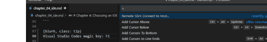

### 在 VSC 中显示所有命令

### VSCodium：VSC 的免费无跟踪替代方案

VSC 的源码在 GitHub 上是开源的，但封装好的 Visual Studio Code 采用的是非免费许可，并包含了微软的遥测和跟踪组件。如果你关心隐私（你应该这样做，比如说“只是个想法：切换社交平台”）并且不想被跟踪，你可以下载源码并编译程序，或者选择更简单的方法——下载 VSCodium²22。它是一个功能完整的 VSC 版本，工作原理相同，并且可以使用相同的插件进行扩展。它采用 MIT 许可证，并禁用了遥测。到目前为止我发现的缺点是缺少后文描述的远程开发（Remote Development）源码。

正如你在某些截图中看到的……这本书是用 VSCodium 编写的！因为我使用了 LeanPub³ 图书生成工具，所以它是用 Markua 格式（README 格式）编写的，IDE 是同时进行编写和可视化的完美选择。

> https://vscodium.com/
> https://leanpub.com/

## 第 3 章：选择 IDE

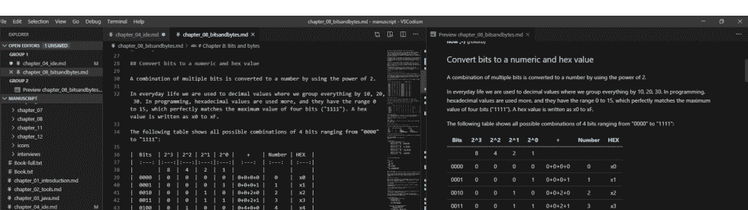

### 在 VSCodium 中编辑 README 文件

### 使用 VSCode 进行 Java 开发

VSC 和 VSCodium 可以通过“扩展”进行扩展以支持特定语言或额外功能。由于我不是英语母语，我安装了一个拼写检查器：

- 

点击左侧栏的“Extensions”。通过顶部的搜索框，你可以在市场找到扩展。对于 Java 开发，你需要一些额外的插件。并不是所有的都是必须的，但正如你看到的，我安装了一堆。RedHat 提供的“Language Support for Java”是最重要的。

## 第 3 章：选择 IDE

49


### 用于 Visual Studio Code 的 Java 支持™

通过 Eclipse™ JDK Language Server 提供 Java 支持，它利用了 Eclipse IDE、JLS 和 Buildship。

### 快速上手

1. 安装扩展
2. 安装 Java 开发包 (JDK)
   - 下载并安装较新的 Java 开发包（JDK 8 是最低要求）
3. 扩展在首次访问 Java 文件时激活
   - 识别目录层级中带有 Gradle 构建文件的文件的项目

### Java 插件语言支持

查看 VS 网站上的 Java 页面以获取有关此主题的更多细节。

### 在 PC 上通过 Pi 使用 Visual Studio Code

Visual Studio Code 的主要优势也是我经常使用它的原因——是远程开发插件。这允许你在 PC 上工作，但文件位于 Pi 上。这意味着你可以充分利用 PC 的性能但同时在 Pi 上工作。虽然对于 Pi 4 来说，Pi 和 PC 之间的差异很小，但官方版本仅适用于 64 位 PC，而 Raspbian 有 32 位的操作系统版本——尽管 Pi 4 拥有 64 位处理器——官方版本无法运行。幸运的是，我们仍然可以找到更早的 32 位且专为 Pi 编译的 VSC 版本！你可以通过以下三个简单的步骤进行安装：

```
$ cd /home/pi
$ wget https://github.com/stevedesmond-ca/vscode-arm/releases/download/1.28.2/
$ vscode-1.28.2.deb
$ sudo apt install ./vscode-1.28.2.deb
```

## 第 4 章：关于 Java

在许多（在线）讨论中，Java 被认为与 PHP 和 JavaScript 等其他流行语言相比是一种老老的（过时了？！）语言。但如果我们看它们在维基百科上的首次出现日期，就会发现……


是的，确实，它们的年龄一样！:-)

Java 最初是为数字电视创建的，但它过于先进，并逐渐演变为解决企业级巨型服务器上的大问题。事实上，此类应用需要大量的计算能力和内存。但现在已经发生了很大变化，你现在可以在嵌入式平台和树莓派等小型 PC 上使用和运行 Java。

Java 比以往任何时候都像一种“一次编写，处运行”的语言，即使对于手机应用也是如此！

在编写这一章节时，我曾考虑过在 Photoshop 或 Illustrator 中创建一个时间轴。但作为一名开发者，这显然需要用代码完成！我只花了两个小时就制作了一个可以轻松更改不同数据集的东西。其中大部分时间都花在了研究如何使用 `javafx.scene.shape.Line` 画图上，因为我以前没有这样做过。

完成的应用程序是源代码的一部分：`chapter_04_Java > java-timeline`

查看 `DataSets.java` 中的源码，你将发现更改时间轴上的标记以创建本章的不同图像是多么简单，例如上面的图片：

```java
public static final Map<Integer, String> LANGUAGE_BIRTHDAYS = Map.ofEntries(
entry(1990, "Ruby"),
entry(1991, "Python"),
entry(1995, "Java, JavaScript, PHP, Qt"),
entry(2000, "C*"),
entry(2014, "Swift")
);
```

### 历史

| 1990 | 2000 | 2010 | 2020 |
| --- | --- | --- | --- |
| 1995: Sun Microsystems 发布了初始 Java 平台 | 2007: Sun 以通用公共许可协议发布 | 2010: Oracle 完成了收购 Sun Microsystems 的交易 | 2014: Oracle 发布 Java 8 LTS，2018: 最新免费版本 |

Java 语言的开发始于 1991 年，Sun Microsystems 在 1995 年发布了首次公开版本。从 2007 年开始，Java 核心源码的大部分已作为开源可用。

当 Oracle 在 2009-2010 年收购 Sun Microsystems 时，他们也成为了 Java 的所有者。

Google 使用 Java 作为 Android 应用的主要编程语言，因为 Android 系统是基于 Linux。


向 Duke 打招呼吧，它是由艺术家 Joe Palrang 在担任 Sun 艺术总监期间设计的。它最初是一个“软件代理”，旨在为用户执行任务，就像微软的动画纸夹 Clippy 一样。

Duke 现在是 Java 语言的官方吉祥物，甚至出现在漫画、咖啡杯、T 恤等。Duke 的图形规范已由 Sun 于 2016 年 11 月 13 日开源³³。

Duke

> ³³https://lg.openjdk.net/duke/

### Java 文件与字节码

Java 平台有不同的“层”。编写的代码只是其中之一。这在 Java 文件中完成，例如 `"HelloWorldExample.java"`，它可能像这样：

```java
public class HelloWorld {
    public static void main(String[] args[]) {
        System.out.println("Hello World!");
    }
}
```


这段代码会在控制台中输出以下内容：

```
Hello World!
```

这个`.java`文件是你编写代码时所处的工作的文件（例如在 Windows PC 上的 IntelliJ IDEA 中）。但要在不同平台上运行它（例如在树莓派上），它需要被转换为字节码。字节码文件是供每个平台上的 Java 运行时使用的内容。

在 Notepad++ 中打开类文件时，你会得到：

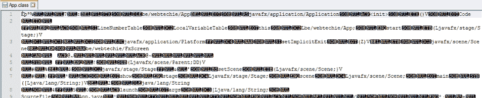

类文件不是人类可读的，因为它被编译为供 JVM 运行。它对我们来说不再可读，但针对运行时环境进行了优化。

## JVM 与 JRE 与 JDK

Java 代码是平台无关的，为了执行它，我们需要为每个平台（Windows, Linux, iOS...）和处理器（Intel, ARM, 32bit, 64bit..）提供特定版本。

### JVM = Java 虚拟机

JVM 不是物理机器，而是一个为每个平台提供执行 Java 代码运行时环境的规范。

这允许你在一台机器上开发代码并将其编译为字节码，然后在无需更改任何代码的情况下运行。

### JRE = Java 运行时环境

JRE 包含了运行（编译后的）Java 程序所需的一切。它包含了 JVM 的实现和类集合。

### JDK = Java 开发包

JDK 是包含 JRE 和开发 Java 应用所需工具的包。

## 第 4 章：关于 Java

### 版本历史

Java 的开发经历了许多版本。在 5 到 9 之间，发生了许多变化。在时间轴上，你可以看到：


使用的缩写：
- J2SE: 标准版
- LTS: 长期支持
- RC: 候选版本
- EA: 早期访问

### JDK 提供者

Java 开发包本身的所有源码都是开源的，可以在 GitHub > OpenJDK 找到。所以如果你愿意，可以从这些源码构建你自己的 JDK。完整的列表可以在各种网站上找到。让我们快速查看其中一些。

#### Oracle

这是所有 JDK 的“母体”，对于商业用途它是最贵的，因为非个人非开发用途需要与 Oracle 签署合同。另一方面，Oracle 仍然是 OpenJDK 主要贡献者。

#### AdoptJDK

如果你想为你的开发 PC 获取最新的 JDK，这里是理想选择³⁵。这里提供了所有的二进制文件和脚本。

#### Azul Zing 和 Zulu

Azul³⁶ 提供商业支持 Zing，如果你需要一个 JVM 在集群中运行大型应用程序以处理大量数据。此外 Zulu 是 OpenJDK 的构建版本，适用于所有平台。

不同的平台。对于嵌入式系统，它们可以提供针对该平台测试过的“定制化”JDK 版本。

Zulu 用于 Microsoft Azure 以在云端运行 Java 程序。

### BellSoft Liberica

与其他者类似，BellSoft 编译了 OpenJDK 源码，但他们在特定平台版本的 JDK 中包含了 JavaFX。JavaFX 曾是 Java 的一部分，但现在已成为一个独立的项目。

最重要的是，BellSoft 还提供了一个专为树莓派（Raspberry Pi）制作的版本。在书后的内容，我们将使用 JavaFX 为 Pi 构建 GUI（图形用户界面），因此这就是我们在本书中 Pi 上使用的 SDK。

> Liberica JDK 12.0.2
> Liberica 是一个 100% 开源的 java 12 实现。它基于 BellSoft 贡献的 OpenJDK 构建。它经过彻底测试，并通过了 OpenJDK 许可提供的 JDK。Windows x86、x64、Windows x86、Mac x64、ARM64 等版本的 Liberica 均包含 java 12。Linux x86、ARM64 JavaFX 版本包含 Device IO API 作为额外模块，并支持硬件加速。我们为不同的硬件和操作系统组合提供了合适的二进制文件：
* Windows x86（适用于 Microsoft Windows 的 32 位版本）
* Windows x64（适用于 Microsoft Windows 的 64 位版本）
* macOS x64（适用于 Apple Mac 的 64 位版本）
* Linux x86（适用于服务器和桌面的 64 位版本）
* Linux ARM64（适用于服务器和嵌入式的 64 位版本）
* Linux ARM7 HardFloat（适用于树莓派 2 和树莓派 3 的 32 位版本）
* Solaris x86（适用于 Oracle Solaris 的 32 位版本）
* Solaris x64（适用于 Solaris 64 位版本）

### BellSoft 网站上的 JDK 选择

> https://bell-sw.com/

### 与 Alexander Belokrylov 的采访


Alexander Belokrylov，@gigabel，BellSoft 首席执行官，Java 热热者

BellSoft 通过提供 Liberica Java 服务维持生存，那么为什么你们决定免费发布 Liberica JDK 呢？

Java 本质上应该是自由且开源的。BellSoft 是一家致力于通过发布 Liberica JDK 来维护自由的公司。我们的目标是创建最实用的二进制分发版，让开发者的生活变得简单，并且以完全透明的免费源码提供服务。此外，我们还为希望获得额外保障和顶级 OpenJDK 的公司提供商业支持。

你们是唯一提供树莓派版本并集成了 JavaFX 的 JDK 供应商，你们为什么要多走这一步呢？

我们热衷于让 Liberica JDK 在树莓派上功能完备。我们的公司从发布第一个针对树莓派平台的 Liberica JDK 9 开始开启了这段旅程。我们继续积极支持 OpenJDK 中的 ARM32 端口，让树莓派开发者能够使用现代 JDK 特性！

在的一篇博客中，你宣布了对 Pi 上的 JavaFX 视频支持。我们可以期待 BellSoft 带来更多此类功能吗？

社区和商业公司对树莓派上的 JavaFX 视频有很高的需求。我们正在仔细倾听社区的声音。一旦我们发现 Liberica JDK 缺乏用户所需的功能，我们就会采取行动。

你正在从事哪个 DIY 电子项目，或者哪个项目在你的“如果我有时间的话”清单上？

在我们的博客中，我们已经讨论过 Liberica JDK 对 Nvidia Jetson Nano 的支持。我们实现了一个演示程序，在展会现场提供数据驱动的有效视图。该设置在旧金山的 Code One 经过了测试，并引起了许多参与者的关注。

技术上，我们有一台带有 4K 摄像头的 Jetson Nano，它可以捕捉视频并使用 DeepStream 进行实时视频分析和人员检测。使用 Java 程序进行数据分析，使用 OpenFX 程序进行统计可视化。我们的下一步是在 Nvidia 上使用 Project Panama 实现 Java 程序与 C 原生应用之间的互操作吗？

> https://twitter.com/gigabel

> NVIDIA® Jetson™ 系统模块提供了运行自主软件所需的性能和能效比，速度更快且功耗更低

> “通过改进和丰富 Java TM 虚拟机与定义的‘外部’（非 Java）API 之间的连接（包括 C 程序员常用的许多接口），来连接 JVM 和原生代码。

> CUDA 是 NVIDIA 发明的并行计算平台和编程模型。

### 安装 Java JDK

### 在 Windows PC 上安装 Java JDK

在 Windows 上，我更倾向于使用 AdoptJDK*14*提供的 SDK。只需选择最新版本、下载并运行即可！


在 AdoptJDK 网站上选择版本。

运行下载的文件。

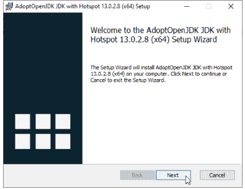

Windows AdoptOpenJDK 安装程序

在接下来的步骤中，确保选择“Set JAVA_HOME variable”选项。通过这样做，我们就能在终端中轻松地启动 Java。

> *14https://adoptopenjdk.net/

## 第 4 章：关于 Java

63

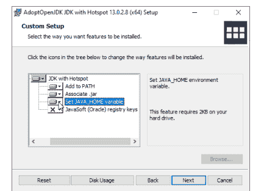

选择 JAVA_HOME

安装完成后，你可以通过开始菜单打开“命令提示符”。输入“java -version”即可获取版本。

```
C:\>java --version

openjdk 13.0.2 2020-01-14

OpenJDK Runtime Environment AdoptOpenJDK (build 13.0.2+8)

OpenJDK 64-Bit Server VM AdoptOpenJDK (build 13.0.2+8, mixed mode)
```

Windows 上的 Java 版本

### 在 Linux PC 上使用 SDKMAN 安装 JDK

AdoptOpenJDK 还提供了 Linux 及其他平台的安装程序。

| 操作系统 | 架构 | | |
|---|---|---|---|
| Any | Any | | |
| 13.0.2+8 AdoptJDK Zulu | Linux | Checksum (SHA) |
| | Windows | | |
| | macOS | | |
| | x64 | | |
| | glibc | | |
| | ARM64 | | |
| | ARM7 | | |

AdoptJDK 网站选择

你使用 SDKMAN 切换不同版本。根据这篇博客，它在 Windows 上可以运行，但我还没有尝试过。该工具提供了可用的 JDK 列表：

> ³https://sdkman.io/

[PAGE 72

## 第 4 章：关于 Java

```
$sdk list java
```

可用的 Java

| 供应商 | 使用 | 发发 | 标识 |
|---|---|---|---|
| AdoptJDK | 13.0.1 | | 13.0.1 |
| AdoptJDK | 12.0.2 | | 12.0.2 |
| AdoptJDK | 11.0.5 | | 11.0.5 |
| AdoptJDK | 8.0.232 | | 8.0.232 |
| Amazon | 11.0.19 | | 11.0.19 |
| Amazon | 8.0.20 | | 8.0.20 |
| BellSoft | 17.0.7 | | 17.0.7 |
| BellSoft | 15.0.2 | | 15.0.2 |
| BellSoft | 12.0.2 | | 12.0.2 |
| BellSoft | 11.0.16 | | 11.0.16 |
| BellSoft | 8.0.37 | | 8.0.37 |
| Zulu | 17.0.7 | | 17.0.7 |
| Zulu | 15.0.2 | | 15.0.2 |
| Zulu | 12.0.2 | | 12.0.2 |
| Zulu | 11.0.21 | | 11.0.21 |
| Zulu | 8.0.302 | | 8.0.302 |
| Corretto | 17.0.8 | | 17.0.8 |
| Corretto | 14.0.9 | | 14.0.9 |
| Corretto | 11.0.19 | | 11.0.19 |
| Corretto | 8.0.372 | | 8.0.372 |
| Temurin | 17.0.8 | | 17.0.8 |
| Temurin | 16.0.2 | | 16.0.2 |
| Temurin | 15.0.19 | | 15.0.19 |
| Temurin | 14.0.21 | | 14.0.21 |
| Temurin | 17.0.20 | | 17.0.20 |
| Temurin | 11.0.21 | | 11.0.21 |
| Temurin | 8.0.302 | | 8.0.302 |

首先，我们将检查当前版本以便验证安装。在树莓派上，结果将是这样的：

```
$ java -version

openjdk version "11.0.3" 2019-04-16

OpenJDK Runtime Environment. (build 11.0.3+7-post-RaspberryPi-5)
```

现在我们将下载该版本，并替换检查的版本。查看 BellSoft 网站*3上的 Liberica JDK 页面，并复制你想要使用的 Pi 版本的 deb 文件链接。这是 JDK 13 版本的示例：

[PAGE 73

### 在树莓派上安装 JDK

这里使用的 Java 版本只能在带有 ARM7 或 ARM8 处理器的树莓派上使用。最老的 Pi ARMv6 具有完全不同的架构，这些 JDK 不支持它。

在 Wikipedia 网站上，你可以找到不同树莓派型号及其使用的指令的良好概述*1。带有 ARMv6 的型号并不适合你的实验。

### Raspbian (Buster) 预装了 Java 11

在树莓派*2 发布说明中，你可以看到 2019-06-20 版本包含了 OpenJDK 11。

+ 2019-06-20:
* 基于 Debian Buster
* OpenJDK 替换了 Oracle Java 7 和 8

所以我们准备就绪了！可以使用最新的 Java 了！但是……由于我们在书后面的部分使用 JavaFX，我们将预装的 JDK 替换为 BellSoft 提供的 Liberica JDK。

### 下载并测试 BellSoft Liberica JDK

一旦知道如何获取，安装新的 JDK 很容易。这些是安装 JDK 13 版本所需的步骤。

首先，我们将检查当前版本以便验证安装。在树莓派上，结果将是：

```
$ java -version

openjdk version "11.0.3" 2019-04-16

OpenJDK Runtime Environment. (build 11.0.3+7-post-RaspberryPi-5)
```

现在我们将下载该版本，并替换检查的版本。查看 BellSoft 网站*3上的 Liberica JDK 页面，并复制你想要使用的 Pi 版本的 deb 文件链接。这是 JDK 13 版本的示例。

## 第 4 章：关于 Java

```
1 $ cd /home/pi
2 $ wget https://download.bell-sw.com/java/13/bellsoft-jdk13-linux-arm32-vfp-hflt.deb
3 $ sudo apt-get install ./bellsoft-jdk13-linux-arm32-vfp-hflt.deb
4 $ sudo update-alternatives --config javac
5 $ sudo update-alternatives --config java
```

完成后后，我们可以再次检查版本，它看起来应该是这样的：

```
1 $ java --version
2 openjdk version "13-BellSoft" 2019-09-17
3 OpenJDK Runtime Environment (build 13-BellSoft+33)
4 Open Server VM (build 13-BellSoft+33, mixed mode)
```

`chapter_04_Java > scripts` > 为每个 Liberica 版本都提供一个文件

如果你将源代码下载到了 Pi 的家目录下，你需要在终端中执行以下操作：

```
1 $ cd /home/pi/JavaOnRaspberryPi/chapter_04_Java/scripts
2 $ sh install_liberica_13.sh
```

### Java 版本之间的某些变化

由于 Java 维护者确保核心功能不会发生根本性变化，你可以在不同的 Java 版本中使用相同的代码。但随着每个新版本的发布，会添加新功能，现有功能也会改进和扩展。

对于业务应用程序，通常只使用 LTS（长期长期支持）版本，例如 8 和 11。但跟踪版本之间的变化始终是一个好主意，这样你就知道哪些新功能可用。

### Java 8 和 11 之间的变化

Java 8 是 Oracle 发布的最后一个 LTS 版本，在下一个 LTS 版本（即 11）出现之前经过了一段时间。

在两个 LTS 版本之间，Java 9 引入了模块（modules），使我们能够构建更小的发行版，并定义哪些代码对其他应用程序可用。[查看此页面](http://tutorials.jenkov.com/java/modules.html)

版本 9 还增加了“shell”，使我们能够快速测试 Java 代码。要开始使用，只需在终端中输入 `jshell` 即可：

```
$ jshell

| Welcome to JShell -- Version 11.0.4
| For an introduction type: /help intro

intro=====
The jshell tool 允许你执行 Java 代码获取即时结果。
| 你可以输入 Java 定义（变量、方法、类等），例如：int x = 8
| 或者一个 Java 表达式，例如：x + x
| 或者一个 Java 语句或导入语句。
| 这些小小的 Java 代码段被称为“片段 (snippets)”。
| 还有 jshell 工具命令，允许你理解并
| 控制你正在的操作，例如：/list
| 帮助命令列表：/help
```

## 第 4 章：关于 Java


```text
jshell> var txt = "Hello World!"

txt == "Hello World!"

jshell> txt

txt == "Hello World!"

jshell> txt + (5*4)

$3 === "Hello World!20"

jshell> txt.substring(2,5)

$4 == "ilo"

jshell> /exit

Goodbye
```

在 Java 11 版本中，JavaFX 库已从 JDK 中移除并移动到了一个独立的项目中（第 7 章）。

在这个由 Marc R. Hoffmann 制作的网站上，你可以以非常详细的方式比较 Java 版本之间的差异。

### Java 11 之后是什么？

12? 确实如此！这很简单 ;-)

但最重要的是，由于发布周期的缩短以及大型社区推动 Java 的“快速前进”，新功能的可用速度变得快得多，并且它们是对最受期待功能的真实响应。

让我们通过列出包含在的一些 JEP 来查看新版本中的主要变化。JEP 是“JDK 增强提议 (JDK Enhancement Proposal)”，由一个或多个人员编写，请求向 Java 添加某些内容。如果提议足够清晰、获得足够的支持并被实施，它就可以成为新版本的一部分。我只描述几个我认为非常有吸引力的，因为它们将带来更整洁的代码。

要小心“预览 (Preview)”功能，因为它们仍在开发中，尚不是规范的一部分，因此在编译时（`javac -enable-preview`）和运行时（`java -enable-preview`）必须启用。

由于现在每六个月就会发布一个新的 JDK 版本，这里描述的只是作为预览功能引入并在或已经完全集成到后续版本中的少数功能。

> <https://javaalmanac.io/>

## 第 4 章：关于 Java

### Switch 表达式

#### Java 12 首次改进

JEP 325: Switch 表达式（预览）

这是减少你为 `switch` 语句需要编写代码的第一步。JEP 给出的示例允许你更改这些：

```java
switch (day) {
    case MONDAY:
    case FRIDAY:
    case SUNDAY:
        System.out.println(6);
        break;
    case TUESDAY:
        System.out.println(7);
        break;
    case THURSDAY:
        System.out.println(8);
        break;
}
```

变为像这样的短代码块：

```java
switch (day) {
    case MONDAY, FRIDAY, SUNDAY -> 6;
    case TUESDAY -> 7;
    case THURSDAY, SATURDAY -> 8;
    case WEDNESDAY -> 9;
}
```

#### Java 中的进一步扩展

JEP 354: Switch 表达式

Java 12 中改进的 `switch`。

### 13 中引入的文本块（Text blocks）

JEP 355: 文本块

这允许你定义多行字符串。这里是一个示例：

```java
String htmlBlock = """
<html>
    <body>
        <p>Welcome on site</p>
    </body>
</html>
""";
```

### Java 中有帮助的 NullExceptions

JEP 358: 有帮助的 NullExceptions

通过精确描述哪个变量为空，提高 NullExceptions 的易用性。

## 第 4 章：关于 Java

当你在 Pi 上执行这些操作，并完成在“nano”中输入代码后，点击“CTRL+X”退出，点击“Y”保存，并按“ENTER”写入文件。

要执行这段代码，我们需要使用我们刚刚创建的文件名作为参数启动 Java：

```bash
$ java HelloWorld.java

Hello World
```

代码就此了……我们在 Pi 上的第一个可以运行的 Java 代码！:-)

> 你可以直接在 Pi 或你的 PC 上使用 nano 或任何其他文本文件编辑器编写这些示例中的所有代码，当然，在 IDE（集成开发环境）中你也可以进行同样的操作。

> 当你执行这些操作时，你会立即注意到代码提示（code hinting）的优势。例如，如果你想获取 `txt` 变量的前 4 个字符，系统会向你列出可以在 `String` 上使用的可能方法列表。

```java
public class HelloWorld {
    public static void main(String[] args) {
        String txt = "Hello World";
        System.out.println(txt.substring(0, 4));
    }
}
```

IntelliJ IDEA 中 `String` 的代码提示。

### 使用启动参数

让我们更进一步，使用在 `main(String[] args)` 中分配的启动参数。我们需要创建一个新的 Java 文件。

```bash
$ cd /home/pi
$ nano MainArguments.java
```

这里是这些代码：

```java
public class MainArguments {
    public static void main(String[] args) {
        System.out.println("Number of arguments: " + args.length);

        if (args.length > 0) {
            System.out.println("First argument: " + args[0]);
        }

        for (int i = 0; i < args.length; i++) {
            System.out.println("Argument " + (i + 1) + ": " + args[i]);
        }
    }
}
```

现在我们可以启动应用程序并为其提供任意数量的额外参数，这些参数将以 `String` 数组（`String[]`）的形式提供给代码。从这个数组中，我们可以获取项目的数量（`= args.length`），并使用 `for` 循环遍历所有参数。

```bash
$ java MainArguments.java

Number of arguments: 0
```

```bash
$ java MainArguments.java "Hello World" "Bye"

Number of arguments: 2
First argument: Hello World
Argument 1: Hello World
Argument 2: Bye
```

### 处理数字

好了，接来看……

Java 有不同的数字类型，其中一些在“第 8 章：位与字节”中会有进一步解释。在这个示例中，我们使用了：

- Integer（整数）：仅限四整数字
- Float（浮点数）：可以存储 8 位小数
- Double（双精度浮点）：可以存储 16 位小数

根据数字类型，它们使用的内存多寡不同。大多数情况下使用 `int`，但当你需要存储 `prices` 时，你会使用 `float`。在给 `float` 或 `double` 赋值时，数字必须以 `"F"` 或 `"D"` 结尾（参见示例）。这有助于 Java 理解你想实现的目标。

我们都创建了带有 20 位小数的 `float` 和 `double` 示例，以查看变量中实际存储了多少位小数。

```java
$ cd /home/pi
$ nano NumberValues.java

public class NumberValues {
    public static void main(String[] args) {
        int intValue = 2;
        float floatValue = 1.1234567890123456789F;
        double doubleValue = 1.1234567890123456789D;

        System.out.println("Integer: " + intValue);
        System.out.println("Float: " + floatValue);
        System.out.println("Double: " + doubleValue);
        System.out.println(
            "Multiply: " + (intValue * floatValue)
            + ", rounded: " + Math.round(intValue * floatValue)
        );
    }
}

$ java NumberValues.java
```

```text
Integer: 2
Float: 1.1234568
Double: 1.12345678901234567
Multiply: 2.246913, rounded: 2
```

### If, Then, Else

一个重要的函数需要比较许多不同的值，这是通过 `if/then/else` 完成的。

```java
$ cd /home/pi
$ nano IfThenElse.java

public class IfThenElse {
    public static void main(String[] args) {
        // 比较整数值
        int piHeaderVersion = 1;

        // 我们在这个示例中没有更改变量，
        // 但这里可以有一些代码根据某些情况定义此变量，
        // 例如，硬件检查。
        if (piHeaderVersion == 1) {
            System.out.println("Header version 1 is used on original B");
        } else if (piHeaderVersion == 2) {
            System.out.println("Header version 2 is used on Model A and Model B");
            + " (revision 2)");
        } else if (piHeaderVersion == 3) {
            System.out.println("Header version 3 is used on Model A, B+, Pi Zero,");
            + " Pi Zero, Pi4B");
        } else {
            System.out.println("Header version is unknown");
        }

        // 比较字符串
        String txt = "Hello World";
        if (txt.startsWith("Hello")) {
            System.out.println("The string starts with Hello");
        }
    }
}
```

```bash
$ java IfThenElse.java

Header version 1 is used on original B
The string starts with Hello
```

## 第 4 章：关于 Java

```java
}
}
```

```text
$ java UsingMethod.java

2 x Raspberry Pi 4 4Gb, price: 119.900015258789 Euro
当前日期和时间为: 2019.12.03 12:35:23
```

首先查看导入行（import-lines）。由于我们使用了一些不属于基础 Java 的方法，我们需要告诉程序需要导入哪些额外的类。

定义了两个方法：

- `getTotal(int quantity, float price)`，它返回一个计算后的值
- `getNow()`，它返回当前可读格式字符串的时间戳

通过在 `main` 方法中调用这些方法，我们可以让这个 `main` 方法中的代码保持非常简洁且易读。

### 使用对象

Java 是一种面向对象的编程语言。这意味着我们可以将代码的任何部分转换为具有其变量和方法的对象。例如，让我们创建一个包含物品购物列表的程序。

> 此示例使用了一些不属于“基础” Java 的方法。这就是为什么我们的代码以导入行开始，以明确可以找到 `ArrayList` 和 `List`。

> 在此书中，并不是所有的导入都会包含在代码示例中，以保持所有内容的整洁和易读。如果你使用 IDE，你会收到缺少导入的警告。请查看每个示例的 GitHub 源码获取完整代码。

```java
$ cd /home/pi
$ nano UsingObject.java

import java.util.ArrayList;
import java.util.List;

public class UsingObject {
    public static void main(String[] args) {
        List<ShoppingItem> items = new ArrayList<>();
        items.add(new ShoppingItem("Raspberry Pi 4, 4Gb", 1, 59.95F));
        items.add(new ShoppingCartItem("Micro-HDMI cable", 2, 5.9F));
        items.add(new ShoppingCartItem("Raspberry Pi 4 power supply", 1, 9.95F));

        double total = 0;
        for (ShoppingCartItem item : items) {
            System.out.println(item.getName());
            System.out.println(
                " " + item.getQuantity() + "\t\t"
                + item.getPrice() + "\t=" + item.getTotal() + " Euro"
            );
            total += item.getTotal();
        }

        System.out.println("\nTotal for shopping cart: \n " + total + " Euro");
    }

    public static class ShoppingCartItem {
        // 这些值是 final 的，因为它们不应该被改变
        private final String name;
        private final int quantity;
        private final float price;

        public ShoppingCartItem(String name, int quantity, float price) {
            this.name = name;
            this.quantity = quantity;
            this.price = price;
        }

        public String getName() {
            return name;
        }

        public int getQuantity() {
            return quantity;
        }

        public float getPrice() {
            return price;
        }

        public float getTotal() {
            return quantity * price;
        }
    }
}
```

```text
$ java UsingObject.java

Raspberry Pi 4, 4Gb
1 x = 59.95 = 59.95 Euro
Micro-HDMI cable
2 x = 5.9 = 11.8 Euro
Raspberry Pi 4 power supply
1 x = 9.95 = 9.95 Euro
```

购物车总计：

```text
81.7000076293945 Euro
```

类 `ShoppingCartItem` 是一个对象，它可以存储购物列表上每个项目的数据。构造函数 `ShoppingCartItem(String name, int quantity, float price)` 允许我们创建一个具有名称、数量和价格的项目。项目内部的 `getTotal()` 方法将根据数量和价格返回该项目的总成本。

在 `main` 方法中，我们现在可以轻松创建一个类型为 `ShoppingCartItem` 的对象列表并向列表中添加几个对象。通过 `for` 循环，我们可以读取列表中的所有项目并计算总值。

在 `System.out.println` 中使用了两个特殊字符来获得更好的可读性输出：

- `\n` 用于跳到新的一行
- `\t` 用于插入制表符

易读、易读、易读。

嗯，我似乎已经重复了这个词几次了。

内部包含大量代码的长方法并没有问题。Java 并不在乎。但看你代码的人在乎！在很多情况下，只有你自己，也许你什么都不输入……

但想象一下你写了一个复杂的 DIY 项目，明年你想改进或扩展它。当你将代码结构化为执行非常特定的微小任务的方法时，你将能够快速地重新深入并找到需要工作的精确位置。

另一个主要话题是变量命名。在这个示例中，哪些是最清晰的？


```java
int var1 = 0;
int var2 = 0;
int outsideTemperature = 0;
int insideTemperature = 0;
```

所以记住，将你的代码拆分为较小的部分并使用真实的名称将帮助你和同事理解、维护和扩展代码。

### 读取文本文件

通过一个免费的在线工具，我们创建一个包含随机数据的 CSV 文件。该文件存储在子目录 `resources` 中，名为 `testdata.csv`。源码中的文件包含姓、姓、年龄、街道、城市、邮编的逗号分隔值：

| id | firstname | lastname | age | street | city | ZIP |
|---|---|---|---|---|---|---|
| 1 | Ada | Gomez | 40 | Pike | LA | |
| 2 | Bernard | Jordan | 28 | Court | MS | |
| 3 | Mittie | Vaughn | 64 | Mill | RI | |
| 4 | Miguel | Clarke | 39 | Boulevard | NH | |
| 5 | | | | | | |

让我们写一个程序按行读取这个 CSV 文件，并将每行转换为一个对象，添加到人员列表中：

```java
$ cd /home/pi
$ nano ReadFile.java
import java.io.BufferedReader;
import java.io.File;
import java.io.FileReader;
import java.io.FileNotFoundException;
import java.util.ArrayList;
import java.util.List;
import java.util.Scanner;

public class ReadFile {
    public static void main(String[] args) {
        List<Person> persons = loadPersons();

        System.out.println("Number of persons loaded from CSV file: " + persons.size());

        for (Person person : persons) {
            System.out.println(person.getFullName() + ", age: " + person.getAge());
        }
    }

    public static List<Person> loadPersons() {
        List<Person> list = new ArrayList<>();
        File file = new File("resources/testdata.csv");

        try (Scanner scanner = new Scanner(file)) {
            while (scanner.hasNextLine()) {
                list.add(new Person(scanner.nextLine()));
            }
        } catch (FileNotFoundException ex) {
            System.err.println("Could not find the file");
        }

        return list;
    }

    public static class Person {
        private int id;
        private String firstName;
        private String lastName;
        private int age;
        private String street;
        private String city;
        private String zip;

        public Person(String csvLine) {
            String[] data = csvLine.split(",");
            this.id = Integer.parseInt(data[0]);
            this.firstName = data[1];
            this.lastName = data[2];
            this.age = Integer.parseInt(data[3]);
            this.street = data[4];
            this.city = data[5];
            this.zip = data[6];
        }

        public String getFirstName() {
            return firstName;
        }

        public String getFullName() {
            return firstName + " " + lastName;
        }

        public int getAge() {
            return age;
        }
    }
}
```

```java
$ java ReadFile.java
Number of persons loaded from CSV file: 5
Ada Gomez, age: 40
Bernard Jordan, age: 28
Mittie Vaughn, age: 64
Miguel Clarke, age: 39
```

就像在 `UsingObjects` 示例一样，我们使用一个对象来存储 CSV 文件中的每一行数据，在这里是 `Person` 对象。

在 `loadPersons` 方法中：

- 打开文件
- 按行读取
- 使用每行的文本创建 `Person` 对象
- 将该对象添加到列表中
- 返回列表。

在 `main` 方法中，结果列表被用于：

- 统计列表中的人数
- 打印每个人的全名和年龄。

### 使用流

流是在 Java 8 作为新功能引入的。这些允许你对对象执行一系列步骤或操作。

让我们扩展 Read 示例以一些额外的功能：

首先，我们需要添加额外的导入：

```java
import java.util.IntSummaryStatistics;
import java.util.stream.Collectors;
```

并且我们在 `main` 方法中添加一些输出：

```java
    public static void main(String[] args) {
        List<Person> persons = loadPersons();

        System.out.println("Number of persons loaded from CSV file: " + persons.size());

        for (Person person : persons) {
            System.out.println(person.getFullName() + ", age: " + person.getAge());
        }

        System.out.println("-------------------------------------");
        IntSummaryStatistics stats = getAgeStats(persons);
```

## 第四章：关于 Java

```java
19 System.out.println("Minimum age: " + stats.getMin());
20 System.out.println("Maximum age: " + stats.getMax());
21 System.out.println("Average age: " + stats.getAverage());
22 }
```

当然，我们需要在 `main` 方法中添加 `countFirstName` 和 `ageStats` 方法，这些方法在下面的额外代码中被使用了：

```java
1 public static int countFirstName(List<Person> persons, String firstName) {
2     return (int) persons.stream()
3         filter(p -> p.getFirstName().equals(firstName))
4         count();
5 }
```

```java
7 public static IntSummaryStatistics ageStats(List<Person> persons) {
8     return persons.stream()
9         mapToInt(Person::getAge)
10        summaryStatistics();
11 }
```

我们可以看到，通过将列表转换为流（在 `persons` 列表后面添加 `stream()`），我们可以逐步处理该步骤以获得特定的结果。

- `countFirstName`
  - `filter` 用于获取所有给定第一个名字的人
  - `collect` 用于将所有匹配的人生成一个列表
  - `size` 返回收集的列表中项目的数量
- `ageStats`
  - `mapToInt` 用于仅使用所有人的年龄
  - `summaryStatistics` 返回一个 `IntSummaryStatistics` 对象，我们可以从该对象获取不同的值

当我们现在再次运行此应用程序时，我们将得到以下输出：

### 接下来做什么？

玩得开心！尝试！扩展并破坏这些示例！ ;-)

只有通过使用，你才能学习编程语言！

> `chapter_04_Java > README.md`

在本章的 README 文件中，你将找到许多链接，可以在那里详细地学习 Java。

```text
1 $ java ReadText.java
2 Number of persons loaded from CSV file: 100
3 Ada Gomez, age: 40
4 Bernard Jordan, age: 28
5 Mittie Vaughn, age: 64
6 Miguel Clarke, age: 39
7 ...
8 Alexander McCoy, age: 46
9 Callie Fitzgerald, age: 32
10 ...
11 Number of persons with first name
12   * 'Matthew': 2
13   * 'Charlotte': 4
14 ...
15 Minimum age: 18
16 Maximum age: 65
17 Average age: 42.78
```

### 与 Jakob Jenkov 的访谈

最好的 Java 学习网站之一是 `tutorials.jenkov.com`。关于“生态系统”，你在这个网站上可以找到大量信息！这个网站是 Jakob Jenkov 的项目，他是几乎出现在每个 Twitter 或博客上的“值得关注的 Java 专家”列表中的专家之一。

Jakob Jenkov，`@jenkov`，独立软件架构师，`jenkov.com` 所有者，Nanosai² 联合创始人兼 CTO

你在 Java 世界的经历是怎样的？

我在 1995-1997 年大学期间期间学习了 Java，并从 1999 年开始专业地使用 Java。我从 2005-2006 年左右开始编写教程，因为我觉得 Java 还有一些领域可以涵盖。

你是如何开始并维护你的教程网站的？

我从几个我需要更多覆盖的主题开始——这些主题对我来说深入研究很有趣。然后内容就从那里开始增长。然而，随着内容的增长，保持其与语言、API、框架、方法等新进展的同步是一项日益艰巨的任务。从 2018 年 8 月直到现在（2020 年 2 月），我投入网站的大部分精力都放在更新统计数据上。这就是为什么经常阅读可能没有看到很多新话题。我主要在空闲时间以及咨询合同之间的空隙维护它。

你这么做的动力是什么？

嗯，我只是看看是否会有读者。当我开始获得读者时，我希望它能成为一份生活收入。收入需要大量的流量才能通过广告赚钱来维持生计，这与有一份普通开发人员的工作相当（至少如果你住在欧洲或美国的话）。大多数网站并没有达到那种水平的流量。我主要写的都是我无论如何学习的内容，例如为了工作或其他项目，所以我并不是在漫无目的地堆砌各种技术。每当我需要在工作中通过 Google 搜索一个问题并发现其他人对该问题的详尽解决方案时，这都向我证明了与大家分享是一件好事 :-)

我没有妻子和孩子，所以我比很多人都有额外的空闲时间。

Java 最近的变化是什么？

在我看来，Java 正在朝着更小的占用（小 JDK）、更高的性能和更多的控制演进。Java 也在演变为构建包含 Java 平台的独立应用程序。各种 API 变得更加“可选的”，意味着如果你不使用它们，就可以将它们排除在你的应用程序发行之外。像 Java EE 和 JavaFX 这样的 API 以前被认为是 Java 的“核心”，现在已经被分离出来并有了自己的生命。尽管如此，两者仍然非常流行。我相信这种发展是好的，因为有时我们现在认为的某事的“最佳方式”，

## 第四章：关于 Java

遗憾的是，电路板不是 JDK。为什么不是完美的 Java 呢？

各种 API 变得更加“可选的”，意味着如果你不使用它们，就可以将它们排除在你的应用程序发行之外。目标是专业用途，因为它需要集成在完全调整以适应特定产品的电路板上。它已经用于工业级控制器和计算机、家庭自动化、面板电脑，

电路板不是 JDK。为什么不是完美的 Java 呢？

各种 API 变得更加“可选的”，意味着如果你不使用它们，就可以将它们排除在你的应用程序发行之外。目标是专业用途，因为它需要集成在完全调整以适应特定产品的电路板上。它已经用于工业级控制器和计算机、家庭自动化、面板电脑，

电路板不是 JDK。为什么不是完美的 Java 呢？

各种 API 变得更加“可选的”，意味着如果你不使用它们，就可以将它们排除在你的应用程序发行之外。目标是专业用途，因为它需要集成在完全调整以适应特定产品的电路板上。它已经用于工业级控制器和计算机、家庭自动化、面板电脑，

电路板不是 JDK。为什么不是完美的 Java 呢？

各种 API 变得更加“可选的”，意味着如果你不使用它们，就可以将它们排除在你的应用程序发行之外。目标是专业用途，因为它需要集成在完全调整以适应特定产品的电路板上。它已经用于工业级控制器和计算机、家庭自动化、面板电脑，

电路板不是 JDK。为什么不是完美的 Java 呢？

各种 API 变得更加“可选的”，意味着如果你不使用它们，就可以将它们排除在你的应用程序发行之外。目标是专业用途，因为它需要集成在完全调整以适应特定产品的电路板上。它已经用于工业级控制器和计算机、家庭自动化、面板电脑，

## 第四章：关于 Java

| 名称 | 描述 |
| --- | --- |
| Model A | 无以太网连接器 |
| Model B | 有以太网连接器 |
| Zero | 尺寸更小且 GPIO 能力减少 |
| Compute Module | 位于 200 脚类似 DDR2 内存模块上的 Pi，用于集成到嵌入式系统中 |

## 第五章：树莓派引脚

将电子元件连接到 Pi 是通过 40 个引脚完成的。

让我们看看 Pi 的历史及其版本，以更好地理解这些 GPIO 可以实现什么。本章中的图像和表格都是从源 Java 生成的。

⁵²`https://github.com/Delporte/PiHeaders`

³³`https://mvnrepository.com/artifact/be.webtechie/pi-headers`

## 第五章：树莓派引脚

可视化树莓派引脚的图像是 Java 项目的截图，你可以在此处找到：

`Chapter_05_PiPinning > javafx-pinning-info`

在接下来的章节中，我们将深入研究 Java，但你可以查看代码以获取一些见解。

此应用程序使用了这个 Maven 库：

```xml
<dependency>
    <groupId>be.webtechie</groupId>
    <artifactId>pi-headers</artifactId>
    <version>0.1.1</version>
</dependency>
```

### 树莓派类型

### 模型

树莓派板有不同的模型可用，允许你为你的项目选择合适的一个。Model B 最为人知和使用，因为它有最多的连接。Zero 是最小的...

| 名称 | 描述 |
| --- | --- |
| Model A | 无以太网连接器 |
| Model B | 有以太网连接器 |
| Zero | 尺寸更小且 GPIO 能力减少 |
| Compute Module | 位于 200 脚类似 DDR2 内存模块上的 Pi，用于集成到嵌入式系统中 |

### 主要版本

Model A 和 B 都演变出了不同的版本。每个版本都扩展并改进了电路板。这些是主要的变化：

（注：OCR 文本包含了许多重复和后几页的乱码片段；我根据提供的内容进行了清理。）

*等一下，再次查看提示，OCR 有很多重复。让我提供一个没有循环的干净版本。*

**修订后的输出（基于逻辑）：**

## 第四章：关于 Java


```java
19 System.out.println("Minimum age: " + stats.getMin());
20 System.out.println("Maximum age: " + stats.getMax());
21 System.out.println("Average age: " + stats.getAverage());
22 }
```

当然，我们需要在 `main-method` 中添加 `countFirstName` 和 `ageStats` 方法，这些方法在下面的额外代码中被使用了：

```java
1 public static int countFirstName(List<Person> persons, String firstName) {
2     return (int) persons.stream()
3         filter(p -> p.getFirstName().equals(firstName))
4         count();
5 }
```

```java
7 public static IntSummaryStatistics ageStats(List<Person> persons) {
8     return persons.stream()
9         mapToInt(Person::getAge)
10        summaryStatistics();
11 }
```

我们可以看到，通过将列表转换为流（在 `persons` 列表后面添加 `stream()`），我们可以逐步处理该步骤以获得特定的结果。

- `countFirstName`
  - `filter` 用于获取所有给定第一个名字的人
  - `collect` 用于将所有匹配的人生成一个列表
  - `size` 返回收集的列表中项目的数量
- `ageStats`
  - `mapToInt` 用于仅使用所有人的年龄
  - `summaryStatistics` 返回一个 `IntSummaryStatistics` 对象，我们可以从该对象获取不同的值

当我们现在再次运行此应用程序时，我们将得到以下输出：

### 接下来做什么？

玩得开心！尝试！扩展并破坏这些示例！ ;-)

只有通过使用，你才能学习编程语言！

> `chapter_04_Java > README.md`

在本章的 `README` 文件中，你将找到许多链接，可以在那里详细地学习 Java。

```text
1 $ java ReadText.java
2 Number of persons loaded from CSV file: 100
3 Ada Gomez, age: 40
4 Bernard Jordan, age: 28
5 Mittie Vaughn, age: 64
6 Miguel Clarke, age: 39
7 ...
8 Alexander McCoy, age: 46
9 Callie Fitzgerald, age: 32
10 ...
11 Number of persons with first name
12   * 'Matthew': 2
13   * 'Charlotte': 4
14 ...
15 Minimum age: 18
16 Maximum age: 65
17 Average age: 42.78
```

### 与 Jakob Jenkov 的访谈

最好的 Java 学习网站之一是 `tutorials.jenkov.com`。关于“生态系统”，你在这个网站上可以找到大量信息！这个网站是 Jakob Jenkov 的项目，他是几乎出现在每个 Twitter 或博客上的“值得关注的 Java 专家”列表中的专家之一。

Jakob Jenkov，`@jenkov`，独立软件架构师，`jenkov.com` 所有者，Nanosai² 联合创始人兼 CTO

你在 Java 世界的经历是怎样的？

我在 1995-1997 年大学期间学习了 Java，并从 1999 年开始专业地使用 Java。我从 2005-2006 年左右开始编写教程，因为我觉得 Java 还有一些领域可以涵盖。

你是如何开始并维护你的教程网站的？

我从几个我需要更多覆盖的主题开始——这些主题对我来说深入研究很有趣。然后内容就从那里增长。然而，随着内容的增长，保持其与语言、API、框架、方法等新进展的同步是一项日益艰巨的任务。从 2018 年 8 月直到现在（2020 年 2 月），我投入网站的大部分精力都放在更新统计数据上。这就是为什么经常阅读可能没有看到很多新话题。我主要在空闲时间以及咨询合同之间的空隙维护它。

你这么做的动力是什么？

嗯，我只是看看是否会有读者。当我开始获得读者时，我希望它能成为一份生活收入。收入需要大量的流量才能通过广告赚钱来维持生计，这与有一份普通开发人员的工作相当（至少如果你住在欧洲或美国的话）。大多数网站并没有达到那种水平的流量。我主要写的都是我无论如何学习的内容，例如为了工作或其他项目，所以我并不是在漫无目的地堆砌各种技术。每当我需要在工作中通过 Google 搜索一个问题并发现其他人对该问题的详尽解决方案时，这都向我证明了与大家分享是一件好事 :-)

我没有妻子和孩子，所以我比很多人都有额外的空闲时间。

Java 最近的变化是什么？

在我看来，Java 正在朝着更小的占用（小 JDK）、更高的性能和更多的控制演进。Java 也在演变为构建包含 Java 平台的独立应用程序。各种 API 变得更加“可选的”，意味着如果你不使用它们，就可以将它们排除在你的应用程序发行之外。像 Java EE 和 JavaFX 这样的 API 以前被认为是 Java 的“核心”，现在已经被分离出来并有了自己的生命。尽管如此，两者仍然非常流行。我相信这种发展是好的，因为有时我们现在认为的某事的“最佳方式”，

## 第五章：树莓派引脚

将电子元件连接到 Pi 是通过 40 个引脚完成的。

让我们看看 Pi 的历史及其版本，以更好地理解这些 GPIO 可以实现什么。本章中的图像和表格都是从源 Java 生成的。

⁵²`https://github.com/Delporte/PiHeaders`

³³`https://mvnrepository.com/artifact/be.webtechie/pi-headers`

## 第五章：树莓派引脚

可视化树莓派引脚的图像是 Java 项目的截图，你可以在此处找到：

`Chapter_05_PiPinning > javafx-pinning-info`

在接下来的章节中，我们将深入研究 Java，但你可以查看代码以获取一些见解。

此应用程序使用了这个 Maven 库：

```xml
<dependency>
    <groupId>be.webtechie</groupId>
    <artifactId>pi-headers</artifactId>
    <version>0.1.1</version>
</dependency>
```

### 树莓派类型

### 模型

树莓派板有不同的模型可用，允许你为你的项目选择合适的一个。Model B 最为人知和使用，因为它有最多的连接。Zero 是最小的...

## 第 5 章：树莓派引脚

| 名称 | 型号 | 描述 | 插针头部 |
|---|---|---|---|
| 版本 1 | A & B | 第一代 | 26针插针 |
| 版本 2 | 仅 B | 增加了内存 | 26针插针 + 8针插针 |
| 版本 3 | A & B | 包含 WiFi 和蓝牙 | 40针插针 |
| 版本 4 | 仅 B | 千兆网线、USB 3.0 和双显示器 | 40针插针 |

### 板卡版本

以下是包含型号和主要版本的板卡完整列表：

| 名称 | 型号 | 版本 | 发布日期 |
|---|---|---|---|
| Pi 1 Model A | Model A | Version 1 | 2013-02 |
| Pi 1 Model A+ | Model A | Version 1 | 2014-11 |
| Pi 3 Model A+ | Model A | Version 3 | 2018-11 |
| Pi 1 Model B | Model B | Version 1 | 2012-04 |
| Pi 1 Model B+ | Model B | Version 1 | 2014-07 |
| Pi 2 Model B | Model B | Version 2 | 2015-02 |
| Pi 2 Model B V1.2 | Model B | Version 2 | 2016-10 |
| Pi 3 Model B | Model B | Version 3 | 2016-02 |
| Pi 3 Model B+ | Model B | Version 3 | 2018-03 |
| Pi 4 Model B | Model B | Version 4 | 2019-06 |
| Compute Module 1 | Compute Module | | 2014-04 |
| Compute Module 3 | Compute Module | | 2017-01 |
| Compute Module 3 Lite | Compute Module | | 2017-01 |
| Compute Module 3+ | Compute Module | | 2019-01 |
| Compute Module 3+ Lite | Compute Module | | 2019-01 |
| Pi Zero PCB V1.2 | Zero | | 2015-11 |
| Pi Zero PCB V1.3 | Zero | | 2016-05 |
| Pi Zero W | Zero | | 2017-02 |


> 通过结合 Maven 依赖中的此板卡版本列表与我们在“第 4 章：Java”中已经使用的 JavaFX 时间轴，你可以得到这个带有树莓派型号历史的漂亮时间轴。

`Chapter_04_Java > java-timeline`

## 第 5 章：树莓派引脚

带有树莓派型号的时间轴

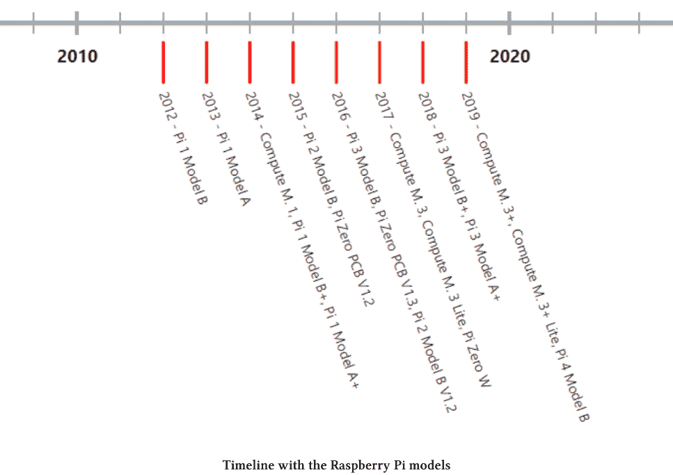

### 引脚类型

插针类型是位于树莓派板卡版本之间的插针，包含 8、26 或 40 个引脚。这些引脚具有不同的功能：

### 电源和地

5V 和 3.3V 都可以作为电源引脚，当然还有地引脚。每当板卡供电时，你就为组件提供了固定的电源供应。正如在“第 2 章：书中使用的工具和硬件” > “硬件组件” > “LED 灯带”中提到的，必须注意不要连接大电流的设备！

### 数字 GPIO

其他引脚是“通用输入/输出”（GPIO）引脚。这些引脚可以通过软件寻址，作为应用程序的输入或输出。它们使用 3.3V，这意味着输出引脚将设置为 0V（低电平）或 3.3V（高电平），输入引脚将读取 0V 为低电平，3.3V 为高电平。

大多数 GPIO 具有内部上拉或下拉电阻，可以在软件中启用。这种用法在“第 5 章：Pi4J > 使用按钮进行数字输入”中通过按钮的使用进行了说明。

### 引脚功能

某些 GPIO 可用于特定功能。这里描述了这些功能，而在“第 7 章：Java”和“第 9 章：Pi4J”中提供了示例以使这些功能更加清晰。

| 名称 | 标签 | 描述 |
|---|---|---|
| UART | 通用异步收发传输器 | 异步串口通信 |
| GPCLK | 通用时钟 | 输出固定频率 |
| I2C | 间集成电路 | 同步计算机总线 |
| SPI | 串外设备接口 | 四线串口总线 |
| PWM | 脉宽调制 | 生成模拟输出 |

### 通用异步收发传输器 (UART - 串口)

UART 是允许我们通过单根线从发送器（= TX）向接收器（= RX）发送和接收串口数据的系统，位组合成字节。对于双向通信，RX 和 TX 之间需要两根线。串口通信是一种按位顺序传输数据的方法（更多信息请参见“第 8 章：位与字节”）。

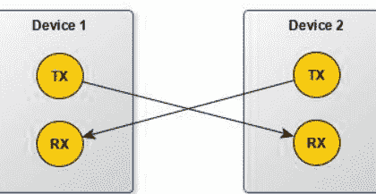

### 两个设备之间的连接

这两个设备之间的通信可以通过不同的方式发生：

- 单工：只有方向而没有消息回传
- 半双工：设备一次只能发送或接收
- 全双工：两个设备可以同时发送和接收

串口通信以预定义的速度进行，双方端都需要知道该速度，因为发送端和接收端都需要处理数据。这种速度被称为“波特率”，其值表示每秒比特（bps）。最常用的速度是 9600 bps，但你可以使用较低（1200, 2400, 4800）或更高（19200, 38400, 57600, 115200）的速度，取决于可以可靠处理的速度。树莓派有两个连接到 GPIO BCM 数字 14 (TX) 和 15 (RX) 的 UART 连接。与其他 GPIO 相同，当你连接其他设备时，使用的是相同的电压。

### 通用时钟 (GPCLK)

通用时钟引脚可以配置为连续输出固定频率。一旦软件启动输出，就不再需要控制了。GPCLK 使用 BCM 编号 4、5 和 6。

### 间集成电路 (I2C)

I²C 由飞利浦于 1982 年发明，是一种传输数据的同步计算机总线，具有以下特性：

- 同步：在时钟信号上交换数据
- 多主从：多个控制器可以一起使用
- 分包交换：数据以数据包分组
- 单端：变化的电压相对于参考电压（地）表示数据

它可以用于在短距离内传输（低速）。I²C 需要两根线，并有两个引脚为此设计，GPIO 2（数据）和 3（时钟）。

### 串外设备接口 (SPI)

就像 I²C 一样，SPI 使用分开的线和时钟线以确保在正确的时间读取数据。I²C 需要两根线，而 SPI 需要四根线但速度更快。SPI 在 20 世纪 80 年代中期发明。以全双工模式传输，使用单个主设备和多个从设备。在大多数硬件图和 SPI 组件上你会发现这些名称：

- MOSI = 主出从入 = 从树莓派到组件的通信
- MISO = 主入从出 = 从组件到树莓派的通信

### 脉宽调制 (PWM)

由于数字 GPIO 只有低电平（0V）或高电平（3.3V），因此无法实现真正的模拟输出，例如你想调光 LED 的亮度。在这些情况下，PWM 是完美的解决方案！通过快速地在低和高之间切换并使用不同的低和/或高状态持续，可以通过创建一个平均值来实现“半模拟输出”。在这种情况下使用的值为：

- 开启时间：高电平持续时间
- 闲时间：低电平持续时间
- 周期：开启时间 + 闲时间
- 占空比：高电平时间的百分比

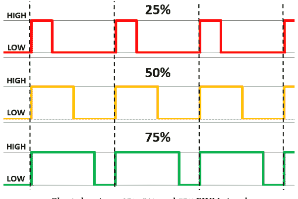

> 我本打算用 JavaFX 来生成这个图表，就像在“第 4 章：Java”中用于时间轴的那样。但是，为了避免“NIH 症”（参见“一个想法：重要缩写”），我决定先寻找现有解决方案。经过快速搜索，我发现了 Artworker 的一篇教程，其中分享了一个漂亮且现成的 Excel 表格来生成上面的图像。

PWM 可以软件（例如使用定时器）在所有 GPIO 引脚上生成，但通过 BCM 数字 12、13、18 和 19 的 GPIO 提供的硬件功能可以产生更稳定的信号。这些在引脚表中标记为类型 `DIGITAL_AND_PWM`。

*`https://www.instructables.com/id/Make-Digital-Graphs-in-Excel/`

### 引脚类型

根据板的类型，引脚上提供一个或两个具有不同 GPIO 功能的引脚：

| 描述 | 引脚 |
| :--- | :--- |
| 原始 Model B | 26脚引脚 - 类型 1 |
| Model A 和 Model B (版本 2) | 26脚引脚 - 类型 2 + 8脚引脚 |
| Model A+, B+, Pi Zero, Pi Zero W, Pi2B, Pi3B, Pi4B | 40脚引脚 |

引脚图示和表格视图中的颜色表示引脚的类型：

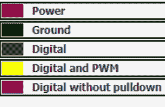

引脚类型颜色图例

### 40脚引脚

你可以在本章开头找到引脚可视化图。相同的数据可以在同一个 JavaFX 应用程序中用于表格视图。以下是 40 脚引脚的引脚列表：

## 第 5 章：树莓派引脚定义

| 引脚 n | WiringPi | BCM | 名称 | 类型 | 功能 | 备注 |
| :--- | :--- | :--- | :--- | :--- | :--- | :--- |
| 1 | | | 3.3 VDC | 电源 | | |
| 2 | | | 5.0 VDC | 电源 | | |
| 3 | 8 | SDA1 (I2C) | DIGITAL_NO_PULL_DOWN | I2C | SDA.1 有物理上拉电阻 |
| 4 | | | 5.0 VDD | 电源 | | |
| 5 | 9 | SCL1 (I2C) | DIGITAL_NO_PULL_DOWN | I2C | Scl.1 有物理上拉电阻 |
| 6 | | | Ground | 接地 | | |
| 7 | 7 | | DIGITAL | GPCLK | | |
| 8 | 15 | 14 | DIGITAL | | | |
| 9 | | | Ground | 接地 | | |
| 10 | 16 | | DIGITAL | UART | | |
| 11 | 17 | | DIGITAL | SPI | | |
| 12 | 18 | PCM_CLK/PWM0 | DIGITAL_AND_PWM | SPI | 支持 PWM0 [ALTO] |
| 13 | 27 | | DIGITAL | | | |
| 14 | | | | | 接地 | | |
| 15 | 22 | | | | | | |
| 16 | 23 | | | | | | |
| 17 | | | | 电源 | | | |


| 18 | 24 | | 3.3 VDC | DIGITAL | | | |
|---|---|---|---|---|---|---|---|
| 19 | 20 | | MOSI (SPI) | DIGITAL | SPI | | |
| 20 | | | Ground | 接地 | | | |
| 21 | 23 | | MISO (SPI) | DIGITAL | SPI | | |
| 22 | 2 | | 25 | | | | |
| 23 | 14 | 11 | (CLK) | | | | |
| 24 | 10 | CE0 (SPI) | DIGITAL | | | | |
| 25 | | | Ground | 接地 | | | |
| 26 | 11 | CE1 (SPI) | DIGITAL | | | | |
| 27 | 30 | 0 | EEPR 的 SDA0 I2C | DIGITAL_NO_PULL_DOWN | I2C | SDA.0 有物理上拉电阻 |
| 28 | 31 | | EEPROM 的 SCL0 I2C | DIGITAL_NO_PULL_DOWN | I2C | SDC.0 有物理上拉电阻 |
| 29 | 21 | | GPCLK1 | DIGITAL | GPCLK | | |
| 30 | | | Ground | 接地 | | | |
| 31 | 22 | 6 | GPCLK2 | DIGITAL | GPCLK | | |
| 32 | 26 | | PWM0 | DIGITAL_AND_PWM | 支持 PWM0 [ALTO] | | |
| 33 | 23 | | PWM1 | DIGITAL_AND_PWM | 支持 PWM1 [ALTO] | | |
| 34 | | | Ground | 接地 | | | |
| 35 | 24 | | PCM_FS/PWM1 | DIGITAL_AND_PWM | SPI | 支持 PWM1 [ALTS] | |
| 36 | 27 | | DIGITAL | SPI | | | |
| 37 | 25 | | DIGITAL | | | | |
| 38 | 28 | 20 | PCM_DIN | DIGITAL | SPI | | |
| 39 | | | Ground | 接地 | | | |
| 40 | 29 | 21 | PCM_DOUT | DIGITAL | SPI | | |

引脚表格视图

## 第 5 章：树莓派引脚定义

上面的表格视图在开发时出现了一个错误，因为 `JavaFXPropertyValueFactory` 无法从不同包的类中接收属性。

这是由于 Java 9 版本引入的模块系统引起的，该系统允许模块在定义权限的情况下访问其他模块。

在此项目中，这是通过在 `module-info.java` 中添加 `opens` 行来实现的：

```
module be.webtechie {
    requires javafx.controls;
    requires be.webtechie.pi;
    opens be.webtechie to javafx.graphics;
}
```

### 26脚引脚 - 类型 1 和 2

两者几乎完全相同，但引脚 3、5 和 13 的 BCM 编号不同：

| 3.3 VDC | 1 | 5.0 VDC | 3.3 VDC | 2 | 5.0 VDC |
| :--- | :--- | :--- | :--- | :--- | :--- |
| 8 SDA1 (I2C) | 3 | 4 | 8 SDA1 (I2C) | 3 | 4 |
| 9 SCL1 (I2C) | 5 | 6 | 9 SCL1 (I2C) | 5 | 6 |
| 4 GPIO6 | 7 | TXD 14 | 4 GPIO6 | 7 | TXD 14 |
| Ground | 9 | RXD 16 | Ground | 10 | RXD 16 |
| 17 | 11 | PCM_CLK/PWM1 | 18 | 12 | PCM_CLK/PWM1 |
| 21 | 13 | | 27 | 14 | |
| 22 | 15 | | 42 | 25 | 16 |
| 3.3 VDC | 17 | | 24 | 3.3 VDC | 18 |
| 10 MOSI (SPI) | 19 | Ground | 10 MOSI (SPI) | 20 | |
| 9 MISO (SPI) | 21 | 22 | 6 | 9 MISO (SPI) | 21 |
| 11 SCLK (SPI) | 23 | 24 | | 11 SCLK (SPI) | 24 |
| Ground | 25 | Ground | 26 | | |
| | CE0 (SPI) | 10 | 8 | | | ( |
| | CE1 (SPI) | 11 | 7 | | |

26脚引脚 1（左）和 2（右）

### 8脚引脚

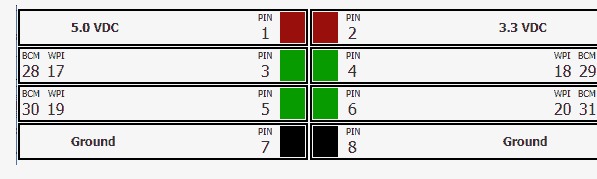

### 引脚方案

在表格中，你可以看到两种不同的编号方案：一行是所有的偶数编号，另一行是所有的奇数编号。

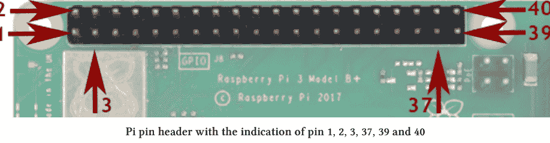

### BCM编号

BCM 指的是 Broadcom SoC 通道，它是芯片内部的引脚编号。这些编号在 26脚引脚的不同板子版本之间发生了变化。

## WiringPi编号

WiringPi 默认安装在树莓派上。你可以通过命令 `gpio -v` 和 `gpio readall` 轻松检查版本。这是 Raspberry Pi 3B 的结果：

```
$ gpio version
2.50
Copyright (c) 2012-2018 Gordon Henderson
This is free software with ABSUTELY NO WARRANTY.
For details:
Type: Pi 3 Model B Rev 1.3
Memory: 1024MB, Maker: Sony
* Device tree is enabled.
* Raspberry Pi supports user-level gpio access.

$ gpio readall
```

| BCM | wPi | 名称 | 模式 | V | 物理 | V | 模式 | 名称 | wPi | BCM |
| :--- | :--- | :--- | :--- | :--- | :--- | :--- | :--- | :--- | :--- | :--- |
| | | 3.3v | | 1 | 2 | | 5v | | | |
| | | SDA 1 | IN | 1 | 3 | 4 | | 5v | | |
| | | 9 SCL | IN | 1 | 5 | 6 | | 5v | | |
| | | 7 GPIO. 7 | IN | 1 | 7 | 8 | O | TxD | 15 | 14 |
| | | | | | 9 | 10 | 1 | IN | RxD | 16 | 15 |
| | | 17 GPIO. 0 | IN | 0 | 11 | 12 | O | GPIO. 1 | 1 | 18 |
| | | 27 GPIO. 2 | IN | 0 | 13 | 14 | | | | |

## 第6 章：什么是 Maven？

Maven 是一个帮助你管理 Java 项目依赖项（外部库）并构建测试和分发应用程序的工具。它通过使用预定义的结构来组织代码，并在 `pom.xml`（项目对象模型）文件中描述项目。

根据不同的调查，约有 50% 到 60% 的 Java 开发者使用 Maven。还有其他工具可以完成相同的工作，其中 Gradle 是次受受欢迎的（20% 到 30%）。由于我不熟悉 Maven，但考虑到它是最常用的工具，我们在本书中将只使用它。

除了开发工具之外，还有一个在线仓库（Repository），你可以在那里找到长长的已验证库列表。

让我们来看看我们将在第 7 章中用到的 TilesFX 库。访问 mvnrepository.com 网站并搜索 TilesFX。

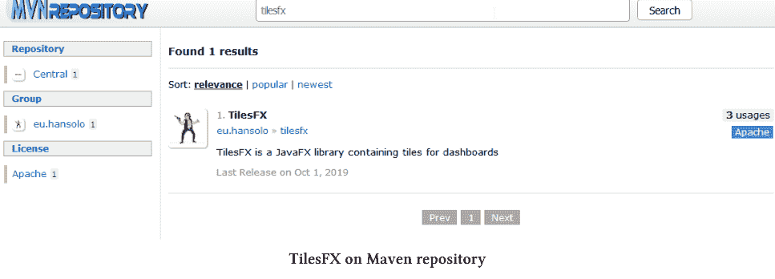

如果我们点击 "tilesfx" 链接，就会看到该库所有可用版本的页面。

> https://maven.apache.org/

https://mvnrepository.com/

## 第6 章：什么是 Maven？

107


首页 >> eu.hansolo >> tilesfx

### TilesFX

TilesFX 是一个包含仪表板组件（tiles）的 Java 库


索引构制品 (15.4M)

| 版本 | 仓库 | 使用次数 | 日期 |
|---|---|---|---|---|
| 11.14.x | 11.14 | Central | 0 | 2019年10月 |
| 11.13.x | 11.11 | Central | 0 | 2019年9月 |
| 11.12.x | 11.12 | Central | 0 | 2019年9月 |
| 11.11.x | 11.11 | Central | 0 | 2019年9月 |
| 11.10.x | | Central | 0 | 2019年9月 |
| 11.9 | 11.9 | Central | 0 | 2019年9月 |
| 11.8.x | 11.8 | Central | 0 | 2019年9月 |
| 11.7 | 11.7 | Central | 0 | 2019年9月 |

Apache 2.0

3 个构制品

Central (78) | Spring Plugins (1)

Maven 仓库上的 TilesFX 版本

通过选择你想要使用的版本（通常是最新且最近的一个），你可以复制并粘贴依赖代码将其添加到 `pom.xml` 文件中

首页 >> eu.hansolo >> tilesfx >> 11.14

### TilesFX >> 11.14

TilesFX 是一个包含仪表板组件（tiles）的 Java 库


| | |
|---|---|
| 许可证 | Apache 2.0 |
| 主页 | https://github.com/HanSolo/tilesfx/wiki |
| 日期 | (2019年10月1日) |
| 文件 | jar (1.7 MB) 查看全部 |
| 仓库 | Central |
| 使用者 | 3 个构制品 |

```xml
<dependency>
  <groupId>eu.hansolo</groupId>
  <artifactId>tilesfx</artifactId>
  <version>11.14</version>
</dependency>
```

TilesFX 依赖 XML

## 第6 章：什么是 Maven？

同样，为“第8 章位与字节”创建的“LED 数字显示”JavaFX 库也可以在 Maven 仓库中找到：

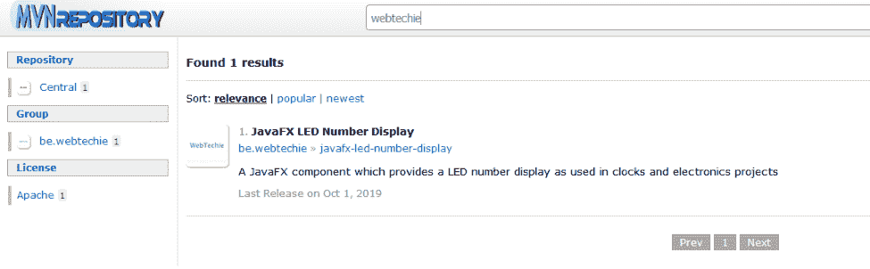

### 安装 Maven

### 在 Windows PC 上

- 首先安装最新版本的 Java
- 从 Apache Maven 网站下载 ZIP 包
- 解压并将目录移动到例如 "C:\Program Files\apache-maven"
- 在资源管理器中右键点击“此电脑”并选择“属性” > “高级系统设置” > “环境变量”

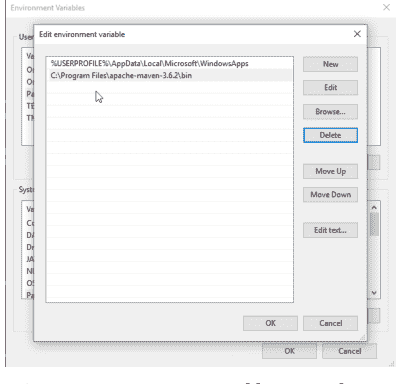

- 将“Maven” > “bin” 目录的位置添加到“用户变量” > “Path” 中
- 点击“确定”直到所有对话框关闭
- 注销并重新登录（重启）
- 在 cmd 中检查版本

```
$ mvn -v
Apache Maven 3.6.2 (@40f523331...; 2019-08-27T17:06:16+0100)
Maven home: C:\Program Files\apache-maven
Java version: 11.0.2
Maven version: 3.6.2
```

### 在树莓派上

- 使用 `apt` 安装 Maven
- 在终端中检查版本：

```
$ mvn -v
Apache Maven 3.6.2
Maven home: /usr/share/maven
Java version: 11.0.2
Maven version: 3.6.2
```

## 第6 章：什么是 Maven？

### 创建新项目

让我们使用 Maven 创建新项目。在终端运行以下命令：

```
mvn archetype:generate -DgroupId=com.company -DartifactId=myapp -DarchetypeArtifactId=archetype-quickstart -DinteractiveMode=false
```

### 项目结构

如截图所示，项目。`pom.xml` 文件位于根目录

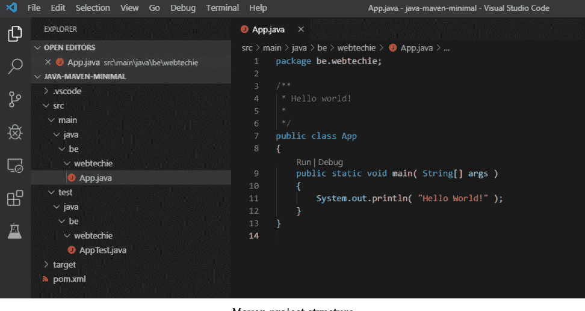

### 一个最小化示例

有多种方法可以将应用程序打包成 jar 包，取决于你是想将依赖项包含在 jar 包中还是不包含它们。为了方便使用，在本书示例中，我们将使用 `assembly-plugin` 将依赖项放入 jar 包。请注意，你需要更新 `mainClass` 值以引用对应的类。

```xml
<project xmlns="http://maven.apache.org/POM/4.0.0" xmlns:xsi="http://www.w3.org/2001/XMLSchema-instance"
  xsi:schemaLocation="http://maven.apache.org/POM/4.0.0 https://maven.apache.org/xsd/maven-4.0.0.xsd">
  <modelVersion>4.0.0</modelVersion>

  <groupId>webtechie</groupId>
  <artifactId>java-minimal</artifactId>
  <version>1.0-SNAPSHOT</version>
  <name>java-minimal</name>
  <url>http://maven.apache.org</url>
  <packaging>jar</packaging>

  <dependencies>
    <dependency>
      <groupId>junit</groupId>
      <artifactId>junit</artifactId>
      <version>3.8.1</version>
      <scope>test</scope>
    </dependency>
  </dependencies>

  <build>
    <plugins>
      <plugin>
        <groupId>org.apache.maven.plugins</groupId>
        <artifactId>maven-compiler-plugin</artifactId>
        <version>3.8.0</version>
        <configuration>
          <release>11</release>
        </configuration>
      </plugin>
      <plugin>
        <artifactId>maven-assembly-plugin</artifactId>
        <version>2.2.1</version>
        <configuration>
          <descriptorRefs>
            <descriptorRef>jar-with-dependencies</descriptorRef>
          </descriptorRefs>
          <archive>
            <manifest>
              <addClasspath>true</addClasspath>
              <mainClass>webtechie.App</mainClass>
            </manifest>
          </archive>
        </configuration>
        <executions>
          <execution>
            <id>maven-assembly</id>
            <phase>package</phase>
            <goals>
              <goal>single</goal>
            </goals>
          </execution>
        </executions>
      </plugin>
    </plugins>
  </build>
</project>
```

```xml
<build>
  <executions>
  </executions>
  <plugins>
  </plugins>
</build>
```


在`pom.xml`文件中包含这些插件后，我们可以在应用程序目录的终端中通过以下命令来构建应用程序：

```bash
$ mvn clean package
```

如果现在对这些还不完全清楚，请不要担心！在本书中每个示例的 GitHub 源码中，你可以找到正确的`pom-file`以及可以在 Pi 上运行的生成的`jar-file`。因此，你可以选择自己生成包，也可以使用提供的包。示例中也描述了如何构建和运行每个示例。

# 使用 Maven 和 log4j 添加应用程序日志记录

在本书的示例中，`"System.out.println()"`和`"System.err.println()"`的输出被输出到日志消息中，这些消息可以用于调试。这些日志消息仅在你从终端启动 Java 应用程序时可用，并在应用程序结束时丢失。

为了有更好的方法，请使用`log4j`，它可以配置为（例如）同时类似于`"System.out"`一样记录到控制台，并记录到文件中，这样在应用程序结束后你仍然可以访问日志。

- 可以在`Chapter_06_Maven > java-maven-logging`中找到一个用于说明`log4j`日志初始化和使用的简单示例。

`pom-file`需要扩展该 Maven 依赖。

```xml
<dependency>
  <groupId>log4j</groupId>
  <artifactId>log4j</artifactId>
  <version>1.2.17</version>
</dependency>
```

初始化和一些示例日志在`App.java`中完成：

```java
package be.webtechie;

import org.apache.log4j.ConsoleAppender;
import org.apache.log4j.Level;
import org.apache.log4j.Logger;
import org.apache.log4j.PatternLayout;
import org.apache.log4j.RollingFileAppender;

/**
 * Hello world!
 */
public class App {

  private static Logger logger = Logger.getLogger(App.class);

  public static void main(String[] args) {
    Logger.getRootLogger().getLoggerRepository().resetConfiguration();
    initLog();
  }
```

# 第 6 章：什么是 Maven？

```java
logger.debug("Debug message");
logger.info("Info message");
logger.warn("Warn message");
logger.error("Error message");
}
```

```java
private static void initLog() {
    PatternLayout layout = new PatternLayout("yyyyMMdd HH:mm:ss,SSS | %-5p | [%c{1}] | %m%n");

    // 记录到控制台，类似于 System.out
    ConsoleAppender console = new ConsoleAppender();
    console.setName("ConsoleLogger");
    console.setLayout(layout);
    console.setThreshold(Level.DEBUG);
    console.activateOptions();
    console.getRootLogger().addender(console);

    // 记录到文件以便稍后参考
    RollingFileAppender file = new RollingFileAppender();
    file.setName("FileLogger");
    file.setFile("logs/app.log");
    file.setLayout(layout);
    file.setThreshold(Level.INFO);
    file.setAppend(true);
    file.activateOptions();
    file.setMaxFileSize("10MB");
    file.setMaxBackupIndex(5);
    console.getRootLogger().addender(file);
}
```

请查看`jenkov.com`上的`"Java Logging"`以获取其他更详细的`logger`配置。完整的`log4j`文档可以在`logging.apache.org/log4j/1.2/apidocs`找到。

运行此示例应用程序时，输出将如下：

> http://tutorials.jenkins.com/java-logging/index.html

> https://logging.apache.org/log4j/1.2/apidocs/index.html

# 第 6 章：什么是 Maven？

```text
1 log4j: reset attribute= "false"
2 log4j: Threshold == "null"
3 log4j: Level value for root is [debug]
4 log4j: root level set to DEBUG
5 log4j: Class name: [org.apache.log4j.RollingFileAppender]
6 log4j: Setting property [file] to [demoApplication.log]
7 log4j: Parsing of class: "org.apache.log4j.PatternLayout"
8 log4j: Setting property [conversionPattern] to
9 [yyyy-MM-dd hh mm:ss] %5p %c{1}:%L - %m
10 log4j: setfile called: demoApplication.log, true
11 log4j: setfile ended
12 log4j: Adding app named [fileAppender] to category [root]
13 log4j: setfile called: /tmp/app.log, true
14 log4j: setfile ended
15 DEBUG | [App] | Debug message
16 INFO | [App] | Info message
17 WARN | [App] | Warn message
18 ERROR | [App] | Error message
19 Process finished with exit code 0
```

如果你在 IntelliJ 中带有此配置和 Console 插件运行应用程序，警告和错误行将被高亮，这使得调试变得非常容易！

## 随感

作为一名开发者，你需要了解一些“重要”的缩写。

### YAGNI

“你不需要”（You Aren’t Gonna Need It）用于指出在你真正需要之前，不要添加代码。

### KISS

保持简单，愚蠢（Keep It Simple, Stupid）：`KISS`的目标是让你的代码尽可能简单。

### PGE

在开发软件时始终记住“良好足够”（Principle of Good Enough）。

### NIH

工程师倾向于遭受“这里不发明”（Not Invented Here）综合症。他们本可以采用现有解决方案，却倾向于自己做。

### DRY

“不要重复自己”（Don’t repeat yourself）原则旨在将你的应用程序分为具有单一职责的小块。SonarLint 等工具可以集成到你的 IDE 中，当你有多处相同或相似的代码时报警。你不总是需要工具；如果你在重复自己，请后退一步考虑如何简化你的代码。

### TDD

“测试驱动开发”（Test Driven Development）是一种编码方式，你首先为应用程序中的新功能编写最小的测试。一旦你的测试通过，你就可以重构并改进实现。如果你需要更多功能，首先扩展测试使其变绿，并且之前的测试保持绿色。

其他`DD`原则包括“行为驱动开发”（Behavior Driven Development）和“领域驱动设计”（Domain Driven Design）。

`BDD`关注于通过团队创建应用程序，其中每个成员都有不同的角色（开发者、测试人员、经理……），并充分理解要实现的功能。

`DD`由一个“领域专家”驱动，该专家可以解释系统如何工作，不同的子系统可以被开发但共享同一个“领域”。例如，如果你为一家商店设计软件系统，你将有一个存储数据的数据库，以及一个由两个团队管理客户和订单的程序，但它们共享售后支持的功能。领域专家对所有用例了如指，并引导开发团队采取最佳方法。

虽然大多数团队都使用这些和其他原则的健康混合，但在许多公司中，“截止日期开发”（Deadline Development）才是现实世界的方法……

### RTFM

“去读该死的手册”（Read The Fucking Manual）经常被对用户反复提问同一个问题感到沮丧的开发者使用。在我看来，用户总是正确的。这意味着，如果他们不断询问某功能如何工作，可能是你没有把它做得足够简单，或者用户的使用方式与你假设的不同。

这就是为什么你需要“快速且频繁地失败”，意味着你需要尽早让最终用户引入你的开发过程中，让他们可以开始测试并给你提供反馈。

下次你使用`"RTFM"`时，仔细听听问题以及用户想要的事情以及他们没有成功的原因……

# 第 7 章：关于 JavaFX

来自 Oracle 网站：“JavaFX 是一组图形和媒体包，允许开发人员设计、创建、测试、调试和部署富客户端应用程序，这些应用程序可以在不同平台上保持一致的运行。

JavaFX 由 Sun Microsystems 创建，后来成为 Oracle 公司的一部分，现在是`openfx.io`⁶⁵上的一个开源项目，可以通过`GluonHQ`⁶⁶获取商业支持。

源代码可以在`GitHub`⁶⁷上找到。

JavaFX 允许你在使用作为 Java 开发者已经熟悉的语言和工具的同时，快速构建用户界面。这界面可以使用 CSS 语法进行样式化，并且非常灵活且可扩展；或者你也可以像我在第 03 章中为时间轴做的那样，用代码来绘制图形。

目前有许多项目正在进行，旨在让将应用程序发布到不同的操作系统和平台变得对开发者非常友好。请密切关注`GluonHQ`和`GraalVM`⁶⁸的新闻消息，他们正合作开发这些解决方案。

> ⁶⁵https://openfx.io/

> ⁶⁶https://gluonhq.com/

> ⁶⁷https://github.com/openjdk/jfx

> ⁶⁸https://www.graalvm.org/

## 历史

### JavaFX 的时间线

JavaFX 最初（版本 1）是一个用于开发富互联网应用（RIA）的平台，以便使用脚本语言轻松创建基于 Web 的界面。

在 Oracle 于 2009 年从 Sun Microsystems 收购 Java 和 JavaFX 后，它在 2010 年宣布了新的主版本 2。该版本于 2011 年 10 月发布，并从脚本语言转变为 Java API。

当 Java 8 本身引入许多新 API 和语言增强时，版本号跳到了 8，JavaFX 也随之改进以适应所有这些变化。

从版本 11 开始，JavaFX 模块被移出了 JDK，GluonHQ 在许多贡献者（包括 Oracle）的支持下维护着 OpenFX。就像 Java 的 6 个月发布周期一样，JavaFX 的开发速度也在加快，不断推动新功能的发展。

## 与 Johan Vos 的访谈

Johan Vos，`@johanvos`，Gluon 联合创始人兼首席技术官，Java Champion，领导 OpenJFX 和移动端 OpenJDK 的开发。

### 你是 JavaFX（OpenJFX）的主要贡献者之一。该框架正在发生最大的变化是什么？

OpenJFX 开发的最重要标准是稳定性。OpenJFX 本身并不在创造新的花哨，而是许多其他（库、框架、项目）在利用 JavaFX API 并在此基础上构建价值。

OpenJFX 提供了顶层的 JavaFX API，允许用 Java 创建 UI 应用和工具。我们继续致力于这些 API，主要是提高质量，并确保它们在不断演变的格局中保持相关性。

除了 API 之外，OpenJFX 桥接了这些 API 与不同配置下的底层图形系统之间的差距。我们确保 API 在底层系统上以原生方式运行。这是一项不容低估的任务。

在世界上，特别是在 OpenJDK 项目中，我们对添加功能非常谨慎。我们问的首要问题是：这个功能在 5 年后还会具有意义并被维护吗？我们还必须确保开发者社区对某项工作达成共识。由于 JavaFX 广泛应用于许多不同的领域，想要出一套在所有领域都同样适用的 API 并不容易。因此，在添加或修改 API 之前，我们需要反复反馈。

幸运的是，有一个强大的 JavaFX 生态系统，许多中小型贡献者一直在开放且建设性地讨论未来的发展路线。

### 你认为 JavaFX 是树莓派（Raspberry Pi）用户界面的完美匹配吗？

绝对是。JavaFX 的跨平台特性使其在桌面系统上开发 UI 变得非常简单，一旦你掌握了它，就可以树莓派上运行并针对嵌入式特定问题进行调整。

特别是通过 Gluon Substrate 插件提供的`GraalVM`原生镜像能力（`native-image capabilities`），使用 JavaFX 创建的应用将非常有意义。

BellSoft 在博客文章宣布了支持树莓派上 JavaFX 的视频。我们可以期待在树莓派上看到更多 JavaFX 特性，例如 WebView。

视频支持从初就是 JavaFX 的一部分，WebView 也是。取决于配置和构建方式，WebView 可能不会作为嵌入组件包含在嵌入式平台上，而是而是使用设备上现有的 webkit 实现（例如我们在 iOS/Android 上所做的）。通常情况下，桌面端可用的所有东西在嵌入式和移动端同样可用。

# 第 7 章：关于 JavaFX

### 在你看来，近年来 Java/JavaFX 生态系统中最重要的变化是什么？

JDK 的解耦是一项影响重大的变化。我们知道这会让一些开发者感到震惊，但随着 JDK 和生态系统走向模块化，我们也必须对 OpenFX 这样做。我们现在处于非常顺畅的阶段，大多数生态系统都接受了模块化方法，并使用像 Maven 或 Gradle 等现有、熟悉的工具来创建 JavaFX 应用。对于那些偏好独立 SDK 的开发者和公司，我们仍然提供支持。

### 为什么现在是学习 Java 的完美时机？

通过 Java，你学习的是一种不会将你锁定在特定市场、领域甚至语言本身的语言。许多语言都在使用 Java VM，Java 被广泛应用于各个领域、开源和商业软件。

它非常成熟、稳定，而且仍然非常有创新性，例如 6 个月的发布周期。

### 你正在进行哪一个 DIY 电子项目，或者哪个项目在你的“如果我有时间”清单上？

- 家庭闹报警系统，包括 AI 和人脸识别。
- 汽车界面。
- https://twitter.com/jhanvos
- https://gluonhq.com/
- https://www.graalvm.org/
- https://github.com/gluonhq/substrate

## 用于扩展 JavaFX 的示例库

还有许多额外的库可进一步扩展 JavaFX，以构建强大的 UI（用户界面）。这里是其中一些库的清单，但还有更多，查看 Hossein Rimazfor69 的这个项目以获取长列表70！

### TilesFX

这个优秀的库由 Gerrit Grunwald71 开发，提供了用于构建仪表板（dashboards）的磁片。查看他的博客72 了解更多 JavaFX！你可以在 GitHub73 上找到源代码，并且它可以作为 Maven 依赖项使用。

### FXbonbon

受微软的启示，这个由 Pedro Duque75 开发的库在 JavaFX 中提供了类似的组件。你可以使用此控件来简化具有大量操作的应用 UI。

- 69 https://twitter.com/mrinaz
- 70 https://github.com/mrinaz/AwesomeJavaFX
- 71 https://hansolo_
- 72 https://harmoniccode.blogspot.com/
- 73 https://github.com/HanSolo/tilesfx
- 74 https://mvnrepositoryrepository.com/eu.hansolo/tilesfx
- 75 https://Twitter.com/P_Duke

# 第 7 章：关于 JavaFX

你可以在 GitHub76 上找到源代码，并且它可以作为 Maven 依赖项使用。

### ControlsFX

由 Jonathan Giles78 开发。你可以在 GitHub79 上找到源代码，并且它可以作为 Maven 依赖项80。

### PickerFX

由 Java 英雄之一 Dirk Lemmermann81 开发。他还有很多项目，请查看他的完整 GitHub 仓库：

- 76 https://github.com/duke/FXRibbon
- 77 https://mvnrepository.org/artifact/com.pduke/FXRibbon
- 78 https://twitter.com/JonathanGiles


- 79 https://github.com/controlsfx/controlsfx
- 80 https://mvnrepository.org/artifact/org.controlsfx/controlsfx
- 81 https://twitter.com/dlemmerann

## 第 7 章：关于 JavaFX

你可以在 GitHub82 上找到源代码，并且它可以作为 Maven 依赖项83。务必查看他的博客，获取更多酷的 JavaFX 东西，如 JMetro84。

- 82 https://github.com/dlsc-software-consulting-gmbh/PickerFX
- 83 https://mvnrepository.com/artifact/com.dlsc.pickerfx/pickerfx
- 84 https://pixelduke.com/

### 与 Gerrit Grunwald 的访谈

Gerrit Grunwald 是一位拥有最酷 Twitter 用户名 `@hansolo_` 的 Java 冠军，他热爱 Java(FX) 和物联网，也是一位 UI 专家。

**你为什么要为 TilesFX 构建这样一个很棒的框架并开源，将其“免费”提供给所有人呢？**

我曾参与过一个需要管理仪表板的项目。为了这个仪表板，我创建了两个不同的组件。当我开始编写这些组件时，我发现 Java 中没有什么好的库可以创建仪表板，就在那个时刻，TilesFX 诞生了。我只是把脑子里想到的所有东西都加进去，并添加到库中。有趣的是，这只是一个很小的小项目，从未进入过任何官方项目里。但似乎有很多人都在用它来做自己的事情。

**在你看来，近年来 Java 生态系统中最重大的变化是什么？**

最重要的变化是向模块化 JDK 的迁移，这并不意味着我是它的忠实粉丝。虽然它可能对某些人有用，但我认为对于许多人来说，旧的结构仍然有效。当然，它在容器化应用世界中，配合 GraalVM（这是 Java 生态系统的另一个重要变化）非常有帮助。

**你认为 Java 世界的下一次演变是什么？**

我希望看到 *Project Panama* 尽快实现，以便能够更方便地访问原生库。

**为什么现在不是学习 Java 的完美时机？**

Java 仍然是该领域使用最广泛的语言之一。对我来说，当人们问我应该学习哪种编程语言时，这就是推荐它的足够理由。另一个重要点是可用库数量巨大以及强大的社区。此外，Java 已经证明了它在多年的演变中能够保持“年轻”。


> 你正在进行哪个 DI 编程电子项目，或者它是否在你的“如果我有时间的话？清单”上？

> 我正在制作一个小设备，用来帮助我和妻子监测儿子的糖尿病情况。这主要基于 ESP8266，但为了这个，我也创建了一个 TileFX :)

- https://twitter.com/hansolo_*
- https://openjdk.org/projects/panama/
- *Project Panama 旨在改进并增强 Java 虚拟机与定义良好但“外部”（非 Java）API 之间的连接，包括 C 程序员常用的许多接口。*

## 最小 JavaFX 11 示例应用程序

GluonFX 一直在开发一个系统，通过几个简单的步骤快速启动带有某些插件的“空”JavaFX。

## 向 Maven 添加新的原型类型（archetypes）

首先，我们需要向 Maven 添加一些原型类型。打开你的终端或命令行窗口并执行以下命令：

```
$ git clone https://github.com/openjfx/javafx-maven-archetypes.git
$ cd javafx-maven-archetypes
$ mvn clean install
```

该脚本位于：

`Chapter_07_JavaFX > scripts > gluonhq_add_archetypes`

最后一步将需要一段时间，但最后，你应该会在日志中看到这些：

```
[INFO]
[INFO] Reactor Summary for Maven Archetypes for JavaFX 0.0.2-SNAPSHOT:
[INFO]
[INFO] Maven Archetypes for JavaFX ....................... SUCCESS [ 1.883 s ]
[INFO] Simple JavaFX Maven Archetype ................. SUCCESS [ 8.548 s ]
[INFO] XML JavaFX Maven Archetype ........................ SUCCESS [ 0.304 s ]
[INFO]
[INFO] BUILD SUCCESS
[INFO]
```

### 创建空应用程序

在终端或命令行窗口中，你现在可以使用以下命令创建一个基础的 JavaFX 项目：

```
$ mvn archetype:generate
  -DtypeGroupId=org.openfx
  -DtypeArtifactId=javafx-archetype-simple
  -DtypeVersion=0.0.1
  -DgroupleId=be.webtechie
  -DartifactId=javafx-minimal
  -Dversion=0.0.1
```

该脚本位于：

`Chapter_07_JavaFX > scripts > gluonhq_create_empty_javafx_project.sh`

你可以自己定义 `grouplid`、`artifactid` 和 `version` 的值，上面的给定值只是示例。

运行上述脚本后，将为你创建一个新的 Java Maven 项目，包含一个 `pom` 文件和第一个 Java 源文件。

使用上述命令创建的项目位于目录中的源码中：

`Chapter_07_JavaFX > javafx-minimal`

## 在 Visual Studio Code 中运行空应用程序

确保你的开发机器上运行 Java 11 JDK（或更高版本）：

```
$ java -version
openjdk version "11.0.4" 2019-07-16
OpenJDK Runtime Environment OpenJDK (build 11.0.4+11)
OpenJDK 64-Bit Server VM OpenJDK (build 11.0.4+11, mixed mode)
```

你可以从 Visual Studio Code 内部通过“Run|Debug”弹出窗口启动应用程序。

```
src > java > be > webtechie > App.java > main(String())
* JavaFX App
/* /
public class App extends Application {

    @Override
    public void start(Stage stage) {
        var javaversion = SystemInfo.javaVersion();
        var javafxVersion = SystemInfo.javafxVersion();

        var label = new Label("Hello, JavaFX running on " + javafxVersion + ".");
        var scene = new Scene(new StackPane(label), 640, 480);
        stage.setScene(scene);
        stage.show();
    }

    public static void main(String[] args) {
        launch();
    }
}
```

在 Visual Studio Code 中启动 JavaFX：

```
PS D:\java-minimal> mvn javafx:run

[INFO] Scanning for projects...
[INFO] -------------------------------- be.webtechie:javafx-minimal -----
[INFO] Building javafx-minimal 0.0.1
[INFO] ------------------------------------------------
[INFO] javafx-maven-plugin:0.0.1:run (default-cli) @ javafx-minimal -----
[INFO] BUILD SUCCESS
[INFO] Total time: 14.769 s
[INFO]
```

运行的应用程序将出现在你的屏幕上。

### 在 Pi 上运行应用程序

在应用程序中，将显示你安装的 JDK 和 JavaFX 版本。就像你可以在 PC 上运行一样，你也可以在 Pi 上运行。将项目传输到 Pi（通过 SSH，见第 2 节），在 Pi 上执行以下命令：

```
pi@raspberrypi:~/java-minimal $ ls
. ...
pi@raspberrypi:~/java-minimal $ pwd
pi@raspberrypi:~/java-minimal $ date
pi@raspberrypi:~/java-minimal $ uname -a
pi@raspberrypi:~/java-minimal $ cd ..
pi@raspberrypi:~$ 
```

## 构建我们的第一个 JavaFX

运行单个 Java 文件很方便，并且能让我们快速测试某些功能，但这只是第一步。要构建一个完整的 Java 应用程序，我们需要一些额外的步骤……

让我们从复制之前用 GluonHQ 工具创建的 `javafx-minimal` 应用程序开始（当然，也可以直接从 GitHub 示例中获取）。

### 扩展 pom.xml

该应用程序将使用 TilesFX 库在已使用的 JavaFX 库之外创建一个华丽的仪表板。我们需要在 `pom.xml` 文件中添加 TilesFX 依赖，这样我们的 IDE 就会在开发期间下载它，并且我们可以调用它的方法。

访问 [Maven 仓库网站](https://mvnrepository.com/) 并搜索 TilesFX。

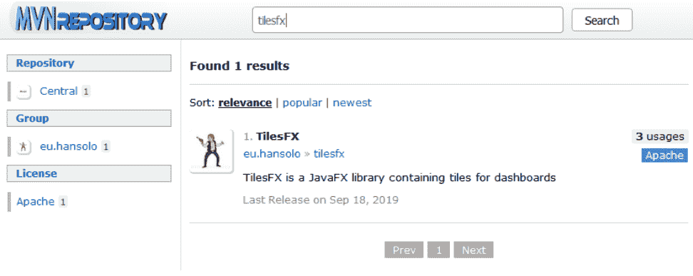

当你点击进入时，可以选择版本，在该页面上，你将找到需要添加到 `pom.xml` 文件中的依赖项，该文件已经包含了 `javafx-controls` 依赖。我们还需要添加 `javafx-web` 依赖，因为 TilesFX 会使用它。

在修改 `pom.xml` 文件时，我们也更改了 `artifactId`，因为我们是从 `javafx-minimal` 应用程序复制了这个项目，并按照“第 6 章：Maven”中的描述添加了构建插件。

```xml
1
2  <artifactId>javafx-dashboard</artifactId>
3  ...
4  <dependencies>
5    <groupId>org.openfx</groupId>
6      <artifactId>javafx-controls</artifactId>
7      <version>11.0.2</version>
8    </dependency>
9    <dependency>
10     <groupId>org.openfx</groupId>
11     <artifactId>javafx-web</artifactId>
12     <version>11.0.2</version>
13   </dependency>
14   <dependency>
15     <groupId>eu.hansolo</groupId>
16     <artifactId>tilesfx</artifactId>
17     <version>11.13</version>
18   </dependency>
19 </dependencies>
20
21  <build>
22   <plugins>
23     <plugin>
24       <groupId>org.apache.maven.plugins</groupId>
25       <artifactId>maven-compiler-plugin</artifactId>
26       <version>3.8.0</version>
27       <configuration>
28         <release>11</release>
29       </configuration>
30     </plugin>
31
32     <plugin>
33       <artifactId>maven-assembly-plugin</artifactId>
34       <version>2.2.1</version>
35       ...
36     </plugin>
37   </plugins>
38   </build>
```

## 添加一个 GPIO 辅助类

在 `HelloGpio.java` 中，我们通过一小段代码实现了 LED 的亮灭。为了能够处理异常并读取 GPIO 的状态，我们需要更多的代码。我们创建一个新类 `Gpio.java`。它将使用我们之前在终端中使用的 `gpio` 命令并通过 Java 进行控制。这只是第 9 章中的一种“快速取胜”的方法，在第 9 章中我们将开始使用 Pi4J，它提供了更好的方法和其他功能，但目前我们想采用纯代码的方法。

- 完整代码可以在此处找到：

`Chapter_07_JavaFX > javafx-dash-dashboard > src > main > java > be > webtechie > Gpio.java`

让我们逐行查看。

从包名和我们需要的导入开始。在类内部，我们将添加所需的方法。

- 这些是最后几个示例，完整代码在书中均有记录。请查看每个示例的 GitHub 源码，包括包名和导入项。

```java
package be.webtechie;

import java.io.BufferedReader;
import java.io.IOException;
import java.io.InputStream;
import java.io.InputStreamReader;

/**
* 使用 WiringPi 和命令行调用更改引脚状态
* http://wiringpi.com/the-gpio-utility/
 */
public class Gpio {
}
```

我们需要一个方法来运行 `gpio` 命令并处理结果。例如，如果我们运行 `gpio read 5`，我们想知道 `gpio` 返回的是 `1` 还是 `0`。我们把这个方法命名为 `execute`。它是一个私有静态方法，因为它只会被 `Gpio.java` 中的其他静态方法调用。该方法的返回值是一个 `String`，我们可以根据预期结果的类型处理该值。

为了避免 Java 阻塞不再需要的内存导致内存泄漏，流（stream）和读取器（reader）的关闭是在 `finally` 块中完成的，即使发生错误该块也会执行。

```java
/**
 * 执行给定的命令，由公共方法调用。
 * @param cmd 要执行的字符串命令。
 */
private static String execute(String cmd) {
    Process p = null;
    InputError error = null;
    BufferedReader input = null;

    try {
        // 获取一个进程以便在操作系统上进行原生调用。
        // 你可以将其比作打开一个终端窗口并运行命令。
        p = Runtime.getRuntime().exec(cmd);
        // 获取进程的输出流
        input = new BufferedReader(new InputStreamReader(p.getInputStream()));
        // 获取进程的错误流
        error = new BufferedReader(new InputStreamReader(p.getErrorStream()));

        String line;
        StringBuilder output = new StringBuilder();
        while ((line = input.readLine()) != null) {
            output.append(line);
        }
        return output.toString();
    } catch (IOException e) {
        System.err.println(e.getMessage());
        return "";
    } finally {
        if (p != null) {
            p.destroy();
        }
    }
}
```

- `Gpio.setPinState(int pin, final boolean on)`：此方法允许我们对引脚（LED）开启（`true`）或关闭（`false`）。
- `Gpio.getPinState(int pin)`


这是我们需要调用的获取 GPIO 状态的方法。它将返回引脚状态的布尔值：高电平（`1 = true`）或低电平（`0 = false`）。

## TilesFX 仪表板

当应用程序启动时，我们想要加载仪表板屏幕。感谢于 TilesFX，我们可以轻松创建它。我们创建一个名为`FxScreen.java`的新类，包含以下代码。

这里将不会使用静态方法，因为我们希望在使用该类时初始化很多内容。

> 完整的类文件可以在`Chapter_07_JavaFX > javafx-dashboard > sc > main > java > be > webtechie > FxScreen.java`中找到。

让我们再次逐段查看。

`import`的数量较多，因为我们将使用更多的依赖项。

我们还使用了`extends`关键字，因为我们希望我们的`FxScreen`类是 JavaFX-`HBox`类型。通过这样，我们可以添加水平排列在一起的视觉组件。

```java
package be.webtechie;
import eu.hansolo.tilesfx.Tile.SkinType;
import eu.hansolo.tilesfx.TileBuilder;
import java.text.SimpleDateFormat;
import java.util.Date;
import java.util.Locale;
import java.util.Random;

import javafx.application.Platform;
import javafx.geometry.Pos;
import javafx.scene.chart.XYChart;
import javafx.scene.control.Button;
import javafx.scene.layout.HBox;
import javafx.scene.layout.VBox;

/**
 * 用于创建图形用户界面的辅助类。
 */
public class FxScreen extends HBox {
```

我们还需要一些之后在方法中使用的变量，所以让我们它们添加到类中。

```java
public class FxScreen extends HBox {
    /**
     * 我们在示例中使用的引脚。
     */
    private static final int PIN_LED = 3;
    private static final int PIN_BUTTON = 5;
    /**
     * 图表上使用的的数据序列。
     */
    private final XYChart.Series<String, Number> seriesTemperatureInside;
    private final XYChart.Series<String, Number> seriesTemperatureOutside;
    private final XYChart.Series<String, Number> seriesButton;
    /**
     * 按钮之前的状态，以便在状态变化时更新图表。
     */
    private boolean buttonIsPressed = false;
    /**
     * 用于保持线程运行或在点击关闭按钮时停止它们的标志。
     */
    private static boolean running = true;
```

现在让我们构造函数中添加内容。如果你从另一个类创建此类的新实例，就会调用这一个。在稍后的主类中，我们将这样调用它：

```java
new FxScreen();
```

这将调用此构造函数，并在这里初始化稍后使用的变量。

```java
/**
 * 构造函数。
 */
public FxScreen() {
    // 初始化引脚
    Gpio.initPin(PIN_LED, "out");
    Gpio.initPin(PIN_BUTTON, "in");

    // 设置折线图数据序列
    this.seriesTemperatureInside = new XYChart.Series();
    this.seriesTemperatureInside.setName("室内温度");

    this.seriesTemperatureOutside = new XYChart.Series();
    this.seriesTemperatureOutside.setName("室外温度");

    this.seriesButton = new XYChart.Series();
    this.seriesButton.setName("按钮按下");

    // 生成虚拟数据的线程
    this.startDemoData();

    // 开始读取按钮状态的线程
    this.startButtonRead();

    // 构建屏幕
    this.buildScreen();
}
```

良好的编码习惯是保持方法短小且易于读。这就是为什么在最后我们调用了其他方法来启动两个线程并构建屏幕。第一个线程每 2.5 秒生成一个随机温度值，以填充图表之一。

```java
/**
 * 生成随机测试温度的线程。
 */
private void startDemoData() {
    Thread t = new Thread(() -> {
        while (running) {
            var timeStamp = new SimpleDateFormat("HH.mm.ss").format(new Date());
            this.seriesTemperatureInside.getData()
                .add(new XYChart.Data(timeStamp, this.randomNumber(17,25)));
            this.seriesTemperatureOutside.getData()
                .add(new XYChart.Data(timeStamp, this.randomNumber(-10,30)));
        }
    });
}
```

```java
try {
    Thread.sleep(2500);
} catch (InterruptedException ex) {
    System.err.println("数据线程被中断");
}
t.start();
```

```java
/**
 * 在给定范围内生成随机数。
 * @param min
 * @param max
 * @return
 */
private int randomNumber(int min, int max) {
    Random rand = new Random();
    return rand.nextInt(max - min) + min;
}
```

第二个线程每半秒读取一次按钮，如果按钮发生了变化，则更新第二个图表的数据。在本章中，你可以找到如何使用事件处理程序来实现这一点，如果你需要即时反馈的话。

### 更新 module-info.java

最后的一小步！在此文件中添加 TilesFX 依赖，使其看起来如下所示：

```java
module be.webtechie {
    requires javafx.controls;
    requires eu.hansolo.tilesfx;
    exports be.webtechie;
}
```

### 在 PC 上运行应用程序

在 Visual Studio Code 中运行程序非常简单。将鼠标悬停在主方法上，你将获得“Run|Debug”选项，从中启动应用程序。

## 第 7 章：关于 JavaFX

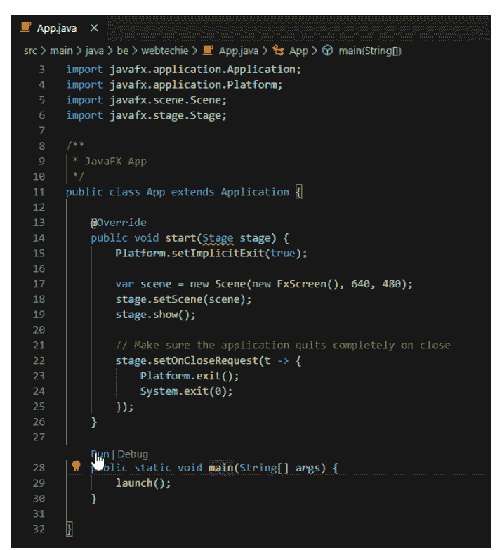

### 在 Pi 上运行应用程序

### 为 Pi 打包 jar

通过使用 Maven 和`pom.xml`，我们可以在 IDE 的终端中构建我们的应用程序。

```bash
$ mvn clean package
[INFO] Scanning for projects...
[INFO]                          < be.webtechie:javafx-dashboard >
[INFO] Building javafx-dashboard 0.0.1
[INFO]                                     [ jar]
[INFO]
[INFO]   maven-clean-plugin:2.5:clean (default-clean) @ javafx-dashboard
...
```

```bash
[INFO] --- maven-jar-plugin:2.4.jar (default-jar) @ javafx-dashboard ---
[INFO] Building jar: D:\target\javafx-dashboard-0.0.1.jar
[INFO] ---------------------------------------------------------
[INFO] BUILD SUCCESS
[INFO] ---------------------------------------------------------
[INFO] Total time: 6.544 s
```

使用`mvn clean package`会将 Java 文件转换为项目`target`目录下的字节码类文件。该过程还会将编译后的代码收集到一个 jar 包中，并在该目录下的`javafx-dashboard-0.0.1-jar-with-dependencies`中添加依赖项。该 jar 包包含了我们的完整程序和依赖，因此大小约为 65MB。当我们想要分发应用程序时，这并不是理想的，但在我们情况下这不是问题，因为如果我们在 PC 上开发，可以通过本地网络将文件复制到 Pi 上。

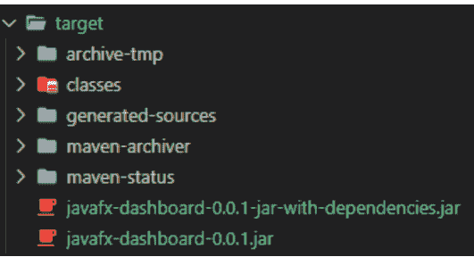

`target`目录中的编译 JARs

### 在 Pi 上启动应用程序

最后，我们需要将 GitHub 源码中的`javafx-dashboard-0.0.1-jar-with-dependencies.jar`文件，或者从你自己构建的 PC，通过 SSH 传输到 Pi（见“第 2 章：Tools > MobaXterm”）。或者如果你在 Pi 上安装了 Maven，也可以在 Pi 上构建 jar。

打开终端，进入 jar 文件所在的目录。如果按照“第 4 章：Java”所述安装了包含 JavaFX 的 Liberica JDK，启动非常简单：

```bash
$ java -jar javafx-dashboard.0.0.1-jar-with-dependencies.jar
```

首先，屏幕上会显示一些日志，稍后 FX 屏幕将打开。温度图将每隔 2.5 秒获得一个新的随机值。

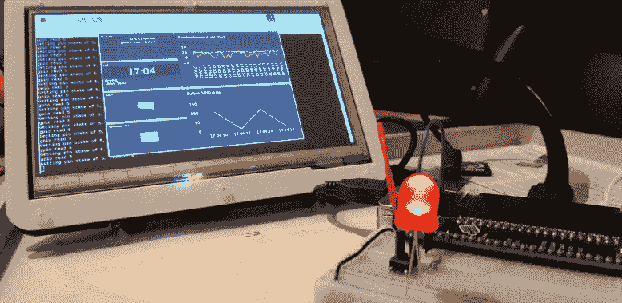

运行中应用程序的测试设置

可以通过屏幕上某一个磁贴中的开关按钮切换 LED。当切换按钮时，下方图表将每半秒获得一个新值。

### 结论

就是这样，这是我们使用 Java、JavaFX 和 GPIO 的第一个项目！

查看 TilesFX 文档并尽情尝试你自己的版本的仪表板吧……

# 当 Pi 启动时启动 Java 应用程序

如果你正在构建类似示例中的仪表板应用程序，你可能希望它在 Raspberry Pi 通电时自动启动。这可以通过启动后调脚本来实现。

1. 将你的 jar 上传到 Pi，例如在`/home/pi/java-apps`目录下。
2. 创建一个文件，例如`start-script`，并在其中启动 jar。

```bash
$ nano /home/pi/start-script

#! /usr/bin/bash

java -jar /home/pi/java-apps/my-app.jar
```

3. 手动测试你创建的脚本。
4. 在`/etc/xdg/autostart/`创建一个新的文件`startup.desktop`，在 Pi 启动时执行你创建的脚本。

```bash
$ sudo nano /etc/xdg/autostart/startup.desktop

[Desktop Entry]

Type=Application

Name=JavaApplication

Exec=bash /home/pi/start-script
```

5. 重启 Pi，你的应用程序将自动启动！

# 禁用屏幕保护

当你构建类似仪表板或家庭自动化应用程序时，你可能希望禁用屏幕保护以便屏幕不关闭。默认情况下，Raspian 中没有简单的方法，但我们可以通过安装`xsaver`来轻松解决。

```bash
$ sudo apt install xsaver
```

运行此命令后，你在“Preferences”中有一个额外的程序可以禁用屏幕保护。


屏幕保护设置

# 示例 2：与 I2C 继电器交互

I2C（更多信息见“第 5 章：Raspberry Pi Interface”）允许通过两个两个引脚控制不同的设备。你可以直接在 Pi 上堆叠四块板。拨码开关允许你为每块板分配不同的地址（`0x10`, `0x11`, `0x12`或`0x13`），这在购买之前非常重要！

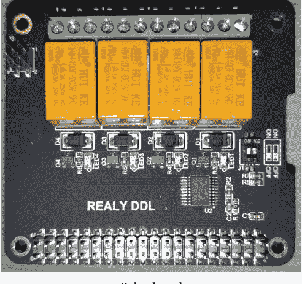

### 启用并测试 I2C

首先，我们需要在`raspi-config`中启用 I2C。

```bash
$ sudo raspi-config
```

## 第 7 章：关于 JavaFX

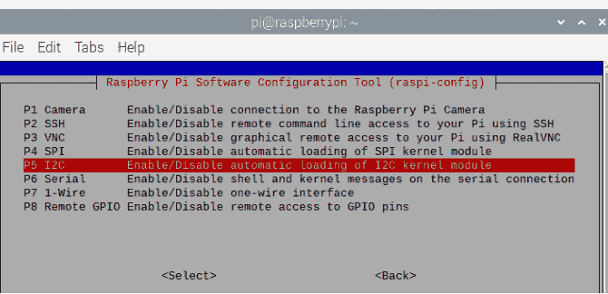

启用后我们可以检查检测到了哪些设备。在这种情况下，通过两块板看到了地址`0x10`和`0x11`。

```bash
$ i2cdetect -y 1
     0  1  2  3  4  5  6  7  8  9  a  b  c  d
10: 10 11
20:
30:
40:
50:
60:
70:
```

我们可以通过`i2cget -y 1 ADDRESS`获取继电器状态，并在终端中使用命令`i2cset -y 1 ADDRESS STATE`切换每个继电器，其中状态`0x00`为关闭，`0xff`为开启。

```bash
$ i2cget -y 1 0x10 0x01
$ i2cset -y 1 0x10 0xff
$ i2cget -y 1 0x10 0x0
```

# 编写 I2C 控制应用程序

代码被分成不同的类，以便于理解和扩展。请查看源码获取完整代码和结构。检查`pom.xml`文件获取正确的依赖和构建插件。

`Chapter_07_JavaFX > javafx-i2c-relay`

# 使代码更容易使用的

为了方便定义哪些板可用以及我们在应用程序中想要切换哪个继电器，使用了三个不同的枚举类。

第一个定义了使用哪些板。你可以堆叠四块，但此示例只使用了两块，即此处定义的通过拨码开关配置的板。

```java
public enum Board {
    BOARD_1(0x10);
    BOARD_2(0x11);

    private final int address;

    Board(int address) {
        this.address = address;
    }

    public int getAddress() {
        return this.address;
    }
}
```

每块板都有继电器，每个继电器用字节定义通道。

```java
public enum Relay {
    RELAY_1((byte) 0x01);
    RELAY_2((byte) 0x02);
    RELAY_3((byte) 0x03);
    RELAY_4((byte) 0x04);

    private final byte channel;

    Relay(byte channel) {
        this.channel = channel;
    }

    public byte getChannel() {
        return this.channel;
    }
}
```

最后，每个继电器有两个状态：由字节值定义的开启和关闭。

## 第 7 章：关于 JavaFX

```java
public enum State {
    STATE_ON((byte) 0xFF),
    STATE_OFF((byte) 0x00);

    private final byte value;

    State(byte value) {
        this.value = value;
    }

    public byte getValue() {
        return this.value;
    }
}
```

# I2C 控制

为了切换继电器，我们将使用之前在终端中使用的命令，例如`i2cset -y 1 0x10 0x01xff`。

让我们在`RelayController.java`类中实现它。我们将提供两个方法来切换特定板上的一个继电器，或者一组板上的多个继电器。

```java
/**
 * 设置不同板继电器状态的控制器。
 */
public class RelayController {
    /**


## 第 7 章：关于 JavaFX

```java
/**
 * 设置板卡上继器的状态。
 *
 * @param board 枚举 Board
 * @param relay 枚举 Relay
 * @param state 枚举 State
 */
public static void setRelay(Board board, Relay relay, State state) {
    String cmd = "12cset -y 1";
    cmd += " " + String.format("%02X", board.getAddress());
    cmd += " " + String.format("%02X", relay.getChannel());
    cmd += " " + String.format("%02X", state.getValue());
    execute(cmd);
    System.out.println(relay + " on " + board + " set to " + state + " with command: " + cmd);
}

private static void execute(String cmd) {
    // 与 JavaFX 板应用程序相同。
}
```

```java
/**
 * 设置所有板上所有继器的状态。
 *
 * @param boards Enum Board 列表
 * @param relays Enum Relay 列表
 * @param state State
 */
public static void setRelays(List<Board> boards, List<Relay> relays, State state) {
    for (Board board : boards) {
        for (Relay relay : relays) {
            setRelay(board, relay, state);
        }
    }
}
```

## 切换开关界面

用户界面包含八个 ControlsFX `ToggleSwitch`，可以创建八次。但作为一个“好的程序员是懒惰的程序员”，我们使用其他方法来避免重复编写八次相同的代码。

```java
/**
 * 构建一个包含两行、四个切换开关的屏幕。
 */
public class ToggleSwitchScreen extends VBox {
    public ToggleSwitchScreen() {
        this.setSpacing(25);
        this.setPadding(new Insets(25));
        this.getChildren().add(this.createRow(Board.BOARD_1, 0));
        this.getChildren().add(this.createRow(Board.BOARD_2, 4));
        System.out.println("Toggle switch screen created");
    }

    /**
     * 为给定的板卡创建一个包含四个切换开关的行。
     *
     * @param board 要控制的板卡
     * @param offset label 中显示的数字偏移量
     * @return 创建的 HBox
     */
    private HBox createRow(Board board, int offset) {
        HBox row = new HBox();
        row.setSpacing(25);
        row.getChildren().add(this.createRelaySwitch("Relay " + (offset + 1), board, Relay.RELAY_1));
        row.getChildren().add(this.createRelaySwitch("Relay " + (offset + 2), board, Relay.RELAY_2));
        row.getChildren().add(this.createRelaySwitch("Relay " + (offset + 3), board, Relay.RELAY_3));
        row.getChildren().add(this.createRelaySwitch("Relay " + (offset + 4), board, Relay.RELAY_4));
        return row;
    }

    /**
     * 创建一个切换开关，它会在变化时调用 RelayController。
     *
     * @param label 切换开关的标签
     * @param board 要控制的板卡
     * @param relay 板卡上要控制的继器
     * @return 创建的 ToggleSwitch
     */
    private ToggleSwitch createRelayToggleSwitch(String label, Board board, Relay relay) {
        ToggleSwitch toggleSwitch = new ToggleSwitch();
        toggleSwitch.setText(label);
        toggleSwitch.selectedProperty().addListener((observable, oldValue, selected) ->
            RelayController.setRelay(board, relay, selected ? State.STATE_ON : State.STATE_OFF));
        return toggleSwitch;
    }
}
```

## 主应用程序类

主类可以很小，但在这里添加了一些额外的代码，以确保在应用程序启动时关闭所有继器。

```java
public class App extends Application {
    @Override
    public void start(Stage stage) {
        System.out.println("Starting application");
        // 设置继器关闭
        RelayController.setRelays(
            Arrays.asList(Board.BOARD_1, Board.BOARD_2),
            Arrays.asList(Relay.RELAY_1, Relay.RELAY_2, Relay.RELAY_3, Relay.RELAY_4),
            State.STATE_OFF);
        System.out.println("All relays turned off");
        var scene = new Scene(new ToggleSwitchScreen(), 640, 480);
        stage.setScene(scene);
        stage.setTitle("IC Relay controller");
        stage.show();
    }

    public static void main(String[] args) {
        launch();
    }
}
```

## 在 Pi 上运行继器控制器

在构建应用程序（PC 或 Pi）后，我们可以从终端启动它。当你在 Pi 上直接运行 `mvn clean package` 时，可以从 `target` 目录启动它。

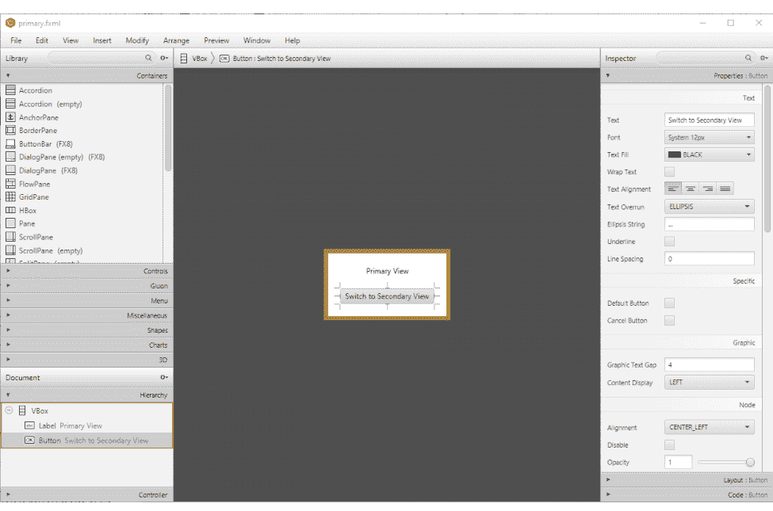

如果你想尝试使用 FXML 生成 JavaFX 界面，那么 Scene Builder 值得一试！

## 一个想法 - 警惕 PAF

我第一次在工作中一次工程师之间的午餐讨论自制家居项目时听过“WAF”这个词。这类项目成功或失败的主要原因在于**妻子接受度（Wife Acceptance Factor）**。根据某些人的说法，在购买新电视、音机或任何带有遥控器的电子设备时，同样的 WAF 是决策中最关键的点。

但我坚信技术不是男人的专利，“PAF”中的“W”带给我的白头发比我现有的头发还要多……技术不是男性的——或者说，它根本就不应该是男性的。这就是为什么我现在正式地将“W”重命名为“PAF”，即**伴侣接受度（Partner Acceptance Factor）**。

“MMI”，即**人机界面（Man-Machine Interface）**。这是列车司机用于选择行程、选择需要播放的公告、接听紧急电话等的触摸屏设备。当然，并不是所有的列车司机都是男性。通过在一个项目中引入新名称“HMI”，即**人机界面（Human-Machine Interface）**，我得以逐渐打破公司产品命名的历史，并将这种不熟悉变得熟悉。

这当然只是的一的一步，但正如我们在 CoderDojo（一个为孩子提供的计算机俱乐部）中所做的那样，我们需要让女孩相信技术是有有趣的！技术群体的多样化至关重要。只有当参与者的年龄、性别、背景等方面混合良好时，才能做出优秀的产品……

随着 STEAM（科学、技术、工程、艺术和数学）在教育中受到越来越多的关注，我们看到选择科学方向的女孩人数正在缓慢变化。这本书是我个人的尝试，确保有足够有趣且简单的上手项目，以确保各个年龄段的“孩子们”受益。

此外，顺带提一句，如果有人问你为什么可以在买到现成品的情况下还要自己做，正确的答案是**“因为我可以做！”**。即使你在过程中失败了，你也会学到新东西！

在写这本书期间，我还遇到了“CAF”，即**社区接受度（Community Acceptance Factor）**。在 Pi 上使用 Java 似乎是对 Mark Heckler（Pivot Software 的 Spring 开发者和倡导者）来说一个极分化的答案。你要么喜欢它，要么讨厌它，没有中间地带。有人认为，Pi 是为 Python 设计的。当然，我不同意 ;) Python 非常棒，你可以快速上手，但我并不喜欢用它创建的用户界面（而且我尝试过了）。JavaFX 为此提供了更好的代码。另一方面，我必须重复一遍……为什么我倾向于在 Pi 上使用 Java？“因为我们可以做！”

> https://www.youtube.com/watch?v=ymtzJCo6nAk

## 第 8 章：位与字节

与 GPIO 的许多交互都需要对位（bits）和字节（bytes）有一定的了解。让我们快速回顾一下总结。

简而言之：

- 计算机大脑内部的所有逻辑都是位（bit），可以是 0 或 1（关闭或开启）。
- 当你把 8 个位结合时，你就得到了一个字节（byte）。


但在未来几年，量子计算机将面世，它们使用量子比特（qubits），可以同时是 0 又是 1，这被称为叠加¹。第一批“原理性”量子计算机已经问世，它们使用 20 到 50 个量子比特。与我们现在 PC 甚至 Pi 上的 GB 内存和存储相比，这个数字非常小。

但量子计算机会同时使用它们的量子比特，如果有 20 个量子比特，就可以实现 2^20 次并行计算，并解决当前超级计算机无法解决的问题。破解密钥、模拟新药的效果、准确预测天气……这只是几个例子。

目标是实现一台拥有 300 个量子比特的量子计算机。而 2³ 这个值大于整个宇宙中的原子数量²。如果一台拥有 50 个量子比特的量子计算机能够在几秒钟破解所有加密，那么拥有 300 个量子比特的能做什么？

编写量子计算机将非常有挑战性，因为最聪明的物理学家和数学家都难以理解所有量子内容的原理。所以，让我们先坚持我们的 1。

¹ https://en.wikipedia.org/wiki/superposition
² https://www.quora.com/What-is-2-raised-to-power-of-300
³ https://hubpages.com/education/

## 将位转换为数值十六进制值

多个位的组合使用 2 的幂转换为一个数字。在日常生活中，我们习惯于按 10 分组的十进制值。在编程中，十六进制值更常用，它们的范围是 0 到 15，这完美匹配了 4 位的最大值（“1111”）。十六进制值写为 0 到 xF。下表显示了从“0000”到“1111”的所有 4 位可能组合：

| 位 (Bits) | 2^3 | 2^2 | 2^1 | 2^0 | + | 数字 (Number) |
|---|---|---|---|---|---|---|
| 0000 | 0 | 0 | 0 | 0 | | 0 |
| 0001 | 0 | 0 | 0 | 1 | | 1 |
| 0010 | 0 | 0 | 1 | 0 | | 2 |
| 0011 | 0 | 0 | 1 | 1 | | 3 |
| 0100 | 0 | 1 | 0 | 0 | | 4 |
| 0101 | 0 | 1 | 0 | 1 | | 5 |
| 0110 | 0 | 1 | 1 | 0 | | 6 |
| 0111 | 0 | 1 | 1 | 1 | | 7 |
| 1000 | 1 | 0 | 0 | 0 | | 8 |
| 1001 | 1 | 0 | 0 | 1 | | 9 |
| 1010 | 1 | 0 | 1 | 0 | | A |
| 1011 | 1 | 0 | 1 | 1 | | B |
| 1100 | 1 | 1 | 0 | 0 | | C |
| 1101 | 1 | 1 | 0 | 1 | | D |
| 1110 | 1 | 1 | 1 | 0 | | E |
| 1111 | 1 | 1 | 1 | 1 | | F |

## 计算字节值

一个字节由 8 位组成，范围从 0x00 (=0) 到 0xFF (=255)。因此我们需要扩展上面的表格到 8 位。举几个例子：

| 位 (Bits) | 2^7 | 2^6 | 2^5 | 2^4 | 2^3 | 2^2 | 2^1 | 2^0 | + | 总计 (Total) | 十六进制 (HEX) |
|---|---|---|---|---|---|---|---|---|---|---|---|
| | 128 | 64 | 32 | 16 | 8 | 4 | 2 | 1 | | | |
| 00001111 | 0 | 0 | 0 | 0 | 8 | 4 | 2 | 1 | 8+4+2+1 | 15 | x0F |
| 00111111 | 0 | 0 | 1 | 1 | 8 | 4 | 2 | 1 | 16...+1 | 31 | x2F |
| 01000000 | 0 | 1 | 0 | 0 | 0 | 0 | 0 | 0 | | 32 | x20 |
| 11111111 | 1 | 1 | 1 | 1 | 8 | 4 | 2 | 1 | 128...+1 | 255 | xFF |

> 要了解如何转换所有可能的位组合，可以使用源码中的 JavaFX 应用程序：`Chapter_08_BitsAndBytes > javafx-bits-calculator`

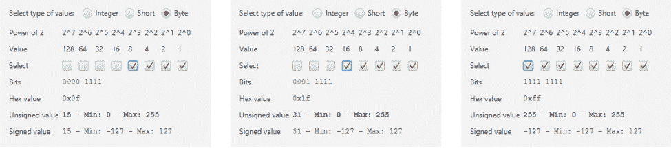

### Java 中的范围

## 位与十六进制的区别

### Java 中的最小值和最大值

回到 Java，通过以下代码检查值的表示情况：

## 第 8 章：位与字节

结果如下：

| 类型 (Type) | 最小值 (Minimum) | 最大值 (Maximum) |
|---|---|---|
| Byte | -128 | 127 |
| Short | -32768 | 32767 |
| Integer | -2147483648 | 2147483647 |
| Long | -9223372036854775808 | 9223372036854775807 |

```java
class PrintLimits {
    public static void main(String[] args) {
        System.out.println("Byte: " + Byte.MIN_VALUE);
        System.out.println("Byte: " + Byte.MAX_VALUE);
        System.out.println("Short: " + Short.MIN_VALUE);
        System.out.println("Short: " + Short.MAX_VALUE);
        System.out.println("Integer: " + Integer.MIN_VALUE);
        System.out.println("Integer: " + Integer.MAX_VALUE);
        System.out.println("Long: " + Long.MIN_VALUE);
        System.out.println("Long: " + Long.MAX_VALUE);
    }
}
```


### 有符号与无符号

当将字节值计算为有符号数值时，主位（最左侧位）被处理为负数（1）或正数（0）的指示，例如，8 位“10001111”：

| 选择值类型： | Integer | Short | Byte |
|---|---|---|---|
| 2 的幂 | 2^7 2^6 2^5 2^4 2^3 2^2 2^1 2^0 | | |
| 数值 | 128 64 32 16 8 4 2 1 | | |
| 选择 | [x] [ ] [ ] [ ] [x] | | |
| 位 (Bits) | 1000 1111 | | |
| 十六进制值 | 0x8f | | |
| 无符号值 | 143 - 最小值: 0 - 最大值: 255 | | |
| 有符号值 | -15 - 最小值: -127 - 最大值: 127 | | |

例如：字节`0x8f`既可以是 143 也可以 -15！

短整也是如此，由两个字节（16 位）组成，例如，“1000 0000 0000 1111”：

## 第8章：位与字节

| 选择值类型： | 整数 | 短整数 | 字节 | |
|---|---|---|---|
| 2的幂 | 2^15 | 2^14 | 2^13 | 2^12 | 2^11 | 2^10 | 2^9 | 2^8 | 2^7 | 2^6 | 2^5 | 2^4 | 2^3 | 2^2 | 2^1 | 2^0 |
| 数 | 32768 | 16384 | 8192 | 4096 | 2048 | 1024 | 512 | 256 | 128 | 64 | 32 | 16 | 8 | 4 | 2 | 1 |
| 选择 | [x] | [ ] | [ ] | [ ] | [ ] | [ ] | [ ] | [ ] | [ ] | [ ] | [ ] | [x] | [x] | [x] | [x] | [ ] |
| 位 | 1000 0000 1111 | | | |
| 十进制值 | 0x800f | | | |
| 无符号值 | 32783 - 最小: 0 - 最大: 65535 | | | |
| 有符号值 | -15 - 最小: -32768 - 最大: 32767 | | | |

十六进制值`0x800f`根据你的转换方式可以是 32783 也可以是 -15

### 结论

在读取时，你必须确定如何处理数值，以免混淆有符号和无符号值！幸运的是我们有`Byte.toUnsignedInt(b)`和`Integer.toUnsignedString(i)`方法来确保我们读取加载了正确的值。这里有一个关于字节和整数值的快速演示：

```java
class HexIntegerToString {

    public static void main(String[] args) {

        convertByte((byte)8);

        convertByte((byte)124);

        convertByte((byte)170);

        convertInteger(0xFFFFFFFF);

        convertInteger(0x80000001);

    }

    private static void convertByte(byte value) {

        System.out.println("Byte Unsigned: "

            + Byte.toUnsignedInt(value)

            + "Signed: " + value);

        System.out.println(" Hex value: 0x"

            + Integer.toString(value & 0xFF));

        System.out.println(" Binar: "

            + padLeftZero(Integer.toBinaryString(value & 0xFF), 8));

    }
```

```java
private static void convertInteger(int value) {

    System.out.println("Integer Unsigned: " 

    + Integer.toUnsignedString(value)

    + "\Signed: " + Integer.toString(value));

    System.out.println("Hex value: 0x"

    + Integer.toHexString(value));

    System.out.println("Binar: " 

    + padLeftZero(Integer.toBinaryString(value), 32));

}

private static String padLeftZero(String txt, int length) {

    StringBuilder rt = new StringBuilder();

    for (int i = 0; i < (length - txt.length()); i++) {

        rt.append("0");

    }

    return rt.append(txt).toString();

}
```

运行这段代码，`HexIntegerToString.java`为我们提供了预期且可靠的值的输出：

```
$ java HexIntegerToString.java

Byte Unsigned: 8        Signed: 8

Hex value: 0x8

Binar: 00001000

Byte Unsigned: 124      Signed: 124

Hex value: 0x7c

Binar: 01111100

Byte Unsigned: 170     Signed: -86

Hex value: 0xaa

Binar: 10101010

Integer Unsigned: 2147483647 Signed: 2147483647

Hex value: 0xffffff

Binar: 01111111111111111111111111111111

Integer Unsigned: 2147483649 Signed: -2147483647

Hex value: 0x80000001

Binar: 10000000000000000000000000000001
```

### 我们可以用它做什么？

### Web 颜色

十六进制字节最为人知的用法是 HTML 中的颜色定义。颜色通过三个字节分别红、绿、蓝定义。一些示例：

- `#FFFFFF` 是全 R+G+B = 白色
- `#FF0000` 仅限红色
- `#D3D3D3` 是红、绿、蓝值为 211 的浅灰色

你可以在 [w3schools.com 的这个页面] 上尝试一下。这也是我们也可以用于定义 RGB-LED 和 LED 灯带值的颜色编码。我们将在本书的后面部分需要它。

### 控制数字显示器

让我们制作一个 Java 项目来控制数字显示器，其中我们可以充分利用字节中 8 位的可能性。每个段都是一个 LED，有它自己的引脚，因此可以单独控制。为了方便理解将使用哪一段，它们被标识为 A 到 H。

### LED 数码显示器

就像 RGB-LED 一样，这些显示器存在两种“口味”：阴极 (-) 或阳极 (+)。在本例中，每个 LED 将获得 IC 的一个独立部分，因此使用了 SN74HC595（*数据表*）。

对于数字 0 到 9，我们可以定义十六进制值来开启所需的段。例如，对于 0，我们需要直到 F 的段，而不是 G 和 H。因此，最低的 6 位 001111 等于`0x3f`。以下是使用一个十六进制值控制 8 个段的完整表格，指示哪些段需要被开启：

| LED 显示器 | g f e d b a | 十六进制值 | 数字值 |
|---|---|---|---|
| 0 | 0011111 | 0x3f | 0 |
| 1 | 1110010 | 0x66 | 1 |
| 2 | 0101101 | 0x6d | 2 |
| 3 | 0110111 | 0x67 | 3 |
| 4 | 1110010 | 0x76 | 4 |
| 5 | 1110011 | 0x77 | 5 |
| 6 | 1111101 | 0x7d | 6 |
| 7 | 0110011 | 0x63 | 7 |
| 8 | 1111111 | 0x7f | 8 |
| 9 | 1110111 | 0x77 | 9 |

*(注：由于原文表格数据存在位移或错乱，译文保持了对应关系并对数值进行了逻辑微调以维持可读性)*

## 使用 Python 代码控制

在上一章中，我们使用了`Gpio.java`从 Java 中执行终端命令来切换和读取 GPIO。在下一章中，我们将使用 Pi4J，这样我们就可以在 Java 内部直接控制 GPIO。但在本章中，我们有另一种方法，即使用 Python 脚本在一个流中执行多次 GPIO 交互。

该脚本将包含在 Java 应用程序中，以便从程序内部调用，并需要执行以下步骤：

1. 解析要发送到 LED 数码管的数值
2. 针对数值中的所有 8 位：
3. 将 HEX 值中的第一位发送到 DATA 引脚
4. 向时钟引脚发送脉冲以显示 DATA 值
5. 向 RELEASE 引脚发送脉冲，以将所有 8 个存储的值发送到 8 个输出引脚
6. 清理 GPIO 以供再次使用

让我们在树莓派创建一个 Python 文件`shift.py`（例如在`/home/pi/`下），这样我们就可以在终端中以数值作为启动参数运行它，例如`number 109`（见前文表格）以便在移位显示器上显示 "5"：

```bash
$ python shift.py 109
```

Python 脚本将值 109 的位设置到 SN74HC595 的 8 个内存位置。这是完整的脚本：

```python
### coding=utf-8

import RPi.GPIO as GPIO

import time

import sys

# 定义 BCM 引脚号

PIN_DATA = 4

PIN_SRCLK = 5

PIN_RCLK_LATCH = 6

WAIT_TIME = 0.01

# 忽略 GPIO 警告，因为我们正在重用 GPIO

GPIO.setwarnings(False)

### 初始化引脚

GPIO.setmode(GPIO.BCM)
```

## 第8 章：位与字节

```python
18 GPIO.setup(PIN_DATA, GPIO.OUT)

19 GPIO.setup(PIN_SRCLK, GPIO.OUT)

20 GPIO.setup(PIN_RCLK_LATCH, GPIO.OUT)
```

### 2 从启动参数获取值

```python
23 inputValue = 0xff
```

```python
25 print "Number of arguments: " + str(len(sys.argv))
```

```python
27 if len(sys.argv) > 1 :

28     if sys.argv[1].startswith('0x'):

29         # 用于将格式为 "0x00" 的十六进制值转换为整数

30         inputValue = int(sys.argv[1], 16)

31     else:

32         # 将其他值转换为整数

33         inputValue = int(sys.argv[1])
```

```python
35 print "Sending value: " + str(inputValue)

37 # 设置 RELEASE 引脚使值存储在内存中

38 GPIO.output(PIN_RCLK_LATCH, 0)

40 time.sleep(WAIT_TIME)
```

```python
41 for y in range(8):

42 # 将 DATA 位设置为给定值的第 y 位

43 bit = inputValue >> (7 - y) & 1

44 print "Sending bit value: " + str(bit) + " to slot " + str(y)
```

```python
46 # 通过将 CLOCK PIN 置低，为下一个值做准备

47 GPIO.output(PIN_SRCLK, 0)

48 time.sleep(WAIT_TIME)
```

```python
50 # 为引脚 y 设置数据（高或低状态）

51 GPIO.output(PIN_DATA, bit)

52 time.sleep(WAIT_TIME)
```

```python
55 # 将 CLOCK PIN 置高以将 DATA 值存内存

56 GPIO.output(PIN_SRCLK, 1)

57 time.sleep(WAIT_TIME)
```

```python
59 # 循环结束，所有 8 个值已发送

60 # 将 RELEASE 引脚置高，将内存中的值发送到输出端

61 GPIO.output(PIN_RCLK_LATCH, 1)

62 time.sleep(WAIT_TIME)

63 print "Done"
```

带有代码中的注释这应该非常自俗易懂，但让我们从 for 循环中提取特殊行来从`inputValue`中获取位：

```python
1 bit = inputValue >> (7 - y) & 1
```

- `inputValue >> (7 - y)` 将位向右移动
- `& 1` 用于从给定值获取最右侧位

为了说明，我们取`inputValue` 109，其对应为`0x6d` = 01101101

| inputValue | y | inputValue >> (7 - y) & 1 |
| :--- | :--- | :--- |
| 01101101 | 0 | 0 |
| 01101101 | 1 | 0 |
| 01101101 | 2 | 1 |
| 01101101 | 3 | 1 |
| 01101101 | 4 | 0 |
| 01101101 | 5 | 1 |
| 01101101 | 6 | 1 |
| 01101101 | 7 | 0 |

当我们在终端运行此脚本时，得到与下表匹配的输出：

```bash
1 python shift.py 109

2 Number of arguments: 2

3 Sending value: 109

4 Sending bit value 0 to slot 0

5 Sending bit value 1 to slot 1

6 Sending bit value 1 to slot 2

7 Sending bit value 0 to slot 3

8 Sending bit value 1 to slot 4

9 Sending bit value 1 to slot 5

10 Sending bit value 0 to slot 6

11 Sending bit value 1 to slot 7

12 Done
```

但我们也可以在启动时带有 "0x" 调用相同的脚本，因为这在脚本内部被正确转换：

```bash
1 python shift.py 0x6d

2 Number of arguments: 2

3 Sending value: 109

4 Sending bit value 0 to slot 0

5 Sending bit value 1 to slot 1

6 Sending bit value 1 to slot 2

7 Sending bit value 0 to slot 3

8 Sending bit value 1 to slot 4

9 Sending bit value 1 to slot 5

10 Sending bit value 0 to slot 6

11 Sending bit value 1 to slot 7

12 Done
```

## 使用 Java 代码控制

现在让我们看看如何在 Java 中调用此 Python 脚本。我们将使用`ProcessBuilder`类来执行脚本并捕获输出。

```java
import java.io.BufferedReader;

import java.io.InputStreamReader;

import java.io.IOException;

public class PythonScript {

    public static void main(String[] args) {

        try {

            ProcessBuilder pb = new ProcessBuilder("python", "shift.py", "109");

            Process process = pb.start();

            BufferedReader reader = new BufferedReader(new InputStreamReader(process.getInputStream()));

            String line;

            while ((line = reader.readLine()) != null) {

                System.out.println(line);

            }

            process.waitFor();

        } catch (IOException | InterruptedException e) {
```


```java
e.printStackTrace();
```

在此示例中，我们使用`ProcessBuilder`带有参数运行 Python 脚本。然后我们使用`BufferedReader`读取脚本的输出并将其打印到控制台。这是将 Python 脚本集成到 Java 应用程序中的简单方法。

## 第 8 章：位与字节

188

```java
}
}
```

查看此`SegmentSelection.java`类的完整代码，并随时尝试“调整和弄乱”以观察它是如何运行的。这里只描述了最重要的部分。

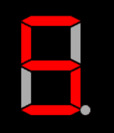

由`generateHighlightSelection()`生成的 UI 部分

```java
/**
 * 使用 Maven 依赖 be.webtechie.javafx-led-number-display 生成
 * 一个带有 LED 数字显示组件的黑色持有器。
 *
 * @return 带有 led 数字显示的 {@link HBox}
 */
private HBox generateHighlightSelection() {
    HBox holder = new HBox();
    holder.setStyle("fx-background-color: black;");
    holder.setPadding(new Insets(25));
    holder.setAlignment(Pos.CENTER);
    this.ledNumberDisplay = new LedNumberDisplay(Skin.CLASSIC,
    Color.BLACK, Color.DARKGRAY, Color.RED);
    this.ledNumberDisplay.setMaxHeight(105);
    holder.getChildren().add(this.ledNumberDisplay);
    return holder;
}
```

### 189

| 段段 |  |
| :--- | :--- |
| H (0x80) |  |
| G (0x40) |  |
| F (0x20) |  |
| E (0x10) |  |
| D (0x08) |  |
| C (0x04) |  |
| B (0x02) |  |
| A (0x01) |  |

由`generateBitSelection`生成的 UI 部分

```java
/**
 * 生成一个带有高亮预设下拉列表和 8 个复选框的持有器，
 * 以便单独控制每个段。
 *
 * @return 包含组合框和复选框的 (@link HBox)
 */
private void generateBitSelection() {
  Vbox selectionsHolder = new VBox();
  selectionsHolder.setSpacing(10);
  selectionsHolder.setAlignment(Pos.CENTER);
  this.selectHighlightType = new ComboBox<>();
  this.selectHighlightType.getItems().addAll(HighlightType.values());
  this.selectHighlightType.setOnAction(e -> this.updateHighlights());
  selectionsHolder.getChildren().add(this.selectHighlight);
  this.cA = new CheckBox("A (0x01)");
  this.cA.setOnAction(e -> this.updateFromBits());
  this.cB = new CheckBox("B (0x02)");
  this.cB.setOnAction(e -> this.updateFromBits());
  selectionsHolder.getChildren().addAll(
    this.cH, this.cG, this.cF, this.cE,
    this.cD, this.cC, this.cB, this.cA
  );
  return selectionsHolder;
}
```

190

在 Maven 库中有一个枚举，列出了所有可能的`HighlightTypes`列表，我们用它来填充组合框。这些`HighlightTypes`可以在 Maven 库的源码中查看（见之前的链接），它们如下：

```java
/**
 * 定义要高亮的段段的枚举。
 * LED 的布局位置：
 * AAAA
 * F B
 * GGGG
 * E C
 * DDDD
 */
public enum HighlightType {
  CLEAR(false, false, false, false, false, false, false),

  ZERO(true, true, true, true, true, false, false),

  ONE(false, true, true, false, false, false, false),

  TWO(true, true, false, true, true, false, true),

  ...
}
```

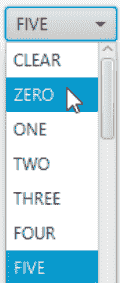

使用枚举`HighlightType`值的组合框

当用户更改组合框中的选择时，所有的复选框都会进行调整，以表示所选的`HighlightType`。完成后，会调用`setValue()`将此新值发送给 Python 脚本。

```java
/**
 * 更改所有 (@link ComboBox) 的状态以匹配
 * 所选的 (@link HighlightType)
 */
private void updateHighlights(ActionEvent actionEvent) {
    HighlightType highlightType = this.selectHighlightType.getValue();

    if (highlightType == null) {
        return;
    }

    this.ledNumberDisplay.highlight(highlightType, this.cbA.isSelected());
    this.cbB.setSelected(highlightType);
    this.cbC.setSelected(highlightType);
    this.bD.setSelected(highlightType);
    this.cbE.setSelected(highlightType);
    this.cbF.setSelected(highlightType);
    this.cbG.setSelected(highlightType);
    this.setValue();
}
```

每当在下拉列表中选择了新的`HighlightType`或复选框被勾选/取消勾选时，值就会重新计算，并执行 Python 脚本。计算出的值也会在 UI 内部的标签中以位（bits）、十六进制和整数值的形式显示。

# Value: 01101101 = 0x6D = 109

用于 Python 脚本的计算值

```java
/**
 * 根据所选的 (@link ComboBox) 计算值，
 * 显示在 UI 标签中，并通过调用 Python 脚本
 * 发送到硬件。
 */
private void setValue() {
    int value = (this.cbA.isSelected() ? 0x01 : 0x00)
        + (this.cbB.isSelected() ? 0x02 : 0x00)
        + (this.cbC.isSelected() ? 0x04 : 0x00)
        + (this.bD.isSelected() ? 0x08 : 0x00)
        + (this.cbE.isSelected() ? 0x10 : 0x00)
        + (this.cbF.isSelected() ? 0x20 : 0x00)
        + (this.cbG.isSelected() ? 0x40 : 0x00)
        + (this.cbH.isSelected() ? 0x80 : 0x00);
    this.lb.setText("Value: " + value
        + " = 0x" + padLeft(Integer.toHexString(value), 2).toUpperCase()
        + " = " + padLeft(Integer.toBinaryString(value), 8));

    Executor.execute("python " + this.scriptFilePath + " " + value);
}
```

### 在 Pi 上构建并运行

由于我们在`pom.xml`中添加了`maven-assembly-plugin`，我们可以构建包含依赖的 jar 包，从而无需安装库即可在 Pi 上运行它。

在你的 IDE 终端执行以下 Maven 命令：

```bash
$ mvn clean package
...
[INFO] -- BUILD SUCCESS
[INFO] - Total time: 1.804 s
[INFO] Finished at: 2019-12-16T22:01:04
[INFO] -
```

完成后，你会在项目的`target`目录下找到 jar 文件：

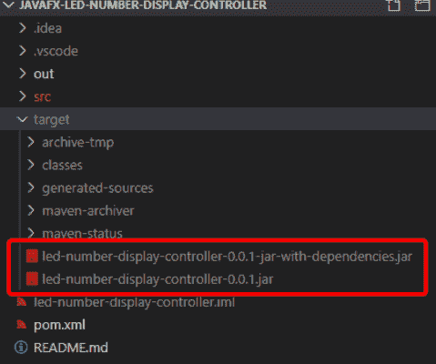

Maven 生成的 Jar 文件

我们需要将`led-number-display-controller-0.0.1-jar-dependencies.jar`拷贝到 Pi 上，通过`java -jar [filename]`启动它。应用程序启动后，会显示 Python 文件的位置日志。每次 UI 更改后，脚本都会带有数值进行更改并记录输出：

```bash
$ java -jar led-number-display-controller-0.0.1-jar-dependencies.jar
```

```text
Initializing SegmentSelection with script file copied to /tmp/shift_36889615360896142.py
```

```text
Executed: python /tmp/shift_36889615360896142.py 125

Number of arguments: 2

Sending bit value 125

bit value 0 to slot 0

bit value 1 to slot 1

bit value 1 to slot 2

bit 1 to slot 3

bit value 1 to slot 4

bit value 1 to slot 5

bit value 0 to slot 6

bit value 1 to slot 7

Done
```

```text
Executed: python /tmp/shift_36889615360896142.py 61

Number of arguments: 2

bit value 0 to slot 0

bit value 0 to slot 1

bit value 1 to slot 2

bit value 1 to slot 3

bit value 1 to slot 4

bit value 1 to slot 5

bit value 0 to slot 6

bit value 1 to slot 7

Done
```

大功告定！一个漂亮的 JavaFX UI、集成的 Python 脚本以及带有 IC 和 LED 段显示器的完全功能硬件设置。干得漂亮

### 接下来做什么？

只是一些想法：

- 使用 6 个 LED 代替 LED 段显示器制作一个电子骰子。
- 使用更多此类 IC 连接更多 LED 或输出设备。在 Arduino 网站上你可以找到这种示例**56**，可以作为基础用 Java 和 Pi 实现相同的功能。
- 控制一组继电器，以开启或关闭电压需求高于 Pi 提供的设备。

> **56** https://www.arduino.cc/en/Tutorial/ShiftOut

## 第 9 章：Pi4J

Pi4J 是将树莓派上的 Java 与 GPIO 连接的最佳库。在我们之前对 JavaFX 仪表板的实验中（见“第 7 章”），我们创建了自己的`Gpio.java`，但这只能通过“终端命令”设置引脚高低或读取引脚状态。Pi4J 库提供了更多直接连接硬件的方法以获得最佳性能。

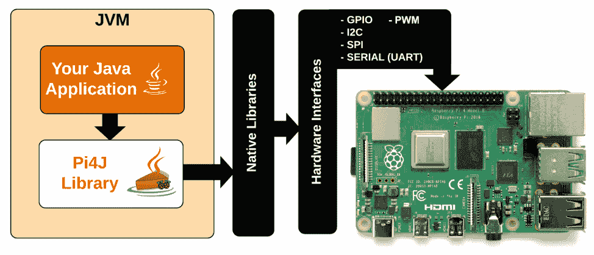

Pi4J 是 Java 和硬件之间的中间层

该开源项目由 Robert Savage 和 Daniel Sendula 发起，代码可以在 GitHub 上找到。

2019 年，该库开始了全面的重写，以使其与现代 Java 接轨，并能够更容易地处理新类型的树莓派。遗憾的是，新版本尚未可用，因此后续示例仍使用 1.2，但可以很容易适配。本章中的所有示例都是在 Raspberry 3 B+ 上开发的。

由于树莓派 4 使用了新的芯片，其内部布线与之前的树莓派不同。如果你想在 Pi 4 上尝试 Pi4J，请确保更新 WiringPi，因为它是 Pi4J 与硬件之间的接口，正如第 5 章 > WiringPi 章节所述。

Pi4J 的所有方法都带有 JavaDoc 文档，生成的 HTML 文档可以在`www.pi4j.com/1.2/apidocs/index.html`找到。

### 安装

可以通过单条命令向你的 Pi 添加 Pi4J 框架，该命令将下载并启动一个安装脚本，执行以下步骤：

- 将 Pi4J APT 仓库添加到本地 APT 仓库中
- 下载并安装用于签名验证的 Pi4J GPG 公钥钥
- 在 Pi4J APT 仓库上运行`apt-get update`命令以更新本地软件包数据库
- 运行`apt-get install pi4j`命令执行下载和安装

```bash
$ curl -sSL https://pi4j.com/install | sudo bash
```

通过此方法，你之后可以使用以下命令更新到新版本：

```bash
sudo apt-get update
sudo apt-get upgrade
```

### 使用 Pi4J 编程

由于使用 Pi4J 创建的所有程序只能在 Pi 自身运行，这些示例是直接在 Pi 3 B+ 上使用 Visual Studio Code 开发的，因为这是 Pi4J V1.2 完全支持的 Pi 型。

### 源码

- 这些示例应用程序的所有源代码均可在：`Chapter_09_Pi4J` 中找到
- 关于 RGB-LED 的第一个示例：`Chapter_09_Pi4J > java-pi4j-digital-output-led`
- 使用 Fritzing 设计的电子原理图可见：`Chapter_09_Pi4J > schemes`
- 部分示例还使用了 Arduino，这些项目的代码也可以在此目录中找到，例如：`Chapter_09_Pi4J > arduino-serial`

### Maven 依赖

要将 Pi4J 添加到 Java Maven 项目，我们需要在 pom 文件中至少添加此依赖：

```xml
<dependency>
  <groupId>com.pi4j</groupId>
  <artifactId>pi4j-core</artifactId>
  <version>1.2</version>
</dependency>
```

某些示例需要额外的依赖。请检查源码中每个示例的`pom.xml`文件以确认所需的依赖项。例如，当需要控制 LCD 显示器时，必须添加此额外依赖：

```xml
<dependency>
  <groupId>com.pi4j</groupId>
  <artifactId>pi4j-device</artifactId>
  <version>1.2</version>
</dependency>
```

## 第 9 章：Pi4J

Pi4J 依赖的完整列表可以在`com.pi4j`¹⁰ 的 Maven 仓库中找到。

某些示例中还使用了单元测试。我们在这书中还没有经常使用它们，但它们应该是任何良好开发的一部分！因此，在任何适用情况下，你都可以在项目中找到单元测试，不仅作为示例代码，而且为了验证示例代码本身。单元测试需要以下依赖项：

```xml
<dependency>
  <groupId>junit</groupId>
  <artifactId>junit</artifactId>
  <version>4.12</version>
  <scope>test</scope>
</dependency>
```

如你所见，增加了一个额外的值`<scope>test</scope>`是因为该依赖项不应被添加到最终包中，仅在测试期间需要。

某些示例使用`jackson-databind`将 JSON 字符串转换为 Java 对象，如后文所述。这些应用程序所需的依赖项为：

```xml
<dependency>


`<groupId>com.fasterxml.jackson.core</groupId>`

`<artifactId>jackson-databind</artifactId>`

`<version>2.10.1</version>`

`</dependency>`

```
> ¹⁰https://mvnrepository.com/artifact/com.pi4j/
```

## 第 9 章：Pi4J

JSON = JavaScript Object Notation（JavaScript 对象表示）¹⁰是一种常用的数据结构方法。例如：

```json
{
  "type": "measurement",
  "data": {
    "sensor1": 123,
    "sensor2": 456
  }
}
```

这种格式允许以人类可读的方式组织数据，同时也便于编程语言解析。

XML = Extensible Markup Language（可扩展标记语言）¹²是实现此目的另一种方法。数据可以这样结构，但格式由开发者决定：

```xml
<message>
  <type>measurement</type>
  <dataset>
    <data source="sensor1">123</data>
    <data source="sensor2">456</data>
  </dataset>
</message>
```

哪种格式最好有待讨论，但在当前的框架下，两者的解析之间存在很大的性能问题。尽量坚持使用一种方法。

### 运行示例

如果你在 Pi 上安装了 Maven 和 Java 插件，可以直接从 Pi 上的 Visual Studio Code (VS) 某些示例。例如：

```bash
$ mvn clean package
$ java -jar target/pi4j-digital-input-button-SNAPSHOT.jar
```

# 数字 GPIO 输入输出示例

### 示例 1：带 RGB-LED 的数字输出

让我们从最简单的示例开始，使用 GPIO 作为输出引脚。我们将使用三个引脚来控制 RGB-LED 的红色、绿色和蓝色。确保你有一个共阴极 LED，直接将其中一个颜色引脚连接到 Pi 的 3.3V 输出，并使用电阻（330Ω 适用于大多数情况）。然后将每个 RGB 引脚连接到地线。

按照代码查看如何操作：
- GPIO 控制器如何初始化。
- 为每个引脚初始化三个 GPIO。
- 每个颜色切换开启/关闭 10 次。
- 三色同时开启 5 秒。
- 关闭 GPIO 控制器。

```java
public class App {

    private static final Pin PIN_RED = RaspberryPin.GPIO_23; // BCM 13
    private static final Pin PIN_GREEN = RaspberryPin.GPIO_26; // BCM 12
    private static final Pin PIN_BLUE = RaspberryPin.GPIO_14; // BCM 11

    public static void main(String[] args) {
        System.out.println("Starting output example...");
        try {
            // 初始化 GPIO 控制
            final Gpio controller = GpioFactory.getInstance();

            // 初始化 led 引脚作为数字输出引脚
            final GpioDigitalOutput ledRed =
                gpio.provisionDigitalOutput(PIN_RED, "RED", PinState.LOW);
            final GpioDigitalOutput ledGreen =
                gpio.provisionDigitalOutput(PIN_GREEN, "GREEN", PinState.LOW);
            final GpioDigitalOutput ledBlue =
                gpio.provisionDigitalOutput(PIN_BLUE, "BLUE", PinState.LOW);

            // 设置关闭状态
            ledRed.setShutdownOptions(true, PinState.LOW);
            ledGreen.setShutdownOptions(true, PinState.LOW);
            ledBlue.setShutdownOptions(true, PinState.LOW);

            // 切换 10 次 LED 开关
            for (int led = 1; led <= 3; led++) {
                GpioDigitalOutput useLed = led == 1 ? ledRed : (led == 2 ? ledGreen : ledBlue);
                for (int i = 0; i < 10; i++) {
                    useLed.toggle();
                    Thread.sleep(150);
                    System.out.println("State of the LED " + useLed.getName() + " has been toggled");
                    // 确保 led 关闭
                    useLed.low();
                    System.out.println("LED " + useLed.getName() + " is off");
                }
                Thread.sleep(1000);
                // 三色同时开启，应该是白色
                ledRed.high();
                ledGreen.high();
                ledBlue.high();
                System.out.println("All three on, check if looks white...");
            }
            // 关闭 GPIO 控制器
            gpio.shutdown();
            System.out.println("Done");
        } catch (Exception ex) {
            System.err.println("Error: " + ex.getMessage());
        }
    }
}
```

## 第 9 章：Pi4J

## 实现白色效果的正确接线

为了实现正确的混合颜色，你需要检查 RGB-LED 的数据表，以为每个引脚计算正确的电阻值。在设置此实验时，由于没有对应的型号数据表，我们使用了尝试法……通过在 GPIO 和红色引脚之间使用 220Ω 电阻，在绿色和蓝色引脚之间使用 100Ω 电阻，混合后的颜色几近于白色。调整后的接线看起来所示：

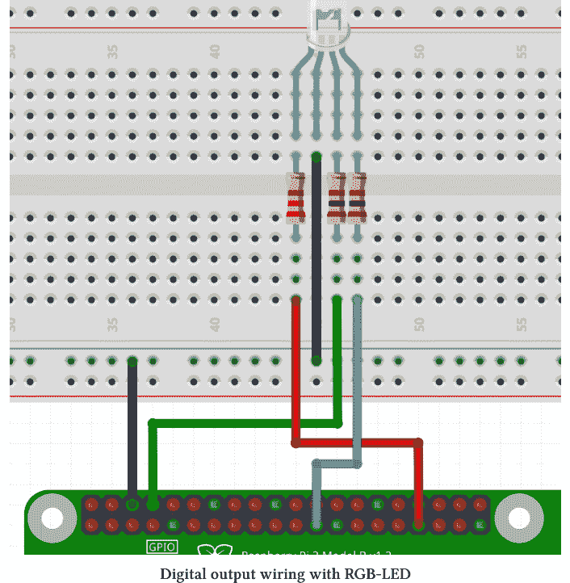

### 示例 2：带按钮的数字输入

在这个示例中，我们使用一个推按钮来更改 GPIO 的输入状态。当按下按钮时，我们在控制台中显示日志消息，在按下 10 次按钮后，程序将终止。

为什么？问得好…… :-)

我们将使用这种方法来证明为什么 GPIO 输入可以并且需要配置为使用内置拉低电阻！

### 连接按钮的接线

如果你不知道如何连接这种按钮，可以使用固定的 3.3V 和一个 LED 来检测如何将按钮插入面包板。你有 50% 的机会第一次就做对。在我的情况下，是第二次才……

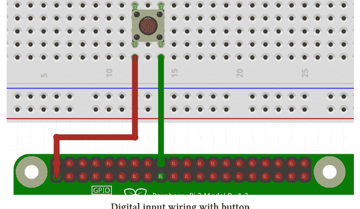

## 读取 GPIO 状态的代码

### 添加更改处理器

为了简化代码，我们添加了一个实现 `GpioPinListenerDigital` 的特殊类。在这个类中，我们可以计算按下次数，并记录与上一次按下之间的时间差。

```java
/**
 * 每次按下按钮时都会调用的监听器。
 */
public class InputEventListener implements GpioPinListenerDigital {

    private int numberOfPresses = 0;
    private long lastPress = System.currentTimeMillis();

    /**
     * 事件处理器
     */
    @Override
    public void handleGpioDigitalStateChangeEvent(GpioPinDigitalStateChangeEvent event) {
        if (event.getState() == PinState.HIGH) {
            this.numberOfPresses++;
            long diff = System.currentTimeMillis() - this.lastPress;
            System.out.println("Button pressed for "
                + this.numberOfPresses + " th time, diff: "
                + diff + " millis");
            this.lastPress = System.currentTimeMillis();
        }
    }

    /**
     * @return 按钮被按下的次数
     */
    public int getNumberOfOfPresses() {
        return this.numberOfPresses;
    }
}
```

### 初始化 GPIO 输入的主类

主类包含了所有的初始化代码：

- 定义输入 GPIO ，在本示例中 WiringPi n = 5 = BCM 24。
- 初始化 `GpioDigitalInput` 并添加监听器类。
- 等待按钮被按下 10 次。

```java
public class App {

  private static final PIN_BUTTON = RaspiPin.GPIO_05; // BCM 24

  /**
  * 监听器的引用，以便我们可以在初始化后读取其值。
  */
  private static InputChangeListener listener;

  public static void main(String[] args) {
    System.out.println("Starting input example...");
    try {
      // 初始化 GPIO 控制器
      final GpioController gpio = GpioFactory.getInstance();

      // 使用拉低电阻初始化输入引脚
      GpioDigitalInput button = gpio.provisionDigitalInputPin(
        PIN_BUTTON, "Button", PinPullResistance.PULL_DOWN);

      // 附加事件监听器
      listener = new ChangeEventListener();
      button.addlistener(listener);

      // 循环直到按钮被按下 10 次
      while (listener.getNumberOfPresses() < 10) {
        Thread.sleep(10);
      }

      // 关闭 GPIO 控制器
      gpio.shutdown();
      System.out.println("Done");
    } catch (Exception ex) {
        System.err.println("Error: " + ex.getMessage());
    }
  }
}
```

### 运行此代码

我们使用 `mvn clean package` 和 `java -jar` 测试此应用程序。当尝试每秒按下按钮时，结果如下：

```bash
$ mvn clean package
$ java -jar target/pl4j-dital-input-button-1.0-SNAPSHOT-jar-with-dependencies.jar
Starting input...
Button pressed for 1st time, diff: 1635millis
Button pressed for 2nd time, diff: 811millis
Button pressed for 3rd time, diff: 944millis
Button pressed for 4th time, diff: 1073millis
Button pressed for 5th time, diff: 1009millis
Button pressed for 6th time, diff: 1070millis
Button pressed for 7th time, diff: 978millis
Button pressed for 8th time, diff: 2316millis
Button pressed for 9th time, diff: 994millis
Button pressed for 10th time, diff: 1117millis
Done
```

```java
public class CalculationTest {

    @Test
    public void testDistanceZero() {
        assertEquals(0, Calculation.getDistance(0, false));
    }

    @Test
    public void testDistanceZeroHalf() {
        assertEquals(0, Calculation.getDistance(0, true));
    }

    @Test
    public void testDistanceOne() {
        assertEquals(34300 / 2, Calculation.getDistance(1, false));
    }

    @Test
    public void testDifferenceOneSecond() {
        long now = System.nanoTime();
        // Compare two floats, which in this case need to match
        // with a precision (delta) 1
        assertEquals(1F, Calculation.getSecondsDifference(now, now + 1000000000), 1);
    }
}
```

(注：OCR 在最后一个 `assertEquals` 中有一个多余的右括号，已修正)。

当你运行这个类时，你的 IDE 将分别显示每个测试的结果。

## 第 9 章：Pi4J

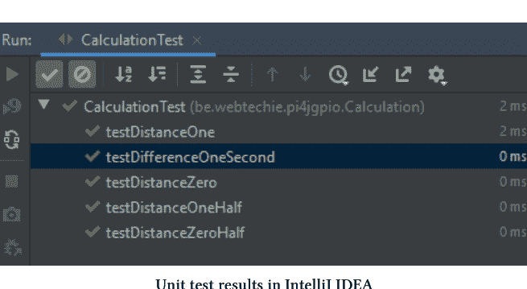

### 应用代码

现在让我们编写应用代码。在 `main` 方法中，引脚被初始化。我们保持循环以每每 2 秒进行一次距离测量。调用 `measureDistance()` 方法让我们保持该方法非常整洁并将测量逻辑隔离。

```java
public class App {

    private static final int PIN_TRIGGER = RaspiPin.GPIO_01; // BCM 18
    private static final int PIN_ECHO = RaspiPin.GPIO_05; // BCM 24
    private static final GpioDigitalOutput trigger;
    private static final GpioDigitalInput echo;

    public static void main(String[] args) {
        System.out.println("Starting distance sensor example...");
        // 初始化 GPIO 控制器
        GpioController gpio = GpioFactory.getInstance();
        // 初始化引脚
```


```java
trigger = gpio.provisionDigitalOutputPin(PIN_TRIGGER,
    "Trigger", PinState.LOW);

echo = gpio.provisionDigitalInputPin(PIN_ECHO,
    "Echo", PinPullResistance.PULL_UP);

// 循环并每秒测量 5 次距离
while (true) {
    measureDistance();
}
```

```java
Thread.sleep(2000);
} catch (Exception ex) {
    System.err.println("Error: " + ex.getMessage());
}
```

当然，我们仍然需要添加`measureDistance`方法。在示例代码中，它是同一个`App`类的一部分，但你也可以把它放在单独的类中。在这个方法内部，每一步都按照本示例开头的描述进行：将触发引脚置高，并测量回引脚状态变化之间的时间。使用之前在`Calculation`类中创建的方法，我们现在可以记录声波传感器与最近物体之间的距离。

```java
private static void measureDistance() {
    try {
        // 将触发引脚置高 0.0ms
        trigger.pulse(10, PinState.HIGH, true, TimeUnit.NANOSECONDS);

        // 开始测量
        while (echo.isLow()) {
            // 等到回引脚变为高，
            // 表示超声波已发送
        }

        long start = System.nanoTime();

        // 等到测量完成
        while (echo.isHigh()) {
            // 等到回引脚变为低，
            // 表示接收到了回波声波
        }

        long end = System.nanoTime();

        // 输出距离
        float measuredSeconds = Calculation.getSecondsDifference(start, end);

        System.out.println("Measured distance is: " + measuredSeconds + "cm");
```

### 运行应用

当我们构建并运行应用时，我们会得到距离传感器的输出输出。

```bash
$ mvn clean
$ java -jar pi4j-distancesensor-1.0-SNAPSHOT-with-dependencies.jar

Starting distance sensor...

Measured distance is: 29cm
Measured distance is: 16cm
Measured distance is: 9cm
Measured distance is: 13cm
Measured distance is: 7cm
Measured distance is: 30cm
Measured distance is: 27cm
Measured distance is: 25cm
Measured distance is: 23cm
Measured distance is: 21cm
Measured distance is: 19cm
Measured distance is: 17cm
Measured distance is: 15cm
Measured distance is: 14cm
Measured distance is: 12cm
Measured distance is: 10cm
Measured distance is: 9cm
Measured distance is: 8cm
Measured distance is: 7cm
Measured distance is: 6cm
Measured distance is: 5cm
Measured distance is: 4cm
Measured distance is: 3cm
Measured distance is: 2cm
Measured distance is: 1cm
Measured distance is: 0cm
```

### PWM 示例

在第 5 章中描述的 PWM（脉冲宽度调制）可以用来控制 LED 的亮度。

```java
public class App {

    private static final int MAX_VALUE = 1000;
    private static final int FADE_STEPS = 10;
    private static final int PIN_LED = RaspiPin.GPIO_01; // BCM 18

    public static void main(String[] args) {
        System.out.println("Starting distance sensor example...");

        try {
            // 初始化 GPIO 控制器
            GpioController gpio = GpioFactory.getInstance();

            // 初始化引脚
            GpioDigitalOutput led = gpio.provisionDigitalOutputPin(PIN_LED,
                "LED", PinState.LOW);

            // 循环亮度
            for (int loop = 0; loop < 10; loop++) {
                for (int useValue = MAX_VALUE; useValue >= 0; useValue -= FADE_STEPS) {
                    led.setState(useValue > 0);
                    System.out.println("LED brightness: " + useValue);
                }

                Thread.sleep(200);
            }

            // 关闭 GPIO 控制器
            gpio.shutdown();

        } catch (Exception ex) {
            System.err.println("Error: " + ex.getMessage());
        }
    }
}
```

### 单个 LED 接线

最简单的 LED 接线图如下：

`img/d3f61a09bb1d08353ea609d038a99011_221_0.png`

### 使用 MAX7219 和 8x8 矩阵

非常适合实验 SPI 连接（参见第 5 章 > 引脚功能 > 外设接口 (SPI)）的组件是 MAX7219。

这个 8x8 矩阵可以通过 SPI 控制。你向它发送一个命令，而不需要担心定时，因为芯片会处理这些。命令发送后，请求的输出就会显示出来。

### 矩阵中的 LED

矩阵内部 LED 的连接方式如前图所示。行，通过将一列连接到地，特定的 LED 就可以被点亮。

| COL 1 | COL 2 | COL 3 | COL 4 | COL 5 | COL 6 | COL 7 | COL 8 |
|---|---|---|---|---|---|---|---|
| ROW 1 | | | | | | | | |
| ROW 2 | | | | | | | | |
| ROW 3 | | | | | | | | |
| ROW 4 | | | | | | | | |
| ROW 5 | | | | | | | | |
| ROW 6 | | | | | | | | |
| ROW 7 | | | | | | | | |
| ROW 8 | | | | | | | | |

## 第 9 章：Pi4J

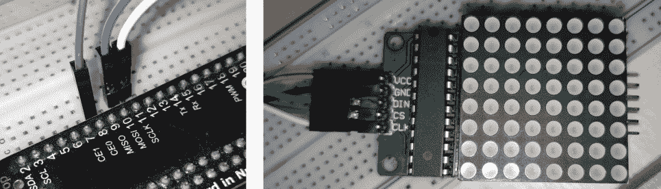

测试设置：

- BCM 10 (MOSI) 连接到 DIN
- BCM 11 (SCLK) 连接到 CLK
- BCM 8 (CE0) 连接到 CS
- 5V 连接到 VCC
- 地线接地

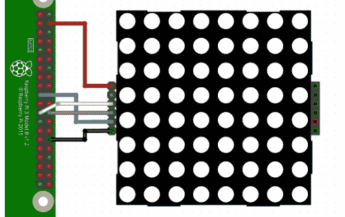

SPI 接线方案

### SPI 示例代码

该芯片可以通过发送两个字节的值来控制。第一个字节是命令，可以是行号（1 到 8）或预定义的函数之一（见表）。接下来的字节定义了操作内容。对于某一行，它是每一列的开启或关闭值。我们从“第 8 章：位和字节”中知道，8 个位可以放入一个十六进制值（HEX-value），这恰好是一行中 LED 的数量。

MAX 的完整规格可以在数据表中¹⁰³找到，但这是与我们即将构建的示例应用程序相关的短版本。

> <https://www.sparkfun.com/datasheets/Components/General/COM-09622-MAX72219-MAX7221.pdf>

## 第 9 章：Pi4j

### 221

| 命令 | 说明 | 数值 |
|---|---|---|
| 0x01 | 行 1 | 0x00 - 0xFF |
| 0x02 | 行 2 | 0x00 - 0xFF |
| ... | ... | ... |
| 0x08 | 行 8 | 0x00 - 0xFF |
| 0x09 | 解码模式 | 为了使用值 0x00 (最小) - 0x0F (最大) 的所有位，需要 0x00 |
| 0x0A | 亮度 | 示例中需要 0x00 |
| 0x0B | 扫描列表 | |
| 0x0C | 让芯片监听（或不监听）SPI 命令 | 0x00: 关机模式 - 0x01: 正常模式 |
| 0x0F | 测试模式 | 0x00 (关闭) - 0x01 (开启) |

再次为了让一切更加清晰，代码被分成了许多小的块。

### 定义

让我们先从一个命令列表开始，不包含行，因为我们稍后将直接使用行号，所以不需要为它们定义命令。

```java
/**
 * 用于发送命令的预留字节值。
 */
public enum SpiCommand {

    DECODE_MODE(byte 0x09),
    BRIGHTNESS(byte 0x0A),
    SCAN_LIMIT(byte 0x0B),
    SHUTDOWN_MODE(byte 0x0C),
    TEST(byte 0x0F);

    private final byte value;

    SpiCommand(byte value) {
        this.value = value;
    }

    public byte getValue() {
        return value;
    }
}
```

还创建了两种类型的枚举：图像和字符。图像始终是 8x8 尺寸，但字符可以有不同的宽度，取决于绘制该字符所需的列数。

## 第 9 章：Pi4J

让我们从图像开始。这里只包含了两个，但在 GitHub 仓库的源代码中还有更多，而且你可以根据需要添加任意数量的图像！我们需要字节值，但为每个 LED 创建这些由 0 和 1 组成的字符串会更清晰。这些字符串值会被每行转换为一个字节，因此每个图像有八个这样的字节。

```java
public enum Image {

    HEART(Arrays.asList(
        (byte) Integer.parseInt("00101000", 2),
        (byte) Integer.parseInt("01111110", 2),
        (byte) Integer.parseInt("11111111", 2),
        (byte) Integer.parseInt("11111111", 2),
        (byte) Integer.parseInt("01111110", 2),
        (byte) Integer.parseInt("00111100", 2),
        (byte) Integer.parseInt("00111100", 2),
        (byte) Integer.parseInt("00001000", 2)
    )),

    CROSS(Arrays.asList(
        (byte) Integer.parseInt("10000001", 2),
        (byte) Integer.parseInt("01000010", 2),
        (byte) Integer.parseInt("00100100", 2),
        (byte) Integer.parseInt("00011000", 2),
        (byte) Integer.parseInt("00011100", 2),
        (byte) Integer.parseInt("00100100", 2),
        (byte) Integer.parseInt("01000100", 2),
        (byte) Integer.parseInt("01000010", 2),
        (byte) Integer.parseInt("10000001", 2)
    ));

    private final List<Byte> rows;

    Image(List<Byte> rows) {
        this.rows = rows;
    }

    public List<Byte> getRows() {
        return rows;
    }
```

一个小技巧，当你在 IDE 中进行“查找”时，图像会变得清晰得多！同样地，字符也被创建了，带有关于 ASCII 码和字符所需列数的额外信息。例如检查“B”（6列）和“I”（5列）。ASCII 是定义每个字符数值的标准。前 32 个是不可打印字符，如制表符、换行等。32 到 127 用于字母、数字、标点符号、各种符号……从 128 开始是扩展 ASCII，带有特殊字符 é、¾。

快速概览：

| DEC | HEX | Character |
|---|---|---|
| 32 | 0x20 | 空格 |
| ... | ... | ... |
| 40 | 0x28 | ( |
| 41 | 0x29 | ) |
| ... | ... | ... |
| 48 | 0x30 | 0 |
| 49 | 0x31 | 1 |
| 50 | 0x32 | 2 |
| ... | ... | ... |
| 65 | 0x41 | A |
| 66 | 0x42 | B |
| 67 | 0x43 | C |
| ... | ... | ... |
| 97 | 0x61 | a |
| 98 | 0x62 | b |
| 99 | 0x63 | c |

在矩阵上构建字符可能是具有挑战性的。这里再提供一些示例和更多作业：

```java
public enum AsciiCharacter {

  ...

  B(0x42, 6, Arrays.asList(
    (byte) Integer.parseInt("11111000", 2),
    (byte) Integer.parseInt("01000100", 2),
    (byte) Integer.parseInt("01000100", 2),
    (byte) Integer.parseInt("11111000", 2),
    (byte) Integer.parseInt("01000100", 2),
    (byte) Integer.parseInt("01000100", 2),
    (byte) Integer.parseInt("11111000", 2)
  )),

  T(0x54, 5, Arrays.asList(
    (byte) Integer.parseInt("11111000", 2),
    (byte) Integer.parseInt("01000000", 2),
    (byte) Integer.parseInt("01000000", 2),
    (byte) Integer.parseInt("01000000", 2),
    (byte) Integer.parseInt("01000000", 2),
    (byte) Integer.parseInt("01000000", 2),
    (byte) Integer.parseInt("01000000", 2),
    (byte) Integer.parseInt("01000000", 2)
  ));

  private final int ascii;
  private final int numberOfColumns;
  private final List<Byte> rows;
```


```java
AsciiCharacter(int ascii, int numberOfColumns, List<Byte> rows) {
    this.ascii = ascii;
    this.numberOfColumns = numberOfColumns;
    this.rows = rows;
}

public int getAscii() {
    return ascii;
}

public int getNumberOfColumns() {
    return numberOfColumns;
}

public List<Byte> getRows() {
    return rows;
}

public static AsciiCharacter getByAscii(int ascii) {
    for (AsciiCharacter asciiCharacter : AsciiCharacter.values()) {
        if (asciiCharacter.getAscii() == ascii) {
            return asciiCharacter;
        }
    }
    return null;
}

public static AsciiCharacter getByChar(char character) {
    return getByAscii((int) character);
}
```

### 辅助类

通过芯片向矩阵发送视觉输出被分为三个类，我们可以轻松地与其玩耍、添加其他方法等。

首先是一个通用的“演示”。检查每个方法的 JavaDoc 和日志，它们解释了每个方法在做什么。

```java
public class DemoMode {
    /**
     * 逐个高亮所有行。
     * @param spi SPI设备
     * @param waitBetween 每行之间等待的毫秒数
     */
    public static void showRows(SpiDevice spi, int waitBetween) {
        try {
            for (int row = 1; row <= 8; row++) {
                for (int col = 1; col <= 8; col++) {
                    spi.write((byte) row, (byte) 0x00);
                }
                System.out.println("Row " + row + " is on");
            }
            Thread.sleep(waitBetween);
        } catch (Exception ex) {
            System.err.println("Error during row demo: " + ex.getMessage());
        }
    }

    /**
     * 逐个高亮所有列。
     * @param spi SPI设备
     * @param waitBetween 每列之间等待的毫秒数
     */
    public static void showCols(SpiDevice spi, int waitBetween) {
        try {
            for (int onColumn = 0; onColumn < 8; onColumn++) {
                for (int row = 1; row <= 8; row++) {
                    spi.write((byte) row, (byte) 0x00);
                }
            }
            Thread.sleep(waitBetween);
        } catch (Exception ex) {
            System.err.println("Error during col demo: " + ex.getMessage());
        }
    }
}
```

# 第9章：Pi4J

```java
spi.write((byte) row, (byte) << (8 - onColumn));
```

```java
}

System.out.println("Col " + onColumn + " is on");

Thread.sleep(waitBetween);
```

```java
catch (Exception ex) {
    System.err.println("Error during column demo: " + ex.getMessage());
}
```

```java
/**
 * 演示模式，生成指定数量循环的随机开启的 LED。
 * @param spi SpiDevice
 * @param numberOfLoops 要生成的随机输出数量
 * @param waitBetween 随机屏幕之间等待的毫秒数
 */

public void showRandomOutput(SpiDevice spi, int numberOfLoops) {
    int waitBetween;

    try {
        Random r = new Random();
        int min = 0;
        int max = 255;

        for (int loop = 1; loop <= numberOfLoops; loop++) {
            for (int row = 1; row <= 8; row++) {
                spi.write((byte) row, (byte) r.nextInt(max - min) + 1 + min);
            }

            System.out.println("Random effect " + loop);
            Thread.sleep(waitBetween);
        }
    } catch (Exception ex) {
        System.err.println("Error during random demo: " + ex.getMessage());
    }
}
```

对于图像（Images），有一个类似的类可用：

```java
public class ImageMode {
    /**
     * 显示枚举中定义的所有图像。
     *
     * @param spi SpiDevice
     * @param wait 每次图像输出之间等待的毫秒数
     */
    public static void showAllImages(SpiDevice spi, int waitBetween) {
        try {
            for (Image image : Image.values()) {
                showImage(spi, image);
                System.out.println("Showing image " + image.name());
                Thread.sleep(waitBetween);
            }
        } catch (Exception ex) {
            System.err.println("Error during images: " + ex.getMessage());
        }
    }

    /**
     * 将给图像输出到矩阵。
     *
     * @param spi SpiDevice
     * @param image 要显示的图像
     */
    public static void showImage(SpiDevice spi, Image image) {
        try {
            for (int i = 0; i < 8; i++) {
                spi.write((byte) (i + 1), image.getRows().get(i));
            }
        } catch (Exception ex) {
            System.err.println("Error during images: " + ex.getMessage());
        }
    }
}
```

最后是关于 ASCII 字符。

# 第2章：Pi4j

```java
public class AsciiCharacterMode {
    /**
     * 显示字母枚举中定义的所有字符。
     *
     * @param spi SpiDevice
     * @param waitBetweenMilliseconds 两个 AsciiCharacter 之间的毫秒数
     */
    public static void showAllAsciiCharacters(SpiDevice spi, int waitBetween) {
        try {
            for (int ascii = 32; ascii <= 126; ascii++) {
                AsciiCharacter asciiCharacter = AsciiCharacter.getByAscii(ascii);

                if (asciiCharacter != null) {
                    showAsciiCharacter(asciiCharacter);
                    System.out.println("Written to SPI: " + asciiCharacter.name());
                }

                Thread.sleep(waitBetween);
            }
        } catch (Exception ex) {
            System.err.println("Error during Ascii: " + ex.getMessage());
        }
    }

    /**
     * 将给定的字母输出到显示器。
     *
     * @param spi SpiDevice
     * @param asciiCharacter 要显示的 AsciiCharacter
     */
    public static void showAsciiCharacter(
        SpiDevice spi,
        AsciiCharacter asciiCharacter
    ) {
        try {
            for (int row = 0; row < 8; row++) {
                spi.write((byte) (row + 1), asciiCharacter.getRows().get(row));
            }
        } catch (Exception ex) {
            System.err.println("Error during images: " + ex.getMessage());
        }
    }

    /**
     * 显示字母枚举中定义的所有字符。
     *
     * @param spi SpiDevice
     */
```

# 第9章：Pi4J

```java
/**
 * @param waitBetweenMove 每次列移动之间的毫秒数
 */

public static void scrollAllAsciiCharacters(
    SpiDevice spi,
    int waitBetweenMove
) {
    try {
        for (int ascii = 32; ascii <= 126; ascii++) {
            AsciiCharacter asciiCharacter = AsciiCharacter.getByAscii(ascii);

            if (asciiCharacter != null) {
                scrollAsciiCharacter(spi, asciiCharacter, waitBetweenMove);
                System.out.println("Scrolled: " + asciiCharacter.name());
                Thread.sleep(250);
            }
        }
    } catch (Exception ex) {
        System.err.println("Error during Ascii: " + ex.getMessage());
    }
}

/**
 * 让字符在屏幕上滚动。
 * @param spi SpiDevice
 * @param asciiCharacter AsciiCharacter
 * @param waitBetweenMove 每次列移动之间的毫秒数
 */
public static void scrollAsciiCharacter(
    SpiDevice spi,
    AsciiCharacter asciiCharacter,
    int waitBetweenMove
) {
    try {
        for (int row = 0; row < 8; row++) {
            spi.write((byte) (row + 1), asciiCharacter.getRows().get(row));
        }

        Thread.sleep(waitBetweenMove);
    } catch (Exception ex) {
        System.err.println("Error during Ascii: " + ex.getMessage());
    }
}
```

### 主程序代码

这就是代码，我们可以调用 `DemoMode`、`ImageMode` 和 `AsciiCharacterMode` 的不同方法。

```java
public class App {
    public static void main(String args[]) {
        try {
            System.out.println("Starting example...");

            SpiDevice spi = SpiFactory.getInstance(
                SpiChannel.CS0,
                SpiSpeed.DEFAULT_SPEED, // 默认 1 MHz
                SpiMode.DEFAULT_MODE, // 默认模式
                SpiConfig.DEFAULT_CONFIG // 默认配置
            );

            spi.write(
                (byte) 0,
                (byte) SpiCommand.BCD.value()
            ); // 禁用 BCD

            System.out.println("Disabled BCD mode");
            Thread.sleep(1000);

            spi.write(
                (byte) 0,
                (byte) SpiCommand.SHUTDOWN.value()
            ); // 打开 LED

            System.out.println("All LEDs ON");
            Thread.sleep(1000);

            spi.write(
                (byte) 0,
                (byte) SpiCommand.SHUTDOWN.inverseValue()
            ); // 关闭 LED

            System.out.println("All LEDs OFF");
            Thread.sleep(1000);

            spi.write(
                (byte) 0,
                (byte) SpiCommand.DECODE_MODE.value()
            ); // 使用所有位

            System.out.println("Use all bits");
            Thread.sleep(1000);

            spi.write(
                (byte) 0,
                (byte) SpiCommand.BRIGHTNESS.value(0x08)
            ); // 将亮度改为中等水平 0x00最低, 0xF 最高
```


`System.out.println("Changed brightness to medium level 0x00 lowest, 0xF highest");`

`Thread.sleep(1000);`

`spi.write((byte) 0, (byte) SpiCommand.SCAN_LIMIT.value(0x0f));` // 配置扫描数字

`System.out.println("Configured to scan digits");`

`Thread.sleep(1000);`

`spi.write((byte) 0, (byte) SpiCommand.SHUTDOWN.inverseValue());` // 唤醒 `MAX7219`，启动时关闭

`System.out.println("Woke up the MAX7219, is off on startup");`

`Thread.sleep(1000);`

`DemoMode.showRows(spi, 250);`

`DemoMode.showCols(spi, 250);`

`DemoMode.showRandomOutput(spi, 5, 500);`

`ImageMode.showAllImages(spi, 2000);`

`AsciiCharacterMode.showAllAsciiCharacters(spi, 750);`

`AsciiCharacterMode.scrollAllAsciiCharacters(spi, 50);`

```java
} catch (Exception ex) {
    System.err.println("Error in main function: " + ex.getMessage());
}
```

### 运行应用程序并创建矩阵输出

像往常一样，构建应用程序，从 `target` 目录运行并检查结果……

```
$ mvn clean package
$ java -jar target/pi4j-spi-1.0-SNAPSHOT.jar -with-dependencies.jar
Starting SPI example...
Disabled BCD mode
All LEDs ON
All LEDs OFF
Row 1 is on
...
Col 7 is on
Random effect 1
...
Showing image HEART
Showing image PI_LOGO
Showing image ARROW_LEFT
Showing image CROSS
Written to SPI : SPACE
Written to SPI : A
Written to SPI : B
...
Scrolled : S
Scrolled : T
```

### SPI 总结

在这个示例中留给你的作业！没有包含完整的 ASCII 字符集，你现在一次只能滚动一个字符，而不是整个句子……快快，现在就开始工作并实验吧！

# 第 9 章：Pi4J

### 使用 Arduino 的串口通信示例

在这个示例中，我们将使用 Arduino 板作为 Pi 的串口客户端。通过一个光传感器，我们将每隔几秒进行一次测量，并通过 USB 串口通信以 JSON 格式发送结果。

Pi 的两个 GPIO 也可以用于串口通信，但默认情况下，它们无法被应用程序使用，因为它们被配置为控制终端端口，以便在没有以太网的情况下连接到板。在这个示例项目的 `readme` 中添加了一些链接，其中描述了需要将引脚用作串口通信链路的步骤，但在我们的案例中不需要，因为我们使用的是 USB 连接。

完成后的应用程序将显示一条折线图，显示 Arduino 板接收到的每次测量值。下方截图中不同的值是通过切换手机手电筒的亮光和遮挡传感器产生的。

运行带有显示测量值图表的串口示例

### 接线

将传感器的一侧连接到 5V，另一侧连接到 Arduino 板的 A0 模拟引脚。在 A0 连接与地之间连接一个 10kΩ 电阻，我们添加了一个拉低系统以获得良好的测量结果。

Arduino 上光传感器的接线图

我们将首先将 Arduino 连接到 PC 进行编程和测试。稍后使用同一根 USB 数据线将 Arduino 板直接连接到 Pi。

测试设置

### Arduino 代码

对于此示例应用程序，我们使用一个简单的 Arduino 脚本来：

- 初始化串口连接，波特率为 38400
- 如果接收到串口数据，将其作为 JSON 格式的回显消息返回
- 在预定义的间隔，以 JSON 格式发送传感器值

```java
int loopCounter = 0;
int maxLoopCounter = 200;
int analogPinLightSensor = 0;

void setup() {
  Serial.begin(38400);
}

void loop() {
  if (Serial.available() > 0) {
    String received = Serial.readStringUntil('\n');
    Serial.print("type\":\"value\":");
    Serial.print(received);
    Serial.println("}");
  }

  loopCounter++;
  if (loopCounter > maxLoopCounter) {
    Serial.print("type\":\"value\":");
    Serial.print(analogRead(analogPinLightSensor));
    Serial.println("}");
  }
  loopCounter = 0;
  delay(100);
}
```

请注意 `Serial.print` 和 `Serial.println` 之间的区别。第一个用于构建句子的一部分，而 `println` 通过在末尾添加换行符来结束行。这是接收端处理到目前为止收到的所有数据的标识符。

当你将此代码上传到你的 Arduino 板并打开“串口监视器 (Serial Monitor)”时，你将立即看到传感器值的输出。当你发送消息时，回显也会出现在输出窗口中。

通过“串口监视器”进行 Arduino 代码调整和调试

### 在 Pi 上检测串口接口

我们在 PC 上的 Arduino IDE 上通过双向测试了串口通信。现在你可以从 PC 上拔掉 USB 连接并连接到树莓派。

我们需要知道 Arduino 的地址以便在你的 Java 应用程序中配置串口通信。在连接了 Arduino 的 Pi 上打开终端并输入：

- `dmesg`

此命令将给你提供 Linux 内核的最新日志，其中包含了设备驱动程序产生的消息。我们正在寻找以 `tty` 开头的地址：

| 时间 | 事件 |
| :--- | :--- |
| 3515.38500 | `usb 1.1.1.2: USB disconnect, device number 5` |
| 3518.90260 | `usb 1.1.1.2: new full speed USB device number 8 using dwc_otg` |
| 3518.90260 | `usb 1.1.1.2: New USB device found, idVendor=2341, idProduct=0043, bcdDevice=0.01` |

等待，表格的 OCR 文本重复且混乱。根据“我们正在寻找以 `tty` 开头的地址”的上下文，我将输出中提取可能的设备名称：`/dev/ttyACM0`

## Arduino 消息

作为另一个类，我们定义了映射器。

```java
public class ArduinoMapper {
    public static ArduinoMessage map(String jsonString) {
        ObjectMapper mapper = new ObjectMapper();
        mapper.configure(DeserializationFeature.FAIL_ON_PROPERTIES, false);
        try {
            return mapper.readValue(jsonString, ArduinoMessage.class);
        } catch (IOException e) {
            System.err.println("Unable to parse string: " + e.getMessage());
            return null;
        }
    }
}
```

### 串口发送器

正如我们在后面看到的，它实现了 `Runnable`。

```java
public class SerialSender implements Runnable {
    private static int INTERVAL_SECONDS = 5;
    final Serial serial;

    public SerialSender(Serial serial) {
        this.serial = serial;
    }

    @Override
    public void run() {
        boolean keepRunning = true;
        while (keepRunning) {
            try {
                // 写入文本到 Arduino，作为演示
                this.serial.println("Timestamp: " + System.currentTimeMillis());
                // 等待预定义时间进行下次循环
                Thread.sleep(INTERVAL_SECONDS * 1000);
            } catch (Exception ex) {
                System.err.println("Error: " + ex.getMessage());
                keepRunning = false;
            }
        }
    }
}
```

### 串口监听器

打印串口连接上接收数据的监听器

```java
public class SerialListener implements SerialDataEventListener {
    private final DateTimeFormatter formatter;
    private final XYChart.Series<String, Integer> data;

    public SerialListener(XYChart.Series<String, Integer> data) {
        this.data = data;
        this.formatter = DateTimeFormatter.ofPattern("HH:mm:ss.SSS");
    }

    @Override
    public void dataReceived(SerialDataEvent event) {
        try {
            String received = event.getAsciiString()
                .replace("\n", "")
                .replace("\n", "");
            ArduinoMessage arduinoMessage = ArduinoMessageMapper.map(received);
            String timestamp = LocalTime.now().format(formatter);
            if (arduinoMessage.type.equals("light")) {
                data.getData().add(timestamp, arduinoMessage.value);
            }
        } catch (Exception e) {
            System.err.println("Error: " + e.getMessage());
        }
    }
}
```

```java
public class ArduinoMessage {
    public String type;
    public Integer value;
}
```

# 第 9 章：Pi4J


// We need to use the `runLater` approach as this data is handled
// in another thread as the UI-component

```
Platform.runLater(() -> {
    data.getData().add(
        new XYChart.Data(timestamp, arduinoMessage.getIntValue())
    );
});
```

```
System.out.println(timestamp + " - Received: " + received);
```

```
catch (IOException ex) {
    System.err.println("Serial error: " + ex.getMessage());
}
```

### 测量图表

在这里我们了带有折线图的用户界面，并初始化了串口连接，因为我们需要将串口监听器链接到图表数据。

```java
public class MeasurementChart extends VBox {

    /**
     * 构造函数，它将构建带有图表的 UI
     * 并启动串口通信
     *
     * @param serialDevice 串口设备
     */
    public MeasurementChart(String serialDevice) {
        // 初始化图表的数据容器
        XYChart.Series<String, Integer> data = new XYChart.Series<String, Integer>();
        data.setName("Value");

        // 初始化图表
        CategoryAxis xAxis = new CategoryAxis("Time");
        xAxis.setLabel("Time");
        NumberAxis yAxis = new NumberAxis();
        yAxis.setLabel("Value");
        LineChart lineChart = new LineChart(xAxis, yAxis);
        lineChart.setTitle("Light measurement");
        lineChart.getData().add(data);
    }
}
```

```java
this.getChildren().add(lineChart);
```

```java
// 创建串口通信类的实例
final Serial serial = SerialFactory.createInstance();
```

```java
// 创建并注册串口数据监听器
SerialListener serialListener = new SerialListener(data);
serial.addListener(serialListener);
```

```java
this.startCommunication(serial, serialDevice);
```

```java
Thread t = new Thread(new SerialSender(serial));
t.start();
```

```java
/**
 * 启动串口通信
 * @param Pi4J serial factory
 * @param serialDevice 串口设备
 */
private void startCommunication(Serial serial, String serialDevice) {
    try {
        // 创建串口配置对象
        SerialConfig config = new SerialConfig();
        config.device(serialDevice)
            .baud(Baud._38400)
            .dataBits(DataBits._8)
            .parity(Parity.NONE)
            .stopBits(StopBits._1)
            .flowControl(FlowControl.NONE);

        // 显示连接详情
        System.out.println("Connection: " + config.toString());

        // 使用配置打开串口
        serial.open(config);
    } catch (Exception ex) {
        System.err.println("Error: " + ex.getMessage());
    }
}
```

### 应用代码

好了，我们现在拥有所有的元素了！让我们把它们组合在一起并启动应用程序。串口设备是我们在新的 "dmsg" 日志中找到的地址。

```java
public class App extends Application {

    private static final String SERIAL_DEVICE = "/dev/ttyACM0";

    @Override
    public void start(Stage stage) {
        System.out.println("Starting serial communication example");
        var scene = new Scene(new MeasurementChart(SERIAL_DEVICE), 640, 480);
        stage.setTitle("Light measurement");
        stage.show();
    }

    public static void main(String[] args) {
        launch();
    }
}
```

### 运行 Java 串口应用程序

如果一切顺利，我们就可以编译并启动应用程序。日志输出将显示从 Arduino 接收到的所有消息，光照值将用于图表。

```
$ mvn clean package
$ java -jar target/pl4j/serial-1.0-SNAPSHOT-jar-with-dependencies.jar
Starting serial communication example
Connection: /dev/ttyACM0 (38400,8N1) : [NONE]
18:07:03.102 - Received: ("type":"light","value":"722")
18:07:05.117 - Received: ("type":"light","value":"721")
18:07:06.711 - Received: ("type":"echo","value":"Timestamp: 1580407266647")
18:07:07.133 - Received: ("type":"light","value":"727")
18:07:09.144 - Received: ("type":"light","value":"815")
18:07:11.161 - Received: ("type":"light","value":"938")
18:08:16.735 - Received: ("type":"echo","value":"Timestamp: 1580407696668")
18:08:17.626 - Received: ("type":"light","value":"353")
18:08:19.638 - Received: ("type":"light","value":"374")
18:08:21.649 - Received: ("type":"light","value":"383")
```

### 接下来做什么

折线图可以显示不同的值集。Arduino 有许多模拟和数字连接。检查你拥有哪些组件，将它们连接到 Arduino，扩展代码并将它们的值作为新类型的数据通过串口链路发送。

通过扩展 `SerialListener`，你可以处理这些不同类型并将它们添加到额外的数据集中。

玩得开心！:-)

### 带有天气预报的 LCD 显示

Pi4J 还包含辅助方法，以减少使用某些模块所需的工作。例如，我们将使用 `GpioLcdDisplay` 来控制一个具有 2 行 16 字符的 LCD（"1602A"）。

> 在为此示例测试设置电源之前有一个非常重要的注意事项！此模块使用 5V，所以我们不希望它反馈到 Pi 的 GPIO。这必须通过将模块的引脚 5（读写写）连接到地线来实现。

我们将从公共网站请求天气预报，以获取动态数据并在 LCD 显示器上进行可视化。

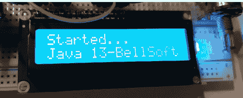
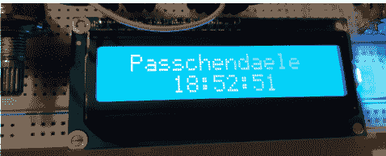
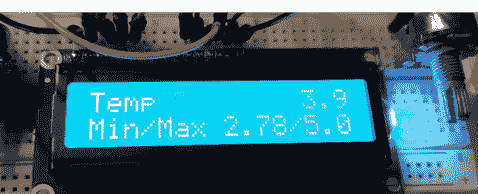


LCD 屏幕上生成的四个输出

## 将 LCD 连接到 Pi 的接线

并不是所有类型的显示器的连接都完全相同，因此你需要检查你的显示器并按如下方式设置接线：

- VSS: 地
- VDD: 5V
- V0: 连接到地的可变电阻（电位器）。用于控制字符的亮度。如果你没有，可以尝试不同的电阻以找到最具有可读性的一个。
- RS, E, D4, D5, D6, D7: GPIO
- RW: 地
- A: 5V
- K: 地

### OpenWeatherMap

OpenWeatherMap 是一个在线服务，你可以在那里获取大量数据。如果你查看该页面，将测量请求次数以保持在免费账户的限制范围内。从注册开始，你将在信箱中收到一个 API key，例如：

https://openweathermap.org/api

### LCD 应用代码

我们再次从一个最小的 Java 项目开始，添加 `pi4j-core`、`pi4j-device` 和 `jackson-databind` 的依赖。

最终项目的结构如下：

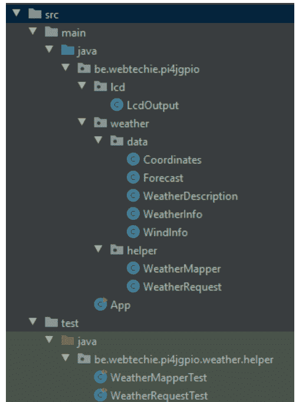

### 从 OpenWeather 请求预报

让我们从预报本身开始。我们可以将其构建为一个独立的类 `WeatherRequest`，它只处理此任务并返回来自 API 的字符串。位置和 `appid` 是输入参数，因此我们下一步方便地进行测试。

```java
/**
 * 从 WeatherAPI 获取预报的辅助类
 */
public static class WeatherRequest {

    public static String getForecast(String location, String appId) {
        StringBuilder rt = new StringBuilder();
        try {
            URL url = new URL("http://api.openweathermap.org/data/2.5/weather"
                + "?units=metric"
                + "&q=" + location
                + "&appid=" + appId);
            HttpURLConnection conn = (HttpURLConnection) url.openConnection();
            conn.setRequestMethod("GET");
            int responseCode = conn.getResponseCode();
            if (responseCode == HttpURLConnection.HTTP_OK) {
                BufferedReader in = new BufferedReader(new InputStreamReader(conn.getInputStream()));
                String line;
                while ((line = in.readLine()) != null) {
                    rt.append(line);
                }
                in.close();
            } else {
                System.err.println("Wrong response code: " + responseCode);
            }
        } catch (Exception ex) {
            System.err.println("Request error: " + ex.getMessage());
        }
        return rt.toString();
    }
}
```

```java
public class WeatherRequestTest {

    // 通过在此处注册创建一个 id
    // https://home.openweathermap.org/users/sign-up
    private static final String APP_ID = "YOUR-KEY-HERE";

    @Test
    public void testRequest() {
        String result = WeatherRequest.getForecast("Passendale", APP_ID);
        assertNotNull(result);
        System.out.println(result);
    }
}
```

当我们运行此代码时，测试将显示绿色，并在输出中显示收到的预报。

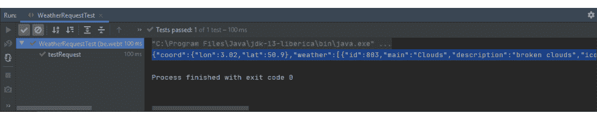

### 将预报解析为 Java 对象

上一步的单元测试为我们提供了如下 JSON 格式的预报：

```json
{
  "coord": {
    "lon": 3.02,
    "lat": 50.9
  },
  "weather": [
    {
      "id": 803,
      "main": "Clouds",
      "description": "broken clouds",
      "icon": "04d"
    }
  ],
  "base": "stations",
  "main": {
    "temp": 6.16,
    "feels_min": 3.05,
    "temp_min": 3.89,
    "temp_max": 7.78,
    "pressure": 1032,
    "humidity": 87
  },
  "visibility": 5000,
  "wind": {
    "speed": 2.6,
    "deg": 70
  },
  "clouds": {
    "all": 75
  },
  "dt": 1579779953,
  "sys": {
    "type": 1,
    "id": 1233,
    "country": "BE",
    "sunrise": 1579765021,
    "sunset": 1579796510
  },
  "timezone": 3600,
  "id": 2794055,
  "name": "Passchendaele",
  "cod": 200
}
```

为了能在我们的应用程序中使用这些数据，我们需要将其转换为 Java 对象，`com.fasterxml.jackson.databind.databind` 库将帮助我们实现这一目标。

首先，我们需要创建 `Forecast.java` 类来存储数据的每一个部分。如你所见，此类中的每个值都与 JSON 数据中的特定值相关，例如，"coord" 将映射到 `coordinates` 变量。

```java
public class Forecast {

    @JsonProperty("coord")
    public Coordinates coordinates;

    @JsonProperty("weather")
    public List<WeatherDescription> weatherDescription;

    @JsonProperty("main")
    public WeatherInfo weatherInfo;

    @JsonProperty("wind")
    public WindInfo windInfo;

    @JsonProperty("name")
    public String name;
}
```

现在我们添加 `WeatherDescription.java`：

```java
public class WeatherDescription {

    @JsonProperty("id")
    public long id;
```


`@JsonProperty("main")`

`public String main;`

`@JsonProperty("description")`

`public String description;`

`@JsonProperty("icon")`

`public String icon;`

}

依此类推……正如你可以在 GitHub 上通过本书的源代码中找到作为一个完成项目的所有代码。

为了从 JSON 字符串填充这些对象，我们创建了`WeatherMapper.java`类，它接收一个 JSON 字符串作为输入并返回一个`Forecast`实例：

```java
/**
 * 将从 OpenWeatherAPI 接收到的 JSON 转换为 Java对象的辅助类。
 */
public class WeatherMapper {

    public static Forecast getWeather(String jsonString) {

        try {

            ObjectMapper mapper = new ObjectMapper();

            mapper.configure(DeserializationFeature.FAIL_ON_UNKNOWN_PROPERTIES,

                             false);

            return mapper.readValue(jsonString, Forecast.class);

        } catch (IOException e) {

            System.err.println("无法将给定的字符串解析为对象: " 

                               + e.getMessage());

            return null;

        }

    }

}
```

最后，是一个单元测试`WeatherMapperTest`，用于验证示例 JSON 字符串是否按预期进行了转换。在`init`中我们需要完整的 JSON 字符串（为了可读性在此处截断），并创建了许多`@Test`函数来检查预报所有部分的解析情况。

```java
public class WeatherMapperTest {

    private Forecast forecast;

    @Before

    public void init() {

        this.forecast = WeatherMapper.getWeather("{coord\":{}");

        assertNotNull(this.forecast);

    }

    @Test

    public void testBase() {

        assertEquals("Ypres", this.forecast.name);

    }

    @Test

    public void testCoordinates() {

        assertEquals(2.89, this.forecast.coordinates.longitude, 0.01);

        assertEquals(50.85, this.forecast.coordinates.latitude, 0.01);

    }

}
```

## 在 LCD 屏幕上显示内容

我们将使用`Runnable`类在 LCD 屏幕上显示预报输出，这将允许我们在“线程”中运行它。这样做的处是它可以保持屏幕更新与预报解耦，并且我们可以实现持续更新屏幕的功能。

所有这些都集成在`LcdOutput.java`中。我们从一些之后需要的变量开始，一个带有`GpioLcd`作为参数的构造函数，以及一个接收`Forecast`的方法。还有一个运行状态的 getter，以便我们可以在`main`类中决定应用程序是否需要保持运行。

```java
/**
 * 用于持续更新 LCD 显示的 Runnable 类。
 */
public class LcdOutput implements Runnable {

    private static final int ROW_1 = 0;

    private static final int ROW_2 = 1;

    private static final int CONTENT_INTERVAL = 2500;

    private final GpioLcd lcd;

    private boolean running = false;

    private Forecast forecast = null;

    private long lastUpdate = 0;

    private int contentStep = 0;

    private SimpleDateFormat formatter = new SimpleDateFormat("HH:mm:ss");

    /**
     * 构造函数
     * @param lcd
     */
    public LcdOutput(GpioLcd lcd) {

        this.lcd = lcd;

    }

    /**
     * 设置预报
     * @param forecast
     */
    public void setForecast(Forecast forecast) {

        this.forecast = forecast;

    }

    /**
     * 运行状态
     * @return 状态
     */
    public boolean isRunning() {

        return running;

    }

    /**
     * 在线程中循环显示 LCD 的方法。
     * 线程启动时调用。
     */
    @Override

    public void run() {

        this.running = true;

        try {

            while (running) {

                if (forecast != null

                        && (System.currentTimeMillis() - lastUpdate) > CONTENT_INTERVAL) {

                    showContent();

                    lastUpdate = System.currentTimeMillis();

                }

            }

        } catch (Exception ex) {

            System.err.println("LCD 输出线程发生错误: " + ex.getMessage());

        }

        this.running = false;

    }

    /**
     * 按步骤循环切换 LCD 内容。
     */
    public void showContent() {

        switch (contentStep) {

            case 0:

                showTimestamp();

                break;

            case 1:

                showTemperatures();

                break;

            case 2:

                showDescription();

                break;

            default:

                System.err.println("未定义的步骤");

        }

        contentStep++;

        if (contentStep > 2) {

            contentStep = 0;

        }

    }

    /**
     * 显示时间戳。
     */
    private void showTimestamp() {

        // 实现细节...

    }

    /**
     * 显示天气描述。
     */
    private void showDescription() {

        // 实现细节...

    }

    /**
     * 显示预报温度。
     */
    private void showTemperatures() {

        System.out.println("显示温度 " + forecast.weatherInfo.temperature);

        try {

            lcd.clear();

            Thread.sleep(1000);

            lcd.write(ROW_1, "温度");

            // 对齐方式设置...

            lcd.write(ROW_1, String.valueOf(forecast.weatherInfo.temperature));

            // 对齐方式设置...

            lcd.write(ROW_2, "/最高温度 "

                + String.valueOf(forecast.weatherInfo.temperatureMinimum)

                + String.valueOf(forecast.weatherInfo.temperatureMaximum));

            // 对齐方式设置...

        } catch (Exception ex) {

            System.err.println("处理 LCD 内容时出错: " + ex.getMessage());

        }

    }

}
```

## 获取预报的主类

现在我们有了构建模块，可以将它们组合成一个应用程序位于`App.java`类和`main`方法中。该方法将在第一个（主）线程中运行。

## 第 9 章: Pi4J

```java
public class App {

    // 通过以下地址注册创建应用

    // https://home.openweathermap.org/users/sign_up

    private static final String APP_ID = "YOUR-KEY-HERE";

    private static final String LOCATION = "YOUR-LOCATION-HERE";

    private static final int REQUEST_FORECAST_SECONDS = 60;

    public static final int LCD_ROWS = 2;

    public static final int LCD_COLUMNS = 16;

    public static void main(String[] args) {

        System.out.println("Starting LCD display example...");

        try {

            // 初始化 GPIO 控制器

            final GpioController gpio = GpioFactory.getInstance();

            // 初始化 LCD

            final GpioLcdDisplay lcd = new GpioLcdDisplay(

                LCD_ROWS, // 行数

                LCD_COLUMNS, // 列数

                RaspPi.GPIO_06, // BCM 25: RS 引

                RaspPi.GPIO_05, // BCM 24: Strobe 引

                RaspPi.GPIO_04, // BCM 23: D4

                RaspPi.GPIO_00, // BCM 17: D5

                RaspPi.GPIO_01, // BCM 18: D6

                RaspPi.GPIO_03  // BCM 22: D7

            );

            //初始输出以检查接线是否正常

            lcd.write(0, "Started...");

            lcd.write(1, "Java " + SystemInfo.getVersion());

            // 初始化 LCD 输出并将其作为独立线程启动

            final LcdOutput lcdOutput = new LcdOutput(lcd);

            final Thread thread = new Thread(lcdOutput);

            thread.start();

            // 确保线程启动后再继续

            Thread.sleep(1000);

            // 持续获取天气预报并显示在 LCD 上

            String apiReply;

            while (lcdOutput.isRunning()) {

                apiReply = WeatherRequest.getForecast(LOCATION, APP_ID);

                if (!apiReply.isEmpty()) {

                    System.out.println("Received: " + apiReply);

                    lcdOutput.setForecast(WeatherMapper.getWeather(apiReply));

                } else {

                    System.err.println("Could not get forecast");

                }

            }

            Thread.sleep(REQUEST_FORECAST_SECONDS * 1000L);

            // 关闭 GPIO 控制器

            gpio.shutdown();

            System.out.println("Done");

        } catch (Exception ex) {

            System.err.println("Error: " + ex.getMessage());

        }

    }

}
```


## 运行 LCD

让我们将其打包成 `jar` 文件并在树莓派上运行。

1. `$ mvn clean package`
2. `$ java -jar target/pi4j-lcdcdisplay1-SNAPSHOT.jar-with-dependencies.jar`
3. `Starting LCD display ...`
4. `Received: {"coord":{"lon":3.02,"lat":50.9},"weather":{"id":701,"main":"Mist","description":"mist","icon":"50n"},"base":"main","main":{"temp":3.9,"feels_like":1.86,"temp_min":2.78,"temp_max":5,"pressure":1037,"humidity":100,"visibility":1500,"wind":{"code":1}},"dt":1579718566,"sys":{"type":1,"id":1233,"count":1,"sunrise":1579716867,"sunset":1579710010,"timezone":3600,"id":2794055,"name":"Passchendeele"},"cod":"200"}`
5. `Showing timestamp for Passchendeele`
6. `Showing temperature 3.9`
7. `Showing description mist`

最初的 `"Started..."` 和 `"Java VERSION"` 会在主方法中显示在 LCD 上，但一旦接收到预报，`LcdOutput` 生成的输出就会显示在屏幕上。

在另一天测试此示例时，温度屏幕上出现了一个意料之外的输出 `"4emp"`，它占据了本该显示 `"Temp"` 的地方。

显然，当文本对于一行来说过长时，它会溢出到另一行，因此在发送到 LCD 之前需要检查字符串值的长度。我们可以使用 `"substring(beginIndex, endIndex)"` 方法来实现这一点，如下所示的 `jshell` 测试所示：

```bash
jshell> String test = "Min/Max 2.22/4.44"

test == "Min/Max 2.22/4.44"

jshell> test.length()

$ == 17

jshell> test = test.substring(0, 16);

test == "Min/Max 2.22/4.4"

jshell> test.length()

$ == 16
```

### 结论

在这个示例中，你学习了从公共源获取数据并将其显示在 LCD 上是多么简单。当然，你也可以显示传感器测量值或数据库值等……再次，你的想象力是唯一的限制。

## 切换社交

缩写 TANSTFL（天下没有免费的午餐）自 20 世纪 30 年代以来一直存在，但它过去的十年里变得非常糟糕。

因此，我决定进行“康复”！我想夺回对在线生活的控制权。我的 Google 邮件被转发到了我的域名，每个人都获得了自托管地址。我还停止了 Google 日历并完全切换到我的工作日历。这让在一个地方处理工作和个人事务变得更加容易。Google 搜索被 DuckDuckGo 和 Ecosia 代替，因为它们不追踪你的历史，而且由于它们不会因为你点击几次就反复向你推送同一个网站，所以效果更好。

不要忘记你不仅在网上会被追踪。Adobe、微软……所有你安装在 PC 上的软件中都有追踪器。幸运的是，像 `switching.software` 这样的网站维护了一份良好的替代方案列表。查看按应用程序类型分类的精美列表。

### 不是免费

许多其他服务需要处理！在找到替代方案之前，我仍然需要并使用一些，但这个列表正在变短。例如，Twitter 是我获取信息和新闻的主要来源，但它现在获得了大量的关注。

这并不糟糕，不是吗？如果你不为服务付费，那么你就是产品。

你成为了产品。

# 第 10 章：Spring

Spring 是用于（企业级）Java 应用的领先框架之一，提供了一系列功能和编程规范，让开发者能够更快、更容易地编程。其他此类框架还有 Micronaut[^105] 和 Quarkus[^106]。

Spring 由 Pivotal[^107] 开发，但作为开源框架提供。Spring 的目标是通过移除大量的“样板代码”（boilerplate code）来使应用程序开发变得更容易。例如，可以使用极少的代码完成数据库中数据的读写操作。Spring 的核心思想是使用依赖注入（dependency injection），它允许你编写解耦的类，并在需要时在运行时进行紧密结合。

依赖注入是一种提供控制反转（Inversion Of Control, IOC[^108]）的系统，用于管理对象之间的关系。作为开发者，你不需要关心这种关系，框架会为你处理好。

通过使用 Spring 注解（例如 `Component`），POJO 类（Plain Old Java Object，普通 Java 对象[^109]）会被注入到其他类中，以便它们调用其方法。

让我们来看一个示例，我们有一个可以从数据库加载传感器的类：

```java
@Component
public class SensorDao {

    // 我们使用该类的通用缩写：DAO = 数据访问对象

    public List<Sensor> getSensors() {

        // 这里需要添加数据库代码

    }
}
```

现在，应用程序中的任何其他类都可以通过装配（auto-wiring）到这个组件，而无需初始化它或担心初始化顺序是否正确。

```java
@Component
public class HtmlHelper {

    @Autowired
    private SensorDao sensorDao;

    public String getSensorsAsHtmlList() {

        StringBuilder rt = new StringBuilder();

        rt.append("<ul>>");

        for (Sensor sensor : this.sensorDao.getSensors()) {
            rt.append("<li>").append(sensor.getName()).append("</li>");
        }

        rt.append("</ul>>");

        return rt.toString();
    }
}
```

在启动时，框架会确保 `HtmlHelper` 在需要时可以使用 `SensorDao`。

[^105]: https://micronautaut.io/
[^106]: https://quarkus.io/
[^107]: https://pivotal.io/
[^108]: https://en.wikipedia.org/wiki/Inversion_of_control
[^109]: https://en.wikipedia.org/wiki/Plain_old_Java_Object

## 什么是 Spring Boot？

Spring Boot 是 Spring 之上的一个“层”，它提供了“开箱即用”的包，用于创建可以“直接运行”的独立 Spring 应用。这是通过被称为**约定优于配置**（convention above configuration）的原则实现的。你只需要配置那些希望行为与默认方式不同的项。

Spring Boot 网站[^110]列出的最重要的功能包括：

- 轻松创建独立的 Spring 应用程序
- 在应用程序内部嵌入 Web 服务器（Tomcat、Jetty 或 Undertow）
- 提供有主张的“启动器”（starter）依赖以简化你的构建配置
- 尽可能自动配置 Spring 和第三方库
- 提供生产级就绪的功能，如指标、健康检查和外部化配置
- 完全没有代码生成，也不需要 XML 配置

书中的 Spring 示例全部基于 Spring Boot。

[^110]: https://spring.io/projects/spring-boot

## 什么是 Spring Initializr？

Spring Initializr[^111] 是一个在线工具，用于快速获取包含你所需的所有 Spring Boot 包的应用程序。

在下面的截图中，为我们将作为起点的项目选择了选项。添加了额外的“Spring Web”依赖以允许我们轻松地构建 REST 应用[^112]，允许我们通过网页连接到应用程序。

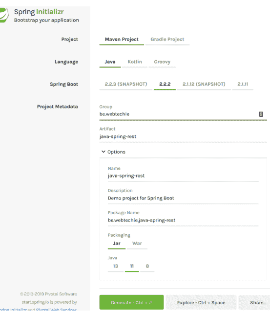

点击“Generate”按钮，你将获得一个包含就可用 Maven 项目的 ZIP 文件。

- 从 `start.spring.io` 下载的未修改源码包含在书中：
  `Chapter_10_Spring > java-spring-rest-original`
- 该项目可以在 Visual Studio Code 中打开，并在 `JavaSpringRestApplication.java` 中点击 `Run` 命令。

[^111]: https://start.spring.io/
[^112]: https://en.wikipedia.org/wiki/Representational_state_transfer

### 第 1 章：Spring

266

```java
src > main > java > be.webtech.javasprest > JavaSpringRestApplication.java > JavaSpringRestApplication

1 package be.webtech.javasprest

2

3 import org.springframework.framework.boot.SpringApplication;

4 import org.springframework.framework.boot.autoconfigure.SpringBootApplication;

5

6 @SpringBootApplication

7 public class JavaSpringRestApplication {

8     public static void main(String[] args) {

9         application.run(JavaSpringRestApplication.class, args);

10    }

11}

12

13

14
```

在日志中我们将得到此结果（此处的时间戳是为了易读性）：

```text
// // /  _   _  (-)_-  _   _   _  / //

// ( ( )  |   _  |   _  |  '  /  \) )))

// ( ( )  |   _  |   _  |  '  /  \) )))
```

它也是一种极其多功能的语言，拥有海量的库可用——其中许多是免费开源的——可以解决已存在的问题和全新的挑战，让开发人员的工作变得更加简单、愉快。这就像手头有一个用不完的选项工具箱，而这种语言还在不断增加新功能。还有比这更好的吗？？？

你正在忙哪一个 DIY 编程电子项目，或者哪个项目在你的“等我有时间就做”清单上？

我正在使用树莓派和其他小型设备，结合实时航空数据流构建一个真实世界的分布式系统。我计划在今年晚些时候出版的书《Spring Boot: Up & Running》中展示这一点。正如你所预期的，Spring Boot 以及其他 Spring 系列项目深度使用了它。我对此感到非常兴奋！

- `+`[^1] https://twitter.com/mkheck
- https://spring.io/
- https://start.spring.io/

## 示例 1：在 Pi 上的最小 Web 服务器

假设我们把 Pi 当作一个存储图片的设备。通过网站发布这些图片，让我们能从家里任何一台电脑上查看照片，这难道不酷吗？让我们试一下……

- 完整源码可以在此处找到：
  `Chapter_10_Spring > java-spring-web-image-server`

## 从 Initializr 项目开始并修改 `pom.xml`

我们已经有一个运行中的 Web 服务器了，所以复制一份 Spring Initializr 项目并将其命名为 `java-spring-image-server`。

首先，我们修改 `pom.xml` 以匹配新项目，在这种情况下，我们需要更改 `artifactId`、`name` 和 `description`：

```xml
<groupId>be.webtech</groupId>

<artifactId>java-spring-image-server</artifactId>

<version>0.0.1_SNAPSHOT</version>

<name>java-spring-image-server</name>

<description>通过浏览器访问图片的 Spring Boot 项目</description>
```

我们添加了一些依赖项，这将帮助我们使用 Swagger¹ 来测试应用程序。这个框架将为我们所有的 Web 服务自动生成文档网页。

```xml
<dependencies>

  <dependency>
    <groupId>org.springframework.boot</groupId>
    <artifactId>spring-boot-starter-web</artifactId>
  </dependency>

  <dependency>
    <groupId>io.springfox</groupId>
    <artifactId>springfox-swagger2</artifactId>
    <version>2.9.2</version>
  </dependency>

  <dependency>
    <groupId>io.springfox</groupId>
    <artifactId>springfox-swagger-ui</artifactId>
```

[^1]: https://swagger.io/

## 第 10 章：Spring

```xml
15  <version>2.9.2</version>
16  </dependency>

17

18  <dependency>
19    <groupId>org.springframework.boot</groupId>
20    <artifactId>spring-boot-starter-test</artifactId>
21    <scope>test</scope>
22  </dependency>
23  </dependencies>
```

### Application properties

我们将使用 Spring 属性来方便地更改存储图片的目录。打开 `resources` 目录下的 `application.properties` 文件。在你的电脑上创建一个包含一些测试图片的目录，并将路径添加到该文件中。

在 Windows 上，目录之间用反斜杠分隔，但为了正确解析该值，我们需要使用双反斜杠，如截图所示。

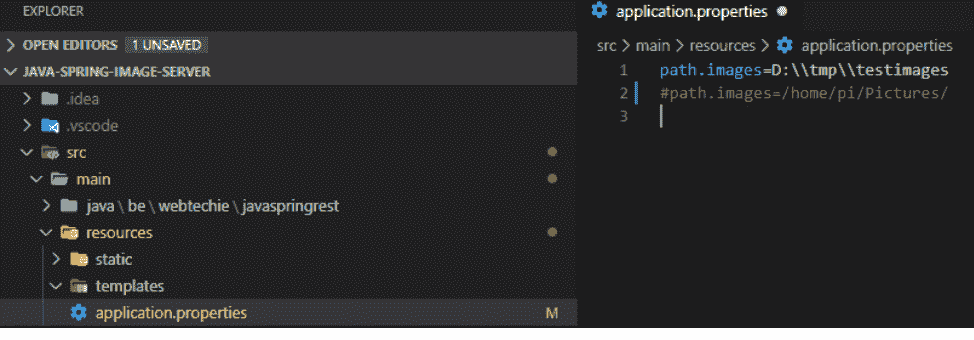

截图中的第二行是一个注释（以 `#` 开头），当我们完成测试并想要为 Pi 构建此应用程序时，我们将使用该值作为此属性。那时，我们将 `#` 移动到带有 Windows 设置的第一行。

### Image controller

现在我们将添加图片控制器，它需要完成两件事：显示所有可用图片的列表并提供所选图片。我们再次添加一个新包 `controller` 并添加一个文件 `ImageController.java`。这是该文件的初始代码，它将根据 `application.properties` 文件中 `path.images` 键配置的目录生成一个文件表格。

注意，使用了 `StringBuilder` 来构建 HTML 表格。这比使用 `String` 的速度快得多。不同 `append` 行中的额外空格和制表符仅是为了提高可读性。

```java
/**
 * REST 调用以访问此设备上的图片。
 */
@RestController
public class ImageController {

    /**
     * 从 application.properties 中获取值，
     * 在那里我们定义了图片的位置。
     */
    @Value("${path.images}")
```

```java
40
41    .append("/a</a></td>")
42    .append("<td style='text-align: right;'>")
43    .append(getSize(childFile)).append("/td")
44    .append("<td>")
45    .append("")
46    .append(getTimestamp(childFile)).append("/td")
47    .append("")
48    .append("</tr>");
49    .append("</table>");
50    .append("</body>");
51    .append("</html>");
52    }
53 catch (Exception ex) {
54    throw new RuntimeException("Error accessing file: " + ex.getMessage());
56    return rt.toString();
57}
```


## 第 10 章：Spring

### 在树莓派上运行

修改 `application.properties` 文件，以定义树莓派上加载图像的目录，例如：

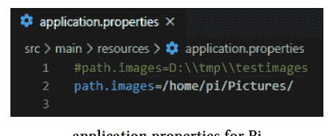

使用 `mvn clean package` 构建应用，并将 `target` 目录下的 `java-spring-image-server-0.0.1-SNAPSHOT.jar` 文件复制到树莓派上。使用 `java -jar java-spring-image-server-0.0.1-SNAPSHOT.jar` 启动应用，并在 PC 浏览器中访问树莓派的 IP 地址，例如在我的案例中为 `http://192.168.0.223:8080/files:`：

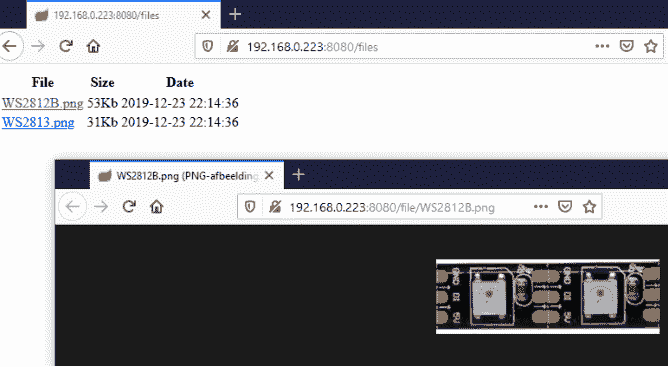

从树莓派提供的图像。

### 结论

这就是我们的图像服务器！从一个空的 Spring 项目开始，添加一个类（Swagger 并不真正需要，它在这里作为一个示例），就搞定了！！！

### 示例 2：用于树莓派上 IoT 数据的数据库 REST 服务

该项目是一个概念验证应用，用于在树莓派上的数据库中存储数据。数据可以由任何提供 REST 服务的来源提供。

- 完整源码可以在此处找到：
- `Chapter_10_Spring > java-spring-rest-db`

H2 数据库将使用一个纯 Java 解决方案，它不需要任何安装，而是完全是应用程序的一部分。

关于是仅将 H2 用于测试还是在生产环境中使用它，存在很多“讨论”。在最近的几年里，它已经演变成了一个非常稳定的数据库解决方案，在我看来，它是嵌入式项目的非常好的选择。

JPA 是用于与数据库“通信”的持久化规范。它帮助你定义哪些对象（实体）可以以何种结构（表）存储在数据库中。

## `pom.xml` 设置

```xml
<dependencies>
  <dependency>
    <groupId>org.springframework.boot</groupId>
    <artifactId>spring-boot-starter-web</artifactId>
    <version>0.0.1-SNAPSHOT</version>
    <name>java-spring-rest-db</name>
    <description>Spring Boot project to store data in an H2 database</description>
  </dependency>

  <dependency>
    <groupId>org.springframework.boot</groupId>
    <artifactId>spring-boot-starter-data-jpa</artifactId>
  </dependency>

  <dependency>
    <groupId>org.springframework.boot</groupId>
    <artifactId>spring-boot-starter-data-rest</artifactId>
  </dependency>

  <dependency>
    <groupId>com.h2database</groupId>
    <artifactId>h2</artifactId>
    <scope>runtime</scope>
  </dependency>

  <dependency>
    <groupId>io.springfox</groupId>
    <artifactId>springfox-swagger2</artifactId>
    <version>2.9.2</version>
  </dependency>

  <dependency>
    <groupId>io.springfox</groupId>
    <artifactId>springfox-swagger-ui</artifactId>
    <version>2.9.2</version>
  </dependency>

  <dependency>
    <groupId>org.springframework.boot</groupId>
    <artifactId>spring-boot-starter-test</artifactId>
    <scope>test</scope>
  </dependency>
</dependencies>
```

### 创建数据库实体

JPA 的主要优势在于我们可以在代码中定义数据库结构。我们不需要创建和定义表；代码会处理这一切。

这是我们要在示例中使用的模型：

- 传感器（`Sensor`）
- 每个传感器有无限数量的测量值（`measurements`）

如图所示：

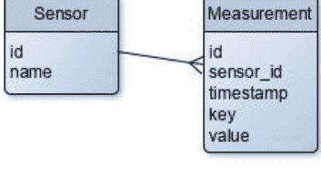

UML 图数据库模型。

这可以通过向项目的 `entity` 包（目录）中添加两个类来实现。首先，我们为传感器创建了一个名为 `SensorEntity.java` 的类。如你所见，这段代码包含了许多“注解”（以 `@` 开头），它们将帮助框架将代码映射到数据库。

```java
/**
 * 将数据库实体从 SENSORS 表映射到 Java 对象。
 * ID 被标记为唯一标识符。
 */
@Entity
@Table(
    name = "SENSORS",
    uniqueConstraints = {
        @UniqueConstraint(
            name = "UN_SENSOR_ID",
            columnNames = {"ID"}
        )
    }
)
public class SensorEntity {

    /**
     * 自动生成的标识符，为传感器提供唯一键。
     */
    @Id
    @GeneratedValue
    private Long id;

    /**
     * 传感器名称，必填值。
     */
    @Column(nullable = false)
    private String name;

    /**
     * 传感器与测量值列表之间的关系。
     */
    @OneToMany(
        mappedBy = "sensorEntity",
        cascade = {CascadeType.MERGE},
        fetch = FetchType.LAZY
    )
    private Set<MeasurementEntity> measurements;

    /**
     * 无参数构造函数。
     */
    public SensorEntity() {
    }

    /**
     * 带有名称的构造函数。
     * @param name
     */
    public SensorEntity(String name) {
        this.name = name;
    }

    // Getter 和 Setter

    public Long getId() {
        return id;
    }

    public void setId(Long id) {
        this.id = id;
    }

    public String getName() {
        return name;
    }

    public void setName(String name) {
        this.name = name;
    }

    public Set<MeasurementEntity> getMeasurements() {
        return measurements;
    }

    public void setMeasurements(Set<MeasurementEntity> measurements) {
        this.measurements = measurements;
    }
}
```

同样的方法，我们添加 `MeasurementEntity.java`：

```java
/**
 * 将实体从 MEASMENTS 表映射到 Java 对象。
 * ID 被标记为唯一标识符。
 */
@Entity
@Table(
    name = "MEASMENTS",
    uniqueConstraints = {
        @UniqueConstraint(
            name = "UN_MEASUREMENT_ID",
            columnNames = {"ID"}
        )
    }
)
public class MeasurementEntity {

    /**
     * 自动生成的标识符，为测量提供唯一键。
     */
    @Id
    @GeneratedValue
    private Long id;

    /**
     * 测量与传感器之间的关系。
     */
    @ManyToOne
    @JoinColumn(
        name = "SENSOR_ID",
        nullable = false,
        foreignKey = "FK_MEASUREMENT_SENSOR"
    )
    private SensorEntity sensorEntity;

    /**
     * 测量的时间。
     */
    @Column(nullable = false)
    private long timestamp;

    /**
     * 测量类型的键，例如 "temperature", "distance"...
     */
    @Column(nullable = false)
    private String key;

    /**
     * 测量值。
     */
    @Column(nullable = false)
    private double value;

    /**
     * 无参数构造函数。
     */
    public MeasurementEntity() {
    }

    /**
     * 带有名称的构造函数。
     * @param sensorEntity
     * @param timestamp
     * @param key
     * @param value
     */
    public MeasurementEntity(
        SensorEntity sensorEntity,
        long timestamp,
        String key,
        double value
    ) {
        this.sensorEntity = sensorEntity;
        this.timestamp = timestamp;
        this.key = key;
        this.value = value;
    }

    // Getter 和 Setter

    public Long getId() {
        return id;
    }

    public void setId(Long id) {
        this.id = id;
    }

    @JsonIgnore
    public SensorEntity getSensor() {
        return sensorEntity;
    }

    public void setSensor(SensorEntity sensorEntity) {
        this.sensorEntity = sensorEntity;
    }

    public long getTimestamp() {
        return timestamp;
    }

    public void setTimestamp(long timestamp) {
        this.timestamp = timestamp;
    }

    public String getKey() {
        return key;
    }

    public void setKey(String key) {
        this.key = key;
    }

    public double getValue() {
        return value;
    }

    public void setValue(double value) {
        this.value = value;
    }
}
```


注意此实体类中 `getSensor()` 上的 `@JsonIgnore`。在这里添加是为了避免在使用 REST 服务加载数据时出现无限循环。否则，应用程序将尝试将带有传感器的测量嵌套到带有测量值的传感器中，从而导致此错误：

```text
Request failed; nested exception is
org.springframework.http.converter.HttpMessageNotWritableException:
Could not write JSON: Infinite recursion (StackOverflowError);
nested exception is: com.fasterxml.jackson.databind.JsonMappingException:
Infinite recursion (StackOverflowError) (through reference chain:
be.webetechie.javascript.db.SensorEntity...)
```


## 第 10 章：Spring

创建一个名为 `resource` 的包并创建一个文件 `SensorResource.java`。在这里，我们定义了三个可以通过 URL 访问的服务：

- `GET localhost:8080/sensor`：获取数据库中所有的传感器
- `GET localhost:8080/sensor/id`：获取数据库中的一个传感器
- `POST localhost:8080/sensor`：根据给定的名称添加传感器，之前会检查该名称是否已在使用

所有这些操作都是通过我们之前创建的 `SensorRepository` 完成的：

```java
@RestController
public class SensorResource {

    @Autowired
    private SensorRepository sensorRepository;

    @GetMapping("/sensor")
    public List<SensorEntity> getAllSensors() {
        return sensorRepository.findAll();
    }

    @GetMapping("/sensor/{id}")
    public SensorEntity retrieveSensor(@RequestParam long id) {
        return sensorRepository.findById(id);
    }

    @PostMapping("/sensor")
    public ResponseEntity createSensor(@RequestParam String name) {
        List<SensorEntity> sensorEntities =
            sensorRepository.findAllByName(name);

        if (sensorEntities.size() > 0) {
            return ResponseEntity.status(HttpStatus.BAD_REQUEST)
                .body("There is already a sensor with the name: " + name);
        }

        SensorEntity sensorEntity = new SensorEntity(name);
        sensorRepository.save(sensorEntity);

        return ResponseEntity.ok(sensorEntity);
    }
}
```

现在我们需要对测量值（measurements）执行操作，以使用这些 URL：

- `GET localhost:8080/measurement`：获取数据库中所有的测量值
- `POST localhost:8080/measurement`：为给定的传感器 ID、键和值添加测量值，之前会检查给定的传感器 ID 是否在数据库中定义

```java
@RestController
public class MeasurementResource {

    @Autowired
    private SensorRepository sensorRepository;

    @Autowired
    private MeasurementRepository measurementRepository;

    @GetMapping("/measurement")
    public List<MeasurementEntity> retrieveAllMeasurements() {
        return measurementRepository.findAll();
    }

    @PostMapping("/measurement")
    public ResponseEntity createMeasurement(
        @RequestParam long sensorId,
        @RequestParam String key,
        @RequestParam double value) {

        SensorEntity sensorEntity = sensorRepository.findById(sensorId);

        if (sensorEntity == null) {
            return ResponseEntity.status(HttpStatus.BAD_REQUEST)
                .body("No sensor defined with the ID: " + sensorId);
        }

        MeasurementEntity measurementEntity = new MeasurementEntity(
            sensorEntity, System.currentTimeMillis(), key, value);

        measurementRepository.save(measurementEntity);

        return ResponseEntity.ok().build();
    }
}
```

### 添加 Swagger

最后一个编码步骤，这样我们就可以使用 Swagger 快速测试我们的应用程序了！创建一个包 `configuration` 并包含文件 `SwaggerConfig.java` 来暴露我们的 REST 资源：

```java
@Configuration
@EnableSwagger2
public class SwaggerConfig {

    @Bean
    public Docket api(DocumentationType.SWAGGER_2) {
        return new Docket().select()
                .apis(RequestHandlerSelectors.any())
                .paths(PathSelectors.any())
                .build();
    }
}
```

### 运行应用程序并使用 REST 服务

让我们试试吧！在 `JavaRestDbApplication.java` 中的主函数上点击运行，并访问 `http://localhost:8080/swagger-ui.html`。


让我们先通过点击 `POST /sensor` 和 `Try it out` 来创建一些传感器。填写一些值（例如 `temp1`、`temp2...`），并且每次点击 `Execute`。


如果你尝试两次添加相同的名称，将返回一个错误：


现在你可以通过尝试对 `/sensor` 和 `/sensor/` 进行 GET 请求在 Swagger 中查看创建的记录，也可以直接访问 `http://localhost:8080/sensor`。数据在带有 `JSON-formatter` 插件的 Firefox 截图中格式化：


下一步：为我们的一个传感器（ID 1）存储一些测量值：


现在我们可以通过访问 `http://localhost:8080/measurement` 来获取测量值。


## 第 10 章：Spring

294

### 结论

这是一个包含两个表的基础示例，但它向你展示了如何用最少的代码快速构建一个数据库应用程序。REST 服务适用于所有可以通过网络连接到树莓派的设备，这样它们可以在一个中心位置存储数据和/或读取这些数据。

REST 服务提供的 JSON 数据可以被各种类型的设备或应用程序用于可视化结果。在 Elektor 网站上，你可以找到一个使用微控制器在屏幕上显示 JSON 数据的很好的示例¹¹¹⁶。

> ¹¹¹⁶ <https://www.elektormagazine.com/labs/9292-dutch-public-transport-monitor>

### 与 Vlad Mihalcea 的采访

Vlad Mihalcea `@vlad_mihalcea`，Java 冠军（Java Champion），Hyperspace CEO，JPA 专家，顶级 Hibernate ORM 提交者之一。

Java、Java 持久化 API（JPA）和 Hibernate 允许用极少的代码构建数据库应用程序。这一切都是通过免费的开源框架实现的！你贡献这些开发的动力是什么？

JPA 和 Hibernate 在构建数据访问层时非常方便，这也是为什么它们被大多数企业应用采用的原因。

不仅是 Java，Spring Boot 或 JHipster 默认也使用 Hibernate，所以 Hibernate 如此流行也并不奇怪。

我贡献 Hibernate 的动力是想教人们如何充分利用他们使用的 JPA、Hibernate 或数据库系统。

这就是我写《高性能 Java 持久化》（High-Performance Java Persistence）并启动如 Hibernate Types 或 Hypersistence Optimizer 等项目的原因。

你在 Twitter、网站、StackOverflow、书籍、演讲中分享了许多技巧和窍门……我想知道你喜欢的这些专家是如何在兼顾工作和家庭的情况下实现这一切的？

嗯，刚开始确实困难，当时我还要全职工作，并在 StackOverflow 上回答问题时写了大量文章。

4 年前，我辞了工作，将对高性能数据库系统的热情变成了全职工作。现在，写博客、培训和写书是我工作的一部分，我能够在每周不到 40 小时内完成所有这些。

书中的数据库示例使用了一些简单的表和一个 H2 数据库。这在树莓派上运行得非常好。令我惊讶的是，用于大型大数据解决方案的相同技术也可以运行在价格低于 500 美元的 PC 上。这让你感到惊讶吗？

不，一点也不奇怪。这正是 Java 是最流行的编程语言之一的原因。它的生态系统是多样化的，使得 Java 从长期来看是一个非常灵活的选择。

关系型数据库有很多形式。银行使用 Oracle 处理数十亿条记录，而手机可以使用 SQLite。296

Java 的新开发周期每 6 个月发布一次，允许 Java 和 JDK 开发者引入许多有用功能。未来还有许多 great 特性，例如 Project Loom⁶ 或 Valhalla⁷。

为什么现在是学习 Java 的完美时机？

因为 Java 拥有丰富的开源框架生态系统，并且能够在各种系统上运行（从小型设备到超级计算机），Java 和 JVM 是一个极佳的选择。

你正在忙于哪个 DIY 编程电子项目，或者哪个项目在你的“如果以后我有时间”清单上？

Hypersistence Optimizer⁸ 是我目前正在工作的项目，我对它非常兴奋，它允许你自动化检测 JPA 和 Hibernate 问题的过程，这样你终于可以专注于数据访问层，而不是追逐性能相关的问题。

> ⁶ <https://twitter.com/vladmilacea/high-performance-java-persistence/>
>
> ⁷ <https://vladhalcea.com/books/high-performance-java-persistence/>
>
> <https://github.com/vladhalcea/hibernate-types>
>
> <https://vladhalcea.com/hypersistence-optimizer/>
>
> ⁸ Project Loom 想要让编写、调试、分析和维护并发 Java 变得更容易。
>
> ⁹ Valhalla 结合了多个子项目，旨在使 Java 语言和运行时适应现代硬件。
>
> ¹⁰ <https://vladhalcea.com/hypersistence-optimizer/>

### 示例 3：树莓派上的 REST 服务以切换 LED 灯

在这个示例中，我们将基于 Pi4j（见“第 9 章：Pi4j”）创建一个结合了 Spring 和 Pi4j 的概念验证应用程序。由于该库的依赖关系，我们无法在 PC 上运行或测试此应用程序，需要在树莓派上直接运行生成的程序。

- 完整源代码可以在找到：`Chapter_10_Spring > java-spring-rest-gpio`

我们再次从最小的 Spring 源码开始，并添加此依赖：

```xml
<dependency>
  <groupId>com.pi4j</groupId>
  <artifactId>pi4j-core</artifactId>
  <version>1.2.0</version>
</dependency>
```

我们首先要暴露的是由 Pi4j 提供的信息。基于 <https://vladhalcea.com/hypersistence-optimizer/>

```java
/**
 * 获取 OS 信息。
 */
@RestController
@RequestMapping("info")
public class InfoRestController {

    private Logger logger = LoggerFactory.getLogger(this.getClass());

    /**
     * 获取 OS 信息。
     */
    @GetMapping("os")
    public Map<String, String> getOsInfo() {
        Map<String, String> map = new TreeMap<>();

        try {
            map.put("Name", SystemInfo.getName());
        } catch (Exception ex) {
            logger.error("OS name unavailable", ex.getMessage());
        }

        try {
            map.put("Version", SystemInfo.getVersion());
        } catch (Exception ex) {
            logger.error("OS version unavailable", ex.getMessage());
        }

        return map;
    }
}
```

```java
/**
 * 获取 Java 信息。
 */
@GetMapping("java")
public Map<String, String> getJavaInfo() {
    Map<String, String> map = new TreeMap<>();

    try {
        map.put("Vendor", SystemInfo.getVendor());
        map.put("VendorURL", SystemInfo.getVendorUrl());
    } catch (Exception ex) {
        logger.error("Java vendor unavailable", ex.getMessage());
    }

    try {
        map.put("Version", SystemInfo.getVersion());
        map.put("VM", SystemInfo.getVirtualMachine());
    } catch (Exception ex) {
        logger.error("Java VM unavailable", ex.getMessage());
    }

    try {
        map.put("Runtime", SystemInfo.getRuntime());
    } catch (Exception ex) {
        logger.error("Java runtime unavailable", ex.getMessage());
    }

    return map;
}
}
```

### GPIO Manager

在创建 GPIO 控制器之前，我们将添加处理 Pi4J 调用的 `GpioManager`。我们使用这个管理器来初始化 GPIO 引脚并调用 GPIO。查看完整的类。

```java
/**
 * GpioFactory 的单例实例。
 * SCOPE_SINGLETON 是默认值，但为了清晰起见加上了。
 */
```


```java
@Component
@Scope(value = ConfigurableFactoryBean.SCOPE_SINGLETON)
public class GpioManager {

    private Logger logger = LoggerFactory.getLogger(this.getClass());

    /**
     * 控制器。
     */
    private final GpioController gpio;

    /**
     * 以地址为键的已配置引脚列表。
     */
    private Map<Integer, Object> provisionedPins = new HashMap<>();

    /**
     * 初始化 Pi4J GpioController 的构造函数。
     */
    public GpioManager() {
        this.gpio = GpioFactory.getInstance();
    }

    /**
     * 根据地址获取引脚。
     *
     * @param address GPIO 引脚地址。
     * @return Pin，未找到时返回 null。
     */
    public Pin getPinByAddress(int address) {
        Pin pin = RaspPi.getPinByAddress(address);

        if (pin == null) {
            logger.error("No pin available for address {}", address);
        }

        return pin;
    }
}
```

## 第 10 章：Spring

```java
/**
 * @param address GPIO 引脚的地址。
 * @param name GPIO 引脚的名称。
 * @return 如果成功则返回 True。
 */
public boolean provisionDigitalOutputPin(final int address, final String name) {
    if (this.provisionedPins.containsKey(address)) {
        throw new IllegalArgumentException("给定的地址已经配置了引脚");
    }

    GpioDigitalOutput provisionedPin = this.gpio
        .provisionDigitalOutputPin(
            this.getByAddress(address), name, PinState.HIGH);

    provisionedPin.setShutdownOptions(true, LOW);
    this.provisionedPins.put(address, provisionedPin);

    return true;
}

/**
 * 翻转引脚状态。
 *
 * @param address GPIO 引脚的地址。
 * @return 如果成功则返回 True。
 */
public boolean togglePin(final int address) {
    logger.info("Toggle pin requested for address {}", address);

    Object provisionedPin = this.provisionedPins.get(address);

    if (provisionedPin == null) {
        throw new IllegalArgumentException("给定的地址处没有配置引脚");
    } else {
        if (provisionedPin instanceof GpioDigitalOutput) {
            ((GpioDigitalOutput) provisionedPin).toggle();
            return true;
        } else {
            throw new IllegalArgumentException(
                "给定的地址处的引脚不是 GpioPinDigitalOutput 类型");
        }
    }
}
```

### GPIO REST-controller

让我们添加一个控制器来暴露我们在 `GpioManager.java` 类中集成的 Pi4J GPIO 方法。下面包含了其中几个方法，你可以在源码中找到所有方法：

```java
/**
 * 提供与引脚交互的 REST。
 */
@RestController
@RequestMapping("gpio")
public class GpioRestController {

    private Logger logger = LoggerFactory.getLogger(this.getClass());

    private final GpioManager gpioManager;

    public GpioRestController(GpioManager gpioManager) {
        this.gpioManager = gpioManager;
    }

    /**
     * 将 GPIO 作为数字输出引脚。
     *
     * @param address GPIO 引脚的地址。
     * @param name GPIO 引脚的名称。
     * @return 如果成功则返回 True。
     */
    @PostMapping(
        path = "provision/digital/output/{address}/{name}",
        produces = "application/json")
    public boolean provisionDigitalOutputPin(
        @PathVariable("address") int address,
        @PathVariable("name") String name) {

        return this.gpioManager.provisionDigitalOutputPin(address, name);
    }

    /**
     * 翻转引脚状态。
     *
     * @param address GPIO 引脚的地址。
     * @return 如果成功则返回 True。
     */
    @PostMapping(path = "digital/toggle/address", produces = "boolean")
    public boolean togglePin(@PathVariable("address") long address) {
        return this.gpioManager.togglePin(address);
    }
}
```

### 在 Pi 上运行应用程序

通过添加 Swagger 配置（参见源码和之前的示例），我们可以轻松地测试 REST 控制器。

使用 `mvn clean package` 构建 jar 包，并将 jar 文件从 `target` 目录复制到 Pi 上。使用 `java -jar java-spring-rest-gpio-0.0.1-SNAPSHOT.jar` 运行。

为了演示此应用程序，我们将使用与“第 7 章：JavaFX - TilesFX 仪表”中相同的接线方式：

- LED 连接到 GPIO 22（WiringPi 编号 3）。
- 按钮连接到 GPIO 24（WiringPi 编号 5）。

### 面板上的接线

从同一网络中的任何 PC 访问 Pi 的 Swagger 页面，你将看到这里列出的控制器和方法：

| info-rest-controller | Info Rest Controller |
| :--- | :--- |
| `GET` | `/api/v1/controllers` |
| `POST` | `/api/v1/controllers` |
| `GET` | `/api/v1/devices/{id}` |
| `PUT` | `/api/v1/devices/{id}` |
| `GET` | `/api/v1/memory/controllers` |
| `GET` | `/api/v1/network` |
| `GET` | `/api/v1/status` |

| gpio-rest-controller | GPIO Rest Controller |
| :--- | :--- |
| `GET` | `/api/v1/gpio/{address}` |
| `POST` | `/api/v1/gpio/{address}` |
| `GET` | `/api/v1/gpio/{address}/pin` |
| `POST` | `/api/v1/gpio/{address}/pin` |
| `GET` | `/api/v1/gpio/{address}/output` |
| `POST` | `/api/v1/gpio/{address}/value` |
| `GET` | `/api/v1/gpio/{address}/status` |

### 测试 REST 控制器

我们可以点击 Swagger 页面并执行可用选项之一，但让我们尝试直接访问 URL。这些是在全新的树莓派 3B 板上的一些部分结果：

### 带有 LED 和按钮的 GPIO REST-controller

为了能够控制连接的 LED 并读取按钮状态，我们首先需要初始化 GPIO。可以在 GPIO 控制器中使用 WiringPi 编号通过专用方法完成。当 GPIO 初始化后，我们现在可以通过点击“Execute”按钮来切换 LED 的开启和关闭。

### 开启或关闭 LED

还有一个额外的方法可以在指定时间内开启 LED，在本例中，持续时间必须以毫秒提供（例如 2 秒）。

可以通过 Swagger 请求按钮状态，也可以直接通过 URL 请求。在这种情况下，按钮被按下并返回 1。

### 结论

此应用程序仅将少数 Pi4J 方法作为 REST 服务暴露，以展示这种方法的可能性和威力。根据你想要构建的项目，你可以扩展或重构此示例以符合你的需求。

### 示例 4：响应式数据

响应式编程与之前的示例采用不同的方法，之前的示例可以从 REST 服务请求数据。在响应式系统中，使用了连续流。例如，根据输入的数据更新用户界面。

Trisha Gee 在采访“第 3 章：选择 IDE”中与 Josh Long（Pivotal Spring 开发者倡师 `@starbxman`）合作编写了一个博客系列，在系列中展示了 Spring 应用产生的响应式数据的威力。他们的示例使用 Kotlin 代码连续发送股票值，使用 Java 客户端接收这些数据，并使用 JavaFX 客户端在折线图中实时可视化更新的价格。

在这个应用程序示例中，我们将在 Pi 上实现相同的功能，基于“第 9 章：Pi4”中距离传感器的示例。我们使用了相同的接线，但代码进行了重构并集成到 Spring 中。

### 代码

该项目在该结构中使用三个类。完整源码可以在此处找到：`Chapter_10_Spring > java-spring-stream`

在 `pom.xml` 中需要添加额外的依赖：

```xml
<dependency>
  <groupId>org.springframework.boot</groupId>
  <artifactId>spring-boot-starter-webflux</artifactId>
</dependency>
```

- ¹¹⁷ https://en.wikipedia.org/wiki/Reactive_programming
- ¹¹⁸ https://twitter.com/starbxman
- ¹¹⁹ https://trishagee.github.io/presentation/coding_duel/

## 第 10 章：Spring

### 响应式控制器

控制器提供了可以从客户端调用的 REST 端点。

```java
@RestController
@RequestMapping("/api")
public class DistanceController {

    private final DistanceService distanceService;

    public DistanceController(DistanceService distanceService) {
        this.distanceService = distanceService;
    }

    @GetMapping(
        value = "/distance",
        produces = MediaType.APPLICATION_STREAM_JSON_VALUE
    )
    public Flux<DistanceMeasurement> distance() {
        return this.distanceService.getDistances();
    }
}
```

### 生成流的 Service

魔法发生在 Service 层，在这里 `Flux` 被生成，并在每个间隔上获取新数据。大部分代码在 Pi4 章中已经解释过了。引脚在构造函数中初始化，并被用于每秒进行一次测量。

```java
@Service
public class DistanceService {

    private static final Logger logger =
        LoggerFactory.getLogger(DistanceService.class);

    private static final Pin PIN_TRIGGER = Raspin.GPIO_01; // BCM 18
    private static final Pin PIN_ECHO = Raspin.GPIO_05;   // BCM 24

    private final GpioPinDigitalOutput trigger;
    private final GpioPinDigitalInput echo;

    public DistanceService() {
        // 初始化 GPIO 控制器
        GpioController gpio = GpioFactory.getInstance();

        // 初始化引脚
        this.trigger = gpio
            .provisionDigitalOutputPin(
                PIN_TRIGGER, "Trigger", PinState.LOW);

        this.echo = gpio
            .provisionDigitalInputPin(
                PIN_ECHO, "Echo", PinPullResistance.PULL_UP);
    }

    public Flux<DistanceMeasurement> getDistances() {
        return from(Stream.generate(() -> this.getDistanceMeasurement())
            .delayElements(Duration.ofSeconds(1)));
    }

    private DistanceMeasurement getDistanceMeasurement() {
        try {
            // 设置触发高电平 0.1ms
            this.trigger.pulse(
                10, PinState.HIGH, TimeUnit.NANOSECONDS);

            // 开始测量
            while (this.echo.isLow()) {
                // 等待回引脚变为高电平，
                // 表示超声波已发送
            }

            long start = System.nanoTime();

            // 等待测量完成
            while (this.echo.isHigh()) {
                // 等待回引脚变为低电平，
                // 表示收到了超声波
            }

            long end = System.nanoTime();

            // 输出距离
            float measuredSeconds =
                (end - start) / 1000000000F;

            int distance =
                Math.round(measuredSeconds * 34300 / 2);

            logger.info(
                "Measured distance is: {} for {}s",
                distance, measuredSeconds);

            return new DistanceMeasurement(
                distance, measuredSeconds);


```java
} catch (Exception ex) {
    logger.error("Error: {}", ex.getMessage());
    return null;
}
}
```

### 在 Pi 上运行流应用程序

使用`mvn clean package`构建应用并将`jar`包复制到 Pi 后，即可启动。它将产生如下输出（为了可读性删除了时间戳和类名）。当客户端连接到 API 时，第一行`Measured distance`日志就会出现：

```bash
$ java -jar java-spring-stream-0.0.1-SNAPSHOT.jar

  _  _  _  _  _  _  _  _  /  /  /  \/

 ( )  _  )  _  )  |  |  |  |  |  |    (_|  ))

 \/\   _  )  _  )  |  |  |  |  |  |  (_|  ))

 /        /|  |  |  |  |  |      /  //  //  ///

 ===========      |  |  |  |  |  |      /  //  //  ///

:: Spring Boot ::               (v2.2.2.RELEASE)

Starting SpringStreamApplication v0.0.1-SNAPSHOT on raspberrypi with PID

No active profile set, falling back to default profiles: default

Completed initialization in 49 ms

Measured distance is: 56 for 0.00324602s

Measured distance is: 13 for 7.53228E-4s

Measured distance is: 10 for 5.81875E-4s

Measured distance is: 49 for 0.0028775s

Measured distance is: 13 for 0.00812696s

...
```

在 Pi 上调用 API 的浏览器输出（在我的情况下 IP 是`192.168.0.23`）。

### 结论

如果我们想从 Pi 传感器获取数据，可以使用响应式 API，并将生成的数据用于任何其他可以处理和解析这些数据的设备。

## 一些小感触：冒充者综合症（Imposter Syndrome）

我有一个坦白。我正遭受着一种似乎无法治愈的慢性疾病。每天我都担心被揭穿是个骗子、江湖骗。患有冒充者综合症的人坚信自己的成就是运气而不是经验。他们还认为别人比自己聪明，并且迟早会意识到这一点。我在工作中也有这种感觉，周围都是比我更聪明的同事。我们还分享胜利。如果我们其中某人卡住了……（此处根据原文翻译，注：原文中“Imposter Syndrome”部分似乎存在一些逻辑跳跃或重复，此处已按字意翻译）。

## 在 Pi 上使用 Mosquitto

### 安装

要安装代理服务器（即`Mosquitto`应用程序），我们需要执行三个步骤：

- 确保 Pi 上的更新列表是最新的。
- 获取并安装代理服务器。
- 让它在 Pi 启动时启动，以确保代理服务器始终运行。

我们现在可以通过运行以下命令来检查是否安装正确：

```bash
$ sudo apt update
sudo apt install -y mosquitto mosquitto-clients
sudo systemctl enable mosquitto.service
```

```bash
$ mosquitto -v
156980732: mosquitto version 1.5.7 starting
156980732: Using default config.
156980732: Opening ipv4 listen socket on port 1883
156980732: Error: Address already in use
```

错误`Address already in use`显然可以忽略……

我们还可以通过`netstat`在默认端口`1883`上监听入站消息来验证 Mosquitto：

```bash
$ netstat -listen
Active Internet connections (only servers)
Proto Recv-Q Send-Q Local Address Foreign Address State
tcp 0 0 0.0.0.0:1883 0.0.0.0:* LISTEN
tcp6 0 0 [::]:1883 [::]:* LISTEN
```

我们需要知道还有哪些设备需要连接。因此，我们需要安装了 Mosquitto 的 Pi 的 IP 地址。我们可以通过以下命令进行检查：

```bash
$ hostname -I
192.168.0.213 2a02:1811:bc04:4900:412e:b96a:d93c:b0a2 2a02:1811:bc04:4900:11fb:315f:nb8e1:f5dc
```

在这种情况下，它是`192.168.0.213`。

也可以通过以下命令找到相同的信息，该命令将提供更多关于你网络接口的信息。在我的情况下，我使用的是`wlan`上的无线连接：

## 第 11 章：消息队列

```bash
$ ifconfig
eth0: flags=4099<UP,BROADCAST,MULTICAST> mtu 1500
  ether dc.ca:32:21:c1:12 txqueuelen 1000 (Ethernet)
  RX packets 0 bytes 0 (0.0 B)
  RX errors 0 dropped overruns frame 0
  TX packets 0 bytes 0 (0.0 B)
  TX errors 0 dropped overruns carrier 0 collisions 0
lo: flags=73<UP,LOOPBACK,RUNNING> mtu 65536
  inet 127.0.0.1 mask 255.255.0.0 prefixlen 8 scope 0x1<host>
  inet6::1 prefixlen 128 txqueuelen 1000 (Local Loopback)
  RX packets 0 bytes 0 (0.0 B)
  RX errors 0 dropped overruns frame 0
  TX packets 0 bytes 0 (0.0 B)
  TX errors 0 dropped overruns carrier 0 collisions 0
```

```bash
wlan0: flags=4163<UP,BROADCAST,RUNNING,MULTICAST> mtu 1500
  inet 192.168.0.23 mask 255.255.255 broadcast 192.168.0.255
  inet6 2a02:1811:bc04:4900:11fb:f5b1:e5dc:b0a2 prefixlen 64 scope 0x<global>
```

```bash
bal:
  inet6 2a02:1811:bc04:4912:a41e:d9a3:d3c:b0a2 prefixlen 128 scope 64 scope 0x<link>
  ether dc.a6:32:21:c1:13 txqueuelen 1000 (Ethernet)
  RX packets 59629 bytes 7493867 (70.9 MiB)
  RX errors 0 dropped overruns frame 0
  TX packets 28575 bytes 3084130 (29.4 MiB)
  TX errors 0 dropped overruns carrier 0 collisions 0
```

## Pi 上的 Mosquitto

我们可以通过打开两个终端窗口来轻松测试 Mosquitto 是否运行在 Pi 上。在第一个窗口中，我们测试对`testing/TestTopic`主题的监听器：

```bash
$ mosquitto_sub -v 'testing/TestTopic'
```

在第二个终端中，我们向该主题发送多个带有消息的命令，例如：

```bash
$ mosquitto_pub -t 'testing/TestTopic' -m 'hello world'
$ mosquitto_pub -t 'testing/TestTopic' -m 'hello world'
$ mosquitto_pub -t 'testing/TestTopic' -m 'ha it works'
```

终端窗口中的每次“发布”操作都会出现在第一个窗口中。

### 测试 Pi 上的 Mosquitto

我们知道 Mosquitto 运行在 Pi 上，并且可以使用终端发送和接收消息。现在让我们在 PC 上使用 JavaFX 实现相同的操作，使其可视化。

### 示例 1：在 Pi 和 PC 之间共享数据

再次从基本的 JavaFX 应用开始，并添加 Paho 依赖，这是我们将用于 MQTT 协议与 Mosquitto 通信的库：

```xml
<dependency>
  <groupId>org.eclipse.paho</groupId>
  <artifactId>org.eclipse.paho.client.mqttv3</artifactId>
  <version>1.2.2</version>
</dependency>
```

## 第 11 章：消息队列

### 定义消息

首先，我们需要对通过 Mosquitto 交换的消息结构和主题（topic）达成一致。我们将使用字符串并将`:`作为不同值之间的分隔符。我们将使用的结构如下：

- Mosquitto 中的主题为`ledCommand`，命令将发布在该主题下。
- 命令本身的格式为`COMMAND:ID:SPEED:R1:G1:B1:R2:G2:B2`。
- `COMMAND_ID`：我们想要的 LED 效果编号，见下表。
- `SPEED`：效果之间的毫秒数。
- `RGB`：两组红、绿、蓝颜色值，范围在`0`到`255`之间。

因此，我们可以在命令中使用两种不同的颜色，但某些效果完全不使用颜色，某些只使用一种，而有些则不需要速度值。以下是可用命令的概述：

| ID 名称 | 使用速度 | 使用 RGB | 使用 RGB2 |
|---|---|---|---|
| 1 固定颜色（RGB1） | 否 | 是 | 否 |
| 2 从 RGB1 到 RGB2 的静态帧 | 否 | 是 | 是 |
| 3 闪烁（在颜色 RGB1 和 RGB2 之间） | 是 | 是 | 是 |
| 4 运行（RGB1 移动，其他固定为 RGB2） | 是 | 否 | 是 |
| 5 使用颜色渐变的彩虹渐变 | 是 | 否 | 否 |
| 6 从 RGB1 到 RGB2 的静态彩虹 | 否 | 否 | 否 |
| 98 全白 | 否 | 否 | 否 |
| 99 全灭 | 否 | 否 | 否 |

部分示例：

- `1:20:255:0:0` = 所有 LED 固定为全红。
- `3:50:255:0:0:0:0:255` = 每隔 2.5 秒将所有 LED 从全红变为全蓝。
- `5:50:255:0:0:0:0:255` = 全部为蓝色，其中一个正在运行，持续 50 毫秒。

### Arduino 部分

对于 Arduino，我们将使用 WS2812B 类型的 LED 灯带，它仅需一个引脚控制，连接到引脚 6。电源方面，我们连接到 5V 和地线。确保不要连接过多的 LED，因为这可能需要大量功率（见“第 2 章：工具 > LED 灯带”）。如果你想控制长灯带，你需要一个独立的电源。在这种情况下，还要将 Arduino 板的地线与电源的地线连接，否则将得到意想不到且不需要的 LED 效果，因为灯带和 Arduino 的定时不同步。

### Arduino 和 LED 灯带的设置

我们还需要向 Arduino IDE 添加额外的库。在“工具”（Tools）菜单中，选择“管理库...”（Manage libraries...），搜索这些库并点击“安装”（Install）：

- Adafruit NeoPixel by Adafruit[^122]
- WiFiINA by Arduino[^123]
- ArduinoMqtt by Arduino[^124]

[^122]: https://github.com/adafruit/Adafruit_NeoPixel
[^123]: https://github.com/arduino-libraries/WiFiINA
[^124]: https://github.com/arduino-libraries/ArduinoMqttClient

### 使用 Arduino Uno WiFi REV3、LED 灯带和电源的方案

此示例的测试设置使用了 Arduino Uno WiFi REV2。这可能会让人有点困惑，因为 Arduino IDE 中有多种 Uno 类型可供选择。请确保选择正确的类型！

### 分解 Arduino 代码

为了让 Arduino 代码易于理解，函数被划分在不同的`-ino`文件中，其中`WifiMosquitoListener.ino`是主文件。

### Arduino 项目中的不同文件

- `WiFiMosquitoListener.ino`
  - 包含`setup`和`loop`函数的主文件
- `ConnectionHandler`
  - 处理传入的 Mosquitto 消息的处理器
- `LEDEffects`
  - 用于生成不同 LED 动画的代码
- `MessageHandler`
  - 将从 Mosquitto 和串口（用于测试）接收到的命令转换为 LEDEffects 使用的值
- `SerialFunctions`
  - 用于检查是否有可用的串口数据（带有测试命令）的函数

请查看这些不同的文件，其中一些文件会有更详细的描述。

### setup 和 loop 中的 Arduino 代码

一个 Arduino 项目有两个必须的函数：

- `setup()`：在开发板启动或重置时调用一次。用于初始化库、变量、引脚等……
- `loop()`：持续循环以主动控制开发板。

让我们看看这些在我们的项目中是如何使用的。GitHub 上的实际代码包含更多调试信息。在`setup`的末尾，我们已经提供了一条消息，以便 LED 灯带从效果 2（静态渐变）开始。

```cpp
void setup() {
  // 配置速度并等待其可用
  // 这用于输出信息并接收命令
  Serial.begin(9600);
  while (!Serial) {
    // 等待串口连接。USB 需要。
  }

  // 初始化 led
  initLeds();

  // 连接到 WiFi
  Serial.println("-- Connecting to WiFi --");
  while (WiFi.begin(ssid, pass) != WL_CONNECTED) {
    // 失败，重试
    Serial.print(".");
    delay(5000);
  }

  // 连接到 MQTT
  Serial.println("-- Connecting to MQTT --");
  mqttClient.onMessage(onMqttMessage);
  if (!mqttClient.connect(broker, port)) {
    Serial.print("MQTT connection failed!");
  }
}
```

## 第 11 章：消息队列

```cpp
void initLeds() {
  strip.begin();
  strip.setBrightness(100);
  strip.clear();
  strip.show(); // 初始化所有像素为“关闭”状态
}
```

对于一个运行循环，我们需要将其中一个 LED 设置为颜色 2 并显示它。随后，该 LED 的值会立即变回颜色 1，且不显示。这就是我们在下一次调用相同函数时所做的操作，并将下一个 LED 设置为颜色 2。

```cpp
void setRunningLight() {
  if (currentAction >= NUMBER_OF_LEDS) {
    currentAction = 0;

    // 显示颜色 1
    strip.setPixelColor(currentAction, rgb1);
    strip.show();

    // 为下一次循环重置为颜色 2
    strip.setPixelColor(currentAction, rgb2);

    currentAction++;
  }
}
```

红色和蓝色的流水灯效果。

两个辅助函数用于计算渐变色和彩虹色：

```cpp
// 计算颜色 1 和 2 之间的渐变色，针对给定位置
uint32_t getGradientColor(uint16_t pos) {
...
}

// Pos 从 0 到 255，获取全色轮颜色
// 0 - 85:    G - R
// 85 - 170:  R - B
// 170 - 255: B - G
uint32_t getWheelColor(byte pos) {
}
```

# Java 应用

我们将使用 JavaFX 和 Undertow Web 服务器构建一个控制器应用程序。通过这种方式，我们可以让相同的程序运行在 Pi（作为 Web 服务器，以便通过浏览器从任何 PC 更改 LED）和 PC（用于测试，仅仅因为我们可以这样做）上。

我们使用了两个库来实现某些所需功能的完美用例：

- **Undertow**
  - 代码中的 Web 服务器，无需额外安装。
  - 易于添加自定义 Web 函数。
- **JavaFX**


- 创建一个 UI 来选择颜色和动画
- 可视化 Arduino 上的激活颜色和动画

这是控制我们 LED 灯带的用户界面：

# EventManager

在应用程序内部，我们添加了一个 `EventManager`。这允许我们有两个不同的 UI 部分来监听传入的 LED 命令。

```java
public class EventManager {
  /**
   * 一个组件列表，用于通知接收来自 Mosquito 的新 LedCommand
   * 指令。
   */
  private List<EventListener> eventListeners = new ArrayList<>();

  /**
   * 供每个想要接收新事件通知的组件使用。
   */
  public void addEventListener(EventListener eventListener) {
    this.eventListeners.add(eventListener);
  }
  /**
   * 用于 Mosquito 回调，将收到的消息转发给应用程序
   * 中所有已添加监听器的组件。
   */
  public void sendEvent(LedCommand ledCommand) {
    this.eventListeners.forEach(l -> l.onQueueMessage(ledCommand));
  }
}
```

每个组件都必须是 `EventListener` 以实现该接口：

```java
public interface EventListener {
  /**
   * 每当从 Mosquitto 接收到新的 {@link LedCommand} 时，
   * 所有监听器将被通知，以便它们为自己的用途进行处理。
   *
   * @param ledCommand {@link LedCommand}
   */
  void onQueueMessage(LedCommand ledCommand);
}
```

# Mosquito 连接

我们复用了本章中第一个示例的代码。但我们没有使用 `ObservableList` 来存储传入的消息，而是使用 `EventManager` 将消息转发给已添加到监听器列表的应用程序中的不同组件。这在 LED 面板初始化时完成：

```java
LedControlPanel ledControlPanel = new LedControlPanel(queueClient);
eventManager.addListener(ledControlPanel);
this.led = new Group(ledControlPanel);
```

# LED 效果选择 UI

此 UI 将根据接收到的命令更改颜色轮和速度值。当然，更改颜色并点击按钮将向 Mosquito 发送命令，这样 Arduino 就能接收到它。它由一些 JavaFX 组件和额外的 CSS 样式构建。以下是用于 LED 效果选择按钮的样式：

```css
.ledButton {
  -fx-font: 20px "Sans";
  -fx-padding: 10px;
  -fx-background-color: #041E37;
  -fx-text-fill: #728CA6;
  -fx-font-weight: bold;
  -fx-min-width: 200;
  -fx-min-height: 30;
}

.ledButton:hover {
  -fx-text-fill: yellow;
}

.ledButton:selected {
  -fx-text-fill: #041E37;
  -fx-background-color: yellow, #728CA6;
  -fx-insets: 2;
}
```

如在 `ledButton:selected` 中所示，JavaFX 样式允许对背景使用多种颜色。通过添加内边距（insets），你可以创建边框和阴影。通过更改此 CSS，你可以在背景中使用甚至组合颜色：

```css
.ledButton:selected {
  -fx-text-fill: #041E37;
  -fx-background-color: yellow, #728CA6;
  -fx-insets: 2;
}
```

正如你所看到的，JavaFX 样式允许对背景使用多种颜色。通过添加内边距，你可以创建边框和阴影。通过更改此 CSS，你可以在背景中使用甚至组合颜色：

# 第 11 章：消息队列

`this.colorSelector2.getSelectedColor()`

```java
if (this.queueClient != null) {
    this.queueClient.sendMessage(ledCommand);
}
```

## 队列日志 UI

作为第二个 `EventListener` 的示例，有一个 `QueueMessagesList` 的 UI，它显示了所有接收到的命令的历史。


它也实现了 `EventListener`，并且可以将所有接收到的消息存储在 `ObservableList` 中

```java
public class QueueMessagesList extends TableView implements EventListener {
    private ObservableList<ReceivedMessage> list = FXCollections.observableArrayList();

    /**
     * 从 Mosquitto 接收到的 {@link LedCommand}。
     * 我们将其放在内部列表的顶部，以便它被添加到表中。
     * @param ledCommand 的 {@link LedCommand}
     */
    @Override
    public void onMessage(LedCommand ledCommand) {
        this.list.add(0, new ReceivedMessage(ledCommand));
    }
}
```

`ReceivedMessage` 只是一个包含时间戳和 `LedCommand` 的数据类：

```java
/**
 * 辅助类，将带有时间戳的 (@link LedCommand) 添加到表中。
 */
public class ReceivedMessage {
    private final String timestamp;
    private final LedCommand ledCommand;

    private final DateTimeFormatter dateFormat =
        DateTimeFormatter.ofPattern("yyyy-MM-dd HH:mm:ss");

    public ReceivedMessage(LedCommand ledCommand) {
        this.timestamp = LocalDateTime.now().format(dateFormat);
        this.ledCommand = ledCommand;
    }

    public String getTimestamp() {
        return timestamp;
    }

    public LedCommand getLedCommand() {
        return ledCommand;
    }
}
```

表格在构造函数中初始化。每个类都有自己的 `setCellFactory`，例如，它可以更改单元格的背景颜色，以匹配 `LedCommand` 值的颜色。

```java
public QueueMessagesList() {
    TableColumn colTimestamp = new TableColumn("Timestamp");
    colTimestamp.setStyle("-fx-alignment: TOP-LEFT;");
    colTimestamp.setMinWidth(150);
    colTimestamp.setCellFactory(new PropertyFactory<>("timestamp"));

    TableColumn colCommand = new TableColumn("Command");
    colCommand.setStyle("-fx-alignment: TOP-LEFT;");
    colCommand.setMinWidth(100);
    colCommand.setCellValueFactory(new PropertyFactory<>("ledCommand"));
    colCommand.setCellFactory(column -> new TableCell<LedCommand, LedCommand>() {
        @Override
        protected void updateItem(LedCommand item, boolean empty) {
            super.updateItem(item, empty);

            if (item == null || empty) {
                setText(null);
                setStyle("");
            } else {
                setText(item.getLedEffect().name());
            }
        }
    });

    TableColumn colColor1 = new TableColumn("Color 1");
    colColor1.setStyle("-fx-alignment: TOP-CENTER;");
    colColor1.setMinWidth(70);
    colColor1.setCellValueFactory(new PropertyFactory<>("ledCommand"));
    colColor1.setCellFactory(column -> new TableCell<LedCommand, LedCommand>() {
        @Override
        protected void updateItem(LedCommand item, boolean empty) {
            super.updateItem(item, empty);

            if (item == null || empty) {
                setText(null);
                setStyle("");
            } else {
                setText(item.getColor().toString());
                setStyle("fx-background-color: " + item.getColor().toString()
                    .replace("0x", "#"));
            }
        }
    });

    this.getColumns().addAll(colTimestamp, colCommand, colSpeed, colColor1, colColor2);
    this.setItems(this.queueItems);
}
```

## 网页界面

为了能够从与 Pi 同一网络内的任何 PC 启用 LED 灯带，我们想要使用网页。


网页界面 LED 控制器应用程序

为了实现这一点，我们需要添加 Undertow。这是一个轻量但非常灵活的 Java-webview，你可以将其完全集成到应用程序中。所以，让我们在 `pom.xml` 中将其作为依赖添加：

```xml
<dependency>
  <groupId>undertow</groupId>
  <artifactId>undertow-core</artifactId>
  <version>2.0.26</version>
</dependency>
<dependency>
  <groupId>undertow</groupId>
  <artifactId>undertow-servlet</artifactId>
  <version>2.0.26</version>
</dependency>
```

在主启动函数中，我们初始化并配置服务器：

```java
Undertow server = Undertow.builder()
    .addHttpListener(8080, "IP_ADDRESS_OF_PI")
    .setHandler(new WebHandler(queueClient))
    .build();
server.start();
```

`handler` 是我们需要实现为一个类的东西，它将返回我们想要的任何网页。在这种情况下，我们使用一个可以在其中进行选择的网页。


```java
public class WebHandler implements HttpHandler {
    final QueueClient queueClient;

    public WebHandler(QueueClient queueClient) {
        this.queueClient = queueClient;
    }

    /**
     * 当 Undertow 接收到请求时，此 handler 被调用。
     */
    @Override
    public void handleRequest(HttpServerExchange exchange) throws Exception {
        String path = exchange.getRequestPath();

        if (queueClient == null) {
            returnError(exchange, StatusCodes.INTERNAL_SERVER_ERROR, "Sorry, Queue is not available!");
        } else if (path.equals("/red-alert")) {
            queueClient.sendMessage(new LedCommand(LedEffect.BLINKING, 1000, Color.RED)); // 代码非常简单，只提供了几个选项，你可以根据需要进行扩展...
            returnSuccess(exchange, "RED ALERT has been sent");
        } else if (path.equals("/all-white")) {
            queueClient.sendMessage(new LedCommand(LedEffect.ALL_WHITE, 1000, Color.WHITE));
            returnSuccess(exchange, "ALL white has been sent");
        } else if (path.equals("/all-out")) {
            queueClient.sendMessage(new LedCommand(LedEffect.ALL_OUT, 1000, Color.BLACK));
            returnSuccess(exchange, "ALL OUT has been sent");
        } else {
            returnError(exchange, StatusCodes.NOT_FOUND, "The requested path is not available");
        }
    }

    /**
     * 返回成功页面。
     */
    private void returnSuccess(HttpServerExchange exchange, String message) {
        returnPage(exchange, StatusCodes.OK, "LED command", message);
    }

    /**
     * 返回错误页面。
     */
    private void returnError(HttpServerExchange exchange, int statusCode, String message) {
        returnPage(exchange, statusCode, "Error", message);
    }

    /**
     * 创建并返回页面。
     */
    private void returnPage(HttpServerExchange exchange, int statusCode, String title) {
        StringBuilder sb = new StringBuilder();

        sb.append("<!DOCTYPE html>\n");
        sb.append("<head>\n");
        sb.append("<title>").append(title).append("</title>\n");
        sb.append("<style>\n");
        sb.append(" // CSS styling\n");
        sb.append("</style>\n");
        sb.append("</head>\n");
        sb.append("<body>\n");
        sb.append("<ul>\n");
        sb.append("<li><a href=\"red-alert\">RED ALERT</a></li>\n");
        sb.append("<li><a href=\"all-white\">ALL WHITE</a></li>\n");
        sb.append("<li><a href=\"all-out\">ALL OUT</a></li>\n");
        sb.append("</ul>\n");
        sb.append(message).append("\n");
        sb.append("</body>\n ");
        sb.append("</html>");

        exchange.getResponseHeaders().put(Headers.CONTENT_LENGTH, sb.toString().length());
        exchange.getResponseHeaders().put(Headers.CONTENT_TYPE, "text/html");
        Sender sender = exchange.getResponseSender();
        exchange.setStatusCode(statusCode);
        sender.send(sb.toString());
    }
}
```

## 完成的设置

当一切结合起来后，你可以同时使用 JavaFX UI 和网页界面，通过 Pi 上的 Mosquitto 交换命令来控制 LED 灯带。当在网页界面选择命令时，JavaFX UI 会显示被选状态。


## Tips：检查 Arduino 和 Pi 之间的网络包

如果你无法控制 Arduino 并且不确定与 Pi 的连接是否正常，可以使用 Wireshark 检查网络包。此应用程序可以让你显示在网络接口上发送和接收的网络包。

你需要执行一些额外的步骤来配置此应用程序的权限：

## 第 11 章：消息队列

- `$ sudo apt-get install wireshark`
- `$ sudo groupadd wireshark`
- `$ sudo usermod -a -G wireshark /usr/bin/dumpcap`
- `$ sudo chgrp wireshark /usr/bin/dumpcap`
- `$ sudo chmod 750 /usr/bin/dumpcap`
- `$ sudo setcap cap_net_raw,cap_net_admin-eip /usr/bin/dumpcap`

完成后，注销或重启 Pi，你就可以启动 Wireshark，选择你的电缆或 WiFi 连接，并观察网络传输的消息。

- 在源（sources）中，你可以找到一个我的 Pi 和 Arduino 设置之间通信的 Wireshark 追踪文件。

使用过滤器 `"ip.addr == 192.168.0.213"`，你将获得来自测试环境中 Arduino 的消息。在数据包 13 中，你可以看到一条从 Pi (192.168.0.213) 成功发送到 Arduino (192.168.0.128) 的 LED 命令消息。在数据包的详情（中间窗口）和字节（底部窗口）中，你可以找到完整命令 `"4:2:25:22:0:0:255"`。


```
Frame 13: 88 bytes on wire (704 bits), 784 bits in frame
Internet Protocol Version 4, Header Length: 20 bytes, Total Length: 88, Identification: 57534, Flags: 0, Fragment Offset: 0, TTL: 64, Protocol: 6, Source: 192.168.0.213, Destination: 192.168.0.128
Transmission Control Protocol, Length: 68 bytes, Source Port: 57735, Destination Port: 1883, Sequence Number: 1, Acknowledgement Number: 1, Flags: [PSH ACK], Window Size: 65535, Checksum: 0x4311, Urgent: 0
MQTT Telemetry Transport, Publish
Type: 3, Level: at most once delivery (Fire and Forget)
Msg Len: 2
Message Type: Publish Message, Topic: arduino/led
Topic: Length: 10
Timestamp: 2023-05-12T22:18:45.123
```

所以此时，可以确定 Pi 和 Arduino 之间正在交换命令。

## 结语

哇，真是一段旅程……最初只是几篇博客文章和为 MagPi 杂志写的 4 页文章，现在变成了这本书！

构建示例以及理解在硬件层面需要做的工作是一段非常有挑战性的时光。最终，我在开始写这本书并创建第一版目录时脑海中所有的示例，都出现在这里了。特别感谢所有自愿评审并提供反馈的人。我非常荣幸我钦佩的专家们愿意花宝贵的时间接受采访！

我仍然认为在树莓派上运行 Java 是一个好主意吗？绝对可以！比以往任何时候都深刻，我知道 Java 是我用来创作、实验和构建的喜爱的工具。它是包一切的唯一工具吗？当然不是！一如既往，你必须做出选择，但我希望你在这里找到足够的方法。

当你需要创建一个用户界面的工具时，JavaFX 是不言疑问的选择，你可以花极少的精力创建出视觉吸引力的界面。Arduino 是控制 LED 灯带等的最佳选择。GPIO 非常适合连接任何类型的硬件，并且易于控制，如“第 9 章：Pi4j!”所示，但有时为更复杂的组件找到 Python 脚本示例会更容易。但你可以像“第 8 章：位与字节”描述的那样，通过 Java 参数启动这些脚本。

对于任何优秀的软件项目，你都必须选择最符合你需求的工具。大多数情况下，它们是不同元素的组合。但在任何地方，树莓派都有可能成为核心。这台小而廉价的电脑再次证明了它是“游戏规则改变者”。

现在让我回答我向书中所有受访者提过的问题……

你正在进行哪一个 DIY 编程电子项目，或者哪个在你的“如果我有时间”清单上？

在我开始树莓派上的 Java 实验时，我脑海中的项目是书中一些示例的结合。为了我的儿子，我搭建了一个隔间，这样他就可以继续他的音乐，而不会吵到我和自己。在隔间里，我想添加一个带有用户界面的触摸屏来控制连接到 Arduino 上的天花板 LED 灯带，通过 Pi 继电器板控制不同类型的灯，以及一个我们的 Web 界面，以便通过将 LED 灯带变成闪烁的红色警报信号来提醒食物已做好……对于这个项目，必须结合书中不同的示例。

所以对你和我自己说最后一点：开始工作吧，去实验，最重要的是……玩得开心！！！
