# Spring Framework 入门指南：Spring Framework 应用开发实用指南

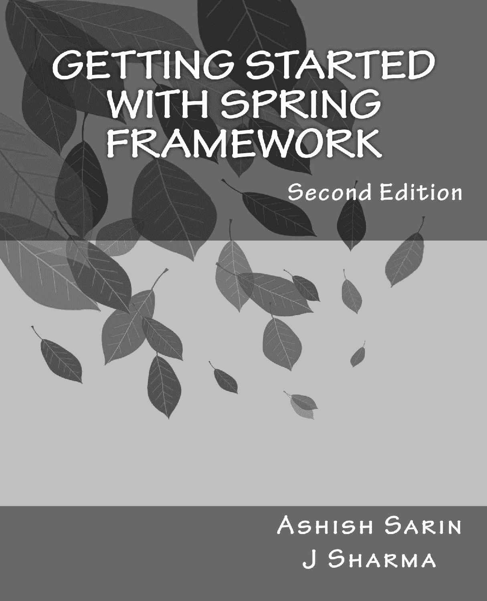

# 第 8 章 - 使用 Spring 进行消息、邮件、异步执行和缓存

## 8-1 引言

## 8-2 MyBank 应用的应用需求

## 8-3 发送 JMS 消息

### 配置 `ActiveMQ` Broker 以嵌入模式运行

### 配置 `JMSConnectionFactory`

### 使用 `JmsTemplate` 发送 JMS 消息

### 在事务中发送 JMS 消息

### 动态 JMS 目标和 `JmsTemplate` 配置

### `JmsTemplate` 与消息转换

## 8-4 接收 JMS 消息

### 使用 `JmsTemplate` 同步接收 JMS 消息

### 使用消息监听容器异步接收 JMS 消息

## 8-5 发送邮件

## 8-6 任务调度与异步执行

### `TaskExecutor` 接口

### `TaskScheduler` 接口

### `@Async` 和 `@Scheduled` 注解

## 8-7 缓存

### 配置 `CacheManager`

### 缓存注解：`@Cacheable`、`@CacheEvict` 和 `@CachePut`

## 8-8 运行 MyBank 应用

## 8-9 总结

# 第 9 章 - 面向切面编程（AOP）

## 9-1 引言

## 9-2 简单的 AOP 示例

## 9-3 Spring AOP 框架

### 代理创建

## 9-4 切点表达式

### `execution` 切点

### `args` 切点

### `bean` 切点

### 基于注解的切点

## 9-5 建议（Advice）类型

### `Before` 建议

### `After returning` 建议

### `After throwing` 建议

### `After` 建议

### `Around` 建议

## 9-6 Spring AOP：XML 架构风格

### 配置 AOP 切面（Aspect）

### 配置建议

### 将切点表达式与建议关联

## 9-7 总结

# 第 10 章 – Spring Web MVC 基础

## 10-1 引言

## 10-2 示例 Web 项目的目录结构

## 10-3 理解“Hello World” Web 应用

### `HelloWorldController.java` – Hello World Web 应用的控制器类

### `helloworld.jsp` – 显示“Hello World !!”消息的 JSP 页面

### `myapp-config.xml` – Web 应用上下文 XML 文件

### `web.xml` – Web 应用部署描述符

## 10-4 `DispatcherServlet` – 前控制器

## 10-5 访问 `ServletContext` 和 `ServletConfig` 对象

## 10-6 使用 `@Controller` 和 `@RequestMapping` 注解开发控制器

### 使用注解控制器开发“Hello World”Web 应用程序

## 10-7 MyBank 应用程序的需求

## 10-8 Spring Web MVC 注解：`@RequestMapping` 和 `@RequestParam`

### 使用 `@RequestMapping` 将请求映射到控制器或控制器方法

### `@RequestMapping` 注解方法的参数

### `@RequestMapping` 注解方法的返回值类型

### 使用 `@RequestParam` 将请求参数传递给控制器方法

## 10-9 校验

## 10-10 使用 `@ExceptionHandler` 注解处理异常

## 10-11 加载根应用上下文 XML 文件

## 10-12 总结

# 第 11 章 – Spring Web MVC 中的校验与数据绑定

## 11-1 引言

## 11-2 使用 `@ModelAttribute` 注解添加和检索模型属性

### 使用方法级 `@ModelAttribute` 注解添加模型属性

### 使用 `@ModelAttribute` 注解检索模型属性

### 请求处理与 `@ModelAttribute` 注解方法

### `@ModelAttribute` 注解方法的行为

### `RequestToViewNameTranslator`

## 11-3 使用 `@SessionAttributes` 注解缓存模型属性

## 11-4 Spring 中的数据绑定支持

### `WebDataBinder` – 用于 Web 请求参数的数据绑定器

### 配置 `WebDataBinder` 实例

### 允许或禁止字段参与数据绑定过程

### 使用 `BindingResult` 对象检查数据绑定和校验错误

## 11-5 Spring 中的校验支持

### 使用 Spring 的 `Validator` 接口校验模型属性

### 使用 JSR 303 注解指定约束

### 校验使用 JSR 303 注解的对象

## 11-6 Spring 的表单标签库

### Spring 表单标签库的 HTML5 支持

## 11-7 总结

# 第 12 章 – 使用 Spring Web MVC 开发 RESTful Web 服务

## 12-1 引言

## 12-2 固定存款服务

## 12-3 使用 Spring Web MVC 实现 RESTful Web 服务

### JSON（JavaScript 对象表示法）

### FixedDeposit 服务实现

## 12-4 使用 `RestTemplate` 访问 RESTful Web 服务

## 12-5 使用 `HttpMessageConverter` 将 Java 对象转换为 HTTP 请求及反之

## 12-6 `@PathVariable` 和 `@Matrix` 注解

## 12-7 总结

# 第 13 章 – 更多 Spring Web MVC：国际化、文件上传和异步请求处理

## 13-1 引言

## 13-2 使用处理器拦截器（handler interceptors）预处理和后请求

### 实现和配置处理器拦截器

## 13-3 使用资源包进行国际化

### MyBank 应用程序的需求

### MyBank 应用程序的国际化与本地化

## 13-4 异步处理请求

### 异步请求处理配置

### 从 `@RequestMapping` 方法返回 `Callable`

### 从 `@RequestMapping` 方法返回 `DeferredResult`

### 设置默认超时值

### 拦截异步请求

## 13-5 Spring 中的类型转换和格式化支持

### 创建自定义 `Converter`

### 配置并使用自定义的 `Converter`

### 创建自定义 `Formatter`

### 配置自定义的 `Formatter`

### 创建 `AnnotationFormatterFactory`，仅对标记有 `@AmountFormat` 的字段进行格式化

### 配置 `AnnotationFormatterFactory` 实现

## 13-6 Spring Web MVC 中的文件上传支持

### 使用 `CommonsMultipartResolver` 上传文件

### 使用 `StandardServletMultipartResolver` 上传文件

## 13-7 总结

# 第 14 章 – 使用 Spring Security 应用程序

## 14-1 引言

## 14-2 MyBank 应用程序的安全需求

## 14-3 使用 Spring Security 保护 MyBank 应用程序

### Web 请求安全

### 身份验证配置

### 使用 Spring Security JSP 库保护 JSP 内容

### 方法安全

## 14-4 MyBank 应用程序：使用 Spring Security ACL 模块保护 FixedDetails 实例

### 部署和使用 `ch14-bankapp-db-security` 项目

### ACL 和用户信息的数据库表

### 用户身份验证

### Web 请求安全

### `JdbcMutableAclService` 配置

### 方法级安全配置

### 领域对象实例安全

### 通过程序化管理 ACL 条目

### `MutableAcl` 与安全

## 14-5 总结

# 附录 A – 在 Eclipse IDE（或 IntelliJ IDEA）中导入和部署示例项目

## A-1 设置开发环境

## A-2 将示例项目导入 Eclipse IDE（或 IntelliJ IDEA）

### 导入示例项目

#### 在 Eclipse IDE 中配置 `M2_REPO` 类路径变量

## A-3 配置带有 Tomcat 7 运行的 Eclipse IDE

## A-4 在 Tomcat 7 节点上部署 Web 项目

### 在嵌入模式下运行 Tomcat 7 服务器

# 前言

## 如何使用本书

### 下载示例项目

本书附带了许多示例项目，你可以从下方的 Google Code 项目进行下载：[`code.google.com/p/getting-started-with-spring-framework-2edition/`](http://code.google.com/p/getting-started-with-spring-framework-2edition/)。你可以以单个 ZIP 文件的形式下载示例项目，也可以使用 SVN 检出示例项目。更多详细信息，请参考上述 URL。

### 将示例项目导入到你的 Eclipse 或 IntelliJ IDEA IDE

如果你在阅读本书的过程中在任何地方看到 `IMPORT chapter<章节编号>/<项目名称>`，你应该将指定的项目导入到你的 Eclipse 或 IntelliJ IDEA IDE（或你正在使用的其他 IDE）。示例项目使用 Maven 3.x 构建工具构建项目；因此，你会在每个项目中找到一个 `pom.xml` 文件。源码分发的根也提供了一个 `pom.xml` 文件，用于构建所有项目。

请参考附录 A 以查看导入和运行示例项目所需的步骤。

### 参考代码示例

每个示例列表都指定了示例项目名称（使用 `Project` 标签）和源文件位置（使用 `Source location` 标签）。如果没有指定 `Project` 和 `Source location` 标签，你可以假设示例列表中所显示的代码没有在示例项目的任何地方被使用，展示这些代码纯是为了便于理解。

## 本书使用的惯例

*斜体* 用于强调某些术语。

`Comic Sans MS` 用于示例列表、Java 代码、XML 和属性文件中的配置细节。

`Comic Sans MS` 在示例列表中用于以突出显示代码或配置的重要部分。

`NOTE` 用于标记一个重要要点。

## 反馈与问题

你可以在以下 Google Groups 论坛向作者提交反馈和问题：[`groups.google.com/forum/#!forum/getting-started-with-spring-framework`](https://groups.google.com/forum/#!forum/getting-started-with-spring-framework)

## 关于作者

**Ashish Sarin** 是一位 Sun 认证企业架构师，拥有超过 14 年的应用架构经验。他是《Spring Roo 1.1 Cookbook》（Packt Publishing 出版）和《Portlets in Action》（Manning Publications 出版）的作者。

**J Sharma** 是一位自由 Java 开发人员，在开发 Spring 应用方面拥有丰富经验。

# 第 1 章 – Spring Framework 简介

## 1-1 简介

在传统的 Java 企业级应用开发中，创建结构良好、可维护且易于测试的应用是开发者的责任。开发者使用无数设计模式来处理应用程序的非业务需求。这不仅导致了开发者生产力的低下，还对开发应用的质量产生了负面影响。

Spring Framework（简称“Spring”）是来自 SpringSource（[`www.springsource.org`](http://www.springsource.org)）的开源应用程序框架，它简化了 Java 企业级应用程序的开发。它为开发结构良好、可维护且易于测试的应用程序提供了基础设施支持。使用 Spring Framework 时，开发者只需要专注于编写应用程序的业务逻辑，从而提高了开发者的生产力。你可以使用 Spring Framework 开发独立的 Java 应用程序、Web 应用程序、Applet 或其他类型的 Java 应用程序。

本章首先介绍 Spring Framework 模块及其优势。Spring Framework 的核心是它的控制反转（IoC）容器，该容器提供了依赖注入（DI）功能。本章将介绍 Spring 的 DI 功能和 IoC 容器，并展示如何使用 Spring 开发一个独立的 Java 应用程序。在本章末尾，我们将查看一些以 Spring Framework 为基础的 SpringSource 项目。本章将为后续深入研究 Spring Framework 的章节奠定基础。

`NOTE` 在本书中，我们将使用一个名为 *MyBank* 的互联网银行应用程序示例来介绍 Spring Framework 功能。

## 1-2 Spring Framework 模块

Spring Framework 由多个模块组成，根据它们所解决的应用程序开发功能进行分组。下表描述了不同的模块组：

| 模块组 |  |
| --- | --- |
| 核心容器（Core container） | 包含构成 Spring 基础模块。该组中的模块提供了 Spring 的 DI 功能和 IoC 容器实现。 |
| AOP 与代理（AOP and instrumentation） | 包含支持 AOP（面向切面编程）和类代理的模块。 |
| 数据访问/集成（Data Access/Integration） | 包含简化与数据库和消息提供程序交互的模块。该组还包含支持编程和声明式事务管理，以及对象/XML 映射（如 JAXB 和 Castor）的模块。 |
| Web | 包含简化 Web 和 Portlet 应用程序开发的模块。 |
| 测试（Test） | 包含一个简化单元测试和集成测试创建的模块。 |

上表显示 Spring 了开发的各个方面；你可以使用 Spring 开发 Web 应用程序、访问数据库、管理事务、创建单元测试和集成测试等。Spring Framework 模块的设计使得你*仅需*包含你的应用程序所需的模块。例如，要在你的应用程序中使用 Spring 的 DI 功能，你只需要包含 `Core container` 下的模块。随着本书的进行，你将发现部分 Spring 模块的详细信息，以及如何在开发应用中使用它们的示例。

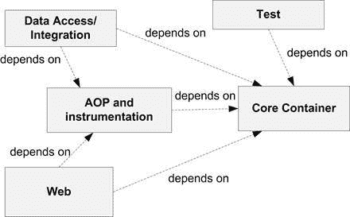

**图 1-1** Spring 模块间的依赖关系

你可以从上图中推断出 `Core container` 组中的模块是 Spring Framework 的核心，其他模块依赖于它。`AOP and instrumentation` 组中的模块同样重要，因为它们为 Spring Framework 中的其他模块提供了 AOP 功能。

现在，你已经对 Spring 涵盖的应用开发领域有了基本了解，让我们来看 Spring IoC 容器。

## 1-3 Spring IoC 容器

Java 应用程序由相互交互的对象组成，以提供应用程序行为。与对象交互的对象被称为它的*依赖*。例如，如果对象 X 与对象 Y 和 Z 交互，那么 Y 和 Z 就是对象 X 的依赖。DI 是一种设计模式，通常将对象的依赖作为参数传递给它的构造函数和 setter 方法。这些依赖在对象创建时被注入到对象中。

在 Spring 应用中，Spring IoC 容器（也称为 Spring 容器）负责创建应用对象并注入它们的依赖项。Spring 容器创建并管理的应用对象被称为 `beans`。由于 Spring 容器负责组装应用对象，因此你不需要实现诸如工厂（Factory）、服务定位器（Service Locator）等设计模式来组合你的应用程序。依赖注入（DI）也称为控制反转（IoC），因为创建和注入依赖的责任 `not` 属于应用对象，而是属于 Spring 容器。

假设 `MyBank` 应用（这是我们的示例应用名称）包含两个对象：`FixedDepositController` 和 `FixedDepositService`。下面的示例列表显示了 `FixedDepositController` 对象依赖于 `FixedDepositService` 对象：

**示例列表 1-1：** `FixedDepositController` 类


```java
public class FixedDepositController {

    private FixedDepositService fixedDepositService;

    public FixedDepositController() {
        fixedDepositService = new FixedDepositService();
    }

    public boolean submit() {
        //-- save the fixed deposit details
        fixedDepositService.save(.....);
    }
}
```

在上述示例列表中，`FixedDepositController` 的构造函数创建了 `FixedDepositService` 的实例，该实例稍后在 `FixedDepositController` 的 `submit` 方法中使用。由于 `FixedDepositController` 与 `FixedDepositService` 交互，因此 `FixedDepositService` 代表 `FixedDepositController` 的依赖。

要将 `FixedDepositController` 配置为 Spring bean，你首先需要修改示例列表 1-1 中的 `FixedDepositController` 类，使其接受 `FixedDepositService` 依赖作为构造函数参数或 setter 方法参数。下面的示例列表显示了修改后的 `FixedDepositController` 类：

**示例列表 1-2：** `FixedDepositController` 类 – 通过构造函数参数传递 `FixedDepositService`

```java
public class FixedDepositController {

    private FixedDepositService fixedDepositService;

    public FixedDepositController(FixedDepositService fixedDepositService) {
        this.fixedDepositService = fixedDepositService;
    }

    public boolean submit() {
        //-- save the fixed deposit details
        fixedDepositService.save(.....);
    }
}
```

上述示例列表显示 `FixedDepositService` 实例现在作为构造函数参数传递给 `FixedDepositController` 实例。现在，`FixedDepositService` 类可以配置为 Spring bean。注意，`FixedDepositController` 类没有实现或继承任何 Spring 接口或类。

对于给定的应用，关于应用对象及其依赖项的信息是使用 `configuration metadata` 来指定的。Spring IoC 容器读取应用的配置元数据来实例化应用对象并注入它们的依赖项。下面的示例列表显示了由 `MyController` 和 `MyService` 类组成的应用的配置元数据（XML 格式）：

**示例列表 1-3：** 配置元数据

```xml
<beans .....>
    <bean id="myController" class="sample.spring.controller.MyController">
        <constructor-arg index="0" ref="myService" />
    </bean>
    <bean id="myService" class="sample.spring.service.MyService"/>
</beans>
```

在上述示例列表中，每个 `<bean>` 元素定义了一个由 Spring 容器管理的应用对象，而 `<constructor-arg>` 元素指定将 `MyService` 的实例作为参数传递给 `MyController` 的构造函数。`<bean>` 元素将在本章稍后详细讨论，`<constructor-arg>` 元素将在第 2 章讨论。

Spring 容器读取应用的配置元数据（如示例列表 1-3 所示），创建由 `<bean>` 元素定义的应用对象并注入它们的依赖项。Spring 容器利用 `Java Reflection API`（[http://docs.oracle.com/javase/tutorial/reflect/index.html]）来创建应用对象并注入它们的依赖项。下面的图总结了 Spring 容器的工作原理：

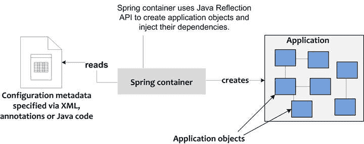

**图 1-2** Spring 容器读取应用配置元数据创建一个完全配置的应用程序

配置元数据可以通过 XML（如示例列表 1-3 所示）、Java 注解（参考第 6 章）以及 Java 代码（参考第 6 章）提供给 Spring 容器。

由于 Spring 容器负责创建和管理应用对象，企业服务（如事务管理、安全性、远程访问等）可以由 Spring 容器透明地应用到对象上。Spring 容器增强应用对象额外功能的能力使得你能够将应用对象建模为简单的 Java 对象（也称为 `POJOs` 或 `Plain Old Java Objects`）。与 POJO 对应的 Java 类被称为 `POJO 类`，它们无非是没有实现或继承框架特定的接口或类的 Java 类。这些 POJO 所需的企业服务（如事务管理、安全性、远程访问等）由 Spring 容器透明地提供。

现在我们已经知道了容器是如何工作的，让我们来看一些展示使用 Spring 开发应用程序优势的示例。

## 1-4 Spring 框架的优势

在上一节中，我们讨论了使用 Spring 的以下优势：

- Spring 通过处理创建应用对象和注入依赖项简化了 Java 应用程序的组合

- Spring 促进作为 POJO 开发应用程序

Spring 还通过提供一个处理样板代码的抽象层，简化了与 JMS 提供者、JNDI、MBean 服务器、电子邮件服务器、数据库等的交互。

让我们快速查看几个示例，以更好地理解使用 Spring 开发应用程序的优势。

### 管理本地和全局事务的一致方法

如果你使用 Spring 开发 `transactional` 应用程序，可以使用 Spring 的 `声明式事务管理`支持来管理事务。

下面的示例列表显示了 `MyBank` 应用的 `FixedDepositService` 类：

**示例列表 1-4** – `FixedDepositService` 类

```java
public class FixedDepositService {
    public FixedDepositDetails getFixedDepositDetails(..... ) { ..... }
    public boolean createFixedDeposit(FixedDepositDetails fixedDepositDetails) { ..... }
}
```

`FixedDepositService` 类是一个 POJO 类，定义了创建和检索存款详情的方法。下面的图显示了创建新存款的表单：

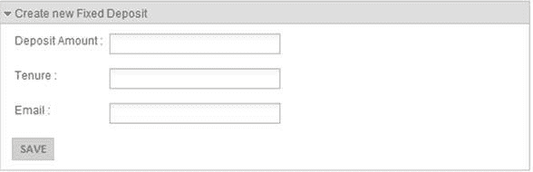

**图 1-3** 创建新存款的 HTML 表单

客户在上方表单中输入存款金额、期限和电子邮件信息，并点击保存按钮创建新存款。调用 `FixedDepositService` 的 `createFixedDeposit` 方法（参考示例列表 1-1）来创建存款。`createFixedDeposit` 方法从客户的银行账户中扣除其输入的金额，并创建一个相同金额的存款。

假设客户的银行余额信息存储在 `BANK_ACCOUNT_DETAILS` 数据库表中，而定期存款详情存储在 `FIXED_DEPOSIT_DETAILS` 数据库表中。如果客户创建了一个金额为 `x` 的定期存款，则会从 `BANK_ACCOUNT_DETAILS` 表中减去金额 `x`，并在 `FIXED_DEPOSIT_DETAILS` 表中插入一条新记录以反映新创建的定期存款。如果 `BANK_ACCOUNT_DETAILS` 表没有被更新，或者没有在 `FIXED_DEPOSIT_DETAILS` 表中插入新记录，将导致系统处于不一致状态。这意味着 `createFixedDeposit` 方法必须在事务中执行。

`MyBank` 应用程序使用的数据库表示了一个`事务性资源`。在执行一组数据库修改作为一个单个工作单元的传统方法中，你首先需要禁用 `JDBC` 连接的自动提交模式，然后执行 SQL 语句，最后提交（或回滚）事务。下面的示例列表展示了如何使用传统方法在 `createFixedDeposit` 方法中管理数据库事务：

#### 示例列表 1-5 – 使用 `JDBC Connection` 对象程序化管理数据库事务

```java
import java.sql.Connection;
import java.sql.SQLException;

public class FixedDepositService {
    public FixedDepositDetails getFixedDepositDetails( ..... ) { ..... }

    public boolean createFixedDeposit(FixedDepositDetails fixedDepositDetails) { 
        Connection con = ..... ;
        try {
            con.setAutoCommit(false);
            //-- 执行修改数据库表的 SQL 语句
            con.commit();
        } catch(SQLException sqle) {
            if(con != null) {
                con.rollback();
            }
        }
        .....
    }
}
```

上面的示例列表显示 `createFixedDeposit` 方法使用 `JDBC Connection` 对象程序化地管理数据库事务。这种方法适用于涉及单个数据库的应用场景。特定资源的事务，例如与 `JDBC Connection` 关联的事务被称为`本地事务`。

当涉及多个事务性资源时，使用 `JTA`（Java Transaction API）来管理事务。例如，如果你想在同一个事务中向消息中间件（一个事务性资源）发送 `JMS` 消息并更新数据库（另一个事务性资源），你必须使用 `JTA` 事务管理器来管理事务。`JTA` 事务也称为`全局`（或分布式）`事务`。要使用 `JTA`，你需要从 `JNDI` 获取 `UserTransaction` 对象（它是 `JTA API` 的一部分），并程序化启动和提交（或回滚）事务。

如你所见，可以使用 `JDBC Connection`（用于本地事务）或 `UserTransaction` 对象（用于全局事务）来程序化管理事务。需要注意的是，本地事务不能在全局事务中运行。这意味着如果你想让 `createFixedDeposit` 方法（参考示例列表 1-5）中的数据库更新成为 `JTA` 事务的一部分，你需要修改 `createFixedDeposit` 方法以使用 `UserTransaction` 对象进行事务管理。

Spring 通过提供一个抽象层简化了事务管理，该层提供了一种管理本地和全局事务的一致方法。这意味着如果你使用 Spring 的事务抽象编写了 `createFixedDeposit` 方法（参考示例列表 1-5），当你从本地事务切换到全局事务管理（或反之）时，不需要修改该方法。Spring 的事务抽象将在第 7 章中解释。

### 声明式事务管理

Spring 提供了使用声明式事务管理的选项。你可以对方法标记使用 Spring 的 `@Transactional` 注解并让 Spring 处理事务，如下所示：

#### 示例列表 1-6 – `@Transactional` 注解的使用

```java
import org.springframework.transaction.annotation.Transactional;

public class FixedDepositService {
    public FixedDepositDetails getFixedDepositDetails( ..... ) { ..... }

    @Transactional
    public boolean createFixedDeposit(FixedDepositDetails fixedDepositDetails) { ..... }
}
```

上面的示例列表显示 `FixedDepositService` 类没有实现或继承任何 Spring 特有的接口或类来使用 Spring 的事务管理功能。Spring Framework 透明地为标记了 `@Transactional` 注解的 `createFixedDeposit` 方法提供了事务管理功能。这表明 Spring 是一个非侵入式框架，因为它不需要你的应用程序对象依赖于 Spring 特有的类或接口。此外，你不需要直接操作事务管理 API 来管理事务。

### 安全

安全是任何 Java 应用程序的一个重要方面。Spring Security（[http://static.springsource.org/spring-security/site/](http://static.springsource.org/spring-security/site/)）是构建在 Spring Framework 之上的 SpringSource 项目。Spring Security 提供了用于保护 Java 应用程序的身份验证和授权功能。

假设为 `MyBank` 应用程序识别了以下 3 个用户角色：`LOAN_CUSTOMER`、`SAVINGS_ACCOUNT_CUSTOMER` 和 `APPLICATION_ADMIN`。客户必须关联 `SAVINGS_ACCOUNT_CUSTOMER` 或 `APPLICATION_ADMIN` 角色才能调用 `FixedDepositService` 类的 `createFixedDeposit` 方法（参考示例列表 1-6）。使用 Spring，你可以通过 Spring Security 的 `@Secured` 注解标记 `createFixedDeposit` 方法来轻松地实现这一需求，如下例所示：

#### 示例列表 1-7 – `@Secured` `createFixedDeposit` 方法

```java
import org.springframework.transaction.annotation.Transactional;
import org.springframework.security.access.annotation.Secured;

public class FixedDepositService {
    public FixedDepositDetails getFixedDepositDetails( ..... ) { ..... }

    @Transactional
    @Secured({ "SAVINGS_ACCOUNT_CUSTOMER", "APPLICATION_ADMIN" })
    public boolean createFixedDeposit(FixedDepositDetails fixedDepositDetails) { ..... }
}
```

如果你在方法上标记了 Spring Security 的 `@Secured` 注解，Spring 框架将透明地对该方法应用安全功能。上面的示例列表显示，为了实现方法级安全不需要扩展或实现任何 Spring 特有的类或接口。此外，你不需要在业务方法中编写安全相关的代码。

Spring Security 框架将在第 14 章详细讨论。

### JMX (Java Management Extensions)

Spring 对 JMX 的支持简化了将 JMX 技术集成到应用程序中。

假设 `MyBank` 应用程序的定期存款功能仅在上午 9:00 到下午 6:00 向客户开放。为了满足这一需求，在 `FixedDepositService` 类中添加了一个变量，作为指示定期存款服务是否激活状态的标记。下面的示例列表展示了使用了此类标记的 `FixedDepositService` 类：

#### 示例列表 1-8 – 使用 `active` 变量的 `FixedDepositService`

```java
public class FixedDepositService {
    private boolean active;

    public FixedDepositDetails getFixedDepositDetails( ..... ) {
        if(active) { ..... }
    }

    public boolean createFixedDeposit(FixedDepositDetails fixedDepositDetails) {
        if(active) { ..... }
    }

    public void activateService() {
        active = true;
    }

    public void deactivateService() {
        active = false;
    }
}
```


上面的示例列表显示，`FixedDepositService` 类中添加了一个名为 `active` 的变量。如果 `active` 变量的值为 `true`，`getFixedDepositDetails` 和 `createFixedDeposit` 方法将按预期工作。如果 `active` 变量的值为 `false`，`getFixedDepositDetails` 和 `createFixedDeposit` 方法将抛出异常，表示固定存款服务目前处于激活状态。`activateService` 和 `deactivateService` 方法分别将 `active` 变量的值设置为 `true` 和 `false`。

现在，是谁在调用 `activateService` 和 `deactivateService` 方法呢？假设有一个独立的调度器应用程序 `Bank App Scheduler` 在每天上午 9:00 和下午 6:00 运行，分别执行 `activateService` 和 `deactivateService` 方法。Bank App Scheduler 应用程序使用 JMX（Java 管理扩展）API 远程与 `FixedDepositService` 实例交互。

**注意** 请参阅以下文章了解更多关于 JMX 的信息：[`docs.oracle.com/javase/tutorial/jmx/index.html`](http://docs.oracle.com/javase/tutorial/jmx/index.html)。

由于 Bank App Scheduler 使用 JMX 来更改 `FixedDepositService` 实例的 `active` 变量值，你需要将 `FixedDepositService` 实例作为 `managed bean`（或 `MBean`）注册到 MBean 服务器，并将 `FixedDepositService` 的 `activateService` 和 `deactivateService` 方法暴露为 JMX 操作。在 Spring 中，你通过在该类添加 Spring 的 `@ManagedResource` 注解将类实例注册到 MBean 服务器，并使用 Spring 的 `@ManagedOperation` 注解将类的方法暴露为 JMX 操作。

下面的示例列表展示了如何使用 `@ManagedResource` 和 `@ManagedOperation` 注解将 `FixedDepositService` 类实例注册到 MBean 服务器，并将其 `activateService` 和 `deactivateService` 方法暴露为 JMX 操作：

**示例列表 1-9** – 使用 Spring JMX 支持的 FixedDepositService 类

```java
import org.springframework.jmx.export.annotation.ManagedOperation;
import org.springframework.jmx.export.annotation.ManagedResource;

@ManagedResource(objectName = "fixed_deposit_service:name=FixedDepositService")
public class FixedDepositService {

    private boolean active;

    public FixedDepositDetails getFixedDepositDetails( ..... ) {
        if(active) { ..... }
    }

    public boolean createFixedDeposit(FixedDepositDetails fixedDepositDetails) {
        if(active) { ..... }
    }

    @ManagedOperation
    public void activateService() {
        active = true;
    }

    @ManagedOperation
    public void deactivateService() {
        active = false;
    }
}
```

上面的示例列表显示，`FixedDepositService` 类并没有直接使用 JMX API 将其实例注册到 MBean 服务器并将其方法暴露为 JMX 操作。

### JMS (Java 消息服务)

Spring 的 JMS 支持简化了从 JMS 提供者处发送和接收消息。

在 MyBank 应用程序中，当客户提交请求通过电子邮件接收其固定存款详情时，`FixedDepositService` 将请求详情发送到 JMS 消息中间件（如 ActiveMQ）。该请求随后由消息监听器处理。Spring 通过提供一个抽象层简化了与 JMS 提供者的交互。下面的示例列表显示了 `FixedDepositService` 类如何使用 Spring 的 `JmsTemplate` 向 JMS 提供者发送请求详情：

**示例列表 1-10** – 发送 JMS 消息的 FixedDepositService

```java
import org.springframework.beans.factory.annotation.Autowired;
import org.springframework.jms.core.JmsTemplate;

public class FixedDepositService {

   @Autowired
   private transient JmsTemplate jmsTemplate;

    .....

    public boolean submitRequest(Request request) {
        jmsTemplate.convertAndSend(request);
    }
}
```

上面的示例列表显示，`FixedDepositService` 定义了一个类型为 `JmsTemplate` 的变量，并使用了 Spring 的 `@Autowired` 注解。目前你可以假设 `@Autowired` 注解提供了对 `JmsTemplate` 实例访问。`JmsTemplate` 实例知道 JMS 消息要发送到的 JMS 目标。`JmsTemplate` 如何配置在第 8 章中有详细描述。`FixedDepositService` 的 `submitRequest` 方法调用 `JmsTemplate` 的 `convertAndSend` 方法将请求详情（由 `submitRequest` 方法的 `Request` 参数表示）作为 JMS 消息发送到 JMS 提供者。

再次强调，上面的示例列表显示，如果你使用 Spring Framework 向 JMS 提供者发送消息，那么你就不需要直接处理 JMS API。

### 缓存

Spring 的缓存抽象为在应用程序中使用缓存提供了一种一致的方法。

使用缓存解决方案来提高应用程序性能是常见的。MyBank 应用程序使用缓存产品来提高固定存款详情 `read` 操作的性能。Spring Framework 通过抽象缓存相关的逻辑简化了与不同缓存解决方案的交互。

下面的示例列表显示了 `FixedDepositService` 的 `getFixedDepositDetails` 方法使用 Spring 的缓存抽象功能来缓存固定存款详情：

**示例列表 1-11**– 缓存固定存款详情的 FixedDepositService

```java
import org.springframework.cache.annotation.Cacheable;

public class FixedDepositService {

    @Cacheable("FixedDeposits")
    public FixedDepositDetails getFixedDepositDetails( ..... ) { ..... }

    public boolean createFixedDeposit(FixedDepositDetails fixedDepositDetails) { ..... }
}
```

在上面的示例列表中，`@Cacheable` 注解表示 `getFixedDepositDetails` 方法返回的固定存款详情被缓存。如果以相同的参数调用 `getFixedDepositDetails` 方法，该方法将*不会*执行，而是从缓存中返回固定存款详情。这说明如果你使用 Spring Framework，就不需要在类中编写缓存相关的逻辑。Spring 的缓存抽象在第 8 章中有详细解释。

在本节中，我们看到 Spring Framework 通过透明地为 POJO 提供服务简化了企业级应用的开发，从而屏蔽了底层的 API 细节。

既然我们已经了解了使用 Spring Framework 的某些好处，让我们来看看如何开发一个简单的 Spring 应用程序。

## 1-5 一个简单的 Spring 应用程序

在本节中，我们将查看一个使用 Spring DI 功能的简单 应用程序。要在应用程序中使用 Spring DI 功能，请遵循以下步骤：

1. 识别应用程序对象及其依赖

2. 创建对应步骤 1 中识别的应用程序对象的 POJO 类

3. 创建描述应用程序对象及其依赖的配置元数据

4. 创建 Spring IoC 容器实例并将配置元数据传递给它

5. 从 Spring IoC 容器实例访问应用程序对象

现在让我们结合 MyBank 应用程序的背景来看上述步骤。

### 识别应用程序对象及其依赖

我们之前讨论过 MyBank 应用程序向用户展示了一个创建固定存款的表单（参考图 1-3），用于创建固定存款。下面的序列图显示了当用户提交表单时进入场景的应用程序对象（及其交互）：

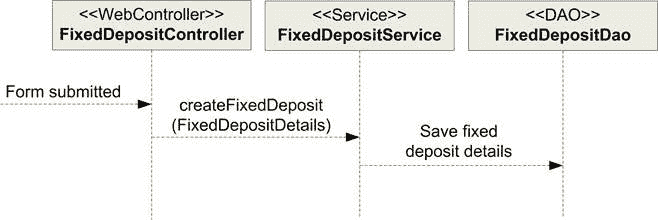

**图 1-4** MyBank 的应用程序对象及其依赖

在上面的序列图中，`FixedDepositController` 代表一个在表单提交时接收请求的 Web 控制器。存款详情包含在 `FixedDepositDetails` 对象中。`FixedDepositController` 调用 `FixedDepositService`（一个服务层对象）的 `createFixedDeposit` 方法。然后，`FixedDepositService` 调用 `FixedDepositDao` 对象（一个数据访问对象）将定期存款详情保存到应用程序的数据存储器中。因此，我们可以从上述图中推断出，`FixedDepositService` 是 `FixedDepositController` 对象的依赖，而 `FixedDepositDao` 是 `FixedDepositService` 对象的依赖。

**导入** `chapter 1/ch01-bankapp-xml`（此项目展示了一个使用 Spring DI 特性的简单 Spring 。要运行该应用程序，请执行项目中 `MyBankApp` 类的 main 方法）

### 为识别出的应用对象创建 POJO 类

一旦你确定了应用对象，下一步就是创建与这些应用对象对应的 POJO 类。与 `FixedDepositController`、`FixedDepositService` 和 `FixedDepositDao` 应用对象对应的 POJO 类可以在 `ch01-bankapp-xml` 项目中找到。`ch01-bankapp-xml` 项目代表使用 Spring DI 特性的 `MyBank` 应用程序的简化版本。你应该将 `ch01-bankapp-xml` 项目导入到你的 IDE 中，因为在后续步骤中，我们将查看该项目包含的文件。

在 1-3 节中，我们讨论了依赖是如何作为构造函数参数或 setter 方法参数传递给应用对象的。下面的代码列表显示了 `FixedDepositService` 实例（`FixedDepositController` 的依赖）是如何作为 setter 方法参数传递给 `FixedDepositController` 对象的：

**示例列表 1-12** – `FixedDepositController` 类

**项目** – `ch01-bankapp-xml`

**源码位置**-`src/main/java/sample/spring/chapter01/bankapp`

```
package sample.spring.chapter01.bankapp;

.....

public class FixedDepositController {

    .....

    private FixedDepositService fixedDepositService;

    .....

    public void setFixedDepositService(FixedDepositService fixedDepositService) {

        logger.info("Setting fixedDepositService property");

        this.fixedDepositService = fixedDepositService;

    }

    .....    

    public void submit() {

        fixedDepositService.createFixedDeposit(new FixedDepositDetails( 1, 10000,

            365, "someemail@something.com"));

    }

    .....
}
```

在上面的示例列表中，`FixedDepositService` 依赖通过 `setFixedDepositService` 方法传递给 `FixedDepositController`。我们很快就会看到 `setFixedDepositService` setter 方法方法是由 Spring 调用的。

**注意** 如果你查看 `FixedDepositController`、`FixedDepositService` 和 `FixedDepositDao` 类，你会发现这些类中没有实现任何 Spring 特有的接口，也没有继承自任何 Spring 特有的类。

现在让我们来看如何在配置元数据中指定应用对象及其依赖。

### 创建配置元数据

我们在 1-3 节中看到，配置元数据指定了应用对象及其依赖，Spring 容器读取这些信息来实例化应用对象并注入它们的依赖。在本节中，我们首先将查看配置元数据中包含哪些其他信息，然后深入探讨如何以 XML 格式指定配置元数据。

配置元数据指定了应用程序所需的企业服务信息（如事务管理、安全和远程访问）。例如，如果你想让 Spring 管理事务，你需要在配置元数据中配置 Spring 的 `PlatformTransactionManager` 接口的实现。`PlatformTransactionManager` 的实现负责管理事务（参阅第 7 章以了解更多关于 Spring 事务管理的功能）。

如果你的应用程序与消息中间件（如 ActiveMQ）、数据库（如 MySQL）、电子邮件服务器等交互，那么配置元数据中也会定义简化与这些外部系统交互的 Spring 特有对象。例如，如果你的应用程序从 ActiveMQ 发送或接收 JMS 消息，你可以在配置元数据中配置 Spring 的 `JmsTemplate` 类以简化与 ActiveMQ 的交互。我们在示例列表 1-10 中看到，如果你使用 `JmsTemplate` 向 JMS 提供者发送消息，那么你就不需要处理底层的 JMS API（参阅第 8 章以了解更多关于 Spring 对 JMS 提供者交互的支持）。

你可以通过 XML 文件或通过 POJO 类中的注解向 Spring 容器提供配置元数据。从 Spring 3.0 开始，你还可以通过带有 Spring 的 `@Configuration` 注解的 Java 类向 Spring 容器提供配置元数据。在本节中，我们将看到如何以 XML 格式指定配置元数据。在第 6 章中，我们将看到如何通过 POJO 类中的注解以及带有 `@Configuration` 注解的 Java 类提供配置元数据。

你通过创建一个包含应用对象及其依赖信息的 `application context XML` 文件来提供 XML 格式的应用程序配置元数据。示例列表 1-3 显示了应用上下文 XML 文件的样子。下面的 XML 显示了 MyBank 应用程序的应用上下文 XML 文件，它由 `FixedDepositController`、`FixedDepositService` 和 `FixedDepositDao` 对象组成（参阅图 1-4 查看对象是如何交互的）：

**示例列表 1-13** – `applicationContext.xml` - MyBank 的应用上下文文件

**项目** – `ch01-bankapp-xml`

**源码位置**-`src/main/resources/META-INF/spring`


```xml
<?xml version="1.0" encoding="UTF-8"?>
<beans xmlns="http://www.springframework.org/schema/beans"
    xmlns:xsi="http://www.w3.org/2001/XMLSchema-instance"
    xsi:schemaLocation="http://www.springframework.org/schema/beans
    http://www.springframework.org/schema/beans/spring-beans-4.0.xsd">

    <bean id="controller" class="sample.spring.chapter01.bankapp.FixedDepositController">
        <property name="fixedDepositService" ref="service" />
    </bean>

    <bean id="service" class="sample.spring.chapter01.bankapp.FixedDepositService">
        <property name="fixedDepositDao" ref="dao" />
    </bean>

    <bean id="dao" class="sample.spring.chapter01.bankapp.FixedDepositDao"/>
</beans>
```

关于上述应用上下文 XML 文件，有以下几点：

- `<beans>` 元素是应用上下文 XML 文件的根元素，定义在 `spring-beans-4.0.xsd` 中（也称为 Spring 的 beans 架构）。`spring-beans-4.0.xsd` 包含在 Spring Framework 分发的 `spring-beans-4.0.0.RELEASE.jar` JAR 包中。

- 每个 `<bean>` 元素配置一个由 Spring 容器管理的应用程序对象。在 Spring Framework 的术语中，`<bean>` 元素表示一个 `bean definition`（bean 定义）。Spring 容器根据 bean 定义创建的对象被称为 `bean`。`id` 属性为 bean 指定一个唯一名称，`class` 属性指定 bean 的完全限定类名。你还可以使用 `<bean>` 元素的 `name` 属性来为 bean 指定 `aliases`（别名）。在 MyBank 应用程序中，应用程序对象是 `FixedDepositController`、`FixedDepositService` 和 `FixedDepositDao`；因此，我们有 3 个 `<bean>` 元素——每个应用程序对象对应一个。由于由 `<bean>` 元素配置的应用程序对象是由 Spring 容器管理的，因此创建这些对象并注入其依赖的责任由 Spring 容器承担。你不应该直接创建由 `<bean>` 元素定义的应用程序对象实例，而应该从 Spring 容器中获取它们。在本节的后后部分，我们将查看如何获取由 Spring 容器管理的应用程序对象。

- MyBank 应用程序中没有为 `FixedDepositDetails` 领域对象定义对应的 `<bean>` 元素。这是因为领域对象通常**不是**由 Spring 容器管理的；它们是由应用程序使用的 ORM 框架（如 `Hibernate`）创建的，或者你使用 `new` 运算符程序化地创建它们。

- `<property>` 元素指定由 `<bean>` 元素配置的 bean 的依赖（或配置属性）。`<property>` 元素对应于 bean 类中的 `JavaBean-style setter`（JavaBean 风格 setter）方法，该方法由 Spring 容器调用以设置 bean 的依赖（或配置属性）。

现在让我们来看如何通过 setter 方法注入依赖。

#### 通过 setter 方法注入依赖

为了理解如何通过 bean 类中定义的 setter 方法注入依赖，让我们再次查看 MyBank 应用程序的 `FixedDepositController` 类：

**示例列表 1-14** – `FixedDepositController` 类

**项目** – `ch01-bankapp-xml`

**源码位置** – `src/main/java/sample/spring/chapter01/bankapp`

```java
package sample.spring.chapter01.bankapp;

import org.apache.log4j.Logger;

public class FixedDepositController {

    private static Logger logger = Logger.getLogger(FixedDepositController.class);

    private FixedDepositService fixedDepositService;

    public FixedDepositController() {
        logger.info("initializing");
    }

    public void setFixedDepositService(FixedDepositService fixedDepositService) {
        logger.info("Setting fixedDepositService property");
        this.fixedDepositService = fixedDepositService;
    }

    .....
}
```

上面的示例列表显示 `FixedDepositController` 类声明了一个类型为 `FixedDepositService` 的名为 `fixedDepositService` 的实例变量。`fixedDepositService` 变量通过 `setFixedDepositService` 方法设置——这是 `fixedDepositService` 变量的 `JavaBean-style setter method`。这是 `setter-based DI`（基于 setter 的依赖注入）的一个示例，其中 setter 方法满足了依赖。

下图描述了 `applicationContext.xml` 文件中 `FixedDepositController` 类的 bean 定义（参见示例列表 1-13）：

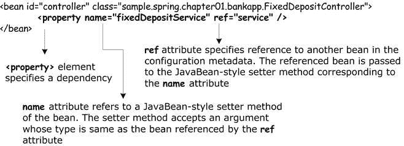

**图 1-5** 使用 `<property>` 元素定义依赖

上面的 bean 定义显示 `FixedDepositController` bean 通过 `<property>` 元素定义了对 `FixedDepositService` bean 的依赖。`<property>` 元素的 `name` 属性对应于 bean 类中的 JavaBean-style setter 方法，该方法由 Spring 容器在 bean 创建时调用。`<property>` 元素的 `ref` 属性标识需要创建并传递给 JavaBean-style setter 方法的 Spring bean。`ref` 属性的值必须匹配配置元数据 `<bean>` 元素的 `id` 属性值（或 `name` 属性指定的名称之一）。

在图 1-5 中，`<property>` 元素 `name` 属性的值为 `fixedDepositService`，这意味着 `<property>` 元素对应于 `FixedDepositController` 类的 `setFixedDepositService` setter 方法（参见示例列表 1-14）。由于 `<property>` 元素 `ref` 属性的值为 `service`，`<property>` 引用了 `id` 值为 `service` 的 `<bean>` 元素。现在，`id` 值为 `service` 的 `<bean>` 元素就是 `FixedDepositService` bean（参见示例列表 1-13）。Spring 容器创建 `FixedDepositService` 类的实例（一个依赖项），并调用 `FixedDepositController`（依赖对象）的 `setFixedDepositService` 方法（用于 `fixedDepositService` 变量的 JavaBean-style setter 方法），传递 `FixedDepositService` 实例。

在 `FixedDepositController` 应用程序对象的上下文中，下图总结了 `<property>` 元素 `name` 和 `ref` 属性的作用：

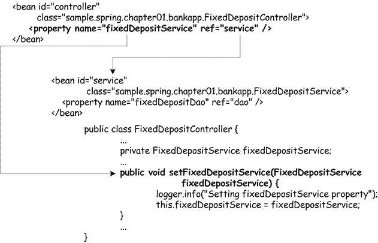

**图 1-6** `<property>` 元素的 `name` 属性对应于满足 bean 依赖的 JavaBean-style setter 方法，而 `ref` 属性引用另一个 bean。

上面的图显示 `name` 属性的值 `fixedDepositService` 对应于 `FixedDepositController` 类的 `setFixedDepositService` 方法，`ref` 属性的值 `service` 引用 id 为 `service` 的 bean。

**注意** 通过名称（即 `id` 属性的值）、类型（即 `class` 属性的值）或 bean 类实现的接口来引用 bean 定义是非常常见的。例如，你可以将“FixedDepositController bean”称为“controller bean”。而且，如果 `FixedDepositController` 类实现了 `FixedDepositf` 接口，你可以将“FixedDepositController bean”称为“FixedDepositControllerf bean”。

下图总结了 Spring 容器如何根据 MyBank 应用程序 `applicationContext.xml` 文件（参见示例列表 1-13）提供的配置元数据创建 bean 并注入依赖：

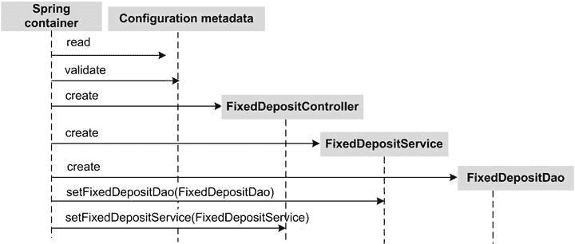

**图 1-7** - Spring IoC 容器创建 bean 并注入依赖的顺序。

Spring 的 `ApplicationContext` 对象代表 Spring 容器的实例。Spring 提供了 `ApplicationContext` 接口的几个内置实现，例如 `ClassPathXmlApplicationContext`、`FileSystemXmlApplicationContext`、`XmlWebApplicationContext`、`XmlPortletApplicationContext` 等。`ApplicationContext` 实现的选择取决于你如何定义配置元数据（使用 XML、注解或 Java 代码）以及你的应用程序类型（独立应用、web 或 portlet 应用程序）。例如，`ClassPathXmlApplicationContext` 和 `FileSystemXmlApplicationContext` 类适用于以 XML 格式提供配置元数据的 `standalone` 应用程序；`XmlWebApplicationContext` 适用于以 XML 格式提供配置元数据的 `web` 应用；`AnnotationConfigWebApplicationContext` 适用于通过 Java 代码提供配置元数据的 `web` 应用，以此此类推。

由于 `MyBank` 应用程序是一个独立应用程序，我们可以使用 `ClassPathXmlApplicationContext` 或 `FileSystemXmlApplicationContext` 类来创建 Spring 容器的实例。你需要注意，`ClassPathXmlApplicationContext` 类从指定的 `classpath` 位置加载应用上下文 XML 文件，而 `FileSystemXmlApplicationContext` 类则从文件系统（`filesystem`）上的指定位置加载应用上下文 XML 文件。

`MyBank` 应用程序的以下 `BankApp` 类展示了如何使用 `ClassPathXmlApplicationContext` 类创建 Spring 容器实例：

**示例 1-15** – `BankApp` 类

**项目** – `ch01-bankapp-xml`

**源码位置** – `src/main/java/sample/spring/chapter01/bankapp`

```java
package sample.spring.chapter01.bankapp;

import org.springframework.context.ApplicationContext;
import org.springframework.context.support.ClassPathXmlApplicationContext;

public class BankApp {
    .....

    public static void main(String args[]) {
        ApplicationContext context = new ClassPathXmlApplicationContext(
            "classpath:META-INF/spring/applicationContext.xml");
        .....
    }
}
```

上面的示例显示了 `BankApp` 的 `main` 方法，该方法负责启动 Spring 容器。应用上下文 XML 文件的路径位置被传递给 `ClassPathXmlApplicationContext` 类的构造函数。`ClassPathXmlApplicationContext` 实例的创建会导致应用上下文 XML 文件中那些被设置为 `singleton-scoped`（单例作用域）且 `pre-instantiated`（预实例化）的 bean 被创建。在第 2 章中，我们将讨论 `bean scopes`（bean 作用域），以及由 Spring 容器进行 `pre-` 或 `lazily-instantiated`（懒实例化）的含义。现在，你可以假设 `MyBank` 应用程序的 `applicationContext.xml` 文件中定义的 bean 是单例作用域并设置为预实例化的。这意味着 `applicationContext.xml` 文件中定义的 bean 在创建 `ClassPathXmlApplicationContext` 实例时就会被创建。

现在，我们已经了解了如何创建 Spring 容器的实例，让我们来看看如何从 Spring 容器中获取 bean 实例。

### 从 Spring 容器访问 bean

通过 `<bean>` 定义的应用程序对象由 Spring 容器创建并管理。你可以通过调用 `ApplicationContext` 接口的 `getBean` 方法之一来访问这些对象的实例。

下面的示例显示了 `BankApp` 类的 `main` 方法，它从 Spring 容器获取了 `FixedDepositController` bean 实例并调用了它的方法：

**示例 1-16** – `BankApp` 类

**项目** – `ch01-bankapp-xml`

**源码位置** – `src/main/java/sample/spring/chapter01/bankapp`

```java
package sample.spring.chapter01.bankapp;

import org.apache.log4j.Logger;
import org.springframework.context.ApplicationContext;
import org.springframework.context.support.ClassPathXmlApplicationContext;

public class BankApp {
    private static Logger logger = Logger.getLogger(BankApp.class);

    public static void main(String args[]) {
        ApplicationContext context = new ClassPathXmlApplicationContext(
            "classpath:META-INF/spring/applicationContext.xml");
        FixedDepositController fixedDepositController = (FixedDepositController) context.getBean("controller");
        logger.info("Submission of deposit : " + fixedDepositController.submit());
        logger.info("Returned deposit info : " + fixedDepositController.get());
    }
}
```

首先，调用 `ApplicationContext` 的 `getBean` 方法从 Spring 容器中获取 `FixedDepositController` bean，随后调用 `submit` 和 `get` 方法。传递给 `getBean` 的参数必须是你想要获取的 bean 名称。如果 Spring 容器中没有注册该名称的 bean，则会抛出异常。


在示例 1-16 中，为了配置`FixedDepositController`实例，我们没有通过编程创建实例。

上面的输出显示 Spring 容器创建了`MyBank`应用程序`applicationContext.xml`文件中定义的每个 bean 的实例。此外，Spring 容器使用基于 setter 的依赖注入（DI）将`FixedDepositService`实例注入到`FixedDepositController`实例，并将`FixedDepositDao`实例注入到`FixedDepositService`实例。

如果你进入`ch01-bankapp-xml`项目并执行`BankApp`的`main`方法，你将在控制台上看到输出：

```
INFO sample.spring.chapter01.bankapp.FixedDepositController - initializing
INFO sample.spring.chapter01.bankapp.FixedDepositService - initializing
INFO sample.spring.chapter01.bankapp.FixedDepositDao - initializing
INFO sample.spring.chapter01.bankapp.FixedDepositService - SettingDao property
INFO sample.spring.chapter01.bankapp.FixedDepositController - Setting fixedService property
INFO sample.spring.chapter01.bankapp.BankApp - Submission of deposit : true
INFO sample.spring.chapter01.bankapp.BankApp - Returned deposit info : id :1, deposit amount :10000.0, tenure :365, email :someemail@something.com
```

## 1-6 构建在 Spring 之上的框架

有很多以 Spring Framework 为基础的 SpringSource 框架，我们将查看一些流行的框架。有关框架的完整列表以及单个框架的详细信息，建议访问 SpringSource 网站（[www.springsource.org](http://www.springsource.org)）。

下表提供了基于 Spring Framework 构建的 SpringSource 框架的高级概述：

| 框架 | 说明 |
| :--- | :--- |
| `Spring Security` | 企业应用程序的身份验证和授权框架。你需要在应用上下文 XML 文件中配置一些 bean 以向应用程序引入身份验证和授权功能。 |
| `Spring Data` | 为不同类型数据库交互的一致编程模型。例如，你可以使用它与`MongoDB`或`Neo4j`等非关系数据库进行交互，也可以使用它通过`JPA`访问关系型数据库。 |
| `Spring Batch` | 如果你的应用程序需要批量处理，这个框架非常适合你。 |
| `Spring Integration` | 为应用程序提供企业应用集成 (EAI) 能力。 |
| `Spring Social` | 如果你的应用程序需要与 Facebook 和 Twitter 等社交媒体网站进行交互，那么你会发现这个框架非常有用。 |
| `Spring BlazeDS Integration` | 如果你正在开发基于 Adobe Flex 的应用程序，可以使用此框架将 Flex 前端与基于 Spring 的业务层连接起来。 |

由于上表提到的框架都是基于`Spring Framework`构建的，因此在使用其中任何一个框架之前，请确保它们与你正在使用的`Spring Framework`版本兼容。

## 1-7 总结

在本章中，我们查看了使用`Spring Framework`的益处。我们还查看了一个简单的`Spring`应用程序，它展示了如何以 XML 格式指定配置元数据、创建`Spring`容器实例并从中检索 bean。在下一章中，我们将介绍`Spring Framework`的一些基础概念。

# 第 2 章 – Spring Framework 基础

## 2-1 引言

在上一章中，我们看到`Spring`容器会调用 bean 类的无参构造函数来创建 bean 实例，并使用基于 setter 的依赖注入（DI）来设置 bean 依赖。在本章中，我们将更进一步，探讨：

- `Spring`对“面向接口编程”设计原则的支持
- 实例化`Spring` bean 的不同方法
- 基于构造函数的 DI 将 bean 依赖作为构造函数参数传递
- 基于构造函数和 setter 的 DI 将简单的`String`值传递给 bean，以及
- bean 作用域（bean scopes）

让我们从查看`Spring`如何通过支持“面向接口编程”设计原则来提高应用程序的可测试性开始。

## 2-2 面向接口编程设计原则

在第 1 章第 1-5 节中，我们看到依赖 POJO 类包含了对依赖的具体类的引用。例如，`FixedDepositController`类包含了对`FixedDepositService`类的引用，而`FixedDepositService`类包含了对`FixedDepositDao`类的引用。如果依赖类直接引用依赖的具体类，就会导致类与类之间的紧散耦合。这意味着如果你想替换依赖的另一个实现，就需要修改依赖类。

现在让我们来看一个依赖类直接引用依赖的具体类的场景。

### 场景：依赖类包含对依赖具体类的引用

假设`FixedDepositDao`类使用纯 JDBC 与数据库交互。为了简化数据库交互，你创建了另一个 DAO 实现类`FixedDepositHibernateDao`，它使用 Hibernate ORM 进行数据库交互。现在，要从纯 JDBC 切换到 Hibernate ORM 实现，你需要修改`FixedDepositService`类，使用`FixedDepositHibernateDao`类而不是`FixedDepositDao`类，如下示例列表所示：

**示例列表 2-1** – `FixedDepositService`类

```java
public class FixedDepositService {

  private FixedDepositHibernateDao fixedDepositDao;

  public void setFixedDepositDao(FixedDepositHibernateDao fixedDepositDao) {
      this.fixedDepositDao = fixedDepositDao;
  }

  public FixedDepositDetails getFixedDepositDetails(long id) {
    return fixedDepositDao.getFixedDepositDetails(id);
  }

  public boolean createFixedDeposit(FixedDepositDetails fixedDepositDetails) {
    return fixedDepositDao.createFixedDeposit(fixedDepositDetails);
  }
}
```

上面的示例列表显示，对`FixedDepositDao`类的引用被`FixedDepositHibernateDao`替换，以便可以使用 Hibernate ORM 进行数据库交互。这表明，如果依赖类引用依赖的具体实现类，那么替换不同的实现就需要修改依赖类。

现在让我们来看一个依赖类包含依赖所实现的接口引用的场景。

我们知道 Java 接口定义了一个实现类必须遵守的合约。因此，如果一个类依赖于依赖所实现的接口，那么当替换依赖的另一个实现时，不需要更改该类。这种类依赖于依赖所实现的接口的应用程序设计方法被称为“面向接口编程”。依赖类实现的接口被称为*依赖接口*（dependency interface）。

由于“面向接口编程”比“面向类编程”是一种良好的设计实践，接下来的类图显示，如果`ABean`类依赖于`BBean`接口而不是实现`BBean`接口的`BBeanImpl`类，那么这就是良好的设计：

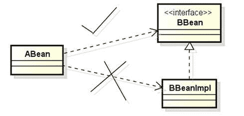

**图 2-1** – “面向接口编程”比“面向类编程”是良好的设计实践

接下来的类图显示了`FixedDepositService`类如何利用“面向接口编程”设计方法来轻松切换用于数据库交互的策略：

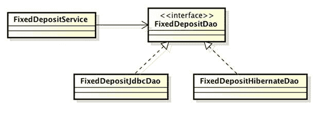

**图 2-2** – `FixedDepositService`依赖于`FixedDepositDao`接口，该接口由`FixedDepositJdbcDao`和`FixedDepositHibernateDao`类实现。

上面的图显示`FixedDepositService`类并不直接于`FixedDepositJdbcDao`或`FixedDepositHibernateDao`类。相反，`FixedDepositService`依赖于由`FixedDepositJdbcDao`和`FixedDepositHibernateDao`类实现的`FixedDepositDao`接口（依赖接口）。现在，根据你想使用纯 JDBC 还是 Hibernate ORM 框架，向`FixedDepositService`实例提供`FixedDepositJdbcDao`或`FixedDepositHibernateDao`的实例。

由于`FixedDepositService`依赖于`FixedDepositDao`接口，你将来可以支持其他的数据库交互策略。假设你决定使用 iBATIS（现已命名为 MyBatis）持久框架进行数据库交互。你只需要创建一个实现`FixedDepositDao`接口的新类`FixedDepositIbatisDao`，并向`FixedDepositService`实例提供`FixedDepositIbatisDao`的实例，就可以在不修改`FixedDepositService`类的情况下使用 iBATIS。

到目前为止，我们已经看到“面向接口编程”设计方法会导致依赖类与其依赖之间的松散耦合。现在让我们来看看这种设计方法如何提高依赖类的可测试性。

### 提高依赖类的可测试性

在图 2-2 中，我们看到`FixedDepositService`类持有对`FixedDepositDao`接口的引用。`FixedDepositJdbcDao`和`FixedDepositHibernateDao`是`FixedDepositDao`接口的具体实现类。现在，为了简化`FixedDepositService`类的单元测试，你可以替换一个不需要数据库的`FixedDepositDao`接口的模拟（mock）实现。

如果`FixedDepositService`类直接引用`FixedDepositJdbcDao`或`FixedDepositHibernateDao`类，测试`FixedDepositService`类将需要为测试目的搭建数据库。这表明通过使用依赖接口的模拟实现，你可以节省为依赖类设置基础设施的工作。

现在让我们来看看`Spring`如何在应用程序中支持“面向接口编程”设计原则。

### Spring 对“面向接口编程”设计原则的支持

在你的 Spring 应用程序中使用“面向接口编程”设计原则，你需要确保以下几点：

- 配置元数据中的`<bean>`元素指定了依赖的具体类。
- 依赖的 bean 类引用的是依赖接口，而不是依赖的具体类。

现在让我们来看一下使用“面向接口编程”设计方法的修改后的`MyBank`应用程序。

**导入** `chapter 2/ch02-bankapp-interfaces`（该项目展示了如何在创建 Spring 应用时使用“面向接口编程”设计方法。要运行该应用程序，请执行该项目中`BankApp`类的主方法）

### 使用“面向接口编程”设计方法的 MyBank 应用程序

下面的类图描述了使用“面向接口编程”设计方法的修改后的`MyBank`应用程序：

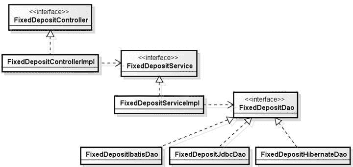

**图 2-3** - 使用“面向接口编程”设计方法的 MyBank 应用程序

上面的图显示，依赖类依赖于依赖项实现的接口，*而不是*依赖于依赖的具体实现类。例如，`FixedDepositControllerImpl`类依赖于`FixedDepositService`接口，而`FixedDepositServiceImpl`类依赖于`FixedDepositDao`接口。

下面的示例列表显示了基于图 2-3 所示设计的`FixedDepositServiceImpl`类：

**示例 2-2** – `FixedDepositService`类

**项目** – `ch02-bankapp-interfaces`

**源位置** - `src/main/java/sample/spring/chapter02/bankapp`

```java
package sample.spring.chapter02.bankapp;

public class FixedDepositServiceImpl implements FixedDepositService {

    private FixedDepositDao fixedDepositDao;

    .....

    public void setFixedDepositDao(FixedDepositDao fixedDepositDao) {

            this.fixedDepositDao = fixedDepositDao;

    }

    public FixedDepositDetails getFixedDepositDetails(long id) {
        return fixedDepositDao.getFixedDepositDetails(id);
    }

    public boolean createFixedDeposit(FixedDepositDetails fdd) {
        return fixedDepositDao.createFixedDeposit(fdd);
    }
}
```

上面的示例列表显示`FixedDepositServiceImpl`类包含了对`FixedDepositDao`接口的引用。你想要注入到`FixedDepositServiceImpl`实例中的`FixedDepositDao`实现是在应用上下文 XML 文件中指定的。如图 2-3 所示，你可以注入`FixedDepositDao`接口的以下任何一个具体实现：`FixedDepositIbatisDao`、`FixedDepositJdbcDao`和`FixedDepositHibernateDao`。

下面的示例列表显示了适应图 2-3 所示设计的`applicationContext.xml`文件：

**示例 2-3** – `applicationContext.xml` - MyBank 的应用上下文 XML 文件

**项目** – `ch02-bankapp-interfaces`

**源位置** - `src/main/resources/META-INF/spring`

```xml
<?xml version="1.0" encoding="UTF-8" standalone="no"?>
<beans .....>
    <bean id="controller"
          class="sample.spring.chapter02.bankapp.controller.FixedDepositControllerImpl">
        <property name="fixedDepositService" ref="service" />
    </bean>
    <bean id="service" class="sample.spring.chapter02.bankapp.service.FixedDepositServiceImpl">
        <property name="fixedDepositDao" ref="dao" />
    </bean>
    <bean id="dao" class="sample.spring.chapter02.bankapp.dao.FixedDepositHibernateDao"/>
</beans>
```

上面的`applicationContext.xml`文件显示`FixedDepositHibernateDao`实例（`FixedDepositDao`接口的实现）被注入到`FixedDepositServiceImpl`中。现在，如果你决定使用 iBATIS 代替 Hibernate 进行持久化，只需将`applicationContext.xml`文件中`dao` bean 定义的`class`属性更改为`FixedDepositIbatisDao`类的全限定名即可。

现在让我们来看看 Spring 容器实例化 bean 的方法。

## 2-3 实例化 Spring bean 的不同方法

到目前为止，我们已经看到了 bean 定义示例，它们指示 Spring 容器通过调用 bean 类的*无参数*构造函数来创建 bean 实例。考虑以下 bean 定义：


```xml
<bean id="myBean" class="mypackage.MyBean"/>
```

在上面的 bean 定义中，`MyBean` 类表示一个定义了无参数构造函数的 POJO 类。`MyBean` 类没有实现任何 Spring 特有的接口或继承任何 Spring 特有的类。这意味着 Spring 容器可以创建并管理提供无参数构造函数的任何类的实例。

**注意**：需要注意的是，Spring 容器可以创建并管理任何类的实例，无论该类是否提供了无参数构造函数。在 2-4 节中，我们将查看……

如果你有一个使用工厂创建实例的现有项目，仍然可以使用 Spring 容器来管理对象。

### 通过静态方法实例化 bean

在图 2-3 中，我们看到 `FixedDepositDao` 接口由 `FixedDepositIbatisDao` 和 `FixedDepositJdbcDao` 实现。下面的示例列表显示了 `FixedDepositFactory` 类，它定义了一个根据参数返回实例的静态方法。

**示例 2-4** – `FixedDepositFactory` 类

```java
public class FixedDepositFactory {
    private FixedDepositFactory() { }

    public static FixedDepositDao getFixedDao(String daoType) {
        FixedDepositDao fixedDepositDao = null;
        if ("jdbc".equalsIgnoreCase(daoType)) {
            fixedDepositDao = new FixedDepositJdbcDao();
        }
        if ("hibernate".equalsIgnoreCase(daoType)) {
            fixedDepositDao = new FixedDepositHibernateDao();
        }
        .....
        return fixedDepositDao;
    }
}
```

上面的示例列表显示，`FixedDepositFactory` 类定义了一个 `getFixedDao` 静态方法，该方法根据 `daoType` 参数的值创建并返回 `FixedDepositJdbcDao`、`FixedDepositHibernateDao` 或 `FixedDepositIbatisDao` 的实例。

下面的 `FixedDepositFactory` 类 bean 定义指示 Spring 容器调用 `FixedDepositFactory` 的 `getFixedDao` 方法来获取 `FixedDepositJdbcDao` 类实例。

**示例 2-5** – `FixedDepositFactory` 类的 bean 定义

```xml
<bean id="dao" class="sample.spring.FixedDepositFactory"
      factory-method="getFixedDao">
    <constructor-arg index="0" value="jdbc"/>
</bean>
```

在上面的 bean 定义中，`class` 属性指定定义静态方法的类的全限定名。`factory-method` 属性指定 Spring 容器调用的获取 `FixedDepositDao` 对象的静态方法的名称。`<constructor-arg>` 元素定义在 Spring 的 `beansschema` 中，用于向构造函数以及静态和实例工厂方法传递参数。`index` 属性引用参数在构造函数或静态或实例工厂方法中的位置。在上面的 bean 定义中，`index` 属性的值 0 意味着 `<constructor-arg>` 元素为 `getFixedDao` 工厂方法的第一个参数 `daoType` 提供值。`value` 属性指定参数值。

需要注意的是，调用 `ApplicationContext` 的 `getBean` 方法来获取 dao bean（参考示例 2-5）将导致 `FixedDepositDaoFactory` 的 `getFixedDepositDao` 工厂方法被调用。这意味着调用 `getBean("dao")` 返回的是由 `getFixedDepositDao` 工厂方法创建的 `FixedDepositDao` 实例，而不是 `FixedDepositDaoFactory` 类的实例。

现在，我们已经看到了创建 `FixedDepositDao` 实例的工厂类的配置，接下来的示例展示了如何将 `FixedDepositDao` 实例注入到 `FixedDepositServiceImpl` 类中。

**示例 2-6** – 注入由静态工厂方法创建的对象实例

```xml
<bean id="service" class="sample.spring.chapter02.bankapp.FixedDepositServiceImpl">
    <property name="fixedDepositDao" ref="dao" />
</bean>

<bean id="dao" class="sample.spring.chapter02.basicapp.FixedDepositDaoFactory"
      factory-method="getFixedDepositDao">
    <constructor-arg index="0" value="jdbc"/>
</bean>
```

在上述示例中，`<property>` 元素将 `FixedDepositDaoFactory` 的 `getFixedDepositDao` 工厂方法返回的 `FixedDepositDao` 实例注入到 `FixedDepositServiceImpl` 实例中。如果你将上述 `FixedDepositServiceImpl` 类的 bean 定义与示例 2-3 中的定义对比，你会发现它们完全相同。这表明，无论 Spring 容器如何（使用无参构造函数或静态工厂方法）创建 bean 实例，bean 依赖指定方式都是相同的。

现在让我们来看看 Spring 容器是如何通过调用实例工厂方法实例化 bean 的。

### 通过实例工厂方法实例化 bean

下面的示例展示了 `FixedDepositDaoFactory` 类，该类定义了一个实例工厂方法，用于创建并返回 `FixedDepositDao` 实例。

**示例 2-7** – `FixedDepositDaoFactory` 类

```java
public class FixedDepositDaoFactory {
    public FixedDepositDaoFactory() {
    }

    public FixedDepositDao getFixedDepositDao(String daoType) {
        FixedDepositDao FixedDepositDao = null;
        if("jdbc".equalsIgnoreCase(daoType)) {
            FixedDepositDao = new FixedDepositJdbcDao();
        }
        if("hibernate".equalsIgnoreCase(daoType)) {
            FixedDepositDao = new FixedDepositHiberateDao();
        }
        .....
        return fixedDepositDao;
    }
}
```

如果一个类定义了实例工厂方法，该类必须定义一个公共构造函数，以便 Spring 容器能够创建该类的实例。在上述示例中，`FixedDepositDaoFactory` 类定义了一个公共无参构造函数。`FixedDepositDaoFactory` 的 `getFixedDepositDao` 方法是一个实例工厂方法，用于创建并返回 `FixedDepositDao` 实例。

下面的示例展示了如何指示 Spring 容器调用 `FixedDepositDaoFactory` 的 `getFixedDepositDao` 方法来获取 `FixedDepositDao` 实例。

**示例 2-8** – 调用 `FixedDepositDaoFactory` 的 `getFixedDepositDao` 方法配置

```xml
<bean id="daoFactory" class="sample.spring.chapter02.basicapp.FixedDepositDaoFactory" />
<bean id="dao" factory-bean="daoFactory" factory-method="getFixedDepositDao">
    <constructor-arg index="0" value="jdbc"/>
</bean>
<bean id="service" class="sample.spring.chapter02.bankapp.FixedDepositServiceImpl">
    <property name="fixedDepositDao" ref="dao" />
</bean>
```

上述示例显示，`FixedDepositDaoFactory` 类（包含实例工厂方法的类）的配置方式与普通 Spring bean 类似，并使用独立的 `<bean>` 元素来配置实例工厂方法的细节。要配置实例工厂方法的细节，使用了 `<bean>` 元素的 `factory-bean` 和 `factory-method` 属性。`factory-bean` 属性引用定义实例工厂方法的 bean，而 `factory-method` 属性指定了实例工厂方法的名称。在上述示例中，`<property>` 元素将 `FixedDepositDaoFactory` 的 `getFixedDepositDao` 工厂方法返回的 `FixedDepositDao` 实例注入到 `FixedDepositServiceImpl` 实例中。

与静态工厂方法一样，你可以使用 `<constructor-arg>` 元素为实例工厂方法传递参数。注意的是，在上述示例中，调用 `ApplicationContext` 的 `getBean` 方法获取 dao bean 将导致 `FixedDepositDaoFactory` 的 `getFixedDepositDao` 工厂方法被调用。

到为止，我们查看了通过 setter 方法将依赖注入到 bean 中的 bean 定义示例。现在让我们来看看用于注入依赖的各种 DI 机制。

## 2-4 依赖注入技术

在 Spring 中，依赖注入是通过向 bean 的构造函数和 setter 方法传递参数来实现的。如果你使用静态或实例工厂方法来创建 bean 实例，你可以将 bean 依赖传递给工厂方法，也可以在工厂方法返回的 bean 实例上设置它们。

现在我们将查看演示不同 DI 技术的示例。

### 基于 setter 的 DI

在本书目前为止，我们已经看到了基于 setter 的 DI 示例。在基于 setter 的 DI 中，使用 `<property>` 元素来指定 bean 依赖。`<property>` 元素也用于传递 bean 所需的配置信息（如果有）。

假设 MyBank 应用包含一个 `PersonalBankingService` 服务，它允许客户检索账户账单、检查账户详情、更新联系电话、修改密码以及联系客服。`PersonalBankingService` 类使用 `JmsMessageSender`（发送消息）、`EmailMessageSender`（发送电子邮件）和 `WebServiceInvoker`（调用外部服务）来实现其预期功能。下面的示例展示了 `PersonalBankingService` 类。

**示例 2-9** – `PersonalBankingService` 类

```java
public class PersonalBankingService {
    private JmsMessageSender jmsMessageSender;
    private EmailMessageSender emailMessageSender;
    private WebServiceInvoker webServiceInvoker;

    .....
    public void setJmsMessageSender(JmsMessageSender jmsMessageSender) {
        this.jmsMessageSender = jmsMessageSender;
    }

    public void setEmailMessageSender(EmailMessageSender emailMessageSender) {
        this.emailMessageSender = emailMessageSender;
    }

    public void setWebServiceInvoker(WebServiceInvoker webServiceInvoker) {
        this.webServiceInvoker = webServiceInvoker;
    }
    .....
}
```

上述示例为 `PersonalBankingService` 类的 `JmsMessageSender`、`EmailMessageSender` 和 `WebServiceInvoker` 依赖定义了 setter 方法。

我们可以基于 setter 的 DI 来注入 `PersonalBankingService` 类的依赖，如下。

**示例 2-10** – `PersonalBankingService` 类及其依赖的 bean 定义

```xml
<bean id="personalBankingService" class="PersonalBankingService">
    <property name="emailMessageSender" ref="emailMessageSender" />
    <property name="jmsMessageSender" ref="jmsMessageSender" />
    <property name="webServiceInvoker" ref="webServiceInvoker" />
</bean>

<bean id="jmsMessageSender" class="JmsMessageSender">
    .....
</bean>

<bean id="webServiceInvoker" class="WebServiceInvoker">
    .....
</bean>

<bean id="emailMessageSender" class="EmailMessageSender">
    .....
</bean>
```

`personalBankingService` bean 定义显示为 `PersonalBankingService` 类的每个依赖指定了一个 `<property>` 元素。

`PersonalBankingService` 使用 `EmailMessageSender` bean 在客户更改联系电话时，向其电子邮箱地址发送电子邮件通知。`EmailMessageSender` 需要邮件服务器地址，以及用于与邮件服务器身份验证的 `username` 和 `password`。下面的示例列表显示 `<property>` 元素也可以用于设置类型为 `String` 的 bean 属性。

### 示例列表 2-11：`EmailMessageSender` 类及对应的 bean 定义

```java
public class EmailMessageSender {
  private String host;
  private String username;
  private String password;
    .....

    public void setHost(String host) {
        this.host = host;
    }

    public void setUsername(String username) {
        this.username = username;
    }

    public void setPassword(String password) {
        this.password = password;
    }

    .....
}
```

```xml
<bean id="emailMessageSender" class="EmailMessageSender">
    <property name="host" value="smtp.gmail.com"/>
    <property name="username" value="myusername"/>
    <property name="password" value="mypassword"/>
</bean>
```


上面的示例列表显示`<property>`元素被用于设置`EmailMessageSender` bean的`host`、`username`和`password`属性。`value`属性指定了由`name`属性标识的bean属性的`String`值。`host`、`username`和`password`属性代表`EmailMessageSender` bean需要的配置信息。在第三章，我们将看到如何使用`<property>`元素设置基本类型（如`int`、`long`等）、集合类型（如`java.util.List`、`java.util.Map`等）以及自定义类型（如`Address`）属性。

基于setter的DI（依赖注入）也用于向由`static`和`instance`工厂方法创建的bean注入依赖。让我们来看看结合`static`和`instance`工厂方法使用基于setter的DI。

## 向工厂方法创建的bean实例注入依赖

你可以使用基于setter的DI为`static`或`instance`工厂方法返回的bean实例注入依赖。

考虑下面的`FixedDepositJdbcDao`类，它定义了一个`databaseInfo`属性：

### 示例列表 2-12：FixedDepositJdbcDao类

```java
public class FixedDepositJdbcDao {
  private DatabaseInfo databaseInfo;
    .....

    public FixedDepositJdbcDao() { }

  public void setDatabaseInfo(DatabaseInfo databaseInfo) {
        this.databaseInfo = databaseInfo;
    }
}
```

在上面的示例列表中，`databaseInfo`属性代表`FixedDepositJdbcDao`类的依赖，该依赖通过`setDatabaseInfo`方法实现。下面的`FixedDepositDaoFactory`类定义了一个工厂方法，负责创建并返回`FixedDepositDao`类的实例：

### 示例列表 2-13：FixedDepositDaoFactory类

```java
public class FixedDepositDaoFactory {
  public FixedDepositDaoFactory() {
  }
  public FixedDepositDao getFixedDepositDao(String daoType) {
    FixedDepositDao fixedDepositDao = null;
    if ("jdbc".equalsIgnoreCase(daoType)) {
        fixedDepositDao = new FixedDepositJdbcDao();
    }
    if ("hibernate".equalsIgnoreCase(daoType)) {
        fixedDepositDao = new FixedDepositHibernateDao();
    }
    .....
    return fixedDepositDao;
  }
}
```

在上面的示例列表中，`getFixedDepositDao`方法是创建`FixedDepositDao`的`instance`工厂方法。如果参数`daoType`的值为`jdbc`，`getFixedDepositDao`方法将创建一个`FixedDepositJdbcDao`实例。需要注意的是，`getFixedDepositDao`方法并没有设置`FixedDepositJdbcDao`实例的`databaseInfo`属性。

正如我们在示例列表2-8中所示，下面的bean定义指示Spring容器通过调用`FixedFactoryFactory`的`getFixedDepositDao` `instance`工厂方法来创建一个`FixedDepositJdbcDao`实例：

#### 示例列表 2-14：调用FixedDepositDaoFactory的getFixedDepositDao方法的配置

```xml
<bean id="daoFactory" class="FixedDepositDaoFactory" />
<bean id="dao" factory-bean="daoFactory" factory-method="getFixedDepositDao">
    <constructor-arg index="0" value="jdbc"/>
</bean>
```

`dao` bean定义会导致调用`FixedDepositDaoFactory`的`getFixedDepositDao`方法，该方法创建并返回一个`FixedDepositJdbcDao`实例。但是，`FixedDepositJdbcDao`的`databaseInfo`属性并未设置。为了设置`databaseInfo`依赖，你可以对`getFixedDepositDao`方法返回的`FixedDepositJdbcDao`实例执行基于setter的DI，如下：

#### 示例列表 2-15：调用FixedDepositDaoFactory的getFixedDepositDao方法并设置返回的FixedDepositJdbcDao实例的databaseInfo属性的配置

```xml
<bean id="daoFactory" class="FixedDepositDaoFactory" />
<bean id="dao" factory-bean="daoFactory" factory-method="getFixedDepositDao">
    <constructor-arg index="0" value="jdbc"/>
    <property name="databaseInfo" ref="databaseInfo"/>
</bean>
<bean id="databaseInfo" class="DatabaseInfo" />
```

上面的bean定义显示`<property>`元素被用于设置`getFixedDepositDao` `instance`工厂方法返回的`FixedDepositJdbcDao`实例的`databaseInfo`属性。与`instance`工厂方法一样，你可以使用`<property>`元素向`static`工厂方法返回的bean注入依赖。

现在让我们来看看如何通过构造参数注入bean依赖。

## 基于构造函数的DI

在基于构造函数的DI中，bean的依赖作为参数传递给类的构造函数。例如，下面的示例列表显示了`PersonalBankingService`类，其构造函数接受`JmsMessageSender`、`EmailMessageSender`和`WebServiceInvoker`对象：

### 示例列表 2-16：PersonalBankingService类

```java
public class PersonalBankingService {
  private JmsMessageSender jmsMessageSender;
  private EmailMessageSender emailMessageSender;
  private WebServiceInvoker webServiceInvoker;
    .....

  public PersonalBankingService(JmsMessageSender jmsMessageSender,
      EmailMessageSender emailMessageSender,
      WebServiceInvoker webServiceInvoker) {
        this.jmsMessageSender = jmsMessageSender;
        this.emailMessageSender = emailMessageSender;
        this.webServiceInvoker = webServiceInvoker;
  }
    .....
}
```

`PersonalBankingService`构造函数的参数代表`PersonalBankingService`类的依赖。下面的示例列表显示了如何通过`<constructor-arg>`元素提供`PersonalBankingService`实例的依赖：

### 示例列表 2-17：PersonalBankingService bean定义

```xml
<bean id="personalBankingService" class="PersonalBankingService">
    <constructor-arg index="0" ref="jmsMessageSender"/>
    <constructor-arg index="1" ref="emailMessageSender"/>
    <constructor-arg index="2" ref="webServiceInvoker"/>
</bean>
<bean id="jmsMessageSender" class="JmsMessageSender">
    .....
</bean>
<bean id="webServiceInvoker" class="WebServiceInvoker">
    .....
</bean>
<bean id="emailMessageSender" class="EmailMessageSender" />
    .....
</bean>
```

在上面的示例列表中，`<constructor-arg>`元素指定了传递给`PersonalBankingService`实例的构造参数详情。`index`属性指定构造函数参数的索引。如果`index`属性的值为`0`，则意味着`<constructor-arg>`元素对应第一个构造函数参数；如果`index`属性值为`1`，则意味着`<constructor-arg>`元素对应第二个构造函数参数，依此类推。我们之前看到过`<property>`元素的`ref`属性用于传递bean的引用。同样，`<constructor-arg>`元素的`ref`属性也用于传递bean的引用。类似于`<property>`元素，`<constructor-arg>`元素也用于传递bean所需的`configuration information`（如果有）。

你应该注意，`<constructor-arg>`元素也用于向创建bean实例的`static`和`instance`工厂方法传递参数（参见第2-3节）。

**注意** 与其使用`<property>`和`<constructor-arg>`元素的`ref`属性，你可以在`<property>`和`<constructor-arg>`元素内部使用`<ref>`元素来设置对bean的引用。优先使用`ref`属性，因为它让XML更加简洁。

下面的示例显示了`EmailMessageSender`类以及对应的bean定义，演示了如何使用`<constructor-arg>`元素为`String`类型构造函数参数提供值：

**示例列表 2-18** `EmailMessageSender`类及对应的bean定义

```java
public class EmailMessageSender {

  private String host;
  private String username;
  private String password;

    .....

    public EmailMessageSender(String host, String username, String password) {
        this.host = host;
        this.username = username;
        this.password = password;
    }

    .....
}
```

```xml
<bean id="emailMessageSender" class="EmailMessageSender">
    <constructor-arg index="0" value="smtp.gmail.com"/>
    <constructor-arg index="1" value="myusername"/>
    <constructor-arg index="2" value="mypassword"/>
</bean>
```

到目前为止，我们已经看到`<constructor-arg>`元素用于注入bean依赖并为`String`类型构造函数参数传递值。在第3章中，我们将看到如何使用`<constructor-arg>`元素来设置基本类型（如`int`、`long`等）、集合类型（如`java.util.List`、`java.util.Map`等）以及自定义类型（如`Address`）属性。

现在让我们来看如何将基于构造函数的DI（依赖注入）与基于setter的DI结合使用。

## 使用混合基于构造和setter的DI机制

如果一个bean类同时需要基于构造函数和setter的DI机制，你可以结合`<constructor-arg>`和`<property>`元素来注入依赖。

下面的示例列表显示了一个bean类，其依赖作为构造方法和setter方法的参数被注入：

**示例列表 2-19** – `PersonalBankingService`类

```java
public class PersonalBankingService {

   private JmsMessageSender jmsMessageSender;
   private EmailMessageSender emailMessageSender;
   private WebServiceInvoker webServiceInvoker;

   .....

  public PersonalBankingService(JmsMessageSender jmsMessageSender,
               EmailMessageSender emailMessageSender) {
        this.jmsMessageSender = jmsMessageSender;
        this.emailMessageSender = emailMessageSender;
    }

  public void setWebServiceInvoker(WebServiceInvoker webServiceInvoker) {
        this.webServiceInvoker = webServiceInvoker;
    }

    .....
}
```

在`PersonalBankingService`类中，`jmsMessageSender`和`emailMessageSender`依赖作为构造函数参数注入，而`webServiceInvoker`依赖通过`setWebServiceInvoker` setter方法注入。下面的bean定义显示，同时使用了`<constructor-arg>`和`<property>`元素来注入`PersonalBankingService`类的依赖：

**示例列表 2-20** – 混合基于构造和setter的DI机制

```xml
<bean id="dataSource" class="PersonalBankingService">
    <constructor-arg index="0" ref="jmsMessageSender" />
    <constructor-arg index="1" ref="emailMessageSender" />
    <property name="webServiceInvoker" ref="webServiceInvoker" />
</bean>
```

现在，我们已经了解了如何指示Spring容器创建bean并执行DI，让我们来看你可以指定的不同`scopes`（作用域）。

## Bean范围

你可能希望指定bean的作用域以控制创建一个共享实例（单例），还是在每次请求bean时创建一个新的bean实例（原型）。bean的作用域由`<bean>`元素的`scope`属性定义。**注意** 在Web应用中，Spring允许你指定额外的作用域：`request`、`session`和`global`。如果未指定`scope`属性或`scope`属性的值为`singleton`，则意味着该bean是单例范围的。

### Singleton（单例）

单例范围是应用上下文中所有bean的默认范围。单例范围bean的实例在Spring容器创建时创建，在Spring容器销毁时销毁。Spring容器创建一个被所有依赖它的bean共享的单一实例。

下面的示例列表显示了一个项目的`applicationContext.xml`文件，其中所有bean都是单例范围：

**示例列表 2-21** `applicationContext.xml` - 单例范围bean


**项目** – `ch02-bankapp-scopes`

**源位置** - `src/main/resources/META-INF/spring`

```xml
<beans>
    <bean id="controller" class="sample.spring.chapter02.bankapp.controller.FixedDepositControllerImpl">
        <property name="fixedDepositService" ref="service" />
    </bean>

    <bean id="service" class="sample.spring.chapter02.bankapp.service.FixedDepositServiceImpl">
        <property name="fixedDepositDao" ref="dao" />
    </bean>

    <bean id="dao" class="sample.spring.chapter02.bankapp.dao.FixedDepositDaoImpl" />

    .....
</beans>
```

在上面的`applicationContext.xml`文件中，由于`<bean>`元素没有指定属性，`controller`、`service`和`dao` bean是单例范围的。这意味着Spring容器只创建了`FixedDepositControllerImpl`、`FixedDepositServiceImpl`和`FixedDepositDaoImpl`类的一个实例。由于这些bean是单例范围，每次当我们使用`ApplicationContext`的`getBean`方法获取这些bean时，Spring容器都会返回同一个bean实例。

**注意** 如果未指定`scope`属性或`scope`属性的值为`singleton`，则意味着该bean是单例范围的。

下面的示例列表显示了`ch02-bankapp-scopes`项目中`SingletonTest`（一个JUnit测试类）类的`testInstances`方法。`testInstances`方法测试了多次调用`ApplicationContext`的`getBean`方法返回的是controller bean的相同实例还是不同实例：

**示例列表 2-22** `SingletonTest` JUnit测试类

**项目** – `ch02-bankapp-scopes`

**源位置** - `/src/test/java/sample/spring/chapter02/bankapp`

```java
package sample.spring.chapter02.bankapp;

import static org.junit.Assert.assertSame;
import org.junit.BeforeClass;
import org.junit.Test;
import sample.spring.chapter02.bankapp.controller.FixedDepositController;

public class SingletonTest {
    private static ApplicationContext context;

    @BeforeClass
    public static void init() {
        context = new ClassPathXmlApplicationContext(
                "classpath:META-INF/spring/applicationContext.xml");
    }

    @Test
    public void testInstances() {
        FixedDepositController controller1 = (FixedDepositController) context.getBean("controller");
        FixedDepositController controller2 = (FixedDepositController) context.getBean("controller");
        assertSame("Different FixedDepositController instances", controller1, controller2);
    }

    .....
}
```

在上面的示例列表中，JUnit的`@BeforeClass`注解指定了`init`方法会在类中的任何测试方法（即标记了JUnit的`@Test`注解的方法）之前被调用。这意味着标记了`@BeforeClass`注解的方法只执行*一次*，而标记了`@Test`注解的方法只在标记了`@BeforeClass`注解的方法执行后执行。请注意`init`方法是一个*静态*方法。`init`方法通过将配置元数据（如列表 2-21 所示）传递给`ClassPathXmlApplicationContext`的构造函数来创建`ApplicationContext`对象的实例。`testInstances`方法获取2个controller bean实例，并使用JUnit的`assertSame`断言检查这两个实例是否相同。由于controller bean是单例作用域（singleton-scoped）的，因此`controller1`和`controller2` bean实例是相同的。由于这个原因，`SingletonTest`的`testInstances`测试在执行时没有出现任何断言错误。

接下来的图显示，当你多次调用`ApplicationContext`的`getBean`方法时，Spring容器会返回同一个controller bean实例：

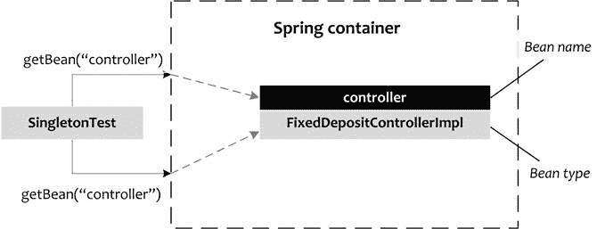

**图 2-4** 对单例作用域bean的多次请求会导致Spring容器返回相同的bean实例

上面的图显示多次调用获取controller bean返回的是controller bean的*同一个*实例。

**注意** 在图 2-4 中，controller bean实例由一个双单元格矩形表示。顶部单元格显示bean的*名称*（即`<bean>`元素的`id`属性的值），下部单元格显示bean的*类型*（即`<bean>`元素的`class`属性的值）。在本书的其余部分，我们将使用这种约定来显示Spring容器内部的bean实例。

单例作用域的bean实例被依赖它的bean共享。接下来的示例列表显示`SingletonTest` JUnit测试类的`testReference`方法，该方法检查引用的`FixedDepositDao`实例是否一致。

**示例 2-23** `testReference`方法的`SingletonTest` JUnit测试类

**项目 - `ch02-bankapp`**（作用域）

**源位置 - `/src/test/java/sample/spring/chapter02/bankapp`**

```java
package sample.spring.chapter02.bankapp;

import static org.junit.Assert.assertSame;
import org.junit.Test;

public class SingletonTest {
    private static ApplicationContext context;

    .....

    @Test
    public void testReference() {
        FixedDepositController controller = (FixedDepositController) context.getBean("controller");
        FixedDepositDao fixedDeposit1 = controller.getFixedDepositDao();
        FixedDepositDao fixedDeposit2 = (FixedDepositDao) context.getBean("dao");
        assertSame("FixedDeposit instances", fixedDeposit1, fixedDeposit2);
    }
}
```

在上面的示例列表中，`testReference`方法首先通过`ApplicationContext`的`getBean`方法获取`FixedDepositDao`实例（引用列表中的`fixedDeposit1`变量），然后直接获取另一个`FixedDepositDao` bean（引用列表中的`fixedDeposit2`变量）。如果你执行`testReference`，你会看到`fixedDeposit1`和`fixedDeposit2`是相同的。

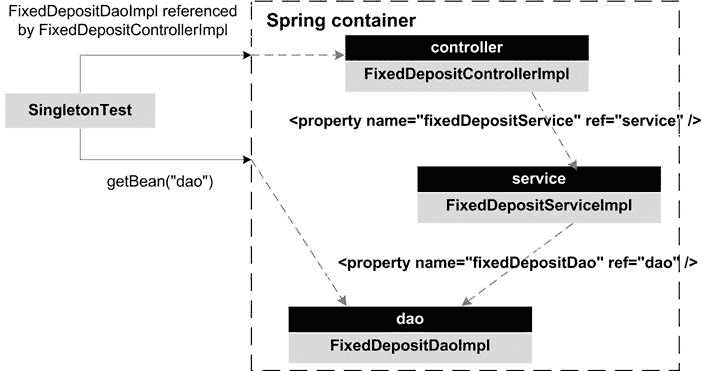

**图 2-5** 单例作用域bean被共享

上面的图显示被`FixedDepositController`实例引用的`FixedDepositDao`实例是同一个。单例作用域bean的范围受限于Spring容器。这意味着如果你创建2个Spring容器实例，每个容器都有自己的实例。

接下来的示例列表显示`SingletonTest`类的`testSingletonScope`方法，它测试了从两个Spring实例获取的controller bean是否不同：

**示例 2-24** - `testSingletonScope`方法

**项目 - `ch02-bankapp-scopes`**

```java
package sample.spring.chapter02.bankapp;

import static org.junit.Assert.assertNotSame;
import org.junit.Test;

public class SingletonTest {
    private static ApplicationContext context;

    @BeforeClass
    public static void init() {
        context = new ClassPathXmlApplicationContext(
                "classpath:META-INF/spring/applicationContext.xml");
    }

    @Test
    public void testSingletonScope() {
        ApplicationContext anotherContext = new ClassPathXmlApplicationContext(
                "classpath:META-INF/spring/applicationContext.xml");
        FixedDepositController controller1 = (FixedDepositController) anotherContext.getBean("controller");
        FixedDepositController controller2 = (FixedDepositController) context.getBean("controller");
        assertNotSame("Same FixedDepositController instances", controller1, controller2);
    }
}
```

在上面的示例列表中，`testSingletonScope`方法首先从`anotherContext`获取`FixedDepositController`实例（引用`controller1`变量），然后直接从`context`使用`getBean`方法获取另一个`FixedDepositController` bean（引用`controller2`变量）。如果你执行`testSingletonScope`测试，你会发现测试成功完成，因为`controller1`和`controller2`是不同的。

接下来的图描绘了`testSingletonScope`方法展示的行为：

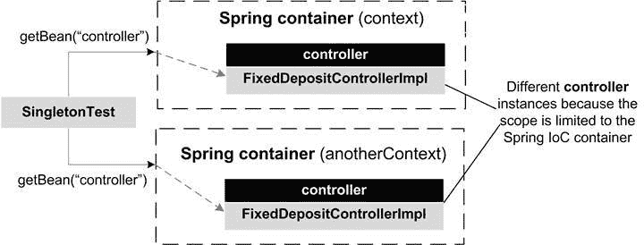

**图 2-6** 每个Spring容器都会创建自己的单例作用域bean实例

上面的图显示，每个Spring容器都会创建它们自己的controller bean实例。这就是为什么当你调用`getBean("controller")`方法时，`context`和`anotherContext`实例返回不同的controller bean实例的原因。

`testSingletonScope`方法显示每个Spring容器都会创建它们自己的单例作用域bean实例。需要注意的是，Spring容器会为*每个* bean定义创建一个单例作用域bean实例。下面的示例列表显示了`FixedDepositDaoImpl`类的多个bean定义：

### 示例列表 2-25 – `applicationContext.xml` - 同一个类的多个bean定义

**Project** – `ch02-bankapp-scopes`

**源位置**- `src/main/resources/META-INF/spring`

```xml
<bean id="dao" class="sample.spring.chapter02.bankapp.dao.FixedDepositDaoImpl" />
<bean id="anotherDao" class="sample.spring.chapter02.bankapp.dao.FixedDepositDaoImpl" />
```

上述示例列表中所示bean定义是针对`FixedDepositDaoImpl`类的。由于*没有*指定`scope`属性，上述示例列表中所示bean定义代表单例作用域bean。即使为一个类定义了多个bean定义，Spring容器也会为每个bean定义创建一个相应的bean实例。这意味着Spring容器为对应`dao`和`anotherDao` bean定义创建了不同的`FixedDepositDaoImpl`类实例。下面的示例列表显示了`SingletonScope`的`testSingletonScopePerBeanDef`方法，该方法测试了对应`dao`和`anotherDao` bean定义的`FixedDepositDaoImpl`实例是相同还是不同：

### 示例列表 2-26 – `SingletonTest` JUnit测试类的`testSingletonScopePerBeanDef`方法

**Project** – `ch02-bankapp-scopes`

**源位置**- `src/test/java/sample/spring/chapter02/bankapp`

```java
package sample.spring.chapter02.bankapp;

import static org.junit.Assert.assertNotSame;

public class SingletonTest {
    private static ApplicationContext context;
    .....

    @Test
    public void testSingletonScopePerBeanDef() {
        FixedDepositDao fixedDepositDao1 = (FixedDepositDao) context.getBean("dao");
        FixedDepositDao fixedDepositDao2 = (FixedDepositDao) context.getBean("anotherDao");
        assertNotSame("Same FixedDepositDao instances", fixedDepositDao1, fixedDepositDao2);
    }
}
```

在上述示例列表中，`fixedDepositDao1`和`fixedDepositDao2`变量分别代表Spring容器对应`dao`和`anotherDao` bean定义创建的`FixedDepositDaoImpl`类实例。如果你执行`testSingleScopePerBeanDef`测试，它将在不出现任何断言错误的情况下执行，因为`fixedDepositDao1`实例（对应`dao` bean定义）和`fixedDepositDao2`实例（对应`anotherDao` bean定义）是不同的。

接下来的图总结了单例作用域bean是*按每个bean定义*创建的：

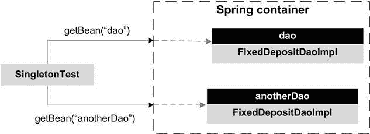

**图 2-7** 每个bean定义对应一个单例作用域bean实例

上面的图显示，Spring容器中*每个bean定义*都存在一个单例作用域bean实例。

我们之前提到过，单例作用域bean默认是*预实例化*的，这意味着当你创建一个Spring容器的实例时，就会创建一个单例作用域bean的实例。现在让我们来看看如何*懒性*（lazily）初始化一个单例作用域bean。


### 懒性初始化单例作用域 bean

你可以指示 Spring 容器仅在*第一次*请求单例作用域 bean 时才创建该 bean 作用的实例。下面的 `lazyExample` bean 定义显示了如何指示 Spring 容器懒性初始化 `lazyBean` bean：

### 示例列表 2-27 – 懒性初始化单例作用域 bean

```xml
<bean id="lazyBean" class="example.LazyBean" lazy-init="true"/>
```

`<bean>` 元素的 `lazy-init` 属性指定了 bean 实例是懒性创建还是积极创建。如果值为 true（如上述所示的 bean 定义），Spring 容器将在*第一次*接收到对该 bean 的请求时初始化 bean 实例。

接下来的序列图显示了 `lazy-init` 属性如何影响单例作用域 bean 实例的创建：

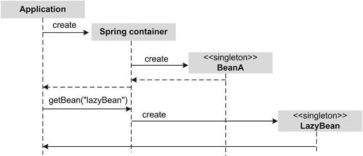

## 图 2-8 懒性初始化的单例作用域 bean 实例在应用程序第一次请求时被创建

在上面的图中，`BeanA` 代表一个*没有*设置为懒性初始化的单例作用域 bean 实例，而 `LazyBean` 代表一个被设置为懒性初始化的单例作用域 bean。当 Spring 容器实例被创建时，`BeanA` 也被实例化，因为它*没有*被设置为懒性初始化。另一方面，当 `ApplicationContext` 的 `getBean` 方法第一次被调用以从 Spring 容器中检索 `LazyBean` 实例时，`LazyBean` 才被实例化。

**注意** 你可以使用 `<beans>` 元素的 `default-lazy-init` 属性来指定 bean 的默认初始化策略。如果 `<bean>` 元素的 `lazy-init` 属性指定的值与 `<beans>` 元素的 `default-lazy-init` 不同，则以 `lazy-init` 为准。

由于单例作用域 bean 可以懒性初始化也可以预实例化，你此时可能在考虑是否应该将单例作用域 bean 定义为懒性初始化。在大多数应用场景中，预实例化单例作用域 bean 是有利的。下面的示例列表显示了一个设置为懒性初始化的 `aBean` 单例作用域 bean，它依赖于 `bBean` bean：

### 示例列表 2-28 – 懒性初始化的单例作用域 bean

```java
public class ABean {
    private BBean bBean;
    public void setBBean(BBean bBean) {
        this.bBean = bBean;
    }
    .....
}

<bean id="aBean" class="ABean" lazy-init="true">
    <property name="bBean" value="bBean" />
</bean>

<bean id="bBean" class="BBean" />
```

在上述示例列表中，`ABean` 的 `bBean` 属性引用了 `bBean` bean。注意这里没有使用 `ref` 属性，而是使用了 `<property>` 元素的 `value` 属性来设置 `ABean` 的 `bBean` 属性。如果你通过传递上述 bean 定义的文件创建 `ApplicationContext` 实例，将不会报告任何错误。但是，当你通过调用 `ApplicationContext` 的 `getBean` 方法尝试获取 `aBean` bean 时，你会得到以下错误消息：

```
Caused by: java.lang.IllegalStateException: Cannot convert value of type [java.lang.String] to required type [BBean] for property 'bBean'
```

显示上述错误消息是因为 Spring 容器无法将 `ABean` 的 `bBean` 属性的字符串值转换为 `BBean` 类型。这突出了一个简单的配置问题，即没有指定 `<bean>` 元素的 `ref` 属性，而是指定了 `value` 属性。

### 原型

原型作用域 bean 与单例作用域 bean 的区别在于，Spring 容器总是返回一个*新的*原型作用域 bean 实例。原型作用域 bean 的另一个显著特征是它们*总是*是懒性初始化的。

`ch02-bankapp-scopes` 项目中 `applicationContext.xml` 文件中的以下 `FixedDepositDetails` bean 代表了一个原型作用（prototype-scoped）的 bean：

示例 2-29 – `applicationContext.xml` - 原型作用 bean 示例

**项目** – `ch02-bankapp-scopes`

**源码位置** - `src/main/resources/META-INF/spring`

```xml
<bean id="FixedDepositDetails"
      class="sample.spring.chapter02.bankapp.domain.FixedDepositDetails"
      scope="prototype" />
```

上面的示例显示 `<bean>` 元素的 `scope` 属性值被设置为 `prototype`。这意味着 `FixedDepositDetails` bean 是一个原型作用的 bean。

`PrototypeTest` JUnit 测试类中的 `testInstances` 方法显示，从 Spring 容器中获取的 2 个 `FixedDepositDetails` bean 实例是不同的：

示例 2-30 – `PrototypeTest` JUnit 测试类的 `testInstances` 方法

**项目** – `ch02-bankapp-scopes`

**源码位置** - `src/test/java/sample/spring/chapter02/bankapp`

```java
package sample.spring.chapter02.bankapp;

import static org.junit.Assert.assertNotSame;

public class PrototypeTest {
    private static ApplicationContext context;

    .....

    @Test
    public void testInstances() {
        FixedDepositDetails fixedDepositDetails1 =
                (FixedDepositDetails)context.getBean("fixedDepositDetails");
        FixedDepositDetails fixedDepositDetails2 =
                (FixedDepositDetails) context.getBean("fixedDepositDetails");

        assertNotSame("Same FixedDepositDetails instances",
                fixedDepositDetails1, fixedDepositDetails2);
    }
}
```

如果你执行 `testInstances` 测试，它将在没有任何断言错误的情况下完成，因为从 `ApplicationContext` 获取的 2 个 `FixedDepositDetails` 实例（`fixedDepositDetails1` 和 `fixedDepositDetails2`）是不同的。

现在让我们如何为 bean 选择合适的作用域（单例或原型）。

### 为你的 bean 选择正确的作用域

如果一个 bean 不维护任何会话状态（即它本质上是无状态的），则应该应该定义为单例作用（singleton-scoped）bean。如果一个 bean 维护会话状态，则应该定义为原型作用 bean。`MyBank` 应用中的 `FixedDepositServiceImpl`、`FixedDepositDaoImpl` 和 `FixedDepositControllerImpl` bean 本质上是无状态的；因此，它们被定义为单例作用 bean。`MyBank` 应用中的 `FixedDepositDetails` bean（一个领域对象）维护会话状态；因此，它被定义为原型作用 bean。

**注意** 如果你在应用程序中使用 ORM 框架（如 Hibernate 或 iBATIS），领域对象是由 ORM 框架创建的，或者你通过 `new` 运算符程序化地创建它们。正因为如此，如果应用程序使用 ORM 框架，领域对象就不会在应用上下文文件中定义。

## 2-6 总结

在本章中，我们讨论了 Spring Framework 的一些基础知识。我们看了“面向接口编程”的设计、创建 bean 实例的不同方法、基于构造函数的 DI 以及 bean 作用域。在下一章中，我们将查看如何设置不同类型（如 `int`、`long`、`Set` 等）的 bean 属性和构造函数参数。

# 第 3 章：配置 beans

## 3-1 引言

在之前的章节中，我们接触了 Spring 的一些基本概念。我们看到了如何在应用上下文文件中指定 Spring bean 及其依赖关系。我们还看了单例作用和原型作用的 bean，并讨论了将这些作用域分配给 bean 的影响。

在本章中，我们将：

- bean 继承

- bean 构造函数的参数是如何解析的

- 如何配置基本类型（如 `int`、`float` 等）、集合类型（如 `java.util.List`、`java.util.Map` 等）、自定义类型（如 `Address` 等）的 bean 属性和构造函数参数

- 如何通过 `p-namespace` 和 `c-namespace` 分别指定 bean 属性和构造函数参数，使应用上下文文件更加简洁

- Spring 的 `FactoryBean` 接口，允许你编写自己的工厂类来创建 bean 实例

## 3-2 Bean 定义继承

我们在第 1 章和第 2 章中看到，应用上下文文件中的 bean 定义指定了 类的全限定名及其依赖关系。在某些情况下，为了使 bean 定义更简洁，你可能希望一个 bean 定义继承另一个 bean 定义的配置。让我们来看 `MyBank` 应用中的这样一个场景。

**导入** `chapter 3/ch03-bankapp-inheritance`（该项目显示 `MyBank` 应用使用了 bean 定义继承。要运行应用程序，请执行该项目 `BankApp` 类的 `main` 方法）

### MyBank – Bean 定义示例

在上一章中，我们看到 `MyBank` 应用通过 `DAOs` 访问数据库。假设 `MyBank` 应用定义了一个 `DatabaseOperations` 类来简化与数据库的交互。因此，`MyBank` 应用中所有的 `DAOs` 都依赖 `DatabaseOperations` 类来执行数据库操作，如图所示：


**图 3-1** - `MyBank` 应用中的 DAO 类使用 `DatabaseOperations` 类进行数据库交互

上面的图片显示 `FixedDepositDao` 和 `PersonalBankingDao` 类依赖于 `DatabaseOperations` 类。下面的应用上下文文件显示了这些类的 bean 定义：

示例 3-1 – DAO bean 依赖 `DatabaseOperations` bean

```xml
<bean id="databaseOperations"
      class="sample.spring.chapter01.bankapp.utils.DatabaseOperations" />
<bean id="personalBankingDao"
      class="sample.spring.chapter01.bankapp.dao.PersonalBankingDaoImpl">
    <property name="databaseOperations" ref="databaseOperations" />
</bean>
<bean id="FixedDepositDao"
      class="sample.spring.chapter01.bankapp.dao.FixedDepositDaoImpl">
    <property name="databaseOperations" ref="databaseOperations" />
</bean>
```

`personalBankingDao` 和 `FixedDepositDao` 的定义都使用 `<property>` 元素执行 `DatabaseOperations` 实例依赖注入。由于两个 bean 定义中引用 `DatabaseOperations` 实例的属性名称都是 `databaseOperations`，这意味着 `PersonalBankingDaoImpl` 和 `FixedDepositDaoImpl` 类都定义了 `setDatabaseOperations` 方法。

如果应用程序中的多个 bean 共享一组配置（属性、构造函数参数等），你可以创建一个作为父类的 bean 定义。在 `personalBankingDao` 和 `fixedDepositDao` 的定义中，公共配置是 `databaseOperations` 属性。接下来的示例显示 `personalBankingDao` 和 `fixedDepositDao` 的定义使用了 bean 定义继承：

示例 3-2 – `applicationContext.xml` - `MyBank` 的应用上下文 XML 文件

**项目** – `ch03-bankapp-inheritance`

**源码位置** - `src/main/resources/META-INF/spring`

```xml
<bean id="databaseOperations"
      class="sample.spring.chapter03.bankapp.utils.DatabaseOperations" />
<bean id="daoTemplate" abstract="true">
    <property name="databaseOperations" ref="databaseOperations" />
</bean>
<bean id="FixedDepositDao" parent="daoTemplate"
      class="sample.spring.chapter03.bankapp.dao.FixedDepositDaoImpl" />
<bean id="personalBankingDao" parent="daoTemplate"
      class="sample.spring.chapter03.bankapp.dao.PersonalBankingDaoImpl" />
```

在上面的示例列表中，`daoTemplate` bean 定义定义了由 `fixedDepositDao` 和 `personalBankingDao` bean 定义共享的通用配置。由于 `fixedDepositDao` 和 `personalBankingDao` bean 定义都需要 `databaseOperations` 依赖（参见示例列表 3-1），`daoTemplate` bean 定义使用 `<property>` 元素定义了 `databaseOperations` 依赖。`<bean>` 元素的 `parent` 属性指定了用于继承配置的 bean 定义的名称。由于 `fixedDepositDao` 和 `personalBankingDao` bean 定义的 `parent` 属性值为 `daoTemplate`，它们从 `daoTemplate` bean 定义中继承了 `databaseOperations` 属性。示例列表 3-1 和 3-2 是相同的，区别在于示例列表 3-2 使用了 bean 定义继承。

如果 `<bean>` 元素的 `abstract` 属性值被设置为 `true`，则意味着该 bean 定义是 `abstract`（抽象的）。需要注意的是，Spring 容器`doesn’t`尝试创建一个与 `abstract` bean 定义对应的 bean。重要的是，你不能定义一个依赖于 `abstract` bean 的 bean，即你不能使用 `<property>` 或 `<constructor-arg>` 元素引用一个 `abstract` bean。

在示例列表 3-2 中，`daoTemplate` bean 定义是 `abstract` 的。你可能注意到 `daoTemplate` bean 定义没有指定 `class` 属性。如果父 bean 定义没有指定 `class` 属性，则子 bean 定义（如 `fixedDepositDao` 和 `personalBankingDao`）会指定 `class` 属性。要注意，如果你没有指定 `class` 属性，则必须将父 bean 定义为 `abstract`，这样 Spring 容器就不会尝试创建一个与之对应的 bean 实例。


要验证`fixedDepositDao`和`personalBankingDao` bean 定义是否继承了`daoTemplate` bean 定义的`databaseOperations`属性，请执行`ch03-bankapp-inheritance`项目中`BankApp`类的`main`方法。`BankApp`的`main`方法调用了`fixedDepositDao`和`personalBankingDao` bean 方法；这些 bean 反过来调用`DatabaseOperations`实例的方法。如果`DatabaseOperations`实例`not`注入到`fixedDepositDao`和`personalBankingDao` bean 中，将抛出`java.lang.NullPointerException`。

接下来的图总结了在`FixedDepositDao`和`personalBankingDao` bean 定义情况下 bean 定义的工作原理：

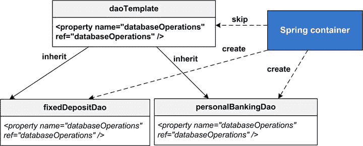

**图 3-2** – MyBank 应用中的 bean 定义继承

上面的图显示`fixedDepositDao`和`personalBankingDao` bean 定义继承了来自`daoTemplate` bean 定义的`databaseOperations`属性（在标记为`fixedDepositDao`和`personalBankingDao`的框中以*斜体*显示）。上面的图还描述了 Spring 容器并没有尝试创建一个与`daoTemplate` bean 定义对应的 bean 实例，因为它被标记为`abstract`。

现在让我们看看从父 bean 定义继承了哪些配置信息。

### 继承了什么？

子 bean 定义从父 bean 定义继承以下配置信息：

- 属性 – 通过`<property>`元素指定
- 构造器参数 – 通过`<constructor-arg>`元素指定
- 方法覆盖（在第 4 章第 4-5 节讨论）
- 初始化和销毁方法（在第 5 章中讨论），以及
- 工厂方法 – 通过`<bean>`元素的`factory-method`属性指定（参见第 2 章第 2-3 节了解如何使用`static`和`instance`工厂方法创建 bean）

**IMPORT** **chapter 3/ch03-bankapp-inheritance-example**（此项目展示了使用 bean 定义继承的 MyBank 应用。在该项目中，你将看到 bean 定义继承的多种场景。要运行应用程序，请执行该项目中`BankApp`类的`main`方法）

现在让我们来看一些 bean 定义继承的示例。

### Bean 定义继承示例 – 父 bean 定义*不是*抽象的

下面的示例列表展示了一个 bean 继承示例，其中父 bean 定义`not`抽象的，且子 bean 定义定义了额外的依赖：

**示例列表 3-3** – `applicationContext.xml` - Bean 定义继承 – 父 bean 定义*不是*抽象

**Project** – `ch03-bankapp-inheritance-examples`

**Source location** - `src/main/resources/META-INF/spring`

```xml
<bean id="serviceTemplate" class="sample.spring.chapter03.bankapp.base.ServiceTemplate">
    <property name="jmsMessageSender" ref="jmsMessageSender" />
    <property name="emailMessageSender" ref="emailMessageSender" />
    <property name="webServiceInvoker" ref="webServiceInvoker" />
</bean>
<bean id="fixedDepositService" class=".....FixedDepositServiceImpl" parent="serviceTemplate">
    <property name="fixedDepositDao" ref="fixedDepositDao" />
</bean>
<bean id="personalBankingService" class=".....PersonalBankingServiceImpl" parent="serviceTemplate">
    <property name="personalBankingDao" ref="personalBankingDao" />
</bean>
<bean id="userRequestController" class=".....UserRequestImpl">
    <property name="serviceTemplate" ref="serviceTemplate" />
</bean>
```

在深入研究上述配置细节之前介绍一点背景：MyBank 应用中的服务可能会向消息中间件发送 JMS 消息，向邮件服务器发送邮件，或者调用外部 Web 服务。在上面的示例列表中，`jmsMessageSender`、`emailMessageSender`和`webServiceInvoker` bean 通过提供抽象层简化了这些任务。`serviceTemplate` bean 提供了对`jmsMessageSender`、`emailMessageSender`和`webServiceInvoker` bean 的访问。这就是为什么`serviceTemplate` bean 依赖于`jmsMessageSender`、`emailMessageSender`和`webServiceInvoker` bean。

示例列表 3-3 显示`serviceTemplate` bean 定义是`fixedDepositService`和`personalBankingService`的父 bean 定义。注意`serviceTemplate` bean 定义不是`abstract`的；`class`属性指定了`ServiceTemplate`。在我们之前的 bean 定义示例中（参见示例列表 3-2），子 bean 定义没有定义任何属性。在上面的示例列表中，注意`fixedDepositService`和`personalBankingService`子 bean 定义分别定义了`fixedDepositDao`和`personalBankingDao`属性。

由于父 bean 定义的属性被子 bean 定义继承，`FixedDepositServiceImpl`和`PersonalBankingServiceImpl`类*必须*为`jmsMessageSender`、`emailMessageSender`和`webServiceInvoker`属性定义 setter 方法。你可以选择在`FixedDepositServiceImpl`和`PersonalBankingServiceImpl`类中定义 setter 方法，或者将`FixedDepositServiceImpl`和`PersonalBankingServiceImpl`类作为`ServiceTemplate`类的子类。在`ch03-bankapp-inheritance-examples`中，`FixedDepositServiceImpl`和`PersonalBankingServiceImpl`类是`ServiceTemplate`类的子类。

下面的示例列表展示了`PersonalBankingServiceImpl`类：

**示例列表 3-4** – `PersonalBankingServiceImpl`类

**Project** – `ch03-bankapp-inheritance-examples`

**Source location** - `src/main/java/sample/spring/chapter03/bankapp/service`

```java
package sample.spring.chapter03.bankapp.service;

public class PersonalBankingServiceImpl extends ServiceTemplate implements PersonalBankingService {

    private PersonalBankingDao personalBankingDao;

    public void setPersonalBankingDao(PersonalBankingDao personalBankingDao) {
        this.personalBankingDao = personalBankingDao;
    }

    @Override
    public BankStatement getMiniStatement() {
        return personalBankingDao.getMiniStatement();
    }
}
```

在示例列表 3-3 中，我们看到`personalBankingService` bean 定义将`personalBankingDao`指定为依赖项。在上面的示例列表中，`setPersonalBankingDao` setter 方法对应于`personalBankingDao`依赖项。此外，注意`PersonalBankingServiceImpl`类是`ServiceTemplate`类的子类。

接下来的图显示，父 bean 定义（如`serviceTemplate`）不需要是*抽象的*，子 bean 定义（如`fixedDepositService`和`personalBankingService`）可以定义额外的属性，并且父 bean 定义（如`ServiceTemplate`类）和子 bean 定义（如`FixedDepositServiceImpl`和`PersonalBankingServiceImpl`）所表示的类之间可以存在继承关系：

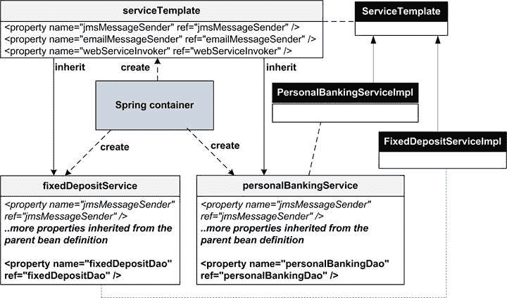

**图 3-3** – 子 bean 定义增加了额外的属性，父 bean 定义*不是*抽象的，且父定义和子 bean 定义所表示的类之间存在父子关系。

图 3-3 显示：

* Spring 容器创建了`serviceTemplate` bean 的实例，因为它*没有*被定义为抽象类
* `FixedDepositServiceImpl`和`PersonalBankingServiceImpl`类（对应子 bean 定义）是`ServiceTemplate`类的子类——该类对应于父 bean 定义`serviceTemplate`。
* 同时，`fixedDepositService`和`personalBankingService` bean 定义分别定义了额外的属性`fixedDepositDao`和`personalBankingDao`。你应该注意，子 bean 定义还可以定义额外的构造参数和*方法重写*（在 4-5 节中讨论）。

由于`serviceTemplate` bean 定义*不是*抽象的，其他 bean 可以将`serviceTemplate` bean 定义为它们的依赖。例如，在示例列表 3-3 中，`serviceTemplate` bean 是`userRequestController` bean 的依赖项。从这个讨论中你可以推出，如果父 bean 定义不是抽象的，父 bean 提供的功能不仅可以被子 bean 使用，还可以被应用上下文其他 bean 使用。

## Bean 定义继承示例 – 继承工厂方法配置

子 bean 定义可以使用 bean 定义继承来从父 bean 定义继承工厂方法配置。让我们来看一个展示工厂方法配置被子 bean 定义继承的示例。

接下来的`ControllerFactory`类定义了一个`getController`*实例*工厂方法：

**示例列表 3-5** – `ControllerFactory`类

**项目** – `ch03-bankapp-inheritance-examples`

**源位置** - `src/main/java/sample/spring/chapter03/bankapp/controller`

```java
package sample.spring.chapter03.bankapp.controller;

public class ControllerFactory {

    public Object getController(String controllerName) {
        Object controller = null;
        if ("fixedDepositController".equalsIgnoreCase(controllerName)) {
            controller = new FixedDepositControllerImpl();
        }
        if ("personalBankingController".equalsIgnoreCase(controllerName)) {
            controller = new PersonalBankingControllerImpl();
        }
        return controller;
    }
}
```

上面的示例列表显示，`getController`工厂方法根据传递给它的`controllerName`参数的值创建`FixedDepositControllerImpl`或`PersonalBankingControllerImpl`类的实例。如果`controllerName`参数的值为`fixedDepositController`，则`getController`方法会创建一个`FixedDepositControllerImpl`类的实例。如果`controllerName`参数的值为`personalBankingController`，则`getController`方法会创建一个`PersonalBankingControllerImpl`类的实例。

`ch03-bankapp-inheritance-example`项目中`applicationContext.xml`中的接下来的 bean 定义显示，子 bean 定义从父 bean 定义继承了`getController`*实例*工厂方法配置：

**示例列表 3-6** – `applicationContext.xml` - Bean 定义继承 – 继承工厂方法配置

**项目** – `ch03-bankapp-inheritance-examples`

**源位置** - `src/main/resources/META-INF/spring`

```xml
<bean id="controllerFactory"
      class="sample.spring.chapter03.bankapp.controller.ControllerFactory" />
<bean id="controllerTemplate" factory-bean="controllerFactory"
      factory-method="getController" abstract="true">
</bean>
<bean id="fixedDepositController" parent="controllerTemplate">
    <constructor-arg index="0" value="fixedDepositController" />
    <property name="fixedDepositService" ref="fixedDepositService" />
</bean>
<bean id="personalBankingController" parent="controllerTemplate">
    <constructor-arg index="0" value="personalBankingController" />
    <property name="personalBankingService" ref="personalBankingService" />
</bean>
```

在上面的示例列表中，`ControllerFactory`类表示一个定义了`getController`*实例*工厂方法的工厂类。`controllerTemplate` bean 定义指定了使用`ControllerFactory`的`getController`工厂方法来创建 bean 实例。`getController`方法（参考示例列表 3-5）根据传递给`getController`方法的参数创建`FixedDepositControllerImpl`或`PersonalBankingControllerImpl` bean 的实例。


由于`controllerTemplate` bean 定义被定义为抽象的，由`fixedDepositController`和`personalBankingController`子 bean 定义来使用`getController`工厂方法配置。`fixedDepositController` bean 定义想要向`ControllerFactory`的`getController`工厂方法传递参数，以便创建一个`FixedDepositControllerImpl` bean 实例。同样，`personalBankingController` bean 定义想要向`ControllerFactory`的`getController`工厂方法传递参数，以便创建一个`PersonalBankingControllerImpl` bean 实例。我们在第 2 章第 2-3 节见过`<constructor-arg>`元素用于向实例工厂方法传递参数。在示例列表 3-6 中，`fixedDepositController`和`personalBankingController`子 bean 定义使用了`<constructor-arg>`元素，分别向`getController`工厂方法传递了`fixedDepositService`和`personalBankingService`值。

如果构造函数参数是简单的 Java 类型（如`int`、`String`等），则使用`<constructor-arg>`元素的`value`属性来指定构造函数参数的值。如果构造函数参数是某个 bean 的引用，则使用`<constructor-arg>`元素的`ref`属性来指定 bean 的名称。

下面的示例列表展示了`ch03-bankapp-constructor-args-by-type`项目中的`UserRequestControllerImpl`类，其构造函数接受类型为`ServiceTemplate`的参数：

**示例列表 3-7** – `UserRequestControllerImpl`类

**项目** – `ch03-bankapp-constructor-args-by-type`

**源码位置** –`src/main/java/sample/spring/chapter03/bankapp/controller`

```java
package sample.spring.chapter03.bankapp.controller;

public class UserRequestControllerImpl implements UserRequestController {

    private ServiceTemplate serviceTemplate;

    public UserRequestControllerImpl(ServiceTemplate serviceTemplate) {
        this.serviceTemplate = serviceTemplate;
    }

    @Override
    public void submitRequest(Request request) {
        //-- do something using ServiceTemplate
        serviceTemplate.getJmsMessageSender(); //-- For ex., send JMS message
        .....
    }
}
```

下面的示例列表展示了如何使用`<constructor-arg>`元素的`ref`属性将`ServiceTemplate`实例的引用（由`serviceTemplate` bean 定义）传递给`UserRequestControllerImpl`的构造函数：

**示例列表 3-8** – `applicationContext.xml`–将 Spring bean 引用作为构造函数参数

**项目** – `ch03-bankapp-constructor-args-by-type`

**源码位置** –`src/main/resources/META-INF/spring`

```xml
<bean id="serviceTemplate" class="sample.spring.chapter03.bankapp.base.ServiceTemplate">
    .....
</bean>

<bean id="userRequestController"
      class="sample.spring.chapter03.bankapp.controller.UserRequestControllerImpl">
  <constructor-arg index="0" ref="serviceTemplate" />
</bean>
```

有了这些关于如何将简单值和 bean 引用作为构造函数参数的背景信息，让我们来看 Spring 容器如何通过匹配构造函数参数类型来定位要调用的 bean 构造函数。

## 基于类型的构造函数参数匹配

如果未指定`<constructor-arg>`元素的`index`属性，Spring 容器将通过匹配`<constructor-arg>`元素所引用的类型与 bean 类构造函数中指定的参数类型，来定位要调用的构造函数。

我们先来看当构造函数参数是之间没有继承关系的 Spring bean 时，Spring 容器是如何匹配构造函数参数的。

### 表示不同 Spring bean 的构造函数参数

下面的示例列表展示了`ServiceTemplate`类，它定义了一个构造函数，接受对`JmsMessageSender`、`EmailMessageSender`和`WebServiceInvoker` bean 的引用：

**示例列表 3-9** – `ServiceTemplate`类

**项目** – `ch03-bankapp-constructor-args-by-type`

**源码位置** –`src/main/java/sample/spring/chapter03/bankapp/base`

```java
package sample.spring.chapter03.bankapp.base;

public class ServiceTemplate {
    .....

    public ServiceTemplate(JmsMessageSender jmsMessageSender,
                           EmailMessageSender emailMessageSender,
           WebServiceInvoker webServiceInvoker) {
        .....
    }
}
```

下面的示例列表展示了`ServiceTemplate`类以及`ServiceTemplate`所引用 bean 的 bean 定义：

**示例列表 3-10** – `applicationContext.xml`–`ServiceTemplate`类及其依赖的 bean 定义

**项目** – `ch03-bankapp-constructor-args-by-type`

**源码位置** –`src/main/resources/META-INF/spring`

```xml
<bean id="serviceTemplate" class="sample.spring.chapter03.bankapp.base.ServiceTemplate">
    <constructor-arg ref="emailMessageSender" />
    <constructor-arg ref="jmsMessageSender" />
    <constructor-arg ref="webServiceInvoker" />
</bean>

<bean id="jmsMessageSender" class="sample.spring.chapter03.bankapp.base.JmsMessageSender" />
<bean id="emailMessageSender" class="sample.spring.chapter03.bankapp.base.EmailMessageSender" />
<bean id="webServiceInvoker" class="sample.spring.chapter03.bankapp.base.WebServiceInvoker" />
```

在上面的示例列表中，`serviceTemplate` bean 的`<constructor-arg>`元素没有指定`index`属性。`<constructor-arg>`元素指定构造函数参数的顺序为：`EmailMessageSender`、`JmsMessageSender`、`WebServiceInvoker`。`ServiceTemplate`类构造函数中指定构造函数参数的顺序为：`JmsMessageSender`、`EmailMessageSender`、`WebServiceInvoker`。如所示，`<constructor-arg>`元素定义的顺序与`ServiceTemplate`类构造函数指定的顺序不同。

如果你执行`ch03-bankapp-constructor-args-by-type`项目中`BankApp`类的`main`方法，你会发现 Spring 容器成功创建了`ServiceTemplate` bean 的实例。这是因为`JmsMessageSender`、`EmailMessageSender`和`WebServiceInvoker`类在本质上是不同的（即它们之间没有继承关系），这使得 Spring 容器更容易按照正确的顺序将实例注入到`ServiceTemplate`构造函数中。

如果构造函数参数类型存在继承关系，Spring 容器需要额外的指令来帮助解析构造函数参数。现在我们来看当构造函数参数引用的 bean 存在继承关系时，Spring 容器是如何匹配构造函数参数的。

### 表示相关 Spring bean 的构造函数参数

考虑下面的`SampleBean`类，其构造函数接受继承关系的参数类型：

**示例列表 3-11** – `SampleBean`类

```java
public class SampleBean {
    public SampleBean(ABean aBean, BBean bBean) { ..... }
    .....
}
```

上面的示例列表显示了`SampleBean`类构造函数接受`ABean`和`BBean`类型。`ABean`和`BBean`表示具有继承关系的 Spring bean；`BBean`是`ABean`的子类。

接下来的应用上下文显示了`SampleBean`、`ABean`和`BBean`的 bean 定义：

**示例列表 3-12** – `SampleBean`、`ABean`和`BBean`的 bean 定义

```xml
<bean id="aBean" class="example.ABean"/>
<bean id="bBean" class="example.BBean"/>
<bean id="sampleBean" class="example.SampleBean">
    <constructor-arg ref="bBean" />
    <constructor-arg ref="aBean" />
</bean>
```

由于`aBean`和`bBean` bean 存在继承关系，Spring 容器按照`<constructor-arg>`元素在`SampleBean` bean 定义中出现的顺序将构造函数参数应用于构造函数。在上面的`sampleBean` bean 定义中，第一个`<constructor-arg>`元素引用`bBean`，第二个`<constructor-arg>`元素引用`aBean`。这意味着`bBean`作为第一个构造函数参数，`aBean`作为第二个构造函数参数传递给`SampleBean`构造函数。由于`ABean`（父类）实例无法传递到预期`BBean`（子类）实例的地方，`sampleBean` bean 定义中的第二个`<constructor-arg>`元素会导致 Spring 抛出异常。为了处理这种情况，你可以使用`<constructor-arg>`元素的`index`或`type`属性来标识`<constructor-arg>`元素所适用的构造函数参数。例如，下面的`sampleBean` bean 定义利用`type`属性来指示`<constructor-arg>`元素所适用的构造函数参数的类型：

**示例列表 3-13** –`<constructor-arg>`元素的`type`属性标识构造函数参数的类型

```xml
<bean id="sampleBean" class="example.SampleBean">
    <constructor-arg type="sample.spring.chapter03.bankapp.controller.BBean" ref="bBean"/>
    <constructor-arg type="sample.spring.chapter03.bankapp.controller.ABean" ref="aBean"/>
</bean>
```

`<constructor-arg>`元素的`type`属性指定了`<constructor-arg>`元素所属类型的完全限定名。在上面的示例列表中，第一个`<constructor-arg>`应用于类型为`BBean`的构造参数，第二个`<constructor-arg>`元素应用于类型为`ABean`的构造参数。指定`type`属性可以消除当构造参数之间存在继承关系时产生的歧义。

**注意** 如果两个或多个构造参数的类型相同，则唯一的选择是使用`index`属性来标识每个`<constructor-arg>`元素所应用的构造参数。

到目前为止，我们已经查看了构造参数表示不同或相关 Spring bean 时的构造参数类型匹配场景。现在，我们将查看如何为标准 Java 类型（如`int`、`long`、`boolean`、`String`、`Date`等）以及自定义类型匹配构造参数类型。

### 表示标准 Java 类型和自定义类型的构造参数

如果构造参数的类型是基本类型（如`int`、`long`、`boolean`等）或`String`类型或自定义类型（如`Address`），则使用`<constructor-arg>`元素的`value`属性来指定值。如果有 2 或多个可以由`value`属性指定的字符串值转换为构造参数，Spring 容器将无法推导出构造参数的类型（例如，该值代表`int`、`long`还是`String`）。在这种情况下，你需要使用`type`属性显式指定构造参数的类型。

下面的示例显示了`TransferFundsServiceImpl`类，该类定义了一个接受`String`、`boolean`、`long`和`int`类型参数的构造函数：

**示例 3-14** – `TransferFundsServiceImpl`类

**项目** – `ch03-bankapp-constructor-args-by-type`

**源位置** – `/src/main/java/sample/spring/chapter03/bankapp/service`

```java
package sample.spring.chapter03.bankapp.service;

public class TransferFundsServiceImpl implements TransferFundsService {

    public TransferFundsServiceImpl(String webServiceUrl, boolean active, long timeout,
        int numberOfRetrialAttempts) {.....

    .....
}
```

如上面的示例所示，`TransferFundsServiceImpl`构造函数接受以下参数：`webServiceUrl`、`active`、`timeout`和`numberOfRetrialAttempts`。对应的`TransferFundsServiceImpl`类的 bean 定义显示了如何将构造参数值传递给`TransferFundsServiceImpl`的构造函数：

**示例 3-15** – `TransferFundsServiceImpl`类的 bean 定义

```xml
<bean id="transferFundsService"
    class="sample.spring.chapter03.bankapp.service.TransferFundsServiceImpl">
    <constructor-arg value="http://someUrl.com/xyz" />
    <constructor-arg value="true" />
    <constructor-arg value="5" />
    <constructor-arg value="200" />
</bean>
```


假设第 3 个 `<constructor-arg>` 元素（`value` 属性的值为 `'5'`）应该为 `numberOfRetrialAttempts` 构造参数提供值，而第 4 个 `<constructor-arg>` 元素（`value` 属性的值为 `'200'`）应该为 `timeout` 构造参数提供值。Spring 容器按照 `<constructor-arg>` 元素在 `transferFundsService` bean 定义中出现的顺序，将其应用于 `TransferFundsServiceImpl` 的构造函数。这意味着第 3 个 `<constructor-arg>` 元素应用于 `timeout` 参数，而第 4 个 `<constructor-arg>` 元素应用于 `numberOfRetrialAttempts` 参数。

为了处理此类歧义，可以通过 `<constructor-arg>` 元素的 `type` 属性指定构造参数的 `type`，如下所示：

**示例 3-16** – `applicationContext.xml` - `<constructor-arg>` 元素的 `type` 属性

**项目** – `ch03-bankapp-constructor-args-by-type`

**源位置** – `/src/main/resources/META-INF/spring`

```xml
<bean id="transferFundsService"
    class="sample.spring.chapter03.bankapp.service.TransferFundsServiceImpl">
    <constructor-arg type="java.lang.String" value="http://someUrl.com/xyz" />
    <constructor-arg type="boolean" value="true" />
    <constructor-arg type="int" value="5" />
    <constructor-arg type="long" value="200" />
</bean>
```

在上述 `TransferFundsServiceImpl` 类的 bean 定义中，`type` 属性用于指定构造参数类型。

**注意**：如果两个或多个构造参数的类型相同，则唯一的选择是使用 `index` 属性来标识 `<constructor-arg>` 元素所应用的构造参数。

在本节中，我们看到了 Spring 如何通过执行类型匹配来解析构造参数。现在，让我们查看如何指示 Spring 根据名称进行构造匹配。

### 按名称匹配构造参数

`<constructor-arg>` 元素的 `name` 属性用于指定 `<constructor-arg>` 元素所应用的构造参数名称。下面的示例再次显示了接受参数的 `TransferFundsServiceImpl` 类：

**示例 3-17** – `TransferFundsServiceImpl` 类

**项目** – `ch03-bankapp-constructor-args-by-name`

**源位置** – `/src/main/java/sample/spring/chapter03/bankapp/service`

```java
package sample.spring.chapter03.bankapp.service;

public class TransferFundsServiceImpl implements TransferFundsService {

    public TransferFundsServiceImpl(String webServiceUrl, boolean active, long timeout,
        int numberOfRetrialAttempts) {.....

    .....
}
```

上面的示例显示，`TransferFundsServiceImpl` 构造函数定义的构造参数名称为 `webServiceUrl`、`active`、`timeout` 和 `numberOfRetrialAttempts`。

**注意**：`TransferFundsServiceImpl` 类接受简单的 Java 类型（如 `int`、`long`、`boolean`、`String` 等），但本节解释的概念适用于构造参数是 Spring bean 引用的场景。

`TransferFundsServiceImpl` 类的后续 bean 定义使用 `<constructor-arg>` 元素的 `name` 属性，指定 `<constructor-arg>` 元素所应用的构造参数名称：

**示例 3-18** – `applicationContext.xml` - `<constructor-arg>` 元素的 `name` 属性

**项目** – `ch03-bankapp-constructor-args-by-name`

**源位置** – `/src/main/resources/META-INF/spring`

```xml
<bean id="transferFundsService"
    class="sample.spring.chapter03.bankapp.service.TransferFundsServiceImpl">
    <constructor-arg name="webServiceUrl" value="http://someUrl.com/xyz" />
    <constructor-arg name="active" value="true" />
    <constructor-arg name="numberOfRetrialAttempts" value="5" />
    <constructor-arg name="timeout" value="200" />
</bean>
```

上述配置仅在编译 `TransferFundsServiceImpl` 类时启用了 `debug flag`（参考 `javac` 的 `-g` 选项）才有效。当启用调试标记时，构造函数的参数名称将保留在生成的 `.class` 文件中。如果你在没有启用调试标记的情况下编译类，构造函数的参数名称将在编译过程中丢失，此时 Spring 无法找到与 `<constructor-arg>` 元素的 `name` 属性指定的构造函数参数名对应的构造函数参数。

如果你不想在启用调试标记的情况下编译类，可以使用 `@ConstructorProperties` 注解（Java SE 6 中引入）来明确列出构造函数参数的名称，如下所示 `TransferFundsServiceImpl` 类所示：

**示例 3-19** – `@ConstructorProperties` 注解

**项目** – `ch03-bankapp-constructor-args-by-name`

**源码位置** – `/src/main/java/sample/spring/chapter03/bankapp/service`

```java
package sample.spring.chapter03.bankapp.service;

import java.beans.ConstructorProperties;

public class TransferFundsServiceImpl implements TransferFundsService {

  @ConstructorProperties({"webServiceUrl","active","timeout","numberOfRetrialAttempts"})
     public TransferFundsServiceImpl(String webServiceUrl, boolean active, long timeout,
             int numberOfRetrialAttempts) { ..... }
}
```

在上述示例中，`@ConstructorProperties` 注解按照构造函数参数在 bean 类构造函数中出现的顺序指定了参数的名称。你**必须**确保在 `<constructor-arg>` 元素中使用相同的构造函数参数名称。

现在让我们来看 `@ConstructorProperties` 注解如何影响 bean 定义继承。

### `@ConstructorProperties` 注解与 bean 定义继承

如果对应**父** bean 定义的类的构造函数标记了 `@ConstructorProperties` 注解，那么对应**子** bean 定义的 bean 类**必须**也标记上 `@ConstructorProperties` 注解。

接下来的示例展示了 `serviceTemplate`（父 bean 定义）和 `FixedDepositService`（子 bean 定义）的 bean 定义：

**示例 3-20** – `applicationContext.xml` - 父和子 bean 定义

**项目** – `ch03-bankapp-constructor-args-by-name`

**源码位置** – `/src/main/resources/META-INF/spring`

```xml
<bean id="serviceTemplate"
    class="sample.spring.chapter03.bankapp.base.ServiceTemplate">
    <constructor-arg name="emailMessageSender" ref="emailMessageSender" />
    <constructor-arg name="jmsMessageSender" ref="jmsMessageSender" />
    <constructor-arg name="webServiceInvoker" ref="webServiceInvoker" />
</bean>
<bean id="FixedDepositService"
    class="sample.spring.chapter03.bankapp.service.FixedDepositServiceImpl"
    parent="serviceTemplate">
    <property name="fixedDepositDao" ref="FixedDepositDao" />
</bean>
```

上述示例显示，`serviceTemplate` bean 定义**不是**抽象的，这意味着 Spring 容器将创建 `serviceTemplate` bean 的实例。`serviceTemplate` bean 定义指定了 3 个 `<constructor-arg>` 元素，对应于 `ServiceTemplate` 类定义的 3 个参数（参见示例 3-21）。

由于我们已经在 `serviceTemplate` bean 定义中通过**名称**指定了构造函数参数，因此 `ServiceTemplate` 类的构造函数标记了 `@ConstructorProperties` 注解，以确保 Spring 在运行时可以使用构造函数参数名称，如下所示：

**示例 3-21** – `ServiceTemplate` 类

**项目** – `ch03-bankapp-constructor-args-by-name`

**源码位置** – `/src/main/java/sample/spring/chapter03/bankapp/base`

```java
package sample.spring.chapter03.bankapp.base;

import java.beans.ConstructorProperties;

public class ServiceTemplate {

    .....

  @ConstructorProperties({"jmsMessageSender","emailMessageSender","webServiceInvoker"})
    public ServiceTemplate(JmsMessageSender jmsMessageSender,
             EmailMessageSender emailMessageSender,
             WebServiceInvoker webServiceInvoker) { ..... }
}
```

由于 `FixedDepositService` 是 `serviceTemplate` 的子 bean 定义，`serviceTemplate` bean 定义中的 `<constructor-arg>` 配置被 `FixedDepositService` bean 定义继承。这意味着 `TransferFundsServiceImpl` 类**必须**定义一个与 `ServiceTemplate` 类定义的参数集相同的构造函数，并且它**必须**也标记上 `@ConstructorProperties` 注解。如果你没有为 `FixedDepositServiceImpl` 的构造函数标记 `@ConstructorProperties` 注解，Spring 容器将**无法**匹配继承的 `<constructor-arg>` 元素。

### `@ConstructorProperties` 注解与工厂方法

我们在第 2 章第 2-3 节中看到，`<constructor-arg>` 元素也用于向**静态**和**实例**工厂方法传递参数。你可能认为可以通过指定 `name` 属性并为方法标记 `@ConstructorProperties` 注解，来向**静态**和**实例**工厂方法传递参数。

你应该注意，`@ConstructorProperties` 注解**仅**用于构造函数；你不能为方法标记 `@ConstructorProperties` 注解。因此，如果你想通过名称向**静态**或**实例**工厂方法传递参数，你唯一的选择就是使用启用调试标记编译类。

**注意**：如果启用调试标记编译类，会导致 `.class` 文件体积较大，但对应用程序的运行时性能没有影响。它只会增加类的加载时间。

现在让我们来看如何在 Eclipse IDE 中启用调试标记。

### 在 Eclipse IDE 中启用（或禁用）调试标记

在 Eclipse IDE 中，按照以下步骤为项目启用调试标记：

1. 转到 `Windows` -> `Preferences`，并选择 `Java` -> `Compiler`。
2. 你现在会看到一个名为“Classfile Generation”的区域。在此区域中，如果你勾选标记为“Add variable attributes to generated class files (used by the debugger)”的选项，则调试标记为**启用**。取消勾选此选框将**禁用**调试标记。

到此为止，我们看到的大多数 bean 定义示例属性和构造函数参数都是 bean 的引用。现在我们将查看属性和构造函数参数为基本类型、集合类型、`java.util.Date`、`java.util.Properties` 等 bean 定义示例。

## 3-4 配置不同类型的 bean 属性和构造函数参数

在实际开发场景中，Spring bean 的属性和构造函数参数可能从字符串类型到 bean 引用，再到任何标准（如 `java.util.Date`、`java.util.Map`）或自定义类型（如 `Address`）。

之前我们看到了如何为字符串类型的 bean 属性提供值（使用 `<property>` 元素的 `value` 属性），以及为字符串类型的构造函数参数提供值（使用 `<constructor-arg>` 元素的 `value` 属性）。我们还查看了如何通过 bean 属性（使用 `<property>` 元素的 `ref` 属性）和构造函数参数（使用 `<constructor-arg>` 元素的 `ref` 属性）注入依赖项。

在本节中，我们将查看 Spring 内置的 `PropertyEditor` 实现，这些实现简化了 `java.util.Date`、`java.util.Currency`、基本类型等类型的 bean 属性和构造函数参数的传递。我们还将查看如何在应用程序上下文 XML 文件中为集合类型（如 `java.util.List` 和 `java.util.Map`）指定值，以及如何向 Spring 注册自定义的 `PropertyEditor` 实现。

现在让我们来看演示使用内置 `PropertyEditor` 实现的 bean 定义示例。

导入第 3 章 `/ch03-simple-types-examples`（该项目展示了一个 Spring 应用程序，其中 bean 属性和构造函数参数是基本类型、`java.util.Date`、`java.util.List`、`java.util.Map` 等。该项目还展示了如何向 Spring 容器注册自定义的 `PropertyEditor` 实现。要运行该应用程序，请执行该项目中 `SampleApp` 类的 `main` 方法。）

### Spring 中内置的属性编辑器

JavaBeans `PropertyEditors` 提供了将 Java 类型转换为字符串值以及反之所需的必要逻辑。Spring 提供了几个内置的 `PropertyEditors`，用于将 bean 属性或构造函数参数的字符串值（通过 `<property>` 和 `<constructor-arg>` 元素的 `value` 属性指定）转换为属性或构造函数参数的实际 Java 类型。

在查看涉及内置 `PropertyEditors` 的示例之前，让我们先了解 `PropertyEditors` 在设置 bean 属性或构造函数参数值时的重要性。


考虑以下`BankDetails`类，我们希望将其配置为单例作用域的 bean，并为其属性设置预定义值：

示例 3-22 – `BankDetails`类

```java
public class BankDetails {

    private String bankName;

    public void setBankName(String bankName) {
        this.bankName = bankName;
    }
}
```

在上面的示例中，`bankName`是`BankDetails`类的一个属性，类型为`String`。接下来的`BankDetails`类的 bean 定义展示了如何将`bankName`属性的值设置为‘My Personal Bank’：

示例 3-23 – `BankDetails`类的 bean 定义

```xml
<bean id= "bankDetails" class= "BankDetails">
    <property name= "bankName" value= "My Personal Bank"/>
</bean>
```

在上面的 bean 定义中，`<property>`元素的`value`属性为`bankName`属性指定了一个字符串值。你可以看到，如果 bean 属性的类型为`String`，你可以简单地使用`<property>`元素的`value`属性设置该属性值。同样，如果构造函数参数的类型为`String`，你可以使用`<constructor-arg>`元素的`value`属性设置构造函数参数值。

假设向`BankDetails`类增加了以下属性（及其 setter 方法）：类型为`byte[]`的`bankPrimaryBusiness`属性、类型为`char[]`的`headOfficeAddress`属性、类型为`char`的`privateBank`属性、类型为`java.util.Currency`的`primaryCurrency`属性、类型为`java.util.Date`的`dateOfInception`属性，以及类型为`java.util.Properties`的`branchAddresses`属性。下面的示例展示了修改后的`BankDetails`类：

示例 3-24 – 包含不同类型属性的`BankDetails`类

项目 – `ch03-simple-types-examples`

源路径 - `src/main/java/sample/spring/chapter03/beans`

```java
package sample.spring.chapter03.beans;

.....

public class BankDetails {

    private String bankName;
    private byte[] bankPrimaryBusiness;
    private char[] headOfficeAddress;
    private char privateBank;
    private Currency primaryCurrency;
    private Date dateOfInception;
    private Properties branchAddresses;

    .....

    public void setBankName(String bankName) {
        this.bankName = bankName;
    }

    //--更多 setter 方法
}
```

你可以通过为属性指定字符串值，将`BankDetails`类配置为 Spring bean，并利用已注册的 JavaBeans `PropertyEditor`实现让 Spring 容器将这些字符串值转换为属性对应的 Java 类型。

接下来的`BankDetails`类的 bean 定义展示了为不同属性类型指定了简单的字符串值：

示例 3-25 – `applicationContext.xml` - `BankDetails`类的 bean 定义

项目 – `ch03-simple-types-examples`

源路径 - `src/main/resources/META-INF/spring`

```xml
<bean id="bankDetails" class="sample.spring.chapter03.beans.BankDetails">
    <property name="bankName" value="My Personal Bank" />
    <property name="bankPrimaryBusiness" value="Retail banking" />
    <property name="headOfficeAddress" value="Address of head office" />
    <property name="privateBank" value="Y" />
    <property name="primaryCurrency" value="INR" />
    <property name="dateOfInception" value="30-01-2012"></property>
    <property name="branchAddresses">
        <value>
            x = Branch X's address
            y = Branch Y's address
        </value>
    </property>
</bean>
```

上面的示例展示了为`java.util.Date`、`java.util.Currency`、`char[]`、`char`和`java.util.Properties`类型的属性指定了字符串值。Spring 容器使用注册的`PropertyEditors`将属性或构造函数参数的字符串值转换为相应的类型。例如，Spring 容器使用`CustomDateEditor`（用于`java.util.Date`的内置`PropertyEditor`）将`dateOfInception`属性的值‘30-01-2012’转换为`java.util.Date`。

如果你查看示例 3-25 如何配置`branchAddresses`属性（类型为`java.util.Properties`），你会发现没有使用`<property>`元素的`value`属性，而是使用了`<property>`元素的`<value>`子元素来指定属性值。对于单值属性，优先使用`<property>`元素的属性 own `<value>`子元素。但如果你需要为属性指定多个值，或者需要分行指定值（如`branchAddresses`属性所示），则优先使用子元素。在下一节中，你将看到`java.util.Properties`类型的属性（或构造函数参数）也可以通过`<property>`（或`<constructor-arg>`）元素的`<props>`子元素来指定值。

Spring 提供了一些内置的`PropertyEditor`实现，负责将应用程序上下文 XML 文件中指定的值转换为 bean 属性或构造函数参数的 Java 类型。下表描述了 Spring 中的一些内置`PropertyEditor`实现：

| 内置 PropertyEditor 实现 | 说明 |
| :--- | :--- |
| CustomBooleanEditor | 将字符串值转换为`Boolean`或`boolean`类型 |
| CustomNumberEditor | 将字符串值转换为数字（如`int`、`long`等） |
| ChracterEditor | 将字符串值转换为`char`类型 |
| ByteArrayPropertyEditor | 将字符串值转换为`byte[]` |
| CustomDateEditor | 将字符串值转换为`java.util.Date`类型 |
| PropertiesEditor | 将字符串值转换为`java.util.Properties`类型 |

上表仅显示了 Spring 内置`PropertyEditor`实现的一个子集。有关完整列表，请参阅 Spring 的`org.springframework.beans.propertyeditors`包。需要注意的是，Spring 中并不是所有内置的`PropertyEditor`实现都默认注册到 Spring 容器中。例如，你需要显式注册`CustomDateEditor`，以允许 Spring 容器执行从字符串值到`java.util.Date`类型的转换。在本节的稍后部分，我们将介绍如何向 Spring 容器注册属性编辑器。

现在让我们来看如何为类型为`java.util.List`、`java.util.Set`和`java.util.Map`的 bean 属性（或构造参数）指定值。

### 为不同的集合类型指定值

`<property>`和`<constructor-arg>`元素的`<list>`、`<map>`和`<set>`子元素（定义在 Spring 的 beans schema 中）分别用于设置类型`java.util.List`、`java.util.Map`和`java.util.Set`的属性和构造参数。

**注意** Spring 的`util` schema 也提供了`<list>`、`<set>`和`<map>`元素，简化了设置不同集合类型的属性和构造参数的操作。在本章稍后，我们将详细查看 Spring 的 util schema 元素。

接下来的`DataTypesExample`类显示其构造函数接受不同类型的参数：

**示例列表 3-26** – `DataTypesExample`类

**项目** – `ch03-simple-types-examples`

**源码位置** - `src/main/java/sample/spring/chapter03/beans`

```java
package sample.spring.chapter03.beans;

import java.beans.ConstructorProperties;

.....

public class DataTypesExample {
    private static Logger logger = Logger.getLogger(DataTypesExample.class);

    @SuppressWarnings("rawtypes")
    @ConstructorProperties({ "byteArrayType", "charType", "charArray",
              "classType", "currencyType", "booleanType", "dateType", "longType",
              "doubleType", "propertiesType", "listType", "mapType", "setType",
              "anotherPropertiesType" })
    public DataTypesExample(byte[] byteArrayType, char charType,
              char[] charArray, Class classType, Currency currencyType,
              boolean booleanType, Date dateType, long longType,
              double doubleType, Properties propertiesType, List<Integer> listType,
              Map mapType, Set setType, Properties anotherPropertiesType) {
        .....
        logger.info("classType " + classType.getName());
        logger.info("listType " + listType);
        logger.info("mapType " + mapType);
        logger.info("setType " + setType);
        logger.info("anotherPropertiesType " + anotherPropertiesType);
    }
}
```

上面的示例显示`DataTypesExample`类的构造函数接受类型为`java.util.List`、`java.util.Map`、`java.util.Set`和`java.util.Properties`等参数，并记录了每个构造参数的值。

接下来的示例显示了`DataTypesExample`类的 bean 定义：

**示例列表 3-27** – `applicationContext.xml` - `DataTypesExample`类的 Bean 定义

**项目** – `ch03-simple-types-examples`

**源码位置** - `src/main/resources/META-INF/spring`

```xml
<bean id="dataTypes" class="sample.spring.chapter03.beans.DataTypesExample">
    .....
    <constructor-arg name="anotherPropertiesType">
        <props>
            <prop key="book">Getting started with the Spring Framework</prop>
        </props>
    </constructor-arg>
    <constructor-arg name="listType" value-type="java.lang.Integer" >
        <list>
            <value>1</value>
            <value>2</value>
        </list>
    </constructor-arg>
    <constructor-arg name="mapType">
        <map>
            <entry>
                <key>key 1</key>
                <value>map key 1’s value</value>
            </entry>
        </map>
    </constructor-arg>
    <constructor-arg name="setType">
        <set>
            <value>Element 1</value>
            <value>Element 2</value>
        </set>
    </constructor-arg>
</bean>
```

上面的示例显示：

- `anotherPropertiesType`（类型为`java.util.Properties`）的值使用`<constructor-arg>`的`<props>`子元素指定。每个`<prop>`元素指定一个键值对；`key`属性指定键的值，`<prop>`元素的内容是该键的值。你可以使用`<constructor-arg>`的`<value>`子元素而不是使用`<props>`元素来为`anotherPropertiesType`参数指定值。

- `listType`构造参数（类型为`java.util.List`）的值使用`<constructor-arg>`的`<list>`子元素指定。`<list>`的`<value>`子元素指定列表中包含的项。`<list>`元素的`value-type`属性指定`java.util.List`类型构造参数所接受的元素的 Java 类型。由于`listType`构造参数类型为`List<Integer>`（参见示例列表 3-26），`value-type`属性的值指定为`java.lang.Integer`。`value-type`属性是可选的，当你使用泛型类型时特别有用。如果你指定了`value-type`属性，Spring 容器将使用注册的属性编辑器将值转换为`value-type`指定的类型，然后根据需要将其转换为泛型接受的类型。如果你没有指定`value-type`属性，Spring 容器将使用注册的属性编辑器将值转换为泛型接受的类型。


`mapType` 构造参数（类型为 `java.util.Map`）的值使用 `<constructor-arg>` 的 `<map>` 子元素指定。`<map>` 的 `<entry>` 子元素指定 Map 中包含的键值对；`<key>` 元素指定键，`<value>` 元素指定键的值。`<map>` 元素的 `key-type` 和 `value-type` 属性指定 `java.util.Map` 接受的键和值的 Java 类型。`key-type` 和 `value-type` 属性是可选的，当你使用泛型 Map 类型（如 `Map<Integer, Integer>`）时特别有用。Spring 容器使用注册的属性编辑器将键和值转换为 `key-type` 和 `value-type` 属性指定的类型，以及泛型 Map 接受的类型。

`setType` 构造参数（类型为 `java.util.Set`）的值使用 `<constructor-arg>` 的 `<set>` 子元素指定。`<set>` 的 `<value>` 子元素指定 Set 中包含的元素。`<set>` 元素的 `value-type` 属性指定 `java.util.Set` 接受的元素的 Java 类型。`value-type` 属性是可选的，当你使用泛型 Set 类型（如 `Set<Integer>`）时有用。Spring 容器使用注册的属性编辑器将值转换为 `value-type` 指定的类型，以及泛型 Set 接受的类型。

在 `DataTypesExample` 类中（参考示例列表 3-26 和 3-27），类型为 `List`、`Map` 和 `Set` 的构造器参数包含 `String` 或 `Integer` 类型的元素。在应用程序中，集合可能包含 `Map`、`Set`、`Class`、`Properties` 或任何其他 Java 类型的元素。集合包含的元素也可以是 bean 引用。为了处理此类场景，Spring 允许你使用 `<map>`、`<set>`、`<list>`、`<props>`、`<ref>` 等元素作为 `<list>`、`<map>` 和 `<set>` 元素的子元素。让我们来看看演示如何向 `Map`、`List` 和 `Set` 类型的构造器参数和 bean 属性添加不同类型的元素。

### 向集合类型添加 List、Map、Set 和 Properties 类型的元素

如果 bean 属性或构造器参数的类型为 `List<List>`，只需使用嵌套的 `<list>` 元素，如下：

**示例列表 3-28** – 配置示例：List 嵌套 List

```xml
<constructor-arg name="nestedList">
    <list>
        <list>
            <value>嵌套列表中的一个简单 String 值</value>
            <value>嵌套列表中的另一个简单 String 值</value>
        </list>
    </list>
</constructor-arg>
```

上述示例列表中的 `<constructor-arg>` 元素为名为 `nestedList` 的构造器参数提供值，其类型为 `List<List>`。嵌套的 `<list>` 元素代表 `List` 类型元素。同样，你可以在 `<list>` 元素内部使用 `<map>`、`<set>` 和 `<props>` 元素分别设置类型为 `List<Map>`、`List<Set>` 和 `List<Properties>` 的属性或构造器参数值。与 `<list>` 元素类似，`<set>` 元素可以包含 `<set>`、`<list>`、`<map>` 或 `<props>`。对于 `<map>` 元素，可以使用 `<map>`、`<set>`、`<list>` 或 `<props>` 元素指定条目的键和值。

下面的示例显示了如何为 `Map<List, Set>` 构造器参数指定值：

**示例列表 3-29** – 配置示例：Map 包含 List 类型作为键和 Set 类型作为值

```xml
<constructor-arg name="nestedListAndSetMap">
    <map>
        <entry>
            <key>
                <list>
                    <value>a List element</value>
                </list>
            </key>
            <set>
                <value>a Set element</value>
            </set>
        </entry>
    </map>
</constructor-arg>
```

上述示例显示 `nestedListAndSetMap` 构造器参数是 `Map` 类型，其键类型为 `List`，值类型为 `Set`。`<key>` 元素可以使用以下任何元素作为子元素：`<map>`、`<set>`、`<list>` 和 `<props>`。键可以使用 `<map>`、`<set>`、`<list>` 或 `<props>` 元素定义。

### 向集合类型添加 bean 引用

你可以在 `<list>` 和 `<set>` 元素内部使用 `<ref>` 元素将 bean 引用添加到类型为 `List` 和 `Set` 的属性和构造器参数中。

接下来的示例显示了如何向 `List` 类型构造器参数添加 bean 引用：

**示例列表 3-30** – 配置示例：包含 bean 引用的 List

```xml
<bean .....>
    <constructor-arg name="myList">
        <list>
            <ref bean="aBean" />
            <ref bean="bBean" />
        </list>
    </constructor-arg>
</bean>
<bean id="aBean" class="somepackage.ABean" />
<bean id="bBean" class="somepackage.BBean" />
```

上述示例显示 `myList` 构造器参数是 `List` 类型，它包含 2 个元素 - `aBean` bean 和 `bBean` bean。`<ref>` 元素的 `bean` 属性指定了 `<ref>` 元素引用的 bean 名称。与 `<list>` 元素类似，你可以在 `<set>` 元素内部使用 `<ref>` 元素向 `Set` 类型构造器参数或属性添加 bean 引用。对于 `<map>` 元素，你可以在 `<key>` 元素内部使用 `<ref>` 元素指定 bean 引用作为键，并使用 `<ref>` 元素指定 bean 引用作为值。接下来的示例显示了一个 `Map` 类型构造器参数，其键和值都是对 bean 的引用：

**示例列表 3-31** – 配置示例：以 bean 引用作为键的 Map

```xml
<bean .....>
    <constructor-arg name="myMapWithRef">
        <map>
            <entry>
                <key>
                    <ref bean="aBean" />
                </key>
                <ref bean="bBean" />
            </entry>
        </map>
    </constructor-arg>
</bean>
<bean id="aBean" class="somepackage.ABean" />
<bean id="bBean" class="somepackage.BBean" />
```

上述示例显示 `myMapWithRef` 构造器参数是 `Map` 类型，它包含一个键值对，其中键是对 `aBean` bean 的引用，对应的值是对 `bBean` bean 的引用。

### 向集合类型添加 bean 名称

如果你想向 `List`、`Map` 或 `Set` 构造器参数或属性添加 bean 名称（由 `<bean>` 元素的 `id` 属性指定），可以在 `<map>`、`<set>` 和 `<list>` 元素内部使用 `<idref>` 元素。下面的示例显示了一个 `Map` 类型构造器参数，其键和值都是对 bean 的引用：

**示例列表 3-32** – 配置示例：以 bean 名称作为键、bean 引用作为值的 Map

```xml
<constructor-arg name="myExample">
    <map>
        <entry>
            <key>
                <idref bean="sampleBean" />
            </key>
            <ref bean="sampleBean" />
        </entry>
    </map>
</constructor-arg>
<bean id="sampleBean" class="somepackage.SampleBean" />
```

示例显示 `myExample` 构造器参数是 `Map` 类型，键为字符串 `sampleBean`，值为 `sampleBean` bean。可以使用 `<value>` 元素设置 `sampleBean` 字符串作为键，但使用 `<idref>` 元素是因为 Spring 容器在部署时会验证 `sampleBean` bean 是否存在。

**注意** 你可以在 `<property>` 或 `<constructor-arg>` 元素内部使用 `<idref>` 元素将 bean 名称设置为值。

### 向集合类型添加空值

你可以使用 `<null>` 元素向 `Set` 和 `List` 类型的集合添加空值。下面的示例显示了如何使用 `<null>` 元素向 `Set` 类型构造器参数添加空值：

**示例列表 3-33** – 配置示例：包含空元素的 Set

```xml
<constructor-arg name="setWithNull">
    <set>
        <value>Element 1</value>
        <value>Element 2</value>
        <null />
    </set>
</constructor-arg>
```

在上述示例中，`setWithNull` 构造器参数包含三个元素：`Element 1`、`Element 2` 和 `null`。

要向 `Map` 类型构造器参数或属性添加空键，可以在 `<key>` 元素内部使用 `<null>` 元素。同样，要添加空值，可以在 `<entry>` 元素内部添加 `<null>` 元素。下面的示例显示了一个包含空键和空值的 `Map` 类型构造器参数：

**示例列表 3-34** – 配置示例：包含空键和空值的 Map

```xml
<constructor-arg name="mapType">
    <map>
        <entry>
            <key>
                <null />
            </key>
            <null />
        </entry>
    </map>
</constructor-arg>
```

上述示例显示使用 `<null>` 元素向 `mapType` 构造器参数添加了一个具有空键和空值的元素。

**注意** 你也可以在 `<property>` 和 `<constructor-arg>` 元素内部使用 `<null>` 元素来分别为属性和构造参数设置空值。

现在让我们来看如何为数组类型的属性和构造参数指定值。

### 为数组指定值

如果 bean 类定义了一个数组类型的属性，你可以使用 `<property>` 元素的 `<array>` 子元素来设置其值。同样，你可以使用 `<constructor-arg>` 元素的 `<array>` 子元素来设置数组类型的构造参数。

下面的示例列表展示了如何设置类型为 `int[]` 的 bean 属性：

**示例列表 3-35** – 配置示例：设置类型为 `int[]` 的 bean 属性的值

```xml
<property name="numbersProperty">
    <array>
        <value>1</value>
        <value>2</value>
    </array>
</property>
```

在上面的示例列表中，`<array>` 元素的每个 `<value>` 子元素代表 `numbersProperty` 数组中的一个元素。注册到 Spring 容器的属性编辑器（property editors）用于将每个 `<value>` 元素指定的字符串值转换为 `int` 类型。你可以在 `<list>`、`<set>` 和 `<map>` 元素内部使用 `<array>` 元素。你也可以在 `<array>` 元素内部使用 `<list>`、`<set>`、`<map>`、`<props>` 和 `<ref>` 元素分别创建 List、Set、Map、Properties 和 bean 引用的数组。如果你想创建一个数组，可以在 `<array>` 元素内部使用 `<array>` 元素。

我们之前讨论过 `<list>`、`<map>` 和 `<set>` 元素分别用于设置类型为 List、Map 和 Set 的属性或构造参数。现在来看 Spring 为这些每个元素创建的默认集合实现。

### `<list>`、`<set>` 和 `<map>` 元素的默认集合实现

下表显示了 Spring 为 `<list>`、`<set>` 和 `<map>` 元素创建的默认集合实现：

| 集合元素 | Spring 创建的默认集合实现 |
| :--- | :--- |
| `<list>` | `java.util.ArrayList` |
| `<set>` | `java.util.LinkedHashSet` |
| `<map>` | `java.util.LinkedHashMap` |

上述表格表明：

- 如果属性（或构造参数）的值使用 `<list>` 元素指定，Spring 会创建一个 `ArrayList` 实例并将其赋值给属性（或构造参数）。
- 如果属性（或构造参数）的值使用 `<set>` 元素指定，Spring 会创建一个 `LinkedHashSet` 实例并将其赋值给属性（或构造参数）。
- 如果属性（或构造参数）的值使用 `<map>` 元素指定，Spring 会创建一个 `LinkedHashMap` 实例并将其赋值给属性（或构造参数）。

你可能希望为 bean 属性或构造参数替换不同的 List、Set 或 Map 实现。例如，你可能不想使用 `java.util.ArrayList`，而是想为类型为 `List` 的 bean 属性分配 `java.util.LinkedList` 实例。在这种情况下，建议使用 Spring util schema（在第 3-8 节中解释）中的 `<list>`、`<map>` 和 `<set>` 元素。Spring util schema 中的 `<list>`、`<set>` 和 `<map>` 元素提供了指定要赋值给 bean 属性或构造参数的具体集合类的全限定类名的选项。

现在让我们来看 Spring 提供的一些内置属性编辑器。

## 3-5 内置属性编辑器

Spring 提供了一些内置的属性编辑器，在设置 bean 属性和构造参数时非常有用。让我们快速查看 `CustomCollectionEditor`、`CustomMapEditor` 和 `CustomDateEditor` 内置属性编辑器。要查看内置属性器的完整列表，请参考 `org.springframework.beans.propertyeditors` 包。

### CustomCollectionEditor

`CustomCollectionEditor` 属性编辑器负责将源 Collection（如 `java.util.LinkedList`）类型转换为目标 Collection（如 `java.util.ArrayList`）类型。默认情况下，`CustomCollectionEditor` 为 `Set`、`SortedSet` 和 `List` 类型注册。

考虑下面的 `CollectionTypesExample` 类，它定义了类型为 `Set` 和 `List` 的属性（以及相应的 setter 方法）：

**示例列表 3-36** – `CollectionTypesExample` 类

**项目** – `ch03-simple-types-examples`

**源码位置** - `src/main/java/sample/spring/chapter03/beans`

```java
package sample.spring.chapter03.beans;

import java.util.List;
import java.util.Set;

public class CollectionTypesExample {
  private Set setType;
  private List listType;

    //.....

    // 属性的 setter 方法
    public void setSetType(Set setType) {
        this.setType = setType;
    }
}
```


`CollectionTypesExample`类分别定义了类型为`Set`和`List`的属性（以及相应的 setter 方法）。

**示例列表 3-37** – `CollectionTypesExample`的`applicationContext.xml` bean 定义

**项目** – `ch03-simple-types-examples`

**源码位置** - `src/main/resources/META-INF/spring`

```xml
<bean class="sample.spring.chapter03.beans.CollectionTypesExample">
    <property name="listType">
        <list>
            <value>1</value>
            <value>2</value>
        </list>
    </property>
    <property name="setType">
        <set>
            <value>1</value>
            <value>2</value>
        </set>
    </property>
</bean>
```

你可能会认为上述配置是错误的，因为使用了`<set>`元素来设置`listType`（类型为`List`）的值，并使用了`<list>`元素来设置`setType`（类型为`Set`）。

上述配置是完全合法的，Spring 容器不会报错。这是因为`CustomCollectionEditor`在设置`setType`属性之前，会将对应`<list>`类型元素的`ArrayList`实例转换为`LinkedHashSet`类型（`Set`的实现）。同时，`CustomCollectionEditor`在设置`listType`属性之前，会将对应`<set>`类型元素的`LinkedHashSet`实例转换为`ArrayList`类型（`List`的实现）。

![images/00019.jpg]

**图 3-4** – `CustomCollectionEditor`将`LinkedHashSet`转换为`ArrayList`类型

图 3-4 显示了`CustomCollectionEditor`将`LinkedHashSet`类型转换为`ArrayList`类型，以便设置`CollectionTypesExample`的`listType`属性。图中显示了 Spring 设置`listType`属性时执行的步骤顺序。首先，Spring 创建对应`<set>`元素的`LinkedHashSet`实例。由于`listType`属性类型为`List`，`CustomCollectionEditor`开始介入设置该属性的值。如果 bean 属性类型为`List`，`CustomCollectionEditor`会创建一个`ArrayList`实例并用`LinkedHashSet`中的元素填充它。最后，`listType`变量被设置为`CustomCollectionEditor`创建的`ArrayList`实现。

需要注意的是，如果属性或构造参数类型是具体的集合类（如`LinkedList`），`CustomCollectionEditor`仅创建该具体集合类的实例，并从源集合向其中添加元素。下图展示了一个 bean 属性类型为`java.util.Vector`（具体集合类）的场景：

![images/00020.jpg]

**图 3-5** – `CustomCollectionEditor`将`ArrayList`转换为`Vector`类型

上图显示`CustomCollectionEditor`创建了`Vector`（一个具体的集合类）的实例，并从源集合`ArrayList`向其添加了元素。

现在让我们来看`CustomMapEditor`属性编辑器。

### CustomMapEditor

`CustomMapEditor`属性编辑器负责将源`Map`类型（如`HashMap`）转换为目标`Map`类型（如`TreeMap`）。默认情况下，`CustomMapEditor`仅为`SortedMap`类型注册。

图 3-6 展示了一个`CustomMapEditor`将`LinkedHashMap`（源`Map`类型）转换为`TreeMap`（`SortedMap`类型的实现）的场景。

图 3-6 显示了 Spring 为设置`mapType`属性值所执行的步骤序列。首先，Spring 创建与`<map>`元素对应的`LinkedHashMap`实例。由于`mapType`属性类型为`SortedMap`，在设置`mapType`属性值时，`CustomMapEditor`登场了。`CustomMapEditor`创建了一个`TreeMap`实例（`SortedSet`接口的具体实现），将键值对从`LinkedHashMap`添加到新创建的`TreeMap`实例，并将该`TreeMap`实例赋值给`mapType`属性。

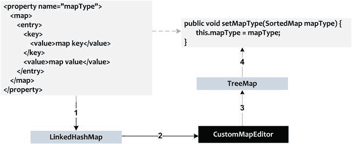

**图 3-6** `CustomMapEditor`将`LinkedHashMap`（源 Map 类型）转换为`TreeMap`（目标 Map 类型）类型

### CustomDateEditor

`CustomDateEditor`是用于`java.util.Date`类型 bean 属性和构造函数参数的属性编辑器。`CustomDateEditor`支持自定义的`java.text.DateFormat`，用于将日期/时间字符串格式化为`java.util.Date`类型对象，并将`java.util.Date`类型对象解析为日期/时间字符串。在下一节中，我们将看到如何使用`CustomDateEditor`设置`java.util.Date`的 bean 属性和构造函数参数。在`ch03-simple-types-examples`项目中，`CustomDateEditor`将 bean 属性（参考`BankDetails`类的`dateOfInception`属性）或构造函数参数（参考`DataTypesExample`类的`dateType`构造函数参数）的字符串值转换为`java.util.Date`类型。

在`ch03-simple-types-examples`项目中，bean 使用的其他一些内置属性编辑器包括：`ByteArrayPropertyEditor`用于将字符串值转换为`byte[]`（参考`BankDetails`类的`bankPrimaryBusiness`属性）、`CurrencyEditor`用于将货币代码转换为`java.util.Currency`对象（参考`BankDetails`类的`primaryCurrency`属性）、`CharacterArrayPropertyEditor`用于将字符串值转换为`char[]`（参考`BankDetails`类的`headOfficeAddress`属性）等。

现在让我们来看如何向 Spring 容器注册属性编辑器。

## 3-6 与 Spring 容器注册属性编辑器

Spring 的`BeanWrapperImpl`类向 Spring 容器注册了几个内置属性编辑器。例如，`CustomCollectionEditor`、`CustomMapEditor`、`CurrencyEditor`、`ByteArrayPropertyEditor`和`CharacterArrayEditor`属性编辑器默认注册在 Spring 容器中。但`CustomDateEditor`属性编辑器并没有默认注册到 Spring 容器。要向 Spring 容器注册属性编辑器，你可以使用 Spring 的特殊 bean `CustomEditorConfigurer`。`CustomEditorConfigurer`类实现了 Spring 的`BeanFactoryPostProcessor`接口（在第 5 章第 5-4 节详细说明），它会被 Spring 容器自动检测并执行。

在`ch03-simple-types-examples`项目中，`BankDetails`类（参考示例 3-24）定义了一个类型为`java.util.Date`的`dateOfInception`属性。`dateOfInception`属性指定的值为‘30-01-2012’（参考示例 3-25）。为了将字符串值‘30-01-2012’转换为`java.util.Date`类型，你必须为`java.util.Date`类型注册自定义属性编辑器，或者向 Spring 容器注册 Spring 内置的`CustomDateEditor`属性编辑器。

向 Spring 容器注册属性编辑器需要执行以下操作：

1. 创建实现 Spring `PropertyEditorRegistrar`接口的类。该类负责向 Spring 容器注册属性编辑器。

2. 在应用上下文 XML 文件中将`PropertyEditorRegistrar`实现配置为 Spring bean。

3. 在应用上下文 XML 文件中配置 Spring 的特殊 bean `CustomEditorConfigurer`，并为其提供对`PropertyEditorRegistrar`实现的引用（你在第 1 步中创建并在第 2 步中配置的）。

现在来看看`ch03-simple-types-examples`项目中`CustomDateEditor`是如何注册到 Spring 容器的。

### 创建 PropertyEditorRegistrar 实现

以下示例显示了实现`PropertyEditorRegistrar`接口的`MyPropertyEditorRegistrar`类：

**示例 3-38** – MyPropertyEditorRegistrar 类

**项目** – ch03-simple-types-examples

**源码位置** - `src/main/java/sample/spring/chapter03/beans`

```
package sample.spring.chapter03.beans;

import java.text.SimpleDateFormat;

import java.util.Date;

import org.springframework.beans.PropertyEditorRegistrar;

import org.springframework.beans.PropertyEditorRegistry;

import org.springframework.beans.propertyeditors.CustomDateEditor;

public class MyPropertyEditorRegistrar implements PropertyEditorRegistrar {

    @Override
    public void registerCustomEditors(PropertyEditorRegistry registry) {
        registry.registerCustomEditor(Date.class, new CustomDateEditor(
            new SimpleDateFormat("dd-MM-yyyy"), false));
    }
}
```

上面的示例显示`MyPropertyEditorRegistrar`类实现了`PropertyEditorRegistrar`接口，并提供了`registerCustomEditors`的实现。传递给`registerCustomEditors`的`PropertyEditorRegistry`实例用于注册属性编辑器。`PropertyEditorRegistry`的`registerCustomEditor`用于向容器注册`CustomDateEditor`。

### 配置 CustomEditorConfigurer 类

以下示例显示如何在应用上下文 XML 文件中配置`CustomEditorConfigurer`类：

**示例 3-39** – applicationContext.xml - CustomEditorConfigurer 配置

**项目** – ch03-simple-types-examples

**源码位置** - `src/main/resources/META-INF/spring`

```xml
<bean id="myPropertyEditorRegistrar" class="sample.spring.chapter03.beans.MyPropertyEditorRegistrar" />

<bean id="editorConfigurer" class="org.springframework.beans.factory.config.CustomEditorConfigurer">
    <property name="propertyEditorRegistars">
        <list>
            <ref bean="myPropertyEditorRegistrar"/>
        </list>
    </property>
</bean>
```

在上面的示例中，`myPropertyEditorRegistrar` bean 定义将`MyPropertyEditorRegistrar`类配置为 Spring bean。`MyPropertyEditorRegistrar`类实现了`PropertyEditorRegistrar`接口，负责向 Spring 容器注册额外的属性编辑器。`CustomEditorConfigurer`的`propertyEditorRegistars`属性指定了一个`PropertyEditorRegistrar`实现列表。在上面的示例中，`myPropertyEditorRegistrar`被指定为`propertyEditorRegistars`属性的值之一。`CustomEditorConfigurer` bean 会被 Spring 容器自动检测并执行，从而由`MyPropertyEditorRegistrar`实例注册属性编辑器。

为了让应用上下文 XML 文件中的 bean 定义更加简洁，Spring 提供了`p`和`c`命名空间，分别用于指定 bean 属性和构造函数参数的值。`p`和`c`命名空间分别是使用`<property>`和`<constructor-arg>`元素的替代方案。

让我们先看 p 命名空间。

**导入** `chapter 3/ch03-namespaces-example`(该项目展示了一个 Spring 应用，其中通过`p`和`c`命名空间分别设置了 bean 属性和构造函数参数。要运行该应用程序，请执行项目中`SampleApp`类的 main 方法)

### p-命名空间

要使用`p-namespace`设置 bean 属性，请将 bean 属性指定为`<bean>`元素的属性，并指定每个 bean 属性位于`p-namespace`中。

接下来的 bean 定义展示了如何使用`p-namespace`设置 bean 属性：

**示例 3-40** – `applicationContext.xml` - p-namespace 示例

**项目** – `ch03-namespaces-example`

**源码位置** - `src/main/resources/META-INF/spring`

```
<beans xmlns="http://www.springframework.org/schema/beans"
xmlns:p="http://www.springframework.org/schema/p" xsi:schemaLocation=".....">
    <bean id="bankDetails" class="sample.spring.chapter03.beans.BankDetails"
        p:bankName="My Personal Bank" p:bankPrimaryBusiness="Retail banking"
        p:headOfficeAddress="Address of head office" p:privateBank="Y"
        p:primaryCurrency="INR" p:dateOfInception="30-01-2012"
        p:branchAddresses-ref="branchAddresses"/>
    .....
</beans>
```

在上面所示的应用上下文 XML 文件中，通过`xmlns`属性指定了`p-namespace`。`bankDetails` bean 定义使用了`p-namespace`的`p`前缀来指定 bean 属性。如果你将上面的示例与示例列表 3-25 进行比较，你会发现上面的示例更加简洁。虽然可以混合使用`<property>`元素和`p-namespace`来指定 bean 属性，但建议选择一种样式来指定 bean 属性并在 bean 定义中保持一致。


**注意** 由于 `p-namespace` 是作为 Spring 的一部分实现的，因此没有对应 `p-namespace` 的 schema。因此，在示例 3-40 中没有看到任何对应 `p-namespace` 的 schema。如果你希望 IDE 在使用 `p-namespace` 时自动补全 bean 属性名，请考虑使用 IntelliJ IDEA 或 SpringSource Tool Suite (STS)。

如果 bean 属性不是对另一个 bean 的引用，则使用以下语法指定：

`p:<property-name>="<property-value>"`

这里，`<property-name>` 是 bean 属性的名称，`<property-value>` 是 bean 属性的值。

如果 bean 属性是对另一个 bean 的引用，则使用以下语法指定：

`p:<property-name>-ref="<bean-reference>"`

这里，`<property-name>` 是 bean 属性的名称，`<bean-reference>` 是被引用 bean 的 id（或名称）。需要注意的是，bean 属性的名称后面跟着 `-ref`。由于 `BankDetails` bean 的 `branchAddresses` 属性代表对 `branchAddresses` bean 的引用，因此在示例 3-40 中，`branchAddresses` 属性被指定为 `p:branchAddresses-ref`。

现在让我们看看如何使用 `c-namespace` 设置构造函数参数。

### c-命名空间

要使用 `c-namespace` 为构造函数参数提供值，请将构造函数参数指定为 `<bean>` 元素的属性，并指定每个构造函数参数位于 `c-namespace` 中。

下面的示例展示了 `BankStatement` 类，我们将使用 `c-namespace` 将其配置为 Spring bean。

**示例 3-41** – `BankStatement` 类

**项目** – `ch03-namespaces-example`

**源码位置** - `src/main/java/sample/spring/chapter03/beans`

```java
package sample.spring.chapter03.beans;

import java.beans.ConstructorProperties;

public class BankStatement {
    .....
    @ConstructorProperties({ "transactionDate", "amount", "transactionType", "referenceNumber" })
    public BankStatement(Date transactionDate, double amount, String transactionType, String referenceNumber) {
        this.transactionDate = transactionDate;
        this.amount = amount;
        .....
    }
    .....
}
```

接下来的 `BankStatement` 类的 bean 定义展示了如何使用 `c-namespace` 设置构造函数参数的值：

**示例 3-42** – `applicationContext.xml` - c-namespace

**项目** – `ch03-namespaces-example`

**源码位置** - `src/main/resources/META-INF/spring`

```xml
<beans xmlns="http://www.springframework.org/schema/beans"
xmlns:c="http://www.springframework.org/schema/c"
xsi:schemaLocation=".....">
    .....
    <bean id="bankStatement" class="sample.spring.chapter03.beans.BankStatement"
        c:transactionDate="30-01-2012"
        c:amount="1000"
        c:transactionType="Credit"
        c:referenceNumber="1110202" />
    .....
</beans>
```

在上面的示例中，通过 `xmlns` 属性指定了 `c-namespace`。`bankStatement` bean 定义使用了 `c-namespace` 的 `c` 前缀。使用 `c-namespace` 指定构造函数参数的语法与我们在 `p-namespace` 情况中看到的相似。

**注意** 由于 `c-namespace` 是作为 Spring 的一部分实现的，因此没有对应 `c-namespace` 的 schema。因此，在示例 3-42 中没有看到任何对应 `c-namespace` 的 schema。如果你希望 IDE 自动补全参数名称，请考虑使用 IntelliJ IDEA 或 SpringSource Tool Suite (STS)。

如果构造函数参数不是对另一个 bean 的引用，则使用以下语法指定：

`c:<property-name>="<property-value>"`

这里，`<property-name>` 是构造函数参数的名称，`<property-value>` 是构造函数参数的值。

如果构造函数参数是对另一个 bean 的引用，则使用以下语法指定：

`c:<property-name>-ref="<bean-reference>"`

这里，`<property-name>` 是构造函数参数的名称，`<bean-reference>` 是被引用 bean 的 id（或名称）。需要注意的是，构造函数参数的名称后面跟着 `-ref`。例如，如果一个名为 `myargument` 的构造函数参数代表对 id 为 `x` 的 bean 的引用，你将该参数指定为：

`c:myargument-ref="x"`

如前所述，如果编译时开启了调试标记，构造函数参数名称将保留在生成的 `.class` 文件中。如果 `BankStatement` 类编译时没有开启调试标记，示例 3-42 中的配置将无法工作。在这种情况下，你使用索引为构造函数参数提供值，如下：

**示例 3-43** – 使用索引为构造函数参数提供值

```xml
<beans xmlns="http://www.springframework.org/schema/beans"
xmlns:c="http://www.springframework.org/schema/c"
xsi:schemaLocation=".....">
    .....
    <bean id="bankStatement" class="sample.spring.chapter03.beans.BankStatement"
        c:_0="30-01-2012"
        c:_1="1000"
        c:_2="Credit"
        c:_3="1110202" />
    .....
</beans>
```

上面的示例列表显示了 `BankStatement` 类的 bean 定义，它使用构造函数参数索引而不是构造参数名称来提供值。需要注意的是，构造函数参数的索引以下划线 `underscore` 为前缀，因为 XML 中的属性名称`不能`以数字值开头。如果构造函数参数是对另一个 bean 的引用，则在构造函数参数的索引上添加 `-ref`。例如，如果索引为 0 的构造函数参数代表对另一个 bean 的引用，则指定为 `c:_0-ref`。虽然可以使用 `<constructor-arg>` 元素和 `c-namespace` 组合来指定构造函数参数，但建议选择一种指定构造函数参数的方式并在 bean 定义中保持一致。

我们之前已经看到 `<list>`、`<map>` 和 `<set>` 元素分别用于设置类型为 `List`、`Map` 和 `Set` 的属性或构造函数参数。现在，让我们来看看 Spring 的 util 模式（schema），它简化了集合类型、`Properties` 类型、常量等的创建，并将它们暴露为 Spring bean。

## 3-8 Spring 的 util 模式

Spring 的 util 模式通过提供一种简洁的方式来执行常见的配置任务，简化了 bean 的配置。下表描述了 util 模式的各种元素：

| 元素 | 描述 |
| :--- | :--- |
| `<list>` | 创建一个 `java.util.List` 类型并将其暴露为 bean |
| `<map>` | 创建一个 `java.util.Map` 类型并将其暴露为 bean |
| `<set>` | 创建一个 `java.util.Set` 类型并将其暴露为 bean |
| `<constant>` | 将类型上的公共静态字段暴露为 bean |
| `<property-path>` | 将 bean 属性暴露为 bean |
| `<properties>` | 从属性文件中创建 `java.util.Properties` 并将其暴露为 bean |

**注意** Spring util 模式的所有元素都接受 `scope` 属性，该属性用于标识暴露的 bean 是单例（singleton）还是原型（prototype）作用域。

Spring 提供了一个 `FactoryBean` 接口，可以通过实现该接口来创建一个负责创建 bean 实例的工厂对象。与其使用上表提到的 util 模式元素，可以使用 Spring 提供的开箱即用的 `FactoryBean` 实现来实现相同的功能。在本节中，我们将查看 util 模式的元素以及你可以用来替代 util 模式元素的内置 `FactoryBean` 实现。

**导入** `chapter 3/ch03-util-schema-examples`（此项目展示了一个利用 Spring util 模式元素创建 `List`、`Set`、`Map` 等共享实例的 Spring 应用程序。要运行该程序，请执行该项目中 `SampleApp` 类的主方法）

让我们先来看 `<list>` 元素。

### `<list>`

Spring util 模式的 `<list>` 元素用于创建类型为 `java.util.List` 的对象，如下所示：

**示例 3-44 –** `applicationContext.xml` - util 模式的 `<list>` 元素

**项目 –** `ch03-util-schema-examples`

**源码位置 -** `src/main/resources/META-INF/spring`

```xml
<beans xmlns="http://www.springframework.org/schema/beans"
        xmlns:util="http://www.springframework.org/schema/util"
        xsi:schemaLocation="..... http://www.springframework.org/schema/util
        http://www.springframework.org/schema/util/spring-util-4.0.xsd">

    <bean id="dataTypes" class="sample.spring.chapter03.beans.DataTypesExample">
        .....
        <constructor-arg name="listType" ref="listType" />
        .....
    </bean>

  <util:list id="listType" list-class="java.util.ArrayList">
             <value>A simple String value in list</value>
             <value>Another simple String value in list</value>
  </util:list>
</beans>
```

首先，你需要包含 Spring 的 util 模式以访问其元素。在上面的示例列表中，util 模式的 `<list>` 元素创建 `java.util.ArrayList` 实例并将其暴露为 bean。`id` 属性指定了暴露 `java.util.ArrayList` 实例的 bean id，`list-class` 属性指定了你想创建的 `java.util.List` 的具体实现。如果你没有指定 `list-class` 属性，默认将创建一个 `java.util.ArrayList` 实例。Spring beans 模式的 `<value>` 元素用于指定列表的单个元素。

由于 util 模式的 `<list>` 元素将 `List` 实例暴露为 bean，你可以从其他 bean 引用暴露的 `List` 实例。例如，在上面的示例列表中，`DataTypesExample` bean 的 `listType` 构造参数（类型为 `java.util.List`）指定 `listType` 为 util 模式 `<list>` 元素的值。

如果你将 util 模式的 `<list>` 元素与 beans 模式的 `<list>` 元素（列表 27）相比，你会发现 util 模式的 `<list>` 让你控制实现。例如，如果你想创建一个 `Vector`，请指定 `list-class` 属性。

现在让我们来看看替代 util 模式 `<list>` 元素的 `FactoryBean`。`FactoryBean` 是创建 `List` 实例并将其暴露为 bean 的模式 `<list>` 元素的替代方案。

```xml
<beans ...>
  <bean id="dataTypes" class="sample.spring.chapter03.beans.DataTypesExample">
    <constructor-arg name="listType" ref="listType" />
  </bean>

  <bean id="listType" class="org.springframework.beans.factory.FactoryBean">
    <property name="sourceList">
      <list>
        <value>A simple String value in list</value>
        <value>Another simple String value in list</value>
      </list>
    </property>
  </bean>
</beans>
```

在上面的示例列表中，`FactoryBean` 的 `sourceList` 属性指定了列表中的元素。默认情况下，`FactoryBean` 创建 `java.util.ArrayList` 实例。如果你想让 `FactoryBean` 创建其他 `List` 实现（如 `Vector`），请设置 `targetListClass` 属性。`targetListClass` 属性指定了 `FactoryBean` 创建的 `java.util.List` 具体实现类的全限定名。

如果你对比示例 44 和 45，你会发现使用 util 模式的 `<list>` 比使用 `FactoryBean` 创建 `List` 实例简单得多。

### `<map>`

Spring util 模式的 `<map>` 元素用于创建类型为 `java.util.Map` 的对象并将其暴露为 bean，如下所示：

**示例 3-46 –** `applicationContext.xml` - util 模式的 `<map>` 元素

**项目 –** `ch03-util-schema-examples`

**源码位置 -** `src/main/resources/META-INF/spring`

```xml
<beans xmlns="http://www.springframework.org/schema/beans"
        xmlns:util="http://www.springframework.org/schema/util"
        xsi:schemaLocation="..... http://www.springframework.org/schema/util
        http://www.springframework.org/schema/util/spring-util-4.0.xsd">

    <bean id="dataTypes" class="sample.spring.chapter03.beans.DataTypesExample">
        <constructor-arg name="mapType" ref="mapType" />
    </bean>

  <util:map id="mapType" map-class="java.util.TreeMap">
      <entry key="map key 1" value="map key 1’s value"/>
  </util:map>

</beans>
```


在上面的示例列表中，`util` 模式的 `<map>` 元素创建 `java.util.TreeMap` 实例并将其暴露为 bean。`id` 属性指定了该 bean 供其他 bean 使用的 ID，`map-class` 属性指定了由 `<map>` 元素创建的 `java.util.Map` 接口的具体实现类的全限定名。Spring beans 模式的 `<entry>` 元素指定了创建的 `Map` 实例中的键值对。

由于 `<map>` 元素将 `Map` 实例暴露为 bean，因此可以在其他 bean 中引用此暴露的 `Map` 实例。例如，在上面的示例列表中，`DataTypesExample` 的构造函数参数 `mapType`（类型为 `java.util.Map`）将 `ref` 属性指定为 `mapType` 来引用 `TreeMap` 实例。

注意：我们在本章之前看到 `<key>` 和 `<value>` 子元素用于指定 `Map` 实例中包含的键值对。示例 3-46 显示，你也可以通过 `<entry>` 元素的 `key` 和 `value` 属性来指定 `Map` 实例中包含的键值对。

如果你将上述示例中 `util` 模式的 `<map>` 元素与示例 3-27 中 beans 模式的 `<map>` 元素对比，你会发现 `util` 模式的 `<map>` 元素让你控制要创建的 `Map` 实现。例如，如果你想使用 `LinkedHashMap` 而不是 `TreeMap`，请将 `java.util.LinkedHashMap` 指定为 `map-class` 属性的值。如果没有指定 `map-class` 属性，Spring 容器默认创建一个 `java.util.LinkedHashMap` 实例。

现在让我们来看 Spring 的 `MapFactoryBean`，你可以用它代替 `util` 模式的 `<map>` 元素。

## MapFactoryBean

可以使用 Spring 的 `MapFactoryBean` 代替 `util` 模式的 `<map>` 元素——这是一个用于创建 `java.util.Map` 实例并将其作为 Spring bean 的工厂。

下面的示例显示了如何使用 `MapFactoryBean`：

**示例 3-47 – MapFactoryBean 示例**

```xml
<beans .....>
    <bean id="dataTypes" class="sample.spring.chapter03.beans.DataTypesExample">
        .....
        <constructor-arg name="mapType" ref="mapType" />
        .....
    </bean>
    <bean id="mapType" class="org.springframework.beans.factory.config.MapFactoryBean">
        <property name="sourceMap">
            <map>
                <entry key="map key 1" value="map key 1’s value"/>
            </map>
        </property>
    </bean>
    .....
</beans>
```

在上面的示例列表中，`MapFactoryBean` 的 `sourceMap` 属性指定了由 `MapFactoryBean` 创建的 `Map` 实例中的键值对。默认情况下，`MapFactoryBean` 创建 `java.util.LinkedHashMap` 实例。你可以通过设置 `targetMapClass` 属性来控制 `MapFactoryBean` 创建的 `Map` 实例。`targetMapClass` 指定了 `java.util.Map` 接口的具体实现类的全限定名。例如，如果你将 `java.util.HashMap` 指定为 `targetMapClass` 的值，`MapFactoryBean` 将创建一个 `java.util.HashMap` 实例。

如果你对比示例 3-46 和 3-47，你会发现使用 `util` 模式的 `<map>` 元素创建 `Map` 实例的配置比 `MapFactoryBean` 更加简洁。

## `<set>`

Spring `util` 模式的 `<set>` 元素用于创建 `java.util.Set` 类型的对象并将其暴露为 bean，如下所示：

**示例 3-48 – applicationContext.xml - util 模式的 `<set>` 元素**

**Project – ch03-util-schema-examples**

**Source location - src/main/resources/META-INF/spring**

```xml
<beans .....
    xmlns:util="http://www.springframework.org/schema/util"
    xsi:schemaLocation="..... http://www.springframework.org/schema/util
      http://www.springframework.org/schema/util/spring-util-4.0.xsd">
    <bean id="dataTypes" class="sample.spring.chapter03.beans.DataTypesExample">
        .....
        <constructor-arg name="setType" ref="setType" />
    </bean>
    <util:set id="setType" set-class="java.util.HashSet">
        <value>Element 1</value>
        <value>Element 2</value>
    </util:set>
    .....
</beans>
```

在上面的示例列表中，`util` 模式的 `<set>` 元素创建一个 `HashSet` 实例并以 `setType` 为 ID 将其暴露为 Spring bean。`id` 属性指定了该 bean 供其他 bean 使用的 ID，`set-class` 属性指定了由 `<set>` 元素创建的 `java.util.Set` 具体实现类。Spring beans 的 `<value>` 元素指定创建的 `Set` 实例中的元素。由 `<set>` 元素创建的 `Set` 实例可以在其他 bean 中引用。例如，在上面的示例列表中，`DataTypesExample` 的构造函数参数 `setType`（类型为 `java.util.Set`）引用了由 `<set>` 元素创建的 `HashSet` 实例。

可以使用 Spring 的 `SetFactoryBean` 代替 `util` 模式的 `<set>` 元素来创建 `Set` 实例并将其暴露为 Spring bean。

## SetFactoryBean

Spring 的 `SetFactoryBean` 是用于创建 `java.util.Set` 类型实例的工厂对象。下面的示例显示了如何使用 `SetFactoryBean` 实现与 `util` 模式 `<set>` 元素相同的功能：

**示例 3-49 – SetFactoryBean**

```xml
<beans .....>
    <bean id="dataTypes" class="sample.spring.chapter03.beans.DataTypesExample">
        .....
        <constructor-arg name="setType" ref="setType" />
        .....
    </bean>
    <bean id="setType" class="org.springframework.beans.factory.config.SetFactoryBean">
        <property name="sourceSet">
            <set>
                <value>Element 1</value>
                <value>Element 2</value>
            </set>
        </property>
    </bean>
    .....
</beans>
```

在上面的示例列表中，`SetFactoryBean` 的 `sourceSet` 属性指定了 `SetFactoryBean` 创建的 `Set` 实例中的元素。`SetFactoryBean` 的 `targetSetClass` 属性指定实现 `java.util.Set` 的类的全限定名。如果指定了 `targetSetClass` 属性，`SetFactoryBean` 将创建 `targetSetClass` 指定的类的实例并作为 Spring bean 提供。例如，如果你将 `java.util.HashSet` 指定为 `targetSetClass` 的值，`SetFactoryBean` 将创建一个 `java.util.HashSet` 实例。如果没有指定 `targetSetClass` 属性，`SetFactoryBean` 将创建一个 `java.util.LinkedHashSet` 实例。

上面的示例显示，创建 `Set` 实例时，使用 `util` 模式的 `<set>` 元素比使用 `SetFactoryBean` 更简洁。

## `<properties>`

如果你想从属性文件创建 `java.util.Properties` 对象实例并将其暴露为 bean，那么 `util` 模式的 `<properties>` 元素将非常有用。

下面的示例显示了如何使用 `<properties>` 元素：

**示例 3-50 – applicationContext.xml - util 模式的 `<properties>` 元素**

**Project – ch03-util-schema-examples**

**Source location - src/main/resources/META-INF/spring**

```xml
<beans .....
    xmlns:util="http://www.springframework.org/schema/util"
    xsi:schemaLocation="..... http://www.springframework.org/schema/util
      http://www.springframework.org/schema/util/spring-util-4.0.xsd">
    <bean id="bankDetails" class="sample.spring.chapter03.beans.BankDetails">
        .....
        <property name="branchAddresses" ref="branchAddresses" />
    </bean>
    .....
    <util:properties id="branchAddresses" location="classpath:META-INF/addresses.properties" />
</beans>
```

在上面的示例列表中，`<properties>` 元素创建了一个 `java.util.Properties` 实例，其中包含了从 `addresses.properties` 文件（由 `location` 属性指定）加载的属性，并将 `java.util.Properties` 实例暴露为以 `branchAddresses` 为 id（由 `id` 属性指定）的 bean。上面的示例还显示 `BankDetails` bean 的 `branchAddresses` 属性（类型为 `java.util.Properties`）引用了由 util schema `<properties>` 元素创建的 `branchAddresses` bean。

使用 `<properties>` 元素的替代方案是 Spring 的 `PropertiesFactoryBean`。

## PropertiesFactoryBean

Spring 的 `PropertiesFactoryBean` 是用于创建 `java.util.Properties` 实例的工厂。

下面的示例显示了如何使用 `PropertiesFactoryBean` 实现与 util schema 中 `<properties>` 元素相同的功能：

**示例 3-51 – PropertiesFactoryBean 示例**

```xml
<beans .....>
    <bean id="bankDetails" class="sample.spring.chapter03.beans.BankDetails">
        .....
        <property name="branchAddresses" ref="branchAddresses" />
    </bean>
    <bean id="branchAddresses" class="org.springframework.beans.factory.config.PropertiesFactoryBean">
        <property name="location" value="classpath:META-INF/addresses.properties"/>
    </bean>
    .....
</beans>
```

在上面的示例列表中，Spring `PropertiesFactoryBean` 的 bean 定义通过从 `addresses.properties` 文件（由 `location` 属性指定）加载的属性创建了一个 `java.util.Properties` 实例，并将该 `java.util.Properties` 实例暴露为以 `branchAddresses` 为 id 的 bean。

## `<constant>`

util schema 的 `<constant>` 元素用于将对象的公共静态字段暴露为 Spring bean。

下面的示例显示了 `<constant>` 元素的用法示例：

**示例 3-52 – applicationContext.xml - util schema 的 `<constant>` 元素**

**Project – ch03-util-schema-examples**

**Source location - src/main/resources/META-INF/spring**

```xml
<beans ..... xmlns:util="http://www.springframework.org/schema/util"
      xsi:schemaLocation="..... http://www.springframework.org/schema/util
      http://www.springframework.org/schema/util/spring-util-4.0.xsd">
    <bean id="dataTypes" class="sample.spring.chapter03.beans.DataTypesExample">
        .....
        <constructor-arg name="booleanType" ref="booleanTrue" />
        .....
    </bean>
    <util:constant id="booleanTrue" static-field="java.lang.Boolean.TRUE" />
    .....
</beans>
```

util schema 的 `<constant>` 元素将其 `static-field` 属性指定的值暴露为 Spring bean。在上面的示例列表中，`<constant>` 元素暴露了一个值为 `java.lang.Boolean.TRUE` 且 id 为 `booleanTrue` 的 bean。你可以指定任何公共静态字段作为 `static-field` 属性的值，并在 Spring 容器中的其他 bean 中引用它。例如，在上面的示例列表中，`booleanType` bean 被 `DataTypesExample` 类型为 `boolean` 的 `booleanType` 构造函数参数引用。

将公共静态字段暴露为 Spring bean 的一种不太简洁的方法是使用 Spring 的 `FieldRetrievingFactoryBean`。

## FieldRetrievingFactoryBean

Spring 的 `FieldRetrievingFactoryBean` 是一个用于获取由 `FieldRetrievingFactoryBean` 的 `staticField` 属性指定的公共静态字段值的工厂。通过 `FieldRetrievingFactoryBean` 获取的值被暴露为 bean。你也可以使用 `FieldRetrievingFactoryBean` 来获取非静态字段的值。

下面的示例显示了 `FieldRetrievingFactoryBean` 的用法示例：

**示例 3-53 – FieldRetrievingFactoryBean 示例**


```xml
<beans .....>
    <bean id="dataTypes" class="sample.spring.chapter03.beans.DataTypesExample">
        .....
        <constructor-arg name="booleanType" ref="booleanTrue" />
        .....
    </bean>
    <bean id="booleanTrue" class="org.springframework.beans.factory.config.FieldRetrievingFactoryBean">
        <property name="staticField" value=" java.lang.Boolean.TRUE"/>
    </bean>
    .....
</beans>
```

在上面的示例列表中，`FieldRetrievingFactoryBean` 获取了 `java.lang.Boolean.TRUE` 字段的值并将其暴露为 bean。由 `FieldRetrievingFactoryBean` 暴露的 bean 被 `DataTypesExample` 类型为 `boolean` 的 `booleanType` 构造函数参数引用。

## `<property-path>`

`util` schema 的 `<property-path>` 元素用于将属性值暴露为 bean。

下面的示例显示了 `<property-path>` 的示例：

**示例列表 3-54 – applicationContext.xml - util schema 的 `<property-path>` 元素**

**Project – ch03-util-schema-examples**

**Source location - src/main/resources/META-INF/spring**

```xml
<beans ..... xmlns:util="http://www.springframework.org/schema/util"
      xsi:schemaLocation="..... http://www.springframework.org/schema/util
      http://www.springframework.org/schema/util/spring-util-4.0.xsd">
    <bean id="bankDetails" class="sample.spring.chapter03.beans.BankDetails">
        .....
        <property name="branchAddresses" ref="branchAddresses" />
        .....
    </bean>
    <util:property-path id="dateType" path="dataTypes" />
    <bean id="dataTypes" class="sample.spring.chapter03.beans.DataTypesExample">
        .....
        <property name="dateType" value="30-01-12" />
        .....
    </bean>
</beans>
```

在上面的示例列表中，`DataTypesExample` 的 `dateType`（类型为 `java.util.Date`）被指定为 `'30-01-12'`。`<property-path>` 元素获取 `dataTypes` 属性并暴露为 id 为 `dateType` 的 bean。`<property-path>` 的语法为 `<bean-name>.<bean-property>`，其中 `<bean-name>` 是 bean 的 id 或名称，`<bean-property>` 是属性名称。

由于 `<property-path>` 暴露了一个 bean，它可以被 Spring 容器中的其他 bean 引用。例如，在上面的示例列表中，`dateType` bean 被 `BankDetails` bean 的属性引用。

除了使用 `<property-path>` 元素外，你可以使用 Spring 的 `PropertyPathFactoryBean` 将属性值暴露为 bean。

## `PropertyPathFactoryBean`

`PropertyPathFactoryBean` 是用于创建 bean 属性的 bean 实例的工厂。

下面的示例显示了如何使用 `PropertyPathFactoryBean`：

**示例列表 3-55 – PropertyPathFactoryBean 示例**

```xml
<beans ..... xmlns:util="http://www.springframework.org/schema/util"
      xsi:schemaLocation="..... http://www.springframework.org/schema/util
      http://www.springframework.org/schema/util/spring-util-4.0.xsd">
    <bean id="bankDetails" class="sample.spring.chapter03.beans.BankDetails">
        .....
        <property name="branchAddresses" ref="dateType" />
        .....
    </bean>
    <bean id="dataType" class="org.springframework.beans.factory.config.PropertyPathFactoryBean">
        <property name="targetBeanName" value="dataTypes"/>
        <property name="propertyPath" value="dateType"/>
    </bean>
    <bean id="dataTypes" class="sample.spring.chapter03.beans.DataTypesExample">
        .....
        <property name="dateType" value="30-01-12" />
        .....
    </bean>
</beans>
```

在上面的示例列表中，`PropertyPathFactoryBean` 被用于创建一个 bean 实例，代表 `dataTypes` bean 的 `dateType` 属性的值。`PropertyPathFactoryBean` 的 `targetBeanName` 属性指定包含该属性的 bean 的 id 或名称，而 `PropertyPathFactoryBean` 的 `propertyPath` 属性指定了要暴露为 bean 的属性名称。由 `PropertyPathFactoryBean` 创建的 bean 实例可以被 Spring 容器中的其他 bean 访问。在上面的示例列表中，由 `PropertyPathFactoryBean` 创建的 `date` bean（此处原文为 `dataType`，应为 `dateType`）被 `BankDetails` bean 的 `dateOfInception` 属性（类型为 `java.util.Date`）引用。

现在，我们已经深入查看了 `util` 架构元素，让我们来看看 Spring 的 `FactoryBean` 接口。

## 3-9 `FactoryBean` 接口

Spring 的 `FactoryBean` 接口由作为创建 bean 实例工厂的类实现。在上一节中，我们看到实现 `FactoryBean` 接口的类像其他 bean 一样在应用上下文 XML 文件中进行配置。如果你希望执行复杂的条件检查以决定创建哪种类型的 bean，并执行复杂的 bean 初始化逻辑，`FactoryBean` 特别有用。

现在让我们来看一个应用场景，在该场景中我们将使用 `FactoryBean` 来选择 bean 类型，然后创建它。

### MyBank 应用 – 在数据库中存储事件

在 MyBank 应用中，重要的事件（如贷记交易、定期存款开放和清空等）被保存在数据库中。MyBank 可以直接将这些事件保存到数据库中，也可以通过先将事件发送到消息中间件或 Web 服务来间接保存。下表描述了 MyBank 应用定义的直接或间接保存事件的类：

| 类 | 描述 |
| :--- | :--- |
| `DatabaseEventSender` | 在数据库中保存事件功能的类 |
| `MessagingEventSender` | 包含将事件发送到消息中间件功能的类 |
| `WebServiceEventSender` | 包含将事件发送到远程 Web 服务的类 |

直接将事件保存到数据库或将它们发送到消息中间件或 Web 服务的决策基于配置。例如，如果 MyBank 发现存在 `database.properties` 文件，MyBank 会从 `database.properties` 文件中读取配置信息（如数据库 URL、用户名和密码）并创建 `DatabaseEventSender` 实例。同样，如果存在 `messaging.properties` 文件，MyBank 会创建一个 `MessagingEventSender` 实例；如果存在 `webservice.properties` 文件，则创建一个 `WebServiceEventSender` 实例。

初始化 `DatabaseEventSender`、`MessagingEventSender` 和 `WebServiceEventSender` 实例可能需要执行复杂的初始化逻辑。例如，你需要创建（或从 JNDI 获取）`javax.jms.ConnectionFactory` 和 `javax.jms.Destination` 实例，并将它们设置在 `MessagingEventSender` 实例上，以便 `MessagingEventSender` 可以向消息中间件发送 JMS 消息。

接下来的类图显示 MyBank 的 `FixedDepositServiceImpl` 类使用 `DatabaseEventSender`、`MessagingEventSender` 或 `WebServiceEventSender` 实例来直接或间接地保存与定期存款相关的事件：

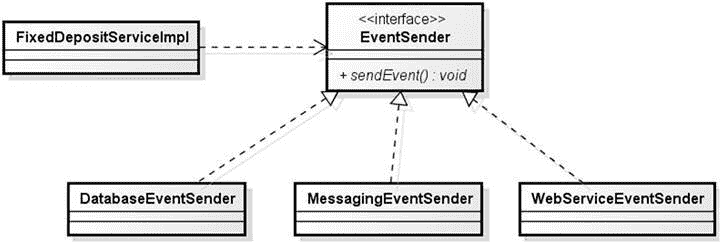

**图 3-7** `FixedDepositServiceImpl` 类使用了 `EventSender` 接口的一种实现。

在上面的类图中，`EventSender` 接口的 `sendEvent` 方法定义了直接或间接在数据库中保存事件的约定。`DatabaseEventSender`、`MessagingEventSender` 和 `WebServiceEventSender` 类实现了 `EventSender` 接口，并为 `sendEvent` 方法提供了相应的实现。

现在让我们来看看 `FactoryBean` 如何简化选择 `EventSender` 接口的正确实现并对其初始化。

**导入第 3 章/ch03** 此章节展示了使用 `FactoryBean` 选择 bean 类型并创建它的场景。

### MyBank 应用 – `FactoryBean`

在 MyBank 中，选择正确的 `EventSender` 接口实现并对其初始化是一项复杂的任务，因此它是使用 `FactoryBean` 的理想场景。`FactoryBean` 接口定义了以下方法：

- `getObjectType()`: 返回由 `FactoryBean` 管理的对象的类型。
- `getObject()`: 返回 `FactoryBean` 创建的对象。在 MyBank 中，`FactoryBean` 实现创建并返回 `EventSender` 类型的对象。
- `isSingleton()`: 如果 `FactoryBean` 实现是单例作用的，返回 `true`。Spring 容器会缓存 `getObject()` 返回的对象并在后续请求中返回它。如果 `FactoryBean` 实现是原型作用的，则返回 `false`。此时 `getObject()` 方法在每次请求时都会创建一个新实例。

接下来的示例展示了 `FactoryBean` 实现创建并返回 `EventSender` 类型的对象：

**示例 3-56 – FactoryBean 类**

**项目 – ch03/bankapp-factorybean**

**源码位置 - src/main/java/sample/spring/chapter03/bankapp/event**

上面的示例列表显示 `EventSenderFactoryBean` 实现了 `FactoryBean` 接口。`FactoryBean<EventSender>` 中的 `EventSender` 参数表示 `FactoryBean` 的 `getObject()` 方法返回 `EventSender` 类型的对象。`databasePropertiesFile`、`webServicePropertiesFile` 和 `messagingPropertiesFile` 是 `EventSenderFactoryBean` 类的属性，它们代表了 classpath 中 `database.properties`、`webservice.properties` 和 `messaging.properties` 文件的位置。

`getObject()` 方法使用 Spring 的 `ClassPathResource` 类来验证指定的属性文件是否存在于 classpath 中。如果属性文件存在，则加载该文件中的属性并将其传递给 `EventSender` 实现类的构造函数。例如，在上面的示例列表中，如果 `database.properties` 文件（由 `databasePropertiesFile` 属性表示）存在，则会从 `database.properties` 文件中加载属性，并将其作为参数传递给 `DatabaseEventSender` 的构造函数。`getObjectType()` 方法返回 `EventSender` 类型，因为 `EventSenderFactoryBean` 的 `getObject()` 方法返回的是 `EventSender` 类型的对象。`isSingleton()` 方法返回 `true`，这意味着 `getObject()` 方法返回的对象会被 Spring 缓存，并且每次调用 `EventSenderFactoryBean` 的 `getObject()` 方法都会返回同一个实例。

现在，既然你已经看到了 `EventSenderFactoryBean` 类在 `MyBank` 中是如何实现的，你可以猜测 Spring 内置的 `FactoryBean` 实现，例如 `ListFactoryBean`（用于创建 `List` 类型实例）、`MapFactoryBean`（用于创建 `Map` 类型实例）、`SetFactoryBean`（用于创建 `Set` 类型实例）等是如何实现的。

下面的示例列表显示了如何在应用上下文 XML 文件中配置 `EventSenderFactoryBean`：

**示例列表 3-57 – applicationContext.xml - EventSenderFactoryBean 配置**

**项目 – ch03-bankapp-factorybean**

**源位置 - src/main/resources/META-INF/spring**

```xml
<beans .....>
    <bean id="service" class="sample.spring.chapter03.bankapp.service.FixedDepositServiceImpl">
        .....
        <property name="eventSender" ref="eventSenderFactory" />
    </bean>
    .....
    <bean id="eventSenderFactory" class="sample.spring.chapter03.bankapp.event.EventSenderFactoryBean">
        <property name="databasePropertiesFile" value="META-INF/config/database.properties"/>
    </bean>
</beans>
```

上面的示例列表显示 `EventSenderFactoryBean` 的配置方式与其他任何 Spring bean 一致。尽管 `FactoryBean` 实现的配置方式与其他任何 Spring bean 一致，但 Spring 容器对它的处理方式是*不同*的。最重要的区别之一是，如果一个 bean 依赖于一个 `FactoryBean` 实现，Spring 容器会调用该 `FactoryBean` 实现的 `getObject()` 方法并将返回的对象注入到依赖它的 bean 中。

注意：你应该注意，如果 `isSingleton()` 方法返回 `true`，则 Spring 容器只会调用一次 `FactoryBean` 的 `getObject()` 方法。


在上面的示例列表中，`FixedDepositServiceImpl` 类的 bean 定义显示它依赖于 `EventSenderFactoryBean` —— 一个 `FactoryBean` 实现。因此，Spring 容器调用 `EventSenderFactoryBean` 的 `getObject()` 方法，并将返回的 `EventSender` 对象注入到 `FixedDepositServiceImpl` 实例中。

下面的示例列表显示了 `FixedDepositServiceImpl` 类，它需要由 `EventSenderFactoryBean` 创建的 `EventSender` 实例：

**示例列表 3-58 – FixedDepositServiceImpl 类**

**项目 – ch03-bankapp-factorybean**

**源位置 - src/main/java/sample/spring/chapter03/bankapp/service**

```java
package sample.spring.chapter03.bankapp.service;

import sample.spring.chapter03.bankapp.event.EventSender;

public class FixedDepositServiceImpl implements FixedDepositService {

    .....
    private EventSender eventSender;

    public void setEventSender(EventSender eventSender) {
        this.eventSender = eventSender;
    }

    .....

    public void createFixedDeposit(FixedDepositDetails fixedDepositDetails) {
        .....
        eventSender.sendEvent(event);
    }
}
```

上面的示例列表显示 `FixedDepositServiceImpl` 类依赖于一个 `EventSender` 实例，而不是依赖于 `EventSenderFactoryBean` 实例。Spring 容器通过调用 `EventSenderFactoryBean` 的 `getObject()` 方法获取 `EventSender` 实例，并将获取的 `EventSender` 实例注入到 `FixedDepositServiceImpl` 实例中。

现在让我们来看如何访问 `FactoryBean` 本身，而不是它通过 `getObject()` 方法创建并返回的 bean。

### 访问 FactoryBean 实例

如果你想从 Spring 容器中获取 `FactoryBean` 本身，请在工厂 bean 的名称（或 id）前加上符号符号‘&’。

假设 `FixedDepositServiceImpl` 类需要访问 `EventSenderFactoryBean` 本身，如下所示：

**示例列表 3-59 – 依赖 EventSenderFactoryBean 的 FixedDepositServiceImpl 类**

```java
package sample.spring.chapter03.bankapp.service;

import sample.spring.chapter03.bankapp.event.EventSenderFactoryBean;
import sample.spring.chapter03.bankapp.event.EventSender;

public class FixedDepositServiceImpl implements FixedDepositService {

    .....
    private EventSenderFactoryBean eventSenderFactoryBean;

    public void setEventSenderFactoryBean(EventSenderFactoryBean eventSenderFactoryBean) {
        this.eventSenderFactoryBean = eventSenderFactoryBean;
    }

    .....

    public void createFixedDeposit(FixedDepositDetails fixedDepositDetails) {
        .....
        EventSender eventSender = eventSenderFactoryBean.getObject();
        eventSender.sendEvent(event);
    }
}
```

在上面的示例列表中，`FixedDepositServiceImpl` 类依赖于 `EventSenderFactoryBean` 本身，并使用它的 `getObject()` 方法获取 `EventSender` 。

我们在示例 3-57 中看到，当把 `EventSenderFactoryBean` bean 定义为 `FixedDepositServiceImpl` bean 的依赖时，Spring 容器会调用 `EventSenderFactoryBean` 的 `getObject()` 方法并将返回的 `EventSender` 对象注入到 `FixedDepositServiceImpl` 中。为了指示 Spring 容器注入 `EventSenderFactoryBean` 本身，需要在 `ref` 属性指定的 bean id 前加上‘&’符号，如下示例列表所示：

**示例列表 3-60 – 将 EventSenderFactoryBean 实例注入 FixedDepositServiceImpl bean**

```xml
<beans .....>
    <bean id="service" class="sample.spring.chapter03.bankapp.service.FixedDepositServiceImpl">
        .....
        <property name="eventSenderFactoryBean" ref="&;eventSenderFactory" />
    </bean>
    .....
    <bean id="eventSenderFactory" class="sample.spring.chapter03.bankapp.event.EventSenderFactoryBean">
        <property name="databasePropertiesFile" value="META-INF/config/database.properties"/>
    </bean>
</beans>
```

在上面的示例列表中，下面的 `<property>` 元素指定 `FixedDepositServiceImpl` bean 依赖于 `EventSenderFactoryBean`：

`<property name="eventSenderFactoryBean" ref="&;eventSenderFactory" />`

注意 `ref` 属性的值为 `&;eventSenderFactory`。‘&’符号指示 Spring 容器将 `EventSenderFactoryBean` 实例本身注入到 `FixedDepositServiceImpl` bean 中。

当你想要使用 `ApplicationContext` 的 `getBean()` 方法获取 `FactoryBean` 实例本身时，也需要使用符号‘&’。下面的示例列表显示了 MyBank 应用的 `BankApp` 类，它获取了由 `EventSenderFactoryBean` 创建的 `EventSender` 对象以及 `EventSenderFactoryBean` 实例本身：

# 示例 3-61 – `BankApp` 类

**项目** – `ch03-bankapp-factorybean`

**源码位置** - `src/main/java/sample/spring/chapter03/bankapp`

```java
package sample.spring.chapter03.bankapp;

.....

public class BankApp {

    private static Logger logger = Logger.getLogger(BankApp.class);

    public static void main(String args[]) {
        ApplicationContext context = new ClassPathXmlApplicationContext(
        .....

        logger.info("Invoking getBean(\"eventFactory\") returns : " +
                   context.getBean("eventSenderFactory"));
        logger.info("Invoking getBean(\"&eventFactory\") returns : " +
                   context.getBean("&eventSenderFactory"));
    }
}
```

如果你执行上述 `BankApp` 类的 `main` 方法，你会发现调用 `getBean("eventSenderFactory")` 返回的是 `DatabaseEventSender` 类的实例，而调用 `getBean("&eventSenderFactory")` 返回的是 `EventSenderFactoryBean` 实例。

## 3-10 总结

在本章中，我们学习了如何使用 bean 定义继承来创建更简洁且易于管理的 bean 定义。本章大部分关注了如何使用内置的 `FactoryBean` 实现、Spring 的 `util` 体系以及 p- 和 c 命名空间来设置不同类型的 bean 属性和构造器参数。我们还查看了 Spring 中一些内置的 `PropertyEditor` 实现以及如何向 Spring 容器注册额外的属性编辑器。在下一章中，我们将深入探讨 Spring 的依赖注入功能。

# 第 4 章 - 依赖注入

## 4-1 引言

在上一章中，我们学习了如何使用 Spring 的 `util` 体系、p- 和 c 命名空间、`FactoryBean` 实现等来配置 bean。在本章中，我们将关注在现实世界应用开发中经常遇到的各种依赖注入场景，以及 Spring 如何处理这些场景。

本章将从介绍 `inner beans`（内部 bean）开始——这是 `<property>` 和 `<constructor-arg>` 元素 `ref` 属性的替代方案。然后我们将查看 `<bean>` 元素的 `depends-on` 属性。在本章的后半部分，我们将研究单例（singleton）和原型（prototype）作用域的 bean 在协作提供应用行为时可能出现的问题。最后，我们将深入探讨 Spring 的 `autowiring`自动装配）功能。

**重要** `chapter 4/ch04-bankapp-dependencies`（此项目展示了内部 bean 和 `<bean>` 元素 `depends-on` 属性的使用。该项目还展示了定义单例作用域 bean 依赖原型作用域 bean 以及反之的影响。要运行应用程序，请执行该项目中 `BankApp` 类的 `main` 方法）

## 4-2 Inner beans

如果一个 bean 的依赖**没有**被多个 bean 共享，你可以考虑将该依赖定义为 `inner bean`。内部 bean 通过 Spring `beans` 体系中的 `<bean>` 元素定义在 `<property>` 或 `<constructor-arg>` 元素内部。你需要注意的是，内部 bean 只对包含它的 bean 定义可见，而**不能**被注册到 Spring 容器的其他 bean 访问。

下面的示例展示了我们通常如何表示 bean 依赖：

**示例 4-1** – 使用 `<property>` 元素的 `ref` 属性指定依赖

```xml
    <bean id="service"
          class="sample.spring.chapter04.bankapp.service.FixedDepositServiceImpl">
        <property name="fixedDepositDao" ref="dao" />
    </bean>
    <bean id="dao" class="sample.spring.chapter04.bankapp.dao.FixedDepositDaoImpl" />
```

上面的示例显示 `service` bean 依赖于 `dao` bean。如果 `service` bean 是依赖于 `dao` bean 的唯一 bean，那么你可以将 `dao` bean 定义为 `service` bean 的 `inner bean`。

**示例 4-2** – `applicationContext.xml` - 内部 bean 示例

**项目** – `ch04-bankapp-dependencies`

**源码位置** - `src/main/resources/META-INF/spring`

```xml
    <bean id="service"
          class="sample.spring.chapter04.bankapp.service.FixedDepositServiceImpl">
        <property name="fixedDepositDao">
          <bean class="sample.spring.chapter04.bankapp.dao.FixedDepositDaoImpl" />
        </property>
    </bean>
```

在上面的示例中，`FixedDepositDaoImpl` 类的 bean 定义位于 `service` bean 的 `<property>` 元素内部。对比上面的示例，你会发现 `<property>` 元素不再指定 `ref` 属性。

`<bean>` 元素具有匿名性，因为内部 bean 只对包含它的 bean 定义可见，而**不能**被注册到 Spring 容器的其他 bean 访问。

下面的示例展示了我们通常如何表示 bean 依赖：

**示例 4-3** – util 体系的 `<list>` 元素定义了一个内部 bean

```xml
<beans xmlns="http://www.springframework.org/schema/beans"
       xmlns:xsi="http://www.w3.org/2001/XMLSchema-instance"
       xmlns:util="http://www.springframework.org/schema/util"
       xsi:schemaLocation="http://www.springframework.org/schema/beans http://www.springframework.org/schema/beans/spring-4.0.xsd
                           http://www.springframework.org/schema/util http://www.springframework.org/schema/util/spring-4.0.xsd">
    <bean id="someBean" class="com.sample.SomeBean">
        .....
        <constructor-arg name="listType">
            <util:list list-class="java.util.ArrayList">
                <value>A simple String value in list</value>
                <value>Another simple String value in list</value>
            </util:list>
        </constructor-arg>
        .....
    </bean>
</beans>
```

在上面的示例中，`listType` 构造器参数的类型为 `java.util.List`。传递给 `listType` 构造器参数的值由 util 体系的 `<list>` 元素指定。注意我们没有指定 `<list>` 元素的 `id` 属性，因为 Spring 容器忽略内部 bean 的 id。

## 4-3 使用 depends-on 属性显式控制 bean 的初始化顺序

在第一章第四节中，我们讨论了 bean 是按照在应用上下文 XML 文件中的定义顺序的。bean 的创建顺序也取决于它们之间的依赖关系。例如，如果 bean `A` 接受 bean `B` 的实例作为构造器参数，无论它们在 XML 文件中的定义顺序如何，Spring 容器都会在创建 bean `A` **之前**创建 bean `B`。Spring 容器的这种行为确保了在依赖注入到依赖 bean（bean `A` 是示例中的依赖 bean）之前，其依赖项（bean `B` 是示例中的依赖）已经完全配置。


在某些应用场景中，bean 的依赖没有通过 `<property>` 和 `<constructor-arg>` 元素显式指定。如果依赖关系不是显式的，你可以使用 `<bean>` 元素的 `depends-on` 属性来显式指定 bean 的依赖。Spring 容器确保通过 `depends-on` 属性指定的依赖在指定 `depends-on` 属性的 bean 之前初始化。

现在让我们来看一个使用 `depends-on` 属性控制 bean 初始化顺序的示例场景。

### MyBank——bean 之间的隐含依赖

在上一章节的 MyBank 应用中，`FactoryBean` 实现创建了一个 `EventSender` 对象，`FixedDepositServiceImpl` 实例使用它来直接或间接地将事件存储在数据库中（详情见第 3 章第 9 节）。假设不再使用 `FactoryBean` 实现来创建 `EventSender` 实现，而是采用下图所示的方法：

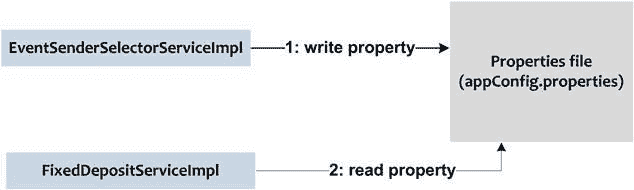

**图 4-1**——`EventSenderSelectorServiceImpl` 类将 `EventSender` 实现的名称写入 `appConfig.properties` 文件，该文件稍后会被 `FixedDepositServiceImpl` 实例读取。

上面的图显示：

- 使用 `EventSenderSelectorServiceImpl` 类来决定 `FixedDepositServiceImpl` 类使用的 `EventSender` 实现（`DatabaseEventSender`、`WebServiceEventSender` 或 `MessagingEventSender`）。
- `EventSenderSelectorServiceImpl` 类将 `EventSender` 实现的全限定名存储在 `appConfig.properties` 文件中。
- `FixedDepositServiceImpl` 类从 `appConfig.properties` 文件中读取 `EventSender` 实现的全限定名，创建 `EventSender` 对象并使用它来在数据库中存储定期存款事件。

上述方法表明，如果 `EventSenderSelectorServiceImpl` 未能向 `appConfig.properties` 文件中保存 `EventSender` 实现的全限定名，`FixedDepositServiceImpl` 实例将无法正常工作。这意味着 `FixedDepositServiceImpl` 类隐含依赖于 `EventSenderSelectorServiceImpl` 类。

现在让我们深入查看 `FixedDepositServiceImpl` 实例对 `EventSenderSelectorServiceImpl` 实例隐含依赖的影响。

### 隐含依赖问题

考虑以下应用上下文 XML 文件，它包含了 `FixedDepositServiceImpl` 和 `EventSenderSelectorServiceImpl` 类的 bean 定义：

**示例代码 4-4**——`applicationContext.xml`——隐含依赖示例

**Project**——`ch04-bankapp-dependencies`

**Source location**——`src/main/resources/META-INF/spring`

```xml
<beans .....>
    <bean id="service" class="sample.spring.chapter04.bankapp.service.FixedDepositServiceImpl">
        .....
        <constructor-arg index="0" value="META-INF/config/appConfig.properties" />
    </bean>
    <bean id="eventSenderSelectorService" class="sample.spring.chapter04.bankapp.service.EventSenderSelectorServiceImpl">
        <constructor-arg index="0" value="META-INF/config/appConfig.properties" />
    </bean>
</beans>
```

上面的应用上下文 XML 文件显示，`FixedDepositServiceImpl` 和 `EventSenderSelectorServiceImpl` 类的构造函数都接受 `appConfig.properties` 文件的路径。`EventSenderSelectorServiceImpl` 实例使用 `appConfig.properties` 文件将 `EventSender` 实现类的全限定名传递给 `FixedDepositServiceImpl` 实例。由于 `service` 和 `eventSenderSelectorService` bean 之间不存在显式依赖，Spring 容器按照它们在应用上下文 XML 文件中定义的顺序创建它们的实例。由于 `service` bean 定义在 `eventSenderSelectorService` bean 之前，因此 `FixedDepositServiceImpl` 实例在 `EventSenderSelectorServiceImpl` 实例之前创建。我们很快就会发现，如果 `FixedDepositServiceImpl` 实例在 `EventSenderSelectorServiceImpl` 实例之前创建，那么 `FixedDepositServiceImpl` 实例将无法从 `appConfig.properties` 文件中读取全限定 `EventSender` 实现类的名称。

现在让我们深入查看 `EventSenderSelectorServiceImpl` 和 `FixedDepositServiceImpl` 类以及 `appConfig.properties` 文件。

### EventSenderSelectorServiceImpl——写入者

下面的示例代码展示了 `EventSenderSelectorServiceImpl` 类：

**示例代码 4-5**——`EventSenderSelectorServiceImpl` 类

**Project**——`ch04-bankapp-dependencies`

**Source location**——`src/main/java/sample/spring/chapter04/bankapp/service`

```java
package sample.spring.chapter04.bankapp.service;

import org.springframework.core.io.ClassPathResource;
import sample.spring.chapter04.bankapp.Constants;

public class EventSenderSelectorServiceImpl {
    public EventSenderSelectorServiceImpl(String configFile) throws Exception {
        ClassPathResource resource = new ClassPathResource(configFile);
        OutputStream os = new FileOutputStream(resource.getFile());
        Properties properties = new Properties();
        properties.setProperty(Constants.EVENT_SENDER_CLASS_PROPERTY, "sample.spring.chapter04.bankapp.event.DatabaseSender");
        properties.store(os, null);
        .....
    }
}
```

上面的示例显示，`appConfig.properties` 的位置作为构造函数参数传递给 `EventSenderSelectorServiceImpl` 类的构造函数。`EventSenderSelectorServiceImpl` 类向 `appConfig.properties` 写入属性名为 `eventSenderClass`（即 `Constants` 类中定义的 `EVENT_SENDER_CLASS_PROPERTY` 常量）。`eventSenderClass` 属性指定了 `FixedDepositServiceImpl` 实例使用的 `EventSender` 实现的全限定名。为了简单起见，`EventSenderSelectorServiceImpl` 的构造函数将 `DatabaseSender` 的全限定名设置为 `eventSenderClass` 属性的值。

**appConfig.properties**

以下是 `EventSenderSelectorServiceImpl` 添加到 `appConfig.properties` 中的内容：

`eventSenderClass=sample.spring.chapter04.bankapp.event.DatabaseSender`

### FixedDepositServiceImpl——读取者

`EventSenderSelectorServiceImpl` 实例写入的 `eventSenderClass` 属性被 `FixedDepositServiceImpl` 实例读取，如示例所示：

**示例代码 4-6**——`FixedDepositServiceImpl` 类

**Project**——`ch04-bankapp-dependencies`

**Source location**——`src/main/java/sample/spring/chapter04/bankapp/service`

```java
package sample.spring.chapter04.bankapp.service;

import org.springframework.core.io.ClassPathResource;
import sample.spring.chapter04.bankapp.Constants;

public class FixedDepositServiceImpl implements FixedDepositService {
    private FixedDepositDao fixedDepositDao;
    private EventSender eventSender;

    public FixedDepositServiceImpl(String configFile) throws Exception {
        ClassPathResource configProperties = new ClassPathResource(configFile);
        if (configProperties.exists()) {
            InputStream inStream = configProperties.getInputStream();
            Properties properties = new Properties();
            properties.load(inStream);
            String eventSenderClassString = properties.getProperty(Constants.EVENT_SENDER_CLASS_PROPERTY);
            if (eventSenderClassString != null) {
                Class<?> eventSenderClass = Class.forName(eventSenderClassString);
                eventSender = (EventSender) eventSenderClass.newInstance();
                logger.info("Created EventSender class");
            } else {
```

```java
logger.info("appConfig.properties file doesn't contain the information " +
            "about EventSender class");
}
}
}

public void createFixedDeposit(FixedDepositDetails fixedDepositDetails) throws Exception {
    .....

eventSender.sendEvent(event);

}
```

上面的示例列表显示了 `FixedDepositServiceImpl` 类的构造函数执行了以下顺序的操作：

- 从 `appConfig.properties` 文件加载属性。`configFile` 构造参数代表 `appConfig.properties` 文件的位置。
- 从 `appConfig.properties` 文件加载的属性中获取名为 `eventSenderClass` 的属性（由 `Constants` 类中定义的常量 `EVENT_SENDER_CLASS_PROPERTY` 表示）。`eventSenderClass` 属性的值是 `FixedDepositServiceImpl` 需要使用的 `EventSender` 实现类的全限定类名。`eventSenderClass` 属性的值存储在局部变量 `eventSenderClassString` 中。
- 创建 `EventSender` 实现类的实例，其全限定类名存储在 `eventSenderClassString` 变量中，并将新创建的实例存储到名为 `eventSender` 的实例变量中。`eventSender` 变量稍后会被 `FixedDepositServiceImpl` 的 `createFixedDeposit` 方法（参见上述示例列表中的 `createFixedDeposit` 方法）用于直接或间接地存储存储事件。

你应该注意，如果在 `appConfig.properties` 文件中没有找到名为 `eventSenderClass` 的属性，则 `eventSenderClassString` 变量不会被设置。在这种情况下，`FixedDepositServiceImpl` 的构造函数会在控制台上打印以下信息：“appConfig.properties file doesn't contain the information about EventSender class”。

在示例列表 4-4 中，我们看了 `EventSenderSelectorServiceImpl` 和 `FixedDepositServiceImpl` 类的 bean 定义，并得出 `FixedDepositServiceImpl` 实例在 `EventSenderSelectorServiceImpl` 实例之前创建，因为 Spring 容器按照它们在应用程序上下文 XML 文件出现的顺序初始化 bean。我们在示例列表 4-5 中看到，创建 `EventSenderSelectorServiceImpl` 实例会导致向 `appConfig.properties` 文件写入 `eventSenderClass` 属性。因此，如果 `FixedDepositServiceImpl` 实例在 `EventSenderSelectorServiceImpl` 实例之前创建，则 `FixedDepositServiceImpl` 实例将不会在 `appConfig.properties` 文件中找到任何 `eventSenderClass` 属性。这表明 `FixedDepositServiceImpl` 类隐式依赖于 `EventSenderSelectorServiceImpl` 类；因此，`EventSenderSelectorServiceImpl` 实例必须在 `FixedDepositServiceImpl` 实例之前创建。

### 如何解决隐式依赖问题？

我们可以通过两种方式解决隐式依赖问题：

- 我们更改 `EventSenderSelectorServiceImpl` 和 `FixedDepositServiceImpl` 类 bean 定义在应用程序上下文 XML 文件中的顺序。如果 `EventSenderSelectorServiceImpl` 类的 bean 定义出现在 `FixedDepositServiceImpl` 类的 bean 定义之前，则 `EventSenderSelectorServiceImpl` 实例将在 `FixedDepositServiceImpl` 实例之前创建。
- 使用 `<bean>` 元素的 `depends-on` 属性来显式指定服务 bean（对应于 `FixedDepositServiceImpl` 类）依赖于 `eventSenderSelectorService` bean（对应于 `EventSenderSelectorServiceImpl` 类）。

下面的示例显示了 `<bean>` 元素 `depends-on` 属性的用法：

**示例列表 4-7**——`<bean>` 元素的 `depends-on` 属性


```xml
<beans .....>
    <bean id="service"
            class="sample.spring.chapter04.bankapp.service.FixedDepositServiceImpl"
            depends-on="eventSenderSelectorService">
        .....
    </bean>
    <bean id="eventSenderSelectorService"
            class="sample.spring.chapter04.bankapp.service.EventSenderSelectorServiceImpl">
        .....
    </bean>
</beans>
```

在上面的示例列表中，`service` bean 使用 `depends-on` 属性显式指定它依赖于 `eventSenderSelectorService` bean。`depends-on` 属性指定了 bean 所依赖的 bean 的 id 或名称。由于 `service` bean 指定它依赖于 `eventSenderSelectorService` bean，Spring 容器会在 `service` bean 实例（对应于 `FixedDepositServiceImpl` 类）之前创建 `eventSenderSelectorService` bean 实例（对应于 `EventSenderSelectorServiceImpl` 类）。

**注意** 如果你执行 `ch04-bankapp-dependencies` 项目中 `BankApp` 类的 `main` 方法，你会发现 `FixedDepositServiceImpl` 实例在 `EventSenderSelectServiceImpl` 实例之前创建。出于这个原因，控制台上打印了以下信息：“appConfig.properties file doesn't contain the information about EventSender class”。

### 多个隐式依赖

如果一个 bean 有多个隐式依赖，你可以将所有这些依赖的 id 或名称作为 `depends-on` 属性的值，如下：

**示例列表 4-8** – `depends-on` 属性 - 多个隐式依赖

```xml
<beans .....>
    <bean id="abean" depends-on="bBean, cBean">
        .....
    </bean>
    .....
</beans>
```

上面的示例列表显示你可以指定多个 bean id 作为 `depends-on` 的值。

### `depends-on` 属性与 bean 继承

重要的是，`depends-on` 属性不会被子 bean 定义继承。下面的示例列表显示了一个抽象的 `serviceTemplate` 父 bean 定义，它使用 `depends-on` 属性指定 `baseService` 为依赖：

**示例列表 4-9** – `depends-on` 属性 – bean 继承

```xml
<beans .....>
    <bean id="serviceTemplate" class=".....ServiceTemplate" depends-on="baseService" abstract="true"/>
    <bean id="someService" class=".....SomeServiceImpl" parent="serviceTemplate"/>
    <bean id="someOtherService" class=".....SomeOtherServiceImpl" parent="serviceTemplate"/>
    <bean id="baseService" class=".....BaseServiceImpl"/>
</beans>
```

在上面的示例列表中，`someService` 和 `someOtherService` 子 bean 定义没有继承父 bean `serviceTemplate` 的 `depends-on` 属性。由于 Spring 容器按照它们在应用程序上下文 XML 文件中的定义顺序创建 bean，`baseService` bean 在 `someService` 和 `someOtherService` bean 之后创建。

### 单例作用（Singleton-scoped）bean 的依赖

下面的示例列表显示了 MyBank 应用中单例作用的 `customerRequestService` bean 及其依赖项：

**示例列表 4-10** – `applicationContext.xml` - `customerRequestService` bean 的依赖项

**项目** – `ch04-bankapp-dependencies`

**源码位置** – `src/main/resources/META-INF/spring`

```xml
<bean id="customerRequestService"
    class="sample.spring.chapter04.bankapp.service.CustomerRequestServiceImpl">
    <constructor-arg name="customerRequestDetails" ref="customerRequestDetails" />
    <constructor-arg name="customerRequestDao" ref="customerRequestDao" />
</bean>
<bean id="customerRequestDetails"
    class="sample.spring.chapter04.bankapp.domain.CustomerRequestDetails"
    scope="prototype" />
<bean id="customerRequestDao"
    class="sample.spring.chapter04.bankapp.dao.CustomerRequestDaoImpl" />
```

上面的示例列表显示 `customerRequestService`（单例作用）bean 依赖于 `customerRequestDetails`（原型作用）和 `customerRequestDao`（单例作用）bean。`CustomerRequestService` 对象（由 `customerRequestService` bean 表示）代表了当银行客户创建新请求（如支票本请求）时被调用的服务。`CustomerRequestService` 将客户请求的详情放入 `CustomerRequestDetails` 对象（由 `customerRequestDetails` bean 表示），并使用 `CustomerRequestDao` 对象（由 `customerRequestDao` bean 表示）将其保存到数据存储中。

下面的示例列表显示了 `BankApp` 类的 `main` 方法，该方法加载了示例列表 4-10 所示的 bean 定义：

**示例列表 4-11** – `BankApp` 类

**项目** – `ch04-bankapp-dependencies`

**源码位置** – `src/main/java/sample/spring/chapter04/bankapp`

```java
package sample.spring.chapter04.bankapp;

import org.springframework.context.ApplicationContext;
import org.springframework.context.support.ClassPathXmlApplicationContext;

public class BankApp {
    private static Logger logger = Logger.getLogger(BankApp.class);

    public static void main(String args[]) throws Exception {
        ApplicationContext context = new ClassPathXmlApplicationContext(
            "classpath:META-INF/spring/applicationContext.xml");
        .....
        logger.info("Beginning with accessing CustomerRequestService");
        CustomerRequestService customerRequestService_1
            = context.getBean(CustomerRequestService.class);
        .....
        CustomerRequestService customerRequestService_2
            = context.getBean(CustomerRequestService.class);
        .....
        logger.info("Done with accessing CustomerRequestService");
    }
}
```

上面的示例列表显示，在创建 `ApplicationContext` 实例后，调用了两次 `ApplicationContext` 的 `getBean` 方法来获取 `customerRequestService` bean 的引用。

如果你执行 `BankApp` 类的 `main` 方法，将看到以下输出：

```text
Created CustomerRequestDetails instance
Created CustomerRequestDaoImpl instance
Created CustomerRequestServiceImpl instance
.....
Beginning with accessing CustomerRequestService
Done with accessing CustomerRequestService
```

上述输出中显示的“Created.....”消息是由相应 bean 类的构造函数打印的。上述输出显示，当 Spring 容器创建时，`customerRequestService`（单例作用）bean 的依赖项 `customerRequestDetails`（原型作用）和 `customerRequestDao`（单例作用）被创建并注入到 `customerRequestService` 实例中。由于在调用 `ApplicationContext` 的 `getBean` 方法检索 `customerRequestService` bean 时，“Beginning .....”和“Done .....”消息之间没有在控制台打印“Created .....”消息，因此此时 Spring 容器没有创建任何 bean 实例。


图 4-2 显示了序列图，描述了执行 `BankApp` 的 main 方法（参见示例列表 4-11）时发生的事件序列。图 4-2 显示，当 Spring 容器创建时，首先创建 `customerRequestDetails`（原型作用）和 `customerRequestDao`（单例作用）bean，然后创建 `customerRequestService`（单例作用）。

Spring 容器创建时，首先创建 `customerRequestDetails`（原型作用）和 `customerRequestDao`（单例作用）bean，Request 创建 `customerRequestRequest`（单例作用）。当 Spring 容器创建时，首先创建 `customerRequestDetails`（原型作用）和 `customerRequestDao`（单例作用）bean，然后创建 `customerRequestService`（单例作用）。

Spring 容器创建时，首先创建 `customerRequestDetails`（原型作用）和 `customerRequestDao`（单例作用）bean，然后创建 `customerRequestService`（单例作用）。

Spring 例作用（单例作用作用作用作用 `Request` 作用（单例作用）。当 Spring 容器创建时，首先创建 `customerRequestDetails`（原型作用）和 `customerRequestDao`（单例作用）bean，然后创建 `customerRequestService`（单例作用）。

图 4-2 显示了序列图，描述了执行 `BankApp` 的 main 方法（参见示例列表 4-11）时发生的事件序列。

**图 4-2** - Spring 容器创建时发生的事件序列

需要注意的是，即使使用 setter 注入将原型作用的 `customerRequestDetails` 注入到 `customerRequestService`，Spring 容器在其生命周期内也只调用一次 setter 方法。这意味着无论使用 setter 还是构造函数注入，单例 bean 都只创建一次。现在，一旦 Spring 容器创建，任何对单例作用 `customerRequestService` bean 的请求都返回相同的实例。

由于单例作用的 `customerRequestService` bean 始终持有对原型作用 `customerRequestDetails` bean 的引用，可能会影响 MyBank 应用的行为。例如，如果多个客户同时向 `CustomerRequestServiceImpl` 实例提交请求，所有请求都将导致修改同一个 `CustomerRequestDetails` 实例。理想情况下，`CustomerRequestServiceImpl` 应该每次请求都创建一个 `CustomerRequestDetails` 实例。在第 5 节中，我们将看到对单例作用 bean 类需要进行哪些修改，以便每次调用都能获取原型作用 bean 的新实例。

### 原型作用（Prototype-scoped）bean 的依赖

在 MyBank 中，客户通过一系列步骤在 MyBank 应用中注册。例如，客户首先输入个人信息账户详情，如果 MyBank 应用找到了匹配的记录，将要求客户提供借记卡详情。MyBank 应用的 `CustomerRegistrationServiceImpl` 类包含了注册客户所需的业务逻辑。当客户按照一系列步骤在 MyBank 应用中注册时，`CustomerRegistrationServiceImpl` 对象在方法调用之间维持会话状态。

下面的示例列表显示了 MyBank 应用中原型作用的 `customerRegistrationService` bean（代表 `CustomerRegistrationServiceImpl` 类）及其依赖项：

**示例列表 4-12** – `applicationContext.xml` - `customerRegistrationService` bean 及其依赖项

**项目** – `ch04-bankapp-dependencies`

```xml
<bean id="customerRegistrationService"
    class="sample.spring.chapter04.bankapp.service.CustomerRegistrationServiceImpl"
    scope="prototype">
```

```xml
<bean class="sample.spring.chapter04.bankapp.service.CustomerRegistrationServiceImpl" scope="prototype">
    <constructor-arg name="customerRegistrationDetails" ref="customerRegistrationDetails" />
    <constructor-arg name="customerRegistrationDao" ref="customerRegistrationDao" />
</bean>
<bean id="customerRegistrationDetails" class="sample.spring.chapter04.bankapp.domain.CustomerRegistrationDetails" scope="prototype" />
<bean id="customerRegistrationDao" class="sample.spring.chapter04.bankapp.dao.CustomerRegistrationDaoImpl" />
```


上面的示例列表显示，`customerRegistrationService`（原型作用域）bean 依赖于 `customerRegistrationDetails`（原型作用域）bean 和 `customerRegistrationDao`（单例作用域）bean。

`CustomerRegistrationServiceImpl` 实例维护并维护了注册过程的进度，并将客户在注册过程中提供的信息存储在 `CustomerRegistrationDetails` 对象中（由 `customerRegistrationDetails` 实例表示）。由于 `CustomerRegistrationServiceImpl` 和 `CustomerRegistrationDetails` 对象在本质上都是有状态的，因此 `customerRegistrationService` 和 `customerRegistrationDetails` bean 都被定义为原型作用域 bean。

下面的示例列表显示了 `BankApp` 类的主方法，该方法加载了客户注册相关的 bean（参见示例列表 4-12）并为 2 个客户执行了注册。

### 示例 4-13 – `BankApp` 类

- **项目**：`ch04-bankapp-dependencies`
- **源码位置**：`src/main/java/sample/spring/chapter04/bankapp`

```java
package sample.spring.chapter04.bankapp;

import org.springframework.context.ApplicationContext;
import org.springframework.context.support.ClassPathXmlApplicationContext;
import java.util.logging.Logger;

public class BankApp {
    private static Logger logger = Logger.getLogger(BankApp.class);

    public static void main(String args[]) throws Exception {
        ApplicationContext context = new ClassPathXmlApplicationContext(
            "classpath:META-INF/spring/applicationContext.xml");
        .....

        logger.info("Beginning with accessing CustomerRegistrationService");
        CustomerRegistrationService customerRegistrationService_1 = context
            .getBean(CustomerRegistrationService.class);
        customerRegistrationService_1.setAccountNumber("account_1");
        customerRegistrationService_1.setAddress("address_1");
        customerRegistrationService_1.setDebitCardNumber("debitCardNumber_1");
        customerRegistrationService_1.register();

        logger.info("registered customer with id account_1");
        CustomerRegistrationService customerRegistrationService_2 = context
            .getBean(CustomerRegistrationService.class);
        .....
        customerRegistrationService_2.setAccountNumber("account_2");
        customerRegistrationService_2.setAddress("address_2");
        customerRegistrationService_2.setDebitCardNumber("debitCardNumber_2");
        customerRegistrationService_2.register();

        logger.info("registered customer with id account_2");
        logger.info("Done with accessing CustomerRegistrationService");
    }
}
```

上面的示例列表显示，`BankApp` 主方法调用了两次 `ApplicationContext` 的 `getBean` 方法来获取 `customerRegistrationService` bean 的引用。一旦获取了 `customerRegistrationService` bean 实例，就会在其上调用 `setAccountNumber`、`setAddress`、`setDebitCardNumber` 和 `register` 方法。如果你执行 `BankApp` 主方法，你将在控制台上看到以下输出：

```
Created CustomerRegistrationDaoImpl instance
.....
Beginning with accessing CustomerRegistrationService
Created CustomerRegistrationDetails instance
Created CustomerRegistrationServiceImpl instance
registered customer with id account_1
Created CustomerRegistrationDetails instance
Created CustomerRegistrationServiceImpl instance
registered customer with id account_2
Done with accessing CustomerRegistrationService
```

上述输出中的“Created.....”消息是由相应 bean 类的构造函数打印的。上述输出显示单例作用域的 `customerRegistrationDao` bean（代表 `CustomerRegistrationDaoImpl` 类）在 `ApplicationContext` 实例创建时仅创建一次。“Beginning.....”和“Done.....”消息之间的“Created.....”消息表示，每调用一次 `ApplicationContext` 的 `getBean` 方法，都会创建一个新实例。图 4-3 显示了 `ApplicationContext` 实例创建时发生的事件序列。该图显示单例作用域的 `customerRegistrationDao` bean 在 `ApplicationContext` 实例创建时仅创建一次。当从 Spring 容器中请求 `customerRegistrationService` bean 时，Spring 容器会创建 `customerRegistrationDetails` 和 `CustomerRegistrationServiceImpl` 的新实例。

`ApplicationContextAware` 接口是一个生命周期接口（lifecycle interface），这意味着 Spring 容器会在 bean 生命周期周期内的适当时间调用实现 `ApplicationContextAware` 接口的 bean。例如，`ApplicationContextAware` 的 `setApplicationContext` 方法会在 bean 实例创建之后但完全初始化之前由 Spring 容器调用。只有在 Spring 容器调用了其初始化方法（initialization method）（参见第 5 章第 5-2 节）后，bean 实例才被认为完全初始化。要注意，在 bean 实例完全初始化后，Spring 容器会将其注入到依赖它的 bean 实例中。在第 5 章中，我们将查看 Spring 中更多的生命周期接口。

实现了 `ApplicationContextAware` 接口的 bean 可以通过调用 `ApplicationContext` 的 `getBean` 方法来访问注册到 `ApplicationContext` 实例的其他 bean。这意味着，如果单例作用范围（singleton-scoped）bean 的类实现了 `ApplicationContextAware` 接口，它就可以通过调用 `ApplicationContext` 的 `getBean` 方法从 Spring 容器获取原型作用范围（prototype-scoped）bean 的新实例。由于单例作用范围的 bean 通过调用 `ApplicationContext` 的 `getBean` 方法显式地从 Spring 容器获取其原型作用范围的依赖，因此你不需要在应用上下文 XML 文件中将原型作用范围 bean 定义为单例 bean 的依赖。

下面的示例列表显示了 `CustomerRequestServiceImpl` 类，每次调用 `CustomerRequestServiceImpl` 的 `submitRequest` 方法时，都需要一个新的 `CustomerRequestDetails` 对象实例。

### 示例列表 4-14 – `CustomerRequestServiceImpl` 类

- **项目**：`ch04-bankapp-context-aware`
- **源码位置**：`src/main/java/sample/spring/chapter04/bankapp/service`

```java
package sample.spring.chapter04.bankapp.service;

import sample.spring.chapter04.bankapp.dao.CustomerRequestDao;
import sample.spring.chapter04.bankapp.domain.CustomerRequestDetails;

public class CustomerRequestServiceImpl implements CustomerRequestService {

  private CustomerRequestDetails customerRequestDetails;

    private CustomerRequestDao customerRequestDao;

    @ConstructorProperties({ "customerRequestDetails", "customerRequestDao" })
    public CustomerRequestServiceImpl(CustomerRequestDetails customerRequestDetails,
         CustomerRequestDao customerRequestDao) {
      this.customerRequestDetails = customerRequestDetails;
      this.customerRequestDao = customerRequestDao;
    }

    public void submitRequest(String requestType, String requestDescription) {
        // -- 填充 CustomerRequestDetails 对象并保存
        customerRequestDetails.setType(requestType);
        customerRequestDetails.setDescription(requestDescription);
        customerRequestDao.submitRequest(customerRequestDetails);    
    }
}
```

上面的示例列表显示，`CustomerRequestDetails` 和 `CustomerRequestDao` 对象被作为参数传递给 `CustomerRequestServiceImpl` 类的构造函数。`submitRequest` 方法通过调用 `CustomerRequestDao` 的 `submitRequest` 方法填充 `CustomerRequestDetails` 实例并保存到数据库中。如果多个客户同时提交请求，`submitRequest` 方法将修改同一个 `CustomerRequestDetails` 对象实例，导致 MyBank 应用程序出现非预期的行为。为了解决这个问题，`submitRequest` 必须在每次调用时从 Spring 容器获取一个新的 `CustomerRequestDetails` 对象实例。

下面的示例列表显示了实现了 `ApplicationContextAware` 接口的 `CustomerRequestServiceContextAwareImpl` 类（我们在示例列表 4-14 中看到的 `CustomerRequestServiceImpl` 类的修改版本）。

### 示例列表 4-15 – 实现了 Spring `ApplicationContextAware` 接口的 `CustomerRequestServiceContextAwareImpl` 类

- **项目**：`ch04-bankapp-context-aware`
- **源码位置**：`src/main/java/sample/spring/chapter04/bankapp/service`

```java
package sample.spring.chapter04.bankapp.service;

import org.springframework.context.ApplicationContext;
import org.springframework.context.ApplicationContextAware;

public class CustomerRequestServiceContextAwareImpl implements
    CustomerRequestService, ApplicationContextAware {

    private CustomerRequestDao customerRequestDao;

    private ApplicationContext applicationContext;

    @ConstructorProperties({ "customerRequestDao" })
    public CustomerRequestServiceContextAwareImpl(CustomerRequestDao customerRequestDao) {
        this.customerRequestDao = customerRequestDao;
    }

  public void setApplicationContext(ApplicationContext applicationContext)
             throws BeansException {
      this.applicationContext = applicationContext;
  }

    public void submitRequest(String requestType, String requestDescription) {
      CustomerRequestDetails customerRequestDetails = applicationContext
              .getBean(CustomerRequestDetails.class);
      customerRequestDetails.setType(requestType);
      customerRequestDetails.setDescription(requestDescription);
      customerRequestDao.submitRequest(customerRequestDetails);
    }
}
```

在上面的示例列表中，`setApplicationContext` 方法为 `CustomerRequestServiceContextAwareImpl` 提供了一个 `ApplicationContext` 实例。该 `ApplicationContext` 实例后被 `submitRequest` 方法用于获取 `CustomerRequestDetails` 对象。


由于`CustomerRequestServiceContextAwareImpl`显式地从 Spring 容器获取`CustomerRequestDetails`对象，你不需要使用 Spring 的 DI 机制来注入`CustomerRequestDetails`实例。出于这个原因，`CustomerRequestServiceContextAwareImpl`类的构造函数（参见示例列表 4-15）没有指定`CustomerRequestDetails`对象作为参数。如果你现在进入`ch04-bankapp-context-aware`项目并执行`BankApp`的主方法，你会发现每次调用`submitRequest`方法时，都会从 Spring 容器获取一个新的`CustomerRequestDetails`对象实例。

在 MyBank 的上下文中，我们看到如果 bean 需要访问其他 bean，`ApplicationContextAware`接口是有用的。实现`ApplicationContextAware`接口的缺点是它将 bean 类与 Spring 框架耦合。通过使用 Spring 架构中`<lookup-method>`和`<replaced-method>`元素提供的*方法注入*技术，你可以避免 bean 类与 Spring 框架耦合，并从 Spring 容器访问其他 bean。

让我们先查看`<lookup-method>`元素。

**导入** **第 4 章/ch04-bankapp-lookup-method**（该项目展示了使用 Spring 架构`<lookup-method>`元素的 MyBank 应用程序。要运行应用程序，请执行项目中`BankApp`类的主方法）

### `<lookup-method>`元素

如果 bean 类定义了一个返回类型代表 bean 的*查找查找方法*（lookup method），`<lookup-method>`元素指示 Spring 容器为该方法提供实现。由 Spring 容器提供的实现负责从 Spring 容器检索 bean 实例并将其返回。

`<lookup-method>`元素的`bean`属性指定了由方法实现查找并返回的 bean 名称，而`name`属性指定了由 Spring 容器提供实现的方法名称。

**注意** 使用`<lookup-method>`元素来指示 Spring 容器为 bean 查找方法提供实现被称为“方法注入技术”，因为`<lookup-method>`元素会将 bean 查找方法的实现注入到 bean 类中。

接下来的示例列表显示了`CustomerRequestServiceImpl`的`getCustomerRequestDetails`*抽象*方法，该方法返回一个`CustomerRequestDetails`实例：

**示例列表 4-16** – `CustomerRequestServiceImpl`类 – 定义 bean 查找方法

**项目** – `ch04-bankapp-lookup-method`

**源码位置**- `src/main/java/sample/spring/chapter04/bankapp/service`

```java
package sample.spring.chapter04.bankapp.service;

public abstract class CustomerRequestServiceImpl implements CustomerRequestService {

    private CustomerRequestDao customerRequestDao;

    @ConstructorProperties({ "customerRequestDao" })
    public CustomerRequestServiceImpl(CustomerRequestDao customerRequestDao) {
        this.customerRequestDao = customerRequestDao;
    }

    public abstract CustomerRequestDetails getCustomerRequestDetails();

    @Override
    public void submitRequest(String requestType, String requestDescription) {
        // -- populate CustomerRequestDetails object and save it
        CustomerRequestDetails customerRequestDetails = getCustomerRequestDetails();
        .....
    }
}
```

上面的示例列表显示`CustomerRequestServiceImpl`类被定义为抽象类，因为它包含一个抽象的 bean 查找方法`getCustomerRequestDetails`。如果我们不使用抽象方法，我们完全可以将`getCustomerRequestDetails`方法定义为具体的方法。`submitRequest`方法通过调用`getCustomerRequestDetails`方法来访问`CustomerRequestDetails`实例。

接下来的示例列表显示了`CustomerRequestServiceImpl`和`CustomerRequestDetails`类的 bean 定义：

**示例列表 4-17** – `applicationContext.xml` - `<lookup-method>`元素用法

**项目** – `ch04-bankapp-lookup-method`

**源码位置** - `src/main/resources/META-INF/spring`

```xml
<bean id="customerRequestService"
    class="sample.spring.chapter04.bankapp.service.CustomerRequestServiceImpl">
    <constructor-arg name="customerRequestDao" ref="customerRequestDao" />
    <lookup-method bean="customerRequestDetails" name="getCustomerRequestDetails"/>
</bean>

<bean id="customerRequestDetails"
    class="sample.spring.chapter04.bankapp.domain.CustomerRequestDetails"
    scope="prototype" />
```

上面的示例列表显示`CustomerRequestServiceImpl`类的 bean 定义包含一个`<lookup-method>`元素。`<lookup-method>`元素的`name`属性值为`getCustomerRequestDetails`，它指示 Spring 容器为`CustomerRequestServiceImpl`类的`getCustomerRequestDetails`方法方法（参见示例列表 4-16）提供实现。`<lookup-method>`元素的`bean`属性值为`customerRequestDetails`，这意味着`getCustomerRequestDetails`方法的实现将从 Spring 容器获取 id 或名称为`customerRequestDetails`的 bean 并将其返回给调用方法。由于`customerRequestDetails`bean 代表一个`CustomerRequestDetails`对象（参见示例列表 4-17 中的`customerRequestDetails`bean 定义），因此`getCustomerRequestDetails`方法返回一个`CustomerRequestDetails`对象。

在示例列表 4-16 中，`CustomerRequestService`的`submitRequest`方法通过调用`getCustomerRequestDetails`bean 查找方法来获取`CustomerRequestDetails`实例。由于`CustomerRequestDetails`类在应用上下文 XML 文件中定义为原型（prototype）作用域 bean（参见示例列表 4-17），每次调用`submitRequest`方法都会从 Spring 容器获取一个新的`CustomerRequestDetails`对象实例。

为了检查`<lookup-method>`元素是否为`CustomerRequestService`的`getCustomerRequestDetails`bean 查找方法提供了正确的实现，`BankApp`类的 main 方法从 Spring 容器获取`CustomerRequestService`实例并多次调用其`submitRequest`方法。如果每次调用`submitRequest`方法都能从 Spring 容器获取一个新的`CustomerRequestDetails`对象实例，则说明`<lookup-method>`元素为`CustomerRequestService`的`getCustomerRequestDetails`方法提供了正确的实现。

接下来的示例列表显示了`BankApp`的 main 方法，它多次调用了`CustomerRequestService`的`submitRequest`方法：

**示例列表 4-18** – `BankApp`类

**项目** – `ch04-bankapp-lookup-method`

**源码位置**- `src/main/java/sample/spring/chapter04/bankapp`

```java
package sample.spring.chapter04.bankapp;

.....

public class BankApp {

    private static Logger logger = Logger.getLogger(BankApp.class);

    public static void main(String args[]) throws Exception {
        ApplicationContext context = new ClassPathXmlApplicationContext(
            "classpath:META-INF/spring/applicationContext.xml");

        logger.info("Beginning with CustomerRequestService");
        CustomerRequestService customerRequestService = context.getBean(CustomerRequestService.class);
        customerRequestService.submitRequest("type1", "desc1");
        customerRequestService.submitRequest("type2", "desc2");
        logger.info("Done with CustomerRequestService");
    }
}
```

如果你执行`BankApp`的 main 方法，你将在控制台上看到如下输出：

**Beginning with CustomerRequestService**

Created CustomerRequestDetails instance

Created CustomerRequestDetails instance

**Done with CustomerRequestService**

上面输出显示的*‘Created.....’*消息是由 bean 类的构造函数打印的。上面的输出显示每次调用`CustomerRequestService`的`submitRequest`方法都会导致获取一个新的`CustomerRequestDetails`实例。

`<replaced-method>`元素允许您将豆类（bean class）中的任意方法替换为不同的实现。下面的示例列表展示了`CustomerRequestServiceImpl`类，我们将作为示例来演示`<replaced-method>`元素的使用：

**示例列表 4-19** – `CustomerRequestServiceImpl`类

**项目** – `ch04-bankapp-replaced-method`

**源码位置** - `src/main/java/sample/spring/chapter04/bankapp/service`

```java
package sample.spring.chapter04.bankapp.service;

.....

public class CustomerRequestServiceImpl implements CustomerRequestService {

    private CustomerRequestDao customerRequestDao;

    .....

    public Object getMyBean(String beanName) {
        return null;
    }

    @Override
    public void submitRequest(String requestType, String requestDescription) {
        // -- populate CustomerRequestDetails object and save it
        CustomerRequestDetails customerRequestDetails =
                (CustomerRequestDetails) getMyBean("customerRequestDetails");
        customerRequestDetails.setType(requestType);
        customerRequestDetails.setDescription(requestDescription);
        customerRequestDao.submitRequest(customerRequestDetails);
    }
}
```

上面的示例列表显示`CustomerRequestServiceImpl`类定义了一个`getMyBean`方法。`getMyBean`方法接受豆名作为参数，但它并没有返回与豆名参数对应的豆实例，`getMyBean`方法返回了`null`。`submitRequest`方法将`customerRequestDetails`字符串作为参数传递给`getMyBean`方法，并假设`getMyBean`方法返回一个`customerRequestDetails`豆的实例。使用`<replaced-method>`元素，你可以用一个返回与豆名参数对应的豆实例的方法来重写`getMyBean`方法。

`<replaced-method>`元素需要知道关于*被覆盖*（overridden）方法（在我们的场景中是`CustomerRequestServiceImpl getMyBean`方法）和*覆盖*（overriding）方法的信息。覆盖方法由实现 Spring 的`MethodReplacer`接口的类提供。下面的示例列表展示了实现`MethodReplacer`接口的`MyMethodReplacer`类：

**示例列表 4-20** – `MyMethodReplacer`类

**项目** – `ch04-bankapp-replaced-method`

**源码位置** - `src/main/java/sample/spring/chapter04/bankapp/service`


```java
package sample.spring.chapter04.bankapp.service;

import org.springframework.beans.factory.support.MethodReplacer;
import org.springframework.context.ApplicationContextAware;

public class MyMethodReplacer implements MethodReplacer, ApplicationContextAware {

    private ApplicationContext applicationContext;

    @Override
    public Object reimplement(Object obj, Method method, Object[] args) throws Throwable {
        return applicationContext.getBean((String) args[0]);
    }

    @Override
    public void setApplicationContext(ApplicationContext applicationContext)
            throws BeansException {
        this.applicationContext = applicationContext;
    }
}
```

Spring 的 `MethodReplacer` 接口定义了一个 `reimplement` 方法，其实现由 `MyMethodReplacer` 类提供。`reimplement` 方法代表了覆盖方法。`MyMethodReplacer` 类还实现了 Spring 的 `ApplicationContextAware` 接口，以便 `reimplement` 方法可以访问 `ApplicationContext` 实例。`reimplement` 方法使用 `ApplicationContext` 的 `getBean` 方法从 Spring 容器中检索豆。

`reimplement` 方法接受以下参数：

- `Object obj` – 标识我们正在重写方法的对象。在我们的场景中，`obj` 对象是 `CustomerRequestServiceImpl` 对象。
- `Method method` – 标识被 `reimplement` 方法覆盖的豆类方法。在我们的场景中，这是 `CustomerRequestServiceImpl` 的 `getMyBean` 方法。
- `Object[] args` – 标识传递给我们正在重写方法的参数。在我们的场景中，`args` 代表传递给 `CustomerRequestServiceImpl` 的 `getMyBean` 方法的参数。在示例列表 4-20 中，`reimplement` 方法中的 `args[0]` 指向传递给 `CustomerRequestServiceImpl` 的 `getMyBean` 方法的豆名参数。

如果你现在查看示例列表 4-20 中 `MyMethodReplacer` 的 `reimplement` 方法，你可以推断它使用 `args` 参数首先获取传递给 `CustomerRequestServiceImpl` 的 `getMyBean` 方法的豆名，然后调用 `ApplicationContext` 的 `getBean` 方法来获取相应的豆实例。由于 `MyMethodReplacer` 的 `reimplement` 方法重写了 `CustomerRequestServiceImpl` 的 `getMyBean` 方法，运行时对 `getMyBean` 方法的调用将返回传递名称的豆实例。

`<replaced-method>` 元素通知 Spring 容器 `MyMethodReplacer` 的 `reimplement` 方法，如下面的示例所示：

**示例列表 4-21** – `applicationContext.xml` - `<replaced-method>` 用法

**项目** – `ch04-bankapp-replaced-method`

**源码位置** - `src/main/resources/META-INF/spring`

```xml
<bean id="customerRequestService" class="sample.spring.chapter04.bankapp.service.CustomerRequestServiceImpl">
    <constructor-arg name="customerRequestDao" ref="customerRequestDao" />
    <replaced-method name="getMyBean" replacer="methodReplacer" />
</bean>

<bean id="methodReplacer" class="sample.spring.chapter04.bankapp.service.MyMethodReplacer" />
```

上面的示例列表显示了 `MyMethodReplacer` 和 `CustomerRequestServiceImpl` 的豆定义。`<replaced-method>` 元素的 `name` 属性指定要重写的方法，而 `replacer` 属性指定实现 `MethodReplacer` 接口的豆的引用。

类似于 `<lookup-method>` 元素，`ch04-bankapp-replaced-method` 中的 `BankApp` 类的主方法验证了 `<replaced-method>` 元素是否用 `replacer` 指定豆的 `reimplement` 方法覆盖了接口的 `getMyBean` 方法。`ch04-bankapp-replaced-method` 中的 `BankApp` 类与我们在示例列表 4-18 中看到的 `ch04-bankapp-lookup-method` 中。如果你执行 `BankApp` 类的主方法，你会发现 `<replaced-method>` 元素用 `MyMethodReplacer` 的 `reimplement` 方法覆盖了 `CustomerRequestServiceImpl` 的 `getMyBean` 方法；因此，每次调用 `CustomerRequestServiceImpl` 的 `submitRequest` 方法（参考示例列表 4-19）时，都会从 Spring 容器获取一个新的 `CustomerRequestDetails` 实例。

注意的是，你可以使用 `<replaced-method>` 元素将豆类中的抽象或具体方法替换为不同的方法实现。例如，我们可以将 `getMyBean` 方法定义为抽象方法，并按照本节描述的方式使用 `<replaced-method>` 元素。

**注意** 由于豆类需要在运行时由 Spring 容器进行子类化以替换豆方法，Spring 容器使用 CGLIB ([CGLIB](http://cglib.sourceforge.net/)) 库来执行子类化。从 Spring 3.2 开始，CGLIB 类被封装在 `spring-core` JAR 包中；因此，你不需要显式指定你的项目依赖 CGLIB JAR 包。

现在让我们来看看 `<replaced-method>` 元素如何唯一标识要覆盖的豆方法。

你可能会遇到某些场景，其中你想使用 `<replaced-method>` 元素替换的 bean 方法无法通过名称唯一标识。例如，接下来的示例显示了一个包含重载 `perform` 方法的 bean 类：

**示例列表 4-22** – bean 类中的重载方法

```java
public class MyBean {
    public void perform(String task1, String task2) { ..... }
    public void perform(String task) { ..... }
    public void perform(my.Task task) { ..... }
}
```

在上面的示例列表列表中，`MyBean` 类包含了多个命名为 `perform` 的方法。为了唯一标识要重写的 bean 方法，`<replaced-method>` 元素使用 `<arg-type>` 子元素来指定方法的参数类型。例如，接下来的示例显示了 `<replaced-method>` 元素如何指定替换 `MyBean` 类中的 `perform(String, String)` 方法：

**示例列表 4-23** – 带有 `<arg-type>` 子元素的 `<replaced-method>` 元素

```xml
<bean id="mybean" class="MyBean">
    <replaced-method name="perform " replacer=".....">
        <arg-type>java.lang.String</arg-type>
        <arg-type>java.lang.String</arg-type>
    </replaced-method>
</bean>
```

与其使用全限定名作为 `<arg-type>` 元素的值，你可以使用全限定名的子字符串作为值。例如，在上面的示例列表列表中，与其使用 `java.lang.String`，你可以指定 `Str` 或 `String` 作为 `<arg-type>` 元素的值。

现在让我们来看 Spring 的自动装配功能，它可以省去你在此应用程序上下文 XML 文件中手动指定 bean 依赖的精力。

## 4-6 自动装配依赖

在 Spring 中，你可以选择 `<property>` 和 `<constructor-arg>` 元素显式指定 bean 依赖，也可以让 Spring 自动解析 bean 依赖。Spring 自动解析依赖的过程被称为“自动装配”（autowiring）。

**导入 第 4 章/ch04-bankapp-autowiring**（此项目展示了使用 Spring 自动装配功能进行依赖注入的 MyBank 应用。要运行该应用程序，请执行该项目 `BankApp` 类的主方法）

`<bean>` 元素的 `autowire` 属性指定了 Spring 如何自动解析 bean 的依赖。`autowire` 属性可以取以下任一值：`default`、`byName`、`byType`、`constructor` 和 `no`。现在让我们详细查看这些属性值。

**注意** 你应该注意 `<bean>` 元素的 `autowire` 属性不会被子 bean 定义继承。

### byType

如果你将 autowire 属性的值指定为 `byType`，Spring 将根据类型自动装配 bean 属性。例如，如果 bean `A` 定义了一个类型为 `X` 的属性，Spring 在 `ApplicationContext` 中寻找类型为 `X` 的 bean 并将其注入 bean `A`。让我们来看 MyBank 应用中 `byType` 自动装配的一个示例用法。

接下来的示例列表显示了 MyBank 应用的 `CustomerRegistrationServiceImpl` 类：

**示例列表 4-24** – `CustomerRegistrationServiceImpl` 类

**项目** – ch04-bankapp-autowiring

**源位置** -`src/main/java/sample/spring/chapter04/bankapp/service`

```java
package sample.spring.chapter04.bankapp.service;

public class CustomerRegistrationServiceImpl implements CustomerRegistrationService {
    private CustomerRegistrationDetails customerRegistrationDetails;
    private CustomerRegistrationDao customerRegistrationDao;
    ....

    public void setCustomerRegistrationDetails(CustomerRegistrationDetails customerRegistrationDetails) {
        this.customerRegistrationDetails = customerRegistrationDetails;
    }

    public void setCustomerRegistrationDao(CustomerRegistrationDao customerRegistrationDao) {
        this.customerRegistrationDao = customerRegistrationDao;
    }
    .....
}
```

上面的示例列表显示 `CustomerRegistrationServiceImpl` 类定义了名为 `customerRegistrationDetails`（类型为 `CustomerRegistrationDetails`）和 `customerRegistrationDao`（类型为 `CustomerRegistrationDao`）的属性。这意味着 `CustomerRegistrationDetails` 和 `CustomerRegistrationDao` 对象是 `CustomerRegistrationServiceImpl` 对象的依赖。

接下来的示例列表显示了 `CustomerRegistrationServiceImpl`、`CustomerRegistrationDetails` 和 `CustomerRegistrationDaoImpl`（`CustomerRegistrationDao` 的实现）的 bean 定义：

**示例列表 4-25** – `applicationContext.xml` - 自动装配 `byType`

**项目** – ch04-bankapp-autowiring

```xml
<bean id="customerRegistrationService" class="sample.spring.chapter04.bankapp.service.CustomerRegistrationServiceImpl" scope="prototype" autowire="byType"/>
<bean id="customerRegistrationDetails" class="sample.spring.chapter04.bankapp.domain.CustomerRegistrationDetails" scope="prototype"/>
<bean id="customerRegistrationDao" class="sample.spring.chapter04.bankapp.dao.CustomerRegistrationDaoImpl"/>
```

在上面的示例列表中，`customerRegistrationService` bean 并不包含设置 `customerRegistrationDetails` 和 `customerRegistrationDao` 的 `<property>` 元素（参见示例列表 4-24）。相反，`<bean>` 元素将 `autowire` 属性的值指定为 `byType`，指示 Spring 根据类型自动解析 `customerRegistrationService` bean 的依赖。Spring 在 `ApplicationContext` 中寻找类型为 `CustomerRegistrationDetails` 和 `CustomerRegistrationDao` 的 bean，并将它们注入 `customerRegistrationService`。由于 `CustomerRegistrationDetails` 和 `CustomerRegistrationDao` bean 分别代表这些类型，Spring 将它们注入到 `customerRegistrationService`。

可能会出现 Spring 在 `ApplicationContext` 中找不到任何匹配属性类型的 bean。在这种情况下，不会抛出异常且 bean 属性不会设置。例如，如果 bean 定义了一个类型为 `Y` 的属性 `x`，且 `ApplicationContext` 中没有类型为 `Y` 的 bean，则属性 `x` 不会被设置。如果 Spring 在 `ApplicationContext` 中找到多个匹配属性类型的 bean，则会抛出异常。在这种情况下，与其使用自动装配功能，不如使用 `<property>` 元素显式标识依赖，或者通过 `<bean>` 元素的 `primary` 属性设置为 `true` 将 bean 设置为自动装配的首选候选。

### constructor

如果你将 autowire 属性的值指定为 `constructor`，Spring 将根据类型自动装配 bean 类的构造函数参数。例如，如果 bean `A` 的构造函数接受类型为 `X` 和 `Y` 的参数，Spring 在 `ApplicationContext` 中寻找类型为 `X` 和 `Y` 的 bean，并将它们作为参数注入 bean `A` 的构造函数。让我们来看 MyBank 应用中构造函数自动装配的一个示例用法。

接下来的示例列表显示了 MyBank 应用的 `CustomerRequestServiceImpl` 类：

**示例列表 4-26** – `CustomerRequestServiceImpl` 类


**项目** – `ch04-bankapp-autowiring`

**源位置** – `src/main/java/sample/spring/chapter04/bankapp/service`

```java
package sample.spring.chapter04.bankapp.service;

public class CustomerRequestServiceImpl implements CustomerRequestService {
    private CustomerRegistrationDetails customerRegistrationDetails;
    private CustomerRegistrationDao customerRegistrationDao;

    @ConstructorProperties({ "customerRegistrationDetails", "customerRegistrationDao" })
    public CustomerRequestServiceImpl(
        CustomerRegistrationDetails customerRegistrationDetails,
        CustomerRegistrationDao customerRegistrationDao) {
```

```java
this.customerRequestDetails = customerRequestDetails;

this.customerRequestDao = customerRequestDao;

}

.....
}
```

`CustomerRequestServiceImpl` 类定义了一个构造函数，接受类型为 `CustomerRequestDetails` 和 `CustomerRequestDao` 的参数。

接下来的示例显示了 `CustomerRequestServiceImpl`、`CustomerRequestDetails` 和 `CustomerRequestDaoImpl`（`CustomerRequestDao` 接口的实现）类的 bean 定义。

## 示例列表 4-27：`applicationContext.xml` – 构造器注入

**项目** – `ch04-bankapp-autowiring`

**源位置** – `src/main/resources/META-INF/spring`

```xml
<bean id="customerRequestService"
    class="sample.spring.chapter04.bankapp.service.CustomerRequestServiceImpl"
    autowire="constructor">
</bean>
<bean id="customerRequestDetails"
    class="sample.spring.chapter04.bankapp.domain.CustomerRequestDetails" scope="prototype" />
<bean id="customerRequestDao"
    class="sample.spring.chapter04.bankapp.dao.CustomerRequestDaoImpl" />
```

在上面的示例列表中，`customerRequestService` bean 定义将 `autowire` 属性的值设置为 `constructor`，这意味着 Spring 在 `ApplicationContext` 中查找类型为 `CustomerRequestDetails` 和 `CustomerRequestDao` 的 bean，并将它们作为参数传递给 `CustomerRequestServiceImpl` 类的构造函数。由于 `customerRequestDetails` 和 `customerRequestDao` bean 的类型分别是 `CustomerRequestDetails` 和 `CustomerRequestDao`，Spring 会将这些 bean 的实例注入到 `customerRequestService` bean 中。

如果 Spring 在 `ApplicationContext` 中没有找到任何与构造函数参数类型匹配的 bean，则不会设置该构造函数参数。如果 Spring 在 `ApplicationContext` 中找到多个匹配构造函数参数类型的 bean，则会抛出异常。因此，在这种情况下使用 `<constructor-arg>` 元素来显式标识 bean 依赖，或者通过将 `<bean>` 元素的 `primary` 属性值设置为 `true` 来将某个 bean 设置为注入的主要候选对象。

### `byName`

如果你将 `autowire` 属性的值设置为 `byName`，Spring 将根据属性名称自动注入 bean 属性。例如，如果 bean `A` 定义了一个名为 `x` 的属性，Spring 会在 `ApplicationContext` 中找到名为 `x` 的 bean 并将其注入到 bean `A` 中。让我们来看 `MyBank` 应用中使用 `byName` 注入的示例。

接下来的示例显示了 MyBank 应用的 `FixedDepositServiceImpl` 类。

## 示例列表 4-28：`FixedDepositServiceImpl` 类

**项目** – `ch04-bankapp-autowiring`

**源位置** – `src/main/java/sample/spring/chapter04/bankapp/service`

```java
package sample.spring.chapter04.bankapp.service;

import sample.spring.chapter04.bankapp.dao.FixedDepositDao;

import sample.spring.chapter04.bankapp.domain.FixedDepositDetails;

public class FixedDepositServiceImpl implements FixedDepositService {

    private FixedDepositDao myFixedDepositDao;

    public void setMyFixedDepositDao(FixedDepositDao myFixedDepositDao) {
        this.myFixedDepositDao = myFixedDepositDao;
    }

    .....
}
```

上面的示例显示 `FixedDepositServiceImpl` 类定义了一个名为 `myFixedDepositDao`、类型为 `FixedDepositDao` 的属性。

接下来的示例显示了 `FixedDepositServiceImpl` 和 `FixedDepositDaoImpl`（`FixedDepositDao` 接口的实现）类的 bean 定义。

## 示例列表 4-29：`applicationContext.xml` – `byName` 注入

**项目** – `ch04-bankapp-autowiring`

**源位置** – `src/main/resources/META-INF/spring`

```xml
<bean id="FixedDepositService"
    class="sample.spring.chapter04.bankapp.service.FixedDepositServiceImpl"
    autowire="byName" />
<bean id="myFixedDepositDao"
    class="sample.spring.chapter04.bankapp.dao.FixedDepositDaoImpl" />
```

在上面的示例列表中，`FixedDepositService` bean 定义将 `autowire` 属性的值设置为 `byName`，这意味着 `FixedDepositService` bean 的属性将根据其名称由 Spring 自动解析。在列表 4-28 中，我们看到 `FixedDepositServiceImpl` 类定义了一个名为 `myFixedDepositDao` 的属性；因此，Spring 在 `ApplicationContext` 中查找名为 `myFixedDepositDao` 的 bean 并将其注入到 `FixedDepositService` bean 中。在上面的示例列表中，`myFixedDepositDao` bean 定义代表 `FixedDepositDaoImpl` 类，这意味着 `FixedDepositDaoImpl` 的实例被注入到 `FixedDepositService` bean 中名为 `myFixedDepositDao` 的属性中。

### `default` / `no`

如果你将 `autowire` 属性的值设置为 `default` 或 `no`，则禁用该 bean 的自动注入。由于 Spring 默认使用自动注入，将 `autowire` 属性的值设置为 `no` 意味着不对该 bean 执行自动注入。

你可以通过设置 `<beans>` 元素的 `default-autowire` 属性来更改 bean 的默认注入行为。例如，如果你将 `default-autowire` 属性设置为 `byType`，它将适用于 `<bean>` 元素。你应该注意，如果 `<bean>` 元素的 `autowire` 属性值不同于 `<beans>` 元素的 `default-autowire` 属性，则以 `<bean>` 元素的 `autowire` 属性为准。

接下来的示例显示了 MyBank 应用中 `CustomerRequestServiceImpl` 类的 bean 定义，其 `autowire` 属性值设置为 `no`。

## 示例列表 4-30：`applicationContext.xml` – 无注入

**项目** – `ch04-bankapp-autowiring`

**源位置** – `src/main/resources/META-INF/spring`

```xml
<bean id="customerRequestService"
    class="sample.spring.chapter04.bankapp.service.CustomerRequestServiceImpl"
    scope="prototype" autowire="no" />
```

示例 4-24 显示 `CustomerRequestServiceImpl` 类定义了 `customerRequestDetails`（类型为 `CustomerRequestDetails`）和 `customerRequestDao`（类型为 `CustomerRequestDao`）属性。由于 `customerRequestService` bean 的 `autowire` 属性值设置为 `no`，因此禁用了该 bean 的自动注入。这意味着 `customerRequestService` bean 的 `customerRequestDetails` 和 `customerRequestDao` 属性不会由 Spring 设置。

在本节到此为止，我们已经学习了 Spring 自动注入 bean 依赖的不同方式。现在让我们来看看如何使用 `<bean>` 元素的 `autowire-candidate` 属性使 bean 在自动注入时不可用。

## 使 bean 不可自动注入

Spring 容器的默认行为是让 bean 可自动注入。通过将 `autowire-candidate` 属性的值设置为 `false`，你可以使某个 bean 不被其他 bean 自动注入。

在 MyBank 应用中，`AccountStatementServiceImpl` 类定义了一个类型为 `AccountStatementDao` 的属性。接下来的示例显示了 `AccountStatementServiceImpl` 类。

以下示例列出了 `AccountStatementServiceImpl` 和 `AccountStatementDaoImpl`（`AccountStatementDao` 接口的实现）类的 bean 定义。

## 示例列表 4-32：`applicationContext.xml` – `autowire-candidate` 属性

**项目** – `ch04-bankapp-autowiring`

**源位置** – `src/main/resources/META-INF/spring`

```xml
<bean id="accountStatementService"
        class="sample.spring.chapter04.bankapp.service.AccountStatementServiceImpl"
        autowire="byType" />

<bean id="accountStatementDao"
        class="sample.spring.chapter04.bankapp.dao.AccountStatementDaoImpl"
        autowire-candidate="false" />
```

在上述示例正文中，`accountStatementService` bean 定义将 `autowire` 属性的值设置为 `byType`，这意味着 `accountStatementService` bean 的 `accountStatementDao` 属性类型是通过类型进行自动装配的。由于 `accountStatementDao` bean 的类型是 `AccountStatementDao`，你可能会认为 Spring 将把 `accountStatementDao` bean 实例注入 `accountStatementService` bean 中。但 Spring 不会考虑 `accountStatementDao` bean 用于自动装配，因为 `accountStatementDao` bean 定义将 `autowire-candidate` 属性的值设置为 `false`。

**注意**：你应该注意，一个无法用于其他 bean 自动装配的 bean，本身可以使用 Spring 的自动装配功能来自动解析其依赖。

提到的，Spring 容器的默认行为是让 bean 可用于自动装配。要让只有一组特定的 bean 可自动装配，请设置 `<beans>` 元素的 `default-autowire-candidates` 属性。`default-autowire-candidates` 属性指定了一个 bean 名称模式 `pattern`，只有名称匹配指定模式的 bean 才能用于自动装配。以下示例显示了 `default-autowire-candidates` 属性的一个用法示例。

## 示例列表 4-33：`default-autowire-candidates` 属性示例

```xml
<beans default-autowire-candidates="*Dao" >
    .....
    <bean id="customerRequestDetails"
          class="sample.spring.chapter04.bankapp.domain.CustomerRequestDetails"
          scope="prototype" autowire-candidate="true"/>
    <bean id="customerRequestDao"
          class="sample.spring.chapter04.bankapp.dao.CustomerRequestDaoImpl" />
    <bean id="customerRegistrationDao"
          class="sample.spring.chapter04.bankapp.dao.CustomerRegistrationDaoImpl" />
    .....
</beans>
```

在上述示例正文中，`default-autowire-candidates` 的值设置为 `Dao`，这意味着名称以 `Dao` 结尾的 bean（例如 `customerRequestDao` 和 `customerRegistrationDao` bean）将用于自动装配。如果 bean 名称不匹配 `default-autowire-candidates` 属性指定的模式（例如 `customerRequestDetails` bean），你仍然可以通过将相应的 `<bean>` 元素的 `autowire-candidate` 属性设置为 `true` 来让它也用于自动装配。

现在让我们来看一看在应用程序中使用自动装配的局限性。

## 自动装配的局限性

我们看到自动装配功能节省了使用 `<property>` 和 `<constructor-arg>` 元素显式指定 bean 依赖的精力。使用自动装配功能的缺点是：

- 你不能使用自动装配设置简单 Java 类型的属性或构造器参数（如 `int`、`long`、`boolean`、`String`、`Date` 等）。如果 `autowire` 属性的值设置为 `byType` 或 `constructor`，你可以自动装配数组、类型集合和映射。


由于 bean 依赖是由 Spring 自动解析的，这导致了应用程序整体结构的隐蔽。如果你使用 `<property>` 和 `<constructor-arg>` 元素来指定 bean 依赖，就会显式地记录应用程序的整体结构。对于显式记录 bean 依赖的应用程序，你可以轻松理解和维护。因此，不建议在大型应用程序中使用自动装配。

## 4-7 总结

在本章中，我们查看了 Spring 如何适应不同的依赖注入场景。我们查看了如何使用 `ApplicationContextAware` 接口、`<bean>` 元素的子元素 `<replaced-method>` 和 `<lookup-method>` 从 `ApplicationContext` 中通过编程方式检索 bean 实例。我们还查看了 Spring 的自动装配功能如何节省在应用程序上下文 XML 文件中显式指定 bean 依赖的精力。在下一章中，我们将查看如何自定义 bean 和 bean 定义。

# 第 5 章 - 自定义 bean 和 bean 定义

## 5-1 引言

到目前为止，我们在书中看到了 Spring 容器根据应用程序上下文 XML 文件指定的 bean 定义创建 bean 实例的示例。在本章中，我们将进一步探讨：

- 如何为 bean 整合自定义的初始化和销毁逻辑
- 如何通过实现 Spring 的 `BeanPostProcessor` 接口与新创建的 bean 实例交互
- 如何通过实现 Spring 的 `BeanFactoryPostProcessor` 接口修改 bean 定义

## 5-2 自定义 bean 的初始化和销毁

我们在前面的章节中看到，Spring 容器负责创建 bean 实例并注入其依赖。在调用类的构造函数创建 bean 实例后，Spring 容器通过 setter 方法设置属性。如果你想在属性设置之后、Spring 容器完成初始化之前执行自定义初始化（例如打开文件、创建数据库连接等），可以通过将初始化方法的名称设置为 `<bean>` 元素的 `init-method`。同样，如果你想在包含 bean 实例的 Spring 容器销毁之前执行自定义清理工作，可以将清理方法的名称设置为 `<bean>` 元素的 `destroy-method`。

导入 `ch05-bankapp-customization`（该项目展示了 MyBank 应用使用 `<bean>` 元素的 `init-method` 和 `destroy-method` 来指定自定义的初始化和销毁方法。要测试初始化方法是否执行，请运行项目的 `BankApp` 类的 `main` 方法。要测试销毁方法是否执行，请运行项目的 `BankWithHook` 类的 `main` 方法。）

以下示例显示了 MyBank 的 `FixedDepositDaoImpl` 类，它定义了用于获取数据库连接的初始化方法 `initializeDbConnection` 以及用于释放连接的销毁方法 `releaseDbConnection`：

**示例列表 5-1** – `FixedDepositDaoImpl` 类 - 自定义初始化和销毁逻辑

**项目** – `ch05-bankapp-customization`

**源位置** – `src/main/java/sample/spring/chapter05/bankapp/dao`

```java
package sample.spring.chapter05.bankapp.dao;

public class FixedDepositDaoImpl implements FixedDepositDao {
    private static Logger logger = Logger.getLogger(FixedDepositDaoImpl.class);
    private DatabaseConnection connection;

    public FixedDepositDaoImpl() {
        logger.info("FixedDepositDaoImpl's constructor invoked");
    }

    public void initializeDbConnection() {
        logger.info("FixedDepositDaoImpl’s initializeDbConnection method invoked");
        connection = DatabaseConnection.getInstance();
    }

    public boolean createFixedDeposit(FixedDepositDetails fixedDepositDetails) {
        logger.info("FixedDepositDaoImpl’s createFixedDeposit method invoked");
        // -- save the fixed deposits and then return true
        return true;
    }

    public void releaseDbConnection() {
```

```java
logger.info("FixedDepositDaoImpl’s releaseDbConnection method invoked");

connection.releaseConnection();

}
```

在上面的示例列表中，`DatabaseConnection` 对象用于与 MyBank 的数据库进行交互。`FixedDepositDaoImpl` 类定义了一个 `initializeDbConnection` 方法，该方法初始化了 `DatabaseConnection` 对象，该对象随后被 `createFixedDeposit` 方法调用，用于在 MyBank 的数据库中保存定期存款详情。

接下来的示例显示了 MyBank 的 `FixedDepositServiceImpl` 类，该类使用 `FixedDepositDaoImpl` 实例来创建新的定期存款：

**示例列表 5-2** – `FixedDepositServiceImpl` 类

**项目** – `ch05-bankapp-customization`

**源位置** – `/src/main/java/sample/spring/chapter05/bankapp/service`

```java
package sample.spring.chapter05.bankapp.service;

public class FixedDepositServiceImpl implements FixedDepositService {

    private static Logger logger = Logger.getLogger(FixedDepositServiceImpl.class);

    private FixedDepositDao myFixedDepositDao;

    public void setMyFixedDepositDao(FixedDepositDao myFixedDepositDao) {
        logger.info("FixedDepositServiceImpl's setMyFixedDepositDao method invoked");
        this.myFixedDepositDao = myFixedDepositDao;
    }

    @Override
    public void createFixedDeposit(FixedDepositDetails fixedDepositDetails) throws Exception {
        // -- create fixed deposit
        myFixedDepositDao.createFixedDeposit(fixedDepositDetails);
    }
}
```

上面的示例列表显示 `FixedDepositDaoImpl` 实例是 `FixedDepositServiceImpl` 的依赖，并作为参数传递给 `setMyFixedDepositDao` setter 方法。而且，如果调用了 `FixedDepositServiceImpl` 的 `createFixedDeposit` 方法，将导致 `FixedDepositDaoImpl` 的 `createFixedDeposit` 方法被调用。

接下来的示例列表显示了 `FixedDepositDaoImpl` 和 `FixedDepositServiceImpl` 类的 bean 定义：

**示例列表 5-3** – `applicationContext.xml` – `init-method` 和 `destroy-method` 属性的使用

**项目** – `ch05-bankapp-customization`

**源位置** – `/src/main/resources/META-INF/spring`

```xml
<beans .....>
    <bean id="FixedDepositService"
        class="sample.spring.chapter05.bankapp.service.FixedDepositServiceImpl">
        <property name="myFixedDepositDao" ref="myFixedDepositDao" />
    </bean>
    <bean id="myFixedDepositDao"
        class="sample.spring.chapter05.bankapp.dao.FixedDepositDaoImpl"
        init-method="initializeDbConnection" destroy-method="releaseDbConnection" />
</beans>
```

上面的示例列表显示对应于 `FixedDepositDaoImpl` 类的 `<bean>` 元素将 `initializeDbConnection` 和 `releaseDbConnection` 分别指定为 `init-method` 和 `destroy-method` 属性的值。

**注意** 注意，`<bean>` 元素通过 `init-method` 和 `destroy-method` 属性指定的初始化和销毁方法不能接受任何参数，但可以定义为抛出异常。

接下来的示例显示了 `BankApp` 类，其主方法从 `ApplicationContext` 获取 `FixedDepositServiceImpl` 实例并调用 `FixedDepositServiceImpl` 的 `createFixedDeposit` 方法：

**示例列表 5-4** – `BankApp` 类

**项目** – `ch05-bankapp-customization`

**源位置** – `/src/main/java/sample/spring/chapter05/bankapp`

```java
package sample.spring.chapter05.bankapp;

public class BankApp {

    public static void main(String args[]) throws Exception {
        ApplicationContext context = new ClassPathXmlApplicationContext(
                "classpath:META-INF/spring/applicationContext.xml");
        FixedDepositService FixedDepositService = context.getBean(FixedDepositService.class);
        FixedDepositService.createFixedDeposit(new FixedDepositDetails(1, 1000,
                12, "someemail@somedomain.com"));
    }
}
```

如果你现在执行 `BankApp` 的主方法，你将在控制台上看到以下输出：

```text
FixedDepositDaoImpl's constructor invoked

FixedDepositDaoImpl’s initializeDbConnection method invoked

FixedDepositServiceImpl's setMyFixedDepositDao invoked

FixedDepositDaoImpl’s createFixedDeposit method
```

上面的输出显示 Spring 容器首先创建 `FixedDepositDaoImpl`，然后调用 `initializeDbConnection`。在方法调用之后，`FixedDepositDao` 实例被注入到 `FixedDepositServiceImpl` 实例中。你可能注意到执行 `BankApp` 主方法的输出并不包含以下消息：`FixedDepositDaoImpl’s releaseDbConnection method invoked`（参见示例列表 5-1）。这意味着 `FixedDepositDaoImpl` 持有的数据库连接从未被释放。在真实的应用场景中，让我们现在来看看如何通过调用清理方法来让 Spring 销毁单例作用域实例。

### 让 Spring 调用由 destroy-method 指定清理方法

`ApplicationContext` 的 Web 版本由 Spring 的 `WebApplicationContext` 表示。`WebApplicationContext` 的实现包含了必要的逻辑，在 Web 应用关闭之前调用清理方法（由 `destroy-method` 指定）。

**注意** 本节描述的让 Spring 销毁单例作用域实例的方法适用于独立应用程序。

接下来的示例显示了 `BankAppWithHook` 类（示例列表 5-4 中 `BankApp` 的修改版本），其主方法确保在方法退出时，调用注册到 Spring 容器的单例作用域 bean 的清理方法（由 `<bean>` 元素的 `destroy-method` 属性指定）：

**示例列表 5-5** – `BankAppWithHook` 类 – 向 JVM 注册钩子

**项目** – `ch05-bankapp-customization`

**源位置** – `/src/main/java/sample/spring/chapter05/bankapp`

```java
package sample.spring.chapter05.bankapp;

public class BankAppWithHook {

    public static void main(String args[]) throws Exception {
        AbstractApplicationContext context = new ClassPathXmlApplicationContext(
                "classpath:META-INF/spring/applicationContext.xml");
        context.registerShutdownHook();
        FixedDepositService FixedDepositService = context.getBean(FixedDepositService.class);
        FixedDepositService.createFixedDeposit(new FixedDepositDetails(1, 1000,
                12, "someemail@somedomain.com"));
    }
}
```

Spring 的 `AbstractionApplicationContext` 类实现了 `ApplicationContext` 接口，并定义了 `registerShutdownHook` 方法，用于向 JVM 注册钩子。该钩子负责在 JVM 关闭时关闭 `ApplicationContext`。在上面的示例列表中，你会注意到 `ClassPathXmlApplicationContext` 实例被赋值为 `AbstractionApplicationContext` 类型，并调用 `AbstractionApplicationContext` 的 `registerShutdownHook` 向 JVM 注册钩子。当 `BankAppWithHook` 主方法退出时，钩子将销毁所有缓存的单例 bean 实例并关闭 `ApplicationContext` 实例。

如果你执行 `ch05-bankapp-customization` 项目中 `BankAppWithHook` 的主方法，你将在控制台上看到以下输出：

```text
FixedDepositDaoImpl's constructor invoked

FixedDepositDaoImpl’s initializeDbConnection method invoked

FixedDepositServiceImpl's setMyFixedDepositDao method invoked

FixedDepositDaoImpl's releaseDbConnection method invoked
```


控制台上的消息 `FixedDepositDaoImpl's releaseDbConnection method invoked` 证实 `FixedDepositDaoImpl` 的 `releaseDbConnection` 方法（参考示例 5-1 中 `FixedDepositDaoImpl` 的 `releaseDbConnection` 方法）被调用。正如你所见，在 JVM 中注册关闭钩子导致了单例作用域 bean `myFixedDepositDao`（对应 `FixedDepositDaoImpl` 类）的清理方法的调用。

现在让我们关闭钩子对原型作用域（prototype-scoped）bean 的影响。

## 清理方法与原型作用域 bean

对于原型作用域 bean，Spring 容器会忽略 `destroy-method` 属性。忽略 `destroy-method` 属性是因为 Spring 容器期望从 `ApplicationContext` 获取原型作用域 bean 实例的对象负责显式调用该原型作用域 bean 实例的清理方法。

**注意** 原型作用域和单例作用域 bean 的生命周期相同，但 Spring 容器*不会*调用原型作用域 bean 实例的清理方法（由 `destroy-init` 属性指定）。

现在让我们看看如何为应用程序上下文 XML 文件中包含的所有 bean 指定默认初始化和销毁方法。

## 为所有 bean 指定默认初始化和销毁方法

你可以使用 `<beans>` 元素的 `default-init-method` 和 `default-destroy-method` 属性来指定 bean 的默认初始化和销毁方法，如下例所示：

**示例 5-6** – `default-init-method` 和 `default-destroy-method` 属性

```xml
<beans ..... default-init-method="initialize" default-destroy-method="release">
    <bean id="A" class="....." init-method="initializeService" />
    <bean id="B" class="....." />
</beans>
```

如果多个 bean 定义了同名的初始化或清理方法，那么使用 `default-init-method` 和 `default-destroy-method` 属性是有意义的。通过指定 `init-method` 和 `destroy-method` 属性，`<bean>` 元素可以覆盖 `<beans>` 元素 `default-init-method` 和 `default-destroy-method` 属性指定的值。例如，在上面的示例中，bean `A` 指定的 `init-method` 属性值为 `initializeService`，这意味着 `initializeService` 方法（而不是 `<beans>` 元素 `default-init-method` 属性指定的 `initialize` 方法）是 bean `A` 的初始化方法。

与其使用 `<bean>` 元素的 `init-method` 和 `destroy-method` 属性来指定自定义初始化和销毁方法，你可以使用 Spring 的 `InitializingBean` 和 `DisposableBean` 生命周期接口。

## InitializingBean 和 DisposableBean 生命周期接口

实现生命周期接口（如 `ApplicationContextAware`（见第 4 章 4-5 节）、`InitializingBean` 和 `DisposableBean`）的 bean 会接收 Spring 容器的回调，让 bean 实例有机会执行某些操作或为 bean 实例提供某些信息。例如，如果 bean 实现了 `ApplicationContextAware` 接口，容器会调用 bean 实例的 `setApplicationContext` 方法，为 bean 提供其部署所在的 `ApplicationContext` 引用。

`InitializingBean` 接口定义了 `afterPropertiesSet` 方法，该方法在 bean 属性设置后由 Spring 容器调用。bean 在 `afterPropertiesSet` 方法中执行初始化工作，如获取数据库连接、打开文件进行读取等。`DisposableBean` 接口定义了 `destroy` 方法，该方法在 bean 实例销毁时由 Spring 容器调用。

**注意** 与 `ApplicationContextAware` 生命周期接口一样，bean 应避免实现 `InitializingBean` 和 `DisposableBean` 接口，因为会导致应用程序代码与 Spring 耦合。

现在让我们通过 JSR 250 的 `@PostConstruct` 和 `@PreDestroy` 注解来指定 bean 初始化和销毁方法。

### JSR 250 的 `@PostConstruct` 和 `@PreDestroy` 注解

JSR 250（Java 平台通用注解）定义了跨不同 Java 技术的标准注解。JSR 250 的 `@PostConstruct` 和 `@PreDestroy` 注解识别对象的初始化和销毁方法。Spring 中的 bean 类可以通过使用 `@PostConstruct` 注解将某个方法设置为初始化方法，通过使用 `@PreDestroy` 注解将某个方法设置为销毁方法。

**注意** 更多详情请参考 JSR 250 首页（[`jcp.org/en/jsr/detail?id=250`](http://jcp.org/en/jsr/detail?id=250)）。

**导入** **第 5 章/ch05-bankapp-jsr250**（该项目展示了 MyBank 应用，它使用 JSR 250 的 `@PostConstruct` 和 `@PreDestroy` 注解分别识别自定义初始化和销毁方法。要测试初始化方法是否执行，请执行该项目中 `BankApp` 类的主方法。要测试销毁方法是否执行，请执行该项目中 `BankAppWithHook` 类的主方法。）

以下示例显示 `ch05-bankapp-jsr250` 项目中使用 `@PostConstruct` 和 `@PreDestroy` 注解的 `FixedDepositDaoImpl` 类：

**示例 5-7** – `FixedDepositDaoImpl` 类 - `@PostConstruct` 和 `@PreDestroy` 注解

**项目** – `ch05-bankapp-jsr250`

**源位置** – `src/main/java/sample/chapter05/bankapp/dao`

```java
package sample.spring.chapter05.bankapp.dao;

import javax.annotation.PostConstruct;
import javax.annotation.PreDestroy;

public class FixedDepositDaoImpl implements FixedDepositDao {
    private DatabaseConnection connection;
    .....
    @PostConstruct
    public void initializeDbConnection() {
        logger.info("FixedDepositDaoImpl initializeDbConnection method invoked");
        connection = DatabaseConnection.getInstance();
    }

    .....
    @PreDestroy
    public void releaseDbConnection() {
        logger.info("FixedDepositDaoImpl's releaseDbConnection method invoked");
        connection.releaseConnection();
    }
}
```

在上面的示例中，`FixedDepositDaoImpl` 类使用 `@PostConstruct` 和 `@PreDestroy` 来识别初始化和销毁方法。你应该注意 `@PostConstruct` 和 `@PreDestroy` 注解并不是 Spring 特有的。

**注意** Java 6 提供了 JSR 250 定义的注解；如果你使用的是 Java 6 或更高版本，不需要类路径中包含 JSR 250 JAR 包。如果你使用的是 Java 5，需要在类路径中包含 JSR 250 JAR 包及相关的 JAR 包。

要在应用程序中使用 `@PostConstruct` 和 `@PreDestroy` 注解，你需要在应用程序上下文 XML 文件配置 Spring 的 `CommonAnnotationBeanPostProcessor` 类，如下所示：

**示例 5-8** – `applicationContext.xml` – `CommonAnnotationBeanPostProcessor` 配置

**项目** – `ch05-bankapp-jsr250`

**源位置** – `src/main/resources/META-INF/spring`

```xml
<beans .....>
    <bean id="FixedDepositService" class="sample.spring.chapter05.bankapp.service.FixedDepositServiceImpl">
        <property name="myFixedDepositDao" ref="myFixedDepositDao" />
    </bean>
    <bean id="myFixedDepositDao" class="sample.spring.chapter05.bankapp.dao.FixedDepositDaoImpl" />
    <bean class="org.springframework.context.annotation.CommonAnnotationBeanPostProcessor"/>
</beans>
```

`CommonAnnotationBeanPostProcessor` 实现了 Spring 的 `BeanPostProcessor` 接口（将在下一节介绍），负责处理 JSR 250 注解。

如果你执行 `BankApp` 和 `BankAppWithHook` 类的主方法，你会发现 `FixedDepositDaoImpl` 类中带有 `@PostConstruct` 和 `@PreDestroy` 注解的方法分别在 `FixedDepositDaoImpl` 实例的创建和销毁时执行。

现在我们来看 Spring 的 `BeanPostProcessor` 接口，它允许你在 Spring 容器初始化新创建的 bean 实例之前（before）或之后与之交互。

## 5-3 使用 BeanPostProcessor 与新创建的 bean 实例交互

`BeanPostProcessor` 用于在 Spring 容器调用其初始化方法（参见第 5-2 节）之前和/或之后与新创建的 bean 实例交互。你可以使用 `BeanPostProcessor` 在 Spring 容器调用 bean 初始化方法之前和/或之后执行自定义逻辑。

**注意** 实现了 Spring `BeanPostProcessor` 接口的 bean 是一种特殊的 bean 类型；Spring 容器会自动检测并执行 `BeanPostProcessor` bean。

`BeanPostProcessor` 接口定义了以下方法：

- `Object postProcessBeforeInitialization(Object bean, String beanName)` – 该方法在 bean 实例的初始化方法被调用之前执行。
- `Object postProcessAfterInitialization(Object bean, String beanName)` – 该方法在 bean 实例的初始化方法被调用之后执行。

`BeanPostProcessor` 方法接受新创建的 bean 实例及其名称作为参数，并返回相同或修改后的 bean 实例。例如，如果你在应用上下文 XML 文件中将 `FixedDepositDaoImpl` 类配置为 id 为 `myFixedDepositDao` 的 bean（参见示例列表 5-8），`BeanPostProcessor` 的方法将接收 `FixedDepositDaoImpl` 类的实例和字符串值 `myFixedDepositDao` 作为参数。`BeanPostProcessor` 的方法可能会原样返回原始 bean 实例，可能会修改该 bean 实例，可能会返回一个包装了原始 bean 实例的对象。

你可以像配置其他 Spring bean 一样在应用上下文 XML 文件中配置 `BeanPostProcessor` 实现。Spring 容器会自动检测实现 `BeanPostProcessor` 接口的 bean，并在创建应用上下文 XML 文件中定义的任何其他 bean 实例之前创建它们的实例。一旦 `BeanPostProcessor` bean 被创建，Spring 容器将为由其创建的每个 bean 实例调用每个 `BeanPostProcessor` 的 `postProcessBeforeInitialization` 和 `postProcessAfterInitialization` 方法。

假设你在应用上下文 XML 文件定义了一个单例作用域的 bean `ABean` 和一个 `BeanPostProcessor` bean `MyBeanPostProcessor`。图 5-1 显示了一个序列图，描述了 Spring 容器调用 `MyBeanPostProcessor` 方法的顺序。

序列图中的 `init` 方法调用表示对 bean 初始化方法的调用。序列图显示 `MyBeanPostProcessor` 实例在 `ABean` bean 实例之前创建。由于 `BeanPostProcessor` 实现像其他 bean 一样配置，如果 `MyBeanPostProcessor` 定义了初始化方法，容器就会调用 `MyBeanPostProcessor` 实例的初始化方法。在 `ABean` 实例创建后，Spring 容器将调用 `ABean` 实例的 setter 方法以满足其依赖，并为 bean 实例提供所需的配置信息。在属性设置之后、`ABean` 初始化方法被调用之前，Spring 容器会调用 `MyBeanPostProcessor` 的 `postProcessBeforeInitialization` 方法。在 `ABean` 初始化方法被调用之后，Spring 容器调用 `MyBeanPostProcessor` 的 `postProcessAfterInitialization` 方法。

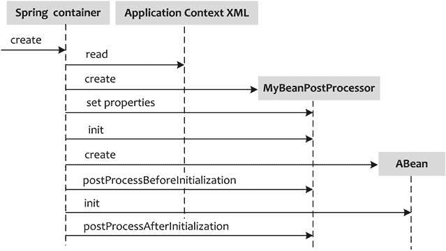

**图 5-1** – Spring 容器在 `ABean` 初始化方法调用之前和之后调用 `MyBeanPostProcessor` 的方法

只有在调用了 `postProcessAfterInitialization` 方法后，bean 实例才被 Spring 容器认为已完全初始化。例如，如果 `BBean` 依赖于 `ABean`，只有在对 `ABean` 和 `BBean` 实例都调用了 `MyBeanPostProcessor` 的 `postProcessAfterInitialization` 后，容器才会将 `ABean` 实例注入到 `BBean`。

你应该注意，如果 `BeanPostProcessor` bean 的定义指定应懒性创建（参见第 2 章 2-5 节中 `<bean>` 元素的 `lazy-init` 属性或 `<beans>` 元素的 `default-lazy-init` 属性），Spring 容器将忽略懒性初始化配置，并在创建应用上下文 XML 文件中定义的单例作用域 bean 实例之前创建 `BeanPostProcessor` bean 实例。你应该注意，实现 `BeanFactoryPostProcessor` 接口的 bean（在第 5-4 节中解释）是在实现 `BeanPostProcessor` 接口的 bean 之前创建的。

现在让我们看看可以使用 Spring `BeanPostProcessor` 的一些示例场景。

**导入** `chapter 5/ch05-bankapp-beanpostprocessor`（此项目展示了使用 `BeanPostProcessor` 来实现验证 bean 实例并解析 bean 依赖的 `MyBank` 应用。要验证 `BeanPostProcessor` 实现运行正常，请执行该项目中 `BankApp` 类的主方法。）

### BeanPostProcessor 示例 – 验证 bean 实例

在 Spring 应用中，你可能希望在 bean 实例注入或被其他对象访问之前验证其配置是否正确。让我们看看如何使用 `BeanPostProcessor` 实现为每个 bean 实例提供验证配置的机会。以下示例列表显示了 `MyBank` 的 `InstanceValidator` 接口，我们希望使用 `BeanPostProcessor` 验证的 bean 需要实现该接口：

**示例列表 5-9** – `InstanceValidator` 接口

**项目** – `ch05-bankapp-beanpostprocessor`


**源文件** – `src/main/java/sample/chapter05/bankapp/common`

```java
package sample.chapter05.bankapp.common;

public interface InstanceValidator {
    void validateInstance();
}
```

`InstanceValidator` 接口定义了 `validateInstance` 方法用于验证 bean 实例是否正确初始化。我们很快就会看到该方法由 `BeanPostProcessor` 实现调用。以下示例列表了实现了 `InstanceValidator` 接口的 `FixedDepositDaoImpl` 类：

**示例列表 5-10** – `FixedDepositDaoImpl` 类

**项目** – `ch05-bankapp-beanpostprocessor`

**源文件** – `src/main/java/sample/chapter05/bankapp/dao`

```java
package sample.chapter05.bankapp.dao;

import org.apache.log4j.Logger;
import sample.chapter05.bankapp.common.InstanceValidator;

public class FixedDepositDaoImpl implements FixedDepositDao, InstanceValidator {
    private static Logger logger = Logger.getLogger(FixedDepositDaoImpl.class);
    private DatabaseConnection connection;

    public FixedDepositDaoImpl() {
        logger.info("FixedDepositDaoImpl's constructor invoked");
    }

    public void initializeDbConnection() {
        logger.info("FixedDepositDaoImplís initializeDbConnection method invoked");
        connection = DatabaseConnection.getInstance();
    }

    @Override
    public void validateInstance() {
        logger.info("Validating FixedDepositDaoImpl instance");
        if(connection == null) {
```

```java
logger.error("Failed to obtain DatabaseConnection instance");
}
}
```

在上面的示例列表中，`initializeDbConnection` 方法是初始化方法，它通过调用 `DatabaseConnection` 类的静态方法 `getInstance` 来获取 `DatabaseConnection` 实例。如果 `FixedDepositDaoImpl` 实例未能获取 `DatabaseConnection` 实例，则 `connection` 属性为 null。如果 `connection` 属性为 null，`validateInstance` 方法将记录错误消息，指示 `FixedDepositDaoImpl` 实例未被正确初始化。由于 `initializeDbConnection` 初始化方法设置了 `connection` 属性的值，`validateInstance` 方法*必须*在 `initializeDbConnection` 方法*之后*调用。在真实的应用程序开发场景中，如果 bean 实例配置错误，`validateInstance` 方法可能会采取某些纠正措施或抛出运行时异常以停止应用程序启动。为了简单起见，如果 bean 实例配置错误，`validateInstance` 方法会记录错误消息。

接下来的示例显示了 `InstanceValidationBeanPostProcessor` 类，它实现了 Spring 的 `BeanPostProcessor` 接口，并负责调用新创建 bean 的 `validateInstance` 方法：

**示例列表 5-11** – `InstanceValidationBeanPostProcessor` 类

**项目** – `ch05-bankapp-beanpostprocessor`

**源位置** - `src/main/java/sample/spring/chapter05/bankapp/postprocessor`

```java
package sample.spring.chapter05.bankapp.postprocessor;

import org.springframework.beans.BeansException;
import org.springframework.beans.factory.config.BeanPostProcessor;
import org.springframework.core.Ordered;

public class InstanceValidationBeanPostProcessor implements BeanPostProcessor, Ordered {

    private static Logger logger = Logger.getLogger(InstanceValidationBeanPostProcessor.class);
    private int order;

    public InstanceValidationBeanPostProcessor() {
        logger.info("Created InstanceValidationBeanPostProcessor instance");
    }

    @Override
    public Object postProcessBeforeInitialization(Object bean, String beanName) throws BeansException {
        logger.info("postProcessBeforeInitialization method invoked");
        return bean;
    }

    @Override
    public Object postProcessAfterInitialization(Object bean, String beanName) throws BeansException {
        logger.info("postProcessAfterInitialization method invoked");
        if (bean instanceof InstanceValidator) {
            ((InstanceValidator) bean).validateInstance();
        }
        return bean;
    }

    public void setOrder(int order) {
        this.order = order;
    }

    @Override
    public int getOrder() {
        return order;
    }
}
```

上面的示例列表显示 `InstanceValidationBeanPostProcessor` 类实现了 Spring 的 `BeanPostProcessor` 和 `Ordered` 接口。`postProcessBeforeInitialization` 方法简单地返回传递给方法的 bean 实例。在 `postProcessAfterInitialization` 方法中，如果发现 bean 实例的类型为 `InstanceValidator`，则会调用 bean 实例的 `validateInstance` 方法。这意味着如果一个 bean 实现了 `InstanceValidator` 接口，`InstanceValidationBeanPostProcessor`将在 Spring 容器调用 bean 实例的初始化方法*之后*调用该 bean 实例的 `validateInstance` 方法。

`Ordered` 接口定义了一个返回整数值的 `getOrder` 方法。`getOrder` 方法返回的整数值决定了 `BeanPostProcessor` 实现相对于 `BeanPostProcessor` 在应用上下文 XML 文件配置的其他 `BeanPostProcessor` 实现的优先级。order 值*较高*的 `BeanPostProcessor` 被认为具有*较低*的优先级，并在 order 值*较低*的 `BeanPostProcessor` 实现执行后执行。由于我们希望将 `getOrder` 方法返回的整数值配置为 bean 属性，因此在 `InstanceValidationBeanPostProcessor` 类中定义了 `setOrder` 方法和 `order` 实例变量。

接下来的示例显示了 `InstanceValidationBeanPostProcessor` 类的 bean 定义：

**示例列表 5-12** – `InstanceValidationBeanPostProcessor` bean 定义

**项目** – `ch05-bankapp-beanpostprocessor`

**源位置** - `src/main/resources/META-INF/spring`

```xml
<bean class="…...bankapp.postprocessor.InstanceValidationBeanPostProcessor">
    <property name="order" value="1" />
</bean>
```

在上面的 bean 定义中，`<bean>` 元素的 `id` 属性*没有*指定，因为我们通常不希望 `InstanceValidationBeanPostProcessor` 成为任何其他 bean 的依赖。`<property>` 元素将 `order` 属性的值设为 1。

现在来看一个用于解析 bean 依赖的 `BeanPostProcessor` 实现。

### BeanPostProcessor 示例 – 解析 bean 依赖

在第 4 章中，我们看到如果 bean 实现了 Spring 的 `ApplicationContextAware` 接口，它可以使用 `ApplicationContext` 的 `getBean` 方法编程地获取 bean 实例。实现 `ApplicationContextAware` 接口会将应用程序代码与 Spring 耦合，因此不建议实现 `ApplicationContextAware` 接口。在本节中，我们将查看一个 `BeanPostProcessor` 实现，它为 bean 提供一个封装了 `ApplicationContext` 实例的对象，使得应用程序代码*不直接依赖于 Spring 的 `ApplicationContextAware` 和 `ApplicationContext` 接口。

接下来的示例显示了 `MyBank’s DependencyResolver` 接口，该接口由这些 bean 实现，这些 想要从 `ApplicationContext` 编程地检索它们的依赖：

**示例列表 5-13** – `DependencyResolver` 接口

**项目** – `ch05-bankapp-beanpostprocessor`

**源位置** - `src/main/java/sample/spring/chapter05/bankapp/common`

```java
package sample.spring.chapter05.bankapp.common;

public interface DependencyResolver {
    void resolveDependency(MyApplicationContext context);
}
```

`DependencyResolver` 定义了一个接收 `MyApplicationContext` 对象的方法，该对象是对 `ApplicationContext` 对象的封装。我们很快就会看到 `resolveDependency` 方法将被一个 `BeanPostProcessor` 实现调用。

接下来的示例显示了实现 `DependencyResolver` 接口的 `FixedDepositServiceImpl` 类：

**示例列表 5-14** – `FixedDepositServiceImpl` 类

**项目** – `ch05-bankapp-beanpostprocessor`

**源位置** - `src/main/java/sample/spring/chapter05/bankapp/service`

```java
package sample.spring.chapter05.bankapp.service;

import sample.spring.chapter05.bankapp.common.DependencyResolver;
import sample.spring.chapter05.bankapp.common.MyApplicationContext;

public class FixedDepositServiceImpl implements FixedDepositService, DependencyResolver {

    private FixedDepositDao fixedDepositDao;
    .....

    @Override
    public void resolveDependency(MyApplicationContext context) {
        fixedDepositDao = context.getBean(FixedDepositDao.class);
    }
}
```

`FixedDepositServiceImpl` 类定义了一个类型为 `FixedDepositDao` 的 `fixedDepositDao` 属性。`resolveDependency` 方法负责从 `MyApplicationContext`（Spring `ApplicationContext` 对象的封装）获取 `FixedDepositDao` 实例并将其赋值给 `fixedDepositDao` 属性。

下面的示例显示 `DependencyResolutionBeanPostProcessor` 类对实现了 `DependencyResolver` 接口的 bean 调用 `resolveDependency` 方法：

**示例列表 5-15** – `DependencyResolutionBeanPostProcessor` 类

**项目** – `ch05-bankapp-beanpostprocessor`

**源位置** - `/src/main/java/sample/spring/chapter05/bankapp/postprocessor`


```java
package sample.spring.chapter05.bankapp.postprocessor;

import org.springframework.beans.factory.config.BeanPostProcessor;
import org.springframework.core.Ordered;
import sample.spring.chapter05.bankapp.common.MyApplicationContext;

public class DependencyResolutionBeanPostProcessor implements BeanPostProcessor, Ordered {

    private MyApplicationContext myApplicationContext;
    private int order;

    public void setMyApplicationContext(MyApplicationContext myApplicationContext) {
        this.myApplicationContext = myApplicationContext;
    }

    public void setOrder(int order) {
        this.order = order;
    }

    @Override
    public int getOrder() {
        return order;
    }

    @Override
    public Object postProcessBeforeInitialization(Object bean, String beanName) throws BeansException {
        if (bean instanceof DependencyResolver) {
            ((DependencyResolver) bean).resolveDependency(myApplicationContext);
        }
        return bean;
    }

    @Override
    public Object postProcessAfterInitialization(Object bean, String beanName) throws BeansException {
        return bean;
    }
}
```

`DependencyResolutionBeanPostProcessor` 类实现了 Spring 的 `BeanPostProcessor` 和 `Ordered` 接口。`myApplicationContext` 属性（类型为 `MyApplicationContext`）代表 `DependencyResolutionBeanPostProcessor` 的一个依赖。`postProcessBeforeInitialization` 方法会对实现 `DependencyResolver` 接口的 bean 实例调用 `resolveDependency` 方法，并将 `MyApplicationContext` 对象作为参数传递。`postProcessAfterInitialization` 方法简单地返回传递给方法的 bean 实例。

下面的示例显示了 `MyApplicationContext` 类，它是 Spring `ApplicationContext` 对象的包装器：

**示例列表 5-16** – `MyApplicationContext` 类

**项目** – `ch05-bankapp-beanpostprocessor`

**位置** - `/src/main/java/sample/spring/chapter05/bankapp/common`

```java
package sample.spring.chapter05.bankapp.common;

import org.springframework.context.ApplicationContext;
import org.springframework.context.ApplicationContextAware;

public class MyApplicationContext implements ApplicationContextAware {

    private ApplicationContext applicationContext;

    @Override
    public void setApplicationContext(ApplicationContext applicationContext) throws BeansException {
        this.applicationContext = applicationContext;
    }

    public <T> T getBean(Class<T> klass) {
        return applicationContext.getBean(klass);
    }
}
```

`MyApplicationContext` 类实现了 Spring 的 `ApplicationContextAware` 接口，以获取部署 bean 的 `ApplicationContext` 对象的引用。`MyApplicationContext` 类定义了 `getBean` 方法，从 `ApplicationContext` 实例返回给定名称的 bean 实例。

下面的示例列表显示了 `DependencyResolutionBeanPostProcessor` 和 `MyApplicationContext` 类的 bean 定义：

**示例列表 5-17** – `applicationContext.xml`

**项目** – `ch05-bankapp-beanpostprocessor`

**源位置** - `/src/main/resources/META-INF/spring`

```xml
<bean class=".....postprocessor.DependencyResolutionBeanPostProcessor">
    <property name="myApplicationContext" ref="myApplicationContext" />
    <property name="order" value="0" />
</bean>
<bean id="myApplicationContext" class=".....bankapp.common.MyApplicationContext" />
```

`DependencyResolutionBeanPostProcessor` 类的 bean 定义显示其 `order` 属性值被设置为 0。示例列表 5-12 显示 `InstanceValidationBeanPostProcessor` 的 `order` 属性值为 1。由于*较低*的 `order` 属性值意味着*更高*的优先级，Spring 容器会对 bean 实例应用 `DependencyResolutionBeanPostProcessor`，然后是 `InstanceValidationBeanPostProcessor`。

下面的示例列表显示了 `BankApp` 类，该类用于了 `DependencyResolutionBeanPostProcessor` 和 `InstanceValidationBeanPostProcessor` 的功能：

**示例列表 5-18** – `BankApp` 类

**项目** – `bankapp-beanpostprocessor`

**位置** - `/src/main/java/sample/spring/chapter05/bankapp`

```java
package sample.spring.chapter05.bankapp;

public class BankApp {
    public static void main(String args[]) throws Exception {
        ApplicationContext context = new ClassPathXmlApplicationContext("classpath:META-INF/spring/applicationContext.xml");
        FixedService fixedService = context.getBean(FixedService.class);
        fixedService.create(1000, 12, "somedomain.com");
    }
}
```

### FactoryBeans 的 BeanPostProcessor 行为

在第 3 章第 3-9 节中，我们讨论了实现 `FactoryBean` 的 bean 是创建实例的工厂。你现在可能问的问题是 `BeanPostProcessor` 的实现是适用于 `FactoryBean` 还是适用于 `FactoryBean` 创建的 bean 实例。在本节稍后的部分，我们将看到 `BeanPostProcessor` 的 `postProcessBeforeInitialization` 和 `postProcessAfterInitialization` 方法会被 Spring 容器创建的 `FactoryBean` 实例调用。并且，*只有* `postProcessAfterInitialization` 会被 `FactoryBean` 创建的 bean 实例调用。

下面的示例列表显示了 `MyApplication` 应用中 `EventSenderFactoryBean` 类（一个 `FactoryBean` 实现），它用于创建 `EventSender` bean 实例：

**示例列表 5-19** – `EventSenderFactoryBean` 类

**项目** – `ch05-bankapp-beanpostprocessor`

**位置** - `/src/main/java/sample/spring/chapter05/bankapp/factory`

```java
package sample.spring.chapter05.bankapp.factory;

import org.springframework.beans.factory.FactoryBean;
import org.springframework.beans.factory.InitializingBean;

public class EventSenderFactoryBean implements FactoryBean<EventSender>, InitializingBean {

    .....

    @Override
    public EventSender getObject() throws Exception {
        logger.info("getObject method of EventSenderFactoryBean invoked");
        return new EventSender();
    }

    @Override
    public Class<?> getObjectType() {
        return EventSender.class;
    }

    @Override
    public boolean isSingleton() {
        return false;
    }

    @Override
    public void afterPropertiesSet() throws Exception {
}
```

```
logger.info("afterPropertiesSet method of EventSenderFactoryBean invoked");
}
```

`EventSenderFactoryBean` 类实现了 Spring 的 `InitializingBean` 和 `FactoryBean` 接口。`getObject` 方法返回一个 `EventSender` 对象的实例。由于 `isSingleton` 方法返回 `false`，每当 `EventSenderFactoryBean` 接收到 `EventSender` 对象的请求时，`EventSenderFactoryBean` 的 `getObject` 方法就会被调用。

下面的示例列表显示了 `ch05-bankapp-beanpostprocessor` 项目中 `BankApp` 类的 `main` 方法，该方法从 `EventSenderFactoryBean` 获取 `EventSender` 实例：

**示例列表 5-20** – `BankApp` 类

**项目** – `ch05-bankapp-beanpostprocessor`

**位置** - `/src/main/java/sample/spring/chapter05/bankapp`

```java
package sample.spring.chapter05.bankapp;

public class BankApp {

    public static void main(String args[]) throws Exception {
        AbstractApplicationContext context = new ClassPathXmlApplicationContext(
                "classpath:META-INF/spring/applicationContext.xml");
        context.registerShutdownHook();
        .....
        context.getBean("eventSenderFactory");
        context.getBean("eventSenderFactory");
    }
}
```

在上面的示例列表中，`ApplicationContext` 的 `getBean` 方法被调用两次，以从 `EventSenderFactoryBean` 获取两个不同的 `EventSender` 实例。如果你执行了 `BankApp` 的 `main` 方法，你将看到控制台上打印出以下消息：

**Created EventSenderFactoryBean**

`DependencyResolutionBeanPostProcessor` 的 `postProcessBeforeInitialization` 方法被调用用于.....`EventSenderFactoryBean`

`InstanceValidationBeanPostProcessor` 的 `postProcessBeforeInitialization` 方法被调用用于 .....`EventSenderFactoryBean`

**afterPropertiesSet method of EventSenderFactoryBean invoked**

`DependencyResolutionBeanPostProcessor` 的 `postProcessAfterInitialization` 方法被调用用于.....`EventSenderFactoryBean`

`InstanceValidationBeanPostProcessor` 的 `postProcessAfterInitialization` 方法被调用用于 bean .....`EventSenderFactoryBean`

上述输出显示，`BeanPostProcessor` 的 `postProcessBeforeInitialization` 和 `postProcessAfterInitialization` 方法为 Spring 容器创建的 `EventSenderFactoryBean` 实例被调用。

执行 `BankApp` 的 `main` 方法还在控制台上显示了以下输出：

**getObject method of EventSenderFactoryBean invoked**

`DependencyResolutionBeanPostProcessor` 的 `postProcessAfterInitialization` 方法被调用用于.....`EventSender`

**getObject method of EventSenderFactoryBean invoked**

`DependencyResolutionBeanPostProcessor` 的 `postProcessAfterInitialization` 方法被调用用于.....`EventSender`

上述输出显示，*只有* `BeanPostProcessor` 的 `postProcessAfterInitialization` 方法为由 `EventSenderFactoryBean` 创建的 `EventSender` 实例被调用。如果你需要，可以在 `postProcessAfterInitialization` 方法中对 `EventSender` 实例进行修改。

现在让我们来看 Spring 内置的 `RequiredAnnotationBeanPostProcessor`，你可以使用它来确保*必需的（或强制性的）bean 属性在 application context XML 文件中进行了配置。

### RequiredAnnotationBeanPostProcessor


如果 bean 属性的 setter 方法标记了 Spring 的 `@Required` 注解，Spring 的 `RequiredAnnotationBeanPostProcessor`（`BeanPostProcessor` 的实现）会检查该 bean 属性是否在 application context XML 文件中进行了配置。

**注意** 你应该注意，`RequiredAnnotationBeanPostProcessor` 不会自动注册到 Spring 容器中，你需要通过在 application context XML 文件中定义它来显式注册。

下面的示例列表显示了 `@Required` 注解的一个用法示例：

**示例列表 5-21** – `@Required` 注解用法

```java
import org.springframework.beans.factory.annotation.Required;

public class FixedDepositServiceImpl implements FixedDepositService {

    private FixedDepositDao fixedDepositDao;

    @Required
    public void setFixedDepositDao(FixedDepositDao fixedDepositDao) {
        this.fixedDepositDao = fixedDepositDao;
    }

    .....
}
```

在上面的示例列表中，`FixedDepositDao` 属性的 `setFixedDepositDao` setter 方法标记了 `@Required` 注解。如果你在 application context XML 文件中定义了 `RequiredAnnotationBeanPostProcessor`，该处理器将检查你是否指定了 `<property>` 元素或使用了 p 命名空间）来设置 `FixedDepositDao` 属性的值。如果你没有在 application context XML 文件中 `FixedDepositServiceImpl` 类的 bean 定义中配置 `FixedDepositDao` 属性，将导致异常。这表明你可以使用 `RequiredAnnotationBeanPostProcessor` 来确保应用程序中的所有 bean 实例都在 application context XML 文件中正确配置。

`RequiredAnnotationBeanPostProcessor` 仅确保 bean 属性在 bean 定义中已配置。它并没有确保配置的属性值是正确的。例如，你可以将属性值配置为 null，而不是有效值。出于这个原因，bean 可能仍然需要实现初始化方法来检查属性是否正确设置。

现在让我们来看 Spring 的 `DestructionAwareBeanPostProcessor` 接口，它是 Spring `BeanPostProcessor` 接口的子接口。

### `DestructionAwareBeanPostProcessor`

到目前为止我们已经看到 `BeanPostProcessor` 用于与新创建的 bean 实例交互。在某些场景下，你可能希望在 bean 实例销毁之前与其交互。为了在 bean 实例销毁之前与其交互，请在 application context XML 文件中配置实现 `DestructionAwareBeanPostProcessor` 的 bean。`DestructionAwareBeanPostProcessor` 是 `BeanPostProcessor` 接口的子接口，并定义了以下方法：

```
void postBeforeDestruction(Object bean, String beanName)
```

`postBeforeDestruction` 方法接收即将销毁的 bean 实例及其名称作为参数。Spring 容器会在每个单例的 bean 实例销毁之前调用 `postBeforeDestruction` 方法。通常，`postBeforeDestruction` 方法用于调用 bean 实例上的自定义销毁方法。需要注意的是，`postBeforeDestruction` 方法不会为原型作用域的 bean 被调用。

现在让我们来看 Spring 的 `BeanFactoryPostProcessor` 接口，它允许你对 bean 定义进行修改。

## 5-4 使用 `BeanFactoryPostProcessor` 修改 bean 定义

Spring `BeanFactoryPostProcessor` 接口由想要修改 bean 定义的类实现。`BeanFactoryPostProcessor` 在 Spring 容器加载 bean 定义之后、但在任何 bean 实例创建之前执行。`BeanFactoryPostProcessor` 在 application context XML 文件中定义的任何其他 bean 之前创建，这为 `BeanFactoryPostProcessor` 提供了修改其他 bean 定义的机会。你像配置任何其他 Spring bean 一样在 application context XML 文件中配置 `BeanFactoryPostProcessor` 的实现。

**注意** 如果你想修改或与 bean 实例交互，请使用 `BeanPostProcessor`（参阅第 5-3 节）而不是 `BeanFactoryPostProcessor`。

`BeanFactoryPostProcessor` 接口定义了一个方法 - `postProcessBeanFactory`。该方法接受一个类型为 `ConfigurableListableBeanFactory` 的参数，该参数可用于获取和修改由 Spring 容器加载的 bean 定义（bean definitions）。可以在 `postProcessBeanFactory` 方法内部通过调用 `ConfigurableListableBeanFactory` 的 `getBean` 方法来创建 bean 实例，但不建议在 `postProcessBeanFactory` 方法内部创建 bean。需要注意的是，`BeanPostProcessors`（参见第 5-3 节）不会为 `postProcessBeanFactory` 方法内部创建的 bean 实例执行。

重要的是，`ConfigurableListableBeanFactory` 就像 `ApplicationContext` 对象一样提供了对 Spring 容器的。`ConfigurableListableBeanFactory` 还允许你配置 Spring 容器、遍历 beans 并修改 bean 定义。例如，使用 `ConfigurableListableBeanFactory` 对象可以注册 `PropertyEditorRegistrars`（参见第 3 章第 3-6 节）、注册 `BeanPostProcessors` 等。在本节稍后的部分，我们将看到如何使用 `ConfigurableListableBeanFactory` 对象来修改 bean 定义。

现在让我们来看看如何使用 `BeanFactoryPostProcessor` 来修改 bean 定义。

## IMPORT

**`chapter 5/ch05-bankapp-beanfactorypostprocessor`**（此项目展示了 MyBank 应用，它使用 `BeanFactoryPostProcessor` 实现来禁用整个应用的自动装，并在发现单例作用（singleton-scoped）bean 依赖于原型作用（prototype-scoped）bean 时打印错误消息。要验证 `BeanFactoryPostProcessor` 实现功能正常，请执行该项目中 `BankApp` 类的 `main` 方法。）

### `BeanFactoryPostProcessor` example

在上一章，我们看到自动装（autowiring）隐藏了应用程序的整体结构（参见第 4 章第 4-6 节）。我们还讨论了不要使用 `<property>` 元素来指定单例作用 bean 依赖于原型作用 bean，而应该使用 `<lookup-method>` 或 `<replaced-method>` 元素（详情参见第 4 章第 4-4 和 4-5 节）来以编程方式获取单例 bean 的原型作用依赖。现在我们将查看一个 `BeanFactoryPostProcessor` 实现，它可以使 bean 无法用于自动装（参见第 4 章第 4-6 节描述的 `<bean>` 元素的 `autowire-candidate` 属性），并在发现单例作用 bean 依赖于原型作用 bean 时记录错误消息。为了简单起见，我们假设单例作用 bean 使用 `<property>` 元素来指定它依赖于原型作用 bean。

**NOTE** 实现 Spring `BeanFactoryPostProcessor` 接口的 bean 是一种特殊的 bean 类型；Spring 容器会自动检测并执行 `BeanFactoryPostProcessor` bean。

下面的示例列表了实现了 `BeanFactoryPostProcessor` 接口的 MyBank `ApplicationConfigurer` 类：

**Example listing 5-22** – `ApplicationConfigurer` 类 – 一个 `BeanFactoryPostProcessor` 实现

**Project** – `ch05-bankapp-beanfactorypostprocessor`

**Source location** – `src/main/java/sample/spring/chapter05/bankapp/postprocessor`

```java
package sample.spring.chapter05.bankapp.postprocessor;

import org.springframework.beans.factory.config.BeanDefinition;
import org.springframework.beans.factory.config.BeanFactoryPostProcessor;
import org.springframework.beans.factory.config.ConfigurableListableBeanFactory;

public class ApplicationConfigurer implements BeanFactoryPostProcessor {

    public ApplicationConfigurer() {
        logger.info("Created ApplicationConfigurer instance");
    }

    @Override
    public void postProcessBeanFactory(ConfigurableListableBeanFactory beanFactory) throws BeansException {
        String[] beanDefinitionNames = beanFactory.getBeanDefinitionNames();
        // -- get all the bean definitions
        for (int i = 0; i < beanDefinitionNames.length; i++) {
            String beanName = beanDefinitionNames[i];
            BeanDefinition beanDefinition = beanFactory.getBeanDefinition(beanName);
            beanDefinition.setAutowireCandidate(false);
            // -- obtain dependencies of a bean
            if (beanDefinition.isSingleton()) {
                if (hasPrototypeDependency(beanFactory, beanDefinition)) {
                    logger.error("Singleton-scoped " + beanName + " is dependent on a prototype-scoped bean.");
                }
            }
        }
    }
```

`postProcessBeanFactory` 方法执行以下顺序的操作：

1. 首先，`postProcessBeanFactory` 调用 `ConfigurableListableBeanFactory` 的 `getBeanDefinitionNames` 来获取由 Spring 容器加载的所有 bean 定义的名称。你应该注意，bean 定义的名称是 `<bean>` 元素 `id` 属性的值。

2. 一旦获取了所有 bean 定义的名称，`postProcessBeanFactory` 调用 `ConfigurableListableBeanFactory` 的 `getBeanDefinition` 来获取与每个 bean 定义对应的 `BeanDefinition` 对象。`getBeanDefinition` 接受 bean 定义名称（在步骤 1 中获取）作为参数。

3. `BeanDefinition` 对象表示一个 bean 定义，可用于修改配置。对于 Spring 容器加载的每个 bean 定义，`postProcessBeanFactory` 调用 `BeanDefinition` 的 `setAutowireCandidate` 来使所有 bean 无法用于自动装。

4. 如果 bean 定义是一个单例作用 bean 的，则 `BeanDefinition` 的 `isSingleton` 返回 true。如果 bean 定义是单例作用 bean 的，`postProcessBeanFactory` 调用 `hasPrototypeDependency` 来检查该单例作用 bean 是否依赖于任何原型作用 bean。如果单例作用 bean 依赖于原型作用 bean，`postProcessBeanFactory` 将记录错误消息。

下面的列表显示了 `ApplicationConfigurer` 的 `hasPrototypeDependency` 的实现，当 bean 依赖于原型作用 bean 时它返回 true：

**Example listing 5-23** – `ApplicationConfigurer` 的 `hasPrototypeDependency`

**Project** – `ch05-bankapp-beanfactorypostprocessor`

**Source location** – `src/main/java/sample/spring/chapter05/bankapp/postprocessor`

```java
import org.springframework.beans.MutablePropertyValues;
import org.springframework.beans.PropertyValue;
import org.springframework.beans.factory.config.RuntimeBeanReference;

public class ApplicationConfigurer implements BeanFactoryPostProcessor {

    .....
    private boolean hasPrototypeDependency(ConfigurableListableBeanFactory beanFactory, BeanDefinition beanDefinition) {
        boolean isPrototype = false;
        MutablePropertyValues mutablePropertyValues = beanDefinition.getPropertyValues();
        PropertyValue[] propertyValues = mutablePropertyValues.getPropertyValues();
        for (int j = 0; j < propertyValues.length; j++) {
            if (propertyValues[j].getValue() instanceof RuntimeBeanReference) {
                String dependencyBeanName = ((RuntimeBeanReference) propertyValues[j].getValue()).getBeanName();
                BeanDefinition dependencyBeanDef = beanFactory.getBeanDefinition(dependencyBeanName);
                if (dependencyBeanDef.isPrototype()) {
                    isPrototype = true;
                    break;
                }
            }
        }
        return isPrototype;
    }
}
```


`hasPrototypeDependency` 方法检查由 `BeanDefinition` 参数表示的 bean 是否依赖于原型作用域（prototype-scoped）的 bean。`ConfigurableListableBeanFactory` 参数提供了访问 Spring 容器加载的 bean 定义的能力。`hasPrototypeDependency` 方法通过执行以下操作序列来查找由 `BeanDefinition` 参数表示的 bean 是否具有原型作用域依赖：

1. `hasPrototypeDependency` 方法调用 `BeanDefinition` 的 `getPropertyValues` 方法来获取由 `<property>` 元素定义的 bean 属性。`BeanDefinition` 的 `getPropertyValues` 返回 `MutablePropertyValues` 类型的对象，可以使用它来修改 bean 属性。例如，你可以使用 `MutablePropertyValues` 的 `addPropertyValue` 和 `addPropertyValues` 方法向 bean 定义中添加额外的属性。

2. 由于我们需要遍历所有的 bean 属性并检查是否有任何 bean 属性引用了原型作用域的 bean，因此调用 `MutablePropertyValues` 的 `getPropertyValues` 方法来获取一个 `PropertyValue` 对象数组。`PropertyValue` 对象持有关于 bean 属性的信息。

3. 如果某个 bean 属性引用了 Spring bean，调用 `PropertyValue` 的 `getValue` 方法将返回一个 `RuntimeBeanReference` 对象实例，该实例持有被引用 bean 的名称。由于我们对引用 Spring bean 的 bean 属性感兴趣，将检查 `PropertyValue` 的 `getValue` 方法返回值是否代表 `RuntimeBeanReference` 类型实例。如果是，则将 `PropertyValue` 的 `getValue` 方法返回的对象转换为 `RuntimeBeanReference` 类型，并通过调用 `RuntimeBeanReference` 的 `getBeanName` 方法获取被引用 bean 的名称。

4. 现在，既然已经获取了 bean 属性引用的 bean 名称，可以通过调用 `ConfigurableListableBeanFactory` 的 `getBeanDefinition` 方法获取被引用 bean 的 `BeanDefinition` 对象。你可以通过 `BeanDefinition` 的 `isPrototype` 方法检查被引用 bean 是否为原型作用域的 bean。

以下序列图总结了 `hasPrototypeDependency` 方法的工作原理：

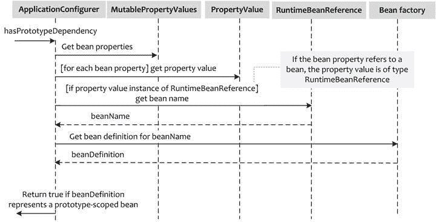

图 5-2 – `hasPrototypeDependency` 方法遍历依赖的 bean 定义，如果发现原型作用域依赖，则返回 `true`

在上面的序列图中，`ConfigurableListableBeanFactory` 对象被描绘为“Bean factory”对象。

以下示例列表显示了 `ch05-bankapp-beanfactorypostprocessor` 项目的应用上下文 XML 文件，其中包含了 `ApplicationConfigurer` 类（一个 `BeanFactoryPostProcessor` 实现）、`InstanceValidationBeanPostProcessor` 类（一个 `BeanPostProcessor` 实现）的 bean 定义，以及特定对象的 bean 定义：

示例列表 5-24 – `applicationContext.xml` - `BeanFactoryPostProcessor` bean 定义

**Project** – `ch05-bankapp-beanfactorypostprocessor`

**源位置 -**`src/main/resources/META-INF/spring`

```xml
<beans .....>
    .....
    <bean id="FixedDepositDao" class="sample.spring.chapter05.bankapp.dao.FixedDepositDaoImpl"..... >
        <property name="fixedDepositDetails" ref="FixedDepositDetails" />
    </bean>
    <bean id="FixedDepositDetails" class="sample.spring.chapter05.bankapp.domain.FixedDepositDetails" scope="prototype" />
    <bean class=".....postprocessor.InstanceValidationBeanPostProcessor">
        <property name="order" value="1" />
    </bean>
    <bean class="sample.spring.chapter05.bankapp.postprocessor.ApplicationConfigurer" />
</beans>
```

在上方显示的 bean 定义中，单例作用域的 `FixedDepositDao` bean 依赖于原型作用域的 `FixedDepositDetails` bean。

如果你执行 `ch05-bankapp-beanfactorypostprocessor` 项目中 `BankApp` 类的 `main` 方法，将在控制台上看到以下输出：

```text
Created ApplicationConfigurer instance
Singleton-scoped FixedDepositDao bean is dependent on a prototype-scoped bean.
Created InstanceValidationBeanPostProcessor instance
```

上述输出显示 Spring 容器在创建 `ApplicationConfigurer`（一个 `BeanFactoryPostProcessor`）之后并在创建 `InstanceValidationBeanPostProcessor`（一个 `BeanPostProcessor`）实例之前，执行了 `ApplicationConfigurer` 的 `postProcessBeanFactory` 方法。注意，实现 `BeanFactoryPostProcessor` 接口的 bean 会在实现 `BeanPostProcessor` 接口的 bean 之前被处理。由于这个原因，你不能使用 `BeanPostProcessor` 对 `BeanFactoryPostProcessor` 实例进行修改。`BeanFactoryPostProcessor` 为你提供了修改由 Spring 容器加载的 bean 定义的机会，而 `BeanPostProcessor` 则为你提供了修改新创建的 bean 实例的机会。

现在让我们来看看 `BeanPostProcessors` 和 `BeanFactoryPostProcessors` 之间的相似之处：

- 你可以在应用上下文 XML 文件中配置多个 `BeanFactoryPostProcessors`。要控制 Spring 容器执行 `BeanFactoryPostProcessors` 的顺序，请实现 Spring 的 `Ordered` 接口（参阅第 5-3 节了解更多关于 `Ordered` 接口的信息）。

- 即使你指定 `BeanFactoryPostProcessor` 实现由 Spring 容器懒加载，这些处理器也会在 Spring 容器实例创建时被创建。

在第 3 章中，我们查看了 `CustomEditorConfigurer` —— 这是 Spring 开箱提供的用于注册自定义编辑器的 `BeanFactoryPostProcessor` 实现。现在让我们来看看 Spring 开箱提供的一些 `BeanFactoryPostProcessor` 实现。

### `PropertySourcesConfigurer`

到目前为止，我们看到的 bean 定义使用 `<property>` 或 `<constructor-arg>` 元素来指定 bean 属性或构造参数的实际字符串值。`PropertySourcesConfigurer`（一个 `BeanFactoryPostProcessor`）允许在属性文件中指定 bean 属性和构造参数的实际字符串值。在 bean 定义中，你只需指定占位符（格式为 `${property_name_in_properties_file}`）作为 `<property>` 或 `<constructor-arg>` 元素的值。当 Spring 容器加载 bean 定义时，`PropertySourcesConfigurer` 从属性文件中提取实际值并替换 bean 定义中的占位符。

**导入第 5 章**

该项目展示了使用 Spring 的 `PropertySourcesConfigurer` 从外部属性文件设置 bean 属性的 Spring 应用。要验证 `PropertySourcesConfigurer` 功能正常，请执行该项目中 `SampleApp` 类的 `main` 方法。

以下示例列表展示了使用占位符的 `DataSource` 和 `WebServiceConfiguration` 类的 bean 定义：

示例列表 5-25 – `applicationContext.xml` - 使用占位符的 bean 定义

**Project** – `ch05-propertySourcesConfigurer-example`

**源位置 -** `src/main/resources/META-INF/spring`

```xml
<bean id="datasource" class="sample.spring.chapter05.domain.DataSource">
    <property name="url" value="${database.url}" />
    <property name="username" value="${database.username}" />
    <property name="password" value="${database.password}" />
    <property name="driverClass" value="${database.driverClass}" />
</bean>
<bean id="webServiceConfiguration" class="sample.spring.chapter05.domain.WebServiceConfiguration">
    <property name="webServiceUrl" value="${webservice.url}" />
</bean>
```

上面的示例列表显示，每个 `<property>` 元素的 `value` 属性指定了一个属性占位符。当 Spring 容器加载 bean 定义时，`PropertySourcesPlaceholderConfigurer` 会将属性占位符替换为来自属性文件的值。例如，如果一个属性文件中定义了 `database.username` 属性，那么 `database.username` 属性的值将替换 `dataSource` bean 中 `${database.username}` 属性占位符。

`PropertySourcesPlaceholderConfigurer` 的 bean 定义指定了要搜索的属性文件，以查找用于替换属性占位符的属性，如下示例列表所示：

**示例列表 5-26** – `applicationContext.xml-PropertySourcesPlaceholderConfigurer` bean 定义

**项目** – `ch05-propertySourcesPlaceholderConfigurer-example`

**源位置 -** `src/main/resources/META-INF/spring`

```xml
<bean class="org.springframework.context.support.PropertySourcesPlaceholderConfigurer">
    <property name="locations">
        <list>
            <value>classpath:database.properties</value>
            <value>classpath:webservice.properties</value>
        </list>
    </property>
    <property name="ignoreUnresolvablePlaceholders" value="false" />
</bean>
```

`PropertySourcesPlaceholderConfigurer` 的 `locations` 属性指定了要搜索的属性文件，以查找属性占位符的值。在上面的示例列表中，`PropertySourcesPlaceholderConfigurer` 在 `database.properties` 和 `webservice.properties` 文件中查找属性占位符的值。`ignoreUnresolvablePlaceholders` 属性指定了在 `locations` 属性指定的任何属性文件中未找到属性占位符的值时，`PropertySourcesPlaceholderConfigurer` 是静默忽略还是抛出异常。值 `false` 表示如果在 `database.properties` 或 `webservice.properties` 文件中未找到属性占位符的值，`PropertySourcesPlaceholderConfigurer` 将抛出异常。

下面的示例列表显示了 `database.properties` 和 `webservice.properties` 文件定义的属性：

**示例列表 5-27** – 在 `database.properties` 和 `webservice.properties` 文件中定义的属性

**项目** – `ch05-propertySourcesPlaceholderConfigurer-example`

**源位置 -** `src/main/resources/META-INF`

**---------------- database.properties file ------------------**

```properties
database.url=some_url
database.username=some_username
database.password=some_password
database.driverClass=some_driverClass
```

**---------------- webservice.properties file ------------------**

```properties
webservice.url=some_url
```

如果你将 `database.properties` 和 `webservice.properties` 文件中定义的属性与 `datasource` 和 `webServiceConfiguration` bean 定义中指定的属性占位符进行比较（参考示例列表 5-25），你会发现对于每个属性占位符，在其中一个属性文件中都定义了一个属性。

`ch05-propertySourcesPlaceholderConfigurer-example` 项目中 `SampleApp` 类的 `main` 方法从 `ApplicationContext` 获取 `WebServiceConfiguration` 和 `DataSource` bean，并在控制台上打印它们的属性。如果你执行 `SampleApp` 的 `main` 方法，你将在控制台上看到以下输出：

**DataSource** `[url=some_url, username=some_username, password=some_password, driverClass=some_driverClass]`

**WebServiceConfiguration** `[webServiceUrl=some_url]`

上面的输出显示：

- `DataSource` 的 `url` 属性被设置为 `some_url`，`username` 设置为 `some_username`，`password` 为 `some_password`，`driverClass` 为 `some_driverClass`。

- `WebServiceConfiguration` 的 `webServiceUrl` 属性被设置为 `some_url`。

如果你从 `database.properties` 或 `webservice.properties` 文件删除一个属性，执行 `SampleApp` 的 `main` 方法将导致异常。

现在让我们来看 `PropertySourcesPlaceholderConfigurer` 的 `localOverride` 属性。

### `localOverride` 属性


如果你希望本地属性（通过 `<props>` 元素设置）覆盖从属性文件中读取的属性，可以将 `PropertySourcesPlaceholderConfigurer` 的 `localOverride` 属性设置为 `true`。

**导入章节 5/ch05-localoverride-example**（此项目展示了一个使用 `PropertySourcesPlaceholderConfigurer` 的 `localOverride` 属性的 Spring 应用程序。要运行应用程序，请执行该项目中 `SampleApp` 类的 `main` 方法。）

下面的示例列表显示了 `DataSource` 和 `WebServiceConfiguration` 类的 bean 定义：

**示例列表 5-28** – `applicationContext.xml` - 使用属性占位符的 bean 定义

**项目** – `ch05-localOverride-example`

**源位置** – `src/main/resources/META-INF/spring`

```xml
<bean id="datasource" class="sample.spring.chapter05.domain.DataSource">
    <property name="url" value="${database.url}" />
    <property name="username" value="${database.username}" />
    <property name="password" value="${database.password}" />
    <property name="driverClass" value="${database.driverClass}" />
</bean>
<bean id="webServiceConfiguration" class="sample.spring.chapter05.domain.WebServiceConfiguration">
    <property name="webServiceUrl" value="${webservice.url}" />
</bean>
```

`DataSource` 和 `WebServiceConfiguration` 的 bean 定义与我们在示例列表 5-25 中看到的相同。

下面的示例列表显示了 `database.properties` 和 `webservice.properties` 中定义的属性：

**示例列表 5-29** – 在 `database.properties` 和 `webservice.properties` 文件中定义的属性

**项目** – `ch05-localOverride-example`

**源位置** – `src/main/resources/META-INF`

**---------------- database.properties file ------------------**

```properties
database.url=some_url
database.username=some_username
```

**---------------- webservice.properties file ------------------**

```properties
webservice.url=some_url
```

下面的示例列表显示了 `PropertySourcesPlaceholderConfigurer` 的 bean 定义：

**示例列表 5-30** – `applicationContext.xml` - `PropertySourcesPlaceholderConfigurer` bean 定义

**项目** – `ch05-localOverride-example`

**源位置** – `src/main/resources/META-INF/spring`

```xml
<bean class="org.springframework.context.support.PropertySourcesPlaceholderConfigurer">
    <property name="locations">
        <list>
            <value>classpath:database.properties</value>
            <value>classpath:webservice.properties</value>
        </list>
    </property>
    <property name="properties">
        <props>
            <prop key="database.password">locally-set-password</prop>
            <prop key="database.driverClass">locally-set-driverClass</prop>
            <prop key="webservice.url">locally-set-webServiceUrl</prop>
        </props>
    </property>
    <property name="ignoreUnresolvablePlaceholders" value="false" />
    <property name="localOverride" value="true" />
</bean>
```

`ch05-localOverride-example` 项目中 `SampleApp` 类的主方法从 `ApplicationContext` 中检索 `WebServiceConfiguration` 和 `DataSource` bean，并在控制台上打印它们的属性。如果你执行 `SampleApp` 的主方法，你将在控制台上看到以下输出：

`DataSource` [url=some_url, username=some_username, password=locally-set-password, driverClass=locally-set-driverClass]

`WebServiceConfiguration` [webServiceUrl=locally-set-webServiceUrl]

输出显示，`DataSource` 的 `password` 和 `driverClass` 属性值分别为 `locally-set-password` 和 `locally-set-driverClass`。这意味着 `DataSource` 的 `password` 和 `driverClass` 属性值来自于由 `PropertySourcesPlaceholderConfigurer` bean 定义的本地属性（参见示例 5-30）。这表明，如果 `PropertySourcesPlaceholderConfigurer` 无法在外部属性文件中找到占位符的属性，它将在 `PropertySourcesPlaceholderConfigurer` bean 定义的本地属性中搜索该属性。输出还显示 `WebServiceConfiguration` 的 `webServiceUrl` 属性值也来自于 `PropertySourcesPlaceholderConfigurer` bean 定义的本地属性（参见示例 5-30）。`PropertySourcesPlaceholderConfigurer` 的 `localOverride` 属性被设置为 `true`；因此，本地定义的 `webservice.url` 属性优于从 `webservice.properties` 文件读取的 `webservice.url` 属性。

**注意** 与其使用 `PropertySourcesPlaceholderConfigurer` 的 `properties` 属性，你可以使用 Spring util schema 的 `<properties>` 元素（参见第 3 章第 8 节）或 `PropertiesFactoryBean`（参见第 3 章第 8 节）来定义本地属性。

与其在应用程序上下文 XML 文件中配置 `PropertySourcesPlaceholderConfigurer` bean，你可以使用 Spring context schema 的 `<property-placeholder>` 元素。`<property-placeholder>` 元素配置 `PropertySourcesPlaceholderConfigurer` 实例。现在让我们详细查看 `<property-placeholder>` 元素。

**导入** `chapter 5/ch05-property-placeholder-element-example`（该项目展示了一个使用 `<property-placeholder>` 元素的 Spring 应用程序。要运行该应用程序，请执行该项目中 `SampleApp` 类的主方法。）

### `<property-placeholder>` 元素

下面的示例显示了如何使用 `<property-placeholder>` 元素配置一个 `PropertySourcesPlaceholderConfigurer` 实例，其配置与我们在示例 5-30 中配置的相同：

**示例 5-31** – `applicationContext.xml` - `<property-placeholder>` 元素

**项目** – `ch05-property-placeholder-element-example`

**源位置** – `src/main/resources/META-INF/spring`

```xml
<beans xmlns="http://www.springframework.org/schema/beans"
    xmlns:context="http://www.springframework.org/schema/context"
    xmlns:util="http://www.springframework.org/schema/util" .....>

    <context:property-placeholder ignore-unresolvable="false"
        location="classpath:database.properties, classpath:webservice.properties"
        local-override="true" order="1" properties-ref="localProps" />

    <util:properties id="localProps">
        <prop key="database.password">locally-set-password</prop>
        <prop key="database.driverClass">locally-set-driverClass</prop>
        <prop key="webservice.url">locally-set-webServiceUrl</prop>
    </util:properties>
</beans>
```

在上面的示例中，包含了对 Spring context schema 的引用，以便可以使用其元素。上面的示例显示，使用 `<property-placeholder>` 元素使得 `PropertySourcesPlaceholderConfigurer` 的配置更加简洁。`ignore-unresolvable`、`location` 和 `local-override` 属性对应 `PropertySourcesPlaceholderConfigurer` 的 `ignoreUnresolvablePlaceholders`、`locations` 和 `localOverride` 属性。由于 `PropertySourcesPlaceholderConfigurer` 类实现了 Spring 的 `Ordered` 接口，`order` 属性的值用于设置 `PropertySourcesPlaceholderConfigurer` 实例的 `order` 属性。`properties-ref` 属性引用代表本地属性的 `java.util.Properties` 对象。在上面的示例中，Spring util schema 的 `<properties>` 元素（参见第 3 章第 8 节）创建了一个 `java.util.Properties` 对象实例，该实例被 `<property-placeholder>` 元素的 `properties-ref` 属性引用。

现在让我们来看看 Spring 的 `PropertyOverrideConfigurer`（一个 `BeanFactoryPostProcessor`），它允许你在外部属性文件中为 bean 属性指定值。

### `PropertyOverrideConfigurer`

`PropertyOverrideConfigurer` 与 `PropertySourcesPlaceholderConfigurer` 的相似之处在于，它允许你在外部属性文件中指定 bean 属性值。在使用 `PropertyOverrideConfigurer` 时，在外部属性文件中以以下格式指定 bean 属性值：

`<bean-name>.<bean-property-name>=<value>`

在这里，`<bean-name>` 是 bean 的名称，`<bean-property-name>` 是 bean 属性的名称，`<value>` 是你想赋值给 bean 属性的值。

`PropertyOverrideConfigurer` 和 `PropertySourcesPlaceholderConfigurer` 类之间的主要区别是：

- 你只能使用 `PropertyOverrideConfigurer` 外部化 bean 属性的值，即你不能使用它来外部化构造函数参数。

- `PropertySourcesPlaceholderConfigurer` 未向你提供指定属性默认值的选项。但 `PropertyOverrideConfigurer` 允许你为 bean 属性指定默认值。

现在让我们来看看 `PropertyOverrideConfigurer` 的用法示例。

**导入** `chapter 5/ch05-property-placeholder-example`（该项目展示了一个使用 Spring `PropertyOverrideConfigurer` 的 Spring 应用程序。要运行该应用程序，请执行该项目中 `SampleApp` 类的主方法。）

### `PropertyOverrideConfigurer` 示例

下面的示例显示了 `DataSource` 和 `WebServiceConfiguration` 类的 bean 定义，我们将使用 `PropertyOverrideConfigurer` 设置它们的属性：

**示例 5-32** – `applicationContext.xml` - `DataSource` 和 `WebServiceConfiguration` 的 bean 定义

**项目** – `ch05-property-override-example`

**源位置** – `src/main/resources/META-INF/spring`

```xml
<bean id="datasource" class="sample.spring.chapter05.domain.DataSource">
    <property name="url" value="test url value" />
    <property name="username" value="test username value" />
    <property name="password" value="test password value" />
    <property name="driverClass" value="test driverClass value" />
</bean>
<bean id="webServiceConfiguration" class="sample.spring.chapter05.domain.WebServiceConfiguration">
    <property name="webServiceUrl" value="this webservice url needs to be replaced" />
</bean>
```

在上面的示例中，`<bean>` 元素的 `value` 属性指定了 bean 属性的默认值。

下面的示例显示了 `PropertyOverrideConfigurer` 类的 bean 定义，它用从 `database.properties` 和 `webservice.properties` 文件读取的值替换示例 5-32 所示的 bean 属性默认值：

**示例 5-33** – `applicationContext.xml` - `PropertyOverrideConfigurer` 配置

**项目** – `ch05-property-override-example`

**源位置** – `src/main/resources/META-INF/spring`


```xml
<bean class="org.springframework.beans.factory.config.PropertyOverrideConfigurer">
    <property name="locations">
        <list>
            <value>classpath:database.properties</value>
        </list>
    </property>
</bean>
```

```xml
<value>classpath:webservice.properties</value>
</list>
</property>
</bean>
```

在上面的示例列表中，`PropertyOverrideConfigurer` 的 `locations` 属性指定了包含 bean 属性值的属性文件。

注意：与其直接配置 `PropertyOverrideConfigurer`，你可以使用 Spring context schema 中的 `<property-override>` 元素来配置 `PropertyOverrideConfigurer` 实例。

下面的示例显示了 `database.properties` 和 `webservice.properties` 文件，它们包含了 bean 属性的值：

**示例列表 5-34** – 在 `database.properties` 和 `webservice.properties` 中定义的属性

**项目** – `ch05-propertyOverrideConfigurer-example`

**源位置** – `src/main/resources/META-INF`

**database.properties 文件**

```properties
datasource.url=some_url
datasource.username=some_username
datasource.password=some_password
```

**webservice.properties 文件**

```properties
webServiceConfiguration.webServiceUrl=some_url
```

`database.properties` 和 `webservice.properties` 文件中的条显示属性名遵循模式：`<bean-name>.<property-name>`。当 Spring 容器加载 bean 定义时，`PropertyOverrideConfigurer` 会将 bean 属性的默认值替换为从 `database.properties` 和 `webservice.properties` 文件中读取的该属性值。例如，`datasource` bean 的 `url` 属性设置为 `database.properties` 文件中定义的 `datasource.url` 属性值。同样，`webServiceConfiguration` bean 的 `webServiceUrl` 属性设置为 `webservice.properties` 文件中定义的 `webServiceConfiguration.webServiceUrl` 属性值。

如果从外部属性文件中未找到 bean 属性的值，则该 bean 属性将保留其默认值。示例列表 5-32 显示 `datasource` bean 的 `driverClass` 属性默认值为‘test driverClass value’。示例列表 5-34 显示 `database.properties` 或 `webservice.properties` 文件中没有定义名为 `datasource.driverClass` 的属性；因此，`driverClass` bean 属性保留其默认值。

`ch05-propertyOverrideConfigurer-example` 项目中 `SampleApp` 类的 `main` 方法从 `ApplicationContext` 中检索 `WebServiceConfiguration` 和 `DataSource` bean，并在控制台上打印它们的属性。如果你执行 `SampleApp` 的 `main` 方法，你将在控制台上看到以下输出：

```text
DataSource [url=some_url, username=some_username, password=some_password, driverClass=test driver Class value]
WebServiceConfiguration [webServiceUrl=some_url]
```

上述输出显示，除了 `driverClass` 之外，所有 bean 属性的默认值都被外部属性文件中指定的属性值替换。

由于 `PropertyOverrideConfigurer` 和 `PropertySourcesPlaceholderConfigurer` 继承自 Spring 的 `PropertyResourceConfigurer` 类，你会注意到这两个类共享许多共同配置选项。例如，你可以设置 `PropertyOverrideConfigurer` 的 `localOverride` 属性来控制本地属性是否优先于从外部属性文件中读取的属性，你可以设置 `PropertyOverrideConfigurer` 的 `properties` 属性来定义本地属性，等等。

## 5-5 总结

在本章中，我们学习了如何为 bean 实例添加自定义的初始化和销毁逻辑。我们还查看了如何使用 `BeanPostProcessor` 实现来修改新创建的 bean 实例，以及使用 `BeanFactoryPostProcessor` 实现来修改 bean 定义。Spring 内部利用 `BeanPostProcessors` 和 `BeanFactoryPostProcessors` 来提供许多框架功能。在下一章中，我们将查看 Spring 对注解驱动开发的支持。

# 第 6 章 - Spring 的注解驱动开发

## 6-1 简介

在之前的章节中，我们看到应用上下文 XML 文件中包含的 bean 定义被 Spring 容器用作创建 bean 实例的蓝图。bean 定义了 bean 依赖、bean 的初始化和销毁方法、bean 实例的懒加载或预加载策略、bean 范围等信息。在本节中，我们将查看可以使用在 bean 类本身中指定相同信息的注解，从而节省在 application context XML 文件中显式配置 bean 的精力。我们还将触及 *Spring 表达式语言*（SpEL）以及如何使用 Spring 的 `Validator` 接口和 JSR 303 注解来验证对象。本章将最后查看如何使用 Spring 的 `@Configuration` 和 `@Bean` 注解编程地定义 Spring beans。

让我们首先查看 Spring 的 `@Component` 注解，它表示特定类代表一个 Spring 组件。

## 6-2 使用 `@Component` 标识 Spring 组件

Spring 的 `@Component` 注解是一种类型级注解，表示一个类代表一个 Spring 组件。建议使用更专门的 `@Component` 注解形式来标记应用程序的控制器、和服务数据访问对象（DAO）。例如，使用 `@Controller` 注解控制器，使用 `@Service` 注解服务，使用 `@Repository` 注解 DAO。

导入 `chapter6/ch06-bankapp-annotations`（该项目展示了使用注解向 Spring 容器注册 bean 并自动注入依赖的 MyBank 应用。要运行应用程序，请执行该项目 `BankApp` 类的 `main` 方法。）

下面的示例显示了使用 `@Service` 注解的 MyBank `FixedDepositServiceImpl` 类：

**示例列表 6-1** – `FixedDepositServiceImpl` 类 - `@Service` 注解用法

**项目** – `ch06-bankapp-annotations`

**源位置** – `src/main/java/sample/spring/chapter06/bankapp/service`

```java
package sample.spring.chapter06.bankapp.service;

import org.springframework.stereotype.Service;

@Service(value="FixedDepositService")
public class FixedDepositServiceImpl implements FixedDepositService { ... }
```

由于 `FixedDepositServiceImpl` 类使用了 `@Service` 注解，该类代表一个 Spring 组件。`@Service` 注解接受一个 `value` 属性，该属性指定组件注册到 Spring 容器时的名称。例如，`FixedDepositServiceImpl` 类以 `FixedDepositService` 的名称注册到 Spring 容器。`value` 属性的作用与 `<bean>` 元素的 `id` 属性相同。

`@Service`、`@Component`、`@Repository` 和 `@Controller` 注解通过 `value` 属性指定名称。你可以在不显式指定 `value` 属性的情况下指定名称。这意味着 `@Service(value="FixedDepositService")` 等于 `@Service("FixedDepositService")`。如果你没有为组件名称，Spring 假设组件名称与类名称相同。唯一的区别是组件名称以小字母开头。你应该为组件指定自定义名称，因为这在按名称自动注入依赖时非常有帮助。

如果你启用了 Spring 的类路径扫描功能，带有 `@Component`、`@Controller`、`@Service` 或 `@Repository` 注解的 bean 类将自动注册到 Spring 容器。你通过使用 Spring context schema 中的 `<component-scan>` 元素启用 Spring 的类路径扫描功能。

下面的示例显示了 `<component-scan>` 元素用法：

**示例列表 6-2** – `applicationContext.xml`

**项目** – `ch06-bankapp-annotations`

**源位置** – `src/main/resources/META-INF/spring`

```xml
<beans xmlns="http://www.springframework.org/schema/beans"
    xmlns:context="http://www.springframework.org/schema/context"
    xsi:schemaLocation=".....http://www.springframework.org/schema/context
        http://www.springframework.org/schema/context/spring-context-4.0.xsd">
    <context:component-scan base-package="sample.spring"/>
</beans>
```

在上面的示例列表中，包含了对 Spring context schema 的引用，以便访问其元素。`<component-scan>` 元素的 `base-package` 属性指定了用逗号分隔的包列表，用于在这些包中搜索 Spring 组件。由于 `base-package` 属性的值为 `sample.spring`，Spring 会 `sample.spring` 包及其子包中搜索 Spring 组件。由于示例 6-1 所示的 `FixedDepositServiceImpl` 类使用了 `@Service` 注解，并且位于 `sample.spring.chapter06.bankapp.service` 包中，上述示例列表中的 `<component-scan>` 元素会自动将 `FixedDepositServiceImpl` 类作为 bean 注册到 Spring 容器中。这等于在应用上下文 XML 文件中为 `FixedDepositServiceImpl` 类进行如下 bean 定义：

**示例列表 6-3** – `FixedDepositServiceImpl` 类的 bean 定义

```xml
<bean id="FixedDepositService"
      class="sample.spring.chapter06.bankapp.service.FixedDepositServiceImpl" />
```

如果你想过滤掉考虑自动注册到 Spring 容器的组件类，可以使用 `<component-scan>` 元素的 `resource-pattern` 属性。`resource-pattern` 属性的默认值为 `/*.class`，这意味着 `base-package` 属性所指定的包下的所有组件类都将会在考虑范围内自动注册。`<component-scan>` 元素的子元素 `<include-filter>` 和 `<exclude-filter>` 提供了一种更简洁的方式来指定应该被考虑自动注册的组件类以及应该忽略的类。例如，下面的示例列表展示了 `<include-filter>` 和 `<exclude-filter>` 元素的用法示例：

**示例列表 6-4** – `<include-filter>` 和 `<exclude-filter>` 元素

```xml
<beans .....>
    <context:component-scan base-package="sample.example">
        <context:include-filter type="annotation" expression="example.annotation.MyAnnotation"/>
        <context:exclude-filter type="regex" expression=".*Details"/>
    </context:component-scan>
</beans>
```

`<exclude-filter>` 和 `<include-filter>` 元素定义了一个 `type` 属性，用于指定用于过滤组件类的策略，而 `expression` 属性指定了相应的过滤器表达式。在上面的示例列表中，`<include-filter>` 元素指定标记有 `MyAnnotation` 类型级别注解的组件类将自动注册到 Spring 容器中，而 `<exclude-filter>` 元素指定名称以 `Details` 结尾的组件类将被 `<component-scan>` 元素忽略。

下表描述了 `<include-filter>` 和 `<exclude-filter>` 元素的 `type` 属性可以接受可能的值：

| `type` 属性的值 | 说明 |
| --- | --- |
| `annotation` | 如果 `type` 属性的值为 `annotation`，则 `expression` 属性指定组件类*必须*标记的注解的全限定类名。例如，如果 `expression` 属性的值为 `example.annotation.MyAnnotation`，则标记有 `MyAnnotation` 注解的组件类将被考虑包含（对于 `<include-filter>` 元素）或排除（对于 `<exclude-filter>` 元素）。 |
| `assignable` | 如果 `type` 属性的值为 `assignable`，则 `expression` 属性指定组件类必须赋值的类或接口的全限定名。 |
| `aspectj` | 如果 `type` 属性的值为 `aspectj`，则 `expression` 属性指定一个用于过滤组件类的 AspectJ 表达式。 |
| `regex` | 如果 `type` 属性的值为 `regex`，则 `expression` 属性指定一个通过名称过滤组件类的正则表达式。 |
| `custom` | 如果 `type` 属性的值为 `custom`，则通过 `expression` 属性指定 `org.springframework.core.type.TypeFilter` 接口的实现用于过滤组件类。 |

> **注意**
>
> 在本节中，我们查看了 `@Service` 注解的用法示例。`@Component`、`@Controller` 和 `@Repository` 注解的指定方式与 `@Service` 注解相同。参考 `ch06-bankapp-annotations` 项目中的 `CustomerRegistrationDetails` 和 `CustomerRequestDetails` 类查看 `@Component` 注解的用法。参考 `ch06-bankapp-annotations` 项目包含的 DAO 类查看 `@Repository` 注解的用法。

由于 Spring 组件*没有*定义在应用上下文 XML 文件中，你无法使用 `<property>` 或 `<constructor-arg>` 元素来指定它们的依赖。因此，Spring 组件使用 `@Autowired`、`@Inject` 等注解来指定它们的依赖。

现在让我们来看 Spring 的 `@Autowired` 注解。

## 6-3 `@Autowired` - 按类型自动装配依赖


`@Autowired` 注解用于按类型自动装配依赖。`@Autowired` 注解提供了与第 4 章讨论的 Spring 自动装配功能相同的功能，但 `@Autowired` 注解提供了一种更灵活的 bean 装配方式。`@Autowired` 注解可以使用构造函数级别、方法级别和字段级别。

下面的示例列表了在字段级别使用 `@Autowired` 注解的 `AccountStatementServiceImpl` 类：

**示例列表 6-5** – 字段级别的 `AccountStatementServiceImpl` 类 - `@Autowired` 用法

**项目** – `ch06-bankapp-annotations`

**源文件** - `src/main/java/sample/spring/chapter06/bankapp/service`

```java
package sample.spring.chapter06.bankapp.service;

import org.springframework.beans.factory.annotation.Autowired;
import org.springframework.stereotype.Service;

@Service("accountStatementService")
public class AccountStatementServiceImpl implements AccountStatementService {

    @Autowired
    private AccountStatementDao accountStatementDao;

    @Override
    public AccountStatement getAccountStatement(Date from, Date to) {
        return accountStatementDao.getAccountStatement(from, to);
    }
}
```

在上面的示例列表中，类型为 `AccountStatementDao` 的 `accountStatementDao` 字段标记了 `@Autowired` 注解。当创建 `AccountStatementServiceImpl` 的实例时，Spring 的 `AutowiredBeanPostProcessor`（一个 `BeanPostProcessor` 实现）负责自动装配 `accountStatementDao` 字段。`AutowiredBeanPostProcessor` 从 Spring 容器中获取 `AccountStatementDao` 类型的 bean 引用并将其赋值给 `accountStatementDao` 字段。需要注意的是，标记了 `@Autowired` 的字段不需要是公共的，也不需要相应的公共 setter 方法。

**注意** Spring 的 `AutowiredBeanPostProcessor` 执行对标记有 Spring `@Autowired` 注解或 JSR 330 的 `@Inject` 注解（在第 6-5 节解释）的字段、方法和构造函数的自动装配。

下面的示例列表展示了在方法级别使用 `@Autowired` 注解的 `CustomerRegistrationServiceImpl` 类：

**示例列表 6-6** – 方法级别的 `CustomerRegistrationServiceImpl` 类 - `@Autowired` 用法

**项目** – `ch06-bankapp-annotations`

**源文件** - `src/main/java/sample/spring/chapter06/bankapp/service`

```java
@Service("customerRegistrationService")
```

```java
@Scope(value = ConfigurableBeanFactory.SCOPE_PROTOTYPE)

public class CustomerRegistrationServiceImpl implements CustomerRegistrationService {

    private CustomerRegistrationDetails customerRegistrationDetails;

    .....

    @Autowired
    public void obtainCustomerRegistrationDetails(
            CustomerRegistrationDetails customerRegistrationDetails) {
        this.customerRegistrationDetails = customerRegistrationDetails;
    }

    .....

    @Override
    public void setAccountNumber(String accountNumber) {
        customerRegistrationDetails.setAccountNumber(accountNumber);
    }

    .....
}
```

在上面的示例列表中，`obtainCustomerRegistrationDetails` 方法标记了 `@Autowired` 注解。如果一个方法被标记了 `@Autowired` 注解，该方法的参数将会被自动装。由于 `obtainCustomerRegistrationDetails` 方法标记了 `@Autowired` 注解，其 `CustomerRegistrationDetails` 参数将按类型进行自动装。需要注意的是，被 `@Autowired` 注解的方法不需要是公的（public）。

**注意** 标记了 `@Autowired` 注解的方法会在组件实例创建后被调用，而带有 `@Autowired` 注解的字段将会被注入匹配的 bean 实例。

下面的示例列表展示了 `CustomerRequestServiceImpl` 类，它定义了一个标记了 `@Autowired` 注解的构造函数：

**示例列表 6-7** – `CustomerRequestServiceImpl` 类 - 构造函数级别的 `@Autowired` 注解使用

**项目** – `ch06-bankapp-annotations`

**源位置** - `src/main/java/sample/spring/chapter06/bankapp/service`

```java
package sample.spring.chapter06.bankapp.service;

@Service(value="customerRequestService")
public class CustomerRequestServiceImpl implements CustomerRequestService {

    private CustomerRequestDetails customerRequestDetails;
    private CustomerRequestDao customerRequestDao;

    @Autowired
    public CustomerRequestServiceImpl(CustomerRequestDetails customerRequestDetails,
            CustomerRequestDao customerRequestDao) {
        this.customerRequestDetails = customerRequestDetails;
        this.customerRequestDao = customerRequestDao;
    }

    .....
}
```

在上面的示例列表中，`CustomerRequestServiceImpl` 的构造函数标记了 `@Autowired` 注解。如果一个构造函数被标记了 `@Autowired` 注解，该构造函数的参数将会被自动装。由于 `CustomerRequestServiceImpl` 的构造函数标记了 `@Autowired` 注解，其 `CustomerRequestDetails` 和 `CustomerRequestDao` 参数将按类型进行自动装。需要注意的是，被 `@Autowired` 注解的构造函数不需要是公的（public）。

当使用 `@Autowired` 注解时，如果找不到匹配所需类型的 bean，将抛出异常。例如，在示例列表 6-7 中，如果未在 Spring 容器中找到注册类型为 `CustomerRequestDetails` 或 `CustomerRequestDao` 的 bean，则在创建 `CustomerRequestServiceImpl` 实例时会抛出异常。`@Autowired` 的 `required` 属性指定了自动装依赖是强制的还是可选的。如果你将 `@Autowired` 的 `required` 属性值设置为 `false`，则依赖的自动装被认为是可选的。这意味着如果 `required` 属性的值设置为 `false`，即使在 Spring 容器中没有找到匹配所需类型的 bean，也不会抛出异常。默认情况下，`required` 属性的值为 `true`；依赖必须由 Spring 容器满足。

如果一个组件类定义了一个 `required` 属性值设置为 `true` 的 `@Autowired` 注解构造函数，它不能拥有另一个标记了 `@Autowired` 注解的构造函数。例如，考虑下面的示例列表，它定义了两个标记了 `@Autowired` 注解的构造函数：

**示例列表 6-8** – 定义了 2 个 `@Autowired` 注解构造函数的组件类

```java
@Service(value="customerRequestService")
public class CustomerRequestServiceImpl implements CustomerRequestService {

    .....

    @Autowired(required=false)
    public CustomerRequestServiceImpl(CustomerRequestDetails customerRequestDetails) { ..... }

    @Autowired
    public CustomerRequestServiceImpl(CustomerRequestDetails customerRequestDetails,
            CustomerRequestDao customerRequestDao) { ..... }
}
```

由于在上面的示例列表中，其中一个构造函数需要自动装依赖项（`@Autowired` 的 `required` 属性设置为 `true`），而另一个是可选的（`@Autowired` 的 `required` 属性设置为 `false`），这会导致 Spring 抛出异常。

一个组件类可以定义多个 `required` 属性值设置为 `false` 的 `@Autowired` 注解构造函数。在这种情况下，Spring 将调用其中一个构造函数来创建组件类的实例。下面的示例列表展示了一个组件类，它定义了两个标记了 `@Autowired`（`required = false`）的构造函数以及一个默认构造函数：

**示例列表 6-9** – 定义了多个 `required` 属性值设置为 `false` 的 `@Autowired` 注解构造函数的组件类

```java
@Service(value="customerRequestService")
public class CustomerRequestServiceImpl implements CustomerRequestService {

    public CustomerRequestServiceImpl() { }

    @Autowired(required=false)
    public CustomerRequestServiceImpl(CustomerRequestDetails customerRequestDetails) { ..... }

    @Autowired(required=false)
    public CustomerRequestServiceImpl(CustomerRequestDetails customerRequestDetails,
            CustomerRequestDao customerRequestDao) { ..... }
}
```

在上面的示例列表中，两个标记了 `@Autowired` 注解的构造函数都是 Spring 自动装的候选。将选择满足依赖数量最多的构造函数。对于 `CustomerRequestServiceImpl`，如果注册了类型为 `CustomerRequestDetails` 和 `CustomerRequestDao` 的 bean，Spring 会调用 `CustomerRequestServiceImpl(CustomerRequestDetails, CustomerRequestDao)` 构造函数。如果容器中注册了类型为 `CustomerRequestDetails` 的 bean 但没有注册类型为 `CustomerRequestDao` 的 bean，则调用 `CustomerRequestServiceImpl(CustomerRequestDetails)` 构造函数。如果一个都没有找到，则调用 `CustomerRequestServiceImpl` 的默认构造函数。

## 6-4 `@Qualifier` – 按名称自动装依赖

现在让我们看看如何将 Spring 的 `@Qualifier` 注解配合 `@Autowired` 注解来按名称自动装依赖。`@Qualifier` 注解可以用字段级别、方法参数级别和构造函数参数级别。

下面的示例列表展示未使用 `@Qualifier` 注解的 `FixedDepositServiceImpl` 类：

**示例列表 6-10** – `FixedDepositServiceImpl` 类 - `@Qualifier` 注解使用

**项目** – `ch06-bankapp-annotations`

**源位置** - `src/main/java/sample/spring/chapter06/bankapp/service`

```java
package sample.spring.chapter06.bankapp.service;

import org.springframework.beans.factory.annotation.Autowired;
import org.springframework.beans.factory.annotation.Qualifier;

@Service(value="FixedDepositService")
public class FixedDepositServiceImpl implements FixedDepositService {

    @Autowired
    @Qualifier(value="myFixedDepositDao")
    private FixedDepositDao myFixedDepositDao;

    .....
}
```

在上面的示例列表中，`myFixedDepositDao` 字段标记了 `@Autowired` 和 `@Qualifier` 注解。`@Qualifier` 注解的 `value` 属性指定了分配给 `myFixedDepositDao` 字段的 bean 名称。

Spring 首先通过“类型”（by type）为标记了 `@Autowired` 注解的字段、构造函数和方法查找自动装配候选。然后，Spring 使用 `@Qualifier` 注解指定的 Bean 名称从自动装配候选列表中定位一个唯一的 Bean。例如，在示例 6-10 中，Spring 首先为 `myFixedDepositDao` 字段查找类型为 `FixedDepositDao` 的 Bean，然后从自动装配候选列表中定位名为 `myFixedDepositDao` 的 Bean。如果找到名为 `myFixedDepositDao` 的 Bean，Spring 将将其赋值给 `myFixedDepositDao` 字段。

**注意** - `@Qualifier(value="myFixedDepositDao")` 等同于 `@Qualifier("myFixedDepositDao")`；你不需要使用 `value` 属性来指定要自动装配的 Bean 名称。

接下来的示例展示了在方法参数级别和构造函数参数级别使用 `@Qualifier` 注解的方法：

**示例 6-11** – 方法参数级别和构造函数参数级别的 `@Qualifier` 使用

```java
public class Sample {

    @Autowired

    public Sample(@Qualifier("aBean") ABean bean) { .... }

    @Autowired

    public void doSomething(@Qualifier("bBean") BBean bean, CBean cBean) { ..... }

}
```


在上述示例中，`@Qualifier` 注解指定了构造函数参数和方法参数。在创建 `Sample` 类的实例时，Spring 找到一个名为 `aBean` 的类型为 `ABean` 的 Bean，并将其作为参数传递给 `Sample` 类的构造函数。调用 `Sample` 的 `doSomething` 方法时，Spring 找到一个类型为 `BBean`（名称为 `bBean`）的另一个 Bean，并将这两个 Bean 作为参数传递给 `doSomething` 方法。需要注意的是，`BBean` 依赖是按名称自动装配的，而 `CBean` 依赖是按类型自动装配的。

现在来看 JSR 330 的 `@Inject` 和 `@Named` 注解，你可以用它们代替 Spring 的 `@Autowired` 和 `@Qualifier` 注解。

## 6-5 JSR 330 的 `@Inject` 和 `@Named` 注解

JSR 330（Java 依赖注入）标准化了 Java 平台的依赖注入注解。JSR 330 定义了 `@Inject` 和 `@Named` 注解，分别类似于 Spring 的 `@Autowired` 和 `@Qualifier` 注解。Spring 提供了 `@Inject` 和 `@Named` 注解的支持。

**导入** `chapter 6/ch06-bankapp-jsr330`（该项目展示了 `MyBank` 应用，它使用 JSR 330 的 `@Inject` 和 `@Named` 注解来自动装配依赖。要运行该应用程序，请执行项目中 `BankApp` 类的 `main` 方法。）

接下来的示例展示了使用 JSR 330 的 `@Inject` 和 `@Named` 注解的 `FixedDepositServiceImpl` 类：

**示例 6-12** – `FixedDepositServiceImpl` 类

**项目** – `ch06-bankapp-jsr330`

**源码位置** – `src/main/java/sample/spring/chapter06/bankapp/service`

```java
package sample.spring.chapter06.bankapp.service;

import javax.inject.Inject;
import javax.inject.Named;

@Named(value="FixedDepositService")
public class FixedDepositServiceImpl implements FixedDepositService {

    @Inject

    @Named(value="myFixedDepositDao")
    private FixedDepositDao myFixedDepositDao;

    .....
}
```

如果你将上述示例中的 `FixedDepositServiceImpl` 类与示例 6-10 中的 `FixedDepositServiceImpl` 类对比，你会发现 JSR 330 的 `@Named` 注解取代了 `@Service` 和 `@Qualifier` 注解，而 JSR 330 的 `@Inject` 注解取代了 `@Autowired` 注解。

`@Autowired` 和 `@Inject` 注解具有相同的语义；它们用于按类型自动装配依赖。与 `@Autowired` 注解一样，`@Inject` 可以用于方法级别、构造函数级别和字段级别。构造函数的依赖注入首先执行，然后是字段，最后是方法。我们之前看到过 `@Autowired` 注解的 `required` 属性指定了自动装配依赖是强制性的还是可选的。`@Inject` 没有任何等同于 `@Autowired` 注解 `required` 属性的属性。

如果在类型级别使用 `@Named` 注解，它的作用类似于 Spring 的 `@Component` 注解。如果在方法参数级别或构造函数参数级别使用 `@Named` 注解，它的作用类似于 Spring 的 `@Qualifier` 注解。如果一个类标记了 `@Named` 注解，Spring 上下文架构的 `<component-scan>` 元素将其视为标记了 `@Component` 注解的组件类。

要使用 `@Named` 和 `@Inject` 注解，你需要在项目中包含 JSR 330 JAR 文件。`ch06-bankapp-jsr330` 项目通过 `pom.xml` 文件中的 `<dependency>` 元素包含了 JSR 330 JAR 文件：

```xml
<dependency>
    <groupId>javax.inject</groupId>
    <artifactId>javax.inject</artifactId>
    <version>1</version>
</dependency>
```

在第 5 章中，我们查看了 JSR 250 的 `@PostConstruct` 和 `@PreDestroy` 注解，它们用于标识 Bean 的初始化和销毁方法。现在来看 JSR 250 的 `@Resource` 注解，你可以用它按名称自动装配依赖。

## 6-6 JSR 250 的 `@Resource` 注解

Spring 通过 JSR 250 的 `@Resource` 注解支持按名称自动装配字段和方法。`@Resource` 注解的 `name` 属性指定要自动装配的 Bean 名称。需要注意的是，你不能将 `@Resource` 注解用于构造函数参数。

接下来的示例展示了如何使用 `@Resource` 注解重写示例 6-12 中的 `FixedDepositServiceImpl` 类：

**示例 6-13** – 字段级别的 `@Resource` 使用

```java
import javax.annotation.Resource;

@Named(value="FixedDepositService")
public class FixedDepositServiceImpl implements FixedDepositService {

    @Resource(name="myFixedDepositDao")
    private FixedDepositDao myFixedDepositDao;

    .....
}
```

在上述示例中，`@Resource` 注解用于装配 `myFixedDepositDao` 字段。由于 `name` 属性的值为 `myFixedDepositDao`，Spring 在容器中定位名为 `myFixedDepositDao` 的 Bean 并将其赋值给 `myFixedDepositDao` 字段。

与其使用 `@Autowired` 和 `@Qualifier` 注解，不如使用 `@Resource` 注解按名称自动装配。正如之前提到的，如果你使用 `@Autowired`-`@Qualifier` 组合来按名称自动装配，Spring 首先根据字段（或构造函数参数）的类型查找 Bean，然后根据 `@Qualifier` 注解指定的名称缩小到唯一的 Bean。但是，如果你使用 `@Resource` 注解，Spring 使用 `@Resource` 注解指定的 Bean 名称来定位唯一的 Bean。这意味着当你使用 `@Resource` 注解时，Spring 不考虑字段（或 setter 方法参数）的类型。

**注意**：由于 `@Autowired`、`@Inject` 和 `@Resource` 注解是由 `BeanPostProcessor` 处理的，你不应该在实现了 `BeanFactoryPostProcessor` 或 `BeanPostProcessor` 接口的组件类中使用这些注解。

## 6-7 `@Scope`、`@Lazy`、`@DependsOn` 和 `@Primary` 注解

使用 Spring 的 `@Scope` 注解指定 Spring 组件的作用范围（原型或单例）。默认情况下，Spring 组件是单例作用的。如果你希望 Spring 组件是原型作用的，则必须通过 `@Scope` 注解进行指定。`@Scope` 注解的作用与 `<bean>` 元素的 `scope` 属性相同（参阅第 2 章第 5 节了解更多关于 `scope` 属性的信息）。

接下来的示例展示了使用 `@Scope` 注解的 `CustomerRequestDetails` 类：

**示例 6-14** – `@Scope` 使用

**项目** – `ch06-bankapp-jsr330`

**源码位置** – `src/main/java/sample/spring/chapter06/bankapp/domain`

```java
package sample.spring.chapter06.bankapp.domain;
```

```java
import javax.inject.Named;

import org.springframework.beans.factory.config.ConfigurableBeanFactory;

import org.springframework.context.annotation.Scope;

@Named(value="customerRequestDetails")
@Scope(value=ConfigurableBeanFactory.SCOPE_PROTOTYPE)
public class CustomerRequestDetails { ..... }
```

`@Scope` 注解接受一个 `value` 属性，用于指定组件的作用范围。你可以将 `value` 属性的值设置为 `prototype` 或 `singleton` 来指示该组件是单例作用范围还是原型作用范围，你也可以将 `value` 属性的值设置为 `ConfigurableBeanFactory` 的常量 `SCOPE_SINGLETON`（值为 `singleton`）或 `SCOPE_PROTOTYPE`（值为 `prototype`）。

默认情况下，单例作用范围的 Spring 组件是 `eagerly`（积极）初始化的，也就是说它们在 Spring 容器创建时就会被实例化。如果你希望单例作用范围的组件被懒加载，可以在该单例作用范围组件的类定义上加上 `@Lazy` 注解。

**注意**：`@Lazy` 注解的作用与 `<bean>` 元素的 `lazy-init` 属性相同。请参阅第 2 章第 2-5 节了解更多关于 `lazy-init` 属性的信息。

下面的示例展示了 `@Lazy` 注解用法：

**示例 6-15** – `@Lazy` 注解用法

```java
@Lazy(value=true)
@Component
public class Sample { ..... }
```

`@Lazy` 注解的 `value` 属性指定组件是被懒加载还是积极初始化。如果 `value` 属性的值为 `true`，则意味着该组件是懒加载的。

你可以使用 `@DependsOn` 注解指定隐式的 bean 依赖。下面的示例展示了 `@DependsOn` 注解用法：

**示例 6-16** – `@DependsOn` 注解用法

```java
@DependsOn(value = {"beanA", "beanB"})
@Component
public class Sample { ..... }
```

在上面的示例中，`Sample` 类上的 `@DependsOn` 注解指示 Spring 容器在创建 `Sample` 类的实例之前先创建 `beanA` 和 `beanB` bean。

**注意**：`@DependsOn` 注解的作用与 `<bean>` 元素的 `depends-on` 属性相同。请参阅第 4 章第 4-3 节了解 `depends-on` 属性。

如果一个依赖有多个自动装配候选，`@Primary` 注解会将一个 bean 指定为自动装配的主候选。下面的示例展示了 `@Primary` 注解用法：

```java
@Primary
@Component
public class Sample { ..... }
```

**注意**：`@Primary` 注解的作用与 `<bean>` 元素的 `primary` 属性相同。请参阅第 4 章第 4-6 节了解 `primary` 属性。

现在让我们来看 Spring 的 `@Value` 注解，它简化了组件类的配置。

## 6-8 使用 `@Value` 注解简化组件配置

在之前的章节中，我们看到过示例，bean 所需的配置信息是通过 `<property>` 和 `<constructor-arg>` 元素的 `value` 属性来指定的。由于 Spring 组件没有定义在应用程序上下文 XML 文件中，Spring 的 `@Value` 注解被用于实现 `<property>` 和 `<constructor-arg>` 元素 `value` 属性相同的功能。你应该注意，`@Value` 注解可以用于字段级、方法级、方法参数级和构造函数参数级。

**重要**：第 6 章/`ch06-value-annotation`（此项目展示了一个使用 Spring 的 `@Value` 注解来配置 Spring 组件的应用程序。要运行该应用程序，请执行该项目中 `SampleApp` 类的 `main` 方法。）

下面的示例展示了字段级 `@Value` 注解的用法：

**示例 6-18** – `Sample` 类 - `@Value` 注解用法

**项目** – `ch06-value-annotation`

**源码位置** – `src/main/java/sample/spring/chapter06/beans`

```java
package sample.spring.chapter06.beans;

import org.springframework.beans.factory.annotation.Value;

@Component(value="sample")
public class Sample {
    @Value("Some currency")
    private String currency;

    .....
}
```

在上面的示例中，`currency` 字段被 `@Value` 注解标记。`@Value` 注解的 `value` 属性指定了字段的默认值。指定 `value` 属性是可选的；因此，`@Value(value="Some currency")` 与 `@Value("Some currency")` 相同。

你还可以使用 `Spring Expression Language`（SpEL）表达式作为 `@Value` 注解的值。SpEL 是一种你可以在运行时查询和操作对象的 `expression language`。下面的示例展示了利用 SpEL 表达式的 `@Value` 注解：

**示例 6-19** – `Sample` 类 - 使用 SpEL 表达式的 `@Value` 注解

**项目** – `ch06-value-annotation`

**源码位置** – `src/main/java/sample/spring/chapter06/beans`

```java
package sample.spring.chapter06.beans;

import org.springframework.beans.factory.annotation.Value;

@Component(value="sample")
public class Sample {
    @Value("#{configuration.environment}")
    private String environment;

    .....

    @Value("#{configuration.getCountry()}")
    private String country;

    @Value("#{configuration.state}")
    private String state;

}
```

上面的示例显示了 `@Value` 指定了一个 `<spel-expression>`。由 `@Value` 注解指定的 SpEL 表达式是由 `BeanPostProcessor` 处理的。SpEL 表达式可以使用 `<beanName>.<field or method>` 格式来获取其值。例如，`#{configuration.environment}` 获取名为 bean 的属性，而 `#{configuration.getCountry()}` 调用 `getCountry()` 方法。

下面的示例展示了被 SpEL 表达式引用的 bean 类：

**示例 6-20** – `Configuration` 组件

**项目** – `ch06-value-annotation`

**源码位置** – `src/main/java/sample/spring/chapter06/beans`


```java
package sample.spring.chapter06.beans;

import org.springframework.stereotype.Component;

@Component("configuration")
public class Configuration {
    public static String environment = "DEV";

    public String getCountry() {
        return "Some country";
    }

    public String getState() {
        return "Some state";
    }

    public String[] splitName(String name) {
        return name.split(" ");
    }

    public String getCity() {
        return "Some city";
    }
}
```

上面的示例显示`Configuration`类是一个定义了字段和方法的 Spring 组件。如果你对比示例 6-19 和 6-20，你会发现`#{configuration.environment}`表达式指向`Configuration`类中定义的静态`environment`变量，`#{configuration.getCountry()}`表达式指向`Configuration`的`getCountry()`方法，而`#{configuration.state}`表达式指向`Configuration`的`getState()`方法。

`ch06-value-annotation`项目中`SampleApp`类的 main 方法从`ApplicationContext`获取`Sample`bean 实例，并打印该 bean 实例各种属性的值。如果你执行`SampleApp`的 main 方法，将看到如下输出：

```
Sample [**environment=DEV**, currency=Some currency, **country=Some country**, **state=Some state**, splitName=[FirstName, LastName], city=Some city]
```

上面的输出显示：

- `#{configuration.environment}`表达式导致`Sample`environment 字段的值设置为`DEV`，这是由`Configuration`类的公静态字段`environment`指定的值。
- `#{configuration.getCountry()}`表达式导致`Sample`country 字段的值设置为`Some country`，这是通过调用`Configuration`的`getCountry()`方法返回的值。
- `#{configuration.state}`表达式的结果会将`Sample`的 state 字段值设置为`Some state`，该值是由调用`Configuration`的`getState`方法返回的。

上面的示例显示，你可以使用 SpEL 从其他 bean 中检索配置信息。

**注意** SpEL 是一种非常强大的表达式语言，它提供的功能比本书中描述的多得多。建议参考 Spring 参考文档以进一步了解 SpEL。

接下来的示例列表展示在方法级别和方法参数级别上使用`@Value`注解的方法：

**示例列表 6-21** – `Sample`类 - 方法级别和方法参数级别上的`@Value`注解用法

**项目** – `ch06-value-annotation`

**源码位置** - `src/main/java/sample/spring/chapter06/beans`

```java
package sample.spring.chapter06.beans;

import org.springframework.beans.factory.annotation.Autowired;
import org.springframework.beans.factory.annotation.Value;

@Component(value="sample")
public class Sample {
    .....

    private String[] splitName;
    private String city;

    @Autowired
    public void splitName(@Value("#{configuration.splitName('FirstName LastName')}") String[] splitName) {
        this.splitName = splitName;
    }

    @Autowired
    @Value("#{configuration.getCity()}")
    public void city(String city) {
        this.city = city;
    }

    .....
}
```

上面的示例列表显示，标记了`@Autowired`注解的方法在方法级别和方法参数级别使用了`@Value`注解。你应该注意，*只有当*方法被标记了`@Autowired`或`@Resource`或`@Inject`注解时，才能在方法级别和方法参数级别使用`@Value`注解。SpEL 表达式`#{configuration.splitName('FirstName LastName')}`的结果是调用`Configuration`的`splitName`方法并将 'FirstName LastName' 作为参数。这表明 SpEL 表达式可以调用接受参数的方法。

**注意** `@Value`注解由`BeanPostProcessor`处理；因此，你不应该在实现了`BeanFactoryPostProcessor`或`BeanPostProcessor`接口的组件类中使用`@Value`注解。

SpEL 的用法*并不限于*`@Value`注解，你也可以在应用上下文 XML 文件的 bean 定义中使用 SpEL。

**导入** `chapter 6/ch06-spel-example` （此项目展示了一个在 bean 定义中使用 SpEL 表达式的应用程序。若要运行该应用程序，请执行该项目中`SampleApp`类的 main 方法。）

下面的示例列表展示了如何在 bean 定义中使用 SpEL：

**示例列表 6-22** – `applicationContext.xml` – bean 定义中的 SpEL 表达式

**项目** – `ch06-spel-example`

**源码位置** - `src/main/resources/META-INF/spring`

```xml
<beans ..... >
    <bean id="sample" class="sample.spring.chapter06.beans.Sample">
        <property name="environment" value="#{configuration.environment}" />
        <property name="currency" value="Some currency" />
        <property name="country" value="#{configuration.getCountry()}" />
        <property name="state" value="#{configuration.state}" />
    </bean>
    <bean id="configuration" class="sample.spring.chapter06.beans.Configuration" />
</beans>
```

上面的示例列表显示，`Sample`类的 bean 定义使用了 SpEL 表达式（引用`Configuration`bean）来为 environment、currency、country 和 state 属性设置默认值。

现在让我们如何使用 Spring 的`Validator`接口在 Spring 应用中对对象进行验证。

## 6-9 使用 Spring 的 Validator 接口验证对象

Spring 的`Validator`接口是 Spring Validation API 的一部分，允许你对对象进行验证。你可以在应用程序的任何层中使用`Validator`接口执行对象验证。例如，你可以使用`Validator`接口验证 Web 层以及持久化层中的对象。

**注意** 使用`Validator`接口的替代方案是使用 JSR 303 注解来指定应用于对象的约束。JSR 303 注解将在下一节中解释。

**导入** `chapter 6/ch06-validator-interface` （此项目展示了使用 Spring`Validator`接口验证`FixedDepositDetails`对象的 MyBank 应用程序。若要运行应用程序，请执行`Bank`类的 main 方法。）

`FixedDepositDetails`对象代表定期存款的详情。接下来的示例列表展示了`FixedDepositDetails`类：

**示例列表 6-23** – `FixedDepositDetails`类

**项目** – `ch06-validator-interface`

**源码位置** - `src/main/java/sample/spring/chapter06/domain`

```java
package sample.spring.chapter06.domain;

public class FixedDepositDetails {
    private long id;
    private float depositAmount;
    private int tenure;
    private String email;

    public FixedDepositDetails(long id, float depositAmount, int tenure, String email) {
        this.id = id;
        this.depositAmount = depositAmount;
        this.tenure = tenure;
        this.email = email;
    }

    // 实例变量的 getters 和 setters
    
    public float getDepositAmount() {
        return depositAmount;
    }
    .....
}
```

上面的示例列表显示`FixedDepositDetails`类定义了`id`、`depositAmount`、`tenure`和`email`实例变量。假设在保存定期存款之前，我们需要确保定期存款金额（由`depositAmount`实例变量表示）不为 0。

为了验证`FixedDepositDetails`对象的`depositAmount`属性，我们需要创建一个 Spring`Validator`接口的实现。接下来的示例列表展示了针对`FixedDepositDetails`类型的验证器：

**示例列表 6-24** – `FixedDepositValidator`类 – Spring 的`Validator`接口实现

**项目** – `ch06-validator-interface`

**源码位置** - `src/main/java/sample/spring/chapter06/validator`

```java
package sample.spring.chapter06.validator;

import org.springframework.validation.Errors;
import org.springframework.validation.Validator;

public class FixedDepositValidator implements Validator {
    @Override
    public boolean supports(Class<?> clazz) {
        return FixedDepositDetails.class.isAssignableFrom(clazz);
    }

    @Override
    public void validate(Object target, Errors errors) {
        FixedDepositDetails fixedDepositDetails = (FixedDepositDetails) target;
        if (fixedDepositDetails.getDepositAmount() == 0) {
            errors.reject("zeroDepositAmount");
        }
    }
}
```

`Validator`接口定义了`supports`和`validate`方法。`supports`方法检查传入的对象实例（由`clazz`属性表示）是否可以被验证。如果`supports`返回 true，则使用`validate`方法对对象进行验证。在上面的示例列表中，`FixedDepositValidator`的`supports`方法检查传入的对象是否为`FixedDepositDetails`类型。如果`supports`返回 true，`FixedDepositValidator`的`validate`方法将验证该对象。`validate`方法接受待验证的对象实例和一个`Errors`实例。`Errors`实例的`reject`方法用于存储验证过程中发生的错误。稍后可以检查`Errors`实例以获取更多关于验证错误的信息。

下面的示例列表显示`FixedDepositServiceImpl`的`createFixedDeposit`方法使用了`FixedDepositValidator`（参考示例列表 6-24）来验证`FixedDepositDetails`对象。

### 示例列表 6-25 – `FixedDepositServiceImpl`类 – 验证`FixedDepositDetails`对象

**项目** – `ch06-validator-interface`

**源码位置** - `/src/main/java/sample/spring/chapter06/bankapp/service`

```java
package sample.spring.chapter06.bankapp.service;

import org.springframework.validation.BeanPropertyBindingResult;
import sample.spring.chapter06.bankapp.validator.FixedDepositValidator;

@Service(value="FixedDepositService")
public class FixedDepositServiceImpl implements FixedDepositService {

    @Autowired
    @Qualifier(value="myFixedDepositDao")
    private FixedDepositDao myFixedDepositDao;

    @Override
    public void createFixedDeposit(FixedDepositDetails fixedDepositDetails) throws Exception {
        BeanPropertyBindingResult bindingResult =
                new BeanPropertyBindingResult(fixedDepositDetails, "Errors");
        FixedDepositValidator validator = new FixedDepositValidator();
        validator.validate(fixedDepositDetails, bindingResult);
        if(bindingResult.getErrorCount() > 0) {
            logger.error("Errors were found while validating FixedDepositDetails instance");
        } else {
            myFixedDepositDao.createFixedDeposit(fixedDepositDetails);
            logger.info("Created fixed deposit");
        }
    }
}
```

`FixedDepositServiceImpl`的`createFixedDeposit`方法在由`FixedDepositDao`将`FixedDepositDetails`对象（由参数`fixedDepositDetails`表示）保存到数据存储之前进行验证。上述示例中的`createFixedDeposit`方法执行了以下任务：


- 创建 `FixedDepositValidator` 实例和 Spring 的 `BeanPropertyBindingResult` —— 这是 Spring 开箱即用的 `Errors` 接口的默认实现。
- 调用 `FixedDepositValidator` 的 `validate()` 方法，传入 `FixedDepositDetails` 对象和 `BeanPropertyBindingResult` 实例。
- 调用 `BeanPropertyBindingResult` 的 `getErrorCount()` 方法检查是否报告了任何验证错误。如果没有报告验证错误，则调用 `FixedDepositDao` 的 `createFixedDeposit()` 方法将定期存款详情保存到数据存储中。

接下来的示例显示了 `BankApp` 的 `main()` 方法，该方法通过调用 `FixedDepositServiceImpl` 的 `createFixedDeposit()` 方法（参见示例列表 6-25）来检查 `FixedDepositValidator` 的 `validate()` 方法是否正确执行了验证：

### 示例列表 6-26 – `BankApp` 类

**项目** – `ch06-validator-interface`

**源码位置** – `/src/main/java/sample/spring/chapter06/bankapp`

```java
package sample.spring.chapter06.bankapp;

public class BankApp {

    public static void main(String args[]) throws Exception {
        ApplicationContext context = new ClassPathXmlApplicationContext(
                "classpath:META-INF/spring/applicationContext.xml");
        FixedDepositService FixedDepositService = context.getBean(FixedDepositService.class);
        FixedDepositService.createFixedDeposit(new FixedDepositDetails(1, 0, 12, "someemail@somedomain.com"));
        FixedDepositService.createFixedDeposit(new FixedDepositDetails(1, 1000, 12, "someemail@somedomain.com"));
    }
}
```

首先，向 `FixedDepositService` 的 `createFixedDeposit` 方法传递一个 `depositAmount` 值为 0 的 `FixedDepositDetails` 对象，随后传递一个 `depositAmount` 值为 1000 的 `FixedDepositDetails` 对象。

如果你执行 `BankApp` 的 `main()` 方法，你将在控制台上看到以下输出：

```
Errors were found while validating FixedDepositDetails instance
Created fixed deposit
```

输出 `Errors were found while validating FixedDepositDetails instance` 显示，当验证 `depositAmount` 值为 0 的 `FixedDepositDetails` 实例时，`FixedDepositValidator` 报告了错误。输出 `Created fixed deposit` 显示，当验证 `depositAmount` 值为 1000 的 `FixedDepositDetails` 实例时，没有报告错误。

**注意**：Spring 的 `Validator` 接口通常用于基于 Spring MVC 的 Web 应用程序，将用户在 HTML 表单中输入的信息绑定到相应的表单对象。

现在让我们来看看如何使用 JSR 303 注解对 bean 属性指定约束，并让 Spring 执行验证。

## 6-10 使用 JSR 303 注解指定约束

**导入**：`chapter 6/ch06-jsr303-validation`（此项目展示使用了 JSR 303 注解的 MyBank。要运行该应用程序，请执行该项目中 `BankApp` 类的 `main()` 方法。）

接下来的示例显示了使用了 JSR 303 注解的 `FixedDepositDetails` 类：

### 示例列表 6-27 – `FixedDepositDetails` 类 – JSR 303 注解

**项目** – `ch06-jsr303-validation`

**源码位置** – `/src/main/java/sample/spring/chapter06/bankapp/domain`

```java
package sample.spring.chapter06.bankapp.domain;

import javax.validation.constraints.*;

public class FixedDepositDetails {

    @NotNull
    private long id;

    @Min(1000)
    @Max(50000)
    private float depositAmount;

    @Min(6)
    private int tenure;

    @NotBlank
    @Size(min=5, max=100)
    private String email;

    public FixedDepositDetails(long id, float depositAmount, int tenure, String email) {
        this.id = id;
        this.depositAmount = depositAmount;
        this.tenure = tenure;
        this.email = email;
    }
}
```

`@NotNull`、`@Min`、`@Max`、`@NotBlank` 和 `@Size` 是 JSR 303 定义的一些注解。上述列表显示通过使用 JSR 303 注解，`FixedDepositDetails` 类清晰地指定了适用于字段的约束。另一方面，如果你使用 Spring Validation 验证对象，约束信息包含在 `Validator` 实现中（参见示例列表）。

下表描述了 JSR 303 注解对 `FixedDepositDetails` 对象强制的约束：

| JSR 303 注解 | 约束描述 |
| --- | --- |
| `@NotNull` | 注解字段不能为空。例如，`FixedDepositDetails` 的 `id` 字段不能为空。 |
| `@Min` | 注解字段的值大于等于指定的值。例如，`FixedDepositDetails` 对象中 `depositAmount` 字段上的 `@Min(1000)` 注解意味着 `depositAmount` 的值大于等于 1000。 |
| `@Max` | 注解字段的值小于等于指定的值。例如，`FixedDepositDetails` 对象中 `depositAmount` 字段上的 `@Max(50000)` 注解意味着 `depositAmount` 的值小于等于 50000。 |
| `@NotBlank` | 注解字段的值不能为空或 null。例如，`FixedDepositDetails` 的 `email` 字段不能为空或 null。 |
| `@Size` | 注解字段的大小在指定的 min 和 max 属性之间。例如，`FixedDepositDetails` 对象中 `email` 字段上的 `@Size(min=5, max=100)` 注解意味着 `email` 字段的大小大于等于 5 且小于等于 100。 |

如果你查看示例列表 6-27 中的导入语句，你会发现 `@NotBlank` 注解是由 Hibernate Validator 框架定义的，而不是 JSR 303。Hibernate Validator 框架提供了额外的注解，你可以将其与 JSR 303 注解配合使用。

现在，我们已经在 `FixedDepositDetails` 类上指定了 JSR 303 约束，让我们看看如何使用 Spring 来验证 `FixedDepositDetails` 对象。

### Spring 对 JSR 303 的支持

Spring 支持使用 JSR 303 约束的对象。Spring 的 `LocalValidatorFactoryBean` 类负责检测应用程序类路径中是否存在 JSR 303 实现者（如 Hibernate Validator）并对其初始化。需要注意的是，`LocalValidatorFactoryBean` 实现了 JSR 303 的 `Validator` 和 `ValidatorFactory` 接口，同时也实现了 Spring 的 `Validator` 接口。

下面的示例列表显示了在应用上下文 XML 文件中 `LocalValidatorFactoryBean` 类的配置：

### 示例列表 6-28 – `applicationContext.xml` – Spring 的 `LocalValidatorFactoryBean` 配置

**项目** – `ch06-jsr303-validation`

**源码位置** – `src/main/resources/META-INF/spring`

```xml
<bean id="validator" class="org.springframework.validation.beanvalidation.LocalValidatorFactoryBean" />
```

如你所示，`LocalValidatorFactoryBean` 的配置与其他任何 Spring bean 一样。现在我们已经配置了 `LocalValidatorFactoryBean`，让我们看看它是如何执行验证的。

下面的示例列表显示了 `FixedDepositServiceImpl` 类，该类要求在固定存款详情保存到数据存储之前，对 `FixedDepositDetails` 对象进行验证：

### 示例列表 6-29 – `FixedDepositServiceImpl` 类 – 验证 `FixedDepositDetails` 对象

**项目** – `ch06-jsr303-validation`

**源码位置** – `src/main/java/sample/spring/chapter06/bankapp/service`

```java
package sample.spring.chapter06.bankapp.service;

import org.springframework.validation.BeanPropertyBindingResult;
import org.springframework.validation.Validator;

.....

@Service(value="FixedDepositService")
public class FixedDepositServiceImpl implements FixedDepositService {

    @Autowired
    private Validator validator;

    @Autowired
    @Qualifier(value="myFixedDepositDao")
    private FixedDepositDao myFixedDepositDao;

    @Override
    public void createFixedDeposit(FixedDepositDetails fixedDepositDetails) throws Exception {
        BeanPropertyBindingResult bindingResult = new BeanPropertyBindingResult(fixedDepositDetails, "Errors");
        validator.validate(fixedDepositDetails, bindingResult);
        if(bindingResult.getErrorCount() > 0) {
            logger.error("Errors were found while validating FixedDepositDetails instance");
        } else {
            myFixedDepositDao.createFixedDeposit(fixedDepositDetails);
            logger.info("Created fixed deposit");
        }
    }
}
```

上面的示例列表显示 Spring 的 `Validator` 实现被 `validator` 字段引用。由于 `LocalValidatorFactoryBean` 实现了 Spring 的 `Validator` 接口，`LocalValidatorFactoryBean` 实例被赋值给 `validator` 字段。`FixedDepositServiceImpl` 的 `createFixedDeposit` 方法调用 `Validator` 的 `validate` 方法对 `FixedDepositDetails` 对象进行验证。

示例列表 6-29 中值得注意的一个有趣点是，我们没有处理 JSR 303 API 来执行 `FixedDepositDetails` 对象的验证。相反，我们使用了 Spring Validation API 来执行验证。这是因为 `LocalValidatorFactoryBean` 实现了 Spring `Validator` 接口的 `validate` 方法，使用 JSR 303 API 执行对象的验证，从而将开发者从特定的 JSR 303 API 中解放出来。

由于 `LocalValidatorFactoryBean` 实现了 JSR 303 的 `Validator` 和 `ValidatorFactory` 接口，你有选择使用 JSR 303 API 来验证 `FixedDepositDetails` 对象。下面的示例列表显示了 `FixedDepositServiceImpl` 类的另一种实现，它使用 JSR 303 的 `Validator` 执行验证：

### 示例列表 6-30 – `FixedDepositServiceJsr303Impl` 类 – 验证 `FixedDepositDetails` 对象

**项目** – `ch06-jsr303-validation`

**源码位置** – `src/main/java/sample/spring/chapter06/bankapp/service`

```java
package sample.spring.chapter06.bankapp.service;

import javax.validation.ConstraintViolation;
import javax.validation.Validator;

@Service(value = "FixedDepositServiceJsr303")
public class FixedDepositServiceJsr303Impl implements FixedDepositService {

    @Autowired
    private Validator validator;

    @Autowired
    @Qualifier(value="myFixedDepositDao")
    private FixedDepositDao myFixedDepositDao;

    @Override
    public void createFixedDeposit(FixedDepositDetails fixedDepositDetails) throws Exception {
        Set<ConstraintViolation<FixedDepositDetails>> violations = validator.validate(fixedDepositDetails);
        Iterator<ConstraintViolation<FixedDepositDetails>> itr = violations.iterator();
        if (itr.hasNext()) {
            logger.error("Errors were found while validating FixedDepositDetails instance");
        } else {
            myFixedDepositDao.createFixedDeposit(fixedDepositDetails);
            logger.info("Created fixed deposit");
        }
    }
}
```

### 示例列表 6-31 – `BankAppConfiguration` 类 – `@Configuration` 和 `@Bean` 注解


**项目** – `ch06-bankapp-configuration`

**源位置** – `src/main/java/sample/spring/chapter06/bankapp`

```java
package sample.spring.chapter06.bankapp;

import org.springframework.context.annotation.Bean;
import org.springframework.context.annotation.Configuration;
import org.springframework.context.annotation.Scope;

.....

@Configuration
public class BankAppConfiguration {

    .....

    @Bean(name = "customerRegistrationService")
    @Scope(value = ConfigurableBeanFactory.SCOPE_PROTOTYPE)
    public CustomerRegistrationService customerRegistrationService() {
        return new CustomerRegistrationServiceImpl();
    }

    .....
}
```

`BankAppConfiguration` 类定义了带有 `@Bean` 注解的方法，这些方法返回 bean 实例。`@Bean` 的 `name` 属性指定了返回的 bean 实例在注册到 Spring 容器时使用的名称。`@Scope` 注解指定了返回的 bean 实例的范围（单例或原型）。

> **注意**：`@Scope` 注解也用于类型级别，以指定 Spring 组件的范围。请参考示例列表 6-14，该示例显示了在类型级别使用 `@Scope` 注解的用法。

在示例列表 6-31 中，`customerRegistrationService` 方法返回 `CustomerRegistrationService` bean 实例，该实例被注册到 Spring 容器中，作为一个名为 `customerRegistrationService` 的原型范围 bean。`customerRegistrationService` 方法的效果与应用上下文 XML 文件中的以下 bean 定义相同：

```xml
<bean id="customerRegistrationService" scope="prototype"
      class="sample.spring.chapter06.bankapp.service.CustomerRegistrationServiceImpl" />
```

下表描述了你可以用来配置 bean 实例的 `@Bean` 注解属性：

| `type` 属性值 | 描述 |
| --- | --- |
| `Autowire` | 与 `<bean>` 元素的 `autowire` 属性相同（参考第 4 章第 4-6 节了解更多关于 `autowire` 属性的信息）。如果 `@Bean` 注解方法返回的 bean 依赖于其他 bean，你可以使用 `autowire` 属性指示 Spring 按名称或类型执行依赖的自动装配。 |
| `initMethod` | 与 `<bean>` 元素的 `init-method` 属性相同（参考第 5 章第 5-2 节了解更多关于 `init-method` 属性的信息）。 |
| `destroyMethod` | 与 `<bean>` 元素的 `destroy-method` 属性相同（参考第 5 章第 5-2 节了解更多关于 `destroy-method` 属性的信息）。 |

需要注意的是，`@Bean` 注解的方法还可以带有 `@Lazy`、`@DependsOn`、`@Primary` 和 `@Scope` 注解。这些注解应用于 `@Bean` 注解方法返回的对象实例。例如，`@DependsOn` 注解指定了 `@Bean` 注解方法返回的对象实例的隐式依赖。此外，如果 `@Bean` 注解方法返回的 bean 实例实现了生命周期接口（如 `InitializingBean` 和 `DisposableBean`）以及 Spring 的 `Aware` 接口（如 `ApplicationContextAware`、`BeanNameAware` 等），它将接收来自 Spring 容器的回调。

在目前为止我们阅读的示例中，我们创建了 `ClassPathXmlApplicationContext` 类实例（`ApplicationContext` 接口的实现）来表示 Spring 容器。如果你使用带有 `@Configuration` 注解的类作为 bean 的源，你需要创建一个 `AnnotationConfigApplicationContext` 类实例（另一个 `ApplicationContext` 接口的实现）来表示 Spring 容器。

下面的示例列表显示了 `BankApp` 类，它创建了 `AnnotationConfigApplicationContext` 类实例并从新创建的 `AnnotationConfigApplicationContext` 实例中检索 bean：

### 示例列表 6-32 – `BankApp` 类：`AnnotationConfigApplicationContext` 的用法

**项目** – `ch06-bankapp-configuration`

**源位置** – `src/main/java/sample/spring/chapter06/bankapp`

```java
package sample.spring.chapter06.bankapp;

import org.springframework.context.annotation.AnnotationConfigApplicationContext;

public class BankApp {

    public static void main(String args[]) throws Exception {
        AnnotationConfigApplicationContext context =
                new AnnotationConfigApplicationContext(BankAppConfiguration.class);

        .....

        FixedDepositService FixedDepositService = context.getBean(FixedDepositService.class);
        FixedDepositService.createFixedDeposit(new FixedDepositDetails(1, 1000,
                    12, "someemail@somedomain.com"));

        .....
    }
}
```

在上述示例列表中，`BankAppConfiguration` 类被作为参数传递给 `AnnotationConfigApplicationContext` 的构造函数。由于 `AnnotationConfigApplicationContext` 类实现了 `ApplicationContext` 接口，你可以以与 `ClassPathXmlApplicationContext` 相同的方式访问已注册的 bean。

你应该注意，`@Bean` 注解的方法也可以定义在 `@Component` 和 JSR 330 的 `@Named` 类中。如果你在 `@Configuration`、`@Component` 和 `@Named` 注解类中定义了 bean，请将所有这些类传递给 `AnnotationConfigApplicationContext`。

下面的示例列表显示了 `BankAppConfiguration` 类中返回 `BeanFactoryPostProcessor` 和 `BeanPostProcessor` 实现的带有 `@Bean` 注解的方法：

### 示例列表 6-33 – `BankAppConfiguration` 类：定义 `BeanFactoryPostProcessor` 和 `BeanPostProcessor`

**项目** – `ch06-bankapp-configuration`

**源位置** – `src/main/java/sample/spring/chapter06/bankapp`

```java
package sample.spring.chapter06.bankapp;

import org.springframework.context.annotation.Bean;

@Configuration
public class BankAppConfiguration {

    .....

    @Bean
    public ExampleBeanPostProcessor exampleBeanPostProcessor() {
        return new ExampleBeanPostProcessor();
    }

    @Bean
    public static BeanNamePostProcessor applicationConfigurer() {
        return new BeanNamePostProcessor();
    }
}
```

在上述示例列表中，`ExampleBeanPostProcessor` 实例代表一个 `BeanPostProcessor`，它在新创建的 bean 实例初始化之前和之后在控制台上打印一条消息；`BeanNamePostProcessor` 实例代表一个 `BeanFactoryPostProcessor`，它打印注册到 Spring 容器的所有 bean 的名称。

如果你进入 `ch06-bankapp-configuration` 项目并执行 `BankApp` 的主方法，你会发现 `BeanNamePostProcessor` 在 Spring 容器创建 `@Configuration` 注解类定义的任何 bean 之前被调用，而 `ExampleBeanPostProcessor` 在 Spring 容器每次创建新的 bean 实例时被调用。

## 6-12 总结

本章查看了你可以用于简化 Spring 开发的注解。我们查看了如何使用 Spring 的 `@Component`、`@Service`、`@Repository` 和 `@Controller` 注解将 bean 类指定为 Spring 组件，通过类路径扫描自动将 Spring 组件注册到容器中，使用 Spring Validation API 和 JSR 303 注解对对象进行验证，使用 Spring 的 `@Autowired`、JSR 330 的 `@Inject` 和 JSR 250 的 `@Resource` 注解执行依赖注入，以及使用 `@Configuration` 和 `@Bean` 注解通过编程方式配置 bean。下一章将展示 Spring 如何简化数据库交互。

# 7-1 简介

Spring 通过在 JDBC 之上提供抽象层，简化了与数据库的交互。Spring 同时也简化了对 ORM（对象关系映射）框架的使用，例如 Hibernate（[`www.hibernate.org/`](http://www.hibernate.org/)）和 MyBatis（[`www.mybatis.org`](http://www.mybatis.org)），用于数据库交互。在本章中，我们将通过示例来展示 Spring 如何简化与数据库交互的应用程序开发。

> **注意**：本章描述的示例使用了 Hibernate 4。如果你使用的是 Hibernate 3，对配置所需的更改已在相关处进行了说明。

本章中，我们将首先查看一个使用 Spring JDBC 抽象来与 MySQL 数据库交互的示例应用程序。之后，我们将使用 Spring 对 Hibernate 框架的支持开发相同的应用程序。最后，我们将通过查看 Spring 对程序化和声明式事务管理的支持来结束本章。

让我们先看看本章中要开发的 MyBank 应用程序的需求。

## 7-2 MyBank 应用的需求

MyBank 应用程序是一个网上银行应用程序，允许银行客户查询账户详情、生成银行对单、创建定期存款、申请支票簿等。下图显示了存储 MyBank 应用程序数据的 `BANK_ACCOUNT_DETAILS` 和 `FIXED_DEPOSIT_DETAILS` 表：

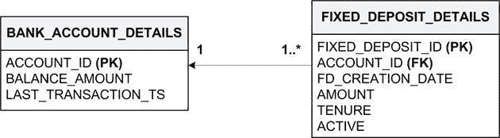

图 7-1 MyBank 应用程序使用的数据库表

`BANK_ACCOUNT_DETAILS` 表包含银行账户信息，`FIXED_DEPOSIT_DETAILS` 表包含定期存款信息。上面的图显示了 `FIXED_DEPOSIT_DETAILS` 表与 `BANK_ACCOUNT_DETAILS` 表之间存在多对一的关系。当银行客户开启新的定期存款时，定期存款金额将从 `BANK_ACCOUNT_DETAILS` 表的 `BALANCE_AMOUNT` 列中扣除，定期存款详情保存在 `FIXED_DEPOSIT_DETAILS` 表中。

`BANK_ACCOUNT_DETAILS` 表的列为：

- `ACCOUNT_ID` – 账户标识符，唯一标识客户的银行账户。
- `BALANCE_AMOUNT` – 持有银行账户的当前余额。当客户请求开启定期存款时，存款金额会从此列中扣除。
- `LAST_TRANSACTION_TS` – 指定该账户最后一次交易的时间。

`FIXED_DEPOSIT_DETAILS` 表的列为：

- `FIXED_DEPOSIT_ID` – 定期存款标识符，唯一标识一份定期存款。当客户开启定期存款时，MyBank 会生成一个唯一的定期存款标识符供客户未来参考。`FIXED_DEPOSIT_ID` 列的值由 MySQL 数据库自动生成。
- `ACCOUNT_ID` – 外键，标识与定期存款关联的银行账户。每个季度，定期存款产生的利息将存入该列所标识的银行账户。
- `FD_CREATION_DATE` – 定期存款创建的日期。
- `AMOUNT` – 定期存款金额。
- `TENURE` – 定期存款期限（以月为单位）。存款期限必须大于等于 12 个月且小于或等于 60 个月。
- `ACTIVE` – 表示该定期存款当前是否处于激活状态。激活的定期存款根据存款金额产生利息。

现在让我们来看如何使用 Spring 的 JDBC 模块创建 MyBank 应用程序。

## 7-3 使用 Spring JDBC 模块开发 MyBank 应用

Spring 的 JDBC 模块通过处理打开和关闭连接、管理事务、处理异常等底层细节，简化了与数据源的交互。在本节中，我们将使用 Spring JDBC 模块开发（如上一节所述）MyBank 应用程序。为了简单起见，我们只开发构成 MyBank 应用程序部分的服务和 DAO。

导入章节 7/`ch07-bankapp-jdbc`（此项目展示了使用 Spring JDBC 模块与数据库交互的 MyBank 应用程序。要运行该应用程序，请执行该项目中 `BankApp` 类的 `main` 方法。在执行 `BankApp` 的 `main` 方法之前，请安装 MySQL 数据库并执行 `ch07-bankapp-jdbc` 项目 `sql` 文件夹下的 `spring_bank_app_db.sql` SQL 脚本。执行 `spring_bank_app_db.sql` 脚本将创建 `SPRING_BANK_APP_DB` 数据库并向其中添加 `BANK_ACCOUNT_DETAILS` 和 `FIXED_DEPOSIT_DETAILS` 表。此外，修改 `src/main/resources/META-INF/spring/database.properties` 文件以匹配你的 MySQL 安装路径。）

在 MyBank 应用程序中，你首先需要配置一个 `javax.sql.DataSource` 对象来标识 MyBank 应用程序交互的数据源，然后实现使用 Spring JDBC 模块类与数据源交互的 DAO。让我们详细查看这些步骤。

### 配置数据源

如果你使用 Spring 开发一个独立应用程序，可以在应用程序上下文 XML 文件中配置数据源。如果你正在开发企业级应用程序，可以定义一个绑定到应用服务器 JNDI 的数据源，并在应用上下文 XML 文件中获取 JNDI 绑定的数据源供应用程序使用。在 `ch07-bankapp-jdbc` 项目中，数据源是在上下文 XML 文件中配置的。

以下示例显示了如何在上下文 XML 文件中配置 MyBank 的数据源：

### 示例 7-1 – `applicationContext.xml`：数据源配置

**项目** – `ch07-bankapp-jdbc`

**路径** – `src/main/resources/META-INF/spring`


```xml
<context:property-placeholder location="classpath*:META-INF/spring/database.properties" />
<bean id="dataSource" class="org.apache.commons.dbcp.BasicDataSource" destroy-method="close">
    <property name="driverClassName" value="${database.driverClassName}" />
    <property name="url" value="${database.url}" />
    <property name="username" value="${database.username}" />
    <property name="password" value="${database.password}" />
</bean>
```

在上面的示例中，Spring context 的 `<property-placeholder>` 元素（参考第 5 章第 4 节）从`META-INF/spring/database.properties`文件加载属性，并使其应用于上下文 XML 文件中的 bean 定义。`dataSource` bean 代表`javax.sql.DataSource`对象，作为创建数据源连接的工厂。`BasicDataSource`类是`javax.sql.DataSource`接口的实现，支持连接池功能。`BasicDataSource`是 Apache Commons DBCP 项目（[`commons.apache.org/dbcp/`](http://commons.apache.org/dbcp/)）并支持数据库连接池功能。`BasicDataSource`类`driverClassName`、`url`、`username`和`password`属性值来自`database.properties`文件定义的属性。`BasicDataSource`类的`close`方法关闭池中的所有空闲连接。由于`BasicDataSource`类的 bean 定义指定`destroy-method`属性为`close`，当 Spring 容器销毁`dataSource` bean 实例时，池中的所有空闲连接都会被关闭。

## 在 Java EE 环境中配置数据源

如果你正在开发部署在应用服务器上的企业应用程序，可以使用 Spring jee 架构的`<jndi-lookup>`元素将 JNDI 绑定的数据源作为 Spring bean 并在`ApplicationContext`中：

```xml
<jee:jndi-lookup jndi-name="java:comp/env/jdbc/bankAppDb" id="dataSource" />
```

在这里，`jndi-name`属性指定了`javax.sql.DataSource`对象绑定到 JNDI 的 JNDI 名称，`id`属性指定了`javax.sql.DataSource`对象在`ApplicationContext`中注册为 bean 的名称。

现在让我们来看下 Spring JDBC 模块中的一些类，你可以在 DAO 中使用这些类来与数据库进行交互。

### 创建使用 Spring JDBC 模块类的 DAOs

Spring 的 JDBC 模块定义了多个简化数据库交互的类。我们将首先查看 Spring JDBC 模块核心的`JdbcTemplate`类。在本节中我们还将讨论的其他类是`NamedParameterJdbcTemplate`和`SimpleJdbcInsert`。要了解更多 Spring JDBC 模块的类，请参考 Spring 的参考文档。

### `JdbcTemplate`

`JdbcTemplate`类负责管理`Connection`、`Statement`和`ResultSet`对象，捕获 JDBC 异常并将其转换为易于理解的异常（例如`IncorrectResultSetColumnCountException`和`CannotGetJdbcConnectionException`），执行批量操作等。应用程序开发人员只需要向`JdbcTemplate`类提供 SQL，并在 SQL 执行后提取结果即可。

由于`JdbcTemplate`是`javax.sql.DataSource`对象的包装器，你不需要直接处理`javax.sql.DataSource`对象。`JdbcTemplate`实例通常使用引用其需要获取连接的`javax.sql.DataSource`对象来初始化，如下面的示例列表所示：

**示例列表 7-2** – `applicationContext.xml` – `JdbcTemplate`配置

**Project** – `ch07-bankapp-jdbc`

**Source location** - `src/main/resources/META-INF/spring`

```xml
<bean id="jdbcTemplate" class="org.springframework.jdbc.core.JdbcTemplate">
    <property name="dataSource" ref="dataSource" />
</bean>
<bean id="dataSource" class="org.apache.commons.dbcp.BasicDataSource".....>
    .....
</bean>
```

上面的示例列表显示`JdbcTemplate`类定义了一个`dataSource`属性，它引用了一个`javax.sql.DataSource`对象。

如果你的应用程序使用 JNDI 绑定的数据源，使用 jee schema 的`<jndi-lookup>`元素将 JNDI 绑定的数据源注册为 Spring 容器中的 bean。现在，`JdbcTemplate`类可以引用由`<jndi-lookup>`元素注册的`javax.sql.DataSource` bean，如下面的示例列表所示：

**示例列表 7-3** – 为 JNDI 绑定数据源的`JdbcTemplate`配置

```xml
<beans .....
      xmlns:jee="http://www.springframework.org/schema/jee"
      xsi:schemaLocation=".....
                  http://www.springframework.org/schema/jee
                  http://www.springframework.org/schema/jee/spring-jee-4.0.xsd">
    <bean id="jdbcTemplate" class="org.springframework.jdbc.core.JdbcTemplate">
        <property name="dataSource" ref="dataSource" />
    </bean>
    <jee:jndi-lookup jndi-name="java:comp/env/jdbc/bankAppDb" id="dataSource" />
    .....
</beans>
```

在上面的示例列表中，对 Spring jee schema 的引用包含在应用上下文 XML 文件中。`<jndi-lookup>`元素从 JNDI 获取`javax.sql.DataSource`对象并将其暴露为名为`dataSource`的 bean，该 bean 被`JdbcTemplate`类引用。

`JdbcTemplate`实例是线程安全的，这意味着应用程序的多个 DAO 可以共享同一个`JdbcTemplate`类实例来与数据库交互。接下来的示例列表了`FixedDepositDaoImpl`的`createFixedDeposit`方法，该方法利用`JdbcTemplate`在数据库中保存定期存款详情：

**示例列表 7-4** – `FixedDepositDaoImpl`类 – 使用`JdbcTemplate`保存数据

**Project** – `ch07-bankapp-jdbc`

**Source location** - `src/main/java/sample/spring/chapter07/bankapp/dao`

```java
package sample.spring.chapter07.bankapp.dao;

import java.sql.*;
import org.springframework.jdbc.core.JdbcTemplate;
import org.springframework.jdbc.core.PreparedStatementCreator;
import org.springframework.jdbc.support.GeneratedKeyHolder;
import org.springframework.jdbc.support.KeyHolder;
import org.springframework.stereotype.Repository;

@Repository(value = "FixedDepositDao")
public class FixedDepositDaoImpl implements FixedDepositDao {

    @Autowired
    private JdbcTemplate jdbcTemplate;

    .....

    public int createFixedDeposit(final FixedDepositDetails fixedDepositDetails) {
        final String sql = "insert into fixed_deposit_details(account_id, fixed_deposit_date, amount, tenure) values (?, ?, ?, ?)";
        KeyHolder keyHolder = new GeneratedKeyHolder();
        jdbcTemplate.update(new PreparedStatementCreator() {
            @Override
            public PreparedStatement createPreparedStatement(Connection con) throws SQLException {
                PreparedStatement ps = con.prepareStatement(sql, new String[] { "fixed_id" });
                ps.setInt(1, fixedDepositDetails.getAccountId());
                ps.setDate(2, new java.sql.Date(fixedDepositDetails.getCreationDate().getTime()));
                ps.setDouble(3, fixedDepositDetails.getAmount());
                ps.setInt(4, fixedDepositDetails.getTenure());
                return ps;
            }
        }, keyHolder);
        return keyHolder.getKey().intValue();
    }
    .....
}
```

在上面的示例列表中，`FixedDepositDaoImpl`使用了`@Repository`注解，因为`FixedDepositDaoImpl`类代表一个 DAO。我们在应用上下配置（参考示例 7-2）的`JdbcTemplate`实例注入到了`FixedDepositDaoImpl`类中。`JdbcTemplate`的`update`方法接收`PreparedStatementCreator`实例和`KeyHolder`实例。`PreparedStatementCreator`用于对数据库执行插入、更新或删除操作。Spring 的`KeyHolder`接口表示执行插入语句时自动生成的键。`GeneratedKeyHolder`类是`KeyHolder`的默认实现。

一旦`INSERT` SQL 语句成功执行，生成的键就会添加到`GeneratedKeyHolder`实例中。通过调用`getKey`方法从`GeneratedKeyHolder`中提取生成的键。在示例 7-4 中，`createFixedDeposit`方法将定期存款详情插入`FIXED_DEPOSIT_DETAILS`表并返回生成的键。示例 7-4 显示你不需要担心捕获执行`PreparedStatement`可能抛出的`SQLException`。这是因为`JdbcTemplate`负责捕获并处理`SQLException`。

如示例 7-4 所示，如果你使用`JdbcTemplate`类进行数据库交互，传递给 SQL 语句的参数使用`?`占位符。Spring 的`NamedParameterJdbcTemplate`是`JdbcTemplate`实例的包装器，允许你在 SQL 语句中使用命名参数而不是`?`。

下面的示例列表显示了如何在应用上下文 XML 文件中配置`NamedParameterJdbcTemplate`类：

**示例列表 7-5** – `applicationContext.xml` – `NamedParameterJdbcTemplate`配置

**Project** – `ch07-bankapp-jdbc`

```xml
<bean id="namedJdbcTemplate" class="org.springframework.jdbc.core.namedparam.NamedParameterJdbcTemplate">
    <constructor-arg index="0" ref="dataSource" />
</bean>
```

上面的示例列表显示`NamedParameterJdbcTemplate`类接受`javax.sql.DataSource`对象作为构造函数参数。

接下来的示例列表显示了`FixedDepositDaoImpl`类，它使用`NamedParameterJdbcTemplate`从`FIXED_DEPOSIT_DETAILS`表中获取固定存款详情：

**示例列表 7-6** – `FixedDepositDaoImpl`类 – `NamedParameterJdbcTemplate`的用法

**项目** – `ch07-bankapp-jdbc`

**源码位置** - `src/main/java/sample/spring/chapter07/bankapp/dao`


```java
package sample.spring.chapter07.bankapp.dao;

import java.sql.ResultSet;
import org.springframework.jdbc.core.RowMapper;
import org.springframework.jdbc.core.namedparam.MapSqlParameterSource;
import org.springframework.jdbc.core.namedparam.NamedParameterJdbcTemplate;
import org.springframework.jdbc.core.namedparam.SqlParameterSource;

.....

@Repository(value = "FixedDepositDao")
public class FixedDepositDaoImpl implements FixedDepositDao {
    .....
    @Autowired
    private NamedParameterJdbcTemplate namedParameterJdbcTemplate;
    .....
    public FixedDepositDetails getFixedDeposit(final int FixedDepositId) {
        final String sql = "select * from fixed_deposit_details where fixed_deposit_id = :FixedDepositId";
        SqlParameterSource namedParameters = new MapSqlParameterSource(
            "FixedDepositId", FixedDepositId);
        return namedParameterJdbcTemplate.queryForObject(sql, namedParameters,
            new RowMapper<FixedDepositDetails>() {
                public FixedDepositDetails mapRow(ResultSet rs, int rowNum) throws SQLException {
                    FixedDepositDetails fixedDepositDetails = new FixedDepositDetails();
                    fixedDepositDetails.setActive(rs.getString("active"));
                    .....
                    return fixedDepositDetails;
                }
            });
    }
}
```

我们在应用上下文 XML 文件中配置的 `NamedParameterJdbcTemplate` 实例（参考示例列表 7-5）被自动注入到 `FixedDepositDaoImpl` 类中。在上面的示例列表中，传递给 `NamedParameterJdbcTemplate` 的 `queryForObject` 方法的 SQL 查询包含一个命名参数 `FixedDepositId`。命名参数的值通过 Spring 的 `SqlParameterSource` 接口的实现提供。`MapSqlParameterSource` 类是 `SqlParameterSource` 接口的实现，它将命名参数（及其值）存储在 `java.util.Map` 中。在上面的示例列表中，`MapSqlParameterSource` 实例持有命名参数 `FixedDepositId` 的值。`NamedParameterJdbcTemplate` 的 `queryForObject` 方法执行提供的 SQL 查询并返回单个对象。Spring 的 `RowMapper` 对象用于将每条返回的行映射到对象上。在上面的示例列表中，`RowMapper` 将 `ResultSet` 中返回的行映射到 `FixedDepositDetails` 对象。

现在让我们来看 Spring 的 `SimpleJdbcInsert` 类。

### SimpleJdbcInsert

`SimpleJdbcInsert` 类利用数据库元数据来简化为表创建基础 SQL 插入语句。

接下来的示例列表显示了 `BankAccountDaoImpl` 类，它使用 `SimpleJdbcInsert` 将银行账户详情插入到 `BANK_ACCOUNT_DETAILS` 表中：

**示例列表 7-7** – `BankAccountDaoImpl` 类 – `SimpleJdbcInsert` 的用法

**项目** – `ch07-bankapp-jdbc`

**源码位置** – `src/main/java/sample/spring/chapter07/bankapp/dao`

```java
package sample.spring.chapter07.bankapp.dao;

import javax.sql.DataSource;
import org.springframework.jdbc.core.simple.SimpleJdbcInsert;

.....

@Repository(value = "bankAccountDao")
public class BankAccountDaoImpl implements BankAccountDao {
    private SimpleJdbcInsert insertBankAccountDetail;
    @Autowired
    private void setDataSource(DataSource dataSource) {
        this.insertBankAccountDetail = new SimpleJdbcInsert(dataSource)
            .withTableName("bank_account_details")
            .usingGeneratedColumns("account_id");
    }
    @Override
    public int createBankAccount(final BankAccountDetails bankAccountDetails) {
        Map<String, Object> parameters = new HashMap<String, Object>();
        parameters.put("balance_amount", bankAccountDetails.getBalanceAmount());
        parameters.put("last_transaction_ts", new java.sql.Date(
            bankAccountDetails.getLastTimestamp().getTime()));
        Number key = insertBankAccountDetail.executeAndReturnKey(parameters);
        return key.intValue();
    }
.....
```

由于 `setDataSource` 方法被标记了 `@Autowired`，`javax.sql.DataSource` 对象作为参数传递给 `setDataSource` 方法。在 `setDataSource` 方法中，通过向 `SimpleJdbcInsert` 构造函数传递 `javax.sql.DataSource` 对象的引用创建一个 `SimpleJdbcInsert` 实例。`SimpleJdbcInsert` 的 `withTableName` 方法设置要插入表的名称。由于我们要将银行账户详情插入 `BANK_ACCOUNT_DETAILS` 表，因此将字符串值 `bank_account_details` 作为参数传递给 `withTableName` 方法。`SimpleJdbcInsert` 的 `usingGeneratedColumns` 方法设置包含自动生成键的列名。对于 `BANK_ACCOUNT_DETAILS` 表，`ACCOUNT_ID` 包含自动生成键；因此将字符串值 `account_id` 传递给 `usingGeneratedColumns` 方法。实际的插入操作通过调用 `SimpleJdbcInsert` 的 `executeAndReturnKey` 方法执行。`executeAndReturnKey` 方法接受 `java.util.Map` 参数，该参数包含表列名及其对应的值，并返回生成的键。你应该注意，`SimpleJdbcInsert` 类内部使用 `JdbcTemplate` 来执行实际的插入操作。

如果你查看 `ch07-bankapp-jdbc` 项目中的 `BankAccountDaoImpl` 类，你会注意到它同时使用了 `SimpleJdbcInsert` 和 `JdbcTemplate` 类与数据库交互。同样，`ch07-bankapp-jdbc` 项目中的 `FixedDepositDaoImpl` 类也使用了 `JdbcTemplate` 和 `NamedParameterJdbcTemplate` 类进行数据库交互。这表明你可以组合使用 Spring JDBC 模块类来与数据库交互。

**注意**：由于 `ch07-bankapp-jdbc` 项目使用了 Spring 的 JDBC 模块并使用了 Spring 的事务管理功能（在第 7-5 节解释），`ch07-bankapp-jdbc` 项目的 `pom.xml` 文件依赖于 `spring-jdbc` 和 `spring-tx` 包。

现在让我们来看 `ch07-bankapp-jdbc` 项目中的 `BankApp` 类，它创建一个银行账户并开设相应的固定存款。

### BankApp 类

`ch07-bankapp-jdbc` 项目的 `BankApp` 类作为一个独立的 Java 运行 `MyBank` 程序。`BankApp` 的 `main` 方法在 `BANK_ACCOUNT_DETAILS` 表中创建一个银行账户，并在 `FIXED_DEPOSIT_DETAILS` 表中创建一个对应于该新银行账户的固定存款。

接下来的示例列表显示了 `BankApp` 类：

**示例列表 7-8** – `BankApp` 类

**项目** – `ch07-bankapp-jdbc`

**源码位置** – `src/main/java/sample/spring/chapter07/bankapp`

```java
package sample.spring.chapter07.bankapp;

.....

public class BankApp {
    private static Logger logger = Logger.getLogger(BankApp.class);
    public static void main(String[] args[]) throws Exception {
        ApplicationContext context = new ClassPathXmlApplicationContext(
            "classpath:META-INF/spring/applicationContext.xml");
        BankAccountService bankAccountService = context.getBean(BankAccountService.class);
        BankAccountDetails bankAccountDetails = new BankAccountDetails();
        .....
        int bankAccountId = bankAccountService.createBankAccount(bankAccountDetails);
        .....                FixedDepositService FixedDepositService = context.getBean(FixedDepositService.class);
    }
}
```

```java
FixedDepositDetails fixedDepositDetails = new FixedDepositDetails();

.....

int FixedDepositId = FixedDepositService.createFixedDeposit(fixedDepositDetails);

.....

}

}
```

在上面的示例列表中，`BankAccountService` 对象与 `BankAccountDaoImpl`（参见示例列表 7-7）交互以创建银行账户，而 `FixedDepositService` 对象与 `FixedDepositDaoImpl` 对象（参见示例列表 7-4 和 7-6）交互，以对应新创建的银行账户开设相应的定期存款。如果你执行 `BankApp` 的 `main` 方法，你将发现 `BANK_ACCOUNT_DETAILS` 和 `FIXED_DEPOSIT_DETAILS` 表中都插入了一条新记录。

在本节中，我们查看了 Spring 的 JDBC 模块如何简化从数据库中更新或获取数据。Spring 的 JDBC 模块还可以用于以下目的：

- 执行存储过程和函数。例如，你可以使用 Spring 的 `SimpleJdbcCall` 类来执行存储过程和函数。
- 批量执行预编译语句。
- 以面向对象的方式访问关系型数据库。例如，你可以扩展 Spring 的 `MappingSqlQuery` 类来创建一个 SQL 查询，并将返回的 `ResultSet` 映射到领域对象。
- 配置嵌入式数据库实例。例如，你可以使用 Spring 的 `schema` 来创建 `HSQL`、`H2` 或 `Derby` 数据库实例，并将数据库实例作为类型 `javax.sql.DataSource` 的 bean 注册到 Spring 容器中。

现在让我们看看如何利用 Spring 对 Hibernate ORM 框架的支持与数据库交互。

## 7-4 使用 Hibernate 开发 MyBank 应用程序

Spring 的 ORM 模块提供了与 Hibernate、Java Persistence API（JPA）、MyBatis 和 Java Data Objects（JDO）的集成。在本节中，我们将看到 Spring 如何简化使用 Hibernate 框架进行数据库交互。由于 Hibernate 本身是一个 JPA 提供者，我们将使用 JPA 注解将我们的持久实体类映射到数据库表。

**导入章节 7/ch07-bankapp-hibernate**（此项目展示了使用 Hibernate 与数据库交互的 MyBank 应用程序。要运行应用程序，请执行该项目中 `BankApp` 类的 `main` 方法。）

让我们先看看如何配置 Hibernate 的 `SessionFactory` 实例。

### 配置 SessionFactory 实例

`SessionFactory` 是用于创建 Hibernate `Session` 对象的工厂。DAO 使用该 `Session` 对象对持久化实体执行创建、读取、删除和更新操作。Spring 的 `org.springframework.orm.hibernate4.LocalSessionFactoryBean`（一个 `FactoryBean` 实现类）会创建一个 `SessionFactory` 实例，DAO 类可以使用它来获取 `Session` 实例。

**注意**：如果你想在应用程序的 DAO 中使用 JPA 的 `EntityManager` 进行数据库交互，请配置 Spring 的 `LocalContainerEntityManagerFactoryBean`，而不是 `org.springframework.orm.hibernate4.LocalSessionFactoryBean`。

下面的示例列表显示了如何在应用程序上下文 XML 文件中配置 `LocalSessionFactoryBean` 类：

**示例 7-9** – `applicationContext.xml` – `LocalSessionFactoryBean` 配置

**项目** – `ch07-bankapp-hibernate`

**源位置** – `src/main/java/sample/spring/chapter07/bankapp`

```xml
<bean id="sessionFactory"
    class=" org.springframework.orm.hibernate4.LocalSessionFactoryBean">
    <property name="dataSource" ref="dataSource" />
    <property name="packagesToScan" value="sample.spring" />
</bean>
```


`dataSource` 属性指定了类型为 `javax.sql.DataSource` 的 bean 引用。`packagesToScan` 属性指定了 Spring 查找持久化类的包。例如，上面的示例指定了如果持久化类被标记了 JPA 的 `@Entity` 注解，并且位于 `sample.spring` 包（或其子包）中，它会被 `org.springframework.orm.hibernate4.LocalSessionFactoryBean` 自动检测。使用 `packagesToScan` 属性的替代方案是使用 `annotatedClasses` 属性显式指定所有持久化类，如下示例所示：

**示例 7-10** `LocalSessionFactoryBean` 的 `annotatedClasses` 属性

```xml
<bean id="sessionFactory"
    class="org.springframework.orm.hibernate4.LocalSessionFactoryBean">
    <property name="dataSource" ref="dataSource" />
    <property name="annotatedClasses">
        <list>
            <value>sample.spring.chapter07.bankapp.domain.BankAccountDetails</value>
            <value>sample.spring.chapter07.bankapp.domain.FixedDepositDetails</value>
        </list>
    </property>
</bean>
```

在上面的示例列表中，`annotatedClasses` 属性（类型为 `java.util.List`）列出了所有的持久化类。

**注意** 如果你使用的是 Hibernate 3，请使用 `org.springframework.orm.hibernate3.annotation.SessionFactoryBean` 而不是 `org.springframework.orm.hibernate4.LocalSessionFactoryBean`。

既然我们已经配置了 `SessionFactory`，现在来看看使用 `SessionFactory` 的 DAO。

### 使用 Hibernate API 创建 DAO

为了与数据库交互，DAO 需要访问 Hibernate 的 `Session` 对象。为了访问 `Session` 对象，将由 `LocalSessionFactoryBean` 创建的 `SessionFactory` 实例（参见示例 7-9）注入 DAO 中，并使用注入的 `SessionFactory` 实例来获取 `Session` 实例。

下面的示例列表显示了使用 Hibernate API 保存和检索 `FixedDepositDetails` 的 `FixedDepositDaoImpl` 类：

**示例 7-11** – `FixedDepositDaoImpl` 类 - Hibernate API 使用

**项目** – `ch07-bankapp-hibernate`

**源位置** - `src/main/java/sample/spring/chapter07/bankapp`

```java
package sample.spring.chapter07.bankapp.dao;

import org.hibernate.SessionFactory;
import org.springframework.beans.factory.annotation.Autowired;
import org.springframework.stereotype.Repository;

@Repository(value = "FixedDepositDao")
public class FixedDepositDaoImpl implements FixedDepositDao {

    @Autowired
    private SessionFactory sessionFactory;

    public int createFixedDeposit(FixedDepositDetails fixedDepositDetails) {
        sessionFactory.getCurrentSession().save(fixedDepositDetails);
        return fixedDepositDetails.getFixedDepositId();
    }

    public FixedDepositDetails getFixedDeposit(final int FixedDepositId) {
        String hql = "from FixedDepositDetails as FixedDepositDetails where "
                + "FixedDepositDetails.FixedDepositId ="
                + FixedDepositId;
        return (FixedDepositDetails) sessionFactory.getCurrentSession()
                .createQuery(hql).uniqueResult();
    }
}
```

上面的示例列表显示了 `SessionFactory` 实例被注入到 `FixedDepositDaoImpl` 实例中，随后被 `createFixedDeposit` 和 `getFixedDeposit` 方法用于保存和检索 `FixedDepositDetails` 持久实体。`SessionFactory` 实例的注入表明，你只需定义由 `FactoryBean` 创建的类型并标有 `@Autowired` 注解，即可注入由 Spring `FactoryBean` 实现类创建的对象（有关 Spring 的 `FactoryBean` 接口，请参阅第三章第 9 节）。`createFixedDeposit` 和 `getFixedDeposit` 方法调用 `SessionFactory` 的 `getCurrentSession` 方法来获取 `Session` 实例。需要注意的是，调用 `getCurrentSession` 方法返回的是与*当前事务*或*当前线程*关联的 `Session` 对象。

## 7-5 使用 Spring 进行事务管理

Spring 框架支持编式和声明式事务管理。在编式事务管理中，使用 Spring 的事务管理抽象来显式地启动、结束和提交事务。在声明式事务管理中，你通过 Spring 的 `@Transactional` 注解对在事务中执行的方法进行标记。

让我们先来看 7-2 节描述的 MyBank 的事务管理需求。

## MyBank 的事务管理需求

在 7-2 节中提到，当银行客户开立定期存款时，存款金额将从 `BANK_ACCOUNT_DETAILS` 表的 `BALANCE_AMOUNT` 列中扣除，并且存款详情将保存到 `FIXED_DEPOSIT_DETAILS` 表中。

接下来的序图显示了 `FixedDepositServiceImpl` 类的 `createFixedDeposit` 方法将存款详情保存到 `FIXED_DEPOSIT_DETAILS` 表中，并从 `BANK_ACCOUNT_DETAILS` 表中相应的银行账户中扣除存款金额：

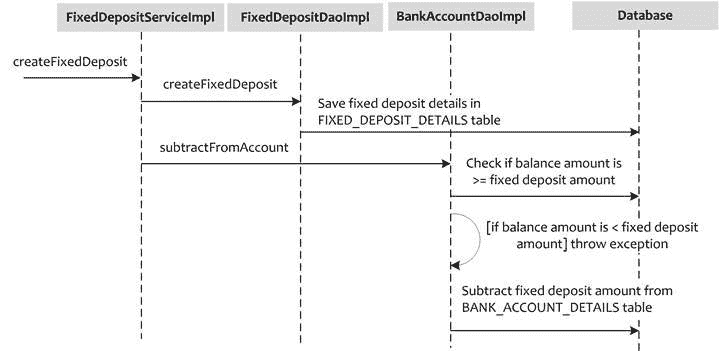

**图 7-2** 客户开立新存款时 MyBank 应用执行的操作序列

上述序图显示，`FixedDepositServiceImpl` 的 `createFixedDeposit` 方法调用了 `FixedDepositDaoImpl` 的 `createFixedDeposit` 方法以及 `BankAccountDaoImpl` 的 `subtractFromAccount` 方法。`FixedDepositDaoImpl` 的 `createFixedDeposit` 方法将存款详情保存到 `FIXED_DEPOSIT_DETAILS` 表中。`BankAccountDaoImpl` 的 `subtractFromAccount` 方法首先检查客户的银行账户是否有足够的余额来创建指定金额的定期存款。如果银行账户余额充足，`subtractFromAccount` 方法将从客户的银行账户中扣除存款金额。如果余额不足，`BankAccountDaoImpl` 的 `subtractFromAccount` 方法将抛出一个异常。如果 `FixedDepositDaoImpl` 的 `createFixedDeposit` 或 `BankAccountDaoImpl` 的 `subtractFromAccount` 方法由于原因失败，系统将处于不一致状态；因此，这两个方法必须在事务中执行。

现在让我们来看如何在 MyBank 应用中使用 Spring 编式地管理事务。

## 编式事务管理

你可以通过 Spring 的 `TransactionTemplate` 类或使用 Spring 的 `PlatformTransactionManager` 接口的实现来实现编式事务管理。`TransactionTemplate` 类通过处理*启动*和*提交*事务简化了事务管理。你只需要提供一个 Spring `TransactionCallback` 接口的实现，其中包含要在事务中执行的代码。

**导入第 7 章/ch07-bankapp-tx-jdbc** (此项目展示了使用 Spring 的 `TransactionTemplate` 类进行编式事务管理的 MyBank 应用。要运行该应用程序，请执行该项目 `BankApp` 类的 main 方法。请按照 ch07-bankapp-jdbcproject 的描述创建 `SPRING_BANK_APP_DB` 数据库以及 `BANK_ACCOUNT_DETAILS` 和 `FIXED_DEPOSIT_DETAILS` 表)

接下来的示例代码列表显示了如何在应用上下文 XML 文件中配置 `TransactionTemplate` 类：

**示例代码列表 7-12** – `applicationContext.xml` - `TransactionTemplate` 配置

**项目** – `ch07-bankapp-tx-jdbc`

**源位置** - `src/main/resources/META-INF/spring`

```xml
    <bean id="dataSource" class="org.apache.commons.dbcp.BasicDataSource".....>
        .....
    </bean>
    <bean id="txManager" class="org.springframework.jdbc.datasource.DataSourceTransactionManager">
        <property name="dataSource" ref="dataSource" />
    </bean>
    <bean id="transactionTemplate" class="org.springframework.transaction.support.TransactionTemplate">
        <property name="transactionManager" ref="txManager"/>
        <property name="isolationLevelName" value="ISOLATION_READ_UNCOMMITTED" />
        <property name="propagationBehaviorName" value="PROPAGATION_REQUIRED" />
    </bean>
```

`TransactionTemplate` 的 `transactionManager` 属性引用负责管理事务的 Spring `PlatformTransactionManager` 实现。

`TransactionTemplate` 的 `isolationLevelName` 属性指定了为事务管理的事务设置的隔离级别。`isolationLevelName` 属性的值引用 Spring `TransactionDefinition` 接口定义的常量。例如，`ISOLATION_READ_UNCOMMITTED` 是 `TransactionDefinition` 接口定义的一个常量，表示一个事务*未提交*的更改*可以*被其他事务读取。

`TransactionTemplate` 的 `propagationBehaviorName` 属性指定了事务的传播行为。`propagationBehaviorName` 属性的值引用 Spring `TransactionDefinition` 接口定义的常量。例如，`PROPAGATION_REQUIRED` 是 `TransactionDefinition` 接口定义的一个常量，表示：

- 如果方法*没有*在事务内被调用，事务管理器将启动一个新的事务并在新创建的事务中执行该方法

- 如果方法在事务内被调用，事务管理器将在同一个*事务中执行该方法

Spring 提供了一些内置的 `PlatformTransactionManager` 实现供选择，取决于应用程序使用的数据访问技术。例如，`DataSourceTransactionManager` 适用于使用 JDBC 的应用程序事务管理，`HibernateTransactionManager` 适用于使用 Hibernate 的场景，而 `JpaTransactionManager` 适用于 JPA。在列表 7-12 中，由于 `ch07-bankapp-tx-jdbc` 使用 JDBC，`TransactionTemplate` 的 `transactionManager` 属性引用 `DataSourceTransactionManager`。接下来的示例代码列表了使用了 `TransactionTemplate` 的 `FixedDepositServiceImpl`：

**示例代码列表 7-13** – 使用 `TransactionTemplate` 的 `FixedDepositServiceImpl`

**项目** – `ch07-bankapp-tx-jdbc`

**源位置** - `src/main/java/sample/spring/chapter07/bankapp/service`

```java
package sample.spring.chapter07.bankapp.service;

import org.springframework.transaction.TransactionStatus;
import org.springframework.transaction.support.TransactionCallback;
import org.springframework.transaction.support.TransactionTemplate;
.....

@Service(value = "FixedDepositService")
public class FixedDepositServiceImpl implements FixedDepositService {
    @Autowired
    private TransactionTemplate transactionTemplate;
    .....

    @Override
    public int createFixedDeposit(final FixedDepositDetails fixedDepositDetails) throws Exception {
        transactionTemplate.execute(new TransactionCallback<FixedDepositDetails>() {
            public FixedDepositDetails doInTransaction(TransactionStatus status) {
                try {
                    myFixedDepositDao.createFixedDeposit(fixedDepositDetails);
                    bankAccountDao.subtractFromAccount(
                        fixedDepositDetails.getBankAccountId(),
                        fixedDepositDetails.getFixedDepositAmount()
                    );
                } catch (Exception e) {
                    status.setRollbackOnly();
                }
            }
        });
    }
}
```

```java
                return fixedDepositDetails;
          }
      });
      return fixedDepositDetails.getFixedDepositId();
    }

.....
}
```


上面的示例显示了`FixedDepositServiceImpl`的`createFixedDeposit`方法（更多细节请参见图 7-2），该方法将定期存款详情保存在`FIXED_DEPOSIT_DETAILS`表中，并从`BANK_ACCOUNT_DETAILS`表中相应的银行账户中扣除定期存款金额。

你创建一个`TransactionCallback`接口的实现来定义你想在事务中执行的操作。并且，`TransactionTemplate`的`execute`方法会在事务中执行`TransactionCallback`实例中所包含的操作。`TransactionCallback`接口定义了一个`doInTransaction`方法，你通过实现该方法来提供应在事务内执行的操作。`TransactionCallback`的`doInTransaction`方法由`TransactionTemplate`的`execute`方法在事务内部调用。`doInTransaction`方法接受一个`TransactionStatus`对象，你可以用它来控制事务的结果。在示例列表 7-13 中，`TransactionCallback`的`doInTransaction`方法包含了对`FixedDepositDaoImpl`的`createFixedDeposit`方法和`BankAccountDaoImpl`的`subtractFromAccount`方法的调用，因为我们希望这两个方法都在同一个事务中执行。由于如果任何一个方法失败，我们需要回滚事务，因此在发生异常时会调用`TransactionStatus`的`setRollbackOnly`方法。如果你调用`TransactionStatus`的`setRollbackOnly`方法，`TransactionTemplate`实例将回滚事务。如果`doInTransaction`方法中包含的操作导致`java.lang.RuntimeException`，事务将自动回滚。

`TransactionCallback`实例接受一个`generic type`参数，该参数引用了`doInTransaction`方法返回的对象类型。在示例列表 7-13 中，`doInTransaction`方法返回一个`FixedDepositDetails`对象。如果你不想让`doInTransaction`方法返回任何对象，请使用实现`TransactionCallback`接口的`TransactionCallbackWithoutResult`抽象类。`TransactionCallbackWithoutResult`类允许你创建`doInTransaction`方法不返回值的`TransactionCallback`实现。

接下来的示例列表显示了`BankApp`类的`main`方法，该方法调用了`BankAccountServiceImpl`的`createBankAccount`方法来创建银行账户，并调用了`FixedDepositServiceImpl`的`createFixedDeposit`方法为新创建的银行账户创建定期存款：

**示例列表 7-14** – `BankApp`类

**项目** – `ch07-bankapp-tx-jdbc`

**源位置**- `src/main/java/sample/spring/chapter07/bankapp`

```java
package sample.spring.chapter07.bankapp;

public class BankApp {

    .....

    public static void main(String args[]) throws Exception {
        ApplicationContext context = new ClassPathXmlApplicationContext(
                "classpath:META-INF/spring/applicationContext.xml");
        BankAccountService bankAccountService = context.getBean(BankAccountService.class);
        FixedDepositService FixedDepositService = context.getBean(FixedDepositService.class);
        BankAccountDetails bankAccountDetails = new BankAccountDetails();
        bankAccountDetails.setBalanceAmount(1000);
        .....
        int bankAccountId = bankAccountService.createBankAccount(bankAccountDetails);
        FixedDepositDetails fixedDepositDetails = new FixedDepositDetails();
        fixedDepositDetails.setDepositAmount(1500);
        fixedDepositDetails.setAccountId(bankAccountId);
        .....
        int fixedDepositId = FixedDepositService.createFixedDeposit(fixedDepositDetails);
    }
}
```

上面的示例显示首先创建了一个余额为 1000 的银行账户，随后创建了 1500 的定期存款。如果你执行`BankApp`的`main`方法，你会发现定期存款已在`FIXED_DEPOSIT_DETAILS`表中，并从`BANK_ACCOUNT_DETAILS`表中扣除。

### 声明式事务管理

编程式事务管理将你的应用程序代码与 Spring 特有的类耦合。相比之下，声明式事务管理仅只需要用`@Transactional`注解方法或类。

**注意** 与其使用`@Transactional`注解进行声明式事务管理，可以使用 Spring 的 tx 元素来识别事务方法。

**导入** `ch07-bankapp-jdbc`和`ch07-bankapp-hibernate`。`ch07-bankapp-jdbc`项目展示了使用 Spring JDBC 模块进行数据库交互的 MyBank 应用（参见章节 7-3 了解更多`ch07-bankapp-jdbc`的信息）。`ch07-bankapp-hibernate`项目展示了使用 Hibernate 与数据库交互的 MyBank 应用（参见章节 7-4 了解更多`ch07-bankapp-hibernate`的信息）。

你通过 Spring tx 架构的`<annotation-driven>`元素启用声明式事务管理。下面的示例列表显示了项目中`<annotation-driven>`元素的使用：

**示例列表 7-15** – `applicationContext.xml` - `<annotation-driven>`

**项目** – `ch07-bankapp-jdbc`

**源位置**- `src/main/resources/META-INF/spring`

```xml
<beans xmlns="http://www.springframework.org/schema/beans"
       xmlns:xsi="http://www.w3.org/2001/XMLSchema-instance"
       xmlns:tx="http://www.springframework.org/schema/tx"
       xsi:schemaLocation="http://www.springframework.org/schema/beans
           http://www.springframework.org/schema/beans/spring-beans.xsd
           http://www.springframework.org/schema/tx
           http://www.springframework.org/schema/tx/spring-tx-4.0.xsd">

    .....

    <tx:annotation-driven transaction-manager="txManager" />

    <bean id="txManager"
          class="org.springframework.jdbc.datasource.DataSourceTransactionManager">
        <property name="dataSource" ref="dataSource" />
    </bean>

    .....
</beans>
```

在上面的示例列表中，引入了 Spring 的 tx 架构，以便其元素可以在应用上下文 XML 文件中可用。`<annotation-driven>`元素启用了声明式事务管理。`<annotation-driven>`元素的`transaction-manager`属性指定了用于事务管理的`PlatformTransactionManager`实现的引用。上面的示例列表显示，在`ch07-bankapp-jdbc`项目中使用`DataSourceTransactionManager`作为事务管理器。

接下来的示例列表展示了如何在使用 Hibernate ORM 进行数据访问的`ch07-bankapp-hibernate`项目中使用声明式事务管理。

## 示例列表 7-16 – `applicationContext.xml` - `<annotation-driven>`

**项目** – `ch07-bankapp-hibernate`

**源位置** - `/src/main/resources/META-INF/spring`

```xml
<beans ..... xmlns:tx="http://www.springframework.org/schema/tx"
    xsi:schemaLocation=".....http://www.springframework.org/schema/tx
         http://www.springframework.org/schema/tx/spring-tx-4.0.xsd">
    .....
    <tx:annotation-driven transaction-manager="txManager" />
    <bean id="txManager" class="org.springframework.orm.hibernate4.HibernateTransactionManager">
        <property name="sessionFactory" ref="sessionFactory"/>
    </bean>
    .....
</beans>
```

如果你将上述示例列表与 7-15 进行比较，你会发现唯一的区别在于`<annotation-driven>`元素的`transaction-manager`属性所引用的`PlatformTransactionManager`实现类。上面的示例列表显示，如果使用 Hibernate ORM 进行数据库交互，则使用`PlatformTransactionManager`的`org.springframework.orm.hibernate4.HibernateTransactionManager`实现来管理事务。

**注意** 如果你在使用 Hibernate 3，请将`transaction-manager`属性设置为`org.springframework.orm.hibernate3.HibernateTransactionManager`而不是`org.springframework.orm.hibernate4.HibernateTransactionManager`。

接下来的示例列表显示了声明式事务管理的`FixedDepositServiceImpl`类：

### 示例列表 7-17 – `FixedDepositServiceImpl`类 - `@Transactional`注解用法

**项目** – `ch07-bankapp-jdbc`

**源位置** - `/src/main/java/sample/spring/chapter07/bankapp/service`

```java
package sample.spring.chapter07.bankapp.service;

import org.springframework.transaction.annotation.Transactional;

.....

@Service(value = "FixedDepositService")
public class FixedDepositServiceImpl implements FixedDepositService {
    .....
    @Transactional
    public int createFixedDeposit(FixedDepositDetails fixedDepositDetails) throws Exception {
        bankAccountDao.subtractFromAccount(fixedDepositDetails.getBankAccountId(),
            fixedDepositDetails.getFixedDepositAmount());
        return myFixedDepositDao.createFixedDeposit(fixedDepositDetails);
    }
    .....
}
```

在上面的示例列表中，`createFixedDeposit`方法标记了`@Transactional`注解。这意味着`createFixedDeposit`方法是在事务中执行的。通过`<annotation-driven>`元素的`transaction-manager`属性指定的事务管理器（参见示例列表 7-15 和 7-16）被用于管理事务。如果在执行`createFixedDeposit`方法期间抛出了`java.lang.RuntimeException`，事务将自动回滚。

`@Transactional`注解定义了多个属性，你可以使用这些属性来配置事务管理器的行为。例如，你可以使用`rollbackFor`属性来指定导致事务回滚的异常类。由`rollbackFor`属性指定的异常类*必须*是`java.lang.Throwable`类的子类。同样，你可以使用`isolation`属性来指定事务隔离级别。

如果你的应用程序定义了多个事务管理器，你可以使用`@Transactional`注解的`value`属性来指定用于管理事务的`PlatformTransactionManager`实现的 Bean 名称。接下来的示例列表显示在应用上下文 XML 文件定义了两个事务管理器`tx1`和`tx2`。`tx1`事务管理器被`SomeServiceImpl`的`methodA`使用，`tx2`事务管理器被`SomeServiceImpl`的`methodB`使用：

## 示例列表 7-18 – `@Transactional`的`value`属性用法

**----------------------- SomeServiceImpl 类 ------------------------**

```java
@Service
public class SomeServiceImpl implements SomeService {
    .....
    @Transactional(value = "tx1")
    public int methodA() {.....}
    @Transactional(value = "tx2")
    public int methodB() {.....}
}
```

**----------------------- application context XML 文件 ------------------------**

```xml
    <tx:annotation-driven />
    <bean id="tx1" class="org.springframework.orm.hibernate4.HibernateTransactionManager">
        <property name="sessionFactory1" ref="sessionFactory1"/>
    </bean>
    <bean id="tx2" class="org.springframework.jdbc.datasource.DataSourceTransactionManager">
        <property name="dataSource" ref="dataSource" />
    </bean>
```


在上面的示例列表中，Spring tx 架构的`<annotation-driven>`元素没有指定`transaction-manager`属性，因为用于管理事务的事务管理器是由`@Transactional`注解本身指定的。在示例中，`@Transactional`注解的`value`属性指定了管理事务的事务管理器。这意味着`SomeServiceImpl`的`methodA`在`tx1`事务管理器下执行，而`SomeServiceImpl`的`methodB`在`tx2`事务管理器下执行。

现在让我们看看 Spring 对 JTA（Java Transaction API）事务的支持。

## Spring 对 JTA 的支持

在第 1 章中，我们讨论了当事务涉及多个事务资源时，使用 JTA 进行事务管理。Spring 提供了一个通用的`JtaTransactionManager`类（一个`PlatformTransactionManager`实现），你可以在应用程序中使用它管理 JTA 事务。


**图 7-3** JTA 事务管理器和特定资源事务管理器实现了`PlatformTransactionManager`

在大多数应用服务器环境中，`JtaTransactionManager`都能满足你的需求。但 Spring 还提供了特定厂商的`PlatformTransactionManager`实现，利用应用服务器的功能管理 JTA 事务。Spring 提供的特定厂商 JTA 事务管理器包括：`OCJJtaTransactionManager`用于 Oracle OC4J，`WebLogicJtaTransactionManager`用于 WebLogic 应用服务器，`WebSphereUowTransactionManager`用于 WebSphere 应用服务器。图 7-3 总结了 JTA 事务管理器和特定资源事务管理器与`PlatformTransactionManager`的关系。该图显示`PlatformTransactionManager`被 JTA 事务管理器类和特定资源事务管理器类实现。

现在来看看 Spring 如何简化 XML 中配置 JTA 事务管理器。

## 使用`<jta-transaction-manager>`元素配置 JTA 事务管理器

Spring tx 架构提供了`<jta-transaction-manager>`元素，它可以自动检测部署应用程序的应用服务器并配置相应的 JTA 事务管理器。这避免了在 XML 文件中显式配置特定应用服务器事务管理器的工作。例如，如果你在 WebSphere 应用服务器中部署应用程序，`<jta-transaction-manager>`元素将配置`WebSphereUowTransactionManager`实例。如果相同的应用程序部署在 WebLogic 应用服务器中，该元素将配置`WebLogicJtaTransactionManager`实例。如果部署在 OC4J、WebSphere 或 WebLogic 之外的任何应用服务器中，该元素将配置`JtaTransactionManager`实例。

## 7-6 总结

在本章中，我们看到了 Spring 支持使用 JDBC 和 Hibernate ORM 框架进行数据库交互。我们还学习了如何使用 Spring 以编程式和声明式的方式管理事务。在下一章中，我们将研究 Spring 如何简化发送电子邮件、与消息中间件交互以及对数据进行透明缓存。

# 第 8 章 - 使用 Spring 进行消息、电子邮件、异步方法执行和缓存

## 8-1 引言

在上一章中，我们看到 Spring 如何简化数据库交互。在 MyBank 应用的背景下，本章更进了一步，展示了 Spring 如何简化：

- 从 JMS 供给者（如 ActiveMQ）发送和接收 JMS 消息
- 发送电子邮件
- 异步执行方法
- 从缓存中存储和检索数据

让我们先来看看本章中将实现的 MyBank 应用需求。

## 8-2 MyBank 应用需求

MyBank 应用允许客户办理定期存款并查询其现有定期存款的详情。图 8-1 显示当客户请求开启新的定期存款时发生的事件序列。

首先，调用`FixedDepositService`的`createFixedDeposit`方法，该方法会发送 2 条 JMS 消息——一条包含客户电子邮件 ID 的消息，以及一条包含定期存款详情的消息。`EmailMessageListener`获取包含客户电子邮件 ID 的 JMS 消息，并向客户发送电子邮件，通知其已收到开启定期存款的请求。`FixedDepositMessageListener`获取包含定期存款详情的 JMS 消息，并将定期存款详情保存到数据库。

一个定时任务每 5 秒运行一次，检查数据库中是否创建了任何新的定期存款。如果任务发现了任何新的定期存款，它将从客户的银行账户中扣除存款金额，并向客户发送电子邮件通知定期存款请求已成功处理。

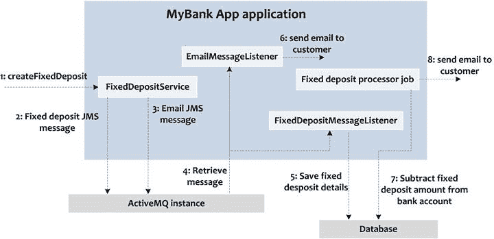

**图 8-1** 客户请求开启新定期存款时 MyBank 应用的行为

下图显示了当调用`FixedDepositService`的`findFixedDepositsByBankAccount`方法检索对应银行账户的所有定期存款时，MyBank 应用的行为：

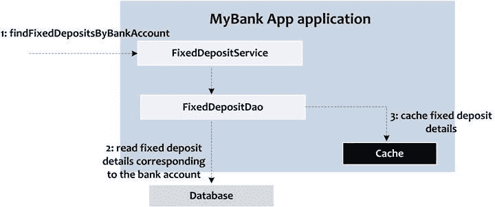

**图 8-2** 客户请求所有定期存款详情时 MyBank 应用的行为

上图显示，当调用`FixedDepositService`的`findFixedDepositsByBankAccount`方法时，定期存款信息从数据库获取并缓存到内存中。如果你再次调用`FixedDepositService`的`findFixedDepositsByBankAccount`，定期存款信息将从缓存而非数据库中获取。

现在让我们来看看如何在 MyBank 应用中使用 Spring 向在 ActiveMQ 中配置的 JMS 目标发送 JMS 消息。

**导入** `chapter 8/ch08-bankapp`（为了充分利用本章，请安装 MySQL 数据库并执行`ch08-bankapp`项目 sql 文件夹中的`spring_bank_app_db.sql`SQL 脚本。执行`spring_bank_app_db.sql`脚本将创建`SPRING_BANK_APP_DB`数据库，并在其中添加`BANK_ACCOUNT_DETAILS`和`FIXED_DEPOSIT_DETAILS`表。修改`src/main/resources/META-INF/spring/database.properties`以指向你的 MySQL 安装路径。要使电子邮件功能生效，请修改`src/main/resources/META-INF/spring/email.properties`指定指定的服务器和用于发送邮件的账户。修改`BankApp`类以指定接收邮件的客户电子邮件 ID）

## 8-3 发送 JMS 消息

Spring 通过在 JMS API 之上提供抽象层，简化了与 JMS 供给者的交互。在 MyBank 应用的背景下，本节展示了如何使用 Spring *同步*和*异步*地从 ActiveMQ 代理发送和接收消息。为了简单起见，`ch08-bankappproject`中的 ActiveMQ 代理被配置为*嵌入*模式运行。

**注意** 在 Spring 中，JMS 支持类定义在`spring-jms`JAR 包中；因此，你必须定义应用程序依赖`spring-jms`JAR 包以使用 Spring 对 JMS 的支持。

### 配置 ActiveMQ 代理以嵌入模式运行

嵌入式 ActiveMQ 代理在与应用程序*相同的*JVM 中。你可以使用 ActiveMQ 的 XML 架构在 Spring 应用中配置嵌入式 ActiveMQ 代理。以下示例列表显示了如何使用 ActiveMQ 的 XML 架构在 MyBank 应用中配置嵌入式 ActiveMQ 代理：

**示例列表 8-1** – `applicationContext.xml` – 嵌入式 ActiveMQ 代理配置

**项目** – `ch08-bankapp`

**源位置** – `src/main/resources/META-INF/spring`

```xml
<beans .....
    xmlns:amq="http://activemq.apache.org/schema/core"
    xsi:schemaLocation=".....http://activemq.apache.org/schema/core
        http://activemq.apache.org/schema/core/activemq-core-5.7.0.xsd.....">
    <amq:broker>
        <amq:transportConnectors>
            <amq:transportConnector uri="tcp://localhost:61616" />
        </amq:transportConnectors>
    </amq:broker>
    .....
</beans>
```

在上面的示例列表中，`amq`命名空间引用 ActiveMQ 的 XML 架构（`activemq-core-5.7.0.xsd`），它允许你配置嵌入式 ActiveMQ 代理。`<broker>`元素配置了一个名为`localhost`的嵌入式 ActiveMQ 代理。`<transportConnectors>`元素指定了嵌入式 ActiveMQ 客户端连接的传输连接器。在上面的示例列表中，`<transportConnector>`子元素指定了客户端可以通过 TCP 端口 61616 连接到嵌入式 ActiveMQ。

现在让我们看看如何配置 JMSFactory。

### 配置 JMSFactory

以下示例列表显示了如何在应用上下配置 JMSFactory：

**示例列表 8-2** – `applicationContext.xml` – JMSFactory 配置

**项目** – `ch08-bankapp`

**源位置** – `src/main/resources/META-INF/spring`

```xml
<beans .....
    xmlns:amq="http://activemq.apache.org/schema/core"
    xsi:schemaLocation=".....http://activemq.apache.org/schema/core
        http://activemq.apache.org/schema/core/activemq-core-5.7.0.xsd.....">
    .....
    <amq:connectionFactory brokerURL="vm://localhost" id="jmsFactory" />
    <bean class="org.springframework.jms.connection.CachingConnectionFactory" id="cachingConnectionFactory">
        <property name="targetConnectionFactory" ref="jmsFactory" />
    </bean>
    .....
</beans>
```

在上面的示例列表中，`amq`架构的`<connectionFactory>`元素创建一个用于连接嵌入式 ActiveMQ 实例的 JMSFactory 实例（参考示例列表 8-1）。`brokerURL`属性指定了连接 ActiveMQ 代理的 URL。由于我们使用的是嵌入式 ActiveMQ 代理，`brokerURL`指定使用 VM 协议（由`vm://`）连接到 ActiveMQ 代理实例。

Spring 的`CachingConnectionFactory`是 JMS ConnectionFactory（通过`targetConnectionFactory`属性指定）的适配器，提供了缓存`Session`、`MessageProducer`和`MessageConsumer`实例的额外功能。

现在让我们看看如何使用 Spring 的`JmsTemplate`类发送 JMS 消息。

### 使用 JmsTemplate 发送 JMS 消息

Spring `JmsTemplate`类简化了*同步*发送和接收 JMS 消息。在本章中，我们只关注如何使用`JmsTemplate`发送 JMS 消息。类似于`TransactionTemplate`（参考第 7 章第 5 节）和`JdbcTemplate`（参考第 7 章第 3 节）类，`JmsTemplate`类提供了一个抽象层，让你无需处理底层的 JMS API。

下面的示例列表显示了如何在 MyBank 应用的应用 XML 文件中配置`JmsTemplate`类，以便向嵌入式 ActiveMQ 实例发送消息：

## 示例列表 8-3 – `applicationContext.xml` – JmsTemplate 配置

**项目** – `ch08-bankapp`

**源文件** - `/src/main/resources/META-INF/spring`

```xml
<beans .....
    xmlns:amq="http://activemq.apache.org/schema/core"
    xsi:schemaLocation=".....http://activemq.apache.org/schema/core
        http://activemq.apache.org/schema/core/activemq-core-5.7.0.xsd".....">
    .....
    <bean class="org.springframework.jms.core.JmsTemplate" id="jmsTemplate">
        <property name="connectionFactory" ref="cachingConnectionFactory" />
        <property name="defaultDestination" ref="FixedDepositDestination" />
    </bean>
    <amq:queue id="FixedDepositDestination" physicalName="aQueueDestination" />
    <amq:queue id="emailQueueDestination" physicalName="emailQueueDestination" />
    .....
</beans>
```

`JmsTemplate`的`connectionFactory`属性指定了用于与 JMS 提供者创建连接的`JMS ConnectionFactory`。`JmsTemplate`的`defaultDestination`属性指的是`JmsTemplate`发送 JMS 消息的默认 JMS 目标。在上面的示例列表中，`connectionFactory`属性引用`CachingConnectionFactory`实例（参见示例列表 8-2），而`defaultDestination`属性引用由`amq`架构的`<queue>`元素创建的 JMS 队列目标。

`amq`架构的`<queue>`元素在 ActiveMQ 中创建一个 JMS 队列目标。在示例 8-3 中，第一个`<queue>`元素在 ActiveMQ 中创建了一个名为`aQueueDestination`的 JMS 队列目标，第二个`<queue>`元素在 ActiveMQ 中创建了一个名为`emailQueueDestination`的 JMS 队列目标。`physicalName`属性指的是在 ActiveMQ 中创建 JMS 队列目标时的名称，而`id`属性指的是 Spring 容器中的其他 bean 访问 JMS 队列目标的名称。在示例列表 8-3 中，`JmsTemplate`的`defaultDestination`属性引用创建`aQueueDestination`JMS 目的的`<queue>`元素的`id`属性；因此，`aQueueDestination`是`JmsTemplate`实例发送 JMS 消息的默认 JMS 目标。

`JmsTemplate`使用的`JMS Session`确认模式设置为`auto-acknowledge`，且本质上**不是事务的**（`not transacted`）。如果你希望`JmsTemplate`使用事务型 Session，请将`JmsTemplate`的`transacted`属性设置为`true`。在事务 Session 的情况下，当应用程序创建`Session`或者当事务提交或回滚时，将开始一个新的事务。这意味着事务型 JMS Session`始终`与事务相关联。你可以使用事务型 JMS Session 在事务内发送和接收 JMS 消息。如果你结合 Spring 的`JmsTransactionManager`使用`JmsTemplate`，则`JmsTemplate`实例将始终获得事务型 JMS Session。

现在让我们来看看如何配置`JmsTransactionManager`，以及如何通过`JmsTemplate`在事务内发送 JMS 消息。

### 在事务内发送 JMS 消息


在第 7 章中，我们看到 Spring 提供了几个 `PlatformTransactionManager` 实现，以提供特定资源的事务管理。在你的 JMS 应用中，你可以使用 Spring 的 `JmsTransactionManager` 类（`PlatformTransactionManager` 的实现）来为单个 `JMS ConnectionFactory` 管理事务。由于 `JmsTransactionManager` 实现了 `PlatformTransactionManager`，你可以使用 `TransactionTemplate` 以编程方式管理 JMS 事务，或者使用 `@Transactional` 注解来声明式地管理 JMS 事务。

下面的示例列表展示了 application context XML 文件中 Spring 的 `JmsTransactionManager` 的配置：

**示例列表 8-4** – applicationContext.xml – JmsTransactionManager 配置

**项目** – ch08-bankapp

**源文件** - `/src/main/resources/META-INF/spring`

```xml
<bean id="jmsTxManager" class="org.springframework.jms.connection.JmsTransactionManager">
    <property name="connectionFactory" ref="cachingConnectionFactory" />
</bean>
```

`JmsTransactionManager` 的 `connectionFactory` 属性指定了 `JmsTransactionManager` 管理事务的 `JMS ConnectionFactory` 引用。在上面的示例列表中，对 Spring 的 `CachingConnectionFactory` bean 的引用（参见示例列表 8-2）被指定为 `connectionFactory` 属性的值。由于 `CachingConnectionFactory` 会缓存 JMS Session，将 `CachingConnectionFactory` 与 `JmsTransactionManager` 使用会导致资源利用率降低。

如果你想使用 `TransactionTemplate` 类以编程方式管理 JMS 事务，请在 application context XML 文件中配置 `TransactionTemplate` 类。如果你想使用声明式事务管理，请使用 Spring `tx` 架构的 `<annotation-driven>` 元素。

下面的示例列表展示了 `FixedDepositServiceImpl` 类，它利用 `JmsTemplate` 向嵌入的 ActiveMQ 代理发送消息：

**示例列表 8-5** – FixedDepositServiceImpl 类 – 使用 JmsTemplate 发送 JMS 消息

**项目** – ch08-bankapp

**源文件** - `/src/main/java/sample/spring/chapter08/bankapp/service`

```java
package sample.spring.chapter08.bankapp.service;

import javax.jms.*;
import org.springframework.jms.core.JmsTemplate;
import org.springframework.jms.core.MessageCreator;

@Service(value = "FixedDepositService")
public class FixedDepositServiceImpl implements FixedDepositService {

    @Autowired
    private JmsTemplate jmsTemplate;

    .....

    @Override
    @Transactional("jmsTxManager")
    public void createFixedDeposit(final FixedDepositDetails fixedDepositDetails) throws Exception {
        jmsTemplate.send("emailQueueDestination", new MessageCreator() {
            public Message createMessage(Session session) throws JMSException {
                TextMessage textMessage = session.createTextMessage();
                textMessage.setText(fixedDepositDetails.getEmail());
                return textMessage;
            }
        });
        //这条 JMS 消息发送到 JmsTemplate 配置的默认目标
        jmsTemplate.send(new MessageCreator() {
            public Message createMessage(Session session) throws JMSException {
                ObjectMessage objectMessage = session.createObjectMessage();
                objectMessage.setObject(fixedDepositDetails);
                return objectMessage;
            }
        });
    }

    .....
}
```

在示例列表 8-5 中，`FixedDepositServiceImpl` 的 `createFixedDeposit` 方法被标记了 `@Transactional("jmsTxManager")`，这意味着 `createFixedDeposit` 方法在事务中执行，并且该事务由 `jmsTxManager` 事务管理器管理（请参阅示例列表 8-4 查看如何配置 `jmsTxManager`）。`JmsTemplate` 的 `send` 方法接收 JMS 目的地的名称（要发送 JMS 消息的目的地）和一个 `MessageCreator` 实例。如果你没有指定 JMS 目的地，`send` 方法将把 JMS 消息发送到你使用 `defaultDestination` 属性为 `JmsTemplate` 配置的 `default` 目的地（请参阅示例列表 8-3）。

在 `MessageCreator` 的 `createMessage` 方法中，你创建了想要发送的 JMS 消息。你不需要显式处理 JMS API 抛出的受检异常，因为这些异常由 `JmsTemplate` 本身处理了。示例列表 8-5 显示，如果你使用 `JmsTemplate`，你不需要显式地从 `ConnectionFactory` 获取 `Connection`、从 `Connection` 创建 `Session` 等等来发送 JMS 消息。因此，使用 `JmsTemplate` 为开发者隐藏了底层的 JMS API 细节。

在示例列表 8-5 中，`TextMessage` 和 `ObjectMessage` 实例代表 JMS 消息。`TextMessage` 和 `ObjectMessage` 类都实现了 `javax.jms.Message` 接口。在 `MyBank` 应用中，`TextMessage` 实例被用于发送请求开定的客户的电子邮件 ID（一个简单的字符串值），而 `ObjectMessage` 实例被用于发送包含存款信息的 `FixedDepositDetails` 对象（一个 `Serializable` 对象）。由于 `FixedDepositServiceImpl` 的 `createFixedDeposit` 方法在 JMS 事务中执行，因此两条消息要么都发送到 ActiveMQ 实例，要么都不发送。

与其使用 `@Transactional` 注解，你可以使用 `TransactionTemplate` 类通过编程方式管理 JMS 事务（参阅第 7 章第 7-5 节）。下面的示例列表显示了如何配置 `TransactionTemplate` 类使用 `JmsTransactionManager` 进行事务管理：

#### 示例列表 8-6 – TransactionTemplate 配置

```xml
<bean id="jmsTxManager"
    class="org.springframework.jms.connection.JmsTransactionManager">
    <property name="connectionFactory" ref="cachingConnectionFactory" />
</bean>
<bean id="transactionTemplate"
    class="org.springframework.transaction.support.TransactionTemplate">
    <property name="transactionManager" ref="jmsTxManager" />
</bean>
```

在上面的示例列表中，`TransactionTemplate` 的 `transactionManager` 属性引用了 `JmsTransactionManager` bean。

一旦你配置了 `TransactionTemplate` 类，就可以使用它来管理 JMS 事务。下面的示例列表显示了 `FixedDepositServiceImpl.createFixedDeposit` 方法的一个变体，该方法使用 `TransactionTemplate` 管理 JMS 事务：

#### 示例列表 8-7 – 使用 TransactionTemplate 编化管理 JMS 事务

```java
package sample.spring.chapter08.bankapp.service;

import javax.jms.*;

import org.springframework.jms.core.JmsTemplate;
import org.springframework.jms.core.MessageCreator;

@Service(value = "FixedDepositService")
public class FixedDepositServiceImpl implements FixedDepositService {

    @Autowired
    private JmsTemplate jmsTemplate;

    @Autowired
    private TransactionTemplate transactionTemplate;

    .....

    public void createFixedDeposit(final FixedDepositDetails fixedDepositDetails) throws Exception {
        transactionTemplate.execute(new TransactionCallbackWithoutResult() {
            protected void doInTransactionWithoutResult(TransactionStatus status) {
                jmsTemplate.send("emailQueueDestination", new MessageCreator() { ..... });
                jmsTemplate.send(new MessageCreator() { ..... });
            }
        });    
    }

    .....
}
```

上面的示例列表显示，JMS 消息是从 `TransactionCallbackWithoutResult` 类的 `doInTransaction` 方法内部发送的，因此它们处于同一个 JMS 事务中。这与我们使用 `TransactionTemplate` 编程管理 JDBC 事务（参阅第 7 章第 7-5 节）的方式相似。

到为止，我们已经看到了使用 `JmsTemplate` 将消息发送到预配置的 JMS 目的地的示例。现在让我们看看如果应用程序使用动态 JMS 目的地，应该如何配置 `JmsTemplate` 类。

### 动态 JMS 目的地和 JmsTemplate 配置

如果你的应用程序使用动态 JMS 目的地（即 JMS 目的地是由应用程序在运行时创建的），你必须指定 JMS 目的地类型（队列或主题）。`JmsTemplate` 的 `pubSubDomain` 属性用于确定目的地类型。如果你没有指定 `pubSubDomain` 属性，则假设目的地是队列。下面的示例列表显示了向以下位置发送消息的 `msTemplate`：

#### 示例列表 8-8 – 使用 JmsTemplate 处理动态目的地

**applicationContext.xml**

```xml
<bean class="org.springframework.jms.core.JmsTemplate" id="jmsTemplate">
    <property name="connectionFactory" ref="cachingConnectionFactory" />
    <property name="defaultDestination" ref="FixedDestination" />
    <property name="pubSubDomain" value="true" />
</bean>
```

**动态主题创建 --**

```java
jmsTemplate.send("dynamicTopic", new MessageCreator() {
    public Message createMessage(Session session) throws JMSException {
        session.createTopic("dynamicTopic");
        ObjectMessage objectMessage = session.createObjectMessage();
        objectMessage.setObject(someObject);
        return objectMessage;
    }
});
```

在上面的示例列表中，`JmsTemplate` 的 `pubSubDomain` 属性设置为 `true`，这意味着当使用动态目的地时，Spring 将动态目的地名称解析为主题。注意传递给 `jmsTemplate.send` 方法的 JMS 目的地名称为 `dynamicTopic`，`MessageCreator.createMessage` 方法创建了同名的 JMS 主题。由于应用程序 XML 文件没有配置 `dynamicTopic` JMS 目的地，Spring 并不知道动态 JMS 目的地是队列还是主题。由于 `JmsTemplate` 的 `pubSubDomain` 属性设置为 `true`，Spring 的 `DynamicDestinationResolver` 将 `dynamicTopic` JMS 目的地名称解析为 `MessageCreator.createMessage` 方法在运行时创建的 `dynamicTopic` JMS 主题。如果你*没有*设置 `JmsTemplate` 的 `pubSubDomain` 属性，Spring 的 `DynamicDestinationResolver` 将尝试将 `dynamicTopic` JMS 目的地名称解析为队列队列。

### JmsTemplate 和消息转换

现在让我们看看 `JmsTemplate` 如何简化将 Java 对象作为 JMS 消息发送。`JmsTemplate` 定义了多个 `convertAndSend` 方法，用于转换并发送 Java 对象作为 JMS 消息。默认情况下，`JmsTemplate` 配置了一个 `SimpleMessageConverter` 实例（Spring `MessageConverter` 接口的实现），它用于将 Java 对象转换为 JMS 消息，反之亦然。

`MessageConverter` 接口定义了以下方法：

- `Object toMessage(Object object, Session session)` – 使用提供的 `JMS Session`（由 `session` 参数表示）将 Java 对象（由 `object` 参数表示）转换为 `JMS Message`

- `Object fromMessage(Message message)` - 将 `message` 参数转换为 Java 对象

Spring 的 `SimpleMessageConverter` 类提供了 `String` 与 `JMS TextMessage`、`byte[]` 与 `JMS BytesMessage`、`Map` 与 `JMS MapMessage` 以及 `Serializable` 对象与 `JMS ObjectMessage` 之间的转换。如果你想修改由 `JmsTemplate` 的 `convertAndSend` 方法创建的 JMS Message，可以使用 `MessagePostProcessor` 的实现来实现修改。


下面的示例列表展示了使用`MessagePostProcessor`实现来修改由`JmsTemplate`的`convertAndSend`方法创建的 JMS 消息的场景：

**示例 8-9** – `JmsTemplate`的`convertAndSend`方法用法

```
jmsTemplate.convertAndSend("aDestination", "Hello, World !!",
    new MessagePostProcessor() {
        public Message postProcessMessage(Message message) throws JMSException {
            message.setBooleanProperty("printOnConsole", true);
            return message;
        }
    });
```

在上面的示例列表中，字符串 'Hello, World !!' 被传递给`convertAndSend`方法。该`convertAndSend`方法会创建一个`JMS TextMessage`实例，并让`MessagePostProcessor`实现能够在消息发送之前对消息进行任何后处理。在上面的示例列表中，`MessagePostProcessor`的`postProcessMessage`方法在消息发送到`aDestination`之前在 JMS 消息上设置了`printOnConsole`属性。

到为止，我们已经看到了如何使用`JmsTemplate`向 JMS 目标发送 JMS 消息。现在让我们来看看如何使用`JmsTemplate`和 Spring 的消息监听容器从 JMS 目标接收 JMS 消息。

## 8-4 接收 JMS 消息

你可以使用`JmsTemplate`同步地接收 JMS 消息，并使用 Spring 的消息监听容器异步地接收 JMS 消息。

### 使用 JmsTemplate 同步接收 JMS 消息

`JmsTemplate`定义了多个`receive`方法，你可以使用这些方法同步地接收 JMS 消息。需要注意的是，调用`JmsTemplate`的`receive`方法会导致调用线程阻塞，直到从 JMS 目标获取 JMS 消息。为了确保调用线程不会无限阻塞，必须为`JmsTemplate`的`receiveTimeout`属性指定一个适当的值。`receiveTimeout`属性指定了调用线程在放弃之前应该等待的时间（毫秒）。

`JmsTemplate`还定义了多个`receiveAndConvert`方法，它们会自动将接收到的 JMS 消息转换为 Java 对象。默认情况下，`JmsTemplate`使用`SimpleMessageConverter`执行转换。

### 使用消息监听容器异步接收 JMS 消息

你可以使用 Spring 的消息监听容器异步地接收 JMS 消息。消息监听容器会处理事务和资源管理方面，这样你就可以专注于编写消息处理逻辑。

消息监听容器从 JMS 目标接收消息并将其分发给`JMS MessageListener`实现进行处理。下面的示例列表展示了如何使用 Spring jms schema 中的`<listener-container>`元素配置消息监听容器：

**示例 8-10** – applicationContext.xml – 消息监听容器配置

**Project** – ch08-bankapp

**Source location** – `src/main/resources/META-INF/spring`

```xml
<beans ..... xmlns:jms="http://www.springframework.org/schema/jms"
    xsi:schemaLocation=".....
        http://www.springframework.org/schema/jms
        http://www.springframework.org/schema/jms/spring-jms-4.0.xsd">
    .....
    <jms:listener-container connection-factory="cachingConnectionFactory"
        destination-type="queue" transaction-manager="jmsTxManager">
        <jms:listener destination="aQueueDestination" ref="FixedDepositMessageListener" />
        <jms:listener destination="emailQueueDestination" ref="emailMessageListener" />
    </jms:listener-container>
    <bean class="sample.spring.chapter08.bankapp.jms.EmailMessageListener"
        id="emailMessageListener" />
    <bean class="sample.spring.chapter08.bankapp.jms.FixedDepositMessageListener"
        id="FixedDepositMessageListener" />
</beans>
```

在上面的示例列表中，包含了 Spring 的 jms schema，以便其元素可用。`<listener-container>`元素为每个`MessageListener`实现配置一个消息监听容器。`connection-factory`属性指定了消息监听容器所使用的`ConnectionFactory` bean 的引用，该 bean 用于获取连接到 JMS 提供者的连接。`destination-type`属性指定了消息监听容器关联的 JMS 目标类型。`destination-type`属性接受可能值为`queue`和`topic`。

`<listener-container>`的`transaction-manager`属性指定了一个`PlatformTransactionManager`实现，确保 JMS 消息的接收和`MessageListener`的消息处理发生在事务中。在上面的示例列表中，`transaction-manager`的值引用`JmsTransactionManager`实现。如果`MessageListener`实现与其他事务资源交互，请考虑使用 Spring 的`JtaTransactionManager`。在独立应用程序中，你可以使用嵌入式事务管理器（如`Atomikos`（http://www.atomikos.com/））来执行 JTA。

**注意** 默认情况下，`<listener-container>`元素为由`<listener>`子元素指定的每个`MessageListener`实现创建一个 Spring `DefaultMessageListenerContainer`类的实例。

每个`<listener>`元素都指定了一个`MessageListener`实现，该实现由消息监听容器异步地调用。`<listener>`元素的`destination`属性指定了`MessageListener`通过消息监听容器接收消息的 JMS 目标名称。`<listener>`元素的`ref`属性指定了负责处理从目标接收的 JMS 消息的`MessageListener`实现引用。示例 8-10 显示，`FixedDepositMessageListener`（一个`MessageListener`实现）负责处理从`aQueueDestination`目标接收的消息，而`EmailMessageListener`（一个`MessageListener`实现）负责处理从`emailQueueDestination`目标接收的消息。

`MessageListener`接口定义了一个`onMessage`方法，该方法由消息监听容器异步地调用。消息监听容器将从 JMS 目标接收到的`JMS Message`传递给`onMessage`方法。`onMessage`方法负责处理接收到的 JMS 消息。下面的示例列表展示了 MyBank 应用的`FixedDepositMessageListener`的实现，它负责从`JMS Message`中检索`FixedDepositDetails`对象，然后将`FixedDepositDetails`对象中包含的定期存款信息保存到数据库：

**示例 8-11** – `FixedDepositMessageListener`类 – 处理 JMS 消息

**Project** – ch08-bankapp

**Source location** – `src/main/java/sample/spring/chapter08/bankapp/jms`

```java
package sample.spring.chapter08.bankapp.jms;

import javax.jms.MessageListener;

import javax.jms.ObjectMessage;
```

```java
import sample.spring.chapter08.bankapp.domain.FixedDepositDetails;

.....

public class FixedDepositMessageListener implements MessageListener {

    @Autowired
    @Qualifier(value = "FixedDepositDao")
    private FixedDepositDao myFixedDepositDao;

    @Autowired
    private BankAccountDao bankAccountDao;

    @Transactional
    public int createFixedDeposit(FixedDepositDetails fixedDepositDetails) {
        bankAccountDao.subtractFromAccount(fixedDepositDetails.getBankAccountId(),
            fixedDepositDetails.getFixedDepositAmount());
        return myFixedDepositDao.createFixedDeposit(fixedDepositDetails);
    }

    @Override
    public void onMessage(Message message) {
        ObjectMessage objectMessage = (ObjectMessage) message;
        FixedDepositDetails fixedDepositDetails = null;
        try {
            fixedDepositDetails = (FixedDepositDetails) objectMessage.getObject();
        } catch (JMSException e) {
            e.printStackTrace();
        }
        if (fixedDepositDetails != null) {
            createFixedDeposit(fixedDepositDetails);
        }
    }
}
```

在上面的示例列表中，`FixedDepositMessageListener`的`onMessage`方法从 JMS 消息中获取`FixedDepositDetails`对象，并将定期存款详情存入数据库。`FixedDepositMessageListener`的`createFixedDeposit`方法负责将定期存款信息存入数据库。由于`createFixedDeposit`方法标记了`@Transactional`注解，它在`DataSourceTransactionManager`管理的事务下执行（参考`ch08-bankapp`项目的`applicationContext.xml`文件）。消息监听器容器接收 JMS 消息并在`JmsTransactionManager`管理的事务下执行`FixedDepositMessageListener`的`onMessage`方法（参考示例列表 8-10）。

由于`onMessage`和`createFixedDeposit`方法在不同的事务管理器下执行，如果 JMS 事务因某种原因失败，数据库更新将不会回滚；如果数据库更新因某种原因失败，JMS 消息将不会重新投递给`MessageListener`。如果你希望 JMS 消息的接收（及处理）与数据库更新属于同一个事务，你应该使用`JTA`事务。

在本节中，我们查看了如何使用 Spring 发送和接收 JMS 消息。现在，让我们来看看 Spring 如何简化邮件的发送。

## 8-5 发送邮件

Spring 通过在 JavaMail API 之上提供抽象层，简化了应用程序发送邮件的过程。Spring 负责资源管理和异常处理方面，这样你就可以专注于编写准备邮件消息所需的逻辑。

要使用 Spring 发送邮件，你首先需要在应用程序上下文 XML 文件中配置 Spring 的`JavaMailSenderImpl`类。`JavaMailSenderImpl`类充当 JavaMail API 的封装。下面的示例列表显示了如何在 MyBank 中配置`JavaMailSenderImpl`类：

### 示例列表 8-12 – `applicationContext.xml` – `JavaMailSenderImpl`类配置

**Project** – `ch08-bankapp`

**源位置** – `src/main/resources/META-INF/spring`

```xml
<bean id="mailSender" class="org.springframework.mail.javamail.JavaMailSenderImpl">
    <property name="host" value="${email.host}" />
    <property name="protocol" value="${email.protocol}" />
    .....
    <property name="javaMailProperties">
        <props>
            <prop key="mail.smtp.auth">true</prop>
            <prop key="mail.smtp.starttls.enable">true</prop>
        </props>
    </property>
</bean>
```

到目前为止，我们已经了解如何在应用程序上下文 XML 文件中配置`JavaMailSenderImpl`和`SimpleMailMessage`类。现在让我们来看看如何发送电子邮件消息。

下面的示例列表显示了 MyBank 应用程序的`EmailMessageListener`类（`JMS MessageListener`的实现），该类从`JMS`消息中获取客户的电子邮件地址，并向客户发送电子邮件告知其已收到定期存款的请求：

**示例列表 8-16** – `EmailMessageListener`类 – 使用`MailSender`发送邮件

**项目** – `ch08-bankapp`

**源码位置** – `src/main/java/sample/spring/chapter08/bankapp/jms`


```java
package sample.spring.chapter08.bankapp.jms;

import org.springframework.mail.MailSender;
import org.springframework.mail.SimpleMailMessage;

.....

public class EmailMessageListener implements MessageListener {

    @Autowired
    private transient MailSender mailSender;

    @Autowired
    @Qualifier("requestReceivedTemplate")
    private transient SimpleMailMessage simpleMailMessage;

    public void sendEmail() {
        mailSender.send(simpleMailMessage);
    }

    public void onMessage(Message message) {
        TextMessage textMessage = (TextMessage) message;
        try {
            simpleMailMessage.setTo(textMessage.getText());
        } catch (Exception e) {
            e.printStackTrace();
        }
        sendEmail();
    }
}
```

上面的示例列表显示，`MailSender` 的 `send` 方法发送了由 `SimpleMailMessage` 实例表示的电子邮件消息。由于 `JavaMailSenderImpl` 类实现了 Spring 的 `MailSender` 接口，`JavaMailSenderImpl` 实例（参见示例列表 8-12）被自动注入（autow）到 `EmailMessageListener` 实例中。名为 `requestReceivedTemplate` 的 `SimpleMailMessage` 实例（参见示例列表 8-14）也被自动注入到 `EmailMessageListener` 实例中。由于 `SimpleMailMessage` 的 `to` 属性标识邮件收件者，`onMessage` 方法从 `JMS` 消息中获取客户的电子邮件 ID，并将其设置为 `to` 属性的值。

Spring 的 `MailSender` 接口表示了一个独立于 JavaMail API 的通用接口，适用于发送简单的电子邮件消息。Spring 的 `JavaMailSender` 接口（`MailSender` 的子接口）依赖于 JavaMail API，并定义了发送 MIME 消息的功能。如果你想发送包含内联图片、附件等的电子邮件，则可以使用 MIME 消息。MIME 消息在 JavaMail API 中由 `MimeMessage` 类表示。Spring 提供了 `MimeMessageHelper` 类和 `MimeMessagePreparator` 回调接口，可以使用它们来创建并填充 `MimeMessage` 实例。

下面的示例列表显示了 MyBank 应用程序的 `FixedDepositProcessorJob` 类，该类从客户的银行账户中扣除定期存款金额，并向客户发送电子邮件，告知其定期存款的请求已处理。

**示例列表 8-17** – `FixedDepositProcessorJob` 类 – `JavaMailSender` 的用法

**项目** – `ch08-bankapp`

**源码位置** – `src/main/java/sample/spring/chapter08/bankapp/job`

```java
package sample.spring.chapter08.bankapp.job;

import javax.mail.internet.MimeMessage;
import org.springframework.mail.javamail.JavaMailSender;

public class FixedDepositProcessorJob {
    .....

    @Autowired
    private transient JavaMailSender mailSender;

    @Autowired
    @Qualifier("requestProcessedTemplate")
    private transient SimpleMailMessage simpleMailMessage;

    private List<FixedDepositDetails> getInactiveFixedDeposits() {
        return myFixedDepositDao.getInactiveFixedDeposits();
    }

    public void sendEmail() throws AddressException, MessagingException {
        List<FixedDepositDetails> inactiveFixedDeposits = getInactiveFixedDeposits();
        for (FixedDepositDetails fixedDeposit : inactiveFixedDeposits) {
            MimeMessage mimeMessage = mailSender.createMimeMessage();
            MimeMessageHelper mimeMessageHelper = new MimeMessageHelper(mimeMessage);
            mimeMessageHelper.setTo(fixedDeposit.getEmail());
            mimeMessageHelper.setSubject(simpleMailMessage.getSubject());
            mimeMessageHelper.setText(simpleMailMessage.getText());
            mailSender.send(mimeMessage);
        }
        myFixedDepositDao.setFixedDepositsAsActive(inactiveDeposits);
    }
}
```

上面的示例列表显示，`JavaMailSender` 的 `send` 方法被用于发送 MIME 消息。由于 `JavaMailSenderImpl` 实现 Spring 的 `JavaMailSender` 接口，`JavaMailSenderImpl` 实例（参见示例列表 8-12）被自动注入到 `FixedDepositProcessorJob` 实例中。名为 `requestProcessedTemplate` 的 `SimpleMailMessage` 实例（参见示例列表 8-14）也被自动注入到 `FixedDepositProcessorJob` 实例中。变量 `mailSender` 定义为 `JavaMailSender` 类型而不是 `MailSender`），因为 `FixedDepositProcessorJob` 创建并发送 MIME 消息。`FixedDepositProcessorJob` 的 `sendEmail` 方法使用 `JavaMailSender` 的 `createMimeMessage` 方法创建 `MimeMessage` 实例。然后使用 Spring 的 `MimeMessageHelper` 来填充 `MimeMessage` 实例。

下面的示例列表显示了如何使用 `MimeMessagePreparator` 接口代替 `MimeMessageHelper` 来编写 `FixedDepositProcessorJob` 的 `sendEmail` 方法，以填充 `to`、`subject` 和 `text` 属性。

**示例列表 8-18** – `MimeMessagePreparator` 的用法

```java
import javax.mail.Message;
import javax.mail.internet.InternetAddress;
import org.springframework.mail.javamail.MimeMessagePreparator;

// ... (省略部分代码)

    public void sendEmail() throws AddressException, MessagingException {
        List<FixedDepositDetails> inactiveFixedDeposits = getInactiveFixedDeposits();
        for (FixedDepositDetails fixedDeposit : inactiveFixedDeposits) {
            mailSender.send(new MimeMessagePreparator() {
                @Override
                public void prepare(MimeMessage mimeMessage) throws Exception {
                    mimeMessage.setRecipient(Message.RecipientType.TO, new InternetAddress(fixedDeposit.getEmail()));
                    mimeMessage.setSubject(simpleMailMessage.getSubject());
                    mimeMessage.setText(simpleMailMessage.getText());
                }
            });
        }
        myFixedDepositDao.setFixedDepositsAsActive(inactiveDeposits);
    }
}
```

上面的示例显示，`MimeMessagePreparator` 实例被传递给 `JavaMailSender` 的 `send` 方法以准备要发送的 `MimeMessage`。`MimeMessagePreparator` 的 `prepare` 方法提供了一个你需要填充的 `MimeMessage` 新实例。在上面的示例列表中，注意设置 `MimeMessage` 的 `recipient` 属性需要处理底层的 JavaMail API。在示例列表 8-17 中，`MimeMessageHelper` 的 `setTo` 方法接受接收者的电子邮件 ID 作为字符串参数来设置 `MimeMessage` 的 `recipient` 属性。因此，你应该考虑使用 `MimeMessageHelper` 来填充传递给 `prepare` 方法的 `MimeMessage`。

现在让我们来看看如何使用 Spring 异步执行任务并在未来调度任务执行。

## 8-6 任务调度和异步执行

你可以使用 Spring 的 `TaskExecutor` 异步执行 `java.lang.Runnable` 任务，并使用 Spring 的 `TaskScheduler` 调度 `java.lang.Runnable` 任务的执行。与其直接使用 `TaskExecutor` 和 `TaskScheduler`，不如使用 Spring 的 `@Async` 和 `@Scheduled` 注解来分别异步执行方法和调度方法的执行。

让我们先看看 `TaskExecutor` 和 `TaskScheduler` 接口。

### TaskExecutor 接口

Java 5 引入了用于执行 `java.lang.Runnable` 任务的 `executors` 概念。`executor` 实现了 `java.util.concurrent.Executor` 接口，该接口定义了一个方法 `execute(Runnable runnable)`。Spring 的 `TaskExecutor` 扩展了 `java.util.concurrent.Executor` 接口。Spring 还提供了几个 `TaskExecutor` 实现供根据应用程序需求选择。取决于你选择的 `TaskExecutor` 实现，`Runnable` 任务可能会同步或异步执行，并使用线程池或 CommonJ 等。Spring 提供的某些 `TaskExecutor` 实现包括：`ThreadPoolTaskExecutor`（使用线程池中的线程异步执行任务）、`SyncTaskExecutor`（同步执行任务）和 `SimpleAsyncTaskExecutor`（在新的线程中异步执行每个任务）。

`ThreadPoolTaskExecutor` 是最常用的 `TaskExecutor` 实现，它使用 Java 5 的 `ThreadPoolExecutor` 来执行任务。接下来的示例列表显示了如何在应用程序上下文 XML 文件中配置 `ThreadPoolTaskExecutor` 实例。

**示例列表 8-19** – `ThreadPoolTaskExecutor` 配置

```xml
<bean id="myTaskExecutor"
        class="org.springframework.scheduling.concurrent.ThreadPoolTaskExecutor">
    <property name="corePoolSize" value="5" />
    <property name="maxPoolSize" value="10" />
    <property name="queueCapacity" value="15" />
    <property name="rejectedExecutionHandler" ref="abortPolicy"/>
</bean>
<bean id="abortPolicy" class="java.util.concurrent.ThreadPoolExecutor.AbortPolicy"/>
```

`corePoolSize` 属性指定线程池中的最小线程数。`maxPoolSize` 属性指定线程池可以容纳的最大线程数。`queueCapacity` 属性指定当线程池中的所有线程都在忙执行任务时，在队列中等待的最大任务数。`rejectedExecutionHandler` 属性指定被 `ThreadPoolTaskExecutor` 拒绝的任务的处理器。如果队列满且线程池中没有可用线程执行已提交的任务，则任务会被 `ThreadPoolTaskExecutor` 拒绝。`rejectedExecutionHandler` 属性引用 `java.util.concurrent.RejectedExecutionHandler` 对象的实例。

在示例列表 8-19 中，`rejectedExecutionHandler` 属性引用了 `java.util.concurrent.ThreadPoolExecutor.AbortPolicy` 实例，该实例始终抛出 `RejectedExecutionException`。其他可能的被拒绝任务处理器还有：`java.util.concurrent.ThreadPoolExecutor.CallerRunsPolicy`（被拒绝的任务在调用者线程中执行）、`java.util.concurrent.ThreadPoolExecutor.DiscardOldestPolicy`（处理器丢弃队列中最旧的任务并重试执行被拒绝的任务）以及 `java.util.concurrent.ThreadPoolExecutor.DiscardPolicy`（处理器直接丢弃被拒绝的任务）。

Spring 任务架构中的 `<executor>` 元素简化了 `ThreadPoolTaskExecutor` 实例的配置，如下示例列表所示。

**示例列表 8-20** – 使用 Spring 任务架构的 `ThreadPoolTaskExecutor` 配置

```xml
<beans ... xmlns:task="http://www.springframework.org/schema/task"
        xsi:schemaLocation=".....http://www.springframework.org/schema/task
             http://www.springframework.org/schema/task/spring-task-4.0.xsd">
    <task:executor id="myTaskExecutor" pool-size="5-10"
                  queue-capacity="15" rejection-policy="ABORT"/>
</beans>
```

在上述示例列表中，`<executor>` 元素配置了一个 `ThreadPoolTaskExecutor` 实例。`pool-size` 属性指定核心池大小和最大池大小。在上述示例列表中，5 是核心池大小，10 是最大池大小。`queue-capacity` 属性设置了 `queueCapacity` 属性，`rejection-policy` 属性指定了拒绝任务的处理器。`rejection-policy` 属性的可能值为 `ABORT`、`CALLER_RUNS`、`DISCARD_OLDEST` 和 `DISCARD`。


一旦你通过显式定义 Spring bean（参考示例列表 8-19）或使用 Spring 任务架构（参考示例列表 8-20）配置了 `ThreadPoolTaskExecutor` 实例，你就可以将 `ThreadPoolTaskExecutor` 实例注入到想要异步执行 `java.lang.Runnable` 任务的 bean 中，如下示例列表所示：

**示例列表 8-21** – 使用 `ThreadPoolTaskExecutor` 执行任务

```java
import org.springframework.beans.factory.annotation.Autowired;
import org.springframework.core.task.TaskExecutor;

@Component
public class Sample {

    @Autowired
    private TaskExecutor taskExecutor;

    public void executeTask(Runnable task) {
        taskExecutor.execute(task);
    }
}
```

在上述示例列表中，`ThreadPoolTaskExecutor` 实例被自动注入到 `Sample` 类中，并随后被 `Sample` 用于执行 `java.lang.Runnable` 任务。`TaskExecutor` 在 `java.lang.Runnable` 任务提交后立即执行它，且任务只执行一次。如果你想调度 `java.lang.Runnable` 任务的执行，并希望任务定期执行，则应该使用 `TaskScheduler` 实现。

### TaskScheduler 接口

Spring 的 `TaskScheduler` 接口提供了调度 `java.lang.Runnable` 任务执行的抽象。Spring 的 `Trigger` 接口抽象了 `java.lang.Runnable` 任务执行的时间。你将 `TaskScheduler` 实例与 `Trigger` 实例关联以调度 `java.lang.Runnable` 任务的执行。如果你想定期执行任务，应该使用 `PeriodicTrigger`（`Trigger` 的一种实现）。`CronTrigger`（`Trigger` 的另一种实现）接受一个指示任务执行时间的 cron 表达式。

`ThreadPoolTaskScheduler` 是常用的 `TaskScheduler` 实现之一，它内部使用 Java 5 的 `ScheduledThreadPoolExecutor`（Java 5 `ScheduledExecutorService` 接口的实现）来调度任务执行。你可以配置 `ThreadPoolTaskScheduler` 实现并与 `Trigger` 关联以调度任务执行。接下来的示例列表显示了如何配置和使用 `ThreadPoolTaskScheduler`：

**示例列表 8-22** – `ThreadPoolTaskExecutor` 配置与使用

**ThreadPoolTaskScheduler 配置**

```xml
<bean id="myScheduler" class="org.springframework.scheduling.concurrent.ThreadPoolTaskExecutor">
    <property name="poolSize" value="5"/>
</bean>
```

**ThreadPoolTaskScheduler 使用**

```java
import org.springframework.scheduling.TaskScheduler;
import org.springframework.scheduling.support.PeriodicTrigger;

@Component
public class Sample {

    @Autowired
    @Qualifier("myScheduler")
    private TaskScheduler taskScheduler;

    public void executeTask(Runnable task) {
        taskScheduler.schedule(task, new PeriodicTrigger(5000));
    }
}
```

在上述示例列表中，`ThreadPoolTaskScheduler` 的 `poolSize` 属性指定了线程池中的线程数。为了调度任务执行，调用 `ThreadPoolTaskScheduler` 的 `schedule` 方法并传入 `java.lang.Runnable` 任务和 `Trigger` 实例。在上述示例列表中，将 `PeriodicTrigger` 实例传递给 `ThreadPoolTaskScheduler` 的 `schedule` 方法。`PeriodicTrigger` 构造参数指定了任务执行之间的时间间隔（毫秒）。

Spring 任务架构中的 `<scheduler>` 元素简化了 `ThreadPoolTaskScheduler` 实例的配置。由 `<scheduler>` 元素创建的 `ThreadPoolTaskScheduler` 实例可以被 Spring 任务架构中的 `<scheduled-tasks>` 元素用于调度 bean 方法。以下示例显示了 MyBank 应用程序如何使用 `<scheduler>` 和 `<scheduled-tasks>` 元素来每 5 秒执行一次 `FixedDepositProcessorJob` 的 `sendEmail` 方法：

**示例列表 8-23** – `<scheduler>` 和 `<scheduled-tasks>` 元素

**项目** – `ch08-bankapp`

**源码位置** - `src/main/java/sample/spring/chapter08/bankapp/job`

```xml
<task:scheduler id="emailScheduler" pool-size="10" />
<task:scheduled-tasks scheduler="emailScheduler">
    <task:scheduled ref="FixedDepositProcessorJob" method="sendEmail" fixed-rate="5000" />
</task:scheduled-tasks>
<bean id="FixedDepositProcessorJob"
    class="sample.spring.chapter08.bankapp.job.FixedDepositProcessorJob" />
```

在上述示例列表中，`<scheduler>` 元素配置了一个 `ThreadPoolTaskScheduler` 实例。`<scheduler>` 元素的 `id` 属性指定了 Spring 容器中其他 bean 访问该 `ThreadPoolTaskScheduler` 实例时使用的名称。`<scheduled-tasks>` 元素的 `scheduler` 属性指定了用于调度 bean 方法执行的 `ThreadPoolTaskScheduler` 实例引用。在上述示例列表中，`<scheduled-tasks>` 元素的 `scheduled` 属性引用了由 `<scheduler>` 元素创建的 `ThreadPoolTaskScheduler` 实例。

`<scheduled-tasks>` 元素包含一个或多个 `<scheduled>` 元素。`<scheduled>` 元素包含了要执行的方法以及执行的触发器。`ref` 属性指定对 Spring bean 的引用，`method` 属性指定 `ref` 引用的 bean 方法，而 `fixed-rate` 属性（基于间隔的触发器）指定了连续执行方法的时间间隔。在示例 8-23 中，`<scheduled>` 元素指定 `FixedDepositProcessorJob` 的 `sendEmail` 方法每 5 秒执行一次。

与其使用 `<scheduled>` 元素的 `fixed-rate` 属性，你也可以使用 `fixed-delay`（基于间隔的触发器）或 `cron`（基于 cron 的触发器）或 `trigger`（对 `Trigger` 实现的引用）属性来指定 bean 方法执行的触发器。

现在让我们看看 Spring 的 `@Async` 和 `@Scheduled` 注解。

### @Async 和 @Scheduled 注解

如果你在 bean 方法上使用 Spring 的 `@Async` 注解，它将由 Spring 异步执行。如果你在 bean 方法上使用 Spring 的 `@Scheduled` 注解，它将由 Spring 调度执行。

`@Async` 和 `@Scheduled` 注解的使用通过 Spring 任务架构中的 `<annotation-driven>` 元素启用，如下所示：

**示例列表 8-24** – 启用 `@Async` 和 `@Scheduled` 注解

```xml
<task:annotation-driven executor="anExecutor" scheduler="aScheduler"/>
<task:executor id="anExecutor"/>
<task:scheduled-tasks scheduler="aScheduler">
    <task:scheduled ref="sampleJob" method="doSomething" fixed-rate="5000" />
</task:scheduled-tasks>
```

`<annotation-driven>` 元素的 `executor` 属性指定了 Spring `TaskExecutor`（或 Java 5 的 `Executor`）实例引用，用于执行带有 `@Async` 注解的方法。`scheduler` 属性指定了 Spring `TaskScheduler`（或 Java 5 的 `ScheduledExecutorService`）的引用，用于执行带有 `@Scheduled` 注解的方法。

现在让我们详细查看 `@Async` 注解。

#### @Async 注解

以下示例列表突出了在使用 `@Async` 注解时需要了解的一些重要点：

**示例列表 8-25** – `@Async` 注解用法

```java
import java.util.concurrent.Future;
import org.springframework.scheduling.annotation.Async;
import org.springframework.scheduling.annotation.AsyncResult;
import org.springframework.stereotype.Component;

@Component
public class Sample {

    @Async
    public void doA() { ..... }

    @Async(value="someExecutor")
    public void doB(String str) { ..... }

    @Async
    public Future<String> doC() {
        return new AsyncResult<String>("Hello");
    }
}
```

`@Async` 注解的 `value` 属性指定了用于异步执行方法的 Spring `TaskExecutor`（或 Java 5 的 `Executor`）实例。由于 `doA` 方法上的 `@Async` 注解没有指定使用的执行器，因此使用 Spring 的 `SimpleAsyncTaskExector` 来异步执行 `doA` 方法。`doB` 方法上的 `@Async` 注解指定 `value` 属性值为 `someExecutor`，这意味着名为 `someExecutor`（类型为 `TaskExecutor` 或 Java 5 的 `Executor`）的 bean 被用于异步执行 `doB` 方法。带有 `@Async` 注解的方法可以返回 `void`（如 `doA` 和 `doB`），也可以返回 `Future` 实例（如 `doC`）。要返回 `Future` 实例，你需要将想要返回的值封装在 `AsyncResult` 中。

现在让我们详细查看 `@Scheduled` 注解。

#### @Scheduled 注解

以下示例列表突出了在使用 `@Scheduled` 注解时需要了解的重要点：

**示例列表 8-26** – `@Scheduled` 注解用法

```java
import org.springframework.scheduling.annotation.Scheduled;

@Component
public class Sample {

    @Scheduled(cron="0 9-17 * * MON-FRI")
    public void doA() { ..... }

    @Scheduled(fixedRate = 5000)
    public void doB() { ..... }
}
```

带有 `@Scheduled` 注解的方法必须返回 `void`，且不能接受任何参数。你必须指定 `@Scheduled` 的 `cron`、`fixedRate` 或 `fixedDelay` 属性。

需要注意的是，如果 `@Async` 或 `@Scheduled` 注解指定在类的一个或多个方法上，你需要包含 CGLIB JAR 包。如果 `@Async` 或 `@Scheduled` 注解仅指定在接口的方法上，则不需要 CGLIB JAR 包。从 Spring 3.2 开始，CGLIB 类已封装在 `spring-core` JAR 包中；因此，你不需要显式指定项目依赖 CGLIB JAR 包。

**NOTE** 如果你想在 Spring 应用程序中使用 Quartz Scheduler（[`quartz-scheduler.org/`](http://quartz-scheduler.org/)），你可以使用 Spring 提供的集成类来简化 Quartz Scheduler 的使用。

Spring 通过在 `java.util.concurrent.ConcurrentMap` 和 Ehcache 之上提供抽象，简化了缓存的使用。

## 8-7 缓存

如果你想在应用程序中使用缓存，可以考虑使用 Spring 的缓存抽象。Spring 缓存抽象使开发者无需直接处理底层缓存实现的 API。从 Spring 3.2 开始，缓存抽象已内置支持 `java.util.concurrent.ConcurrentMap`、`Ehcache` 以及实现了 JSR 107 – Java 临时缓存 API（称为 JCACHE）的缓存解决方案。

**NOTE** 如果你正在使用 Spring 缓存抽象不支持的缓存解决方案，你可以选择直接使用该缓存解决方案的 API，或者创建将 Spring 缓存抽象映射到该解决方案的适配器。

Spring 提供了一个 `CacheManager` 接口，定义了用于管理一组 `Cache` 实例的方法。`CacheManager` 实例作为底层缓存解决方案提供的缓存管理器的封装。例如，`EhCacheCacheManager` 是 Ehcache 的 `net.sf.ehcache.CacheManager` 的封装，`JCacheCacheManager` 是 JSR 107 供应商提供的 `javax.cache.CacheManager` 实现的封装，依此类推。`Cache` 实例是对底层缓存的封装，它提供了与底层缓存进行交互的方法。例如，`EhCacheCache`（`Cache` 的实现类）是 `net.sf.ehcache.Ehcache` 的封装，而 `JCacheCache`（`Cache` 的实现类）是 JSR 107 供应商提供的 `javax.cache.Cache` 实例的封装。

Spring 还提供了一个 `ConcurrentMapCacheManager`，如果你想使用 `java.util.concurrent.ConcurrentMap` 作为底层缓存，可以使用它。由 `ConcurrentMapCacheManager` 管理的 `Cache` 实例是 `ConcurrentMapCache`。下图总结了 Spring 缓存抽象提供的 `CacheManager` 和 `Cache` 接口之间的关系：

**注意** 如果你想将 Spring 的缓存抽象用于目前尚未被 Spring 缓存抽象支持的缓存解决方案，你只需要为该解决方案提供 `CacheManager` 和 `Cache` 实现即可。

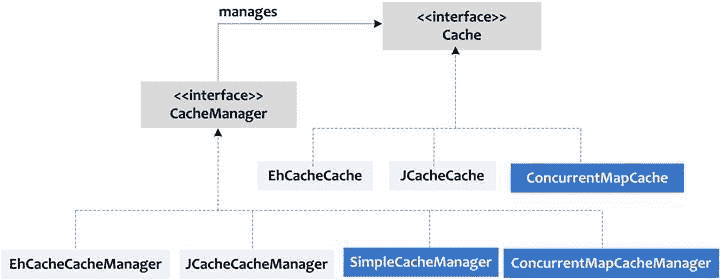

**图 8-3** `CacheManager` 实现作为底层缓存解决方案缓存管理器的封装，而 `Cache` 实现提供了与底层缓存交互的操作。

上面的图显示 `CacheManager` 管理 `Cache` 实例。`EhCacheCacheManager` 管理 `EhCacheCache` 实例（底层缓存存储为 Ehcache），`JCacheCacheManager` 管理 `JCacheCache` 实例（底层缓存存储为实现 JSR 107 的缓存解决方案），`ConcurrentMapCacheManager` 管理 `ConcurrentMapCache` 实例（底层缓存存储为 `java.util.concurrent.ConcurrentMap`），依此类推。


图 8-3 显示了一个实现 `CacheManager` 接口的 `SimpleCacheManager` 类。`SimpleCacheManager` 适用于简单的缓存场景和测试目的。例如，如果你想使用 `java.util.concurrent.ConcurrentMap` 作为底层缓存存储，可以使用 `SimpleCacheManager` 代替 `ConcurrentMapCacheManager` 来管理缓存。

现在让我们来看看如何在应用程序上下文 XML 文件中配置 `CacheManager`。

## 配置 `CacheManager`

在 MyBank 应用程序中，一组 `java.util.concurrent.ConcurrentMap` 实例作为底层缓存存储；因此，使用 `SimpleCacheManager` 来管理缓存。

接下来的示例列表显示了如何在 MyBank 应用程序中配置 `SimpleCacheManager` 实例：

**示例代码列表 8-27** – `SimpleCacheManager` 配置

**项目** – `ch08-bankapp`

**源码位置** – `src/main/resources/META-INF/spring/`

```xml
<bean id="myCacheManager" class="org.springframework.cache.support.SimpleCacheManager">
    <property name="caches">
        <set>
            <bean class="org.springframework.cache.concurrent.ConcurrentMapCacheFactoryBean">
                <property name="name" value="FixedDepositList" />
            </bean>
            <bean class="org.springframework.cache.concurrent.ConcurrentMapCacheFactoryBean">
                <property name="name" value="FixedDeposit" />
            </bean>
        </set>
    </property>
</bean>
```

`SimpleCacheManager` 的 `caches` 属性指定了由 `SimpleCacheManager` 实例管理的缓存集合。`ConcurrentMapCacheFactoryBean` 是一个 `FactoryBean` 实现，它简化了 `ConcurrentMapCache` 实例的配置——该实例使用 `java.util.concurrent.ConcurrentHashMap` 实例（`java.util.concurrent.ConcurrentMap` 接口的实现）作为底层缓存存储 `Cache` 实例。`ConcurrentMapCacheFactoryBean` 的 `name` 属性指定了缓存的名称。在上面的示例列表中，`FixedDepositList` 和 `FixedDeposit` 缓存由 `SimpleCacheManager` 实例管理。

现在让我们看看如何在应用程序中使用 Spring 的缓存注解。

## 缓存注解：`@Cacheable`、`@CacheEvict` 和 `@CachePut`

在为应用程序配置好适当的 `CacheManager` 后，你需要选择如何使用 Spring 的缓存抽象。你可以通过使用缓存注解（如 `@Cacheable`、`@CacheEvict` 和 `@CachePut`）或使用 Spring 的缓存方案来使用。由于使用 Spring 缓存方案缓存结果会导致应用程序上下文 XML 文件变得冗长，我们将只关注如何使用缓存注解进行声明式缓存。

要使用缓存注解，你需要配置 Spring 缓存方案中的 `<annotation-driven>` 元素，如下所示 Bank 应用程序所示：

**示例代码列表 8-28** – 使用 `<annotation-driven>` 启用缓存注解

**项目** – `ch08-bankapp`

**源码位置** – `src/main/resources/META-INF/spring/`

```xml
<beans ..... xmlns:cache="http://www.springframework.org/schema/cache"  
      xsi:schemaLocation=".....
      http://www.springframework.org/schema/cache
      http://www.springframework.org/schema/cache/spring-cache.xsd">

    <cache:annotation-driven cache-manager="myCacheManager"/>

</beans>
```

在上面的示例列表中，包含了 Spring 的缓存方案，以便其元素在上下文中可用。`<annotation-driven>` 元素的 `cache-manager` 属性指向用于管理缓存的 `CacheManager` bean。如果 `CacheManager` bean 的名为 `cacheManager`，则不需要指定 `cache-manager` 属性。

现在我们已经启用了缓存注解，让我们来看看不同的缓存注解。

### `@Cacheable`

`@Cacheable` 注解位于方法上，表示方法的返回值将被缓存。Spring 默认使用 `DefaultKeyGenerator` 类来生成缓存键。`DefaultKeyGenerator` 使用方法签名和参数来计算键。你可以通过提供 Spring `KeyGenerator` 接口的实现并将其指定为 `<annotation-driven>` 元素的 `key-generator` 属性来使用自定义键生成器。

接下来的示例显示了如何在 MyBank 应用程序中使用 `@Cacheable` 缓存 `FixedDepositService` 的 `findDepositsByBankAccount` 方法返回值：

**示例代码列表 8-29** – `@Cacheable` 注解

**项目** – `ch08-bankapp`

**源码位置** – `src/main/java/sample/spring/chapter08/bankapp/service`

```java
package sample.spring.chapter08.bankapp.service;

import org.springframework.cache.annotation.Cacheable;
.....

@Service(value = "FixedDepositService")
public class FixedDepositServiceImpl implements FixedDepositService {

    .....
    @Cacheable(value = { "FixedDepositList" })
    public List<FixedDepositDetails> findDepositsByBankAccount(int bankAccountId) {
        logger.info("findDepositsByBankAccount method invoked");
        return myFixedDepositDao.findDepositsByBankAccount(bankAccountId);
    }
}
```

`@Cacheable` 注角的 `value` 属性指定了缓存值的缓存区域。在列表 8-27 中，我们为 MyBank 应用程序了名为 `FixedDepositList` 的缓存区域。在上面的示例列表中，`@Cacheable` 注解指定 `findDepositsByBankAccount` 方法的返回值存储在 `FixedDepositList` 缓存中。注意的是，如果传递给方法的参数值相同，则 `@Cacheable` 注解的方法不会被调用。但如果你对至少一个参数传递了不同的值，则 `@Cacheable` 注解的方法将被调用。

如果你想在调用方法时从缓存中移除数据，请在该方法上标记 `@CacheEvict` 注解。在 `MyBank` 应用中，当创建一个新的定期存款时，由 `FixedDepositServiceImpl` 的 `findFixedDepositsByBankAccount` 方法缓存的定期存款详情必须从缓存中移除。这确保了下一次调用 `findFixedDepositsByBankAccount` 方法时，新创建的定期存款也将从数据库获取。以下示例列表显示了 `@CacheEvict` 注解的使用：

**示例列表 8-30** – `@CacheEvict` 注解

**项目** – `ch08-bankapp`

**源码位置** – `src/main/java/sample/spring/chapter08/bankapp/service`

```java
package sample.spring.chapter08.bankapp.service;

import org.springframework.cache.annotation.CacheEvict;

.....

@Service(value = "FixedDepositService")

public class FixedDepositServiceImpl implements FixedDepositService {

    .....

    @Transactional("jmsTxManager")

    @CacheEvict(value = { "FixedDepositList" }, allEntries=true, beforeInvocation = true)

    public void createFixedDeposit(final FixedDepositDetails fixedDepositDetails) throws Exception { ..... }

    .....

}
```

在上述示例列表中，`createFixedDeposit` 方法上的 `@CacheEvict` 注解指示 Spring 从名为 `FixedDepositList` 的缓存区域中移除所有缓存条目。`value` 属性指定了要从中移除缓存项的缓存区域，`allEntries` 属性指定了是否移除指定缓存区域中的所有条目。如果你想移除某个特定的缓存项，请使用 `key` 属性指定缓存该项时使用的键。你还可以通过 `condition` 属性对项目进行条件条件移除。`condition` 和 `key` 属性支持使用 SpEL 指定值（更多详情请参阅第 6 章第 6-8 节），使得执行复杂的缓存移除成为可能。`beforeInvocation` 属性指定缓存移除是在方法执行之前还是之后执行。由于 `beforeInvocation` 属性的值设置为 `true`，因此缓存会在调用 `createFixedDeposit` 方法之前被移除。

### `@CachePut`

Spring 还提供了 `@CachePut` 注解，表示该方法总是被调用的，并且方法返回的值会被放入缓存中。`@CachePut` 注解与 `@Cacheable` 注解的不同之处在于，`@Cacheable` 注解在用相同的参数值调用方法时，指示 Spring 跳过方法的调用。

以下示例列表显示了 `MyBank` 应用中 `FixedDepositServiceImpl` 类对 `@CachePut` 注解的使用：

**示例列表 8-31** – `@CachePut` 注解

**项目** – `ch08-bankapp`

**源码位置** – `src/main/java/sample/spring/chapter08/bankapp/service`

```java
package sample.spring.chapter08.bankapp.service;

import org.springframework.cache.annotation.CachePut;
import org.springframework.cache.annotation.Cacheable;

.....

@Service(value = "FixedDepositService")

public class FixedDepositServiceImpl implements FixedDepositService {

    .....

    @CachePut(value={"FixedDeposit"}, key="#FixedDepositId")

    public FixedDepositDetails getFixedDeposit(int FixedDepositId) {
        logger.info("getFixedDeposit method invoked with FixedDepositId " + FixedDepositId);
        return myFixedDepositDao.getFixedDeposit(FixedDepositId);
    }

    @Cacheable(value={"FixedDeposit"}, key="#FixedDepositId")

    public FixedDepositDetails getFixedDepositFromCache(int FixedDepositId) {
        logger.info("getFixedDepositFromCache method invoked with FixedDepositId " + FixedDepositId);
        throw new RuntimeException("This method throws exception because " + "FixedDepositDetails object must come from the cache");
    }

    .....
}
```

在上述示例列表中，`getFixedDeposit` 方法被标记了 `@CachePut` 注解，这意味着 `getFixedDeposit` 方法总是被调用的，并且返回的 `FixedDepositDetails` 对象被存储在名为 `FixedDeposit` 的缓存中。`value` 属性指定了存储 `FixedDepositDetails` 对象的缓存名称。`key` 属性指定了将返回的 `FixedDepositDetails` 对象存储到缓存中的键。正如你所，`key` 属性利用 SpEL 来指定键。`key` 属性的 `#FixedDepositId` 值引用传递给 `getFixedDeposit` 方法的 `FixedDepositId` 参数。总结来说，`getFixedDeposit` 方法返回的 `FixedDepositDetails` 对象存储在名为 `FixedDeposit` 的缓存中，方法参数 `FixedDepositId` 的值被用作键。

在示例 8-31 中，`FixedDepositServiceImpl` 的 `getFixedDepositFromCache` 方法根据 `@Cacheable` 注解指定的 `key` 属性值从缓存中检索 `FixedDepositDetails` 对象。注意，`getFixedDepositFromCache` 的体没有任何抛出一个 `RuntimeException`。

让我们看看运行 `MyBank` 应用会发生什么。

## 运行 `MyBank` 应用

`MyBank` 的 `FixedApp` 类定义了 `main` 方法。主方法访问 `FixedDepositService` 和 `BankAccount` 实例以演示本章中的不同功能。以下示例列表显示了：

**示例列表 8-32** – `FixedApp` 类

**项目** – `ch08-bankapp`


```java
package sample.spring.chapter08.bankapp;

import org.springframework.context.ApplicationContext;
import org.springframework.context.support.PathXmlApplicationContext;

public class FixedApp {
    public static void main(String[] args[]) throws Exception {
        ApplicationContext context = new PathXmlApplicationContext("classpath:META-INF/spring/applicationContext.xml");
        BankAccountService bankAccountService = context.getBean(BankAccountService.class);
        BankAccountDetails bankAccountDetails = new BankAccountDetails();

        int bankAccountId = bankAccountService.createBankAccount(bankAccountDetails);
        FixedDepositService FixedDepositService = context.getBean(FixedDepositService.class);
        FixedDepositDetails fixedDepositDetails = new FixedDepositDetails();

        fixedDepositDetails.setEmail("someUser@Domain.com");
        FixedDepositService.createFixedDeposit(fixedDepositDetails);

        FixedDepositService.findFixedDepositsByBankAccount(bankAccountId);
        FixedDepositService.findFixedDepositsByBankAccount(bankAccountId);
        FixedDepositService.createFixedDeposit(fixedDepositDetails);

        List<FixedDepositDetails> FixedDepositDetailsList = FixedDepositService.findFixedDepositsByBankAccount(bankAccountId);

        for (FixedDepositDetails detail : FixedDepositDetailsList) {
            FixedDepositService.getFixedDeposit(detail.getFixedDepositId());
        }

        for (FixedDepositDetails detail : FixedDepositDetailsList) {
            FixedDepositService.getFixedDepositFromCache(detail.getFixedDepositId());
        }
    }
}
```

在上述示例列表中，主方法执行了以下系列操作：

### 步骤 1

首先，通过调用 `BankAccountService` 的 `createBankAccount` 方法在 `BANK_ACCOUNT_DETAILS` 表中创建一个银行账户。

### 步骤 2

对应新创建银行账户，通过调用 `FixedDepositService` 的 `createFixedDeposit` 方法，在 `FIXED_DEPOSIT_DETAILS` 表中创建了一笔定期存款。你应该确保 `FixedDepositDetails` 对象的 `email` 属性被设置为可以检查邮件的邮箱 ID。`createFixedDeposit` 方法会发送 2 条 JMS 消息（请参见示例列表 8-5）。其中一条 JMS 消息包含由 `FixedDepositDetails` 对象 `email` 属性指定的邮箱 ID，并由 `EmailMessageListener`（参见示例列表 8-16）处理，从而向客户发送电子邮件。另一条 JMS 消息由 `FixedDepositMessageListener`（参见示例列表 8-11）处理，将定期存款详情保存到 `FIXED_DEPOSIT_DETAILS` 表中。你还应该注意，`FixedDepositServiceImpl` 的 `createFixedDeposit` 方法被标记了 `@CacheEvict` 注解（参见示例列表 8-30），这将移除 `FixedDepositList` 缓存中缓存的所有项。

### 步骤 3

调用 `FixedDepositService` 的 `findFixedDepositsByBankAccount` 方法，检索与我们在第 1 步中创建的银行账户对应的定期存款。由于 `findFixedDepositsByBankAccount` 方法标记了 `@Cacheable` 注解（参见示例列表 8-29），`findFixedDepositsByBankAccount` 方法返回的定期存款被存储在名为 `FixedDepositList` 的缓存中。列表 8-29 显示 `findFixedDepositsByBankAccount` 方法向控制台了以下消息：“`findFixedDepositsByBankAccount method invoked`”。

在上面的示例列表中，针对同一个 `bankAccountId` 参数调用了两次 `findFixedDepositsByBankAccount`，但你会注意到控制台上只写入了一次“`findFixedDepositsByBankAccount method invoked`”。这是因为第二次调用 `findFixedDepositsByBankAccount` 时是从名为 `FixedDepositList` 的缓存中检索定期存款详情，而 `findFixedDepositsByBankAccount` 方法没有被执行。

### 步骤 4

对应第 1 步中创建的银行账户，通过调用 `FixedDepositService` 的 `createFixedDeposit` 方法，在 `FIXED_DEPOSIT_DETAILS` 表中创建了另一笔定期存款。现在，`FixedDepositServiceImpl` 的 `createFixedDeposit` 方法标记了 `@CacheEvict` 注解（参见示例列表 8-30），这将移除 `FixedDepositList` 缓存中缓存的所有项。

### 步骤 5

再次调用 `FixedDepositService` 的 `findFixedDepositsByBankAccount` 方法。这一次 `findFixedDepositsByBankAccount` 被执行了，因为之前对 `createFixedDeposit` 方法的调用（参见第 4 步）导致 `FixedDepositList` 缓存中的所有项被移除。此时，你会再次看到控制台上写入了“`findFixedDepositsByBankAccount method invoked`”消息。由于 `findFixedDepositsByBankAccount` 方法标记了 `@Cacheable` 注解，该方法返回的定期存款被缓存在 `FixedDepositList` 缓存中。

### 步骤 6

对于第 5 步中检索到的每笔定期存款，都会调用 `FixedDepositService` 的 `getFixedDeposit` 方法（参见示例列表 8-31）。`getFixedDeposit` 方法接受定期存款标识符并从数据库返回定期存款信息。`getFixedDeposit` 方法标记了 `@CachePut`，这意味着它总是会被调用。由 `getFixedDeposit` 方法返回的定期存款被缓存在 `FixedDeposit` 缓存中。

### 步骤 7

对于第 5 步中检索到的每笔定期存款，都会调用 `FixedDepositService` 的 `getFixedDepositFromCache` 方法（参见示例列表 8-31）。`getFixedDepositFromCache` 方法接受定期存款标识符并在执行时抛出 `RuntimeException`。`getFixedDepositFromCache` 方法标记了 `@Cacheable`，只有在 `FixedDeposit` 缓存中未找到定期存款时才会执行。由于所有定期存款已经在第 6 步被 `getFixedDeposit` 方法缓存，因此 `getFixedDepositFromCache` 方法永远不会执行。

### 步骤 8

每隔 5 秒，`FixedDepositProcessorJob`（参见示例列表 8-17）检查数据库中是否创建了新的定期存款。如果在数据库中发现新的定期存款，`FixedDepositProcessorJob` 将激活该定期存款并向客户发送电子邮件，确认定期存款请求已成功处理。

## 8-9 总结

在本章中，我们接触了 Spring 的一些常用功能。我们看到 Spring 简化了发送和接收 JMS 消息、发送电子邮件、异步调用 Bean 方法、调度 Bean 方法执行以及数据缓存。在下一章中，我们将介绍 Spring 对 AOP（面向切面编程）的支持。

# 第 9 章 - 面向切面编程

## 9-1 引言

面向切面编程（AOP）是一种编程方法，它将分布在多个类中的职责封装在一个单独的类中，该称为“切面”。这些分布在多个类中的职责被称为“交叉关注点”。日志记录、事务管理、缓存、安全等都是交叉关注点的示例。

Spring 提供了一个 AOP 框架，Spring 内部使用该框架来实现声明式服务，例如事务管理（参见第 7 章）和缓存（参见第 8 章）。与其使用 Spring AOP 框架，你可以考虑使用 AspectJ（<http://www.eclipse.org/aspectj/>）作为你的 AOP 框架。由于 Spring AOP 框架对于大多数场景都是足够且与 Spring 容器集成，本章重点关注 Spring AOP 框架。

让我们通过一个 AOP 使用示例开始本章。

## 9-2 简单的 AOP 示例

假设为了审计目的，我们想要捕获传递给服务层类中方法的参数。记录方法参数详情的简单方法是在每个方法内部编写日志逻辑。但这意味着每个方法都额外负责记录参数详情。由于记录方法参数详情的职责分布在多个类中，它代表了一个“交叉关注点”。

使用 AOP 处理交叉关注点，需要遵循以下步骤：

- 创建一个 Java 类（称为切面）
- 在 Java 类中添加交叉关注点的实现
- 使用正则表达式指定应用交叉关注点的方法

在 AOP 术语中，切面中实现交叉关注点的方法被称为建议（advices）。每个建议都与一个标识其应用方法的切入点（pointcut）相关。应用建议的方法被称为连接点（join points）。

在 Spring AOP 中，你可以选择 AspectJ 注解样式或 XML 架构样式来开发切面。在 AspectJ 注解样式中，使用 `@Aspect`、`@Pointcut`、`@Before` 等 AspectJ 注解来开发切面。在 XML 架构样式中，使用 Spring 的 AOP 架构元素将 Spring Bean 配置为切面。

让我们通过一个 AOP 示例开始本章。

```java
import org.aspectj.lang.annotation.Aspect;
import org.aspectj.lang.annotation.Before;
import org.springframework.stereotype.Component;

@Aspect
@Component
public class LoggingAspect {
    private Logger logger = Logger.getLogger(LoggingAspect.class);

    @Before(value = "execution(* sample.spring.chapter09.bankapp.service.*Service.*(..))")
    public void log(JoinPoint joinPoint) {
        logger.info("Entering "
                    + joinPoint.getTarget().getClass().getSimpleName() + "'s "
                    + joinPoint.getSignature().getName());
        Object[] args = joinPoint.getArgs();
        for (int i = 0; i < args.length; i++) {
            logger.info("args[" + i + "] -->" + args[i]);
        }
    }
}
```

在示例列表 9-1 中：

- AspectJ 的 `@Aspect` 类型级注解指定 `LoggingAspect` 类是一个 AOP 切面（aspect）。
- AspectJ 的 `@Before` 方法级注解指定 `log` 方法代表一种通知（advice），该通知将在由 `value` 属性匹配的方法执行之前应用。请参考第 9-5 节以了解你可以创建的不同通知类型。
- `@Before` 注解的 `value` 属性指定了一个切入点表达式（pointcut expression），Spring AOP 框架通过它识别应用通知的方法（称为目标方法）。在第 9-4 节中，我们将深入研究切入点表达式。现在你可以假设切入点表达式 `execution(* sample.spring.chapter09.bankapp.service.*Service.*(..))` 指定 `LoggingAspect` 的 `log` 方法被应用于 `sample.spring.chapter09.bankapp.service` 包中所有由类（或接口）定义的、且以 `Service` 结尾的所有公有方法。
- `log` 方法的 `JoinPoint` 参数表示应用通知的目标方法。`log` 方法使用 `JoinPoint` 实例来获取传递给目标方法的参数信息。在示例列表 9-1 中，调用了 `JoinPoint` 的 `getArgs()` 方法来获取传递给目标方法的方法参数。

你需要将切面注册到 Spring 容器中，以便 Spring AOP 框架感知到该切面。在示例列表 9-1 中，`LoggingAspect` 类使用了 Spring 的 `@Component` 注解，以便其自动注册到 Spring 容器中。

下面的示例列表显示了 `BankApp` 类，它调用了 MyBank 应用中 `BankAccountServiceImpl`（实现了 `BankAccountService` 接口）和 `FixedDepositServiceImpl`（实现了 `FixedDepositService` 接口）类的方法。

**示例列表 9-2** – `BankApp` 类

**项目** – `ch09-simple-aop`

**源码位置** – `src/main/java/sample/spring/chapter09/bankapp`

```java
package sample.spring.chapter09.bankapp;

.....

public class BankApp {
    public static void main(String args[]) throws Exception {
        ApplicationContext context = new ClassPathXmlApplicationContext(
                "classpath:META-INF/spring/applicationContext.xml");
        BankAccountService bankAccountService = context.getBean(BankAccountService.class);
        BankAccountDetails bankAccountDetails = new BankAccountDetails();
        bankAccountDetails.setBalanceAmount(1000);
        bankAccountDetails.setLastTransactionTimestamp(new Date());
        bankAccountService.createBankAccount(bankAccountDetails);
        FixedDepositService FixedDepositService = context.getBean(FixedDepositService.class);
        FixedDepositService.createFixedDeposit(new FixedDepositDetails(1, 1000,
                12, "someemail@somedomain.com"));
    }
}
```


在上面的示例列表，`BankApp` 的 `main` 方法调用了 `BankAccountService` 的 `createBankAccount` 方法和 `FixedDepositService` 的 `createFixedDeposit` 方法。如果你执行 `BankApp` 的 `main` 方法，你将在控制台上看到以下输出：

```
INFO  LoggingAspect - Entering BankAccountServiceImpl's createBankAccount
INFO  LoggingAspect - args[0] -->BankAccountDetails@balanceAmount=1000, lastTransactionTimestamp=...)
INFO  LoggingAspect - Entering FixedDepositServiceImpl's createFixedDeposit
INFO  LoggingAspect - args[0] -->FixedDepositDetails@id=1, amount=1000, tenure=12, email=someemail@somedomain.com
```

（注：上面的输出细节是根据所提供的代码逻辑为了清晰起见而重的）

## 9-3 Spring AOP 框架

Spring AOP 是基于代理的；对于作为通知目标的对象会创建一个代理对象（proxy object）。下图显示了 `LoggingAspect` 如何应用到目标对象上：

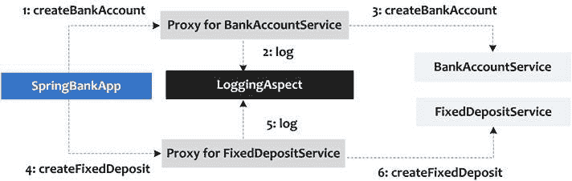

**图 9-1** 代理对象负责拦截对目标对象的调用。

上面的图显示为 `BankAccountService` 和 `FixedDepositService` 都创建了代理。`BankAccountService` 的代理拦截对 `BankAccountService.createBankAccount` 方法的调用，而 `FixedDepositService` 的代理拦截了对 `FixedDepositService.createFixedDeposit` 方法的调用。`BankAccountService` 的代理先执行 `LoggingAspect` 的 `log` 方法，后执行 `BankAccountService` 的 `createBankAccount` 方法。同样，`FixedDepositService` 的代理先执行 `LoggingAspect` 的 `log` 方法，后执行 `FixedDepositService` 的 `createFixedDeposit` 方法。

通知（如 `LoggingAspect` 的 `log` 方法）的执行时机取决于通知的类型。在 AspectJ 注解样式中，通知类型由 AspectJ 注解指定。例如，AspectJ 的 `@Before` 注解指定通知在目标方法调用之前执行，`@After` 注解指定通知在目标方法调用之后执行，`@Around` 注解指定通知在目标方法执行之前和之后都执行，依此类推。由于 `LoggingAspect` 的 `log` 方法使用了 `@Before` 注解，因此 `log` 方法在目标对象方法之前执行。

### 代理创建

在使用 Spring AOP 时，你可以选择通过 Spring 的 `ProxyFactoryBean`（参考 `org.springframework.aop.framework` 包）显式创建 AOP 代理，或者让 Spring 自动创建 AOP 代理。这种自动生成代理的方式被称为自动代理（autoproxying）。

如果你想使用 AspectJ 注解样式创建切面，你需要通过指定 Spring aop 体系的 `<aspectj-autoproxy>` 元素来启用对 AspectJ 注解样式的支持。`<aspectj-autoproxy>` 元素还指示 Spring AOP 框架为目标对象自动创建 AOP 代理。

# 示例列表 9-3 – `applicationContext.xml` - `<aspectj-autoproxy>`

**项目** – `ch09-simple-aop`

**源码位置** - `/src/main/resources/META-INF/spring`

```xml
<beans .....
    xmlns:context="http://www.springframework.org/schema/context"
    xmlns:aop="http://www.springframework.org/schema/aop"
    xsi:schemaLocation=".....http://www.springframework.org/schema/aop
               http://www.springframework.org/schema/aop/spring-aop-4.0.xsd">
    <context:component-scan base-package="sample.spring" />
    <aop:aspectj-autoproxy proxy-target-class="false" expose-proxy="true"/>
</beans>
```

`<aspectj-autoproxy>` 元素的 `proxy-target-class` 属性指定了为目标对象创建基于 JavaSE 还是 CGLIB 的代理，而 `expose-proxy` 属性指定了 AOP 代理本身对目标对象可用。如果 `expose-proxy` 的值设置为 true，目标对象的方法可以通过调用 `AopContext.currentProxy()` 静态方法访问 AOP 代理。

Spring AOP 框架会创建一个基于 CGLIB 或 JavaSE 的代理。如果目标对象没有实现任何接口，Spring AOP 会创建一个基于 CGLIB 的代理。如果目标对象实现了一个或多个接口，Spring AOP 会创建一个基于 JavaSE 的代理。如果 `<aspectj-autoproxy>` 元素的 `proxy-target-class` 属性值设置为 false，它指示 Spring AOP 在目标对象实现一个或多个接口时创建一个基于 JavaSE 的代理。如果你将 `proxy-target-class` 属性的值设置为 true，则即使目标对象实现了一个或多个接口，它也会指示 Spring AOP 创建基于 CGLIB 的代理。

**注意**：从 Spring 3.2 开始，CGLIB 类被封装在 `spring-core` JAR 文件本身中；因此，你不需要在应用程序中显式地包含 CGLIB JAR 包，即可允许 Spring AOP 框架为目标对象创建基于 CGLIB 的代理。

现在让我们来看一个场景，在该场景中，你倾向于将 `<aspectj-autoproxy>` 元素的 `expose-proxy` 属性设置为 true。

**导入** **第 9 章/ch09-aop-proxy**（`ch09-aop-proxy` 项目展示了 MyBank 应用，其中目标方法使用 `AopProxy.currentProxy()` 方法来获取 Spring AOP 框架创建的 AOP 代理对象。要运行该应用程序，请执行该项目中 `BankApp` 类的主方法）

### expose-proxy 属性

下面的示例列表显示了一个修改后的 `BankAccountServiceImpl` 类，其中 `createBankAccount` 方法调用 `isDuplicateAccount` 方法检查系统中是否存在相同相同的银行账户：

**示例 9-4 – BankAccountServiceImpl 类**

```java
@Service(value = "bankAccountService")
public class BankAccountServiceImpl implements BankAccountService {
    @Autowired
    private BankAccountDao bankAccountDao;

    @Override
    public int createBankAccount(BankAccountDetails bankAccountDetails) {
        if(!isDuplicateAccount(bankAccountDetails)) {
            return bankAccountDao.createBankAccount(bankAccountDetails);
        } else {
            throw new BankAccountAlreadyExistsException("Bank account already exists");
        }
    }

    @Override
    public boolean isDuplicateAccount(BankAccountDetails bankAccountDetails) { ..... }
}
```

上面的示例列表显示了 `createBankAccount` 方法调用 `isDuplicateAccount` 方法检查系统中是否已存在该账户。

现在问题出现了：当 `createBankAccount` 方法调用 `isDuplicateAccount` 方法时，`LoggingAspect` 的 `log` 方法（参见示例 9-1）将会执行吗？尽管 `isDuplicateAccount` 方法匹配了 `LoggingAspect.log` 方法上 `@Before` 注解指定的切点表达式（参见示例 9-1），但 `LoggingAspect` 的 `log` 方法没有被调用。这是因为目标对象对自身调用的方法不会被 AOP 代理拦截。由于方法调用没有通过 AOP 代理对象，任何与目标方法相关的建议都不会被执行。

为了确保对 `isDuplicateAccount` 方法的调用通过 AOP 代理到达目标对象，请在 `createBankAccount` 方法中获取 AOP 代理对象，并在 AOP 代理对象上调用 `isDuplicateAccount` 方法。下面的示例列表显示了如何在 `createBankAccount` 方法内部获取 AOP 代理对象：

**示例 9-5 – BankAccountServiceImpl 类**

**项目** – `ch09-aop-proxy`

**源码位置** - `/src/main/java/sample/spring/chapter09/bank`

```java
package sample.spring.chapter09.bank;

import org.springframework.aop.AopContext;
import org.springframework.beans.factory.annotation.Autowired;
import org.springframework.stereotype.Service;

@Service(value = "bankAccountService")
public class BankAccountServiceImpl implements BankAccountService {
    @Autowired
    private BankAccountDao bankAccountDao;

    @Override
    public int createBankAccount(BankAccountDetails bankAccountDetails) {
        // 获取代理并通过它调用 isDuplicateAccount
        BankAccountService proxy = (BankAccountService)AopContext.currentProxy();
        boolean isDuplicateAccount = proxy.isDuplicateAccount(bankAccountDetails);
        if(!isDuplicateAccount) {
            return bankAccountDao.createBankAccount(bankAccountDetails);
        } else {
            throw new BankAccountAlreadyExistsException("Bank account already exists");
        }
    }

    @Override
    public boolean isDuplicateAccount(BankAccountDetails bankAccountDetails) { ..... }
}
```

在上面的示例列表中，`AopContext.currentProxy()` 的返回值被强制转换为 `BankAccountService` 类型。如果 `<aspectj-autoproxy>` 元素的 `expose-proxy` 属性为 false，调用 `currentProxy()` 将导致抛出 `java.lang.IllegalStateException`。`isDuplicateAccount` 方法。

现在让我们深入查看切点表达式。

## 9-4 切点表达式

在使用 Spring AOP 时，切点表达式识别要应用建议（advice）的连接点。在 Spring AOP 中，连接点总是 Bean 方法。如果你想将建议应用于字段、构造函数、非公共方法以及非 Spring Bean 的对象，你应该使用 AspectJ 而不是 Spring AOP。

切点表达式使用切点设计器，如 `execution`、`args`、`within`、`this` 等来寻找匹配的方法。例如，在示例 9-1 中，`@Before` 注解利用了 `execution` 切点设计器来寻找应用到 `LoggingAspect.log` 方法的方法。

现在让我们来看看如何使用 `@Cutcut` 注解来指定切点表达式。

`@Cutpoint` 注解的 `value` 属性指定切点表达式。要使用 `@Cutpoint` 注解，创建一个空方法并对其加上 `@Cutpoint` 注解。该空方法必须定义为返回 `void`。引用 `@Cutpoint` 注解方法名的建议将被应用于由 `@Cutpoint` 注解指定的切点表达式所匹配的方法。

**注意** 如果一个切点表达式（pointcut expression）被相同或不同切面中的多个建议共享，使用 `@Pointcut` 注解特别有用。

下面的示例显示了 `LoggingAspect` 类的修改版本（参考示例列表 9-1），它使用了 `@Pointcut` 注解：

**示例 9-6** – `LoggingAspect` 类

**项目** – `ch09-aop-pointcuts`

**源码位置**- `src/main/java/sample/spring/chapter09/bankapp/aspects`

```java
package sample.spring.chapter09.bankapp.aspects;

import org.aspectj.lang.annotation.Before;
import org.aspectj.lang.annotation.Pointcut;

@Aspect
@Component
public class LoggingAspect {

    @Pointcut(value = "execution(* sample.spring.chapter09.bankapp.service.*Service.*(..))")
    private void invokeServiceMethods() { }

    @Before(value = "invokeServiceMethods()")
    public void log(JoinPoint joinPoint) {
        logger.info("Entering " + joinPoint.getTarget().getClass().getSimpleName() + "'s "
                    + joinPoint.getSignature().getName());
        .....
    }
}
```

在上面的示例列表中，`invokeServiceMethods` 方法标记了 `@Pointcut` 注解，而 `@Before` 注解的 `value` 属性引用了 `invokeServiceMethods` 方法。这意味着 `log` 方法被应用于匹配 `invokeServiceMethods` 方法上 `@Pointcut` 注解所指定的切点表达式的方法上。

由于 `execution` 和 `args` 切点设计符（pointcut designators）最常用于指定切点表达式，让我们详细查看一下 `execution` 和 `args` 切点设计符。

### execution 和 args 切点设计符

`execution` 切点设计符具有以下格式：

`execution`(*<access-modifier-pattern>* *<return-type-pattern> <declaring-type-pattern>* *<method-name-pattern>*(*<method-param-pattern>*) *<throws-pattern>*)`

如果你将一个执行表达式与方法声明进行比较，你会发现执行表达式与方法声明非常相似。

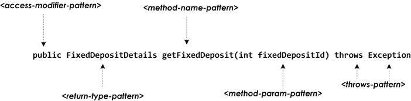

**图 9-2** 执行表达式的不同部分映射到方法声明的不同部分。


图 9-2 显示了执行表达式的不同部分如何映射到方法声明：Spring AOP 框架通过匹配执行表达式的不同部分与方法声明的不同部分（如上所示），来找到应用建议（advice）的方法。`<declaring-type-pattern>*` 未在上面的图中显示，因为只有当你想要引用包含在特定类型或包中的方法时，才会使用`<declaring-type-pattern>*`。

下表描述了执行表达式的各个不同部分：

| 表达式部分 | 说明 |
| :--- | :--- |
| `access-modifier-pattern` | 指定目标方法的访问修饰符。在 Spring AOP 中，此表达式部分可以指定的值只有 `public`。执行表达式的这部分是可选的。 |
| `return-type-pattern` | 指定目标方法返回类型的完全限定名。值 `*` 意味着方法的返回类型并不重要。 |
| `declaring-type-pattern` | 指定包含目标方法的类型的完全限定名。执行表达式的这部分是可选的。值 `*` 意味着切点表达式会考虑应用程序中的所有类型（类和接口）。 |
| `method-name-pattern` | 指定方法名模式。例如，值 `save*` 意味着以 `save` 开头的方法是建议的目标。 |
| `method-param-pattern` | 指定方法参数模式。如果值为 `(..)`，则意味着目标方法可以包含任意数量的参数，或者完全不包含参数。 |
| `throws-pattern` | 指定目标方法抛出的异常。执行表达式的这部分是可选的。 |

`args` 切点设计符指定了目标方法在运行时必须接受的参数。例如，如果你想让切点表达式定位到运行时接受 `java.util.List` 实例的方法，那么 `args` 表达式看起来如下：`args(java.util.List)`。在本节的稍后部分中，我们将看到如何使用 `args` 切点设计符使传递给目标方法的参数对建议可用。

现在，让我们来看一些使用 `execution` 和 `args` 切点设计符的切点表达式：

### 示例 1

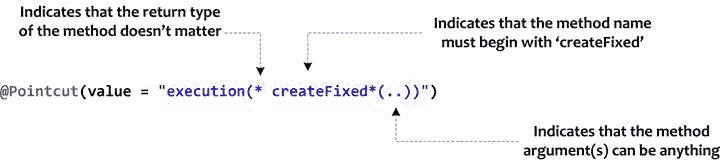

**图 9-3** 使用方法名模式的执行表达式

上述切点表达式匹配的方法是名称以 `createFixed` 开头的方法。返回类型指定为 `*`，意味着目标方法可以返回任何类型。`(..)` 指定了目标方法可以接受零或多个参数。

### 示例 2

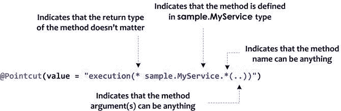

**图 9-4** 指定包含目标方法的类型（类或接口）的执行表达式

上述切点表达式匹配的方法是由 `sample` 包中的 `MyService` 类型定义的方法。

### 示例 3

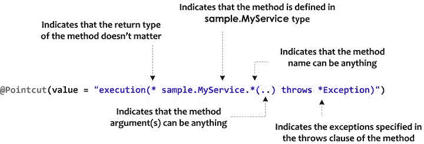

**图 9-5** 为方法指定异常模式的执行表达式

上述切点表达式匹配的方法是 `MyService` 类型中指定了 `throws` 子句的方法。

### 示例 4

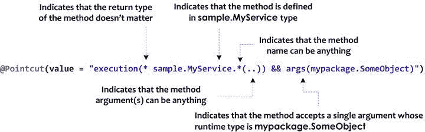

**图 9-6** `args` 切点设计符指定传递给目标方法的实例

在上面的切点表达式中，使用了 `execution` 和 `args` 切点设计符的组合。你可以使用 `&&` 和 `||` 运算符组合切点设计符以创建复杂的切点表达式。上述切点表达式匹配的方法是 `MyService` 类型中运行时接受 `SomeObject` 实例的方法。上述切点表达式中的 `&&` 指定方法必须匹配 `execution` 和 `args` 切点设计符指定的表达式。

如果你希望建议能够访问传递给目标的一个或多个方法参数，请在 `args` 表达式中指定方法参数，如下：

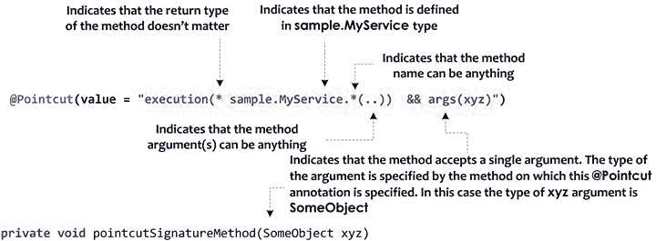

**图 9-7** `args` 切点设计符指定必须对建议可见的方法参数

在上面的切点表达式中，`args` 表达式指定方法必须接受类型为 `SomeObject` 的参数，该参数通过 `xyz` 参数对建议可用。让我们来看此功能将参数传递给建议的真实示例。

### 将目标方法的参数传递给建议

下面的示例显示了 `LoggingAspect` 类的修改版本，其中只有当传递给目标方法的参数是 `FixedDepositDetails` 实例时，才会执行 `log` 方法，并且该 `FixedDepositDetails` 实例也会对 `log` 方法可用：

**示例 9-7** – `LoggingAspect` 类 – 将目标方法的参数传递给建议

```java
package sample.spring.chapter09.bankapp.aspects;

import org.aspectj.lang.annotation.Before;
import org.aspectj.lang.annotation.Pointcut;

@Aspect
@Component
public class LoggingAspect {

    .....

    @Pointcut(value = "execution(* sample.spring.chapter09.bankapp.service.*Service.*(..))

              && args(FixedDepositDetails)")
    private void invokeServiceMethods(FixedDepositDetails FixedDepositDetails) { }

    @Before(value = "invokeServiceMethods(FixedDepositDetails)")
    public void log(JoinPoint joinPoint, FixedDepositDetails FixedDepositDetails) {
        .....
    }
}
```

切点指示符（Pointcut designators），如 `execution`、`args`、`within`、`this`、`target` 等由 AspectJ 定义。Spring AOP 定义了特定 Spring AOP 框架的 bean 切点指示符。让我们快速查看一下 bean 切点指示符。

### Bean 切点指示符

bean 切点指示符用于将目标方法限制在指定的 bean id（或名称）。你可以指定确切的 bean id 或名称，也可以指定一个模式。让我们来看 bean 切点指示符的几个示例：

#### 示例 1

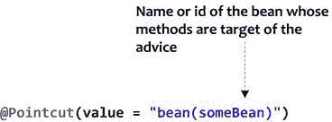

**图 9-8** bean 切点指示符指定了其方法作为通知（advice）目标的 bean id 或名称。

与上述切点表达式匹配的方法是按名为 `someBean` 的 bean 所定义的方法。

#### 示例 2

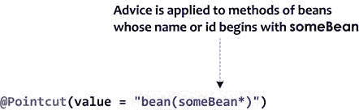

**图 9-9** bean 切点指示符指定将通知应用到 id 或名称以 `someBean` 开头的 bean 的方法上。

在上述切点表达式中，bean 切点指示符指定将通知应用到 id 或名称以 `someBean` 开头的 bean 的方法上。

**注意**：与任何其他切点指示符一样，你可以使用 `&&` 和 `||` 运算符将 bean 切点指示符与其他切点指示符结合，形成复杂的切点表达式。

现在让我们来看看基于注解执行匹配的切点指示符。

### 基于注解的切点指示符

AspectJ 还提供了切点指示符，如 `@annotation`、`@target`、`@within` 和 `@args`，你可以结合 Spring AOP 来查找目标方法。让我们来看几个这些切点指示符使用的示例：

#### 示例 1

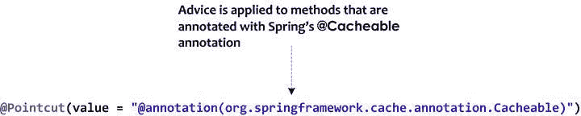

**图 9-10** `@annotation` 切点指示符指定将通知应用到标注了 Spring 的 `@Cacheable` 注解的方法上。

与上述切点表达式匹配的方法是标注了 Spring 的 `@Cacheable` 注解的方法。

#### 示例 2

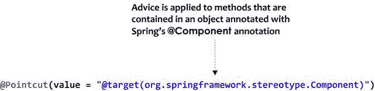

**图 9-11** `@target` 切点指示符指定将通知应用到标注了 Spring 的 `@Component` 注解的对象的方法上。

与上述切点表达式匹配的方法是包含在标注了 Spring 的 `@Component` 注解的对象中的方法。

在本节中，我们查看了 AspectJ 定义的一些切点指示符。注意的是，并不是所有由 AspectJ 定义的切点指示符都受 Spring AOP 框架的支持。如果你在切点表达式中使用不支持的切点指示符，Spring AOP 框架将抛出 `java.lang.IllegalArgumentException`。例如，如果你在切点表达式中使用 `call`、`set` 和 `get` 切点指示符，Spring AOP 将抛出 `java.lang.IllegalArgumentException`。

现在让我们来看看不同的通知类型以及如何创建它们。

## 9-5 通知类型

到本章为止，我们已经看到了 *before*（执行前）通知类型的示例。*before* 通知类型是通过在切面类的方法上标注 `@Before` 注解创建的（参见列表 9-1、9-6 和 9-7）。你可以创建的其他通知类型还有 `after`（执行后）、`after returning`（返回后）、`after throwing`（抛出异常后）、`after`（最终）和 `around`（环绕）。

**导入**：`chapter 9/ch09-aop-advices`（`ch09-aop-advices` 项目了使用了不同通知类型的 MyBank 应用程序。运行该应用程序，请执行该项目中 `BankApp` 类的 `main` 方法）

现在让我们来看看各种通知类型的显著特征以及如何创建它们。

### Before advice（执行前通知）

*before* 通知在目标方法执行之前执行。如果 *before* 通知没有抛出异常，则目标方法将始终被调用。你可以通过 *around*（环绕）通知（在本节稍后的部分解释）来控制目标方法是否执行。正如前面讨论的，AspectJ 的 `@Before` 注解用于指示该通知是一个 *before* 通知。

标注了 `@Before` 的方法可以定义其第一个参数类型为 `JoinPoint`。你可以在通知内部使用 `JoinPoint` 参数来获取有关目标方法的信息。例如，列表 9-1 显示 `JoinPoint` 实例可以用于获取目标对象的类以及传递给目标方法的参数。

### After returning advice（返回后通知）

*after returning* 通知在目标方法返回后执行。你应该注意的是，如果目标方法抛出异常，则 *after returning* 通知不会执行。*after returning* 通知使用 AspectJ 的 `@AfterReturning` 注解标注。*after returning* 通知可以访问目标方法返回的值，并在返回给调用对象之前对其修改。

`ch09-aop-advices` 项目中的 `SampleAspect` 类代表一个 AOP 切面。接下来的示例显示 `SampleAspect` 类定义了一个 *after returning* 通知，它打印了 `BankAccountService` 的 `createBankAccount` 方法返回的值：

**列表 9-8** – `SampleAspect` 类 – *after returning* 通知

**项目**：`ch09-aop-advices`

**源码位置**：`src/main/java/sample/spring/chapter09/bankapp/aspects`

```java
package sample.spring.chapter09.bankapp.aspects;

import org.aspectj.lang.JoinPoint;
import org.aspectj.lang.annotation.AfterReturning;
import org.aspectj.lang.annotation.Aspect;
import org.aspectj.lang.annotation.Pointcut;
import org.slf4j.Logger;
import org.slf4j.LoggerFactory;

@Aspect
public class SampleAspect {
    private Logger logger = LoggerFactory.getLogger(SampleAspect.class);

    @Pointcut("execution(* sample.spring.chapter09.bankapp..BankAccountService.createBankAccount(..))")
    public void createBankAccount() {}

    @AfterReturning(value = "createBankAccount()", returning = "aValue")
    public void afterReturning(JoinPoint joinPoint, int aValue) {
        logger.info("Value returned by {} is {}", joinPoint.getSignature().getName(), aValue);
    }
}
```

在上面的列表中，`afterReturning` 方法代表一个 *after returning* 通知。由 `@Pointcut` 注解定义的切点将连接点限制为 `BankAccountService` 的 `createBankAccount` 方法。`execution` 表达式中的 `..` 指定了搜索 `sample.spring` 包及其子包以查找 `BankAccountService` 类型。

在示例 9-8 中，`SampleAspect` 的 `afterReturning` 方法在调用 `BankAccountService` 的 `createBankAccount` 方法后执行。`@AfterReturning` 注解的 `returning` 属性指定了目标方法的返回值对通知可见的名称。在上面的列表中，`createBankAccount` 方法返回的值通过 `aValue` 参数提供给 `afterReturning` 方法。`aValue` 参数的类型被指定为 `int`，因为 `createBankAccount` 返回一个 `int` 值。你应该注意，如果你指定了 `returning` 属性，通知仅应用于返回指定类型的方法。如果 *after returning* 通知应用到返回不同值类型（包括 `void`）的方法，可以将返回值的参数类型指定为 `Object`。

如示例 9-8 所示，标注了 `@AfterReturning` 的方法可以定义第一个参数类型为 `JoinPoint` 以访问目标方法信息。

### After throwing advice（抛出异常后通知）

*after throwing* 通知在目标方法抛出异常时执行。*after throwing* 通知可以访问目标方法抛出的异常。*after throwing* 通知使用 AspectJ 的 `@AfterThrowing` 注解标注。

接下来的示例显示了一个在目标方法抛出异常时执行的 *after throwing* 通知：

**示例 9-9** – `SampleAspect` 类 – *after throwing* 通知

**项目**：`ch09-aop-advices`

**源码位置**：`src/main/java/sample/spring/chapter09/bankapp/aspects`

```java
package sample.spring.chapter09.bankapp.aspects;

import org.aspectj.lang.JoinPoint;
import org.aspectj.lang.annotation.AfterThrowing;
import org.aspectj.lang.annotation.Aspect;
import org.aspectj.lang.annotation.Pointcut;
import org.slf4j.Logger;
import org.slf4j.LoggerFactory;

@Aspect
public class SampleAspect {
    private Logger logger = LoggerFactory.getLogger(SampleAspect.class);

    @Pointcut("execution(* sample.spring.chapter09.bankapp..BankAccountService.createBankAccount(..))")
    public void createBankAccount() {}

    @AfterThrowing(value = "createBankAccount()", throwing = "ex")
    public void afterThrowing(JoinPoint joinPoint, Throwable ex) {
        logger.error("Exception thrown by {}: {}", joinPoint.getSignature().getName(), ex.getMessage());
    }
}
```


```java
private Logger logger = Logger.getLogger(SampleAspect.class);

.....

@Pointcut(value = "** execution(* sample.spring..FixedDepositService.*(..)) ")
private void exceptionMethods() {}

.....

@AfterThrowing(value = "exceptionMethods()", throwing = "exception")
public void afterThrowingAdvice(JoinPoint joinPoint, Throwable exception) {
    logger.info("Exception thrown by " + joinPoint.getSignature().getName()
                + " Exception type is : " + exception);
}
```

在上面的示例列表中，`SampleAspect` 的 `afterThrowingAdvice` 方法代表了一个*抛出后*（after throwing）通知。当 `FixedDepositService` 对象的任何方法抛出异常时，`afterThrowingAdvice` 方法会被执行。在上面的示例列表中，`@AfterThrowing` 注解的 `throwing` 属性指定了目标方法抛出的异常在供 `afterThrowingAdvice` 方法时使用的名称。由于 `throwing` 属性的值为 `exception`，该异常将通过名为 `exception` 的参数传递给 `afterThrowingAdvice` 方法。注意，异常参数的类型是 `java.lang.Throwable`，这意味着 `afterThrowingAdvice` 方法会在目标方法抛出所有异常时被执行。如果你希望 `afterThrowingAdvice` 方法仅在目标方法抛出特定异常类型时执行，请更改异常参数的类型。例如，如果你希望仅在目标方法抛出 `java.lang.IllegalStateException` 时才执行 `afterThrowingAdvice` 方法，请将 `java.lang.IllegalStateException` 指定为异常参数的类型。

如示例列表 9-9 所示，被 `@AfterThrowing` 注解的方法可以将第一个参数定义为 `JoinPoint` 类型，以便访问目标方法的信息。

## 后置通知 (After advice)

*后置*（after）通知在目标方法执行后执行，无论目标方法是正常完成还是抛出异常。*后置*通知使用 AspectJ 的 `@After` 注解标记。

接下来的示例列表显示了一个针对 `BankAccountService` 的 `createBankAccount` 方法以及 `FixedDepositService` 接口定义的方法执行的*后置*通知：

**示例列表 9-10** – `SampleAspect` 类 – *后置*通知

**项目** – `ch09-aop-advices`

**源文件** - `src/main/java/sample/spring/chapter09/bankapp/aspects`

```java
package sample.spring.chapter09.bankapp.aspects;

import org.aspectj.lang.annotation.After;

.....

@Aspect
public class SampleAspect {

    private Logger logger = Logger.getLogger(SampleAspect.class);

    @Pointcut(value = "execution(* sample.spring..BankAccountService.createBankAccount(..))")
    private void createBankAccountMethod() {}

    @Pointcut(value = "execution(* sample.spring..FixedDepositService.*(..))")
    private void exceptionMethods() {}

    .....

    @After(value = "exceptionMethods() || createBankAccountMethod()")
    public void afterAdvice(JoinPoint joinPoint) {
        logger.info("After advice executed for " + joinPoint.getSignature().getName());
    }
}
```

在上面的示例列表中，`SampleAspect` 的 `afterAdvice` 方法代表了一个*后置*通知。`afterAdvice` 方法在目标方法执行后执行。注意，`@After` 注解的 `value` 属性使用 `||` 运算符将由 `createBankAccountMethod` 和 `exceptionMethods` 方法表示的切点表达式组合成一个新的切点表达式。

如示例列表 9-10 所示，被 `@After` 注解的方法可以将其第一个参数定义为 `JoinPoint` 类型，以便访问目标方法的信息。

## 环绕通知 (Around advice)

*环绕*（around）通知在目标方法执行的*之前*和*之后* 都会执行。与其他通知不同，*环绕*通知可以控制是否执行目标方法。*环绕*通知使用 AspectJ 的 `@Around` 注解标记。

接下来的示例列表显示了由 `ch09-aop-advices` 项目中的 `SampleAspect` 类定义的*环绕*通知：

**示例列表 9-11** – `SampleAspect` 类 – *环绕*通知

**项目** – `ch09-aop-advices`

**源文件** - `src/main/java/sample/spring/chapter09/bankapp/aspects`

```java
package sample.spring.chapter09.bankapp.aspects;

import org.aspectj.lang.ProceedingJoinPoint;
import org.aspectj.lang.annotation.Around;
import org.springframework.util.StopWatch;

.....

@Aspect
public class SampleAspect {

    .....

    @Around(value = "execution(* sample.spring..*Service.*(..))")
    public Object aroundAdvice(ProceedingJoinPoint pjp) {
        Object obj = null;
        StopWatch watch = new StopWatch();
        try {
            obj = pjp.proceed();
        } catch (Throwable throwable) {
            // 执行你想做的任何操作
        }
        watch.stop();
        logger.info(watch.prettyPrint());
        return obj;
    }
}
```

在上面的示例列表中，`aroundAdvice` 方法代表了一个*环绕*通知。`ProceedingJoinPoint` 参数用于控制目标方法的调用。需要注意的是，`ProceedingJoinPoint` 必须是通知的参数。

到此为止，我们查看了如何使用 AspectJ 注解风格创建通知的示例。现在我们来看看如何使用普通的 Spring Bean 作为 AOP Aspect。

## 9-6 Spring AOP - XML 模式风格

在 XML 模式中，普通的 Spring Bean 充当 Aspect。切中的方法通过 Spring 的 aop 配置与通知类型和切点表达式关联。

**导入** `chapter 9/ch09-aop-xml-schema`（`ch09-aop-xml-schema` 项目与 `ch09-aop-advices` 项目相同，但 `ch09-aop-xml-schema` 的 `SampleAspect` 类是一个没有使用 AspectJ 注解的简单 Java 类）

下面的示例列表显示了 `ch09-aop-xml-schema` 项目中定义通知的 `SampleAspect` 类：

**示例列表 9-12** – `SampleAspect` 类

**项目** – `ch09-aop-xml-schema`

### 源文件 - `src/main/java/sample/spring/chapter09/bankapp/aspects`

```java
package sample.spring.chapter09.bankapp.aspects;

.....

public class SampleAspect {

    .....

    public void afterReturningAdvice(JoinPoint joinPoint, int aValue) {
        logger.info("Value returned by " + joinPoint.getSignature().getName()+ " method is " + aValue);
    }

    public void afterThrowingAdvice(JoinPoint joinPoint, Throwable exception) {
        logger.info("Exception thrown by " + joinPoint.getSignature().getName()
                    + " Exception type is : " + exception);
    }

    .....
}
```

上面的示例列表显示了 `SampleAspect` 类定义了代表 AOP 通知（advices）的方法。请注意，`SampleAspect` 类*没有*使用 `@Aspect` 注解，且这些方法也没有使用 `@After`、`@AfterReturning` 等注解。

现在让我们来看看如何使用 Spring aop 架构中的 `<config>` 元素将一个普通的 Spring Bean 配置为 AOP 切面（aspect）。

### 配置一个 AOP 切面

在 XML 架构风格中，AOP 特定的配置被封装在 Spring aop 架构的 `<config>` 元素中。此外，AOP 切面是通过 `<config>` 元素的 `<aspect>` 子元素配置的。

下面的示例列表显示了如何使用 `<config>` 元素的 `<aspect>` 子元素配置 `SampleAspect` 类：

**示例列表 9-13** – `applicationContext.xml` – Spring aop 架构的使用

**项目** – `ch09-aop-xml-schema`

**源文件位置** - `src/main/resources/META-INF/spring`

```xml
<beans ..... xmlns:aop="http://www.springframework.org/schema/aop" ..... >
    .....

    <bean id="sampleAspect" class="sample.spring.chapter09.bankapp.aspects.SampleAspect" />
    <aop:config proxy-target-class="false" expose-proxy="true">
        <aop:aspect id="sampleAspect" ref="sampleAspect">
            .....
        </aop:aspect>
    </aop:config>
</beans>
```

由于 `<config>` 元素依赖于自动代理，`<config>` 元素定义了 `proxy-target-class` 和 `expose-proxy` 属性。如果你记得，相同的属性是由 Spring aop 架构中的 `<aspectj-autoproxy>` 元素定义的。请参考第 9-3 节了解更多关于 `proxy-target-class` 和 `expose-proxy` 属性的信息。

在示例列表 9-13 中，`sampleAspect` Bean 定义将 `SampleAspect` 类为一个 Bean。`<aspect>` 元素将 `sampleAspect` Bean 配置为 AOP 切面。`<aspect>` 元素的 `id` 属性为切面指定了唯一标识符，`ref` 属性指定了你想要配置为 AOP 切面的 Spring Bean。

现在，我们已经配置了一个 AOP 切面，让我们来看看如何将 AOP 切面中定义的方法映射到不同的通知类型和切入点表达式（pointcut expressions）。

### 配置通知

你使用 `<aspect>` 元素的以下子元素之一来配置通知：`<before>`（用于配置*前置*通知类型）、`<after-returning>`（用于配置*返回后*通知类型）、`<after-throwing>`（用于配置*抛异常后*通知类型）、`<after>`（用于配置*后*通知类型）和 `<around>`（用于配置*环绕*通知类型）。

现在来看看 `ch09-aop-xml-schema` 项目中 `SampleAspect` 类中定义的通知在应用程序上下文 XML 文件中是如何配置的。

#### 配置*返回后*通知

下图显示了如何使用 `<after-returning>` 元素将 `SampleAspect` 的 `afterReturningAdvice` 方法配置为*返回后*通知：

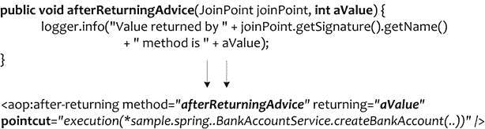

**图 9-12** `SampleAspect` 类的 `afterReturningAdvice` 方法使用 Spring aop 架构的 `<after-returning>` 元素配置为*返回后*通知。

`<after-returning>` 元素的 `method` 属性指定了你想配置为*返回后*通知的方法名称。`returning` 属性的作用与 `@AfterReturning` 注解的 `returning` 属性相同；它使目标方法的返回值通知可用。`pointcut` 属性指定了用于查找应用通知的方法的切入点表达式。

#### 配置*抛异常后*通知

下图显示了如何使用 `<after-throwing>` 元素将 `SampleAspect` 的 `afterThrowingAdvice` 方法配置为*抛异常后*通知：

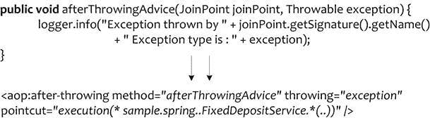

**图 9-13** `SampleAspect` 类的 `afterThrowingAdvice` 方法使用 Spring aop 架构的 `<after-throwing>` 元素配置为*抛异常后*通知。

`<after-throwing>` 元素的 `method` 属性指定了你想配置为*返回后*通知的方法名称。（等待，原文似乎被截断/重复了）。现在来看看如何将 AOP 切面中定义的方法映射到不同的通知类型和切入点表达式。

### 将切入点表达式与通知关联

Spring aop 架构的 `<after>`、`<after-returning>`、`<after-throwing>`、`<before>` 和 `<around>` 元素定义了你可以使用的切入点表达式。如果你想在不同的通知之间共享切入点表达式，可以使用 `<config>` 元素的 `<pointcut>` 子元素来定义切入点表达式。

下面的示例列表显示了 `<pointcut>` 元素用于定义切入点表达式：

**示例列表 9-14** – `application context XML` - `<pointcut>` 元素

```xml
<beans ..... xmlns:aop="http://www.springframework.org/schema/aop" ..... >
    .....

    <bean id="sampleAspect" class="sample.spring.chapter09.bankapp.aspects.SampleAspect" />
    <aop:config proxy-target-class="false" expose-proxy="true">
        <aop:pointcut expression="execution(* sample.spring..*Service(..))" id="services" />
        <aop:aspect id="sampleAspect" ref="sampleAspect">
            <aop:after method="afterAdvice" pointcut-ref="services" />
            <aop:around method="aroundAdvice" pointcut-ref="services"/>
        </aop:aspect>
    </aop:config>
</beans>
```


在上面的示例列表中，`<pointcut>` 元素指定了一个切入点表达式。`expression` 属性指定切入点表达式，`id` 属性为切入点表达式指定唯一标识符。由 `<pointcut>` 元素定义的切入点表达式通过 `pointcut-ref` 属性被 `<after>`、`<after-returning>` 等告类型元素引用。例如，在上面的示例列表中，`<after>` 和 `<around>` 元素使用 `pointcut-ref` 引用 `services` 切入点表达式。

#### 总结

在本章中，我们查看了 AOP 概念以及如何使用 Spring AOP 来解决 Spring 应用程序中的交叉关注点。我们学习了如何使用 AspectJ 注解风格和 XML 架构风格创建切面。我们还讨论了如何创建和配置不同的告类型。我们触及了用于查找应用程序中匹配方法的切入点表达式。有关 Spring AOP 的更全面介绍，请参考 Spring 参考文档。在下一章中，我们将查看如何使用 Spring Framework 的 Web MVC 模块开发 Web 应用程序。

Spring Framework 的 Spring Web MVC 模块提供了一个 MVC（模型-视图-控制器）框架，你可以用它基于 servlet 的 Web 应用程序。Spring Web MVC 是一个`非侵入式`的框架，它在构成 Web 层的应用程序对象之间提供了清晰的`关注点分离`。例如，`controller` 对象用于处理请求，`validator` 对象用于执行验证，而 `command` 对象用于存储表单数据等。需要注意的是，这些应用程序对象中没有一个实现或扩展了任何 Spring 特有的接口或类。

在本章中，我们首先将查看本章讨论的所有示例 `web` 项目都将遵循的目录结构。然后，我们将查看一个使用 Spring Web MVC 开发的简单“Hello World” Web 应用程序。在本章的剩余部分，我们将在我们的 MyBank Web 应用程序环境中介绍一些 Spring Web MVC 注解。本章为下一章讨论更高级的 Spring Web MVC 特性奠定了基础。

**IMPORT chapter 10/ch10-helloworld**（此项目展示了一个使用 Spring Web MVC 的简单“Hello World” Web 应用程序。参考附录 A 学习如何在 Tomcat 服务器上部署示例 Web 项目。一旦部署了该应用程序，访问以下 URL：`http://localhost:8080/ch10-helloworld/helloworld/sayhello`。如果应用程序部署成功，它将向你显示“Hello World !!”消息。）

## 10-2 示例 Web 项目的目录结构

图 10-1 描述了 `ch10-helloworld` 项目的重要目录。你需要记住的一些重要点是：

- `src/main/resources/META-INF/spring` 文件夹包含 `root web application context XML` 文件，该文件定义了 Web 应用程序所有 servlet 和过滤器共享的 bean。根 web application context XML 文件通常定义数据源、服务、DAO、事务管理器等。根 web application context XML 文件由 Spring 的 `ContextLoaderListener`（一个 `javax.servlet.ServletContextListener` 的实现）加载。参考第 10-10 节学习如何在 `web.xml` 文件中配置 `ContextLoaderListener`。

- `src/main/webapp/WEB-INF/spring` 文件夹包含 `web application context XML` 文件，该文件定义了构成应用程序 `web` 层部分的 bean。web application context XML 文件通常定义 `controllers`（也称为 `handlers`）、`handler mappings`、`view resolvers`、`exception resolvers` 等。我们将在本章稍后时候学习这些对象。

- 在根 web application context XML 文件定义的 bean 对 web application context XML 文件中定义的 bean 是`可用的`。这意味着，web application context XML 文件中定义的 bean 可以依赖于根 web application context XML 文件中定义的 bean，但反之不然。

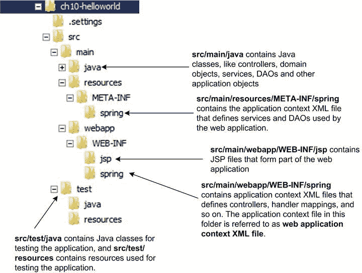

**图 10-1** `ch10-helloworld` 项目的目录结构

现在让我们查看一下构成 `ch10-helloworld` 项目的配置文件和类。

## 10-3 理解“Hello World” Web 应用程序

如果你在 Eclipse IDE 中右键点击 `ch10-helloworld` 项目并选择 Build Path **à** Configure Build Path 选项，你会发现项目依赖于 `spring-beans`、`spring-context`、`spring-core`、`spring-expression`、`spring-web` 和 `spring-webmvc` JAR 文件。构建基础的 Spring Web MVC 应用程序需要这些 JAR 文件。

下表描述了构成 `ch10-helloworld` 项目的配置文件和 Java 源文件。在本节的后面，我们将详细查看这些文件和类。

| 配置文件或 Java 源文件 | 描述 |
| :--- | :--- |
| `HelloWorldController.java` | 负责处理请求的 Spring Web MVC `controller`。你可以在 `src/main/java` 文件夹下的 `sample.spring.chapter10.web` 包中找到该文件。 |
| `helloworld.jsp` | 显示“Hello World !!”消息的 JSP 文件。你可以在 `src/main/webapp/WEB-INF/jsp` 文件夹中找到该文件 |
| `myapp-config.xml` | Web application context XML 文件，包含控制器、处理器映射等的 bean 定义。你可以在 `src/main/webapp/WEB-INF/spring` 文件夹中找到该文件 |
| `web.xml` | Web 应用程序部署描述符。你可以在 `src/main/webapp/WEB-INF` 文件夹中找到该文件 |

除了上表所示的文件外，`ch10-helloworld` 项目还包含包含 Log4j 配置的 `log4j.properties` 文件以及作为 Maven 构建工具输入的 `pom.xml` 文件。要进一步了解这些文件，请参考 Log4j (`http://logging.apache.org/log4j/1.2/`) 和 Maven (`http://maven.apache.org/index.html`) 文档。

现在让我们详细查看上表描述的每个文件。

### HelloWorldController.java – Hello World Web 应用程序的控制器类

在 Spring Web MVC 应用中，请求处理逻辑包含在控制器中。下面的示例列表显示了 `ch10-helloworld` 项目的 `HelloWorldController` 控制器类：

**示例列表 10-1** – `HelloWorldController` 类

**Project** – `ch10-helloworld`

**Source location** – `src/main/java/sample/spring/chapter10/web`

```java
package sample.spring.chapter10.web;

import org.springframework.web.servlet.ModelAndView;
import org.springframework.web.mvc.Controller;
import java.util.HashMap;
import java.util.Map;

public class HelloWorldController implements Controller {

    @Override
    public ModelAndView handleRequest(HttpServletRequest request, HttpServletResponse response) throws Exception {
        Map<String, String> modelData = new HashMap<String, String>();
        modelData.put("msg", "Hello World !!");
        return new ModelAndView("helloworld", modelData);
    }
}
```

上面的示例列表显示 `HelloWorldController` 实现了 Spring 的 `Controller` 接口。`Controller` 接口定义了一个 `handleRequest` 方法，你需要实现它以提供请求处理逻辑。`handleRequest` 方法返回一个包含以下信息的 `ModelAndView` 对象：

- 显示给用户的数据（称为 `model` 数据）
- 显示模型数据的 JSP 页面的逻辑名称（称为 `view`）

模型数据通常表示为 `java.util.Map` 类型对象，`java.util.Map` 对象中的每个条目都代表一个 `model attribute`（模型属性）。显示给用户的视图（JSP 页面）名称指定为 String 值。

示例列表 10-1 显示 `HelloWorldController` 的 `handleRequest` 方法返回一个 `ModelAndView` 对象，该对象包含 `helloworld`（一个 String 值）作为视图名称以及 `modelData`（一个 `java.util.Map` 类型对象）作为模型数据。`modelData` 包含一个 `msg` 模型属性，其值为“Hello World !!”消息。我们很快就会看到 `msg` 模型属性被 `helloworld` 视图（一个 JSP 页面）用于向用户显示“Hello World !!”消息。下面的图表总结了 `HelloWorldController` 的 `handleRequest` 方法如何渲染 JSP 页面：

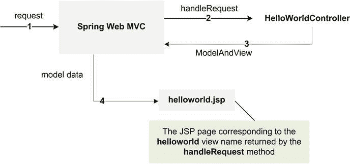

**图 10-2** Spring Web MVC 框架调用 `HelloWorldController` 的 `handleRequest` 方法并使用返回的 `ModelAndView` 对象渲染 `helloworld.jsp` 页面

上图显示 Spring Web MVC 框架拦截了传入的 HTTP 请求并调用了 `HelloWorldController` 的 `handleRequest` 方法。`handleRequest` 方法返回一个 `ModelAndView` 对象，该对象包含了模型数据和视图信息。从 `handleRequest` 方法接收到 `ModelAndView` 对象后，Spring Web MVC 框架将 HTTP 请求调度到 `helloworld.jsp` 页面，并将模型属性作为 `request attributes` 提供给 `helloworld.jsp` 页面。

**注意** Spring Web MVC 以适用于视图技术（如 JSP 和 Velocity）的格式向视图技术提供模型属性。例如如果你使用 JSP 作为视图技术，模型属性将作为请求属性提供给 JSP 页面。

### helloworld.jsp – 显示“Hello World !”消息的 JSP 页面

下面的示例列表显示了 `ch10-helloworld` 项目中的 `helloworld.jsp` 页面：

**示例列表 10-2** – `helloworld.jsp` JSP 页面

**项目** – `ch10-helloworld`

**源码位置** – `src/main/webapp/WEB-INF/jsp`

```jsp
<%@taglib uri="http://java.sun.com/jsp/jstl/core" prefix="c" %>

<c:out value="${msg}"/>
```

在上面的示例列表中，`<c:out>` 打印了 `msg` 请求属性的值。`msg` 请求属性指的是 `HelloWorldController` 的 `handleRequest` 方法返回的 `msg` 模型属性（参见示例列表 10-1）。由于 `msg` 模型属性的值为‘Hello World !!’，`helloworld.jsp` JSP 页面显示了‘Hello World !!’消息。

### myapp-config.xml – Web 应用上下文 XML 文件

接下来的示例列表显示了 `ch10-helloworld` 项目中 `myapp-config.xml` 文件里配置的豆：

**示例列表 10-3** – `myapp-config.xml`

**项目** – `ch10-helloworld`

**源码位置** – `src/main/webapp/WEB-INF/spring`

```xml
<beans xmlns="http://www.springframework.org/schema/beans"
    xmlns:xsi="http://www.w3.org/2001/XMLSchema-instance"
    xsi:schemaLocation="http://www.springframework.org/schema/beans
    http://www.springframework.org/schema/beans/spring-beans.xsd">
    <bean name="helloWorldController"
            class="sample.spring.chapter10.web.HelloWorldController" />
    <bean id="handlerMapping"
            class="org.springframework.web.servlet.handler.SimpleUrlHandlerMapping">
        <property name="urlMap">
            <map>
                <entry key="/sayhello" value-ref="helloWorldController" />
            </map>
        </property>
    </bean>
    <bean id="viewResolver"
            class="org.springframework.web.servlet.view.InternalResourceViewResolver">
        <property name="prefix" value="/WEB-INF/jsp/" />
        <property name="suffix" value=".jsp" />
    </bean>
</beans>
```

上面的示例列表显示，除了 `HelloWorldController` 之外，Spring 的 `SimpleUrlHandlerMapping` 和 `InternalResourceViewResolver` 豆也在 `myapp-config.xml` 文件中进行了配置。

`SimpleUrlHandlerMapping` 豆（Spring `HandlerMapping` 接口的实现）将传入的 HTTP 请求映射到负责处理请求的控制器。`SimpleUrlHandlerMapping` 豆使用 URL 路径将请求映射到控制器。`urlMap` 属性（类型为 `java.util.Map`）指定了 URL 路径到控制器豆的映射。在示例列表 10-3 中，`/sayhello` URL 路径（由 `key` 属性指定）映射到 `HelloWorldController` 豆（由 `value-ref` 属性指定）。你应该注意，由 `key` 属性指定的 URL 路径相对于 Web 应用部署描述符中 Spring 的 `DispatcherServlet`（一个 servlet）映射的 URL 路径。`DispatcherServlet` 将在本节稍后讨论。

`InternalResourceViewResolver` 豆（Spring `ViewResolver` 接口的实现）根据 `ModelAndView` 对象中包含的视图名称定位实际的视图（如 JSP 或 servlet）。通过在视图名称之前添加 `prefix` 属性的值并在之后添加 `suffix` 属性的值来定位实际的视图。示例列表 10-3 显示 `prefix` 属性的值为 `/WEB-INF/jsp/`，`suffix` 属性的值为 `.jsp`。由于 `HelloWorldController` 的 `handleRequest` 方法返回一个包含 `helloworld` 作为视图名称的 `ModelAndView` 对象，实际的视图是 `/WEB-INF/jsp/helloworld.jsp`（通过在 `helloworld` 视图名称之前添加 `/WEB-INF/jsp` 之后添加 `.jsp` 得到的字符串）。

### web.xml – Web 应用部署描述符


下图显示了 `web.xml` 文件中 `DispatcherServlet` 的配置：

```xml
<web-app xmlns="http://xmlns.jcp.org/xml/ns/javaee"
    xmlns:xsi="http://www.w3.org/2001/XMLSchema-instance"
    xsi:schemaLocation="http://xmlns.jcp.org/xml/ns/javaee
    http://xmlns.jcp.org/xml/ns/javaee/web-app_3_0.xsd"
    version="3.0">
    <servlet>
        <servlet-name>hello</servlet-name>
        <servlet-class>org.springframework.web.servlet.DispatcherServlet</servlet-class>
        <init-param>
            <param-name>contextConfigLocation</param-name>
            <param-value>/WEB-INF/spring/myapp-config.xml</param-value>
        </init-param>
        <load-on-startup>1</load-on-startup>
    </servlet>
    <servlet-mapping>
        <servlet-name>hello</servlet-name>
        <url-pattern>/helloworld/*</url-pattern>
    </servlet-mapping>
</web-app>
```

`DispatcherServlet` 关联一个 Web 应用上下文 XML 文件，该文件通过 `contextConfigLocation` servlet 初始化参数进行标识。在上面的示例列表中，`contextConfigLocation` 参数指向 `myapp-config.xml` 文件（参见示例列表 10-3）。

如果没有指定 `contextConfigLocation` 参数，`DispatcherServlet` 会在 Web 应用的 `WEB-INF` 目录下查找名为 `<name-of-DispatcherServlet>-servlet.xml` 的 Web 应用上下文 XML 文件。在这里，`<name-of-DispatcherServlet>` 的值是配置 `DispatcherServlet` 的 `<servlet>` 元素中 `<servlet-name>` 子元素指定的 servlet 名称。例如，如果我们在示例列表 10-3 中没有指定 `contextConfigLocation` 参数，`DispatcherServlet` 将查找名为 `hello-servlet.xml` 的文件。

在 Web 应用上下文 XML 文件中定义的 `HandlerMapping` 和 `ViewResolver` bean 会被 `DispatcherServlet` 用于处理请求。`DispatcherServlet` 使用 `HandlerMapping` 实现查找适用于请求的控制器，并使用 `ViewResolver` 实现根据控制器返回的视图名称解析实际的视图。

- `DispatcherServlet` 使用 `HandlerMapping` bean（在“Hello World”Web 应用程序中为 `SimpleUrlHandlerMapping` bean）来找到处理请求的合适控制器。
- `DispatcherServlet` 调用控制器的请求处理方法（在“Hello World”Web 应用程序中为 `HelloWorldController` 的 `handleRequest` 方法）。
- `DispatcherServlet` 将控制器返回的视图名称发送给 `ViewResolver` bean（在“Hello World”Web 应用程序中为 `InternalResourceViewResolver` bean），以找到要渲染的实际视图（JSP 或 servlet）。
- `DispatcherServlet` 将请求派发到实际视图（JSP 或 servlet）。控制器返回的模型数据将作为请求属性供视图使用。

“Hello World”Web 应用程序的 `DispatcherServlet` 被映射到 `/helloworld/*` 模式（参见示例列表 10-4），而 `SimpleUrlHandlerMapping` 将 `/sayhello` URL 路径映射到 `HelloWorldController` bean（参见示例列表 10-3）。如果你访问 URL `http://localhost:8080/ch10-helloworld/helloworld/sayhello`，将导致调用 `HelloWorldController` 控制器的 `handleRequest` 方法。下图显示了 Spring Web MVC 如何将 URL `http://localhost:8080/ch10-helloworld/helloworld/sayhello` 映射到 `HelloWorldController` 控制器：

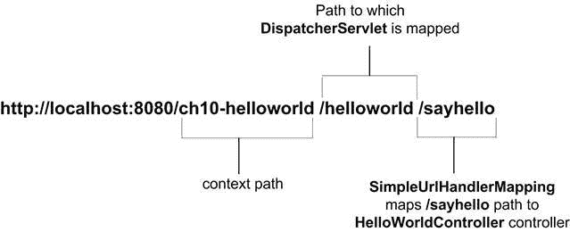

**图 10-5** URL 路径 `http://localhost:8080/ch10-helloworld/helloworld/sayhello` 如何被 Spring Web MVC 映射到 `HelloWorldController`

在上图中，URL 的 `/ch10-helloworld` 部分代表“Hello World”Web 应用程序的上下文路径，URL 的 `/helloworld` 部分映射到 `DispatcherServlet` servlet（参见示例列表 10-4），而 URL 的 `/sayhello` 部分映射到 `HelloWorldController` 控制器（参见示例列表 10-3）。

在本节中，我们看到了如何使用 Spring Web MVC 开发一个简单的“Hello World”Web 应用程序。现在，让我们仔细观察在 Spring Web MVC 应用程序中充当前置控制器的 `DispatcherServlet` servlet。

## 10-4 `DispatcherServlet` – 前置控制器

在上一节中，我们看到 `DispatcherServlet` 充当前置控制器，通过与 Web 应用程序上下文 XML 文件定义的 `HandlerMapping` 和 `ViewResolver` bean 交互来处理请求。在本节中，我们将查看 `DispatcherServlet` 在后台是如何工作的。

在初始化时，`DispatcherServlet` 会加载相应的 Web 应用程序上下文 XML 文件（这可以通过 `contextConfigLocation` 参数指定，或者命名为 `<name-of-DispatcherServlet>-servlet.xml` 并放置在 `WEB-INF` 目录下），创建一个 Spring `WebApplicationContext` 对象的实例。`WebApplicationContext` 是 `ApplicationContext` 接口的子接口，提供了特定于 Web 应用程序的功能。例如，`WebApplicationContext` 中的某些 bean 可以具有额外的作用域，如 request 和 session。你可以将 `WebApplicationContext` 对象认为代表 Spring Web MVC 应用程序中 Spring 容器实例的对象。

下表描述了你可以为 Web 应用程序上下文 XML 文件中配置的 bean 指定的额外作用域：

| Bean 作用域 | 说明 |
| :--- | :--- |
| `request` | Spring 容器为每个 HTTP 请求创建一个新的 bean 实例。当 HTTP 请求完成时，Spring 容器会销毁该 bean 实例。此作用域仅对适用于 Web 应用程序场景的 `ApplicationContext` 实现有效。例如，如果你正在使用 `XmlWebApplicationContext` 或 `AnnotationConfigWebApplicationContext`，才能为 bean 指定 request 作用域。 |
| `session` | 当创建 HTTP Session 时，Spring 容器创建一个新的 bean 实例。当 HTTP Session 销毁时，Spring 容器会销毁该 bean 实例。此作用域仅对适用于 Web 应用程序场景的 `ApplicationContext` 实现有效。例如，如果你使用 `XmlWebApplicationContext` 或 `AnnotationConfigWebApplicationContext`，才能为 bean 指定 session 作用域。 |
| `global` | 如果 Web 应用包含多个模块，可以在 `web.xml` 中为每个模块定义 `DispatcherServlet`。在这种情况下，每个 `DispatcherServlet` 都有自己的应用上下文文件（包含控制器、视图解析器等）。请注意，这些 bean 不会在 `DispatcherServlet` 之间共享。如前所述，`WebApplicationContext` 共享的 bean 定义在根应用上下文文件中。 |（注：此处原文逻辑较乱，已对应翻译）

在上一节中，我们看到 `DispatcherServlet` 充当前置控制器，通过与 Web 应用程序上下文 XML 文件定义的 `HandlerMapping` 和 `ViewResolver` bean 交互来处理请求。在本节中，我们将查看 `DispatcherServlet` 在后台是如何工作的。

在初始化时，`DispatcherServlet` 会加载相应的 Web 应用程序上下文 XML 文件（这可以通过 `contextConfigLocation` 参数指定，或者命名为 `<name-of-DispatcherServlet>-servlet.xml` 并放置在 `WEB-INF` 目录下），创建一个 Spring `WebApplicationContext` 对象的实例。`WebApplicationContext` 是 `ApplicationContext` 接口的子接口，提供了特定于 Web 应用程序的功能。例如，`WebApplicationContext` 中的某些 bean 可以具有额外的作用域，如 request 和 session。你可以将 `WebApplicationContext` 对象认为代表 Spring Web MVC 应用程序中 Spring 容器实例的对象。

下表描述了你可以为 Web 应用程序上下文 XML 文件中配置的 bean 指定的额外作用域：

| Bean 作用域 | 说明 |
| :--- | :--- |
| `request` | Spring 容器为每个 HTTP 请求创建一个新的 bean 实例。当 HTTP 请求完成时，Spring 容器会销毁该 bean 实例。此作用域仅对适用于 Web 应用程序场景的 `ApplicationContext` 实现有效。例如，如果你正在使用 `XmlWebApplicationContext` 或 `AnnotationConfigWebApplicationContext`，才能为 bean 指定 request 作用域。 |
| `session` | 当创建 HTTP Session 时，Spring 容器创建一个新的 bean 实例。当 HTTP Session 销毁时，Spring 容器会销毁该 bean 实例。此作用域仅对适用于 Web 应用程序场景的 `ApplicationContext` 实现有效。例如，如果你使用 `XmlWebApplicationContext` 或 `AnnotationConfigWebApplicationContext`，才能为 bean 指定 session 作用域。 |
| `global` | 如果 Web 应用包含多个模块，可以在 `web.xml` 中为每个模块定义 `DispatcherServlet`。在这种情况下，每个 `DispatcherServlet` 都有自己的应用上下文文件（包含控制器、视图解析器等）。请注意，这些 bean 不会在 `DispatcherServlet` 之间共享。如前所述，`WebApplicationContext` 共享的 bean 定义在根应用上下文文件中。 |（注：此处原文逻辑较乱，已对应翻译）

在上述图中，URL 的 `/ch10-helloworld` 部分代表“Hello World”Web 应用程序的上下文路径，URL 的 `/helloworld` 部分映射到 `DispatcherServlet` servlet（参见示例列表 10-4），而 URL 的 `/sayhello` 部分映射到 `HelloWorldController` 控制器（参见示例列表 10-3）。

在本节中，我们看到了如何使用 Spring Web MVC 开发一个简单的“Hello World”Web 应用程序。现在，让我们仔细观察在 Spring Web MVC 应用程序中充当前置控制器的 `DispatcherServlet` servlet。

## 10-4 `DispatcherServlet` – 前置控制器

在上一节中，我们看到 `DispatcherServlet` 充当前置控制器，通过与 Web 应用程序上下文 XML 文件定义的 `HandlerMapping` 和 `ViewResolver` bean 交互来处理请求。在本节中，我们将查看 `DispatcherServlet` 在后台是如何工作的。

```java
import org.springframework.web.context.ServletContextAware;

public class ABean implements ServletContextAware, ServletConfigAware {

  private ServletContext servletContext;

  private ServletConfig servletConfig;

    @Override
  public void setServletContext(ServletContext servletContext) {
        this.servletContext = servletContext;
    }

    @Override
  public void setServletConfig(ServletConfig servletConfig) {
        this.servletConfig = servletConfig;
    }

    public void doSomething() {
        //--use ServletContext and ServletConfig objects
    }
}
```

上面的示例列表显示 `ABean` 类实现了 `ServletContextAware` 和 `ServletConfigAware` 接口。`ServletContextAware` 接口定义了一个 `setServletContext` 方法，该方法由 Spring 容器调用，为 `ABean` 实例提供 `ServletContext` 对象实例。`ServletConfigAware` 接口定义了一个 `setServletConfig` 方法，该方法由 Spring 容器调用，为 `ABean` 实例提供 `ServletConfig` 对象实例。

我们之前已经看到可以通过实现 `Controller` 接口来创建一个控制器。现在让我们来看看 `@Controller` 和 `@RequestMapping` 注解，它们简化了控制器的开发。

## 10-5 使用 `@Controller` 和 `@RequestMapping` 注解开发控制器

Spring Web MVC 提供了如 `MultiActionController`、`UrlFilenameViewController`、`AbstractController` 等类，你可以扩展这些类来创建自己的控制器实现。如果你通过扩展 Spring 特定类或实现 Spring 特定接口来创建控制器，该控制器类将与 Spring 紧耦合。Spring 2.5 引入了 `@Controller`、`@RequestMapping`、`@ModelAttribute` 等注解，允许你创建具有灵活方法名的控制器。在本节中，我们将介绍开发注解控制器的不同 Spring Web MVC 注解。

让我们先来看一个使用注解控制器的 Hello World 应用程序，它用于显示“Hello World !!”消息。

**导入** `chapter 10/ch10-annotation-helloworld`（该项目展示了一个使用注解控制器显示“Hello World !!”消息的简单 Hello World 应用程序。如果你将项目部署在 Tomcat 服务器上并访问 URL `http://localhost:8080/ch10-annotation-helloworld/helloworld/saySomething/sayhello`，你将看到“Hello World !!”消息。）

### 使用注解控制器开发“Hello World”应用程序


`ch10-annotation-helloworld` 项目与 `ch10-helloworld` 类似，不同之处在于 `ch10-annotation-helloworld` 项目使用注解控制器显示“Hello World !!”消息。两个项目的 `web.xml` 和 `helloworld.jsp` 文件完全相同，但 `HelloWorldController.java` 和 `myapp-config.xml` 文件是不同的。因此，我们在本节中将讨论限于 `HelloWorldController.java` 和 `myapp-config.xml` 文件。

让我们先看看使用 `@Controller` 和 `@RequestMapping` 注解创建控制器。

### `@Controller` 和 `@RequestMapping` 注解

你通过 `@Controller` 注解将特定类指定为 Spring Web MVC 控制器。此外，你使用 `@RequestMapping` 注解将传入请求映射到控制器的相应方法。

下面的示例列表显示了使用 `@Controller` 和 `@RequestMapping` 注解的 `HelloWorldController` 类：

**示例列表 10-6** – `HelloWorldController` 类 - `@Controller` 和 `@RequestMapping` 的用法

```java
package sample.spring.chapter10.web;

import org.springframework.stereotype.Controller;
import org.springframework.web.bind.annotation.RequestMapping;

import org.springframework.web.servlet.ModelAndView;

.....

@Controller(value="sayHelloController")
@RequestMapping("/saySomething")
public class HelloWorldController {
    @RequestMapping("/sayhello")
    public ModelAndView sayHello() {
         Map<String, String> modelData = new HashMap<String, String>();
         modelData.put("msg", "Hello World !!");
         return new ModelAndView("helloworld", modelData);
     }
}
```

在上面的示例列表中，`HelloWorldController` 类被标记了 `@Controller` 和 `@RequestMapping` 注解，`sayHello` 方法被标记了 `@RequestMapping` 注解。`@Controller` 注解是 `@Component` 注解的特殊形式（参考第 6 章），表示 `HelloWorldController` 是一个控制器组件。

与被 `@Service`（参考第 6 章）和 `@Repository`（参考第 7 章）注解的类一样，被 `@Controller` 注解的类会自动注册到 Spring 容器；你不需要在 Web 应用程序上下文 XML 文件中显式定义被 `@Controller` 注解的类。

`@Controller` 注解的 `value` 属性指定了类注册到 Spring 容器时的名称。`value` 属性的作用与 `<bean>` 元素的 `id` 属性相同。如果没有指定 `value` 属性，则使用类的名称（首字母小写）来向 Spring 容器注册该类。

`@RequestMapping` 注解将传入的 Web 请求映射到相应的控制器和控制器方法。类型级别的 `@RequestMapping` 注解将请求映射到相应的控制器。例如，`HelloWorldController` 类上的 `@RequestMapping("/saySomething")` 表示所有对 `/saySomething` 请求路径的请求都由 `HelloWorldController` 控制器处理。方法级别的 `@RequestMapping` 将类型级别的 `@RequestMapping` 缩小到控制器类中的特定方法。例如，示例列表 10-6 中 `sayHello` 方法上的 `@RequestMapping("/sayhello")` 注解指定当请求路径为 `/saySomething/sayhello` 时调用 `sayHello` 方法。注意 `HelloWorldController` 的 `sayHello` 方法没有接受任何参数并返回一个 `ModelAndView` 对象。这是因为注解控制器可以具有灵活的方法签名。在 10-7 节中，我们将查看 `@RequestMapping` 注解方法可以定义的各种参数和返回类型。

类型级别的 `@RequestMapping` 注解通常指定请求路径或路径模式。方法级别的 `@RequestMapping` 注解通常指定 HTTP 方法或请求参数，以进一步缩小类型级别 `@RequestMapping` 注解指定的映射。下图显示了 `http://localhost:8080/ch10-annotation-helloworld/helloworld/saySomething/sayhello` URL 如何通过 Spring Web MVC 调用 `HelloWorldController` 的 `sayHello` 方法：

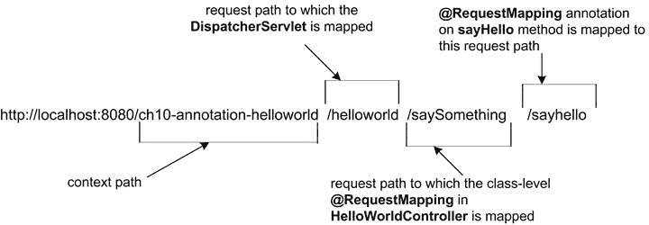

**图 10-7** URL 如何映射到控制器的相应的 `@RequestMapping` 注解方法

上面的图显示了特定的 URL 如何导致 `HelloWorldController` 的 `sayHello` 方法。

### 启用 Spring Web MVC 注解

要在 Spring Web MVC 应用程序中使用注解控制器，你需要使用 Spring mvc 架构中的 `<annotation-driven>` 元素启用 Spring Web MVC 注解，如下例所示：

**示例列表 10-7** – `myapp-config.xml`

**项目** – `ch10-annotation-helloworld`

**源位置** – `src/main/webapp/WEB-INF/spring`

```xml
<beans .....
  xmlns:mvc="http://www.springframework.org/schema/mvc"
  xsi:schemaLocation=".....http://www.springframework.org/schema/mvc
  http://www.springframework.org/schema/mvc/spring-mvc-4.0.xsd.....">

  <mvc:annotation-driven />
  <context:component-scan base-package="sample.spring.chapter10.web" />

  <bean id="viewResolver"
      class="org.springframework.web.servlet.view.InternalResourceViewResolver">
```

```xml
<property name="prefix" value="/WEB-INF/jsp/" />
<property name="suffix" value=".jsp" />
</bean>
</beans>
```

在上面的示例列表中，Spring mvc schema 中的 `<mvc:annotation-driven>` 元素允许在实现控制器时使用 Spring Web MVC 注解。此外，context schema 中的 `<component-scan>` 元素（详情请参见第 6-2 节）用于将带有 `@Controller` 注解的类自动注册到 Spring。

在本节中，我们看到了如何使用 `@Controller` 和 `@RequestMapping` 注解开发一个简单的“Hello World”Web 应用程序。现在让我们来看在本章将用 Spring Web MVC 注解开发的 MyBank Web 应用程序的需求。

## 10-6 MyBank Web 应用程序的需求

下图显示了 MyBank Web 应用程序的首页，该页面显示了系统中当前活跃的定期存款列表：

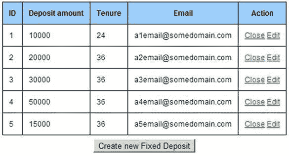

**图 10-8** MyBank Web 应用程序的首页显示了定期存款详情。网页提供了关闭、编辑和创建定期存款的选项。

在上面的图中，ID 列显示了定期存款的唯一标识符。ID 值在用户创建定期存款时分配给该存款。“关闭（Close）”和“编辑（Edit）”链接允许用户删除或编辑定期存款详情。“创建新的定期存款（Create new Fixed Deposit）”按钮显示“开启定期存款”表单，用于输入要开启的定期存款详情，如下图所示：

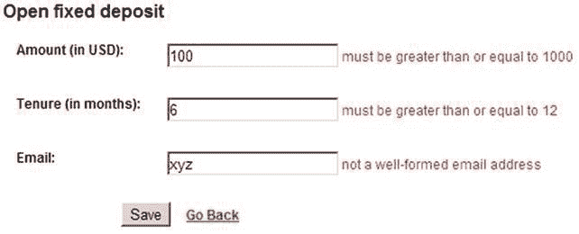

**图 10-9** 用于开启定期存款的“开启定期存款”表单。金额（Amount）、期限（Tenure）和电子邮件（Email）字段是必填的。

在上面的图中，点击保存（Save）按钮会将定期存款详情保存到数据存储中，而返回（Go Back）链接将用户带回显示定期存款列表的网页（参见图 10-8）。上面的图显示，如果输入的数据不符合金额、期限和电子邮件字段设置的约束，将显示相应的错误信息。

当你点击图 10-8 中的“编辑”链接时，将显示一个与图 10-9 类似的表单，用于修改所选定期存款的详情。并且，点击图 10-8 中的“关闭”链接会将选定的定期存款从定期存款列表中移除。

现在，我们已经了解了 MyBank Web 应用程序的需求，让我们来看看如何使用 Spring Web MVC 注解来实现它。

## 10-7 Spring Web MVC 注解 - `@RequestMapping` 和 `@RequestParam`

在第 10-5 节中，我们看到可以使用 `@Controller` 和 `@RequestMapping` 注解开发一个简单的控制器。在本节中，我们将更仔细地查看 `@RequestMapping` 以及其他简化带注解控制器开发的 Spring Web MVC 注解。

**导入第 10 章/ch10-bankapp**（此项目展示了 MyBank Web 应用程序，它允许用户管理定期存款。如果你将项目部署在 Tomcat 服务器上并访问 URL `http://localhost:8080/ch10-bankapp`，你将在系统中看到定期存款列表（如图 10-8 所示）。

让我们从查看 `@RequestMapping` 注解开始。

### 使用 `@RequestMapping` 将请求映射到控制器或控制器方法

在第 10-5 节中，我们看到 `@RequestMapping` 注解用于类型级别和方法级别，以便将请求映射到控制器及其方法。在本节中，我们首先将查看 Spring Web MVC 如何将 Web 请求映射到使用 `@RequestMapping` 注解的特定控制器方法。然后我们将查看 `@RequestMapping` 注解的属性，以及带 `@RequestMapping` 注解的方法可以拥有的参数和返回类型。

#### `@RequestMapping` 注解和 `RequestMappingHandlerMapping`

下面的示例列表显示了 `@RequestMapping` 注解在 `SomeController`（一个 Spring Web MVC 控制器）类中的用法：

**示例列表 10-8** – `SomeController` 类 - `@RequestMapping` 用法

```java
@Controller

@RequestMapping("/type_Level_Url")
public class SomeController {

  @RequestMapping("/methodA_Url")
    public ModelAndView methodA() { ..... }

  @RequestMapping("/methodB_Url")
  public ModelAndView methodB() { ..... }
}
```

Spring mvc schema 中的 `<annotation-driven>` 元素会创建一个 `RequestMappingHandlerMapping` 实例（`HandlerMapping` 的实现），它负责将 Web 请求映射到适当的带有 `@RequestMapping` 注解的方法。`RequestMappingHandlerMapping` 将控制器方法视为端点，并负责根据类型级别和方法级别的 `@RequestMapping` 注解将请求唯一地映射到控制器方法。对于 `SomeController`，如果请求路径为 `/type_Level_Url/methodA_Url`，则调用 `methodA`；如果请求路径为 `/type_Level_Url/methodB_Url`，则调用 `methodB`。你应该注意，如果请求无法唯一地映射到控制器方法，则会返回 HTTP 404（意味着未找到资源）状态码。

`@RequestMapping` 注解的属性用于缩小请求到特定控制器或控制器方法的映射范围。你可以在类型级别和方法级别的 `@RequestMapping` 注解上指定这些属性。现在让我们来看 `@RequestMapping` 注解的属性。

#### 根据请求路径映射请求

`@RequestMapping` 的 `value` 属性指定了控制器或控制器方法映射的请求路径。你可以在 `@RequestMapping` 注解中不显式指定 `value` 属性的情况下直接指定请求路径。例如，你可以将 `@RequestMapping(value = "/type_Level_Url")` 指定为 `@RequestMapping("/type_Level_Url")`。

你也可以将 Ant 风格模式作为 `value` 属性。例如，你可以指定 `/myUrl/*`、`/myUrl/**` 和 `/myUrl/*.do` 作为 `value` 属性。下面的示例列表显示了一个指定 `/myUrl/**` 为路径的 `@RequestMapping`：

**示例列表 10-9** – `SomeController` 类 – Ant 风格路径用法

```java
@Controller

@RequestMapping("/myUrl/**")
public class SomeController { ..... }
```

在上面的示例列表中，类型级别的 `@RequestMapping("/myUrl/**")` 指定 `SomeController` 控制器处理所有以 `/myUrl` 开头的请求。例如，`/myUrl/abc`、`/myUrl/xyz` 和 `/myUrl/123/something` 的请求由 `SomeController` 处理。

#### 根据 HTTP 方法映射请求

`@RequestMapping` 的 `method` 属性指定了控制器或控制器方法处理的 HTTP 方法。因此，如果 `method` 属性指定了 HTTP GET 方法，控制器或方法只处理 HTTP GET 请求。

下面的示例列表显示了 `FixedDepositController` 的 `listFixedDeposits` 方法，它负责渲染系统的定期存款列表：

**示例列表 10-10** – `@RequestMapping` 的 `method` 属性用法

**项目** – `ch10-bankapp`

**源码位置** – `src/main/java/sample/spring/chapter10/web`

```java
package sample.spring.chapter10.web;

import org.springframework.web.bind.annotation.RequestMethod;.....

@Controller

@RequestMapping(value="/fixedDeposit")
public class FixedDepositController {

  .....

  @RequestMapping(value = "/list", method = RequestMethod.GET)
  public ModelAndView listFixedDeposits() { ..... }

  .....
}
```

在上面的示例列表中，`listFixedDeposits` 方法上的 `@RequestMapping` 注解将 `method` 属性的值指定为 `RequestMethod.GET`。`RequestMethod` 是一个定义 HTTP 请求方法的枚举，如 `GET`、`POST`、`PUT`、`DELETE` 等。由于 `method` 属性的值为 `RequestMethod.GET`，只有当向 `/fixedDeposit/list` 路径发送 HTTP GET 请求时，才会调用 `listFixedDeposits` 方法。

你也可以指定一个 HTTP 方法数组作为 `method` 属性的值，如下例列表所示：

**示例列表 10-11** – 将多个 HTTP 方法指定为 `method` 属性的值


```java
@Controller

@RequestMapping(value="/sample")
public class MyController {
  @RequestMapping(value = "/action" method={ RequestMethod.GET, RequestMethod.POST })
    public ModelAndView action() { ..... }
}
```

在上面的示例列表 `str` 中，`action` 方法被标记了 `@RequestMapping` 注解，该注解的 `method` 属性的值为 `{ RequestMethod.GET, RequestMethod.POST }`。这意味着如果向 `/sample/action` 路径发送 HTTP GET 或 POST 请求，将调用该 `action` 方法。

### 根据请求参数映射请求

`@RequestMapping` 的 `params` 属性通常指定请求参数的名称和值，该参数**必须**出现在请求中。下面的示例显示了 `FixedDepositController` 的 `showOpenFixedDepositForm` 方法，该方法负责显示创建固定存款的表单：

**示例列表 10-12** – `@RequestMapping` 的 `params` 属性用法

**项目** – `ch10-bankapp`

**源位置** – `src/main/java/sample/spring/chapter10/web`

```java
package sample.spring.chapter10.web;

import org.springframework.web.bind.annotation.RequestMethod;
.....

@Controller
@RequestMapping(value="/fixedDeposit")
public class FixedDepositController {
  .....
  @RequestMapping(params = "fdAction=createFDForm", method = RequestMethod.POST)
    public ModelAndView showOpenFixedDepositForm() { ..... }
  .....
}
```

在上面的示例列表中，`showOpenFixedDepositForm` 方法上的 `@RequestMapping` 注解将 `params` 属性的值指定为 `fdAction=createFDForm`。由于 `FixedDepositController` 被映射到 `/fixedDeposit` 路径，如果向 `/fixedDeposit` 路径发送一个包含名为 `fdAction` 且值为 `createFDForm` 的请求参数的 HTTP POST 请求，将调用 `showOpenFixedDepositForm` 方法。

如果你想根据多个请求参数的值将请求映射到控制器或控制器方法，你可以指定一个请求参数键值对数组作为 `params` 属性的值，如下例列表所示：

**示例列表 10-13** – 将多个请求参数键值对指定为 `params` 属性的值

```java
  @RequestMapping(params = { "x=a", "y=b" })
    public void perform() { ..... }
```

在上面的示例列表中，只有当请求包含名为 `x` 和 `y` 且值分别为 `a` 和 `b` 的参数时，才会调用 `perform` 方法。

你也可以根据请求中是否存在请求参数将请求映射到控制器或控制器方法。你只需要将请求参数的名称指定为 `params` 属性的值即可。例如，这里显示的 `perform` 方法无论请求参数 `x` 的值如何都会调用：

**示例列表 10-14** – 如果找到请求参数 `x` 则调用 `perform` 方法

```java
  @RequestMapping(params = "x")
    public void perform() { ..... }
```

若要在请求参数**不存在**时将请求映射到控制器或控制器方法，请使用 `!` 运算符。例如，如果请求中**没有找到**名为 `x` 的请求参数，则调用以下 `perform` 方法：

**示例列表 10-15** – 如果未找到请求参数 `x` 则调用 `perform` 方法

```java
  @RequestMapping(params = "!x")
    public void perform() { ..... }
```

你可以使用 `!=` 运算符在请求参数的值**不等于**指定的值时将请求映射到控制器或控制器方法，如下所示：

**示例列表 10-16** – 如果请求参数 `x` 的值**不等于** `a` 则调用 `perform` 方法

```java
  @RequestMapping(params = "x != a")
    public void perform() { ..... }
```

在上面的示例列表中，只有当请求包含名为 `x` 的请求参数且 `x` 的值**不等于** `a` 时，才会调用 `perform` 方法。

### 根据请求的 MIME 类型映射请求

`Content-Type` 请求头指定了请求的 MIME 类型。`@RequestMapping` 的 `consumes` 属性指定控制器或控制器方法处理的请求 MIME 类型。因此，如果 `consumes` 属性的值与 `Content-Type` 请求头的值匹配，则该请求将被映射到特定的控制器或控制器方法。

下面的示例列表显示，如果 `Content-Type` 头部的值为 `application/json`，则调用 `perform` 方法：

**示例列表 10-17** – 如果 `Content-Type` 头部值为 `application/json` 则调用 `perform` 方法

```java
  @RequestMapping(consumes = "application/json")
    public void perform() { ..... }
```

与 `params` 属性一样，你可以使用 `!` 运算符来指定 `Content-Type` 头部值**不存在**的条件。例如，如果 `Content-Type` 头部的值**不是** `application/json`，则调用以下 `perform` 方法：

**示例列表 10-18** – 如果 `Content-Type` 头部值不是 `application/json` 则调用 `perform` 方法

```java
  @RequestMapping(consumes = "!application/json")
    public void perform() { ..... }
```

你可以在 `consumes` 属性中指定值数组，如果 `Content-Type` 匹配 `consumes` 属性指定的值之一，则将请求映射到控制器或控制器方法。在下面的示例列表中，如果 `Content-Type` 为 `application/json` 或 `text/plain`，将调用 `perform` 方法：

**示例列表 10-19** – 如果 `Content-Type` 为 `application/json` 或 `text/plain` 则调用 `perform` 方法

```java
  @RequestMapping(consumes = { "application/json", "text/plain" })
    public void perform() { ..... }
```

### 根据响应的 MIME 类型映射请求

`Accept` 请求头指定了响应的 MIME 类型。`@RequestMapping` 的 `produces` 属性指定了响应的 MIME 类型。因此，如果 `produces` 属性的值与 `Accept` 请求头的值匹配，则请求将被映射到特定的控制器或控制器方法。

下面的示例列表显示，如果 `Accept` 请求头部的值为 `application/json`，则调用 `perform` 方法：

**示例列表 10-20** – 如果 `Accept` 请求头部值为 `application/json` 则调用 `perform` 方法

```java
  @RequestMapping(produces = "application/json")
    public void perform() { ..... }
```

与 `consumes` 属性一样，你可以使用 `!` 运算符来指定 `Accept` 头部值**不在**请求中的条件。如果你在 `produces` 属性中指定值数组，当 `Accept` 头部值匹配 `produces` 属性指定的值之一时，将映射到控制器或控制器方法。

### 根据请求头值映射请求

要根据请求头映射请求，可以使用 `@RequestMapping` 的 `headers` 属性。下面的示例列表显示，如果 `Content-Type` 头部的值为 `text/plain`，则将请求映射到 `perform` 方法：

**示例列表 10-21** – 如果 `Content-Type` 头部值为 `text/plain` 则调用 `perform` 方法

```java
  @RequestMapping(headers = "Content-Type=text/plain")
    public void perform() { ..... }
```

与 `params` 属性一样，在指定 `headers` 属性的值时可以使用 `!` 和 `!=` 运算符。例如，下面的示例列表显示，如果 `Content-Type` 头部的值**不等于** `application/json`、请求中**不存在** `Cache-Control` 头部且请求中**存在**任意值的 `From` 头部，则将请求映射到 `perform` 方法：

**示例列表 10-22** – 在指定 `headers` 属性的值时使用 `!` 和 `!=` 运算符

```java
  @RequestMapping(headers = { "Content-Type != application/json", "!Cache-Control", "From"} )
```

```java
public void perform() { ..... }
```

现在，我们已经查看了 `@RequestMapping` 注解的属性，让我们来看可以传递给 `@RequestMapping` 注解方法的参数。

### `@RequestMapping` 注解方法的参数

被 `@RequestMapping` 注解的方法具有灵活的方法签名。可以传递给 `@RequestMapping` 注解方法的参数类型包括 `HttpServletRequest`、`HttpSession`、`java.security.Principal`、`org.springframework.validation.BindingResult`、`org.springframework.web.bind.support.SessionStatus`、`org.springframework.ui.Model` 等。要查看传递给 `@RequestMapping` 注解方法的参数完整列表，请参考 `@RequestMapping` 的 Javadoc。

在本书中讨论不同的 Spring Web MVC 特性时，我们会遇到需要向 `@RequestMapping` 注解方法传递不同参数类型的场景。目前，我们将查看一个需要发送 `HttpServletRequest` 对象作为参数的场景。

下面的示例显示了 `FixedDepositController` 的 `viewFixedDepositDetails` 方法，它接受类型为 `HttpServletRequest` 的参数：

**示例列表 10-23** – `FixedDepositController` 类 - 传递 `HttpServletRequest` 参数

**项目** – `ch10-bankapp`

**源位置** – `src/main/java/sample/spring/chapter10/web`

```java
package sample.spring.chapter10.web;

import javax.servlet.http.HttpServletRequest;

.....

public class FixedDepositController {

  .....

    @RequestMapping(params = "fdAction=view", method = RequestMethod.GET)

    public ModelAndView viewFixedDepositDetails(HttpServletRequest request) {

        FixedDepositDetails fixedDepositDetails = fixedDepositService
                .getFixedDeposit(Integer.parseInt(request.getParameter("fixedDepositId"))));

        .....

    }

  .....
}
```

当您点击固定存款对应的编辑超链接时（参见图 10-8），将调用 `viewFixedDepositDetails` 方法。`viewFixedDepositDetails` 方法使用 `HttpServletRequest` 来获取 `fixedDepositId` 请求参数，该参数唯一标识了系统中的某个固定存款。

现在让我们来看 `@RequestMapping` 注解方法支持的返回类型。

### `@RequestMapping` 注解方法的返回类型

`@RequestMapping` 注解方法支持的返回类型包括 `ModelAndView`、`org.springframework.web.servlet.View`、`String`、`java.util.concurrent.Callable`、`void` 等。要查看 `@RequestMapping` 注解方法支持的返回类型完整列表，请参考 `@RequestMapping` 的 Javadoc。

在本书中讨论不同的 Spring Web MVC 特性时，我们会遇到需要 `@RequestMapping` 注解方法具有不同返回类型的场景。在本节中，我们只查看具有 `String` 或 `ModelAndView` 返回类型的示例。

下面的示例列表显示了 `FixedDepositController` 的 `showOpenFixedDepositForm` 方法，它渲染用于开启新固定存款的 HTML 表单（参见图 10-9）：

**示例列表 10-24** – `FixedDepositController` 类 - `ModelAndView` 返回类型示例

**项目** – `ch10-bankapp`

**源位置** – `src/main/java/sample/spring/chapter10/web`

```java
package sample.spring.chapter10.web;

import org.springframework.ui.ModelMap;

.....

public class FixedDepositController {

  .....

  @RequestMapping(params = "fdAction=createFDForm", method = RequestMethod.POST)

    public ModelAndView showOpenFixedDepositForm() {

        FixedDepositDetails fixedDepositDetails = new FixedDepositDetails();

        fixedDepositDetails.setEmail("You must enter a valid email");

        ModelMap modelData = new ModelMap();

        modelData.addAttribute(fixedDepositDetails);

        return new ModelAndView("createFixedDepositForm", modelData);

    }

  .....
}
```

`showOpenFixedDepositForm` 方法返回一个 `ModelAndView` 对象，该对象包含一个 `FixedDepositDetails` 实例作为模型属性，并将 `createFixedDepositForm` 字符串作为视图名称。

如果你将上述示例列表与 10-1 和 10-6 对比，你会发现 `showOpenFixedDepositForm` 方法使用 Spring 的 `ModelMap` 对象而不是 `java.util.Map` 来存储模型属性。`ModelMap` 是 `java.util.Map` 接口实现，允许你在不显式指定名称的情况下存储模型属性。`ModelMap` 根据预定义的策略自动生成模型属性的名称。例如，如果你添加一个自定义的 Java 对象作为模型属性，该对象的类名（首字母小写）将用作模型属性的名称。在上面的示例列表中，当 `FixedDepositDetails` 实例被添加到 `ModelMap` 时，它将以 `fixedDepositDetails` 的名称存储在其中。


当 `@RequestMapping` 注解方法返回字符串值时，它被视为视图名称，由为 Web 应用配置的 `ViewResolver` 解析为实际视图（如 JSP 页面或 servlet）。下面的示例列表显示了 `ch10-bankapp` 项目中 `InternalResourceViewResolver` 的配置：

**示例列表 10-25** – `bankapp-config.xml` – ViewResolver 配置

**项目** – `ch10-bankapp`

**源位置** – `src/main/webapp/WEB-INF/spring`

```xml
<bean id="viewResolver"
    class="org.springframework.web.servlet.view.InternalResourceViewResolver">
    <property name="prefix" value="/WEB-INF/jsp/" />
    <property name="suffix" value=".jsp" />
</bean>
```

配置意味着当返回字符串 `xyz` 时，它会被解析为 `/WEB-INF/jsp/xyz.jsp`。要了解更多关于上述 `InternalResourceViewResolver` 配置的信息，请参见上述。

如果 `@RequestMapping` 注解方法返回的字符串以 `redirect:` 开头，则它被视为重定向 URL 而不是视图名称。下面的示例列表显示了 `FixedDepositController` 的 `closeFixedDeposit` 方法，当用户点击关闭按钮时（参见图 10-8）关闭固定存款：

**示例列表 10-26** – `FixedDepositController` 类 – String 返回类型示例

**项目** – `ch10-bankapp`

**源位置** – `src/main/java/sample/spring/chapter10/web`

```java
@RequestMapping(params = "fdAction=close", method = RequestMethod.GET)
public String closeFixedDeposit(int fdId) {
    fixedDepositService.closeFixedDeposit(fdId);
    return "redirect:/fixedDeposit/list";
}
```

`FixedDepositController` 的 `closeFixedDeposit` 方法根据参数 `fdId` 关闭固定存款，并返回 `redirect:/fixedDeposit/list` 字符串。由于返回的字符串带有 `redirect:` 前缀，用户将被重定向到显示固定存款列表的 `/fixedDeposit/list` URL（参见图 10-8）。

### 使用 `@RequestParam` 向控制器方法传递请求参数

我们在示例列表 10-23 中看到，可以将 `HttpServletRequest` 对象传递给控制器方法并使用它来获取请求参数。与其向控制器方法传递 `HttpServletRequest` 对象，不如对方法参数使用 `@RequestParam` 注解，将请求参数的值赋值给方法参数。

**注意**：你应该注意，`@RequestParam` 注解只有在方法带有 `@RequestMapping` 或 `@ModelAttribute`（第 11 章解释）注解时才能使用。

下面的示例列表显示了 `FixedDepositController` 的 `closeFixedDeposit` 方法，当用户点击关闭按钮时（参见图 10-8）调用该方法以关闭固定存款：

**示例列表 10-27** – `FixedDepositController` 类 – `@RequestParam` 使用

**项目** – `ch10-bankapp`

**源位置** – `src/main/java/sample/spring/chapter10/web`

```java
package sample.spring.chapter10.web;

import org.springframework.web.bind.annotation.RequestParam;

.....

public class FixedDepositController {

    .....

    @RequestMapping(params = "fdAction=close", method = RequestMethod.GET)
    public String closeFixedDeposit(@RequestParam(value = "fixedDepositId") int fdId) {
        fixedDepositService.closeFixedDeposit(fdId);
        return "redirect:/fixedDeposit/list";
    }

    .....
}
```

`@RequestParam` 的 `value` 属性指定请求参数的名称，该值将被赋值给方法参数。在上面的示例列表中，`@RequestParam` 注解被用于将 `fixedDepositId` 请求参数的值赋值给 `fdId` 方法参数。由于 `fdId` 参数的类型为 `int`，Spring 负责将 `fixedDepositId` 请求参数转换为 `int` 类型。

默认情况下，Spring 会自动为简单的 Java 类型（如 `int`、`long`、`java.util.Date` 等）提供类型转换。要将请求参数转换为自定义的 Java 类型（如 `Address`），你需要在向 Spring 的 `WebDataBinder` 实例注册自定义的 `PropertyEditors`，或者向 Spring 的 `FormattingConversionService` 实例注册 `org.springframework.format.Formatters`。我们将在第 11 章详细学习 `WebDataBinder`，并在第 13 章学习 `Formatter` 和 `FormattingConversionService`。

现在让我们看看如何在控制器方法中访问所有的请求参数。

### 将所有请求参数传递给控制器方法

要将所有请求参数传递给控制器方法，请定义一个类型为 `Map<String, String>` 或 `MultiValueMap<String, String>`（Spring 实现 `java.util.Map` 接口的对象）的参数，并使用 `@RequestParam` 注解对其标记。

下面的示例显示了 `FixedDepositController` 的 `openFixedDeposit` 方法，当用户输入存款详情并点击“开立存款”表单上的“保存”按钮时，该方法会创建一个存款（参见图 10-9）：

#### 示例列表 10-28 – `FixedDepositController` 类 – 访问所有请求参数

**项目** – `ch10-bankapp`

**源位置** – `src/main/java/sample/spring/chapter10/web`

```java
package sample.spring.chapter10.web;

import java.util.Map;

.....

@RequestMapping(value = "/fixedDeposit")
public class FixedDepositController {

    .....

    @RequestMapping(params = "fdAction=create", method = RequestMethod.POST)
    public ModelAndView openFixedDeposit(@RequestParam Map<String, String> params) {
        String depositAmount = params.get("depositAmount");
        String tenure = params.get("tenure");
        .....
    }
}
```

在上面的示例列表中，类型为 `Map<String, String>` 的参数 `params` 使用了 `@RequestParam` 注解。注意，`@RequestParam` 注解的 `value` 属性没有被指定。如果没有指定 `value` 属性且方法参数的类型为 `Map<String, String>` 或 `MultiValueMap<String, String>`，Spring 会将所有请求参数拷贝到方法参数中。每个请求参数的值存储在 `Map`（或 `MultiValueMap`）中，并将请求参数名称作为键。

接下来的示例列表显示了 `FixedDepositController` 的 `editFixedDeposit` 方法，该方法负责对现有存款进行修改：

#### 示例列表 10-29 – `FixedDepositController` 类 – 访问所有请求参数

**项目** – `ch10-bankapp`

**源位置** – `src/main/java/sample/spring/chapter10/web`

```java
package sample.spring.chapter10.web;

import org.springframework.util.MultiValueMap;

.....

public class FixedDepositController {

    .....

    @RequestMapping(params = "fdAction=edit", method = RequestMethod.POST)
    public ModelAndView editFixedDeposit(@RequestParam MultiValueMap<String, String> params) {
        String depositAmount = params.get("depositAmount").get(0);
        String tenure = params.get("tenure").get(0);
        .....
    }
}
```

在上面的示例列表中，`editFixedDeposit` 的参数 `params` 类型为 `MultiValueMap<String, String>`，并使用了 `@RequestParam` 注解。如果一个对象的类型为 `MultiValueMap<K, V>`，则意味着 `K` 是键的类型，`List<V>` 是值的类型。由于 `params` 参数的类型为 `MultiValueMap<String, String>`，这意味着键的类型是 `String`，值的类型是 `List<String>`。

在将请求参数存储在 `MultiValueMap<String, String>` 类型中时，Spring 使用请求参数名称作为键并将请求参数的值添加到 `List<String>` 值中。如果你有多个同名的请求参数，`MultiValueMap` 特别有用。

由于与请求参数对应的值类型为 `List<String>`，调用 `params.get(String key)` 会返回一个 `List<String>` 类型。出于此原因，在返回的 `List<String>` 上调用 `get(0)` 以获取请求参数 `depositAmount`、`tenure` 等的值。或者，你也可以使用 `MultiValueMap` 的 `getFirst(String key)` 方法从 `List<String>` 值中获取第一个元素。

现在让我们详细查看 `@RequestParam` 注解的各种属性。

### 使用 `value` 属性指定请求参数

我们之前看到，`@RequestParam` 的 `value` 属性指定请求参数的名称，该值将被赋值给方法参数。如果你没有指定 `value` 属性，则方法参数名称被视为请求参数的名称。例如，在下面的示例列表中，名为 `param` 的请求参数的值被赋值给 `param`：

#### 示例列表 10-30 – `@RequestParam` 使用 – 未指定的请求参数名

```java
@RequestMapping(.....)
public String doSomething(@RequestParam String param) {.....}
```

在上面的示例列表中，`@RequestParam` 未指定请求参数名称，因此 `param` 被视为请求参数的名称。

### 使用 `required` 属性指定请求参数为可选或强制

默认情况下，`@RequestParam` 指定的请求参数是强制的；如果在请求中未找到指定的参数，将抛出异常。你可以通过将 `required` 属性的值设置为 `false` 来指定请求参数为可选，如下所示：

#### 示例列表 10-31 – `@RequestParam` 的 `required` 属性

```java
@RequestMapping(.....)
public String perform(@RequestParam(value = "myparam", required = false) String param) {.....}
```

在上面的示例列表中，`@RequestParam` 的 `required` 属性值设置为 `false`，这意味着 `myparam` 请求参数是可选的。现在，如果请求中未找到 `myparam` 请求参数，将不会产生异常。相反，一个空值将被赋值给 `param` 方法参数。

### 使用 `defaultValue` 属性指定请求参数的默认值

`@RequestParam` 的 `defaultValue` 属性指定请求参数的默认值。如果请求中未找到 `@RequestParam.value` 属性指定的请求参数，则由 `defaultValue` 属性指定的值赋值给方法参数。接下来的示例列表显示了 `defaultValue` 属性的使用：

#### 示例列表 10-32 – `@RequestParam` 的 `defaultValue` 属性

```java
@RequestMapping(.....)
public String perform(@RequestParam(value = "location", defaultValue = "earth") String param) {.....}
```

在上面的示例列表中，如果请求中没有找到名为 `location` 的请求参数，则值 `earth` 将赋值给 `param` 方法参数。

在本节中，我们查看了通过 `@RequestMapping` 和 `@RequestParam` 注解创建 `MyBank` 应用程序 `FixedDepositController`。现在让我们来看看 `FixedDepositController` 类中如何执行表单数据的验证。

## 10-8 验证

我们之前看到 `FixedDepositController` 的 `showOpenFixedDepositForm` 方法（参见示例 10-24）渲染了 `createFixedDepositForm.jsp` 页面，该页面显示了开启新定期存款的表单。当提交表单时，表单中输入的数据将由 `FixedDepositController` 的 `openFixedDeposit` 方法进行验证（参见示例 10-28）。如果在验证期间报告了错误，将重新渲染 `createFixedDepositForm.jsp` 页面，并带有验证错误信息以及用户输入的原始表单数据（参见图 10-9）。

下面的示例显示了 `createFixedDepositForm.jsp` 页面的 `<form>` 元素：

#### 示例 10-33 – `createFixedDepositForm.jsp` – `<form>` 元素

**项目** – `ch10-bankapp`

**源位置** – `src/main/webapp/WEB-INF/jsp`

```html
<form name="createFixedDepositForm" method="POST" action="${pageContext.request.contextPath}/fixedDeposit?fdAction=create">
    .....
    <input type="submit" value="Save" />
</form>
```

在上面的示例中，`<form>` 元素的 `method` 属性指定 `POST` 为 HTTP 方法，`action` 属性指定 `/fixedDeposit?fdAction=create` 为用户点击 Save 按钮时表单提交的 URL。表单的提交将导致 `FixedDepositController` 的 `openFixedDeposit` 方法被调用。

下面的示例显示了 `openFixedDeposit` 方法如何执行验证，以及在发生验证错误时，用户输入的原始表单数据如何再次显示：

#### 示例 10-34 – `FixedDepositController` 的 `openFixedDeposit` 方法

**项目** – `ch10-bankapp`

**源位置** – `src/main/java/sample/spring/chapter10/web`

```java
package sample.spring.chapter10.web;
```


```
import org.apache.commons.lang3.math.NumberUtils;

@RequestMapping(value = "/fixedDeposit")

public class FixedDepositController {

    .....

    @RequestMapping(params = "fdAction=create", method = RequestMethod.POST)

    public ModelAndView openFixedDeposit(@RequestParam Map<String, String> params) {

        String depositAmount = params.get("depositAmount");

        .....

        Map<String, Object> modelData = new HashMap<String, Object>();

        if (!NumberUtils.isNumber(depositAmount)) {

            modelData.put("error.depositAmount", "enter a valid number");

        } else if (NumberUtils.toInt(depositAmount) < 1000) {

            modelData.put("error.depositAmount", "must be greater than or equal to 1000");

        }

        .....

        FixedDepositDetails fixedDepositDetails = new FixedDepositDetails();

        fixedDepositDetails.setDepositAmount(depositAmount);

        .....

        if (modelData.size() > 0) { // --这意味着意味着存在验证错误

            modelData.put("fixedDepositDetails", fixedDepositDetails);

            return new ModelAndView("createFixedDepositForm", modelData);

        } else {

            fixedDepositService.saveFixedDeposit(fixedDepositDetails);

            return new ModelAndView("redirect:/fixedDeposit/list");

        }

    }

    .....

}
```

`openFixedDeposit` 方法验证了用户输入的存款金额、期限和电子邮件信息。注意，为了简化数据验证，使用了 Apache Commons Lang ([http://commons.apache.org/proper/commons-lang/]) 库中的 `NumberUtils` 类。`modelData` 是一个 `java.util.Map` 对象，用于存储在验证错误时想要传递给 `createFixedDepositForm.jsp` 页面的模型属性。

由于我们希望在验证失败时显示错误信息和原始表单数据，因此这些内容存储在 `modelData` 中。例如，如果用户输入的存款金额验证失败，则会将名为 `error.depositAmount` 的相应验证错误信息存储在 `modelData` 中。用户输入的值设置在 `FixedDepositDetails` 对象的新实例上。如果报告了验证错误，新创建的 `FixedDepositDetails` 实例将以 `fixedDepositDetails` 为名添加到 `modelData` 中，并渲染 `createFixedDepositForm.jsp` 页面。或者，如果没有报告验证错误，新创建的 `FixedDepositDetails` 对象将保存到数据源中，并渲染显示完整定期存款列表的页面。

由于我们使用 `FixedDepositDetails` 对象来存储用户输入的原始表单数据，`FixedDepositDetails` 的所有属性都定义为 `String` 类型，如下所示：

**示例 10-35** – `FixedDepositDetails` 类

**项目** – `ch10-bankapp`

**源码位置** – `src/main/java/sample/spring/chapter10/domain`

```java
package sample.spring.chapter10.domain;

public class FixedDepositDetails {

    private long id; // id 由系统设置

    private String depositAmount;

    private String tenure;

    private String email;

    // getters and setters

}
```

由于 `depositAmount` 和 `tenure` 字段被定义为 `String`，我们必须编写额外的逻辑将它们转换为数值。在第 11 章中，我们将查看 Spring MVC 如何简化数据到对象（如 `FixedDepositDetails`）的重新显示原始数据。

以下来自 `createFixedDepositForm.jsp` 的片段演示了验证错误信息和原始表单数据的显示：

**示例 10-36** – `createFixedDepositForm.jsp`

**项目** – `ch10-bankapp`

**源码位置** – `src/main/webapp/WEB-INF/jsp`

```html
<%@taglib uri="http://java.sun.com/jsp/jstl/core" prefix="c"%>

<form name="createFixedDepositForm" method="POST" action="${pageContext.request.contextPath}/fixedDeposit?fdAction=create">

    .....

    <td>**<b>Amount (in USD):</b></b></td>

    <td>

        <input type="text" name="depositAmount" value="${requestScope.fixedDepositDetails.depositAmount}"/>

        <font style="color: #C11B17;">

            <c:out value="${requestScope['error.depositAmount']}"/>

        </font>

    </td>

    .....

    <input type="submit" value="Save" />

</form>
```

`ExceptionHandler` 注解用于在注解的控制器中，以识别负责处理控制器抛出的异常的方法。Spring 的 `HandlerExceptionResolver` 负责将异常映射到负责处理异常的适当控制器方法。你应该注意，Spring 的 mvc 架构中的 `<annotation-driven>` 配置了一个 `ExceptionHandlerExceptionResolver` 实例（`HandlerExceptionResolver` 的实现类），该实例将异常映射到适当带有 `@ExceptionHandler` 注解的方法。

接下来的示例代码列表展示了 `ch10-bankapp` 项目中 `@ExceptionHandler` 注解的使用：

**示例列表 10-37** – `@ExceptionHandler` 注解用法

**项目** – `ch10-bankapp`

**源码位置** – `src/main/java/sample/spring/chapter10/web`

```java
package sample.spring.chapter10.web;

import org.springframework.web.bind.annotation.ExceptionHandler;

.....

@Controller

@RequestMapping(value = "/fixedDeposit")

public class FixedDepositController {

    .....

    @ExceptionHandler

    public String handleException(Exception ex) {

        return "error";

    }

}
```

上面的示例代码列表显示，`FixedDepositController` 的 `handleException` 方法标注了 `@ExceptionHandler` 注解。这意味着 `handleException` 方法由 Spring Web MVC 调用，用于处理执行 `FixedDepositController` 控制器期间抛出的异常。`@ExceptionHandler` 方法通常渲染一个包含错误的错误页面。`@ExceptionHandler` 注角的 `value` 属性指定了 `@ExceptionHandler` 注解方法处理的异常列表。如果没有指定 `value` 属性，则作为方法参数指定的异常类型将由带有 `@ExceptionHandler` 注解的方法处理。在上面的示例代码列表中，`handleException` 方法处理类型为 `java.lang.Exception` 的异常。

与 `@RequestMapping` 方法一样，`@ExceptionHandler` 方法具有灵活的方法签名。`@ExceptionHandler` 方法支持的返回类型包括 `ModelAndView`、`View`、`String`、`void`、`Model` 等。`@ExceptionHandler` 方法支持的参数类型包括 `HttpServletRequest`、`HttpServletResponse`、`HttpSession` 等。请参考 `@ExceptionHandler` 的 Javadoc 获取支持的参数和返回类型的完整列表。

带有 `@ExceptionHandler` 注解的方法返回的视图信息将由 `DispatcherServlet` 用于渲染适当的错误页面。例如，在示例列表 10-37 中，`handleException` 方法返回的错误字符串值被 `DispatcherServlet` 用于渲染 `/WEB-INF/jsp/error.jsp` 。如果 `@ExceptionHandler` 方法没有返回任何视图信息（即返回类型为 `void` 或 `Model`），将使用 Spring 的 `RequestToViewNameTranslator` 类（详情请第 11 章第 11-2 节）来确定要渲染的视图。

你可以在控制器类中定义多个带有 `@ExceptionHandler` 注解的方法来处理不同类型的异常。`@ExceptionHandler` 注角的 `value` 属性允许你指定方法处理的异常类型。接下来的示例代码列表显示，`myExceptionHandler` 方法处理类型为 `IOException` 和 `FileNotFoundException` 的异常，而 `myOtherExceptionHandler` 方法处理类型为 `TimeoutException` 的异常：

```java
@Controller

.....

public class MyController {

    .....

    @ExceptionHandler(value = {IOException.class, FileNotFoundException.class})

    public String myExceptionHandler() {

        return "someError";

    }

    @ExceptionHandler(value = TimeoutException.class)

    public String myOtherExceptionHandler() {

        return "otherError";

    }

}
```

如果 `MyController` 抛出类型为 `IOException` 或 `FileNotFoundException` 的异常（或 `IOException` 或 `FileNotFoundException` 的子类异常），将调用 `myExceptionHandler` 方法来处理异常。如果 `MyController` 抛出类型为 `TimeoutException` 的异常（或 `TimeoutException` 的子类异常），将调用 `myOtherExceptionHandler` 方法来处理异常。

现在让我们来看如何使用 Spring 的 `ContextLoaderListener` 来加载根 Web 应用上下文 XML 文件。

## 10-11 加载根 Web 应用上下文 XML 文件

正如在本章开头提到的，根 Web 应用上下文文件定义了 Web 应用中所有 servlet 和过滤器共享的 bean。接下来的示例代码列表展示了 `ContextLoaderListener` 的配置：

**示例列表 10-39** – `ContextLoaderListener` 配置

**项目** – `ch10-bankapp`

**源码位置** – `src/main/webapp/WEB-INF/web.xml`

```xml
<context-param>

    <param-name>contextConfigLocation</param-name>

    <param-value>classpath*:/META-INF/spring/applicationContext.xml</param-value>

</context-param>

<listener>

    <listener-class>org.springframework.web.context.ContextLoaderListener</listener-class>

</listener>
```


在上面的示例代码列表中，`<listener>` 元素配置了 `ContextLoaderListener`（`ServletContextListener`），它负责加载由 `contextConfigLocation` servlet 上下文初始化参数指定的根 Web 应用上下文 XML 文件。`<context-param>` 元素用于指定 servlet 上下文初始化参数。`ContextLoaderListener` 创建根 `WebApplicationContext` 实例，从根应用上下文 XML 加载的 bean 将注册到其中。

在上面的示例代码列表中，`contextConfigLocation` 参数指定 `/META-INF/spring/applicationContext.xml` 为根应用上下文文件。你可以用逗号、换行或分号指定多个上下文文件。如果没有指定 `contextConfigLocation` 参数，`ContextLoaderListener` 将把 `/WEB-INF/applicationContext.xml` 作为根应用上下文文件。

## 10-12 总结

在本章中，我们查看了简单 Spring Web 应用的一些重要对象。我们还查看了如何使用 `@Controller`、`@RequestMapping`、`@RequestParam` 和 `@ExceptionHandler` 注解来创建注解控制器。在下一章中，我们将学习 Spring 如何将参数绑定到表单对象并进行验证。

# 第 11 章 Spring Web MVC 中的验证与数据绑定

## 11-1 引言

在上章中，我们查看了使用 `@Controller`、`@RequestMapping` 和 `@RequestParam` 注解开发的 MyBank Web 应用。我们看到表单数据是从请求中获取的（参见示例列表 10-23、10-28 和 10-29）并设置到表单对象上的（`FixedDepositDetails` 对象）。此外，验证逻辑写在控制器方法中（参见示例列表 10-34）。

在本章中，我们将讨论：

- 处理模型属性非常有用的 `@ModelAttribute` 和 `@SessionAttributes` 注解
- Spring 的 `WebDataBinder` 如何简化表单数据到表单对象的绑定
- 使用 Spring Validation API 和 JSR 303 约束注解验证表单对象
- Spring 表单标签库如何简化编写 JSP 页面

让我们先查看带有 `@ModelAttribute` 注解的方法，它用于从 Spring 的 `Model` 中添加和获取模型属性。

## 11-2 使用 `@ModelAttribute` 注解添加和获取模型属性

模型属性（model attribute）可以表示表单支持对象（form backing object）或 `reference data`。`MyBank` Web 应用程序中的 `FixedDepositDetails` 对象就是表单支持对象的一个示例；当提交开启新固定存款的表单时，表单中包含的信息会被存储在 `FixedDepositDetails` 对象中。通常情况下，应用程序中的 `domain` 对象或实体被用作表单支持对象。

`Reference data`（引用数据）指的是视图所需的额外信息（表单支持对象之外的其他信息）。例如，如果你为每笔固定存款添加一个用户类别（如军事人员、老年人等），那么开启新固定存款的表单将需要显示一个带有类别列表的组合框。该类别列表就是显示开启新固定存款表单所需的 `reference data`。

`ModelAttribute` 注解分别用于在方法和方法参数上，以便从 Spring 的 `Model` 对象中存储和检索模型属性。方法上的 `@ModelAttribute` 注解表示该方法将向 `Model` 对象中添加一个或多个模型属性。而方法参数上的 `@ModelAttribute` 注解则用于从 `Model` 对象中检索模型属性，并将其分配给方法参数。

### 章节 11/ch11-bankapp

此项目使用了 `@ModelAttribute` 注解和 Spring 表单标签库的 `MyBank` Web 应用程序。`ch11-bankapp` 和 `ch10-bankapp` 项目提供的 `MyBank` Web 应用程序功能是相同的。如果你将项目部署在 Tomcat 服务器并访问 URL `http://localhost:8080/ch11-bankapp`，你将看到系统中的固定存款列表。

让我们先查看带有 `@ModelAttribute` 注解的方法。

### 使用方法级 `@ModelAttribute` 注解添加模型属性

以下示例列表显示了 `FixedDepositController` 的 `getNewFixedDepositDetails` 方法，该方法标记了 `@ModelAttribute` 注解。

**示例列表 11-1** – 方法级 `@ModelAttribute` 注解的用法

**项目** – `ch11-bankapp`

**源码位置** – `src/main/java/sample/spring/chapter11/web`

```java
package sample.spring.chapter11.web;

import org.springframework.web.bind.annotation.ModelAttribute;

import sample.spring.chapter11.domain.FixedDepositDetails;

.....

@Controller

@RequestMapping(value = "/fixedDeposit")

.....

public class FixedDepositController {

    private static Logger logger = Logger.getLogger(FixedDepositController.class);

    .....

    @ModelAttribute(value = "newFixedDepositDetails")

    public FixedDepositDetails getNewFixedDepositDetails() {

        FixedDepositDetails fixedDepositDetails = new FixedDepositDetails();

        fixedDepositDetails.setEmail("You must enter a valid email");

        logger.info("****getNewFixedDepositDetails() method****: Returning a new instance of FixedDepositDetails");

        return fixedDepositDetails;

    }

    .....

}
```

`getNewFixedDepositDetails` 方法创建并返回一个 `FixedDepositDetails` 对象的新实例。由于 `getNewFixedDepositDetails` 方法标记了 `@ModelAttribute` 注解，返回的 `FixedDepositDetails` 实例会被添加到 `Model` 对象中。`@ModelAttribute` 的 `value` 属性指定了返回的 `FixedDepositDetails` 对象以名称 `newFixedDepositDetails` 存储在 `Model` 对象中。请注意，`getNewFixedDepositDetails` 方法记录了以下消息——“`getNewFixedDepositDetails() method: Returning a new instance of FixedDepositDetails`”。

**注意** 你应该注意模型属性的作用范围是 `request`。这意味着当请求完成或如果请求被重定向（redirected）时，模型属性将会丢失。

在本节的稍后部分，我们将看到 `ch11-bankapp` 项目的 `createFixedDepositForm.jsp` JSP 页面（参考 `src/main/webapp/WEB-INF/jsp/createFixedDepositForm.jsp` 文件）如何使用 Spring 的表单标签库从 `Model` 对象访问名为 `newFixedDepositDetails` 的 `FixedDepositDetails` 对象。

如果你没有指定 `@ModelAttribute` 的 `value` 属性，返回的对象将使用其返回对象类型的简单名称存储在 `Model` 对象中。在接下来的示例列表中，由 `getSample` 方法返回的 `Sample` 对象将以名称 `sample` 存储在 `Model` 对象中。

**示例列表 11-2** – `@ModelAttribute` 使用 – 未指定 `value` 属性

```java
import org.springframework.ui.Model;

.....

public class SampleController {

    @ModelAttribute

    public Sample getSample() {

        return new Sample();

    }

}
```

带有 `@ModelAttribute` 注解的方法接受与 `@RequestMapping` 方法相同类型的参数。以下示例列表显示了一个带有 `@ModelAttribute` 注解的方法，它接受一个类型为 `HttpServletRequest` 的参数。

**示例列表 11-3** – 接受 `HttpServletRequest` 作为参数的 `@ModelAttribute` 注解方法

```java
@ModelAttribute(value = "myObject")

public SomeObject doSomething(HttpServletRequest request) { ..... }
```

在第 10 章中，我们看到 `@RequestParam` 注解用于将请求参数传递给带有 `@RequestMapping` 注解的方法。`@RequestParam` 注解也可以用于将请求参数传递给带有 `@ModelAttribute` 注解的方法，如下所示。

**示例列表 11-4** – 向 `@ModelAttribute` 方法传递请求参数

```java
@ModelAttribute(value = "myObject")

public SomeObject doSomething(@RequestParam("someArg") String myarg) { ..... }
```

由于 `@RequestMapping` 和 `@ModelAttribute` 注解的方法都可以接受 `Model` 对象作为参数，因此你可以在 `@ModelAttribute` 或 `@RequestMapping` 方法中直接向 `Model` 对象添加模型属性。以下示例列表显示了一个直接向 `Model` 对象添加属性的 `@ModelAttribute` 方法。

**示例列表 11-5** – 直接向 `Model` 添加属性

```java
import org.springframework.ui.Model;

.....

public class SampleWebController {

    @ModelAttribute

    public void doSomething(Model model) {

        model.addAttribute("myobject", new MyObject());

        model.addAttribute("otherobject", new OtherObject());

    }

}
```

在上面的示例列表中，`Model` 对象作为参数传递给 `doSomething` 方法，该方法直接向 `Model` 对象添加属性。由于 `doSomething` 方法直接向 `Model` 对象添加属性，该方法的返回类型指定为 `void`，且没有 `@ModelAttribute` 的 `value` 属性。

一个方法可以同时标记有 `@RequestMapping` 和 `@ModelAttribute` 注解。以下示例列表显示了 `FixedDepositController` 的 `listFixedDeposits` 方法，它同时标记了 `@RequestMapping` 和 `@ModelAttribute` 注解。

**示例列表 11-6** – 同一方法上的 `@ModelAttribute` 和 `@RequestMapping` 注解

**项目** – `ch11-bankapp`

**源码位置** – `src/main/java/sample/spring/chapter11/web`

```java
package sample.spring.chapter11.web;

.....

@Controller

@RequestMapping(value = "/fixedDeposit")

.....

public class FixedDepositController {

    private static Logger logger = Logger.getLogger(FixedDepositController.class);

    @RequestMapping(value = "/list", method = RequestMethod.GET)

    @ModelAttribute(value = "fdList")

    public List<FixedDepositDetails> listFixedDeposits() {

        logger.info("listFixedDeposits() method: Getting list of fixed deposits");

        return fixedDepositService.getFixedDeposits();

    }

    .....

}
```

`listFixedDeposits` 方法渲染 `list.jsp` JSP 页面（参考 `ch11-bankapp` 项目中的 `src/main/webapp/WEB-INF/jsp/fixedDeposit/list.jsp` 文件），该页面显示系统中固定存款列表。当一个方法同时带有 `@RequestMapping` 和 `@ModelAttribute` 注解时，该方法的返回值被视为模型属性，而不是视图名称。在这种情况下，视图名称由 Spring 的 `RequestToViewNameTranslator` 类决定，该类根据传入请求的请求 URI 来确定要渲染的视图。在本章的稍后部分，我们将详细讨论 `RequestToViewNameTranslator`。在示例代码列表 11-6 中，请注意 `listFixedDeposits` 方法记录了以下消息——“`listFixedDeposits() method: Getting list of fixed deposits`”。

需要注意的是，你可以在控制器中定义多个带有 `@ModelAttribute` 注解的方法。当请求被分发到控制器的带有 `@RequestMapping` 注解的方法时，该控制器的所有带有 `@ModelAttribute` 注解的方法都会在 `@RequestMapping` 注解的方法被调用之前被调用。接下来的示例列表显示了一个定义了 `@RequestMapping` 和 `@ModelAttribute` 注解方法的控制器。

**示例代码列表 11-7** – `@RequestMapping` 方法在所有 `@ModelAttribute` 方法执行后才调用

```java
@RequestMapping("/mycontroller")

public class MyController {

    @RequestMapping("/perform")

    public String perform() { ..... }

    @ModelAttribute(value = "a")

    public A getA() { ..... }

    @ModelAttribute(value = "b")

    public B getB() { ..... }

}
```

在上面的示例代码列表中，如果请求映射到 `MyController` 的 `perform` 方法，Spring Web MVC 将首先调用 `getA` 和 `getB` 方法，然后调用 `perform` 方法。

如果一个方法同时带有 `@RequestMapping` 和 `@ModelAttribute` 注解，则该方法在处理请求时仅被调用一次。接下来的示例列表显示了一个控制器，定义了一个同时带有 `@RequestMapping` 和 `@ModelAttribute` 注解的方法。

**示例代码列表 11-8** – 同时带有 `@RequestMapping` 和 `@ModelAttribute` 注解的方法在处理请求时仅被调用一次

```java
@RequestMapping("/mycontroller")

public class MyController {

    @RequestMapping("/perform")

    @ModelAttribute

    public String perform() { ..... }

    @ModelAttribute(value = "a")
```


`public A getA() { ..... }`

`@ModelAttribute(value = "b")`

`public B getB() { ..... }`

在上面的示例代码列表中，如果请求映射到`MyController`的`perform`方法，Spring Web MVC将首先调用`getA`和`getB`方法，然后调用`perform`方法。由于`perform`方法同时带有`@RequestMapping`和`@ModelAttribute`注解，Spring的`RequestToViewNameTranslator`类将用于在`perform`方法执行后确定要渲染的视图名称。

如果你现在在Tomcat上部署`ch11-bankapp`项目并访问`http://localhost:8080/ch11-bankapp/fixedDeposit/list` URL，你将看到一个显示固定存款列表的网页。同时，你会在控制台上看到以下顺序的消息：

```
INFO sample.spring.chapter11.web.FixedDepositController – getNewFixedDepositDetails() method: Returning a new instance of FixedDepositDetails
INFO sample.spring.chapter11.web.FixedDepositController – listFixedDeposits() method: Getting list of fixed deposits
```

上述输出显示`getNewFixedDepositDetails`方法（带有`@ModelAttribute`注解）首先被调用，随后是`listFixedDeposits`（同时带有`@ModelAttribute`和`@RequestMapping`注解）。

现在让我们来看如何通过在方法参数上使用`@ModelAttribute`注解从`Model`对象中获取模型属性。

### 使用`@ModelAttribute`注解获取模型属性

你可以在`@RequestMapping`注解方法的参数上使用`@ModelAttribute`注解，从`Model`对象中获取模型属性。

下面的示例列表显示了`FixedDepositController`的`openFixedDeposit`方法，它使用`@ModelAttribute`注解从`Model`对象中获取`newFixedDepositDetails`对象：

**项目** – `ch11-bankapp`

**源码位置** – `src/main/java/sample/spring/chapter11/web`

```java
package sample.spring.chapter11.web;

.....

@Controller
@RequestMapping(value = "/fixedDeposit")
.....
public class FixedDepositController {

    .....
    @ModelAttribute(value = "newFixedDepositDetails")
    public FixedDepositDetails getNewFixedDepositDetails() {
        .....
        logger.info("****getNewFixedDepositDetails() method****: Returning a new instance of FixedDepositDetails");
        .....
    }

    .....
    @RequestMapping(params = "fdAction=create", method = RequestMethod.POST)
    public String openFixedDeposit(@ModelAttribute(value = "newFixedDepositDetails") FixedDepositDetails fixedDepositDetails) {
        .....
        fixedDepositService.saveFixedDeposit(fixedDepositDetails);
        logger.info("openFixedDeposit() method: Fixed details successfully saved.");
        return "redirect:/fixedDeposit/list";
    .....
    }
}
```

**示例代码列表 11-9** – 方法参数上的`@ModelAttribute`注解

在上面的示例代码列表中，带有`@ModelAttribute`注解的`getNewFixedDepositDetails`方法在带有`@RequestMapping`注解的`openFixedDeposit`方法之前被调用。当`getNewFixedDepositDetails`方法被调用时，返回的`FixedDepositDetails`实例存储在名为`newFixedDepositDetails`的模型中。现在，`openFixedDeposit`方法的参数`fixedDepositDetails`带有`@ModelAttribute(value="newFixedDepositDetails")`；因此，从`Model`中获取了`newFixedDepositDetails`对象并将其赋值给该参数。

如果你查看`FixedDepositController`的`openFixedDeposit`方法，你会发现我们并没有编写任何逻辑来从请求获取`tenure`、`amount`和`email`字段的值并填充`newFixedDepositDetails`实例。这是因为Spring的`WebDataBinder`对象（稍后介绍）负责透明地从请求中提取参数并填充`newFixedDepositDetails`实例的对应字段。例如，如果在请求中找到了名为`tenure`的参数，`WebDataBinder`将`newFixedDepositDetails`实例的`tenure`字段的值设置为该请求参数的值。

图 11-1 总结了当请求分发到`FixedDepositController`的`openFixedDeposit`方法时Spring执行的操作序列。

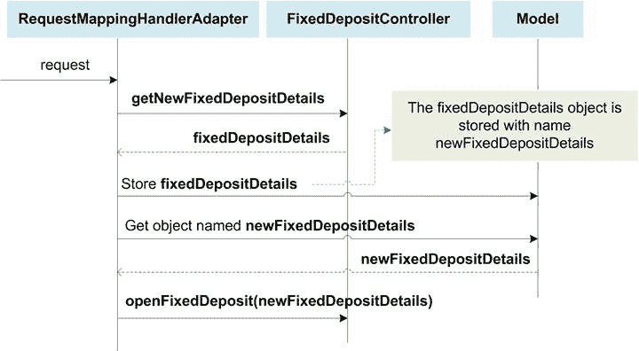

**图 11-1** `FixedDepositController`中`@ModelAttribute`和`@RequestMapping`注解方法的调用顺序

在上面的图中，Spring Web MVC的`RequestMappingHandlerAdapter`对象负责调用控制器的带有`@ModelAttribute`和`@RequestMapping`注解的方法。首先调用`getNewFixedDepositDetails`方法并将返回的`FixedDepositDetails`实例存储在名为`newFixedDepositDetails`的模型中。接下来，从`Model`中检索`newFixedDepositDetails`实例并作为参数传递给`openFixedDeposit`方法。

### 请求处理与`@ModelAttribute`注解方法

在示例代码列表 11-6 中，我们看到`listFixedDeposits`方法执行记录了以下消息：

`listFixedDeposits() method: Getting list of fixed deposits`

在示例代码列表 11-9 中，我们看到`getNewFixedDepositDetails`方法执行记录了以下消息：

`getNewFixedDepositDetails() method: Returning a new instance of FixedDepositDetails`

并且，`openFixedDeposit`方法会记录以下消息：

`openFixedDeposit()`方法：定期存款详情已成功保存。正在重定向以显示定期存款列表。

要查看`listFixedDeposits`、`getNewFixedDepositDetails`和`openFixedDeposit`方法被调用的顺序，请部署`ch11-bankapp`项目并按照以下步骤操作：

1. 访问`http://localhost:8080/ch11-bankapp/fixedDeposit/list` URL。你将看到系统中的定期存款列表和“创建新的定期存款”按钮（参见第 10 章的图 10-8）。
2. 点击“创建新的定期存款”按钮，这将显示用于开启新定期存款的 HTML 表单（参见第 10 章的图 10-9）。
3. 输入定期存款详情并点击“保存”按钮。如果输入的数据中未发现任何验证错误，则定期存款详情将成功保存，并再次显示系统中的定期存款列表（包括新创建的定期存款）。

下表描述了你的操作以及 MyBank 在控制台上打印的相关消息：

| 操作 | 在控制台上打印的消息 |
| :--- | :--- |
| 访问`http://localhost:8080/ch11-bankapp/fixedDeposit/list` URL | `getNewFixedDepositDetails()`方法：返回`FixedDepositDetails`的新实例<br>`listFixedDeposits()`方法：获取定期存款列表 |
| 点击“创建新的定期存款”按钮 | `getNewFixedDepositDetails()`方法：返回`FixedDepositDetails`的新实例<br>`showOpenFixedDepositForm()`方法：显示开启新定期存款的表单 |
| 输入定期存款详情并点击“保存”按钮 | `getNewFixedDepositDetails()`方法：返回`FixedDepositDetails`的新实例<br>`openFixedDeposit()`方法：定期存款详情已成功保存。正在重定向以显示定期存款列表。<br>`getNewFixedDepositDetails()`方法：返回`FixedDepositDetails`的新实例<br>`listFixedDeposits()`方法：获取定期存款列表 |

上表显示，带有`@ModelAttribute`注解的`getNewFixedDepositDetails`方法在`FixedDepositController`类中带有`@RequestMapping`注解的方法*每次*调用之前。由于`getNewFixedDepositDetails`方法创建了`FixedDepositDetails`对象的新实例，因此每次由`FixedDepositController`处理请求时，都会创建一个新的`FixedDepositDetails`对象实例。

如果带有`@ModelAttribute`注解的方法触发了 SQL 查询或调用了外部 Web 服务来填充该方法返回的模型属性，那么多次调用带有`@ModelAttribute`注解的方法将对应用程序性能产生不利影响。在本章后面的部分，我们将看到可以使用`@SessionAttributes`注解来避免对`@ModelAttribute`注解方法的多次调用。`@SessionAttributes`注解指示 Spring 缓存由`@ModelAttribute`注解方法返回的对象。

现在让我们这样一个场景：被`@ModelAttribute`注解的方法参数引用的模型属性在`Model`对象中*未找到*。

### `@ModelAttribute`注解方法参数的行为

我们之前看到，`@ModelAttribute`注解可以用于方法参数，以便从`Model`对象中检索模型属性。如果`@ModelAttribute`注解指定的模型属性在`Model`中*未找到*，Spring会自动创建该方法参数类型的新实例，将其分配给方法参数，并将其放入`Model`对象中。为了允许 Spring 创建方法参数类型的实例，该方法参数类型的 Java 类*必须*提供一个无参数构造函数。

让我们考虑以下`SomeController`控制器，它定义了一个单一的`@RequestMapping`方法`doSomething`：

**示例 11-10** – `@ModelAttribute`参数在`Model`对象中*不可用*

```java
@Controller
@RequestMapping(value = "/some")
public class SomeController {

    .....
    @RequestMapping("/do")
    public void doSomething(@ModelAttribute("myObj") MyObject myObject) {
        logger.info(myObject);
        .....
    }
}
```


上面的示例显示，`SomeController` 类没有定义任何带有 `@ModelAttribute` 注解的方法向 `Model` 中添加类型为 `MyObject`、名为 `myObj` 的对象。由于这个原因，当接收到对 `doSomething` 方法的请求时，Spring 会创建一个 `MyObject` 实例，将其分配给参数 `myObject`，并将新创建的 `MyObject` 实例放入 `Model` 对象中。

现在让我们来看看 Spring 的 `RequestToViewNameTranslator` 对象。

### RequestToViewNameTranslator

当带有 `@RequestMapping` 注解的方法没有显式指定要渲染的视图时，`RequestToViewNameTranslator` 负责确定要渲染的视图。

我们之前看到，当 `@RequestMapping` 方法也带有 `@ModelAttribute` 注解时，方法返回的值被视为模型属性。在这种情况下，`RequestToViewNameTranslator` 对象负责根据传入的 Web 请求确定要渲染的视图。同样，如果带有 `@RequestMapping` 注解的方法返回 `void`、`org.springframework.ui.Model` 或 `java.util.Map`，`RequestToViewNameTranslator` 对象也会确定要渲染的视图。

`DefaultRequestToViewNameTranslator` 是 `RequestToViewNameTranslator` 的实现，`DispatcherServlet` 默认使用它在 `@RequestMapping` 方法未返回视图时确定要渲染的视图。`DefaultRequestToViewNameTranslator` 使用请求 URI 来确定逻辑视图的名称。`DefaultRequestToViewNameTranslator` 通过移除 URI 中的前后斜杠和文件扩展名来确定视图名称。例如，如果 URL 是 `http://localhost:8080/doSomething.htm`，则视图名称将变为 `doSomething`。

在 MyBank 应用程序的情况下，`FixedDepositController` 的 `listFixedDeposits` 方法（参见示例 11-6 或 `ch11-bankapp` 项目中的 `FixedDepositController.java` 文件）同时带有 `@RequestMapping` 和 `@ModelAttribute` 注解；因此，`DispatcherServlet` 使用 `RequestToViewNameTranslator` 来确定要渲染的视图。由于 `listFixedDeposits` 方法映射到请求 URI `/fixedDeposit/list`，`RequestToViewNameTranslator` 返回 `/fixedDeposit/list` 作为视图名称。MyBank 应用程序 XML 文件中配置的 `ViewResolver`（参见 MyBank 项目中的 `bankapp-config.xml` 文件）将视图名称 `/fixedDeposit/list` 映射到 JSP 视图 `/WEB-INF/jsp/fixedDeposit/list.jsp`。

## 11-3 使用 `@SessionAttributes` 注解缓存模型属性

上一节中，我们看到控制器中所有带有 `@ModelAttribute` 注解的方法在调用 `@RequestMapping` 注解方法之前**总是**被调用。在 `@ModelAttribute` 方法从数据库或外部 Web 服务获取数据来填充模型属性的情况下，这种行为可能是不可接受的。在这种情况下，你可以在控制器类上使用 `@SessionAttributes` 注解，指定在请求之间存储在 `HttpSession` 中的模型属性。

如果使用了 `@SessionAttributes` 注解，只有当 `@ModelAttribute` 注解指定的模型属性在 `HttpSession` 中**未找到**时，才会调用带有 `@ModelAttribute` 注解的方法。同样，方法参数上的 `@ModelAttribute` 注解只有在模型属性在 `HttpSession` 中未找到时，才会导致模型属性新实例的创建。

## 导入章节 11/ch11-session-attributes

该项目展示了 `ch11-bankapp` 项目的修改版本，它使用 `@SessionAttributes` 注解将模型属性临时存储在 `HttpSession` 中。`ch11-session-attributes` 和 `ch10-bankapp` 项目提供的 MyBank Web 应用程序功能是相同的。如果您将该项目部署在 Tomcat 服务器上并访问 URL `http://localhost:8080/ch11-session-attributes`，您将看到系统中的定期存款列表。

下面的示例列表展示了 `ch11-session-attributes` 项目中如何使用 `@SessionAttributes` 注解来在 `HttpSession` 中临时存储 `newFixedDepositDetails` 和 `editableFixedDepositDetails` 模型属性。

## 示例列表 11-11 – `@SessionAttributes` 注解用法

**项目** – `ch11-session-attributes`

**源码位置** – `src/main/java/sample/spring/chapter11/web`

```java
package sample.spring.chapter11.web;

import org.springframework.web.bind.annotation.SessionAttributes;

.....

@SessionAttributes(value = { "newFixedDepositDetails", "editableFixedDepositDetails" })

public class FixedDepositController {

    .....

    @ModelAttribute(value = "newFixedDepositDetails")

    public FixedDepositDetails getNewFixedDepositDetails() {

        FixedDepositDetails fixedDepositDetails = new FixedDepositDetails();

        fixedDepositDetails.setEmail("You must enter a valid email");

        return fixedDepositDetails;

    }

    .....

    @RequestMapping(params = "fdAction=create", method = RequestMethod.POST)

    public String openFixedDeposit(

            @ModelAttribute(value = "newFixedDepositDetails") FixedDepositDetails fixedDepositDetails,

            .....) { ..... }

    .....

    @RequestMapping(params = "fdAction=view", method = RequestMethod.GET)

    public ModelAndView viewFixedDepositDetails(

            @RequestParam(value = "fixedDepositId") int fixedDepositId) {

        FixedDepositDetails fixedDepositDetails = fixedDepositService

            .getFixedDeposit(fixedDepositId);

        Map<String, Object> modelMap = new HashMap<String, Object>();

        modelMap.put("editableFixedDepositDetails", fixedDepositDetails);

        .....

        return new ModelAndView("editFixedDepositForm", modelMap);

    }

}
```

`@SessionAttributes` 注解的 `value` 属性指定了临时存储在 `HttpSession` 中的模型属性名称。在上面的示例列表中，命名为 `newFixedDepositDetails` 和 `editableFixedDepositDetails` 的模型属性在请求之间存储在 `HttpSession` 中。`newFixedDepositDetails` 模型属性由带有 `@ModelAttribute` 注解的 `getNewFixedDepositDetails` 方法返回，而 `editableFixedDepositDetails` 模型属性由带有 `@RequestMapping` 注解的 `viewFixedDepositDetails` 方法返回。

控制器通过带有 `@ModelAttribute` 注解的方法、`@RequestMapping` 方法（返回 `ModelAndView`、`Model` 或 `Map` 的）以及直接将模型属性添加到 `Model` 对象中来贡献模型属性。控制器通过**任何**方式贡献的模型属性都是通过 `@SessionAttributes` 注解存储在 `HttpSession` 中的候选对象。

当使用 `@SessionAttributes` 注解时，您应该确保在存储在 `HttpSession` 中的模型属性在不再需要时被移除。例如，`newFixedDepositDetails` 模型属性代表 `FixedDepositDetails` 的实例，它用于“开立定期存款”表单显示 Email 表单字段的默认值“You must enter a valid email”（参见示例列表 11-11 中的 `getNewFixedDepositDetails` 方法）。此外，当用户点击“开立定期存款”表单上的“保存”按钮时，用户输入的定期存款详情会被设置在 `newFixedDepositDetails` 实例上（参见示例列表 11-11 中的 `openFixedDeposit` 方法）。定期存款创建完成后，不再需要 `newFixedDepositDetails` 实例；因此，必须将其从 `HttpSession` 中移除。同样，在成功修改定期存款详情后，也不需要 `editableFixedDepositDetails` 模型属性。

可以通过调用 Spring `SessionStatus` 对象的 `setComplete` 方法指示 Spring 移除存储在 `HttpSession` 中的**所有**模型属性。下面的示例展示了 `FixedDepositController` 的 `openFixedDeposit` 和 `editFixedDeposit` 方法，在成功创建或修改定期存款后调用了 `SessionStatus` 的 `setComplete` 方法。

## 示例列表 11-12 – 使用 `SessionStatus` 对象从 `HttpSession` 中移除模型属性

**项目** – `ch11-session-attributes`

**源码位置** – `src/main/java/sample/spring/chapter11/web`

```java
package sample.spring.chapter11.web;

import org.springframework.web.bind.support.SessionStatus;

@SessionAttributes(value = { "newFixedDepositDetails", "editableFixedDepositDetails" })

public class FixedDepositController {

    .....

    @RequestMapping(params = "fdAction=create", method = RequestMethod.POST)

    public String openFixedDeposit(

            @ModelAttribute(value = "newFixedDepositDetails") FixedDepositDetails fixedDepositDetails,

            ....., SessionStatus sessionStatus) {

        fixedDepositService.saveFixedDeposit(fixedDepositDetails);

        sessionStatus.setComplete();

    }

    .....

    @RequestMapping(params = "fdAction=edit", method = RequestMethod.POST)

    public String editFixedDeposit(

            @ModelAttribute(value = "editableFixedDepositDetails") FixedDepositDetails fixedDepositDetails,

            ....., SessionStatus sessionStatus) {

        fixedDepositService.editFixedDeposit(fixedDepositDetails);

        sessionStatus.setComplete();

    }

    .....

}
```


上面的示例列表显示`openFixedDeposit`和`editFixedDeposit`方法被定义为接受`SessionStatus`类型参数。当带有`@RequestMapping`注解的方法指定了`SessionStatus`参数时，Spring会为该方法提供`SessionStatus`实例。调用`setComplete`指示Spring从`HttpSession`对象中移除*当前*控制的模型属性。

在示例列表11-11和11-12中，我们看到`@SessionAttributes`的`value`属性指定了存储在`HttpSession`中的模型属性名称。如果您希望只将模型属性的*类型*存储在`HttpSession`中，可以使用`@SessionAttributes`的`types`属性。例如，下面的`@SessionAttributes`注解指定了命名为`x`和`y`的属性以及*所有*类型为`MyObject`的模型属性临时存储在`HttpSession`中：

`@SessionAttributes(value = { "x", "y" }, types = { MyObject.class })`

您可以通过部署`ch11-session-attributes`项目并执行下表描述的操作，查看`listFixedDeposits`、`getNewFixedDepositDetails`和`openFixedDeposit`方法被调用的顺序：

| **操作** | **控制台打印的消息** |
| :--- | :--- |
| 访问`http://localhost:8080/ch11-session-attributes/fixedDeposit/list`URL | `getNewFixedDepositDetails()`方法：返回一个新的`FixedDepositDetails`实例<br>`listFixedDeposits()`方法：获取定期存款列表 |
| 点击“Create new Fixed Deposit”按钮 | `showOpenFixedDepositForm()`方法：显示开立新定期存款的表单 |
| 输入定期存款详情并点击“Save”按钮 | `openFixedDeposit()`方法：定期存款详情已成功保存。重定向到显示定期存款列表。<br>`getNewFixedDepositDetails()`方法：返回一个新的`FixedDepositDetails`实例<br>`listFixedDeposits()`方法：获取定期存款列表 |

在`ch11-bankapp`项目中，我们看到`FixedDepositController`中被`@ModelAttribute`注解的`getNewFixedDepositDetails`方法在每次请求分发到`FixedDepositController`时都会调用。上表显示，当请求首次由`FixedDepositController`处理时，会调用一次`getNewFixedDepositDetails`方法。由于`openFixedDeposit`方法删除了存储在`HttpSession`中的模型属性，对`listFixedDeposits`方法的请求将再次调用`getNewFixedDepositDetails`方法。

现在，我们已经了解了如何使用`@ModelAttribute`和`@SessionAttributes`注解，让我们来看看在Spring Web MVC应用中是如何进行*数据绑定*的。

## 11-4 Spring中的数据绑定支持

当Spring Web MVC应用中提交表单时，请求中包含的参数将*自动*设置在作为表单支持对象的*模型属性（model attribute）*上。这种将请求参数设置到表单支持对象的过程被称为*数据绑定*。在本节中，我们将查看Spring的`WebDataBinder`实例，它负责请求参数绑定到表单支持对象。

**导入第11章/ch11-data-binding**（此项目是`ch11-session-attributes`项目的修改版本，展示了如何向Spring容器注册`PropertyEditor`实现。如果你在Tomcat服务器上部署该项目并访问URL`http://localhost:8080/ch11-data-binding`，你将看到系统中的定存列表。）

以下示例列表显示了`ch11-data-binding`项目中的`FixedDepositDetails`类：

**示例列表11-13** – `FixedDepositDetails`类

**项目** – `ch11-data-binding`

**源码位置**- `src/main/java/sample/spring/chapter11/web`

```java
package sample.spring.chapter11.domain;

import java.util.Date;

public class FixedDepositDetails {

    .....

    private long depositAmount;

    private Date maturityDate;

    .....

    public void setDepositAmount(long depositAmount) {

        this.depositAmount = depositAmount;

    }

    public void setMaturityDate(Date maturityDate) {

        this.maturityDate = maturityDate;

    }

    .....

}
```

上述示例列表显示`depositAmount`和`maturityDate`字段的类型分别为`long`和`java.util.Date`。当`ch11-data-binding`项目的“开通定存”表单提交时，`depositAmount`和`maturityDate`字段的值会被设置。下图显示了`ch11-data-binding`项目中用于开启新定存的“开通定存”表单：


**图11-2** 用于开启新定存的“开通定存”表单

在图中，“金额（美元）”和“到期日期”表单字段对应`FixedDepositDetails`类的`depositAmount`和`maturityDate`字段（参见示例列表11-13）。需要注意的一之一，“到期日期”字段接受“MM-dd-yyyy”格式的日期，例如01-27-2013。由于`depositAmount`字段类型为`long`，而`maturityDate`类型为`java.util.Date`，Spring的数据绑定机制负责完成从`String`到`FixedDepositDetails`实例定义类型转换。

以下示例列表显示了`FixedDepositController`的`openFixedDeposit`方法，该方法在用户填写“开通定存”表单并点击“保存”按钮时被调用（参见图11-2）：

**示例列表11-14** – `FixedDepositController` - 自动数据绑定示例

**项目** – `ch11-data-binding`

**源码位置**- `src/main/java/sample/spring/chapter11/web`

```java
package sample.spring.chapter11.web;

@Controller

.....

public class FixedDepositController {

    .....

    @RequestMapping(params = "fdAction=create", method = RequestMethod.POST)

    public String openFixedDeposit(

        @ModelAttribute(value = "newFixedDepositDetails") FixedDepositDetails fixedDepositDetails,

        BindingResult bindingResult, SessionStatus sessionStatus) {

        ....

    }

    .....

}
```

在上述示例列表中，被`@ModelAttribute`注解的`FixedDepositDetails`参数代表表单支持对象，当提交表单时，请求参数会设置在该对象上。Spring的`WebDataBinder`实例将请求参数绑定到`FixedDepositDetails`实例。

现在让我们来看看`WebDataBinder`如何执行数据绑定。

### WebDataBinder – 用于Web请求参数的数据绑定器

`WebDataBinder`使用请求参数名称在表单支持对象上寻找对应的JavaBean风格setter方法。如果找到了JavaBean风格的setter方法，`WebDataBinder`会调用该setter方法并将请求参数值作为参数传递给该方法。如果setter方法定义为接收非String类型，`WebDataBinder`将使用适当的`PropertyEditor`执行转换。

以下示例列表显示了在应用中作为表单支持对象的`MyObject`类：

```java
public class MyObject {

    private String x;

    private N y;

    .....

    public void setX(String x) {

        this.x = x;

    }

    public void setY(N y) {

        this.y = y;

    }

}
```

**示例列表11-15** – `MyObject` – 表单支持对象

上述示例列表显示`MyObject`类定义的属性`x`和`y`分别为`String`和`N`类型。下图显示了`WebDataBinder`如何将名为`x`和`y`的请求参数绑定到`MyObject`实例的`x`和`y`属性：

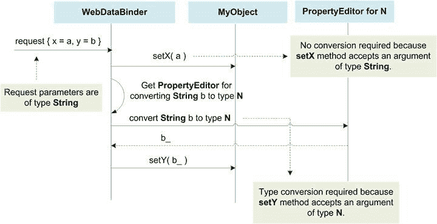

**图11-3** WebDataBinder通过PropertyEditor执行数据绑定

上显示WebDataBinder在调用`MyObject`的`setY`之前使用PropertyEditor将String值转换为类型N。

Spring提供了一些内置的`PropertyEditor`实现，供`WebDataBinder`将`String`类型的值转换为表单支持对象定义的类型。例如，`CustomNumberEditor`、`FileEditor`、`CustomDateEditor`是Spring提供的内置PropertyEditor。要获取完整的内置Editor列表，请参考`org.springframework.beans.propertyeditors`包。

`CustomNumberEditor`用于将`String`转换为`java.lang.Number`类型，如`Integer`、`Long`等。`CustomDateEditor`用于将`String`转换为`java.util.Date`类型。你可以传递一个`java.text.DateFormat`实例给`CustomDateEditor`以指定用于解析和渲染的日期格式。这两个PropertyEditor在`ch11-data-binding`项目中都是需要的，因为我们需要转换`depositAmount`（类型为`long`）和`maturityDate`（类型为`java.util.Date`）。`CustomNumberEditor`已预注册到`WebDataBinder`实例中，但你需要显式注册`CustomDateEditor`。

现在让我们来看看如何配置`WebDataBinder`实例并注册`PropertyEditor`。

### 配置WebDataBinder实例

你可以通过以下方式配置`WebDataBinder`实例：

· 在控制器类中定义`@InitBinder`注解的方法
· 在Web应用上下文XML文件中配置`WebBindingInitializer`实现
· 在`@ControllerAdvice`注解的类中定义`@InitBinder`注解的方法

让我们逐一查看上述配置并注册PropertyEditor方法。

**在控制器类中定义@InitBinder注解的方法**

在控制器类中被`@InitBinder`注解的方法指定了初始化一个`WebDataBinder`实例，该实例将在数据绑定期间供控制器使用。`@InitBinder`注解的`value`属性指定了初始化`WebDataBinder`实例所应用的模型属性名称。

以下示例显示了`FixedDepositController`的`initBinder_New`方法，该方法使用了`@InitBinder`注解：

**示例11-16** – `FixedDepositController` - `@InitBinder`注解用法

**项目** – `ch11-data-binding`

**源码位置**- `src/main/java/sample/spring/chapter11/web`

```java
package sample.spring.chapter11.web;

import java.text.SimpleDateFormat;

import org.springframework.beans.propertyeditors.CustomDateEditor;

import org.springframework.web.bind.WebDataBinder;

import org.springframework.web.bind.annotation.InitBinder;

@Controller

.....

public class FixedDepositController {

    .....

    @ModelAttribute(value = "newFixedDepositDetails")

    public FixedDepositDetails getNewFixedDepositDetails() { ..... }

    @InitBinder(value = "newFixedDepositDetails")

    public void initBinder_New(WebDataBinder webDataBinder) {

        webDataBinder.registerCustomEditor(Date.class,

                new CustomDateEditor(new SimpleDateFormat("MM-dd-yyyy"), false));

    }

    .....

}
```


在上述示例中，`@InitBinder`注解的`value`属性被设置为`newFixedDepositDetails`，这意味着由`initBinder_New`方法初始化的`WebDataBinder`仅适用于`newFixedDepositDetails`模型属性。带有`@InitBinder`注解的方法可以接受与传递给`@RequestMapping`注解方法相同的参数集（如`HttpServletRequest`、`SessionStatus`等）。但是，带有`@InitBinder`注解的方法不能定义为接受模型属性和`BindingResult`（或`Errors`）对象作为参数。通常，`WebDataBinder`实例以及Spring的`WebRequest`或`java.util.Locale`实例会被传递给`@InitBinder`方法。你应该注意，`@InitBinder`方法的返回类型必须是`void`。

`WebDataBinder`的`registerCustomEditor`方法用于向`WebDataBinder`实例注册`PropertyEditor`。在示例11-16中，`initBinder_New`方法向`WebDataBinder`实例注册了`CustomDateEditor`（一个`PropertyEditor`）。

你可以为控制器的每个模型属性定义一个带有`@InitBinder`注解的方法，也可以定义一个适用于控制器所有模型属性的单个`@InitBinder`注解方法。如果你没有指定`@InitBinder`注解的`value`属性，则由方法初始化的`WebDataBinder`实例适用于控制器的所有模型属性。

## 配置`WebBindingInitializer`实现

`WebDataBinder`实例首先由`RequestMappingHandlerAdapter`初始化，然后通过`WebBindingInitializer`和`@InitBinder`方法进行进一步初始化。

Spring `mvc`架构中的`<annotation-driven>`会创建一个`RequestMappingHandlerAdapter`实例，并由它初始化`WebDataBinder`。你可以为`RequestMappingHandlerAdapter`提供Spring `WebBindingInitializer`接口的实现类，以进一步初始化`WebDataBinder`实例。你还可以在控制器类中使用`@InitBinder`方法来进一步初始化`WebDataBinder`实例。

下图显示了`RequestMappingHandlerAdapter`、`WebBindingInitializer`和`@InitBinder`方法初始化`WebDataBinder`实例的顺序：

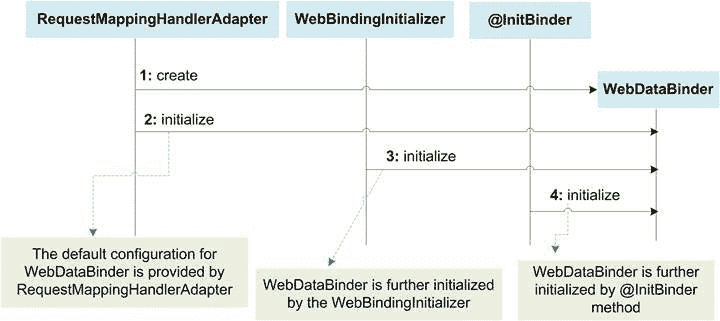

**图11-4** 控制器类的`RequestMappingHandlerAdapter`、`WebBindingInitializer`和`@InitBinder`方法初始化`WebDataBinder`实例的顺序

控制器类的`@InitBinder`方法进行的`WebDataBinder`初始化仅适用于该控制器的模型属性。例如，如果你在控制器X中使用`@InitBinder`方法为`WebDataBinder`实例设置`CustomDateEditor`属性编辑器，那么在数据绑定期间，`CustomDateEditor`属性编辑器仅适用于控制器X的模型属性。在MyBank应用中，`CustomDateEditor`仅`FixedDepositController`的模型属性需要；因此，我们在`FixedDepositController`类中使用带有`@InitBinder`注解的方法向`WebDataBinder`实例注册`CustomDateEditor`。

Spring的`WebBindingInitializer`是一个回调接口，其实现负责使用适用于应用程序中所有控制器（以及所有模型属性）的配置来初始化`WebDataBinder`。让我们看看如何使用Spring `mvc`架构中的`<annotation-driven>`元素来配置自定义的`WebBindingInitializer`。

Spring `mvc`架构中的`<annotation-driven>`元素创建一个`RequestMappingHandlerAdapter`实例，并初始化`WebDataBinder`。`<annotation-driven>`元素提供了用于自定义`RequestMappingHandlerAdapter`和`RequestMappingMapping`的属性。如果你想要对`RequestMappingHandlerAdapter`或`RequestMappingMapping`进行自定义没有`<annotation-driven>`元素提供，则必须移除`<annotation-driven>`并显式配置`RequestMappingHandlerAdapter`和`RequestMappingMapping`实例。

以下示例显示了如何使用Spring的`ConfigurableWebBindingInitializer`（`WebBindingInitializer`的实现）使`CustomDateEditor`属性适用于MyBank应用中的所有控制器：

**示例11-17** – `WebBindingInitializer`配置

```xml
<bean id="handlerAdapter" class="org.springframework.web.servlet.method.annotation.RequestMappingHandlerAdapter">
    <property name="webBindingInitializer" ref="myInitializer" />
</bean>

<bean id="handlerMapping" class="org.springframework.web.servlet.method.annotation.RequestMappingMapping" />

<bean id="myInitializer" class="org.springframework.web.bind.support.ConfigurableWebBindingInitializer">
    <property name="propertyEditorRegistars">
        <list>
            <bean class="mypackage.MyPropertyEditorRegistrar" />
        </list>
    </property>
</bean>
```

上述示例显示`RequestMappingHandlerAdapter`和`RequestMappingMapping`bean在应用程序上下文XML中显式定义。`RequestMappingHandlerAdapter`的`webBindingInitializer`属性引用了`WebBindingInitializer`接口的`ConfigurableWebBindingInitializer`bean。`ConfigurableWebBindingInitializer`的`propertyEditorRegistars`属性指定了向`WebDataBinder`注册一个多个`PropertyEditor`的类。以下示例显示了`MyPropertyEditorRegistrar`类如何向`WebDataBinder`注册`CustomDateEditor`属性编辑器：

**示例11-18** – `MyPropertyEditorRegistrar`类

```java
package mypackage;

import org.springframework.beans.PropertyEditorRegistrar;
import org.springframework.beans.PropertyEditorRegistry;
import org.springframework.beans.propertyeditors.CustomDateEditor;
import java.text.SimpleDateFormat;
import java.util.Date;

public class MyPropertyEditorRegistrar implements PropertyEditorRegistrar {
    @Override
    public void registerCustomEditors(PropertyEditorRegistry registry) {
        registry.registerCustomEditor(Date.class, new CustomDateEditor(new SimpleDateFormat("MM-dd-yyyy"), false));
    }
}
```

上面的示例列表显示，`MyPropertyEditorRegistrar`类实现了Spring的`PropertyEditorRegistrar`接口，并为`PropertyEditorRegistrar`接口中定义的`registerCustomEditors`方法提供了实现。传递给`registerCustomEditors`方法的`PropertyEditorRegistry`实例用于注册属性编辑器。`PropertyEditorRegistry`的`registerCustomEditor`方法用于向`WebDataBinder`注册`PropertyEditor`实现。在上面的示例列表中，`PropertyEditorRegistry`的`registerCustomEditor`被用于向`WebDataBinder`注册`CustomDateEditor`属性编辑器。

正如我们所看到的，使用`WebBindingInitializer`来初始化`WebDataBinder`是一项复杂的任务。使用`WebBindingInitializer`的更简单替代方案是在带有`@ControllerAdvice`注解的类中定义`@InitBinder`注解的方法。

## 在带有`@ControllerAdvice`注解的类中定义`@InitBinder`方法

类似于`@Service`、`@Controller`和`@Repository`注解，`@ControllerAdvice`注解是`@Component`注解的一种特殊形式。类上的`@ControllerAdvice`注解表示该类为控制器提供支持。你可以在带有`@ControllerAdvice`注解的类中定义`@InitBinder`、`@ModelAttribute`和`@ExceptionHandler`注解的方法，这些带注解的方法适用于应用程序中所有带注解的控制器。与`@Service`、`@Controller`和`@Repository`注解一样，Spring上Schema中的`<classpath-scanning>`元素会自动检测并将带有`@ControllerAdvice`注解的类注册到Spring容器。

如果你发现多个控制器中重复了`@InitBinder`、`@ModelAttribute`和`@ExceptionHandler`方法，请考虑在带有`@ControllerAdvice`注解的类中定义此类方法。例如，如果你想用适用于应用于多个控制器的配置来初始化`WebDataBinder`，那么可以在带有`@ControllerAdvice`注解的类中定义`@InitBinder`方法，而不是在多个控制器类中定义`@InitBinder`方法。

下表总结了我们讨论的初始化`WebDataBinder`的三种方法：

| 控制器类中的`@InitBinder`方法 | `WebBindingInitializer` | `@ControllerAdvice`类中的`@InitBinder`方法 |
| :--- | :--- | :--- |
| 需要在控制器中定义`@InitBinder`方法 | 需要在Web应用上下文XML文件中显式配置`RequestMappingHandlerAdapter` | 需要在带有`@ControllerAdvice`注解的类中定义`@InitBinder`方法 |
| `WebDataBinder`初始化仅适用于包含`@InitBinder`方法的控制器 | `WebDataBinder`初始化适用于应用程序中所有带注解的控制器 | `WebDataBinder`初始化适用于应用程序中所有带注解的控制器 |

现在让我们来看看如何允许或禁止模型属性（model attribute）的字段参与数据绑定过程。

## 允许或禁止数据绑定过程

`WebDataBinder`允许你指定模型属性中允许或禁止参与数据绑定过程的字段。强烈建议指定允许或禁止参与数据绑定过程的模型属性字段，因为如果不这样做可能会损害应用程序的安全性。让我们来看一个想要允许或禁止字段参与数据绑定的场景。

在MyBank应用中，当用户选择一笔定期存款进行编辑时，所选定期存款的详情从数据存储中加载并临时缓存在`HttpSession`中。用户对定期存款进行更改并保存更改。下面的示例显示了负责加载所选定期存款并保存更新后的定期存款信息的`@RequestMapping`方法：

**示例列表11-19** – `FixedDepositController`

**Project** – ch11-data-binding

**Source location**- src/main/java/sample/spring/chapter11/web

```java
package sample.spring.chapter11.web;

.....

@SessionAttributes(value = { "newFixedDepositDetails", "editableFixedDepositDetails" })
public class FixedDepositController {
    .....

    @RequestMapping(params = "fdAction=view", method = RequestMethod.GET)
    public ModelAndView viewFixedDepositDetails(
            @RequestParam(value = "fixedDepositId") int fixedDepositId) {
        FixedDepositDetails fixedDepositDetails = fixedDepositService
                .getFixedDeposit(fixedDepositId);
        Map<String, Object> modelMap = new HashMap<String, Object>();
        modelMap.put("editableFixedDepositDetails", fixedDepositDetails);
        .....
        return new ModelAndView("editFixedDepositForm", modelMap);
    }
    .....

    @RequestMapping(params = "fdAction=edit", method = RequestMethod.POST)
    public String editFixedDeposit(
            @ModelAttribute("editableFixedDepositDetails") FixedDepositDetails fixedDepositDetails,) {
        .....
    }
}
```


在 `MyBank` 应用中，定期存款通过 `FixedDepositDetails` 对象的 `id` 字段唯一标识（参见 `ch11-data-binding` 项目中的 `FixedDepositDetails` 类）。当用户选择一笔定期存款进行编辑时，`id` 字段的值通过 `fixedDepositId` 请求参数传递给 `viewFixedDepositDetails` 方法。`viewFixedDepositDetails` 方法使用 `fixedDepositId` 请求参数的值加载定期存款详情并显示在“编辑定期存款”表单上，如图所示：


**图 11-5** 用于编辑现有定期存款的“编辑定期存款”表单

由于 `id` 值（对应于 `FixedDepositDetails` 对象的 `id` 属性）唯一标识系统中的定期存款，“编辑定期存款”表单没有提供更改它的机制。当用户点击“保存”按钮时，会调用 `FixedDepositController` 的 `editFixedDeposit` 方法。`editFixedDeposit` 方法将更改保存到定期存款详情中。

当调用 `FixedDepositController` 的 `editFixedDeposit` 方法时，`WebDataBinder` 实例会将请求参数值绑定到 `editableFixedDepositDetails` 模型属性的字段——即由 `viewFixedDepositDetails` 方法加载并临时存储在 `HttpSession` 中的 `FixedDepositDetails` 对象（参见示例列表 11-19 中的 `@SessionAttributes` 注解）。如果恶意用户发送了一个名为 `id` 值为 10 的请求参数，那么 `WebDataBinder` 将在数据绑定期间盲目地将 `FixedDepositDetails` 对象的 `id` 属性设置为 10。这是不可取的，因为更改 `FixedDepositDetails` 对象的 `id` 属性会破坏应用程序数据。

`WebDataBinder` 提供了 `setAllowedFields` 和 `setDisallowedFields` 方法，你可以使用这些方法设置可以和不能参与数据绑定过程的模型属性字段名称。下面的示例显示了 `FixedDepositController` 的 `initBinder_Edit` 方法指定了 `editableFixedDepositDetails` 模型属性的 `id` 字段不能参与数据绑定过程：

**示例列表 11-20** – `FixedDepositController` – `WebDataBinder` 的 `setDisallowedFields`

**项目** – `ch11-data-binding`

**源位置** – `src/main/java/sample/spring/chapter11/web`

```java
package sample.spring.chapter11.web;

.....

public class FixedDepositController {

    .....

    @RequestMapping(params = "fdAction=edit", method = RequestMethod.POST)

    public String editFixedDeposit(

            @ModelAttribute("editableFixedDepositDetails") FixedDepositDetails fixedDepositDetails,...) {

        .....

    }

    .....

    @InitBinder(value = "editableFixedDepositDetails")

    public void initBinder_Edit(WebDataBinder webDataBinder) {

        webDataBinder.registerCustomEditor(Date.class, new CustomDateEditor(

        new SimpleDateFormat("MM-dd-yyyy"), false));

        webDataBinder.setDisallowedFields("id");

    }

}
```

在上面的示例代码列表中，`initBinder_Edit` 方法为 `editableFixedDepositDetails` 模型属性初始化了 `WebDataBinder` 实例。由于 `setDisallowedFields` 方法指定了 `editableFixedDepositDetails` 模型属性的 `id` 字段不允许参与绑定过程，因此即使请求中包含名为 `id` 的请求参数，该 `id` 字段也不会被设置。

现在让我们来看 Spring 的 `BindingResult` 对象，它暴露了在数据绑定和验证过程中发生的错误。

### 使用 `BindingResult` 对象检查数据绑定和验证错误

Spring 的 `BindingResult` 对象为控制器方法提供了将请求参数绑定到模型属性字段的结果。例如，如果在数据绑定过程中发生任何类型转换错误，这些错误将由 `BindingResult` 对象报告。

下面的示例代码展示了 `FixedDepositController` 的 `openFixedDeposit` 方法，该方法只有在 `BindingResult` 对象没有报告任何错误时才会创建一个存款：

**示例代码 11-21** – `FixedDepositController` – 使用 `BindingResult` 检查绑定和验证错误

**项目** – `ch11-data-binding`

**源位置** – `src/main/java/sample/spring/chapter11/web`

```java
package sample.spring.chapter11.web;

import org.springframework.validation.BindingResult;

import org.springframework.web.bind.annotation.ModelAttribute;

.....

public class FixedDepositController {

    .....

    @RequestMapping(params = "fdAction=create", method = RequestMethod.POST)

    public String openFixedDeposit(

        @ModelAttribute(value = "newFixedDepositDetails") FixedDepositDetails fixedDepositDetails,

        BindingResult bindingResult, SessionStatus sessionStatus) {

        .....

        if (bindingResult.hasErrors()) {

            return "createFixedDepositForm";

        } else {

            fixedDepositService.saveFixedDeposit(fixedDepositDetails);

            sessionStatus.setComplete();

            return "redirect:/fixedDeposit/list";

        }

    }

    .....

}
```

在上面的示例代码列表中，如果 `BindingResult` 对象持有一个或多个数据绑定或验证错误，则 `BindingResult` 的 `hasErrors` 方法将返回 `true`。在第 11-5 节中，我们将看到验证错误是如何存储在 `BindingResult` 对象中的。如果 `BindingResult` 对象报告了错误，`openFixedDeposit` 方法将渲染带有适当错误消息的“创建存款”表单。如果没有报告错误，存款详情将保存到数据存储中。

你应该注意，`BindingResult` 参数必须紧跟在你想在控制器方法中访问的 `BindingResult` 模型属性参数之后。例如，在示例代码 11-21 中，`BindingResult` 参数紧跟在 `newFixedDepositDetails` 模型属性之后。下面的示例代码展示了 `openFixedDeposit` 方法模型属性和 `BindingResult` 对象的错误顺序：

**示例代码 11-22** – 模型属性和 `BindingResult` 对象的错误顺序

```java
.....

public class FixedDepositController {

    .....

    @RequestMapping(params = "fdAction=create", method = RequestMethod.POST)

    public String openFixedDeposit(

        @ModelAttribute(value = "newFixedDepositDetails") FixedDepositDetails fixedDepositDetails,

        SessionStatus sessionStatus, BindingResult bindingResult) {

        .....

    }

    .....

}
```

在上面的示例代码列表中，`newFixedDepositDetails` 模型属性和 `BindingResult` 对象的顺序是错误的，因为 `SessionStatus` 参数被定义在它们之间。

如果控制器方法接受多个模型属性，则每个模型属性对应的 `BindingResult` 对象将紧跟在每个模型属性参数之后，如下面的示例代码所示：

**示例代码 11-23** – 多个模型属性及其对应的 `BindingResult` 对象

```java
@RequestMapping

public String doSomething(

    @ModelAttribute(value = "a") AObject aObj, BindingResult bindingResultA,

    @ModelAttribute(value = "b") BObject bObj, BindingResult bindingResultB) {

    .....

}
```

上面的示例代码显示，模型属性 `a` 和 `b` 均紧跟着它们对应的 `BindingResult` 对象。

现在我们已经了解了数据绑定过程，让我们来看看在 Spring Web MVC 应用中是如何执行验证的。

## 11-5 Spring 中的验证支持

在上一节中，我们看到 `WebDataBinder` 将请求参数绑定到模型属性。请求处理的下一步是验证模型属性。在 Spring Web MVC 应用中，你可以使用 Spring Validation API 或通过在字段上指定 JSR 303 来验证模型属性。

**注意**：在本章中，Spring Validation API 和 JSR 303 被用于验证应用 Web 层中的表单对象（即模型属性）。你应该注意，JSR 303 和 Spring Validation 都可验证任何层中的对象。

让我们先来看如何使用 Spring 的 `Validator` 接口来验证模型属性。

### 使用 Spring 的 `Validator` 接口验证模型属性

下面的示例代码展示了 `MyBank` 应用中 `FixedDepositValidator` 类，该类用于验证 `FixedDepositDetails` 对象：

**示例代码 11-24** – `FixedDepositValidator` – Spring 的 `Validator` 接口

**项目** – `ch11-data-binding`

**源位置** – `src/main/java/sample/spring/chapter11/web`

```java
package sample.spring.chapter11.web;

import org.springframework.validation.*;

import sample.spring.chapter11.domain.FixedDepositDetails;

public class FixedDepositValidator implements Validator {

    public boolean supports(Class<?> clazz) {

        return FixedDepositDetails.class.isAssignableFrom(clazz);

    }

    public void validate(Object target, Errors errors) {

        FixedDepositDetails fixedDepositDetails = (FixedDepositDetails) target;

        long depositAmount = fixedDepositDetails.getDepositAmount();

        .....

        if (depositAmount < 1000) {

            errors.rejectValue("depositAmount", "error.depositAmount.less", "must be greater than or equal to 1000");

        }

        if (email == null || "".equalsIgnoreCase(email)) {

            ValidationUtils.rejectIfEmptyOrWhitespace(errors, "email", "error.email.blank", "must not be blank");

        }

    .....

    }

}
```

Spring 的 `Validator` 接口定义了 `supports` 和 `validate` 方法。`supports` 方法用于检查提供的对象实例（由 `clazz` 属性表示）是否可以被验证。如果 `supports` 方法返回 `true`，则使用 `validate` 方法对对象进行验证。在上述示例列表中，`FixedDepositDetailsValidator` 的 `supports` 方法会检查提供的对象实例是否为 `FixedDepositDetails` 类型。如果 `supports` 方法返回 `true`，则 `FixedDepositDetailsValidator` 的 `validate` 方法将对该对象进行验证。`validate` 方法接收待验证的对象实例以及一个 `Errors` 实例。`Errors` 实例用于存储和暴露验证过程中发生的错误。`Errors` 实例提供了多个 `reject` 和 `rejectValue` 方法，用于向 `Errors` 实例注册错误。`rejectValue` 方法用于报告字段级错误，而 `reject` 方法用于报告适用于被验证对象的错误。Spring 的 `ValidationUtils` 类是一个工具类，提供了调用 `Validator` 以及拒绝空字段的便利方法。

接下来的图描述了在示例列表 11-24 中传递给 `rejectValue` 方法的参数，用于报告与 `FixedDepositDetails` 的 `depositAmount` 字段对应的验证错误：


**图 11-6** 向 `Errors` 实例的 `rejectValue` 方法传递的参数描述，用于报告与 `FixedDepositDetails` 的 `depositAmount` 字段对应的验证错误

上图显示，字段名、错误代码（基本上是一个消息键）和默认错误消息被传递给 `rejectValue` 方法。在第 13 章中，我们将看到 JSP 页面如何使用消息键显示资源包（resource bundles）中的消息。

你可以通过以下方式对模型属性进行验证：

- 在 `Validator` 实现上显式调用 `validate` 方法
- 在 `WebDataBinder` 上设置 `Validator` 实现，并在 `@RequestMapping` 方法的模型属性参数上使用 JSR 303 的 `@Valid` 注解

让我们详细查看上述每种方法。

### 通过显式调用 `validate` 方法验证模型属性

接下来的示例列表显示了 `FixedDepositController` 的 `openFixedDeposit` 方法，该方法使用 `FixedDepositDetailsValidator`（参见示例列表 11-24）来验证 `FixedDepositDetails` 模型属性：

**示例列表 11-25** – `FixedDepositController` – 通过显式调用 `FixedDepositDetailsValidator` 的 `validate` 方法进行验证

**项目** – `ch11-data-binding`

**源位置** – `src/main/java/sample/spring/chapter11/web`

```java
package sample.spring.chapter11.web;

.....
```


```java
public class FixedDepositController {

    .....

    @RequestMapping(params = "fdAction=create", method = RequestMethod.POST)
    public String openFixedDeposit(
            @ModelAttribute(value = "newFixedDepositDetails") FixedDepositDetails fixedDepositDetails,
            BindingResult bindingResult, SessionStatus sessionStatus) {

        new FixedDepositDetailsValidator().validate(fixedDepositDetails, bindingResult);

        if (bindingResult.hasErrors()) {
            logger.info("openFixedDeposit() method: Validation errors
                    - re-displaying form for opening a new fixed deposit");

            return "createFixedDepositForm";
        }

        .....
    }
}
```

上述示例列表显示，`openFixedDeposit` 方法创建了 `FixedDepositDetailsValidator` 的实例并调用了它的 `validate` 方法。由于 `BindingResult` 是 `Errors` 的子接口，你可以在需要 `Errors` 对象的地方传递 `BindingResult` 对象。`openFixedDeposit` 方法将 `fixedDepositDetails` 模型属性和 `BindingResult` 对象传递给 `validate` 方法。由于 `BindingResult` 已经包含了数据绑定错误，将 `BindingResult` 对象传递给 `validate` 方法会将验证错误也添加到 `BindingResult` 对象中。

### 使用 JSR 303 的 `@Valid` 注解调用模型属性验证

你可以通过在模型属性参数上添加 JSR 303 的 `@Valid` 注解，并在 `WebDataBinder` 实例上设置该模型属性的验证器，指示 Spring 自动验证传递给 `@RequestMapping` 方法的模型属性参数。

接下来的示例列表显示了 `FixedDepositController` 的 `openFixedDeposit` 方法如何使用 `@Valid` 注解来验证 `FixedDepositDetails` 模型属性：

**示例列表 11-26** – `FixedDepositController` – 使用 `@Valid` 注解调用验证

```java
import javax.validation.Valid;

.....

public class FixedDepositController {

    .....

    @RequestMapping(params = "fdAction=create", method = RequestMethod.POST)
    public String openFixedDeposit(
            @Valid @ModelAttribute(value = "newFixedDepositDetails") FixedDepositDetails fixedDepositDetails,
            BindingResult bindingResult, SessionStatus sessionStatus) {

        if (bindingResult.hasErrors()) {
            logger.info("openFixedDeposit() method: Validation errors
                    - re-displaying form for opening a new fixed deposit");

            return "createFixedDepositForm";
        }

        .....

    }

    @InitBinder(value = "FixedDepositDetails")
    public void initBinder(WebDataBinder webDataBinder) {
        webDataBinder.registerCustomEditor(
                Date.class,
                new CustomEditor(new SimpleDateFormat("MM-dd-yyyy"), false));

        webDataBinder.setValidator(new FixedDepositValidator());
    }

    .....
}
```

在上述示例列表中，`initBinder` 方法调用 `WebDataBinder` 的 `setValidator` 方法，将 `FixedDepositValidator` 设置为 `fixedDepositDetails` 模型属性的验证器，并且在 `openFixedDeposit` 方法中对模型属性使用了 `@Valid` 注解。当 `openFixedDeposit` 被调用时，会对 `fixedDepositDetails` 模型属性执行数据绑定和验证，结果通过 `BindingResult` 参数可用。

注意的是，如果 `@InitBinder` 指定了属性名称，则设置在 `WebDataBinder` 上的验证器仅适用于该属性。例如在示例 11-26 中。如果验证器适用于多个控制器，请考虑在 `@ControllerAdvice` 类内部定义 `@InitBinder` 方法（或使用 `BindingInitializer`）为 `WebDataBinder` 设置验证器。

### 使用 JSR 303 注解指定约束

JSR 303（Bean Validation API）定义了你可以用于指定 JavaBean 组件属性约束的注解。

**IMPORT `chapter11/ch11-303-validation`**（该项目是 `ch11-data-binding` 项目的修改版本，它使用 JSR 303 注解来为 `FixedDepositDetails` 对象指定约束。如果你将项目部署在 Tomcat 服务器上并访问 URL `http://localhost:8080/ch11-303-validation`，你将看到系统中的定单列表。）

接下来的示例列表显示了 `FixedDepositDetails` 类使用 JSR 303 注解对其字段指定约束：

**示例列表 11-27** – `FixedDepositDetails` – 指定 JSR 303 约束

```java
package sample.spring.chapter11.domain;

import javax.validation.constraints.*;

public class FixedDepositDetails {

    private long id;

    @Min(1000)
    @Max(500000)
    private long depositAmount;

    @Email
    @Size(min = 10, max = 25)
    private String email;

    @NotNull
    private Date maturityDate;

    .....
}
```

`@Min`、`@Max`、`@Email`、`@Size` 和 `@NotNull` 是 JSR 303 定义的一些注解。上面的示例列表显示，通过使用 JSR 303 注解，`FixedDepositDetails` 类清晰地指定了应用于其字段的约束条件。另一方面，如果你使用 Spring 的 `Validator` 实现来校验对象，约束条件则包含在 `Validator` 实现中（参见示例列表 11-24）。

下表描述了 JSR 303 注解对示例列表 11-27 所示的 `FixedDepositDetails` 对象执行的约束：

| JSR 303 注解 | 约束描述 |
| :--- | :--- |
| `@NotNull` | 被注解的字段不能为 null。例如，`maturityDate` 字段不能为空。 |
| `@Min` | 被注解的字段的值必须大于或等于指定的最小值。例如，在 `FixedDepositDetails` 对象的 `depositAmount` 字段上的 `@Min(1000)` 注解意味着 `depositAmount` 的值必须大于或等于 1000。 |
| `@Max` | 被注解的字段的值必须小于或等于指定的值。例如，在 `FixedDepositDetails` 对象的 `depositAmount` 字段上的 `@Max(500000)` 注解意味着 `depositAmount` 的值必须小于或等于 500000。 |
| `@Size` | 被注解的字段的大小必须在指定的 `min` 和 `max` 属性之间。例如，在 `FixedDepositDetails` 对象的 `email` 字段上的 `@Size(min=5, max=100)` 注解意味着 `email` 字段的大小必须大于或等于 5 且小于或等于 100。 |
| `@Email` | 被注解的字段的值必须是格式正确的电子邮件地址。例如，在 `FixedDepositDetails` 对象的 `email` 字段上的 `@Email` 注解意味着 `email` 字段的值必须是格式正确的电子邮件地址。 |

要使用 JSR 303 注解，`ch11-jsr303-validation` 项目指定了 JSR 303 API JAR 文件（`validation-api-1.0.0.GA`）和 Hibernate Validator 框架（`hibernate-validation-4.3.0.Final`）的依赖。Hibernate Validator 框架提供了 JSR 303 的参考实现。Hibernate Validator 框架提供了额外的约束注解，你可以将其与 JSR 303 注解配合使用。例如，你可以使用 Hibernate Validator 的 `@NotBlank` 注解来指定字段的值不能为 null 或空。

需要注意的是，JSR 303 还允许你创建自定义约束并在应用程序中使用它们。例如，你可以创建一个 `@MyConstraint` 自定义约束以及相应的校验器，以在对象上强制执行该约束。

现在，由于 que 我们已经在 `FixedDepositDetails` 类上指定了 JSR 303 约束，让我们来看如何校验 `FixedDepositDetails` 对象。

### 校验使用 JSR 303 注解的对象

如果在应用程序的类路径中发现了 JSR 303 促进者（如 `Hibernate Validator`），并且你在 Web 应用上下文 XML 文件中指定了 Spring `mvc` Schema 的 `<annotation-driven>` 元素，那么 Spring 将自动启用对 JSR 303 的支持。在后台，`<annotation-driven>` 元素配置了 Spring `LocalValidatorFactoryBean` 类的实例，该实例负责检测应用程序类路径中是否存在 JSR 303 促进者（如 `Hibernate Validator`）并初始化它。

`LocalValidatorFactoryBean` 实现了 JSR 303 的 `Validator` 和 `ValidatorFactory` 接口，以及 Spring 的 `Validator` 接口。因此，你可以选择通过调用 Spring `Validator` 接口的 `validate` 方法或调用 JSR 303 `Validator` 接口的 `validate` 方法来校验对象。正如之前讨论的，你也可以通过简单在模型属性参数上添加 `@Valid` 注解，指示 Spring 自动校验传递给 `@RequestMapping` 方法的模型属性参数。

#### 通过显式调用 `validate` 方法校验模型属性

下面的示例显示了 `FixedDepositController` 类，它使用 Spring 的 `Validator` 来校验使用了 JSR 303 约束的 `FixedDepositDetails` 对象（参见示例列表 11-27）：

**示例列表 11-28** – `FixedDepositController` – 使用 Spring Validation API 校验 `FixedDepositDetails`

**项目** – `ch11-jsr303-validation`

**源码位置** – `src/main/java/sample/spring/chapter11/web`

```java
package sample.spring.chapter11.web;

import javax.validation.Valid;

.....

public class FixedDepositController {

    .....

    @Autowired
    private Validator validator;

    .....

    @RequestMapping(params = "fdAction=create", method = RequestMethod.POST)
    public String openFixedDeposit(
            @ModelAttribute(value = "newFixedDepositDetails") FixedDepositDetails fixedDepositDetails,
            BindingResult bindingResult, SessionStatus sessionStatus) {

        validator.validate(fixedDepositDetails, bindingResult);

        if (bindingResult.hasErrors()) {
            ..... 
        }

        .....
    }
}
```

在示例列表中，`LocalValidatorFactoryBean`（实现了 Spring 的 `Validator` 接口）被自动注入到 `FixedDepositController` 中。在 `openFixedDeposit` 方法中，使用 `BindingResult` 对象持有校验错误。示例列表中需要注意的是，`FixedDepositController` 没有直接处理 JSR 303 特定 API。相反，使用的是 Spring Validation API 来校验 `FixedDepositDetails`。

下面的示例显示了使用 JSR 303 特定 API 的 `FixedDepositController` 变体：

**示例列表 11-29** – 使用 Spring Validation API 校验 `FixedDepositDetails`

```java
import javax.validation.ConstraintViolation;
import javax.validation.Validator;
import java.util.Set;

.....

public class FixedDepositController {

    .....

    @Autowired
    private Validator validator;

    .....

    @RequestMapping(params = "fdAction=create", method = RequestMethod.POST)
    public String openFixedDeposit(
            @ModelAttribute(value = "newFixedDepositDetails") FixedDepositDetails fixedDepositDetails,
            BindingResult bindingResult, SessionStatus sessionStatus) {

        Set<ConstraintViolation<FixedDepositDetails>> violations =
                validator.validate(fixedDepositDetails);

        Iterator<ConstraintViolation<FixedDepositDetails>> itr =
                violations.iterator();

        if (itr.hasNext()) {
            ..... 
        }

        .....
    }

    .....
}
```


在示例列表中，`LocalValidatorFactoryBean`（实现了 JSR 303 的 `Validator` 接口）被自动注入到 `FixedDepositController` 中。在 `openFixedDeposit` 方法中，调用 `validate` 方法会导致调用 `LocalValidatorFactoryBean` 的 `validate(T)` 方法来校验 `FixedDepositDetails` 实例。`validate` 方法返回一个 `java.util.Set` 对象，其中包含 JSR 303 促进者报告的约束违反。你可以检查 `validate` 方法返回的 `java.util.Set` 对象来发现是否报告了任何约束违反。

## 使用 JSR 303 的 `@Valid` 注解调用模型属性校验

通过在模型属性参数上添加 JSR 303 的 `@Valid` 注解，你可以指示 Spring 自动校验传递给 `@RequestMapping` 方法的模型属性参数。下面的示例显示了 `FixedDepositController` 的 `editFixedDeposit` 方法，它使用 `@Valid` 注解来校验 `editableFixedDepositDetails` 模型属性：

**示例列表 11-30** – `FixedDepositController` – 使用 `@Valid` 注解调用校验

```java
package sample.spring.chapter11.web;

import javax.validation.Valid;

.....

public class FixedDepositController {

    .....

    @RequestMapping(params = "fdAction=edit", method = RequestMethod.POST)

    public String editFixedDeposit(

        @Valid @ModelAttribute("editableFixedDepositDetails") FixedDepositDetails fixedDepositDetails,

        BindingResult bindingResult, SessionStatus sessionStatus) {

        if (bindingResult.hasErrors()) { ..... } .....

    }

    .....

}
```

在上面的示例代码中，针对 `editableFixedDepositDetails` 模型属性的 `@Valid` 注解会导致 Spring 对进行自动验证。在验证期间报告的约束违规将将与任何数据绑定错误一起添加到 `BindingResult` 对象中。

现在让我们来看看 Spring 的表单标签库是如何简化在 JSP 页面中编写表单的。

## 11-6 Spring 的表单标签库

Spring 的表单标签库提供了一些标签，可以简化为 Spring Web MVC 应用创建 JSP 页面的工作。Spring 表单标签库提供了用于渲染各种输入表单元素的标签，以及将表单数据绑定到表单支持对象的标签。

下面的示例代码展示了 `ch11-jsr303-validation` 项目中的 `createFixedDepositForm.jsp` JSP 页面，该页面使用了 Spring 的表单标签库：

**示例代码 11-31** – `createFixedDepositForm.jsp` – Spring 表单标签库的使用

**项目** – `ch11-jsr303-validation`

**源码位置**- `src/main/webapp/WEB-INF/jsp`

```jsp
<%@taglib uri="http://java.sun.com/jsp/jstl/core" prefix="c"%>

<%@taglib prefix="form" uri="http://www.springframework.org/tags/form"%>

<html

.....

    <form:form commandName="newFixedDepositDetails"

        name="createFixedDepositForm" method="POST"

        action="${pageContext.request.contextPath}/fixedDeposit?fdAction=create">

        .....

        <tr

            <td class="td"><b>金额 (美元):</b></td>

            <td class="td"><form:input path="depositAmount" />

                <font style="color: #C11B17;"><form:errors path="depositAmount"/></font>

            </td>

        </tr>

        <tr

            <td class="td"><b>到期日期:</b></td>

            <td class="td"><form:input path="maturityDate" />

                <font style="color: #C11B17;"><form:errors path="maturityDate"/></font>

            </td>

        </tr>

        .....

        <td class="td"><input type="submit" value="Save" /></td>

        .....

    </form:form>

</html>
```

在上面的示例代码中，通过以下 `taglib` 指令使得 Spring 表单标签库标签在 JSP 页面中可用：

```jsp
<%@taglib prefix="form" uri="http://www.springframework.org/tags/form"%>
```

Spring 表单标签库的 `<form>` 标签渲染一个 HTML 表单，该表单将表单字段绑定到由 `commandName` 属性标识的模型属性的属性。`<form>` 标签包含 `<input>` 标签，这些标签对应于由 `commandName` 属性指定的模型属性的属性。当表单被渲染时，属性从模型属性中读取并通过 `<input>` 标签显示。当表单提交时，表单中的字段值将绑定到模型属性的相应属性。

在示例代码 11-31 中，`<form>` 标签渲染了一个用于开启定期存款的 HTML 表单。`commandName` 属性的值为 `newFixedDepositDetails`，这意味着表单字段映射到 `newFixedDepositDetails` 模型属性的属性上。`name` 属性指定了由 `<form>` 渲染的 HTML 表单的名称。

`required="required"` 属性指定用户必须在 `textarea` 中输入信息。使用 `required` 属性可以节省编写 JavaScript 代码来对必填字段进行客户端验证的工作。如果用户没有在 `textarea` 中输入任何信息并尝试提交表单，网络浏览器将显示一条消息，说明 `textarea` 是必填的且不能为空。

在 HTML5 中，你可以将 `type` 属性的值指定为 `email`、`datetime`、`date`、`month`、`week`、`time`、`range`、`color`、`reset` 等。从 Spring 3.1 开始，`<input>` 标签支持指定 `text` 以外的 `type` 属性值。例如，以下 `<input>` 标签将 `type` 属性的值指定为 `email`：

```html
<form:input path="myProperty" type="email"/>
```

当用户尝试提交包含 email 类型字段的表单时，网络浏览器会检查该字段是否包含有效的电子邮件地址。如果字段不包含有效的电子邮件地址，网络浏览器将显示一条消息，指示该字段不包含有效的电子邮件地址。由于网络浏览器执行了验证，你就不需要编写 JavaScript 代码来验证电子邮件地址。

## 11-7 总结

在本章中，我们查看了 Spring Web MVC 的许多核心特性。我们介绍了 `@ModelAttribute` 和 `@SessionAttributes` 注解，这些注解在开发带注解的控制器时常用。我们还深入研究了 Spring 如何执行数据绑定和验证。在下一章中，我们将学习如何使用 Spring Web MVC 开发 RESTful Web 服务。

# 第 12 章 – 使用 Spring Web MVC 开发 RESTful Web 服务

## 12-1 引言

表述层状态转移（也称为 `REST`）是一种架构风格，其中应用程序定义了由 URI（统一资源标识符）*唯一*标识的*资源*。REST 风格应用的客户端通过向资源映射的 URI 发送 HTTP `GET`、`POST`、`PUT` 和 `DELETE` 方法请求来与资源进行交互。下图展示了一个由其客户端访问的 REST 风格应用：


**图 12-1** REST 风格应用定义了 x 和 y 资源，分别由 `/resource2` 和 `/resource1` URI 唯一标识。

上图显示了一个由两个资源 x 和 y 组成的 REST 风格应用。资源 x 映射到 `/resource2` URI，资源 y 映射到 `/resource1` URI。客户端可以通过向 `/resource2` URI 发送 HTTP 请求来与资源 x 交互，通过向 `/resource1` URI 发送 HTTP 请求来与资源 y 交互。

如果一个 Web 服务遵循 REST 架构风格，则被称为 *RESTful Web 服务*。在 RESTful Web 服务的语文中，你可以将资源视为 Web 服务所暴露的*数据*。客户端可以通过向 RESTful Web 服务发送 HTTP 请求，对暴露的数据执行 CRUD（创建、读取、更新和删除）操作。客户端与 RESTful Web 服务交换数据的*表表示*，这种表示可以是 XML、JSON（JavaScript 对象表示）格式、简单字符串，或 HTTP 协议支持的任何其他 MIME 类型。

与基于 SOAP 的 Web 服务相比，RESTful Web 服务实现更简单且更具可扩展性。在基于 SOAP 的 Web 服务中，请求和响应始终是 XML 格式。在 RESTful Web 服务中，你可以使用 JSON（JavaScript 对象表示）、XML、纯文本等作为请求和响应。在本章中，我们将查看 Spring Web MVC 如何简化 RESTful Web 服务的开发和访问。

让我们从查看将使用 Spring Web MVC 实现的 RESTful Web 服务的需求开始。

## 12-2 定期存款 Web 服务

我们之前看到 MyBank Web 应用程序提供了显示定期存款列表的功能，以及创建、编辑和关闭定期存款的功能。由于定期存款相关功能可能被其他应用程序访问，因此需要将定期存款相关功能从 MyBank Web 中提取出来，并部署为 RESTful Web 服务。我们将这个新的 RESTful Web 服务命名为 `FixedDepositWS`。

下图显示 MyBank 和 Settlement 应用程序访问了 `FixedDepositWS` Web 服务：


**图 12-2** MyBank 和 Settlement 应用访问 `FixedDepositWS` Web 服务

上图显示 MyBank 和 Settlement Web 应用通过交换 JSON 格式的数据与 `FixedDepositWS` Web 服务交互。我们很快就会看到，JSON 是应用程序之间交换数据时比 XML 更简单的替代方案。

现在让我们如何使用 Spring Web MVC 将 `FixedDepositWS` Web 服务实现为 RESTful Web 服务。

## 12-3 使用 Spring Web MVC 实现 RESTful Web 服务

要开发 RESTful Web 服务，你需要执行以下操作：

- 识别 Web 服务暴露的资源
- 为识别出的资源指定相应的 URI
- 识别可以在资源上执行的操作
- 将 HTTP 方法映射到识别的操作

在 `FixedDepositWS` Web 服务中，定期存款数据代表 Web 服务暴露的资源。如果 `FixedDepositWS` Web 服务将系统中的定期存款映射到 `/fixedDeposits` URI，则 `FixedDepositWS` 服务客户端就可以通过向 `/fixedDeposits` URI 发送 HTTP 请求对定期存款执行操作。

在 RESTful Web 服务中，客户端用于与资源交互的 HTTP 方法表示要在资源上执行的操作。`GET` 获取资源状态，`POST` 创建新资源，`PUT` 修改资源状态，`DELETE` 删除资源。下图显示了当客户端向以下发送 `GET`、`POST`、`PUT` 和 `DELETE` 请求时 `FixedDepositWS` 服务执行的操作：


**图 12-3** 客户端向 `/fixedDeposits` 发送 HTTP 请求以交互数据

上图显示客户端向 `/fixedDeposits` 发送 `GET`、`POST`、`PUT` 和 `DELETE` 请求以与数据交互。`id` 查询字符串参数唯一标识一个定期存款。下表定义了图中每个请求的目的：

| HTTP 方法 | URI | 目的 |
| :--- | :--- | :--- |
| `GET` | `/fixedDeposits` | 获取系统中所有定期存款的详情。`FixedDepositWS` Web 服务以 JSON 格式发送响应。 |
| `GET` | `/fixedDeposits?id=123` | 获取 id 为 123 的定期存款详情。`FixedDepositWS` Web 服务以 JSON 格式发送响应。 |
| `POST` | `/fixedDeposits` | 在系统中创建一个定期存款。客户端以 JSON 格式发送要创建的存款详情。 |
| `PUT` | `/fixedDeposits?id=123` | 修改 id 为 123 的定期存款。客户端以 JSON 格式发送修改后的存款详情。 |
| `DELETE` | `/fixedDeposits?id=123` | 删除 id 为 123 的定期存款。 |

上表显示了 `FixedDepositWS` 及其客户端通过 JSON 格式交换信息。在深入细节如何实现 `FixedDepositWS` 之前，让我们看看数据在 JSON 格式下的样子。

### JSON (JavaScript 对象表示)

JSON 是一种基于文本的数据格式，用于应用程序交换*结构化*数据。由于 JSON 的数据表示比 XML 更加紧凑，因此 JSON 是 XML 更简单的替代方案。为了简化 Java 对象与 JSON 之间的相互向转换，你可以使用 JSON 库，如 `FlexJson` ([`flexjson.sourceforge.net/`](http://flexjson.sourceforge.net/)) 和 `Jackson` ([`github.com/FasterXML/jackson`](https://github.com/FasterXML/jackson))。

假设有一个 `Person` 类定义了 `firstName` 和 `lastName` 属性。如果你创建一个 `Person` 对象的实例，并将 `firstName` 设置为 `Myfirstname`，将 `lastName` 设置为 `Mylastname`，那么该 `Person` 对象在 JSON 格式下的表示将如下：

**示例列表 12-1** – JSON 格式下的 `Person` 对象表示

```json
{
    "firstName" : Myfirstname,
    "lastName" : "Mylastname"
}
```

上面的示例列表显示，`Person` 对象的每个属性在 JSON 格式中都被表示为 `<attribute-name>` : `<attribute-value>`。

你也可以用 JSON 格式表示 Java 对象的集合。下面的示例列表展示了如何用 JSON 格式表示 `Person` 对象的集合：

**示例列表 12-2** – 用 JSON 格式表示的 `Person` 对象集合

```json
[
    {
        "firstName" : Myfirstname,
        "lastName" : "Mylastname"
    },
    {
        "firstName" : Yourfirstname,
        "lastName" : "Yourlastname"
    }   
]
```


你不需要编写代码将对象转换为 JSON 表示，反之亦然。相反，RESTful Web 服务及其客户端可以使用 `FlexJson` 或 `Jackson` 库来执行转换。正如我们很快将看到的，Spring Web MVC 使用 `Jackson` 将 JSON 转换为 Java 对象，反之亦然。

现在让我们来看使用 Spring Web MVC 实现的 `FixedDepositWS` Web 服务。

**导入** 章节 `12/ch12-webservice`（此项目展示了使用 Spring Web MVC 实现的 `FixedDepositWS` RESTful Web 服务。在本章稍后部分，我们将看到客户端如何访问 `FixedDepositWS` Web 服务。）

### FixedDepositWS Web 服务实现

Spring Web MVC 注解如 `@Controller`、`@RequestMapping`、`@RequestParam`、`@PathVariable`、`@ResponseBody`、`@RequestBody` 等支持构建 RESTful Web 服务。在本节中，我们将查看这些注解如何开发 `FixedDepositWS` Web 服务。

在 `FixedDepositWS` Web 服务中，`FixedDepositController`（一个 Spring Web MVC 控制器）负责处理 Web 服务请求。`FixedDepositController` 与其他任何 Spring Web MVC 控制器类似，不同之处它的 `@RequestMapping` 方法不渲染视图。下面的示例列表显示，`@Controller` 和 `@RequestMapping` 注解用于将 Web 请求映射到 `FixedDepositController` 类的适当方法：

示例列表 12-3 – FixedDepositController – Web 服务请求处理器

**项目** – `ch12-webservice`

**源码位置** - `src/main/java/sample/spring/chapter12/web`

```java
package sample.spring.chapter12.web;

import org.springframework.http.ResponseEntity;

.....

@Controller
@RequestMapping(value = "/fixedDeposits")
public class FixedDepositController {

    .....

    @RequestMapping(method = RequestMethod.GET)
    public ResponseEntity<List<FixedDepositDetails>> getFixedDepositList() { ..... }

    @RequestMapping(method = RequestMethod.GET, params = "id")
    public ResponseEntity<FixedDepositDetails> getFixedDeposit(@RequestParam("id") int id) { ..... }

    .....
}
```

`getFixedDepositList` 方法返回系统中的固定存款列表，而 `getFixedDeposit` 方法返回根据 `id` 参数识别的固定存款详情。上面的示例列表显示，`@RequestMapping` 注解在类级和方法级上被用于将请求映射到 `getFixedDepositList` 和 `getFixedDeposit` 方法。当客户端应用程序向 `/fixedDeposits` URI 发送 HTTP GET 请求时，会调用 `getFixedDepositList` 方法；当客户端应用程序发送包含 `id` 请求参数的 HTTP GET 请求到 `/fixedDeposits` URI 时，会调用 `getFixedDeposit` 方法。因此，如果请求 URI 为 `/fixedDeposits?id=123`，则调用 `getFixedDeposit` 方法。

下表总结了请求 URI 和 HTTP 方法到 `FixedDepositController` 类中定义方法的映射：

| HTTP 方法 | URI | FixedDepositController 方法 |
| :--- | :--- | :--- |
| GET | /fixedDeposits | getFixedDepositList |
| GET | /fixedDeposits?id=123 | getFixedDeposit |
| POST | /fixedDeposits | openFixedDeposit |
| PUT | /fixedDeposits?id=123 | editFixedDeposit |
| DELETE | /fixedDeposits?id=123 | closeFixedDeposit |

我们在第 10 章和第 11 章中看到，带有 `@RequestMapping` 注解的方法返回视图信息，`DispatcherServlet` 使用该信息渲染视图（如 JSP 或 servlet）。在 RESTful Web 服务中，`@RequestMapping` 方法向客户端应用程序返回数据（而不是视图信息）。由于这个原因，`getFixedDepositList` 和 `getFixedDeposit` 方法被定义为返回 `ResponseEntity` 类型的对象。现在让我们来看 `FixedDepositController` 类中 `ResponseEntity` 对象的使用。

#### 使用 ResponseEntity 指定 HTTP 响应

`ResponseEntity` 表示包含标头、正文和状态码的 HTTP 响应。你在 `ResponseEntity` 对象上设置为 `body` 的对象会被 Spring Web MVC 写入 HTTP 响应体。

下面的示例列表展示了 `FixedDepositController` 的 `getFixedDepositList` 方法如何创建 `ResponseEntity` 对象：

示例列表 12-4 – FixedDepositController – 创建 ResponseEntity 实例

**项目** – `ch12-webservice`

**源码位置** - `src/main/java/sample/spring/chapter12/web`

```java
package sample.spring.chapter12.web;

import org.springframework.http.HttpStatus;
import org.springframework.http.ResponseEntity;

.....

public class FixedDepositController {

    .....

    @RequestMapping(method = RequestMethod.GET)
    public ResponseEntity<List<FixedDepositDetails>> getFixedDepositList() {

        .....
        return new ResponseEntity<List<FixedDepositDetails>>(fixedDepositService.getFixedDeposits(), HttpStatus.OK);
    }

    .....
}
```

在上面的示例，传递给 `ResponseEntity` 构造函数的固定存款列表被写入 HTTP 响应体。`HttpStatus` 是定义 HTTP 状态码的枚举类型。常量 `OK` 代表 HTTP 状态码 200。注意 `getFixedDepositList` 方法的返回类型为 `ResponseEntity<List<FixedDepositDetails>>`，这意味着写入 HTTP 响应体。Spring Web MVC 使用合适的 `HttpMessageConverter`（在第 12-5 节）将 `List<FixedDepositDetails>` 对象转换为客户端期望的格式。

**注意** 在本章稍后，我们将看到客户端应用程序可以使用 Spring 的 `RestTemplate` 调用 `FixedDepositController` 中定义的方法并检索写入 HTTP 响应体的对象。

`FixedDepositController` 类中所有带有 `@RequestMapping` 注解的方法都将 `ResponseEntity` 定义为返回类型。如果你不需要在响应中发送 HTTP 状态码，可以使用 Spring 的 `HttpEntity` 类代替 `ResponseEntity`。`HttpEntity` 表示 HTTP 请求或响应，而 `ResponseEntity` 是 `HttpEntity` 的子类，为响应添加了 HTTP 状态码。

下面的示例列表展示了 `getFixedDepositList` 方法的修改版本，它创建并返回 `HttpEntity` 实例：

示例列表 12-5 – FixedDepositController – 用 HttpEntity 代替 ResponseEntity

```java
package sample.spring.chapter12.web;

import org.springframework.http.HttpStatus;
import org.springframework.http.HttpEntity;

.....

public class FixedDepositController {

    .....

    @RequestMapping(method = RequestMethod.GET)
    public HttpEntity<List<FixedDepositDetails>> getFixedDepositList() {

        .....
        return new HttpEntity<List<FixedDepositDetails>>(fixedDepositService.getFixedDeposits());
    }

    .....
}
```

上述示例列表显示，系统中的固定存款被传递给 `HttpEntity` 构造函数。与 `ResponseEntity` 的情况类似（参见示例列表 12-4），传递给 `HttpEntity` 的固定存款会被写入 HTTP 响应体。

`HttpEntity` 和 `ResponseEntity` 对象都允许你设置 HTTP 响应头。接下来的示例列表展示了在 HTTP 响应上设置 `some-header` 响应头的场景：

**示例列表 12-6** – HttpHeaders 的用法

```java
import org.springframework.http.HttpHeaders;

.....

    @RequestMapping(method = RequestMethod.GET)
    public HttpEntity<String> doSomething() {

        HttpHeaders responseHeaders = new HttpHeaders();
        responseHeaders.set("some-header", "some-value");

        return new HttpEntity<String>("Hello world !", responseHeaders);
    }

.....
```

Spring 的 `HttpHeaders` 对象包含了设置在 HTTP 响应上的标头。在上面的示例列表中，`HttpHeaders` 的 `set` 方法设置了 `some-header` 响应头（值为 `some-value`）。当调用 `doSomething` 方法时，'Hello world !' 字符串会被写入响应体，并且 `some-header` 头会被写入 HTTP 响应。

由于 `@RequestMapping` 方法可以定义为接受 `HttpServletResponse` 对象作为参数，让我们来看如何直接在 `HttpServletResponse` 对象上设置响应体和头部。

### 使用 HttpServletResponse 指定 HTTP 响应

下面的示例列表展示了一个直接写入 `HttpServletResponse` 对象的 `@RequestMapping` 方法：

**示例列表 12-7** – 在 HttpServletResponse 上设置响应

```java
import javax.servlet.http.HttpServletResponse;

.....

    @RequestMapping(method = RequestMethod.GET)
    public void doSomething(HttpServletResponse response) throws IOException {

        response.setHeader("some-header", "some-value");
        response.setStatus(200);
        response.getWriter().write("Hello world !");
    }

.....
```

与其直接向 `HttpServletResponse` 写入响应，你应该使用 `ResponseEntity`（或 `HttpEntity`）对象来提高控制器的可测试性。

现在让我们来看 Spring 的 `@ResponseBody` 方法级注解，它将方法的返回值写入 HTTP 响应体。

**注意** 自从 Spring 4.0 起，`@ResponseBody` 注解也可以在类级别上指定。如果在类级别指定了 `@ResponseBody` 注解，它会被控制器的 `@RequestMapping` 方法继承。

### 使用 @ResponseBody 将方法的返回值绑定到 HTTP 响应体

下面的示例列表展示了 `@ResponseBody` 注解的用法：

**示例列表 12-8** – @ResponseBody 注解用法

```java
import org.springframework.web.bind.annotation.ResponseBody;

.....

    @RequestMapping(method = RequestMethod.GET)
    @ResponseBody
    public String doSomething() {

        return "Hello world !";
    }

.....
```

在上面的示例列表中，`doSomething` 方法返回的'Hello world !'字符串值被写入 HTTP 响应体。在第 10 章第 10-7 节中，我们讨论过，如果带有 `@RequestMapping` 注解的方法返回类型为 `String`，则返回的值被视为要渲染的*视图*名称。在上面的示例列表中，`doSomething` 方法上的 `@ResponseBody` 注解指示 Spring Web MVC 将字符串值写入 HTTP 响应体，而不是将字符串值视为视图名称。你应该注意，Spring 使用适当的 `HttpMessageConverter`（在第 12-5 节中解释）实现将带有 `@ResponseBody` 注解的方法返回的值写入 HTTP 响应体。

现在我们已经了解了 `@RequestMapping` 方法写入 HTTP 响应的不同方式，让我们来看 `@RequestMapping` 方法如何使用 `@RequestBody` 注解从 HTTP 请求体中读取信息。

### 使用 @RequestBody 将 HTTP 请求体绑定到方法参数

带有 `@RequestMapping` 注解的方法可以使用 `@RequestBody` 方法参数级注解将 HTTP 请求体绑定到方法参数。Spring Web MVC 使用适当的 `HttpMessageConverter`（在第 12-5 节中解释）实现将 HTTP 请求体转换为方法参数类型。下面的示例列表展示了 MyBank 应用中 `FixedDepositController` 中 `@RequestBody` 注解的用法：

**示例列表 12-9** – @RequestBody 注解用法

**项目** – `ch12-webservice`
**源码位置** - `src/main/java/sample/spring/chapter12/web`

```java
package sample.spring.chapter12.web;

.....

import org.springframework.web.bind.annotation.RequestBody;

.....

@Controller
@RequestMapping(value = "/fixedDeposits")
public class FixedDepositController {

    .....

    @RequestMapping(method = RequestMethod.POST)
    public ResponseEntity<FixedDepositDetails> openFixedDeposit(

            @RequestBody FixedDepositDetails fixedDepositDetails,
            BindingResult bindingResult) {
```


`new FixedDepositDetailsValidator().validate(fixedDepositDetails, bindingResult);`

```
.....
}
.....
}
```

在上面的示例列表中，`FixedDepositDetails` 类型参数被标记了 `@RequestBody`。Spring Web MVC 负责将请求体转换为 `FixedDepositDetails` 类型。在上面的示例列表中，`FixedDepositDetailsValidator` 是 Spring 的 `Validator` 的实现，它在尝试创建固定存款之前验证 `FixedDepositDetails` 对象。

使用 `@RequestBody` 注解的替代方案是直接从 `HttpServletRequest` 对象读取请求体，并将请求体转换为方法所需的 Java 类型。Spring 的 `@RequestBody` 注解简化了转换，因为它使用了适当的 `HttpMessageConverter` 实现。

### 设置 HTTP 响应状态

现在让我们来看用于设置 HTTP 响应状态的 `@ResponseStatus` 注解。

#### 使用 `@ResponseStatus` 设置 HTTP 响应状态

你可以使用 `@ResponseStatus` 注解来指定 `@RequestMapping` 方法返回的 HTTP 响应状态。下面的示例列表展示了 `@ResponseStatus` 注解的用法：

**示例列表 12-10** – `@ResponseStatus` 注解用法

```java
import org.springframework.web.bind.annotation.ResponseStatus;

public class SomeController {

    @RequestMapping(method = RequestMethod.GET)
    @ResponseStatus(value = HttpStatus.OK)
    @ResponseBody
    public SomeObject doSomething() {
        .....
    }
}
```

由于 `doSomething` 方法带有 `@ResponseBody` 注解，`doSomething` 方法的 `SomeObject` 被写入 HTTP 响应体。并且，`@ResponseStatus` 注解将 HTTP 响应状态设置为 200（由 `HttpStatus.OK` 常量表示）。

### 使用 `@ExceptionHandler` 处理异常

现在让我们来看 `FixedDepositWS` 服务是如何使用 `@ExceptionHandler` 注解处理异常的。

在第 10 章第 10-9 节中，我们看到 `@ExceptionHandler` 注解识别负责异常的控制器方法。与 `@RequestMapping` 方法一样，RESTful Web 服务中的 `@ExceptionHandler` 方法带有 `@ResponseBody` 注解，或者返回类型定义为 `ResponseEntity`（或 `HttpEntity`）。

下面的示例列表展示了 `ch12-webservice` 项目中 `FixedDepositController` 类中 `@ExceptionHandler` 注解的用法：

**示例列表 12-11** – `@ExceptionHandler` 注解用法

**项目** – `ch12-webservice`
**源码位置** - `src/main/java/sample/spring/chapter12/web`

```java
package sample.spring.chapter12.web;

import sample.spring.chapter12.exception.ValidationException;

.....

public class FixedDepositController {

    .....
}
```

```java
@ExceptionHandler(ValidationException.class)
@ResponseBody
@ResponseStatus(value = HttpStatus.BAD_REQUEST)
public String handleException(Exception ex) {
    logger.info("handling ValidationException " + ex.getMessage());
    return ex.getMessage();
}
```

`handleException` 方法上的 `@ExceptionHandler` 注解表示，当 `FixedDepositController` 在处理请求期间抛出 `ValidationException` 时，会调用 `handleException` 方法。由于 `handleException` 方法也标记了 `@ResponseBody` 注解，因此 `handleException` 方法返回的异常消息会被写入到 HTTP 响应体中。`handleException` 方法上的 `@ResponseStatus` 会导致将 HTTP 响应状态码设置为 400（由常量 `HttpStatus.BAD_REQUEST` 表示）。

在本节中，我们学习了如何使用 Spring Web MVC 实现 `FixedDepositWS` Web 服务。现在，让我们看看客户端应用程序如何使用 Spring 的 `RestTemplate` 来访问 `FixedDepositWS` Web 服务。

## 12-4 节使用 `RestTemplate` 访问 RESTful Web 服务

Spring 的 `RestTemplate` 类通过管理 HTTP 连接和处理 HTTP 错误，简化了 RESTful Web 服务的访问。

**导入** `chapter 12/ch12-webservice-client`（该项目是一个独立的 Java 应用，它使用 Spring 的 `RestTemplate`（用于同步访问 Web 服务）和 `AsyncRestTemplate`（用于异步访问 Web 服务）类来访问 `FixedDepositWS` RESTful Web 服务。`ch12-webservice-client` 项目假设代表 `FixedDepositWS` RESTful Web 服务 `ch12-webservice` 项目已部署在 [`localhost:8080/ch12-webservice`](http://localhost:8080/ch12-webservice) URL 上。）

### `RestTemplate` 配置

下面的示例列表显示了如何在 `ch12-webservice-client` 项目的应用程序上下文 XML 文件中配置 `RestTemplate`：

**示例列表 12-12** – `applicationContext.xml` - `RestTemplate` 配置

**项目** – `ch12-webservice-client`
**源位置**- `src/main/resources/META-INF/spring`

```xml
<beans .....>
    <bean id="restTemplate" class="org.springframework.web.client.RestTemplate">
        <property name="errorHandler" ref="errorHandler" />
    </bean>
    <bean id="errorHandler" class="sample.spring.chapter12.MyErrorHandler" />
    .....
</beans>
```

`RestTemplate` 的 `errorHandler` 属性指向 Spring `ResponseErrorHandler` 接口的实现，该接口用于检查 HTTP 响应是否存在错误，并在发生错误时处理响应。`DefaultResponseErrorHandler` 是 Spring 开箱即用的 `ResponseErrorHandler` 接口的默认实现。如果你没有指定 `errorHandler` 属性，Spring 将使用 `DefaultResponseErrorHandler` 实现。上面的示例列表显示 `RestTemplate` 使用了自定义的响应错误处理器 `MyErrorHandler`。

接下面的示例列表显示了 `MyErrorHandler` 类的实现：

**示例列表 12-13** – `MyErrorHandler` 类 – HTTP 响应错误处理器

**项目** – `ch12-webservice-client`
**源位置**- `src/main/java/sample/spring/chapter12`

```java
package sample.spring.chapter12;

import org.apache.commons.io.IOUtils;
import org.springframework.http.client.ClientHttpResponse;
import org.springframework.web.client.DefaultResponseErrorHandler;

public class MyErrorHandler extends DefaultResponseErrorHandler {

    private static Logger logger = Logger.getLogger(MyErrorHandler.class);

    @Override
    public void handleError(ClientHttpResponse response) throws IOException {
        logger.info("Status code received from the web service : " + response.getStatusCode());
        String body = IOUtils.toString(response.getBody());
        logger.info("Response body: " + body);
        super.handleError(response);
    }
}
```

上面的示例列表显示 `MyErrorHandler` 类继承了 `DefaultResponseErrorHandler` 类并重写了 `handleError` 方法。如果 HTTP 响应的状态码表示错误，则由 `handleError` 方法负责处理响应。`handleError` 方法的 `ClientHttpResponse` 参数代表调用 RESTful Web 服务时收到的 HTTP 响应。调用 `ClientHttpResponse` 的 `getBody()` 方法将以 `InputStream` 对象的形式返回 HTTP 响应体。`MyErrorHandler` 的 `handleError` 方法记录了有关状态码和 HTTP 响应体的信息，并将错误处理委托给 `DefaultResponseErrorHandler` 的 `handleError` 方法。上面的示例列表显示 `MyErrorHandler` 类使用 Apache Commons IO 的 `IOUtils` 类将 HTTP 响应体的内容获取为 `String`。

现在，我们已经了解了如何配置 `RestTemplate` 类，让我们看看客户端应用程序如何使用 `RestTemplate` 来访问 RESTful Web 服务。

### 使用 `Template` 访问 `FixedDepositWS` Web 服务

下面的示例列表显示了 `FixedDepositWSClient` 类，该类使用 `RestTemplate` 访问 `FixedDepositWS` Web 服务：

**示例列表 12-14** – `FixedDepositWSClient` 类 – `RestTemplate` 用法

**项目** – `ch12-webservice-client`
**源位置**- `src/main/java/sample/spring/chapter12`

```java
package sample.spring.chapter12;

.....
import org.springframework.web.client.RestTemplate;

public class FixedDepositWSClient {

    private static ApplicationContext context;

    public static void main(String args[]) {
        context = new ClassPathXmlApplicationContext(
                    "classpath:META-INF/spring/applicationContext.xml");
        getDepositList(context.getBean(RestTemplate.class));
        getDeposit(context.getBean(RestTemplate.class));
    }

    private static void getDepositList(RestTemplate restTemplate) { }
    private static void getDeposit(RestTemplate restTemplate) { }
}
```

上面的示例列表显示 `FixedDepositWSClient` 的 `main` 方法执行了以下操作：
- 初始化 Spring 容器（由 `ApplicationContext` 表示）
- 调用 `getDepositList`、`getDeposit` 等。这些方法接收 `RestTemplate` 实例，并负责调用 `FixedDepositWS` Web 服务。

接下面的示例列表显示了 `FixedDepositWSClient` 的 `getDepositList` 方法实现，该方法调用部署在 [`localhost:8080/ch12-webservice`](http://localhost:8080/ch12-webservice) 的 `FixedDepositWS` Web 服务以获取存款列表：

**示例列表 12-15** – `FixedDepositWSClient` 的 `getDepositList` 方法

**项目** – `ch12-webservice-client`
**源位置**- `src/main/java/sample/spring/chapter12`

```java
package sample.spring.chapter12;

.....
import org.springframework.core.ParameterizedTypeReference;
import org.springframework.http.*;
import org.springframework.web.client.RestTemplate;
import java.util.List;

public class FixedDepositWSClient {

    .....

    private static void getDepositList(RestTemplate restTemplate) {
        HttpHeaders headers = new HttpHeaders();
        headers.add("Accept", "application/json");
        HttpEntity<String> requestEntity = new HttpEntity<String>(headers);

        ParameterizedTypeReference<List<FixedDepositDetails>> typeRef =
                new ParameterizedTypeReference<List<FixedDepositDetails>>() {};

        ResponseEntity<List<FixedDepositDetails>> responseEntity = restTemplate
                .exchange("http://localhost:8080/ch12-webservice/fixedDeposits",
                        HttpMethod.GET, requestEntity, typeRef);

        List<FixedDepositDetails> fixedDepositDetails = responseEntity.getBody();
        logger.info("List of fixed deposit details: \n" + fixedDepositDetails);
    }

    .....
}
```


在上面的示例代码列表中，`RestTemplate` 的 `exchange` 方法被用于向 [`localhost:8080/ch12-webservice/fixedDeposits`](http://localhost:8080/ch12-webservice/fixedDeposits) URL 发送 HTTP GET 请求。由于 `FixedDepositWS` Web 服务部署在 [`localhost:8080/ch12-webservice`](http://localhost:8080/ch12-webservice) URL 上，向 [`localhost:8080/ch12-webservice/fixedDeposits`](http://localhost:8080/ch12-webservice/fixedDeposits) URL 发送 HTTP GET 请求将调用 `FixedDepositController` 的 `getFixedDepositList` 方法。这是因为 `FixedDepositController` 的 `getFixedDepositList` 方法映射到了 `/fixedDeposits` URI（参见示例代码列表 12-3 或 `ch12-webservice` 项目中的 `FixedDepositController` 类）。

在示例代码 12-15 中，`HttpEntity` 对象代表发送到服务的请求，`HttpHeaders` 对象代表请求中的请求头，而 `ParameterizedTypeReference` 对象代表从 Web 服务接收到的响应的泛型类型。`Accept` 请求头的值被设置为 `application/json`，以指定期望来自 `FixedDepositWS` 服务的响应为 JSON 格式。在服务端，Spring Web MVC 使用 `Accept` 请求头的值来选择合适的 `HttpMessageConverter`，以便将带有 `@ResponseBody` 注解的方法返回的值转换为 `Accept` 请求头中指定的格式。例如，如果 `Accept` 请求头的值为 `application/json`，Spring Web MVC 将使用 `MappingJackson2HttpMessageConverter`（`HttpMessageConverter` 的一种实现）将带有 `@ResponseBody` 注解的方法返回的值转换为 JSON 格式。`FixedDepositWSClient` 指定 `Accept` 请求头的值为 `application/json`；因此，`FixedDepositController` 的 `getFixedDepositList` 方法返回的值被转换为 JSON 格式。

`RestTemplate` 的 `exchange` 方法返回 `ResponseEntity` 实例，它代表 Web 服务返回的响应。由于调用 `FixedDepositController` 的 `getFixedDepositList` 接收到的响应的泛型类型为 `List<FixedDepositDetails>`，因此创建了一个 `ParameterizedTypeReference<List<FixedDepositDetails>>` 实例并传递给 `exchange` 方法。你可以调用 `ResponseEntity` 的 `getBody` 方法来获取 Web 服务返回的响应。在示例代码 12-15 中，`ResponseEntity` 的 `getBody` 方法返回一个类型为 `List<FixedDepositDetails>` 的对象，代表由 `FixedDepositWS` 服务返回的固定存款列表。

下图显示了当 `FixedDepositWSClient` 调用 `FixedDepositController` 的 `getFixedDepositList` 方法时 `MappingJackson2HttpMessageConverter` 起的作用：


**图 12-4** `FixedDepositWSClient` 的 `getFixedDepositList` 方法使用 `RestTemplate` 向 `FixedDepositWS` Web 服务发送网络请求

上面的图显示 `MappingJackson2HttpMessageConverter` 用于将 `FixedDepositController` 的 `getFixedDepositList` 方法的返回值转换为 JSON 格式。此外，`RestTemplate` 使用 `MappingJackson2HttpMessageConverter` 将从 `FixedDepositController` 接收到的 JSON 响应转换为类型为 `List<FixedDepositDetails>` 的 Java 对象。

在示例代码 12-15 中，使用了 `RestTemplate` 的 `exchange` 方法向 `FixedDepositWS` Web 服务发送 HTTP GET 请求。如果需要将来自服务的 HTTP 响应转换为 Java 泛型类型并发送 HTTP 请求头，通常使用 `exchange` 方法。`RestTemplate` 还定义了特定于 HTTP 方法的方法以简化 RESTful 客户端的编写。例如，你可以使用 `getForEntity` 方法发送 HTTP GET 请求，使用 `postForEntity` 发送 HTTP POST 请求，使用 `delete` 发送 HTTP DELETE 请求，等等。

下面的示例代码显示了 `FixedDepositWSClient` 的 `openFixedDeposit` 方法，该方法向 `FixedDepositWS` Web 服务发送 HTTP POST 请求以创建一个新的固定存款：

**示例代码 12-16** – `FixedDepositWSClient` 的 `openFixedDeposit` 方法

**项目** – `ch12-webservice-client`

**源位置**- `src/main/java/sample/spring/chapter12`

```java
package sample.spring.chapter12;

import org.springframework.http.ResponseEntity;
import org.springframework.web.client.RestTemplate;

.....

public class FixedDepositWSClient {

    .....

    private static void openFixedDeposit(RestTemplate restTemplate) {

        FixedDepositDetails fdd = new FixedDepositDetails();
        fdd.setDepositAmount("9999");
        .....

        ResponseEntity<FixedDepositDetails> responseEntity = restTemplate
                    .postForEntity("http://localhost:8080/ch12-webservice/fixedDeposits",
                            fdd, FixedDepositDetails.class);

        FixedDepositDetails fixedDepositDetails = responseEntity.getBody();
        .....
    }
}
```

`FixedDepositWSClient` 的 `openFixedDeposit` 方法向 `FixedDepositWS` Web 服务发送固定存款。如果创建创建成功，`FixedDepositWS` 返回新创建的对象。上面的示例显示 `RestTemplate` 的 `postForEntity` 接受 Web 服务 URL、要发送的对象（即 `FixedDepositDetails`）以及响应类型（即 `FixedDepositDetails.class`）。向 `http://localhost:8080/ch12-webservice/fixedDeposits` 发送 HTTP 请求将调用 `FixedDepositController` 的 `getFixedDepositList` 方法（参见示例代码列表 12-3 或 `ch12-webservice` 项目中的 `FixedDepositController` 类）。

`FixedDepositController` 的 `openFixedDeposit` 方法在尝试创建固定存款之前进行验证。`FixedDepositDetailsValidator` 负责验证固定存款。如果存款金额小于 1000 或期限小于 12 个月或邮箱 ID 格式错误，则 `openFixedDeposit` 方法将抛出异常。下面的示例显示了 `FixedDepositController` 的 `openFixedDeposit` 和 `handleException` 方法：

**示例代码 12-17** – `FixedDepositController` 的 `openFixedDeposit` 和 `handleException` 方法

**项目** – `ch12-webservice`

**源位置**- `src/main/java/sample/spring/chapter12/web`

```java
package sample.spring.chapter12.web;

import org.springframework.validation.BindingResult;
import org.springframework.web.bind.annotation.*;
import sample.spring.chapter12.exception.ValidationException;

// (注：此处省略部分 import 和代码)

@Controller
@RequestMapping(value = "/fixedDeposits")
public class FixedDepositController {

    .....

    @RequestMapping(method = RequestMethod.POST)
    public ResponseEntity<FixedDepositDetails> openFixedDeposit(
            @RequestBody FixedDepositDetails fixedDepositDetails, BindingResult bindingResult) {

        new FixedDepositDetailsValidator().validate(fixedDepositDetails, bindingResult);

        if (bindingResult.hasErrors()) {
            throw new ValidationException("Validation errors occurred");
        } else {
            fixedDepositService.saveFixedDeposit(fixedDepositDetails);
        }
        .....
    }

    @ExceptionHandler(ValidationException.class)
    @ResponseBody
    @ResponseStatus(value = HttpStatus.BAD_REQUEST)
    public String handleException(Exception ex) {
        return ex.getMessage();
    }
    .....
}
```

*(注：由于原文最后部分代码块存在截断和重复描述，译文已根据上下文对代码逻辑进行了对齐补全)*

上述示例列表显示，如果定期存款验证失败，`openFixedDeposit` 方法将抛出 `ValidationException`。由于 `handleException` 方法标记了 `@ExceptionHandler(ValidationException.class)`，因此由 `openFixedDeposit` 方法抛出的 `ValidationException` 将由 `handleException` 方法处理。`@ResponseBody` 和 `@ResponseStatus(value=HttpStatus.BAD_REQUEST)` 注解指定了 `handleException` 方法返回的异常消息将被写入响应体（response body），且状态码被设置为 `HttpStatus.BAD_REQUEST` 常量（对应于 HTTP 状态码 400）。

`FixedDepositWSClient` 的 `openInvalidFixedDeposit` 方法尝试创建一个存款金额为 100 的定期存款，如下所示：

**示例列表 12-18** – `FixedDepositWSClient` - `openInvalidFixedDeposit` 方法

**项目** – `ch12-webservice-client`

**源码位置**- `src/main/java/sample/spring/chapter12`

```java
private static void openInvalidFixedDeposit(RestTemplate restTemplate) {

    FixedDepositDetails fdd = new FixedDepositDetails();
    fdd.setDepositAmount("100");
    fdd.setEmail("99@somedomain.com");
    fdd.setTenure("12");

    ResponseEntity<FixedDepositDetails> responseEntity = restTemplate
            .postForEntity("http://localhost:8080/ch12-webservice/fixedDeposits",
                            fdd, FixedDepositDetails.class);

    FixedDepositDetails fixedDepositDetails = responseEntity.getBody();
    logger.info("Details of the newly created fixed deposit: "
            + fixedDepositDetails);
}
```

`openInvalidFixedDeposit` 方法使用 `RestTemplate` 向 `FixedDepositController` 的 `openFixedDeposit` 方法发送请求。由于存款金额指定为 100，`FixedDepositController` 的 `openFixedDeposit` 方法会抛出 `ValidationException`（参见示例列表 12-17）。`FixedDepositController` 的 `handleException` 方法（参见示例列表 12-17）处理该 `ValidationException` 并将 HTTP 响应状态设置为 400。由于 `RestTemplate` 接收到的响应状态码为 400，响应的处理被委托给我们为 `RestTemplate` 配置的 `MyErrorHandler` 实现（参见示例列表 12-12 和 12-13）。

`RestTemplate` 允许客户端同步访问 RESTful Web 服务。现在让我们来看看如何使用 Spring 的 `AsyncRestTemplate` 异步访问 RESTful Web 服务。

## 使用 AsyncRestTemplate 异步访问 RESTful Web 服务

为了允许客户端异步访问 RESTful Web 服务，Spring 提供了 `AsyncRestTemplate`。接下来的示例列表显示了在 `ch12-webservice-client` 项目的应用上下文 XML 文件中如何配置 `AsyncRestTemplate`：

**示例列表 12-19** – `applicationContext.xml` - `AsyncRestTemplate` 配置

**项目** – `ch12-webservice-client`

**源码位置**- `src/main/resources/META-INF/spring`

```xml
<beans .....>
    .....
    <bean id="errorHandler" class="sample.spring.chapter12.MyErrorHandler" />
    <bean id="asyncRestTemplate" class="org.springframework.web.client.AsyncRestTemplate">
        <property name="errorHandler" ref="errorHandler" />
    </bean>
</beans>
```


如果你将上述示例列表与示例列表 12-12 进行比较，你会发现`AsyncRestTemplate`和`RestTemplate`类是以相同的方式配置的；它们使用同一个`MyErrorHandler`实例来处理 HTTP 错误。

`AsyncRestTemplate`类定义了与`RestTemplate`类定义相似的方法。接下来的示例列表显示了使用`AsyncRestTemplate`访问`FixedDepositWS`服务的`FixedDepositWSAsyncClient`类：

**示例列表 12-20** – `FixedDepositWSAsyncClient` - `openFixedDeposit`方法

**项目** – `ch12-webservice-client`

**源码位置**- `src/main/java/sample/spring/chapter12`

```java
package sample.spring.chapter12;

import org.springframework.http.HttpEntity;
import org.springframework.util.concurrent.ListenableFuture;
import org.springframework.util.concurrent.ListenableFutureCallback;
import org.springframework.web.client.AsyncRestTemplate;

public class FixedDepositWSAsyncClient {
    private static ApplicationContext context;

    public static void main(String args[]) {
        context = new ClassPathXmlApplicationContext(
                "classpath:META-INF/spring/applicationContext.xml");
        .....
        openFixedDeposit(context.getBean(AsyncRestTemplate.class));
    }

    private static void openFixedDeposit(AsyncRestTemplate restTemplate) {
        FixedDepositDetails fdd = new FixedDepositDetails();
        fdd.setDepositAmount("9999");
        .....
        HttpEntity<FixedDepositDetails> requestEntity = new HttpEntity<FixedDepositDetails>(fdd);
        ListenableFuture<ResponseEntity<FixedDepositDetails>> futureResponseEntity =
                restTemplate.postForEntity("http://localhost:8080/ch12-webservice/fixedDeposits",
                                fdd, FixedDepositDetails.class)
                        .addCallback(new ListenableFutureCallback<ResponseEntity<FixedDepositDetails>>() {
                            @Override
                            public void onSuccess(ResponseEntity<FixedDepositDetails> entity) {
                                FixedDepositDetails fixedDepositDetails = entity.getBody();
                            }

                            @Override
                            public void onFailure(Throwable t) { }
                        });
    }
}
```

上述示例列表显示`openFixedDeposit`方法使用`AsyncRestTemplate`向`FixedDepositWS`服务发送请求。`AsyncRestTemplate`的`postForEntity`方法向`FixedDepositWS`服务发送 HTTP POST 请求，从而调用`FixedDepositController`的`openFixedDeposit`方法。如果你将上述的`AsyncRestTemplate`的`postForEntity`方法与`RestTemplate`的`postForEntity`方法（参见示例列表 12-16）进行比较，你会发现`AsyncRestTemplate`的`postForEntity`返回一个`ListenableFuture`类型的对象（继承自`java.util.concurrent.Future`）。`ListenableFuture`的`addCallback`方法用于注册在`ListenableFuture`任务完成后触发的回调。`ListenableFuture`的`addCallback`方法接受一个`ListenableFutureCallback`类型的参数，该类型定义了`onSuccess`和`onFailure`方法。当`ListenableFuture`任务成功完成时会调用`onSuccess`方法，当`ListenableFuture`任务未能完成时，会调用`onFailure`方法。

你需要注意，默认情况下`AsyncRestTemplate`使用`SimpleAsyncTaskExecutor`在新线程中异步执行每个请求。你可以将`ThreadPoolTaskExecutor`传递给`AsyncRestTemplate`的构造函数，以便使用线程池中的线程异步执行任务。请参考第 8 章第 6 节获取更多关于`SimpleAsyncTaskExecutor`和`ThreadPoolTaskExecutor`的信息。

## 12-5 使用 HttpMessageConverter 在 Java 对象与 HTTP 请求/响应之间进行转换

Spring 在以下场景中使用`HttpMessageConverter`执行转换：

- 如果方法参数标记了`@RequestBody`注解，Spring 将 HTTP 请求体转换为方法参数的 Java 类型。
- 如果方法标记了`@ResponseBody`注解，Spring 将方法返回的 Java 对象转换为 HTTP 响应体。
- 如果方法返回`HttpEntity`或`ResponseEntity`，Spring 将方法返回的对象转换为 HTTP 响应体。

传递给`RestTemplate`和`AsyncRestTemplate`类方法（如`getForEntity`、`postForEntity`、`exchange`等）以及从方法返回的对象由 Spring 转换为 HTTP 请求或从 HTTP 响应转换。

下表描述了 Spring Web MVC 默认提供的某些`HttpMessageConverter`实现类：

| `HttpMessageConverter` 实现 | 说明 |
| :--- | :--- |
| `StringHttpMessageConverter` | 在字符串与对象之间转换 |
| `FormHttpMessageConverter` | 在表单数据与`MultiValueMap<String, String>`类型之间转换。Spring 在处理表单数据和文件上传时会使用此`HttpMessageConverter`。 |
| `MappingJackson2HttpMessageConverter` | 在 JSON 与对象之间转换 |
| `MarshallingHttpMessageConverter` | 在 XML 与对象之间转换 |

上表提到的`HttpMessageConverters`会通过 Spring mvc 体系中的`<annotation-driven>`元素自动注册到 Spring 容器。要查看由`<annotation-driven>`元素默认注册的`HttpMessageConverters`完整列表，请参考 Spring Framework 引用文档。

现在让我们来看`@PathVariable`和`@MatrixVariable`注解，它们进一步简化了使用 Spring Web MVC 开发 RESTful Web 服务的工作。

## 12-6 @PathVariable 和 @MatrixVariable 注解

`@RequestMapping`注解可以指定一个 URI 模板（URI template）来访问请求 URI 的特定部分，而不是指定实际 URI。URI 模板包含变量名（在大括号内指定），其值源于实际的请求 URI。例如，URI 模板`http://www.somebank.com/fd/{fixeddeposit}`包含变量名`fixeddeposit`。如果实际的请求 URI 为`http://www.somebank.com/fd/123`，则`{fixeddeposit}`URI 模板变量的值将变为`123`。

`@PathVariable`是一个方法参数级别的注解，用于`@RequestMapping`方法将 URI 模板变量的值赋值给方法参数。

**导入** `chapter 12/ch12-webservice-uritemplates`和`chapter 12/ch12-webservice-client-uritemplates`（`ch12-webservice-uritemplates`项目是`ch12-webservice`项目的变体，它展示了如何使用`@PathVariable`注解实现`FixedDepositWS`RESTful Web 服务。`ch12-webservice-client-uritemplates`是`ch12-webservice-client`项目的变体，它用于访问由`ch12-webservice-uritemplates`项目表示的`FixedDepositWS`Web 服务。）

以下示例列表展示了`ch12-webservice-uritemplates`项目中`FixedDepositController`对`@PathVariable`注解的使用：

**示例列表 12-21** – `FixedDepositController` - `@PathVariable`的用法

**项目** – `ch12-webservice-uritemplates`

**源码位置**- `src/main/java/sample/spring/chapter12/web`

```java
package sample.spring.chapter12.web;

import org.springframework.web.bind.annotation.PathVariable;
.....

@Controller
public class FixedDepositController {
    .....
    @RequestMapping(value="/fixedDeposits/{fixedDepositId}", method = RequestMethod.GET)
    public ResponseEntity<FixedDepositDetails> getFixedDeposit(
            @PathVariable("fixedDepositId") int id) {
        return new ResponseEntity<FixedDepositDetails>(
                fixedDepositService.getFixedDeposit(id), HttpStatus.OK);
    }
    .....
}
```

上述示例列表中的`@RequestMapping`注解并没有指定实际 URI，而是指定了`/fixedDeposits/{fixedDepositId}`URI 模板。现在，如果传入的请求 URI 为`/fixedDeposits/1`，则`fixedDepositId`URI 模板变量的值设置为`1`。由于`@PathVariable`注解指定`fixedDepositId`为 URI 模板变量名，值`1`被赋值给`getFixedDeposit`方法的`id`参数。

如果 URI 模板定义了多个变量，`@RequestMapping`方法可以定义多个带有`@PathVariable`注解的参数，如下示例列表所示：

**示例列表 12-22** – 多个 URI 模板变量

```java
@Controller
public class SomeController {
    .....
    @RequestMapping(value="/users/{userId}/bankstatements/{statementId}", .....)
    public void getBankStatementForUser(
            @PathVariable("userId") String user,
            @PathVariable("statementId") String statement) {
        .....
    }
}
```

在上述示例列表中，URI 模板定义了`userId`和`statementId`变量。如果传入的请求 URI 为`/users/me/bankstatements/123`，则值`me`被赋值给`user`参数，值`123`被赋值给`statement`参数。

如果你想将所有的 URI 模板变量及其值都赋值给方法参数，可以在`Map<String, String>`参数类型上使用`@PathVariable`注解，如下示例列表所示：

**示例列表 12-23** – 访问所有 URI 模板变量及其值

```java
@Controller
public class SomeController {
    .....
    @RequestMapping(value="/users/{userId}/bankstatements/{statementId}", .....)
    public void getBankStatementForUser(@PathVariable Map<String, String> allVariables) {
        .....
    }
}
```

你应该注意，URI 模板也可以在类级别指定，如下所示：

**示例列表 12-24** – 在类级和方法级指定的 URI 模板

```java
@Controller
@RequestMapping(value="/service/{serviceId}", .....)
public class SomeController {
    .....
    @RequestMapping(value="/users/{userId}/bankstatements/{statementId}", .....)
    public void getBankStatementForUser(@PathVariable Map<String, String> allVariables) {
        .....
    }
}
```

在上述示例列表中，URI 模板`/service/{serviceId}`是通过类级`@RequestMapping`指定，而`/users/{userId}/bankstatements/{statementId}`是通过方法级`@RequestMapping`指定。如果请求 URI 为`/service/bankingService/users/me/bankstatements/123`，则`allVariables`参数包含`serviceId`、`userId`和`statementId`的详情。

到本节为止，我们已经学习了如何使用`@PathVariable`从请求 URI 路径中选择性地提取信息。现在让我们来看`@MatrixVariable`注解，它用于从路径段中提取键值对。

**注意** 你应该注意，Spring 默认会从 URL 中移除矩阵变量。为了确保矩阵变量不被移除，请将 Spring mvc schema 中`<annotation-driven>`元素的`enable-matrix-variables`属性设置为`true`。在使用矩阵变量时，包含矩阵变量的路径段必须由 URI 模板变量表示。

下面的示例显示了`@MatrixVariable`注解的使用：

**示例列表 12-26** – `@MatrixVariable`注解

```java
@Controller
public class SomeController {
```


`@RequestMapping(value="**/bankestatement/**{statementId}", ..)`

```java
public void getBankStatementForUser(@PathVariable("statementId") String statement,
        @MatrixVariable("responseType") String responseTypeExtension) {
    .....
}
```

在上面的示例列表中，如果请求 URI 为 `/bankstatement/123;responseType=json`，则值 `json` 将被赋值给 `responseTypeExtension` 参数。上面的示例列表还展示了同时使用 `@PathVariable` 和 `@MatrixVariable` 注解从请求 URI 获取信息的场景。

由于矩阵变量可以出现在请求 URI 的任何路径段中，你应该指定应该从哪个路径段检索矩阵变量。下面的示例列表展示了两个同名的矩阵变量出现在不同路径段的场景：

**示例列表 12-27** – `@MatrixVariable` 注解 – 同名的矩阵变量

```java
@Controller
public class SomeController {
    .....
    @RequestMapping(value="/bankestatement/{statementId}/user/{userId}", ..)
    public void getBankStatementForUser(
            @MatrixVariable(value = "id", pathVar = "statementId") int someId,
            @MatrixVariable(value = "id", pathVar = "userId") int someOtherId) {
        .....
    }
}
```

`@MatrixVariable` 注解的 `pathVar` 属性指定包含矩阵变量的 URI 模板变量。因此，如果请求 URI 为 `/bankstatement/123;id=555/user/me;id=777`，值 `555` 将被赋值给 `someId`，值 `777` 将被赋值给 `someOtherId` 参数。

与 `@PathVariable` 注解一样，你可以对 `Map<String, String>` 类型的方法参数使用 `@MatrixVariable` 注解，将所有矩阵变量分配给方法参数。与 `@PathVariable` 注解不同，`@MatrixVariable` 注解允许你使用 `defaultValue` 属性为矩阵变量指定默认值。此外，你可以将 `@MatrixVariable` 注解的 `required` 属性设置为 `false`，表示该矩阵变量是可选的。默认情况下，`required` 属性的值设置为 `true`。如果 `required` 属性设置为 `true` 且在请求中未找到矩阵变量，则会抛出异常。

## 12-7 总结

在本章中，我们学习如何开发并访问 RESTful Web 服务。我们学习了如何结合 `@PathVariable` 和 `@MatrixVariable` 注解使用 URI 模板从请求 URI 获取信息。我们还学习了如何使用 `RestTemplate` 同步以及 `AsyncRestTemplate` 异步访问 RESTful Web 服务。

# 第 13 章 – 更多 Spring Web MVC – 国际化、文件上传和异步请求处理

## 13-1 引言

在早的章节中，我们看到 Spring Web MVC 简化了 Web 应用程序和 RESTful Web 服务的创建。在本章中，我们将查看 Spring Web MVC 框架提供的某些你在 Web 应用程序中可能需要的其他功能。我们将特别关注：

- 使用 `handler interceptors`（处理器拦截器）预处理处理请求
- Spring Web MVC 应用程序的国际化
- 异步处理请求
- 执行类型转换和格式化，以及
- 上传文件

**重要** 13/ch13-bankapp（该项目是 ch10-bankapp 项目的变体，演示了如何在 MyBank Web 应用中整合国际化，以及如何使用处理器拦截器。）

让我们先查看如何使用处理器拦截器预处理和处理请求。

## 13-2 使用处理器拦截器预处理和处理请求

处理器拦截器允许你对请求进行预处理和处理。处理器拦截器的概念与 servlet 过滤器（filters）类似。处理器拦截器实现了 Spring 的 `HandlerInterceptor` 接口。处理器拦截器包含了多个控制器所需的预处理处理逻辑。例如，你可以使用处理器拦截器进行日志记录、安全检查、切换区域等。

现在让我们来看如何实现和配置处理器拦截器。

### 实现和配置处理器拦截器

你可以通过实现 `HandlerInterceptor` 接口来创建处理器拦截器。`HandlerInterceptor` 接口定义了以下方法：

- `preHandle` – 该方法在控制器处理请求之前执行。如果 `preHandle` 方法返回 `true`，则 Spring 调用控制器来处理请求。如果 `preHandle` 方法返回 `false`，则不调用控制器。
- `postHandle` – 该方法在控制器处理请求之后、`DispatcherServlet` 渲染视图之前执行。
- `afterCompletion` – 该方法在请求处理完成后（即在 `DispatcherServlet` 渲染视图之后）调用，用于任何清理工作。

下面的示例显示了 `ch13-bankapp` 中实现 `HandlerInterceptor` 接口的 `RequestHandlerInterceptor` 类：

**示例列表 13-1** – `RequestHandlerInterceptor`
**项目** – `ch13-bankapp`
**源码位置**- `src/main/java/sample/chapter13/web/RequestHandlerInterceptor.java`

```java
package sample.spring.chapter13.web;

import org.springframework.web.servlet.HandlerInterceptor;

public class RequestHandlerInterceptor implements HandlerInterceptor {
    .....
    public boolean preHandle(HttpServletRequest request, HttpServletResponse response, Object handler) throws Exception {
        logger.info("HTTP method --> " + request.getMethod());
        Enumeration<String> requestNames = request.getParameterNames();
        .....
        return true;
    }

    public void postHandle(HttpServletRequest request, HttpServletResponse response, Object handler, ModelAndView modelAndView) throws Exception {
        logger.info("Status code --> " + response.getStatus());
    }

    public void afterCompletion(HttpServletRequest request, HttpServletResponse response, Object handler, Exception ex) throws Exception {
        logger.info("Request processing complete");
    }
}
```

在上面的示例列表中，`preHandle` 方法检查每个传入请求并记录与请求相关的 HTTP 方法以及请求中的参数。`preHandle` 方法返回 `true`，这意味着请求将由控制器处理。`postHandle` 方法记录 HTTP 响应状态。`afterCompletion` 方法记录请求处理完成的消息。

**注意** 与直接实现 `HandlerInterceptor` 接口相比，你可以扩展抽象的 `HandlerInterceptorAdapter` 类，该类为 `postHandle` 和 `afterCompletion` 方法提供了空实现，而 `preHandle` 方法被定义为简单返回 `true`。

下面的示例显示了如何在 Web 应用上下文 XML 文件中配置处理器拦截器：

**示例列表 13-2** – `RequestHandlerInterceptor`
**项目** – `ch13-bankapp`
**源码位置**- `src/main/webapp/WEB-INF/spring/bankapp-config.xml`

```xml
<beans xmlns:mvc="http://www.springframework.org/schema/mvc">
    <mvc:annotation-driven />
    <mvc:interceptors>
        .....
        <bean class="sample.spring.chapter13.web.RequestHandlerInterceptor" />
    </mvc:interceptors>
</beans>
```

上面的示例列表显示，Spring mvc schema 中的 `<interceptors>` 元素用于配置处理器拦截器（handler interceptors）。`<interceptors>` 元素可以包含以下子元素：

- Spring beans schema 中的 `<bean>` 元素 - 指定实现 `HandlerInterceptor` 接口的 Spring bean。使用 `<bean>` 元素定义的处理器拦截器适用于所有请求。
- Spring beans schema 中的 `<ref>` 元素 - 引用实现 `HandlerInterceptor` 接口的 Spring bean。使用 `<ref>` 元素定义的处理器拦截器适用于所有请求。
- Spring mvc schema 中的 `<interceptor>` 元素 - 指定实现 `HandlerInterceptor` 接口的 Spring bean，以及该 `HandlerInterceptor` 适用的请求 URIs。

接下来的示例列表展示了将 `MyRequestHandlerInterceptor` 映射到 `/audit/**` 请求 URI 的场景：

**示例列表 13-3** – `<mvc:interceptor>` 的用法

```xml
<beans .....xmlns:mvc="http://www.springframework.org/schema/mvc".....>
    <mvc:annotation-driven />
    <mvc:interceptors>
        <mvc:interceptor>
            <mvc:mapping path="/audit/**"/>
            <bean class="sample.spring.chapter13.web.MyRequestHandlerInterceptor" />
        </mvc:interceptor>
    </mvc:interceptors>
</beans>
```

在上面的示例列表中，Spring mvc schema 中的 `<interceptor>` 元素用于将 `MyRequestHandlerInterceptor` 映射到 `/audit/**` URI 模式。Spring mvc schema 中的 `<mapping>` 元素指定了 `<bean>` 元素定义的处理器拦截器所适用的请求 URI 模式。

现在让我们看看如何对 Spring Web MVC 应用进行国际化。

## 13-3 使用资源包进行国际化

在深入研究如何对 Spring Web MVC 应用进行国际化之前，让我们先看看 MyBank Web 应用的国际化和本地化需求。

### MyBank Web 的需求

要求 MyBank Web 应用支持英语（`en_US` 区域）和德语（`de_DE` 区域）。下面的图显示了 MyBank Web 应用在 `de_DE` 区域下的一个网页：


**图 13-1** 显示 `de_DE` 区域下存款列表的网页。用户可以从给定的选项中选择区域。

上面的图显示，用户可以选择以下语言之一：英语（美国）、德语或英语（加拿大）。如果用户选择德语选项，网页将以 `de_DE` 区域显示。如果用户选择英语（美国）选项，网页将以 `en_US` 区域显示。如果用户选择英语（加拿大）选项，网页将以 `en_CA` 区域显示。

现在让我们来看看如何解决 MyBank Web 应用的国际化和本地化需求。

### MyBank Web 应用的国际化和本地化

在 Spring Web MVC 中，`DispatcherServlet` 使用 `LocaleResolver` 根据用户的区域自动解析消息。为了支持国际化，你需要在 Web 应用的上下文 XML 配置文件中配置以下 bean：

- `LocaleResolver` – 解析用户当前的区域
- `MessageSource` – 根据用户当前的区域从资源包中解析消息
- `LocaleChangeInterceptor` – 允许根据可配置的请求参数在每次请求时更改当前区域

接下来的示例列表显示了在 ch13-bankapp 项目的 Web 应用上下文 XML 文件中对 `LocaleResolver`、`LocaleChangeInterceptor` 和 `MessageSource` bean 的配置：

**示例列表 13-4** – `bankapp-config.xml`

**项目** – `ch13-bankapp`
**源码位置**- `src/main/webapp/WEB-INF/spring`

```xml
<beans .....>
    <bean class="org.springframework.web.servlet.i18n.CookieLocaleResolver" id="localeResolver">
        <property name="cookieName" value="mylocale" />
    </bean>

    <bean class="org.springframework.context.support.ReloadableResourceBundleMessageSource" id="messageSource">
        <property name="basenames" value="WEB-INF/i18n/messages" />
    </bean>

    <mvc:interceptors>
        .....
        <bean class="org.springframework.web.servlet.i18n.LocaleChangeInterceptor">
            <property name="paramName" value="lang" />
        </bean>
    </mvc:interceptors>
</beans>
```


在上面的示例列表中，`CookieLocaleResolver`（`LocaleResolver` 的一种实现）已配置用于区域解析。如果 Web 应用通过 cookie 存储区域信息，则使用 `CookieLocaleResolver`。`CookieLocaleResolver` 的 `cookieName` 属性指定包含区域信息的 cookie 名称。如果在请求中没有找到 cookie，`CookieLocaleResolver` 将通过查看默认区域（使用 `defaultLocale` 配置）或通过检查 `Accept-Language` 请求头来确定区域。Spring 额外提供了以下内置的 `LocaleResolver` 实现供你使用：`AcceptHeaderLocaleResolver`（返回由 `Accept-Language` 请求头指定的区域）、`SessionLocaleResolver`（返回存储在 `HttpSession` 中的区域）和 `FixedLocaleResolver`（始终返回固定的默认区域）。

除了知道用户的区域，你可能还想知道用户的时区，以便在用户的时区转换日期。`LocaleContextResolver`（在 Spring 4.0 中引入）不仅提供区域信息，还提供用户的时区信息。`CookieLocaleResolver`、`SessionLocaleResolver` 和 `FixedLocaleResolver` 都实现了 `LocaleContextResolver` 接口；因此，如果你使用这些任何一个解析器，都可以使用 `LocaleContextHolder`（或 `RequestContextUtils`）的 `getTimeZone` 方法在控制器中获取用户的时区。如果你只想在控制器中获取区域信息，可以使用 `LocaleContextHolder`（或 `RequestContextUtils`）的 `getLocale` 方法。

Spring 提供了 `LocaleChangeInterceptor`（`HandlerInterceptor`），它使用可配置的请求参数（由 `paramName` 属性指定）在每次请求时更改当前区域。在示例列表 13-4 中，`paramName` 属性设置为 `lang`。`LocaleResolver` 定义了 `setLocale` 方法，`LocaleChangeInterceptor` 使用该方法更改当前区域。如果你不想使用 `LocaleChangeInterceptor`，可以通过调用 `LocaleContextHolder`（或 `RequestContextUtils`）的 `setLocale` 方法在控制器中更改用户的区域。

一旦解析了用户的区域，Spring 将使用配置的 `MessageSource` 实现来解析消息。Spring 提供了 `MessageSource` 接口的以下内置实现：

- `ResourceBundleMessageSource` – 使用指定的 `basenames` 访问资源包的 `MessageSource` 实现
- `ReloadableResourceBundleMessageSource` – 与 `ResourceBundleMessageSource` 实现类似。该实现支持资源包的重载。示例列表 13-4 显示 MyBank Web 应用使用了 `ReloadableResourceBundleMessageSource`。`basenames` 属性被设置为 `WEB-INF/i18n/messages`，这意味着 `ReloadableResourceBundleMessageSource` 在 `WEB-INF/i18n` 文件夹中查找名为 `messages` 的资源包。因此，如果用户的区域解析为 `en_US`，`ReloadableResourceBundleMessageSource` 将从 `messages_en_US.properties` 文件解析消息。

如果你查看 `ch13-bankapp` 项目的 `/src/main/webapp/WEB-INF/i18n` 文件夹，你会发现以下属性文件：`messages.properties`、`messages_en_US.properties` 和 `messages_de_DE.properties`。`messages_de_DE.properties` 文件包含 `de_DE` 区域的消息和标签，`messages_en_US.properties` 包含 `en_US` 区域的消息和标签，而 `messages.properties` 包含未找到特定区域资源包时显示的消息和标签。由于没有对应 `en_CA` 区域的 `messages_en_CA.properties` 文件，选择英语（加拿大）选项（如图 13-1）将显示来自 `messages.properties` 文件的消息。

在图 13-1 中，我们看到可以通过英语(US)、英语(Canada) 和德语选项来更改 MyBank Web 应用程序的语言。我们之前看到，如果区域信息包含在名为 `lang` 的请求参数中，`LocaleChangeInterceptor` 就可以更改 MyBank Web 应用程序的区域。为了简化区域的更改，`lang` 请求参数被附加到英语(US)、英语(Canada) 和德语语言选项显示的超链接中，如下：

**示例列表 13-5** – `fixedDepositList.jsp`

**Project** – `ch13-bankapp`

**源位置** – `src/main/webapp/WEB-INF/jsp`

```html
<b>Language:</b>

<a href="${pageContext.request.contextPath}/fixedDeposit/list?lang=en_US">English(US)</a> |

<a href="${pageContext.request.contextPath}/fixedDeposit/list?lang=de_DE">German</a> |

<a href="${pageContext.request.contextPath}/fixedDeposit/list?lang=en_CA">English(Canada)</a>
```

现在让我们看看如何在 Spring Web MVC 应用中异步处理请求。

## 13-4 异步处理请求

返回 `java.util.concurrent.Callable` 或 Spring 的 `DeferredResult` 对象的 `@RequestMapping` 注解方法会异步处理 Web 请求。如果 `@RequestMapping` 方法返回 `Callable`，Spring Web MVC 会负责在应用线程（而不是 Servlet 容器线程）中处理 `Callable` 以产生结果。如果 `@RequestMapping` 方法返回 `DeferredResult`，则由应用程序负责在应用线程（而不是 Servlet 容器线程）中处理 `DeferredResult` 以产生结果。在深入研究 `Callable` 和 `DeferredResult` 返回值的细节之前，让我们来看看如何配置 Spring Web MVC 应用以支持异步请求处理。

**导入** **第 13 章/ch13-async-bankapp**（此项目是 `ch10-bankapp` 项目的变体，它异步处理请求。该项目 `FixedDepositController` 中定义的 `@RequestMapping` 方法返回 `Callable`。你应该部署并运行 `ch13-async-bankapp` 项目以查看异步请求处理的运行。）

### 异步请求处理配置

由于 Spring Web MVC 中的异步请求处理基于 Servlet 3，`web.xml` 必须引用 Servlet 3 XML 架构。此外，必须在 `web.xml` 文件中的 `DispatcherServlet` 定义中添加 `<async-supported>` 元素以指示它支持异步请求处理。以下示例列表显示了 `ch13-async-bankapp` 项目的 `web.xml` 文件：

**示例列表 13-6** – `web.xml` – 异步请求处理配置

**Project** – `ch13-async-bankapp`

**源位置** – `src/main/webapp/WEB-INF`

```xml
<web-app .....

    xsi:schemaLocation="java.sun.com/xml/ns/javaee java.sun.com/xml/ns/javaee/web-app_3_0.xsd"

    version="3.0">

    .....

    <servlet>

        <servlet-name>bankapp</servlet-name>

        <servlet-class>org.springframework.web.servlet.DispatcherServlet</servlet-class>

        .....

        <async-supported>true</async-supported>

    </servlet>

    .....

</web-app>
```

上面的示例列表显示 `bankapp` servlet 已配置为支持异步请求处理。现在，`bankapp` servlet 可以异步处理 Web 请求了。

### 从 `@RequestMapping` 方法返回 `Callable`

接下来的示例列表显示了 `FixedDepositController`，其 `@RequestMapping` 方法返回 `Callable`：

**示例列表 13-7** – `FixedDepositController` – 从 `@RequestMapping` 方法返回 `Callable`

**Project** – `ch13-async-bankapp`

**源位置** – `src/main/java/sample/spring/chapter13/web`

```java
package sample.spring.chapter13.web;

import java.util.concurrent.Callable;

.....

public class FixedDepositController {

    .....

    @RequestMapping(value = "/list", method = RequestMethod.GET)

    public Callable<ModelAndView> listFixedDeposits() {

        return new Callable<ModelAndView>() {

            @Override

            public ModelAndView call() throws Exception {

                Thread.sleep(5000);

                Map<String, List<FixedDepositDetails>> modelData = new HashMap<>();

                modelData.put("fdList", fixedDepositService.getDeposits());

                return new ModelAndView("fixedDepositList", modelData);

            }

        };

    }

    .....

}
```

上面的示例列表显示 `listFixedDeposits` 方法返回一个 `Callable<T>` 对象，其中 `T` 是异步计算的结果的类型。`call` 方法包含了需要异步执行以产生结果的逻辑。

如果在执行从控制器返回的 `Callable` 时抛出异常，则由控制器的 `@ExceptionHandler` 方法（或配置的 `HandlerExceptionResolver`）负责处理异常。关于 `@ExceptionHandler` 的更多信息，请参阅 10-9。

示例列表显示，如果你想从同步请求处理切换到异步请求处理，你需要将逻辑从 `@RequestMapping` 方法移动到 `Callable` 的 `call` 方法，并将 `@RequestMapping` 方法的返回类型更改为 `Callable<T>`。

### 从 `@RequestMapping` 方法返回 `DeferredResult`

`DeferredResult` 实例表示异步计算的结果。你通过调用 `setResult` 方法在 `DeferredResult` 实例上设置结果。通常，`@RequestMapping` 方法将 `DeferredResult` 实例存储在 `Queue` 或 `Map` 或其他数据结构中，另一个线程负责计算结果并在 `DeferredResult` 实例上设置结果。

让我们先看看返回 `DeferredResult` 类型的 `@RequestMapping` 方法。

**`@RequestMapping` 方法实现**

接下来的示例列表显示了 `FixedDepositController`，其 `@RequestMapping` 方法返回 `DeferredResult` 对象：

**示例列表 13-8** – `FixedDepositController` – 从 `@RequestMapping` 方法返回 `DeferredResult`

**Project** – `ch13-async-webservice`

**源位置** – `src/main/java/sample/spring/chapter13/web`

```java
package sample.spring.chapter13.web;

import java.util.Queue;

import java.util.concurrent.ConcurrentLinkedQueue;

import org.springframework.web.context.request.async.DeferredResult;

.....

@Controller

@RequestMapping(value = "/fixedDeposits")

public class FixedDepositController {

    private static final String LIST_METHOD = "getFixedDepositList";

    private static final String GET_FD_METHOD = "getFixedDeposit";

    .....

    private final Queue<ResultContext> deferredResultQueue =

            new ConcurrentLinkedQueue<ResultContext>();

    .....

    @RequestMapping(method = RequestMethod.GET)

    public DeferredResult<ResponseEntity<List<FixedDepositDetails>>> getFixedDepositList() {

        DeferredResult<ResponseEntity<List<FixedDepositDetails>>> dr =

                new DeferredResult<ResponseEntity<List<FixedDepositDetails>>>();

        ResultContext<ResponseEntity<List<FixedDepositDetails>>> resultContext =

                new ResultContext<ResponseEntity<List<FixedDepositDetails>>>();

        resultContext.setDeferredResult(dr);

        resultContext.setMethodToInvoke(LIST_METHOD);

        resultContext.setArgs(new HashMap<String, Object>());

        deferredResultQueue.add(resultContext);

        return dr;

    }

    .....

}
```


`FixedDepositController` 的每个 `@RequestMapping` 方法都会执行以下步骤：

### 步骤 1

创建一个 `DeferredResult<T>` 对象的实例，其中 `T` 代表异步计算结果的类型。由于 `getFixedDepositList` 方法计算的结果类型为 `ResponseEntity<List<FixedDepositDetails>>`，因此创建了一个 `DeferredResult<ResponseEntity<List<FixedDepositDetails>>>` 实例。

### 步骤 2

创建一个 `ResultContext` 对象的实例。`ResultContext` 对象持有了我们在步骤 1 中创建的 `DeferredResult` 实例，以及异步计算 `DeferredResult` 对象结果所需的其他详细信息。对于 `FixedDepositController` 的 `getFixedDepositList` 方法，结果由调用 `FixedDepositService` 的 `getFixedDeposits` 方法获得的固定存款列表来表示。

下面的代码示例展示了 `ResultContext` 类：

**示例代码 13-9** – 用于存储 `DeferredResult` 和其他信息的 `ResultContext` 类

- **项目**：`ch13-async-webservice`
- **源位置**：`src/main/java/sample/spring/chapter13/web`

```java
package sample.spring.chapter13.web;

import java.util.Map;

import org.springframework.web.context.request.async.DeferredResult;

public class ResultContext<T> {

    private String methodToInvoke;

    private DeferredResult<T> deferredResult;

    private Map<String, Object> args;

    public void setDeferredResult(DeferredResult<T> deferredResult) {

        this.deferredResult = deferredResult;

    }

    .....

}
```

`deferredResult` 属性引用 `DeferredResult` 实例，`methodToInvoke` 属性指定了用于计算 `DeferredResult` 对象结果的 `FixedDepositService` 方法名称，而 `args` 属性（类型为 `java.util.Map`）指定了传递给 `FixedDepositService` 方法的参数。一个单独的线程（在本节稍后解释）将使用 `methodToInvoke` 和 `args` 属性来调用指定的 `FixedDepositService` 方法，并将返回的结果设置在 `DeferredResult` 实例上。

由于 `FixedDepositController` 类中的 `LIST_METHOD`、`GET_FD_METHOD` 等常量引用 `FixedDepositService` 方法的名称（参见示例代码 13-8），`methodToInvoke` 属性被设置为这些常量之一。在示例代码 13-8 中，`FixedDepositController` 的 `getFixedDepositList` 方法将 `methodToInvoke` 属性设置为 `LIST_METHOD` 常量（其值为 `getFixedDeposits`），因为需要调用 `FixedDepositService` 的 `getFixedDeposits` 方法来获取为 `FixedDepositController.getFixedDepositList` 方法返回的 `DeferredResult` 对象所需的结果。

### 步骤 3

将步骤 2 中创建的 `ResultContext` 实例存储到 `Queue` 中（参见示例代码 13-8 中的 `deferredResultQueue` 实例变量）。

### 步骤 4

返回步骤 1 中创建的 `DeferredResult` 对象。

上述步骤序列表明，对于每个 Web 请求，一个 `ResultContext` 实例会被存储在 `deferredResultQueue` 中。下面的图总结了 `FixedDepositController` 的 `getFixedDepositList` 方法执行的操作。

**图 13-2**

现在让我们来看看如何为 `DeferredResult` 实例计算结果。`processResults` 方法负责遍历 `ResultContext` 对象。下面的示例展示了：

**示例代码 13-10** – `processResults` 方法 – 计算并设置到 `DeferredResult`

- **项目**：`ch13-async-webservice`
- **源位置**：`src/main/java/sample/spring/chapter13/web`

```java
package sample.spring.chapter13.web;

import org.springframework.scheduling.annotation.Scheduled;

import org.springframework.web.context.request.async.DeferredResult;

@Controller

@RequestMapping(value = "/fixedDeposits")

public class FixedDepositController {

    private static final String LIST_METHOD = "getFixedDepositList";

    .....

    private final Queue<ResultContext> deferredResultQueue =

            new ConcurrentLinkedQueue<ResultContext>();

    @Autowired

    private FixedDepositService fixedDepositService;

    .....

    @Scheduled(fixedRate = 10000)

    public void processResults() {

        for (ResultContext resultContext : deferredResultQueue) {

            if (resultContext.getMethodToInvoke() == LIST_METHOD) {

                resultContext.getDeferredResult().setResult(

                    new ResponseEntity<List<FixedDepositDetails>>(

                        fixedDepositService.getFixedDeposits(), HttpStatus.OK));

            }

            .....

            deferredResultQueue.remove(resultContext);

        }

    }

}
```

`processResults` 方法上的 `@Scheduled` 注解（详细信息请参见第 8 章第 8-6 节）指定了每 10 秒有一个应用程序线程执行 `processResults` 方法。`processResults` 方法使用存储在 `ResultContext` 实例中的方法名称和参数信息来调用相应的 `FixedDepositService` 方法。然后 `processResults` 方法通过调用 `setResult` 方法将结果设置在 `DeferredResult` 实例上。最后，`processResults` 方法从 `Queue` 中移除 `ResultContext` 实例，这样当它在 10 秒后再次执行时，该实例就不会被重复处理。

**图 13-3**

如果你使用 `DeferredResult` 的 `setErrorResult` 方法设置了一个类型为 `java.lang.Exception` 的对象，该结果将由 `controller` 中带有 `@ExceptionHandler` 注解的方法（或配置的 `HandlerExceptionResolver` bean）处理。有关 `@ExceptionHandler` 注解的更多信息，请参阅第 10 章第 10-9 节。

以下示例代码展示了 `FixedDepositController` 中开启新定期存款的 `openFixedDeposit` 方法：

**示例列表 13-11** – `FixedDepositController` 的 `openFixedDeposit` 方法

- **项目**：`ch13-async-webservice`
- **源码位置**：`src/main/java/sample/spring/chapter13/web`

```java
package sample.spring.chapter13.web;

@Controller

@RequestMapping(value = "/fixedDeposits")

public class FixedDepositController {

    private static final String OPEN_FD_METHOD = "openFixedDeposit";

    .....

    private final Queue<ResultContext> deferredResultQueue =

        new ConcurrentLinkedQueue<ResultContext>();

    @RequestMapping(method = RequestMethod.POST)

    public DeferredResult<ResponseEntity<FixedDepositDetails>> openFixedDeposit(

            @RequestBody FixedDepositDetails fixedDepositDetails, BindingResult bindingResult) {

        DeferredResult<ResponseEntity<FixedDepositDetails>> dr =

            new DeferredResult<ResponseEntity<FixedDepositDetails>>();

        ResultContext<ResponseEntity<FixedDepositDetails>> resultContext =

            new ResultContext<ResponseEntity<FixedDepositDetails>>();

        resultContext.setDeferredResult(dr);

        resultContext.setMethodToInvoke(OPEN_FD_METHOD);

        Map<String, Object> args = new HashMap<String, Object>();

        args.put("fixedDepositDetails", fixedDepositDetails);

        args.put("bindingResult", bindingResult);

        resultContext.setArgs(args);

        deferredResultQueue.add(resultContext);

        return dr;

    }

    .....

}
```

上述示例代码显示，传递给 `openFixedDeposit` 方法的参数（`fixedDepositDetails` 和 `bindingResult`）被设置到 `ResultContext` 实例上，这样当 `processResults` 方法执行开启新定期存款的逻辑时，这些参数是可用的。`fixedDepositDetails` 参数包含了要开启的定期存款详情，而 `bindingResult` 参数包含了数据绑定的结果。

以下示例代码展示了 `processResults` 方法如何执行开启新定期存款的逻辑：

**示例列表 13-12** – `FixedDepositController` 的 `processResults` 方法

- **项目**：`ch13-async-webservice`
- **源码位置**：`src/main/java/sample/spring/chapter13/web`

```java
package sample.spring.chapter13.web;

@Controller

@RequestMapping(value = "/fixedDeposits")

public class FixedDepositController {

    private static final String OPEN_FD_METHOD = "openFixedDeposit";

    .....

    private final Queue<ResultContext> deferredResultQueue =

        new ConcurrentLinkedQueue<ResultContext>();

    @Autowired

    private FixedDepositService fixedDepositService;

    .....

    @ExceptionHandler(ValidationException.class)

    @ResponseBody

    @ResponseStatus(value = HttpStatus.BAD_REQUEST)

    public String handleException(Exception ex) {

        logger.info("handling ValidationException " + ex.getMessage());

        return ex.getMessage();

    }

    @Scheduled(fixedRate = 10000)

    public void processResults() {

        for (ResultContext resultContext : deferredResultQueue) {

            .....

            if (resultContext.getMethodToInvoke() == OPEN_FD_METHOD) {

                FixedDepositDetails fixedDepositDetails = (FixedDepositDetails) resultContext

                    .getArgs().get("fixedDepositDetails");

                BindingResult bindingResult = (BindingResult) resultContext.getArgs().get("bindingResult");

                new FixedDepositDetailsValidator().validate(fixedDepositDetails, bindingResult);

                if (bindingResult.hasErrors()) {

                    logger.info("openFixedDeposit() method: Validation errors occurred");

                    resultContext.getDeferredResult().setErrorResult(new ValidationException(

                        "Validation errors occurred"));

                } else {

                    fixedDepositService.saveFixedDeposit(fixedDepositDetails);

                    resultContext.getDeferredResult().setResult(new ResponseEntity<>(

                        fixedDepositDetails, HttpStatus.CREATED));

                }

            }

        }

    }

}
```


你可以使用 Spring 的 mvc schema 中的 `<callable-interceptors>` 元素来配置 `CallableProcessingInterceptor`。此外，你可以使用 Spring 的 mvc schema 中的 `<deferred-result-interceptors>` 元素来配置 `DeferredResultProcessingInterceptor`。接下来的示例显示了 `MyDeferredResultInterceptor`（`DeferredResultProcessingInterceptor` 的实现）的配置：

**示例 13-14** – 配置 `DeferredResultProcessingInterceptor` 实现

**项目** – `ch13-async-webservice`

**源位置** – `src/main/webapp/WEB-INF/spring/webservice-config.xml`

```xml
<mvc:annotation-driven>
    <mvc:async-support default-timeout="30000">
        <mvc:deferred-result-interceptors>
            <bean class="sample.spring.chapter13.web.MyDeferredResultInterceptor"/>
        </mvc:deferred-result-interceptors>
    </mvc:async-support>
</mvc:annotation-driven>
```

现在让我们来看 Spring 对类型转换和格式化的支持。

## 13-5 Spring 中的类型转换和格式化支持

Spring 的 `Converter` 接口简化了将一种对象类型转换为另一种对象类型的过程。而 Spring 的 `Formatter` 接口在将对象类型转换为其 `localized` 字符串表示（反之）时非常有用。你可以在 `spring-core` JAR 文件的 `org.springframework.core.convert.support` 包中找到许多内置的 `Converter` 实现。Spring 还为 `java.lang.Number` 和 `java.util.Date` 类型提供了内置的 `Formatters`，分别可以在 `org.springframework.format.number` 和 `org.springframework.format.datetime` 包中找到。

**导入** `chapter 13/ch13-converter-formatter-bankapp`（此项目是 `ch13-bankapp` 项目的变体，展示了如何创建自定义的 `Converters` 和 `Formatters`）

让我们先看看如何创建一个自定义的 `Converter`。

### 创建自定义 Converter

转换实现 Spring 的 `Converter<S, T>` 接口，其中 `S`（称为 `source` 类型）是传递给转换器的对象类型，而 `T`（称为 `target` 类型）是转换器将 `S` 转换后的对象类型。`Converter` 接口定义了一个提供转换逻辑的 `convert` 方法。

下面的示例显示了 `IdToFixedDepositDetailsConverter`，它将 `String` 类型的对象（代表定期存款 ID）转换为 `FixedDepositDetails` 类型的对象（代表与定期存款 ID 对应的定期存款）：

**示例 13-15** – Converter 实现

**项目** – `ch13-converter-formatter-bankapp`

**源位置** – `src/main/java/sample/spring/chapter13/converter`

```java
package sample.spring.chapter13.converter;

import org.springframework.core.convert.Converter;
import org.springframework.beans.factory.annotation.Autowired;

public class IdToFixedDepositDetailsConverter implements Converter<String, FixedDepositDetails> {
    @Autowired
    private FixedDepositService fixedDepositService;

    @Override
    public FixedDepositDetails convert(String source) {
        return fixedDepositService.getFixedDeposit(Integer.parseInt(source));
    }
}
```

`IdToFixedDepositDetailsConverter` 实现了 `Converter<String, FixedDepositDetails>`，其中 `String` 是源类型，`FixedDepositDetails` 是目标类型。`IdToFixedDepositDetailsConverter` 的 `convert` 方法使用 `fixedDepositService` 来获取定期存款。

### 配置和使用自定义 Converter

要使用自定义的 `Converter`，你需要向 Spring 注册它。默认情况下，`<annotation-driven>` 元素会注册内置的转换器和格式化。如果你想替换 `ConversionService` 实例，可以使用 `ConversionFactoryBean`。

要向 `ConversionService` 实例注册自定义转换器，请按照如下所示配置 `<annotation-driven>` 元素：

**示例 13-16** – 向 `ConversionService` 注册 `Converter`

**项目** – `ch13-converter-formatter-bankapp`

**源位置** – `src/main/webapp/WEB-INF/spring`

```xml
<mvc:annotation-driven conversion-service="myConversionService"/>
<bean id="myConversionService" class="org.springframework.web.servlet.ConversionFactoryBean">
    <property name="converters">
        <set>
            <bean class="sample.spring.chapter13.converter.IdToFixedDepositDetailsConverter"/>
        </set>
    </property>
</bean>
```

默认情况下，`ConversionFactoryBean` 只注册内置的转换器和格式化。`<annotation-driven>` 的 `conversion-service` 属性指向 `ConversionService` 实例。Spring 在*数据绑定*期间执行类型转换。在下面的示例中，`FixedDepositController` 的 `viewFixedDepositDetails` 方法展示了一个场景：Spring 容器使用 `IdToFixedDepositDetailsConverter<String, FixedDepositDetails>` 来转换存款 ID：

**示例 13-17** – `FixedDepositController` 的 `viewFixedDepositDetails` 方法

**项目** – `ch13-converter-formatter-bankapp`

**源位置** – `src/main/java/sample/spring/chapter13/web`

```java
package sample.spring.chapter13.web;

import org.springframework.web.bind.annotation.RequestParam;
import org.springframework.web.bind.annotation.RequestMapping;
import org.springframework.web.bind.annotation.RequestMethod;
import org.springframework.web.servlet.ModelAndView;
import org.springframework.web.http.HttpServletRequest;

public class FixedDepositController {
    @RequestMapping(value = "/view", method = RequestMethod.GET)
    public ModelAndView viewFixedDepositDetails(@RequestParam(value = "fixedDepositId") FixedDepositDetails fixedDepositDetails) {
        // ...
    }
}
```

`@RequestParam` 注解指定 `fixedDepositId` 请求参数的值赋值给方法参数 `fixedDepositDetails`。由于 `fixedDepositId` 请求参数类型为 `String` 而方法参数类型为 `FixedDepositDetails`，Spring 会使用 `FixedDepositDetails`。

`ConversionService` 的使用并不限于 Web 层。你可以使用 `ConversionService` 在应用程序的任何层中编程地执行类型转换。下面的示例显示了 `FixedDepositController` 的 `viewFixedDepositDetails` 方法的一个变体，它直接使用 `ConversionService` 执行类型转换：

```java
package sample.spring.chapter13.web;

import org.springframework.core.convert.ConversionService;
import org.springframework.beans.factory.annotation.Autowired;
import org.springframework.web.bind.annotation.RequestMapping;
import org.springframework.web.bind.annotation.RequestMethod;
import org.springframework.web.servlet.ModelAndView;
import org.springframework.web.http.HttpServletRequest;

public class FixedDepositController {
    @Autowired
    private ConversionService conversionService;

    @RequestMapping(value = "/view", method = RequestMethod.GET)
    public ModelAndView viewFixedDepositDetails(HttpServletRequest request) {
        String id = request.getParameter("fixedDepositId");
        FixedDepositDetails fixedDepositDetails = conversionService.convert(id, FixedDepositDetails.class);
        return new ModelAndView();
    }
}
```

```java
String fixedDepositId = request.getParameter("fixedDepositId");
FixedDepositDetails fixedDepositDetails =
    conversionService.convert(fixedDepositId, FixedDepositDetails.class);
.....
}
}
```

在上面的示例列表中，注册到 Spring 容器的 `ConversionService` 实例被自动注入到 `FixedDepositController` 中。`viewFixedDepositDetails` 方法使用 `ConversionService` 的 `convert` 方法将 `fixedDepositId`（类型为 `String`）转换为 `FixedDepositDetails`。在底层，`ConversionService` 利用注册到其内部的 `IdToFixedDepositDetailsConverter<String, FixedDepositDetails>` 转换器来执行类型转换。

既然我们已经了解了如何创建和使用自定义 Converter（转换器），现在让我们来看看如何创建和使用自定义 Formatter（格式化器）。

## 创建自定义 Formatter

Formatter 用于将类型为 `T` 的对象转换为用于显示的 `String` 值，并将 `String` 值解析为对象类型 `T`。Formatter 实现了 Spring 的 `Formatter<T>` 接口，其中 `T` 是 Formatter 要格式化的对象类型。这听起来与 Web 应用程序中 `PropertyEditors` 的功能相似。正如我们在本章中看到的，Matchers 提供了比 PropertyEditors 更健壮的替代方案。

**注意** Spring 的标签库使用注册到 `FormattingConversionService` 的 formatters 在数据绑定和渲染期间执行类型转换。

下面的示例列表显示了 `AmountFormatter`，它被 `MyBank` 用于以适用于用户本地化 en 货币显示定存金额，并解析用户输入的定存金额。为了简单起见，没有对定存金额进行货币转换；仅将适用于用户本地化 en 货币符号附加在定存金额之后。

**示例列表 13-19** – `AmountFormatter` - 一个 Formatter 的实现

**项目** – `ch13-converter-formatter-bankapp`

**源码位置** – `src/main/java/sample/spring/chapter13/formatter`

```java
package sample.spring.chapter13.formatter;

import java.text.ParseException;
import java.util.Locale;
import org.springframework.format.Formatter;

public class AmountFormatter implements Formatter<Long>{
    @Override
    public String print(Long object, Locale locale) {
        String returnStr = object.toString() + " USD";
        if(locale.getLanguage().equals(new Locale("de").getLanguage())) {
            returnStr = object.toString() + " EURO";
        }
        return returnStr;
    }

    @Override
    public Long parse(String text, Locale locale) throws ParseException {
        String str[] = text.split(" ");
        return Long.parseLong(str[0]);
    }
}
```


`AmountFormatter` 实现了 `Formatter<Long>` 接口，这意味着 `AmountFormatter` 适用于 `Long` 类型对象。`print` 方法将代表定存金额的 `Long` 类型对象转换为显示给用户的 `String` 值。根据从 `locale` 获取的语言代码，`print` 方法简单地为定存金额附加 `USD`（针对 `en` 语言代码）或 `EURO`（针对 `de` 语言代码）。例如，如果定存金额为 1000 语言代码为 `de`，`print` 方法返回‘1000 EURO’。`parse` 方法获取用户输入的定存金额（例如‘1000 EURO’），并通过从用户输入的值中提取定存金额将其转换为 `Long` 类型对象。

现在让我们来看看如何配置自定义格式化。

## 配置自定义 Formatter

你可以使用 `FormattingConversionServiceFactoryBean` 的 `formatters` 属性向 `FormattingConversionService` 注册自定义格式，如下所示：

**示例列表 13-20** – 使用 `FormattingConversionService` 注册自定义 Formatter

```xml
<beans .....>
    .....
    <mvc:annotation-driven conversion-service="myConversionService" />
    .....
    <bean id="myConversionService"
        class="org.springframework.format.support.FormattingConversionServiceFactoryBean">
        <property name="formatters">
            <set>
                <bean class="sample.spring.chapter13.formatter.AmountFormatter" />
            </set>
        </property>
    </bean>
</beans>
```

注册到 `FormattingConversionService` 的 `AmountFormatter` 在数据绑定和渲染期间适用于*所有* `Long` 类型字段。

你可以通过 Spring 的 `AnnotationFormatterFactory` 来控制应用 Formatter 的字段。`AnnotationFormatterFactory` 的实现为带有特定*注解*的字段创建格式化器。让我们看看如何使用 `AnnotationFormatterFactory` 仅对标记了 `@AmountFormat` 注解的 `Long` 类型字段进行格式化。

## 创建 AnnotationFormatterFactory 以仅格式化标记 @AmountFormat 注解的字段

下面的示例列表显示了 `@AmountFormat` 注解的定义：

**示例列表 13-21** – `AmountFormat` 注解

**项目** – `ch13-converter-formatter-bankapp`

**源码位置**– `src/main/java/sample/spring/chapter13/formatter`

```java
package sample.spring.chapter13.formatter;
.....
@Target(value={ElementType.FIELD})
@Retention(RetentionPolicy.RUNTIME)
@Documented
public @interface AmountFormat { }
```

在上面的示例列表中，`@Target` 注解指定 `@AmountFormat` 可以出现在字段上。

下面的示例列表显示了 `AnnotationFormatterFactory` 的实现，它为标记了 `@AmountFormat` 注解的字段创建格式化器：

**示例列表 13-22** – `AmountFormatterFactory` 类

**项目** – `ch13-converter-formatter-bankapp`

**源码位置**– `src/main/java/sample/spring/chapter13/formatter`

```java
package sample.spring.chapter13.formatter;

import org.springframework.format.AnnotationFormatterFactory;
import org.springframework.format.Parser;
import org.springframework.format.Printer;
import java.util.HashSet;
import java.util.Set;

public class AmountFormatterFactory implements AnnotationFormatterFactory<AmountFormat> {
    public Set<Class<?>> getFieldTypes() {
        Set<Class<?>> fieldTypes = new HashSet<Class<?>>(1, 1);
        fieldTypes.add(Long.class);
        return fieldTypes;
    }
    public Parser<?> getParser(AmountFormat annotation, Class<?> fieldType) {
        return new AmountFormatter();
    }
    public Printer<?> getPrinter(AmountFormat annotation, Class<?> fieldType) {
        return new AmountFormatter();
    }
}
```

`AmountFormatterFactory` 实现了 `AnnotationFormatterFactory<AmountFormat>` 接口，这意味着 `AmountFormatterFactory` 为标记了 `@AmountFormat` 注解的字段创建格式化器。

`getFieldTypes` 方法返回可能标记有 `@AmountFormat` 注解的字段类型。上面示例中的 `getFieldTypes` 方法返回单一类型 `Long` 类型，这意味着只有标记了 `@AmountFormat` 注解的 `Long` 类型字段会被由 `AmountFormatterFactory` 创建的格式化器格式化。`getParser` 和 `getPrinter` 方法为标记了 `@AmountFormat` 注解的字段返回格式化器。你应该注意 `Formatter` 接口是 `Parser` 和 `Printer` 接口的子接口。

## 配置 AnnotationFormatterFactory 实现

与 Formatters 配置类似，`AnnotationFormatterFactory` 实现通过 `FormattingConversionServiceFactoryBean` 的 `formatters` 属性注册到 `FormattingConversionService`：

**示例列表 13-23** – `AmountFormatterFormatterFactory` 配置

```xml
<bean id="myConversionService" class="org.springframework.format.support.FormattingConversionServiceFactoryBean">
    <property name="formatters">
        <set>
            <bean class="sample.spring.chapter13.formatter.AmountFormatAnnotationFormatterFactory" />
        </set>
    </property>
</bean>
</beans>
```

现在我们已经看到了如何使用 `AnnotationFormatterFactory` 来启用对带有特定注解的字段进行格式化，让我们来看看它在 `ch13-converter-formatter-bankapp` 项目中是如何被使用的。

下图显示了 `ch13-converter-formatter-bankapp` 项目中显示定期存款列表的网页：


**图 13-4** - “存款金额”列根据从用户当前区域设置获取的语言代码显示 USD 或 EURO

从上面的图片显示，如果用户选择的语言是英语，则会在定期存款金额后附加 USD。如果你将语言切换为德语，USD 将被 EURO 替换。在示例代码 13-19 中，我们看到 `AmountFormatter` 包含了根据用户当前区域设置获取的语言代码显示 USD 或 EURO 的逻辑。

为了确保通过 `FormattingConversionService` 配置的格式器在页面渲染和表单提交期间被调用，`ch13-converter-formatter-bankapp` 项目的 JSP 页面使用了 Spring 的标签库标签（如 `<eval>` 和 `<input>`）。

现在让我们 Spring Web MVC 如何简化文件上传。

## 13-6 Spring Web MVC 中的文件上传支持

你可以通过配置 `MultipartResolver` 在 Spring Web MVC 应用中处理多部分请求（multipart requests）。Spring 提供了 `MultipartResolver` 接口的内置实现，你可以在 Web 应用中使用它们：

- `CommonsMultipartResolver` – 基于 [Apache Commons FileUpload](http://commons.apache.org/proper/commons-fileupload/) 库
- `StandardServletMultipartResolver` – 基于 Servlet 3.0 Part API

当接收到多部分请求时，`DispatcherServlet` 使用配置的 `MultipartResolver` 将 `HttpServletRequest` 封装成 `MultipartHttpServletRequest` 实例。在 Spring Web MVC 中，上传的文件由 `MultipartFile` 对象表示。负责处理文件上传的控制器通过 `MultipartHttpServletRequest` 定义的方法或直接访问 `MultipartFile` 对象来获取上传的文件。

让我们先看一个使用 `CommonsMultipartResolver` 上传文件的示例 Web 应用。

**导入** `chapter 13/ch13-commons-file-upload` （该项目展示了如何使用 `CommonsMultipartResolver` 上传文件。由于 `CommonsMultipartResolver` 使用 Apache Commons FileUpload 库，该项目依赖 `commons-fileupload` JAR 文件。）

### 使用 CommonsMultipartResolver 上传文件

下面的示例显示了 `ch13-commons-file-upload` 项目显示的上传表单：

**示例代码 13-24** – `uploadForm.jsp` – 显示上传表单

**项目** – `ch13-commons-file-upload`

**源码位置**– `src/main/webapp/WEB-INF/jsp`

```xml
<form method="post" action="/ch13-commons-file-upload/uploadFile" enctype="multipart/form-data">
    <table style="padding-left: 200px;">
        <tr>
            <td colspan="2"><c:out value="${uploadMessage}" /></td>
        </tr>
        <tr>
            <td><b>选择要上传的文件: &nbsp;</b></td>
            <td><input type="file" name="myFileField" /></td>
        </tr>
        <tr>
            <td colspan="2" align="center">
                <input type="button" value="Upload file" onclick="document.forms[0].submit(); />
            </td>
        </tr>
    </table>
</form>
```

上面的示例代码显示，`<form>` 元素的 `enctype` 属性被设置为 `multipart/form-data`，这意味着表单提交将导致向服务器发送多部分请求。`uploadMessage` 请求属性显示了用户在选择文件并点击“Upload file（上传文件）”按钮后的成功或失败消息。

下面的示例代码显示了解析多部分请求的 `CommonsMultipartResolver` 配置：

**示例代码 13-25** – `fileupload-config.xml` – `CommonsMultipartResolver` 配置

**项目** – `ch13-commons-file-upload`

**源码位置**– `src/main/webapp/WEB-INF/spring`

```xml
<bean id="multipartResolver" class="org.springframework.web.multipart.commons.CommonsMultipartResolver">
    <property name="maxUploadSize" value="100000" />
    <property name="resolveLazily" value="true" />
</bean>
```

需要注意的是，在 Web 应用上下文 XML 文件中，配置 `MultipartResolver` 实现时 `id` 必须为 `multipartResolver`。`maxUploadSize` 属性指定了可以上传的文件的最大大小（单位为字节）。如果你尝试上传一个大于 100 KB 的文件，上面示例代码中的 `CommonsMultipartResolver` 将抛出异常。如果 `CommonsMultipartResolver` 实例抛出异常，负责处理文件上传的控制器将没有机会处理异常。因此，将 `resolveLazily` 属性设置为 `true`。如果 `resolveLazily` 属性被设置为 `true`，则只有当控制器访问上传的文件时，才会解析多部分请求。这为控制器提供了处理多部分请求解析期间发生异常的机会。

下面的示例代码显示了处理文件上传的 `FileUploadController`：

**示例代码 13-26** – `FileUploadController`

**项目** – `ch13-commons-file-upload`

**源码位置**– `src/main/java/sample/spring/chapter13/web`

```java
package sample.spring.chapter13.web;

import org.springframework.web.multipart.MultipartFile;
.....

public class FileUploadController {
    .....
    @RequestMapping(value = "/uploadFile", method = RequestMethod.POST)
    public ModelAndView handleFileUpload(
            @RequestParam("myFileField") MultipartFile file) throws IOException {
        ModelMap modelData = new ModelMap();
        if (!file.isEmpty()) {
            // -- 将上传的文件保存到文件系统
            String successMessage = "File successfully uploaded";
            modelData.put("uploadMessage", successMessage);
            return new ModelAndView("uploadForm", modelData);
        }
        .....
    }
    @ExceptionHandler(value = Exception.class)
    public ModelAndView handleException() {
        .....
    }
}
```


Servlet 3 内置了对多部分请求（multipart request）的处理支持。如果你想使用 Servlet 3 提供的多部分支持，可以通过在 `DispatcherServlet` 配置中指定 `<multipart-config>` 元素来启用多部分请求处理，并在 Web 应用上下文 XML 文件中配置 `StandardServletMultipartResolver`。与 `CommonsMultipartResolver` 不同，`StandardMultipartResolver` 没有定义任何属性。

下面的示例显示了 `web.xml` 文件中的 `DispatcherServlet` 配置：

**示例列表 13-27** – `web.xml`

**项目** – `ch13-servlet3-file-upload`

**源码位置** – `src/main/webapp`

```xml
<servlet>
    <servlet-name>fileupload</servlet-name>
    <servlet-class>org.springframework.web.servlet.DispatcherServlet</servlet-class>
    .....
    <multipart-config>
        <max-file-size>10000</max-file-size>
    </multipart-config>
</servlet>
```

由于指定了 `<multipart-config>` 元素，`fileupload` servlet 就可以处理多部分请求。`<max-file-size>` 元素指定了允许上传的最大文件大小。请注意，最大文件大小现在作为 `<multipart-config>` 元素的一部分。

## 13-7 总结

在本章中，我们查看了 Spring Web MVC 框架的一些简化 Web 应用开发的重要特性。在下一章中，我们将学习如何使用 Spring Security 框架来保护 Spring 应用。

# 第 14 章 – 使用 Spring Security 应用程序

## 14-1 引言

安全性是任何应用程序的一个重要方面。Spring Security 构建在 Spring Framework 之上，为保护基于 Spring 的应用程序提供了一个全面的框架。在本章中，我们将学习如何使用 Spring Security 框架来：

- 验证用户身份
- 实现 Web 请求安全
- 实现方法级安全
- 使用基于 ACL（访问控制列表）的安全性保护领域对象

让我们先来看看我们将使用 Spring Security 解决的 MyBank 应用程序的安全需求。

## 14-2 MyBank 应用程序的安全需求

MyBank 应用程序的用户是 `customers`（客户）和 `administrators`（管理员），他们管理系统中的定期存款。客户可以开启和编辑定期存款，但**不能**关闭它们。管理员**不能**创建或编辑定期存款，但可以关闭客户的定期存款。

由于只有经过验证的用户才能访问 MyBank 应用程序，因此会对未经过验证的用户显示登录表单：


**图 14-1** - 显示给未验证用户的登录表单

上面的图显示了显示给未验证用户的登录表单。如果用户选择“在此计算机上记住我”复选框，MyBank 应用程序将记住用户输入的凭据，并在未来的访问中使用它对用户进行自动验证。

当 `customer` 登录时，将显示与客户相关的定期存款详情，如下：


**图 14-2** - 验证后显示客户的定期存款

上面的图显示了一个注销（Logout）链接，客户可以点击该链接退出 MyBank 应用程序。客户可以通过点击与该定期存款对应的 Edit 链接来编辑定期存款详情。客户可以通过点击“Create new Fixed Deposit”按钮查看开启新定期存款的表单。请注意，已验证用户的用户名显示在注销链接下方。

当管理员登录时，MyBank 应用程序将显示系统中的`所有`定期存款详情，如下：


**图 14-3** - 向管理员显示`所有`客户的定期存款

在上面的图中，管理员可以通过点击与该定期存款对应的 Close 链接来选择关闭定期存款。与客户的情况一样，管理员也能看到“Create new Fixed Deposit”按钮，但尝试保存新定期存款详情将导致应用程序抛出安全异常。

现在，让我们来看看如何使用 Spring Security 来解决 MyBank 应用程序的安全需求。

**导入** `chapter 14/ch14-bankapp-simple-security`（该项目代表使用 Spring Security 框架来解决 14-2 节中描述的安全需求的 MyBank 应用程序。）

## 14-3 使用 Spring Security 保护 MyBank 应用程序

Spring Security 框架由多个模块组成，处理应用程序的各个安全方面。下表描述了 Spring Security 的一些重要模块：

| 模块 | 描述 |
| :--- | :--- |
| `spring-security-core` | 定义 Spring Security 框架的核心类和接口。任何使用 Spring Security 的应用程序都需要此模块。 |
| `spring-security-web` | 为保护 Web 应用程序提供支持 |
| `spring-security-config` | 像 Spring 的 `tx` 和 `mvc` schema 一样，Spring Security 定义了一个安全模式来简化 Spring Security 特性的配置。`spring-security-config` 模块负责解析安全元素。 |
| `spring-security-taglibs` | 定义了用于在 JSP 页面访问安全信息的标签 |
| `spring-security-acl` | 启用使用 ACL（访问控制列表）来保护实例 |

在本节中，我们将查看 `spring-security-core`、`spring-security-web`、`spring-security-config` 和 `spring-security-taglibs` 模块来保护 MyBank 应用程序。在本章稍后的部分，我们将查看 `spring-security-acl` 模块来保护领域对象。

让我们从如何配置 Web 请求安全开始。

### Web 请求安全

你可以通过以下方式为应用程序添加 Web 请求安全：

- 在 `web.xml` 中配置 Spring 的 `DelegatingFilterProxy` filter
- 启用 Spring Security 框架提供的 Web 请求安全

让我们先看看如何配置 `DelegatingFilterProxy` filter。

### DelegatingFilterProxy 配置

Spring Framework 的 `web` 模块（由 `spring-web-4.0.0.RELEASE.jar` 文件表示）定义了实现 Servlet `Filter` 接口的 `DelegatingFilterProxy` 类。下面的示例显示了 `web.xml` 文件中 `DelegatingFilterProxy` filter 的配置：

**示例 14-1** – `web.xml` - `DelegatingFilterProxy` filter 配置

**项目** – `ch14-bankapp-simple-security`

**源码位置** – `src/main/webapp/WEB-INF`

```xml
<filter>
    <filter-name>springSecurityFilterChain</filter-name>
    <filter-class>org.springframework.web.filter.DelegatingFilterProxy</filter-class>
</filter>

<filter-mapping>
    <filter-name>springSecurityFilterChain</filter-name>
    <url-pattern>/***</url-pattern>
</filter-mapping>
```

`<filter-mapping>` 元素指定了 `DelegatingFilterProxy` filter 映射到所有传入的 Web 请求。`<filter-name>` 元素指定的过滤器名称在 `DelegatingFilterProxy` filter 的上下文中具有特殊意义。`DelegatingFilterProxy` filter 将请求处理委托给名称与 `<filter-name>` 元素值匹配的 Spring Bean。在上面的示例列表中，`DelegatingFilterProxy` filter 接收到的 Web 请求被委托给根应用程序上下文中名为 `springSecurityFilterChain` 的 Spring Bean。我们很快就会看到 `springSecurityFilterChain` Bean 是由 Spring Security 框架创建的。

下面的示例列表显示了使用安全架构中的 `<http>` 元素来配置 Web 请求安全的应用上下文文件：

**示例列表 14-2** – `applicationContext-security.xml` – Web 安全配置

**项目** – `ch14-bankapp-simple-security`

**源位置** – `src/main/resources/META-INF/spring`

```xml
<beans:beans xmlns="http://www.springframework.org/schema/security"
    xmlns:beans="http://www.springframework.org/schema/beans"
    xsi:schemaLocation=".....
      http://www.springframework.org/schema/security
          http://www.springframework.org/schema/security/spring-security-3.2.xsd">

    <http use-expressions="true">
        <intercept-url pattern="/**" access="hasAnyRole('ROLE_CUSTOMER', 'ROLE_ADMIN')" />
        <form-login />
        <logout />
        <remember-me />
        <headers>
            <cache-control/>
            <xss-protection/>
        </headers>
    </http>

    .....
</beans:beans>
```

上面的示例列表显示应用上下文 XML 文件引用了 `spring-security-3.2.xsd` 架构。`spring-security-3.2.xsd` 架构包含在 `spring-security-config-3.2.0.RELEASE.jar` 文件的 `org.springframework.security.config` 包中。

`<http>` 元素包含了应用程序的 Web 请求安全配置。Spring Security 框架解析 `<http>` 元素，并在 Spring 容器中注册一个名为 `springSecurityFilterChain` 的 bean。`springSecurityFilterChain` bean 负责处理 Web 请求安全。我们之前配置的 `DelegatingFilterProxy` 过滤器（参见示例列表 14-1）将 Web 请求处理逻辑委托给 `springSecurityFilterChain` bean。`springSecurityFilterChain` bean 代表一个 `FilterChainProxy` bean 的实例（更多信息请参阅 Spring Security 文档），它包含一个 Servlet 过滤器链，这些过滤器链是由 `<http>` 元素的子元素添加到链中的。

`<intercept-url>` 元素的 `access` 属性指定了一个 Spring EL 表达式，该表达式被评估为一个布尔值。如果 Spring EL 表达式返回 `true`，则与 `pattern` 属性匹配的 URL 将允许用户访问。如果 Spring EL 表达式返回 `false`，则对与 `pattern` 属性匹配的 URL 拒绝访问请求。Spring Security 框架提供了几个内置表达式，如 `hasRole`、`hasAnyRole`、`isAnonymous` 等。

在示例列表 14-2 中，如果经过验证的用户拥有 `ROLE_CUSTOMER` 或 `ROLE_ADMIN` 角色，则 `hasAnyRole('ROLE_CUSTOMER', 'ROLE_ADMIN')` 表达式将返回 `true`。在 MyBank Web 应用程序中，`ROLE_CUSTOMER` 角色分配给客户，`ROLE_ADMIN` 角色分配给管理员。由于模式 `/*` 匹配所有 URL，示例列表 14-2 中的 `<intercept-url>` 元素指定只有拥有 `ROLE_CUSTOMER` 或 `ROLE_ADMIN` 角的用户才能访问 MyBank Web 应用程序。您应该注意，只有当将 `<http>` 元素的 `use-expressions` 属性值设置为 `true` 时，才允许在 `access` 属性中使用 Spring EL 表达式。

`<form-login>` 元素配置了一个用于身份验证用户的登录页面。你可以使用 `<form-login>` 元素的各种属性，如 `login-page`、`default-target-url` 等来定制登录页面。`login-page` 属性指定了用于渲染登录面的 URL。如果未指定 `login-page` 属性，则会在 `/spring_security_login` URL 自动渲染登录页面。

`<logout>` 元素配置了 Spring Security 框架的注销处理功能。你可以使用 `<logout>` 元素的各种属性，如 `logout-url`、`delete-cookies`、`invalidate-session` 等来配置注销功能。例如，你可以使用 `delete-cookies` 属性来指定用户注销应用程序时应删除的 Cookie 名称（这些名称之间用逗号分隔）。`logout-url` 属性允许你配置执行注销处理的 URL。如果你没有指定 `logout-url` 属性，则 `logout-url` 属性的默认值被设置为 `/j_spring_security_logout`。

`<remember-me>` 元素配置了“记住我”身份验证，使 Web 应用程序在不同会话之间记住已验证用户的身份。当用户成功通过验证后，Spring Security 框架会生成一个唯一的令牌，该令牌可以存储在持久化存储中，也可以通过 Cookie 发送给用户。在示例列表 14-2 中，`<remember-me>` 元素配置了基于 Cookie 的记住我身份验证服务。当用户再次访问 Web 应用程序时，令牌将从 Cookie 中提取并自动通过身份验证。

`<headers>` 元素指定了 Spring Security 框架添加到 HTTP 响应中的安全头部。例如，在示例列表 14-2 中，`<cache-control>` 元素增加了 `Cache-Control`、`Pragma` 和 `Expires` 头部，而 `<xss-protection>` 元素增加了 `X-XSS-Protection` 头部。当未验证的用户访问 MyBank Web 应用程序时，Spring Security 向用户显示由 `<form-login>` 元素配置的登录页面（参见图 14-1）。现在让我们看看用户输入凭据并点击登录按钮时是如何执行身份验证的。

### 身份验证配置

当用户输入凭据并提交登录页面时，Spring Security 的 `AuthenticationManager` 负责处理身份验证请求。`AuthenticationManager` 配置了一个或多个 `AuthenticationProvider`，它尝试通过这些提供者对用户进行验证。例如，如果你要在 LDAP 服务器验证用户，可以配置一个 `LdapAuthenticationProvider`（`AuthenticationProvider` 的实现），它通过 LDAP 服务器验证用户。

安全架构简化了 `AuthenticationManager` 和 `AuthenticationProvider` 对象的配置，如下例所示：

**示例列表 14-3** – `applicationContext-security.xml`

**项目** – `ch14-bankapp-simple-security`

**源位置** – `src/main/resources/META-INF/spring`

```xml
<authentication-manager>
    <authentication-provider>
        <user-service>
            <user name="admin" password="admin" authorities="ROLE_ADMIN" />
            <user name="cust1" password="cust1" authorities="ROLE_CUSTOMER" />
            <user name="cust2" password="cust2" authorities="ROLE_CUSTOMER" />
```


`</user-service>`、`</authentication-provider>` 和 `</authentication-manager>` 元素分别结束了 `<user-service>`、`<authentication-provider>` 和 `<authentication-manager>` 元素的定义。

`<authentication-manager>` 元素配置一个 `AuthenticationManager` 实例。`<authentication-provider>` 元素配置一个 `AuthenticationProvider` 实例。默认情况下，`<authentication-provider>` 元素配置一个 `DaoAuthenticationProvider`（`AuthenticationProvider` 的实现），它使用 Spring 的 `UserDetailsService` 作为 DAO 来加载详情。

`DaoAuthenticationProvider` 使用配置的 `UserDetailsService` 根据用户名从用户库中加载用户详情。`DaoAuthenticationProvider` 通过比较用户提供的登录凭据与配置的 `UserDetailsService` 加载的来执行身份验证。您应该注意，`UserDetailsService` 可以从数据源、平面文件或任何其他用户库加载用户详情。

`<authentication-provider>` 的子元素 `<user-service>` 配置了一个 `in-memory` 的 `UserDetailsService`，它加载由 `<user>` 元素定义的用户。在示例 14-3 中，`<user-service>` 元素定义应用程序有三个用户：admin（`ROLE_ADMIN` 角色）、cust1（`ROLE_CUSTOMER` 角色）和 cust2（`ROLE_CUSTOMER` 角色）。`name` 属性指定分配给用户的用户名，`password` 属性指定分配给用户的密码，而 `authorities` 属性指定分配给用户的角色。

现在，如果你部署了 `ch14-bankapp-simple-security` 项目并通过 `http://localhost:8080/ch14-bankapp-simple-security` URL 访问它，将显示 Web 应用程序的登录页面（参考图 14-1）。如果你通过输入用户名 `cust1` 和密码 `cust1` 进行身份验证，Web 将显示与 `cust1` 用户相关的定期存款（参考图 14-2）。同样，如果你用用户名 `cust2` 和密码 `cust2` 登录，Web 将显示与 `cust2` 用户相关的定期存款。如果你用用户名 `admin` 和密码 `admin` 登录，Web 将显示 `cust1` 和 `cust2` 用户的定期存款。

现在让我们来看如何使用 Spring Security 的 JSP 标签库来访问安全信息并对 JSP 页面显示的内容应用安全限制。

## 使用 Spring Security 的 JSP 标签库保护 JSP 内容

MyBank Web 应用程序的要求之一是：只有具有 `ROLE_CUSTOMER` 角色的用户才能编辑定期存款（参考图 14-2）。此外，只有具有 `ROLE_ADMIN` 角色的用户才能关闭定期存款（参考图 14-3）。由于我们需要根据已验证用户的角色来保护编辑和关闭的超链接，因此 MyBank Web 应用程序使用了 Spring Security 的 JSP 标签库来保护 JSP 内容。

下面的示例显示了如何使用 Spring Security 的 JSP 标签库访问已验证用户的用户名，并根据登录用户的角色来保护 JSP 内容：

**示例 14-4** – `fixedDepositList.jsp`

**项目** – `ch14-bankapp-simple-security`

**源位置**- `src/main/webapp/WEB-INF/jsp`

```xml
<%@ taglib uri="http://www.springframework.org/security/tags" prefix="security"%>

.....

<body>

    .....

    <td style="font-family: 'arial'; font-size: 12px; font-weight: bold" align="right">

        <a href="${pageContext.request.contextPath}/j_spring_security_logout">Logout</a>

        <p>

            Username: <security:authentication property="principal.username" />

        </p>

    </td>

    .....

    <td class="td">

        <security:authorize access="hasRole('ROLE_CUSTOMER')">

            <a href="${pageContext.request.contextPath}/fixedDeposit?....." >Edit</a>

        </security:authorize>

        <security:authorize access="hasRole('ROLE_ADMIN')">

            <a href="${pageContext.request.contextPath}/fixedDeposit.....">Close</a>

        </security:authorize>

    </td>

</body>

</html>
```

上面的示例示例显示，Logout（退出）超链接引用了 `${pageContext.request.contextPath}/j_spring_security_logout` URL。如前所述，如果你没有指定 `<logout>` 元素的 `logout-url` 属性，则 `logout-url` 的值被设置为 `/j_spring_security_logout`。因此，当用户点击 Logout 超链接时，用户将从 MyBank Web 应用程序注销。

上面的示例还显示，JSP 页面通过 taglib 指令包含了 Spring Security 的 JSP 标签库。Spring Security 的 `Authentication` 对象包含有关已验证用户的信息。例如，它包含了已验证用户的角色以及用户用于身份验证的用户名。`<authentication>` 元素打印 `Authentication` 对象的指定属性。在上面的示例中，`principal.username` 属性指的是已验证用户的用户名属性。

`<authorize>` 元素根据 `access` 属性指定的安全表达式的评估结果来保护其包含的 JSP 内容。如果安全表达式求值为 `true`，则渲染包含的内容，否则不渲染。在上面的示例中，如果已验证用户具有 `ROLE_CUSTOMER` 角色，则 `hasRole('ROLE_CUSTOMER')` 表达式返回 `true`；如果已验证用户具有 `ROLE_ADMIN` 角色，则 `hasRole('ROLE_ADMIN')` 表达式返回 `true`。在上面的示例中，`hasRole` 表达式对 `ROLE_CUSTOMER` 角色返回 `true`。

现在让我们来看如何使用 Spring Security 结合方法级安全。

## 保护方法

MyBank 应用程序的要求之一是：具有 `ROLE_ADMIN` 角色的用户可以查看“创建新存款”按钮（参考图 14-3），但尝试保存新存款详情将导致安全异常。这是一个我们想要保护 `FixedDepositService` 的示例。我们还希望保护 `FixedDepositService` 的其他方法，使它们不会被未经授权的用户调用。例如，以 `ROLE_CUSTOMER` 角色登录的 `cust1` 用户可以通过以下 URL 关闭定期存款：`http://localhost:8080/ch14-bankapp-simple-security/fixedDeposit?fdAction=close&fixedDepositId=101`

上述 URL 中的 `<fixedDepositId>` 如下所示：
(images/0073.jpeg)

**图 14-4** – 固定存款 ID

为你的应用程序添加方法级安全，你需要执行以下操作：
- 使用安全架构中的 `<global-method-security>` 元素为应用程序配置方法级安全
- 在你想保护的方法上添加 `@Secured` 注解

让我们先来看 `<global-method-security>` 元素。

## 使用 global-method-security 元素配置方法级安全

下面的示例显示了 `<global-method-security>` 的用法：

**示例 14-5** – `applicationContext-security.xml`

**项目** – `ch14-bankapp-simple-security`

**源位置**- `src/main/resources/META-INF/spring`

```xml
<beans:beans xmlns="http://www.springframework.org/schema/security">

    .....

    <global-method-security secured-annotations="enabled" />

</beans:beans>
```

`<global-method-security>` 元素配置方法级安全。`<global-method-security>` 元素仅适用于定义它的上下文中。例如，如果 `<global-method-security>` 元素定义在根 Web 应用程序上下文 XML 文件中，那么它仅适用于根 `WebApplicationContext` 实例注册的 Bean。在 `ch14-bankapp-simple-security` 项目中，`applicationContext-security.xml`（如上面的示例所示）和 `applicationContext.xml` 文件（定义服务和 DAO）构成了根 Web 应用程序上下文 XML 文件；因此，`<global-method-security>` 元素仅适用于这些应用程序上下文 XML 文件定义的 Bean。

`<global-method-security>` 元素的 `secured-annotations` 属性指定了对于注册到 Spring 容器的 Bean 启用或禁用 Spring 的 `@Secured` 注解的使用。

注意：如果你想保护控制器方法，请在 Web 应用程序上下文 XML 文件中定义 `<global-method-security>` 元素，而不是根 Web 应用程序上下文 XML 文件。

现在让我们来看如何使用 Spring 的 `@Secured` 注解来保护方法。

## 使用 @Secured 注解在 Bean 方法上指定安全约束

下面的示例列表展示了如何使用 Spring 的 `@Secured` 注解来定义方法的安全约束：

**示例列表 14-6** – `FixedDepositService` 接口

**项目** – `ch14-bankapp-simple-security`

**源码位置**- `src/main/java/sample/spring/chapter14/service`

```java
package sample.spring.chapter14.service;

import org.springframework.security.access.annotation.Secured;

.....

public interface FixedDepositService {

    .....

    @Secured("ROLE_CUSTOMER")

    void saveFixedDeposit(FixedDepositDetails fixedDepositDetails);

    .....

    @Secured("ROLE_ADMIN")

    void closeFixedDeposit(int fixedDepositId);

    @Secured("ROLE_CUSTOMER")

    void editFixedDeposit(FixedDepositDetails fixedDepositDetails);

}
```

上面的示例列表显示了 `FixedDepositService` 接口，它定义了操作定期存款的方法。`saveFixedDeposit` 和 `editFixedDeposit` 方法上的 `@Secured("ROLE_CUSTOMER")` 注解指定这些方法只能由角色为 `ROLE_CUSTOMER` 的用户调用。`closeFixedDeposit` 方法上的 `@Secured("ROLE_ADMIN")` 注解指定该方法只能由角色为 `ROLE_ADMIN` 的用户调用。

注意：默认情况下，方法级安全基于 Spring AOP。如果你想使用 AspectJ 代替 Spring AOP，请将 `<global-method-security>` 元素的 `mode` 属性设置为 `aspectj`。此外，向你的项目添加 `spring-security-aspects` 模块，并在类而不是接口上指定 `@Secured` 注解。

与其使用 `@Secured` 注解，你可以使用 Spring 的 `@PreAuthorize` 注解在方法上应用安全约束。与 `@Secured` 注解不同，`@PreAuthorize` 注解接受安全表达式，例如 `hasRole`、`hasAnyRole` 等。要启用 `@PreAuthorize` 注解的使用，请将 `<global-method-security>` 元素的 `pre-post-annotations` 属性设置为 `enabled`。下面的示例列表展示了 `@PreAuthorize` 注解的使用：

**示例列表 14-6** – `@PreAuthorize` 注解

```java
import org.springframework.security.access.prepost.PreAuthorize;

.....

public interface SomeService {

    .....

    @PreAuthorize("hasRole('ROLE_XYZ')")

    void doSomething(.....);

    .....

}
```

在上面的示例列表中，`@PreAuthorize` 注解指定 `doSomething` 方法仅对角色为 `ROLE_XYZ` 的用户开放。

Spring Security 还支持安全注解，例如 `@RolesAllowed`、`@DenyAll`、`@PermitAll` 等，这些是由 JSR-250 – 通用注解定义的。要启用 JSR-250 安全注解的使用，将 `<global-method-security>` 的 `jsr250-annotations` 属性设置为 `enabled`。下面的示例列表展示了 `@RolesAllowed` 注解的使用：

**示例列表 14-7** – `@RolesAllowed` 注解

```java
import javax.annotation.security.RolesAllowed;

.....

public interface SomeService {

    .....

    @RolesAllowed("ROLE_XYZ")

    void doSomething(.....);

    .....

}
```

在上面的示例列表中，`@RolesAllowed` 注解指定 `doSomething` 方法仅对角色为 `ROLE_XYZ` 的用户开放。

注意：我们在书前面的章节中看到，JSR 250 注解（如 `@PreDestroy`、`@PostConstruct` 等）是 Java SE 的一部分。要启用 JSR-250 安全注解，将 `<global-method-security>` 的 `jsr250-annotations` 属性设置为 `enabled`。

注意：如果你想保护控制器方法，请在 web 应用程序上下文 XML 文件中定义 `<global-method-security>` 元素，而不是根 web 应用程序上下文 XML 文件。

现在让我们来看如何使用 Spring 的 `@Secured` 注解来保护方法。

## 使用 @Secured 注解在 bean 方法上指定安全约束

接下来的示例列表显示了使用 Spring 的 `@Secured` 注解来定义方法安全约束的用法：

**示例列表 14-6** – `FixedDepositService` 接口

**项目** – `ch14-bankapp-simple-security`

**源码位置**- `src/main/java/sample/spring/chapter14/service`

```java
package sample.spring.chapter14.service;
```


```
import org.springframework.security.access.annotation.Secured;

.....

public interface FixedDepositService {

    .....

    @Secured("ROLE_CUSTOMER")

    void saveFixedDeposit(FixedDepositDetails fixedDepositDetails);

    .....

    @Secured("ROLE_ADMIN")

    void closeFixedDeposit(int fixedDepositId);

    @Secured("ROLE_CUSTOMER")

    void editFixedDeposit(FixedDepositDetails fixedDepositDetails);

}
```

上面的示例列表显示了`FixedDepositService`接口，它定义了操作定期存款的方法。`saveFixedDeposit`和`editFixedDeposit`方法上的`@Secured("ROLE_CUSTOMER")`注解指定这些方法只能由角色为`ROLE_CUSTOMER`的用户调用。`closeFixedDeposit`方法上的`@Secured("ROLE_ADMIN")`注解指定该方法只能由角色为`ROLE_ADMIN`的用户调用。

注意：默认情况下，方法级安全基于 Spring AOP。如果你想使用 AspectJ 代替 Spring AOP，将`<global-method-security>`元素的`mode`属性设置为`aspectj`。此外，向你的项目添加`spring-security-aspects`模块，并在类而不是接口上指定`@Secured`注解。

与其使用`@Secured`注解，你可以使用 Spring 的`@PreAuthorize`注解在方法上应用安全约束。与`@Secured`注解不同，`@PreAuthorize`注解接受安全表达式，如`hasRole`、`hasAnyRole`等。要启用`@PreAuthorize`注解的使用，将`<global-method-security>`元素的`pre-post-annotations`属性设置为`enabled`。下面的示例列表显示了`@PreAuthorize`注解的用法：

**示例列表 14-6** – @PreAuthorize 注解

```java
import org.springframework.security.access.prepost.PreAuthorize;

.....

public interface SomeService {

    .....

    @PreAuthorize("hasRole('ROLE_XYZ')")

    void doSomething(.....);

    .....

}
```

在上面的示例列表中，`@PreAuthorize`注解指定`doSomething`方法仅对角色为`ROLE_XYZ`的用户开放。

Spring Security 还支持安全注解，例如`@RolesAllowed`、`@DenyAll`、`@PermitAll`等，这些是由 JSR-250 – 通用注解定义的。要启用 JSR-250 安全注解的使用，将`<global-method-security>`的`jsr250-annotations`属性设置为`enabled`。下面的示例列表显示了`@RolesAllowed`注解的用法：

**示例列表 14-7** – @RolesAllowed 注解

```java
import javax.annotation.security.RolesAllowed;

.....

public interface SomeService {

    .....

    @RolesAllowed("ROLE_XYZ")

    void doSomething(.....);

    .....

}
```

在上面的示例列表中，`@RolesAllowed`注解指定`doSomething`方法仅对角色为`ROLE_XYZ`的用户开放。

注意：我们在书的前面章节中看到过，JSR 250 注解，如`@PreDestroy`、`@PostConstruct`等，是 Java SE 的一部分。要启用 JSR-250 安全注解，将`<global-method-security>`的`jsr250-annotations`属性设置为`enabled`。下面的示例列表显示了`@RolesAllowed`注解的用法：

**示例列表 14-7** – @RolesAllowed 注解

（此处省略重复代码块）

在上面的示例列表中，`@RolesAllowed`注解指定`doSomething`方法仅对角色为`ROLE_XYZ`的用户开放。

注意：我们在书的前面章节中看到过，JSR 250 注解，如`@PreDestroy`、`@PostConstruct`等，是 Java SE 的一部分。要启用 JSR-250 安全注解，将`<global-method-security>`的`jsr250-annotations`属性设置为`enabled`。下面的示例列表显示了`@RolesAllowed`注解的用法：

（注：原文文本在后处出现了大量逻辑重复的描述性语句，根据您的指令，已对提供的文本进行了完整翻译。）

- `cust1`和`cust2`只能编辑他们拥有的定期存款。例如，`cust1`无法编辑由`cust2`创建的定期存款。
- `cust1`和`cust2`只能让他们拥有的定期存款对管理员用户可见。例如，`cust1`无法让由`cust2`创建的定期存款对管理员用户可见。
- `admin user`（`ROLE_ADMIN`角色）只能查看由`cust1`和`cust2`用户开放可见的定期存款。
- 只有管理员用户可以关闭定期存款。

在深入研究 MyBank 应用程序的实现细节之前，让我们先查看 Spring Security 存储 ACL 和用户信息所需的标准数据库表。

## 存储 ACL 和用户信息的数据库表

Spring Security 的 ACL 模块提供了领域对象实例安全性。MyBank 应用程序使用 Spring Security 的 ACL 模块来保护`FixedDepositDetails`实例。Spring Security 表（`ACL_CLASS`、`ACL_ENTRY`、`ACL_OBJECT_IDENTITY`和`ACL_SID`）包含了应用于存储在`FIXED_DEPOSIT_DETAILS`表中的定期存款的权限。当访问`FixedDepositDetails`实例时，Spring Security 的 ACL 模块会验证通过验证的用户具有操作该`FixedDepositDetails`实例所需的权限。

让我们查看用于存储 ACL 信息的每个 Spring Security 表。

### ACL_CLASS 表

`ACL_CLASS`表包含了我们想要在应用程序中保护的领域类的完全限定名。在 MyBank 应用程序中，`ACL_CLASS`表包含了`FixedDepositDetails`类的完全限定名，所示：


**图 14-9** `ACL_CLASS`表

#### 表列描述

- `id` – 包含主键
- `class` – 我们想要保护的领域类类的完全限定名

### ACL_SID 表

`ACL_SID`表（`SID`意味着“安全标识”）包含了系统中的主体（即用户名）或权限（即角色）。在 MyBank 应用程序中，`ACL_SID`表包含了`admin`、`cust1`和`cust2`用户名，所示：


#### 表列描述

- `id` – 包含主键
- `principal` – 指定`sid`列存储的是角色还是用户名。值`true`表示`sid`列存储用户名；值`false`表示`sid`列存储角色。
- `sid` – 包含用户名或角色

### ACL_OBJECT_IDENTITY 表

`ACL_OBJECT_IDENTITY`表包含了我们想要保护的领域对象的标识标识符。在 MyBank 应用程序中，`ACL_OBJECT_IDENTITY`表包含了存储在`FIXED_DEPOSIT_DETAILS`表中的定期存款的标识，所示：


**图 14-11** `ACL_OBJECT_IDENTITY`表

在上面的图中，`object_id_identity`列包含了存储在`FIXED_DEPOSIT_DETAILS`表中的定期存款的标识。

#### 表列描述

- `id` – 包含主键
- `object_id_class` – 指向`ACL_CLASS`表中定义的领域类
- `object_id_identity` – 指向`FIXED_DEPOSIT_DETAILS`表中的领域对象实例
- `parent_object` – 如果由`object_id_identity`列引用的领域对象存在父对象，则此列指向父对象的标识
- `owner_sid` – 指向拥有该领域对象实例的用户或角色
- `entries_inheriting` – 标记，指示该对象是否继承了来自任何父 ACL 条目

### ACL_ENTRY 表

`ACL_ENTRY`表包含了分配给领域对象上的用户权限（读、写、创建等）。在 MyBank 应用程序中，`ACL_ENTRY`表包含了分配给存储在`FIXED_DEPOSIT_DETAILS`表中的定期存款的用户权限，所示：


**图 14-12** `ACL_ENTRY`表

在上面的图中，`acl_object_identity`、`mask`和`sid`列决定了分配给用户（或角色）的领域对象实例的权限。你应该注意，`ACL_ENTRY`表中的条目通常被称为 ACE（访问控制项）。

#### 表列描述

- `id` – 包含主键
- `acl_object_identity` – 指向`ACL_OBJECT_IDENTITY`表的`id`列，反过来标识该领域对象实例
- `ace_order` – 指定访问控制项的顺序
- `sid` – 指向`ACL_SID`表的`id`列，反过来标识该用户（或角色）
- `mask` – 指定分配给用户（或角色）的权限（读、写、创建等）。`1`表示读，`2`表示写，`8`表示删除，`16`表示管理权限。
- `granting` – 标记，指示`mask`列中的条目是标识授予访问还是拒绝访问。例如，如果`mask`列的值为`1`且`granting`列为`true`，意味着相应的`SID`具有读取权限。但如果`mask`列的值为`1`且`granting`列为`false`，则意味着相应的`SID`没有读取权限。
- `audit_success` – 标记，指示是否审计成功的权限。在本章稍后的部分，我们将看到 Spring Security 的`ConsoleAuditLogger`可用于记录成功的权限。
- `audit_failure` - 标记，指示是否审计失败的权限。

如前面所述，图 14-13 描绘了 ACL 表之间的关系。图中的箭头表示来自表的外键引用。例如，`ACL_OBJECT_IDENTITY`表包含了指向`ACL_CLASS`、`ACL_SID`和`FIXED_DEPOSIT_DETAILS`表的外键。


**图 14-13** ACL 表及其关系。箭头表示来自表的外键引用。

现在我们已经查看了存储 ACL 信息所需的 ACL 表，现在让我们查看存储用户和角色信息的 Spring Security 表。

### USERS 表

`USERS`表存储了用户的凭据，所示：


**图 14-14** USERS 表

#### 表列描述

- `username` – 用户名
- `password` – 用户密码
- `enabled` – 标记，指示用户是否被启用或禁用

### AUTHORITIES 表

`AUTHORITIES`表包含了分配给`USERS`表定义的每个用户的角色。

#### 表列描述

- `username` – 用户名
- `authority` – 分配给用户的角色


**图 14-15** AUTHORITIES 表

## 用户认证

现在让我们查看 MyBank 应用程序中如何对用户进行验证。

MyBank 应用程序显式配置了`UserDetailsService`以从`USERS`和`AUTHORITIES`数据库表加载用户详情，如下列表所示：

**示例列表 14-8** – `applicationContext-security.xml`

**项目** – `ch14-bankapp-db-security`

**源位置** - `src/main/resources/META-INF/spring`

在上面的示例列表中，`<authentication-provider>`元素的`user-service-ref`属性指向`UserDetailsService`的实现，该实现负责根据提供的用户名加载用户（及其权限）详情。`JdbcDaoImpl`是`UserDetailsService`的一种实现，它使用 JDBC 查询从数据源（由`dataSource`属性指定）加载用户（及其权限）详情。请参考`ch14-bankapp-db-security`项目的`applicationContext.xml`文件查看`dataSource`bean 的定义。默认情况下，`JdbcDaoImpl`从`USERS`表（参见图 14-14）加载用户详情，并从`AUTHORITIES`表（参见图 14-15）加载权限信息。如果你已经有了包含用户和权限信息的自定义数据库表，可以设置`JdbcDaoImpl`的`usersByUsernameQuery`和`authoritiesByUsernameQuery`属性，从这些自定义表中检索用户详情及其权限。

`usersByUsernameQuery`属性指定了根据给定用户名检索用户详情 SQL 查询。如果用户详情存储在名为`MY_USERS`且包含`USERNAME`和`PASSWORD`列的表中，你可以将以下 SQL 查询设置为`usersByUsernameQuery`属性的值以检索用户详情：

```sql
select USERNAME, PASSWORD, ‘true’ as ENABLED from MY_USERS where USERNAME = ?
```

你应该注意，SQL 查询返回的列必须是`USERNAME`、`PASSWORD`和`ENABLED`。如果你的数据库表中不存在特定列（例如`ENABLED`），则为该列返回一个默认值（如‘true’）。

`authoritiesByUsernameQuery`属性指定了根据给定用户名检索权限的 SQL 查询。如果权限详情存储在名为`MY_ AUTHORITIES`且包含`USER`和`ROLE`列的表中，你可以将以下 SQL 查询设置为`authoritiesByUsernameQuery`属性的值以检索权限：

```sql
select USER AS USERNAME, ROLE AS AUTHORITY from MY_AUTHORITIES where USER = ?
```


你应该注意，SQL 查询返回的列必须是`USERNAME`和`AUTHORITY`。

如果你的应用程序在数据库中存储了加密后的密码，可以使用`<authentication-provider>`元素的子元素`<password-encoder>`来指定用于的密码编码器（Spring `PasswordEncoder`接口的实现），用于将提交的密码转换为其编码形式。`BCryptPasswordEncoder`是`PasswordEncoder`的具体实现，它使用了 BCrypt 哈希算法（[`en.wikipedia.org/wiki/Bcrypt`](http://en.wikipedia.org/wiki/Bcrypt)）。`DaoAuthenticationProvider`使用配置的密码编码器对提交的密码进行编码，并将其与`UserDetailsService`加载的密码进行比较。

现在来看 MyBank Web 应用中的请求安全配置。

### Web 请求安全

下面的示例列表显示了如何为 MyBank Web 应用配置 Web 请求安全：

**示例列表 14-9** – applicationContext-security.xml – web 安全配置

**项目** – ch14-bankapp-db-security

**源位置**- src/main/resources/META-INF/spring

```xml
<http use-expressions="true">
    <access-denied-handler error-page="/access-denied" />
    <intercept-url pattern="/fixedDeposit/*" access="hasAnyRole('ROLE_CUSTOMER', 'ROLE_ADMIN')" />
    <form-login login-page="/login" authentication-failure-handler-ref="authFailureHandler" />
    <logout />
    ....
</http>

<beans:bean id="authFailureHandler" class="sample.spring.chapter14.security.MyAuthFailureHandler" />
```

如果你将上述 Web 请求安全配置与我们在`ch14-bankapp-simple-security`项目中看到的（参见示例列表 14-2）相比，你会发现我们添加了一些额外的配置信息。

`<access-denied-handler>`元素的`error-page`属性指定了错误页面（参见`scr/main/webapp/WEB-INF/jsp/access-denied.jsp`页面），当认证用户尝试访问未授权的 Web 页面时将重定向到该页面。`<form-login>`元素的`login-page`属性指定了渲染登录页面的 URL。`/login`映射到`LoginController`（参见`ch14-bankapp-db-security`项目中的`LoginController`类），该类渲染登录页面（参见`scr/main/webapp/WEB-INF/jsp/login.jsp`页面）。`authentication-failure-handler-ref`属性指向处理身份验证失败的`AuthenticationFailureHandler`bean。如上面的示例所示，`MyAuthFailureHandler`（`AuthenticationFailureHandler`的实现）负责处理 MyBank Web 应用中的身份验证失败。接下来的示例显示了`MyAuthFailureHandler`类的实现：

**示例列表 14-10** – MyAuthFailureHandler 类

**项目** – ch14-bankapp-db-security

**源位置**- src/main/java/sample/spring/chatper14/security

```java
package sample.spring.chapter14.security;
.....
import org.springframework.security.core.AuthenticationException;
import org.springframework.security.web.authentication.AuthenticationFailureHandler;

public class MyAuthFailureHandler implements AuthenticationFailureHandler {
    @Override
    public void onAuthenticationFailure(HttpServletRequest request,
             HttpServletResponse response, AuthenticationException exception)
             throws IOException, ServletException {
        request.setAttribute("exceptionMsg", exception.getMessage());
        response.sendRedirect(request.getContextPath() + "/login?exceptionMsg=" +
             exception.getMessage());
    }
}
```

`AuthenticationFailureHandler`接口定义了身份验证失败时调用的`onAuthenticationFailure`方法。该方法接受一个表示身份验证失败的`AuthenticationException`实例。在上面的示例列表中，`onAuthenticationFailure`将用户重定向到登录页面并将异常作为查询参数传递。如果你在 MyBank Web 应用的登录页面输入错误的凭据（或禁用用户的凭据），你会注意到`MyAuthFailureHandler`的`onAuthenticationFailure`方法被调用。例如，如果你输入错误的凭据，你会看到消息“Bad credentials”。

现在来看 MyBank 应用中特定的 ACL 配置。

### JdbcMutableAclService 配置

由于 ACL 权限存储在数据库表中，MyBank 应用使用 Spring 的`JdbcMutableAclService`对表中的 ACL 执行 CRUD（**C**创建、**R**读、**U**更新、**D**删除）操作。下面的示例列表显示了`JdbcMutableAclService`的配置：

**示例列表 14-11** – applicationContext-security.xml – JdbcMutableAclService 配置

**项目** – ch14-bankapp-db-security

**源位置**- src/main/resources/META-INF/spring

```xml
<beans:bean id="aclService" class="org.springframework.security.acls.jdbc.JdbcMutableAclService">
    <beans:constructor-arg ref="dataSource" />
    <beans:constructor-arg ref="lookupStrategy" />
    <beans:constructor-arg ref="aclCache" />
</beans:bean>
```

上面的示例列表显示`dataSource`、`lookupStrategy`和`aclCache`bean 的引用被传递给`JdbcMutableAclService`的构造函数。现在来看`JdbcMutableAclService`的依赖项（`dataSource`、`lookupStrategy`和`aclCache`）是如何配置的。

`dataSource`bean 标识持有 ACL 表的`javax.sql.DataSource`（更多详情参见`applicationContext.xml`文件中的`dataSource`bean 定义）。

`lookupStrategy`bean 代表 Spring `LookupStrategy`接口的实现，负责查找 ACL 信息。接下来的示例列表显示了`lookupStrategy`bean 的定义：

### 示例列表 14-12 – applicationContext-security.xml – LookupStrategy 配置

**项目** – `ch14-bankapp-db-security`

**源位置** - `src/main/resources/META-INF/spring`

```xml
<beans:bean id="lookupStrategy" class="org.springframework.security.acls.jdbc.BasicLookupStrategy">
    <beans:constructor-arg ref="dataSource" />
    <beans:constructor-arg ref="aclCache" />
    <beans:constructor-arg>
        <beans:bean class="org.springframework.security.acls.domain.AclAuthorizationStrategyImpl">
            <beans:constructor-arg>
                <beans:bean class="org.springframework.security.core.authority.SimpleGrantedAuthority">
                    <beans:constructor-arg value="ROLE_ADMIN" />
                </beans:bean>
            </beans:constructor-arg>
        </beans:bean>
    </beans:constructor-arg>
     <beans:constructor-arg>
        <beans:bean class="org.springframework.security.acls.domain.DefaultPermissionGrantingStrategy">
            <beans:constructor-arg>
                <beans:bean class="org.springframework.security.acls.domain.ConsoleAuditLogger" />
            </beans:constructor-arg>
        </beans:bean>
    </beans:constructor-arg>
</beans:bean>
```

在上面的示例列表中，Spring 的`BasicLookupStrategy`（`LookupStrategy`接口的实现类）使用 JDBC 查询从标准 ACL 表（`ACL_CLASS`、`ACL_ENTRY`、`ACL_SID`和`ACL_OBJECT_IDENTITY`）获取 ACL 详情。如果 ACL 信息存储在自定义数据库表中，则您可以通过设置`BasicLookupStrategy`的`selectClause`、`lookupPrimaryKeysWhereClause`、`lookupObjectIdentitiesWhereClause`和`orderByClause`属性来自定义 JDBC 查询。有关这些属性的更多信息，请参考 Spring Security 的 API 文档。

`BasicLookupStrategy`的构造函数接受类型为`DataSource`（代表包含 ACL 表的数据库）、`AclCache`（代表 ACL 缓存层）、`AclAuthorizationStrategy`（代表确定`SID`是否有对领域对象实例的 ACL 条目执行管理操作的策略）以及`PermissionGrantingStrategy`（根据分配给`SID`的权限授予或拒绝对受保护对象的访问的策略）。

在上面的示例列表中，`AclAuthorizationStrategyImpl`类实现了`AclAuthorizationStrategy`。`AclAuthorizationStrategyImpl`的构造函数接受`GrantedAuthority`实例，该实例指定了可以对领域对象实例的 ACL 条目（由`MutableAcl`类型的对象表示）执行管理操作（如更改 ACL 条目的所有权）的角色。在上面的示例列表中，将`ROLE_ADMIN`角色传递给`AclAuthorizationStrategyImpl`，这意味着拥有`ROLE_ADMIN`角色的用户可以对 ACL 条目执行管理操作。在本章节后面我们将看到`AclAuthorizationStrategy`如何保护`MutableAcl`实例免受未经授权的修改。

在上面的示例列表中，`DefaultPermissionGrantingStrategy`实现了`PermissionGrantingStrategy`。`DefaultPermissionGrantingStrategy`的构造函数接受`AuditLogger`实例，该日志记录`ACL_ENTRY`表中 ACL 条目权限授予的成功和或失败。在上面的示例列表中，`ConsoleAuditLogger`（`AuditLogger`的实现类，向控制台上写入）如果`audit_success`列的值设置为 true（即 1），则记录成功的权限；如果`audit_failure`列的值设置为 true（即 1），则记录失败的权限。例如，以下消息显示了`ConsoleAuditLogger`在成功授予 ACL 条目权限时的输出内容：

```
GRANTED due to ACE: AccessControlEntryImpl[id: 1037; granting: true; sid: PrincipalSid[cust1]; permission: BasePermission[...............................R=1]; auditSuccess: true; auditFailure: true]
```

`BasicLookupStrategy`接受`AclCache`对象实例（由示例列表 14-12 中的`aclCache`bean 表示），它代表缓存。

### 示例列表 14-13 – applicationContext-security.xml – 缓存配置

**项目** – `ch14-bankapp-db-security`

```xml
<beans:bean id="aclCache" class="org.springframework.security.acls.persistence.MemoryBasedAclCache">
    <beans:constructor-arg>
        <beans:bean class="org.springframework.cache.support.SimpleCacheFactoryBean">
            <beans:property name="cacheName" value="acl" />
        </beans:bean>
    </beans:constructor-arg>
    <beans:property name="cacheManager" ref="org.springframework.cache.CacheManager" />
</beans:bean>
```

`MemoryBasedAclCache`是`AclCache`的实现类。`SimpleCacheFactoryBean`创建`org.springframework.cache.CacheManager`实例来管理缓存。`SimpleCacheFactoryBean`的`cacheName`属性引用缓存中要创建的区域。

现在，我们已经配置了`JdbcAclService`来对 ACL 执行 CRUD 操作，让我们来看看使用 ACL 进行权限验证目的的方法级配置。

### 示例列表 14-14 – applicationContext-security.xml – 方法级安全

**项目** – `ch14-bankapp-db-security`

```xml
<global-method-security pre-annotations="enabled">
    <expression-handler ref="expressionHandler" />
</global-method-security>
```


`<global-method-security>` 元素的 `pre-annotations` 属性设置为 `enabled`，这将启用 `@PreAuthorize`（在本章前面介绍）、`@PostAuthorize`、`@PostFilter` 和 `@PostAuthorize` 注解。在上面的示例列表中，`<expression-handler>` 引用了配置 `SecurityExpressionHandler` 的 `expressionHandler` bean。

在上面的示例代码列表中，`permissionEvaluator` 属性引用 `AclPermissionEvaluator` 实例，该实例使用 ACL 来评估安全表达式。`permissionCacheOptimizer` 属性引用 `AclPermissionCacheOptimizer` 实例，该实例通过批量加载 ACL 来优化性能。

现在让我们来看看在 MyBank Web 应用程序中是如何实现领域对象实例安全性的。

## 领域对象实例安全

我们之前看到过，`@PreAuthorize` 注解在方法上指定了基于角色的安全约束。如果标记了 `@PreAuthorize` 的方法接受领域对象实例作为参数，则 `@PreAuthorize` 注解可以指定认证用户调用该方法时对该领域对象实例所需的 ACL 权限。下面的示例列表显示了指定 ACL 权限的 `@PreAuthorize` 注解：

**示例 14-16** – `FixedDepositService` 接口 – 带有 ACL 权限的 `@PreAuthorize` 注解

**Project** – `ch14-bankapp-db-security`

**Source location**- `src/main/java/sample/spring/chatper14/service`

```java
package sample.spring.chapter14.service;

import org.springframework.security.access.prepost.PreAuthorize;

import sample.spring.chapter14.domain.FixedDepositDetails;

.....

public interface FixedDepositService {

    .....

    @PreAuthorize("hasPermission(#fixedDepositDetails, write)")

    void editFixedDeposit(FixedDepositDetails fixedDepositDetails);

}
```

在上面的示例代码列表中，`FixedDepositService` 的 `editFixedDeposit` 方法接受 `FixedDepositDetails` 实例。在 `hasPermission` 表达式中，`#fixedDepositDetails` 代表引用传递给 `editFixedDeposit` 方法的 `FixedDepositDetails` 实例表达式变量。如果认证用户对传递给 `editFixedDeposit` 方法的 `FixedDepositDetails` 实例具有 `write` 权限，则 `hasPermission` 表达式为 `true`。在运行时，`hasPermission` 表达式由配置的 `AclPermissionEvaluator` 评估（参见示例 14-15）。如果 `hasPermission` 为 `true`，则调用 `editFixedDeposit` 方法。

如果方法接受领域对象 `identifier`（而不是实际的领域对象实例）作为参数，你仍然可以指定适用于该标识符所引领域对象实例的 ACL 权限。下面的示例显示了 `provideAccessToAdmin` 方法，它接受 `fixedDepositId`（唯一标识 `FixedDepositDetails` 实例）作为参数：

**示例 14-17** – `FixedDepositService` 接口 – `@PreAuthorize` 注解用法

**Project** – `ch14-bankapp-db-security`

**Source location**- `src/main/java/sample/spring/chatper14/service`

```java
package sample.spring.chapter14.service;

import org.springframework.security.access.prepost.PreAuthorize;

.....

public interface FixedDepositService {

    .....

    @PreAuthorize("hasPermission(#fixedDepositId,

                  'sample.spring.chapter14.domain.FixedDepositDetails', write)")

    void provideAccessToAdmin(int fixedDepositId);

}
```

在上面的示例代码列表中，`#fixedDepositId` 表达式变量引用传递给 `provideAccessToAdmin` 方法的 `fixedDepositId` 参数。由于 `fixedDepositId` 参数标识了一个 `FixedDepositDetails` 对象的实例，因此 `FixedDepositDetails` 类的全限定名被指定 `hasPermission` 表达式的第二个参数。如果认证用户对传递给 `provideAccessToAdmin` 方法的 `fixedDepositId` 参数所标识的 `FixedDepositDetails` 实例具有 `write` 权限，则 `hasPermission(#fixedDepositId, 'sample.spring.chapter14.domain.FixedDepositDetails', write)` true 为 `true`。

还可以组合多个安全表达式以形成更复杂的安全表达式，如下示例所示：

**示例 14-18** – `FixedDepositService` 接口 – `@PreAuthorize` 注解用法

**Project** – `ch14-bankapp-db-security`

**Source location**- `src/main/java/sample/spring/chatper14/service`

```java
package sample.spring.chapter14.service;

import org.springframework.security.access.prepost.PreAuthorize;

.....

public interface FixedDepositService {

    .....

    @PreAuthorize("hasPermission(#fixedDepositId,

                  'sample.spring.chapter14.domain.FixedDepositDetails', read) or "

                  + "hasPermission(#fixedDepositId,

                  'sample.spring.chapter14.domain.FixedDepositDetails', admin)")

    FixedDepositDetails getFixedDeposit(int fixedDepositId);

    .....

}
```

在上面的示例代码列表中，两个 `hasPermission` 表达式使用 `or` 运算符组合形成了一个更复杂的安全表达式。只有当认证用户对由 `fixedDepositId` 参数标识的 `FixedDepositDetails` 实例具有 `read` 或 `admin` 权限时，才会调用 `getFixedDeposit` 方法。

如果方法返回领域领域对象实例列表，可以使用 `@PostFilter` 注解来过滤结果。下面的示例显示了 `@PostFilter` 注解的用法：

**示例 14-19** – `FixedDepositService` 接口 – `@PostFilter` 注解用法

**Project** – `ch14-bankapp-db-security`

**Source location**- `src/main/java/sample/spring/chatper14/service`

```java
package sample.spring.chapter14.service;

import org.springframework.security.access.prepost.PostFilter;

.....

public interface FixedDepositService {

    .....

    @PreAuthorize("hasRole('ROLE_ADMIN')")

    @PostFilter("hasPermission(filterObject, read) or hasPermission(filterObject, admin)")

    List<FixedDepositDetails> getAllDeposits();

    .....

}
```

与 `@PreAuthorize` 注解一样，`@PostFilter` 指定了一个安全表达式。如果方法标记了 `@PostFilter`，Spring Security 会遍历方法返回集合，并移除指定安全表达式返回 `false` 的元素。在上面的示例代码列表中，Spring Security 会遍历 `getAllDeposits` 方法返回的 `FixedDepositDetails` 实例集合，并移除认证用户没有 `read` 或 `admin` 权限的实例。`@PostFilter` 注解中 `hasPermission` 表达式中的 `filterObject` 引用集合中的当前对象。注意 `getAllDeposits` 方法还标记了 `@PreAuthorize` 注解，这意味着只有当认证用户具有 `ROLE_ADMIN` 时，才会调用 `getAllDeposits` 方法。

## 程序化管理 ACL 条目

你可以通过使用在应用程序上下文 XML 文件配置的 `JdbcMutableAclService` 来程序化管理 ACL 条目（参见示例 14-11）。

当客户创建一个新的定期存款时，新创建的定期存款的读写权限将授予该客户。当客户点击对应定期存款的“向管理员提供访问”链接时，MyBank Web 应用程序将该定期存款的读取、管理和删除权限授予管理员用户。

下面的示例列表显示了 `FixedDepositServiceImpl` 的 `provideAccessToAdmin` 方法，该方法在点击“向管理员提供访问”链接时被调用：

**示例列表 14-20** – `FixedDepositServiceImpl` 类 – 添加 ACL 权限

**Project** – `ch14-bankapp-db-security`

**源码位置**- `src/main/java/sample/spring/chatper14/service`

```java
package sample.spring.chapter14.service;

import org.springframework.security.acls.domain.*;

import org.springframework.security.acls.model.*;

.....

@Service

public class FixedDepositServiceImpl implements FixedDepositService {

    .....

    @Autowired

    private MutableAclService mutableAclService;

    @Override

    public void provideAccessToAdmin(int fixedDepositId) {

        addPermission(fixedDepositId, new PrincipalSid("admin"), BasePermission.READ);

        addPermission(fixedDepositId, new PrincipalSid("admin"), BasePermission.ADMINISTRATION);

        addPermission(fixedDepositId, new PrincipalSid("admin"), BasePermission.DELETE);

    }

    private void addPermission(long fixedDepositId, Sid recipient, Permission permission) { ….. }

}
```

在上面的示例列表中，`provideAccessToAdmin` 方法使用 `addPermission` 方法向管理员用户授予读取、管理和删除权限。以下是传递给 `addPermission` 方法的参数：

- `fixedDepositId` – 唯一标识我们想要其授予权限的 `FixedDepositDetails` 实例。
- `PrincipalSid` 对象 - 代表我们想要其授予权限的 SID（即用户或角色）。`PrincipalSid` 类实现了 Spring Security 的 `Sid` 接口。
- 授予的 `permission`（权限的权限）- `BasePermission` 类定义了一些常量，如 `READ`、`ADMINISTRATION`、`DELETE` 等，代表了我们可以授予 `PrincipalSid` 的标准权限。`BasePermission` 类实现了 Spring Security 的 `Permission` 接口。

下面的示例列表显示了 `addPermission` 方法的实现：

**示例列表 14-21** – `FixedDepositServiceImpl` 类 – 添加 ACL 权限

**Project** – `ch14-bankapp-db-security`

**源码位置**- `src/main/java/sample/spring/chatper14/service`

```java
package sample.spring.chapter14.service;

import org.springframework.security.acls.domain.*;

import org.springframework.security.acls.model.*;

.....

@Service

public class FixedDepositServiceImpl implements FixedDepositService {

    .....

    @Autowired

    private MutableAclService mutableAclService;

    .....

    private void addPermission(long fixedDepositId, Sid recipient, Permission permission) {

        MutableAcl acl;

        ObjectIdentity oid = new ObjectIdentityImpl(FixedDepositDetails.class, fixedDepositId);

        try {

            acl = (MutableAcl) mutableAclService.readAclById(oid);

        } catch (NotFoundException nfe) {

            acl = mutableAclService.createAcl(oid);

        }

        acl.insertAce(acl.getEntries().size(), permission, recipient, true);

        mutableAclService.updateAcl(acl);

    }

    .....

}
```


由于`JdbcMutableAclService`类实现了`MutableAclService`接口，`JdbcMutableAclService`实例被自动注入到`FixedDepositServiceImpl`类中。

为了授予权限，`addPermission`方法遵循以下步骤：

1. 声明一个`MutableAcl`类型的对象。`MutableAcl`对象代表领域对象实例的 ACL 条目。`MutableAcl`定义了你可以用于修改 ACL 条目的方法。
2. 通过将领域对象类型（即`FixedDepositDetails.class`）和标识（即`fixedDepositId`）作为构造函数的参数，创建一个`ObjectIdentityImpl`实例。
3. 通过调用`MutableAclService`的`readAclById`方法获取领域对象实例的 ACL 条目。如果未找到 ACL 条目，`readAclById`方法将抛出`NotFoundException`。
   - 如果抛出`NotFoundException`，则使用`MutableAclService`的`createAcl`方法创建一个空的`MutableAcl`实例，该实例不包含任何 ACL 条目。这等同于在`ACL_OBJECT`中创建一个条目。
4. 使用`insertAce`方法将 ACL 条目添加到`MutableAcl`实例中。添加到`MutableAcl`的 ACL 条目最终会被持久化到`ACL_ENTRY`表。传递给`insertAce`的参数是：添加 ACL 条目的索引、要添加的权限、要授予权限的 SID，以及指示 ACL 条目是用于授予还是拒绝的标志（对应 GRANT）。
5. 使用`MutableAclService`的`updateAcl`方法持久化对`MutableAcl`实例的更改。

下面的示例列表显示了`FixedDepositServiceImpl`的`closeFixedDeposit`方法，该方法在管理员用户点击“关闭”链接关闭定期存款时被调用：

**示例列表 14-22** – `FixedDepositServiceImpl`类 – 移除 ACL

**Project** – `ch14-bankapp-db-security`

**源码位置** – `src/main/java/sample/spring/chatper14/service`

```java
package sample.spring.chapter14.service;

import org.springframework.security.acls.domain.ObjectIdentityImpl;
import org.springframework.security.acls.model.MutableAclService;
import org.springframework.security.acls.model.ObjectIdentity;

.....

@Service
public class FixedDepositServiceImpl implements FixedDepositService {

    .....

    @Autowired
    private MutableAclService mutableAclService;

    .....

    @Override
    public void closeFixedDeposit(int fixedDepositId) {
        fixedDepositDao.closeFixedDeposit(fixedDepositId);
        ObjectIdentity oid = new ObjectIdentityImpl(FixedDepositDetails.class, fixedDepositId);
        mutableAclService.deleteAcl(oid, false);
    }

    .....
}
```

在上面的示例列表中，`MutableAclService`的`deleteAcl`方法用于删除由`ObjectIdentity`实例标识的定期存款的 ACL 条目。例如，如果`fixedDepositId`为 101，`deleteAcl`方法从`ACL_ENTRY`和`ACL_OBJECT_IDENTITY`表中删除定期存款 101 的所有 ACL 条目。

### MutableAcl 与安全

Spring Security 的`MutableAcl`接口定义了修改领域对象实例 ACL 条目的方法。我们看到 MyBank Web 应用程序使用`MutableAcl`的`insertAce`方法为领域对象实例添加 ACL 条目（参见示例 14-21）。我们提供的`BasicLookupStrategy`（参见示例 14-12）的`AclAuthorizationStrategyImpl`实例在后台运行，以确保认证用户具有修改 ACL 条目的适当权限。

如果满足以下任意条件，认证用户就可以修改领域对象实例的 ACL 条目：

- 如果认证用户拥有该领域对象实例，则该用户可以修改该领域对象实例的 ACL 条目
- 如果认证用户持有传递给`AclAuthorizationStrategyImpl`构造函数的权限。在示例 14-12 中，`ROLE_ADMIN`角色被传递给`AclAuthorizationStrategyImpl`的构造函数；因此，拥有`ROLE_ADMIN`角色的用户可以对任何领域对象实例的 ACL 条目进行更改
- 如果认证用户对该领域对象实例拥有`BasePermission`的`ADMINISTRATION`权限。

## 14-5 总结

在本章中，我们学习了如何使用 Spring Security 框架来保护 Spring 应用程序。我们研究了如何整合 Web 请求安全、方法级安全以及领域对象实例安全。

# 附录 A – 在 Eclipse IDE（或 IntelliJ IDEA）中导入和部署示例项目

在本附录中，我们将介绍如何设置开发环境、将示例项目导入 Eclipse IDE（或 IntelliJ IDEA），并将其作为独立应用程序运行（如果示例项目代表一个独立的 Java 应用程序），或将其部署在 Tomcat 7 服务器上（如果示例项目代表 Web 应用程序）。

## A-1 设置开发环境

在设置开发环境之前，您需要执行以下操作：

- 下载并安装`Eclipse IDE`（或`IntelliJ IDEA`）—— 你可以从 [`www.eclipse.org/downloads`](http://www.eclipse.org/downloads) 下载适用于 Java EE 开发人员的 Eclipse IDE。若要安装 Eclipse IDE，您只需要将下载的 ZIP 文件解压到目录中。
- 下载并安装`Tomcat 7`服务器—— 你可以从 [`tomcat.apache.org/download-70.cgi`](http://tomcat.apache.org/download-70.cgi) 下载 Tomcat 7 服务器。建议下载 ZIP 格式的 Tomcat 7 包，并将其解压到您的本地文件系统中。
- 下载并安装`Maven 3`构建工具—— 你可以从 [`maven.apache.org/download.cgi`](http://maven.apache.org/download.cgi) 下载 Maven 3。若要安装 Maven，您只需要将下载的 ZIP 文件解压到目录中。Maven 用于将随书附的示例 Web 项目转换为 Eclipse IDE 或 IntelliJ IDEA 项目。

让我们来看如何将示例项目导入 Eclipse IDE。

## A-2 将示例项目导入 Eclipse IDE（或 IntelliJ IDEA）

建议您从以下 Google 代码项目下载随书附的示例项目：

[`code.google.com/p/getting-started-with-spring-framework-2edition/`](https://code.google.com/p/getting-started-with-spring-framework-2edition/)

本节的其余部分假设您已经在本地文件系统中创建了`spring-samples`目录，该目录包含了随书附的所有示例项目。

若要成功导入示例项目，您需要执行以下操作：

- 将项目转换为 Eclipse IDE 或 IntelliJ IDEA 项目
- 在 Eclipse IDE（或 IntelliJ IDEA）中配置`M2_REPO`类路径变量。`M2_REPO`变量指向包含项目依赖的 JAR 文件的本地 Maven 仓库。

现在，让我们详细查看上述步骤。

### 导入示例项目

每个示例项目都包含一个`pom.xml`文件，该文件包含了 Eclipse、IntelliJ IDEA 和 Tomcat Maven 插件的配置。Maven 使用这些插件将示例项目转换为 Eclipse IDE 或 IntelliJ IDEA 项目，并将项目部署到嵌入的 Tomcat 7 实例上。您应该注意，Tomcat Maven 插件 ([`tomcat.apache.org/maven-plugin.html`](http://tomcat.apache.org/maven-plugin.html)) 仅针对代表 Web 应用程序的示例项目配置。`pom.xml`文件还指定了项目依赖的 JAR 文件（如`spring-core`、`spring-beans`等）。

要为示例项目创建 Eclipse IDE 或 IntelliJ IDEA 特定的配置文件，请遵循以下步骤：

- 打开命令提示符，设置`JAVA_HOME`环境变量指向 Java SDK 安装目录：

```
C:\> set JAVA_HOME=C:\Program Files\Java\jdk1.7.0_25
```

- 进入包含示例项目的目录：

```
C:\> cd spring-samples
C:\spring-samples> cd ch01-bankapp-xml
C:\spring-samples\ch01-bankapp-xml>
```

- 将 Maven 安装路径下的`bin`目录路径添加到`PATH`环境变量中：

```
C:\spring-samples\ch01-bankapp-xml> set path=%path%; C:\apache-maven-3.0.4\bin
```

- 如果您想将示例项目导入 Eclipse IDE，执行 Maven Eclipse 插件 ([`maven.apache.org/plugins/maven-eclipse-plugin/`](http://maven.apache.org/plugins/maven-eclipse-plugin/)) 的`eclipse:eclipse`目标：

```
C:\spring-samples\ch01-bankapp-xml>mvn eclipse:eclipse
```

执行`eclipse:eclipse`目标会下载示例项目的依赖项，并为 Eclipse IDE 创建配置文件（如`.classpath`和`.project`）。

**或者**

- 如果您想将示例项目导入 IntelliJ IDEA，执行 Maven IDEA 插件 ([`maven.apache.org/plugins/maven-idea-plugin/`](http://maven.apache.org/plugins/maven-idea-plugin/)) 的`idea:idea`目标：

```
C:\spring-web-mvc-samples\ch01-xml-config>mvn idea:idea
```


执行`idea:idea`目标会下载示例项目的依赖项，并为 IntelliJ IDEA 创建配置文件（如`.ipr`、`.iml`和`.iws`）。

**注意** 源码根目录下也提供了一个`pom.xml`文件，用于构建所有项目。您可以进入`spring-samples`目录并执行`mvn eclipse:eclipse`（或`mvn idea:idea`）命令将所有项目转换为 Eclipse IDE（或 IntelliJ IDEA）项目。

现在，按照以下步骤将示例项目导入 Eclipse IDE：

- 转到 File（文件） -> Import（导入）。
- 从对话框中选择 General（常规）-> Existing Projects into Workspace（现有项目导入工作区），并点击 Next（下一步）。
- 从文件系统选择示例项目目录（例如`ch01-bankapp-xml`），并点击 Finish（完成）。

### 在 Eclipse IDE 中配置 M2_REPO 类路径变量

当您执行`eclipse:eclipse`或`idea:idea`目标时，项目的依赖会被下载到`<home-directory>/.m2/repository`目录。在这里，`<home-directory>`是用户目录。在 Windows 上，这指的是`C:\Documents and Settings\myusername\.m2\repository`目录。默认情况下，执行`eclipse:eclipse`目标生成的`.classpath`文件使用`M2_REPO`类路径变量引用项目的 JAR 依赖。因此，您需要在 Eclipse IDE 中配置一个新的`M2_REPO`类路径变量，指向`<home-directory>/.m2/repository`目录。

要配置新的`M2_REPO`变量，请遵循以下步骤：

- 转到 Window -> Preferences（首选项）。这将显示 Preferences 对话框。
- 在对话框中选择 Java -> Build Path -> Classpath Variables（类路径变量）以查看配置的类路径变量。
- 现在，点击 New（新建）按钮配置一个新的`M2_REPO`变量。重要重要的是，您将`M2_REPO`变量设置为`<home-directory>/.m2/repository`。

现在，我们已成功将示例项目导入 Eclipse IDE 并设置了`M2_REPO`变量。如果项目代表一个独立应用程序，您可以按照以下步骤运行应用程序：

- 在 Eclipse IDE 的 Project Explorer（项目资源管理器）选项卡中，右键点击包含应用程序 main 方法的 Java 类。您现在将看到可以对所选 Java 类执行的操作列表。
- 选择 Run As（运行）-> Java Application（Java 程序）。这将执行 Java 类的 main 方法。

## A-3 使用 Tomcat 7 服务器配置 Eclipse IDE

您需要打开 Eclipse IDE 的 Servers（服务器）视图来配置 Tomcat 7 服务器。要打开 Servers 视图，请从 Eclipse IDE 的菜单栏选择 Window（窗口）-> Show View（显示视图）-> Servers。若要在 Eclipse IDE 中配置服务器，先进入 Servers 视图，在 Servers 视图中右键点击，并选择 New（新建）-> Server。您现在将看到一个 New Server 向导，允许您分步在 Eclipse IDE 中配置服务器。第一步是“Define a New Server（定义新服务器）”，在其中您需要选择要用于配置 Eclipse IDE 的服务器*类型*和*版本*。下图显示了“Define a New Server”步骤：


# 图 A-1 选择您想在 Eclipse IDE 中使用的 Tomcat 服务器版本

选择 Apache -> Tomcat v7.0 Server 作为服务器，并将`'Tomcat v7.0'`设置为服务器名称。点击`Next`按钮进入在 Eclipse IDE 中配置 Tomcat 7 服务器的下一步。下一步是指定 Tomcat 7 服务器的安装目录，如图 A-2 所示。


# 图 A-2 指定 Tomcat 服务器安装目录并设置服务器使用的 Java SDK。

要设置 Tomcat 安装目录，请点击`Browse`按钮（参考图 A-2）并选择您解压 Tomcat ZIP 文件的目录。同时，点击`Installed JREs`按钮，并配置 Eclipse IDE 运行 Tomcat 服务器时使用的 Java SDK。点击`Finish`按钮完成在 Eclipse IDE 中对 Tomcat 7 服务器的配置。现在，您可以在`Servers`视图中看到新配置的 Tomcat 7 服务器，如下图所示：


# 图 A-3 Servers 视图显示了新配置的 Tomcat 7 服务器

现在，我们已经配置好了 Tomcat 7 服务器，让我们来看如何将一个示例 Web 项目部署到配置好的 Tomcat 7 服务器上。

## A-4 在 Tomcat 7 服务器上部署 Web 项目

要在 Tomcat 7 服务器上部署 Web 项目（例如`ch10-helloworld`），请遵循以下步骤：

- 在 Eclipse IDE 的`Project Explorer`选项卡中，右键点击示例 Web 项目。现在，您将看到可以对所选 Web 项目执行的一系列操作列表。
- 如果您只是想简单地部署 Web 项目，请选择`Run As -> Run on Server`选项。这将 Web 项目部署到我们在 A-3 节中配置的 Tomcat 7 服务器上。

**或者**

- 如果您想部署并调试 Web 项目，请选择`Debug As -> Debug on Server`选项。这将 Web 项目部署到我们在 A-3 节中配置的 Tomcat 7 服务器上，并允许您通过在 Eclipse IDE 中设置断点来调试 Web 项目。

如果 Tomcat 7 服务器在 Eclipse IDE 中配置正确，您会注意到 Tomcat 7 服务器已启动且 Web 项目已部署在其上。如果您现在打开浏览器并访问`http://localhost:8080/<sample-project-folder-name>`，您将看到 Web 项目的首页。在这里，`<sample-project-folder-name>`指的是示例项目的文件夹名称。

### 在嵌入模式下运行 Tomcat 7 服务器

部署和运行示例 Web 项目的更简单方法是使用嵌入式 Tomcat 7 服务器。在所有示例 Web 项目中，Maven Tomcat 插件（http://tomcat.apache.org/maven-plugin-2.0/）已配置在`pom.xml`文件中。如果您进入示例项目目录并执行 Maven Tomcat 插件的`tomcat7:run`目标，插件将负责嵌入模式下载并启动 Tomcat 7，自动将示例 Web 项目部署到嵌入式 Tomcat 7 实例上。要停止服务器，您只需按`Ctrl-C`即可。
