# 了解 Java

## 序言

谈到计算机编程语言，Java 非常火热。根据衡量编程语言使用情况的 2018 年 TIOBE 指数，Java 目前受欢迎程度超过了许多常用语言，包括 `C++`、`Python`、`C#`、`PHP` 和 `JavaScript`。Java 运行在安卓智能手机的应用上，构建视频游戏，并运行许多网页功能。在某种程度上，Java 是构建 LinkedIn、`eBay`、`Amazon` 和 `Google` 等热门网站背后的工具。此外，数以亿计的设备运行在 Java 上，从 ATM 机到停车收费再到蓝光播放器。令人惊讶的是，Java 并没有用于编写冲出热咖啡的咖啡机。通常，这些运行在 `C` 或 `C++` 语言上。

虽然 `C` 和 `C++` 都发明于 20 世纪 70 年代且今天仍然流行，但当 James Gosling 在 1991 年发明 Java 时，它已经超越了它们。他在加利福尼亚的太阳微系统（Sun Microsystems）与一个名为“绿色小组”（Green Team）的小工程师团队一起创建了这种语言。今天，所有与 Java 相关的材料都来自计算机技术公司 Oracle，该公司在 2010 年收购了太阳微系统。

Java 的根源可以追溯到一个名为 Oak 的程序，它是以工程师办公室外的一棵树命名的。最初，Gosling 和绿色小组开发 Oak 程序是为了运行一种交互式手持家用娱乐控制器，其目标市场是数字有线电视行业。到 1994 年，该程序演变成了 Java。在此过程中名称发生了变化，因为发现另一家名为 Oak Technology 的公司已经在使用它了。在 `JavaWorld.com` 的一次采访中，Oak 的产品经理 Kim Polese 表示，她将程序命名为 Java 是因为它“反映了技术的精髓：动态、革命性、活泼、有趣”。

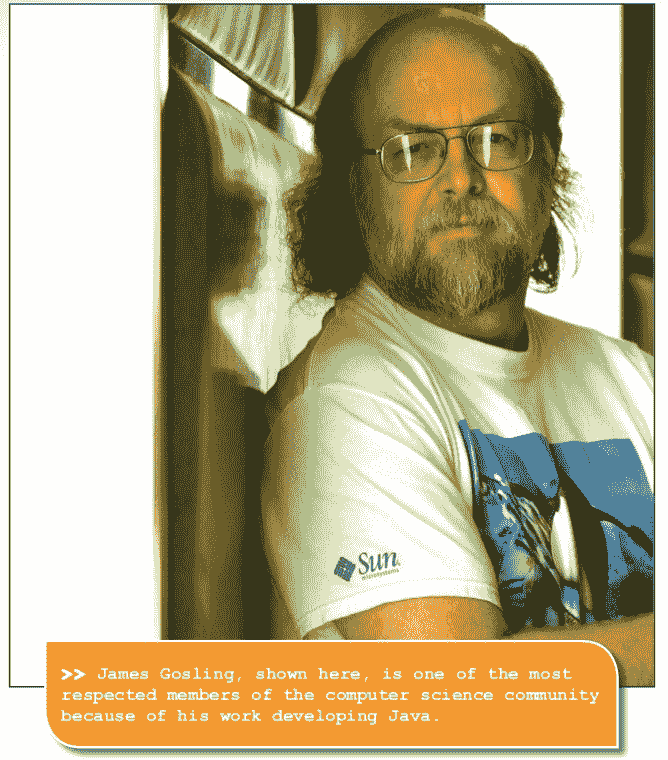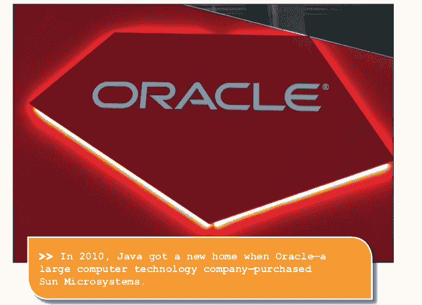

Gosling 和绿色小组成功地创造了一种简单、安全（可以用于编写防篡改和防病毒的系统）并且运行在多个操作系统上的语言。Java 的口号是“一次编写，随运行”（write once, run anywhere）。用这种新术语在一台计算机上编写的代码可以在另一个计算机系统上运行。Gosling 和同事们设计了一种消除编写代码中某些繁琐方面的系统。Java 允许用户编写代码段，以便以后重复使用，而无需反复重写代码。随着 90 年代互联网的普及，设计者们意识到这种新语言是创建在线应用程序的理想选择。1995 年，团队宣布 Netscape Navigator 浏览器将整合 Java 技术。Navigator 成为 20 世纪 90 年代的统治浏览器。如今流行的浏览器如 `Safari`、`Explorer`、`Firefox` 都支持 Java。

尽管 Java 现在已经有二十年的历史了，但需求依然很大。在接受 `TechRepublic` 采访时，招聘公司 Hays 的技术总监 James Milligan 说：“你可以掌握基础。”对于对学习感兴趣的人，强烈推荐学习 Java。


## 机器中的大脑

电子设备和系统并非独立运行。许多设备依赖内部计算机芯片提供的电子“大脑力量”。这种被称为嵌入式处理器或逻辑芯片的微处理器告诉机器如何工作。例如，ATM 机依靠处理器来接收用户的指令，以便执行所需任务——接受存款、取款、开具余额账单等。基本上，ATM 是一个数据终端，它的嵌入式处理器与银行的主机处理器通信，后者持有客户账户的实际详细信息。主机处理器检查持卡人提交的详情（包括安全代码）；如果一切无误，交易即可完成。

谈到网站，Java 以其服务器端能力而闻。许多需要处理大量流量的大型公司（如 Sam's Club、Amazon 和 Apple App Store）都依赖它。每天支持超过四亿条推文的 Twitter，其核心架构基于 Java 系统。Java 编程在公司的服务器上执行所有工作，服务器是用于处理请求并通过互联网或局域网向其他计算机传递数据的计算机。服务器端也称为后端，存储了客户端通过网络浏览器通过互联网访问的网页。Java 编程告诉网站或应用程序如何运行。


客户端（也称为前端）指的是网页浏览器。客户端代码（主要用 `Javascript` 编写）在网页加载后运行在某人的个人计算机上。

## 面向对象的风格

编程有不同的风格或方式，被称为“范式”。程序员使用不同的范式来组织软件，使其能够按预期的方式工作。一种常见的编程风格被称为过程化编程。这种范式使用任务列表来为计算机提供逐步步进的指令。大多数原始的编程语言都是过程化的，包括 `C`、`COBOL` 和 `Fortran`。

相比之下，`Java` 是一种面向对象编程（`OOP`）语言。`OOP` 语言将数据视为对象，并使用一组相互作用的对象，而不是长长的命令列表。这些每个对象都承担着不同的角色。例如，动画程序中的一个对象可能会告诉角色行走或跳跃。对象还会如何与程序中的其他对象进行交互。

任何面向对象的语言——包括 `Java`——都使用类。类是对象的蓝图代码，描述了它的内容。类描述了数据字段并定义了操作，称为方法。通过向对象发送消息，它会执行其方法之一。

当有大量可以共享和复用的代码时，通常使用 `OOP`。当创建一个对象来处理复杂的任务或行为时，程序员可以轻松地在其代码的任何地方再次使用该对象。过程化代码可能很容易遵循，但在代码量巨大时，维护会变得困难。

由于对象是可复用的，`OOP` 提高了速度和效率，特别是 `Java`，已被证明在速度方面优于其他语言。开发者经常使用它，因为它减轻了编写软件时的某些工作量。

### JavaScript 和 Java 是不同的生物

由于这两种常用计算机语言的名称，人们有时认为 `Java` 和 `JavaScript` 有关。然而，`JavaScript` 并不是 `Java` 平台的一部分。虽然它们都是面向对象的语言，但它们非常不同。正如开发者 Jeremy Keith 在 2009 年说的：“`Java` 之于 `JavaScript` 就像火腿之于兔子。”以下是几处不同。

`JavaScript` 通常用于在网页浏览器中制作交互效果。`Java` 的 applets 也能做到这一点，但其人气正在下降。虽然 `Java` 作为服务器的骨干而闻名，但 `JavaScript` 代码传统上只运行在浏览器中——尽管它在服务器编程方面正取得进展。`Java` 代码需要编译，而 `JavaScript` 代码全都是文本形式。总体来说，`JavaScript` 被认为比 `Java` 简单，如果有人想制作生动的交互式网页，它是一门非常棒的语言。

既然它们如此不同，为什么名字又相似呢？`JavaScript` 最初由 Netscape 的 Brendan Eich 开发，命名为 `Mocha`，后来被重命名为 `LiveScript`。1995 年，Netscape 和 `Sun Microsystems` 达成了许可协议，该语言被重命名为 `JavaScript`。它的意图是作为脚本语言来辅助 `Java`（这意味着它不需要编译）。当时，`Java` 是一门热门的新型编程语言，一些人认为 `JavaScript` 的命名是为了给该产品带来更多声望和热度。


> 图中的 Brendan Eich 在 20 世纪 90 年代开发了 `JavaScript`，与 `Java` 配合用于高级应用程序和用户。

# Java 的全貌

当人们考虑 `Java` 时，它不仅仅是指语言本身。它包含了整个 `Java` 平台，即支持该语言以及构建网络系统和应用程序的整个环境。这包括它的编译器、`Java 虚拟机 (JVM)`、库、框架和应用程序接口（`APIs`）。`Java 运行环境 (JRE)` 是由 `Oracle` 开发并提供的程序包，包含了 `Java 虚拟机 (JVM)`、库以及运行 `Java` 应用程序和 applet（执行特定任务的小程序）所需的组件。

当有人下载 `Java` 软件时，他就会收到这个运行环境，为这个人提供了在网页浏览器中运行 `Java` 所需的一切。`JRE` 包含了 `Java` 插件软件，允许用 `Java` 语言编写的 applet 运行在各种浏览器中。网页开发者一直使用 applet 为网页添加功能——在网页上创建交互式按钮、复选框、表单和其他小型动画。今天，applet 几乎已经消失，被其他技术取代——根据 `Oracle` 的说法，`JRE 9` 继续提供 `Java` 插件并支持在仍然提供标准插件支持的浏览器上启动 applet，但仅供有限使用且不建议使用。

## 翻译工具

与许多计算机语言一样，`Java` 平台拥有工具——编译器和解释器——用于翻译语言以便机器能够理解。编译器是一个特殊的程序，它将用一种编程语言编写的语句转换为计算机处理器最终使用的代码。这种平台无关语言被称为 `Java 字节码`。虽然字节码类似于机器语言，但它并不是任何实际计算机的机器语言。`Java` 编译器还会在用户在使用 `Java 的‘语法’`（即语法）犯错时告知用户。《Object-Oriented Programming in Java》的合著者 Bill McCarty 博士将编译器比作一个严厉的任务主管，他“不容忍任何对 Java 官方规则的偏离”。在开发早期发现这些语法错误是非常重要的，而不是在后期，因为那时产品可能已经发给了公众。

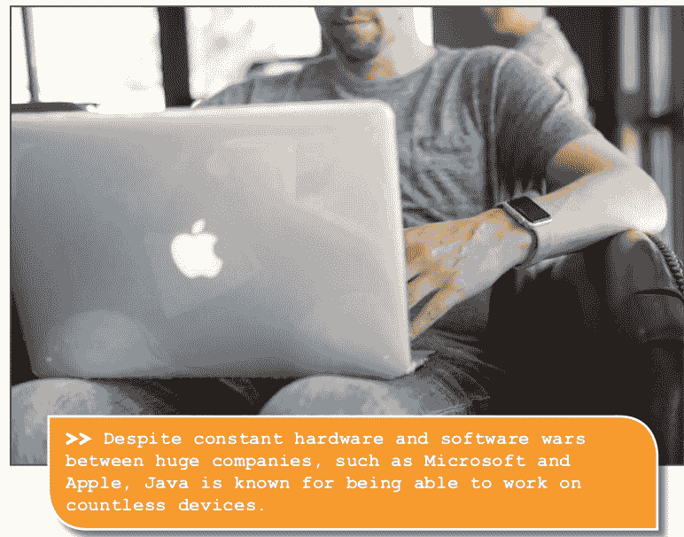

`Java 虚拟机` 是解释器。`JVM` 解密由编译器产生的字节码。所有计算机的操作方式都不同，而 `JVM` 负责翻译字节码。任何安装了 `JVM` 的类型的计算机都可以在开发应用程序的系统上运行 `Java` 程序。`Oracle` 解释说，由于 `JVM` 的存在，在带有 `Windows OS` 的 `PC` 上开发的 `Java` 程序在带有 `Solaris OS` 的 `Sun Ultra 工作站`上也可以同样运行，反之亦然。

平台的另一部分是 `APIs`。这些是用于 `Java` 程序的节省时间的、预先编译好的代码库。`框架` 由多个库组成。它们是大型的预写代码库，任何人都可以将其添加到自己的代码中以节省时间。

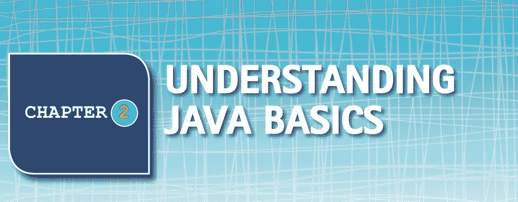

Linus Torvalds，这位开发了 `Linux OS`、`Android` 和 `Chrome OS` 技术的软件工程师曾说：“大多数优秀的程序员编程不是因为期待获得报酬或来自大众的赞誉，而是因为编程很有趣。”从理论上讲，编程应该是有趣且创造创意，事实也是如此。但如果某人是编程领域的完全新手，学习像 `Java` 这样的计算机语言是需要时间的。用代码思考是一个非常独特的过程。学习基础知识可能需要六个月，而需要两到三年才能变得熟练。

## 结论

然而，Java 的粉丝认为它对初非常友好，因为它的语法（或结构）是直观的。它易于编写、阅读和理解。某些语言（如 `C++`）比 Java 更复杂，尽管 Java 使用的语法与 `C++` 相似。如果学习 Java 的人有该语言的经验，那将会很有帮助。

Java 拥有一工具集和编辑器，可以让用户在出错时立即获知。而且，还有一个庞大的 Java 用户社区，遇到任何问题或困难时，都可以在网上寻求帮助。


# 计算基础

对于那些知识很少或没有知识的人来说，掌握 Java 的旅程从对计算机和编程通用工作原理的基本理解开始。在某人尝试编写单行代码之前，他或她必须掌握一些基本要素。

计算机编程需要对解决问题感兴趣。它涉及到创造力、逻辑和耐心。耐心特别是关键，因为需要时间来完全理解代码结构以及这些代码如何告诉计算机需要执行的操作。有时，工作可能会看起来让人压力从心，因此停下来深呼吸，并获取所需的帮助来理解学习过程中的每一步是有帮助的。没有代码和计算机，人类所知的整个现代世界将会崩溃。学习可能很难，但极其重要！

计算机处理信息涉及四个主要功能：接收用户的信息；处理这些信息；存储信息；输出信息。

## 二进制大脑

在某种程度上，计算机中的一切都根据二进制系统运行。日常生活中，大多数人类使用十进制。该系统基于数字 1 到 9 和 0。另一方面，二进制系统仅使用 0 和 1 来表示数字、字母和其他数据。

今天的计算机使用晶体管运行。计算机包含数百万或数十亿晶体管。它们是触发电信号的微型开关。晶体管是计算机芯片的构建块，芯片由处理器和内存单元组成。作为开关集合，晶体管处于开启或关闭状态。计算机根据晶体管开启或关闭的组合运行。二进制代码是告诉计算机开启哪些开关（用 `1` 表示）、关闭哪些开关（用 `0` 表示）的语言。

编写包含数十亿 1 和 0 的代码几乎是不可能的，因此计算机科学家想出了编写简单得多的语言的方法。当程序用 Java 等语言编写好并准备好运行时，它会被放入编译器中，将指令转换为计算机可以读取和执行的机器码。机器码是 1 和 0 组成的基础语言，告诉计算机应该做什么。

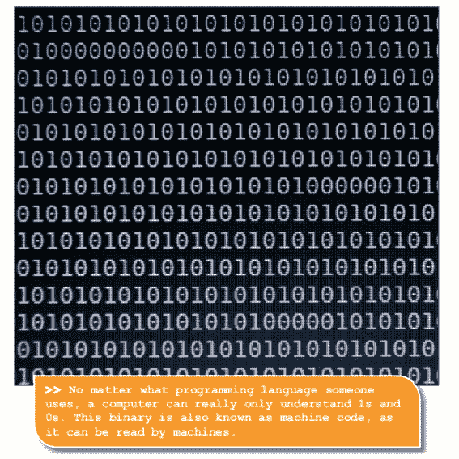

## 组合对象

因为 Java 处理大型程序，因此它被开发为一种面向对象的语言。基本上，Java 中的对象是预先开发的代码段。使用这种类型代码的程序员并不一定需要看到实际“对象”的代码。他们知道如何将对象组合在一起来构建他们的程序。

一个对象可以有多个变量（称为属性或特性）来存储不同类型的数据，并且它还可以拥有自己的特定函数（称为方法）来操作对象的变量。这些术语起初可能很难理解，但某人接触编程越频繁，它们就会变得越清晰。

## 迈出第一步

在用户编写和运行一个简单的 Java 程序之前，他或她需要在其计算机系统上安装该平台。可以在 Oracle.com 免费下载适用于 Linux、Windows、Mac 和 Solaris 操作系统的 Java 软件工具包（JDK）。一旦 Java 平台为他们的系统完成安装和配置，用户就可以尝试编写并运行一个非常简单的程序。

许多编码课程从教授“Hello, World!”程序开始。这是一个简单在屏幕上打印“Hello, World!”字样的程序。通常，程序会在文本编辑器中编写，文本编辑器是操作系统和软件开发包提供的工具。文本编辑器用于输入编程语言源语句。该程序应保存为 `HelloWorld.java`。然后，用户以后通过该名称访问代码并在他们的计算机上运行它。

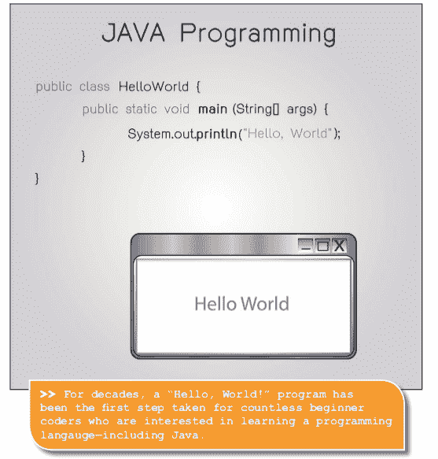

这个“Hello, World!”程序的简单代码编写如下：

```java
public class Main {
    public static void main(String[] args) { System.out.println(“Hello, World!”); }
}
```

代码的第一行声明它是公共的（public），意味着它具有公共访问权限。任何其他类都可以访问它。

应用程序的第二行被称为 `main` 方法。Java 中的每个应用程序都必须包含一个 `main` 方法。Java 编译器从 `main` 方法开始执行代码。这一行是强制性的代码行，作为程序运行的主入口点。理解代码的每部分需要更深层次的研究。例如，`String[] args` 意味着人可以看到并编辑“参数”（arguments）。参数是包含数据或代码的独立项目或变量。

### 代码的最后一行真的是程序的精髓

它告诉计算机应该做什么。`println` 是告诉你的计算机在屏幕上写入字符串（即提供的文本）“Hello, World!”然后插入一个换行符。

这段简单的代码让初学者对 Java 语言如何工作有了一些了解，但要理解所有细节需要密集的学习。根据 Java 语法，每条语句都必须以分号结束，单行注释必须以两个斜杠开头。方法和类用大括号定义。

### 深入学习：在线教程

为了学习更多关于 Java 编程，新用户可以探索互联网上的许多资源。这里是一些广为人知的网站：

- `Code Academy`：自 2011 年以来，CodeAcademy.com 为不同的编程语言（包括 Java）提供了免费的交互式编码课程。网站对某些额外服务收费。
- `LearnJavaOnline.org`：这个免费的交互式教程适用于所有水平的程序员——从初学者到经验丰富的者。
- `Udemy`：Udemy.com 于 2009 年推出提供了六多门在线课程。数十万学生学习了它的“完全学者 Java 教程”，该课程专为没有先编程知识的人设计。
- `Youth Digital`：Youthdigital.com 提供在线技术课程，教 8 到 14 岁的儿童如何编码、设计、开发和动画。

## 尝试代码

在文本编辑器中编写并保存代码后，必须进行编译以便计算机读取。要这样做，用户输入命令：`javac HelloWorld.java`。如果一切顺利，编译器将在 `HelloWorld.class` 文件中生成字节码。Java 编译器的伟大之处之一是它会告诉用户是否存在错误，包括哪一行或几行代码是错误的。

要看到你的程序运行，你必须随后在命令行中输入 `java HelloWorld`。然后，屏幕上应该弹出“Hello, World!”字样。任何电脑上的命令行都是一个强大的、具有控制力的入口。小心你通过命令行执行的命令——如果输入顺序错误，你可能会删掉所有数据。如果你没有写过程序，你可能不知道命令行在哪里。例如，苹果的 Mac OS 系统将命令行存储在一个名为 `Terminal`（终端）的程序中，它可以在 `Applications` 文件夹下的 `Utilities` 中找到。计算机科学老师 David Baumgold 说，Windows 有它自己的命令行，但它很难用。他推荐安装一个名为 `Babun` 的免费且易用的命令行程序。

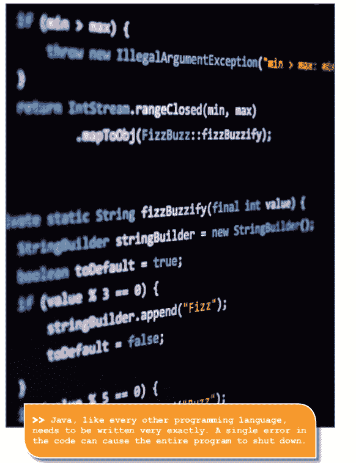

# 玩与实验

在完成像这样的这样的简单练习后，新手程序员可能想找一些自己个人感兴趣的简单项目。在学习过程中，追求一个自己选择的目标会更有动力。你可能想让一匹马的图像从屏幕的一侧移动到另一侧。你可能会创建一个随机侮辱生成器，它可能会吐出诸如“你这个臭臭的、穿袜子的蛆虫饼！”之类的短语。你可能想尝试制作一个简单的二维游戏。学习的关键在于尝试一些项目并看它们是如何运作的。


程序员是将大问题分解为简单步骤的国王和皇后。编码让世界变得更容易，因为它自动化了工作——但需要编写代码的体力劳动才能获得让别人的生活更轻松的结果。就像任何技能一样，练习编程越多，就越容易。看到代码运行的结果可能需要一些时间。程序通常第一次运行并无效，因此程序员需要耐心回去重试。他们需要检查代码行，以确保一切正确。这需要对细节进行大量的精确检查——这就是为什么程序员遵循古老的木工谚言“量两次，切一刀”。

对编码的常见抱怨是它可能会令人沮丧、枯燥和无聊。一些编码工作涉及大量复制和粘贴现有代码来完成任务。这可以让工作变得更容易，但有时会削弱过程中的创造性。为了保持编码的趣味性，程序员会承担感兴趣的项目和挑战。编码赋予了创造原创内容的潜力。为了激发学习 `Java` 或另一个程序的灵感，选择一个有趣且符合个人兴趣的项目会有帮助。

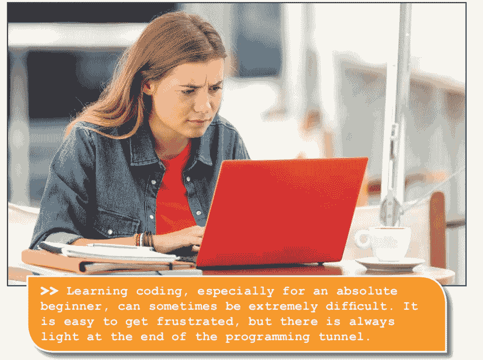

# 来自 Minecraft 的动力

进入编程世界的趣味方式是通过电脑游戏，`Minecraft` 不仅世界上最流行的游戏之一，它提供了理解编码的工具。凭借超过 1.22 亿的销量和每月 5500 万用户，`Minecraft` 已成为全球性现象。

瑞典视频游戏程序员 Markus “Notch” Persson 最初将 `Minecraft` 作为一个爱好项目开始。尽管他没有完成高中，但 Persson 喜欢用乐高积木，他从七岁父亲带回一台 Commodore 计算机开始，就开始自学编程。到八岁时，他已经写了他的第一个程序。2009 年，他对乐高、游戏和编程的热情结合在一起，制作了 `Minecraft` 的第一个版本。与他的创意伙伴 Jakob Porsér 一起，Persson 在同年创立了 `Mojang` 公司（瑞典语意为“小道具”），进一步开发和销售 `Minecraft` 以及其他游戏。

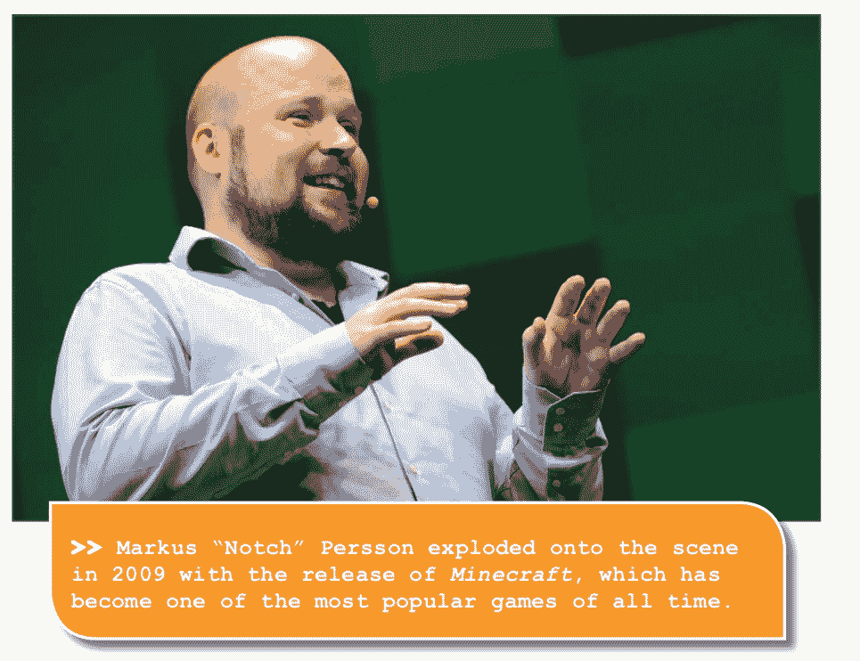

`Minecraft` 几乎是一次性的成功，第一年就卖掉了约两万份拷贝——在第二年，通常每天都有这么多下载量。2012 年 9 月，Persson 以 25 亿美元的价格将 `Mojang` 卖给了 `Microsoft`。

`Minecraft` 被称为沙盒游戏。它提供了一个无限的环境，玩家可以在其中随意漫游并改变虚拟世界，用方块建造结构。游戏中的角色在充满泥土、树木、水、云朵、岩浆、山脉等的世界中破坏并替换方块。`Minecraft` 玩家可以在线并在多人版本中与他人互动。随着游戏的发展，还加入了羊、猪、牛、僵尸、苦力帕、骷、船只、轨道和雪。

为了制作方块、工具和材料，`Minecraft` 提供了大量的物品库存和一个制作工作台。`Minecraft` 的开发者创建了红石，这允许用户制作电路。在这个虚拟宇宙中，红石基本上是一种传输“电能”的手段，它可以被成型和设置以制造各种发明，从灯灯和时钟到计算机和工厂。游戏继续添加动态功能，例如在活塞上升高或降低的平台。

# 加入 MOD 团队

编程在这里通过一个名为 `mods` 的功能发挥作用，它是“modifications”（修改）的缩写。由于 `Minecraft` 是用 `Java` 编写的，`Java` 代码开启了自定义 mod 创建的世界。`Minecraft` 赋予玩家改变角色、物体和景观属性的能力。通过 `Java`，皮肤——或决定角色外观的图像——可以更改。mod 可以为游戏添加新的结构。

CodaKid Online Kids Academy 的创始人 David Dodge 说，`Minecraft` 的编码基础可以通过拖放工具轻松学习。这些工具演示了事件驱动编程，这种编程被用于响应用户或系统的操作。2016 年，`Microsoft` 和 `Code.org` 为 `Minecraft` 引入了一个拖放平台。这些代码块可能包含 if-then 语句（条件）、循环、序列、数组、变量或其他指令。拖放技术是编程的良好第一步。

在掌握了基础原理后，新手可以更上一层楼，使用真正的 `Java` 语言工作。在 `Codakid.com` 上，David Dodge 说，任何人都可以使用 `Java` 创建发射闪电的雷锤、制作岩浆弹或设计其他发明的物品。程序员将他的创意愿景变为现实。一旦代码在游戏中执行，奖励是即时的。

要创建一个 `Minecraft` mod，集成开发环境（IDE）可以帮助。这是一种提供图形用户界面（GUI）的软件应用程序，它可以简化工作并帮助调试软件。一个适用于 `Java` 的常用 IDE 称为 `Eclipse`。另一个 mod 工具是应用程序编程接口（API）。流行的 mod API，如 `Bukkit` 或 `Hmod`，提供了与 `Minecraft` 轻松通信的接口。

## Java 语：学习编程术语

当一个人学习编程门径时，会使用常用短语来描述不同的元素。这里有一些有助于初学者更流畅地使用编程语言的术语。

### 数组

数组是数据或变量的集合、分组或列表。例如，名称列表。数组可以描述为包含多个数据的数据变量。一旦数据存储在数组中，就可以通过变量名和键（或隔间名称）来检索。

### 类

类是用于对象的蓝图并描述其内容的代码。类描述数据字段并定义称为方法的操作。

## 核心概念

- **条件判断**：这些是代码中的“如果-那么”结构，告诉计算机如果某事为真，则执行某些操作。例如，如果银行账户余额低于 100 美，代码可能会发布一条声明：“余额不足”。

- **循环**：循环是一段重复执行的代码，用于执行主任务。

- **脚本**：脚本是使用特定脚本语言编写的一种特殊类型的编码。所有脚本都是编码，但并非所有编码都是脚本。脚本语言不需要编译——它们是被解释的。例如，通常情况下，`Java` 程序在运行之前需要编译，而通常情况下，像 `JavaScript` 或 `PHP` 这样的脚本语言不需要编译。

- **方法**：方法是定义在数据字段中的操作或程序。

- **序列化**：这是对动作或事件进行安排，使其按照预先的顺序引导到下一个有序动作。

- **变量**：这些是可以根据程序运行而改变的值。可以根据需要进行创建、编辑或删除。

## 探索应用世界

Web 应用涵盖了广泛的功能。它们可以通过在线表单收集输入、统计投票调查、接收产品订单、预订机票或允许用户登录。人们现在可以上网购买衣服、办理银业务或参与讨论——这一切都归功于 Web 应用。世界各地的用户可以在他们的计算机浏览器上访问应用程序——因此数以百万计的人实际上同时使用同一个应用。

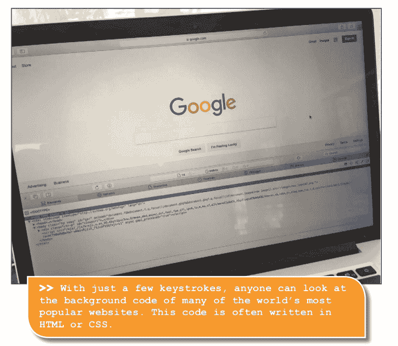

在客户端（普通用户看到的部分），网站可以使用标记语言或脚本语言构建，例如 `HTML`（超文本标记语言）、`CSS`（层叠样式表）或 `JavaScript`。`Java` 也用于应用程序，但通常在服务器端。例如，`Java servlets` 是通常响应网站用户请求的服务器程序，最常见的是响应用 `HTTP`（超文本传输协议）请求。`Java` 在处理与许多其他系统（如银行和保险公司使用的系统）通信的大型 Web 应用方面口碑良好。

`Java` 已成为构建在 `Android` 智能手机上运行程序的本质语言。Google 选择 `Java` 作为其极其流行的 `Android` 移动操作系统的编程语言。即使是 `Gmail` 的服务器端功能也由 `Java` 和 `C++` 运行。2006 年，Google 为手机提供了基于 `Java` 的 `Gmail` 应用程序。应用让任何人通过移动设备进行广泛的活动，从玩在线游戏到与世界各地聊天以及查看 3D 图像。尽管 `Android` 一直依赖基于 `Java` 的应用，但 Oracle 已起诉 Google，声称 `Android` 侵犯了其专利——而 Google 声称它在公平使用法下合法整合了 `Java` 技术。

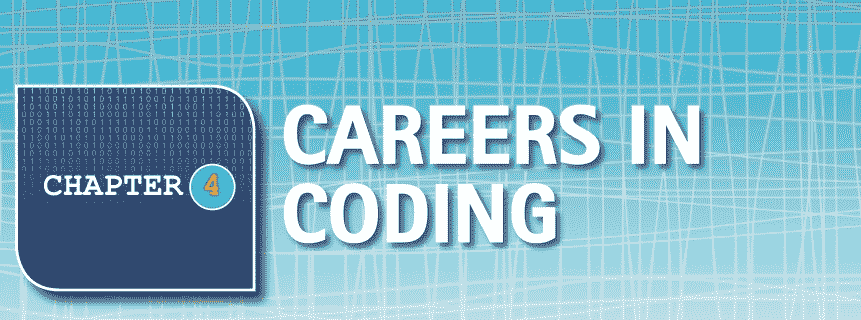

2017 年 5 月，EdX——一家大型大学课程在线提供商——将 `Java` 评为可以在网上免费学习的三种最有利的编程技能之一（另外 `SQL` 和 `C`）。该公司重点介绍了 `Java`，因为它开启了通往卓越机会的大门，这些机会年薪通常超过 10 万美元。劳工统计局 (`BLS`) 的数据显示，2016 年计算机程序员的中位薪资为每年 79,840 美元。衡量编程语言流行的的 `TIOBE Index` 在 2018 年 2 月将 `Java` 排名第一——这意味着对于知道 `Java` 的人来说，就业机会远多于任何其他语言。

`Java` 大师有广泛的就业选择。例如，一名 `Java` 软件开发人员设计应用程序和软件，通常与 Web 开发人员和软件工程师合作，将 `Java` 集成到不同的业务系统中。这些应用可能是用于移动设备或平板，也可以运行在计算机上。所有类型的企业和组织都使用 `Java` 软件。

## 开发人员与程序员

`Java` 可能可能处理文字处理软件、浏览器工具、游戏或媒体播放器（如 `iTunes`）。软件开发通常是一份非常有创造性的工作，因为它需要提出新想法。通常，开发人员参与产品的每一个阶段，从构思到引入世界。在此过程中，他们会测试和分析产品，检查任何潜在问题。如果有任何故障，开发人员需要找到解决方法。他们需要确保拥有最高质量的产品，并确保程序是用户友好的。此外，开发者可能会编写详细说明产品的文档，以便他人了解其所有细节。开发者展示软件结构以及它将如何与其他程序一起运行的大局。在许多情况下，他们制作图表和流程图来解释如何编写代码，然后将实际的代码编写工作交给程序员。

与开发人员相比，程序员的工作创造性可能较低。他们执行开发人员提出的计划，花整天编写大量代码。他们还会调试（测试并修复错误）并将信息收集到库中，供日后使用并使未来的代码编写更容易。程序员可以有不同的专业领域。游戏程序员编写驱动计算机游戏图形的代码。Web 程序员构建与其共存网站和应用程序。他们可能会将基于 `Java` 的程序与使用 `HTML`（Web 开发语言）构建的页面相结合。Web 设计结合了许多技能，包括计算机编程和图形设计。网站创建者知道如何结合动画、视频、音频和交互功能。尽管在技术驱动的世界中，设计师和程序员非常受需求，但美国劳工统计局预测，从 2014 年到 2024 年，计算机程序员的职位将减少 8%。其部分原因是公司正在从美国境外聘佣更廉价的程序员。

## 教育途径

如果编程和软件开发证明是你想要追求的职业领域，你将希望超越在线教程。许多主要雇主只招聘那些拥有计算机科学、信息系统、数学或密切相关领域学位的人。课程可能涵盖数据结构、体系体系、数据库管理、统计和技术写作。对于任何使用任何语言的程序员来说，这些都是重要的技能。

虽然计算机编程领域成功的标准路线是通过获得大学学位，但一个能够证明经验并精通 `Java` 编码的人仍然可以获得极佳的职位。Oracle 拥有自己的“大学”，提供在线课程和认证。通过官方熟水平考试会提高求职者的价值。正如许多程序员和开发人员所证明的那样，教育过程永无止。编码世界不断变化，因此专业人士需要跟上所有的最新进展。即使是高级程序员也必须在引入新特性时掌握它们。如果你将此视为职业，请准备好享受终身学习。

没有什么比从事一份现实的工作更能让你了解职业的真实面目了。获得计算机科学学位的学生通常可以通过他们的学校利用实习机会。实习让学生获得现实世界的工作经验，同时还能获得课程学分。大多数大公司都提供计算机科学相关的实习计划。沃尔玛有一个与其在线销售相关的计划。雪佛龙正在寻找实习生来协助其应用程序、数据库管理和业务分析工具。苹果、通用电气、惠尔士-帕科、威信、IBM、波音、微软、Target、Comcast、道达化学、戴尔、Humana、甲骨、时代以及数千其他公司都提供技术实习。

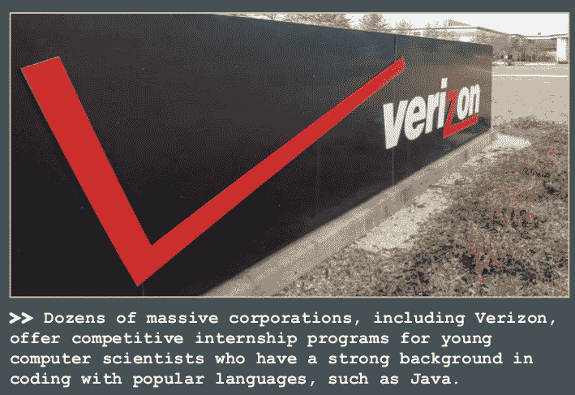

学生可以研究问题并帮助开发和实施解决方案。通过与专业人士合作，学生可以掌握技术术语并理解科技领域最前沿的挑战。实习通常还能带来宝贵的人脉联系。这既是一个通过承担新责任来丰富简历的机会，也是一个建立人脉网络的机会，这些人脉可能成为推荐来源甚至全职工作的机会。

# 英语专业精通 Java

并不是所有的 `Java` 和编码专家都是以计算机科学背景起家的。Jonathan Feinberg 是 Google 的高级软件工程师，他在那里负责编写绘图引擎的代码，该工具允许其他软件工程师为他们的 `Android`、`iOS`（一种用于苹果移动设备的操作系统）和 Web 应用程序添加绘图功能。他使用 `Java` 以及 `C++`、`Objective-C` 和 `JavaScript` 编写代码。

尽管他从小就对计算机编程充满热爱，但在进入大学时，这并不是他的首选路径。虽然他的许多同事拥有计算机科学学位，但 Feinberg 拥有的是英语和美国文学学士学位。尽管如此，如果有人对编程职业感兴趣，他建议学习计算机科学或软件工程，而在二十一世纪，了解 `Java`、`C++` 或 `Python` 是一件好事。

Feinberg 使用 `Java` 创建了 `Wordle`，这是一个根据用户提供的文本生成“词云”的玩具。他曾为 `Processing` (`processing.org`) 贡献过代码，这是一个灵活的软件速写板以及一种在视觉艺术背景下学习如何编码的语言。Feinberg 主要负责 `Processing` 对 `Android` 编程的初步支持以及 `Python Mode`，后者允许用户使用 `Python` 编程语言创建 `Processing` 草图（但 `Python Mode` 本身是用 `Java` 编写的）。

他学习 `Java` 主要是通过阅读《Java 编程语言》（*The Java Programming Language*）的第一版，然后想出有趣的小项目来挑战自己。他写了一个纸牌程序和许多其他制作动画的小程序。

对于 Feinberg 来说，`Java` 为编写提供交互式计算机图形的程序提供了最好的工具包。“所谓的 `Java 2D API` 仍然是我最喜欢的图形工具包——当我在探索或设计图形化程序时，我最容易用它来‘思考’的工具，”他说。

`Java` 也利于避免编码错误。他说，某些整类的错误（编程错误）在 `Java` 中根本不会发生，因为这种语言让它们变得无法实现。“这类错误是 `C` 和 `C++` 程序中许多崩溃的原因，”他说，并补充道，`Java` 对错误的处理方式是许多公司（包括 Google）在某些大型软件项目选择选择该语言的原因。

至于缺点，Feinberg 指出了 `Java` 冗长的声誉。“表达简单的想法需要输入大量的字符，”他说，“这可能会令人沮丧，并导致读起来很无聊的代码。这有点像通过填写税表来写一部小说。”

# 应用的天赋

作为 Scientific Games Interactive 的高级软件工程师，Will Rieder 通过添加新功能和排除现有功能的故障来维护和扩展移动社交赌场游戏应用。他们的两个热门游戏是 *Rainbow Riches*（彩虹）和 *Spartacus Gladiator of Rome*。尽管该公司的大部分代码库使用的是 `C#` 或 `flash/actionScript`，但他们使用 `Java` 作为“胶水”来与 `Android` 硬件建立接口。

Rieder 在十一岁时对编程产生兴趣，当时他的高级数学课去当地大学的计算机实验室实地。他发现自己热爱编程中解决问题的方面——无论是玩益智游戏，还是寻找编写益智游戏的最佳方法。他说这个过程需要他提问：“我如何从 A 到 B？两点之间是否有更高效的路径？”

他通过用于开发 `Android` 应用程序学会了 `Java`，他说现在对了解 `Java` 和其他编程语言的年轻人来说，有很多机会。


作为一种不断演进且至今仍在开发的计算机语言，`Java` 保持着前沿。该语言经常获得更新和新版本。在线 `Java` 社区人数以百万计，用户汇集了大量的开源库和开发工具，使编程挑战变得更加简单。

在接受专门从事 `Java` 工作的招聘机构 Pearson Frank 访谈时，软件开发公司 Atomist 的开发者、播客 *Greater Than Code* 的小组讨论员 Jessica Kerr 表示，世界正运行得越来越快，对自动化的需求也日益增加。由于 `Java` 既实用又多功能，她认为它在未来将继续发挥至关重要的作用。

# 强化应用

近年来，随着消费者对这些设备变得比以往任何时候都要依赖，移动设备的应用开发已大幅增长。`Android` 应用开发的官方语言是 `Java`。2014 年，移动互联网的使用超过了桌面端的使用。毫无疑问，应用业务是巨大的。

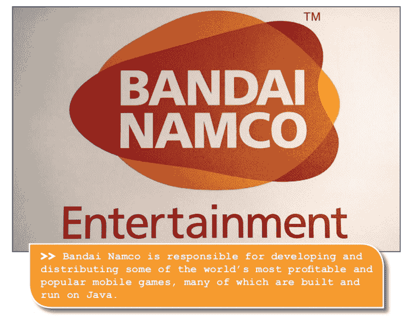

应用智能公司 Sensor Tower 计算，全球应用收入在 2017 年增长了 35%，达到近 600 亿美元。游戏应用占据排行榜的前端。例如，万代南古娱乐的《龙珠之觉斗士》每天带来约 200 万美元收入。对于对游戏开发充满热情的人，几个网站已经出现提供帮助，包括 `java-gaming.org` 和 Lightweight Java Game Library ([www.lwjgl.org](http://www.lwjgl.org))。

对于许多来说，Facebook、Messenger、Google、Gmail、Instagram、Amazon 和 Apple Music 等应用已经融入了他们的日常生活。音乐应用 Pandora 和 Spotify，视频流媒体应用 Netflix 和 Hulu 以及其他实用应用也大受欢迎。许多关注健康的消费者已转向应用来跟踪体重、卡路里和运动目标。

# 增强大数据

在日常，企业、政府和其他主要组织必须处理海量数据。他们收集、存储、跟踪并分析这些数据，以做出战略性的业务决策。对于今天的程序员来说，挑战在于如何跟上这股不断增长的信息洪啸。《科技评论》的高级编辑 Antonio Regalado 表示，只有约 0.5% 的数据会被分析。由于 `Java` 可以在桌面电脑、移动设备和平板上直接使用——并提供了大量的代码库——这种语言可以承担许多与大数据处理相关的任务。到 2018 年，`Hadoop` 已成为一套流行的程序和程序集，用于构建大数据操作的核心框架。`Hadoop` 本身是用 `Java` 开发的。

# 走向太空及彼岸


`Java`技术已进入了无人涉足的领域。美国国家航空航天局（`NASA`）在许多项目使用了`Java`，包括其提供虚拟 3D 地球的 World Wind 软件开发工具包。观众可以对地球上的不同位置进行放大和缩小。现代机器人工程也使用了`Java`。一辆获奖奖的自动驾驶汽车运行在该代码之上。通过他的公司`Marginally Clever`构建并销售机器人的 Dan Royer 依赖于`Java`。这种语言也是艺术机器人`Makelangelo`背后的动力，它可以绘制海报和壁画。Ali Lemus 将机器人与医疗领域相结合，组装了一个廉价的假手。Lemus 提供了如何使用 3D 打印机和`Java`代码构建该肢体的说明。

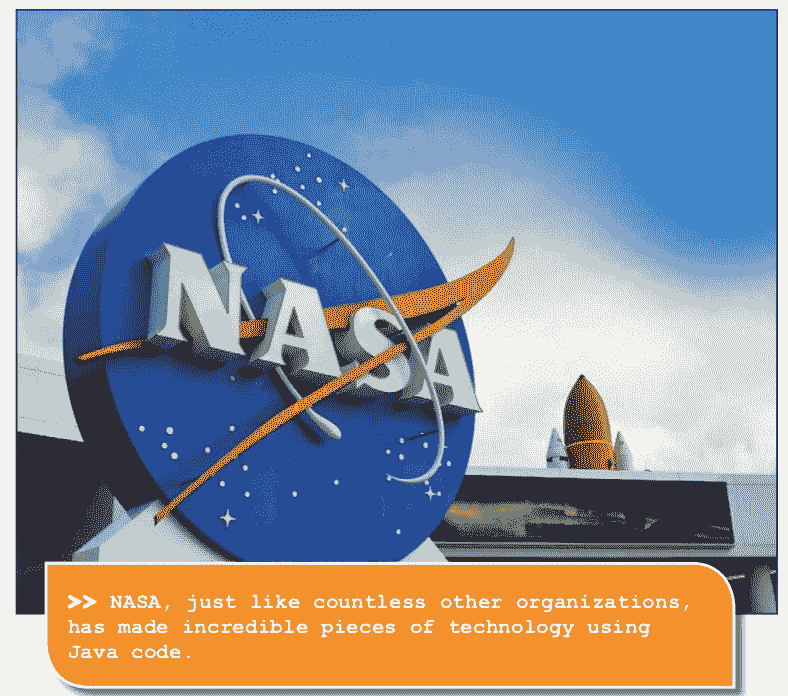

感谢`Java`技术，Doctor Online 提供了交互式患者护理服务。在娱乐界，工业光魔（`ILM`）已转向`Java`来制作各种特效。`ILM`制作了如《加勒比海》系列电影中迪·琼斯像章鱼一样的脸，以及许多漫威电影中钢铁侠盔甲真实的金属表面。

云是`Java`留下足迹的另一个尖领域。云计算是指使用托管在互联网上的远程服务器网络来存储、管理和处理数据的实践。组织和个人远程访问这些计算服务。当某人将数据存储在计算机硬盘上或从其硬盘上运行程序时，这被称为本地存储和计算——而不是云计算。云计算服务已成为一些人的首选，因为作为拥有和运行计算机及网络的更具成本的选择。一个例子是微软的`Office Online`。用户可以通过互联网访问仅限网络版本的`Word`、`Excel`、`PowerPoint`和`OneNote`版本，而无需安装任何东西。它们是云计算工具。`Google Drive`是一种流行的云端文件存储形式。由于`Java`可以随处运行，它非常适合云端开发。

## 其他编程语言

`Java`经常与其他编程语言一起使用。这里是任何初学者应该了解的其他几种广泛使用的语言。

- **C**：`C`被广泛使用，是一种创建于 1972 年的通用语言。它与`UNIX`操作系统紧密相关。
- **C++**：`C++`能够在各种平台上运行，如 Windows、Mac OS 和各种版本的`UNIX`，多年来一直是最受欢迎的语言之一。它于 1979 年创建，是`C`的一个更广泛的版本。
- **C#**：`C#`是`C`和`C++`的混合体，由微软开发，用于与`Java`竞争。
- **Objective-C**：这是编写为`OS X`和`iOS`软件的主要编程语言。
- **Python**：作为一种顶尖语言，这种交互式、面向对象的编程语言免费使用。它以英国喜剧剧团蒙提派森飞行马戏团命名。`Google`的许多组件是用`Python`编写的，游戏《战场 2》、《星际迷航桥指挥官》和《文明 4》也是如此。
- **Ruby on Rails**：有时仅称为`Rails`，`Ruby on Rails`是由 David Heinemeier Hansson 用`Ruby`语言构建的开源 Web 框架。它将`Ruby`与`HTML`、`CSS`和`JavaScript`结合。`Ruby`在程序员中以一种简洁的语言而闻名。
- **SQL**：结构化查询语言面向存储、操作和查询存储在数据库中的数据。

# 万物互联

在快速变化的世界世界，一个相对新的概念是物联网（`IoT`）。这指的是将各种设备连接到互联网——厨房电器、无人驾驶汽车、心率监测器等。这些电子产品通过`M2M`（即机器对机器）通信进行连接。

智能自行车锁通过特殊的手机 App 打开和关闭——如果有人尝试破坏用户的自行车，他或她的手机就会收到短信。现在已经有了设备可以追踪冰箱里牛奶和鸡蛋的新鲜度，并在食物变质时发送消息提醒消费者。`June`烤箱和配套的`June` App 允许用户通过其`iPhone`或`iPad`控制烹饪，并通过实时视频流监控食物。理论上讲，设备内部的技术还允许公司收集更多关于其自身产品和内部系统的数据。研究机构`Gartner`报告显示，2017 年估计有 84 亿设备连接到互联网，共享并收集信息。然而，`IoT`的主要关注点之一是安全。黑客已经演示了如何破坏系统以获得对家庭安全系统和计算机驱动车辆等物品的控制。

在`Oracle.com`的一次采访中，`Globalcode`的创始人 Vinicius Senger 表示，`Java`的诞生是为了实现这些。他说：

```text
Java 一直致力于提供企业解决方案、互联网销售以及银行服务，但 Java 最初的设计是作为一种连接事物的编程语言。
```

相同的架构、安全性和通信协议，`Java`应用于银行、零售企业和互联网业务，也可以用于嵌入式设备。`Java`是通往技术、编程和每个人便利未来的门户。

## 术语表

- **ANDROID**：由`Google`开发的基于开源系统的操作系统。
- **APPLETS**：执行特定任务的小程序。
- **应用程序编程接口 (API)**：用于构建软件的程序、协议和工具。
- **BUG**：计算机程序中的代码错误或缺陷。
- **客户端/前端**：指在用户计算机上发生的操作。
- **编译器**：将编程语言编写的语句翻译成计算机理解的机器语言的软件。
- **计算机架构**：系统的组织和结构。
- **数据库管理**：对计算机程序中收集的信息进行组织和维护。
- **调试**：发现并修复中的错误。
- **嵌入式**：描述位于大型机械或电气系统中专用功能的计算机系统。
- **图形用户界面 (GUI)**：通常读作“gooey”，GUI 基本上是让人使用和交互计算机的视觉组件。它们通过视觉元素使计算机更易使用。微软 Windows 和 Apple Mac 界面都使用“桌面”屏幕。
- **集成开发环境 (IDE)**：简化软件开发和调试的编程环境。
- **IOS**：由 Apple 公司创建并开发的移动操作系统。
- **机器码**：计算机中央处理器理解的基础语言。
- **MOD**：“修改”的缩写，对视频游戏进行某些方面的更改。
- **范式**：一种编程风格或方式。
- **过程化语言**：一种依赖于一系列构建良好的步骤和过程的编程语言。
- **协议**：一组用于电子设备之间传输数据的规则或程序。
- **服务器端/后端**：指用于处理请求并通过互联网或本地网络向另一台计算机发送信息的计算机。
- **软件**：用于操作计算机的程序。
- **源代码**：用计算机编程语言编写的指令。
- **语法**：一组规定计算机语言必须如何编写的规则。
- **技术写作**：易于理解的说明，通常用于计算机硬件和软件、工程、化学、航空、机器人机器人、金融、医学、消费电子产品和生物技术相关产品。
- **晶体管**：一种控制电流或电压流的机制，充当电子信号的开关或门电路。

# 获取更多信息

```text
Canada Learning Code
129 Spadina Avenue
Toronto, ON M5V 2L3
Canada
(647) 715-4555
Website: http://canadalearningcode.ca
Email: info@canadalearningcode.ca
Facebook: @canadalearningcode
Twitter and Instagram: @learningcode
该组织致力于为所有加拿大人人提供数字技能——特别是女性、女孩、残障人士、原住民青少年和新移民者。

Canadian Advanced Technology Alliance (CATA)
207 Bank Street, Suite 416
Ottawa, ON K2P 2N2
Canada
(613) 236-6550
Website: http://www.cata.ca
Email: info@cata.ca
Facebook: @CATAAllianceCEO
Twitter: @CATAAlliance
CATA 是加拿大最大的高科技协会，是加拿大最新高科技新闻的综合资源。

CIPS/Canada’s Association of Information Technology Professionals
1375 Southdown Road
Unit 16 - Suite 802
Mississauga, ON L5J 2Z1
Canada
(905) 602-1370
Website: http://www.cips.ca
Email: info@cips.ca
Facebook: @CIPS.ca
Twitter: @cips
YouTube: @CIPSnational
该协会提供建立联系的机会、认证和认可。

Code.org
1501 4th Avenue
Seattle, WA 98101
Website: https://code.org
Email: info@code.org
Facebook: @Code.org/
Twitter and Instagram: @codeorg
该非营组织致力于扩大学校对计算机科学的接触，并增加女性和代表性少数的参与度。它的愿景是每所学校的每个学生都应该有机会学习计算机科学。

CompTIA/Association of Information Technology Professionals
(AITP)
3500 Lacey Road, Suite 100
Downers Grove, IL 60515
(866) 835-8020
Website: https://www.aitp.org
Facebook: @comptiaaitp
Twitter and YouTube: @comptia
这个全球信息技术人士协会提供职业培训、奖学金、新闻和社交网络机会。

National Association of Programmers
PO Box 529
Prairieville, LA 70769
Website: http://www.napusa.org
该小组致力于提供信息和资源，以帮助计算机行业的程序员、开发者、顾问和学生。

TryComputing.org
501 Hoes Lane
Piscataway, NJ 08854-4141
(732) 981-0060
Website: http://www.trycomputing.org/inspire
/computing-student-opportunities
Facebook: @TryEngineering.org
Twitter: @TryEngineering
这项由电气电子工程师学会发起的倡议为年轻人提供竞赛、活动、实习和研究计划。它还发布关于职业机会和提供计算机编程课程大学的信息。
```

## 进阶阅读

Bedell, Jane. *So, You Want to Be a Coder*? New York, NY: Alladin/Simon & Schuster, 2016.

Conrod, Philip. *Java For Kids: NetBeans 8 Programming Tutorial.* Seattle, WA: Kidware Software, 2015.

Garcia, Nadia Ameziane. *Java For Kids (and Grown-Ups): Learn to Code and Create Your Own Projects with Java 8.* North Charleston, SC: CreateSpace, 2017.

Guthals, Stephen Foster, and Lindsey Handley. *Modding Minecraft: Build Your Own Minecraft Mods!* (Dummies Junior). Hoboken, NJ: Wiley, 2015.

Hillman, Emilee. *Understanding Coding with Java* (Spotlight on Kids Can Code). New York, NY: PowerKids, 2017.

Horstmann, Cay S. *Core Java Volume I—Fundamentals.* 10th ed. Upper Saddle River, NJ: Prentice Hall, 2016.

McCue, Camille. *Coding for Kids for Dummies.* Hoboken, NJ: Wiley, 2014.

Thompson, R. Chandler. *Java Programming for Kids: Learn Java Step By Step and Build Your Own Interactive Calculator for Fun!* (Java for Beginners). North Charleston, SC: CreateSpace, 2014.

Vordeman, Carol. *Computer Coding for Kids.* New York, NY: DK Publishing, 2014.

Wainewright, Max. *How to Code: A Step-by-Step Guide to Computer Coding.* Asheville, NC: Sterling Children’s Books, 2016.

Woodcock, Jon, and Kiki Prottsman. *Star Wars Coding Projects.* New York, NY: DK Publishing, 2017.

## 参考文献

Bedell, Jane. *So, You Want to Be a Coder?* New York, NY: Alladin/Simon & Schuster, 2016.

Beneke, Timothy. “A Perfect Match: Java and the Internet of Things.” Oracle, June 2014. [`www.oracle.com/technetwork/articles/java/java-maker-iot-2214499.html`](http://www.oracle.com).

Brain, Marshall. “How Java Works.” How Stuff Works Retrieved February 18, 2018. [`computer.howstuffworks.com/program2.htm`](https://computer).

Burd, Barry. “What Is a Java Virtual Machine?” Java for Dummies, March 2014.

Prekash, Mayur. “Java 在当今世界的重要性.” AllAboutWeb, 2016 年 7 月 7 日. [`www.allaboutweb.biz/importance-java-todays-world`](http://www.allaboutweb.biz).

Sierra, Kathy. *Head First Java.* 第 2 版. Sebastopol, CA: O’Reilly Media, 2005.

Thumar, Chirag. “Java 技术的当前趋势.” YourStory/MyStory, 2017 年 11 月. [`yourstory.com/mystory/9c06c57017-current-trends-in-javas`](https://yourstory.com).

Woodie, Alex. “哪种编程语言最适合大数据？” Datanami, 2018 年 2 月 12 日. [`www.datanami.com/2018/02/12/programming-language-best-big-data`](https://www).

# 索引

### A

- **亚马逊 (Amazon)**，4, 10, 46
- **安卓 (Android)**，17, 37, 42, 47
- **应用 (apps)**，44
- **硬件 (hardware)**，44
- **移动应用开发 (mobile app development)**，8, 45, 47
- **...编程 (programming for)**，43
- **智能手机 (smartphones)**，4, 37
- **小程序 (applets)**，12, 14
- **应用程序接口 (APIs)**，14, 16, 33, 43
- **应用 (apps)**，8, 35-37, 44, 45-47
- **数组 (array)**，33, 34
- **自动取款机 (ATMs)**，4, 8, 9-10

### B

- **二進制系统 (binary system)**，20-21
- **浏览器 (browser)**，7, 11, 12-13, 14, 35
- **工具 (tools)**，39
- **字节码 (bytecode)**，15, 16, 26

### C

- **C 语言**，4, 11, 43, 50
- **类 (class)**，11-12, 24, 26, 34, 43
- **客户端 (client side)**，11, 36
- **云计算 (cloud computing)**，49
- **C#**，44, 50
- **编译器 (compiler)**，14-15, 16, 20-21, 24, 26
- **计算机体系 (computer architecture)**，40
- **条件判断 (conditional)**，33, 34
- **C++**，4, 18, 37, 42-43, 50

### D

- **数据库管理 (database management)**，40, 41
- **开发者 (developer)**，8, 38, 39-40, 45, 47


# 索引

## A

- **编辑器（editors）**，18
- **源代码（source code）**，33
- **文本（text）**，22-23, 26
- **教育（education）**，40, 42-43

## F

- **脸书（Facebook）**，46
- **Messenger（Messenger）**，8, 46
- **框架（frameworks）**，14, 16, 51

## G

- **游戏（games）**，8, 28, 30, 31, 32, 33, 44, 50
- **编码（coding）**，39
- **在线（online）**，37
- **视频（video）**，4
- **Gmail**，37, 46
- **谷歌（Google）**，4, 37, 42, 43, 46, 50
- **应用（apps）**，8
- **谷歌云端硬盘（Google Drive）**，49
- **戈斯林，詹姆斯（Gosling, James）**，4, 6, 7
- **图形界面（graphical user interface）**，33
- **绿色团队（Green Team）**，4, 6, 7

## H

- **Hadoop**，47-48
- **“Hello, World!”程序**，22, 23, 24, 26
- **HTML**，36, 39, 51

## I

- **Instagram**，8, 46
- **集成开发环境（IDE）**，33
- **物联网（Internet of Things）**，51, 52
- **实习（internships）**，41-42
- **解释器（interpreter）**，14, 16
- **iOS**，42, 47, 50

## J

- **Java 运行时环境（JRE）**，14
- **JavaScript**，4, 11, 35, 36, 42, 51
- **对比 Java（versus Java）**，12-13
- **Java 开发工具包（Java Software Development Kit）**，22
- **Java 虚拟机（JVM）**，14

## L

- **库（libraries）**，14, 16, 39, 45, 47
- **循环（loop）**，33, 34

## M

- **机器码（machine code）**，21
- **方法（methods）**，12, 22, 34, 35
- **主方法（main）**，24
- **我的世界（Minecraft）**，30-33
- **模组（mod）**，32-33

## N

- **奈飞（Netflix）**，8, 46-47
- **网景（Netscape）**，7, 13

## O

- **橡树（Oak）**，6
- **Objective-C**，42, 50
- **面向对象编程（OOPS）**，11, 12
- **开源应用（open-source apps）**，51
- **开源库（open-source libraries）**，45
- **开源软件（open-source software）**，8, 9
- **甲骨文（Oracle）**，4, 6
- **网站（website）**，9, 22

## P

- **范式（paradigms）**，11
- **珀森，马库斯（Persson, Marcus）**，30
- **PHP**，4
- **Java 平台（platform, Java）**，14, 26, 47
- **插件软件（plug-in software）**，14
- **过程化语言（procedural language）**，11
- **处理器（processor）**，17
- **程序员（programmers）**，11, 22
- **Python**，4, 43, 50

## S

- **脚本化（scripting）**，13, 35
- **服务端（server side）**，11
- **Servlet（servlets）**，36
- **软件（software）**，8, 9, 11, 12, 33, 44
- **SQL**，38, 51
- **太阳系统（Sun Microsystems）**，4, 6
- **语法（syntax）**，15

## T

- **技术写作（technical writing）**，40
- **TIOBE 指数**，4
- **晶体管（transistors）**，20

## V

- **变量（variables）**，22, 24, 33

# 关于作者

Don Rauf 是多本非虚构作品的作者，包括《网络安全职业》、《计算机游戏设计师》、《Schwinn: 最好的礼物》以及《致命口红和其他设备》。他与妻子 Monique 和儿子 Leo 住在西雅图。

# 图片致谢

封面 Monkey Business Images/Shutterstock.com; 封面、封底，第 1, 4-5 页（背景）© iStockphoto.com/leto; 第 5 页 The AGE/Fairfax Media/Getty Images; 第 6 页 Sergiy Palamarchuk/Shutterstock.com; 第 9 页 Tero Vesalainen/Shutterstock.com; 第 10 页（左）ibreakstock/Shutterstock.com,（右）ThomasDeco/Shutterstock.com; 第 13 页 David Maung/Bloomberg/Getty Images; 第 15 页 Anna Hoyuk/Shutterstock.com; 第 18 页 kr7ysztof/E+/Getty Images; 第 19 页 NicoElNino/Shutterstock.com; 第 21 页 Twinsterphoto/Shutterstock.com; 第 23 页 chaipanya/Shutterstock.com; 第 25 页 g0d4ather/Shutterstock.com; 第 27 页 Mehaniq/Shutterstock.com; 第 30 页 Antonio Guillem/Shutterstock.com; 第 31 页 Paul Hennessy/Polaris/Newscom; 第 36 页 Rosen Publishing; 第 41 页 Paul J. Richards/AFP/Getty Images; 第 46 页 Chesnot/Getty Images; 第 48 页 Tony Craddock/Shutterstock.com。

设计与排版：Nicole Russo-Duca; 编辑：Siyavush Saidian; 图片检索：Nicole DiMella

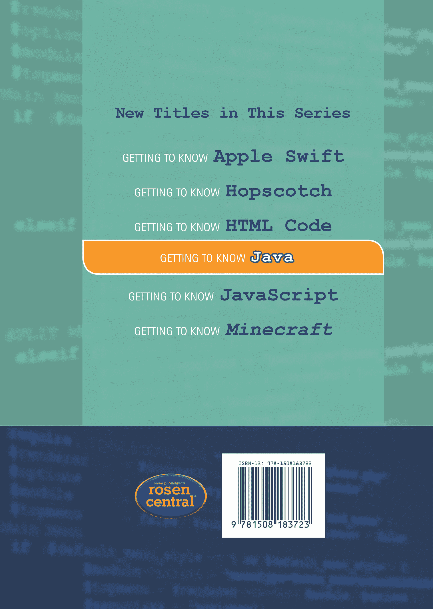
