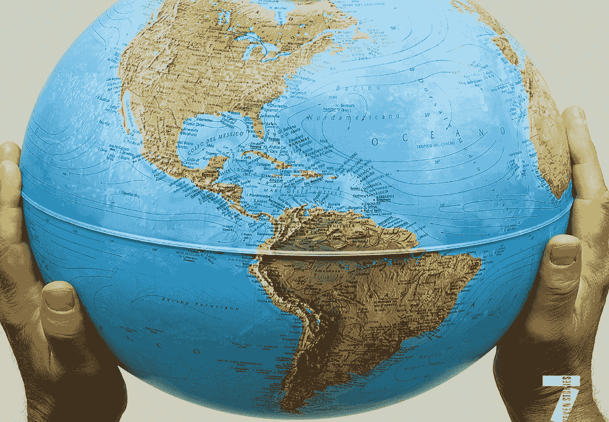

# 巨人：全球权力精英

彼特·菲利斯

“审查计划”（`Project Censored`）前任主管

威廉·I·罗宾森引言

> “主宰者究竟究竟是谁？这项非凡的探究揭开了层面纱，提供了详尽且往往令人震惊的揭示。”
>
> —诺姆·乔姆斯基

“我们都知道‘他们’统治着世界，或者统治着世界的很大一部分；我们也知道他们的唯一目的就是让自己变得富有；而这种强迫性的扩张正通过传播贫困、制造无尽的战争以及从根本上毒害地球，在杀死我们所有其他人。

我们知道他们有多强大，知道这对我们造成了什么；但我们并不确切‘他们’到底是谁——这是我们极度需要的信息，而‘我们的自由媒体’没有提供给我们，任何学校也没有定期教授这些，因为媒体和学校在很大程度上是他们的。

因此，我们这些想要打破他们枷锁的人，对彼特·菲利斯感激不尽（以一种解放的方式），多亏他，我们终于知道了那99位致命超级经理的名字和故事。菲利斯接续了C·莱特·米尔斯（`C. Wright Mills`）之后对曾独自统治美国的‘权力精英’不明智的否认，他彻地识别了如今在很大程度上运作世界的‘跨国资本主义阶级’的成员，这个阶级主要通过西方军事力量、国际‘情报社区’以及——至关重要的——我们的自由媒体来运作。

这是对我们今天所处困境的令人生畏的解释；然而，菲利斯却带给了我们希望，他指出了真实抵抗的可能性以及通向（真正的）民主的道路。对于任何想要确切知道我们今天处于什么位置以及为什么的人，以及那些知道我们能够且必须去其他地方的人来说，《巨人》是一本现在就应该阅读并推荐的书。

—马克·克里斯宾·米勒，哲学博士，纽约大学媒体研究教授

*《巨人》是一部跨学科的杰作和揭露报告，它独特地编目并追踪了跨国资本主义阶级的全球权力精英，同时分析了他们日益渗透到世界每个角落和我们生活的方方面面。“审查计划”（`Project Censored`）投票并指出，彼特·菲利斯剖析了晚期资本主义财富集中的政治经济，指出了迫在眉睫的后果以及应采取的措施——包括指出新全球权力精英的名字并曝光其网络，甚至要求他们尽一份力，以一种扭转权力动态的方式，反映出一个对所有人都更公正、民主且具有代表性的社会，只要还为时已晚。*

这本书是普通大众的必读物，特别适合社区学院和大学的学生。菲利斯的《巨人》是我们时代迫切需要的一本书。他展示了全球经济是如何转向21世纪的，被谁推动，为了谁的利益，以及人们需要什么来夺回我们的公地——重振我们的民主制度（包括公共教育和真正自由的媒体），纠正灭绝性的气候危机，限制并重新引导永久性的战争经济，同时通过建立重视所有人生命和自由的新机构创造可持续的未来，而不是为了少数人的巨额财富和财产。我们作为一个物种在地球上的未来，很大程度上取决于我们能在多程度上理解《巨人》中所揭露的全球权力精英的野心和网络，以及我们是否动员并行动来对抗他们。

> —米基·哈夫，媒体自由基金会主席、“审查计划”（`Project Censored`）主管；迪亚洛谷社区学院社会科学与历史教授

> “在这部重要的书中，彼特·菲利斯从几个方面推进了关于权力的进步性思考。他将社会学家C·莱特·米尔斯的社会结构模型从国家权力精英扩展到跨国资本主义阶级。他识别了该阶级内部的关键权力持有者，从而突显了个人和机构责任制的伦理。而且他是在当今政治气候所需的的一贯人权框架内做到的。《巨人：全球权力精英》是迫切需要的社会变革的一张关键地图。”
>
> —罗伯特·哈凯特，西蒙·弗雷泽大学传播学院教授

> “资本持续的全球性集中和日益加剧的不平等将人类推向灭绝的边缘。运行这种压迫和暴力经济秩序的金融巨头很大程度上在影子中运作，但彼特·菲利斯在他最新的著作中点出了他们的名字。《巨人》详尽地回答了一个常被问但很少有人回答的问题：是谁在幕后操纵？这本书概述了少数管理着最强大的智库、投资公司和公司董事会的个人，他们正以牺牲地球为代价做出社会决策。《巨人》是理解那些掌握帝国和资本主义霸权之人的本质工具，使我们有能力为自己的生存而战斗。”
>
> —艾比·马丁，调查性新闻节目节目《帝国档案》（`The Empire Files`）主持人

“在对权力精英进行数十年研究后，彼特·菲利斯的著作《巨人》揭露了连接世界上最富有个体和组织的权力网络，以及维持他们权力的意识形态辩护。无挑剔的原创研究为这一充满激情的行动号召提供了基础，反映了菲利斯对社会正义和人权的持久承诺。这本书对于任何想要理解21世纪社会经济不平等现象的人来说都是必读的，而且对于致力于创造更好世界的人来说，它是至关重要的灵感。”

—安迪·李·罗斯特，“审查计划”（`Project Censored`）副主管

“彼特·菲利斯挑战我们重新评估强大的金融利益在塑造美国生活中的作用。《巨人》不仅是对抽象精英的讨论，它还通过名字、利益和角色列举了关键人物。对于喜欢批判性思维的人来说，这是非常有宝贵的材料。”

—洛恩·K·李，良好政府与工会协会（`IGGI`）主席兼首席执行官

“这本书是对掌握全球大部分权力和控制权的全球精英的无畏揭露，这些全球精英导致了我们正在挣扎的许多社会问题，但这些问题往往被隐藏。作为一名作品让人想起伟大的C·莱特·米尔斯的激进社会学家，菲利斯博士指出了这些巨人，并为读者提供了一份实用的入门指南。他详细介绍了这些团体如何受到私人安保公司的保护，以及媒体如何为他们洗白。向权力对话，菲利斯在著作结尾写给这些全球巨人一封公开信，我也自豪地签署了它，邀请他们重新想象一个更公正的社会。”

—苏珊·拉赫曼，哲学博士

“《巨人：全球权力精英》是对全球寡头政治一次极具易读性的揭露。图表效果良好，写作非常清晰且引人入胜。彼特·菲利斯收集了一系列惊人的数据并呈现得非常好。向他的努力致敬，希望这本书能找到许多读者。”

—威廉·卡罗尔，维多利亚大学社会学教授

“《巨人：全球权力精英》对于任何关注少数全球政治精英手中的财富集中如何影响人类福祉以及地球生命的最终可持续性的人来说都是必读的。在政治社会学的最佳传统中，通过强大的数据驱动分析，彼特·菲利斯证明了少数全球权力精英‘操纵’了全球经济，以牺牲人类的福祉——甚至是寿命为代价。”

—人类学家多纳·布拉斯塞特，哲学博士

全球精英及其相关的军队和警察正根据他们的底线加速毁灭地球……确实，如果这些全球控制巨头继续按照他们的意愿行，我们的地球、孩子和孙辈将面临非常昏暗的未来。他们的政策已经将我们推向了边缘。菲利斯的写作充满了同情心，同时也告诉我们揭开权力机制是民主、平等和环境必要的第一步。”

—罗宾·安德森，福特大学交流与媒体研究教授

《权力精英》（`Power Elite`）是一本关于这些贪婪破坏者为了利润和对全球资源的控制权所做的行为的行为指南。读读它，流泪吧，然后采取一切可能的行动来反抗它们。正如乔·希尔（`Joe Hill`）所说：“不要哀悼，要组织！”

丹尼斯·J·伯恩斯坦（`DENNIS J. BERNNSTEIN`），电台新闻节目《闪点》（`Flashpoints`）执行制作

如果你想知道究竟是谁在统治世界——读读这本书。如果你想知道他们使用的组织以及创建这些组织的网络——读读这本书。如果你想知道为了阻止他们破坏地球‘需要做什么’——读读这本书并采取行动。”

大卫·科布（`DAVID COBB`），2004年绿党提名人，“合作组织”（`Cooperation`）联合创始人

威廉·I·罗宾森（`William I. Robinson`）引言

献给玛丽（Mary），亲爱的妻子，感谢二十年的关怀、友谊支持。

威廉·I·罗宾森 著

# 前言

《巨头：全球权力精英》延续了C·赖特·米尔斯（`C. Wright Mills`）1956年《权力精英》（`The Power Elite`）的传统。与米尔斯一样，我们寻求提高人们对影响我们生活和社会状况的权力网络的意识。米尔斯将权力精英描述为那些“对任何重大事项做出决择”的人。六十二年后，权力精英已经全球化，并建立了促进在世界范围内维护和保护资本的机构。

彼得·M·菲利普（`Peter M. Phillips`）

政治社会学教授

索诺玛州立大学

# 引言

# 谁统治世界？

我们正处于极其严重的全球危机时代。全球范围内的社会极化已达到前所未有的水平。国际发展机构乐施会（`Oxfam`）编制的数据已广为人知：2017年，全球最富有的1%人口控制了世界超过一半的财富；前30%的人口控制了全球超过95%的财富，而其余70%的人口只能分到世界不到5%的资源。2018年1月，在美总统唐纳德·特朗普吹嘘自己拥有一枚比朝鲜“更大的核按钮”的不久后，《原子科学家公报》将末日时钟拨快了距离午夜仅剩两分钟。在同一个月，《经济学人》（1月27日）发表了一篇封面故事，警告称“大国冲突日益增长的威胁”。全球范围内的气候变化和生态退化正在造成巨大破坏。在我居住的加利福尼亚，气候变化引发的长期干旱¹引发了野火，导致数百人丧生或受伤，随后在2018年初引发的闪洪和泥石流夺夺了数十人的生命，并迫使我任教的大学关闭了数周。如果我们不是在核浩难中自我毁灭，或者堕入全球警察国家的野蛮状态，我们将不得不面对科学家所说的已经开始的人类引起的第六次大灭绝威胁。

全球资本主义那种猥俗的不平等是不可持续的。它们正在助长全球工人阶级和中产阶级中向下流动部门的右翼民粹主义起义和新法斯主义运动，这些运动是由煽动政治家挑唆的，这些政家承诺停止衰落并恢复某种程度的稳定，通常通过种族主义和本土主义的诉求来实现，正如美国特朗普主义的兴起所证明的那样。不平等加剧、社会冲突与政治危机之间的关系在社会学文献中早已得到证实。随着不平等加剧，财富向世界上越来越少的人口集中，需求发生萎缩，全球市场无法吸收全球经济的产出。跨国资本阶级（`TCC`）无法找到渠道来营利地重新投资其积累的数万亿美元。近年来，他们转转向全球赌场中的疯狂金融投机、掠夺和挥空公共预算、制造战争，以及扩展社会控制和压迫系统以维持积累并遏制贫民真实或潜在的反抗。

显而易见，人类的生存现在比以往任何时候都取决于对全球资本主义体系的彻底改革，甚至是彻底推翻。基于强制统治的系统是不稳定的。然而，在当前全球资本主义条件下，根本没有共治的基础。我们时代最紧迫的政治问题是如何实现全球范围内财富和权力的重新分配，为大多数人恢复资源，以抵消该系统爆炸性的——甚至是自杀性的矛盾。如果我们实现这种重新分配，就必须理解全球权力结构。这就是菲利普教授在本项研究中要完成的任务。他确实完成了！利用社会科学研究和记录的工具，他识别了塑造我们地球上每个人生活的庞大跨国权力网络。这项及时且至关重要的研究为我们提供了关于“谁统治世界？”的答案。

遵循C·赖特·米尔斯（`C. Wright Mills`）在其1956年经典著作《权力精英》（*`The Power Elite`*）中首次引入的精英研究的最佳传统，菲利普教授揭露了一个由跨国资本阶级高层389个人组成的内部核心，他们处于这一全球权力结构的顶端。早期的权力精英研究关注在国家层面运作的企业和政治网络。但在资本主义全球化的冲击下，这些早期的研究已经过时。曾经的国家资本主义阶级已经通过其资本的跨国整合，发展成了一个跨国资本阶级。在《巨头：全球权力精英》中，菲利普教授在近期一系列研究的基础上，展示了全球化如何导致了各国权力网络的跨国相互渗透。我们看到，通过金融资本前所未有的集中，以及这种经济控制对作为政府间和跨国国家机构的国家所施的政治影响力，全球层面的政治和经济权力在这一跨国精英中得到了巩固。

我研究全球资本主义三十年，过去二十年一直在研究跨国资本阶级。然而，在阅读此书时，我对全球经济权力集中在极少数金融精英手中的程度以及这种权力的规模仍然感到震惊。一个惊人的小群体控制着全人类的命运。简而言之，十七家金融巨头共同管理着41.1万亿美元，“在一个跨全球的自投资互锁资本网络中”。此外，这十七家公司之间的交叉投资程度之高，看起来就像是一个互锁的全球金融资本整体。研究显示，41万亿这个数字实际上是误导性的低，它并不包括这些巨头集团在全球公司结构的所有分支中持有的资本价值。这一整合的跨国金融资本深度投资于媒体、工业、商业和全球军工复合体。

权力精英制定政策以推进其在全球资本管理和保护以及全球债务催收方面的利益，这些政策是在如世界经济论坛、三三角委员会、30小组、大西洋理事会和比尔德堡会议等私人政策制定论坛，以及如世界银行、国际货币基金组织、`G20`和国际清算银行等跨国国家机构中制定的。同时，他们战略性地安置，通过成员的职位来实施这些政策。

在个人国家和跨国国家机构之中。简单来说，经济权的巨大集中转化为对全球政策制定的巨大影响。这种经济（阶级）权力与国家之间的关系，是跨国资本阶级（`TCC`）向政府官员发布命令的关系。正如菲利斯教授所引用的全球精英的一员来说，这些官员是“驾驶我们飞机的飞行员”。用菲利斯教授的话说，全球权力精英“不产生建议，而是产生他们期望被执行的指令”。

读者面前的这项研究并非声称展示我们如何对抗全球权力精英——即迫使其改变方向，即使不是彻底推翻它。这不是一份政治宣言。在20世纪的大部分时间里，工人阶级、大众、殖民地、受种族压迫者和贫民人的群众斗争，迫使体系进行财富再分配，抵消了资本主义固有的极化。精英阶层对这种自下而上的复兴做出反应，在20世纪后几十年发起了反反攻，这被称为新自由主义全球化。通过全球化，全球主义者能够摆脱国家层面对无节制追求利和财富积累的限制。结果是财富在`TCC`中发生了前所未有的集中。但菲利斯教授也提到了抵抗斗争和社会变革运动的复兴，它们正在反对全球权力精英及其腐朽的体系。事实上，如果一个全球警察国家本身成为一个营利企业，其首要政治目的就是镇压全球反抗。随着这种反抗的发展，它需要理解其面临的全球权力结构。这项研究对这种理解具有不可缺的贡献。

跨国精英中的改革派日益担心，不受限制的不平等威胁着全球资本主义的稳定，必须进行某种再分配。这些精英一直在努力寻找改革体系的方法，以拯救资本主义，并削弱自下而上更激进的挑战。一方面，全球资本主义危机以及跨国精英改革派日益增长的关注正导致全球统治集团内部的剧烈分裂。另一方面，集团内部日益加剧的分裂和改革的紧迫性为那些争取更深层次变革的下层人士寻求战略政治联盟提供了新的可能性。历史表明，资本主义的主要改革发生在危机严重的时期，即统治集团发生分裂、且自下而上存在强大的群众社会运动之时。主要的改革运动——例如20世纪30年代和60年代的运动——源于激进的群众斗争，向国家和精英提出了激进变革的要求。资本主义的主要改革与其说源于开明的精英，不如说源于迫使精英进行改革的下层群众斗争。在我看来，实现资本主义改革的最佳方式是通过反抗它的斗争。

威廉·I·罗宾逊

社会学教授

加利福尼亚大学圣芭芭拉分校

## 跨国资本主义阶级权力精英

### 七十年历史^2

国际乐施会（`Oxfam International`）2016年1月报告，62个人拥有的财富相当于世界的一半；一年后，乐施会报告世界一半的财富现在仅由8个个人拥有.^3 财富集中的速度之快，以至于某一个人拥有的财富可能超过世界上一半的人口。2017年排名前六的亿万富翁及其国籍和估计净值如下：

| 姓名 | 国家 | 估计净值 |
| :--- | :--- | :--- |
| 比尔·盖斯 | 美国 | 888亿美元 |
| 阿曼西奥·奥尔特加 | 西班牙 | 846亿美元 |
| 杰夫·贝索斯 | 美国 | 822亿美元 |
| 沃伦·巴菲特 | 美国 | 762亿美元 |
| 马克·扎克伯格 | 美国 | 560亿美元 |
| 卡洛斯·斯姆·埃卢 | 墨西哥 | 545亿美元 |

《福布斯》亿万富翁名单在2017年包含了2047个名字.^4 这些全球资本主义精英完全意识到这些不平等以及财富快速增长的集中。这些亿万富翁类似于殖民种植园主。他们知道自己是拥有巨大资源和权力的少数派，但必须不断担心日益反叛的、不受管的被剥削大众。为了促进更大的民主和公平，本书试图解释这些巨大的贫富差异如何继续增长，以及什么样的权力机制保护并维持了这些资本主义巨头。为什么美国国会最近为该国最富的精英通过了一项大规模减税方案，为他们增加了数十亿的集中的财富？理解权力和不平等是如何维持的，或许为我们在这个当今世界争取并赢得民主和平等提供了机会。

长期的社会学研究记录了美国存在一个主导统治阶级。这些精英制定政策并决定国家政治优先事项。美国统治阶级复杂且具有竞争性。他们通过具有相似社会地位、相似生活方式、企业附属关系以及精英俱乐部和私立学校成员身份的家族互动来维持自身⁵

美国统治阶级长期以来被认为主要是自我延续的，他们通过政策制定机构维持其影响，例如美国制造业协会、美国商会、商业委员会、圆桌会议、外交关系会议、美国企业公共政策研究所以及其他以商业为中心的⁷机构。C· 莱特·米尔斯在他1956年的著作《权力精英》中记录了第二次世界大战如何巩固了权力、军事和政府的三位一体。米尔斯仔细地观察到，权力精英“决定任何具有重大影响的决议”。这些作为上层阶级一部分的政策精英是社会中主要的决策者。尽管这些精英表现出某种“集体性”，但他们也倾向于在各种社会政治背景下的特定政策和必要行动上产生持续的分歧。这些分歧可能会阻止对社会运动采取激进的反动反应，正如20世纪30年代的工人运动和20世纪60年代的民权运动一样。在这两个时期，政策精英中较自由的元素倾向于主导决策过程，并支持了1935年的《劳动关系法》和《社会保障法》。这些国家立法被视为对持续社会运动的妥协，而非实施更具镇压性的政策¹

在过去的几十年里，特别是9/11事件之后，政策精英大多团结支持一个拥有军事力量的美国帝国，并对全球范围内被标记为“恐怖分子”的反组织维持着镇压性战争。这场反恐战争更多是为了保护跨全球化、金融资本的全球流动、美元霸权以及石油的获取，而不是为了镇压恐怖。美国在全球范围内有着长期干预历史，目的是保护我们的“国家利益”。日益，北约组织（`NATO`）成为美国全球主权议程的伙伴，反映了我们国家利益日益的跨跨性质。

资本主义权力精英存在于全球。贸易和资本的全球化将全球精英带入日益密切的关系中——至于学者在过去的几十年中开始理论化跨国资本主义阶级（`TCC`）的发展。

在关于`TCC`的早期著作之一《跨国资本主义阶级》（2000）中，作者莱斯·斯克莱尔认为全球化提升了

跨国公司转向了更具影响力的国际角色，结果是国家的重要性变得不如通过世界贸易组织（`WTO`）和其他国际机构制定的国际协议。13 这一阶级产生于这些跨国公司，他们的忠诚和利益虽然仍植根于公司，但其范围已日益国际化。

斯克莱尔（Sklair）写道：“一个新的阶级正在出现，他们出于对私人利润和永恒积累的贪婪渴望，在全球范围内追求人才和资源。这个新阶级就是跨国资本主义阶级（TCC），由企业高管、全球化官僚和政治家、全球化专业人士和消费精英组成。”斯克莱尔进一步讨论了`TCC`如何作为全球化的新兴控制机制，以及`TCC`在行动中表现出的类团结。这一统一的阶级行动通过一种共同信念自我复制，即通过利润驱动的消费主义实现持续增长，最终将解决全球贫困、大规模不平等以及环境崩溃问题。14

威廉·I·罗宾逊（William I. Robinson）于2004年出版了著作《全球资本主义理论：跨国世界中的生产、阶级与国家》。15 罗宾逊声称，五百年的资本主义导致了全球时代的转变，所有人类活动都转化为了资本。在这种观点下，世界已变成一个单一市场，社会关系被私有化；罗宾逊认为`TCC`越来越多地共享着相似的生活方式、高等教育模式和消费习惯。资本的全球流通是一个国际资产阶阶级的核心，他们在全球范围内以垄断集团的形式运营。这些精英集团通过兼并和收购形成战略性的跨国联盟，目标是增加财富和资本的集中。这一过程产生了一个由霸权精英组成的多元头政治（polyarchy）。

这种级别的财富和权力的集中往往在日益少数的精英手中发生过度积累，以至于资本的安全投资机会有限，导致了投机性/风险性投资的压力。`TCC`的全球权力精英努力通过世界银行、世界贸易组织、国际货币基金组织、`G20`、`G7`、世界经济论坛、三边委员会、比尔德伯格小组、国际结算银行和其他跨国协会等全球性组织来纠正并保护他们的利益。罗宾逊声称，在这个系统中，国家变得仅仅是人口留存区，真正的权力掌握在控制全球资本的决策者手中。16

关于`TCC`的较新著作是威廉·K·卡罗尔（William K. Carroll）的《跨国资本阶级的形成》（2010）。卡罗尔的工作关注1996年至2006年跨国企业-政策网络的整合。他使用了全球五百大公司董事会的数据库，显示了关键公司之间集中的互通性以及参与人数的减少。根据这项分析，在他研究的十年里，公司董事会的平均人数从20.2人降至14.0人。此外，金融机构日益成为这些网络的中心。卡罗尔认为，处于这些网络中心的`TCC`受益于彼此广泛的联系，这为有效的政治团结提供了必要的结构能力和意识。17

《跨国治理手册》（*The Handbook of Transnational Governance*，2011年）列出了52个政府网络、仲裁机构、多利益相关者倡议（具有国际合作）和自愿监管小组（公平劳工/贸易协会）。18 在上述的52个机构中，这些`TCC`实体包括：银行监督委员会；成立于1989年旨在应对洗钱和恐怖主义融资的金融行动特别工作组；1997年亚洲金融危机后成立的金融稳定委员会，旨在为财政部长提供国际层面的交流平台，向`G7`和`G20`传递建议；国际会计准则委员会；以及国际保险监督官协会。

在跨国资本阶级的深处是大卫·罗特考夫（David Rothkof）所谓的“超级阶级”。在《超级阶级：全球权力精英与世界正在塑造》（*Superclass: The Global Power Elite and the World are Making*）中，罗特考夫认为超级阶级由6000至7000人组成，占世界人口的0.0001%。19 他们是参加达沃斯论坛、乘坐湾流客//私人飞机、与巨型企业交叉、参与政策制定的全球精英——全球权力金字塔绝对顶端的人。他们94%为男性，主要是白人，且大多来自北美和欧洲。罗特考夫声称，这些人是`G8`（在排除俄罗斯后现为`G7`）、`G20`、北约、世界银行和`WTO`设定议程的人。他们来自金融资本、跨国公司、政府、军队、学术界、非政府组织、精神领袖，甚至是影子精英的最高层。（例如影子精英：与国际毒枭集团有关的国家安全组织的深度政治，这些组织每年从美国战区提取8000吨鸦片，然后通过跨国银行洗钱5000亿美元，其中一半总部在美国。）^20

`TCC`/全球权力精英代表了数千万亿富翁和亿富翁的利益，他们构成了世界财富等级体系中顶端1%最富有的人。讽刺的是，顶端集中资本的极端积累为全球资金经理创造了持续性的问题，他们必须搜遍全球寻找能够产生足够资本回报的新型投资机会。

罗特考夫对超级阶级的定义强调了其影响力和权力。2017年的2043位全球亿富翁共拥有7.67万亿美元的财富。比尔·盖茨仍然是世界上最富有的人，他的财富从2016年到2017年增长了110亿美元，总额达到888亿美元。21 亿富翁是超级阶级的一部分，但在直接影响全球政策方面，并非所有亿富翁都是全球权力精英的一部分。然而，几乎所有亿富翁都认为，保护自己的财富及其持续增长是国家、警察力量和政策制定者应当尝试确保的好主。^22

每年在达沃斯举办的世界经济论坛会议接待了全球顶级公司的人员，自1971年以来，强调了全球不平等和其他重大世界问题的持续存在。2017年1月的会议推广了一份题为“自我隔离太容易了——达沃斯领导人反思社会分裂”的报告。报告宣布，精英不能与与世界其他人隔离开。UNI Global的菲利普·詹金斯（Philip Jenkins）表示：“如果我们想创建一个对所有人都有用的社会，每个人都必须以某种身份在决策桌上占有一席。”2017年会议的独特之处在于包含了中华人民共和国主席习近平。习近平传递的信息是，当今世界的许多问题都是经济全球化的结果。2017年的一个小组会议讨论了“全民基本收入仅仅是一个梦想吗？”的问题。

可以说，总体而言，世界经济论坛仍然是对财富、全球化和资本主义的庆典。即使在讨论世界问题时，参与者也避免了真正解决全球贫困和为了持续经济增长的永久战争的具体方案。

我们对世界经济论坛的看法是，它类似于金山波西米米亚俱乐部（Bohemian Club）的年度夏季营地，24 这两个活动都邀请了数千名精英（后者俱乐部全为男性），听取著名、重要人物对当天主要社会经济话题的精选基调/小组讨论。两种环境中都提供了讨论和“交流”的机会。然而，这两场活动都没有为全球治理的考虑制定正式的政策建议，或设定议程。

在书中，我们将展示信息，说明跨国精英如何作为一个阶级进行互动并作为全球资本的管理者运作。我们确定了389位全球权力精英是集中资本的关键管理者、资本增长的促进者以及保护者。这些人处于跨国资本主义阶级权力精英的核心。

我们要感谢加州大学圣芭芭拉分校的社会学家威廉·I·罗宾森，他的著作《全球资本主义与人类危机》（2014年）为我们引言章节的这一部分提供了框架。²⁵ 罗宾森声称，世界面临着前所未有的社会不平等、环境退化、全球暴力和经济动荡危机。他说，世界体系已经实现了资本的集中和过度积累，以至于投资机会有限，且投资剩余资本的机制只有三种：高风险金融投机、战争与战争备战，以及公共机构的私有化。这些机制的使用往往会导致政府合法性问题，导致民主结构不断受到破坏，军事化国家在全球范围内涌现。

如果国家警察/军事无法有效遏制有利于跨国资本阶级（`TCC`）资本利益的国家内部的反抗运动，那么将引入来自美国、北约、联合国或私营军事的选定国际力量进行控制/支持。这些军事干预在意识形态上被正当化为维护和平任务或人道主义使命。然而，如果政府/政权被认为不利于`TCC`资本利益，那么抵抗力量将获得支持并被鼓励政权更迭，正如利比亚、叙利亚、伊拉克、也门、索马里、乌克兰、委内瑞拉和南斯拉夫尼亚的情况一样。无论是支持还是反对政权的干预都导致了可怕的人类后果，包括平民伤亡、饥荒和疾病的增加以及大量的流民。

世界总财富估计为255万亿美元，美国和欧洲持有其中约三分之二；与此同时，全球80%的人每天收入低于10美元，全球人口中最贫的一半人每天收入低于2.50美元，而超过13亿人每天收入仅为1.25美元。²⁶

威廉·I·罗宾森写道人类正处于1%、20%和80%的三分化状态，这使得财富继续集中在人类的前五分之一中。²⁷ `TCC`精英们引以为自豪地指出，世界目前拥有有以来最大的中产阶级。²⁸ 然而，这种生活水平并没有延伸到绝大多数人类，而且在当今世界所组织的全球资本主义下，这种可能可能永远无法实现。

《洛杉矶时报》报道，“每9个人中就有1人每晚上处于饥饿。根据联合国世界粮食计划，这1/9意味着地球上有7.95亿人遭受慢性饥饿。联合国预测到2050年将额外有20亿人缺乏食物。此外，每3人中就有某种形式的营养不良，这意味着他们的饮食中缺乏足够的维生素和矿物质，这可能导致儿童发育迟缓等健康问题……每年由于营养不良导致300万5岁以下儿童死亡。”²⁹ 每天有2.5万人，每年超过900万人死于饥荒和营养不良。³⁰ 这种屠杀每天在全球发生。饥荒主要是由于人们没有足够的钱为家人购买食物。这些家庭拥有资源获取维持生存和健康所需的营养。慢性饥饿主要是一个分配问题，因为世界上生产的所有食物中有三分之一被浪费和损失了。³¹

当数百万人遭受苦难时，`TCC`金融精英专注于寻求数万亿美元的回报，这可以并且确实包括对食品和土地价格上涨的投机。他们在一个`TCC`权力和控制的全球资本主义系统中相互合作，这个系统在结构上将他们困在经济增长与收缩的循环中，并持续产生大规模的人道主义后果。

资本投机包括全球农田，在这些土地上，当地农民被权力精英投资者取代。在过去几年中，已有900亿美元投资到78个国家，购买了超过740万英亩农田。结果是大规模的企业化农业（通常是为了出口），并将这些土地从当地食物来源中移除。³²

虽然许多`TCC`精英意识到全球贫困，但他们关注的是寻求数万亿美元的回报，这可以并且确实包括对食品和土地价格上涨的投机。他们在一个`TCC`权力和控制的全球资本主义系统中相互合作，这个系统在结构上将他们困在经济增长与收缩的循环中，并持续产生大规模的人道主义后果。

对于许多人来说，人类的最终危机，除了核战争，是环境退化。宗教学者大卫·格里芬在其著作《前所未有》中问道：文明能生存过危机吗？⁴⁰ 自工业时代以来，温度上升了1.4华氏度，导致了天气的显著变化。自1988以来，百家公司就产生了70%的温室气体排放。排放与温度变化之间至少有十年的滞后。因此，即使现在大幅减少二氧化碳排放，未来几十年我们仍会继续看到温度上升。这些温度上升将导致日益严重的天气事件：极端风暴、创纪录的高温和低温、洪水、潮汐、高死亡率和财务损失。我们将看到淡水和食物短缺。这些动荡和短缺将导致气候战争和动乱。事实上，污染引起的疾病每年导致数百万早死。这一切在不久之后如果不加控制，将导致生态系统崩溃和物种大灭绝，可能包括人类灭绝。

令人惊讶的是，`TCC`/全球精英经理正在研究变化的环境以寻找新的投资机会。根据《福布斯》，进行气候变化投资是有获利的，参与低碳投资以及从气候变化中受益的行业——如国防、医疗保健和财产保险——可能证明是丰厚的。全球变暖带来的新采矿机会兴趣增加。私人投资对水资源的控制被视为权力精英投机日益具有吸引力的机会。在2017年有6500万人逃离战争和饥荒。

艾森豪威尔的词：“每一件制造的武器、每一次维护和平的任务、每一枚发射的火箭，从意义上来说都是对饥饿而没有衣服穿的人的威胁。”³⁵ 战争备战是资本投资的另一个领域。斯德哥尔摩和平研究所报告，军事支出高达……在2015年洛克希德·马丁从战争中获利364亿美元。³⁸ 持续的反恐战争对`TCC`资本是有利的。³⁹

我们还认为，通过命名全球权力精英及其霸权体系，我们可以促使足够多的人意识到自身的人道主义冲动，从而使他们与公民社会合作，共同推动我们的全球经济系统进行组织的重塑，并直面环境危机的现实。

## 全球资本主义的核心⁵1

在本章中，我们确定了全球顶部的十七家资产管理公司。这些公司每家管理的投资资本规模都超过一万亿美元。这十七家公司管理的资金总额超过了41.1万亿美元。这些公司是国际资本主义的巨头。他们管理的财富源于数千百万富翁、亿万富翁和公司，他们允许资产管理公司将其资金投入市场，以期获得高于平均水平的资本回报。

由苏黎世联邦理工学院的 Stefania Vitali、James B. Glattfelder 和 Stefano Battiston 完成的一项2011年苏黎世大学研究报告称，少数公司（主要是银行和金融机构）对全球经济掌握着巨大的权力。⁵²

该研究将通常用于模拟自然系统的数学模型应用于全球经济中顶部的43,060家跨国公司，发现147家公司控制了世界约40%的财富。⁵³ 在我们确定的十七家顶级资产管理公司中，有十五家被列为全球关联最紧密的公司。

苏黎世的研究对于我们理解集中的跨国公司具有重要意义。该研究确实支持了这样一个观点：资本由日益少数且拥有巨大权力的机构管理的高度集中的结构。这意味着，这些巨头的董事/经理是跨国资本主义阶级（`TCC`）内部一种新兴的权力精英，具有高水平的内部联系和互动能力。苏黎世研究的作者在2011年非常谨慎，并没有声称财富集中在少数高层高管手中一定决定了权力结构。要正确理解新兴全球权力精英的权力，对这一高度集中系统中的关键参与者进行社会网络分析和定性解释是至关重要的。

### 管理资产（万亿美元）、高关联度与全球排名（2010年）

| 名称 | 国家 | 管理资产（万亿美元） | 全球排名（2010年） |
| --- | --- | ---: | ---: |
| 1. 贝莱德 BlackRock* | 美国 | $5.4 | — |
| 2. 先锋集团（Vanguard Group） | 美国 | $4.4 | 8 |
| 3. 摩根大通（JP Morgan Chase） | 美国 | $3.8 | 6 |
| 4. 安联保险（PIMCO） | 德国/美国 | $3.3 | 27 |
| 5. 瑞瑞（UBS） | 瑞士 | $2.8 | 9 |
| 6. 美国银行美林纳奇（Bank of America Merrill Lynch） | 美国 | $2.5 | 10 |
| 7. 巴莱德银行（Barclays plc） | 英国 | $2.5 | 1 |
| 8. 道街全球投资（State Street Global Advisors） | 美国 | $2.4 | 5 |
| 9. 富达投资（Fidelity Investments FMR） | 美国 | $2.1 | 3 |
| 10. 纽约梅隆根银行（Bank of New York Mellon） | 美国 | $1.7 | 16 |
| 11. 安信集团（AXA Group） | 法国 | $1.5 | 4 |
| 12. 资本集团（Capital Group） | 美国 | $1.4 | 2 |
| 13. 高盛集团（Goldman Sachs Group） | 美国 | $1.4 | 18 |
| 14. 瑞信银行（Credit Suisse） | 瑞士 | $1.3 | 14 |
| 15. 信普金融（Prudential Financial） | 美国 | $1.3 | — |
| 16. 摩根士丹（Morgan Stanley & Co.） | 美国 | $1.3 | 21 |

| 17. 安信/法国农业银行（Amundi/Crédit Agricole） | 法国 | $1.1 | 24 |

**总计：**17 家公司（199 名董事），41.1 万亿美元管理业务。

> 注：贝莱德于 2009 年收购了巴莱德的全球投资者资产业务，这可能使其进入了当前的关联最紧密公司排名。2017 年，贝莱德的管理资产增加了 22%，达到 6.29 万亿美元，并报告在第四季度从特朗普的减税计划案中获得了 12 亿美元的税收优惠。54

我们认为世界需要知道哪些公司构成了全球资本主义的核心，以及是谁在对世界财富的使用做出财务决策。这实际上是一项相当直接但劳动密集型的研究工作：大部分信息并非公开，但在网上也可以找到。我们从之前引用的 2011 年瑞士研究中提到的 50 家最集中的公司开始。⁵⁵ 这确定了全球最集中且关联最紧密的公司。我们还想考虑那些管理最大数量金融资本的群体，并将其作为我们的数据集——2017 年管理资产超过一万亿美元的顶级管理公司。⁵⁶

在瑞士研究确定的十七家顶级管理公司中，有十五家，九家位全球前十关联最紧密的公司之中。在第三章中，我们确定了这些公司董事会中的 199 人。

| 公司 | 管理规模 | 公司 | 管理规模 |
| --- | --- | --- | --- |
| 贝莱德（BlackRock） | 27 亿美元 | 先锋领集团（Vanguard Group） | 556 亿美元 |
| 道街（State Street） | 26.4 亿美元 | FMR | 16 亿美元 |
| 摩根通（JPMorgan Chase） | 63 亿美元 | 纽约梅隆银行（Bank of NY Mellon） | 3.1 亿美元 |
| 高盛集团（Goldman Sachs Grp） | 15 亿美元 | 摩根士丹公司（Morgan Stanley & Co.） | 86.9 亿 |
| 瑞银（UBS） | 14.3 亿 | 安联保险（Allianz SE (PIMCO)） | 15.3 亿 |
| 邦信金融（Prudential Financial） | 51.8 亿 | 瑞信银行（Credit Suisse） | 12.3 亿 |

美国银行梅林证券的主要持仓：标普 500 ETF（$355 亿美元）、iShares（全球 ETF）（$4770+ 亿美元）、苹果（$71 亿美元）、菲尔·万宝（$31 亿美元）、Alphabet（$60 亿美元）、脸（书（$35 亿美元）。

| 公司 | 持仓规模 | 公司 | 持仓规模 |
| --- | --- | --- | --- |
| 摩根通（JPMorgan Chase） | 244 亿美元 | 美国银行（Bank of America） | 193 亿美元 |
| 高盛集团（Goldman Sachs Grp） | 60 亿美元 | 摩根士丹公司（Morgan Stanley & Co.） | 55 亿美元 |
| 邦信金融（Prudential Financial） | 37 亿美元 | 纽约梅隆银行（Bank of NY Mellon） | 31 亿美元 |
| 道街（State Street） | 20 亿美元 | FMR | 20 亿美元 |

贝莱德的主要核心持仓：标普（$532 亿美元）、微软（$401 亿美元）、iShares（$401 亿美元）、亚马逊（$274 亿美元）、脸（书（$241 亿美元）、伯克尔哈撒韦（$202 亿美元）、Alphabet（$374 亿美元）、花通银行（$145 亿美元）、菲尔·万宝（$97 亿美元）。

### 纳斯达克数据集：72 亿美元

| 公司 | 持仓规模 | 公司 | 持仓规模 |
| --- | --- | --- | --- |
| 贝莱德（BlackRock） | 8700 万美元 | 高盛集团（Goldman Sachs Grp） | 3.15 亿美元 |
| 先锋领集团（Vanguard Group） | 1.13 亿美元 | 道街（State Street） | 9400 万美元 |
| 摩根通（JPMorgan Chase） | 10 亿美元 | 纽约梅隆银行（Bank of NY Mellon） | 2.59 亿美元 |

美国银行 11.4 亿美元，摩根士丹公司 9.15 亿美元。

瑞银（UBS）1.66 亿美元，FMR 2800 万美元。

邦信的主要核心持仓：苹果（$24 亿美元）、微软（$23 亿美元）、Alphabet（$20 亿美元）、亚马逊（$8.1 亿美元）、伯克尔哈撒韦（$7.35 亿美元）、标普 500 ETF（$5000 万美元）、iShares（$9300 万美元）、菲尔·万宝（$2670 万美元）。

高盛集团纳斯达克数据集 321 亿美元。

投资其他巨头的总额为 94 亿美元。

贝莱德（BlackRock）3.62 亿美元，先锋领集团（Vanguard Group）28 亿美元。

道街（State Street）191 亿美元，FMR 2.37 亿美元。

美国银行（Bank of America）21 亿美元，纽约梅隆银行（Bank of NY Mellon）2.97 亿美元。

摩根士丹公司（Morgan Stanley & Co.）4.47 亿美元，摩根通（JPMorgan Chase）24 亿美元。

瑞银（UBS）2.36 亿美元，邦信金融（Prudential Financial）3.98 亿美元。

高盛集团主要持仓：标普 500 ETF（$115 亿美元）、iShares（$118 亿美元）、苹果（$52 亿美元）、亚马逊（$41 亿美元）、微软（$34 亿美元）、Alphabet（$41 亿美元）、伯克尔哈撒韦（$14 亿美元）、菲尔·万宝（$7680 万美元）。

先锋领集团（Vanguard Group）123 亿美元，摩根通（JPMorgan Chase）1390 万美元。

安联保险（Allianz SE (PIMCO)）1.79 亿美元，高盛集团（Goldman Sachs Grp）2.1 亿美元。

美国银行（Bank of America）6.56 亿美元，摩根士丹公司（Morgan Stanley & Co.）1.45 亿美元。

巴巴莱德银行（Barclays plc）1920 万美元，贝莱德股票（BlackRock Shares）105 万美元。

瑞银（UBS）主要核心持仓：标普 500 ETF（$95 亿美元）、苹果（$24 亿美元）、微软（$24 亿美元）、iShares（$190 亿美元）、Alphabet（$24.2 亿美元）、脸（书（$13 亿美元）、菲尔·万宝（$3170 万美元）。

| 公司 | 持仓规模 | 公司 | 持仓规模 |
| --- | --- | --- | --- |
| 美国银行（Bank of America） | 4150 万美元 | 摩根士丹公司（Morgan Stanley & Co.） | 1240 万美元 |
| FMR | 800 万美元 | 瑞银（UBS） | 16 亿美元 |
| 高盛集团（Goldman Sachs Grp） | 1970 万美元 | 纽约梅隆银行（Bank of NY Mellon） | 720 万美元 |
| 道街（State Street） | 530 万美元 | 邦信金融（Prudential Financial） | 870 万美元 |
| 贝莱德（BlackRock） | 9700 万美元 | 安联保险（Allianz SE (PIMCO)） | 720 万美元 |
| 先锋领集团（Vanguard Group） | 1230 万美元 |  |  |

瑞信银行主要持仓：联合健康集团（United Health Group）（$22 亿美元）、苹果（$17 亿美元）、微软（$12 亿美元）、亚马逊（$87 亿美元）、脸（书（$7200 万美元）、Alphabet（$13.8 亿美元）、标普 500 ETF（$4580 万美元）、iShares（$19 亿美元）、伯克尔哈撒韦（$4560 万美元）、菲尔·万宝（$3050 万美元）。

| 公司 | 持仓规模 | 公司 | 持仓规模 |
| --- | --- | --- | --- |
| 摩根通（JPMorgan Chase） | 2310 万美元 | 美国银行（Bank of America） | 2300 万美元 |
| 高盛集团（Goldman Sachs Grp） | 1670 万美元 | 先锋领集团（Vanguard Group） | 830 万美元 |
| 摩根士丹公司（Morgan Stanley & Co.） | 510 万美元 | 邦信金融（Prudential Financial） | 440 万美元 |
| 道街（State Street） | 430 万美元 | 贝莱德（BlackRock） | 340 万美元 |

巴克莱德主要持仓：标普 500 ETF（$2330 万美元）、苹果（$7790 万美元）、亚马逊（$7710 万美元）、iShares（$13 亿美元）、脸（书（$4150 万美元）、微软（$3910 万美元）、Alphabet（$5320 万美元）、伯克尔哈撒韦（$3180 万美元）、菲尔·万宝（$1970 万美元）。巴克莱德于 2009 年将其核心业务出售给贝莱德。

| 公司 | 持仓规模 | 公司 | 持仓规模 |
| --- | --- | --- | --- |
| 摩根通（JPMorgan Chase） | 36 亿美元 | 美国银行（Bank of America） | 17 亿美元 |
| 高盛集团（Goldman Sachs Grp） | 8430 万美元 | 先锋领集团（Vanguard Group） | 8240 万美元 |
| 贝莱德（BlackRock） | 4160 万美元 | 纽约梅隆银行（Bank of NY Mellon） | 3120 万美元 |
| 邦信金融（Prudential Financial） | 1010 万美元 | 安联保险（Allianz SE (PIMCO)） | 3110 万美元 |

摩根士丹公司主要持仓：标普 500 ETF（$24 亿美元）、iShares（$5 亿美元）、微软（$5 亿美元）、亚马逊（$49 亿美元）、脸（书（$4.3 亿美元）、Alphabet（$5.1 亿美元）、伯克尔哈撒韦（$2.5 亿美元）、菲尔·万宝（$1.8 亿美元）。

| 公司 | 持仓规模 | 公司 | 持仓规模 |
| --- | --- | --- | --- |
| 摩根通（JPMorgan Chase） | 19 亿美元 | 美国银行（Bank of America） | 28 亿美元 |
| 高盛集团（Goldman Sachs Grp） | 58 亿美元 | 摩根士丹公司（Morgan Stanley & Co.） | 4 亿美元 |
| 贝莱德（BlackRock） | 47 亿美元 | 纽约梅隆银行（Bank of NY Mellon） | 23 亿美元 |
| 邦信金融（Prudential Financial） | 12 亿美元 | 先锋领集团（Vanguard Group） | 31 亿美元 |
| 安联保险（Allianz SE (PIMCO)） | 7060 万美元 | 瑞银（UBS） | 1700 万美元 |
| 瑞信银行（Credit Suisse） | 5300 万美元 | 安信（Amundi） | 4300 万美元 |

道街全球持仓：标普 500 ETF（$244 亿美元）、iShares（$15 亿美元）、微软（$17.5 亿美元）、亚马逊（$17.8 亿美元）、脸（书（$14.4 亿美元）、Alphabet（$13.2 亿美元）、伯克尔哈撒韦（$9.3 亿美元）、菲尔·万宝（$7.8 亿美元）。

| 公司 | 持仓规模 | 公司 | 持仓规模 |
| --- | --- | --- | --- |
| 摩根通（JPMorgan Chase） | 1220 万美元 | 美国银行（Bank of America） | 1080 万美元 |
| 高盛集团（Goldman Sachs Grp） | 440 万美元 | 摩根士丹公司（Morgan Stanley & Co.） | 440 万美元 |
| 贝莱德（BlackRock） | 210 万美元 | 纽约梅隆银行（Bank of NY Mellon） | 110 万美元 |
| 邦信金融（Prudential Financial） | 3100 万美元 | 先锋领集团（Vanguard Group） | 3500 万美元 |

安安集团主要持仓：标普 500 ETF（$119 亿美元）、iShares（$7390 万美元）、微软（$5100 万美元）、亚马逊（$5100 万美元）、脸（书（$2100 万美元）、Alphabet（$2700 万美元）、花通银行（$7800 万美元）、菲尔·万宝（$5100 万美元）。

| 公司 | 持仓规模 | 公司 | 持仓规模 |
| --- | --- | --- | --- |
| 摩根通（JPMorgan Chase） | 28 亿美元 | 美国银行（Bank of America） | 92 亿美元 |
| 高盛集团（Goldman Sachs Grp） | 9070 万美元 | 贝莱德（BlackRock） | 6350 万美元 |
| 邦信金融（Prudential Financial） | 6010 万美元 | 摩根士丹公司（Morgan Stanley & Co.） | 5830 万美元 |
| 道街（State Street） | 4220 万美元 | FMR | 2520 万美元 |
| 先锋领集团（Vanguard Group） | 6720 万美元 | 瑞银（UBS） | 1760 万美元 |

纽约梅隆银行主要持仓：微软（$91 亿美元）、苹果（$89 亿美元）、约翰逊约翰逊（$50 亿美元）、亚马逊（$45 亿美元）、脸（书（40 亿美元）、Alphabet（$76 亿美元）、花通银行（$35 亿美元）、伯克尔哈撒韦（$36 亿美元）、菲尔·万宝（$18 亿美元）、iShares（$34 亿美元）。

| 公司 | 持仓规模 | 公司 | 持仓规模 |
| --- | --- | --- | --- |
| 摩根通（JPMorgan Chase） | 96 亿美元 | 美国银行（Bank of America） | 92 亿美元 |
| 高盛集团（Goldman Sachs Grp） | 19 亿美元 | 摩根士丹公司（Morgan Stanley & Co.） | 196 亿美元 |
| 道街（State Street） | 165 亿美元 | 贝莱德（BlackRock） | 168 亿美元 |
| 先锋领集团（Vanguard Group） | 196 亿美元 | 瑞银（UBS） | 59600 万美元 |
| 安联保险（Allianz SE (PIMCO)） | 4020 万美元 | 邦信金融（Prudential Financial） | 2100 万美元 |

富达信投资（FMR）主要持仓：苹果（$24 亿美元）、脸（书（$22 亿美元）、亚马逊（$37 亿美元）、Alphabet（$31 亿美元）、微软（$41 亿美元）、伯克尔哈撒韦（$11.2 亿美元）、花通银行（$8.3 亿美元）、iShares（$15.8 亿美元）、菲尔·万宝（$2.2 亿美元）。

| 公司 | 持仓规模 | 公司 | 持仓规模 |
| --- | --- | --- | --- |
| 摩根大通 | 52 亿美元 | 邦信金融 | 15.9 亿美元 |
| 瑞银 | 15.5 亿美元 | 高盛集团 | 37 亿美元 |
| 道州银行 | 6.35 亿美元 | 美国银行 | 108.3 亿美元 |
| 贝莱德 | 34 亿美元 | 纽约梅隆银行 | 13 亿美元 |

资本集团主要持仓股：亚马逊（125 亿）、微软（90 亿）、威信（62 亿）、菲利·摩里斯（54 亿）、Alphabet（133 亿）、苹果（118 亿）、联合健康（54 亿）、伯科希·哈撒韦（89 亿）、花旗集团（11 亿）、Facebook（102 亿）、标普 500 ETF（110 亿）。

| 公司 | 持仓规模 | 公司 | 持仓规模 |
| --- | --- | --- | --- |
| 摩根大通 | 10 亿美元 | 美国银行 | 10.3 亿美元 |
| 瑞银 | 3.61 亿美元 | 摩根士丹 | 2.91 亿美元 |
| 邦信金融 | 2.82 亿美元 | 先锋集团 | 3.71 亿美元 |
| 纽约梅隆银行 | 1.1 亿美元 | 高盛集团 | 8900 万美元 |
| 贝莱德 | 6400 万 | 瑞信银行 | 6000 万 |

安联保险（PIMCO）主要持仓股：标普 500 ETF（37 亿）、苹果（20 亿）、微软（14 亿）、亚马逊（12.6 亿）、Facebook（12.6 亿）、联合健康（11 亿）、Alphabet（11.5 亿）、富信理财（19.8 亿）、菲利·摩里斯（870 亿）。

| 公司 | 持仓规模 | 公司 | 持仓规模 |
| --- | --- | --- | --- |
| 摩根大通 | 6.33 亿美元 | 贝莱德 | 1.72 亿美元 |
| 美国银行 | 2.44 亿美元 | 纽约梅隆银行 | 6250 万美元 |
| 摩根士丹 | 5000 万美元 | 道州银行 | 6750 万美元 |
| 富达信（FMR） | 2450 万美元 | 高盛集团 | 2290 万美元 |

安信汇/法国农银行主要持仓股：苹果（14.9 亿）、微软（14 亿）、Alphabet（13 亿）、花旗集团（4.46 亿）、亚马逊（4.4 亿）、富信理财（3100 万）。

资本集中化仍在继续。在 2017 年撰写本书期间，三家资产管理公司通过持有超过万亿美元的投资资本获得了“巨头”地位。这三家“新巨头”分别是来自法国的巴黎银行（管理规模 1.2 万亿）、芝加哥北方信托（管理规模 1.1 万亿）以及波士顿威灵管理公司（管理规模 1 万亿）。这三家新巨头与其他巨头之间存在交叉投资。

接下来的九大大型管理公司每家持有超过 8000 亿美元，被称为“近巨头”。近巨头包括来自荷兰的安联保险（管理规模 9629 亿）、法国的纳提信全球资产管理（管理规模 961 亿）、德国的德意志资产管理（管理规模 838 亿）、英国的汇丰银行（管理规模 831 亿）以及六家美国公司——纽信（管理规模 948 亿）、TIAA（管理规模 938 亿）、富信投资 Invesco Ltd.（管理规模 917 亿）以及附属管理集团（AMG）（管理规模 803 亿）。这十七家巨头加上三家新巨头和这一集中的财富管理数字，如果再加上后续 39 家最大的资产管理公司，由 69 家交叉投资公司控制的集中投资资本总额将超过 74 万亿美元。

对十三家新巨头和近巨头的投资者及其投资组合的纳斯达克审查显示，它们与巨头们之间存在多次共同投资。

巴黎银行（法国，管理规模 1.2 万亿）。共同投资者：摩根大通、美国银行。

| 美国银行 | 高盛 | 贝莱德 | 瑞信银行 |
| --- | --- | --- | --- |
| 安联 | 摩根大通 | 先锋 | 富达（FMR） |
| 纽约梅隆 | 道州银行 | 资本集团 | 瑞银 |

| 巴莱德 | 安信汇 | 安联 | 邦信 |
|---|---|---|---|
|  | 摩根士丹 |  |  |
| 巴黎银行 | 安联 | TIAA |  |
| 北方信托 | 纳提信 | 富信投资 |  |
| 威灵 | 纽信 | 德意志资产 |  |
|  | 普信价格 | 汇丰 |  |
| 附属管理集团 (AMG) |  |  |  |

- 北方信托（美国，管理规模 1.1 万亿）。共同投资者：先锋集团、贝莱德、富达投资 (FMR)、道州银行、摩根大通、高盛集团、纽约梅隆银行、美国银行、瑞银。
- 威灵管理公司（美国，管理规模 1 万亿）。共同投资者：摩根大通、美国银行、贝莱德、邦信金融、瑞银。
- 安联保险（荷兰，管理规模 9629 亿）。共同投资者：美国银行、高盛集团、贝莱德、瑞信银行、瑞银、先锋集团、纽约梅隆银行。
- 纳提信全球资产管理（法国，管理规模 961 亿）。共同投资者：摩根大通、美国银行、贝莱德。
- 纽信（美国，管理规模 948 亿）。共同投资者：美国银行、邦信金融、纽约梅隆银行、贝莱德、瑞银。
- 普信价格（美国，管理规模 948 亿）。共同投资者：先锋集团、贝莱德、道州银行、资本集团、摩根大通、美国银行、纽约梅隆银行、高盛集团、瑞银、安信汇、富达 (FMR)、邦信、巴莱德。
- TIAA（美国，管理规模 938 亿）。共同投资者：摩根大通、美国银行。
- 富信投资 Invesco Ltd.（美国，管理规模 917 亿）。共同投资者：先锋集团、贝莱德、瑞银、道州银行、摩根大通、纽约梅隆银行、安信汇、富达 (FMR)、高盛集团、美国银行、邦信。
- 德意志资产管理（德国，管理规模 839 亿）。共同投资者：摩根大通、美国银行、先锋集团、高盛集团、安信汇、纽约梅隆银行、瑞信银行、瑞银、邦信、安联保险 (PIMCO)、资本集团、安联、巴莱德。
- 汇丰银行（英国，管理规模 831 亿）。共同投资者：摩根大通、美国银行、高盛集团、邦信、贝莱德、富达 (FMR)、资本集团、瑞银、瑞信、纽约梅隆银行。
- 附属管理集团 (AMG)（管理规模 803 亿）。共同投资者：先锋集团、贝莱德、道州银行、美国银行、高盛集团、安信汇、摩根大通、纽约梅隆银行、瑞银、邦信、瑞信。

## 交叉投资与资本集中

有趣的是，一些巨头和近巨头对硅谷公司有大量投资。苹果、微软、Alphabet 和 Facebook 领先，其持股额达数百亿美元。这里可以推断出某种协作关系，因为如果这些投资仅仅基于良好的回报，那么不同金融巨头的投资类型本应该会有更大的差异。投资策略相似的逻辑显而易见：这十七家巨头之间存在高度交叉投资。

华街（76 亿美元）、美国银行（31 亿美元）、富达投资（28 亿美元）、纽约梅隆银行（200 亿美元）、摩根士丹利（15.9 亿美元）、瑞银（15 亿美元）、摩根大通（8.65 亿美元）、高盛集团（7.56 亿美元）、普信金融（3.75 亿美元）、瑞士信贷（358 亿美元）以及安信/法国农业银行（303 亿美元）。

## “大到不能倒”的银行

当局认为，规模最大的银行“大到不能倒”，并且通常对银行的犯罪活动仅采取微弱的改革和极少数的诉作为回应。62 美国政府已拒绝起诉来自大量为非法毒品卡特洗钱数百亿美元的银行的任何官员。像摩根大通这样实力强大的银行公司，一直拒绝遵守美国的反洗钱（AML）法律。63

这种拒绝起诉的行为通常被誉为一种光明的举措，旨在保护所有个人免受毁灭性影响。美国助理司法部长兰尼·A·布鲁尔（Lanny A. Breuer）对 2013 年拒绝起诉汇丰银行（HSBC）表示赞赏：

> “如果美国当局决定提出刑事指控，汇丰几乎会失去其在美国的银行执照，该机构的未来将受到威胁，整个银行系统将面临动荡。”64

这些实力强大的公司不仅被认为“大到不能倒”，它们似乎还变得大到无法区分。2012 年，美国最大的六家银行——摩根大通、美国银行、富国银行、花旗银行、高盛集团和第一银行公司（Bancorp）拥有 9.3 万亿美元的资产，这一金额相当于美国 GDP 的 65%，以及所有美国银行总交易收入的 93%。65

传统上，银行和资产管理公司被视为独立的实体，通过相互竞争来吸引消费者存入资金并进行投资。这种竞争在理论上迫使每家银行提供其最优惠的费率。然而，在现实中，这些银行发现，相互竞争的利润不如按照秩序共同努力。在意识到彼此利益利益并存后，这些全球巨头的管理层极有动力联合起来——无论合法与否——来操纵法律、政策和政府以使其自身有利。

全球巨头的董事会定期举行会议，以鼓励利润最大化和公司业务计划的长期可行性。如果他们安排向政府官员支付费用、进行破坏工会的活动、寻求操纵商品价格或以某种程度参与内幕交易，他们实际上在这些董事会内部构成了阴谋联盟。

## 利率操纵与金融犯罪

银行业内部这种缺乏竞争的后果对普通民众来说可能是毁灭性的。以 Libor（伦敦同业拆借利率）价格操纵丑闻为例。摩根大通、瑞银和巴克莱银行（在 13 家巨头中）被卷入 Libor 丑闻，伪造了从 2003 年开始用于创建基准利率的数据。66

基于虚假数据，这些利率影响了从汽车、房屋、学生贷款到信用卡、抵押贷款和商业贷款的所有物品价格，甚至影响货币本身的价格。英国金融服务监管局裁处巴克莱银行罚款 4.5 亿美元。67 美国和欧洲监管机构的其他起诉案件也导致了数项重大和解。2012 年，美国和欧洲监管机构处以 15 亿美元的罚金。摩根大通和花旗银行也支付了巨额罚款。2016 年，在美国官员发现该银行高层知晓其伦敦分行对 Libor 的操纵行为后，花旗银行支付了 4.25 亿美元。

此外，这些相同的实体在 2015 年因操纵全球货币汇率市场而认罪。花旗银行、摩根大通、巴克莱银行、苏格兰银行和瑞银向美国司法部和其他监管机构支付了超过 50 亿美元的罚金。司法部并未对这些犯罪起诉任何个人。68

国际掉期与衍生品协会的 ISDAfix 丑闻看起来也与 Libor 案件非常相似。同样的超级银行接受了调查，以确定它们是否操纵了 ISDAfix，这是一个用于计算全球利率交换价格的基准数字。69

由于城市和主权政府使用利率交换来帮助管理债务，操纵这些利率具有深远的影响，特别是对穷人和工人阶级而言，因为经济安全网正受到“紧缩”措施（即预算削减）的影响，而这些措施倾向于保护金融资本。2017 年，苏格兰银行、巴克莱银行、花旗银行和高盛集团就 ISDAfix 通谋支付了总计 5.7 亿美元的和解金。70

不仅利率被非法操纵、数据被伪造，违规银行还利用个人消费投资进行犯罪活动。先锋集团（The Vanguard Group）被指控将客户资金投入非法的海外赌博网站，引发了根据《黑手党及腐败组织法》（RICO）发起的集体诉讼。

先锋并未否认此类错误行为，但法官认定，当原告（先锋的客户）遭受损害时，他们损失资金是因为政府对此类非法赌博的打击，而不是因为先锋投资了此类网站。71 然而，显而易见，如果先锋没有将客户资金投入此类非法活动，这种政府的打击也将产生负面影响。

正如记者马特·泰比（Matt Taibbi）所宣告：“一切都是被操纵的。”72 确实，似乎企业精英永远不会为他们针对消费者的犯罪付出代价——我们不太可能看到此类起诉。特朗普政府上任六个月后，联邦机构对金融公司征收的处罚减少了三分之二。2016 年六个月内对金融公司的罚金为 14 亿美元，而 2017 年同期的罚金下降至 4.89 亿美元。73

有趣的是，萨沃克刑事法院对巴克莱前首席执行官西尔维斯特·瓦利（Sylvester Varley）、罗杰·詹金斯（Roger Jenkins）和理查德·布斯（Richard Booth）进行审判，他们被指控在 2008 年危机期间非法从卡塔尔借入亿美元。他们的审判定于 2019 年 1 月举行。取决于传统是否获胜。74

## 投资与强制增长

市场。因此，对战争武器、烟草、化石燃料、农田、农药、疫苗、私立监狱、特许学校、快餐、安全公司、间谍软件、邮轮、度假胜村或核能的投资都只是需要充分回报的投资。

我们在这里的核心观点是，这些公司需要在某处维持超过 41.1 万亿美元的投资，以确保全球资本主义的持续增长。缺乏增长会导致投资回报停滞，并可能导致整个全球金融系统的崩溃。

这些巨头在投资所有资源时选择并不多。提供稳健回报的安全、无风险投资是他们的首选方案，而且由于它们在不同程度上都相互投入了投资。此之后，他们的剩余资本需要进行投资，他们面临着投资高度投机性泡沫的局面，例如导致 2008 年危机的住房贷款组合，或者让政府在战争和安全上投入越来越多的资金，或是收购公共资源，如水系、学校、高速公路、公用事业和公园。

不仅仅是这十七家公司在支持这套资本投资和持续增长的体系。它们是数千家资本主义投资公司和银行的核心，这些公司共同嵌入了这一强制性增长的体系中。它们的利益被社会的主要机构充分认可。政府、情报机构、政策制定者、大学、警察力量、军队和企业媒体都支持他们的核心利益。

资本主义是一个不可避免地通过收缩、衰退和萧条来调整自身的经济体系。我们被困在一个强制增长和盈利的网中，这对数十亿人产生了巨大的人道主义后果。迫切需要对真实的人类进行诚实、开放的观察。

## 十七家资产管理巨头

在第三章中，我们识别了前十七家资产管理巨头董事会中的成员。每家公司管理的资产都超过了 1 万亿美元。这十七家公司共同管理的资产总额超过了 41.1 万亿美元。

这十七家巨头的董事会共有 199 名董事。这 199 个人代表了全球资本主义金融管理的核心。他们共同管理着这集中的 41.1 万亿美元资金，并在全球几乎每个国家运营。他们是关于驱动全球经济系统的金融资本的核心决策者。西方政府和国际政策机构倾向于维护这一权力精英金融核心的利益，以保护全球范围内资本投资和债务收回的自由流动。

经营世界金融中心的权力精英的具体姓名在世界阶级结构的语境下很少被指认。企业媒体和主流学术界往往选择不公开跨国资本主义阶级金融管理核心全球最有权力的人的姓名。

世界企业媒体完全不关注“跨国资本主义阶级”之类的学术概念。2017 年 6 月 6 日，通过使用“跨国资本主义阶级”术语进行的 ProQuest 新闻搜索显示，过去十年中仅返回了 16 篇新闻报道——大多来自外国媒体，以及作者于 2015 年 6 月 21 日在圣塔罗莎的《民主报》上写的给编辑的信。

更早的一封给编辑的信出现在 2013 年 10 月 3 日的《拉斯克鲁塞斯太阳报》，引用了我们 2013 年⁷的研究，Leslie Sklair 在 2013 年 1 月 22 日在《伦敦卫报》上发表了一封信。目标新闻服务于 2013 年 6 月 27 日报道了中国出现跨国资本主义阶级的观点。

然而，全球跨国资本主义阶级的概念在美国和欧洲的企业媒体新闻报道中基本上是缺失。显然，鉴于第一章中关于 TCC（跨国资本主义阶级）的许多书籍和发表的研究，企业媒体审查了这一主题，并通常拒绝讨论谁构成了全球最精英的权力群体。

我们认为世界需要知道谁构成了 TCC 的权力精英核心。坦率说，全球跨国资本主义阶级的概念基本上是缺失的。是这一权力精英的金融管理核心。136 位管理层拥有硕士学位。199 位管理层拥有博士学位。170 位管理层拥有硕士学位。199 位管理层拥有 MBA 学位。147 位管理层拥有硕士学位。199 位管理层拥有博士学位。128 位管理层拥有法律学位。199 位管理层拥有硕士学位。199 位管理层拥有博士学位。199 位管理层拥有硕士学位。199 位管理层拥有博士学位。199 位管理层拥有硕士学位。199 位管理层拥有博士学位。

我们认为世界需要知道谁构成了 TCC 的权力精英核心。坦率说，全球跨国资本主义阶级的概念基本上是缺失的。是这一权力精英的金融管理核心。136 位管理层拥有硕士学位。199 位管理层拥有博士学位。170 位管理层拥有硕士学位。199 位管理层拥有 MBA 学位。147 位管理层拥有硕士学位。199 位管理层拥有博士学位。128 位管理层拥有法律学位。199 位管理层拥有硕士学位。199 位管理层拥有博士学位。199 位管理层拥有硕士学位。199 位管理层拥有博士学位。

## 董事会成员

### Allianz（安联集团，拥有太平洋投资公司 [PIMCO]）

管理资产：3.3 万亿美元

- Sergio Balbinot（意大利）
- Oliver Bäte（德国）
- Jacqueline Hunt（南非）
- Helga Jung（德国）
- Christof Mascher（奥地利）
- Günther Thaller（奥地利/奥地利）
- Axel Theis（德国）
- Werner Wemmer（瑞士/德国）
- Werner Zedelius（德国）

### Amundi（安稳理/法国信贷银行）

管理资产：1.1 万亿美元

- Virginie Cayatte（法国）
- Laurence Donon Arnaud（法国）
- Rémi Garuz（法国）
- Laurent Gout（法国）
- Robert LeBlanc（法国）
- Michel Mathieu（法国）
- Hélène Molinari（法国）
- Xavier Musca（法国）
- Yves Perrier（法国）
- Christian Rouchon（法国）
- Andrée Samat（法国）
- Renée Talamona（法国）
- Eric Tazé-Bernard（法国）

管理资产：1.5 万亿美元

- Thomas Buberl（德国）
- Jean-Pierre Clamadieu（法国）
- Ramon de Oliveira（法国）
- Irene Dorner（英国）
- Denis Duverne（法国）
- Jean-Martin Folz（法国）
- André François-Poncet（法国）
- Angelien Kemna（荷兰）
- Isabelle Kocher（法国）
- Suert Fenn Lee（新加坡）
- Stefan Lippe（瑞士/德国）
- François Martine（法国）
- Deanna Oppenheimer（美国/英国）
- Doina Palici-Chehab（德国/法国）

管理资产：2.5 万亿美元

- Sharon L. Allen（美国）
- Susan S. Bies（美国）
- Jack O. Bovender Jr.（美国）
- Frank P. Bramble Sr.（美国）
- Pierre J.P. de Weck（瑞士）
- Arnold W. Donald（美国）
- Linda Parker Hudson（美国）
- Monica C. Lozano（美国）
- Thomas J. May

- Linda Z. Cook（美国）
- Nicholas M. Donofrio（美国）
- Joseph J. Echevarria（美国）
- Edward P. Garden（美国）
- Jeffrey A. Goldstein（美国）
- Gerald L. Hassell（美国）
- John M. Hinchaw（美国）
- Edmund F. “Ted” Kelly（美国与爱尔兰）
- John A. Luke Jr.（美国）
- Jennifer B（美国）
- Mark A. Nordenberg（美国）
- Elizabeth B. Robinson（美国）
- Charles W. Scharf（美国）

- Michael Ashley（英国）
- Tim Breedon（英国）
- Sir Ian Cheshire（英国）
- Mary Francis（英国）
- Crawford Gillies（英国）
- Sir Gerry Grimstone（英国）
- Reuben Jeffery III（美国）
- John McFarlane（英国）
- Tushar Morzia（英国）
- Dambisa Moyo（赞比亚）
- Diane Schueneman（美国）
- James (Jes) Staley（美国）
- Ashok Vaswani（印度）

- Abdlatif Al-Hamad（科威特）
- Mathis Cabialavetta（瑞士）
- Pamela Daley（美国）
- William S. Demchak（美国）
- Jessica P. Einhorn（美国）
- Laurence (Larry) D. Fink（美国）
- Fabrizio Monza（意大利）
- Murry S. Gerber（美国）
- James Grosfeld（美国）
- Robert S. Kapito（美国）
- Sir Deryck Charles Maugh（英国）
- Cheryl Mills（美国）
- Gordon M. Nixon（加拿大）
- Charles H. Robbins（美国）
- Ivan Seidenberg（美国）
- Marco Antonio Slim Domit（墨西哥）
- John Silvester Varley（英国）
- Susan Lynne Wagner（美国）

- Tim D. Armour（美国）
- Noriko H. Chen（美国）
- Kevin G. Clifford（美国）
- Phil de Toledo（美国）
- Mike C. Gitlin（美国）
- Darcy Kopcho（美国）
- Rob W. Lovelace（美国）
- Martin A. Romos（美国）
- Brad Vogt（美国）

- Iris Bohner（瑞士）
- Andreas Gotschling（德国）
- Alexander Gut（英国与瑞士）
- Andreas N. Koopmann（瑞士）
- Seraina (Maag) Macia（澳大利亚与瑞士）
- Kaikushru (Kai) S. Nargolwala（新加坡）
- Joaquin J. Ribeiro（美国）
- Urs Rohner（瑞士）
- Severin Schwan（奥地利与德国）
- Jassim Hamad H.J. Al Thani（卡塔尔）
- Richard E. Thornburgh（美国）
- John Tiner（英国）
- Alexandre Zeller（瑞士）

- Marc Robert Bryant（美国）
- Abigail Pierrepont（美国）
- Edward Johnson III（美国）
- C. Bruce Johnston（美国）
- Charles Sumner Morrison（美国）

- Lloyd C. Blankfein（美国）
- M. Michele Burns（美国）
- Mark A. Flaherty（美国）
- William W. George（美国）
- James A. Johnson（美国）
- Ellen J. Kullman（美国）
- Lakshmi N. Mittal（印度）
- Adebayo O. Ogunlesi（尼日利亚）
- Peter Oppenheimer（美国）
- David A. Viniar（美国）
- Mark O. Winkelman（荷兰）

## 董事会成员名单

Linda B. Bmann（美国），James A. Bell（美国），Crandall C. Bowles（美国），Stephen B. Burke（美国），Todd A. Combs（美国），James S. Crown（美国），James (Jamie) Dimon（美国），Timothy P. Flynn（美国），Laban P. Jackson Jr.（美国），Michael A. Neal（美国），Lee R. Raymond（美国），William C. Weldon（美国）

Erskine B. Bowles（美国），Alistair Darling（英国），Thomas H. Glicer（美国），James P. Gorman（澳大利亚与美国），Robert H. Herz（英国与美国），Nobuyuki Hirano（日本），Judith A. (Jami) Miscik（美国），Dennis M. Nally（美国），Hutham S. Olayan（沙特阿拉伯与美国），James W. Owens（美国），Ryosuke Takashi（日本），Perry M. Traquina（美国），Rayford Wilkins（美国）

Thomas J. Baltimore（美国），Gilbert F. Casellas（美国），Mark B. Grier（美国），Martina Hund-Mejeaan（德国），Karl J. Krapek（美国），Peter R. Likely（美国），George Paz（美国），Sandra Pianalto（意大利与美国），Christine A. Poon（美国），Douglas A. Scovanner（美国），John R. Strangfeld（美国），Michael A. Todman（美国）

Kennett F. Burns（美国），Patrick de Saint-Aignan（美国与法国），Lynn A. Dugle（美国），Dame Amelia C. Fawcett（美国与英国），William C. Freda（美国），Linda A. Hill（美国），Joseph (Jay) L. Hooley（美国），Sean O'Sullivan（加拿大与英国），Richard P. Sergel（美国）

Michel（比利时），Reto（瑞士），James（加拿大），Axel（瑞士），Beatrice（德国），Dieter（瑞士）

Tim（美国），Amy（美国），Robert（美国），James（美国），Mark（美国），Scott（美国），Joseph（美国）

## 拉里·芬克（Larry Fink）

拉里·芬克（65岁）出生于加利福尼亚州纽斯的中产阶级犹太家庭。他在加州州大学洛杉矶分校（UCLA）就读，获得政治学学士学位并在该校管理学院获得工商硕士学位。1976年他受雇于波士顿First（First Boston），在随后的几年里，他为公司增加了10亿美元资产，并在31岁时成为管理团队中最年轻的成员。他积极参与GMAC的证券化，是20世纪90年代改变全球金融的抵押贷款证券化的创始人。1986年，劳伦斯·芬克误判了利率市场，导致波士顿First亏损了1亿美元。两年后他被挤出公司。

在波士顿First的经历似乎伴了他一生，促使他将贝莱德打造为最大的资产管理公司。芬克在1988年在黑石集团伞下创立了贝莱德。他的首要目标是提高公司确定风险的能力。他创建了资产负债投资网络（简称Aladdin），该网络目前拥有2300名分析师，利用全球市场的各个方面对证券利率变化、政治事件和市场调查进行压力测试。包括德意志银行和房地贷款在内的七多家公司使用Aladdin进行市场决策。

2006年，芬克收购了美林林的投资管理业务，使贝莱德的资产规模超过1万亿美元，规模翻了一番。2009年，贝莱德从英国银行巨头巴克莱以约135亿美元收购了巴克莱全球投资者，这是资产管理行业最大的交易之一。与许多其他公司相比，贝莱德在2008年全球经济危机中相对安全；他们整体损失了80到100亿美元，但仍实现了盈利。

劳伦斯·芬克从70年代中期起与女友结婚。他们拥有三处房子——纽约市上东区的公寓、北塞勒姆的26英亩农场以及阿斯彭斯的一栋别墅。芬克喜欢钓鱼、滑雪、民俗艺术和葡萄酒。他使用电子邮件或Twitter，但更倾向于电话和面对面的交流。他经常出现在位于52街办公室转角的San Pietro餐厅。芬克佩戴一个金质通讯录，但拒绝拥有公司私人飞机，而是乘坐商业航班。他意识到华尔街盎格鲁白人（WASP）投资银行家的偏见，他认为他们看不起犹太人。

意大利交易商。80 作为一个终身民主党人，芬克（Fink）曾是财政部长的热门人选。希拉里·克林顿当选总统，他一直是倡导社会保障私有化的领导者。81

1988年，黑岩房地产顾问公司接管了斯图伊森森镇-彼得·库珀村20,000套公寓的管理。2006年，黑岩以54亿美元的市场最高价买下了这个曼哈顿建筑群，其想法是赶逐受租金控制的租户，并将收入增加到市场价格。该计划失败了，导致联合投资者加州公职人员退休系统（CalPERS）承受了5亿美元的损失，并撤换了黑岩作为其公寓投资组合的经理。82 当被问及CalPERS的损失时，芬克回答道：“我们并不完美，我从未告诉过任何人我们会完美。我们的投资者拥有所有信息，他们他们了尽职调查……我妈妈是从CalPERS领取养老金的。”83

拉里·芬克直接影响着15万亿美元全球资本的投资策略。为此，他在2016年获得了超过2500万美元的薪酬。芬克的Aladdin研究系统让黑岩的投资回报持续高于市场平均水平。他的交易基金（ETF）允许投资者像购买股票一样方便地买卖。2017年第一季度，黑岩公布每股收益为4.89美元，高于上年的4.25美元，并将其投资组合推向5.4万亿美元。84 目前有2.8万投资者加入了黑岩，其中包括唐纳德·特朗普。85

拉里·芬克越来越多地邀请就经济问题提供政策建议。他曾多次参加年度世界经济论坛的小组。他曾受邀与其他几位华尔街高管一起参加了奥巴马白宫为中国主席习近平举行的晚宴。86 他是美国外交关系委员会（CFR）和商业圆桌会的董事，是纽约大学和现代艺术博物馆的信托人，并在2016年被《财富》杂志评为世界上最受尊敬的领导者之一，2011年被《金融新闻》评为“十年最佳CEO”，并连续11年被《巴伦周刊》评为“世界最佳CEO”之一。87

芬克似乎并没有深度参与直接的跨国全球治理，对于货币基金组织（IMF）、世界银行、国际结算银行、北约或美国军事精英，他公开说的很少，更多担心政府对市场的干预。他确实谈到了对“退休危机”的担忧，即老年人在贫困中退休，他希望立法要求所有工作人员进行退休投资，并将社会保障基金私有化。88 在两次采访中，他被问及环境问题，两种情况下他都给出了简短的回答。在2017年1月给投资者的信中，他写道：“我坚信全球化的益处是巨大的，全球公司在推动所有人的增长和繁荣方面发挥着领先作用。然而，毫无疑问，全球化的利益分配不均，不成比例地造福了高技能工人，尤其是城市地区的人。”

鉴于他所控制的全球资本规模巨大，拉里·芬克是TCC全球权力精英中强有力的成员。他的净值在2012年估计为3.4亿美元，到2017年可能增长了一倍。89 他也是TCC全球权力精英金融核心内部高度互联的。当然，他及其同事能够进行政策调整，可以显著解决每天生活只有几美元的人的需求，以及威胁生命的全球环境危机。在意识到这些全球性问题的同时，芬克坚信，扩大市场资本主义对整个世界来说是最好的。

## 杰米·迪蒙（Jamie Dimon）

杰米·迪蒙（Jamie Dimon）自2005年以来担任摩根大通的首席执行官。摩根大通是美国最大的银行，按总资产计算世界第三大。摩根大通在2016年赚了248亿美元，控制着3.8万亿美元的存款和客户资产。90 杰米·迪蒙出生于1956年，在纽约长大，是股票经纪之子子孙。他的祖父帕诺斯·帕帕德梅特里奥（Panos Papademetriou）于1921年离开希腊，并将姓改为Dimon。杰米的父亲和祖父都在Shearson, Hammill & Company工作过，这是一家投资银行和零售经纪公司。91 迪蒙就读于布宁学校（Browning School），这是一所纽约私立男预备学校。

迪蒙就读于马萨诸塞州的塔夫大学，获得心理学和经济学学士。在一家管理咨询公司工作两年后，他进入了哈佛商学院，于1982年作为Baker学士（Baker Scholar）获得MBA学位。92 Baker学士是哈佛MBA毕业生的最高荣誉，仅授予前5%的学生。1982年，迪蒙在老友桑迪·韦尔（Sandy Weill）的个人指导下进入美国运通工作。迪蒙一直担任韦尔直属助理，随其经历了多次合并与收购。1996年，迪蒙成为Smith Barney的首席执行官（Smith Barney在2012年成为摩根士丹利集团的一部分）。1998年，迪蒙和韦尔促成了旅行者集团（Travelers）与花旗银行（Citicorp）的合并，创建了名为花旗集团（Citigroup）的巨大投资银行集团。迪蒙被任命为花旗集团主席，并共同领导投资银行和经纪部门Salomon Smith Barney。

在1998年11月的一次出人意料的行动中，桑迪·韦尔解除了迪蒙——正式上是被要求辞职。在了一笔3000万美元的交易后，迪蒙完成了辞职。他当时的净值估计为1亿美元。摩根大通因未报告有关伯纳多夫（Bernie Madoff）的嫌疑活动被罚款20亿美元。

在1998年11月的一次出人意料的行动中，桑迪·韦尔解除了迪蒙——正式上是被要求辞职。在了一笔3000万美元的交易后，迪蒙完成了辞职。他当时的净值估计为1亿美元。摩根大通因未报告有关伯纳多夫（Bernie Madoff）的嫌疑活动被罚款20亿美元。

**詹姆斯（杰米）·迪蒙** 杰米·迪蒙自2005年以来一直担任摩根大通的首席执行官。

2017年摩根大通支付了5500万美元罚款，被指控向至少53,000名非裔和西班牙裔借款人收取了2006年至至少2009年间抵押贷款的过度利率和费用。在2011年9月，联邦住房金融局利用摩根大通和其他机构在向房利美贷款公司（Fannie Mae）和房雷美贷款公司（Freddie Mac）出售抵押贷款支持证券的滥用行为。摩根大通是二月五大抵押贷款服务商之一。

2012年，该公司同意支付250亿美元和解金，以解决有关贷款服务和止赎程序滥用的指控。2013年11月，摩根大通支付了45亿美元，解决了一组机构投资者的诉讼，这些投资者指控该银行在2005年至2008年间向他们出售了缺陷的抵押贷款证券。

丹姆在政策制定方面非常活跃，利用其影响力推动并并在多个组织任职。他是纽约联邦储备银行（UNCF）董事会成员，担任纽约黑人学校医学基金会的信托人，并作为商业圆桌会议执行委员会主席积极活跃。他每年参加世界经济论坛并发表基调演讲。在2017年达沃斯的一次采访中，他主张银行去监管化和税制改革。丹姆是外交关系协会（CFR）成员，并曾是2012年“CEO创始人系列”的演讲者。他仍是三边委员会的成员，并参加年度比尔德堡集团会议。

丹姆和前老板桑迪·韦尔（Sandy Weil）在推动取消1933年《拉斯-斯蒂格尔法案》方面发挥了关键作用，该法案禁止商业银行直接参与投资银行。1999年，在克林顿政府执政期间，法律被修订允许商业银行投资衍生品和证券，导致银行对美国住房抵押贷款市场的大规模投资。2008全球全球危机与信贷实践直接相关，由于价值不断攀升，导致人们即使信誉不佳也能在不证明收入的情况下贷款。预判到经济衰退，摩根大通利用对冲基金击败了房地产市场，在低迷时期获利，同时出售投资证券。结果，摩根大通在2011年因证券欺诈被证券交易委员会罚款1.5亿美元。

住房泡沫破灭几乎导致全球金融体系崩溃。到2010年，在政府大规模救助后，奥巴马政府颁布了新的银行规则。《道德-弗兰克华尔街改革与消费者保护法案》获得通过，其核心组成部分“沃克尔规则”（该法案第六章）限制了银行投资的方式，限制了投机性交易。丹姆是坚决反对沃克尔规则的华街领袖之一。这种反对意见没有被白宫忽视，曾被称为“奥巴马最青爱的银行家”的丹姆曾一段时间内不再被邀请参加国晚宴。2012年，《赫芬顿邮报》问丹姆为何一直是华街如此坚定的捍卫者和对政府金融规则的批评者。他的回答是：“这不是苏联……这是美利坚合国……猜猜怎么着……这是一个该死的国家。”

丹姆在2017年致股东的信中承认了公共政策的重要章节，在其中他承认了对美国生产率增长下降、医疗成本高于大多数其他发达国家、美国有两千万贫困人口、劳动力参与率下降、学校辍学率高以及工资低的担忧。然而，在回答这些问题时，他写道：“美国需要确保我们保持健康且充满活力的经济。这是创造力的动力来源，提高了受苦的人的生活水平，并使我们能够以程序化且可持续的方式投资教育、技术和基础设施，为我们的国家和人民建立一个更好、更安全的未来。只有当我们拥有世界上最好的经济，美国军队才是世界上最好的。”

2011年苏黎世的一项关于全球最紧密公司的研究将巴莱德银行列为连接性第一的企业。巴莱德是一家于1690年成立于伦敦、拥有300年历史的银行公司。巴莱德随着英国帝国的扩张而增长，现在向50多个国家和地区提供服务，服务约4900万客户。巴莱德提供零售、批发和投资银行服务、财富管理、住房贷款和信用卡业务。巴莱德于1966年提供了英国第一批信用卡。巴莱德股票的价格范围从2007年的55.70美元高位到2010年的16.50美元以及2016年的7.80美元。股票价值的下降以及自岸（Libor）和汇率丑闻的持续影响，导致过去十年中两个首席执行官的更替，并于2015年1月聘请约翰·麦克法兰担任非执行董事。麦克法兰迅速成为董事会主席和代理首席执行官。

约翰·麦克法兰于1947出生于苏格兰的邓弗斯。他就读于邓弗斯学院，该学院成立于1804年，旨在培养当地最有天赋的学生。学生被要求在白色衬衫外穿制服西装外套和领带。学校教授大学预备课程，强调“尊重、雄心、怜悯、公平和责任”。麦克法兰就读于爱丁大学，于1969年获得硕士学位，并于1975年获得克兰菲尔德大学管理学院的MBA学位。在读MBA期间，麦克法兰还在福特汽车公司工作。1975年他加入花旗银行，成为花旗银行英国及爱尔兰区负责人以及花旗集团投资银行负责人。

从1997年至2007年，麦克法兰担任澳大利亚新银行集团有限公司首席执行官，同时担任澳大利亚银行协会董事会主席。他曾任多家银行的董事，包括苏格兰皇家银行、安联保险集团公司（Aviva plc）、第一集团（FirstGroup plc）、威斯登集团（Westfield Corporation，拥有购物中心）以及伦敦证券交易所。他曾担任纽约联邦储备银行信贷市场委员会成员以及外交关系协会成员。他曾在国际货币基金任。他经常参加世界经济论坛。约翰·麦克法兰有三个女儿，他创作雕塑，喜欢唱歌，并以在慈善活动中演唱《日升之歌》而闻名（注：原文此处可能有误，此处根据语境译为“并以在慈善活动中演唱……日升之歌”）。他在普罗旺斯种植橄榄。

他加入巴莱德时，麦克法兰抱怨官僚主义，认为银行家薪水过高。他通过要求正装并禁止穿拖鞋、T恤或短裤来收紧公司条例。他认为巴莱德需要更强的客户服务和更低的工资。他曾在英国银行协会年会上演讲。

麦克法兰对巴莱德的计划是全球精简化，保留核心部门并削减其他领域。在过去几年中有数千人被裁员，目标是税前利润翻倍。麦克法兰的薪酬定为略高于100万美元。据报道他曾表示，“行业的大部分游说工作仍在说服欧洲官员，让他们在单一市场获得特殊待遇。”他承诺担任主席直到2019年。他的职责包括担任脱欧谈判委员会成员。

在麦克法兰的领导下，巴莱德于2015年10月迅速聘请杰米（杰斯）斯塔利担任首席执行官。斯塔利曾是蓝山资本（一家220亿美元的对冲基金）的合伙人，并在摩根大通工作了30多年，在丹姆监督下担任公司投资银行首席执行官。斯塔利在巴莱德的总薪酬为360万美元。斯塔利是纽约联邦储备银行信贷市场委员会成员，并也是外交关系协会成员。

TCC（跨国资本阶级）的金融精英。他们管理的机构已被证明与他人进行非法勾通，但政府的监管罚款本质上被视为经营成本。他们属于许多国家和跨国政策组织，并服务于非营利机构、大学、医疗机构和文化机构。

我们邀请您阅读列出的这199位权力精英名单、背景和公开财务信息，以充分了解权财富集中在少数人手中的巨大程度。在阅读此列表时，请留意特殊头衔，例如“前中央局副局长”、“法国秘书长”、“美国总统首席幕员”、“英国女王财政储财政大臣”、“大英帝国帝国勋章女性指挥官”、“财政部长”、“国防部长”、“世界首富之子”、“国家安全委员会成员”、“国务卿首席幕员”、“上议院员”、“下议院议员”、“联邦储备委员会”、“网络爱国者”、“货币局”以及其他政府内阁级职位。

所有 199 个按字母顺序排列的列表均采用以下格式：

**姓名，国籍 CB- 公司董事会/现任公司职务 PE- 曾任/董事会 PC- 政策委员会、慈善组织、政府 E- 教育 F- 公开财务状况.** 在几乎所有情况下，引用的财务数据仅是收入和净值的一部分。

- **Abdlatif Al-Hamad**，科威特

CB- 董事：黑岩集团（BlackRock），总经理/董事会主席：阿拉伯经济和社会发展基金会

PE- 科威特财政部长兼规划部长，摩根士丹，道富与麦兰信，美国国际集团（AIG），科威特国家银行

PC- 科威特投资局、阿拉伯计划协会、IFC 银行咨询小组（世界银行）、联合国发展规划委员会、全球治理委员会、世界经济论坛、信托人：伦敦国际战略研究所

E- 克莱姆蒙学院，哈佛大学国际事务项目

F- 黑岩集团：薪酬 $255,500 (2017)，黑岩股票 4,767股——价值2,260万美元 (2016)

- **Sharon L. Allen**，美国

CB- 董事：美国银行美林证券（Bank of America Merrill Lynch）

PE- 德勤永道华华马有限公司，催化剂（Catalyst）

PC- 主席：美国 YMCA 全国理事会，总统出口委员会，哈佛大学约翰·肯迪政府学院女性领导力委员会，世界经济论坛

E- 爱达荷大学

F- 美国银行：薪酬 $345,000 (2016)，美国银行股票 63,468股——价值170万美元 (2016)；连续多年入选福布斯“世界100位最有权力的女性”榜

- **Tim D. Armour**，美国

CB- 权益投资组合经理兼主席：资本集团公司（Capital Group Companies）

PE- 资本集团公司内的多个职位

米德伯里学院（经济学学士）

F- 资本集团：薪酬不适用（私人公司），在2010年的一场离婚诉讼中，Tim Armour 的资本集团股票估值预计为9,780万美元

- **Michael Ashley**，英国

CB- 董事：巴莱德银行（Barclays plc），欧洲金马锡有限公司（KPMG Europe llp），德勤永道华华马有限公司，财务报告委员会有限公司

PC- 英格兰和威尔士特会计师协会，英国女王财政储部审计委员会，欧洲财务报告咨询小组

E- 伯纳姆文法学校

F- 巴莱德银行：薪酬 $271,170 (2016)，巴莱德股票 62,250股——价值60万4466美元 (2016)

- **Sergio Balbinot**，意大利

CB- 安联保险集团（Allianz SE），意大利联合信贷（UniCredit SpA），通用财务中心公司（La Centrale Finanziaria Generale SpA），Bajaj Allianz 普通保险有限公司，荷兰霍尔兰省股份控股公司，意大利信诺（瑞士）控股公司，德国资产咨询公司

PE- 意大利信诺保险公司（Assicurazioni Generali SpA），特里斯特与德意志罗德海运公司

PC- Euro Assistance Holding SA，世界经济论坛

E- 博洛尼亚大学（工商管理学士，MBA）

F- 安联：年薪 $250万美元 (2016)

- **Thomas J. Baltimore Jr.**，美国

CB- 董事：美国富信保险公司，公园酒店及度假村，希尔顿全球控股

PE- MedStar 健康，RLJ 公司，普华永道会计师事务所（llp），IntegraLifeSciences 控股公司，杜克房地产公司

PC- 美国房地产投资信托基金协会，美国酒店与木业协会，行业房地产金融咨询委员会，信托人：弗吉尼亚大学达丹基金会，董事：托马斯·杰斐逊大学医学院

E- 弗吉尼亚大学（理学学士，MBA）

F- 拥有价值3,289万——800万美元的富信股票；富信保险：薪酬 $320,000 (2016)，公园与酒店薪酬 $240万美元 (2016)，酒店股票价值840万美元 (2016)

- **Linda B. Bammann**，美国

CB- 董事：摩根大通银行，宏保财信（德拉华州）合伙企业

PE- 一号银行（Bank One），瑞信永信，制造业人寿保险公司

PC- 联邦住房贷款抵押贷款公司，风险管理协会

E- 斯坦福大学（理学学士），密歇根大学（硕士）

F- 摩根大通：薪酬 $350,000 (2016)，摩根大通股票 81,000股——价值310万美元 (2016)

- **Oliver Bâte**，德国

CB- 董事：安联保险集团（Allianz SE）

PE- 西德意志州银行，麦肯锡公司，德国空军，教授：科隆大学

PC- 主席：欧洲保险首席财务官，世界经济论坛

E- 科隆大学，纽约大学（MBA）

F- 安联：薪酬 $460万美元 (2016)

- **James A. Bell**，美国

CB- 董事：摩根大通银行，苹果公司

PE- 罗克韦国际，道尔公司

PC- 世界经济论坛，芝加哥议会，芝加哥俱乐部，经济俱乐部，信托人：战略研究中心

E- 州大学

F- 摩根大通：薪酬 $354,375 (2016)，苹果股票 25,032股——价值4600万美元 (2016)

- **Susan S. Bies**，美国

CB- 董事：第一线银行（First Horizon），美国银行美林证券

PE- 金融服务，教授：罗德学院

PC- 联邦储备委员会董事会，美国管理协会，标准委员会协会

E- 西北大学（博士）

F- 美国银行：薪酬 $338,076 (2016)

- **Lloyd C. Blandfein**，美国

CB- 主席兼首席执行官：高盛集团（Goldman Sachs Group）

PE- Aronskauer & ...（律师事务所）

PC- 商业委员会，高盛集团

F- 高盛：股票 2660万股 (2016)

- **Iris Bohnen**，瑞士

CB- 董事：瑞信集团（Credit Suisse Group）

PE- 教授：加州大学伯克利利分校

PC- 世界经济论坛，顾问委员会

F- 瑞信：薪酬 $280万美元 (2016)，瑞信股票 38,809股——价值61万9003美元 (2016)

- **Jack O. Bovender**，美国

CB- 董事：美国银行美林证券

PE- HCA地产，蒙特马利医院，盖尔夫港医疗中心，田纳西河谷投资合伙企业

PC- 资本保护委员会委员会，美国医院协会，信托人：杜克大学

E- 杜克大学（学士，硕士）

F- 美国银行：薪酬 $450,000 (2016)，美国银行股票 87,588股——价值234万美元 (2016)；持有价值1000万美元的HCA股票（1992）

- **Crandall C. Bowles**，美国

CB- 董事：摩根通，摩根士丹

PE- Wachovia 公司

PC- 世界经济论坛国际商业委员会，外交关系协会，北卡罗来纳大学教堂尔山校区，纽约经济俱乐部

E- 威斯利姆斯学院（MBA）

F- 摩根大通：薪酬 $254,991 (2016)，摩根大通股票 86,631股——价值850万美元 (2016)

- **Erskine B. Bowles**，美国

CB- 董事：BDT Capital Partners，Facebook，南方铁路公司，Erskine Bowers & Co.，首席董事：摩根士丹

PE- 工商管理，财务责任与改革国家委员会，世界经济论坛，特使：美国总统办公室（比尔·克林顿）

E- 北卡罗来纳大学教堂尔山校区（理学学士），哥伦比亚大学（MBA）

F- 估计净值3000-6000万美元（《纽约时报》，1999年）；摩根大通薪酬 $369,375 (2016)，摩根士丹薪酬 $383,333 (2016)

- **Frank P. Bramble**，美国

CB- 董事：美国银行美林证券

PE- 马里兰国家银行，MBNA公司，MNC Financial，爱尔兰联合银行，星辰能源集团，威灵明顿信托服务

- 公司，首席执行官：全美银行 (All First Bank)

E- 陶森大学 (Towson University)

F- 美国银行股票 313,193 股——837 万美元（2016年），美国银行薪酬 300,000 美元（2016年）

- Tim Breedon，英国

CB- 董事：巴莱德银行有限公司 (Barclays Bank plc)、富达基金（私有）、Apax Global Alpha Ltd.（私有）

PE- Legal & General Group plc、标准查银行 (Standard Charter Bank)、Mithras Investment Trust plc

PC- 司法部、英国保险人协会 (ABI) [英国政府非银行贷款工作组]、投资管理协会、收购小组 (The Takeover Panel (UK)),财务报告委员会 (Financial Reporting Council) 

E- 牛津大学、伦敦商学院（商业管理硕士）

F- 2012 年离开 L&G 时赚了 250 万美元；巴莱德薪酬 288,200 美元（2016年），巴莱德股票 27,755 股——269,501 美元（2016年）

- Marc Robert Bryant，美国

CB- 战略顾问，德意志资产管理公司（私有）、高级副总裁：FMR lec GE 投资管理、Alliance Bernstein lp、ProFund Advisors llc

PC- 世界经济论坛

E- 柯尔盖大学（学士）、埃默里法学院（法学硕士）

F- FMR 薪酬：不适用（私有公司）

- Thomas Buberl，德国

CB- 首席执行官：AXA Equitable Holdings

PE- 苏黎世金融服务公司 (Zurich Financial Services AG)、温彻集团 (Winterthur Group)、DBV Deutsche Beamtenversicherung AG

PC- 全球领袖论坛、世界经济论坛

E- WHU 科伦茨大学（经济学硕士）、兰卡斯特大学（工商管理硕士）、圣加勒仑大学（经济学博士）

F- AXA 年度薪酬 200 万美元（2017年），AXA 股票 1,757,212 股——4410 万美元（2016年）

- Mortimer (Tim) J. Buckley，美国

CB- 首席执行官、董事总经理兼首席投资官：先锋集团 (The Vanguard Group)

PE- 先锋集团的多个职位

PC- 费城儿童医院

E- 哈佛学院（经济学学士）、哈佛商学院（工商管理硕士）

F- 先锋集团首席执行官的薪酬：不适用（私有）——通过之前的首席执行官职位赚了 1000 万美元

- Stephen B. Burke，美国

CB- 康姆斯特公司 (Comcast Corporation)、伯科希·哈撒韦公司董事：摩根大通银行、首席执行官：NBC 环球

# 人物简介与薪酬信息汇编

## 华特迪士尼公司

- **总裁**：ABC 广播

### 教育背景
- 柯尔盖大学、哈佛商学院（工商管理硕士）

### 薪酬信息
- 伯科希的薪酬 3550 万美元（2016年）
- 摩根大通薪酬 309,375 美元（2016年）
- 摩根大通股票 97,944 股——900 万美元（2016年）
- NBC 首席执行官薪酬 3550 万（2016年）
- 伯科希·哈撒韦薪酬 2700 美元（伯科希·哈撒韦为董事每次会议支付 900 美元加差费）

---

## Kennett F. Burns，美国

### 董事会职务
- 董事：道富银行 (State Street)

### 职业经历
- Watts Technologies、Choate Hall & Stewart、首席执行官：卡博特公司 (Cabot Corporation)

### 教育背景
- 哈佛大学（学士、法学硕士）

### 薪酬信息
- 道富银行薪酬 425,000 美元（2016年）
- 道富股票价值 610 万美元（2016年）

---

## M. Michele Burns，美国

### 董事会职务
- 金盛集团、百新达英鲍亚 (Anheuser-Busch InBev SA/NV)、Circle Internet Financial、Eti、艾赖信制药、思科系统

### 职业经历
- 怡盛 (Mercer)、Tresoro Mining Corp.、美信士兰敦公司、Mirant Orange、GenOn Energy、达美航空、安达森会计事务所、Worldspan Ivan Allen Company、沃尔玛商店

### 公益与公共职务
- 世界经济论坛、艾尔顿·约翰艾滋基金会

### 教育背景
- 乔治亚大学（商业学士、会计学硕士）

### 薪酬信息
- 美信士兰敦公司薪酬 600,000 美元（2016年）
- 金盛股票 15,784 股——370 万美元（2016年）
- 思科薪酬 359,999 美元（2016年）
- 百新达薪酬 204,906 美元（2016年）
- Ety 薪酬 201,906 美元（2016年）
- Ety 股票 157,600 股——250 万美元（2016年）
- 艾赖信薪酬 348,674 美元（2016年）
- 艾赖信股票 9,646 股——100 万美元（2016年）

---

## Mathis Cabialletta，瑞士

### 董事会职务
- 瑞士联合银行、宝洁国际、泛大资本伙伴、董事：黑莱德 (BlackRock)

### 职业经历
- 美信士兰敦公司、瑞士再保险有限公司 (Swiss Re Ltd.)

### 公益与公共职务
- 纽约联邦储备银行、瑞银集团 (UBS)、瑞士美国商会、英美商业委员会

### 教育背景
- 蒙特利尔大学、金斯顿大学（经济学硕士）

### 薪酬信息
- 来自黑莱德和宝洁国际的 600,000 美元薪酬
- 美信士兰敦公司股票价值 1800 万美元
- 黑莱德股票 5,092 股——241 万美元（2016年）
- 宝洁国际股票 35,297 股——3365 万美元（2016年）

---

## Gilbert F. Casellas，美国

### 董事会职务
- 寿信信金融 (Prudential Financial)、Casellas & Associates 事务所、丰田汽车公司多样化咨询委员会、可口可乐多样化任务小组、康姆斯特公司联合多样化咨询委员会、Catalyst 顾问委员会

### 职业经历
- Swarthmore Group、McConnell Valdes llc、q-link、OMNITRU

### 公益与公共职务
- 美国空军总法官、美国人口普查监测委员会、UEOC、外交关系协会、国会西班牙裔党员团、Johnnetta B. Cole 全球多样化与包容委员会

### 教育背景
- 耶鲁大学（学士）、宾夕法尼亚大学（法学硕士）

### 薪酬信息
- 寿信薪酬 323,750 美元
- 寿信股票 30,244 股——3340 万美元（2016年）

---

## Virginie Cayatte

### 董事会职务
- Amundi 资产管理公司

### 职业经历
- AXA 多个职位（共15年）

### 公益与公共职务
- 市场监管：法国财政部（2002 年至2006 年）

### 教育背景
- 巴黎综合学院 (École Polytechnique)、巴黎矿学院 (École des Mines)

### 薪酬信息
- Amundi 薪酬 3,510 美元

---

## Noriko H. Chen，美国

### 董事会职务
- 资本集团 (Capital Group)

### 职业经历
- International Ltd. 多个职位

### 公益与公共职务
- 威廉姆斯大学董事会

### 教育背景
- 威廉姆斯大学（经济学学士）、庆应大学

### 薪酬信息
- 薪酬：不适用（私有公司）；在加州北部有一处价值 560 万美元的住宅

---

## Sir Ian Cheshire，英国

### 董事会职务
- Menhaden Capital、德本汉有限公司 (Debenhams plc)、Medicina Enterprises Ltd.、董事：巴莱德有限公司

### 职业经历
- Fisher 有限版、英国零售财团、金斯士 (Guinness)

### 公益与公共职务
- 英国工作与养老部、威尔士气候部门、生态系统市场

### 教育背景
- 剑桥大学（经济学与法律）

### 薪酬信息
- 2015 年从金斯士处获得 660 万美元遣散费
- 德本汉薪酬 166,939 美元（2016年）
- 2017 年新当选巴莱德董事

---

## Todd A. Combs，美国

### 董事会职务
- Precision Castparts 公司、伯科希·哈撒韦公司、Charter Brokerage lc、Duracell、董事：摩根大通银行

### 职业经历
- 摩根大通银行佛罗里达办公室

### 教育背景
- 佛罗里达州立大学、哥伦比亚商学院

### 薪酬信息
- 伯科希·哈撒韦 2013 年奖金超过 2700 万美元，工资 100 万美元
- 摩根大通薪酬 25,500 美元（2016年）

---

## Linda Z. Cook，美国

### 董事会职务
- 纽约梅隆银行、嘉谷 (Cargill)、Chrysar Holdings Ltd.

### 职业经历
- 壳牌石油 (Royal Dutch Shell)、波音、马拉松石油

### 公益与公共职务
- 国家石油委员会、堪萨斯大学基金会协会

### 教育背景
- 堪萨斯大学（石油工程学士）

### 薪酬信息
- 2010 年从壳牌处获得 750 万美元遣散费及 1340 万美元养老金
- 2008–2012 年波音薪酬 250,000 美元
- 2017 年纽约梅隆薪酬超过 260,000 美元

---

## James S. Crown，美国

### 董事会职务
- 摩根大通银行、亨利·桂公司、通用动力、莎李、第一银行、芝加哥 NBD 公司

### 职业经历
- 莱立曼兄弟、资本市场服务集团、希尔品牌公司

### 公益与公共职务
- 芝加哥世界商业、以色列经济公司、董事：阿斯彭学院和芝加哥大学

### 教育背景
- 汉姆斯特学院、斯坦福大学法学院（法学硕士）

### 薪酬信息
- 桂家族 40 亿美元遗产的继承人
- 摩根大通薪酬 355,000 美元（2016年）

---

## Pamela Daly，美国

### 董事会职务
- BG 集团有限公司、Patheon 股份公司、SecureWorks 公司、董事：黑莱德

### 职业经历
- 摩根、Lewis & Bockius 律师事务所、通用

### 公益与公共职务
- 世界自然基金会

### 教育背景
- 普林斯顿大学（文学学士）、宾夕法尼亚大学法学院（法学硕士）

### 薪酬信息
- 2014 年前通用年度薪酬 522,000 美元
- 黑莱德 281,000 美元（2016年）
- 黑莱德股票 1,607 股——761,718 美元（2016年）

---

## Laurence Damon Arnaud，法国

### 董事会职务
- Amundi 股份公司、Plastic Omnium 股份公司、Tf1 集团股份公司、布鲁塞尔兰伯特银行股份公司、Gecina 股份公司、法国第一电视台股份公司、埃德蒙德私人银行、BPCE SAEDI 有限股份公司、Plastic Omnium 股份公司、Lafuma 股份公司、Experian 股份公司、百货、Rhodia 股份公司

### 公益与公共职务
- 楠特矿学院、Medef、法国经济财政部

### 教育背景
- 巴黎高等师范（有机化学与物理）

### 薪酬信息
- 不是 1200 万美元

---

## Alistair Darling，英国

### 董事会职务
- 摩根士丹

### 职业经历
- 下议院议员、上议院议员、英国陛下财政财政大臣、贸易工业部部长、劳动与养老金部部长、社会保障部长

### 公益与公共职务
- 交通部长、苏格兰大臣
- 世界经济论坛、标准人寿基金会、国际关系学会、Better 主席
- 苏格兰公投中的共同行动派

### 教育背景
- 阿伯丁大学大学 (LLB)

### 薪酬信息
- 摩根士利薪酬 $415,000+，摩根士利股票 $631,000 (2016)

---

## Ramon de Oliveira，法国

### 董事会职务
- 投资审计业务，JACCAR Holdings，Taittinger-Kobrand USA，MONY Life Insurance Co. of America（私营），董事：AXA

### 职业经历
- 摩根大通，Alliance Bernstein Holding lp (AXA), Logan Pass Partners llc, Quilvest SA, 哈特福保险公司，美国世纪公司，Sungard Data Systems, FIS Data Systems, 哥伦比亚大学商学院，纽约大学斯特恩商学院，教育捐赠朋友，Ewing Marion Kauffman基金会

### 教育背景
- 巴黎政治学院 (Instituts D'Études Politiques)

### 薪酬信息
- AXA薪酬 $210,268 (2016)
- AXA股票 11,300股—$335,416 (2016)
- AllianceBernstein股票 7,059股—$177,130 (2016)

---

## Patrick de Saint-Aignan，美国及法国

### 董事会职务
- 欧洲京都基金，安联世界保险控股公司集团，董事：道富银行集团

### 职业经历
- 摩根士利，中国银行，纳莱信企业与投资银行

### 教育背景
- 巴黎高等师学院，哈佛大学 (MBA)

### 薪酬信息
- 道街银行薪酬 $364,283，道街银行股票210万美元

---

## Phil de Toledo，美国

### 董事会职务
- 总裁：资本集团公司 (The Capital Group Companies)

### 职业经历
- 德勤会计师 Haskins & Wells PC

### 公益与公共职务
- 美国以色列公共事务委员会洛杉矶委员会

### 教育背景
- 加州大学洛杉矶分校 (UCLA，经济学学士)

### 薪酬信息
- 在洛杉矶拥有两处住房，价值约280万美元；资本集团薪酬不适用（私营公司）

---

## Pierre J.P. de Weck，瑞士

### 董事会职务
- Piton Capital llp，泛大资本 llc，董事：美国银行美信士林

### 职业经历
- 德意志银行，花旗银行，瑞银银行，DWS投资，Rhodia SA，Sal. Oppenheim Jr. & Cie

### 公益与公共职务
- 现代艺术伞状基金会 (Parasol Unit Foundation)

### 教育背景
- 瑞士联邦理工学院（核与机械工程硕士），麻省理工学院（管理硕士）

### 薪酬信息
- 美国银行股票 39,770股—$106万美元 (2016)
- 美国银行薪酬 $305,000 (2016)

---

## Michel Demaré，比利时及瑞士

### 董事会职务
- 瑞士农达集团 (Syngenta AG)，全球市场，董事：瑞银集团集团，CFO：ABB集团

### 职业经历
- 培斯特国际，道氏化学公司，中部伊利诺伊国家银行和信托

### 公益与公共职务
- 世界经济论坛，IMD基金会

### 教育背景
- 鲁文天主教大学，比利时鲁文大学 (MBA)

### 薪酬信息
- 瑞士 (us) 薪酬 $975,000

---

## William S. Demchak，美国

### 董事会职务
- Hillyard Research Advisors，The RBB Fund, Senbac Fund，董事：黑莱德，首席执行官：PNC金融服务集团

### 职业经历
- 摩根大通

### 公益与公共职务
- 匹兹堡世界事务委员会，世界经济论坛，金融服务圆桌会议

### 教育背景
- 阿勒格尼学院，密歇根大学 (MBA)

### 薪酬信息
- PNC薪酬 $1310万美元 (2016)
- PNC股票 $6330万美元 (2016)
- 黑莱德股票 1,200股—$568,800 (2016) [PNC持有黑莱德23%的股份]

---

## James Dimon，美国

### 董事会职务
- CEO: 摩根大通

### 职业经历
- 花旗集团，旅行者集团，商业信贷公司，美国运通公司

### 公益与公共职务
- 纽约联邦储备银行，世界经济论坛，外交关系协会，信托人：纽约大学医学中心

### 教育背景
- 特佛佛大学，哈佛商学院 (MBA)

### 薪酬信息
- 净资产超过13多亿美元
- 摩根大通薪酬 $275亿美元 (2016)
- 摩根大通股票 12,790,959股—$13亿美元 (2016)
- 2016年向外交关系协会捐赠了50,000美元以上

---

## Arnold W. Donald，美国

### 董事会职务
- Atlas Holdings Inc, Wind Point Partners, Russell Brands llc，Crown Holdings，Bridgewater Resources llc, BJC医疗系统，BMO金融集团，董事：美国银行美信士林，首席执行官：邮轮集团plc

### 职业经历
- 蒙特利尔银行，副总裁：孟山公司和跨加拿大公司，首席执行官：Merisant公司

### 公益与公共职务
- 卡尔顿学院和华盛顿大学董事会，美国食品制造商协会，美俄商务委员会，欧亚基金会，总统出口委员会，肯尼迪政府学院院长委员会

### 教育背景
- 圣路易斯华盛顿大学，卡尔顿学院，芝加哥大学 (MBA)

### 薪酬信息
- 邮轮集团plc薪酬 $980万
- 美国银行薪酬 $300,000 (2016)
- 美国银行股票 58,342股—$156万美元 (2016)
- 2017年卖出610万美元的邮轮股票

---

## Nicholas M. Donofrio，美国

### 董事会职务
- 新梅隆银行，Sproxil，Wigix，德尔菲汽车，TopCoder，超微电子 (AMD)，联合福利集团

### 职业经历
- IBM，纽约科学宫

### 公益与公共职务
- 全国企业董事协会，美意理事会，美国教育部高等教育未来委员会，工程领域少数裔国家行动委员会

### 教育背景
- 伦斯莱尔理工学院 (学士学位)

### 薪酬信息
- 纽约梅隆银行薪酬 $280,000 (2016)
- 纽约梅隆股票 64,842股—$338万美元 (2016)
- AMD薪酬 $338,197 (2016)
- AMD股票 294,860股—$438万美元 (2016)

---

## Irene Dorner，英国

### 董事会职务
- Rolls Royce，Control Risks Holding Ltd.，结算所，汇丰，董事：AXA

### 职业经历
- Samuel Montagu and Co.

### 公益与公共职务
- 金融服务圆桌会议，企业慈善，东南亚研究，城市伙伴关系，荣誉成员：牛津圣安学院

### 教育背景
- 圣安学院 (法学硕士)

### 薪酬信息
- AXA薪酬 $97,120 (2016)
- AXA股票 2000股—$58,820 (2016)
- Rolls Royce薪酬 $82,300 (2016)
- 汇丰薪酬 $86,747 (2016)

---

## Lynn A. Dugle，美国

### 董事会职务
- Holdings，雷神公司，董事：道街银行

### 职业经历
- 通信，德州仪器，情报与国家安全，国防，南方方法叶大学研究生项目

### 教育背景
- 普渡大学 (技术管理学士)，达拉斯德克萨斯大学 (MBA)

### 薪酬信息
- 道街银行薪酬 $290,250 (2016)
- 道街银行股票 $488,251 (2017)

---

## Denis Duverno，法国

### 董事会职务
- Alliance Bernstein lp，主席：AXA董事会

### 职业经历
- 纽约多个职衔，法国财政部

### 教育背景
- 政治学院，国立行政学院

### 薪酬信息
- AXA薪酬 $280万美元 (2016)
- AXA股票 1,348,524股—$3960万美元 (2016)

---

## Joseph J. Echevaria，美国

### 董事会职务
- 纽约梅隆银行，施宝乐，Unum集团，辉瑞

### 职业经历
- 德勤 Touche

### 公益与公共职务
- 拉裔金融与会计专业协会，总统选举委员会，兄弟守护者，世界经济论坛，信托人：迈阿密大学

### 教育背景
- 迈阿密大学 (商业学士)，约翰霍普金 (硕士)，普林斯大学 (政治学博士)

### 薪酬信息
- 纽约梅隆薪酬 $326,497 (2016)
- 纽约梅隆股票 15,372股—$802,879 (2016)
- 施宝乐股票 12,803股—$361,812 (2016)

---

## Jessica P. Einhorn，美国

### 董事会职务
- Time Warner，董事：黑莱德，院长：约翰霍普金国际研究学院

### 职业经历
- 第一波士顿公司，VIM医药

### 公益与公共职务
- 金融服务圆桌会议，现代艺术博物馆，世界经济国际商业委员会，董事：外交关系协会，信托人：纽约大学

### 教育背景
- 加州大学洛杉矶分校 (UCLA，学士, MBA)

### 薪酬信息
- 黑莱德薪酬 $2540万美元 (2017)
- 黑莱德股票 1,041,711股—$49370万美元 (2016)
- 2011年被《金融新闻》评为“十年CEO”
- 向外交关系协会捐赠了50,000美元以上

---

## Mark A. Flaherty，美国

### 董事会职务
- 高盛集团

### 职业经历
- 威灵顿管理集团，Standish Mellon资产管理公司，安达保险

### 公益与公共职务
- 信托人：普罗维登学院和新学院

### 教育背景
- 普罗维登学院

### 薪酬信息
- 高盛薪酬 $575,000 (2016)
- 高盛股票 6,714股—$160万美元 (2016)

---

## Timothy P. Flynn，美国

### 董事会职务
- 沃尔玛，董事：摩根大通

### 职业经历
- 毕马威 llp

### 公益与公共职务
- 世界经济论坛国际商业委员会，商业圆桌会议，财务会计准则委员会，威尔士王子国际综合报告委员会

### 教育背景
- 圣托马斯大学（明尼苏达州圣保罗）

### 薪酬信息
- 摩根大通薪酬 $349,375 (2016)
- 摩根大通股票 38,817股—$380万美元 (2016)
- 沃尔玛薪酬 $384,364 (2016)
- 沃尔玛股票 33,184股—$323万美元 (2016)

---

## Dame Amelia C. Fawcett，美国及英国

### 董事会职务
- Kinnevik AB，董事：道街银行

### 职业经历
- 摩根士利，卫报媒体集团，Sullivan & Cromwell，Peters First Group llp

### 公益与公共职务
- 对冲基金董事会，威尔士王子慈善基金，伦敦商学院，世界经济论坛，委员员：美英富布莱委员会

### 教育背景
- 威斯康西学院，弗吉尼亚大学 (法博士)

### 薪酬信息
- 道街银行薪酬 $302,000 (2016)
- 道街银行股票280万美元—2017)
- Kinnevik AB薪酬 $83,000 (2016)
- 2010年被授予大英帝国勋章爵士（Dame）

---

## Laurence (Larry) D. Fink，美国

### 董事会职务
- PNC金融服务集团，Innovator Laboratories（私营），首席执行官：黑莱德

### 职业经历
- 第一波士顿公司，VIM医药

### 公益与公共职务
- 金融服务圆桌会议，现代艺术博物馆，世界经济国际商业委员会，董事：外交关系协会，信托人：纽约大学

### 教育背景
- 加州大学洛杉矶分校 (UCLA，学士, MBA)

### 薪酬信息
- 黑莱德薪酬 $2540万美元 (2017)
- 黑莱德股票 1,041,711股—$49370万美元 (2016)
- 2011年被《金融新闻》评为“十年CEO”
- 向外交关系协会捐赠了50,000美元以上

---

## Mark A. Flaherty，美国

### 董事会职务
- 高盛集团

# PE- 威灵顿管理集团，Standish Mellon管理公司，安达保险

# PC- 信托人：普罗维登学院和新学院

# E- 普罗维登学院

# F- 高盛薪酬 $575,000 (2016)，高盛股票 6,714股—$160万美元 (2016)

## Timothy P. Flynn，美国

- **CB-** 沃尔玛，董事：摩根大通
- **PE-** 毕马威 llp
- **PC-** 世界经济论坛国际商业委员会，商业圆桌会议，财务会计准则委员会，威尔士王子国际综合报告委员会
- **E-** 圣托马斯大学（明尼苏达州圣保罗）
- **F-** 摩根大通薪酬 $349,375 (2016)，摩根大通股票 38,817股—$380万美元 (2016)，沃尔玛薪酬 $384,364 (2016)，沃尔玛股票 33,184股—$323万美元 (2016)

## Jean-Martin Forest，法国

- **CB-** Jeumond-Schneider，高级独立董事：AXA
- **PE-** 标致集团，Eutels 通信，卡福，PSA银行金融，阿尔斯通集团，索尔维集团，圣戈莱集团，兴信集团，福莱雅集团，主席/CEO：标致汽车
- **E-** 巴黎理工学院（研究生），学院 巴黎高等矿学院（工程学学位）
- **F-** AXA 薪资 $199,628 (2016)，AXA 股票 11,084股—$325,980 (2016)

## Reto Franciconi，瑞士

- **CB-** 瑞士国际航空股份公司、可口可乐 HBC AG、MedTech Innovation Partners AG、Consors，董事：UBS 集团
- **PE-** 瑞士信贷、SWX 欧洲控股有限公司、Consors Capital Bank AG、Hofmann-Roche AG、Clearstream International SA，首席执行官：德意志交易所系统公司
- **PC-** 莫斯科金融中心，世界经济论坛
- **E-** 苏黎世大学（法学学士，博士学位）
- **F-** UBS 薪资 $580,000 (2016)，可口可乐 HBC 薪资 $94,770 (2016)

## Mary Francis，英国

- **CB-** Fund Distribution Ltd., Ensco plc、瑞士再保险股份公司，董事：巴莱德银行 plc
- **PE-** Avril plc、Centric plc、英国电信通讯有限公司
- **PC-** 英国公务员部门、英格兰银行、查彻姆皇家学会、养老金政策研究所、国家消费者委员会、新闻投诉委员会、国际金融服务
- **E-** 剑桥大学（历史学硕士）
- **F-** 瑞士再保险薪资 $64,000 (2016)，巴莱德银行薪资 $37,990 (2016)，巴莱德银行股票 7,600股—$73,796 (2016)，Ensco plc 薪资 $302,252 (2016)，Ensco 截至2016年价值 $65,395

## André François-Poncet，法国

- **CB-** CIAM，董事：AXA SA
- **PE-** 摩根士丹利 Dean Ritter、Médica France SA、BC Partners
- **PC-** 三人俱乐部 (Club des Trente)
- **E-** 蒙特利尔高等商业学院（工商管理硕士），哈佛商学院（MBA）
- **F-** AXA 估算薪资 $118,000 (2017)

## Fabrizio Freda，意大利

- **CB-** 董事：贝莱德，首席执行官：雅诗兰德集团
- **PE-** 宝洁、可口可乐
- **E-** 那波利大学
- **F-** 贝莱德薪资 $245,000 (2016)，贝莱德股票 2,442股—$115万美元 (2016)，雅诗兰德薪资 $1,500万美元 (2017)；2017年出售300,000股雅诗兰德股票，获得3,170万美元

## William C. Freda，美国

- **CB-** 美国卫国人寿保险公司（私立）、汉密尔顿保险集团有限公司（私立），董事：道富士银行公司
- **PE-** 德勤会计师责任事务所
- **PC-** 资本市场监管委员会、美国注册会计师协会保险公司委员会、国际会计标准委员会指导委员会、纽约经济俱乐部、美国意大利裔人基金会
- **E-** 彭特利大学（学士）
- **F-** 道富士银行薪资 $356,000 (2016)

## Emerson U. Fullwood，美国

- **CB-** 董事：先锋集团，教授：罗彻斯特理工学院，董事：北卡罗来纳A&T大学工程学院行业顾问小组
- **PE-** 雅宝公司、美联集团公司、通用信号公司、SPX 公司
- **PC-** 罗彻斯特联合基金会、罗彻斯特大学医学中心、门罗社区学院基金会、罗彻斯特城市联盟、高洁士罗彻斯特克罗泽神学院
- **E-** 北卡罗来纳州立大学、哥伦大学（MBA）
- **F-** 先锋薪资 $237,000 (2016)，罗彻斯特薪资 $160,000+ (2017)

## Edward P. Garden，美国

- **CB-** 纽约梅隆银行、彭泰尔、Trian 基金管理、通用电气（截至2017年10月）
- **PE-** 温德王公司、家庭美元商店、瑞士信贷第一波士顿、安姆图拉公司、BT Alex Brown
- **E-** 哈佛大学（学士）
- **F-** 纽约梅隆薪资 $268,746 (2016)，2016年温德王股票价值360万美元；通过 Train Enterprises 控制纽约梅隆3,230万股的投票权（2016年）；还是 Train Fund Management 的创始合伙人，这是一个截至2016年管理规模为124亿美元的私立对冲基金；2015年在纽约梅隆购买421,800股股票，花费1,830万美元

## Rémi Garus，法国

- **CB-** Amundi SA、阿基塔赤农业信贷合作社地区基金
- **PE-** Producta、CAMCA、吉龙德地区银行
- **PC-** 区域经济、社会与环境委员会
- **E-** 获得 BEPC（中学毕业证书）和农业技术员证书
- **F-** 薪资不适用

## William W. George，美国

- **CB-** 高盛集团、诺华制消费者健康
- **PE-** 雅培医疗、汉威尔、埃克森美孚、目标公司、管理学客座教授：洛桑瑞士联邦理工学院
- **PC-** 美国国防部、卡内基国际和平基金会、全球领导力与商业伦理中心、美国世界经济论坛、哈佛商学院、美国红十字会、美国公司董事协会、世界经济论坛，信托人：梅奥医学中心
- **E-** 乔治亚理工学院（工业工程学士），哈佛大学（MBA）
- **F-** 高盛薪资 $600,000 (2016)，高盛股票 73,613股—1,760万美元

## Murry S. Gerber，美国

- **CB-** 滨力顿、美国钢铁公司，董事：贝莱德
- **PE-** 壳牌，首席执行官：EQT 公司宾夕法尼亚商业委员会，信托人：奥古斯塔学院
- **E-** 奥古斯塔学院、伊利诺伊大学（地质学硕士）
- **F-** 贝莱德薪资 $301,000 (2016)，贝莱德股票 38,686股—1,830万美元 (2016)，美国钢铁薪资 $200,000 (2016)，美国钢铁股票 164,345股—440万美元 (2016)，哈力顿薪资 $412,657 (2016)，哈力顿股票 51,451股—$230万美元 (2016)

## Crawford Gillies，英国

- **CB-** 英国风险控制控股有限公司、SSE plc、董事：巴莱德银行 plc，主席：埃德灵顿集团
- **PE-** Standard Life plc、贝恩与咨询公司、Mitie plc、苏格兰发展有限公司
- **PC-** 英国贸易工业部管理委员会和战略委员会
- **E-** 爱丁堡大学（法学学士），哈佛商学院（MBA）
- **F-** 巴莱德银行薪资 $327,500 (2016)，巴莱德银行股票 70,208股—$681,719 (2016)，SSE 薪资 $99,560 (2016)

## Mike C. Gitlin，美国

- **CB-** 资本管理
- **PE-** 华尔道道集团、富国集团国际市场
- **PC-** 不适用
- **E-** 罗洁大学（学士）
- **F-** 薪资不适用；拥有价值690万美元的房屋

## Thomas H. Glocer，美国

- **CB-** 摩根士丹、普莱西斯集团
- **PE-** Instinet、纽约投资基金，首席执行官：透信集团
- **PC-** 欧洲领导者会议、纽约市、美国国会图书馆、外交协会、世界经济论坛
- **E-** 瓦萨大学（政治学学士）、耶鲁大学（法学博士）
- **F-** 摩根士丹薪资 $325,000 (2016)

## Ann F. Godberge，英国/加拿大

- **CB-** 英国电信股份、全球管理、瑞士再保险股份公司、阿登有限公司，董事：UBS 集团
- **PE-** 太阳人寿金融（加拿大）、首席执行官：北方岩石
- **E-** 加拿大会计师协会
- **F-** UBS 薪资 $225,000 (2016)，瑞士再保险股票 $146,722，英国电信股份 $200,252，2016年英国电信股份价值360万美元 (2016年)

## Jeffrey A. Goldstein，美国

- **CB-** 纽约梅隆银行、海尔曼与弗雷曼、埃德曼金融服务
- **PE-** LPL 金融、威尔夫森、Arch Capital 集团
- **PC-** 监管市场监管委员会、国际政策协会、纽约市、艺术大都会、商业委员会、法律监管委员会、美国财政部
- **E-** 瓦萨学院（经济学学士）、耶鲁大学（经济学硕士）
- **F-** 纽约梅隆薪资 $269,999 (2016)

## James P. Gorman，澳大利亚/美国

- **CB-** 主席/首席执行官：摩根士丹
- **PE-** 麦事林奇、麦肯锡、菲利普福克斯、MSCI、美国
- **PC-** 纽约联邦储备银行、国际金融协会、纽约大都会博物馆、外交关系协会、世界经济论坛、商业圆会
- **E-** 墨尔本大学（学士、法学学士）、哥伦比亚大学（MBA）
- **F-** 摩根士丹薪资 $960万美元 (2016)；拥有183,687 股摩根士丹股票，价值840万美元，以及2016年价值424,731 美元的期权

## Andreas Gottschling，德国

- **CB-** 瑞士信贷集团股份、土耳其证券公司、罗马尼亚商业银行
- **PE-** 第一银行股份、奥地利第一信银行股份、奥地利控制银行
- **PC-** 不适用
- **E-** 德国弗莱堡大学（学士）、哈佛大学（研究生）、加州大学圣地亚哥分校（经济学博士）
- **F-** 瑞士信贷薪资 $280万美元 (2016)

## Laurent Goutard，法国

- **CB-** 巴黎法国兴业股份、捷克银行、Franfinance SA、法国通用贴金公司
- **PE-** Genefim SA、Sophia Bail SA、SG 金融控股、Soguss SA、Naval SA
- **PC-** 不适用
- **E-** 巴黎丹费尔大学（经济学）、巴黎政治学院（经济学）
- **F-** 薪资不适用

## Mark B. Grier，美国

- **CB-** 副主席：富信金融
- **PE-** 捷信大通、全球影响力投资网络、Achieve、华尔道证券金融控股有限公司、RGS 能源集团、年金和生命再保险（控股）有限公司
- **E-** 东部利诺伊大学（学士、硕士）、罗彻斯特大学（MBA）
- **F-** 富信薪资 $1,420万美元 (2015)；拥有920,869股富信股票，价值3,640万美元

## Sir Gerry Grimstone，英国

- **CB-** Tote Direct、标准人寿投资有限公司、TheCityUK、威灵顿资本有限公司、阿布扎比商业股份公司，副主席：巴莱德银行 plc
- **PE-** Candover 投资有限公司、施罗德股份、F&C 全球小型公司股份、聚合工业有限公司、乳业制品集团有限公司
- **PC-** 国防部、赛马总投注局、英国财政部、英国卫生与社会部、金融服务贸易与投资委员会、股东执行委员会、皇家空军打击司令部委员会
- **E-** 牛津大学（硕士、理硕士）
- **F-** 巴莱德银行薪资 $327,500 (2016),巴莱德 持有 103,288 股—200 万美元（2016），Standard Life 薪酬 497,800 美（2016）；拥有 206,626 股 Standard Life 股票，价值 1 亿美元

## James Grosfeld，美国

- **CB-** Copart、Interstate Bakeries Corporation、Addison Resources，董事：BlackRock
- **PE-** PulteGroup、Championship Liquidating Trust
- **PC-** 联邦抵押贷款协会
- **E-** 阿姆斯特大学、哥伦比亚法学院（LLB）
- **F-** BlackRock 薪酬 264,000 美（2016），BlackRock 股票 513,780 股—2435 万美元（2016）

## Rajiv L. Gupta，印度及美国

- **CB-** New Mountain Capital（规模 60 亿美元的私人投资公司）、Delphi Automotive plc、Tyco International plc、Hewlett-Packard Company，董事：Vanguard Group
- **PE-** Scott Paper Company、Ducolite International，总裁：Rohm and Haas
- **PC-** 世界经济论坛、美国化学协会、化学工业学会，信托人：理事会和德克斯尔大学
- **E-** 康奈尔大学理工学院、德克斯尔大学（MBA）
- **F-** Vanguard 薪酬 250,333 美（2016），Tyco International 薪酬 282,500 美（2016），HP 薪酬 360,354 美（2017），HP 股票 267,896 股—580 万美元（2016），Tyco 薪酬 282,500 美（2016），Tyco 股票 30,803 股—290 万美元，Delphi（主席）薪酬 525,072 美，Delphi 股票 23,554 股—230 万美元（2016）

## Alexander Gut，英国及瑞士

- **CB-** Credit Suisse AG、Holcim (Deutschland) AG、Adeco Group AG、Gut Corporate Finance AG
- **PE-** KPMG、安永信
- **E-** 苏黎黎世大学（MBA、工商管理学博士）
- **F-** Credit Suisse 薪酬 280 万美元（2016），Credit 股票 7,866 股—125,698 美（2016）

## Amy Gutmann，美国

- **CB-** 董事：Vanguard Group，总裁：宾夕法尼亚大学
- **PC-** 纽约卡内基基金会、国家人文与社会科学委员会、生物伦理问题研究总统委员会、全球校长全球研讨会、世界经济论坛，信托人：国家宪法中心，顾问：联合国秘书长
- **E-** 拉德克夫高级研究学院、伦敦政学院、哈佛大学（政治学博士）
- **F-** 宾夕法尼亚大学薪水 350 万美元（2017），Vanguard Heisen 薪酬 236,000 美（2016）

## Gerald L. Hassell，美国

- **CB-** Comcast（康讯）、国际金融协会，主席兼首席执行官：纽约梅隆银行
- **PE-** 私人出口资金公司
- **PC-** 金融服务圆桌、纽约经济俱乐部、金融服务论坛、杜克福奎商学院访问客、纽约市大哥哥大姐姐、纽约市合伙人、纽约交响乐协会、9·11 纪念馆博物馆
- **E-** 杜克大学（学士）、纽约大学（金融硕士）
- **F-** 纽约梅隆银行薪酬 1910 万美元（2016），纽约梅隆银行股票 252 万股—1.31 亿股（2016）

## JoAnn Hefferna Heisen，美国

- **CB-** Skytop Lodge Corporation，董事：Vanguard Group
- **PE-** 强生药、Primerica Corporation、Kenmill Textile Corporation、Chase Manhattan
- **BC-** 罗伯特·伍德基金会、普林斯堡大学大学医疗中心、萨拉索大学麦克斯韦公民与公共事务学院、人才创新中心
- **E-** 萨拉索大学
- **F-** Vanguard 薪酬 248,833 美（2016）；也是 JoAnn Hefferna Heisen 家庭基金会总裁，该基金截至2015年拥有 60 万美元资产

## Robert H. Herz，英国及美国

- **CB-** 摩根士丹利、Workiva、itTrust 公司（比特币）、房房、联邦抵押贷款协会
- **PE-** Webfilings、Coopers & Lybrand llp、普华永道会计师事务所 llp
- **PC-** Kessler 基金会、财务会计标准委员会、公共会计监督委员会、加拿大会计标准监督委员会、Sask 基金会
- **E-** 曼彻斯特大学（学学士）、注册会计师
- **F-** 摩根士丹利股票价值 190 万美元（2016），摩根士丹利薪酬 325,000 美（2016），房房薪酬 182,079 美（2016）

## Linda A. Hill，美国

- **CB-** 董事：道银行、工商管理教授：哈佛大学
- **PE-** 库珀工业、哈佛商业出版
- **PC-** 世界经济论坛、The Bridges Group、纳尔逊·曼德拉儿童基金会美国，信托人：布恩茅学院
- **E-** 布恩茅学院、芝加哥大学（博士）
- **F-** 道银行薪酬 264,000 美（2016），哈佛薪水 198,000 美+（2017），道银行股票 14,145 股—440 万美元（2017）

## John M. Hinshaw，美国

- **CB-** 纽约梅隆银行、Docu-Sign、Clique Intelligence
- **PE-** 惠普、波音、Cellco Partnership、Bell Atlantic
- **PC-** 美国商务部
- **E-** 詹姆斯·麦迪逊大学（工商管理学士）
- **F-** 纽约梅隆银行薪酬 263,996 美（2016），纽约梅隆银行股票 14,145 股—738,793 美（2016）

## 平野光之，日本

- **CB-** 摩根士丹利
- **PE-** 东京三菱银行集团
- **PC-** 金融学院、世界经济论坛、日本银行协会
- **F-** 东京三菱银行薪酬 130 万美元

## Joseph (Jay) Hooley，美国

- **CB-** 摩根士丹利，总裁：道街
- **PE-** 东京三菱集团
- **PC-** 道街金融服务、人才创新中心
- **E-** 道街
- **F-** 薪酬 200 万美元（2016），道街股票 71,204 股—1720 万美元（2016）

薪酬 290 万美元（2016）

## Parker Hudson，美国

- **CB-** 美国银行、梅尔林奇
- **PE-** 通用动力、福特系统
- **PC-** 美国银行
- **E-** 佛罗里达大学（工程）
- **F-** 美国银行薪酬 280,000 美（2016），美国银行股票 56,365 股—170 万美元（2016）

## Martina Hund，德国

- **CB-** 联合信、Standard Life
- **PE-** 联合信保险、联合信集团
- **PC-** 通用汽车
- **E-** 弗莱堡大学（硕士硕士）
- **F-** 联合信薪酬 305,000 美（2016），联合信股票 15,663 股—160 万美元（2016）

## Helga Jung，德国

- **CB-** 安联保险集团 (Allianz SE), 德国电信 (Deutsche Telekom AG)
- **PE-** 意大利信贷银行 (UniCredit SpA)，教授：奥格斯堡大学
- **PC-** 世界经济论坛
- **E-** 奥格斯堡大学（MBA，工商管理学博士）
- **F-** 安联保险薪酬 240万美元（2016）

# 人物简介与薪酬信息汇编

## Robert S. Kapito

美国，CB- 美国贝莱德（BlackRock）总裁。PE- 贝恩公司（Bain & Co.）。PC- 国际货币会议、金融服务圆桌会议。信托人：宾夕法尼亚大学（学士）、哈佛商学院（MBA）。F- 贝莱德薪酬 1930万美元（2017），贝莱德股票 411,144股——1.948 亿美元（2016）。

## Edmund F. "Ted" Kelly

美国及爱尔兰，CB- 纽约银行（Bank of New York）、利星互保险集团（Liberty Mutual Group）。PE- 麦隆金融公司（Mellon Financial Corp.）、安信医疗（Aetna）、美国电气公司（EMC Corporation）、Segue Software。教授：新不伦瑞克大学、密苏里圣路易斯大学。PC- 金融服务圆桌会议、世界经济论坛、美国保险商协会、马萨诸塞湾联合慈善会、马萨诸塞湾美国红十字会、波士顿私人工业委员会、美国爱尔兰基金会、布雷顿森林委员会。信托人：波士顿学院。E- 贝尔法斯特女王大学（学士）、麻省理工学院（博士）。F- 纽约麦隆薪酬 285,396美元（2016），纽约麦隆股票 45,870股——239万美元（2016），利星股票 45,870股——824,526美元（2016）；2013年作为利星互保险CEO退休，最后一年薪资5000万美元。

## Angelien Kenma

荷兰，CB- Yellow&Blue 投资管理，董事：安联保险（AXA），首席执行官：APG。PE- 荷兰荷银行投资管理（ING Investment Management）、养老金投资（Railpen Investments）、马斯特里希特大学、伊拉斯姆斯鹿大学、莱登大学金融市场管理局。E- 伊拉斯姆斯大学（计量经济学硕士，金融学博士）。F- 薪酬 91,494美元（2016）。

## Isabelle Kocher

法国，CB- 国际股份公司（International plc）、Electabel SA、法国能达集团（ENGIE SA）、里昂水务，董事：安联保险（AXA）。PE- 埃德蒙·德·罗尔德金融公司（Compagnie Financière Edmond de Rothschild）、欧洲动力公司（Société Europenne de Propulsion）、阿科马公司（Arkema SA）、法国经济与财政部、法国总理顾问。PC- 世界经济论坛。E- 巴黎高等师范学院（研究生学位）、矿学院（Corps des Mines）（物理研究生学位）。F- 安联保险（AXA）薪酬 78,000美元（2016），安联股票 5,960股——175,283美元（2016），法国能达（ENGIE）薪酬 100万美元（2016）。

## Andreas N. Koopmann

瑞士，CB- 瑞信银行（Credit Suisse AG）、格格菲舍尔公司（Georg Fischer AG）、雀瑞（Nestlé SA）。PE- 伯斯特集团（Bobst Group）、哥伦布联邦理工学院（机械工程硕士）、国际管理学院（MBA）。F- 瑞信银行薪酬 280万美元（2016），瑞信银行股票 81,746股——130万美元（2016），雀瑞薪酬 750,052美元（2016），雀瑞股票 92,536股——660万美元（2016）。

## Darcy Kopcho

美国，CB- 资本集团公司管理（Capital Group Companies Management）。PE- 贝克国际（Baker International）、资本集团的多个职位、野生动物保护者（Defenders of Wildlife）。E- 加州大学圣塔芭芭拉分校（宗教研究学士）、加州大学欧尔湾分校（MBA）。F- 薪酬 不适用（私有公司）；2009年在洛杉矶地区拥有一栋价值450万美元的7,340平方尺房屋。

## Karl J. Krapek

美国，CB- 信德金融（Prudential Financial）、诺斯罗普格鲁曼（Northrop Grumman）。PE- 凯锐公司（Carrier Corp.）、奥提斯电梯公司（Otis Elevator Company）、普惠惠特航空发动机公司、通用汽车、康涅狄格银行与信托公司、阿尔卡电信（Alcatel-Lucent USA）、美国航空、维斯顿公司（Visteon Corporation）。董事长兼信托人：康涅狄格州立系统。E- 凯特林大学（学士）、普渡大学（工业工程硕士）。F- 信德薪酬 420,000美元（2016），信德股票 45,606股——530万美元（2016），诺斯罗普格鲁曼薪酬 354,011美元（2016），诺斯罗普股票 27,879股——827万美元（2016）。

## Ellen J. Kullman

美国，CB- 高盛集团（Goldman Sachs Group）、戴尔科技（Dell Technologies）、安生制（Amgen）、联合科技（United Technologies）、新加坡淡马控股（私有）。PE- 通用汽车、通用电气、首席执行官：巴西杜邦公司（DuPont de Brasil SA）。PC- 外交关系协会、特普夫大学董事会、美印CEO论坛、商业委员会（Business Council）、美国国家工程院、世界经济论坛。E- 特普夫大学（机械工程学士）、西北大学（MBA）。F- 高盛薪酬 575,000美元（2016），高盛股票 50,028美元（2016），戴尔薪酬 126万美元（2016），联合科技薪酬 300,947美元（2016），联合科技股票 14,798股——170万美元（2016），安生制（Amgen）薪酬 79,790美元（2017）（2016年10月新任），担任CEO期间的杜邦薪资 970万美元（2012）。

## Robert LeBlanc

法国，CB- 安迪银行（Amundi SA）、RL Conseil、SACI、安德森咨询，董事长兼首席执行官：雅芳法国（Avon France）。PE- 法国证券交易所（Société de Bourses Françaises）、Mechaert Roussell、泛欧保险、APAC法国、国际太空经纪人。PC- 基督教企业家和经理协会、法国经济企业联合（MEDEF）。E- 巴黎理工学院（研究生学位）、巴黎大学道菲纳大学（组织战略博士）。F- 安迪银行（Amundi）薪酬 3,510美元（2016），安信（Aon）薪酬 380万美元（2016）。

## Suet Fern Lee

新加坡，CB- 赛诺菲（Sanofi）、瑞克默信托管理有限公司（Rickmers Trust Management Pte. Ltd.），董事：安联保险（AXA SA）。PE- 摩根·路易斯律师事务所（自2005年起特朗普的国际律师事务所）、麦格理国际基础设施基金有限公司、霍氏海运投资、海星工业（SembCorp Industries Ltd.）、Transcu集团有限公司、Orangestrar投资控股私人有限公司、Richina Pacific有限公司、荣华集团有限公司。PC- 世界正义工程、国家遗产委员会、国际律师协会、会计咨询委员会、新加坡国立大学商学院、新加坡管理大学法学院顾问委员会、新加坡法学院执行委员会。E- 剑桥大学（首位文学硕士）、伦敦法学院（律师）。F- 赛诺菲（Sanofi SA）薪酬 110,000美元（2016），安联保险（AXA）薪酬 118,000美元（2016），安联股票 8,000股——235,280美元（2016）。

## Peter R. Light

美国，CB- 信德（Prudential）、摩根大通（JPMorgan Chase）。PE- 汉诺威制造业（Hanover Manufacturers）。PC- 国际交流委员会、基金会。E- 乔治·华盛大学（学士）、普林斯顿（东亚研究博士）。F- 信德薪酬 430,000美元（2016），信德股票 4,260股——370万美元（2016）。

## Stefan Lippe

瑞士，CB- 德国意志银行（Commerzbank）、Celsius、Aququart控股公司（Aququart Holding AG），董事：安联保险（AXA）。PE- 瑞士再（Swiss Re）、德国世界经济论坛、全球领袖、德国职业培训保险协会。E- 曼海姆大学（数学硕士，经济学博士）。F- 安联保险（AXA）薪酬 214,581美元（2016），安联股票 1,200股——3500万美元（2016），德国意志银行 140,985股（2016）。

## Joseph Loughry

美国，CB- Hillbrand、信益股份。PE- 先锋集团（Vanguard Group）。PC- 美国制造业协会、明信国际研究基金会、乐贫美国（Oxfam America）。E- 圣母大学、芝加哥大学、圣母大学（地质学）、金融分析师。F- Hillbrand薪酬 246,852美元（2016），Hillbrand股票 43,786股——190万美元（2016）。

## Mark Loughridge

美国，CB- 陶纳化学（Dow Chemical），董事：先锋（Vanguard）（2013年退休）。E- 斯坦福大学（机械工程学士）、芝加哥大学（硕士）、巴黎理工学院。F- 先锋薪酬 281,333美元（2016），陶纳薪酬 262,474美元（2016），陶纳股票 7,574股——534,224美元（2016），国际商业机器（IBM）薪酬 775,000美元（2016），IBM股票 88,317股——1220万美元（2016）。

## （分析师）

F- 瑞信集团薪酬280万美元（2016年），瑞信集团股票19,799股——316,388美元（2016年）。

## Scott C. Malpass

美国，CB- 先锋集团（Vanguard Group），经理：圣母丁根大学35亿美元基金会。PE- St. Joseph Capital Corp.、纽约梅隆银行、Irving Trust Company。PC- Round Table Healthcare Management LLC、各基金会投资基金。E- 圣母丁根大学（学士，MBA）。F- 先锋集团薪酬230,300美元（2016年），圣母丁根大学薪酬205万美元（2016年）。

## François Martineau

法国，CB- Conservateur Finance SA、Bred Banque Populaire，总监：安盛集团（AXA），律师：Lusan et Associés。PE- 法国司法学院（École Nationale de la Magistrature）。PC- 欧洲委员会、互助协会 Le Conservateur。E- 巴黎政治学院、巴黎索邦大学、巴黎第四大学（哲学学位）、巴黎大学一学院索邦大学（法律硕士）。F- 安盛集团薪酬112,056美元（2016年），安盛集团股票6,732股——197,988美元（2016年）。

## Christof Mascher

奥地利，CB- 安联集团（Allianz SE），首席执行官：ACORD公司。PE- 大众汽车保险公司、维也纳安联。E- 维也纳大学（硕士）、因斯布鲁克大学（法学博士）。F- 安联集团薪酬370万美元（2016年），ACORD薪酬230万美元（2016年）。

## Michel Mathieu

法国，CB- 安信基金管理、里昂银行（Crédit Lyonnais SA）、帕马与皮亚琴扎储蓄银行、法国农业银行（Crédit Agricole SA）、Predica、SILCA。PE- 弗留利人民银行、圣斯旺托银行。PC- 金融与银行政策委员会、居民协会、国际混合委员会、Cotec、IBM俱乐部、法国农业银行国家联邦基金会。E- 巴黎高等学院（公司与商法博士）。F- 安信基金管理薪酬923,161美元（2015年），法国农业银行薪酬108万美元。

## Sir Deryk Charles Maughan

英国，CB- 日本日兴证券、葛莱素史史克制药公司，总监：贝莱德（BlackRock）。PE- 莱曼兄弟、科尔伯格·克拉维斯·罗伯茨公司、汤森路透集团、美国高盛集团、花旗银行。PC- 三边委员会、英美商务委员会、纽约证券交易所、世界经济论坛、哈佛和斯坦福大学顾问委员会、纽约大学医学中心，信托人：林肯中心。E- 伦敦大学国王学院、斯坦福大学商学院（理学硕士）。F- 贝莱德薪酬294,250美元（2016年），贝莱德股票9,921股——470万美元（2016年）。

## Thomas J. May

美国，CB- NSTAR通信、BEC Funding II LLC、康涅狄格灯电电力公司、新罕布尔州公共服务公司、利宝太平控股公司、利宝金融公司、新英格兰商业服务、DELUXEPPOINT，总监：美国银行美意志林奇。PE- 波士顿银行集团、RCN公司，首席执行官兼总裁：Eversource能源、剑桥电灯公司与爱迪森公司。PC- 国际财务高管。E- 斯通希尔学院、本特利学院（金融学硕士）、哈佛商学院高级管理计划。F- 美国银行薪酬300,000美元（2015年），美国银行股票254,224股——680万美元（2016年），Eversource薪酬1900万美元（2014年），Eversource股票1,297,588股——8070万美元（2016年）。

## John McFarlane

英国，CB- 巴莱德银行。PE- 英国域保险（Aviva plc）、澳洲及新银行集团、标准银行集团、苏格兰皇家银行集团、花旗银行、伦敦广播电公司、第一集团（First Group）、威斯菲尔德控股、Carindale信托、伦敦证券交易所、西敏斯特银行。PC- 世界经济论坛、英国银行协会、东盟与东亚证券研究协会、国际财务报告委员会。E- 爱丁堡大学（硕士）、克兰菲尔德大学（MBA）。F- 巴莱德银行薪酬104万美元（2016年），巴莱德银行股票46,852股——454,932美元（2016年）。

## F. William McNabb III

美国，CB- 首席执行官：先锋集团。PC- 费城慈善会基金理事会、大费城慈善会。E- 达特茅斯学院（MBA）、宾夕法尼亚大学。F- 未披露（私人公司）——尽管先锋集团首席执行官的薪酬为1000万美元。

## Cheryl Mills

美国，CB- 总监：贝莱德，首席执行官：Ivory Group。PE- Orion Power、Oxygen Media、Hogan & Hartson，副总裁：纽约大学、希拉里·克林顿办公厅长。PC- 国家安全委员会、联合国，总监：外交关系委员会。E- 弗吉尼亚大学（学士）、斯坦福法学院（法博士）。F- 贝莱德薪酬253,00美元（2016年），贝莱德股票1,124股——532,776美元（2016年）。

## Judith A. Misccik

美国，CB- 摩根士丹。PE- 莱曼控股、巴莱德银行，首席执行官：基辛格，副局长：国家情报局、美国奇利特基金会，总监：外交关系委员会。E- 佩珀戴因大学（学士）、丹佛大学（硕士）。F- 拥有807,953美元的摩根士丹；摩根士丹薪酬345,000美元（2016年）。

## Lakshmi N. Mittal

印度，CB- 高盛集团，首席执行官：米塔尔（全球最大的钢铁制造商）。PE- 空客（Airbus SE）总理全球顾问委员会、南非投资委员会、乌克兰内阁、世界经济论坛、钢铁协会、圣叉维学院（学士）。F- 高盛集团薪酬575,000美元（2016年），高盛集团股票40,079股——960万美元（2016年），米塔尔薪酬155万美元；净资产——164亿美元（福布斯）。

## Hélène Molinari

法国，CB- 安信基金管理、拉加拉德。PE- 双子座（Gemini）、安盛。PC- MEDEF、法国文学与科学学院、波登学院、工程学学位。E- 安信基金管理薪酬64,657美元（2016年）。

## Jennifer B. Morgan

美国，CB- 纽约梅隆银行。PE- 赛贝尔系统、埃森哲。PC- 世界经济论坛、国家学院基金会。E- 詹姆斯·迪逊大学（商业学士）。F- 纽约梅隆薪酬10,321美元（2016年），纽约梅隆股票416股——21,727美元（2016年），薪酬185,000美元。

## Charles Summer Morrison

美国，CB- 金字塔全球顾问，资产管理总裁。PE- 富信管理与研究公司、富信投资。PC- 佛罗里达论坛。E- 未披露（私人公司）。

## Tushar Moraria

英国，CB- 总监：巴莱德银行。PE- 摩根大通、华永道德普兰。PC- 世界经济论坛。E- 曼彻斯特大学（计算机科学与会计学士）。F- 巴莱德银行薪酬480万美元（2016年），巴莱德股票5,518,841股——5640万美元（2016年）。

## Brian T. Moynihan

美国，CB- 首席执行官兼总裁：美国银行。PE- 美国银行美意志林奇优先信托IV、贝莱德，主席：高盛集团。PC- 世界经济论坛，信托人：布朗大学。E- 布朗大学、圣母丁根大学（法博士）、迈阿密大学（硕士）。F- 美国银行薪酬1540万美元（2016年），美国银行股票3,244,190股——8670万美元（2016年）。

## Dambisa Moyo

赞比亚，CB- 瑞德克黄金公司、米尔风集团，总监：巴莱德银行。PE- 世界银行、高盛、Lundin石油股份公司、宝力啤酒、捷星科技。PC- 贝格伦学院、世界经济论坛、比尔尔德堡集团。E- 美国大学（MBA）、肯尼迪政府学院、哈佛（公共管理硕士）、牛津圣安东尼学院（博士）。F- 雪油公司薪酬212,087美元（2016年），雪油股票1,391股——159,561美元（2016年），巴莱德银行薪酬176,850美元（2016年），巴莱德股票51,192股——497,074美元（2016年），瑞德克黄金薪酬200,000美元（2016年），瑞德克黄金股票45,334股——724,437美元（2016年），捷星科技股票11,753股——461,892美元（2016年）。

## Xavier Musca

法国，CB- 帕西卡、凯达、法国农业银行、帕马与皮亚琴储蓄银行、帕西卡、安盛保险、圣斯旺托银行，主席：安信基金管理。PE- 法国燃气、PredICA、法国银行联盟、摩洛哥银行、苏伊士集团。PC- 法国共和国总统府、法国经济财政部、巴黎俱乐部、欧盟经济金融委员会、非洲开发银行。E- 巴黎政治学院、巴黎政治学院及国家行政学院。F- 安信基金管理薪酬150万美元（2016年），法国农业银行120万美元（2016年）。

# 董事会成员信息

## Dennis M. Nally

- **国籍**：美国
- **现任职务**：CB-摩根士丹利，Globality公司
- **曾任职务**：PE-普华永道
- **其他职务**：PC-美国国际商务委员会，美国商会，商业圆桌会议，纽约合伙人，敦敦昆山大学顾问委员会，世界经济论坛，信托人：音乐厅堂公司/音乐厅协会
- **教育背景**：E-西密歇根大学，哥伦比亚大学和宾州州立大学执行计划（注册会计）
- **薪酬与持股**：F-摩根士丹利薪酬165,416美元（2016年），摩根士丹利股票4,397股—215,848美元（2016年），普华永道薪酬未披露，英国普华永道总监2015年获得480万美元

## Kaikhushuru (Kai) S. Narguola

- **国籍**：新加坡
- **现任职务**：CB-瑞信集团，新加坡电信，普信，克莱福德资本有限公司，杜克新国立研究生医学院
- **曾任职务**：PE-美国银行，秘鲁威克米切尔公司
- **其他职务**：PC-世界经济论坛
- **教育背景**：E-德里大学（经济学学士）
- **薪酬与持股**：F-瑞信银行薪酬280万美元（2016年），瑞信银行股票226,362股—360万美元（2016年），安信薪酬$159,820（2016年），安信股票70,000股—350万美元（2016年）

## Michael A. Neal

- **国籍**：美国
- **现任职务**：CB-董事：摩根大通银行公司
- **曾任职务**：PE-GE通用资本、Acasta Enterprises
- **其他职务**：PC-欧洲工商管理学院（INSEAD）美国顾问委员会、世界经济论坛、金融服务论坛、乔治亚理工学院基金会
- **教育背景**：E-乔治亚理工学院（学士学位）
- **薪酬与持股**：F-摩根大通薪酬$324,375（2016年），摩根大通股票29,100股—260万美元（2017年）

## Gordon M. Nixon

- **国籍**：加拿大
- **现任职务**：CB-贝莱德、加拿大电信、Acasta Enterprises
- **曾任职务**：PE-加拿大皇家银行、纽蒙矿业公司
- **其他职务**：PC-国际金融协会、国际货币会议、加拿大首席执行官委员会
- **教育背景**：E-皇后大学（商学学士学位）
- **薪酬与持股**：F-贝莱德薪酬$262,500（2016年），贝莱德股票252股—$119,448（2016年），加拿大电信薪酬$353,681（2016年），加拿大电信股票20,000股—170万美元

## Mark A. Nordenberg

- **国籍**：美国
- **现任职务**：CB-纽约梅隆银行、匹兹堡生命科学温室、匹兹堡大学医疗中心
- **曾任职务**：PE-匹兹堡大学校长兼首席执行官
- **其他职务**：PC-美国最高法院民事规则顾问委员会、宾夕法尼亚州最高法院民事诉讼规则、美国大学协会
- **教育背景**：E-蒂尔学院（学士学位）、威斯康星大学法学院（法学博士）
- **薪酬与持股**：F-纽约梅隆$281,864（2016年），纽约梅隆股票42,892股—223万美元（2016年），匹兹堡大学薪资$597,214

## Lionel L. Nowell III

- **国籍**：美国
- **现任职务**：CB-美国电力服务公司、AEP德克斯中央公司、副总裁兼董事：美国银行美林
- **曾任职务**：PE-RJ纳贝斯科、百事可、雷诺德美国、帝英酒业公司、披萨乐炉、教会与德威特公司、瓶装集团有限公司、CFO：宝胜伯北美
- **其他职务**：PC-执行领导力委员会、金融财务执行官协会、美国注册会计师协会
- **教育背景**：E-俄亥俄州立大学
- **薪酬与持股**：F-美国银行薪酬$3,000,000（2016年），美国银行股票66,375股—177万美元（2016年），雷诺德薪酬$393,197（2014年），美国电力薪酬$294,053（2016年），美国电力股票34,015股—270万美元（2016年）

## Adebayo O. Ogunlesi

- **国籍**：尼日利亚
- **现任职务**：CB-高盛集团、Kosmos Energy、卡路威高尔夫公司、SWAP技术与电信（私有）、全球基础设施伙伴（私募）、新城投资基金经理、Terminal Investment Ltd. SA（私募）、Harrisdict（私募）
- **曾任职务**：PE-瑞信银行、非洲金融公司、全球能源集团、自由港LNG开发
- **其他职务**：PC-防卫与教育基金、Prep for Prep、美洲支持牛津、信托人：纽约长老立医院
- **教育背景**：E-牛津大学（学士学位）、哈佛法学院（法学博士、工商管理硕士）
- **薪酬与持股**：F-高盛股票16,407股—390万美元（2016年），Kosmos Energy薪酬$201,667（2016年），Kosmos股票价值$9.94亿美元（2016年），卡路威薪酬$127,700（2016年），卡路威股票40,800股—587,928美元（2016年）

## Hutama S. Olayan

- **国籍**：沙特阿拉伯及美国
- **现任职务**：CB-摩根士丹利、IBM、Equity International、Olayan集团
- **曾任职务**：PE-房地产有限公司、大大曼银行、Donaldson & Jenrette、沙特国际银行、黑石集团、新月多元化有限公司、飞世科技
- **其他职务**：PC-万事达基金会、北美银行家、彼得森G·彼得森国际经济研究所、外交关系协会、布鲁金斯学院、信托人：贝鲁特大学
- **教育背景**：E-贝鲁特大学（学士学位）、印第安纳大学（工商管理硕士）
- **薪酬与持股**：F-持有摩根士丹利股票670万美元；摩根士丹利薪酬$345,000（2016年），IBM薪酬$304,268（2016年），IBM股票1,936股—$300,087（2016年）；截至2016年向外交关系协会捐赠了25,000—50,000美元；27亿美元

## Deanna Oppenheimer

- **国籍**：美国及英国
- **现任职务**：CB-Joshua Green公司（私有）、Ready（私有）、World Group公司、Whitbread公司、CEO：安保险
- **曾任职务**：PE-Anthropic、巴克莱银行公司、贝恩咨询公司、华盛银行、Catellus开发公司、NCR公司、乐诚个人理财
- **其他职务**：PC-信托人：普吉特萨声音大学（政治学学士学位）、西北大学凯尔格管理学院
- **薪酬与持股**：F-安保险薪酬$142,975（2016年），安保险股票9,800股—$288,943（2016年），乐诚公司薪酬$202,169，乐诚股票57,350股—1,110万美元（2016年），World Group薪酬$159,383（2016年），Whitbread薪酬$100,870（2016年），Whitbread股票1,600股—$1.6万美元

## Peter Oppenheimer

- **国籍**：美国
- **现任职务**：CB-苹果、高盛
- **曾任职务**：PE-苹果、自动数据处理公司
- **其他职务**：PC-加利福尼亚州立大学
- **教育背景**：E-圣克拉拉大学（学士学位、工商管理硕士）
- **薪酬与持股**：F-高盛薪酬$600,000（2016年），高盛股票11,354股—270万美元（2016年）；2014年退出苹果持有530万美元

## Sean O'Sullivan

- **国籍**：加拿大及英国
- **现任职务**：CB-董事：汇街银行
- **曾任职务**：PE-丰业控股、HFC银行
- **其他职务**：PC-不列颠比亚大学信息顾问委员会
- **教育背景**：E-西不列颠比亚大学（学士学位）
- **薪酬与持股**：F-汇街银行薪酬$250,000，2016年出售了46,115股股票

## James W. Owens

- **国籍**：美国
- **现任职务**：CB-摩根士丹利、IBM、铝业公司
- **曾任职务**：PE-卡彼勒勒、阿立亚、阿立亚公司
- **其他职务**：PC-生命伙伴集团、合伙人：联邦储备银行、信托人：北卡罗来纳州立大学
- **教育背景**：E-北卡罗来纳州立大学（经济学博士）
- **薪酬与持股**：F-摩根士丹利薪酬$355,000（2016年），摩根士丹利股票58,797股—286万美元（2016年），IBM薪酬$386,311（2016年），IBM股票16,811股—200万美元（2016年），铝业薪酬$83,346（2016年），铝业股票139万美元（2016年）

## George Paz

- **国籍**：美国
- **现任职务**：CB-保险财务、脚本控股公司、亚士控股、主席：通用威电
- **曾任职务**：PE-生命伙伴集团、合伙人：联邦储备银行、信托人：密苏里大学-哥伦比亚分校（商学学士学位）
- **薪酬与持股**：F-保险薪酬$430,000（2016年），保险股票4,677股—516万美元（2016年），通用威电薪酬$330,078（2016年），通用威电股票40,205股—601万美元（2016年），脚本控股公司薪酬1,190万美元（2016年）

## André F. Perold

- **国籍**：美国及南非
- **现任职务**：CB-董事：富国集团、合伙人：HighVista策略（管理规模32亿美元）
- **曾任职务**：PE-兰德商业银行、金融教授：哈佛大学
- **教育背景**：E-约翰内堡水斯兰大学、斯坦福大学（博士）

## Yves Perrier

- **国籍**：法国
- **现任职务**：CB-法国农业信、法国通用银行、法国农业信投资、CEO：安信基金
- **曾任职务**：PE-法国农业信里昂、Cayon银行捷克共和国银行、LCH清算集团、CACEIS SA
- **其他职务**：PC-法国管理协会
- **教育背景**：E-ESSEC国际商学院（工商管理硕士）
- **薪酬与持股**：F-安信基金薪酬280万美元（2016年）

$206万美元（2016年），瑞康制药（Regeneron Pharmaceuticals）持有82,433股—3170万美元（2016年），皇家飞利浦电子（Royal Philips Electronics）补偿$169,065（2016年）

## Lee R. Raymond

- **荣誉**：美国荣誉勋章
- **现任职务**：决策科学公司董事：摩根大通（JPMorgan Chase & Co.）
- **曾任职务**：PE-Kohlberg Kravis Roberts公司，CEO：埃克森美孚（ExxonMobil）
- **其他职务**：PC-国际理解商业委员会、国家石油委员会、美国企业协会、商业委员会、商业智库会议、外交关系委员会、总统出口委员会、国家石油委员会
- **教育背景**：E-威斯康星大学、明尼苏达大学（化学工程博士）
- **薪酬与持股**：F-摩根大通补偿$391,875（2016年），摩根大通持有225,711股—2220万美元（2016年），埃克森美孚补偿$2680万美元（2005年），埃克森美孚持有320万股—1.9亿股（2005年）

## Joaquin J. Ribeiro

- **荣誉**：美国荣誉勋章
- **现任职务**：瑞士信贷集团（Credit Suisse Group）
- **曾任职务**：PE-永道（Deloitte LLC）
- **其他职务**：PC-国际金融与证券协会、世界经济论坛
- **教育背景**：E-佩斯大学（学士）、纽约大学（MBA）、哥伦比亚商学院执行业务证书、注册会计师
- **薪酬与持股**：F-瑞士信贷补偿$280万美元（2016年），瑞士信贷持有7,865股—$125,682（2016年）

## Julie G. Richardson

- **荣誉**：美国荣誉勋章
- **现任职务**：Arconic、VEREIT、Yext、哈特福金融服务集团（The Hartford Financial Services Group）、Kroll风险与合规解决方案（私有）、哈特福调查服务有限公司，董事：瑞银集团（UBS AG）
- **曾任职务**：PE-Providence Equity Partners有限、摩根大通、梅林士、Open Solutions有限、SunGuard、Stream Global Services
- **其他职务**：PC-纽约愿望基金会
- **教育背景**：E-威斯康星大学麦迪逊分校（工商学士）、斯坦福商学院
- **薪酬与持股**：F-瑞银集团补偿$295,630（2016年），Arconic补偿$81,833（2016年），Arconic持有3,112股—$74,680（2016年），VEREIT补偿$235,087（2016年），VEREIT持有49,979股—$402,830（2016年），哈特福金融持有26,517股—$147万美元（2016年），Yext补偿$295,630，Yext持有4,119股—$191,505（2016年），思科持有359,011股—1100万美元（2016年）

## Charles H. Robbins

- **荣誉**：美国荣誉勋章
- **现任职务**：贝莱德（BlackRock），CEO：思科系统（Cisco Systems）
- **曾任职务**：PE-Bay Networks、Ascend Communications
- **其他职务**：PC-亚特兰大国家安全高管分会、加州北部数学协会、世界经济论坛
- **教育背景**：E-北罗来纳大学夏洛特分校（学士）
- **薪酬与持股**：F-贝莱德补偿$250,000（2017年），思科补偿$1670万美元（2017年），截至2016年思科股票价值3790万美元

## Elizabeth B. Robinson

- **荣誉**：美国荣誉勋章
- **现任职务**：纽约梅隆银行集团（The Bank of New York Mellon Corporation）、Russell Reynolds咨询公司（私有）
- **曾任职务**：PE-高盛集团（Goldman Sachs Group）
- **其他职务**：PC-信托人：廉姆斯学院和马萨诸塞当代艺术博物馆
- **教育背景**：E-廉姆斯学院（学士）、哥伦比亚大学（MBA）
- **薪酬与持股**：F-纽约梅隆银行补偿$250,000+（2017年）

## Urs Rohner

- **荣誉**：瑞士荣誉勋章
- **现任职务**：瑞士信贷集团（Credit Suisse Group AG）
- **曾任职务**：PE-ProSiebenSat.1媒体集团、Lenz & Staehelin、Sullivan & Cromwell律师事务所
- **其他职务**：PC-世界经济论坛、国际金融协会、国际银行学院
- **教育背景**：E-苏黎世大学
- **薪酬与持股**：F-瑞士信贷补偿$280万美元（2016年），瑞士信贷持有197,861股—$316万美元（2016年）

## Martin A. Romo

- **荣誉**：美国荣誉勋章
- **现任职务**：资本集团公司管理委员会、基础性投资者（私有）
- **曾任职务**：PE-资本集团公司担任的多个职位
- **其他职务**：PC-斯坦福大学咨询委员会、斯坦福研究生商学院执行教育EUC伯克利分校（建筑学学士）、斯坦福研究生商学院（MBA）
- **薪酬与持股**：F-补偿金：不适用（私有公司）

## Isabelle Romy

- **荣誉**：瑞士荣誉勋章
- **现任职务**：洛桑尼理工学院（EPFL）、瑞士交易所，董事：瑞银集团（UBS Group AG），法学教授：弗里布尔大学
- **曾任职务**：PE-瑞士联邦最高法院、耶鲁大学法学院、加利州大学
- **教育背景**：E-弗里布尔大学（博士）、洛桑大学（法学硕士JD）
- **薪酬与持股**：F-瑞银集团补偿$625,000（2016年），弗里布尔大学补偿约200,000（2016年）

## Christian Rouchon

- **荣誉**：法国荣誉勋章
- **现任职务**：Amundi SA、Bforbank SA、农业信贷住房贷款SFH SA、Capida SA、农业信贷南罗纳阿尔卑斯地区、InnovaFunds SAS
- **曾任职务**：PE-农业信贷卢尔上维耶尔分行
- **教育背景**：E-法国注册会计师
- **薪酬与持股**：F-Amundi补偿$463,363（2016年）

## Andrée Samat

- **荣誉**：法国荣誉勋章
- **现任职务**：Amundi SA、农业信贷集团、Sofipica SA、摩纳哥金融银行、Carispezia、HECCA、CFM Indosuez财富
- **其他职务**：PC-圣西尔尔梅市议员及副市长
- **教育背景**：E-本科学位
- **薪酬与持股**：F-Amundi补偿$3,000（2016年）；其他职位和股份：不适用（私有公司）

## Charles W. Scharf

- **国籍**：美国
- **现任职务**：微软公司、Visa国际服务协会，CEO：纽约梅隆银行集团（2018年1月起生效）
- **曾任职务**：PE-Equity Partners有限、摩根大通、第一银行公司、花旗集团、Smith Barney、Primérica、商业信贷公司、旅行者保险、SMART N.V
- **其他职务**：PC-世界经济论坛、约翰斯大学信托会、金融服务圆桌会议
- **教育背景**：E-约翰斯霍普金斯大学（学士）、纽约大学（MBA）
- **薪酬与持股**：F-微软补偿$325,000（2016年），微软持有36,162股—300万美元（2016年），Visa持有88,316股—550万美元（2017年）以及650万美元（薪资和激励）

## Diane Schueneman

- **荣誉**：美国荣誉勋章
- **现任职务**：资本市场公司（私有）、N.V-Capco咨询，董事：巴克莱（Barclays）
- **曾任职务**：PE-美国银行梅林士、麦肯锡公司、Person Worldwide、ICAP股份、存款托管与结算公司
- **教育背景**：E-圣地亚哥大学
- **薪酬与持股**：F-巴克莱补偿$303,920（2016年），巴克莱持有16,004股—$161,920（2016年），Capco补偿$75,980

## Severin Schwan

- **荣誉**：奥地利荣誉勋章
- **现任职务**：瑞士信贷股份、Genentech，CEO：瑞士控股股份
- **曾任职务**：PE-制桂药有限公司
- **其他职务**：PC-全球制造商协会、上海商业委员会
- **教育背景**：E-因斯布鲁克大学（经济学）
- **薪酬与持股**：F-瑞士信贷补偿$28万美元（2016年），瑞士信贷持有82,433股—132万美元（2016年）

## Douglas A. Scanner

- **荣誉**：美国荣誉勋章
- **现任职务**：信托股份（私有）、哈特福（私有）
- **曾任职务**：PE-Target、可口可乐、商业信贷公司
- **其他职务**：PC-城市协会、美国商业委员会
- **教育背景**：E-华盛顿大学（学士）、哈佛商学院（MBA）
- **薪酬与持股**：F-补偿金：不适用（私有公司）

## Robert W. Scully

- **荣誉**：美国荣誉勋章
- **现任职务**：莱曼兄弟、士尔曼、摩根士丹利、美国银行
- **其他职务**：PC-信托人：廉姆斯学院和美国银行
- **其他职务**：PC-儿童基金会、美信、通用汽车
- **教育背景**：E-普林斯顿大学、哈佛商学院（MBA）
- **薪酬与持股**：F-瑞银集团补偿$295,000（2016年），KKR补偿$265,000，瑞银补偿$295,000，瑞银持有9,436股—$672,692（2016年），瑞士信贷持有41股份，瑞士信贷23,922股—350万美元（2016年）

## Ivan Seidenberg

- **荣誉**：美国荣誉勋章
- **现任职务**：Perella Weinberg（私有），董事：贝莱德
- **曾任职务**：PE-雅虎、威瑞、维达
- **其他职务**：PC-总统出口委员会、商业智库
- **教育背景**：E-纽约大学、佩斯大学（MBA）
- **薪酬与持股**：F-贝莱德补偿$282,000（2016年），贝莱德持有11,330股—530万美元（2016年），威信补偿2640万美元

## Richard P. Sergel

- **荣誉**：美国荣誉勋章
- **现任职务**：埃美达（Emera Inc.），董事：道街
- **曾任职务**：PE-新英格兰电力系统、国家电网
- **其他职务**：PC-能源协会、波士顿大商会
- **教育背景**：E-佛罗里达州立大学、北卡罗来纳州立大学、迈阿密大学（MBA）
- **薪酬与持股**：F-道街持有$440万美元（2017年），持有10,235股—646,127（2016年），补偿210,311（2016年）

## David Sidwell

- **荣誉**：美国及英国荣誉勋章
- **现任职务**：阿波罗全球管理、MSCI、永道、董事：瑞银集团
- **其他职务**：PC-老龄委员会、联邦住房抵押贷款、国际会计标准基金、房美
- **教育背景**：E-剑桥大学、英国注册会计师协会
- **薪酬与持股**：F-瑞银集团补偿$107万美元（2016年），MSCI补偿$144,986（2016年），MSCI持有704,118股—9070万美元，永道补偿$280,000（2016年），永道持有6,104股—$581,894

## Marco Antonio Slim Domit

- **荣誉**：墨西哥荣誉勋章
- **现任职务**：董事：贝莱德，CEO：墨西哥金融信贷集团（Grupo Financiero Inboursa）等一系列下属公司及股份

# 全球金融权力精英董事会成员名单

## 卡洛斯·斯姆·赫尔卢（Carlos Slim Helú）

- **PE**：墨西哥电信（Teléfonos de México）董事
- **PC**：世界经济论坛
- **E**：阿纳胡亚大学
- **F**：贝莱德补偿`$264,000`（2016年），贝莱德持有`2,538`股—`120`万美元，卡洛斯·斯姆·赫尔卢的估计净资产为`650`亿美元

## James (Jes) Staley

- **国籍**：美国
- **荣誉**：美国荣誉勋章
- **CB**：蓝山资本管理有限公司（私有），CEO：巴克莱（Barclays plc）
- **PE**：摩根大通、瑞银集团
- **PC**：世界经济论坛、纽约联邦投资者顾问委员会、国际金融协会、外交关系委员会、罗宾·胡德基金会
- **E**：鲍杜学院（学士）
- **F**：巴莱德薪酬`550`万美元（2016年），巴莱德股票`4,242,848`股—`4120`万美元（2016年）

## John R. Strangfeld

- **国籍**：美国
- **CB**：董事会兼首席执行官：信信金融（Prudential Financial）
- **PE**：N/A
- **PC**：新泽西表演艺术中心、日内瓦协会，董事：美国人寿保险协会
- **E**：萨斯奎哈大学（BS），弗吉尼亚大学（MBA）
- **F**：信信金融薪酬`1730`万美元（2015年），信信股票`1,893,286`股—`2090`万美元（2016年）

## Gregory L. Summe

- **国籍**：美国
- **CB**：全球收购-凯莱尔集团、自动数据处理（Automatic Data Processing），董事：道富银行（State Street Corporation）
- **PE**：高盛资本合伙企业、珀金埃尔默、通用航空电子设备、通用联合信号（霍尼韦尔国际）、通用电气、麦肯锡公司
- **PC**：咨询委员会（Conference Board）
- **E**：肯塔基大学、辛辛那提大学、宾法尼亚大学沃顿学院（MBA）
- **F**：道富银行薪酬`308,360`美元（2016年），道富股票`670`万美元（2017年）；自动数据薪酬约`310,000`美元（2017年）

## Renée Tamakos

- **国籍**：法国
- **CB**：安信（Amundi SA）、法国农业银行（Crédit Agricole SA）、LCL
- **PE**：CALF、BFT IM、GIE COOPERNIC
- **PC**：国家高级管理人员工会
- **E**：经济学学位
- **F**：N/A（私营公司）

## Ryuke Tamakoshi

- **国籍**：日本
- **CB**：盛士丹利、Polski、临时控股有限公司（Temp Holdings Co.），董事长：三菱日联金融集团（MUFG）
- **PE**：三和银行、联合加利福尼亚银行、东京银行、関西电力公司、大新金融控股
- **F**：在盛士丹利担任无薪酬职，持有三菱日联金融集团`23%`的投票股，截至2017年年利润为`11`亿美元；三菱日联金融集团薪酬约`500`万美元（2016年）

## Eric Tazé-Bernard

- **国籍**：法国
- **CB**：员工代表：安信（Amundi SA）
- **PE**：法国农业银行、富信、SEDES、法莱银行、印度苏兹银行
- **E**：国家统计与经济管理学院（统计学与经济学学位）、巴黎大学一分索邦大学（经济学研究生文凭）、巴黎大学四分笛卡特（法学学位）、加州大学伯克利分校（经济学硕士）
- **F**：薪酬N/A（私营公司）

## Günther Thallinger

- **国籍**：奥地利
- **CB**：安联保险（Allianz SE）-PIMCO
- **PE**：维也纳工业大学、麦肯锡公司
- **PC**：世界经济论坛（欧洲商业委员会）、联邦财政部、负责任投资原则协会、德国股票协会
- **E**：格拉茨工业大学与维也纳工业大学（数学），维也纳工业大学（博士学位，应用数学论文）
- **F**：安联保险薪酬`750,000`美元+股票（2017年）

## Jassim Bin Hamad J.J. Al Thani

- **国籍**：卡塔尔
- **CB**：瑞信集团、卡塔尔伊斯兰银行、Al Mirqab Capital、Damaan伊斯兰保险公司（BEEMA）、卡塔尔导航，董事长：QInvest，董事长：某保险公司
- **PC**：卡塔尔国家癌症协会、世界经济论坛
- **E**：英国圣赫伯斯特皇家军事学院
- **F**：瑞信集团薪酬`250,000`美元，瑞信集团股票`35,809`股—`572,227`美元（2016年）；净资产`13`亿美元（《福布斯》，2016年）；卡塔尔王室成员

## Axel Theis

- **国籍**：德国
- **CB**：安联保险（Allianz SE）、欧陆斯-赫尔墨斯集团（Euler Hermes Group SA）、ProCurant GmbH
- **PE**：火险基金保险公司、DEKRA eV、蒂森克鲁伯欧洲公司
- **E**：柏林洪堡，通过第一、第二阶段州法律考试；法学博士
- **F**：安联保险薪酬`260`万美元（2016年）

## Richard E. Thornburgh

- **国籍**：美国
- **CB**：凯莱尔资本（`220`亿美元）、标普全球（麦格拉维希尔）、新星金融，首席财务官：瑞信集团
- **PE**：第一波士顿公司、雷诺德美国公司
- **E**：辛辛那提大学、哈佛大学（金融学MBA）
- **F**：瑞信集团薪酬`1040`万美元以上（2016年），瑞信集团股票`225,038`股—`3590`万美元（2016年），标普薪酬`234,639`美元，标普股票`7,989`股—`130`万美元（2017年），新星金融股票`150`万股—`1770`万美元（2017年）

## John Tiner

- **国籍**：英国
- **CB**：瑞信集团、Lucida plc、Friends Life、凯莱尔资本
- **PE**：融监管局（FSA）
- **PC**：欧洲保险和职业养老金监管委员会、欧洲证券监管机构
- **E**：金斯顿大学、因斯布鲁克大学（经济学硕士，法学博士）
- **F**：瑞信集团薪酬`280`万美元以上（2017年），瑞信集团股票`140,910`股—`225`万美元（2016年）；于2008年授予大英帝国司令官勋衔

## Michael A. Todman

- **国籍**：美国
- **CB**：信信金融、布朗-福曼公司、纽百品牌
- **PE**：洗衣机、王实验室、Waterhouse and Co
- **PC**：洛约拉大学理事会
- **E**：乔治敦大学（商学学士）
- **F**：布朗-福曼薪酬`236,856`美元，布朗与福曼股票`10,489`股—`550`万美元（2016年），信信金融薪酬`430,000`美元（2016年），安信保险（注）

## Perry M. Traquina

- **国籍**：美国
- **CB**：信信金融、布朗-福曼公司、纽百品牌
- **PE**：洗衣机、王实验室、Waterhouse and Co
- **PC**：洛约拉大学理事会
- **E**：乔治敦大学（商学学士）
- **F**：布朗-福曼薪酬`236,856`美元，布朗与福曼股票`10,489`股—`550`万美元（2016年），信信金融薪酬`430,000`美元（2016年），安信保险（注）

（注：此处原文似乎有重复，已按逻辑翻译）

## Perry M. Traquina（续）

- **国籍**：美国
- **CB**：摩士丹利、安信
- **PE**：资本管理
- **PC**：系统性风险工作组
- **E**：韦斯利学院（学士）
- **F**：先资本基金

## Peter F. Vol

- **国籍**：美国
- **CB**：资本基金，董事
- **PE**：锋公司
- **E**：戴特律学院（硕士）
- **F**：先锋基金薪酬`250,000`美元（2016年），安信保险股票`335`万股—`1380`万美元（2016年）

## Ashok Vaswani

- **国籍**：印度
- **CB**：全球合伙人：花旗银行
- **PE**：银行集团（Global）
- **PC**：世界经济论坛
- **E**：孟买大学、管理学院
- **F**：先锋基金薪酬`244,620`美元（2016年），安信保险股票`494`万股—`24340`万美元（2016年）

## Susan Lynne Wagner

- **国籍**：美国
- **CB**：贝莱德创始合伙人：贝莱德
- **PE**：雷曼兄弟
- **PC**：金融稳定
- **E**：韦斯利学院（学士）
- **F**：贝莱德薪酬`244,629`美元（2016年），贝莱德股票`494`万股—`24340`万美元（2016年）

## Axel A. Weber

- **国籍**：德国
- **CB**：董事：瑞信银行
- **PE**：德国联邦银行、经济学教授
- **PC**：欧洲中央银行、国际结算银行、G7、G20、世界经济论坛、三十集团
- **E**：歌德大学、科隆大学
- **F**：瑞信银行薪酬`603`万美元（2016年）

## Beatrice Weder di Mauro

- **国籍**：瑞士及意大利
- **CB**：董事：瑞信银行、经济学教授
- **PE**：国际货币基金组织（IMF）、国家经济研究、经济政策中心、世界银行、蒂森克鲁伯集团、罗氏控股集团、德国总理经济顾问
- **E**：美因斯约翰·古腾堡大学（博士学位）
- **F**：瑞信银行薪酬`750,000`美元（2016年），美因大学薪酬约`200,000`美元（2017年）

## William C. Weldon

- **国籍**：美国
- **CB**：埃克森石油、董事：摩根大，董事长：强生
- **PE**：韩国麦尼尔、奥托-希尔制药、强生制药、雅生医疗外科
- **PC**：中美贸易协会、商业委员会、商业圆桌、美国制药研究和制造协会、世界经济论坛
- **E**：奎尼皮亚大学
- **F**：摩根大薪酬`417,500`美元（2016年），摩根股票`89,379`股—`880`万美元（2016年）；埃克森石油薪酬`303,239`美元（2016年）；持有强生股票`2300`万美元+

## Dieter Wemer

- **国籍**：瑞士及德国
- **CB**：安联保险股份公司，董事：瑞信银行
- **PE**：瑞士信保险集团
- **PC**：CFO论坛、柏林公司治理中心、德国经济专家委员会、董事长：欧洲保险经济与财务委员会
- **E**：科隆大学（硕士、数学博士学位）
- **F**：安联保险薪酬`330`万美元（2015年），瑞信银行薪酬`200`万美元（2016年）

## Michael D. White

- **国籍**：美国
- **CB**：宝洁施华拉克公司、惠尔池公司、Trian基金管理有限责任，董事：美国银行
- **PE**：世纪乐事、雅芳产品、贝恩公司、安达信会计师DIRECTV，首席执行官：百事可
- **PC**：中美贸易协会理事会、无毒儿童伙伴关系、世界经济论坛
- **E**：波士顿学院（学士学位），约翰普·霍普金斯大学（国际关系硕士）
- **F**：美国银行薪酬`$252,330`（2016年），美国银行股票`97,730`股—价值`260`万美元（2016年），惠尔波股票`14,103`股—价值`230`万美元（2016年），惠尔波薪酬`$298,000`（2016年），金磊伯-克拉克薪酬`$265,000`（2016年）；截至2009年卖出价值`618`万美元的百事乐股票

## 雷福德·威尔金斯二世

- **国籍**：美国
- **CB**：摩根士丹利、瓦莱罗能源公司
- **PE**：H&R Block、AT&T、SBC、西南贝尔电话、卡特彼勒
- **PC**：老虎·伍德斯基金会，顾问：德克萨斯大学奥斯汀分校麦康布斯商学院（工商管理学士）
- **F**：摩根士丹利股票`20,041`股—价值`102`万美元（2016年），摩根士丹利薪酬`$345,000`（2016年），卡特彼勒股票截至2016年价值`129,000`，瓦莱罗能源薪酬`$310,000`（2016年）；入选《富盛》杂志“美国最有影响力的50黑人高管”

## 马克·O·温克尔

- **国籍**：荷兰
- **CB**：高盛银行
- **PE**：世界银行、J.C. Flowers & Co.、安海仁英德巴鲍集团
- **PC**：世界经济论坛，董事会主席：宾夕法尼亚健康系统
- **E**：埃拉斯姆斯鹿特丹大学（经济学学士），宾夕法尼亚大学（工商管理硕士）
- **F**：高盛银行薪酬`$575,000`（2016年），高盛银行股票`96,517`股—价值`2310`万美元（2016年）

## 托马斯·D·伍兹

- **国籍**：加拿大
- **CB**：TMX集团、DBRS、阿尔伯塔省投资管理公司、圣约瑟夫健康中心、加拿大帝国银行，董事：美国银行
- **PE**：CIBC World Gundy证券、金融公司、第一加勒比国际银行有限公司、Metrowkers公司
- **PC**：契约公馆、资助儿童基金会、蜂鸟表演艺术中心
- **E**：多伦多大学（文学学士），哈佛商学院（工商管理硕士）
- **F**：美国银行薪酬`$300,000`（2016年），美国银行股票`32,459`股—价值`862,760`美元（2016年），加拿大帝国银行薪酬`$300,000`（2016年）

## 罗伯特·大卫·约斯特

- **国籍**：美国
- **CB**：美莱士与麦克伦公司、泰科国际有限公司，董事：美国银行美信林奇
- **PE**：Exelis、HP企业服务有限公司、Aetna、首席执行官：AmerisourceBergen公司
- **PC**：国际药品批发联合会，信托人：宾夕法尼亚大学
- **E**：美国空军学院、加州大学洛杉矶分校（工商管理硕士）
- **F**：美国银行股票`138,568`股—价值`3600`万美元（2016年），美国银行薪酬`$305,000`（2016年），美莱士与麦克伦公司薪酬`$270,000`（2016年），泰科国际薪酬`$257,500`（2016年）

## 维尔纳·泽德利乌斯

- **国籍**：德国
- **CB**：安联保险、拜仁慕尼黑足球俱乐部公司、Rosno
- **PE**：Cornhill保险公司、世界经济论坛
- **E**：Bankkmann（银行业通用资历），弗赖堡大学（法学博士），通过了第一和第二州法律考试
- **F**：安联保险薪酬`$405`万美元（2016年）

## 亚历山大·泽勒

- **国籍**：瑞士
- **CB**：瑞士信贷集团、Kudelski SA、Maus Frères SA
- **PE**：沃沃州银行、雀巢、Six集团
- **PC**：沃州商会与工业协会、瑞士银行协会、世界经济论坛
- **E**：洛桑大学（经济学学士学位），哈佛商学院高级管理课程
- **F**：信贷薪酬`$280`万美元（2016年）

# TCC管理证据

## 集团团结

这`199`位全球巨头的董事是一群非常精选的人。他们彼此认识，或者了解过彼此。至少有`69`人参加了年度世界经济论坛，他们在那里经常担任小组讨论员或进行公开演讲。他们大多数就读于同一所精英大学，并在世界各大城市的上层社交场合中互动。他们都非常富有，并在一家或多家金融巨头持有大量股票。他们都深知维护全球资本增长的重要性。他们中有些人对环境和社会公正问题较为敏感，但他们似乎无法将这些问题与全球资本集中联系起来。

这十七家集中的/最大的资产管理公司的权力精英董事代表了国际资本的核心。这些是`2017`年的权力精英经理。个人会退休或去世，其他相似的人将接替他们，使得整体结构成为一个全球资本控制的自我维持的网络。因此，这`199`人拥有共同的目标：为他们和客户实现投资回报的最大化，他们可能寻求任何必要手段——无论合法与否——来实现回报。

再次，我们并不声称本研究中识别出的TCC金融核心的任何个人都一定从事了违法行为。我们只是指出，全球资本资金管理内部的制度和结构性安排不断地追求投资回报的最大化，而且操纵的条件——无论合法与否——始终存在。再加上`199`个人之间可以相互接触的事实，使得合作活动的可能性变得更容易。

这十七家集中的/最大的资产管理公司的权力精英董事代表了国际资本的核心。这些是`2017`年的权力精英经理。个人会退休或去世，其他相似的人将接替他们，使得整体结构成为一个全球资本控制的自我维持的网络。因此，这`199`人拥有共同的目标：为他们和客户实现投资回报的最大化，他们可能寻求任何必要手段——无论合法与否——来实现回报。再次，我们并不声称本研究中识别出的TCC金融核心的任何个人都一定从事了违法行为。我们只是指出，全球资本资金管理内部的制度和结构性安排不断地追求投资回报的最大化，而且操纵的条件——无论合法与否——始终存在。再加上`199`个人之间可以相互接触的事实，使得合作活动变得更容易。

这十七家集中的/最大的资产管理公司的权力精英董事代表了国际资本的核心。这些是`2017`年的权力精英经理。个人会退休或去世，其他相似的人将接替他们，使得整体结构成为一个全球资本控制的自我维持的网络。因此，这`199`人拥有共同的目标：为他们和客户实现投资回报的最大化，他们可能寻求任何必要手段——无论合法与否——来实现回报。再次，我们并不声称本研究中识别出的TCC金融核心的任何个人都一定从事了违法行为。我们只是指出，全球资本资金管理内部的制度和结构性安排不断地追求投资回报的最大化，而且操纵的条件——无论合法与否——始终存在。再加上`199`个人之间可以相互接触的事实，使得合作活动变得更容易。

（注：原文后续存在大量重复段落，根据“不要重复输出原文”原则，此处仅翻译核心逻辑内容）

这十七家集中的/最大的资产管理公司的权力精英董事代表了国际资本的核心。这些是`2017`年的权力精英经理。个人会退休或去世，其他相似的人将接替他们，使得整体结构成为一个全球资本控制的自我维持的网络。因此，这`199`人拥有共同的目标：为他们和客户实现投资回报的最大化，他们可能寻求任何必要手段——无论合法与否——来实现回报。……（后续重复内容已略）

……（结算），以及珍特·耶伦（Janet Yellen），她当时担任联邦储备委员会副主席，并担任联邦储备系统主席，直到`2018`年，随后被杰罗姆·鲍威尔（Jerome Powell）取代¹129

# 唐纳德·特朗普战略与政策论坛

CNBC于`2016`年`12`月`2`日报道，当选总统特朗普计划在就职后不久与美国商业领袖和华尔街高管会面。拉里·芬克（Larry Fink）和杰米·迪蒙（Jamie Dimon）被列入特朗普政府共享的拟议商业委员会名单中¹130

- 史芬·A·施尔茨曼（Stephen A. Schwarzman），论坛主席，黑石集团董事长、首席执行官兼联合创始人
- 保尔·阿特金斯（Paul Atkins），Patomak Global Partners llc首席执行官，前美国证券交易委员会委员
- 玛丽·巴拉（Mary Barra），通用汽车董事长兼首席执行官
- 托比·科斯格夫（Toby Cosgrove），克利夫兰医学中心首席执行官
- 杰米·迪蒙（Jamie Dimon），摩根大通董事长兼首席执行官
- 拉里·芬克（Larry Fink），贝莱德董事长兼首席执行官
- 鲍勃·艾格（Bob Iger），迪士尼公司董事长兼首席执行官*
- 瑞奇·莱勒（Rich Leller），波士顿咨询集团总裁兼首席执行官
- 道格·麦米尔（Doug McMill），沃尔玛商店总裁兼首席执行官
- 吉姆·麦克纳尼西（Jim McNeney），波音前董事长、总裁兼首席执行官
- 埃隆·马斯克（Elon Musk），SpaceX和特斯拉董事长兼首席执行官*
- 伊德拉·诺伊（Indra Nooyi），百事可乐董事长兼首席执行官
- 阿德巴约（巴奥）O·奥古努卢西（Adebayo (Bayo) O. Ogunlusi），全球基础设施投资公司主席兼执行合伙人
- 金尼·罗梅惠蒂（Ginni Rometty），IBM总裁兼首席执行官
- 凯文·瓦什（Kevin Warsz），霍佛研究所经济学谢泼德家族杰出访问学者，联邦储备系统理事会前成员
- 马克·温伯格（Mark Weinberger），安永全球董事长兼首席执行官
- 杰克·韦尔奇（Jack Welch），通用电气前董事长兼首席执行官
- 丹尼尔·耶金（Daniel Yergin），普利策奖得主，IHS Markit副主席¹131

当福克斯新闻问他在受到股东压力后是否也会从特朗普的论坛辞职时

在2016年选举之前，13位企业领袖共同签署了一份关于《常识公司治理原则》的政策信。杰米·迪蒙和拉里·芬克是签署人，此外还有沃伦·巴菲特（Warren Buffett，伯克希尔·哈撒韦CEO）、玛丽·巴拉（通用汽车CEO）、杰夫·梅尔特（Jeff Immelt，通用电气CEO）、玛丽·埃尔多斯（Mary Erdoes，摩根大通资产管理首席执行官）、蒂姆·阿摩（Tim Armour，资本集团首席执行官）、马克·马金（Mark Machin，加拿大养老投资委员会首席执行官）、洛威尔·麦克亚当（Lowell McAdam，威信首席执行官）、比尔·麦纳比（Bill McNabb，先锋首席执行官）、罗纳德·欧汉利（Ronald O’Hanley，State Global Advisors首席执行官）、布莱恩·罗杰斯（Brian Rogers，道富信主席兼首席投资官）以及杰夫·尤本（Jeff Ubben，ValueAct Capital首席执行官）。信中的重要部分包含在，让我们洞察全球权力精英的意识形态观点。

美国上市公司和金融市场的健康——以及公众对这两者的信任——对于经济增长以及美国工人、退休人员和投资者拥有更好的财务未来至关重要。

数百万美国家庭依赖这些公司提供工作——我们5000家上市公司占了国家私营部门就业机会的三分之一。这些家庭以及数百万其他家庭也依赖上市公司帮助改善他们的财务未来——他们通过共同基金、401(k)和养老计划、大学储蓄计划和其他账户大量投资这些公司，以买房、送孩子上大学和退休做准备。

我们的未来取决于这些公司能否有效管理以实现长期繁荣，这就是为什么美国公司的治理对每个美国人来说如此重要……我们代表了美国一些最大的公司，以及作为受托人的代表数百万个人储蓄者和养老金受益人的投资经理。我们的成员包括企业CEO、加拿大公共养老基金负责人、一位激进投资者，以及许多代表广大美国人管理资金的机构投资者负责人。真正独立的公司董事会对有效治理至关重要，任何董事都不应受控于CEO或管理层。每个董事都应该在CEO不在场的情况下定期开，每个董事都应该与CEO以下的高管进行活跃且直接的接触。多元化的董事会做出更好的决策，因此每个董事都应该拥有具有互补和多样技能、背景及经验的成员。平衡经验和转型带来的智慧与判断，以及新董事成员新鲜思维和观点的需求也很重要。每个董事都需要一个独立于管理层的领导……我们的金融市场已经过度痴迷于季度收益预测……统一会计标准对于公司透明度至关重要……有效的治理需要公司与股东之间的建设性互动……但我们确实希望我们的努力将持续对话的开始，通过提高对我们国家上市公司的信任，使数百万美国人受益。

商业委员会（TCC）的另一个例子是战略与论坛成员在2017年8月16日的反应，该小组集体决定抗议特朗普的极端言论而解散。为了抢在论坛，特朗普推特道：“与其让战略与政策论坛的商界人士，不如我结束一切！”134

我强烈反对特朗普总统对过去几天在夏洛特斯堡发生的事件的反应。种族主义、不宽容和暴力永远是错误的。平等对待所有人是我们国家的基石原则之一。这里没有模棱两辞的地地：这些仇恨制造者所展示的邪恶应该被谴责，在一个从我们的多样性和人性中汲取力量的国家没有立之地¹³⁶

此类公开声明强烈表明，在商业委员会金融核心存在着高度互联的权力精英。通过持续的市场为所有美国人争取长期利益的努力……

增长是跨国资本阶级（TCC）金融权力精英的核心意识形态信息。极端观点和民事混乱是不被容忍的。他们在这方面的努力似乎是真实且真实的，并基于他们的世界观。

支持这种资本投资和持续增长体系的不仅仅是这199位权力精英。他们是来自跨国资本阶级（TCC）的数千人的核心，共同嵌入了这一强制性增长的体系之中。全球权力精英和TCC的利益被社会主要机构完全认可。政府、情报机构、政策制定者、大学、警察部队、军队和企业媒体都在全力支持他们的核心利益。资本主义是一个不可避免地通过收缩、衰退和萧条进行自我调整的经济系统。然而，我们陷入了一个强制性增长和营利的网中，这对数十亿人产生了巨大的人道主义后果。我们迫切需要诚实、开放地审视真实的人类选择，寻求人类危机的社会运动活动人士可能会在顶层找到愿意进行彻底调整的盟友，以防止战争、大规模贫困和环境退化。

- 到2017年6月，鲍勃·伊格和埃隆·马斯克都因为特朗普退出《巴黎协定》的决定辞职。

# 第4章

## 协调者：跨国资本阶级的权力精英政策规划中心

大卫·罗斯特科夫和威廉·I·罗宾逊都讨论了跨国机构为TCC履行统一功能的重要性。我们的研究表明，世界银行、国际货币基金组织、G20、G7、世界贸易组织（WTO）、世界经济论坛、三边委员会、比尔德堡小组、国际结算银行、三十人小组（G30）和国际货币会议为TCC的共识建立，以及权力精英政策的制定与实施提供了制度化机制。这些国际机构通过支持寻求全球范围内资本自由不受限流动和债务追收的政策和法规，服务于全球金融巨头的利益。世界银行、IMF、G7、G20、WTO、金融稳定委员会和国际结算银行是由国家代表和中央银行家控制的机构，并由主要的金融支持者（主要是美国和欧盟国家）行使比例权力/控制权。

我们的研究重点是在是非政府的跨国政策团体。这些组织有助于将TCC权力精英团结为一个阶级。参与这些组织的个人是国际资本主义的协调者。他们作为政策精英，寻求全球资本的持续增长。

三十人小组和三边委员会是私立资助、员工支持的研究机构/论坛，TCC权力精英可以在这里就全球资本和安全问题发表公开意见，转向对所需政策及其实施的共识性理解。这些会议为TCC权力精英个体提供了在私下、非记录的环境中进行面对面个人交流的机会，这让个人之间的亲密感、信任和友谊得以产生。这些互动是TCC阶级意识和对共同利益社会意识的基础。TCC权力精英的核心活动是全球资本的管理和保护。基于这一理解，出现了各种政策问题供跨国实体、安全机构（军事/警察和情报机构）以及意识形态组织（媒体和公关公司）实施。

三十人小组（G30）和三边委员会本质上是86位TCC权力精英的核心成员，是TCC权力精英规划过程的协调者。两者都是非营利实体，独立于政府资金和监管的支持，允许具有共同阶级和财务利益的人对全球资本和安全需求进行开放讨论。在十七万亿美元的巨头中，有十二家在G30或三边执行委员会中拥有一个或多个代表。高盛集团在这些核心TCC政策小组中有四位董事。

无疑，还存在其他强大的非政府组织——例如欧洲之友/安全与防务议程（一个支持欧盟的非营利政策团体），但像美国外交关系协会一样，“欧洲之友”主要采取支持国家议程的政策立场。其中一个权力精英核心政策制定小组且关注国际安全问题的组织是大西洋理事，我们将在第五章讨论它。

同样重要的是，美国商业领袖长期以来意识到增长政策的需要。2005年，美国商业圆会与来自500家最大企业的CEO组成的跨国小组合作，成立了一个名为“世界增长商业领袖”的组织，向世界贸易组织游说支持增长的政策。该小组推动持续的经济增长，它是由美国商业圆会、澳大利亚商业委员会、加拿大首席执行官委员会、墨西哥黑人协会（墨西哥）、欧洲工业圆桌和日本经团（Nippon Keidran）的CEO组织的。137

也许最重要的TCC精英私立政策组织是三十人小组（G30）。G30自述其“旨在深化对国际经济和金融问题的理解，并探索公共和私营部门决策的国际影响”。138

G30是全球金融治理领域极具影响力的机构。G30成立于1978年，发布由顶级权力精英银行家、金融家、政策制定者和学者组成的研究小组报告。这些报告在全球范围内广泛接受并通常得到实施。139 G30是最初由罗克菲勒基金会成立的非营利实体。它现在每年从各种私营渠道接收近百万美元的捐赠资金。140

根据安德鲁·加文·马歇尔的话：

2012年，G30发布了一份由长期金融工作小组编写的报告，该小组由G30近三分之二的成员组成。报告列出了他们对“有效提供足以支持先进和新兴经济体预期可持续经济增长的长期融资”的担忧。报告直接指出，这不是一项“抽象的练习”，而是“可操作的”，并包含了“对全球和国家行动者及政策制定者的实际建议，以……帮助建立一个长期融资体系”。换句话说，对于三十人小组来说，他们产生的不仅仅是“建议”，而是“指令”，他们期望这些指令被遵循。意义在于，许多作为G30成员产生这些报告的人恰好地担任着其他职务，以便能够尽职地执行这些指令。141

2016年最晚的G30报告如下：

### 影子银行与资本市场：风险与机遇

主题：银行、中央银行、债务、经济政策、新兴市场、金融稳定、监管、风险

### 货币政策的思考：欧洲视角

主题：银行、中央银行、债务、经济政策、经济改革、欧盟、金融稳定、全球化、货币政策

### 石油与全球经济

主题：商品、经济政策、经济改革、新兴市场、欧盟、金融稳定、全球化、货币政策

G30 2016年10月关于《石油与全球经济》的报告描述了美国压岩技术如何改变行业，使美国成为全球石油出口国，并导致中东和北非（MENA）国家的价格下跌和局势动荡。报告要求中东和北非国家建立更多元化/有竞争力的经济。报告要求“强有领导力”，因为“该地区需要大胆且富有创造力的政府，为年轻人和新企业家指路，在不维护既得利益的情况下鼓励私人积极性，并将态度从懒惰和依赖转变为勤奋”。

……以及自力更。”换句话说，如果你不是一个大胆且富有创造力的政府，正在培养空闲青年并顺应全球资本主义的投资机会，你可能只需要被取代。142

32位G30董事与三边委员会（TCC）跨国机构和中央银行有深联系。其中12位来自美国，其中一名美国拥有以色列的双重国籍。三名成员拥有法国国籍，其中一人拥有科特迪瓦的双重国籍。两位英国成员在上议院拥有席位。德国和墨西哥各有一位董事，其中包括墨西哥前总统。以下国家各一位董事：波兰、加拿大、西班牙、阿根廷、意大利、巴西、瑞士、日本、印度、新加坡和中国。这是一个受过高教育的群体，32人中有16人拥有顶级大学的博士学位。哈佛大学9个学位，麻萨诸理工学院（MIT）4个，耶鲁大学3个，芝加哥大学、斯坦福、普林斯顿和牛津大学各2个。其他人就读于世界各地的精英大学。G30的12位非美国/英国成员在美国或英国接受过教育。该小组有31名男性和一名女性，来自澳大利亚银行家协会和国际货币基金组织（IMF）的盖尔·凯利（Gail Kelly）。G30的成员直接与IMF、国际结算银行、世界银行、巴塞尔委员会、金融稳定委员会、G7、G20、WTO和联邦储备银行相关。此外，G30的21名成员是三边委员会的现任或前成员。G30的所有32名成员都曾在达沃斯世界经济论坛担任主旨演讲。六大金融巨头通过八位现任成员在G30拥有直接代表。

G30聚集了世界上32位最有权力的人。他们本质上是跨国资本主义全球权力精英的执行委员会。他们在官方政府监督之外正式制定政策建议。他们与其他TCC精英共同组织幕后研究小组，为保护全球资本主义持续增长和安全的需求所需的政策提供国际性理解。

2017年当前的G30网站上列出了32位关键顾问。我们为G30小组32位成员的每位成员编写了个人简介。G30的领导委员会由保尔·沃尔克（Paul Volcker）、雅各布·弗伦克尔（Jacob Frenkel）、让·克洛德·特里谢（Jean-Claude Trichet）和吉列莫·奥尔蒂斯·马蒂内斯（Guillermo Ortiz Martínez）组成。

## G30执行小组

- CB- 公司董事会/当前公司工作

- PE- 前公司工作/董事

- PC- 政策委员会、慈善机构、政府

- E- 教育

- F- 公共财务143

注意，在几乎大多数情况下引用的财务状况仅占总收入和净资产的一部分。有些与私人投资集团的人没有提供薪酬和持股的信息。来自各种网站的净资产信息似乎被严重低估了。我们多次发现公司代理报告中列出的股票价值远高于个人申报的净资产。

**列别克·巴尔策罗维维奇（Leszek Balcerowicz），波兰**

- CB- 总裁：波兰国家银行

- PE- 行长：欧洲重建与开发银行、波兰副总理、波兰财政部长

- PC- 欧洲政策分析中心、三十小组（G30）、三边委员会、世界经济论坛、比尔德堡小组、董事：彼得森国际经济研究所、总裁：波兰国家银行、主席：布鲁塞尔中心、信托人：欧洲政策中心

- E- 圣约翰大学（MBA）、计划统计中心学院（学士，博士）

- F- 2014年卡托研究所250,000美元弗里德曼奖获得者

**本特·S·伯南南基（Ben S. Bernanke），美国**

- CB- 凯西达资本（270亿美元对冲基金）、高级顾问：PIMCO

- PC- 联邦公开市场委员会、总统经济顾问委员会、纽约联邦储备银行顾问小组、比尔德堡小组、三边委员会、世界经济论坛、三十小组（G30）、主席：联邦储备系统、董事：NBER货币经济学项目、编辑：《美国经济评论》

- E- 哈佛大学（经济学学士）、麻萨诸塞理工学院（博士）

- F- 净资产300万美元（celebritynetwork.com）；联邦储备银行薪资180,000美元

**马克·J·卡尼（Mark J. Carney），加拿大**

- CB- 行长兼董事：英格兰银行、首席执行官：加拿大存款保险、董事：国际结算银行

- PE- 行长：加拿大银行

- PC- 三十小组（G30）、世界经济论坛、比尔德堡小组、三边委员会、主席：金融稳定委员会

- E- 哈佛大学（学士）、牛津大学（硕士，博士）

- F- 英格兰银行薪酬约800,000美元及以上（2016年）

**海梅·卡鲁亚纳（Jaime Caruana），西班牙**

- PE- 欧洲中央银行理事会、总经理：国际结算银行、董事：国际货币基金组织、行长：西班牙银行（西班牙央行）

- PC- 三十小组、金融稳定论坛、国际证券监管机构组织（IOSCO）、国际保险监管员协会（IAIS）、比尔德堡小组指导委员会、世界经济论坛、主席：巴塞尔银行监督委员会、主席：欧洲三边委员会

- E- 马德里理工大学

- F- 净资产120万美元（2017年）（celebritynetwork.com）；BIS年度薪资750,000美元（截至2017年）

**多明戈·卡瓦瓦洛（Doming Cavallo），阿根廷**

- CB- 合伙人：Global Source Partners Ilc、主席兼首席执行官：DFC Associates Ilc

- PE- 董事：科尔多瓦银行、执行董事：IERAL、行长：阿根廷央行、经济部长兼外交部长

- PC- 三十小组、世界经济论坛、比尔德堡小组、三边委员会

- E- 科尔多瓦国立大学（学士）、哈佛大学（经济学博士）

- F- 无（私人机构）

**马里奥·德拉吉（Mario Draghi），意大利**

- CB- 总裁：欧洲中央银行、董事：国际结算银行、主席：欧洲风险委员会

- PE- 行长：意大利银行、执行执行董事：高盛国际、执行董事：世界银行

- PC- 三十小组（G30）、世界经济论坛、比尔德堡小组、三边委员会、主席：金融稳定委员会、总长：意大利财政部、主席：欧洲经济财务委员会、OECD工作组3、主席：意大利私有化委员会

- E- 罗马恋民大学（学士）、麻萨诸塞理工学院（经济学博士）

- F- 欧洲中央银行薪资400,000美元；净资产400万美元（getnetwork.com）

**威廉·C·达德利（William C. Dudley），美国**

- CB- 结算董事、纽约联邦储备银行行、联邦公开市场委员会（FOMC）副主席

- PE- 高盛公司、纽约联储执行副总裁、摩根桂信托公司

- PC- 对外关系协会、世界经济论坛、三十小组（G30）、纽约伙伴关系、三边委员会、董事：国际结算银行、纽约经济俱乐部主席、经济学家：联邦储备委员会成员

- E- 佛罗里达新学院（学士）、加州大学伯伯克利分校（博士）

- F- 净资产850万美元（纽约时报）；联邦储备银行薪资400,000美元以上（2016年）

**罗杰·W·费格森二世（Roger W. Ferguson Jr.），美国**

- CB- Brevan Howard资产管理公司（2017年规模87亿美元）、通用食品、Alphabet公司、国际香料、总裁兼首席执行官：TIAA（私人机构）

- PE- 合伙人：麦肯锡咨询公司、瑞士再美国控股公司主席

- PC- 总统就业与竞争力委员会、纽约经济俱乐部、纽约伙伴关系组织、史密森尼学会执事员、对外关系协会、比尔德堡小组、三边委员会、世界经济论坛、联邦储备系统副主席、行业理事会主席

- E- 哈佛大学（学士）、哈佛法学院（法学博士）

- F- 通用食品薪酬254,999美元（2016年）、通用食品股票9,000—532,000美元（2017年）、Alphabet公司股票股权奖励1,004,789美元（2017年）、国际香料薪酬国际香料股份9,860—150万美元（2016年）

**阿米尼奥·弗加·内托，巴西**

- CB- 联合创始人：Gáve Investimentos Ltda.（现由摩根大通持有，拥有70亿美元基金）

- PE- 摩根大通国际理事会，董事会主席：BM&F Bovespa 交易所，行长：巴西中央银行，董事总经理：索罗斯基金管理公司

- PC- 三十小组（G30）、G7小组顾问委员会，外交关系协会，三边委员会，中国投资责任公司（CICIC）国际顾问委员会，世界经济论坛

- E- 里约德内卢卢天主教大学（经济学学士、硕士），普林斯顿大学（经济学博士）

- F- 无（涉及私营公司）

**雅各布·A·弗伦克尔，美国与以色列**

- CB- 美国国际集团（AIG）、Corsair Capital（私人）、波士顿物业（私人）、Loews 集团，主席：摩根大通国际银行

- PE- 经济学教授：芝加哥大学，私立：美林士国际银行，行长：以色列银行，主席：美洲开发银行，副主席：欧洲重建与开发银行，行长：国际货币基金（IMF）

- PC- 纽约联邦储备银行经济顾问小组，日本协会，彼得森国际经济研究所，三边委员会，世界经济论坛，新经济俱乐部，意大利阿斯斯彭学院，美意理事会，淡锡国际专家小组，中国开发银行顾问委员会，贝克尔·弗里德曼学院，美国经济研究局，主席：三十小组（G30），董事会主席：外交关系协会

- E- 耶路撒冷希希伯来大学（学士），芝加哥大学（经济学硕士、博士）

- F- Loews 薪酬 $240,473（2016年），Loews 股票 $128,000（2017年）

**蒂莫西·F·格里特纳，美国**

- CB- 总裁：华德和平公司

- PE- 基辛格亚洲顾问公司，总裁兼首席执行官：纽约联邦储备银行

# 全球中央银行家与政策精英档案

## PC- 政策协调与智库成员资格

- 兰德公司、三十小组（G30）、世界经济论坛、三边委员会、比尔德堡会议、国际救援委员会、华尔街CEO委员会、美国国际事务助理次长兼美国财政部长
- 董事：国际货币基金
- 副主事：联邦公开市场委员会
- 董事：外交关系协会
- 董事：全球发展中心

## E- 教育背景

- 达特茅斯学院（学士）
- 约翰斯·霍普金斯大学（硕士）

## F- 财务信息

- 净资产600万美元（`celebritynetworth.com`）
- 财政部长薪水 $190,000（2009–2013年）

---

## 格尔德·豪斯勒（德国）

### CB- 企业董事会成员

- 慕尼黑再集团、`RHJ International SA`、`Liquiditäts-Korsortbank GmbH`、德国信贷银行（`DBK AG`）、`MKB Bank Zrt.`（私人）
- 主席：巴伐利亚州立银行
- 董事：`BHF Kleinwort Benson` 集团（私人）

### PE- 政策与执行职务

- 德国联邦银行中央银行委员会
- 纽约联邦储备银行国际顾问委员会兼首席执行官：巴伐利亚州立银行
- 总经理：拉扎德有限公司
- 执行执行官：国际货币基金（IMF）
- 高级顾问：德意志交易所
- 董事：`RHJ International SA`

### PC- 政策协调与智库成员资格

- 三十小组（G30）、世界经济论坛
- 董事：国际金融学会
- 三边委员会欧洲主席
- 顾问：德国股票交易所

### E- 教育背景

- 法兰克福大学
- 日内瓦大学（法学）

### F- 财务信息

- 巴伐利亚州立银行薪酬 $112,000（2017年）
- 慕尼黑再集团薪酬 $112,320（2016年）

---

## 菲利普·希尔德布兰（瑞士）

### CB- 企业董事会成员

- 副主席：黑岩集团

### PE- 政策与执行职务

- 主席：瑞士国家银行（SNB）

### PC- 政策协调与智库成员资格

- 金融稳定委员会（FSB）、法国债务管理办公室战略委员会、三十小组（G30）、世界经济论坛、比尔德堡会议
- 董事：国际结算银行（BIS）
- 瑞士行长：国际货币基金（IMF）

### E- 教育背景

- 多伦多大学（学士）
- 国际研究学院（硕士）
- 牛津大学（国际关系博士）

### F- 财务信息

- 瑞士国家银行薪酬 $900,000（2012年）
- 与玛格丽特·路易斯-德雷福斯生的双胞胎父亲
- 净资产80亿美元（2017年）

---

## 盖尔·凯利（澳大利亚，出生于南非）

### CB- 企业董事会成员

- `Woolworths` 控股有限公司、圣乔治银行
- 首席执行官：西太平洋集团
- 董事：澳大利亚银行协会

### PE- 政策与执行职务

- `Nedbank` 集团
- 董事：`BHP` 密尔顿
- 国际货币会议副主席
- 董事：澳大利亚商业委员会

### PC- 政策协调与智库成员资格

- 《华尔街日报》CEO委员会、三十小组（G30）、麦肯锡顾问委员会、美国外交关系协会、世界经济论坛、澳大利亚总理原住民顾问委员会
- 全球高级顾问：瑞银集团

### E- 教育背景

- 开普敦大学（学士）
- 金内德沃斯兰大学（硕士）
- 查尔斯·斯特特大学（博士）

### F- 财务信息

- 净资产3500万美元（`celebritynews.com`）

---

## 梅尔文·A·金（英国）

### CB- 企业董事会成员

- 经济学与法学教授：纽约大学

### PE- 政策与执行职务

- 行长：英格兰银行

### PC- 政策协调与智库成员资格

- 国际结算银行（BIS）、三十小组（G30）、洛斯伯里金男爵、上院议员、世界经济论坛
- 教授：伦敦政治经济学院

### E- 教育背景

- 剑桥大学国王学院
- 圣约翰学院
- 哈佛大学（法学）

### F- 财务信息

- 英格兰银行养老金 $306,000（2017年）
- 纽约大学薪水约 $200,000（2017年）

---

## 保罗·克鲁格（美国）

### CB- 企业董事会成员

- 经济学教授：纽约市立大学
- 专栏作家：《纽约时报》

### PE- 政策与执行职务

- 教授：普林斯顿大学伍德·威尔逊学院经济学

### PC- 政策协调与智库成员资格

- 总统经济顾问委员会、美国经济研究局、三十小组（G30）、世界经济论坛（据其承认很少参加）、世界银行、国际货币基金、联合国、外交关系协会
- 顾问：纽约联邦储备银行
- 会员：计量经济学会

### E- 教育背景

- 耶鲁大学（学士）
- 马萨诸理工学院（MIT）（硕士、博士）

### F- 财务信息

- 纽约薪水 $250,000（2017年）
- 获得2008年诺贝尔科学奖
- 净资产250万美元（2017年）

---

## 黑田丰彦（日本）

### CB- 企业董事会成员

- 行长：日本银行
- 总裁：亚洲开发银行
- 教授：东京大学经济研究生院
- 黑田合伙人（180亿美元基金）

### PE- 政策与执行职务

- 日本银行政策委员会主席

### PC- 政策协调与智库成员资格

- 国际结算银行、三十小组（G30）、世界经济论坛、金融稳定委员会、三边委员会
- 国际结算银行董事
- 国际货币基金顾问

### E- 教育背景

- 东京大学（学士）
- 牛津大学学院（硕士）

### F- 财务信息

- 大学薪水 $150,000+
- 日本银行薪酬 $294,000+（2016年）
- 净资产500万美元（2016年）（`networthpost.com`）

---

## 克里斯蒂安·诺耶（法国）

### CB- 企业董事会成员

- 欧洲中央银行
- 行长：法国银行
- 主席：国际结算银行

### PE- 政策与执行职务

- 加拿大电力公司
- 法国巴黎银行（`Société Générale`）
- 里昂信贷、国家保险集团、达索航空、`Pechiney`、法国航空、法国电力

### PC- 政策协调与智库成员资格

- 货币政策委员会、三十小组（G30）、世界经济论坛、三边委员会、比尔德堡会议

### E- 教育背景

- 巴黎政治学院

### F- 财务信息

- 法国银行薪酬（私有）
- 净资产1500万美元（`networthpost.com`）

---

## 吉尔莫·奥尔蒂斯·马尔内斯（墨西哥）

### CB- 企业董事会成员

- `BTG Pactual SA`、南部机场集团（私人）
- 高级顾问：`First Reserve Corporation`（私人）
- 董事：`Viktor SAB CV`
- 独立董事：`Watford International plc`

### PE- 政策与执行职务

- 世界银行、美洲开发银行
- 行长：墨西哥银行
- 主席：`Banorte` 金融集团
- 墨西哥联邦政府财政部长
- 行长：国际货币基金

### PC- 政策协调与智库成员资格

- 三十小组（G30）、世界经济论坛、金融稳定中心、`SWIFT` 学院、达拉斯联邦储备银行全球化与货币政策研究所、中国国际论坛、`GO & Asociados`、墨西哥市生活质量顾问委员会、苏黎锡保险集团、巴铁石委员会
- 主席：雅各布基金会

### E- 教育背景

- 墨西哥国立大学（经济学学士）
- 斯坦福大学（硕士、博士）

### F- 财务信息

- `Watford` 薪酬 $420,939（2016年）
- `Watford` 股票 155,732—$544,390

---

## 拉古马尔·拉詹（印度）

### CB- 企业董事会成员

- 21世纪委员会
- `McCap Fund Advisors` 顾问委员会
- 高级顾问：`Booz and Co.`

### PE- 政策与执行职务

- 行长：印度储备银行
- 国际货币基金首席经济学家

### PC- 政策协调与智库成员资格

- 贝格根学院、三十小组（G30）、世界经济论坛、`FDIC` 系统性解决顾问委员会
- 主席：美国金融协会
- 董事会：国际结算银行

### E- 教育背景

- 信息技术与技术教育委员会（BA）
- 印度管理学院（MA）
- 马萨诸塞理工学院（PhD）

### F- 财务信息

- 净值 100万美元以上（`HighlightsIndia.com`）

---

## 肯尼迪·罗格夫（美国）

### CB- 企业董事会成员

- 纽约联邦储备银行

### PE- 政策与执行职务

- 教授：哈佛大学经济学

### PC- 政策协调与智库成员资格

- 三十小组（G30）、三边委员会、世界经济论坛、外交关系协会、比尔德堡会议小组
- 首席经济学家：国际货币基金组织

### E- 教育背景

- 耶鲁大学（BA）
- 马萨诸塞理工学院（MIT）（PhD）

### F- 财务信息

- 净值 1800万美元（`networkpost.com`）
- 罗格夫在2018年1月8日写道：“虽然政治（至少目前）没有阻碍全球增长，但政治动荡的长期成本可能严重得多。首先，2008年后的政治分化造成了巨大的长期政策不确定性，因为各国在左翼政府和右翼政府之间摇摆……更难评估但可能可能更为隐蔽的是，发达经济体核心机构公众信任的侵蚀。尽管经济学家对于文化还是制度是经济表现的根源有无尽的争论，但完全理由担心最近民粹主义浪潮对这两者都是威胁。”

---

## 白川亚洲（日本）

### CB- 企业董事会成员

- 董事：三菱地产（私营）

### PE- 政策与执行职务

- 行长：日本银行

### PC- 政策协调与智库成员资格

- 世界经济论坛、三边委员会、比尔德堡会议小组、三十小组（G30）
- 副主席：国际结算银行

### E- 教育背景

- 东京大学（BA）
- 芝加哥大学（经济学硕士）

### F- 财务信息

- 净值 100万美元（`networthpost.com`）

---

## 劳伦斯·萨默斯（美国）

### CB- 企业董事会成员

- `Lending Club`、`Square`、`D. E. Shaw & Co. Lp`、`Alliance Partners`、花旗银行、桑坦德集团、`Xapo`、`Genius Oil and Gas`
- 顾问：`Andreessen Horowitz`
- 教授兼校长（2001年–2006年；2017年退休）：哈佛大学
- 董事：`Money`

### PE- 政策与执行职务

- 克林顿任内的美国财政部长
- 奥巴马任内的国家经济委员会主席
- 院长：全球发展中心
- 首席经济学家：世界银行

### PC- 政策协调与智库成员资格

- 大西洋理事会、外交关系协会、美国进步中心、世界经济论坛
- 三十小组（G30）、比尔德堡会议小组、三边委员会、竞争力委员会、`Berggruppen` 研究所

### E- 教育背景

- 马萨诸塞理工学院（BA）
- 哈佛大学（经济学博士）

### F- 财务信息

- 净值 4000万美元（`celebritynetworktoday`）

---

## 华曼·山穆加拉特纳姆（新加坡）

### CB- 企业董事会成员

- 新加坡副总理兼经济和社会政策协调部长
- 董事：`GIC` 私有限公司

### PE- 政策与执行职务

- 教育部长-SG

### PC- 政策协调与智库成员资格

- 世界经济论坛、三十小组（G30）
- 主席：新加坡管理局（MAS）
- 主席：国际货币和金融委员会（IMFC）
- 副主席：国家研究基金（NRF）

### E- 教育背景

- 伦敦政治经济学院（LSE）（BA）
- 剑桥大学（公共管理硕士）

### F- 财务信息

- 净值 6700万美元（2017年）（`topriches.com`）

---

## 提让·蒂亚姆（象迪瓦和法国）

### CB- 企业董事会成员

- 21世纪福克斯
- CEO：瑞信集团

### PE- 政策与执行职务

- 首席执行官：安信保险集团
- 董事董事监：安信国际

### PG- 政策协调与智库成员资格

- 三十小组（G30）、世界经济论坛、比尔德堡会议小组
- 主席：英国保险协会协会
- 科特迪瓦尔发展与规划部长
- 全球顾问委员会：外交关系协会
- 国家技术研究与发展局CEO

### E- 教育背景

- 法国巴黎高等理工学院（BA）
- 欧洲工商管理学院（INSEAD）（MBA）

### F- 财务信息

- 安信薪酬 1540万美元（2015年）
- 瑞信薪酬 1200万美元（2016年）

---

## 让-克劳德·特里舍（法国）

### CB- 企业董事会成员

- 国际结算银行
- 董事：空中客车集团SE

### PE- 政策与执行职务

- 执行董事会主席：欧洲中央银行
- 秘书长：改善工业结构部委员会（CIASI）

### PC- 政策协调与智库成员资格

- 名誉主席：三十小组
- 主席：布鲁塞尔
- 指导委员会：比尔德堡会议小组、三边委员会
- 主席：航空股份管理公司
- 行长：法国银行
- 经济事务部长内阁顾问
- 财政部双边事务司副局长
- 主席：巴塞尔行长与监管负责人小组主席（GHOS）、巴黎俱乐部、世界经济论坛、欧洲系统性风险委员会（ESRB）

### E- 教育背景

- 纳西国立高等矿业学院（BA）
- 巴黎大学（MA）

### F- 财务信息

- 空中客车薪酬 187,200欧元（2017年）
- 在福布斯2010年全球权力人物排行榜中第十五

---

## 阿代尔·特纳（英国）

### CB- 企业董事会成员

- 上士院议员

### PE- 政策与执行职务

- 标准银行集团
- 总监：CBI（英国工业联合会）
- 副主席：美盛安信欧洲区
- 董事：安信保险集团

### PC- 政策协调与智库成员资格

- 新经济思维学院、英国金融服务局、三十小组（G30）、世界经济论坛、能源转型委员会、养老金委员会、低薪资委员会
- 主席：金融服务局
- 主席：国际金融稳定委员会
- 主席：气候变化委员会

### E- 教育背景

- 剑桥大学冈德维尔和凯斯斯学院（经济学硕士）

### F- 财务信息

- 无

---

## 保罗·A·沃尔克尔（美国）

### CB- 企业董事会成员

- `Mevion` 医疗系统（私营）
- 董事：德意志银行信托公司（私营）

### PE- 政策与执行职务

- 行长：纽约联邦储备银行（FRB）
- 经济学家：大彻曼哈顿银行
- 主席：`Wolfensohn & Co.`
- 高级顾问：新生银行有限公司

### PC- 政策协调与智库成员资格

- 三十小组（G30）、比尔德堡会议小组、世界经济论坛、日本学会、国际经济研究所、美国议会、美国德国协会
- 名誉主席：三边委员会
- 联邦储备体系执事会主席
- 董事：外交关系协会（1988-1999年）
- 信托：国际公馆
- 信托：会计标准委员会（IASC）
- 董事：财务分析办公室

### E- 教育背景

- 普林斯顿大学（BA）
- 哈佛公共管理学院（MA）
- 伦敦政治学院

### F- 财务信息

- 净值 70万美元（2017年）（`networthpost.com`）

---

## 凯文·M·沃什（美国）

### CB- 企业董事会成员

- `Hoover` 学院
- `UPS`

### PE- 政策与执行职务

- 摩士丹公司

### PC- 政策协调与智库成员资格

- 三十小组（G30）、联邦储备体系理事会、联邦公开市场委员会（FOMC）、白宫战略与政策论坛、G7和G20部长及行长、金融稳定委员会

### E- 教育背景

- 斯坦福大学（AB）
- 哈佛法学院（JD）

### F- 财务信息

- `UPS` 薪酬 272,461美元（2016年）
- `UPS` 股票 8922股—105万美元
- `Hoover` 薪酬 70,000美元（2017年）
- 妻子为珍·劳德，雅诗兰集团继承人
- 身价2亿美元（福布斯）

---

## 阿塞尔·A·韦伯（德国）

### CB- 企业董事会成员

- 主席：瑞

### PE- 政策与执行职务

- 芝加哥大学
- 欧洲中央银行理事会
- 行长：德国联邦银行

### PC- 政策协调与智库成员资格

- 国际结算银行、三十小组（G30）、未来委员会（CFE）、国际货币基金组织、G7和G20部长及行长、金融稳定委员会、`Bergquellen` 研究所

### E- 教育背景

- 康斯坦茨大学（硕士）
- 锡根大学（经济学博士）

### F- 财务信息

- `UPS` 薪酬 600万美元（2016年）

---

## 周小华（中国）

### CB- 企业董事会成员

- 中国建设银行
- 行长：中国人民银行
- 中共中央委员会

### PC- 政策协调与智库成员资格

- 国家发展改革委员会委员会、国务院经济政策小组、三十小组（G30）、国际结算组织（BIS）、G20、世界经济论坛、三边委员会

### E- 教育背景

- 北京化工工程学院（BA）
- 清华大学（博士）

### F- 财务信息

- N/A
- 2011年被选为福布斯全球第15位最有影响力的人物

---

# 系统性风险委员会（Systemic Risk Council）

系统性风险委员会是一个较新成立的全球金融政策小组，与G30密切联系。它成立于2012年，旨在防止发生类似于2008年的再次经济危机。他们获得了来自皮尤慈善信会（`Pew Charitable Trusts`）和特许金融分析师协会（`CFA Institute`）的资助。`CFA` 协会是特许金融分析师的国际组织，在73个国家拥有142,000名成员。`CFA` 协会是一个拥有2.8亿美元的组织，致力于“通过在全球范围内促进最高道德、教育和专业卓越标准，引领投资行业，以造社会的最终利益。”¹145

系统性风险委员会由保罗·塔克爵士（`Sir Paul Tucker`）担任，他是哈佛肯尼迪学院的员、英国银行前副行长。名誉主席是希拉·拜尔（`Sheila Bair`），华盛顿学院主席、美国联邦保险公司（FDIC）前主席。系统性风险委员会的G30成员包括让-克洛德·特里谢（`Jean-Claude Trichet`）、保罗·沃尔克（`Paul Volcker`）和阿德代尔·特纳（`Adair Turner`）。系统性风险委员会的16位董事是美国参议院、欧洲议会、证券交易委员会、英国下议院、美国财政部、联邦储备委员会委员会和巴塞尔银行监督委员会的现任及前任成员，麻理工学院、宾州大学沃商学院和哥德大学的精英教授，以及花旗集团和美国银行的关键投资者。

2017年，系统性风险委员会向G20发表了正式政策声明。建议要求：

- 支持在全球金融改革措施中维持最低的国际标准……强调了全球改革计划五大支柱的重要性：(1) 强制银行集团拥有高得共同有形资本以减少失败概率……；(2) 要求银行类中介大幅减少其对流动性风险的敞口；(3) 授权监管机构采取系统性视角，通过该视角确保所有中介机构和市场活动的韧性……；(4) 通过强制在可行的情况下让衍生品交易由具有极强韧性的中央对手方进行中央结算，从而简化中介机构之间的敞口网络；以及(5) 建立针对任何类型、规模或国籍金融中介机构的强化解决机制，以便即使在危机中，也能在没有纳税人偿付支持的情况下，为家庭和企业维持基本服务。146

系统性风险委员会是TCC权力政策制定努力不断演变的证明。自2008年经济危机以来，TCC权力精英一直在为限制危机再次发生的可能性做出长期努力。

# 世界经济论坛（World Economic Forum）

正如第一章所述，世界经济论坛并非一个正式的政策制定机构。它为数千名TCC精英提供教育性的共识建立功能，通过闭门讨论和公开会议进行。一千家收入超过50亿美元的全球公司每人支付约25,000美元参加。三千人参加了2017年于瑞士达沃斯、海拔5000英尺的雪季举办的世界经济论坛。其中80%为男性，大多来自世界领先企业，另有数百人来自公民社会，或是部长或国家元首。公司允许带最多五人参加，只要其中有一是女性即可。147 2017年在为期五天的时间内就一系列主题举行了200多场会议。（有关世界经济论坛现任理事会的名单，请参见附录B。）

世界经济论坛的任务声明如下：

> 世界经济论坛致力于改善世界状况，是公私合作的国际组织。论坛汇聚社会顶尖的政治、商业和其他领袖，以塑造全球、区域和行业议程。

它成立于1971年，是一 true非营利基金会，总部位于瑞士日黎瓦。它是独立、公正的，不隶于任何特殊利益。论坛在所有努力中力求在全球公共利益范围内展示企业家精神，同时维护最高治理标准。道德和智力诚信是其所一切的核心。

我们的活动受基于利益相关者理论的独特机构文化的塑造，该理论主张组织对社会的所有部分负责。该机构仔细地平衡并融合了来自公共和私营部门、国际组织和学术机构的各类机构的精髓。

我们相信，进步是通过聚集具有推动积极变化动力和影响力的社会各界人士来实现的。148

正如世界经济论坛2015–2016年度报告所示：

> 在2015-2016年，世界经济论坛发布了37份报告，包括其全球认可的索引报告：《2015–2016年全球竞争力报告》、《2015年全球性别差距报告》和《2015年全球风险报告》。论坛还发布了两份新报告：《2015年包容性增长与发展报告》，其首次关注解决全球不平等和加强经济增长的出版物；以及《第四次工业革命未来的就业、技能和劳动力战略》，评估了对不同行业和国家就业水平、技能组和招聘模式的影响。149

世界经济论坛是一种文化体验，促进了数千名富有权势的人士之间的社交。世界经济论坛是网络中的网络。例如，《华尔街日报》CEO委员会在达沃斯举行年度会议。

# 比德堡集团（Bilderberg Group）

2016年比德堡会议在德国德累斯顿举行。议程主题包括中国、欧洲、移民、增长、改革、统一、中东、俄罗斯、美国政治格局、债务、网络安全。

# 外交关系委员会（Council on Foreign Relations, CFR）

`CFR` 成立于1921年，是美国国际事务的主要政策小组。其年度预算为6000万美元，资产为4.9亿美元。它拥有5000多名成员和170家企业赞助商。`CFR` 在推动美国扩张主义方面历史悠久，目标是巩固美国的全球霸权。它有时被称为美国国务院的顾问，近世纪以来在美国政策和全球化中发挥了领导作用。每年缴纳10万美元会费的企业成员包括美国通美林林、摩根大通、高盛集团、花旗集团、纳交易所集团、雪佛龙、埃克森美孚和百事可。

CFR历史上一直从美国利益的角度看待国际事务。随着美国利益渗透全球，CFR今天继续沿着这一路线，并对跨国资本安全的参与日益增加。在1995年，CFR建立了一个国际顾问委员会，该委员会在2012年被修订为一个由23名TCC权力精英组成的小组，被称为全球委员会。六个金融

他们是CFR的成员，还有十家二线投资公司也是成员。劳伦斯·H·肖普（Laurence H. Shoup）写道：“CFR的总体核心功能之一是不保留地不断努力，促进美国资本阶级及其企业积累机会的扩张。”¹155

CFR具有强的新自由主义和自由贸易导向。因此，该委员会密切关注国际金融政策。该委员会的全球霸权议程得到了美国国务院和五角楼在全球范围内的支持。

## 三边委员会

三边委员会（Trilateral Commission, TC）成立于1973年，旨在非正式地（即在没有政府官方监督的情况下）聚集最高层精英，解决重要的国际问题。1972年，CFR领袖大卫·洛克菲勒（David Rockefeller）和齐格涅夫·布热津斯基（Zbigniew Brzezinski）参加了比尔德堡会议。为了寻求将比尔德堡会议的模式引入美国，他们让洛克菲勒基金会资助了三边委员会的初期发展.¹156

最初的代表仅来自美国、欧洲和日本。然而，最近全球各地的代表也被纳入了其中。目前有来自40国家的375名成员，其中美国87人，德国20人，法国、意大利和英国各18人。亚洲小组有100名成员，其余的124名成员来自世界各地的不同国家。每个国家都有配额，并可以在名额空缺时提名人员。在政府担任正式职务的成员被要求辞职，以便其他人加入。其目标是保持三边委员会成为一个不受政府直接干预的政策影响机构。

三边委员会每年举行一次所有成员参加的年度会议，此外至少举行三次区域会议。三个区域委员会分别服务欧洲、北美和亚洲。G30成员让·克劳德·特里舍（Jean-Claude Trichet）担任欧洲小组主席，G30成员保罗·沃尔克尔（Paul Volcker）担任北美小组荣誉主席。哈佛大学教授、前国防部副部长约瑟夫·奈（Joseph Nye Jr.）是北美小组主席。武田制药董事长、前日本企业经营者协会主席长泽寿一（Yasuchika Hasegawa）是三边委员会的亚洲/太平洋主席。扩展执行委员会名单上有来自30个国家的55人。157 扩展执行委员会的一半以上成员直接参与国际金融/投资和银行业。

三边委员会在跨国资本阶级（Transnational Capitalist Class）的发展中发挥了重要作用。美国对日本的直接投资以及美国投资者在日本的投资通过各种三边会议得到了促进。2004年，索尼的井上升（Nobuyuki Idei）和三边委员会亚太小组主席小林洋太郎（Yotaro Kobayashi）与比尔·克林顿（Bill Clinton）和前国务卿乔治·舒尔茨（George Shultz）合作参加了一场有450名外国投资者的会议，两人都是三边委员会的长期成员。2008年，日本对美国的直接投资达到2260亿美元，对欧洲的直接投资达到1610亿美元。相反，美国对日本的直接投资为860亿美元。摩根大通、高盛集团和摩根士丹公司等美国投资者日益帮助鼓励传统日本精英产生更新自由主义的观点。三边委员会地察觉到亚太地区TCC权力精英意识的形成。158 截至2017年，三边委员会有36名日本成员。

在三边委员会17位执行委员会成员中（尽管洛克菲勒已于2017年3月去世），在国际投资和金融领域拥有直接利益，并代表了这样的TC机构，如G30小组、世界经济论坛、世界银行、国际结算银行、大西洋理事、世界贸易组织以及多个政策小组，例如外交关系协会、遗产基金会阿斯彭学院。

巴拉克·奥巴马（Barack Obama）在就职的前十天内就任命了11名三边成员担任政府的高层和关键职位。这代表了奥巴马政府内部国际领导力的来源非常窄。奥巴马是由三边委员会的关键成员培养成为总统的。最值得注意的是，1973年与大卫·洛克菲勒共同创立三边委员会的齐格涅夫·布热津斯基是奥巴马的主要外交政策顾问。

奥巴马的任命人员包括：

- 财政部长蒂莫西·盖斯纳（Timothy Geithner）
- 驻联合国大使苏珊·莱斯（Susan Rice）
- 国家安全顾问詹姆斯·L·琼斯将（General James L. Jones）
- 副国家安全顾问托马斯·多尼隆（Thomas Donilon）
- 经济复苏委员会主席保罗·沃尔克尔（Paul Volcker）
- 国家情报局长丹尼斯·C·布莱尔海军（Admiral Dennis C. Blair）
- 东亚及太平洋事务助理国务卿库尔特·M·坎贝尔（Kurt M. Campbell）
- 副国务卿詹姆斯·斯坦伯格（James Steinberg）
- 国务部特使查尔德·哈斯（Richard Haass）
- 国务部特使丹尼斯·罗斯（Dennis Ross）
- 国务部特使查尔德·霍布鲁（Richard Holbrook）

三边委员会的十七位执行委员会成员是一个高学历的群体，其中四人拥有博士学位，另外八人拥有硕士和MBA学位。他们就读于世界顶级大学，包括哈佛（4）、伦敦大学（3）、耶鲁大学（2），普林斯顿大学、芝加哥大学、斯坦福大学、巴黎大学和斯沃斯莫学院各一人。

三边委员会定期发布深入的工作组报告。这些报告中最近的包括“核裁军与不扩散扩散”、“全球经济危机”、“接触伊朗与在波斯湾地区建立和平”以及“能源安全与气候变化”。

2016年4月15日至17日行的年度会议在罗马举行，涵盖了以下主题的演讲和讨论：

- 动荡中的中东：从阿拉伯之春到深冬？
- 俄罗斯将迈向何方？2014年三边委员会报告简报更新
- 北朝鲜核与导弹威胁 美国大选

一份2013-2014年的三边委员会工作组报告题为《接触俄罗斯：回到围制？》。作者是前美国国务卿保拉·多布里扬斯基（Paula Dobriansky）、华沙维苏拉大学教授兼前波兰外交部长安德烈·奥莱霍夫斯基（Andrzej Olechowski）、前日本驻联合国佐藤裕行（Yukio Sato）以及俄罗斯当代发展研究所主席伊戈尔·尤根斯（Igor Yurgens）。该报告是于2013年通过在墨西哥城、马尼拉、克拉科、华盛顿和哈佛大学举行的多次三边委员会会议准备的。

报告表达了俄罗斯“入侵”克里米亚所引发的担忧。普京总统被描述为与西方发生了无情的断裂，放弃了米哈伊尔·戈尔巴乔关于俄罗斯加入“共同欧洲之家”的愿景。三边委员会认为俄罗斯并没有为全球稳定做出贡献，而是渴望获得大国地位。

对普京及其下台的话题的关注显然是三边主义者脑中的首要任务。三CC（TCC）权力精英商界领袖对俄罗斯巨大的经济资源为资本投资提供的机会垂涎三尺。显然，自2014年以来，美国企业媒体中提供的反普京信息日益增加。

三边委员会向其所有成员发布年度会议报告，但其网站上最近的一份会议报告是2009年的。三边委员会第40次全体会议于2009年4月25-26日在东京举行。报告指出：“他们（170人）会面时正担心全球金融危机将比大萧条以来的任何经济衰退都更加激烈……会议的一个潜在主题是，全球治理正处于一个从美国和欧洲主导的过渡期……并且需要对财政危机做出共同应对。”¹160 正是在2000年的TC东京会议上，进行了关于北约新角色的讨论。2000年的报告指出，“北约”现在不是针对任何事物的联盟。它是基于共同利益和共同价值观的联盟。”¹161

三边委员会通过布鲁金斯学会出版社（Brookings Institution Press）出版报告。布鲁金斯网站上的近期标题包括：

- 《三边背景下的能源安全与气候变化》（2016）
- 《参与俄罗斯》（2015）
- 《不规则移民、人口贩卖与走私》（2016）
- 《中国城市化进程中的挑战》（2017）

三边委员会确实维护着一份成员关键新闻报告和已发表政策论文的清单。TC由跨国资本阶级（TCC）权力精英组成，不断致力于维护全球资本投资的安全和机会。三边委员会的政策论文受到G7、G20、WTO、世界银行、国际货币基金组织（IMF）、金融稳定委员会、国际结算银行、北约、美军以及世界各国政府内部机构经理和政治家的重视。他们为国际治理中的可操作步骤奠定了基础，并强烈影响着全球未来的行动和决策。

三边委员会扩展执行委员会的55成员是一组重要的TCC权力精英，致力于制定全球政策建议。他们以类似于G30小组的方式对全球金融事务提供政策立场，还涉及气候变化、难民、城市化以及有关俄罗斯的担忧等更广泛的社会政治问题。三十一个国家在扩展执行委员会中有代表。二十六人（46%）在全球资本投资公司担任现职，并在主要机构担任大学教授（大多为经济学）。扩展执行委员会的67%曾在美国或英国的大学就读。所有三边委员会扩展执行委员会成员都应被视为跨国资本阶级的全球权力精英。他们拥有相似的生活方式和收入，彼此彼此，并有频繁的机会见面互动。他们具有相似的大学背景，对制定政策有浓厚兴趣，以保护并扩大自己及其关联人的资本投资机会。

我们为三边委员会扩展执行委员会的55名成员每一个人编写了个人简介。这些人是全球权力精英的核心促进者之一。再次，我们建议您阅读这些人的传记，以理解这个TCC政策小组广泛而强大的影响力。留意首相、情报局长、国家安全委员会成员、大使、议会议员、媒体和公关高管、上议院贵族、国防政策委员会成员，以及荣誉军团和伍德罗·威尔逊奖的获得者。

## 三边委员会执行小组

- CB- 公司董事会/现任企业工作
- PE- 之前的企业工作/董事会
- PC- 政策委员会、慈善机构、政府
- E- 教育
- F- 公共财务

请注意，在几乎每情况下，引用的财务状况仅相当于总收入和净资产的一部分。有些人，特别是与私人投资集团合作的人，没有提供薪酬和股份的信息。来自各种网站的净资产信息似乎被严重低估。我们多次发现代理报告中列出的股票持股价值超过个人申报的净资产。

**Esko Aho，芬兰**

CB- 阿尔托大学，副总裁：诺基亚

PE- 芬兰民主党，哈佛大学，芬兰总理

PC- 三边委员会执行小组，芬兰北极学会，芬兰斯尔科沃沃基金会，主席：SITRA（芬兰基金），研究员：哈佛大学政治学院

E- 赫尔辛基大学（社会科学硕士）

F- N/A

**C. Fred Bergsten，美国**

PE- 普特南再保险公司，跨大控股

PC- 三边委员会执行小组，院长兼创始人：彼得·G·彼得森国际经济研究所，美国财政部副次长，工作人员：国家安全委员会，访问访问研究员：外交关系学会

E- 中央卫理公学院（学士），弗莱彻尔法学院（硕士，博士）

F- N/A

**Catherine Bertini，美国**

CB- 逸得宝品牌（Tupperware Brands），公共管理教授：锡拉库斯大学

PE- 执行主任：联合国世界粮食计划，美国农业部食品和消费者服务部助理部长

PC- 三边委员会执行小组，国际粮食和农业发展协会（USAID）

E- 纽约州立大学奥巴尼分校（学士）

F- 锡拉库斯工资200,000（2016），逸得宝薪酬$232,391（2016），逸得宝股份25,452股——价值160万美元（2017）

**陈奈青，中国**

CB- 中国外交学院副院长，曾任挪威大使，三边委员会执行小组

E- N/A

F- N/A；配偶张乃绥

**Richard Conroy，爱尔兰**

CB- 董事长兼创始人：卡里留钻石资源（私人），主席：Conroy黄金与自然资源（私人）

PE- 爱尔兰皇家医学院生理学教授，爱尔兰共和国议员，Arco International Resources董事长兼CEO

PC- 三边委员会执行小组，爱尔兰郡议会

E- 黑岩石学院，爱尔兰皇家医学院

F- N/A

**Alfonso Cortina，西班牙**

CB- YPF股份公司，TPG Growth，西班牙美洲银行集团，西班牙抵押信贷公司

PE- Inmobiliaria Colonial

PC- 罗斯柴德欧洲顾问委员会，欧洲工业圆桌会议，三边委员会执行小组，瓦德里瓦斯港

E- 工业工程师高等技术学院 (ETSII)（高级工业工程学位），马德里大学（经济学/商业学位）

F- 2017年净资产13亿美元（福布斯）

**Tarun Das，印度**

CB- 跨亚酒店有限公司（私人），约翰凯尔斯酒店（私人），可口可乐国际顾问委员会

PE- 哈尔迪亚石油化工有限公司，新德里电视

PC- 印度工业联合会，印美战略对话，三边委员会执行小组，给予基金有限公司

E- 加尔加答大学，曼彻斯特大学（经济学/商业学学位），英国华威奇大学（荣誉博士学位）

F- N/A

**Roberto de Ocampo，菲律宾**

CB- ARGOSY基金（私人），ABCCapitalOnline.com（私人），PSi Technologies（私人），Universal Corporation（维京）有限公司（私人），阿拉斯加牛奶公司（私人），PSi Technologies,House of Investments Inc.,SPC Power Corporation,Robins Land Corporation,EEI Corporation,PHINMA Corporation,

董事兼创始合伙人：百事集团（Centennial Group），顾问：种植者银行（Planters Bank），首席执行官兼主席：菲律宾退军人银行（Philippine Veterans Bank，私有）PE- 菲律宾共和国共和国财政部长，世界银行 PC- 三边委员会委员会成员，主席：亚洲管理学院（Asian Institute of Management） E- 德拉沙立学院与马尼拉阿提纽大学（学士），密歇根大学（硕士），伦敦政治经济学院（政治学学位） F- 无

肯尼·M·杜布斯坦（Kenneth M. Dubstein），美国荣誉 CB- 戴尔（Dell）、普龙蒙特里跨金融网络（Promontory Interfinancial Network）、杜布斯坦集团（私有）、波音公司（The Boeing Company）PE- 房地贷款银行（Fannie Mae）、科罗拉多菲利斯（Phillips），白宫办公厅主任（罗纳德·里根时期），美国劳工部，美国总务管理局 PC- 民主国家基金会、三边委员会执行小组、布鲁金斯学会、外交关系协会 E- 弗兰克林与马歇尔学院（学士，荣誉法学博士），美国大学（硕士） F- 波音薪水371,000美元（2016年），波音股票54,966股——1,590万美元（2016年）

安东尼奥·加里格斯·沃克（Antonio Garrigues Walker），西班牙荣誉 CB- GAWA资本合伙人有限公司（私有）PE- 全球法学教授：纳瓦拉大学（University of Navarra）PC- 加里格斯基金会、西班牙-日本基金会委员会、西班牙-美国基金会委员会、三边委员会执行小组、荣誉主席：联合国难民高级专员 E- 马德里自治自治大学（法学学位） F- 无

大卫·R·格根（David R. Gergen），美国荣誉 CB- 教授：哈佛大学约翰·F·肯尼迪政府学院 PE- CNN PC- 外交关系协会、阿斯彭学院、尼克松、里根及克林顿政府的顾问、三边委员会执行小组、波西米亚俱乐部 E- 耶鲁大学（学士），哈佛法学院（法学博士） F- 哈佛薪水约200,000美元+（2017年）

约翰·J·哈姆雷（John J. Hamre），美国荣誉 CB- 战略与国际研究中心（CSIS）、MITRE公司（私有）、科学应用国际公司（SAIC）PE- Exelis、Leidos、ITT公司、Xylem PC- 美国国防部、三边委员会执行委员会、外交关系协会、美国国会预算办公室、参议院军事务委员会、国家石油委员会 E- 奥格斯塔纳大学（学士），约翰·霍普金斯大学保尔·H·尼策高级国际研究学院（博士） F- SAIC薪水232,543美元（2016年），SAIC股票26,537股——205万美元（2016年）；于2015年卖出SAIC股票获得76,198美元

韩圣周（Han Sung-Joo），韩国荣誉 CB- 韩国国际政策研究所（IPSIKOR）PE- 韩国大学名誉校长，驻美国大使 PC- 联合国、东亚展望小组、三边委员会执行委员会 E- 首尔国立大学、加州大学伯克利分校（政治学博士） F- 无

哈尔曼（Jane Harman），美国荣誉 CB- 总裁兼首席执行官：伍德罗·威尔逊国际学者中心 PE- 美国众议院员，律师：美国国防部 PC- 三边执行委员会、国防政策委员会、国土安全顾问委员会、外交关系协会、阿斯彭学院、南加州大学（USC）信托人 E- 史密斯学院（学士），哈佛法学院（法学博士） F- 截至2017年净资产2.44亿美元（getnewworth.com）；曾获国际新闻报道普利策奖

长长泽川义直（Yasuchika Hasegawa），日本荣誉 CB- 旭硝玻璃（私有），主席：田胶制药有限公司（私有）PE- 东京电力控股、田化化学工业 PC- 经济三边执行委员会、世界经济论坛 E- 早稻田大学（学士） F- 无

约翰·R·休森（John R. Hewson），澳大利亚荣誉 CB- Gsa有限公司（私有）、Churchill Resources NL（私有）、Energy Mad（私有）PE- KidsExpress有限公司、Pulse Health有限公司、Biometric有限公司、澳大利亚自由党、澳大利亚议会、麦格理银行、麦格理大学研究生学院 PC- 三边委员会执行委员会、澳大利亚储备银行、澳大利亚财政部、联合国副秘书长特别顾问 E- 悉德尼大学（学士），里贾纳大学（硕士），约翰·霍普金斯大学（硕士，博士） F- 无

尼杰·希金斯（Nigel Higgins），英国荣誉 CB- 罗士德公司管理合伙人兼共同负责人（Rothschild Co.）PE- 特拉拉瓦集团（Tetra Laval）、萨德勒威尔斯（Sadlers Wells）、罗士德银行股份公司，董事：罗士德北美，罗士德欧洲B.V.集团联合首席执行官，执行董事：N.M.罗士德兄弟有限公司，董事：罗士德银行股份公司（在罗士德工作了35年）PC- 三边委员会执行委员会 E- 牛津大学（学士） F- 净资产10.7亿美元（Company Check Ltd.）

# 三边委员会成员名单

## 卡尔·A·希尔斯（Carl A. Hills），美国荣誉

- **CB-** 主席：`Hills & Company`
- **PE-** 摩根大通银行、`TCW`集团、可口可乐、雪佛龙、`AI`、时报华纳国际集团、阿尔卡特尔路信美国、雪佛龙公司，助理检察长：美国司法部，秘书：美国住房和城市发展部、`Latham & Watkins`律师事务所
- **PC-** 三边委员会执行委员会、美洲对话基金、战略与国际研究中心、城市研究所、彼得森国际经济研究所、为了世代公平的美国人、美洲理事会，美国贸易代表：美国众议员办公室，国际经济研究所和战略与国际研究中心信托人，外交关系协会联合主席，美国-中美关系委员会（`USCCR`）主席，中美商会信托人
- **E-** 牛津大学、斯坦福大学（学士），耶鲁大学（法博士）
- **F-** 雪佛龙股票5,500股——275,000美元（2004年），吉利德股票157,393股——590万美元（2010年），吉利德薪水389,937美元（2010年），阿尔卡特尔路信美国股票179,133股——492,615美元（2006年）；2006年拥有96,500股（价值240万美元）时报华纳；每年向外交关系协会捐赠25,000美元

## 堀井明（Akinari Horii），日本荣誉

- **CB-** 普龙蒙特里金融集团有限公司（`IBM`）、东京海上控股（私有）
- **PE-** 佳嘉能全球研究研究所、`ABF`泛亚债券指数基金监督委员会，日本银行国际部理事，日本银行执行董事
- **PC-** 瑞士巴塞尔的国际结算银行（`BIS`），佳嘉能全球研究研究所、国际结算银行金融稳定委员会、三边委员会执行委员会、东京国际政策研究所、日本财务省，主席：亚洲和太平洋中央银行
- **E-** 东京大学（经济学学士），沃顿商学院（硕士）
- **F-** 无

## 凯伦·埃利奥特·豪斯（Karen Elliott House）

- **CB-** 欧洲`CNBC`及亚太`CNBC`（道琼斯与`NBC`环球合作的业务电视伙伴）
- **PE-** 副总裁兼出版经理：道琼斯公司旗下《华尔街日报》
- **PC-** 三边委员会执行委员会、`WTA`网球巡回、亚洲协会，董事：外交关系协会，主席：兰德研究会，波士顿大学信托人
- **E-** 德克萨斯大学奥斯汀分校（新闻学学士）
- **F-** 截至2017年净资产600万美元（`newthreadpost.com`）；曾获国际新闻普利策奖

## 穆古尔·伊雷斯库（Mugur Isărescu），罗马尼亚荣誉

- **CB-** 行长：罗马尼亚国家银行，布加勒斯特（15年）
- **PE-** 罗马尼亚总理
- **PC-** 三边委员会执行委员会
- **E-** 布加勒斯特学院（国际贸易专业）
- **F-** 罗马尼亚国家银行259,448美元（2017年）

## 金洛查德凯尔勋（Lord Kerr of Kinlochard），英国荣誉

- **CB-** 苏格兰美国信托基金，上议员，副主席：苏格兰电力有限公司（`Scottish Power Ltd.`）
- **PE-** 苏格兰电力、壳牌石油（`Royal Shell`）、力拓矿业、英国外交部，财政大臣，大使：欧盟委员会，大使：美国，外交事务部秘书，外交和联邦事务部秘书
- **PC-** 金洛查德男爵，英国/韩国未来论坛、欧洲改革中心、富布莱特委员会、国家美术馆、罗德斯信托、比尔德堡小组指导委员会、三边执行委员会，苏格兰大学卡内基信托基金，主席：圣安德鲁斯儿童诊所，副主席：欧洲政策中心，主席：伦敦帝国学院
- **E-** 牛津大学（学士，荣誉法学博士）
- **F-** 壳牌薪水389,000美元（2011年），力拓矿业薪水231,000美元（2014年），力拓股票15,000股——5340万美元（2014年）

## 约凡·科瓦奇奇（Jovan Kovačič），塞尔维亚荣誉

- **CB-** 东桥（`East-Bridge`），首席执行官：`GCA`全球通信协会，高级合伙人：`Kovač & Spaić`，合伙人：`Hill & Knowton`
- **PE-** 前国际记者和战地记者：`CNN`、`ABC`、`NPR`和`BBC`
- **PC-** 三边委员会执行委员会，塞尔维亚三边委员会国家小组，`GCA`及全球`CEO`，政治顾问：战略伙伴小组，顾问：塞尔维亚共和尔普斯卡共和国及波斯黑尼亚总统米洛拉德·多迪克
- **E-** 英国、塞尔维亚和美国学校；美国传播媒体管理硕士
- **F-** 净资产1100万美元（`networkpost.com`）

## 库尔特·劳布（Kurt Laub），德国荣誉

- **CB-** 麦格纳国际（`Magna International`），联合总裁兼创始合伙人：`Globe`资本合伙人（私有）
- **PE-** `BCG`公司、`Charles Bernd`股份公司、`I-D Media`股份、`TomTom`授权、`Gehring`机械制造、`Fortedia`、`Gehring GmbH & Co KG`及`Charles Bernd SA`、`Solera`控股、`TowerBrook`资本合伙人、`CIBER`公司、`Veritas`软件公司、`Corpus`有限公司、`Innovation Group plc`、伦敦`Diligence`、银湖资本，高级总裁：梅赛德斯-奔驰汽车股份公司，奥迪股份公司，`CEO`：`Zinser`纺织机械
- **PC-** 位于吕德斯堡的法德学院、三边委员会执行委员会、比尔德堡小组，伦敦国际战略研究所信托人
- **E-** 斯坦福大学（硕士），慕尼黑大学（历史与神学硕士），蒂宾根大学，基尔大学（国际关系博士）
- **F-** 麦格纳薪水238,000美元（2016年），麦格纳股票截至2016年价值110万美元

## 卡尔·A·希尔斯（Carl A. Hills），美国荣誉

- **CB-** 主席：`Hills & Company`
- **PE-** 摩根大通银行、`TCW`集团、可口可乐、雪佛龙、`AI`、时报华纳、国际集团、阿尔卡特尔路信美国、雪佛龙公司，助理检察长：美国司法部，秘书：美国住房和城市发展部、`Latham & Watkins`律师事务所
- **PC-** 三边委员会执行委员会、美洲对话基金、战略与国际研究中心、城市研究所、彼得森国际经济研究所、为了世代公平的美国人、美洲理事会，美国贸易代表：美国众议员办公室，国际经济研究所和战略与国际研究中心信托人，外交关系协会联合主席，美国-中美关系委员会（`USCCR`）主席，中美商会信托人
- **E-** 雪佛龙股票5,500股——275,000美元（2004年），吉利德股票157,393股——590万美元（2010年），吉利德薪水389,937美元（2010年），阿尔卡特尔路信美国股票179,133股——492,615美元（2006年）；2006年拥有96,500股（价值240万美元）时报华纳；每年向外交关系协会捐赠25,000美元

## 堀井明（Akinari Horii），日本荣誉

- **CB-** 普龙蒙特里金融集团有限公司（`IBM`）、东京海上控股（私有）
- **PE-** 佳嘉能全球研究研究所、`ABF`泛亚债券指数基金监督委员会，日本银行国际部理事，日本银行执行董事
- **PC-** 瑞士巴塞尔的国际结算银行（`BIS`），佳嘉能全球研究研究所、国际结算银行金融稳定委员会、三边委员会执行委员会、东京国际政策研究所、日本财务省，主席：亚洲和太平洋中央银行
- **E-** 东京大学（经济学学士），沃顿商学院（硕士）
- **F-** 无

## 凯伦·埃利奥特·豪斯（Karen Elliott House）

- **CB-** 欧洲`CNBC`及亚太`CNBC`（道琼斯与`NBC`环球合作的业务电视伙伴）
- **PE-** 副总裁兼出版经理：道琼斯公司旗下《华尔街日报》
- **PC-** 三边委员会执行委员会、`WTA`网球巡回、亚洲协会，董事：外交关系协会，主席：兰德研究会，波士顿大学信托人
- **E-** 德克萨斯大学奥斯汀分校（新闻学学士）
- **F-** 截至2017年净资产600万美元（`newthreadpost.com`）；曾获国际新闻普利策奖

## 穆古尔·伊雷斯库（Mugur Isărescu），罗马尼亚荣誉

- **CB-** 行长：罗马尼亚国家银行，布加勒斯特（15年）
- **PE-** 罗马尼亚总理
- **PC-** 三边委员会执行委员会
- **E-** 布加勒斯特学院（国际贸易专业）
- **F-** 罗马尼亚国家银行259,448美元（2017年）

## 金洛查德凯尔勋（Lord Kerr of Kinlochard），英国荣誉

- **CB-** 苏格兰美国信托基金、上议院，副主席：苏格兰电力有限公司（`Scottish Power Ltd.`）
- **PE-** 苏格兰电力、壳牌石油、力拓矿业、英国外交部，财政大臣，大使：欧盟委员会，大使：美国，外交事务部秘书，外交和联邦事务部秘书
- **PC-** 金洛查德男爵，英国/韩国未来论坛、欧洲改革中心、富布莱特委员会、国家美术馆、罗德斯信托、比尔德堡小组指导委员会、三边执行委员会，苏格兰大学卡内基信托基金，主席：圣安德鲁斯儿童诊所，副主席：欧洲政策中心，主席：伦敦帝国学院
- **E-** 牛津大学（学士，荣誉法学博士）
- **F-** 壳牌薪水389,000美元（2011年），力拓矿业薪水231,000美元（2014年），力拓股票15,000股——5340万美元（2014年）

## 约凡·科瓦奇奇（Jovan Kovačič），塞尔维亚荣誉

- **CB-** 东桥（`East-Bridge`），首席执行官：`GCA`全球通信协会，高级合伙人：`Kovač & Spaić`，合伙人：`Hill & Knowton`
- **PE-** 前国际记者和战地记者：`CNN`、`ABC`、`NPR`和`BBC`
- **PC-** 三边委员会执行委员会，塞尔维亚三边委员会国家小组，`GCA`及全球`CEO`，政治顾问：战略伙伴小组，顾问：塞尔维亚共和尔普斯卡共和国及波斯尼亚总统米洛拉德·多迪克
- **E-** 英国、塞尔维亚和美国学校；美国传播媒体管理硕士
- **F-** 净资产1100万美元（`networkpost.com`）

## 库尔特·劳布（Kurt Laub），德国荣誉

- **CB-** 麦格纳国际（`Magna International`），联合总裁兼创始合伙人：`Globe`资本合伙人（私有）
- **PE-** `BCG`公司、`Charles Bernd`股份公司、`I-D Media`股份、`TomTom`授权、`Gehring`机械制造、`Fortedia`、`Gehring GmbH & Co KG`及`Charles Bernd SA`、`Solera`控股、`TowerBrook`资本合伙人、`CIBER`公司、`Veritas`软件公司、`Corpus`有限公司、`Innovation Group plc`、伦敦`Diligence`、银湖资本，高级总裁：梅赛德斯-奔驰汽车股份公司，奥迪股份公司，`CEO`：`Zinser`纺织机械
- **PC-** 位于吕德斯堡的法德学院、三边委员会执行委员会、比尔德堡小组、伦敦国际战略研究所信托人
- **E-** 斯坦福大学（硕士），慕尼黑大学（历史与神学硕士），蒂宾根大学，基尔大学（国际关系博士）
- **F-** 麦格纳薪水238,000美元（2016年），麦格纳股票截至2016年价值110万美元

## 李·莱纳斯（Lee Leenaars），荷兰荣誉

- **CB-** 副总裁：瑞银行
- **PE-** `ING`集团、荷兰荷兰及拉丁美洲地区
- **PC-** 三边委员会执行委员会、`ABN Amro`银行
- **E-** 尼梅亨根大学（民法学位），哈佛商学院，佛罗伦萨欧洲大学学院（法学硕士）
- **F-** `N/A`

## Jean Lemierre，法国国家荣誉团成员

- **CB-** `TEB Holding AS`（土耳其），主席：巴黎理银行（`BNP Paribas SA`），董事：道达石油 `SA`
- **PE-** 主席：欧洲重建开发银行
- **PC-** 中国投资公司国际咨询委员会成员，三边委员会执行委员会
- **E-** 法国国家学院（科学学位）
- **F-** 巴黎理银行薪酬 117 万美元（2016年）

## Monique Leroux，加拿大国家荣誉团成员

- **CB-** 主席：国际合作联盟
- **PE-** `BCE Inc.`，标准普尔全球范围内，总裁兼首席执行官：`Alimentation Couche-Tard`
- **PC-** 加拿大企业理事会、世界经济论坛全球议程委员会、三边委员会执行委员会、蒙特利尔高等学院董事会、魁北克投资（`Investissement Québec`）、魁北克经济与创新委员会、加拿大勋章、魁北克国家勋章、荣誉骑士、伍德罗·威尔逊奖获得者（美国），主席：国际合作峰会，主席：蒙特利尔375周年纪念协会董事会
- **E-** 八个加拿大大学荣誉学位
- **F-** 标准普尔全球股票价值 85,000 美元（2017年），标准普尔薪酬约 10 万美元（2017年）

## Thomas Leysen，比利时国家荣誉团成员

- **CB-** `KBC`银行 `NV`，`KBC` 保险 `NV`，`Corelio NV`，`Corelio Media`，`Eurométaux`，`Rubenianum` 基金，鲍德尼国王基金遗产基金，`Aurub` 比时基金 `nv/sa`，日本丰田汽车公司，德意志精炼厂 `AG`，`Metzler` 银行，`UCB SA`，主席：比利时企业联合会，安民信 `SA`
- **PE-** 安民信 `NV`，`Syd NV`，阿特拉斯人工，`Aurub AG`，首席执行官：`Transcorp`
- **PC-** 比利时雇主联盟（`FEB/VBO`）执行委员会，三边委员会执行委员会，欧洲工业家圆桌，凡尔赛欧洲之，副主席：“`Vrienden van Retenhuis`”，主席：`BJA`
- **E-** 比利时鲁汶大学（法学学位及法学硕士）
- **F-** 安民信 & `KBC` 薪酬 585,000 美元（2016年）

## Bo Lidegaard，丹麦国家荣誉团成员

- **CB-** 编辑：`Politiken`
- **PC-** 丹麦首相府下气候变化秘书处，三边委员会执行委员会
- **E-** 哥哈根大学（历史学博士）
- **F-** 截至2017年净资产170 万美元（`celebritybio.org`）

## Franjo Luković，克罗地亚国家荣誉团成员

- **CB-** `UniCredit` 银行，主席：`Zagrečka Banka` 管理委员会
- **PE-** `Varaždin` 的 `Coning`，副主席：`Zagreb` 的 `Jugobanka`
- **PC-** 三边委员会执行委员会
- **E-** 格拉格布大学经济学学位
- **F-** 截至2016年 `Zagreback`股份价值350 万美元

## Minoru (Ben) Makihara，日本国家荣誉团成员

- **CB-** 安联 `SE` 国际咨询委员会
- **PE-** 摩根大通国际委员会，可可乐 `IBM` 董事，高级企业顾问：三菱集团，顾问：控股集团
- **PC-** 三边委员会执行委员会，新生银行
- **E-** 哈佛大学（学士、公共管理硕士）
- **F-** `IBM` 薪酬 627,701 美元，截至2010年 `IBM` 股票价值约103 万美元；2013年被授予大帝国最杰出勋章荣誉骑士

## Mario Monti，意大利国家荣誉团成员

- **CB-** 国际顾问：高盛
- **PE-** 意大利总理，欧盟委员会，主席：意大利部长会议主席，主席：博科尼大学，美欧社区协会，欧洲未来委员会（`CFE`），阿塔利经济增长委员会，三边委员会执行委员会，赞助人：欧洲咨询（房地产），董事：彼得森国际经济研究所，创建者：国际竞争网络
- **E-** 博科尼大学（学士），耶鲁大学（管理学硕士）
- **F-** 净资产 5000 万美元（`celebritynetflix.com`）

## Joseph Nye Jr.，美国国家荣誉团成员

- **CB-** `Chertoff` 集团
- **PE-** 国防政策委员会，美国国防部助理部长，教授：哈佛大学约翰·F·肯迪政府学院
- **PC-** 国防政策委员会，贝尔费科学与国际事务中心，三边委员会执行委员会，董事：外交关系协会（2004–2013年），托事：威尔士学院和战略与国际研究中心（`CSIS`），主席：三边委员会北美小组
- **E-** 普林斯顿大学（学士），埃克塞学院（硕士），哈佛大学（博士）
- **F-** 截至2017年净资产 150 万美元（`newnorthpost.com`）

## Akio Okawara，日本国家荣誉团成员

- **CB-** 主席兼首席执行官：日本国际交流中心
- **PE-** 住友商全球研究，马田汽车美国
- **PC-** 日本文化与教育交流会议（`CULCON`），三边委员会执行委员会
- **E-** 庆应义大学（学士）
- **F-** `N/A`

## Andrzej Marian Olechowski，波兰国家荣誉团成员

- **CB-** 中欧信托，主席：华沙波兰手银行 `SA`
- **PE-** 波兰财政部长，波兰外交部长，世界银行，`ICIS Capital Sp.`，`Layana Developments Polska`，`Euronet Worldwide`，波兰石油集团 `Orlen SA`，`VCP Capital Partners`，行长：波兰国家银行
- **PC-** 三边委员会执行委员会
- **E-** 华沙高等商（博士），日内瓦国际与发展发展学院
- **F-** `N/A`

## Meghan L. O’Sullivan，美国国家荣誉团成员

- **CB-** 珍妮·柯特科夫国际事务实务教授：哈佛大学约翰·F·肯迪政府学院
- **PE-** 国家情报委员会，情报局长兼战略规划高级总监：国家安全委员会
- **PC-** 三边委员会执行委员会，阿斯彭战略小组，外交关系协会，信托人：德国马歇尔基金会（美国）
- **E-** 乔治敦大学（学士），牛津大学（硕士）

## Ursula Plasnik，奥地利国家荣誉团成员

- **CB-** 瑞士大使
- **PE-** 奥地利部长，法国大使
- **PC-** 联合国协会（`UNA`），三边委员会
- **E-** 维也纳大学（法学博士），欧洲学院（高级研究）
- **F-** `N/A`

## Adam Simon Posen，美国国家荣誉团成员

- **CB-** 国会预算办公室，董事：彼得森国际研究所
- **PE-** `Fellow`：外交关系协会，信托人：德国马歇尔基金会（美国），三边委员会
- **E-** 哈佛大学（学士）
- **F-** `N/A`

## Luis Rubio，墨西哥国家荣誉团成员

- **CB-** 主席：墨西哥国际事务委员会（`COMEX`）
- **PE-** 执行：花旗银行，发展中心（`CIDAC`），三边委员会
- **E-** 布兰迪斯大学（学士、硕士）

## Jin (Roy)，韩国国家荣誉团成员

- **CB-** 主席：韩国产业联合会
- **PE-** `CEO`：韩国协会
- **PC-** 三边委员会执行委员会，比尔德堡小组，副
- **E-** 首尔国立大学（学士）

## Ferdinando Salleo，意大利国家荣誉团成员

- **CB-** 中央信贷银行 `Spa`
- **PE-** 美国大使（1995–2003年）
- **PC-** 三边委员会执行委员会
- **E-** 罗马大学（法学博士）

## Carlo Secchi，意大利国家荣誉团成员

- **CB-** `Mediaset`，安联 `RAS`，`A2A`
- **PE-** 校长：博科尼大学，董事：皮百利 `SpA`，`Italcum SpA`
- **PC-** 教授：米兰大学、萨萨大学和特伦托大学，三边委员会科学委员会
- **E-** 博科尼大学（学士），伊拉斯姆斯大学（研究生）立法机构，副主席：经济、货币与政治委员会
- **PC-** 赞助人：欧洲咨询，意大利三边小组
- **E-** 博科尼大学（法学博士）
- **F-** `Mediaset` 薪酬 100,620 美元（2017年）

## Shigemitsu Sugisaki，日本国家荣誉团成员

- **CB-** 高盛日本公司（私人）
- **PE-** 财政省，国际财务局副局长，东京地区税务局局长，国际货币基金组织（`IMF`）副行长
- **PC-** 三边委员会执行委员会
- **E-** 东京大学（学士），哥伦大学（国际事务硕士）
- **F-** `N/A`

## Kristin Skogen Lund，挪威国家荣誉团成员

- **CB-** 主席：`Umoe AS`，`Shibsted` 集团
- **PE-** （信息不完整）

- 联合华、北欧半导体 ASA、可口可乐（瑞典）、每日报 AB、数字服务与广播负责人：Telenor ASA、总经理：Afterposten ASA、执行官兼 CEO：Scanpix Scandinavia、编辑：Scandinavian Online AS (SOL)、董事：Orkla ASA PC
- Stiftelsen Dorske Veritas 委员会、三边委员会执行委员会、比尔德堡小组、副主席：挪威企业联合（NHO） E
- 俄勒冈大学（商业管理学士）、INSEAD（MBA） F
- Trivana 薪酬 116,721 美元（2017 年）

## James B. Steinberg，美国国家荣誉团成员 CB

- 国际事务教授：锡锡大学 PE
- 布鲁金斯学院、兰德公司、新美国安全中心、克林顿国家安全顾问、美国国务院副部长、议员：参议院军事委员会、院长：德州萨斯大学 LBJ 公共事务学院 PC
- 三边委员会执行委员会、大西洋理事、外交关系协会、信息时代国家安全马尔克任务组、美国海外媒体 E
- 哈佛大学（学士）、耶鲁大学（法学博士） F
- 锡锡大学薪酬 200,000 美元以上（2017 年）

## 乔尔吉·苏拉尼（György Surányi），匈牙利

- CB—主席：Banca Intesa Beograd，教授：中欧大学
- PE—Vub AS 董事会主席、首席执行官：CIB Bank、行：匈牙利国家银行、地区主管：Intesa Sanpaolo 集团
- PC—三边委员会执行委员会、世界经济论坛（2006 年）
- E—布达佩斯科文大学（学士）
- F—中欧大学薪酬，100,000 美元

## 彼得·萨瑟兰（Peter Sutherland），爱尔兰

- CB—主席：高盛国际
- PE—礼来李来公司、BP 阿莫科公司、ABB 有限、BP 太阳能、BW 集团，主席：英国石油公司，董事：世界贸易组织（WTO），主席：联合爱尔兰银行，主席：英国石油公司
- PC—爱尔兰皇家学院、世界经济论坛基金会董事会、外交关系委员会全球顾问委员会、欧洲未来委员会（CFE）、比尔德堡集团，主席：欧洲政策中心咨询委员会，伦敦政治经济学院董事会主席，联合国移民与发展特别事务代表，欧洲工业家圆桌会议副主席，荣誉冠军：三边委员会
- E—都柏林大学学院（学士）
- F—持有 30,079 股 BP 股票——1,700 万美元（2006 年），BP 薪酬 585,000 美元（2006 年）；净资产 4,500 万美元（1999 年）162

## 渡边理沙（Tarisa Watanabe），泰国

- CB—独立董事：泰国联合水泥有限公司，行：泰国银行，副行长：泰国银行（BOT）金融机构稳定部，主席：金融机构政策，主席：泰国银行，董事：美国证券交易委员会
- PC—三边委员会
- E—庆应大学（经济学学士、硕士），华盛顿大学圣路易斯分校（经济学博士）
- F—泰国联合水泥薪酬 100,000 美元（2015 年），泰国联合水泥 40,100 小时——130 万美元（2015 年）

## 让-克洛德·里舍（Jean-Claude Trichet），法国

- CB—国际结算银行，董事：空客集团 SE，行长：欧洲中央银行，秘书长：改善工业结构跨部门委员会（CIASI）
- PC—世界经济论坛、比尔德堡集团指导委员会、欧洲系统性风险委员会（ESRB）、巴黎俱乐部、荣誉主席：三十小组，主席：Bruegel 研究所董事会，三边委员会欧洲主席，主席：SOGEPA，行长：法法银行，经济事务部长内阁顾问，财政部双边事务司副司长，主席：巴塞尔监督行长与监管主管小组（GHOS），于纳西国立立矿业学院（学士），巴黎大学（硕士）
- FA—空客 SE 薪酬 187,200 美元（2017 年）

## 拉伊沃·瓦尔（Raivo Ware），爱沙尼亚

- CB—Sthenos 集团与 OÜ RVVE 集团（私有）、SmartCap Ltd.（私有），首席执行官：Pakerminal Ltd.（私有）
- PE—AS 爱沙尼亚木材公司，董事：塔林银行有限公司
- PC—总统学术顾问委员会、塔林国务部长兼交通通信部长、爱沙尼亚发展委员会、三边委员会执行委员会，主席：议会发展基金委员会，副主席：爱沙尼亚合作援助委员会
- E—爱沙尼亚商学院（MBA），塔图大学（法学学位）
- F—约 100 万美元以上。拉伊沃·瓦尔作为石油运输公司 Pakerminal 的首席执行官（爱沙尼亚最大的公司之一）告诉《邮报》日报纸，他不支持公开私营部门员工的薪资。“爱沙尼亚社会尚未做好准备，”他说，“爱沙尼亚不同生活层级之间的差距仍然巨大，有关高薪的消息只会引发愤怒。”163

## 乔治·瓦西里乌（George Vassiliou），塞浦路斯

- PE—塞浦路斯总统，议员兼联合民主党领袖
- PC—欧洲宽容与和解委员会、三边委员会执行委员会
- E—布达佩大学、伦敦大学（博士）
- F—不适用

## 保罗·A·沃尔克尔（Paul A. Volcker），美国

- CB—Mevion Systems，高级顾问：Pro Mujer，董事：德意志银行信托公司
- PE—行长：纽约联邦储备银行（FRB），经济学家：大通曼哈顿银行，主席：Wolfensohn & 公司，高级顾问：新生银行有限公司
- PC—三十小组（G30）、比尔德堡集团、世界经济论坛、日本协会、国际经济研究所、美国会议、美国对德协会，荣誉主席：三边委员会，外交关系委员会董事（1988–1999 年），联邦储备体系理事主席，受托人：纽约国际之家和国际会计准则委员会（IASC），财政部财务分析司董事
- E—普林斯顿大学（学士）、哈佛公共管理学院（硕士）、伦敦政治经济学院（硕士）
- F—截至 2017 年净资产超过 700,000 美元（newyorkpost.com）164

## 马尔科·沃尔奇（Marko Volč），斯洛文尼亚

- CB—企业变革与支持首席执行官：KBC 集团，布鲁塞尔主席：DZI plc 董事会
- PE—首席执行官：卢布尔雅纳银行、Kereskedelmi és Hitelbank Zártököő Müköd Részvényártaság 首席执行官、KBC 集团中欧及俄罗斯业务部执行官
- PC—斯洛文尼亚国家银行、世界银行、CIBANK EAD 董事会、三边委员会、CIBANK EAD 董事会主席、贝尔格莱大学、卢布尔雅纳大学
- F—无

## 帕纳吉斯·武鲁米斯（Panagis Vourloumis），希腊

- CB—N.M. 罗资本
- PE—国际金融公司（IFC）东南亚部主管、希腊电信组织（O.T.E.）主席兼首席执行官、ALPHA 金融及基金主席兼首席执行官
- PC—希腊工业委员会、三边委员会
- E—伦敦政治经济学院，经济发展
- F—截至 2007 年，OTE 股票价值 2,890 万美元

## 尤素福·瓦纳迪（Jusuf Wanandi），印度尼西亚

- CB—雅加达战略与国际问题中心（CSIS）高级研究员兼联合创始人
- PE—行长：夏威夷东西方中心
- PC—三边委员会关系委员会国际顾问委员会、亚太地区安全合作委员会（CSCAP）印尼国家委员会委员会联合主席、雅加达战略与国际问题中心信托人兼高级研究员
- E—印度尼西亚大学
- F—2017 年净资产 3,400 万美元165

面对全球财富和权力的集中攻势，但如果我们希望维护我们的人权和自由，必须很快实施快速调整。

# 第 4 章，附录 A

## 比尔德堡小组指导委员会

来源：比尔德堡会议，未注日期，http://www.bilderbergmeetings.org/steering-committee.html。

### 主席

- 亨利·德·卡斯特里（法国）——主席兼首席执行官：AXA 集团
- 保罗·M·阿奇莱特纳（奥地利）——监事会主席：德意志银行
- 马库斯·阿吉斯（英国）——非执行主席：PA 咨询集团
- 罗杰·C·阿尔特曼（美国）——执行主席：Evercore
- 马蒂·阿普宁（芬兰）——董事：芬兰商业与政策论坛 EVA
- 何塞·M·杜拉旺·巴罗索（葡萄牙）——欧洲委员会前主席
- 尼古拉斯·鲍维雷（法国）——合伙人：Gibson Dunn 律师事务所
- 斯维因·理查德·布兰泰格（挪威）——总裁兼首席执行官：挪威水电公司 ASA
- 胡安·路易斯·塞布里亚（西班牙）——执行主席：PRISA 和《国家报》
- 约翰·埃尔坎（意大利）——主席兼首席执行官：EXOR，菲特克莱斯汽车集团主席
- 托马斯·恩德（德国）——首席执行官：空客集团
- 乌尔里克·费德斯皮埃尔（丹麦）——集团执行及首席主管：国际与公共事务
- 莉莉·格鲁伯（意大利）——主编兼主播：La7 电视台《Otto et mezzo》节目
- 维多·哈尔伯斯塔特（荷兰）——主席：比尔德堡会议，莱顿大学经济学教授
- 肯尼斯·M·雅各布斯（美国）——主席兼首席执行官：信勤
- 詹姆斯·A·约翰逊（美国）——主席：约翰资本合伙公司
- 亚历克斯·卡普（美国）——首席执行官：Palantir 技术
- 克劳斯·莱因费尔德（德国）——主席兼首席执行官：铝业
- 奥梅尔·M·科奇（土耳其）——主席：Koç Holding AS
- 玛丽·约泽·克拉维斯（加拿大）——主席：美国比尔德堡之友，哈德逊研究所高级研究员
- 安德烈·库德尔斯基（瑞士）——主席兼首席执行官：Kudelski 集团
- 托马斯·莱森（比利时）——主席：KBC 集团
- 克雷格·J·蒙迪（美国）——首席：Mundie & Associates
- 迈克尔·奥莱莱（爱尔兰）——首席执行官：瑞安航空
- 迪米特里·帕帕莱克索波普拉斯（希腊）——首席执行官：Titan 水公司
- 海瑟·M·瑞斯曼（加拿大）——主席兼首席执行官：Indigo 图书与音乐
- 约翰·索尔斯（英国）——主席兼合伙人：Macro Advisory Partners
- 埃里克·E·施密特（美国）——执行主席：Alphabet 公司
- 鲁道夫·肖尔滕（奥地利）——首席执行官：奥地利控制银行 AG
- 彼得·A·蒂尔（美国）——主席：Thiel 资本
- 雅各布·瓦伦堡（瑞典）——主席：Investor AB
- 罗伯特·B·佐利克（美国）——高盛集团国际顾问委员会主席

# 第 4 章，附录 B

## 世界经济论坛理事会成员（截至 2017 年 8 月 24 日）

- 克劳斯·斯瓦布——世界经济论坛理事会主席
- 彼得·布拉贝克-莱特马特——世界经济论坛理事会副主席
- 约旦哈希姆王国丽尼亚·阿尔·阿卜杜拉女王下下
- 穆克什·安巴尼——主席兼总经理：印度信实工业集团
- 马克·R·贝尼奥夫——主席兼首席执行官：美国 Salesforce 公司
- 马克·卡尼——金融稳定委员会主席，英国英格兰银行行长
- 奥里特·加迪什——美国贝恩咨询公司主席
- 阿尔·戈尔——美国副总统（1993–2001），主席兼联合创始人：美国 Generation Management Management LLP
- 赫尔曼·格雷夫——俄罗斯储蓄银行董事主席兼首席执行官
- 安格尔·格雷雷罗——经济合作与发展组织秘书长
- 安德烈·S·霍夫曼——非执行副主席：瑞士罗氏控股有限公司
- 金永勇——世界银行院长，华盛顿特区
- 克里斯蒂娜·拉加德——国际货币基金组织（IMF）总经理，华盛顿特区
- 马友雅——美国大提琴家
- 彼得·毛鲁塞尔——国际红十字委员会（ICRC）主席，日内瓦
- 路易斯·阿尔伯托·莫雷诺——美洲开发美洲开发银行院长，华盛顿特区
- 因德拉·努依——美国百事可公司主席兼首席执行官
- 尔·拉斐尔·雷夫——美国马萨诸塞理工学院（MIT）校长
- 吉姆·哈格曼·斯纳伯——丹麦马士基航主席
- 海造·竹内——日本经济和财政政策大臣（2002–2006）
- 乌尔苏拉·冯·德·莱恩——德国联邦国防部长
- 朱敏——中国国家金融研究中心院长，国际货币基金组织副行长

# 第 5 章

## 保护者

权力精英与美国军事北约帝国、情报机构和私营军事公司¹⁶⁶

跨国资本主义阶级内部的权力精英不断担心那些兴起反抗的、不受管削的大众。由于这些阶级不安全感，全球权力精英努力保护他们的财富集中结构。美国军事帝国长期一直是全球资本主义的保护者。美国在 70 个国家和地区拥有 800 多个军事基地。英国、法国和俄罗斯约有 30 个海外基地¹⁶⁷。美国军现已部署在各国。美国特种作战司令部（SOCOM）在 147 个国家拥有部队，比 2010 年增加了 80%。大多数任务是训练演习，但经常会发生直接行动的反恐打击，包括无人机暗杀和击杀/抓捕行动¹⁶⁸。

美国特种部队目前正在非洲执行 100 多项任务。最近，SOCOM 高级领导发表的一篇期刊文章讨论了非洲持续的严峻形势，并预测将出现一代持续的冲突：

> 对于 SOCAFICA 的男女来说，非洲大陆提供了一个作战指挥部可能面临的所有可能的物理、政治和心理环境。这种地形为威胁集团提供了在人群中隐藏自己的机会，使其能够不受阻碍地跨境移动，并通过 SOCAFICA 作战区传输信息和物资。这种环境的定义被称为“灰色地带”。…… 暴力极端主义组织（VEO）的威胁以一种非国家、跨区域和跨国、去中心化且分散的运作结构运行，利用并加剧了非洲的不稳定。这种威胁生存于由于治理失效而导致的无管辖和治理不足的避风港和避难所，导致人口失去了希望。¹⁶⁹

尚未解释的是，为什么许多非洲人口会失去希望，以及 VEO 组织反抗的逻辑。对于每天仅靠几美元生活、完全不可能改善现状的几代家庭来说，可能存在什么希望？或者他们内部会人反抗，有时甚至会他们提供帮助。美国军事帝国建立在数百年的殖民剥削之上，并继续支持与全球资本帝国议程合作的压迫性和剥削性政府。接受外部资本投资的政府（国家一小部分精英受益）深知资本必然需要投资回报，这意味着要利用资源和人员获取经济利益。整个系统继续维持精英的财富集中，并扩大大众的惨剧不平等。灰色地带的日常暴力实际上是帝国产物，由于痛苦和贫困导致了数千人的死亡。许多 VEO 反抗者——所谓的“恐怖分子”——实际上是以理性的方式行动，利用仅有的手段来挑战资本性集中的帝国。

我们在此声明对所有恐怖主义和暴力行为的厌恶。我们希望充分支持《人权通用宣言》（见第 7 章）。然而，对我们来说仍然清楚，贫困和无权的结构性恐怖是导致 VEO 反抗运动的精英因素。对于帝国辩护者来说，声称反抗者只是不相信生命价值的恶人，这实在太简单了。在 9/11 之后，乔治·W·布什宣布：“我们将清除世界上的恶棍，”¹⁷⁰，以及“我们讨厌我们的自由——我们的宗教自由、言论自由、投票和集会以及相互持有异议的自由。”¹⁷¹。这两个声明仅仅是对他人进行无意义的魔化，作为永久战争的政治辩护。从布什以来，总统们在证明全球持续战争合理性方面做得并不好。将永久战争理解为过剩资本的经济缓解，是理解当今世界资本主义的重要部分。战争为巨头和 TCC 精英提供了投资机会和保障的回报。战争还起着压迫作用，让受苦的人类保持恐惧和顺从。保护全球资本是北约国家现在占全球国防支出 85% 的主要原因，美国在军事支出超过了世界其他地区的总和¹⁷²。对不平等、叛乱和其他形式动动的恐惧促成了北约反恐战争中的目标议程¹⁷³。

《2012 年芝加哥北约峰会宣言》：

> 作为联盟领导，我们致力于确保北约保留并发展执行其核心任务所需的能力——集体防御、危机管理和合作安全——从而在促进世界安全方面发挥至关重要的作用。我们在处理严峻金融危机和应对不断变化的地缘战略挑战的同时，必须履行这一责任。北约允许我们获得比单一盟友单独行动能获得的更大的安全。我们确认了强大的跨西洋联系和联盟团结的持续性，以及为了应对北美和欧洲盟友共同面临的挑战而分享责任、角色和风险的重要性。…… [W]e 信心地设定了北约部队 2020 目标：现代化、紧密连接、装备齐全、训练过、演习过的部队。
>
> 并命令它们能够在*任何*（添加强调）环境中与伙伴共同行动。¹174

北约正迅速成为美国的一个军事帝国，为全球权力精英阶层和跨国资本主义阶级提供补充警察力量。随着跨国资本阶级（TCC）在 20 世纪 80 年代完全出现，同期苏联崩溃，北约开始了更广泛的行动。联合国理事会的决议为北约在阿富汗（超出其传统的北大西洋地区）的行动提供了授权，并为北约在伊拉克的训练任务提供了框架¹175。北约的军事结构分为两个战略司令部：位于比利时蒙斯的欧洲盟军司令总部（SHAPE）；以及位于美国弗吉尼亚州诺福克的盟军转型司令部（ACT）。欧洲盟军总司令官监督北约所有的军事行动，并始终由美国将领担任。北大西洋委员会是北约的主要政治机构，由每个成员的高级代表组成。基于权力精英的平民组织大西洋委员会是主要的咨询规划非营利团体，负责设定美、北约行动预期的参数和全球安全优先事项。

德国和其他欧洲强国对北约国防基础设施的现代化产生了浓厚兴趣。2017 年 6 月下旬在布鲁塞尔举行的北约部长会议上，据报道成员国通过将 GDP 的 2% 用于国防来履行其协议。2018 年的欧盟北约预算为 385 亿欧元（450 亿美元），到 2021 年将增加到 424 亿欧元（500 亿美元）¹177。此外，2017 年 3 月欧盟国防部长同意建立一个独立于北约和美国的军事规划与行动联合指挥中心¹178。

北约的首次军事尝试发生在巴尔干地区，并一直驻留那里，随后在阿富汗、利比亚和伊拉克进行了直接行动。北约现在在世界各地开展行动，包括在亚德湾的反盗海任务部队，以及在索马里、苏丹、马里、埃塞俄比亚、尼日利亚、肯尼亚、立陶宛、爱沙尼亚、拉脱维亚、格鲁吉亚、匈牙利、斯洛伐克、保加利亚、波兰、土耳其、巴基斯坦（灾难救援）、罗马尼亚¹179。北约还与中亚伙伴国家合作：哈萨克斯坦、吉尔吉斯斯坦、塔吉克斯坦、土尔克斯曼和乌兹别克斯坦¹180。俄罗斯领导认为，北约在前苏联国家的扩张背叛了 1990 年当时美国国务卿詹姆斯·贝克签署的协议，贝克在德国统一谈判期间承诺过北约不会向东扩张¹181。

虽然北约在欧洲以外的入侵被正当为和平维护道主义任务，但显而易见的是，北约和美国军队被雇用于维护其安全的全球权力精英。这是美国在全球范围内军事霸权扩张战略的一部分，通过这种战略，在权力精英大西洋委员会的指导下，美/北军事帝国为跨国企业阶级服务，以保护世界各地的国际资本¹182。

社会学家威廉·I·罗宾森（William I. Robinson）和杰里·哈里斯（Jerry Harris）在 2000 年就预到了这种情况，当时他们注意到“一场从社会福利国家向社会控制（警察）国家的转变，伴随着公共和私营安全力量的剧烈扩张、对被排斥人口（不成比例的少数群体）的大规模监禁、新形式的种族隔离以及反移民立法。”¹83 罗宾森和哈里斯的理论准确预测了今天全球权力精英的议程，例如：

- 特朗普总统延续其行政前任总统巴拉克·奥巴马、乔治·W·布什、比尔·克林顿和乔治·H·布什的警察国家议程。

全球权力精英长期全球统治，利用美/北军事力量阻止抵抗国家并维持内部警察镇压，以维护资本系统的秩序；

以及在没有政府或平等社会运动干扰的情况下，在全球持续整合资本¹84

此外，这一议程意味着世界人口下半部分的进一步贫困化，以及全球80%人口工资的持续向下螺旋¹185 世界正面临经济危机，新自由主义的解决方案是减少对人类需求的投入，增加对安全的投入¹186

这是一个金融机构疯狂运行的世界，应对经济崩溃的答案是通过量化宽松印制更多钱，向人口倾注数万亿产生通胀的新美元。这是一个永久战争的世界，其中用于破坏的支出需要进一步的支出来重建，这种循环让巨头和全球经济网络获利。这是一个无人机杀戮、法外暗杀、死亡、毁灭遍及国内外的世界。

正如安德鲁·科林（Andrew Kolin）在《国家权力与民主》中所指：“[布什、奥巴马以及现在是特朗普]政府的观点有一种奥威尔式的维度。他们无视法律，而是制定法令来使非法行为合法化，允许自己在完全不符合宪法或国际法所要求的任何权力分享迹象的情况下行动¹187

> 丹尼斯·鲁（Dennis Loo）写道：“我们的底线问题，即我们社会的根本性分歧，在于：一方面是那些利益建立在垄断和驱动社会及行星资源的需求上的人；另一方面是那些利益在于为了整体而非局部而经营这些资源的人。”¹188

占领运动将“1%对阵99%”的口号作为核心概念，用于其示威、扰乱以及对跨国企业阶级做法的挑战。占领运动正是全球精英最恐惧的——一场全球民主运动，它揭露了资本主义的议程和政府选举持续的戏码，其中每场表演的演员可能会改变，但招牌是一样的。

由美国和《北大西洋公约》（北约）主导的军事帝国保护权力精英对自然资源的投资、资本的自由流动、债务回收和市场投机优势。

## 巨头与全球精英投资战争

以下是世界顶尖武器制造商以及在2017年投资它们的巨头：

| 公司 | 州街 | 先锋领航 | 贝莱德 | 富信 (FMR) | 资本集团 | 摩根大通 | 美国银行 | 高盛 | 纽约梅隆 | 瑞瑞 | 摩根士丹利 | 联合信托 (PIMCO) | 瑞士信贷 | 安信/法国农业银行 | 巴克莱德 |
| :--- | :--- | :--- | :--- | :--- | :--- | :--- | :--- | :--- | :--- | :--- | :--- | :--- | :--- | :--- |
| 洛克希德·马丁 | 152亿 | 119亿 | 65亿 | 61亿 | 31亿 | 15亿 | 6.6亿 | 4.8亿 | 4.1亿 | 2.48亿 | 2.11亿 | 4.4亿 | 1.9亿 | 6700万 | 5400万 | 5000万 |
| 诺斯罗普·格鲁曼 | 59亿 | 40亿 | 40亿 | 24亿 | 18亿 | 15亿 | 6.6亿 | 4.8亿 | 4.1亿 | 2.48亿 | 2.11亿 | 2亿 | 1.76亿 | 6700万 | 5100万 | 4400万 |
| 波音公司 | 128亿 | 119亿 | 103亿 | 80亿 | 19亿 | 16亿 | 10.1亿 | 12亿* | 7330万 | 7290万 | 7110万 | 4.4亿 | 3.37亿 | 2.73亿 | 1.95亿 | 2.45亿 |

*\*注：根据上下文对原始文本中错位的数字进行了调整。*

情报机构在世界上每一个国家运作。中央情报局（CIA）在每个国家同样活跃。其中许多机构紧密合作，以保护全球巨头自由在世界任何地方进行投资，而不受政府和国家抵抗运动的干扰。特别是，CIA与英国、澳大利亚、加拿大、德国、波兰、法国、约旦和沙特阿拉伯的情报机构有着紧密的工作关系。¹189 这些政府对保护经济增长的共同共同利益有着共同关切。

外交关系委员会亨利·辛格森高级研究员、乔治·布什的国家安全顾问罗伯特·布莱威尔在2017年1月25日的一篇文章中明确表表示，维护美国利益应成为特朗普总统的首要考虑问题。除了保护美国免受核威胁外，布莱威尔还要求确保“全球主要系统的生存能力和稳定性：贸易、金融市场、能源供应和气候”。他写道：“我们必须维持区域和全球权力平衡，通过美国国内和国际领先地位，以及加强和防御美国盟友体系（包括与以色列的同盟）来促进和平与稳定。”¹190

传统基金会在《美国军事实力指数》中描述了美国的核心利益：

- 对祖土的保卫；
- 成功结束一场可能稳定美国关键利益地区的大规模战争；以及
- 维护全球公地内的行动自由：即世界开展业务的海上、空中和外层空间领域。¹191

彼得·戴尔·斯考特在其著作《美国深度国家》一书中描述了华尔街为情报机构提供关键人员和政策的重要性。无疑，华尔街律师兼CIA局长伦·杜尔是华尔街与国家情报之间密切关系的良好范例。斯考特认为，9/11之后情报机构的激增也使得具有独立能力的“深度国家”情报网络出现，这些网络仍然支持华尔街的议程。¹192

丹娜·普里斯特和威廉·阿金在2011年将美国描述为两个政府，“一个是公民熟悉的、或或少在公开状态运作的政府；另一个是平行的绝密政府，其部分在不到十年内已发展成一个巨大的、扩张的独立宇宙，只有经过仔细审查的干部才能看到其全貌——而其全貌只有上帝可见。”¹193

斯考特报告称，全球情报机构作为“深度国家”网络共同工作。他引用了20世纪70年代中期反对共主义的国家如何组织，当时CIA正受到国会施加并卡特总统执行的限制。来自法国、埃及、沙特阿拉伯和伊朗的情报代表在肯尼亚的游猎俱乐部与CIA特员（包括前CIA局长乔治·H·布什）会面，以克服华盛顿施加的限制。这导致了国际商业银行（BCCI）作为账外秘密行动的资金库出现，并形成了斯考特所说的“超国家深度国家”。¹194

随着全球权力精英日益集中财富，对安全和保护的需求将放大。响应这一号召的是资本国家的情报机构相互合作，协调被认为必要的政权更迭、战争、占领、暗杀秘密行动。大西洋委员会反映了全球权力精英的这些担忧，并对所需行动参数提供了建议。

# 大西洋委员会 (ATLANTIC COUNCIL)

大西洋委员会是一个成立于1961年的非营利组织，是北大西洋组织（NATO）成员国的自愿联盟。¹195 它的既定目标是建立促进集体安全和和平的政策与机构。该机构年度预算为2000万美元，其中74%的资金来自成员捐款和拨款，大西洋委员会产生了大量的政策报告、书籍和论文。¹196 全球资本保护和美国/北约军事/安全问题是大西洋委员会的优先事项。

大西洋委员会在其董事会中列出了来自28个国家的146名全球权力精英。其中包括四位前NATO指挥官和来自几家主要国防承包商的代表，包括波音、雷神、贝克蒂尔、洛克希德·马丁、BAE系统、SAIC、凯莱尔集团和布斯·艾伦·汉密顿。11位董事是现任或前政府或私人安全组织的成员，如美国国家安全委员会，以及专注于网络安全的各种公共和私营安全政策小组。国际安全公司G4S（世界第二大私营雇主）在大西洋委员会中有代表。

大西洋委员会的主要企业捐助者包括空客、雪佛能源、谷歌、雷神、南方公司、汤斯路路透、BP、埃克森美孚、通用电气、诺斯罗普·格鲁曼、松下、SAIC、联合技术、巴克莱德资本、可口可乐、康德石油、恩尼、联邦快递、麦阿菲、Target、波音、彭博、卡特彼勒、戴姆勒、Galla、汇丰、道尔化学、康讯、罗斯斯莱斯和东京三菱UFJ。¹197 大西洋委员会捐赠者名单还包括美国空军、美国海军、美国陆军、克林顿基金会、阿拉伯联合酋国和巴林。

全球资本管理和集中资本投资的保护是大西洋委员会的首要任务。我们在董事会中发现了40位与投资管理相关的个人。在六家金融巨头公司董事会任职的人是大西洋委员会的董事。许多其他财务管理/投资公司在大西洋委员会也有成员。

大多数主要的企业媒体公司在大西洋委员会都有代表，包括《时代》杂志、CBS、NBC和路透社。此外，我们在大西洋委员会还发现了四位来自全球最大的公关公司的代表。这些联系将企业媒体、公关行业和宣传公司直接与资本管理联系在一起。

我们还在大西洋委员会发现了权力精英代表，来自世界经济论坛（6）、三边委员会（5）、阿斯彭学院（7），以及分别来自世界银行、国际货币基金组织、伯德堡小组和波西米亚俱乐部的成员。与世界经济论坛和伯德堡小组不同，大西洋委员会定期发布报告和政策建议更新作为其活动的一部分。这些报告是在没有政府参与的情况下创建的，因此比受国会或民主审查的政府报告提供了更多TCC权力精英解读。

大西洋委员会为权力精英提供政策建议，并为官员和情报机构提供实施安全事实和保护全球资本的方向和指导。大西洋委员会2017年几个月的一些报告包括“约束战略”（针对俄罗斯）、“欧洲经济增长对美国繁荣的重要性”以及“评估对俄罗斯的制裁”。

2016年，大西洋委员会发布了一份名为《陆军的未来》的报告。该报告旨在确保美国陆军在本世纪全球范围内保持领先。2016-2020年的主要政策建议包括增加特种部队、安全援助旅和国土国防。对于2020-2025年，报告要求增加海外部队、接受过城市作战训练的部队、海外停靠区和反无人机系统。到2040年及以后，报告建议在军事内部和通过私人渠道建立独立的、小型的移动战斗连队。

由玛德琳·艾尔布赖特和斯蒂芬·哈德利领导的中东战略部队的大西洋委员会报告于2016年11月发布。该报告承认了持续的全球危机源自中东，伴随着持续的暴力和恐怖主义，并要求一种新的战略方法，强调与地区领导人建立伙伴关系，这些领导人将为他们的社会规划新的积极的愿景承担全部责任。报告指出，自上而下的安全问题需要外部力量的“艰苦努力”，并采取“全区域方法”。报告声称，达什（ISIS）的成功源于叙利亚阿萨德政权的人道主义侵犯。针对阿萨德政权的军事行动可能是必要的。报告得出结论，在伊拉克，继续对伊拉克国家军队的军事支持对于击败达什是必要的。在利比亚，美国必须继续领导支持支持大和政府。在也门，必须寻求政治解决方案，同时维持针对基地基组织的反恐努力。报告呼吁为以色列与巴勒斯坦冲突提供可持续的两国方案，并继续消除伊朗在该地区的影响。

显而易见，大西洋理事建议在中东继续执行美国-北约的政策，同时呼加强地区对话与合作。有趣的是，报告呼吁在该地区建立一种新的社会契约，通过提供安全保障来换取统治权。所需的新社会契约应基于包容性、有效且负责任的公民与政府关系，并进行支持企业企业家和刺激所需外国投资的“大爆炸”式监管改革。看来，大西洋理事会建议的美国-北约军事政策，旨在支持在中东建立合规的民族国家，为权力精英阶层的 TCC 投资资本提供安全的投资机会。

我们，我们要求读者仔细阅读大西洋理事会执行委员会的完整简历。此举可以定性地理解这 35 名执行委员会成员所代表的权力维度，他们因相似的背景、资本利益和政治参与而团结。特别要关注：大英帝国司令、英国国务卿内设秘书（2）、商务部副秘书、财政部副秘书、联合国及其他国家大使（3）、外交关系协会会员（10）、国家安全委员会成员（6）、新美国世纪项目计划成员（2）、卡托研究所、阿斯彭研究所（5）、三边委员会（2）、北约（2）、世界经济论坛（6）、军事情报、主要防务承包商（4）以及前国会议员。

## 大西洋理事会执行委员会（35名成员）²01

- CB- 公司董事会/现任企业工作
- PE- 之前的企业工作/董事会
- PC- 政策委员会、慈善机构、政府
- E- 教育
- F- 公共财务²02

请注意，在大多数情况下，引用的财务状况仅构成收入的一部分，而非财富。

### Robert J. Abernathy, 美国

- CB- 主席：美国标准发展公司和自助储物管理公司（私人），董事：大都会投资公司（私人）
- PE- 休斯斯飞机公司菲尼克斯导弹计划，董事：公共储物公司（Public Storage）
- PC- 美国国务院部国际经济政策咨询委员会、外交关系协会、皮得迪研究所、加州州教育委员会、布鲁金斯学院、大西洋理事会执行委员会、威廉·H·帕克尔洛杉矶警察基金会、加州艺术委员会、杜鲁门国家安全项目、RAND 全球风险与安全中心、阿斯彭研究所、荣誉信托：约翰霍普金斯大学、信托：洛约拉·玛蒙特大学
- E- 约翰·霍普金斯大学（数学与电气工程学士），哈佛大学（MBA），加州大学洛杉矶分校（建筑管理/房地产学位）
- F- 公共储物公司股票89,606股——380万美元（2005年）

### Peter Ackerman, 美国

- CB- Rockport Capital（私人），董事：FreshDirect（私人），创始人：Crown Capital Group（私人）
- PE- 主合伙人：Drexel Burnham Lambert（迈克尔·米尔肯的公司）
- PC- 美国海外媒体、Unity08、卡托研究所，董事：外交关系协会，董事：大西洋理事会
- E- 柯尔盖特大学（政治学学士），塔夫斯大学-弗莱彻尔学院（博士）
- F- Drexel 薪酬500万美元（1989年），Drexel 薪酬1.5亿美元（1990年）²03（他在一起诉讼和解中支付了7300万美元）；2010年向美国精英协会捐赠了150万美元。

### Adrienne Arsht, 美国

- CB- 主席：Adrienne Arsht 基金会
- PE- 泛美航空、Morris, Nichols, Arsht & Tunnell，主席：TotalBank
- PC- 大西洋理事会执行委员会、外交关系协会、阿斯彭研究所、国家政策中心、总统与国会研究中心、信托：约翰·F·肯尼迪表演艺术中心、董事：迈阿密大学
- E- 圣霍利约克学院（经济学与政治学学士），诺瓦达达大学（法学博士）
- F- 向迈阿密市表演艺术中心捐赠了3000万美元；1997年至2007年担任其家族银行 Totalbank 的主席，该银行于2007年以3亿美元出售。

### Rafic Bizri, 黎巴嫩

- CB- Scapetel 债务（私人），美国哈里里基金会，主席：哈里里控股公司
- PE- 假日酒店、Pointe Communications 公司，审计师兼财务官：沙特 Oger 有限公司
- PC- 董事：大西洋理事会执行委员会
- E- 弗吉尼亚联邦立大学（会计与财务学士）
- F- 无

### Thomas L. Blair, 美国

- CB- 美国健康计划有限公司，创始人：United Payors & United Providers
- PE- Catalyst Health Solutions、联合医疗银行、FSB，总裁兼首席执行官：美国健康计划有限公司，合伙人：Jurgovan & Blair，主席：FedMed
- PC- 董事：大西洋理事会
- E- 内华华达大学医学院
- F- United Payors 支付了718万——1.938亿美元

### R. Nicholas Burns, 美国

- CB- Vangent 控股公司（私人），Veracity Worldwide（私人），Cohen 集团（私人），Entegris，教授：哈佛大学
- PE- 政治事务助理国务卿、北约大使、希腊大使、国家安全委员会、俄罗斯、乌克兰及欧亚事务总监、克林顿总统助理、新美国安全中心
- PC- 大西洋理事会执行委员会、三边委员会、美国海外媒体、阿斯彭战略集团、北大西洋理事会大使，董事：外交关系协会，董事：外交未来
- E- 波士学院（历史学学士），约翰·霍普金斯大学尼策国际研究学院（国际关系硕士）
- F- 哈佛薪酬约20万美元（2017年），Entegris 薪酬20万797美元（2016年），Entegris 股票46,139股——140万美元（2016年）

### Richard R. Burt, 美国

- CB- 新德国基金、欧洲基金、欧洲股票基金，经理：McLarty Associates（私人），合伙人：麦肯锡（私人，80亿美元公司）
- PE- 德意志银行、基辛格 McLarty Associates、瑞士、德国大使、欧洲及加拿大事务助理国务卿、战略与国际研究中心、美国削军谈判代表、政治事务主任、国际研究所（IISS）副主任
- PC- 美国海外媒体、大西洋理事会执行委员会、外交关系协会、国家利益中心
- E- 康奈大学（政府学学士），美国海军战争学院、弗莱彻尔法律外交学院（国际关系硕士）
- F- 新德国基金股票59,484股（2017年），欧洲基金股票20,886股（2017年），欧洲股票基金股票13,311股（2017年），三项基金薪酬38,629美元（2017年），Westein Steel 薪酬12万美元（2002年），瑞士银行薪酬10.8万美元（2001年）

### Ralph D. Crosby Jr., 美国

- CB- 美国电力公司、EADS 北美公司（私人）、空客集团、Secco Group plc（私人）
- PE- 诺斯罗普格曼公司，主席兼执行官：Ducomm
- PC- 大西洋理事会执行委员会
- E- 西点点美国立军军学院（工程学学士），哈佛大学（公共管理学位），日内瓦大学（国际事务硕士），研究生国际与发展学院（国际关系硕士）
- F- 美国实力补偿 $293,803（2017），美国实力股份 41,094股—3.14万美元（2017），空中客车公司补偿 $152,100（2017），诺斯罗普·格鲁曼股份 47,825股—2.67万美元（1998），诺斯罗普·格鲁曼补偿 $498,000（2002）

### Paula J. Dobriansky, US CB

- 高级研究员：哈佛大学
- PE- 美国国务院民主与全球事务副助理卿，Albright Stonebridge 集团，美国气候政策代表团团长，美国信息局，人权与人道主义事务美国国务助理助理卿，多源印刷公司，汤路透社政府与监管事务全球负责人
- PC- 美国安全伙伴关系联盟、新美国安全中心、三边委员会、领导力委员会、民主守护基金会、大西洋理事会委员会、国家安全委员会欧洲及苏联事务部、APCO Worldwide 国际顾问委员会、史密斯-理逊基金会、国际民主联盟（IRI）国际顾问委员会、自由之家、新美国世纪项目、美国水伙伴关系，外交关系协会前高级副总裁，乔治大学外交学院院长
- E- 乔治大学外交学院（国际政治学士），哈佛大学（苏联政治/军事事务硕士博士）
- F- 哈佛补偿约 $200,000（2017）

### Richard Edelman, US CB

- 总裁兼首席执行官：Edelman（私营公关营销公司）
- PC- 广告委员会、大西洋理事会执行委员会、外交关系协会、世界经济论坛、儿童援助协会、国家9/11纪念馆与博物馆、国际商业领袖论坛、耶路撒冷基金会、阿斯彭学院、美中关系国家委员会、鼓励企业慈善委员会、世界理事会：芝加哥气候交易所
- E- 菲利斯·埃克斯特学院，哈佛大学（学士，MBA）
- F- Edelman 公司由 Edelman 之父于1952年创立，目前价值数亿美元²204

### Stuart E. Eizenstat, US CB

# 大西洋理事会执行委员会成员简介

## 成员名单

### 可口可乐国际顾问委员会成员

- **BT 美洲（私营）**，**GML 有限公司（私营）**，**黑岩基金信托人**

**PE**：财政部副部长，国务院经济、商业与农业事务副助理卿，驻欧盟大使，`Covington & Burling` 律师事务所，卡特总统首席国内政策顾问

**PC**：布鲁金斯学会、外交关系协会、`Zeta Beta Tau` 分会、大西洋理事会执行委员会、欧商务委员会

**E**：北卡罗莱纳大学恰珀希尔分校（学士），哈佛法学院（法学博士）

**F**：黑岩补偿 `$340,000`（2016），黑岩股份至少 `$100,000`（2017）；获得以色列政府勇气奖、德国骑士十字勋章和法国荣誉军章

---

### Alan H. Fleischmann，美国 CB

- **Albright Stonebridge 集团（私营）**，**LATCORP**，拉丁美洲贸易公司，**Imagineations 集团董事（私营）**，私营贸易金融公司副总裁

**PE**：德国总理威廉·布兰特政策助手，摩根大大通，办公厅主任：副州长凯瑟琳·肯尼迪·汤森德，众院外交事务委员会

**PC**：美国进出口银行、外交关系协会、大西洋理事会执行委员会，经济论坛、珍·古德尔研究所，卡内基厅信托人

**E**：美国大学（学士，理学），约翰斯霍普金斯大学（高级国际研究硕士）

**F**：无

---

### Ronald M. Freeman，美国 CB

- 高级顾问：**Doughty & Co. 欧洲房地产基金二期（私营）**，俄罗斯斯伯银行 CIB 董事（俄罗斯）

**PE**：史洛曼兄弟、欧洲重建开发银行、麦肯锡公司、贝克·麦肯锡律师事务所，沃尔尔加气体公司、**Imagine 集团控股**，**PLIVA 制药**，**CoTec Ventures 有限公司**，**MMC 诺西比尔斯克**和 **Troika Dialog**，俄罗斯斯伯银行股份股份公司，**Frontiers Capital Partners LLP**，**Orange Polska 股份有限公司**，花旗集团全球市场有限公司（英国）首席执行官，**Lipper & Company LP** 首席执行官

**PC**：大西洋理事会执行委员会、世界经济论坛，哥伦比亚大学法学院国际学院，曼斯菲尔学院发展委员会

**E**：格勒诺布阿尔卑斯大学（学习证书），利海大学（学士），哥伦比亚大学法学院（法学学士）

**F**：无

---

### Robert S. Gelbard，美国 CB

- **Kreab Gavin Anderon**，**SNR Denton**

**PE**：**Pt Capital LLC**，**PT Toba Bara Seajhtra Tbk**，国防分析研究所，维维国际制药，建筑师与工程师股份有限公司，驻印度尼西亚和东提尔大使，总统及国务卿巴尔尔干地区特代表，奥巴马-拜登总统国家安全过渡小组小组成员，美国国务院助理卿，国际毒品与执法事务，**Washington Global Partners LLC**，**PAE 顾问委员会**，**Atlas 国际投资**，成像自动化

**PC**：总统经济顾问委员会，大西洋理事会执行委员会，国际安全与合作协会，圣母母大学民事与人权中心，高级国防顾问委员会，美国外交学院，美塞比商业委员会，科尔比学院信托人

**E**：科尔比学院（历史学士），哈佛大学（经济学行政硕士）

**F**：无

---

### Sherri W. Goodman，美国 CB

- **伍德罗国际中心**

**PE**：国防部副部长（环境安全），**Goodwin Procter**，兰德组织，**SAIC**，海洋领导力联盟首席执行官，**CNA 分析与解决方案**副总裁，参议院武装部队委员会工作人员

**PC**：**CNA 国家安全与气候变化军事顾问委员会**，大西洋理事会执行委员会，美国科学院，霍尔中心海洋研究所，外交关系协会

**E**：艾姆斯特学院（学士），哈佛大学约翰·F·肯迪政府学院（公共政策硕士），哈佛法学院（法学博士）

**F**：无

---

### C. Boyden Gray，美国 CB

- **Boyden Gray & Associates**，华盛顿（私营）

- **Wilmer, Cutler & Pickering**，副总统顾问（布什政府时期），乔治·布什白宫法律顾问，驻欧盟大使，总统监管任务组顾问，海军陆军预备队，最高法院厄尔·沃伦法官，纽约大学安东尼·斯卡利亚学院学院教授，大西洋理事会执行委员会，联邦学会，外交关系协会基金会，国家购物广场信托，欧洲学院，自由工作（自由意志主义倡导组织），海外媒体，哈佛大学（学士），北卡罗莱纳大学恰珀希尔分校（法学博士）

**F**：**R.J. 桂烟草公司**财富 2 亿以上²⁰⁶

---

### Stephen Hadley，美国 CB

- **RiceHadGates LLC（私营）**，雷神

**PE**：总统国家安全事务助理，乔治·布什总统白宫外交政策顾问，国防部国际安全政策助理部长（迪克·切尼），**Shea and Gardner** 法律，国家安全 USC 和平研究所院长，兰德中东中心，耶鲁大学基辛格论文顾问委员会，大西洋理事会执行委员会，约翰斯霍普金斯大学应用物理实验室，美国国务院外交事务政策委员会，国防部政策委员会，中央局长国家安全顾问小组，外交关系协会董事，海军军官

**E**：康奈大学（学士），耶鲁法学院（法学博士）

**F**：雷神补偿 `$289,542`（2016），雷神股份 10,838 股—203 万美元

---

### Karl V. Hopkins，美国 CB

- 合伙人兼全球安全官：丹顿（全球最大的律师事务所）

**PC**：中东研究所董事会，美国企业董事协会，国家安全企业高管，国际安全经理协会，**ASIS 国际**，**InfraGard**，国际石油谈判员，伦敦国际仲裁院，德克萨斯农立大学校长董事会，大西洋理事会执行委员会，大西洋理事会安全委员会主席

**E**：德克萨斯农立大学（学士，硕士），西南南部大学法学院（法学博士）

**F**：无；**ASIS 国际**：“`ASIS International` 是全球领先的安全专业人士组织”²⁰⁷

---

### Mary L. Howell，美国指挥官级荣誉

- 首席执行官：**Esterline Technologies Corp.**，**Vectrus**，**Howell Strategy Group**

- **PE**：执行副总裁：**Textron**

- **PC**：**FM Global**，大西洋理事会执行委员会

- **E**：马萨诸塞大学大学阿姆斯特斯特分校（学士）

- **F**：**Textron** 薪酬 `$682,500`（2017），**Textron** 股票 132,378 股—`$3.1` 万（2007），**Vectrus** 薪酬 `$150,009`（2016），**Vectrus** 股票 3,097 股—`$101,333`（2016），**Esterline** 薪酬 `$198,750`（2016），**Esterline** 股票 7,800 股—`$571,740`（2016）

---

### Jon M. Huntsman Jr.，美国指挥官级荣誉

- 首席执行官：**Huntsman Corporation**（化学制品）

- **PE**：犹他州州长，美国驻华大使，美国驻新加坡大使，里根总统助理（乔治·W·布什任内），商务部副助理贸易代表，驻华摩尔门传士

- **PC**：亨斯曼癌症研究所，主席：大西洋理事会执行委员会

- **E**：宾夕法尼亚大学（国际政治学士）

- **F**：净值 10 亿美元；特朗普总统任命的驻俄罗斯大使：2017 年 7 月 18 日

---

### Wolfgang Friedrich Ishinger，德国指挥官级荣誉

- **Investcorp Bank BSC**（私立）

- **PE**：联合国秘书长助理，德国驻英国大使，德国驻美国大使，**Supreme Group B.V.** 关系与公共政策部，安保险 SE，主席：欧罗大西洋安全倡议，安全政策与外交实践教授：赫尔蒂治理学院

- **PC**：斯德哥尔摩国际和平研究所，欧洲外交事务委员会，全球零度委员会，欧洲领导力网络，世界经济论坛，主席：慕尼黑安全会议，信托：国际危机小组

- **E**：波恩大学（法学学位），日内瓦大学（法学学位），塔夫斯大学，弗莱彻法律与外交学院（硕士）

- **F**：无

---

### James L. Jones Jr.，美国指挥官级荣誉

- **Critical Signal Technologies**（私立），总裁：**Jones Group Kempe**

- **PE**：**Ivacare Corp.**，雪佛龙（`Chevron`），波音公司，通用动力公司，美国海军陆战队司令官

- **PC**：奥巴马总统国家安全顾问，东西方交流协会，主席：美国商会 211 世纪能源研究所，信托：战略与国际问题研究中心，高级研究员：跨党政策中心，执行委员会主席：大西洋理事会斯克罗夫中心

- **E**：乔治敦大学外交服务学院（学士）

- **F**：美国陆军退休金约 `$200,000+`（2017），**Ivacare Corp.** 薪酬 `$140,443`（2015），**Ivacare Corp.** 股票 28,292 股—450 万（2015），波音薪酬 `$108,116`（2008），波音股票 1,250 股—`$97,500`（2008）

---

### Frederick Kempe，美国指挥官级荣誉

- 首席执行官：大西洋理事会（自 2006 年起），专栏作家：彭博新闻和路透社

- **PE**：记者与编辑：华街日报（任 30 年）

- **PC**：外交关系协会

- **E**：犹他大学（新闻学学位），哥伦比亚大学新闻学院（硕士）

- **F**：截至 2017 年净值 1300 万美元（`networthpost.com`）

---

### Zalmay Khalilzad，阿富汗及美国指挥官级荣誉

- **Gryphon Capital Partners**，总裁：**Khalilzad Associates LLC**

- **PE**：乔治·W·布什政府驻联合国大使，驻阿富汗大使，驻伊拉克大使，兰德中东研究中心，分析师：**IHS Cambridge** 能源研究协会，教授：哥伦比亚大学

- **PC**：外交关系协会，美国海外媒体，国家民主基金会，新美国世纪项目，伊拉克美国大学，阿富汗美国大学，主席：大西洋理事会执行委员会

- **E**：贝鲁特美国大学（学士，硕士），芝加哥大学（博士），乔治·华盛顿大学（`MPA`）

- **F**：截至 2017 年净值 `$990,000`（`net-worth.com`）

---

### Richard L. Lawson，美国指挥官级荣誉

- 主席：**Energy, Environment and Security Group Ltd.**

- **PE**：美国欧洲司令部副司令，里根总统军事助理，北约总谋长，首席执行官：国家矿业协会

- **PC**：美国能源协会，华盛顿国际事务研究所，世界能源理事，国际煤炭研究委员会，副主席：大西洋理事会执行委员会

- **E**：艾荷华大学（化学工程学士），乔治·华盛顿大学 `MPA`，华盛顿特特斯利·J·麦奈尔国家军战争学院

- **F**：美国陆军退休金约 `$200,000`（2017）

---

### Jan M. Lodal，美国指挥官级荣誉

- 主席：**Lodal & Company**

- **PE**：美国管理系统，亨利·基辛格副助理，国防部驻北约联络（约翰逊政府任内），首席执行官：**Intelus**，工作人员：国家安全委员会

- **PC**：阿斯彭战略集团，柯蒂斯音乐学院，美国男唱学校，外交关系协会，国际战略问题研究所，大西洋理事会执行委员会，美国科学家联合会，主席：小组健康协会

- **E**：莱斯大学（学士）

- **F**：**Lodal** 薪酬 `$250,000`（2017）；净值 `$500,000+`（`mylife.com`）

---

### George Lund，美国指挥官级荣誉

- **One American Bank**（私立），**Blue Hackle Ltd.**（英国私人），主席：**Equilar**（私立）

- **PE**：**Torch Capital**，首席执行官：**Torch Investment Partners**

- **PC**：大西洋理事会执行委员会

- **E**：南方法大学（学士）

- **F**：无

---

### Brian C. Henderson，美国（原印安人）指挥官级荣誉

- **Henderson Advisors LLC**，非洲银行，主席：**Espírito Santo Financial Group**

- **PE**：瑞信林奇，大彻曼银行

- **PC**：哈佛美国印第人项目，美国印第安国家博物馆，史密森学会，曼哈顿音乐学院，大西洋理事会执行委员会副主席，顾问：哈佛大学约翰·F·肯迪政府学院，乔治敦大学外交服务学院

- **E**：巴塞罗那大学，爱丁堡大学

- **F**：无

---

### Judith A. Miller，美国指挥官级荣誉

- 总法务：**Bechtel National**，合伙人：**Williams & Connolly LLP**

- **PE**：美国国防部总法务，美国最高法院波特·斯图特法官书记员

- **PC**：大西洋理事会执行委员会，美国国防部国防科学委员会，外交关系协会，**Markle** 任务组

- **E**：信息时代的国家安全，信托：贝洛特学院（学士），耶鲁法学院（法博士）

- **F**：无

---

### Alexander V. Mirtchev，美国指挥官级荣誉

- 总裁：**Krull Corp.**，高级研究员：伍德罗·威尔逊国际中心

- **PE**：**Laws of Officers & Stewart**，主权基金 **Samruk-Kazyna**

- **PC**：高级研究员：乌克兰俄罗斯与保加利亚科学院，俄罗斯自然科学院，华盛顿与杰斐逊学院能源政策管理中心，大西洋理事会执行委员会，主席：国际国防与安全研究皇家学院

- **E**：乔治·华盛顿大学（国际法学位），伦敦经济学院，波士顿大学，哈佛商学院，圣克里姆·奥里德大学（博士）

- **F**：无

---

### Virginia A. Mulberger，美国指挥官级荣誉

- 董事：**The Scarecroft Group**

- **PE**：白宫总统特助理（乔治·布什政府任内），国家安全委员会，**DGA International**，美国空军情报与立法事务，副局长：空军参议院联络

- **PC**：外交关系协会，国际战略问题研究所，大西洋理事会执行委员会副主席，德克萨斯州 A&M 大学布什学院顾问

- **E**：乔治敦大学（国家安全研究硕士）

- **F**：无

---

### Ana Palacio，西班牙指挥官级荣誉

- 西班牙王国委员会（`Council of State`），**Palacio y Asociados**，**Albright Stonebridge Group**，**PharmaMar**，**Investcorp**

- **PE**：欧洲议会，西班牙外交部长，西班牙议会，**Areva**，副总裁：世界银行

- **PC**：欧洲外交关系协会，战略对话研究所，马德里商会，欧洲领导力网络，世界经济论坛，大西洋理事执行委员会，纽约卡内基基金，阿斯彭学院，海牙国际法学院。法国高中（数学学士）

- **F**：**PharmaMar** 持股 18,900 股—59,724 美元（2016 年）

---

### W. DeVier Pierson，美国 CB

- **Hunton & Williams** 律师事务所

**PE**：约翰逊政府白宫法律顾问

**PC**：大西洋理事执行委员会，俄克拉荷马大学基金名誉理事

**E**：俄克拉荷马大学（学士，法学硕士）

**F**：无

---

### Walter B. Slocombe，美国 CB

- 高级顾问：**Caplin & Drysdale** 律师事务所

**PE**：美国国防副部长（乔治·W·布什政府），伊拉克联合当局国家防务高级顾问，国家安全委员会职员，美国最高法院埃比·福塔斯法官法书记录

**PC**：关于美国关于大规模杀伤性武器情报能力的委员会，外交关系协会，大西洋理事执行委员会

**E**：普林斯大学（学士），牛津大学（罗德学者），哈佛法学院（法学士士）

**F**：无

---

### Paula Stern，美国 CB

- 雅芳产品，**Stern 集团**主席

**PE**：宝可龙，雅达，美国国际贸易委员会主席，布鲁金斯学会学者

**PC**：经济发展委员会，外交关系协会，美洲对话组织，卡内基国际和平基金会，布里顿委员会，国际可持续发展研究所全球补贴倡议组织，顾问（顾问：美国进出口银行）

**E**：高彻尔学院（学士），哈佛大学（区域研究硕士），塔夫斯大学（国际关系硕士、博士）

**F**：雅芳薪酬 30,000 美元（2016 年，涵盖第一年部分时间），雅芳股票待处理中（2017 年）

---

### John Studzinski，美国及英国 CB

- 贝莱德集团（私人）

**PE**：摩根士丹利，汇丰银行，美国投资保险公司

**PC**：创世纪基金会，世界经济论坛，**Talitha Kum** 主席，皇家艺术学院，外交关系协会，公共政策研究所，彼得·G·彼特森国际经济研究所，人权观察主席，**Arise 基金会**主席，大西洋理事执行委员会副主席，**Take 基金会**董事，J·保罗·盖蒂信托基金，**Bowdin 学院**董事

**E**：**Bowdin 学院**（社会学与生物学学士），芝加哥大学（工商硕士）

**F**：无（大量）；被授予大英帝国司令勋章，以及教皇约翰·保禄二授予的圣格列高里骑士和圣西尔维斯特勋章骑士

---

### Ellen O. Tauscher，美国 CB

- 英国航空系统公司（私人），海洋世界娱乐公司，南加州爱电，**eHealth**，**Caldwell & Berkowitz** 律师事务所，顾问：唐纳德·贝尔曼

**PE**：**Invacare**，加州州会议员，国务院军控与国际安全事务副秘书（奥巴马政府），巴切·斯图亚特·希尔兹，熊丹公司，德拉克塞尔兰伯特基金会

**PC**：核威胁倡议，外交关系协会，大西洋理事执行委员会，国家民主基金，国家综合癌症基金会，州长：伦斯·利弗弗尔国家安全公司

**E**：西敦霍尔大学（学士）

**F**：海洋世界薪酬 189,987 美元（2015 年），海洋世界股票 28,072—368,585 美元（2015 年），南加州爱电薪酬 253,133 美元（2016 年），南加州爱电股票 7,498—120,093 美元（2016 年），**Invacare** 薪酬 121,859 美元（2013 年），**Invacare** 股票 7,135—121,295 美元（2013 年），**eHealth** 薪酬 329,256 美元（2016 年），**eHealth** 股票 31,838—573,720 美元（2016 年）

---

## 总结

这 35 位大西洋理事执行成员是一个关键的权力精英集团，将金融资本家与高层安全专家、体制内部人士结合在一起。执行委员会成员中有 19 人专门从事全球安全问题，拥有数十年的参与经验。14 人曾在大型管理资本投资公司工作过。19 人曾在美国政府担任高职，其中几人曾跨多个届政府和政党。他们共同监督着政策参数的构建以及变革建议，这些建议被政府、军事和政界人士视为可接受的行动方向。北约军事指挥结构以及政府行政人员及其情报机构都关注大西洋理事的报告。保护全球资本主义以及 TCC（全球控制委员会）在全球范围内安全地投资的能力是他们的首要议程。

# 为全球权力精英和 TCC 服务的私人军事公司

当帝国执行缓慢或面临政治阻力时，私人安保公司和私人军事公司日益满足着 TCC 和全球权力精英对资产及其家人的保护、对安全居住区和工作区的保护、对国家警察和武装部队的战术军事建议和训练、对民主运动和反对派组织的情报收集、武器采购和武器系统管理，以及军事行动和暗杀的打击部队的需求。208 绝望群众/难民不断加剧的危机导致劳动力疏离，环境枯竭，意味着私人军事公司（PMC）有无限的机会为全球权力精英和 TCC 提供保护服务。209

PMC——在非正式场合被称为雇佣兵——至少从罗马帝国以来一直是武装冲突的重要部分。然而，过去几十年中出现了一种新形式的 PMC，涉及将私人资本投入保护 TCC 利益和全球资本主义的安全业务中。据估计，全球在私人安全方面的支出达 2000 亿美元，预计年度支出还将增加。该行业目前在全球雇佣了约1500 万人。许多此类公司提供一系列服务，从守卫银行和建筑到直接参与战争。210 伊拉克战争开启了 PMC 的扩张。美国每年在安全上花费数十亿美元，阿富汗有150 家 PMC。到2008年，承包商人数超过了美国政府军队。212 2010年至11年，国防部（DoD）在阿富汗有90,339名承包人员，在伊拉克有64,250人。从2005年至2010年，国防部在阿富汗-伊拉克战场的 PMC 上花费了1460 亿美元。大多数私人承包是为了基地支持和后勤；然而，伊拉克18%的私人承包商（约10,000人）列为公民。这些安全合同中三分之一涉及美国公民，15%是当地人，其余是第三国国民。213 中东许多 PMC 是机会主义组织，随着战争规模缩小而撤离。然而，最大的 PMC 不仅在今天在中东维持着存在，它们还将将其服务扩展到全球其他国家和私人公司。

随着美国缩小其在中东地区的规模，美国政府对 PMC 的实际支出依然高昂。214 一些规模最大且著名的公司已经进行了合并和重组，以掩盖负面声誉。他们正日益整合，以在扩大为 TCC 提供安全保障能力的同时创造利润。正如美国政治学者 P.W. 辛格所，“新的一波私人军事代理首先是商业企业。他们是层级分明的注册公司，在很大程度上进行公开交易和竞争，并垂直整合到更广泛全球市场中。”215

### Blackwater（Constellis Holdings 旗下）

Blackwater 可能是世界上最著名的私人安保公司。Blackwater 由前海军海豹突击队成员（SEAL）埃里克·普林斯（Erik Prince）于1997年创立，旨在为美国军和执法部门提供顶级培训。他们的培训中心位于北罗罗来纳州和弗吉尼亚州边界的6000英亩沼泽地。在2000年10月“协尔号”轮遭到袭击后，Blackwater 获得了第一份政府合同。它在2001年又开了另一个培训中心。

拥有室内和室外射击场、城市复制区、一个个人造湖以及几条赛车道。

2002年初，黑水美国（Blackwater USA）建立了一个专门负责履行安全合同的分支。其首批大合同之一是为提供20名拥有绝密安全许可的人员，保护位于阿富汗喀布尔的中央情报局（CIA）总部，该总部曾被赋予追捕奥萨马·本登的任务。216

不久后，黑水在美国海外业务中站稳了脚跟，特别是在伊拉克和阿富汗。除了政府业务外，黑水还接收了大量私人合同，其中大多数处于保密状态。在卡特里娜飓风之后，200名黑水员工被部署到受灾严重的地区。关于他们在卡特里娜受影响地区的业务，存在冲突的报道。黑水坚持认为他们那里是为了提供免费的人道主义援助，而其他人则指出，许多黑水员工受雇保护政府建筑。无论如何，黑水在卡特里娜飓风灾后后都是不可否认的存在。217

2006年5月，美国政府授予了黑水、德空动力（DynCorp）和三层顶篷（Triple Canopy）在伊拉克提供外交安安全的合同，通过为了这一目的在海外雇佣如此大量的雇佣兵，开创了新的先例。218

可能涉及黑水最臭名昭著的事件发生在2007年9月16日巴格达的尼苏尔尔广场，当时黑水员工杀死了十七名伊拉克平民。2014年10月，美国一家地区法院裁定，这些死亡并非战场悲剧，而是犯罪行为的结果。法院审判了四名黑水卫兵谋杀罪、过失致人罪和使用机枪罪。所有被定罪的卫兵都面临至少几十年、甚至可能是终身监禁。219 然而，一家联邦上诉法院在2017年8月裁定，其中三个人需要重新判刑，第四个人需要重新审判，推翻了他们的长期监禁。该三名法官小组宣布，承包商的刑罚与其在战区使用政府发放武器的责任相比“严重不成比例”。220

尼苏尔尔广场事件之后，黑水开始重组其公众形象的过程。2007年10月，黑水美国更名为黑水全球（Blackwater Worldwide），更改了公司标志，并开始将资源从安全承包业务中转移。2009年，黑水全球再次更名为 Xe Services llc，并开始了另一轮结构重组。创始人兼首席执行官埃里克·普林斯（Erik Prince）接管了日常运营，而普林斯继续担任董事主席。2010年，一个私人投资者集团购买了Xe并将系统命名为学院（Academy）。新公司建立了一套管理体系，创建了合规与治理计划，并组建了一支以“丰富的危机管理经验”和此前政府高级职位经验的领导团队。

康斯泰斯控股（Constellis Holdings）于2014年6月通过学院（黑水）和三层顶篷的合并而成立。当时，该集团收购了原 Constellis 集团包含的许多知名公司，包括战略社会（Strategic Social）、Tidewater 全球服务和国家战略保护服务（National Strategic Protective Services）。

虽然 Constellis 集团的所有公司（包括学院和三层顶篷）在官方上仍保持独立，但它们都在康斯泰斯控股这一更大的伞下控制。学院董事会的所有成员都在康斯泰斯的董事会任职。通过合并，所有这些公司都能利用彼此的资源，特别是学院世界级的训练设施。康斯泰斯由一个全男性董事会管理，成员包括亿万富翁里奇·康姆斯（Re Combs）、前总检察长约翰·阿什克拉夫特（John Ashcraft）、退役将领鲍比·因曼（Bobby Inman）以及杰克·昆恩（Jack Quinn，后者是担任过副总统阿尔·戈尔首席特长和克林顿总统顾问的领先民主党顾问）。

2016年，纽约市的私募股权公司 Forté Capital Advisors（杰森·德约克在此担任管理合伙人）和曼哈顿伙伴（迪恩·C·博萨基和帕里克·麦布莱德担任管理合伙人）是康斯泰斯的主要投资者。

埃里克·普林斯近期作为唐纳德·特朗普的顾问出现在新闻中。普林斯的姐姐贝西·德沃（Betsy DeV）是特朗普政府的教育部长。康斯泰斯最新的部门是 EP 航空（EP Aviation），这是一支在非洲提供服务的直升机部队。现在整合为康斯泰斯的资源和人力可能使其成为最强大的私人军事公司（PMC）之一。埃里克·普林斯现在主对阿富汗采取“东印度公司模式”，即美国将与其公司外包，从军事上管理并控制该国。224

### G4S

G4S 在跨越五大洲的20多个国家拥有约62.5万员工，是世界第二大私营部门雇主。它最重要的客户之一包括英国、美国、以色列和澳大利亚政府；在私营部门，它曾与克莱斯勒、苹果和美国银行等公司合作。225

| 项目 | 详情 |
| :--- | :--- |
| 首席执行官 | 阿什莉·马丁·阿尔曼扎（Ashley Martin Almanza），南非 |
| 实体 | G4S, G4S Secure Solution, G4S Solutions Singapore, Noble Corporation plc |
| 教育 | 伦敦商学院 (MBA) |
| 股份 | G4S 股份 466,777—170万美元 |
| 股份 | Noble 股份 59,916—249,251美元 (2017年) |

G4S 在全球120个国家提供保安、、报系统、现金和贵重物品的管理与运输、监狱管理以及对罪犯的电子监控。226 G4S 在2014年的年度收入接近105亿美元。227 G4S 越来越多地在“复杂环境”中运营，并接受国家军队未受过训练执行的工作。228 在尼日利亚，雪佛与 G4S 签署了反叛行动合同。G4S 为巴勒斯坦检查站提供监控设备并为犹太人定居点提供安全。229 G4S 是保护达科他管道的安全公司之一。230 截至2012年7月，全球权力精英大量投资 G4S，231 九家巨头直接持有 G4S 股份。232

在《全球资本主义与人类危机》一书中，威廉·I·罗宾逊（William I. Robinson）专门用一章讨论了2世纪全球资本主义的治理。他描述了跨国资本阶级精英对民主运动的回应，包括他们对军事主义、男性化、种族主义和寻找替罪羊作为意识形态依据的依赖。233 罗宾逊假设，资本的持续集中和大规模贫困将导致国家面临合法性危机，这会迫使他们使用大量的强制控制机制，包括大规模监禁、不同程度的戒严以及阶级之间在限制性地理区域内日益分离。234 私人军事承包商可能在罗宾逊所预见的未来法西斯主义资本主义世界的执行中发挥至关重要的作用。资本将自由地在全球范围内流动到任何可能产生利润的地方，而国家将变成具有日益压迫性控制的人口隔离区。235 出于这些原因，许多学者开始将 PMC 理解为新自由主义帝国主义的一个组成部分，它们现在供应国家的警察权力并可能取代它们。

公司将不可避免地回到美国、欧盟和其他发达国家。

我们这99%既没有财富也没有私人警察权力的人，正面临着迫在眉睫的公开镇压，以及人权和法律保护完全丧失的威胁。我们每天都能看到这种迹象：警察杀人事件（现在美国每月接近百起）、未经授权的电子监视、大规模监禁、随机交通检查站、机场安检/禁飞名单，以及国土安全部对疑似反抗者的数据库汇编。理解到这些镇压措施只会让我们和家人的个人安全受到更大威胁，而且这些措施的建立主要是为了保护跨国全球精英阶层（TCC Global Elite），是认识当今世界权力运作方式的重要一步。

# 第 6 章

## 意识形态学家

### 企业媒体与公共关系

宣传机构——销售帝国、战争与资本主义²238

全球企业媒体由全球权力精英阶层的意识形态学家拥有并控制。当今的企业媒体具有高度集中性且完全国际化的特征。其首要目标是通过对人类的欲望、情感、信仰、恐惧和价值观进行心理控制，来促进产品销售和亲资本主义的宣传。企业媒体通过操纵全球范围内人类的情感认知，以及通过推广娱乐观看作为对全球不平等的转移来实现这一点。企业媒体的广播和印刷新闻内容有20%到80%源于公共关系与宣传（PRP）公司，这意味着今天全球企业媒体系统内部几乎所有的内容都是预包装的、管理过的新闻、观点和娱乐。

全球媒体的快速整合使得世界上大多数地区的新闻来源减少到少数几家公司。虽然全球仍存在数百个区域媒体组织，但最大的企业媒体实体主导了全球的新闻和娱乐内容。预计2017年媒体的年度收入将达到2.1万亿美元，其中美国媒体收入为6320亿美元。239。

自从1996年《电信法案》通过以来，美国引发了媒体合并和收购的热潮。六大主要媒体公司从20世纪80年代初的50家减少，如今主导着美国的新闻和信息系统。像iHeartMedia这样的巨型公司拥有超过1200家无线电台。98%的城市只有一份日报，而这些报纸日益受到大型连锁机构的控制。240。

MSNBC、Fox和CNN的24小时新闻节目与各种政府和企业新闻来源密切相关。维持连续的新闻节目需要不断的源源不断和不断有趣的刺激性事件及突发新闻供应。大众消费的广告驱动着整个系统，而预包装的新闻源在全球新闻过程中至关重要。收视率要求多个来源持续合作，提供持续的天气预报、战争故事、体育赛事、商业新闻和地区头条。

对进行中的战争和恐怖主义的报道准备工作非常符合预设新闻的意识形态花筒。政府和私人公共关系专家为跨国媒体发行系统提供持续的新闻源。结果是新闻分发者与新闻供应商之间形成了一种宏观共生关系。这种关系的完美范例如五角大楼在中东和华盛顿特区组织的记者团（press pools），它们向选定的新闻收集者（记者）提供关于战争和恐怖主义的预定报告，通过他们特定的媒体机构进行分发。

在现场直接与军事单位工作的嵌入记者必须与部队指挥官保持合作工作关系，向其跨国媒体分发者回传突发新闻。合作报道对于持续获取政府新闻来源至关重要。因此，企业媒体总部的层层新闻审查人员会重写、淡化或拦截那些威胁到全球新闻管理共生关系以及可接受报道范围意识形态参数的现场新闻报道。

未能认识到自己作为合作新闻收集者角色的记者将在现场受到纪律处分或禁止报道，正如2003年入侵拉克期间的杰拉尔多·里维拉（Geraldo Rivera）和彼得·阿内特（Peter Arnett）等名人案例那样。

共生性的全球新闻分发是权力精英为了控制社会的新闻和信息并推广亲资本主义意识形态而进行的有意识、故意的尝试。《国土安全法案》第II节第201(d) (5)条特别要求局处“制定一项全面的国家计划，以确保美国关键资源和关键基础设施的安全，包括……信息技术和电信系统（包括卫星）……[以及]应急准备系统……”

如今的全球企业媒体可能过于庞大，无法对每天24小时实施完全控制。然而，北约政府和权力精英正在寻求完全控制，并消除任何对资本增长自由的媒体挑战。“跨国媒体是跨国资本主义阶级的工具和手段，”李·阿尔茨（Lee Artz）在他的《全球娱乐媒体》一书中写道。241。全球巨头对媒体的深度投资讲述了一个最多是影响、最坏支配的故事。

前六大跨国新闻和娱乐公司及其TCC权力精英高管列如下。

### 天空公司 (Comcast Corporation)

天空公司提供媒体和电视广播服务。该公司提供视频流媒体、电视节目、高速互联网、有线电视和通信服务。天空公司为全球客户提供服务。2016年的净收入为804亿美元。他们最大的品牌包括NBC、Telemundo和环球影业（Universal Pictures）。天空主要是一家家族企业，33%的控制权由拉尔夫·罗伯茨（Ralph Roberts）家族持有。

全球巨头深度投资了天空公司：贝莱德（143亿美元）、富达集团（123亿美元）、道街银行（73亿美元）、美国银行（23亿美元）、梅隆纽约银行（21亿美元）、摩根大通（21亿美元）、资本集团（21亿美元）、瑞讯（14亿美元）、高盛集团（11.9亿美元）、富信财信（7.3亿美元）、摩根士丹（6.66亿美元）、安联（PIMCO）（5.68亿美元）、瑞信（3.3亿美元）、巴克莱（2.28亿美元）以及法国信（1.95亿美元）。

天空公司的首席执行官：布莱恩··罗伯茨（Brian L. Roberts），美国背景：天空公司（自1981年起一直任职），私募背景：梅隆纽约银行、国家电缆和电信协会、西蒙·温特哈尔中心、沃尔特·凯茨基金会、名誉董事：宾夕法尼亚大学、沃顿商学院，全美橄榄球运动员：曾五次参加以色列的马加比雅运动会，财务状况：2016年薪酬2600万美元；净资产18亿美元。

### 迪士尼 (Disney)

华特迪士尼公司是一家雇了19万员工的娱乐巨头。他们2016年的收入为556亿美元。公司分四个业务部门运营：媒体网络、园区和度假区、影业娱乐、消费产品和互动媒体。媒体网络部门包括电缆和广播电视网络、电视制作和发行业务、国内电视站以及无线电网络和电台。迪士尼的美国广播公司（ABC）拥有243家自有和附属电视站，覆盖美国96%的家庭。ABC无线电许可了500多个无线电台。迪士尼拥有ABC、ESPN、A&E网络、卢卡影业（《星球大战》系列制作方）和Freeform。ABC在北美、南美中美洲、亚洲、欧洲和中东广播。他们在全球运营14个主题公园。

投资迪士尼的全球巨头包括富达集团（107亿美元）、贝莱德（93亿美元）、道街银行（71亿美元）、摩根士丹（27亿美元）、梅隆纽约银行（25亿美元）、美国银行

美国（18亿美元）、摩根士通银行（18亿美元）、瑞银（9.27亿美元）、高盛集团（9.21亿美元）、瑞银（6.69亿美元）、资本集团（8.47亿美元[包含两个团组]）、安联保险公司（富达基金管理）（3.29亿美元）、瑞士银行（3.22亿美元）、富信财险（3.1亿美元）、巴克莱银行（2.21亿美元）、安万理/法国农业信贷银行（1.58亿美元）以及安信集团（7800万美元）。

迪士尼首席执行官：罗伯特·艾格格（Robert Iger），美国 CB- 苹果，首席执行官兼董事长：迪士尼 PE- 总裁：ABC PG- 9·11纪念馆与博物馆、彭尔·伯格家庭基金会、世界经济论坛、林肯中心、拓展海外计划（Outward Bound Program）、国家反对青少年暴力运动运动，联合主席：2016年希拉拉·克林顿竞选、特朗普战略政策论坛（2017年6月1日因特朗普对巴黎气候协定的立场辞职），受托人：伊塔卡学院 E- 伊塔卡学院（传播学/广播与电视学士） F- 迪士尼薪酬4380万美元（2016年），迪士尼股票147万股—1900万美元（2017年）

## 时代华纳（Time Warner）

时代华纳是一家总部位于纽约的美国跨国大众媒体和娱乐集团集团。时代华纳拥有HBO、华纳兄弟、特纳纳广播电视和Cinemax，并在150个国家运营。时代华纳2015年的收入为281亿美元，拥有2.5万名员工。

持有时代华纳股份的巨头包括先锋集团（45亿美元）、贝莱德（40亿美元）、道通（27亿美元）、高盛集团（9.08亿美元）、资本集团（9.07亿美元）、富达投资（FMR）（8.2亿美元）、瑞士银行（7.83亿美元）、纽约梅银行（7.07亿美元）、摩根士通银行（6.36亿美元）、摩根士丹（6.24亿美元）、美国银行（5.17亿美元）、瑞银（3.95亿美元）、安万理/法国农业信贷银行（3.08亿美元）、巴克莱银行（1.4亿美元）以及富信财险（1.05亿美元）。

（2018年6月，一名联邦法官批准了AT&T以854亿美元收购时代华纳，此前司法部于2017年12月提出了挑战。）

时代华纳首席执行官：杰夫·贝尔（Jeff Bewkes），美国 CB- 董事长兼首席执行官：时代华纳 PE- 花旗银行，首席执行官：HBO PC- 受托人：耶鲁大学、创意联盟、商业委员会、世界经济论坛、外交关系协会、Media.NYC.2020 E- 耶鲁（学士）、斯坦福（工商管理硕士） F- 净值1270万美元

## 21世纪福克斯传媒（21st Century Fox）

21世纪福克斯传媒是一家跨国大众媒体公司，2016年营业收入为272亿美元。它是仅次于康讯、迪士尼和时代华纳的第四大媒体集团。21世纪福克斯传媒拥有203世纪福克斯电影、福克斯广播公司和星视（一家总部位于香港的亚洲有线电视公司）。福克斯持有*国家地理*杂志和电视网络73%的股份。鲁伯特·默多奇拥有福克斯的控制权，并在五十个国家拥有800家公司。

持有福克斯股份的巨头包括先锋集团（9.97亿美元）、贝莱德（8.52亿美元）、道通（5.88亿美元）、摩根士丹（5.69亿美元）、高盛集团（2.07亿美元）、摩根士通银行（1.62亿美元）、纽约梅银行（1.35亿美元）、富达投资（FMR）（9600万）、瑞银（8300万）、富信财险（7000万）、美国银行（6400万）、瑞士银行（1790万）以及巴克莱（1360万）。

21世纪福克斯传媒首席执行官：鲁伯特·默多奇（Rupert Murdoch），美国（前澳大利亚公民）CB- 《泰晤斯报》（伦敦）、*《华街日报》*、《纽约邮报》、哈珀莱书、英国天空电视台、《太阳报》（伦敦），首席执行官兼董事长：21世纪福克斯传媒PE- 出版商：《澳洲人》、《每日电报》PC- 外交关系协会、卡托研究所、澳大利亚工党 E- 牛津（学士、硕士） F- 净值131亿美元（2017年）

詹姆斯·鲁伯特·默多奇（James Rupert Murdoch），美国，英国，CB- 21世纪福克斯传媒、天空传媒、特斯拉、洋基全球企业有限公司首席执行官，PE- 葛兰兰史史克公司、新闻集团首席执行官、意大利天空、德国天空、星视、英国天空出版、新闻数据处理系统、bskyB，PC- 气候小组领导委员会、哈佛大学灯光军团、艺术中心、贫民电影学校、新美国安全中心，E- 哈佛大学，F- 福克斯薪酬2016年2600万美元，净值1.6亿美元

## 贝腾斯曼（Bertelsmann）

贝腾斯曼是一家私有的媒体、服务和教育公司，在近50个国家运营。它包括广播机构RTL集团、学术书出版商企鹅兰随机出版社、贝腾斯曼印刷集团、贝腾斯曼教育集团以及贝腾斯曼投资。该公司拥有11.6万员工，在2016财年创造了202亿美元的收入。RTL集团是欧洲领先的娱乐网络，拥有60个电视频道和31个广播电台，以及全球各地的制作公司。欧洲最大广播机构的电视组合包括德国的RTL电视、法国的M6、荷兰、比利、卢森堡、克罗地亚和匈牙利的RTL频道、西班牙的Antena 3以及东南亚的各个频道。此外，通过其子公司Fremantle-Media，RTL集团是美国以外电视内容制作、许可和分发领域最大的公司之一。

贝腾斯曼首席执行官：托马斯·拉贝（Thomas Rabe），卢森堡 CB- 安联保险、赛莱华（Symrise）、Archivio Ricordi Spa，首席执行官：贝腾斯曼PE- Forrester、Norall & Sutton律事务所、柏林信托机构（原东德共和国资产的私有化）、德国银行协会新联邦投资机构、Cedel International，首席财务官：RTL集团 PC- 埃德蒙·以色列基金会 E- 德国大学科隆大学（商学学士、工商管理硕士、经济学博士） F- 无

贝腾斯曼主席：克里斯托夫·莫恩（Christoph Mohn），德国 CB- 贝腾斯曼主席 E- 德国大学明明斯特大学（营销学学士） F- 克里斯托夫·莫恩是贝腾斯曼女族主莉·莫恩（Liz Mohn）及其亡夫莱因哈德（Reinhard）之子。莉（净值48亿美元）、克里斯托夫和姐姐布里吉特·莫恩均为贝腾斯曼董事会成员，该董事会控制着该媒体集团的所有投票权。贝腾斯曼的股份并未上市。

## 维视讯（Viacom）与CBS

维视讯和CBS均由National Amusements Inc.所有，这是由萨纳·雷德通（Sumner Redstone）和莎丽·雷德通（Shari Redstone）控制的私有公司。维视讯运营170个网络，在160多个国家拥有7亿订阅用户。维视讯2016年的年收入为124亿美元。维视讯拥有派拉影业、MTV、美国BBC和尼克频道。

哥伦比亚广播系统（CBS）2015年的年收入为138亿美元。CBS在美国拥有240家自有或附属电视电台和116家广播电台，包括旧金山、洛杉矶、纽约市、波士顿、达拉斯、圣路易斯和底特几乎所有的新闻广播电台。CBS的节目在欧洲和亚洲广泛播放。

CBS的全球巨头包括资本集团（17.4亿美元）、先锋集团（13.9亿美元）、贝莱德（12.8亿美元）、道通（8.61亿美元）、摩根士通银行（4.76亿美元）、纽约梅银行（2.52亿美元）、摩根士丹（2.15亿美元）、瑞银（1.68亿美元）、美国银行（1.54亿美元）、高盛（1.09亿美元）、安联保险公司（富达基金管理）（1.02亿美元）、瑞士银行（7090万美元）以及富信财险（6.87亿美元）。

National Amusements Inc.所有者：萨纳·雷德通，美国维视讯，派拉影业所有者：National Amusements Inc. PE- 美国司法部、二战军事情报 PC- 世界经济论坛 E- 哈佛（学士、法博士） F- 净值64亿美元

维视讯首席执行官：罗伯·巴基（Robert Bakish），美国 CB- AVID科技，首席执行官：维视讯 PE- 波音·艾伦 PC- 世界经济论坛 E- 哥伦比亚大学（学士、硕士） F- 净值120万美元

CBS首席执行官：莱斯利·罗·穆夫（Leslie Roy Moonves），美国 CB- ZeniMax媒体，首席执行官：CBS集团 PE- 华纳兄弟 E- 巴克内大学（学士） F- 净值3亿美元

其目的是诱导或强化特定的态度和行动.^247 在第二次世界大战和冷战期间，中央情报局（CIA）和其他政府机构广泛使用宣传手段，以推进美国的政策和战争利益.^248

由约翰·韦恩主演的战争宣传电影《绿游军》于1968年越南战争的高峰时期上映，它展示了好莱坞在支持美国军事政策方面制作宣传电影的无情程度。国防部担心《绿游军》看起来太像宣传片，因此要求制作人删除电影片尾对国防部和陆军慷慨援助的致谢名单.^250 五角大楼和政府对好莱坞的介入持续至今。最近的电影《阿拉伯劫》就是通过好莱坞传播的美国政府蓄意宣传的一个例子。新研究表明，自2005以来，军事情报机构影响了1800多部影视电视节目，使好莱坞成为国家安全国家的宣传机器.^252

反恐战争需要持续的意识形态理由，目标针对本能上倾向和平的大多数民众。公共关系与宣传（PRP）公司通过为政府宣传活动、军事承包商和亲战的好莱坞电影提供服务，并营销玩具、卡通及相关产品，为战争提供了持续的合理化解释。品牌营销的技术与战争营销在本质上是一样的。PRP公司通过创建具有视觉冲击力和情感的广告为军事宣传提供支持，这些广告描述了拥有可爱年孩子的家庭，他们面临恐怖分子的威胁，并受到官方当局、国土安全部、警察或军队的保护。美国海军——“盾牌”就是电视和YouTube上的此类广告之一，于2014年陆军海军战橄榄球赛期间首次播出。

由关系公司协调的媒体宣传层级扩张，在伊拉克战争期间有特别详尽的记录.^253 伦登集团（The Rendon Group）被认为是支持美国在伊拉克宣传努力的主要公关公司之一。20世纪80年代，伦登集团为推翻巴拿马总统曼努埃尔·诺里埃加创建了公共关系宣传。他们塑造了国际社会对第一次海湾战争的支持，并在20世纪90年代创建了伊拉克国民大会。伦登集团还提供了塑造对持久反恐战争支持的形象，包括推倒萨达姆·侯赛因塑像、杰西卡·林奇士兵的英雄式救援，以及关于大规模杀伤性武器的戏剧故事。五角大楼的文件显示，2000年至2004年与伦登签署的35份合同总额达5000万至1亿美元.^254。

在第一次海湾战争之前，由WPP旗下的Hill & Knowton策略公司策划了一场宣传盛宴。他们被“自由科威特公民组织”聘用，这是 Hill & Knowton 利用科威特资金建立的一个掩护组织，旨在推动第一次伊拉克战争。Hill & Knowton最终因这项历史上最大且最有效的公关活动之一获得了近1,080万美元。Hill & Knowton 通过公开讲述据称伊拉克士兵在入侵科威特后所犯的恐怖罪行，煽动了全国范围内对伊拉克的愤慨。一位名为纳伊拉（Nayirah）的年轻女子在国会证词中以及全国电视观众面前声称，她看到伊拉克士兵带枪进入[科威特]医院。他们杀死了育儿箱里的婴儿，让孩子们死在冰冷的地板上.^255。 公众并不知道纳伊拉是科威特驻美大使的女儿。公众还不知道，她的表演是由白宫协调，并由美国公关公司 Hill & Knowton 代表科威特政府编排的.^256。

David Altheide 和 Jennifer Grimes 追溯了新为“新美国中心计划”（Project for the New American Center）这一新保守主义智库如何帮助策划第二次伊拉克战争宣传活动的历史.^257。David Guth 最近发表的一篇期刊文章报告了关于宣传和公共外交辩论的历史，重点关注了乔治·W·布什政府为了获得对伊拉克战争的完全支持而采用的分离故事甚至是赤然的谎言.^258。

根据定义，宣传和公共关系都在试图改变公众对各种问题、观点和产品的看法、信仰和情感。宣传和公关都寻求改变大众的行为和思想，以支持发起行动的机构的议程。

许多研究人员断言，宣传和公共关系几乎是等同的.^259。 根据《企业观察》（Corporate Watch）的，强大且无处不在的公关公司确保了亲企业故事和观点主导了新闻产出。公关公司和其他企业游说机构确保了对企业有利的信息在权力走廊内获得优待。结果是产生了一种气候，市场对我们生活中不断增加的方面的支配地位往往被接受为常识，而不是作为痛苦和不平等的根源受到挑战.^260。

此外，Ryszard Lawniczak 认为这种亲企业的观点延伸到了国际，使公共关系行业在营销的政治经济中发挥了全球作用.^261。 公关公司和政府日益开始重叠，特别是9/11事件之后。在这方面，将这两个术语合并为“公共关系宣传”（PRP），来研究宣传和公共关系的跨国影响是非常有意义的。

Edward S. Herman 和 Naam Chomsky 的《制造同意》（Manufacturing Consent）最早于1988年出版，书中称媒体反映了其所有者和广告商的价值观和关注点，因为它们自由地嵌入了市场系统中.^262。 根据赫曼和乔姆斯基的观点，媒体通过五个系统过滤器维持着企业偏见：集中的私人所有制；严格的底线利润导向；过度依赖政府和企业来源获取新闻；强烈的倾向于避免得罪权贵；以及对市场经济近乎宗教的崇拜，强烈反对替代性的信仰和意识形态。这些过滤器限制了现代社会中成为新闻的内容，并为可接受的报道设定了参数。

在2017年对宣传模型的一次更新中，爱德华·赫曼在他去世前几个月写道，主流媒体的常规行为源于精英主导的企业结构，而不是记者的新闻采集或任何所谓的服务公众利益的行为.^63。他指出，过去30年媒体的主要发展是互联网的出现，它破坏了纸质新闻，导致1990年至2016年间报业员工减少了60%，广告收入从2000年的650亿美元下降到2015年的18亿美元。Alphabet（谷歌）一直是互联网收入最大的受益者，截至2016每年获得超过75亿美元。赫曼写道，“这些巨头（谷歌和脸书）利用微技术识别并向广告商提供大量人的个人习惯、关系和喜好。” 我们应该注意到，政府、竞选和情报机构也在这一个人信息市场中。

对反恐持久战争的接受，以及私营企业是民主不可或要素的理念。这就是诺姆·乔姆斯基所说的“舆论工程”和“制造敌人”。264

公关关系（PRP）行业不断推出对人类具有危险的产品。PRP 公司在全球范围内为烟草、酒精、垃圾食品（高糖、高盐、高脂肪“零食”）以及医药产品提供品牌提升服务。当我们查看下文中大型 PRP 公司的客户名单时，很明显，不健康食品构成了全球广告最密集的产品之一。需要注意的是，这些巨头公司也投资了危险产品。2017 年，16 家巨头向全球最大的烟草公司菲利·Morris（Philip Morris）共投资了498 亿美元：先锋集团（118 亿美元）、贝莱德（97 亿美元）、资本集团（81 亿美元）、道街银行（60 亿美元）、梅隆银行（34 亿美元）、美国银行（31 亿美元）、富达投资（FMR）（22 亿美元）、摩根士丹利公司（18 亿美元）、摩根大通（17 亿美元）、高盛集团（7.68 亿美元）、瑞银（3.77 亿美元）、瑞士信（3.05 亿美元）、富富养老（2.67 亿美元）、巴莱德银行（1.97 亿美元）、安联集团（PIMCO）（8700 万美元）以及安信集团（5100 万美元）。

以下关于三大大型 PRP 公司的数据是通过对其控制的数百个网站进行广泛研究获得的。这是对欧美集团（Omnicom Group）、WPP 和洲公共集团（Interpublic Group）提供的主要品牌、机构和服务的汇总视图。大多数金融巨头至少投资了一家（尽管通常是三家）大型 PRP 公司。

## 欧美集团 (OMNICOM GROUP)

欧美集团总部位于纽约市，2017 年年收入为 152 亿美元，拥有 74,000 名员工，分布在 200 多家机构中。这些机构代表了子公司、关联公司以及类独立机构，如 BBDO Worldwide、DDB Worldwide、TBWA Worldwide、Integer 和 Zimmermann & Partners，以及属于多元化代理服务部门的 FleishmanHillard、GSD&M、Merkle & Partners 和 Rapp Worldwide。欧美集团在美国外交关系协会拥有代表。265。

欧美集团的历史可以追溯到 1891 年，当时乔治·巴腾（George Batten）在纽约市建立了 George Batten 公司。次年，巴腾聘用了威廉·约翰斯（William Johns）担任助理。约翰斯成为美国广告协会的第一任主席，并在 1918 年巴腾去世后继任 Batten 公司主席。BBDO 的诞生源于布鲁斯·巴顿（Bruce Barton）、罗伊·杜斯顿（Roy Durstone）和 Alex Osborn 在一次联合募捐活动中相遇。1928 年，BDO 与乔治·巴腾的 Batten 机构合并。集团更名为 Batten, Barton, Durstone & Osborn (BBDO)。BBDO 继续在全球范围内扩张，与其他 PRP 代理机构合并，并于 1986 年形成了欧美集团。欧美集团的收入增加到 12 亿美元，并逐年持续增长。目前，欧美集团为产品产品和服务每个领域的 5,000 多个品牌提供服务，该公司在 100 多个国家拥有 1,500 多家机构。

投资欧美集团的全球巨头包括贝莱德（12.5 亿美元）、先锋集团（14 亿美元）、道街银行（6.99 亿美元）、梅隆银行（3.63 亿美元）、高盛集团（1.66 亿美元）、美国银行（1.04 亿美元）、瑞银（9400 万美元）、摩根士丹利公司（3900 万美元）、富富养老（3600 万美元）、巴莱德银行（3200 万美元）、瑞士信（3000 万美元）、安信集团（1550 万美元）以及摩根大通（1340 万美元）。全球巨头的年度总投资额为 46 亿美元。

欧美集团首席执行官：John Wren；美国 CB：Omnicom Group PE-DDB Needham Worldwide，Arthur Anderson，Macy's，Norton Simon Inc.；PC- 世界经济论坛国际商业委员会；董事：林肯中心；信托人：圣路加斯-罗西福医院中心，贝斯以色列医学中心；E- 阿德尔菲大学（BA, MBA）；F- 欧美集团薪酬 2300 万美元（2016 年）；净值 7100 万美元（2017 年）

## 欧美集团的主要客户

### 政府及政府组织

- 阿尔伯塔、巴塞罗那、巴西、不列颠哥伦比亚、布鲁克林、加州住房金融局、加州营销、芝加哥、迪拜旅游商务部、厄瓜多尔（国家）、休斯顿机场系统、伊利诺伊州彩票、韩国旅游组织、美国图书馆、洛杉矶、毛求斯、墨西哥、迈阿密县、蒙特利、新奥尔良、纽约警察局、纽约州能源研发局、尼加拉瓜、尼日利亚、秘鲁、葡萄牙、卡塔尔、刚果共和国、文莱航空、西班牙、多伦多交通委员会、新西兰旅游局、联合国、美国造币厂、维也纳、华盛顿健康部、退伍军人事务部、苏黎世

### 非政府组织、非营利组织和大学

- 咨询委员会、铝业基金会、加州杏仁板会、美国精算师协会、美国脊椎推疗协会、美国国际大学、美国肺部协会、美国石油协会、美国公共交通协会、美国红十字会、阿尔戈斯大学、大哥哥姐姐会、美国童子军、加州捐赠基金、加州葡萄干营销委员会、加州糖用葡萄委员会、儿童无烟草草运动会、加拿大癌症协会、加拿大核能协会、加拿大旅游委员会/加拿大旅游局、英国癌症研究中心、疾病控制与预防中心、辛辛那儿童医院、民主州长、David and，福特基金会、霍华协会、霍华德大学、影响伊朗、国际基金会、James Irvine、霍华基金会、凯撒基金会、凯撒医疗中心、国家广播协会、国家乳腺癌、国家冰球联盟、国家租车、皮尤研究中心、罗伯特·伍德·约翰逊、国际旋转会、救世军、旧金山、奥林匹克、悉尼歌剧院、意大利电信、托尼奖、联合国、加州伯克利分校、华盛顿大学、世界银行、YMCA

### 主要企业和品牌

- 3M、7-Eleven、AAA、阿迪达斯、Adobe、Aetna、亚洲航空、空军、阿拉斯加航空、Albertsons、A&E、美国航空、美国运通、阿斯特尔、安海斯-布什、苹果、Arby's、Argos & Hammer、安德森会计、AT&T、巴哈迪、美国银行、Barnes & Noble、拜耳、Ben & Jerry's、伯克希尔哈撒韦、Buy Best、Black、贝莱德、蓝钻石杏仁、宝马、Bose、普利、英航、汉堡王、凯迪拉克、坎宝汤、加拿大铁路、佳能、One,,,,,,,,,,,,,,,,,,,,,,,Morgan、Morgan Morgan（啤酒）、大通银行、雪佛兰、克莱斯勒、Ciro、思科、花信银行、Colgate-ox、ox、可口可乐、讯达、康德石油、Converse（匡威联鞋）、库珀顿、Costco、CoverGirl、皇室牛奶、CVS 药店、荷兰银行、Dick's 运动装备、DIRECTIVE、Dole、Downy、De Pepper、Dreyer's、邓鲁鲁、力宝、eBay、经济学人、希尔顿公寓套房、Equinox 健身、ESPN、埃克森美孚、Facebook、联邦、福特、Fry's 电子、G4S、佳力乐、Genentech、通用电气、通用美林、吉列、Glad、Godiva、谷歌、古驰、古驰、H&R Block、哈根冰冰、Hallmark（贺信）、哈姆普顿酒店、哈雷戴维森、HBO、宝洁露丝（Head & Shoulders）、黑啤、海因堡、亨氏、好时、赫喜（Hers's）、赫兹、假日酒店、Horizon Organic、Hormel、Hor 烘焙、HP、Humana、雅皮士酒店、现代、IBM、宜家、英格索尔兰、Instagram、英特尔、杰尼·丹士、摩根大通、John Walker、约翰逊约翰逊、甘尔、基亚、金宝伯拉克、Kleenex（舒花洁净）、Kmart、Kotex、路虎、Lay's、李维斯、雷克萨斯、Lowe's、梅西百、麦迪逊广场、美国职业棒球大联盟、马拉松石油、万豪酒店、玛氏（巧克力）、马歇尔、万事达、麦斯韦咖啡、马自达、麦当劳、麦格罗-希尔德、梅赛德斯-奔驰、默克、微软、米勒英联、日本三菱、孟山工业、孟山、摩根士丹利、摩托特拉、国家租车、NBC、佳得怡

雀巢、Netflix、纽卡斯尔棕色啤酒、曼纽自有、Nice 'N Easy、尼克儿童频道、耐克、任天堂、日产、诺基亚、诺华、松下、熊猫快餐、PayPal（贝宝）、彼百登咖啡、PetSmart、辉瑞、PG&E、飞利浦、披萨饼、PlayStation、索尼、PNC银行、大力水、保时捷、普拉达、宝洁、葛兰、桂宝石（无线电器店）、乐百氏饼干、岩石、赛富、梅西第五大道、山姆会员、三星、西西、西门子、SiriusXM电台、史密诺夫、Sol（啤酒）、索尼、西南航空、Sprint、速达、星巴克、Farm、斯巴鲁、赛威、人寿保险、金雀、目标、Telenet、特斯拉、泰华、泰国航空、汤森路透、信得租车、汰渍、时华有线、T-Mobile、TNT（电视网络）、东司、丰田、玩具反场、推特、王本山、联合华、联合包裹（UPS）、美国银行、威信、维珍、Visa、大众、沃尔宝（药 Store）、华尔街日报、沃尔玛、华迪士尼公司、WellPoint/安盛、富国银行、温当、联合汇、惠尔池、全食品、威廉姆斯索玛、好运士、雅虎、YouTube、Zenith、乐扣

## WPP

WPP是一家由全球超过125家领先的公关和营销公司组成的集团，业务领域涵盖广告、媒体投资管理、消费者洞察、品牌与身份、传播、数字数字推广和关系营销。WPP是一家总部位于伦敦的集团，截至2017年，其年收入达211亿美元，在112个国家的3000个办公室内雇了约19万员工。WPP是世界经济论坛的战略合作伙伴。

WPP成立于于1985年，当时马丁·索雷尔（Martin Sorrell）控制了一家壳公司——线与塑料制品有限公司（Wire & Plastic Products plc）。它在1986年进行了首次收购，并在年底前购买了十家营销服务公司。1987年，WPP收购了汤·沃尔特·汤森（J. Walter Thompson）代理公司，并在1989年收购了奥美智集团（Ogilvy Group）。2000年至2002年，WPP收购了杨德瑞比康集团（Young & Rubicam Group）和Tempus集团有限公司，并继续收购许多中国及其他亚洲企业的股权。该集团通过收购、合资企业和合作伙伴关系继续扩大其影响力，投资涵盖中国、巴西、新加坡、英国和美国。

WPP的主要子公司包括Blanc & Otus、Burson-Marsteller、Cohn & Wolfe、Dewey Square Group、Finsbury、Grey Group、Hill & Knowton、National Public Relations和奥美智公关（Ogilvy Public Relations）。

虽然WPP的125个网站中超过一半只提到了少数几个客户（如果有的话），但有些网站会自豪地展示他们最大的客户。WPP在全球范围内代表了数千个品牌。我们下方的列表只是这些品牌的一个样本，让读者了解他们对媒体、政府和全球资本主义市场的渗透深度到底有多远。

2017年，WPP最大的投资者是Harding Loewner LP（管理资产448亿美元），持股116亿美元。Harding Loewner LP的首席执行官兼创始人大卫·洛纳（David Loewner）曾是Rockefeller & Co.的董事（资产管理规模169亿美元）。2017年，芝加哥的信托（Northern Trust，管理资产超过900亿美元）是WPP的第二大股东，持股129亿美元。WPP的金融巨头包括美国银行（5600万美元）、摩根士通（2.14亿美元）、安联集团（PIMCO）（1.12亿美元）、瑞瑞（6100万美元）、高盛集团（5400万美元）、纽约梅隆银行（1860万美元）和州立银行（340万美元）。

WPP的CEO：马丁·索雷尔爵士（Sir Martin Sorrell），英国CBE勋章 - CEO：WPP PE - 线与塑料制品有限公司 - 国际工商管理中心（剑桥大学）、管理与领导卓越委员会（英国）、世界经济论坛、校监：伦敦商学院、院长顾问董事：主席：媒体。纽约。信托人：英国博物馆 - 剑桥大学（学士）、哈佛商学院（硕士）- 净资产5.95亿美元（2017年）；被授予英国骑士士衔。

根据CNBC2017年1月17日的达沃斯报告，WPP的老板马丁·索雷尔曾预计英国会留在欧盟，并曾预测克林顿赢得美国大选。但索雷尔承认他的预测“有点小不足”，并就他对世界（特别是商业界）的看法分享了他的观点。

“我们在达沃斯的这个泡泡里互相交谈，伦敦的回声室也是如此，对于东岸、西岸的自由派人士也是如此，”索雷尔在世界经济论坛的一次电视采访中告诉CNBC，并补充说参加活动的许多人“显然脱节了”。

“从他们的业务、监管、干预的角度来看，我认为大多数行业都倾向于共和党的路线……所以这是一个民意调查者为什么会出错的问题。因为没有人真正告诉过他们真相。”

索雷尔表示，他预计特朗普的设施支出、减税和海外现金回流等政策在未来两三年内对美国经济有利。但这位WPP老板对低增长环境发出了警告。

“你处于一个充满不确定、低增长、权力微弱的世界，这最终会带来下一个问题，”索雷尔告诉CNBC。

## WPP的主要客户

### 政府

- 澳大利亚政府
- 英国协会
- 英国文化协会
- 丹麦政府
- 迪拜艺术节
- 迪拜博物馆
- 英国政府
- 芬兰协会
- 爱尔兰血库
- 爱尔兰国防部
- 爱尔兰
- 爱尔兰国家
- 印度政府
- 意大利政府
- 日本政府
- 堪萨斯城
- 肯塔基州立
- 伦敦市
- 伦敦商务
- 卢森堡国家
- 马萨诸塞州立
- 明尼苏达州
- 国家级机构
- 国家防务
- 国家政府
- 国家信息
- 新泽西州
- 纽约
- 北部州
- 奥林匹克委员会
- 奥林匹克协会
- 人口政府
- 皇家交易所
- 沙特控股
- 沙特国家
- 南部州
- 田纳西州立
- 英国政府
- 美国陆军
- 美国部门
- 美国联邦
- 美国政府
- 美国州

### 非政府组织与大学

- AARP（美国老年人协会）
- 英国
- 基金会
- 世界经济论坛
- 联合国儿童基金会（UNICEF）
- 剑桥大学
- 威尔士大学

### 主要公司与品牌

- 3M
- BBC（英国广播公司）
- 贝贝鲁特
- 加拿大
- Campaign
- 慈善癌症基金会
- 法拉利
- 费宝
- 金融基金会
- 金融巨头
- 芬达
- 金融
- 自由党（Fine Gael）
- Finansbank
- 佛罗里达
- 福特
- Gap
- 通用电气
- 通用磨坊（General Mills）
- General集团
- 吉利来
- 全球
- 全球营销集团
- 全球体育
- 集团
- GroupM
- 葛兰史华（GlaxoKline）
- 苏格兰苏士
- 全球
- 金球奖
- 高盛集团
- 固异
- 谷歌
- 灰色
- Grey集团
- 灰色营销
- 夏威夷航空
- 夏威夷花园
- 夏威夷州
- Headline
- 赫斯特
- 海内肯
- 赫智
- 霍华巴特
- 家宝
- 家用食品
- 家食品
- 家集团
- 假日酒店（Holiday Inn）
- 汇丰（HSBC）
- 现代
- 霍尼韦
- Hootsuite
- 匈牙利
- 国际基金会
- 国际能源
- 国际集团
- 国际营销
- 国际服务
- 国际
- 爱尔兰
- 爱尔兰癌症
- 爱尔兰审查者
- 爱尔兰
- 益森（Ipsen）
- IpsProspect
- 伊铃
- 意大利集团
- 詹姆斯·比德
- 杰克丹尼士
- 格林奇
- 捷豹
- 日本烟草
- 约翰·沃士
- 强生（Johnson & Johnson）
- 谷优
- 凯牛
- 卡哈西吉控股
- 宝洁
- 玛洁兰
- 卡夫（Kraft）
- 卡夫's
- 久保田
- L.L. Bean
- Lady Speed
- 李维斯
- LexisNexis
- 雷酷萨斯
- 林肯
- 欧莱雅雅
- 莲花
- 宝齐
- 木材液体清算者
- 华龙（Luxgen）
- 梅百富
- 万事达卡
- Match.com
- 宝玩
- Maxim
- 马自达
- 麦当劳
- Marine
- 默克
- 微软
- MillerCo
- 移动营销者
- Moccona
- 玛氏仁国际
- 孟山
- 摩托罗拉
- MTM
- Mundipharma国际
- NBC
- Debnesta
- 雀巢
- Netmarble
- 英国铁路
- 新生活保险公司
- Nextel
- 耐克
- 日产
- 诺基亚
- Novant Health
- 诺华
- Nu Finish
- Office Depot
- Olay
- 奥拉克
- 宝洁（P&G）
- 松下
- 企鹅随机屋
- Pentland集团
- 百事可乐
- Ricardo
- Peroni
- 辉瑞
- PGA 巡回赛
- Pond's
- 流行科学
- 保时捷
- 宝信（Prudential）
- Qudrah国家控股
- Quicken Loans
- RBS（皇家苏格兰银行）
- 红牛
- 锐驰
- 锐驰
- Reverte
- 雅蕾雅
- Rite Aid
- 罗氏制
- 罗克韦尔自动化
- 罗伊斯斯莱斯
- 皇家交易所
- 俄罗斯标准
- 赛富
- 三星
- SAP
- Saxo银行
- 堪尼亚
- Schick
- Schwan's
- ScoreSense
- 西西
- 西雅鹰
- Shell
- 西门子
- Slik
- 史密克's
- Snapfish
- SnipSnap
- 索尼
- 索en
- 南非航空
- 南方舒适
- Speedo, 碧得, Standard Bank, Standard Life, Staples, 星巴克, Stoli 伏特卡, Stouffer’s, Subway, Sunbites, Super 8 Motels, Swisscom, Symantec (网络安全), Tang, Target, Taste Inc., Tesco (英国/国际杂货), The North Face, The Partners (品牌策略), 泰晤报, Tidal (高保真音乐流), T-Mobile, 丰田, Travel Republic, Travelocity, Traveledge, UBS, 联合银行, 通用, 美国银行, 美国今日, Vaspar, 凡士林, Verizon, Viacom, Vimeo, Visa, Vitaminwater, 大众, 沃尔沃, 华尔街日报, 华纳兄弟, 华盛顿邮报, Weight Watchers, 富国银行, Western Digital (硬盘), Wrigley, Wyeth, Xactly (云端软件), Xaxis (数字媒体), Xbox, Xfinity, Xoom (汇款), 雅, YOU Technology (数字优惠券), 苏黎世保险集团

## IP公共集团 (INTERPUBLIC GROUP)

国际公共集团（IPG）总部位于纽约市，2017年营收达79亿美元，在全球88家机构中雇了49,700名员工。IPG在美国由商业圆桌会议（Business Roundtable）代表。全球有13家巨头投资了IPG：富盛集团（8.25亿美元）、贝莱德（7.27亿美元）、州立银行（3.5亿美元）、高盛集团（1.999亿美元）、美国银行（1.72亿美元）、纽约梅隆银行（1.16亿美元）、资本资本集团（8450万美元，包含四只基金）、安信/法国农业信贷（3900万美元）、摩根士丹利公司（2660万美元）、摩根大通（1290万美元）、富信保险（1220万美元）、安联集团（普信基金PIMCO，970万美元）以及巴克莱德银行（690万美元）。

国际公共集团首席执行官：Michael I. Roth，美国 CB- Pitney Bowers, Ryman Hospitality Properties，主席兼首席执行官：国际公共集团 PE- The MONY Group：纽约市投资基金经理 PC- 广告委员会, 林肯中心, 商业圆桌会议, 纽约市伙伴关系, 鼓励企业慈善委员会，董事：巴鲁克学院基金 E- 纽约市立学院 (BA), 纽约大学 (LLM), 波士顿大学 (JD) F-

国际公共集团薪酬总额1790万美元（2016年），国际公共集团股份115万股——价值2320万美元

## 国际公共集团的主要客户

### 政府及政府资助机构

- 波士顿2024伙伴关系（奥运会竞标）
- 加州州彩票
- 哥本哈根机场
- 加州医疗补助计划 (Covered California)
- 秘鲁对外贸易与旅游部
- 科珀斯斯斯港
- 联合国儿童基金会 (UNICEF)
- 美国陆军

### 非营利组织及大学

- 广告委员会
- 美国红十字会
- 雅拓医疗
- BJC 医疗
- Fuels America（可再生）
- 凯瑟基金医疗计划/凯瑟基金医院
- 国家癌症研究所
- 国家创伤研究所
- NCAA 橄榄球
- 开放空间学院
- 秘鲁癌症基金会
- 皮尤慈善信托
- 精算师协会
- 圣约翰救护协会
- 塔塔（马拉松赛事）
- 和平正联盟
- 阿拉巴马大学
- 匹兹堡大学医学中心
- 密西西比南部大学
- 技术与工程大学 (UTEC)（秘鲁）

### 主要公司与品牌

- 4C（社交营销）, ABC, Acava（果汁）, Adhelic（广告）, ADMantx（在线广告）, 空客客集团, 亚马逊, 美国标准, 美国超导体, AOL, Applebee’s, Atlas Support（在线媒体）, 宝华&奥路森（高端电视）, BBC 美国频道, Bertolucci（手表）, Betty Crocker, Bisquick, BJ’s 餐厅, BJC 医疗, 德国恩林殷格贺（制药）, Brand Networks（社交营销）, 英国航空, 百治妙威, Carrera Y（珠宝）, Carrick 大脑中心, 雪佛兰, 思科, 莱洁, 可口可乐, 咖啡伴侣, 哥伦唱片, 舒适客栈, comScore（媒体测量）, Cross Pixel（观众数据）, Crunch 巧克力, 第一三三洋（全球制药）, Datonics（观众数据）, Denny’s, Depomed（制药）, 菲尔博士, Dynamic Glass, eBay, 电子艺界（视频游戏）, 礼来医药（制药）, 娱乐今日报, EQUS（高尔夫）, ESPN（拉丁美洲）, Expedia, 安易信（信用报告）, 石油公司孚

# 国际公共集团 (INTERPUBLIC GROUP)

国际公共集团（IPG）总部位于纽约市，2017年营收达79亿美元，在全球88家机构中雇了49,700名员工。IPG在美国由商业圆桌会议（Business Roundtable）代表。全球有13家巨头投资了IPG：富盛集团（8.25亿美元）、贝莱德（7.27亿美元）、州立银行（3.5亿美元）、高盛集团（1.999亿美元）、美国银行（1.72亿美元）、纽约梅隆银行（1.16亿美元）、资本资本集团（8450万美元，包含四只基金）、安信/法国农业信贷（3900万美元）、摩根士丹利公司（2660万美元）、摩根大通（1290万美元）、富信保险（1220万美元）、安联集团（普信基金PIMCO，970万美元）以及巴克莱德银行（690万美元）。

国际公共集团首席执行官：Michael I. Roth，美国 CB- Pitney Bowers, Ryman Hospitality Properties，主席兼首席执行官：国际公共集团 PE- The MONY Group：纽约市投资基金经理 PC- 广告委员会, 林肯中心, 商业圆桌会议, 纽约市伙伴关系, 鼓励企业慈善委员会，董事：巴鲁克学院基金 E- 纽约市立学院 (BA), 纽约大学 (LLM), 波士顿大学 (JD) F-

国际公共集团薪酬总额1790万美元（2016年），国际公共集团股份115万股——价值2320万美元

## 国际公共集团的客户客户

### 政府及政府资助机构

- 波士顿2024伙伴关系（奥运会竞标）
- 加州州彩票
- 哥本哈根机场
- 加州医疗补助计划 (Covered California)
- 秘鲁对外贸易与旅游部
- 科珀斯斯斯港
- 联合国儿童基金会 (UNICEF)
- 美国陆军

### 非营利组织及大学

- 广告委员会
- 美国红十字会
- 雅拓医疗
- BJC 医疗
- Fuels America（可再生）
- 凯瑟基金医疗计划/凯瑟基金医院
- 国家癌症研究所
- 国家创伤研究所
- NCAA 橄榄球
- 开放空间学院
- 秘鲁癌症基金会
- 皮尤慈善信托
- 精算师协会
- 圣约翰救护协会
- 塔塔（马拉松赛事）
- 和平正联盟
- 阿拉巴马大学
- 匹兹堡大学医学中心
- 密西西比南部大学
- 技术与工程大学 (UTEC)（秘鲁）

### 主要公司与品牌

- 4C（社交营销）, ABC, Acava（果汁）, Adhelic（广告）, ADMantx（在线广告）, 空客集团, 亚马逊, 美国标准, 美国超导体, AOL, Applebee’s, Atlas Support（在线媒体）, 宝华&奥路森（高端电视）, BBC 美国频道, Bertolucci（手表）, Betty Crocker, Bisquick, BJ’s 餐厅, BJC 医疗, 德国恩林殷格贺（制药）, Brand Networks（社交营销）, 英国航空, 百治妙威, Carrera Y（珠宝）, Carrick 大脑中心, 雪佛兰, 思科, 莱洁, 可口可乐, 咖啡伴侣, 哥伦唱片, 舒适客栈, comScore（媒体测量）, Cross Pixel（观众数据）, Crunch 巧克力, 第一三三洋（全球制药）, Datonics（观众数据）, Denny’s, Depomed（制药）, 菲尔博士, Dynamic Glass, eBay, 电子艺界（视频游戏）, 礼来医药（制药）, 娱乐今日报, EQUS（高尔夫）, ESPN（拉丁美洲）, Expedia, 安易信（信用报告）, 石油公司孚
- Eyeota（观众数据）, Facebook, Factual（数据管理）, 基因泰瑞, 百胜美食品, 通用汽车, 葛利德, 葛兰石史克, GOJO（在线产品）, Hamburger Helper, Hot Pockets, 现代, IAG 货运, iHeartRadio, IMS 健康, Inside Edition, 强生制药, 约翰逊约翰森, Juicy Juice, 凯瑟珀曼医疗体系, 卡巴斯基实验室（俄罗斯软件安全）, 现代汽车, Kohl's, Kwekekeboom（荷兰零食）, Lancel（箱包）, LG 电子, 林德德北美（气体）, LinkedIn, LNS Med, Luxury Finder（在线销售）, Machinama（在线游戏）, 万豪酒店, 万事达, 麦当劳, 奔驰, Merrimack 制药, MGM 幻影度假酒店及赌场, 微软, 自然之谷, NBC, NCR, Nesquik, 雀巢, 纽约运动俱乐部, 尼尔森, 任天堂, Noble Energy（网络安全）, 喷雾山泉, OracleBlueKai, Orat Nevada（地热）, Patrón, Peer39, 辉瑞, Pine-Sol, 普瑞纳, Rocket Fuel, 三星, Serra Island Post（在线服装）, Simple Mobile, 索尼. Regis 酒店及度假村, Stuffer's, 苏巴鲁, Tesco, The Insider（娱乐新闻）, The Trade Desk, 蒂芙尼, Trial Real Media, TubeMogul（软件）, Tumi（箱包）, TurboTax, TVTY（在线营销）, 推推特, 美国银行, VisualDNA（心理特征观众数据）, 威廉希（在线媒体）, 雅, YOU Technology（数字优惠券）, 苏黎世保险集团
- Eyeota（观众数据）, Facebook, Factual（数据管理）, 基因泰瑞, 百胜美食品, 通用汽车, 葛利德, 葛兰石史克, GOJO（在线产品）, Hamburger Helper, Hot Pockets, 现代, IAG 货运, iHeartRadio, IMS 健康, Inside Edition, 强生制药, 约翰逊约翰森, Juicy Juice, 凯瑟珀曼医疗体系, 卡巴斯基实验室（俄罗斯软件安全）, 现代汽车, Kohl's, Kwekekeboom（荷兰零食）, Lancel（箱包）, LG 电子, 林德德北美（气体）, LinkedIn, LNS Med, Luxury Finder（在线销售）, Machinama（在线游戏）, 万豪酒店, 万事达, 麦当劳, 奔驰, Merrimack 制药, MGM 幻影度假酒店及赌场, 微软, 自然之谷, NBC, NCR, Nesquik, 雀巢, 纽约运动俱乐部, 尼尔森, 任天堂, Noble Energy（网络安全）, 喷雾山泉, OracleBlueKai, Orat Nevada（地热）, Patrón, Peer39, 辉瑞, Pine-Sol, 普瑞纳, Rocket Fuel, 三星, Serra Island Post（在线服装）, Simple Mobile, 索尼. Regis 酒店及度假村, Stuffer's, 苏巴鲁, Tesco, The Insider（娱乐新闻）, The Trade Desk, 蒂芙尼, Trial Real Media, TubeMogul（软件）, Tumi（箱包）, TurboTax, TVTY（在线营销）, 推推特, 美国银行, VisualDNA（心理特征观众数据）, 威廉希（在线媒体）, 雅, YOU Technology（数字优惠券）, 苏黎世保险集团
- Speedo, 碧得, Standard Bank, Standard Life, Staples, 星巴克, Stoli 伏特卡, Stouffer’s, Subway, Sunbites, Super 8 Motels, Swisscom, Symantec (网络安全), Tang, Target, Taste Inc., Tesco (英国/国际杂货), The North Face, The Partners (品牌策略), 泰晤报, Tidal (高保真音乐流), T-Mobile, 丰田, Travel Republic, Travelocity, Traveledge, UBS, 联合银行, 通用, 美国银行, 美国今日, Vaspar, 凡士林, Verizon, Viacom, Vimeo, Visa, Vitaminwater, 大众, 沃尔沃, 华尔街日报, 华纳兄弟, 华盛顿邮报, Weight Watchers, 富国银行, Western Digital (硬盘), Wrigley, Wyeth, Xactly (云端软件), Xaxis (数字媒体), Xbox, Xfinity, Xoom (汇款), 雅, YOU Technology (数字优惠券), 苏黎世保险集团
- Eyeota（观众数据）, Facebook, Factual（数据管理）, 基因泰瑞, 百胜美食品, 通用汽车, 葛利德, 葛兰石史克, GOJO（在线产品）, Hamburger Helper, Hot Pockets, 现代, IAG 货运, iHeartRadio, IMS 健康, Inside Edition, 强生制药, 约翰逊约翰森, Juicy Juice, 凯瑟珀曼医疗体系, 卡巴斯基实验室（俄罗斯软件安全）, 现代汽车, Kohl's, Kwekekeboom（荷兰零食）, Lancel（箱包）, LG 电子, 林德德北美（气体）, LinkedIn, LNS Med, Luxury Finder（在线销售）, Machinama（在线游戏）, 万豪酒店, 万事达, 麦当劳, 奔驰, Merrimack 制药, MGM 幻影度假酒店及赌场, 微软, 自然之谷, NBC, NCR, Nesquik, 雀巢, 纽约运动俱乐部, 尼尔森, 任天堂, Noble Energy（网络安全）, 喷雾山泉, OracleBlueKai, Orat Nevada（地热）, Patrón, Peer39, 辉瑞, Pine-Sol, 普瑞纳, Rocket Fuel, 三星, Serra Island Post（在线服装）, Simple Mobile, 索尼. Regis 酒店及度假村, Stuffer's, 苏巴鲁, Tesco, The Insider（娱乐新闻）, The Trade Desk, 蒂芙尼, Trial Real Media, TubeMogul（软件）, Tumi（箱包）, TurboTax, TVTY（在线营销）, 推推特, 美国银行, VisualDNA（心理特征观众数据）, 威廉希（在线媒体）, 雅, YOU Technology（数字优惠券）, 苏黎世保险集团
- Speedo, 碧得, Standard Bank, Standard Life, Staples, 星巴克, Stoli 伏特卡, Stouffer’s, Subway, Sunbites, Super 8 Motels, Swisscom, Symantec (网络安全), Tang, Target, Taste Inc., Tesco (英国/国际杂货), The North Face, The Partners (品牌策略), 泰晤报, Tidal (高保真音乐流), T-Mobile, 丰田, Travel Republic, Travelocity, Traveledge, UBS, 联合银行, 通用, 美国银行, 美国今日, Vaspar, 凡士林, Verizon, Viacom, Vimeo, Visa, Vitaminwater, 大众, 沃尔沃, 华尔街日报, 华纳兄弟, 华盛顿邮报, Weight Watchers, 富国银行, Western Digital (硬盘), Wrigley, Wyeth, Xactly (云端软件), Xaxis (数字媒体), Xbox, Xfinity, Xoom (汇款), 雅, YOU Technology (数字优惠券), 苏黎世保险集团

国际公共集团（IPG）总部位于纽约市，2017年营收达79亿美元，在全球88家机构中雇了49,700名员工。IPG在美国由商业圆桌会议（Business Roundtable）代表。全球有13家巨头投资了IPG：富盛集团（8.25亿美元）、贝莱德（7.27亿美元）、州立银行（3.5亿美元）、高盛集团（1.999亿美元）、美国银行（1.72亿美元）、纽约梅隆银行（1.16亿美元）、资本资本集团（8450万美元，包含四只基金）、安信/法国农业信贷（3900万美元）、摩根士丹利公司（2660万美元）、摩根大通（1290万美元）、富信保险（1220万美元）、安联集团（普信基金PIMCO，970万美元）以及巴克莱德银行（690万美元）。

国际公共集团首席执行官：Michael I. Roth，美国 CB- Pitney Bowers, Ryman Hospitality Properties，主席兼首席执行官：国际公共集团 PE- The MONY Group：纽约市投资基金经理 PC- 广告委员会, 林肯中心, 商业圆桌会议, 纽约市伙伴关系, 鼓励企业慈善委员会，董事：巴鲁克学院基金 E- 纽约市立学院 (BA), 纽约大学 (LLM), 波士顿大学 (JD) F-

国际公共集团薪酬总额1790万美元（2016年），国际公共集团股份115万股——价值2320万美元

## 国际公共集团的主要客户

### 政府及政府资助机构

- 波士顿2024伙伴关系（奥运会竞标）
- 加州州彩票
- 哥本哈根机场
- 加州医疗补助计划 (Covered California)
- 秘鲁对外贸易与旅游部
- 科珀斯斯斯港
- 联合国儿童基金会 (UNICEF)
- 美国陆军

### 非营利组织及大学

- 广告委员会
- 美国红十字会
- 雅拓医疗
- BJC 医疗
- Fuels America（可再生）
- 凯瑟基金医疗计划/凯瑟基金医院
- 国家癌症研究所
- 国家创伤研究所
- NCAA 橄榄球
- 开放空间学院
- 秘鲁癌症基金会
- 皮尤慈善信托
- 精算师协会
- 圣约翰救护协会
- 塔塔（马拉松赛事）
- 和平正联盟
- 阿拉巴马大学
- 匹兹堡大学医学中心
- 密西西比南部大学
- 技术与工程大学 (UTEC)（秘鲁）

### 主要公司与品牌

- 4C（社交营销）, ABC, Acava（果汁）, Adhelic（广告）, ADMantx（在线广告）, 空客集团, 亚马逊, 美国标准, 美国超导体, AOL, Applebee’s, Atlas Support（在线媒体）, 宝华&奥路森（高端电视）, BBC 美国频道, Bertolucci（手表）, Betty Crocker, Bisquick, BJ’s 餐厅, BJC 医疗, 德国恩林殷格贺（制药）, Brand Networks（社交营销）, 英国航空, 百治妙威, Carrera Y（珠宝）, Carrick 大脑中心, 雪佛兰, 思科, 莱洁, 可口可乐, 咖啡伴侣, 哥伦唱片, 舒适客栈, comScore（媒体测量）, Cross Pixel（观众数据）, Crunch 巧克力, 第一三三洋（全球制药）, Datonics（观众数据）, Denny’s, Depomed（制药）, 菲尔博士, Dynamic Glass, eBay, 电子艺界（视频游戏）, 礼来医药（制药）, 娱乐今日报, EQUS（高尔夫）, ESPN（拉丁美洲）, Expedia, 安易信（信用报告）, 石油公司孚

- Eyeota（观众数据）, Facebook, Factual（数据管理）, 基因泰瑞, 百胜美食品, 通用汽车, 葛利德, 葛兰石史克, GOJO（在线产品）, Hamburger Helper, Hot Pockets, 现代, IAG 货运, iHeartRadio, IMS 健康, Inside Edition, 强生制药, 约翰逊约翰森, Juicy Juice, 凯瑟珀曼医疗体系, 卡巴斯基实验室（俄罗斯软件安全）, 现代汽车, Kohl's, Kwekekeboom（荷兰零食）, Lancel（箱包）, LG 电子, 林德德北美（气体）, LinkedIn, LNS Med, Luxury Finder（在线销售）, Machinama（在线游戏）, 万豪酒店, 万事达, 麦当劳, 奔驰, Merrimack 制药, MGM 幻影度假酒店及赌场, 微软, 自然之谷, NBC, NCR, Nesquik, 雀巢, 纽约运动俱乐部, 尼尔森, 任天堂, Noble Energy（网络安全）, 喷雾山泉, OracleBlueKai, Orat Nevada（地热）, Patrón, Peer39, 辉瑞, Pine-Sol, 普瑞纳, Rocket Fuel, 三星, Serra Island Post（在线服装）, Simple Mobile, 索尼. Regis 酒店及度假村, Stuffer's, 苏巴鲁, Tesco, The Insider（娱乐新闻）, The Trade Desk, 蒂芙尼, Trial Real Media, TubeMogul（软件）, Tumi（箱包）, TurboTax, TVTY（在线营销）, 推推特, 美国银行, VisualDNA（心理特征观众数据）, 威廉希（在线媒体）, 雅, YOU Technology（数字优惠券）, 苏黎世保险集团

- Eyeota（观众数据）, Facebook, Factual（数据管理）, 基因泰瑞, 百胜美食品, 通用汽车, 葛利德, 葛兰石史克, GOJO（在线产品）, Hamburger Helper, Hot Pockets, 现代, IAG 货运, iHeartRadio, IMS 健康, Inside Edition, 强生制药, 约翰逊约翰森, Juicy Juice, 凯瑟珀曼医疗体系, 卡巴斯基实验室（俄罗斯软件安全）, 现代汽车, Kohl's, Kwekekeboom（荷兰零食）, Lancel（箱包）, LG 电子, 林德德北美（气体）, LinkedIn, LNS Med, Luxury Finder（在线销售）, Machinama（在线游戏）, 万豪酒店, 万事达, 麦当劳, 奔驰, Merrimack 制药, MGM 幻影度假酒店及赌场, 微软, 自然之谷, NBC, NCR, Nesquik, 雀巢, 纽约运动俱乐部, 尼尔森, 任天堂, Noble Energy（网络安全）, 喷雾山泉, OracleBlueKai, Orat Nevada（地热）, Patrón, Peer39, 辉瑞, Pine-Sol, 普瑞纳, Rocket Fuel, 三星, Serra Island Post（在线服装）, Simple Mobile, 索尼. Regis 酒店及度假村, Stuffer's, 苏巴鲁, Tesco, The Insider（娱乐新闻）, The Trade Desk, 蒂芙尼, Trial Real Media, TubeMogul（软件）, Tumi（箱包）, TurboTax, TVTY（在线营销）, 推推特, 美国银行, VisualDNA（心理特征观众数据）, 威廉希（在线媒体）, 雅, YOU Technology（数字优惠券）, 苏黎世保险集团

- Speedo, 碧得, Standard Bank, Standard Life, Staples, 星巴克, Stoli 伏特卡, Stouffer’s, Subway, Sunbites, Super 8 Motels, Swisscom, Symantec (网络安全), Tang, Target, Taste Inc., Tesco (英国/国际杂货), The North Face, The Partners (品牌策略), 泰晤报, Tidal (高保真音乐流), T-Mobile, 丰田, Travel Republic, Travelocity, Traveledge, UBS, 联合银行, 通用, 美国银行, 美国今日, Vaspar, 凡士林, Verizon, Viacom, Vimeo, Visa, Vitaminwater, 大众, 沃尔沃, 华尔街日报, 华纳兄弟, 华盛顿邮报, Weight Watchers, 富国银行, Western Digital (硬盘), Wrigley, Wyeth, Xactly (云端软件), Xaxis (数字媒体), Xbox, Xfinity, Xoom (汇款), 雅, YOU Technology (数字优惠券), 苏黎世保险集团

- Eyeota（观众数据）, Facebook, Factual（数据管理）, 基因泰瑞, 百胜美食品, 通用汽车, 葛利德, 葛兰石史克, GOJO（在线产品）, Hamburger Helper, Hot Pockets, 现代, IAG 货运, iHeartRadio, IMS 健康, Inside Edition, 强生制药, 约翰逊约翰森, Juicy Juice, 凯瑟珀曼医疗体系, 卡巴斯基实验室（俄罗斯软件安全）, 现代汽车, Kohl's, Kwekekeboom（荷兰零食）, Lancel（箱包）, LG 电子, 林德德北美（气体）, LinkedIn, LNS Med, Luxury Finder（在线销售）, Machinama（在线游戏）, 万豪酒店, 万事达, 麦当劳, 奔驰, Merrimack 制药, MGM 幻影度假酒店及赌场, 微软, 自然之谷, NBC, NCR, Nesquik, 雀巢, 纽约运动俱乐部, 尼尔森, 任天堂, Noble Energy（网络安全）, 喷雾山泉, OracleBlueKai, Orat Nevada（地热）, Patrón, Peer39, 辉瑞, Pine-Sol, 普瑞纳, Rocket Fuel, 三星, Serra Island Post（在线服装）, Simple Mobile, 索尼. Regis 酒店及度假村, Stuffer's, 苏巴鲁, Tesco, The Insider（娱乐新闻）, The Trade Desk, 蒂芙尼, Trial Real Media, TubeMogul（软件）, Tumi（箱包）, TurboTax, TVTY（在线营销）, 推推特, 美国银行, VisualDNA（心理特征观众数据）, 威廉希（在线媒体）, 雅, YOU Technology（数字优惠券）, 苏黎世保险集团

- Speedo, 碧得, Standard Bank, Standard Life, Staples, 星巴克, Stoli 伏特卡, Stouffer’s, Subway, Sunbites, Super 8 Motels, Swisscom, Symantec (网络安全), Tang, Target, Taste Inc., Tesco (英国/国际杂货), The North Face, The Partners (品牌策略), 泰晤报, Tidal (高保真音乐流), T-Mobile, 丰田, Travel Republic, Travelocity, Traveledge, UBS, 联合银行, 通用, 美国银行, 美国今日, Vaspar, 凡士林, Verizon, Viacom, Vimeo, Visa, Vitaminwater, 大众, 沃尔沃, 华尔街日报, 华纳兄弟, 华盛顿邮报, Weight Watchers, 富国银行, Western Digital (硬盘), Wrigley, Wyeth, Xactly (云端软件), Xaxis (数字媒体), Xbox, Xfinity, Xoom (汇款), 雅, YOU Technology (数字优惠券), 苏黎世保险集团

国际公共集团（IPG）总部位于纽约市，2017年营收达79亿美元，在全球88家机构中雇了49,700名员工。IPG在美国由商业圆桌会议代表。全球有13家巨头投资了IPG：富盛集团（8.25亿美元）、贝莱德（7.27亿美元）、州立银行（3.5亿美元）、高盛集团（1.999亿美元）、美国银行（1.72亿美元）、纽约梅隆银行（1.16亿美元）、资本资本集团（8450万美元，包含四只基金）、安信/法国农业信贷（3900万美元）、摩根士丹利公司（2660万美元）、摩根大通（1290万美元）、富信保险（1220万美元）、安联集团（普信基金PIMCO，970万美元）以及巴克莱德银行（690万美元）。

国际公共集团首席执行官：Michael I. Roth，美国 CB- Pitney Bowers, Ryman Hospitality Properties，主席兼首席执行官：国际公共集团 PE- The MONY Group：纽约市投资基金经理 PC- 广告委员会, 林肯中心, 商业圆桌会议, 纽约市伙伴关系, 鼓励企业慈善委员会，董事：巴鲁克学院基金 E- 纽约市立学院 (BA), 纽约大学 (LLM), 波士顿大学 (JD) F-

国际公共集团薪酬总额1790万美元（2016年），国际公共集团股份115万股——价值2320万美元

## 国际公共集团的主要客户

### 政府及政府资助机构

- 波士顿2024伙伴关系（奥运会竞标）
- 加州州彩票
- 哥本哈根机场
- 加州医疗补助计划 (Covered California)
- 秘鲁对外贸易与旅游部
- 科珀斯斯斯港
- 联合国儿童基金会 (UNICEF)
- 美国陆军

### 非营利组织及大学

- 广告委员会
- 美国红十字会
- 雅拓医疗
- BJC 医疗
- Fuels America（可再生）
- 凯瑟基金医疗计划/凯瑟基金医院
- 国家癌症研究所
- 国家创伤研究所
- NCAA 橄榄球
- 开放空间学院
- 秘鲁癌症基金会
- 皮尤慈善信托
- 精算师协会
- 圣约翰救护协会
- 塔塔（马拉松赛事）
- 和平正联盟
- 阿拉巴马大学
- 匹兹堡大学医学中心
- 密西西比南部大学
- 技术与工程大学 (UTEC)（秘鲁）

### 主要公司与品牌

- 4C（社交营销）, ABC, Acava（果汁）, Adhelic（广告）, ADMantx（在线广告）, 空客集团, 亚马逊, 美国标准, 美国超导体, AOL, Applebee’s, Atlas Support（在线媒体）, 宝华&奥路森（高端电视）, BBC 美国频道, Bertolucci（手表）, Betty Crocker, Bisquick, BJ’s 餐厅, BJC 医疗, 德国恩林殷格贺（制药）, Brand Networks（社交营销）, 英国航空, 百治妙威, Carrera Y（珠宝）, Carrick 大脑中心, 雪佛兰, 思科, 莱洁, 可口可乐, 咖啡伴侣, 哥伦唱片, 舒适客栈, comScore（媒体测量）, Cross Pixel（观众数据）, Crunch 巧克力, 第一三三洋（全球制药）, Datonics（观众数据）, Denny’s, Depomed（制药）, 菲尔博士, Dynamic Glass, eBay, 电子艺界（视频游戏）, 礼来医药（制药）, 娱乐今日报, EQUS（高尔夫）, ESPN（拉丁美洲）, Expedia, 安易信（信用报告）, 石油公司孚

- Eyeota（观众数据）, Facebook, Factual（数据管理）, 基因泰瑞, 百胜美食品, 通用汽车, 葛利德, 葛兰石史克, GOJO（在线产品）, Hamburger Helper, Hot Pockets, 现代, IAG 货运, iHeartRadio, IMS 健康, Inside Edition, 强生制药, 约翰逊约翰森, Juicy Juice, 凯瑟珀曼医疗体系, 卡巴斯基实验室（俄罗斯软件安全）, 现代汽车, Kohl's, Kwekekeboom（荷兰零食）, Lancel（箱包）, LG 电子, 林德德北美（气体）, LinkedIn, LNS Med, Luxury Finder（在线销售）, Machinama（在线游戏）, 万豪酒店, 万事达, 麦当劳, 奔驰, Merrimack 制药, MGM 幻影度假酒店及赌场, 微软, 自然之谷, NBC, NCR, Nesquik, 雀巢, 纽约运动俱乐部, 尼尔森, 任天堂, Noble Energy（网络安全）, 喷雾山泉, OracleBlueKai, Orat Nevada（地热）, Patrón, Peer39, 辉瑞, Pine-Sol, 普瑞纳, Rocket Fuel, 三星, Serra Island Post（在线服装）, Simple Mobile, 索尼. Regis 酒店及度假村, Stuffer's, 苏巴鲁, Tesco, The Insider（娱乐新闻）, The Trade Desk, 蒂芙尼, Trial Real Media, TubeMogul（软件）, Tumi（箱包）, TurboTax, TVTY（在线营销）, 推推特, 美国银行, VisualDNA（心理特征观众数据）, 威廉希（在线媒体）, 雅, YOU Technology（数字优惠券）, 苏黎世保险集团

Eyeota（观众数据）、Facebook、Factual（数据管理）、基因泰瑞、百胜美食品、通用汽车、葛利德、葛兰石史克、GOJO（在线产品）、Hamburger Helper、Hot Pockets、现代、IAG 货运、iHeartRadio、IMS 健康、Inside Edition、强生制药、约翰逊约翰森、Juicy Juice、凯瑟珀曼医疗体系、卡巴斯基实验室（俄罗斯软件安全）、现代汽车、Kohl's、Kwekekeboom（荷兰零食）、Lancel（箱包）、LG 电子、林德德北美（气体）、LinkedIn、LNS Med、Luxury Finder（在线销售）、Machinama（在线游戏）、万豪酒店、万事达、麦当劳、奔驰、Merrimack 制药、MGM 幻影度假酒店及赌场、微软、自然之谷、NBC、NCR、Nesquik、雀巢、纽约运动俱乐部、尼尔森、任天堂、Noble Energy（网络安全）、喷雾山泉、OracleBlueKai、Orat Nevada（地热）、Patrón、Peer39、辉瑞、Pine-Sol、普瑞纳、Rocket Fuel、三星、Serra Island Post（在线服装）、Simple Mobile、索尼、Regis 酒店及度假村、Stuffer's、苏巴鲁、Tesco、The Insider（娱乐新闻）、The Trade Desk、蒂芙尼、Trial Real Media、TubeMogul（软件）、Tumi（箱包）、TurboTax、TVTY（在线营销）、推特、美国银行、VisualDNA（心理特征观众数据）、威廉希（在线媒体）、雅、雅、YOU Technology（数字优惠券）、苏黎世保险集团

Speedo、碧得、Standard Bank、Standard Life、Staples、星巴克、Stoli 伏特卡、Stouffer's、Subway、Sunbites、Super 8 Motels、Swisscom、Symantec（网络安全）、Tang、Target、Taste Inc.、Tesco（英国/国际杂货）、The North Face、The Partners（品牌策略）、泰晤报、Tidal（高保真音乐流）、T-Mobile、丰田、Travel Republic、Travelocity、Traveledge、UBS、联合银行、通用、美国银行、美国今日、Vaspar、凡士林、Verizon、Viacom、Vimeo、Visa、Vitaminwater、大众、沃尔沃、华尔街日报、华纳兄弟、华盛顿邮报、Weight Watchers、富国银行、Western Digital（硬盘）、Wrigley、Wyeth、Xactly（云端软件）、Xaxis（数字媒体）、Xbox、Xfinity、Xoom（汇款）、雅、YOU Technology（数字优惠券）、苏黎世保险集团

协议。276 在其网站的另一份报告中，Global Counsel 提供了关于非洲私募股权投资的详细信息。

## 政府 PRP 外包

PRP（公共关系、政治与宣传）行业拥有巨大的权力。美国民众如此轻易地接受入侵伊拉克，是政府、国防部承包商、PRP 公司和跨国媒体共同努力的结果。公共关系和宣传在推销 2003 年伊拉克战争中起了至关重要的作用。277 这些机构是持久反恐战争的发起者和主要受益者。通过与 PRP 行业的联系，权力精英中重要且资金充足的部分以及美国国家安全机器拥有资源，反复向美国民众和世界传播他们的宣传思想，直到这些信息变成了不言而喻的真理和常识。在战争爆发前的准备，从未提到过战争将为金融巨头提供剩余资本的获利使用机会。

2007年至2015年，美国联邦政府在 PRP 服务上的花费超过了40 亿美元。278 美国在139 个机构雇佣了3092 名公关关系人员。另有22 亿美元支付给外部公司用于执行 PRP、民意调查、研究和市场咨询。279 2014 年获得数百万美元收益的全球顶级 PRP 公司包括 Laughlin Marinaccio & Owens（8798 万美元），280 WPP 旗下的 Young & Rubicampo（5750 万美元）、WPP 旗下的 Ogilvy Public Relations Worldwide（4793 万美元）、Omnicom Group 的 FleishmanHillard（4240 万美元）以及 Gallup（4200 万美元）。WPP 的 Burson-Marsteller 在2005年获得了美国国土安全部的一份价值 460 万美元的合同，负责华盛顿特区可能发生的重大紧急情况或恐怖袭击的公众意识和教育工作。281

正如 Johan Carlisle 在《CoverAction Quarterly》杂志中所述：“……前中央情报局（CIA）官员 Robert T. Crowley（该机构与企业的长期联络人）曾承认，‘Hill & Knowton 的海外办事处……为不断扩张的中央情报局提供了完美的‘掩护’。与其他工作不同，成为一名公关专家并不需要 CIA 官员接受技术培训。’”282 此外，Crowley 承认，CIA 利用其与 Hill & Knowton 的联系，“发布新闻稿并就其立场进行媒体接触……在华盛顿小型办事处工作的 Hill & Knowton 员工，通过在美国新闻媒体中工作的 CIA 资产分发了这些材料。’”283

中央情报局投资了一家推广社交媒体的 PRP 公司，作为其努力获取更多“开源情报”努力的一部分。该公司名为 Visible Technologies，在纽约新城（New City）、西雅图和波士顿设有办事处。在 Visible Technologies 于 2005 年成立一年后，它与 WPP 建立了合作伙伴关系，从而将一家 CIA 关联的 PRP 公司直接接入了 WPP 网络。Visible Technologies 帮助 CIA 监控在海在线活动中被忽视的信息。该公司正在追踪具有影响力的网络帖者以及关注各种新闻事件的外国观众。尽管 CIA 收集的信息是任何人都可以查看的合法信息，但 CIA 可能将这些信息用于非法目的，对公众人物进行未经授权的调查。Visible Technologies 每天可以监控超过五十万网站。这些网站包括任何开放网站，如 Twitter 或 Flickr。Visible Technologies 已经在为微软和 Verizon 等公司服务，跟踪他们产品的正向和负面反馈。”284

Omnicom Group 的 PRP 公司 Ketchum 被洪地拉斯政府聘用，用于在 2009 年美国支持的军事政变后洗白其惨不忍睹的人权记录。自著名人权运动领袖 Berta Cáceres 被暗杀以来，Ketchum 一直为洪地拉斯提供危机管理 PRP 服务。Ketchum 还运营着两个前哨集团，由孟山、杜邦和其他生物技术公司资助，推广转基因食品（GMOs）的安全。”285

全球资本主义的整合以及新兴的活跃全球权力精英形成，导致了对 PRP 服务的依赖日益增加。随着资本的整合，集中的剩余资本愈发需要新的投资机会，这满足了持续增长和扩张的永久性需求。PRP 公司通过为世界大众对各种商品创造心理需求，为销售额的增长提供了永久性的刺激。即使是每天生活费低于 3 美元的 35 亿人也被鼓励购买可乐和香烟等能让人心情愉快的产品。

企业媒体的整合为 PRP 公司出现成为全球信息和新闻的编排者提供了机会。当今世界面临着一个如此强大且复杂的 PRP-军事-工业媒体帝国，以至于在大多数新闻场合，关于事件的基本真相被掩盖、歪曲或根本没有被报道。结果是由政府和 PRP 公司管理的意识形态新闻，这些机构通常相互交织；他们共同发布特定的故事以建立公众支持，并故意拒绝报道可能损害资本主义目标的新闻报道。

## 为全球权力精英服务的 PRP 公司

PRP 公司和主要企业媒体现在知道，全球帝国和权力精英的核心议程是保护资本增长、确保债务回收以及消除资本自由流动的障碍和限制。公共关系宣传公司和跨国媒体在全球权力精英资本主义国家的持续中发挥着至关重要的作用。跨国媒体和 PRP 行业高度集中且完全全球化。他们的主要目标是通过对人类欲望、情感、信仰和价值观的霸权式心理控制来促进资本增长。PRP 公司通过操纵全球人类的情感和认知来实现这一点。凭借年收入 350 亿美元的三大 PRP 公司对全球权力精英和跨国资本阶级变得日益重要。全球巨头深度投资了 PRP 公司和主要的企业新闻。PRP 公司是资本主义的意识形态引擎，这既源于它们对支持持久战争的巨大影响，也源于它们在政府内部日益增加的渗透。

也许民主运动可以为我们的未来提供一些希望。对 PRP 的阴暗面及其扭曲思想的不受限制权力的意识，是将人民从……统治中解放出来的重要第一步。魁北是第一个禁止向 13 岁以下儿童投放商业广告的州之一。286 古巴的三代人是在生活中没有产品广告的情况下长大的。来自哈瓦纳大学的一群研究生，在六年前当我问他们是否曾经想要过“快乐可餐”时，他们只是笑了。对他们来说，甚至考虑这个想法似乎都是荒谬的。我们也需要理解 PRP 行业的荒谬性，并采取行动限制其进入我们的生活、文化和世界。

## 第 7 章面对巨无霸：民主运动与反抗

根据 2017 年 12 月 26 日《卫卫报》的一条头条：“全球最富 500 人今年财富增加了 1 万亿美元。”287

2017 年，全球权力精英将超过一万亿美元转入了世界最富 500 人的私人腰包。杰夫·贝索斯（亚马逊执行官，《华盛顿邮报》老板）的净值增加到 996 亿美元，成为世界上最富有的人。尽管一些富人（如比尔和梅琳达·盖茨，来自微软）努力增加慈善捐赠，但在全球权力精英的现有政策和做法下，财富继续集中。富有的 1% 人口其总财富在 2008 年增长了 42.5%，2017 年增长了 50.1%。

正如《2018年世界不平等报告》所述：

> 经济不平等无处不在，且在某种程度上是不可避免的。然而，我们认为，如果不对日益加剧的不平等进行适当的监测和解决，可能会导致各种政治、经济和社会灾难。……经济不平等在程度上是由资本所有权的不平等驱动的，而资本可以是私有的，也可以是公有的。我们表明，自1980年以来，几乎所有国家（无论富裕还是新兴国家）都发生了从公共财富向私人财富的大规模转移。……解决全球收入和财富不平等需要国家和全球税收政策的重大调整。许多国家需要重新评估教育政策、公司治理和薪资设定政策。[289]

方济教皇在2014年1月写给世界经济论坛的信函中，强调了各个政治和经济部门在促进包容性方法方面的重要性，这种方法应该考虑到每个人的尊严和共同利益。我指的是一种本应塑造每一个政治和经济决策的关注，但有时它似乎像是一个事后考虑。在这些部门工作的人对他负有明确的责任，特别是对那些最脆弱、软弱和易受伤害的人。尽管有大量的食物可用且往往被白浪费，每天仍有成千万人死于饥饿，这是不可容忍的。同样，我们也对许多寻求尊严生活条件的难民感到触动，他们不仅没有找到收留，而且往往悲剧性地在奔波途中丧命。[290]

毫无疑问，财富的持续集中在经济上是不可持续的。极度不平等和大规模镇压只会引发世界大众的反抗和叛乱。危险在于，全球权力精英可能在采取防止数百万人死亡和大规模民骚乱的必要调整之前，未能意识到经济和/或环境崩溃的不可避免性。如果没有全球权力精英进行重大的纠偏调整，社会运动和叛乱结合环境崩溃，将不可避免地导致全球混乱和战争。

书中确定的“全球权力精英”是世界大部分金融财富的关键管家。这些财富正被用于经济殖民化和公共公地的私有化，而完全无视人权。私有财富能够买到意识形态、政府、执法部门、秘密活动、战争——最终，买到人类。我们正在走向的方向是政府民主制度、个人自由、隐私以及全球数十亿人类经济生存的彻底毁灭。

2011年10月11日，400名“占领华街”抗议者参与“百万富翁游行”，抗议者响开了若干全球权力精英家庭的大门。拜访者包括鲁伯特·默多奇（亿万翁媒体大亨）、杰米·迪翁（摩根大通首席执行官）、大卫·科赫（亿万翁工业家）、霍华·米尔斯坦（亿万翁纽约房地产开发商）和约翰·保尔森（亿万翁对冲基金经理）。291 占领华街的一份声明宣布：“我们知道你们如何生活。我们进入你们的特权之地，让你们知道我们对你们的财富和权力感到反感。”292

全球对新自由主义紧缩政策、财富和权力集中、警察国家滥用和意识形态宣传的反抗正在发生。反抗运动包括拉丁美洲和南美的玻利瓦尔大陆运动、北非的阿拉伯之春、美国的“黑人的命也是”、希腊的“愤怒公民运动”（Aganakismenoi）、西班牙的“愤怒者运动”（反对紧缩）、西雅图及全球的反对全球化运动、墨西哥的萨帕蒂斯运动、印度的纳萨尔姆派反抗以及中国的工人权利运动。这些运动的共同点是对主要针对年轻人经济机会减少的民粹主义反抗，并在许多情况下，针对国家/警察暴力、经济挫折和意识形态操纵采取了强集体行动。即使英国的脱欧选举结果也根源于对99%人口经济机会减少的大极不满。

加加州大学伯克利分校公共政策教授罗伯特·莱希在2011年的一名为《为什么我们必须占领民主》的文章中写道，富有的1%与无资产的99%之间的差距导致国家对占领运动示威者的暴力日益增加。莱希指出，示威者在试图行使言论自由和集会权利时“遭到袭击、击打、拖拽和被喷洒辣椒喷”，他补充说：“如果说占领运动有一个核心信息，那就是收入和财富在顶端的日益集中正危着我们的民主制度。随之而来的是政治权力。”莱希认为，如果要拯救民主，如果我们目睹财富分配出现更加严重的不平等，美国人就必须走出去发出他们的声音。莱希解释说，恰恰是一个人的声音被压制的时候，他们说话得最响。[293]

像占领华街这样的大规模社会运动将继续出现。下一个占领/反抗运动已经具有“99%对1%”的意识。警察国家的镇压可能会推迟不可避免的结果，但财富争夺是不可持续的。在目前的情况下，环境和/或经济崩溃是必然的。

真正的问题是，全球权力精英会在社会运动通过大规模动荡、不合作并最终暴力推翻他们的资本主义政权之前采取行动重组资本集中吗？还是非暴力社会运动可以激发全球权力精英变革所需的意识，从而导致纠偏行动和财富再分配以满足世界人民的共同人类需求？这些都是我们所有人的基本问题。我们的孙子和他们的孙子将拥有一个活着的星球，还是将见证人类的终结？

达沃斯集团和全球权力精英显然意识这些担忧。世界经济论坛2016-2017年度年度报告的开场白写道：“我们正生活在一个前所未有的焦虑和极化的时代。”294

世界经济论坛自豪地认为，改变利益相关者的“思维”对于通过市场连接和改进基础设施状况至关重要。然而，达沃斯集团继续自顾自舞，不平等在扩大，财富在固化，而达沃斯的社会变革思维似乎仅仅是道貌之词。

加速全球权力精英思维转变的任务落在了社会运动身上。随着这些强大且具有颠覆性的社会运动不断演进，对于它们来说，从宏观上理解为什么不平等、贫困、紧缩和财富集中持续发生，以及谁在这一巨兽中做决策，变得日益重要。这些是我们所有人永恒的问题，为了所需的结果已经做了很多努力。我们希望这本书的细节能为社会运动的根性变革成功做出贡献。

美国第一夫人。经过两年的长时间工作、多次辩论和讨论，他们成功地提交了一份道德文件，该文件成为世界上所有人自然人权的原则性声明。

《世界人权宣言》是一份社会运动可以轻松采纳的文件，用作抵抗财富集中和全球不平等的行动的道德原则宣言。对于全球权力精英来说，将其作为当今世界所需纠正行动的指导原则文件也具有同样的重要性。

我们认为《世界人权宣言》在今天如此重要，因此我们在此完整地出版：

## 世界人权宣言

### 序言

鉴于承认人类家庭所有成员固有的尊严及其平等且不可剥夺的权利是世界自由、正义和平的基础，

鉴于对人权的忽视和蔑视已导致违背人类良心的野蛮行为，而一个人类能够享有言论自由、信仰自由以及免于恐惧和匮乏的世界，已被宣布为普通人民的最高愿望，

鉴于若使人类不被迫采取最后手段反抗暴政和压迫，人权就必须受到法治的保护，

鉴于促进国家间友好关系的发展是至关重要的，

鉴于联合国人民在《宪章》中重申了他们对基本人权、人类个人尊严和价值以及男女平等权利的信念，并决定在更大的自由中促进社会进步和更美好的生活水平，

鉴于成员国承诺在与联合合作下，促进对人权和基本自由的普遍尊重和遵守，

鉴于对这些权利和自由的共同理解对于充分实现这一承诺具有极重要的意义，

现在，大会宣布《世界人权宣言》为所有人民和国家成就的共同标准，以使每个人和每个社会组织在时刻铭记本宣言的情况下，通过教和教育促进对这些权利和自由的尊重，并通过国内和国际的进步措施，确保其获得普遍而有效的承认和遵守，无论是在成员国人民内部，还是在其管辖领土人民内部。

### 第一条

凡人而生在尊严和权利上都是自由平等的。他们生有理性和良知，并以兄弟精神相互对待。

### 第二条

每个人都有权享有本宣言所载的所有权利和自由，不论任何种区别，如种族、肤色、性别、语言、宗教、政治或其他意见、国籍或社会出身、财产、出生或其他身份。此外，不得根据个人所属国家或领土的政治、司法或国际地位而区别对待，无论该国家是独立的、托管的、非自治的还是受任何其他主权限制的。

### 第三条

每个人都有生命、自由和人身安全的权利。

### 第四条

不得被奴隶化或奴役；奴隶和奴隶贸易应以一切形式被禁止。

### 第五条

任何人不得受酷刑或残忍、不人道或破坏尊严的待遇或惩罚。

### 第六条

每个人都有权在任何地方承认为人格。

### 第七条

法律面前人人平等，并有权不受任何歧视而享受法律的平等保护。人人都有权不受任何违反本宣言的歧视以及对任何此类歧视的煽动而法律的平等保护。

### 第八条

每个人对于违反宪法或法律所赋予的基本权利的行为，有权由本国法庭获得有效的救济。

### 第九条

任何人不得被任意逮捕、拘留或放逐。

### 第十条

每个人在确定其权利和义务以及对其提出的任何刑事指控时，都有权由独立公正的法庭在完全平等的情况下获得公正和公开的审判。

### 第十一条

1. 凡被指控有犯罪的人，在法律规定的公开审判证明有罪以前，应被视为无罪；在该审判中，他拥有辩护所需的所有保证。

2. 任何人因其在行为时根据本国或国际法不构成犯罪的行为或不作为而被判定为有罪。所判的刑罚不得重于犯罪行为时所适用的法律刑罚。

### 第十二条

任何人的隐私、家庭或通信不受受任意干扰，不受对其名誉和名望的攻击。每个人都有权通过法律保护免受此类干扰或攻击。

### 第十三条

1. 每个人都有在每个国家范围内自由移动和居住的权利。

## 第二条

每个人都有权离开任何国家（包括本国），并回到本国。

## 第十四条

1. 每个人都有权在其他国家寻求并享受受迫害的庇护。
2. 对于真正源于非政治犯罪或违反联合国宗旨和原则的行为而引起的起诉，不得援用这项权利。

## 第十五条

1. 每个人都有国籍权。
2. 任何人不得任意剥夺其国籍，也不得拒绝其变更国籍的权利。

## 第十六条

1. 成年男女不论种族、国籍或宗教的限制，都有权结婚并建立家庭。
2. 婚姻应只有在双方自由和完全同意的情况下方可进行。
3. 家庭是社会的自然和基本单位，有权受到社会的保护。

## 第十七条

每个人都有权单独或与他人共同拥有财产。任何人不得任意剥夺其财产。

## 第十八条

每个人都有思想、良心和宗教自由；这项权利包括在教学、实践和崇拜中改变宗教或信仰。

## 第十九条

每个人都有意见和表达自由；这项权利包括不受干扰地通过任何媒介寻求、接受和传播信息和思想。

## 第二十条

1. 每个人都有和平集会和自由。
2. 任何人不得被强制参加协会。

## 第二十一条

1. 每个人都有权直接或通过自由选择的代表参与其政府。
2. 每个人都有权平等进入本国的公职。
3. 人民意志是政府权威的基础；这种意志必须通过定期、真正的选举产生，选举应具有普遍和平选举权并秘密投票。

## 第二十二条

每个人作为社会的一员，有权通过国家努力和国际合作并根据每个国家的组织和资源，实现对其尊严和人格自由发展不可缺的经济、社会文化权利。

## 第二十三条

1. 每个人都有工作的权利、自由选择职业的权利、公正有利的工作条件以及不受失业保护。
2. 每个人不受歧视，都有权获得同工同酬。
3. 每一个工作的人都有权获得公正有利的报酬，确保自己和家人获得符合人类尊严的生活，并在必要时通过其他社会保护手段获得补充。
4. 每个人都有权组织和加入工会以维护其利益。

## 第二十四条

每个人都有休息和闲暇的权利，包括合理限制工作时间和定期带薪休假。

## 第二十五条

1. 每个人都有权享有维持其及其家人健康和福利的生活标准，包括食物、衣着、住房和医疗以及必要的社会服务，以及在失业、疾病、残疾、丧偶、老年或其他超出自身控制范围的情况下缺乏生计的保障权。
2. 母亲和儿童有权特殊的照顾和协助。所有儿童，无论是婚生还是私生，都应享有同样的社会保护。

## 第二十六条

1. 人都有受教育的权利。教育应该是免费的，至少在小学和基础阶段是如此。小学教育应该是义务性的。技术和职业教育应尽可能普及，高等教育应根据能力对所有人平等开放。
2. 教育应旨在培养人类人格的全面发展，并加强对人权和基本自由的尊重。它应促进各国、种族或宗教团体之间的理解、宽容和友谊，并促进联合国维护和平的活动。
3. 父母对子女的教育种类具有优先选择权。

## 第二十七条

1. 人都有权自由地参加社区的文化生活，享受艺术并分享科学进步及其收益。
2. 人都有权对其作为作者的任何科学、文学或艺术作品所产生的精神和物质利益享受保护。

## 第二十八条

每个人都有权要求一种社会和国际秩序，使本宣言中所载的权利和自由能够充分实现。

## 第二十九条

1. 每个人对其社区有义务，只有在社区中，个人人格的自由和充分发展才可能。
2. 每个人在行使权利和自由时，仅限于法律规定的限制，其目的在于确保对他人权利和自由的适当承认和尊重，并满足民主社会对道德、公共秩序和一般福利的公正要求。
3. 这些权利和自由在任何情况下不得违反联合国的宗旨和原则。

## 第三十条

本宣言的任何规定均不得解释为赋予任何国家、团体或个人从事任何旨在破坏本宣言所载权利和自由的活动或采取任何行为的权利。

联合国大会第八十三届全体会议第217(A)(III)号决议，1948年12月10日。

《人权宣言》是一部道德准则，并未刻意作为国际法或条约通过，这允许公民社会和社会运动将其作为行动主义、抵抗和社会变革的基础哲学。

罗伯特·莱奇（Robert Reich）2015年的书籍《拯救资本主义》为这本书关于“巨头与全球权力精英”的讨论提供了一些恰当的结语：

> 新规则：“我们不必成为那些我们无法控制的、冰冷的‘市场力量’的受害者。市场是人类的产物。它基于人类制定的规则。核心问题是是谁在塑造这些规则，目的是为了什么。在过去的三十年里，规则是由大公司、华尔街和非常富有的个人塑造的，目的是为了将国家总收入和财富的大部分引向他们自己……绝大多数公民确实有改变市场规则以满足他们的需求。但要做到这一点，他们必须了解正在发生什么以及他们的利益在哪里，并且必须团结起来。”

这些言论不仅适用于美国，对整个世界也同样重要。全球权力精英管理、促进并保护全球范围内的集中的资本。这种财富的整合是世界贫困、饥荒、营养不良、战争和人类苦难的主要原因。组织抵抗并挑战全球权力精英是现在和将来未来所有国家民主运动的必要议程。应对自上而下的经济控制、垄断力量以及全球权力精英活动的细节，需要在许多地区发起挑战动员。将《人权宣言》作为道德基础，将为寻求人类进步提供一条统一的意识主线。人类理应如此。

## 结语

## 写给全球权力精英的信

亲爱的全球权力精英：

我们在书中点名列出了你们中的389人。你们应该为自己在全球权力结构中的地位而感到荣幸和自豪。被列入此书中，意味着你们是管理、支持和保护世界大部分财富的关键部分。你们个人非常富有，或者至少生活极其优渥，受过良好教育，在多个圈子拥有影响力，并掌握海量的财务资源和权力体系。你们在十七万亿美元资产管理公司之一的董事会中任职，和/或作为诸如三十人集团、三边委员会和大西洋理事等此类政府或跨国政策规划小组的成员，使你们成为为富裕的前1%跨国资本主义阶级利益服务的活跃且有影响力的参与者。

世界上还有成千上万可能更富有、个人力量更强大的人。我们认为，你们这389人是全球资本主义的金融和政策核心，并有能力利用你们的网络，拯救世界免于致命的不平等以及迫在眉睫的经济或环境混沌。

我们没有改变世界的处方。然而，我们认为在《人权宣言》的框架内解决世界需求是一个很好的开始。我们坚信，持续的资本集中和新自由主义紧缩政策只会给地球上大多数人带来更大的痛苦。每天有数万人死于营养不良或易治愈的疾病。战争、秘密行动、外部引发的政权更迭、宣传媒体和技术监控，这一切打着保护商业自由的名义，正在伤害人类，并将被停止。你们可以通过建立一个简单的指导原则来开始这一过程：在对世界资源的使用决策时，考虑到你们孙子孙孙辈的未来。

认为你们可以通过管理资本主义来克服我们面临的巨大不平等已不再是可以接受的。环境无法接受更多的污染和浪费，社会动荡在某些时刻不可避免的。人类需要站出来，确保“滴漏效应”变成到达每个孩子、每个家庭和所有人的资源。我们敦促你们利用权力，为人类的生存做出必要的改变。

此致

Scruggs, Jon D. Shefner, Will Shonbrun, Laurence H. Shoup, William J. Simon, Gar Smith, Kimberly Barbosa Soeiro, Jordan Steger, Michael Sukhov, Chelsea Turner, Francisco Vázquez, Elaine Wellin, Laura Wells, Derrick West, Rob Williams, Chingling Wo, and Nicole Wolfe

## 谢谢

我首先要感谢我的妻子和伴侣 Mary M. Lia，在完成这本书的多年努力中，她一直不遗力地支持我。审查计划（Project Censored）的员工和董事会一直是我对全球精英研究的支持者。感谢 Mickey Huff 和 Andy Roth，他们让他们在早期的《审查》年鉴（Censored yearbooks）中收录了《巨头》（Giants）部分章节的版本。非常感谢加利福尼亚大学社会学家 Michael I. Robinson，他为本书撰写了精彩的序言。

我在审查计划和媒体自由基金会（MFF）的二十年经历是为撰写《日记》（Diaries）做准备的训练场。审查计划媒体自由基金会的董事会不断为这项研究提供丰富。感谢 MFF 董事会成员 Nicholas Baham III、Ken Boyington、Kenn Burrows、Allison Butler、Mary Cardaras、Nolan Higdon、Mickey Huff、Chris Oscar、Susan Rahman、Andy Lee Roth、T. M. Scruggs 和 Elaine Wellin。也感谢数百名教职员工和学生多年来具有挑战性的全球企业研究，让我们理解了精英意识形态霸权在今天是如何运作的。

Green Oaks 男性小组在二十四年来一直是我个人的每周支持网络。感谢 Bill Simon、Derrick West、Bob Klose、Peter Tracy 和 Colin Godwin 对《巨头》提供的定期建议和指导。其他朋友长期以来一直对这项工作提供建议，包括 Tim Ogburn、Geoff Davidian、Dian Grant、Michael Sukhov、Will Shonbrun 和 Rick Luttman。感谢 TeleSur 智利首席记者 Ernesto Carmona，他对本作品的部分内容进行了西班牙语翻译，并多年来翻译年度《审查新闻》（Censored News）。还要感谢在书末致全球权力精英的后记信上签名的九十位朋友和同事。

索诺马州立大学（SSU）的本科生在过去几年中参与了本书的研究。感谢 Jordan Steger 对数据库进行重要的研究和编辑，并制作了图表。感谢 Kimberly Soeiro 和 Brady Osborne 编写了出现在《审查 2013》和《审查 2014》中的早期章节部分，这些内容帮助构成了本书的某些章节。参与第 5 章的 SSU 学生研究员有 Ray McClintock、Melissa Carneiro 和 Jacob Crabtree。参与第 6 章的 SSU 学生助理包括 Ratonya Cee、Robert Ramirez、Mary Schafer 和 Nicole Tranchina。2017 年春季，关于“全球权力精英”传记的研究由 SSU 学生 Robert Carrillo、Krista Daly、Sanam Lodhi、Damont Partida 和 Jordan Steger 完成。2018 年夏季，SSU 研究员 Brianna Earls 协助了宣传规划。十多年前在 SSU 对 9/11 之后寻求全球统治地位的权力精英进行的研究得到了 Bridget Thornton、Leon Brown 和 Celeste Volger 的协助，并对我们理解当今全球权力精英做出了贡献。

我特别感谢索诺马州立大学社会科学学院的支持，包括社会科学学院院长 John Wingard、行政经理 Karen Leitsch、运营分析师 Julie Woods 和运营协调员 Vir Ruiz。

社会学系的教职员工提供了持续的咨询和建议。感谢系主任 James Dean 以及教员 Charles Karmez、Cindy Stems、Melissa Milligan、Dolores Paterni、Juan Salinas、Suzel-Bozadas、Roxanne Ezzet、Nicole Wolfe、Elaine Wellin、Jerry Krause、James Preston、Manish Salinas 和 Elaine Leeder。社会学系的员工 Emily Kyle 和 Monique 提供了极大帮助。

感谢阅读我们早期草稿、提供反馈并为封面撰写正面评价的二十位学者/记者，包括 Noam Chomsky、Leslie Sklar、Abby Martin、William Carroll、Laurence H. Shoup、Mark Crispin Miller、Deepa Kumar、Marc Pilisuk、Michael Parenti、Robert Hackett、Loan K. Lee、David Cobb、Susan Rahman、Donna Brasset、Dennis Bernstein、Peter Ludes 和 Rob Williams。

非常感谢 Seven Stories Press 在《巨头：全球权力精英》出版的编辑和安排工作上付出的努力。特别感谢出版商 Dan Simon，他对这项工作重要性的信念坚定不移。感谢编辑 Lauren Hooker、艺术总监 Stewart Cauley、运营总监 Gil Gilbert、市场部 Noah Kumin 以及出版人 Allison Paller 和 Ruth Weiner。我们想高度赞扬文字编辑 Michael Tencer，他对《巨头》中的文字和数据进行了详尽彻底的校对。

我们必须从我们孙子孙女及其后代的角度考虑世界的未来。我的工作动力来自于对我孙子孙女的爱与关注——十三岁的 Katelyn Phillips 和九岁的 Jake Phillips，他们正处于一个问题严重的世界中成长。我们希望，通过通过名字和网络识别这些万亿级的“巨头”及其全球权力精英经理、促进者、防御者和意识形态学家，我们将让 1% 和 99% 的人都能意识到不平等，从而促进世界的积极变化。这需要各地活动人士100% 的合作和善意。让我们通过一切手段扩大这一过程。

感谢大家，

Peter Phillips

## 注释

1. Evan Halper，“气候科学家警示加州新威胁，”洛杉矶时报，2017年12月5日。
2. 本章的部分内容作为 Peter Phillips 和 Kimberly Soeiro 的《全球 1% 的统治》，发表在《审查 2013》（Censored 2013）中，Mickey Huff 和 Andy Roth 编，《媒体》（纽约: Seven Stories Press, 2012），235-58页。
3. “6人拥有一半世界，”国际观察会，2016年1月18日，https://oxam.am/2FKJR；以及“8人拥有全球财富，”国际观察会，2017年1月16日，https://oxam.am/2F-HHP。
4. Luisa Kroll 和 Kerry A. Dolan，“2017富翁榜：全球最富有的人，”2017年3月20日，Peter Phillips，https://www.forbes.com/list/billionaires/#abbff。
5. Geoff William Domhoff，《谁统治美国？企业界的胜利》（The Triumph of the Corporate），第7版（纽约: McGraw Hill, 2014）；以及 Peter Phillips，“相对优势：旧金山俱乐部的社会学，”索诺马州立大学，1994，https://library.somona.com/specialcollections/bohemian-club/。
6. Charles Beard 的早期研究发表于《美国宪法的经济解释》（An Economic Interpretation of Constitution United States，1913），认为经济精英为了自己的特殊利益而制定了宪法。Henry Klein 在1921年的《民主美国及其所有者》（Democratic America and Those Who Own It）指出，美国的财富拥有前所未有的权力，并集中在2%的人手中，他们拥有国家的60%。1937年，Ferdinand Ludwig 的《60个家族》（60 Families）记录了家族间的融合和自我延续，对他们来说，政府是私人财富不可或缺的手。1945年，C.Wright Mills 证明了1700年至1929年间的十位精英来自良好家庭（“美国企业精英：群体画像”），经济历史5期（1945年12月），20-44页。
7. Robert A. Brody，《作为权力系统》（Business as a System of Power）（纽约: Columbia University Press, 1943）；以及 Val Burris，“美国的精英-政策规划网络，”政治与社会研究第4卷：社会网络的政治后果，Gwen Moore 和 J.Allen White 编（格林尼奇, CT: JAI Press, 1992），11-34页。
8. C. Wright Mills，《权力精英》（The Power Elite）（纽约: Oxford University Press, 1956）。
9. 参见 Michael Soref，“社会阶层与企业精英内部的分工”，《社会学季刊》17 (1977年夏季), 360–68，以及 Michael Useem 的两部作品：“美国商业精英的社会组织与企业董事对美国机构治理的参与”，《美国社会学评论》44 (1979年8月), 553–72，以及《内部圈》（纽约：牛津大学出版社，1984年）。
10. 米尔斯，《权力精英》，第284页。
11. Thomas Koenig 和 Robert Goel，“作为社会网络的互联企业董事”，《美国经济与社会学杂志》40 (1981年1月), 37–50；以及 Peter Phillips，“1934–35年的红色威胁与《国家劳工关系法案》案的通过”，《批判性社会学》20，第2期 (1994年), 27–50。
12. 关于高阶层精英内部将美国军事主宰世界作为其核心议程的人的讨论，请参见 Peter Phillips, Bridget Thornton, 和 Celeste Gorsky，“全球统治集团：9/11之前的预警与背景中的不规则性”，“审查项目”(Project Censored)，2010年5月，http://projectcensored.org/the-global-dominance-group。
13. Leslie Skler，《跨国资本阶级》（英国牛津：布威尔出版社，2001年）。
14. 同上，第4–7页。
15. William I. Robinson，《全球资本主义理论：跨国世界中的生产、阶级与国家》（巴尔的摩：约翰霍普金斯大学出版社，2004年）。
16. 同上，第155–56页。
17. William K. Carroll，《跨国资本阶级的形成：21世纪的权力》（伦敦/纽约：Zed书局，2010年）。

18. 《跨国治理手册：机构与创新》，Thomas Hale 和 David Held 编（英国剑桥和美国马萨诸塞州伦敦[注：应为波士顿]：Policy Press，2011年）。

19. David Rothkoff，《超级者：全球权力精英与他们正在创造的世界》（纽约：Farrar, Strauss and Giroux，2008年）。

20. Peter Dale，《美国战争机器：深度政治、中情局毒品联系与通阿富汗之路》（伦敦[马里兰州]：Rowan & Littlefield，2010年）。另见审查故事第22号，“华科维亚银行家为拉美毒品集团提供的资金”，《审查2013：媒体革命的信报》，Mickey Huey 和 Lee Roth 同 Project Censored 合编（纽约：Seven Stories Press，2012年），66–68页。

21. Kroll 和 Dan，“2017年亿万豪名单”。

22. David Rothkoff，“2008年9月9日在卡内基国际和平基金会的公开演讲。”由 C-SPAN2 播出的该活动视频可在网上获取：`https://www.cspan.org/204428-1/superclass`。

23. “2017年世界经济论坛”，Stephen Thomson 编。

24. Phillips，“相对优势”。

25. William I. Robinson，《全球资本主义与人类危机》（纽约：剑桥大学出版社，2014年）。

26. “泰勒·丹登”，“世界上一半的人口极度贫困，而全球精英想维持现状”，ZeroHedge，2016年11月23日，`http://www.zero-hedge.com/news/2016-11-23/half-population-world-dirt-poor-and-global-elite-want-keep-it-way`。

27. William I. Robinson，“全球资本主义与教育重构：跨国资本主义阶级：压制批判性思维的追求”，“社会公正》43，第3期 (2016年), 1–24。

28. Homi Kharas，“全球中产阶级前所未有的扩张：更新”，布鲁金斯学会，2017年2月28日，`https://www.brookings.edu/research/the-unprecedented-expansion-of-the-global-middle-class/`。

29. Ann M. Simons，“在饥饿日，看看为什么有这么多的人没有获得足够的食物”，“洛杉矶时报”，2017年5月28日，`http://www.latimes.com/world/la-fg-global-world-hunger-day-20170258-story.html`

30. Chase Turk，“15项世界饥饿统计数据”，Borgen Project，2017年3月15日，`https://borgenproject.org/15-world-hunger-statistics/`。

31. 同上。

32. “2016年的GRAIN：我们的活动亮点”，GRAIN，2017年3月16日，`https://www.grain.org/article/entries/5681-grain-in-2016-highlights-of-our-activities`。

33. “SIPRI 军事支出数据库”，斯德哥尔摩国际和平研究所，[2017年]，`https://www.sipri.org/databases/milesx`。

34. “各国军事支出（以2015年不变美元计），1988–1996年”，斯德哥尔摩国际和平研究所，2017年，`https://www.sipri.org/sites/files/milesx-constant-2015.pdf`。

35. Dwight D. Eisenhower，“和平的机会”，1963年4月16日，可在美国总统项目网站查看：`http://www.presidency.ucsb.edu/index.php?id=9819&st=every-gun-is-made&ax=124`。

36. Richard Horton-Tyler，“全球冲突变得更加致命”，“卫报”，2015年5月20日，`https://www.guardian.com/world/2015/may/20/armed-conflicts`。

37. 联合国难民署：“650万人流离失所”，“BBC新闻”，2017年5月19日，`https://www.bbc.com/news/40387`

38. Samuel Stebins 和 Thomas C. Fisher，“从战争中获利的20家公司”，MSN Money，2017年5月，`https://www.msn.com/en-us/money/companies-profiting-the-most`。

39. Jordan Turkey，“战争背后的军工复合体”，“半岛电视台”，2014年1月11日，`https://www.alazeera.com/opinion/2014/01/money-behind-war-military-industrial-complex`。

40. David Griffin，《空前：文明能生存吗？》（亚特兰大：Georgia Press，2015年）。

41. Tess Riley，“研究显示100家公司产生了全球71%的排放”，“卫报”，2017年7月10日，`https://www.theguardian.com/sustainable-business/2017/jul/100-fossil-fuel-companies`

42. Kirsten Zitch 和 Theodore Herrington，“二氧化碳排放与最高温度的时间滞”，“环境研究快报》10，第3期，`http://iopscience.org/article/10.1088/1748-9236/10/3/031001`。

43. Griffin，《空前》，第34–79页。

44. 同上，第80–107页。

46. 《柳叶刀污染与健康委员会”，“柳叶刀”，2017年10月17日，`http://www.thelancet.com/commissions/pollution-and-health`。

47. Griffin，《空前》，第134–50页；Jake Johnson，“警告第六次灭绝，科学家呼吁行动”，“Common Dreams”，2017年7月，`https://www.commondreams.org/news/2017/07/11/warning-sixth-mass-extinction-scientists-implore-action`

48. Todd Miller，“气候变化投资升温”，“财富》，2016年12月19日，`https://www.forbes.com/sites/toddmiller/2016/12/19/climate-change-investing-heats-up/`。Barry Ritzholz，“全球变暖还是被淘汰”，“彭博观点”，2014年2月24日，`https://www.bloomberg.com/view/articles/2014-02-24/profit-global-warming-or-get-left-behind`。

49. Mark Nutt，“零容忍、铀与格陵兰的未来”，“极地期刊》3，第2期 (2018年12月)，`http://www.tandfon.com/doi/10.1080/2154896X.2013.868089`。

50. “反对水资源化的10个理由”，“公民基金”，未标记，`https://www.citizen.org/sites/default/files/top10-reasonstoppose-water-privatization`。

51. 本章部分由 Peter Phillips 和 Brady Osborne 发表，“暴露资本阶级的财务成本”，“审查2014：关键时刻的无畏演讲”，Mickey Huck 和 Andy Lee同 Project Center 合编（纽约：Seven Stories Pages，2013年），第313–30页。

52. Vitali, James B. Glatfelder 和 Stefano Bastian，“全球企业控制网络”，“PLOS ONE》6，第10期 (2016年10月)；参见 `http://www.plos.org/article/info%3A30%2F10.1371%2FJournal.pone.0025995`；审查故事第6号，“控制全球经济的小型网络”，“审查2013：媒体革命的信报”，Mickey Huck 和 Andy Lee同 Project Center 合编（纽约：Seven Stories Pages，2012年），第69–70页。

53. 关于苏黎世大学的更多细节以及147家巨头公司前25名的名单印于《审查2013：媒体革命的信报》，Mickey Huck 和 Andy Lee同 Project Center 合编（纽约：Seven Stories Pages，2012年），第74–86页。

54. “贝莱德报告2017全年每股收益(EPS)为30.23美元，或调整后为22.60美元”，“贝莱德，2018年1月12日。

55. Vitali 等，“全球企业控制网络”。

56. “顶级资产管理公司”，“全球银行”，2016年，更新于2018年1月10日，`http://www.relbanks.com/rankings/largest-asset-managers`。

57. “贝莱德（BlackRock），Schedule 14A，2015年，”美国证券交易委员会，华盛顿特区，2015年，`https://www.sec.gov/Archives/edgar/data/1364742/000119312515135243/d891582ddef14a.htm`

58. 方法说明：此图表数据来自 Nasdaq.com，涵盖了各家巨头的机构投资组合。几家巨头所有投资资产的完整清单仅部分可用。但有足够的信息从社会学角度证明了这些巨头之间的相互关联性。

59. Honor Whiteman，“当你喝可口可乐时它对你的身体产生了什么，《医学新闻》，2015年8月15日，`https://www.medicalnewstoday.com/articles/297600.php`。

60. Sandra Levine，“绿色和平组织表示，可口可乐的塑料瓶产量增加了十亿个一年，2017年10月2日，`https://www.theguardian.com/environment/2017/oct/02/coco-cola-increased-its-production-of-plastic-bottles-by-a-billion-year-says-greenpeace`。

61. Teresa Carey，“大开眼界的科学性新年计划可以帮助每个人，《PBS》，2017年12月29日，`https://www.pbs.org/newshour/3/eye-opening-science-based-new-years-resolutions-could-help-everyone`。

62. Lee Roth 撰写的审查新闻（The Censored news）《冰岛、和平革命的力量与公地》，收录于《审查 2014：在 Timful Feds 的告别演讲》，Mickey Huff 和 Lee Roth 与 Censored Project 合著（新版：七个故事，2013年），第53–54页，旨在报道冰岛作为一个显著的例外，反映了国际范围内银行不对系统性不当行为负责任的趋势。

63. Dylan Murphy，“洗钱与毒品交易：银行的角色，《全球研究》，2013年5月13日，`https://www.globalresearch.com/money-laundering-and-the-drug-trade-role-of-the-banks/5334025`。

64. 同上。

65. Nomi Prims，《所有银行家：驱动美国人的隐秘同盟》（纽约：国家书籍出版社，2014年），第395页。

66. Kylie MacLellich 和 Matthew Testovin，“事实简报：银行卷入 Libor 利率操纵，《路透社》，2012年7月11日，`https://www.reuters.com/article/2012/07/11/us-banking-libor-undISDBRE6GAOP02010211`。

67. “巴莱德（Barclays）被固定操纵 Libor 利率，《BBC 新闻》，2012年6月27日，`https://www.bbco.com.uk/news/business-1862279`。

68. “美国商品期货交易委员会（CFTC）命令苏格兰银行因试图操纵美国 ISDAFX 基准掉期利率支付 8500 万罚金，”新闻稿 7527-17，美国商品期货交易委员会，2017年2月3日，`http://www.cftc.gov/PressRoom/Pressleases/pr7527-17`。

69. Matthew Lewis, Lindsay Forst 和 Jim Brunsted，“会见 Libor 丑闻的续集，《彭博商业周》，2013年4月18日，`https://www.businessweek.com/articles/2013-04-18/meet-isifax-the-libor-scandals-sequel`；Matt Taibi，“一切都是被操纵的：史上最大的价格操纵丑闻，《滚石杂志》，2013年4月25日，`http://www.rollingstone.com/politics/news/everything-is-rigged-the-biggest-financial-scandal-yet-20130425`。

70. Matthew Leising，“利率基准丑闻波及伦敦皇家银行（RBS）达成和解并支付 5.7 亿美元罚款，《彭博》，2017年2月3日，`https://www.bloomberg.com/news/articles-cft-s-isadfix-manipulation-case/2017-02-03/rbs-pays-85-million-to-settle`

71. Dan Margolis 和 Ross Kerber，“先锋基金（Vanguard）因‘非法赌博’投资被起诉，《路透社》，2010年8月8日，`https://www.reuters.com/article/2010/04/08/van-guard-lawsuit-idUSN0818883324100048`。

72. Taibbi，“一切都是被操纵的。”

73. Sam Sachs，“特朗普执政下银行高管出现大幅流失，《底特律哨报》，2017年7月7日，`https://www.districtsent.com/big-league-drop-off-banking-files-trump/`

74. Jill Treanor，“巴莱德及前老板将于 2019 年 1 月受审，”2017年7月17日，`https://www.theguardian.com/business/2017/07/17/barclays-and-former-bosses-to-stand-trial-in-january`。

75. Yasha Levine，“揭露：富豪支持的威胁孩子，《AlterNet》，2016年4月26日，`http://www.alternet.org/exposed-billionaire-backed-strong-arming-kids/`；关于复兴的努力，Adam Bessie 战：如何从企业占领中夺回教育，”收录于《审查 2013：媒体的消息》，Mickey Huey 和 Andy Roth 合著（纽约：七个故事，2012年），第271–296页。

76. Phillips 和 Osborne，“揭露金融核心。”

77. Suzanne Andrews，“拉里·芬克的阴影，《时尚画报》，2010年3月2日，`http://www.vanityfair.com/news/2010/04/fink`。

78. Landon Thom Jr.，“贝莱德：华街巨头的 5 万亿美元回归，《纽约时报》，2016年9月15日，`https://www.nytimes.com/2016/09/18/dealbook/at-blackrock-shadow-the-shifts-in-power`。

79. Michael J. de Merced，“贝莱德将收购巴莱德股份，《纽约时报》，2009年6月11日，`http://www.nytimes.com/2009/06/12/global`。

80. Andrews，“社会保障：资产管理经理拉里·芬克的贝莱德在等待克林顿，《资本（Naked Capitalism）》，2016年3月3日，`http://www.nakedcapitalism.com/2016/03/social-security-privacy-larry-fink-of-asset-manager-is-clinton-waiting`）；David，“拉里·芬克及其贝莱德团队将接管财政部，《拦截（The Intercept）》，2016年6月，`https://theintercept.com/2016/06/02/larry-fink-and-his-blackrock-team-to-take-over-hillary-treasury-department/`。

81. 彭博新闻，“CalPERS 放弃贝莱德作为经理，《洛杉矶时报》，2010年10月4日，`http://articles.latimes.com/2010/04/business/la-calpers-blackrock-2010104`。

82. Andrews，“拉里·芬克的贝莱德收益超预期，流入创纪录，《CNBC》，2017年4月19日，`https://www.cnbc.com/2017/04/19/blackrock-reports-2017-first-quarter-earnings-before-the-bell`。

83 Berkeley Lovelace, Jr.,"贝莱德收益超预期，流入创纪录，《CNBC》，2017年4月19日，https://www.cnbc.com/2017/04/19/blackrock-reports-2017-first-quarter-earnings-before-the-bell。

84 Zach Carter，"华街比想象的还要大，《赫哈顿邮报》，2017年2月5日，http://www.huffingtonpost.com/entry/james-dimon-donald-trump_us_589670ce4bbd304bbb47。

85 Thomas，"在贝莱德：华街巨头的 5 万亿美元回归。"

86 "Laurence D. Fink，外交关系，"https://www.cfr.org/experts/laurence-d-fink。

87 Laurence D. Fink 和 Maria Bartiano，"CEO 演讲系列：新世界：我们该怎么办？，《外交关系》，2012年2月29日，https://www.cfr.org/event/ceo-speaker-series-its-a-new-world-so-what-should-we-do-laurence-d-fink-chairman-and-ceo。

88 Laurence D. Fink 财富，更新版，http://www.theric.com/celebrnet/celebrity-business/men/laurence-d-fink-net-worth/。

89 "摩根大通银行 2016 年度报告，"摩根大通银行，2017年4月4日，https://www.jpmchase.com/corporate/annual-report/2016/。

90 Monique Langley，"推倒墙壁：杰姆·迪蒙如何拼搏金融世界顶端……然后几乎失去一切（纽约：西蒙与莱斯特出版社，2003年），第50页。

91 James Walton，"杰姆的传奇成功：财富、教育与引言，《Investopedia》，2016年4月4日，http://www.investopedia.com/articles/investing/0410416/jamie-dimons-story-net-worth-education-quotes-cj.jsp。

92 Patricia Casrafulli，"银行之家：摩根大通的杰姆·迪蒙如何登顶（霍霍肯：约翰·威利出版社，2009年）。

93 同上，

94 同上和，"杰姆·迪明的成功。"

95 "杰姆·迪蒙财富，"明星财富网，http://www.celebrityworth.com/richest-business-men/jamie-dimon-net-worth。

96 Nick Allen，"巴拉克·奥巴马总统在摩根大通有 100 万账户，财富增长 1000 万，《电报》，2012年5月16日，http://www.thelegraph.co.uk/news/northamerica/usa/9268807/President-Barack-Obama-1-million-account-with-JPMorgan-personal-wealth-of-to-10-million.html。

97 Tracy Kitten，"摩根大通面临 20 亿罚款，《BankInfoSecure》，2014年7月7日，http://www.bankinfosecure.com/chase-a-6356。

98 Anthony No，"大通因歧视少数借款人而赔款，《纽约日报》，2017年1月18日，http://www.bizjournals.com/news/2017/01/18/jpmmgan-chase-pays-for-discriminating.html。

103 "三边委员会：北美小组2008年，"《美国自由出版社》（American Free Press），2008年5月，http://www.americanfreespress.net/html/trilateral_commission-attend-ee.html。

104 Gavin Marshall，"会见摩根通Chase这家4万亿美元全球权力巨头内部的精英，"AlterNet，2013年7月4日，http://www.alternet.org/economy/jp-morgan-chase-bank-4-trillion-global-powerhouse-meet-elites-

105 Paul M. Barnett，"银行家，"《纽约时报》，2009年10月29日，http://www.nytimes.com/2009/11/01/books/review/Barnett-t.

106 Marshall，"会见这家4万亿美元全球权力巨头银行内部的精英，"Investopedia，未标记，http://www.investopedia.com/terms/dodd-frank-financial-regulatory-reform-bill.asp

107 "多德-弗兰克华尔街改革与消费者保护法，"Investopedia，未标记，http://www.investopedia.com/terms/dodd-frank-financial-regulatory-reform-bill.asp。

108 Dealbook，"奥巴马与迪蒙如何疏远，"《纽约时报》，2010年6月17日，https://dealylon.com/2010/06/17/how-obama-and-dimon-drifted-apart/

109 Bonnie Kavaugh，"杰米·迪蒙：'这是一个妈死的国家。'"《赫夫顿邮报》（Huffington Post），2012年8月13日，http://www.huffingtonpost.com/2012/08/13/jamie-dimon-free-fucking-country_n_1722433。

110 摩根通Chase公司（JPMorgan Chase & Co.）2016年度报告。

111 "巴莱德（Barclays），"巴莱德，更新，https://www.home.barclays/about-barclays/history/barclaysay.com。

112 巴莱德公共公司（Barclays PLC）普通历史股价，纳斯达克，2018年3月12日更新，http://www.nasdaq.com/symbol/bcs/historical.

113 "欢迎来到呆学院（Dummies Academy），"呆学院，更新，http://www.dummiesacademy.com。

114 "关于我们，"Aviva，更新，https://www.aviva.com/about-us/.

115 "第一集团（First Group），"FirstGroup，更新，http://www.firstgroupplcc.com/about-the-first-group。

116 "西购物公司（Westfield Corporation），"更新，https://www.westfield.com/about。

117 Linsey Marshall，"2016达沃斯：经济论坛上都有是谁以及谁值得缺席"——从莱奥纳多·迪卡普里到特拉维·卡拉尼和乔治·奥斯本。City A.M.，2016年1月17日，http://www.cityam.com/232514/davos-2016-who-who-at-the-world-economic-forum-and-whos-not-absent-from-leonardo-di-caprio-to-travis-kalanic-and-george-osborne。

118 《2004年国际集团人物名录》（伦敦：Europe Publications，2003年出版）。

119 Will Martin，"巴莱德老板：奖金只会让银行家'偷工减料'，"商业内幕（Business Insider），2015年10月23日，http://www.businessinsider.com/barclays-john-mcfarlane-at-tacks-banking-bonus-culture-2015-5

120 "约翰·麦法拉恩（John McFarlane），主席，"巴莱德，更新，https://www.home.barclays/about-barclays/leadership-team/john-mcfarlane。

121 Ruth Sunderland，"抨击官僚主义的巴莱德约翰·麦法拉恩论罢逐前任老板安东尼·詹金斯，"This is Money，2015年7月9日，http://www.thismoney.co.uk/money/news/article-3155239/CITY-INTERVIEW-Bureaucracy-bashing-Barclays--John-McFarlane-ousting-former-boss-Antony-Jenkins.

122 Martin Arnold，"巴莱德和金融业的职级将留任，"金融时报（Financial Times），2017年3月8日，https://www.ft.com/content/226b3a6a-04d9-11e7-ace0-1ce02ofed9

123 Anjali Divies and Andrew MacAskill，"英国金融业的脱欧谈判'新游戏'，"2017年6月15日，http://uk.reuters.com/article/uk-britaineau-banks-idUKKBN1960RS.

124 "高管简介：詹姆斯·E·斯坦利，"彭博（Bloomberg），更新，https://www.bloomberg.com/research/stocks/private/person.asp?personid=93761286privcap=323899.

125 "巴莱德公共公司：詹姆斯·E·斯坦利被为集团首席执行官，"巴莱德，2015年10月28日，https://news.barclays.com/r/3249/barclays_plc_james_e_stanley_appointed_as_group_chief.

126 这些数据来自公司网站、年度代理报告，Bloomberg.com。

127 Tim Gehner，"财政部在国际货币会议上的发言，"美国财政部，2011年6月6日，https://www.treasury.gov/presscenter/press-releases/tg1020.asp.

128 Owen Gray，"在国际货币会议探索全球精英的时间，"Occupy，2014年5月6日，http://www.occupy.com/article/its-global-elites-international-conference#sectionB3RWs

129 Andrew Gray，"独家：2013年国际货币会议全球银行家秘密会议泄密文件，"andrewgrayarmshall.com，2014年3月6日，https://andrewgrayarmshall.com/2014/03/06/exclusive-leaked-documents-from-secret-meeting-of-global-bankers-at-2013-monetary-conference/

130 Jacob Abram，"特朗普将频繁与黑石施茨曼及其他商业巨头讨论政策，"CNBC，2016年12月2日，http://www.cnbc.com/2016/12/02/trump-to-meet-frequently-with-blackstone-other-business-titans-to-policy.

131 "新闻稿——总统唐纳德·J 宣布SpaceX的埃隆·马斯克加入总统战略政策论坛，"总统项目（American Presidency Project），2016年12月14日，http://www.presidency.edu/us/index.php?id=1785.

132 Bob Bryan，"沃伦·巴菲特、杰米·迪蒙和其他美国巨头想要取代最佳实践，"商业内幕（Business Insider），2016年7月21日，http://www.businessinsider.com/buffett-dimon-titans-corporate-governance-letter-2016.

133 Sam Sachs，"白宫回应特朗普经济委员会崩溃，"District Sentinel，2017年8月16日，https://www.districtsentinel.com/trumps-economic-council-implodes-white-house-defends/.

134 David Gilles, Thomas Jordan Jr., Andrew Ross Sarkin and Kate Kelly，"CEO顾问委员会内部，"纽约时报，2017年8月16日，https://www.nytimes.com/2017/08/16/business/trump-council-ceos.

135 Matt Turner，"全球最大投资者拉里·芬克发给员工关于特朗普委员会的备忘录，"商业内幕（Business Insider），2017年8月16日，http://www.businessinsider.com/larry-fink-blackrock-memo-trumps-council-2017.

136 "摩根通ChaseCEO致员工关于特朗普，"福克斯财经（Fox Business），2017年8月16日，http://www.foxbusiness.com/markets/2017/08/16/jmorgan-ceo-demos-on-trump-to-employees.html.

137 Clifford L. Staples，"商业圆桌与跨国资本阶级，《谁统治世界》，Georgia Murray 和 John Scott 编（英国切滕姆：Edward Edgar Publishing，2012年），第100–23页。

138 三边委员会网站，http://www.group30.org。

139 Andrew Gavin Marshall，"权力项目：三边委员会及其金融治理方法，"Occupy.com，2013年12月4日，http://www.occupy.com/article/global-power-project-group-thirty-and-its-methods-financial-governance#section4E6.

140 "三边委员会，"慈善导航（Charity Navigator），2017年6月1日，https://www.charitynavigator.org/index.cfm?search=search.summary&orgid=6009.

141 同上（Ibid.）。

142 Abdalat Al-Hamad and Philip Verger Jr.,"全体与全球经济，"三边委员会，2016年10月，http://group30.org/publications/detail/678.

143 这些数据主要来自公司网站、年度代理报告、Bloomberg.org、Forbes 以及其他企业媒体报告。

144 Kenneth Rogoff，"狂热的市场与严酷的政治，"项目辛迪（Project Syndicate），2018年1月8日，https://www.project-site.com/commentary/economic-growth-amid-political-uncertainty-by-keneth-rogoff-2018-01.

145 "关于我们，"CFA协会（CFA Institute），更新，https://www.cfainstitute.org/pages/index.aspx.

146 同上（Ibid.）。

147 Katrin Benn，"从女性视角看全球精英聚会，"纽约时报，2017年1月20日，https://www.nytimes.com/2017/01/20/business/deal-book/world-economic-forum-davos-women-gender-inequality.

148 "我们的使命，"世界经济论坛，更新，https://www.weforum.org/about/world-economic-forum.

149 "2015–2016年度报告，"世界经济论坛，http://www.weforum.org/docs/WEF_Annual_Report_2015-2016.pdf, 33。

158 Hisano Takase，"跨国资本主义阶级、三边委员会与日本案例：修辞与现实"，`Socialist Studies/Études sociales`第10期（2014年夏季），86–110，https://www.socialiststudies.com/index.php/sss/article/download/23489/17374。

159 Paul J. Dobriansky, Andrzej Oleczkowski, Yukio Sato, and Igor Yurgens，《参与俄罗斯：回归围制吗？》（华盛顿特区：三边委员会，2014年）。摘要见 http://trilateral.org/file.showdirectorylist=Triangle-Papers。

160 《在危机中寻求接触：应对全球挑战的三边合作》（华盛顿特区：三边委员会，2009年），http://trilateral.org/file/47。

161 《东京2000：三边委员会年度会议》（华盛顿特区：三边委员会，2000年），http://trilateral.org/file/67。

162 “世界上最富有的100人：国家财富上的辉煌财富”，著名的《镜像》报（伦敦），1999年3月22日，重印于《自由图书馆》，`https://www.thefreibrary.com/LAND%25+RICHEST+100+%Fabulous+fortunes+shine+nation%25+wealth%25...a06041415`。

163 Aleksei Gunter，“爱沙尼亚的多元化俱乐部”，《波罗的海时报》，2002年4月1日，`https://www.baltictimes.com/news/articles/6238/`。

164 注意，《华盛顿邮报》持续低估了实际净资产值。

165 “2018年印度尼西亚最富有的政治家”，Viaset 更新，`http://visat1.net/top-10-richest-politicians-in-indonesia-2017/7`。

166 本章部分参考 Peter Phillips, Ray McClintock, Melissa Carole, and Jacob Barnett，“二十一世纪：服务于跨国阶级的私人公司”，收于《审查的2016：边缘的媒体自由》，Ed Huff 和 Andy Lee 编（纽约/奥克兰：Seven Stories Press，2015年），255–76。

167 David Vine，“美国军队在哪里？”，《政治杂志》，2015年7月，`http://www.politico.com/magazine/story/2015/us-military-bases-around-the-world-119321`。

168 Nick Turk，“13个国家的秘密战争”，Tomdispatch，2014年9月，`https://www.tomdispatch.com/blog/17068/`，以及 Nick Turk，“美国非洲无人机基地的隐秘扩张”，《拦截拦截》，2015年10月21日，`https://theintercept.com/2015/10/21/stealth-expansion-of-us-drone-base-in-africa/`。

169 Donald C. Baldock, Richard V. Polizzi, and Randall Kailai，“非洲的灰色地带”，《小战争杂志》，2017年5月27日，`http://smallwars.com/jmr/the-gray-zone-in-africa`。

170 Manuel Perez-Rivas，“布什带入‘恶魔辞汇’的世界”，《CNN》，2001年9月16日，`http://www.washington.com/2001/09/16/gen.bush.terrorism/`。

171 “文本：布什总统向全国发表讲话”，《华盛顿邮报》，2001年9月20日，`http://www.washington.com/wp-/srn/special/attached/bush_address_092001.html`。

172 Rothkopf，“超级阶级”，公开演讲。

173 “英国反恐主义计划（DAT POW）”，北大西洋组织（NATO-STAN），2015年4月9日，`https://www.nato.com/en/sid-EBFFE857-6607109D/natolive/topics_50313.html`。

174 “防御能力峰会宣言：迈向2020年北约部队”，北大西洋条约组织（NATO–STAN），2012年5月20日，`http://www.nato.int/in/cps/en/SID-1CE3D0B6-393C986D/natolive_official_xtets_85794.htm`。

175 Glen Gegel，“北约在非洲的政策：始于苏丹，持续于利比亚”，《战略洞察》第10卷第3期（2011年冬季），28–38，在国土安全数字图书馆在线出版，`https://www.hsdl.org/?view&did=792810`。

176 Jonathan Masters，“北大西洋条约组织（北约）”，外交关系委员会，2017年5月15日，`https://www.cfr.org/background/north-atlantic-treaty-organization-nato`。

177 Johannes Stern，“北约增加军事支出并向阿富汗派送数千名士兵”，《世界社会主义网站》，2016年6月30日，`https://www.wws.org/en/articles/2017/06/nato-j30`。

178 Johannes Stern，“欧盟建立军事总部”，《世界社会主义网站》，2017年3月10日，`https://www.wws.org/en/articles/2017/03/eujic-m10`。

179 “北大西洋条约组织欧洲司令部（SHAPE）行动”，`https://shape.nato.int/operations`。

180 “北约与中亚的关系”，北大西洋条约组织（NATO–STAN），2016年2月22日，`https://www.nato.int/cps/en/topics/10795`。

181 Michael R. Robinson，“误解的解剖”，Peter Phillips, Thornton and Celeste Vogler，“全球统治集团：对美国统治历史的扩展分析”，《审查》，2010年5月2日，`http://projectcensored.org/the-global-dominance/`，以及 Peter Phillips, Thornton and Low，“全球统治集团与美国媒体”，收于《审查：2007：30周年版》（纽约/伦敦：Seven Seas Press，2006年），303–533。

182 William. Robinson and Jenny Harris，“迈向全球统治？跨国阶级”，《科学与社会》第64卷第一期（2000年春季），11–54。

183 John Poliger，“世界统治者”，更新版（伦敦/纽约：Verse, 2003年）。

184 《全球经济危机：21世纪大萧条》，由 Mikhail Chudovsky 和 Andrew Marshall 编（蒙特利尔：Global Research Publishers，2010年）。

185 Dennis Lee，“全球化社会的毁灭”，格兰德：Lark Press，2011年）。

186 Andrew Kolin，“权力与民主：乔治·W·布什执政时期及期间”，纽约：Macmillan，141。

187 Leo，“全球化社会的毁灭”，357。

188 Dana Priest and William M. Arkin，“秘密美国：安全国家的崛起”，纽约：Blue and Brown，2011年）。

189 Robert D. Blackwill，“维护美国利益：特朗普的政策处方”，《外交政策》，2017年1月25日，`http://foreignpolicy.org/2017/01/25/defending-vital-u-interests-for-trump/`。

190 “2016美国军事实力指数：对美国核心利益的威胁”，传统基金会，2016年，`http://index.heritage.org/military/2016/assessments/threats/`。

191 Peter Dale Scott，“美国深政府：华尔街、石油对民主的攻击”，伦敦：Rowman & Littlefield，2015年）。

192 Priest and Arkin，“秘密美国”，52。

193 Scott，“美国深政府”，更新，`http://www.atlanticcouncil.org/about/history`。

194 “1961年以来的历史”，三边委员会，慈善导航，2017年6月1日，`https://www.charitynavigator.org/index.cfm?tab=search_summary&org=5395`。

195 “三边委员会捐赠者更新名单”，华盛顿智库，2015年11月11日，`http://www.thinktankwater.com/2015/11/the-donors-of-atlantic-council.html`。

196 David Barno and Nora Benshel，“军队的未来：今天、明天和后天”，华盛顿特区：三边委员会/Brenn Scolorch国际安全中心，2016年9月），`http://www.atlanticcouncil.org/publications/reports/the-future-of-the-army`。

197 Madeleine K. Albright and Stephen J. Hadley，“中东战略任务组：联合主席报告”，华盛顿特区：三边委员会，2016年11月），`http://mest.atlanticcouncil.org/report/`。

198 同上，54。

199 注意：虽然三边委员会有28个国家代表，但执行委员会的35名成员主要是美国公民（28人）。这似乎反映了美国作为全球权力精英投资资本世界保护者所扮演的重要角色。

200 这些列表的数据主要来自公司网页、年度代理报告、`Bloomberg.com` 以及其他媒体报道。

201 Kurt Eichenwald，“德克斯塞尔诉讼追回奖金”，《纽约时报》，1992年2月12日，`https://www.nytimes.com/1992/02/12/business/drexel-suit-to-recover-bonus-pay.html`。

202 Emily Smith，“公关大亨理查德·埃尔曼与28年妻子离婚”，《六页报》，2015年3月31日，`https://pagessix.com/2015/03/31/pr-mogul-richard-edelman-splitting-from-wife/`。

203 Lisa Graves，“哪些百万富翁猫在支持 Action Network 攻击议员的广告”，`https://www.prwatch.org/news/2020/09/9407/which-millionaire-cats-are-backing-american-action-networks-ads-sen-`。

204 “2007年财富清单”，《华盛顿生活》，2007年6月1日，`http://washington-life.com/2007/06/01/the-2007-wealth-list/`。

205 “关于ASIS”，ASIS国际协会，`https://www.asonisonline.org/footer-pages/about/`。

206 Graves，“哪些百万富翁猫？”Christian Davis，“公司可以花费数百万美元采取安全措施以保护高管”，《华盛顿邮报》，2014年6月6日，`http://www.washingtonpost.com/business/economy/companies-can-spend-millions-on-security-measures-to-keep-executives-safe/2014/06/05/f500350-eb802-11e3-acf6-a1dd9407abcf_story.html/`，以及 John Whitehead，“私人警察：美国警察国家的雇兵”，《OpEd News》，2015年3月4日，`http://www.opednews.com/articles/Private-Police-Mercenaries-for-the-American-Police-State-`。

209 Luke McKenna 和 Robert Johnson，“展望全球最强大的雇佣军”，《商业内幕》（Business Insider），2012年2月26日，`http://www.businessinsider.com/bi-mercenary-armies-2012-2`。

210 William Wageshee，“混沌公司”，《时尚公平公报》（Vanity Fair），2014年3月18日，`www.vanityfair.com/news/business/2014/04/g4s-global-security-company`。

211 Shawn Ehrenbrecht，《美国的掩盖战争：私人军事承包商的世界》（达勒斯：Potomac Books, 2001），18。

212 Steve Infatti，《大人物规则：在伊拉克战斗的雇佣兵》（波士顿：Da Capo Press, 2000），24。

213 Moshe Schwartz 和 Joyprada Spain，“阿富汗和伊拉克的国防承包商：背景与分析”，《国会研究》（Congressional Research），2011年5月13日，`https://www.fas.org/gcsr/natsec/R40764.pdf`。

214 David Francis，“外包军队取代阿富汗士兵”，《金融时报》（Financial Times），2013年5月10日，`http://www.thefinancialimes.com/Articles/2013/05/10/US-Troops-Replaced-by-an-Outsourced-Army-in-Afghanistan`。

215 P.W. Singer，《企业战士：私有化军事工业的崛起》（新德里：Man Publications, 2005）。

216 Jeremy Scill，《黑水：全球最强大雇佣军的崛起》（纽约：Nation, 2007），45。

217 James Ridgway，“卡特琳娜飓风的秘密历史”，《母亲琼》（Mother Jones），2009年8月28日，`http://www.motherjones.com/2009/08/secret-history-hurricane-katrina`。

218 “伊拉克拥有近期历史上规模最大的私人武装人员聚集地。”引用自 Robert Peloton Young，《授权杀：反恐战争中的被杀之神》（纽约：Crown Publishing, 2006），343。

219 Spencer S Hu, Victoria Martin 和 Keith L. Alexander，“四名黑水卫兵在2007年伊拉克枪击13名无武装平民案中有罪”，《华盛顿邮报》（Washington Post），2014年10月22日，`http://www.washington.com/national-security/verdict-expected-in-blackwater-shooting-2014/10/22/sa4r8258-s9fc-11e4-b661-3a66-b2a9-story.html`；以及还有 Matt Appazzo，“黑水卫兵在2007年伊拉克杀人案中有罪”，《纽约时报》（New York Times），2014年10月22日，`http://www.nytimes.com/2014/10/23/us/blackwater-verdict.html`。

220 Jessica Corbett，“法院判处黑水卫兵：2007年巴格达大屠杀刑决”，《共同民主》（Common Demons），2017年8月4日，`https://www.commondemands.org/news/2017/08/04/court-trials-out-blackwater-guards-sences-2007-baghdad-massacre`。

221 Speicker Ackerman，“黑水3.0：重新更名的‘Academi’想要回到伊拉克”，《连线》（Wired），2011年12月12日，`http://www.wired.com/2011/12/blackwater-rebrand-academi`；黑水更名：私人安全公司再次从 Xe 改名为 Academy，《赫芬顿邮报》（Huffington Post），2011年12月12日，`http://www.huffingtonpost.com/2011/12/blackwater-name-change-private-security-firm-academi_n_1143789.html`。

222 “Constellis Group Inc. 公司概述”，《彭博》（Bloomberg），2015，更新于2018年3月14日，`http://www.bloomberg.com/research/stocks/private/snapshot.asp?priv-capid=237562172`。

223 Mary Scahill，“黑水创始人 Erik Prince（ Betsy DeVos 的兄弟）正秘密为特朗普提供”，《民主现在》（Democracy Now!），2017年1月18日，`https://www.democracynow.org/2017/1/18/scahill_blackwater_founder_erik_prince_the`。

224 Jake Johnson，“字面殖民主义：黑水创始人呼吁‘美国总督’统治阿富汗”，《共同梦想》（Common Dreams），2017年6月，`https://www.commonondreams.org/news/2017/06/02/literal-colonialism-blackwater-founder-calls-american-viceroy-roy-of-afghan`。

225 “你听过的最大的公司：G4S 与伦敦奥运会”，《国际商业时报》（International Business Times），2012年8月6日，`http://www.ibtimes.com/largest-company-you-never-heard-of-g4s-london-olympics-7392`。

226 McKenna 和 Johnston，“全球最强大的雇佣军”。

227 “G4S plc（伦敦证券交易所），《彭博》（Bloomberg），更新于2018年3月14日，http://www.bloomberg.com/research/stocks/financials/financials.asp?ticker=GFS:LN&dataset=incomeStatement&currency=US。

228 Langweesch，“混沌公司。”

229 “G4S承认保护管道抗议者，《路透社》（Reuters），2016年9月6日，http://www.reuters.net/english/news/G4S-Admits-It-Guards-Pipeline-as-Protesters-Get-2016。

230 G4S 的主要企业投资者包括但不限于黑岩（BlackRock）、富信（Prudential）、道街（State Street）、摩根大通（JPMorgan Chase）和 FMR。《企业观察》（Corporate Watch），http://www.corporatewatch.org/company-profiles/g4s-investors。尽管美国银行未列入，但它是 G4S 的客户。

231 Phillips 和 Osborne，“暴露财务核心。”

232 Robinson，“全球资本主义与人类危机，治理资本主义》，158–214。

233 同上，163-65。

234 See Richard Godfrey，“私人军事工业与新自由主义：1956年，C. Wright Mills 创造了‘交叉董事会’来指代‘利益共同体。见 Mills，《权力精英》。对于 Mills 概念的当代应用，见 Phillips，“统治阶级，”http://projectcensored.org/the-global-transnational-class/.

235 Laura A. Dickson，“外包战争与和平：在私有化世界维护价值观，《新哈芬：耶鲁大学出版社，2011）。

236 本章出现在 Peter Phillips、Ryan Coffee、Robert Ramirez 和 Nicole Trchina 的《出售帝国、战争与资本主义：为跨国资本阶级服务的公共关系》，《Censored 2017：周年版》，Mickey Handy 和 Andy Lee 编（纽约/奥克兰：Seven Stories,2016），285–315。

237 PWC2013娱乐报告，《好报道》，http://www.hollywoodreporter.com/sites/default/files/custom/PWC_chart-rev2011px.pdf。

238 Henry B. Bagdik，《新媒体垄断》（波士顿：Beacon Press,2004）。

239 Lee Atz，《全球娱乐媒体：批判性》（切斯特：John Wiley and Sons,2015），71。

240 “贝腾斯曼概览，《贝腾斯曼》，更新于https://www.bertelsmann.com/company-profile/。

241 Edward L. Bernays，《公共关系》（诺曼：俄克拉荷马大学出版社，1952），1。

242 同上。

243 Bernays 并不限于帮助公司获得权力和利润。他帮助联合果品策划了1954年危地地拉政府的推翻，并协助美国烟草公司进行为了减肥和自我解放的营销计划：Lee，《造势之父：Edward L. Bernays 与公共关系的诞生》（纽约：Crown Publishers,1998）。

244 Fraser Seitel，《公共关系实践》，第八版（新萨德尔河：NJ：Prentice Hall,2001），9。

245 《世界大书》（百科：World Book,2015），条目“宣传”。

246 Nancy Hanover，“强大的 Mulitzer：中情局如何操纵美国，《世界社会主义网站》（World Socialist Site），2015年8月17日，http://www.wsn.org/english/articles/2015/08/17/wur1-a17.html。

247 关于国家宣传的早期历史，见 Craig L'Etang，“国家宣传与情报：20世纪英国公共关系的创立，《公共关系评论》（Public Relations Review），第4期（1998），413–41。

248 David L. Robb，“修订《变形记》：好莱坞中情局支持的宣传与电影审查（纽约：Prometheus Books,2004）。

249 Nima Shirazi，2016年4月12日，http://www.alternet.org/grayzone-project/revisiting-argo-hollywood-cia-supported-propaganda-fake。

250 Tom Decker 和 Matthew Alford，“文件记录好莱坞如何代表中情局和 NSA 推动战争，《2017年7月4日，INSURGE intelligence，https://medium.com/insurge-intelligence/exclusive-documents-direct-us-military-intelligence-influence-on-1800-movies-and-tv-3643310c707。

251 Douglas Kessler，“战争中的媒体宣传与奇观：对美国广播新闻的批判，《文化研究》（Cultural Studies）4卷第3期（2004年8月），29–38。

252 James Bamford，“那个世界的人，《滚石杂志》（Rolling Stone），2005年11月18日，http://commondreams.org/headlines/05/1118-10.html。

253 Johan Carlisle，“公共关系：Hill & Knowton、Robert Gray 与中情局，《CoverAction Quarterly》44（1993春季），http://reallyhappened.com/RANCHO/IE/HK/HK2.html。

254 同上。

255 David L. Altheide 和 Jennifer N. Grimes，“战争节目：宣传计划与伊拉克战争，《社会学季》（Sociological Quarterly）46卷第4期（2005年秋季），61–73；两个成员的大西洋理事会扩大执行委员会保拉·J·多布里扬斯基（Paula J. Dobriansky）和扎尔迈·M·哈利勒扎德（Zalmay M. Khalilzad）曾是新美国世纪计划的参与者。

258 David W. Guth，“黑、白与灰色地带：关于公共外交与对立的六十年争论，《推广管理杂志》第14卷，3–4期（2008年12月），309–325页。

259 Dave Givers and Oyvind Hill，“潜在政策的政府沟通：公共关系、宣传还是二者兼有？，《公共关系评论》第36卷，第1期（2010年3月），59–62页。

260 “媒体与公关档案，”Corporate Watch，更新，https://corporatwatch.org/categories/media-pr。

261 Ryszard Lawcik，“公关系在全球竞争‘销售’市场经济政治和社会经济模型的作用，，《公共关系评论》第33卷，第4期（2007年11月），377–386页。

262 Edward S. Herman and No Chomsky，《制造共识：媒体的政治经济学》（纽约：Pantheon Books，2008年）。

263 Edward S. Herman，“仍在制造共识：第三阶段的宣传模型，”收于《审查2018：‘后真时代’世界中的新闻自由》。Ed Lee Roth 和 Mike Huff 编，Project Censored 协办（纽约/伦敦：Seven Stories Press，2017年），219–233页。

264 Noah Chomsky，《媒体共识》（Media Consent），第二版（纽约：Seven Stories Press（开放媒体系列），2002年）。

265 除非另有说明，否则关于三大公关公司的数据均收集自这些公司的网站、Bloomberg.com 以及 http://littellis.org。

266 Corporate Watch UK 在2002年7月对 Ogvy & March 进行了简介。他们对 Ogvy & March 就针对英国石油的“绿色清洗”以及福特公司的企业政治提出了质疑。该报告在线地址：https://corporatwatch.org/content/ogvy-matter-over-view。

267 Arjun Karpal，“达沃斯精英预测英国脱欧和特朗普是因为他们身处‘泡泡’中，全球最大广告公司首席执行官，”CNBC，2017年1月17日，https://www.cnbc.com/2017/01/17/davos-elite-in-bubble-so-didnt-predict-brexit-trump-wpp-martin-sorrell.html。

268 “政治与社会，”Kantars TNS，更新，http://www.tsngl.com/what-we-do/political-and-social。

269 “公共关系，”GPG，更新，http://pgp.com/services。

270 首页，Sunder and Hennessy，2017年，http://www.snyder.com/。

271 “关于我们，”Hill+Knowton Strategies，更新，https://www.hkstrategies.com/about/。

272 Richard Gale and Gary Nunn，“曼森的封存文件揭示了草甘灭膦（Roundup）毒理学危险背后的真相，”进步无线电网络，2015年9月11日，http://pm.fn/mansons-sealed-documents-reveal-the-truth-behind-roundup-ups-toxicological-dangers-richard-gale-and-gary-nunn/。

273 Sheldon Hampton and John Bauer，“ConsumerFreedom.org：烟草资金收买活动分子，”，《PR Watch》第9卷，第1期（2002年），7–8页，https://www.prwatch.org/files/pdfs/prwatch/prwv9n1.pdf。

274 Laura Miller，“全球气候联盟崩溃，”PR Watch，2002年2月27日，http://www.prwatch.org/spin/2002/02/1061/global-climate-coalition-melts-down。

275 PR Watch 启动了‘反宣传评测’（Impropaganda Review），《PR Watch》第9卷，第1期（2002年），8页，https://www.prwatch.org/files/pdfs/prwatch/prw99n1.pdf。

276 Stephen Adams and Daniel Caparelli，“知道何时退出：评估内罗毕WTO部长会议，”Global Council，2016年1月，https://www.global-counsel.co.uk/analysis/insight/knowing-when-assessing-nairobi-wto-minister。

277 Ellen Hebert，“伊拉克战争中的公共关系与宣传：初步回顾，《公共关系》第29卷，第3期（2003年9月）：243–255页。

278 Megan R. Wilson，“联邦政府向公共关系投入数十亿美元，”The Hill，2015年12月8日，http://thehill.com/business-a-lobbying/business-a-lobbying/262387-feds-shedding-billions-to-public-relations。

279 Andre Andrzejwieski and Tom Coburn，“自我促销的发展：机构PR咨询利益而非公共利益，2007–2014财年：监督研究，”Open the Books，2015年11月，https://www.openbooks.com/openbooks/oversight_report__the_department_of-self-promotional_public_relations。

280 Laughlin Marinaccio, Open the Books，2015年11月...（此处原文存在大量重复，已按要求清理并合并）。CRDF Global 是一家独立非营利组织，通过资助、技术资源、培训和支持促进国际科学技术合作。CRDF Global 总部位于弗吉尼亚州阿林格顿，在俄罗斯莫斯科、乌克兰基辅、哈萨克斯坦阿拉木以及约旦设有办事处。资助者包括国防部、国土安全部、美国国际开发署（USAID）、福特、卡内基、罗洛斯和盖茨基金会以及卡塔尔和科威特的研究机构。

281 美国众议院，“联邦支出，”2005年，http://www.state.gov/~j/drl/irs/irf2008/108544。

282 “政治与社会，”Kantars TNS，更新，http://www.tsngl.com/what-we-do/political-and-social。

283 “公共关系，”GPG，更新，http://pgp.com/services。

284 首页，Snyder and Hennessy，2017年，http://www.snyder.com/。

285 “关于我们，”Hill+Knowton Strategies，更新，https://www.hkstrategies.com/about/。

286 Richard Gale and Gary Nunn，“曼森的封存文件揭示了草甘灭膦毒理学危险背后的真相，”进步无线电网络，2015年9月11日。

287 Laughlin Marinaccio, Open the Books 监督研究，Open the Books，2015年11月，https://www.openbooks.com/openbooks/oversight_report__the_department_of-self-promotional_public_relations。

288 Open the Books，2015年。

289 Corporate Watch UK 在2002年7月对 Ogvy & March 进行了简介。他们对 Ogvy & March 就针对英国石油的“绿色清洗”以及福特公司的企业政治提出了质疑。该报告在线地址：https://corporatwatch.org/content/ogvy-matter-over-view。

290 Arjun Karpal，“达沃斯精英预测英国脱欧和特朗普是因为他们身处‘泡泡’中，全球最大广告公司首席执行官，”CNBC，2017年1月17日，https://www.cnbc.com/2017/01/17/davos-elite-in-bubble-so-didnt-predict-brexit-trump-wpp-martin-sorrell.html。

291 Sheldon Hampton and John Bauer，“ConsumerFreedom.org：烟草资金收买活动分子，《PR Watch》第9卷，第1期（2002年），7–8页。

292 Laura Miller，“全球气候联盟崩溃，”PR Watch，2002年2月27日。

293 PR Watch 启动了‘反宣传评测’（Impropaganda Review），《PR Watch》第9卷，第1期（2002年），8页。

294 Stephen Adams and Daniel Caparelli，“知道何时退出：评估内罗毕WTO部长会议，”Global Council，2016年1月。

295 Ellen Hebert，“伊拉克战争中的公共关系与宣传：初步回顾，《公共关系》第29卷，第3期（2003年9月）：243–255页。

296 Megan R. Wilson，“联邦政府向公共关系投入数十亿美元，”The Hill，2015年12月8日。

297 Andre Andrzejwieski and Tom Coburn，“自我促销的发展：机构PR咨询利益而非公共利益，2007–2014财年：监督研究，”Open the Books，2015年11月。

298 Facundo Alvaredo 等人，《2018年世界不平等报告》（巴黎：World Inequality Lab，2017年）。

299 教皇方济各，“给达沃斯世界论坛执行主席的消息，”圣教座，2014年1月17日。

300 Cara Buckley，“上东区抗议引发了上门拜访，《纽约时报》，2011年10月11日。

301 Paul Street, They Rule: The 1% vs. Democracy（纽约：Abingdon, Routledge,2014）。

302 Noah Chomsky，《媒体共识》（Media Consent），第二版（纽约：Seven Stories Press（开放媒体系列），2002年）。

303 Ryszard Lawcik，“公关系在全球竞争‘销售’市场经济政治和社会经济模型的作用，《公共关系评论》第33卷，第4期（2007年11月），377–386页。

304 Edward S. Herman and No Chomsky，《制造共识：媒体的政治经济学》（纽约：Pantheon Books，2008年）。

305 Edward S. Herman，“仍在制造共识：第三阶段的宣传模型，”收于《审查2018：‘后真时代’世界中的新闻自由》。Ed Lee Roth 和 Mike Huff 编，Project Censored 协办（纽约/伦敦：Seven Stories Press，2017年），219–233页。

您通往知识与文化的的大门。人人皆享。

`z-library.se` `singlelogin.re` `go-to-zlibrary.se` `single-login.ru`

官方 Telegram 频道

`Z-Access`

`https://wikipedia.org/wiki/Z-Library`
