# Java 开发者 GitHub Copilot 2024

《面向 Java 开发者的 GitHub Copilot》是一本不可或缺的指南，探索了 AI 在软件开发中革命性的集成。本书深入探讨了 GitHub Copilot 的变革性能力，这是一种 AI 驱动的编程助手，能够简化 Java 开发工作流。从它的诞生到演变，读者将发现 Copilot 的历史和特性，并洞察其与 Java 开发环境的无缝集成。通过实用的技巧、案例研究和最佳实践，这一全面的资源将赋予 Java 开发者充分利用 GitHub Copilot 的潜力，提升其项目的生产力、代码质量和创新能力。

## 什么是 GitHub Copilot

GitHub Copilot 是由 GitHub 与 OpenAI 合作开发的 AI 驱动的代码补全工具。它基于 GPT（生成式预训练变换）架构构建（与 ChatGPT 背后的技术相同），旨在帮助开发者更高效地编写代码。

GitHub Copilot 设计用于通过实时建议代码行和整个函数来协助开发者。它像一个虚拟结对编程员，理解你的代码上下文，并根据你的项目和编码风格提供建议。

## 历史与演变

2021 年 6 月 29 日，GitHub 在 Visual Studio Code 开发环境中推出了 GitHub Copilot 的初始预览版。2021 年 10 月 29 日，GitHub Copilot 以插件形式在 JetBrains 市场中心可用。此外，2021 年 10 月 27 日，GitHub 以开源仓库的形式发布了 GitHub Copilot Neovim 插件。2022 年 3 月 29 日，GitHub 宣布在 Visual Studio 2022 IDE 中提供 Copilot 支持。此外，2022 年 6 月 21 日，GitHub 宣布 Copilot 从初始预览阶段转变为面向个人开发者的订阅制服务。

## 从记事本到 AI

## 生产力之路

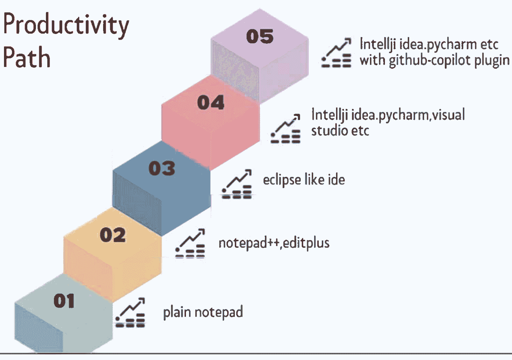

从记事本到带有 GitHub Copilot 的 IntelliJ IDEA 代表了程序员可用工具的重大演变，提供了日益复杂的功能和能力：

- **Notepad（记事本）**：记事本是一个基础文本编辑器，为编写代码提供的功能极少。虽然它可以用于简单任务，但它缺乏专为编程定制的功能，如语法高亮、代码补全和调试工具。使用记事本的程序员经常在管理大型项目和高效调试错误方面面临挑战。

- **Notepad++**：Notepad++ 是记事本的改进，提供了增强的功能，如语法高亮、代码折叠和自定义主题。与记事本相比，它提供了更舒适的编码环境，但它仍然缺乏专用集成开发环境（IDE）中的高级功能，例如项目管理和版本控制集成。

- **Eclipse**：Eclipse 是一款流行的 Java IDE，以其功能全面而闻名，包括语法高亮、代码补全、调试、重构工具以及通过插件支持多种编程语言。Eclipse 显著提高了程序员的生产力，提供了一个编写、测试和调试代码的集成环境。然而，对于初学者来说，它可能非常消耗资源且复杂。

- **IntelliJ IDEA**：IntelliJ IDEA 是一个强大且易于使用的 IDE，它在 Eclipse 功能的基础上，还提供了额外的增强，如更好的性能、更智能的代码补全、高级重构工具以及与构建系统和版本控制的无缝集成。与 Eclipse 相比，IntelliJ IDEA 简化了开发工作流，提高了代码质量，并提供了更直观的用户体验。

- **带有 GitHub Copilot 的 IntelliJ IDEA**：将 GitHub Copilot 集成到 IntelliJ IDEA 中，通过利用人工智能协助程序员编写代码，进一步增强了开发体验。GitHub Copilot 提供智能代码建议、自动补全，甚至根据上下文生成整个代码片段，显著减少了手动工作并加速了开发任务。这种集成增强了 IntelliJ IDEA 的能力，使程序员能够更高效地编写代码、探索创新解决方案并提高生产力。

总结，从记事本到带有 GitHub Copilot 的 IntelliJ IDEA 的演变，代表了程序员可用工具日益复杂和效率不断提升的历程，使他们能够更有效地编写高质量代码，并更轻松地应对复杂的编程任务。

## Copilot 如何工作

下面的图显示了 Copilot 的工作原理：

### OpenAI Codex 模型

### 你的编辑器

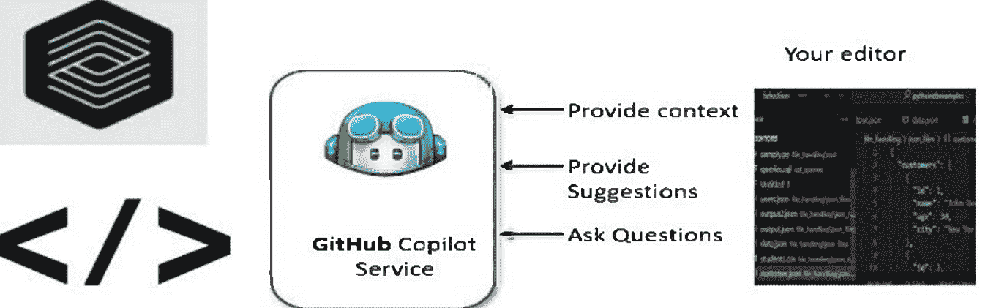

- 提供上下文

- 提供建议

- 提问

公共代码（例如，GitHub 仓库）

OpenAI Codex 是由 OpenAI 开发的 AI 模型。Codex 在来自各种来源（包括开源仓库）的海量代码上进行了训练，以理解并生成多种编程语言的代码。它基于 GPT（生成式预训练变换）架构构建，类似于 GPT-3 等模型使用的架构。

Codex 特别值得关注的地方在于它能够根据自然语言提示理解并生成代码。它可以用于代码补全、代码生成，甚至协助开发者编写软件等任务。

所以基本上，当你在右侧尝试编写代码并执行任何动作操作（如提供上下文、建议或提问）时，请求会发送到 GitHub Copilot 服务，该服务间接调用 Codex 模型，并根据训练模型给出响应……

## 设置与安装

### 安装 IntelliJ IDEA

以下是在 Windows 上安装 IntelliJ IDEA 社区版的步骤：

1. **下载 IntelliJ IDEA 社区版**：

   - 访问 JetBrains 网站：JetBrains IntelliJ IDEA 版下载

   - 点击社区版的“Download”按钮。

2. **运行安装程序**：

   - 下载完成后，找到下载的安装文件（通常在“下载”文件夹中）。

   - 双击安装文件（例如 `ideaIC-<version>.exe`）开始安装过程。

3. **选择安装选项**：

   - 在安装向导中，将提示你选择安装选项。

   - 你可以选择安装位置、创建桌面快捷方式，并将 IntelliJ IDEA 与相关文件类型关联。

   - 按照提示并选择你偏好的选项。

4. **安装 IntelliJ IDEA 社区版**：

   - 选择安装选项后，点击“Install”按钮开始安装过程。

   - 安装程序会将 IntelliJ IDEA 社区版提取并安装到你的系统中。这取决于系统速度，可能需要几分钟。

5. **启动 IntelliJ IDEA**：

   - 安装完成后，将看到启动 IntelliJ IDEA 的选项。

   - 勾选安装后立即启动并点击“Finish”，或从开始菜单/桌面快捷方式手动启动。

6. **设置 IntelliJ IDEA**：

   - 首次启动时，IntelliJ IDEA 社区版将提示你根据喜好自定义设置。

   - 你可能会被提示选择 UI 主题和键位设置。

7. **开始使用 IntelliJ IDEA 社区版**：

   - IntelliJ IDEA 社区版设置完成后，你就可以开始创建新项目、打开现有项目并使用你喜欢的编程语言编写代码了。

完成了！你已成功在 Windows 系统上安装了 IntelliJ IDEA 社区版。现在你可以开始编码并探索 IntelliJ IDEA 社区版的功能。

## 在 IDE 中配置 GitHub Copilot

以下是在 IntelliJ IDEA 中设置和配置 GitHub Copilot 的步骤：

**安装**：

- 从 File 打开 Settings（Windows）或 Preferences（Mac）。

- 在左侧面板中，点击 Plugins（插件）。

- 点击顶部的 Marketplace 选项卡。

- 在搜索框中搜索“Copilot”。

- 点击 GitHub Copilot 插件旁边的 Install。

- 重启 IntelliJ IDEA 使更改生效。

**激活**：

- 重启后，你会在 IDE 左上角看到 GitHub Copilot 图标。

- 点击图标并选择 Sign in to GitHub。

- 按照屏幕上的指令完成登录过程并激活 Copilot。

可选配置：

虽然 Copilot 可以开箱即用，但你可以对其行为进行进一步配置：

- **键盘快捷键**：前往 Settings/Preferences > Keymap，并搜索“Copilot”，用以管理各种 Copilot 操作的键盘快捷键。

- **设置**：点击 Copilot 图标旁边的齿轮图标，探索设置，例如禁用建议或调整其显示样式。

额外资源：

你可以在此处找到在 IntelliJ IDEA 中设置 Copilot 的官方指南：https://docs.github.com/copilot

有关更深层次配置选项和故障排除，请参考 GitHub Copilot 文档：https://docs.github.com/copilot

# 创建新项目

在 IntelliJ IDEA 中创建新项目非常简单。以下是分步骤指南：

打开 IntelliJ IDEA：在电脑上启动 IntelliJ IDEA。你可以通过双击桌面上的 IntelliJ IDEA 图标或在开始菜单中找到它来实现。

打开欢迎界面（Welcome Screen）：一旦 IntelliJ IDEA 启动，你将看到欢迎界面。如果你正在运行某个项目，可以关闭它返回欢迎界面。如果欢迎界面不可见，可以通过点击“File（文件）” > “Close Project（关闭项目）”来访问。

创建新项目：

在欢迎界面，点击“New Project（新建项目）”按钮。或者，你也可以从菜单栏进入“File（文件）” > “New（新建）” > “Project...”。

这将打开新建项目向导。

选择项目类型：

在新建项目向导中，系统将提示你选择要创建的项目类型。根据你的需求选择合适的项目类型。例如，对于 Java 项目可以选择“Java”，对于 Maven 项目选择“Maven”，对于 Gradle 项目选择“Gradle”等。

选择好项目类型后，点击“Next（下一步）”。

配置项目：

在下一步中，你需要配置项目设置，如项目名称、项目位置、项目 SDK（Java 版本）以及任何针对所选项目类型的特定设置。

确保为项目提供有意义的名称和适当的位置。一旦配置好项目设置，点击“Next（下一步）”。

完成：

检查项目摘要以确保所有设置正确。

点击“Finish（完成）”创建项目。

## 等待项目创建：

IntelliJ IDEA 将根据指定的设置创建项目。取决于你的系统速度和项目的复杂性，这可能需要几秒钟。

## 开始编码：

项目创建完成后，你将进入 IntelliJ IDEA 工作区，并加载你的新项目。

你可以通过在项目中创建新的类、包或文件来开始编码。

大功告成！你已成功在 IntelliJ IDEA 中创建了一个新项目。你现在可以开始着你的项目并构建应用程序了。

例如，在创建新项目（例如 `GithubCopilotExamples`）时将显示以下窗口：

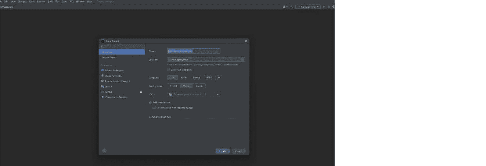

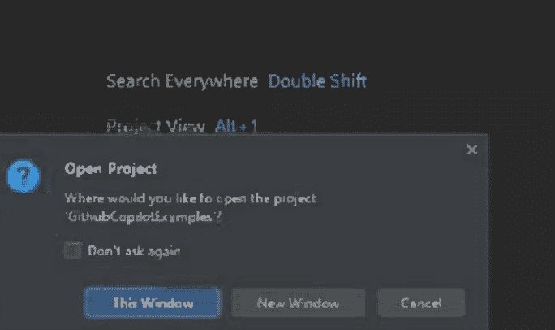

如果你想将其作为单独窗口打开，请点击 New Window（新窗口）。

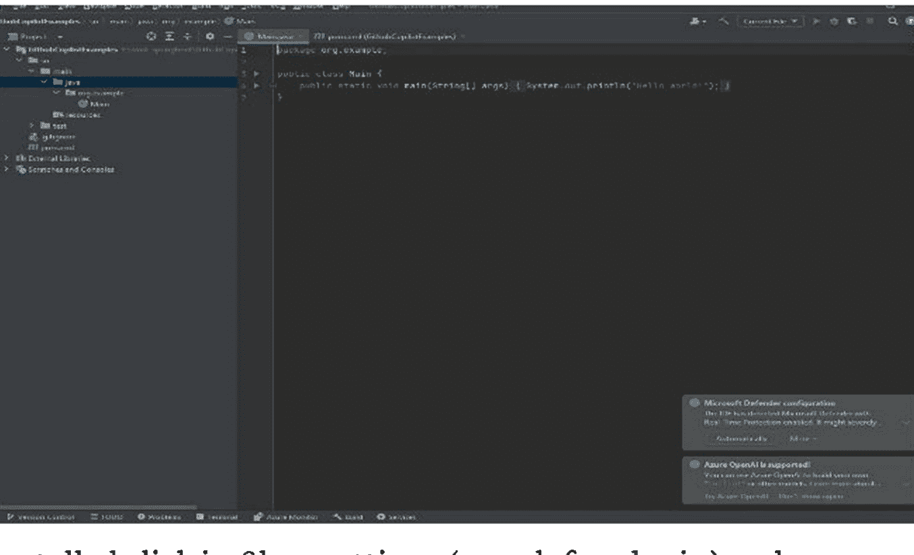

要确认是否安装了 GitHub Copilot，点击 File -> Settings（搜索 plugin），你将看到下面的窗口，GitHub Copilot 将出现在 plugins 列表中。

点击 OK 按钮后，检查 Tool -> GitHub Copilot。

如下方的截图所示：

你将获得 GitHub Copilot 的所有选项：

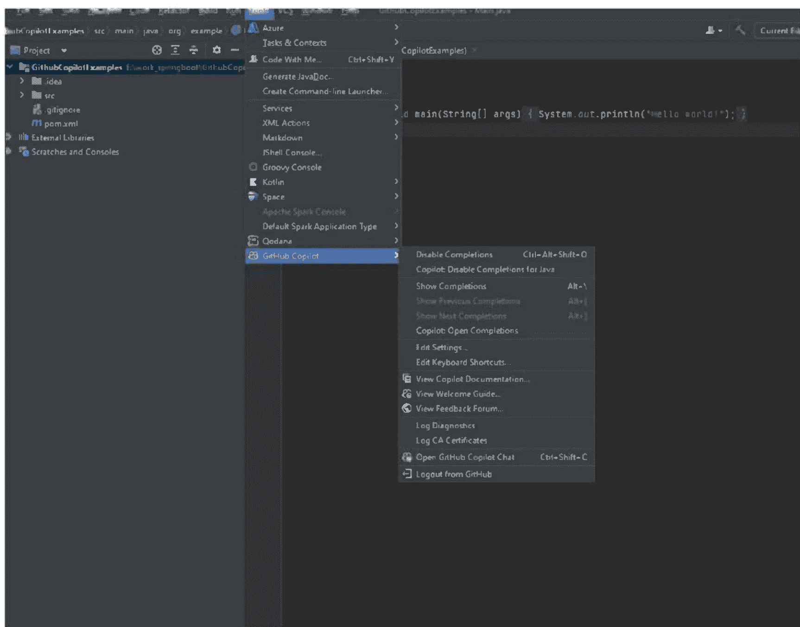

## 使用 GitHub Copilot 编写 Hello World

从右侧面板打开 GitHub Copilot Chat，并尝试如下所示提示问题：

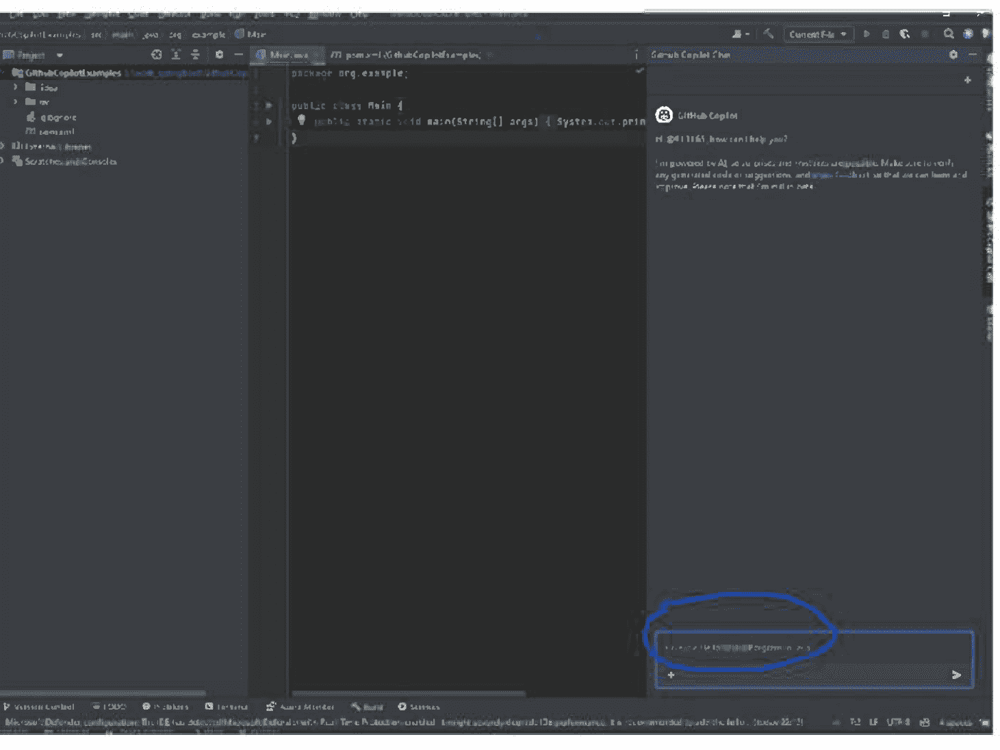

## 按回车键，你可以看到如下答案：

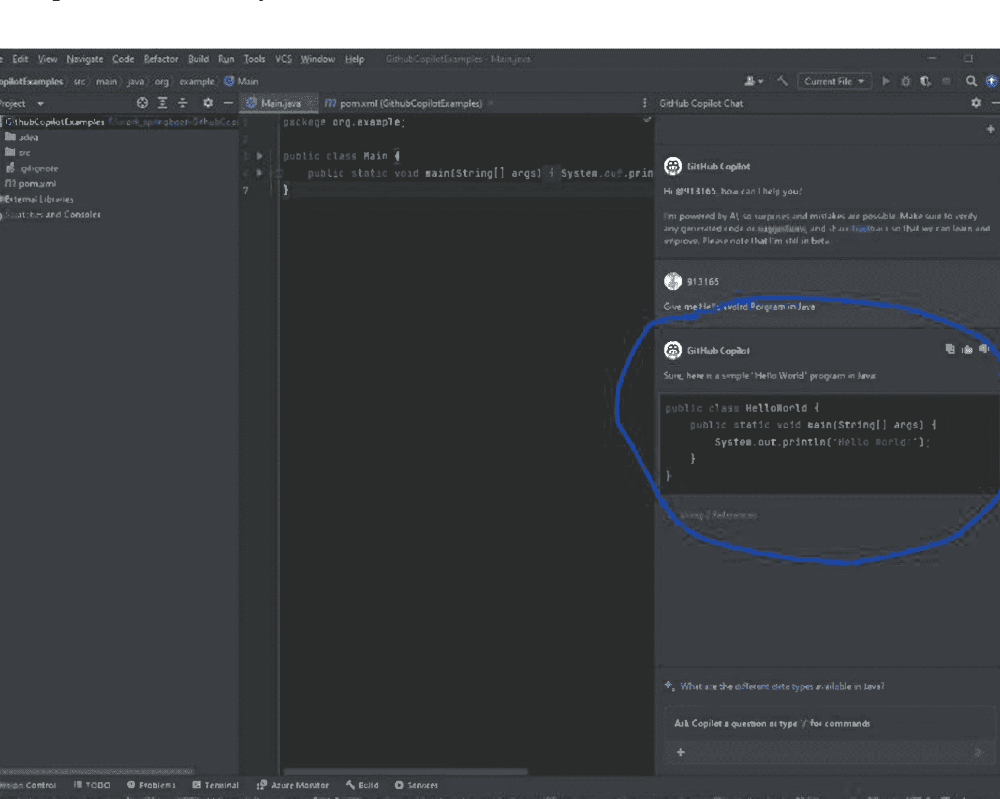

## 在 Java 中创建变量

Java 中的变量是什么？

在 Java 中，变量是一个命名的内存位置，用于存储特定数据类型的值。变量用于存储在程序执行过程中可以被操作和访问的数据。它们用特定的数据类型声明，并可能在声明期间或程序后期赋值。

Java 变量可以根据其作用域、生命周期和可访问性分为几类：

### Java 中的变量类型


- 局部变量

- 静态变量

- 实例变量

### Java 变量声明与内存分配

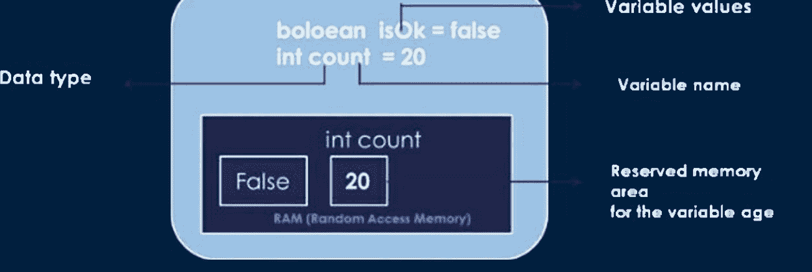

上述图说明了 Java 中的变量声明和内存分配。

在 Java 中，有两个主要的内存区域用于存储变量：栈（Stack）和堆（Heap）。

栈：后进先出（LIFO）数据结构，用于存储方法调用、局部变量和堆中对象的引用变量。基本类型（如 `int`、`double` 和 `boolean`）在变量声明时直接存储在栈中。

堆：动态内存分配区域，用于存储对象和数组。对象使用 `new` 关键字创建，指向堆中对象的引用变量存储在栈中。

图中显示了两个变量声明的示例：

```java
boolean isOk = false;
```

```java
int count = 20;
```

在这种情况下，`isOk` 和 `count` 都是基本类型并存储在栈中。变量名显示在左侧，数据类型显示在上方。箭头从变量名指向预留的内存区域，显示存储的值。

局部变量：声明在方法、块内的变量。它们仅在声明的块内有效。

```java
public void exampleMethod() {
    int localVar = 10; // localVar 是局部变量
}
```

实例变量（非静态字段）：声明在类中但在方法、块之外。当对象创建时实例化，每个对象存在。

```java
public class ExampleClass {
    int instanceVar; // instanceVar 是实例变量
}
```

类变量（静态字段）：使用 `static` 关键字声明在类中但在方法、块之外。它们在所有实例之间共享，持续整个程序期间。

```java
public class ExampleClass {
    static int classVar; // classVar 是类变量
}
```

Java 变量是强类型的，这意味着你必须声明变量可以存储的数据类型。此外，Java 遵循静态类型（在编译时检查变量类型）和动态绑定（在运行时决定要调用的方法）。

# 使用 Copilot 创建变量

使用注释，你可以创建任何想要的内容，例如只需在 `Main` 方法中输入：

```java
// 创建一个整数变量并赋值
```

然后按回车，你将获得建议，如果你喜欢这些建议，按 Tab 键。

你将得到如下结果：

```java
package org.example;

public class Main {
    public static void main(String[] args) {
        // 创建一个整数变量并赋值一个值
        int number = 5;
    }
}
```

另一个示例是获取内存中以字节（byte）为单位变量的大小。

在变量声明后添加注释 `// bytes`，你将获得下示例所示的变量字节大小信息：

```java
public class Main {
    public static void main(String[] args) {
        // 创建一个整数变量 a 并赋值一个值
        int a = 5; // bytes = 4, range = -2,147,483,648 to 2,147,483,647

        // 创建一个双变量 b 并赋值一个值
        double b = 5.5; // bytes = 8, range = 4.9e-324 to 1.8e+308

        // 创建一个布尔变量 c 并赋值一个值
        boolean c = true; // bytes = 1, range = true or false
    }
}
```

另一个示例是在不编译的情况下获取 `System.out.println` 的输出。

如下所示：

`System.out.println("The value of a is: " + a);` // a 的值是: 5

```java
package org.example;

public class Main {
    public static void main(String[] args) {
        // 创建一个整数变量 a 并赋值一个值
        int a = 5; // range = -2,147,483,648 to 2,147,483,647

        // 创建一个双变量 b 并赋值一个值
        double b = 5.5; // range = -1.9e-324 to 1.8e+308

        // 创建一个布尔变量 c 并赋值一个值
        boolean c = true; // bytes = 1, range true or false

        System.out.println("the value of a is: " + a); // the value of b is: 15
    }
}
```

作为参考，下面是数据类型及其大小和范围的表格。


| 数据类型 | 大小（字节） | 范围 |
|---|---|---|
| `byte` | 1 | -128 to 127 |
| `short` | 2 | -32,768 to 32,767 |
| `int` | 4 | -2,147,483,648 to 2,147,483,647 |
| `long` | 8 | -9,223,372,036,854,775,808 to 9,223,372,036,854,775,807 |
| `float` | 4 | 约为 ±3.40282347E+38 (6-7位有效数字) |
| `double` | 8 | 约为 ±1.7976931348623157E+308 (15位有效数字) |
| `char` | 2 | 0 to 65,535 |
| `boolean` | 1 | `true` 或 `false` |

## Java 中的数据类型

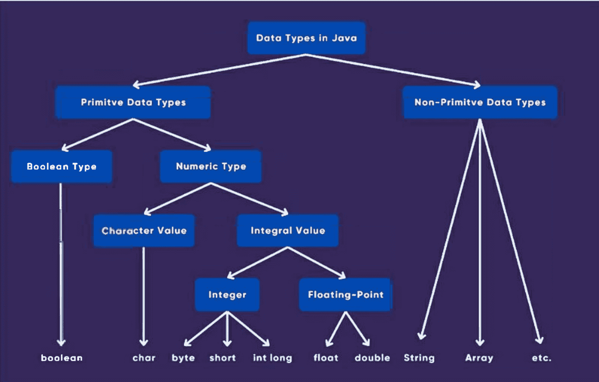

上面的图显示了 Java 数据类型的两个大类：基本数据类型和非基本数据类型。

**基本数据类型**是 Java 中存储数据的基础构建块。它们由语言预定义，并表示简单的值。在图中，基本数据类型进一步细分为数值类型和字符类型。

数值类型可以存储数字。它们分为整数类型和浮点类型。

整数类型表示没有小数部分的整型数字。整数类型的示例包括 `byte`、`short`、`int` 和 `long`。

浮点类型表示带有小数部分的数字。浮点类型的示例包括 `float` 和 `double`。

字符类型 `char` 用于存储单个字符。

**非基本数据类型**比基本数据类型更复杂。它们由程序员创建，并可以存储数据集合或用户定义的对象。非基本数据类型的示例包括 `String`、数组和类。

再次开始在注释中编写代码并查看所有数据类型的结果，如果你没有得到结果，请开始输入例如 `int`，Copilot 将开始提供建议，如果你对建议满意，则按标签，否则尝试给 Copilot 提供另一个提示。

下方的示例。

```java
public class MyApp {
    public static void main(String[] args) {
        // if-else 语句示例
        int x = 10;
        if (x > 0) {
            System.out.println("true");
        } else {
            System.out.println("false");
        }
    }
}
```

Java 中的流程控制提供了基于特定条件或循环的多个控制流语句。以下是 Java 中主要的流程控制语句：。 Java 中的流程控制是指控制语句执行顺序的能力，允许开发者控制执行的执行流。

## Java 中的流程控制

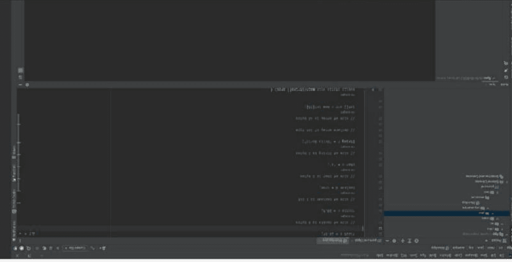

### 条件语句：

- `if` 语句：如果指定的条件为真，则执行代码块。
- `if-else` 语句：如果条件为真，则执行一个代码块，如果条件为假，则执行另一个代码块。
- `if-else-if` 语句：根据不同的条件执行不同的代码块。
- `switch` 语句：根据表达式的不同值执行不同的代码块。

### 循环语句：

- `for` 循环：执行指定次数的代码块。
- `while` 循环：只要指定的条件为真，就执行代码块。
- `do-while` 循环：至少执行一次代码块，然后只要指定的条件为真就继续执行。
- `for-each` 循环（增强 `for`）：遍历数组的每个元素。

### 分支语句：

- `break` 语句：终止循环或 `switch`。
- `continue` 语句：跳过当前迭代。

### 其他控制语句：

- `return` 语句：退出方法并返回控制。
- `try-catch-finally` 块：处理异常并提供一种方法

下面是 IntelliJ 中所有流程控制的示例

```java
package org.example;

public class FlowControl {
    public static void main(String[] args) {
        int score = 85;

        // if else 语句示例
        if (score >= 90) {
            System.out.println("Excellent!");
        } else if (score >= 80) {
            System.out.println("Great job!");
        } else {
            System.out.println("Try next");
        }

        // switch 语句
        char grade = 'B';
        switch (grade) {
            case 'A':
                System.out.println("Outstanding performance!");
                break;
            case 'B':
                System.out.println("Good job!");
                break;
            default:
                System.out.println("Keep working.");
        }

        // for 循环
        for (int i = 1; i <= 5; i++) {
            System.out.println("Iteration: " + i);
        }

        // while 循环
        int count = 3;
        while (count <= 5) {
            System.out.println("count: " + count);
            count++;
        }
    }
}
```

要获取代码的解释，尝试选择主方法并在聊天中使用 `/explain chat` Copilot，如下所示

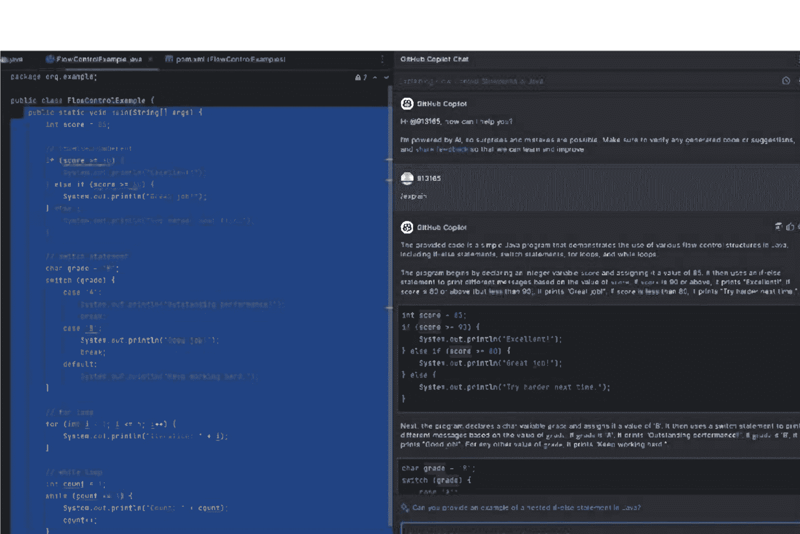

## Java Collections Framework

### 什么是集合？

在计算机编程中，集合是对于解决的问题具有意义并且需要以受控方式操作的数据分组。

例如项目集合、数字集合、产品集合

### 集合类型

- 顺序集合：顺序集合按线性顺序存储。顺序集合的示例包括数组、链表和队列。
- 关联集合：关联集合以键值对格式存储。关联集合的示例包括映射和哈希表。

在 Java 中，集合是作为单个单元表示的单个对象的组。Java 集合框架（`java.util` 包）提供了多个类和接口，用于存储和处理对象组。

`LinkedList`: `List` 和 `Queue` 接口的实现，使用双向列表数据结构。

`HashSet`: `Set` 接口的实现，使用哈希表进行存储。

`TreeSet`: `Set` 接口的实现，使用树进行存储（按元素排序）。

`HashMap`: `Map` 接口的实现，使用哈希表进行存储。

`TreeMap`: `Map` 接口的实现，使用树进行存储（按键排序）。

Algorithms:

- `Collections` 类：提供了操作集合的静态方法，如排序、搜索和洗牌。

以下是在 Java 中使用集合的某些关键特性和优势：

- **复用性**：集合框架提供了一种处理对象组的标准方式，减少了编写自定义数据结构实现的需求。
- **性能**：集合的实现针对常用操作进行了高度优化。
- **线程安全**：某些集合（如 `Vector` 和 `Hashtable`）是线程安全的，适用于并发编程。
- **泛型**：集合可以与泛型类型工作，提供类型安全并避免类型转换问题。
- **算法**：`Collections` 类提供了用于排序、搜索和操作集合的各种实用方法。

下面是 Java 集合层级图

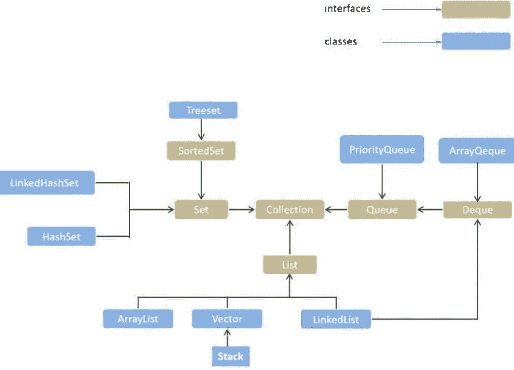

这里是 Map 层级图

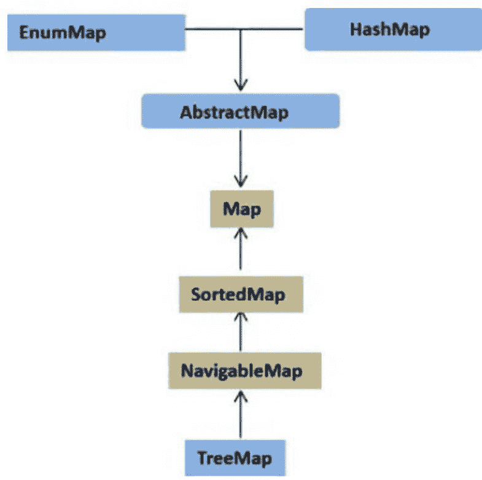

让我们简要查看主要的集合

### ArrayList

`ArrayList` 是 `List` 接口的一种可伸缩数组的实现。它为我们提供了动态数组，可以根据需要增长或缩小，允许我们存储和操作元素集合。以下是关于 `ArrayList` 的一些关键点：

- **有序集合**：`ArrayList` 保持元素的插入顺序，这意味着元素按照它们被添加的顺序存储。
- **允许重复**：`ArrayList` 允许重复元素，这意味着你可以向列表中添加同一元素的多个实例。
- **可伸缩数组**：`ArrayList` 的大小不是固定的，它可以随着元素的添加或删除动态增长或缩小。这与 Java 中固定大小的传统数组不同。
- **随机访问**：`ArrayList` 为元素的随机访问提供常数时间性能，这意味着可以在常数时间内检索任何索引处的元素。
- **null 元素**：`ArrayList` 允许 `null` 元素，这意味着你可以在列表中存储空值。
- **线程安全**：`ArrayList` 默认不是线程安全的。如果你在多线程环境中使用 `ArrayList`，应该对其访问进行同步，或者使用线程安全的替代方案，如 `Vector` 或 `CopyOnWriteArrayList`。
- **实现 List 接口**：`ArrayList` 实现了 `List` 接口，该接口提供了操作列表中元素的方法，如 `add()`、`remove()`、`set()` 等。

### ArrayList

- `java.util` 包
- 实现了 `List` 接口
- 最常用的数据结构
- 用于存储和管理对象

添加元素

```java
stringList.add("apple");
stringList.add("banana");
stringList.add("orange");
```

创建一个 ArrayList

```java
ArrayList<String> stringList = new ArrayList<>();
```

访问元素

ArrayList 方法

```java
String firstfruit = stringList.get(0); // "apple"
```

- `size()`
- `isEmpty()`
- `clear()`
- `contains()`
- `indexOf()`
- `addAll()`

遍历 ArrayList

```java
for (String fruit : stringList) {
    System.out.println(fruit);
}
```

现在使用 github copilot 生成注释 `// 带有基础操作的 ArrayList 示例`，你将获得如下所示所示答案

```java
import java.util.*;

public class ListExample {
    public static void main(String[] args) {
        // 遍历列表
        List<String> list = new ArrayList<>();
        list.add("apple");
        list.add("banana");

        // 显示列表的大小
        System.out.println("size: " + list.size());

        // 获取列表的第一个元素
        System.out.println("first element: " + list.get(0));

        // 获取项的索引
        System.out.println("index of banana: " + list.indexOf("banana"));

        // 获取特定索引处的元素
    }
}
```

另一个使用下方屏幕中高亮注释的示例

```java
import java.util.*;

public class LinkedListExample {
    public static void main(String[] args) {
        List<String> list = new LinkedList<String>();
        list.add("Apple");
        list.add("Banana");
        list.add("Cherry");

        list.remove("Banana");
        System.out.println(list);
    }
}
```

### LinkedList

`LinkedList` 是 `List` 和 `Deque`（双端队列）接口的双向列表实现。它是一种线性数据结构，元素不存储在连续的内存位置，而是每个元素都是一个独立的对象，持有指向序列中上一个和下一个元素的引用。以下是关于 `LinkedList` 的一些关键点：

- **有序集合**：`LinkedList` 保持元素的插入顺序，类似于 `ArrayList`。
- **允许重复**：与 `ArrayList` 一样，`LinkedList` 允许重复元素。
- 动态大小：`LinkedList` 的大小不是固定的，它可以元素的添加或删除动态增长或缩小。
- 非随机访问：`LinkedList` 不为元素的随机访问提供常数时间性能。要访问特定索引的元素，需要从列表的开始或结束遍历，导致时间复杂度为 O(n)，其中 n 是列表的大小。
- 高效的插入和删除：`LinkedList` 擅长在列表开头或中间插入和删除元素。这些操作的时间复杂度为 O(1)，使得在任意位置频繁插入和删除时比 `ArrayList` 更高效。
- 实现 Deque 接口：`LinkedList` 实现了 `Deque` 接口，允许它作为双端队列使用，可以从两端添加或删除元素。
- 线程安全：与 `ArrayList` 一样，`LinkedList` 默认不是线程安全的。如果你在多线程环境中使用 `LinkedList`，应该对其访问进行同步，或者使用线程安全的替代方案。

### LinkedList

- `java.util` 包
- 实现了 `List` 和 `Deque` 接口
- 代表双向列表结构
- 用于存储和管理对象

### 添加元素

```java
stringList.add("apple");
stringList.add("banana");
stringList.add("orange");
```

### 创建 LinkedList

```java
LinkedList<String> stringList = new LinkedList<>();
```

### 访问元素

### ArrayList 方法

```java
String firstFruit = stringList.get(0); // "apple"
```

# 遍历 LinkedList

- `size()`
- `isEmpty()`
- `clear()`
- `contains()`
- `indexOf()`
- `addAll()`

```java
for (String fruit : stringList) {
    System.out.println(fruit);
}
```

现在尝试在 github copilot 聊天框中输入 "给我一个包含主要操作的 LinkedList 示例"- 如下所示

获取结果后，点击下方屏幕所示的符号

```java
package org.example;

import java.util.LinkedList;

public class LinkedListexample {
    public static void main(String[] args) {
        // 创建 LinkedList
        LinkedList<String> list = new LinkedList<>();

        // 向 linkedlist 添加元素
        list.add("Element 1");
        list.add("Element 2");
        list.add("Element 3");

        // 打印列表
        System.out.println("linkedlist: " + list);

        // 从 linkedlist 删除元素
        list.remove("Element 2");
        System.out.println("linkedlist after removal: " + list);

        // 按索引获取元素
        System.out.println("First element: " + list.get(0));
        System.out.println("Second element: " + list.get(1));
    }
}
```

你可以列出询问下方图片高亮显示的后续问题


```java
public static void main(String[] args) {
    // Create a LinkedList
    LinkedList<String> linkedlist = new LinkedList<>();

    // Add the first 3 elements
    list.add("Element 1");
    list.add("Element 2");
    list.add("Element 3");

    // Print the list
    System.out.println("linkedlist: " + list);

    // Remove elements from the linkedlist
    list.remove("Element 2");

    // Print the list after removal
    System.out.println("linkedlist after removal: " + list);

    // Get elements by index
    System.out.println("first element: " + list.get(0));
    System.out.println("second element: " + list.get(1));

    // Iterate over the linkedlist
    for (String element : linkedlist) {
        System.out.println("element: " + element);
    }
}
```

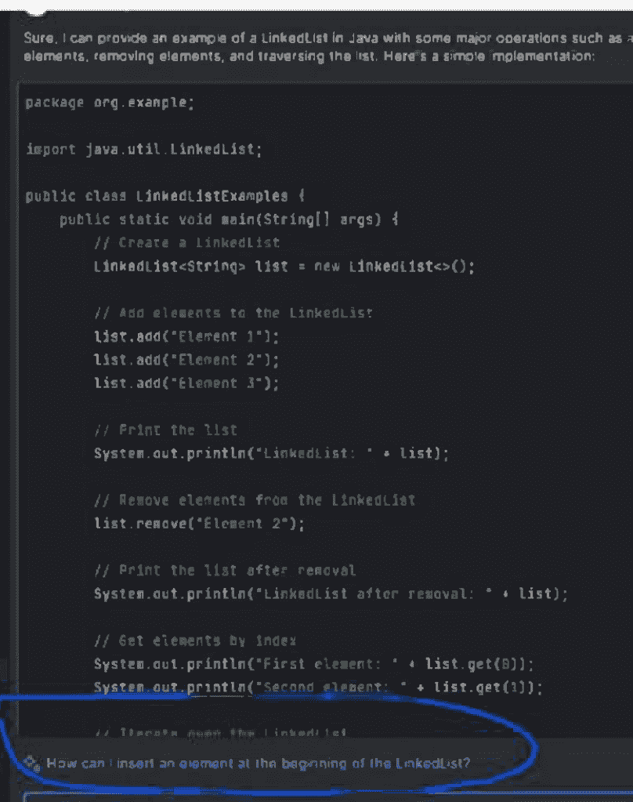

答案将显示在下方。

```java
package org.example;

import java.util.LinkedList;

public class LinkedListExamples {
    public static void main(String[] args) {
        // Create a LinkedList
        LinkedList<String> list = new LinkedList<>();

        // Add elements to the LinkedList
        list.add("Element 1");
        list.add("Element 2");
        list.add("Element 3");

        // Insert an element at the beginning of the LinkedList
        list.addFirst("Element 0");

        // Print the list
        System.out.println("LinkedList: " + list);
    }
}
```

在此代码中，“Element 0”被插入到`LinkedList`的开头。

- 使用 3 个引用

## HashSet

`HashSet` 是`Set`接口的一种实现，是 Java 集合框架的一部分。`Set` 是一个不允许包含重复元素的集合。`HashSet` 类使用哈希表进行存储，为`add()`、`remove()`和`contains()`等基本操作提供常数级性能。

- **数据结构**：`HashSet` 是`Set`接口的一种实现，是 Java 集合框架的一部分。它提供了一种存储不允许重复的元素集合的方法。
- **无序性**：与其他某些数据结构不同，`HashSet` 不维护元素的任何特定顺序。元素根据其哈希值存储，其检索顺序是随机的。
- **唯一元素**：`HashSet` 确保不允许重复元素。如果你尝试向集合中添加重复元素，它将简单地被忽略。
- **null 值**：`HashSet` 最多允许一个`null`值。如果你尝试添加第二个`null`值，它将会被忽略。
- **非同步性**：默认情况下，`HashSet` 不是线程安全的。如果你计划在多线程环境中使用`HashSet`，请考虑对其访问进行同步，或使用诸如`ConcurrentHashMap`等线程安全的替代方案。
- **性能**：`HashSet` 为`add()`、`remove()`和`contains()`等基本操作提供了常数级性能。然而，这假设用于计算元素哈希值的哈希函数能够将它们合理地分布在哈希表的各个桶中。
- **实现 Set 接口**：`HashSet` 实现了`Set`接口，这意味着它提供了添加、删除和检查集合中元素是否存在的方法。此外，它还支持并集、交集和差集等操作。

### 基本信息

- `java.util` 包
- 实现`Set`接口
- 代表唯一元素的集合
- 使用哈希表存储其元素

### 遍历 HashSet

```java
for (String fruit : stringSet) {
    System.out.println(fruit);
}
```

### 创建 HashSet

```java
HashSet<String> stringSet = new HashSet<>();
```

### HashSet 方法

- `size()` 返回集合中元素的数量。
- `isEmpty()` 如果集合为空，则返回 true。
- `clear()` 移除集合中的所有元素。
- `add(element)` 向集合中添加一个元素。
- `remove(element)` 如果元素从集合中被移除，则返回 true。
- `addAll(collection)` 添加另一个集合中的元素。

### 添加元素

```java
stringSet.add("apple");
stringSet.add("banana");
stringSet.add("orange");
```

### HashSet 和哈希

`HashSet` 依赖哈希概念进行高效的元素管理。每个元素都关联一个哈希值，该哈希值用于在哈希表中快速定位元素。当你向`HashSet`添加元素时，会计算该元素的哈希值并用于确定其在哈希表中的存储位置。这允许对元素的快速插入、检索和删除。

### 移除元素

```java
stringSet.remove("banana");
```

让我们来看看使用 GitHub Copilot 的示例。像下方截图所示提问，如果你觉得没问题，点击插入代码按钮，你的代码就准备好了。

```java
import java.util.HashSet;

public class HashSetExamples {
    public static void main(String[] args) {
        // 创建一个 HashSet
        HashSet<String> set = new HashSet<String>();

        // 向 HashSet 添加元素
        set.add("Element 1");
        set.add("Element 2");
        set.add("Element 3");

        // 打印集合
        System.out.println("HashSet: " + set);

        // 从 HashSet 中移除一个元素
        set.remove("Element 2");

        // 移除后的集合
        System.out.println("HashSet after removal: " + set);

        // 检查元素是否存在
        boolean exists = set.contains("Element 1");
        System.out.println("Element 1 exists? " + exists);

        // 清除所有元素
        set.clear();
        System.out.println("HashSet after clear: " + set.size());
    }
}
```

## LinkedHashSet

`LinkedHashSet` 是`Set`接口的一种实现，是 Java 集合框架的一部分。

它结合了`HashSet`和`LinkedList`的特征，提供了两种数据结构的优势。

关于`LinkedHashSet`的关键点：

- **插入顺序**：`LinkedHashSet` 中的元素存储在哈希表中以便进行高效检索。它们也被维护在一个双向链表中，从而确保了插入顺序被保留。当你遍历元素时，它们将按照插入时的相同顺序被检索。
- **唯一元素**：与其他`Set`实现类一样，`LinkedHashSet` 不允许重复元素。如果你尝试添加重复元素，它将被忽略。
- **null 值**：`LinkedHashSet` 最多允许一个`null`元素。如果你尝试添加`null`值，它将被忽略。
- **非同步性**：默认情况下，`LinkedHashSet` 不是线程安全的。在多线程环境中，请考虑对其访问进行同步，或使用诸如`ConcurrentLinkedHashMap`等线程安全的替代方案。
- **性能**：`LinkedHashSet` 为`add()`、`remove()`和`contains()`等基本操作提供了常数级性能，类似于`HashSet`。然而，按照插入顺序遍历元素具有线性时间复杂度 `(O(n))`，其中 n 是元素的数量。
- **实现 Set 接口**：`LinkedHashSet` 实现了`Set`接口，其中包含了添加、删除和检查元素存在性的方法。它还支持并集、交集和差集等集合操作。

### 基本信息

- `java.util` 包
- 扩展`HashSet`类并实现`Set`接口
- 结合了哈希表和链表的特性

### 遍历 LinkedHashSet

```java
for (String color : colorset) {
    System.out.println(color);
}
```

```java
LinkedHashSet<String> colorset = new LinkedHashSet<>();
```

### 添加元素

```java
colorset.add("red");
colorset.add("green");
colorset.add("blue");
```

`HashSet` 提供了与其他集合类类似的方法，用于操作和处理集合。`LinkedHashSet` 的主要优势是能够在保持插入顺序的同时，为添加、删除和检查是否存在等基本操作提供常数级性能。

### 移除元素

```java
colorset.remove("green");
```

## TreeSet

让我们探索`TreeSet`的特性。以下是关于这种多功能数据结构的一些关键点：

**数据结构**：`TreeSet` 是`Set`接口的实现，是 Java 集合框架的一部分。它提供了一种存储元素集合的方法但不允许重复。

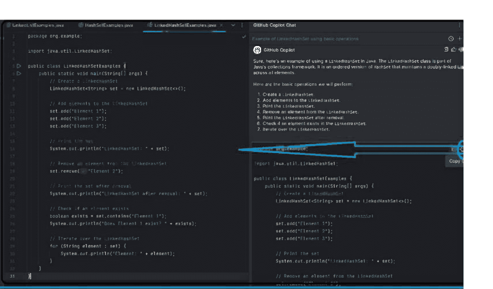

**排序集合**：`TreeSet` 自动按升序对其元素进行排序。当你向`TreeSet`中添加元素时，它们将根据它们的自然顺序（如果它们实现了`Comparable`接口）或根据创建时提供的自定义`Comparator`进行排列。

**唯一元素**：与其他`Set`实现一样，`TreeSet` 确保不允许重复元素。如果你尝试添加一个已经存在于集合中的元素，它将被忽略。

**空值值**：`TreeSet` 不允许`null`元素。如果你尝试添加一个`null`值，它将抛出`NullPointerException`。

**非同步**：默认情况下，`TreeSet` 不是线程安全的。如果你计划在多线程环境中使用`TreeSet`，请考虑对其访问进行同步，或使用线程安全的替代方案如`ConcurrentSkipListSet`。

**性能**：`TreeSet` 为基本操作如`add()`、`remove()`和`contains()`提供对数时间复杂度 `(O(log n))`。然而，如果你需要按照排序顺序遍历元素，它提供了常数级性能。

**实现 NavigableSet 接口**：`TreeSet` 实现了`NavigableSet`接口，该接口扩展了`SortedSet`接口。此扩展提供了额外的方法，用于根据顺序从集合中导航和检索元素。

**自定义比较器**：在创建`TreeSet`时，你可以提供一个自定义的`Comparator`来定义元素的排序顺序。如果没有提供`Comparator`，元素必须实现`Comparable`接口以定义它们的自然顺序。

总而言之，`TreeSet`结合了排序、唯一性和高效性能的优点，使其成为 Java 中管理元素集合的价值工具！

### 基本信息

- `java.util` 包
- 实现了`NavigableSet`接口，是`SortedSet`层次结构的一部分
- 使用红黑树数据结构存储其元素

### 遍历 TreeSet

### 创建一个 TreeSet

```java
TreeSet<Integer> numberSet = new TreeSet<>();
```

### 添加元素

```java
numberSet.add(10);
numberSet.add(5);
```

`TreeSet` 提供了与其他类类似的方法来操作和处理集合。此外，它还提供了检索大于或等于给定元素的方法；小于或等于给定元素的`ceiling()`元素；`floor()`方法以及更多。

### 移除元素

```java
numberSet.remove(5);
```

让我们看看使用 GitHub Copilot 的示例。像下方截图所示提问，如果你觉得可以，就点击插入代码按钮，你的代码就准备好了。

```java
for (int number : numberSet) {
    System.out.println(number);
}
```

## HashMap

`HashMap` 是`Map`接口的实现，是 Java 集合框架的一部分。它是一种广泛使用的数据结构，存储键值对并提供对这些对的高效检索和存储。以下是关于`HashMap`的一些关键点：

### 关于 HashMap 的关键点

#### 键值对

`HashMap` 以键值对的形式存储数据。映射中的每个键都关联一个值，键用于访问其对应的值。

#### 唯一键

在`HashMap`中，键必须是唯一的。如果你尝试插入重复的键，它将替换与现有键关联的值。

#### 空键和值

`HashMap` 允许最多一个`null`键，但可以有多个`null`值。如果你尝试添加第二个`null`键，它将替换与现有`null`键关联的值。

#### 无序集合

`HashMap` 不维护元素的特定顺序。元素根据它们的哈希码存储，且不保证不同迭代之间的迭代顺序相同。

#### 非同步

默认情况下，`HashMap` 不是线程安全的。在多线程环境中，请考虑对其访问进行同步，或使用线程安全的替代方案如`ConcurrentHashMap`。

#### 性能

平均情况下，`HashMap` 为`get()`、`put()`和`remove()`等基本操作提供常数级性能 `(O(1))`。这假设了良好的哈希函数和适当的负载因子管理。

#### 实现 Map 接口

`HashMap` 实现了`Map`接口，提供了添加、删除和检索键值对的方法。它还支持单独处理键和值的方法。

### 基本信息

#### 遍历 HashMap

- `java.util` 包
- 实现了`Map`接口
- 要求一个键值对集合
- 每个键都关联一个对应的值
- `HashMap` 使用哈希表存储其条目

```java
for (String country : map.keySet()) {
    int population = map.get(country);
    System.out.println(country + " : " + population);
}
```

### 创建一个 HashMap

```java
HashMap<String, Integer> map = new HashMap<>();
map.put("USA", 331000000);
```

### HashMap 方法

- `map.put("USA", 331000000);`
- `map.put("China", 1440000000);`
- `map.put("Germany", 830000000);`

### 添加键值对

```java
map.put("USA", 331000000);
map.put("China", 1440000000);
map.put("Germany", 830000000);
```

### 哈希与效率

`HashMap` 使用哈希来高效管理键值对。每个键都关联一个哈希码，用于确定对应哈希表的存储位置。这允许对键值对进行快速插入、检索和删除。

### 移除键值对

```java
map.remove("China");
```

让我们看看使用 GitHub Copilot 的示例。像下方截图所示提问，如果你觉得可以，就点击插入代码按钮，你的代码就准备好了。

## LinkedHashMap

这里是关于`LinkedHashMap`的详情：

`LinkedHashMap` 是`Map`接口的实现，是 Java 集合框架的一部分。

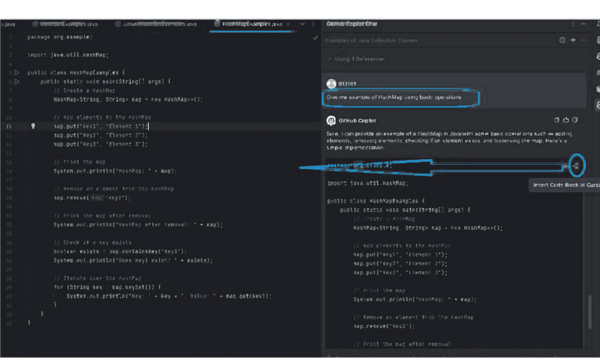

### 关于 LinkedHashMap 的关键点

#### 插入顺序


`LinkedHashMap` 维护键值对的插入顺序。当你遍历 `LinkedHashMap` 的元素时，将按照它们被插入的顺序检索。

### 键值对

与 `HashMap` 类似，`LinkedHashMap` 以键值对的形式存储数据。映射中的每个键都关联一个值，键用于访问其对应的值。

### 唯一键

在 `LinkedHashMap` 中，键必须是唯一的。如果你尝试插入重复的键，它将替换与现有键关联的值。

### 空键和值

`LinkedHashMap` 允许最多一个 `null` 键，但可以有多个 `null` 值。如果你尝试添加第二个 `null` 键，它将替换与现有 `null` 键关联的值。

### 访问顺序

除了维护插入顺序，`LinkedHashMap` 还可以维护键值对的顺序。当你检索或修改与键关联的值时，该键值对将移动到链的末尾，允许你跟踪最近访问或修改的条目。

### 非同步

默认情况下，`LinkedHashMap` 不是线程安全的。在多线程环境中，请考虑对其访问进行同步，或使用线程安全的替代方案，如 `ConcurrentHashMap`。

### 性能

平均情况下，`HashMap` 为 `get()`、`put()` 和 `remove()` 等基本操作提供常数级性能（`O(1)`），类似于 `HashMap`。然而，按照插入顺序遍历元素具有线性时间复杂度（`O(n)`），其中 `n` 是元素的数量。

## LinkedHashMap

- `java.util` 包
- 扩展了 `HashMap`
- 表示一个键值对集合
- 每个键都关联一个对应的值
- `LinkedHashMap` 使用哈希表存储其条目


### 创建一个 LinkedHashMap

```java
LinkedHashMap<String, Integer> scoreMap = new LinkedHashMap<>();
```

### 添加键值对

```java
scoreMap.put("Alice", 90);
scoreMap.put("Bob", 87);
scoreMap.put("Charlie", 92);
```

### 通过键访问值

```java
int aliceScore = scoreMap.get("Alice"); // 90
```

### 移除键值对

```java
scoreMap.remove("Bob");
```

```java
for (String name : scoreMap.keySet()) {
    int score = scoreMap.get(name);
    System.out.println(name + " : " + score);
}
```

## TreeMap

在 Java 中，`TreeMap` 是 `Map` 接口的一种实现，是 Java 集合框架的一部分。它是一个排序映射，根据键（key）的升序存储其键值对。`TreeMap` 中的键必须实现 `Comparable` 接口，或者在创建时提供自定义的 `Comparator`。

关于 `TreeMap` 的关键点有：

### 排序键

`TreeMap` 根据键的自然顺序或自定义的 `Comparator` 以排序顺序存储其键值对。

当你遍历 `map` 中的条目（entries）时，它们将按照键的排序顺序被检索。

### 键值对

与其他的 `Map` 实现一样，`TreeMap` 以键值对的形式存储数据。`map` 中的每个键都关联着一个值，并使用键来访问其对应的值。

### 唯一键

在 `TreeMap` 中，键必须是唯一的。如果你尝试插入一个重复的键，它将替换与现有键关联的值。

### 空键和空值

`TreeMap` 不允许 `null` 键，但它可以有多个 `null` 值。如果你尝试添加 `null` 键，它将抛出 `NullPointerException`。

### 非同步

默认情况下，`TreeMap` 不是线程安全的。在多线程环境中，请考虑对它的访问进行同步，或者使用如 `ConcurrentSkipListMap` 等线程安全的替代方案。

### 性能

`TreeMap` 为 `get()`、`put()` 和 `remove()` 等基本操作提供了对数时间复杂度（`O(log n)`）。然而，如果你需要按排序遍历条目，它提供了常数级性能。

### 实现 NavigableMap 接口

`TreeMap` 实现了 `NavigableMap` 接口，该接口扩展了 `SortedMap` 接口。它提供了额外的方法，用于根据顺序从 `map` 中导航和检索条目。

### Comparator

你可以在创建 `TreeMap` 时提供一个自定义的 `Comparator` 来定义键的排序顺序。如果没有提供 `Comparator`，则键必须实现 `Comparable` 接口。

## TreeMap

- `java.util` 包
- 实现了 `NavigableMap` 接口，并是 `SortedMap` 层次结构的一部分
- 以排序的方式表示键值对集合
- 每个键都关联一个对应的值
- 使用红黑树数据结构存储其条目

## 遍历 LinkedHashMap

### 创建 LinkedHashMap

```java
TreeMap<String, Integer> scoreMap = new TreeMap<>();
```

### 添加键值对

```java
scoreMap.put('Alice', 90);
scoreMap.put('Bob', 87);
scoreMap.put('Charlie', 80);
```

### 按键访问值

```java
int score = scoreMap.get('Alice'); // 90
```

### 键值对

```java
scoreMap.remove('Bob');
```

### TreeMap 方法

`TreeMap` 提供了与其他类相似的方法，用于处理和操作 `map`。此外，它还提供了获取第一个键和最后一个键的方法，以及查找键大于或等于给定键的条目（ceilingEntry）等更多方法。

```java
for (String name : scoreMap.keySet()) {
    int score = scoreMap.get(name);
    System.out.println(name + ": " + score);
}
```

让我们来看一个使用 GitHub Copilot 的示例。按照下方截图所示提问，如果你没问题，点击插入代码按钮，你的代码就准备就绪了。

```java
import java.util.TreeMap;

public class TreeMapExample {
    public static void main(String[] args) {
        TreeMap<String, String> map = new TreeMap<>();

        // 添加元素到 treemap 中
        map.put("key1", "Element 1");
        map.put("key2", "Element 2");
        map.put("key3", "Element 3");

        // 打印 map
        System.out.println("TreeMap: " + map);

        // 从 treemap 中删除一个元素
        map.remove("key2");
        System.out.println("TreeMap after remove: " + map);

        // 检查键是否存在
        boolean exists = map.containsKey("key1");
        System.out.println("Does key1 exist? " + exists);

        // 遍历 treemap
        for (String key : map.keySet()) {
            System.out.println("Key: " + key + " Value: " + map.get(key));
        }
    }
}
```

# Java 中的异常处理

异常处理是 Java 中的一种机制，允许你处理程序执行过程中可能出现的运行时错误或异常情况。它提供了一种优雅处理异常状况的方法，防止程序突然终止。

在 Java 中，异常是表示异常状况的对象。当发生异常情况时，会创建并抛出一个异常对象。如果此异常没有被正确捕获和处理，程序将带有错误信息并终止。

## 什么是 Java 异常？

异常是破坏 Java 程序正常执行流的异常状态。它代表程序执行期间发生的意外事件。

异常是在满足某些条件时在运行时抛出的对象。

## 什么是异常处理？

异常处理是 Java 中管理运行时错误的机制。

它允许你优雅地处理异常，确保程序不会突然终止。常见的异常包括 `ClassNotFoundException`、`IOException`、`SQLException` 和 `RemoteException`。

## 异常处理的优点

### 保持正常流

异常处理确保即使发生异常时，应用程序的正常流也能得以保持。

## 示例场景

假设你的 Java 程序中有一系列语句：

- `statement 1;`
- `statement 2;`
- `statement 3;`
- `statement 4;`
- `statement 5;` // 此处发生异常
- `statement 6;`
- `statement 7;`
- `statement 8;`

```java
statement 9;
statement 10;
```

如果没有异常处理，在语句 5 发生异常后，语句 6 到 10 将不会执行。

有了异常处理，剩余语句将继续执行。

## Java 异常类的层次结构

Java 异常层次结构的根类是 `java.lang.Throwable`。

它有两个主要的子类：

- `Exception`：代表检异常（例如 `IOException`、`SQLException`）。
- `Error`：代表未检异常（例如 `OutOfMemoryError`、`StackOverflowError`）。

## Java 异常的类型

### 检异常（Checked Exceptions）

除 `RuntimeException` 和 `Error` 之外的 `Throwable` 的直接子类。

在编译时检查。

示例：`IOException`、`SQLException`。

### 未检异常（Unchecked Exceptions）

`RuntimeException` 的子类。

编译时不检查；在运行时检测。

示例：`ArithmeticException`、`NullPointerException`。

## 异常处理关键字

- `try...catch` 块：用于捕获并处理异常。
- `finally` 块：无论是否发生异常，都会执行。
- `throw` 关键字：显式抛出异常。
- `throws` 关键字：声明方法可能会抛出特定异常。

# 使用 GitHub Copilot 的异常处理简单示例

在类开头写一个注释，按回车和 Tab 键获取如下所示的代码。

```java
import java.util.*;

class ExceptionExample {
    public static void main(String[] args) {
        Scanner scanner = new Scanner(System.in);
        System.out.println("Enter first number: ");
        int num1 = scanner.nextInt();
        System.out.println("Enter second number: ");
        int num2 = scanner.nextInt();
        try {
            int result = num1 / num2;
            System.out.println("Result: " + result);
        } catch (ArithmeticException e) {
            System.out.println("不能除以零");
        } catch (InputMismatchException e) {
            System.out.println("无效无效");
        }
    }
}
```

使用 GitHub Copilot 处理文件未找到的检异常示例。

练习：设计一个程序，提示用户输入年龄。它提到使用 `try-catch` 块来处理用户输入非数值时可能发生的异常。此外，它建议创建一个自定义异常（例如 `InvalidAgeException`）来处理用户输入负年龄的情况。

（使用编辑器内的 GitHub Copilot 注释而不是 GitHub Copilot 聊天，以便在编辑器中进行练习）

答案：

## finally 块

让我们来探索 Java 中的 `finally` 块。

### 什么是 finally 块？

`finally` 块是 Java 异常处理中至关重要的一部分。

它位于 `try` 块或 `catch` 块之后。

无论是否发生异常，`finally` 块中的代码始终会被执行。

### finally 块的目的

`finally` 块的主要目的是确保无论受保护的代码（`try` 块内部）发生了什么，都能执行某些操作。

它允许你在即使抛出异常的情况下运行清理类型的语句或执行必要的任务。

### 使用 finally 块的场景

让我们探索 `finally` 块可以用到的不同情况：

- **a. 未发生异常时**

  在这种情况下，Java 程序不会抛出任何异常。

  `finally` 块会在 `try` 块之后执行。

  示例：

  ```java
  class TestFinallyBlock {
      public static void main(String[] args) {
          try {
              // 不抛出任何异常的代码
              int data = 25 / 5;
              System.out.println(data);
      } catch (NullPointerException e) {
          // catch 块不会执行
          System.out.println(e);

  } finally {
      System.out.println('finally block is always executed');

      System.out.println('Rest of the code...');
  }
  }
  ```

  输出：

  ```text
  5

  finally block is always executed

  Rest of the code...
  ```

- **b. 发生异常但未被 catch 块处理时**

  在这种情况下，代码抛出了异常，但 `catch` 块无法处理它。

  尽管如此，`finally` 块会在 `try` 块之后执行，然后程序将异常终止。

  示例：

  ```java
  public class TestFinally1 {
      public static void main(String[] args) {
          try {
              System.out.println("Inside the try block");
              // 抛出除零异常的代码
              int data = 25 / 0;
              System.out.println(data);
          } catch (NullPointerException e) {
              // 只能接受空指针类型异常
              System.out.println(e);
          } finally {
              System.out.println("finally block is always executed");
              System.out.println("Rest of the code...");
          }
      }
  }
  ```

  输出：

  ```text
  Inside the try block

  finally block is always executed

  Exception in thread "main" java.lang.ArithmeticException: / by zero

  at TestFinally1.main(TestFinally1.java:8)
  ```

- **c. 发生异常并被 catch 块处理时**

  在例例中，Java 代码抛出了异常，`catch` 块处理了它。

  随后，`finally` 块在 `try-catch` 块之后执行，其余代码正常执行。

  示例：


```java
public class TestFinallyBlock2 {
    public static void main(String[] args) {
        try {
            System.out.println("Inside try block");
            // 抛出除零异常
            int data = 25 / 0;
            System.out.println(data);
        } catch (ArithmeticException e) {
            System.out.println("Exception handled");
            System.out.println(e);
        } finally {
            System.out.println("finally block is always executed");
            System.out.println("Rest of the code...");
        }
    }
}
```

输出：

```
Inside try block
Exception handled
finally block is always executed
Rest of the code...
```

记住，无论是否发生异常，`finally` 块都能确保执行基本的清理或资源管理任务！

让我们看看使用 GitHub Copilot 的 `finally` 块示例

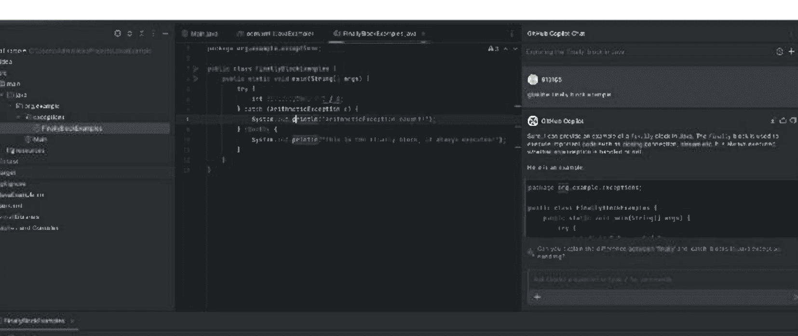

# Java 中的多线程

## 什么是多线程？

多线程是 Java 的一项特性，允许程序的两个或多个部分并发执行。程序的每个部分都被称为一个线程。

线程是单个进程内的轻量级进程。

目标是通过同时运行多个线程来最大化 CPU 利用率。

## 创建线程

可以使用两种机制创建线程：

- 继承 `Thread` 类：
  - 我们创建一个继承自 `java.lang.Thread` 的类。
  - 在该类中重写 `run()` 方法。
  - 线程在 `run()` 方法内部开始它的生命。
  - 创建我们新类的对象并调用 `start()` 开始线程执行。

示例：

```java
class MultithreadingDemo extends Thread {
    public void run() {
        System.out.println("Thread " + Thread.currentThread().getId() + " is running");
    }
}

public class Multithreaded {
    public static void main(String[] args) {
        int n = 8;
        for (int i = 0; i < n; i++) {
            MultithreadingDemo object = new MultithreadingDemo();
            object.start();
        }
    }
}
```

### 实现 `Runnable` 接口

- 创建一个实现 `java.lang.Runnable` 的新类。
- 在该类中重写 `run()` 方法。
- 实例化一个 `Thread` 对象并对其调用 `start()`。

示例：

```java
class MultithreadingDemo implements Runnable {
    public void run() {
        System.out.println("Thread " + Thread.currentThread().getId() + " is running");
    }
}

public class Multithread {
    public static void main(String[] args) {
        int n = 8;
        for (int i = 0; i < n; i++) {
            Thread object = new Thread(new MultithreadingDemo());
            object.start();
        }
    }
}
```

### `Thread` 类对比 `Runnable` 接口

继承 `Thread`：

- 由于 Java 缺乏多重继承，无法继承任何其他类。
- 提供内置方法，如 `yield()`、`interrupt()` 等。

实现 `Runnable`：

- 允许继承其他基类。
- 提供一个供多个线程使用的共享对象。

## 多线程的优势

- 并发性：多个线程并发执行。
- 内存效率：线程共享内存，节省内存空间。
- 更快的上下文切换：线程之间的切换比进程更快。

记住，多线程对于高效利用系统资源和响应式应用程序至关重要！

使用 GitHub Copilot 的 `finally` 块示例

### 使用继承类创建线程，在聊天中使用 GitHub Copilot

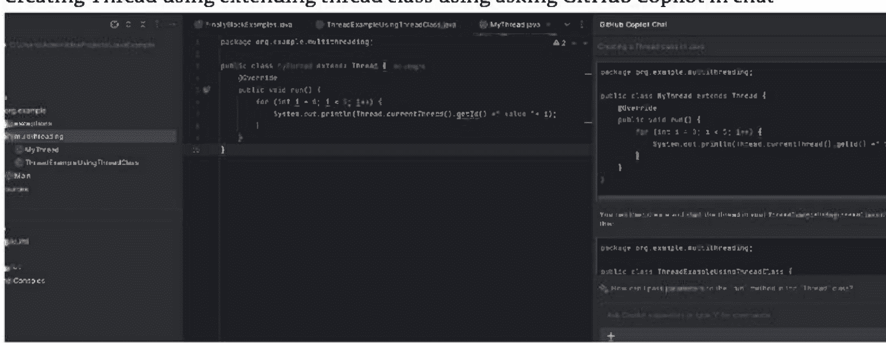

然后在接下来的截图中使用 `start` 方法启动线程

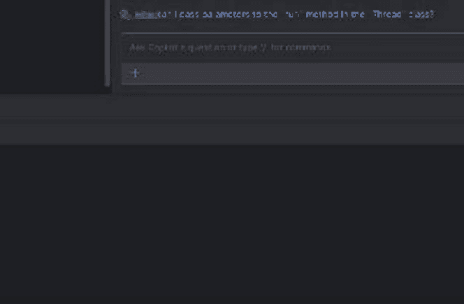

让我们询问下方高亮的后续问题

GitHub Copilot 的回答如下

在 Java 中，你无法直接向 `Thread` 的 `run` 方法传递参数，因为它是 `Thread` 类中定义的无参数方法。但是，你可以通过将参数传递给继承 `Thread` 的类的构造函数来向线程传递参数。你可以这样做：

首先，修改你的 `MyThread` 类，包含一个接收你想传递的参数的构造函数。将这些参数存储为实例变量，然后在你的 `run` 方法中使用它们。

```java
package org.example.multithreading;

class MyThread extends Thread {
    private int param;

    public MyThread(int param) {
        this.param = param;
    }

    @Override
    public void run() {
        for (int i = 0; i < this.param; i++) {
            System.out.println(Thread.currentThread().getId() + " Value: " + i);
        }
    }
}
```

我如何在 `Thread` 类的 `run` 方法中处理异常？

那么，当你创建 `MyThread` 的新实例时，将参数传递给构造函数。

```java
package org.example.multithreading;

public class ThreadExampleUsingThreadClass {
    public static void main(String[] args) {
        MyThread t1 = new MyThread(5);
        t1.start();

        MyThread t2 = new MyThread(7);
        t2.start();
    }
}
```

在这个示例中，5 和 7 分别传递给 `MyThread` 实例 `t1` 和 `t2` 的参数。这些值随后会被每个线程的 `run` 方法使用。

- 使用 T1
- 我如何在 `Thread` 类的 `run` 方法中处理异常？

## 通过实现 `Runnable` 接口创建线程

如果你在最后一张图中看到 GitHub Copilot 已经针对使用 `Runnable` 接口创建线程给出了后续建议和问题：

我该如何使用 `Runnable` 接口而不是扩展 `Thread` 类来实现多线程？

GitHub Copilot 给出的答案如下所示，然后运行程序：

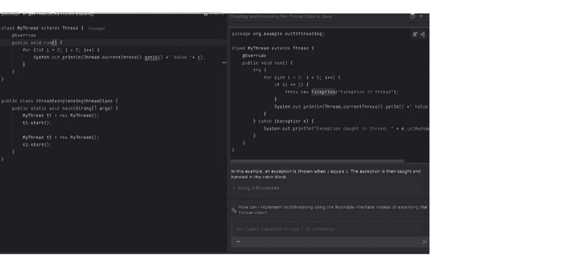

## 练习：使用 GitHub Copilot 编写一个打印线程基本状态的程序

## 解决方案：尝试以下提示

编写一个 Java 程序展示不同的线程状态。

创建一个线程，让它经过所有状态（`NEW`、`RUNNABLE` 和 `TERMINATED`），并在每个状态转换之间有微小的延迟。在每一步中打印当前状态。

## 用于 Java 的 GitHub Copilot 和 Spring Boot 基础

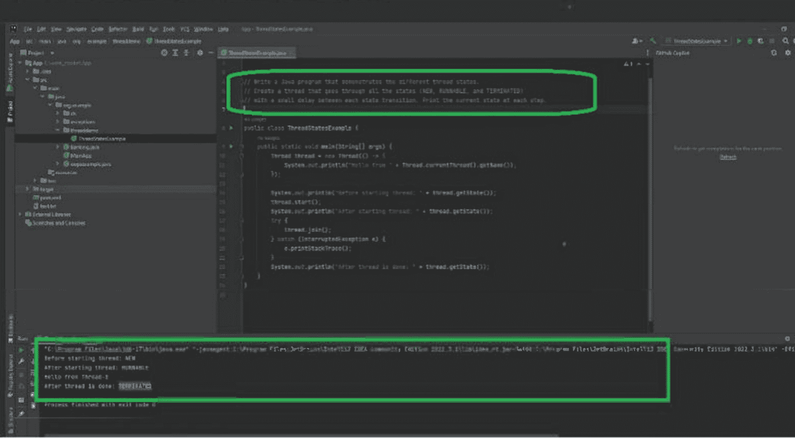

## Java 中的同步

Java 中的同步（Synchronization in Java）是多线程环境中管理共享资源并发访问的关键概念。

让我们探索它的含义：

### 同步的目的

同步的目标是确保一次只有一个线程可以访问共享资源（如变量、对象或方法）。

通过防止多个线程同时修改相同的数据，同步有助于避免数据损坏并确保结果的一致性。

### 同步的类型

在 Java 中，主要有两种类型的同步：

- 进程同步：处理跨不同进程的同步。
- 线程同步：侧重于单个进程内部的同步（线程之间）。

### 线程同步

在线程同步中，我们有两个主要概念：

- 互斥（Mutual Exclusion）：确保线程在共享数据时互不干扰。

通过以下方式实现：

- 同步方法（Synchronized methods）：锁定共享资源的对象。
- 同步块（Synchronized blocks）：允许对同步进行细粒度控制。
- 静态同步：适用于静态方法。

线程间通信（协作）：促进线程之间的通信。

示例包括 `wait()`、`notify()` 和 `notifyAll()`。

### Java 中锁（Lock）的概念

同步围绕着一个名为锁（lock）或监视器（monitor）的内部实体展开。Java 中的每个对象都有关联的锁。

线程在访问其字段之前必须获取对象的锁，并在之后释放——

Java 5 引入了 `java.util.concurrent.locks` 包，并带有各种锁实现。

### 没有同步的示例

考虑以下没有同步的示例：

```java
class Table {
    void printTable(int n) {
        for (int i = 1; i <= 5; i++) {
            System.out.println(n * i);
            try {
                Thread.sleep(400);
            } catch (Exception e) {
                System.out.println(e);
            }
        }
    }
}

class MyThread1 extends Thread {
    Table t;

    MyThread1(Table t) {
        this.t = t;
    }
    public void run() {
        t.printTable(5);
    }
}
```

```java
class MyThread2 extends Thread {
    Table t;
    MyThread2(Table t) {
        this.t = t;
    }
    public void run() {
        t.printTable(100);
    }
}
```

```java
public class TestSynchronization1 {
    public static void main(String[] args) {
        Table obj = new Table();
        MyThread1 t1 = new MyThread1(obj);
        MyThread2 t2 = new MyThread2(obj);
        t1.start();
        t2.start();
    }
}
```

输出（由于缺少同步导致不一致）：

```
5
100
10
200
15
300
20
400
25
500
```

### Java 同步方法

当你将一个方法声明为 `synchronized` 时，它就成为了一个同步方法。

线程在调用同步方法时会自动获取对象的锁。

当线程完成其任务时，释放锁。

### 示例

```java
class Table {
    synchronized void printTable(int n) {
        // 同步方法
        for (int i = 1; i <= 5; i++) {
            System.out.println(n * i);
            try {
                Thread.sleep(400);
            } catch (Exception e) {
                System.out.println(e);
            }
        }
    }
}
```

记住，同步确保了线程安全并防止了多线程应用中的数据不一致。

练习：尝试使用 GitHub Copilot 根据以下提示进行创建

```
// 演示程序，多个线程同时增加一个共享计数器变量。
// 使用 synchronized 关键字或 Lock 对象实现同步，
// 以确保计数器正确增加，且发生数据损坏或竞态条件。
```

答案：在接下来的两个截图中

```java
package com.example.sample;

import java.util.concurrent.atomic.AtomicInteger;

public class ThreadExample {
    private static AtomicInteger counter = new AtomicInteger(0);

    public static void main(String[] args) {
        Thread thread1 = new Thread(() -> {
            for (int i = 0; i < 5; i++) {
                counter.incrementAndGet();
                System.out.println("thread1: " + counter.get());
            }
        });

        Thread thread2 = new Thread(() -> {
            for (int i = 0; i < 5; i++) {
                counter.incrementAndGet();
                System.out.println("thread2: " + counter.get());
            }
        });

        thread1.start();
        thread2.start();
    }
}
```

## Java 中的 Executor 框架

当然！让我们深入研究 Java Executor 框架，这是一种高效管理并发任务的强大工具：

### 什么是 Java Executor 框架？

Java Executor Framework 是 `java.util.concurrent` 包的一部分。

它提供了一种并发管理和执行任务的方法，而不需要每次创建新线程。

通过使用线程池，它复用了现有线程，提高了性能和资源利用率。

## 为什么使用 Executor 框架？

随着处理器核心数量的增加，多线程对于实现更高的吞吐量至关重要。

Executor 框架简化了线程管理，允许开发者专注于业务逻辑。

## Executor 的类型

让我们探索一些常见的 Executor 类型：

### 线程池的类型

- 固定线程池（Fixed thread pool）：固定线程池具有固定数量的线程，根据需要创建。对于工作负载可预测的应用程序，固定线程池是一个良好选择。
- 缓存线程池（Cached thread pool）：缓存线程池根据需要创建线程，并在不需要时移除它们。对于工作负载变化的应用程序，缓存线程池是一个良好选择。
- 调度线程池（Scheduled thread pool）：调度线程池按指定的延迟执行任务。对于需要定期执行任务的应用程序，它是很好的选择。

#### 可用于创建线程池的类

- `Executors`：此类提供了静态方法来创建常见类型的线程池。
- `ThreadPoolExecutor`：此类提供了一种创建和管理线程池的灵活方法。

#### `SingleThreadExecutor`

创建一个单线程线程池。按顺序执行任务（一个接一个）。

语法：

```java
ExecutorService executor = Executors.newSingleThreadExecutor();
```

#### `FixedThreadPool(n)`

维护固定数量的线程（由 n 指定）。由这些线程并发执行。多余的任务存储在队列中。

语法：

```java
ExecutorService fixedThreadPool = Executors.newFixedThreadPool(2);
```


#### CachedThreadPool

根据需要创建线程并复用现有线程。如果没有可用线程，则创建一个新的。使用`SynchronousQueue`。

语法：

```java
ExecutorService executorService = Executors.newCachedThreadPool();
```

#### ScheduledExecutor

用于按固定间隔或延迟运行的任务。基于`ScheduledExecutorService`接口。有两种调度方法：

- `scheduleAtFixedRate`：以固定间隔执行任务。
- `scheduleWithFixedDelay`：在当前任务完成后开始延迟倒计时。

语法：

```java
ScheduledExecutorService scheduledExecService = Executors.newScheduledThreadPool(1);
```

### 使用示例

假设我们有一个任务类`MyTask`：

```java
class MyTask implements Runnable {
    public void run() {
        // 任务逻辑在此
        System.out.println("任务由线程 " + Thread.currentThread().getId() + " 执行");
    }
}
```

我们可以创建一个执行器并提交任务：

```java
public class ExecutorExample {
    public static void main(String[] args) {
        ExecutorService executor = Executors.newFixedThreadPool(3);
        for (int i = 0; i < 5; i++) {
            executor.submit(new MyTask());
        }
        executor.shutdown();
    }
}
```

### 优势

- 高效的线程复用。
- 简化线程管理。
- 提高性能和响应能力。

记住，Java Executor Framework 是有效管理并发任务的价值工具。

## 线程池与执行器

线程池和执行器是`java.util.concurrent`包的一部分，提供了一种强大且灵活的方式来并发管理和执行任务。它们可以帮助你高效地创建、调度和管理线程，减少与创建和管理单个线程相关的开销。

### 线程池

线程池是预先创建并准备好执行任务的工作线程的集合。你不需要为每个任务创建一个新线程，而是将任务提交到线程池，将分配其中一个可用的工作线程来执行任务。当任务完成后，工作线程会返回池中，并可以执行另一个任务。

线程池之所以有用是因为：

- 它们减少了为短生命周期任务创建和销毁线程的开销。
- 它们提供了限制创建线程数量的方法，防止资源耗尽。
- 它们可以帮助更有效地管理线程生命周期。

### 固定线程池示例

固定线程池使用`Executors.newFixedThreadPool(n)`创建，其中`n`是你想要在池中的线程数量。

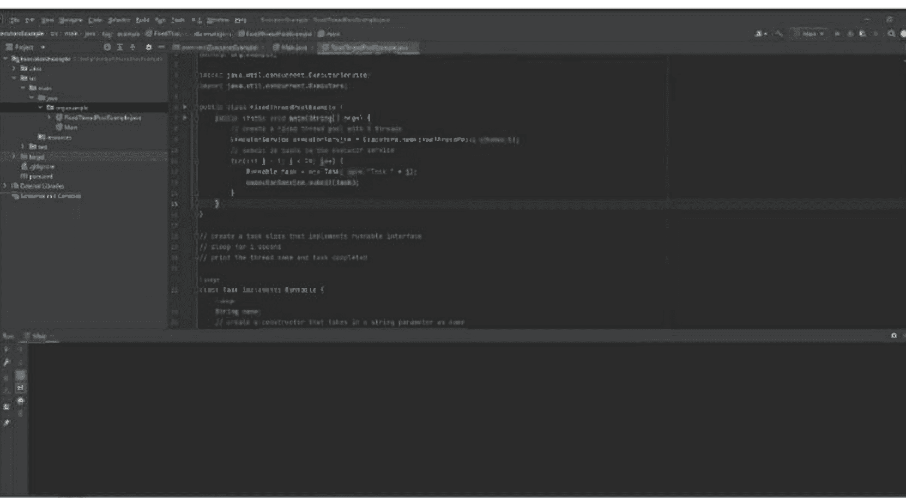

运行程序后：

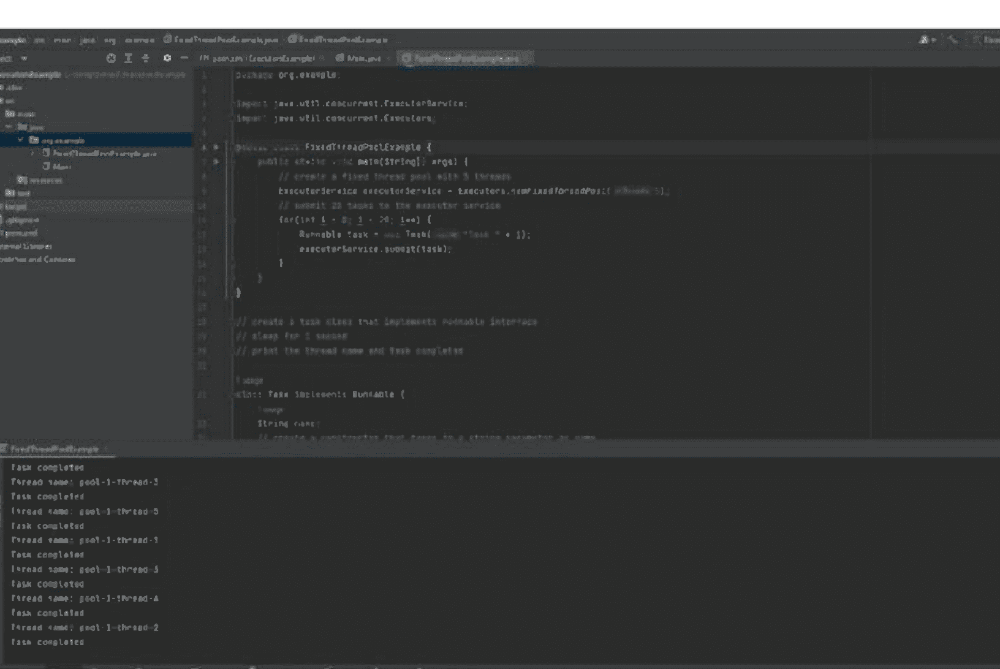

### 缓存线程池示例

`Executors.newCachedThreadPool()`方法提供了一个根据需要创建新线程的线程池，但在之前构建的线程可用时将复用它们。这些对于执行许多短生命周期异步任务的程序是理想的。

只需尝试在类上添加以下注释，并使用回车、空格和 Tab 键完成程序：

```java
// 使用缓存线程池通过执行服务实现文件下载器
```

答案：

```java
import java.util.concurrent.ExecutorService;
import java.util.concurrent.Executors;

// 使用缓存线程池通过执行服务实现文件下载器
public class CacheThreadExample implements Runnable {
    public static void main(String[] args) {
        // 创建 FileDownloader 的新实例
        FileDownloader downloader = new FileDownloader();
        // 创建执行服务的新实例
        ExecutorService executor = Executors.newCachedThreadPool();
        // 执行文件下载器
        executor.execute(downloader);
        executor.shutdown();
    }
}

class FileDownloader implements Runnable {
    @Override
    public void run() {
        System.out.println("正在下载文件...");
    }
}
```

# Java 中的函数式编程

让我们探索 Java 中的函数式编程 (FP)。

### 概述

函数式编程是一种强调将计算视为求值数学函数的编程范式。

在数学中，函数将一个输入集与一个输出集联系起来，其输出完全取决于其输入。FP 允许我们组合函数来创建新函数，从而促进代码的模块化和表达力。

### Lambda 演算

20 世纪30 年代，数学家阿隆佐·丘奇（Alonzo Church）开发了 Lambda 演算，这是一种基于函数抽象表示计算的正式系统。

Lambda 演算对编程语言理论和函数式编程产生了显著影响。

函数式语言通常会实现 Lambda 演算的概念。

### 编程范式的分类

编程范式可以大致分类为：

- 命令式：程序作为改变状态的语句序列。
- 声明式：在不指定控制流的情况下表达逻辑。
- FP 是声明式编程的子集。

### 编程语言的分类

根据对函数式编程的支持：

- 纯函数式语言（例如 Haskell）：仅允许纯函数式程序。
- 函数式语言（例如 Scala, Clojure）：在支持其他范式的同时支持函数式编程。
- Java（带有 FP 特性）：通过 Java 8+ 特性支持函数式编程。

Java 函数式编程的核心概念：

- Lambda 表达式：允许编写简洁代码的匿名函数。
- 方法引用：将方法视为一等公民。
- 函数式接口：具有单个抽象方法的接口（例如`Runnable`、`Predicate`）。
- 高阶函数：将其他函数作为参数的函数。
- 不可变性：避免可变状态。
- Stream API：允许对集合进行函数式风格的操作。

示例（Lambda 表达式）：

```java
List<Integer> numbers = Arrays.asList(1, 2, 3, 4, 5);
numbers.stream()
  .filter(n -> n % 2 == 0) // Lambda 表达式
  .map(n -> n * n)
  .forEach(System.out::println); // 方法引用
```

Java 函数式编程的优势：

- 简洁性：用更少的代码表达复杂的操作。
- 可读性：关注“做什么”，而不是“怎么做”。
- 并行性：更容易将任务并行化。
- 可测试性：纯函数更容易测试。

记住，Java 中的函数式编程增强了代码质量和可维护性！

## 使用 GitHub Copilot 使用 Lambda 表达式

Lambda 表达式引入于 Java 8，为表达单方法接口（函数式接口）的实例提供了一种简洁的方式。当你需要将行为作为参数传递给方法或创建短小的匿名函数时，它们特别有用。

Lambda 表达式的语法格式为：

```
(parameters) -> { statements; }
```

参数：

Lambda 表达式的参数定义在括号内，类似于方法声明。如果只有一个参数，可以省略括号。

如果没有参数，必须使用空括号。

示例：

```java
(int x) -> ...
(String name) -> ...
() -> ...
```

### 箭头运算符 ( -> )

箭头运算符将参数与 Lambda 体隔离开来。它表示接后的代码代表 Lambda 的实现。

示例：

```java
(x, y) -> x + y
```

### Lambda 体

Lambda 体指定了在调用 Lambda 表达式时执行的代码。如果 Lambda 体只包含单个表达式，则可以省略大括号`{}`，该表达式将作为 Lambda 表达式的结果。

示例：

```java
(x, y) -> x * y
(name) -> "Hello, " + name
```

### 函数式接口

Lambda 表达式通常与函数式接口结合使用。函数式接口是一个只有一个抽象方法的接口。

Lambda 表达式提供更简洁的方式来实现这些接口，而无需创建匿名类。

示例：

```java
interface MyFunction {
    int apply(int x, int y);
}

MyFunction add = (x, y) -> x + y;
```

我们已经看了没有 Lambda 表达式的`Runnable`示例，现在通过 GitHub Copilot 的帮助查看 Lambda 表达式。

答案：

```java
package example;

public class RunnableExample {
    public static void main(String[] args) {
        Runnable runnable = () -> {
            for (int i = 0; i < 5; i++) {
                System.out.println(Thread.currentThread().getName() + " value: " + i);
            }
        };

        Thread thread1 = new Thread(runnable);
        thread1.start();

        Thread thread2 = new Thread(runnable);
        thread2.start();
    }
}
```

### GitHub Copilot Chat

```java
// example：在 java 中使用 lambda 表达式
// 在这里得到：替换
```

> 31:58

使用 lambda 表达式的`Runnable`示例

### GitHub Copilot

如果你使用 lambda 表达式使其更短，可以这样做：

```java
public class Example {

    public static void main(String[] args) {

        Runnable runnable = () -> {

            for (int i = 0; i < 5; i++) {

                System.out.println(Thread.currentThread().getName() + " value: " + i);

            }

        };

        Thread thread1 = new Thread(runnable);

        thread1.start();

        Thread thread2 = new Thread(runnable);

        thread2.start();

    }

}
```

在示例中，Lambda 表达式`() -> { ... }`被替换了`Runnable`的匿名类。此时不再需要`Runnable`接口。

- 功能
- 你能解释 Lambda 表达式如何简化 Java 中`Runnable`示例的创建吗？

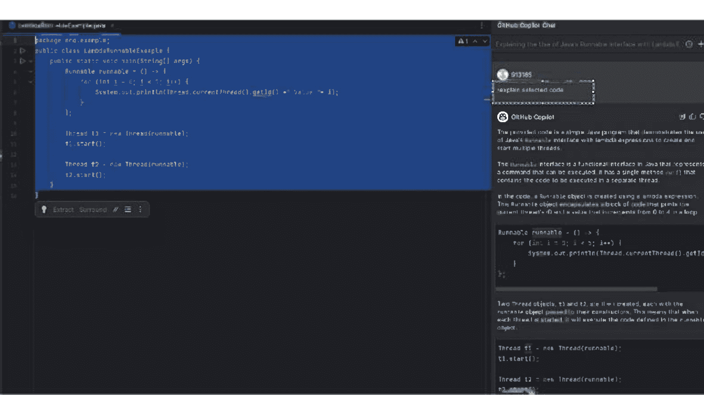

让我们来看另一个使用比较器接口的 lambda 表达式示例。

在 GitHub Copilot Chat 中尝试以下内容：

```java
// 使用 lambda 表达式编写一个 Comparator 接口（用于排序）的程序
```

你可以得到如下方的答案：

## Java 中的函数式接口 (Functional Interface)

**函数式接口**是一个包含**只有一个抽象方法**的接口。让我们来分解其关键点：

**定义：**

函数式接口是一个精确包含**一个未实现方法**的接口。

它也可以包含任意数量的**默认方法**（带有实现的方法）和**静态方法**。

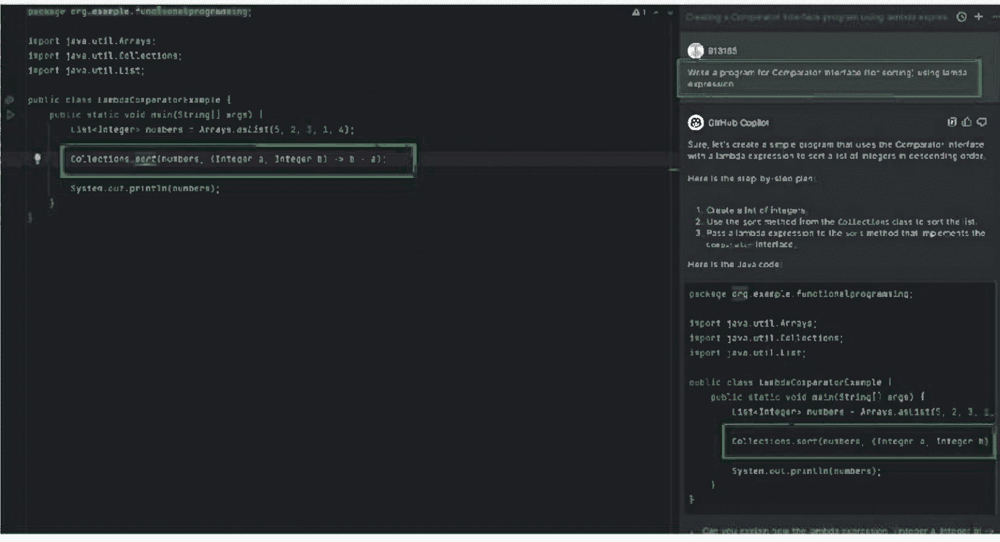

单个抽象方法是函数式接口的核心特征。

### 目的

函数式接口的设计是为了方便 lambda 表达式和方法引用的使用。

它们允许你将一段代码（一个函数）表示为接口的实例。

### Lambda 表达式与函数式接口

从 Java 8 开始，你可以使用 lambda 表达式来创建函数式接口的实例。

这使得代码更加可读、整洁且简洁。

### @FunctionalInterface 注解

为了显式地声明一个接口为函数式接口，你可以使用`@FunctionalInterface`注解。

该注解确保接口只有一个抽象方法。

如果存在多个抽象方法，编译器将会标记为错误。

### 函数式接口的示例

Java SE 8 中的一些内置函数式接口包括：

- `Runnable`: 代表一个可以异步执行的任务。
- `ActionListener`: 用于处理 GUI 事件。
- `Comparable`: 用于比较对象。
- `Callable`: 代表一个会返回结果或抛出异常的任务。

这里有一个使用 lambda 表达式调用函数式接口的示例：

```java
// Java 8 之前
new Thread(new Runnable() {
    @Override
    public void run() {
        System.out.println("New thread created");
    }
}).start();
```

```java
// Java 8 及以后
new Thread(() -> {
    System.out.println("New thread created");
}).start();
```

记住，函数式接口在启用 Java 函数式编程特性方面起着至关重要的作用。

练习：

```java
// 创建一个名为 MathOperation 的函数式接口，包含 operate 方法
```

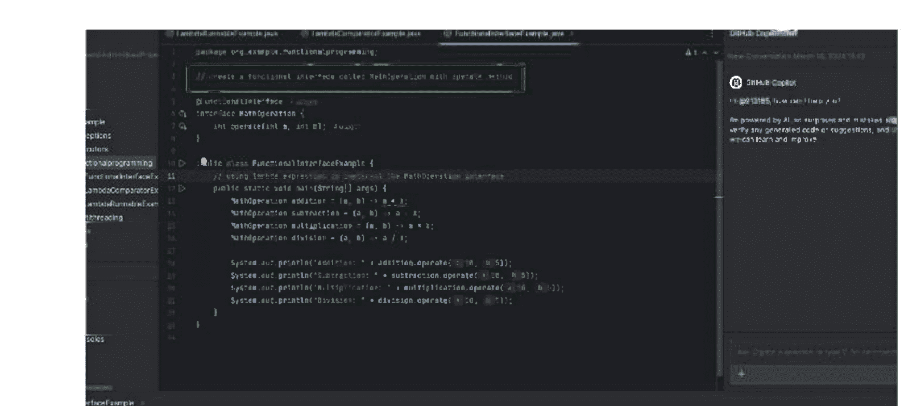

### 解决方案

图中代码是 Java 中使用函数式接口和 lambda 表达式的简单示例。

在顶部，声明了一个名为`MathOperation`的函数式接口。函数式接口是一个只包含一个抽象方法的接口。在这种情况下，该方法是`operate(int a, int b)`。该方法两个两个作为参数并返回一个整数。

```java
@FunctionalInterface
interface MathOperation {
  int operate(int a, int b);
}
```

在`FunctionalInterfaceExample`类的`main`方法中，使用 lambda 表达式创建了四个`MathOperation`实例。lambda 表达式是一个接收参数并返回值的短代码块。lambda 表达式与方法相似，但不需要名称，并且可以在方法体中实现。

```java
MathOperation addition = (a, b) -> a + b;
MathOperation subtraction = (a, b) -> a - b;
MathOperation multiplication = (a, b) -> a * b;
MathOperation division = (a, b) -> a / b;
```

每个 lambda 表达式实现了`MathOperation`接口的`operate`方法。`addition`实例相加其参数，`subtraction`实例减去它们，`multiplication`实例乘以它们，而`division`实例除以它们。

最后，使用数字 10 和 5 参数调用每个`MathOperation`实例的`operate`方法，并将结果打印到控制台。

```java
System.out.println("Addition: " + addition.operate(10, 5));
System.out.println("Subtraction: " + subtraction.operate(10, 5));
System.out.println("Multiplication: " + multiplication.operate(10, 5));
System.out.println("Division: " + division.operate(10, 5));
```

这段代码演示了如何使用函数式接口和 lambda 表达式在 Java 中创建简单的、可重用的代码。

## Java 中的流 (Streams)

在 Java 中，Stream 是源数据的元素序列，支持数据操作方法，这些方法可以通过管道化来获取所需的结果。Stream 在 Java 8 作为`java.util.stream`包的一部分被引入。它们的设计是为了使数据操作更具声明性和函数化。


# Java 流关键特性

- **管道化（Pipelining）**：`Stream` 支持管道化，这意味着多个操作可以在单个表达式中链联起来。这使得代码更易读且简洁。
- **惰性（Laziness）**：`Stream` 上的中间操作是惰性的，这意味着在调用终端操作之前它们不会执行。这允许进行优化和高效的内存使用。
- **不可变性（Immutable）**：`Stream` 是不可变的，意味着一旦创建，就无法修改。对 `Stream` 的任何操作都会产生一个新的 `Stream` 实例。
- **并行化（Parallelization）**：`Stream` 可以并行执行，这可以显著提高现代多核系统上的性能。
- **可重用性（Reusability）**：`Stream` 在使用后就会被消费。如果你需要多次执行相同的操作，则需要创建一个新的 `Stream` 实例。

# 常见的 Stream 操作

- **中间操作（Intermediate Operations）**：这些操作将 `Stream` 转换为另一个 `Stream`。示例包括 `filter()`、`map()`、`sorted()`、`distinct()` 等。
- **终端操作（Terminal Operations）**：这些操作从 `Stream` 产生结果或副作用。示例包括 `forEach()`、`collect()`、`reduce()`、`count()`、`anyMatch()` 等。
- **短路操作（Short-circuiting Operations）**：这些允许无限流上的计算在有限时间内完成的终端操作。示例包括 `findFirst()`、`findAny()`、`limit()` 等。

```java
import java.util.Arrays;
import java.util.List;
import java.util.stream.Collectors;
public class StreamExample {
    public static void main(String[] args) {
        List<Integer> numbers = Arrays.asList(1, 2, 3, 4, 5, 6, 7, 8, 9, 10);

        // 过滤偶数并平方
        List<Integer> squaredEvens = numbers.stream()
            .filter(n -> n % 2 == 0)
            .map(n -> n * n)
            .collect(Collectors.toList());
        System.out.println(squaredEvens); // 输出: [4, 16, 64, 100]
    }
}
```

在上面的示例中，我们首先创建一个 1 到 10 的整数列表。然后我们使用 `stream()` 从该列表创建一个 `Stream`。接下来，我们使用中间操作 `filter()` 过滤偶数，然后通过 `map()` 操作进行平方。最后，我们使用终端操作 `collect(Collectors.toList())` 将 `Stream` 收集到一个新的列表中。

Java 流提供了一种强大且富有表达式的数据操作方式，比传统的命令式方法更简洁。

练习：// 创建10条学生记录并使用 stream Api 输出分数第三的学生

解决方案：创建一个类（任意名称）并尝试上述语句

# Java 中的方法引用（Method references）

方法引用是在 Java 8 中引入的，它们允许你直接引用方法而不是提供 lambda 表达式。它们为已有的方法提供了更简洁易读的 lambda 表达式写法。

Java 中有四种方法引用：

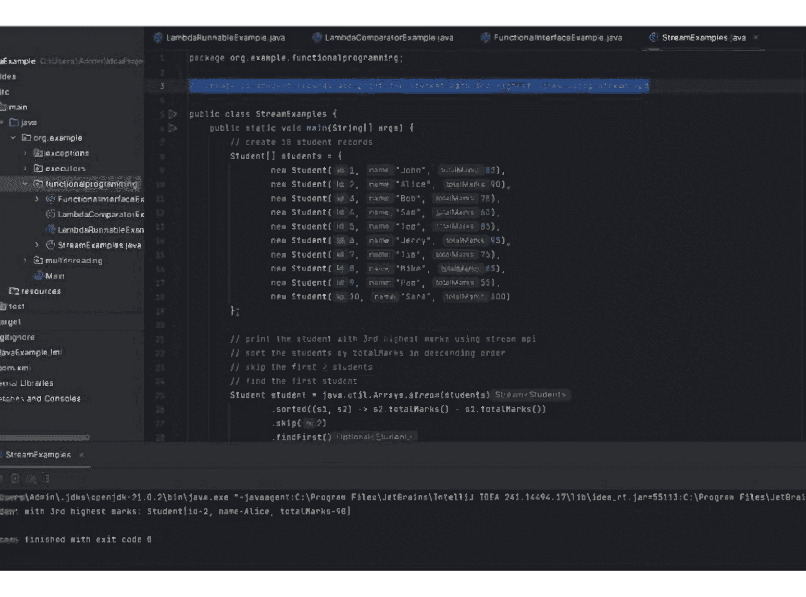

- **静态方法引用**：语法：`ClassName::staticMethodName`，例如 `Integer::parseInt`（等于 `x -> Integer.parseInt(x)`）。
- **特定对象的实例引用**：语法：`objectReference::instanceMethodName`，例如 `str::length`（对于一个 `String str`，等于 `x -> x.length()`）。
- **特定类型对象的实例引用**：语法：`ClassName::instanceMethodName`，例如 `String::length`（等于 `x -> x.length()`）。
- **构造器引用**：语法：`ClassName::new`，例如 `ArrayList::new`（等于 `() -> new ArrayList<>()`）。

```java
import java.util.Arrays;
import java.util.List;
import java.util.stream.Collectors;

public class MethodReferenceExample {
    public static void main (String [] args) {
        List<String> strings = Arrays.asList("apple", "banana", "cat", "dog");

        // 静态方法引用
        List<Integer> lengths = strings.stream()
            .map(String::length)
            .collect(Collectors.toList());
        System.out.println(lengths); // 输出: [5, 6, 3, 3]
    }
}
```

```java
System.out.println(lengths); //[5, 6, 3]

// Instance method reference on a particular object
String str = "hello";
int strLength = printer(str::length);
System.out.println(strLength); // 5

// Constructor reference
List<StringBuilder> builders = strings.stream()
    .map(StringBuilder::new)
    .collect(Collectors.toList());
System.out.println(builders); //[StringBuilder@1db9742, StringBuilder@106d69c, StringBuilder@52e922, StringBuilder@4aa298b7]
}

private static int printer(StringFunction f) {
    return f.getLength();
}

interface StringFunction {
    int getLength();
}
```

在上面的示例中：

`map(String::length)` 使用 `String` 类中 `length()` 方法的方法引用来获取列表中每个字符串的长度。

`printer(str::length)` 使用特定对象 `str` 的方法引用来调用 `length()` 方法。`map(StringBuilder::new)` 使用构造方法引用为列表中的每个字符串创建一个新的 `StringBuilder` 实例。

方法引用提供了一种更简洁、易读的方式编写 lambda 表达式，特别是在处理现有方法或构造方法时。它们有助于减少代码的冗余并提高代码的可读性。

示例：// 使用静态方法引用创建一个包含每个字符串长度的 String 列表

解决方案：尝试如下所示，使用 GitHub Copilot

```java
package org.example.functionalprogramming;

import java.util.ReferenceExample;

public class MethodExample {
    public static void main(String[] args) {
        // 创建一个包含星期几的字符串列表
        String[] days = {"Sunday", "Monday", "Tuesday", "Wednesday", "Thursday", "Friday", "Saturday"};

        // 使用静态方法引用创建一个包含每个字符串长度的整数列表
        List<Integer> lengths = List.of(days).stream().map(String::length).toList();

        // 打印列表
        System.out.println("lengths: * + lengths);
    }
}
```

# 实例方法引用和构造方法引用

```java
// 列出一个包含每个字符串长度的整数列表
List<Integer> lengths = strings.stream().map(Integer::length).toList();

// 打印列表
System.out.println("lengths: " + lengths);

// 在特定对象上的实例方法引用
List<String> sorted = strings.stream().map(String::toUpperCase).toList();
System.out.println("sorted: " + sorted);

// 使用收集器
Map<String, Long> counts = strings.stream()
    .collect(Collectors.groupingBy(Function.identity(), Collectors.counting()));
System.out.println("counts: " + counts);

static int printer(StringFunction f) {
    return f.apply(test);
}
static int StringFunction(String s) {
```

# 高阶函数

在 Java 中，高阶函数是指满足以下任一条件的函数：

- 一个或多个函数作为参数，或者
- 返回一个函数作为结果。

尽管 Java 是一种面向对象的语言，没有函数式编程语言那样的一等函数，但 Java 8 引入的 lambda 表达式和函数式接口带来了将函数视为数值的能力，实现了高阶函数。

```java
import java.util.function.Function;
public class HigherOrderExample {
    public static void main(String[] args) {
        Function<Integer, Integer> square = x -> x * x;
        int result = applyOperation(3, square);
        System.out.println(result); // 输出: 9
    }

    private static int applyOperation(int x, Function<Integer, Integer> operation) {
        return operation.apply(x);
    }
}
```

在这个示例中，`applyOperation` 是一个高阶函数，它接受一个整数 `x` 和一个 `Function<Integer, Integer>`（函数接口）作为参数。`Function` 参数代表一个接收整数并返回整数的函数。

在 `applyOperation` 内部，使用参数 `x` 调用提供的函数 `operation`（在此例中 `square`），并返回结果。

现在有一个返回函数的高阶函数示例：

```java
public class HigherOrderExample {
    public static void main(String[] args) {
        Function<Integer, Function<Integer, Integer>> makePower = x -> y -> (int) Math.pow(y, x);
        Function<Integer, Integer> square = makePower.apply(2);
        int result = square.apply(3);
        System.out.println(result); // 输出: 9
    }
}
```

在这个示例中，`makePower` 是一个高阶函数，它接受一个整数 `x` 并返回一个 `Function<Integer, Integer>`。返回的函数是一个 lambda 表达式，它接受一个整数 `y` 并使用 `Math.pow` 提升为 `x` 次方。

在 `main` 方法中，我们调用 `makePower.apply(2)`，它返回一个将其参数平方（提升 2 次）的函数。我们将此函数存储在 `square` 变量中，然后调用 `square.apply(3)` 获取结果 9。

高阶函数在 Java 中实现了强大的函数式编程技术，例如函数组合、柯里化和部分应用。它们通过将函数视为一等公民，允许代码更具表现力且简洁。

在 IntelliJ Idea 中使用 Github Copilot 尝试下方

```java
package org.example.functionalprogramming;

import java.util.function.Function;

public class HigherOrderFunctionsExample {
    // 创建一个接受函数作为参数的高阶函数
    public static Function<Integer, Integer> doubleFunction(Function<Integer, Integer> f) {
        return x -> f(f(x));
    }

    public static void main(String[] args) {
        // 定义一个整数翻倍的函数
        Function<Integer, Integer> double = x -> x * 2;

        // 定义一个输入值
        int inputValue = 5;

        // 调用高阶函数并将函数作为参数
        int result = doubleFunction(double).apply(inputValue);

        // 输出结果
        System.out.println("result: " + result);
    }
}
```

# 感谢

课程到此结束。

《Java 开发者的 GitHub Copilot》是一本为寻求利用 GitHub Copilot 能力的 Java 程序员定制的简洁指南。这本书提供了必要的见解、实用技巧和最佳实践，帮助将 Copilot 无缝集成到你的 Java 开发工作流中。从设置和配置到高级使用场景和故障排查（此处原文为 troubleshooting，意为故障排查），它涵盖了你有效利用 Copilot 所需的所有知识。通过真实的示例和案例研究，本书使你具备所需的知识和技能，以在 AI 的辅助下加速 Java 编码过程。无论你是初学者还是经验丰富的开发者，本指南都能为你提供帮助。
