# Java 开发者 GitHub Copilot 指南

《面向 Java 开发者的 GitHub Copilot》是一本不可或缺的指南，探索了 AI 在软件开发中革命性的集成。本书深入探讨了 GitHub Copilot 的变革能力，这是一种 AI 驱动的编程助手，能够简化 Java 开发工作流。从它的诞生到演变，读者将发现 Copilot 的历史和特性，并对其与 Java 开发环境的无缝集成产生见解。通过实用的技巧、案例研究和最佳实践，这一全面的资源将使 Java 开发者充分利用 GitHub Copilot 的潜力，增强项目的生产力、代码质量和创新能力。

## 什么是 GitHub Copilot

GitHub Copilot 是由 GitHub 与 OpenAI 合作开发的 AI 驱动代码补全工具。它基于 GPT（生成式预训练变换）架构构建，这与 ChatGPT 背后的技术相同，旨在帮助开发者更高效地编写代码。

GitHub Copilot 设计通过实时建议代码行和整个函数来辅助开发者。它像一个虚拟结对编程伙伴，理解你的代码上下文，并根据你的项目和编码风格提供建议。

## 历史与演变

2021 年 6 月 29 日，GitHub 在 Visual Studio Code 开发环境中推出了 GitHub Copilot 的初始预览版。2021 年 10 月 29 日，GitHub Copilot 以插件形式在 JetBrains 市场可用。此外，2021 年 10 月 27 日，GitHub 以开源仓库的形式发布了 GitHub Copilot Neovim 插件。2022 年 3 月 29 日，GitHub 宣布在 Visual Studio 2022 IDE 中可用 Copilot。此外，2022 年 6 月 21 日，GitHub 宣布 Copilot 从初始预览阶段转变为面向个人开发者的订阅制服务。

## 从记事本到 AI

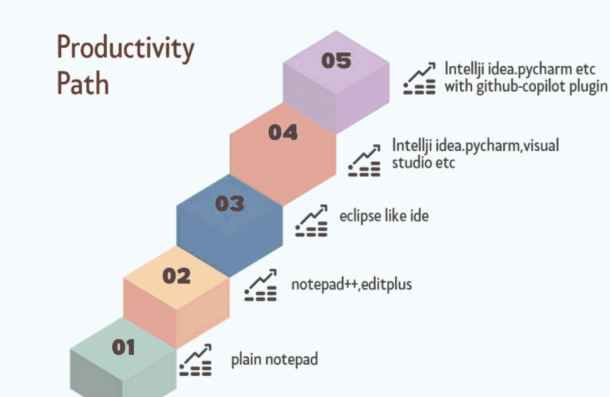

从 Notepad（记事本）到带有 GitHub Copilot 的 IntelliJ IDEA 代表了程序员可用工具的重大演变，提供了日益复杂的功能和能力：

- Notepad（记事本）：Notepad 是一个基础文本编辑器，为编写代码提供极少的功能。虽然它可以用于简单任务，但缺乏为量身定制的功能，如语法高亮、代码补全和调试工具。使用 Notepad 的程序员在管理大型项目和高效调试错误时经常面临挑战。

- Notepad++：Notepad++ 是 Notepad 的改进版，提供了增强的功能，如语法高亮、代码折叠和自定义主题。与 Notepad 相比，它提供了一个更舒适的编码环境，但仍然缺乏专用集成开发环境（IDE）中的高级功能，如项目管理和版本控制集成。

- Eclipse：Eclipse 是一款受欢迎的 Java IDE，以其全面的功能而闻名，包括语法高亮、代码补全、调试、重构工具以及通过插件支持各种编程语言。Eclipse 显著提高了程序员的生产力，提供了一个编写、测试和调试代码的集成环境。然而，对于初学者来说，它可能非常消耗资源且复杂。

- IntelliJ IDEA：IntelliJ IDEA 是一个强大且易用的 IDE，它在构建 Eclipse 特性的基础上提供了额外的增强，如更好的性能、更智能的代码补全、高级重构工具以及与构建系统和版本控制的无缝集成。与 Eclipse 相比，IntelliJ IDEA 简化了开发工作流，提高了代码质量，并提供了更直观的用户体验。

- 带有 GitHub Copilot 的 IntelliJ IDEA：将 GitHub Copilot 与 IntelliJ IDEA 集成通过利用人工智能辅助程序员编写代码进一步增强了开发体验。GitHub Copilot 提供智能代码建议、自动补全，甚至根据上下文生成整个代码段，显著减少了手动工作并加速了开发任务。这种集成增强了 IntelliJ IDEA 的能力，使程序员能够更高效地编写代码、探索解决方案并提高生产力。

总之，从 Notepad 到带有 GitHub Copilot 的 IntelliJ IDEA 的演变代表了程序员可用工具日益复杂和高效的历程，使他们能够更有效地编写高质量代码，并更轻松地处理复杂的编程任务。

## Copilot 如何工作

下图显示了 copilot 如何工作。

## OpenAI Codex 模型


你的编辑器

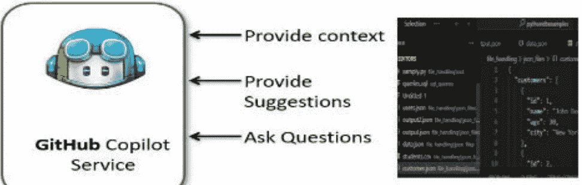

- 提供上下文
- 提供建议
- 提问

```
GitHub Copilot 服务

公共代码（例如 pis github repo）
```

OpenAI Codex 是由 OpenAI 开发的一种 AI 模型。Codex 在来自各种来源（包括开源仓库）的海量代码上训练，以理解并生成多种编程语言的代码。它基于 GPT（生成式预训练变换）架构构建，类似于 GPT-3 等模型使用的架构。

Codex 特别引人注目的是它根据自然语言提示理解并生成代码的能力。它可以用于代码补全、代码生成，甚至协助开发者编写软件等任务。

所以基本上，当你在右侧尝试编写代码并执行任何操作（如提供上下文、建议或提问）时，请求会发送到 GitHub Copilot 服务，该服务间接调用 Codex 模型并根据训练模型给出响应……

## 设置与安装

### 安装 IntelliJ IDEA

以下是在 Windows 上安装 IntelliJ IDEA 社区版的步骤：

**下载 IntelliJ IDEA 社区版：**

1. 前往 JetBrains：JetBrains IntelliJ IDEA Community Edition 下载
2. 点击社区版的“Download”按钮。

**运行安装程序：**

1. 下载完成后，找到下载的安装程序文件（通常在“下载”文件夹中）。
2. 双击安装程序（例如 `ideaIC-<version>.exe`）开始安装过程。

**选择安装选项：**

1. 在安装向导中，你将会被提示选择安装选项。
2. 你可以选择安装位置、创建桌面快捷方式，并将 IntelliJ IDEA 与相关文件类型关联。
3. 按照提示并选择你偏好的选项。

**安装 IntelliJ IDEA 社区版：**

1. 选择安装选项后，点击“Install”按钮开始安装过程。
2. 安装程序将在你的系统上提取并安装 IntelliJ IDEA 社区版。取决于你的系统速度，这可能需要几分钟时间。

**启动 IntelliJ IDEA：**

1. 安装完成后，你将看到启动 IntelliJ IDEA 的选项。
2. 勾选“安装后立即启动 IntelliJ IDEA”并点击“Finish”，或从开始菜单或桌面快捷方式手动启动。

**设置 IntelliJ IDEA：**

1. 首次启动时，IntelliJ IDEA 社区版将提示你根据喜好自定义设置。
2. 你可能还会被提示选择 UI 主题和键位映射设置。

**开始使用 IntelliJ IDEA 社区版：**

1. 一旦设置好 IntelliJ IDEA 社区版，你就可以开始创建新项目、打开现有项目并用你偏好的编程语言编写代码。

就是这样！你已成功在 Windows 系统上安装了 IntelliJ IDEA 社区版。你现在可以开始编写代码并探索 IntelliJ IDEA 社区版的功能。

## 在 IDE 中设置/配置 GitHub Copilot

以下是在 IntelliJ IDEA 中设置和配置 GitHub Copilot 的步骤：

**安装：**

- 从 File（文件）菜单打开 Settings（Windows）或 Preferences（Mac）。
- 在左侧面板中，点击 Plugins（插件）。
- 点击顶部的 Marketplace（市场）。
- 在搜索栏中搜索“Copilot”。
- 点击 GitHub Copilot 插件旁边的 Install（安装）。
- 重启 IntelliJ IDEA 使更改生效。

**激活：**

- 重启后，你将在 IDE 的左上角看到 GitHub Copilot 图标。
- 点击图标并选择 Sign in to GitHub（登录 GitHub）。
- 按照屏幕上的指令完成登录过程并激活 Copilot。

可选配置：

虽然 Copilot 开箱即用，但你也可以对其行为进行进一步配置：

- **快捷键：** 转到 Settings/Preferences > Keymap 并搜索 "Copilot"，以管理各种 Copilot 操作的快捷键。
- **设置：** 点击 Copilot 图标旁边的齿轮图标，探索相关设置，例如禁用建议或调整其显示样式。

额外资源：

你可以在此处找到在 IntelliJ IDEA 中设置 Copilot 的官方指南：https://docs.github.com/copilot

如需更深层次配置选项和故障排除，请参考 GitHub Copilot 文档：https://docs.github.com/copilot

在 IntelliJ IDEA 中创建新项目非常简单。以下是步骤指南：

### 启动 IntelliJ IDEA

在电脑上启动 IntelliJ IDEA。你可以通过双击桌面上的 IntelliJ IDEA 图标或在开始菜单中找到它来实现。

### 打开欢迎界面

一旦 IntelliJ IDEA 启动，你将看到欢迎界面。如果你正在处理某个项目，可以关闭它返回欢迎界面。如果欢迎界面不可见，可以通过点击“File” > “Close Project”来访问。

### 创建新项目

在欢迎界面上，点击“New Project”按钮。或者，你也可以从菜单栏进入“File” > “New” > “Project...”。

这将打开新项目向导。

### 选择项目类型

在新项目向导中，系统会提示你选择想要创建的项目类型。根据你的需求选择合适的项目类型。例如，你可以为 Java 项目选择“Java”，为 Maven 项目选择“Maven”，为 Gradle 项目选择“Gradle”等。

选择项目类型后，点击“Next”。

### 配置项目

在下一步中，你需要配置项目设置，例如项目名称、项目位置、项目 SDK（Java 版本）以及任何特定于所选项目类型的额外设置。

确保为项目提供有意义的名称和适当的位置。一旦配置好项目设置，点击“Next”。

### 完成

检查项目摘要以确保所有设置均正确。点击“Finish”创建项目。

### 等待项目创建

IntelliJ IDEA 将根据指定的设置创建项目。取决于你的系统速度和项目的复杂度，这可能需要几秒钟。

### 开始编码

一旦项目创建完成，你将进入加载了新项目的 IntelliJ IDEA 工作区。

你可以通过在项目内创建新类、包或文件来开始编码。

就是这样！你已成功在 IntelliJ IDEA 中创建了一个新项目。你现在可以开始你的项目并构建应用程序了。

例如，在创建新项目（例如 GithubCopilotExamples）时，会有以下窗口：

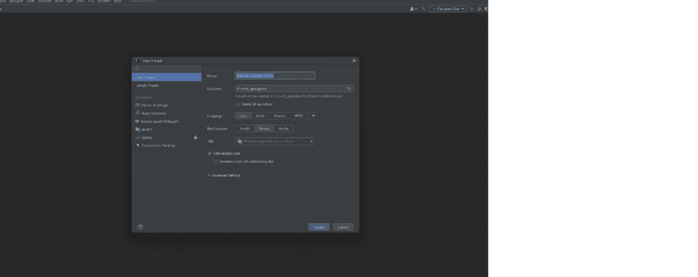

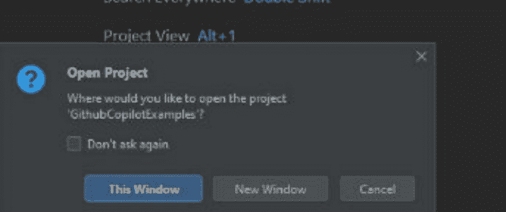

如果你想将其作为独立窗口，请点击 New Window。

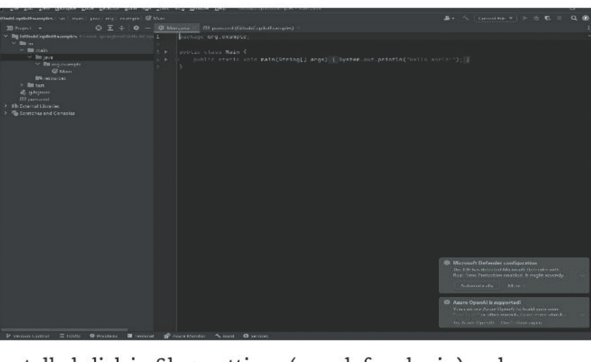

## Java 中的变量

在 Java 中，变量根据其作用域、寿命和访问权限分类。

| 变量类型 | 描述 |
| :--- | :--- |
| **局部变量** | 在方法或块内声明。存储在栈上。仅在相应块内访问。 |
| **实例变量** | 在类内声明但在任何方法之外。存储在堆上。只要对象存在就一直存在。 |
| **类变量** | 在类中使用 `static` 关键字声明。所有实例间共享，并在整个程序运行期间存在。 |


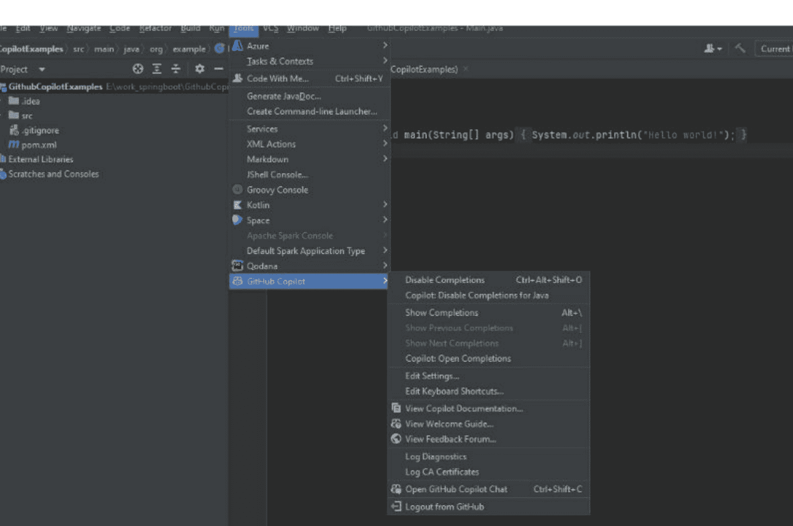

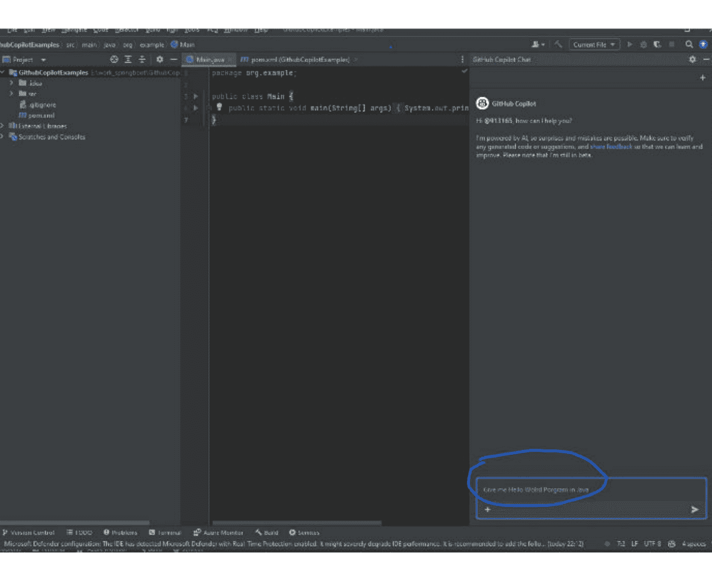


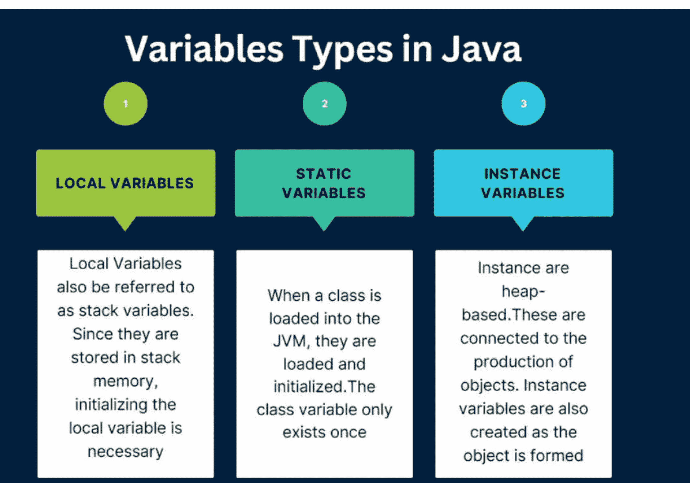


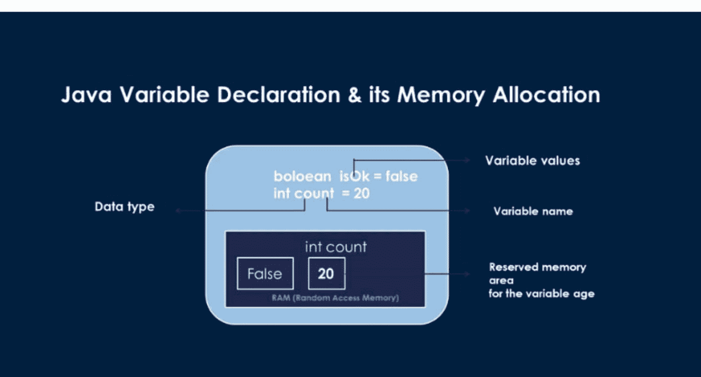

## Hello World

Java 是强类型语言，这意味着你必须声明变量可以持有的数据类型。此外，Java 遵循静态类型（在编译时检查变量类型）和动态绑定（在运行时决定要调用的方法）。

```java
public class Main {
    public static void main(String[] args) {
        System.out.println("Hello!");
    }
}
```

## 使用 Copilot 创建变量

通过注释，你可以创建任何想要的内容，例如只需输入：

```java
// create an integer variable and assign a value
```

在 Main 方法中并并回车，你将获得建议；如果你喜欢这些建议，按 tab 键。

你将得到如下所示的结果。

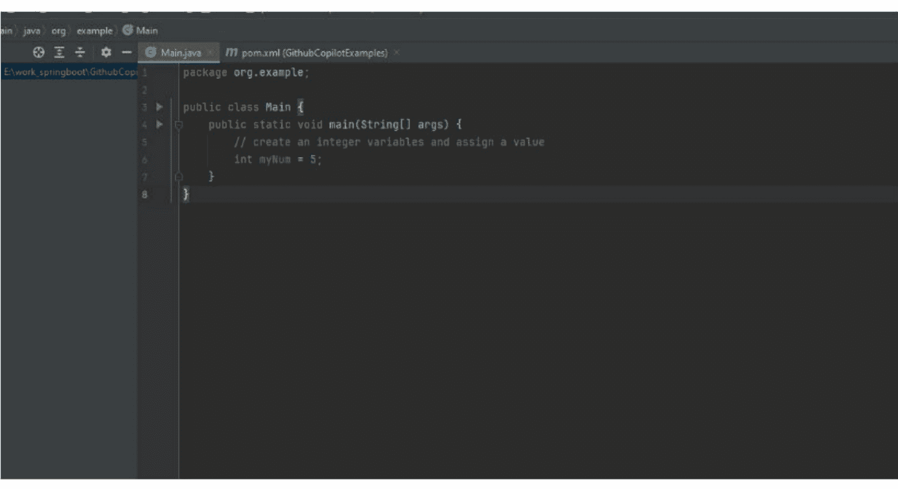

另一个例子是获取内存中以字节（byte）为变量的大小

在变量声明后添加注释 `// bytes`，然后你将获得下例所示的变量的字节大小信息

```java
public class Main {
    public static void main(String[] args) {
        // 创建一个整型变量并赋值
        int a = 5; // bytes = 4, range = -2,147,483,648 to 2,147,483,647
        
        // 创建一个双精度变量并赋值
        double b = 5.5; // bytes = 8, range = 4.9e-324 to 1.8e+308

        // 创建一个布尔型变量并赋值
        boolean c = true; // bytes = 1, range = true or false
    }
}
```

另一个例子是在不编译的情况下获取 `System.out.println` 的输出

如下所示

`System.out.println("The value of a is: " + a);` // The value of a is: 5

```java
package org.example;

public class Main {
    public static void main(String[] args) {
        // 创建一个整型变量并赋值
        int a = 5; // bytes = 4, range = -2,147,483,648 to 2,147,483,647

        // 创建一个双精度变量并赋值
        double b = 5.5; // bytes = 8, range = -4.9e-324 to 1.8e308

        // 创建一个布尔型变量并赋值
        boolean c = true; // bytes = 1, Range = true or false

        System.out.println("The value of a is: " + a); // The value of a is: 5
    }
}
```

作为参考，下面是数据类型及其大小和范围的表格

| 数据类型 (Datatype) | 大小（字节） | 范围 (Range) |
|---|---|---|
| byte | 1 | -128 to 127 |
| short | 2 | -32,768 to 32,767 |
| int | 4 | -2,147,483,648 to 2,147,483,647 |
| long | 8 | -9,223,372,036,854,775,808 to 9,223,372,036,854,775,807 |
| float | 4 | 约 ±3.40282347E+38 (6-7位有效数字) |
| double | 8 | 约 ±1.7976931348623157E+308 (15位有效数字) |
| char | 2 | 0 to 65,535 |
| boolean | 1 | true or false |

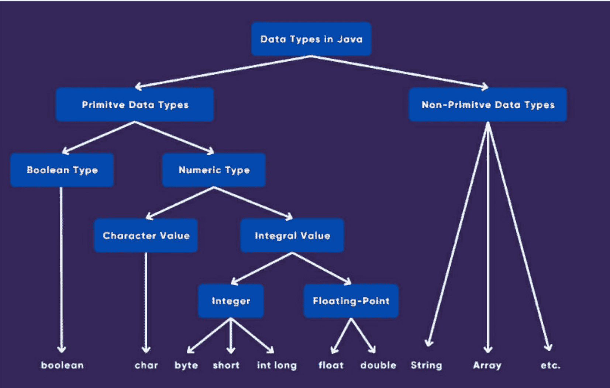

上面的图显示了数据类型的两大类：基本数据类型和非基本数据类型。

**基本类型 (Primitive types)** 是 Java 中存储数据的基础单元。它们由语言预定义，表示简单的值。数值类型可以存储数字。它们分为整型和浮点型。

整型 (Integral types) 表示不带小数部分的整数。整型的示例包括 `byte`、`short`、`int` 和 `long`。

浮点型 (Floating-point types) 表示带有小数部分的数字。浮点类型的示例包括 `float` 和 `double`。

字符类型 `char` 用于存储单个字符。


**非基本类型（Non-primitive types）**比基本类型更复杂。它们由程序员创建，可以存储数据集合或用户定义的对象。非基本类型的示例包括`String`、数组（arrays）和类（classes）。

如下所示：

```java
package org.example;

public class MainApp {
    public static void main(String[] args) {
        // 示例 1: if-else 语句
        if (true) {
            System.out.println("true");
        } else {
            System.out.println("false");
        }
    }
}
```


Java 中的流程控制是指控制程序中语句执行顺序的能力。Java 提供了几种控制语句，允许开发者根据条件或循环控制执行流。

## 条件语句（Conditional Statements）

- `if`语句：如果指定的条件为真，则执行代码块。
- `if-else`语句：如果条件为真，执行一个代码块；如果条件为假，执行另一个代码块。
- `if-else-if`语句：根据不同的条件执行不同的代码块。
- `switch`语句：根据表达式的不同值执行不同的代码块。

## 循环语句（Looping Statements）

- `for`循环：按照指定的次数执行代码块。
- `while`循环：只要指定的条件为真，就执行代码块。
- `do-while`循环：至少执行一次代码块，然后只要指定的条件为真就继续执行。
- `for-each`循环（增强`for`循环）：遍历数组或集合中的每个元素。

## 分支语句（Branching Statements）

- `break`语句：终止循环或`switch`语句，并将控制转移到循环或`switch`之后的语句。
- `continue`语句：跳过循环的当前迭代，并移动到下一次迭代。

## 其他控制流语句（Other Control Flow Statements）

- `return`语句：退出方法并将控制返回给调用方法。
- `try-catch-finally`块：处理异常并提供一种无论是否发生异常都执行代码的方法。

下面是 IntelliJ IDEA 中所有流程控制语句的示例。我们稍后会看到`try`、`catch`和`finally`。

```java
package org.example;

public class FlowControlExample {
    public static void main(String[] args) {
        int score = 85;

        // if-else 语句
        if (score >= 90) {
            System.out.println("Excellent!");
        } else if (score >= 80) {
            System.out.println("Great job!");
        } else {
            System.out.println("Try harder next.");
        }

        // switch 语句
        char grade = 'B';
        switch (grade) {
            case 'A':
                System.out.println("Outstanding performance!");
                break;
            case 'B':
                System.out.println("Good job!");
                break;
            default:
                System.out.println("Keep working hard.");
        }

        // for 循环
        for (int i = 1; i <= 5; i++) {
            System.out.println("Iteration: " + i);
        }

        // while 循环
        int count = 1;
        while (count <= 3) {
            System.out.println("count: " + count);
            count++;
        }
    }
}
```

使用`/explain chat copilot`命令获取`main`方法的解释，如下图所示。

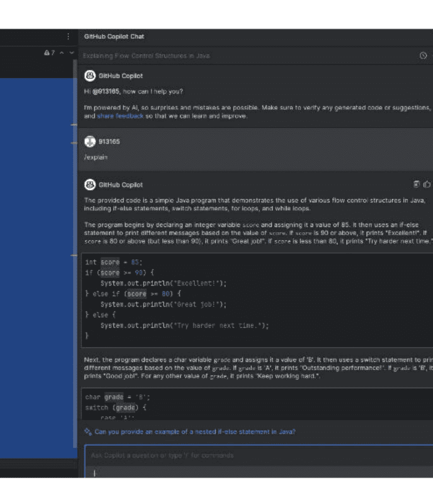

在计算机编程中，集合是对解决问题具有共同意义的数据项进行分组，并需要以受控的方式进行操作。

例如项目集合、数字集合、产品集合等。

- **顺序集合（Sequential collections）**：顺序集合的元素按线性顺序存储。顺序集合的示例包括数组、链表和队列。
- **关联集合（Associative collections）**：关联集合的元素以键值对的形式存储。关联集合的示例包括映射（maps）和哈希表（hash tables）。

在 Java 中，集合是作为单个单元表示的对象组。Java 集合框架（`java.util`包）提供了多个类和接口，用于存储和操作对象组。

## `java.util`包

顺序集合

关联集合

该框架包含以下主要组件：

接口：

- `Collection`（根接口）：将一组对象表示为一个单元。
- `List`：表示允许重复元素的有序集合。
- `Set`：表示唯一元素的无序集合。
- `Queue`：表示用于在处理前持有元素的集合。
- `Map`（不是真正的集合）：表示键和值之间的映射。

实现类：

- `ArrayList`：`List`接口的实现，使用可调整数组的数据结构。
- `LinkedList`：`List`和`Queue`接口的实现，使用了双向链表结构。
- `HashSet`：`Set`接口的实现，使用了哈希表进行存储。
- `TreeSet`：`Set`接口的实现，使用了树进行存储（按元素排序）。
- `HashMap`：`Map`接口的实现，使用了哈希表进行存储。
- `TreeMap`：`Map`接口的实现，使用了树进行存储（按键排序）。
- `Collections`类：提供了操作集合的静态方法，例如排序、搜索和洗牌。

以下是使用 Java 集合（collections）的一些关键特性和优势：

- **可重用性**：集合框架提供了一种处理对象组的标准方式，减少了编写自定义数据结构实现的需求。
- **性能**：集合的实现针对常用操作进行了高度优化。
- **线程安全**：某些集合（如`Vector`和`Hashtable`）是线程安全的，适用于并发编程。
- **泛型**：集合可以与泛型类型工作，提供类型安全并避免类型转换问题。
- **算法**：`Collections`类提供了用于排序、搜索和操作集合的各种实用方法。

下面是 Java 集合层级结构图：

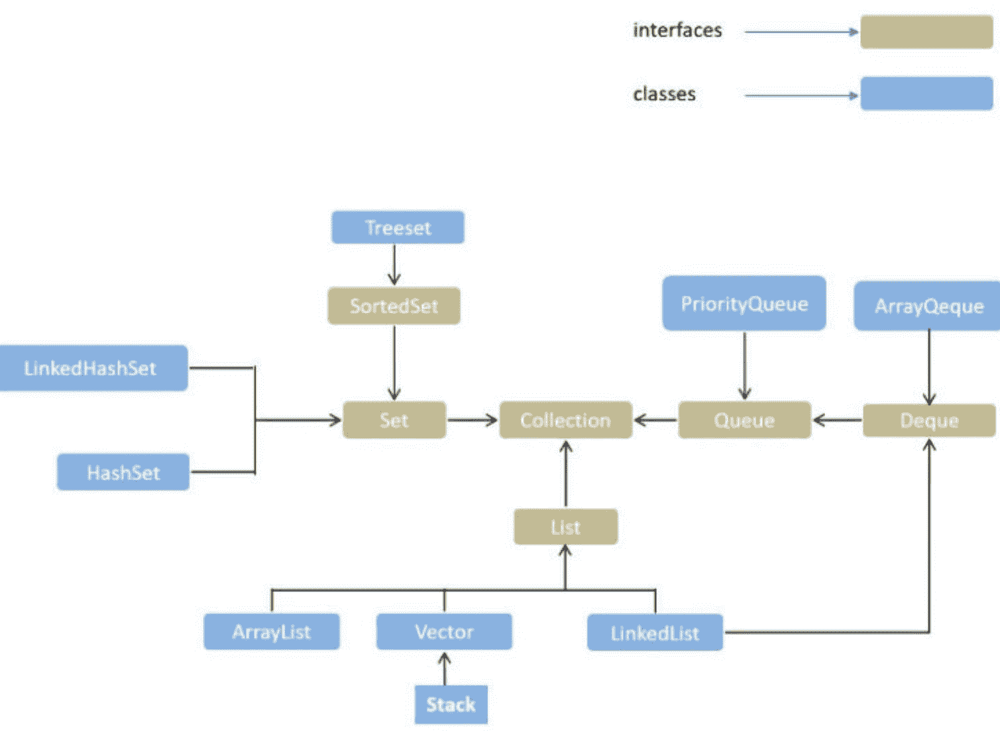

这里是`Map`层级结构图：

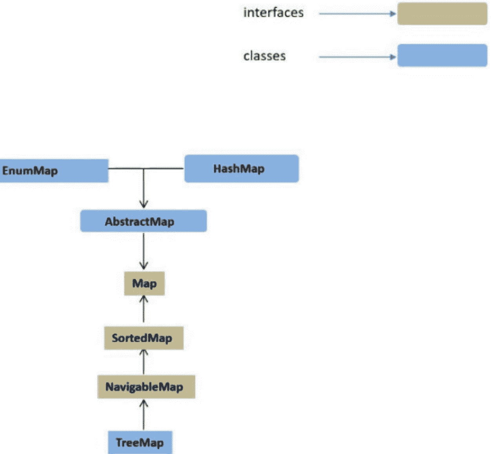

让我们简要了解一下主要的集合。

## `ArrayList`

`ArrayList`是`List`接口的可伸缩数组实现。它为我们提供了可以根据需要增长和缩小的动态数组，允许我们存储和操作元素集合。以下是关于`ArrayList`的一些关键点：

- **有序集合**：`ArrayList`保持元素的插入顺序，这意味着元素按照它们被添加的顺序存储。
- **允许重复**：`ArrayList`允许重复元素，这意味着你可以向列表中添加元素的多个实例。
- **可伸缩数组**：`ArrayList`的大小不是固定的，它可以随着元素的添加或删除动态增长或缩小。这与 Java 中固定大小的传统数组不同。
- **随机访问**：`ArrayList`为元素的随机访问提供了常数时间级性能，这意味着你可以以常数时间获取任何索引处的元素。
- **空元素**：`ArrayList`允许空元素，这意味着你可以在列表中存储空值。
- **线程安全**：`ArrayList`默认不是线程安全的。如果你需要在多线程环境中使用`ArrayList`，应该对其访问进行同步，或使用线程安全的替代方案，如`Vector`或`CopyOnWriteArrayList`。
- **实现`List`接口**：`ArrayList`实现了`List`接口，该接口提供了操作列表元素的方法，如`add()`、`remove()`、`set()`等。

### `ArrayList`

- `java.util`包
- 实现`List`接口
- 最常用的结构
- 用于存储和管理对象

### 添加元素

```java
stringList.add("apple");
stringList.add("banana");
stringList.add("orange")
```

### 创建`ArrayList`

```java
ArrayList<String> stringList = new ArrayList<>();
```

### 元素

### `ArrayList`方法

```java
String firstfruit = stringList.get(0); // "apple"
```

- `size()`
- `isEmpty()`
- `clear()`
- `contains()`
- `indexOf()`
- `addAll()`

```java
for (String fruit : stringList) {
    System.out.println(fruit);
}
```

现在使用`github copilot`生成注释`//带有基本操作的 ArrayList 示例`你将获得如下屏幕所示的答案：

```java
import java.util.*;

public class ArrayListExample {
    public static void main(String[] args) {
        ArrayList<Integer> list = new ArrayList<>();
        list.add(10);
        list.add(20);
        list.add(30);

        // 列表的大小
        System.out.println(list.size());

        // 打印列表元素
        for (Integer i : list) {
            System.out.println(i);
        }

        // 检查列表元素
        System.out.println(list.contains(20));

        // 检查列表是否包含某个元素
        System.out.println(list.contains(40));
    }
}
```

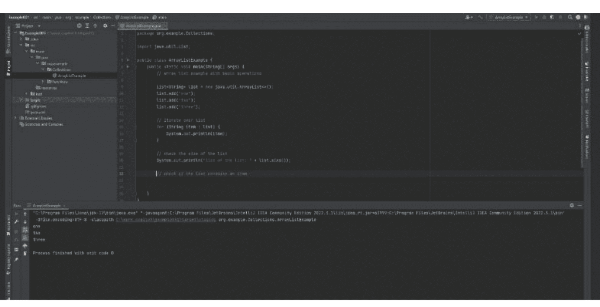

```java
public class ListExample {
    public static void main(String[] args) {
        // 遍历列表
        List<String> list = new ArrayList<>();
        list.add("one");
        list.add("two");
        for (String item : list) {
            System.out.println(item);
        }

        // 获取列表大小
        System.out.println("Size of the list: " + list.size());

        // 检查列表是否包含某项
        System.out.println("List contains two: " + list.contains("two"));

        // 获取元素的索引
        System.out.println("Index of two: " + list.indexOf("two"));

        // 获取特定索引处的元素
    }
}
```

```
"C:\Program Files\Java\jdk-11\bin\java.exe" - -.agent.C:ListExample -fileencoding=UTF-8 -classpath "C:\Program Files\JetBrains\IntelliJ\IDEA Community Edition 2022.3.1\lib\idea.jar;rt=6999;C:\Program Files\JetBrains\IntelliJ\ IDEA Community 

Process finished with exit code 0
```

### 另一个使用下方屏幕所示高亮注释的示例

`LinkedList`是`List`和`Deque`（双端队列）接口的双向链表实现。它是一种线性数据结构，元素不存储在连续的内存位置，而是每个元素都是一个独立的对象，持有指向序列中上一个一个元素的引用。以下是关于`LinkedList`的一些关键点：

**有序集合**：`LinkedList`保持元素的插入顺序，与`ArrayList`类似。

**允许重复**：与`ArrayList`一样，`LinkedList`允许重复元素。

**动态大小**：`LinkedList`的大小不是固定的，它可以随着元素的添加或删除动态增长或缩小。

**非随机访问**：`LinkedList`不提供元素的随机访问性能。要访问特定索引的元素，需要从列表的开始或结束遍历，导致时间复杂度为`O(n)`，其中`n`是列表的大小。

**高效的插入和删除**：`LinkedList`擅长在列表开头或中间插入和删除元素。这些操作的时间复杂度为`O(1)`，使得它在任意位置频繁插入和删除时比`ArrayList`更高效。

**实现`Deque`接口**：`LinkedList`实现了`Deque`接口，使其可以作为双端队列使用，从两端添加或删除元素。

**线程安全**：与`ArrayList`一样，`LinkedList`默认不是线程安全的。如果你需要在多线程环境中使用`LinkedList`，应该对其访问进行同步，或使用线程安全的替代方案。

- `java.util`包
- 实现`List`和`Deque`接口
- 表示双向链表数据结构
- 用于存储和管理对象

### 添加元素

```java
stringList.add("apple");
stringList.add("banana");
stringList.add("orange")
```

### 创建`LinkedList`

```java
LinkedList stringList = new LinkedList<>();
```

### 元素

```java
String firstfruit = stringList.get(0); // "apple"
```

```java
size()
isEmpty()
clear()
contains()
indexOf()
addAll()
```

### 遍历`LinkedList`

```java
for (String fruit : stringList) {
    System.out.println(fruit);
}
```

现在尝试在`github copilot`聊天框中输入“给我一个包含主要操作的`LinkedList`示例”，如下所示：

```java
package org.example;

public class LinkedListExamples {
    public static void main(String[] args) {
        // 创建一个 LinkedList
        LinkedList<String> list = new LinkedList<>();

        // 向 LinkedList 添加元素
        list.add("element 1");
        list.add("element 2");
        list.add("element 3");

        // 打印列表
        System.out.println("LinkedList: " + list);

        // 从列表中删除元素
        list.remove("element 2");

        // 打印删除后的列表
        System.out.println("LinkedList after removal: " + list);

        // 按索引设置元素
        // 如何在 LinkedList 开头插入元素？
    }
}
```

获取结果后，尝试点击下方屏幕所示的符号。


```java
import java.util.LinkedList;

public class LinkedListExamples {
    public static void main(String[] args) {
        // 创建一个链表
        LinkedList<String> list = new LinkedList<>();

        // 向链表中添加元素
        list.add("element 1");
        list.add("element 2");
        list.add("element 3");

        // 打印列表
        System.out.println("LinkedList: " + list);

        // 从 LinkedList 中移除元素
        list.remove("element 2");
        System.out.println("LinkedList after removal: " + list);

        // 根据索引获取元素
        System.out.println("First element: " + list.get(0));
        System.out.println("Second element: " + list.get(1));

        // 从 LinkedList 中移除元素
        list.remove("element 3");
    }
}
```

你可以针对下方图中高亮显示提问后续问题

```java
public static void main(String[] args) {
    // 创建一个 LinkedList
    LinkedList<String> list = new LinkedList<>();

    // 向链表中添加元素
    list.add("Element 1");
    list.add("Element 2");
    list.add("Element 3");

    // 打印列表
    System.out.println("LinkedList: " + list);

    // 从 LinkedList 中移除元素
    list.remove("Element 2");

    // 打印移除后的列表
    System.out.println("LinkedList: " + list);

    // 根据索引获取元素
    System.out.println("First element: " + list.get(0));
    System.out.println("Second element: " + list.get(1));

    // 遍历 LinkedList
    for (String element : list) {
        System.out.println("Element: " + element);
    }
}
```

答案将实时显示在下方

```java
package org.example;

import java.util.LinkedList;

public class LinkedListExamples {
    public static void main(String[] args) {
        // 创建一个 LinkedList
        LinkedList<String> list = new LinkedList<>();

        // 向 LinkedList 中添加元素
        list.add("Element 1");
        list.add("Element 2");
        list.add("Element 3");

        // 在 LinkedList 的头部插入一个元素
        list.addFirst("Element 0");

        // 打印列表
        System.out.println("LinkedList: " + list);
    }
}
```

在此段代码中，"Element 0" 被插入到 `LinkedList` 的头部。

- 使用 3 个引用

`HashSet` 是 `Set` 接口的一种实现，是 Java 集合框架的一部分。`Set` 是一个不允许包含重复元素的集合。`HashSet` 类使用哈希表进行存储，为 `add()`、`remove()`、`contains()` 等基本操作提供了常数级性能。

- **数据结构**：`HashSet` 是 `Set` 接口的一种实现，是 Java 集合框架的一部分。它提供了一种存储元素集合的方法且不允许出现重复。

- **无序性**：与某些其他数据结构不同，`HashSet` **不维护元素的任何特定顺序**。元素根据它们的**哈希码**存储，其检索顺序是随机的。

- **唯一元素**：`HashSet` 确保**不允许重复元素**。如果你尝试向集合中添加重复元素，它将被忽略。

- **Null 值**：`HashSet` 允许最多包含一个 **null 值**。如果你尝试添加第二个 null 值，它将被忽略。

- **非同步性**：默认情况下，`HashSet` 是**非线程安全的**。如果你计划在多线程环境中使用 `HashSet`，请考虑对其进行同步处理或使用如 `ConcurrentHashMap` 等线程安全的替代方案。

- **性能**：`HashSet` 为 `add()`、`remove()` 和 `contains()` 等基本操作提供了**常数级性能**。然而，这假设用于计算元素哈希码的**哈希函数**能够将元素良好地分布在哈希表的各个桶中。

实现 `Set` 接口：`HashSet` 实现了 `Set` 接口，这意味着它提供了添加、移除和检查元素是否存在于集合的方法。此外，它还支持并集、交集和差集等操作。

遍历 `HashSet`

- `java.util` 包

- 实现了 `Set` 接口

- 代表一个唯一元素集合

- 使用哈希表存储其元素

```java
for (String fruit : stringSet) {
    System.out.println(fruit);
}
```

## HashSet 方法

```java
HashSet<String> stringSet = new HashSet<>();
```

- `size()` - 返回集合中元素的数量。

- `isEmpty()` - 检查集合是否为空。

- `clear()` - 移除集合中的所有元素。

- `add(E e)` - 向集合中添加元素。

- `remove(Object o)` - 从集合中移除元素。

- `addAll(Collection<? extends E> c)` - 从另一个集合中添加所有元素

```java
stringSet.add("apple");
stringSet.add("banana");
stringSet.add("orange");
```

### HashSet 与哈希

### 移除元素

```java
stringSet.remove("banana");
```

让我们看看使用 GitHub Copilot 的示例。按照下方截图所示提问，如果你满意，点击插入代码按钮，你的代码就就绪了。

## LinkedHashSet

`LinkedHashSet` 是 `Set` 接口的一种实现，是 Java 集合框架的一部分。

它结合了 `HashSet` 和 `LinkedList` 的特性，提供了这两种数据结构的优点。

关于 `LinkedHashSet` 的关键点：

- 插入顺序

`LinkedHashSet` 中的插入操作存储在哈希表中以便于高效检索。

它们也被维护在一个双向链列表中，确保了插入顺序被保留。

当你遍历元素时，它们将按照被插入的相同顺序被检索。

### 唯一元素：

像其他 `Set` 实现一样，`LinkedHashSet` 不允许重复元素。

如果你尝试添加重复元素，它将被忽略。

`LinkedHashSet` 最多允许一个 null 元素。

如果你尝试添加第二个 null 值，它将被忽略。

### 非同步性：

默认情况下，`LinkedHashSet` 不是线程安全的。

在多线程环境中，请考虑对其进行同步处理或使用来自 `ConcurrentLinkedHashMap` 类的 `ConcurrentLinkedHashMap` 等线程安全的替代方案。

`LinkedHashSet` 为 `add()`、`remove()` 和 `contains()` 等基本操作提供常数级性能，类似于 `HashSet`。

然而，按照插入顺序遍历元素具有线性时间复杂度 (O(n))，其中 n 是元素的数量。

`LinkedHashSet` 实现了 `Set` 接口，该接口包含了添加、移除和检查元素存在的方法。

它还支持并集、交集和差集等集合操作。

- `java.util` 包

- 扩展了 `HashSet` 并实现了 `Set` 接口

- 结合了哈希表和链表的特性

```java
for (String color : colorSet) {
    System.out.println(color);
}
```

```java
LinkedHashSet<String> colorSet = new LinkedHashSet<>();
```

### TreeSet 方法

```java
colorSet.add("red");
colorSet.add("green");
colorSet.add("blue");
```

### 移除元素

```java
colorSet.remove("green");
```

## TreeSet

让我们探索 `TreeSet` 的奇妙世界。以下是关于这种多功能数据结构的关键点：

**数据结构：** `TreeSet` 是 `Set` 接口的实现，是 Java 集合框架的一部分。它提供了一种存储元素集合的方法且不允许重复元素。

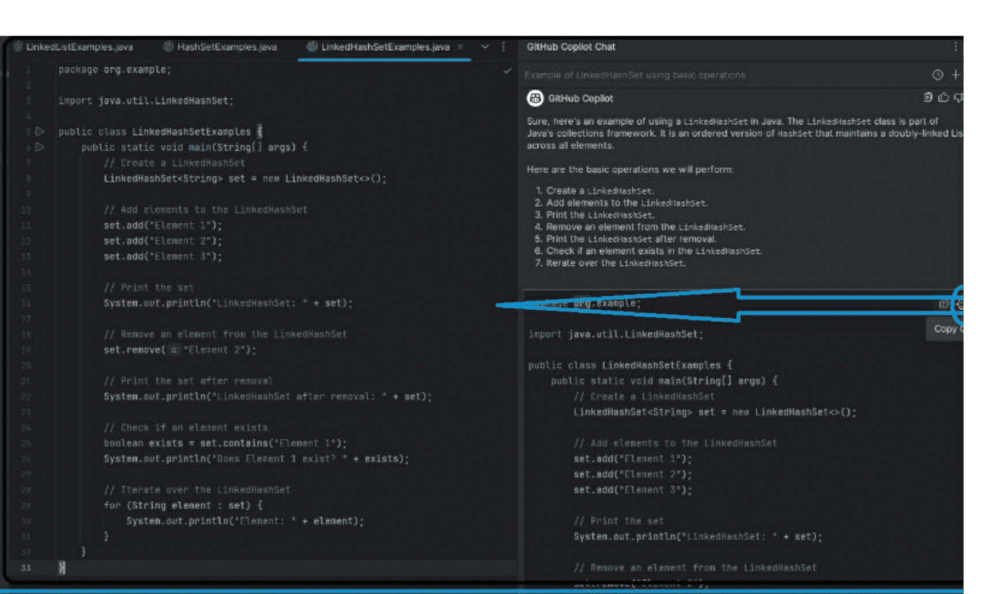

**排序集合：** `TreeSet` 自动按升序对其元素进行排序。当你向 `TreeSet` 中添加元素时，它们将根据自然顺序（如果它们实现了 `Comparable` 接口）或根据创建时提供的自定义 `Comparator` 进行排列。

**唯一元素：** 与其他 `Set` 实现一样，`TreeSet` 确保不允许重复元素。如果你尝试添加一个集合中已存在的元素，它将被忽略。

**Null 值：** `TreeSet` 不允许 `null` 元素。如果你尝试添加 `null` 值，它将抛出 `NullPointerException`。

**非同步：** 默认情况下，`TreeSet` 不是线程安全的。如果你计划在多线程中使用 `TreeSet`，请考虑对其访问进行同步，或使用线程安全的替代方案，如 `ConcurrentSkipListSet`。

**性能：** `TreeSet` 为基本操作（如 `add()`、`remove()` 和 `contains()`）提供对数时间复杂度 (O(log n))。然而，如果你需要按顺序遍历元素，它提供了常数级性能。

**实现 `NavigableSet` 接口：** `TreeSet` 实现 `NavigableSet` 接口，该接口扩展了 `SortedSet` 接口。此扩展提供了额外的方法，用于根据顺序从集合中导航和检索元素。

**自定义 `Comparator`：** 在创建 `TreeSet` 时，你可以提供自定义的 `Comparator` 来定义元素的排序顺序。如果没有提供 `Comparator`，元素必须实现 `Comparable` 接口以定义它们的自然顺序。

总而言之，`TreeSet` 结合了排序、唯一性和高效性能的优点，使其成为 Java 中管理元素集合的价值工具！

## TreeSet

- `java.util` 包

- 实现了 `NavigableSet` 接口，是 `SortedSet` 层次结构的一部分

- 使用红黑树数据结构存储其元素

### 遍历 TreeSet:

```java
for (int number : numberSet) {
  System.out.println(number);
}
```

### 创建 TreeSet:

```java
TreeSet<Integer> numberSet = new TreeSet<>();
```

### TreeSet 方法:

### 添加元素

```java
numberSet.add(10);
numberSet.add(5);
numberSet.add(8);
```

> TreeSet 方法

> `TreeSet` 提供了类似于其他集合类的方法，用于操作和处理集合。此外，它还提供了用于检索大于或等于给定元素的方法：`ceiling()`，以及小于或等于给定元素的方法：`floor()` 等等。

### 移除元素

```java
numberSet.remove(8);
```

让我们看看使用 GitHub Copilot 的示例。像下方截图所示提问，如果你没问题，点击插入代码按钮，你的代码就准备就了。


```java
package pom.util;
import java.util.HashSet;

public class HashSetExamples {
    public static void main(String[] args) {
        // 创建一个 HashSet
        HashSet<String> set = new HashSet<>();

        // 向 HashSet 添加元素
        set.add("element 1");
        set.add("element 2");
        set.add("element 1"); // element 1 不被添加

        // 打印集合
        System.out.println("HashSet: " + set);

        // 从 HashSet 中移除一个元素
        set.remove("element 2");

        // 移除后打印集合
        System.out.println("HashSet after removal: " + set);

        // 检查元素是否存在
        boolean exists = set.contains("element 1");
        System.out.println("element 1 exists: " + exists);

        // 遍历 HashSet
        for (String element : set) {
            System.out.println("element: " + element);
        }
    }
}
```

## HashMap

`HashMap` 是 `Map` 接口的实现，是 Java 集合框架的一部分。它是一种广泛使用的数据结构，存储键值对并提供对这些对的高效检索和存储。以下是关于 `HashMap` 的关键点：

## 关于 HashMap 的关键点：

### 键值对：

`HashMap` 以键值对的形式存储数据。

映射中的每个键都与一个值相关，键用于访问其对应的值。

### 唯一键：

在 `HashMap` 中，键必须是唯一的。

如果你尝试插入重复的键，它将替换与现有键关联的值。

### Null 键和值：

`HashMap` 允许最多一个 `null` 键，但可以多个 `null` 值。

如果你尝试添加第二个 `null` 键，它将替换与现有 `null` 键关联的值。

### 无序集合：

`HashMap` 不维护元素的特定顺序。

元素根据其哈希码（hash codes）存储，且迭代顺序不保证在不同迭代之间相同。

### 非同步：

默认情况下，`HashMap` 不是线程安全的。

在多线程环境中，考虑对其访问进行同步，或使用线程安全的替代方案，如 `ConcurrentHashMap`。

### 性能：

平均情况下，`HashMap` 为 `get()`、`put()` 和 `remove()` 等基本操作提供常数级性能 (O(1))。

这假设了良好的哈希函数和适当的负载因子管理。

## 实现 Map 接口：

`HashMap` 实现了 `Map` 接口，提供了添加、删除和检索键值对的方法。

它还支持单独处理键和值的方法。

## HashMap

遍历 `HashMap`:

- `java.util` 包

- 实现了 `Map` 接口

- 表示键值对的集合

- 每个键都对应一个值

- `HashMap` 使用哈希表存储其条目

```java
for (String country : populationMap.keySet()) {
    int population = populationMap.get(country);
    System.out.println(country + " : " + population);
}
```

创建一个 `HashMap`

```java
HashMap<String, Integer> populationMap = new HashMap<>();
```

添加键值对

```java
populationMap.put("USA", 331000000);
populationMap.put("China", 1440000000);
populationMap.put("India", 1380000000);
```

### HashMap 方法:

- `size()` 返回此映射中映射的数量

- `isEmpty()` 检查映射是否为空

- `containsKey(Object key)` 检查映射是否包含特定键


- `containsValue(Object value)` 检查映射是否包含特定值
- `get(Object key)` 返回指定键所映射的值
- `remove(Object key)` 从此映射中移除该键的映射

## 访问值

```java
int usPopulation = populationMap.get("USA"); // 331000000
```

## 哈希与效率

`HashMap` 使用哈希来高效地管理键值对。每个键都与哈希码关联，用于哈希表中。这允许对键值对进行快速插入、检索和删除。

## 移除键值对

```java
populationMap.remove("China");
```

让我们看看使用 GitHub Copilot 的示例。像下方截图所示提问，如果你没问题，点击插入代码块，你的代码就准备就了。

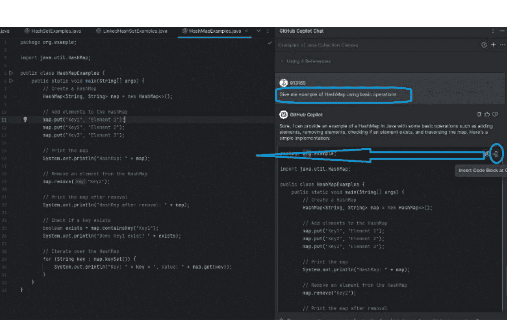

# LinkedHashMap

这里是关于 `HashMap` 的细节：

`LinkedHashMap` 是 `Map` 接口的实现，是 Java 集合框架的一部分。

关于 `LinkedHashMap` 的关键点：

## 插入顺序

`LinkedHashMap` 维护键值对的插入顺序。

当你遍历 `LinkedHashMap` 的元素时，它们将按照插入的顺序被检索。

## 键值对

与 `HashMap` 一样，`LinkedHashMap` 以键值对的形式存储数据。

映射中的每个键都与一个值相关，键用于访问其对应的值。

## 唯一键

在 `LinkedHashMap` 中，键必须是唯一的。

如果你尝试插入重复的键，它将替换与现有键关联的值。

## Null 键和值

`LinkedHashMap` 允许最多一个 `null` 键，但可以多个 `null` 值。

如果你尝试添加第二个 `null` 键，它将替换与现有 `null` 键关联的值。

## 访问顺序

除了维护插入顺序，`LinkedHashMap` 还可以维护键值对的访问顺序。

当你检索或修改与键关联的值，该键值对会移动到链表的末尾，允许你跟踪最近访问或修改的条目。

## 非同步

默认情况下，`LinkedHashMap` 不是线程安全的。

在多线程环境中，考虑对其访问进行同步，或使用线程安全的替代方案，如 `ConcurrentHashMap`。

## 性能

`HashMap` 在平均情况下，为 `get()`、`put()` 和 `remove()` 等基本操作提供常数级性能 (O(1))，与 `HashMap` 类似。

然而，按照插入顺序遍历元素具有线性时间复杂度 (O(n))，其中 n 是元素的数量。

# LinkedHashMap

- 属于 `java.util` 包
- 继承自 `HashMap`
- 表示键值对的集合
- 每个键对应一个相应的值
- `LinkedHashMap` 使用哈希表存储其条目

## 创建 LinkedHashMap

```java
LinkedHashMap<String, Integer> scoreMap = new LinkedHashMap<String, Integer>();
```

## 添加键值对

```java
scoreMap.put('Alice', 90);
scoreMap.put('Bob', 87);
scoreMap.put('Charlie', 92);
```

## 通过键访问值

```java
int aliceScore = scoreMap.get('Alice'); // 90
```

## 移除键值对

```java
scoreMap.remove('Bob');
```

## 遍历 LinkedHashMap

```java
for (String name : scoreMap.keySet()) {
    int score = scoreMap.get(name);
    System.out.println(name + " : " + score);
}
```

让我们看看使用 GitHub Copilot 的示例。像下图中所示提问，如果你满意，点击“插入代码”按钮，你的代码就准备好了。

# java.util.LinkedHashMap

```java
import java.util.*;
public class LinkedHashMapExamples {
    public static void main(String[] args) {
        LinkedHashMap<String, String> map = new LinkedHashMap<>();

        // 向 HashMap 添加元素
        map.put("key1", "element 1");
        map.put("key2", "element 2");
        map.put("key3", "element 3");

        // 打印 map
        System.out.println("LinkedHashMap: " + map);

        // 从 LinkedHashMap 中删除一个元素
        map.remove("key2");

        // 打印删除后的 map
        System.out.println("LinkedHashMap after removal: " + map);

        // 检查键是否存在
        boolean exists = map.containsKey("key1");
        System.out.println("Does key1 exist? " + exists);

        // 遍历 LinkedHashMap
        for (Map.Entry<String, String> entry : map.entrySet()) {
            System.out.println("Key: " + entry.getKey() + ", Value: " + entry.getValue());
        }
    }
}
```

# Java 集合实现示例

使用基本操作的 `LinkedHashMap` 示例

GitHub Copilot:

好的，我可以提供一个 Java `LinkedHashMap` 示例，包含基本操作，如添加元素、删除元素、检查元素是否存在以及遍历 map。

以下是代码：

```java
// 创建一个 LinkedHashMap
public class LinkedHashMapExample {
    public static void main(String[] args) {
        LinkedHashMap<String, String> map = new LinkedHashMap<>();

        // 向 LinkedHashMap 添加元素
        map.put("key1", "element 1");
        map.put("key2", "element 2");
        map.put("key3", "element 3");

        // 打印 map
        System.out.println("LinkedHashMap: " + map);

        // 从 LinkedHashMap 中删除一个元素
        map.remove("key2");

        System.out.println("LinkedHashMap after removal: " + map);
    }
}
```

# TreeMap

在 Java 中，`TreeMap` 是 `Map` 接口的实现，是 Java 集合框架的一部分。它是一个排序 map，根据键的升序顺序存储其键值对。`TreeMap` 中的键必须实现 `Comparable` 接口，或者在创建时提供一个自定义的 `Comparator`。

# 关于 TreeMap 的关键点

## 排序的键

`TreeMap` 根据键的自然顺序或自定义的 `Comparator` 以排序顺序存储其键值对。

当你遍历 map 中的条目时，它们将按照键的排序顺序被检索。

## 键值对

与其他 `Map` 实现一样，`TreeMap` 以键值对的形式存储数据。map 中的每个键都关联着一个值，并使用键来访问其对应的值。

## 唯一键

在 `TreeMap` 中，键必须是唯一的。如果你尝试插入重复的键，它将替换与现有键关联的值。

## Null 键和值

`TreeMap` 不允许 `null` 键，但可以多个 `null` 值。如果你尝试添加 `null` 键，它将抛出 `NullPointerException`。

## 非同步

默认情况下，`TreeMap` 不是线程安全的。在多线程环境中，请考虑对其访问进行同步，或使用线程安全的替代方案，如 `ConcurrentSkipListMap`。

## 性能

`TreeMap` 为 `get()`、`put()` 和 `remove()` 等基本操作提供了对数时间复杂度 (O(log n))。

然而，如果你需要按照排序顺序遍历条目，它提供了常数级性能。

## 实现 NavigableMap 接口

`TreeMap` 实现了 `NavigableMap` 接口，该接口扩展了 `SortedMap` 接口。

它提供了额外的方法，根据顺序从 map 中导航和检索条目。

## Comparator

你可以在创建 `TreeMap` 时提供一个自定义的 `Comparator` 来定义键的排序顺序。

如果没有提供 `Comparator`，则键必须实现 `Comparable` 接口。

# TreeMap

- 属于 `java.util` 包
- 实现了 `NavigableMap` 接口，是 `SortedMap` 层次的一部分
- 以排序的方式表示键值对集合
- 每个键对应一个相应的值
- 使用红黑树数据结构存储其条目

## 创建 TreeMap

```java
TreeMap<String, Integer> scoreMap = new TreeMap<>();
```

## 遍历 TreeMap

```java
for (String name : scoreMap.keySet()) {
    int score = scoreMap.get(name);
    System.out.println(name + " :" + score);
}
```

## 添加键值对

```java
scoreMap.put("Alice", 90);
scoreMap.put("Bob", 87);
scoreMap.put("Charlie", 90);
```

## 通过键访问值

```java
int aliceScore = scoreMap.get('Alice'); // 90
```

## 删除键值对

```java
scoreMap.remove('Bob');
```

## TreeMap 方法

`TreeMap` 提供了与其他类相似的方法，用于操作和查找大于或等于给定键的条目。

让我们看看使用 GitHub Copilot 的示例。像下图中所示提问，如果你满意，点击“插入代码”按钮，你的代码就准备好了。

```java
import java.util.*;
public class LinkedHashMapExamples {
    public static void main(String[] args) {
        TreeMap<String, String> map = new TreeMap<>();

        // 向 HashMap 添加元素
        map.put("key1", "element 1");
        map.put("key2", "element 2");
        map.put("key3", "element 3");

        // 打印 map
        System.out.println("LinkedHashMap: " + map);

        // 从 LinkedHashMap 中删除一个元素
        map.remove("key2");

        // 打印删除后的 map
        System.out.println("LinkedHashMap after removal: " + map);

        // 检查键是否存在
        boolean exists = map.containsKey("key1");
        System.out.println("Does key1 exist? " + exists);

        // 遍历 LinkedHashMap
        for (Map.Entry<String, String> entry : map.entrySet()) {
            System.out.println("Key: " + entry.getKey() + ", Value: " + entry.getValue());
        }
    }
}
```

# Java 异常处理

异常处理是 Java 中的一种机制，允许你处理程序执行过程中可能出现的运行时错误或异常情况。它提供了一种优雅地处理异常的方法，防止程序意外终止。

在 Java 中，异常是表示异常情况的对象。当发生异常情况时，会创建并抛出一个异常对象。如果异常没有被正确捕获和处理，程序将带有错误信息终止。

## 什么是 Java 异常？

异常是破坏 Java 程序正常流的异常状态。

它代表执行期间发生的意外事件。

异常是在运行时满足某些条件时抛出的对象。

## 什么是异常处理？

异常处理是管理 Java 运行时错误的机制。

它允许优雅地处理异常，确保程序不会突然终止。

常见的异常包括 `ClassNotFoundException`、`IOException`、`SQLException` 和 `RemoteException`。

语句 9;

语句 10;

如果没有异常处理，在语句 5 发生异常后，语句 6 到 10 语句将不会执行。

如果有异常处理，剩余语句将继续执行。

## Java 异常类的层次结构

Java 异常层次结构的根类是 `java.lang.Throwable`。

它有两个主要的子类：

- `Exception`：代表检查异常（例如，`IOException`, `SQLException`）。
- `Error`：代表未检查异常（例如，`OutOfMemoryError`, `StackOverflowError`）。

## Java 异常的类型

### 检查异常（Checked Exceptions）

除 `RuntimeException` 和 `Error` 之外的 `Throwable` 直接子类。

在编译时检查。

示例：`IOException`, `SQLException`。

### 未检查异常（Unchecked Exceptions）

`RuntimeException` 的子类。

不在编译时进行检查；在运行时检测。

示例：`ArithmeticException`, `NullPointerException`。

## 异常处理关键字

- `try...catch` 块：用于捕获异常并处理它们。
- `finally` 块：无论是否发生异常，都会执行该块。
- `throw` 关键字：显式地抛出异常。
- `throws` 关键字：声明方法可能会抛出特定异常。

## 使用 GitHub Copilot 进行异常处理的简单示例

在类开头输入一个注释，按回车和 Tab 键获取所示代码。

```java
import java.util.Scanner;

public class SimpleException {
    public static void main(String[] args) {
        try {
            Scanner scanner = new Scanner(System.in);
            System.out.print("Enter first number: ");
            int num1 = scanner.nextInt();
            System.out.print("Enter second number: ");
            int num2 = scanner.nextInt();
            int result = num1 / num2;
            System.out.println("Result: " + result);
        } catch (ArithmeticException e) {
            System.out.println("Cannot divide by zero!");
        } catch (Exception e) {
            System.out.println("Invalid input!");
        }
    }
}
```

使用 GitHub Copilot 的“文件未找到”检查异常示例

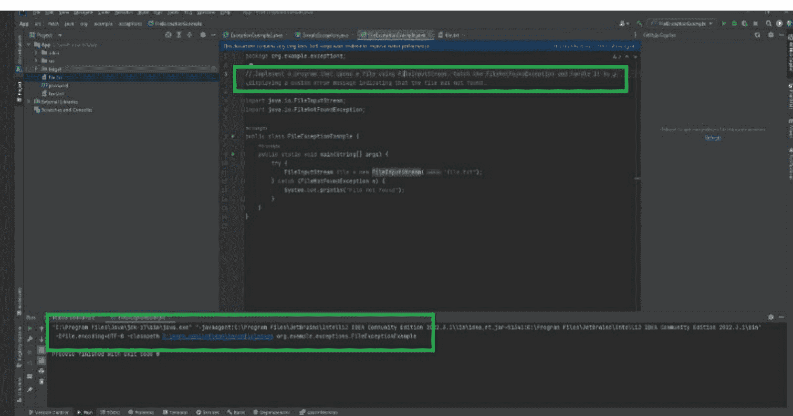

## 练习

设计一个程序提示用户输入年龄。它提到使用 `try-catch` 块来处理用户输入非数字值时可能发生的异常。此外，它建议创建一个自定义异常（例如 `InvalidAgeException`）来处理用户输入负数年龄的情况。

（在编辑器中使用 GitHub Copilot 注释而非 GitHub Copilot 聊天，以便在编辑器中练习）

## 答案

# Finally 块

让我们探索 Java 中的 `finally` 块。

## 什么是 finally 块？

`finally` 块是 Java 异常处理中的关键部分。


它紧跟在`try`块或`catch`块之后。

无论是否发生异常，`finally`块中的代码始终都会执行。

`finally`块的作用：

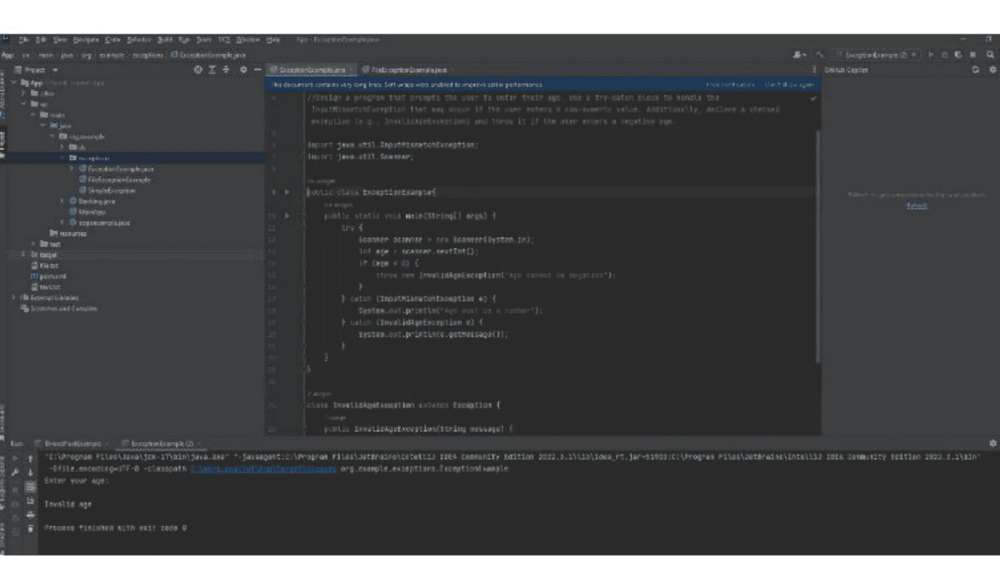

`finally`块的主要目的是确保无论受保护代码（`try`块内部）发生了什么，都会采取某些操作。

它允许你在即使抛出异常的情况下，也能运行清理类型的语句或执行必要的任务。

## 使用`finally`块的场景

让我们探索`finally`块可以发挥作用的不同情况：

- **a. 当没有发生异常时**：在这种情况下，Java程序不会抛出任何异常。`finally`块会在`try`块之后执行。

示例：

```java
class TestFinallyBlock {
    public static void main(String[] args) {
        try {
            // 不抛出任何异常的代码
            int data = 25 / 5;
            System.out.println(data);
        } catch (NullPointerException e) {
            // catch 块不会被执行
            System.out.println(e);
        } finally {
            System.out.println("finally block is always executed");
            System.out.println("Rest of the code...");
        }
    }
}
```

输出：

```
5
finally block is always executed
Rest of the code...
```

- **b. 当发生异常但未被`catch`块处理时**：在这种情况下，代码抛出了异常，但`catch`块无法处理它。尽管如此，`finally`块会在`try`块之后执行，然后程序异常终止。

示例：

```java
public class TestFinally1 {
    public static void main(String[] args) {
        try {
            System.out.println("Inside the try block");
            // 抛出除零异常的代码
            int data = 25 / 0;
            System.out.println(data);
        } catch (NullPointerException e) {
            // 只能接受空指针类型异常
            System.out.println(e);
        } finally {
            System.out.println("finally block is always executed");
        }
        System.out.println("Rest of the code...");
    }
}
```

输出：

```
Inside the try block
finally block is always executed
Exception in thread "main" java.lang.ArithmeticException: / by zero
at TestFinally1.main(TestFinallyBlock1.java:8)
```

- **c. 当发生异常并被`catch`块处理时**：在这个示例中，Java代码抛出了异常，`catch`块处理了它。随后，`finally`块在`try-catch`块之后执行，其余代码正常执行。

示例：

```java
public class TestFinallyBlock2 {
    public static void main(String[] args) {
        try {
            System.out.println("Inside try block");
            // 抛出除零异常的代码
            int data = 25 / 0;
            System.out.println(data);
        } catch (ArithmeticException e) {
            System.out.println("Exception handled");
            System.out.println(e);
        } finally {
            System.out.println("finally block is always executed");
            System.out.println("Rest of the code...");
        }
    }
}
```

输出：

```
Inside try block
Exception handled
finally block is always executed
Rest of the code...
```

记住，`finally`块确保了无论是否有异常，都会执行基本的清理或资源管理任务！

### 让我们通过 GitHub Copilot 查看`finally`块示例

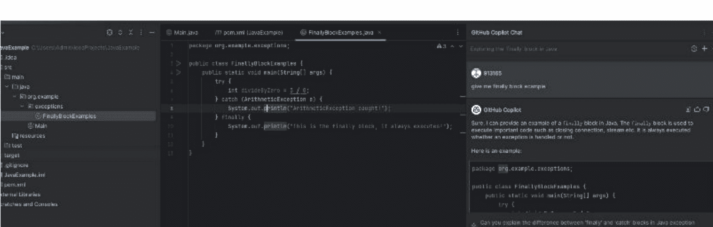

## Java 中的多线程

### 什么是多线程？

多线程是 Java 的一项特性，允许程序的两个或多个部分并发执行。

程序的每个部分被称为线程。

线程是单个进程内的轻量级进程。

其目标是通过同时运行多个线程来最大化 CPU 的利用率。

### 创建线程

线程可以使用两种机制创建：

#### 继承`Thread`类

- 我们创建一个继承`java.lang.Thread`的类。
- 在该类中重写`run()`方法。
- 线程从`run()`方法内部开始生命。
- 创建我们新类的对象并调用`start()`来开始线程执行。

示例：

```java
class MultithreadingDemo extends Thread {
    public void run() {
        System.out.println("Thread " + Thread.currentThread().getId() + " is running");
    }
}

public class Multithread {
    public static void main(String[] args) {
        int n = 8;
        for (int i = 0; i < n; i++) {
            MultithreadingDemo object = new MultithreadingDemo();
            object.start();
        }
    }
}
```

#### 实现`Runnable`接口

- 创建实现`java.lang.Runnable`的新类。
- 重写该类中的`run()`方法。
- 实例化`Thread`对象并对其调用`start()`。

示例：

```java
class MultithreadingDemo implements Runnable {
    public void run() {
        System.out.println("Thread " + Thread.currentThread().getId() + " is running");
    }
}

public class Multithread {
    public static void main(String[] args) {
        int n = 8;
        for (int i = 0; i < n; i++) {
            Thread object = new Thread(new MultithreadingDemo());
            object.start();
        }
    }
}
```

## `Thread`类与`Runnable`接口

**继承`Thread`**：

- 由于 Java 不支持多重继承，无法继承其他类。
- 提供了`yield()`、`interrupt()`等内置方法。

**实现`Runnable`**：

- 允许继承其他基类。
- 提供了一个可供多个线程使用的对象。

## 多线程的优势

- **并发**：多个线程并发执行。
- **内存效率**：线程共享内存，节省内存空间。
- **更快的上下文切换**：线程之间的切换比进程切换更快。

记住，多线程对于高效利用系统资源和保持应用程序响应速度至关重要！

### 使用 GitHub Copilot 的示例

## 通过扩展`Thread`类并在聊天框中询问 GitHub Copilot 创建线程

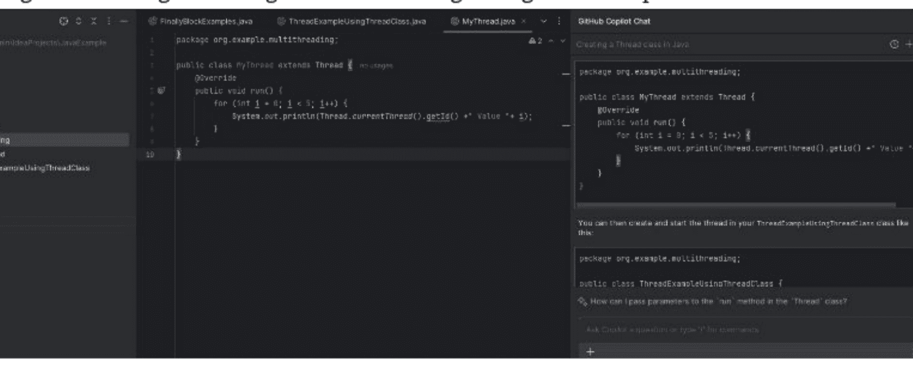

然后在下一张截图中，你使用`start`方法来启动线程。

让我们像下方突出那样提一个后续问题：

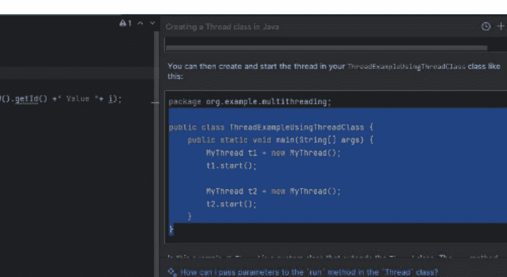

GitHub Copilot 的回答如下：

在 Java 中，你不能直接向`Thread`的`run`方法传递参数，因为它是`Thread`类中定义的一个没有任何参数的方法。然而，你可以通过将参数传递给扩展`Thread`的类的构造函数，然后在`run`方法中使用这些参数来向`Thread`传递参数。这是实现方法：

首先，修改你的`Thread`类，包含一个可以接受你需要的参数的构造函数。将这些参数存储为实例变量，然后在`run`方法中使用它们。

```java
package org.example.multithreading;

class MyThread extends Thread {
    private int param;

    public MyThread(int param) {
        this.param = param;
    }

    @Override
    public void run() {
        for (int i = 0; i < this.param; i++) {
            System.out.println(Thread.currentThread().getId() + " Value: " + param);
        }
    }
}
```

我应该如何在`Thread`类的`run`方法中处理异常？

```java
package org.example.multithreading;

public class ThreadExampleUsingThreadClass {
    public static void main(String[] args) {
        MyThread t1 = new MyThread(5);
        t1.start();

        MyThread t2 = new MyThread(7);
        t2.start();
    }
}
```

在这个示例中，5 和 7 分别是传递给`MyThread`实例`t1`和`t2`的参数。这些值随后会在每个线程的`run`方法中使用。

> 使用 1 次引用

> 我应该如何在`Thread`类的`run`方法中处理异常？

让我们看上图中蓝色所示的另一个后续问题，回答如下：

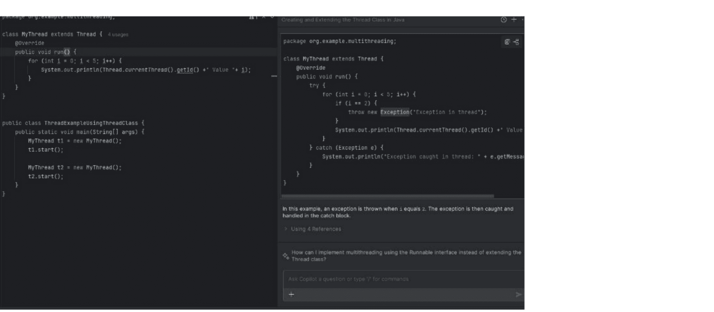

## 通过实现`Runnable`接口创建线程

如果你在最后一张图片中看到 GitHub Copilot 已经提供了一个使用`Runnable`接口创建线程的后续建议和问题：

我该如何使用`Runnable`接口而不是扩展`Thread`类来实现多线程？

GitHub Copilot 给出的回答如下，然后运行程序。

## 练习：使用 GitHub Copilot 编写线程程序以打印线程的基本状态

## 解决方案：尝试以下提示词

编写一个 Java 程序来演示不同的线程状态。

```java
// 创建一个经过所有状态（NEW, RUNNABLE, AND TERMINATED）的线程，
// 在每个状态转换之间有一个微小的延迟。在每个状态下打印当前状态。
```

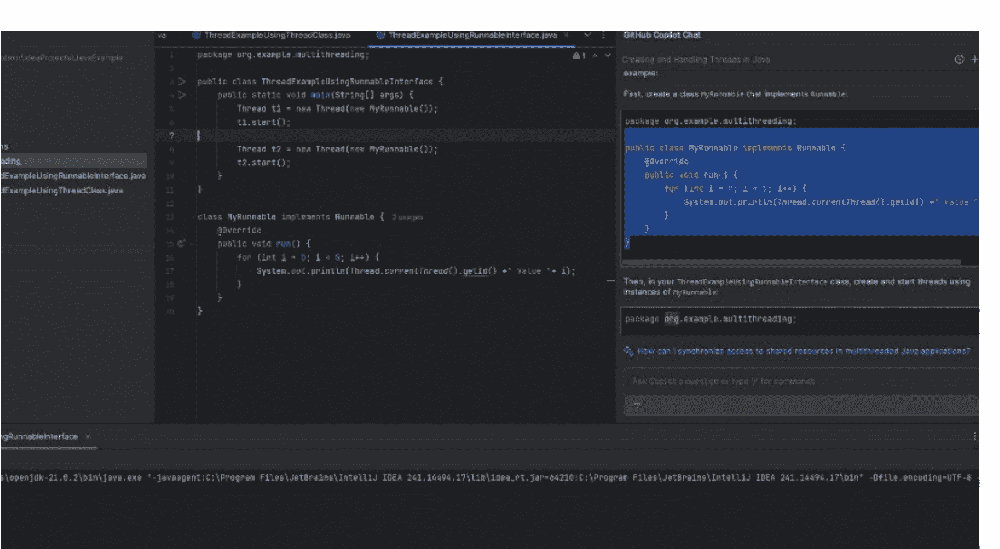

## 用于 Java 的 GitHub Copilot 和 Spring Boot 基础

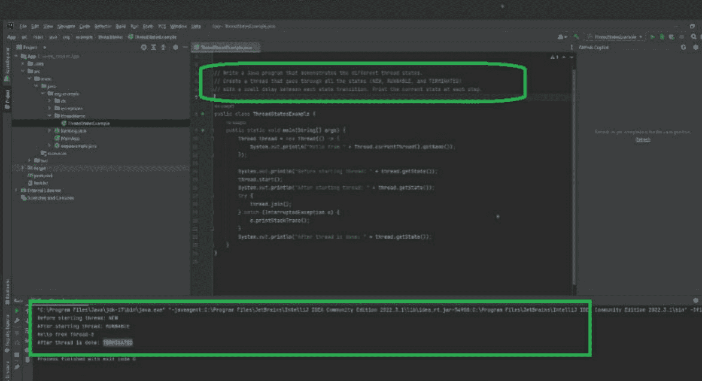

## Java 中的同步

**Java 中的同步**是多线程环境中管理共享资源并发访问的关键概念。

让我们探索一下它包含的内容：

### 同步的目的

同步的目标是确保同一时间只有一个线程可以访问共享资源（如变量、对象或方法）。

通过防止多个线程同时修改相同的数据，同步有助于避免数据损坏并确保结果的一致性。

### 同步的类型

在 Java 中主要有两种同步类型：

- **进程同步**：处理不同进程之间的同步。
- **线程同步**：关注单个进程内部（线程之间）的同步。

### 线程同步

在线程同步中，我们有两个主要概念：

- **互斥**：确保线程在共享数据时互不干扰。通过以下方式实现：
  - `synchronized`方法：为共享资源锁定对象。
  - `synchronized`块：允许对同步进行细粒度的控制。
  - 静态同步：适用于静态方法。
- **线程间通信（协作）**：促进线程之间的通信。示例包括使用`wait()`、`notify()`和`notifyAll()`。

## Java 中锁的概念

同步围绕着一个称为锁（lock）或监视器（monitor）的内部实体。

Java 中的每个对象都有关联的锁。

线程在访问其字段之前必须获取对象的锁，并在之后释放它。

Java 5 引入了`java.util.concurrent.locks`包，带有各种锁实现。

### 没有同步的示例

考虑以下没有同步的示例：

```java
class Table {
    void printTable(int n) {
        for (int i = 1; i <= 5; i++) {
            System.out.println(n * i);
            try {
                Thread.sleep(400);
            } catch (Exception e) {
                System.out.println(e);
            }
        }
    }
}

class Thread1 extends Thread {
    Table t;

    MyThread1(Table t) {
        this.t = t;
    }
    public void run() {
        t.printTable(5);
    }
}

class MyThread2 extends Thread {
    Table t;

    MyThread2(Table t) {
        this.t = t;
    }
    public void run() {
        t.printTable(10);
    }
}

public class TestSynchronization {
    public static void main(String[] args) {
        Table obj = new Table();
        MyThread1 t1 = new MyThread1(obj);
        MyThread2 t2 = new MyThread2(obj);
        t1.start();
        t2.start();
    }
}
```

输出（由于缺乏同步导致不一致）：

```
5
100
10
200
15
300
20
400
25
500
```

## Java `synchronized`方法

当你将一个方法声明为`synchronized`时，它就变成了一个同步方法。

线程在调用`synchronized`方法时会自动获取对象的锁。

当线程完成其任务时，锁会被释放。

### 示例

```java
class Table {
    synchronized void printTable(int n) {
        // 同步方法
        for (int i = 1; i <= 5; i++) {
            System.out.println(n * i);
        }
        try {
            Thread.sleep(400);
        } catch (Exception e) {
            System.out.println(e);
        }
    }
}
```

记住，同步确保了线程安全并防止了多线程应用程序中的数据不一致。

### 练习：尝试使用 GitHub Copilot 并根据以下提示词创建

```java
// 设计一个带有两个线程的程序，它们同时增加一个共享计数器变量。
// 使用 synchronized 关键字或锁对象实现同步，以确保
// 计数器正确增加而不会产生数据损坏或竞态条件。
```


答案：在接下来的两张截图中

```
package org.example;

/**
 * 设计一个带有两个线程的程序，它们同时增加一个共享计数器变量。
 * 必须正确实现线程同步，或者使用锁对象。
 * 确保计数器正确增加而不会产生数据损坏或竞态条件。
 */
import org.example.Counter;

public class SyncExample {
    public static void main(String[] args) {
        Counter counter = new Counter();
        Thread thread1 = new Thread(counter);
        Thread thread2 = new Thread(counter);

        thread1.start();
        thread2.start();

        try {
            thread1.join();
            thread2.join();
        } catch (InterruptedException e) {
            e.printStackTrace();
        }
    }
}
```

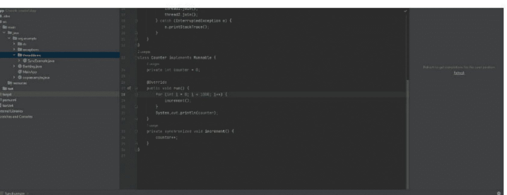

## Java 中的 Executor Framework

当然！让我们深入了解 Java Executor Framework，这是一个高效管理并发任务的强大工具：

### 什么是 Java Executor Framework？

Java Executor Framework 是属于`java.util.concurrent`包的。

它提供了一种并发管理和执行任务的方法，而无需每次创建新线程。

通过使用线程池，它重用了现有线程，提高了性能和资源利用率。

## 为什么要使用 Executor 框架？

随着处理器核心数量的增加，多线程已成为实现更高吞吐量的关键。

Executor 框架简化了线程管理并增强了代码的可读性。

它将任务执行逻辑与应用程序代码分离，允许开发者专注于业务逻辑。

## Executor 的类型：

让我们探索一些常见的执行器类型：

### 线程池的类型

### 固定线程池

固定线程池在池启动时会创建固定数量的线程。对于工作负载可预测的应用，固定线程池是一个很好的选择。

## 缓存线程池

缓存线程池根据需要创建新线程，并在空闲时回收它们。这种类型的线程池是工作负载不可预测的应用的良好选择。

## 定时线程池

定时线程池按指定的间隔执行任务。它是需要定期执行任务的应用的良好选择。

可用于创建和管理线程池的类

- `Executors`：该类提供了静态方法，用于创建常见类型的线程池。

- `ThreadPoolExecutor`：该类提供了一种灵活的创建和管理线程池的方法。

### a. SingleThreadExecutor

创建一个带有单个线程的线程池。

**顺序地**执行任务（一个接一个）。

语法：

```
ExecutorService executor = Executors.newSingleThreadExecutor();
```

### b. FixedThreadPool (n):

维护数固定数量的线程（由 n 指定）。

任务由这些线程并发执行。

多余的任务存储在队列中。

语法：

```
ExecutorService fixedPool = Executors.newFixedThreadPool(2);
```

### c. CachedThreadPool:

根据需要创建线程并重用现有线程。

如果没有可用线程，则会创建一个新的。

使用 SynchronousQueue。

语法：

```
ExecutorService executorService = Executors.newCachedThreadPool();
```

### d. ScheduledExecutor:

用于定期间隔运行或带延迟运行的任务。

基于`ScheduledExecutorService`接口。

有两种调度方法：

- `scheduleAtFixedRate`：以固定间隔执行任务。

- `scheduleWithFixedDelay`：在当前任务完成后开始延迟倒计时。

语法：

```
ScheduledExecutorService scheduledExecutor = Executors.newScheduledThreadPool(1);
```

## 使用示例：

假设我们有一个任务类`MyTask`：

```
class MyTask implements Runnable {
    public void run() {
        // 任务逻辑在这里
        System.out.println("Task executed by thread " + Thread.currentThread().getId());
    }
}
```

我们可以创建一个执行器并提交任务：

```
public class ExecutorExample {
    public static void main(String[] args) {
        ExecutorService executor = Executors.newFixedThreadPool(3);
        for (int i = 0; i < 5; i++) {
            executor.submit(new MyTask());
        }
        executor.shutdown();
    }
}
```

## 优势：

- 高效的线程重用。

- 简化的线程管理。

- 提高性能和响应速度。

记住，Java Executor 框架是有效管理并发任务的价值工具！

## 线程池和 Executor

线程池和执行器是`java.util.concurrent`包的一部分，提供了一种强大且灵活的方法来并发管理和执行任务。它们帮助你高效地创建、调度和管理线程，减少与创建和管理单个线程相关的开销。

线程池：线程池是预先创建并准备好执行任务的线程线程集合。与其为每个任务创建一个新线程，不如将任务提交到线程池，并将将其分配给其中一个可用的工作线程来执行该任务。当任务完成后，工作线程将返回池中并变为可以执行另一个任务的状态。

线程池有用是因为：

- 它们减少了为短寿命任务创建和销毁线程的开销。

- 它们提供了限制创建线程数量的方法，防止资源耗尽。

- 它们可以帮助更有效地管理线程的生命周期

固定线程池示例

固定线程池使用`Executors.newThreadPool(n)`创建，其中 n 是你想要在池中的线程数。

```
import java.util.concurrent.ExecutorService;
import java.util.concurrent.Executors;

public class FixedThreadPoolExecutor implements Runnable {
    // 创建一个实现 Runnable 接口的任务类
    private String task;

    // 创建一个接受字符串参数作为名称的构造函数
    public FixedThreadPoolExecutor(String task) {
        this.task = task;
    }

    // 创建一个运行任务的方法
    public void run() {
        System.out.println("Executing task: " + task);
    }
}
```

运行程序后

```
package org.example;

import java.util.concurrent.ExecutorService;
import java.util.concurrent.Executors;

public class ThreadPoolExample {
    public static void main(String[] args) {
        ExecutorService executor = Executors.newFixedThreadPool(5);
        for (int i = 0; i < 10; i++) {
            executor.submit(() -> {
                System.out.println("task is completed");
            });
        }
        executor.shutdown();
    }

    // 创建一个实现 runnable 的任务类
    // Task task = new Task("task-1");
    // task.run();
    // 打印线程名和任务完成
class Task implements Runnable {
    String name;
    Task(String name) {
        this.name = name;
    }
    @Override
    public void run() {
        System.out.println(Thread.currentThread().getName() + " - " + name + " completed");
    }
}
```

## 缓存线程池示例

`Executors.newCachedThreadPool()`方法提供了一个根据需要创建新线程的线程池，但在可用时将重用之前构造的线程。这些对于执行许多短寿命异步任务的程序是理想的。

只需在类上尝试下面的注释并使用回车、空格和制表符来完成程序

```
// 使用缓存线程池通过执行器实现文件下载器
```

## 回答：


## Java 中的函数式编程

## 让我们探索 Java 中的函数式编程 (FP)。

## 概述：函数式编程是一种将计算视为评估函数的编程范式。

在数学中，函数将输入集映射到输出集，其输出完全取决于输入。FP 允许我们组合函数来创建新函数，从而模块化并增强能力。

## Lambda 演算

20 世纪 30 年代，数学家阿尔贡佐·丘提出了 Lambda 演算，这是一种基于函数抽象的计算形式系统。

Lambda 演算对编程语言理论和函数式编程产生了巨大影响。

函数式编程语言通常会实现 Lambda 演算概念。

## 编程范式的分类：编程范式大致可分为：

- **命令式**：程序由改变语句语句。

- **声明式**：表达逻辑而不指定控制流。

FP 是声明式编程的一个子集。

## 编程语言的分类：基于对函数式编程的支持：

- **纯函数式语言**（例如 Haskell）：仅允许纯函数式程序。

- **函数式语言**（例如 Scala, Clo）：在支持其他范式的同时支持函数式编程。

## Java（带有 FP 特性）：通过 Java 8+ 特性支持函数式编程

Java 函数式编程的核心概念：

- Lambda 表达式：允许代码简洁的匿名函数。

- 方法引用：将方法作为一等公民引用。

- 函数式接口：只有一个抽象方法的接口（例如 `Runnable`, `Predicate`）。

- 高阶函数：接受其他函数作为参数。

- 不可变性：避免可变状态。

- Stream API：允许对集合进行函数风格的操作。

示例（Lambda 表达式）：

## Java

```
List<Integer> numbers = Arrays.asList(1, 2, 3, 4, 5);
numbers.stream()
  .filter(n -> n % 2 == 0) // Lambda 表达式
  .map(n -> n * n)
  .forEach(System.out::println); // 方法引用
```

Java 函数式编程的优势：

- 简洁性：用更少的代码表达复杂操作。

- 可读性：关注“做什么”，而不是“怎么做”。

- 并行性：任务更容易进行并行化。

- 可测试性：纯函数更容易测试。

记住，Java 中的函数式编程可以提高代码质量和可维护性！

### 使用 GitHub Copilot 使用 Lambda 表达式

Lambda 表达式在 Java 8 中引入，提供了一种简洁的方式来表示单方法接口（函数式接口）的实例。当你需要将行为作为参数传递给方法，或者创建短小的匿名函数时，它们特别有用。

Lambda 表达式的语法如下：

```
(parameters) -> { statements; }
```

参数：

Lambda 表达式的参数定义在圆括号内，类似于方法声明。如果只有一个参数，可以省略括号。

如果没有参数，则必须使用空括号。

示例：

Java

```java
(int x) -> ...
(String name) -> ...
() -> ...
```

### 箭头运算符 (->):

箭头运算符将参数与 Lambda 体隔开。

它表示接下来的代码代表了 Lambda 的实现。

示例：

## Java

```java
(x, y) -> x + y
```

### Lambda 体：

Lambda 体指定了调用 Lambda 表达式时要执行的代码。

如果 Lambda 体只包含单个表达式，可以省略大括号 {}，该表达式将作为 Lambda 表达式的结果。

示例：

## Java

```java
(x, y) -> x * y
(name) -> "Hello, " + name
```

### 函数式接口：

Lambda 表达式通常与函数式接口结合使用。

函数式接口是一个有一个抽象方法的接口。

Lambda 表达式提供了一种更简洁的方式来实现这些接口，而无需创建匿名内部类。

示例：

## Java

```java
interface MyFunction {
    int apply(int x, int y);
}
MyFunction add = (x, y) -> x + y;
```

我们已经看过没有 Lambda 表达式的`Runnable`接口示例，现在让我们在 GitHub Copilot 的帮助下看看如何使用 Lambda 表达式。

答案：

```java
package org.example;

public class RunnableExample implements Runnable {
    public static void main(String[] args) {
        Runnable runnable = new RunnableExample();
        for (int i = 0; i < 3; i++) {
            System.out.println(Thread.currentThread().getName() + " : " + i);
        }

        Thread t1 = new Thread(runnable);
        t1.start();
        Thread t2 = new Thread(runnable);
        t2.start();
        Thread t3 = new Thread(runnable);
        t3.start();
    }
}
```

### GitHub Copilot Chat

在 Java 中使用 Lambda 表达式创建`Runnable`，我们可以从中学习并改进。

```java
// 使用 lambda 表达式的 Runnable 接口示例
public class LambdaRunnable {
    public static void main(String[] args) {
        Runnable runnable = () -> {
            for (int i = 0; i < 3; i++) {
                System.out.println(Thread.currentThread().getName() + " : " + i);
            }
        };

        Thread t1 = new Thread(runnable);
        t1.start();

        Thread t2 = new Thread(runnable);
        t2.start();
    }
}
```

在这个示例中，Lambda 表达式`{ ... }`被用于定义`Runnable`接口的实现。`Runnable`被传递给`Thread`构造函数。

- 使用了 4 处引用

- 你能解释 lambda 表达式如何简化 Java 中`Runnable`实例的创建吗？

如果你想逐行理解所选的代码部分，可以像上面一样选择代码，并在 github copilot 中输入`/explain`


```java
package com.example;

public class LambdaRunnableExample {
    public static void main(String[] args) {
        Runnable runnable = () -> {
            for (int i = 0; i < 3; i++) {
                System.out.println(Thread.currentThread().getId() + " : " + i);
            }
        };

        Thread thread1 = new Thread(runnable);
        thread1.start();

        Thread thread2 = new Thread(runnable);
        thread2.start();
    }
}
```

探索在线程中使用 Lambda 表达式的使用。

Lambda 表达式是 Java 中的一种函数式接口，表示一个可以被执行的命令。它有一个单一的方法 (`run`)，其中包含代码体。

在代码中，使用 Lambda 表达式创建了一个 `runnable` 对象：

```java
Runnable runnable = () -> {
    for (int i = 0; i < 3; i++) {
        System.out.println(Thread.currentThread().getId() + " : " + i);
    }
};
```

创建了两个线程对象，它们每个都有自己的 `runnable`。这意味着当每个线程被启动时，它将执行在 `runnable` 对象中定义的代码。

```java
Thread thread1 = new Thread(runnable);
thread1.start();

Thread thread2 = new Thread(runnable);
thread2.start();
```

让我们来看另一个使用 `Comparator` 接口的 Lambda 表达式示例。

在 GitHub Copilot Chat 中尝试输入：

`// 使用 lambda 表达式编写一个 Comparator 接口（用于排序）的程序`

你可以得到如下答案：

```java
package org.example.functionalprogramming;

import java.util.Arrays;
import java.util.Collections;
import java.util.List;

public class LambdaComparatorExample {
    public static void main(String[] args) {
        List<Integer> numbers = Arrays.asList(1, 5, 3, 2, 4);

        Collections.sort(numbers, (Integer a, Integer b) -> b - a);

        System.out.println(numbers);
    }
}
```

## Java 中的函数式接口

**函数式接口**是一个包含**只有一个抽象方法**的接口。让我们分解一下关键点：

**定义：**

函数式接口是一个恰好有一个**未实现方法**的接口。它也可以包含任意数量的**默认方法**（带有实现的方法）和**静态方法**。

## 单抽象方法是函数式接口的核心特征。

**目的：**

函数式接口的设计是为了方便 Lambda 表达式和方法引用的使用。

它们允许你将代码（函数）表示为接口的实例。

## Lambda 表达式与函数式接口：

从 Java 8 开始，你可以使用 Lambda 表达式来创建函数式接口的实例。这使得代码更加清晰、干净且简洁。

## @FunctionalInterface 注解：

为了显式声明一个接口为函数式接口，可以使用 `@FunctionalInterface` 注解。该注解确保接口仅有一个抽象方法。如果存在多个抽象方法，编译器将标记错误。

## 函数式接口的示例：

Java SE 8 中的一些内置函数式接口包括：

- `Runnable`：代表一个可以异步执行的任务。
- `ActionListener`：用于处理 GUI 事件。
- `Comparable`：用于比较对象。
- `Callable`：代表一个返回结果或抛出异常的任务。

这是一个使用 Lambda 表达式使用函数式接口的示例：

```java
// Java 8 之前
new Thread(new Runnable() {
    @Override
    public void run() {
        System.out.println("New thread created");
    }
}).start();
```

```java
// Java 8 及以后
new Thread(() -> {
    System.out.println("New thread created");
}).start();
```

记住，函数式接口对于启用 Java 中的函数式编程至关重要

练习：

```
创建一个带有 operate 方法的函数式接口 MathOperation
```

## 解决方案：

上面的代码是在 Java 中使用函数式接口的简单示例。

在顶部声明了一个名为 `MathOperation` 的函数式接口。函数式接口包含一个抽象方法。在这种情况下，方法是 `operate(int a, int b)`。它接收两个整数作为参数并返回一个整数。

```java
@FunctionalInterface
interface MathOperation {
  int operate(int a, int b);
}
```

在 `FunctionalInterfaceExample` 类的 `main` 方法中，使用 Lambda 表达式创建了四个 `MathOperation` 实例。Lambda 表达式是一个接收参数并返回值的短代码块。Lambda 表达式类似于方法，但它们不需要名称，并且可以直接在方法体内实现。

```java
MathOperation addition = (a, b) -> a + b;
MathOperation subtraction = (a, b) -> a - b;
MathOperation multiplication = (a, b) -> a * b;
MathOperation division = (a, b) -> a / b;
```

每个 Lambda 表达式实现了 `MathOperation` 接口的 `operate` 方法。`addition` 实例相加它的参数，`subtraction` 实例减去它们，`multiplication` 实例相乘它们，而 `division` 实例除以它们。

最后，调用每个 `MathOperation` 实例的 `operate` 方法，并传入 10 和 5 作为参数，并将结果打印到控制台。

```java
System.out.println("Addition: " + addition.operate(10, 5));
System.out.println("Subtraction: " + subtraction.operate(10, 5));
System.out.println("Multiplication: " + multiplication.operate(10, 5));
System.out.println("Division: " + division.operate(10, 5));
```

这段代码演示了如何在 Java 中使用函数接口和 lambda 表达式来创建简单且可重用的代码。

## Java 中的 Streams

在 Java 中，Stream 是源自数据的元素序列，支持数据操作方法，这些方法可以通过流水线（pipelined）来获取所需的结果。Streams 在 Java 8 中作为 `java.util.stream` 包的一部分引入。它们的设计旨在使数据操作更具声明性且具有函数式本质。

Java Streams 的核心特性：

- 管道化（Pipelining）：Streams 支持管道化，这意味着可以在单个表达式中将多个操作链在一起。这使得代码更加易读且简洁。
- 惰性计算（Laziness）：Stream 上的中间操作是惰性的的，这意味着在调用终端操作（terminal operation）之前，它们不会被执行。这允许进行优化并高效地使用内存。
- 不可变性（Immutable）：Streams 是不可变的，意味着一旦创建就无法修改。对 Stream 执行的任何操作都会产生一个新的 Stream 实例。
- 并行化（Parallelization）：Streams 可以并行执行，这可以显著提高现代多核系统上的性能。
- 可重用性（Reusability）：Streams 在使用后就会被消费。如果你需要多次执行相同的操作，则需要一个新的 Stream 实例。

## Common Stream 操作：

**中间操作（Intermediate Operations）**：这些操作将 Stream 转换为另一个 Stream。包括 `filter()`、`map()`、`sorted()`、`distinct()` 等。

**终端操作（Terminal Operations）**：这些操作从 Stream 产生结果或副作用。包括 `forEach()`、`collect()`、`reduce()`、`count()`、`anyMatch()` 等。

**短路操作（Short-circuiting Operations）**：这些是终端操作，允许在无限流上的计算在有限时间内完成。包括 `findFirst()`、`findAny()`、`limit()` 等。

```java
import java.util.Arrays;
import java.util.List;
import java.util.stream.Collectors;

public class StreamExample {
    public static void main (String[] args) {
        List<Integer> numbers = Arrays.asList(1, 2, 3, 4, 5, 6, 7, 8, 9, 10);

        // 过滤偶数并平方
        List<Integer> squaredEvens = numbers.stream()
            .filter(n -> n % 2 == 0)
            .map(n -> n * n)
            .collect(Collectors.toList());
    }
}
```

```java
        System.out.println(squaredEvens); // 输出: [4, 16, 36, 64, 100]
    }
```

在上面的示例中，我们首先创建一个从 1 到 10 的整数列表。然后，我们使用 `stream()` 从该列表创建一个 Stream。接下来，我们使用 `filter()` 中间操作只保留偶数，随后使用 `map()` 操作对每个数字平方。最后，我们使用终端操作 `collect(Collectors.toList())` 将生成的 Stream 收集到一个新的 List 中。

Java Streams 提供了一种强大且具表现力的数据操作方式，使得代码更加简洁、易读，并且通常比传统的命令式方法更高效。

练习：// 创建 10 条学生记录并使用 stream Api 打印成绩第三高的学生。

解决方案：创建一个类（任意名称）并尝试像下面这样注释上面的语句。

## Java 中的方法引用（Method references）

Java 中的方法引用在 Java 8 中引入，允许你直接引用方法而不是提供 lambda 表达式。它们为已存在的方法编写 lambda 表达式提供了一种更简洁、更易读的方式。

Java 中有四种方法引用：

### 静态方法引用：语法：`ClassName::staticMethodName` 示例：`Integer::parseInt`（等于 `x -> Integer.parseInt(x)`）

### 特定对象的实例方法引用：语法：`objectReference::instMethodName` 示例：`str::length`（对于一个字符串 `str`，等于 `x -> x.length()`）

### 特定类型对象的实例方法引用：语法：`ClassName::instMethodName` 示例：`String::length`（等于 `x -> x.length()`）

## 构造方法引用：语法：`ClassName::new` 示例：`ArrayList::new`（等于 `() -> new ArrayList<>()`）

```java
import java.util.Arrays;
import java.util.List;
import java.util.stream.Collectors;

public class MethodReferenceExample {
    public static void main (String[] args) {
        List<String> strings = Arrays.asList("apple", "banana", "cat", "dog");

        // 静态方法引用
        List<Integer> lengths = strings.stream()
            .map(String::length)
            .collect(Collectors.toList());
    }
}
```

```java
        System.out.println(lengths); // [5, 6, 3, 3]

        // 特定对象的实例方法引用
        String str = "hello";
        int len = printer(str::length);
        System.out.println(len); // 5

        // 构造方法引用
        List<StringBuilder> builders = strings.stream()
            .map(StringBuilder::new)
            .collect(Collectors.toList());
        System.out.println(builders); // [StringBuilder@1db9742, StringBuilder@106d69c, StringBuilder@52e922, StringBuilder@4aa298b7]
    }

    private static int printer(StringFunction f) {
        return f.getLength();
    }

    interface StringFunction {
        int getLength();
    }
```

在上面的示例中：

`map(String::length)` 使用 `String` 类 `length()` 方法的方法引用来获取列表中每个字符串的长度。

`printer(str::length)` 使用特定对象 `str` 的方法引用来调用 `length()` 方法。`map(StringBuilder::new)` 使用构造方法引用为列表中的每个字符串创建一个新的 `StringBuilder` 实例。

方法引用为编写 lambda 表达式提供了一种更简洁、易读的方式，特别是在处理现有方法或构造方法时。它们有助于减少代码的冗余并提高代码的可读性。

示例：// 使用静态方法引用创建一个包含每个字符串长度的 String 列表

解决方案：尝试使用 GitHub Copilot 按照如下所示操作

```java
package org.example.functionalprogramming;

import java.util.List;

public class MethodReferenceExample {
    public static void main(String[] args) {
        // 创建一个包含星期几的字符串列表
        String[] days = {"Sunday", "Monday", "Tuesday", "Wednesday", "Thursday", "Friday", "Saturday"};

        // 使用静态方法引用创建一个包含每个字符串长度的 Integer 列表
        List<Integer> lengths = List.of(days).stream().map(String::length).toList();

        // 打印列表
        System.out.println("Lengths: " + lengths);
    }
}
```

## 实例方法引用和构造方法引用

## 高阶函数（Higher-order functions）

在 Java 中，高阶函数是指满足以下任条件的函数：

- 接收一个或多个函数作为参数，或
- 返回一个函数作为结果。

虽然 Java 是一种面向对象的语言，没有函数式编程语言那样的第一等函数，但 Java 8 引入的 lambda 表达式和函数接口带来了将函数视为值的能力，使得高阶函数成为可能。


# Java 高阶函数示例

## 接受函数作为参数的高阶函数

以下示例展示了如何将函数作为参数传递给另一个函数：

```java
import java.util.function.Function;

public class HigherOrderExample {
    public static void main(String[] args) {
        Function<Integer, Integer> square = x -> x * x;
        int result = applyOperation(3, square);
        System.out.println(result); // 输出:9
    }

    private static int applyOperation(int x, Function<Integer, Integer> operation) {
        return operation.apply(x);
    }
}
```

在这个示例中，`applyOperation` 是一个高阶函数，它接收一个整数 `x` 和一个 `Function<Integer, Integer>` 作为参数。`Function` 参数表示一个接收整数并返回整数的函数。

在 `applyOperation` 内部，提供的函数 `operation`（在这种情况下是 `square`）使用 `x` 调用并返回结果。

## 返回函数的高阶函数

现在有一个返回函数的高阶函数示例：

```java
public class HigherOrderExample {
    public static void main(String[] args) {
        Function<Integer, Function<Integer, Integer>> makePower = x -> y -> (int) Math.pow(y, x);
        Function<Integer, Integer> square = makePower.apply(2);
        int result = square.apply(3);
        System.out.println(result); // 输出:9
    }
}
```

在这个示例中，`makePower` 是一个高阶函数，它接收一个整数 `x` 并返回一个 `Function<Integer, Integer>`。返回的函数是一个 lambda 表达式，它接收一个整数 `y` 并将其的 `x` 次方。

在 `main` 方法中，我们调用 `makePower.apply(2)`，它返回一个对其参数平方（取 2 次方）的函数。我们将该函数存储在变量 `square` 中，然后调用 `square.apply(3)` 得到结果 9。

## 高阶函数的应用与优势

高阶函数允许在 Java 中实现强大的函数编程技术，例如函数组合、柯里化和偏函数应用。它们通过将函数视为一等公民，使得代码更具表现力且更加简洁。

## 在 IntelliJ IDEA 中使用 GitHub Copilot 的示例

在 `IntelliJ IDEA` 中使用 `GitHub Copilot` 尝试以下内容：

```java
package org.example.functionalprogramming;
import java.util.function.Function;
public class HigherOrderFunctionsExample {
    // 创建一个接受函数作为参数的高阶函数
    public static Integer apply(Integer input, Function<Integer, Integer> function) {
        return function.apply(input);
    }
    public static void main(String[] args) {
        // 定义一个将整数翻倍的函数
        Function<Integer, Integer> double = x -> x * 2;
        // 定义一个输入值
        int input = 5;
        // 调用高阶函数并传递函数参数
        int result = apply(input, double);
        // 输出结果
        System.out.println("Result: " + result);
    }
}
```

## 感谢
