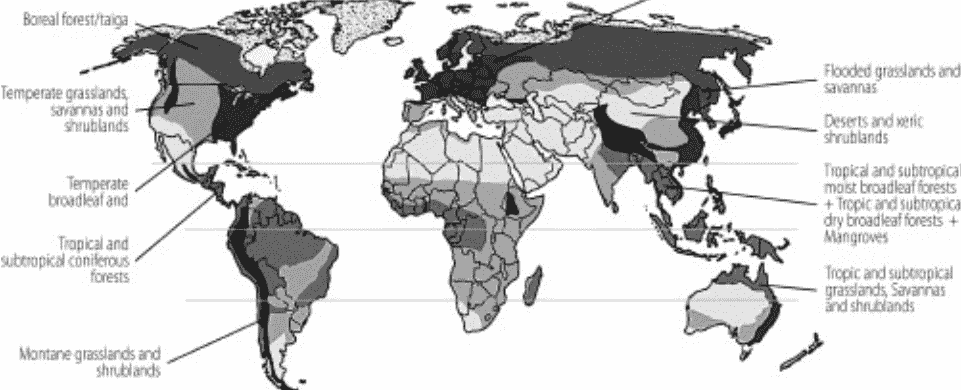

# 全球环境治理、公民社会与野生动物：风暴后的鸟鸣（转型环境政治与政策）

世界正在进入一个前所未有的环境和政治变革时期。到本世纪中期，气候变化将导致生态系统的剧烈转变。数百甚至数千种物种将从地球上消失，包括极熊、大猩猩、亚洲狮子和蓝金枪鱼等标志性动物。对于许多文化而言，“物种”即是“地方”。随着我们经营的全球社区遭受侵蚀，关于物种和局部生态系统的国际决策将开始出现；如果我们不警惕，这些决策将在基于我们的集体行为的情况下做出，而缺乏地方性的视角或问责机制。《全球环境治理、公民社会与野生动物》为环境非政府社区转向共同治理角色指明了清晰的路径。许多NGO外交官在政策讨论方面拥有比政府官员更深丰富的经验和更多的技术知识，且不受主权约束的限制。本书提出了发展中国家公民社会的观点，并论证了它们在未来决策中必须发挥更重要的作用。如果我们想在风暴后听到鸟鸣，全球环境治理的桌就必须欢迎来自世界各地的公民社会。

玛吉·普莱多克斯是野生动物政策发展的专家。她拥有野生动物政策与法律发展的博士学位。普莱多克斯博士的研究重点是与迁徙物种保护相关的国际政策、区域协议制定、海洋保护区，以及地方和全球公民社会所在“一轨”和“二轨”国际外交中的作用。她曾参与过20多个不同的国际进程，曾与多个国际保护组织合作，并曾担任《保护迁徙物种生物公约》（CMS）的海洋政策顾问。普莱多克斯博士是“野生迁徙”（Wild Migration）的政策总监，印太治理研究中心的研究员，以及IUCN SSC/WCPA 海洋哺乳动物工作组和IUCN WCPA跨界保护专家小组的成员。她在 `www.wildpolitics.co` 编写文章。

这是一部非凡的著作，以经验性的才华对席卷整个地球的剧烈风暴做出了回应。玛吉·普莱多克斯以学者的深厚学识、资深活动家的投入热忱以及诗意远见者的智慧，为我们的时代创作了一部鼓舞人心的文本，其关注焦点是人类不可避免将面临的严峻考验，而自然界的野生动物也受困在这个掠夺性的资本主义世界之中。毫不夸张地说，这是一本关于未来的、惊险且不可或缺的指南。

> – 理查德·福尔克（Richard Falk）教授，普林斯顿大学国际法阿尔伯特·G·米尔银行名誉教授，加州大学圣芭芭拉分校Orfalea全球研究中心研究员。《权力转移：新全球秩序》（Power Shift: On the New Global Order）及《（重）想象人文全球治理》（（Re)Imagining Humane Global Governance）作者。美国。

“ 普莱多克斯博士的这部著作《全球环境治理、公民社会与野生动物》，典范了当你将一家领先NGO在实操层面二十年的尖端保护经验，与在理论层面对我们这一代最紧迫问题的解决方案的批判性思考相结合时，会发生什么。这本书是激进的。从微观层面的个人历程到宏观层面的国家冲突，这种交织将让你思考，因为哲学、政治和法律都紧密地编织在一个令人信服的叙事中。这是一部卓越的学术著作。”

> – 亚历山大·吉尔皮（Alexander Gillespie）教授，怀卡托大学。《国际环境法、政策与伦理》及《保护、生物多样性与国际法》作者。新西兰。

“《全球环境治理、公民社会与野生动物》发出了行动号召。它有力地证明了将治理范围扩大到国家和公司之外，纳入一个增强的、充满活力的网络化公民社会，使其能够照顾当地社区和‘超越人类’的世界。本书将学者的分析与诗人的敏感性相结合，是理解创造一个更公正、更生态活力的世界之限制与机遇的必读之作。鉴于关乎整个地球的生命支持系统，我们明智听取玛吉·普莱多克斯的深刻见解和敏锐建议。”

> – 保罗·瓦普纳（Paul Wapner）教授，美国大学。《在自然终结中度过：美国环境主义的未来》（Living through the End of Nature）作者。

“玛吉·普莱多克斯的公民社会活动生涯让她对为什么许多善意的国际保护努力对许多社区和物种造成了失败有了深刻的见解。她为了真正与当地社区协作治理的精神和勇敢，值得在大型NGO的董事会上得到充分的。”

> – 彼得·道弗维热（Peter Dauvergene），不不列哥比亚大学，加拿大。

“在这部博学且充满激情的书中，环境专家玛吉·普莱多克斯传递了一个不可或缺的信息：一场巨大的风暴正在到来，而全球治理正在失效。这本书既是观察公民社会的窗口，也是对精英外交的批判，书中对新的以地球为中心的民主的有力号召不容忽视。”

> – 安东尼·伯克（Anthony Burke）教授，新南威尔士大学，澳大利亚。

“充满活力、激情且鼓人心，玛吉·普莱多克斯对环境活动的命运撰写了一种至关重要的重构。《全球环境治理，公民社会与野生动物》是公民社会站出来并要求更大权力的号角。这本重要且智慧的书中将重塑活动家、环保人士、NGO和政策制定者的思考。”

> – 迈卡·怀特（Micah White），《抗议的终结》（The End of Protest）作者，美国。

“普莱多克斯博士作为环保人士和社区倡导者的工作在这部非凡的书中得到了结合。激情、引人入胜且鼓人心。优美讲述的人和地的独特故事以及通往结论的路径引人入胜且充满力量。在全球对领导力和治理不安的时期，它挑战了常态并为未来带来了希望。这是一本在你读完后仍会留在你心中的书。”

– 珍妮·贝茨斯（Jayne Bates），OAM，澳大利亚袋岛地方政府前市。

“这是一本感人、鼓舞、赋予力量且及时的书籍，照亮了我们时代的全球性问题。它弥合了学术界与基层保护努力之间的差距，为那些为了拯救地球而斗争的人的世界提供了真实的洞察。我学到了努力、斗争、胜利、政治和社会挑战，但最重要的是我学到了希望。这是一本优秀的书，由一位非凡的女性写就。”

– 多娜·马尔文（Donna Mulven），《亚马逊之根》（Wild Roots Coming Alive in the French Amazon）作者，法属圭亚那。

“《全球环境治理，公民社会与野生动物：风暴后的鸟鸣》是对所有关注自然赐予人类之礼物的人的警醒钟。鸟鸣的使用是行动的隐喻。这本书是所有层次自然爱好者的读物。”

> – 阿尔弗德·奥滕·耶博亚（Alfred Oteng-Yeboah），联合国环境规划/保护迁徙物种公约常设主席，德国/加纳。

“玛吉比任何人都更能意识到在自然、气候变化和环境辩论中需要基层声音。她值得广泛阅读。”

– 迈克尔·爱德华（Michael Edwards），《变革》（Transformation）编辑，美国。

系列编辑

蒂莫西·多尔（Timothy Doyle），英国基隆大学及澳大利亚阿德莱德大学；以及菲利普·卡特尼（Philip Catney），英国基隆大学。

# 系列简介

环境政治与政策的理论与实践迅速成为第一世界、第三世界和工业化国家关注的关键领域。不同国籍、宗教和文化的人每天都在对人类和非人类生存至关重要的环境和发展问题进行斗争。空气、水、土地、火。这些核心元素以多种方式混合在一起，产生了一新的问题、思想和行动格局，汇聚在各种旗帜下：能源安全、粮食主权、气候变化、基因改造、环境公正与可持续性、人口增长、水质和用水、空气污染、分配不均。

以及对稀缺资源的过度消耗、非生物的权利、未来公民的福利——名单列不穷。

绿色辩论中迫切需要的是理论讨论植根于政策结果和公共交付。因此，本系列在继续参与理论领域的同时，也 seek求提供一个“现实世界”的政策制定维度。这里的“政治与政策制定”被广泛解读为包括政党、非政府组织、抗议运动、企业、国际政权和跨国网络的领土、话语、工具和领域。

从局部到全球——再往回，本系列探索了各国和文化内部的环境政治与政策，研究了绿色问题跨越南北和东西方分界的方式。“转型中的环境政治与政策”系列揭示了环境政治与政策如何以各种形式转型政治关系的兴奋方式。

欲了解本系列完整书单，请访问 `https://www.routledge.com/politics/series/ASSHER-1371`

作者：Christopher J. Bailey

作者：Claire Nettle

南方环境政治的批判性方法

作者：Adam Simpson

- 前言

- 6 雷声滚滚

- 门腊红猩猿 (Pongo pygmaeus)

# 致谢

在为他人撰稿二十多年后，终于完成我的第一本书是一项个人的里程碑。这本书谦逊地借用了许多人的智慧。我对比那些从第一页起一直伴随我的无数面孔、声音，有时是深刻而感人的评论感到感激不尽。你们多到无法一一提及，但几十年来，我一直观察并倾听你们的勇气，看着你们在国际事务的谈判桌上为你们的人（人类和非人类）发声。

我向 Timothy Doyle、Rob Sorsby 以及 Ashgate 出版公司提供这一机会表示深表谢意。Timothy 并没有意识到我走进他的办公室宣布“想写一本书”的那一天，正是我完全进入理查德·法尔克（Richard Falk）影子的一一天。我受到的是热情的欢迎和智慧的建议——这是一份充满洞察力的礼物。几个月后，Kathie Stone 的精湛编辑技巧给了我完成作品的勇气。Taylor & Francis 的整个团队，包括 Claire Maloney、Kevin Selmes 和 Rebecca Bomford，都非常出色。在 Entrup，Sigrid Lüber、Jayne Bates 和 Linda Irwin-Oak，甚至包括已故的 Peter Pueschal，都保持着这份火热。在我怀疑的时刻，另一位作者 Peter Garrett 打来电话，随后了不起的 Donna Mulvenna 在最后的冲刺阶段出现了。Arie Rompas、Ahmet Memet、Aryo Nugroho、José Plaza Latino, Jr.、Kulbhushanshing Swayanshi、Sigrid Tan、Linda Irwin-Oak、Maximin K Djongo、Norhadie Karben、Yash Veer Bhatnagar 以及已故的 Itan 的信任和个人贡献让我感到谦卑。如果没有这些联系，这本书就不会出现在你面前。

理查德·法尔克的书籍一直是我伴侣。同样，Mac Chapin 在出版《保护主义者的挑战》（*A Challenge to Conservationists*）时的勇气在每一章节中都在与我对话。

每一位作者都受惠于支持网络——那些触动你的生活并给你勇气的人。我的支持来自 Vera Bügi、Louise Duff、Heidi Frisch、Robyn Handbury、Reiko Hosokawa 和 John Matheson、Susan Farquhar、Naomi Goto、Leeza Anne Irwin、Minoru Kashiwagi、Peter Lengyel、Fabienne McLellan、Cheryl Merrill、Cara Miller、Claire Mirande、Felipe Montecito、Cheyne Morris、Giuseppe Notarbartolo di Sciara、Chris Rostron、Tom Shilson、Susan Sorg、Bob and Jennie Teasdale、Melanie Virtue、Kathryn Warhurst、Penny Wright，以及我的父亲 Paul Blythe。

我内心深处的信息是给 Geoff Prideaux —— 我的哨兵、我的导师和我的灵魂。这本书带着深切的谢意写给你。

# 前言

数字可能是令人震惊的——有些是因为它们揭示了强烈的同情，有些是因为其荒凉的巨大。

2015 年最热门的 Twitter 标签包括：#JeSuisParis 和 #PrayForParis、#BlackLivesMatter、#RefugeesWelcome、#IStandWithAhmed、#LoveLives#MarriageEquality。网络世界有能力关注比自身更宏大的事物。在恐怖袭击发生后的 24 小时内，#JeSuisParis 出现在 340 万条推文中。在大西洋彼岸，#BlackLivesMatter 在一年中被使用了超过 900 万次。这些互动都是激情的时刻，汇聚成了一场伟大的运动，尽管它只是一场瞬即逝的运动。

2015 年还带来了一个消息：世界自然保护联盟（IUCN）红色名单现在包含了 22,784 种面临灭绝物种。栖息地的丢失和退化是名单上描述的所有 77,340 物种中 85% 的主要威胁。2,300 鸟类被认为对气候变化特别敏感。200 种两栖动物已经消失。清醒地面对吧——世界正在改变。我们没有赢得这场战斗。

我想提出一个革命性的论点——公民社会需要在治理桌上占有一席之地。当我打字时，我能感受到政府和跨国公司的本能反应。我提议的内容侵蚀了精心构建的权力支柱，但这场革命可能并没有我们想象的那么不可能。

当我第一次读到 Clive Hamilton 的《物种安魂》（*Requiem for a Species*）时，我受到了这种震撼；最近读到 Micah White 的《抗议的终结》（*The End of Protest*）时，这一点得到了加强。两位作者都主张颠覆。对于 Clive Hamilton 来说，这意味着公民不服从和克服消极性，以集体构建新的民主制度，确保对更具敌意的气候提供最佳防御。Micah White 则挑战我们释放一场精神、政治和社会革命。事实上，当我完成这份手稿时，Anthony Burke、Stefananie Fishel 及其同事出版了《植物政治：国际关系终结的宣言》（*Plant Politics: A Manifesto from the End of IR*），呼吁全球环境治理的法律和制度改革。

对于国际关系领域来说，革命性的并不新鲜。它已经积累了几十年。1983 年，被许多人视为规范国际关系之父的理查德·法尔克敦促规范思想者进入“影子之地”（shadowland）——一个概念空间，在这里人们对现状感到愤怒，对过去的事实保持警觉，并致力于探索未来的可能性。Slavoj Žižek 在《危险地梦想的一年》（*The Year of Dreaming Dangerously*）中也提到了这一主题。他挑战我们必须从这样一个假设开始：灾难性的未来已经发生，并反向思考我们本应该做什么。然后我们行动起来，执行改变命运的行动。

所以，几年前，我让负面情绪浮出了水。我带着一丝 Žižek 的风格，站在法尔克影子之地的边缘。我刻意参与了一个源于愤怒的项目——那些被浪费的能量、被忽视的行动，以及沉迷于职位权力并束缚公民社会的官僚。

## 气压正在上升

## 风暴即将来降临

风暴正在降临；一场我们以前从未经历过的旋涡。气候变化与政治动荡的共同作用，将在人类历史上任何时候都未曾有过的更多人意识到其影响的情况下上演。

全球变暖并非假设。它正在发生。一波接一波的数据证实了这一点。在过去的几十年中，每一个十年都比前一个十年显著温暖。2011–2015年是有记录以来最热的时期，2015年也是如此——而且受到了强厄尔尼诺现象的额外推升。这种打破纪录的趋势在2016年持续。气候变化正在增加热浪、干旱和强降雨等极端事件的频率和强度。[1] 世界气象组织飓风委员会报告，东北太平洋地区在2015年经历了重大飓风（3级及以上）——这是自1971年有可靠记录以来的最多。累积气旋能量（衡量热带风暴和飓风的综合强度和持续时间）比1981–1920年的平均水平高出约63%。[2] 印度和巴基斯坦在整个2015年遭受了热浪带来的创伤性和毁灭性影响。数千人丧生。印度气象局警告说，热浪状况仍将来。[3] 全球平均海平面在1900年至2005年之间上升了约17厘米，速度比之前的3000年快得多。[4] 记录性的降雨导致洪水，影响了南美洲、西非和欧洲的数万人。同时，非洲南部和巴西异常的干旱状况加剧了多年干旱。在写本书的核心内容时，2015年的全球平均近表面温度是有记录以来最高的，且优势明显。[4]

第一个危险的里程碑在2013年被跨越，夏威夷穆纳洛亚天文台（由加州大学运营的一项关键科学设施）测得大气中二氧化碳（CO₂）浓度超过了400ppm——比工业革命前高出40%，高于人类历史上的任何时期。这一里程碑是我开始思考这本书的催化剂。2015年是开始写作的动力。当我写这本书时，新闻发布，整个南半球的大气CO₂浓度现在已达到或超过400ppm，比专家预测的早得多。南极的凯西站于2016年5月10日超过了400ppm。[55] 上次CO₂水平如此高是在大约三到五百万年前，当时全球平均温度比工业前平均水平高约3°C，海平面高出40米，格陵兰冰盖是……气候变化具有快速和慢速的脉冲，因此温度变化和海平面上升将在未来几十年内积累动力。我们的生活和生计已经在发生变化。

我们吸收气候变化即将产生的影响信息已经有一段时间了——就像看着一场灾难以慢动作展开。如此缓慢，以至于我们的生活在幕间继续进行。尽管如此，我们已经意识到了，而且某些影响已经触手可及。

在我们在澳大利亚的农场，我们生活在两个极端之间：降雨减少和炎热天气增加。当我开始写这本书时，我们刚度过记忆中最旱的一个冬天。由于没有冬天，我们的水库在整个夏天都是干涸的。没有足够的绿色植被来维持农场。整个春季和夏季，我们焦急地看着天空地平线上的雷暴。当我还是时候，闪电是令人兴奋的。随着漫长的炎热干燥的日子，闪电现在意味着火灾。

在其他地方，情况糟糕得多。气候变化影响了所有大陆和海洋。北极海冰正以肉可见的速度退缩。南极洲周围的融化正在导致我们尚不熟悉的冰雪变化。[6–8] 在与海洋和谐相处一生后，太平洋和印度洋的人民正越过波浪展望一片黯的未来。他们祖先的家园很快将消失；大海吞噬他们的历史。欧洲的冰川正在退缩。英国一直在洪水。撒哈拉沙漠正在侵蚀非洲大陆的农田，从刚果到马达加斯加的森林正在消失，上升的海平面正在吞噬西非的家园。

美国面临着严酷的热浪、暴雨和雪量的减少[6, 9–12]。过去30年里，世界上三分之一的肥沃土地已经消失。

气候变化正在发生。

未来的影响将不分区域。与自然界隔绝的大型城市将变得与古老的亚马逊雨林一样脆弱[13–16]。20世纪70年代，全球发生了660次灾害，包括干旱、洪水、极端温度事件、火灾和风暴。21世纪00年代这一数字达到了3322次。这在短短30多年内增加了五倍。[17]我们可以预计会有更多气候相关事件：更多的热浪、干旱、洪水、气旋和火灾。水资源竞争将变得激烈。在我们的地区，主作物和渔业将减少。[18]预计气候变化将通过大幅减少产出来重塑全球经济，到2100年使全球平均收入减少约23%。[19]。这将出现严重的粮食和水安全问题。受贫困加剧的暴力冲突将变得更加常见。[6]

当我们感受到影响时，自然界将潜伏着危机。目前的灭绝速率已经是如果没有人类干预的预期的速率的千倍。在不久的将来，由气候变化引起的快速转变将超过许多物种的适应能力。到本世纪中期，地球四分之一的物种可能会灭绝。如果我们维持现状，人类和生态系统遭受严重不可逆影响的可能性将是最大的。[24]

政府间气候变化委员会（IPCC）是气候变化领域最权威的机构。它由联合国于1988年根据成员国的请求建立。其作用是就气候变化问题提供建议。每隔几年，IPCC就会审查最新的科学、技术和社会经济信息，并评估未来可能发生的情况。通过数千名科学家的参与，他们的信息是非常可靠的。气候系统变暖是不争疑的。人类对气候系统的影响是明确的，温室气体排放处于历史高位。大气和海洋已经变暖，冰川已经减少。

2015年，各国最终共同达成巴黎协定，结束了数十年的政治分歧。各国同意限制排放，并每五年加强一次行动，从2018年开始。他们设定了一个1.5°C的理想目标，这最符合IPCC的科学建议，并设定了一个政治上可行的2°C目标。他们的承诺仍让世界处于2.7°C到3.7°C的升温道路上。诚然，这比我们所需要的要好。直到2020年提交更新后的减排计划五年会议之前，他们将不会再次审视这一数字。

新协定直到2020年才生效。除非全球最大的经济体发生重大转变，否则实现1.5°C目标的窗口将已经关闭。2025年和2030年的排放水平将对我们限制升温在2°C以内产生重大影响。短期排放越高，后期几十年所需的减排量就越大。[27, 28]

我在国际环境谈判中工作了25年。我知道所有政府履行巴黎协定义务的期限是2023年（以及此后每五年一次）。

并声称会多做一点。[28, 29] 只要他们做到了，他们的同伴（即其他政府）就不会羞辱他们。目前还没有新的资金承诺用于解决发展家的气候变化，而且现在或未来讨论“损失与损害”都是被禁止的，以安抚那些负责了数百年排放并导致我们陷入今日境地的富裕国家。那些需要改变的行业在《协议》中完全缺席。石油、天然气或煤炭生产商未被要求将化石燃料留在地下，国际航运和飞行的碳污染也不被计入温室气体排放。[29] 最关重要的两个问题——实际的减排和资金投资——对个人没有明确的数值目标，也没有确保问责的有效机制。[28]

作为巴黎协议的一部分，各国政府对未来技术寄托了危险的信任——寄希望于几十年后从大气中物理移除大量的二氧化碳。

人们很容易在政府在巴黎取得微小和谐的欣悦中迷失自我。但客观评估表明。在巴黎峰会结束后的几天，凯文·安德森（Kevin Anderson）写道：

> 如果全球社区要在 2°C 的碳预算内维持排放，就需要对我们面临的深远且紧迫的挑战有更大的认识。减排的规模将无法通过雄辩的演讲、双赢的修辞或绿色包装的论点来实现。零碳能源技术是 2°C 未来的先决条件——但远未达到。只有当伴随着当代社会政治和经济框架的根本性变化时，它们才能提供必要的缓解水平。[30]

克莱夫·汉密尔（Clive Hamilton）对巴黎协议好消息与坏消息之间的冲突给出了一些见解：

有理由感到像我和马洛·胡德（Marlowe Hood）等人那样，被两个方向撕裂。对于那些理解局势的人来说，这种极性引发了强大的张力。如果悬在两极之间感到不适，那么走向其中一个或另一个极端都是危险的……我们必须生活在两极之间，因为正是这种张力让我们相信，巴黎的这一大步虽然距离我们还有很远，但它可能引导世界走向一条产生更多可能性的道路。[31]

评论员已经将注意力转出政治阶层，转向社会驱动的变革——从城市和地区到机构，再到当地社区和个人。[32–34] 这种全性的号召与政府依赖未来的技术解决方案一样不稳定且毫无根据。如果没有根本性的结构性变化，社会的反应将是临时的且分散的，并且很可能付于失败，尤其是因为政府仍在促进化石燃料工业的扩张。

这不是一本关于气候变化的书，尽管这无疑是其写作的背景。目前已经有许多优秀的书籍和文件描述了正在发生的情况以及我们减少影响所需要采取的步骤。它们应该是每个人晚上床头的必读物，因为我们再也无法生活在否认之中。然而，当我坐着观察巴黎气候峰会时，很清楚我们的政治阶层并没有准备好做得足够的事。他们仍然努力保护导致问题的体制本身，并希望某地的某人能宣布某种技术解决方案，让世界在不发生改变的情况下继续运行。也许有一天，这样的解决方案将会存在。但是，我们在行动之前等待了太久，以至于没有感受到风暴的鞭笞。我们必须解决全球变暖有深刻的道德理由——这些是伦理和公共政策的关键问题，如果我们忽视它们，将自食其灭。[35]

这是一本关于我们在未来几十年内如何在政治上适应的书，关于我们所做出的选择以及谁参与了这些选择。以风暴为比喻，气候变化的影响是带来危险雷暴云的不稳定气团。这是一本关于我们如何渡过风暴的书——它是一本关于治理的书。

在关注我们当前治理秩序的缺陷——规则、规范和行动的体系，以及管理该系统的组织方面，我并不孤单。

在国际领域，这些通常通过多边程序运作，政府是主要参与者。这些程序证明无法应对现代世界面临的复杂挑战——气候变化、恐怖主义、人道主义灾难。虽然国际关系学者最近关注了国际治理以及非国家行为体在影响辩论方面的作用，但国际关系视角传统上关注的是国家如何影响和规范全球规范。直到不久前，甚至对失败、衰落或脆弱国家的论述也主要集中在国家建设以恢复政治秩序上。但近年来，一些学者采取了鲜明的激进色彩。这本书是我对这场辩论的贡献。在我定稿这本书时，安东尼·伯克（Anthony Burke）、斯蒂芬妮·菲舍尔（Stefanie Fishel）、奥德拉·米切尔（Audra Mitchell）、西蒙·达尔比（Simon Dalby）和丹尼尔·莱文（Daniel Levine）发表了一份宣言，说明了政治如何演变以应对人类世和气候变化带来的影响。[36, 37]

事实上，这种变化已经持续了一段时间。国家正在削弱它们在全球范围内的地位，创建了它们对其权力有限的全球或区域机构。威斯特法利亚体系正在崩溃，部分是设计之初，部分是因为精英行动者的隐秘操作，部分是因为它本该如此。

欧洲国家参与了有设计的变革——这一项目现在随着英国震惊退出欧盟而完全陷入混乱。欧洲国家有意识地在他们的司法体系中赋予了欧洲法院合法性。同样，各国赋予了国际货币基金组织影响力，以规定国内财务管理结构的变革。[38] 正在谈判的具有争议国际贸易协议将允许未经选举的贸易法庭法官利用每项条约的规定，拥有推翻民主通过法律的能力。[39] 用于管理世界事务的无数政府间程序允许权力从国家流出。这些是国际社会有意识且自愿削弱威斯特法利亚秩序的切实、真实的案例。

国家作为主要参与者的角色也受到失败以及非国家行为体承担治理角色的侵蚀。无疑，存在着强烈的民族主义和右翼民粹主义，表面上，许多政府领导人似乎在回应重申威斯特法利亚逻辑。选民大众可能相信这些辞藻，但这些政治姿态是空洞的。表象之下，右翼同样甚至更致力于将治理外包给私营部门。

传统的国家概念在公共领域和私有领域之间划了界。国家被假定负责公共物品供应；非国家营利公司和非营利公民社会贡献于个人利益所在的私有领域。这些界限日益变得模糊。军事主义可能是唯一留下的威斯特法利亚体制。

在世界许多地区，非国家行为体已经提供了教育、健康和基础设施等公共物品，许多国家行为者轻易利用国家资源获取私利。当国家维持治理安排困难时，这些边界侵蚀是容易发现的。[40] 但它们也在非国家行为体对政府间程序的渗透中逐渐溶解。达沃斯世界经济论坛一直在秘密推进“达沃斯全球转型倡议”，这反映了这些精英对治理未来的愿景。[41] 他们要求用多利益相关者治理系统取代政府间决策——即由精心挑选的利益相关者组成。[42] 尽管来自大多数经济大国的领导参加了达沃斯世界论坛，但这些讨论和决策偏离民主观点之远，以至于全球社区有一天可能会面对一个他们不再承认的现实。全球转型倡议以公司为中心，主要是与公司有商业关系的实体：客户、债权人、供应商、合作伙伴、所有者和国家经济。负责多利益相关者治理安排的人将由达沃斯任命，或由对管理特定全球挑战感兴趣的领先公司自选。无需等待政府间系统就行动达成共识；多利益相关者治理安排将自己做出这些决定。

源于威斯特利亚体系秩序的野生动物与环境保护框架，已不足以带来我们所需的快速转型性进展。[36, 44, 46]

野生动物是局部的，但管理对这一野生动物群落的影响无疑是全球性的。虽然人类已经找到了避开或缓冲人类活动影响的方法，但对野生动物影响最严重的往往来自远方。工业化的狩猎、采矿、林业和单一种农业破坏了大量地区，并将多样性替换为单一的焦点。往往是非法的国际奇珍生物贸易为那些不道德的人提供了狩猎、杀害、包装和商品化动植物的途径。凭借着一种扭曲的逻辑，有些人甚至说服自己为了运动而杀戮对保护是有好处的。对资源和权的追求淹没、焚烧并摧毁了整个景观。再加上气候变化，一个存在了千年的脆弱平衡被打破了。

我们正处于历史的转折点，角鸮、毛鼻水獭和红狼的幸存数量仅剩下昔日的残影。[47–49]。北极熊、森林猫头鹰和菲律宾鹰面临着不确定的未来。[50–52]。少为人知但同样重要的物种，如蜘蛛猴，正处于生存的边缘挣扎。[53]。海洋酸化威胁着黄鳍鱼幼鱼的器官健康。[54]。而在每一个物种的背后，都是与它们共享家园的人类群落。

当我早晨醒来，听到的声音是喜鹊的鸣叫。这些鸟以及它们独特而摄魂的歌声，正如黄昏时站在山脊上的袋鼠，都是我所生活的文化以及我所属社区的一部分。南非、巴基斯坦、俄罗斯东部或爱尔兰的人在不同的声音中醒来，拥有不同的野生动物作为其社区的一部分。我们了解所有的非人类亲属，即那些与我们共同生活的动物。我们了解共享的季节，知道什么生长在何处。我们了解共同家园生命的起伏。对于某些人来说，我们的景观是森林；其他人则望向大海和无止尽的地平线。这些并非空旷之地。它们充满了野生动物，我们与其产生共鸣。[55]在我们许多智力之间，存在着深切感知的关系性和相互联系——狩猎与采集的智力、求偶与交配的智力、迁徙与冬眠的智力以及许多其他存在方式。[56] 许多这些对于受人类中心主义还原论限制较少的社区来说，更加明显而易见。[57]。尽管如此，科学家现在也揭示了许多非人类文化智力。[58-60]。

世代以来，我们一直在管理与我们社区中这部分荒野的关系。但世界范围内向全球中心化决策的政治转变夺走了我们的这种关联。决策现在是在别处做出的——在一个国际政治空间内。[61, 62]。在许多方面，我们已经变得与我们生活的野生群落一样无助。

Oran Young、Robert Keohane（罗伯·柯）、Peter Haas 和 Marc Levy 对多边环境政体进行了长达数十年的分析，强调了与多边环境协议（MEAs）并存并对其提供支持的新参与者和活动的兴起。[62-67]。他们认为，气候变化或生物多样性丧失等环境问题，比其他可以在国家层面完全管理或通过政策对国际企业活动进行限制来解决的问题更困难、更复杂。他们强调了目前环境治理安排是多么脆弱。他们记录了许多案例的成功与失败——从欧洲的酸雨到公海的船舶污染。他们对政体效能的分析包含了大量的丰富见解，涉及增加合规性以及处理国家参与者之间的权力不平衡。对于本书来说，他们从实证角度了 MEAs 是重要机制，前提是它们承认自己是更广泛政治治理安排的一部分。[62-68]。当 MEAs 做到这一点时，它们平衡了强大且高度组织的行业利益与更分散的公共利益及关注之间的差距。[68]。

我认为，在考虑野生动物保护时，这一因素需要被更积极地利用。传统的、碎片化的政府机构在尝试管理景观时往往捉履维艰。因此，在国际上做出的决策往往无法很好地反映国家背景。[69]。当地社区和野生动物往往承担了执行不力的负担。国际野生动物保护需要更好地反映“地方”的独特特征，并更充分承认政策决策、授权以及受政策决策影响最大的社区意愿之间重叠、整合的特征。国际决策对地方应该是有意义的。现在，在很多情况下，它们并非如此。

我们受限于对独立（主权）国家国际体系的政治承诺，政府被设定为将国家利益置于一切之上。

沿着目前的路线下去，我们将无法保护我们所需要和珍视的东西。因此，继续使用风暴的隐喻，对当前世界秩序的绝望紧握将成为滋养雷暴云的上升力。我们将迎来一场完美的风暴。

我认为 MEAs 需要演变为一个协作治理空间，以增强桌面上的资源和知识，并提高公共问题的解决能力。[70]。协作治理需要支持和领导力。我们需要一个专门的论坛。支持识别出需要修复的政策问题。领导力将各个部门汇集到论坛中。然后，论坛成员协作制定政策、解决方案和对答。[71, 72]。

我在第 2、3 和第 4 章中探讨了治理的特征：第 2 章进一步探讨了国际体系是如何构建的，以及正在超越我们视野的新自由主义议程；第 3 章和第 4 章探讨了跨国公司、非政府组织（NGOs）和 MEAs 目前产生的影响。国际环境治理目前是如何受到影响的。在第 5 章中，我探讨了公民社会如何已经在动员，在第 6 章中，我讨论了国际治理如何调整以反映地方管理的野生动物保护。在最后一章（第 7 章）中，我提出了一条前进之路。这是一条需要巨大行为改变的道路。

理解我如何在世界秩序中讨论不同的群体，对于理解我的核心论点至关重要。再次，我引用提摩迪·多尔（Timothy Doyle）对“少数”与“多数”世界观二元对立划分的定义[73, 74]。我抵制那些源于殖民历史和冷战过去的标签（第一、第二和第三世界），也抵制那些根据经济价值描述我们社会的标签（发达国家、发展中国家、欠发达国家、后国家）。在许多情况下，经济贫穷的国家是曾被殖民的国家。有人认为，它们正通过全球化的控制形式继续被殖民化[75, 76]；我也抵制将南北划分的分类法。北方、南方、发展中国家这些标签都包含内在的逻辑矛盾。世界各地都有的人类社区处于贫困和处于弱势地位，包括在健康、教育和生活水平方面的极度匮乏[77, 78]。

为了避免矛盾，并更清楚地阐述精英选择而非多数人的不平等现象，我有意识地使用“少数”和“多数”的分类。这样做，我明确了谁应该以及谁有权参与国际政治讨论，而谁不是。

“少数世界观”涵盖了在历史上剥削过多数世界的富裕社会——西欧、北美、澳大利亚、新西兰、南非和中国。

“多数世界观”涵盖了世界上这些空间之外的大多数人口——包括非洲、南美、南亚和中东，以及澳大利亚和巴西的某些极端贫困地区。多数世界是被剥夺权利的。然而，这个世界也保留了地球上生物多样性最高、最珍贵的地方；这一因素对我本书具有核心意义。这两个元素——我对该主题的参与以及少数与多数世界观——自然地引向规范性国际关系。

我们现今对政治的理解已变成了一种政治化的讨论。我们已经习惯了关注国家权威以及国家代表我们所做决定的政治。我们失去了与亚里士多德在多年前如此雄辩地描述的——“城邦”（polis）或政治共同体的联系。

通过这种讨论的沉默，我们为单方面的考虑赋予了更大的合法性。我们阻碍了自己讨论关于能动性（agency）问题的能力。我们说服自己所有问题都可以通过国家来解决。虽然政治（决定应该做什么的能力）局限于国家，但权力（办成事情的能力）正在迅速转向跨国领域。只有少数学者正在研究系统作为全球与地方之间唯一调解者的能力，而不同国家的能力实际上是不均等的。

我们大多数人认同，所有层面的民主治理理想都应该涉及城邦——即人民。然而，在国家之外，公民社会的权利是脆弱的，大多数时候被迫要求获得准入，且影响力有限。这里没有参与性的讨论，没有问责机制。规范性国际关系表明，是时候重新想象政治了：以适应变化并讨论我们可能变成什么。这是一个关注道德责任的学术传统。这一传统有许多分支。有些关注理解世界事务的性质。许多参与“参与型学术”。借保罗·瓦普纳（Paul Wapner）的话，他们“不仅在学术界工作，而且在街头推进某些政治议程[45,80–85]”。我属于这群学者之中，我们主张民主原则也同样适用于国际世界秩序。规范性国际关系的学者从多种世界观审视世界，不受美国或欧洲视角的的主导。事实上，社会科学之外的贡献也有益的，因为历史、哲学和文学方法增加了了我们对世界政治的共同理解[83,86,87]。

许多不同的环境问题跨越了边界——无论是物理、司法管辖还是文化边界——并且通常由来自不同国家、地区、语言群体或文化背景的人群解决。他们通常有某个共同点——他们所处的生态区域。物种迁徙和生态系统的互联性驱动了关注环境的人士的跨国思维，但跨国协调的增长是我们时代独有的——无国界的交流、更广泛的教育、英语作为通用语言的影响范围。关于公民社会参与尤其是全球社会发展的文献正在爆炸式增长[90–94]。日益明显，具有共同目标的运动和群体正在构建并有意识地通过跨国网络运作。理解这些跨国网络如何服务生态区域的当地社区，可以从世界主义的概念获得帮助。

世界主义是一种处于动态增长中的哲学和政治理论[95–97]，不同的学者正在探索它如何应用于当代社会。其批评者警告说，它反映了西方价值观和个人利益，并起到奴服多数世界的作用。事实上，如果那是框架，我也会拒绝它作为一个有用的视角。世界主义有许多哲学根源，包括印度教和儒学。吠陀文明和佛教将世界视为一个整体。属于人类全球共同体的想法既不是独特的，也不是欧洲文明所独有的。它最初可能从西方和南方向北方移动[98]。它也有分支：从寻求一个没有民族主义的国家体系的政治世界主义，到努力形成公正、平等和美德的普遍观念的道德世界主义[99]，到哲学家安东尼·阿皮亚（Anthony Appiah）所说的“有根的世界主义”的多种形式[100]。这种世界主义在平衡局部和更大道德主张的同时，扩张并丰富了个人对自我、他人以及世界的理解。有根的世界主义包括：向半个世界之外其他相似社区延伸的当地社区、参与与其国家或起源地相关的跨国政治的移民活动人士、策略性地与少数世界活动人士建立联系的多数世界活动人士，以及偶尔参加国际抗议活动的参与者[101]。这在20世纪90年代被玛格丽特·凯克（Margaret Keck）和凯瑟琳·西辛克（Kathryn Sikkink）封装为“无国界的活动人士”[91]。

世界已经改变的现实迫使我。现在很少有社区是真正孤立的。信息和思想在全球范围内有力地流动，几乎没有阻碍或控制[102]。几乎不可能不知道人类的多样性。如果我们不有意识地赋能社区，让个人声音表达出来，我们就会面临批评者所担心的事情——由精英驱动和喂养的同质化文化。

共同评估故事是学习调整我们对世界反应的核心方式之一。反应的对齐反而是我们维护社会织物、维护关系纹理的方式之一[100]。通过赋能当地、传统和土住民的声音，以及他们对于谁属于其社区更广泛的视角（在许多情况下还包括非人类动物——为他们提供空间使用“对新事物的反思开放与对已知事物的反思忠诚”）可以形成基于生态信息的管理策略[188]。这些跨文化复杂对话的切入点是对话参与者共同拥有的事物。它们不需要是通用的；它们只需要有共同点即可[100]。

根据我的经验以及一些学者的经验，许多参与环境问题的公民社会网络已被归类为“有根的世界主义”的形式[88]——这些是许多参与国内政治或运动的个人，他们跨越自己的基地加入国际网络[101]。他们经常通过物理或电子方式“见面”。他们分享信息，并利用网页、报告、讨论论坛和期刊上的国际材料来追求共同目标。

## 参考文献

- 世界气象组织。2016. 气候状况：创纪录高温与极端天气。日内瓦，世界气象组织。
- 世界气象组织。2016. 南亚的气候与健康专家。
- Levin, K. 2015. 《内部人士：为什么 INDC 研究得出的温度估计值不同？》。世界资源研究所以及 Najam, [在线材料]
- Reyes, O. 2015. 《巴黎气候辩论中显而易见的裂纹。《外交政策焦点》。[在线材料]
- Anderson, K. 2015. 《巴黎协定：参与度 10/10，内容 4/10。显示了前提。》
- Vale, P. 2015. 《COP21：在巴黎联合国达成气候协定。《赫芬顿邮报》，2015年12月12日。
- Bloomberg, M. 2015. 关于COP21协议的声明。http://www.bloomberg.com. [在线材料]
- Lynn, W. 2015. 《气候变化的伦理：我们欠地球其他部分什么。《会话杂志》。[在线材料]
- Cruzen, P. J. 2006. “人类世”。收录于《人类世的地球系统科学》。Elbers, E. 和 Kraft, T 编。海德堡：13:589。
- Risse, T. 2012. 《有限国家性地区》。收录于《牛津治理手册》。Levi-Faur, D 编。牛津大学出版社：724–740。
- Gleckman, M. 2016. 《多利益相关者：企业对全球治理新形式的推动。》
- Slemnic, J. 2015. 《资助可持续发展目标将取决于税收因素。《卫报》，在线，2015年6月23日。
- Biermann, F., Abbott, K., Andersen, S., et al. 2012. 《为了全球可持续性转型治理与制度：地球系统项目的关键洞解。《环境可持续发展当前述意见》，4, 1: 51–60。
- Gomez, L., Lepen, B. T. C., Cheng, M., Fernandez, K., and Savage, M. 2016. 《非法水獭贸易》。雪兰莪：TRAFFIC/外部专家组。
- Pfild, N. W., McCall, A., Detrocher, A. E., Linn, N. J. and Richardson, E. 2016. 《北极熊对海冰的迁移反应：游还是不游。《生态学》：n/a；
- Jath, G. and Rahmani, A. 2003. 《极濒危森林猫头鹰 Heterogaux blewitti 的生态学》。收录于《印度动物》。Sivaranayan, N. Nussum 编。Bentham出版社：101–112。
- March, C., Link, A., King-Bailey, G., and Donati, G. 2016. 《碎片化和植被对哥伦比亚马德莱纳谷 Ateles hyderus、Alouatta seniculus 和 cebifins 数量的影响。《哥伦比亚实践学》，8, 1: 17–30。
- Mendieta, E. 2010. 《物种世界主义。《今日哲学》，54，增刊：208–216。
- Tucker, M. E. 2006. 《主体间的交流与多样化智能》。收录于《主体间的交流：宗教、科学与伦理》。Waldau, P. 和 Patton, K 编。纽约：哥伦比亚大学出版社：5–10。
- uznick, P. and Sudai, V. R. X. 2016. 《长者的智慧》。北悉：Allen and Unwin。
- Brakes, P., and Dall, S. R. 《海洋哺乳动物行为：保护影响回顾。》
- Poole, J. H. and Moss, C. J., 2008. 《大象的复杂性与道德：科学证据》。收录于《大象与道德：迈向公民道德》。Webber, M. C. 和 Christen, C. A 编。巴尔摩：约翰霍普金斯出版社。
- Borsan, S. F., Grady, M. F., Lambeth, S. P., Sapiro, S. J. and Beran, M. J. 2008. 《黑猩猩异常。《PLOS ONE》，3。
- Nixon, 2011. 《治理与地球环境主义》。剑桥：哈佛大学出版社。
- Young, O. R. 1999. 《所有世界的治理》。伦敦：康奈大学出版社。
- Young, O. R. and Levy, M. A. 1999. 《国际环境区域的有效性》。收录于《国际环境区域的有效性：因果关系》。
- Benhabib, S. 2014. 《不抱幻想地捍卫世界主义：对批评者的回复》。《国际社会与政治哲学批判评论》， 17, 6: 697–715。
- Mendiete, E. 2009. 《从帝国主义到对话式世界主义？》《伦理与全球政治》， 2, 3。
- Prieto-Rio, E. and Koram, K., 2015. 《去殖民化认识论，政治化权利：爱德华·马德里迪访》。《Birkbeck法律评论》，3: 13。
- Leinius, J. 2014. 《实践中的去殖民化世界主义：从普遍独白到跨文化对话？》收于《世界主义与跨国主义：愿景、伦理、实践》，Kaunen 编选，赫尔辛基：高级研究世界主义中心: 39–65。
- Hansen, D. T. 2010. 《在没有网的情况下选择蝴蝶：解读世界主义》。《哲学与教育研究》 15: 151–168。
- Appah, A. K. 2006. 《世界主义：陌生人世界中的伦理》。伦敦：Allen Lane 出。
- Tarrow, S. and Della Porta, D. 2005. “全球化、复杂的国际主义与跨国内容”。收于《跨国抗议与全球行动主义》，Della Porta, D. and Tarrow, S. Rowan 编选，Routledge 出: 227–246。
- Kahne, J., Middaugh, E. and Allen, D. 2015. 《新媒体与参与式政治的兴起》。《从声音到影响：理解数字时代的公民身份》，Ellen, D. and Light, J. S. 编，芝加哥：芝加哥大学出版社。
- Lilly, C. and Tarrow, S. G. 2015. 《国际合作》。牛津：构建自然资源与环境政权体系，伦敦：康奈尔大学出版社。
- Young, O. R. 2008. 《全球环境治理的架构：让科学服务于政策》。《全球环境政治》， 8, 1: 14–32。
- Betsill, M. M. 2008. 《对国际环境外交分析框架的反思：非政府组织在国际环境谈判中的影响》。Betsill, M. M. and Corell, E. 编选，剑桥：MIT 出社: 177–206。
- Doberty, B. and Doyle, 2013. 《环保主义、反抗与团结：国际地球之友会的政治》。纽约：Springer 出。
- Jerry, T. 2006. 《序言：孤独与压力》。收于《主体的交流：宗教、科学与伦理中的动物》，Walduai, D. and Patton, K. 编选，纽约：哥伦比亚大学出版社: 5–10。
- Held, D. 2009. 《重构全球治理：世界主义、民主与全球秩序》。《千禧国际研究杂志》， 37, 3: 535–547。
- Held, D. 2013. 《多极世界中的世界主义》。收于《世界主义》，Braidotti, R., Hanafin, P. and Blaagaard, B. 编选，伦敦：Routledge 出: 28–39。
- Holy, H. E. and Cobb, J. B. 1994. 《为了共同利益：引导经济走向社区、环境和可持续未来》。波士顿：Beacon Press 出。

# 2 暴风雨将至

那是2005年11月一个闷热潮湿的日子。我站在卢旺达基加利机场的航站楼楼内，感到精疲力竭。在肯尼亚为期七天的激烈政府间讨论让我付出了巨大代价。该组织运作非常大胆，并努力争取对非政府组织（NGO）在保护野生动物工作方面的认可。我们的案例经过了数月的细致准备，我已经卷起袖子准备好这场战斗。

老实说，我还是抱着失败的预期来的。政府通常不喜欢承认非政府组织对世界贡献了巨大价值。我仍然沉浸在意料之外的渐进式成功中，还没有调整好内心那种不信的情绪。站在卢旺达的边境感觉很超现实；就像是从一个清醒梦进入了另一个梦。

边境检查毫无延迟且毫无疑问地放走了所有来自欧洲和北美的同事。而这里，我拿着我的澳洲护照，头着痛，精疲力竭的双腿随时可能在我下方崩溃。每翻一页，似乎都流过了一个永恒。从未有一份护照被如此仔细研究过。我累了。

卢旺达在当时和现在都是一个深陷难以想象之痛苦的国家——在短短11年前其成熟且睿智的人口遭到屠杀后，它正逐渐适应人口结构的年轻化。在1994年4月至7月的卢旺达种族灭绝期间，其同胞杀害了50万至100万名图图西人。这可能占该国总人口的20%，占当时居住卢旺达图图西人口的70%。卢旺达内战和种族灭绝的报道通过国际媒体被少量提及，但对许多人来说，那是半个世界之外的战争。当我在这个脆弱国家的边境时，我知道欧洲、美国和澳大利亚的许多人已经忘记了这场悲剧。

最后，我跨入这个国家，直接上了一辆小大巴，它在基加利满是坑洼的道路上颠簸着飞驰而去。我们周围的丛林茂密、郁郁、广阔且充满生机。事实上，只要能待在这座山上，我就很满足了。这趟旅行是值得的。鸟类和昆虫嗡嗡鸣响，叫声遍布感官所及之处。

第二天早上，我们坐了一段短路到达解释中心。诚恳而博学的当地导游向我们解释了大猩的困境。他们提到了来自欧洲和美国的研究人员。他们提到了国际运动。他们没有提到周围的社区。标志和材料是手工制作、原始真实的，但我意识到其中包含的“西方色彩”，那是远方的环保组织留下的。

毫无疑问，问题影响了我的经历。我热爱野生动物并为保护它们投入了生命，没有任何妥协。到2005年，我开始质疑将解决方案强加于其他价值观的人身上的明智。我也对在社区发展的旅游业感到不安，如果旅游消失，是否会有持续的保护承诺。我带着这些问题开始了这次大猩猩之旅。意识到我正在参与一个我有意识审视的系统，我想体验另一个层面。我想了解这种保护努力是否服务了大猩猩和社区。

在又一段短途巴士后，我们开始攀爬许多山丘中的第一座；由自信且安静的当地导游带领。他们彼此陪伴，而不是与徒步者交流。值得注意的是，这些体壮且敏捷的男子带着枪。徒步持续了几个小时，我们爬过又一座山山，进入山间的山谷。有时我们沿着山坡侧向行走，追踪猩猩的足迹——昨晚的睡窝、早晨的觅食，以及幼体在植被中翻滚的声音。偶尔导游会发出一系列深沉、共鸣的声音。这是人类与这些猩猩之间共同的语言，他们羞涩地解释道。他们正在让银背知道我们正在接近。他们正在请求更近的许可。我问如果他说“不”会发生什么。“我们会离开，”这是一个肯定的回答。

接着下起了雨。远处的景色消失了，世界收缩成周围一排排美丽的雨中树木。雨滴之间空气中弥漫着浓雾，仿佛我们被运送到了云端。

我们蜷缩在一起聚了一会儿。导游与大猩之间的对话再次开始。大大猩家族正在靠近。我们的两个导游静静地穿过雨帘消失了。当他们回来时，我们被轻声地引导到一片生长在陡坡侧面的错综藤蔓丛中。雨变小了。

在这个环境中显得格格不入，我专注于寻找落脚点，并准备观察远处的大猩。当我抬头时，正好对上她的眼睛，那目光触动了我的灵魂。她就在几米之外，是族群中的长者之一。我能从她的眼神中读出许多信息。我的脑海中交织着内疚与敬畏的复杂情感。对于能见到她我感到无比幸运，对于侵扰了她家庭的和平与空间我深表歉意。

我的左侧是她的家人。一位年轻的母亲怀抱着婴儿快乐地坐着。不远处，几个孩子正专注于进餐，他们深色的头顶覆盖在闪烁的水滴毯子下。山坡更远处还有更多黑色的身影，大猩猩聚在迷雾中。我的右侧是银背王；他坐在一根弯曲的树枝上当作宝座。他体型巨大，一位威严的主宰。毫无疑问，我们是在他的许可下进入他家族的领地的。他的姿态清晰地传达了这种许可的限度。潜意识里，我留意了他正与我们的导游持续对话，并会在日后想起。

一个幼体从我们头顶上方的山上滚落，在滚过我时伸手碰了碰我的靴子——这对我们双方来说都是一个简单但禁忌的行为。他的自由和快乐牵动着我的心。我知道他的家人每天面临的风险。我知道他们生存在维持生命所需资源的极窄边缘。我知道那些为了猎杀它们而来的偷猎者所带来的疾病风险。

当我沉浸在这一美景中时，泪水模糊了视线，我忘记了时间。

导游轻轻拍了拍我的肩膀——示意我们安静地沿原路返回。参观时间结束了。

感到内心已经涌起巨大的失落感，我转身离开，但回头看向刚才捕捉了我的那双眼睛。她眨了眨眼，注住我的目光，并在我心中印下了一份礼物。直到今天它依然支持着我。

我默默而感激地感谢了她，我们离开了。

回程的路更短也更直接，但还是花了几个小时，包含了许多山丘。在山脚下，我们翻越了一道粗糙的石篱，那是划分荒野与农田边界的标志。我问一个导游石篱是做什么的。他解释说这标记了大猩猩与人类之间的界限。我问大猩猩是否真的会进入农田？他说没有。我心里在想，人类是否会闯入山中。过了一会儿我轻声询问起枪支的事。他回答说那些是用来对付边界偷猎者的。我知道这意味着什么，不需要再问了。他的眼神诉说着他所面临的危险。

我的经历在山中某处转变为对导游及其社区的更多反思。当我们遇到大大猩猩家族时，那种感觉是真实且诚实的。导游们对与这些动物关系的自豪感是真实的。这些年轻人与银背王之间的理解是他们特有的。毫无疑问，这些男人认识每一只大猩猩。我坚信他们与这些动物分享了生死的高低。我怀疑他们计划终身从事这项工作。

但是，我仍然被“大猩猩徒步者正在被服务”这一事实所困扰。整个场景——酒店周围的村庄、导游和大猩猩——都是为了我们的享受，像一个为富裕游客提供的巨大游乐园。如果旅游停止，它还能维持吗？这就是拯救大猩猩所付代价吗？

在保护史上的一个时期，利用旅游资助野生动物保护还是新事物。在那些保护野生动物缺乏经济动力的国家，全球的保护组织可以理解地转向了基于市场的解决方案。这在当时是一个很好的答案。它为当地社区和造访野生动物的游客提供了教育机会。毫无疑问，对许多物种独特且往往棘手的保护保护需求的意识有了巨大的飞跃。我赞赏那些开发这些计划的人，他们克服了所面临的复杂性和困难。我不质疑这些努力的任何方的动机、诚信或意图，也不质疑每天参与其中的个人的承诺。我确定，许多此类活动将继续为未来提供经济激励。

对于那些针对非法猎杀和贸易的野生动物来说尤为如此：大象、大猩猩和许多猛禽。在这些情况下，猎杀和贸易动物部分的欢快收益可以轻易超过任何利他主义动机，特别是当社区极度贫困时。旅游带来的经济收益可以提供平衡并提供机会。

但是，旅游已经变成简单的保护了吗？野生动物周围的社区是否寻求过帮助或提出了自己的解决方案？也许最重要的问题是，如果旅游消失了，这些社区是否仍然持有保护这些物种的使命？我意识到这些是棘手且困难的问题。有些人读到这些问题时会感到受伤。这些是值得问的问题，因为这些问题的核心涉及到一个关于我们未来如何治理世界的更大问题。在那个世界里，谁拥有权力？这种守护能持续多久？我们深切关心的野生动物的安全是否永远能得到保障？

非洲大猩猩的案例是这项调查的起点。大猩猩自然分布在十个非洲国家，并在所有这些国家都受到法律保护。这两个物种也都被列入《濒危野生动植物国际贸易公约》（CITES）附录一，该公约禁止所有形式的活大猩猩商业贸易。尽管法律覆盖范围令人印象，大猩猩仍然受到威胁。[1]

在过去的一百年里，大猩猩面临着：

- 栖息地丧失
- 偷猎
- 疾病

我们认为的大猩猩比单一物种要复杂。西部猩猩包括两个亚种：西部低地猩猩和黑河猩猩——3]。东部猩猩包括两个亚种：山地猩猩和格鲁埃大猩猩——均为极危。[2]。我有幸遇到了一大家山地猩猩。大猩猩旅游的关键区域位于非洲大湖地区中心——维鲁翁山脉，由卢旺达、乌干达和刚果民主共和国（DRC）共享。这三个国家共享一个跨境保护区，分别是卢旺达的火山公园、乌干达的姆哈辛加大猩猩国家公园和刚果民主共和国的维鲁翁国家公园——自1979年起列入世界遗产，并在1994年列入危地。[4]。该共享公园包含了该地区一半的大猩猩种。乌干达的比温迪不可进入国家公园栖息着另一半的山地猩猩。

卢旺达、乌干达和刚果民主共和国是世界上最贫穷的国家，公园周围的人口密度世界最高——每平方公里高达700人。[5, 6]。没有哪个地方比这里更能体现被剥权的多数这一概念了。尽管维鲁翁在1925年就被定为国家公园，但主要的保护计划直到20世纪70年代才开始，集中在三个问题上：

- 栖息地保护
- 反偷猎
- 社区参与

根据2005年非洲野生动物基金会的研究，该地区的大猩猩旅游每年产生2060万美元的收益，其中53%惠及政府和机构，41%来自国际参与者（包括资助者和非政府组织），6%来自当地社区。[7]。在我访问猩猩的卢旺达，报告确实表明保护区森林为当地社区带来了积极的有形和无形利益。向游客销售产品带来了经济收益，并通过国家和区域收入共享计划获得了一些支持。Mike Maeda及其同事在2013年报告说，自2005以来，收入共享计划已向社区项目拨款了约183万美元。建造了10所学校，容纳了3640名学生；建造了88个水箱，为4万人提供了用水；并支持了十个社区协会建立创收活动。其他社区项目还包括医疗设施、当地瓦砖厂、蜂-

维持项目、种子生产项目和储存项目、农林业以及植树项目。[8] Ritah Tusabe 和 Straton Habyalimana 在 2010 年报告了类似的结果，尽管他们注意到，在撰写报告期间，政府尚未收集到用于衡量生物多样性保护和社区生计改进的基准数据。一些社区成员仍在个人从偷猎中获得的的利益与集体项目可能带来的收益之间进行权衡。[9]

如果这些点在这一页上孤立存在，社区收益听起来确实令人印象深刻。但是，考虑到卢旺达庞大的人口以及大猩旅游产生的收益中当地社区的实际份额，收益看起来要微小得多。按人口计算，卢旺达每人平均分享的收益约为 6 美元。[8] 事实上，大猩旅游的大部分收益由国际社区享用。[7]

研究人员在采访邻国乌干达当地社区时发现，当地人认为国家公园是潜在的收益来源，因为有助于为社区带来收入，但对其实际带来的经济效益之少感到失望。[10] 他们并没有谈论保护大猩，因为他们致力于这些物种拥有家园的权利。他们已经将大猩视为一种商品。

这种矛盾性是一把双刃剑。其他研究显示，来自富裕少数阶层的徒步者对社区收益并不特别感兴趣。主要情况下，用于加强国家公园内当地社区发展的收入百分比对旅游需求没有产生显著影响。大猩徒步者去是为了看大猩的，仅此而已。[11]

这是一个脆弱的局面，双方都没有深层次的承诺。鉴于此，至少从我的角度来看，最令人担忧的反应是社区对在徒步旅游决策中缺乏当地影响力感到极度不满。[10]

毫无疑问，国际社区应该直接向当地社区支付更多收益，特别是投资于当地的小农户农业生计。但是，这足够吗？世界上很少有地区像这里这样受到环境犯罪的严重侵扰。[12] 跨国环境犯罪包括显而易见的国家非法活动；具有跨境转移和国际或全球维度的活动；针对野生动物的犯罪（如非法狩猎）。我相信它还包括对人类、环境和野生动物有害的越界行为，无论其本身的合法性，包括由国家、公司和其他权势者所便利的环境相关损害。伐木、掠夺和破坏大猩栖息地是一个国际关注问题，跨国网络公开运作，非法活动在缺乏行动的情况下持续进行，而大猩栖息地的保护被留在了地方执法问题。[13–15] 在过去的 20 年里，有 140 名 Ranger 在执行任务中牺牲。自 20 世纪 90 年代以来在公园作战的武装偷猎者和流动民兵人数是护林员的十倍。[16] 石油公司现在也活跃，非洲政府表示他们有道德义务追求任何可能让他们国家摆脱极端贫困的事物，包括在原始自然环境中钻探。在刚果民主共和国（DRC）反对石油项目的村民曾被政府士兵毒打。[17–19]

环保主义者被困在一个几乎没有选择的世界秩序中，反复又一次呼吁执法培训、资金支持，特别是与司法系统、海关和国际合作的跨界协调，以便在环境犯罪发生地有效揭露。[11] 很少有能力和深度理解在问题受控的地方——即少数世界——解决这一问题。这是因为环境犯罪依赖于各个国家执行国家立法，并积极打击在其边境内发生的环境犯罪行为。因此，少数世界拥有详尽且令人印象深刻的环境犯罪立法制度，但对于发生在世界另一端——多数世界的犯罪行为，其定罪率却很低。[20] 少数世界的 NGO 提倡在《濒危野生物种国际贸易公约》（CITES）采取更多行动，只要威胁涉及野生动物或其部分的非法贸易。关注国际刑警组织（INTERPOL），有些甚至关注《打击跨国有组织犯罪公约》（UNTOC）。很少有人寻求将当地社区与这些过程联系起来。大多数情况下，由于缺乏能力和深度理解，无法在问题受控的地方——即少数世界——解决这一问题。（由于原文此处存在重复逻辑混乱，译文按语意顺接）。如果这些点在这一页上孤立存在，社区收益听起来确实令人印象深刻。但是，考虑到卢旺达庞大的人口以及大猩旅游产生的收益中当地社区的实际份额，收益看起来要微小得多。（此处亦对应原文重复内容）。鉴于此，至少从我的角度来看，最令人担忧的反应是社区对在徒步旅游决策中缺乏当地影响力感到极度不满。[10]

毫无疑问，国际社区应该直接向当地社区支付更多收益，特别是投资于当地的小农户农业生计。但是，这足够吗？世界上很少有地区像这里这样受到环境犯罪的严重侵扰。[12] 跨国环境犯罪包括显而易见的国家非法活动；具有跨境转移和国际或全球维度的活动；针对野生动物的犯罪（如非法狩猎）。我相信它还包括对人类、环境和野生动物有害的越界行为，无论其本身的合法性，包括由国家、公司和其他权势者所便利的环境相关损害。伐木、掠夺和破坏大猩栖息地是一个国际关注问题，跨国网络公开运作，非法活动在缺乏行动的情况下持续进行，而大猩栖息地的保护被留在了地方执法问题。[13–15] 在过去的 20 年里，有 140 名 Ranger 在执行任务中牺牲。自 20 世纪 90 年代以来在公园作战的武装偷猎者和流动民兵人数是护林员的十倍。[16] 石油公司现在也活跃，非洲政府表示他们有道德义务追求任何可能让他们国家摆脱极端贫困的事物，包括在原始自然环境中钻探。在刚果民主共和国（DRC）反对石油项目的村民曾被政府士兵毒打。[17–19]

环保主义者被困在一个在一个几乎没有选择的世界秩序中，反复又一次呼吁执法培训、资金支持，特别是与司法系统、海关和国际合作的跨界协调，以便在环境犯罪发生地有效揭露。[11] 很少有能力和深度理解在问题受控的地方——即少数世界——解决这一问题。这是因为环境犯罪依赖于各个国家执行国家立法，并积极打击在其边境内发生的环境犯罪行为。因此，少数世界拥有详尽且令人印象深刻的环境犯罪立法制度，但对于发生在世界另一端——多数世界的犯罪行为，其定罪率却很低。[20] 少数世界的 NGO 提倡在《濒危野生物种国际贸易公约》（CITES）采取更多行动，只要威胁涉及野生动物或其部分的非法贸易。关注国际刑警组织（INTERPOL），有些甚至关注《打击跨国有组织犯罪公约》（UNTOC）。很少有人寻求将当地社区与这些过程联系起来。大多数情况下，由于缺乏能力和深度理解，无法在问题受控的地方——即少数世界——解决这一问题。（由于原文此处存在重复逻辑混乱，译文按语意顺接）。（注：由于提供的原文中存在多处段落完全重复，译文已根据“一定不要重复输出原文”的指令进行了去重处理，确保翻译逻辑连贯。）

为了理解我所描述的这种不匹配为何存在，需要了解少数世界 NGO 所运作的系统、背景以及影响它们的因素。这需要回溯过去。

几个世纪前，欧洲世界被划分为若干块土地，在与海洋接壤的地方，相邻的海域也被纳入领土。边界被界定，在这些边界内形成了各种治理制度——君主制、独裁、民主、神权政以及各种形式。这些土地及其治理体系被称为主权国家。战争爆发，边界建立，国家被并吞。随着《巴黎协议》的签署，卢旺达的微小援助将与气候韧性和低碳发展密切相关。大猩徒步这种高度依赖国际旅行的活动，是否符合这种模型？由于大猩局限于特定的栖息地范围，环境的变化将产生严重影响。正如约翰·普拉特（John Platt）精辟所言：“当你住在山上时，如果栖息地发生变化，你就没有地方可去。”[26] 未来可能会给自给性系统和经济作物（如茶叶和咖啡）带来压力，这些作物目前在山坡上生产，以维持山区生态区。[27]

威斯特利亚 —— 1648 年 5 月至 10 月期间在奥斯纳吕克和明斯特两座威斯特利亚城市签署的一系列和平条约。这些条约结束了神圣罗马帝国内的三十年战争（1618–1648）以及与西班牙的八十年战争（1568–1648），并正式承认了荷兰共和国的独立。[^31]

《威斯特利亚和》建立了一个通过“外交会议”实现和平的重要先例——这意味着各国官员需达成双方一致的条款。随着时间的推移，这种在中欧建立的这种政治秩序体系被称为“威斯特利亚主权”，其基础是主权国家并存的概念。国家之间的侵略行为在多程度上受到了权力平衡以及一项确立的反对干涉他国国内事务准则的制约。人们很容易陷入一种神话，认为这种制度的根源是因为启蒙后的欧洲人追求和平。事实上，它的根源在于它为国家间的贸易提供了稳定性。

随着欧洲影响力激进地扩张到全球，威斯特利亚的主权和国家间贸易原则成为国际法和主流世界秩序的核心。[31–33] 最终它们超越了欧洲以外的所有既有体系。一系列条约阐明了国家间相互关系的更高层次的规制和控制，并直接影响了第二次世界大战后联合国（UN）的建立，该组织维持着威斯特利亚原则。[^34]

大多数国际关系学者都非常熟悉这个精简后的历史版本，但对于其他学科而言，回顾这段历史主要是为了指出：当前的世界秩序是近期的产物，而且它促进了经济增长成为国际事务的主要驱动力。

即使被殖民的人已经在非洲、亚洲、美洲和太平洋挣脱了压迫者的枷锁，这些人口也别无选择按照威斯特利亚世界秩序来铸造他们新独立的“民族国家”。随后，他们不得不与经济实力强大的国家竞争，而这些国家拥有几个世纪的时间来完善自己的体系，并与经济引擎建立联系。他们陷入挣扎也并不奇奇。

这是对当前秩序演变的简单快照。我希望它能保持得如此简单，但人类事务从未如此简单。在同一时期，主权概念有了了更清晰的定义，在寻求定义的过程中，许多形式的主权在法律上被识别出来，每种都有其自身的规则和准则。最简单形式的威斯特利亚主权涉及国家的权威和合法性，并将外部参与者（无论是事实还是法律上的）排除在该领土之外。当国家专注于对其治理的人民行使权威时，他们从事的是国内主权。当承认延伸到具有正式法律独立性的领土实体时，被称为国际法主权。当国家监管跨边界的流动时，被称为相互依赖主权。[35] 我提到所有这些是为了明确，世界自 1648 年以来已经发生了演变，规则也必须随之演变。这种演变仍然涵盖了基本原则，即国家处于控制地位，其首要任务是获得经济优势并维护国家安全以保护这种优势。

威斯特利亚世界秩序之所以没有演变，并不是因为外交官天生都是自私的。我们的世界是形成于 17 世纪的政治谈判，远早于人们意识到需要集体行动的时期。[^32] 从威斯特利亚到现在，我们通过银行与工业的战略整合、资本出口、加速的技术创新、如今常态化的军事经济、跨国公司的增长以及信贷的扩张，促进了资本生产在全球范围内的扩张，并导致了全球负债。参与这场舞蹈的企业行为者通过他们与国家持有的新自由主义特权准入关系脱颖而出。

显然，生活不仅仅是保护边界和赚钱。我们共同拥有的关于人权和尊严的全球准则；多元的文化表达；控制流行病、核武器扩散和臭氧层消耗的共同愿望；管理公海财富的开采；以及应对气候变化的生存需求，这仅是少数例子。新的共同关注点正在出现，包括合成生物、人类克隆和人工智能。

在这种背景下，得知一个对立面——联合国的建立以促进造全人类利益的国际合作是令人欣慰的。作为无效国际联盟的替代者，联合国是在 1944 年的白马顿橡克斯会议上由苏联、英国、美国和中国代表团制定并谈判的，旨在防止发生类似第二次世界大战的冲突，并于 1945 年开放。由 51 个国家代表的大会首届会议和安理会会议于 1946 年初在伦敦举行。联合国的权力结构中存在一些并不吸引人的元素，包括赋予安理会五个常任理事（现为中国、法国、俄罗斯、英国和美国）的否决权，使他们能够阻止任何实质性决定的通过。德国现已加入五国。这六国政府通过这种权力施加的地缘政治杠杆是威斯特利亚国家为中心结构的延续。尽管如此，联合国是少数小国拥有发言权的国际空间之一。大会选择纽约市作为联合国总部所在地。[36] 该选址——正如日内瓦、维也纳和内罗毕的联合国建筑一样——被指定为国际领。现在有 193 个成员国。

虽然联合国的大部分注意力集中在安全会，但除此之外，联合国的早期关注的是当时最紧迫的需求，并带有明显的国际主义色调：裁军、难民和无国籍人员、持续的争议和种族灭绝。[37] 第一份通用宣言是《人权宣言》（1948年）[38]，随后之后是《儿童权利宣言》（1959年）[39] 以及《授予殖民国家和民族独立宣言》（1960年）。第三者可能是对旧威斯特利亚世界秩序最重大的打击。宣言中捕捉到了“世界人民热切希望结束一切形式殖民主义”[40] 1960 年代在联合国内部被称为去殖民化时代，42 个国家获得了独立并加入联合国。到 70 年代中叶，绝大多数殖民地已实现独立，只剩下由于规模和人口较小而需要更长时间运作的小国。[37]

联合国继续扩大其触角，每一次都在侵蚀威斯特利亚主权。当 2007 年《原住民权利宣言》通过时，人们已经充分承认了“原住民的固有权利，这些权利源于他们的政治、经济和社会结构，以及他们的文化、精神传统、历史和哲学，特别是对土地、领土和资源的权利”。宣言阐述了原住民有权自由决定其政治地位，并自由追求其经济、社会和文化发展，包括他们需要的自治或自治政府。他们不被从土地或领土上强制驱逐，除非在事先知情的同意的情况下进行迁移。同样，在国家采取可能影响他们的立法或行政措施之前，需要获得事先知情的同意。宣言的第 18 条和第 21 条对本书尤为相关：

然而，一个处于两个方向的世界秩序存在着内在张力——一方是主权国家和近期兴的新的新主义经济议程，另一方是更具普世的人道主义联合国议程。

# 一个无法适应时代的体系

威斯特利亚正在崩溃，部分是因为设计如此，部分是因为精英行为者的隐秘操作，部分是因为它应该崩溃。跨议程的评论者正确地指出，我们需要对全球治理安排进行变革，以反映发展挑战的规模和新的地缘政治现实。[42–44] 几个世纪的主权国家体系无法应对人类最紧迫的挑战,[43, 45, 46]

不要误解，我是现行的威斯特法利亚体系瓦解的支持者。许多活动人士和学者也是如此。产生于这一体系的当前野生动物和环境保护制度框架，远不足以带来所需的快速变革性进展。[43, 47] 斯蒂芬·克拉斯纳（Stephen Krasner）将威斯特法主权称为“有组织的伪善”。他指出，当常规规范或规则能为统治者继续经济议程提供资源和支持（物质和理想上的）时，他们会遵守这些规则；而在同样的原因下违反这些规则。[35] 我担心的是我们用什么来取代主权。

他的核心观点非常有道理。这个体系显然具有灵活性。是统治者——而非国际体系——对行动、政策、规则和制度做出选择。事实上，并没有什么规则书规定了做什么和不能做什么。国际准则并非固定以防止演变。对问题的解释以及随后的决定是由人做出的，通常是代表国家行动的官僚。因此，是统治者决定将谁和什么纳入其政策考虑，以及将谁和什么排除在外。[35] 也是统治者像铁钳般紧紧抓住：国家应当是决策桌上唯一允许的参与者这一立场。国家声称代表我们所有人的利益。但在国际领域，它们的活动对我们来说往往是不透明的。

事实上，他们已经允许另一个玩家加入牌局，随着几十年的推移，赋予了他们日益增加权力和影响力，同时将其他非国家行为体隔在外。这是一个具有重大意义的行为，因为它将世界推向了一条特定的自由主义路径。[48–50] 在接下来的页面中，我将解释为什么许多人对这种伙伴关系深感忧虑，这种关系对威斯特法利亚主权的侵蚀不于任何人。

对财富的追求构建了全球体系，因此这种追求现在被用来侵蚀它，这并不意外。

从大型机构投资者到投资银行，各金融机构通过其投资决策在全球范围内产生了重要的社会和生态影响。[51] 国际发展银行和跨国公司正以前所未有的速度扩张大型水电坝，将其作为廉价能源的来源，并贴上解决贫困和气候危机的标签。这些大坝驱逐了社区，破坏了生物多样性丰富的地区以及与土地相关的当地社会结构。[52] 它们导致了土地和水的私有化，并经常被用于化石燃料开采。在热带地区，它们是温室气体甲烷的主要来源。[55, 56]。

遗憾的是，当2015年发展会议出现机会时，富裕政府表现出对遏制企业增长和权力的不愿。在全球税收标准和规则被剥夺时，仍有100多个国家被排除在决策之外。美国或任何欧盟成员国都没有挑战过这种做法，结果全球税收标准和规则的决策仍然在一个封闭的“富国俱乐部”内部。[57] 西班牙仍然是极其激进的税收谈判者，通过条约将税率平均降低了5.4个百分点。近期西班牙与尼日利亚、西班牙与塞内加尔的新条约显著降低了税率。西班牙政府为加那利亚群岛建立了一个特殊制度，允许西非的投资者获得低税率平台。[57] 但西班牙并非孤单。英国积极推行税收竞争，法国一贯保护商业；两者都坚决阻碍了允许发展中国家拥有平等发言权的全球税收机构的建立。[57]

政府似乎对金融改革仍然闭目塞听。在西方民主国家对金融利益的驱动下，这种行为几乎不受制约，因此问题不在于另一个泡沫是否会破灭。[158] 尽管经历了2008年危机，今天的银行比以往任何时候都更大、更不透明，它们继续以危机前相同的方式进行衍生品交易，但规模更大，且带有未知的风险。衍生品交易的名义总额超过7000万亿美元——是全球经济规模的十倍。

这种情况并没有因为富裕国家维持法律漏洞来鼓励非法流入而得到好转。法律中的漏洞导致每个西方国家在反洗钱努力上失败了。[59] 2015年中，由联合国贸易和发展会议（UNCTAD）发布的《国际治理改革投资报告》估计，由于跨国企业的逃税，发展中国每年损失约1000亿美元的收入，而总发展资金高达3000亿美元。该报告的发布时间恰逢联合国第三次发展融资会议。[60]

债务与发展网络的杰西·格菲斯（Jesse Griffiths）在2015年发展会议之前告诉媒体，大多数国家筹集的国内资源是资助发展最大的单一资源，但这些资金正被国际逃税和规避“悲剧性地削弱”，这导致了大多数国家每年损失数百亿美元。[61]

《发展中国家的财务状况》指出一个令人震惊的事实：自2008年以来，最贫困国家的损失比他们获得的多出一倍。这并不完全是因为外债的利息支付。外国公司提取的利润和向富国贷款的非法资金流是大部分流出的原因。2011年非法资金流占了6340亿美元。这是涉及非法赚、转移或利用的未记录资金流出。[62]

滥用逃税——公司通过复杂的内部结构和寻找税法漏洞来躲避税收——也是一个重大问题。通过税收优惠、税收协议以及大多数国家向跨国公司提供的其他“激励”，跨国公司的税收被显著降低。这种“底竞争”——各国相互竞争提供更低的税率以吸引跨国公司——加剧了大多数国家在最初尝试征税时所面临的困难。[60, 62]

我惊讶地发现，多年来，大多数国家一直在以相当规模向富裕国家提供贷款。在2008年至2012年的五年间，大多数国家（包括低收入国家）向富裕国家（特别是美国）贷款了近2.5万亿美元。[62] 自2006以来，在中收入国家的驱动下，大多数国家的新债务急剧。根据世界银行的数据，2012年债务存量达到最高水平——4.8万亿美元——这很大程度上是由私人行为者的债务驱动的。[62, 63]

加剧所有这些不平等的是，20个主要经济体体政府正在为推动气候变化的行业提供支持。每年提供约4520亿美元的化石燃料生产补贴，实际上支撑了石油、天然气和煤炭的生产，如果世界要避免危险的气候变化，这些能源永远无法被使用。[64]，同时将投资从太阳能、风能和水电等低碳替代方案以及公民社会的保护活动转移开。细分来看，美国每年提供超过200亿美元的国家化石燃料生产补贴。英国继续鼓励北海的海上和天然气开发，2013年和2014年化石燃料生产的国家补贴平均每年为90亿美元。澳大利亚和巴西每年提供50亿美元的国家补贴，包括在日益遥远和具有挑战性的地区（内陆和海上）开发化石燃料资源。[64]

化石燃料补贴可能是当前世界秩序愚蠢最清晰的例子之一。出于私利考虑的政府继续支持化石燃料生产，面临着“碳锁定”的风险。这意味着一旦选择了碳密集型的发展路径并进行了资本密集型投资，化石燃料的依赖以及随之来的碳排放可能变得无法移动，到2035年实现低碳目标所需的投资将增加四倍。[164, 65] 国际能源机构2012年的分析发现，“到2035年允许的二氧化碳排放中，几乎四分之三已被现有的电厂、工厂、建筑锁定”，以实现全球气温上升控制在2度以内的目标。然而，尽管碳锁定的风险迫在眉睫，对化石燃料生产者的补贴依然存在，同时减少了用于支持低碳替代方案的公共资源。[64, 66, 67]

除了碳锁定的风险外，对化石燃料生产者的大部分补贴支持了新化石燃料的勘探；但根据政府间气候变化委员会（IPCC）的数据，截至2014年，至少四之三的探明石油、石油和煤炭储量已无法燃烧[68] —— 它们必须留在地下，地球才有三分之二的机会保持在2°C的气候变化阈值以下。

我们当前困境的责任并不完全在于少数世界国家。多数世界国家遭受着“资源诅咒”——这是一种悖论，即自然资源最丰富的国家（尽管极少数例外）往往治理不善、容易发生暴力冲突并陷入贫困。在这些许多国家中，政府出售了价值数百亿美元的自然资源，但对其公民的回馈乎其微。[169] 原因非常众多且复杂。当政府不需要依赖公民提供税基时，他们缺乏负责任的动力。在缺乏问责治理的情况下，自然资源更容易被管理不当、投资不善或转移给集权的精英阶层。[170] 如果资金能进入公共领域并被妥善使用，应对贫困和环境退化的影响将容易得多。为了直观说明潜在收益：2011年非洲的石油、天然气和矿产出口额为382亿美元——是非洲国家当年收到发展援助的八倍以上。[171]

公共部门的腐败不仅仅是指纳税人的钱款失踪。破碎的制度和腐败的官员加剧了不平等和剥削——让财富集中在少数精英手中，而让更多的人陷入贫困。

如果不依赖公民社会收集数据，很难获得裙带关系和腐败程度的快照。意料之中的是，政府不愿收集关于自己的数据。透明国际组织定期发布高质量信息，其2015年的《腐败感知指数》读来令人警醒。拉丁美洲继续受腐败问题的困扰。巴西面临着与巴西石油史上最大的腐败丑闻。在阿根廷、墨西哥和委内瑞拉，长期的腐败导致安全、教育和医疗领域的投资严重匮乏。马来西亚的“马来西亚发展有限公司”国家级丑闻，以及总理无法回答有关7亿美元进入其个人银行账户的问题，为该地区奠定了当代基调。印度、斯里兰卡、印度尼西亚和中国在处理腐败问题上并不活跃。孟加拉国和柬埔寨通过镇压公民社会来加剧腐败。阿富汗和巴基斯坦解决腐败的失败助长了持续的暴力冲突。东欧、中亚、匈牙利、波兰和土耳其政家及其核心日益劫持机构以展示权力，这种令人担忧的趋势也影响了巴尔干地区。阿塞拜疆、哈萨克斯坦、俄罗斯和乌兹别克斯政府正在限制公民社会和自由媒体。在中东和北非，伊拉克、利比亚、苏丹、叙利亚和也门的毁灭性冲突，使得加强机构和打破裙带主义的努力变得遥远。ISIS的崛起和随后的反恐战斗被许多政府当作镇压公民自由和公民社会的借口。在撒哈拉以南非洲，46个国家中有40个面临严重的腐败问题。面对2015年无数威胁，从埃博拉疫情到上升的恐怖主义，一些政府采取了减少商业风险的措施，但对公民社会来说几乎没有变化。警察和法院的贿赂率最高。在安哥拉、布隆迪和乌干达，有记录显示，一方面未能起诉腐败的公共官员，另一方面对公开反对腐败的公民进行恐吓。[72]

多数世界这种固有的腐败水平对自然保护工作产生了非常直接且毁灭性的影响。非法伐木和国际非法木材贸易在许多地区持续。这种贸易不仅造成了环境破坏，还剥夺了国家数百万美元的收入，导致森林社区失去生计，并引发了其他犯罪活动，往往是武装冲突。许多国家政治家拥有的权力被寻求非法运营或不遵守可持续森林业规则的公司所利用。[73]20世纪90年至2000年间，在刚果盆地运营大部分伐木公司位于欧盟，包括来自丹麦、法国、意大利和德国的公司，许多公司在刚果盆地国家设有当地和子公司。1998年，喀麦隆61%的木材出口到了欧盟。矿业的情况也是如此，英国公司参与了资助地区冲突，其中一家公司被英国政府于2008年违反了《经济合作与发展组织（OECD）跨国企业指南》，因为它购买了向反叛组织支付款的供应商。总部位于美国的公司同样同犯。此外，不合伦理且不透明的市场确保了无论货物如何获得、加工或运输，总有合适价格的买家，该地区永远无法摆脱这种困难的泥潭。跨国公司通过建立日后成为政府官员的董事政治网络，紧紧锁住这个盖子。[1, 14]

另一课程与新兴的低化石碳经济和生物燃料有关。多数世界国家（包括中国、印度和巴西）已为运输领域的生物燃料制定了目标和强制性配额。这可能需要在现有耕地上额外增加11.8亿至50.亿公顷，并对当地社区带来一系列影响。[70, 74] 在亚洲、非洲和南美的一些近期案例中，政府和社区官员促成了外国公司的土地交易。在坦桑尼亚、莫桑比克、印度尼西亚和哥伦比亚等国的生物燃料生产引发了通过水资源获取和强行驱逐社区的报告。2010年2月，塞拉利昂与一家生物能源公司签署了一项4亿美元的协议以种植甘蔗——这将导致村庄迁移。[70, 75]

用于微电子设备和电池的矿产采集是另一个腐败领域。该行业被认为是最可能贿赂公职或影响政治进程的部门之一。刚果民主共和国东部的金加沙是世界上最丰富的铜钴产区之一，大部分钴是非法开采和出口的。政府官员与贸易公司勾结，规避控制程序和纳税。矿业的军事化有据可查，非法贸易收入与资助内战有关。全球观察组织（Global Witness）记录了在掠夺这些矿产的过程中，反叛组织和刚果军如何使用强制劳动（通常在极其艰苦危险的情况下）、进行性勒索并对平民征收非法“税”。他们还对试图反抗工作的平民使用暴力恐吓。[76, 77]

自从欧洲国家通过殖民控制触及遥远土地以来，多数世界一直是全球资本主义系统的“后花园”，将价值从贫国转移到富国。[78] 全球公司与弱国之间的权力关系是不平衡的，当地社区遭受痛苦。企业实体构建社区发展计划导致了灾难性的后果,[78-82] 全范围内，石油和采矿运营仍然是社区关注、抗议的焦点，在某些情况下遭到公开反对。当地社区往往出于环境、伦理和经济考虑强烈反对新的采矿项目。资源的工业规模提取产生了显著和社会环境影响。要建造大型露天采矿作业或修建数千英里的管道是不可能的。[83-87]

除了糟糕的环境管理记录外，企业脏钱（腐败或犯罪活动的战果以及系统性逃税的所得）是控制世界的另一种手段。整个实体和机制结构被用来击败和欺骗多数世界社区。这种结构被毒贩、犯罪集团、恐怖分子、腐败官员、企业、CEO和逃税者利用。[59] 正如雷德·贝克（Raymond Baker）曾言辞犀辩地说：“在一个伪装成宜人企业的过程中，数万亿美元的非法资金正轻易流动。资金通过……设计的机制流向……”

每年向西方国家国库流入数百亿美元资金。[59]

发展资金最古老——也是唯一可持续的来源是贫穷国家自身的税收，而非对外部援助的永久性依赖。要让大多数国家的政府收入建立在可持续的基础上，就必须克服逃税和避税问题。尽管《巴拿马文件》近期引发了公众辩论和讨论，但这一体系的形成已历经长久。跨国公司常采取一系列行动，将其税负降至最低水平。这些手段包括转移定价、名义转账、低报收入、贿赂税收官员、拒绝缴税、游说政府削减税收责任，以及跨国公司直接或通过国际机构（国际货币基金组织、世界银行、世界贸易组织）向政府施压以达到类似的效果。

避税活动的规模是如此巨大，可以被形象地描述为跨越全球化部门运行的影子经济。这些部门包括采掘业、银行和金融、航空、航运、电信、制药、媒体、大宗和武器工业。跨国公司利用激进的税收规划策略；他们能够在国家之间存在的法律真空中运作。[88] 全球金融诚信组织（Global Financial Integrity）的分析显示，在离开大多数国家的1万亿美元非法资金中，超过83%是由于欺诈性贸易报关引起的。贸易报关是基于贸易的洗钱形式，贸易伙伴撰写贸易单据，或安排在第三国（通常是避税天堂）准备单据。[89–92]

“通过操纵发票上的商品或服务价格、数量或质量，允许犯罪分子、腐败政府官员和商业逃税者能够快速、容易且几乎在不被察觉的情况下将巨额资金转移到国境外。”[93]

这些数字不容忽视。在2004年至2013年间，撒哈拉以南非洲占累计非法资金流出的8.6%，其中71.5%（即4824亿美元）是由于贸易报关引起的。同一时期，亚洲占累计非法资金流出的38.8%，其中贸易报关占83.6%，即2.5万亿美元。东欧占累计非法资金流出的25.5%，几乎完全是因为贸易报关，占该地区每年流出额的平均88.8%，累计1.8万亿美元。中东、北非、阿富汗和巴基斯坦占累计非法资金流出的7.1%，其中63.6%由于贸易报关，总计3541亿美元。南美占累计非法资金流出的20.0%，其中贸易报关占88.4%，累计1.4万亿美元。[93]

伊拉·帕特纳克（Ila Patnaik）、阿比吉特和Ajay·沙哈发现，贸易报关不仅是公开腐败的结果。资本账户开放（放宽跨境资本流动的限制）、利差和汇率制度也发挥了作用。[191]

2015年7月，第三届国际发展融资会议的《亚迪斯亚贝巴行动议程》承诺所有政府将“加大努力在2030年前大幅减少非法资金流动，并最终最终消除它们”。[194] 我们必须观察是否会有多大的进展。

我们面临着一个困局。大多数国家的政府关注自身利益，虽然他们有纠正不平等的权力和影响力，但让现状维持对他们自己有利。他们低水平的问责制和漏洞是为了服务于自己的目的。

世界上到处都是坏人。但到处也有好人。我们现在面临的处境是所有人共同面对的。如果历史朝着不同的方向发展，可能只是欧洲或北美处于被动地位，而非洲、亚洲或拉丁美洲主导世界。这与文化、宗教、教育或地区倾向无关。这关乎我们共同拥有的——人性的不同层面。

因此，作为一个全球共同体，我们必须做出一些决定。其中之一就是，我们想要允许现有的世界秩序向公司倾斜多少权力。

政府机构长期以来寻求用于发展基础设施的跨国资金，并在几十年来一直在促进企业行为者的参与。[95] 目前对这种企业参与的流行术语是“多利益相关者倡议”。

经合组织（OECD）希望通过多利益相关者协商来实施新的可持续发展目标（SDGs）；大多数国家政府正在推动多利益相关者协商，为气候相关问题每年开启100亿美元资金。[96] 事实上，评论人士和学者多年来一直主张，气候治理的跨境领域需要对公共和私营对气候问题的“权威”进行重新划分。[96–99] 无疑，获取私营部门的资金是有前景的但也伴随着风险，包括问责制缺失、玩弄制度和搭便车。[100–103]

我们已经追踪了这一演练并发现其并不完善。私营部门参与公共领域的第一波浪是通过广泛采用公私合营项目（PPPs），这涉及公共部门与私营方之间的合同。PPP是在1992年里约地球峰会上提出的，从那时起成为一种日益主流的方法。[195] 它们为银行、建设商和服务供应商组成的财团提供特许经营权，以投资新的或现有的公共基础设施。特许期为15年或更久，授予私方经营垄断权以便其收回投资。[104, 105] 这种方式越来越多地被推为一种融资手段。然而，援助政府和金融机构（如世界银行）设定了PPP。[106] 随着时间的推移，对PPP的评估成为可能，它们被证明是昂贵且具有风险的。对大多数人的益处证据日益微弱。在水务浪潮之后，水费上涨了。[108–111] 然而，仍有强力推动通过PPP实现目标。[106, 107] 这仅仅是迈向世界世界的预奏。

2008年，世界经济体系处于深渊边缘。国际社会面临自20世纪30年代大萧条以来最大的经济危机。与其追求孤立的国家战略，国际社会通过一系列峰会做出反应。达成了前所未有的经济支持措施以拯救世界经济。其特别之处在于，危机中，新兴经济体的领导人首次被邀请参加谈判。一个新论坛诞生了：20个最富有经济体的国家首脑政府峰会，即G20，于2008年召开。其领导在2009年9月宣布该小组将取代G8成为主要的经济委员会。成员包括19个国家——阿根廷、澳大利亚、巴西、加拿大、中国、法国、俄罗斯、德国、印度、印度尼西亚、意大利、日本、韩国、墨西哥、沙特阿拉伯、南非、土耳其、英国和美国——以及欧盟。联合国机构最初接受了G20的概念，甚至曾提议将联合国纽约总部作为峰会现场，但这一提议被拒绝了，联合国在这一过程中逐渐被边缘化。[112]

达沃斯代表了世界的超级精英——达沃斯阶层。一份来自跨国研究所的报告显示世界财富是

集中程度比大众认知的要高得多——不是在1%，而是在0.001%。仅有111,000人就控制了世界国内生产总值（GNP）的五分之一——即16.3万亿美元。[114]

达沃斯阶层一直在静静推进他们所谓的“达沃斯全球重塑倡议”，这反映了这些精英对未来治理模式的愿景。尼克·巴克斯顿（Nick Buxton）对这种动机描述为：“在达沃斯的世界里，通过国家引导的陈老过时的的民主需求世界正被一种更精明、更快速的企业治理模式所取代。”[115]

他们希望用一个由精心挑选的利益相关者组成的利益相关方治理体系，取代政府间的决策机制。[116]

虽然大多数G20国家领导人参加了达沃斯论坛，但这些讨论和决策的进展已经远远背离民主，以至于世界上大多数人有一天醒来时，会面对一个他们不再认可的现实。当伊恩·哈里斯·格莱克曼（Ian Harris Gleckman）对达沃斯全球重塑倡议进行总结时，我感受到了风暴来前的寒意：

> 令人聪明且不安的是，[世界经济论坛]的多利益相关方治理提案不需要任何政府间行动的批准或反对，向MSG[多利益相关方治理]的非正式转型作为多边主义的部分替代，可以直接发生。[116]

全球重塑倡议以企业为中心，利益相关方与企业相关联——主要是那些与公司有商业往来的人：客户、债权人、供应商、合作伙伴、所有者以及国家经济。那些负责利益相关方治理安排（这是术语上一个重要且微妙的演变）的人，要么由达沃斯任命，要么由对与其与其他成员共同管理特定全球挑战感兴趣的领先企业通过自选产生。将不再等待政府间系统就行动达成共识；多利益相关方将自己做出这些决定。全球重塑倡议提出的第一个转型性步骤是：重新定义国际体系，使其构成一个更广泛的、多层面的全球合作体系，在该体系中，政府间的法律框架和机构被嵌入为核心，但并非唯一，有时甚至不是最关键的。[116]

这一提议涉及许多层面的忧虑，但从本书的角度来看，一个尖锐的关注点是谁来决定谁被纳入、谁被排除。目前，筛选过程倾向于那些对结果有明确国家（推是经济）利益的人，以及可能认同多利益相关方治理安排发起者方法的其他类利益相关方。目前尚未确定多利益相关方参与者的权力平衡如何建立。观察现有的许多多利益相关方倡议（包括棕油[82]、生物燃料[117]和林业[118]），已有充分理由表示担忧。

支持者认为，跨越公私领域可以利用“自下而上治理”的本质，弥补参与差距并解决全球环境政治中的执行差距。正如许多批评者所指出的，这些伙伴关系巩了治理的私有化，并强化了主的新自由主义全球化模式。[119]它们缺乏问责制和合法性。[120, 121]我倾向于批评者。从核心上说，多利益相关方治理提议了一条超越多边主义限制的路线，而基于威斯特法林的政府间外交已被证明无法应对可持续发展的迫问题和复杂维度。

达沃斯议程揭示了正在发生的对威斯特法法的渐进挑战。政府正在加速自身的冗余。受困于短期的政治周期和持续的金融危机，他们正在缩减所有市场之外问题的预算和授权，抛弃重要的细节，并代之以成本更低、成效更少的泛泛陈述。不久后的某个点，治理退缩的结果将公开可见。达沃斯阶层将受到绝望的拥抱欢迎。

我相信还有另一种选择。一种根植于威斯特法林之后的世界主义选择，通过改革多边环境协议（MEAs），让公民社会在决策桌上拥有正式的席位。

我想起在卢旺达徒步寻找大猩之旅，以及那只与我对视并触动我心灵的大猩。

在许多方面，她是我穿过这本书比喻风暴的向。

我想象自己正站在一片金色麦田的边缘仰望天空。天空广阔而蔚蓝。微风轻柔。。阳光明媚，人们很容易预想明天也是如此。

大猩独自坐着，周围是轻盈摇曳的茎秆。一幅田园风景。她看起来很满足。

当我观察时，深灰色的云层向我们滑来，像在玻璃板上移动。空气变得越来越沉重。云层推进，光线变暗了。

我想象大猩感到不安。她偶尔抬头。有些事情正在发生，但她不确定出了什么。

她如此脆弱，我感到心痛。

- 2. Robbins, M. and Williamson, L. 2008. Gorilla beringei. The IUCN Red List of Threatened Species. Version 2015.2., Downloaded on 06 September 2015.

- 4. World Heritage Convention. 1979. Virunga National Park. UNESCO Heritage Centre.

42 Glennie, J. 2015. 资助可持续发展目标的资金将高度依赖该因素。《卫卫报》，2015年7月23日。

43 Falk, R. 2014 (重新)想象人类治理。伦敦：Routledge。

44 Falk, R. and Strauss, A. 2001. 迈向全球范式。《外交》。80(1): 212–220。

45 Falk, R. 2010. 激进世界秩序的挑战：应对气候变化和核武器威胁。《全球化》。7, 1: 137–155。

46 Falk, R. 2002. 在动荡中心过程中节制世界秩序的议程。纽约：Routledge。

47 Biermann, F., Abbott, K., 等. 2012. 为了全球可持续性转型治理与机构转型：来自地球系统治理项目的洞察。《环境可持续性当前进展》，4, 1–51:

48 Falk, R., Ruiz, L. E. and Walker, R. B. 2002. 国际与投机性理的挑战。在《节制国际：法律、文化、政治》中。Falk, R., Ruiz, L. E. and Walker, R. B. J. 编辑。伦敦：Routledge：83–106。

49 Walker, R. B. J. 2002. 之后之后：选举、联系、政治。在《节制国际：法律、文化、政治》中。Falk, R., Ruiz, L. E. and Walker, R. B. J. 编。伦敦，Routledge：3–25。

50 Strauss, A. J. 2002. 克服分分全球的功能障碍：人民大会的承诺。在《节制国际：法律、文化、政治》中。Falk, R., Ruiz, L. E. and Walker, R. B. J. 编。伦敦，Routledge：83–106。

51 Galaz, V. G., Mobberg, F., Nykvis, B. and Repinski, C. 2015. 为什么经济学家应该关注金融市场。在《金融与演变》，30, 1: 570–580。

52 de Boissière, P., Bellamy, J., McNaughton, Oxford., A., Shultz, J., Sabido, P. and Tansay, R. 2014. 征服者国家：从破坏中驱动并盈利的多国公司。旧金山：民主中心、企业观察室 (CEO) 和透明倡议 (TNT)。

53 de Boissière, P. and Cowman, S. 2016. 对于土住民来说，大水坝“比殖民更糟糕”。政策焦点。

54 世界水坝委员会. 2000. 水坝与发展：决策的新框架。伦敦：Eastern。

55 Kenes, A., Forsberg, B. R. and Melack, J. M. 2007. 热带水电大坝下方的甲烷释放。《地球物理研究快报》，34, 12。

56. Lima, I. B. T., Ramos, F. M., Bambache, L. W. 和 Rosa, R. R. 2007. 作为可再生能源的大型水坝甲烷排放：发展中国家的视角。全球变化的缓解与适应策略，1, 2: 193–206。

57. d'Edimbourg, R. 2015. 避税的五十种颜色：欧盟支持不公正全球税收体系的作用。布鲁塞尔：欧洲债务与发展网络。

58. Bello, W. 2016. 全球金融的暴政。收录于《2016权力状态》。阿姆斯特丹：Transitional Institute。

59. Baker, R. W. 2005. 资本主义的阿喀琉斯之踵：脏钱以及如何更新自由市场体系。霍肯：John Wiley & Sons。

60. 投资与企业部门。2015. 世界投资报告2015——改革国际投资治理。日内瓦：联合国贸易发展会议。

61. Anderson, M. 和 Ni Chonghale, C. 2015. 阿迪斯亚贝巴发展融资峰会：你需要知道的一切。《卫报》，2015年7月13日。

62. Giffs, J. 2014. 发展中国家的财政状况。布鲁塞尔：欧洲债务与发展网络。

63. 世界银行。2014. 国际债务统计，2014。华盛顿 DC：世界银行。

64. Bass, E., Doukas, A., Pickett, S., Van Der Berg, L. 和 Whiteley, S. 2015. 空空的承诺：石油、天然气和煤炭。伦敦：Overseas Institute。

65. Erickson, P., Lazarus, M. 和 Tempest, C. 2015. 化石燃料基础设施的碳。斯德哥尔摩：环境。

66. 国际能源署。2013. 重绘能源—气候地图：世界能源展望报告。巴黎：国际能源署。

67. 国际能源署。2012. 世界能源展望 2012。巴黎：国际能源署。

68. 间政府气候变化委员会。2014. 气候变化 2014：综合报告。间政府气候变化委员会第五评估报告。Pachauri, R. 和 Meyer, A. 编辑。日内瓦：IPCC。

69. Robinson, J., Torvik, R. 和 Verier, T. 2006. 资源的政治基础。《发展杂志》，79, 2: 447–468。

70. Bungezu, S. 和 Bleitschwitz, R. 2011. 防止绿色经济引发的资源诅咒。收录于《全球腐败报告：气候变化》。Sweeney, G., Dobson 和 Zinbauer, D. 编辑。

71. Hayman, G. 2014. 反转诅咒：追踪资金。收录于《社会状态报告：2014》。纽约：CIVICUS：世界公民联盟。

72. Beddow, R. 2015. 腐败感知指数。柏林：透明国际。

73. 透明国际。2012. 亚太地区的腐败风险量裁。柏林：透明国际。

74. Bungezu, S., Schur, H., O’Brien, M. 和 McNeely, J. 2009. 资源的可持续生产与利用：生物燃料。伦敦：UNEP。

75. Shepard, D. 和 Mittel, A. 2010. （误）投资农业：国际金融在全球掠夺中的角色。奥克兰学院。

76. Global Witness. 2009. “面对枪支，你能做什么？”东刚果矿业军事化。伦敦：Global Witness。

77. Global Witness. 2006. 挖掘腐败：刚果铜矿和钴矿的欺诈与剥削：Global Witness 报告，7月。伦敦：Global Witness。

78. Maconach, R. 和 Hilton, G. 2013. 编辑引言：采矿业、社区发展和发展国家的生计变化。《社区发展》，48, 3: 347–359。

79. Akiwumu, F. A. 2012. 全球整合与局部冲突：塞拉肋矿区。《欲望》，44, 3: 581–600。

80. Akabab-Bailey, A. 2013. 混乱水域捕鱼：加纳西部地区的石油生产、海产品和社区诉求。《社区发展》，48, 3: 406–425。

81. Trisitti, F. 2013. 秘鲁的矿业、发展与企业—社区冲突。《社区发展》，48, 3: 437–450。

82. Köhne, M. 2014. 多利益相关者倡议治理作为一种组合：油棕种植土地的可持续棕油资源圆桌。《农业与人类价值》，31: 469–480。

83. Slack, K. 2012. 不可能的任务？为发展中国家的工业采用基于 CSR 的商业模式。《资源政策》，37, 2: 179–184。

84. Farrell, L. 2004. 脏金属：矿业、社区与环境。波士顿，马州：Oxfam America 和 Earthworks。

85. Oh, C. 2007. 非洲石油与发展：尼日利亚石油因素的教训。苏丹，收录于《非洲石油发展：全面和平协议后的苏丹》中。哥本哈根：丹麦国际研究中心报告。

86. Hilton, G. 和 Yakovlev, N. 2007. 紧张的关系：加纳普斯特亚矿业冲突的批判性分析。《政治地理学》，26, 1: 98–119。

87. Mutti, D., Yakovleva, N., Vasquez-Brust, D. 和 Di Marco, M. H. 2012. 矿业的企业社会责任：阿根廷利益相关者体的视角。《资源政策》，37, 2: 212–222。

88. Christensen, J. 和 Murphy, R. 2004. 企业税收的社会责任：将 CSR 引入底线。《发展》，47, 3: 37–44。

89. Qureshi, T. A. 和 Mahmood, Z. 2015. 巴基斯坦的违规采矿规模。伊斯兰堡：国家科学技术大学。

90. Boyce, J. 和 Ndikuman, L. 2001. 撒哈拉以南非洲国家的资本外流：更新估算，1990–2000。收录于《政治经济研究论文》。阿姆斯特丹：马萨诸塞大学。

91. Patnaik, I., Sen Gupta, A. 和 Shah, A. 2011. 违规采矿的决定因素。《开放经济评论》，23, 5: 891–910。

92. Jha, R. 和 Truong, D. 2015. 违规采矿的宏观经济结果。《经济与金融评论》，5: 19–34。

102. Matisof, D. C. 2012. 气候变化政策私有化：有公共利益吗？《环境与资源经济》，53, 3: 409–433。

103. Lyon, T. P. 2013. 自愿性环境监管的优缺点。在负责任监管反思会议上发表的论文。

104. Koppenjan, J. F. M. 2005. 绿色基础设施的公私合作伙伴关系：紧张与挑战。《环境可持续发展前沿意见》，12: 30–34。

105. Koppenjan, J. F. M. 2008. 公私合作伙伴关系与元项目。收录于《大型项目决策》。切尔特哈姆：Edward Edgar 出版社：189–212。

106. 绿色增长联盟。2013. 《绿色投资报告：释放绿色增长资金的途径和方法》。日内瓦：世界经济论坛，绿色增长联盟。

107. Romero, M. 2015. 水面下是什么？对公私合作伙伴关系（PPP）及其对可持续发展的批判性评估。布鲁塞尔：欧洲债务与发展网络。

108. Nugro, R. 2012. 公私合作伙伴关系作为政策困境。《商业与官僚杂志》，18, 3。

109. Efah Amey, E. 和 Chan, P. A. C. 2013. 加纳供水项目管理中的公私合作伙伴关系（PPP）风险识别。《设施管理杂志》，11, 2: 152–182。

110. Nastar, M. 2014. 是什么驱动了水政？印度海德拉巴水治理安排的分析。《生态与社会》，19: 27。

111. Gyser, L., Amjad, U., Dulcane, F., Barratt, J. 和 Bentley, M. E. 2015. 饮用水质治理：巴西、厄瓜多尔和马拉维的比较研究。《环境科学与政策》，48: 186–195。

112. Cooper, A. F. 和 Helleiner, E. 2010. G20：一个形成中的“全球经济治理”？德国波恩：弗里德里希基金会。

113. Sogge, D. 2014. 达沃斯现状——全球治理帐篷里的骆驼鼻。收录于《2014年权力状况》。阿姆斯特丹：跨国研究所：16–20。

114. Buxton, N. 2014. 《权力状况》。阿姆斯特丹：跨国研究所。

115. Buxton, N. 2014. 大分化：全球经济不平等背后的“达沃斯阶级”。收录于《公民社会报告：2014》。Firmin, A., Pegus, C. M. 和 Tiwana 编。纽约：CIVICUS：世界参与联盟：145–149。

116. Gleck, M. 2006. 多利益相关者主义：一种新形式全球治理的企业资金。收录于《2016年权力状况》。阿姆斯特丹：跨国研究所。

117. Self, T. Bain 和 Moreno, J. 2014. 哥伦比亚水资源和土地“掠夺”的去政治化：波恩认证的局限：建立可持续实践。《农业与人文价值》。

118. Moog, S., Spicer, A. 和 Böhm, S. 2014. 多利益相关者倡议的政策：森林管理委员会的危机。《商业道德杂志》，128, 3: 469–493。

119. Bäckstrand, K. 2006. 可持续发展的多方合作伙伴关系：重新思考合法性、责任性和有效性。《欧洲环境》，16, 5: 290–306。

120. Risse, T. 2004. 全球治理与传播行动。《政府与反对派》，39, 2: 288–313。

121. Nanz, P. 和 Steffek, J. 2004. 全球治理、参与与公共领域。《政府与反对派》，39, 2: 314–335。

# 闪电划破

## 南多尾鲸

José Truda Palazzo, Jr

在经历了 6000 万年的成功后，不到两个世纪的工业化捕鲸将南多尾鲸推向了生存边缘。到 20 世纪 70 年代，据认为存活个体不足 400 头。

捕鲸活动的大部分参与是由远超其地理、政治和社会边界的力量所塑造和引导的。事实上，拉丁美洲与工业化捕鲸的关系在 1946 年《国际捕鲸监管公约》起草之前，就已经由北美和欧洲船队所建立了。这些捕鲸者早在 18 世纪就在西大西洋西部大量屠杀了南多尾鲸，而挪威捕鲸者在 20 世纪初在该地区经营。毫无疑问，这是一个少数人的世界、资本主义议程。20 世纪第三季度，大多数这些捕鲸场被日本捕鲸公司接管，并在二战后被美国作为经济和食物救援的手段推向日本。[1]

但出乎意料的是，当捕鲸被禁止，一群坚定的个体为保护古老的幼崽场免受其他威胁时，南多尾鲸缓慢地恢复了活力。在保护运动的神话中，人们倾向于认为这些个体都来自“被启蒙的西方”——美国、英国和澳大利亚。少数人有意识的是，还有少数勇敢的人也扭转了拉丁美洲的政治势头，从捕鲸转向了对鲸的深层赞赏。

高大而美丽的南多尾鲸在夏天进入广阔的南洋深处，以微小的甲壳类动物为食。我们对它们在这个季节的活动知之甚少，除了它们正在寒冷且至关重要的食物储备中建立脂肪层，为年度向北迁移产下下一代做准备。

1996 年，José Truda Palazzo, Jr 作为南多尾鲸最坚定的守护者之一，当捕鲸被禁止，一群坚定的个体为保护古老的幼崽场免受其他威胁时，南多尾鲸缓慢地恢复了活力。在保护运动的神话中，人们倾向于认为这些个体都来自所谓的“被启蒙的西方”——美国、英国和澳大利亚。少数人有意识的是，还有少数勇敢的人也扭转了拉丁美洲的政治势头，从捕鲸转向了对鲸的深层赞赏。

高大而美丽的南多尾鲸在夏天进入广阔的南洋深处，以微小的甲壳类动物为食。我们对它们在这个季节的活动知之甚少，除了它们正在寒冷且至关重要的食物储备中建立脂肪层，为年度向北迁移产下下一代做准备。

- 117 Self, T. Bain, 和 Moreno, J. 2014. 哥伦比亚水资源和土地“掠夺”的去政治化：波恩认证的局限：建立可持续实践。《农业与人文价值》。

- 118 Moog, S., Spicer, A., 和 Böhm, S. 2014. 多利益相关者倡议的政策：森林管理委员会的危机。《商业道德杂志》，128, 3: 469–493。

- 119 Bäckstrand, K. 2006. 可持续发展的多方合作伙伴关系：重新思考合法性、责任性和有效性。《欧洲环境》，16, 5: 290–306。

- 120 Risse, T. 2004. 全球治理与传播行动。《政府与反对派》。39, 2: 288–313。

- 121 Nanz, P. 和 Steffek, J. 2004. 全球治理、参与与公共领域。《政府与反对派》，39, 2: 314–335。

在经历了6000万年的成功后，不到两个世纪的工业化捕鲸将南多尾鲸推向了生存边缘。到20世纪70年代，据认为存活个体不足400头。

捕鲸活动的大部分参与是由远超其地理、政治和社会边界的力量塑造和引导的。事实上，拉丁美洲与工业化捕鲸的关系在1946年《国际捕鲸监管公约》起草之前，就已经由北美和欧洲船队建立了。这些捕鲸者早在18世纪就在西大西洋西部大量屠杀了南多尾鲸，而挪威捕鲸者在20世纪初在该地区经营。毫无疑问，这是一个少数人的世界、资本主义议程。20世纪第三季度，大多数这些捕鲸场被日本捕鲸公司接管，并在二战后被美国作为经济和食物救援的手段推向日本。[1]

但出乎意料的是，当捕鲸被禁止，一群坚定的个体为保护古老的幼崽场免受其他威胁时，南多尾鲸缓慢地恢复了活力。在保护运动的神话中，人们倾向于认为这些个体都来自“被启蒙的西方”——美国、英国和澳大利亚。少数人有意识的是，还有少数勇敢的人也扭转了拉丁美洲的政治势头，从捕鲸转向了对鲸的深层赞赏。

高大而美丽的南多尾鲸在夏天进入广阔的南洋深处，以微小的甲壳类动物为食。我们对它们在这个季节的活动知之甚少，除了它们正在寒冷且至关重要的食物储备中建立脂肪层，为年度向北迁移产下下一代做准备。

1996年，José Truda Palazzo, Jr 作为南多尾鲸最坚定的守护者之一，当捕鲸被禁止，一群坚定的个体为保护古老的幼崽场免受其他威胁时，南多尾鲸缓慢地恢复了活力。

他所取得的成就说明了少数世界之外同样存在的专业精神——这种专业往往被华盛顿、布鲁塞尔和伦敦的国际非政府组织（NGOs）所忽视。

20世纪70年代，当巴西仍处于军事独统治时期，何塞（José）成为巴西反对在其海域捕捕鲸鱼的领军人物之一。巴西与捕鲸关系的结束于1985年。在标志着从捕猎者向保护者转变的仪式上，巴西总统萨内尼（Sarney）认可了何塞的工作。与此同时，他和一群当地志愿者在1982年于巴西南部重新发现了一个南露鲸的繁殖种群。在27年里，何塞领导了一项研究与保护项目，确保了该物种的恢复，使其在1995年被认定为国家自然遗产，并在2000年为繁殖地开辟了联邦环境保护区。

何塞担任国际捕鲸委员会的巴西官方代表长达20年，并加强了拉美国家集团反对捕鲸的力量。我们正是在这种身份下首次相遇，横跨了NGO政治与政府务实主义这两个迥异的世界。但是，他的行动精神远比鲸鱼和捕鲸更伟大、更广泛。何塞还领导了三个独立保护区的成功建立（其中一个现在已成为世界遗产地），为鲨鱼保护创建了一个全新的网络，并撰写了法律和政策倡议，并在多个学院和非营利组织董事会任职。仿佛这还不够，他还是一位高产的作家。

在少数世界，很少有人注意到这段卓越的职业生涯主要是自费筹措的。与多数世界的大多数活动人士一样，何塞过着维持计的生活以继续工作、养养家庭并维持生活。他从未偏离自己的道路，在要求政府对其近期国家环境政策的重构以及环境监管的公然腐败负责时，他依然无畏。

2009年，政治精英试图边缘化何塞，愤怒于他拒绝停止对巴西政府和巴西石油公司（Petrobras）的公开批评。一天傍晚，当他和家人在结束一天的露鲸研究后休息时，何塞为一位长期同事打开了门，完全没有察觉任何不对。他遭到了猛烈的殴打，没有任何警告或防御——他的身体痛苦只有在得知伴侣带走了两个孩子并锁在隔壁房间报警时才得到缓解。这次事件带来的情感创伤将持续更长的时间。

他的攻击者的动机可能永远无法被完全理解，尽管该凶手没有因严重的袭击而受到起诉，反而在此不久后被任命为露鲸项目总监。

当暴力失效后，精英们试图通过法院诋毁何塞的名誉，他发现自己正在通过法律体系为自己的声誉而战。他赢了。他的名誉清白了，遗憾的是，在这一负面报道的冲击下，露鲸项目崩溃了。所获得的保护措施让至少三代露鲸能够安全地出生。我们中许多来自更富裕、更安全环境的人会对这种待遇产生深感创伤，而何塞却无视2009年那天的阴影，继续他的海洋保护事业。他庆幸自己还活着，并自豪地戴着环境记者马科斯·萨·科拉拉（Marcos Sá Corrá）因他对自然不妥协的捍而授予的“麻烦制造者”称号。[6] 在与马科斯的采访中，何塞说：“环境活动是一个充满强大敌人的持续空间……制造麻烦以获得结果至关重要……NGO不应屈从审查，不应允许自己的沉默被收买。[7]

在讲述自己的故事时，他讲述了好运是如何悲剧性流逝的。2012年，阿尔米尔·诺盖拉·德·阿莫林（Almir Nogueira de Amorim）和胡安·路易斯·泰拉斯·佩内特拉（João Luiz Telles Penetra）是瓜纳巴拉湾的小鱼和AHOMAR（海洋男女协会）成员，因反对巴西政府在瓜纳巴拉湾的活动而被杀。阿尔米尔的尸体被发现沉入水中绑在船上，胡安·路易斯被发现时手脚蜷缩成胎儿。并不是当局没有警告。AHOMAR抵抗组织的另外两名成员保罗·桑托斯·索萨（Paulo Santos Souza）和马西奥·阿马罗（Márcio Amaro）在2010年被杀。保罗在家人面前被殴打并射杀。马西奥也在他的母亲和妻子面前被杀害。AHOMAR的其他成员收到了死亡威胁。直到今天，法院仍未能对这些罪行起诉任何人。[89–10] 如我所说，何塞能活着是幸运的。

仅该地区活动人士所面临的暴力就应该赢得他们的尊重。但似乎少数世界的NGO由于我们那种强迫世界符合我们世界观的盲目坚定，反而加剧了这种不公。我们没有意识到我们造成的伤害，以及我们破坏他人的人的程度。我们没有意识到自己到底不知道多少。

我特别有兴趣听听何塞对两种世界观下运动结构和重点的看法，并听听他能否识别出哪些明显的差异。结合一生的经验，他流利地指出了两点。

第一，来自少数世界的资金促使大型NGO通过大量的项目资助和外派人员渗透并控制多数国家的政府机构。这些与政府的关系通常非常紧密，并非常符合NGO的利益，但将当地NGO排除在讨论之外。尽管它们在国家获得了多多的公众支持和影响力。这些少数NGO通常不尝试与当地NGO社区合作或建立联系，这进一步加深了社区与其自身政府之间的不信任和分裂。何塞带着他标志性的幽默感咯笑道，当这些NGO将注意力转向它们自己位于北美或欧洲的政府时，他们采取了截然不同的姿态，“通过本国的民主进程进行尊重的影响”，而不是“通过他们的异教徒进行渗透”。

他提出的另一个显著区别是，当地NGO的观点经常被驳回为无关、不成熟或不重要。通常它们没有被征求。少数世界在多数国家投资办公室并聘用当地活动人士时，情况稍好。但即使这种安排也不理想。总部经常会派遣外派人员担任高级职位，或派遣高层团队会会政府。我们的盲目和偏见根深蒂固。这一切都需要金钱。我们在这个行业待得足够久，目睹了繁衰周期，并且太清楚这些大型NGO（在多数世界被称为BINGO）在感到财务压力时，这两个模型是第一个被裁减的。

（世界自然基金会，WWF）以及准非政府组织——国际自然保护联盟（IUCN）。

NGO（非政府组织）一词是二战后的产物，最初由联合国提出，用于描述公民社会的一个特定子集。凯斯汀·马滕斯（Kerstin Martens）提供了一个简洁的定义：“NGO 是正式的（专业化的）独立社会组织，其首要目标是在国家或国际层面促进共同目标。”NGO 既不属于政府，也不属于传统的营利性活动。它们源于私有领域和正式组织，因为它们至少拥有最基础的组织结构，使其能够提供持续的工作。国际 NGO 由来自至少两个国家的成员组成，并且它们经常参与跨越多个国家的活动[14, 15]。

NGO 的影响力并非来自国家的授权。它们所获得的影响力是通过其理念和价值观的吸引力所实现的——这种影响力必须通过不断努力来赢得。对影响力的追求塑造了 NGO 的议程。

9972年的斯德哥尔摩会议（联合国人类环境会议）记录了 400 多名来自政府间和非政府组织的代表参加。保护领域的影响力在 1992 年的第一届地球峰会（联合国环境与发展会议）期间变得更加明显。在会议召开之前，世界各地的 NGO 组织了一场重大的国际意识运动，以帮助制定会议议程。约 1,400 名 NGO 代表获得了参加地球峰会的准入[16]，另有 17,000 名代表参加了平行的 NGO“全球论坛”[17, 19-20]。

地球峰会期间，全球对环境状况的意识发生了激增。面对迫在眉睫的任务，许多少数世界国家的 NGO 认为自己几乎无力抵衡资本主义的力量，因此它们的反应是让“可持续性”意识形态被简化为“可接受的成本”，并与由企业精英运营的经济系统结成了盟。这一致命的步骤意味着许多大型少数世界国家的 NGO 失去了它们的道德中心。少数世界国家的 NGO 将权力让给了财阀贵族，现在将市场视为唯一的途径。[21]它们迷失了穿越风暴的路径，现在正朝着一个让风暴变得糟糕的方向狂奔。要理解这种情况是如何发生的需要一些解释。

## 为生态系统及其提供的服务发声

大约 30 年前，一群才华且富有见地的生态经济学家得出结论，生态系统提供的服务应该用货币价值来描述，以反映它们对生物圈健康功能的贡献。他们的意图是，对这些服务的损害将产生相应的成本。我于 1995 年通过赫尔曼·戴利（Herman Daly）和约翰·科布（John Cobb）的著作《为了共同利益：将经济引向社区、环境和可持续未来》一书中首次接触到这一概念。[22] 当时，该书已经出版了第二版，初版发布于 80 年代。他们的伙伴关系——一个经济学家和一个神道学家——产生了一个深刻的论点，让一代活动家开始认识到当前经济秩序的缺陷。一条关于社区和联系的哲学线索贯穿书页——关于我们对自然世界的需要是巨大的，但我们未能对其所提供的价值给予应有的重视。在当时读来深受启发，现在依然如此。

1997 年，罗伯特·科斯坦扎（Robert Costanza）及其大批同事发表的另一项工作计算了“自然资本”的真实价值。我记得被这些数字所震惊，并回到我那落满灰尘且很少打开的档案柜中调出这些论文。翻阅那些文件夹，穿过褪色的传真件、旧复印件边缘上的手写笔记，以及我记得自己曾不耐烦地等好几周才收到的文章，这让我想起我们那个时代是如何处理信息的。那时有时间去思考、反思和深层考虑其影响。

我记得这些作品对我的职业方向产生了重大影响，因为它们揭示了市场对世界正在做什么。他们估计地球生物圈的经济价值在 16 万亿至 54 万亿美元之间（回想这是 20 年前的事了），其中大部分处于市场之外。[23]

关于“自然资本”到底值多少，这些工作远不止是数字计算。赫尔曼·戴利、约翰·科布和罗伯特·科斯坦扎等学者通过这项集体工作提出了一个深刻的观点。一条关于社区和联系的哲学线索贯穿书页——关于我们对自然世界的需要是巨大的，但我们未能对其所提供的价值给予应有的重视。在当时读来深受启发，现在依然如此。

概念的失败。正如生态系统服务一样，可持续发展的最初概念是限制活动，将其限制在生态和社会手段的范围内，并且不造成破坏。随着时间的推移，这种意识形态被劫持，现在从本质上与经济增长（以及人口增长）的传统意识形态挂钩。目前形式的经济增长需要生产、资源利用和消费。追求经济利益的人对促进资源利用和生产有直接利益，同时他们以极高的效率向几乎所有的政府将自己的主张包装成“绿色”。[31] 可持续发展的社会环境维度已几乎沦为口号。

保罗·瓦普纳（Paul Wapner）在2002年可持续发展世界峰会（也称为里约+10）之后写道，他在关键时刻捕捉到了新兴的冲突。多数国家表达了一种信念，即生态保护是经济福祉和发展的基础。而少数国家则发生了剧变，转变为经济发展。[21, 32] 正如保罗·瓦普纳报道：

- 美国和其他其他许多北方政府提出经济全球化作为解决世界环境和发展问题的答案。他们认为，进一步开放市场、公有土地和持有物的私有化等将改善贫穷人的处境，同时改善环境状况。[32]

14年后再次反思这些是有趣的，因为随着时间的推移，我们可以看到波纹如何塑造了新的海岸线，而新自由主义的市场环境主义议程已成为少数国家的主流。[33, 34] 与此同时，多数国家的解释却被遗弃在风中。

## 慈善资本主义的介入

在新的市场友好外壳的鼓舞下，少数国家的非政府组织（NGO）能够追求大量的资金。这些资金塑造了当今的计划[35]，这些计划针对基金会以及富裕的社会企业家和风险慈善家（又被称为慈善资本主义者）的关注和焦点，这些人将他们的名声和财富捐赠给大规模且往往是简化的解决方案，这些方案可能会抑制真正的变革并加强现状。[36, 37] 只要可持续发展继续口述多数国家保护性NGO想听的话；只要它被被写进每一项条约、每一份协议和每一项政府承诺中，这种幻象就能维持。

慈善资本主义直接源自新自由主义教科书。它描绘了社会利益可以通过私有化、去监管、自由贸易和减少政府支出来培养，以增强私营部门在经济中的作用。为了在社会上做好，新自由主义意识形态认为你必须这样做：公共和私人利益被推为本质上是相互兼容的。[35, 38] 重点在于大奖或大目标，而不是维持世界运行所需的日常工作。这不仅限于吸引旅游线。

慈善资本家倾向于让自己与公民社会的其他部分区别开，声称他们是“结果导向的”或“高性能的”，暗示其他人不是。[39] 正如彼得·道弗（Peter Dauverge）和简·李斯特（Jane Lister）所说，将你的解决方案营销为可持续的为你的品牌带来了巨大的市场优势，并在此过程中帮助塑造议程。解决方案在公司董事会或CEO脑子中想出来无要要，特别是当业务能够获得NGO的绿色支持时。除了荒谬——傲慢之外，这种信息具有一种滴漏效应，歪曲了大型NGO追求的提案。迈克尔·爱德华兹（Michael Edwards）论了这造成的严重偏见。作为合法化资本主义的一部分，慈善倾向于某些形式的环保主义——那些对资本主义友好的，或者至少对其直接威胁的形式。[33] 少数国家的NGO组织了“基于结果的奖项”，这些奖项保护了多数国家远离的、原始且脆弱的地区。其意图是忽视一个令人尴尬的知识，即这些区域排除了当地社区——那些世世代以来生活在这些原始地方的人，他们像野生动物一样被大企业所侵犯。[41] 

法律上模糊的土地权利已是一场全球危机——对于数百万原住民和当地社区来说，他们面临着失去土地和生计的风险，削弱了他们应对气候变化、粮食不安全、贫困和政治动荡，以及保护野生动物和荒野地区的集体能力。[42, 43]

高性能原则在纸面上听起来很棒。在实践中是有问题的。它不仅将权力转移给了少数国家的捐赠者、公司、NGO和富人，它还增加了政府驱逐当地社区的市场激励。[44–47]

追逐资本主义也意味着你有自己的标准。大自然保护会（The Nature Conservancy）、国际保护会（Conservation International）和世界自然基金会（WWF）都与煤炭、石油或采矿公司有着重大且长期的关系。[48] 国际保护会与沃尔玛、孟山广、丰田和麦当劳都有关系。[49] 在《这改变一切》（This Changes Everything）中，娜奥米·克莱因（Naomi Klein）揭露了许多大型机构通过他们的基金或投资主要污染者的基金会投资了最脏的污染者。[49] 她正确地评论说这种虚伪令人震惊。

一个由美国NGO组成的联盟建立了一个支持自由贸易的组织，名为“北美自由贸易区环境联盟”（Environmental Coalition for NAFTA）。成员包括国家野生动物联合会、环境防御基金会、国际保护会、美国奥德鸟学会、自然资源保护理事会和世界野生动物基金会。[50] 虽然没有为大型新贸易交易建立支持贸易协议的联盟，但他们遗憾地看到许多少数国家的NGO积极游说《太平洋伙伴关系协定》和《跨大贸易投资伙伴》，以获得野生动物贸易条款，而对环境损害野生动物栖息地的严重风险保持沉默。这些成虽然是重要的，但许多评论员认为，这些成就实际上被削弱了国内立法的措施所侵蚀。

凭借大规模的慈善资助，美国五个最大的保护机构——大自然保护会、国际保护会、野生动物保护学会、WWF-美国和保护区基金会——每年在美国之外的保护工作上花费超过10亿美元。估计每年还有60亿美元被投资于维持保护区。这些机构的高级人员薪水与跨国公司相当，[48]，是美国中位数收入的六倍多。有了如此巨大的资金，很难避免被俘获。

2015年，国际小组全球政策论坛（Global Policy Forum）发布了一份关于慈善影响政策议程增长的报告。延斯·马滕斯（Jens Martens）和卡罗林·赛茨（Karolin Seitz）撰写的报告警告说，少数大型基金的影响范围完全等于私人行为，在某些情况下甚至超过了后者。2012年，美国最大的1000家基金提供了59亿美元（约占其赠款的27%）用于国际活动。著名的基金会积极参与了关于未来联合国发展议程的讨论。他们通过资助、倡导活动和干预影响了这一过程，并在实施2030年可持续发展议程的过程中继续这种影响。[51] 世界银行相当乐观地表示：风险投资或私募股权风格的决策在慈善领域内日益广泛，但重点是发展目标而非预期的投资回报。……慈善模式中商业方法的融合，也反映在公司目标与慈善模式的融合上。对于越来越多的公司来说，慈善不再被视为公司战略之外的事。[52]

森林正为了换取极其糟糕的协议而被交易，没有任何铁路反对那些将淹没整个山谷的大坝。尼科尔·阿斯肖夫（Nicole Aschoff）说得很好：

> “当我们把结束全球变暖、雨林遭破坏或物种灭绝的愿望通过公司来实现时，我们的愿望最终会被吸收进增长和扩张的商业策略中，从而强化了这种正在消耗和破坏世界资源的利润驱动型生产架构。[153]”

如果大多数国家仍然处于贫困，对野生动物和人类的影响已经是灾难性的。但是，如果企业精英能够获得更多的权力，情况将变得更加糟糕。[1546-60]

## 被自身的骄傲所蒙蔽

在过去的三十年里，少数发达国家的非政府组织（NGOs）发展出了一种与其其主要资助者相匹配的傲慢程度。在华盛顿、布鲁塞尔或伦敦的安全后地，他们认为自己的智慧足以涵盖全球。通过将其全球品牌特许化，他们操纵自己以获取资金和支持的流向，挤占了大多数国家的声音。[61]

在之前的两个章节中，我对政府和企业指控了裙带关系、腐败和个人利益行为。但是，我们都是一个不再有效运作的国际系统的一部分，新自由主义环保主义者和一些慈善家也为这个失败的组合增添了傲慢。假设大多数国家的观点是简单、不成熟或微小的，是荒谬的。事实上，一个国家在国际社区中的经济地位很少反映其公民的认知水平。当社区和原住民拥有安全的土地权时，他们通常是地球自然资本最有能力的守护者。权利与资源倡议（Rights and Resources Initiative）与世界资源研究所联合对14个国家的130项当地研究进行审查发现，社区管理的森林比其他森林遭受的森林砍伐更少，且储碳量更多。[62] 这一证据反驳了数十来的保护观念，这种观念认为森林社区通过轮耕农业对森林砍伐负有很大责任。然而，少数发达国家的保护非政府组织仍然坚持他们的“命令与控制”方法。[42]

我能听到少数发达国家保护人士对这些评论的愤怒抗议。但我也听到了几乎其他地方保护人士和社区领袖的由衷感谢。

我希望这种陈述不需要像现在这样容易辩护。遗憾的是，少数发达国家的非政府组织在身后留下了一系列定罪证据。

## 劫持资金

在少数大型非政府组织中，特别是在美国，产生了一种惊人的力量。这个问题在2004年被破解，当时世界观察研究所（World Watch Institute）的麦克·查平（Mac Chapin）发布了一份讨论论文，证实了我们的许多恐惧并动摇了我们的脚跟。他开头写道：

> 2003年6月，关注地球受威胁生物多样性的主要基金会代表聚集在南达科他州参加生物多样性咨询小组的会议。在第二天晚上，晚饭后，几位参会者会面讨论一个令他们日益困扰的问题。近年来，这些基金会向非营利保护组织提供了数百万美元的支持，甚至帮助了其中一些小组启动。然而，现在有迹象表明，这些组织中最大的三家——世界野生自然基金会（WWF）、国际保护会（CI）和美国自然保护会（TNC）——日益将居住在保护人士试图保护的领土上的住民和传统民族排除在计划的完全参与之外。[63]

麦克·查平勇敢地揭示了一个许多人投入生命的运动背后令人不安的阴暗面。不仅资金被输向这少数组织，它们的议程还决定了许多当地非政府组织能够开展的工作。基金会的意图是这些大型非政府组织将资金重新拨给当地非政府组织，以简化基金会的行政工作，但这让这些非政府组织对资金流向拥有了巨大的权力。在与当地非政府组织打道道时，他们要么利用“绝对实力”使用查平的语言，要么让这些小组因饿而死。他们经常创建了整个当地组织——所谓的衍生公司——向其中植入外籍员工，使其成为母组织的延伸。与此同时，他们积极地与当地公民社会保持距离，并以此用缺乏这些声音的议程和方向淹没了政策版图。[^63]

世界观察研究所存档了这次讨论，并保留了一个板块专门对麦克·查平的争议性论文发表评论。其中一篇引起了我的注意，作者是不丹农业部的官员塔西·旺楚克（Tashi Wangchuk）：

> “[[野生动物]保护协会（WCS）与不丹林业部门自然保护处在2004年签署了一份谅解备录，让WCS科学家能在不丹工作……其中一人特别对金羚（Budorcas taxicolor）感兴趣。我完全不知道美国WWF的反应会是。2004年10月，我被WWF副主席布鲁斯·邦丁（Bruce Bunting）传唤，在访问不丹期间，他因为我帮助WCS的人而对我大吼大叫。信息很明确：WCS不被欢迎进入不丹。邦丁提醒了我“专业关系”。美国WWF曾在1990年给我过一笔在美国本科学习的奖学金，让我学习保护生物学。我被粗鲁地提醒了我的忠诚所在。邦丁显然忘记了我在收到奖学金后与我政府签署的协议。我会在回国后通过为不丹政府工作来偿还这笔奖学金。对话以邦丁的含蓄威胁告终。我只是一个弱小的第三世界生物学家，不应该干预强大的保护组织的议程……[^^64]

## 否认

2009年，地球之友国际组织（FoEI）——这可能是全球最大的草根环保网络，其运营深受植根于促进当地公民社会权力的平等伦理——退出了国际自然保护联盟（IUCN）的成员身份。FoEI致IUCN秘书长的通知信中指出，退出的原因是“对壳牌与IUCN之间伙伴关系的担忧”，这种关系沉默了IUCN批评壳牌行为引发的负面社会环境后果的意愿。[65]

FoEI特别担心的是，在我们对IUCN过去几年关于壳牌表现的集体立场审查中，对于壳牌活动的许多关键方面，IUCN要么异常沉默，要么没有清晰的表述：包括燃气、侵犯人权、环境退化、油砂开发、北极钻探，以及反对欧盟气候政策的企业游说。……根据我们的经验，像壳牌这样的跨国公司与像IUCN这样的保护组织之间的伙伴关系，对社区保护环境、健康和福祉的斗争产生了不利影响。事实上，这些伙伴关系被用来“洗绿”有害的企业活动，并扭曲了当地的。[65]

FoEI的退出是因为去年一个失败的动议，该动议曾要求IUCN工作人员终止与壳牌的关系。尼日利亚保护基金会和荒野会试图就IUCN与尼日利亚三角洲及北极石油石油的关系展开辩论。尽管获得了绝大多数投票的支持，但名为“终止IUCN与壳牌的协议 (CDR4.MOT107)”的动议被否决了,[66] 因为成员中的“政府机构”（IUCN成员由非政府组织和政府组成）投了反对票。

IUCN并非唯一一个视而不见的组织。在针对WWF的一系列严厉指控的最新案件中，该组织被诉至经合发展组织（OECD），指控其违反了《OECD跨国企业行为准则》以及《联合国人权宣言》。投诉信指控，WWF资助并支持了生态卫兵，这些卫兵驱逐了居住在喀麦隆某处被宣布为国家公园地区的巴卡人。WWF被指禁止传统狩猎并实施暴力虐待，同时对森林砍伐、采矿和野生动物贸易导致的巴卡人土地破坏视而不见。部落人民担心他们的土地正在被破坏，而他们被拒绝进入很大一部分土地，在保护的名称。[67, 68] 国际生存组织（Survival International）的主管斯蒂芬·科里（Stephen Corry）表示：

> 世界自然基金会（WWF）知道，其支持者资助保护工作的男性多次虐待甚至折磨巴卡人（Baka），而巴卡人的土地为了建立保护区而被掠夺。这并没有阻止他们，而且他们将批评视为可以用更多的公关手段来应对的事物。[68]

## 形式主义（Tokenism）

CIVICUS（全球公民参与联盟）报告称，许多国家政府与公民社会之间的关系正在恶化。我和何塞分享的经历确实证实了这一点。当少数国家的 NGO 与大多数国家的政府没有关系时，他们通常会聘佣当地活动家（多为短期）来代表他们的利益，要么是在国内为了特定成果，要么是在国际会议上发声。[111] 如果这些 NGO 资助当地人，主要是为了向政府团递送材料和道具。当地活动家在开发材料方面几乎没有参与。他们只是参与的表象，并被要求表现出对纸面上文字的信念。通常情况下，当地活动家在会议结束后很快就会消失在视野中。在对何斯的采访中，他总结得很好：“当会议在非洲举行时，他们聘用非洲面孔；在南美，他们聘用拉丁面孔；在亚洲我们看到亚洲面孔，但这些人再也没有出现过” [69]

这种策略付出了巨大的代价。首先，大多数国家的政府与少数国家 NGO 的伙伴关系缺乏坚实的基础，通常依赖于少数国家 NGO 为他们共享的关系和项目维持资金流。这些 NGO 是否影响了真正的政策变化也仍然待疑。事实上，在许多情况下，它们可能阻碍了这种变化。近年来，许多国家政府已精于利用与大型 NGO 和大型基金会的关系来增加资助。但是，如果没有真实的当地公民社会参与，几乎没有或没有公众参与——项目和人员面临着难以获得支持并实现长期变革的风险。这些 NGO 容易被愚骗，因为他们没有监察或吹哨哨的潜力。从本质上说，他们破坏了自身领域最有影响力的方面之一。

与许多少数国家木材保护 NGO 的高薪水和惊人资金规模形成鲜明对比的是，全球公民社会每天的斗争。2016 年 3 月，在 2015 年巴黎气候峰会上获得联合国赤道奖的活动家小组之一潘·索帕克（Phan Sopheak）遭到了蓄杀性袭击。她属于普雷兰社区网络（PLCN），这是一个由库伊族（Kuy）民族志愿者组成的基层组织，致力于保护跨越柬埔寨北部五个份的普雷兰森林。潘·索帕克在在森林巡逻时遭到袭击。PLCN 的成员认为，袭击者试图割断她的脖子。[70, 71] 在过去的两个月里，这些志愿者从普雷兰的非法伐木者那里没收了 85 把电锯和许多立方米的木材。像何塞一样，他们努力保护周围的一切。像何塞一样，他们缺乏主流资金。像何塞一样，他们为自己的工作制作专业且具有战略性的记录。他们最多只能获得偶尔的小额资助来覆盖成本。他们没有生活工资。没有持续的支持。我们欠他们更多。

对于那些认为刚果盆地、亚马逊和亚洲的社区参与很困难的保护者，我深表同情。在某些地区，当地公民社会处于萌芽阶段，仍然相当薄弱。社会动员可能是困难的。当地社区之间的冲突和权力不对等进一步复杂了局面。而且，确实，这并不能否定尝试的内在正确性。资金也不会总是有限的；特别是当那些大型少数国家 NGO 转向他们的资助者并宣布这是新的首要任务时。当地社区注意到钱流向哪里。他们了解这种游戏，而目前这种形式主义的、收买的、新自由主义市场环境主义几乎无法赢得他们的信任和承诺。艾莉·帕哈拉（Aili Pähälä）、阿苏纳·奥罗罗斯科（Asuna Orozco）和西蒙·康塞尔（Simon Counsell）关于喀麦隆南部的报告被引用为：

> “‘Dobi-dobi’[WWF]的人比这里的任何人都有钱。他们与当地的大人物、受过精英（évolués）、采掘行业、狩猎旅游甚至雅温得的部长们合作。白人在他们身后，甚至还有英国王子[sic]和世界银行。[72]

---

一层阴郁的斗篷笼在世界之上。在凄惨的遮盖下，压力在积聚。

突然，闪电从左向右划过，照亮了田野。

在这场席卷而来的巨大风暴面前，大猩猩显得不可思议的小小而脆弱。

# 参考文献

- Truda Palazzo Jr, 1999. Whose Whales? Developing Countries and the Right to Use Whales by Non-lethal Means. Journal of International Wildlife Law & Policy, 2, 1: 69–78.

- Lewan, T. 1996. Conservationist Doing Right by Threatened Whale. Los Angeles Times, 30 June 1996.

- Carroll, E. L., 2012. Denouncing the Brutal Murder of Two Fishermen from Jane S., Watson, M., Alderman, R., Bannister, J., Gaggotti, O. E., Gröcke, D. R., Patenude, N. and Harcourt, 2015. Cultural Traditions across a Migratory Network Shape the Genetic Structure of Southern Right Whales around Australia and New Zealand. Scientific Reports. 5: 16182.

- Global Witness. 2015. How Many? 2014's Deadly Environment: The Killing and Intimidation of Environmental and Land Activists, with a Spotlight on Honduras. London: Global Witness.

- Global Witness. 2014. Peru Deadly: The Rise in Killings of Environmental and Land Defenders. London: Global Witness.

- Corrá, M. 2007. Para quê mais? Revista ECO21.

- Cortez, H. 2009. "O pessoal desprenda a jogar", criador do Baleia.

- Friends of the East. 2012. Denouncing the Brutal Murder of Two Fishermen from Rio de Janeiro.

- Documentazioni sulle conflitti Ambientali. 2012. Killing of Human Rights.

- Raysnet, F. 2012. Environmental Activists in Shadow of Rio. Press.

- Truda Palazzo Jr, 2016. Interview.

- Dryzek, J. S. 1997. The Politics of Earth: Environmental Discourses. Oxford: Oxford University Press.

- Anheimer, H. 2004. Civil Society: Measurement, Evaluation, Policy. London: Earthscan.

- ens, K. 2002. Mission Impossible? International Journal of Voluntary and Nonprofit Organizations, 13: 271–285.

- Charnowitz, S., 2006. Accountability of Non-Governmental Organisations in NGO Accountability: Principles and Innovations. Edited by Jordan, L., and Tuij, P., London.

- Domni, A., 1995. The Bureaucracy and the Free Spirits: Third World Quarterly.

- World Commission on Environment and Development. 1987. Our Common Future. London: Oxford Press.

- Wapner, P. 1996. Environmentalism and Civic Politics. New York: State University of New York.

- Karns, M. P. and Mingst, K. 2004. International Organisations: Global Governance. London: Lynne Publishers.

- Hajar, M. A. 2005. The Politics of Environmental Discourse: Ecological Modernization and Process.

- MacDonald, K. I. 2010. The Devil is in the Private Sector ‘Engagement’ and Restructuring of Biodiversity Conservation. Antipode, 42: 513–550.

- Daly, H. E. and Cobb, J. 1994. The Common Good: Redirecting the Economy Toward Community, the Environment and a Sustainable Future. Boston: Beacon Press.

- Costanza, R. and Daly, H. E. 1992. Natural Capital and Sustainable Development. Conservation Biology, 1: 37–46.

- Costanza, R., d’Arge, R., de Grots, R., et al. 1997. The Value of World’s Ecosystem Services and Natural Capital. Nature, 387:253–260.

- Kosoy, N. and Korbera, E. 2010. Payments for Ecosystem Services as Commodity Fetishism. Environmental Economics, 60: 1228–1236.

- Arsel, M. and Büscher, B. 2012. Nature Inc.; Changes and Continuities in Neoliberal Conservation and Market-based Environmental Policy. *Development and Change*, 43: 53–78.

- Cannon, J. 2015. The State of the Market for Ecosystem Services. *Mongabay*, 17th December 2015.

- McGee, K. and Shapiro, E. 2010. Payments for Ecosystem Services in Mexico: Nature, Neoliberalism, Social Movements, and the States. *Annals of the Association of American Geographers*, 100, 3: 579–599.

- Macaconie, R. and Hilson, G. 2013. Editorial Introduction: The Extractive Industries, Community and Livelihood Change in Developing Countries. *Community Development Journal*, 48: 347–359.

- Gillespie, A. 1997. *International Environmental Law, Policy and Ethics*. Oxford: Oxford University Press.

- Warner, P. 2003. *The Illusion of Progress: Unsustainable Development in International Law and Policy*. London: Earthscan.

- Environmentalism. *Global Environmental Politics*, 3:1–10.

- Holmes, G. 2012. Biodiversity for Billanthropists: Conservation and the Role of Philanthropy in Saving/Selling Nature. *Development and Change*, 43: 185–203.

- Sachs, J. D. 2015. *The Age of Sustainable Development*. New York: Columbia University Press.

- Firmin, A., Tiwana, M., Edwards, R., Robbins, E., McCarty, M. and Sayed, J. 2015. *State of Civil society Report*. New York: GVC World Alliance for Citizen Participation.

- Bosworth, D. 2011. The General Conceptualisation of Philanthropy. *Society*, 48, 5: 382–388.

- Aschoff, N. 2015. *The New Prophets of Capital*. London: Verso Books.

- McGoey, L. 2012. Philanthropy and Its Critics. *Poetics*, 20: 185–199.

- Edwards, M. 2008. *Just Another Emperor: The Myths and Realities of Philanthropy*. London: Demos.

- Dauverge, P. and Lister, J. 2013. *Eco-business: A Big-brand Takeover of Sustainability*. Cambridge: MIT Press.

- Holmes, G. 2015. Philanthropy, Biodiversity Conservation and Development. In *Philanthropy and Social Justice: Debating the Concept and Policy Discourse*. Edited by Morvadi, B. Bristol: Policy Press: 81–100.

- Peirce, F. 2016. *Securing Land Rights and Safeguarding the Earth*. Oxford: Oxfam, International Land Coalition, Rights Resources Initiatives.

- Ceddia, M. G., Gunter, O. and Courville-Burque, A. 2015. Land Tenure and Agricultural Expansion in Latin America: The Role of Indigenous Peoples' and Local Communities' Forest Rights. *Global Environmental Change*, 35: 316–322.

- Phelps, J., Webb, E. L. and Agrawal, A. 2010. REDD+ 会威胁森林治理的中心化吗？*Science*. 328: 310–313.

- Iwongyira, R., Sheil, D., Sandbrook, C. G. and Sandbrook, L. C. 2015. 处于十字路口的 REDD：乌干达南部地区保护与人类福祉的机遇与挑战。*International Journal of Environment and Sustainable Development*. 14, 3: 273–298.

- Lunstrum, E. 2015. 绿色实验室、土地掠夺与流离失所稳定性：从从桑比克国家公园被驱逐。*Area*: n/a.

- Godden, L. and Tehan, M. 2016. REDD+:气候动荡时代的气候正义与原及当地社区权利。*Journal of Energy & Natural Resources Law*. 34, 1: 95–108.

- MacDonald, C. 2006. 绿色：一位环保内部人士揭露善意事业如何导致糟糕后果。华盛顿：Routledge & Limited.

- Klein, N. 2014. 这改变了一切：为了气候资本主义。纽约：Simon and Schuster。

- Dietrich, M. and Wolf, B. 2001. 环保运动组织与政治策略：关于北美自由贸易协定（NAFTA）的战术冲突。*Organization & Environment*. 14, 1: 34–54.

- Martens, J. and Seitz, J. 2015. 慈善力量与发展：谁在塑造日程？波恩：Global Policy Forum。

- Larvis, M. and Goldberg, J. M. 2008. 商业与慈善：边界的棕化。世界银行学院，商业与发展讨论论文。openocracy.

- Aschoff, N. 2015. 社会转型的虚假面孔。openDem。

- Fitzpatrick, C. and Engels, D. 2016. 从一个束缚中学习：一种被忽视的热带病指标与可持续发展目标的追踪者。*International Health*. 8, suppl 1: i15–i18.

- Waage, J. P., Bell, S., et al. 2015. 联合国可持续发展目标：基础设施、设施与制度。*The Global Health*. 3, 5: e251–e252。

- El-Zain, A., Fargos, P., Pauli, N., Hanieh, A. and Lackner, H. 2016. 谁被遗下了？为什么可持续发展目标在阿拉伯世界失败了。*The Lancet*.

- Sabo, N., Reza, Fossain, S., Sebesvari, Z., Mathews, Z., Toufell-Gorgiou, E., and Nichols, R. J. 2015. 拟议的可持续发展目标为热带地区带来的新机会：可持续发展的科学与政策。*Science and Policy*. 57, 4: 16–23。

- Uitto, J. I. and Shaw, R. 2015. 可持续发展与灾害风险减轻。纽约：Springer.

- Wood, S. L. and Deckler, F. 2015. 可持续发展目标中的生态系统与人类福祉。*Frontiers in Ecology and the Environment*. 13, 3: 123–123.

- Fukuda-Parr, S. 2016. 从千年目标到可持续目标：性别与发展全球利益的宗旨、概念和政治的转变。*Gender & Development*. 24, 1: 43–52.

- Edwards, M. 2009. “慈善资本主义”并非答案：私立倡议与国际发展。收录于《全球化世界》，作者：Kremer, M., van Lieshout, P. and Went, R. 阿姆斯特丹：阿姆斯特丹出版社。237–254。

- Stevens, C., Winterbottom, R., Reytar, K. and Singer, J. 2014. 抗气候变化：加强社区森林权利如何缓解气候变化。华盛顿：世界资源。

- Chapin, M. 2004. 对保守主义的挑战。*World Watch Magazine*/12月：17–31.

- World Watch Institute. 2004. 读者对“对保守主义的挑战”的响应。[在线材料]

- Friends of the Earth International. 2009. IUCN 退出。大会。巴塞罗那，国际。

- World Conservation Congress. 2008. 会议记录。自然与自然资源联盟。

- Vital, J. 2016. WWF 促进了喀麦隆对部落人民的侵害。*The卫报*在线。

- Survival International. 2016. 国际生存组织指责 WWF 参与暴力和虐待。[在线材料]

- Truda Palazzo Jr, J. 2015. 访谈。

- Global Witness. 2016. 获奖柬埔寨活动家遭到砍刀袭击，是全球针对森林守护者暴力趋势的一部分。[在线材料]

- Prey Lang Community Network. 2016. PLCN 关于针对 PLCN 活动家 Phan Sophek 蓄杀杀未遂的声明。[在线材料]

- Pyhälä, A., Osuna Orozco, A. and Counsell, S. 2016. 刚果盆地的保护区：同时损害了人类和生物多样性？收录于《林冠下》系列。伦敦：Rainforest Foundation UK.

## 雷声隆隆

## 夜鹭 – 马西米恩·迪洪多（Maximin Djondo）

电话响了。马西米恩·迪洪多从晨前的深睡中睡眼惺忪地醒来，看向时。凌晨 5 点。

“鸟先生，”一个陌生人的声音在电话线中响起，“我们听到了枪声。认为他们正在杀掉鸟。”

几分钟后，来自另一个村庄的未知来电者证实了这一报告。

直到今天，他不知道他们是如何得到他的号码的，但在讲述这些电话时他感到自豪。这是基层保护事业的实际行动。几十年来，湖上的水鸟一直被捕猎。有些狩猎是传统的，但更有问题的是那些带着欧洲向导的富裕运动狩猎者。这一切都改变了。

一年或两年后，黎明在贝宁南部的诺库湖（Nokoué Lake）升起——这是马西米恩致力于的地方。

我想象出一声沙哑的叫声——“嘎、嘎、嘎”——从夜间觅食归来的黑冠夜鹭在湿地间震动。浅色的腹部在晨光中闪烁，它们停留在红树林的树枝上。一些雄性展示着它们的繁殖羽毛——纤细、雪白的羽毛从头部延伸出来，腿和脚正从变异的黄色变为红色。

附近，一只海牛和它深色的幼崽在湖床旁依偎。她扁平的桨状尾巴轻轻扇动水面——动作如此轻柔，泥土和水都没有注意到她。宽而安静的头部上的小眼睛眨着眼迎接晨光。觅食结束后，她需要的是找一个休息的地方——有红树林遮蔽的浅水是她熟悉的。

马西米恩是贝宁环境教育协会（BEES）的院长，这是一个令人印象深刻的当地非政府组织，代表了未来的许多可能性。他致力于促进该地区的野生动物研究和保护活动，并带头了贝宁南北社区可持续收入产生机会的开发。

他开开性的观点源于他早期参与的一个旨在保护拉马森林（Lama Forest）和红臀猴的项目，这是一种仅存在于贝宁的极危物种猴。曾一段时间，该物种被认为已灭绝，在皮毛的争逐中被消灭。这种黑脸猴不幸地长有吸引人的鼠棕色皮毛，喉部周围有一圈白色，腹部呈深红色。现在被重新发现的这些神秘的果实动物仍然稀少，且并不安全。它们的栖息地遭到严重破坏，剩余的斑块受到木材采伐和转化为农地的威胁。而且，这些小猴仍然为了野味肉而被猎杀。

十多年前，一个由科学家和驻贝宁保护者组成的团队构思了一个计划，为当地社区创造新的业务，以换森林保护。2008年，BEES 在拉马建立了一个生态旅游中心。马西米恩和他的团队与森林附近的社区合作，在一个持续的过程中，个人意识到他们所处的环境并获得知识、技能和经验，使他们能够集体解决所面临的环境问题。居民被组织成参与性森林管理委员会，监督他们的当地治理，并通过提供游客旅游服务盈利。作为回报，他们照顾森林。主妇、农民、手工艺人和年轻人都参与其中。这是森林共管理的极佳案例——政府与当地社区之间的伙伴关系，由非政府组织作为沟通者。

这是一个位于生存边缘的独特而美丽的地区。诺库埃湖宽20公里，长11公里，是由贝宁南部索河和奥埃梅梅河的三角洲口形成的。作为一片富饶的冲积区，它是西非生产力最高的地区。湿地森林、沼泽和泛滥平随着季节性水的涨落而起伏。曾经是农民的诺库埃湖周边的村民现在依靠捕鱼、鱼类养殖和旅游业生活。南部是贝宁的经济中心科托图市；东部是该国的首都波尔新。成千上万渔民依赖这些水域生存。

尽管对该地区的全面科学调查尚未完成，但到目前为止，诺库埃湖已识别出168种鸟类和78种鱼类，此外还有黑羚、蟒蛇、海牛和龟类。2000年，诺库埃湖近10万公顷被宣布为具有国际意义的拉姆萨尔湿地[1]，但贝宁在克服湿地面临的一些严重问题方面仍挣扎。红树林的破坏、过度捕捞、狩猎和污染是他们核心的忧虑；现在，该国还应对海平面上升的影响[2, 3]。出于绝望，2012年世界湿地网络（WWN）为贝宁的拉姆萨尔湿地授予了灰色地球奖，呼吁通过当地社区合作制定行动计划来保护该遗址[4]。湿地地球奖由WWN开发，旨在鼓励湿地管理的最佳实践。这些是非金钱奖项，由公民社会提名并决定，授予湿地本身。状况良好的湿地获得蓝色地球，而受到威胁的湿地获得灰色地球。

我和马克西敏（Maximin）对此期待。我们花了几周时间来协调。他一直在举办社区工作坊，而我的丈夫杰夫和我一直沉浸在写作中。尽管世界正朝着不可思议的互联迈进，但贝宁的互联网仍然不可靠。因此，当连接接通，他那深厚的法语口音进入我的耳朵时，我感到非常兴奋。

我通过灰色地球奖的提名和WWN了解了他的国际湿地工作，并正开始理解，他通过与红腹猴合作所磨炼出的社区学习，正是他为诺库埃推进的项目的核心。

此时澳大利亚正值黄昏，我坐在椅子上，听着他讲述关于社区、连接和合作精神的故事，这一切都聚焦于当地人的野生动物——北部的大象、狮子、猎豹和水牛，以及南部的翠鸟、白鹭、海牛和黑羚。马克西敏擅长将高速超互联的全球化思维应用于人类尺度的、人与人的行动之中。

湿地正在遭受苦难，但马克西敏的解决方案是赋能和教育，而不是说教和监管。

贝宁是一个努力前进的国家——该国缺乏少数国际市场化的资源，因此经济增长缓慢。我原以为马克西敏可能不得不向国际资助者的优先事项低头，我几乎不敢于问是谁在幕后操纵。世界上有许多生态企业是由少数NGO建立的，但正如我所听到的，诺库埃并非如此。

马克西敏的独特之处在于他在谈论自己的工作时使用了“伦理”和“态度”等词汇。项目仍然由社区管理，产生的利润直接回社区建设项目。本该如此。通过这种赋能，马克西敏和他的团队得以与社区讨论其他需要解决的威胁——为了耕地而清理河岸、严重的污染负荷以及超出生态系统管理能力的传统捕鱼。他很高兴告诉我，当人们理解这些问题后，大多数人都改变了自己的意愿。

该项目是多维度的，更真实地反映了生活。它保持平衡，能够抵御国际经济波动的影响。他与妇女协会合作，建立可持续的捕鱼加工业务。他与当地小组合作寻找可持续薪柴供应，并建造高效且符合需求的仓库。妇女被引导利用因高氮水平而在湿地过度生长的水草织产品。BEES提供无息贷款，帮助人们将活动转向对破坏更小、对社区利益更大的做法。

马克西敏的团队能够教育人们捕猎海牛和黑羚作为野味肉的生态成本。这些动物的数量稳步下降，不是因为法律，而是因为人们理解了。

一个小小的旅游业务建立在德坎梅湖（Dékanmé），那里有4,241人口（834户），并延伸到著名的浮上乡村甘维（Ganvié），那里的人口为9,961，以及阿瓦格博吉（Avagbodji）和阿格圭（Agueés），总人口达65,000。德坎梅的村民被培训为熟练的鸟类导游，并管理社区开发的住宿和餐饮基础设施——这样与人们以及这片湿地的联系就保持具体且真实。

这里没有外籍人士掌握大权。

这一切都是因为周围的野生动物。这打破了一个少数派NGO的神话，即当地人不在乎他们生存的物种，只有“发展”或“保护区”保护才有效。

当他说话时，我的脑海回想起几年后我们第一次相面的记忆，当时马克西敏告诉我作为一个国家级NGO经历的挣扎。通过政府运作可能会成为有效活动和参与的障碍。然而，他足够明智，知道他需要让拉马森林（Lama Forest）和诺库埃湖政府参与。我想，他的成功部分源于他外出的韧性。

在许多情况下，密切合作的少数世界NGO，包括著名的国际湿地保护（Wetland International）和国际鸟类保护（Birdlife International），在致力于当地社会和赋能当地解决方案方面拥有长期且卓越的历史。但往往并非如此。在许多情况下，政府和少数NGO未能承认和尊重活动人士以及公民社会网络在土地和环境问题上所做的重要工作，他们试图在经济发展与尊重环境之间寻找平衡。[5]

# 穿过风暴寻找道路

我对维鲁恩加（Virunga）大猩猩的反思，引发了关于市场机制以及少数世界向四处撒钱让小社区心存感激的问题。

维鲁恩加猩猩的未来目前依赖于两种基于市场的机制——生态旅游和生态系统服务。我无法判断拉马森林和诺库埃湖的旅游模式。我没有亲身经历。但我不情愿地说，我在卢旺的经历有一种帝国主义色彩，富有游客的庞大以及产生旅游业的NGO被塑造成了英雄。

我越观察，钻得越深，越不相信市场是答案。

如果全球经济遭遇暴跌或旅行价格飙升会发生什么？如果捐赠者决定改变重点并将资金转向他处又会发生什么？根据我的经验，资金的剧烈转型往往是常态。已经建立了十年的项目突然关闭，员工被裁员或调往其他地区，而对保护管理的预期被交给了社区，却没有任何支持。我所知道的最近的一个案例是印度尼西亚的瓦卡托比国家公园。[6] 市场机制并不是所有社区、所有野生动物和所有地方的解决方案，它们正引导我们走向一条更加激烈、更加残暴的风暴之路。还有另一条路，一条虽然少有人走但可能更加公正的路。这是一条植根本土的世界主义之路，由无数在本土构想并本土拥有的决定组成。这是一条社区赋权的之路。

在接受 Sarah Crowe 采访时，CIVICUS 首席执行官 Danny Skiskandarajah 指出，在市场之外，一场转型已经在另一个面临同样困境的领域发生——发展型 NGO：

> [我们看到未来几十年里，谁将领导社会变革发生了转型……国家将撤退，企业必须从根本上改变其经营方式，[而且]社区和公民将在塑造其周围社会方面发挥更大的作用。][7]

发展型 NGO 已经在转移重心，因为它们意识到如果不这样做，它们的自身价值将会下降。[8] 保护类 NGO 也需要考虑它们的自身价值。

在 2006 年至 2013 年间，Douglashei、Manuel Boissière 和 Guillaume Beaudoint 带着开放的眼光和开放的心态，学习巴布亚（印尼新几内亚）曼贝拉莫-福贾地区（曼贝拉莫县）的 Ibajat 世袭守护者如何控制 Tariku 河沿的湖泊和支流。[9] 他们发现，与其他人的发现一样，偏远地区的社区监测环境，并不是因为科学家告诉他们应该这样做，而是因为这已经是他们生活、生计和文化中不可或的一部分。这些社区可能手头没有最新的科学评估，但他们往往拥有世代代人无价的传统知识。

而且，尽管当地人在面对强大的外部力量时往往处于劣势，但情况并非总是如此。人们越来越认识到，社区以多种方式监督、管理和保护自然资源。这似乎是少数群体世界的 NGO 和科学界过于专注于他们自己的工具——保护区、REDD+ 和 PES——以至于他们看不见已经存在的东西，以及全球当地社区所含有的巨大潜力。[9, 10]

无论自主监测是广泛且有效的，还是稀少且无效的，我们不仅需要识别当地人何时愿意倡导环保事业，还要识别他们何时已经在这样做。由于未被察觉的紧张局势导致的潜在悲剧，可能就这样付东流，仅仅是因为我们没有睁开眼睛去观察。[9]

尽管多年来我曾与 NGO 同事产生过分歧，但我认为，保护成效的进步最终需要根据公平性以及当地守护者的协作参与来定义，而不是根据划定为保护区的领土百分比，亦或是新的大型国际旅游创业项目。

Maxim Djondo 和发展型 NGO 在顺应时代以及应对世界变化和挑战方面远领先于少数保护 NGO。我深信发展领域充满了与保护工作同样复杂的复杂性和困难，我并不希望轻视或表现出忽视他们所有的斗争。但是，我认为保护工作领域可以从他们的倡议中学习，以便我们能将其应用于我们自己往往复杂的问题中。

在第一章中，我宣布自己既是这一主题的参与者，也是一个从外部观察的观察者。现在，我保持了观察者的距离，从现在起，我将以保护领域内部参与者的身份发言，同时承认我也在寻求学习和改变。这种内在的立场允许我解释一些学术文献中未能很好捕捉的内部视角。

尽管保护工作绝对是人权和发展议程的一部分，但我们已经变成了一个分离的部门。

这部分部分是因为我们的关注范围更广。我们觉得对野生动物、自然以及人类负有责任，并努力保护整个生态系统及其组成部分。结果是，我们变成了一个由科学驱动的议程，这种议程往往将“人类”隔离开开。我珍视每一位在雨林中穿梭、攀爬岩壁、扫描无尽极地地平线，或在船上漂浮以捕捉他们试图理解的稀有物种身影的科学家和保护者。但我们面临着一个挑战，即将将科学的范围与当地人可以理解的切实行动相结合——回归人类尺度。这是一项艰巨的任务，因为国际治理已经为我们的参与制定了基本规则——我们被要求为提倡的每项保护行动提供科学证据。

我们也是一个分离的部门，因为我们正被推向新自由主义之路——多利益相关者倡议、可持续发展、保护区和生态护卫。政府和资助者要求我们的部门将活动设定为支持“替代生计”，从而倾向于那些改变社区生活的方向（通常是按照他们的意愿），而不是赋权让人们作为他们整个社区（包括人类和非人类）的声音。

我们的解决方案关注物种及其需求这并不意外，毕竟这是我们的专业所长，我们的目标是让一个物种或生态系统从人类活动的压力中获得急需的缓解。随着时间的推移，与我们六姐妹（人权和发展）的分离已经根深蒂固，尽管世界上已经充满了人——这些人也需要被尊重。

我们太经常忘记，少数群体世界的景观曾是不同的。我们的城市和工业已经砍伐了整片森林，欧洲、北美和澳大利亚的许多物种已经灭绝，许多生态系统已经消失。正如我在第3章探讨的那样，当我们带着希望和祈望看着多数世界的荒野遗迹时，我们急于保护剩余部分，甚至将居住在那里数千年的人视为要解决的问题。

全球环境治理空间现在是这样一个空间：政府拒绝任何道德论点，因为它们不是科学的；任何对生态正义的诉求都被审慎地移除，因为它们不是保护事项。新自由主义环保语言无处不在。它在少数世界 NGO 数年的资金关注下被写入经典。与此同时，许多其他世界 NGO 已经习惯了这种叙事，找到了与之合作的方法，现在很少质疑这是否是正确的路径。根据我的经验，这种模式出现在几乎所有多边环境协议（MEA）会议的讨论和决策中。

A Pyhä 和他的同事勇敢地挑战了将保护区和生态护卫视为成功措施的观点（这些措施已经取代了当地社区）：这可能是事实，但并没有证明目前方法的有效性，并且可以用另一个假设来反驳：如果当地社区拥有这些地区的所有权和控制权会发生什么？

日本的产量已经是当地手工艺捕鱼至少的 20 倍。目前的渔业开采率正导致多个物种走向灭绝，并威胁到包括加纳、塞拉利昂、利比利亚和毛里塔尼亚在内的广大国家的传统渔业社区生计。非法、未报告和不受监管的捕鱼是这一问题的核心。[13]

在发展非政府组织的持续努力下，2013年联合国人权理事会（UNRC）二十一次会议在釜山有效发展合作伙伴关系上达成共识。该协议规定，公民社会组织在使人们维护自身权利、促进基于权利的方法、塑造发展政策与伙伴关系以及监督其实施方面发挥至关重要的作用。[5, 14]

CIVICUS 每年发布《公民社会状况报告》，为全球公民社会及其所处状况提供全面图景。2015年的报告回应了釜山伙伴关系，为我们提供了许多值得深思的重要信息。报告呼吁非政府组织减少对拨款资金的依赖，探索筹集资源的新方法，并设计不需要资金支持的活动。真正显著的信息是，公民社会在全球治理机构网络中的代表性不足且边缘化，而这些机构对大型跨国公司要欢迎得多，但这种方式是不透明的。

保护部门有机会塑造未来，但这意味着一个事实：全球环境治理秩序只有通过系统性的改革，并以触及和纳入广泛公民社会的方式进行，才能发挥作用。

## 联合国治理报告议程

十多年前，联合国－公民社会关系杰士小组建议：

-   与公民社会进行建设性接触是联合国的必要要求，而非选项。这种接触对于使组织更好地识别全球优先事项并动员所有资源应对眼下任务至关重要。我们还将联合国对多元化选民和参与者的开放不视为对政府的威胁，而是一种重振政府间进程本身的有力方式。[15]

该报告名为《我们人民：公民社会、联合国与全球治理》，也被称为《卡达索报告》（Cardaso Report），以其主席命名，他有许多远大抱负，但存在矛盾且不切实际，并且在某些方面仍然谦逊地束缚于新自由主义意识形态。[16] 这是一个勇敢的尝试，但还不够勇敢。

2015年，全球安全、公正与治理委员会报告在海牙和平宫发布。它建立在卡达索报告的基础上。这份由麦德琳·奥尔布赖特和伊布拉希姆·甘巴里共同主持的报告《应对全球治理危机》指出：“委员会的建议旨在联合国成立七十周年之际，鼓励开展广泛的政策对话和旨在实现 2020 年目标的机构改革议程。[17] 邀请来自全球的潜在合作伙伴——包括政府、公民社会组织、私营部门和国际组织——协助建立并维持一个旨在进步性全球变化的联盟，追求所有人的公正与安全愿景。”

《危机》与《卡达索报告》截然不同，之处在于它将脆弱性与暴力冲突、气候与人类、以及高度连接的全球经济视为必须共同解决的关注领域，敦促“正义与安全的交汇——或仅仅安全——对于理解和应对当今全球治理威胁与挑战至关重要”。它建议改革全球治理机构并采取新的合作形式以实现更好的治理。[17] 它代表了迄为止呈现的最佳方向，但在意识形态上仍在新自由主义和世界主义之间挣扎。对于保护部门来说的挑战在于决定我们将如何利用这一机会。

理解报告是重要的第一步。具体而言，报告强化了落实“保护责任”（R2P）的必要性，方法是通过加强联合国机构、在所有参与 R2P 执行的部队中嵌入联合国任务监测员，以及建立关于预防、应对和在规模暴行后进行重建的坚定措施。在系列建议中，委员会将联合国置于治理的中心，同时肯定了国家的作用。

它关注了气候与人类，承认新的参与者已参与其中，包括企业缓解倡议的作用以及公民社会在透明度方面的作用。再次强化了多边主义的作用，联合国处于核心地位。

治理高度连接的经济既考虑了金融冲击风险，也考虑了“非法资金流动”，包括贸易发票造假和激进税收最小化。看到非法资源开采也被强调令人目一新：

特别是在脆弱和受冲突影响的环境中，政府、个人、跨国公司以及恐怖组织和犯罪组织竞争有限资源，其方式可能会延长冲突或引发暴力复发。在全球范围内，大型跨国化石燃料和矿产开采公司的活动可能产生严重的环境后果，包括加速气候变化的有害影响。尽管自然资源是资助国家和全球公共产品的潜在公共财政来源，但如果管理不当，可能会通过负面的政治、经济、社会和环境动态导致全球性的不安全和不公。[17]

报告概述了解决这些关注领域的步骤，包括加强联合国机构和建立新的企业透明度层级。

在治理改革领域，报告的表现最为勇敢。它首先提议振兴适应 21 世纪的联合国大会。这包括将议程精简为主题性辩论，以集中讨论、投入和透明度；创建一个负责监督的联合国大会影子委员会，并根据《联合国宪章》第 22 条建立联合国议会网络，以扩大对联合国工作的参与，为联合国大会辩论提供支持，并补充公民社会组织在发展跨国民主文化的长期努力。

改革议程中还有其他重要且值得的元素，包括扩大安全会成员身份，以及增强 G20 的能力，使其成为负责全球稳定的协调机构。但对于本书的目的来说，对公民社会的关注吸引了我的注意。一个拟议的联合国议会网络将汇来自各国立法机构的民选议员，就联合国中有关全球公民的问题进行讨论建议。其初步组成将类似于世界银行和国际货币基金议会网络以及世界贸易组织议会会议，它们将与联合国建立正式关系，并寻求加强非国家、地区和地方政府力量参与联合国和其他全球机构事务的——这是有效提供全球公共产品的关键组成部分。政策制定者和学者都在批判性地研究将他们纳入建议和决策过程的方法，以承认他们在许多方面作为某种“第三大联合国”的兴起角色。[17]

然而，这也引发了警报。报告末尾深处有一项关于制定“支持关键治理问题的新社会契约”的建议。这被下一项建议所缓和，即通过最高机构联合国全球伙伴关系指导委员会的会议来建立联合国全球伙伴关系，该会议由联合国秘书长、世界银行行长、新由公民社会领导的公民社会－联合国关系委员会主席以及全球公约董事副主席每年举行三次。联合国全球伙伴关系年度会议如果与 9 月联合国大会开幕同步举行，加之互动式多语言网站，将有助于促进公民社会组织和商业团体参与联合国议程，为那些往往代表性不足或被忽视的国际政策问题发声。[17]

正如我所说，这些建议在新自由主义和世界主义之间有些挣扎，但这是一条可以行的道路。报告的结论部分概述了实现拟议改革议程的战略。其关键之一是提议召开

2020年全球机构会议。这一年也是《巴黎协定》生效的一年，距离第一轮《巴黎协定》报告仅剩三年。

通过《应对全球治理危机》，我们获得了一个梦想的机会——一份躲避即临风暴的庇护礼物。我们无法阻止风暴，但可以加固自身以生存，并在风暴过去后保留我们所珍视的一切。我们面前的任务是拥抱这份礼物。

我们有许多要思考，也有许多要去做。

## 踏过风暴之路

第一项任务是维护公民社会的作用。Nagmeh Nasiritousi、Matthias Hjerpe 和 Karin Backstrand 在2011年至2014年间跨越四次气候变化会议，对参与的政府进行了调查。约40%的政府受访者认为，非国家参与者应纳入国际政策制定，因为他们代表了受决策影响的重要利益相关者（他们将此称为“新法团主义理性”）。另有40%的人认为参与是为了提供信息和专业知识（新功能主义）。约16%的人认为非行为者的参与是基于民主多元主义理性。我发现特别有趣的是，只有4%的人认为完全没有必要纳入非国家参与者。[18] Nagmeh、Mattias 和 Karin 还征求了非国家参与者的意见，并不意外的是超过一半的受访者（包括企业行为者和NGO）认同新法团主义理性。亚洲和非洲政府受访者对民主多元主义理性的重视高于欧洲和北美政府受访者。

对新法团主义理性的强烈支持可能影响哪些类型的非国家参与者将最积极地参与国际政策制定。这种青睐的原因，要么意味着政府偏好改变的总体趋势，要么反映了全球环境治理特有的发展——即多年僵局的谈判未能达到预期的需求[18]。

Nagmeh、Mattias 和 Karin 在其他政府间过程中发现了相似的结果[18]，我自己的研究也支持这一趋势。[19–21] 虽然从表面上看，这是代表具有决策利益的利益相关者政治角色演进的一个良好方向，但也有一个需要考虑的重要影响。资金充足且关系广泛的利益集团会发现相对容易进入这一过程并最终获得一席之地。但是，这一过程并不区分彼此。对新法团主义理性的广泛支持意味着非国家参与者被视为独立的政治行为者，非国家参与者参与的演进实践可能有利于那些在代表利益和贡献产出方面特别强大的组织[18]。新自由环境主义将很容易主导这一空间。其他缺乏此类性的非国家参与者可能会被冷落。

Nagmeh、Mattias 和 Karin 的研究专门聚焦于新法团主义、新功能主义和民主多元主义，这与我的研究划分略有不同，但仍提供了重要的见解。仓泽光树（Fukuki Kurasawa）已经证明，世界主义并不在现有政治文化（制度政治中的新法团主义、新功能主义）与多元主义之间做选择，特别是当多元主义源于基层时，[22]。植根于本土的世界主义邀请更广泛、更具包容性的社区加入议程——这个社区的观点可能并非植根于经济利益，这让我们得以理解参与式治理模式可能是什么样子的[16,23]。在考虑当前野生动物治理局限性的同时，牢记这一点至关重要。

在全球化的压力下，从理论和实践上都有理由背离以国家为（即便不是唯一的）协调力量的全球治理范式。公民社会不应被视为国家政府的替代，因为许多事务需要现有体系的法律性来维持。尽管如此，国家领土边界内外的社会公民身份应当得到承认[24]。

国际上在向更具协作性的环境治理转型方面已经有了强有力的动力。联合国经济和社会委员会（ECOSOC）和新成立的联合国环境规划大会（UNEA）都为获得正式认证的非政府组织（NGO）提供了额外的准入和参与机会。1992年的第一次联合国环境与发展会议（地球高峰会议）将社会的九个部门（正式称为“主要群体”）正式化，作为在与可持续发展的联合国活动中促进广泛参与的主要渠道。主要群体包括：

- 妇女

- 儿童与青年

- 土著民族

- 非政府组织

- 地方当局

- 工人与工会

- 商业与工业

- 科学技术社区

- 农民

大多数通过认证的NGO通过“主要群体”机制运作，尽管某些组织也寻求自己的代表权。经认证NGO的准入权限包括在议程设置过程以及政策制定和决策过程中的有限参与。在大会及其附属机构的所有公开会议上，都为主要群体留有指定席位。认证的利益相关者可以获得所有公开文件，但经验证明，许多文件通过被置于财务安排等限制性议程项目下而不对公众公开，因此透明度从未像政策所描述的那样全面。联合国环境规划署（UNEP）和ECOSOCNGO分支在会议前都会提交全面的书面建议，并忠实地传发给政府代表团。利益相关者拥有发言权，但没有投票权[25]。

这是一个良好的开始，从表面上看为公民社会提供了准入，但根据我的经验，政府仍然作为威斯特伐利亚主权行为者围坐在会议桌旁，保护各自的经济利益。即使是环境代表团也往往严格地遵守会议前几个月就制定的简报——这些简报通过了其经济和事务部门的审查，并是在经济伙伴的强势介入下开发的。NGO或其他政府所说的话，很少能能在会议期间动摇立场。因此，我们庆祝的成就往往是令人遗憾的微小。

近期促进主要群体参与的领域是可持续发展高级政治论坛（HLPF）——这是处理可持续发展的联合国主要平台，于2013年7月正式建立。它每年在ECOSOC和总会的赞助下举行。可持续发展政府间过程输入的协调由联合国经济和社会事务部（UNDESA）可持续发展部（DSD）负责。主要群体和其他利益相关者已通过联合国大会决议《关于可持续发展高级政治论坛的格式和组织方面》获得了HLPF的参与机会。该决议规定，在保持HLPF政府间性质的同时，主要群体代表和其他相关利益相关者被允许：

- 参加论坛的所有正式会议

- 获取所有正式信息和文件

- 在正式会议中发言

- 提交文件并提交面和口头贡献

- 提出建议

- 与成员国及秘书处合作举办活动和圆讨会[26]。

UNDESA在对决议的解释上表现非常灵活，主要群体与HLPF之间的信息流已在多次代表团会议中参与，流程主席一直对公民社会保持承诺和开放。

尽管这些承诺是ECOSOC和UNEA/UNEP采取的积极参与步骤，也是来自HLPF令人赞叹的延伸，但NGO仍被放置在外圈。它们的参与表述为

……原则，但其参与深度远低于政府的参与权。非政府组织（NGO）可能会影响治理，但它们并非治理过程的真正组成。

## 全球野生动物治理的当前局限

在联合国环境大会（UNEA）、经济社会理事会（ECOSOC）和可持续发展论坛（HLPF）之下，全球环境治理领域还存在着惊人的政府间组织（IGO）和多边环境协议（MEA）。在过去的40年里，随着政府和非政府组织应对不分国界且无法靠国家单独解决的大尺度问题，这些组织逐渐形成。这就是我过去27年工作的世界，我非常清楚决策的涟漪效应如何影响国家层面的法律和优先事项。我也非常清楚，全球治理是一个充斥着非决策过程的空间。这个空间与决策结果的脱节而闻名，大多数多边协议与公民社会的互动也非常匮乏。

对于野生动物问题，关键的多边协议包括：《生物多样性公约》（CBD）、《华濒危野生动植物国际贸易公约》（CITES）、《亚洲迁徙野生物种保护公约》（CMS）和《拉姆萨尔公约》。在这些协议之下，还有数十项区域协议构成的丰富阶级，以及一些并行的独立工具。这些包括26项CMS物种协议、17个独立的渔业管理组织、北极和南极文书、区域海域文书、国际捕鱼委员会，当然还有气候变化谈判。

几乎所有的多边协议和工具都表达了与公民社会合作的承诺。但极少数能够真正、切实地做到这一点。

## 科学议程

这些多边协议中的每一一个都依赖于可以被称为“全球生物多样性科学网络”的审议的信息。这包括气候变化专门治理委员会（IPCC）、生物多样性和生态系统服务政府间科学政策平台（IPBES）、国际自然保护联盟物种生存委员会（IUCN SSC）以及《生物多样性公约》科学、技术和技术咨询副属机构（SBSTTA）。这些科学机构提供重要建议，以影响多边协议和政府的政策制定，并促进一系列工具以帮助简化未来的保护工作。

IPCC是评估气候变化的领先国际机构。它审查并评估了全球范围内产生的与理解气候变化相关的最新科学、技术和社会经济信息。来自世界各地的数千名科学家为IPCC的工作做出贡献。

IPBES是一个政府间机构，负责评估全球生物多样性状况，并加强生物多样性保护和可持续利用、人类长期福祉以及可持续发展的生物多样性和生态系统服务的科学与政策界面。

在第三章中，我将国际自然保护联盟（IUCN）称为准非政府组织，并保留了这一定义，因为IUCN既有政府成员也有非政府成员，它做出的决策对政府没有约束力。在IUCN内部，对此存在显著的敏感性，但无论如何定义，它都是一个处于政府和公民社会之间的至关重要的机构。

IUCN SSC是一个基于科学的网络，由来自全球几乎每个国家的超过1万万名志愿者专家组成。其工作分为140个专家小组、学科小组和工作组。SSC的主要作用是向IUCN提供生物多样性保护、物种内在价值、其在生态系统健康和功能中的作用、生态系统服务的提供以及对人类生计的支持信息。这些信息被输入《IUCN濒危物种红名》。

SBSTTA是一个多学科机构，提供生物多样性状况评估、保护生物多样性的措施类型评估，以及对《生物多样性公约》缔方会议提出的问题的回答。来自世界各地的数千名科学家为SBSTTA的工作做出贡献。

多边协议与这些每一个主要科学平台之间存在联系，但几乎没有与当地保护工作建立正式、实质性的联系。如果存在联系，也是通过那些自身致力于当地保护的科学家的临时参与实现的。然而，每个平台都提供了丰富的详尽且重要的科学信息，这些信息应该成为环境治理审议以及社区保护努力的核心部分。

## 《生物多样性公约》

20世纪80年代，国际社会认识到地球的生物资源对人类至关重要，且人类活动导致的物种灭绝正以惊人的速度发生。20世纪80年代后期，联合国召集了若干临时工作组以探索制定一项新公约。《生物多样性公约》（CBD）于1992年在联合国环境与发展国际会议上开放签署，到1993年6月，它已收收到168份签署。该公约于1993年12月生效。[27] CBD在当时具有重要意义，代表了生物多样性保护、其组成部分的可持续利用以及利用遗传资源所产生的利益的公平共享方面的巨大进步。尽管它今天仍然非常无力，但其现在所考虑的复杂性已使其成为沉重且往往难以理解的系统。

作为与野生动物和野外地区最有说服力的国际论坛，许多非政府组织参加全程会议并不意外，但其参与始终是观察员身份且与此隔了一层。许多少数族国家的非政府组织以自己的身份参加；其他团体（例如拥有全球400名成员的CBD联盟）则共同参加。CBD联盟汇集了公民社会组织，以便进行更好的内部沟通，并与缔方和CBD机构协调工作。平行的生物多样性原住民论坛（IIFB）将原住民和当地社区汇集到CBD进程中，这两个组织之间存在着紧密的关系。[28] 但是，它们是对话海洋中宝贵的声音，因此其影响并不像其应有的那么大。

与大多数联合国公约一样，CBD努力明确国家是决策当局，而非政府组织（或者说公民社会）被邀请进入现场听取。[29] 在符合约定方向的情况下，欢迎贡献。我本周再次检查了，页面已经填满了信息。所以这种说法不再真实。

## 《濒危野生动植物国际贸易公约》

关于《濒危野生动植物国际贸易公约》（CITES）必要性的讨论始于20世纪60年代。国际野生动植物贸易估计价值数十亿美元，涉及数亿植物和动物标本。由于野生动植物贸易跨越国界，对其进行监管的工作需要国际合作。CITES是根据1963年在IUCN会议上通过的一项决议起草的。该公约于1973年开放签署，并于1975年生效。

CITES通过控制选择物种标本的国际贸易来运作。公约涵盖物种的所有进口、出口、复出口和海引入必须通过许可制度获得授权。公约每个缔方必须指定一个或多个负责管理许可制度的管理机构，以及一个或多个就贸易对物种状况的影响提供建议的科学机构。

CITES涵盖的物种根据所需的保护程度列在三个附录中。CITES附录一包括濒危物种，对这些物种的贸易仅在特殊情况下允许。ESES附录二包括虽未濒危但如果不加严格控制就可能濒危的物种。附录三包含至少在一个国家受保护的物种，该国已请求其他CITES缔方协助控制贸易。对于从海捕获并在特定港口着陆的附录一和附录二物种，被称为“海引入”。必须由进入国的管理机构颁发证书。

签发贸易许可证所需的严谨性具有力量。这一点得到了进一步加强：每个缔方的科学机构必须对附录二物种标本的出口进行监测，并在必要时建议管理机构采取措施，以在其整个栖息范围内维持该物种，确保贸易不会对该物种的生存造成损害。所谓的“非不利性发现”指南已演变了多年。[30]

不出所意料，这种极具技术性且法律化的议程需要高水平的理解才能参与。与CBD一样，许多少数全球非政府组织参与其中，并且存在一个非政府组织联盟——物种生存网络（Species Survival Network），但该网络的成员仅限于那些具备自主参与能力的组织。

与《生物多样性公约》（CBD）一样，《国际贸易濒危野生动植物公约》（CITES）本身并未在广泛涉及社会方面方面特别努力。

## 国际重要湿地公约

拉姆萨尔公约是现代全球政府间环境协议中最古老、语气最温和的一个。该条约是20世纪60年代由关注迁徙水鸟类湿地栖息地日益流失和退化的国家及非组织谈判成的。拉姆萨尔公约于1971年在伊朗拉姆萨尔采纳，并于1975年生效。该公约的治理模式非常独特，它致力于推进保护行动，而非强推答案。

自1999年以来，拉姆萨尔公约承认一小组非政府组织为国际组织伙伴（IOPs），赋予这些团体额外的参与身份：国际鸟类保护会（Birdlife International）、国际湿地公园（Wetlands International）、国际自然保护会（IUCN）、世界野生基金会（WWF）、国际水管理学院以及野水类和湿地信托（Wildfowl and Wetlands Trust）。[31, 32] IOP关系的一个重要要素是达成一致：秘书处和IOPs都有责任维持这种关系，并隐含地预期报告进展。这在2011年拉姆萨尔秘书处与IOPs之间的合作备忘录，以及2006年和2011年向拉姆萨尔常委会的报告中得到了证明。[33–35] IOP发挥着积极作用，能够直接参与讨论和会议。他们还合作以IOP集团的形式发表声明，并是科学技术审查小组（STRP）的成员。

在实践中，IOPs经常担任政府、捐助者、基金会和其他机构之间的协调者，根据拉姆萨尔秘书处的请求，他们可以在拉姆萨尔秘书处无法代表的特定会议上代表其进行干预。重要的是，IOPs对拉姆萨尔的流程提供建议和指导，例如《蒙特勒克斯记录》（Montreux Record）——即生态特征发生不利变化的湿地。[36, 37]

拉姆萨尔对IOPs的认可和参与是具有进步性的且非常重要的，尽管关键在于要认识IOP身份仅限于大型国际非政府组织。

## 《植物迁徙野生动物保护公约》

作为对生物多样性急剧下降的进一步回应，并考虑到跨国界物种的保护需要国家间的合作，德国政府在20世纪70年代聘请了国际自然保护会（IUCN）环境法中心的法律专家起草了文本，形成了《保护迁徙野生动物保护公约》（CMS）谈判的基础。该公约于1979年在波恩被采纳，并于1983年生效。受灭绝威胁的迁徙物种被列在公约附件一中。需要国际合作或将从中获得显著获益的迁徙物种列在附件二中，公约鼓励各产地国为其保护签署全球或区域性协议。在这方面，CMS作为一个框架性公约，旨在开发针对特定物种或物种群在其迁徙范围内保护需求而定制的保护模型。[38]

CMS与非政府组织的关系与拉姆萨尔相似，即寻求与非政府组织建立伙伴关系，并确保他们能够包括常委会和科学委员会在内的关键会议，[39]，但在其他领域并不像CITES和CBD那样。政府保持着坚决的控制立场，许多非政府组织在实践中发现这种伙伴身份是毫无意义的。[140] 然而，有迹象表明CMS可能准备进行转型。

## CMS能成为第一个演变者吗？

2013年，CIVICUS对社会参与与十个政府间组织（IGO）流程的参与进行了多维度调查，包括：联合国粮组织（FAO）、联合国人权事务高级专员处、国际劳工组织（ILO）、联合国艾滋病计划（UNAIDS）、联合国开发计划（UNDP）、联合国难民署（UNHCR）、联合国妇女、世界银行集团、联合国粮食计划（WFP）以及世界贸易组织（WTO）。CIVICUS传给政府间组织和政府的信息是，需要从以国家为中心的国际治理模式转向以公民为导向的模式。他们的建议与我对拉姆萨尔和CMS的研究发现一致，[19, 21]，应当探索代表和参与的新方法。政府间组织应考虑其应对个人而非政府所识别的问题并取得进展的能力，特别要使其决策过程更加开放和民主。应当努力让社会团体代表在谈判桌上拥有合法的席位。社会组织的参与应涵盖更广泛的世界观，而不局限于为流程提供资金的组织。还应利用新媒体（包括移动媒体、社交媒体和视频直播）来鼓励参与和社会问责的行使。为了加强社会组织的参与，应提供更广泛的接触，并建立社会参与的专门空间，由社会组织帮助定义和治理这些空间，并拨专资金以实现广泛的社会参与。最重要的是，应从地方到全球层面做出努力，确保社会权利的实际落实落载在各种国际条约和协议中。[19–21, 41]

这些步骤需要对等。非政府组织和社会公民组织应将影响全球治理机构视为一项计划中的首要任务。这将需要大量的信息共享和同伴学习。在关键政府间组织中拥有成熟地位的规模更大、资源丰富的非政府组织应带头将其所占的空间民主化，并让更广泛的社会团体参与参与国际治理机构，包括分享它们的组织认证和财务资源，[19–21, 41]。CMS和拉姆萨尔为近600种迁徙物种、29项区域协议和2000处国际重要湿地提供了保护框架。CMS有124个缔约国。拉姆萨尔有169个缔约国。在过去的三十里，许多非政府组织对所有四个公约都表现出了巨大的投入。在大多数情况下，CBD和CITES与非政府组织保持距离。拉姆萨尔和CMS都寻求更紧密的关系。虽然CBD和CITES继续享有非政府组织产生的忠诚度和知名度，但拉姆萨尔和CMS已经习惯了非正式使用非政府组织的服务。一段时间内这是可以的，但最近非政府组织感到他们的投入并没有得到拉姆萨尔或CMS家族（母公约及区域协议）在制度上的匹配。为了讨论这一观点，我在2012年保护迁徙野生动物公约第十届大会（CMS Co10）期间组织了一场“社会对话”。参与者意识到，CMS成员对非政府组织对CMS家族的承诺并不了解，如果能引导，非政府组织可以成为更有效的贡献者。[20]

随后的审查过程（2013年）全面参与了全球约100家野生动物非政府组织。该审查寻求更好地定义目前非政府组织与CMS的关系，以便促进未来这种关系的加强。这些非政府组织来自少数和大多数世界视角。它们包括了与CMS家族密切合作的组织，直到挑战CMS及其有效性的组织。[20]

促进会议前、期间和会后的工作。非政府组织（NGOs）根据政府承诺的履行情况、已召开的会议次数或制定的计划来衡量拉姆萨尔公约（Ramsar）和物种国际公约（CMS）的价值。[19, 21, 40]

两项审查显示，非政府组织在提供特定类型的实施活动方面有巨大空间，特别是在确定了优先的分类或地理缺口，或在发展中地区需要能力建设的情况下。非政府组织欢迎更具结构化和系统性的长期联合规划（及评估）方法，以便他们能够为拉姆萨尔公约和 CMS 的实施做出贡献。

这是公民社会的一项重大承诺，特别是在承认国家能力局限的情况下。在 CMS COP11 期间，在受评估的 59 份缔约国报告中，超过半数的报告需要资金支持以履行对 CMS 的承诺；27 份需要能力建设/知识交流，23 份需要技术或物资支持，18 份需要科学支持，11 份需要区域或国际合作。[42]

非政府组织表达并展示了填补能力空白的意愿，提供了增加支持 CMS 和拉姆萨尔公约的人力和财力投入的机会。但显然，要推进拉姆萨尔公约和 CMS 家族更大的协作，需要创造一种新动态，让非政府组织以更系统、一致且透明的方式为这两个环境协议（MEAs）的工作做出贡献。它们的工作必须影响方向。它们的观点必须被正当地听到。两项审查都强调，非政府组织的贡献需要法化，并被接受对既定计划的贡献，这样政府才能承认其价值，并将这项工作更充分地纳入拉姆萨尔和 CMS 议程的进程中。例如，非政府组织应该能够正式代表自己的工作，并使该工作被接受和认可为一种贡献。[21, 40]

显然，推进非政府组织与政府的合作需要积极的对话、相互的透明与问责、信任建立以及共同理解的形成。[43–46] 任何非政府组织承诺增加的潜在协议是——一旦政策确立，执行将随之而来。[20]

# 面临风暴

在过去的四个章节中，我强调了全球治理目前所处的新自由主义路径以及参与者。我的一些反思是痛苦的，但希望这种痛苦是致命的。在接下来的章节中，我将描述我们如何拥抱一种根植本土的世界主义伦理，并为即将到来的变革风暴做好准备。如果保护运动足够勇敢地重塑其运作方式，我们就可以服务于当地社会的崛起。我们可以与当地社区联系，为他们提供理解周围野生动物所需的信息；让他们就如何应对不断变化的环境做出自己的决定；并保护他们免受外部压力的影响。我们可以放宽对如何开展保护工作的控制，并回应他们关于如何保护野生动物和荒野场所的智慧——即如何保护他们的家园。我们可以将这些声音引入国际环境治理，并为这些社区在治理谈判桌上争取一个席位。我们有很多可以提供的。少数世界国家的保护类非政府组织熟练且经验丰富；我们接触科学；我们理解国际进程中的激烈斗争。

就像在华盛顿、布鲁塞尔或伦敦拥有“记者分队”的政治记者一样，致力于环境协议（MEA）问题的非政府组织也同样敏锐。我们拥有深度的理解，使我们能够直觉地感知正在发生什么以及词汇的含义。我们知道“谁是谁”以及为什么讨论正朝着特定方向移动。我们中的许多人拥有这种经验比他们观察的许多政府官员还要长。像政治记者一样，我们拥有专家、详细且有价值的知识，而他们则显得具有权威。像政治记者一样，我们的持久力为他们的大脑提供了背景信息，并影响了各种判断。在过去，这建立了听众的信任。[220] 但现在，非政府组织面临着一个更加活跃且更有见地的公民社会群体。为了继续这一角色，非政府组织需要值得信赖，我们需要倾听除自己之外的声音和观点。

如果我们自己成为那些不受企业压力和极端贫困困扰的社区信使，我们将变得比以前更强大。气候变化的生存性影响很快将超过当前国际系统的能力——这是一个已经无法交付目标的系统。如果我们想要挽救现在可能失去的哪怕一角，我们需要敏捷的脚步和坚定的能力。是时候面对风暴了。

# *** *** ***

在我们想象的头顶，平坦的地基膨胀成一根不祥的巨柱。

大猩和我正见证一个黑暗翻腾的雷云内部。

权力的混沌。雷声轰鸣。

她以恐惧、无助的圆圈转动，试图躲避

上方的威能。

这比她大。这比我大。

厚重、缓慢的雨滴开始落下。

我知道风暴才刚刚开始。另一边的世界将不再从常。

恶毒的风风打着我的皮肤。我的眼中充满了泪水。

我们都做了什么？

# 参考文献

- Convention on Wetlands of International Importance. 2007. The Annotated Ramsar List of Wetlands of International Importance: Benin. Convention on Wetlands of International Importance.

- Dossou, K. and Ghelhenou-Dossou, B. 2012. The Vulnerability to Climate Change of Cotonou (Benin): The Rise in Sea Level. In Adapting Cities to Climate Change: Understanding and Addressing the Development Challenges. Edited by Bicknell, J., Dodman, and Satterthwaite, D. London: EarthScan: 111–127.

- Benin Environment and Education Society. 2016. Comprendre le capital naturel. [online material]

- World Wetland Network. 2012. Awards 2012. [online material]

- Hodenholtz, T. and Perez, C. M. 2013. Global Trends on Climate Change – Mounting Restrictions on Civil Society: The Gap between Rhetoric and Reality.

- ... (其余参考文献略，保持格式一致)

国际重要湿地公约。2011。与拉姆萨尔公约国际组织伙伴（IOPs）的合作备忘录。格兰：拉姆萨尔秘书处。

国际重要湿地公约。2010。拉姆萨尔国际组织伙伴（IOPs）——伙伴如何在在全球、地区和国家层面支持公约：世界自然基金会（WWF）案例。格兰，拉姆萨尔公约科学技术评审小组第15次会议。

# 拉姆萨尔公约科学技术评审小组。2015。SRPP.Rar。[在线资料]

# 迁徙物种公约秘书处。2016。关于：引言。[在线资料]

# 野生动物迁徙物种公约秘书处。2014。信息 15：自然的亲缘。波恩：

# 野生动物迁徙物种公约。2016。关于：伙伴关系。[在线资料]

# 野生动物迁徙物种公约秘书处。

# Firmin, A., Pegasus, C. and Tiwana, M. 2014. 公社会报告：2014。纽约：CIVICUS：世界公民参与联盟。

# 野生动物迁徙物种公约。2014。信息：42：2014年CMS国家报告分析。基多，野生动物迁徙物种公约第11次缔方会议。

# Benner, T., Reincke, W. H. and White, J. M. 2004. 全球治理中的多部门网络：走向多元问责与反对体系。39, 2: 191–210。

# Scholte, J. A. 2004. 公民社会与民主问责的全球治理。政府与反对，39, 2: 211–233。

# Bellsill, M. M. 2008. 对分析框架和NGO外交的反思。收《NGO外交：非政府组织在国际环境谈判中的影响》。Bellsill, M. M. 和 Corell, E. 编。剑桥：MIT出版社：177–206。

# Bernauer, T. and Betzold, C. 2012. 全球环境治理中的公民社会。《环境与发展杂志》，21, 1: 62–66。

# 雨倾如盆

# 红猩猿 – 琳达·欧文-奥克

2012年，从苏门答腊亚西南部的一名村民那里没收了一只婴儿红猩。那名村民本打算将其作为宠物出售。当他被发现时只有两岁，营养不良，非常消瘦。他的生存前景非常黯淡。他被转运到一个隔离和护理中心，在那里开始了恢复和成长。

一年后，琳达·欧文-奥克在网上发起反对棕油的运动。她偶然发现了救助这个小孤儿的组织。琳达是一位充满激情、极其聪明且坚韧三十多岁的活动家。她来自令人印象深刻的环保家庭背景，很高兴找到了直接帮助红猩和当地社区的方法，她申请并资助了它。对她来说，这只猿标志着她与这只小猿为期三年的联系开始，以及它重返野外的旅程。

我大多鄙视野生动物领养计划。我有运营这些计划的亲身经验，虽然我知道非政府组织（NGOs）的初衷通常是好的，但随着时间的推移，这些计划往往变成了营销活动而非保护服务。艰难的信息被淡化，坏消息被掩盖。经常，组织与动物之间并没有实际的联系。如果你“领养”了一只野生老虎、熊猫，甚至是海豚，那只动物很可能是现有野生种群的一部分。组织在名正言顺地开展物种栖息地运动，但并没有直接干预单个动物的生活。我并不想以任何方式损害预期的保护工作。我确定它是高尚且宝贵的；我希望NGO能将其称为保护。将这种形式的筹款标记为“领养”是虚伪的。

我鄙视的例外是野生动物康复和放归计划——但带有一些强烈的假设。当它们做得良好、并将动物利益为至上时，它们是有效的。这些婴儿孤儿——大多数是类人猿或大象——知道收到的每一瓶奶都来自饲养员的手。这个过程是密集的，在动物成长的多年里进行一对一护理，学习生存所需的技能，并最终帮助其回归野外自由的生活。当这些计划与当地社区合作、雇佣并听取其意见时，我表示赞赏。遗憾的是，最后一步往往没有被采取。即使是少数野生动物救援NGO（他们认为自己最自然的机会与当地社区紧密合作），也掉入了破坏性的陷阱，即相信自己的世界观更好，将当地社区视为需要克服的障碍。

坦率地说，很少有野生动物问题比红猩猿保护更错综复杂且复杂了。你可能认为这很简单，但REDD+及其能为保护区解锁的资金、政治腐败，以及少数群体对当地社区需求和权利的盲目，这些毒性混合使得这种温顺的“森林之子”陷入了冲突的沸炉中。苏门答腊和婆罗洲的红猩猿雨林栖息地正以惊人的速度消失，主要是为了纸浆和棕油种植园清理土地。苏门腊腊红猩可能在未来几十年内灭绝，婆罗洲红猩随其后。IUCN红名清单已宣布苏门答腊种为极危物，婆罗洲种为濒危物。地区之外的人很难知道如何提供最好的帮助。

对琳达来说，一个关键决策点是她知道大多数员工都来自当地社区。你可能认为这很简单，但REDD+及其能为保护区解锁的资金、政治腐败，以及少数群体对当地社区需求和权利的盲目，这些毒性混合使得这种温顺的“森林之子”陷入了冲突的沸炉中。苏门答腊和婆罗洲的红猩猿雨林栖息地正以惊人的速度消失，主要是为了纸浆和棕油种植园清理土地。苏门答腊红猩可能在未来几十年内灭绝，婆罗洲红猩随其后。IUCN红名清单已宣布苏门答腊种为极危物，婆罗洲种为濒危物。地区之外的人很难知道如何提供最好的帮助。

对琳达来说，一个关键决策点是她知道大多数员工都来自当地社区。你可能认为这很简单，但REDD+及其能为保护区解锁的资金、政治腐败，以及少数群体对当地社区需求和权利的盲目，这些毒性混合使得这种温顺的“森林之子”陷入了冲突的沸炉中。苏门答腊和婆罗洲的红猩猿雨林栖息地正以惊人的速度消失，主要是为了纸浆和棕油种植园清理土地。苏门答腊红猩可能在未来几十年内灭绝，婆罗洲红猩随其后。IUCN红名清单已宣布苏门答腊种为极危物，婆罗洲种为濒危物。地区之外的人很难知道如何提供最好的帮助。

*(注：原文后部分存在重复段落，此处已根据原文逻辑进行对应翻译)*

对琳达来说，一个关键决策点是她知道大多数员工都来自当地社区。你可能认为这很简单，但REDD+及其能为保护区解锁的资金、政治腐败，以及少数群体对当地社区需求和权利的盲目，这些毒性混合使得这种温顺的“森林之子”陷入了冲突的沸炉中。苏门答腊和婆罗洲的红猩猿雨林栖息地正以惊人的速度消失，主要是为了纸浆和棕油种植园清理土地。苏门答腊红猩可能在未来几十年内灭绝，婆罗洲红猩随其后。IUCN红名清单已宣布苏门答腊种为极危物，婆罗洲种为濒危物。地区之外的人很难知道如何提供最好的帮助。

对琳达来说，一个关键决策点是她知道大多数员工都来自当地社区。你可能认为这很简单，但REDD+及其能为保护区解锁的资金、政治腐败，以及少数群体对当地社区需求和权利的盲目，这些毒性混合使得这种温顺的“森林之子”陷入了冲突的沸炉中。苏门答腊和婆罗洲的红猩猿雨林栖息地正以惊人的速度消失，主要是为了纸浆和棕油种植园清理土地。苏门答腊红猩可能在未来几十年内灭绝，婆罗洲红猩随其后。IUCN红名清单已宣布苏门答腊种为极危物，婆罗洲种为濒危物。地区之外的人很难知道如何提供最好的帮助。

在两代人之间和谐且相互尊重，但我想要探索这种差异。

活动人士可以通过与他们所加入的活动人士社区建立纽带，为他们的工作维持能量。对不公的愤怒是强力的胶水。但我经常发现，那些工作在光谱最核心领域的活动人士——无论是贫困、原住民权利、儿童奴隶还是实际上野生动物保护运动——他们所要走的路往往要更加孤独、也更加艰难。尽管如此，她依然保持着一种轻盈的心态，这无疑是她成功的一部分。遗憾的是，她的在线社区无法与她面对面。她的眼睛燃起火光，闪烁着幸福的光芒。我非常钦佩她。

她拥有一个庞大的在线连接网络，如果你不了解情况，单看她的在线活动，很容易将其误认为是随机的信息分享。我在大型非政府组织（NGO）工作期间学到的所有规则似乎都不适用于她。多年来，专业传播领域的教导我要“保持轻快、保持简单”，并且“不要发布太频繁”。这是她的领养计划所采用的模式。然而，琳达似乎反其道而而行之。

她的主要平台是 Facebook 和 Instagram，所以她并不是 #Melawan Whatsapp（主要发生在 Twitter 上）的直接参与者，但她深度参与了揭露棕油行业腐败的努力。在我观察她在线工作的几个月里，她对火灾中野生动物的爱与连接始终是她的支点，但她非常有效地、有力且快速地将其重新包装成了一场棕油运动。她的信息具有针对性、坦诚且精炼。

所有这些努力都是无报酬的。琳达没有为非政府组织工作的意愿，也从未这样做过。她享受自己的自主和完整性。她尊重非政府组织的工作，并将它们的局限性和自我关注视为一种阻碍。她更倾向于“自由风格运动”。她还希望尽可能从源头获取信息。直到我开始从印尼的活动人士那里收集信息，我才意识到这种做法具有多大的战略价值，特别是在这种由大型非政府组织产生的浅层“点击行动主义”（clickivism）被批评为无效的时代。

琳达对自己的工作方式有一套非常强大且稳固的准则。她勤奋地核实事实。她仔细记录在线活动，这样即使页面被删除，她仍然拥有记录。她筛选谁进入她的网络，并对谁留在她的核心小组有严格的政策。她的办公室就是她的智能手机。她完善了自己的系统，使得网络中的个人可以直接接收特定的信息，这利用了社会活动信息流动极其迅速的事实，以至于她系统中固有的任何重复会被简单地吸收。这令人印象深刻。真的令人印象深刻。想象一下，100 个或 1000 个琳达会有多强大。

她向我展示了她针对当前关注点的武器库。有用于扫描条码以确定产品是否含有棕油的应用程序，以及棕油产品列表。她收集稀缺的英文新闻，并尽可能快地重新分发。她确定了一些当地团体，如果人们想捐款，这些是捐赠资金的可靠目标。她向我展示了如何将个人信息发布在人们的时间线上上。她解释了哪些信息应该制成图形以及为什么。她的信息是“谨慎分享——确保它是真实的！”看到琳琅的品牌和信息汇聚在一起，形成一个极其连贯的运动，真是太惊叹了——一个由短语构成的整个运动。“一件小事就能引发连锁反应，”她说，“这不仅仅是告诉某人他们应该改变。你必须向他们展示他们能做什么。”这意味着赋予他人传播这一信息的能力。她对此并没有所有权感，也不在乎是谁的品牌简介。如果信息正在被传播并在传播过程中倍数增长，那就是好的一天。

在我的脑海中，我惊讶于欧洲和北美数百个组织正在开展的运动中，有多少是在说教而非赋能。确实，非政府组织擅长发布信息，但通常的“行动”是请求捐款，以便非政府组织自己能做些什么。有时是请求写信给政治家。非政府组织无法灵活到像琳达所做那样——为个人提供量身定制的行动——因为对那个个人来说，最好的行动往往在另一个非政府组织的品牌下。我不禁想到，大型非政府组织会对这种自由风格运动感到沮丧。他们完全无法渗透并主导它。

当我问她接触了多少人以及那些人在哪里时，她的回答是关于“层级”。她没有见过见过她核心网络中的很多人，甚至不知道他们住在世界的哪个何方，但他们是她的部落。她很少考虑国界、经济地位、语言、性别、肤色或宗教。重要的是对某个主题的共同价值观。当我再次询问他们来自哪里时，她回答是“世界！”她的影响力在通过额外的网络层展开时，可以多达 50 万人。这是一个令人印象深刻的数字。更令人印象深刻的是，这是由一个澳大利亚农村小国的单人活动人士所提供的。

在与琳达访谈几个月后，我有幸与阿梅特·梅特（Armet Met）取得了交流。直到那时，琳达关于支持哪个非政府组织进行红猩猿康复的决定变得更加相关。阿梅特曾在婆罗的一个红猩猿领养计划工作过一段时间。他的动力是对红猩猿、更广泛的生态系统以及该地区达亚族（Dayak）社区的综合热爱。阿梅特的经历是，该地区的一些国际非政府组织和研究机构将它们的计划利益置于世世代世代住在加里曼的人民之上。土地在没有获得“自由、事先和知情同意”的情况下，从达亚族社区手中被夺走，以建立红猩猿康复中心。[3] 我听到这些并不意外，但这种确认是令人悲伤的。非政府组织仅仅依靠政府批准是远远不够的。

迈克·怀特在2010年认为在线活动主义正在破坏现实世界的改变。在某些方面我同意他的观点，但我将这种同意局限于少数世界的在线活动主义。在保护运动中的工作让我敏锐地意识到，少数世界的非政府组织活动日益关注“简单的请求”和“简单的点击”，目标是收集大量的签名，并希望获得一个可以进行开发的会员数据库。[12,13] 在线活动主义的力量是一把双刃剑。当我向琳达报告这一点时，她的反应是立即通知了她的庞大网络。

当应用于由少数世界大型非政府组织发起的有组织活动时，怀特的担忧是合理的。[4] 这些活动通常关乎组织形象，并试图说服社区资助该组织自身的专业人员来斗争。这是一种基于市场资本模式的单向传播。这些活动并不代表真正的社会运动，也不代表利用在线网络跨越边界和全球范围内迅速传播信息和发布信息。

我承认社会活动在媒介上存在固有问题。它确实有助于促进对复杂、困难问题的审议性对话。然而，我想认为，通过“点击主义”（clickivism）和切实的政治变化来判断正在发生的事情，会掩盖重要的信息。互联网和社会活动在公民社会中的扩散本身不是、也永远不会黑箱过程。[155] 面对面的交流在动员人们行动方面始终具有影响力，甚至过如此。但动员并不是在线活动的全部。当在线活动被用于让人们表达共同的关注和理解时，它能够将数百万个人聚集在一起——寻找彼此、进行协作、学习并获得智力赋能；是的，还有人借此组织并行动。[9, 13, 16–18]。

我有兴趣观察这种跨越多种边界的讨论和网络新前沿的潜力。美国有约2.8亿亿人（人口的87%）使用互联网，但与中国的 6.74 亿（人口的49%）和印度的 3.75 亿（人口的30%）相比，这显得非常黯淡。也许这些数字并不意外，但印度和中国的增长潜力确实令人惊舌。

巴西的数据也非常惊人，达了 1.18 亿（人口的58%）。印度尼西亚已有 7800 万人使用互联网，但在世界银行的人类发展排名中仅位第110。相比之下，德国有 7100 万在线用户，其人类发展排名第六。事实上，肯尼亚的2900 万人（人口的63%）多于澳大利亚的2100 万（人口的93%）。[19]

随着大多数世界连接人数持续增长，技术不断发展让更多的人能够接收信息或参与讨论，有巨大的潜力将来自世界不同地区、不同文化和社会背景的人团结在共同的信仰、理想和理念之下，超越国家的政治。

值得挑选几个例子来说明，信息的社会传播作为活动的一个重要元素，在这一新的无国界领域蓬勃发展。这些例子刻意保持了多样性，以展示表达的广度，以及与通常不被纳入少数世界环境话语的人群建立联系的潜力。

也许最近最深远的民间运动——一个将进入我们时代书面历史的运动是阿拉伯之春。更准确地说，它应该被称为“阿拉伯革命”和“愤怒之日”。我从这里开始，是为了说明聚焦于政治的跨国社会活动。当我写这些文字时，其他运动正在爆发，我确定当这本书出版时，会有更多这样的运动。因此，这是一份写于2015年底的时代快照。

## #Jan25 与阿拉伯革命——一个动员的案例

这是一个与这段历史时期同义的短语。但它所指的话题标签并不新。它是西方的一个标签，用来描述自2010年12月18日在突尼开始并蔓延到整个阿拉伯世界的革命性示威和抗议（包括非暴力和暴力）、骚乱和内战，随后导致了埃及、利比亚、也门、巴林等其他阿拉伯国家的类似起义。[20] 更准确地说，我们应该称之为 #Jan25 —— 愤怒之日。[21]

抗议的动力源于许多问题——独裁或绝对君主制、侵犯人权、政治腐败、经济衰退、失业、极端贫困，以及许多人口结构因素，包括大量受过教育但不满意的年轻人。气候变化相关的食品价格上涨和饥荒率上升很可能是导致动荡的额外压力源。[22]2010年12月开始的抗议将跨越政治、经济、阶级和宗教划分的人团结在一起，反对他们的专政政府。[23]

阿拉伯在线活动活动者是20世纪初民族主义网络的现代化身，他们来自这个古老且政治复杂的地区，这里的报纸在第一次世界大战后的几年里在整个地区传播了公民不服从的策略。[24, 25]

埃及的活动人士通过见证、记录并赋予反对社会不公、骚扰和审查的象征性斗争以政治意义，将共同知识空间转移到了“云端”，作为更广泛政治改革运动的一部分。[25-27] 尽管他们对个人尊严和响应式政府有着共同追求，但突尼斯、埃及和利比亚的革命反映了不同的经济和社会动态。将他们在 #Jan25 标签下团结在一起的是建立新政治机构的共同时刻。在线通信与抗议运动之前的底层社会政治和社会经济因素几乎关系不大，但它帮助协调了不同抗议小组的努力，汇聚在我们现在所知的“阿拉伯革命”这一大旗帜下。[16]

正如 Ilhem Allagui 和 Johannes Kuebler 所写：

> 如果我们从俄罗斯革命中学会了领导力和联盟建设，从法国大革命中学了群众倡议，那么突尼斯和埃及的阿拉伯革命则展示了网络的力量……人们反对他们的敌人——总统站在一起，他们的态度和信念随着政治参与而改变。突然之间，老人和年轻人发现自己既爱国主义又处于反抗之中。一些人通过他们用于获取信息和解放自己的通信技术；另一些人通过响应走上街头的号召。通信技术赋能了公民，其中一些……

埃及、利比亚、叙利亚、也门和巴林等通过传统媒体获取高质量信息，但通过社交媒体获得了动员能力。[30]

2012年，迪拜政府学院的一份后续报告调查了个人在多大程度上认同以下陈述：“与以前相比，我今天更像是一个全球公民”（在在2010年和2011年间通过社交媒体与全球各地的人互动后）。积极回答的比例高得惊人，许多人表示，社交媒体以及随之而来的对各种思想和意见的接触，让他们对更广泛的观点变得更加开放和包容。[31]

从这些非凡事件的总结中可以得出的一个重要元素是：#Jan25 —— 愤怒之日 主要是由个人活动人士主导的，而非由资金充足、人员齐备的大型少数国际组织。我无法量化我的直觉，但我确信，由大型非政府组织（NGO）发起的传统活动无法达到那种渗透水平。

## 微博：讨论的案例

污染已成为中国首要的环境问题之一，这并非没有理由。中国是世界上20个最受污染城市中的16个。煤炭是破坏中国空气质量的罪魁祸首。它是该国高达90%二氧化硫排放和一半颗粒物排放的来源。

水污染也是一个严重的问题。水资源的过度使用、污染和浪费导致了水短缺；在中国约660个城市中，约三分之二的城市没有足够的水，尽管中国控制着13个邻国的径流供应，并筑坝了青藏高原的每一条大河。约3亿到5亿人（主要在农村地区）无法使用自来水。城市中近90%的地下水和中国70%的河流泊现在已受到污染。结合疏忽的半工业化经营活动，水危机已使中国的大片耕地变成了沙漠，如今这些沙漠占了中国总陆面积的约四分之一。[32]

尽管中国拥有深厚的民间抗议历史文化，但社会运动（包括持续的环境运动）在中国当代的政治版图中是缺的。[33] 尽管，随着技术的繁荣，网络活动主义开始浮现。[34, 35] 这些信息通常将文本与照片、视频相结合，通过该地区独特的社交活动平台——微博和微信发布。在线表达往往带有强烈的情感色彩，并带有对透明度和问责制的微妙暗示，且存在日益增长的趋势：讨论从在线开始，然后蔓延到街头变成抗议。

过去五年，厦门、大连、上海和宁波的环境抗议涉及了线上动员与线下抗议之间的激烈互动。[36] Leslie Hook报道了2013年中国的一场环保抗议爆发，其目的是停止建设一座大型新型石化工厂。这波新抗抗议的有趣之处在于，关注污染物排放的人群具有知情性。在一个信息被严密控制数十年的地区，政府官员被知情的提问问得措手不及：为什么在施工开始之前公众没有看到？为什么当地报纸不被允许对工厂进行批判性报道？为什么不让民众发表意见？这些问题让该国家的威权官员深感不安。

Hook主张，这场抗议以及数十场类似的抗议，如果没有中国的社交媒体平台、共享的信息以及建立理解的讨论，它们将永远不会发生。[37]

微博拥有超过4亿的中国用户。[38] 与推特（Twitter）全球9.74亿的用户相比，很难否认微博具有强大的社会渗透力。中国活动人士指出，微博等社交媒体平台的出现是他们事业的转折点。[37, 39] 活动人士邓飞告诉Hook：“在我们拥有微博之前，中国人就像破碎的玻璃。没有办法团结在一起……[微博]赋予了[活动人士]更多的权力和权利，并让我们[我们]能够快速聚集在一起。”[37]

这些中国风格的抗议标志着重大的社会转变。在备受关注的抗议之后，政府对公众情绪的担忧促使官员搁置了全国的一系列工业项目。2013年，广东的一项价值60亿美元的铀处理项目在反对该计划的抗议第二天取消。同年晚些时候，深圳的一座燃煤发电厂也面临了类似的下场。[37]

我很惊讶地发现，多年来，关于北京空气质量唯一的实时信息来源是美国大使馆顶上的一个监测站，它每小时在微博和推特上发送读数。2011年，人们要求北京公布每污染数据。当政府配合时，这是一次里程碑式的胜利。人们意识到了污染水平的现实。[38] 信息通过微博和微信传开。

中国的环保运动是分散的、零星的，通常位于农村地区，其动力源于单一事件，而非旨在实现全国性变化的更全面议程。[33, 35, 39, 40] 它没有明显的领导人，而是作为一种民意浪潮在运作。这在很大程度上是因为国家监管而非其他原因，阻碍了国家级独立NGO的形成，以抑制全国性的代表性。[41, 42]

有组织、专业的NGO已经形成，它们正谨慎而细致地接触并日益参与全球环境治理。这场运动成功地在局部和区域环境问题上建立了共识。通过其自身的网络形式，中国环保主义对国内和国际舆论产生了重大影响。[40]

微博为这一运动提供了有效的沟通平台，人们在上面表达意见、分享信息、质疑来源并呼吁行动。[33]

这项运动仍处于早期阶段，其参与度正在增加，但其未来仍取决于政府是否会允许其生存。在中国，活动人士可能仅因言论被捕，但社交活动将继续增长并以不断变化的形式存在。[18, 34]

中国环保主义的案例说明了社交媒体如何支持这种灵活性，针对该地区。

## 反雾霾 (MelawanAsap)：一个案例

我的最后一个例子回到了林达、红毛猩猩以及社交活动在印度尼西亚和马来西亚的作用。

在对利润和产量的追求中，以及在明知非法活动在这些地区不受监管的情况下，纸浆和棕榈油巨头几十年来一直在焚烧热带雨林，在泥炭沼中开辟复杂的排水渠网络。他们的努力集中在苏门答腊和婆罗洲。排水渠降低了水位并使土地干燥。火灾在自然情况下不会发生的地方燃烧，在地下泥炭沉积物中持续数周。

种植园清理活动是全球最大的碳污染来源。世界资源研究所估计，2015年印度尼西亚火灾产生的碳污染超过了该时期经济活动的排放总量。到2015年10月底，排放量已达到16.亿吨二氧化碳——使印度尼西亚从2015年排放大第六位升至第四位。

印度尼西亚已提供全球棕榈油供应的52%，在马来西亚和新加坡的投资下，该国旨在继续成为全球最大的供应商。由印度尼西亚、马来西亚和新加坡公司拥有的近1100万公顷棕榈油园出口了3300万吨棕榈油，2014年收入达184亿美元。印度尼西亚进一步计划土地用于农业开发，其中900万公顷用于小农。因此，正如新加坡和马来西亚分享印度尼西亚棕榈油利润一样，他们也分担了火灾和霾的责任。[4] 林达以及许多这样的活动人士认为，使用棕榈油产品的制造商以及使用这种廉价且监管不良油源的加工食品和家居用品的消费者也必须承担责任。

为了进行大规模农业生产而焚烧土地^[44, 45]。这场战斗付的人类代价是悲剧性的，但还有另一个无辜者卷入了火火——温柔的“森林之人”，印度尼红红猩。

针对2015年晚在苏门答腊和婆罗洲失控的火灾，来自印尼环境组织（WALHI或印尼环境论坛）的活动人士发起了一场具有戏剧性的、关注当地的行动，旨在迫使决策者采取行动。

根据2015年6月29日至10月5日的报告，印尼的六个省份有超过30万人因烟雾或雾霾导致的呼吸系统问题和其他疾病寻求医疗，公民社会走上Twitter，并创造了属于他们自己的故事。目睹这场活动运动的展开非常令人赞叹，大多数国际报道都是通过Twitter和像Mongabay这样的独立新闻网站传播的。主流英语媒体在很大程度上对此只是浅尝辄止。

在截至10月27日的之前的30天里，印尼的活动人士数次在Twitter上发布带有 #MelawanAsap（对抗烟雾）标签的消息，在这一短时间内记录了约104,400条信息。为了10月12日在印尼廖宁省首府的公共抗议，他们使用了 #RevolusiLangitBiru（蓝天革命），传播了另外2,600条信息 #EvakuasiKami（救救我们）、#HazeYouJokowi 和 #StopTheFires 又发布了30,000条信息。这些信息大部分是印尼语，国际英语信息在月底晚些时候加入了 #StopTheFires 标签^[46]。

这种社会积极活动并没有阻止火灾。事实上，火灾规模太大，几个月后下的大季风雨未能制制。但它第一次对印尼政府投射了锐利的焦点，并成为公众愤怒的表达。

Yanuar Nugroho研究在线技术和公民社会在印尼的采纳情况已十余年。他发现，在线技术在运动中赋予了印尼活动人士以权能，拓宽了他们的视野，扩展了他们的网络，并在某种程度上增加了他们在与印尼政治中其他参与者交道时的谈判筹码^[47, 48]。尽管远程连接水平存在问题，但印尼公民社会动态地使用着这些技术。与他的同事Shita Laksmi一起，Yanuar Nugroho指出，印尼文化中强烈的社区感促进了趋势的快速传播。技术的相对低成本也意味着它对某些农村（尽管尚未覆盖所有）社区的渗透率很高。他们发现，印尼的活动泛化不仅源于技术的使用（单向的），还源于技术使用与活动本身发展之间的共同演化——这是一种相互塑造的双向关系[15]。

自自苏哈托时代结束以来，出现了许多正式和非正式的团体，它们与国家和国际组织都建立了联系。它们既塑造了该国的社会、经济和政治发展，也被这些发展所塑造。互联网和社交积极活动的有效性取决于除“使用”和“适应”之外的其他因素。Yanoi和Shita回忆起在雅加达一次反思工作坊期间的一段话（FC，雅加达小组讨论，2010年10月21日）：

“如果你问我们为什么要使用互联网，答案很明确：它通达全球，而且具有互动性。这两个特征使你在交流观点时能够从广泛的受众中获得反馈。当我们不在场时，它也能发挥媒介的功能……因为互联网连接了人们，如果我们用它来教育，它将变得有效得多，因为它可以帮助我们有限的知识资源进入更多的社区和网络供应商。这样，我们就能与他人协作并建立网络。”[15]

火灾发生，我收到了婆罗洲达雅族活动人士的反馈，他们在整个 #MelawanAsap 活动期间一直活跃。Norhardie Karben和去世的Ian Kussaritano是加里曼丹森林的达雅族原住民。达雅（Dayak）是一个欧洲名称，涵盖了婆罗洲内陆200多个居住在河流和山区的原住民群体，每个群体都有自己的方言、习俗、法律、领土和文化。这些人不仅不仅勇敢伟大，而且是坚韧的沟通者。

通过翻译员，Ian Kussaritano告诉我，根据他的经验，社会积极活动已成为提供活动信息的重要手段。它通常是新闻的首要来源，传播了对纸质或电子媒体的解读^[49]。Norhardie Karben补充说，社交媒体和其他在线工具帮助他们与支持他人民斗争的其他网络保持联系，反过来帮助他们影响政府政策^[50]。

他们都有意识地通过社会积极活动来确保他们的网络获得信息和重要事实的赋能，他们发现这些信息通过人们的私人社交关系迅速传播。他们仍然面临障碍，包括上网费用，但他们相信社会积极活动是一个核心赋能工具^[49,50]。Norhadie组织他的Facebook账号的方式与Linda非常相似。

Itan和Norhadie都努力在人们之间建立对话或讨论，而不是像传统媒体那样仅仅提供信息服务。对他们来说，这些对话涉及来自地区之外的人至关重要。他们都意识到成为更大运动的一部分的力量，并有意识地将其工作置于这一语境中^[49,50]。

Norhadie的最后评论触动了我：

> “无疑，我们这些生活并保护泥炭地的社会（这些土地是我们祖先的自然资源库），渴望与来自各地的人参与并交流，特别是那些使用原材料的发达国家，这样自然生物多样性才能得以保持和保护。”[50]

他们的情感得到了当地人士的强烈共鸣，在 #MelawanAsap 活动期间，Arie Rompas和Aryo Nugro也是加里曼丹社区的成员并代表了WALHI Kalimantan。WALHI正处于非法焚烧泥炭地和为了棕油掠夺土地的法律挑战前沿。WALHI与许多国际红猩NGO的区别在于，他们为了森林以及居住在其中的所有人而行动。

再次通过翻译员，Arie和Aryo都说他们将积极活动视为鼓励人们参与的手段，而不是告诉人们应该想什么。他们觉得社区和媒体以他们自己的时间和方式理解了这一点。这是一种微妙的区别，但我认为是重要的。分享信息被认为是有价值的，即使分享者没有正式连接到活动中。Aryo补充说，当他们想要获得社区反馈时，他们专门使用了媒介化的活动和他们的网站^[51, 52]。

Arie告诉我，他认为中产阶级观众是需要联系的核心群体——他们理解技术并是社交媒体活跃用户。这种受众不仅是印尼的，但他受限于印尼以外的语言。Aryo表示同意，并补充与全球活动人士社区建立团结是重要的，因为WALHI处理的许多问题并非源于印尼，而是来自国外。他们认为触达欧洲受众是他们成功的基础^[51, 52]。

他们可能并不认识。他们可能永远不会见面。但Linda Irwin-Oak和数百像她那样的活动人士回应了2015年Arie、Aryo、Itan和Norhadie的支持请求。Linda深爱红猩，但她的活动是针对棕油的。她卷入了一系列法律斗争中心，旨在阻止农业企业破坏这种关键的猿类栖息地——这种栖息地未来可能是她的孤儿家园。

## 新机会

我试图证明，互联网和社交积极活动的本质在于其网络能力；触及那些通常无法接触的人。然而，除非用户自己参与网络活动，否则连接个人或群体的潜力将无法被利用。网络化应该赋予公民社会权力。参与性行动不应被政治家、少数国家的NGO或寻求私利的精英所“制造”或“捕捉”。它去中心化知识并实现知识共享[15]。当参与性行动发生但被证明只是为了那些认为已由强大的行动者做的决定合法化时，信任赤字是巨大的^[53]。参与的人从联盟和关系的加强中获益，这反过来可以加强他们的参与^[53]。

这些例子（以及许多未提到的例子）最令感兴趣的是，人们正开始关注并思考某处、某地的人正在说什么。他们正在与同-

尽管存在传统的界限，有思想的人依然存在。他们正习惯于接收来自我们使用的正常渠道（正式政治进程和媒体）之外的信息。他们正以根植的全球主义者的身份运营。

吉尔·霍普克（Jill Hopke）识别出活动人士通过在线 Twitter 进行交流的两种相互支持但又独立的方式。Twitter 和 Facebook 通过标签索引充当了实时策展和片段化的新闻源，让活动人士和更随意的推特用户都能参与到在跨国规模上发生在广泛不同地理位置的当日行动中。而活动人士则在更长期、组织化的封闭列表邮件（listservices）结构中进行更详细的交流和报告。她发现，列表服务器（或网站）通过让活动人士增强对分散网络的信任，帮助该运动在时和空间上得以持续存在。他们利用列表服务器（或网站）来理解复杂的科学和技术信息，并与专家建立联系。[54]

社交媒体平台本身也在努力应对这一切的意义。在阿拉伯革命期间，科技公司选择“前倾”，引入了新工具或应用程序以服务不断发展的公众（并借此获取市场），例如谷歌的语音转推文服务，该应用程序旨在将语音信箱翻译为推文，被活动人士用作绕过穆巴拉克 Twitter 封锁的手段。几家科技公司建立了专用门户，允许国内用户分享内容。其他公司，如 Facebook，反应则很糟糕——通过关闭一个抗议小组页面来阻碍运动，因为该页面使用假名来避免政府的骚扰。支持者说服 Facebook 恢复了该页面，但这一事件表明，像 Facebook、YouTube 和 Twitter 等企业可能并未充分意识到全球用户将这些工具视为公共信息基础设施，而非服务于个人娱乐的“酷炫”少数群体世界应用。[27]

当然，我们应该保持批判态度，不要暗示网络乌托邦主义或“互联网连接”，并保持警惕，某特定技术可能对网络或群体产生负面影响。互联网和社会活动主义并非脱离日常生活。学者们应该继续辩论社会活动主义在多大程度上促进了实际行动。这些讨论是有价值的，但不是我的核心关注。我的兴趣在于将其用于无边界通信，帮助公民社会在未来更好地进行交流并参与环境治理。[15, 47]

治理不可避免是一个长期过程。它需要对层层程序和咨询做出承诺。挑战在于，在没有组织结构来汇总意见的情况下，演变为长期的制度化决策过程产生系统性的影响。[17] 需要网络化参与并扩大参与范围，以获取作为治理最终受益者的组织和社区的观点。[55]互联网并没有解决集体行动的所有障碍，但它可以为组织、协调和竞选提供网络化基础设施和工具。事实上，技术上熟练但有时资源匮乏的行动者可以利用网络协作来发现、了解并挑战政策制定。[56]互联网和社会活动主义必须是恰当的，以便帮助个人与他们参与的公民社会运动之间建立关系。[115] 这些关注群体应该被有意识地——有策略地——促进，以对全球治理做出贡献。

当我们展望即将到来的风暴时，我们可以根据技术时代连接全球的认知，为未来积累力量。如果我们愿意，我们可以同意共同努力，分享目标和愿景，从彼此的经验中学习。但我们需要国际治理体系演进，以允许保护和保护进行有机且适应性的文化表达。这需要领导者，让我们在风雨肆虐四周时，我们的声音能够被听到。

*** *** ***",

想象中风暴的风变得如此剧烈，冲击了我的平衡。

冰雹撞击地面，压平了重量并抠开了土壤。

大猩猩穿过冰雹，来到一棵老树下躲避。作为时间的哨兵，它提供了它能给予的安慰。她蹲着，低着头，紧闭双眼。

一股浓密、有力的暴雨融化了冰雹，充满了空气。

我艰难地穿过水墙，站在她身边。她没有移动。

当我俯身坐在她身边时，背部都靠在卡车上。这棵树见证了我们同类的世代更替。

风暴在我们周围肆虐，如我的灵魂一样哀伤。

# References

- Ancrenaz, M., Marshall, A., Goossens, B., van Schaik, C., Sugardito, J., Gumal, and Wich, S. 2008. Pongo pygmaeus. In The IUCN Red List of Threatened Species 2008: e.T17975A240635. IUCN SSC Specialist Group.

- Singleton, L., Wich, S. and Grant. 2008. Pongo abelii. In The IUCN Red List of Threatened Species 2008: e.T39780A1026609. IUCN SSC Specialist Group.

- Memet, A. 2016. Personal communication, facilitated by Lee Tan, 2016.

- White, M. 2016. The Nature of Privacy: A Playbook for Revolution. Toronto: Arctic.

- Firmin, A., Tiwan, M., Evans, R., Hobhouse, E., McGarry, M. and Zayed, S. 2015. State of Civil Society 2015. World Alliance for Citizen Participation.

- Mcwan, B. and Sabre-Denton, M. 2011. Virtual Communication: Constructing Cultures and Social Capital and Cultural Capital through Social Media. Journal of International and Intercultural Communication, 4: 252–258.

- Vissers, S. and Stolle, D. 2013. How Do I Change? Evaluating the Effectiveness of Participation. Paper presented at the Annual Meeting of the Canadian Political Science Association.

- Shirky, C. 2011. The Politics of Social Media: The Public Sphere, and Political Change. Foreign Affairs, January-February 2011: 28–41.

- Šítka, V. and Mazak, J. 2014. What Slackivism? Social Media Use of Parliamentary Elections. Cyberpsychology, 8, 3.

- Howard, P. N., Duffy, A., Hussain, N., Mari, W. and Mazaid, M. 2011. Closed Regimes: What Was the Role of Social Media during the Arab Spring? Project on Data 1. Seattle: University of Washington.

- Miller, V. 2015. Phatic Culture and the Status Quo: Reconsidering the Purpose of Social Media Activism. The International Journal of Research into New Media Technologies:13:486–592.

- Chua, L. 2015. Need More Than Well. The Conversation. [online]

- Lim, M. 2013. Many Clicks but Little Sticks: Social Media Activism in Indonesia. *Journal of Contemporary Asia*, 43:636–657.
- White, M. 2010. Rejecting Clickivism: Collaboration, Participatory Democracy and Freedom of Information.
- Ugroho, Y. and Lakshmi, S. 2011. Citizens in Indonesia: Mapping Civic Activism and the Use of Social Media. Jakarta: Manchester Institute of International Research/IOS South Asia.
- Stepanova, E. 2011. The Role of Communication Technologies in the ‘Arab Spring’. *Eurasia*, 15:1–6.
- Juris, J. S. 2012. Reflections on Occupy: Social Media, Public Space, and Emerging Logics of Aggregation. *American Ethnographer*, 39:259–270.
- Sullivan, J. 2014. China's Weibo: Is Faster? *New Media & Society*, 16:1:24–37.
- Internet World Statistics. 2015. Usage and Population Statistics. [online]
- Allagui, I. and Kuebler, J. 2011. The Arab Spring & The Role of ICTs: Introduction. *International Journal of Communication*, 5:8.
- Alhasen, M. 2012. Please Consider the Term “Arab Spring”. In The Blog.
- Korotayev, A. and Zinkova, J. 2011. Egyptian Revolution: A Demographic Structural Analysis. *Entelequia: revista interdisciplinar*:13:139–169.
- Foreign Affairs Committee. 2012. The Arab Spring Uprisings. London: Common Select Committees: United Kingdom Parliament.
- Anderson, C. 2011. Demystifying the Arab Spring. *Foreign Affairs*, 90:2–7.
- Kondakakis, H. H. 2011. Role of New Media in the Arab Spring. *Globalizations*, 8:675–679.
- Radsch, C. C. 2013. Digital Citizenship & Political Change: Cyberactivism and Citizen Journalism in Egypt. Doctoral Dissertation, American University, School of International Service.
- Howard, P. N. and Hussain, M. M. 2011. The Role of Digital Media. *Journal of Democracy*, 22:3:35–48.
- Castells, M. 2007. Communication, Power and Counter-power in the Network Society. *International Journal of Communication*, 1:1:29.
- Mourada, R. and Salem, F. 2011. Arab Social Media Report (Volume 1, Number 2). Dubai: Dubai School of Government.
- McCarthy, C., Thomas, E. E., Fala, G., Smith, L. G. and E. Blank, A. M. 2014. New Technologies, New Identities, and the Growth of Mass Opposition in the Arab Spring. *Political Psychology*, 35:6:675–740.
- Mourada, R. and Salem, F. 2012. Arab Social Media Report (Volume 2, Number 1). Dubai: Dubai School of Government.
- Xu, B. 2014. China’s Environmental Crisis. On Foreign Relations. [online]
- Sukod, M. and Fu, K. 2013. How Chinese Citizens Dississent Unofficial Conflicts? Fighting andings on Sina Weibo (June 11, 2013).
- Yang, G. 2014. Internet Activism & the Party-State in China. *Daedalus*, 143:2:110–123.
- Yang, G. and Calhoun, C. 2008. Media, Civil Society, and the Rise of a Green Public Sphere in China. In China’s Embedded Activism: Opportunities and Constraints of a Social Movement. Abingdon: Routledge.
- van Rooij, B. 2010. The People vs. Pollution: Understanding Citizen Action against Pollution in *Journal of Contemporary China*, 19:63:55–77.
- Huo, Y. 2013. China’s Environmentalists. *FT Magazine*, 238 September.
- Kai, S., Zhao, B. and Su, D. 2015. Social Media Can Clear the Air? Case of the Air Pollution Problem in Chinese Cities. *The Professional Geography*, 67:3:351–363.
- Sima, Y. 2015. Grassroots Environmental Activism and the Internet: Constructing a Green Sphere in China. *Asian Affairs Review*, 35:4:477–497.
- Xie, L. 2011. Environmental Activism in the Age of Globalization. *Asian Politics & Policy*, 3:2:207–224.
- Edwards, S. 2015. 为什么印度尼西亚无法消除笼罩东南亚的火灾霾。*The Conversation*. [在线材料]
- Topsy. 2015. #MelawanAsap#/FightSmoke。Topsy Labs, Inc. [在线材料]
- Nugroho, Y. 2012. 全球本土化，本土全球化：互联网在塑造印度尼西亚非政府组织全球化话语中的作用。*Journal of International Development*, 24, 3: 341–368。
- Nugroho, Y. 2010. 非政府组织、互联网与可持续农村发展。*Information, Communication & Society*, 13, 1: 88–120
- Kussarianto, I. 2016. 个人通信，由 Lee Tan 协助，2016年1月。
- Karben, N. 2016. 个人通信，由 Lee Tan 协助，2016年1月。
- Rompas, A. 2016. 个人通信，由 Lee Tan 协助，2016年2月。
- Nugroho, Y. 2016. 个人通信，由 Lee Tan 协助，2016年2月。
- Gavenia, J. and Barrett, G. 2010. 究竟有什么区别？公民参与结果的映射。*IDS Working Papers*, 347: 1–72。
- Hopke, J. E. 2015. 标签政治：跨国反水水运动的 Twitter 实践。*Social Media + Society*, 1, 2。
- Theocharis, Y. 2010. 数字网络化参与的概念化。*Social Media +*, 1, 2。
- Breindl, Y. 2013. 评估互联网营销的成功与。*Information, Communication & Society*, 16, 9: 1419–1440。

# 6 穿过风暴

### 雪豹 – Yash Veer Bhattnagar 和 Kulbhushanshing Suryawanshi

位于印度北部跨喜马拉雅山脉斯提地谷的基伯（Kibber）小佛教镇，为非政府组织（NGO）作为政府与社区之间桥梁的新角色提供了重要见解。

在世界上每个地区，寻找保护大型食肉动物的有效方法都是挑战性的——在喜马拉雅山区，巨大的栖息地以及这些动物本身对牲畜构成的威胁使得与人类的共存变得困难。在世界其他地区，由少数裔世界性 NGO 设计的项目倾向于命令和控制方法——禁猎、生态护林员以及将社区赶离土地。这种世界观导致了冲突和可以理解的抵制。在许多情况下，这在伦理上是破产的。在这片荒野的喜马拉雅地区，印度自然保护基金会（Nature Conservation Foundation）与国际雪豹信基金（Snow Leopard Trust）紧密合作，走了一条少有人走的路。他们的道路受到了对雪豹的经验，以及与它们生活在一起的坚毅、高尚的人民的启发。这个例子展示了一种带着道德感和优雅化解冲突的方法。

在研究自然保护基金会的工作时，我发现印度培养了一种稀有的叙事写作才华，这种才华在许多其他地区已经失传。尽管外面是澳洲炎热的夏天，当我读到他们的科学和发现时，我被两位全投入的保护科学家：Yash Veer Bhattnagar 和 Kulbhushanshing Suryawanshi 带入了喜马拉雅的景观之中。在与这些男士交谈之前，我已经爱上了雪豹。

雪豹通常被称为喜马拉雅山的“灰色幽灵”。由于极度罕见，这些行踪躲秘的动物在岩石缝隙中或雪地的阴影中留有无形的存在。它们白灰色的皮毛上点着大黑色的斑纹，与严酷的山脉景观完美融合。雪豹研究人员是一群坚韧的人，面对由于他们渴望看到的动物坚决地停留在视线之外也无无畏。他们投入了数月不舒适且不安全的艰苦环境，只为瞥一眼这些大猫的影迹。动物似乎总在前方几秒钟徘徊，留下进食的痕迹——一些散落的骨头和羱羊、达麦羊或北藏羊的皮。一次又一次，他们的文字描述了在沙子或雪中发现爪印的兴奋感，但当动物依然触不可及时，这种兴奋感便撞击在作者灵魂的岩石上。

当雪豹进入视野时，它会留下深刻的印象：

没有雪豹的迹象。但紧接着发生了。我听到几块石头滚落的声音，突然，在正前方几英尺处，一只非常惊讶的雪豹及时停下，避免撞到它。这发生得很快，但每当我想起那一幕，我的脑海都会放慢画面：惊恐的圆眼睛、尖叫的前肢、在头顶上方弯成巨大弧形的尾巴、靠近时突然的嗅，以及一种独特的猫科气味。

等我还没回过神来，它已经转身冲过一片狭窄的草地到达悬崖边缘，环顾了一秒，然后消失了。我们冲了出去，但看到的只有光秃秃的悬崖。“灰色幽灵”消失了[1]

这些濒危的豹类[2]是中亚地区不可缺的一部分。它们的分布范围从富汗到哈萨克斯坦，北到俄罗斯，西则横跨整个中国。它们的栖息地支破碎，彼此之间几乎没有联系。该地区的人类社区也呈现类似的稀疏且断裂的模式。

Yash Veer、Kulbushshansingh 和他们的同事 Charudutt Mishra 将他们的保护研究集中在斯提（Spiti），这是一个位于印度希马契尔普拉什邦东北部高山深处的沙漠山谷。斯提的名字的意思是“中间之地”。字面上讲，这就是西藏和印度之间的土地。该地区的佛教文化与印度拉达克（Ladakh）地区的文化相似。基伯村有大约 80 户石头石房屋。这里的生活质朴、艰苦但自豪。

我在傍晚拨打了 Kulbushanshing 的电话。夕阳落在我们的农场上，但通过电话，世界活跃了过来。起初他讲述故事时很犹豫，但我了解到他是一个登山者，并被荒野所吸引。他曾是一个独行侠，所以社区保护是他需要向 Charudut 学习的——随着讨论深入，他开启了如何与斯提的人建立紧密的联系。

2008年，他正在研究达麦羊（喜蓝羊）的觅食行为，这是雪豹的重要猎物。他当时在斯提地谷。天气很冷，雪很深。在这些条件下工作非常艰苦，尤其是当他投入许多夜晚进行徒步、观察并对山羊习惯进行详细记录时。那些无形的豹类总是在近处。他发现了新鲜的猎物和爪印，但雪豹依然在视线之外。在这样几个月的常规工作后，他在村子里休息了一天。阳光明媚，他坐在小屋外放松。他并没有在寻找野生动物，当一只雪豹和它的幼崽突然出现在深谷对岸，距离村子只有几百米时，他感到非常惊讶。

疲劳和痛苦被驱散了。他爬到了可以观察雪豹但不会被它们发现的位置。村里的其他研究同事和一些当地孩子加入了他们。小组的情绪非常激动。时间流逝，他们看着这只稀有且神秘的母子在阳光下躺着嬉戏。

看到两只雪豹在一起已经是非寻常的。接着，第三只雪豹出现在高脊上。Kulbushanshing 和其他研究人员能够感受到动物之间充满的紧张氛围。幼崽躲在岩石后，两只成年体在距离外审视着对方。黄昏降临，黑暗慢慢掩盖了这场戏，使其在人类视线之外继续。

看到动物是研究人员生命中罕见的时刻，但 Kulbushansincing 的奇幻故事发生了一个意想不到的、极具人性的转折。当他站起来，脚冷得非常危险，因为长时间没有活动。冻伤是一个真实的威胁。他挣扎着走下

回到村庄时，他的心情在喜悦与担忧之间反复波动。村民们将他围在室内，将他脚上已经冻僵的靴子剪掉，让他的四肢恢复温暖安全。当周围的嘈杂声讲述着这一天发生的事情时，一位老太太静静地坐坐旁边。也许她不得不开口说话，以平复他脸上闪现的复杂情绪。他本以为会因为冒险去观察野生动物而受到责备。然而，她的话触动了他的心，而在多年后，这些话也触动了我的心。“在这个村子里住了80年，走过这些山路，我从未见过雪豹，”她说，“正是通过你们的工作和照片，我希望它们能出现。”在那一刻，Kulbhushansingh 意识到我们所有人共同拥有的保护荒野的深层渴望。

Kulbhushansingh 还有另一个故事给我听。几年后，他收到一份报告，说有一个人在家附近杀了一只雪豹。社区公认不杀死雪豹，因此信息中隐含了对错误行为的指控。Kulbhushansingh 知道在这种情况下存在着多重动机。因此，他去了牧民那里，收集数据并了解发生了什么。

那只豹会在深夜进入牧民的牲群，杀死了 20 只羊。这对那个男人来说是一次重大的损失，他们都知道情况本可能变得更糟。当 Kulbhushansingh 向我讲述这个故事时，我知道在这些情况下，雪豹很容易杀掉一整群牲畜。如果那个男人没有采取行动，损失将是毁灭性的。

Kulbhushansingh 说，那个牧民认为自己别无选择，但他的声音却充满了矛盾——深切的脆弱感和愤怒，夹杂着遗憾。这一个夜晚将影响他家庭未来几个月的福祉。但这并没有削弱那个人的同情心。牧民理解雪豹需要进食才能生存。Kulbhushansingh 听出了这种想法——一种对人与雪豹之间共性的尊重。

他帮助牧民修理了围栏，以防止进一步的夜间袭击。在一天之中，他们成了朋友，Kulbhushansingh 在接后的几年里都会与他交流。这个故事还有一个幽默的转折：围栏上有一个小窗户，经常看到另一只雪豹透过窗户观察它自己的“那只雪豹”。那个捕食者变成了一个熟人，建立了一种和平平衡的关系。

这些关系和见解只有通过时间才能实现。正是通过 Yash Veer，我理解了自 1995 年以来投入 Kibber 的持续工作的深度。自然保护基金会（Nature Conservation Foundation）和雪豹研究人员已成为村庄家庭的一部分——尽管在人群合作中会产生各种紧张关系和差异，即使对于那些拥有纽带的人也是如此。这是 Charudutt 对雪豹项目承诺的衡量。Yash Veer 回述了 Charudutt 如何在村子里生活了很长时间，帮助当地学校教数学，参加体育活动，分享他们的喜悦与悲伤，并成为社区的一部分。Charudutt 教过的孩子们现在已是为村庄做决策的成年人。随着时间的推移，一种深厚的信任、友谊和尊重已经建立起来。

这让见解和理解得以被发现。Yash Veer 和 Kulbhushanshing 各从自己的方式解释道，野生动物保护必须为这些野生动物的看护者提供背景支持。这意味着要理解人们观点和动机的层次和变化。

几十年来，关于人们与捕食者关系一直存在着少数派世界的假设。这些假设通过简单的调查得到了强化，这些调查只征求人们的想法，而不一定重叠考虑其他因素。很多时候，这些浅薄的调查强化了研究人员的信念，而不检查这种信念是否真实真实。

自然保护基金会采取了不同的路线，并投入时间真正理解问题。这种理解帮助了他们与社区进行更具建设性和协作性的工作，以建立适应社区需求的长期解决方案。`Kulbhushanshing` 现在正领导一项工作，以调查一个更深层次的状况。他发现，个人态度受到社会组织不同层次不同因素的影响。我们现在知道，性别、教育和年龄、家庭收入来源、农业生产和牲畜持有类型都是影响观点的因素。通过将这些信息与被杀掉的牲畜数量相结合，新的模式开始显现。

`Charudutt`、`Kulbhushanshing`、`Yash Veer` 以及他们的许多同事相信，雪豹的未来掌握在共享地区的人们手中——那些俯瞰同一片景观、共享同一个季节、感受着同样的风、雨、雪的人。他们努力赋予社区力量，使其与雪豹（以及狼）建立和谐的关系。[3]。他们开发了解决现实世界问题的方案。他们并不是简单地呼吁建立一个大型公园并将人们迁出该地区（这是一种常用的非政府组织解决方案），而是致力于改进围栏以保护较小的牲畜。他们与社区合作，改变放牧实践，例如将较大的牲畜转移到它们不易被捕猎的区域。他们创建了一项保险计划，在雪豹（或狼）杀死牲畜时补偿社区。他们正通过持续的研究来支持这些计划，以确认实际上有多少次雪豹和狼的捕杀，以及实际上损失了哪些牲畜。他们还在探索新问题，例如为什么雪豹会捕杀大型牲畜。

有时，自然保护基金会发现他们的科学与社区的认知不符。在其他时候，他们的科学揭示了令人不安的真相，例如发现野生猎物的增加并没有导致牲畜存量的减少。因为这是自然保护基金会与社区之间的伙伴关系，所以所有信息都是共享并讨论的。他们共同构建解决方案。[4-7]。他们知道自己还有几十年的工作要解决新的难题。

自然保护基金会的村庄保险计划是一个特别新颖的解决方案，旨在抵消牲畜被捕食造成的经济损失，并通过为反捕食方案提供财务奖励来减少捕食程度。该计划始于一个村庄。在克服了最初的怀疑后，`Gete`、`Tashigang` 和 `Kee` 的村加入了计划。自然保护基金会现在为 `Chichim` 启动了新的计划。他们知道未来还有几十年的工作要面对。

民主的村委员会和传统土地使用权的存在。它建立了一个全新的非政府组织（NGO），专门负责该计划的日常协调。这本身就是开创性的。印度政府同意公民社会应保持控制权。该计划巩固了现有重要非政府组织（如自然保护基金会）的作用，以支持、提供建议并代表野生动物。

其影响令人叹为观止；这是“世界主义协作”的一个完美现实案例。该计划的愿景——得到了政府和社区的共同支持——体现了社区赋能、与野生动物的联系，以及成为“全球杰出的濒物种保护典范”的愿望。[8]

当我开始写这本书时，我知道我想论证的观点，但我并没有一个可以证明这种可行性的例子。但在听了雅什·维尔（`Yash Veer`）那温柔而富有表现力的声音——一位关于雪豹的绅士——我获得了一个具体的、真实的说明。这是一份礼物。

虽然雅什·维尔显然对他们取得的成就感到自豪，但我能看到自然保护基金取得了远远大的成就。他们正在为公民社会奠定基石，使其能够发出基伯村真实的、未经加工的声音——那些照顾过库尔布沙辛格（`Kulbhushansingh`）冻伤的老妇人、那位拥有“雪豹窗”的牧民——以及世界各地许多其他村民的声音，进入纽约联合联合国的大厅。

---

我有时会从少数族世界的非政府组织以及经常来自北美和欧洲的普通公众那里听到，认为大多数人并不关心野生动物——认为在“一切消失之前”需要来自“启蒙北方”的干预。没有什么比自然保护基金会和雪豹信托基金在斯皮提（`Spiti`）取得的成就更能反驳这一说法了。我一直相信，世界各地的人都关心他们周围的世界。他们不在乎被半个世界之外的人告诉他们应该该做什么。

在与雅什·维尔访谈后，我详细阅读了整个 299 页的《雪豹管理计划》。它是印度政府的一项重要意义的旗舰计划[8]，虽然并非独一无二，但它提供了一个实用的性案例，用来规划什么是可能的。

它通过两个元素实现保护。第一个是识别对野生动物具有核心意义的关键区域。在更广泛的景观中，他们找到了人类与野生动物共存的方法，减少人类对这些地区的依赖或使用，以便将这些核心区域留给野生动物。在这些核心区域之外，他们在社区对景观资源的使用与野生动物的需求之间找到了平衡。没有人搬迁；没有村庄被异迁。社区从一开始就是野生动物管理计划的根源。

“雪豹项目”通过去中心化的决策运作。识别了四个层面。讨论和决策从村级或村群级开始，通过村级野生动物保护委员会进行。这些村委员会包括村民会议（`gram sabha`）和寺庙（`Gompa`）的代表，以及青年、妇女、当地非政府组织、科学家和政府官员。村委员会的审议结果传达给景观级实施委员会，这些委员会对多个区域进行监督。村委员会在景观级委员会中设有代表，以确保沟通的一致性和协议的公平。这些景观级委员会通过“雪豹项目国家指导委员会”将他们的审议结果传达到国家层面。

位于环境与森林部内的雪豹项目指导委员会在法律上最终负责该计划的监督。自然保护基金会被确定为“锚点机构”，协助部处理与该计划相关的所有技术方面工作。[18] 并非巧合的是，自然保护基金会也是在村级基层与当地社区合作的机构。这就是雅什·维尔在意识到没有出口点时所指的。他们将作为这一重要纽带永久参与其中，或引导其他人履行这一角色。

《雪豹项目管理计划》包含一系列建议，以解决科学家们认为重要的问题，包括：

- 雪豹和其他物种对牲畜的掠夺
- 因损失损失而产生的报复性猎杀
- 牲畜过度放牧
- 道路压力
- 移民
- 保护野生动物的需求
- 无控制的旅游
- 人为干扰
- 气候变化

在计划的基石上，“雪豹项目”通过地方社区建立当地能力，并利用了当地的宗教机构来保护所有生灵。[8]

一个特别值得提到的元素是，政府意识到需要资源和资金，自然保护基金会（`Nature Conservation Foundation`）在基层与村级社区合作。这正是雅什·维尔在意识到没有出口点时所指的。他们将作为这一重要纽带永久参与其中，或引导其他人履行这一角色。

围绕核心区域。这是一种植根于本土的国际主义模式，已证明了强大的保护和社区效益，并创建了许多社区所有者企业，其中包括一个乳木果合作社。[11, 12]

许多其他组织正在静静地推进精细的社区驱动工作。他们的工作也应该受到关注，如果能成为国际接轨的国际主义方法的一部分，将获得远远大的吸引力、可见度和影响力。

保护目标应由政府设定，但保护形式应产生于社区——即他们的家园、他们的解决方案、他们的管理。以印度喜马拉雅雪豹为例，他们通过促进参与式政策和行动的保护，保护了高海拔野生动物种群及其栖息地。社区与自然保护基金以村庄野生动物保护委员会为核心，设计了一项全面的管理计划。[8] 在加纳上西地区的沃尔特河案例中，动力在于保留他们对当地自然资源管理的自主权，并维持他们的环境。

想象一下，如果斯皮提（`Spiti`）村庄与世界上其他地区的社区积极建立联系。或者，如果加纳黑沃尔特河的社区能够支持拉丁美洲的一个社区模仿他们的模式。当拥有共同关注或理解的人通过可扩展的渠道将观点和信息连接到当地的话时，信息就会流动。通过这种方式收集的声音是强大的。它们有助于建立身份认同和理解。它们帮助我们跨越金钱和权力构建的边界，创造相互连接的政治生活社区。[113]

促进这些声音出现在决策桌上，是多边环境协议（MEAs）可以展示领导力并或许也能向世界银行施压之处。但在公民社会发出集体声音之前，MEAs并不会关注。国际NGO组织也需要成为植根于本土的国际主义探路者和倡导者。

2014年，加纳政府我在亚洲物种迁徙公约第十次缔方会议（`CMS CoP10`）上提交了对全球100多家关注野生动物的非政府组织的审查结果。这些非政府组织大有小，来自少数国家和多数国家，观点涵盖了从动物福利到可持续狩猎的广泛光谱。总之，审查结果为：

- 公民社会——包括非政府组织和当地公民社会团体——是公约及其协议下工作的执行者，有时甚至是协调者。
- 大多数CMS协议与其他MEAs（《生物多样性公约》–`CBD`、《濒危野生动植物国际贸易公约》–`CITES`、《国际湿地公约》–`Ramsar`以及联合国环境大会–`UNEA`）的联系松散，因此非政府组织往往发现他们专注于协议的工作在其他论坛中——无论是通过CMS还是政府——进行。
- 公民社会计划必然是本地化的——这是保护发生的尺度。如果没有整合这些努力的手段，对这些工作的认可会很快变得分散。政府经常忽视了它们。
- 公民社会有巨大的空间提供额外类型的实施活动（如科学、技术、实务、当地、普及、与能力相关的活动），特别是在确定了优先的分类学或地理缺口，或在发展中中国家需要能力建设的情况下。
- 公民社会希望有一个正式机制来告知/报告他们的活动，以便公民社会所付出的努力被认为是相关的且受尊。将公民社会的贡献编入法并接受为对既定计划的贡献至关重要，缔约方或签署方应承认其价值，并将这项工作完全纳入CMS议程的进展中。目前，只有少数与CMS相关的非政府组织/公民社会活动报告给CMS流程。
- CMS需要一个监测和评估过程，定义并跟踪公约工作的主要基准——一个具有法律执行力的同行评审机制（合规机制）——公民社会应该有权访问该机制。
- CMS家族通过提供了独特的属性，即提供高层政策讨论（通过`CMS CoP`）以及通过协议协调的详细且区域特定的物种行动计划和活动。如果得到适当促进，CMS可以很好地将当地活动引入CMS家族，以更好地描绘出正在做什么以及缺口在哪里。

事实上，这项审查实际上是这些野生动物非政府组织向CMS家族建立更紧密工作关系迈出的首次尝试。我们建议CMS召集定期的非政府组织论坛来讨论优先领域，并邀请或征求非政府组织的正式贡献。我们建议这将有助于建立CMS与其他MEAs之间的连续性，在这些领域中，非政府组织比CMS秘书处活跃得多。我们敦促秘书处促进政府与非政府组织之间建立强大且持久的关系。我们建议CMS开发一种机制，使非政府组织促进的工作能够正式且一致地报告，以提供更准确的CMS进展图。我们要求CMS探索非政府组织参与的正式化模型，例如拉姆萨的国际组织伙伴（`IOPs`）。我们请求建立正式的非政府组织联系点，协助他们理解并贡献`CMS CoP`过程。与其他许多技术问题一起，我们特别要求CMS审查非政府组织伙伴协议，以确保建立互利利益。许多CMS伙伴非政府组织报告称伙伴关系仅流于形式。[14]

2015年，我还与全球湿地网络合作——这是一个关注湿地的2000多个中小型非政府组织和公民组织的全球网络——我们从全球收到了超过190份回复。[15] 第二次过程的主要发现与CMS审查的结果密切相似，增加了来自拉姆萨公民社会的以下内容：

- 拉姆萨的沟通、教育、参与和意识计划（`PEPA`）活动需要更多的倡导和技术/资金支持。许多非政府组织拥有可以在此过程中更积极使用的技能。
- 某些政府似乎在阻碍建立拉姆萨遗地的努力。重要的湿地符合拉姆萨名录条件，但提名因官僚机构或政府政策而停滞。需要一种让公民社会突出潜在提名的手段。[15]

我们建议政府应该承认，非政府组织经常为拉姆萨创造更长期更持续的联系。迫切需要为拉姆萨缔约方的国家联系点提供更多结构化的指导，如何参与公民社会。我们建议拉姆萨探索扩大`IOP`的可能性以涵盖更多非政府组织和公民社会组织。我们建议拉姆萨邀请非政府组织和社会组织参与湿地状况报告，以及湿地提名过程和列入记录录。我们主张政府应该承认大部分拉姆萨工作是由公民社会完成的，通常没有资金或支持。我们敦促拉姆萨为在拉姆萨名录湿地工作的非政府组织和公民社会组织提供资金支持。[15]

在我们发布审查结果后的会议期间，拉姆萨没有取得进展，但这很可能是因为非政府组织社区没有积极寻求。全球湿地网络（`WWN`）的非政府组织在会议期间决定采取软策略，以避免政府对当时考虑的`IOP`申请产生担忧。也许在下一次拉姆萨`CoP`上可以更有力地提出这一议程。

## 国际主义治理计划

安德鲁·斯特劳斯和理查德·福克倡导建立全球公民大会——一个独立于联合国的全球议会。迪特·海因里希在联合国框架内提议建立世界议会。对我而言，这些想法是这种连接政治生活的终极体现。事实上，许多学者希望在未来的某个时刻建立一个全球性的、民选的立法机构。[18–20] 直最近，这种前景听起来充满乌托邦色彩。然而，一个问题一直留在我们脑海中：民主在国家背景下如此合适，为什么在全球背景下不同样重要呢？[16] 2012年，约瑟·施瓦茨伯格发表了一份关于世界议会可能如何形成的具有说服力的路线图[^19]，而2015年全球安全、公正与治理委员会报告的发布提供了一个真实的希望。

在当今世界，国家通过公民的授权来保留其权威。如果人们选择绕过国家并自己建立一个选举产生的权威机构——全球人民大会（`Global Peoples Assembly`），那么国家将无能为力。如果这种情况发生，他们将不再能够声称自己是唯一的权威。[20] 正如安德鲁·斯特劳斯（`Andrew Strauss`）仔细描述的那样，这个大会不会自动改变系统或解决我们目前面临的内在问题，但随着时间的推移，它的影响力将会增长。大会处理的细节越多，它的相关性就越高。[20] 政治重心最终将向它倾斜。它在立法中的作用将成为主流。

虽然我在哲学上赞同全球人民大会项目，但我也是一个在风暴小屋中度过了多年的人，对于该项目在当前历史阶段的可行性我有两个根本性的疑虑。

撇开根固的国家精英所要求的重大转变，我认为我们不必等待项目的开展。纯粹从野生动物和环境的角度来看，我们现在正处于不可逆转的崩溃边缘。风暴已经来临，我们必须在这一十年内采取决定性步骤，建立新的全球环境治理形式。

我的第二个疑虑与为了真正克服世界目前的全球问题清单所需的细节和审议程度有关——这些问题包括气候变化、核武器及其他大规模杀伤性武器的拥有、流行病或出错的世界秩序等（仅列举）。世界太复杂了，不能由一群人来管理治理事务，无论他们规模有多大。[21]

我们已经处于一个后威斯特法利亚世界，尽管许多国际关系学者不愿承认这一点。流行民族主义正出现令人担忧的复兴，新自由主义议程仍在逐步将权力移交给企业精英（第 2 章），背离多边主义并转向多利益相关者主义。国际非政府组织（NGOs）参与了这一转变（第 3 章），却没有意识到他们所产生的模式的影响。《全球安全、正义与治理委员会报告报告》理解了即将到来的风暴，并尝试寻求“正义的和平”，提议重振联合国大会并发展一种跨国民主文化，将非国家参与者引入治理话语中。我们已有的多边协议（MEA）——`CBD`、`CITES`、`Ramsar` 和 `CMS`——如果他们选择，可以应对这一议程（第 4 章）。

发展一种跨国民主文化的理念在 20 年前可能是难以想象的。民事治理需要为不同的问题形成不同的政治共同。今天，公民社会正在有机地识别，连接着世界各地具有共同观点和关注点的人（第 5 章）。我们的局部理解现在正在改变。安杰尔·帕尔姆（`Angel Parham`）和丹尼尔·伦（`Danielle Allen`）称之为我们的“社会空间想象”（`sociospatial imagination`）。他们研究了我们如何想象我们所联系的全球分布局部地区，以及在我们当前的数字时代重叠在这些地理概念之上的社会关系。[22] 世界各地的人经常遇到“远方的他者”的故事和诉求，其频率和强度在互联网时代之前是所未知的。这种接触已经在塑造着我们如何看待那些在社会、文化和地理上与我们疏远的人。

数字连接从三个方向支持了我们社会空间想象的发展。首先，我们可以看到自己对遥远方向的相互依赖。其次，我们有机会与这些遥远的他者分享知识和经验。这在第三方向上提升了我们对只有通过在全球范围内集体努力才能实现的文化、政治和环境利益的欣赏。这三个取向使我们的社会空间想象做好了改变经验和依赖的准备，让我们能够欣赏并理解来自全球各个角落的叙述。[22]

在正确的人手中和正确的意图下，数字连接可以为复杂问题提供丰富、多层次的画像，培养有意识的、全球导向的且植根于局部经验的公平观。它可以扩大自我的边界，同时为世界主义者提供工具和资源，帮助他们进入他世界，更充分地体验和更有效地解读不熟悉的叙述。它为社区参与框架制定和决策提供了机会。[22-24]

利用和引导这种潜力是重要的。大卫·赫尔（`David Held`）建议国家应该承担促进者和赋能者的角色，而不是自上而下的机构，同时“激发”多样化群体以解决集体行动问题。[25] 对于野生动物和环境问题，至少我认为这种赋能治理应该可以通过 `CBD`、`CITES`、`Ramsar` 和 `CMS` 继续进行，并且这些 MEA 应该演变为具有包容性和广泛代表性的全球决策渠道。

来自世界各地。对于海洋环境也有相应的分析。陆地生物群包括：

- 热带和亚热带湿润带阔叶森林
- 热带和亚热带干燥带阔叶森林
- 热带和亚热带针叶林
- 温带阔叶林和混交林
- 北森林/泰加林
- 热带和亚热带草原、稀树草原和灌木丛
- 温带草原、稀树草原和灌木丛
- 洪积草草原
- 山地草原和灌木丛
- 冻土
- 地中海森林、林地和灌木丛
- 沙漠和旱生灌木丛
- 红树林 [35]

由于没有完全栖息在海洋的人类社区（据我所知），我建议将海洋生物群与其陆地对应部分合并。在过去的15年里，工作一直是科学家和许多小组优先考虑热点地区以及保护区划定的基础。[36, 37]

地中海森林、林地和灌木丛。

我提议陆地生物群具有不同的、更植根性的全球性价值。它们可以作为全球性代表团的基础分组。生态区和生物群在陆地和管理环境中有着明确定义，并且能够捕捉人们与其景观及野生动物社区联系的观点和信息，不受国家边界或政治的干扰。生态区反映了物种和群落的分布。世界各地在相似生物群中的社区可以根据相似的生态经验分享信息和教训。

促进这种局部化的讨论将需要国际非政府组织（NGO）的大量投入。它们需要重新调整目前的关注点、时间和资源，以承担生态区和生物群倡导者的角色，这一角色在治理文献中通常被称为“桥梁组织”。[38] 社区需要专业且尽职的协调与支持。这是 NGO 凭借其现有的专业知识、经验和资源可以承担的角色。通过建立足够的信任来倡导社区，将真实地对其土地和水域的野生动物保护行动给予“自由、预先和知情的同意”。其假设应该是社区仍然存在，并且他们制定关于其活动如何适应、修改或演变的提案。他们应该拥有自愿关闭区域的选项，或者考虑是否应该启动新活动。

获得这种程度的投入需要时间和信任。但是，社区获得了管理他们居住之地的权力。通过参与他们之前无法影响的过程，他们可以作为共享同一空间的野生动物的受公的守护者。每个人获得的是永久且无条件保护的确定性。

这一原则需要少数裔国家 NGO 和政府行为者进行一次新的信仰飞跃和承诺，将决策权下放到社区层面，并调整环境防治协定（MEA）系统以接纳多种表现——一种保护多样性的织锦。

## 监测与透明度

第二个原则是建立监测和透明度。这是维持确定性和承诺的方式。对科学指标和保护进展的监测对于传达到该过程是至关重要的。对社区合规性的监测同样重要。这些信息必须定期向社区景观保护管理机构和政府部门提交，并作为有关正在进行的进展和必要调整讨论的基础。

同样，这些信息应该引导到其他审议科学的重要政府间进程——`IPCC`、`IPBES`、`IUCN SSC` 和 `SBSTTA`。

人是复杂的，群体的动态不可避免地意味着存在分歧和紧张。认识到此，政府部门应提供独立透明的申诉机制来处理冲突。此外，政府应提供有关资金如何使用以及由谁使用的详细信息，以确保财务问责并维持信心。

向外沟通是监测和透明度的另一个重要因素。社区景观保护管理委员会及其 NGO 渠道和倡导者需要能够与周边社区、其他地区的社区、个人以及世界范围内希望支持其保护管理的公民社会组织进行广泛交流。这些网络必须有机地增长，并包含所有想要参与的人。

## 持续能力

第三个原则是，全球性野生动物治理需要是适应性和永久的。这需要社区景观保护管理委员会和保护科学计划具备持续的能力。

资金应该投向公民社会和当地社区，以加强他们对保护活动的能力和所有权。设计用于对保护项目进行系统、透明、独立监测和评估的活跃保护科学也至关重要。

这一原则的最后一个要素是 NGO 与当地社区之间的伙伴关系需要投入。需要建立信任，以便 NGO 能够担任社区的渠道和倡导者。

## 倡导

第四个要素不是原则，而是包含两个部分的先决条件。

我提议的治理是一个复杂且分散的物流计划，需要技能和资源联系世界各地的社区，帮助他们构建未来。少数裔 NGO 必须出来担任探路者和社区倡导者，确保社区景观保护通过生态区和生物群的层级有效地传达到国际进程中。维持这种连接性需要投入。这是一项长期工作。没有 NGO，这根本无法发生，因为其他选择会让共轭体进一步屈从于政治或市场。我提议的内容中也涉及一种复杂性，因为这是一项服务野生动物和社区的计划——这是 Anthony Burke、Stefanie Fishel 及其同事要求我们承认的纠缠的现实[32]——即全球性野生动物治理。

`MEA` 必须不断适应，欢迎 NGO/公民社会代表团进入全球环境治理的决策桌，以正式身份和投票权向立法过程提供意见，并拥有与任何政府同样的权利来指导 `MEA` 的行政支持。

这这两个部分的先决条件与三个原则一样重要。

## 想象另一个未来

传统的治理方法正证明无法应对变化[39]。威斯特法利亚体系正证明为失效。这听起来很复杂，但证据表明治理安排已经超出了单纯的合规。[44–46]。

# References

- 1. Bhanagar, Y. V. 2012. From Ricefields to Snowfields. In Snow Leopard: Stories from the Roof of the World. Edited by Hunter, D. Boulder: O'Reilly Media: 49–53.

2. Jackson, R. M., Mallon, D., McCarthy, T., Chundawat, R. A. and Habib, B. 2008. Panthera uncia. The IUCN Red List of Threatened Species.

3. Jackson, R. M. 2015. Successes and Shortcomings of Approaches to Global Snow Leopard Conservation. Human Dimensions of Wildlife: An International Journal. 20, 4: 310–316.

4. National Conservation Foundation. 2015. People, Livestock and Snow Leopards. [online material]

5 Suryawanshi, K., Bhatia, S., Bhatnagar, Y. V., Redpath, S. and Mishra, C. 2014. 影响人类对雪豹和狼态度的多尺度因素。《保护生物学》, 28, 6: 1657–1666。

6 Suryawanshi, K., Bhatnagar, Y. V., Redpath, S. and Mishra, C. 2013. 捕食者与认知：雪豹和狼对家畜的捕食模式。《应用生态学杂志》, 53, 3: 550–560。

7 Bagchi, S., and Mishra, C. 2006. 与大型食肉动物共处：雪豹（*uncia*）的捕食。《动物学杂志（伦敦）》, 206: 217–224。

8 喜米马尔普拉什邦政府。2011. 包括库鲁保护区在内的在上羊类景观管理计划。环境与森林部编辑。德里：印度政府。

9 全球雪豹与生态系统保护计划。2016. 第一步：2020年至2020。[在线]

10 伦敦动物学会。2016. 菲律宾的红树林修复。[在线材料]

11 Sheppard, D. J., Moehrenschlager, A., Mcpherson, J. and Mason, J. 2010. 自适应社区的十年：评估西非自然保护区内的生物多样性保护与减贫成效。《环境保护》, 37: 33–45。

12 Acas, A., Oteng-Yobah, A. and Mason, J. 2006. 让加纳人参与：大自然的成功。在“成功的本质”会议发表的论文，牛津。

13 Walker, R. B. 2002. 之后之后：围封、连接、政治。在《国际法、文化、政治》中。Falk, R., Ruiz, E. and Walker, R. B. 编辑。伦敦：Routledge: 15–25。

14 野生动物迁徙公约。2014. 拉姆萨尔：迁徙公约秘书处报告，波恩。

15 Prideaux, M., Rostron, C. 2015. 野生动物NGO：合法性与主权权力。世界拉姆萨尔全球网络。

16 Falk, R. and Strauss, A. 2000. 关于全球人民大会的建立。《外交事务》, 80: 19–21。

17 Heinrich, D. 2010. 建立联合议会会的论证。柏林：德国。

18 Falk, R. and Strauss, A. 2001. 走向二分制全球体系：人民大会的承诺。《国际》: 212–220。

19 Schwartzberg, J. E. 2012. 通向民主大会的演化历程。

20 Strauss, J. 2002. 克服二分制体系。在《国际法、文化、政治》中。Falk, R., Ruiz, E. and Walker, R. B. 编辑。伦敦：Routledge: 83–106。

21 Falk, R. 2011. 全球民主的承诺与未来。在《全球民主：规范与实证视角》中。Archibugi, D., Koenig-Archibugi, M. and Marchetti, R. 编辑。剑桥：大学出版社。

22 Parham, A., and Allen, D. 2015. 在数字时代实现世界主义。从发声到影响力：理解数字时代的公民身份。Allen, D., and Light, S. 编辑。芝加哥：芝加哥大学出版社。

23 McAfee, N. 2015. 数字时代的政治。从发声到影响力：理解数字时代的公民身份。Allen, D., and Light, S. 编辑。芝加哥：芝加哥大学出版社。

24 Kahne, J., Middaugh, E., and Allen, D. 2015. 新媒体与参与式政治的兴起。从发声到影响力：理解数字时代的公民身份。Allen, D., and Light, S. 编辑。芝加哥：芝加哥大学出版社。

25 Held, D. 2010. 世界主义：理想与现实。剑桥：Policy Press。

26 Corell, E. and Betsell, M. 2001. 国际谈判中NGO影响的比较视角：荒漠化与气候变化。《全球环境政治》, 1: 6–8。

27 Betsell, M. and Corell, E. 2001. 环境谈判中的NGO影响：分析框架。《全球环境政治》, 1: 5–86。

28 Raustiala, K. 1997. 国家、NGO与国际机构。《国际研究季报》, 41: 419–740。

29 Tallberg, J. and Uhlin, A. 2011. 民间社会与全球民主：一项评估。在《全球民主：规范与实证视角》中。Archibugi, D., Koenig-Archibugi, M. and Marchetti, R. 编辑。剑桥：大学出版社。

30 Prideaux, M. 2015. 野生动物NGO：从对手到合作者。《全球政策》, 6: 4–9。

31 Beumauzy, B., Roman, E. and Uhlin, A. 2011. 跨越国家的合法性？国际与欧洲。伦敦：11。

32 Burke, A., Fishel, S., Michel, A. and Daly, S. 2016. 联合议会会的论证。柏林：德国。

33 Pyhalin, A., Oruzco, J. and Cousnell, S. 2016. 保护区的宣言。《生态多样性保护联盟（IUCN）》, 30: 179。

34. 2016. 保护多样性。菲律宾的红树林。

35 Emerson, K., Nabatch, T. and Balogh, S. 2012. 协作治理的整合框架。《公共管理理论》, 22: 546–567。

36 Ansell, C. and Cash, A. 2008. 理论与实践中的协作治理。《18:。

37 Fung, A. and Wright, E. 2001. 深化民主。《政治与社会》, 29:5–41。

38 Deacon, B., Ollia, E., Kivuisalo, M. and Stubbs, P. 2003. 全球治理：议题与展望。赫尔辛基：外交部。

39 Rogers, E. and Weber, E. 2010. 关于协作治理的思考。《美国公共管理评论》, 40, 5: 619–637。

40 Kett, D. F. 2002. 下一代。在《环境治理：下代的政策》中。Kett, D. F. 编辑。德里：布鲁金出版社：177–190。

41 Karkkinen, B. C. 2004. 后主权环境治理。《全球政治》, 4: 72–96。

42 Wilson, G. K. 2002. 世界舞台上的监管改革。在《环境治理：下代的政策》中。Kett, D. F. 编辑。德里：布鲁金出版社：118–145。

# 7 风暴雨后的鸟鸣

## “我们人民”

联合国宪章以“我们人民”[1]开头，唤起了人们对民主理想的追求，意味着每个人的参与，而不仅仅是少数精英。这个短语拥有一大批粉丝。学者们就此写了许多重要的著作。许多职业也围绕它建立，包括我的职业。但如果没有良好的解读，这个短语将毫无意义。

一些勇敢且有影响力的灵魂维持着这个梦想。1996年，当时的秘书长布特罗斯·加利表示：

> “我们的全球社会必须发明规则，不仅要考虑政治主体（即国家）的愿望，还要考虑经济行为的行为以及社会文化参与者的渴望。这些国际生活中的新参与者是开放、充满民主的保障者……我多次表示，希望看到非国家机构和非政府组织在联合国发挥日益增长的作用。”2

2000年，科菲·安南俘获了我们领域人们的心：

> “我看到一个敏锐意识到全球议程必须得到妥善解决的联合国，与公民社会的伙伴关系不是选择，而是必须。我看到一个意识到NGO革命——这种新的全球人民力量——是我们机构长期以来发生的最幸运事的联合国……公民社会已经为国际社区的概念注入了新的生命和意义。”3

参与的

对变化世界的管理，以及在政府无法或不愿采取行动的领域参与的需求，促使你采取行动。[3]

政府控制的束缚限制了进步，但并未扼灭梦想。他们关注前言语言中的另一部分，即“代表性政府”拥有权力，并将一直拥有权力。这存在着一种意图议。当讨论非政府组织（NGOs）时，完全是从 NGO 问责和代表性的角度出发的，将民社会描绘为一个危险的联盟。这些指控已由 Helmut Anheier[4–6]、Jan Aar Scholte[7]、Margaret E. Eck 和 Kathryn Sikkink[8, 9] 以及 Margaret P. Karns 和 Karen A. Mingst[10] 给出了详尽且雄辩的回应。我不需要再重申这些内容了。

公平地说，民社会确实为政府带来了一个政府往往难以应对的错综政策图景。[11, 12] NGO 有能力在谈判中施加压力，因此，许多官僚认为 NGO 在充满争议的土地上运作，这并不意外。[13, 14]。如果认为民社会的所有元素都是完全无害的，那是毫无根据的。人类社会的所有领域都有好坏之分。我相信，联合国秘书长布特罗斯·布特罗斯-加纳利、科菲·安南和潘基文[3] 会同意，破坏这一领域的每一个方面都会干扰一个重要的机会。

在资金压力增大和议程不断扩大的时期，这是一个审慎考虑的机会。[15, 16]。2011 年，包括联合国教科文组织（UNESCO）、粮农组织（FAO）和世界卫生组织（WHO）在内的专门机构，其年度预算从 3 亿美国到 20 亿美元不等。这远未达到继续其重要工作所需的预算。尽管如此，它们的规模也远超 2014 年《生物多样性公约》（CBD）的 2800 万美元预算。[17]。《国际重要湿地公约》（拉姆萨尔公约）、《濒危野生植物国际贸易公约》（CITES）和《迁徙物物种保护公约》（CMS）的政治优先级更低，其预算徘徊在 500 万美元左右。[18–20]。

与其贫乏的预算分配形成鲜明对比的是，`CBD`、`CITES`、`Ramsar` 和 `CMS` 都处理了不可忽视的特定细节。它们的议程变得冗长且复杂是有原因的——世界是复杂的，制定解决方案需要专业、仔细和详细的审议。然而，这四个多边环境协议（`MEA`）的秘书处能力如此低下，往往是资深的 NGO 外交官成为机构记忆的载体，他们连接并执行各项问题和审议。[15, 21]。如果没有民社会的参与，系统已经面临失去细微差别的风险。[22]。

确保这些专业信息能够通过已经复杂的系统进行是一项挑战。这不能通过肤浅的答案解决。空话无法捕捉森林和草原、苔原和湿地以及数百万交织的人类与非人类关系的细节。随着气候变化带来的海洋和降水波动、引发风暴和火灾、冰川融化和三角洲泛滥，我们需要能够在影响层面——即人类和野生动物居住的地方——应对冲突和变化。让少数国家的 NGO 进入现场是不够的。依赖全球可持续发展目标（`SDGs`）——目标 14：保护和可持续利用海洋、海洋和海洋资源以实现可持续发展；以及目标 15：保护、恢复和促进陆地生态系统的可持续利用，可持续管理森林，对抗荒漠化，停止和扭转土地退化并生物多样性丧失[23]——仅仅是不够的。

本书旨在证明政府间主义应该保留并演进，让当地民社会加入全球环境治理桌。居住在所讨论野生动物问题附近的人应该参与。被讨论的是他们的人类非人类社区。影响的是他们所在的生态区域。他们与野生动物同类共享着风雨、黎明与黄昏、当地季节的潮起。当他们的家园被毁时，他们共同痛苦。全世界的人在神话、符号和仪式中反映了野生动物。托马斯·贝里将其美地称为主体的交流。[24]。他们的信息和社区视角应当指导话语。这才是“我们人民”真正的含义。

这并不意味着其他声音不重要或不需要。国际 NGO、一系列科学、经济和政策专家，是的，公司，都需要投入，但民社会是缺失的环节。

这种可能性有许多种实现方法。多利益相关者治理是目前最流行的解决方案，但我认为世界主义和世界主义代表团是更合适的路径。

## 抵抗世界变成商品化

目前存在一种议程，要求在法律上承认 NGO 和跨国公司在全球决策中已发展出事实上的地位；全球机构应当进行调整，在这些部门之间纳入适当的政治平衡，以取代现有的联合国体系。[25, 26]。

其中我同意其中的一些元素，即多元主义作为一种哲学承认并肯定了政治实体内部的多样性。它允许不同利益、信念和生活方式和平共处。为了让多元主义发挥作用并成功定义“共同利益”，所有群体都必须达成一个最小共识，即共同价值观都值得追求。多元主义治理（无论何种形式）承认国际空间存在重叠且非排他的社区。这些重叠跨越了传统的边界。在实践中，这意味着更多的利益相关者参与。

正如我在第2章讨论的那样，新自由主义的建议是将利益相关者聚集在一起，特别是如果是一个没有治理约束的私有系统。证据告诉我们，多利益相关者倡议通常涉及一个观点有限的少数群体。[27]。Sandra Moog、André Spicer 和 Steffen Böhm 发现，多利益相关者倡议往往成为商业战略的平台，由商业利益所主导。依赖利益相关者的自发选择参与取决于他们的能力和物质状况。在缺乏监督的情况下，很容易想象，那些无法自筹资金参与的利益相关者将会退出。

在可持续棕榈油圆桌会议的案例中，联系在于棕榈油讨论与其相关的所有其他治理问题——特别是那些与市场相关性很小或没有相关性的问题，例如原住民土地和野生动物的关键栖息地。[30–33]。目前，重点主要在棕榈油行业的监管和增长上。我尊重倡导多利益相关者倡议道路的从业者的工作，但这种系统存在内在风险。对于将这些模糊的安排应用于一个领域，我持有保留意见，

没有与市场的直接联系。我确定存在成功的多元利益相关者倡议。我只是不确定它们应该成为默认的解决方案。对于那些很少或没有相关经济利益的情况，我几乎没有信心它们能够被公平地应用，因此，市场并不是一种可以发挥作用的力量。[34]

## 世界主义主义

在整本书中，我一直试图论证，威斯特法利亚体系——一个由主权国家共同治理世界的体系——已经正在崩溃，并正被新自由主义议程所取代。它正被私利和腐败所破坏，并且未能解决我们时代面临的生存性全球性问题。

数十年的谈判已经投入其中，但气候变化在技术上仍未得到解决。核武器所有权在今天仍然是一个问题。全球贸易正在固化着巨大的不平等。强者继续凌驾于弱势者之上。社区被剥夺了决策的权利。本书试图促使我们对正不断渗透并主导我们生活各个方面的新自由主义世界观提出提问。

我并不是建议我们需要拨回时光，回到没有电力、电信、医学进步并穿上“苦行衣”（这是对出于环保良知发表意见的人的一种常见指责）的时代。我重视并尊重我们时代的伟大创新，并真心希望人类的智慧和创新能够持续。我不认为，世界应该由“董事会和商业计划”来治理。我们所珍视的许多事物这种思维体系之外。对我们的存在至关重要的许多——我们与周围非人类世界之间崇高而强大的纽带——也是如此。

我曾暗示，我们正面临着一场我们自己制造的风暴，我们在未来几十年中做出的选择将以深远的方式塑造未来。我们将失去很多，但也拥有获得变革性收益的机会。

我们已经拥有一个基于人类尊严原则建立的国际机构——联合国。虽然我们尚未动摇贫困局面，但全球教育和健康水平正在不断提高。通过全球范围内的电信，我们彼此之间的联系比历史上任何时候都更加紧密。在第5章中，我试图证明这种连接性如何提供了协作、理解和达成共识的机会。这种机会在二十年前甚至是不可能的。我们的家园——地球是一个复杂的地方。她值得我们付出更多，我们这些在她的表面、空气和水域中生存呼吸的人也是如此。我们需要利用眼前的机遇并引导它，为了“主体的共同体”。

要将世界主义原则植入现实政治世界，需要有意识地在霍尔德（Held）所说的“民主公法”中，构建全面的参与机制。[35] 目前，世界秩序正朝着相反的方向移动。这种反对力量体现在政府、跨国公司甚至一些少数国家非组织的行为中，正如我在第2、3、4章中详述的那样。

我向全球安全、正义与治理委员会致敬，他们为我们所有人应对全球治理危机开辟了道路，正如第4章中讨论的那样。委员会呼吁“正义的安全”，承认这不仅仅是简单的没有战争。它意味着建立一个相互负责、公平且有效的全球治理体系。[36] 这并不是一份充满悦耳陈词和温和暗示的报告。全文贯穿着着一种尖锐的警告语调。最后一段对他们的信息没有留任何疑虑：

> 我们，全球安全、正义与治理委员会的成员，呼吁所有人民和国家迎接这一挑战。我们的全球治理结构仅仅反映了我们如何选择跨边界和整个地区的自我治理。强国和其他日益具有影响力的行动者有特殊责任，对全球问题进行共同分析，并抓住补救问题的机会。进一步，我们必须拒绝接受依赖另一个时代的机构和心态的平庸解决方案。只有当来自不同地区和背景的男女围绕对安全和正义的共同内在需求——这种需求在局部总是能被感知，但在许多层面被创造——聚集在一起时，这些强大的行动者才能被引导向他们需要的以及正确的方向。[36]

我对全球安全、正义与治理委员会的邀请以及全球人民大会计划的贡献，是针对全球环境治理的一个重点领域提出可行的改革。这些变化可能对正义和可持续性产生重大影响，通过创造一个空间，让世界主义的声音被纳入全球领域的审议和民主决策中。也许随着时间的推移，它们可以成为其他地方效仿的榜范。

在上一章中，我提出了一种根基性世界主义形式的野生动物治理的初步原则，并建议来自世界每个生物群的世界主义代表团是民事社会可以创建的最顺畅的过程。这一提议通过信息去中心化、赋能地方决策，服务了世界主义的理想，同时也创造了更高层次的世界主义政治权力。它建立了一个连接地方与全球的通道。

我所提出的原则是：

- 将野生动物保护调整为景观层面的社区驱动管理，并永久维持；
- 支持积极且适应性的永久社区管理；
- 投资于科学、计划和财务的监测与报告，并向全球民事社会透明地交流这些内容。

这些原则并不新，它们呼应了联合国、国际自然联盟（IUCN）和国际发展非政府组织的文件。事实上，许多中小型保护非组织已经以某种形式认同了这些原则。

如果没有促进它们的框架，原则就毫无意义。促进从地方到全球的通道，确保了景观层面的野生动物管理能够在具有影响力和权力的国际过程中得到有效沟通。框架的第一个关键部分要求国际少数国家非组织站出来，承担起通道的角色。维持这种连接需要技能和资源。这是一个与社区管理机构合作共同承担的重要且具有挑战性的角色。框架的第二个关键部分是，环境保护协议（MEAs）必须适应，欢迎非组织/民事社会的世界主义代表团进入立法过程，并拥有正式地位和投票权。他们应该拥有与政府同等的权利来指导环境保护协议的行政支持。

我的建议并没有侵犯任何国家对于干涉国家立法的敏感性。正如我早之前所述，国家在参与任何国际过程时，保留其目前拥有的权利和责任。它们可以承诺，可以退出，也可以提出“正式保留”。我所提议是在全球层面建立政治机构，以响应根基性世界主义的方向，并作为国家法律的建设性补充。

## CBD、CITES、拉姆萨尔和CMS中的根基性世界主义治理

### 建立世界主义代表团

一旦全球生物群代表团签署了《全球环境协定》（MEA）并获得 MEA 行政程序的批准，他们的参与将以与任何政府目前参与相同的方式得到便利。这正是全球生物群代表团的提案与联合国环境规划（UNEA）和经济及社会委员会（ECOSOC）主要小组的形式有着巨大差异。其目标是让这些代表团以平等的身份在桌上拥有正式席位，而不是坐在教室后必须顺从所有人的观察者。

这些全球生物群代表团将根据决议和工作计划演变所反映的不断发展的承诺精神做出贡献，与政府的方式完全相同。他们将公平地贡献支持该协议的财务基础（根据既定的联合国贡献体系），如果其财务资源低于设定限额，将有权获得出席的资金支持——与政府的方式完全相同。

全球生物群代表团将与其代表基础进行集体会议，就像目前区域政府集团参与的方式那样（会议期间的电话会议），并在会议间隙以代表团身份参加面对面的谈判会议。

从本质上说，每个全球生物群代表团将成为 MEA 的正式缔约方。但是，他们将为会议带来重大的文化差异。他们的方向将产生于地方层面，他们的视角是“生态场所”而非“政治空间”。

### CBD、CITES、拉姆萨尔和 CMS 中的公民社会

让全球生物群代表团成为每项 MEA 缔约方的建议，并没有初看起来看起来那样遥不可及。

对于寻求参与国际政策的非政府组织（NGO），参与政府间进程已是一项成熟的做法。许多 NGO 已经意识地将自己嵌入在他们正在工作的流程中。随着时间的推移，有效的野生动物外交变得更加协调、一致且更具影响力。因此，许多 NGO 外交官在关键环境公约方面拥有长期的直接经验，并且对所讨论问题的技术知识比他们的一些政府对手更丰富。[16] 我参加过几十次会议，在这些会上，如果摘掉胸牌，很难区分 CBD、CITES、拉姆萨尔和 CMS 缔约方会议上的政府代表和 NGO 观察员，已成为绝对常态。

在拉姆萨尔和 CMS 中，NGO 与秘书处之间建立了紧密的合作关系。NGO 已经成为信赖且有用的盟友和伙伴，事实上进一步扩大了秘书处的作用。

拉姆萨尔更进了一步，自 1999 年以来正式承认一小部分 NGO 为国际组织伙伴（IOPs）。这一地位已授予国际鸟类保护（Birdlife International）、国际湿地保护（Wetlands International）、国际自然保护联盟（IUCN）、世界野生基金会（WWF）、国际水管理学会以及水禽和湿地信托基金。[38, 39]。CMS 自 1994 年以来在决议中同样承认了 NGO 社区的价值[27]，并正式与 NGO 建立了伙伴关系。2002 年 CMS COP7 期间，秘书处被敦促推进“与专门保护和管理迁徙物种的感兴趣组织的伙伴关系，为选定的协议[40]提供秘书处服务”，在过去的 14 年里，他们已经为此提供了政府支持并增加了对一系列问题的能力。[22]

拉姆萨尔 IOP 关系的一个重要要素是，秘书处和 IOPs 都有维护这种责任，并对进展报告有隐含预期。[38, 41, 42] IOPs 发挥着积极作用，直接对讨论和会议做出贡献；他们还作为一个群体制定声明。IOPs 被允许作为公约所有活动（包括 COP、常委会）的观察员，并在战略实施计划（STRP）中担任正式角色。[43]。在实践中，IOPs 经常担任政府、捐助者、基金会和其他机构之间的协调员，并在拉姆萨尔秘书处的请求下在拉姆萨尔秘书处无法直接代表的特定会议上代表其干预。重要的是，IOPs 对拉姆萨尔流程提供建议和推荐，例如蒙特勒克斯记录[44]（一份面临威胁的拉姆萨尔湿地清单）。然而，没有包括 IOPs 在内的任何 NGO 在拉姆萨尔拥有正式投票权。

CMS 与其 NGO 的关系也很强大，CMS 已让 NGO 参与各种正在进行的和临时咨询小组。这是 CMS 秘书处与 NGO 社区专家之间进行紧密有效合作的重要途径。在某些情况下，NGO 为各种协议的咨询小组提供协调和技术支持，并为 CMS 协议秘书处与 NGO 社区内的区域专家提供持续合作。[22]。CMS 伙伴 NGO 被允许以观察员身份参加科学委员会和常委会会议。与拉姆萨尔一样，没有包括伙伴在内的任何 NGO 拥有正式投票权。

拉姆萨尔的 IOPs 和 CMS 的伙伴关系都是进步的且非常重要的，尽管在此阶段仅限于大型国际 NGO。CBD 多年来也一直在建立这一领域，2014 年的 CBD COP12 强调了政策和计划制定中“利益相关者的积极参与”。[25, 26]。

CITES 大多数时候乐于其 NGO 保持观察员身份。CITES 与贸易相关的授权有效地将公民社会隔留在看台上。他们的投入仅限于会议上受限的发言权，其贡献仅限于游说客的形式。

与秘书处建立紧密的合作关系是保护领域的一项成就，但也带有功能上的局限性。秘书处服务于政府，因此 NGO 的努力也是如此。通过秘书处转向协作治理角色是不可能的，因为这超出了它们的职责范围。现在是站在烈日下，以缔约方的身份在桌上占一席之地的时候了。以平等的身份。

### 根植的全球主义要求转向协作

为会议引入新声音将改变动态，并挑战政府间历史权力关系的现状。

协作过程本身应当是高度迭代且非线性的，并以循环的方式运行。它应该建立在有原则的参与和共同动力的基础上，并为共同行动提供能力。[45, 47] 这要求环境机制（MEAs）发生文化转变。参与参数需要进行定制，以允许更大范围的远程参与和分阶段信息传递，从而实现更广泛的社会讨论和审议,[22] 就像 UNDESA/DSD 拥有高级别政治论坛（HLPF）那样。少数族世界国家的 NGO 还需要做一些工作，为其当地社区建立所需的网络和联盟。[46, 48–50] 该模型应当借鉴并投入 IPCC、IPBES、IUCN SSC 以及 CBD 的 SBTSSA 的科学进程。

许多人正呼吁对深度合作做出新承诺,[15, 46, 47]。Lisen Schutz、Andreas Duit 和 Carl Folke 审查了来自 55 个国家的 146 个生物圈保护区，发现利益相关者的参与和适应性管理实践与积极的管理绩效有关。[51] 事实上，“协作治理”一词承诺了丰厚的回报。它似乎承诺，如果我们进行协作治理，我们就可以避免对抗性政策制定的成本，扩大民主参与，甚至恢复公共管理的理性。[45] 这种回报通过努力和共识将成为可能

### 激进的梦想

推进全球生物群代表在 CBD（生物多样性公约）和 CITES（濒危野生动植物贸易公约）中的参与，仍需对目前的准入安排进行重大演。CBD 和 CITES 都需要在其成员国之间启动讨论，探讨拉近公民社会关系的益处。在这两者中，CBD 可能先这样做，因为该机构已经走在了“原住民权利”和“传统知识”的道路上。这些讨论应该得到促进，NGO 只要机会出现就应该抓住机会要求对其参与进行深层次的考虑。

领导力更有可能来自 CMS（迁徙物种公约）或拉姆萨尔公约（Ramsar）。两者在 NGO 直接参与其工作方面都有较悠久的历史，尽管成员国仍在努力将 NGO 保持在“观察员”范围内，但对于公民社会对每个机构工作所贡献的能力，已经有了更实质性的认可。

在 2014 年第 11 次迁徙物种公约缔约国会议（CMS CoP11）的正式框架内，加纳了 NGO 关于启动此类讨论的请求。CMS 成员国予以回应，同意正式探索进一步加强关系的方案，包括但不限于：

- 1 种机制，使 NGO 促进的工作能够在 CMS 家族内部进行正式且持续的报告，并受到成员国和 CMS 家族协议的考虑；
- 2 种让 NGO 进一步参与 CMS 进程的模式；
- 3 种与 NGO 进行进一步战略参与的形式，以提供实施和能力建设方面的知识。[52]

这些方案将通过 CMS 程序的正式渠道制定，以便在未来的 CMS CoP 期间提交和讨论。

因此，对 CMS 和拉姆萨尔公约的建议都应该调查促进全球代表作为合法代表正式参与的方案，在谈判桌上拥有正式席位——即拥有正式地位和投票权。

通过这本书，我试图证明，如果我们选择这样做，那么在我们自己制造的风暴中确实有一条前行的道路——一条植根于全球主义的路径，反映出我们是一个主体的共同体，而非客体的集合。[24] 事实上，已经奠定了大量的基础工作，至少在 CMS 和拉姆萨尔公约方面。但要在道路上迈出一步需要两件事发生。

第一，国际 NGO 需要承认它们在当前体系中的角色，并采取积极措施与公民社会保护行动者建立尊重的关系，并将这些真实的、未经修饰的声音引入国际进程。这是可能且可行的，许多 NGO 已经建立了这些关系。它们已经准备好承担这一角色，只需要 MEA 系统演进以接纳它们。

第二步是，政府需要放宽对治理的控制，并邀请新的观点和新的参与者合法地坐在治理桌上。他们需要为全球生物群代表留出空间，让他们成为当地保护的声音，并在审议中尊重地将他们视为平等伙伴。

联合国大会可以通过承认 NGO、拉姆萨尔和 CMS 已经采取的步骤，并对这项工作表示支持来协助这一进展。

我相信我们正处于人类历史一个转型时刻的边缘，我相信我们必须对在将来做出的决策保持意识。过去的十年见证了科学出版物在发布后不断对物种和生态系统的流失速度表示担忧和痛苦。在过去的二十年里，政府承诺了一系列生物多样性目标，但这些目标从未实现，而是在下一轮中简单地重新谈判并推迟。最近的是爱ichi奇目标和新的可持续发展目标（SDGs）。

2006 年，Paul Crutzen 将我们现在的时代称为“人类世”，用以强调人类活动正对环境产生影响。在所有尺度上，我们都在超越我们的家园。[53] 令人担忧的是，Colin Waters 和他的同事论证了人类已将地球推了一个新的纪元。[54] 目前还没有语言能更清晰地强调这种紧迫性。这句话被一次又一次地提到。

某种受气候变化和破碎政治喂养的雷云正在我们上方形成。很快，阵风将开始肆虐和航行。我们一些处于风暴边缘的人已经感受到了风暴的威力。在好转之前，情况会变得糟糕。而且，只有我们现在采取行动，情况才会好转。

我提议的全球野生动物治理并非完善的，也不是完成的。它是一个思想和一个观点的产物。它值得被强有力的辩论、拆解和重建——因为这正是全球主义要求的。我希望它能为穿过风暴的道路做出贡献，并希望当我们出来时，能听到鸟鸣。

当我写完这本书时，我审阅了最新的大会决议。在深处，作为文件 A/RES/70/208，几乎被掩盖在关于“国际刑事法庭资助”、“国际安全电信”、“黎巴嫩岸油污”和“外债可持续性与发展”的决议之间，坐着一份名为《与自然和谐》的决议。它是大会于 2015 年 12 月 11 日以其全部智慧通过的。这不是该宝石第一次出现在议程上。在过去的五年里，与自然和谐的原则每年都静静达成一致，再次看到它给了我希望。在我最简单的总结中，它表示：

- 国内生产总值并未设计为衡量人类活动导致的环境退化的指标，为了克服我们在可持续发展方面的局限性以及在此方面开展的工作，许多文明、原住民和本土文化有着理解人类与自然之间共生联系的历史，这种联系促进了相互互利的关系。
- 联合国大会要求在可持续发展的三个维度上采取整体和综合的方法，使人类能够与自然和谐相处，并努力恢复地球生态系统的健康和完整性。
- 联合国大会将在全球地球法学专家等方面发起关于“与自然和谐”的虚拟对话，以激励公民和社会重新考虑他们如何与自然界相互作用，以便在与自然和谐的基础上实现可持续发展目标，并要求专家在第七十七届会议上向大会提交一份总结报告，并在“与自然和谐”主题网站上举办该虚拟对话。[55]

邀请已经发出。激进的梦想可以培养出新的信念和想法，关于我们应该如何组织我们的生活和社会。我们不再局限于我们被教导的观察世界的方式，我们可以大胆地超越资本主义进行思考；超越作为终极权力的国家；超越那种为了拯救我们所爱的东西必须将其货币化的观念。

我邀请你投身于这种激进的梦想。Richard Falk 邀请规范性思考者进入一个“影子之地”——一个概念空间，我们在那里对现状感到愤慨，对过去保持记忆，并致力于探索未来的可能性。[56] Slavoj Žižek，一个激进的哲学家们从未敢假设那种灾难性的未来已经发生，并据此反向推导出我们本该做些什么。这两位伟大的思想家都恳求我们行动起来，去改变那个命运。[57]

2014年，我站在阴影之地，想象了我心目中灾难性的未来。在那个未来，世界被货币化了，野性消失殆尽。雪地中看不见老虎的足迹，风中不再飘着大象麝那浓郁刺鼻的气味。白鹤不再在浅浅的水池中优雅地漫步。那些见证了数百代人类的古树不再提供宜人的阴凉。高高翱翔的海鸟不再出现在离岸数英里的波花之巅。极熊黑色的鼻头不再从暴风雪中显现。孩子不再站在岸边，因河马浮出水面鼻孔喷出的水花而欢快尖叫。大猩的眼睛不再能触动我们的心和灵魂，促使我们变得比现在更好。红头金刚鹦旋转的歌声，成了湿地里的一声无声的回响。

在我的灾难性未来中，所有这些珍贵的时刻，以及数百万个时刻，都成了我们讲给孙辈的故事。如果我们的民族来自森林、山脉、沙漠或海洋，我们在讲述这些故事时会增添一份哀伤，因为我们的家园也已失于时间。人类或许生存了下来，但世界已变得脆弱而残酷。

那种灾难性的未来并不需要发生。

我们每个人在地球上的时间都是短暂的，但对所有现在及未来将此地视为家园的人负有深远的责任。我曾站在阴影之地，梦出了一条路。我把它送给你们。

点燃你们自己的梦想。

风暴已降临。

*** *** ***

我穿过风暴的想象之旅结束了。

大猩和我依然并坐在古树下。我们那慰藉的守护者被剥光了叶子，但它仍用它能提供的慰藉贴着我们的背部。

天空温柔地开启，照亮了世界，显露出一种新的、更深层的痛苦——风暴造成的破坏。

树木被吹倒。从树干上断裂的枝条散落在四周，像小树枝一样横跨在景观中。

幸存的树木没有叶子。

水流过地面，汇集落叶和碎片，将它们冲刷干净。

我看着大猩，她内心深藏哀痛。她因风暴的袭击和世界的失去而遭受了双重创伤。

她闭着眼睛，低着头，双臂依然环着身体，处于保护性的拥抱中。

她的礼物是成为我的缪斯，促使我写作，希望鸟鸣能代代相传地存在。

随着时间的推移，风变成了微风，从新的方向吹来，带着一阵轻微的干燥。低语诉说着那些消逝的事，那些被冲走的事。

接着，在远处，一段短促的歌声开始了。它旋转、跳动，再次开始。

她抬起眼睛看。旋律的歌声回答了风中失落的低语。

我心跳着，凝视我的大猩缪斯了一个漫长而珍贵的瞬间，然后顺着目光望向鸟鸣的承诺。

# References

1. United Nations. 1945. Charter of the United Nations. In 1 UNTS XVI. San Francisco: United Nations.

2. Boutros-Ghali, B. 1996. Secretary-General Emphasizes That Global Relations Must be Governed by Democratic Principles. [online material]

3. Annan, K. A. 2016. Secretary-General, at Regional Conference, Stresses Important Role of Civil Society in Advancing Sustainable Development Agenda. [online material]

4. Anheier, H. K. 2004. Measurement, Evaluation, Policy. London: Earthscan.

5. Anheier, H. K., ed. 2013. The Governance Report 2013: Hertie School of Governance. Oxford: Oxford University Press.

6. Anheier, H. K. 2009. What Kind of Nonprofit Sector, What Kind of Society? Behavioral Scientist. 52, 7: 1082–1094.

7. Scholte, J. A. 2004. Civil Society and Democratically Accountable Global Governance. Government and Opposition. 39, 2: 211–233.

8. Keck, M. E. and Sikkink, K. 1999. Transnational Advocacy Networks in International and Regional Policies. International Social Science Journal. 51, 159–189.

9. Keck, M. E. and Sikkink, K. 1998. Activists Beyond Borders: Advocacy Networks in International Politics. Cambridge: Cambridge University Press.

10. Karns, M. P. and Mingst, K. A. 2004. International Organisations: The Politics and Processes of Global Governance. London: Lynne Rien Publishers.

11. Dimitrov, R. S. 2005. Hostage to Norm: States, Institutions and Global Forest Policies. Global Politics, 5, 4: 1–24.

12. Gale, F. 2014. Four Models of Mediation in Global Environmental Governance. Global Policy, 5, 1: 10–22.

13. Florini, A. 2001. Transnational Global Society. In Global Citizen. Edited by, M. and Gaventa, J. London: Eastbarn Publications: 29–43.

14. Florini, A. 2008. Making Transparency. Global Environmental Policies, 8: 14–16.

15. Prideaux, M. 2015. Wildlife NGOs: From Adversaries to Collaborators. Global, 6: 379–388.

16. Prideaux, M. 2014. Wildlife NGOs: Untapped for Governance. Journal of International Law & Policy, 17: 254–274.

17. Convention on Biological Diversity. 2013. Report of the Executive Secretary on the Administration of the Convention. Pyongyang, 12th Conference of the Parties to Biological Diversity.

18. Convention on International Trade in Endangered Species. 2016. Proposals for the Convention. Bangkok, 16th Conference of the Parties to International Trade in Endangered Species of Flora.

19. Convention on Wetlands of International Politics. 2012. Budgetary Matters. Bucharest, 11th Conference of the Parties to the Wetlands.

20. Convention on Migratory Species of Wild Animals. 2014. Administrative Matters. Quito, 11th Conference of the Parties to Migratory Species of Wild Animals.

21. Prideaux, M., Rostron, C. and Duff, L. 2015. Ramsar and Wetland: A Report of the Wetland Network for COP12.

22. Convention on Migratory Species of Wild Animals. 2015. Sustainable Development Goals. Division for Sustainable Development, UN-DESA.

23. Berry, T. 2006. Loneliness and Presence. In Communion of Subjects: Religion, Science, and Ethics. Edited by Waldau, P. and Patton, K. New York: Columbia University: 5–10.

24. Glockman, H. 2016. Multi-stakeholderism: A Corporate Purpose for New Form of Global Governance. Amsterdam: Transitional Institute.

25. Glockman, H. 2014. Multi-stakeholder Governance Seeks to Dislodge Multilateralism. In State Report Edited by Firin, A., Cug, M. and Tiwana. New York: CIVICS: 183–189.

26. Macdonald, T. 2008. Global Stakeholder Democracy: Power and Representation Beyond States. Oxford: Oxford University Press.

27. Backlund, K. 2008. Accountability of Networked Climate Governance: The Rise of Transnational Climate Partnerships. Global Environmental Policies, 8: 74–102.

28. Roundtable on Sustainable Palm Oil. 2016. Roundtable on Sustainable Palm Oil. [online]

29. Marin-Burgos, V., Clancy, J. S. and Lovett, J. C. 2015. Contesting Legitimacy of Voluntary Certification Schemes: Valuation Games and Power Asymmetries in the Roundtable on Sustainable Palm Oil. Ecological Economics, 117: 303–313.

30. Pesqueira, L. and Glasberg, P. 2013. Playing the Politics of Scale: Oxfam's Intervention in the Roundtable on Sustainable Palm Oil. Geoforum, 45: 296–304.

31. Laurance, W. F., Koh, L., Porter, R., Sodhi, N. S., Bradshaw, C. A., Neidel, J. D., Consunji, H. and Mateo Vega, J. 2010. Improving the Performance of Sustainable Palm Oil for Nature. Conservation Biology, 24: 2–377.

32. Offerman, A. and Glasberg, P. 2015. Boundary Work in Sustainability Partnerships: Exploration of the Roundtable on Sustainable Palm Oil. Environmental Science & Policy, 50: 34–45.

33. Moog, S., Spicer, A. and Böhm, S. 2014. The Politics of Multi-Stakeholder Initiatives: The Crisis of the Sustainability Council. Journal of Business Ethics, 128: 469–493.

34. Held, D. 2010. Cosmopolitans: Ideals and Reality. Cambridge: Polity Press.

35. Commission on Global Security, Justice & Governance. 2015. Confronting the Crisis of Global Governance. New York: Commission on Global Security, Justice & Governance.

36. United Nations. 2016. Major Groups and Other Stakeholders. [online material]

37. Convention on Wetlands of International Importance. 2011. Memorandum of Cooperation with The Ramsar Convention's International Organisation Partners (IOPs). Gland: Secretariat of the Convention on Wetlands.

38. Convention on Wetlands of International Importance. 2015. Conference Report. Uruguay, 2012 Meeting of the Conference of the Parties to the Convention on Wetlands.

39. Convention on Migration: Species of Wild Animals. 2002. Resolution 7.7: Implementation of Existing Agreements. Bonn, 7th Conference of the Convention of Migration Species of Wild Animals.

40. Convention on Wetlands of International Importance. 2011. Doc SC42–13: Collaborative Review with the International Organization Partners of the Convention's Relationships with the IOPs, 42nd Meeting of the Standing Committee of the Parties to the Wetlands.

41. Convention on Wetlands of International Importance. 2006. Doc SC34–3: Meeting of International Partners (IOPs) and the Secretariat, 28 February 2006. Gland, 34th Meeting of the Standing Committee of the Parties.

42. Scientific and Technical Review of the Ramsar Convention. 2015. STRPB, 128. Ramsar. [online]

43. Convention on Wetlands of International Importance. 2010. Ramsar's International Organization Partners (IOPs) – How the IOPs support the Convention at Global, Regional and National Level: The Case of WWF. Gland, 15th Meeting of the Scientific and Technical Review of the Ramsar Convention.

50. Menkel-Meadow, C. 2007. Getting to Let's Talk: Comments on Collaborative Environmental Dispute Resolution Processes. Nev. L. J. 8: 835.

51. Schultz, L. 2009. Nurturing Resilience in Social-ecological Systems: Lessons Learned from Bridging Organisations. Stockholm: Stockholm University.

52. Convention on Migratory Species of Wild Animals. 2014. Resolution 11.11: Enhancing the Relationship Between the CMS Family and Civil Society. Quito, 11th Conference of the Parties to the Convention on Migratory Species of Wild Animals.

53. Cruzen, P. J. 2006. The 'Anthropocene' In Earth System Science in the Anthropocene. Edited by Eilers, E. and Krafft, T. Heidelberg: Springer: 13–18.

54. Waters, C. N., Zaleuiskiy, J., Summerhayes, C., et al. 2016. The Anthropocene is Functionally and Stratigraphically Distinct from the Holocene. Science. 351, 6269.

55. United Nations Assembly. 2015. Resolution 70/208: Harmony with Nature. In A/RES/70/208. New York: United Nations.

56. Falk, R. 1983. The End of World Order: Essays on Normative International Relations. London: Holmes & Meier Publishers.

57. Žižek, S. 2009. First as Tragedy, Then as Farce. London: Verso.

# 索引

25, 105–108; 阿拉革命, 105, 106, 114; 阿拉之春, 105; 愤怒之日, 105, 107

Melawan Asap, 109–113（火灾参见 #MelawanAsap）

累积气风能量, 1

活动主义, 54, 55, 101–115; 被杀的活动家, 54; 审查, 55, 106; facebook, 101, 106, 107, 112, 114;

在线，99–115；Twitter，101，107，108，109，110，111，114；语音推文的使用，114；微信，108–109；微博，108–109

第三次国际发展会议的利斯本行动，40

SG 参见国际自然保护联盟非洲大象专家组

矮角鸱（`Hiringa`），40

非洲象（`Loxodonta cyclotis` 和 `Loxodonta africana`），26，63，75–76，99，155

欧亚水鸟协定，76

野生动物基金会，27

文化，7，60，110；单一，7

`right`，Madeleine，82

`guia`，Ilhem，106

`daniele`，131

本土生计，79

`aro`，Marcio，55

Helier，Helmut，142

`ian`，Kofi，141，142

`ymymous`，106

`ell`，Chris，150

人类世，5，153

`iah`，Anthony，12

`b`革命，亦参见`#Jan25`

`b`之春，参见`#Jan25`

盘羊（`Ovis amn`），120，126

`hoff`，Nicole，63

`ioçação Homens e Mulheres do Mar`（`AHOMAR`，海上男女协会），55

`itral`，2，10，36，42，52，73，75，80，100，105

西特里亚斑马（`Crracticus tibichens`），7

`kstrand`，Karin，84

`a`部民，66，67

`er`，Raymond，39

`Ki Moon`，142

`dudoin`，Guillaume，78

ES 参见贝宁环境与教育协会

在，73–76

在环境与教育协会（`BEES`），73–76

或喜马拉雅蓝羊（`Pseudois nayarudo`），120

`tnagar`，Yash Veer，119–124

`uel`，38，44

国际生命，77，90，149

凤冠鸱（`Nyctorax nyctorax`），73

`em`，Steffen，144

`sissere`，Manuel，78

`azizi`，107

`tros-Ghal`，Boutros，141，142

`shares`，Justin，80

`zil`，1，10–36–42，52–55，105；联邦环境保护区，54；国家遗产，54

`v`蜘蛛猴（`Aletes himius`），7

哈拉或雅尔德鹿（`Cervus elaphus yankenski`），126

`ting`，65–66

`ke`，Anthony，5，133，136

`ndi Impeetrable`国家公园，26–27

`ary`动物学会，127

二氧化碳（`CO2`）浓度，1；二氧化碳（`CO2`）水平，2；锁定，36

报告，81，82

`tells`，Manuel，106

`o`参见生物多样性公约

`pin`，Mac，64，65

`t`（`Acinony jubat`），75，126

村，10，32，37，38，42，81，105，108–109，120，126；空气污染，108；水污染，108

`kara`或斑羚（`Gazella bennettii`），126

`u`（`Panthgsoni`），126

濒危野生动植物国际贸易公约（`CITES`）使用，93

社会组织，81–84，89–93，129，130，136

气候变化，1–8

S 参见迁徙野生动物保护公约

`b`，John，15，58，59

全球治理，8，137，150，152

行动，31，114，132（亦参见活动主义）

全球主义，30，32

全球正义，应对全球危机，82

全球社会与联合国关系（提案），83

全球景观保护，124，132，133，135；倡议，136

国际保护，62，65

反对跨国有组织犯罪（`UNTOC`），29

捕鱼监管公约，52

科学与技术咨询小组（`SBBTA`），88，135，152

第十次缔方会议，93，128

第十一次缔方会议，152–153

非洲，37，38；中亚，37；非法流量；拉美洲，37，55；洗钱，35，40；公共部门，37，41；东南亚，37，100；涉及贸易，40，82

感知指数，37

`ry`，Stephen，67

城市，生物设计，132，133，146，147，148，150，152；野生动物治理，133，137，151，154

全球主义，9，11–12，84，82，85，124，127，133，143，145–148；道德，22；政治，12；根源，11，12–30，80，85，124，127，133，150–152

`tanta`，Roberts，58

`isell`，Simon，68

`we`，Sarah，78

`tsen`，Paul，153

`by` Simon，21

`y`，Herman，15，58，59

`ns`，34，63

`os`参见世界经济论坛

愤怒之日，参见`#25`

`deak`，103，112；加里曼丹森林的原住民，112

刚果民主共和国（`DRC`），26，27，28，39

`g`，Fei，108

生态连通性，132

Maximin，73–77，79

`le`，Timothy，9，10

`+`刚果民主共和国

`ai`政府学院，107

`t`，Andrews Oaks 会议，32

`h`委员会（提案），133

`hWatch`，127

OSOC 使用联合国经济和社会

系统服务，59，60，67，79，88；生态系统服务付费（`PES`），60，78

`zards`，Michael，62

象盗猎，63，76

`aged`学术，11，14

环境防御基金，62

环境治理，全球/国际，13，80，81，84，109，131，136，143，146；地方，74；政治治理安排，133，143，146

`e`欧盟

`pean`欧洲法院，6；影响，31，38，39，52，81；商主义，30；视角，23，30，56，73，80，84，102，113，125；国家/欧盟，10，32，37

`pean`网络，债务发展

`d`参见联合国粮食农业组织

`c` Richard，14，30

`n`非法流量，35，40

`el`，Stefanie，5，113，136

`ce` Carl，152

`d`联合国粮食农业组织（`FAO`），91，92，142

`st`模型，7，27，38，44

`stry`碳，锁定，36；提取，4，5，34，36；补贴，5，36；`ce`，32，35

地球基金会（`FoEI`），66

`e`参见全球

`ion`生物多样性公约（`CBD`），76，87，88–90，128，131，132，147–152

`ion`濒危野生动植物国际贸易公约（`CITES`）使用，93

社会组织，81–84，89–93，129，130，136

气候变化，1–8

S 参见迁徙野生动物保护公约

`b`，John，15，58，59

全球治理，8，137，150，152

- `ns`，Margaret，142
- `k`，Margaret，112，142
- 村庄（`Village`），123
- `hane`，Robert，8
- 野驴（`Equus kiang`），126
- `ber Village`，119–124
- `in`，Naomi，62
- `sner`，Stefan，33
- `tbler`，Johanne，106
- 亚洲马（`Equus hemionus`），126
- `saritano`，Itan，112
- `akh`，120，123
- `e`努克岛（`e Nouké`），73–77
- `smi`，Shita，111
- `a`森林（`a Forest`），73–74，76
- 区域级执行委员会（`scape-Level Implementation Committees`），125
- 执法（`enforcement`），28；培训（`training`），28
- `ine`，Daniel，5
- `y`，Marc，8
- `an`，Todd，53
- 营地者（`ill campagers`），99–115
- `l`社区（`l communities`），5，8，12，27，29，38，39，62，68，75，78，80，89，100，125，127，136，152
- `g`，26，28，38，54，67；参见林业（`forestry`）
- 川口美子（`kawa`，Miko），27
- 世界定义（`ority world (definition)`），10
- 纸几内亚的福贾地区（`mber-Foja region, Papua`（印度尼西亚新几内亚）），78
- 上层景观计划（`Management Plan for the Upper Landscape`）包含了金伯野生动物保护区作为
- 雪豹管理计划（`Snow Leopard Management Plan`）
- 环境主义，参见新自由主义（`ket environmentalism see neoliberal`）
- 詹（`tens`，Jen），57，63
- 洛亚天文台（`na Loa Observatory`），1
- `a`参见多边环境协议（`a see multilateral environmental agreement`）
- 阿梅特（`net`，Armet），103
- 刚大猩国家公园（`hinga Gorilla National Park`），26
- 主义（`iterism`），6
- 凯伦（`gst`，Karen），142
- 采矿（`ing`），7，26，34，38，54，59，62；矿物质的（`mineral`），39；军事化（`militarisation`），39
- 定义（`ority (definition)`），10
- 查鲁达特特（`hra`，Charudutt），120
- 奥德拉（`chell`，Audra），5
- 普氏纳藏羊（`ian`（`Procapra gutturosa`）），126
- 监测与透明度（`toring and transparency`），78，109，129，135–136
- 桑东（`g`，Sandon），144
- 伯山大猩猩（`t gorilla`（`Gorilla beringerei being`）），26–29
- 霍诺斯尼（`orak`，Hnosni），107，114
- 多边环境协议（`MEA`）（`lateral environmental agreement (MEA)`），8，9，13，14，44，80，87–95，128–137，142，142，147，148–154
- 利益相关者倡议（`te-stakeholder initiatives`），41，44，79，143–144
- 纳格梅（`itritous`，Naghmei），84
- 国家美国观鸟协会（`cional Audubon Society`），62
- 国家野生动物联盟（`lional Wildlife Federation`），62
- 农村资源防御委员会（`ural Resources Defence Council`），62
- 保护基金会（`re Conservation Foundation`），119–125，126，127，128，133
- 自由的（`liberal`），9，14，33，34，41–44，61，77，79，81，82，94，131，145；商品品化（`commodification`），32
- 市场营销环境主义（`marketer environmentalism`），59，60，61，64，68，77，80，85；多利益相关者治理（`multistholder governance`），41–44，79，83
- 143；新的（`neocart`）
- 理性的（`rational`），84，85
- 自由主义（`liberalism`），82，84
- 协作也同样活跃（`voked collaboration also active`）
- O 参见非政府组织（`O see nongovernmental organisation`）
- 德阿莫林（`meta de Amorim`），55
- 非政府组织（`NGO`）（`governmental organisation (NGO)`），参加联合国环境与发展会议，58
- 环境（`environment`），58；软性资金资助（`coofting funding`），64–66；定义（`definition of`），57；企业关系（`corporate relationships`），61–64，78，79，81，147；否认（`denial of`）
- 否（`es`），66–67；北自由贸易区环境联盟（`Environmental Coalition for NAFTA`），62；国际的（`international`），57–68；当地的（`local`），56，65，73，125
- 营销信息（`marketing messages`），63；慈善主义（`philanthropicism`），67–68；毒主义（`toxenism`），贸易与投资伙伴关系（`Payment Trade and Investment Partnership`），62；太平洋伙伴关系（`Trans-Pacific Partnership`），62
- 人类世界（`h-human world`），7，12，79，133，142，143，144，145；社区/关系（`community/relationships`），79，142，143；亲属关系/亲缘的（`kin`），7，144
- 土著民族关系（`native national relations`），9，10，11–15
- 阿里罗（`proyo`，Arro），112
- 雅纳尔（`proyo`，Yanar），111
- 海洋酸化（`c acidification`），7
- DE 参见经济与发展组织（`DE see for Economic Cooperation and Development`）
- 石油（`petroleum`），4，28，36，37，39，62，66
- 非，大卫（`non`，David），134
- 森林（`ngutan`），99–109，110，113
- 猩猩（`ngutan`（`Pongo pygmaeus` and `Pongo abeli`）），99–103，109–113
- 经济与发展组织（`OECD`）（`anisation for Economic Cooperation and Development`），38，41，66
- 奥拉索（`ra Orozo`），68
- 油种植园（`n oil plantations`），44，63，99，100，102，144；印度尼西亚的火灾（`fires in Indonesia`），101，109–113；持续棕榈油圆桌会议（`Roundtable on sustainable Palm Oil`），144
- 鲁翁戈国家（`National des la Virunga`），26
- 火尔干国家（`National of the Volcans`），26
- 名，安杰尔（`nam`，Angel），131
- 协议（`Agreement`），3–4，29，84，112
- 参见巴黎协议（`s Summit see Paris Agreement`）
- 森林管理委员会（`cipatory Forest Management Committee`），74
- 泰克（`taik`），Ila，40
- 生态系统服务（`PES`）（`ment for Ecosystem Service`）
- 参见生态系统服务（`tetual see for Ecosystem Service`），60，78
- 巴西（`nbras`），37，55
- 人类主义（`anthropualism`），61–64
- 猛头鹰（`ippine eagle`（`Pithecophaga jeffery`）），7
- 种（`ippies`），127
- 约翰（`t`，John），29
- CN 参见猎物网络（`CN see Prey Lang`）
- 北极熊（`nur bear`（`Ursus maritimus`）），3，7，155
- 威斯特法法的（`Westphalian`），131
- 参见公私合作伙伴关系（`see public private partnerships`）
- 雪豹（`ect Snow Leopard`），124，125，133；计划（`Management Plan`），124–126；国家指导委员会（`National Steering Committee`），125
- 保护区（`ected areas`），54，62，73，79，80
- 野马（`swalski`（`Equus caballus`）），126

- 公私合作伙伴关系（PPP）（`Public–private partnerships (PPP)`），41–42；参见新自由主义（`neoliberal`）
- 阿里泰（`Ali, Atai`），68，80
- 参见保护责任（`Responsibility to Protect`）
- 森林捐赠（`Forest Donation`），131
- 国际湿地公约（`Ramsar Convention on Wetlands International (Ramsar)`），74，76，78，90–91，92，93，94，128–130，131，132，147–151，152，153；国际组织（`IOP`），90–91，129–130，149；科学技术审查（`STRP`），91，149
- 国际湿地公约（`Ramsar Convention on Wetlands`）
- 狼（`wolves (Canis rufus)`），7
- 红尾（`bellued (Cercoptericus erythrophagus)`），73
- 森林砍伐和森林退化（`ings from Deforestation and Forest Degradation (RED+)`），60，78，100
- 资源（`urce`），37，38
- 保护责任（R2P）（`Responsibility to Protect (R2P)`），82
- 资源倡议（`t Hats and Resources Initiative`），64
- 1992 地球高峰（`Earth Summit (1992)`），41
- 可持续发展峰（`World Summit on Sustainable Development`）
- 棕榈油（`Sustainable Palm Oil`，参见棕榈油）
- 亚洲（`Asia`），7，10，32，37，42，106，126
- 安达（`Rwanda`），22–25；灭族绝（`genocide`），22
- 马尔科斯（`Corrèa, Marcos`），55
- 旱獭羊（`Saiga (Saiga tarica and S. borealis mongolica)`），126
- 帕罗·德索萨（`dos Souza, Paulo`），55
- 何塞（`ney, José`），54
- 参见生物多样性公约（`CBD see Convention on Biological Diversity`）
- 科学技术小组（`Subsidiary Body on Scientific, Technical`）
- 技术建议（`Technological Advice`）
- 约翰·艺术（`ol, Jan Art`），142
- 莉森（`ultz, Lisen`），152
- 约瑟夫·施瓦茨伯格（`wartzberg, Joseph`）
- 参见国际湿地公约科学技术审查（`STRP see Ramsar Convention on Wetlands of Importance`）
- 可持续发展目标（`Sustainable Development Goals`）
- 海平面（`sea-level rise`），1，2，3，75
- 卡拉丁（`raz, Karadin`），63
- 阿比吉特·古普塔（`Gupta, Abhijit`），40
- 大会（提议）（`Council of the General Assembly (proposal)`），83
- 理查德·福尔克（`Falk (Richard Falk)`），11，14，154，155
- 阿杰伊（`h, Ajay`），40
- 捕鱼（`finning`），63
- 道格拉斯（`il, Douglas`），78
- 凯瑟琳（`ink, Kathryn`），12，142
- 大水羚（`unga (Tragelaphus spekei gratus)`），74，65，76
- 雪豹（`snow leopard (Panthera uncia)`），119–133
- 雪豹信托（`Snow Leopard Trust`），119，122，125，127，133
- 参见媒体行动主义（`al media see activism`）
- 潘（`heak, Phan`），67，68
- 南大鲸（`southern whale (Eubalaena australis)`），52–57
- 主权国家（`sovereign states`），3；30，33，145
- 扩大运动（`expanding the motion of`），14，341；31；国际法（`international legal`），31；威斯特法利亚的（`Westphalian`），30，31，33，34；另见威斯特法利亚（`see also Westphalia`）
- 联盟（`let Union`），32
- 参见自然保护联盟生存委员会（`IUCN Species Survival Commission (SSC) see International Union for the Conservation of Nature`）
- 安德（`er, Andr.`），144
- 谷（`i Valley`），119–124，125，133
- 丹尼·坎达拉贾（`kandarajah, Danny`），78
- 作为主要参与者（`as pre-eminent actors`），6
- 安德鲁·苏斯（`uss, Andrew`），130，131
- 保护报告与技术审查（`RP and Technical Review`）
- 国际（`rv International`），67
- 库班汉希希（`rawanshi, Kulbanshangshi`），119–122
- 参见可持续发展目标（`Sustainable Development Goals (SDGs) see sustainable development`）
- 可持续发展（`sustainable development`），44，60，61，73，85，86，154；目标（`goals`），41，143，153
- 尼岗村（`Nigang Village`），123
- 避免（`avoidance`），35，40；条约（`treaties`），35
- 帕罗·德索萨（`es Souza, João`），55

自然野生基金会，参见世界自然基金会

世界自然基金会（`WWF`），57，62，66，67，68，90，104，149

WTO，参见世界贸易组织

WWF，参见世界自然基金会

WWN，参见世界湿地网络

黄鳍金枪鱼（`Thunnus albacares`），7

约克（`York`），Oran，8

Zek，Slavoj，155

伦敦逻辑学会，127

# 帮助您为图书馆选择合适的电子书

立即为您的图书馆数字收藏添加 Routledge（劳特莱奇）出版的书目。Taylor and Francis 电子书包含人文科学、社会科学、行为科学、建筑环境和法律领域的 50,000 多部书目。

从一系列学科包中进行选择，或创建您自己的包！

## 为您带来的利益

- 免费的 MARC 记录
- 符合 COUNTER 标准的使用统计
- 灵活的购买和定价选项
- 所有标题均无 DBM 限制

## 为您的用户带来的利益

- 通过 Athens 或引用 URL 随时随地远程访问
- 打印或复制页面或章节
- 全文搜索
- 签签、高亮和注释文本
- 点击按钮即可访问数千页高质量研究内容。

## 电子收藏

从 30 多个学科电子收藏中选择，包括：

| 学科 | 学科 |
|---|---|
| 考古学 | 语言学习 |
| 建筑学 | 法律 |
| 亚洲研究 | 文学 |
| 商业与管理 | 媒体与传播 |
| 古典研究 | 中东研究 |
| 施工 | 音乐 |
| 创意与媒体艺术 | 哲学 |
| 犯罪学与刑事司法 | 规划 |
| 经济学 | 政治 |
| 教育 | 心理学与心理健康 |
| 能源 | 宗教 |
| 工程学 | 安全 |
| 英语语言与语言学 | 社会工作 |
| 环境与可持续发展 | 社会学 |
| 地理 | 体育 |
| 健康研究 | 戏剧与表演 |
| 历史 | 旅游、酒店、活动 |

欲了解更多信息、咨询价格或订购免费试用，请联系您当地的销售团队：`www.tandfebooks.com/page/sales`

您通往知识与文化的门户。人人可用。

`z-library.se` `singlelogin.re` `go-to-zlibrary.se` `single-login.ru`

官方 Telegram 频道

Z-Access

[`https://wikipedia.org/wiki/Z-Library`](https://wikipedia.org/wiki/Z-Library)
