# GO 编程入门指南：探索 Google Go 语言 (golang)

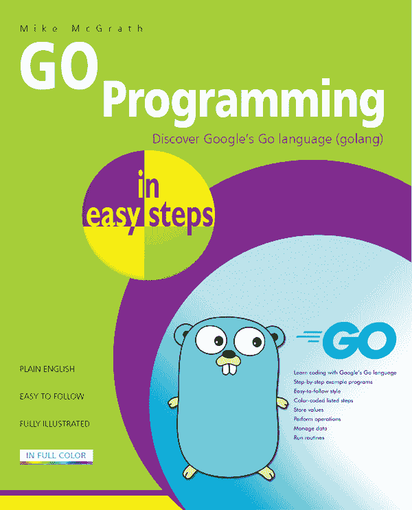


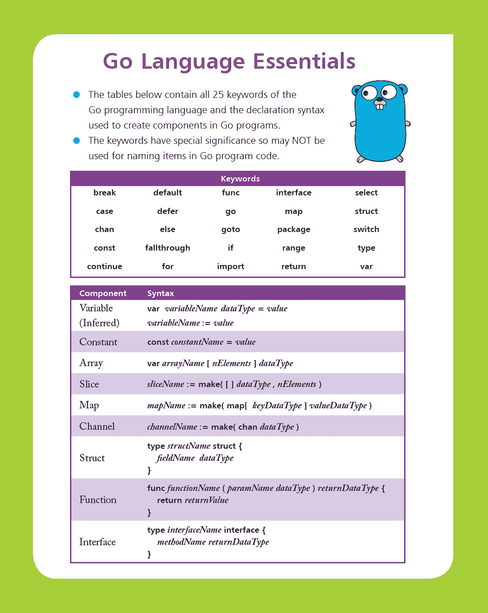

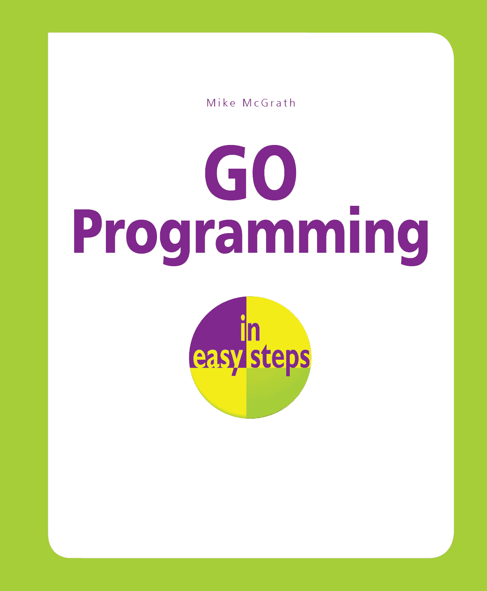

# 如何使用本书

书中的示例演示了 Go 语言的功能，截图展示了实际结果。使用了某些颜色约定来区分代码：程序代码为黑色，Go 的内置函数为蓝色，字面量和数值为红色，代码注释为绿色，如下：

```
package main

import "fmt"

main() {
    // 我的 Go 程序。
    fmt.Println("Hello World!")
}
```

在设置 Go 时，你将在计算机上选择一个`GOPATH`位置来创建程序。每个程序将位于`GOPATH/src`中一个命名的文件夹内。

## 获取源码

为了方便起见，书中所有示例的源代码都在一个 ZIP 包中。你可以按照以下简单步骤获取此包：

访问 [www.ineasysteps.com](http://www.ineasysteps.com)，然后导航到 Free Resources 并选择 Downloads 部分

接下来，在列表中找到 GO Programming in easy steps，然后点击 All Code Examples 链接下载 ZIP 文件

现在，将包的内容解压到计算机上的`GOPATH/src`子目录中

如果你没有获得示例所示的结果，请将你的代码与下载的原始示例文件中的代码进行对比，以发现哪里出了问题。

Go 是一种免费的开源编程语言，由 Robert Griesemer、Rob Pike 和 Ken Thompson 在 Google 创建——他们最因开发了 Unix 操作系统而闻名。Google 于 2012 年 3 月发布了 Go 语言的 1.0 版本 (`golang`)，从那时起它获得了广泛的普及。

Go 程序用纯文本编写，然后由 Go 编译器编译成机器码，以生成可执行的二进制版本。

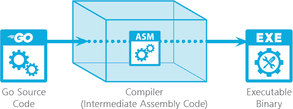

Go 编程语言的目标是具有表达性、快速、高效、可靠且易于编写。某些编程语言（如 C 或 C++）快速且可靠，但并不简单。相反，Java 或 Python 等其他编程语言编写起来简单，但效率不高。

Go 在许多方面与 C 语言语言相似，有时被称为“类 C 语言”或“21 世纪的 C”。但 Go 的意义远于此，因为它吸收了许多其他编程语言的优秀思想，同时避免了那些导致复杂性或不可靠性的特性。

也许最重要的是，Go 引入了利用“goroutine（协程）”和“通道（channels）”通过多核 CPU 处理来实现并发的能力。这为计算机同时处理多件事情提供了可能性。

尽管 Go 语言没有像 C++ 或 Java 等面向对象编程（OOP）语言那样的类结构，但它的特性确实提供了某种程度的封装、继承和多态——这是 OOP 的三个基石。


Go gopher —— Go 编程语言的标志性吉祥物。


你可以在 In Easy Steps 系列中发现更多编程语言书籍——包括 C、C++、C#、Java 和 Python。访问 [www.ineasysteps.com](http://www.ineasysteps.com) 了解更多。

有这么多编程语言可以选择，你可能会好奇为什么选择学习 Go 编程——以下是 Go 提供的某些优势：

### 语法简单

Go 语言像 Python 一样简洁。它编写起来像 Python 一样简单，但像 C++ 一样高效。这让你能够编写易于阅读和维护的代码。

### 编译型语言

Go 源代码被编译为二进制机器码，计算机可以直接读取，而不是在每次程序运行时都进行解释。这使得你编写的 Go 程序运行得比 Python 或 PHP 等解释型语言的程序更快。

### Go 编译器

Go 编译器非常快并提供额外的好处，例如代码优化和错误检查——它可以检测代码中未使用的变量、代码所需的缺失导入，以及拼写错误或无效代码。Go 编译器还可以为其他操作系统生成可执行二进制文件。这让你能够将源代码编译并运行在多台机器上。

### 并发

Go 语言通过 goroutines 和 channels 对并发提供了原生支持。这使你能够编写可以同时执行多个任务的多线程程序。

### 垃圾回收

自动内存管理是 Go 语言的一个关键特性。它的垃圾回收器与程序并发运行。这让你在编写程序代码时无需担心内存泄漏。

### 静态类型

Go 是一种静态类型语言，变量被显式地声明为特定的固定类型。这能够在开发过程中早期发现错误。

随着 Go 语言经验的增加，你可能会发现其他优势，但现在是时候开始了……

### 安装 Go 工具

要开始学习 Go 语言，你必须首先在 PC 上安装 Go 工具。这些工具允许你构建、运行和测试用 Go 语言编写的程序。Go 工具随许多实用的标准标准包提供，你可以将它们导入到自己的程序中。Go 安装程序适用于 Windows、macOS 和 Linux。


打开网络浏览器并访问 [`golang.org`](https://golang.org)，然后下载适用于你系统的安装程序

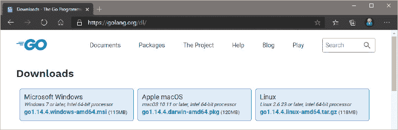

下载完成后，运行安装程序启动“Go 编程语言安装向导”

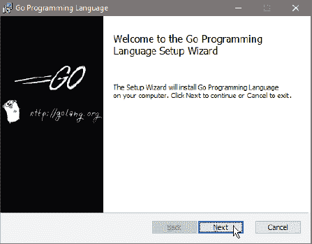

点击`Next`继续，然后接受许可条款

接受建议的`Destination Folder`（Windows 上为`C:\Go`），然后点击`Install`完成安装。


Windows 版 Go 安装程序会自动将 Go 添加到系统路径中，以便在命令提示符可以使用 Go 工具。

要测试安装是否成功，首先打开 Terminal 窗口——在 Windows 系统上同时按下`WinKey` + `R`打开“运行”对话框，然后输入`cmd`打开“命令提示符”窗口。

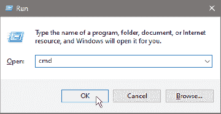

在命令提示符处，输入命令`go`然后按`Enter`查看 Go 工具命令列表。

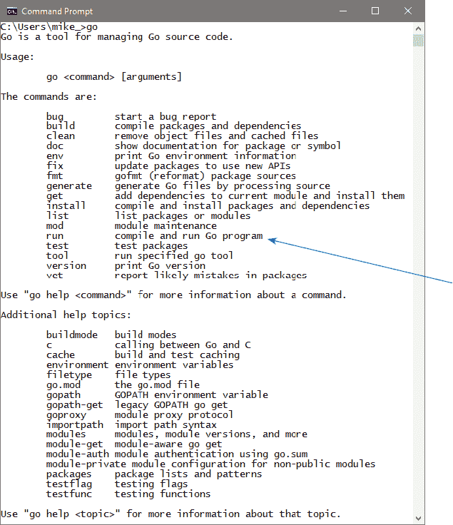


虽然有很多 Go 工具，但你大部分时候只会使用`run`工具来编译和运行你的程序。


“WinKey”是标有 Windows 标志的键盘键。


### 创建工作空间

当你安装 Go 时，安装程序会设置多个 Go 环境变量。例如，Go 工具的目录（文件夹）存储在`GOROOT`环境变量中——默认在 Windows 上位于`C:\Go`，Linux 和 macOS 上位于`/usr/local/go`。

安装程序还会为你的工作空间位置设置`GOPATH`环境变量。默认情况下，这是主目录下的一个名为`go`的目录。例如，在 Windows PC 上，路径为`C:\Users\*username*\go`，在 Linux 系统上路径为`/home/*username*\go`，在 macOS 上是`/Users/*username*\go`——但安装程序实际上并没有创建任何目录。

要创建工作空间，你只需在主目录下添加一个名为`go`的目录。然后你必须在工作空间内添加`bin`、`pkg`和`src`子目录——你的所有程序都可以在`src`目录下创建。

在桌面上创建一个快捷方式是很有用的，它可以在这个子目录中打开命令行以便方便运行你的程序。

在 Windows PC 上，按照此处所述打开命令提示符，或打开 Terminal 窗口。

输入命令`go env GOPATH`查看当前的工作空间位置。

接下来执行`mkdir`命令在`GOPATH`环境变量指定的位置创建`go`工作空间。

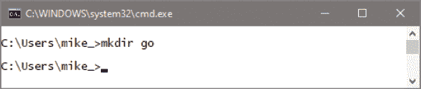


`go\src`文件夹是你保存编写程序的地方。`go\bin`和`go\pkg`将将用于存储可执行文件和包存档。

`mkdir`命令名称是“make directory”（创建目录）的缩写。

现在，执行后续`mkdir`命令在工作空间目录下创建`bin`、`pkg`和`src`子目录。

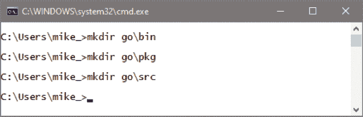

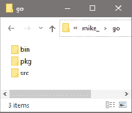

在 Windows 桌面上右键点击并选择`New`, `Shortcut`打开“创建快捷方式”对话框。

在位置输入`cmd`并点击`Next`，然后名称输入`Go Terminal`并点击`Finish`在桌面上创建一个快捷方式图标。


右键点击快捷方式图标并选择`Properties`（属性）项，打开其“属性”对话框

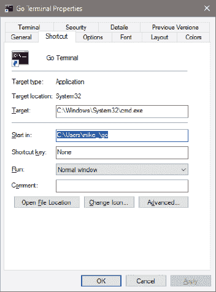


选择`Shortcut`（快捷方式）选项卡，然后输入你的工作区目录位置


点击`Apply`（应用）、`OK`（确定）关闭对话框，然后双击快捷方式图标在你的“src”文件夹中打开命令行

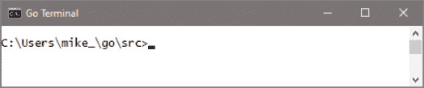


Go 程序可以使用纯文本编辑器编写，例如 Windows 的“记事本”应用。拥有一个桌面快捷方式，可以直接在你的“src”目录中打开文本编辑器，这是非常有用的。重复此页面上的步骤，但在第 7 步输入`notepad`作为位置，输入`Go Editor`作为名称，创建另一个实用的桌面快捷方式。

## 编写一个 Go 程序

所有的 Go 程序最初以纯文本文件的形式存在，随后会被编译成实际的可执行程序。这意味着 Go 程序可以用任何纯文本编辑器编写，例如 Windows 的“记事本”应用或 Linux  Nano 应用。


按照以下步骤创建一个简单的 Go 程序，它将输出传统的第一个程序问候语：


在你的“src”文件夹中创建一个名为“hello”的子目录

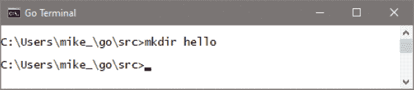


`src/hello/main.go`


打开纯文本编辑器（如记事本），并按照列出的内容输入此代码以开始程序

```go
package main
```


在下方两行，按照列出的内容插入此代码

```go
import “fmt”
```


在再下方两行，精确添加此代码

```go
func main( ) {
    fmt.Println( “Hello World!” )
}
```


将文件保存到“hello”文件夹中，并命名为`main.go` – 现在完整的程序看起来应该完全如下：

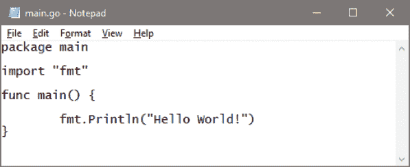


`fmt.Println`中的大写 P 和小写字母 L。


文件夹内文件的安排在 Go 中非常重要。每个主文件以及任何相关文件都必须放置在唯一命文件夹中以创建一个包（package）——因此这里的包命名为“hello”。

相反页面上程序代码的各个部分可以单独检查，以便更清楚地理解每个部分：

### 包声明

```go
package main
```

包的类型在`package`关键字之后声明。所有的 Go 程序代码都包含在包中。你可以为作为共享库的包声明自己的类型，但如果你想将代码编译成可执行程序，则必须声明包为“main”。

### 导入声明

```go
import “fmt”
```

使用`import`关键字将一个或多个包导入到当前包中，以便这些包的功能对该程序可用。`fmt`包来自 Go 安装中包含的 Go 标准库。它提供了`fmt.Println()`函数，用于在该程序中输出文本。注意，包名必须包含在双引号内。导入多个包时，包名列表必须包含在括号内，且每个名称必须占一行，如下：

```go
import (
    “fmt”
    “strings”
)
```

### 函数声明

```go
func main( ) {
    fmt.Println( “Hello World!” )
}
```

函数名紧随`func`关键字。它后面必须紧跟括号，并在同一行跟一个左大括号`{`。函数体包含作为执行程序任务的实际指令的语句。函数体必须以右大括号`}`结束。函数名必须是唯一的，但每个 Go 程序都必须有一个名为“main”的函数，因为这是所有 Go 程序的起点。


包名和包类型是两个单独的项目——这里包名为`hello`，但类型是`main`。


你可以在`GOROOT`目录位置的“src”目录中找到 Go 标准库包——例如，在`C:\Go\src`。此外，你可以从官方文档 [`golang.org/pkg`](https://golang.org/pkg) 学习每个包——这是一个非常有价值的资源。

## 运行 Go 程序

Go 程序代码使用 Go 工具进行编译和执行。在程序开发期间，无错误的 Go 程序可以通过`go run`工具进行编译和运行。这是很有用的，但如果你想创建一个可以重复执行并分的可执行二进制文件版本，可以使用`go build`工具。


在你的 Go “src”文件夹中打开命令提示符或终端窗口


输入命令`go run hello`来运行此处 编写的程序——它应该输出问候语

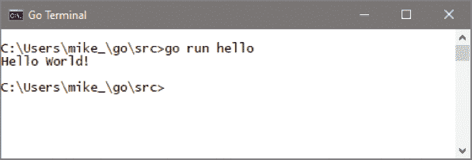


接下来，输入命令`go build hello`为程序此处 生成可执行二进制文件


在 Windows 系统上二进制扩展名为`.exe`。

## 代码格式化与注释

良好的习惯是在运行之前通过`go fmt`确保你的源代码格式是正确的。


良好的习惯是在源码中包含解释性注释，以便他人以及自己在回顾代码时能够轻松理解。可以在`//`序列后添加单行注释——`//`之后的所有内容会被编译器忽略。可以在`/*`和`*/`序列之间添加多行注释——这有助于“注释掉”代码块，从而将其隐藏。


此处 编辑`hello.go`以添加注释，不必要的制进（格式错误）

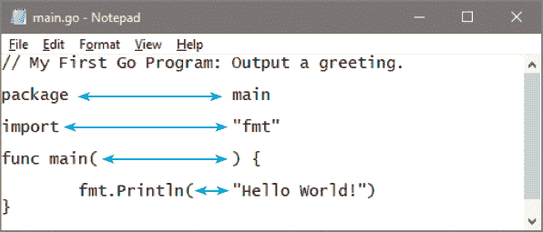


现在，在提示符输入命令`go fmt hello`然后重新打开源代码查看正确的格式

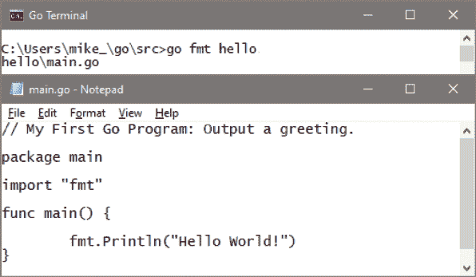


注释不应该被“嵌套”，即在一个注释内部包含另一个注释。


`go fmt`工具提供了一些简单的错误检查。例如，漏掉一个最后的双引号`"`，它将提供错误发生的行号和位置，并提供错误性质为“字符串未结束”。

## 探索 VS Code 编辑器

虽然可以使用命令行和纯文本编辑器很好地创建 Go 程序，但许多开发者倾向于使用专门的代码编辑器。这些编辑器提供了实用的额外功能，如语法高亮、自动缩进、括号匹配和代码调试。最好的免费代码编辑器可能是微软的 Visual Studio Code（VS Code）应用。它可以在 [`code.com.com/download`](https://code.com.com/download) 下载 Windows、Linux 和 macOS 版本。


当你下载并安装 VS Code 时，你只得到了代码编辑器框架。VS Code 实际上可以支持许多不同的编程和脚本语言，因此你必须为你使用的语言安装相应的扩展。


下载并安装 VS Code

要打开“扩展市场”侧边栏，首先点击`View`（视图）、`Appearance`（外观）、`Show Activity Bar`（显示活动栏），然后点击活动栏上的`Extensions`（扩展）按钮


接下来，在搜索框中输入“go”以查找 Go 语言的 VS Code 扩展

点击`Install`为 VS Code 添加 Go 语言支持——如果被要求添加更多 Go 支持，选择`Install All`。


点击 `File`（文件）、`Add Folder to Workspace`（将文件夹添加到工作区），并添加包含源代码 `src` 文件夹的 `go` 工作区文件夹。

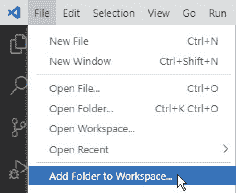

点击活动栏上的 `Explorer`（资源管理器）按钮，然后选择一个文件在 VS Code 主编辑器窗口打开——例如，点击 `hello` 文件夹中的 `main.go` 文件。

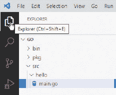

点击 `View`（视图）、`Debug Console`（调试控制台）打开输出面板——通常这将出现在代码编辑器窗口下方，但可以移动。

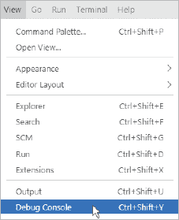

点击 `Run`（运行）、`Run Without Debugging`（不调试运行）以查看输出结果出现在调试控制台中。

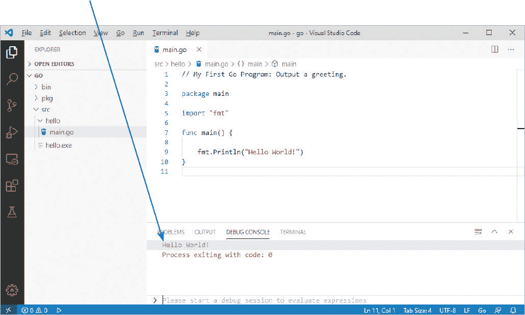

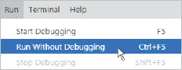


VS Code 是高度可定制的——你可以根据喜好更改组件布局，并从几种浅色或深色主题中进行选择。这里显示的截图是默认的 Light（浅色）主题，代码编辑器窗口中显示的语法高亮与书中后续使用的相同。

## 总结

- Go 程序是纯文本文件，会被编译成机器码以生成可执行的二进制版本。
- Go 工具允许你构建、运行和测试用 Go 语言编写的程序。
- Go 安装包含了实用的、可信的代码标准包，你可以将它们导入到程序中。
- 命令行 `go` 命令显示 Go 工具命令列表。
- `GOROOT` 环境变量存储你系统上 Go 安装所在的位置。
- `GOPATH` 环境变量存储你系统上 Go 工作区的位置。
- Go 工作区是一个名为 `go` 的目录，包含名为 `src`、`bin` 和 `pkg` 的子目录。
- Go 包是包含 Go 源代码文件的目录名称。
- Go 包声明指定了其类型，并且必须指定为 `package main` 才能编译为可执行文件。
- `import` 声明引用了任何要供程序使用的包的名称。
- 函数声明包含 `func` 关键字，后紧跟函数名、`()` 括号和 `{}` 大括号。
- 所有 Go 程序都必须有一个名为 `main` 的函数作为程序的入口点。
- `go run` 命令编译并运行程序。
- `go build` 命令编译程序并生成可以分发的二进制执行二进制文件。
- 应使用 `go fmt` 命令来正确格式化 Go 包的源代码。
- VS Code 提供语法高亮、自动缩进、括号匹配和代码调试等功能。

# 存储值

*本章演示了如何在 Go 程序中使用变量容器来存储、检索和操纵各种类型的数据。*

- 创建程序变量
- 显示变量值
- 转换数据类型
- 修复常量值
- 指向已存储的值
- 总结

## 创建程序变量


变量是 Go 程序中的一种容器，数据值可以存储在计算机的内存中。存储的值可以使用变量名进行引用，并通过分配一个新值来更改。程序员可以为变量选择任何名称，只要它符合下面列出的命名规范规则：

| 命名规则 | 示例 |
| :--- | :--- |
| 不可以是 Go 关键字 | `default` |
| 不可以包含算术运算符 | `a+b*c` |
| 不可以包含标点字符 | `%$#@!` |
| 不可以包含任何空格 | `no spaces` |
| 必须以字母开头 | `msg` |
| 其他地方可以包含数字 | `good1` |
| 可以包含混合大小写 | `camelCase` |

变量名应该是简洁的，并且始终以小写字母开头——除非该变量需要对其他包可见（稍后会详细介绍）。为变量选择有意义的名称是一个良好的习惯，可以让程序代码更易理解。在程序中创建变量只需要使用 `var` 关键字对其进行“声明”。变量声明的语法如下：

`var variableName dataType`

`var` 关键字后跟着一个空格，然后是所选的变量名，然后该变量允许存储的数据类型。通常，这将是相反页描述的五种数据类型之一。可以在单次声明中以逗号分隔列表的形式创建多个相同数据类型的变量，如下：

`var variableName1, variableName2, variableName3 dataType`


Go 关键字列在本书内封底的表格中。


变量名在 Go 中是区分大小写的——因此名为 `NUM`、`Num` 和 `num` 的变量被视为不同的变量。

Go 中的基础数据类型使用 Go 关键字定义。这些类型列下表，并带有每种数据类型的描述：

| 数据类型 | 描述 | 示例 |
| :--- | :--- | :--- |
| `string` | 字符串 | “Hi there!” |
| `int` | 整数 | 100 |
| `float64` | 浮点数 | 0.123456 |
| `byte` | 单字节字符 | ‘A’ |
| `bool` | 布尔值 | true |

重要的是，Go 是一门“静态类型”语言，这意味着变量只能包含其声明中指定的类型。

当一个值赋给变量时，该变量被称为已“初始化”。变量可以先声明后初始化，也可以在声明时进行初始化。例如，初始化一个变量包含字符串类型的值：

`var msg string`

`msg = “Hi there!”`

`var msg string = “Hi there!”`

此外，可以使用特殊的 `:=` 操作符声明并初始化变量。在这种情况下，不需要 `var` 关键字或数据类型，如下：

`msg := “Hi there!”`

Go 编译器根据赋值的数据类型推导出类型。这是创建和初始化变量的首选方法——但只能在函数体内使用。


`byte` 类型的字符值必须由单引号 ‘ ’ 包围——双引号是错误的。


Go 编程中建议使用短变量名，因此这里的示例使用 `msg` 而不是 `message` 作为变量名。

## 显示变量值


可以使用第一章中用于显示“Hello World!”消息的 `fmt.Println()` 函数显示变量的值。另一种方法是在 `fmt.Printf()` 函数中使用适当的“格式化符”和变量名来指定显示变量值的格式：

| 格式符 | 描述 | 示例 |
| :--- | :--- | :--- |
| `%s` | 字符串 | “Go Fun!” |
| `%d` | 整数 | 100 |
| `%f` | 浮点数 | 0.123456 |
| `%c` | 单字符 | ‘A’ |
| `%t` | 布尔值 | true |
| `%p` | 内存地址 | 0x0022FF34 |
| `%v` | 默认格式的值 | (上述任意一项) |
| `%T` | 变量的数据类型 | int |

格式指定符可以通过在 `%` 字符之后指定所需的空格数，来确保输出占据最少数量的空格——例如，使用格式指定符 `%7d` 可以确保整数始终至少占用七个空间。如果希望用零填充空白区域，只需添加一个零使格式指定符变为 `%07d` 即可。

精度指定符是一个点（句号）后跟一个数字，该数字可以与 `%f` 格式指定符配合使用，确定显示多少位小数——例如，使用 `%.2f` 显示两位小数。精度指定符可以与最小空间指定符结合使用，以控制空格数和小数位数——例如，使用 `%07.2f` 显示七个空间，包括两位小数和由零填充的空白。默认情况下，空白区域位于数字之前，因此它是右对齐的。你也可以将空格添加到数字之后，通过在最小空间指定符前加上一个减号来使其变为左对齐。


`%v` 格式指定符可以用于显示任何值，而 `%T` 格式指定符用于确认任何变量的数据类型。

在你的 `src` 文件夹内创建一个名为 `vars` 的目录


`src\vars\main.go`

使用 `package` 和 `import` 声明开始一个 `main.go` 程序

```go
package main

import “fmt”
```

添加一个声明并初始化两个变量的 `main` 函数

```go
func main( ) {
    num := 100
    pi := 3.1415926536
    // 在此处插入语句。
}
```

在 `main` 函数中，插入语句以各种格式输出变量值

```go
fmt.Printf( “num: %v type:%T \n”, num, num )
fmt.Printf( “pi: %v type:%T \n\n”, pi, pi )
fmt.Printf( “%%7d displays %7d \n”, num )
fmt.Printf( “%%07d displays %07d \n\n”, num )
fmt.Printf( “Pi is approximately %1.10f \n”, pi )
fmt.Printf( “Right-aligned %20.3f rounded pi \n”, pi )
fmt.Printf( “Left-aligned %-20.3f rounded pi \n”, pi )
```

在 `vars` 目录中保存程序文件，然后运行程序以查看指定格式下的变量值

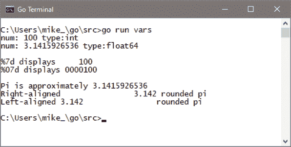


`fmt.Printf()` 函数在输出后不会添加新行。你必须手动包含 `\n` 换行转义序列将打印头移动到下一行。要使用 `fmt.Printf()` 函数显示 `%` 字符，如所示，在它前面加上另一个 `%` 字符。


注意，当格式指定符分配的小数位数较少时，浮点值会被四舍五入——而不是简单的截断。

## 转换数据类型

你有时需要将变量中存储的值转换为不同的数据类型。通常，你可能希望将字符串值转换为数值以进行算术运算。例如，一个字符串可能包含数字字符“42”，但除非将其转换为 `int` 或 `float64` 数据类型，否则你无法对该值进行算术运算。


Go 标准库包含一个 `strconv` 包，其中包含了在字符串数据类型之间进行转换的函数。你通过在 `import` 声明中添加 `strconv` 包，来让这些函数供你的程序使用。

`strconv.Atoi()` 函数将括号内指定的字符串转换为 `int` 数据类型。它返回字符串等价的 `int` 值，但与你在 Go 中遇到的其他函数一样，它还会返回第二个值，当转换成功时，该值为特殊的 `nil` 零值；如果失败，则返回错误信息。这意味着你必须将对 `strconv.Atoi()` 函数的调用赋值给两个变量以接收这两个返回值，如下所示：

```go
num, err := strconv.Atoi( “42” )
```

还有一个 `strconv.Itoa()` 函数，它可以将 `int` 值转换为字符串值，但它只返回单个字符串值。

如果你倾向于将字符串值转换为 `float64`，可以使用 `strconv.ParseFloat()` 函数。像 `strconv.Atoi()` 一样，它返回字符串等价的 `float64` 以及一个 `nil` 值或错误信息。它在括号内需要字符串值和浮点大小（64）作为参数——例如，`strconv.ParseFloat( “42”, 64 )`。

在不同的数值数据类型之间进行强制转换只需要指定所需的类型以及包含要转换值的括号。例如：

```go
var num int = 42
var decimal float64 = float64( num )
```

有趣的是，当给 `byte` 数据类型（`uint8` 的别名——一种 8 位无符号整数）赋值单个字符时，它将存储该字符的 ASCII 字符编码数值，该数值可以被轻松转换为字符串数据类型：

```go
var char byte = ‘A’
var str = string( char )
```

ASCII（读作“as-kee”）是“American Standard Code for Information”的缩写，是纯文本接受的标准。你可以在 [www.asciitable.com](http://www.asciitable.com) 找到标准的完整范围。

在你的 `src` 文件夹内创建一个名为 `vars` 的目录


`src\vars\main.go`

使用 `package` 和 `import` 声明开始一个 `main.go` 程序

```go
package main

import “fmt”
```

添加一个声明并初始化两个变量的 `main` 函数

```go
func main( ) {
    num := 100
    pi := 3.1415926536
    // 在此处插入语句。
}
```

在 `main` 函数中，插入语句以各种格式输出变量值

```go
fmt.Printf( “num: %v type:%T \n”, num, num )
fmt.Printf( “pi: %v type:%T \n\n”, pi, pi )
fmt.Printf( “%%7d displays %7d \n”, num )
fmt.Printf( “%%07d displays %07d \n\n”, num )
fmt.Printf( “Pi is approximately %1.10f \n”, pi )
fmt.Printf( “Right-aligned %20.3f rounded pi \n”, pi )
fmt.Printf( “Left-aligned %-20.3f rounded pi \n”, pi )
```

在 `vars` 目录中保存程序文件，然后运行程序以查看指定格式下的变量值


`fmt.Printf()` 函数在输出后不会添加新行。你必须手动包含 `\n` 换行转义序列将打印头移动到下一行。要使用 `fmt.Printf()` 函数显示 `%` 字符，如所示，在它前面加上另一个 `%` 字符。


注意，当格式指定符分配的小数位数较少时，浮点值会被四舍五入——而不是简单的截断。

你之后将学会通过测试 `err` 值是否确实为 `nil` 来确认转换成功——这在 Go 编程中被认为是良好的做法。

## 固定常量

如果你想存储一个在程序执行期间永远不会改变的值，你应该使用 `const` 关键字进行声明，而不是 `var` 关键字。这防止了意外（或恶意）的赋值尝试。如果你的代码尝试为常量分配新值，编译器将显示“cannot assign to”。


与变量声明不同，常量声明必须在声明中初始化其固定值，如下所示：

```go
const oneMillion = 1000000
```

常量声明可选地指定数据类型，但如果声明中省略了显式数据类型，Go 编译器将从赋值中推断其类型。

多个相同或不同数据类型的常量可以在单个声明中以逗号分隔列表的形式创建，如下所示：

```go
const oneMillion, oneThousand = 1000000, “1,000”
```

非常有用的是，常量声明可以使用一个名为 `iota` 的“常量生成器”来创建一组相关的常量值。常量名称应该列在 `const` 关键字后面的括号内，每行一个，并将第一个赋值为 `iota` 值。这将生成一个从零开始的数值序列，列表中的每个命名常量都会递增 1。

例如，你可以将数值序列分配给代表星期几的常量，如下所示：

```go
const (
sunday = iota
monday
tuesday
wednesday
thursday
friday
saturday
)
```

在这个示例中，常量 `sunday` 将被赋值为零 (0)，`monday` 将赋值为一 (1)，依此类推。

如果你想从不同的数字开始该序列，只需在给第一个常量赋值时将 `iota` 加上该数字即可。


在其他编程语言中，生成的序列通常被称为“枚举”或简单称为 `enum`。


### 在你的 `src` 文件夹中创建一个名为 `const` 的目录


`src\const\main.go`

### 使用包和导入声明开始一个 `main.go` 程序

```go
package main

import “fmt”
```


### 添加一个 `main` 函数，声明并初始化单个常量以及一组从一 (1) 开始的常量序列

```go
func main( ) {
const pi = 3.14159
const (
red = iota + 1
yellow
green
brown
blue
pink
black
)
// 在此处插入语句。
}
```


### 接下来，插入语句显示几个常量值


```go
fmt.Printf( "Pi approximately: %v \n\n", pi)
fmt.Printf( "Red: %v point \n", red )
fmt.Printf( "Blue: %v points \n", blue )
fmt.Printf( "Black: %v points \n", black )
```


### 将程序文件保存存在“const”目录中，然后运行程序以查看常量值

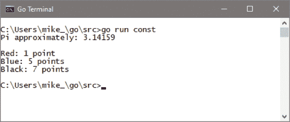


Go 中的 `math` 包提供了一个名为 `math.Pi` 的常量，它是 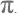 数值的极大近似值。


这里的序列代表斯诺克游戏中每个球的分值。

## 指向存储的值

当你的程序创建一个存储数据的容器时，你的计算机会在内存中分配一个空间来存储数据。就像房子一样，内存位置的大小可能不同，但每个位置都有唯一的地址。


因此，一个初始变量实际上由三部分组成：名称、值以及存储数据的内存地址。

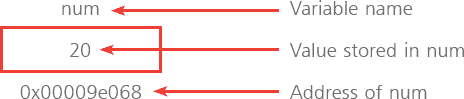

Go 语言支持“指针”的概念。指针变量可以存储另一个变量的地址并访问该地址存储的值。

指针变量的声明要求数据类型前加上星号 `*`，表示这是一个指针：

```go
var ptr *int      // 声明此变量将指向一个 int。
```

通过在另一个变量名前加上 `&` 符号，可以将另一个变量的地址分配给指针：

```go
ptr = &num        // 给指针变量分配一个地址。
```

然后，通过在指针名前加上星号可以访问所分配地址的值：

```go
*ptr             // 指向所分配地址的值。
```

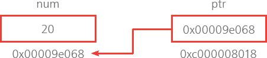

指针的概念可能很难理解，因为 `*` 运算符承担了两个用途：在声明中作为类型描述符，在放在指针名称之前时作为解引用符。你现在可能在想“指针，又如何？”，但指针在 Go 编程中被广泛使用，因此在继续之前，你应该彻底理解它们的工作原理。


内存位置地址是由计算机分配的十六进制数。它们在你的系统上的地址几乎肯定与示例中显示的地址不同。


### 在你的“src” 文件夹中创建一个名为“point”的目录


`src\point\main.go`

### 使用包和导入声明开始一个 main.go 程序

```go
package main

import "fmt"
```


### 添加一个 main 函数，声明并初始化一个普通整数变量和一个指针变量

```go
func main( ) {
var num int = 20
var ptr *int = &num
// 在此处插入语句。
}
```


### 接下来，插入语句显示指针的值和内存地址

```go
fmt.Printf( "value: %v \n", num)
fmt.Printf( "address: %p \n", ptr)
fmt.Printf( "dereferenced: %v \n", *ptr)
```

*(注：原文中缺少了这些行的具体代码，我根据指令上下文重构了逻辑)*

# 理解优先级 (chapter03.xhtml_sec20)

# 总结 (chapter03.xhtml_sec21)

## 算术运算


Go 程序中常用的算术运算符列如下表所示，以及它们执行的操作：

| 算符 | 操作 |

| :--- | :--- |

| `+` | 加法 |

| `-` | 减法 |

| `*` | 乘法 |

| `/` | 除法 |

| `%` | 取余 |

| `++` | 加一 |

| `--` | 减一 |

赋值、加、减、乘、除运算符的行为正如你预期的的那样，但在使用多个运算符时，必须对表达式进行分组——最内层 `( )` 括号内的操作优先执行：

```go
a = b * c - d % e / f ;             // 这不明确。
a = ( b * c ) - ( ( d % e ) / f ) ; // 这更清晰。
```

`%` 取余运算符将第一个给定的数除以第二个给定的数，并返回操作的余数。这对于判断一个数是奇数还是偶数有用。

`++` 加一运算符和 `--` 减一运算符会将给定的数改变一并返回结果。它们最常用于循环中的迭代计数——在每次迭代中通过 `++` 加一运算符递增，或在每次迭代中通过 `--` 减一运算符递减。

`++` 加一或 `--` 减一运算符必须紧跟变量名之后以改变其值。例如：

```go
n := 4
n++             // 现在 n = 5.
```


`+` 运算符双用途——它也被用于连接字符串。


用于与运算符组合形成表达式的值被称为“操作数”——在表达式 `2 + 3` 中，数值 `2` 和 `3` 就是操作数。

 在你的“src” 文件夹内创建一个名为“arith”的目录


`src\arith\main.go`

 开始一个带有包声明和导入的 main.go 程序

```go
package main
import "fmt"
```

 添加一个声明并初始化两个变量的 main 函数

```go
func main( ) {
    a := 8
    b := 4
    // 在此处插入语句。
}
```

 在 main 函数中，插入语句以输出每次算术运算后的结果总值

```go
fmt.Println( "Addition:\t", ( a + b ) )
fmt.Println( "Subtraction:\t", ( a - b ) )
fmt.Println( "Multiplication:\t", ( a * b ) )
fmt.Println( "Division:\t", ( a / b ) )
fmt.Println( "Remainder:\t", ( a % b ) )
```

 现在，插入语句来更改存储的值并显示它们的新值

```go
a++
fmt.Println( "Increment:\t", a )
b--
fmt.Println( "Decrement\t", b )
```

 将程序文件保存到“arith”目录中，然后运行程序查看每次操作的结果

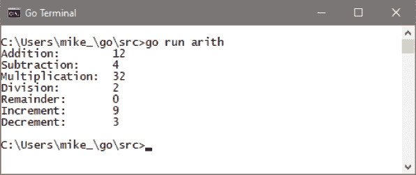


在这里，使用转义序列 `\t` 输出制表符以对齐结果。

## 赋值


Go 编程中用于赋值的运算符列如下所示。除了简单的 `=` 赋值运算符外，所有运算符都是较长表达式的简写形式，因此为了清晰起见，给出了等效形式：

| 运算符 | 示例 | 等效于 |

| :--- | :--- | :--- |

| `=` | `a = b` | `a = b` |

| `+=` | `a += b` | `a = ( a + b )` |

| `-=` | `a -= b` | `a = ( a - b )` |

| `*=` | `a *= b` | `a = ( a * b )` |

| `/=` | `a /= b` | `a = ( a / b )` |

| `%=` | `a %= b` | `a = ( a % b )` |

在上面的赋值示例中，`a = b`，名为“a”的变量被赋值为名为“b”的变量包含的值——这样该值就存储在 `a` 变量中。从技术上讲，赋值运算符将右操作数的值存储在左操作数所指定的内存位置中，然后返回该值作为结果。

`+=` 复合运算符用于将一个值加到变量存储的现有值上。在上面的示例中，`a += b`，变量 `b` 的值加到变量 `a` 中——总和就是存储在 `a` 变量中的值。

`%` 复合运算符将第一个给定的数除以第二个给定的数并返回操作的余数。这对于判断一个数是奇数还是偶数有用。

`++` 加一运算符和 `--` 减一运算符会将给定的数改变一并返回结果。它们最常用于循环中的迭代计数——在每次迭代中通过 `++` 加一运算符递增，或在每次迭代中通过 `--` 减一运算符递减。

`++` 加一或 `--` 减一运算符必须紧跟变量名之后以改变其值。例如：

```go
n := 4
n++             // 现在 n = 5.
```

（注：此处后续原文存在大量重复的描述性文本，已根据要求保留核心逻辑翻译并去重）

...在表达式 `2 + 3` 中，数值 `2` 和 `3` 是操作数。`+=` 复合运算符用于将一个值加到变量存储的现有值上...（重复内容略）

等待， 在你的“src” 文件夹内创建一个名为“arith”的目录


`src\arith\main.go`

 开始一个带有包声明和导入的 main.go 程序

```go
package main
import "fmt"
```

 添加一个声明并初始化两个变量的 main 函数

```go
func main( ) {
    a := 8
    b := 4
    // 在此处插入语句。
}
```

 在 main 函数中，插入语句以输出每次算术运算后的结果总值

```go
fmt.Println( "Addition:\t", ( a + b ) )
fmt.Println( "Subtraction:\t", ( a - b ) )
fmt.Println( "Multiplication:\t", ( a * b ) )
fmt.Println( "Division:\t", ( a / b ) )
fmt.Println( "Remainder:\t", ( a % b ) )
```

 现在，插入语句来更改存储的值并显示它们的新值

```go
a++
fmt.Println( "Increment:\t", a )
b--
fmt.Println( "Decrement\t", b )
```

 将程序文件保存到“arith”目录中，然后运行程序查看每次操作的结果


在这里，使用转义序列 `\t` 输出制表符以对齐结果。

Go 编程中用于赋值的运算符列如下表。除了简单的 `=` 赋值运算符外，所有运算符都是较长表达式的简写形式，因此为了清晰起见，给出了等效形式：

...（重复内容略）

## 比较


Go 编程中常用于比较两个数值的运算符列如下表所示：

| 运算符 | 比较测试 |

| :--- | :--- |

| `==` | 等于 |

| `!=` | 不相等 |

| `>` | 大于 |

| `<` | 小于 |

| `>=` | 大于等于 |

| `<=` | 小于等于 |

`==` 等于运算符比较两个操作数，如果两者的值相等则返回 true，否则 `==` 运算符将返回 false。如果两者都是数字，则它们相等；如果两者都是字符，则对它们的 ASCII 值进行数值比较。

相反，`!=` 不相等运算符在两个操作数不相等时返回 true，使用与 `==` 等于运算符相同的规则，否则返回 false。

`>` “大于”运算符比较两个操作数，如果第一个操作数的值大于第二个，则返回 `true`；如果它的值等于或小于第二个，则返回 `false`。`<` “小于”运算符执行相同的比较，但如果第一个操作数的值小于第二个操作数，它则返回 `true`，否则返回 `false`。通常，`>` “大于”运算符或 `<` “小于”运算符用于测试循环结构中迭代计数器的值。

在 `>` “大于”运算符或 `<` “小于”运算符后添加 `=` 赋值运算符，可以使它们在两个操作数的值完全相等时也返回 `true`。


比较运算符也称为“关系运算符”。

在你的“src” 文件夹内创建一个名为“comp”的目录


`src\comp\main.go`

带有 package 和 import 声明开始一个 main.go 程序

```go
package main

import "fmt"
```

添加一个声明并初始化五个变量的 main 函数

```go
func main( ) {
    var zero, num, max int = 0, 0, 1
    var up, dn byte = 'A', 'a'
    // Statements to be inserted here.
}
```

在 main 函数中，插入语句以输出几次比较的结果

```go
result := ( num == zero )             // 0 == 0.
fmt.Println( "Equality:\tnum == zero\t", result )
result = ( up == dn )                 // A == a.
fmt.Println( "Equality:\tup == dn\t", result )
result = ( max != zero )              // 1 != 0.
fmt.Println( "Inequality:\tmax != zero\t", result )
result = ( zero > max )               // 0 > 1.
fmt.Println( "Greater:\tzero > max\t", result )
result = ( max <= zero )              // 1 <= 0.
fmt.Println( "Less or Equal:\tmax <= zero\t", result )
```

将程序文件保存在“comp”目录中，然后运行程序以查看每次比较的结果

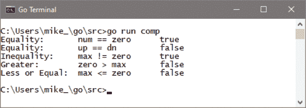


大写字母‘A’的 ASCII 值为 65，但小写字母‘a’的值是 97——因此它们在这里比较返回 `false`。


比较数字时，记住要测试相等性，也要测试高低值情况。

## 评估逻辑


Go 编程中最常用的逻辑运算符如下表所示：

| 运算符 | 操作 |

| :--- | :--- |

| `&&` | 逻辑与 |

| `||` | 逻辑或 |

| `!` | 逻辑非 |

逻辑运算符用于具有布尔值 `true` 或 `false` 的操作数，或者可以转换为 true 或 false 的值。

`&&` 逻辑与运算符将评估两个操作数，只有当两个操作数本身都为 true 时，才会返回 `true`。否则，`&&` 逻辑与运算符将返回 `false`。这用于条件分支，通过测试两个条件来决定程序的运行方向——如果两个条件都满足，程序将向某个方向运行，否则它将采取另一个方向。

与需要两个操作数都为 true 的 `&&` 逻辑与运算符不同，`||` 逻辑或运算符将评估其两个操作数，如果其中任一个操作数本身返回 true，它将返回 `true`。然而，如果两个操作数都不返回 true，那么 `||` 逻辑或运算符将返回 `false`。这在 Go 编程中非常用，用于在两个操作数（两个测试条件）中的任一条件被满足时执行某项操作。

`!` 逻辑非运算符是一个一元运算符，用在单个操作数之前。它返回给定操作数的反反值，因此如果变量 `a` 的值为 `true`，那么 `!a` 的值就是 `false`。`!` 逻辑非运算符在 Go 程序中非常有用，可以使用像 `a = !a` 这样的语句在连续的循环迭代中切换变量的值。这确保了每次通过时值都会发生变化，就像开关灯一样。


“布尔”（boolean）一词是指英国数学家乔治·布尔（George Boole，1815-1864）开发的逻辑思维体系。

在你的“src” 文件夹内创建一个名为“logic”的目录


`src\logic\main.go`

```go
package main

import "fmt"
```

添加一个声明并初始化五个变量的 main 函数

```go
func main( ) {
    var zero, num, max int = 0, 0, 1
    var up, dn byte = 'A', 'a'
    // Statements to be inserted here.
}
```


在 `main` 函数中，插入语句以输出几次比较的结果

```go
result := ( num == zero )             // 0 == 0.
fmt.Println( “Equality:\tnum == zero\t”, result )
result = ( up == dn )                 // A == a.
fmt.Println( “Equality:\tup == dn\t”, result )
result = ( max != zero )              // 1 != 0.
fmt.Println( “Inequality:\tmax != zero\t”, result )
result = ( zero > max )               // 0 > 1.
fmt.Println( “Greater:\tzero > max\t”, result )
result = ( max <= zero )              // 1 <= 0.
fmt.Println( “Less or Equal:\tmax <= zero\t”, result )
```

```go
fmt.Printf( “Flag #2:%v \n”, ( flags & 2 ) > 0 )
```

```go
fmt.Printf( “Flag #3:%v \n”, ( flags & 4 ) > 0 )
```

```go
fmt.Printf( “Flag #4:%v \n”, ( flags & 8 ) > 0 )
```

接下来，插入一条语句来显示该模式的十进制值

```go
fmt.Printf( “Flags Value: %08b \t%v \n”, flags, flags )
```

现在，插入语句将“开启”的位标志向右移动一位，并输出新模式的十进制值

```go
flags = flags >> 1
```

```go
fmt.Printf( “New Value: %08b \t%v \n”, flags, flags )
```

将程序文件保存在“bits”目录中，然后运行程序以查看位标志的值

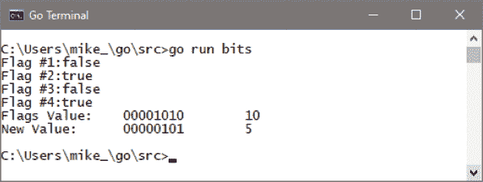


可以使用内存更大的变量创建具有更多位标志的位位域——`int` 数据类型在 32 位系统上宽 32 位，在 64 位系统上宽 64 位。


此处在此使用 `%b` 格式指定符来输出每个位中的二进制数值。

## 理解优先级

运算符优先级定义了 Go 编译器求值的表达式顺序。在表达式 `6 + 7 * 3` 中，优先级决定了是先完成加法还是先完成乘法。


下表按降序列出了运算符优先级，其中高行的运算符优先级高于低行的运算符，因此它们的操作会先完成。同一行的二元运算符优先级相等，但完成顺序由它们从左到右的顺序决定，因此左侧的操作先完成。

| 优先级级别 | 运算符 |

| :--- | :--- |

| 5 | `* % << >> &` |

| 4 | `+ - & | ^` |

| 3 | `== != < <= >=` |

| 2 | `&&` |

| 1 | `||` |

`++` 递增运算符和 `--` 递减运算符在 Go 编程中构成语句，而不是出现在表达式中，因此未包含在上面的优先级表中。

你可以通过将表达式的部分包含在括号内强制编译器忽略默认优先级级别，从而强制编译器先求值表达式中最内部分。例如，在表达式 `6 + 7 * 3` 中，`*` 乘法运算符的默认优先级高于 `+` 加法运算符，因此先执行乘法操作 `7 * 3 = 21`，然后执行加法 `21 + 6 = 27`。你可能更希望先执行加法操作，因此可以通过给表达式添加括号如 `( 6 + 7 ) * 3` 来强制编译器这样做。现在，表达式的求值结果为 `6 + 7 = 13`，然后是乘法 `13 * 3 = 39`。

在你的“src”文件夹内创建一个名为“force”的目录


`src\force\main.go`

带有 `package` 和 `import` 声明开始一个 `main.go` 程序

```go
package main

import “fmt”
```

添加一个 `main` 函数，通过求值表达式来声明并初始化变量并显示其值

```go
func main( ) {
    sum := 2 * 3 + 4 - 5
    fmt.Printf( “Default Order: %v \n”, sum )
    // 在此处插入语句。
}
```

在 `main` 函数中，插入语句显示修改后的表达式求值结果

```go
sum = 2 * ( ( 3 + 4 ) - 5 )
fmt.Printf( “Forced Order: %v \n\n”, sum )
```

接下来，插入一条语句显示另一个表达式求值的结果

```go
sum = 7 % 3 * 2
fmt.Printf( “Default Order: %v \n”, sum )
```

现在，插入语句显示另一个修改后的表达式求值的结果

```go
sum = 7 % ( 3 * 2 )
fmt.Printf( “Forced Order: %v \n\n”, sum )
```

将程序文件保存在“force”目录中，然后运行程序以查看不同的结果

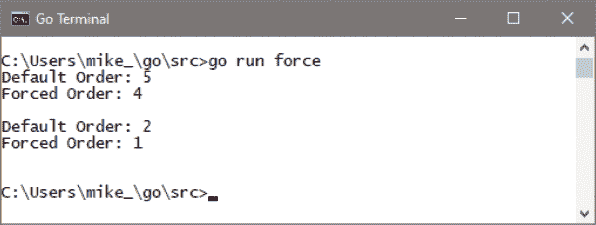


在表达式中使用括号以避免意外结果。

## 总结

- 算术运算符可以形成包含两个操作数的表达式，包括加法 `+`、减法 `-`、乘法 `*`、除法 `/` 和取模 `%`。

- 递增 `++` 和递减 `--` 运算符通过 1 修改单个操作数。

- 赋值 `=` 运算符可以与算术运算符结合，执行算术计算然后赋值其结果。

- 比较运算符可以形成比较两个操作数的表达式：相等 `==`、不等 `!=`、大于 `>`、小于 `<`、大于等于 `>=`、小于等于 `<=`。

- 逻辑 `&&` 和逻辑 `||` 运算符形成两个操作数的表达式。

- 逻辑 `!` 运算符返回操作数的反。

- 位运算符 `|`、`&`、`~` 和 `^` 均返回一组位。

- 移位 `<<` 和移位 `>>` 运算符移动位。

- 位运算符常用的用法是确定是否执行后续语句。

## 控制流

*本章演示了语句如何通过评估表达式来确定 Go 执行的方向。*

### 测试条件


`if` 关键字用于执行基础条件测试，对给定的表达式进行布尔值求值。位于后的 `{ }` 大括号内的语句仅在求值结果为真时执行。`if` 语句的语法如下：

```go
if test-expression {
    statements-to-execute-when-the-condition-is-true
}
```

当测试为真时可能有多个语句需要执行，但每个语句必须独占一行。有时需要评估多个表达式以确定是否执行后续语句。这可以使用逻辑 `&&` 运算符通过以下语法实现：

```go
if test-expression && test-expression {
    statements-to-execute-when-all-conditions-are-true
}
```

或者，可以将多个 `if` 语句“嵌套”在另一个内部来评估多个表达式，如下：

```go
if test-expression {
    if test-expression {
        statements-to-execute-when-all-conditions-are-true
    }
}
```

当 `if` 测试语句的一个或多个表达式求值结果为假时，其后续大括号中的语句不执行，程序继续执行后续代码。通常通过附加 `else` 语句来扩展 `if` 语句，指定当 `if` 语句评估的表达式为假时执行的大括号内语句，语法如下：

```go
if test-expression {
    statements-to-execute-when-the-condition-is-true
} else {
    statements-to-execute-when-the-condition-is-false
}
```

测试表达式和左大括号 **{** 必须与 **if** 关键字出现在同一行。

`else` 关键字和左大括号 `{` 必须与上一个语句块的右大括号 `}` 出现在同一行。

用一个测试两个字符是否匹配的语句开始一个 `main` 函数。

```go
func main( ) {
    if ‘A’ == ‘A’ {
        fmt.Println( “\nCharacters Match” )
    }
    // 在此处插入语句。
}
```


`src\ifelse\main.go`

接下来，在 `main` 函数中插入嵌套语句来测试两个数值表达式。

```go
if 5 > 1 {
    if 7 > 2 {
        fmt.Println( “\nBoth expressions are true” )
    }
}
```

现在，插入语句来测试数值表达式，并测试两个字符是否不匹配。

```go
if 5 < 1 {
    fmt.Println( “\n1st Condition is true” )
} else if ‘A’ != ‘A’ {
    fmt.Println( “\n2nd Condition is true” )
} else {
    fmt.Println( “\nBoth Conditions are false” )
}
```

将程序文件保存到“ifelse”目录中，然后运行程序以查看条件测试的结果。

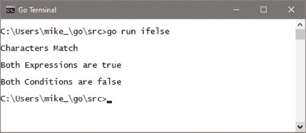


为了避免重复，从现在起列出的步骤代码假设你已经在每个程序的开头声明了 `package main` 和 `import “fmt”`。


注意，如果第一个测试为 `false`，你可以使用 `else if` 来评估第二个表达式。

### Switch Cases

当测试表达式仅评估单个条件时，通过多个 `if else` 语句执行条件分支通常可以通过 `switch` 语句更高效地完成。


`switch` 语句的工作方式特殊。它接受一个给定值作为参数参数，然后从多个 `case` 语句中匹配该值。找到匹配时执行的代码包含在每个 `case` 语句中。

每个要执行的语句必须单独出现在一行，从 `case` 语句下方的行开始。

可选情况下，`case` 语句列表后面可以跟一个最终的 `default` 语句，以指定在任何 `case` 语句中未找到匹配项时执行的代码。因此，`switch` 语句的语法通常如下：

```go
switch *test-value* {
case *match-value* :
    statements-to-execute-when-matched
case *match-value* :
    statements-to-execute-when-matched
default:
    statements-to-execute-if-no-match
}
```

上一个示例这里中描述的 `for` 循环的替代方案在 `for` 关键字之后只包含一个测试表达式 – 它在循环语句的开头不包含初始化器或递增器。相反，它使用一个已经初始化的计数器变量，并在循环体内增加计数器。这是 Go 对其他编程语言中“while”循环的等实现，因为只要测试表达式为真，循环就会继续迭代。递增器必须在某个时刻使测试表达式变为为假以结束循环，否则将创建一个永远不会结束的死循环。这种类型 `for` 循环的语法如下：

```
initializer
for test-expression {
    statements-to-be-executed
    incrementer
}
```

Go 编程中循环结构的另一种变体，允许你甚至从起始语句中省略测试表达式，并使用包含在循环体内的测试表达式的无限循环。它同样使用一个已经初始化的计数器变量，并在循环体内增加计数器。这是 Go 对其他编程语言中“do-while”循环的等实现，因为只要测试表达式为真，循环就会执行其语句并继续迭代。当测试表达式变为假时，可以使用 `break` 关键字终止循环，因此这种类型 `for` 循环的语法如下：

```
initializer
for {
    statements-to-be-executed
    incrementer
    if test-expression {
        statements-to-be-executed
        break
    }
}
```

注意，如果测试表达式在第一次求值时为假，“while”循环将不会进行任何迭代，而“do-while”循环将至少进行一次迭代，因为它的语句在评估之前就已经执行了。


如果程序运行了无限循环，在 Windows 或 Linux 系统上按下 `Ctrl` + `C` 键盘键来停止循环执行。

开始一个执行五次迭代的 `main` 函数

```
func main( ) {
    counter := 1
    for counter <= 5 {
        fmt.Println( “Loop Iteration”, counter )
        counter++
    }
    // 在此处插入语句。
}
```


`src\while\main.go`

接下来，插入一个无限循环语句

```
i := 10
for {
    fmt.Println( “\t\t\tCountdown”, i )
    i--
    // 在此处插入测试表达式。
}
```

现在，插入一个结束循环的测试表达式

```
if i < 1 {
    fmt.Println( “\t\t\t\t\tLift Off!” )
    break
}
```

将程序文件保存到“while”目录中，然后运行程序以查看每次循环迭代的输出

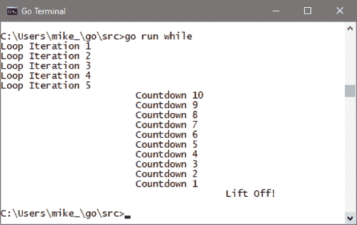


将变量 `i` 的初始值改为 `0`（零）并再次运行程序，查看循环的第一次迭代执行执行。

### 跳出循环

当满足指定条件时，可以使用 `break` 关键字提前终止任何循环。`break` 语句位于循环语句块内部，其前面有一个测试表达式。当测试返回真时，循环立即结束，程序继续执行下一个任务。例如，在嵌套内部循环中，它将进入外层循环的下一次迭代。


当满足指定条件时，可以使用 `continue` 关键字跳过循环的单次迭代。`continue` 语句循环语句块内部，其前面有一个测试表达式。当测试返回真时，该迭代结束。

开始一个执行三次迭代的 `main` 函数

```
func main( ) {
    for i := 1 ; i <= 3 ; i++ {
        // 在此处插入内部循环。
    }
}
```


`src\break\main.go`

插入一个执行三次迭代的内部循环

```
// 在此处插入语句。
for j := 1 ; j <= 3 ; j++ {
    fmt.Println( “Running i=”, i, “j=”, j )
}
```

将程序文件保存到“break”目录中，然后运行程序以查看每次循环迭代的输出

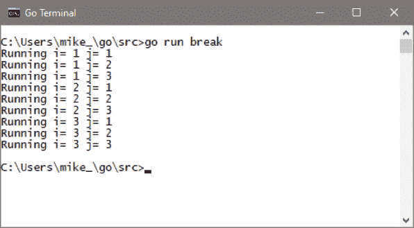


你也可以 `break` 到嵌套代码块之外特定点的标签——请查看此处的示例。

接下来，将此 `break` 语句插入内部循环块的最开始，以跳出内部循环

```go
if i == 2 && j == 2 {
    fmt.Println( “Breaks When i=”, i, “and j=”, j )
    break
}
```

保存更新后的文件，然后运行程序以查看内部循环终止

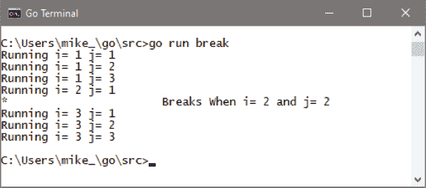

现在在 `break` 语句之前插入 `continue` 语句——跳过内部循环的第二次迭代


```go
if i == 3 && j == 2 {
    fmt.Println( “Continues When i=”, i, “and j=”, j )
    continue
}
```

保存更新后的文件，然后再次运行程序以查看内部循环跳过第二次迭代。


当外层循环尝试执行第三次时，`continue` 语句跳过了内部循环。


### 跳转标签

`goto` 关键字乍看起来是一个很棒的功能，因为它允许程序流跳转到任何位置的标签，就像网页上的超链接一样。然而，实际上这会导致错误，这种用法是不受欢迎的。


`goto` 关键字是一个存在几十年的强大功能，但被早期程序员滥用，创建了难以理解的程序。这产生了不可读的代码，因此 `goto` 的使用不再流行。通常，程序可能会执行一组语句，然后通过 `goto` 语句跳转回语句开头的标签以重复执行。此外，在语句执行的某处可能会测试条件，如果未满足条件，另一个 `goto` 语句可能会跳转到语句之后。通过这种方式，程序代码迅速获得了大量的 `goto` 语句和标签。

`goto` 关键字的一种可能的合法用法是跳转到外层循环块结束之后的标签，从而干净地跳出嵌套循环。这会立即退出两个循环，不再执行任何循环的后续迭代。

开始一个执行三次迭代的 `main` 函数。

```go
func main( ) {
    for i := 1 ; i <= 3 ; i++ {
        // 在此处插入内部循环。
    }
}
```


`src\jump\main.go`

插入一个执行三次迭代的内部循环。

```go
for j := 1 ; j <= 3 ; j++ {
    fmt.Println( “Running i=”, i, “j=”, j )
}
```

将程序文件保存到“jump”目录中，然后运行程序以查看每次循环迭代的输出。

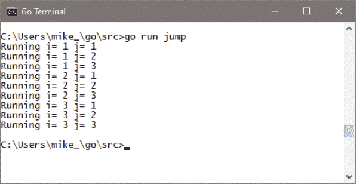

在内部嵌套循环的第一行插入语句，在指定的计数器值跳转到名为“end”的标签。

```go
if i == 2 && j == 2 {
    goto end
}
```

现在，在外层循环闭合括号 `}` 之后的下一行添加标签。

```go
end:
```

保存更新后的文件，然后再次运行程序，查看当测试条件变为真时循环结束。


避免创建名为 `goto.exe` 的程序可执行文件，因为这可能会与 Windows 系统内部的 `GOTO` 命令冲突。


注意标签本身必须以冒号 `:` 结尾。

## 总结

- `if` 关键字执行基础条件测试，以评估给定表达式的布尔值为真（true）或假（false）。
- `else` 关键字用于在 `if` 语句发现表达式为假时提供备选的可执行语句。
- 在评估后为程序提供不同的后续执行方向，被称为“条件分支”。
- 由多个 `if else` 语句执行的条件分支通常可以通过 `switch` 语句更高效地完成。
- `switch` 块中的语句必须分别出现在 `case` 语句下方的单独行中。
- 可选地，`switch` 块可以包含一个 `default` 语句，指定在未找到匹配项时执行的语句。
- `for` 关键字可以指定初始化器、测试表达式和递增器，以控制循环。
- `for` 关键字可以仅指定一个测试表达式来决定循环是否为真时继续。
- `for` 关键字可以完全省略测试表达式以创建无限循环。
- 可以在无限循环体内测试条件，并使用 `break` 关键字结束循环。
- `break` 关键字用于终止循环，而 `continue` 关键字用于跳过单次迭代。
- 循环可以嵌套，使得内层循环在外层循环的每次迭代中执行一系列迭代。
- 通常不建议使用 `goto` 关键字，但它可以合法地用于退出嵌套循环。

# 产生函数

*本章将演示如何将语句封装在函数内部，以便在 Go 程序调用该函数时执行这些语句。*

- 创建基本函数
- 添加参数
- 传递引用
- 返回值
- 递归调用
- 匿名封装
- 传递函数
- 处理错误
- 分离文件
- 总结

## 创建基本函数

本书中之前的示例已经使用了强制性的 `main()` 函数以及 Go 标准库中包含的函数，例如 `fmt` 包中的 `fmt.Println()` 函数。然而，大多数 Go 程序都包含许多自定义函数，这些函数可以在程序执行过程中根据需要进行调用。


函数块仅包含一组语句，这些语句每当该函数被调用时就会执行。一旦函数语句执行完毕，程序流将从函数调用后的直接点继续恢复。这种模块化在 Go 编程中非常有用，它可以隔离一组代码序列，以便根据需要反复调用。

要向 Go 程序中添加自定义函数，必须使用 `func` 关键字进行声明，后跟一个你选择的名字——遵循与变量名相同的命名规范。

| 命名规则 | 示例 |
| :--- | :--- |
| 不能是 Go 关键字 | `default` |
| 不能包含算术运算符 | `a+b*c` |
| 不能包含标点符号字符 | `%$#@!` |
| 不能包含任何空格 | `no spaces` |
| 必须以字母开头 | `msg`-`msg` |
| 可以在其他地方包含数字 | `good1` |
| 可以包含混合大小写 | `camelCase` |

在选择函数名时，它应该描述函数的用途但要保持简洁。函数名后面紧跟 `()` 括号和 `{` 左花括号，所有内容都在同一行内。这一行通常被称为函数的“签名”。要执行的语句包含在函数体中，函数体以 `}` 右花括号结束——与 `main` 函数一样。在程序中，可以通过陈述函数名后跟 `()` 括号来调用该函数。


函数名应以小字母开头，除非该函数需要被导出——参见此处。

创建一个函数，每次被调用时简单地打印一条消息。

```go
func first() {
    msg := “Hello from the 1st function!”
    fmt.Println(msg)
}
```


`src\funcs\main.go`

创建另一个函数，每次被调用时简单地打印乘法结果。

```go
func sqFive() {
    fmt.Printf("%v \n", 5 * 5)
}
```

接下来，添加一个 `main` 函数，其开头是一个调用第一个函数的语句以打印其消息。

```go
func main() {
    first()
    // 在此处插入语句。
}
```

现在，添加一个 `main` 函数，其开头是一个调用第一个函数的语句以打印其消息。

```go
fmt.Print("5 = ")
sqFive()
```

将程序文件保存到“funcs”目录，然后运行程序以查看输出。

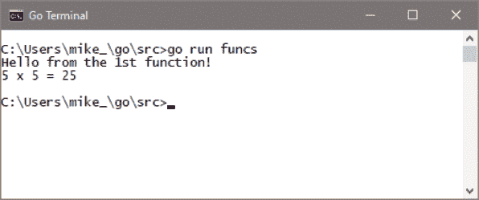

列出的代码假设你已经在每个程序的开头声明了 `package main` 和 `import "fmt"`。

在函数或其他块内部声明的变量只能在该块内部访问——它们具有“局部作用域”。例如，这里的 `msg` 只能在 `first()` 内部访问。在函数外部声明的变量可以在程序的任何地方访问——它们具有“全局作用域”。最好只使用局部变量，以避免与全局变量可能的冲突。

## 添加参数


函数声明中函数名后面的 `()` 括号可以可选地包含一个由逗号分隔的“参数”列表。这些是函数可以使用变量，其初始内容由调用者提供。每当函数被调用时，就会创建这些变量，并在退出函数时被销毁。每个参数必须赋予一个选择的名字（遵循通常命名规范）和一个类型，语法如下：

```go
func funcName(paramName type, paramName type) {
    // 执行的语句
}
```

多个相同类型的连续参数可以声明为一个列表，并且仅需在相同类型的最后一个参数后指定类型，如下所示：

```go
func funcName(paramName, paramName type) {
    // 执行的语句
}
```

每次函数调用必须为每个参数指定内容，类型要正确且顺序与函数声明中的顺序相同。传递给函数的内容被称为“参数”。它们在调用函数名后的 `()` 括号内以逗号分隔列表指定：

```go
funcName(argument, argument, argument)
```

与其他编程语言不同，Go 没有方法为函数参数指定默认内容。

在 Go 编程中，参数默认是“按值传递”的——函数接收的是参数的副本，而不是原始参数。这意味着对参数变量的更改默认不会影响调用者指定的原始参数——只会影响副本。

创建一个需要单个整数参数的函数并显示其值。

```go
func square(num int) {
    fmt.Println("\t\t 接收到的副本:", num)
    // 在此处插入语句。
}
```


`src\args\main.go`

接下来，插入语句修改接收到的参数并显示其新值。

```go
num = num * num
fmt.Println( “\t\tModified Copy:”, num )
```

开始一个 `main` 函数声明并初始化单个变量，然后显示其值。

```go
func main( ) {
num := 5
fmt.Println( “Original:”, num )
// 在此处插入语句。
}
```

现在，在 `main` 函数中插入语句调用另一个函数，并再次显示其变量值。

```go
square( num )
fmt.Println( “Original:”, num )
```

将程序文件保存到“args”目录中，然后运行程序查看原始值是否保持不变。

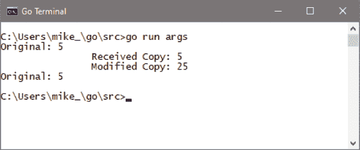


你还可以创建接受任意数量参数的“变长函数”——示例请参见此处。

### 传递引用

示例此处说明了在 Go 编程中，参数默认是“按值传递”的——函数接收到的是参数的副本，而不是原始参数。但很多时候，你可能希望函数能够修改原始参数。这可以通过向函数传递指向原始值的引用（而不是其值的副本）来实现。


记住，指针是对系统上存储某个值的内存地址的引用。这意味着，如果你向函数传递指针参数，它将能够修改位于指针所提供地址上的原始值。

在声明一个可以接收指针参数的函数时，其参数列表中指定的类型必须以星号 `*` 前缀，以指示该参数将是一个指针，如下：

```go
func *functionName* ( *paramName* *type* ) {
*statements-to-be-executed*
}
```

该参数将能够存储一个位置地址。

函数语句可以通过在参数名前加星号 `*` 作为解引用符，来访问并修改指针提供地址处的值。

在调用接受指针参数的函数时，参数必须以 `&` 符号为前缀，以引用存储该值的内存地址。

这种技术可以用于 `int`、`float64`、`string` 和 `bool` 数据类型，也可以用于下一章将引入的 `struct` 类型。这些都是“值类型”，因此在将它们传递给函数时，需要指针来访问它们包含的原始值。

这种技术不能用于指针类型或函数类型（是的，函数在 Go 中也是类型），也不能用于书中演示切片（slice）、映射（map）或通道（channel）类型。这些都是“引用类型”，因此在将它们传递给函数时，不需要指针来访问它们包含的原始值。


返回此处复习指针的工作原理。

创建一个需要单个整数指针参数的函数并显示其值。

```go
func square(num *int) {
fmt.Println( “\t\tReceived Address:”, num )
// 在此处插入语句。
}
```


`src\refs\main.go`

接下来，插入语句修改接收到的参数并显示其新值。

```go
num = *num * *num
fmt.Println( “\t\tModified Original:”, *num )
```

开始一个 `main` 函数声明并初始化单个变量，然后显示其值。

```go
func main( ) {
num := 5
fmt.Println( “Original:”, num )
// 在此处插入语句。
}
```

现在，在 `main` 函数中插入语句调用另一个函数，并再次显示其变量值。

```go
square( &num )
fmt.Println( “Original:”, num )
```

将程序文件保存到“refs”目录中，然后运行程序查看原始值已改变。

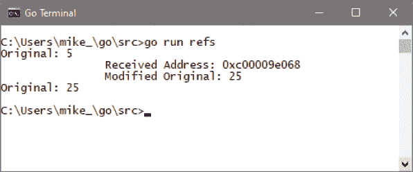


在函数调用中传递指针参数时，如果需要传递存储值的内存地址，请添加 `&` 符号前缀。

### 返回值

本章在此之前描述的函数只是在函数调用后的下一个语句处恢复程序流，但在继续执行后续语句之前，让函数向调用者返回一个值通常是很有用的。


在声明一个将返回值的函数时，函数签名必须在参数列表之后定义返回值的数据类型。要返回的值通常在函数体末尾指定，通过 Go 的 `return` 关键字实现。返回单个值的函数语法如下：

```go
func *funcName* ( *paramName type* ) *returnType* {
*statements-to-be-executed*
return *returnValue*
}
```

与大多数只能返回一个值的语言不同，Go 编程中的函数可以返回多个值。返回两个值的函数语法如下：

```go
func *funcName* ( *paramName type* ) (*returnType*, *returnType*) {
*statements-to-be-executed*
return *returnValue
}
```

如果你调用了一个返回多个值的函数但没有在代码中使用所有返回值，编译器将产生“声明但未使用”的消息，程序将无法运行。为了避免这种情况，你可以将不需要的值赋值给下划线 `_`。这在 Go 中被称为“空白标识”。


标准库中的许多函数返回多个值，特别是返回结果和错误值。

创建一个需要单个整数参数并向调用者返回三个值的函数。

```go
func cube(num int) (string, int, int) {
return “Result”, num, (num * num * num)
}
```


`src\returns\main.go`

添加一个 `main` 函数，将三个返回值赋值给三个变量，然后尝试显示两个值。

```go
func main( ) {
a, b, c := cube( 5 )
fmt.Println( b, “Cubed =”, c )
}
```

将程序文件保存到“returns”目录中，然后运行程序查看编译错误。

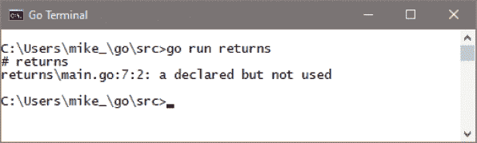

修改 `main` 函数中的赋值，将第一个返回值赋值给空白标识符。

```go
func main( ) {
_, b, c := cube( 5 )
fmt.Println( b, “Cubed =”, c )
}
```

再次保存程序文件，然后运行程序，查看输出中打印的两个返回值。

### 递归调用

自定义函数内部的语句可以自由调用其他自定义函数，就像调用 Go 标准库函数（如 `fmt.Printf()`）一样。此外，函数可以调用自身进行“递归”。和循环一样，重要的是递归函数调用必须修改测试的表达式以避免持续执行——这样函数会在某处退出。

递归函数调用可以用于模拟循环结构，例如倒计时示例此处：

创建一个需要整数参数的函数，并进行递归调用，直到该值减小到零。


```go
func countDn( num int ) {
  if num < 1 {
    fmt.Println( "\t\t\t\tLift Off!" )
  } else {
    fmt.Println( "\t\t\tCountdown", num )
    num--
    countDn( num )
  }
}
```


`src\recur\main.go`

添加一个 `main` 函数，其中包含一条调用上述函数的语句

```go
func main( ) {
  countDn( 10 )
}
```

将程序文件保存到“recur”目录中，然后运行程序查看递归函数调用如何模拟循环


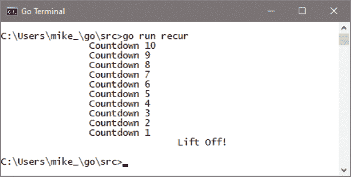

递归函数调用对于解决数学问题非常有用，例如给定数字的阶乘计算。阶乘是从给定数字到 1 的整数的乘积——例如，3 的阶乘是 6 (3 * 2 * 1)。

创建一个需要整数参数的函数，并在每次调用时返回一个整数值

```go
func facto( num int ) int {
  // 在此处插入语句。
}
```


`src\facto\main.go`

接下来，插入一条语句，当参数值减小到零（0）时返回一个一（1）

```go
if num == 0 {
  return 1
}
```

然后，插入一条最后的语句来递归调用该函数，以相乘序列中的所有数字

```go
return num * facto( num - 1 )
```

添加一个 `main` 函数，其中包含一条打印七个阶乘的语句

```go
func main( ) {
  for i := 1 ; i <= 7 ; i++ {
    fmt.Println( "Factorial", i, "=", facto( i ) )
  }
}
```

将程序文件保存到“facto”目录中，然后运行程序查看阶乘序列

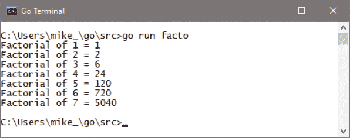


递归函数很有用，但效率并不高。这个示例调用了 `facto()` 函数 35 次来生成仅包含 7 个阶乘的序列！

## 匿名函数

Go 编程语言支持“一等函数”。这允许将函数赋值给变量、作为参数传递给其他函数，并从函数返回。


## 匿名函数

匿名函数简单来说就是不包含名称函数定义。这对于内联创建函数而无需对其命名非常有用。匿名函数也被称为“函数字面量”。与其他函数一样，它们可以包含参数列表、返回类型列表，并返回多个值。你可以通过在函数定义末尾附加 `()` 调用操作符来创建一个自执行匿名函数表达式，如下：

```go
func( ) { fmt.Println( "Function Literal" ) } ( )
```

此外，匿名函数可以赋值给变量，然后通过在变量名后附加 `()` 调用操作符调用调用如下：

```go
fn := func( ) { fmt.Println( "Function Literal" ) }
fn( )
```


自执行函数表达式仅执行一次其语句。

## 闭包

匿名函数最用的用途可能是创建“闭包”。闭包是嵌套在外部函数内部的函数，它保留了对外部函数中声明的变量的访问。外部函数可以返回一个匿名函数，它保留了对变量的访问，但至关重要的是，这些变量在程序代码的任何地方都是无法访问的。这是封装的形式，当返回的匿名函数“捕获”这些变量时，它保护了存储在这些变量中的数据。

通过在外部函数定义末尾附加 `()` 调用操作符，可以使闭包变为自执行并赋值给变量。然后，可以通过在变量名后附加 `()` 调用操作符来调用匿名内部函数——并且它可以访问外部函数中的持久化值。

闭包的概念可能很难理解，因为看起来自执行函数完成执行后，外部函数中的变量应该被销毁。


如果你不能立即理解闭包是如何工作的，不要担心。它们起初看起来很神秘，但随着经验的增加会变得清晰。你可以继续下去，稍后回来学习这种技术。

通过将匿名函数赋值给变量来开始一个 `main` 函数

```go
func main( ) {
  area := func( length, width int ) int {
    return length * width
  }
}
```


`src\anon\main.go`

接下来，插入语句显示匿名函数的类型和两个返回值

```go
fmt.Printf( "area type: %T \n", area )
fmt.Println( "Area 1:", area( 10, 4 ) )
fmt.Println( "Area 2:", area( 12, 5 ) )
```

现在，插入语句将一个自执行闭包函数赋值给变量

```go
counter := func( ) func( ) int {
  num := 0
  return func( ) int {
    num++
    return num
  }
} ( )
```

最后，插入语句显示闭包函数的类型和三次返回值

```go
fmt.Printf( "counter type: %T \n", counter )
fmt.Println( "Count:", counter( ) )
fmt.Println( "Count:", counter( ) )
fmt.Println( "Count:", counter( ) )
```

将程序文件保存到“anon”目录中，然后运行程序查看函数类型和返回值

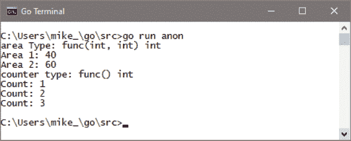


注意外部函数必须声明返回类型为 `func() int`，因为它返回了一个返回整数值的函数。

## 传递函数


## 类型

接收值或引用参数并将这些类型返回给调用者的普通函数被称为“一阶”函数。但函数也可以作为参数传递给其他函数，函数也可以向调用者返回函数。任何接受函数作为参数或返回一个或多个函数的函数都被视为高阶函数。

将函数传递给其他函数允许在不重复现有代码的情况下修改操作。

通过在 `main` 函数中声明一个自定义函数类型来开始，该类型的签名需要两个整数参数和一个整数返回类型

```go
func main( ) {
  type adder func( int, int ) int
}
```


`src\ftype\main.go`

接下来，插入语句定义自定义函数类型的函数（实例）——具有匹配的签名

```go
var add adder = func( a int, b int ) int {
  return a + b
}
```

现在，插入一条调用该函数（实例）的语句

```go
fmt.Println( "Added:", add( 6, 2 ) )
```

在 `main` 函数之后，开始编写高阶函数，该函数将接收并返回一个与自定义函数类型签名相同的函数

```go
func dub( twice func( int, int ) int ) func( int, int ) int {
    fmt.Println( "Doubled:", twice( 6, 2 ) * 2 )
    // 在此处插入语句 – 步骤 5.
}
```

接下来，插入语句向调用者定义并返回一个签名相同的函数

```go
div := func( a int, b int ) int {
    return ( a + b ) / 2
}
return div
```

回到 `main` 函数，插入一条语句将函数（实例）传递给高阶函数，并将该函数返回的函数赋值给变量

```go
div := dub( add )
```

现在，插入一条语句调用返回的函数

```go
fmt.Println( "Divided:", div( 6, 2 ) )
```

最后，插入语句显示函数（实例）、高阶函数以及返回函数的类型

```go
fmt.Printf( "add type: %T \n", add )
fmt.Printf( "dub type: %T \n", dub )
fmt.Printf( "div type: %T \n", div )
```

将程序文件保存到 “ftype” 目录中，然后运行程序以查看返回的值和函数类型

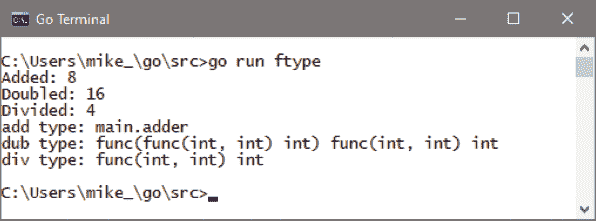


注意，函数签名在声明中仅需指定所需的类型，但其定义也需要指定参数名称。


注意，函数实例 `add` 被简单地描述为自定义函数类型 `main.adder`。

# 处理错误

在你的 Go 程序中预判错误并使代码能够高效地处理它们是非常重要的。其他编程语言（如 Java 和 Ruby）在遇到错误时会抛出“异常”，程序可以尝试在运行时捕获这些异常，但 Go 提供了一种更简单的方法。


Go 编程允许通过返回多个值来处理函数中出现的错误。这使得识别哪个函数返回了错误变得简单，并让你可以使用熟悉的 Go 语言结构来处理错误。

为了处理可能的错误，函数签名必须包含一个 Go 内置的 `error` 返回类型。传统上，这是返回值列表中的最后一个返回值。

```go
func funcName ( paramName type ) ( returnType, error )
```

在函数体中，而不是返回预期的返回值，函数可以返回一个平凡的值（例如 -1）连同返回的错误值。

如果没有发生错误，函数可以返回预期的返回值，以及一个 `nil` 零值。在 Go 编程中，`nil` 零值用于表示许多类型的零值。在这里，它仅表示没有错误。因此，处理错误的函数语法可能如下所示：

```go
func funcName ( paramName type ) ( returnType, error ) {
    if condition != true {
        return -1 , errorValue
    }
    return returnValue, nil
}
```

提供之前示例中使用的 `fmt.Println()` 和 `fmt.Printf()` 函数的 `fmt` 包也提供了一个返回 `error` 类型的 `fmt.Errorf()` 函数。它接受与 `fmt.Printf()` 函数相同的格式化标记，并可用于返回消息以标识错误的位置和性质。


Go 标准库还有一个 `errors` 包，可以用于操作自定义错误。

创建一个需要整数参数并返回整数值和错误的函数

```go
func isPosInt( num int ) ( int, error ) {
    // 在此处插入语句。
}
```


`src\err\main.go`

接下来，插入一个条件测试，根据参数的值返回错误或参数值

```go
if num < 1 {
    err := fmt.Errorf( "%v not a positive integer", num )
    return -1, err
}
return num, nil
```

现在，添加一个 `main` 函数，该函数包含一个递减循环，用于打印参数值或错误消息

```go
func main( ) {
    for i := 2 ; i >= -2 ; i-- {
        res, err := isPosInt( i )
        if err != nil {
            fmt.Println( "Failed:", err )
        } else {
            fmt.Println( res, "Passed!" )
        }
    }
}
```

将程序文件保存到 “err” 目录中，然后运行程序以查看测试失败时的错误消息

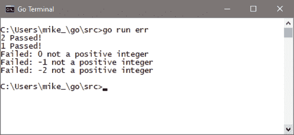


# 分离文件

随着程序规模增大，将代码部分划分到单独文件中通常是明智的。在创建可能实用的自定义包时，将它们存储在与包同名的目录中。要使用导入包的函数，其名称必须以大字母开头。

首先，编写带有包声明的 `verify.go` 文件

```go
package verify

import "fmt"
```


`src\verify\verify.go`

添加验证函数——但将其名称改为大字母开头

```go
// IsPosInt 测试正整数
func IsPosInt( num int ) ( int, error ) {
    if num < 1 {
        err := fmt.Errorf( "%v not a positive integer", num )
        return -1, err
    }
    return num, nil
}
```

将文件保存在 `src` 文件夹内的 `verify` 目录中

执行命令 `go install verify` 在你的 `go/pkg` 文件夹中创建一个名为 `verify.a` 的编译存档文件


创建 Go 存档包意味着每次编译导入文件时，工具文件都不重新编译

接下来，编写带有包和导入声明的 `main.go` 程序

```go
package main

import (
    "fmt"
    "verify"
)
```


`src\prog\main.go`

现在，添加 `main` 函数，在导入的函数名前前加上包名

```go
func main( ) {
    for i := 2 ; i >= -2 ; i-- {
        res, err := verify.IsPosInt( i )
        if err != nil {
            fmt.Println( "Failed:", err )
        } else {
            fmt.Println( res, "Passed!" )
        }
    }
}
```

将程序文件保存到 “prog” 目录中，然后执行命令 `go build prog` 在你的 `go/src` 文件夹中创建一个名为 `prog.exe`（Windows 上）的编译可执行文件

最后，输入命令 `prog`（Linux 上为 `./prog`）运行程序并查看测试失败时的错误消息

**总结**

导入多个包时，导入声明必须在括号内逐行列出这些包。

- 可以使用 `func` 关键字声明函数，其后跟一个符合 Go 命名规范的名称。

- 函数声明包含 `( )` 括号，随后是 `{}` 大括号，用于用于包裹要执行的语句。

- 函数声明中的括号可以包含一个参数列表，用于指定每个参数的类型。

- 传递给函数的参数默认是值传递的——即原始值的副本。

- 传递给函数的指针参数是内存地址的引用，该地址是原始值所在的位置。

- `return` 关键字允许在函数执行语句后，向调用者返回一个或多个值。

- 如果函数向调用者返回值，则必须在函数声明的参数列表之后列出每个返回类型。

- 函数可以递归调用自己来模拟循环结构，但必须测试某个条件以便在某一点退出。

- Go 支持一等函数，函数可以赋值给变量、作为参数传递以及从函数返回。

- 匿名函数没有名称，可以通过在代码块后附加 `( )` 调用运算符来实现自执行。

- 闭包是嵌套在外部函数内部的函数，它保留了对外部函数中声明的变量的访问。

- 使用 `type` 关键字后跟名称和函数签名可以创建自定义函数类型。

- 将函数传递给其他函数允许在不重复现有代码行的情况下修改操作。

- Go 编程允许通过返回单独的值来处理函数中出现的错误。

- 只有导入的且名称首字母大写的函数和变量才能被导入的文件访问。

# 6 构建结构

本章演示了如何将数据和函数包含在“struct”（结构）中，它可以代表 Go 语言中的面向对象编程。

- [分组数据]

- [附加方法]

- [嵌入结构]

- [封装特性]

- [组合元素]

- [实现接口]

- [嵌入接口]


# 分组数据

任何数据类型的多个相关项都可以在 Go 语言的`struct`类型中分组在一起。这对于创建记录非常有用，类似于你在数据库中可能会找到记录。


结构使用`type`关键字创建，其后跟你选择的名称，以及`struct`关键字和`{}`大括号。大括号内包含每行一个变量名和数据类型对列表。这些被称为结构的“字段”（fields），并定义了结构将包含的内容，语法如下：

```go
type structName struct {
    fieldName dataType
    fieldName dataType
}
```

定义了结构类型后，可以创建以结构名称为类型的声明变量来创建结构的实例：

```go
var instanceName structName
```

结构的每个单独字段通过使用点后缀（将字段名附加到结构名称之后）访问。可以通过多种方式为结构实例的单独字段分配数据。首先，你可以这样给单独字段赋值：

```go
instanceName.fieldName = value
instanceName.fieldName = value
```

或者，你可以在一个语句中初始化它的所有字段，将一个“结构字面量”（struct literal）赋值给实例，如下：

```go
instanceName = structName { value, value }
```

使用这种技术要求值的列出顺序与结构中字段的顺序相同，但你可以在结构字面量中包含字段名，这样值就可以任何顺序出现，例如：

```go
instanceName = structName { fieldName: value, fieldName: value }
```

此外，你可以在一个语句中创建结构实例并初始化其所有字段，将一个“结构字面量”赋值给变量，如下：

```go
instanceName := structName { fieldName: value, fieldName: value }
```

结构中的空字段默认获得零值。


你可以将结构认为一个模板，其实例是存储存储实际数据的副本。


虽然这两个语句相似，但请注意`:=`运算符仅在创建实例并在单个语句中初始化结构字段时使用。

 通过创建一个结构类型来开始程序

```go
type employee struct {
    id int
    name string
    dept string
}
```


`src\group\main.go`

 接下来，通过创建结构类型的实例来开始 main 函数

```go
var coder employee
```

 现在，为结构实例的每个字段赋值：

```go
coder.id = 001
coder.name = "Alice"
coder.dept = "I.T."
```

 创建结构的第二个实例，它使用结构字面量和字段名初始化结构的每个字段：

```go
clerk := employee{ name: "Burt", dept: "Payroll", id: 002 }
```

 添加语句显示结构中的所有值：

```go
fmt.Println(coder)
fmt.Println(clerk)
```

 最后，添加语句在字符串中显示单个字段的值：

```go
fmt.Printf("%v works in %v\n", coder.name, coder.dept)
fmt.Printf("%v works in %v\n", clerk.name, clerk.dept)
```

 注意第 4 步中的语句赋值字段值的顺序与结构中列出的字段顺序不同。

# 附加方法


在 Go 编程中，通过在函数签名中添加“接收者”（receiver），可以将函数附加到结构上，该接收者指定了一个参数名称和作为类型的结构名称：

```go
func (paramName structName) funcName()
```

附加到结构的函数被称为该结构的“方法”（method）。方法可以指定为值接收者（value receiver），它在结构的副本上操作；也可以作为指针接收者（pointer receiver），它在原始结构上操作：

```go
func (paramName structName) funcName()
```

这种允许允许表示具有属性和行为的现实对象：

- 属性描述对象拥有的特性。
- 行为描述对象可以执行的操作。

例如，一辆汽车可以带有“蓝色”和“轿跑”属性，以及“加速”行为。这些特性在 Go 编程中可以用一个包含`color`和`body`字段属性的`car`结构以及一个附加的`accelerate()`方法表示。

 Go 编程通过定义一个结构作为模板来创建对象，从模板创建不同的副本或“实例”。结构的每个实例都可以通过分配值和行为进行自定义以描述该对象。

 与其他某些编程语言不同，Go 没有类，但可以使用结构来表示对象。

 通过创建一个结构类型来开始程序

```go
type car struct {
    color string
    body string
}
```


`src\method\main.go` 接下来，为结构类型附加一个方法

```go
func (c car) accelerate() string {
    return "accelerating-->"
}
```

 现在，通过创建两个结构类型的实例来开始 main 函数

```go
porsche := car{ color: "blue", body: "coupe" }
bentley := car{ color: "green", body: "saloon" }
```


添加语句来显示第一个实例的所有值

```go
fmt.Println( "Porsche paint is", porsche.color )
fmt.Println( "Porsche style is", porsche.body )
fmt.Println( "Porsche is", porsche.accelerate( ) )
```


最后，添加语句来显示第二个实例的所有值

```go
fmt.Println( "Bentley paint is", bentley.color )
fmt.Println( "Bentley style is", bentley.body )
fmt.Println( "Bentley is", bentley.accelerate( ) )
```


将程序文件保存在“method”目录中，然后运行程序查看结构体字段的值

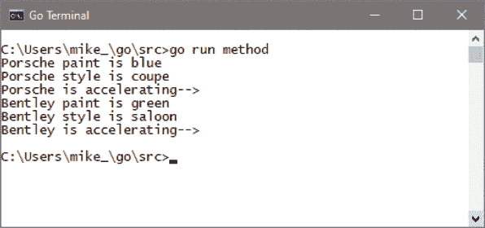


当你调用方法时，Go 会自动处理值和指针之间的转换，因此如果你如果你让方法能够修改原始结构体字段，这里的接收者可以是`( c *car )`。

# 嵌入结构体

由于结构体字段只需简单声明名称和类型，且结构体是一种类型，Go 编程甚至允许你通过声明一个字段为结构体类型将一个结构体嵌入另一个结构体中。


```go
type structName struct {
    fieldName embeddedStructName
}
```

这对于构建高效使用用途不同的结构体非常有用。例如，取一个简单的存储 X 和 Y 坐标的结构体：

```go
type coords struct {
    x, y int
}
```

存储图表上的位置、矩形的顶点等，或者当嵌入另一个结构体时，作为圆的中心点，如下：

```go
type circle struct {
    radius int
    center coords
}
```

现在，当创建`circle`的实例时，可以通过链结构体名称和字段名称来访问嵌入结构体的字段，如下：

`instanceName.embeddedStructName.fieldName`

`instanceName.embeddedStructName.fieldName`

这是可以接受的，但不非常方便，因为太长了。幸运的是，Go 通过支持结构体中的“匿名字段”来解决这个问题。这些字段仅仅指定了另一个结构体的名称作为字段，而不声明字段名称：

```go
type circle struct {
    radius int
    coords
}
```

此处的处是它允许你缩短访问嵌入结构体字段所需的代码：

`instanceName.fieldName`

`instanceName.fieldName`


匿名字段必须是命名类型，或者是指向命名类型的指针。


通过创建两个结构体类型来启动程序

```go
type coords struct {
    x, y int
}

type circle struct {
    radius int
    coords
}
```


`src\embed\main.go`


接下来，为第二个结构体挂载一个方法

```go
func ( c circle ) getDiameter( ) int {
    return c.radius * 2
}
```


现在，通过创建一个结构体类型的实例来开始 main 函数

```go
var ring circle
```


添加语句为结构体字段和嵌入结构体字段赋值

```go
ring.radius = 15
ring.x = ring.radius
ring.y = ring.radius
```


最后，添加语句来显示值

```go
fmt.Printf( "Diameter:%v \n", ring.getDiameter( ) )
fmt.Printf( "Point X:%v Y:%v \n", ring.x, ring.y )
```


将程序文件保存在“embed”目录中，然后运行程序查看结构体字段的值

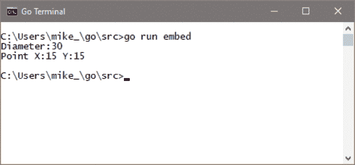

# 封装特性

在 Go 程序中表示对象的能力是面向对象编程 (OOP) 的第一个基石原则。面向对象的程序使用方法来表达其挂载的数据结构的属性和操作，因此程序不需要直接访问对象。

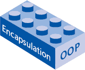

程序无法直接访问的变量、函数或方法被称为“封装”。封装、继承和多态是面向对象编程的三个构建模块。

Go 编程中的封装依赖于导入程序的包的数据隐藏。只有以大写字母开头的变量名、函数名和方法名会被导出到程序。以小写字母开头的将无法访问——即它们被封装了。


首先，从`cube.go`工具文件开始，包声明和结构体定义

```go
package cube

// Dims exportable.
type Dims struct {
    width, length, height int
}
```


`src\cube\cube.go`


接下来，为第二个结构体挂载一个方法

```go
func ( c circle ) getDiameter( ) int {
    return c.radius * 2
}
```

```go
return m.firstName + " " + m.lastName

}
```

 现在，创建一个包含两个新字段并嵌入基础结构体的第二个结构体

```go
type article struct {
    title string
    body string
    member
}
```

 然后，为第二个结构体附加一个方法以输出所有字段值

```go
func ( a article ) content( ) {
    fmt.Println( "Title:", a.title )
    fmt.Println( "Content:", a.body )
    fmt.Printf( "Author: %v \n\n", a.fullName( ) )
}
```

 通过使用结构体字面量初始化基础结构体的实例来开始 main 函数

```go
func main( ) {
    member1 := member {
        "Mike",
        "McGrath",
    }
    // 在此处插入语句。
}
```

 接下来，创建第二个结构体的实例并显示其所有字段值

```go
article1 := article {
    "Object Oriented Programming",
    "In Go, Composition emulates Inheritance",
    member1,
}
article1.content( )
```

 现在，创建另一个第二个结构体的实例并显示其所有字段值

```go
article2 := article {
    "Object Oriented Programming",
    "Coming next… Polymorphism",
    member1,
}
article2.content( )
```

 将程序文件保存在“inher”目录中，然后运行程序查看继承字段的值

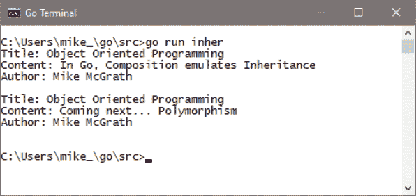


记住，结构体字面量中的所有值后面必须跟一个逗号——包括最后一个。

## 满足接口

面向对象编程的第三大基石是“多态”——这是一个源自希腊语的术语，意思是“多种形式”，描述了根据上下文赋予实体不同含义或目的的能力。


Go 语言通过使用`type`关键字创建“接口”类型来支持多态，后面跟着你选择的名称以及接口关键字，然后是`{ }`大括号。接口体只包含方法签名列表：

```go
type interfaceName interface {
    methodName returnType
    methodName returnType
}
```

任何具有与接口中列出的所有方法名称和签名精确匹配的方法结构体都会实现该接口。在 Go 语言术中，它们被认为“满足”了接口。这样做的好处是允许程序拥有具有相同名称附加方法的各种结构体，每个方法都执行不同的任务——即它们是多态的。

 通过创建一个接口来启动程序，该接口列出了两个方法签名，每个方法都不需要参数且都返回字符串

```go
type bird interface {
    speak( ) string
    move( ) string
}
```


`src\poly\main.go`

 接下来，创建一个空结构体并附加满足接口的方法

```go
type parrot struct { }
func ( parrot ) speak( ) string {
    return "Squawk, squawk!"
}
func ( parrot ) move( ) string {
    return "A parrot flies away."
}
```


注意，你可以省略接收者中的参数名称，只需说明结构体名称，除非你需要在方法语句中使用参数名称。

 现在，创建另一个空结构体并附加同样满足接口的方法

```go
type chicken struct { }
func ( chicken ) speak( ) string {
    return "Cluck, cluck!"
}
func ( chicken ) move( ) string {
    return "Chickens cannot fly."
}
```

 添加一个接收接口的函数并调用实现的方法

```go
func nudge( b ) {
    fmt.Printf( "\n%v \n", b.speak( ) )
    fmt.Printf( "%v \n\n". b.move( ) )
}
```

 添加一个 main 函数，创建每个结构体的实例，然后调用它们同名的方法


```go
func main( ) {
    var bird1 parrot
    var bird2 chicken
    nudge( bird1 )
    nudge( bird2 )
}
```

将程序文件保存在`poly`目录中，然后运行程序查看不同的输出。


Go 自动识别接口的实现。

## 嵌入接口

正如结构体可以嵌入，接口也可以。理解接口嵌入很有帮助，许多标准库都使用了这种技术。例如，`io` 包包含一个`ReadCloser`接口，它嵌入了`Reader`和`Closer`接口。

```go
type bird interface {
    speak( ) string
    move( ) string
}

type human interface {
    speak( ) string
    move( ) string
}

type creature interface {
    bird
    human
}
```

`src\abstr\main.go`

接下来，创建一个嵌入前两个接口的接口。

```go
type parrot struct { }
func ( parrot ) speak( ) string {
    return “Squawk, squawk!”
}
func ( parrot ) move( ) string {
    return “A parrot flies away.”
}
```

`parrot`类型的实例将调用第 3 步的方法。

现在，添加另一个空结构体并附加满足（第一个和）第二个接口——因此满足第三个接口。

```go
type person struct { }
func ( person ) speak( ) string {
    return “Hi, there!”
}
func ( ) move( ) string {
    return “A person walks away.”
}
```

```go
func nudge( c creature ) {
    fmt.Printf( “\n%v \n”, c.speak( ) )
    fmt.Printf( “%v \n\n”. c.move( ) )
}
```

```go
func main( ) {
    var bird1 parrot
    var human1 person
    nudge( bird1 )
    nudge( human1 )
}
```

将程序文件保存在`abstr`目录中，然后运行程序查看输出。方法签名还可以指定参数列表和多个返回类型。

## 总结

- 多个相关数据项可以组合在 Go 结构体类型中。
- 结构体的`{ }`大括号包含名称和类型对列表，这些字段定义了结构体的内容。
- 结构体的实例可以作为声明以结构体名称为类型的变量来创建。
- 通过将值赋值给实例名称和点后缀字段可以初始化结构体的单个字段。
- 通过将结构体字面量赋值给变量名可以创建并初始化结构体的实例。
- 通过添加接收者，可以将函数绑定到结构体上，接收者在函数签名中指定结构体的名称。
- 绑定到结构体的函数被称为方法（method）。
- 方法可以是值接收者（在结构体的副本上进行操作），也可以指针接收者（在原始字段上进行操作）。
- 结构体可以通过其字段属性和附加的方法表示真实世界对象的属性和行为。
- 结构体可以作为匿名字段嵌入另一个结构体中，这样就可以直接访问它的字段。
- 面向对象编程的三大基石是封装、继承和多态。
- Go 中的封装依赖于包中的数据隐藏，只有大写字母开头的项会被导出。
- Go 中的继承依赖于组合，嵌入的结构体为嵌入的结构体提供字段和方法。
- Go 中的多态依赖于其接口类型（interface），接口只包含方法签名列表。
- 任何拥有与接口方法签名精确匹配方法的结构体都实现了该接口。
- 接口可以嵌入另一个接口中，以为额外的灵活性提供进一步的抽象。

# 7 创建数组

本章演示了如何在 Go 程序中通过索引元素存储多个数据项。

- 创建基础数组
- 遍历元素
- 切片数组
- 制作切片
- 切片与数组的区别
- Map 的键和值
- 总结

## 创建基础数组

数组是一个可以存储多个数据项的变量——与只能存储一个数据的普通变量不同。数据项按顺序存储在编号的数组“元素”中，编号从 0 开始。因此，第一个值存储在元素 0 中，第二个值存储在元素 1 中，依此类推。


可以使用`var`关键字后跟一个自定义的名称，然后跟一个`[ ]`方括号（其中包含指定所需元素数量的整数）来声明空数组。这些后面必须紧跟元素可以包含的数据类型。声明的语法如下：

```go
var arrayName [ nElements ] dataType
```

然后可以通过在方括号中指定元素编号，为每个可用元素单独赋值：

```go
arrayName [ elementNumber ] = value
```

或者，也可以通过在“数组字面量”中列出每个元素的值来声明并初始化数组——这是一个在花括号内分组的、并用逗号分隔的列表：

```go
arrayName := [ nElements ] dataType { value, value, value }
```

可以使用数组名称后跟包含元素编号的方括号来引用任何单个元素的值。例如，引用第一个元素中的值：

```go
arrayName [ 0 ]
```

数组的元素合称为“索引”（index）。数组可以有多个索引——以表示多个维度，而不是普通数组的单维度。具有三个或更多索引的多维数组并不常见，但二维数组常用于存储基于网格的信息，如坐标。

要创建一个二维数组，只需添加第二对`[ ]`方括号来指定所需的元素数量，如下：

```go
var arrayName [ nElements ] [ nElements ] dataType
```

然后可以通过在方括号中指定元素编号，为每个可用元素单独赋值：

```go
arrayName [ elementNumber ] [ elementNumber ] = value
```


数组编号从零开始——所以六个元素数组的最后一个元素编号是五，而不是六。这种编号被称为“基于零的索引”（zero-based index）。


你只能在数组声明中指定的数据类型的数组元素中存储数据。

或者，可以在声明二维数组时通过在数组字面量中列出每个索引的值来初始化它并为每个元素赋值：

```go
arrayName := [ nElements ] [ nElements ] dataType
{ { value, value, value }, { value, value, value } }
```

可以使用数组名称后跟包含每个索引元素编号的方括号来引用任何单个元素的值。例如，第二个索引的第一个元素：

```go
arrayName [ 0 ] [ 1 ]
```

创建一个包含三个元素的空数组，每个元素只能包含字符串值。

```go
var cars [ 3 ]string
```


`src\array\main.go`

接下来，添加语句来初始化每个数组元素。

```go
cars[ 0 ] = "BMW"
cars[ 1 ] = "Ford"
cars[ 2 ] = "Opel"
```

现在，声明并初始化一个二维数组。

```go
coords := [ 2 ][ 3 ]int { { 1, 2, 3 }, { 4, 5, 6 } }
```

然后，添加语句显示数组元素。

```go
fmt.Println("Cars:", cars)
fmt.Println("Second Car:", cars[1])
fmt.Println("X1,Y1:", coords[0][0])
fmt.Println("X2,Y3:", coords[1][2])
```

将程序保存到`array`目录，然后运行程序查看数组元素。


Go 中的数组是固定大小的——一旦创建，就无法添加或删除元素。

## 遍历元素

循环和数组是完美的。循环可以用于填充空数组并遍历每个元素。Go 有一个内置函数`len()`，它接受数组变量作为参数，并返回数组元素的数量。这可以在传统的`for`循环中使用，直到数组的最后一个元素。

创建一个五个元素的空整数数组。

```go
var arr [ 5 ]int
```


`src\elems\main.go`

接下来，添加语句确认数组大小。

```go
fmt.Println("No. of Elements:", len(arr))
```

现在，添加一个循环来填充元素。

```go
for i := 0; i < len(arr); i++ {
    arr[i] = i * i
}
```

然后，添加一个循环引用数组元素。

```go
for i := 0; i < len(arr); i++ {
    fmt.Printf("Index: %v Value: %v\n", i, arr[i])
}
```

将程序保存到`elems`目录，然后运行程序查看存储在数组元素中的值。


数组索引是从零开始，所以这里的最后一个元素索引是 4。

Go 提供了一些适用于数组的特殊特性。首先，在使用数组字面量声明数组变量时，可以使用`…`通配符运算符将元素数量设置为与数组字面量中的值相等：

```go
arr := [ ... ]int { 10, 20, 30 } // len(arr) == 3
```

你甚至可以通过为每个值指定索引编号来指定它应该存储在哪个元素中，如下：

```go
arr := [ ... ]int { 2: 10, 0: 20, 1: 30 } // arr == [ 20, 30, 10 ]
```

其次，你可以在循环中使用`range`关键字遍历数组并返回每个元素的索引编号和值。

创建一个包含五个元素的整数数组。

```go
arr := [ … ]int { 100, 200, 300, 400, 500 }
```


`src\range\main.go`

接下来，添加一条语句确认数组的大小。

```go
fmt.Println( “No. of Elements:”, len( arr ) )
```

现在，添加一个循环修改每个元素的值。

```go
for i , v := range arr {
    arr[ i ] =v / 10
}
```

然后，添加一个循环来引用每个数组元素的值。

```go
for i , v := range arr {
    fmt.Printf( “Index: %v Value: %v \n”, i, v )
}
```

将程序文件保存在`range`目录中，然后运行程序查看存储在数组元素中的值。


如果你在循环语句中不需要索引数字，可以将变量名`i`替换为空白标识符`_`以避免错误——请参阅这里。

## 切片数组（Slice Arrays）

数组是序列，其每个元素都包含相同类型的数据，但长度是固定的，因此并不灵活。幸运的是，Go 提供了切片类型，它代表底层数组且其长度是可以改变的。


要理解切片类型，重要的是意识到切片本身不包含任何元素，而只是对实际数组的引用。切片类型包含三个组件：

- `Ptr` – （指针）指向切片可访问数组第一个元素的指针（不一定是数组的第一个元素）。
- `Len` – （长度）切片中元素的总数。
- `Cap` – （容量）指针引用元素与数组最后一个元素之间的元素数量。

例如，从一个日期名称数组创建一个工作日的切片：


在 Go 编程中，可以通过将数组赋值给指定所需上下边界元素索引的变量来创建切片。这些边界通过`[ ]`方括号之间的冒号`:`字符来指定。冒号左侧的数字指定切片起始元素的索引——切片指针将引用该元素。冒号右侧的数字指定上边界的索引——用于提取直到上边界元素但不包括该元素的所有元素。上述示例的赋值语句如下所示：

```go
weekdays := days[ 0 : 5 ]
```

可选地，你可以省略指定上下边界的任意数字以使用默认值。下边界的默认值为 0（零），上边界的默认值为数组中元素的总数。


切片在 Go 编程中非常重要，出现频率比数组类型得多，但重要的是理解它们是对底层数组的引用。

你可以使用内置函数`len()`像数组一样获取切片的长度，但也可以使用内置函数`cap()`获取切片的容量。将切片的指针值与它指向的数组元素的内存地址进行比较，可以确认切片确实是一个指针引用。

首先，创建一个包含七元素的数组。

```go
days := [ 7 ]string {“Mon”,”Tue”，“Wed”，“Thu”，“Fri”，“Sat”，“Sun”}
```


`src\slice\main.go`

创建一个代表最后两个数组元素的切片。

```go
weekend := days[ 5 : ]
```

现在，添加语句显示切片的内容和类型。

```go
fmt.Printf( “Slice weekend: %v \n”, weekend )
fmt.Printf( “Type weekend : %T \n”, weekend )
```

添加语句显示切片的长度和容量。

```go
fmt.Printf( “Length weekend: %v \n”, len( weekend ) )
fmt.Printf( “Capacity weekend: %v \n”, cap( weekend ) )
```

最后，添加语句确认切片是引用底层数组元素的引用。

```go
fmt.Printf( “Pointer weekend: %p \n”, weekend )
fmt.Printf( “Address days[0]: %p \n”, &days[ 5 ] )
```

将程序文件保存在`slice`目录中，然后运行程序查看切片的特性。


可以看到切片的类型由空`[ ]`方括号后跟每个元素可能包含的类型来描述。

## 创建切片（Make Slices）


创建切片的方法与数组相同，除了固定长度外。切片可以使用字面量初始化，语法如下：

```go
fruitSlice := []string{"Apple”，“Banana”，“Cherry”
```

你还可以使用`make()`函数创建一个空切片，其参数指定切片类型、长度以及（可选的）切片容量。

```go
fruitSlice := make( []string, 3 )
fruitSlice[ 0 ] = “Apple”
fruitSlice[ 1 ] = “Banana”
fruitSlice[ 2 ] = “Cherry”
```

最重要的是，当切片的长度超过底层数组的容量时，Go 会自动增加底层数组。

```go
fruitSlice = append( fruitSlice, “Damson”)
```

还有一个`copy()`函数允许你将一个切片复制到另一个切片。它需要两个参数，指定目标切片和源切片。

```go
jamSlice := make( []string, len(fruitSlice) )
copy( jamSlice, fruitSlice )
```

如果你想从切片中删除元素并保留剩余元素的顺序，可以使用`copy()`函数将所有元素向下移动一位。

```go
copy( nums[ 0 : ], nums[ 1 : ] )
nums = nums[ : len( nums ) - 1 ]
```

你不必切片的底层数组，因为 Go 会处理它。

通过字面量创建一个整数切片。

```go
nums := []int{ 10, 20, 30, 40, 50, 60, 70, 80, 90, 100 }
```


`src\make\main.go`

创建另一个切片，然后初始化它的各个元素。


```go
more := make( []int, 3 )
more[ 0 ] = 200
more[ 1 ] = 300
more[ 2 ] = 400
```

添加调用函数描述切片的语句

```go
describe( nums )
```

通过追加第二个切片中的值来扩大第一个切片，然后描述修改后的第一个切片

```go
nums = append( nums, more[ 0 ] )
describe( nums )
```

删除第一个切片的第一个元素，再次描述修改后的切片

```go
copy( nums[ 0 : ], nums[ 1 : ] )
nums = nums[ : len( nums ) - 1 ]
describe( nums )
```

在`main`函数之后，添加描述第一个切片元素值、长度和容量的函数

```go
func describe( nums []int ) {
    fmt.Printf( “\n%v Length: %v ”, nums, len( nums ) )
    fmt.Printf( “Capacity: %v \n”, cap( nums ) )
}
```

这里的容量增量大小为 10，但在其他平台上可能会有所不同。请注意，当元素被删除时，容量不会恢复到原始大小。

## 切片与数组

数组包含一个值的序列，而切片包含对一个值序列的引用。这是 Go 编程中一个重要的区别，适用于它的许多类型。最重要的是，当将类型传递给函数时，基于值的类型将接收原始值的副本，而那些是引用的类型将指向实际的原始值。因此，为了让函数在原始值上进行操作，在将基于值的类型传递给函数时你需要使用指针，但在传递引用类型时则不需要指针。


数组和切片的另一个区别涉及“变长参数”函数，这种函数可以使用任意数量的参数进行调用。除非你通过将数组元素值复制到切片元素并将数组“转换”为切片，否则你无法将数组元素值传递给变长函数。

你可以通过在函数签名的最后一个参数的数据类型前加上`…`通配符运算符来简单地创建一个变长函数，使用这种语法：

`func funcName( paramName…dataType)`

变长函数可以像通常一样调用，在`()`括号内包含用逗号分隔的参数列表。

变长函数在将切片元素的值传递给函数时特别有用，因为切片的长度在程序执行过程中可能会变化。无论切片的长度如何，都可以通过在函数调用的括号内指定切片名称后跟`…`通配符运算符，将它的元素值传递给变长函数：

`funcName(sliceName…)`


`fmt.Printf()`函数是一个变长函数——它在开头需要一个固定参数，然后接受任意数量的后续参数。

创建一个三个字符串的数组

```go
array := [ 3 ]string{ “BMW”, “Ford”, “Opel” }
```


`src\versus\main.go`

将数组元素复制到切片中进行“转换”

```go
slice := array[ : ]
```

接下来，调用变长函数传递切片中每个元素的值用于显示

```go
list( slice…)
```

现在，向切片追加另外两个值

```go
slice = append( slice, “Porsche”, “Ferrari” )
```

再次调用变长函数传递切片中每个元素的值用于显示

```go
list( slice…)
```

在`main`函数之后，添加变长函数来列出传递的切片元素值

```go
func list( autos …string ) {
    for i, v := range autos {
        fmt.Printf( “\n%v. %v”, i, v )
    }
    fmt.Println( )
}
```

将程序文件保存在`versus`目录中，然后运行程序查看参数值


调用变长函数时，你并不是在传递切片本身——你仅仅是在传递切片元素的值。

## Map 的键和值

哈希表可以使用关联的键存储多个数据项，这样你就可以通过其关联的键引用存储的值。在 Go 编程中，这种数据结构被称为“map”，但其他编程语言将其称为关联数组或字典。


map 中的所有键必须是唯一的且具有相同的数据类型。map 中的所有值必须具有相同的数据类型，但不一定与键的数据类型相同。

可以使用`var`和`map`关键字，并使用这种语法指定键和值的数据类型来创建 map：

`var mapName = map [ keyDataType ] valueDataType`

然后可以将单独的键/值对赋值给 map，如下：

```go
mapName[ “keyName” ] = value
```

或者，你可以使用内置的`make()`函数来创建 map：

```go
mapName := make( map [ keyDataType ] valueDataType )
```

此外，你可以通过使用这种语法赋值“map 字面量”来创建并初始化 map：

```go
mapName := map [ keyDataType ] valueDataType {
    key : value , key : value , key : value ,
}
```

与数组和切片不同，键/值对是以无序方式存储的，因此你不能使用元素索引来引用存储的值——你必须使用其关联的键。

你可以随时向 map 添加键/值对，并可以使用内置的`delete()`函数删除键/值对。这需要两个参数来指定 map 名称和要删除的键名。

与数组和切片一样，你可以使用`range`关键字遍历 map 的所有元素。在这种情况下，循环将返回键和值。

map 不是切片，所以你无法对其地址。

创建一个字符串键的 map

```go
colors := make( map [ string ] string )
```

初始化 map 三

```go
colors[ “Red” ] = “FF0”
```

添加另一个键

```go
colors[ “Green” ] = “00FF”
```

接下来，显示所有 map 条目

```go
fmt.Printf( “Colors: %v \n”, colors )
```

现在，添加键/值对

```go
colors[ “Yellow” ] = “FFFF00”
```

然后删除添加的键

```go
delete( colors, “Yellow” )
```

最后，添加循环列出 map 中所有的键/值对

```go
for k, v := range colors {
    fmt.Printf( “\n%v is %v \n”, k, v )
}
```

## 总结

- 数组是顺序存储元素的固定长度结构。
- 数组声明必须在`[ ]`中指定元素数量。
- 数组或切片元素存储的值可以通过指定索引数字来引用。
- 空数组可以使用`var`关键字创建，也可以通过赋值数组字面量创建并初始化。
- `len()`函数返回数组或切片的长度。
- 可以使用`range`关键字遍历元素。
- 切片是顺序存储在底层数组元素的可变长度结构。
- 切片包含一个指针、长度和容量。
- `cap()`函数返回切片的容量。
- 切片声明不需要在`[ ]`中指定元素数量。
- 元素序列的上下边界可以在`[ ]`内的`:`字符周围进行指定。
- 空切片可以使用`make()`函数创建，也可以通过赋值切片字面量创建并初始化。
- 可以使用`append()`函数向切片添加元素。
- 切片可以通过`copy()`函数复制到另一个切片中。
- 将引用传递给函数时不需要指针。
- 变长函数可以使用任意数量的参数调用。
- map 是包含关联键/值对的可变长度结构。
- 空 map 可以使用`make()`函数创建，也可以通过赋值 map 字面量创建并初始化。
- map 元素存储的值可以通过指定`[ ]`中的关联键来引用。

本章演示了如何使用 Go 标准库中的`time`包处理日期和时间。

## 获取日期

Go 标准库的`time`包提供了功能，可以从`Time`数据类型中提取描述特定时间点的特定字段。通过导入`time`包，程序可以使用这些功能。


可以使用`time.Now()`函数创建一个新的`Time`数据类型的日期/时间实例，其字段描述了当前的日期和时间。这些字段是根据设备上当前区域的系统时钟初始化的。

可以使用`Time`数据类型的相应方法来获取单个字段的值。例如，可以使用`Year()`方法获取年份字段的值。同样，还有`Month()`、`Day()`和`Weekday()`方法，用于获取`Time`数据类型的其他单个字段。

| 方法 | 返回 |
| :--- | :--- |
| `Now()` | 包含当前日期、时间和时区字段的`time.Time`数据类型 |
| `Year()` | 4 位数字年份 (YYYY) |
| `Month()` | 年份的月份名称 |
| `Day()` | 月份中的数字 |
| `Weekday()` | 星期几名称 |

还有这三个方法返回的`Time`数据类型值可以很好地赋值给变量：

| 方法 | 返回 |
| :--- | :--- |
| `Date()` | 4 位数字年份 (YYYY)、年份的月份名称和月份中的数字 |
| `ISOWeek()` | 年的周数 (1-53) 和 4 位数字年份 (YYYY) |
| `YearDay()` | 年中的天数 (1-365/366) |

需要注意的是，`Time`数据类型包含单个字段，因此它不是字符串。不过，你可以使用它的`String()`方法将其转换为字符串：


`Time`类型方法返回的值不是字符串。

首先在程序中导入 Go 标准库的`time`包

```go
import (
	"fmt"
	"time"
)
```


`src\date\main.go`

接下来，创建一个`Time`数据类型的日期/时间实例，用当前日期和时间初始化

```go
dt := time.Now()
```

添加语句输出日期/时间实例的所有字段，并确认其数据类型

```go
fmt.Printf("DateTime: %v \n", dt)
fmt.Printf("DateTime Type: %T \n", dt)
```

接下来，添加一条语句输出今天的星期名称

```go
fmt.Printf("Today is: %v \n", dt.Weekday())
```

现在，添加语句显示今天的日期、本周以及一年的天数

```go
y, m, d := dt.Date()
fmt.Printf("Date: %v %v, %v \n", m, d, y)
yr, wk := dt.ISOWeek()
fmt.Printf("Week No.: %v in %v \n", wk, yr)
dy := dt.YearDay()
fmt.Printf("Day No.: %v \n", dy)
```

将程序文件保存在`date`目录中，然后运行程序查看日期字段的值


时区值指定了相对于 UTC（通用时间）的偏移量以及时区缩写——有关时区的更多信息请参阅此处。

## 获取时间

`Time`数据类型单个字段中的时间值可以使用相应的方法获取。例如，可以使用`Hour()`方法获取小时字段的值。同样，还有`Minute()`、`Second()`和`Nanosecond()`方法，用于获取`Time`数据类型的其他单个字段。


| 方法 | 返回 |
| :--- | :--- |
| `Hour()` | 当天的小时 (0-23) |
| `Minute()` | 小时内的分钟 (0-59) |
| `Second()` | 分钟内的秒数 (0-59) |
| `Nanosecond()` | 秒内的纳秒 (0-999999999) |

与其他编程语言不同，Go 的`time`包没有提供从`Time`数据类型返回毫秒值的方法。不过，你可以将纳秒值除以一百来产生等等的毫秒值。还有这三个方法返回的数据类型值可以很好地赋值给变量：

| 方法 | 返回 |
| :--- | :--- |
| `Clock()` | 当天的小时、分、秒 |
| `Unix()` | 自纪元（1970 年 1 月 1 日）开始的秒数 |
| `UnixNano()` | 自纪元（1970 年 1 月 1 日）开始的纳秒数 |

首先在程序中导入 Go 标准库的`time`包

```go
import (
	"fmt"
	"time"
)
```


`src\main.go`

接下来，创建一个`Time`数据类型的日期/时间实例，用当前日期和时间初始化

```go
dt := time.Now()
```

添加语句输出日期/时间实例的所有字段，并确认其数据类型

```go
fmt.Printf("DateTime: %v \n", dt)
fmt.Printf("DateTime Type: %T \n", dt)
```

接下来，添加一条语句输出今天的星期名称

```go
hr := dt.Hour()
switch {
case hr < 12:
	fmt.Println("Good Morning!")
case hr < 18:
	fmt.Println("Good Afternoon!")
default:
	fmt.Println("Good Evening!")
}
```

现在，添加语句显示今天的日期、本周以及一年的天数

```go
y, m, d := dt.Date()
fmt.Printf("Date: %v %v, %v \n", m, d, y)
yr, wk := dt.ISOWeek()
fmt.Printf("Week No.: %v in %v \n", wk, yr)
```

最后，添加语句显示当前时间及其毫秒值

```go
dt, mn, s := dt.Clock()
fmt.Printf("Time: %v:%v:%v \n", mn, s)
ns := dt.UnixNano()
ms := ns / 1000000
fmt.Println("Nanoseconds:", ns)
fmt.Println("Milliseconds:", ms)
```

将程序文件保存在`times`目录中，然后运行程序查看时间字段的值


单数字的小、分、秒不带前导零。

## 格式化日期和时间


`Time`数据类型单个字段中的日期和时间可以使用其`Format()`方法以多种方式格式化。该方法接受一个作为“布局”字符串的参数，该格式必须通过精确使用此引用字符串的元素来指定：

`Mon Jan 2 15:04:05 2006 MST`

由于 MST（山地标准时间）比 UTC（协调世界时）晚 7 小时，引用字符串也可以从数值角度考虑为如下：

`01 02 03:04:05PM '06 -0700`

如果你想让`Format()`方法只返回日期、月份和 hh:mm 格式的时间，可以将布局指定为：

`Jan 2 15:04`

或数值指定为：

`01/02 03:04`

通过在布局中指定长时间版本，可以让星期和月份返回全称：

`Monday January 2 15:04`

`time`包包含了预定义的`UnixDate`、`ANSIC`和`RFC3339`常量，你可以作为日期/时间布局格式。

自定义布局可以任意顺序指定组件以适应不同的区域——例如，用于日期格式化。

此外，时间组件可以格式化为 24 小时制，通过指定“15:04”将自动在单数字小时前补零。

12 小时格式和 24 小时格式都会自动在单数字分钟前补零。


`ANSIC` 指的是美国国家标准学会 C 语言的标准日期/时间格式。`RFC 3339` 指的是互联网工程任务组（IETF）的日期/时间文档。

首先在程序中导入 Go 标准库 `time` 包

```go
import (
	"fmt"
	"time"
)
```


`src\format\main.go`

接下来，创建一个 `Time` 类型的日期/时间实例，用当前日期和时间初始化，然后以各种格式显示其组件

```go
dt := time.Now()
fmt.Println("\nDefault Format:", dt)
fmt.Println("Unix Format:", dt.Format(time.UnixDate))
fmt.Println("ANSIC Format:", dt.Format(time.ANSIC))
fmt.Println("RFC3339 Format:", dt.Format(time.RFC3339))
fmt.Println("Custom Format:", dt.Format("January 2, 2006 [Monday]"))
```

现在，仅显示格式化为两种地区格式的日期组件

```go
fmt.Println("\nUS Format:", dt.Format("January 2, 2006"))
fmt.Println("UK Format:", dt.Format("2 January, 2006"))
```

然后，仅显示 12 小时制和 24 小时制的时间组件

```go
fmt.Println("\nTime 12-Hour:", dt.Format(time.Kitchen))
fmt.Println("Time 24-Hour:", dt.Format("15:04"))
```

将程序文件保存到“format”目录中，然后运行程序以查看格式化的日期和时间字段值


`time.Kitchen` 常量等于指定布局格式为“15:04PM”。

## 设置日期和时间

你可以使用 Go 标准库 `time` 包的 `Date()` 函数创建自定义的 `Time` 数据类型。这需要八个参数来指定（按顺序）年、月、日、时、分、秒、纳秒和位置。


除了月份和位置外，所有参数都以整数值指定。

月份可以使用 `time` 包预定义的 1 月至 12 月的全称月份常量之一来指定，例如 `time.January`。

位置可以使用 `time` 包预定义的位置常量之一指定，如 `time.UTC`（协调世界时）或 `time.Local`（你的系统时钟）。

任何 `Time` 数据类型中的日期字段都可以使用 Go 标准库 `time` 包的 `AddDate()` 方法进行修改，以指定年、月、日的三个参数。正值将推进日期，负值将推迟日期。例如，`time.AddDate(1, 0, 0)` 将日期推后一年。

同样，`time` 包的 `Add()` 方法可以通过指定单个持续时间参数来修改日期/时间。该值可以是一个表示修改日期/时间的纳秒数的 `int64` 值。更方便的是，可以使用常量 `time.Hour`、`time.Minute`、`time.Second` 或 `time.Millisecond` 来修改 `Time` 数据类型的各个时间字段。例如，`time.Add(10 * time.Hour)` 将时间推进 10 小时。

你还可以使用 Go 标准库 `time` 包的 `Parse()` 函数从字符串创建自定义 `Time` 数据类型。这需要两个参数来指定布局和日期/时间字符串。有用的是，此函数返回两个值：一个 `Time` 数据类型和一个错误。如果函数返回 `Time` 数据类型，错误值将为 `nil`，否则它将是一个错误消息。

布局应仅使用 Go 引用字符串中的值：

**Mon Jan 2 15:04:05 2006 MST**

除非在日期/时间字符串中指定了时区偏移值（例如 `-0500`），否则生成的 `Time` 数据类型将假设为 UTC 时间。


`Time` 数据类型可以使用此处描述的 `Format()` 方法进行格式化。

首先在程序中导入 Go 标准库 `time` 包

```go
import (
	"fmt"
	"time"
)
```


`src\setdate\main.go`

接下来，创建并显示 `Time` 类型的日期/时间实例，初始化为元旦一的正午

```go
dt := time.Date(2025, time.January, 1, 12, 0, 0, 0, time.Local)
fmt.Printf("\nDateTime: %v\n", dt)

dt = dt.AddDate(2, 0, 0)
fmt.Printf("\nDateTime: %v\n", dt)

layout := "2006-Jan-02 15:04PM"
str := "2030-Dec-25 12:30AM"
t, err := time.Parse(layout, str)
if err != nil {
	fmt.Println(err)
} else {
	fmt.Printf("Parsed DateTime: %v\n", t)
}
```

接下来，在指定位置创建并初始化带有默认字符串值和 `Time` 数据类型的变量

`zone := "All"`

`loc, _ := time.LoadLocation( "America/New_York" )`

`dt := time.Now( ).In( loc )`

确定时区缩写和偏移量秒数，然后将偏移量转换为正分钟数

`abbr, offset := dt.Zone( )`

`if offset < 1 {`

`offset = offset * -1`

`}`

`offset /= 60`

现在，评估缩写和偏移量值

`switch {`

`case abbr == "EST" && offset == 300 :`

`zone = "East Coast"`

`case abbr == "EDT" && offset == 240 :`

`zone = "East Coast"`

`}`

显示时区详情和适当的消息

`fmt.Printf( "\nTZ: %v Offset Minutes: %v \n", abbr, offset )`

`fmt.Println( "Welcome to", zone, "Visitors!" )`

在“zone”目录中保存程序文件，然后运行程序查看时区值


这里使用 `_` 空白标识符是为了由于空间限制忽略返回的错误值，但理想情况下你应该包含一个错误处理器。

### 延迟时间

Go 标准库 `time` 包提供了一个 `Sleep( )` 函数，允许你通过指定的持续时间延迟程序的进度。持续时间作为参数传递给 `Sleep( )` 函数，并可以表示为 `time` 包常量的乘法。例如，`5 * time.Second` 表示五秒钟的持续时间。


Go 标准库 `time` 包还提供了三个方法，用于将 `Time` 数据类型的实例与作为参数指定的另一个时间进行比较。这些方法将根据时间比较的结果分别返回布尔值 `true` 或 `false`：

| 方法 | 返回 |
| :--- | :--- |
| `Before(time)` | 如果实例时间早于其参数时间，返回布尔值 `true` |
| `After(time)` | 如果实例时间晚于其参数时间，返回布尔值 `true` |
| `Equal(time)` | 如果实例时间和参数时间代表同一时刻（即使在不同的时区），则返回布尔值 `true` |

如果你想查看两个 `Time` 数据类型实例之间的差异，可以使用时间实例的 `Sub( )` 方法并指定另一个时间实例作为其参数。该方法将两个瞬间之间的经过持续时间以纳秒精度的 `int64` 数据类型值的形式返回。

通常更倾向于展示精度小于纳秒的持续时间段，因此 Go 标准库 `time` 包包含一个 `Round( )` 方法来指定更简洁的精密度。该方法需要一个参数来确定你偏好的舍入行为。通常，该参数作为 `time` 包常量之一进行提供。例如，调用 `Round( time.Millisecond )` 方法将把纳秒精度的持续时间舍入到最近的毫秒，`Round( time.Second )` 将把纳秒精度的持续时间舍入到最近的秒，依此类推。

首先在程序中导入 Go 标准库 `time` 包

```go
import (
	"fmt"
	"time"
)
```


`src\delay\main.go`

接下来，创建并显示 `Time` 数据类型的组件

`start := time.Now( )`

`fmt.Println( "\nStarted At:", start.Format( "03:04:05" ) )`

现在，延迟程序的进度五秒

`time.Sleep( 5 * time.Second )`

然后，创建并显示第二个 `Time` 数据类型

`finish := time.Now( )`

`fmt.Println( "\nFinished At:", finish.Format( "03:04:05" ) )`

比较开始和结束时间

`fmt.Println( "\nStart First?:", start.Before( finish ) )`

`fmt.Println( "Finish First?:", finish.Before( start ) )`

最后，显示延迟的长度

`diff := finish.Sub( start )`

`fmt.Println( "\nTime Elapsed:", diff.Round( time.Second ) )`

在“delay”目录中保存程序文件，然后运行程序查看时间延迟


延迟执行的能力在暂停单个“goroutine”（协程）时特别有用——更多详情请参见示例此处。

## 总结

- Go 标准库 `time` 包包含创建由日期、时间和时区字段构成的 `Time` 数据类型的函数。
- `Time` 实例可以与作为参数指定的另一个时间进行比较。
- `time` 包提供了用于创建包含日期、时间、时区字段的 `Time` 数据类型的函数。
- `Sub( )` 方法返回两个瞬间之间的经过持续时间，以纳秒精度的 `int64` 数据类型值返回。
- `Round( )` 方法用于指定更简洁的精密度。
- `Sleep( )` 函数允许你通过指定的持续时间延迟程序的进度。
- `time` 包提供了 `Before(time)`、`After(time)` 和 `Equal(time)` 方法来比较时间实例。
- `Time` 数据类型包含日期、时间和时区字段。
- 使用 `time` 包的常量（如 `time.Second`）可以表示持续时间。
- `LoadLocation( )` 函数用于加载位置信息。
- `Zone( )` 方法返回时区缩写和偏移量。
- `Format( )` 方法用于格式化时间输出。

Go 标准库的 `strings` 包包含了许多用于字符串处理的有用函数。其 `Join()` 函数将字符串数组中的所有元素连接（拼接）起来，创建一个单一的统一字符串。该函数需要两个参数：用于指定字符串数组的名称，以及一个用于放置在统一字符串中每个字符串元素之间的分隔符值。通常情况下，你会指定一个空格作为分隔符，以创建一个由空格分隔的统一字符串。

用于写入到标准输出的 `fmt.Printf()` 和 `fmt.Println()` 函数可以在输出中添加空格和换行符，但不会更改实际的字符串。然而，它们都会返回两个值，即写入的字节数和任何写入错误。如果没有遇到错误，错误值将将如往常一样为 `nil`。对于英语语言来说，写入的字节数通常代表输出的字符数——包括字符串中包含的不可打印字符。


非打印字符 `\t` 制表符的 ASCII 码为 9，非打印字符 `\n` 换行符的 ASCII 码为 10。

首先在程序中导入 Go 标准库 `strings` 包

```go
import (
	"fmt"
	"strings"
)
```


`src\join\main.go`

初始化两个字符串变量和一个拼接字符串

```go
s1, s2 := "The Truth is rarely Pure ", "and never Simple."
str := s1 + s2
```

接下来，输出拼接的字符串及其长度

```go
chars, err := fmt.Printf("\n%v \n", str)
if err != nil {
	fmt.Println(err)
} else {
	fmt.Println("Bytes Written: ", chars)
	fmt.Println("String Length:", len(str))
}
```

初始化一个字符串数组和一个连接后的字符串

```go
arr := []string {"\n\tStrive", "For", "Greatness!"}
ast := strings.Join(arr, " ")
```

现在，输出连接后的字符串和前两个字符

```go
fmt.Println(ast)
if ast[0] == 10 && ast[1] == 9 {
	fmt.Printf("1st Char: ASCII %v Newline\n", ast[0])
	fmt.Printf("2nd Char: ASCII %v Tab\n", ast[1])
}
```

将程序文件保存在“join”目录，然后运行程序查看统一的字符串


这里的写入字节数超过了字符串长度，因为 `fmt.Printf()` 方法添加了两个换行符和一个空格字符。

# 分割字符串


Go 标准库 `strings` 包提供了几个函数，允许将指定的字符串拆分为子字符串。这些函数将字符串视为一个数组，其中每个元素包含一个字符或空格。

通常，你可能希望将一个由空格分隔的句子拆分为子字符串数组，其中每个子字符串都是独立的单词。`strings` 包方便地提供了一个 `Fields()` 函数，可以执行这项任务。该函数需要字符串句子作为唯一参数，并返回一个包含该字符串中每个独立单词的子字符串数组。

`strings` 包有一个 `Split()` 函数，它需要两个参数来指定一个字符串和一个分隔符。该函数将返回位于指定分隔符出现位置之间的子字符串数组。例如，当字符串是一个由空格分隔的句子且分隔符是空格字符时，`Split()` 函数将返回该句子中的单词数组。

`strings` 包还了 `SplitN()` 函数，它的工作方式与 `Split()` 函数相同，但接受第三个参数来指定返回多少个子字符串。如果指定的子字符串数量超过了分隔符的数量，则指定分隔符的后续出现将简单地位于最后一个子字符串中。例如，当字符串是一个由空格分隔的句子、分隔符是空格字符且仅指定了两个子字符串时，`SplitN()` 函数将返回一个包含句子第一个单词的子字符串，以及一个包含句子剩余所有部分（包括空格）的子字符串。

重要的是，`Fields()`、`Split()` 和 `SplitN()` 函数会丢弃指定的分隔符，并在返回的子字符串中包含分隔符周围的字符。然而，还有两个额外的函数允许你在返回的子字符串中也包含分隔符。

`strings` 包的 `SplitAfter()` 函数工作方式类似于 `Split()` 函数，但在返回的子字符串中包含了分隔符。同样，`strings` 包的 `SplitAfterN()` 函数工作方式类似于 `SplitN()` 函数，但在返回的子字符串中包含了分隔符。


数据通常以逗号分隔值（CSV）的形式存储在 CSV 文件中，可以很好地拆分为单个值。

首先在程序中导入 Go 标准库 `strings` 包

```go
import (
	"fmt"
	"strings"
)
```


`src\split\main.go`

通过初始化字符串来开始主函数


```go
str := "I can, and I will."
```

接下来，添加语句将描述和变量的子字符串传递给函数

```go
list("Fields", strings.Fields(str))
list("Split", strings.Split(str, ","))
list("SplitN", strings.SplitN(str, ",", 2))
list("SplitAfter", strings.SplitAfter(str, ","))
list("SplitAfterN", strings.SplitAfterN(str, ",", 2))
```

在主函数之后，添加函数来列出描述和子字符串

```go
func list(desc string, subs []string) {
	fmt.Print("\n", desc, ": ")
	for _, v := range subs {
		fmt.Print("[", v, "] ")
	}
	fmt.Print("\n")
}
```

将程序文件保存在“split”目录，然后运行程序查看子字符串


只有名称中包含“After”的分割方法才会保留分隔符。

# 查找字符


Go 标准库 `strings` 包提供了几个函数，允许搜索指定的字符串以查找指定的字符或子字符串（模式）。这些函数将字符串视为一个数组，其中每个元素包含一个字符或空格。

`strings` 包有一个 `Contains()` 函数，它需要两个参数来指定一个字符串和一个模式。该函数简单地返回 `true` 或 `false` 以表示（区分大小写的）搜索结果。例如，搜索“Pro”模式：

`strings.Contains("Go Programming in easy steps", "Pro")`

`strings` 包还有一个 `Index()` 函数，需要两个参数。如果搜索成功，该函数将返回模式在搜索字符串中首次出现的索引位置整数；否则在搜索失败时将返回 `-1`。

`strings` 包的 `Count()` 函数需要两个参数来指定一个字符串和一个模式。你可以使用此函数发现模式在搜索字符串中出现了多少次非重叠实例。如果模式为空字符串，此函数通常返回 `1` 加上搜索字符串的字符数。这允许你通过从返回的整数减去 `1` 来确定搜索字符串的字符数。

`strings` 包的 `HasPrefix()` 函数需要两个参数来指定一个字符串和一个模式。该函数将返回 `true` 或 `false` 以表示搜索字符串是否以指定的模式开头。

同样，`strings` 包的 `HasSuffix()` 函数需要两个参数，分别指定一个字符串和一个要查找的模式，并返回 `true` 或 `false` 以表示搜索的字符串是否以指定的模式结尾。

你可以使用 `strings` 包的 `Replace()` 函数通过将指定的模式替换为替换子字符串来修改搜索字符串。该函数需要四个参数，分别指定要搜索的字符串、要查找的模式、替换子字符串以及一个表示要替换次数的整数。如果你想替换搜索字符串中所有的模式实例，只需将替换次数指定为 `-1`。


`strings.Index()` 函数在在搜索字符串中找到模式的第一个实例时停止搜索。

从向程序中导入 Go 标准库的 `strings` 包开始。

```go
import (
	"fmt"
	"strings"
)
```


`src\find\main.go`

通过初始化字符串变量来启动 `main` 函数。

```go
str := "I can resist everything except temptation"
```

接下来，测试子字符串是否存在于字符串，然后找到第一个实例的位置。

```go
fmt.Printf("\nFound ‘an’: %v \n", strings.Contains(str, "an"))
fmt.Printf("Found ‘an’ at: %v \n", strings.Index(str, "an"))
```

现在，统计字符串中某个字母出现的次数。

```go
fmt.Printf("Count of ‘e’: %v \n", strings.Count(str, "e"))
```

然后，测试字符串是否以特定的子字符串开头或结尾。

```go
fmt.Printf("Prefix ‘ion’: %v \n", strings.HasPrefix(str, "ion"))
fmt.Printf("Suffix ‘ion’: %v \n", strings.HasSuffix(str, "ion"))
```

最后，替换字符串中的子字符串。

```go
fmt.Println(strings.Replace(str, "temptation", "chocolate", 1))
```

将程序文件保存在“find”目录中，然后运行程序查看搜索结果。


## 转换字符串


Go 标准库 `strings` 包提供了转换字符串字符大小的函数。

`strings` 包有一个 `ToUpper()` 函数，它需要一个字符串参数。该函数将简单地返回字符串的副本，将其所有字符都转换为大写字母。

同样，`strings` 包的 `ToLower()` 函数需要一个字符串参数，并返回字符串的副本，将其所有字符都转换为小写字母。

`strings` 包还有一个 `ToTitle()` 函数，它需要一个字符串参数。该函数将返回字符串的副本，将每个单词的首字母转换为大写字母——但仅当字符串参数全为小写时才有效。如果你想将一个大小写混合的字符串转换为标题格式，必须先使用 `strings` 包的 `ToLower()` 函数将其转换为小写。

当程序在请求数值后接收到用户输入时，输入可能是字符串数据类型，并可能包含用户无意输入的空格。你可以使用 `strings` 包的 `Trim()` 函数删除字符串开头和结尾的空格。这需要两个参数来指定要删除的字符串和字符。要删除所有开头和结尾的空格，第二个参数将是 `" "` 以指定单个空格字符。

一旦从包含输入数字的字符串中删除了不必要的空格，在程序可以在算运算中使用输入之前，必须将数据类型转换为数值类型。这可以通过导入 Go 标准库 `strconv` 包来实现。该包包含一个 `Atoi()` 函数（ASCII 转整数），它需要一个字符串参数，并返回一个整数和任何错误。如果没有遇到错误，错误值将为 `nil`；如果该方法无法返回整数数据类型，它将包含一个描述性错误消息。

同样，`strconv` 包包含一个 `Itoa()` 函数，可以将整数转换为字符串数据类型。该方法只需要一个整数参数，并将返回一个字符串副本。


`strconv.ParseInt()` 方法也可用于将字符串类型转换为整数。`strconv.Atoi()` 方法等于调用 `strconv.ParseInt(str, 10, 0)`。

从向程序中导入 Go 标准库的 `strings` 包和 `strconv` 包开始。

```go
import (
	"fmt"
	"strings"
	"strconv"
)
```


`src\conv\main.go`

通过初始化字符串变量启动 `main` 函数，然后显示不同字符大小的字符串。

```go
str := "I have Nothing to declare except My Genius"
fmt.Println(strings.ToUpper(str))
fmt.Println(strings.ToLower(str))
fmt.Println(strings.Title(strings.ToLower(str)))
```

现在，给变量赋值数字和空格。

```go
str = " 42 "
fmt.Printf("%v Type: %T\n", str, str)
```

然后，从字符串中移除空格。

```go
str = strings.Trim(str, " ")
```

最后，尝试将数据类型转换为整数。

```go
num, err := strconv.Atoi(str)
if err != nil {
	fmt.Println(err)
} else {
	fmt.Printf("%v Type: %T\n", num, num)
}
```

将程序文件保存在“conv”目录中，然后运行程序查看结果。


## 计算面积

Go 标准库 `math` 包提供了许多实用的函数和常量。常量列在下表中，并带有它们的近似值：

| 常量 | 描述 |
| :--- | :--- |
| `math.E` | 常数 *e*，自然对数的底，近似值为 2.71828 |
| `math.Pi` | 常数 Pi，近似值为 3.14159 |
| `math.Phi` | 常数 Phi（黄金比例），近似值为 1.61803 |
| `math.Sqrt2` | 2 的平方根，近似值为 1.41421 |
| `math.SqrtE` | 常数 *e* 的平方根，近似值为 1.64872 |
| `math.SqrtPi` | Pi 的平方根，近似值为 1.77246 |
| `math.SqrtPhi` | Phi 的平方根，近似值为 1.27202 |
| `math.Ln2` | 2 的自然对数，近似值为 0.69315 |
| `math.Log2E` | 常数 *e* 的底为 2 对数，近似值为 1.44269 |
| `math.Ln10` | 10 的自然对数，近似值为 2.30259 |
| `math.Log10E` | 常数 *e* 的底为 10 对数，近似值为 0.43429 |

`math` 常量用于具有特定数学目的的 Go 程序，但为了完整性，上面列出了所有的 `math` 包常量。


黄金比例在几何和艺术中多次出现。它是被分成两个不同长度的线段的比例，其中长段与短段的长度之比等于全段与长段的长度之比。


开始在程序中导入 Go 标准库的 `math` 包

```go
import (
    "fmt"
    "math"
)
```


`src\area\main.go`

声明三个浮点变量

```go
var rad, area, perim float64
```

接下来，初始化第一个变量并将其值保留两位小数显示出来

```go
rad = 4
fmt.Printf( "\nRadius of Circle: %.2f \n”, rad )
```

现在，根据给定的半径计算圆面积，然后将其面积保留两位小数显示

```go
area = math.Pi * ( rad * rad )
fmt.Printf( "\nArea of Circle: %.2f \n”, area )
```

然后，根据给定的半径计算圆的周长，并将周长保留两位小数显示

```go
perim = 2 * ( math.Pi * rad )
fmt.Printf( "\nPerimeter of Circle: %.2f \n”, perim )
```

将程序文件保存到“area”目录中，然后运行程序查看计算出的值


关于输出中格式化小数的更多信息，请参考这里。

# 数值评估


Go 的 `math` 包提供了这些实用的函数，用于评估 `float64` 参数：

| **函数** | **返回值** |
| :--- | :--- |
| `math.Abs( )` | 绝对值 |
| `math.Acos( )` | 反余弦值 |
| `math.Asin( )` | 反正弦值 |
| `math.Atan( )` | 反正切值 |
| `math.Atan2( )` | 来自 X 轴点的角度 |
| `math.Ceil( )` | 向上取整的值 |
| `math.Cos( )` | 余弦值 |
| `math.Exp( )` | 常数 *e* 的幂 |
| `math.Floor( )` | 向下取整的值 |
| `math.IsNaN( )` | 布尔值 `true` 或 `false` |
| `math.Log( )` | 自然对数值 |
| `math.Max( )` | 两个数中较大的一个 |
| `math.Min( )` | 两个数中较小的一个 |
| `math.Pow( )` | 幂次方值 |
| `math.Round( )` | 最近的整数值 |
| `math.Sin( )` | 正弦值 |
| `math.Sqrt( )` | 平方根 |
| `math.Tan( )` | 正切值 |


`math.IsNan( )` 函数（判断是否不是数字）用于发现一个转换为 `float64` 数据类型的值是否确实为数字。


`math` 包包含了更多函数，但此处列出的函数对许多数学操作非常有用。可以在 Go 文档 [golang.org/pkg/math](http://www.golang.org/pkg/math) 中发现更多信息。

开始在程序中导入 Go 标准库的 `math` 包

```go
import (
    "fmt"
    "math"
)
```


`src\area\main.go`

声明三个浮点变量

```go
var rad, area, perim float64
```

接下来，初始化第一个变量并将其值保留两位小数显示出来

```go
rad = 4
fmt.Printf( "\nRadius of Circle: %.2f \n”, rad )
```

现在，根据给定的半径计算圆面积，然后将其面积保留两位小数显示

```go
area = math.Pi * ( rad * rad )
fmt.Printf( "\nArea of Circle: %.2f \n”, area )
```

然后，根据给定的半径计算圆的周长，并将周长保留两位小数显示

```go
perim = 2 * ( math.Pi * rad )
fmt.Printf( "\nPerimeter of Circle: %.2f \n”, perim )
```

将程序文件保存到“area”目录中，然后运行程序查看计算出的值


关于输出中格式化小数的更多信息，请参考这里。

# 数值评估


Go 的 `math` 包提供了这些实用的函数，用于评估 `float64` 参数：

| **函数** | **返回值** |
| :--- | :--- |
| `math.Abs( )` | 绝对值 |
| `math.Acos( )` | 反余弦值 |
| `math.Asin( )` | 反正弦值 |
| `math.Atan( )` | 反正切值 |
| `math.Atan2( )` | 来自 X 轴点的角度 |
| `math.Ceil( )` | 向上取整的值 |
| `math.Cos( )` | 余弦值 |
| `math.Exp( )` | 常数 *e* 的幂 |
| `math.Floor( )` | 向下取整的值 |
| `math.IsNaN( )` | 布尔值 `true` 或 `false` |
| `math.Log( )` | 自然对数值 |
| `math.Max( )` | 两个数中较大的一个 |
| `math.Min( )` | 两个数中较小的一个 |
| `math.Pow( )` | 幂次方值 |
| `math.Round( )` | 最近的整数值 |
| `math.Sin( )` | 正弦值 |
| `math.Sqrt( )` | 平方根 |
| `math.Tan( )` | 正切值 |


`math.IsNan( )` 函数（判断是否不是数字）用于发现一个转换为 `float64` 数据类型的值是否确实为数字。


`math` 包包含了更多函数，但此处列出的函数对许多数学操作非常有用。可以在 Go 文档 [golang.org/pkg/math](http://www.golang.org/pkg/math) 中发现更多信息。

开始在程序中导入 Go 标准库的 `math` 包

```go
import (
    "fmt"
    "math"
)
```


`src\area\main.go`

声明三个浮点变量

```go
var rad, area, perim float64
```

接下来，初始化第一个变量并将其值保留两位小数显示出来

```go
rad = 4
fmt.Printf( "\nRadius of Circle: %.2f \n”, rad )
```

现在，根据给定的半径计算圆面积，然后将其面积保留两位小数显示

```go
area = math.Pi * ( rad * rad )
fmt.Printf( "\nArea of Circle: %.2f \n”, area )
```

然后，根据给定的半径计算圆的周长，并将周长保留两位小数显示

```go
perim = 2 * ( math.Pi * rad )
fmt.Printf( "\nPerimeter of Circle: %.2f \n”, perim )
```

将程序文件保存到“area”目录中，然后运行程序查看计算出的值


随机化模式基于一个“种子”，该种子在每次程序运行时都会返回相同的伪随机顺序。这可能正是你所需要的，但通常情况下，在每次程序运行时生成不同的顺序会更好。为了实现这一点，你必须将一个自定义的种子作为整数参数传递给 `rand.Seed()` 函数，该种子在每次程序运行时都应该是唯一的。一种方便的方法是使用当前系统时间，通过调用 `time.Now()` 函数并使用 `Time` 数据类型的 `UnixNano()` 方法提取自 Unix 纪元（Epoch）以来经过的纳秒整数计数。此值在每次程序运行时都会不同，因此将此整数作为 `rand.Seed()` 函数的参数，将可以确保每次程序运行时都会生成不同的伪随机顺序。

在程序中导入 Go 标准库 `math/rand` 包，以及用于设置随机种子的 `time` 包和用于转换随机数的 `strconv` 包。

```go
import ( "fmt"
	"math/rand"
	"strconv"
	"time"
)
```


`src\lotto\main.go`

接下来，为随机生成器指定一个唯一的种子

```go
rand.Seed( time.Now().UnixNano() )
```

现在，生成一个从零到 58 的整数切片

```go
nums := rand.Perm( 59 )
```

然后，增加范围变为包含 1-59

```go
for i := 0 ; i < len( nums ) ; i++ {
	nums[ i ]++
}
```


在计算领域中，Epoch（纪元）是指 1970 年 1 月 1 日午夜的时间。

在格式化字符串中，在连字符周围按伪随机顺序分配前六个数字

```go
str := "\nYour Six Lucky Numbers: "
for i := 0 ; i < 6 ; i++ {
	str += strconv.Itoa( nums[ i ] )
	if i != 5 {
		str += " - "
	}
}
```

最后，显示格式化字符串

```go
fmt.Println( str )
```

将程序文件保存在“lotto”目录，然后反复运行程序以查看不同的随机数


这里的随机数在 1 到 59 之间——用于玩英国彩票游戏或美国纽约彩票游戏。


`int` 数字必须转换为 `string` 数据类型以便拼接。

## 总结

- 字符串是字符的集合，类似于数组中的元素。
- 内置函数 `len()` 返回作为参数的指定字符串中的字符数量。
- `strings` 包包含用于字符串操作的函数，例如 `Join()` 拼接函数。
- `Fields()` 和 `Split()` 函数分别从指定字符串参数返回的子字符串数组。
- `Contains()` 和 `Index()` 函数可用于在字符串参数中查找指定的子字符串。
- `Count()` 函数报告子字符串在指定字符串参数中出现的次数。
- `HasPrefix()` 和 `HasSuffix()` 函数可用于识别字符串参数的开头和结尾。
- `Replace()` 函数可以替换子字符串。
- 使用 `ToUpper()`、`ToLower()` 和 `ToTitle()` 函数更改字符大小写。
- `Trim()` 函数可以移除首尾空格。
- `strconv` 包包含 `Atoi()` 和 `Itoa()` 函数，它们可以在字符串和 `int` 数据类型之间转换。
- `math` 包包含数学函数，如 `math.Pow()`，以及数学常数，如 `math.Pi`。
- 小数位值可以使用 `math.Floor()`、`math.Ceil()`、`math.Round()` 和 `math.Trunc()` 舍入为接近的整数。
- `math/rand` 包提供了生成伪随机数的函数。
- `rand.Perm()` 函数返回从零到指定的参数指定的数字的随机整数序列。
- `rand.Seed()` 函数可以为随机数生成器指定自定义的种子整数。
- 通过调用 `time.Now().UnixNano()` 函数，可以在每次程序运行时指定一个唯一的随机种子。

# 10 处理输入

*本章演示了如何处理用户输入，以及如何使用 Go 标准库 `os`、`bufio` 和 `io/ioutil` 包读取和写入文本文件。*

- 获取用户输入
- 缓冲区输入
- 命令行标记
- 读取文件
- 写入文件
- 使用临时文件
- 总结

## 获取用户输入

之前的示例说明了如何使用变量来存储文本字符串。猜数字游戏可以使用 `Scan()`、`Scanln()` 和 `Scanf()` 从标准输入读取。

```go
import (
	"fmt"
	"math/rand"
	"time"
)

func main() {
	rand.Seed( time.Now().UnixNano() )
	var num int = rand.Intn( 20 ) + 1
	var guess int = 0
	var flag bool = true

	fmt.Print("\nGuess My Number 1-20: ")

	for flag {
		_, err := fmt.Scan(&guess)
		if err != nil {
			fmt.Println(err)
		} else if guess > num {
			fmt.Print("太大了，再次尝试: ")
		} else if guess < num {
			fmt.Print("太小了，再次尝试: ")
		} else if guess == num {
			fmt.Println("正确 - 我的数字是", num)
			flag = false
		}
	}
}
```

注意使用 `_` 空白标识符忽略返回的扫描项目数，并记住将输入值赋值给接口变量时使用 `&` 地址运算符。

## 缓冲区输入

当你想向程序中收集较大的数据项时，通常将数据流存储在内存缓冲区中会更好。Go 标准库 `bufio`（缓冲输入输出）包提供了一个 `Scanner` 类型，它是一个具有多个处理数据流的有用方法的内存缓冲区。你可以通过导入 `bufio` 包使其在你的程序可用。

首先，通过向 `bufio` 包的 `NewScanner()` 传递一个作为读取数据源的参数，来创建一个 `Scanner` 实例。如果数据源是用户输入，你可以导入 Go 标准库中的 `os` 包，并指定 `os.Stdin`（标准输入）作为 `NewScanner()` 的参数。

`Scanner` 实例有一个 `Scan()` 方法，用于读取所有用户输入，以及一个 `Text()` 方法，用于将读取到的输入作为单个字符串值返回。

`Scanner` 实例还有一个 `Err()` 方法，它将返回任何读取错误。如果没有遇到错误，错误值将如往常地为 `nil`。在调用 `Scan()` 和 `Text()` 方法后检查错误是有用的。

如果你想将输入分成单独的字符串项，可以导入 Go 标准库的 `strings` 包，并将输入传递给它的 `Fields()` 函数，将字符串分成单词。

首先在程序中导入 Go 标准库的 `bufio`、`os` 和 `strings` 包以处理输入

```go
import (
	"fmt"
	"bufio"
	"os"
	"strings"
)
```


`src\buffer\main.go`

接下来，请求用户输入

```go
fmt.Print("\nEnter Text:" )
```

现在，创建一个 `Scanner` 实例将用户输入存储在内存缓冲区中，然后读取用户输入

```go
scanner := bufio.NewScanner(os.Stdin)
scanner.Scan()
```

然后，如果发生错误则输出错误，否则输出存储的数据

```go
if scanner.Err() != nil {
    fmt.Println(scanner.Err())
} else {
    fmt.Println(scanner.Text())
}
```

接下来，创建一个新的 `Scanner` 实例将其他用户输入存储在内存缓冲区中

```go
fmt.Print("\nEnter Text:" )
scanner = bufio.NewScanner(os.Stdin)
scanner.Scan()
```

然后，将用户输入的各个项存储在切片的各个元素中

```go
words := strings.Fields(scanner.Text())
```

最后，如果发生错误则输出错误，或者列出用户输入的各个项

```go
if scanner.Err() != nil {
    fmt.Println(scanner.Err())
} else {
    for i, v := range words {
        fmt.Printf("%v: %v \n", i, v)
    }
}
```

将程序文件保存在“buffer”目录中，然后运行程序查看用户输入


`if` 条件测试的执行是因为 `Scan()` 方法在读取输入时返回布尔值 `true`，当到达输入末尾时返回 `false`。

## 命令标志 (Command Flags)

运行程序的命令可以识别任意数量的参数，因此可以在运行程序运行时向程序传递一个空格分隔的参数值列表。Go 标准库 `os`（操作系统）包提供了一个 `Args` 切片，它将这些参数值存储在各个元素中。你可以通过导入 `os` 包让你的程序可以使用这些功能。


注意的是，`os.Args` 中的第一个元素始终包含你的程序路径——参数值随后按顺序存储在后续元素中。你可以像处理任何其他切片一样使用 `[]` 方括号来引用参数值——例如，第一个参数值可以使用 `os.Args[1]`。

首先在程序中导入 Go 标准库 `os` 包以存储命令行参数

```go
import (
	"fmt"
	"os"
)
```


`src\params\main.go`

接下来，添加一个循环来显示程序在系统上的默认位置，以及任何传入的参数

```go
for i, v := range os.Args {
    fmt.Printf("Argument %v: %v \n", i, v)
}
```

现在，显示最后一个传入的参数

```go
fmt.Println("\nLast Argument:", os.Args[len(os.Args)-1])
```

将程序文件保存在“params”目录中，然后带有命令行参数运行程序查看输出


运行 `go build params` 编译程序，然后使用命令 `params a b c` 运行它，查看本地程序路径而不是默认系统位置。

Go 标准库 `flag` 包提供了用于更高级命令行处理的函数。你可以通过导入 `flag` 包让你的程序可以使用这些。


你使用 `flag` 包的 `String()`、`Int()` 或 `Bool()` 函数来定义标志。这些函数都需要三个参数：名称、默认值和帮助信息。

`Parse()` 函数应用命令行标志。


首先在程序中导入 Go 标准库 `flag` 包以解析标志

```go
import (
	"fmt"
	"flag"
)
```


`src\flags\main.go`

接下来，定义三个标志

```go
txt := flag.String("txt", "", "A string")
num := flag.Int("num", 8, "Number")
sta := flag.Bool("sta", false, "Status")
```

现在，处理标志并显示它们的值

```go
flag.Parse()
fmt.Println("\nText:", *txt)
fmt.Println("Number:", *num)
fmt.Println("Status:", *sta)
```

将程序文件保存在“flags”目录中，然后不带输入运行程序查看标志

## 读取文件 (Read Files)

Go 标准库 `io` 包包含 `ioutil` 工具包，提供了读取文件的函数。


`ioutil` 包的 `ReadFile()` 函数接收文件路径作为参数，并返回整个文件内容和任何读取错误。如果没有遇到错误，错误值将为 `nil`。在每次操作后检查错误是良好的做法。

为了在读取文件时进行更精细的控制，可以使用 `os` 包的 `Open()` 函数打开文件。`os.File` 类型具有 `Read()`、`Seek()` 和 `Close()` 方法，允许你处理文件内容。`Seek()` 方法确定从文件开始读取的位置。它需要两个参数：偏移量和起始位置（0 表示相对于文件开头，1 表示相对于当前位置）。`Read()` 方法需要一个字节切片来指定从指定位置读取的字节数。该方法返回读取的字节数。`Close()` 方法在完成其他操作后必须被调用。为了不忘记这一点，可以在打开文件后立即使用 `defer` 关键字，在函数结束时自动关闭文件。

```go
func check(err error) {
    if err != nil {
        fmt.Println(err)
    }
}
```

# 写入文件

Go 标准库包含了 `ioutil`（输入/输出实用）包，该包提供了写入文本文件的函数。你可以通过导入 `io/ioutil` 来在程序中使用该包。

`ioutil` 包的 `WriteFile()` 函数接受三个参数：指定要写入的文件路径、一个包含写入文本的 `[]byte` 切片，以及数值型文件权限。如果写入尝试失败，该函数将返回一个错误信息；如果文件成功写入，则返回 `nil` 值。

为了在写入文本文件时进行更精细的控制，你可以使用 `os` 包的 `OpenFile()` 函数。这需要三个参数：指定要写入的文件路径、一个指定操作类型的标志位以及数值型文件权限。指定操作类型的标志位是 `os` 包中的常量。例如：

- `os.O_RDWR` 用于读和写
- `os.O_APPEND` 用于追加文本


`os.O_CREATE` 如果文件不存在则创建一个新文件

`OpenFile()` 函数返回一个 `os.File` 类型和任何读取错误。该文件类型具有 `Write()` 和 `Close()` 方法，允许你处理文件内容。`Write()` 方法需要一个包含写入文本的 `[]byte` 参数。该方法返回读取的字节数和任何读取错误。`Close()` 方法可以在打开文件后立即使用 `defer` 关键字调用，以便在文件操作完成后封装函数结束后关闭文件。

## 实现

首先在程序中导入 Go 标准库的 `ioutil` 和 `os` 包以写入文本文件：

```go
import (
    "fmt"
    "io/ioutil"
    "os"
)
```

### src\write\main.go

接下来，添加一个检查写入错误的函数：

```go
func check(err error) {
    if err != nil {
        fmt.Println(err)
    }
}
```

有多种操作类型标志位，可以向 `OpenFile()` 函数指定多个标志位。更多细节请参考 [golang.org/pkg/os/#OpenFile](http://www.golang.org/pkg/os/#OpenFile) 上的文档。

现在，在 `main` 函数中写入整个整个文本文件，然后检查错误：

```go
txt := []byte("\nA thousand suns will stream on thee,\nA thousand moons will quiver.\n")
err := ioutil.WriteFile("C:/Textfiles/Farewell.txt", txt, 0644)
check(err)
```

接下来，打开同一个文本文件进行追加操作，然后检查错误并记住关闭文件：

```go
file, err := os.OpenFile("C:/Textfiles/Farewell.txt", os.O_APPEND, 0644)
check(err)
defer file.Close()
```

现在，向现有文件内容追加文本并检查错误：

```go
slice := []byte("by Alfred Lord Tennyson.\n")
nb, err := file.Write(slice)
check(err)
```

最后，显示起始位置、读取的字符数以及已读取的文本：

```go
fmt.Printf("\n%v bytes @ %v: ", nb, pos)
fmt.Printf("%v\n", string(slice))
```

## 临时文件

在执行期间创建临时文件有时是有用的。`ioutil` 包提供了 `TempFile()` 用于此目的。你可以指定一个空字符串作为默认目录，并指定一个文件名模式。如果模式包含 `*` 通配符字符，生成的字符串将替换该字符。

当 `TempFile()` 成功创建临时文件时，它会自动打开该文件并准备读写。返回的文件类型具有 `Name()` 方法，可以通过它引用其路径（包括随机字符串）。你可以使用它的 `Write()` 和 `WriteString()` 方法添加文本内容。`Close()` 方法可以在打开文件后立即使用 `defer` 关键字调用，以便在封装函数结束后关闭文件。

与其他文件一样，可以使用 `ioutil.ReadFile()` 函数读取临时文件的内容。当不再需要临时文件时，可以通过将文件名作为 `os.Remove()` 函数的参数来删除它。你也可以通过将文件名作为 `os.Stat()` 函数的参数来检查临时文件（或其他文件）。该函数返回一个 `info` 类型以及错误信息或 `nil`。

### src\temp\main.go

首先在程序中导入 Go 标准库的 `ioutil` 和 `os` 包以处理临时文件：

```go
import (
    "fmt"
    "io/ioutil"
    "os"
)
```

接下来，添加一个检查错误的函数：

```go
func check(err error) {
    if err != nil {
        fmt.Println(err)
    }
}
```

现在，在 `main` 函数中创建一个临时文本文件，然后检查错误并确认文件存在：

```go
tmpFile, err := ioutil.TempFile("", "Data-*")
check(err)
fmt.Printf("\nCreated File:\n%v \n", tmpFile.Name())
```

向临时文件写入文本，然后检查错误：

```go
nb, err := tmpFile.WriteString("Go Programming Fun!\n")
check(err)
```

接下来，从临时文件中读取文本并检查错误，然后显示读取的字符数

```go
txt, err := ioutil.ReadFile( tmpFile.Name( ) )
check( err )
fmt.Printf( "\nRead: %v bytes - %v \n", nb, string( txt ) )
```

记得在处理完成后关闭文件

```go
tmpFile.Close( )
```

然后，删除临时文件

```go
os.Remove( tmpFile.Name( ) )
```

最后，尝试检查（已删除的）临时文件并检查错误

```go
_, err = os.Stat( tmpFile.Name( ) )
check( err )
```

将程序保存在“temp”目录中，并运行程序以创建、写入、读取和删除临时文件


`_` 空白标识符表示程序中未使用的类型信息。

## 总结

- Go 标准库 `fmt` 包提供了 `Scan()`、`Scanln()` 和 `Scanf()` 函数用于从标准输入读取内容。

- `Scan()`、`Scanln()` 和 `Scanf()` 函数各返回两个值，分别是已扫描的项数和任何读取错误。

- 如果在从标准输入读取时没有遇到错误，返回的错误值将为 `nil`。

- Go 标准库 `bufio` 包提供了 `Scanner` 类型，它是用于数据流的内存缓冲区。

- `Scanner` 拥有一个用于读取输入的 `Scan()` 方法、一个返回文本的 `Text()` 方法以及一个用于返回错误的 `Err()` 方法。

- Go 标准库 `strings` 包提供了 `Fields()` 函数，它可以将字符串拆分为单个单词。

- Go 标准库 `os` 包提供了 `Args` 切片（slice），它在元素中存储命令行参数值。

- Go 标准库 `flag` 包拥有 `String()`、`Int()` 和 `Bool()` 函数，每个函数都指定了标志名称、默认值和帮助信息。

- `flag` 包的 `Parse()` 函数将用户的值应用到标志上。

- Go 标准库 `io` 包包含一个 `ioutil` 包，该包提供了 `ReadFile()` 函数来读取整个文本文件。

- Go 标准库 `os` 包拥有 `Open()`、`Read()`、`Seek()` 和 `Close()` 方法来处理文件内容。

- 可以配合 `defer` 关键字调用 `Close()` 方法，以便在所有文件操作完成后后关闭文件。

- Go 标准库 `io/ioutil` 包提供了 `TempFile()` 函数来创建临时文件。

- `TempFile()` 函数返回一个 `os.File` 类型，该类型拥有 `Name()`、`Write()`、`WriteString()` 和 `Close()` 方法，用于向临时文件添加内容。

- `os.Remove()` 函数可以删除文件，而 `os.Stat()` 函数可以检查文件信息。

# 使用并发

*本章演示了如何使用 goroutine（协程）和通道（channels）在 Go 程序中执行任务的并发执行。*

- 创建 goroutine

- 持续等待

- 制作通道

- 缓冲通道

- 选择通道

- 同步 goroutine

- 使用工作池

- 总结

## 创建 goroutine

Go 程序像用其他编程语言编写的程序一样，通常按顺序逐行执行代码。但 Go 编程还支持“goroutine”，它允许代码行能够并发地、并排地执行。这是许多人选择 Go 编程的重要原因之一。


并发提供了利用多核处理器的潜力，但区分并发（concurrency）与并行（parallelism）的区别至关重要：

- **并行**是指两个任务在完全同一时刻执行。例如，在多核处理器上，当一个核心正在执行某个任务，而另一个核心同时执行另一个不同的任务。然而，这对于逐行执行的程序代码来说很难实现的。


- **并发**是将程序代码拆分为多个独立执行的任务，这些任务可能同时运行并产生正确的最终结果。因此，一个并发程序是可以被并行化的程序。Goroutine 在 Go 程序代码中提供了这种能力。


Goroutine 是可以并发执行的轻量级线程。带有多个函数调用的顺序执行程序会按顺序执行每个函数，但带有 goroutine 的并发程序允许多个函数同时处于激活状态。

通过在普通函数调用或方法调用之前插入 `go` 关键字即可创建一个 goroutine。任务执行的顺序由 Go 调度器内部决定。

从开始向程序导入标准库 `time` 包，允许 goroutine 执行

```go
import (
"fmt"
"time"
)
```

goroutine.main

```go
func count(item string) {
    for i := 1; i <= 3; i++ {
        fmt.Printf("%v ", i, item)
        time.Sleep(1 * time.Second)
    }
}
```

现在，在 main 函数中添加函数调用以顺序执行

```go
fmt.Println("\nLine-by-Line Execution...")
count("moose")
count("sheep")
```

然后，在 main 函数中添加 goroutine 和普通函数调用以并发执行

```go
fmt.Println("\nConcurrent Execution...")
go count("moose")
count("sheep")
```

将程序保存在“goroutine”目录中，然后运行程序查看不同的输出


你也可以从自身函数启动 goroutine


默认情况下，程序会在主 goroutine 完成时退出——无论是否有任何 goroutine 尚未完成。

## 持续等待

Go 程序经常包含 goroutine，因此 Go 标准库 `sync` 包提供了一个 `WaitGroup` 类型，用于等待一组 goroutine 完成。


WaitGroup 实例以通常的方式创建，使用如下语法：

```go
var waitgroupName sync.WaitGroup
```

WaitGroup 只是一个计数器，可以记录运行中的 goroutine 总数。它拥有以下方法用于阻塞程序直到所有 goroutine 完成：

- `Add()` 根据指定的参数增加 WaitGroup 计数器。每向程序添加一个新的 goroutine，计数器应该加一。

- `Done()` 自动将 WaitGroup 计数器减一，不需要参数。当每个 goroutine 完成时，计数器减一。

- `Wait()` 阻塞程序直到 WaitGroup 计数器变为零，不需要参数。当最后一个运行的 goroutine 将计数器减为零时，阻塞会自动移除。

将 WaitGroup 作为参数传递给函数时，必须以指针传递。这意味着参数将指定其内存地址（使用 `&` 取地址运算符），函数参数将使用 `*` 前缀运算符将其标记为指针。接收函数可以使用指针参数调用 WaitGroup 的 `Done()` 方法。

在实际创建 goroutine 的语句之前，应该调用 `Add()` 方法来增加 WaitGroup 计数器。

可选地，`Add()` 方法的参数可以指定集合中 goroutine 的总数，而不是逐个为每个添加的 goroutine 增加 `WaitGroup`计数计数。

你可以复用 `WaitGroup` 来控制后续一组 goroutine 的执行，但只有在之前一组 goroutine 的 `Wait()` 方法达到零后，你才能为它们调用 `Add()` 方法。


goroutine 的执行顺序由 Go 调度器控制，并且每次程序运行时都可能有所不同。

首先导入 Go 标准库 `sync` 和 `time` 包，用于等待 goroutine 并允许延迟。

```go
import (
	"fmt"
	"sync"
	"time"
)
```


`src\waitgroup\main.go`

接下来，在 `main` 函数中，创建一个 `WaitGroup` 实例

```go
var wg sync.WaitGroup
```

现在，添加一个循环来增加计数器，并将 `WaitGroup` 的地址作为函数参数传递

```go
for i := 1 ; i <= 3 ; i++ {
	wg.Add( 1 )
	go report ( i, &wg )
}
```

最后，在 `main` 函数中阻塞直到 `WaitGroup` 计数器达到零

```go
wg.Wait()
```

现在，添加一个函数来确认每个 goroutine 的开始和结束，然后通知 `WaitGroup` 停止等待

```go
func report( i int, wg *sync.WaitGroup) {
	fmt.Printf( "\nGoroutine %v Started", i )
	time.Sleep( 1 * time.Second )
	fmt.Printf( "\n\t\t\tGoroutine %v Ended", i )
	wg.Done()
}
```

将程序文件保存在“waitgroup”目录中，然后运行程序查看程序等待 goroutine 的情况。


你也可以在函数开始处使用 `defer wg.Done()` 来确保 Waitgroup 收到完成。

### 创建通道 (Channels)

goroutine 允许代码以独立的方式并发执行，但你可以通过使用“通道”让 goroutine 之间进行通信。


Go 的 `channel` 就像一个管道，你可以通过它发送或接收消息。重要的是要意识到发送和接收操作是“阻塞”操作——当发送消息时，通道将等待直到接收者准备好接受消息；当接收消息时，通道将等待直到发送者实际交付消息。

通过指定 `chan` 关键字并将数据类型作为内置 `make()` 函数的参数来创建通道，如下所示：

```go
channelName := make( chan *dataType )
```

你可以使用 `<-` 运算符将值发送到通道以将值导入通道，语法如下：

```go
channelName <- message
```

相反，你可以使用 `<-` 运算符从通道接收值并将值定向到变量中，语法如下：

```go
variableName <- channelName
```

确保接收者不会等待一个永远不会到达的消息非常重要。这会导致一个被称为“死锁”的致命错误——程序永远无法继续执行。为了避免这种情况，发送者可以将通道名称作为内置 `close()` 函数的参数，在不再发送任何更多消息时显式地关闭通道。

接收者可以可选地接收第二个值，这是一个布尔值，当通道打开时为 true，当通道关闭时为 false。

```go
variableName, channelOpenState <- channelName
```

这可以用来检查通道状态，并对于在通道确定关闭后退出包含接收者的循环有用。


只有发送者应该关闭通道——永远不要使用接收者来关闭通道，以防发送者尚未完成。

首先导入 Go 标准库 `time` 包，允许延迟并获取当前时间。

```go
import (
	"fmt"
	"time"
)
```


`src\channel\main.go`

接下来，在 `main` 函数中，创建一个字符串类型的通道

```go


`c := make(chan string)`


添加一个传递字符串值和通道的 goroutine：

```go
go count("Message", c)
```


现在，添加一个包含通道接收者的循环，它将打印接收到的消息直到通道关闭。

```go
for {
	msg, open := <-c

	if !open {
		break
	}

	fmt.Println(msg)
}
```


现在，添加带有通道发送者的循环函数，该循环将每隔 1 秒发送一次消息，然后在循环结束时关闭通道。

```go
func count(msg string, c chan string) {
	for i := 0; i < 3; i++ {
		c <- msg + " " + time.Now().Format("15:04:05")
		time.Sleep(1 * time.Second)
	}

	close(c)
}
```


### 缓冲通道

通道默认是“无缓冲”的。这意味着只有当存在相应的接收者时，你才能发送消息；如果接收者仅在同一个函数中，发送者将阻塞。

关于缓冲更多信息可以参考此处。

你可以通过在 `make()` 函数中包含第二个参数来指定缓冲区大小，克服这一限制。这允许你像队列一样向通道发送多个项目，并且只有当超出缓冲区时才会阻塞。

可以使用 `range` 关键字在循环中接收发送的每条消息，直到通道关闭。

### 选择通道（Select Channels）

当多个 goroutine 在不同的时间向通道发送消息时，程序可能会在等待从较慢的通道接收消息时阻塞进度。Go 提供了一种解决这种阻塞操作的方法，通过在 `select` 语句中同时监听多个通道的消息。这种语法与这里描述的 `switch` 语句相似，但 `select` 语句会阻塞直到其中一个 `case` 语句找到匹配项。一旦找到匹配，与该 `case` 语句关联的语句将被执行。这种组合 goroutine 和通道的能力是 Go 语言的一项强大特性。


为了持续监听通道消息，可以将 `select` 语句放在一个无限 `for` 循环中。可以通过包含一个带有关联语句（该语句将跳出循环到外部标签）的 `case` 语句来退出循环。

Go 标准库 `time` 包提供了一个实用的 `After()` 函数，可以用于创建一个“超时”来限制监听循环的执行时间。它需要一个持续时间作为参数，并返回一个 `time.Time` 类型的通道——这将是当前时间加上持续时间后的未来时间。使用 `case` 语句测试当前时间何时匹配超时通道可用于退出监听循环。


首先导入 Go 标准库 `time` 包，以等待 goroutine 并创建超时：

```go
import (
	"fmt"
	"time"
)
```


`src\select\main.go`


接下来，在 `main` 函数中创建一个超时通道和两个空通道：

```go
c0 := time.After(7 * time.Second)
c1 := make(chan string)
c2 := make(chan string)
```


现在，添加两个 goroutine 调用，每个调用传递一个通道：

```go
go fastCount(c1)
go slowCount(c2)
```


在 `main` 函数之后，添加两个被调用的函数，它们将以不同的间隔发送通道消息：

```go
func fastCount(c1 chan string) {
	for {
		time.Sleep(1 * time.Second)
		c1 <- time.Now().Format("04:05")
	}
}

func slowCount(c2 chan string) {
	for {
		time.Sleep(2 * time.Second)
		c2 <- time.Now().Format("04:05")
	}
}
```


现在，回到 `main` 函数，添加一个无限循环来接收来自三个通道中任何一个通道的消息。


将程序文件保存在“select”目录中，然后运行程序查看通道消息。


一个无标签的 `break` 语句只会跳出 `select` 语句——允许 `for` 循环继续！带标签的 `break` 语句会同时跳出 `select` 语句和无限 `for` 循环。

### 同步 Goroutine

无缓冲通道的阻塞操作（发送操作会阻塞发送端 goroutine 直到另一个 goroutine 在同一通道上接收交付）会导致发送和接收的 goroutine 实现同步。事实上，无缓冲通道有时被称为“同步通道”。


因此，通道可以用于将 goroutine 连接到“流水线”中，其中从一个 goroutine 发送的项目是另一个 goroutine 接收到的项目。流水线中的每个 goroutine 都会等待通道被“排空”后，再沿流水线发送下一个项目。

默认情况下，通道既可以发送也可以接收，但当你将通道传递给 goroutine 时，你可以在函数参数中指定该通道是仅可发送还是仅用于接收项目。只发送通道通过在参数中 `chan` 关键字前加上 `<-` 操作符来指定，如下所示：

```go
func funcName(paramName <-chan dataType)
```

相反，只接收通道通过在参数中 `chan` 关键字后加上 `<-` 操作符来指定，如下所示：

```go
func funcName(paramName chan<- dataType)
```

建议指定单一允许的方向，以减少程序出现 bug 的可能性。


开始一个 `main` 函数，创建两个用于整数项目的无缓冲通道：

```go
nums := make(chan int)
sqrs := make(chan int)
```


`src\synchronize\main.go`


接下来，添加一个传递通道的 goroutine 调用，这将开始一个流水线：

```go
go count(nums)
```


现在，添加一个传递两个通道的 goroutine 调用，这将继续流水线：

```go
go square(nums, sqrs)
```


在 `main` 函数之后，添加第一个调用的函数，它带有一个只接收通道，当流水线空闲时，它将逐个发送 10 个独立的整数：

```go
func count(nums chan<- int) {
	for i := 1; i <= 10; i++ {
		nums <- i
	}
}
```


现在，回到 `main` 函数，添加第二个被调用的函数，它带有一个只接收通道，当流水线空闲时它将逐个发送 10 个结果：

```go
func square(nums <-chan int, sqrs chan<- int) {
	for i := 1; i <= 10; i++ {
		num := <-nums
		sqrs <- num
	}
}
```


现在，在 `main` 函数中，添加一个循环来接收流水线末尾的结果：

```go
for i := 1; i <= 10; i++ {
	num := <-sqrs
	fmt.Printf("%v x %v = %v \n", i, num, num)
}
```


将程序文件保存在“synchronize”目录中，然后运行程序查看流水线。


工作池允许你从多个并发调用发送任务到 goroutine，由 Go 调度器决定完成顺序。你可以使用 `WaitGroup` 等待 goroutine 完成，或者简单排空通道以确保所有 goroutine 都已完成。


首先导入 Go 标准库 `time` 包，以延迟 goroutine 函数：

```go
import (
	"fmt"
	"time"
)
```


`src\workers\main.go`


接下来，在 `main` 函数中初始化 `jobs` 变量，并创建两个大小为总数的缓冲通道：

```go
numJobs := 10
jobs := make(chan int, numJobs)
results := make(chan int, numJobs)
```


现在，添加三个 worker goroutine 调用，每个调用传递一个 ID 数字和两个通道：

```go
go worker(1, jobs, results)
go worker(2, jobs, results)
go worker(3, jobs, results)
```


为 10 个任务中的每一个发送一个整数，然后关闭该通道以指示队列中已无任务：

```go
for i := 1; i <= numJobs; i++ {
	jobs <- i
}

close(jobs)
```


在 `main` 函数之后，添加调用的 `worker` 函数，它接受 worker ID 数字，有一个只发送通道用于接收任务号，并有一个只接收通道用于发送结果：

```go
func worker(id int, jobs <-chan int, results chan<- int) {
	for job := range jobs {
		fmt.Print("Worker ", id, " ran Job ", job)
		fmt.Printf(" …%v x %v = %v \n", job, job, job*job)
		time.Sleep(1 * time.Second)
		results <- job
	}
}
```


现在，回到 `main` 函数中，添加一个循环来接收结果：

```go
for i := 1; i <= numJobs; i++ {
	num := <-results
}
```


现在，回到 `main` 函数，添加一个循环来收集结果并确保所有工作线程已完成：

```go
for i := 1; i <= numJobs; i++ {
	<-results
}

close(results)
```


将程序文件保存在“workers”目录中，然后运行程序以查看工作池结果。


此示例中的 1 秒延迟仅仅是为了模拟执行更耗时任务所花费的时间。


“工作池”（Worker Pools）也被称为“线程池”。它们可以带来更好的性能，因为它们不需要为每个任务都创建一个新线程。

## 总结

- 并行性（Parallelism）是指同时执行两个任务。
- 并发（Concurrency）是将程序代码拆分为多个可能被同时执行的独立任务。
- Goroutine 提供了代码行并发执行的能力。
- 通过在普通函数调用或方法调用之前插入 `go` 关键字来创建一个 goroutine。
- Go 标准库 `sync` 包提供了 `WaitGroup` 类型，可以等待多个 goroutine 完成。
- `WaitGroup` 具有一个 `Add()` 递增方法、一个 `Done()` 递减方法和一个 `Wait()` 阻塞方法。
- 当将 `WaitGroup` 作为参数传递给函数时，必须以指针的形式传递。
- Go 通道（channel）就像一根管道，程序可以通过它来发送和接收消息。
- 通道是通过在内置的 `make()` 函数中指定 `chan` 关键字和数据类型作为参数来创建的。
- 死锁（Deadlock）是程序无法继续运行的致命错误。
- 内置函数 `close()` 可以显式地关闭通道。
- 在 `make()` 函数中添加缓冲区大小参数，可以将多个项目作为队列发送到通道中。
- `select` 语句块可以同时监听来自多个通道的消息。
- 将 `select` 语句块封装在无限 `for` 循环中，允许程序持续监听通道消息。
- 通道可以在流水线中连接 goroutine，通过发送和接收消息来同步这些 goroutine。
- `<-` 箭头运算符可以在函数参数中使用，指定通道是否仅允许发送或仅接收。
- 工作池可以将从多个并发调用产生的任务发送给 goroutine，按随机设置的顺序进行完成。

# 12 请求响应

*本章演示了如何创建一个 Web 服务器，以及如何使用 Go 标准库中的 `net/http` 和 `io` 包处理提交的表单数据。*

## 目录

- ### 监听请求
- ### 处理请求
- ## 添加待提供的文件
- ## 交付静态页面
- ### 记录接收到的数据
- ### 交付动态响应
- ## 总结

## 12.1 监听请求

Go 标准库 `net` 包包含一个 `http` 包，它提供了可以方便创建 Web 服务器的实用工具。通过导入 `net/http` 包，可以让这些实用工具对你的程序可用。


`http.ListenAndServe()` 函数允许程序启动并运行一个 Web 服务器。它需要两个参数：指定 TCP 网络地址字符串和请求处理程序。地址字符串指定了 Web 服务器应该监听传入请求的端口号。端口号在字符串内必须以 `:` 冒号字符为前缀——例如，“:8000”表示监听来自本地端口 8000 的传入请求。通常通过将第二个参数指定为 `nil` 来使用默认处理程序。

`http.ListenAndServe()` 函数始终返回一个非空的 `error` 并永久阻塞。这意味着调用此函数之后的代码行将永远不会执行。Web 服务器将继续监听传入的请求，直到程序终止。


通过导入 `net/http` 包开始程序：

```go
import (
	"fmt"
	"net/http"
)
```


接下来，添加一个 `main` 函数来输出消息并启动 Web 服务器：

```go
func main() {
	fmt.Println("Starting web server on 8000")
	http.ListenAndServe(":8000", nil)
}
```


将程序文件保存在“server”目录中。


`server.go`

本地地址通过回环地址 `127.0.0.1` 引用 `localhost`。


如果出现防火墙警告，确认你希望访问。


现在，启动浏览器并访问 `localhost:8000`。


你可以按 `Ctrl + C` 终止运行的程序。

Web 服务器还不知道如何响应。

## 12.2 处理请求

为了让 Go Web 服务器处理传入请求，程序需要注册指定如何响应的“路由处理程序”。


`net/http` 包提供了 `http.HandleFunc()` 函数来注册处理程序。该函数需要两个参数：描述路径的字符串模式，以及将被调用的函数名称。字符串模式将以 `/` 斜杠字符开头——例如，“/hello”。这指定了 Web 服务器监听来自 `localhost:8000/hello` 的请求。

请求处理函数默认总是包含一个用于向请求写入响应的 `ResponseWriter` 对象，以及包含请求信息（例如其 `URL.Path`）的 `http.Request` 对象指针。通常，`http.ResponseWriter` 对象被命名为 `w`，`http.Request` 对象被命名为 `r`。

`http.ResponseWriter` 对象有一个 `Write()` 方法，接受要发送响应的字符字节切片参数。字符可以转换为字符串，如下：

```go
w.Write([]byte("response string"))
```


然而，更方便的方法是使用 Go 标准库 `io` 包中包含的 `WriteString()` 函数将字符串传递给 `ResponseWriter` 对象。这可以通过导入 `io` 包来实现。

`io.WriteString()` 函数需要两个参数：指定 `ResponseWriter` 对象以及要作为响应发送的字符串。

在之前的程序导入中添加 Go 标准库 `io` 包

```go
import (
    "fmt"
    "io"
    "net/http"
)
```

server.go

接下来，在 `main` 函数开始处插入一个语句来注册路由处理程序

```go
http.HandleFunc("/hello", helloHandler)
```

现在，在 `main` 函数之后，添加写入两个字符串作为请求响应的处理器函数

```go
func helloHandler(w http.ResponseWriter, r *http.Request) {
    io.WriteString(w, "Response from the helloHandler!\n")
    io.WriteString(w, "URL.Path = " + r.URL.Path)
}
```

如果出现防火墙安全警告，请确认你希望允许 Web 服务器访问

启动浏览器并访问 `localhost:8000/hello` 查看 Web 服务器对此请求的响应


## 添加待提供的文件

既然已经确认服务器程序可以响应示例此处中的请求，就可以向程序添加服务器响应请求交付的文件。


Web 服务器文件通常包含在一个名为 `htdocs`（超文本文档）或类似名称的根目录下。这通常包含 HTML 文件，可能还有一个 `favicon.ico` 图像用于在浏览器的标题栏中标识网站。根目录通常还包含子目录以对关联文件分组——例如 `img` 文件夹中的图像、`css` 文件夹中的样式表等。

在我们的服务器示例中，根 `htdocs` 目录下添加了两个 HTML 文档和一个 `favicon.ico`。一个样式表位于 `htdocs/css` 目录，几张图像包含 `htdocs/img` 目录中。整个服务器程序树现在如下：


favicon.ico 32px x 32px


power.png 100px x 25px

其中几个图像文件是各种书籍的封面，其 ISBN（国际标准书号）被用作相应的封面图像文件名。`img` 目录还包含一个公司 Logo 图像和一个标识 Web 服务器的标签。

样式表包含规则，用于指定程序动态写入的网页响应的样式：

| `img, p` | `{ float: left }` |
| `p` | `{ width: 320px ; text-align: center ; font-size: 1.5em }` |


style.css

名为 `index.html` 的 HTML 文档是一个简单的静态网页，显示了网站图标、页面标题和标签：

```html
<!DOCTYPE HTML>
<html lang="en">
<head>
<meta charset="UTF-8">
<title>Index</title>
<link rel="shortcut icon" href="favicon.ico">
</head>
<body>
<h1>Static Web Page</h1>

</body>
</html>
```


index.html

名为 `form.html` 的 HTML 文档允许用户向 Web 服务器提交单条文本值：

```html
<!DOCTYPE HTML>
<html lang="en">
<head>
<meta charset="UTF-8">
<title>Submission Form</title>
<link rel="shortcut icon" href="favicon.ico">
</head>
<body>
<fieldset>
  <legend>Book Lookup</legend>
  <form method="POST" action="lookup">
  <label>Programming Language</label>
    <input name="Language" type="text" value="">
    <input type="submit" value="Submit" >
  </form>
</fieldset>

</body>
</html>
```


form.html


服务器将测试 `POST` 方法；`lookup` 值将标识表单处理函数；而 `Language` 值将标识提交的值。

## 交付静态页面

Go 标准库 `net/http` 包提供了三个函数，允许 Web 服务器通过指定的文件系统内容轻松地响应所有 HTTP 请求。


首先将根文件目录的路径作为 `http.Dir()` 函数的参数指定。它返回一个 `Dir` 类型，然后该类型被作为 `http.FileServer()` 函数的参数。这又返回一个处理器，用于用指定的根文件目录的内容响应所有 HTTP 请求。

最后，使用 `http.Handle()` 函数来注册该处理器。这需要两个参数来指定路由模式和处理器的名称。通常使用 `/` 作为第一个参数——以匹配所有请求路径。

浏览器现在可以从指定的根文件目录内按名称请求任何文档。如果请求中省略了文件名，服务器将自动查找名为 `index.html` 的文档并交付给浏览器。

在 `main` 函数开始处，插入一条语句指定要提供的文件根目录 `dir := http.Dir("C:/Users/mike_/go/src/server/htdocs")`


src\server\main.go

接下来，为该文件系统创建一个请求处理器

```go
fileServer := http.FileServer(dir)
```

现在，为所有 HTTP 请求注册处理器

```go
http.Handle("/", fileServer)
```

保存更新后的程序，然后启动服务器并访问 `localhost:8000/index.html`


## 日日志

成功交付静态页面后，`http.Request` 对象拥有用于填充表单值的 `ParseForm()` 方法。

通过向程序引入 Go `strings`、`os` 和 `log` 包开始：

```go
import (
	"fmt"
	"io"
	"log"
	"net/http"
	"os"
	"strings"
)
```


src\server\main.go

接下来，在 `main` 函数中注册一个表单处理器，其路由参数将识别赋值给表单 action 属性的名字

```go
http.HandleFunc("/lookup", formHandler)
```

 文档查看完整的列表。

在 `main` 函数之后，开始带有检查提交方法的表单处理器

```go
{
	if r.Method != "POST" {
		http.Error(w, "Method Not Allowed", 405)
		return
	}
	// 此处将插入语句
}
```

接下来，在表单处理器中，插入解析表单数据或向浏览器返回错误信息的语句

```go
err := r.ParseForm()
if err != nil {
	http.Error(w, "Bad Request", 400)
	return
}
```

提交的表单值可以使用 Go `strings` 包进行格式化，去除空格并更改大小写

```go
lang := r.FormValue("Language")
lang = strings.ToLower(strings.Trim(lang, " "))
```


然后，在表单处理器中，插入语句将格式化后的值写入日志文件

```go
file, err := os.OpenFile( "htdocs/data.log", os.O_CREATE|os.O_APPEND|os.O_WRONLY, 0644 )
if err != nil {
    log.Print( err )
}
defer file.Close( )
log.SetOutput( file )
log.Print( lang )
```


保存更新后的程序文件，然后启动 Web 服务器并访问 `localhost:8000/form.html` 查看表单出现


在输入字段中输入编程语言的名称，然后点击 Submit 按钮提交表单数据


最常用的请求方法是 `GET` 和 `POST`。`GET` 方法将数据添加到 URL 字符串中。`POST` 方法在请求体中携带数据，因此更安全，并且是从浏览器传输数据到服务器时的首选方法。


现在，点击浏览器的 `Back` 按钮并重复提交过程以发送多个请求——每个请求对应不同的编程语言


然后，访问 `localhost:8000/data.log` 查看文件中每个提交的表单值


data.log


为了简单起见，此示例仅提交一项，通过请求对象的 `FormValue()` 方法和 HTML `name` 属性值进行引用。对于提交多个项的表单，可以使用 `range` 关键字遍历它们，以引用每个项的键（HTML `name` 属性）和值（HTML `value` 属性）。

## 动态响应

接收并记录了请求数据后，按照此处的步骤操作，程序现在可以评估请求并向 Web 浏览器发送适当的响应


在表单处理器的日志语句之后，初始化两个带有默认响应字符串值的变量

```go
title := "<a href='http://www.ineasysteps.com'>See all titles online</a>"
isbn := "logo"
```


src\server\main.go


接下来，检查提交的请求值，如果匹配，则分配适当的响应值

```go
switch lang {
case "c" :
    title = "C Programming"
    isbn = "978-1-84078-840-2"
case "go" :
    title = "Go Programming"
    isbn = "978-1-84078-919-5"
case "java" :
    title = "Java"
    isbn = "978-1-84078-873-0"
case "python" :
    title = "Python"
    isbn = "978-1-84078-812-9"
case "sql" :
    title = "SQL"
    isbn = "978-1-84078-902-7"
}
```


现在，构建一个包含响应值的 HTML 字符串

```go
response := "<!DOCTYPE HTML><title>Web Server Response</title>"
response += "<link rel='shortcut icon' href='favicon.ico'>"
response += "<link rel='stylesheet' href='css/style.css'>"
response += "<p>" + title + "<br>in easy steps"
if isbn != "logo" {
    response += "<br>ISBN:" + isbn
}
response += "</p>"
response += ""
```


注意字符串内部使用了单引号以区分外部的双引号，从而避免过早终止字符串。


最后，添加一条语句发送响应

```go
io.WriteString( w, response )
```


再次保存更新后的程序文件并启动 Web 服务器，然后访问 `localhost:8000/form.html` 发送请求并接收响应


你可以在此系列中发现更多编程语言书籍——包括涵盖 R 语言的 R for Data Analysis——请访问 [www.ineasysteps.com](http://www.ineasysteps.com)

## 总结

- Go 标准库 `net/http` 包提供了创建 Web 服务器的工具。
- `http.ListenAndServe()` 函数指定了监听的地址以及请求处理器的名称。
- Web 服务器程序必须注册处理特定请求的路由处理器。
- `http.HandleFunc()` 函数指定了要监听的路由以及处理该请求的函数名称。
- 请求函数的签名始终包含 `http.ResponseWriter` 和 `http.Request` 参数。
- `http.ResponseWriter` 对象拥有 `Write()` 方法，可以接受 `[]byte` 用于响应。
- `io` 包提供了 `WriteString()` 函数，可以将字符串传递给 `http.ResponseWriter` 对象用于响应。
- 文件可以添加到 Web 服务器程序中，以响应器的请求进行交付。
- `http.Dir()` 函数指定了根文件系统路径。
- `http.FileServer()` 函数返回一个用于指定文件系统内容的处理器。
- `http.Handle()` 函数指定了路由以及处理指定文件系统请求的处理器名称。
