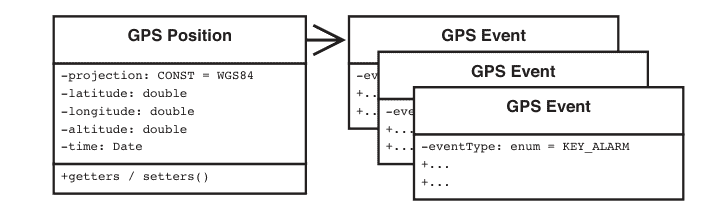
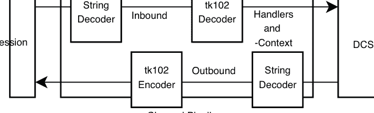
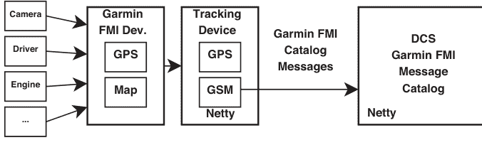
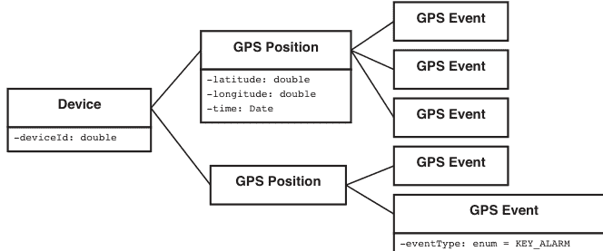
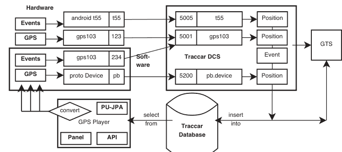
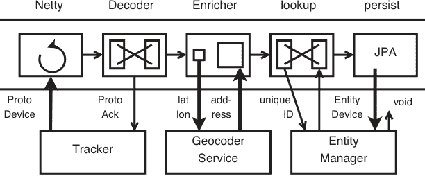
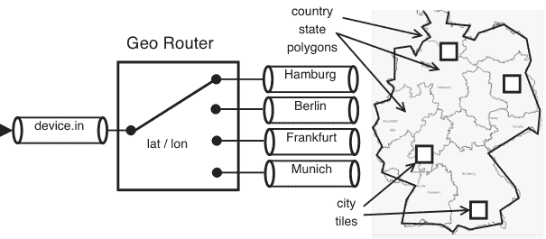
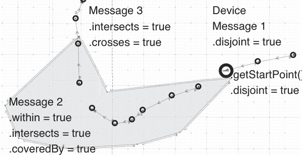
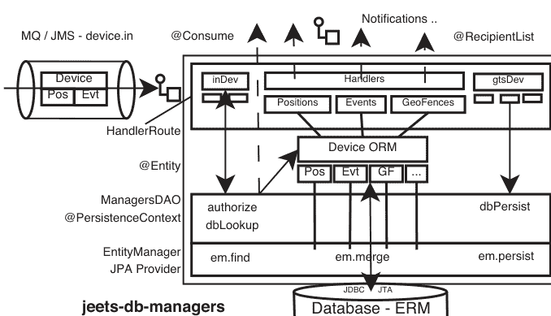
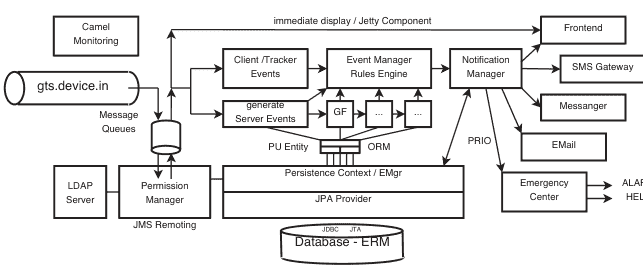

# Java EE 组件 GPS 跟踪：联网汽车的挑战

访问 Taylor & Francis 网站 `http://www.taylorandfrancis.com`

访问 CRC Press 网站 `http://www.crcpress.com`

## 序言

## 目录

- 14.2.2 Camel JPA 配置 152
- 17.6 企业级标准 207
- 17.10 整合一切 215
- 16.2.2 接收者列表 EIP 174
- 16.4 JEETS 地理路由器 179
- 16.4.2 Java 拓扑套件 - JTS 180
- 17.4.1 持久化上下文 191
- 17.4.5 ORM 导航 196
- 17.5.2 路由修改 206
- 17.6.3 GTS 组件 210
- 17.9 通知管理器 215
- 18.3.1 WildFly-Camel 子系统 227
- 18.4.3 Java 管理扩展 229
- 18.8 WILDFLY-CAMEL ACTIVEMQ 232
- 19.2.4 JEE 服务器应用场景 244

## 附录 A ■ 开发环境 249

- B.4 导入 ECLIPSE 255

## 附录 C ■ 安装 JEETS 257

- D.4 围围围 264

## 附录 E ■ 安装 WildFly 265

- E.2.1 安装 WildFly-Camel 267

# 引言

- 1.1 GPS Tracking with Java EE 1
- 1.2 The Challenge of the Self Driving Car 2
- 1.3 Intended Audience 3
- 1.4 Skills / Skill Level 4
- 1.5 The Author 4

# Introduction and Overview

Vehicle and fleet tracking has become a large industry over the last decade and the market offers innumerable trackers for different appliances. With the smartphone new tracker type was introduced as a multipurpose well-performing Client computer with full connectivity to any sensor.

On the Server, different GPS Tracking Systems (GTS) have evolved to track people, assets, vehicles. A vehicle-tracking system can be used to observe a fleet and locate vehicles on a map in a browser frontend. The system can raise individual events to improve logistics, monitor fuel consumption, create travel reports. A transport company doesn't persist in the market today without a GTS and the software industry provides full-fledged solutions to run a.

Since the automotive industry has recognized tracking technologies as the live data source architecture to activate direct cars through a complex environment the classical GTS architecture considers new aspects. This book analyzes how the challenges of the Self Driving Car (SDC) exceed the limits of a classical GTS Tracking System. For a thorough analysis the widely accepted and well designed Open Source Tracer GTS [1] is reverse engineered in detail to dissect major GTS constituents.

## 1.1 引言与概述

读者可以见证原型设计、建模过程并修改他们自己的软件。本书将帮助你通过自定义组件来建立自己的跟踪系统。每个组件都将详细介绍，并包含了许多开发设计决策。这些模块被组合成一个可自定义的 GTS - 即 JEE 跟踪系统 JEETS。它们可以作为组件来丰富现有系统，包括为 Java 中间和 JEE 应用服务器提供实时跟踪功能。JEETS 是一个在底层运行的 GTS 组件工具箱，你也可以结合 Tracer 使用它。

## 1.2 自驾驶汽车的挑战

导航系统和数字地图已经变得极其精确，能够根据 GPS 坐标在数字地图上定位车辆。跟踪与制图合并以引导车辆走向自动驾驶汽车（SDC）只是时间问题。这目前正在改变汽车行业，从编写嵌入式软件转向通过大数据进行实时服务托管和数据处理。互联网发展迅速，现在已准备好在车辆移动时提供辅助，有时在几秒钟内。

自动驾驶开发的主要目标是提供计算出的路线并实际控制车辆执行。从第一印象上看，SDC 似乎是汽车发展的逻辑延续。现有的智能泊车辅助系统值得关注，因为它们实际上对复杂操作采取了车辆的完全控制：在没有人工干预的情况下进行高精度的重量转向、前进和后退。本书将不会探索车辆的内部控制，而是侧重于客户端服务并提供有用信息。

那么 SDC 并不是革命性的吗？它是技术的正常演变吗？它远不止于。挑战在于移动车辆的协调以及对可能触发车辆相互接近和规避事件的偶然性的预测。

SDC 与经典 GTS 的主要区别在于，后者只处理单个设备的跟踪信息。在 SDC 系统中，需要评估不同车辆的值并在移动时为每辆车辆提供快速反馈。系统必须在比较聚合不同车辆并最终向每辆车辆提供结论之前，评估并分类每个车辆消息。

这种 SDC 挑战要求将 GTS 重构成更独立的组件。将在更高层次上组合这些组件，形成可以并行处理的单个用例。为了实现这一点，JEETS 将遵循一些主要指南进行建模：

### 目标读者 ■ 3

- 不要看过去。

经典的 GTS 通常频繁使用数据库查询来确定车辆是否在提交的位置之前。

- 不要对未来进行推测。

某些 GTS 保持连接对话以等待传入的事件。

- 不要等待外部资源。

外部资源的响应时间通常是不可预测的。外部数据库代表硬件资源，并且很容易成为整个系统的主要瓶颈。

# 1.3 目标读者

本书的另一个主要主题是对 JEE 技术本身的反思。容器正在减少，并且可以动态创建以创建一个单一方法 —— 然后被丢弃。……JEE 技术正在逐渐离开应用服务器，转向更小的独立的 Java (EE) 组件，这些组件被组合成一个系统。其中许多组件将引入介绍并用于创建单独的 JEE 组件。

在 Java 中，我们通常谈论架构师和开发者角色，这并没有完全反映现代软件组件。构建工具和复杂的框架已成为开发过程的核心部分。Java EE 平台“仅仅”是许多全球接受的 API 规范的高级规范，这些规范相互相关、与 Java 世界以及网络相关。在实际开始实现之前，架构师必须像软件计算机一样工作以创建构建环境。本书中开发的所有 JEE 客户端/服务器模块可以在 GIT 仓库中找到，并可以使用 Maven 进行编译、测试和安装。

将标准 Java 升级到 Java EE 的典型问题是直接连接硬件。跟踪消息到达计算机（硬件）的端口。另一方面，JEE 运行时环境应用服务器被设计用于控制反转（IoC），业务逻辑不应包含任何与服务器、而非操作系统交互的代码。否则，在不同机器上的可扩展性将无法实现！

因此，本书还可以帮助 Java 开发者不仅对 GPS 跟踪感兴趣，而且对许多独立模块的现代软件设计感兴趣。整个系统设计是自底向上描述的，从创建数据格式开始。读者应该能够看到持久持久化单元（persistence unit）和兼容的网络数据格式对数据传输的基本重要性，它们实际上预定义了系统并规定了每个组件的设计。由于在创建系统之前无法完全定义格式，我们将描述如何创建格式，以及如何在开发过程中根据新需求对现有系统中的格式进行修改。

由于汽车行业中的 SDC 开发具有高度竞争性，因此在非保密的情况下进行，我们将重点专注于应用 Java 技术来确保 GPS 跟踪系统。通过向实体 Java Bean (EJBs) 提供实时跟踪信息，GTS 开发者可以轻松打破其 GTS 的位置限制，并将其与企业的其他系统结合。想象一下，在地图前端点击一辆卡车，从仓库和其他物流系统中检索实际的卡车货物。

## 1.4 技能 / 技能水平

本书不介绍 Java EE，你预计将……

- 安装 JSE Tracer GTS
- 安装 Postgres 数据库（带有 PostGIS）
- 下载 / 克隆 GIT 仓库
- 应用构建工具 Maven (clean compile test install ...)
- 安装应用服务器 Wildfly
- 安装 ActiveMQ
- 为 WildFly 配置 ActiveMQ 资源适配器

书的源代码和示例附录可以在书籍网站 `jeets.org` 获取。本书应作为伴随源代码的实操说明书使用。预计读者将在个人开发环境中下载并编译源码。你可以一次性查看附录以设置你的环境，或者在阅读时根据附录要求设置所需的软件。

## 1.5 作者

作者专注于地理数据处理，在汽车行业工作了十多年，见证了从 GPS、数字地图到导航的发展。作者曾使用开源组件建立商业跟踪系统，并在大型跟踪项目中担任架构师和开发者。为了自动驾驶汽车的目标，GTS 技术应用于实时跟踪。

# 数据格式与关系

# 消息交换

## 内容

- 2.1 GPS 协议 ..................................................... 7
  - 2.1.1 消息格式编码 ................................................ 9
  - 2.1.2 消息类型与 ID ................................................ 11
  - 2.1.3 消息目录 ................................................ 12
- 2.2 TCP/IP 通信 ............................................ 13
  - 2.2.1 标准 Java TCP ............................................... 14
  - 2.2.2 OpenGTS DCS ................................................. 17
- 2.3 JEE 组件 ................................................. 19
  - 2.3.1 Netty 框架 ...................................... 20
  - 2.3.2 设备到设备实现 ................... 23

# 2.1 GPS 协议

处理来自智能手机、汽车和连接设备的众源数据流的新挑战是在不丢失信息的情况下将数据还原为流。在 DCS 的背景下，每一个比特和每一个毫秒最终都要尽可能、快速地支持每辆车辆——对于单个高流量节点。

在此过程中，我们将专门为 GPS 跟踪目的开发不同的 JEE 组件。为了从零开发，我们将查看跟踪比特的基本信息：GPS 坐标在第一书中已详细介绍，并分解为时空点所需的以下字段：

- 经度：[–90°, 180°] 东经/西经十度 +/-
- 纬度：[–90°, 90°] 北纬/南纬十度 +/-
- 高度：海平面以上 (+) 或以下 (-) 米，见水位面 (0) [默认值]
- 时间戳：UTC¹ 时间和日期

> ¹世界协调时间，此前称为格林威治标准时间 (GMT)

## 8 消息交换

`event`: 发此 GPS 坐标的原因。

跟踪信息（即事件）应该始终带有 GPS 坐标 (`lat`,`lon`,`alt`,`time`)，以描述在何时、何地发生了什么，以及该事件代表的时间。这些信息是描述传输含义或原因的（传感器）信息。提交的字段被转换为简单旧 Java 对象 (POJO) 以成为系统的实体。见图 2.1。

让我们来看四个基础的 GPS 字段，以了解不同的格式以及它们所需的空间（即位，`bits`）。由于 Java 开发人员希望将 Java 原始类型定义的提交值作为服务器端的目标格式，尽管 32 位表示法可能足够，且它们通常被用作 64 位双精度原始类型，但在跟踪语境下，一个关键问题是：如何在不丢失精度的情况下，用最少比特数通过网络传输 GPS 数据？

为了方便起见，许多跟踪器以人类可读的格式（ASCII csv）格式传输信息：

```
| keys            time           lon      lat      alt |
| values...      ...170312123644,120589,490234,0... |
| formats         YYYMDDDHMMSS ddmmmmm |
| 29 bytes        ---------------- |
```

第一个字段代表由纬度和经度的时间戳（以数字表示），最后是相对于海平面的高度。这对于显示目的或通过短信和其他许多人类交互发送跟踪消息有用。对于 SDC（软件定义车辆）场景，这种格式是一场灾难。



图 2.1 服务器将消息转换为相关的 POJO。GPS 和事件可以被建模为一个或多个系统实体。它们的关系可以根据需要建模为 1:1 或 1:n。

## GPS 协议 9

表 2.1 带有精度场的整数坐标

| longitude | dir | integer | precision | double |
| :--- | :--- | :--- | :--- | :--- |
| 121.1234567 | East | +1211234567 | 7 | +121.1234567 |
| 121.1234567 | West | -1211234567 | 7 | -121.1234567 |
| 21.1234567 | East | +211234567 | 4 | +211234567 |
| 21.1234567 | East | +211234 | 4 | +21.1234567 |

在文本格式中，每个（或在此字符中）每个字段和分隔符至少需要一个字节，总计达到 29 字节。此外，还不清楚高度为零是默认值还是真实值（不太可能）。纬度和经度被限制为 6 位，以固定它们的整体精度。

从数据处理的角度来看，如果你比较计算机系统的 FLOPS 和 MIPS 性能，那么使用整数而不是小数是一个好主意。SDC 产生的问题是纬经的精度。数字地图曾用于提供米级的精度，随后针对 ADAS² 进行了重新定义。由于这对于自动驾驶来说是不足够的，一种具有厘米级精度的新地图正在到来：HD 智读（machine reading）。

另一方面，并不是所有信息都是以厘米级精度提供的。因此，可以将纬经度定义为整数以及一个精度字段（见表 2.1）。值 4 代表数字 10⁻⁴，即 1⁻⁴ 的倍数，并允许对任何坐标通过显式指定来设置默认值。Java 变量所需的空间，整数占 16 位，服务器代码中目标变量占 64 位双。现在我们有了纬经的 24 位表示法，这比上述列出的方法要好得多。

根据你的应用程序，你可能考虑提交一条短路线，即一系列相关的位置信息。这为给每个位置标记纬、经、高度的小增量（`deltas`）提供了可能。然而，这非常专门的方法，也会引入风险。在网络语境下，我们没有 Java 类型，并且使用单比特仍然留有压缩的空间……

### 2.1.1 消息格式编码

如果你购买了一个跟踪器，通常没有机会定义协议，必须对提供的协议进行逆向工程。因此，我们将查看几种跟踪协议格式以及它们带来的典型实现问题。之后，我们将定义自己的 JEETS 数据格式，具有清晰的结构以便快速原型设计。

> 高级辅助辅助系统

我们现在来看 `tk102`（或 `tk103` 等），因为它是人类可读的（见 [5]）。跟踪器编码的典型 String 看起来如下：

```
0023800858890B141129A2302.753207N23.2461E000
.0092142349.381000000AL000000F1
```

接收消息的服务器应用程序必须知道格式以便解析你应用程序的前几个值：

```
0023800858890B141129A2302.753207N23.2461E000
.0092142349.381000000AL000000F1
```

### 2.1.3 消息目录

`tx102` 协议格式对于教科书来说很有帮助，并且足够描述消息的编码和解码过程。对于更高的网络流量和更小的数据尺寸，更复杂的设备会对每个数据字段进行逐字节的位操作。

为了对复杂设备有一个直观的了解，你应该查看 Garmin 车队管理接口 (FMI) [6]。FMI 提供了大量功能，即用于带有导航和消息功能的车队管理解决方案的消息。Garmin FMI 设备代表了外部传感器（如行记录摄像仪等）的连接器。

完整的 FMI 功能是一个庞大的消息目录 [7]，在其中你可以找到针对许多不同设备的消息：

- A607 途点管理和驱动器状态
- A611 服务器到客户端长文本消息协议
- A622 CAM 1.0（行记录摄像仪协议）


实现细节可以在 Garmin 接口规范 [8] 中找到，该规范包含约 70 页关于编码和解码的技术细节。我们不会深入探讨从解码文件中提取信息的细节，此规范可以作为你的替代方案，让你对复杂的设备通信有一个良好的印象。该文档描述了你可以根据需要学习的数据类型、协议层和应用协议。

在 SDC 语境下查看 FMI 设备的另一个好理由是它并不是一个跟踪器！尽管它有一个 GPS 单元甚至有用于导航的数字地图，但它没有配备 GSM 单元。为了与 GTS 或车队管理系统通信，设备必须连接到带有 GSM 单元的跟踪器。FMI 设备通过 RS232 或 USB 标准等物理协议与跟踪器通信。跟踪器（或自动驾驶汽车）仅仅是提交消息并添加时间戳和位置标记的设备。稍后，我们将查看一些处理这两个设备的实现细节。

既然我们已经对字段和消息目录有了良好的了解，我们开始为代表专用消息目录创建一个设备通信服务器，这些目录代表一个设备及其外部源或传感器。

## 13 TCP/IP 通信

通常，我们可以假设跟踪系统设计用于通过空中（OTA）从远程跟踪设备接收实时 GPS 信息和车载信息学。由于现代跟踪系统还应该能够处理室内跟踪，我们不希望将系统限制在 OTA。最通用的方法是关注 Internet TCP/IP 并忽略传输介质——这正是 TCP 的实际优势。

### 传输控制协议³

传输控制协议 (TCP) 是 Internet 协议族中的主要协议之一。它起源于 Internet协议 (IP) 的初始网络实现。因此，整个协议族通常被称为 TCP/IP。TCP 为运行在通过 IP 网络通信的主机应用程序之间的字节流提供可靠、有序且经过错误检查的交付。

对于开发者来说，此接口侧重于实现。我们将 TCP 通信与客户端和服务器侧的端口以及 IP 地址相关起来。最重要的一点是：IP 地址定义了软件端点在硬件上所在的位置！

### 端口（计算机网络）⁴

> 在 Internet 协议族中，端口是操作系统中的通信端点。虽然该术语也用于硬件设备，但在软件中，它是一个识别特定进程或网络服务类型的逻辑结构。端口始终与主机的 IP 地址和通信协议相关，从而完成了通信会话的终止地址或源地址。每个地址和协议通过一个 16 位数字识别，通常称为端口号。

对于我们的设计，我们可以通过指定端口组合来简化整个通信：至少为服务器指定端口，并且如果可用（即在线），你可能会漏掉另一种常用协议 UDP，它也应用于各种跟踪设备。无论如何，TCP/IP 是一个我们可以与之协作的有用组合，我们可以以类似的方式处理 UDP 实现。新系统 JEETS 的数据流可以简化为：

跟踪设备 > TCP > 跟踪服务器 > JEETS

³来自维基百科，自由全书

⁴来自维基百科，自由全书

## 14 消息交换

这是一个开始实施的实用模型，随着学习的进行，我们将看到如何通过 JEE 服务将数据传回自动驾驶汽车。注意，“跟踪服务器”实际上是一个设备通信服务器 (DCS)。DCS 代表跟踪服务器的单个组件，其代码设计为与跟踪器目录中的已知消息通信。

通过只观察 TCP 通信，我们也可以涵盖室内跟踪通常基于各种技术的现状，因为 GPS 是不可用的。除了室内跟踪外，我们还应该考虑一个新兴的新行业：物联网 (IoT)、工业 4.0 等。在这些情况下，我们只需要时间、长度和纬度的值来进行跟踪。

对于室内跟踪，高度有时以不同的方式使用。从抽象地说，建筑有一层或多个具有恒定高度的楼层，高度可能存储楼层号，用于加载其平面图。查看 Google 地图上的明尼阿波利美国购物（Mall of America）可以了解地图匹配地面的概念。

### 2.2.1 使用标准 Java 的 TCP

Java 是为了网络和 Internet 编程语言而发明的，Java 对象在设计上直接通过 TCP（或 UDP）进行通信。分布式系统（如跟踪器和跟踪服务器）需要可靠的通信。Java 服务器应用程序可以将 socket 绑定到指定的端口，并通过点对点通道交换信息。在会话期间，数据可以双向交换。

某些系统会尽可能长时间地保持与汽车的连接，尽管大多数时候连接是空闲且虚拟的。这种模型自然是由……驱动的。

## 15 TCP/IP 通信


图 2.2 跟踪器通过 IP 请求连接 DCS。服务器创建一个新的 socket 以建立连接并接收消息。这可以通过 `java.net` 包实现。

为了快速上手 TCP 课程，你可以阅读 [Java 教程: Custom Networking](9)。在 TCP 部分，你可以复制并粘贴 `EchoClient.java` 和 `EchoServer.java` 类，让它们通过 Echo 协议进行通信。我们使用 `EchoClient` 作为跟踪软件的起点。在开发需要时，能够向服务器发送跟踪消息是非常帮助的。使用真实的设备发送消息可能非常耗时。为了触发消息，你必须让设备暴露在天空下。将其放在窗边只有部分天空可见。如果你想触发距离消息，你必须走一段距离。因此，最初我们需要一些客户端软件来发送我们选择的消息。

当然，这也可以使用网络工具通过 `netcat` 命令模拟高流量。此时，我们感兴趣的是理解整个通信过程，并通过我们的 Java 视角来观察它。

第10 页介绍的 `tk102` 非常流行，因为它在单个字符串中定义了完整消息。开发者可以轻松使用任何软件编译（编码）并发送到服务器部分将其解码回键值对。这种简单性被许多跟踪器供应商用于添加他们想要的内容。该格式并不严格，可以很容易变成私有。然而，你会发现许多带有 `.102...` `.103...` 的跟踪协议，并应该仔细查看来自你硬件的实际消息！

如果你只需要为现有软件添加基本的跟踪功能，那么你可以基于 `EchoClient` 实现一个简单的跟踪器，它可以向服务器发送如下的单个字符串：

```http
http://host:5055/?id=40256&lat=49.158&lon=-12.864&timestamp=19241
```

## 消息交换

```java
String positionMsg = "imei:3595870124900,tracker,809231329,"
 + "135549900601,F,13209.397,A,2234.4669,N,"
 + "11354.3287,E,0.1";
```

```java
try (Socket serverSocket = new Socket(hostname, port)) {
    PrintWriter out = new PrintWriter(serverSocket.getOutputStream(),true);
    out.println(positionMsg);
} catch (UnknownHostException e) { . . }
catch (IOException e) { . . }
```

向跟踪系统发送 `kt102` 消息只需要这些内容！由于这种简单性可能会在服务器端引起问题，大多数 GTS 都要求设备在在使用其服务之前先注册到服务器上。该实现的另一个细节是缺乏服务器响应。我们如何知道 GTS 已经接受了数据呢？通用的解决方案是确认（Acknowledgment），或者在跟踪术语中称为：ACK。

TCP 的引入是用电子电子邮件来类比的。你如何知道你带有会议日期的邮件已到达收件人？只有当你收到类似“ok”的回复时，你才知道。尽管人们永远不会在收到“没收到消息”时用“消息损坏”回复——即负 确认（NAC），但不要将内置的 TCP 确认机制（后台）与你 GPS 数据的“语义”确认混淆。

特别是在通过无线传输通信时，传输将非常频繁。对于许多跟踪器，你将 ACK 模式作为一个可选设置，并且你应该使用它！只有在服务器确认消息后，客户端就可以放弃该消息。否则，消息应该在下一次机会重发。一个通原则是：“没有确认的通信就不是通信！”

话虽如此，我们发现了 `kt102` 协议流行的另一个原因：许多服务器不发送回复，所以目前我们不需要考虑 `EchoClient` 中的 `BufferedReader` 未被应用。通过这种策略，我们可以向现有的 GTS 发送消息而无需修改它。我们会记住 ACK 并在以后考虑它。

列表未显示的是字符串内容的实际组成部分及其含义。在硬件中，我们必须处理多个提供的字符串，如果你使用 `GPRS数据协议.xls`，你会发现一个包含 40 多个句子和服务器响应的电子表格以获取全貌。该协议作为消息目录，实际上定义了所有的跟踪功能以及如何使用它们。

我们稍后会向真实的 GTS 发送跟踪消息。但让我们先看

5ace [8]: 3.1.3 ACK/NAC 握手

6or any .. 102 .. 103 ... 协议 

## TCP/IP 通信 ■ 17

在流行的 OpenGTS 服务器端，以理解解码跟踪信息的复杂性。

### 2.2.2 OpenGTS DCS

因此，试图在一本书中涵盖所有协议实现是没有意义的。我们只选择了一个简单的协议来展示 Java 版本的客户端编码和服务器解码。实际上，获取协议规范并不总是容易的，即使你被授权使用或发布它！

另一方面，一个新客户可能已经安装了跟踪器并想将它们迁移到你的 GTS 中。这时，你可能需要在没有规范的情况下对许多消息和字段进行逆向工程。许多开发策略——协议实现需要互联网研究。对于大多数协议，你可以在网上找到 Java 代码段，以下是我们的 `tk10x` 协议的 Java 代码示例。

OpenGTS 是一个流行的 Java GTS，你可以在 `opengts.org` 下载。在 `roof.de/intro`，你可以找到从组件架构到源码的 GTS 分析。OpenGTS 具有非常单体状的结构，这使得很难提取孤立的组件。我们将关注它的设备通信服务器（DCS），它负责在专用平台上开发协议消息，并将 `tk10x` 协议作为一个可读的示例，我们还创建了一个小型软件来发送 `tk10x` 消息。在 `road.de/tracking` 中，你可以研究 NMEA GPRMC 句子如何（带有校验和）解码为 `lat`、`lon`、`alt`、`time` 等字段。

让我们看看 OpenGTS 提供的设备通信服务器（DCS）。在原始的 OpenGTS 分发中，你可以运行所有附加组件（数据库、JDBC 等）来为 `tk102` 协议创建一个 DCS。在运行任何一个后，你将在 `../build` 文件夹中找到一个 `tk10x.jar`，它可以直接从操作系统命令行启动：

```
java <className> {options}
options:
[-tcp <p>;; <q>] 要监听的服务器 TCP 端口
-start
在指定的端口启动服务器
```

对于生产发布，你应该使用位于 `bin` 文件夹中提供的 `runserver` 批或 shell 脚本。无论如何，遵循 `tk10x` 消息解码并不需要 OpenGTS 的安装和编译——它是人类可读的。

对于后续分析，你可以在 IDE 中创建一个普通的 Java 项目，并将 OpenGTS 的 Java 源码放在 `src` 文件夹中。这不会编译，但提供了方便的浏览。所有 DC

> †我们不会进入系统细节的，也不安装它。

## 18 消息交换

服务器位于 `org.opengts.servers...` 包中，我们将关注 `org.opengts.servers...` 包，解码。

```java
TrackServer(tcpPorts, udpPort);
new TrackServer(tcpPorts, udpPort);
```

```java
org.opengts.util.Thread
```

```java
private void start(int port)
```

```java
io.netty.Handler
```

```java
PacketHandler.class;
```

```java
InsertRecord(String)
```

> 8我们只对 TCP 部分感兴趣9搜索 'imei':

[第 33 页]


图 2.3 一些“经典”跟踪系统与数据库（管理系统）交互。在 SDC 场景下，访问应该是异步的。

### 2.3 JEE 组件

本书标题包含了模糊且非正式的术语“Java 组件”。这意味着什么？它们是什么？到目前为止我们还没有查看任何 JEE 规范。

标准版提供了每个 Java 实现的核心。然而，我们已经看到使用 `java.net` 和 `java.10` 包实现一个 DCS 需要多大的努力。在一个微小错误可能威胁生命的 SDC 场景中，你会依赖这些具有超过 6000 行（历史）代码的处理类吗？

我们将使用“JEE 组件”一词来指那些可能不是 JEE 规范指定的但属于许多实现部分的 Java 包或库。这些组件的数量越来越多，可以在纯 Java 中使用以成为多功能工具。

## 消息交换

你经常可以读到的另一个术语是“标准 Java 组件技术”，它与 JEE 无关，尽管可以应用于它。JDBC 是此类组件的一个广为人知的例子。另一个例子是 [11]：“一组小型而实用的 Java 组件集合”。

现代 Java 开发应该从使用构建工具进行组件组合开始。开发者需要针对其问题领域研究最新的组件。换句话说，尽量避免底层技术实现，而专注于业务逻辑。构建工具会负责解决具有重复嵌入式子组件的依赖冲突。

正如我们所见，GTS 是基于标准 Java 的，代码冗长，我们将看到如何通过 JEE 组件 Netty 来大幅减少代码。

### 2.3.1 Netty 框架

到为止，我们已经创建了一个简单的跟踪器，仅用几行标准 Java 就能发送消息字符串。只要你需要向服务器发送 GPS 位置，这种方法就没有问题，不需要额外的 jar 包来增加你的应用程序场景。

服务器端的情况会变得更加复杂。

每个跟踪硬件在每秒字节数和每个端口的字节数上都有其限制。对于 SDC 场景，必须估计并计算技术限制，精确到每秒消息数。

想象一个场景：一个专用服务器应用程序负责分析流量。更通俗地说，“流量节点”指的是流量出现问题的地方。大家都知道，最糟糕的时间是高峰时段。你可以从互联网上查询不同日期、时段、季节的详细流量信息，或者检查 Google Traffic 以了解你所在城市的状况。凭借对市中心的专门知识和实时数据，可以根据硬件能力为流量节点动态定义一个框。

有了这些数据，你可以计算用于边界框的端口数量，或者调整边界框以匹配每个端口的消息数。你的软硬件需要多少缓冲区来处理高流量？通过实时大数据，扩展过程可以变得非常动态。

> 搜索“流量数学”开始计算容量、延迟等。

## JEE 组件 ■ 21

“Netty 是一个异步事件驱动的网络应用程序框架，用于快速开发可维护的高性能协议服务器和客户端。”

Netty 是一个 NIO 客户端服务器框架，能够快速方便地开发网络应用程序，并极大简化了 TCP 和 UDP Socket 服务器等网络编程。

Netty 的设计非常仔细，借鉴了实现 FTP、SMTP、HTTP、各种二进制以及基于测试的遗留协议时积累的经验。结果，Netty 成功地找到了一种在不妥协的情况下实现开发易用性、稳定性和灵活性的方法。

作为起点，我们早些创建了一个简单的 `tk0` 跟踪器（我们很快就会发送消息）。我们在 2.2.1 中使用了纯 Java 实现的 Echo 客户端和服务器来作为开始。请参考 Netty 网站和用户指南 [13]，这是一份非常棒的单页介绍，你也可以可以在那里找到 Echo 场景。让我们来看 TCP 和 Netty-Echo 客户端 [14] 的代码差异，并观察导入的类：

```java
import io.netty.Bootstrap
import io.netty.channel.ChannelFuture
import io.netty.channel.ChannelInitializer
import io.netty.channel.ChannelOption
import io.netty.channel.ChannelPipeline
import io.netty.channel.EventLoopGroup
import io.netty.nio.NioEventLoopGroup
import io.netty.socket.SocketChannel
import io.netty.channel.socket.NioSocketChannel
import io.netty.handler.ssl.SslContext
import io.netty.handler.ssl.SslContextBuilder
import io.netty.handler.ssl.InsecureTrustManagerFactory;
```

显然，代码中不再有 `java.net` 或 `java.io` 类了！我们识别出 `io.netty.channel` 和 `io.netty.handler` 包是框架的核心工作。


```java
EventLoopGroup group = new NioEventLoopGroup();
try {
    Bootstrap b = new Bootstrap();
    b.group(group)
     .channel(SocketChannel.class)
     .option(ChannelOption.TCP_NODELAY, true)
     .handler(new ChannelInitializer<SocketChannel>(){
        public void initChannel(SocketChannel ch) {
```

# 消息交换

socket



图 2.4 通过 Netty，你可以专注于在 Java 中实现自定义的编/解码器，并结合标准的 Netty 编/解码器，而无需担心 socket、会话、线程等。

```java
ChannelPipeline p = ch.pipeline();
p.addLast(new EchoClientHandler());
};
ChannelFuture f = b.connect(HOST, PORT).sync();
f.closeFuture().sync();
finally {
  group.shutdownGracefully();
}
```

列表显示了一个典型的 Netty 模式，你并不需要详细了解类（参见用户指南 [13]）就可以应用它们。基本上，你创建一个`ChannelPipeline`，并为入站和出站数据添加一个或多个处理器。在这个通道流水线中，Netty 隐藏了所有关于 socket、线程等细节，并负责主机和端口的连接与断开。Netty 还提供了方便方法`shutdownGracefully()`，你应该在你的代码中使用它。特别是在网络开发期间，通道会被打开并在代码运行之前一直关闭。这可能会非常困扰，因为它可能会分配文件夹和文件，导致系统无法清理，甚至强制重启；

在启动 Netty 的服务器主方法也可以找到类似的业务逻辑。`EchoClientHandler`只是扩展了 Netty 处理器以提供方法存根。这些方法将在流水线的某处被调用，并在处理 I/O 操作的多线程事件循环中被调用。Netty 会处理一切，并提供简单的 Java 结构来创建你的

当我们在第 8 章构建软件跟踪器时，我们将实现客户端实现。目前，我们的简单实现足以发送消息，如果需要，我们可以实例化许多客户端。现在我们想在服务器端工作，以接收来自这些消息。

## 2.3.2 设备间实现

正如所见，Garmin FMI 设备提供了指向许多外部传感器和内部功能的接口。然而，它没有配备 GSM 单元，需要通过 RS-232 连接到标准的跟踪设备。

要实现完整的硬件链，你必须处理跟踪器的消息，然后提取 Garmin 消息（这些消息格式可能完全不同）。使用 Netty，可以在各个处理器中实现不同的消息编码器，并在流水线中连续对齐。

本节和用户指南可以描述 Netty 如何为数百种实现提供 Java 类，而 Echo 示例展示了一个完整的

# 消息交换



使用 Netty 构建的可运行网络应用程序！我们将使用 Netty 创建一个跟踪器（tracker）和一个跟踪器服务器，你可以在之间添加自己的 Netty 进程。跟踪器、协议和服务器的组合通常被称为设备通信，我们下一章将查看 Traccar GTS 的设备通信服务器。

# 第 3 章 设备通信

# 目录

- 3.1 Traccar DCS ... 25
- 3.2 设备通信服务器 ... 26
- 3.3 架构 ... 27
- 3.3.1 Traccar 客户端/们 ... 28
- 3.3.2 myLiveTracker ... 29
- 3.3.3 GPS 测试应用 ... 29
- 3.3.4 调试跟踪消息 ... 29
- 3.4 结论 ... 31

## 3.1 TRACCAR DCS

本书描述了跟踪技术，并提供跟踪（即 JEETS）组件作为现有应用程序的插件。本书并没有创建一个完整的跟踪系统。通过引入 Traccar 作为一个完整且结构化的跟踪系统，我们可以分析其架构，并将其作为（尚未）缺失组件的备选方案。我们将识别出端点，以便将其逻辑放置到任何现有系统中。这使得有经验的开发者能够从 Traccar 和 JEETS 组件以互补的方式创建一个新系统。

OpenSTS 是第一个 Java 开源 GTS。DCS 模块被编译为独立的 jar 包，而核心系统是使用 Ant 工具构建的，并基于运行在 Tomcat 上的 Servlet 技术。当 Traccar 作为第二个 Java 开源 GTS 出现时，许多公司用性能更好的 Traccar 设备通信（Device communication）来替换了 OpenG，同时为客户保留了 Open Web 前端。

我们引入了 Netty 作为我们首选的 TCP 框架。如果你不想使用 Netty，可以查看替代方案 Apache MINA，"用于网络应用程序的多功能基础设施" [15]。引入 Netty 的理由是为了引入基于 Netty 的 Traccar DCS 架构。我们不会为 tk10x 协议编写 DCS，而是查看 Traccar 的解码策略。

# 设备通信

## 实践指南

为了运行、调试和分析 Traccar，请遵循附录"开发环境"和"安装 Traccar 源码"，在继续下一节之前设置好你的环境。

## 3.2 设备通信服务器

GPS 跟踪的核心是通过专用协议和硬件端口与许多跟踪器进行设备通信。通常，对于每种跟踪设备类型（和协议），都有一个设备通信服务器（DCS）将协议解码并输入跟踪系统。为了扩展和安全考虑，单个协议也可以绑定到不同客户的不同端口上。传统的跟踪系统将信息存储在数据库中，连续的组件可以获取这些信息（见第 19 页的图 2.3）。

DCS 连接到硬件以接收跟踪消息（即键值对），然后解析并将信息传播到系统核心。单个 DCS 通常绑定到一个端口，通过 TCP 接收来自远程跟踪设备的实时 GPS 信息和车载信息数据。DCS 在这些"事件"发生后不久对其进行处理。

在下一章中，我们将查看 Traccar GTS 及其 DCS 架构。我们将了解到每个 GTS 的每个 DCS 都会创建相同的 Java 类型以实现标准化的流，并处理实际的跟踪系统。特别是对于 SDG 场景，我们应该将 DCS 的定义限制在其核心任务：

- 监听端口，创建 socket 和会话，接收跟踪事件
- 提取并将数据转换为实际的 GTS 模型

OpenGTS 的设备通信服务器实际上做了更多：

- 为地址添加地理标签，即地理匹配（geomatch）坐标
- 管理跟踪设备，创建报告
- 为服务器端事件创建地理分区（geozones）

稍后我们将如何如何更现代的方式完成这些任务。

注意：实践指南描述在实线黑线之间，读者需要设置自己的环境以便更好地跟随开发。

请查阅附录 A"开发环境"以设置你的环境，并准备好 IDE 以导入 JeETS 源码项目。

然后你可以继续附录 B 下载并"安装 Traccar 源码"。这将需要一些时间，但强烈建议这样做。

## 3.3 DC 架构

在描述了从纯 TCP 到 Netty 的消息流之后，我们现在将介绍 Traccar 的设备通信控制器，用于解码一百多种跟踪协议！

在 Traccar 中，每个设备通信服务器都是第 23 页 EchoServer 的 Netty 类似物。Traccar 是管理 ChannelPipelines 的主应用程序。与其为你的需求构建完整的应用程序，你应该考虑使用 Traccar。添加你的协议并将其贡献 Traccar —— 这就是开源的意义。

为了快速跳过前面提到的协议，你可以为分析准备 Traccar。请编辑你的配置文件，注释掉 zexun 项以外的所有端口。

```xml
<entry key='zexun.port'>5006</entry>

<!-- PROTOCOL CONFIG
<entry key='gl100.port'>5003</entry>
<entry key='cradlepoint.port'>5118</entry>
-->
```

为什么选择 zexun？如前提到的，市场上上有不同的"方言"，Traccar 实现了 kt102、kt103 和 zexun。选择 zexun 的原因将在下面的子节中揭示。通过上述配置，Traccar 只在端口 5000 提供协议服务。让我们进入 Traccar 从 Main 开始。该方法给出了关于配置、数据、权限和连接器的印象。我们对`ServerManager()`的创建感兴趣。它在`org.traccar.protocol`包中搜索解码器。所有 28 个协议都派生自 Traccar 提供的`BaseProtocol`。对于 xml 文件中的每个项，都会启动一个新的`TrackerServer()`，在我们的案例是`XenunProtocol`。在`TrackerServer`中，你会找到用于跟踪系统的熟悉的 Netty 类。

要实现自己的协议，你可以查看`XenunProtocol`和`XenunDecoder`这两个类。`Protocol`类设置了 Netty Pipeline，在每次消息到达时执行。管道中的第一个处理器准备了要在自定义解码器中解析的字符串：

```java
XenunDecoder extends BaseProtocol
```

实际解析发生在方法中，几行处理句子

```java
Parser parser = new Parser(pattern, (String) msg);
```

Traccar 使用预定义的模式将句子分割成键值。通过查看模式，可以轻松地找到字段序列。

```java
private static final Pattern PATTERN_BASIC = new PatternBuilder()
    .expression("(?([PR]BNC)?)") // 消息 ID
    .expression("((?:(\d+)\.(\d+)))?)") // 有效性
    .expression("((?:AV)))") // 纬度
    .number("(?(\d+)?\d*),([NS]))?") // 经度
    .number("(?(\d+)?\d*),({EW}))?") // 速度
    .number("(?(\d+)?\.\d*))?") // 航向
    .number("(?(\d+))\.(\d+)))?") // 日期
```

向 Traccar 添加协议时需要知道的是，最终每个设备都会创建一个`org.traccar.model.Position`作为输出。该对象定义了内部格式并与数据库对齐。我们将在下一节"数据建模"中非常彻底地查看这个实体和实体管理。现在，让我们通过在智能手机上安装跟踪器来准备发送我们的第一条消息。

### 3.3.1 Traccar 客户端/们

智能手机时代为每个所有者配备了非常强大的设备。对于开发者来说，利用某种"位置 API"从操作系统获取相关值并不是什么难事。

除了跟踪服务器外，Traccar 还为 Android 提供了跟踪应用以及

> ¹注意注意 Traccar 3 是基于 Netty 3 的，带有`org.jboss.netty`包！

IOS. 安装非常简单，您应该可以顺利完成安装并准备好收集轨迹。不要忘记在 xml 中激活该端口。一旦我们开始构建 JEETS 追踪器，收集到的轨迹将用于调试和开发。

### 3.3.2 myLiveTracker

由 Michael Skwiderski² 编写的项目 myLiveTracker 是一个非常流行的 GPS（以及 DCS）开发 Android 追踪器，因为它能够模拟不同的协议。我们之所以配置了 'xexun' 协议和端口，是因为我们将使用 myLiveTracker 来模拟 Xexun tk102。

请在您的智能手机上安装 myLiveTracker。

- 选择 Settings（设置） > Protocol（协议） > Tk102 Emulator（模拟器）
- 传输后关闭连接
- 以行尾结束消息
- 确定您的 IP - 您可能在每次注销后 IP 都会发生动态变化！
- 您可能需要在您的防火墙和路由器上添加端口 5006 的转发规则。

> ²[play.google.com/store/apps/details?id=de-de.msk.mylivtracker.client.android](https://play.google.com/store/apps/details?id=de-de.msk.mylivtracker.client.android)
> ³[play.google.com/store/apps/details?id=com.crossrost.gpstest](https://play.google.com/store/apps/details?id=com.crossrost.gpstest)

### 3.3.3 GPS Test App

在启动 myLiveTracker 之前，您可能想安装另一个实用的助手：由 Crossrost Limited³提供的 GPS Test。该 App 可以可视化 NAVSTAR、GLONASS、GALILEO、SBAS、北斗和 QZSS 六个系统的卫星，并提供大量有用信息。"首次定位时间"（first fix time）指示确定第一个位置所需的时间。在室内查看卫星星座，会发现您的设备只能通过窗口可见的卫星工作。一旦定位，您就可以切换到 myLiveTracker 开始追踪。

### 3.3.4 调试追踪消息

在书中，我们还将开发一个 JEETS 追踪器应用程序，它将比使用智能手机更加方便。目前，我们将使用 App 来发送第一条追踪消息。

现在您应该已经配置好了 Traccar 以及环境，其中包含了用于 myLiveTracker 的 xexun 5006 端口和用于 Traccar 客户端的 5055 端口。

## 3.4 设备通信

OsmAndProtocol。请在`org.traccar.protocol`包中选择您的解码器。

我们将使用`XerumProtocolDecoder`进行调试。在 IDE 中打开它，并在这一行设置一个断点：

```java
Parser parser = new Parser(pattern, (String) msg);
```

接下来，您可以以调试模式启动 Traccar，然后启动您的智能手机追踪器。一旦您看到 IDE 高亮显示了断点，就可以关闭 Traccar 并逐行执行 Traccar 代码……

在调试器中，您将找到来自 mylifetracker 的`(String) msg`：

```
GPRMC,106441.2,A,4901.8459,N,01206.1216,E,0.0,0.0,
160117.0,0,E,A3C,F,ime:3564250503123211,
```

这与我们的 tk102 相似。如果您在 Traccar 解码器中看到该模式，就可以通过其解析正则表达式找到消息字段。

您可以对任何 Traccar 协议或实际硬件追踪器执行相同的步骤。Traccar 日志也会记录重要的（会话）。

```
INFO:[3804437] connected
DEBUG:[3804437] 5006 < 67.160.25.40> IME: 313730313263310334636353
44432c1305463212a3...2c4514424333435200334246060a0
INFO:[3804437] id: 356425050312311, time: 2017-01-16 16:46:41,
lat: 49.03077, lon: 121.0203, speed: 0.0, course: 0.0
INFO:[3804437] disconnected
```

HEX 代表在转换为字符串之前的原始编码 TCP 信息，而 ascii (Latin) 部分代表`org.traccar.model.Position`实体中的解码信息被持久化在数据库中，我们可以找到：

```
366: "axum":"2017-01-16 16:53:57","2017-01-16 16:46:41:002",
"signal":{"ip":"127.0.0.1","12.10202666666667:0:0;0:0"},\n"distance":"89.62,totalDistance:2246.76"
```

带有一些空的 0 或无法匹配到现有 Java 字段的属性值 {。请查看表格的 SQL 创建脚本以查找上述记录的数据库类型。位置实体和位置表将是我们对您的领域进行有效建模的起点。正如我们将看到的，关系 Java 对象模型 (ORM) 或数据库实体关系模型 (ERM) 不仅仅是一个带有字段的消息（或带有字段的句子）。

## 3.5 结论

到此为止，我们已经分析了设备通信。思路是解码消息和系统。未来，我们将使用 App 来发送第一条追踪消息。

这些常量通常在实现附加协议期间被"收集"，用以反映某种特定类型的追踪器和事件。例如，只有当追踪器以某种方式连接到车辆的点火信号时，"点火钥匙"才有意义。对于人员追踪器来说，此标志没有意义。追踪系统可以并会使用这些常量将传入的位置分发到不同的应用程序。

最后，Traccar 的位置（Position）对象代表基础的 GPS 消息，就像旧的记录一样，它是软件对象的历史原型。从数学角度来说，它是完整系统中的一个实体。通常，任何针对问题领域具有定义数量实体的应用程序都是数据结构。通过将实体相互关联（例如将"人员"与"位置"关联），我们可以构建一个完整的实体关系模型（ERM），作为应用程序的数据库（或基础数据）。

## 4.3 关系模型

虽然 ERM 通常与数据库模型以及表/行/集合相关联，但将其视为适用于任何开发的通用关系型数据至关重要。数据建模的过程构成了系统的基础，其质量对每个实现都有重要影响。实际上，数据设计是系统第一且最基础的编程步骤。


关系建模的另一种方法是对象关系映射（ORM）。例如，你也可以使用 JavaScript 对象表示法（JSON）结合任何数据库技术创建关系模型。从技术上讲，建模应用领域的方法有很多种。核心始终是语义关系数据，它体现在客户需求的名词和动词中。

通过对象/关系（ORM/ERM）映射，对象和数据库记录（行）可以通过 Java 持久架构（JPA）以同步方式使用。上下文需要快速处理传入的事件，软件架构师应该妥善考虑哪些模型运行在受限的 RAM 中，而 ERM 允许在无限制的硬件上运行；它们之间存在显著性能差异。数据库查询可能会被任何并发资源阻塞。

让我们探索由`org.traccar.model`包中的 Java 类表示的 Traccar OR 模型。在上一节中，我们查看了 Traccar Position 作为所有 DC 服务器的输出：

```java
public class Position extends Message {
    long deviceId;
    double latitude;
    double longitude;
    Date deviceTime;
}
```

## 36 数据建模

只有在至少纬度（lat）、经度（lon）和时间戳可用（必要字段）的情况下，我们才能将 GPS 消息转换为 Java 实体。在服务器端，由于大量位置，需要一个标识符进行区分，因此位置有一个`id`字段，我们在`Extensible`类中找到了它。拥有少量的数据库经验，你就知道数据库系统（DBMS）在持久化时会生成标识符。

如果我们想在不使用数据库且没有 ID 的情况下使用实体怎么办？

对象/关系映射框架的最佳成就之一是开发者不需要知道任何 ID 或 OR 关系（主键和外键）。根据经验，你不应该基于 ID 编写任何逻辑。在第 6.5.1 节中，我们将看到实体如何管理此任务。

追踪消息的下一个强制属性是某些`deviceId`，它可以是 IMEI、手机号码……系统所需的任何内容——且不是由数据库生成的。它只需要作为表行的主键包含在模型内部。我们可以查看一下 Traccar 数据库（ERM）的位置 positions 表：

```sql
CONSTRAINT fk_position_device FOREIGN (deviceid) (id) MATCH SIMPLE
```

使得`Position`类关联父类`Message`的是该父类引入了`deviceId`。

`Position extends Message Extensible`

在数据库中，你可以在表定义中找到此关系：

```sql
CONSTRAINT fk_position_device FOREIGN (deviceid) (id) MATCH SIMPLE
REFERENCES public.devices (id)
```

这种关系对 GTS 功能有影响；如果你按照第 3.3.4 节所述成功记录了次追踪位置，请记住在 GTS 接受其消息之前你必须注册你的设备。在其他情况下，只有当表持有`deviceId`时，消息（即位置）才能持久化。

我们可以得出，一个实体拥有值（lat、lon、time……）、一个与模型中其他实体具有关系（device）的标识符（id）。DC 服务器从消息中提取值并将其转换为实体。简单的消息可能需要某种（数据库和/或）关系才能被 GTS（或实际上被模型）接受。在下一章中，我们将利用这些知识来研究消息关系，以及你如何将这些关系建模到你的协议中。

> 对于本书，我们将使用 PostgreSQL [16]

## TRACCAR 模型

由于我们专注于 Traccar 的关系数据模型，我们可以利用 Traccar 代码和数据库来识别系统 ER 模型和 OR 模型的所有字段。任何追踪系统的主要实体之一是位置（Position）：

```sql
public class Position CREATE TABLE public.positions
{
  id INTEGER NOT DEFAULT nextval,
  private double latitude double precision NOT NULL,
  private double longitude double precision NOT NULL,
  private double altitude double precision NOT NULL,
  private Date deviceTime wo tz NOT NULL,
}
```

一个需要注意的重要点是单个位置实体与存储多个位置的表。虽然数据库只存储数量记录，但实体始终指的是由单个对象表示的单条记录（或行）。列表还显示了`NOT`约束以防止存储不完整的位置。任何约束也可以在 Java 中进行注释，我们稍后会查看持久化模型。让我们来看一些字段及其影响。

### ID

数据库表中的 ID 应该由数据库系统（DBMS）通过序列生成器自动提供，以确保通过主键建立关系。ID 提供了记录（实体）的唯一标识，这对于将实体相互关联至关重要。另一方面，客户端软件不应提供它。

### 设备时间 (Device Time)

之前提到过消息定义由定义良好的数据类型组成。然而，`Date`对象只是一个值的包装器并且可以被映射。

### 设备 ID (Device ID)

设备是一个“说话的”标识符，属于设备并应该由其提供。如果客户端软件以安全方式访问此数字并将其添加到协议中，你就可以通过 IMEI 识别 GSM。

⁴移动设备标识

⁵移动用户识别码

## 38 数据建模

作为标识符。这在评估同一车辆的不同追踪器时很有帮助，通过简单更改 SIM 就可以方便更改追踪器类型。我们不会使用 SIM 作为标识符。

无论你选择什么，建议使用某些“官方”标识符而不是在数据库中生成它们！在 Traccar GTS 中，标识符可以是任何字符串。

### 有效性 (Validity)

通常追踪系统应该具有类似于应用程序的验证模块，以过滤掉无效位置。例如，当汽车在卫星可见性差的地方停留时，位置在找到良好的星座进行定位之前可能会瞬间跳跃一公里。这些位置会导致跳出地理围栏触发错误的进入和退出事件。因此，验证和合理性检查属于可靠的客户端服务器系统。

### 字符字符串 (Character Strings)

通常机器间的通信完全不需要字符串，架构师应在设备通信中避免它们。上述用于 Traccar 的`deviceid`是例外，它提供了定义自己的 ID（如`MyAndroidResource`）的自由。字符串仅用于人类可读。你还应该意识到放入字符串的种种字符会有区别。你可能成功使用 ASCII 或 Latin 字符字符串作为占位符开发网络协议。后来你会遇到使用 UTF-8 的限制问题。在向协议中添加字符串之前，你应该考虑使用数字的替代方案。

让我们来看 Traccar 位置中的两个字符串字段：

### 地址 (Address)

在 Traccar 中，此字符串字段被“保留”用于服务器端的反向地理编码。反向地理编码服务从纬经度坐标导出（预配置的）地址。由于反向地理编码可能昂昂的过程，它通常被委托给隔离的服务。你可以从多个供应商中选择反向地理编码器，并根据时间的编码次数付费。或者你可以建立自己的服务，其优势是可以添加诸如“总部”、“北仓库”等所有员工和司机都熟悉的地点。当然，你也可以在客户端填充此字段，以指示检查点#3763。总之，我们将此字段与 Traccar 服务器关联，而不在客户端使用。

> 6 从地图的行政层级

# 协议

这是另一个要存储在数据库中的 Traccar 位置字符串。为了简单起见，我们每个端口只应用一种协议，此字段不用于根据协议名称确定端口。在客户端填充此字段是没有意义的。

# 消息 ID

该字段在 Traccar 模型中没有显式定义，但在许多支持网络传输的协议中可以找到。当客户端接收到 ACK 响应时，它可以清理已发送的消息；通过在响应中添加`messageId`，客户端逻辑可以清理成功传输的消息。许多追踪器在没有收到确认的情况下，会在几秒后自动重新发送消息。

请注意，对于处理单个消息的单个 Netty 会话，`messageId`并不是强制。关键在于，你可以向“网络模型”中添加字段，而这些字段不会进入系统模型。


# 对象关系

- 内容

- 5.1 Google Protocol Buffers ................................................. 41

- 5.2 批量消息 ....................................................................... 43

- 5.3 对象关系 ..................................................................... 44

   - 5.3.1 模型影响 ........................................................ 45

- 5.4 ORM 和 ERM ............................................................................ 46

- 5.5 设计 ORM ................................................................ 47

- 5.6 扩展 ORM ................................................................. 49

   - 5.6.1 临时 ORM 扩展 ........................................ 50

   - 5.6.2 有害的 ORM 扩展 ......................................... 50

## 5.1 GOOGLE PROTOCOL BUFFERS

如果（这可是很大的“如果”）你有机会在客户端设计并实现一种协议，我们引入了在开发期间创建和修改（即原型化）协议的最有效方法，并为网络序列化消息。

既然有许多协议，为什么不想出一个实现任何协议的标准方法呢？前提很简单：序列化数量（有序的）类型值，并将其反序列化到任何 Java 类型变量中。协议消息实际上是与客户端交换的，任何类型的信息都可以称为协议，而客户端就是客户端，因为它与外部数据交互。Google 已经解决了标准协议技术的缺失，并提出了：

Protocol Buffers [17]

> “Protocol buffers 是 Google 提供的语言无关、平台无关、可扩展的结构化数据序列化机制——类似于 XML，但更小、更快、更简单。你只需要定义一次你希望数据如何结构化，然后就可以使用特殊生成的源代码轻松地在各种数据流中读写你的结构化数据。”

# 对象关系

请阅读[开发者指南](17) 以快速了解一个描述人的简单消息。介绍，在阅读**Person**（人）时，只需想一下我们的**Position**（位置）即可开始。请使用此介绍在你的系统上安装 protobuf 编译器。然后你可以修改 Google 的示例来编译后续章节的这些片段。

如果你已经处理过 JavaScript 对象，可以使用 JSON 来熟悉 protobuf。使用 protobuf 的简单性在于`.proto`文件，这是一种用于定义带有字段消息的简单文本文件。从前几节的字段评估中，我们确认系统模型和网络模型之间映射得很好，尽管它们并不等同。我们将处理这种不对称性。在本节中，我们将关注[第 6 章和第 7 章](#)，并处理 proto 文件的设计以定义网络模型。

在我们查看了位置层 (ERM) 和位置实体 (ERM) 之后，让我们使用 protobuf 创建位置：

```
message Position {
  int32 deviceid = 1;
  uint64 servertime = 2;

  // 十进制度 = N/S
  double latitude = 6;
  // 十进制度 = +/-/W
  double longitude = 7;

  postges types
  integer NOT NULL
  timestamp
    without time zone NOT NULL
  double precision NOT NULL
  double precision NOT NULL
```

protobuf 消息在左侧，右侧显示的是对应的类型（Posted types）。通常 protobuf 是语言无关的，因此必须映射到接收环境。列表跳过了 Java 类型，因为我们很快就会遇到它们。

如果你查看[traccar.proto 文件](#)中的完整消息，你会注意到缺失的`id`、**address**、**协议 字段**——如上所述。一种实用的方法是为添加消息和字段的开发者提供重要的备注注释。在悬停变量变量时，这些注释将被处理以提供帮助并节省时间。

当你创建初始 proto 文件时，你应该注意使用**=**表达式进行显式排序。这看起来是没必要的，除非字段完全按照此顺序出现。原因是 protobuf 随着时间推移的向前向后兼容性。如果你还记得第一个带有空字段的 kt10 消息，就会很清楚 protobuf 在内部应用顺序来定义值和映射。

在早期版本中，字段中有一个**required**标记，你可以找到关于它们的有趣讨论，这对于任何软件开发者来说都非常有教育意义。你现在只需要知道根据以下项对字段进行排序：

> ¹ 参见 JEETS 仓库: /jets-protocols/protobufs/traccar.proto

重要性，lat（纬度）和 lon（经度）是追踪所需的，并且应该永久保留序号，而你可以在末添加字段以支持额外的（项目相关的）逻辑。

## 5.2 批量消息

在 proto 文件中定义消息非常简单。无论如何，有很多你应该注意的设计影响。主要任务是面向关系数据对消息建模。创建一个位置消息是原型设计的良好开始，因为它可以用于设置实现开发周期。位置消息可以发送到 Traccar 的位置实体，然后存储在位置表中。无论如何，我们的第一个消息并不需要使用缓冲区。你可以用它们做更多事情，打破“经典的”孤立消息解析。许多追踪器具有某些内部数据库，立即存储 GPS 定位，无论是否存在连接。

特定场景需要使用 GPS 坐标的精确模式。一个简单的例子是100秒或（取决于速度的）50米。复杂的客户端软件可以分析带有 DGPS 增强等的 GPS 单元（内部）坐标以插值参数并为给定的时间或位置检索最佳坐标。使用内部“数据库”，可以在内部缓冲坐标以平衡 GSM 连接的不可靠性。注意，Traccar 的位置具有时间戳、设备时间和服务器时间戳，用于记录位置的创建历史。

内部逻辑代码可以处理缓冲消息，并在连接良好时发送它们，并且可以利用一次发送消息的数量。此外，客户端可以遍历缓冲坐标，以某种方式对其进行对齐和优化。任何情况下，都应该定义最大字节数，以防止长时间阻塞服务器端口。

许多经典的追踪器提供批量消息来一次性传输内部数据库。除了使用新的解析器实现附加的消息格式外，这并没有提供总消息大小的控制机制。

使用缓冲区可以非常简单地传输任意数量的位置，只需在 proto 文件中添加另一个消息：

```
message Positions {
  repeated Position position = 1;
}
```

就是这些了。现在我们可以实现并配置一个接收 Positions 的端口，客户端可以设置所需的消息数量。当然，它可以在

# 对象关系

隐式地用于发送单个`Position`——封装在集合中带有微小的开销。如果我们同意使用`Positions`协议而不是`Position`，我们就可以发现缩小尺寸的机会。来自同一个设备的每个`Position`都持有相同的`deviceId`，我们可以重新格式消息为：

```protobuf
message Positions {
  int32 deviceId = 1;
  repeated Position position = 2;
}
```

并从单个位置消息中移除`deviceId`。换句话说，`repeated`关键字用于创建消息集合——而无需使用显式 ID。它可以被作为缓冲区，在客户端收集位置，然后通过单次方法调用将其转换为网络格式进行流式传输。

## 5.3 对象关系

我们仍然处于通过 Traccar 数据模型进行关系型数据建模的过程中。导致面向对象开发的最初想法是由语言分析驱动的。名词被建模为对象，对象之间通过动词关联，即——方法 [19]。当我们回到 Traccar 模型时，可以发现从设备到位置的关系。位置总是由设备创建的。我们可以将`Positions`消息重命名为`Device`消息：

```protobuf
message Device {
  int32 deviceId = 1;
  repeated Position position = 2;
}
```

以建模一个设备到多个位置实体的 1:n 关系。再次，这不仅仅是简单的消息命名，还开启了新的建模选项。

常用的传感器数据之一是设备的电池电量，它是协议消息的一部分。通过 protobufers，我们可以将这部分传感器数据与设备关联：

```protobuf
message Device {
  int32 deviceId = 1;
  repeated Position position = 2;
  int32 batteryLevel = 3;
}
```

这符合常识，因为位置本身没有电量。通过 protobufers，这种修改可以应用到现有软件中，因为我们在末尾添加了新字段，而没有修改现有的顺序。之前的实现（在现场运行的）仍然可以工作，且完全感知不到电量的存在！

### 5.3.1 建模影响

在建模过程中，你应该始终意识到语义影响。对于车辆跟踪，电池电量是微不足道的，因为追踪器由持续负载的车辆电池供电。当环境辅助框架涉及残障人士时，电池电量可能变得至关重要¹。


典型的追踪器依赖其内部能量系统，这危险地定义了设备尺寸。根据经验，一个 1 Ah（或 1000 mAh）的可充电电池可以跟踪约 10 小时，这很大程度上取决于人的活动。标准要求是覆盖一天，并根据人的睡眠时间为设备充电。无法根据连接次数、卫星可见性等确定精确的寿命，因为这些因素每天都在变化。无论如何，追踪器——而不是跟踪系统——应该报告低电事件，以便在应急中心处发出通知。

如果你在此背景下考虑我们的 `Device` 消息，你可以识别出一个危险的陷阱。低电事件被计划在 15% 以下触发。问题发生于电池电量变得低到无法建立 GSM 连接，导致无法发送任何信息，更无法发送低电事件了。

因此，低电事件应始终在客户端生成，客户端应该足够智能，即使规则是“低于 15%”，也能在 17% 时检测到事件。在描述的场景中，服务器永远无法根据 5% 的规则触发低电事件。一个完善的实现至少应该生成某些警告。

大多数修改都应该彻底实现，并将电量关联到设备是有意义的。软件逻辑的实现者应该确保为添加的每个新位置更新设备的电量。只有这样，你才能得出电量代表最后一次位置时间戳的值。

如果你感兴趣详细观察电量消耗——将电池字段移回 `position` 消息。建模就是编程，而消息意味着——全系统的规则。

## 4.6 对象关系



图 5.1 此单个设备消息包含一个对象关系模型，具有一个设备、两个位置和五个事件实体。

## 5.4 ORM 和 ERM

我们已经看到如何使用 protobufs 建模关系型消息。现在究竟什么是对象关系模型（ORM）？它如何与实体关系模型（ERM）相关？尝试查找可能会更加困惑，因为这些术语在不同语境下的应用不同。我们不要依赖理论上的区分，而是看实际影响。

如果你熟悉统一建模语言（UML），你就知道类模型和对象模型之间的区别。对象是在类定义的蓝图后创建并实例化的。在数据库模型中（通常称为 ERM），表（~ 类）定义了带有类型的有效内容，其中每行（~ 对象）持有系统领域中一个具体的语义实体。

单字符串消息在第 10 页引入，作为一个具有定义字段数量的协议语句的示例。消息大小允许对最大服务器性能进行估算，以确定特定场景所需的端口。protobuf 设备消息是关系性的，且最大尺寸是不固定的。

在我们的语境中，我们将一个设备消息与一个 ORM 关联。点在于，消息定义（类似于类）并没有定义设备上挂了多少位置。包含五个位置消息的单个设备消息总计添加了六个实例化的对象，即具有各个独立值的消息。此消息代表一个独特的 ORM，其具有具体的对象（见图 5.1）。

稍后我们将创建一个持久化单元（PU），用 Java 类来表示完整的模型。然后设备消息被转换为具有五个关系实体的设备。

## 4.7 设计 ORM

通过创建关系型消息，我们定义了代表系统特定细节的 ORM。灵活性是其优势之一。这些消息通常不（也不应该）代表完整的 ERM，而是相关的因素。更复杂的情况是那些应该触发事件的形。在环境辅助的情况下，如果追踪器在指定时间内没有发送任何位置，系统应该能够触发事件。这可以通过开启心跳消息来覆盖，如果汽车没有发送任何内容——谁会在意呢。

## 5.5 设计 ORM

对于高效的原型设计阶段，定义一个可以引发关联更改的“根”消息非常有帮助。其优势是，我们可以为专用端口设置协议，并在开发期间通过修改它来添加更多细节。我们第 44 页的消息是一个软启动，即来自设备的语义数据。任何开发者都可以使用设备消息作为在特定 ORM 结构中设备创建的数据。

请记住，我们让自己处于使用数据库中现有 Traccar 模型的舒适环境中。数据建模就是编程，并为我们的软件开发提供了基础。从零开始建模需要相当的经验和对设计的理解。我们的初始建模很难预测所有的系统需求，并在过程中应该是可的。

为了快速开发，架构师将设备消息（即 proto 文件）交给通信开发人员来设置协议。在开发周期中，服务器和协议始终通过构建工具耦合在一起以传播更改。一旦协议确定，应用程序开发人员就可以搭建其环境来传输第一批消息。然后后者就可以开始修改协议而无需任何配置更改。

现在我们回到 Traccar 模型来改进消息。每个跟踪系统都基于客户端事件的概念。

# 对象关系

每个事件都带有一个 GPS（lat, lon, time）坐标。Traccar 模型隐含了位置与事件之间实用的区分。位置存储时不包含事件信息，而不是间隔事件（基于时间或距离）。这对于“实时跟踪”是有意义的，因为它可以由复杂的客户端软件逻辑驱动。通过这种方式，跟踪系统只需跟踪设备，而不会触发任何事件。

现在，你作为网络建模者，面临着一个核心问题：如何建模设备以处理“设备 - 位置（多个） - 事件（多个）”的关系？

解决方案很简单：

```protobuf
message Device {
    int32 deviceid = 1;
    repeated Position position = 2;
}
```

```protobuf
message Position {
    double latitude = 6;
    double longitude = 7;
    repeated Event event = 9;
}
```

```protobuf
message Event {
}
```

请记住，事件消息应该在客户端填充，而 Traccar GTS 可以生成事件！如果你想使用预定义的事件键（即第 35 页列出的 Traccar 事件键），则你不应该使用字符串在网络上传输。使用 protobufers，你还可以创建枚举，这效率高得多：

```protobuf
message Event {
    EventType type = 1 [default = KEY_EVENT];
}
```

```protobuf
enum EventType {
    KEY_EVENT = 0;
    KEY_ALARM = 1;
    KEY_BATTERY = 2;
    KEY_IGNITION = 3;
    KEY_MOTION = 4;
}
```

实际的消息设计将随着 JEETS 的实现继续进行，JEETS 现在定义了 1:m:n 关系，而没有使用位置或事件 ID！它们的创建发生在数据库中，以便在通过 SQL 语句从数据库请求时重建该关系。我们将看到 Java 持久化架构（JPA）如何从持久化单元（PU）中定义的系统实体创建一个内容完全相同的新 ORM。

## 5.6 扩展 ORM

经过几十年的发展，软件已经达到了持续测试、集成和部署的卓越状态，这意味着软件（在设备上）是不断变化的，以避免通过更新通知打扰用户。有了设备消息，我们有很好的基础来扩展消息扩展。本节将描述一种理论上的扩展，该扩展目前尚未实现，但它应该让你对任何系统所需的设计过程有一个良好的思路。

地理围栏（geozones）定义在单个已知文本（Well Known Text²）字符串中。

大多数（不是所有）跟踪系统都有地理围栏的概念，用于在指定区域触发进入和离开事件。当然，在浏览器前端交互式地绘制地理围栏比创建（lat, lon）元组要对用户友好得多。另一方面，可能需要将这些地理围栏传输到跟踪器上。类似于电量评估，这允许跟踪器触发这些事件。

```text
"POLYGON(49.0314867358755 12.10032801555415, 49.0314867358755 12.10479117365916)"
```

使用 Java 处理地理围栏时，你可以在 proto 消息中定义它：

```protobuf
message Gezone {
  string name = 1;
  repeated Coordinate coordinate = 2;
}
message Coordinate {
  double latitude = 1;
  double longitude = 2;
}
```

你现在应该能够弄清楚如何将其添加到设备消息或创建地理围栏消息了！

注意，我们在这里使用的是简单的二维坐标，而不是使用位置消息进行跟踪。时间戳在这种意义。另一个需要考虑的重要因素是协议方向：你是想向设备发送地理围栏，还是接收设备的地理围栏？

> ²en.wikipedia.org/wiki/Well-known-text

### 5.6.1 临时 ORM 扩展

为了封装协议设计，我们将描述如何为特定项目添加网络模型扩展——无需修改系统数据模型。

如前提到的，客户端软件可以不断分析 GPS 单元的输出以改进传输的结果。由于 GPS 通常提供 NMEA 语句作为输出，客户端软件可以使用这些语句进行分析。现在，客户端开发者不能简单地依赖交付的位置，而不通过服务器端验证结果。因此，他决定将 NMEA 消息添加到设备消息中，用于他的个人开发环境，而不会给基于系统数据模型编写主程序的同事带来负担。

提供的地理围栏示例为如何向设备添加相关的 NMEA 消息提供了粗略指导。客户端开发者可以实现逻辑来评估 NMEA 语句，并在服务器端开发客户端软件，这比反复进行空中下载（OTA）更新要方便得多。一旦软件完善，服务器就可以移除 NMEA 消息，而不会对系统产生任何副作用。

网络模型和系统数据模型应始终保持对齐，因为它们并不是完全相同的，并且可以根据各自的环境进行修改，例如，网络模型仅用于网络传输！

### 5.6.2 协调 ORM 扩展

创建 protobuf 消息是简单的，如果你已经有一个关系数据模型可以工作，它会更简单。类似于创建一个持久化单元（在下一章），人们可能会忍不住一次性创建整个数据模型的协议。这是没有用处的，甚至是有害的。

记住，在跟踪系统记录其轨迹之前，必须先注册跟踪器。

- 管理：面向管理人员
- 入站数据：来自客户端
- 出站数据：面向软件
- 地图数据：用于计算


# JEETS 持久化单元/s

| 目录 | |
|---|---|
| 6.1 引言 | 57 |
| 6.2 Java 持久化架构（JPA） | 58 |
| 6.3 Hibernate ORM | 59 |
| 6.4 JEE 持久化单元 | 61 |
| 6.5 针对 ERM 调优 ORM | 62 |
| 6.5.1 隐藏 ID | 62 |
| 6.5.2 创建 ID | 63 |
| 6.5.3 对象关系映射 | 64 |
| 6.5.4 persistence.xml | 67 |
| 6.6 PU 测试环境 | 68 |
| 6.7 ERM 和 PU 更新 | 70 |

## 6.1 引言

关系数据模型是大多数系统的基础组件，JEETS 组件只有在共享相同数据格式的情况下才能交互：实体（Entities）应该被创建为系统中最小且相关的单元信息。JEE 开发的强大在于针对不同编程领域的组件进行了清晰分离。这些组件可以从 Net Framework 和 Protobuf 库等第三方下载。它们可以与你的业务代码结合，创建一个包含第三方依赖的新组件。

本章将处理代表已安装数据库的 `org.traccar.model` 包。如果你熟悉 Java 持久化架构（JPA），那么你已经知道这个包定义了 Traccar 持久化单元（PU）。

我们在第 2.3 节中引入了 JEE 组件的概念，JEETS 应该提供许多实用的跟踪组件。虽然 Traccar 是一个对良好的 Java 应用程序且只需要 JVM，但我们将为任何基于 Traccar 模型的应用程序创建一个独立的持久化单元。`jeetspu-traccar` 模块可以用于替换 Traccar 应用程序之外 `org.traccar.model` 包——例如在应用程序服务器或某些（OSGi）容器中。PU 提供了创建数据库的所有信息（即使在内存中），可以立即供环境使用，该环境可能只存在于某些特定的步骤中。

不熟悉 JPA 的读者可以将 `pu.jar` 视为类似于 `postgresql-9.2c41.jar` 的数据库驱动。然而，PU 包含了我们系统的语义和关系数据模型。通过这个组件，我们可以结合数据库管理系统，基于 Tracer 模型开发 JEETS 组件。

为了创建一个网络模型，我们使用了协议缓冲器（protocol buffer）技术，从应用程序的实体设置一个（复杂的）协议，并对其进行缓冲，使软件和网络准备好进行流传输。JPA 规范基于类似的意图。

通过为表（类）和行（对象）提供实体，开发者可以使用关键字自由地创建实体并为每个成员变量赋值。在 JPA 中，“缓冲区”由 `EntityManager` 提供，它可以参与将实体与持久化层进行同步。由于我们与数据库引擎关联到外部硬盘，数据库的访问可能会显著减慢性能。我们将在 JEETS 组件的实现阶段强调一些陷阱和使用模式。

## 6.2 JPA 持久化架构

Traccar GTS 不使用 JPA 实现（`javax.persistence` 包）。它应用标准的 Java `java.sql` 包来组合 SQL 规范，使用 HikariCP [2] 管理连接池，并使用 Liquibase [3] 作为 SQL 数据库的变化管理（及迁移）。

Java 持久化架构（JPA）提供了比经典 JDBC 方法更高级的 API，因为它可以通过对象/关系（ORM）映射隐式地管理数据库同步。通过提供持久化单元（PU）——它字面上是一个每个类都有表示的 Java 包——你可以专注于你的 Java 代码，并将数据库规范留给实体管理器（entity manager）。

JPA 只是一个规范，为了应用它，需要对其进行实现。类似于选择 Jetty 作为 TCP 框架，有多种流行的可用 JPA 实现。Glassfish 社区使用 EclipseLink [4]，而 JEETS JBoss 社区以及我们使用 Hibernate [20] 为同一个数据模型创建了两个持久化单元。

虽然我们还没有引入 JEE 环境，但在使用模型生成器时创建 JPA 实体是有意义的。`jeets-pu-traccar-jpa` 项目根据 Traccar 的发布进行版本控制。此后，架构师准备引导开发者指向数据模型。如果公司指南严格坚持 JEE 规范，则应该使用 JPA 模块。

在我们在 4.3 节对关系建模的分析中，我们发现了 Traccar 带有继承的 `Position` 实体：

```java
public class Position extends Message extends Extensible
```

好消息是，你可以在 Java 代码内部重新建模数据模型，以引入公共对象和实体以供其继承。重要的标准化是到数据库的访问层，我们新的 `Position` 代表与数据库（-表）同步的相同实体。

## 6.3 Hibernate ORM

在我们的术语中，Hibernate 是我们的下一个 JEE 规范的组件，我们将应用它来为 Traccar 数据模型创建一个 Hibernate 持久化单元：Hibernate 对象/关系映射 [21]

> Hibernate ORM 允许开发者轻松地编写应用程序，其数据模型概述了应用程序过程。作为一种对象/关系映射（ORM）框架，Hibernate 关注关系型数据库（通过 JDBC）的数据持久化。

关系数据建模是架构师在整个项目开发过程中的任务，我们正在应用 Traccar GTS 模型来推出 Traccar GTS。通过为表（类）和行（对象）提供实体，开发者可以使用关键字自由地创建实体并为每个成员变量赋值。在 JPA 中，“缓冲区”由 `EntityManager` 提供，它可以参与将实体与持久化层进行同步。由于我们与数据库引擎关联到外部硬盘，数据库的访问可能会显著减慢性能。我们将在 JEETS 组件的实现阶段强调一些陷阱和使用模式。

> 除了它自己的原生 API 外，Hibernate 还是 Java 持久化 API（JPA）规范的实现。正如如此，它可以被用于整个

JPA 只是一个规范，为了应用它，需要对其进行实现。类似于选择 Jetty 作为 TCP 框架，有多种流行的可用 JPA 实现。Glassfish 社区使用 EclipseLink [4]，而 JEETS JBoss 社区以及我们使用 Hibernate [20] 为同一个数据模型创建了两个持久化单元。

虽然我们还没有引入 JEE 环境，但在使用模型生成器时创建 JPA 实体是有意义的。`jeets-pu-traccar-jpa` 项目根据 Traccar 的发布进行版本控制。此后，架构师准备引导开发者指向数据模型。如果公司指南严格坚持 JEE 规范，则应该使用 JPA 模块。

在我们在 4.3 节对关系建模的分析中，我们发现了 Traccar 带有继承的 `Position` 实体：

```java
public class Position
```

好消息是，你可以在 Java 代码内部重新建模数据模型，以引入公共对象和实体以供其继承。重要的标准化是到数据库的访问层，我们新的 `Position` 代表与数据库（-表）同步的相同实体。

## 6.3 Hibernate 关系映射映射

在我们的术语中，Hibernate 是我们的下一个 JEE 规范的组件，我们将应用它来为 Traccar 数据模型创建一个 Hibernate 持久化单元：Hibernate 对象/关系映射 [21]

> Hibernate ORM 允许开发者轻松地编写应用程序，其数据模型概述了应用程序过程。作为一种对象/关系映射（ORM）框架，Hibernate 关注关系型数据库（通过 JDBC）的数据持久化。

关系数据建模是架构师在整个项目开发过程中的任务，我们正在应用 Traccar GTS 模型来推出 Traccar GTS。通过为表（类）和行（对象）提供实体，开发者可以使用关键字自由地创建实体并为每个成员变量赋值。在 JPA 中，“缓冲区”由 `EntityManager` 提供，它可以参与将实体与持久化层进行同步。由于我们与数据库引擎关联到外部硬盘，数据库的访问可能会显著减慢性能。我们将在 JEETS 组件的实现阶段强调一些陷阱和使用模式。

> 除了它自己的原生 API 外，Hibernate 还是 Java 持久化 API（JPA）规范的实现。正如如此，它可以被用于任何支持 JPA 的 Java SE 应用程序、Java EE 服务器、企业级 OSGI 容器等。

在使用 Hibernate 反向工程工具后，你会发现实体命名并没有很好地将表复数分配为单数：


```java
@Entity
@Table(name = "positions", schema = "public")
public class Positions implements java.io.Serializable {
}
```

该 PU 经过了手动修改。另一个关键陷阱是 getter 和 setter 与变量的对齐。当你更改名称（例如坐标）时，应该小心。

```java
void setPositions(Set<Position> positions) {
    this.coordinates = positions;
}
```

¹请注意，此 `jeets-pu-traccar-hibernate` 示例项目将随新的 Traccar 发布进行维护！

## 6.4 JEE 持久化单元

`jeets-pu-traccar-jpa` 目录是一个纯的 JEE JPA 组件。该实现适用于你现有的 JEE 应用程序且与 Hibernate 无关。

## JEE 持久化单元

> 除了它自己的原生 API 外，Hibernate 还是 Java 持久化 API (JPA) 规范的实现。正如如此，它可以被用于任何支持 JPA 的 Java SE 应用程序、Java EE 服务器、企业级 OSGI 容器等。

## JEETS 持久化单元 (Persistence Units)

这在某些情况下和某些实现中**可以**运行。无论如何它并不符合 **Bean 约**，当 JPA 提供者使用 Java 反射将成员变量与 getter/setter 对齐时，可能会引发问题。我们都知道墨菲定律……

## 6.5 针对 ERM 进行微调

JEE 持久化单元可以进行微调以服务于应用程序并减少编程工作。在第 48 页中，我们设计了 Device 消息以适应传入 Traccar 的输入数据，并为相关消息定义了单一协议。在处理实体（无论是否带有数据库）时，我们希望使用同样的便利性。

假设一个模型使用 `new` 关键字创建了不同的实体：

```java
Device device = new Device(1, "Tracker", "395389");
Position pos1 = new Position(1, device, ..., 49.12d, 12.56d, ...);
Position pos2 = new Position(2, device, ..., 49.34d, 12.78d, ...);
Event event1 = new Event(1, device, "deviceMoving", ...);
Event event2 = new Event(2, device, "deviceStopped", ...);
```

然后 Position 和实体通过使用关系对象与 device 关联。现在这五个对象可以附加到实体管理器（entity manager）以持久化到数据库中：

```java
entityManager.persist(device);
entityManager.persist(pos1);
entityManager.persist(pos2);
entityManager.persist(event1);
entityManager.persist(event2);
```

这意味着会导致一些问题。在创建五个实体后，程序员必须确保它们按照正确的依赖关系顺序进行持久化！如果你不先持久化 device 然后再持久化它的 positions 和 events，会导致数据库违反，因为它们没有父节点。在每个单独实体上调用 `.persist()` 方法也是不合法的。这样做会为实体管理器增加额外工作。让我们看看可以做什么来将这种持久化排序和 ID 管理从业务代码移动到 PU 中。

### 6.5.1 隐藏 ID

在第 36 页的“数据建模”章节中提到，程序员不需要知道也不需要接触任何 ID。上述带有显式 ID 的代码对于空数据库是有效的，程序员可以选择任何标识值来关联实体。自然，这种方法不适用于企业级开发。虽然模块生成器提供了带有显式 ID 的实体构造函数：

```java
public Device Device(int id, String name, String uniqueid) { . . }
```

但开发者不应应用它们。它们可能是持久化提供者本身需要的！

为了掌握相关实体，为系统中要实现的每个用例创建测试是非常有帮助的，甚至是强制的。在实际的 Java 代码中提供数据样本供其他项目的 `main(String args[])` 方法也非常有帮助。我们来看 `org.jets.model.tracer.util.Samples` 类，可以在其中创建 `createDeviceWithPositionTwoEvents`。首先我们创建两个独立的绑定实体：

```java
Device device = createDeviceEntity();
Position position = createPositionEntity();
```

然后将它们相互关联：

```java
position.setDevice(device);
device.setPosition(position);
```

### 6.5.2 创建 ID

另一方面，我们知道数据库关系是基于 ID 的。如果你打开数据库表 `positions`，可以手动添加一个位置而不提供 ID 并存储它。然后你会看到一个新的 ID，如果你查看 Postgres 中 Tracer 安装创建的关系模型，你将需要一个序列生成器：

```sql
CREATE SEQUENCE public.positions_id_seq
id NOT NULL DEFAULT next('positions_id_seq'::regclass)
```

而实体通过注解 `@Id` 直接指导 ID 的生成。有时数据库模型是由数据库创建脚本提供的，并且已经包含了序列生成器。那么 PU 的设计者应该通过注解将其名称与 Java 代码对齐：

```java
@Id
@GeneratedValue(strategy = GenerationType.SEQUENCE,
generator = "positions_id_seq")
@SequenceGenerator(name = "positions_id_seq",
sequenceName = "positions_id_seq", allocationSize=1)
private Long id;
```

JEETS PU 应该能够在生产环境中创建数据库。在测试部分，我们将看到如何从 PU²创建一个完整的数据库。

² 使用 `hibernate.hbm2ddl.auto = create`

## JEETS 持久化单元 (Persistence Units)

类似于为网络模型创建一个单一 Device 消息来传输相关的 positions 和 events，我们希望为我们的数据库模型引入同样的优雅性。软件可以创建一个带有相关子实体的 Device 实体，并通过各种方法传递此 ORM，这些方法可以在 Web 端读取和修改每个成员。

持久化单元代码不需要数据库，开发者应该知道何时涉及 EntityManager。由于我们不喜欢在第一个示例中持久化每个单独的实体，我们使用了 PU 来存储带有所有子实体的父实体。通过在代码中实体上添加 `CascadeType`：

```java
@OneToMany(fetch = Fetch.LAZY, mappedBy = "device",
cascade = CascadeType.PERSIST)
public Set<Position> getPositions() { .. }
```

我们可以指令 device 存储它的 positions、events 等。

现在我们终于可以用一行代码持久化 device：

```java
EntityManager entityManager = 
entityManagerFactory.createEntityManager();
entityManager.getTransaction().begin();
entityManager.persist(device); // .. 包含所有相关对象！
entityManager.getTransaction().commit();
entityManager.close();
```

前两行（以及 entityManager 工厂）可以在任何地方——持久化单元和最后一行。

### 6.5.3 对象关系映射 (Object Relational Mapping)

在书中我们决定将 Traccar 软件视为一种工程，这是正常情况。我们使用了 Hibernate 的数据库反向工程生成了实体，现在想查看一些细节。首先我们来看 Traccar 表和关系：

| table | id |
|---|---|
| events | deviceid |
| positions | deviceid |
| devices | positionid |

³ 注意在 EJB 上文中不需要显式的事务控制。

## 针对 ERM 进行 ORM 微调

我们可以推导出：

- events 通过 positionid 与 positions 建立 n:1 关系
- events 通过 deviceid 与 devices 建立 n:1 关系
- positions 不与 events 建立显式关系
- positions 通过 deviceid 与 devices 建立 n:1 关系
- devices 通过 positionid 与 positions 建立 1:1 关系

最后行的这种异常关系是 GTS 的一个特殊情况。device 实体可以存储最后知的 GPS 坐标，用于在地图上显示设备位置。最后的 positionid 不代表设备与其 positions 之间的关系（1:1！）！我们的网络模型中，device 消息没有 events 到 devices 的直接关系。我们拥有带有 positions 的设备，这是简单易懂。换句话说，每个事件都来自一个位置。通过这个简短的分析我们可以得出，现有的 ERM 是规范化的，在转换等方面需要特别注意。

接下来我们将查看由 Hibernate 创建的对象/关系映射，并使用系统的一些典型用例。

| Entity | Relations | |
|---|---|---|
| Device | SetEvent | SetPosition | positionid |
| Position | Device | positionid |

我们从这张表中看到了什么？我们可以看到 device 实体拥有与 events 和 positions 的直接关系，可以在代码中使用：

```java
position.setDevice(device);
device.setPositions(SetPosition);
device.setEvents(SetEvent);
entityManager.persist(device);
```

这对于协议到 PU 的转换以及通过一次方法调用对 device 进行级联持久化是足够的。

为表关系描述的 device. positionid 特殊情况建模为：

```java
public class Device {
    private Integer positionid;
    public Integer getPositionId() { .. }
    public void setPositionId(Integer positionid) { ..
```

## JEETS 持久单元 (Persistence Units)

Hibernate 为显式 ID 生成了 getter 和 setter。当在处理没有数据库端对应的实体时，这会出现问题，应该进行修改 ⁴

```java
private Position position;
public Position getPosition() { . . }
public void setPositionId(Position position) { . . }
```

以便将设备与最后已知位置关联。事件实体也存在相同的问题，应该被修改以设置其 GPS 位置。

在下方的概览表中，我们可以看到位置实体与事件之间没有关系。ERM（实体关系模型）仅将事件与位置关联起来，而在我们的编程环境中反相反，以便在图 2.1 和 5.1 中方便地创建事件。

```java
Event moveEvent = createEntity();
moveEvent.setType("deviceMoving");
Event stopEvent = createEntity();
stop.setType("deviceStopped");
```

我们将它们关联到一个位置：

```java
position.setEvents(setEvent);
```

而不是：

```java
moveEvent.setPosition(position);
stopEvent.setPosition(position);
```

虽然 positions 表没有到 events 表的 ID，但我们可以为 position 实体添加一个成员：

```java
private Set<Event> events;
@OneToMany(...)
public Set<Event> getEvents() {
    return this.events;
}
public void setEvents(Set<Event> events) {
    this.events = events;
    if (event.getPosition() == null)
        event.setPosition(this);
}
```

通过在事件 setter 中添加逻辑，我们可以隐式地设置事件的位置而无需 ID！这种更改可能会引发逻辑问题，这些问题在某些简单的测试用例中最初可能出现，一旦你将其发布给团队，可能会在许多依赖于良好结构 PU 的项目中引入这些问题。

⁴ 应结合相关的用例进行应用。

### 6.5.4 persistence.xml

这一行：

```java
EntityManager entityManager =
entityEntityManagerFactory.createEntityManager();
```

通过其名为 `persistence.xml` 的自有配置文件定义了 JPA 启动过程。在 Java SE 中，持久化提供程序需要通过类路径查找 `META-INF/persistence.xml` 资源名称来定位 JPA 配置。在代码内部，PU 通过以下方式引用：

```xml
<persistence-unit name="jets-pu-traccar">
```

使用其名称字符串：

```java
EntityManager entityManagerFactory =
Persistence.createEntityManagerFactory("jets-pu-traccar");
```

由于 `persistence.xml` 文件随 PU 项目一起发布，你应该考虑每个属性是否已准备好全局使用。另一方面，你可以为测试创建一个单独的 `persistence.xml`。在这里，你可以创建一个包含数据库驱动程序的最小版本：

```xml
<property name="java.persistence.jdbc.driver"
value="org.postgresql.Driver" />
<property name="java.persistence.jdbc.url">
value="jdbc:postgresql://localhost:5432/traccar" />
<property name="java.persistence.jdbc.user" value="postgres" />
<property name="java.persistence.jdbc.password" value="postgres" />
```

然后根据 PU 提供者通过程序化配置属性。对于 EclipseLink，它可能像这样：

```java
java.util.Map<String, String> entityManagerProperties =
new HashMap<String, String>();
entityManagerProperties.put(
    PersistenceUnitProperties.TRANSACTION_TYPE,
    "RESOURCE_LOCAL");
```

```java
EntityManagerFactory emfactory = Persistence
    ..createEntityManagerFactory(PU_NAME, entityManagerProperties);
EntityManager emgr = emfactory.createEntityManager();
```

对于 Hibernate：

```java
Configuration cfg = new Configuration()
    .setProperty("hibernate.dialect", "org.hibernate.dialect.MySQLInnoDBDialect")
    .setProperty("hibernate.order_updates", "true");
```

在 `PersistenceTest` 的介绍中，你可以找到一种在我们的内存数据库中覆盖 Postgres 连接的方法。

我们在查看三棵树结构时生成了完整的 ORM。因此，我们可以创建一个只包含三个实体的持久化文件。注意，你可以在高层项目中提供一个专门的持久化文件，以显式定义代码中涉及的实体。无论你选择哪种程序，最重要的部分是将类包含在持久化文件中，并如你提供的 `persistence.xml` 文件所示排除未列出的类。


本节介绍了一个符合 JEE JPA 规范的持久化单元，并演示了你在内部可以执行的一些操作。你在环境中可以执行或发现的另一件事是命名查询（named queries）的定义，开发者可以使用它们创建访问对象（DAO），而无需处理低级 SQL。现在让我们看看我们实际上如何“运行” PU 以在测试环境中创建并使用数据库。

## 6.6 PU 测试环境

关于 PU、ORM 和 ER 术语的介绍非常长，也许细节对你来说没有太大兴趣。我们只有三个表来指示如果你简单地信任 ORM 进行自动反向工程时可能会遇到的某些问题。

实验实体并体验“微小”问题的更好方法是在测试环境中实现用例。持久化分析的核心信息是，你在代码中使用的任何关于处理实体和与数据库同步的更改，都都应该运行测试以查看其影响。每当 ORM 被修改时，你都可以运行测试并将消息告知同事，让他们在自己的环境中增加 PU 版本。

另一方面，在另一个（更高层）项目中发生的任何关于 PU 的问题都应该被处理。尽管这个过程很简单，但在编程团队中经常被忽略，并且是由于破坏性分析等导致隐藏成本的来源。

Maven 项目`jeets-persistence-jpa`定义了第一个组件，对于进一步开发至关重要。正如之前描述，你可以更改此目录以包含清理、编译和测试代码的 Maven 目标。从 JDBC 连接生成持久化单元在最初是方便的。Traccar 数据库可能会随每次发布而变化，你将为新模型定义策略。

## PU 测试环境

架构师现在可以将 PU 分发给不同的开发者，他们可以依赖完整功能吗？还没有。在持续集成时代，每个模块都应该带有一组在每次修改后运行的测试。请打开命令行并导航到目录：

```bash
.../jeets-pu-traccar-jpa
```

你可以调用 Maven 生命周期（逐个或一次性全部）：

```bash
mvn clean
mvn compile
mvn test
```

如果项目处于干净状态，你应该得到：

```text
[INFO] BUILD SUCCESS
[INFO]
```

你在 TESTS 部分看到的是使用 H2 内存数据库完整创建一个数据库。首先清理数据库：

```sql
Hibernate: drop table public.positions if exists
```

然后从头开始设置：

```sql
Hibernate: create table public.positions (id integer) ...
```

为了持久化 6.4 节描述的带有位置和事件子设备的实体，请在 IDE 中打开`PersistenceTest.java`并从那里运行。

测试套件不仅仅是一个黑盒。开发者可以查看代码并将模式转移到我们的代码中。另一方面，开发者负责为每个实体实现测试用例。

注意，对于不断的 Traccar 升级，我们使用原始的`persistence.xml`并仅修改数据库连接。在我们的情况下，这是安全的方法，以确保我们的软件使用的是相同的实体（并忽略无关的情况）。

你也可以检查`PersistenceTest.java`的控制台输出，发现插入设备实体调用了语句：

```text
..//jeets-pu-traccar-jpa/src/test/java/org/jeets/model/traccar/jpa/
```

## 70 ■ JEETS 持久单元/秒

```text
Hibernate: insert into public.devices (...) values (..)
Hibernate: insert into public.events (...) values (..)
Hibernate: insert into public.events (...) values (..)
Hibernate: insert into public.positions (...) values (..)
Hibernate: insert into public.positions (...) values (..)
```

以便连续插入子节点。开发者负责为每个新实现创建测试用例。测试用例侧重于针对数据库测试实体及其关系。具体具体，，应该有包含数据库创建（DDL - 数据定义语言）和数据操作（DML - 数据操作）的测试用例。

快速开发技术之一是在测试用例中开始实现。这非常方便且合理。无论如何，开发者都不应该从测试环境复制代码并粘贴到自己的环境中。他应该将代码移动到系统实现中，并精简和完善测试用例。在高级组件中，测试用例可能简单地调用新方法来执行最近的测试用例。对于数据建模，开发者应该在持久单元中实现数据访问。

另一种做法是，我们为 PostgresTesting 添加了一个测试类。由于命名与 Postgres 不匹配，该测试不会在持续仓库构建的上下文中执行，因为它需要现有的 Postgres DBMS。无论如何，开发者可以创建一个 Postgres 测试数据库，并通过避免在 IDE 中测试对数据库进行实验。

在后期阶段，可以创建一个仓库来使用真实的 Postgres 数据库模拟整个过程。这通常在存在更多相互依赖的模块后添加。然后通过 Maven 切换器启动整个过程：

```bash
...jeets mvn clean install '-Prequires-postgres'
```

以调用此命名的 Maven 配置（profile）。

```xml
<profile>
<!-- 所有需要运行 Postgres 的快速快速启动项 -->
<id>requires-postgres</id>
```

## 6.7 ERM 和 PU 更新

此时，我们已经生成了包含所有 Traccar 表的持久单元。然后，我们修改了三个相关的实体`Device`、`Position`和`Event`，并添加了一些支持我们代码的 JPA 特性（如`CascadeType`级联类型）。

我们让自己置于为运行中的生产系统开发新组件的境地中。“生产环境”通常指的是正在进行的业务。

因此，我们必须跟上 Traccar 的开发，并在每次新发布时应用 ERM 更新。仔细观察数据库架构历史可以发现，表可以从模型中删除，并且新的表和属性会不断添加。

我们如何处理这种持续的开发？软件是活的，开发者应该意识到这一事实。JPA 规范的创建者是如何整合这一方面的？

一方面，直接访问数据库绕过了 Traccar 软件的逻辑。JEETS 模块完全可以插入任何带有位置和事件的设备，只要它们符合表的约束。我们将创建一个 JEETS leader 来恰好执行此操作，并承担这些值能够与 Traccar 软件协同工作的责任。例如，我们可以在插入数据之前添加验证检查——如果之前在任务中查找设备发现该设备尚未通过 Traccar 注册，则 JEETS leader 无法添加位置和事件。

为某个软件设计专用持久单元（PU）的另一个方面是，PU 不包含完整的 ERM。如果我们只修改了三个表，我们就可以创建一个包含这三个表的 PU；我们可以创建具有不同表的 PU。

如果我们想要实现如第 5.6 节描述的（地理编码）逻辑，我们可以在开发过程中添加相关表。这样维护就可以处理得好得多。通常情况下，添加内容比修改现有的实体和属性要容易。即使现有表被扩展，只要实体能处理这些更改，就只需要修改实体即可。

实践中，PU 在每次 Traccar 更新后都会重新生成并移动到 jpa 文件夹中。我们将三个实体的名称从复数改为单数。因此它们不会被替换，新软件将与手动修改的实体配合。其他实体无论如何都是编译的，并且可以在 JEETS 软件中实现时进行修改。

针对不同的目的：对于较大的开发者来说，为以下内容创建不同的 PU 可能是有：

```text
- jeets-pu-traccar-devices-jpa
- jeets-pu-traccar-admin-jpa
- 等等
```

通过 JEETS 方法使用 Traccar 的前端进行人员管理，我们可以跳过大部分表，并轻松地更新我们的 Traccar 版本。为了确保只有手动创建的实体被应用到软件模块中，需要显式地将实体放在：

```xml
<exclude-unlisted-classes>true</exclude-unlisted-classes>
```

为了新系统的快速启动，我们已经准备就绪，并查看了第 17.4.2 节中描述的开发期间对持久单元的一些微调选项。数据库测试在性能方面一直存在问题。使用现代构建工具，很容易使用嵌入式数据库进行测试。另一方面，插入足够的数据进行性能测试可能是繁琐的。当然，测试环境也可以访问 DBMS，这在测试类`PersistenceTest`中已演示。通过将其重命名为`PostgresTest`，它将在每次`mvn install`时执行。这在开发期间是可以接受的，但不应发布到官方仓库。问题在于持续发布过程中数据库状态的未知。虽然开发者可以在（生产）系统中搜索相关数据集，但集成人员可能会为测试设置一个不同的数据库，导致无法找到这些数据集。

如果你想更多关注 PU 调优，可以继续阅读第 17.4 节然后回到这里。在那里，我们将再次查看 Java 代码与生产系统性能调优的关系。我们将检查如何根据 JPQL 优化性能。

# JEETS 协议和解码器

## 目录

- 7.1 编译`traccar.proto` ................................ 73
- 7.2`Traccar.java` ......................................... 74
- 7.3 项目依赖 ................................ 75
- 7.4 数据转换 ................................ 76
- 7.5 Traccar Proto ................................ 77
  - 7.5.1 Traccar 修改 .......................... 77
  - 7.5.2 实现 ................................. 78

## 7.1 编译`TRACCAR.PROTO`

在“对象关系”章节中，我们创建了一个基础 Traccar 消息：

```proto
message Device {
  string uniquid = 1;
  repeated Position = 2;
}
message Position {
  double latitude = 6;
  double longitude = 7;
  repeated Event = 9;
}
message Event { }
```

## 7.2`TRACCAR.JAVA`

为了编译 proto 文件，你需要在环境中安装 protobuf 编译器`protoc`。你可能疑惑在开始编程之前编译 proto 文件的额外工作。有方法可以将此编译包含在 Maven 构建中。如果你想一下：任何 proto 文件的更改都需要某些代码编写。你可以成功编译 proto 文件而不报错。然而，这本身无法在应用程序中实现新结构。因此，每个开发者应该将每个 proto 更改随代码提交到版本系统中。

在本章中，我们介绍了所有 JEETS 模块的协议。Traccar 位于`org.traccar`包中，你可以学习每个需要的。对于我们的开发，我们只感兴趣查看成员类。

等待：protobuf 库是一个完整的软件，用于在网络上传输 Java 对象。生成的类是专门针对 proto 文件的，构建在库之上的。我们不会深入细节，你可以在 Protobuf 网站上学习你需要的所有知识。

在服务端处理许多坐标，而不是通过客户端软件解码少数坐标。在 SDC 场景下，客户端可以承担许多任务以减轻服务器的负担。

## 7.3 项目依赖关系

网络协议不会、也不应该是 GTS 服务器核心部分的一部分，它仅用于设备通信。一旦提取了 proto 消息并转换为 Java 对象，就不再需要协议了。`jets-protocols`项目应该包含 Protobuf 库，每个开发者都可以将`jetsets-protocols.jar`添加到他们的环境中。在不深入了解 protobuf（非网络）的情况下，开发者可以访问网络实体并读取它们的 getter 方法。另一个良好的做法是将 proto 源码复制到归档中；每个开发者都可以在其本地环境中打开它们。实际上，这是开发者唯一需要的信息。你可以在`pom.xml`文件中控制此行为：

```xml
<build>
  <!-- 开发期间很有用。部署时删除？ -->
  <sourceDirectory>src/main/java</sourceDirectory>
  <resource>
    <directory>protobuf</directory>
  </resource>
  </resources>
</build>
```

此外，我们不应忘记，协议的设计是在代表实体的`jets-pu-traccar-jpa`项目 ORM 之后进行的。这意味着协议项目不像 PU 项目那样隔离，它的结构应该始终与持久化单元（persistence unit）保持一致。因此，我们将 PU 导入到协议项目中：

```xml
<dependency>
  <groupId>com.google.protobuf</groupId>
  <artifactId>protobuf-java</artifactId>
  <version>3.1.0</version>
</dependency>
<dependency>
  <groupId>Org.jets</groupId>
  <artifactId>jets-pu-traccar-jpa</artifactId>
  <version>3.10.2</version>
</dependency>
```

当你运行：

```bash
jets-protocols> mvn clean install
```

## 7.6 JEETS 协议与解码器

为了创建一个`jeets-protocols-x.y.jar`，你会注意到两个测试：

```text
TESTS
Running org.jeets.protocol.TraccarTest
Running org.jeets.protocol.TransformerTest
```

第二个测试类是为了确保协议与持久化数据的兼容性，我们现在将在下一节中查看其影响。

## 7.4 数据转换

协议消息是在使用持久化单元之后设计的，并且自然两者是结合的。显然，协议基本上是用于设备通信，即追踪器与小型软件（如 Netty 解码器）之间的通信，用于在服务端提取消息。我们在 Tracer GTS 中已经了这一过程。我们还指出每条传入的消息都会转换为 Traccar 的位置。

由于协议项目包含了持久化单元，因此将它们的转换添加到此包中是有意义的。这样，每个开发者都可以使用该项目来访问协议消息和系统实体。他们可以在不进入每个新组件的细节的情况下进行转换。另一个优势是，你可以将数据转换保持在一个中心位置并进行多次导入。

该项目 jar 包应该应用于所有 Traccar 模型的网络应用程序，或者更准确地说，适用于无数的客户端和服务器。在开发过程中，Traccar 项目已经丰富了更多用于用例的消息，并且该文件代表了一个完整的消息目录。另一方面，持久化实体可以被服务器软件（如应用程序服务器）使用，而无需携带网络部分。

请打开`org.jeets.protocol.util.Transformer`以查找`protoEntity`和`entityToProto`的转换方法。所有方法都通过`...TransformerTest`类中的`...Samples`进行了测试。如果你计划创建自己的项目，你应该设置类似的结构。

关于实现的一些备注：

1. 生产环境是为单向设计的。通过创建转换测试，你将遇到这些细节，并隐含地为高级开发者准备好用例。

2. 正如我们在 6.5.3 节中所分析的，位置实体与事件和设备的关联有限。自从我们宣布设备消息为我们的协议类型以来，这个问题没有得到改进。我们不会传输单个的位置消息，而是传输包含位置和事件的设备 ORM。

3. 设备实体和设备消息是不一致的。它们各自都有其所属领域的显式字段。例如，`servertime`不能由客户端设置。

4. `entityProto`方法不返回 protobuf 消息。它们提供可修改的变量：一个 protobuf builder。该 builder 可以在转换后进行修改。例如，追踪器软件将在发送消息之前设置`deviceTimes`。如果消息发送失败，它可以再次设置时间并调用`.build()`用于网络传输。

5. 除了设备、位置和事件，协议消息还根据事件类型进行了建模。你可以使用转换过程将 String 转换为 Java 枚举类型或以更复杂的方式进行转换。例如，你可以查看`traccar-proto`文件中的枚举`EventType`和`AlarmType`。

事件类型的另一个方面是它们的来源。所有从客户端到服务器的事件都应该被转换。相反，服务器事件不应该被转换。

还要注意，我们的生产系统 Traccar GTS 继续运行并创建事件。这些事件对报告、地图、发送通知等其他功能有影响。

我们将在 Traccar 中更详细地查看事件。

## 7.5 Traccar Proto 解码器

我们分析了 Traccar 设备通信，并使用 Netty 框架建模了 protobuf 通信。现在我们需要证明确实可以与追踪系统进行通信。因此，在创建发送 protobuf 消息的客户端和追踪器之前，我们将为 Traccar 创建一个 protobuf 解码器。

### 7.5.1 实现

我们分析了 Traccar 设备通信，并使用 Netty 框架建模了 protobuf 通信。现在我们需要证明确实可以与追踪系统进行通信。因此，在创建发送 protobuf 消息的客户端和追踪器之前，我们将为 Traccar 创建一个 protobuf 解码器。

# III

## JeeTS 软件

# JEETS Tracker

## 目录

- 8.1 跟踪设备 ................................................ 83
  - 8.1.1 跟踪器事件 ................................................ 85


## 8.1 跟踪设备

到目前，我们已经有了基础研究，但甚至还没有通过 TCP 引用过消息。现在我们将开始推出所有可供运行的组件，即你可以实际运行以支持客户端开发的软件。

什么是跟踪设备，其核心功能是什么？

跟踪器硬件基本上是 GPS（处理）单元和通信单元的结合。GPS 通过卫星接收位置，而通信单元将跟踪消息发送到服务器。对于开发者来说，通信可以抽象为 TCP，这在之前的章节中已经介绍过。一个跟踪器可以使用多种传输方式来发送消息，但最终它们会到达 IP:端口 并通过 TCP Socket 进行处理。

由于大多数跟踪器在 GSM 网络上工作，我们可以称其为 GSM 通信单元——而软件实际上基于 TCP 通信，这也包括任何其他网络技术。全球定位并不意味着拥有 GPS 和/或 GSM 单元。跟踪器可以为室内跟踪而构建，并与 GNSS 和 GSM 不同的技术（如蓝牙、WLAN 等）进行通信。最终，每个跟踪器都应该能够发送坐标（优选 WGS84 纬度和长度），服务器可以使用这些坐标来定位设备。

许多跟踪器需要在没有外部电源的情况下运行，并设计用于跟踪人员和资产。GPS 和 GSM 焊接在单块板上，带有控制器逻辑，负责优化利用处理器。跟踪器的大小由电路板面积加上蓄电池或电池的重量决定。一个 1 Ah 的充电电池只有火柴盒大小。

来自 GSM 发射器硬件模块的 GPS（或 GNSS）接收器可以“即插即用”，通过 GSM 你获得了一个（个性化的）SIM 卡和电话号码。跟踪器供应商添加了一个控制器来结合模块的操作用于用例。为了应对能量管理和消耗的主要问题，这些跟踪器具有运动传感器（或用于检测设备掉落的加速度），在休息时关闭模块；通过评估卫星的数量和星座、GPS 信号强度和三角测定等来检测室内位置——关闭所有 GPS 处理器。

我们主要感兴趣的是车辆跟踪器，在这种情况下（行驶期间）电源管理并不是一个真正的问题。主要的区别在于与汽车数据 CAN 总线的连接，这要求在车载诊断接口（OBD / 自 1996 年起为 OBD II，即汽车计算机！）端口上进行硬件安装——即汽车的计算机！当然，开发自己的 SDC 技术的汽车公司可以访问比官方 OBD II 规范多多的信息。车队管理系统可以应用高度复杂的设备来观察车辆的“健康状况”、维护间隔等信息。

### 8.1.1 跟踪器事件

更好的跟踪器使用内部数据库在跟踪器断开连接时存储来自 GPS 单元的位置。通过这些内部存储的轨迹，逻辑可以推导出若干事件或状态消息，并将这些消息报告给跟踪系统。

以下是部分基本跟踪事件的简短摘：

- 时间/距离间隔
- 速度阈值（行人或乘客）
- 角度变化（地表航向）
- 电源开启/低电/关闭
- 运动开始/停止
- 报警按钮按下

某些复杂的跟踪器提供了地理围栏的存储，以便在客户端触发进入和退出事件！

### 8.1.2 Traccar 事件

到目前为止，我们涵盖了 Traccar 协议和模型包的功能，这些包以系统的 ERM 格式提供跟踪数据。现在我们将查看事件，以理解 Traccar 中是如何创建事件的。

位置实体是由网络边界内部的协议解码器创建的。Traccar 是一个通用的 GTFS，为一千种不同的跟踪器和许多不同的上下文提供了百多条消息。因此，位置提供了大量由系统解码的事件。

`Event` 提供了 Traccar 中大量的事件和由。

```
parser = new Parser(position);
if (parser.matches()) {
    position.set(Event.._ING, parser.next());
}
```

`Event` 提供了大量的事件- 能量源并设计用于跟踪人员和.. GPS 和 GSM 焊接在单块板上，带有控制器逻辑，负责优化利用处理器。跟踪器的大小由电路板面积加上蓄电池或电池的重量决定。一个 1 Ah 的充电电池只有火柴盒大小。

并且我们可以直接在服务器端解码报警类型：

```
Again, Event event = protoPosition.getEvent(0);
Traccar.EventType eventType = event.getEvent();
if (eventType == EventType.KEY_ALARM) {
    if (event.getAlarm() == AlarmType.ALARM_SGS) {
        entityPosition.set(Position.KEY_ALARM, Position.ALARM_SGS);
    }
}
```

这是使协议指向 Traccar 的唯一方法。另一种方法是将详细的报警类型直接使用到事件类型中。你应该决定你的客户端软件是否可以每条消息创建一个事件……等等。

另一个重要的 Traccar 特性是系统事件的额外创建，即 `MotionEventHandler`，它在 Traccar 的 `BasePipelineFactory` 内部被调用，以分析最新位置：

```
public class MotionEventHandler extends BaseEventHandler {
 @Override
 protected Collection<Event> analyzePosition(Position position) {

 return new Event(Event.TYPE_DEVICE_MOVING,
 position.getDeviceId(), position.getId());

}
```

`Event` 是 Traccar 模型中的一个实体，可以直接持久化到数据库表中：

```
CREATE TABLE public.events (
 id integer ,
 deviceid integer,
 positionid integer,

 CONSTRAINT fk_event_deviceid FOREIGN KEY (deviceid)
 REFERENCES public.devices (id) MATCH SIMPLE
 }
```

查看数据库定义中的关系，我们可以发现数据模型要求每个事件都对应一个注册的设备。我们没有找到显式的位置-事件关系？而且事件在数据模型中并不需要位置。

### 8.1.3 JEETS 事件

Traccar 在 Netty 流水线中直接分析传入位置的概念是最快且最有效的方法：然而 JEETS 组件是考虑到自动驾驶汽车上下文创建的，需要更多的自由来创建新的事件会在服务器后端发生时触发。系统事件（如 `AccidentAhead`）只能通过对许多车辆进行复杂分析来创建，而 Traccar 则在各自的隔离通道流水线中处理每条消息。SDC 服务器应该接收并提取原始数据，并立即返回 ACK 以释放流水线，同时事件继续通过服务器逻辑传递。

通常情况下，我们可能会为服务于许多不同 SDC 场景的系统提供（位置实体）。一个主要准则是在软件内部（内存）中处理新消息，而不承担由于低速或繁忙资源（如外部数据库连接）带来的风险。

通过使用我们创建的 `Device`，我们创造了在单条消息中发送任意数量位置和事件的可能性。客户端软件可以使用部分 CPU 性能来优化这些短小的“路由”以供服务器处理。服务器的设备通信能够尽可能地将数据信息传播到系统。因此，我们将在本书的下一部分创建一个 JEETS 加载器组件。

## 8.2 TCP 软件

为了跟踪一个跟踪软件，我们将阐述这个简单的案例：

- “每当我们跟踪某个东西（人、宠物、资产或车辆）时，我们就可以为这个‘真实世界对象’配备跟踪器，以向服务器提交本地化事件。”

JEETS 跟踪器的想法是将跟踪功能封装在单个组件中，该组件可以用于“装备”某些东西。例如，跟踪器组件可以安装在具有 GPS 和 GSM 硬件并提供带有 Java 库的 Java VM¹ 的 Android 客户端上。只需从系统读取可以转换的信息，在必要时进行转换，并传递给跟踪软件即可。

同样，我们很高兴可以使用 Traccar 并窥视其 Android 客户端实现。Android 在 Java 中提供了必要的接收器，跟踪应用程序可以提供这些服务类，例如：

```java
import android.location.GpsStatus;
import android.location.Location;
import android.location.LocationListener;
import android.location.LocationManager;
```

请记住，我们正在创建一个跟踪软件，而单靠软件并不能检测卫星或通过空中发送内容。在 iOS 和其他系统中，访问位置的方式不同。我们可以得出结论，我们的跟踪软件只需要 GPS 坐标纬度（`lat`）、经度（`lon`）、高度（`alt`）和时间的设置方法（`setters`）。

> ¹developer.android.com/training/location/index.html

由于我们在消息交换规范中将 `tk102` 协议作为典型的“单字符串”协议引入了，我们将先实现这些简单协议之一作为开始，在此之后再转向更复杂的 protobuf 通信。

我们正在经历设计系统的过程。架构师基本上是将所有组件“放置就位”，由开发者从那里获取它们以进行详细实现。你可以使用组件原型来实现你自己的（额外）逻辑。作为一个练习，你可以实现一个带有角度参数的角度事件（angular event）。

### 8.2.1 字符串消息

单字符串跟踪器应该通过在单个字符字符串中创建 GPS 消息并将其提交到跟踪系统（在 Traccar 中）来作为概念验证。这个简单快速的原型对开发很有帮助，并且可以一直作为提交 protobuf 消息的备选方案。

我们已经已经在第 16 页引入了原始 TCP 代码，你可以在 JEETS 跟踪器项目的此处找到代码：

`Tracker.transmitProtocolString(protocolMessage, host, port)`,

从中找到三行发送到主机和端口的代码：

```java
public void send(String positionMsg) {
    Socket serverSocket = new Socket(host, port);
    PrintWriter writer = new PrintWriter(serverSocket.getOutputStream(), true);
    writer.println(positionMsg);
}
```

还有更多行代码用于在 `try-with-resources` 语句中包装连接。然而，该方法没有返回值，也不期望从服务器获得任何返回值——发送后即不管。为了与 Traccar 服务器测试 `SingleStringTracker`，你可以在 `./traccar/server/test` 目录下找到许多字符串，类似于这个 `gps103` 的：

```
'ime:123456789012345,help_me=12012010121,F,1201800.000,A,6000.000,N,13000.000,E,0.000;'
```

现代 EE 开发使用像 Maven 这样的构建工具从许多组件（带有子组件、子子组件等）构建一个软件。架构师应该提供初始 Maven 项目并在仓库中将它们连接起来。仓库的项目对象模型成为主软件，开发者向单个组件添加业务逻辑。

- 或者你可以签出集成测试：
- `tananav/traccar/master/tools/test-integration.py`

在创建 `jeets-protocols` 项目后，我们将在其“之上”创建一个 `jeets-tracker` 项目。在 JEE 术语中这取决于协议项目。在 `SingleString` 成功传输后，架构师可以设置 Maven 项目并添加带依赖的 jar 包（`jar-with-dependencies`）以进行独立测试。

### 8.2.2 传输字符串消息

为了表示简单的外部环境，添加了 `org.jets.tracker.Main` 类来实际调用跟踪器。你可以使用 `Main.main` 方法将消息发送到 Traccar。记住先注册 `deviceId`，在客户端侧提供并在此服务器端口上激活协议！然后使用 `jeets-tracker` 项目根目录编译跟踪器，并立即从命令行运行 `java`（将 `x.y` 替换为当前版本）：

```bash
mvn install
java -jar jeets-tracker-x.y-jar-with-dependencies.jar
localhost 5001
ime:359587011024999,help me,12100121021,F,121000.0,A,6000.0,N,13000.0,E,0.0,";
```

以发送你的消息并检查服务器数据库和前端。如果你没有设置并运行 Traccar，Traccar 也提供了一个 demo:traccar 平台，一旦确定有效，你可以在那里发送字符串。对于多次测试，你还使用批处理文件并从主目录提供的 `Message.bat` 文件开始。现在跟踪软件可以单独使用将 `SingleString` 发送到不同的端口。该项目可以发布到仓库，将被 protobuf builder 获取。

### 8.2.3 Protobuf 消息

在我们从更高层项目调用跟踪器之前（这比使用外部脚本更实用），我们现在引入 protobuf 通信。我们正在经历设计系统的过程。架构师基本上是将所有组件“放置就位”，由开发者从那里获取它们进行详细实现。你可以使用组件原型来实现你自己的（额外）逻辑。作为一个练习，你可以实现一个带有角度参数的角度事件。

单字符串跟踪器应该通过在单个字符字符串中创建 GPS 消息并将其提交到跟踪系统（在 Traccar 中）来作为概念验证。这个简单快速的原型对开发很有帮助，并且可以一直作为提交 protobuf 消息的备选方案。

我们已经已经在第 16 页引入了原始 TCP 代码，你可以在 JEETS 跟踪器项目的此处找到代码：

`Tracker.transmitProtocolString(protocolMessage, host, port)`,

（注：由于用户提供的待翻译文本包含大量重复段落，译文已根据要求进行了去重并确保了逻辑完整性。）

| `protobuf.jar` | `netty.jar` | `Device` |
|---|---|---|
| `jeets-protocols.jar` | `Device` | `Position` |
| `traccar-proto` -> `Traccar.class` | `time` | `Position` |
| GPS time | `createProtoEvents` | `createDeviceMessage` | `Event` | `Event` |
| Events | `relate` | DB | | |
| GPS | `createProtoPosition` | `List<TraccarPosition>` | ORM |

`8.2 jeets-tracker` 软件提供了一种 protobuf 协议，用于从外部数据创建网络实体。ORM 列表（队列）代表数据库，Netty 则封装了 TCP 通信，以合适的方式发送多个 ORM。

## 8.3 跟踪器架构

JEETS 跟踪器是一个适用于许多设备的简单软件。它可以与提供 GSM 和 GPS 访问的 Android 设备结合，实现真实的跟踪器。对于本书而言，它将用于向新兴的 JEE 跟踪系统发送消息并支持持续开发。图 8.2 显示了一个简化架构，我们将将其转换为 Java 语言的构建方案。

在软件中将现实世界对象建模为对象（有时）的过程并不像表面看起来那么简单。如果你考虑前面提到的按距离或时间间隔设置跟踪器，你会发现这些更多属于跟踪器的设备属性。某些算法必须从实际的 GPS 硬件单元获取可能获得的空间和坐标。因此，JEETS 跟踪器变得简单得多，基本上被精简为一个 TCP 通信器。开发者的用例非常简单：

```java
Tracker tracker = new Tracker(host, port, uniqueId);
// 创建构建器并根据需要设置协议属性
tracker.sendPositionProto(positionBuilder);
```


### 8.3.1 实现

通过创建一个新的 `Tracker`，我们定义了服务器和端口，这意味着协议解码器和 `uniqueId` 应该在 GTS 中注册。客户端代码可以根据需要发送 `sendPositionProtos`，例如通过间隔、事件或任何逻辑。

每个位置都带有 GPS 坐标，时间戳反映了 GPS 单元的实际实时（以及相关的事件时间），并且不应被修改。跟踪器在内部会将这些位置收集在 `messageQueue` 中，然后尝试将它们发送到服务器，直到队列为空。每当跟踪器启动位置时，`devicetime` 都会重置为当前时间。

网络问题或隧道连接断开不应抛给使用跟踪器的周围软件——因为它作为一个消息缓冲区。

任何“设备”都可以添加 `jeets-tracker`，将其作为组件附加到其 `pom.xml` 文件中。这隐式地偏于使用带有 protobuf 消息的 Traccar 协议，消息可以由设备创建和设置。我们定义了跟踪器方法：

```java
tracker.sendPositionProto(positionBuilder);
```

作为跟踪器的主要接口。在创建带有 GPS 坐标的 `ProtoPosition` 后，在传递给跟踪器之前，可以设置任何属性。

内部，该方法简单地将传入的位置推入消息队列，并在单独的线程中启动循环，尽可能保持发送，直到队列清空。这种行为对开发者来说非常方便，`Main.main` 方法提供了以下实际用例：

停止你的 Tracer 服务器，编译 `jeets-tracker` 并进入（单）：

```bash
java -jar target/jeets-tracker-x.y.jar-with-dependencies.jar localhost 5200
```

你应该能在控制台中看到跟踪器的输出。代表跟踪器事件的方法会每十秒（一个时间间隔）首先创建一个带有 GPS 的位置。一旦跟踪器接收到位置，它就会确保 `MessageLoop` 运行并将位置推入 `messageQueue`。

- `main`：创建包含 6 个位置的列表。
- `main`：在 05887 [mm] 固定位置 1。
- 启动 `MessageLoop` 线程。
- `DeviceBuilder` 填充了 1 个位置。
- `pb.device` 在 05896 向 `localhost:5200` 发送 Pos（0 ms 队列）。
- 连接拒绝：`localhost/127.0.0.1:5200`。
- 传输失败，10 秒后重试。

正在运行的 `MessageLoop` 会创建一个新线程 `DeviceBuilder`，将一个或多个位置封装在单条消息中。protobuf 构建器机制表示消息仍处于创建过程中，在实际执行 `build()` 之前保持不变。这很重要，因为我们希望在发送每个位置之前恰好为该位置设置设备时间。

在 `transmitTraccarDevice` 方法内部，会遍历所有位置以更新设备时间。如果你对 proto 消息进行建模，我们决定将设备时间保留在位置消息中，以防我们想要发送单个位置。因此，对所有位置的循环可以为每个位置提供略微不同的时间。

如果你不喜欢，可以将设备时间字段移动到设备消息中，并为所有位置设置一次——节省一些额外的处理时间和网络带宽。

由于服务器未运行，且跟踪器无法立即移除第一个位置，消息循环会在单独线程中不断尝试连接。在第二个位置之后，`device builder` 填充了两个位置：

```text
main: 在 15889 固定位置 2。
DeviceBuilder 填充了 2 个位置。
'pb.device' 在 19245 向 'localhost:5200' 发送 2 个 Pos (0 ms 队列)
```

由于设备消息可以携带任意数量的位置。另一方面，我们希望避免在 GTS 发布大型消息，因为它会降低并发设备的完整网络流量。为了避免包含许多位置的大型设备消息，跟踪器提供了变量 `maxNoOfPositions` 来限制消息大小。

当设备构建器填充了三个位置后：

```text
main: 在 25889 固定位置 3。
DeviceBuilder 填充了 3 个位置。
'pb.device' 在 26245 向 'localhost:5200' 发送 3 个 Pos (0 ms 队列)
```

正在运行的 `MessageLoop` 会创建一个新线程 `DeviceBuilder`，将一个或多个位置封装在单条消息中。protobuf 构建器机制表示消息仍处于创建过程中，在实际执行 `build()` 之前保持不变。这很重要，因为我们希望在发送每个位置之前恰好为该位置设置设备时间。

# 96 JEETS 追踪器

表 8.1 传输时间 [mm:ss.SSS]

| DB ID | fixtime | devicetime | servertime |
|---|---|---|---|
| 1822 | 42:37.330 | 43:46.006 (2 pos/msg) | 43:47.106 |
| 1821 | 42:37.332 | 43:46.006 | 43:47.095 |
| 1820 | 42:37.332 | 43:46.315 | 43:47.092 |
| 1818 | 42:47.333 | 43:46.315 | 43:47.011 |
| 1819 | 42:57.333 | 43:46.342 | 43:47.012 |
| 1823 | 43:07.334 | 43:46.342 | 43:47.108 |

`servetime` 取决于服务器的实现。在 Traccar 中，传入的位置首先通过我们的 `ProtobufDevice-Decoder` 进行解码，解码器会立即确认接收。然后，位置实体沿着通道流水线传输，并被地理编码器（即外部资源）通过地址找到，在到达 `DataManager` 并在持久化之前，由其设置服务器时间。

让我们观察表 8.1 中的处理数据毫秒部分。最重要的数据部分是带有真实事件坐标的 `fixtime`。该列反映了十秒的“时间间隔”。正如你所见，毫秒的细微偏差显示了追踪器提交三个设备消息的情况，即带有两个位置的发送时间。

这发生在 Tracer 服务器启动以接收消息的 43:07.334 后。如果你想分析路线、在地图上显示等操作，你应该始终参考这些时间，且表格的顺序是正确的。在最后一列中，我们可以看到位置何时到达 Traccar 的 `DataManager` 进行持久化：

```java
.setDateTime("serverTime", new Date()) // 设置服务器时间
.executeUpdate() // 设置数据库 ID
```

从 `Servetime` 列实际上可以判断 Netty 流水线内部接收位置的并发性。普通的数据库 ID 显示了写入和等待数据库资源时的无规律顺序！在高流量情况下，这些列可能会以不同的顺序出现，甚至出现更长的耗时。

请注意，这些时间值是通过网络引用到你的本地 PC 的，应该仅被视为相对值。对于高性能平台，必须显式地确定它们，以便计算整体最大性能——端口和硬件。

再次，关于服务器实现中从设备时间到 `servetime` 的跨度。如果我们在 `ProtobufDeviceencoder` 中在发送 ACK 之前直接设置 `servetime`，我们就能“看到”不经过服务器和数据库处理的网络延迟。

### 8.3.3 二进制网络格式与尺寸

传输时间中隐含的第二个性能方面是客户端编码与解码之间在网络上传输的消息大小。如果你使用 Traccar，可以通过发送带有一个、两个、三个……位置的设备消息进行实验，并查看日志文件中的实际传入消息：

```text
13:52:21 DEBUG: [D269AA68: 5200 < 127.0.0.1]
HEX:65a092706264567869536612588b91ae87f02b10bde88f702180122134de
4e09a83448602976508b2760289536228403100000002077740
ade887f2cb1201231856a3b48623990a7456382460310000000000
```

可以通过更改 proto 文件内部的开关来减少这些消息：

```text
option_format = SPEED;
```

从 `SPEED` 改为 `CODE`。通过这种方式消息会变得更小，但（顺序）操作将耗时更长。根据你的消息大小（以及对象数量），你可以测试系统行为。

对于非常大的消息，可以在两端添加压缩和解压缩操作。对于你的极短消息，我们将坚持 `SPEED`。

在下一节中，我们将为追踪器创建一个客户端服务器测试，并使用 Netty 日志分析二进制文件：

```text
| 0 1 2 3 4 5 6 7 8 9 a b c d e f |
|------------------------------------------------------|
| 00 55 6a 06 74 75 73 74 49 63 64 12 4c 08 f6 cb b7 bf 8|..testId.L....|
| 10 f0 2b 10 f6 cb b7 8f f0 2b 18 01 21 89 22 ff ee |..+....4(@{1|...|
| 20 f4 83 48 48 73 74 65 65 60 60 22 28 29 95 36 22 84 03 10 0000002077740
ade887f2cb1201231856a3b48623990a7456382460310000000000
```

> 注：此处原文表格内容存在部分重复字符或乱码，已按原文格式保留。


在下一节中，我们将为追踪器创建一个客户端服务器测试，并使用 Netty 日志分析二进制文件：

```
| 0 1 2 3 4 5 6 7 8 9 a b c d e f |
|------------------------------------------------------|
| 00 55 6a 06 74 75 73 74 49 63 64 12 4c 08 f6 cb b7 bf 8|..testId.L....|
| 10 f0 2b 10 f6 cb b7 8f f0 2b 18 01 21 89 22 ff ee |..+....4(@{1|...|
| 20 f4 83 48 48 73 74 65 65 60 60 22 28 29 95 36 22 84 03 10 0000002077740
ade887f2cb1201231856a3b48623990a7456382460310000000000
```

# 9 JEETS 播放器


图 9.1 `jeets-player` 软件提供了一种简单的播放、重放、快进 GPS 轨迹的方法，功能类似于音乐播放器面板。

可以验证传输是否成功，或者通过 NAK（否定确认）重启整个过程。完整 JEETS 开发的一项重要准则是：它不会向车辆“内部”传播任何内容。它而是提供一个模块，用于客户端（车辆）和服务器之间交换重要信息。即使是像“前方 500 米有拥堵”之类的警告，也应该由原始设备制造商（OEM），即汽车行业来将其传播到车辆并减速。

## 9.1 GPS 播放器

`jeets-player` 的核心思想是重放/播放单个设备的 GPS 轨迹。GPS 播放器在开发期间是一个非常有用的工具。没有它，每位开发者都需要一个硬件追踪器，这需要复杂的处理，或者更糟糕的是，要在工作期间开车绕着它转。通过软件，你可以从成千上万条可用轨迹中提取一个，播放它，并将位置固定到你的 `jeets-tracker` 中。此外，可以使用许多模拟来重放复杂的交通状况。“player”（播放器）一词如图 9.1 所示，表示对录制轨迹的播放应用程序。其想法是指定录制 GPS 轨迹的来源，或根据需要生成一个。

## 9.2 开发周期

在 2.2.1 节中，我们创建了一个 `EClient`，通过向服务器发送消息来支持开发。在 Traccar Android 客户端中，我们按照第 88 页所述访问位置 API。现在，我们正在创建一个播放器来创建并发送这些消息。

在这一早期阶段，我们希望避免在客户端处理器上部署软件，并避免需要移动设备来接收追踪消息。我们希望在完整的 JEETS 仓库中工作，并在实现逻辑的同时模拟 GPS 轨迹。这听起来比实际更有挑战性，但我们已经做好了充分准备。在单台计算机上通过 `localhost` 通信进行客户端和服务器开发，也可以确定精确的处理时间。

# 10 实现



图 9.2 `jeets-player` 可用于重放由任何追踪设备记录的轨迹，并可以实现由 Traccar 持久单元定义的 Traccar 实体实现的任何协议编码器（Encoder）。

如前所示，两个组件访问相同的时间源。通过查看数据库中的时间戳，你可以获得设备固定时间和服务器时间的数据。

在 `jeets-tracker` 中，我们创建了一个 `Main.main` 方法，以便通过命令行运行。我们使用 `createSampleTrack()` 方法创建一个包含五个位置的轨迹进行发送。我们编写了该方法，以每十秒一次的间隔发送位置，这允许在路线期间进行一些观察。无论如何，这种时间安排在路线中是不逻辑的——它仅仅是一个技术辅助工具。

通过创建一个独立的 `jeets-player` 模块，我们可以将轨迹的 `main` 方法替换为对现实中录制的轨迹（在某天的特定时间、年份、季节等）的真实回放。对于本书的读者来说，使用 Traccar 验证轨迹是很容易的，在本章结束时，他们可以在 Traccar 前端进行重放和观察。

为了访问 Traccar 数据库，我们已经创建了一个持久单元。通过将其放置在客户端环境中，我们可以访问数据库以检索我们每天收集的 GPS 轨迹。通过创建 JEETS 项目，我们为开发者提供了一个可行的设置，以建立周期并将数据库作为最终的 GPS 单元，如图 9.2 所示。

## 10.1 实现

完整的播放器实现基于单个实体（entities）列表——而不是协议（protos）！实体代表了系统中的最终数据格式，开发者比二进制网络格式更熟悉它们。任何 Java 开发者都可以创建一个 `List<Position>` 并将其传递给播放器。

另一个方面是播放器在服务器环境内部的可重用性，正如 JPA 所指定的。我们可以使用播放器来播放企业 Java Bean 的轨迹！

有效播放器的构建通过如下：

```
Player player = new Player(positionEntities);
```

在构造时完成。或者你可以直接添加或更改位置列表，当列表播放结束时你可以设置另一个列表。

```
player.setPositionEntities(positionEntities);
```

具有与原始追踪播放器相同精确时间延迟的追踪器为 `PlaybackListener` 提供了 `receivePositionEntity(PositionEntity)` 方法。在将此方法添加到任何客户端后，你就可以启动播放器并根据需要处理位置。例如，你可以将其传递给追踪器进行发送：

```
Tracker tracker = new Tracker("localhost", 5200, "pb.device");
Client receiver = new Client tracker;
player.addListener(receiver);
player.startPlayback();
```

内部，播放器的工作方式与追踪器类似，通过调用 `PlaybackThread` 来遍历位置。当追踪器通过发送“丢弃”它的位置时，播放器的列表完全没有被修改。播放器是一个播放整个列表（即轨迹或多个轨迹）的工具。通过这种方式，我们可以开发一个健壮的 API，在单个 Java 集合上进行操作。

你应该仔细研究用于 PU、协议、追踪器和层（layer）的 `pos.xml` 文件的 Maven 设计。追踪器自然必须“知道”协议和系统模型，以便进行转换。因此，协议提供了 `Transformer`（转换器），它可以应用于接收到的位置上。

如果你计划使用追踪器发送任何受 Traccar 支持的消息，你可以逐步向追踪器添加协议解码器、Traccar 编码器。

### 10.1.1 播放器 API

如图 9.1 所示，播放器可以比音乐播放器更灵活。在加载“播放列表”后，我们可以将面板应用于：

```
.startPlayback()
.startPlayback(Date from, Date to)
.pausePlayback()
```

> 播放器的 `main` 方法演示了如何向 `SampleReceiver` 发送消息。

```
.continuePlayback()
.stopPlayback()
```

注意，`jeets-player` 提供了一个开箱即用的简单实现。你可能会提出一些想法来支持你的业务场景，并轻松添加有用的方法来：

- 根据日期启动播放
- 忽略日期，仅使用白天
- 重复轨迹 `n` 次

轨迹模拟器中发现另一个功能——播放器只是其中之一——是速度因子的调整。拥有一个跨越 50 英里、持续一小时的轨迹是非常好的。但并不是所有的播放器功能都用于发送轨迹，在处理多个汽车时，开发者可能只对一个感兴趣。那么加速播放以便在几分钟内重放行程应该没有问题——对于现代电脑来说没有太大区别。

```
player.setTimeFactor(10)
```

### 10.1.2 真实性

播放器在这里引入是为了即将开发的追踪服务器系统。所有的播放器功能都不应用于发送轨迹到生产系统！生产系统应该始终接收真实世界的实时数据，而双倍、三倍的播放器可能会引发真实性问题，导致播放器的痛苦——除非它应用相同的时间因子。

另一个真实性问题是录制轨迹的顺序。对于程序员来说，反向遍历轨迹很容易。考虑一下影响！“车辆”将逆着交通流行驶。自行车将以所有录制的速度爬坡，等等等。

作为结论，我们应该谨慎地使用播放器，并尊重目标系统。毕竟，录制的轨迹从未是真正的实时——唯一的例外！公共交通被仔细规划到未来，我们将在第 11 章的示例中使用此类数据。

### 10.1.3 使用

首先，你需要通过覆盖 `persistence.xml` 选择并配置数据库，以检索用于播放（输入）的轨迹。

然后，你应该确定一个有趣的轨迹，并为唯一的 ID 定义开始时间与结束时间。你可以通过原生 SQL 查询来实现这一点。

最后，你将这三个参数放置在 Java 代码中以创建查询。

现在你可以启动播放器了。

## 10.2 仿真

`jets-player` 是一个简单但非常有用的应用程序，它应该作为你自己实现的起点。对于汽车内部组件的开发者来说，播放器可以很容易地重写为 `jeets-simulator`。

模拟器并不是简单地回放轨迹，而是在“监听”它的交通环境，并在需要时做出反应。模拟器 API 的工作原理类似于驾驶（参见 [19]）。

```
.move(direction, speed)
```

```
.turn(direction) etc.
```

# 11 我的 JEETS 客户端

## 11.1 Maven 模板化

本章总结了客户端开发工作。你还记得协议、持久化单元、追踪器（tracker）和播放器设计过程的每一个细节吗？当你转向系统时，你甚至不想再记住它们，腾出大脑来应对新挑战。在大型企业中，你可以拥有一个开发团队，在你想了解细节时可以随时询问这些同事。那么另一种（人与人之间的沟通）是最昂贵的（有时是误导且令人困惑的）过程！

教每个系统开发者如何设置追踪器和播放器进行协作将是异常的——他可能并不关心二进制消息格式，他只想知道如何接收系统消息，即他环境中的实体。

针对这种常见情况，我们将引入 Maven 模板 [24] 作为解决方案。Maven 模板是一个像其他项目一样开发的项目——不同之处在于它可以生成为新的项目结构。我们将开始创建 `my-jets-client` 项目，该名称应该表示这是一个你可以生成的完整软件。然后你可以立即运行此软件并将其放置在你的环境中。在成功测试后，你可以根据需求修改软件，而无需修改 `my-jets-client` 项目的源码。Maven 模板非常适合根据提供的和频繁使用的公司模块来标准化企业中的新项目。

显然，每家供应商公司、每家汽车供应商都会针对特定的车型创建他们自己的“客户端工具箱”，配备复杂的电子设备和软件，用于准备和接收来自专用服务器应用程序及服务的处理数据。由于这些项目是在保密状态下开发的，本书只能提供一个客户端环境。我们将关注一些关于丰富追踪服务器功能的极佳场景。重要的信息是：

**任何企业开发者都可以生成带有最新软件模块的客户端。**

另一方面，开发者应该关注具有更多功能的后续发布。管理新项目内部的代码是他的责任，并准备将其迁移到具有新特性的另一个客户端软件（例如用于地图的 FTP 下载）。我们将在下一章查看此用例，我们将创建另一个 Maven 项目，可以用于替换生成的默认实现。客户端更新后，只需要将构件放在 `pom` 文件中即可。

原始客户端将被设置为回放日益发复杂的轨迹。在商业化 SDC 项目中，客户端可以访问车载数字地图，这极大减轻了服务器处理的压力。事实上，许多 OEM 项目根本不传输 GPS 坐标。我们将 GPS 坐标捕捉到地图链接上，并传输链接 ID、行驶方向以及从链接开始的偏移距离。

因此，你可以想象一个额外的软件来持有数字地图，从 FTP 服务器更新地图到你的驾驶环境，进行地图映射，并最后发送地图信息而不是地理坐标。留存在 `repos jeets-client` 文件夹中的客户端软件可以像其他 Maven 项目一样进行扩展，你可以添加地图匹配。作为下一步，可以实现 TMC 消息的接收器等。

在开发的某个水平，客户端软件将变为安装在汽车中的实际软件。这时，作为虚拟设备的播放器将被作为实际设备的汽车取代，项目文件可以添加汽车嵌入软件开发者提供的模块：

```
<artifactId>audi-a4-canbus</artifactId>
<artifactId>id-here-eu-hd-map</artifactId>
```

## 11.2 实现

播放器的构造在第 104 页的 `Main.main` 中准备，用于在 `my-jeets-client` 环境编写播放器和追踪器：

```
Player player = new Player(positionEntities);
Tracker tracker = new Tracker("host", 5200, "pb.device.echo");
MyClientDevice receiver = new MyClientDevice(tracker);
player.addListener(receiver);
player.Playback();
```

我们已经仔细准备了播放器和追踪器的设计，并在一个新项目中将它们结合起来。开发者只需要了解系统实体，追踪器将负责 protobuf 的转换和传输。开发者只需要创建一个 `List<org.model.traccar.jpa.Position>`。客户端提供了一个从追踪数据库检索位置的简单示例（如第 103 页图 9 所示），以便设置他的开发周期。

由于客户端项目不是简单的 Java 组件，而是新软件的起点，数据库和查询参数无法开箱可用。在生成新项目后（我们将在下一章完成），这些参数应该适应于你的环境。你可以使用 SQL 向系统识别你想要回放的轨迹。

```
private List<Position> selectPositionsFromDB(
  String jdbcUrl = "jdbc:postgresql://localhost:5432/traccar";
  Date from = parseDate("2017-06-05 13:00:00");
  Date to = parseDate("2017-06-08 16:30:00");
)
```

```
@Override

public void receiveEntity(Position positionEntity) {

}
```

## 11.3 JEETS GTFS 工厂

通过带有精确时间戳的 SQL 语句，使所有轨道同时到达某个交叉口或小区域。你可以按照第 102 页图 9.1 所示，将玩家面板添加到客户端环境中，从而隐式地对所有玩家同时操作。

通过访问记录的流量，不仅限于白天。流量预测本身也是一门学科，而且再次可以通过考虑工作日、假期、季节、施工工作等许多因素来对其粗略预测。

本书介绍了如何将联网汽车技术连接到“传统的” GTFS 跟踪系统。由于车队管理是跟踪系统最商业化的用途，客户端可以编写来回放车队的运动，再次为更智能的驾驶员提供服务。如果同事司机靠近另一辆卡车，可以向物流系统发出通知，并引导他们前往会合点以管理货物。

在书的下一部分，我们将介绍 JEE 服务器组件的开发，此时对于你来说，根据上面的示例设置一个客户端可能是一个很好的练习。

最后，你应该准备好只需执行一条命令行来启动你的交通服务，并根据自己的任务开发服务器组件！

### 11.3.1 生成 Maven Archetype

为了创建一个交通应用程序，我们现在可以使用上一节中创建的 Maven archetype。在 JEETS 仓库中，你将有一个名为 `jeets-gtfs-factory` 的项目，它是通过这种方式创建的，现在我们将遍历过程。你可以通过创建一个具有相同包名等的项目来遵循这些指令。

在运行 Maven 之前，你需要在本地仓库中拥有该 archetype。简而言之：对整个 JEETS 仓库运行 `mvn install`（或至少运行包含 archetype 项目在内的所有步骤）。请在你的 PC 上创建一个新目录，例如 `my-gtfs-factory`，并进入该目录。现在只需输入命令行：

```
mvn archetype:generate
-DarchetypeGroupId=<archetype-groupId>
-DarchetypeArtifactId=<archetype-artifactId>
-DarchetypeVersion=<archetype-version>
-DgroupId=<my.groupId>
-DartifactId=<my.artifactId>
```

观察你的新项目是如何生成的。

现在你可以通过调整使用 Traccar 生成的数据库上下文的 SQL 语句来测试新软件。

接下来，你应该打开 `pom` 文件并添加构件 `jeets-gtfs-factory`，然后运行 `mvn install`。

在你新的项目中开始编码之前，我们将介绍 GTFS 和 `jeets-pu-gtfs` 项目。

### 11.3.2 交通数据源

在如今这个透明度不断提高的世界，越来越多的交通机构提供了它们的时间表下载。当 Google Maps 成为其主要产品之一时，人们付出了许多努力来标准化包含公共交通的数据。

#### GTFS——通用数据馈规范

当 Google Maps 成为其主要产品之一时，人们付出了许多努力来标准化包含公共交通的数据。

> “GTFS——通用数据馈规范 [25]”

> “GTFS——通用数据馈规范”

> 汉堡的每个站台都是到达某个区域的终点。GTFS 提供了。

你可以通过调整使用 Traccar 生成的数据库上下文的 SQL 语句来测试新软件。

接下来，你应该打开 `pom` 文件并添加构件 `jeets-gtfs-factory`，然后运行 `mvn install`。

在你新的项目中开始编码之前，我们将介绍 GTFS 和 `jeets-pu-gtfs` 项目。

## 11.4 GTFS 持久化


在如今这个透明度不断提高的世界，越来越多的交通机构提供了它们的时间表下载。当 Google Maps 成为其主要产品之一时，人们付出了许多努力来标准化包含公共交通的数据。

## 11.5 交通术语

在如今这个透明度不断提高的世界，越来越多的交通机构提供了它们的时间表下载。当 Google Maps 成为其主要产品之一时，人们付出了许多努力来标准化包含公共交通的数据。

> “GTFS 拥有多条路线（`route.txt`）。每条路线有多个班次（`trips.txt`）。每个班次访问一系列站台（`stops.txt`），并在特定的时间（`stop_times.txt`）。日历（`calendar.txt`）用于确定哪些班次在哪些日期运行（27）。”

## 11.6 交通工厂

我们现在将探索如何将 `jeets-gtfs-factory` 与 GTFS 数据相结合以创建实时跟踪。如果你是 GTFS 新手，可以通过首先使用 SQL 工具（如 PG Admin）来获得一些经验。在 `jeets-gtfs-factory` 中，你将找到 `TransitFactory` 类，它实现了搜索。对于原型设计，从创建 SQL 语句并结合命名查询开始是有帮助的。

### 11.6.1 route_type

当你想要探索汉堡等大城市的交通时，`route_type` 是一个很好的起点，可以过滤出数量合理的车辆。查看小表以查找机构提供的所有路线类型。

#### route_type 表

对于汉堡，`route_type = 1` 你得到的是地铁 - 位于大都市区内的任何地下铁路系统，这是一个很好的开始，游客可以覆盖整个大都市区。现在我们可以识别 `route_type = 1` 覆盖的路线：

```
select * from routes where route_type = 1
```

识别出四条 U 邦：U1, U2, U3, U4 和六条 S 邦：S11, S22, S3/31 路线，涵盖整个城市。

### 11.6.2 routes

我们将选择 U1（`route_short_name = 'U1'`）

```
select * from routes where route_short_name = 'U1'
```

获取：“Nordsertter Mitte > Hauptbahnhof Sued > Ohhlstedt / Grohansdorf”。通过路线，我们识别了 `route_id` 和 `agency_id`。

### 11.6.3 route_stops

通过 `route_id` 我们可以查询它的站台。注意，OpenTransitTools/gtfsdb 加载器额外创建了 `route_stops` 表，这在其他导入工具中可能是缺失的。从该表中你可以检索两个方向的站台列表。

```
select * from route_stops where route_id = '1466-1'
```

## 116 ■ JEETS GTFS 工厂

在地图窗口下方，你可以取消勾选巴士、船舶等，并勾选地铁（U-Bahn），以便将“蓝线”可视化为“U1”。你可以清楚地看到，“U1”并不是一条单一的线路，它实际上发生了分支，而且两个分支在不同的时间提供服务。

`route_stops` 表包含了每个站点，但并非每个班次（trip）都从终点开始。因此，我们将采取不同的方法：从“U1”在“市中心”附近选取两个站点，以获得较好的行程覆盖。这个过程可以通过对每条线路进行彻底分析来自动化，但在这里我们将手动选择“Farmen”和“Fuhlsbüittel”。

## 11.6.4 站点

现在我们可以连接 `stops` 表和 `route_stops` 表来查找具有名称和坐标的站点：

```sql
select st_stop_id, st_stop_name,
st_stop_lat, st_stop_lon, st_parent_station,
rs.direction_id as stop_direction
from stops st, route_stops rs
where rs.stop_id = st.stop_id
 st.location_type = 0
and st.name = 'Farmen'
and route_id = '1466'
```

结果可能会让你惊讶，因为它为同一个名称返回了多个站点。为了理解这一点，GTFS 中引入了“车站”（station）的概念。“Farmen”站对汉堡居民来说熟悉，但你不会约在“进站”站台的“Farmen”见面。车站是多个（不同的）交通工具停点的集合，例如进/出地铁、巴士等，它在 GTFS 数据中以 `parent_station` 的形式列出。

为了找到从“Fuhlsbüittel”出发的行程，我们可以考虑线路的方向（direction）。在没有本地知识的情况下，方向可能会产生问题，就像地理学上没有绝对的左右之分。对于数字地图，你必须查找方向的定义以及检测汽车行驶方向的规则。

我们将使用上述查询，并简单地将所有返回的 `stop_ids` 用于下一个 SQL 语句。通过收集起始站和终点站的所有站点，我们可以根据方向找到一个班次。该查询被封装在 `findRoute(fromStop, routeId)` 方法中。

## 11.6.5 机构 (agency)

首先，你只能在提供指向机构（即 www.hvv.de）网页链接的情况下发布交通数据。除了这个法律问题外，机构还提供了通过 UI 与本地客户交流的语言支持，最重要的是，机构为线路提供了时区。

# 交通工厂 ■ 117

如果你在本地电脑上为你的本地机构开发软件，你可以轻松地监控时区。如果你在美国的电脑上使用汉堡数据进行开发，你可能想要获取“现在”运行的车辆。而且，你只能通过使用这些行程之间的时区来开发一个全球性的交通应用。

在设置好本地电脑时间后，你需要将其转换为机构的时区。

```java
currentZone = ZoneId.of(agency.getAgencyTimeZone());
ZonedDateTime = zonedDateTime
ZonedDateTime = Instant.ofInstant(depart, currentZone);
```

## 11.6.6 日历 (calendar) 和日历日期 (calendar_dates)

在我们使用参数搜索行程之前，需要对特定天的行程进行过滤。记住，站点时间（stop times）是没有日期的！在 `getServicesForDay(zonedDateTime)` 方法中，你可以找到对 `calendar` 和 `calendar_dates` 的查询，用于从日历中检索某一天的 `service_ids`。

`calendar` 表提供了运行行程的日期，而 `calendar_dates` 表可以增加或减少简单的日期，即覆盖日历日期。

## 11.7 班次 (trips)

此时此，我们已经收集了所有参数，最终可以在所选线路上的特定分区日期和时间搜索从一个点到另一个点的行程。查看 Java 方法实现：

```java
GtfsTrip trip = gtfs.getNextTrip
(selectedRoute, fromStops, toStops, zonedDateTime);
```

以查找详情。搜索分两个步骤执行：

- 通过 `calendar` 和 `calendar_dates` 表确定当天的服务。

- 通过 `routes_trips` 和 `stop_times` 确定班次。

为了区分开始和结束，`stop_times` 被连接了两次，分别对应出发和到达，并通过 `dep.pickup_type = 0` 和 `arr.drop_off_type = 0` 进行区分。注意，SQL 结果限制为单条数据集 `limit = 1`，因此它始终只会返回“下一个”班次。

现在我们找到了班次，并可以处理 `GtfsTrip` 实体了。从这里，我们最终可以创建想要用 JEETS 播放运行的 `List<Position>`。

```java
Instant depart = new Date().toInstant() //本地电脑时间
```

## 118 ■ JEETS GTFS 工厂

## 11.6.8 形状 (shapes)

一旦我们找到了带有站点坐标和时间的行程，就可以将其输入 `List<Position>`。然后我们可以通过每 x 分钟传输一次站点来运行 GPS 轨迹。此时，我们没有关于站点之间行程的信息。

根据机构的不同，GTFS 分发可能包含线路的完整几何形状，可以简化为一个班次。在汉堡的情况下，数据包含 250 万个形状点。汉堡还有另一个特征：线路几何形状在 OpenStreetMap 上发布并维护！

通过将几何形状添加到行程并将 Tracer 设置为 OpenStreetMap，你实际上可以看到列车正在传输：

```sql
select * from shapes
where shape_id = '23'
order by shape_sequence
```

`List<GtfsShape> tripShapes = gtfs.getShapes(trip)`

现在我们拥有了创建大型 `List<Position>` 的所有信息；在汉堡，每三秒 117 个形状点！

## 11.6.9 交通 API

通过运行 SQL 语句，我们可以创建一个 API（工厂），最终我们可以使用：

```java
getTrack("U1", "Farmers", "Publishuttel", "2017-11-03T18:08:02Z")
getTrack("U1", "Publishuttel", "Farmers", [now])
getTrack("U2", "FromX", "ToY", [now])
getTrack("U2", "FromY", "ToX", [now])
```

以此此类推。每个开发者都可以为每条线路创建自己的行程，并且这一事实可以应用于每一个新班次，形成无限循环。

# 企业级软件

除了创建关系数据模型外，我们还提供了一种实用方法来修改模型并针对该模型重新编译系统。如果我们从位置条目中删除纬度（latitude）属性，构建过程将且绝对会失败（快速失败）。定义的 `.proto` 文件最初被简化为最少的一个 `Device` 消息。在原型过程中，它是进一步实现的良好载体。仅包含四个代码字段（列在第 9 页）的跟踪器实现是任何其他协议的良好模板。向 `Device` 中添加字段和关系不需要对读取器进行任何更改。以后，开发者可以轻松地向整个软件栈添加更多协议。

作为准则，我们要记住，整个仓库的 Maven `BUILD SUCCESS` 是系统持续集成的前提——该系统目前由一个正在运行的 Traccar GTS 表示。

请阅读附录 C 以构建 JetTS 仓库并将其导入 Eclipse。

## 12.1.1 设计约束

IT 业务中很少被提到的约束之一是，系统设计始终必须尊重产生收益的系统。每当你需要分析对系统架构的影响并决定更改软件（引入一些变通方案）或创建一个可以与当前系统集成的新组件时。

我们决定创建一些新组件，但我们无法在爆炸式变更的情况下创建一个全新的系统。Traccar 是一个广受接受的 GTS，我们不想替换它。我们应该考虑某些 Traccar 组件的替代实现，并且它们应该与 Traccar 同时运行。

在第 7.5 节中，我们创建了一个解码器，可以通过修改代码添加到 Traccar 系统中。这些修改需要在每次发生 Traccar 更新后应用。下一个要开发的组件是一个 DCS 组件和一个 ETL 组件，它们可以从命令行运行并将收集到的指标持久化到 Traccar 数据库中。

这种方法可以被称为面向 Traccar 的简易集成方法。通过这种协作，我们可以使用 Traccar 的管理界面（前端）来注册设备、将它们分配给个人和组。我们还可以使用地图前端来可视化收集的数据，并使用报告功能汇总数据用于会计报告等。

多年前，OpenTS 是唯一为 DC 服务器提供低级 TCP 实现的 Java 开源跟踪系统。当 Traccar 开发开始时，许多跟踪业务将 OpenGTS DCS jar替换为使用 Netty 框架运行的 Traccar DCS。通过将 Traccar DCS 和 OpenGTS 视为一个系统，这种过渡对客户来说是隐藏的。

## 12.2 企业集成模式

持续集成（CI）旨在实现企业集成，术语指的是许多开发者、不同团队、大型公司广泛或全球分布的（专有）系统。例如，大多数运营公司提供 LDAP 授权服务器来提供每个员工、客户和每位访问者的身份。此服务可以用于打开门、锁定个人工作站等。每次授权都可以通过鼠标点击撤回。

通过 CI，每个软件都使用凭据进行构建，然后针对真实的企业 LDAP 机制进行测试。在 CI 中确保软件不仅在孤立设置中运行，而且符合其他部门的软件（也可以商业产品：电子邮件、日历同步、客户关系……任何机密软件）。这种集成在发布之前必须解决各种问题。网络连接、文件系统、数据库在过程中必须是可用的，并且不断变化。

所有这些挑战导致了企业集成模式（EIP），你可以在 [30] 中找到很好的介绍，它补充了 Gregor Hogpe 和 Bobby Wood 的书籍 [31]。我们不会在这里重复这些内容。相反，我们将在移动时一次应用一个模式。

这本书的标题实际上暗示了企业集成。到本节为止，我们查看了一些 JEE 组件（如 Hibernate），以便创建 JEE 指定用于数据库交互的 JPA 持久化单元。本书的内容反映了软件开发技术，这些组件变得更小，且在各种环境中运行更加健壮。

为了在实践中演示这种开发，我们选择了 Traccar 作为单一单体软件，并使用各个标准组件重新组装跟踪系统，这些组件几乎可以用于你设想的任何跟踪软件。或者提供“连接器”来向现有系统提供 GPS 信息。

- 1 轻量级目录访问协议企业级软件

## 12.3 单体 TRACCAR 架构

让我们再次查看 Traccar 架构并识别主要的处理组件。从那里开始，我们可以定义具有相似功能的隔离 JEETS 组件。从 Main 方法开始，我们可以看到 Context 如何通过 `.xml` 配置进行初始化。我们发现了许多 *Managers* 的创建：

```java
public final class Context {
    public static void init(String[] arguments) throws Exception {
        config = new Config();
        config.loadArguments(arguments);
        dataManager = new DataManager(config);
        deviceManager = new DeviceManager();
        identityManager = new IdentityManager();
        permissionsManager = new PermissionsManager(dataManager);
        connectionManager = new ConnectionManager();
        geofenceManager = new GeoFenceManager(dataManager);
        calendarManager = new CalendarManager(dataManager);
        notificationManager = new NotificationManager(dataManager);
        serverManager = new ServerManager();
        aliasesManager = new AliasManager(dataManager);
        statisticsManager = new StatisticsManager();
```

所有这些管理器都属于 `org.traccar` 数据库包并依赖于外部资源 *database*（即 `dataManager`），`ServerManager` 除外。`ServerManager` 已经很早引入，负责设置带有各种 Handlers 的 BasePipelines：

```java
public BasePipelineFactory(TrackerServer server, String protocol) {
    server = server;
    // 首先将二进制数据解码为系统
    filterHandler = new FilterHandler();
    coordinateHandler = new CoordinateHandler();
    geofenceHandler = new GeoFenceHandler();
    geolocationHandler = new GeolocationHandler();
    distanceHandler = new DistanceHandler();
    hemisphereHandler = new HemisphereHandler();
    attributesHandler = new AttributesHandler();
    commandResultEventHandler = new CommandResultEventHandler();
    overspeedEventHandler = new OverspeedEventHandler();
    motionEventHandler = new MotionEventHandler();
    geofenceEventHandler = new GeofenceEventHandler();
    alertEventHandler = new AlertEventHandler();
    ignitionEventHandler = new IgnitionEventHandler();
    maintenanceEventHandler = new MaintenanceHandler();
```


我们已经强调了每个协议处理都从一个`Decoder`开始解码系统实体。该实体沿流传递，并根据配置通过不同的处理器。单体 Traccar 架构 125

```java
public abstract class BaseDataHandler extends OneToOneDecoder {
    @Override
    protected Object decode(ChannelHandlerContext ctx,
        Channel channel, Object msg) throws Exception {
        if (msg instanceof Position) {
            return handlePosition((Position) msg);
        }
    }
    protected abstract Position handlePosition(Position position);
}
```

对传入的位置执行某些操作，而第二个过程由`BaseEventHandler`表示，用于创建系统在某些情况下需要的事件。

```java
public abstract class BaseEventHandler extends BaseEventHandler {
    @Override
    protected abstract handlePosition(Position position) {
        Collection<Event> events = analyzePosition(position);
        if (events != null) {
            Context.getNotificationManager()
                updateEvents(events, position);
        }
        return position;
    }
    protected abstract Collection<Event> analyzePosition(Position position);
}
```

在通过此处理链后，通知将传播到其他组件。例如，短信网关（硬件）可以被触发向汽车司机发送消息。

### 12.3.1 Traccar 的 BasePipeline

另一种 Traccar 处理方法是向专用端口和协议发送消息。让我们查看类型层次结构中我们的`ProtobufDecoderDecoder`实现：

`ProtobufDecoderDecoder extends BaseProtocolDecoder`

`BaseProtocolDecoder extends ExtendedObjectDecoder`

`ExtendedObjectDecoder implements ChannelUpstreamHandler`

由 Traccar 类组成，并实现了`ChannelUpstreamHandler`以连接 Netty 框架。

为了找到一个好的入口点，我们将查看`BasePipelineFactory`，并在重写的`.getPipeline()`方法处放置断点。现在你可以单步执行工厂，查看解码器如何在管道开始处创建，以及处理器是如何添加的。

## 126 企业级软件

12.1 Traccar GTS 完全运行在一个 Netty 流水线和单个 JVM 中。Traccar 处理器（handlers）在流水线中被触发，并与协调事件资源的 Traccar 管理器交互。

如果你查看某些 Traccar 处理器的内部代码，可以看到它们是如何通过程序启动时配置的`Context`与不同的管理器交互的。例如，`ModelAndViewHandler`使用`Context.getIdentityManager()`来访问设备位置。

一旦 Traccar 运行，我们就可以使用`jets-tracker`发送 proto 类型的设备消息。我们可以在`NettyOneToOneDecoder`中设置断点，以查看来自端口的消息。然后`ExtendedObjectDecoder`接收到原始消息并调用`ProtobufDecoder.decode`方法。通过`write(ack)`，客户端接收 Ack 并关闭连接。

此时，你可以检查调用栈以发现连接已关闭——而我们仍在调试服务器。在处理完 Ack 解码器后，它会提供一个位置实体，以便在流水线的其余部分进行传播。例如，你可以在`GeocoderHandler`中设置另一个断点（它调用了外部服务），或者在`AlertEventHandler`中查看服务器事件是如何创建的。`MainEventHandler`记录了最后的位置。

我们可以再次查看这个处理器的层次结构：

`AlertEventHandler extends BaseEventHandler`

`BaseEventHandler extends BaseDataHandler`

`BaseDataHandler extends OneToOneDecoder`

以此发现 Traccar 是如何接入 Netty 框架的。

## 单体 Traccar 架构 127

我们的意图并不是遍历每一个管理器和处理器。我们希望理解 Traccar 是如何在单个 Netty 流水线内部完成整个过程的。所有的“组件”（如解码器和处理器）都是从 Netty 类型扩展或实现的，而管理器则负责业务逻辑。我们的意图是建立一个类似的处理链，你可以根据特定应用程序或用例的需求，创建自己的处理器组件。

我们已经在第 8.1.2 节中查看过 Traccar 的事件处理过程，发现所有事件都在其`BasePipelineFactory`内部解析和创建。就性能而言，这是很难比拟的。对于 SDC 场景，我们必须在 Netty 流水线中实现每个事件。由于这些事件可能是特定项目的，我们需要在流式处理过程中添加开关和过滤器。

Traccar 的处理器概念分析了由服务器逻辑派生的基于位置的事件。由于你无法根据某个特定时刻的单一位置来分析运动，因此该方法考虑了上一个位置。再次，你应该意识到这个上一个位置是从现有的服务器数据中检索的，这些数据可能已经经过了平滑处理，并偏离了客户端的记录。

通过使用设备 ORM，我们可以提交多个位置，客户端可以实现某些逻辑来组合轨迹（track）。这样，我们只需要访问轨迹中的每个上一个位置，而无需访问任何外部资源。

通过结合协议创建持久化单元（persistence unit），我们定义了整个系统的目标格式。现在我们想采取与 Traccar 不同的方法：在加载后应用任何业务逻辑之前，提供一个通用的“加载器”（loader）。

我们希望借鉴集成框架的想法，将其应用于 Traccar 的处理链中，并将每个管理器视为一个可以从系统中添加或删除的组件。通过这种方式，软件组合（composition）将变得更加灵活。让我们看看如何实现这一目标？

## 第 13 章

# JEETS DCS

| 章节 | 页码 |
| :--- | :--- |
| 13.1 Camel 集成框架 | 129 |
| 13.2 JEETS Camel 组件 | 130 |
| 13.3 使用 Camel 实现 | 131 |
| 13.3.1 组件 | 131 |
| 13.3.2 Camel 设置 | 132 |
| 13.3.3 Camel 端点 | 133 |
| 13.3.3.1 组件配置 | 134 |
| 13.3.4 构建路由 | 135 |
| 13.3.5 消息翻译器 | 136 |
| 13.3.6 处理器 (Processor) | 137 |
| 13.3.7 消息交换 (Exchange) | 138 |
| 13.3.8 消息方向 | 139 |
| 13.3.9 Camel 端点 | 140 |
| 13.3.10 多线程 | 140 |
| 13.3.11 Camel 上文文 | 141 |
| 13.4 DCS 配置 | 142 |

## 13.1 Camel 集成框架

泛而言，集成技术支持将分布式软件和硬件组合为一个系统。对于 Java，有多种集成框架可用。我们将在本章中应用轻量级的 Apache Camel 创建`jeets-dcs`，并在下一章中添加 Spring 框架创建`jeets-etl`。

## Camel 集成框架

“Apache Camel 是一个依赖极少的小型库，便于嵌入到任何 Java 应用程序中。Apache Camel 让你无论使用何种传输层（Transport），都能使用相同的 API——因此只需学习一次 API，就可以与所有外部组件进行交互。”

如果你不熟悉 Camel，浏览它的网站无疑是有帮助的。另一方面，第一次接触 Camel 的开发者可能难以理解该框架的领域，该领域介于不同的软件“碎片”之间。集成是在不同的软件“碎片”之间进行调解的过程。Camel 本身并不是中间件；它可以用于 Java 应用程序、硬件（即端口）、中间件和后端之间。

### Apache Camel 到底是什么？

- Apache Camel 是一个开源 Java 框架，专注于让集成对开发者来说更简单、更易，并提供：
  - 企业级集成模式（EIPs）的具体实现
  - 与各种传输层和 API 的连接性
  - 易于使用的领域特定语言（DSLs）
  - 将 EIPs 和传输层缝接在一起

## 13.2 JEETS Camel 组件

对于不熟悉 Camel 的读者，接下来的两章可以作为现代软件开发的精彩介绍：

JEETS Camel 教程——准备好迎接 Camel 的魔法吧！

集成的关键方面是以其业务领域语言来理解每个软件组件，例如设备通信。而不是通过技术术语（TCP、线程等），而是通过组件内部是如何工作的。

> 参见`stackoverflow.com/questions/8845186/`

## 实现 Camel 131

什么？不是如何？！JEETS 是关于通过将 JEE 组件与 GPS 跟踪域的业务代码相结合，来创建独立的跟踪组件。到为止，我们已经对 JEE 组件 Protobuf、Netty 和 Hibernate 有了深入的了解，这是从更高视角观察系统的前提。

在第 2.2 节中，我们反思了在单个 JVM 中运行的单体 Traccar 应用，该应用在单个 Netty 通道流水线中处理每条消息。创建 JEETS 服务器组件的挑战是将 Traccar GTS 的功能迁移到分布式环境中！

在 Camel 语文中，消息在通过具有良好定义的起点和终点的 Camel 路由时，会以各种方式进行处理。在底层 TCP/IP（第 2.2 节）中，我们说的是套字（sockets）和线程（threads）。当客户端开始向服务器发送消息并响应后，消息传输成功，所有线程都会关闭。Netty 的语境说的是通道（channels）和流水线（pipelines）——同一件事，但层次更高。

通过在 Camel 中路由消息，我们可以实现构建 Traccar GTS 的相同处理步骤、逻辑和过滤器。我们可以将 Traccar 管理代码（第 124 页）迁移到单个 Java 组件。我们可以过滤通知并将其发送到驱动程序通知模块或任何地方！

## 13.3 使用 CAMEL 实现

我们专注于 JEETS，并将在逐步实现 JEETS DCS 的过程中引入 Camel 术语。澄清这些测试和你缺失的部分由你负责。我们将再次概述针对客户端软件所涵盖的所有内容。

在你说出“又来了”之前——请放松。这一次，我们将应用代码来更快速地实现相同的功能。DCS 将使用纯 Camel 并完全用 Java 实现。对于 ETL 模块，我们将研究 Spring 框架以及它如何结合 Camel 进一步减少代码。

### 13.3.1 组件 (Components)

组件是本书的主题（见标题），GPS 跟踪是我们的问题领域。既然你决定这样做，说明你已经对组件是什么建立了初步的认知，第 2.3 节提供了我们工作的契约。从 Camel 的视角来看，组件被视为黑盒，具有某种格式的某种类型数据的输入和输出——不仅限于 Java，也不限于硬件。

Camel 被广泛接受，并持续提供新的 Camel 化实现。在 Camel 网站上，你可以找到数百个开箱用的组件 [35]！其中一个组件是 Netty 框架 [36]，它是 Java 社区中经过验证的组件，也是我们详细研究过的组件。

自然地，开发者必须知道黑盒内部发生了什么，以便将其与其他黑盒（即组件）连接起来。通过对 Netty 的研究，我们知道 Netty 从端口消耗消息并对其进行解码，以便在系统中进一步处理。这是熟悉 Camel 的良好开始。

### 13.3.2 Camel 设置

Camel 是一个轻量级框架，如果所有开箱用的组件都是一个项目的一部分，它的内存占用将很小。因此，你总是需要 Camel 核心以及你想使用的组件。请查看 JEETS DCS 的`pom`文件：

```xml
<dependency>
  <groupId>org.apache.camel</groupId>
  <artifactId>camel-core</artifactId>
</dependency>

<dependency>
  <groupId>org.apache.camel</groupId>
  <artifactId>camel-netty-4</artifactId>
</dependency>
```

如你所见，依赖配置并不比设置跟踪器复杂；实际上更简单。DCS pom 文件包含`dependencyManagement`，用于用预定义的版本管理 Camel 组件。因此，有一个单一的地方可以更新 Camel 及其所有组件。例如，我们不需要更新 Netty，整个组件会自动由 Maven 加载。还要注意，Netty 框架未包含在`jets-protocols`中，由 Camel 自动添加。

在创建项目时，你应该意识到隐式构制品。通过导入`jets-protocols`项目，我们之前决定包含 JEE 组件 Hibernate 和 Protobuf 所在的项目。如果与 Camel 发生版本冲突，合理或可能必要更改依赖顺序以优先考虑某个版本。

### 13.3.3 组件端点 (Component Endpoints)

开发者备注：

为了支持第一个 JEETS 服务器组件 own，我们创建了 JEETS tracker 来发送设备消息。在开发期间，它可以将消息传输到我们的 Traccar 安装，切换服务器端口并发送到新的 Jetty DCS 进行验证。

接下来是集成的基本术语：组件端点。你可以将服务器端口想象成第 13 页定义的（硬件）端点，在这种情况下是服务器输入点，服务器处理从这里开始。我们选择了 Netty 框架来连接端口，并处理 TCP 通信、线程、阻塞等。从 Camel 的视角来看，Netty 是另一个 JEE 组件。你可以用 Camel 语法定义端点：

```java
from("netty4:tcp://localhost:5200")
```

我们可以将此读为：“Camel，请使用 TCP 模式的 4 版本 Netty 连接到本地主机并监听 5200 端口”。你现在可以运行`org.apache.dcs.Main.main`方法并查看日志输出中的启动序列：

```text
INFO org.apache.camel.component.netty4.SingleTcpNettyServerBootstrapFactory
- ServerBootstrap binding to localhost:5200

INFO org.apache.camel.component.netty4.SingleTcpNettyServerBootstrapFactory
- ServerBootstrap binding to localhost:5200
```

Netty 的语境说的是通道和流水线——同一件事，但层次更高。通过在 Camel 中路由消息，我们可以实现构建 Traccar GTS 的相同处理步骤、逻辑和过滤器。我们可以将 Traccar 管理代码（第 124 页）迁移到单个 Java 组件。我们可以过滤通知并将其发送到驱动程序通知模块或任何地方！（注：原文后续部分存在大量重复段落，此处已根据核心逻辑精简）

## 使用 Camel 实现 ■ 135

`netty-Consumer`实例用于连接到组件的内部。通过应用这种模式，可以清晰地看到如何将 Traccar 协议实现迁移到 DCS。

在本书中，我们使用一个初始的`Traccar.Device`消息来演示如何将 protobuf 与系统模型（PU）结合使用。根据你的需求，你可以使用 Traccar 模型为该模型的任何方面创建额外的消息。通过这种连接，你可以快速地将任何消息 proto 或文件作为完整的消息目录来定义任意一个端口。在第 2.1.3 节中，我们查看了定义在 70 页内容中的 Garmin FMI 消息目录。该目录可以通过多个相关的`.proto`文件进行建模，通过定义一个顶层消息，你可以为每个文件使用单一端口来提交 Garmin FMI 消息。或者你也可以为每个消息定义一个端口，以此此类推。

### 13.3.4 构建路由

来自`netty:...`的语法定义了 Netty 输出。同时，它是我们在路由开始时的输入，用于接收传入的消息。接下来要做什么？我们该如何处理消息？在 Camel 的术语中，消息正在通过 Camel 路由，并可以在任何步骤中被修改。

对于`jets-dcs` Camel 路由，你可以找到显式的`DcsRoutes`类。对于 Camel 来说，如何配置你的`RouteBuilder`没有区别，有时你倾向于使用匿名类以获得更好的可读性。让我们来看 Dcs 配置：

```java
public class DcsRoute extends RouteBuilder {

    public void configure() throws Exception {

        from("netty:tcp://localhost:") + PORT

            + "serverInitializerFactory#device&sync=true")

        // TODO: 添加处理步骤
```


该类定义了数据流，即 `jets-dcs` 组件的 Camel 路由，而 `RouteBuilder` 总是查看并快速了解组件本质上功能的地方。在列表中，你看到了配置好的 Netty 端点，从该点开始，我们期望从隐含的 `DeviceProtoExtractor` 提取出 `Traccar.Device` 消息。"XXXX: jets-dcs" 目前是一个占位符。我们将在稍后的第 13.3.9 节中添加它。

## 13.3.5 消息翻译器

当消息沿着 Camel 路由从一个组件传输到另一个组件时，它必须更改格式以适应下一个组件！格式更改是任何路由（即集成）的隐式要求。针对我们的上下文修改后的 EIP 消息翻译器定义 [32] 指出，Tracer 携带了我们想要“翻译”到系统 Device 的信息。正如我们在第 7.4 节“数据转换”中分析的，两种不同的 Java 类型内容几乎相同：Camel 提供了许多模式来实现这些细微差异：

- 数据格式（Data Format）：如果我们不使用 Netty 来解码 protobuf 缓冲区，我们就可以从 Netty 接收二进制数据并对其进行反序列化。
- 消息翻译器（Message Translator）：此机制可用于将 protobuf 消息内容转换为新的系统实体。
- 类型转换器（Type Converter）：用于更改处理消息内容的方式，例如从 `String` 更改到 `Stream`。

我们现在开始设备通信的处理步骤。在 DCS（以及后的 ETL）上下文中，我们将 `Traccar.Device` 消息转换为 `Device` 实体，我们已经在第 7.4 节中写了转换代码！我们将选择类型转换并分三步应用 Camel 的类型转换机制 [38]：

首先，我们创建一个简单的类 `DeviceProtoToEntityTransformer`，在其中我们可以访问 `org.jeets.protocol.util.Transformer`；然后我们向方法添加 `@Converter` 注解：

```java
@Converter
public final class DeviceProtoToEntityTransformer {

    @Converter
    public static Device toDevice(Exchange exchange, Traccar.Device deviceProto) throws Exception {
        return org.jeets.protocol.util.Transformer
            .protoEntityDevice(deviceProto);
    }
}
```

唯一的 Camel 构造是 `@Converter` 和方法签名中的 `Exchange`，其中第一个参数是源类型和源值，而返回目标类型和目标值。

使用 Camel 实现 ■ 137

在我们创建了 `DeviceProtoToEntityTransformer` 之后，我们需要告诉 Camel 去寻找它。这在 Camel 的 `type-converter.html` 页面“发现类型转换器（Discovering type converters）”标题下有描述。带有限定类名的 `TypeConverter` 文件位于 `META-INF/services/apache/camel/` 文件夹中。最后，我们可以将转换器添加到 `DcsRoute`：

```java
.convertBodyTo(Device.class);
```

转换完成后，我们可以获取该实体并将其转发到系统。另一方面，我们配置了 Netty 端点工作在请求-响应（`sync=true`）模式下，以进行确认传输。

此时，我们正对类似 `Tracer` 的实体采用不同的处理方式。性能的主要关注点是在提取和转换后直接返回 `Ack` 以释放连接。随后的消息处理应与网络操作分离，以避免网络客户端等待外部服务时发生阻塞。

## 13.3.6 处理器（Processor）

处理器属于 Camel 概念的核心。在定义了路由的 `from` 和目标端点后，如果你想对交换数据进行某些操作，那么处理器实现就像是 `between`（之间）逻辑。通常情况下，你可以假设 Camel 提供的任何“机制”（如类型转换器）都是在某种处理器中实现的。

开发者提示：

当你想要“查看”路由时，可以始终在路由中插入一个临时处理器来进行一些调试，以获得清晰的视图：

```java
.process(new Processor() {
    public void process(Exchange exchange) {
        // 调试断点，println
    }
})
```

通过实现接口，你可以编写自己的方法，Camel 框架提供了对交换的访问。在入口层面你不需要直接处理交换：`jets-dcs` 实现了一个简单的处理器来确认：

```java
public class AckResponder implements Processor {
    @Override
    public void process(Exchange exchange) throws Exception {
        // ...
    }
}
```

使用消息翻译器，将会是：`.transform(body())`

```java
// 隐式转换
Device entity = exchange.getIn().getBody(Device.class);
// Traccar.Device devProto = (Traccar.Device) exchange.getIn().getBody(Traccar.Device.class);
// device = (Device) exchange.getIn().getBody();
// TODO: 验证转换：
// 如果有效返回 ACK，否则 NAK
Traccar.Acknowledge.Builder ackBuilder = Traccar.Acknowledge.newBuilder();
ackBuilder.setDeviceId(entity.getDeviceId());
exchange.getOut().setBody(ackBuilder.build());
```

你只需要获取 Camel 的 `Exchange` 来获取 `Traccar.Device` 和 `Device` 实体，进行一些处理以创建 `Traccar.Acknowledge` 消息并将其设置在交换中。

注释掉的内容展示了构建类型转换的一个实用的“副作用”。如果你感兴趣，可以访问设备实体和设备主体，并通过强制转换进行转换。将转换移动到 `AckResponder` 或路由器中的显式语句（如我们之前所做的）是一个纯的设计决策。在 Camel 中，你不应该寻找唯一的正确实现。它提供了足够的自由来开发个人的编码风格。

消息验证仅在列表中指示，可以是是任何经纬度的简单合理性测试。在此处的任何验证都是网络传输的一部分，应该快速返回错误消息。

此验证也是拒绝消息的地方。目前汽车行业的所有企业都在为特定的 OEM 车辆创建自己的 SDC 后端。没有官方或政府框架来收集道路上每辆车的信号。

## 13.3.7 消息交换（Message Exchange）

如果没有数据流过，使用处理路由就没有意义。Camel 的设计是为了处理路由中的任何消息或更广泛的任何 Java 类型。这种设计基于多种消息交换模式，如请求-响应或单向传输的事件。

# 使用 Camel 实现

# 消息模式 [33]

“一个企业有两个通过消息进行通信的独立应用程序”

我们的 `Traccar.Device` 消息被隐式地封装在 Camel Exchange 类型中，该类型用于 Camel 核心内部。Camel 通过 `.process` 方法提供 Exchange，通过 `exchange.getIn()` 你可以访问传入的方法实体。

`.process` 方法没有定义返回值，因为 Java 方法对象是值传递的。你可以通过 `exchange.getOut().setBody` 隐式地设置返回值，允许 Camel 框架将此消息传播到下一个端点。这里还有一个陷阱：通过调用 `exchange.getOut()`，Camel 会隐式地设置某些输出消息，为了避免这种情况，你应该先检查 `exchange.hasOut(59)`。

## 13.3.8 消息方向

我们已经研究了 Traccar GTS 如何在一个 Netty 流水线中处理每条消息。Ack 通过 `channel.write(ack)` 写回客户端，而处理器在 Netty 上游中被调用。为了将网络通信与系统解耦，我们希望立即确认消息的接收，并同步将消息传播到系统。

我们刚刚创建了 Ack 消息，它已经“就位”了

是的，不是，
通过其 TCP 连接返回给客户端。

不是，它不是由 Ack 响应器返回的。如果没有措施，Ack 消息将仅仅留在 exchange 的输出“口袋”中，但会继续在路由中传输。如果在路由中添加端点和处理器（例如将消息持久化到数据库中），那么我们必须等待事务成功后，消息才能沿着路由向下到达客户端。更糟糕的是，路由可能会连接到一个或多个路由，我们的 Ack 消息也会在这些路由中往返遍历。

为了在网络验证后立即确认消息，我们简单地将路由的端点从 `.to` 改为 `.inOnly`。

JEETS DCS

## 13.3.9 Camel 端点

路由何处结束？什么系统在路由末尾处理它？

根据定义，DCS 应该提供一个系统实体，即作为输出的 `$.to$`，我们可以用 `.to`（或 `.inonly` 等）端点来表示此输出。该端点由名称 `"jets-dcs"` 定义。我们已经接近 DCSRoute 的末尾，只需要为端点类型填充占位符 `.inonly("XXXX:jets-dcs")`。组件开发期间的通用障碍是，我们无法通过某些路由中定义的下一个端点来访问此输出。

DCSRoute 定义了设备通信并在其结尾向系统提供输出。Camel 的方法是在组件中创建另一个从 DCS 结束端点开始的路由，以解耦组件。我们将在下一章中创建一个后续的 ETL 组件来演示这一点。

Camel 的创建者（Camel 骑士们）提供了即插用的端点，以便通过（尚未知的）路由实现无缝集成 [62]。这些端点中的每一个只接受 Camel 消息并在内存中运行。在系统崩溃时，它没有持久化备份。Camel 最简单的端点称为 `direct`，我们现在可以完成 DCSRoute：

```
+ "netty4:tcp://localhost:" + port
.+ "serverInitializerFactory=#device&sync=true"
.convertToDevice(Device.class)
.process(new AckResponder())
.inonly("direct:jets-dcs");
```

用于设备通信服务器的四行代码！5

## 13.3.10 多线程

Camel 的端点设计用于接收来自路由的数据，并直接调用后续步骤或路由中的消费者。请记住 `Device` protbuffer 不仅仅是一个简单的字符串。它是一个未知大小的对象关系模型。

让我们想象我们创建了一个带有许多位置的设备 ORM，并且对所有位置进行按时间顺序的验证并删除 GPS 消息——这需要一些时间。在这一条消息之后，一个重要事件到达并必须传播给一辆以每小时 50 英里行驶的汽车。交通状况要求汽车尽快减速。现在我们的路由正在处理大型 ORM，而较小的警告消息仍在等待资源。

作为一名程序员，你会考虑多线程，解决方案是启动大型进程并立即接受较小的警告消息。

+ 4 direct, seda, direct-vm, vm
5 通过在 AckResponder 中实现转换使用了三行代码

使用 Camel 实现 141

多线程是一种编程模式，你猜怎么着，Camel 开箱提供了多线程支持。`direct` 端点不使用线程，并一个接一个地调用每个消费者，而那个...

# SEDA 组件 [40]

> “……提供了异步的 SEDA 行为，使得消息在 `BlockingQueue` 上被更改，并且消费者在生产者的独立线程中被调用。
注意，队列仅在单个 CamelContext 内可见。如果你想跨 CamelContext 实例进行通信（例如，通过 VM 组件进行通信）。

与其等待消息从路由末尾顺序消费，不如我们在单独的线程中为每个消费者（实例！）提供服务。与其他组件一样，SEDA 组件提供了配置选项，我们可以为异步并发消费者对路由进行精细调整。通过指定 `concurrentConsumers`，我们可以配合 `WaitForToCompleteNever` 提高性能，SEDA 将简单地忘记该消息并调用下一条：“发后即焚”。

配置的 DCS 多线程结束端点看起来如下：

```
.inline("seda:jeets-dc" + \
"?concurrentConsumers=8&waitForToComplete=Never");
```

Camel 配置的简单易性很容易掩盖其背后实现的复杂性。在设置 `concurrentConsumers` 数量时，你应该意识到在系统中创建线程的权重，并为生产系统确定一种合理的方法。

## 13.3.1 Camel Context

现在我们已经创建了 DCSRoute，等不及要看到它运行了。为了应用 Camel，你需要启动一个 CamelContext，让 Camel 启动消费者和端点并在路由之前验证规则。

在启动上下文之前，我们需要通过将内部类放入注册表使 Camel 可见。在我们的网络配置中，使用了 `serverInitializer#device` 来配置设备。`DeviceProtoExtractor` 类描述了 protobuf 消息从二进制格式中提取，在 URL 配置中定义并在 CamelContext 中注册。实现 DCS 组件的最简单方法是创建 Java 程序的常规入口，即主方法：

# Jets DCS

| 字节 | Netty 消费者 | Proto | 转换器 | 实体 | 验证 |
|---|---|---|---|---|---|
| Proto Device | | | | | |
| Ack | | | | | |

图 13.1 应用于 Camel 的消息数据格式在 exchanges 中传播。

```java
public static void main(String args[]) throws Exception {
    SimpleRegistry registry = new SimpleRegistry();
    registry.put("device", new DeviceProtoExtractor(null));
    CamelContext context = new DefaultCamelContext(registry);
    context.addRoutes(new DCRoutes());
    context.start();
}
```

现在你启动 DCS 并从命令行使用 `jets-tracker` 发送消息。注意 DCS 未被配置为带依赖的独立 jar。为什么在没有消费者的情况下启动 DCS？DCS 是一个微型组件，但它也有明确定义的领域，通过创建一个独立的 Maven 项目，它可以在许多场景中使用，我们很快就会看到。

然而你你已经对 Camel 创建软件的能力有了直觉。在最后几页中，我们用极少的代码就实现了 Netty 和 protobuf，并且具有很高的可维护性。在大型 SDC 环境中，有很多端口，它们的 URL 配置可以通过字符串拼接来实现——Java 初学者。架构师为整个系统提供单一的协议或模式。

## 13.4 DCS 配置

创建组件后，检查其配置选项是有意义的，因为这是（外部）组件用户唯一关注的问题。我们使用以下配置 Netty 和 SEDA

```
from("netty4:tcp://localhost:1234")
    * "serverInitializerFactory=#device&sync=true"
.inOnly("seda:jets-dcs" +
    * "concurrentConsumers=4&waitForTaskToComplete=Never");
```

```
( host=localhost )
port=1234
protocol=device ( with Transformer class )
concurrentConsumers=4
```


实际上我们可以移除`host`并将其硬编码为`localhost`。对于 Java 开发者来说，在代码中整合三个配置参数应该不是问题。这样，系统开发者在想要为自己的协议和端口添加 DCS 时，就不需要面对 Netty 和 protobuf 了！注意，`protocol device`只是注册表的查找键，因此开发者甚至可以自由在环境中注册不同的转换器类（transformer class）。

现在你可以启动 DCS 的`Main.main`方法，如果你已经预编译了 JEETS 仓库，请运行 tracker 的`main`方法来发送设备消息。你应该能看到每条消息都返回了 ACK。或者，你可以先启动 tracker 来收集一些待发送的消息，然后启动 DCS 来接收它们。


# JeETS ETL

+ 目录
- 14.1 Spring 框架 ........................................................ 146
- 14.1.1 Camel Spring 设置 ....................................................... 147
- 14.1.2 启动与关闭 ................................................... 148
- 14.1.3 Camel 上下文（Context） ................................................. 149
- 14.1.4 组合 Camel 路由 ................................................ 150
- 14.2 JPA 组件 ................................................... 151
- 14.2.1 配置与实现 ................................ 151
- 14.2.2 Camel JPA 配置 ............................................ 152
- 14.2.3 消息翻译器与数据访问 ...................... 152
- 14.3 地理编码组件（Geocoder Component） ........................................ 154
- 14.3.1 Camel 的 Simple 表达式语言 ................... 155
- 14.3.2 分散器 EIP（Splitter EIP） ....................................................... 156
- 14.3.3 内容增强器 EIP（Content Enricher EIP） ................ 157
- 14.3.4 地理编码策略（Geocoding Strategies） ............................ 157
- 14.4 创建 Camel 组件 ........................................ 158
- 14.4.1 企业级开发 ......................................... 159

DC 服务器的一项设备功能是消费网络消息并将其转换为系统实体。在 2.2.2 节中，我们查看了 OpenGTS，其中 DC 服务器被封装在独立的 jar 文件中，可以在命令行中启动。这对于生产环境中利用网络流量非常有用。每个进程都可以通过`top`和`ps`等 Unix 命令在操作系统中可见。这些小型的 jar 包将解码后的消息存储在数据库中。许多 GTS 功能（如管理后台、地图前端和报告引擎）都是针对数据库编写的，无需感知设备通信。

在企业级计算中，这通常通过提取-转换-加载（Extract-Transform-Load, ETL）组件¹实现。在 DCS 内部，我们已经提取（E）了 protobuf 二进制文件并将其转换（T）为实体，

> ¹en.wikipedia.org/wiki/Extract,Transform,Load

# JEETS ETL

所以现在我们需要添加“加载”（L）。虽然一个 ETL 模块可以包含一个 DCS（用于 E 和 T），但区分它们是非常关重要的。

在 DCS 场景中，由于硬件访问极高数据率流式传输的速度较慢，数据库非常不受欢迎。对于小型环境，我们可以使用 PU 创建内存数据库。这在最佳环境中得到了演示，你可以判断性能，并应该考虑创建数据模式（ERM）的时间相对于整个数据库生命周期的情况。如果你想监控当前流量，每一比特信息是否重要？忘记过去吧。

另一方面，我们希望在生产系统 Traccar 中引入这些组件。我们将通过导入 DCS 使用这个组合创建一个 ETL 模块。通过这样，我们可以发现如何将 Camel 整合到模块中，并为引入 Spring 框架提供一个很好的场景。通过将 JEETS 持化到 Traccar 数据库，我们可以通过 jets-dcs 服务器从 jets-tracker 收集消息，通过 jets-etl 将其持久化，并继续使用管理前端注册轨迹、在地图上可视化它们的路线或在报告中列出它们。

## 14.1 Spring 框架

应用 Camel 和 Spring 框架的两个主要原因是它们底层的线程和解耦（Decoupling）能力。这两种技术被用于避免延迟或阻塞，即在常规程序流中浪费性能。开发者将这些低级术语描述为“上下文与依赖注入”（CDI 和 DI）。由于降低耦合性对于复杂系统至关重要，因此社区为简单的 POJO 和 bean 提供了一个轻量级的控制反转（IoC）容器。虽然 Camel 解耦组件最初是为了解耦对象（即 POJO 或 bean），但 Spring 框架是一个用于管理 Java 组件和或 bean 生命周期的依赖注入框架。

# Spring 框架 [63]

> 为依赖注入、事务管理、Web 应用程序、数据访问、测试等提供核心支持。

Spring 框架为基于 Java 的现代企业级应用提供了一个全面的编程和配置模型——适用于任何类型的部署平台。Spring 的关键元素是应用层面的基础设施支持：Spring 专注于企业级应用的“管道（plumbing）”工作，以便团队可以专注于应用程序级的业务逻辑，而无需与特定的部署环境产生不必要的绑定。

当 JEE 规范 v6 添加了注解以替代 XML 配置时，Java EE bean 能够脱离应用程序服务器的限制

# Spring 框架 147

这些限制旨在提供完整的 JEE 实现。对于较小的进程，这被证明是巨大的开销。在 Spring 框架中，你可以定义独立的对象和服务，并将它们连接起来。

如果你查看 Spring 快速入门 (64)，你会发现一个 MessageService 和 MessagePrinter 的介绍示例。如果你将 MessagePrinter 创建为 MessageService 的成员，该服务在整个打印期间都会被分配。假设你调用服务打印一份很长的报告，并在打印进行时再次调用该服务。由于这种分配浪费了性能和时间，想法是解耦对象并在需要时创建实例。并注入一个新的`MessagePrinter()`与第一个并行打印。

在 JEETS 上下文中，我们可以考虑一个 Java bean 通过隐式调用`route()`方法来收集 GPS 路线。不同的汽车实现不同的路由来翻译一个或多个位置 ORM。自然地，路由分析将变得复杂并需要不同的时长。

创建 jets-dcs 用于引入 Camel 术语和概念。该应用程序特意用纯 Java 创建的。通过 Spring，我们可以为我们的 Camel 模块应用 XML 配置和 Spring 注解。简单来说，Spring 提供了配置和运行 Camel 的运行时环境，并为涉及的组件提供额外的“胶水（glue）”。查看 camel.apache.org/spring.html，我们将一步步进行。

# 14.1.1 Camel Spring 设置

我们已经为 jets-dcs 设置了 Camel，现在我们将该项目导入到 jets-etl 项目。通过 Maven，我们可以添加依赖的 JEETS 组件，如带有驱动程序的持久化单元、带有 protobuf 的协议以及带有 Camel core 和 Camel Netty 的 DCS。为了创建一个“加载”模块，我们将添加 Spring 框架，稍后我们将添加一个 JPA 实现以实际访问数据库。

```xml
<dependency>
  <groupId>org.apache.camel</groupId>
  <artifactId>camel-spring</artifactId>
</dependency>
```

记住，你应该在层级结构中定义一个单一位置来更改所有被 Camel 使用的`${camel.version}`。

148 ■ Jeets ETL

## 14.1.2 启动与关闭

对于 jeets-dcs，我们在章节 13.3.11 中定义了一个 Main 类来运行应用程序 - 仅用于开发和测试。在导入 DCS 项目时，我们将简单地忽略该类以避免创建注册表、Camel 上文和 Camel 路由。

对于 jeets-etl，我们也会添加一个 Main 类，其创建仅是为了实例化`org.apache.camel.spring.Main`类：

```java
public class Main extends org.apache.camel.spring.Main {
    public static void main(String... args) throws Exception {
        new Main().run(args);
    }
}
```

就这些了！什么？JavaFX 提供了简短描述：“一个使用可选 Spring 应用程序上下文启动 Camel 上文的命令行工具。”

这一次我们采取了与创建 DCS 相反的方法。首先，我们创建 Main 类和方法作为命令行的起点，然后我们将填充 ETL 模块的部分。为了获得第一印象，你可以进入 ETL 目录并输入以下命令（或跳过测试）：

```
repo.jeets/jeets-etl mvn camel:run (-Dmaven.test.skip=true)
```

Maven 配置了 camel-maven-plugin，用于编译（测试）和打包 ETL 模块。然后 Spring 将自动发现配置（我们将逐步完成）并启动该模块。

使用 org.apache.camel.spring.Main 启动 CamelContext
starting Camel ...
...ClassXmlApplicationContext prepareRefresh
...XmlBeanReader loadBeanDefinitions
Loading bean definitions from file
[<beans ... location="jeets-etl/target/classes/META-INF/spring/camel-context.xml">]
[org.apache.camel.spring.Main.main()]
- Apache 2.19.0 of (org.apache.camel.CamelContext): is starting

在输出中，我们的目标是让配置位于 Camel-context.xml 文件中。你可以在 IDE 中通过启动 Main 方法来实现相同的启动列表。但当你在命令行上通过`<Ctrl><C>`停止`mvn camel:run`时，你将无法看到优雅关闭的过程：

Received hang up - stopping the Main instance.
org.apache.camel.main.MainSupport exiting code: 0

你可以使用更快的 exec-maven-plugin，它指定了要运行的 Main 类，可以通过`mvn compile exec:java`而无需打包项目。

149 # Spring 框架

Apache Camel 2.19.0 (CamelContext: camel) is shutting down
Starting to graceful shutdown 2 routes (timeout 300 seconds)
ServerBootstrap unbinding from localhost:5200
Netty consumer unbinding from localhost:5200
Route 2 shutdown complete from: tcp://localhost:5200
Route1 shutdown complete from: sda://jets-dcs
Graceful shutdown of 2 routes completed in 0 seconds
CamelContext: camel has been shutdown,
triggering shutdown of the JVM.

我们可以看到 Spring 的 Main 为我们执行了什么——无需显式的方法体！当 Spring 和 Camel 正在检查“进行中”的消息并等待它们处理完毕而不丢失消息时，生产者可以启动和停止 ETL。非常棒。

## 14.1.3 Camel Context

如果不使用 DCS 的 Main 方法启动，Spring 如何知道如何配置 ETL 内部的 DCS 呢？启动列表提供了答案 [41]

```
Loading XML bean definitions from file
[../jets-etl/classes/META-INF/spring/camel-context.xml]
```

通常，你也可以在 main 方法中定义上下文：

```java
ClassPathXmlApplicationContext appContext =
  new ClassPathXmlApplicationContext("camel-context.xml")
```

这显式地将 Camel 上文加载到 Spring 应用程序上下文中。在此文中，选择 camel-context.xml 名称完全是因为 Spring 允许不同的 xml 名称。让我们看看这个文件并找出如何配置 DCS 和 ETL。为了让 Spring 和 Camel 识别该文件，添加了它们的架构：

```
http://www.springframework.org/schema/beans
http://camel.apache.org/schema/spring
```

使用它们的 xs 定义 Camel 上文：

```xml
<CamelContext id="camel" trace="true"
  xmlns="http://camel.apache.org/schema/spring">
  <routeBuilder ref="EtlRoute"/>
  <routeBuilder ref="DcsRoute"/>
</CamelContext>
```

在纯 Spring 上下文中，这两个路由引用必须用全限定名注册的 bean：

150 ■ Jeets ETL

```xml
<bean id="EtlRoute" class="org.jeets.etl.EtlRoute" />
<bean id="DcsRoute" class="org.jeets.dcs.DcsRoute" />
```

我们可以对 Netty Extractor 进行操作，它需要为 URL 配置 serverInitializerFactory#device 进行注册：

```xml
<bean id="device" class="org.jeets.etl.steps.*ProtoExtractor" />
<bean id="device" class="org.jeets.dcs.steps.DeviceProtoExtractor">
  <constructor-arg name="consumer">
    <null />
  </constructor-arg>
</bean>
```


`DeviceProtoExtractor` 只定义感兴趣的部分是：我们可以选择使用 DCS 的（默认）协议，或者在 ETL 模块内部添加不同的提取器，以应用不同的缓冲区协议。`etl.*Extractor` 被注释掉了，你可以为你的协议文件激活它。由于提取器没有提供默认构造函数，你必须在 Java 代码中定义与名称匹配的参数，并将参数设置为 `null`，就像我们在 DCS 中做的那样。

## 14.1.4 组合路由

在 XML 配置中，我们简单地列出了来自 DCS 的 `DcsRoute`，并添加了 `EtlRoute`。后者发现 `find("seda:jeets-dcs")` 是 ETL 的起点，而这正是 DCS 的终点。同样注意，类 `EtlRoute` 继承了 `SpringBuilder`。再次查看启动序列：

```text
SpringCamelContext
- Route: started and consuming from: seda://jeets-dcs
..NettyServerBootstrap
- ServerBootstrap binding to localhost:5200
..NettyConsumer
- Netty consumer bound to: localhost:5200
SpringCamelContext
- Route: started and consuming from: tcp://localhost:5200
- Total 2 routes of which are started.
```

这就是我们将 DCS 输出导向 ETL 输入所需要的所有操作！现在我们可以创建 ETL 路由了。

## Camel Camel 组件

ETL 为 DCS 添加了数据库持久化，而 `jeets-etl` 项目包含了 JPA API 及其实现的配置。JPA 被指定为实现。当 Spring 和 Camel 正在检查“进行中”的消息并等待它们处理完毕而不丢失消息时，生产者可以启动和停止 ETL。非常棒。

## 14.2.2 Camel JPA 配置

现在我们有了用于持久化的端点，ETL 已经准备好了。但我们再次面临了 JPA 组件的复杂性。在使用 JPA 编程时，必须意识到 `EntityManager.persist` 和 `merge` 方法之间的区别。

背后的区别在于 SQL 语句。`persist` 方法将新实体添加到持久文中，且返回类型为 `void`。问题是，如果你尝试持久化一个离线的（即未管理的）实例，可能会引发异常。

`merge` 方法通过 ID 查找实体，从持久文中检索它或从数据库加载新实例，将传入对象的字段复制到该实例并更新该实例。返回的实体是不同的对象，传入的对象应该被忽略或最好丢弃。

在结合 Traccar 的 ETL 环境中，我们希望检查设备是否在 `uniqueId` 下注册，并仅对现有设备持久化消息。我们可以使用 Traccar 管理注册设备，并通过 ETL 接收它们的消息。

在 `EntityManager` 上应用 SQL 语句不仅仅是技术细节。数据库模型（ERM）特意创建了许多约束，以控制数据修改（DML）。我们将使用 `persist` 方法来控制输入的数据。查看 Camel JPA 页面以找到端点的配置选项 `usePersist=true`：

```java
.to("jpa:org.jeets.model.traccar.Device?usePersist=true")
```

这里假设 Camel `In` 的 body 是一个 `@Entity Device` bean。

## 14.2.3 消息转换器与数据访问

JPA 的实际持久化始终是对 `EntityManager` 编写的，额外的处理代码由持久单元中的注解定义。我们已经在 6.3 节中使用 Hibernate Tools 创建了 `jeets-pu-traccar-jpa`，并早已经在 `@Entity` 类中添加带有 `CascadeType` 的代码。为了在 Java 代码中使用 Camel 组件与数据库交互，我们需要获取一个 `EntityManager` 来工作。

请查看 `camel.apache.org/etl-example.html`，它是接近我们正在寻找的系统。在 `CustomerTransformer` 列表中，你可以找到实体和事务管理部分：

```java
EntityManager entityManager = exchange.getIn()
    .getHeader(JpaConstants.ENTITY_MANAGER, EntityManager.class);

TransactionTemplate transactionTemplate = exchange.getContext()
    .getRegistry().lookupByNameAndType(
        ("transactionTemplate", TransactionTemplate.class);
```

`camel-example-etl` 将一个 `*.xml` 文件转换为 `CustomerEntity`。`CustomTransformer` 意味着数据库事务。在我们的案例中，我们已经将设备转换为了 DCS 中的设备，并且可以通过使用“一种方式标题技巧”来学习如何访问 Camel 组件的内部结构。

结合了 DCS 和 ETL 的路由从 Netty 组件开始，并在 JPA 组件结束。如果在 JPA 端点正之前放置一个 `Processor`，那么获取实体和事务 bean 的代码将返回空值。我们可以得出结论：中间的 `Processor` 能够感知路由端点的内容。

因此，我们将更仔细地查看 Camel 的 `.jpa` 和 Hibernate 页面以寻找一点线索：如果正体（body）不包含实体正体，请在端点之前使用消息翻译器先执行必要的转换。

要学习的教训是：如果传入的类不是设备实体，则 JPA 组件会激活一个转换器。现在，类型转换器感知到持久化上下文（persistence context）了！

我们想要（误用）这种转换，将网络上的设备实体转换为数据库中可能存在的设备。隐式地查找 `uniqueId` 并返回一个受管理的设备实体。

将设备转换为设备是没有意义的，且 Camel 无法在代码中检测设备。因此，我们将创建一个“人工”类 `NetworkConverter` 来进行转换。这个额外的类仅作为一个包装类，用于将传入的设备作为成员，而转换简单地调用了 `getDevice()` 方法。从 `Device` 到 `NetworkDevice` 的转换在 `Processor` 中完成。

```java
Device device = (Device) exchange.getIn().getBody();

NetworkDevice newDevice = new NetworkDevice(device);

exchange.getOut().setBody(newDevice);
```

现在我们可以创建类型转换器，并实际上将其用作数据库查找类：

```java
@Converter
public final class DeviceEntityLookup {

    @Converter
    public static Device lookup(NetworkDevice networkDevice .
```

### Camel JPA 组件 153

`jeets-camel-netty4-etl`



图 14.1 在 ETL 路由中，Netty 轮询消费者由跟踪客户端触发，富化器（enricher）产生客户端请求并消耗地理编码器响应，最后在路由末尾生成待持久化的 JPA 实体。

该实现“如鱼反掌”，你可以单步执行该类，以查看如何从数据库检索受管理的实体。这里也有机会注册未注册的设备或拒绝数据。

注意，从数据库检索的设备子位置列表和事件列表被传递到 `devices devices` 中。另一个你可以识别出的细节是，查询（Queries）被硬编码在相关的实体中，而不是单独的文件中（这在 Traccar 中选择的）。

我们选择了查找地理编码器，即使其受管理，然后应用 `.persist` 方法而不返回任何内容。由于是 JPA 会极大地减慢路由的速度，我们不想等待从 `.merge` 方法返回的受管理设备并继续对其操作。我们将找到一种更好的方法，在没有访问的情况下处理传入的消息。

## 14.3 Camel Geocoder 组件

我们创建了一个功能性的 ETL 模块，其路由从 Netty 组件开始并到 JPA 组件结束——并没有真正深入研究消息数据。我们学习了如何在不修改任何数据的情况下从一个路由创建另一个完整的 Camel 路由。在本章中，我们将看到如何在 Camel 路由沿操纵数据，以及如何使用 Camel 的表达式语言引导路由。ETL 模块显著减慢了路由，我们大可以添加另一个“慢速”组件来获取额外数据。

我们将查看消息，提取它们的地理坐标，并使用 `Camel-Google-Geocoder` 组件查找地址，该组件通过向 ETL 的 `pom.xml` 文件添加组件 `camel-geocoder` 安装。每个 Camel 组件都在单个 HTML 页面上描述，在 `camel.apache.org/geocoder.html` 我们可以找到正在寻找的 Geocoder 调用：

```java
from("direct:start*")
    .to("geocoder:lat:40.71424,-73.96152")
    .log("Location ${header.CamelGeocoderAddress}")
```

如果没有 Camel 示例，这并没有什么帮助，我们必须添加一些 Camel 知识来在路由中使用地理编码器。自然，你应该始终从创建一个包含一个 `from` 和 `to` 端点的路由开始。然后你可以在开发期间修改路由。

图 14.1 显示了带有外部资源的完整 ETL 路由。如果没有 Camel 的感知，该路由也可以通过客户端和服务器功能来描述：首先，跟踪器触发 Netty 和 Netty 消费者（像任何 Camel 消费者一样）代表服务器。在 DCS 后面我们有一个新图标，内容富化 EIP（Content Enrich EIP），它记录了从外部服务器获取数据的模式。富化器触发一个代表客户端的 Camel 生产者，而富化消费者（即服务器）接收富化数据。当 Netty 消耗输入而 JPA 产生输出时，geocoder 在路由内部产生请求并消耗响应。

### 14.3.1 Camel 表达式语言

Java 开发者在首次接触 Camel 时面临的一个主要问题是其使用 EIPs 进行路由的术语。在实现上述富化器之前，我们需要学习 Camel 的表达式语言。

那么我们在寻找什么？我们意识到 DCS 组件提供了一个带有一个或多个地理坐标位置的设备实体。在 Java 中只需创建一个循环来遍历位置：

```java
private void addPositions(Device device) {
    for (Position pos : device.getPositions()) {
        pos.setAddress(lookupAddress(pos.getLatitude(), pos.getLongitude()));
    }
}
```

注意 `void` 返回影响对象引用。一旦你获得了设备对象，就可以设置位置地址，它的位置已经被富化并需要返回。

### 156 ■ JEETS ETL

为了更好地表示富化模式，你也可以显式地返回设备：

```java
private Device addPositions(Device device) { }
```

Java 方法显示，使用设备对象是不够的，它不仅仅是一个 POJO。它是一个带有位置（以及事件）的 ORM，我们需要遍历位置，将每个坐标发送到地理编码器并设置返回的位置地址。

再次，Camel 的核心功能是什么？

框架的主要执行者是 `Exchange` 对象，它包含了沿路由传输对象。它是通过消费者创建的，并作为消息正体沿处理链发送。因此，Simple 语言最初是为了查看 `Exchange`。例如，你可以使用 Simple 表达式来记录当前的传输对象：

```java
from("seda:jets-dcs")
    .log("Received Entity ${body.name} ${body.positions.size} positions.");
```

在这种情况下，我们知道来自 DCS 输出的 body 是带有 `body.name` 的 `Device` 对象。Java 的 `get()` 被调用。第二个表达式深入对象并引用了 `Set<Position>` 及其 `size` 方法。

### 14.3.2 Splitter EIP

现在我们要用 Camel Simple 重写遍历设备位置的循环。Splitter 是用于迭代的企业级模式——它相当于 `for each` 循环。通过：

```java
// formatter:
.split(simple("${body.positions}"))
    .log("process Position ${body.latitude},${body.longitude}")
.end()
```

你创建了一个遍历设备位置的循环。在循环的 `.end()` 之后，路由继续处理初始设备对象。

上述路由分割器就像我们在纯 Java 中列出的 `For..each` 循环一样。通过 Camel，你只需添加一行 `.parallelProcessing()` 即可并行处理所有位置。任何人这个对于上下文来说这不是个好主意，因为我们允许设备拥有任意数量的位置，并且我们不想在内部创建相同数量的线程！

在列表中，你会注意到 `@formatter:off` 语句。使用代码格式化工具始终是一个好主意，特别是在大型团队中。另一方面，Camel 路由无法被格式化器识别，导致路由变得难以阅读。当你关闭格式化器，让每个步骤用单行显示 Camel 路由，并为子程序添加缩进时，路由会变得容易得多。

### 14.3.3 内容增强器 EIP

通过拆分器（splitter），我们可以使用地理编码器（geocoder）从外部地理编码服务查找位置地址。我们还可以应用内容增强器（content enricher）来为每个位置丰富地址：

```java
split("${body.positions}")
    .enrich("direct:geocode", GeocodeEnricher.setAddress())
    .log("new Address ${body.address}")
.end()
```

在此列表中，我们将 `_enrich` DSL 方法像使用方法一样来修改消息体。在 Camel 中，子方法关联子路由，即 `_enrich` 的第一个参数。内部方法使用生产者（producer）创建位置，其坐标可以用于调用外部服务获取响应。第二个参数指向 Camel 中 `AggregationStrategy` 的实现，它提供了原始数据和从资源返回的增强数据：

```java
public Exchange aggregate(Exchange original, Exchange resource) {...}
```

在命名订阅者后，我们需要创建它：

```java
from("direct:geocode") // body = position
    .to("geocoder:latlng:${body.latitude},${body.longitude}")
    .log("Location ${header.GeocoderAddress}")
```

在这里你可以看到如何使用 `.to` 和 Simple 表达式创建动态端点。现在设备的位置已经过了丰富，设备实体可以发送到 JPA 端点进行持久化。

### 14.3.4 地理编码策略

我们已经创建了使用 Traccar GTS 的 ETL，对每个传入的 GPS 消息进行地理编码并持久化。如果你在 `GeocodeEnricher.setAddress()` 方法内部设置断点并检查 `GeocodeResponse`，你会发现它返回了超过 6000 个字符！

如果我们要通过这种巨大的开销让网络产生压力，那么为什么还要费力通过 protobuf 进行网络传输来定义每一个比特并控制整体流量呢？对于 SDC 场景，地理编码器不应该这样使用！

对每个传入的位置应用地理编码器几乎等于发送垃圾邮件。记住，地理编码器返回的是人类可读的地址，只要没人读它，就不要去获取它。

在 Traccar 系统中，你还可以在读取器报告单个位置时触发地理编码器。这时，你甚至可以使用地址组件来填充管理层级结构中的城市、街道、国家等独立列。在地图显示上，你可以直接从地图上读取地址！

地理编码器的另一个兴趣点是结果类型。如果你查看完整响应，你会发现：

```text
GeocoderResult(types=[bus_station, establishment, point_of_interest, transit_station])
```

这可以用于专门的 DCS / ETL，并迁移以支持 GTFS 路由的交通跟踪，从而添加站点名称！

## 14.4 创建 Camel 组件

在 142 页的图 13.1 中，你可以看到 EIP 表示法的 `jeets-dcs`。任何数据都会在 Camel `Exchange` 中沿着 Camel 路由上下传递。每个 DCS 都服务于专用协议，即设备协议，用于生成带有系统实体的设备 ORM。`jeets-dcs` 已准备就绪，开发者可以根据需要添加自己的配置。

与组件工作以获得经验并进行一些微调总是有意义的。一个方面方面使用许多 `jeets-dcs` 来创建不同的系统实体。书中将涵盖涵盖，但通过 Traccar，你在单个 Netty `NioServerSocketChannelFactory` 中安装了一个包含百多个协议解码器的系统。通过查看 Netty 的 Camel 配置选项，你可以找到不同 `jeets-dcs` 的选项：

### Camel Netty 组件 [36]

```text
bootstrapConfiguration

这可以用于多个消费者复用相同的配置，

从而更容易地对齐它们的配置。

Group
```


例如与多个消费者共享线程池。

`workerGroup`

例如与多个消费者或生产者共享线程池。

```

欢迎你实现自己的 JEETS 解决方案，或者在本书后检查最新的实现。在任何情况下，组件都会通过频繁使用而变得成熟，不同的上下文可能会缩小它的领域。那时，就是 Camel 应用程序变成一个 Camel 组件的时候了。你不需要等待你的组件的公共实现。你可以创建自己的！

如果能将 DCS 作为一个 Camel 组件不是很好吗，这样开发者和生产经理可以方便地添加如下的配置：

```java
from("jets-dcs:device://localhost:5207?concurrentConsumers=4")

from("jets-dcs:device://localhost:5201?concurrentConsumers=2", bootstrap=ServerBootstrap)

from("jets-dcs:position://localhost:5202")

from("jets-dcs:geofence://localhost:5204?geocoder=google,persist=false")

from("jets-etl:device://localhost:5203")
```

注意组件名称 `jets-dcs` 和 `jets-etl`！实现对用户隐藏的，而组件所有者可以重新/定义配置。冒号后的第二个方法定义了 `.proto` 文件中提供的任何 ORM，并引用了必须由协议注册的 `ServerInitializeFactory`。

## 14.4.1 企业级开发

在汽车行业，企业级开发跨越部门和地点。现在一个新客户（OEM）想要开发某个型号。他们有一套绑定到硬件部分的 TCP 软件以及用于将数据存储在数据库中的持久化软件。我们现在创建了一个 ETL 模块，可以配合 Traccar 来解码、地理编码和持久化传入的消息。在单个生产系统中管理这些组件是可行的，而开发者可以在单台 PC 上安装并运行它们。还提到，单一团队可以负责设备通信，并通过企业的 Maven 仓库提供 DCS、ETL 和其他模块。

# 16 Java 消息

团队可以轻松创建自己的持久化单元和 proto 文件，为其项目上下文定义消息。对于分布式开发而言，企业集成模式（EIP）变得越来越重要，因为即使遵循 Java 企业级规范，每个团队总是会提供一些私有代码和个人风格。

它规定了应用程序的互操作性——超越 Java 本身。例如，JPA 是隐藏 Hibernate 实现和实际数据库（DBMS）的规范。通过使用 `camel-js`，我们可以根据企业标准切换实现和数据库。我们实现的 ETL 模块实现了一种设备通信，用于在数据库中跟踪消息——完全独立于 Traccar 系统。我们之后启动 Traccar 以交互式地可视化和分析收集的数据，并将 Traccar 作为一个工具使用。

这种可执行文件的分离对于分布式团队特别有用。我们将探索如何通过添加中间件来“缓冲”发送到接收者的负载负载。通过设置消息队列，DCS 模块可以立即处理转换后的消息；即使下一个模块忙于无法接收消息，或者临时离线。我们需要一个在操作系统层级作为独立安装组件运行的中间件服务。

# 15.2 消息队列中间件 - MOM

用于提供系统实体的 DCS 模块在独立模式下特别有用，因为此时没有其他模块来接收、处理和传播这些信息。设备通信器应该提供一个 Camel 路由，将原始的 GPS 信息发送到某些服务器而不进行进一步处理。

这一通用领域问题的解决方案始于 20 世纪 70 年代的“消息顺序化中间件（Message Ordered Middleware）”术语——专用于信息交换。分布式应用程序可以通过 MOM 服务器以异步、松耦合、可靠、可扩展和安全的方式进行通信。MOM 充当发送者和接收者之间的消息协调者，并在企业应用程序之间提供松耦合。长期以来，MOM 解决方案是 Java 消息服务（JMS）专有的，而 JMS 已作为标准引入。

通过使用 Camel，我们已经熟悉了主要的消息术语：端点（endpoint）、消费者（consumer）、生产者（producer）。我们已经构建了 SEDA 组件作为 DCS 端点。SEDA（在单个 Camel 上下文中）和类似的 VM 端点（跨不同的 Camel 上下文）的问题在于，如果 VM 在消息处理期间终止，就会出现问题。它没有恢复或持久化机制，消息将会丢失。通过将 SEDA 替换为 MQ 端点，我们获得了不同 Camel 应用程序之间（或更广泛地说通过包含 IP 和端口的 URL）的持久性和可靠性。这是云计算的一个良好开始……

我们将创建一个 DCS 模块，将系统实体发送到消息队列，它们可以在那里留存，直到一个或多个应用程序准备好消费它们。

# 15.3 Java 消息服务 - JMS

中间件软件的演进已成为协调数据格式、操作系统、协议和广泛影响编程语言之间冲突的必要手段。消息路由软件类别已成为一门独立的复杂学科。后来，Camel 集成框架被发明，以描述性的方式简化消息的路由。

JMS 是一个用于不同 MOM 实现发送和接收信息的标准 API。使用 JMS API 开发时对消息细节（如传输机制等）的知识要求较少。JMS 可以被视为一种集成技术，允许应用程序进行松耦合和可靠的消息交换。消息在本质上是异步的，因为它允许发送者能够“丢弃”其到目的地的输出，而接收者可以根据需要“拾取”消息。中间件不需要发送者和消费者同时在线——他们不需要相互认识。除了通知应用程序外，JMS 还支持它们的互操作性。

JMS 将消息的核心概念形式化，我们已经通过 Camel 学习了一些消息术语，因此 JMS 基于这些术语并不令人感到意外：

- **JMS 客户端**  
  用 Java 编写应用程序，利用 `javax.jms.MessageProducer` 和 `Consumer` 接口发送（生产）和接收（消费）消息。

- **JMS 生产者**  
  创建并发送 JMS 消息的客户端应用程序。

- **JMS 消费者**  
  接收并处理 JMS 消息的客户端应用程序。

- **JMS 提供者**  
  Java 中对 JMS 接口的实现。我们将使用 ActiveMQ 作为 JMS 中间件。

- **JMS 消息**  
  由 JMS 客户端发送和接收的 JMS 基础主体。我们已经从 Camel 的 `Exchanges` 中获得了初步印象。

- **JMS 域**  
  消息的两种样式——点对点和发布/订阅。

## 管理对象（Administered objects）

预配置的 JMS 对象，包含供客户端使用的特定于提供者的配置。这些对象通常由客户端通过 JNDI 访问。JMS 规范定义了两种类型的管理对象：

- **连接工厂（ConnectionFactory）**  
  客户端使用连接工厂创建到 JMS 提供者的连接。

- **目的地（Destination）**  
  消息被指向并发送以及从那里接收消息的对象。

# 15.4 ActiveMQ

我们选择了 Camel 框架来征服集成和消息的世界。Camel 提供了一个更高层次的设计来观察和建模系统。我们简要介绍了从私有 MOM 到 JMS 标准的发展。这些术语在 Camel 中看起来熟悉，而实际的集成技术就是消息本身！

从历史上看，Camel 在 JMS MOM 出现之后被创建。它最初是针对 ActiveMQ 实现开发和优化的。其想法是创建一个声明式的抽象层，使用简单的领域语言在可以嵌入到任何地方的轻量级框架中描述 EIP。

ActiveMQ 是一个企业级消息代理，一个始终运行的服务器，并可以像数据库服务一样通过 IP 扩展。ActiveMQ 是 Camel 的大哥，理论上你可以在 ActiveMQ 上做任何你可以在 Camel 上做的事（以及更多），只是 Camel 是描述性的，并且没有添加任何技术或持久化。Camel 本身不认为是中间件，因为它主要关注的是利用第三方软件。我们从 Camel 框架引入了消息世界，以展示与其集成的简单性。

## 15.4.1 使用 ActiveMQ 消息

ActiveMQ 是一个开源消息代理，通过 Java 消息服务进行应用程序和系统之间的远程通信。ActiveMQ 提供了与容器、持久化、安全和应用程序服务器的广泛连接。我们将看到如何通过 MQ 服务松耦合模块，并将它们从时间限制中释放出来。通过向我们的系统添加可靠的 MQ，我们可以进一步利用不同模块之间的（临时）消息持久化。除了线程解耦 MQ 服务的集成模式

## 15.4.2 ActiveMQ 安装与测试

请阅读附录 C.4 并安装 ActiveMQ¹。你可以将 ActiveMQ 安装为服务以便系统启动。

安装后，你可以运行示例：

```text
...\apache-activemq-5.15\examples\openwire\swissarmy
```

如 `readme.md` 文件所示：

1. 在控制台中启动 ActiveMQ。  
   在浏览器前端打开 `127.0.0.1:8161/admin`。

2. 运行 `ProducerTool`。  
   查看控制台的 2000 条消息。

3. 在浏览器中检查消息：`127.0.0.1:8161/admin/queues.jsp`。  
   你应该看到队列 `TEST.FIG` 中有 2000 条入队和等待处理的消息。注意，即使没有消费者接收且生产者可以关闭，队列仍然持有这些消息。

4. 运行 `ConsumerTool`。  
   查看控制台的接收到的 2000 条消息。

5. 在代理中检查出队的消息。

示例目录为 ActiveMQ 提供了一个实用的开始，并证明了代理可以在网络上协调消息。当然，熟悉其他示例是有意义的。你应该意识到这个 `swissarmy` 示例应用了纯 JMS 消息生产者和消费者族。在 `ProducerTool` 和 `ConsumerTool` 的源码中，你会发现之前第 165 页列出的 JMS 术语。

这里是生产者简短伪代码列表：

```java
// 创建一个连接工厂
ActiveMQConnectionFactory connectionFactory = ..
```

```java
// 创建连接
connection = connectionFactory.createConnection();

DCS.commit();

connection.start();
```

```java
// 创建会话
Session session = connection.createSession(...);

if (topic) {
    destination = session.createTopic(subject);
} else {
    destination = session.createQueue(subject);
}
```

```java
// 创建生产者
MessageProducer producer = session.createProducer(destination);

if (persistent) {
    producer.setDeliveryMode(PERSISTENT);
} else {
    producer.setDeliveryMode(NON_PERSISTENT);
}
```

```java
// 发送消息
producer.send(message);
```

```java
session.commit();

connection.close();
```

完成这一步后，你应该对整体情况有了清晰的了解，以及我们如何将 DCS 设置为消息生产者。然后，DCS 就可以将其设备发送到 MQ，并由一个运行中的消费者来接收它们！我们可以为 MQ 端点设置持久化消息，而消费者团队可以根据需要获取它们。这一功能超出了 Camel 的领域范围；或者反过来，ActiveMQ 通过持久化端点扩展了 Camel。

## 15.5 JETS DCS 到 ACTIVEMQ

> 请停止 ActiveMQ，进入 JETS 仓库，打开（导入）`projects-dcs-amq` 项目，打开测试用例 `CamelDcsToJmsTest` 并运行 `testDeviceToJms` 测试用例。

`testDeviceToJms` 测试用例用原生 Java 编写，用于演示将设备实体发送到一处，然后通过简单的 Camel 路由发送到另一个输出端：

```java
from("test-jms:queue:device.in")

// 准备、过滤、验证消息
.to("test-jms:queue:device.out");
```

这已经指示了一个整体设计模型。企业中的任何应用程序都可以从 `device.in` 接收传入的设备实体，对其进行处理，并将结果放在任何其他 ActiveMQ 端点中，例如 `device.out`。

## JEETS DCS 到 ActiveMQ ■ 169

对于跟踪系统，你现在可以在路由中添加一个分发器（Distributor）来过滤事件和通知，并使其在 `device.events` 和 `device.notifications` 端点可用。然后，像在 Traccar 中一样，`EventManager` 和 `NotificationManager` 可以获取它们，并启动为面向设备的跟踪而配置的告警（以及外部资源）！

在 `pom.xml` 中，你可以找到 `activemq-camel` 条，它解析为 Camel、Spring 和 ActiveMQ 产物，以及 `org.apache.camel` 和 `org.apache.activemq` 的混合体。Java 代码与之前的原生 JMS 代码相似，只是更简单，因为我们正在使用 Camel。

```java
// 私有
ActiveMQConnectionFactory activeMQConnectionFactory =
    new ActiveMQConnectionFactory(...);

// 转换为 JMS
ConnectionFactory connectionFactory = activeMQConnectionFactory;

context.addComponent(
    "test-jms",
    jmsComponent.jmsComponentAcknowledge(connectionFactory)
);
```

测试已从外部代理更改为带有 `activeMQTransport` 的嵌入式代理标志位，且不需要外部资源。最后，ActiveMQ 也是一个 `jar` 包，可以通过 Maven 管理，或者作为嵌入式 ActiveMQ 并按需启动。根据常识，只有官方的 ActiveMQ 服务对开发者和生产系统中的所有模块可用。

然后，我们将其转换为 JMS 规范提供的 `jms.ConnectionFactory` 接口，以隐藏 ActiveMQ 的实现。这对于满足公司的“严格 JEE”准则至关重要。然后我们将工厂传递给 Camel 的 `JmsComponent` 并开始使用它。

与之前的 JMS 示例相比，你不会发现连接、主题或队列的创建。这一切都在 URI `test-jms:queue:device.in` 中。这就能完成工作，因为 `queue` 默认就是如此。其他测试用例应用 Camel 方便的 `ProducerTemplate` 来模拟 DCS。

测试用例 `testFromActiveMQ` 类似，并加入了第 13 章中的 DCS 代码。现在稍微修改过的路由 `DCSToActiveManager` 如下所示：

```java
from("netty4:tcp://localhost:(port)")
    .serverInitializerFactory=#device&sync=true")
    .convertBodyTo(Device.class)
    .inOnly("activemq:queue:device.in"
        + "?connectionFactory=#activeMQConnectionFactory()")
    .process(new AckResponder());
```

> ^2 查看 `camel.apache.org/jms.html` 中的配置选项。

## 170 Java 消息

现在我们正从 Camel 的 `camel-netty4` 一直路由到 `activemq-camel` 组件，使用了 `#` 注册类：

```java
@Override
protected JndiRegistry createRegistry() throws Exception {
```

现在是时候重置一个 protuffer 了，而 `activemq` 组件正在接收一个转换后的实体！

当你看到两个测试都显示绿色条后，可以启动本地的 ActiveMQ 并手动将 `activeMvTransport` 标志设置为 `false`。使用默认的 AMQ 凭据连接到代理：

```java
amqFactory = new ActiveMQConnectionFactory(
    ActiveMQConnection.DEFAULT_USER,
    ActiveMQConnection.DEFAULT_PASSWORD,
    ActiveMQConnection.DEFAULT_BROKER_URL
);
```


现在你可以运行测试类并在浏览器 `localhost:8161` 中观察结果。请忘记重置 `activeMvTransport` 标志。测试设计为在 `JEETS` 仓库的标准构建中运行，不需要外部源。稍后的系统设计阶段，该仓库将配备 `Maven` 配置，以针对数据库、代理等运行测试。

> 现在你可以启动 `ActiveMQ` 和 `jets-dcs-amq`，在 `JEETS` 仓库的 `../jets-tracker` 处打开终端，并通过命令行发送六个设备样本

第 185 页：

## 地理分布

+ 目录
  - 16.1 实体路由 ................................................. 171
  - 16.2 瓦片映射器 ........................................ 172
    - 16.2.1 用例 ................................................. 174
    - 16.2.2 接收列表 ................................................ 174
    - 16.2.3 Java POJO ................................................. 176
    - 16.2.4 Camel 组件 ....................................... 177
  - 16.3 流量监控 ................................................ 177
  - 16.4 地理路由 ................................................ 179
    - 16.4.1 用例 ................................................. 179
    - 16.4.2 Java 套件 ............................................... 180
    - 16.4.3 内容路由 ................................................. 182

## 16.1 实体路由

通过将消息置于 `device.in`，我们已经到达终点。根据图 1.1（第 120 页）所示的架构，我们可以扩展系统。现在我们可以使用 1.1（第 120 页）开始跟踪实体，并对系统进行分层。不同的方法变得

第 186 页：

## 172 地理分布

| 设备 / 协议 | | 系统 - PU |
|---|---|---|
| 9k103 | | device.in |
| android 55 | Device | ActiveMQ |
| protoDevice | Ack / NAK | JeeTS |

图 16.1 每个 `DCS` 都可以运行在不同的主机上，并将设备消息发送到 `ActiveMQ` 资源的消息队列中。`DCS` 被释放，消费者可以根据需要获取消息。对比 12.1 中的虚线框

# JEETS 瓦片映射器 173


**图 16.2** 瓦片映射器可以作为一种语义缩放方法，将消息分发到不同的地理瓦片和缩放级别（即地图比例）。

即地图比例。通过在车辆位置上应用此算法，可以将消息分发到瓦片服务器，如果需要，大型瓦片“容器”会将车辆位置重新分发到更大缩放级别的较小瓦片。瓦片算法可能因公司而异，因此应该从类似于持久化层的 (`Maven`) 仓库进行分发以实现标准化。算法可以为不同的编程语言提供，以纯数学形式提供，也可以以服务的形式提供。

作为一个示例算法，你可以查看 `Slippy map` 瓦片 [65] 函数：

```
n = 2 ^ zoom
xtile = n * (1 - (log(lat_deg + 180) + sec(lat_rad)) / pi)) / 2
```

虽然三角计算可能非常昂贵，但该公式对于我们的消息分发来说并不方便。在大数据系统中，值得创建使用固定大小整数且不使用三角函数的瓦片算法，以节省一些毫秒时间。让我们看看如何使用 `Camel` 将消息分发到瓦片。

你将在 `server-jse/jeets-geo-router` 的测试环境中找到一个 `TileMapper` 种子组件。在继续阅读关于实现的内容之前，请运行 `AmqTileMapper`。

地理分发

## 16.2.1 用例与风险

每个位置都映射到每个缩放级别的瓦片 - 这是一个 1:n 的关系。不同的部门可以根据流入的相同数据创建完全不同的应用程序。一个部门对分析跨越州的交通流量感兴趣，并请求较低的缩放级别 5（0 = 世界），而 `SDC`（自动驾驶系统）需要缩放级别 16（小路）的精确信息。

从这个简单的用例中我们可以推断出瓦片映射器应该为每个瓦片拥有报头，即缩放级别，即地图比例。消息将与每个报头（即 `URI`）关联。

如果你有兴趣将消息克隆到不同的位置，可以使用以下实现种子组件。但你应该意识到，每个主机都是一个完全新且独立的系统的起点。如果它们最终进入同一个应用程序，那么在每个地图级别上提供相同的消息是有意义的。特别是在语义处理的开始（即设备端），你会更关注减少消息的数量而不是增加它们。在引入瓦片映射器后，我们将创建一个地理路由（`geo router`）来将每条消息路由到一个目的地，即 1:1。地理路由对于车队管理可能更加有效。

## 16.2.2 接收者列表（Recipient List）EIP

通过接收者列表 `EIP`，我们可以根据消息内容生成一个接收者列表（即端点）。内容是指可以动态计算一个或多个（即）`URI`。`Camel` 负责将消息转发到每个目标。

在 `Camel` 路由中创建节点的快速开始是实现一个处理器（`processor`）：

```java
public class TileMapper implements Processor {

    @Override
    public void process(Exchange exchange) throws Exception {
```

通过处理器，我们可以接收一个 `exchange`，对其进行修改并转发回路由。在下一步中，我们从 `OpenStreetMap Wiki` 将瓦片算法拷贝到方法中：

```java
String getTileString(double lat, double lon, int zoom)
```

对于我们的场景，我们返回一个 `TileString` 来描述精确的目标端点。在这种情况下，我们可以为不同的缩放级别创建目标瓦片。

`(49.0309128,12.1028218)` 映射到瓦片 ...

| 区域 | 缩放级别 | xTile | yTile | 地图比例 |
|---|---|---|---|---|
| 村庄 | 13 | 4371 | 2812 | 1:70,000 |
| | 14 | 8742 | 5624 | 1:35,000 |
| | 15 | 17485 | 11248 | 1:15,000 |
| 小路 | 16 | 34971 | 22497 | 1:8,000 |

# JEETS 瓦片映射器 175

其余实现非常简单：

```java
// 从路由接收 Exchange
// 获取设备 Position
// 遍历缩放级别 (13 到 16)
// 为每个缩放级别计算 Tile
// 创建目标 String 列表：
// activemq:z13x37y2812, activemq:z14x8742y5624
// 在报头中设置列表
// 将 Exchange 回路由
```

我们通过瓦片映射器学习创建或修改报头，以设置“变量”来引导程序流。

```java
from(startEndpointUri)
.process(new TileMapper())
.recipientList(header("tileRecipients"))
.parallelProcessing();
```

`.recipientList` 代表一个或多个端点，可以设置为 `.parallelProcessing()` - 请注意。当你针对你的 `ActiveMQ` 安装运行 `AmqTileMapperTest` 时，你应该在浏览器前端看到这些端点：

| 名称 | 等待中 | 已队列 | 已处理 |
|---|---|---|---|
| tiles.device.in | | | |
| z13x37y2812 | | | |
| z14x8742y5624 | | | |
| 15x1748511248 | | | |
| 16x3497122497 | | | |

（注：原始文本中的表格合并了行值；我根据之前的表格重建了结构。）

车辆周围的交通。但在开发期间你如何为特定区域生成流量呢？

在图 9.3 中，我们介绍了一种使用 `jets-player` 回放录制轨迹的简单解决方案。通过结合许多 `GPS`，我们可以生成流量。流量过于复杂，不能简单地播放几辆车辆。交通是由早高峰、假期、工作日以及关键路口的许多不可预见事件驱动的。

从上一节我们已经概述，一个企业总是针对一个 `SCD` 场景工作一个解决方案——即使项目相对于外部第三方是高度机密的。在内部，不同项目之间不交换信息是不明智的。因此，开发一个“去标识化”的项目来发布不包含任何车辆类型的运动数据，可能会有所帮助。

如果你提供服务，则绝不能让不同的车队之间相互泄露。根结底，所有客户都是同一市场中的（“水平”）竞争对手。另一方面，来自不同车队的信息流可以用于内部路由，并为所有人提供增值服务。预测团队可以使用 `GTS` 流量监控进行动态负载均衡，这是一种技术增值。

设置仿真最重要的参数是日期和时间。开发者可以为他的仿真选择一个特定区域，然后从流量服务器检索数据。该服务器可以提供 `unix` 表达式来定义特定工作日的流量，并聚合每个“正常”周二中午左右的数据。此外，该服务器还可以提供一些带有预先录制的事故事件的“特殊情况”。为了直观感受，你可以访问 `Google maps` 并开启交通视图，并在特定日期和时间的“典型”流量之间进行选择。

通常，即使是大型公司也只对有限的位置进行路测，他们的开发者可以仿真这些位置的流量。为了拥有自己的测试用例，公司可能会获取额外来源来丰富（仿真的）流量。例如，来自移动位置的数据可能非常有帮助。对于开源开发，众包形成了一个强大的来源，而开放数据运动才刚刚开始……未来可能变得有用用于丰富 `JEETS`。

从 `Camel` 的视角来看，想法是克隆每个项目的消息，将其精简为带有时间戳的核心 `GPS` 坐标（纬度、经度），并发送到某些流量服务器。该服务器提供运动数据，每个开发者都可以应用第 9.3 节中描述的开发周期。

JEETS Geo Router 179



**图 16.3** 通过基于内容 (lat,lon) 的路由器，可以减少大量的入站流量、细分并将其定向到专用主机、应用程序和项目。

## 16.4 JEETS GEO ROUTER

标题映射器（`mapper`）作为连接汽车技术的通用工具引入。现在我们想看看如何将类似的策略用于车队管理系统。首先，我们不想在系统内部克隆消息——风险太大了。因此，我们不应该为开发者提供接收者列表实现，以避免（无意的）克隆。

通过标题实现，我们可以创建 1-n 实体。`geo` 路由器的下一次实现将提供 1:1 分发。为了实现这一点，我们将应用图 16.3 所示的基于内容的路由器 `EIP`。`geo` 路由器将检查每条消息并仅路由到一个目的地。

## 16.4.1 用例

对于本书，我们设置了 `JEETS` 仓库来开发一个系统，并对所有组件进行随后的跟踪。由于缺乏公共的“流量源”，我们在第 11 章创建了自己的公共交通 (`GTFS`) 工厂来生成流量。我们使用了来自汉堡机构 `HVV` 的真实 `GTFS` 数据（参见 `hvv.de`）。

通过创建 `GTFS` 工厂，你可以根据需要生成大量流量来测试你的系统。我们可以在车辆离开始站的精确时间创建一个铁路车辆并仿真其轨迹。为了获得更多流量，你可以对公交车进行同样的操作，并轻松仿真汉堡市的数百辆车辆。

现在，我们将这一特定的交通数据与我们生产系统 `Traccar` 的跟踪分离开。只要我们还在跟踪汉堡的车辆，将汉堡与世界其他部分隔离开就是一种可行的开发策略。从业务角度来看，过滤稍微复杂一些，但对直接数据流有相同的效果。

180 地理分布

因此，我们将创建一个 `geo` 路由器，将从汉堡区域流出的每条消息路由到终端点 `hvv.device.in`。任何其他消息将将定向到 `sts.device.in`。这种双流分离将在书的内部进行操作：

1. 我们将使用 `sts.device.in` 来分析和计划经典 `GTS` 管理器的实现（如 `Traccar` 第 12.3 节所示）。
2. `hvv.device.in` 将书的后续部分提取，以演示如何将消息发送到 `JEE` 应用服务器并在企业应用程序 (`EAR`) 中使用它们。

## 16.4.2 Java Topology Suite - GTS

映射器的核心是一个将 (lat,lon) 映射到 (xFile, yTile) 的简单公式，执行速度快。对于没有大数据的车队管理，我们可以使用更昂贵的公式进行带有（动态）地理区域的复杂映射。为了有效地处理大型地理多边形，我们将引入另一个虽小但有用且强大的库，用一个小小的几何类模型来执行复杂的计算：

## The Java Topology Suite - JTS [66]

> Java Topology Suite 是一个用于创建和操作矢量几何的 Java 库。它还提供了一套全面的几何测试用例，以及一个用于处理和可视化几何及 `JTS` 函数的 `TestBuilder GUI` 应用程序。

作为版本 1.15，`JTS` 托管在 `github` 上，并由 `Eclipse` 基金维护。包名从 `vividolutions` (2002-2016) 重命名为 `org.locationtech.jts` [67]。注意 `TileMapper` 只是伪地理，因为它使用纯双精度数值 (lat,lon)。为了获得地理处理的想法，你可以查看 `GeoTools JTS` 页面：

```
docs.geotools.org/latest/guide/library/jts/index.html
```


图像显示了 JTA 如何融入工具集，链接提供了 JTA 的新概述和介绍。我们将 `jetty-coder` 作为 JTS 的入门。一旦你将 JTS 添加到项目中，你将发现更多应用 JTS 方法的情况。除了几何比较，你还可以将任何坐标点吸附到线段，计算面积和距离……

`en.wikipedia.org/wiki/JTS`

> Java Topology Suite 是一个开源 Java 库，它提供了欧几里得平面几何模型以及一组基本函数。JTS 主要旨在作为矢量地理软件（如地理信息系统）的核心组件。除了平面（和简单的）三角函数，JTS 还实现了 OpenGIS Consortium Simple Features 规范中定义的几何模型和 API。因此，我们正走向真实的几何之路。

请下载 Java Topology Suite (v1.15 +)
启动适用于操作系统的 `../intools`
打开 `../jets-geo-router/src/test/resources/UwithGzone.xml`
打开同一目录下的 `Traccar-GBR-01.png`。

`UwithGzone.xml` 是根据 HVV 对“U1”的 GTFS 预测生成的。图像 `Traccar-GBR-01.png` 和围栏是通过 Traccar 前端交互式创建的。你可以创建自己的多边形并从围栏表中提取它。如果你比较这两个图像，可以立即看到两种不同的投影：2D 平面和3D 球面。对于 JTS 来说，这种差异并不重要，地理区域多边形将用于测试、预开发和交互学习。通过 `JtsTest` 类，你可以获得一些 JTS 经验。
注意 `TileMapper` 没有自己的项目，且已实现

## 182 地理分布



图 16.4 地铁 U1 在从东侧进入“市中心”地理区域并向北侧离开该区域的途中发送了三条设备消息。每条消息与该地理区域都有不同的关系。

在地理路由器的环境 `amtFileMapperTest` 中。我们没有在 JEETS 仓库中（由于缺乏流量源）应用分片（tiling），而是选择创建了 `jets-geo-router` 项目，它对于经典的 GPS 追踪更有用。

`U1WithZone.xml` 文件代表了地铁 U1 在多边形内及穿过区域的完整轨迹。在 testbuilder 中，你可以打开谓词（Predicates）屏幕并运行一个 GTS 视图，该轨迹只能通过沿线线的 `U1` 消息进行重建。为了使该用例具有实用性，我们将轨迹分为三条消息，如你在 `U1WithZone.xml` 文件所示。后者在 testbuilder 中仅显示一个段，但你可以将另一个复制并粘贴进去，以交互式地分析可以使用什么。你现在可以运行 `JstTest` 来查看如何将这三条线路与多边形进行比较。

这两个文件之间的差异有助于区分 GTS 和连接轨迹。第一条轨迹可以重新组合并与地理区域进行比较，而后者在沿线外部是不连接的轨迹。这三条轨迹分别被选择在多边形外部和内部，以为不同的情况提供足够的数据。连接的车辆服务器并不尝试重建过去的轨迹，每条微小轨迹或微轨迹都用于提取实时流量数据。在 SDC 系统中，这三条消息是独立的“流量块”（traffic chunks），可能还会有数百个其他数据块。

### 16.4.3 基于内容的路由 EIP

队列 `device.` 中的设备消息代表了准备好进入系统的实体。这些实体源自许多不同的协议和位置。如果你将其想象为一个企业的大型大型机系统，你可以想象这个起点必须为所有 OEM 项目的入站设备消息建立缓冲区。

为了处理一个队列中的大量消息，我们将创建 `jets-geo-router` 项目来检索这些消息，并对其进行过滤、减少和分发到专用模块的较小端点。我们将应用 EIP 基于内容的路由（content based router）来实现这种语义分发。

如果你通过基于（地理）内容的路由器更改接收者列表（Recipient List），它们看起来相似，主要区别在于消息从 1:n 路由变为 1:1 路由。地理路由器应该将汉堡的消息与其他所有消息分离开——不会创建额外的消息。

凭借我们目前为止积累的 Camel 经验，构建 `jets-geo-router` 项目非常容易。首先，我们需要在 `pom` 文件中添加 JTS：

```xml
<dependency>
  <groupId>org.locationtech.jts</groupId>
  <artifactId>jts-core</artifactId>
  <version>1.15.0</version>
</dependency>
```

我们将通过在 `tilemapper` 中创建一个处理器（processor）来使用该模式：

```java
public GeoBasedRouter(String wktGeometry, String targetTopic) {
    referencePolygon = (Polygon) createJtsGeometry(wktGeometry);
    sendTo = targetTopic;
}
```

这是一个用于创建 `GeoBasedRouter` 的构造函数，用于将每个与地理区域相关的消息发送到 `targetTopic`。JTS 提供了创建 JTS 几何形状的不同方法，在这里我们使用的是 Well Text 格式 WKT，这是一种人类可读的 ASCII 格式——就像 Traccar 中的多边形一样！

第二个参数 `targetTopic` 是新内容。到目前为止，我们一直使用队列从代理服务器中发送和消费消息。这将将所有消息发送到 Topics。对于 Camel 来说，这是一个微小的变化，从 `"activemq:queue:destination"` 变为 `activemq:destination:`：

如果你执行了第 15.4.2 节中的 ActiveMQ 瑞士军刀，你已经遇到过消息 Topics。Topics 的核心思想通过发布和订阅（publish and subscribe）语义实现。一个主题可以被所有感兴趣的监听器订阅。其结果是

## 184 地理分布

将每条消息转发到一个目的地，而消费者代表了消息的 1:n 关系。（你也可以将其建模为 n:n。）优势是，我们不需要在构建时知道消费者的数量。系统架构应该意识到这种差异。Topics 会以较少的保证消耗许多资源，而队列更适合负载均衡。

地理路由器从设备中提取位置以创建线路（linestring）并使其“与多边形相关”。正如你所见，JTS 提供了许多几何关系，你应该仔细选择你需要的那个。无论如何，还有更多方法可以通过“快速”比较来比较细节，但你可以在 JTS 中找到更多细节。例如，线路也有方向，我们可以通过 `deviceTrack.getStartPoint()` 将设备轨迹的第一个点（时间点上的最后一个点）与多边形进行比较，并决定仅当地铁进入该区域时才接受消息。

`GeoBasedRouter` 的结果存储在标头（header）中

```java
exchange.get().setHeader("senddevice", "hvv");
```

头部名称 `"senddevice"` 是用于地理路由的内部“变量”。对于我们简单的设置，我们只区分头部值 `"senddevice"` 和 `"gts"`。

现在，要使用头部作为谓词（predicate）来创建一个 `GeoBasedRouter`：

```java
from(startUri)
  process(new GeoBasedRouter(wtPolygon, targetTopic))
  .choice()
    .when(header("senddevice").isEqualTo(targetTopic))
      .to("activememq:topic:hvv.device.in") // JEE
    .otherwise()
      .to("activememq:topic:hvv.device.in");
```

这就是全部内容。

## 17 整合

**目录**

- 17.1 从管道到路由 .......................................186
- 17.2 处理器与管理器 .......................................187
- 17.3 隐藏中间 .............................................188
    - 17.3.1 Camel ...............................................189
- 17.4 实体管理 ............................................190
    - 17.4.1 持久化 ............................................191
    - 17.4.2 ORM 扩展 ........................................193
    - 17.4.3 持久化优化 .........................................193
    - 17.4.4 关系 ...............................................195
    - 17.4.5 ORM 导航 ........................................196
    - 17.4.6 查询语言 ........................................198
    - 17.4.7 持久化结束 .......................................200
    - 17.4.8 事务 ..............................................201
- 17.5 围栏管理器 .........................................203
    - 17.5.1 实现 ..............................................204
    - 17.5.2 路由修改 ........................................206
- 17.6 企业级标准 ............................................207
    - 17.6.1 数据格式 ........................................208
    - 17.6.2 转换 ............................................210
    - 17.6.3 GTS 组件 ........................................211
    - 17.6.3.1 服务器管理器 ...................................211
    - 17.6.3.2 数据管理器 .....................................212
    - 17.6.3.3 权限管理器 ...................................212
- 17.7 用户界面 ............................................213
- 17.8 事件管理器与规则 ...................................214
- 17.9 通知管理器 ........................................215
- 17.10 整合在一起 ........................................215

## 186 JSE 追踪组件

在本章中，我们将通过结合我们熟悉的技术来概述创建你自己的追踪系统。之后，我们将离开 Traccar，转向 JEE 以了解如何向应用程序注入实时数据。

并转换为 Traccar 的系统实体 Position。然后，该实体会顺序遍历不同的处理器（Handlers），这些处理器分别与它们的管理器（Managers）进行通信。

通过 Camel，我们可以跳出 Traccar 的流水线，并在不同的（Java）可执行单元之间创建私有的或并行的路由，使用 Active MQ 作为外部资源将它们连接起来。在分布式系统中，生产系统的各个组件可以关闭、替换或克隆，同时仍在队列中收集消息。我们可以在部署时通过添加或删除组件来定义路由，并可以将标准组件替换为针对高级客户的更复杂的数据分析。

### 17.2 TRACCAR 处理器与管理器

让我们再次观察图 12.1 中底部两个方框中的 Traccar 管理器。当 Traccar 通过 Main 类在 Context 类的 `init` 方法中启动时，构造函数

```
new GameObject(dataManager);
new CalendarManager(dataManager);
new NotificationManager(dataManager);
```

通过 `dataManager` 指明了数据库连接。初始化后，所有管理器都可以通过 Context 类访问，即静态访问。

左侧的虚线框显示了协议和端口的不同 DCS。每个 `TrackerServer` 被传递给

```
BaselineFactoryBean(TrackerServer, String)
```

在其中你可以根据配置属性找到处理器（Handlers）的定义。每个处理器实现

```
protected Map<Event, Position> analyzePosition(Position position)
```

以便对 `Position` 执行某些操作并返回新创建的 `Event`。最终的事件由 `NotificationManager` 处理并转发

```
Context.getNotification().updateEvents(events);
```

`Position` 消息通过处理器链，每个处理器都会从数据库访问所需信息。每个 Traccar 都标明了数据库访问。

现在我们戴上 JEE 眼镜，查看由 JPA 指定的 `EntityManager`。我们已经在第 14 节的 jetti 项目中通过 Camel 的 JPA 组件使用了实体管理器。对于 Camel 和经验丰富的 JPA 开发者来说，从转换类内部的头（headers）中获取实体管理器并不非常令人满意。Camel 文档 [42] 指出：“强烈建议配置 JPA 组件以使用特定的 `EntityManagerFactory` 实例。”

一旦获得了显式的实体管理器，你可以在性能方面做多很多事情。我们想创建一个跟踪组件，通过 Camel 路由，从你通过 `its.device.in` 添加的某些消息接收设备 ORM（模仿系统 ERM 建模）。

### 17.3 隐藏中间件

Camel 为分布式系统提供了更高层次的视图，用于可靠的组件集成。你现在应该知道如何从 `from` 和 `to` 端点开始设计 Camel 路由。如果是 `from entity`，则可以在组件数据格式之间的数据集成中添加消息转换。你可以根据需求添加消息路由和通道。你应该对 Camel 为你做了什么有一个清晰的认识，并可以通过浏览 Camel 骑手们已经实现的一百多个组件来收集一些灵感。

在大型企业中，你不应该期望每个开发者都为了实现一个单一的处理步骤去学习 Camel。你应该始终将 Camel 开发者（或架构师）与在 Camel 路由内部实现处理步骤的 Java 开发者区分开来。

实现此点的“集成技术”在 Camel 网站上被描述为“隐藏中间件”（Hiding Middleware）。其想法是提供一个 Java 骨架类，该类可以连接到 Camel 路由，并且它拥有 `from` 和 `to` 端点。负责 Camel 路由的开发者可以定义这两个端点，并在开发时隐藏到 JMS、JPA 以及许多其他组件和资源的中间件连接器。通过这种角色分离逻辑，性能调优和中间件代码可以实现高度的解耦。

#### 如何从中间件 API 解耦 [45]

> “……你可以为你的部署选择合适的中间件解决方案，并在任何需要的时候进行切换，而无需花费大量时间学习任何特定技术的细节……我们建议你使用 Camel 注解将你的服务和业务逻辑绑定到 Camel 组件上，这意味着你随后可以轻松地切换（URI 和资源）；另一种方法是通过 Bean 集成将 Java Bean 绑定到 Camel 端点。例如，通过使用 POJO Consuming 和 POJO Producing，你可以避免使用任何 Camel API 来将你的代码从中间件 API 和 Camel API 中进行解耦！”

请 `mvn install` `jeets-db-managers` 项目并在你的 IDE 中打开它以遵循后续步骤。

`HandlerRoute` 类应该代表 Traccar 完整的处理器流水线，即 `BasePipeline`。接下来的步骤说明演示了如何创建一个 Java 骨架类。假设一个开发者负责 Traccar 的地理围栏（Geofence），并拥有地图原的领域知识（点、线、多边形和几何算法）。该开发者还负责为一位急切的客户添加新的地理围栏功能。业务正处于长期创建一个新系统的状况，而该客户非常有价值，值得让他等新系统。该地理开发者可以为生产系统实现地理围栏功能。一旦功能成功注册，新系统的发布提供了一个 Java 骨架，地理开发者就可以将代码从生产系统传输到新系统。

使用 Camel POJO Consumer [46]，你可以设置一个纯 Java 类，并简单地对其加上注解

```
@Consumer(uri = "gts.device.in")
public String[] consume(Exchange exchange) { . .
```

由于我们正在使用 Spring，该类被注册为器 bean


`<bean id="HandlerRoute" class="org.jeets.managers.HandlerRoute" />`

通过这种 bean 绑定 [47]，入站消息被转换为用于调用该方法的内部列表。Camel 创建了路由：

```
from("gts.device.in").bean(HandlerRoute);
```

现在我们定义了来自 Camel 端点的输入。在方法参数中，你可以精确地定义我们想要接收的内容，并为连续的消费者（部门）传递一些头信息，这些可以根据你的需求进行自定义。为了使其更加通用，我们将使用 `RecipientList` 注解消息以定义零或多个目标。实际上，我们现在可以修改消息（头），将其设置在 exchange 上并在：

```
return new String[]{"activemq:notify", "activemq:alarm"};
```

程序的任何地方继续 Camel 路由对组件开发者来说是隐藏的。我们想要代码访问数据库以检索和持久化数据。作为（隐含）我们也可以通过返回空字符串数组来结束路由，并准备好在 `HandlerRoute` 类中创建一个处理器路由。

## 17.4 实体管理

在第 6 节中，我们在非常早的设计阶段将 `deets-pu-traccar-jpa` 定义为目标系统 Traccar 的持久化单元。“持久化”与 DBMS 相关并由 JPA 指定。如前所述，这种术语具有误导性，并缩小到数据库操作。PU 的 Java POO 代表与 ORM “实体”。比 PU 更具实用的名称应该是“系统实体”，以排除持久化一词。记住，许多连接技术都可以在不持久化实体的情况下工作，并回想 `j-dcs` 创建了无需数据库访问的设备 ORM，该设备可以经过流水线/路由进行其内容的修改。

Camel 集成框架是为了在一条或多条路由内部连接不同的技术，而 JPA 框架是为了同步 Java 软件内部的实体与其在数据库中的持久化部分。之后，JPA 组件是路由中的一个简单节点，我们添加了一个转换器从 exchange 中获取 `EntityManager`。挑战在于 JPA 并不知道外部路由，反之，通过向（Spring）bean 注入 `@PersistenceContext`，Camel 并不知道。

如果你想沿着一条 Camel 路由使用单一的 `EntityManager`，我们必须创建你自己的机制来实现这一点。一个例子是 Fleming Harms 的“Camel entity manager Post processor”：

```
fharms.github.io/apachecamel/2016/11/26/
JPA-to-another-level-in-Apache-Camel
```

无论如何，我们都坚持 Camel 路由和 JPA 节点之间的清晰分离。我们的 JPA 处理逻辑发生在 `HandlerRoute` 类内部，我们将创建一个辅助的数据访问对象 `ManagersDao` 来触发实际的数据库交互。通过 `HandlerRoute` 类我们想要建模一个处理处理器链，该链可以使用数据库信息增强传入的消息。在这一链中，我们希望在单个 `@PersistenceContext` 内部检索持久化数据，并让 `EntityManager` 决定何时实际访问硬件资源，何时进行缓存而不是立即持久化。这不仅是一个技术挑战，也是一个按正确顺序或通过显式查询检索数据的语义挑战。

## 17.4.1 持久化上下文 (Persistence Context)

虽然 `HandlerRoute` 类代表图 12.1 中的 Traccar 处理器框，但 `ManagersDao` 类应该代表 Traccar 管理器框。数据访问负责所有的数据库交互，代码应该使用同一个 `EntityManager` 实例。现在 IoC（控制反转）发挥了作用，通过注入：

```java
@PersistenceContext
EntityManager;
```

我们自动获得了实体管理器。更好的是，`em` 可以由 `jeets-pu-traccar-jpa` 提供，该包针对 Postgres 上的 Traccar 数据库进行了配置。持久化单元附加到 POM 中，Spring、Camel 和 JPA 的配置位于 `spring-camel-jpa.xml` 文件，其中包含了主要组件。

```xml
<Bean id="ManagersDao" class="org.managers.ManagersDao" />
<!-- -- access to EntityManagerFactory/EntityManager -->
<Bean class="org.springframework.framework.jpa.AnnotationPostProcessor" />
<Bean id="entityManagerFactory" class="org.jpa.persistence.LocalEntityManagerBean">
    <property name="persistenceUnitName" value="jeets-pu-traccar-jpa" />
</bean>
```

图 17.1 提供了处理器组件的概述。Java 消费者可以配置为任何生产者（producer），并可选地将消息发送给其他消费者（即接收者）。在内部，处理器路由器由管理器 DAO 支持，该 DAO 是使用单例实体管理器（entity manager）编写的。

习惯于使用 SQL 语句编写 JDBC 的开发者应该花些时间研究关键的设计模式，以便从 JPA 中获益。在设计一个 DAO 时，你应该始终记住它的语义。在我们的案例中，传入的消息与数据库同步，以检查设备 ID 是否已注册。如果设备存在，DAO 将从数据库返回设备消息。这时程序员就有两个设备消息可以处理：一个是传入的消息，另一个是从数据库检索并附加到实体管理器的消息。



图 17.1 `HandlerRoute` 类从 Camel 获取交换（exchanges）并产生可选的接收者 URL。内部，每个处理器都访问 DAO 以与数据库同步消息。一旦消息附加到 `EntityManager`，处理器就可以直接从 `@Entity` 访问数据。

为了充分利用 JPA 实体管理，路由上的每个管理器都应该尊重之前一个管理器的操作，并将处理器和管理器链视为对单条消息的处理。该消息经过验证、修改，并最终与数据库同步。如果另一个具有不同持久化上下文的路由正在处理相同的消息，则同步数据在每条路由上都是可用的。

图 17.1 展示了 dao ORM 在路由开始时被检索。然后，构建路由的代码是针对数据库中“托管”的设备 ORM 编写的，该 ORM 已“附加”到实体管理器。只有在路由的末尾，才有第二次也是最后一次实体管理器调用，用于对 ORM 进行程序化修改。通过使用 `merge()`，你可以实现相同的效果，并接收一个可以发送到另一个路由的返回 ORM。

让我们看看 JPA 对不同 Traccar 管理器中 SQL 编程的重要性。我们首先要想起，我们正在与三个系统模型工作！我们根据 Traccar ERM (3) 设计了关系型 proto 消息 (1) 和持久化单元 (2)。正如第 5 节所述，每个模型使用几乎相同的实体。协议消息携带一些网络属性，而 JEETS PU 带有 ERM 的部分内容。

## 17.4.2 扩展 PU 和 ORM

现在我们将按照第 5.6 节描述的方法扩展 PU。为了跟上 Traccar 的变化，PU 最初设计包含 `Device`、`Position/s` 和 `Event/s` 三个实体以便化消息。为了应用实体管理器，将在 PU 模型中添加地理围栏（geofencing）。

注意，如果不扩展协议模型，地理围栏*无法*通过网络进行传输。项目应该特别注意，不要将协议包分发给处理 PU 的开发者。这两个包具有大多数共同的实体和字段，当开发者在错误的项目上进行代码补全时，很容易产生混淆。PU 可以被扩展以为每个管理器提供服务，类似于 Traccar 管理器。

首先，我们将实体添加到 `persistence.xml` 文件中：

```xml
<class>org.jeets.model.traccar.jpa.DeviceGeofence</class>
<class>org.jeets.model.traccar.jpa.DeviceGeofenceId</class>
<class>org.jeets.model.traccar.jpa.Geofence</class>
```

然后，我们需要用地理围栏的 `Set` 扩展实体类：

```java
private Set<DeviceGeofence> deviceGeofences
      = new HashSet<DeviceGeofence>();
```

## 17.4.3 持久化调优

通过创建数据库和 Java 实体，架构师可以使用标准的 JPA API 实现 JPA 组件元素。随着生产时间的推移，数据库将会增加而性能下降。生产操作应始终关注数据库性能并归档日志文件以进行“标准行为”基准测试。

对于 JEE 组件原型，你从三个实体创建了一个简单的 PU，然后我们添加了一些注释用于级联编辑。开发和测试使用生成的实体进行工作，我们发送带有位置的消息来验证功能。

JPA 最大的努力之一是使用数据库建模和对象开发。你可以遍历子对象的 `Collection` 以从数据库检索它们。但当第一个组件发布到生产系统时，你会遇到性能问题并需要查看底层。

JPA 的核心思想是*不*依赖实现，作为公司指南，JPA 应该在任何运行时运行。这对于开发非常好，但一旦涉及到部署，任何更改的...

为了改进数据库访问，你可以分析并调优以下软件层：

1. 根据 RDBMS 建模实践带有 JPA 注解的 Java 实体代码
2. 使用 `@PersistenceContext` 和 `EntityManager` 的 DAO 代码
3. 访问数据库的不同 JPA 实现
4. 目标数据库 SQL 方言的 JPA 生成

前两个受开发者控制，而后者属于发布管理... 运维。在现代开发术语中，所有层都受 DevOps 控制。

在 `Device` 实体中引入 `Set<DeviceGeofence>` 成员后，我们可以添加关系：

```java
@ToMany(fetch = FetchType.LAZY, mappedBy = "device", cascade = CascadeType.PERSIST)
public Set<DeviceGeofence> getDeviceGeofences() {
    return this.devicegeofences;
}
```

关系是面向对象设计的基础，定义了解决实际问题的协作。它们发生在数据结构和软件过程中——使用 JPA 建模。

每当你带有新关系持久化单元时，都要仔细评估实体和实体集合的各种组合。你应该意识到所有跟踪组件实际上都是对单条消息操作：当查询接收到一个设备实体时，整个软件都在该设备上操作。如果你通过控制器开启路径，可能会通过 `@ToMany` 导航到不同的设备。这对于为单个设备设计的路由来说是有潜在危害的且不受需要的。你还应该考虑仅建模单向（uni）或双向（bi）的对象关系。

为什么 Hibernate 实体使用 Java `Set` 建模集合？因为 `Set` 是一个具有相同 API 的通用集合，并且应该持久化为 SQL 结果。关系也可以用 `java.util` 包中的 `List` 或 `Map` 接口进行建模。使用 `Set` 时，如果提取出来 JPA 实现非常有用，并且可以替换为 JPA 提供者的特定类型。如果内部实现将 `Set` 转换为 `List`，那么返回的集合将被转换回来，而 `Set` 实际上持有有一个定义良好的 `List`。

注意，实体是懒加载（LAZY）获取的。对于地理围栏，我们预计单个设备不会有太多，但对于位置，我们必须预计会有任何数量。因此，我们指示实体管理器在不直接检索它们的情况下分配子实体。实体管理器感知到 `Set` 设备设备，并可以决定何时检索它们以及一次检索多少个。

## 17.4.4 有序关系

Java 开发者可以在循环中从容地遍历设备的设备：

```java
for (Position position : dbDevice.getPositions()) {
```

但这并没有控制 `Set<Position>` 是如何以及何时加载的；加载多少个 `Position`，按什么顺序加载？代码应该始终意识到加载机制，并仅考虑纯逻辑层面的因素：想象一下你收到来自一个注册已久的设备的消息。如果你调用 `size` 方法 `PersistedSet.size()`，逻辑上，实体管理器必须以某种方式检查数据库中的所有位置。

为了对位置检索获得更多控制权，我们将设备位置从 `Set` 调整为 `List`，并按时间倒序排列，语句如下：

```java
@OneToMany(...)
@OrderBy("retime DESC, devetime DESC, servertime DESC")
public List<Position> getPositions() {
```

这种排序在 RDBMS 中会消耗性能，但由于所有消息都应该（或或）按时间顺序到达，因此在父实体中直接设置标准顺序是合理的。这不仅适用于处理路由（handler route）和持久化上下文。它也适用于子实体，并反转了数据收集和持久化的顺序。

每当从数据库访问位置列表时，数据库会在返回第一条记录之前进行排序。时间追踪的顺序被完全反转了。列表中的第一个位置是数据库中收到的最后一个位置。任何 UI 修改中最重要的部分是在 JPA 开发者之间分发发布日志！

因此，管理器的实现应该向过去遍历列表，而传入的消息列表按正确的时间顺序列出它们的位置。如果每个管理器为了更好的可读性而反转列表，这将消耗软件和数据库的整体性能！

只要系统运行稳定，你可能感知不到，但随着数据库的增长，它可能会成为瓶颈。另一方面，对已排序的列表进行排序不会消耗多少额外处理，可以留在代码中作为对正确顺序的断言。无论如何，操作员应该关注实体处理路由。

请打开 `SpringJpaTrxTest.testSpringJpaTrx`。此测试使用 `pom.xml` 和 `spring-camel-jpa.xml` 文件指定的原始 PU（持久化单元），到你的 Traccar 数据库。这很有用，因为你可以通过具有许多位置的设备来体验延迟。你可以在 Spring 文件中覆盖 PU 的 `showSql` 以分析 JPA 内部 SQL 语句。

对于一种实用方法，你应该在数据库中查找具有许多位置的设备 `uniqueId` 并相应修改代码。在 IDE 中打开 `SpringJpaTrxTest.testSpringJpaTrx` 并在此处放置断点：

```java
public Device authorizeDevice(Device inDevice) {
    Device dbDevice = null;
    try {
        dbDevice = dbLookup(inDevice.getUniqueId()); // 断点
```

在调试模式下跳过此行并检查 `dbDevice` 以找到：

```
dbDevice = Device (id=78)
deviceGeofences (id=87)
events = PersistedSet(id=92)
positions = PersistedBag(id=108);
```

子实体（在 PU 实体中建模）已分配在 `PersistedSet` 或 `Bag` 中。这些集合是懒加载加载的，JPA 在此时并未定义它们的状态。每个 JPA 提供者都有其在请求它们时加载集合的方法。如果你安排调试器以便也能看到控制台输出，那么当你点击其中一个 Persisted 集合时，你实际上可以看到 SQL 调用。

## 17.4.5 ORM 导航

在 `HandlerBase` 开始时，设备消息从交换（exchange）体中被强制转换。我们仍然可以访问交换并从从中获取标头，以便更详细地修改代码。然后，使用 DAO 从数据库查找设备实体：

```java
Device gDevice = authorizeDevice(inDevice);
```

授权方法作为业务代码的关键部分，创建了一个命名查询来查找并返回托管实体。如果它不存在，你可以创建自己的业务代码将所有未注册的设备发送到端点：

```java
return new String[] { "activeemq:unregisteredDevices" };
```

并/或持久化新设备。此时，数据库同步已经开始，程序员可以使用传入的消息和数据库实体进行其业务逻辑。使用 JPA 循环：

```java
for (Position position : dbDevice.getPositions()) {
  // 访问位置实体 <- 从数据库加载？
```


这样做非常方便且代码具有可读性。

内部，相关对象的检索可能会汇总到数据库不同连接线程上的许多 SQL 语句。懒加载也可能导致性能问题，循环在每个周期中为每个位置调用单个 SQL 语句，并引发你在许多书中找到的“n+1 选择”（n+1 select）问题。由于懒加载仅被指定为 JPA 管理的提示，因此你应该始终检查生成的 SQL 语句。

作为一个示例，我们详细说明了一个理论上的`TripManager`。行程管理不应在对其性能的要求上进行估算。特别是在车辆追踪中，我们不希望系统追踪设备从注册处开始的完整历史。另一方面，我们至少需要从数据库获取一个位置来分析从最后一个已知位置开始路线。

## 17.4.6 查询语言 SQL 和 JPQL

让我们看看如何能够精确加载行程并让实体管理器将其保留在缓存中。在理想情况下，当下一条消息到达时，实体管理器已经有了该行程。对于可管理数量的车辆，这种假设是合理的——如果你为每个客户设置一个 GTS 实例，即 Docker 方法。

对于理论讨论，我们假设设备实体持有行程的第一个位置，或者对于新设备为`null`，因为它已经有了提交的位置。但我们无法修改生产系统。

注意，`tripStart`字段只有当新消息符合属于行程的标准时才能设置。它可以通过单独的 Camel 路由上的某些后台进程（例如`tripTimeout`等）被添加到数据库中。通过一个额外的属性，你甚至可以在仪表板上显示时长。

经验丰富的数据库程序员需要应用 SQL 来获取他们想要的内容。但他们（隐式地）承担了生成托管实体及其属性的责任。作为一个通用提示，当你与 JPA 规范工作时，可以尽可能使用 JPQL 标准。这样你就可以让 JPA 提供者为不同的数据库平台生成 SQL 代码。

通过三种方法从`EntityManager`创建查询实例：

- 1. `createNamedQuery()`
- 2. `createNativeQuery()`
- 3. `createQuery()`

后来增加了接口类型`TypedQuery<T>`以确保类型安全，并应优先利用缓存，特别是对于集合：

```java
public <T> TypedQuery<T> // T = PU 中的实体类型
createQuery (String name, Class <T> resultClass);

public <T> TypedQuery<T>
createQuery (String name, Class <T> resultClass);
```

对于行程计算，我们不希望访问设备的位置并隐式地触发某些未定义的懒加载机制。为了避免这种情况，我们可以通过以下操作取消检索设备的位置持久化包（persisted bag）：

```java
gtsDevice.setPositions(null)
```

这里的点在于，集合本身没有附加到管理器中，即使已经通过 ID 加载了某些位置，它们在持久化上下也是可访问的——即使是从一个...

# 实体管理 ■ 199

在设备上下文中使用了不同的方法。现在，我们将创建一个 DAO 方法来完全加载一个定义良好的行程位置序列。该方法需要设备提供的两个参数：

```java
List<Position> tripPositions = dao.loadPositions(gtDevice.getUniqueId(), gtDevice.getFirstTripPosition())
```

以形成 SQL 语句。`firstTripPosition`应该是 Trip 定义的第一个位置，我们希望从数据库中检索剩余的位置。我们已经使用简单的 JPQL 来检索一个设备：

```java
Device device = em.createQuery("findByUniqueId", Device.class)
    .setParameter("uniqueid", uniqueid)
    .getSingleResult();
```

使用了命名查询（NamedQuery）：

```
"SELECT D from Device WHERE D.uniqueid = :uniqueid"
```

它看起来像 SQL。区别在于，选择实际上定义了一个实体管理器（entity manager）必须熟悉的实体。以下方法应用了具有类型安全的 JPQL 来创建和加载列表：

```java
public List<Position> loadPositions(final String uniqueid, Position fromPosition) {
    TypedQuery<Position> query = em.createQuery("select distinct p from Position p, Device d "
        + "where p.device.uniqueid=:uniqueid "
        + "and p.fixtime=:fromdate "
        + "order by p.fixtime", Position.class)
        .setFirstResult(100) // offset
        .setMaxResults(10) // pagination
        .setParameter("uniqueid", uniqueid)
        .setParameter("fromdate", fromPosition.getFixtime());
    return query.getResultList();
}
```

首先，为单条结果或结果列表定义返回类型。然后，我们感兴趣。选定的实体没有显式连接！该关系已经在实体的 Java 代码中被定义为隐式连接（implicit join）。我们可以在句中使用`p.device`，并且可以显式地定义正确的顺序顺序，因为我们没有通过编码的反向顺序加载设备的子级。`TypedQuery`接口的`getList()`方法返回完整的实体列表，并带有内置的类型转换。加载位置的 select 语句包含了两个隐式相关的实体以及每个实体的两个句。

# 200 JSE 跟踪组件

JDBC 程序员习惯于在代码中管理加载的记录数。对于某些示例，如果用户想在浏览器中显示大型列表，通常会应用“分页”机制。在上面的列表中，你可以找到应用到代码中的两个参数：

```java
.setFirstResult(100) // offset
setMaxResults(10) // pagination
```

对于非常大的行程，你可以调整代码，通过在处理过程中使用`offset`和分页值来加载行程的一部分，以避免在内存中实例化过多的对象。JPQL 的优势在于，JPA 实现会将这些方法翻译成特定的数据库方言：

| 数据库 | SQL 翻译 |
| :--- | :--- |
| H2 和 Postgres | limit 10 offset 10 |
| MySQL | limit 100, 10 |
| Oracle | 创建带有 selects 和其专用 rownum 的 SQL 语句 |

这只是 JPA 实现如何为不同平台创建单独 SQL 语句的示例。如果你在原生 SQL 中使用`limit`和`offset`，当你从一个数据库切换到另一个时会遇到语法问题。从 H2 切换到 Postgres（开发数据）可以使用相同的语法，但生产环境创建了原生数据库，你就会遇到麻烦。

学习教训：尽可能使用许多 JPQL 查询，并将复杂 SQL 语句的生成留给 JPA 实现，因为不同目标的语法可能会大异。在切换平台时注意运行时行为，并在开发期间分析生成的 SQL 语句。

这本书并不是关于 JPA 细节的，你应该花些时间来熟悉 JPQL。通过 JPQL，你可以创建左连接（left joins）、用于禁用懒加载（LAZY loading）的获取连接、带有函数和聚合的 select 等。你还应该查看用 Java Map 建模的实体关系，并考虑将其用于特定的用例……

# 17.4.7 持久化上下文（Persistence Context）的结束

图 17.1 仅指示了一个处理路由，将其与 DAO 放在同一个项目中的目的是保持对数据库控制。另一方面，你可以创建以标准系统实体为参数的纯 Java 模块作为管理器。随着管理器复杂性的增加，你可以将其转移到自己的 Maven 项目中，作为另一个上下文的可重用模块，即使没有 Camel 也可以。

在路由中可以使用实体来检索实体。处理步骤应该遵循逻辑顺序：检索实体并分析位置，然后是事件，最后是与行程分析并行的地理围栏等。

在路由结束时，实体管理器将通过懒加载（LAZY loading）和显式加载填充位置。每个修改过的实体都被标记为“脏数据”（dirty），并在每次`persist`时触发。位置的顺序并不重要（内部 ID），你可以隐式地将每个位置（或使用`UNION`）添加到设备中以触发级联持久化。通过：

```java
gtDevice.getPositions().addAll(gtDevice.getPositions());
```

你可以将数据库位置与消息位置结合。在持久化之前，顺序是无关紧要的。稍后你可能会通过 Java Collection “代数”从行程管理添加另一个列表。然后，带有该方法的持久化上下文：

```java
@Transactional
public void dbPers(Device gtsDevice) {
    em.persist(gtsDevice);
}
```

你还将熟悉`em.merge`和`em.flush`以获得 JPA 的最佳性能，并发现何时需要清理缓存，何时不需要。一级缓存是数据库引擎和软件之间的（不可见）层。对于跟踪数量合理的车辆，`flush`托管实体可能是一个错误。那时它们将必须重新检索。

# 17.4.8 持久化与事务

在深入了解 JPA 和持久化之后，你可能奇怪为什么我们没有遇到事务。对于我们来说，`getList()`和`getSingleResult()`不需要事务处理。如果它们被调用，实体在事务持续期间都是托管的。不进入事务管理细节的原因是我们在使用 Spring 管理数据库。你可能已经注意到`dbPers`方法上的`@Transactional`注解。你所做的是将方法封装在事务中。不再需要`joinTransaction()`编程等。创建管理器是为了与数据库交互，并提供了`@PersistenceContext`。不同的 JPA 实现可以使用额外的规则或需要特殊处理以指定你期望的行为。对于 Hibernate，每个公共方法都在持久化上下文中处理。

# 202 JSE 跟踪组件

在数据库中单个设备。但当方法返回设备时，它失去了与实体管理器的连接。这种严格的行为可能是查询指南（原子单元）所需的，但通过以下扩展，我们的模块可以让持久化上下文不那么严格：

```java
@PersistenceContext(type = PersistenceContextType.EXTENDED)
EntityManager em;
```

这种方法可以在处理路由内部和 DAO 外部处理实体。除了 Camel 和 JPA 之外，我们可以轻松引入 Spring 框架来处理事务。要配置 Spring 事务，我们将实体工厂封装在 JPA 事务管理器中并在`spring-camel-jpa.xml`中添加扫描：

```xml
<bean id="transactionManager" class="org.springframework.orm.jpa.JpaTransactionManager">
  <property name="entityManagerFactory" ref="entityManagerFactory" />
</bean>

<tx:annotation-driven transaction-manager="transactionManager"/>

<bean id="transactionTemplate" class="org.springframework.transaction.support.TransactionTemplate">
  <property name="transactionManager" ref="transactionManager" />
</bean>
```

我们设计了一个处理路由在开始时检索数据并对返回的实体进行操作。托管实体的“入口”必须用 SQL 和 JPQL 语句建模。有了一个设备的从和数据库信息，我们可以访问所有的位置、事件和馈！一旦信息可用，许多模块就可以操作设备的轨迹、过滤并修改它们，并将它们重新附加到 ORM。

每个新模块都可以为 PU 添加子集，负责 PU 的编码人员创建创建额外的测试作为代码模板。PU 是系统的基础，每个更改在发布之前都必须对整个存储库进行测试。

## 17.5 地理围栏管理器

在完成数据库管理的路由建模后，我们将再次查看 JEETS 架构。与我们见过的“生产系统”Traccar 相比，我们已经了解了如何隔离整个设备通信，以及如何从消息队列中提取实体。来自 MQ 的消息被重定向到处理器（handler），以逻辑顺序管理所有的数据库访问。通过这条路由，我们创建了完整 GTS 的骨干，现在只需要处理事件处理和通知引擎即可。

作为一个开始，我们将添加地理围栏管理器（geofence manager）作为一个实现示例，并查看从我们的管理器到下一个环节的地理围栏处理过程。通常情况下，处理器提供了两个实体：具有按时间顺序位置的`inDevice`和具有反向时间顺序位置的`dbDevice`。后者是路由结束时需要持久化的目标对象。

```
dbDevice (persisted data)
<-- position 0 1 2 <--- direction of travel
fixtimes 00:41:29 00:39:29 00:37:29 reverse chrono order

inDevice (incoming message)
--> position 2 --> direction of travel
fixtimes 00:42:29 00:43:29 00:45:29 chronological order
```

我们本从一开始就将实体合并到我们的实体中。为了保持管理器尽可能独立，我们将达成约定，在所有管理器中都保留这两个实体。这样管理器就可以区分现有数据和新传入的数据。由于设备是系统模型的一部分，每个管理器都隐式地针对系统标准化，并可以应用于各种纯 Java 类中。

设备实体已准备好遍历处理器路由，每个程序员都可以向该实例添加子实体。我们实际上创建了一个新结构来实现 de Traccar 的抽象方法：

```
Map<Event, Position> analyzePosition(Position position)
```

如果你决定编写模块来检索所有子位置，则可以通过自动化数据库归档来维持性能。守护进程可以提取一个月后的所有位置，或者将它们聚合到报告结构中。这种方式，客户仍然可以访问报告，但无法查看详细路线。系统的这些整体方面是 SDC 场景的典型特征，即使在经典的 GTS 追踪中，你也应该定义并通信单点位置持久化的时长。反之，客户可能会由于法律问题要求你删除数据。法律和业务方面始终是系统架构的一部分。

204 JSE 追踪组件

请打开并运行`GeofenceManagerTest`。
注意，此测试是纯 Java 测试，JUnit 不适用任何 Spring 或 Camel！
测试用例使用了第 182 页图 16.4 所示的追踪和围栏数据。

### 17.5.1 实现

现在我们已经准备好通过 IoC 在处理器路由中添加一个纯 Java 的`GeofenceManager`：

```java
@Bean("GeofenceManager")
private GeofenceManager geofenceManager;
```

我们将关注`org.traccar.database.GeofenceManager`的实现作为指南。作为一个开始，我们将设备消息和托管实体作为方法参数传递：

```java
public void analyzeGeofences(Device inDevice, Device gtsDevice) {
```

首先需要注意的是缺少返回值。使用托管实体（或泛指之对象引用）的优势在于，你可以在没有实体管理器的情况下修改`gtsDevice`，并且下一个管理器可以沿着路由继续分析并修改它。例如，你可以用专门的`EventManager`分析传入的事件。

```java
public void analyzeGeofences(Device inDevice, Device gtsDevice) {
```

扩展 PU 以包含地理围栏的演示可以适用于任何特定的管理器信息，而系统实体提供了系统数据格式。
每个 Traccar 管理器隐式地考虑了权限管理：

```java
public class GeofenceManager
    extends ExtendedObjectManager<Geofence> {
  @Override
  public final void refreshExtendedPermissions() {
    super.refreshExtendedPermissions();
    recalculateDevicesGeofences();
}
```

Traccar 内部访问`ExtendedObjectManager`来查询组和设备项，并检查它们在数据库中的权限。有用之处是，所有设备、用户和组权限都建模在主导 ERM 的表中。因此，我们可以在路由开始时创建复杂的 SQL 语句以遵守权限，而无需修改 Java 代码。如果设备或用户未被允许访问，则 SQL 语句应返回空集，路由可以作为一种快速机制终止此过程。

测试用例基于图 16.4 所示的数据，并提交了相同的三个追踪部分。这些部分必须在管理器逻辑中组合。由于我们要在没有数据库的情况下测试系统实体，我们将提供一个模拟 JPA 实现内部的方法：


`Device dbDevice = simulateDatabaseLookup(devices.get(0));`

如果你查看该方法，你会看到地理围栏是如何创建并与其`mDevice`实体关联的。要通过数据库查找实现相同效果，你应该查找你的设备，选取其轨迹的一部分，并使用 Traccar 前端创建一个地理围栏。测试用例还确保了位置的反向时间顺序，以模拟设备位置子项的有序查找。

`dbDevice`准备好代表数据库中追踪的第一部分。第二部分被加载到`inDevice`中代表到达的消息。然后时间就处于正确的计时顺序了。现在我们进入管理器实现¹：

```java
GeofenceManager geofenceManager = new GeofenceManager();

Manager.analyzeGeofences(inDevice, dbDevice);
```

地理围栏管理器循环所有的地理围栏，并将它们传递给方法：

```java
public void analyzeGeofence(Device dbDevice, Device msgDevice, Geofence gefence) {
```

在这个方法中，我们可以为 JTS 分析创建 wkt 几何形状。我们可以遍历消息的所有位置，并检查边缘是否跨越了地理围栏²：

```java
Position lastPosition = dbDevice.getPositions().get(0);
```

```java
if (jtsLine.contains(jtsPolygon))
  geofenceEvent = analyzeGeofence(jtsLine, jtsPolygon);
```

¹注意地理围栏是显式创建的，而在处理器路由中是自动化的。
²坐标映射

方法分析车辆是进入还是离开地理围栏，并根据 Traccar 常量创建一个 Event 实体³。如果方法返回了 Event（`geofenceEvent != null`），我们可以设置实体关系，并将事件附加到路由结束时持久化的设备上：

```java
geofenceEvent.setPosition(lastPosition);
geofenceEvent.setServertime(new Date());
geofenceEvent.setDevice(dbDevice);
geofenceEvent.setGeofence(geofence);
```

```java
Set<Event> dbEvents = dbDevice.getEvents();
dbEvents.add(geofenceEvent);
dDevice.setEvents(dbEvents);
```

现在地理围栏管理器完成了它的分析，事件已附加到`dbDevice`。该设备可以被路由中的下一个管理器获取，并在路由结束时持久化——可能带有来自其他管理器的更多事件，以及传入的位置`mDevice`。

### 17.5.2 路由修改

我们以 Traccar 系统相同的方式创建了地理围栏进入和离开事件。事件附加在事件发生后的位置上。通过 JTS，可以很容易确定交点的精确坐标，并计算（数学上的）精确时间。

| 地理围栏 | 交点到位置 |
| --- | --- | --- |
| |-- distanceName ---->|distanceTwo ---->| 距离 |
| t0 | ? | i | t2 时间戳 |

通过计算之间的距离得到比率，应用它获取交点的时间戳，并最终创建事件的精确位置！

无论如何，我们都不会创建这个额外的位置。原因涉及一个未提到的完整追踪系统指南。关键问题是，你是只想持久化追踪器消息提交的精确位置，还是允许修改。经典的追踪系统通常不修改原始轨迹，而 SDC 系统聚合来自许多不同车辆的轨迹来表示交通状况。这些系统提供了许多实用程序，通过将坐标吸附到道路几何形状、删除没有额外的位置等来优化轨迹。

³`TYPE_GEOFENCE_EXIT`和`TYPE_GEOFENCE_ENTER`

## 17.6 企业标准

到目前，我们已经学习了如何应用不同的 Java 框架来构建一个包含独立模块的系统。我们已经回顾了关于如何正确应用框架的一些基本指南，并涵盖了一些常见的陷阱。作为系统架构师，我们已经搭建了 GPS 追踪系统使用的核心模块。我们创建了一些种子组件（seed components），这些组件可以作为专门用于业务案例系统的起点。

通过 JPA、Spring 和 Camel，你还可以做很多很多事情，而且庆幸的是，你可以使用 JEETS 组件为你的需求添加额外功能，或将其作为深入研究每个框架的切入点。如果不需要，我们应该在 jeets.org 汇合讨论需求，并组合出一个、可以“开箱即用”的骨干系统。

本节详细说明了 JSE 组件的创建，并概述了如何仅使用所引入的技术将它们组合成一个系统。

企业级开发可能跨越不同的部门和地区。在为联网汽车技术开发软件时，你必须根据现有模块，按照企业标准设计每个模块。通过审核的软件应该存储在一个 Maven 仓库中。

我们已经了解到，数据库关系模型提供了系统模型。表定义了属性，关系确保了你无法在没有关联注册设备和可以发送账单的账户的情况下插入消息。数据库引擎是中流骨干，每个新表或属性都应该被建模到数据库中——随着系统的演进而持续进行。

### 17.6.1 数据格式

一旦你将对象添加到 ERM（实体关系模型），你就可以连接到数据库并生成 ORM。当然，你也可以从 ORM 开始并在 DBMS 中生成 ERM。ORM 是 ERM 的（部分）表示，使用 Java 实体，每个开发者必须使用这些实体来标准化他的组件。在（初始的）ORM 生成后，你可以手动调整需要排序、延迟加载（lazy loaded）或级联（cascaded）的内容。

下一步是为不同的编程上下文提供一个或多个持久化单元（persistence units）。我们创建 JEETS PU 基本是为了在数据库中持久化新消息。通常，一个 GTS 数据库模型可以细分为追踪、管理、报告等。如果你为这些区块中的每一个创建一个持久化单元，将拥有更多的控制权。或者你可以将 Traccar 系统简化为管理、报告等，并使用你自己的 DCS 来收集消息。

编码始于从传入消息（设备通信）中准备系统实体。如果你在使用商业追踪器：

| 设备通信 | | 提取 转换加载 (ETL) | | |
| :--- | :--- | :--- | :--- | :--- |
| 设备协议 | 消息 (设备 proto) | 端口解码器 | 实体 (Device java) | ActiveMQ |
| | | | 关系型消息 | Endpoint device.in GTS |
| | | | 端点 (Endpoints) | device.in |
| | | | | 可扩展消息队列 |
| | | | | 可配置持久化 |

图 17.2 对于高性能追踪设备通信，提取、转换和加载过程应该通过使用不同的硬件（用于 DCS、MQ、ETL 和 DB）来实现扩展。队列的入站条目与 GTS 处理的条目相匹配。

你通常无法定义追踪器消息格式，需要编写消息解码器，并使用常用的`new`构造函数创建实体。使用 Google protobuf，你可以定义关系型消息来匹配 ORM 和 ERM，并有效地插入数据。

### 17.6.2 消息转换

有了这些基础数据格式，你可以完全独立地开始编写设备通信以及提取、转换和 ETL 模块。通过 Spring 和 Camel，你可以让 DCS 和 ETL 完全独立，并从命令行运行每一个一个。通过引入消息队列，你可以解耦模块，并在关键情况下关闭它们进行维护。这对于负载均衡和扩展非常方便，因为你可以在不同的机器上运行这些模块。通过现代部署，你可以在高峰时段启动额外模块，并在流量减少时关闭，以节省能源和成本。

在设计了 ERM、ORM、消息格式、DCS 和 ETL 后，消息队列成为所有追踪系统的入口。另一方面，处理设备通信的元素是追踪车辆（或物体！）的核心。在系统实体发送到消息队列组件后，可以针对数据库进行编程，Web 开发人员可以在无需任何追踪技术知识的情况下访问数据库。出于安全考虑，可以将数据库访问建模为不带 CRUD 操作的 REST API。通过这种方式，你可以根据技能集对资源进行“分片”。

图 17.3. 在入站消息转换为系统实体后，这些实体可以被定向到各种路由。通过 Camel，你可以沿着路由到目标资源对实体进行分布、增强、复制和聚合。

对于小企业来说，拥有单个 MQ 端点来服务所有车队的车辆可能足够了。创建一个联网汽车平台的企业必须处理许多并发消息，并使用数据分器将消息发送到地理区域（GeoRouter、tilemapper 等）、专用的 OEM 车队软件，或者正如书的最后部分，直接将原始数据发送到应用程序服务器进行研究。在系统入口处，你不应该克隆消息来增加负载。用 EIP 模式的话说：使用基于内容的路由器（content based router）而不是接收者列表（recipient list）。分发器作为连续软件模块的语义负载均衡器。

如果你想添加一个流量监控来查看流量，你应该查看聚合器（Aggregator）EIP 以及如何用 Camel 实现它。联网汽车不断创建“实时地图”，车辆可以下载它们的直接环境（瓦）。为此，你可以使用 Camel 将地图放置在车载上，车辆可以使用地图来增强信息。

通过 DCS，有了标准化的关系型消息可以应用于任何模块，你可以针对入站位置构建一个“路段捕捉器”（road snapper）。这可以通过 Java 拓扑和路网路地图实现。

持久化单元是影响巨大的微型组件，因为它们将系统作为一个整体保持在一起。TileMapper 和 GeoRouter 是使用现有实体创建的，将持久化单元作为独立的 jar 文件是非常关重要的，以便分到上方的几乎每个模块。

在设计系统时，你应该意识到在哪里分布、克隆或修改随消息传输的原始信息。虽然 gerouter 不修改信息，但 route snapper 会。除了检查可行性外，路由优化器（route optimizer）会分析路由以返回带有状态变化的优化路由。在沿轨迹移动原始位置后，方向和速度属性必须重新计算。

这些组件中的每一个在性能方面都不同，应该仔细评估，而不是盲目应用。如果 Camel 不需要地理编码器，就将其放在那里并节省机器算力。

我们看到的另一种模式是增强器（enricher）。正如用地理编码器演示的那样，增强器可以轻松添加到现有路由中。由于我们 Google 地理编码器产生大量数据，系统设计者决定哪些路由适合地理编码。对于小公司来说，外部地理编码器是一个成本因素，只有在需要详细行程地图信息时应用地理编码才是合理的。每条消息都带有长地址字符串对总数据库大小有显著影响。

### 17.6 GTS 组件

我们已经彻底查看了新兴联网汽车技术与“经典”追踪系统的关系。我们现在将完成 JSE 组件的创建并恢复经典的 GTS 架构。事实上，Spring 框架（特别是 Spring Boot）正在为 JSE 组件移动 JSE 标准，基本上取代任何应用程序服务器环境。操作员可以单独控制，并更容易监控操作系统进程。

云计算不仅仅是服务器的另一个世界；它描述了将企业级应用组成为单个模块，并通过为每个客户提供完整的 GTS 来隔离客户——可能共享数据库或消息队列等公共资源。虽然逻辑的 Java 代码变化不大，但部署过程需要更多的编程逻辑。有了自动化部署过程，你不需要对每个客户模块进行配置等操作。模块由 Java 程序员创建、调试和维护，然后由操作员分发到任意服务器。

让我们最后查看一眼我们的生产系统 Traccar GTS，它完美地服务了我们的需求，并在开发期间补充了我们的 JEETS 组件。

### 17.6.3.1 服务器管理器 (Server Manager)

我们已将 Traccar 的 ServerManager 确定为所有 DC 服务器的控制器。
假设你想创建一个 Traccar ServerManager 的独立版本，用于从不同的协议提供系统实体。在企业级环境中，你可以修改 Traccar 的`pom.xml`文件来创建一个子项目，生成`traccar.protocols.jar`，该文件包含预定义协议和端口的`default.xml`文件⁴。

然后，你可以使用 Camel 或 Spring 启动创建一个 ServerManager 配置，它负责处理所有 DC 服务器的引导配置，即协议和端口对。ServerManager 的输出应由少数几个系统实体定义：将 protobuf 交付 ORM 发送到其端点，而 Traccar 协议则根据不同的协议和类型创建位置对象。

### 17.6.3.2 数据管理器 (Data Manager)

Traccar 的 DataManager 可以通过 JPA 规范、PU 和 EntityManager 实现。我们创建了处理器路由（handler route）来演示如何在不同管理器的路由中处理实体。在 JPA 的情况下，每个 EntityManager 都可以由 EntityManagerFactory 提供，Camel 为许多（新兴的）数据库技术提供了实现⁵。

- Apache Cassandra 数据库：用于扩展性和高可用性，且不影响性能。
- Apache Couch 数据库：无缝多主同步，可从大数据扩展到移动端，具有直观的 HTTP/JSON API 并专为可靠性设计。
- Dropbox：将 Dropbox 远程文件夹视为消息的生产者或消费者。
- Gora：使用 Apache Gora 框架的 NoSQL 数据库。
- Hadoop：用于大数据集的分布式存储和处理。
- MyBatis：在关系数据库中执行查询、轮询、插入、更新或删除。
- PGEEvent：允许产生/消费与 PostgreSQL 8.3 之后添加 listen/notify 命令相关的 PostgreSQL 事件。

> ④你应该将每个协议从 Netty3 更新到 Netty4
> ⁵主要要求是通过 JDBC 的。

## 212 JSE 跟踪组件



图 17.4 Camel 集成，你可以使用 Java SE 独立模块组合出一个完整的 GPS 跟踪系统。

Couchbase
与 Couchbase NoSQL 数据库工作……列举几点。

从性能考虑来说，通过 SQL 或更好的 JPQL 进行数据库查找来开始实体处理是有意义的，这样可以无痛地更换平台。每个 GTS 管理器都应该感知到从前身节点创建或检索的可用信息，并通过 ORM 进行导航以丰富它。一旦上下文完成，最后一个管理器就可以持久化沿途的每个修改，其他处理器路由将立即同步新信息。

### 17.6.3.3 权限管理器 (Permission Manager)

在 Traccar 中，权限管理可以隐含在每个空数据库查询中。如果权限被拒绝，则会在 GTS 路由上发送交换（exchange）。如果你选择使用应用程序服务器，可以使用它的安全域创建安全会话。登录过程也可以通过 SQL 语句检查用户和角色权限。

对于连接的车辆系统，这个过程要复杂得多，消息在经过识别（是谁？）、注册（是否在列表中？）、认证（数字身份）过程之前，必须被授权（“允许”）进入系统。

为了简化准入序列，图 17.4 显示了一个抽象的权限管理器。该管理器可能处理内部企业 LDAP 服务器，或要求使用安全域等。通过“隐藏中间件”，我们学习了如何创建独立的 Java 软件以及如何添加 Camel 端点。无论准入过程多么复杂，它必须返回 Yes 或 No 作为结果。

从图中可以看出，权限管理器充当门卫的角色，将每条消息重定向到权限队列。它是如何工作的？这里采用的技术称为“JMS 远程”（JMS remoting），并由 Camel 和 Spring (Remoting) 支持，尽管它实际上是由消息队列提供的。

## 使用 JMS 的 Spring Remoting 教程 [48]

> 本教程是一个简单的示例，演示了 Camel 如何与 Spring 无缝集成，以利用两者的优势。该示例是一个使用 JMS 消息作为传输的客户端-服务器解决方案。
> 服务器是一个 JMS 消息代理，它将入站消息路由到业务服务，该服务对接收的消息进行计算并返回响应。

关于我们的权限管理，我们可以创建一个 MQ 端点，将消息路由到带有认证的角色、规则、组权限，并返回可以转发到跟踪系统的消息。

## 17.7 用户界面 (USER INTERFACE)

一旦消息进入 GTS，就是时候检查消息内容并推导出要采取的行动了——越快越好。当我们谈论跟踪时，我们想知道车辆现在在哪里，在运输公司中，你希望在地图上看到它。到为止，我们完全没有处理过 Web前端⁶。如果你仔细观察 Traccar 架构，你会发现核心 Traccar GTS（我们导入到 Eclipse 的那个）也不包含前端。Traccar 提供了一个良好的 REST API 来与服务器通信，并用它构建你自己的前端。

> 由于许多原因（截至目前），SDC 场景通常不为消费者提供图形化用户界面。

## 214 JSE 跟踪组件

在 Traccar 内部，你会找到`AsyncSocket`类，它通过`t`方法转发实体：

```java
private void sendData(Map<String, Collection<?>> data) {

  if (!data.isEmpty() && isConnected()) {

    try {

      getRemote().send(Context.getObjectMapper()

        .writeValueAsString(data, null);

    } catch (JsonException e) {

      Log.warning(e);

    }

  }

}
```


## 17.8 事件管理器和规则引擎（EVENTMANAGER AND RULESENGINE）

比在地图上看到车辆位置重要得多的是事件管理。如果我们查看第 124 页的 `Traccar` 处理器，可以看到许多事件处理器：

- `overspeedEventHandler = new OverspeedEventHandler();`
- `motionEventHandler = new MotionEventHandler();`
- `geofenceEventHandler = new GeofenceEventHandler();`
- `alertEventHandler = new AlertEventHandler();`
- `ignitionEventHandler = new IgnitionEventHandler();`
- `maintenanceEventHandler = new MaintenanceEventHandler();`

首先我们区分跟踪器和服务器事件。如果人员发送了告警，系统应立即转发它以协助人员。由于这超出了跟踪系统的核心，我们需要创建一个高优先级路由将这些事件转发到监控中心。我们创建了自己的 `GeofenceManager` 来创建进入和退出服务器事件作为示例。

在图 17.4 中，每个客户端和服务器事件都被路由到 `EventManager` 进行处理。在 GTS 文中你也可以发现 `RulesManager` 术语用于指示复杂的算法。例如，你可能想评估事件序列以推导出事件触发器。推销员可以按照预定义的顺序访问客户。从技术角度来说，我们可以动态地为每个客户创建一个地理围栏，并使用规则来验证访问顺序。

这并不简单，因为单次事件不需要编程逻辑，但需要某些计数器对象来收集相关事件。根据你针对人员、车辆或事物的 GTS 市场，你经常面临客户定义的复杂规则，引擎正是实现这些规则的地方。

## 17.9 通知管理器（NOTIFICATIONMANAGER）

最后，如果没有人收到事件，跟踪系统有什么用呢？从 GTS 转发消息是在 `NotificationManager` 中实现的。再次，你可以通过检查以下 Camel 组件开始，例如：

- `Drive`、`Mail` 以及 `Gmail`
- `camel-mail`：使用 POP3 和 JavaMail 接收邮件，使用 SMTP 和 JavaMail 发送邮件
- `SMPP`：使用短消息服务中心通过 JSMPP 库来发送和接收 SMS
- `Facebook`

## 17.10 总结整合（PUTTING ALL TOGETHER）

现在我们已经学习了创建跟踪组件的技术，查看了主要的 `Traccar` 组件，并评估了将其迁移到新的独立组件的方法，用于 GTS 和 SDC 等各种系统。

我们还没有涵盖图形化用户界面，也将不会涵盖 `ReportManager`。创建报告与 GTS 技术并不真正相关，可以使用独立的 Web 前端——针对数据库轻松创建。自动化无疑是一种进步的策略，可以控制办公时间期间交互式报表生成的 CPU 功率和数据库性能。报告可以通过触发每周和每月来实现自动化。

报告，Java 开发者可以使用 `PDFBox` 创建 PDF 文档并通过邮件发送它们。

### Apache PDFBox——一个 Java PDF 库 [61]

> “Apache PDFBox 库是一个用于处理 PDF 文档的开源 Java 工具。该项目允许创建新的 PDF 文档、操纵现有文档以及从文档中提取内容的能力。Apache PDFBox 还包含几个命令行实用程序。

这本书的编写目的是为了介绍为什么强大的 JEE 组件和框架是必不可少的，并展示了如何在 JSE 环境中结合和使用它们。JECTS 仓库并不是一个像 `Traccar` 那样“开箱即用”的应用程序。然而，JEE 组件可以作为具有特定目的系统的起点。

现在，你可以拿一张空白纸，画出你的路线，然后研究 `Netty`、`Spring` 和 `Camel`，并将它们结合到你的实现中。关于 JMS 远程的教程是基于我们已经建立的技能。了解如何在 Camel 中设置路由优先级，以及如何监控分布式 Camel 组件⁸

另一个要涵盖的话题是 Maven 集成测试。通过它们，你可以运行带有纯 JEE、带有真实数据库、带有 MQ 代理等的不同 Maven 构建。集成测试的主要思想是测试不同模块之间的交互，最后完整的测试可以设置跟踪器或播放器来发送消息，然后追踪消息处理一直到系统输出。

我们已经到达了书的末尾，学习了许多与控制外部资源交互的技术。在书的最后一部分，我们将建立通到 JEE 应用服务器的桥梁，并开启完整 JEE 环境的大门。在继续之前，你可以利用这个机会准备环境，以便按照附录 E.1 的描述对 `WildFly` 进行实践体验。

- ⁷……并在下部分的 JEE 环境中。
- ⁸我们将在 18.4.4 节中介绍 `hawt.io`。

请准备好你的环境，以便从多个设备向消息队列发送消息。

为了实现这一点，你可以为一个或多个 JECTS 跟踪器、播放器和/或客户端准备命令行。

你可以设置一个 GTFS 数据源来模拟公共交通。使用来自汉堡的 GTFS 数据集，你可以为任意数量的地铁、公交、轮渡等创建工厂。

然后，你可以设置一个 DCS 模块来接收这些消息并将它们转发到消息队列（开发期间不建议使用 ETL 等进行持久化）。

在另一个步骤中，你可以应用一个地理路由器将你选定的 GTFS 区域的消息分发到另一个消息队列。这将是你用于应用程序服务器的入口点。

## VI 企业级应用

信息技术从 60 年代末的第一个 Unix 系统到 DevOps 的发展经历了了各种范式转移。从一开始开始，软件开发者一直追求无缝的开发周期，通过持续开发，这一主张已经实现——在经历了艰辛的几十年之后！软件开发与硬件部署相结合，指数级地加速了软件创新，并极大地缩短了上市时间。用户不再受到复杂的更新过程的困扰。

对于原型设计，在实现细节之前，创建一个或多个软件来接收输入并提供（硬编码的）输出总是一个好主意。我们已经学习了跟踪系统的主要模块，并单独为它们创建了原型。新团队成员加入提供了实际信息处理的透明度，并允许项目经理指导工作，并（可能）根据领域技能聘用专家。

另一方面，JEE 规范对于保证复杂软件系统的兼容性至关重要。规范（对于企业而言）是无价的，但它们的实现呢？只有当 JEE 服务器提供 JEE 规范实现时，它才会被通过认证。从高层来看，我们可以看到，你可以配合任何 JEE 指定组件设置 `Spring`，或者你可以创建一个企业级应用程序（业务逻辑）并将其部署到完整的生产环境中。

`Spring` 组件的方法与应用服务器（AS）中的企业级应用的方法是互补的，对开发和部署有巨大影响。在一种情况下 `ear` 被部署到 AS 中，而在另一种情况下 `Spring` 组件可以单独部署。许多 Spring 组件实例的部署使得配置（和工作）从开发（Dev）转移到了运维（Ops）？我们已经看到如何将消息队列作为模块之间的端点，但至少必须为每个 JEE 组件配置 MQ 名称和持久化单元……最好使用一个构建好的工具。

系统模块化的另一个原因是计算机速度将不再增加。摩尔定律正确地预测了过去三十年的发展，但这种发展已经达到了物理极限。今天，计算机速度是通过增加 CPU 核心数量的水平扩展提高的。与其使用复杂的 AS 或数据库（DB）集群，你简单地在不同的机器上多次实例化你的组件（DCS、ETL 等）。

可视化为操作员提供了极大的支持，因为他们可以预配置安装了资源（AS、DB、MQ 等）的环境，并根据需要进行多次克隆。最后，通过云、VM、Docker 等进行的扩展应该考虑到硬件资源。如果两个 VM 共享相同的 CPU，那么在两个 VM 中使用两个数据库有什么意义呢？云计算是将电力分布在许多小的软件模块上。紧密结合的持续测试、集成和部署。另一方面，计算机行业只有在能量充足的情况下才能增长，并与汽车——人等传统消费者竞争。只要把几十亿智能手机想象成独立的高科技计算机，它们始终处于运行状态，每天都要求完全负载！

DevOps 的 Ops 部分也受到管理和硬件发展的驱动。在九十年代，安装和运行软件被证明是一个巨大的挑战，而对于 PC 用户来说几乎察觉不到。休眠后，虚拟机相对较小，加上 BIOS 中带有虚拟化模式的现代 CPU，VM 变得非常方便。或者，那个休眠的 VM 只是一个二进制块，不应被误用于定期的（增量）备份。数据库定期备份数据，以便开发者能够在存档中搜索数据集。

Docker 可以被视为迈向更透明部署的下一步，重点是传统的操作系统被抽象并简化为“容器”，它提供了软件环境。从 Java 开发者的角度来看，其他内容正从应用程序服务器中分离出来。

这本书关于软件开发以及如何将业务逻辑（Dev）与部署（Ops）分离。开发者不负责利用应用程序的 CPU 能力。如果他不知道生产硬件将提供什么样的 CPU 切片，他为什么要调查开发虚拟机中的虚拟 CPU 数量呢？他应该提供一些基准测试为操作员提供提示。我们已经看到 Camel 可以用于拆分和合并处理步骤，以及 Spring 如何通过 IoC 创建对象以处理负载，并添加面向切面编程（AOP）来补充面向对象编程（OOP）。

操作员负责一般的行为，而现代计算节点提供了系统的扩展。SDC 系统需要这种硬件扩展，并挑战了软件开发使其实现！我们都了解日常出行中所有的关键交通点，并且知道何时避开拥堵。同样也适用于云计算：在高峰期间，系统可以自动启动任何模块的额外实例。

# 第 18 章 从 Spring 到应用服务器

## 目录

- 18.1 Spring 与 Java EE ..................................................................................................................................................................................... 223
- 18.2 应用服务器 ..................................................................................................................................................................................... 224
- 18.3 Camel 与 WildFly ..................................................................................................................................................................................... 226
- 18.3.1 WildFly-Camel 子系统 ................................................................................................................ 227
- 18.4 Java 监控 .................................................................................................................................................................................... 228
- 18.4.1 WildFly 控制台 ................................................................................................................................................................................ 228
- 18.4.2 Mission Control ....................................................................................................................................... 228
- 18.4.3 Java 管理扩展（JMX） ................................................................................................................. 229
- 18.4.4 Hwt.io ..................................................................................................................................................................................... 229
- 18.5 WildFly-Camel 快速上手 .................................................................................................................................................................... 230
- 18.6 使用 Arquillian 开发 ................................................................................................................................................................ 231
- 18.7 WildFly Spring ....................................................................................................................................................................... 231
- 18.8 WildFly-Camel ActiveMQ ................................................................................................................................................ 232
- 18.8.1 ActiveMQ 资源适配器 ................................................................................................................ 232
- 18.8.2 JEE 仓库管理 .......................................................................................... 234

## 18.1 Spring 与 Java EE

在 20 世纪 90 年代后期，Java 开始适应 JTA 和 JMI 等技术以用于大型应用。这些技术需要一个组件框架来构建安全且分布式多用户的环境。EJB 3.2 规范 [69] 超过一千页，定义了组件模型和容器框架。任何服务器实现各不相同，开发者往往倾向于应用支持性的但专有的 API，例如从 Web 到 `WildFly` 等。

为你的系统选择开发和运行环境对你的业务建模过程至关重要。我们已经看到如何使用最重要的规范 JPA 创建自己的专用 JEE 组件，以使与系统模型的所有交互标准化。持久化单元（Persistence unit）将系统模型带到任何选定的环境中。在历史上，JPA 实体曾是 EJB 框架的一部分，直到它们作为完整系统中（轻量级！）实体的重要性，被合并到了 JPA 框架中。应用服务器代表了许多不同框架组件的运行环境——为了让开发者无需设置和配置工作。

`Spring Boot` 是一个在没有应用服务器（AS）的情况下配置和运行应用程序的新概念。这些概念在其他语言中更早地被应用——这是由于缺乏应用服务器。Spring Boot 提供了预配置的技术来减少配置——类似于应用服务器，但更专注于已部署的应用程序。通过 Spring，你可以用极少的代码和开箱即用的框架快速让应用程序运行起来。

现代开发中一个非常重要的方面是对创新和适应的需求。通过 `Spring` 框架，你可以由社区快速构建出新应用程序所需的功能。因此，Spring 可以被视为一个用于新挑战实验的活跃沙盒。当新方法被接受、变得成功且高效时，它们可能很快就会 JEE 中实现。有些人说 CDI 是在 Spring IoC 中发明的。

困惑了吗？如果你为了设计的灵活性而喜欢 Spring，那么你应该使用应用服务器来确保官方标准。如果你有遗留应用，不用担心，JEE 很有活力，应用服务器（对于原型设计）非常方便。Spring 是从应用服务器中提取代码并独立运行的技术。`WildFly Swarm` 是一种介于两者之间的技术，更接近应用服务器，而用户 jar 更接近 Spring 等。

如果你回过 JEE 组件，你可以很容易识别出用于跟踪的业务代码。这些代码应该以中立风格开发，以便与其环境交互，无论是应用服务器还是 Spring Boot。如果你想研究这些差异，你将感受到如何创建代码（如类、项目等）、JEE 组件，并将它们嵌入 Spring 或企业级应用（如汽车）中。

毕竟，我们是 Camel 开发者，能够连接运行在不同环境中的不同组件。我们将看到如何将 JEE 组件与应用服务器环境源相结合。

## 18.2 应用服务器

创建应用服务器的初衷是在单个环境中提供所有 JEE 指定的实现和接口。运行在 JVM 上的 AS 实际上是一个纯 Java 服务器环境，通过 Java 接口与 IT 世界的其他部分连接！

对于 JEE 来说，应用服务器是各种容器的运行，这些容器可以使用 Java 语言与外部资源通信。AS 可以被视为一种软件环境，提供并组合了各种子系统，如 JPA、CDI、JSF 以及带有 JTA、安全特性等的重量级 EJB。Java 领先了在 JVM 环境中部署软件，这种我们可以完全让 AS 进入休眠（几秒钟）以收集垃圾、执行清理任务等。这种 Java 服务器对于开发和研究非常方便，但是……

### 在生产环境中，我们真的需要哪些 JEE 规范？

我们展示了如何在 JSE 中应用重要的 JPA、JTA、JMS 规范。另一方面，我们现在知道像 JSP 和 JSF 规范并没有被前端开发者接受。你很难找到一家 Web 机构使用 JSF（应用服务器）或 Servlet（引擎）来创建一个现代的单页应用（SPA）。Traccar 通过提供 REST API 客户端展示了更好的方法。

另一方面，JSF 是 Java 开发者在无需了解 JavaScript 的情况下在浏览器中可视化信息的快车道。对于整个系统吞吐量的监控，这是一个很好的选择。

### 为什么要使用应用服务器？

在 SDC（软件定义摄像头）背景下，我们必须处理海量数据并创建不同的管道和路由来引导消息流。SDC 系统必须针对最佳性能进行调优，如果处理速度跟不上也追不上输入流，行为将会变得异常。我们可以将所有（虚拟）消息引导到仿真环境。

我们已经创建了一个环境来重放一个或多个通过 `Traccar` 记录的轨迹。结果是我们可以创建一个车辆在明确边界内（如从一个交叉路口到一个城市）的场景。第 209 页的图 17.3 提供了我们的概述。在应用 DCS 和 ETL 接收消息后，我们可以将系统实体转发到应用服务器环境。

`Traccar` 是一个从设备通信到浏览器的单体 JSE 软件，完全基于跟踪技术。当你建立业务时，客户开始为设备开发新想法。驱动程序应该通过导航系统的触摸屏进行交互，员工应该通过智能手机进行跟踪，并引发对驱动卡身份识别和授权的需求等。

# 从 Spring 到应用服务器

作为一种概括，我们将 `WildFly` 视为另一个现有的系统，用于管理货物、车辆、司机，并结合安全的账单系统、物流或你可能从事的任何业务。我们将关注从端口（硬件端点）通过 DCS 或 ETL 直接到部署在单个 EAR 文件中的企业级应用程序的消息路由。

在 SDC（软件定义汽车）语境下，应用服务器也可以用于模拟实际上嵌入在汽车硬件中的软件。通过向现有系统提供车辆周围的库存位置，可以定位车辆，并将跟踪信息馈给车载软件，模拟传感技术以感知环境。你甚至可以模拟一辆完整的汽车，并在传感器接收到接近车辆的信号时虚拟按下刹车。此外，你还可以模拟服务器软件来观察关键交通点，并根据交通流量触发系统伸缩。

请阅读附录 E.1 以安装 `WildFly`。

## 18.3 Camel 与 WildFly

到目前为止，我们已经创建了一些 JEETS 组件，可以通过 OS 层面的命令行进行控制（启动、监控、停止、_）。这关于 JEE 应用的最后部分将演示如何为应用服务器创建 JEETS 组件。对于 GPS 跟踪的知识领域，选择哪种运行时环境或容器并不重要。

我们将看到 Camel 可以轻松地将这些元素集成到一个总线上，用于路由系统实体。你可以开发组件（即 Maven 项目），并将它们部署在独立的 Java SE、CDI 容器或带有 EJB 容器的 JEE 应用服务器中。你就可以为你自己的——系统准备就绪了。

### 为什么 WildFly 没有被列为外部 Camel？

从之前的页面我们可以推推出，OS、VM、Docker 和“AS” Java 容器仅仅是运行业务代码的不同软件环境。传统上，应用服务器的开发是为了通过 Java API 抽象外部世界。当应用服务器因信息流和处理而过载时，扩展性（scaling）就派上了用场。

然而，AS 集群（数据库复制等）的发展事实证明让事情变得更加复杂。因此，趋势发生了反转，即使用应用服务器作为无忧的开发环境，并在部署时将其精简为必要的组件——参见 `WildFly Swarm`：

### WildFly Swarm——让你的服务规模化 [55]

> “WildFly Swarm 提供了一种创新的打包和运行 Java 应用程序的方法，通过将足够的服务器运行时环境与应用程序打包在一起来实现 `java-jar` 应用。它也兼容 MicroProfile。”

对于业务人员人员相关的环境是容器！容器由运维人员管理和提供，而经典的 AES 并不是为了创建超过一次的部署而创建的。现代系统通过增加更多功率和创建额外的容器实例来实现“横向”扩展。

通过 Camel，由于只需提供端点，事情变得更容易理解，而不会忽略或隐藏环境。任何组件都可以部署在 Spring、Tomcat 或 WildFly 中，并使用来自企业集成模式的 Camel 端点 URI。

### 如何在 WildFly 中集成 Camel？

通过批判性分析或从实现中，你可以发现应用服务提供了但并未强制执行 JEEget。根据你的限制条件，你可以向你的 AS 部署中添加 Camel 组件，而无需引导 WildFly 的安装和配置。

AS 允许你引导所有的 Camel 组件，即使带有 Spring XML 和其他依赖项。这对于迁移很有帮助，但会导致难以定位的错误，并且构件（jar、war、ear）会由于上下文重叠而变得更大？如果你从一开始就决定为你的整个系统使用 Camel，你应该向你的 WildFly 服务器中添加 WildFly-Camel 子系统——这非常简单。

## 18.3.1 WildFly-Camel 子系统

简单来说，WildFly-Camel 子系统将整个框架集成到你的 WildFly Java 计算机中，使其内部和其他子系统可供外部系统总线进行寻址。

在这种配置中，你可以将路由作为 JEE 应用的一部分，或作为访问任何 Camel 组件 API 的路由的一部分。在后台，该子系统与 JEE 紧密集成，当其组件可以访问任何 Camel 组件时，它可以作为企业应用程序（ear）的部分部署。

子系统在无需额外配置或部署的情况下向 WildFly 暴露 Camel 功能。如果你查看 WildFly 的管理控制台（Configuration > Subsystems），你可以看到 AS 架构与安全、事务子系统等紧密结合在一起。

通过 WildFly-Camel，我们也可以继续使用主 Camel 版本，在

> 2 这个这个问题问题已通过 Java 1.9 解决

仓库用于在一个地方维护版本控制，并由 Camel Riders 测试和提供。应用 WildFly-Camel 的决定对系统架构有影响，你可以将 AS 内部的任何组件与 Camel 路由相结合。因此，Camel 通常被称为 ESB-lite。

请阅读附录 E.2 以安装 WildFly-Camel。

## 18.4 Java 监控

到为止，我们投入了大量研究来创建单个 JE 组件。此书并没有组成一个完整的 GTS，而是描述了从传统单体到分布式软件的迁移过程。通过将系统拆分为单个组件，操作员的责任增加了，他需要建立监控工具和约束来观察系统并触发某种伸缩。

### 18.4.1 WildFly 控制台

在 WildFly 的管理控制台中，你可以找到不同的监控器来检查 JVM 的状态。

### 18.4.2 Mission Control

如果你进入 Java 安装的根目录，你可以在 `bin` 文件夹找到 Oracle Java Mission Control，例如：

`.../jdk1.8.0_60/bin/jsc.exe`

#### Oracle Java Mission Control

> Oracle Java Mission Control 是一个用于管理、监控、分析和故障排除 Java 应用程序的工具套。首次安装时，Java Mission Control 由 JMX Console 和 Java Flight Recorder 组成。可以在内部轻松安装更多插件。

如果你启动 Mission Control，可以点击 WildFly 实例并检查堆、CPU 甚至查看一些诊断命令。这在开发期间可能很有帮助，但对于操作员来说非常繁琐。操作员必须为每一个 JVM 进入 OS 环境（他有权限吗？）。我们难道没有为了更好地控制系统而创建一个分布式环境吗？

### 18.4.3 Java Management Extensions

#### Java Management Extensions [70]

Java Management Extensions（JMX）是一种 Java 技术，提供了管理和监控应用程序、系统对象（如打印机）以及面向服务的工具。这些资源由称为 MBeans（托管豆）的对象表示。在 API 中，可以动态加载和实例化类。可以使用 Java Management Kit 设计和开发管理和监控应用程序。

我们不会进入细节，但你可以回顾第 213 页的 Spring 教程，找到“使用 Camel JMX”章节 [71]。如果你查看该章节的截图，你可以识别出在 Mission Control 显示中已经发现的 MBeans。请注意，由开发者提供并启用 `JMXAgent` 以便在运行时内省软件。

### 18.4.4 Hawt.io

上述监控工具列表在特殊情况下可能有所帮助。但我们必须考虑开发和运维人员之间的责任转移，提供一个连接到任何 JVM 并检查正在运行进程的工具将简单得多。而这正是 Hawt [72] 的所在。

#### Hawt——用于管理 Java 对象的模块化 Web 控制台

> hawt 拥有插件日志：基于 git 的 Dashboard 和 Wiki、日志、帮助、JMX、OSGI、Apache ActiveMQ、Apache Camel、Apache OpenEclipse、EJB、Apache Tomcat、Jetty、JBoss 以及 Fuse Fabric。  
> 可以使用自己的插件动态扩展 hawt，或自动发现 JVM 内部的插件。

你可能注意到 WildFly-Camel 安装了 Hawtio。检查 WildFly 启动日志中的该行：

```text
```


`INFO [org.wildfly.extension.camel] ...`

`Add Camel endpoint:127.0.0.1:8080/hawtio`

在`localhost:8080/hawtio/`，你可以使用之前创建的 WildFly 应用程序登录。

### 迁移到应用服务器

请阅读附录 E.2.2 以登录 Hawtio，检查 WildFly 并连接到 ActiveMQ。

我们在控制台中看到的是一个预配置的监控工具，它安装在应用服务器上并与其耦合，其中包含一个预配置且经过编码的 Camel 子系统，用于监控每个 Camel 路由和组件！任何可以访问 WildFly URL 的人员都可以访问该控制台。为了你的学习，你可以在此处找到一个使用 Hawtio 和 WildFly 的完整测试：

`github.com/wildfly-extras/wildfly-camel/blob/master/docs/Hawtio.md`

请注意，你可以在 WildFly-frontend 中找到 WildFly-Camel 子系统，但到目前，我们无法检查任何 Camel 组件，仅仅是因为我们还没有部署它们。让我们来这样做吧。

## 18.5 WILDFLY-CAMEL 快速上手

我们基本上已经通过了《WildFly Camel 用户指南》的入门部分来准备环境。你还会发现两个 Maven 模板（archetypes），它们可以生成 Camel Spring XML 或 Camel 模板：

## WildFly Camel 用户指南 [54]

> 要开始编写 Camel 应用程序，有两个 Maven 模板可以生成 Camel Spring XML 或 Camel CDI 应用。

如果你已经安装了所有内容，现在是时候通过向 WildFly 部署 war 包来验证 WildFly-Camel 的安装，并使用 Hawtio 可视化 Camel 路由。你可以将命令行指向某个（临时）文件夹，并使用命令行创建一个纯的 WildFly-Camel 项目：

```bash
mvn archetype:generate \
-DgroupId=org.wildfly.camel.archetypes \
-DartifactId=wildfly-camel-archetype-cdi \
-DtypeVersion=5.1.0 \
-DgroupId=com.mycompany \
-DartifactId=my-camel-cdi-application
```

注意，Maven 提供了一个`README.md`文件，其中包含了编译、测试（见下一节）、安装和部署项目构件的说明。你应该能够在你的系统上执行以下步骤：

## 使用 Arquillian 进行开发

```bash
mvn clean install
mvn clean package wildfly:deploy
```

通过浏览器访问应用程序：

```text
localhost:8080/my-camel-cdi-application?name=Kermit
```

```bash
mvn wildfly:undeploy
```

如果你通过`localhost:8080/my-camel-cdi-application?name=Kermit`访问应用程序，说明你已经在路由上发送了第一条消息，并确保你已成功为 Camel 准备好了 WildFly，可以看到 Camel 路由。Hawtio 前端会自动添加 Camel 标签，你可以检查路由，甚至实时查看流经组件的消息。

## 18.6 使用 ARQUILLIAN 进行开发

在上一节中，我们跳过了测试应用程序的 Maven 步骤。多年来，在 AS 环境内部进行测试一直是件痛苦，直到 JBoss 社区开始使用 Arquillian 测试框架 [56]。Arquillian 的思想是将隔离的测试项目部署到 AS 中，并忽略所有“官方”部署。

你刚刚生成并部署的应用程序使用了`@WebServlet`作为其端点。测试类列表显示了如何创建测试 jar 包并部署。然后 Arquillian 接管，并向 Camel 的`ProducerTemplate`发送消息到在`jboss-camel-context.xml`中定义的路由。注意，Arquillian 需要一个 AS home 变量来查找 AS。你可以从 Maven 配置中选择`remote`（用于正在运行的实例）或`managed`（指示 Arquillian 启动和停止（测试）服务器）。

如果你了解测试驱动开发，那么 Arquillian 是一个用于开始开发的强大工具。这让开发者的生活变得简单得多，因为他可以专注于他正在编写的单一实现，而不是在复杂的 AS 设置中迷失。

## 18.7 WILDFLY-CAMEL SPRING

通过这个 Camel WildFly 示例，我们验证了准备好 GTS 开发的“AS 集成套件”的功能。你应该对第二个 Maven 制品执行同样的操作，以了解 Spring 在 JEE 环境中工作。通过以下命令生成 WildFly-Camel-Spring 项目：

```bash
mvn archetype:generate
-DtypeGroupId=org.wildfly.camel.archetypes \
-DtypeArtifactId=wildfly-camel-archetype-spring \
-DtypeVersion=5.1.0 \
-DgroupId=com.mycompany \
-DartifactId=my-camel-spring-application
```

并检查与之前的 CDI 应用的细微差异。Spring 项目使用`jboss-camel-context.xml`文件而不是`CamelRoute`类，且 Servlet 额外有一行：

```java
@Resource(name = "java:jboss/camel/context/spring-context")
```

用于访问 JNDI 查找的`@Resource`。

有了这两个项目，你基本上可以回到 V 部分“中间件”的开头并将并将 ETS 组件从 OS 迁移到 AS 环境。我们将遵循第 209 页图 17.3 定义的任务，在 AS 环境内部处理过滤后的消息。为了实现这一点，我们需要准备另一个组合——WildFly-Camel 与 ActiveMQ 的直接交互。

## 18.8 WILDFLY-CAMEL ACTIVEMQ

我们已经部署了一个 WildFly-Camel CDI 和一个 WildFly-Camel Spring 项目，现在将添加一个 WildFly-Camel ActiveMQ 项目。区别在于外部代理器资源，它需要单独配置。我们可以再次通过 [58] 开源提供的另一个 WildFly-Camel 示例来应用现代软件开发。

你可以下载完整的示例仓库，并通过`camel-activemq`实践示例来为 JETS 的实现做好准备。

### 18.8.1 ActiveMQ 资源适配器

通过 WildFly-Camel 安装，我们添加了 ActiveMQ [51] 组件。在我们可以在 WildFly 使用它之前，我们需要为命名的队列配置 URI。这种方式，开发者只需要知道端点并确保它提供在系统中。为了持续集成，该仓库应该是自包含的。

`github.com/wildfly-extras/wildfly-camel-examples`

此文件夹定义了所有示例的集成测试，并负责设置 WildFly、Camel 和 ActiveMQ 资源适配器。

你会移除`activemq-rar`，可以在 WildFly 中检查你的 WildFly 安装文件：

```text
wildfly-11.0.0./standalone/configuration/standalone.xml
```

在以下部分：

```xml
<subsystem xmlns="urn:jboss:domain:resource-adapters:5.0">
```

识别`activemq-rar`、带有 URL 的`QueueConnectionFactory`以及命名的队列。重启 WildFly 完成安装并打开 WildFly Web 控制台：

- Configuration: Subsystems
  - Subsystem: Resource Adapters
    - Resource Adapter: `amq-ra.rar`
      - Configuration
      - Connection
      - Admin Objects

验证配置、连接和管理对象。

请在你的 IDE 中加载项目`jeets-server-jee/wildfly-activemq-adapter`并打开`README.md`文件。

项目分为两个用途。首先，`activemq-ra.rar`从官方 Maven 仓库下载，并带有`pom.xml`中定义的正确版本。这非常方便，只需为每个 WildFly 实例执行一次。另一方面，你不需要担心 rar 的卸载，但请记住 clean 步骤会删除整个`activemq-rar`。

其次，项目的部署定义在项目中：

```text
/src/main/resources/cli/configure-resource-adapter.cli
```

该文件负责为名为`device.in`的设备队列配置 ActiveMQ 适配器，这是`jeets-dcs-amq`项目所需的队列。

请通过 Maven 配置启动部署：

```bash
mvn -Pdeploy-amq-rar
```

完成后，rar 可以在 WildFly 中检查。重启 WildFly 并运行：

```bash
mvn install -Pdeploy-amq-rar
```

> 3 当然，你可以根据需要覆盖名称。

### 18.8.2 JEETS 仓库管理

仓库的管理已成为开发者和运维人员的核心点。正如资源适配器所示，可以为外部资源的配置任务准备 Maven 配置（profiles）。通过为不同目的准备不同的 Maven 配置，你可以在全新的环境中编排完整的设置。

在处理 WildFly AS 之前，我们选择将不同的框架作为 Camel JSE 组件提供。使用 Camel 集成 WildFly 的一个巨大优势是所有子组件的版本化管理。由于 JEETS 仓库现在包含了 WildFly、WildFly-Camel 和资源适配器，JEE 子目录：

```text
.../repo.jets/jeets-server-jee
```

拥有它自己的 POM 作为 WildFly 详细信息的顶层结构。根据你的计划，你应该花一些时间找到与你的策略匹配的正确 BOM。基本上，你可以从`github.com/wildfly/boms`中选择它们：

```text
wildfly-java7
wildfly-with-tools
wildfly-java7-with-tools
```

并根据你的 Camel 版本为仓库其余部分添加`wildfly-camel-bom`。

现在，你已经完成了带有外部资源的 Camel 路由 JEETS 设置。为了进行真实测试，你应该手动启动 ActiveMQ 和 WildFly，我们终于可以创建一个带有实时跟踪的企业级应用。

## JEE EAR TS

### 目录

- 19.1 JEE 企业归档 ........................................................ 236
- 19.1.1 `ejb-in-car` ................................................................ 237
- 19.1.2 `war-in-car` ................................................................ 238
- 19.1.3 `amq-in-car` ................................................................ 239
- 19.1.4 `jpa-in-car` ................................................................ 240
- 19.2 整合一切 ....................................................... 242
- 19.2.1 客户端软件（模拟） ................................... 242
- 19.2.2 客户端硬件 ........................................................ 243
- 19.2.3 JSE 服务器中间件 ....................................... 243
- 19.2.4 JEE 服务器应用场景 ............................ 244
- 19.3 应用场景 ....................................................... 245
- 19.3.1 Camel 路由 ............................................................ 245
- 19.3.2 应用核心 ........................................................ 246
- 19.4 JEETS 展望 ................................................................ 248

本书演示了如何在环境之外实现 Java 框架。如果能从“JEE GTS”开始然后进行迁移（即将组件集成到纯 JVM 中），可能能够更好地反映软件方法论随时间顺序的发展过程。要点在于，Java 框架既可以用于 JSE 也可以用于 JEE。选择应该取决于需求、可管理性、细粒度以及许多其他环境限制——取决于你的设计（约束）。区别（仅有的！）在于运行时环境（或上下文）。在应用服务器中，Java 框架是作为协调良好的子系统（带有安全机制等）提供的。

本书的这最后部分将演示如何在单个 EAR 文件（即`ear`文件）中创建一个企业级跟踪应用，并使用 AS 中预训练的子系统。我们引入了用于实现 JEETS 组件的跟踪技术，并应用了 Camel 集成来与它们共同构建一个系统。

这些方法足以创建任何自定义的 GTS！

通过创建一个 EAR 文件，我们现在想要探索并反映：

## JEETS EAR

预配置服务器内部的 JEE 环境。在本章的末尾，你可以从 JEETS 仓库创建 EAR，以实现你自己的 JEE 跟踪场景或系统。EAR 作为一个种子组件提供，以开始跟踪开发。一旦你熟悉了这个环境，你可以在 JSE 环境、JEE 环境或两者的混合之间进行选择。

## 19.1 JEE 企业归档

EJBs 是复杂的结构（底层）[69]，它们可以部署到单个文件中的 AS 中，且 EJB 框架已配置为访问之前的子系统。EJBs 易于创建，但当部署多个 EJBs 时，它们的管理、服务和交互变得更加复杂。企业归档（Enterprise Archive）是一种将多个协作模块封装在一个包中的结构。

AS 根据 XML 描述符……确切知道如何部署 EAR，部署过程本身已经包含了大量的验证。EAR 符合 AS 结构，且 EAR 部署到 AS 与 Docker 容器部署到容器兼容。

另一个比较是带有或不带依赖的 AS 存档的不同部署方式。如果你查看`jeets-tracker`目标的包，你会发现实际业务代码的大小约为 20 KB，而`jar-with-dependencies`大约有 20 MB；后者可以与安装了依赖的 AS 相比。

简而言之：对于开发者来说，EAR 文件代表 AS 环境，该环境已为所有外部资源准备好，例如通过数据库连接池进行数据库访问、客户和员工的安全用户登录（LDAP 等）……开发者使用 JAA 注解或可选的 XML 描述符声明式地定义 EJB 连接器。

通过 JEETS EAR，我们希望为你的方便提供一些主要技术，并为你自己的所有工作提供提示。这些技术的配置应该作为你进入 AS 的入口。再次，为 AS 实现跟踪的主要原因之一是公司内部存在其他主要系统。因此，我们不会创建一个完整的应用程序，但你将看到如何向现有的 EJBs 中添加跟踪信息——如何将你的系统与跟踪信息集成。让我们看看如何抽象跟踪功能。

### 19.1.1 `ejb-in-car`

我们得到了什么？

我们得到了带有实时跟踪的 EJB。Greeter Bean 是你可以创建的最基础 EJB：

```java
/** 无接口的 EJB */

@Stateful
```

```java
public class GreeterJB {
```

对于我们的应用程序，我们将创建一个主 Bean：

```java
package org.jeets.ear.ejb;
```

```java
@Singleton
@Startup
public class ApplicationBean implements MyApplication {
```

该 EJB 将在部署时实例化，作为我们跟踪消息的入口。从那里你可以通过 Java（消息）、Camel 或 Spring 向你的组件发送消息。简单地定义 Camel 路由内部的方法：

```java
public void processMessage(Device devMsg) {
```

该方法接收所有设备消息实体，从那里你可以为你的场景定义消息流。

### 19.1.2 `war-in-car`

WildFly Quick Start `ej-in-ear` 包含了 war，即 Web 项目。

Greeter 是一个简单的 CDI Bean：

```java
@Named("greeter")
@SessionScoped
public class Greeter implements Serializable {

    @EJB
    private GreeterEJB greeterEJB;

    public void setName(String name) {
```


`message = greeterEJB.sayHello(name);`

```java
public String getMessage() {
    return message;
}
```

注入了 `GreeterEJB` 并调用该方法说“hello”。CDI 可以从 JSF 交互式地调用。例如：

```xml
<h:inputText value="#{name}"/>
<h:commandButton value="Update" action="#{greeter.setName(name)}" />
<h:outputLabel value="#{greeter.message}" />
```

... 你可以在`greeter.xml`中看到。相应的，我们为应用程序创建一个 Controller CDI Bean：

```java
@ManagedBean(name="appcontroller")
@ApplicationScoped
public class ApplicationController implements Serializable {
    @EJB
    private ApplicationBean appBean;
}
```

# JEE 企业存档 ■ 239

我们已经准备好创建一个 JSF 前端，通过 (JSF-)表达式语言 (EL) 来监控应用程序。我们只需在 JSF 中添加以`#{appcontroller.<methodattribute> }`开头的表达式。现在我们已经准备好接收 `Device` 实体。我们如何实现这一点？

## 19.1.3 amq-in-ear

在第 18.8.1 节中，我们配置了带有 ActiveMQ 资源适配器和 Camel 端点的 WildFly，以接收 MQ 消息。然而，我们还没有应用项目 war：

```
jeets-wildfly-activemq-adapter-x.y.war
```

如果你查看 `ActiveMQProducer` 类，你会发现它并不算是一个复杂的项目。我们选择这种部署结构是为了隔离`java:ActiveMQConnectionFactory`，并让 WildFly 和 ActiveMQ 之间的 Camel 端点显示出来。在这方面，JEE 资源类似于 Camel 路由中带有 URI 的定义。应用程序可以使用`@Resource`注解使用许多预配置的资源，并使用`@Produces`进行连接。

```java
@Resource(namedName = "java:ActiveMQConnectionFactory")
private ConnectionFactory connectionFactory;
```

```java
@Produces
@Named("activemq")
public ActiveMQComponent createActiveMQComponent() {
    ActiveMQComponent activeMQComponent = new ActiveMQComponent();
    activeMQComponent.setConnectionFactory(connectionFactory);
    return activeMQComponent;
}
```

回想我们在 `jeets-wildfly-activemq-adapter` 项目中消息队列名称的配置。

```cli
configure-resource-adapter.cli
jndi-name="java:jndi/in"
```

通过这种模式，你可以添加由企业提供的任何资源。在项目中，你还可以找到针对 JSF 上下文请求范围（request scoped）资源定义：

```java
@Produces
@RequestScoped
public FacesContext produceFacesContext() {
    return FacesContext.getCurrentInstance();
}
```

## JEETS EAR

### 第二步

通过 EAR pom 将`jeets-wildfly-activemq-adapter`添加到 EAR 的 lib 文件夹。lib 文件夹可以被视为允许 EAR 文件所有子组件访问的资源。通过该适配器，我们可以从 ActiveMQ 代理器接收消息，并创建由 WildFly Camel 子系统处理的 Camel 端点，将其馈送到我们的应用程序中。

对于许多不同的组合，你应该访问 [58] 中的快速入门。对于你的示例，现有的应用程序可能在使用 JEE 消息驱动 Bean (MDB) 与代理器交换消息。那么参考示例 [59]。

## 19.1.4 jpa-in-ear

请始终记住，微小的 `pu-jar` 将组件连接在一起，并为系统兼容性提供了标准。因此，我们需要准备 WildFly 为`jeets-pu-traccar`和`connected-connectivity`提供 JPA 管理，即到 Traccar 数据库的数据源。再次强调，你可以将持久化单元的 Java 实体作为 POJO 使用，而无需数据库连接，以避免硬件延迟等。

为了在 AS 环境中使用 PU，必须由运维人员安装数据库凭据。PU 项目的更改极少，涉及`persistence.xml`文件。以下属性...

```xml
<persistence-unit name="jeets-pu-traccar-jpa">
  <properties>
    <property name="javax.persistence.jdbc.driver" value=".." />
    <property name="javax.persistence.jdbc.url" value=".." />
    <property name="javax.persistence.jdbc.user" value=".." />
    <property name="javax.persistence.jdbc.password" value=".." />
  </properties>
</persistence-unit>
```

... 是持久化单元必需的，因为这些属性必须在 WildFly 中配置，或者你可以在部署时传递配置，看起来如下所示：

```xml
<datasource type="true" jndi-name="java/PostgresTraccar">
  <pool-name>PostgresDS</pool-name><enabled="true" use-ccm="false"/>
  <connection-url>jdbc:postgresql://localhost:5432/traccar314</connection-url>
  <driver-class>org.postgresql.Driver</driver-class>
  <driver>org.postgresql-9.4.1200-jdbc41.jar</driver>
  <security>
    <user-name>postgres</user-name>
    <password>postgres</password>
  </security>
  <validation>
</datasource>
```

### 第三步

接下来，你需要处理配置好的数据源：

```xml
<jpa-data-source>java:/PostgresTraccar/jpa-data-source
<jpa-data-source>${datasource.jndi}</jpa-data-source>
```

其中后者在 Maven 仓库上下文中配置的。创建 JEETS EAR 文件的主要思想是演示与应用程序服务器的交互。为了提供概览，你应该查看启动和部署日志：

- `WFLYSVO027: Starting deployment of "jeets-jee-app.ear" ...`
- `WFLYSVO027: Starting deployment of "activemq-rar.jar" ...`
- `WFLYSVO027: Starting deployment of "postgresql-9.4.1200-jdbc41.jar" ...`
- `WFLYSVO027: Subdeployment (runtime-name: "jeets-jee-ejb.jar") ...`
- `WFLYJPA010: Persistence Unit jeets-pu-traccar-jpa`

## 19.2.2 客户端硬件

当然，你也可以通过真实的跟踪来丰富场景，从100多种 Traccar 协议中选择你的协议，并调整端口以接收来自服务器端的消息。

## 19.2.3 JEE 服务器中间件

我们已经了解到客户端和服务器之间的层被称为中间件，它在处理核心之间进行调解。在这里我们准备了 JEETS 组件：`jeets-dcs`、`jeets-dcs-et1` 和 `jeets-dcs-amq`。

最简单的情况是应用 `jeets-dcs-amq` 并将消息从端口重定向到消息队列，消息可以被缓存直到消费者获取它们。

你可能还会选择来自 `jeets-geo-router` 的 `GeoHashRoute`，沿用路径过滤来自汉堡或你所在城市的消息。从性能角度来看，你应该记住 Java 对象在从一个 JVM 传输到另一个 JVM 时会被序列化和反序列化。另一方面，沿路由添加和删除逻辑步骤的便利性超过了这些毫秒级的延迟。

```cli
Launch the message broker
.../apache-activemq-5.15.0/bin/activemq start

Launch DCS to MQ:
java -jar jeets-dcs-amq-0.1-jar-with-dependencies.jar

Check output:
Betty consumer bound to:localhost:5200
route started and consuming from: tcp://localhost:5200

If the client server is not running, start it now.

Check client output:
'pb.device' sending 1 Positions to 'localhost:5200' ...

Check DCS to MQ output:
[Camel Thread2 - NettyServerTCPWorker]
INFO route - device from Netty: uniqueid "pb.device"

Check frontend localhost:8161/admin/queues.jsp
for enqueued messages.
```

## 19.2.4 JEE 服务器应用场景

由于没有消费者在运行，消息不应该被出队。现在我们准备好最终启动消费者了，它是我们的 JEE 服务器应用。启动 WildFly 并检查第 241 页描述的从 `.../jets-server-jee/jets-jee-app` 编译的已 JEE Ears 的启动日志：

```cli
Camel CDI starting Context [camel-activemq-context]
Apache Camel 2.2.0 (CamelContext: camel-activemq-context) is starting
Camel starting object [camel-activemq-context]
Bound camel naming object: /context/camel-activemq-context
Successfully connected to tcp://localhost:61616
Route: started and consuming from: activemq://queue.hv.in
Total routes, which are started
Apache 2.2.0 (CamelContext: camel-activemq-context)
started in 11.200 seconds
```

你可以看到 Camel 正在启动 `[camel-activemq-context]` CDI。现在我们必须查看 `/web` 子项目以找到 `RouteBuilder` 类：

```java
@ApplicationScoped
@Context("camel-activemq-context")
public class ActiveMQRouteBuilder extends RouteBuilder {
```

这是入口 EAR 结构，并将设备引导到带有我们准备好的方法 `processMessage` 的 `ApplicationBean` EJB：

```java
from("activemq://queue.hv.in")
.to("ejb:java:global/jee-jee-app/jets-jee-ejb/ApplicationBean?method=processMessage*")
```

如你所见，Camel 路由从外部 `activemq` 路由到 WildFly 内部 `ejb` 路由。现在我们必须在方法调用之前之后添加一些日志语句来观察处理过程：

```cli
[route2] Camel (camel-activemq-context) thread #3 - JnsConsumer([hv.in])
message: Device(id=0, ...) to application bean
application: process message from 'pb.device'
Send message Device(id=0, ...) to another bean
```


我们完成了！从这里，我们可以连接到现有的 JEE 应用，主要的执行者是由 CDI 控制器访问并使用 JSF 可视化的 `EJBs`。

现在你可以连接你的应用程序 bean 和控制器了。如果你有一支忙碌的开发团队为你企业的核心应用工作，你可能不想用 Camel 扰扰他们，可以在他们的纯 Java 代码中根据他们的任何意愿使用设备消息。

如果你没有 JEE 应用，我们将在下一节中通过伪代码介绍一个通用应用程序。

## 19.3 应用场景

通过 `JEETS` 存储库，你拥有了一个工具，可以从 `JEETS` 组件创建 `GTS` 或“真实世界实时应用”。`GTFS` 工厂是快速上手的极佳帮手。你可以模拟单个城市内火车、轮渡和巴士的流量。例如，你可以按照第 11 章描述的从汉堡 `GTFS` 数据创建一个场景。在 19.2 节中，我们使用 `my-jeets-client` 模拟两个相反方向的 U1 地铁。你可以随着开发时间的推移增加 `your-jeets-client` 中的行驶流量，以模拟全城的数百辆巴士。

通过从两条地铁开始，你通过对所有参与车辆触发每个传入消息已经开发出了一种鲁棒性。只要地铁之间的距离在 100 米以内，它们就会收到信息控制器的通知，被鼓励相互交流并交换信息。在软件内部，可以为车辆提供某些相互连接以模拟车辆内部的外部传感器。

我们应该记住驾驶汽车的大局，这比 `GTS` 跟踪需要复杂得多。

### 19.3.1 Camel 路由

在 `JEETS` 存储库中，你拥有了一个工具，可以从 `JEETS` 组件创建 `GTS` 或“真实世界实时应用”。`GTFS` 工厂是快速上手的极佳帮手。你可以模拟单个城市内火车、轮渡和巴士的流量。例如，你可以按照第 11 章描述的从汉堡 `GTFS` 数据创建一个场景。在 19.2 节中，我们使用 `my-jeets-client` 模拟两个相反方向的 U1 地铁。你可以随着开发时间的推移增加 `your-jeets-client` 中的行驶流量，以模拟全城的数百辆巴士。

通过从两条地铁开始，你通过对所有参与车辆触发每个传入消息已经开发出了一种鲁棒性。只要地铁之间的距离在 100 米以内，它们就会收到信息控制器的通知，被鼓励相互交流并交换信息。在软件内部，可以为车辆提供某些相互连接以模拟车辆内部的外部传感器。

我们应该记住驾驶汽车的大局，这比 `GTS` 跟踪需要复杂得多。

### 19.3.2 应用核心

企业 Java beans 是 JEE 环境中的主要执行者和工作马。由于车队管理是传统跟踪中的主要场景，我们创建了一个在部署时实例化的 `EJB`，以跟踪直到运行结束的所有情况。

### JEETS EAR

首先将新消息发送给参与车辆的控制器（如果需要）。然后将消息发送给（虚拟）车辆以调整其位置。

```java
dev.setLastupdate(devMsg.getLastupdate());
```

此实现统计了到达应用程序的所有消息，并为每个唯一的消息 ID 创建一个新的车辆，或者如果车辆已存在则添加该消息。为了简单起见，每个车辆由一个 `Device` 对象表示，对于新车辆，我们直接使用传入的 `Device` 消息，这是长期且详尽的设计过程成果。车辆集合也保持非常基础：

```java
private Map<String, Device> vehicles = new HashMap<>();
```

通过此，我们创建了一个将所有传入消息分到场景中的结构。为了检查场景中的车辆数量并列出车辆及其消息，我们添加了一些方法：

```java
public List<Device> getVehicles() { ... }

public Device getVehicle(String uniqueId) { ... }

public int getMessageCount() { ... }

public Device getLastMessage() { ... }
```

然后我们可以进入前端，在浏览器中实际获取并观察场景……

此时，每条跟踪消息都已传播到应用程序场景中，应用程序开发者可以忘记消息来源，直接开始在 `AS`（应用服务器）上进行 JEE 开发。

你将在 `JEETS` 存储库中完成 `ApplicationController`（种子）并根据你的需求对其建模。`ApplicationController` 是一个在 `/web` 层级管理的作用域 Bean，用于访问 `/ejb` 层，实现了分层的清晰分离以及针对不同集合的项目产物划分。

一旦你创建了控制器，就可以开始添加方法、getters 和 setters 来服务你的应用程序。应用程序前端随后可以使用 JSF 进行建模，Web 设计师需要添加表达式来访问控制器：

```xml
<h:commandButton value="update page " />

<h:outputText value="Display Status" style="width:100%" />

<h:outputText value="last update: ${appcontroller.getCurrentTime()} />
```

现在你已经进入了 JEE 应用程序，可以在这里应用你的 JEE 技能处理传入的消息了！

248 The JEETS EARS

# 19.4 JEETS OUTLOOK

一旦你保持 JEETS 应用程序运行，你就成为了一合格的 JEETS 开发者，并能够跟踪你自己的应用程序。本书演示了如何针对系统模型定义你的消息，该模型在持久化单元中具体化。当消息到达服务器端口时，它将进行转换并传播到系统，即到你的系统。

最后再次强调一下，我们建模了从跟踪客户端到 DCS、ETL、基于地理的路由一直到大型 JEE 应用程序的完整路径。高层次建模实际上是在 JEETS 存储库中进行的，以成为真正的软件模型。

为了保持存储库作为一个单一系统，开发者必须在每个实现中添加测试。项目经理可以通过对软件模块添加集成测试，从而专注于存储库本身的开发。

请检查 GitHub 上的 `JEETS` 存储库以获取最新进展。路线图准备了从客户端到服务器的完整消息路由的独立 Maven 项目建模，然后是组合项目（如 DCS）。之后，你可以创建一个带有跟踪器、玩家、工厂等元素的客户端，并在你的测试环境中运行它。服务器可以设置一个干净的内存数据库，使用 JPA 动态创建模型，接收传入的消息并将其重定向到待测试的模块。在其他开发周期中，该系统（测试）可以用于性能测试。

在你建模了 GPS 线路从客户端到服务器的完整传输后，你可以添加 Arquillian 来启动 WildFly，添加一个用于跟踪的消息代理，并且你可以提供一个真实的数据库连接，以与内存性能与已安装的 RDBMS 进行比较。外部资源将通过 Maven 配置提供，以实现对每个专用测试环境的控制。

如你所见，确保像 Traccar 这样稳定的 GTS 仍需大量工作，我们将在 `jeets.org` 查看其走向。各种集成环境的创建与 GPS 跟踪无关，就像带有不同子系统的 JEE 编程一样。因此，我们在此处结束本书，并转向用于讨论和改进的共享存储库。

`jeets.org` 见！

# 开发环境

| A.1 前提条件 ................................................ 249 |
| --- |
| A.2 IDE ................................................ 250 |

本书是从开发者的视角编写的，涵盖编码、运行和编写章节。在向 Netty 介绍 JEE 组件时，预计读者会阅读这些组件的介绍、快速上手和教程，以跟本书的开发进度。

对于更深的研究，许多组件至少关联有一本完整的书籍，且许多书籍实际上是由 Netty、JPA、Hibernate、Camel、ActiveMQ 等的组件所有者编写的。

本附录按照书中出现的顺序提供了安装说明。你可以选择一次性完成所有安装和测试说明，或者在章节开始时被指引所需的步骤。

## A.1 前提条件

本书关于 Java EE，读者应该熟悉典型的构建过程。该项目提供单一 GIT 存储库，可以使用 Maven 下载、编译和测试代码。该环境无需 IDE 依赖即可运行，并可以添加到现有的持续开发和集成流程中。

现在安装以下组件：

- Java 1.8 JDK 1.8...
- Apache Maven 3.3..
- Git 版本控制系统

如果你不想发布任何代码，只需要 `git` 用于下载。你可以使用由 Atlassian 提供的免费 GIT 前端 SourceTree。

## A.2 IDE

本书是为开发者编写的，不涵盖到生产系统的部署。例如，你可能选择运行 Traccar GTS 的服务器实例来跟踪你的设备。在这种情况下，你应该参考 Traccar 项目主页选择二进制发行版本。为了遵循书中的分析，你应该下载 Traccar 源码并将其导入你的 IDE 中——如下一个附录解释的那样。在本书编写期间：

Eclipse Java EE: Neon Release (4.6.0)

- JBoss Tools
- EGit
- Web Tools Platform
- Data Tools Platform
- Maven m2e

建议为本书的所有源码创建一个新的工作空间。

# 安装 Traccar 源码

## 内容

| B.1 源码安装 ................................................................. . . . 251 |
| --- |
| B.2 PostgreSQL 安装 ................................................................. . . . 253 |
| B.3 Traccar 更新 . . . . . . . . . . . . . . . . . . . . . . . . . . . . . . 254 |
| B.4 Traccar 导入 Eclipse ................................................................. . . . 255 |

本附录没有描述如何在具有固定 IP 的服务器上安装 Traccar 进行永久跟踪。你应该参考 Traccar 项目主页为你的服务器选择二进制发行版本。如果你有机会在服务器上部署 Traccar，请按照 `traccar.org` 的说明进行设置并开始跟踪。

为了本书的目的，我们将下载 Traccar 源码并将其导入 Eclipse。通过 Eclipse 我们可以随时启动、调试和停止系统。对于 24/7 的跟踪，不推荐这种方案，因为在你离开家时需要保持开发环境运行。

请记住，本书将 Traccar 系统视为预先存在的生产系统，并且应该是开箱即用地完全安装的。为了跟上 Traccar 的快速节奏，系统应通过 GitHub 保持可更新，同时你在本地跟踪自己的更改。

## B.1 源码安装

Traccar 跟踪系统的完整代码可以在此处浏览：

```text
github.com/tananaev/traccar

github.com/tananaev/traccar-web
```

其中第一个 URL 指向 Traccar 服务器，第二个指向 Web 应用代码。注意后者是服务器的子项目，如果你计划使用 Web 前端，必须应用 `git` 的 `--recursive` 参数，而且你也应该这样做。一旦你安装了两个项目，就可以更新它们。

### 安装 Traccar 源码

独立运行。该 Web 应用程序是一个纯 JavaScript 项目，不需要编译。

因此，你应该在目标目录中得到一个包含 `traccar-web` 子文件夹的主文件夹。要下载 Traccar 服务器，请将仓库克隆到你的工作站：

```bash
git clone https://github.com/tananaev/traccar.git
```

进入包含 `pom.xml` 的本地 Traccar 服务器目录，并运行 Maven `mvn install`。

如果一切顺利，Maven 将清理、编译、测试并在 `target` 文件夹中安装两个 jar 包。依赖项将在首次执行时下载到本地。你将获得两个 jar 文件：

- `tracker-server.jar`
- `traccar-server-jar-with-dependencies.jar`

现在，你可以使用预配置的 H2 数据库运行服务器，并观察数据库结构：

```bash
java -jar target/tracker-server.jar setup/traccar.xml
```

```text
[main] INFO com.zaxxer.hikari.HikariDataSource - HikariPool-1 - Started.

INFO: Clearing database

INFO: Change log checksums

INFO: Successfully acquired change log

INFO: Successfully released change log

INFO: Successfully acquired change log

INFO: Reading from PUBLIC.DATABASECHANGELOG

INFO: Reading from PUBLIC.DATABASECHANGELOG

INFO: Successfully released change log
```

你应该能看到一些输出。

接下来，你可以通过 `Ctrl+c` 杀死进程并打开 XML 中指定的日志文件，找到如下内容：

```text
INFO: Operating system name: Windows 10 v10.0 architecture: amd64

INFO: Java runtime name: Java HotSpot(TM) 64-Bit Server VM vendor: Oracle Oracle Corporation version: 28.0.101-b13

INFO: Memory heap: 179mb - name: Omb

INFO: Character encoding: Cp1252 charset: windows-1252

INFO: Version: null

INFO: Query not provided: database.selectAttributeAliases

INFO: Starting server...

INFO: Shutting down server...
```

你可以在最后一行看到服务器是由 Traccar 关闭的，而不是简单地被杀死留下打开连接。干得好！

你现在已成功下载、编译、测试并运行了 Traccar 服务器！保持命令行窗口打开，因为我们很快会再次运行它。

在将项目导入 IDE 之前，强烈建议安装 PostgreSQL 并按照下一节所述为 Traccar 配置它。

> ¹ 编写于 v3.14 版本

### PostgreSQL 安装

请注意，我们在没有激活前端的情况下安装了 Traccar：

```xml
<!-- SERVER CONFIG -->
<entry key="web.enable">false</entry>
```

因为我们首先想确保服务器在没有前端的情况下运行。

确保已启用日志记录，并记住查找日志文件的 `target` 文件夹。在下一节安装 PostgreSQL 之前，先查看 `DATABASE CONFIG` 部分以检查数据库是否激活。它的数据库仅用于开发之目的，只需要安装。

当然，追踪是通过浏览器前端和地图完成的。因此，你应该弄清楚如何启用它 :) 你可以按照上述步骤操作，在服务器启动时，你应该看到包含 `jetty` 的条目：

```text
[main] INFO org.eclipse.jetty.
```

Jetty [50] 是一个流行的 Java HTTP（Web）服务器和 Java Servlet 容器，通常用于机器通信。

## B.2 安装 POSTGRES

首先确保你的服务器已如上一节所述运行。对于 JEETS，我们将使用 PostgreSQL 作为我们的数据库管理系统（DBMS），作为地理处理的首选数据库。请在你的环境中安装最新版本的 PostgreSQL 服务器（`postgresql-9.5.4...`），并确保添加 pgAdmin 前端。安装 PostgreSQL 后，我们需要修改 XML 文件²。

```xml
<entry key="database.driver">org.postgresql.Driver</entry>

<entry key="database.url"></entry>

<jdbc:postgresql://127.0.0.1:5432/traccar</jdbc:postgresql://127.0.0.1:5432/traccar>

<entry key="database.user">postgres</entry>

<entry key="database.password">postgres</entry>
```

其中 `traccar` 将指向 Traccar 数据库模型。密码和用户可以与 Traccar 的凭据相同，这是一种常见的开发设置。安装后该数据库尚不存在，因此我们需要创建它：

1. 打开 pgAdmin，连接到已安装的 Postgres 实例。
2. 右键点击 `databases` 并选择 `new database`（新建数据库）。
3. 输入 `traccar` 作为数据库名称并点击 OK。
4. 回到命令行启动 Traccar 服务器。

> ² 见 `www.traccar.org/postgresql`

### 安装 Traccar 源码

这一次你应该添加额外的条目，例如：

```text
INFO 9/14/17 3:34 PM: liquibase: Reading from public.databasechangelog

INFO 9/14/17 3:34 PM: liquibase:: /schema/changelog-master.xml:

changelog-3.3:::changelog-3.3::: Table users created
```


INFO 9/14/17 3:34 PM: liquibase:: /schema/changelog-master.xml:

`changelog-3.15:::changelog-3.15:::author ChangeGet`

`changelog-3.15:::changelog-3.15:::author` ran successfully in 8s

INFO 9/14/17 3:34 PM: liquibase:: /schema/changelog-master.xml:

`changelog-3.15:::changelog-3.15:::author` ran successfully in 8s

你可以在最后一行看到服务器是由 Traccar 关闭的，而不是简单地被杀死留下打开连接。干得好！

你现在已成功下载、编译、测试并运行了 Traccar 服务器！保持命令行窗口打开，因为我们很快会再次运行它。

在将项目导入 IDE 之前，强烈建议安装 PostgreSQL 并按照下一节所述为 Traccar 配置它。

> ¹ 编写于 v3.14 版本

## B.3 TRACCAR 更新

Traccar 正在持续开发，如果不将错误修复和新功能应用到我们的“生产系统”中，将是非常遗憾的。当然，本书之后的发布无法在此处描述，你应该访问 `jeets.org` 或相应的仓库来检查最新状态。

本书的方法是与 Traccar 系统同步（或与之相对）原型化追踪组件。这样 Tracer 前端就可以继续用于：

## B.4 导入 TRACCAR 到 ECLIPSE

在 PC 上安装 Eclipse 和 Traccar 源码后，选择 `File > Import > Existing Maven Project > <traccar root>`

作为练习，你可以从 Eclipse 运行 Maven 以获得与早期相同的结果。启动 Traccar（调试模式）创建一个 'run configuration'：

```
Project: traccar
Main class: org.traccar.Main
Program arguments: path/to/traccar3/server/setup/jeets.xml
```

现在你准备好接收第一条消息了。请继续阅读第 3.3 节。

# 附录 C

# 安装 JEETS 源码

# 目录

- C.1 构建 JEETS 存储库 257
- C.2 Eclipse 源码导入 258
- C.3 Protobuf 编译器 258
- C.4 ActiveMQ 安装与测试 259

JEETS 组件封装在 GitHub 的一个单一 GIT 仓库中。为了确保其功能和兼容性，每个组件都实现了单元测试，以确保可以独立使用。构建过程将从独立组件开始，并逐渐添加高层组件的依赖项。如果你修改了源码，应确保所有测试（从修改的模块开始）都返回绿色条目，以维护完整性。

## C.1 构建 JEETS 存储库

将 Jeets 仓库克隆到你的电脑：

```bash
git clone https://github.com/kbeigl/jeets-git
```

切换到你的本地 Traccar 目录（包含 `pom.xml` 的目录）并运行 Maven：

```bash
mvn clean // validate 验证 Maven 安装
mvn compile // 编译：Java 源码
mvn test // 无需额外要求的测试
mvn test -P... // 使用 Postgres 数据库和 Traccar 用户的测试
mvn test -P... // 使用运行中的 ActiveMQ 服务的测试
mvn test -P... // 使用运行中的 Wildfly 服务器的测试
mvn install // 以上所有操作 ???
```

如果一切顺利，Maven 将执行 `clean`、`compile`、`test` 并为每个制品创建一个 `target` 文件夹。外部依赖将在首次执行时下载到你的本地仓库中。

借助现代工具链，你可以在测试用例中实现任何功能。JEETS 存储库应该被视为若干可以独立测试的项目。其他依赖于基础模块的项目可以通过其他测试设置运行。因此，该存储库是按照低级模块（如 Hibernate PU）的顺序创建的。如果没有指定 Maven 配置文件，每个模块都会运行基础测试。

## C.2 ECLIPSE 源码导入

你可以将整个 JEETS 存储库导入到 Eclipse 中。无论如何，从命令行使用 Maven 构建 JEETS 存储库更为实用。
成功编译后，你可以为 JEETS 项目打开一个新的 Eclipse 工作区空间。然后选择：

- `File`（文件） > `Import ...`（导入...)
- `Existing Projects`（现有项目）
- `Root Directory`（根目录） `<pathTorepo.jets>`

现在你可以看到完整的 JEETS 结构，并为你想要处理的项目应用勾选框。请注意，如果你在 Eclipse 中工作，（有时强制）需要在命令行上使用 Maven！Eclipse m2e 将从 `.m2` 文件夹下的本地 Maven 仓库检索预编译和已安装的项目。

## C.3 PROTOBUF 编译器

`traccar.proto` 文件是 JEETS TCP 协议的参考文件，在每次更改后都应该重新引用。它位于文件夹：

```
...repo.jets/jets-models/jets-protocols/protobuf
```

从该文件通过 protobuf 编译器 `protoc` 生成 Java 类：

```
...jets-protocols/src/main/java/org/jets/protocol/Traccar.java
```

然后，该 Java 文件将成为 JEETS 存储库的一部分，开发者针对它进行编译。
为了理解这一过程，你应该实际完成以下处的 Proto Buffers 教程：

```
developers.google.com/protocol-buffers/docs/javatutorial
```

完成教程后，你应该对原始的 `Traccar.java` 类创建备份。然后你可以使用 `protoc` 编译器对 `traccar.proto` 文件创建 `Traccar.java` 文件。
对于你自己的协议，你应该从 `*.proto` 文件开始，根据你的系统模型创建消息格式。

## C.4 ACTIVEMQ 安装与测试

注意，ActiveMQ 执行示例不需要 Maven，但应该安装 ANT 来运行 swissarmy 示例以验证安装和功能。

你可以根据你的操作系统找到安装程序：

```
activemq.apache.org/version-5-getting-started.html
```

你可以在该处找到安装程序。
这是一份可能帮助到你的粗略指南：

```bash
extract ANT C:\prox\apache-ant-1.10.1
set ANT_HOME and path %ANT_HOME%\bin
cd ANT_HOME
ant -f fetch.xml -Ddest=system
extract apache-activemq-5.15.0-bin.zip
bin\activemq start
ministrative interface http://127.0.0.1:8161/admin/
Login: admin : admin
```

启动包含演示的 broker：
`activemq.bat start xbean:examples/conf/activemq-demo.xml`

`...apache-activemq-5.15.0\examples\openwire\swissarmy .. success`

# 安装 GTFS 源码

# 目录

- D.1 免责声明 ............................................................ 261
- D.2 寻找你的 GTFS 数据集 ................................ 261
- D.3 GTFS 安装器 ................................................... 262
- D.4 安装 gtfsdb ................................ 263

## D.1 免责声明

请注意，GTFS 数据是公开下载的。这并不意味着你可以随心所欲。如果你计划发布网站，应该仔细研究法律问题，甚至联系机构。
对于 JEE 组件的测试和开发，你可以将任何数据集下载到你的电脑上。

## D.2 寻找你的 GTFS 数据集

由于 GTFS 为我们的目的提供了全球规范，我们不会在世界中迷失。涌出了许多基于交通数据的应用程序。
汉堡市像其他城市一样，提供了一个包含大量数据集的透明化门户。在 `transparency.hamburg.de` 上，你只需搜索即可找到类似以下的内容：

## D.3 GTFS 安装器

注意，这些说明支持你将 GTFS 加载到 Postgres。你应该安装带有 Postgres 的 Traccar 系统，但如果你选择了不同的数据库，后续步骤仅为你需要修改的指南。
在下载的数据集中，你会发现这些基础表 `.csv` 文件：

| agency.txt | stops.txt |
| calendar.txt | shapes.txt transfers.txt |
| calendar_dates.txt | stop_times.txt trips.txt |

与许多其他机构一样，汉堡数据集没有票价信息，如果你计划为公共用户提供调度服务，你应该索要这些额外数据或 REST API。

我们将使用数据集建立数据到 Postgres 的生产链。尽管 Java 中有很多加载工具，但我们选择了来自 [28] 的加载器，它是用 Python 编写的，给人良好的维护印象。

### GTFS 数据库 [29]

`gtfsdb` 项目的重点为软件开发者在编程环境中提供 GTFS 数据。`gtfsdb` 项目的需求源于许多开发者在开始 GTFS 相关工作时，首先要编写大量的代码来读取 GTFS 数据（无论是内存加载器、数据库加载器等……）：GTFSDB 可以很方便地减少这种机械劳动，并为开发者提供超越处理 `.csv` 格式 GTFS 第一步的起点。

该标准工具也暗示了其“原始”数据模型，这已经足够了。

为了我们的需求。如果你计划创建一个 GTFS 软件，你可能会在链中添加一些工具来执行清理以提高性能：

- 移除冗余数据
- 将 `String` 键切换为 `Integer` 键
- 使用 PostGIS Douglas Peucker 算法减少形状（`shapes`）的数量
- 等等。

## D.4 安装 GTFSDB

你可以在以下地址找到软件和说明文档：

`github.com/OpenTransitTools/gtfsdb`

以下是你需要采取的步骤简要描述：

- 下载并安装 python 2.7。
- 下载并安装 setuptools-36.5.0
- 下载并安装 psycopg2-2.6.2.win-amd64-py2.7-pg9.5.3-release.exe
- 命令：`pip install zc.buildout`
- 命令：`buildout install postgresql`

安装软件后，进入 psycopg2 安装目录：

```
...\Python27\Lib\site-packages\psycopg2
```

查找 `__init__` 文件并输入你的 GTFS 数据库凭据：

```python
def connect(dsn=None,
database='HVV-20171006', user='postgres', password='postgres',
host='localhost', port=5432,
connection_factory=None, cursor_factory=False,
async_=False,
**kwargs):
```

作为预防措施，我们根据下载文件名命名了数据库：

```
Upload__HVV_Bohdaten_GTFS_Fpl_20171006.zip
database: HVV-20171006
```

但从长远来看，你不应该在名称中包含 `yyyymmdd` 日期，并在后续交付中使用相同的名称。由于你通常请求的是“今天”的交通信息，数据会在某一天“耗尽”且不再返回任何信息。那时你需要重新运行重/安装过程。

在开始导入之前，你需要在 Postgres 中创建数据库。可以使用 PG admin 工具轻松实现。然后你必须连接到新数据库并通过输入 SQL 命令启用 PostGIS。

```sql
CREATE EXTENSION postgis;
```

你另外需要知道的是，导入过程会消耗大量的 CPU 和内存，最好在导入期间不要操作电脑。上述包含约 150 MB 压缩数据的数据集大约需要 30 分钟和高达 6 GB 的内存。汉堡市有约 24,000 个站点，约 140 万次进站时间和 250 万个形状。

现在你可以使用（单条）命令行启动导入（带有地理空间处理）：

```bash
bin/gtfsdb-load --database_url postgresql@localhost:5432 --is_geospatial .\GTFS\HVV_Rohdaten_GTFS_Fpl_20171006.zip
```

...你就可以准备运行第 11 章描述的公共交通工厂了。

# 附录 E

## 使用 Camel 安装 WildFly

- 目录
E.1 安装 WildFly ................................................................ 265
E.2 安装 Camel 子系统 ....................................................... 266
E.2.1 Wildfly-Camel 配置文件 ................ 267
E.2.2 Hawtio Web 控制台 ............................................ 267

这只是关于如何“开箱即用”安装带有 Camel 的 WildFly 的简要描述。这种最小化安装供架构师将 Camel 路由添加到应用程序服务器环境之外。从那里开始，你必须根据你的安全生产系统提取并配置所有内容。通过在现有的 JEE 应用程序中设置 Camel 端点，你将能够将跟踪消息定向到那里并将其添加到你的业务逻辑中。

### E.1 安装 WILDFLY

基本上，WildFly 服务器是一个自包含的文件夹，可以使用构建工具自动化安装。如果你打算将整个安装过程包含在存储库中，可以自动化以下步骤。

- 1. 在 `wildfly.org/downloads/` 下载 WildFly
   即 `wildfly-11.0.0.Final` (`.tar.gz`)
   向你的操作系统添加 `JBOSS_HOME`
- 2. 进入 `JBOSS_HOME`
   运行 `bin/standalone` (`.sh.bat`)
   检查 `localhost:8080`
- 3. 运行 `add-user.sh`
   记住用户名和密码
   在 `localhost:9090` 登录

# 使用 Camel 安装 WildFly

你可以在 `docs.jboss.org/author/display/WFLY/GettingStarted/` 找到所有细节。

《WildFly Camel 用户指南》……提供了 Camel 与 WildFly 服务器的集成。WildFly-Camel 子系统允许你将路由（Routes）作为 WildFly 配置的一部分。路由可以作为 JavaEE 应用程序的一部分部署。JavaEE 组件可以访问核心 API 和各种 Camel API。你的企业解决方案可以设计为 JavaEE 和 Camel 功能的结合。

在 `github.com/wildfly-extras/wildfly-camel/releases` 下载 WildFly 版本发布包，你可以在 WildFly 兼容矩阵中找到它。为此我们使用了 `wildfly-camel-patch-5.1.0.tar.gz` (24 MB)

- 1. 下载 WildFly
- 2. 将存档移动到 `JBOSS_HOME`
- 3. 进入 `JBOSS_HOME`
   运行 `bin/standalone` (`.sh.bat`) `-c standalone.xml`
- 4. 登录 `localhost:9090` 管理控制台并查找 Camel 子系统
- 5. 如果你在 IDE 中配置了 WildFly，请应用 `standalone-xml` 文件启动。

现在你已经准备好在 WildFly 上部署你的第一个 Camel 组件了！

### E.2.1 Wildfly-Camel 配置文件

如果你已为现有系统运行了 Wildfly 实例，则应该使用原始的 `standalone.xml` 文件并将 Camel 内容合并到其中。如果你将 Wildfly 安装提供的原始 `standalone.xml` 文件与 `standalone-xml` 文件进行比较，可以很容易识别出需要添加到配置中的几行代码。在合并视图中，你可以通过几次点击添加缺失的部分。

### E.2.2 Hawtio Web 控制台

随 WildFly 安装的 Hawtio Web 控制台应该可以通过 `localhost:8080/hawtio/` 访问。如果你安装了上述所有内容，你应该能够找到 ActiveMQ 前端。我们查看了通过 `localhost:8161` 遍历消息。在 `localhost:8161/api/jolokia`，你可以通过 REST API 获取服务器信息。如果没有，你应该检查你的 `activemq.xml` 文件并设置：

```xml
<managementContext>
  <managementContext createConnector="true"/>
</managementContext>
```


为了方便起见，你可以使用`hawtio`连接到`ActiveMQ`。选择“connect”标签页并输入连接参数：

```
scheme: http
host: admin
port: 8161
path: jolokia
```

注意你可以在主机处添加用户名和密码。点击服务器打开新标签页并查看`ActiveMQ`状态。作为替代方案，你可以将`ActiveMQ`嵌入`WildFly`，组件可以配置为与嵌入或外部代理工作。`WildFly`资源适配器子系统连接到`ActiveMQ`适配器。

现在你准备好测试你的第一个`Camel`路由第 18.5 节“Wildfly-Camel 快速上手”


## 推荐阅读

- [1] traccar.org
- [2] brettoldridge.github.io/HikariCP/
- [3] www.liquibase.org
- [4] eclipse.ink/
- [5] www.vehletrackystem.in/blog/tk103-protocol-example/
- [6] developer.garmin.com/fleet-management/overview
- [7] developer.garmin.com/protocol-support/
- [8] www.garmin.com/support/pdf/iop-spec.pdf
- [9] docs.oracle.com/javase/tutorial/networking/
- [10] tools.ietf.org/html/rfc862
- [11] jcabi.com
- [12] project home: netty.io
- [13] netty.io/wiki/user-guide-for-4.x.html
- [14] netty.io/4.0/xref/io/netty/example/echo/package-summary.html
- [15] project home: mina.apache.org
- [16] project home: www.postgresql.org
- [17] developers.google.com/protocol-buffers
- [18] developers.google.com/protocol-buffers/docs/javatutorial
- [19] Kristof Beiglbock, Programming GPS and OpenStreetMap Applications with Java CRC Press, Inc. Boca Raton, FL, USA, 2011.
- [20] project home: hibernate.org
- [21] hibernate.org/orm/

## 270 推荐阅读

- [22](https://hibernate.org/tools/)
- [23](https://hibernate.org/ogm/)
- [24](https://maven.apache.org/guides/introduction/introduction-to-archetypes.html)
- [25](https://en.wikipedia.org/wiki/General_Transit_Feed_Specification)
- [26](https://developers.google.com/transit/gtfs/reference/)
- [27] Quentin Zervaas 著，《GTFS 权威指南》
- [28](https://github.com/OpenTransitTools/gtfsdb)
- [30] www.enterprisepatterns.com 或 enterpriseintegrationpatterns.com
- [31] Gregory Hohpe, Bobby Woolf 著，《企业集成模式：消息解决方案的设计、构建与部署》，Addison-Wesley版, 2004
- [32](https://www.enterpriseintegrationpatterns.com/patterns/messaging/MessageTranslator.html)
- [33](https://enterpriseintegrationpatterns.com/patterns/messaging/Message.html)
- [34] 项目主页：https://camel.apache.org
- [35](https://camel.apache.org/components.html) 和 ..component-list-grouped.html
- [36](https://camel.apache.org/netty4.html)
- [37](https://camel.apache.org/protobuf.html)
- [38](https://camel.apache.org/type-converter.html)
- [39](https://camel.apache.org/using-selin-or-getout-methods-on-exchange.html)
- [40](https://camel.apache.org/seda.html)
- [41](https://camel.apache.org/spring-example.html)
- [42](https://camel.apache.org/jpa.html)
- [43](https://camel.apache.org/hibernate.html) 和 /hibernate-example.html
- [44](https://camel.apache.org/content-based-router.html)
- [45](https://camel.apache.org/hiding-middleware.html)
- [46](https://camel.apache.org/pojo-consuming.html)
- [47](https://camel.apache.org/bean-binding.html)
- [48](https://camel.apache.org/tutorial-jms-remoting.html)
- [49](https://camel.apache.org/jetty.html)
- [50] 项目主页：https://eclipse.org/jetty
- [51](https://camel.apache.org/activemq.org)
- [52] 项目主页：https://activemq.apache.org
- [53](https://activemq.apache.org/how-do-i-embed-a-broker-inside-a-connection.html)
- [54](https://wildfly-extras.github.io/wildfly-camel/#-getting-started)
- [55](https://wildfly-swarm.io)
- [56] 项目主页：https://arquillian.org
- [57](https://github.com/wildfly-extras/wildfly-camel/)
- [58](https://github.com/wildfly-extras/wildfly-camel-examples)
- [59] ...wildfly-camel-examples/tree/master/camel-jms-mdb
- [60] ...wildfly-camel-examples/tree/master/camel-jpa
- [61](https://pdfbox.apache.org)
- [62](https://sallist.blogspot.de.../2016/03/direct-seda-vs-direct-vm-vs-vm-end.html)
- [63] 项目主页：https://spring.io
- [64](https://projects.spring.io/spring-framework/#-quick-start)
- [65](https://wiki.openstreetmap.org/wiki/Shippymapfilenames) - Java 方法
  [https://wiki.openstreetmap.org/wiki/Zoomlevels) - 瓦片大小、地图比例等。
- [66](https://github.com/locationtech/js)
- [67](https://locationtech.org/projects/technology.js)
- [68](https://github.com/locationtech/jts/blob/master/MIGRATION.md)
- [69] JSR 345 - [https://jcp.org/pub/en/jsr/detail?id=345)
  [https://download.oracle.com/...otn-pub/jcp/ejb-32-fr-eval-spec/ejb-32-core-fr-spec.pdf)
  [https://otn-pub/jcp/ejb-32-fr-spec/ejb-32-optional-fr-spec.pdf)
- [70](https://en.wikipedia.org/wiki/Java_Management_Extensions)
- [71](https://camel.apache.org/camel-jmx.html)
- [72] 项目主页：hawt.org/

## 索引

- JEE 组件, 19-20
- openjar, 151
- Google Protocol Buffers (协议缓冲器), 41
- Hibernate ORM, 59
- Java 消息服务 - JMS, 165
- Java 持久化体系 - JPA, 58
- Java 持久化单元 - PU, 61
- Java 拓扑套 - JTS, 180
- PU 测试环境, 68
- Camel 框架, 129
- Netty, 19, 20
- Spring 框架, 146
- JEETS 组件
- JEETS Camel 组件, 130
- TileMapper, 172
- camel-netty4-elt, 154
- jeets-dca-amq, 168
- jeets-dca, 129
- jeets-elt, 145, 148
- jeets-geo-router, 179
- jeets-gtfs-factory, 111, 114
- jeets-player, 101
- jeets-protocols, 73
- jeets-pu-gtfs, 113
- jeets-pu-traccar-hibernate, 60
- jeets-pu-traccar-jpa, 58, 61
- jeets-pu-traccar, 57
- jeets-tracker, 83
- 测试, 83
- my-jeets-client, 107
- 持久化单元 - PU, 57
- Traccar 持久化单元, 57
- camel-geocoder, 154
- camel-hibernate, 151
- camel-jpa, 151, 164
- camel-netty4, 132-135
- camel-parent, 132
- camel-progithub, 134
- camel-spring, 147
- dependencyManagement, 132
- etnetl-example, 152
- Bean 绑定, 189
- 自定义 Camel 组件, 158
- 隐藏中间件, 188
- POJO 消费者, 189
- EIPs
- 内容增强器, 155, 157
- 内容内容路由, 183
- 接收者列表, 174
- 拆分器, 156
- 企业集成模式, 见
- EIPs
- Camel 组件, 131
- activemq-camel, 169
- camel-core, 132

273
