# Java 和 Spring GraphQL

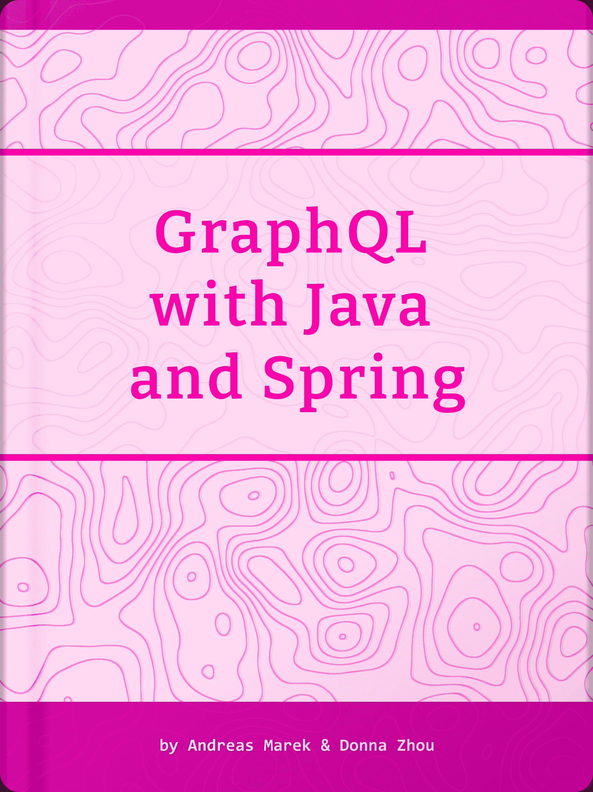

1. 标题页

2. 封面

# 序言

## Andi (Andreas)

2015 年，我（Andi）在德国柏林的一家小公司担任软件工程师。在一次对话中，我的同事之一（非常感谢 Stephan！）向我提到了这种名为“GraphQL”的新技术，它旨在改进客户端从服务访问数据的方式，并且他们计划很快发布它。

在研究了 GraphQL 之后，它立刻说服了我它能提供的价值。当然，我无法预测它的成功，但我已经在多家公司亲身体验了创建和维护 REST API 的挣扎。尽管付出了巨大的努力，但随着时间的推移，它们看起来越来越像 GraphQL，而不是一个良好的 REST API 应该享有的样子。也许这可能是因为对 REST 缺乏理解，但在非常不同的背景下反复目睹了相似的挑战后，我有了不同的看法。

由于坚信了它的价值，在 GraphQL 规范发布后，我立即开始着手 Java 实现。在工作之余投入大约两周的空闲时间后，我发布了 GraphQL Java 的第一个版本。

起初只有我一个人，但不久后我就收到了第一个修复拼写错误的 PR。今天，超过 [200 人](https://github.com/graphql-java/graphql-java/graphs/contributors) 为 GraphQL Java 做出了贡献，没有他们，就没有 GraphQL Java。诚挚地感谢你们所有人。

特别感谢 [Brad Baker](https://github.com/bbakerman)，他已经担任了六年多的共同维护者。他对 GraphQL Java 的贡献和影响怎么强调都不为过。这既是他的项目，也是我的项目。

最重要的是，我想感谢我的妻子 Elli 的所有支持：没有她，就没有今天的这本书。

## Donna

我（Donna）非常激动能和 Andi 一起写，他创建了 GraphQL Java，并在 Spring for GraphQL 的创建中发挥了主要作用。Andi、Brad 和我是 GraphQL Java 的维护者。

我在较晚的时候才发现编程，最初这只是一个爱好。我学到的第一个编程概念之一是开源软件。作为一个追求利润最大化的投资银行家，看到高质量的工作被高兴地免费送出去，这似乎是奇妙的疯狂。我热爱开源世界中的协作和社区精神。我如此热爱它，以至于我改变了职业成为了一名软件工程师。

感谢 GraphQL Java 社区的各位多年来的贡献。

## 关于本书

本书适用于任何想要用 Java 构建生产环境 GraphQL 服务的人士。读完本书后，你将有信心使用 Spring for GraphQL 构建你自己的生产环境 GraphQL 服务，Spring for GraphQL 是构建在 GraphQL Java 引擎之上的官方 Spring 集成。Spring for GraphQL 通过消除样板代码并与 Spring 生态无缝集成，使得构建 GraphQL 服务变得比任何时候都更加容易。

GraphQL Java 是 GraphQL 的主流 Java 实现，为 Twitter、AirBnB、Netflix、Atlassian 以及许多公司的服务提供支持。读完本书后，你将通过 Spring for GraphQL 使用相同的引擎。

在本书中，你将学习关键的 GraphQL 概念，并结合我们运行大规模生产环境 GraphQL 服务的实践建议。读完本书后，你将对 Spring for GraphQL 和 GraphQL Java 引擎有深入的知识，因此你会有信心运行生产就绪的 GraphQL 服务。

本书适合构建第一个生产环境 GraphQL 服务的初学者。书中后期还有针对中级读者的高级主题。

我们不假设读者对 GraphQL 有任何先验知识。为了充分利用本书，我们假设你有基础的 Java 知识，并假设非常基础的 [Spring](https://spring.io/) 知识，例如熟悉 `@Component` 注解。可选，如果你打算构建响应式服务，你应该熟悉 Reactor 的 `Mono` 和 `Flux` 概念。

所有代码示例都是用 Java 17 编写，这是 Spring Boot 3.x 需要的最低版本。书中的示例使用 Spring Boot 3.0.4 和 Spring for GraphQL 1.1.2 编写，使用了 GraphQL Java 19.2。

如果你对本书有反馈或意见，请通过邮件 book-feedback@graphql-java.com 联系我们。

我们衷心希望你喜欢这本书。

特别感谢我们的评审员提供的极佳反馈。感谢来自 Spring for GraphQL 团队的 Rossen Stoyanchev 和 Brian Clozel，我们的技术评审员 Doug Warren，以及评审员 Brad Baker、Antoine Boyer、Felipe Reis、Stephan Behnke 和 Josh Long。感谢我们的封面设计师 Mike Riethmuller。

# 引言

## 你的第一个 Spring for GraphQL 服务

感受 GraphQL 良好的最好方法就是体验它。我们将逐步介绍如何创建你的第一个 Spring for GraphQL 服务。在接下来的章节中，我们将更详细地解释这些步骤。

首先，在 [Spring Initializr](https://start.spring.io)（https://start.spring.io）创建一个新项目。在书中，我们将使用 Spring Boot 3.x，它至少需要 Java 17。如果你喜欢使用 Java 11，请选择至少 2.7.0 的 Spring Boot 版本来使用 Spring for GraphQL。你可以选择 Maven 或 Gradle 项目。

在依赖部分，添加 Spring for GraphQL。然后我们还需要一个传输依赖项。你可以选择 Spring Web (WebFlux) 或 Spring MVC（包含 Spring MVC）。在本书中，我们将使用 Spring Reactive 来利用 Netty 服务器构建响应式服务。如果你选择 Spring MVC，书中的所有内容仍然适用于你的服务，唯一的区别是控制器方法将不会被封装在 `Mono` 或 `Flux` 中。

你可以添加自己的项目元数据，或者按照我们截图“Spring Start”中的示例进行操作。

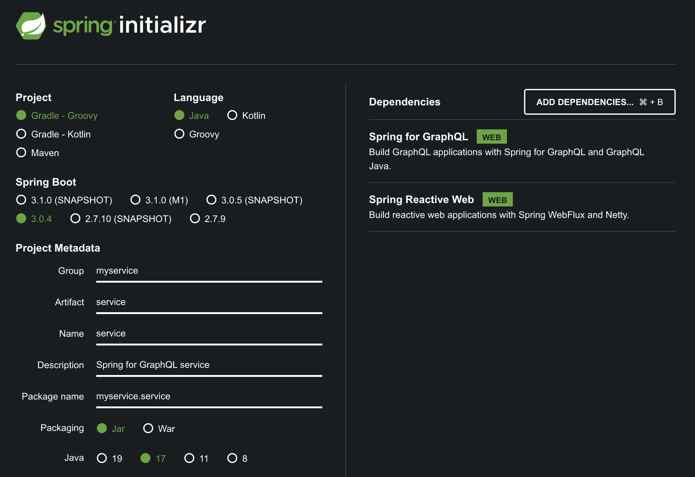

Spring Start

点击页面底部的 Generate 生成你的项目。在你喜欢的代码编辑器中打开项目。从 `myservice.service.ServiceApplication` 中的 `main` 方法启动应用程序。它将在 `http://localhost:8080` 启动一个 HTTP 端点，但目前还没有什么！

让我们让这个服务更有用，并实现一个非常简单的 GraphQL 服务，用于提供宠物数据。为了保持这个初始示例的简单，数据将是一个内存列表。稍后，在构建 GraphQL 服务章节中，我们将扩展这个示例来调用另一个服务。

对于这个初始示例，我们将从高层概述概念，以便我们能够快速获得一个可以交互的运行服务。在接下来的章节中，我们将更详细地解释这些概念。

让我们从创建一个 GraphQL 模式开始，它是 API 的静态描述。在 `resources` 下创建一个新的 `graphql` 子目录。将以下内容粘贴到新文件 `src/main/resources/graphql/schema.graphqls` 中。

```
type Query {
    pets: [Pet]
}

type Pet {
    name: String
    color: String
}
```

这个用于宠物的 GraphQL 模式使用模式定义语言（SDL）格式编写。它定义了一个 GraphQL 查询类型，包含一个 `pets` 字段，它返回一个宠物列表。每个宠物都有 `name` 和 `color`，这两个字段都是字符串属性。在模式章节中，我们将深入讨论 GraphQL 模式元素。

在 `myservice.service` 包中添加一个 `Pet` 记录类（record class）。

```java
package myservice.service;

record Pet(String name, String color) {
}
```

接下来，我们将添加逻辑将模式（schema）与宠物数据连接起来。在 `myservice.service` 包中创建一个新的 Java 类 `PetsController`。

```java
package myservice.service;

import org.springframework.graphql.data.method.annotation
  .QueryMapping;
import org.springframework.stereotype.Controller;

import java.util.List;

@Controller
class PetsController {

  @QueryMapping
  List<Pet> pets() {
    return List.of(
      new Pet("Luna", "cappuccino"),
      new Pet("Skipper", "black"));
  }
}
```

这就是我们所需的所有代码了：一个模式文件、一个记录类和一个 GraphQL 控制器！`@QueryMapping` 控制器注解将 `pets` 方法注册为 `DataFetcher`，将模式中的 `pets` 字段连接到数据（在此例中为内存中的列表）。我们将在 DataFetchers 章节中详细解释如何连接你的模式和数据。

为了添加一个可视化前端来探索我们的 API，可以通过在 `src/main/resources` 的 `application.properties` 文件中添加 `spring.graphql.graphiql.enabled=true` 来启用内置的 [GraphiQL](https://github.com/graphql/graphiql) 交互操场。GraphiQL 是一个小型 Web 应用，用于从浏览器交互式地探索 GraphQL API。将其想象为 GraphQL 的 REPL（读取-评估-打印循环）工具。

重启你的服务。如果成功，你应该会看到日志条目 `GraphQL endpoint HTTP POST /graphql`。然后访问 `http://localhost:8080/graphiql` 打开 GraphiQL。

如果你的服务没有正常启动，请仔细检查模式文件 `schema.graphqls` 是否存储在 `resources` 内部的 `graphql` 子文件夹中。

让我们尝试第一次查询。在 GraphiQL 操场的左侧输入以下内容：

```graphql
query myPets {
    pets {
        name
        color
    }
}
```

然后点击播放按钮（带有三角形图标的粉色按钮）发送查询，如截图“GraphiQL request and response”所示。

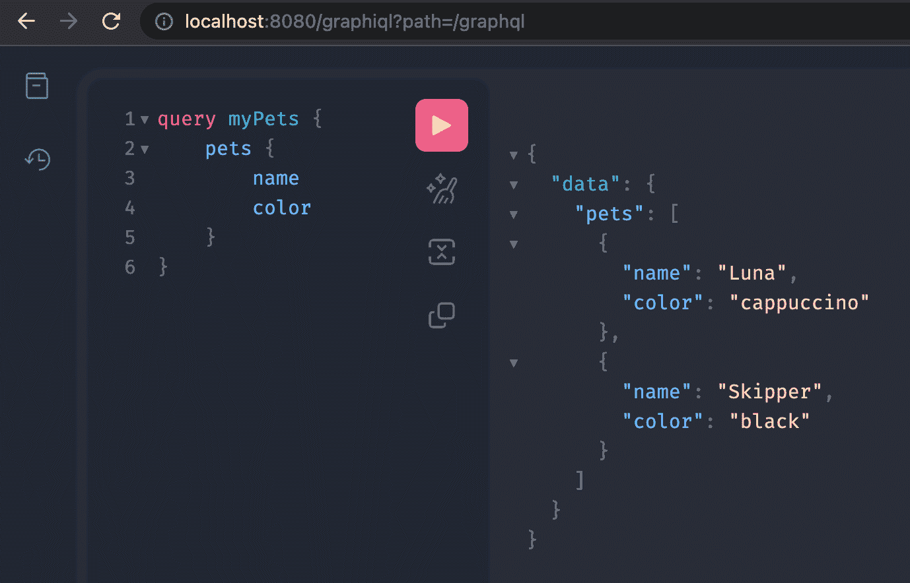

GraphiQL 请求与响应

在 GraphiQL 操场的左侧，我们看到了查询，在右侧看到了 JSON 响应。响应的结构与查询完全匹配。

花点时间实验一下 GraphiQL。例如，你可以从查询中移除 `color`。尝试在输入查询时使用自动完成帮助。

点击左上角的文档图标打开文档浏览器，如截图“GraphiQL Documentation Explorer”所示。

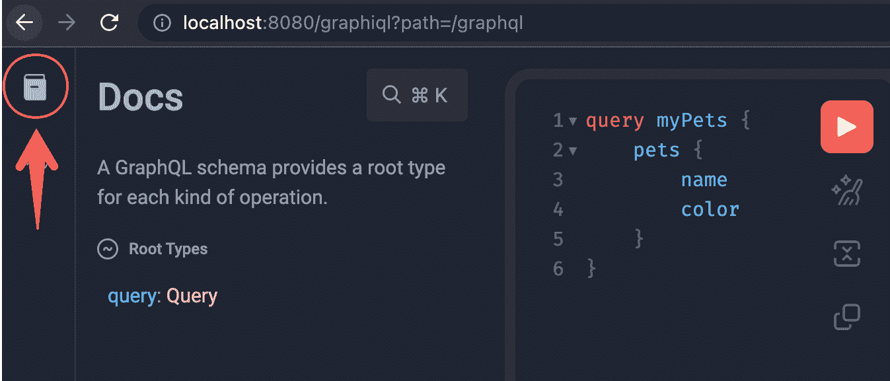

GraphiQL Documentation Explorer

然后点击 `pets` 的根 `Query`，然后点击 `Pet` 查看其属性（`name` 和 `color`），如截图“GraphiQL Pet documentation”所示。

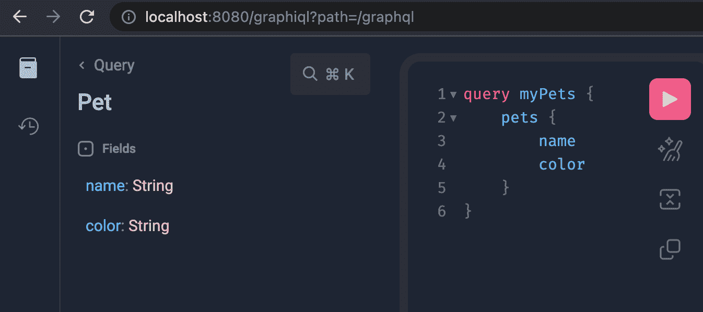

GraphiQL Pet documentation

恭喜你完成了你的第一个 Spring for GraphQL 服务！在本章中，我们讨论了非常高层次的概念。在本书的剩余部分，我们将详细讨论每个概念。稍后在 Building a GraphQL service 章节中，我们将使用更多功能扩展此服务。

快速回顾一下我们所做的：

*   通过 `https://start.spring.io` 使用 WebFlux 创建了一个新的 GraphQL 服务

*   添加了 SDL 格式的 GraphQL 模式文件

*   实现了一个返回 `Pet` 数据列表的 GraphQL 控制器

*   执行了一个 GraphQL 查询

## 什么是 GraphQL？

GraphQL 是一种用于客户端-服务器数据交换的技术。典型的用例是 Web 或移动客户端访问或更改后端服务器上的数据，如图“Client Server”所示。我们有时将涉及的双方描述为 API 的“消费者”和“生产者”。

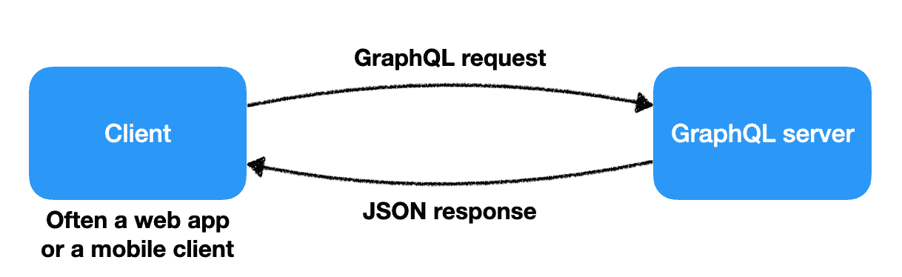

客户端服务器

在实践中，GraphQL 包含两个部分：一种允许客户端指定其意图（例如查询什么数据、执行什么操作、返回哪些数据属性）的领域特定语言，以及一个能够执行此请求的后端服务。这种领域特定语言被称为“GraphQL 查询语言”；遗憾的是，“查询”（query）是一个重载术语，因为“查询语言”允许你执行更新（或“变异” mutations）、订阅和查询。

例如，查询宠物列表及其名称的请求：

```graphql
# 这是一个注释

## 我们请求两个字段：
### "pets" 以及每个宠物的 "name"

query myPets {
    pets { 
        name 
    }
} 
```

这是一个“查询操作”，但 GraphQL 服务还可以执行“变异（mutation）”和“订阅（subscription）”操作。我们将在查询语言章节中更详细地解释 operations。假设有两只名为 Luna 和 Skipper 的宠物，这是对应的 JSON 响应：

```json
{
  "data": {
    "pets": [
      {
        "name": "Luna"
      },
      {
        "name": "Skipper"
      }
    ]
  }
}
```

GraphQL API 是一种静态类型的 API。“类型化”意味着 GraphQL API 包含了对消费者可以使用 API 进行哪些操作的清晰描述。API 不会频繁更改。当 API 发生变化时，通常涉及到服务的重新部署。

例如，上述查询所使用的 API 看起来如下：

```graphql
# 这是一个注释

# 这是根对象，因为它命名为 Query
type Query { 
    # 一个名为 "pets" 的字段，返回 Pet 列表
    pets: [Pet] 
}

# 一个名为 Pet 的对象
type Pet { 
    # 类型为 String 的名为 "name" 的字段
    name: String 
    color: String
}
```

这种语法被称为 Schema 定义语言 (SDL)，而 GraphQL API 的结构被称为 schema（模式）。每个 GraphQL API 都有一个 schema，用 SDL 语法清晰地描述 API。目前理解 GraphQL API 的最佳方式是将其看作一个包含字段列表的类型列表。

每个 GraphQL API 都提供了特殊的字段，允许你查询 API 内部的 schema。这一功能被称为内省（introspection）。例如，对于每个 GraphQL API 的一个有效查询如下：

```graphql
query myIntrospection {
    __schema {
        types {
            name
        }
    }
}
```

对于我们上面的 API，它将返回：

```json
{
  "__schema": {
    "types": [
      {
        "name": "Query"
      },
      {
        "name": "Pet"
      }
    ]
  }
}
```

如你所示，特殊字段 `__schema` 以 `__` 开头，这是一个内省字段，而不是普通字段。

## GraphQL 是一种 API 技术

我们想要强调 GraphQL 的一个非常重要的方面：它是一种与数据源无关的 API 技术。在实现 GraphQL 服务时，实际数据可以来自任何地方。GraphQL 不是数据库或特定于持久化的技术。虽然有一些技术和服务可以让我们将数据库 schema 暴露为 GraphQL API，但当我们的系统增长时，这不是一种健壮的架构：这些是我们不应该耦合在一起的东西。我们强烈建议你将数据库 schema 视为与 GraphQL schema 完全不同的东西。

## GraphQL 的简史


GraphQL 的官方诞生生日是 2012 年 2 月 29 日，当时它是 Facebook 内部的一个提案，名为 [SuperGraph](https://twitter.com/leeb/status/1498759168689598464?s=20&t=817z2q0x1_x2En8xxH5X8w)。

它是将 Facebook iOS 客户端重写为原生应用工作的一部分，旨在解决团队在传统的 REST 类 API 中遇到的多个问题，正如共同创始人 Lee Byron 在这段 10 分钟的视频主旨演讲中描述的 [GraphQL 简史](https://www.youtube.com/watch?v=VjHWkBr3tjI) 中描述的：

*   网络慢：获取所需数据需要多次协调的往返交互。

*   脆弱的客户端/服务器关系：服务器 API 的变化很容易破坏应用程序，且文档往往过时。

*   代码和流程繁琐：必要的服务更改通常会阻塞客户端开发。

GraphQL 通过前一节概述的特性解决了这些问题：查询语言允许客户端精确指定它们想要的内容，灵活且独立于服务器进行开发，而静态类型系统使得客户端/服务器关系变得更加稳定。

在 GraphQL 在 Facebook 内部成功使用几年后，它于 [2015 年 7 月开源](https://youtu.be/WQLzZf34FJ?t=1473)。同时发布了两个制品：GraphQL 规范和参考实现。参考实现最初是规范的 JavaScript 实现，但现在也提供了 TypeScript 版本。这种拥有清晰规范和参考实现相结合的双重方法导致了跨越每个主要编程语言和生态系统的实现，包括 Ruby、PHP、.NET、Python、Go，当然还有 Java。

在 2015 年开源后，GraphQL 一直由 Facebook 拥有并运行直到 2018 年底成立了 [GraphQL Foundation](https://medium.com/@leeb/introducing-the-graphql-foundation-3235d8186d6d)。GraphQL Foundation 是一个中立实体，由 25 多个成员组成，包括 AWS、Airbnb、Atlassian、IBM、Microsoft 和 Shopify。Foundation 的[官方描述](https://graphql.org/foundation/)是：

> GraphQL Foundation 是一个全球技术和应用公司的基金会。它鼓励贡献、管理和共同。

从法律上讲，GraphQL Foundation 拥有 GraphQL 商标以及某些 GraphQL 项目的版权。GraphQL 的官方网站是 `https://graphql.org`。在实践中，Foundation 最终负责 GraphQL。

开发 GraphQL 规范最重要的群体是 GraphQL 工作组（通常缩为 WG）。它是一个开放群体，每月在线会议三次，主要讨论 GraphQL 规范的更改和改进。 GraphQL 社区的每个人都可以加入 https://github.com/graphql-wg。

## 从 GraphQL Java 到 Spring for GraphQL

GraphQL 开源后不久，GraphQL Java](https://github.com/graphql-java/graphql-java/releases/tag/1.0) 的第一个版本发布了。我（Andi）的基本决策之一是专注于 GraphQL 的执行部分。GraphQL Java 始终旨在成为一个符合规范的 GraphQL 引擎，而不是功能完备的服务框架。这意味着 GraphQL Java 永远不应该处理 HTTP I/O 或任何类型的线程，尽可能。

虽然我仍然对这个决定感到非常满意，因为它让 GraphQL Java 有了强大的关注和广泛采用，但它带来了一个明显的缺点：每个服务都需要解决 HTTP 集成问题。

在我发布 GraphQL Java 一段时间后，第一个 GraphQL Java Spring 集成变得可用。我甚至开发了一个小型的 [GraphQL Java Spring](https://github.com/graphql-java/graphql-java-spring) 库，旨在尽可能轻量。但没有什么优于由 Spring 团队维护的官方 Spring 集成，它可以获得最大的 GraphQL 采用和最佳体验。

2020 年 7 月，Spring 和 GraphQL Java 团队合作开发了官方的 Spring for GraphQL 集成。一年后，我们发布了[第一个里程碑](https://spring.io/blog/2021/07/06/hello-spring-graphql)，之后在 2022 年 5 月发布了 [Spring for GraphQL](https://spring.io/projects/spring-graphql) 的版本。

Spring for GraphQL 旨在成为 GraphQL Java 到 Spring 的一种不带主见的集成，专注于全面且广泛的支持。它应该是 Spring GraphQL 解决方案的基础性构建块。另一个关键设计决策是直接使用 GraphQL Java 本身，在 Spring 和 GraphQL Java 之间没有抽象或额外的层。

Spring for GraphQL 包含两个部分：一个是与 GraphQL Java 的实际 [Spring Framework 集成](https://docs.spring.io/spring-graphql/docs/current/reference/html/)，另一个在此基础上的针对 GraphQL 的 [Spring Boot Starter](https://docs.spring.io/spring-boot/docs/current/reference/htmlsingle/#web.graphql)。在本书中，我们将构建使用 Spring Boot 开发的服务，并利用 Spring Boot GraphQL Starter 的优势。

我们将在 GraphQL Java 和 Spring 的世界之间不断切换，但理解哪一个层贡献了哪部分通常非常重要，以便充分利用 Spring for GraphQL 的功能。这对于排查故障尤为有价值。在整本书中，我们会清楚地说明何时我们是在讨论 Spring for GraphQL 概念，何时我们是在直接讨论 GraphQL Java 概念。

在接下来的几个章节中，我们将更详细地解释初始服务中使用的概念，并讨论 GraphQL 的核心概念。之后，我们将构建一个更复杂的应用程序来回顾所学内容。在书的后面部分，我们将涵盖更高级的话题。

# 概述

在本章中，我们将介绍 Spring for GraphQL 和 GraphQL Java 的基础方面，以及它们之间的关系。这对于建立整体理解并避免在接下来的章节中迷失细节非常重要。

本章将从高层级涵盖概念以提供概述。在书的后面，我们将更详细地解释这些概念。

### 三层架构

我们需要考虑三层，其中较高层依赖于较低层。

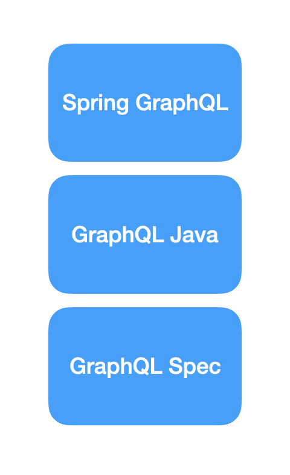

### 三层架构

从图“Three layers”从下到上依次是：

* `GraphQL Specification` (规范)：以一种与技术无关的方式定义什么是 GraphQL 以及一个 GraphQL 服务需要实现什么。

* `GraphQL Java`：为 Java 实现 GraphQL 规范。

* `Spring for GraphQL`：将 GraphQL Java 与 Spring 集成。

我们也可以将其看作抽象的层级结构，从底部的低观点（less opinionated）到顶部的具体化：

* `spec` 是最抽象的，因为它适用于 GraphQL 的所有实现，不仅仅是 Java。它只是一个文本文档，而不是运行的软件。例如，它描述了什么是 GraphQL 变异（mutation），而不描述其实现的的细节。

* `GraphQL Java` 实现 `spec` 并实际上提供了运行的软件。它没有绑定到任何特定的框架（如 Spring），也不处理任何传输层的细节。

* `Spring for GraphQL`：利用 `GraphQL Java` 提供一个用于构建 GraphQL 服务的全面框架，包括传输层细节。

从 Java 的实际角度来看，可以将 `GraphQL Java` 和 `spec` 视为等同的。`GraphQL Java` 没有提供 `spec` 之外的主要功能，而 `spec` 也没有定义任何在 Java 中未表示的内容，它们是一一一对应的关系。因此，我们不会脱离 `GraphQL Java` 独立讨论 `spec`，我们可以默认假设 `GraphQL Java` 中的功能已在 `spec` 中定义。

## Schema 和 SDL

GraphQL API 使用静态类型，因此它只能执行其被明确描述的内容。更改 API 通常意味着我们需要重新部署该服务。

Schema 是 API 的描述，它是 GraphQL Java 中 `GraphQLSchema` 的实例。

Schema 定义语言（SDL）语法以人类可读的格式定义 schema。

```
type Query {
    pets: [Pet]
}

type Pet {
    name: String
    color: String
}
```

这是一个 SDL 格式的 schema，定义了两个类型：`Query` 和 `Pet`。`Query` 类型有一个 `pets` 字段。`Pet` 类型有两个字段，`name` 和 `color`。

SDL 格式非常适合定义 schema，并使 schema 变得易于阅读。在执行期间，GraphQL Java 使用 `GraphQLSchema` 的实例，该实例代表提供的 SDL schema。

我们将在 Schema 章节 中深入讨论 GraphQL schemas。

## GraphQL 查询语言

GraphQL 查询语言是一种用于描述客户端想要请求内容的领域特定语言。它故意设计得像 JSON，但它并不是 JSON。

```graphql
query myPets { 
    pets { 
        name 
    } 
}
```

客户端被要求显式地“选择”它想要的任何数据，例如宠物的名字。响应是 JSON 格式，并且仅包含请求的数据，不多不少。

```json
{
  "data": 
    "pets": [
      {
        "name": "Luna"
      },
      {
        "name": "Skipper"
      }
    ]
}
```

响应还可以包含另外两个顶层 键，“errors”和“extensions”。我们将在 请求与响应章节 中详细讨论。

GraphQL API 消费者的每次交互都始于一个 GraphQL 请求并产生一个 GraphQL 响应。

GraphQL Java 中的 GraphQL 请求是 `ExecutionInput` 的实例，响应是 `ExecutionResult`。这些是独立于特定传输层的请求和响应定义。从 GraphQL Java 的角度来看，请求和响应只是方法调用的参数和返回值。我们将在书的后面一个专门的章节中详细讨论 GraphQL 请求和响应。

Spring for GraphQL 定义了 `GraphQlRequest`，其中最重要的实现是用于通过 HTTP 或 WebSocket 请求的 `WebGraphQlRequest`。`WebGraphQlRequest` 包含了用于 HTTP 请求的特定数据，如 URL 和 HTTP 请求头。

Spring for GraphQL 中的响应是 `GraphQlResponse`，其中 `WebGraphQlResponse` 再次特定于 HTTP 或 WebSocket，包含 HTTP 响应头。

最重要的是，GraphQL 请求包含一个 GraphQL 文档（document），它是 GraphQL 查询语言格式的文本，包含了客户端的意图。

响应可以包含数据、错误和扩展。数据可以是任何内容。在 `ExecutionResult` 中，数据是 `Map<String, Object>`。在传输层上，我们通过 HTTP 以 JSON 格式发送响应。

## 执行与 DataFetcher

我们可以大致将通过 HTTP 执行 GraphQL 请求的实际过程分为如下：

1. 首先，请求被反序列化并处理（Spring）。

2. 我们调用 GraphQL Java，这涉及获取数据（GraphQL Java）。

3. 然后我们创建并序列化响应（Spring）。

第一步完全由 Spring 完成工作，也可能涉及身份验证等方面。然后 Spring 调用 GraphQL Java，一旦完成，响应将再次由 Spring 处理并发送给客户端。

第二步涉及多个步骤，例如调用相关的 `DataFetchers` 来获取满足请求所需的数据。我们将在书的后面一个专门的章节](#ch007.xhtml_datafetchers-part-1) 中详细讨论 DataFetchers。

在 Spring for GraphQL 中，带有注解的控制器方法被注册为 DataFetchers。例如，在之前的章节中，我们构建了一个带有宠物列表示例服务：

```java
package myservice.service;

import org.springframework.graphql.data.method.annotation.QueryMapping;
import org.springframework.stereotype.Controller;

import java.util.List;

@Controller
class PetsController {

  @QueryMapping
  List<Pet> pets() {
    return List.of(
      new Pet("Luna", "cappuccino"),
      new Pet("Skipper", "black"));
  }
}
```

`@QueryMapping` 注解将此方法注册为 `Query` 类型中 `pets` 字段的 `DataFetcher`，将该方法与同名字段连接起来。我们将在 DataFetchers 章节 中详细解释 Spring for GraphQL 的模式映射注解。

创建和序列化响应的最后一步由 Spring for GraphQL 处理。

有关执行的更多信息，请参阅本书后半部分的专用章节。

## 概念之间的关系

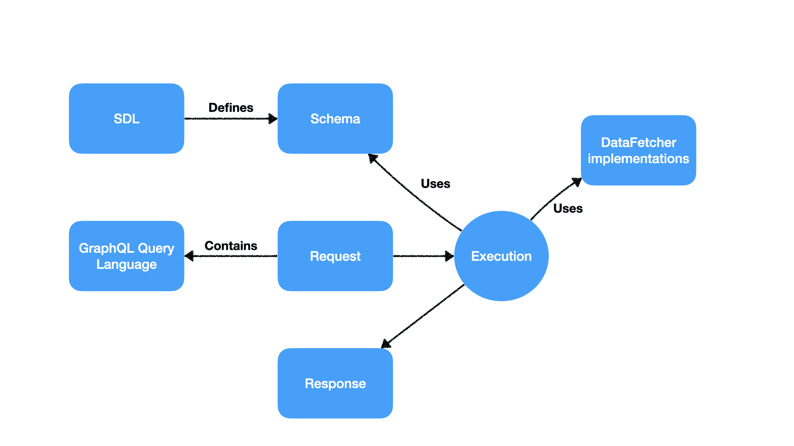

概念关系

如“Concept relations”图所示：

- SDL 定义了模式（schema）

- 请求包含查询语言格式的文本

- 请求的执行使用模式 和 `DataFetchers` 来产生响应

## GraphQL Java

GraphQL Java 的主要类如“GraphQL Java classes”图所示：

- `graphql.GraphQL`：通常每个服务只有一个实例。用于启动 GraphQL Java 执行。

- `graphql.ExecutionInput`：GraphQL Java 请求。

- `graphql.ExecutionResult`：GraphQL Java 响应。

- `graphql.schema.GraphQLSchema`：GraphQL API 的描述以及执行它所需的逻辑。

- `graphql.schema.DataFetcher`：每个服务都需要实现的 Java 接口。你的 GraphQL 服务将通过 Spring for GraphQL 的模式映射注解实现 `DataFetchers`。

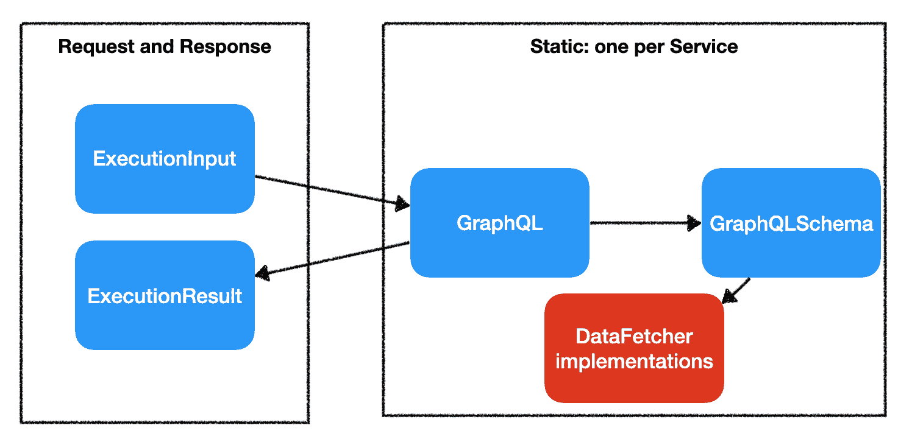

GraphQL Java classes

## Spring for GraphQL

Spring for GraphQL 的主要类如下（所有类名均以 `org.springframework.graphql` 开头，缩写为 `o.s.g`）：

- `o.s.g.server.webflux.GraphQlHttpHandler`：WebFlux 处理器。创建 `WebGraphQlRequest` 并调用 `WebGraphQlHandler`。

- `o.s.g.server.webmvc.GraphQlHttpHandler`：Spring MVC 处理器。创建 `WebGraphQlRequest` 并调用 `WebGraphQlHandler`。

- `o.s.g.server.WebGraphQlRequest`：通过 HTTP 或 WebSocket 的 请求。

- `o.s.g.server.WebGraphQlResponse`：通过 HTTP 或 WebSocket 的 GraphQL 响应。

- `o.s.g.server.WebGraphQlHandler`：处理通过 HTTP 或 WebSocket 的 GraphQL 请求。

- `o.s.g.server.WebGraphQlInterceptor`：拦截 `WebGraphQlRequest` 和 `WebGraphQlResponse` 的钩子。

- `o.s.g.graphql.ExecutionGraphQlService`：负责调用 GraphQL Java 的实际服务。

一个请求通过 Spring for GraphQL 中的三个主要类，每个类都有其独特的职责，如“Spring for GraphQL classes”图所示：

1. 通用 HTTP 请求调用 `GraphQlHttpHandler`，它将请求转换为 `WebGraphQlRequest`。

2. `WebGraphQlHandler` 接收 `WebGraphQlRequest` 并调用 `ExecutionGraphQlService` 执行请求。

3. `ExecutionGraphQlService` 最终调用 GraphQL Java。


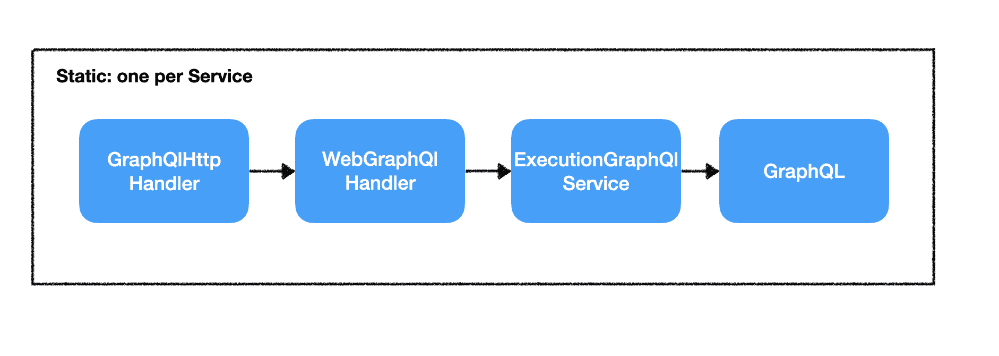

# Spring for GraphQL classes

在日常使用中，这些步骤中最相关的是第二步，因为 `WebGraphQlHandler` 提供了通过 `WebGraphQlInterceptor` 拦截任何请求和响应的能力。

关于大小写的简要说明。你可能注意到类名中字母“Q”和“L”的大小写情况各不相同。在所有 Spring for GraphQL 类中，“Q”始终大写，“L”始终是小写，以与 Spring 的命名规范保持一致。在 GraphQL Java 中，名称通常包含大写的“Q”和“L”。如果没有遵循此约定，我们会在相关的代码示例中指出。

本章从高层次介绍了最基本的概念。在本书中，我们将详细讨论所有这些主题。

## Schema

GraphQL API 的模式是 API 的静态描述。模式描述了 API 消费者可以请求的内容，可以使用模式定义语言（SDL）格式表示（也称为“SDL 语法”或“SDL 记法”）。

在底层，Spring for GraphQL 使用 GraphQL Java 的 `GraphQLSchema` 表示一个可执行的模式，然后用它来创建一个 `GraphQL` 对象。它是一个“可执行”的模式，因为它包含了执行请求所需的所有逻辑，以及面向消费者的 API 描述。在本章中，我们将重点关注 API 描述。在 DataFetchers 章节中，我们将讨论此 API 描述是如何连接到执行逻辑的。

## 模式优先（Schema-first）

“模式优先”是指 GraphQL 模式的设计应该独立完成，而不应该从其他内容生成或推断出来。模式不应该从数据库模式、Java 领域类或 REST API 生成。

模式应该是模式优先的，因为它们应该是以经过深思的方式创建的，而不仅仅是生成的。尽管 GraphQL API 与用于获取数据的数据库模式或 REST API 有许多共同之处，但模式仍然应该是经过深思构建的。

我们坚信，这是任何现实世界中 GraphQL API 的唯一可行方法，我们将只关注这种方法。Spring for GraphQL 和 GraphQL Java 均支持“模式优先”。

在 GraphQL Java 中，模式由 `GraphQLSchema` 实例表示。这可以通过 SDL 创建，也可以通过编程方式创建。这两种方法都是“模式优先”的，因为模式是经过深思设计的。在本书中，所有示例都将使用通过 SDL 创建的模式。

## 在 Spring for GraphQL 中加载模式资源

Spring for GraphQL 会自动加载 `src/main/resources/graphql` 目录下扩展名为 `.graphqls` 或 `.gqls` 的模式文件。你只需要将模式文件保存在正确的位置即可。你也可以从不同的位置加载模式文件，请参阅[文档](https://docs.spring.io/spring-graphql/docs/current/reference/html/#execution-schema-resources)。

在底层，Spring for GraphQL 自动读取模式文件、解析文件并实例化 GraphQL Java 的 `GraphQLSchema` 对象。

## 模式元素

GraphQL Java 中的模式表示为 `GraphQLSchema` 实例，它是 `GraphQLSchemaElement` 的图。我们将描述 `GraphQLSchema` 的重要元素以及 SDL 格式的记法。

## GraphQL 类型

模式中最重要的元素是类型。GraphQL 系统中有八种类型：`Object`、`Interface`、`Union`、`Enum`、`Scalar`、`InputObject`、`List` 和 `NonNull`。前六种是“命名类型”，因为每个类型在整个模式中都有唯一的名称，而 `List` 和 `NonNull` 是“包装类型”，因为它们包装了命名类型，正如我们之后将看到的。

另一种类型分类区分了输入类型和输出类型。输出类型是描述结果的类型，而输入类型用于描述 GraphQL 请求的输入数据。我们将在关于 GraphQL 查询语言的下一章节详细介绍请求。

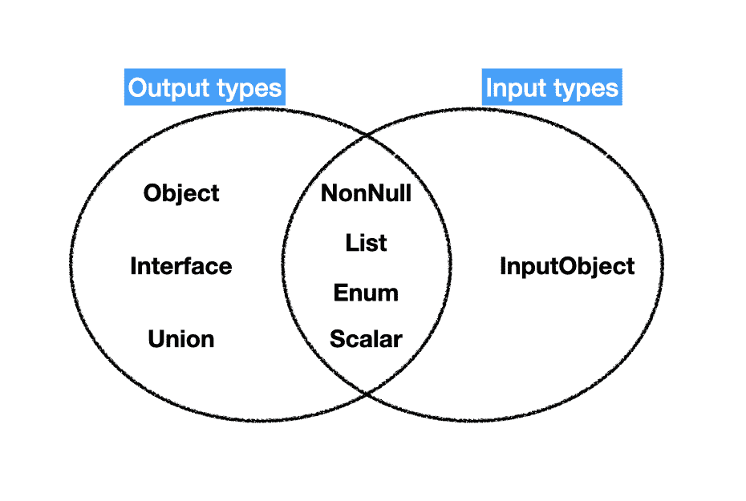

输入和输出类型

## 无处不在字段

模式中最显著的元素是字段。对象和接口包含带有参数的字段。输入对象拥有输入字段，不能带有参数。如果我们眯起眼看，可以将模式看作带有字段列表的类型列表。

在 GraphQL Java 中，字段通过 `GraphQLFieldDefinition` 实例表示对象和接口字段，通过 `GraphQLInputObjectField` 表示输入对象。

## 标量（Scalar）

标量是描述某些允许值的原始类型。例如，`Boolean` 标量意味着值可以是 `true` 或 `false`，`Int` 可以是 -2³¹ 到 2³¹ 之间的任何数字，`String` 可以是任何字符串字面量。标量的名称在整个模式中必须唯一。

GraphQL 自带五个标量：`String`、`Int`、`Float`、`Boolean` 和 `ID`。此外，每个 GraphQL 服务都可以定义自己的自定义标量。

在 SDL 中，自定义标量需要显式声明，而内置标量可以在无需任何声明的情况下直接使用。

```graphql
"""
一个表示不带时区的自定义日期标量。
注意这个自定义标量必须显式声明。
"""
scalar Date @specifiedBy(url:
  "https://scalars.graphql.org/andimarek/local-date")

type Pet {
    "String 是内置标量，因此不需要声明。"
    name: String
    dateOfBirth: Date
}
```

内置的 `@specifiedBy` 指令链接到自定义标量的规范 URL。我们将在指令章节中更详细地讨论这一点。`@specifiedBy` 指令是可选的，但强烈建议使用。

## 枚举（Enum）

枚举类型描述了一组可能的值的列表。它可以作为输入类型或输出类型。枚举和标量是 GraphQL 类型系统的原始类型。枚举名称在整个 schema 中必须是唯一的。

以下是在 SDL 中声明枚举的方法：

```graphql
enum PetKind {
    CAT, DOG, BIRD
}

type Pet {
    name: String
    kind: PetKind # 用作输出类型
}

type Query {
    pets(kind: PetKind!): [Pet] # 用作输入类型
}
```

或者，枚举也可以通过每个值占一行的方式进行声明。这是因为逗号 `,` 被视为空白字符并被忽略。

```graphql
enum PetKind {
    CAT
    DOG
    BIRD
}
```

在 GraphQL Java 中，枚举由 `GraphQLEnumType` 实例表示。

## 对象（Object）

GraphQL 对象类型通过字段列表来描述数据的特定形状。它在整个 schema 中有一个唯一的名称。每个字段都有一个特定的类型，该类型必须是输出类型。每个字段都有一个可选的参数列表。允许递归引用。

对象类型在 SDL 中通过 `type` 声明。

```graphql
type Pet {
    name: String
    color: String
    friend: Pet # 递归引用
    owners: [Person!] # 人员列表
}

type Person {
    name: String
}

type Query {
    pet(name: String!): Pet # 通过名称查找宠物
}
```

在 GraphQL Java 中，对象类型由 `GraphQLObjectType` 实例表示，并用 `GraphQLFieldDefinition` 定义其字段。

## 输入对象（Input object）

输入对象类型描述了一组输入字段，每个字段都有一个输入类型。输入对象的名称在整个 schema 中必须是唯一的。

在 SDL 中，输入对象通过 `input` 声明。

```graphql
input PetFilter {
    minAge: Int
    maxAge: Int
}

type Pet {
    name: String
    age: Int
}

type Query {
    pets(filter: PetFilter): [Pets]
}
```

## 接口（Interface）

与对象类似，接口通过字段列表描述数据的特定形状并具有名称。与对象不同，接口可以被另一个接口或对象实现。实现接口的接口或对象必须包含接口中定义的相同字段。从这个意义上说，接口用于描述一种抽象形状，该形状可以由不同的对象来实现。

与对象类似，每个字段都有一个可选的参数列表。每个参数都有名称和类型，该类型必须是输入类型。

SDL 中的接口声明为 `interface`。其他接口或对象的实现通过 `implements` 后跟接口名称来指定。

```graphql
type Query {
    pet(name: String!): Pet # 通过名称查找宠物
}

type Pet {
    name: String
    color: String
}
```

可以使用等号 `=` 可选地定义默认值。在下面的示例中，你可以获取特定数量的宠物。或者，如果没有指定宠物数量，它将默认为 20。

```graphql
type Query {
  pets(howMany: Int = 20): [Pet]
}
```

参数可以是可选或强制的。如果参数类型是非空（non-null）且没有默认值，则该参数是强制的。否则，该参数是可选的。例如，参数 `name: String!` 是强制的。

## 带描述的文档

文档是 GraphQL 的一项强大功能。字段和类型等 GraphQL 定义描述嵌入在模式中，与其定义在一起。这些描述通过内省（introspection）可用，并用于生成交互式文档。

几乎每个 SDL 元素都可以拥有 [Markdown](https://commonmark.org/) 格式的描述作为文档。描述可以是引号 `"` 包裹的字符串字面量，也可以包裹在三引号 `"""` 中的块字符串，用于带有换行符或额外 Markdown 的多行文档。

```graphql
type Query {
    "所有当前已知宠物"
    pets: [Pet]
}

"""
宠物可以是狗，也可以是猫。
宠物有一个人类所有者。
"""
type Pet {
    name: String
    owner: Person
}
```

这些描述被汇编成文档，例如截图“Documentation in GraphiQL”中的 [GraphiQL 游练场](https://github.com/graphql/graphiql)。

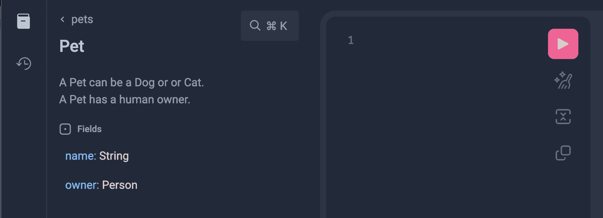

GraphiQL 中的文档

若要在 GraphiQL 中访问文档，请点击左上角的书籍图标。请查看“引言”（Introduction）章节了解如何将 GraphiQL 添加到你的 Spring for GraphQL 应用中。

[GraphQL 规范](https://spec.graphql.org/draft/#sec-Descriptions) 建议模式和所有其他定义（包括类型、字段和参数）应该提供描述，除非它们被认为是自解释的。

## 注释

注释以哈希符号 `#` 开始，行的所有内容都被视为注释的一部分。例如：

```graphql
type Query {
    # 这是一个注释
    hello: String
}

### 多行注释
### 需要
### 多个哈希符号
```

注意，注释与描述有很大区别。描述用于构建模式的文档，这些文档通过内省可用。注释像空白字符一样被忽略，且不用于文档。

在本章中，我们讨论了描述 API 结构的模式元素。在 DataFetchers 章节中，我们将讨论此 API 如何连接到执行请求的逻辑。在讨论 DataFetchers 之前，让我们先讨论 GraphQL 查询语言。

## GraphQL 查询语言

GraphQL 查询语言是一种领域特定语言（DSL），它允许消费者定义他们想要的操作。

请注意，“查询语言”这一短语包含了查询（queries）、变更（mutations）和订阅（subscriptions），我们将在本章中讨论。

查询语言语法与 GraphQL 模式密切相关。GraphQL 模式定义了查询语言中哪些查询、变更或订阅是有效的。在下面的查询语言示例中，假设有一个相应的 GraphQL 模式使得该查询语言有效。

## 字面量

查询语言包含几个镜像模式输入类型的字面量。

- `String` 字面量写为 `"String literal"`，用双引号包裹。
- `Boolean` 字面量为 `true` 或 `false`。
- `Int` 字面量写为 `123`。
- `Float` 字面量写为 `123.45`。
- 无值的字面量（Null）写为 `null`。
- 列表字面量写为 `["one list element", "another list element"]`，用方括号包裹。
- 枚举值写为 `ENUM_VALUE`。
- 输入对象字面量写为 `{ someField: "value", anotherOne: { fieldInField: 123 } }`。它们代表无序键列表，用花括号包裹。

## 操作

GraphQL 中有三种操作：

- `query`，只读获取。
- `mutation`，写入后进行获取。
- `subscription`，长连接请求，用于响应事件并获取数据。

在 GraphQL 模式中，这些操作被建模为根操作类型。

在 GraphQL 查询语言中，这些操作也构成了查询的根。

## 查询操作

在 GraphQL 模式中，这些操作被建模为根操作类型。

查询操作是一个只读获取。

一个名为 `myQuery` 的简单查询如下：

```graphql
query myQuery {
    someField
}
```

查询操作请求 `data`。在这个示例中，`pet` 是根：

```graphql
query {
    pet
}
```

`petName` 操作请求一个子选择：

```graphql
query petName {
    pet {
        name
    }
}
```

此查询中选中的字段对应于相应的模式：

```graphql
type Query {
    pet: Pet
}

type Pet {
    name: String
}
```

GraphQL 的一个关键特性是只返回选中的字段，不多也不少。要求进行子选择是一项刻意的决定，以确保客户端始终收到他们请求的内容。

作为一个更复杂的例子，查询可以请求宠物地址的国家：

```graphql
query petDetails {
    pet {
        name
        owner {
            address {
                country
            }
        }
    }
}
```

查询始终针对 API 的模式进行验证。我们不能查询未定义的字段。

对于此模式：

```graphql
type Query {
    pet: Pet
}

type Pet {
    name: String
}
```

我们将无法执行以下无效查询。由于 `Pet` 类型上没有 `nickName` 字段，将抛出错误：

```graphql
query invalid {
    pet {
        name
        nickName
    }
}
```

## 变更操作

变更操作是一个写入后进行获取。变更应该产生副作用，通常意味着更改（或“变异”）某些数据。

使用 `mutation` 关键字声明变更操作，后跟变更的名称：

```graphql
mutation myMutation {
    changeSomething
}
```

变更操作的每个根字段必须是模式中 `Mutation` 对象类型的字段。根据 GraphQL 规范，只有变更操作的根字段可以产生副作用。

变更操作中根字段的子选择在语义上与查询等同。在实践中，让变更返回部分已更改的数据很有用。例如，在更新 `User` 的名称后，在响应中接收新更改的 `User` 是很有用的。

例如，在 schema 中，`changeUser` 字段定义在 `Mutation` 类型中：

```graphql
type Mutation {
    changeUser(newName: String!): User
}

type User {
    name: String
    address: Address
}

type Address {
    street: String
    country: String
}
```

在将用户名更改为“Brad”之后，我们可以像普通查询一样查询已更改用户的详情。注意看子选择的形式与查询子选择完全一致。

```graphql
mutation changeUserName {
    changeUser(newName: "Brad") {
        name
        address {
            street
            country
        }
    }
}
```

如果变更操作中有两个或多个根字段，它们将按照 GraphQL 规范的要求按顺序执行。

```graphql
mutation mutationWithTwoRootFields {
    first: changeName(name: "Bradley")
    second: changeName(name: "Brad")
}
```


在这个示例中，用户的最终名称将始终是“Brad”，因为字段总是按顺序执行的。第二次更改名称为“Brad”将总是最后执行。

## 订阅操作

订阅（Subscription）是一种长连接请求，当发生新事件时向客户端发送更新。

例如，如果客户端想要获取符合特定标准的每封新邮件：

```graphql
subscription newMessage {
    newEmail(criteria: {
        sender: "luna@example.com",
        contains: "playing" }
    ) {
        text
    }
}
```

订阅只能包含正好一个根字段，例如`newEmail`。这与可以包含许多根字段的查询和变更操作不同。

订阅的执行以及传输层对请求的处理与查询和变更有显著不同。这仅仅是因为响应特定事件的长连接订阅请求，比简单的查询（或变更）请求、执行和响应过程要复杂得多。我们将在订阅章节中进一步讨论。

## 参数

字段可以拥有参数，其类型在 schema 中定义。参数可以是可选的，也可以是强制的。正如 Schema 章节中过的，如果参数是非空的（用`!`表示）且没有默认值（用`=`声明），则该参数是强制的。

例如，定义了一个具有强制`id`参数的`pet`字段的 schema：

```graphql
type Query {
    pet(id: ID!): Pet
}

type Pet {
    name: String
}
```

在查询中，这是使用字符串字面量“123”作为`id`值来请求`pet`：

```graphql
query petSearch {
    pet(id: "123") {
        name
    }
}
```

参数可以是任何字面量，包括`null`，只要它符合 schema。例如，这里有一个输入对象字面量的查询。

```graphql
query petAgeSearch {
    pets(filter: { minAge: 10, maxAge: 20 }) {
        name
    }
}
```

操作中的参数类型必须与其对应的 schema 定义。如果 schema 要求`Int`参数值，而我们在查询中提供了`Boolean`，则错误的参数会导致验证错误。

## 片段

片段（Fragments）允许我们复用查询的一部分。片段是针对特定类型的所选字段列表（包括子选择）。片段有一个名称和类型条件，类型条件必须是对象、接口（interface）或联合（union）。

片段在操作外部声明。片段的语法为：

```graphql
fragment <FragmentName> on <TypeCondition> {
    <fields>
}
```

在操作中使用片段扩展（fragment spread）来使用片段：

```graphql
...<FragmentName>
```

例如，让我们定义一个`personDetails`片段，以复用`Person`的重复字段。在`petOwners`查询中使用该片段。

```graphql
fragment personDetails on Person {
    firstName
    lastName
    title
}
query petOwners {
    pets {
        owner {
            ...personDetails
        }
        previousOwner {
            ...personDetails
        }
    }
}
```

在这个示例中，我们使用了两次`personDetails`，分别用于`owner`和`previousOwner`字段。

## 内联片段

内联片段（Inline fragments）是带有类型条件的字段选择。内联片段用于根据类型查询不同的字段。你可以将它们认为依赖于字段类型的`switch`语句。

内联片段与片段不同，因为它们是内联声明的，而不是在操作外部。与片段不同，内联片段没有名称，且无法复用。

内联片段的语法为：

```graphql
... on <TypeCondition> {
    <fields>
}
```

考虑此 schema：

```graphql
type Query {
    pets: [Pet]
}

interface Pet {
    name: String
}

type Dog implements Pet {
    name: String
    doesBark: Boolean
}

type Cat implements Pet {
    name: String
    doesMeow: Boolean
}
```

我们可以编写内联片段来查询`Dog`结果的`doesBark`字段以及`Cat`结果的`doesMeow`字段。

```graphql
query allThePets {
    pets {
        ... on Dog {
            doesBark
        }
        ... on Cat {
            doesMeow
        }
    }
}
```

根据`Pet`类型，我们选择了不同的字段。对于`Dog`我们只感兴趣`doesBark`，而对于`Cat`我们只感兴趣`doesMeow`。

实现接口的类型可能会添加并非所有实现都具备的字段。例如，`doesBark`字段只出现在`Dog`类型中。必须使用片段或内联片段来查询跨实现无法保证的字段。

作为反例，下面的查询是无效的，因为`Pet`接口中没有`doesBark`字段。

```graphql
query invalid {
    pets {
        doesBark
    }
}
```

联合类型必须使用片段或内联片段。GraphQL 联合表示类型列表中任意类型的对象，但联合类型本身不定义任何字段。

例如，考虑这个包含两个重要食品类的示例 schema：

```graphql
union Food = Pizza | IceCream

type Query {
    dinner: [Food]
}

type Pizza {
    name: String
    toppings: [String]
}

type IceCream {
    name: String
    flavors: [String]
}
```

对`dinner`的查询必须包含片段或内联片段，因为联合类型本身不定义任何字段。

```graphql
query healthyDinner {
    dinner {
        ... on Pizza {
            name
            toppings
        }
        ... on IceCream {
            name
            flavors
        }
    }
}
```

以下查询是无效的，因为联合类型`Food`没有定义任何字段。

```graphql
query invalid {
    dinner {
        toppings
        flavors
    }
}
```

## 变量

我们可以在 GraphQL 操作中包含参数变量，这允许客户端重用操作，而无需动态重新构建它们。

操作可以声明变量，作为整个操作的输入。

要声明变量，请在操作名称之后定义它们。变量名以`$`开头，后紧跟类型。变量可以使用感叹号`!`标记为非空，类似于字段或指令的参数。

例如，变量`petId`的类型为`ID`，并且它是非空的。

```graphql
query findPet($petId: ID!) {
    pet(id: $petId) {
        name
    }
}
```

可以提供默认值，定义在等号`=`之后。

```graphql
query findPet2($petId: ID! = "12345DefaultId") {
    pet(id: $petId) {
        name
    }
}
```

可以有多个变量。在示例变变中，第一个变量是必须的，第二个不是不是。

```graphql
mutation changePetName($petId: ID!, $petName: String) {
    changePetName(id: $petId, name: $petName) {
        success
    }
}
```

变量值与操作一起发送。例如，我们想要找到 ID 为`9000`的宠物。

```graphql
query findPet($petId: ID!) {
    pet(id: $petId) {
        name
    }
}
```

如果以 JSON 格式提供变量值查找 ID 为`9000`的宠物，我们将发送：

```json
{
  "petId": "9000"
}
```

## 别名

默认情况下，响应对象中的键将设置为操作中对应的字段名。别名允许重命名响应中的键。

使用名称后跟冒号来定义别名：

```graphql
query aliases {
    alias1: someField
    alias2: someField
}
```

虽然简单的重命名很有用，但别名更多地用于使用不同的参数多次查询同一个字段。由于响应键默认设置为字段名，如果我们想两次使用同一个字段，别名是必不可少的。例如：

```graphql
type Query {
    search(filter: String!): String
}
```

```graphql
query searches {
    search1: search(filter: "Foo")
    search2: search(filter: "Bar")
}
```

此查询将产生一个包含数据的响应：

```json
{
  "search1": "Foo result",
  "search2": "Bar result"
}
```

## GraphQL 文档

GraphQL 可执行文档（通常简写为文档）是使用 GraphQL 查询语言符号编写的文本，包含至少一个查询、变变或订阅操作，以及可选的片段列表。

### 具名和未命名操作

操作名称是`query`、`mutation`或`subscription`关键字之后的单词。在以下示例中，操作名称是`findPet`。

```graphql
query findPet($petId: ID!) {
    pet(id: $petId) {
        name
    }
}
```

（注：原文中存在大量重复的段落，根据指令“不要重复输出原文”原则，此处仅保留首处逻辑说明翻译）

这种面向字段的数据加载方法与 REST 不同，在 REST 中，我们为每个资源的每个端点实现逻辑。而在 GraphQL 中，只有一个端点，数据加载根据请求按每个字段进行。这被带到了 Spring 控制中，我们将每个字段`DataFetcher`映射到`Controller`中的一个方法。这意味着 Spring for GraphQL 控制器方法代表的是 GraphQL 的`field`（字段），而不是 REST 的`resource`（资源）。

虽然每个字段都有关联的`DataFetcher`，但在实践中，你并不需要为每个字段手动编写`DataFetcher`。在在本章稍后的 PropertyDataFetcher 章节中，我们将展示如何将大多数字段自动映射到`DataFetchers`。

## Spring for GraphQL 注解方法

Spring for GraphQL 提供了一种基于注解的编程模型，其中被标记了注解的方法会被注册为`DataFetchers`。在本章的后半部分，我们将仔细查看 GraphQL Java 引擎内部的`DataFetcher`接口。现在，我们将看到 Spring for GraphQL 控制器注解如何用更少的样板代码实现相同的结果。

在继续之前，有几个关键类与`DataFetchers`紧密相关。在 GraphQL Java 中，`GraphQLSchema`既是 API 的结构（或形状），也是针对其执行请求所需的所有逻辑。另一个关键 GraphQL Java 概念是`RuntimeWiring`，它包含了`GraphQLCodeRegistry`，这是一个从字段到`DataFetchers`的映射。每个`DataFetcher`都需要注册到`RuntimeWiring`内部的`GraphQLCodeRegistry`中。

注解控制器方法允许我们实现一个`DataFetcher`并自动将其注册到`RuntimeWiring`内部的`GraphQLCodeRegistry`中。虽然 Spring Boot starter 会自动初始化并管理 GraphQL Java 的`RuntimeWiring`，但你也可以灵活地手动访问并修改它。在本章稍后部分，当我们演示如何添加自定义标量时，我们将看到如何修改`RuntimeWiring`。

Spring for GraphQL 四种不同的 schema 映射注解：通用的`@SchemaMapping`以及三个快捷注解：`@QueryMapping`、`@MutationMapping`和`@SubscriptionMapping`。

`@QueryMapping`是查询类型`DataFetcher`的快捷注解，`@MutationMapping`和`@SubscriptionMapping`分别用于变更和订阅类型。这三者都是通用的`@SchemaMapping`注解的快捷方式，后者接收参数`typeName`和`field`，用来指示`DataFetcher`应该映射到哪种类型和字段。

让我们通过示例来看这些注解。这是一个 Pet schema：

```
type Query {
    favoritePet: Pet
}

type Pet {
    name: String
    owner: Person
}

type Person {
    firstName: String
    lastName: String
}
```

配合 Pet 和 Owner record 类：

```java
package myservice.service;

record Pet(String name, String ownerId) {
}
```

```java
package myservice.service;

record Person(String id, String firstName, String lastName) {
}
```

以下是使用 Spring for GraphQL 控制器注解注册这两个`DataFetchers`的方法：

```
package myservice.service;

import org.springframework.graphql.data.method.annotation.QueryMapping;
import org.springframework.graphql.data.method.annotation.SchemaMapping;
import org.springframework.stereotype.Controller;

@Controller
record PetsController(PetService petService) {

  @QueryMapping
  Pet favoritePet() {
    return petService.getFavoritePet();
  }

  @SchemaMapping(typeName = "Pet", field = "owner")
  Person owner(Pet pet) {
    return petService.getPerson(pet.ownerId());
  }
}
```

`favoritePet`方法被标记了`@QueryMapping`，表示它将被注册到`Query`类型中的一个字段上。默认情况下，Spring for GraphQL 会根据方法名确定字段名。这意味着`favoritePet`方法将被注册为字段`favoritePet`的`DataFetcher`。

`owner`方法被标记了`@SchemaMapping`，表示它将被注册到`Pet`类型中的一个字段上。

## Spring for GraphQL 中的 PropertyDataFetchers

我们之前提到每个字段都有一个关联的`DataFetcher`。然而，在之前的 Pet 示例中，我们有五个字段，但只实现了两个`DataFetchers`。这实际上是一个真实的场景。

虽然每个字段都有一个`DataFetcher`，但我们只需要自己实现几个`DataFetchers`。剩下的是 GraphQL Java 自动生成的默认`DataFetchers`，被称为`PropertyDataFetchers`。这在图“每个字段一个 DataFetcher”中所示。

每个字段一个 DataFetcher

当 schema 父`DataFetcher`返回的 Java 对象时，`PropertyDataFetcher`是完美选择。

回到我们的 Pet 示例是理解点的最佳方式：我们为三个字段准备了`PropertyDataFetcher`：`Pet.name`、`Person.firstName`和`Person.lastName`。

`PetService`返回的`Pet` record 类是：


```java
package myservice.service;

record Pet(String name, String ownerId) {
}
```

这是`Person` record 类：

```java
package myservice.service;

record Person(String id, String firstName, String lastName) {
}
```

`Pet.name`的父字段是`Query.favoritePet`，我们的`DataFetcher` `favoritePet`返回包含属性`name`的 Java 对象`Pet`，该属性通过标准的 getter 方法暴露，因此 GraphQL 字段`name`与 Java 属性完全匹配。`Person`也是如此：第二个`DataFetcher` `owner`返回一个`Person` Java 对象，其结构与 schema 相同：都包含名为`firstName`和`lastName`的两个字符串。

只要 GraphQL 字段匹配 Java 对象属性，`PropertyDataFetcher`就可以从 Java 对象中获取数据。在我们的示例中，这意味着 Java 属性遵循 Java getter 命名规范。

`PropertyDataFetcher`还可以从 Java 字段获取数据，与 record 类兼容，并且可以从`java.util.Map`中访问值。

对`Map`的支持对于快速模拟（mock）DataFetchers 非常有用。例如，我们的`owner` DataFetcher 可以使用`Map`返回相同的`Person`对象。

```java
@SchemaMapping
Map<String, String> owner(Pet pet) {
  return Map.of("firstName","Andi",
    "lastName","Marek");
}
```

不需要其他更改。`Map`的键与 schema 字段`firstName`和`lastName`，因此`PropertyDataFetcher`将加载正确的值。

## DataFetchers 和 schema 映射处理方法

关于命名的简单说明。`@SchemaMapping`以及快捷注解`@QueryMapping`、`@MutationMapping`和`@SubscriptionMapping`用于声明 schema 映射处理方法，这些方法随后会被 Spring for GraphQL 注册为 DataFetcher。schema 映射处理方法与`DataFetcher`之间存在一一对应的关系。因此，在本书的剩余部分中，我们将使用 DataFetcher 一词来指代这些 schema 映射处理方法。

从技术上讲，schema 映射处理方法并没有直接实现`DataFetcher`接口。是 Spring for GraphQL 的`AnnotatedControllerConfigurer`将这些处理方法注册为 DataFetcher。但由于这些概念是一一对应的，我们希望你将这些 schema 映射处理方法视为 DataFetcher。

## Spring for GraphQL 中的 TypeResolver

如果字段的类型是`interface`（接口）或`union`（联合），GraphQL Java 需要通过`TypeResolver`确定值的实际对象类型。关于接口和联合的介绍，请参见前面的 Schema 章节。

例如，让我们考虑一个`Pet`接口，它由`Cat`和`Dog`类型实现。

```graphql
type Query {
    favoritePet: Pet
}

interface Pet {
    name: String
    owner: Person
}

type Dog implements Pet {
    name: String
    owner: Person
    doesBark: Boolean
}

type Cat implements Pet {
    name: String
    owner: Person
    doesMeow: Boolean
}

type Person {
    firstName: String
    lastName: String
}
```

你可能不需要编写自己的`TypeResolver`，因为 Spring for GraphQL 注册了一个实现了`TypeResolver`接口的默认`ClassNameTypeResolver`。它尝试将值的简单类名与`GraphQLObjectType`进行匹配。如果找不到匹配项，它将继续搜索超类型，包括基类和接口。这个默认的`TypeResolver`在`graphql.GraphQL`初始化时注册。

如果你的 Java 模型与 API 是 1:1 映射且不需要任何额外配置，那么默认的`ClassNameTypeResolver`就足够了。你可以修改默认`ClassNameTypeResolver`的行为（参见[文档](https://docs.spring.io/spring-graphql/docs/current/reference/html/#execution.graphqlsource.default-type-resolver)），或通过`RuntimeWiringConfigurer`手动提供自己的`TypeResolver`。

对于此示例 schema，为了使用默认类型解析器，请创建一个`Pet` Java 接口以及实现`Pet`的`Dog`和`Cat`类。

```java
package myservice.service;

interface Pet {
  String name();
  String ownerId();
}
```

```java
package myservice.service;

record Dog(String name, String ownerId, Boolean doesBark) 
  implements Pet {
}
```

```java
package myservice.service;

record Cat(String name, String ownerId, Boolean doesMeow) 
  implements Pet {
}
```

然后为 Dog 和 Cat 类型添加两个 owner DataFetchers。

```java
package myservice.service;

import org.springframework.graphql.data.method.annotation.QueryMapping;
import org.springframework.graphql.data.method.annotation.SchemaMapping;
import org.springframework.stereotype.Controller;

@Controller
record PetsController(PetService petService) {
  @QueryMapping
  Pet favoritePet() {
    return petService.favoritePet();
  }

  @SchemaMapping
  Person owner(Dog dog) {
    return petService.getPerson(dog.ownerId());
  }

  @SchemaMapping
  Person owner(Cat cat) {
    return petService.getPerson(cat.ownerId());
  }
}
```

这是一个查询喜喜宠物的示例查询：

```graphql
query bestPet {
    favoritePet {
        name
        owner {
            firstName
        }
        ...on Dog {
            doesBark
        }
        ...on Cat {
            doesMeow
        }
    }
}
```

如果你遇到默认的`ClassNameTypeResolver`不适用的情况，可以通过创建`RuntimeWiringConfigurer` Bean 来手动注册`TypeResolver`。`RuntimeWiringConfigurer`接收`RuntimeWiring.Builder`作为参数。

```java
package myservice.service;

import graphql.schema.TypeResolver;
import graphql.schema.idl.TypeRuntimeWiring;
import org.springframework.context.annotation.Bean;
import org.springframework.context.annotation.Configuration;
import org.springframework.graphql.execution.RuntimeWiringConfigurer;
import static graphql.schema.idl.TypeRuntimeWiring.newTypeWiring;

@Configuration
class Config {
  TypeResolver petTypeResolver = (env) -> {
    // 你的自定义类型解析
  };

  @Bean
  RuntimeWiringConfigurer runtimeWiringConfigurer() {
    return wiringBuilder -> {
      TypeRuntimeWiring petWiring = newTypeWiring("Pet")
        .typeResolver(petTypeResolver)
        .build();
      wiringBuilder.type(petWiring);
    };
  }
}
```

当我们在本章后面详细查看 GraphQL Java 中的 TypeResolver 时，我们将看到如何使用纯 GraphQL Java 手动编写自己的`TypeResolver`。

### Spring for GraphQL 中的参数

要访问 GraphQL 参数，请通过`@Argument`注解声明它们。

例如，schema 中的一个搜索字段带有参数。

```graphql
type Query {
    search(pattern: String, limit: Int): String
}
```

在 Spring for GraphQL 中，参数通过`@Argument`注解声明。

```java
package myservice.service;

import org.springframework.graphql.data.method.annotation.Argument;
import org.springframework.graphql.data.method.annotation.QueryMapping;
import org.springframework.stereotype.Controller;

@Controller
class SearchController {

  @QueryMapping
  String search(@Argument String pattern, @Argument int limit) {
    // 你的搜索逻辑
  }
}
```

`@Argument`注解会自动获取方法的参数名称（如果可用），作为 GraphQL 参数的名称。请注意，这在 Java 8+ 中需要`-parameters`编译器标志，或者需要编译器的调试信息。你可能已经启用了该标志。

也可以通过注解自定义名称，如下例所示：

```java
package myservice.service;

import org.springframework.graphql.data.method.annotation.Argument;
import org.springframework.graphql.data.method.annotation.QueryMapping;
import org.springframework.stereotype.Controller;

@Controller
class SearchController {

  @QueryMapping
  String search(@Argument("pattern") String searchPattern,
                       @Argument("limit") int maxElements) {
    // 在此处编写搜索逻辑
  }

}
```

Spring for GraphQL 使用输入对象参数（input object arguments）变得简单得多。我们将在章稍后的部分看到，在 GraphQL Java 中，我们总是为输入对象获取`java.util.Map`。Spring for GraphQL 通过将兼容的 GraphQL 参数自动绑定到 Java 类，简化了这一步骤。

例如，一个带有输入对象参数的搜索 schema：

```graphql
type Query {
    search(input: SearchInput): String
}

input SearchInput {
    pattern: String
    limit: Int
}
```

`SearchInput`记录类：

```java
package myservice.service;

record SearchInput(String pattern, int limit) {
}
```

以及搜索控制器方法：

```java
package myservice.service;

import org.springframework.graphql.data.method.annotation.Argument;
import org.springframework.graphql.data.method.annotation.QueryMapping;
import org.springframework.stereotype.Controller;

@Controller
class SearchController {

  @QueryMapping
  String search(@Argument SearchInput input) {
    // 在此处编写搜索逻辑
  }

}
```

该输入对象被绑定到`SearchInput`的实例。这比在没有 Spring for GraphQL 的使用 GraphQL Java 时代表输入对象的`java.util.Map`更容易处理。

如果没有 Spring for GraphQL 的参数注入，输入对象将是一个 map，处理起来没有那么方便。

```java
package myservice.service;

import graphql.schema.DataFetchingEnvironment;
import org.springframework.graphql.data.method.annotation.QueryMapping;
import org.springframework.stereotype.Controller;

import java.util.Map;

@Controller
class SearchController {

  @QueryMapping
  String search(DataFetchingEnvironment env) {
    Map<String, Object> input = env.getArgument("input");
    String pattern = (String) input.get("pattern");
    int limit = (int) input.get("limit");
    // 在此处编写搜索逻辑
  }

}
```

## 更多 Spring for GraphQL 输入

Spring for GraphQL 还支持以下用于 schema 映射处理方法的方法参数。

| 参数 | 说明 |
| --- | --- |
| Arguments | 将所有参数绑定到单个对象 |
| Source | 访问父实例 |
| DataLoader | 来自`registry`的`DataLoader` |
| ContextValue | 来自`GraphQLContext`的值 |
| LocalValue | 来自`localContext`的值 |
| Context | `Context`对象 |
| DataFetching | `DataFetchingEnvironment` |
| Locale | `Locale` |
| DataFetchingEnvironment | `DataFetchingEnvironment` |
| SelectionSet | `SelectionSet` |

## 在 Spring for GraphQL 中添加自定义标量

在 Schema 中，除了内置类型，还可以添加自定义标量（scalars）。在我们看到的示例中：

```graphql
type Pet {
    name: String
    dateOf: Date
}
```


你可以使用库中的自定义标量实现，或者实现自己的。在这里我们将演示 [Extended Scalars](https://github.com/graphql-java/graphql-java-scalars) 库，它由 GraphQL Java 团队维护。要在 GraphQL Java 中使用 `Date` 标量，请添加该包。

对于 Gradle，在你的 `build.gradle` 中添加：

```gradle
implementation 'com.graphql-java:graphql-java-scalars:19.1'
```

对于 Maven：

```xml
<dependency>
  <groupId>com.graphql-java</groupId>
  <artifactId>graphql-java-scalars</artifactId>
  <version>19.1</version>
</dependency>
```

要在 Spring for GraphQL 中接接自定义标量，创建一个 `RuntimeWiringConfigurer`。这将 `graphql-java-scalars` 中的 `Date` 实现链接到你 schema 中声明的 `scalar Date`。

```java
package myservice.service;

import graphql.scalars.ExtendedScalars;
import org.springframework.context.annotation.Bean;
import org.springframework.context.annotation.Configuration;
import org.springframework.graphql.execution.RuntimeWiringConfigurer;

@Configuration
class GraphQlConfig {

  @Bean
  RuntimeWiringConfigurer runtimeWiringConfigurer() {
    return wiringBuilder ->
      wiringBuilder.scalar(ExtendedScalars.Date);
  }

}
```

注意：Extended Scalars 库的主版本号与链接的 Java 发布主版本对应。由于书中的示例是使用 Spring for GraphQL 1.1.2（它使用 GraphQL Java 19）编写的，我们将使用 Extended Scalars 19.1。

Spring Boot Starter 会自动检测所有的 `RuntimeWiringConfigurer` Bean。

## 底层：GraphQL Java 内部的 DataFetchers

Spring for GraphQL 自动化了将 DataFetchers 注册到 schema 字段的大部分工作。通过使用 Spring for GraphQL 控制器注解，你可能根本看不到 DataFetcher 或 `RuntimeWiring` 这些词。

为了更深入地理解 Spring for GraphQL 如何将数据获取逻辑连接到模式（schema），我们将讨论 GraphQL Java 的底层工作原理。在你的 Spring for GraphQL 应用中，你不需要编写本章剩余部分中的任何代码，但我们希望通过向你展示基础知识，来具体地解释 Spring 的“魔法”所在。

在本章的后半部分，我们将使用纯 GraphQL Java 构建一个可执行的模式。本章稍后部分将提供一个完整的端到端示例。

## GraphQL Java 中的 DataFetchers

回想一下，GraphQL 操作基本上是一个字段树。我们需要指示 `GraphQL` `Java` 如何为每个字段加载数据。因此，每个字段必须有一个关联的 `DataFetcher`。

在本章之前的章节，我们涵盖了如何使用 Spring for GraphQL 的控制器注解（如 `@QueryMapping` 和 `@SchemaMapping`）来创建和注册 `DataFetchers`。现在让我们看看如何在不使用 Spring 自动“魔法”的情况下，为 `Pet` 模式编写等效代码。

`DataFetcher` 负责为某一个字段加载数据。在 GraphQL Java 内部，它被表示为一个通用的 Java 接口。

```
public interface DataFetcher<T> {
  T get(DataFetchingEnvironment environment) throws Exception;
}
```

该接口只有一个方法 `get`，带有一个参数 `DataFetchingEnvironment`。返回的结果可以是任何类型。这个接口直接反映了 `GraphQL` 的一个核心原则：它不关心数据源自何。

让我们为早之前 Spring for GraphQL 示例中的简单 `Pet` 模式实现 `DataFetchers`。注意，我们实现的是初始示例，其中 `Pet` 是一个对象类型而不是接口。

```
type Query {
    favoritePet: Pet
}

type Pet {
    name: String
    owner: Person
}

type Person {
    firstName: String
    lastName: String
}
```

作为一个通用规则，至少每个根字段都需要实现一个 `DataFetcher`。让我们为 `Query.favoritePet` 实现 `DataFetcher`。注意，该逻辑与本章早之前 Spring for GraphQL 示例中的 `favoritePet` 控制器方法是相同的。

```java
// 底层服务执行检索数据的工作
PetService petService = new PetService();

DataFetcher<Pet> favoritePetDataFetcher = (env) -> {
  return petService.getFavoritePet();
};
```

这个 `DataFetcher` 也反映了最佳实践：`DataFetcher` 应该是轻量级的。`DataFetcher` 应该只处理 GraphQL 特有的方面，并将实际的数据检索委托给更下层。

这个特定的 `favoritePetDataFetcher` 非常简单，完全没有利用 `DataFetchingEnvironment` (`env`)。

由 `PetService` 返回的 `Pet` 记录类与本章早之前 Spring for GraphQL 示例中使用的类相同。

```java
package myservice.service;

record Pet(String name, String ownerId) {}
```

以及 `Person` 记录类：

```java
package myservice.service;

record Person(String id, String firstName, String lastName) {}
```

由于 `Pet` 只包含一个 `ownerId` 而不是完整的 `Person` 对象，我们需要加载更多数据。让我们实现另一个 `DataFetcher`。

```java
// 底层服务执行检索数据的工作
PetService petService = new PetService();

DataFetcher<Pet> favoritePetDataFetcher = (env) -> {
  return petService.getFavoritePet();
};

DataFetcher<Person> ownerDataFetcher = (env) -> {
  // 为该 Pet 加载正确的 Person
  Pet pet = env.getSource();
  return petService.getPerson(pet.ownerId());
};
```

在 `ownerDataFetcher` 中，我们需要访问 `DataFetchingEnvironment` 的 `source` 对象，它是一个 `Pet` 类型的对象。为了检索所有者的详细信息，宠物的实例信息是必要的。

为了凸显 Spring for GraphQL 的便利性，让我们与之前编写的 `owner` `DataFetcher` 进行对比：

```java
@SchemaMapping
Person owner(Pet pet) {
  return petService.getPerson(pet.ownerId());
}
```

Spring for GraphQL 将 `Pet` 源对象作为方法参数注入，而不是通过 `env.getSource()` 从 `DataFetchingEnvironment` 手动访问它。

## GraphQL Java 中的 Source 对象

让我们扩展之前的示例，以更好地理解 `DataFetchers` 在实践中的工作方式，并讨论重要的 `source` 对象。

`source` 来自于父字段 DataFetcher 的结果，该结果在子字段 DataFetcher 执行之前已经执行。`source` 可以是任何内容，因此 `DataFetchingEnvironment` 中的实际方法签名是非常通用的。

```java
<T> T getSource(); // DataFetchingEnvironment 中
```

在上一节中，我们实现了一个 `ownerDataFetcher`。`ownerDataFetcher` 的目的是加载一个 `Person`。

```java
DataFetcher<Person> ownerDataFetcher = (env) -> {
  // 为该 Pet 加载正确的 Person
  Pet pet = env.getSource();
  return petService.getPerson(pet.ownerId());
};
```

我们知道父级 DataFetcher `favoritePet` 返回了一个 `Pet`。我们可以通过 `DataFetchingEnvironment` 的 `source` 对象访问父 DataFetcher 的结果。

```java
Pet pet = env.getSource();
```

然后使用宠物的所有者 ID 来查找所有者：

```java
return petService.getPerson(pet.ownerId());
```

除了根字段外，我们可以始终安全地假设 `source` 不是 `null`，因为根字段没有父字段。如果 DataFetcher 返回 `null`（这是一个有效的响应），执行将停止，子 DataFetchers 不会被调用。

`source` 对象对于每个非根 DataFetcher 都是特定的。它为每个子 DataFetcher 了数据源和额外信息。

## GraphQL Java 中的 RuntimeWiring

`RuntimeWiring` 是包含 `GraphQLCodeRegistry` 的 GraphQL Java 类，后者将模式字段映射到 DataFetchers。

我们实现了两个 DataFetchers，但还没有指示 GraphQL Java 哪些模式字段对应它们。这是使用纯 GraphQL 代码在 `RuntimeWiring` 中手动注册 DataFetchers 的方法：

```java
TypeRuntimeWiring queryWiring = newTypeWiring("Query")
  .dataFetcher("favoritePet", favoritePetDataFetcher)
  .build();
TypeRuntimeWiring petWiring = newTypeWiring("Pet")
  .dataFetcher("owner", ownerDataFetcher)
  .build();

RuntimeWiring runtimeWiring = newRuntimeWiring()
  .type(queryWiring)
  .type(petWiring)
  .build();
```

Spring for GraphQL 的模式映射注解实现了 DataFetcher，并将它们自动注册到 `RuntimeWiring` 内部 `GraphQLCodeRegistry` 中模式的正确字段和类型坐标上。

我们在本章的早期中看到，另一个关键概念 `RuntimeWiring` 包含了 `GraphQLCodeRegistry`，它将 schema 字段映射到 DataFetchers。每个 `DataFetcher` 都都需要在 `RuntimeWiring` 内部的 `GraphQLCodeRegistry` 中注册。

在纯 GraphQL Java 代码中，以下是从头到尾创建 `GraphQLSchema` 的过程，以及一个执行查询的示例。

```java
import graphql.GraphQL;
import graphql.schema.DataFetcher;
import graphql.schema.GraphQLSchema;
import graphql.schema.idl.RuntimeWiring;
import graphql.schema.idl.SchemaGenerator;
import graphql.schema.idl.SchemaParser;
import graphql.schema.idl.TypeDefinitionRegistry;
import graphql.schema.idl.TypeRuntimeWiring;
import myservice.service.Person;
import myservice.service.Pet;
import myservice.service.PetService;

import static graphql.schema.idl.RuntimeWiring.newRuntimeWiring;
import static graphql.schema.idl.TypeRuntimeWiring.newTypeWiring;

public class PureGraphQLJava {

  public static void main(String[] args) {
    String sdl = """
    type Query {
        favoritePet: Pet
    }
    
    type Pet {
        name: String
        owner: Person
    }
    
    type Person {
        firstName: String
        lastName: String
    }
    """;
    TypeDefinitionRegistry parsedSdl = new SchemaParser().parse(sdl);

    // Lower level layer service does the work of retrieving data
    PetService petService = new PetService();

    DataFetcher<Pet> favoritePetDataFetcher = (env) -> {
      return petService.getFavoritePet();
    };

    DataFetcher<Person> ownerDataFetcher = (env) -> {
      // Load the correct Person for the Pet
      Pet pet = env.getSource();
      return petService.getPerson(pet.ownerId());
    };

    TypeRuntimeWiring queryWiring = newTypeWiring("Query")
      .dataFetcher("favoritePet", favoritePetDataFetcher)
      .build();
    TypeRuntimeWiring petWiring = newTypeWiring("Pet")
      .dataFetcher("owner", ownerDataFetcher)
      .build();

    RuntimeWiring runtimeWiring = newRuntimeWiring()
      .type(queryWiring)
      .type(petWiring)
      .build();

    GraphQLSchema schema = new SchemaGenerator()
      .makeExecutableSchema(parsedSdl, runtimeWiring);
    GraphQL graphQL = GraphQL.newGraphQL(schema).build();
    System.out.println("data:" + graphQL
      .execute("query pureGJ {favoritePet{name owner{firstName}}}")
      .getData());
  }
}
```


`schema` 首先从字符串中解析。该 `schema` 也可以从文件中解析。然后，实例化包含我们 `DataFetchers` 的 `TypeRuntimeWiring` 对象。紧接着，将这些 `TypeRuntimeWiring` 对象注册到 `RuntimeWiring` 中。最后，通过结合解析后的 `schema` 和 `RuntimeWiring` 创建可执行的 `schema`。幸运的是，你不需要编写任何此类代码来实例化可执行的 `schema`，这由 Spring for GraphQL 自动管理。

## GraphQL Java 中的 `TypeResolver`

如果字段的类型是接口（interface）或联合（union），GraphQL Java 需要通过 `TypeResolver` 来确定值的实际对象。在 GraphQL Java 中，`TypeResolver` 是一个非常通用的接口：

```java
public interface TypeResolver {
  ObjectType getType(TypeResolutionEnvironment env);
}
```

每个接口和联合类型都有关联的 `TypeResolver`，就像每个字段都有关联的 `DataFetcher` 一样。需要实现 `TypeResolver` 接口。如果在不使用 Spring for GraphQL 默认 `ClassName` 的情况下使用 GraphQL Java，我们必须实现自己的 `TypeResolver`。回顾这个示例以理解 `TypeResolver` 在没有 Spring 魔法的情况下是如何工作的。例如，让我们为这个扩展的 `schema` 编写一个 `TypeResolver`：

```graphql
type Query {
    favoritePet: Pet
}
interface Pet {
    name: String
    owner: Person
}
type Dog implements Pet {
    name: String
    owner: Person
    doesBark: Boolean
}
type Cat implements Pet {
    name: String
    owner: Person
    doesMeow: Boolean
}
type Person {
    firstName: String
    lastName: String
}
```

如果直接使用 GraphQL Java，为上述 `Pet` 接口实现 `TypeResolver` 的方式如下。在这个示例中，我们将 Java 类映射到 `schema` 类型。然而，你可以在此处实现任何逻辑来解析类型：

```java
TypeResolver petTypeResolver = (env) -> {
  Object javaObject = env.getObject();
  if (javaObject instanceof Dog) {
    return env.getSchema().getObjectType("Dog");
  } else if (javaObject instanceof Cat) {
    return env.getSchema().getObjectType("Cat");
  } else {
    return null;
  }
};
```

然后，该 `TypeResolver` 会通过 `TypeRuntimeWiring` 注册到 `RuntimeWiring` 中，类似于 `DataFetchers` 的注册。以下是注册 `TypeResolver` 以及为 `Cat` 和 `Dog` 类型所需的新 `DataFetcher` 连线的方法：

```java
// Lower level layer service does the work of retrieving data
PetService petService = new PetService();

DataFetcher<Pet> favoritePetDataFetcher = (env) -> {
  return petService.getFavoritePet();
};

DataFetcher<Person> ownerDataFetcher = (env) -> {
  // Load the correct Person for the Pet
  Pet pet = env.getSource();
  return petService.getPerson(pet.ownerId());
};

TypeResolver petTypeResolver = (env) -> {
  Object javaObject = env.getObject();
  if (javaObject instanceof Dog) {
    return env.getSchema().getObjectType("Dog");
  } else if (javaObject instanceof Cat) {
    return env.getSchema().getObjectType("Cat");
  } else {
    return null;
  }
};

TypeRuntimeWiring queryWiring = newTypeWiring("Query")
  .dataFetcher("favoritePet", favoritePetDataFetcher)
  .build();

TypeRuntimeWiring petWiring = newTypeWiring("Pet")
  .typeResolver(petTypeResolver)
  .build();

TypeRuntimeWiring catWiring = newTypeWiring("Cat")
  .dataFetcher("owner", ownerDataFetcher)
  .build();

TypeRuntimeWiring dogWiring = newTypeWiring("Dog")
  .dataFetcher("owner", ownerDataFetcher)
  .build();

RuntimeWiring runtimeWiring = newRuntimeWiring()
  .type(queryWiring)
  .type(petWiring)
  .type(catWiring)
  .type(dogWiring)
  .build();
```

很可能，你不需要编写或注册任何 `TypeResolver`，而是直接使用 Spring for GraphQL 默认的 `ClassNameTypeResolver`。然而，我们希望这一章节能让你更好地理解 GraphQL Java 中接口（interfaces）和联合类型（unions）是如何解析的。

在本章中，我们涵盖了 `DataFetchers` 的核心内容，即连接模式与数据的逻辑。我们学习了如何在 Spring for GraphQL 中创建 `DataFetchers`。然后，我们深入了 GraphQL Java 的内部机制。我们看到了 `DataFetchers` 在 GraphQL Java 中是如何运作的，并在不使用 Spring “魔法”的情况下，重新创建了相同的 `DataFetchers` 和可执行的架构。

我们希望你对 `DataFetchers` 以及 Spring for GraphQL 如何消除大量样板代码有了更深入的理解。我们将在 DataFetchers 深度解析章节中涵盖更多高级的主题，并在执行章节中深入探讨执行过程。

# 构建 GraphQL 服务

本章侧重于使用 Spring for GraphQL 构建服务的实操方面，并利用了我们在前章节中涵盖的概念。我们将基于在引言章节中开始的服务继续构建。在本章结束时，你将实现一个更实质性的 GraphQL 服务。

## Spring for GraphQL

Spring for GraphQL 的首页为 `https://spring.io/projects/spring-graphql`，源代码可以在 GitHub 上访问：`https://github.com/spring-projects/spring-graphql`。

使用 Spring for GraphQL 启动并运行一个项目的最佳方法是通过 `https://start.spring.io` 上的 Spring Initializr 工具。我们之前在引言章节的[“你的第一个 Spring for GraphQL 服务”部分中创建了该应用程序。

Spring for GraphQL 项目包含多个制品：

- `org.springframework.graphql:spring-graphql`：将 GraphQL Java 与 Spring 框架集成。
- `org.springframework.boot:spring-boot-starter-graphql`：这是 GraphQL 的 Spring Boot Starter。
- `org.springframework.graphql:spring-graphql-test`：Spring for GraphQL 的测试支持。我们将在测试章节中讨论此内容。

除了 Spring for GraphQL 仓库外，某些 Boot 特定的代码位于[Spring Boot 仓库](https://github.com/spring-projects/spring-boot)中。

当我们说“Spring for GraphQL”时，指的是带有 Spring Boot 的 Spring for GraphQL。

## GraphQL Java

GraphQL Java 随 Spring for GraphQL 自动包含。如果你直接使用 GraphQL Java，可以通过 Maven 或 Gradle 将其作为依赖添加到项目中。

GraphQL Java 的首页为 `https://www.graphql-java.com`，源代码可以在 GitHub 上访问：`https://github.com/graphql-java/graphql-java`。

GraphQL Java 拥有极少的依赖以最大化其使用率。[SLF4J](https://www.slf4j.org/) 是唯一的关键依赖。

每个版本的 GraphQL Java 包含两个部分：主版本和修复部分。在编写时，最新的 Spring for GraphQL 1.1.2 使用 GraphQL Java 19.2。GraphQL Java 不使用语义化版本。

## Spring WebFlux 或 Spring MVC

Spring for GraphQL 同时支持响应式 Spring WebFlux 和 Spring MVC。启动新项目时，请选择以下一种作为依赖：

```text
org.springframework.boot:spring-boot-starter-webflux
```

或

```text
org.springframework.boot:spring-boot-starter-web
```

Spring for GraphQL 会自动检测其中一种依赖。在本章中，我们将在示例中使用 WebFlux，但通过移除 `Mono` 和 `Flux` 类型，可以将所有示例轻松更改为 Spring MVC 版本。

## 读取架构

Spring for GraphQL 然后会扫描 `src/main/resources/graphql/` 下以 `*.graphqls` 或 `*.gqls` 结尾的架构文件。找到并成功加载架构文件后，Spring for GraphQL 默认在 `/graphql` 端点暴露 GraphQL API。

## 配置属性

Spring for GraphQL 提供了配置属性，无需编写代码即可调整默认行为。

- **Path**：默认情况下，GraphQL API 通过 `/graphql` 暴露。可以通过设置 `spring.graphql.path` 为其他值来修改。
- **GraphiQL**：GraphiQL 是一个交互式的浏览器内 GraphQL IDE。Spring for GraphQL 内置了 GraphiQL 支持，但默认启用。通过 `spring.graphql.graphiql.enabled=true` 激活它。默认 GraphiQL 路径为 `/graphiql`，可以通过 `spring.graphql.graphiql.path` 修改。
- **Schema files**：Spring for GraphQL 会从默认位置 `classpath:graphql/**/` 扫描默认扩展名为 `*.graphqls` 和 `*.gqls` 的架构定义语言（SDL）文件。

你可以通过 `spring.graphql.schema.locations.file-extensions` 修改文件扩展名，并通过 `spring.graphql.schema.locations` 修改位置。

## 扩展我们的 Spring for GraphQL 服务

在引言章节的“你的第一个 Spring for GraphQL 服务”部分中，我们构建了一个最小的 Spring for GraphQL 服务并执行了第一次查询。让我们回顾过去几个章节中的关键 Spring for GraphQL 概念，并构建一个功能更完整的 GraphQL 服务。

## 宠物架构（Pet schema）

让我们继续引言章节的“你的第一个 Spring for GraphQL 服务”中开始的 GraphQL 服务，这是一个用于宠的 API。复习引言章节获取如何创建和下载 Spring for GraphQL 的指令。我们有一个简单的查询字段 `pets`，返回关于宠物的基本信息。你应该已经在 `src/main/resources/graphql/` 中有了这个架构文件。

```graphql
type Query {
    pets: [Pet]
}

type Pet {
    name: String
    color: String
}
```

## 控制器（Controllers）

回顾 `DataFetchers`：`DataFetchers` 加载单个字段的数据。它们是执行 GraphQL 请求最重要的概念，因为它们连接了你的架构和数据。我们将使用 Spring for GraphQL 的注解编程模型来注册 `DataFetchers`，这之前在 `DataFetchers` 章节中讨论过。`@Controller` 组件使用注解声明处理方法为特定字段的 `DataFetcher`。由于我们有一个查询字段 `pets`，让我们使用 `@QueryMapping` 注解。我们将 Pets 表示为 record 类。

```java
package myservice.service;

record Pet(String name, String color) {}
```

```java
package myservice.service;

import org.springframework.graphql.data.method.annotation.QueryMapping;
import org.springframework.stereotype.Controller;
import java.util.List;

@Controller
class PetsController {

  @QueryMapping
  List<Pet> pets() {
    return List.of(
      new Pet("Luna", "cappuccino"),
      new Pet("Skipper", "black"));
  }
}
```

`@QueryMapping` 快捷注解将 `pets()` 方法注册为查询字段 `pets` 的 `DataFetcher`。我们不需要指定架构字段名称，因为它是从方法名自动检测的。有关 `@SchemaMapping` 以及像 `@QueryMapping` 这样的快捷版本的更多信息，请参见 `DataFetchers` 章节中的注解方法部分。

在这个示例中，我们不需要为 Pet 的字段 `name` 和 `color` 手动编写 `DataFetchers`。请记住，`name` 和 `color` 的 `PropertyDataFetchers` 是自动注册的，因为 GraphQL 字段与 Java 对象的属性匹配。关于 `PropertyDataFetchers` 的更多信息，请参见早前的 `DataFetchers` 章节。

`pets()` 方法目前返回的是一个内存列表。我们将在下一节中将其更改为调用另一个服务。

## 从外部服务获取数据

GraphQL 与数据源无关。让我们将数据源从内存列表升级为更符合真实的场景。在生产服务中，你可能希望通过 Spring 的 `WebClient` 从另一个服务（例如 REST 服务）获取数据。


```java
package myservice.service;

import org.springframework.graphql.data.method.annotation.QueryMapping;
import org.springframework.stereotype.Controller;
import org.springframework.web.reactive.function.client.WebClient;
import reactor.core.publisher.Flux;

@Controller
class PetsController {

    WebClient petWebClient;

    PetsController(WebClient.Builder builder) {
        this.petWebClient = builder.baseUrl("http://pet-service").build();
    }

    @QueryMapping
    Flux<Pet> pets() {
        return petWebClient.get()
          .uri("/pets")
          .retrieve()
          .bodyToFlux(Pet.class);
    }
}
```

在我们升级后的 `pets` DataFetcher 中，`bodyToFlux` 调用根据 `http://pets-service/pets` 的 JSON 响应返回一个 `Flux<Pet>`。这是一个占位 URL，用于替代 REST 端点。如果你还没有想好的外部服务，可以在后续示例中恢复到使用内存对象。

## 源对象

GraphQL 的核心概念是，你可以编写灵活的查询来精确地获取你需要的信息。

让我们扩展 Pet Schema，为每只宠物建模一个主人。

```graphql
type Query {
    pets: [Pet]
}

type Pet {
    name: String
    color: String
    owner: Person
}

type Person {
    name: String
}
```

现在我们可以查询每只宠物主人的姓名。

```graphql
query petsAndOwners {
    pets {
        name
        owner {
            name
        }
    }
}
```

我们的外部 Pet 服务仅包含带有 `ownerId` 的主人引用。为了获取如主人的 `name` 等信息，我们必须联系另一个独立的主人服务。为了建模这一点，向 `Pet` 类中添加 `ownerId` 字段。

```java
package myservice.service;

record Pet(String name, String color, String ownerId) {}
```

为 `Person` 添加一个类，它是 `owner` 字段的类型：

```java
package myservice.service;

record Person(String name) {}
```

为了为给定的宠物列表获取主人信息，我们需要实现一个名为 `owner` 的新 DataFetcher，它接受 `Pet` 作为参数。参数 `Pet` 被称为“源对象”（source object），因为它决定了我们为哪只宠物获取主人数据。

```java
package myservice.service;

import org.springframework.graphql.data.method.annotation.QueryMapping;
import org.springframework.graphql.data.method.annotation.SchemaMapping;
import org.springframework.stereotype.Controller;
import org.springframework.web.reactive.function.client.WebClient;
import reactor.core.publisher.Flux;
import reactor.core.publisher.Mono;

@Controller
class PetsController {

    WebClient petWebClient;
    WebClient ownerWebClient;

    PetsController(WebClient.Builder builder) {
        this.petWebClient = builder.baseUrl("http://pet-service").build();
        this.ownerWebClient = builder.baseUrl("http://owner-service").build();
    }

    @QueryMapping
    Flux<Pet> pets() {
        return petWebClient.get()
          .uri("/pets")
          .retrieve()
          .bodyToFlux(Pet.class);
    }

    @SchemaMapping
    Mono<Person> owner(Pet pet) {
        return ownerWebClient.get()
          .uri("/owner/{id}", pet.ownerId())
          .retrieve()
          .bodyToMono(Person.class);
    }
}
```

```java
package myservice.service;

import org.springframework.graphql.data.method.annotation.Argument;
import org.springframework.graphql.data.method.annotation.QueryMapping;
import org.springframework.graphql.data.method.annotation.SchemaMapping;
import org.springframework.stereotype.Controller;
import org.springframework.web.reactive.function.client.WebClient;
import reactor.core.publisher.Flux;
import reactor.core.publisher.Mono;

@Controller
class PetsController {

  WebClient petWebClient;
  WebClient ownerWebClient;

  PetsController(WebClient.Builder builder) {
    this.petWebClient = builder.baseUrl("http://pet-service").build();
    this.ownerWebClient = builder.baseUrl("http://owner-service")
                            .build();
  }

  @QueryMapping
  Flux<Pet> pets() {
    return petWebClient.get()
      .uri("/pets")
      .retrieve()
      .bodyToFlux(Pet.class);
  }

  @SchemaMapping
  Mono<Person> owner(Pet pet) {
    return ownerWebClient.get()
      .uri("/owner/{id}", pet.ownerId())
      .retrieve()
      .bodyToMono(Person.class);
  }

  // 新
  @QueryMapping
  Mono<Pet> pet(@Argument String id) {
    return petWebClient.get()
      .uri("/pets/{id}", id)
      .retrieve()
      .bodyToMono(Pet.class);
  }
}
```

正如我们在查询语言章节中所看到的，参数也可以是一个输入对象。

输入对象类型描述了一组输入字段，每个字段都有一个输入类型。在 SDL 中，输入对象是用 `input` 关键字声明的。

让我们引入一个新的查询字段 `petSearch`，它接收一个输入对象 `PetSearchInput`。

```graphql
type Query {
    pets: [Pet]
    pet(id: ID!): Pet
    petSearch(input: PetSearchInput!): [Pet] # 新字段
}

# 新的输入类型
input PetSearchInput {
    namePattern: String
    ownerPattern: String
}

type Pet {
    id: ID!
    name: String
    color: String
    owner: Person
}

type Person {
    name: String
}
```

让我们添加一个 Java 类 `PetSearch` 来表示模式中的输入类型。为了将此输入对象作为参数访问，我们将其作为 `petSearch` 方法的参数添加。

```java
package myservice.service;

record PetSearch(String namePattern, String ownerPattern) {}
```

```java
package myservice.service;

import org.springframework.graphql.data.method.annotation.Argument;
import org.springframework.graphql.data.method.annotation.QueryMapping;
import org.springframework.graphql.data.method.annotation.SchemaMapping;
import org.springframework.stereotype.Controller;
import org.springframework.web.reactive.function.client.WebClient;
import reactor.core.publisher.Flux;
import reactor.core.publisher.Mono;

@Controller
class PetsController {
  WebClient petWebClient;
  WebClient ownerWebClient;

  PetsController(WebClient.Builder builder) {
    this.petWebClient = builder.baseUrl("http://pet-service").build();
    this.ownerWebClient = builder.baseUrl("http://owner-service")
                            .build();
  }

  @QueryMapping
  Flux<Pet> pets() {
    return petWebClient.get()
      .uri("/pets")
      .retrieve()
      .bodyToFlux(Pet.class);
  }

  @SchemaMapping
  Mono<Person> owner(Pet pet) {
    return ownerWebClient.get()
      .uri("/owner/{id}", pet.ownerId())
      .retrieve()
      .bodyToMono(Person.class);
  }

  @QueryMapping
  Mono<Pet> pet(@Argument String id) {
    return petWebClient.get()
      .uri("/pets/{id}", id)
      .retrieve()
      .bodyToMono(Pet.class);
  }

  // 新
  @QueryMapping
  Flux<Pet> petSearch(@Argument PetSearchInput input) {
    // 执行搜索
  }
}
```

## 变更 (Mutations)

正如我们在查询语言章节中所看到的，GraphQL 中通过变更操作更改数据。让我们添加一个变更来更改宠物的名称。

```graphql
type Query {
    pets: [Pet]
    pet(id: ID!): Pet
    petSearch(input: PetSearchInput!): [Pet]
}

# 新的变更字段
type Mutation {
    changePetName(id: ID!, newName: String!): ChangePetPayload
}

# 新类型
type ChangePetPayload {
    pet: Pet
}

input PetSearchInput {
    namePattern: String
    ownerPattern: String
}

type Pet {
    id: ID!
    name: String
    color: String
    owner: Person
}

type Person {
    name: String
}
```

变更字段的返回类型以 `Payload` 结尾，以遵循变更响应类型的准标准命名惯例。

这是一个用于将 ID 为“123”的宠物名称更改“Mixie”的变更请求。

```graphql
mutation changeName { 
    changePetName(id: "123", newName: "Mixie") {
        pet {
            name
        }
    }
}
```

让我们添加变更负载类。

```java
package myservice.service;

record ChangePetPayload(Pet pet) {}
```

使用快捷注解 `@MutationMapping` 实现变更 DataFetcher。


```java
package myservice.service;

import org.springframework.graphql.data.method.annotation.Argument;
import org.springframework.graphql.data.method.annotation.MutationMapping;
import org.springframework.graphql.data.method.annotation.QueryMapping;
import org.springframework.graphql.data.method.annotation.SchemaMapping;
import org.springframework.http.MediaType;
import org.springframework.stereotype.Controller;
import org.springframework.web.reactive.function.BodyInserters;
import org.springframework.web.reactive.function.client.WebClient;
import reactor.core.publisher.Flux;
import reactor.core.publisher.Mono;

import java.util.Map;

@Controller
class PetsController {

  WebClient petWebClient;
  WebClient ownerWebClient;

  PetsController(WebClient.Builder builder) {
    this.petWebClient = builder.baseUrl("http://pet-service").build();
    this.ownerWebClient = builder.baseUrl("http://owner-service")
                              .build();
  }

  @QueryMapping
  Flux<Pet> pets() {
    return petWebClient.get()
      .uri("/pets")
      .retrieve()
      .bodyToFlux(Pet.class);
  }

  @SchemaMapping
  Mono<Person> owner(Pet pet) {
    return ownerWebClient.get()
      .uri("/owner/{id}", pet.ownerId())
      .retrieve()
      .bodyToMono(Person.class);
  }

  @QueryMapping
  Mono<Pet> pet(@Argument String id) {
    return petWebClient.get()
      .uri("/pets/{id}", id)
      .retrieve()
      .bodyToMono(Pet.class);
  }

  @QueryMapping
  Flux<Pet> petSearch(@Argument PetSearchInput input) {
    // 执行搜索
  }

  // 新
  @MutationMapping
  Mono<ChangePetNamePayload> changePetName(
    @Argument String id,
    @Argument String newName
  ) {
    Map<String, String> changeNameBody = Map.of(
      "name", newName
    );
    return petWebClient.put()
      .uri("/pets/{id}", id)
      .contentType(MediaType.APPLICATION_JSON)
      .body(BodyInserters.fromValue(changeNameBody))
      .retrieve()
      .bodyToMono(ChangePetNamePayload.class);
  }
}
```

在我们的`changePetName`方法中，我们通过 HTTP PUT 请求更新宠物的名称。HTTP PUT 的响应包含了新修改的宠物详情。变变控制器（mutation controller）可以拥有模式映射方法可用的任何参数。在这种情况下，`changePetName`方法接收两个参数`id`和`newName`，它们代表变变字段的参数。

## 联合类型、接口和 TypeResolver

为了演示联合类型（unions）和接口（interfaces），我们将使用一个简单的示例来演示 Spring 默认的`TypeResolver`是如何工作的。如果你想在本章之前的示例中结合使用此`Pet`接口，我们将数据反序列化的任务留给你自己，因为反序列化取决于数据源。世界上有许多种宠物，每种宠物都有不同的属性。在我们的模式中，将`Pet`表示为一个`interface`会更好。让我们添加两个`Pet`的实现：`Dog`和`Cat`。你也可以添加你喜欢的`Pet`实现。

为了演示联合类型，我们还将添加一个`Creature`联合类型以及用于`creatures`的新查询字段。

```graphql
type Query {
  creatures: [Creature]
}

interface Pet {
  id: ID!
  name: String
  color: String
}

type Dog implements Pet {
  id: ID!
  name: String
  color: String
  barks: Boolean
}

type Cat implements Pet {
  id: ID!
  name: String
  color: String
  meows: Boolean
}

type Human {
  name: String
}

union Creature = Dog | Cat | Human
```

注意，GraphQL 规范要求联合类型只能包含对象类型。我们必须指定对象类型`Dog`和`Cat`，而不能指定接口`Pet`。

让我们在 Java 模型中反映这些更改。将`Pet`表示为一个接口。

```java
package myservice.service;

interface Pet {
  String id();
  String name();
  String color();
}
```

并创建两个新类`Dog`和`Cat`，它们实现了`Pet`接口。

```java
package myservice.service;

record Dog(String id,
           String name,
           String color,
           boolean barks) implements Pet {}
```

```java
package myservice.service;

record Cat(String id,
           String name,
           String color,
           boolean meows) implements Pet {}
```

让我们创建一个新的`Human`类。

```java
package myservice.service;

record Human(String name) {}
```

让我们为新的`creatures`查询字段注册一个 DataFetcher。注意，传入的数据必须被转换为正确的 Java 类型。这将取决于远程服务的实现。在下面的示例中，我们包含了一个内存列表，因此你可以在设置如何从远程服务请求以及如何反序列化数据之前，验证这是否有效。

```java
package myservice.service;

import org.springframework.graphql.data.method.annotation.QueryMapping;
import org.springframework.stereotype.Controller;
import reactor.core.publisher.Flux;

@Controller
class PetsController {

  @QueryMapping
  Flux<Object> creatures() {
    // 添加你的获取逻辑

    // 内存示例
    return Flux.just(
      new Dog("Dog01", "Spot", "Yellow", true),
      new Cat("Cat01", "Chicken", "Orange", true),
      new Human("Donna"));
  }
}
```

在`http://localhost:8080/graphiql`的 GraphiQL 交互式播放器尝试下面的查询。要启用 GraphiQL，请向你的`application.properties`文件添加以下内容。

```
spring.graphql.graphiql.enabled=true
```

```graphql
query allTheThings {
    creatures {
        ...on Dog {
            name
            barks
        }
        ... on Cat {
            name
            meows
        }
        ... on Human {
            name
        }
    }
}
```

如果一个字段类型是`interface`或`union`，GraphQL Java 需要通过`TypeResolver`来确定值的实际对象类型。

在此服务中，我们将利用 Spring for GraphQL 默认的`ClassNameTypeResolver`，它尝试将值的简单类名与`GraphQLObjectType`进行匹配。如果无法找到匹配项，它将继续搜索父类型，包括基类和接口。默认的`ClassNameTypeResolver`就足够了，因为在我们的服务中，Java 模型与 API 是 1:1 映射的。如果你的模型与 API 并不完全匹配，请参阅 DataFetchers 章节中的`TypeResolver`部分，了解如何注册自定义的`TypeResolver`。

默认的`ClassNameTypeResolver`是在 Spring Boot starter 初始化`graphql.GraphQL`时注册的，因此我们的服务不需要进一步配置。我们不需要手动为`Pet`接口或`Creature`联合类型编写`TypeResolver`。

在本章中，你构建了一个更复杂的 Spring for GraphQL 应用，利用了我们在前面章节中讨论过的概念。

如果你还没有，请通过向`application.properties`文件添加以下内容来启用 GraphiQL 交互式环境。

```
spring.graphql.graphiql.enabled=true
```

启动你的服务并导航到`http://localhost:8080/graphiql`的 GraphiQL 交互式环境。尝试各种查询和变更，并验证你的代码端端端端。

在随后的章节中，我们将讨论更专门的话题，例如模式设计和 GraphQL 错误。在书后期，我们将涵盖更高级的主题，包括对 GraphQL Java 引擎`execution`的深度解析。

# Subscriptions

GraphQL 支持三种类型的操作：查询（queries）、变更（mutation）和订阅（subscriptions）。在本章中，我们将扩展订阅操作。虽然查询和变更在许多方面相似，但订阅非常不同。

订阅是一个长连接请求，客户端希望被服务器端的某些事件通知。订阅可以持续几分钟或几小时，而查询或变更最多持续几毫秒到几秒。

通过订阅，客户端将为每个相关变化从服务器获取更新，这意味着存在数据的“流”，而不是单一的响应。

让我们来看一个在线商店的例子。客户端希望在每次有人创建一个新订单时都能收到通知，包括发生的时间以及由谁创建。订阅操作如下：

```graphql
subscription myOrders {
    newOrderCreated {
        id
        createdTime
        customer {
            name
        }
    }
}
```

首先，客户端请求一个`newOrderCreated`订阅，然后在 10 秒后接收到第一个响应。

```json
{
  "newOrderCreated": {
    "id": "123",
    "createdTime": "2015-07-06T04:11:11.000Z",
    "customer": {
      "name": "Andi"
    }
  }
}
```

然后在 2 秒后又有另一个响应。依此类推。

```json
{
  "newOrderCreated": {
    "id": "124",
    "createdTime": "2015-07-06T04:11:13.000Z",
    "customer": {
      "name": "Elli"
    }
  }
}
```

注意单个订阅请求如何有多个响应。这与查询和变更不同，后者一个请求对应对应一个响应。

在协议方面，订阅也需要不同的解决方案，因为 HTTP 设计并不是用于通过长连接将数据从服务器发送到客户端。最常用的是使用 WebSocket 用作订阅的协议。Spring for GraphQL 开箱支持 WebSocket 协议。

## Getting started

让我们使用 Spring for GraphQL 实现订阅。

通过`https://start.spring.io/`使用 Spring Initializr 从一个新的 Spring for GraphQL 项目开始，就像我们在引言章节的“你的第一个 Spring for GraphQL 服务”部分所的那样。选择 Spring for GraphQL 作为依赖，并选择 Spring Web 或 Spring Reactive Web 作为依赖。在接下来的示例中，我们将使用 Spring Reactive Web，它包含了 Spring WebFlux。如果你倾向于使用 WebMVC 而非 WebFlux 来使用订阅，请添加`org.springframework.boot:spring-boot-starter-websocket`作为依赖，并通过移除`Mono`和`Flux`来调整示例。

新模式：

```graphql
type Query {
    hello: String
}
```

让我们向模式添加一个订阅字段。

```graphql
type Subscription {
    hello: String
}
```

在控制器中，添加带注解的方法`hello`。该方法带有`@SubscriptionMapping`注解，这会将该 DataFetcher 注册到订阅字段。

```java
package service;

import org.springframework.graphql.data.method.annotation.SubscriptionMapping;
import org.springframework.stereotype.Controller;
import reactor.core.publisher.Flux;
import java.time.Duration;
import java.util.List;

@Controller
class HelloController {

  @SubscriptionMapping
  Flux<String> hello() {
    Flux<Integer> interval = Flux.fromIterable(List.of(0, 1, 2))
      .delayElements(Duration.ofSeconds(1));
    return interval.map(integer -> "Hello " + integer);
  }
}
```

由于订阅的结果是数据流，Reactor 的`Flux`是一个完美的抽象。在我们的示例中，我们发布了三次数据：“Hello 0”、“Hello 1”到“Hello 2”，每次都有一秒的延迟。

为了启用订阅，我们必须添加一个新的 Spring 配置属性，设置我们想要暴露订阅的路径。

```
spring.graphql.websocket.path=/graphql
```

让我们也启用 GraphiQL 环境进行手动测试。

```
spring.graphql.graphiql.enabled=true
```

让我们测试我们的订阅。启动服务并在`http://localhost:8080/graphiql`打开 GraphiQL 环境。

在环境中，执行一个新的订阅。点击播放按钮执行，你应该能看到像截图“Subscription request”所示的响应。

```graphql
subscription myFirstSubscription {
    hello
}
```


然后我们将看到响应每秒变化一次，从“Hello 0”到“Hello 1”再到“Hello 2”，如截图“Hello 2”所示。

我们有一个工作的订阅。恭喜你！

如果你看到的是这个“isTrusted”错误消息，这是一个通用消息。

```json
{
  "errors": [
    {
      "isTrusted": true
    }
  ]
}
```

请双倍检查你是否已经在配置文件中启用了 WebSocket 路径。

```
spring.graphql.websocket.path=/graphql
```

# 执行

与查询（query）和变更（mutation）类似，我们将订阅（subscriptions）实现为 `DataFetchers`。为了交付响应流，GraphQL Java 要求返回一个 `org.reactivestreams.Publisher` 实例。[Reactive Streams](https://www.reactive-streams.org/) 倡议定义了这个接口，为异步流处理提供了一个标准。

在 Spring 中使用 GraphQL Java 时，我们使用 Project Reactor 中的 `Flux`，它实现了 `Publisher`。我们在在本章之前的示例中用过 `Flux`。

Spring for GraphQL 负责将传输层的 WebSocket 协议桥接到此 `Publisher` 上。每当它发射新结果时，我们将其发送给客户端。

GraphQL 规范要求订阅请求始终包含**恰一个根字段**，这与查询和变更不同。例如，下面的订阅是无效的，因为它有多个根字段。

```
# 无效
subscription tooManyRoots {
    newCats {
        name
    }
    newDogs {
        name
    }
}
```

此外，我们每个请求只能订阅一个订阅。

我们执行根字段下方的所有子选择，就像执行查询或变更一样。让我们回到在本章之前的订单示例中。

```
subscription myOrders {
    newOrderCreated {
        id
        createdTime
        customer {
            name
        }
    }
}
```

`newOrderCreated` 的 `DataFetcher` 返回一个 `Publisher`。从它发射的每个新事件都会启动针对子选择的普通查询执行，并将事件有效负载作为源对象。

让我们逐步分析订阅的执行过程：

我们从客户端接收到一个新的订阅请求，通过调用 `newOrderCreated` 的 `DataFetcher` 来执行，该方法返回一个 `Publisher`。

当该 `Publisher` 发射新事件时，我们以事件有效负载作为源对象执行子选择 `{ id createdTime customer }`。这一切的发生方式与执行章节中获取取数据节描述的完全相同：我们调用 `id`、`createdTime` 和 `customer` 的三个 `DataFetchers` 并完成返回的值。如果 `customer` 返回了非空值，我们会调用 `name` 的 `DataFetcher`。

我们将结果发回给客户端。当 `Publisher` 发射新事件时，执行将重新开始，我们向客户端发送新结果。

一旦 `Publisher` 信号它已完成，整个请求就会结束。

需要注意的是，`Publisher` 发射的数据并不是发送到客户端的实际数据，而仅用作子选择的输入，子选择遵循与查询和变更相同的 GraphQL 执行规则。

## 协议

订阅需要一种服务器通知客户端新事件的方法。最接近订阅标准的协议是基于 WebSocket 的协议：[graphql-ws](https://github.com/enisdenjo/graphql-ws)。Spring for GraphQL 开箱支持此协议。

该协议允许使用执行任何类型的 GraphQL 请求，但在实践中，它主要用于订阅请求，因为 WebSocket 协议比 HTTP 更复杂。

要激活 WebSocket 路径，请通过 `spring.graphql.websocket.path` 配置属性设置路径。

```
spring.graphql.websocket.path=/graphql-subscriptions
```

GraphiQL 游分离了 HTTP 和 WebSocket URL，因此我们在打开 GraphiQL 时可以设置两个不同的端点。

```
http://localhost:8080/graphiql?path=/graphql&wsPath=/graphql-subscriptions
```

Spring for GraphQL 为我们自动处理 URL。当我们打开 `http://localhost:8080/graphiql` 时，我们将根据配置自动重定向到带有正确参数的 URL。

也可以通过同一个 URL 提供 WebSocket 协议和普通 HTTP 协议，正如我们在本章之前的示例中所做的那样。

## 客户端支持

我们可以与多种不同的客户端一起使用 `graphql-ws` 协议。然而，由于某些客户端可能默认不支持 `graphql-ws`，可能需要额外的设置。[graphql-ws GitHub 仓库](https://github.com/enisdenjo/graphql-ws#recipes) 包含了不同客户端的配方。

在本章中我们讨论了 GraphQL 订阅。在后面的测试章节中，我们将讨论如何测试订阅。

# 请求与响应

在本章中，我们将仔细研究 GraphQL 的请求和响应，包括 HTTP 协议。

## 传输协议与序列化

你可能会感到惊讶，GraphQL 规范并没有规定客户端与服务器通信的任何传输协议。虽然将传输问题从规范中排除是一个深意决定，但在实践中，HTTP 已经成为最常用的协议。社区对常用的协议已有共识。

## 请求

GraphQL 请求最重要的元素是查询、操作名称和变量。通过 HTTP 的每个 GraphQL 请求都是 POST，编码为 `application/json`，正体如下：

```
{
  "query": "<document>",
  "variables": {
    <variables>
  },
  "operationName": "<operationName>"
}
```

目标是执行恰一个 GraphQL 操作。HTTP 端点总是相同的，通常以 `/graphql` 结尾。

在请求体中，第一个键 `query` 实际上是一个 `document`，而不是查询。`document` 可以包含一个多个操作，并在请求中表示为字符串。该键不是可选的。

下一个键 `variables` 是所有操作变量的 JSON Map。该键是可选的，因为操作变量也是可选的。

第三个键 `operationName` 指定要执行的操作。它是可选的，只有当文档中存在多个操作时才是必须的。

底层传输协议由 Spring for GraphQL 处理。Spring for GraphQL 中的 HTTP 请求由 `WebGraphQlRequest` 表示，包含标头等 HTTP 信息。

在 GraphQL Java 级别，GraphQL 请求由 `graphql.ExecutionInput` 实例表示。以下是重要的字段：

```
public class ExecutionInput {
  private final String query;
  private final String operationName;
  private final RawVariables rawVariables;
  // 以及更多字段
}
```

`query` 代表 JSON 对象中的 “query” 键，`operationName` 代表 “operationName” 键。`rawVariables` 代表 JSON 对象中的变量 Map。“raw”一词反映了变量尚未进行转换。我们将在执行章节中讨论变量转换。

请注意，传输相关的问题是在 Spring for GraphQL 级别进行管理的。GraphQL Java 的 `ExecutionInput` 没有指定任何传输协议。该类中最重要的字段对应于我们之前看到的请求体中的 JSON 对象。

## 响应

通过 HTTP，GraphQL 请求的响应是一个 JSON 对象：

```json
{
  "data": <data>,
  "errors": <GraphQL 错误列表>,
  "extensions": <扩展 映射表>
}
```

如果不存在 `data` 键，则必须存在 `errors` 键来解释为什么没有返回数据。如果 `data` 键存在，则 `errors` 键也可以存在，特别是在返回部分结果的情况下。请注意 `null` 是数据的一个有效值。

`extensions` 键是可选的。其值是一个映射（map），且对其内容没有限制。

在 GraphQL Java 的底层，响应被表示为 `graphql.ExecutionResult`，它镜像了 JSON 响应。

```java
public interface ExecutionResult {
  <T> T getData();
  List<GraphQLError> getErrors();
  Map<Object, Object> getExtensions();
  // 以及更多方法
}
```

我们将在下一章中详细讨论 GraphQL 错误。

## HTTP 状态码

响应的 HTTP 状态码取决于是否调用了 GraphQL Java 引擎。

如果请求在调用 GraphQL Java 引擎之前被拒绝，我们将使用 HTTP 状态码来指示问题。例如，身份验证失败时返回 `401 Unauthorized` 码，或者如果请求本身不是 GraphQL 请求（例如正文缺少“query”键），则返回 `400 Bad Request`。

如果请求在调用 GraphQL Java 引擎后被拒绝，则始终返回 `200 OK` 状态码。任何错误都会以 JSON 响应体中 GraphQL 错误的形式表示。

为什么在响应存在错误时仍返回 `200 OK` 代码？这种模型之所以是为了与 REST API 相比实现更灵活的请求和部分响应。例如，部分响应仍然具有价值，因此它带有 `200 OK` 状态码返回，并带有响应中的错误解释为什么无法检索部分数据。

这种模型的挑战在于，现在分析响应需要两个步骤：

1. 检查 HTTP 状态码

2. 如果状态码是 `200 OK`，则检查响应中的任何 GraphQL 错误

对于具有 REST API 经验的开发者来说，这是一个陷阱。要确定请求是否成功，请记住同时检查 HTTP 状态码和响应的 `errors` 键。

## 请求头

我们强烈建议将理解请求所需的信息作为 GraphQL 操作的一部分，而不是通过请求头传递。

这一通用规则源于在 GraphQL schema 中完全表达 API 的意图。让我们通过一个反面例子来演示，即在发送对 `ordersByCustomerId` 字段的查询时，发送了一个 HTTP 请求头“Customer-Id”。在 schema 中，该字段定义为：

```graphql
type Query {
    ordersByCustomerId: [Order]
}
```

想象你是第一次阅读该 schema，想要理解 API。没有信息表明“Customer-Id”标头对于 `ordersByCustomerId` 字段是关重要的。schema 变成了对 API 的不描述。

我们必须拥有客户 ID 才能使请求具有意义。在查询请求中显式地要求客户 ID 作为参数要好得多。

```graphql
type Query {
    ordersByCustomerId(id: ID!): [Order]
}
```

阅读此改进后 schema 的人将轻松理解必须提供 `id` 参数来满足请求。由于 `id` 参数是非空的，GraphQL 验证和工具也将要求提供该参数以继续请求。

我们建议在 GraphQL 操作中发送理解请求所需的信息。然而，这并不意味着完全不能使用请求头。您应该继续使用请求头发送元数据或辅助数据，这些数据对于理解 GraphQL 请求并非必需。

一个显著的例子是发送身份验证信息。虽然执行请求需要身份验证，但我们可以在看不到凭据的情况下理解请求的意图。

另一个例子是通过请求头发送测试标志（beta flags）。如果客户端想要某些尚未稳定的字段，我们可以要求某些特殊头，例如“beta-features”。无论是否有这个测试标志信息，请求本身都是有意义的。

第三个例子是请求 ID 等追踪信息。请求 ID 等元数据对于日志很有用，但对于理解 GraphQL 请求并不是必需的。

## 拦截请求

Spring for GraphQL  `WebGraphQlInterceptor` 来拦截请求。

Spring for GraphQL 自动处理 HTTP 协议，包括实际执行请求的 GraphQL Java 调用。默认 URL 为 `/graphql`，我们可以通过配置属性 `spring.graphql.path` 对其进行自定义。

`WebGraphQlRequest` 和 `WebGraphQlResponse` 代表通过 HTTP 或 WebSocket 的 GraphQL 请求和响应。它们包含了 GraphQL 特有的信息以及 HTTP 细节。

我们可以使用 `WebGraphQlInterceptor` 访问并更改请求。例如，我们可以拦截请求并在响应头中添加一个“special-header”。

```java
package myservice.service;

import org.springframework.graphql.server.WebGraphQlInterceptor;
import org.springframework.graphql.server.WebGraphQlRequest;
import org.springframework.graphql.server.WebGraphQlResponse;
import org.springframework.stereotype.Component;
import reactor.core.publisher.Mono;

@Component
class MyInterceptor implements WebGraphQlInterceptor {

  @Override
  public Mono<WebGraphQlResponse> intercept(
    WebGraphQlRequest request, Chain chain
  ) {
    return chain.next(request)
      .map(response -> {
        response.getResponseHeaders().add("special-header", "true");
        return response;
      });
  }
}
```

另一个用例是根据请求头更改执行。在这个例子中，客户端需要发送特殊的测试标志“beta-features”来请求尚未稳定的测试字段。在拦截器中，如果存在此“beta-features”头，我们将其添加到 `GraphQLContext` 中，以便稍后执行时访问此信息。我们将在 DataFetchers 深度章节中更详细介绍 GraphQLContext。


```java
package myservice.service;

import org.springframework.graphql.server.WebGraphQlInterceptor;
import org.springframework.graphql.server.WebGraphQlRequest;
import org.springframework.graphql.server.WebGraphQlResponse;
import org.springframework.stereotype.Component;
import reactor.core.publisher.Mono;

@Component
class BetaFeaturesInterceptor implements WebGraphQlInterceptor {

  @Override
  public Mono<WebGraphQlResponse> intercept(
    WebGraphQlRequest request, Chain chain
  ) {
    boolean betaFeatures = request
      .getHeaders()
      .containsKey("beta-features");

    request.configureExecutionInput((executionInput, builder) -> {
      executionInput
        .getGraphQLContext()
        .put("beta-features", betaFeatures);
      return executionInput;
    });

    return chain.next(request);
  } 
}
```

上面的示例修改了 GraphQL Java 请求对象 `ExecutionInput`。我们也可以访问并修改整个 GraphQL Java 响应 `ExecutionResult`。在 `intercept` 方法中，返回你自定义的 `WebGraphQLResponse`。

例如，如果你已经为传入的请求附加了请求 ID，那么将请求 ID 添加到 GraphQL 响应的 `extensions` 部分将非常有用。这对于调试问题非常有帮助，因为使用你 API 的人员可以提供请求 ID，以便你快速找到相关的日志。

以下是如何向响应的 `extensions` 中添加额外的键的方法：

```java
package myservice.service;

import graphql.ExecutionResult;
import org.springframework.graphql.server.WebGraphQlInterceptor;
import org.springframework.graphql.server.WebGraphQlRequest;
import org.springframework.graphql.server.WebGraphQlResponse;
import org.springframework.stereotype.Component;
import reactor.core.publisher.Mono;

import java.util.HashMap;
import java.util.Map;

@Component
class ChangeResponse implements WebGraphQlInterceptor {

  @Override
  public Mono<WebGraphQlResponse> intercept(
    WebGraphQlRequest request,
    Chain chain
  ) {
    return chain.next(request)
      .map(response -> {
        // response 是一个包含 ExecutionResult 
        // 的 WebGraphQLResponse
        ExecutionResult executionResult = response.getExecutionResult();
        Map<Object, Object> newExtensions = new HashMap<>();
        if (executionResult.getExtensions() != null) {
          newExtensions.putAll(executionResult.getExtensions());
        }
        // 使用你的请求 ID 机制替换值
        newExtensions.put("request_id", "YOUR_REQUEST_ID_HERE");

        return response.transform(builder ->
          builder.extensions(newExtensions).build()
        );
      });
  }
}
```

在本章中，我们更详细地讨论了 GraphQL 的请求和响应，并演示了如何在 Spring for GraphQL 中访问这些对象。

在下一章中，我们将基于这些概念讨论 GraphQL 错误。

# GraphQL 错误

当出现问题时会发生什么？我们如何从我们的 GraphQL 服务传递错误？

在上一章中，我们开始讨论 GraphQL 响应，它们是包含三个关键条的 JSON 对象：`data`、`errors` 和 `extensions`。

```json
{
  "data": <data>,
  "errors": <list of GraphQL errors>,
  "extensions": <map of extensions>
}
```

在本章中，我们将详细讨论 GraphQL 错误。我们将讨论错误如何呈现给客户端，以及如何在我们的 Spring for GraphQL 服务中自定义 GraphQL 错误。

GraphQL 错误大致分为两类：`request`（请求）错误和 `field`（字段）错误。我们将介绍错误是如何呈现。

## 请求错误

请求错误在执行开始之前产生。换句话说，响应不包含 `data` 键。例如，如缺少右大括号 `}` 的语法错误。某些请求错误包括：

- 解析错误，包括 GraphQL 语法

- 文档中的验证错误

- 变量的输入值

例如，此请求是无效的：

```graphql
query invalid {
    foo
}
```

响应包含 `errors` 键，在这种情况下，消息指示了哪里出了问题：

```json
{
  "errors": [
    {
      "message": "Invalid Syntax : offending token '{' at line 2 column 5",
      "locations": [
        {
          "line": 2,
          "column": 5
        }
      ],
      "extensions": {
        "classification": "InvalidSyntax"
      }
    }
  ]
}
```

## 字段错误

字段错误在执行期间产生。如果错误可以链接到 GraphQL 文档中的 `location`（位置），则应该呈现出来以便更容易找到错误。位置信息表示错误位于 GraphQL 文档的第 2 行第 5 列。

GraphQL 规范还允许一个可选的 `extensions` 键，它是额外数据的映射。对该映射的内容没有限制。它对于错误日志记录中的错误进行分类很有用，因此 GraphQL Java 提供了许多常见的错误分类。在此基础上，Spring for GraphQL 增加了一些额外的错误分类。你也可以创建自定义的错误分类。我们将在本章稍些之后详细解释分类。在例例中，`InvalidSyntax` 分类是由 GraphQL Java 添加的。

让我们来看另一个请求错误的示例，当我们尝试请求架构中 `Query` 类型中不存在的字段 `doesNotExist` 时：

```graphql
query missing {
    doesNotExist
}
```

```json
{
  "errors": [
    {
      "message": "Validation error (FieldUndefined@[doesNotExist]) : Field 'doesNotExist' in type 'Query' is undefined",
      "locations": [
        {
          "line": 2,
          "column": 5
        }
      ],
      "extensions": {
        "classification": "ValidationError"
      }
    }
  ]
}
```

`message` 传达了 `Query` 类型中不存在 `doesNotExist` 字段。由于此错误可以与 GraphQL 文档中的某个 `location` 关联，因此提供了该信息。

在 `extensions` 映射中，GraphQL Java 插入了分类 `ValidationError`。在 GraphQL 请求中请求 schema 中不存在的字段是无效的。

注意，GraphQL 响应中没有 `data` 键，因为没有调用任何 `DataFetchers`。当检测到验证错误时，执行已终止。

## 字段错误

字段错误在执行某个字段时抛出，导致了部分响应。换句话说，是在 `DataFetcher` 执行期间抛出的错误。例如，带有 `friends` 的基础 `Pet` schema：

```graphql
type Query {
    favoritePet: Pet
}

type Pet {
    id: ID
    name: String
    friends: [Pet]
}
```

我们使用此查询进行请求：

```graphql
query isAGoodPup {
    favoritePet {
        name
        friends {
            name
        }
    }
}
```

让我们编写 `friends` `DataFetcher` 使故意失败，以模拟错误。

```java
package myservice.service;

import java.util.List;

record Pet(String id, String name, List<String> friendIds) {
  static List<Pet> pets = List.of(
    new Pet("1", "Luna", List.of("2")),
    new Pet("2", "Skipper", List.of("1"))
  );
}
```

```java
@Controller
class PetsController {
  @QueryMapping
  Pet favoritePet() {
    // 返回用户喜爱的宠物的逻辑。
    // 使用狗狗 Luna 进行模拟。
    return Pet.pets.get(0);
  }

  @SchemaMapping
  List<Pet> friends(Pet pet) {
    throw new RuntimeException("Something went wrong!");
  }
}
```

加载 `pet` 的 `friends` 的 `DataFetcher` 抛出了异常。这是整个查询的 GraphQL 响应，JSON 格式：

```json
{
  "errors": [
    {
      "message": "INTERNAL_ERROR for f8f26fdc-4",
      "locations": [
        {
          "line": 4,
          "column": 9
        }
      ],
      "path": [
        "favoritePet",
        "friends"
      ],
      "extensions": {
        "classification": "INTERNAL_ERROR"
      }
    }
  ],
  "data": {
    "favoritePet": {
      "name": "Luna",
      "friends": null
    }
  }
}
```

我们的示例说明字段错误不会导致整个请求失败，`data` 键是存在的。注意，`errors` 存在当且仅当出现一个或多个字段错误时。如果没有错误，`errors` 条目将不存在。如果响应中的 `data` 条目不存在，则 `errors` 条目必须存在。例如，当存在 `errors` 时，`data` 为 `null`。`data` 键在存在 `errors` 时为 `null`。

此外，Spring for GraphQL 增加了几个实用的错误分类，它们也实现了 `graphql.ErrorClassification` 接口。

- `BAD_REQUEST`

- `UNAUTHORIZED`

- `FORBIDDEN`

- `NOT_FOUND`

- `INTERNAL_ERROR`

如果异常未被解析，默认情况下它将被归类为 `INTERNAL_ERROR`，并带有一个包含类别名称和 `executionId` 的通用消息。你可以通过 `DataFetcherExceptionResolverAdapter` 对此进行自定义，我们将在本章稍后部分讨论。

GraphQL Java 提供的错误分类也用于 Spring for GraphQL。例如，一个带有无效 GraphQL 语法的请求将包含一个分类为 `InvalidSyntax` 的响应错误。同样，`ValidationError`、`OperationNotSupported` 和 `NullValueInNonNullableField` 分类也被 Spring for GraphQL 使用。

请注意，如果调用了 GraphQL 引擎，始终返回 HTTP 响应码 `200` (OK)，即使响应中存在错误。错误分类包含在 GraphQL 响应的 `errors` 键中。例如，如果数据库可用，将引发一个字段错误，并在响应中出现 GraphQL 错误。对于出现此类数据库问题的请求，其 HTTP 响应码仍为 `200`。如果你有 REST 等其他 API 的经验，这可能会让你感到惊讶。请请上一节关于 HTTP 状态码 的讨论。

### 自定义错误分类

你也可以通过实现 GraphQL Java 的 `ErrorClassification` 接口来创建自定义错误分类。错误分类会被添加到 GraphQL 错误生成器中，正如我们在本章后面看到的。

例如，你可以对不同类型的授权检查失败进行分类，而不是使用全能的“UNAUTHORIZED”错误分类。你可以为每种类别的授权失败创建单独错误分类，并使用这些类别在服务器端通过指标来监控授权失败。

## 如何返回错误

我们已经看到错误在 GraphQL 响应中是如何呈现的。现在让我们讨论如何在我们的 Spring for GraphQL 服务内部返回错误。我们将讨论两种返回字段错误的基本方法：在调用 `DataFetcher` 期间抛出异常，或者通过 `DataFetcherResult` 返回错误。

### 在 DataFetcher 调用期间抛出异常

返回错误的一种方法是在 `DataFetcher` 调用期间抛出异常。当 `DataFetcher` 抛出异常时，GraphQL Java 会将其转换为 GraphQL 错误，该错误被添加到整个 GraphQL 响应中，并且字段值被设置为 `null`。在我们之前的示例中，当 `friends` `DataFetcher` 抛出一个 `RuntimeException`，数据中的 `friends` 字段被设置为 `null`。在更符合实际的服务中，`friends` 数据库可能不可，导致抛出异常。

当在 `DataFetcher` 调用期间抛出异常时，GraphQL Java 的 `DataFetcherExceptionHandler` 会被调用。GraphQL Java 应用可以注册 `DataFetcherExceptionHandler`，而 Spring for GraphQL 提供了一个内置的处理器 `ExceptionResolversExceptionHandler`。该处理器允许注册一个异常解析器链。该配置是供 Spring Boot 启动器使用的。正如我们在本章前面的错误示例中所所示，配置异常处理不需要额外的代码。

然而，如果你想自定义异常解析，可以注册 `DataFetcherExceptionResolver`。Spring for GraphQL 使得注册自定义异常解析器变得非常简单，我们将在下一节关于自定义异常解析的章节中演示。

即使你没有显式地将 Spring WebFlux 作为你 GraphQL 服务的依赖，Spring for GraphQL 内部也使用了 `Mono` 等 Reactor 类型。Spring for GraphQL 使用 `reactor-core` 作为依赖。请注意，虽然 Spring for GraphQL 内部使用了 Reactor，但你不需要在你的服务代码中使用 Reactor 类型。如果你对 `Mono` 和 `Flux` 等词不熟悉，可以跳过对 Spring for GraphQL 内部 Reactor 类型的讨论。


每个注册的异常解析器将一个接一个地调用，直到其中一个返回 GraphQL 错误列表（列表可以为空）。如果异常解析器返回的 `Mono` 空完成且没有发射列表，则异常将保持未解析状态，我们将调用下一个异常解析器。

如果没有异常解析器处理该异常，Spring for GraphQL 将创建一个带有 `INTERNAL_ERROR` 分类和通用错误信息的默认错误。Spring for GraphQL 故意生成一个不透明的消息以避免泄露实现细节。通常，我们建议你只向客户端显示他们理解响应所需的信息。避免暴露实现细节。例如，避免在错误消息中转储堆栈跟踪。你应该单独监控堆栈跟踪等详细异常信息。

### 自定义异常解析

如果你想自定义异常解析，Spring for GraphQL 提供了一个 `DataFetcherExceptionResolverAdapter` 抽象类，它已经为你实现了大部分契约。

例如，让我们实现一个覆盖实际异常消息的异常解析器。

```java
package myservice.service;

import graphql.GraphQLError;
import graphql.GraphqlErrorBuilder;
import graphql.schema.DataFetchingEnvironment;
import org.springframework.graphql.execution.DataFetcherExceptionResolverAdapter;
import org.springframework.graphql.execution.ErrorType;
import org.springframework.stereotype.Component;

@Component
class CustomErrorMessageResolver extends DataFetcherExceptionResolverAdapter {
    @Override
    protected GraphQLError resolveToSingleError(Throwable ex, DataFetchingEnvironment env) {
      return GraphqlErrorBuilder.newError(env)
            .errorType(ErrorType.INTERNAL_ERROR) // 错误分类
            .message("My custom message") // 覆盖消息
            .build();
    }
}
```

Spring Boot 启动器在实例化 `GraphQlSource` 的过程中会自动检测 `DataFetcherExceptionResolver` Bean，该步骤同时也加载架构文件等内容。抽象类 `DataFetcherExceptionResolverAdapter` 实现了 `DataFetcherExceptionResolver`。在示例中，`CustomErrorMessageResolver` 继承自 `DataFetcherExceptionResolverAdapter` 并使用 `@Component` 注解表示它应被 Spring Boot 启动器扫描。

在扩展 `DataFetcherExceptionResolverAdapter` 时，你可以选择覆盖 `resolveToSingleError` 或 `resolveToMultipleErrors` 方法。正如名称，`resolveToSingleError` 将异常解析为单个 GraphQL 错误，而 `resolveToMultipleErrors` 将异常解析为 GraphQL 错误列表。

请注意，`DataFetcherExceptionResolverAdapter` 不需要你使用 Reactor 类型，因为需要 Reactor 类型的契约部分已经为你实现完毕。

创建 `graphql.GraphQLError` 新实例的推荐方法是通过 `graphql.GraphqlErrorBuilder`。请注意名称中略有大小写差异。此构建器比直接实现 `graphql.GraphQLError` 接口要方便得多。如示例所示，使用接收 `DataFetchingEnvironment` 的工厂方法。

如果你在使用没有配合 Spring for GraphQL 的 GraphQL Java，请注意 GraphQL Java 中的处理器是不同的。GraphQL Java 使用 `SimpleDataFetcherExceptionHandler` 实现。该处理器会创建一个分类为 `ErrorType.DataFetchingException` 的 `ExceptionWhileDataFetching` 错误。

## 使用 `DataFetcherResult` 返回数据和错误

同时为字段返回数据和错误的唯一方法是使用 `DataFetcherResult`。这与抛出异常形成对比，抛出异常始终将字段值设为 `null`。

例如，我们有一组宠物，但在执行期间并非所有宠物都可用。让我们来看一个简单的 Pet 模式（Schema）。

```graphql
type Query {
    myPets: [Pet]
}

type Pet {
    id: ID
    name: String
}
```

```java
package myservice.service;

import java.util.List;

record Pet(String id, String name) {
  static List<Pet> pets = List.of(
    new Pet("1", "Luna"),
    new Pet("2", "Skipper")
  );
}
```

```java
package myservice.service;

import graphql.ErrorType;
import graphql.GraphQLError;
import graphql.GraphqlErrorBuilder;
import graphql.execution.DataFetcherResult;
import graphql.schema.DataFetchingEnvironment;
import org.springframework.graphql.data.method.annotation.QueryMapping;
import org.springframework.stereotype.Controller;

import java.util.List;

@Controller
class PetsController {

  @QueryMapping
  DataFetcherResult<List<Pet>> myPets(
    DataFetchingEnvironment env) {
    // 在此处放置部分数据列表
    // 内存 Pet 示例
    List<Pet> result = List.of(Pet.pets.get(1));

    GraphQLError error = GraphqlErrorBuilder.newError(env)
      .errorType(ErrorType.DataFetchingException)
      .message("Data could only be partially loaded")
      .build();
    return DataFetcherResult.<List<Pet>>newResult()
      .data(result)
      .error(error)
      .build();
  }
}
```

在本章中，我们深入讨论了 GraphQL 错误。我们讨论了请求错误和字段错误，以及它们如何在 GraphQL 响应中呈现。然后，我们演示了如何在 Spring for GraphQL 服务中抛出错误，以及如何自定义异常处理。

# 模式设计（Schema design）

模式设计是实现 GraphQL 服务的关键部分。在本章中，我们将讨论从运行 GraphQL 服务经验中总结的关键原则和最佳实践。

## 演进优于版本化

我们应该将模式设计作为一项独立的活动来审慎设计。根据经验，我们发现推断模式或从其他源生成模式并非最佳方法。生成的模式质量总是较低。

GraphQL 与我们可能用于获取查询数据的数据库模式或 REST API 不同。

在 GraphQL API 中，只有一个 URL 和一个模式，该模式会随着增量变化而增长。例如，我们可能只从一个简单的 `User` 开始。

```graphql
type Query {
    user(id: ID!): User
}

type User {
    id: ID
    name: String
}
```

然后我们可能会更改模式以包含用户的地址信息，如下：

```graphql
type Query {
    user(id: ID!): User
}

type User {
    id: ID
    name: String
    address: Address
}

type Address {
    street: String
    city: String
    country: String
}
```

这种模式更改使我们的 API 更加丰富，客户端可以通过在查询选择字段中包含地址来决定是否使用新功能。当更改属于破坏性变更（breaking change）时，演进模式会更具挑战性。例如，如果我们认为当前的 `name: String` 不够用，我们就会引入一个更好的 `UserName` 对象，并包含 `legalName` 和 `preferredName` 等字段。

```graphql
type Query {
    user(id: ID!): User
}

type User {
    id: ID
    name: UserName
}

type UserName {
    legalName: String
    preferredName: String
}
```

然而，这种模式更改会破坏所有正在使用 `name` 的现有客户端，如下查询所示：

```graphql
query broken {
    user(id: "123") {
        name
    }
}
```

该查询突然变得无效并始终导致错误，因为 `name` 不再是一个 `User` 字符串字段，而现在是一个需要子选择的 `UserName` 对象。

以下是管理破坏性变更的方法：

1. 引入替代方案（如果适用）
2. 弃用旧字段
3. 监控使用情况和/或等待一段时间
4. 移除旧字段

让我们在 `User` 示例中演示如何管理这种破坏性变更。首先，我们为 `userName` 添加一个新字段，同时保留现有的 `User` 字段。

```graphql
type Query {
    user(id: ID!): User
}

type User {
    id: ID
    name: String
    userName: UserName
}

type UserName {
    legalName: String
    preferredName: String
}
```

然后我们使用内置的 `@deprecated` 指令弃用旧字段。注意，指令出现在其修饰的声明之后（例如 `name`）。

```graphql
type Query {
    user(id: ID!): User
}

type User {
    id: ID
    name: String
    @deprecated(reason: "Use richer alternative `userName`.")
    userName: UserName
}

type UserName {
    legalName: String
    preferredName: String
}
```

下一步具有非常具体的针对性。根据客户端 API 的类型以及任何服务保证，我们可能会监控其使用情况，并直到无人使用该字段。或者我们可能简单地给所有客户端留一段迁移时间（例如 6 个月），或者将两者结合。

在最后一步中，删除该字段。

```graphql
type Query {
    user(id: ID!): User
}

type User {
    id: ID!
    userName: UserName
}

type UserName {
    legalName: String
    preferredName: String
}
```

现在，我们已经完成了从 `name: String` 到 `userName: UserName` 的逐步过渡。

当然，你应该根据自己的情况调整处理方法。

例如，在以下情况下，你可能选择立即进行破坏性变更（breaking change）：

- 你检测到没有人在使用该特定字段
- 你确定客户端可以处理该破坏性变更
- 该更改用于公司内部测试 API，该 API 未在生产环境中使用

你可能还会选择在可预未来保留已弃用的（deprecated）字段，而不是删除它。

对于这类破坏性变更，我们的其他通用建议是为演进而设计 Schema，并尽可能避免它们。本章涵盖了 Schema 演进的具体建议。

每个生产级 GraphQL API 都不可避免地面临破坏性变更。总目标是减少破坏性变更的数量，而不是完全避免它们。

## 连接（Connected）

GraphQL API 应该类似于连接的或图状结构，以获得最大的客户端灵活性。客户端应该能够在单次请求中从一条数据“遍历”到另一个相关数据。

例如，这个 Schema 并不是连接的。

```graphql
type Query {
    issue: Issue
    userById(id: ID!): User
}

type Issue {
    description: String
    ownerId: ID
}

type User {
    id: ID
    name: String
}
```

此 Schema 需要两次查询来获取 issue 所有者的姓名。

```graphql
# 第一
query myIssue {
    issue {
        ownerId
    }
} # 返回 "123"

# 第二
query myUser {
    userById(id: "123") {
        name
    }
}
```

这是一个更好的、连接性更 Schema。

```graphql
type Query {
    issue: Issue
}

type Issue {
    description: String
    owner: User
}

type User {
    id: ID
    name: String
}
```

现在，客户端可以在一次查询中直接为 issue 查询完整的 `User` 对象。

```graphql
query connected {
    issue {
        owner {
            name
        }
    }
}
```

在 Schema 中寻找任何 `<name>Id: String/ID` 或其他唯一标识字段是一个好习惯，然后验证保留它们是否有充分理由，或者你是否可以直接将它们连接到某些其他数据。

当然，连接的程度是有限制的，取决于你所访问的数据源。

## Schema 元素是廉价的

不要为了尝试使其可复用而将类型和字段变得过于通用。例如，你可能会考虑复用像这样的搜索过滤器。

```graphql
type Query {
    searchPets(filter: SearchFilter): [Pet]
    searchHumans(filter: SearchFilter): [Human]
}

input SearchFilter {
    name: String
    ageMin: Int
    ageMax: Int
}
```

复用输入对象不是一个好主意，因为将两个字段耦合在了一起。如果我们想为宠物添加 `breed` 字段会怎样？现在我们要么有一个包含 `breed` 的人类过滤器，要么需要废弃字段并引入新字段。输出类型也是同样的原理。这个示例对于变更（mutations）来说似乎很有吸引力。

```graphql
type Mutation {
    deleteUser(input: DeleteUserInput): ChangePayload
    updateUser(input: UpdateUserInput): ChangePayload
}

type ChangePayload {
    user: User
}
```

这个示例与复用的输入相同的问题。一旦我们更改其中一个变更的返回类型，就会出现问题。我们可能陷入的另一个陷阱是试图将用例合并到一个字段中。字段是廉价的，就像任何其他元素一样。字段增加不会让我们的服务变慢或产生任何负面影响。我们应该通过命名使单一用途明确。

比较这两个示例：

```graphql
type Query {
    pet(id: ID, name: String): Pet
}
```

对比：

```graphql
type Query {
    petById(id: ID!): Pet
    petByName(name: String!): Pet
}
```

第二个版本在每个方面都更好。我们有了更好的名称，且参数被标记为可空。我们也可以更容易地演进 Schema。

## 可空字段（Nullable fields）

Schema 设计中最常被误解的话题之一是字段的可空性。在开始学习 GraphQL 时，字段默认是可空的，这让很多人感到困惑，导致学者将所有字段都设为不可空。


在 GraphQL 中，几乎所有字段都应该是可空的，以便结果返回更多数据。让我们通过示例详细查看 GraphQL 如何处理 `null` 数据。

考虑这种情况：一个字段被标记为不可空，但在执行期间数据为 `null`。Schema 保证了字段永远不会为空，因此 GraphQL 无法返回 `null`。相反，在可能的情况下会将父节点设置为 `null`。如果原始字段的父节点也是不可空的，那么在可能的情况下将父节点的父节点设置为 `null`，以此类推。错误通过父字段的层级结构传递，直到某个字段可以被设置为 `null`。

让我们通过一个具体的示例逐步演示 `null` 结果的处理：

```graphql
type Query {
    a: A
}

type A {
    b: B
}

type B {
    c: C!
}

type C {
    d: String!
}
```

如果字段 `d` 在执行此查询时为 `null`：

```graphql
query myQuery {
    a {
        b {
            c {
                d
            }
        }
    }
}
```

我们将得到如下结果：

```json
{
  "data": {
    "a": {
      "b": null
    }
  }
}
```

`d` 是 `null`，但标记为不可空。因此，我们尝试将父节点 `c` 设置为 `null`。但 `c` 也是不可空的，因此我们尝试并成功将 `b` 设置为 `null`。

如果我们修改 Schema，使字段 `b: B!` 也为空，我们将得到如下结果：

```json
{
  "data": {
    "a": null
  }
}
```

最后，如果我们将字段 `a` 改为 `a: A!`，那么我们将得到所有都被设置为 `null` 的结果：

```json
{
  "data": null
}
```

如果错误一直向上传递，我们将所有内容都设置为 `null`，甚至会丢失其他根字段的结果。让我们来看一个更现实的例子。

一个关于宠物和人类的 Schema：

```graphql
type Query {
    pet: Pet!
    human: Human
}

type Pet {
    name: String
}

type Human {
    name: String
}
```

这看起来很没问题，但如果我们同时查询 `pet` 和 `human`：

```graphql
query petAndHuman {
    pet {
        name
    }
    human {
        name
    }
}
```

如果 `pet` 字段加载失败，但 `human` 字段加载成功，我们最终仍然无法获得数据：

```json
{
  "data": null
}
```

这是因为我们把 `pet` 标记为非空，错误会向上传播并抹除所有结果。

现在既然我们已经理解了 GraphQL 如何处理非空，我们可以重新表述将一个字段声明为非空的意义：

> 一个非空字段至关重要，以至于没有它，所有其他字段都意义不大。

最基本的例子是 `id` 字段。通常，如果 `id` 的获取失败，我们就无法保证其他任何事情，因此应该将其设为非空。

```graphql
type User {
    id: ID!
    name: UserName
    address: Address
}
```

在这个例子中，`name` 和 `address` 并不那么基础，因此没有声明为非空。

有时我们也应该将其他字段设为非空。一个 `User` 可能有一个用于登录的主邮箱，但可以假设这个字段如此重要，以至于如果我们无法加载主邮箱，就不想提供任何数据。

```graphql
type User {
    id: ID!
    primaryEmail: String! # 也是非空
    name: UserName
    address: Address
}
```

以这种方式思考非空性，一个有趣的结论是：根字段应该总是可空的。

关于可空性的一个常见错误是基于当前的实现进行争论。例如：

```graphql
type Query {
    orders: [Order]
}

type Order {
    id: ID!
    customer: Customer!
    # 这里还有更多订单字段
}

type Customer {
    id: ID!
}
```

也许这个 Schema 看起来很好，因为我们将所有当前订单都存储在一个数据库中。如果我们能加载订单，那么也会同时加载客户。

但现在想象一下，我们将来可能会更改架构，决定引入订单服务和独立的客户服务。突然我们面临了这样一种情况：可以加载订单但无法加载客户，导致错误向上传播时整个 `Order` 变为 `null`。

如果我们再次从“哪些字段是至关重要的”角度来看 `customer`，就会发现非空也不是一个好的选择。其他的订单数据（我们在示例中未显示的）即使在无法加载客户时可能仍然具有价值。

非空字段通常有意义的特殊情况是位于列表内部。例如：

```graphql
type Query {
    orders: [Order!]
}
```

根字段本身是可空的，但列表内部的元素是非空的。即使我们考虑到当前或未来的实现（即我们可以加载某些订单而非所有），我们大多数时候也不想让客户端承担特殊的错误处理负担。

总结一下关于非空字段的建议：

- 根字段始终是可空的。
- 如 `id` 或 `key` 等关键字段是非空的。
- 列表内部的元素是非空的。
- 所有其他字段都应该是可空的。
- 可空字段和参数默认情况下应该是可空的。

非空字段至关重要，以至于没有它，所有其他字段都意义不大。用户分成两个输入要好得多。

```graphql
type Query {
    user(id: ID, name: String): User
}
```

```graphql
input Update {
    id: ID!
    name: String
}
```

```graphql
input Change {
    id: ID!
    name: String!
}
```

```graphql
input Delete {
    id: ID!
    name: String
}
```

```graphql
input UserInput {
    id: ID!
    name: String
}
```

```graphql
input OrderInput {
    id: ID!
}
```

与字段一样，列表内部的元素通常是非空的极佳候选对象。

## 使用 Relay 游标连接规范进行列表分页

GraphQL 最常见的分页方法来自 [Relay 游标连接规范](https://relay.dev/graphql/connections.htm)，并已成为 GraphQL Schema 处理大型列表的事实标准。

Relay 连接规范是“基于游标的分页”，这意味着请求是相对于“游标”的整个列表的切片。该游标标识了我们从整个列表开始切片的位置。然后我们选取另一个游标并再次进行切片。我们可以向后或向前切片。注意的是，我们不能跳过任何元素，必须请求相对于游标的新切片。

### Schema

这是一个实现 Relay 连接规范的 Pet Schema 示例。在遍历示例查询之后，我们将进入该规范的更多细节。

```graphql
type Query {
    pets(first: Int, after: String, last: Int, before: String):
        PetConnection
}

type PetConnection {
    edges: [PetEdge]
    pageInfo: PageInfo!
}

type PetEdge {
    cursor: String!
    node: Pet!
}

type PageInfo {
    startCursor: String
    endCursor: String
    hasNextPage: Boolean!
    hasPreviousPage: Boolean!
}

type Pet {
    name: String
    # 在添加额外的 Pet 字段
}
```

### 查询与响应

这是如何使用实现 Relay 连接规范的架构来查询前 2 只宠物：

```graphql
query myPets {
    pets(first: 2) {
        edges {
            cursor
            node {
                name
            }
        }
        pageInfo {
            startCursor
            endCursor
            hasNextPage
            hasPreviousPage
        }
    }
}
```

让我们从查询的顶部开始。`first` 参数将结果限制为最多 2 个元素。我们没有提供任何游标（cursor）参数，因为我们还没有游标。

查询的下一层是我们的连接字段，`edges` 和 `pageInfo`。

边（edge）是对我们想要迭代的实际实体的封装，在本例中，是一个代表 `Pet` 的节点（node）。查询中的 `name` 是 `Pet` 的名称字段。边还提供了如 `cursor` 等元数据。

在 `edges` 同级层上，我们还查询了 `pageInfo` 以获取有关结果的通用信息，以便我们可以在列表中向前或向后移动。

查询的响应示例如下：

```json
{
  "pets": {
    "edges": [
      {
        "cursor": "ABCD123",
        "node": {
          "name": "Luna"
        }
      },
      {
        "cursor": "XYZ789",
        "node": {
          "name": "Skipper"
        }
      }
    ],
    "pageInfo": {
      "startCursor": "ABCD123",
      "endCursor": "XYZ789",
      "hasNextPage": true,
      "hasPreviousPage": false
    }
  }
}
```

### 请求更多页面

在我们的初始查询中，我们收到了两只宠物的数据及其相应的游标。在响应中，`hasNextPage` 为 `true`，因此我们可以请求下一段数据。

若要请求“Skipper”（游标为“XYZ789”）之后的后 10 只宠物，我们需要这样查询：

```graphql
query morePets {
    pets(first: 10, after: "XYZ789") {
        edges {
            cursor
            node {
                name
            }
        }
        pageInfo {
            startCursor
            endCursor
            hasNextPage
            hasPreviousPage
        }
    }
}
```

我们也可以向后移动，请求“Skipper”（游标为“XYZ789”）之前的一只宠物：

```graphql
query previousPet {
    pets(last: 1, before: "XYZ789") {
        edges {
            cursor
            node {
                name
            }
        }
        pageInfo {
            startCursor
            endCursor
            hasNextPage
            hasPreviousPage
        }
    }
}
```

### Relay 游标连接的核心概念

我们之前已经介绍了如何作为客户端使用分页。现在，让我们仔细查看如何在架构中对分页进行建模。

#### 连接（Connection）

连接代表一页数据（`edges`），并带有启用进一步页面请求的额外元数据（`pageInfo`）。分页意味着我们不是返回列表，而是返回一个名为 `<Entity>Connection` 的连接对象，例如我们示例中的 `PetConnection`。

```graphql
type Query {
    pets(
        first: Int,
        after: String,
        last: Int,
        before: String
    ): PetConnection
}
```

正如我们在上一个查询中所示，`first` 和 `last` 的类型为 `Int`，因为它们代表我们想要请求的对象数量。`after` 和 `before` 的类型为 `String`，因为它们是标识元素列表中位置的游标。

注意，如果你不想支持双方向的分页，可以选择只支持 `first/after` 或 `last/before`。

你还可以添加更多参数来过滤元素，例如使用 `namePattern` 来按名称过滤宠物：

```graphql
type Query {
    pets(
        first: Int,
        after: String,
        last: Int,
        before: String,
        namePattern: String
    ): PetConnection
}
```

`<Entity>Connection` 类型必须至少包含 `edges` 和 `pageInfo` 字段：

```graphql
type PetConnection {
    edges: [PetEdge]
    pageInfo: PageInfo!
}
```

边（edge）是一个包含元素数据和额外元数据的封装。边类型命名为 `<Entity>Edge`。在示例中，我们感兴趣的是 `Pet` 的页面，因此将此类型称为 `PetEdge`。分页元数据始终称为 `PageInfo`，并在所有边之间共享。

我们可以向连接类型添加更多字段。例如，连接类型可以包含一个 `totalCount` 字段。但请注意，添加 `totalCount` 可能会出现问题，因为当底层架构发生变化时可能很难支持。

#### 边（Edges）

连接的 `edges` 代表一页数据。边是一个包含数据元素（例如 `Pet`）和元数据的封装对象。它的命名格式为 `<Entity>Edge`。它必须包含两个字段：当前元素的 `cursor` 和命名为 `node` 的实际元素。可以添加额外的字段。

```graphql
type PetEdge {
    cursor: String!
    node: Pet!
}
```

#### 页信息（PageInfo）

`PageInfo` 类型包含查询中请求的所有 `edges` 的分页元数据。它必须包含以下字段：

```graphql
type PageInfo {
    startCursor: String
    endCursor: String
    hasNextPage: Boolean!
    hasPreviousPage: Boolean!
}
```

`PageInfo` 总结了当前页的位置以及是否可以在当前页前后请求额外数据。

#### 可选快捷方式：在连接类型中添加节点

你可能在之前的示例中注意到，我们在 `node` 字段中的每个元素都有一个 `cursor` 字段，同时在 `PageInfo` 类型中也有 `cursor` 信息的总结。如果你只对整个页面的游标信息感兴趣，而不是每个单独元素，可以使用快捷方式来简化查询。

你可以在连接类型上直接添加一个 `nodes` 字段：

```graphql
type PetConnection {
    edges: [PetEdge]
    nodes: [Pet] # 可选快捷方式
    pageInfo: PageInfo!
}
```

这允许我们直接通过 `nodes` 查询宠物数据，而不是通过 `edges`。我们获取的是页面的 `startCursor` 和 `endCursor`，而不是像我们在初始分页响应示例中那样为每只宠物获取 `cursor`。

```graphql
query shortcut {
    pets(first: 2) {
        nodes {
            name
        }
        pageInfo {
            startCursor
            endCursor
            hasNextPage
            hasPreviousPage
        }
    }
}
```

将上述查询与本节中的初始分页示例进行比较，后者之所以更长是因为它通过 `edges` 字段使用 `nodes` 查询宠物数据。


```graphql
query myPets {
    pets(first: 2) {
        edges {
            cursor
            node {
                name
            }
        }
        pageInfo {
            startCursor
            endCursor
            hasNextPage
            hasPreviousPage
        }
    }
}
```

## 预期错误

在 GraphQL 错误章节中，我们讨论了出现在 GraphQL 响应中的错误。这些错误通常源于不可预的问题（例如数据库无法访问或 Bug），但它们并不适用于 `expected`（预期内）错误。预期错误是客户端想要特殊处理的情况。在本节中，我们将演示管理预期错误的最佳实践。

一些典型的预期错误示例：

- 支付详情无效
- 新用户尝试使用已存在的电子邮件地址注册
- 某个臭名不可靠的外部系统不可用

如果客户端想要对这些情况做出反应，GraphQL 错误并不是理想选择，因为它们存在于正常响应数据之外且没有类型。

例如，一个支付详情错误的错误可能如下所示：

```json
{
  "data": {
    "makePayment": null
  },
  "errors": [{
    "message": "Payment failed",
    "extensions": {
      "classification": "PAYMENT_ERROR",
      "details": "Invalid credit card"
    }
  }]
}
```

客户端现在必须解析 `message`，并且可能还要查看 `extensions`，而后者是无类型的且可以包含任何数据。

想象一个更复杂的查询，响应包含部分数据和一些错误。这将更难正确地解析和处理错误。

GraphQL 错误的这些局限性导致了在 Schema 中建模预期错误的想法。这使其成为类型化 API 合约的一部分，并允许客户端更安全地处理它们。我们必须付出的代价是稍微复杂的 Schema，正如我们在下一个示例中所示。

### 示例

```graphql
type Mutation {
    makePayment(input: MakePaymentInput!): MakePaymentPayload
}

type MakePaymentPayload {
    payment: Payment
    error: MakePaymentError
}

enum MakePaymentError {
    CC_INVALID
    PAYMENT_SYSTEM_UNAVAILABLE
}
```

这把支付错误引入了响应类型中，它出现在 GraphQL 响应的 `data` 部分。注意这些错误不再出现在 GraphQL 响应的 `errors` 部分中。

```json
{
  "data": {
    "makePayment": {
      "payment": null,
      "error": "CC_INVALID"
    }
  }
}
```

对于变更，`Payload` 类型是放置错误的自然位置。对于查询，我们可以使用 `union`。

```graphql
type Query {
    pet(id: ID!): PetLookup
}

union PetLookup = Pet | MakePaymentError
```

```java
package myservice.service;

import org.springframework.graphql.server.WebGraphQlInterceptor;
import org.springframework.graphql.server.WebGraphQlRequest;
import org.springframework.graphql.server.WebGraphQlResponse;
import org.springframework.stereotype.Component;
import reactor.core.publisher.Mono;

@Component
class UserIdInterceptor implements WebGraphQlInterceptor {

  @Override
  public Mono<WebGraphQlResponse> intercept(
    WebGraphQlRequest request, Chain chain
  ) {
    request.configureExecutionInput((executionInput, builder) -> {
      executionInput
        .getGraphQLContext()
        .put("userId", "123");
      return executionInput;
    });

    return chain.next(request);
  }
}
```

通过使用 `@ContextValue` 参数获取 `userId` 值，该参数可以从模式映射（schema mapping）或批量映射（batch mapping）处理程序中的 `GraphQLContext` 中检索特定值。

```java
@SchemaMapping
MyType myField(@ContextValue String userId) {
  // 在处编写你的逻辑
}
```

在纯 GraphQL Java 中，我们可以通过 `ExecutionInput` 或 `DataFetchingEnvironment` 向 `GraphQLContext` 添加 `userId`：

```java
ExecutionInput executionInput = ...;
executionInput.getGraphQLContext().put("userId", "123");
```

注意：`DataFetchingEnvironment` 中 getter 方法的字母“L”大小写略有不同。

```java
DataFetcher df = (env) -> {
    env.getGraphQlContext().put("userId", "123");
    ...
}
```

通过 `DataFetchingEnvironment` 获取 `userId` 值。

```java
DataFetcher df = (env) -> {
    String userId = env.getGraphQlContext().get("userId");
    ...
}
```

### 本地上下文（Local context）

我们也可以设置本地上下文，它只为子 `DataFetcher` 提供数据，而不是更改全局上下文。

一个 GraphQL 请求是一个字段树，每个字段都有一个关联的 `DataFetcher`。子 `DataFetcher` 只有在当前 `DataFetcher` 完成后才会被调用。我们将在 [Execution] 章节中详细讨论字段树的概念。因此，我们可以确保设置在本地上下文中的信息仅对子 `DataFetcher` 可用。

我们可以通过返回一个新的 `DataFetcherResult` 来设置本地上下文，其中 `localContext` 不为空。我们在 [Errors] 章节中讨论过如何使用 `DataFetcherResult` 返回数据和错误。现在我们将展示如何使用它来设置本地上下文。

例如，我们有关于客户及其订单的如下模式：

```graphql
type Query {
    order: Order
    customerById(id: ID!): Customer
}

type Order {
    id: ID
    customer: Customer
}

type Customer {
    id: ID
    contact: Person
}

type Person {
    name: String
}
```

我们可以直接作为根字段查询客户，或者通过订单查询。

```graphql
query customerDetails {
    customerById(id: "ID-1") {
        contact {
            name
        }
    }
}
```

或者：

```graphql
query orderDetails {
    order {
        customer {
            contact {
                name
            }
        }
    }
}
```

添加以下 Java 类：

```java
package myservice.service;

record Order(String id, String customerId) {}
```

```java
package myservice.service;

record Customer(String id, String contactId) {}
```

```java
package myservice.service;

record Person(String name) {}
```

假设我们的持久层在订单旁边存储了完整的客户信息。这意味着当我们加载订单时，我们已经加载了完整的客户，包括他们的联系人。然而，在我们的持久层中，直接加载的客户并不包含相应的联系信息。

对于包含 `order` 字段的查询，我们可以在加载 `order` 时设置本地上下文，避免第二次获取客户信息，并在 `customer` `DataFetcher` 中利用它。

在 Spring for GraphQL 中，本地上下文必须是一个 `GraphQLContext` 对象，通过在 `Query.order` `DataFetcher` 中返回 `DataFetcherResult` 来设置。注意，此 `GraphQLContext` 本地实例对于 `DataFetcher` 及其子是局部的，与全局可用的 `GraphQLContext` 实例不同。

我们可以从 `DataFetchingEnvironment` 获取本地上下文。如果 `Person` 在上下文中，我们可以复用该信息。否则，我们将向 `Person` 服务发送请求。

在下面的示例中，我们使用了占位符检索方法。请将这些方法替换为你的逻辑。如果你希望快速端端端端，可以使用内存对象对这些方法进行 mock。

```java
package myservice.service;

import graphql.GraphQLContext;
import graphql.execution.DataFetcherResult;
import graphql.schema.DataFetchingEnvironment;
import org.springframework.graphql.data.method.annotation.Argument;
import org.springframework.graphql.data.method.annotation.QueryMapping;
import org.springframework.graphql.data.method.annotation.SchemaMapping;
import org.springframework.stereotype.Controller;

@Controller
record OrderController(OrderService orderService,
                       PersonService personService) {

  @QueryMapping
  DataFetcherResult<Order> order() {
    Order order = orderService.getOrder();
    Person personForContact = order.getPersonForContact();
    // GraphQLContext 的本地实例
    GraphQLContext localContext = GraphQLContext.newContext()
      .put("personForContact", personForContact)
      .build();
    // 返回数据和新的本地上下文
    return DataFetcherResult.<Order>newResult()
      .data(order)
      .localContext(localContext)
      .build();
  }

  @SchemaMapping
  Customer customer(Order order) {
    return orderService.getCustomer(order);
  }

  @SchemaMapping
  Person contact(Customer customer, DataFetchingEnvironment env) {
    GraphQLContext localContext = env.getLocalContext();
    if (localContext != null
      && localContext.get("personForContact") instanceof Person) {
      return localContext.get("personForContact");
    }
    return personService.getPerson(customer.contactId());
  }

  @QueryMapping
  Customer customerById(@Argument String id) {
    return orderService.getCustomerById(id);
  }
}
```

在这个示例中，`Person` 并不保证一定会在本地上下文中设置。如果查询仅针对 `customer` 详情而没有 `order`，则本地上下文中将没有 `personForContact`。由于我们无法确定 `personForContact` 是否在本地上下文中，我们必须通过 `DataFetchingEnvironment` 访问本地的 `GraphQLContext`，然后检查 `personForContact` 键下是否设置了 `Person`。

如果你确定本地上下文中始终包含某个特定键，可以向模式映射方法传递一个参数，并使用 `@LocalContextValue` 进行注解。在示例中，我们无法使用此注解，因为每当 `personForContact` 未设置时都会抛出运行时异常。

在纯 GraphQL Java 中，本地上下文也是通过 `Query.order` `DataFetcher` 中的 `DataFetcherResult` 设置的。如果使用不带 Spring for GraphQL 的 GraphQL Java，插入到本地上下文中的对象可以是任何类型，而不必是 `GraphQLContext` 的实例。

```java
// DataFetcher for Query.order
OrderService orderService;
DataFetcher<DataFetcherResult<Order>> orderDf = (env) -> {
  Order order = orderService.getOrder();
  Person personForContact = order.getPersonForContact();
  // Return data and a new local context
  return DataFetcherResult.<Order>newResult()
    .data(order)
    .localContext(personForContact)
    .build();
};
```

然后 `Customer.contact` 的 `DataFetcher` 可以利用本地上下文中预加载的 `Person`（如果可用）。如果 `Person` 不可用，则将向 `Person` 服务发送请求。


```java
// DataFetcher for Customer.contact
PersonService personService;
DataFetcher<Person> contactDf = (env) -> {
  // 如果我们之前已经加载了该人员
  if (env.getLocalContext() instanceof Person) {
    return env.getLocalContext();
  }
  Customer customer = env.getSource();
  return personService.getPerson(customer.getContactId());
};
```

## `DataFetcher` 实现模式

在实现 `DataFetcher` 时，有几点需要考虑：

- 它是否涉及 I/O？（例如，对另一个服务的 `HTTP` 调用）
- 它是否是计算密集型的？
- 它应该是响应式的（reactive）还是不是？

我们将讨论这三种模式以及何时使用它们。由于接下来的几个示例演示了 `DataFetcher` 模式，我们将展示代码片段而不是完整的 Spring for GraphQL 控制器。

### 非响应式 `DataFetcher`

非响应式的 `DataFetcher` 可以包含阻塞的 I/O 或计算工作。无论工作的类型如何，其结构都是相同的。

```java
@Controller
record ThingController(DoSomeThing service) {
    @SchemaMapping
    MyType myField() {
        return service.doSomething();
    }
}
```

或者在纯 GraphQL Java 中实现相同的 `DataFetcher`：

```java
DoSomeThing service;
DataFetcher<MyType> myField = (env) -> {
    return service.doSomething();
};
```

这是最直接的模式。如果你正在开发一个非响应式服务，这是你唯一需要的模式。

在响应式服务中，如果工作仅是快速的计算工作（即不涉及 I/O），这仍然是一个有效选项。“快”的确切定义取决于领域，但作为一个粗略指南，“快”是指完成时间少于一毫秒的工作。

### 封装阻塞 I/O

如果 `DataFetcher` 涉及阻塞 I/O，我们可以将阻塞调用调度到另一个线程。

在纯 GraphQL Java 中，它看起来像这样：

```java
Executor threadPool;
DataFetcher<CompletableFuture<MyType>> df = (env) -> {
  return CompletableFuture.supplyAsync(
    () -> client.blockingCall(),
    threadPool);
};
```

虽然封装 I/O 调用不会让整个服务完全变为响应式，但它仍然值得这样做，因为它不会阻塞 GraphQL Java 本身，并允许字段的并行获取。

在 Spring for GraphQL 中，我们推荐使用响应式方法而不是 `CompletableFuture`。

### 响应式 I/O

响应式 `DataFetcher` 通常涉及使用库如 `WebClient`。代价是代码不再像“普通”Java 代码那样易于阅读、编写和调试。

```java
ReactiveClient client;
DataFetcher<Something> df = (env) -> {
  return client.call();
};
```

### 响应式计算工作

响应式计算工作比之前的示例需要更多的努力，因为它需要将实际工作调度到另一个线程。主模式如下：

```java
Executor threadPool;
DataFetcher<CompletableFuture<Something>> df = (env) -> {
  return CompletableFuture.supplyAsync(
    () -> client.call(),
    threadPool);
};
```

### 响应式还是否？

是否使用响应式模式是一个通用问题，并非 GraphQL 特有。

```java
RestTemplate restTemplate;
URI url;
Executor threadPool;

DataFetcher<CompletableFuture<MyType>> df = (env) -> {
  return CompletableFuture.supplyAsync(
    () -> restTemplate.getForObject(url, MyType.class), // 阻塞调用
    threadPool);
};
```

这个 `DataFetcher` 返回一个 `CompletableFuture`，但它实际上通过 `RestTemplate` HTTP 客户端执行了一个阻塞调用。主要的权衡是在扩展性或复杂的代码之间。在负载下，响应式服务比非响应式服务更稳定、更可预测。如果你将运行一个需要非常稳定的高负载服务，我们的建议是响应式的。

# Spring for GraphQL 的 Reactor 支持

Spring WebFlux 是一个基于 [Reactor](https://projectreactor.io/docs/core/release/reference/index.html#intro-reactive) 的异步非阻塞框架。你可以结合 Spring WebFlux 和 Spring for GraphQL 来构建 Reactor `DataFetcher`。

Spring for GraphQL 支持将 Reactor 类型 `Mono` 和 `Flux` 作为返回值，这使得能够编写响应式的 `DataFetcher`。如果 `Mono` 和 `Flux` 对你来说是全新的，请参阅 [Reactor 文档](https://projectreactor.io/docs/core/release/reference/index.html#core-features)。

我们建议在 Spring for GraphQL 中使用 Reactor 类型 `Mono` 和 `Flux` 而不是 Java 的 `CompletableFuture`，以便利用 Reactor 上下文（context）。不过，仍然返回 `CompletableFuture` 值。

要使用 Spring WebFlux，请包含 `org.springframework.boot:spring-boot-starter-webflux` 依赖项。我们之前在构建 GraphQL 服务章节中已经介绍过如何使用 Spring WebFlux。

使用 Reactor 不需要额外的代码或配置。只需编写一个返回 Reactor 类型的 `DataFetcher` 即可。例如：

```java
@SchemaMapping(type = "Foo", field = "bar")
Mono<String> bar() {
  ...
}

@SchemaMapping(type = "Foo", field = "bar")
Flux<String> bar() {
  ...
}
```

要查看更多返回 Reactor 类型的 `DataFetcher` 示例，请参见构建 GraphQL 服务章节中的示例。

在使用 GraphQL Java 使用 Reactor 时的一个挑战是，GraphQL Java 本身是基于 `CompletableFuture` 的。Spring for GraphQL 管理 Reactor 类型与 `CompletableFuture` 之间的转换。为了防止在与 `CompletableFuture` 之间转换时丢失 [Reactor Context](https://projectreactor.io/docs/core/release/reference/#context)，Spring for GraphQL 在不同的 `DataFetcher` 调用之间保存并恢复 Reactor 上下文。

例如，如果我们想通过 Reactor 上下文传递日志前缀：

```java
package myservice.service;

import org.springframework.graphql.server.WebGraphQlInterceptor;
import org.springframework.graphql.server.WebGraphQlRequest;
import org.springframework.graphql.server.WebGraphQlResponse;
import org.springframework.stereotype.Component;
import reactor.core.publisher.Mono;
import reactor.util.context.Context;

//为 Reactor context 设置初始值
@Component
class WebInterceptor implements WebGraphQlInterceptor {

  @Override
  public Mono<WebGraphQlResponse> intercept(WebGraphQlRequest request,
                                            Chain chain) {
    return chain.next(request)
      .contextWrite(Context.of("loggingPrefix", "123"));
  }
}
```

关于 `WebGraphQlInterceptor` 的更多细节，请参阅请求章节中的拦截请求部分。

每个 `DataFetcher` 以及 `DataFetcher` 调用的任何其他代码都可以访问该前缀。

```java
@QueryMapping
Mono<String> foo() {
  return Mono.deferContextual(contextView -> {
    String loggingPrefix = contextView.get("loggingPrefix");
    return Mono.just(loggingPrefix);
  });
}
```

在本章中我们涵盖了关于 `DataFetcher` 的更多高级细节，包括如何使用全局和局部上下文以及响应式模式。我们还讨论了如何在 Spring for GraphQL 中使用 Reactor 类型。

# 指令（Directives）

指令是 GraphQL 的一项强大功能，允许我们在模式或文档中声明任何种的额外数据。这些数据可以用于更改运行时执行或类型验证行为。

在这一高级章节中，我们将深入讨论指令并演示指令的用例。

## 模式和操作指令

指令大致分为两类：模式指令和操作指令。模式指令用于模式元素，而操作指令用于操作内部（#ch008.xhtml_fetching-data-external）。

模式指令和操作指令有一个名称，后面跟着一个可选的参数列表。例如，这是一个内置指令：

```graphql
type Query {
  search: String @deprecated(reason = "Too slow")
}
```

GraphQL 规范将 `@deprecated` 定义为模式指令：

```graphql
directive @deprecated(reason: String) on FIELD_DEFINITION | ARGUMENT_DEFINITION | INPUT_FIELD_DEFINITION | INTERFACE | ENUM_VALUE | OBJECT_DEFINITION | SCALAR_DEFINITION | UNION_DEFINITION
```

为了更有实用性，`@skip` 和 `@include` 应该与变量结合，而不是硬编码布尔值。例如，我们可以根据变量值包含一个实验性字段：

```graphql
query myQuery($someTest: Boolean!) {
    experimentalField @include(if: $someTest)
}
```

### `@deprecated`

`@deprecated` 是一个模式指令（schema directive），可以用于标记模式中的字段、枚举值、输入字段和参数为已用。它提供了一种结构化的方式来记录弃用信息。默认情况下，内省 API（introspection API）会过滤掉已用的模式元素。

由于 `@deprecated` 是一个内置指令，你不应该在自己的模式中声明它。为了说明 `@deprecated` 的用法，以下是它的定义方式：

```graphql
directive @deprecated(reason: String = "No longer supported") 
  on FIELD_DEFINITION | ARGUMENT_DEFINITION | INPUT_FIELD_DEFINITION 
    | ENUM_VALUE
```

你可以可选地提供一个弃用原因 `reason`，它将出现在自动生成的文档和工具中。默认的 `reason` 是“No longer supported”。

这是一个在模式中将字段和枚举标记为已用的示例：

```graphql
type Query {
    search: String @deprecated(reason: "Too slow, please use searchFast")
    searchFast: String
}

enum Format {
    LEGACY @deprecated(reason: "Legacy format")
    NEW
}
```

`@deprecated` 指令用于自动生成文档。例如，如上述模式在 GraphiQL 的文档页签中的显示方式所示。点击页面左上角的书籍图标，如截图“Deprecated documentation in GraphiQL”所示。

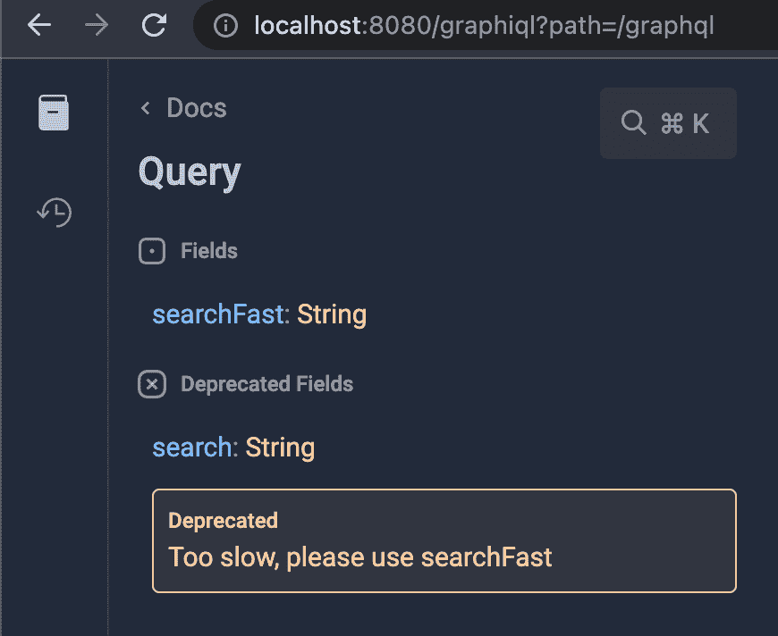

GraphiQL 中的弃用文档

### `@specifiedBy`

`@specifiedBy` 允许我们提供一个标量规范 URL 来描述自定义标量类型的行为。

自定义标量是 GraphQL 的一项强大功能，允许扩展类型系统。在 GraphQL 规范最初，自定义标量只能通过名称在模式中定义。例如：

```graphql
scalar DateTime
```

这仍然是在模式中定义自定义标量的有效方式。然而，仅凭模式中的名称不足以解释自定义标量的行为。例如，`DateTime` 的实现可能跨服务有所异，但它们可能都包含相同名称 `DateTime` 的模式元素。引入 `@specifiedBy` 指令是为了提供一种清晰记录自定义标量行为的方法。提供的 URL 应链接到包含数据格式、序列化和转换规则的规范。有关详情和规范模板，请参见 [GraphQL Scalars 项目](https://scalars.graphql.org/)。

我们建议使用 `@specifiedBy` 来清晰描述你的自定义标量。不过，对自定义标量使用此指令并非强制性的。

由于 `@specifiedBy` 是一个内置指令，你不应该在自己的模式中声明它。为了说明 `@specifiedBy` 的用法，以下是它的定义方式：

```graphql
directive @specifiedBy(url: String!) on SCALAR
```

这是一个 `DateTime` 标量的示例：

```graphql
scalar DateTime @specifiedBy(url: 
    "https://scalars.graphql.org/andimarek/date-time")
```

通过 [GraphQL Scalars](https://scalars.graphql.org/) 项目，你可以创建自己的自定义标量规范并将其托管在 GraphQL Foundation 的 `scalars.graphql.org` 域名上，如上一个示例中的链接 URL。你也可以阅读并链接到其他贡献的规范。更多信息请参见 [GraphQL Scalars](https://scalars.graphql.org/) 项目。

## 定义你自己的模式和操作指令

模式指令和操作指令有一个以 `@` 开头的名称，括号内有一有一个可选的参数列表，随后是 `on` 以及允许使用的位置列表。允许的位置决定了该指令是操作指令还是模式指令。在创建自己的模式和操作指令时，它们必须在模式中定义。

需要理解的是，在我们实现自定义行为之前，所有自定义模式和操作指令都不会产生任何影响。我们首先讨论如何定义模式和操作指令，然后讨论如何实现它们。

## 定义模式指令

让我们来看一些示例。让我们创建一个 `@important` 指令。该指令只能在字段定义上使用，使其成为一个模式指令：

```graphql
# 无参数，且只能在字段定义上使用
directive @important on FIELD_DEFINITION
```

我们新的 `@important` 指令可以用来指示某些模式字段是重要的。


```graphql
type Query {
    hello: String @important # 指令的使用
}
```

我们定义的`@important`指令为仅允许在字段定义上使用。为了使该模式有效，我们可以通过`|`分隔为指令定义添加另一个位置。

```graphql
directive @important on FIELD_DEFINITION | OBJECT
```

现在它是有效的：

```graphql
type Query {
    hello: String @important # 指令的使用
}
```

在我们实现自定义行为之前，所有自定义模式和操作指令都不会产生任何影响。模式指令和操作指令之间的区别在于允许的位置列表。这里有一个包含所有十一位置的模式指令`@foo`示例。

```graphql
directive @foo on SCHEMA | SCALAR | OBJECT |
FIELD_DEFINITION | ARGUMENT_DEFINITION | INTERFACE | UNION | ENUM | ENUM_VALUE | INPUT_OBJECT | INPUT_FIELD_DEFINITION

schema {
    query: Query
}

CustomScalar @foo

type Query @foo {
    hello(
        arg: SomeInput @foo # 参数
    ): String @foo # 字段定义
}

schema @foo {
    hello: String
}

type SomeImplementation implements SomeInterface {
    hello: String
}

union SomeUnion = SomeImplementation @foo

enum SomeEnum @foo {
    ENUM_VALUE @foo # 枚举值
}

input SomeInput @foo {
    inputField: String @foo # 输入字段
}
```

虽然在技术上可以定义一个包含模式和操作指令位置的指令，但在实践中这并不常见。

### 定义操作指令

让我们定义一个操作指令`@cache`，它可以用于操作字段。请注意，下例中的`FIELD`指的是操作字段，而上一个模式指令示例中使用的`FIELD_DEFINITION`指的是模式字段。

```graphql
# 只能用在 GraphQL 文档的字段上
directive @cache on FIELD

type Query {
    pet: Pet
}

type Pet {
    name: String
    lastTimeOutside: String
}
```

我们只能在包含操作的 GraphQL 文档的字段上使用`@cache`指令。

```graphql
query myPet {
    pet {
        name
        lastTimeOutside @cache
    }
}
```

指令也可以包含参数。让我们添加一个`maxAge`参数，其默认值为 1000。

```graphql
# 带有默认值的参数
directive @cache(maxAge: Int = 1000) on FIELD
```

在 GraphQL 文档中，我们可以使用更新后的`@cache`指令来指定`maxAge`值：

```graphql
query myPet {
    pet {
        name
        lastTimeOutside @cache(maxAge: 500)
    }
}
```

在实现新的自定义行为之前，所有自定义架构指令和操作指令都不会产生任何影响。例如，在上面的操作中，`lastTimeOutside`带有`@cache`指令，它的行为与没有该指令完全相同，直到我们实现了某些新逻辑。我们将在本章稍后演示指令行为的实现。你不需要为内置指令定义行为，它们都有定义明确的效果，并由每个 GraphQL 实现所共同实现。

架构指令和操作指令的区别在于允许位置的列表。以下是一个在包含操作的 GraphQL 文档中列出的所有八种可能位置的操作指令：

```graphql
directive @foo on QUERY | MUTATION | SUBSCRIPTION |
  FIELD | FRAGMENT_DEFINITION | FRAGMENT_SPREAD |
  INLINE_FRAGMENT | VARIABLE_DEFINITION

query someQuery(
    $var: String @foo # 变量定义
) @foo { # 查询
    field @foo # 字段
    ... on Query @foo { # 内联片段
        field
    }
    ...someFragment @foo # 片段扩展
}

fragment someFragment @foo { # 片段
    field
}

mutation someMutation @foo { # 变更
    field
}

subscription someSubscription @foo { # 订阅
    field
}
```

虽然在技术上可以定义一个包含与架构指令和操作指令相关位置的指令，但在实践中这并不常见。

## 可重复指令

我们可以将架构和操作指令定义为`repeatable`（可重复），允许它在同一位置被多次使用。如果指令定义中没有包含`repeatable`，则该指令默认为不可重复的。

例如，一个可重复的架构指令`@owner`：

```graphql
directive @owner(name: String!) repeatable on FIELD_DEFINITION

type Query {
    # 每个字段可以有所有者
    hello: String @owner(name: "Brian") @owner(name: "Josh")
}
```

## 为架构指令实现逻辑

要创建一个新的架构指令，我们必须定义该指令并实现其逻辑。

由于这是一个高级章节，接下来的代码示例更为复杂，并涉及架构的遍历和转换。

### 使用架构指令更改执行逻辑

让我们为新的`@important`指令实现逻辑，该指令指示哪些架构字段是重要的，以及其重要的原因。它的定义如下：

```graphql
directive @important(reason: String!) on FIELD_DEFINITION
```

可以在架构中使用它：

```graphql
type Query {
    hello: String @important(reason: "high priority")
}
```

为了解释架构定义和用法是如何表示的，我们将通过 Java 来说明。在实践中，我们经常在 `DataFetcher` 中使用架构指令。例如，在 Spring DataFetcher 中，我们可以这样使用`@important`指令来更改处理重要字段的方式：

```java
package myservice.service;

import graphql.schema.DataFetchingEnvironment;
import graphql.schema.AppliedDirective;
import graphql.schema.FieldDefinition;
import org.springframework.graphql.data.method.annotation.QueryMapping;
import org.springframework.stereotype.Controller;

@Controller
class GreetingController {
  @QueryMapping
  String hello(DataFetchingEnvironment env) {
    FieldDefinition fieldDefinition = env.getFieldDefinition();
    AppliedDirective important =
      fieldDefinition.getAppliedDirective("important");
    if (important != null) {
      return handleImportantFieldsDifferently(env);
    }
    return "Hello";
  }
}
```

### 使用架构指令进行验证

指令也可以用于验证。例如，用于参数的`@size`架构指令，用于强制执行最小数量。

```graphql
directive @size(min: Int = 0) on ARGUMENT_DEFINITION
```

它可以被应用于参数定义，以验证输入中是否有足够的`Application`：

```graphql
type Query {
    hired(applications: [Application!] @size(min: 3)): [Boolean]
}
```

验证是一个非常有用且被频繁请求的想法，因此有一个针对 GraphQL Java 的[扩展验证库](https://github.com/graphql-java/graphql-java-extended-validation)，该库由 GraphQL Java 团队维护。

要使用`graphql-java-extended-validation`库中的验证指令，请添加该包。

对于 Gradle，在你的`build.gradle`文件中添加以下内容：

```gradle
implementation 'com.graphql-java:graphql-java-extended-validation:19.1'
```

对于 Maven：

```xml
<dependency>
  <groupId>com.graphql-java</groupId>
  <artifactId>graphql-java-extended-validation</artifactId>
  <version>19.1</version>
</dependency>
```

注意：主版本号对应于主 GraphQL Java 版本的链接主版本。在编写本文时，Spring for GraphQL 1.1.2 的最新版本使用了 GraphQL Java 19。

要在 Spring for GraphQL 中接线这些验证指令，请创建一个`RuntimeWiringConfigurer` bean。这将添加来自`graphql-java-extended-validation`的一组默认指令实现。你应该在你的 schema 中单独为你的服务定义这些指令。

```java
@Configuration
class GraphQlConfig {
    @Bean
    RuntimeWiringConfigurer runtimeWiringConfigurer() {
        // 添加库中所有的默认验证规则
        ValidationRules possibleRules =
            ValidationRules.newValidationRules().build();

        // ValidationSchemaWiring 使用了 SchemaDirectiveWiring
        ValidationSchemaWiring validationDirectiveWiring =
            new ValidationSchemaWiring(possibleRules);

        return wiringBuilder -> wiringBuilder
            .directiveWiring(validationDirectiveWiring);
    }
}
```

Spring Boot starter 会自动检测所有的`RuntimeWiringConfigurer` bean。

### 使用 schema 指令添加元数据

schema 指令另一个非常常见的用例是提供元数据，这些数据不会改变执行，仅与 schema 本身相关。

例如，我们在大型团队中工作，并通过`@owner`指令来记录某些类型的所有者：

```graphql
directive @owner(name: String) on OBJECT

type User @owner(name: "Antoine") {
    # More fields here
}

type Order @owner(name: "Felipe") {
    # More fields here
}

type Payment @owner(name: "Stephan") {
    # More fields here
}
```

使用指令的一个显著优势是能够程序化地处理它们。例如，我们可以创建一个自动报告，显示哪些类型由谁所有。这个所有权报告示例更像是一个脚本，而不是 Spring for GraphQL 服务的一部分。因此，我们将在纯 GraphQL Java 中演示这个示例。

GraphQL Java 提供了程序化访问 schema 元素的工具。在纯 GraphQL Java 代码中，我们可以使用`SchemaTraverser`类配合`GraphQLTypeVisitor`将所有者映射到类型。在这个示例中，我们将访问`GraphQLObjectType`。GraphQL Java 中有许多更多选项和钩子可以自定义访问器。

```java
GraphQLSchema schema = ...;
Map<String, List<GraphQLObjectType>> ownerToTypes =
  new LinkedHashMap<>();

SchemaTraverser schemaTraverser = new SchemaTraverser();

schemaTraverser.depthFirstFullSchema(new GraphQLTypeVisitorStub() {
  @Override
  public TraversalControl visitGraphQLObjectType(
    GraphQLObjectType objectType,
    TraverserContext<GraphQLSchemaElement> context
  ) {
    GraphQLAppliedDirective directive =
      objectType.getAppliedDirective("owner");

    if (directive != null) {
      String owner = directive.getArgument("name").getValue();
      ownerToTypes.putIfAbsent(owner, new ArrayList<>());
      ownerToTypes.get(owner).add(objectType);
    }

    return TraversalControl.CONTINUE;
  }
}, schema);
```

我们访问 schema 中的每一个`GraphQLObjectType`，并检查每个对象类型的所有者。然后我们组装一个所有者到对象类型列表的映射。

这个`@owner`示例更像是一个脚本，而不是 Spring for GraphQL 服务中的核心功能。然而，如果你想在 Spring for GraphQL 中遍历 schema，可以通过`GraphQlSource.builder`配合`builder.schemaResources(..).typeVisitors(..)`注册`graphql.schema.GraphQLTypeVisitor`。

更进一步，我们甚至可以使用 schema 指令更改全局的`GraphQLSchema`。例如，我们可以根据指令自动为每个字段添加后缀。

```graphql
directive @suffix(name: String) on OBJECT

type Dog @suffix(name: "__bark") {
    name: String
}

type Cat @suffix(name: "__meow") {
    name: String
}
```

在纯 GraphQL Java 中，我们可以使用 schema 转换器和类型访问器。


```java
GraphQLSchema newSchema = SchemaTransformer.transformSchema(
  schema, new GraphQLVisitorStub() {
  @Override
  public TraversalControl visitFieldDefinition(
    GraphQLFieldDefinition fieldDefinition,
    TraverserContext<GraphQLSchemaElement> context
  ) {
    GraphQLSchemaElement parentNode = context.getParentNode();
    if (!(parentNode instanceof GraphQLObjectType)) {
      return TraversalControl.CONTINUE;
    }
    GraphQLObjectType objectType = (GraphQLObjectType) parentNode;
    GraphQLAppliedDirective directive = objectType
      .getAppliedDirective("suffix");
    if (directive != null) {
      String suffix = directive.getArgument("name").getValue();
      GraphQLFieldDefinition newFieldDefinition
        = fieldDefinition.transform(builder
          -> builder.name(fieldDefinition.getName() + suffix));
      return changeNode(context, newFieldDefinition);
    }
    return TraversalControl.CONTINUE;
  }
});
```

我们正在使用`SchemaTransformer`类在遍历 schema 时更改它。`SchemaTransformer`利用了与上一个示例中使用的`SchemaTraverser`相同的`GraphQLTypeVisitor`。

要在 Spring for GraphQL 中使用相同的 schema 转换示例，请通过`GraphQlSource.Builder`配合`builder.schemaResources(..).typeVisitorsToTransformSchema(..)`注册`graphql.schema.GraphQLTypeVisitor`。

需要注意的是：如你从代码示例所示，转换 schema 并非易事。请不要在 schema 转换过程中无意中创建无效 schema。要查看更复杂的示例，请参考 GraphQL Java 中的`graphql.util.Anonymizer`。这是一个工具，帮助 GraphQL Java 的用户对其 schema 进行匿名化，以便在报告问题或向维护团队提出改进时提供真实的示例。

## 实现操作指令的逻辑

操作指令（Operation directives）用于 GraphQL 操作。请注意，这个概念通常也被称为“查询”（query）指令，尽管这种类型的指令可以使用于三种操作：查询（queries）、变变（mutations）和订阅（subscriptions）。

让我们来实现一个`@cache`操作指令的逻辑：

```
directive @cache(maxAge: Int) on FIELD
```

这是一个操作指令，允许客户端指定缓存条目的时效性。这是一个可以改变执行行为的操作指令示例。

例如，客户端指定`hello`缓存条目的不能超过 500 ms，否则我们将重新获取这些条目。

```graphql
query caching {
    hello @cache(maxAge: 500)
}
```

在 GraphQL Java 中，操作指令的定义表示为`GraphQLDirective`s。操作指令的使用表示为`QueryAppliedDirective`s。注意，这里的“query”一词具有误导性，因为它实际上指的是适用于任何三种 GraphQL 操作（查询、变变或订阅）的指令。操作指令仍然通常地被称为“query”指令，因此有了该类名。

为了解释操作指令的定义和用法在代码中是如何表示的，我们将通过使用纯 GraphQL Java 的示例代码进行演示。然后，我们将通过 Spring for GraphQL 中`@cache`的实现来结束本节。

在纯 GraphQL Java 中，我们可以通过`GraphQLSchema`实例（在本例中称为`schema`）访问 schema 中操作指令的定义。我们可以访问操作指令的名称、参数、位置以及它是否可重复。

```java
GraphQLSchema schema = ...;
GraphQLDirective cacheDirective = schema.getDirective("cache");
String name = cacheDirective.getName();
List<GraphQLArgument> arguments = cacheDirective.getArguments();
boolean repeatable = cacheDirective.isRepeatable();
EnumSet<Introspection.DirectiveLocation> directiveLocations 
        = cacheDirective.validLocations();
```

操作指令的使用在 GraphQL Java 中表示为`QueryAppliedDirective`实例，而提供的参数值表示为`QueryAppliedDirectiveArgument`。

我们可以在执行期间通过`DataFetchingEnvironment`中的`getQueryDirectives()`访问操作指令的使用。例如：

```java
package myservice.service;

import graphql.execution.directives.QueryAppliedDirective;
import graphql.execution.directives
  .QueryAppliedDirectiveArgument;
import graphql.execution.directives.QueryDirectives;
import graphql.schema.DataFetchingEnvironment;
import org.springframework.graphql.data.method.annotation
  .QueryMapping;
import org.springframework.stereotype.Controller;

import java.util.List;

@Controller
class GreetingController {
  
  @QueryMapping
  String hello(DataFetchingEnvironment env) {
    QueryDirectives queryDirectives = env.getQueryDirectives();
    List<QueryAppliedDirective> cacheDirectives = queryDirectives
      .getImmediateAppliedDirective("cache");
    // 我们获取的是列表，因为我们可能有
    // 可重复的指令
    if (cacheDirectives.size() > 0) {
      QueryAppliedDirective cache = cacheDirectives.get(0);
      QueryAppliedDirectiveArgument maxAgeArgument
        = cache.getArgument("maxAge");
      int maxAge = maxAgeArgument.getValue();

      // 现在我们知道了最大允许的缓存时间
      // 并可以利用它
      // 在此处编写你的逻辑
    }
  }
}
```

在本章中，我们涵盖了指令，这是一个强大的 GraphQL 功能，允许我们更改运行时的执行和验证。我们涵盖了内置指令以及如何编写自定义指令。

# 执行

执行由 GraphQL 引擎处理。在这一高级章节中，我们将深入了解 GraphQL 是如何执行的。

## 初始化执行对象

在执行任何 GraphQL 请求之前，Spring for GraphQL 必须理解 schema。为了实现这一点，Spring for GraphQL 初始化一个`GraphQL`实例，该实例包含了 schema 和执行策略。

作为`GraphQL`初始化过程的一部分，Spring for GraphQL 会加载 schema 文件、暴露相关属性、检测`RuntimeConfigurer`bean 等。通常，对于所有请求只会初始化一个`GraphQL`实例。

当 Spring for GraphQL 初始化`GraphQL`的时候，如果你有任何想要更改的内容，可以通过`GraphQlSource`[契约](https://docs.spring.io/spring-graphql/docs/current/reference/html#execution.source)进行访问和修改。例如，要添加自定义的执行 ID，创建一个`GraphQlSourceCustomizer`bean：

```java
package myservice.service;

import org.springframework.boot.autoconfigure.graphql
  .GraphQlSourceCustomizer;
import org.springframework.context.annotation.Bean;
import org.springframework.context.annotation.Configuration;

@Configuration
class GraphQlConfig {
    @Bean
    GraphQlSourceCustomizer sourceBuilderCustomizer() {
        return (builder) ->
            builder.configureGraphQl(graphQlBuilder ->
                // 在这里可以使用 GraphQL.Builder
                // 例如，executionIdProvider
                graphQlBuilder
                    .executionIdProvider(new MyExecutionIdProvider()));
    }
}
```

注意，自定义`GraphQlSource`是完全可选的。Spring for GraphQL 已经初始化了足够的内容以便在无需额外自定义配置的情况下启动请求。

如果你在使用没有 Spring for GraphQL 的 GraphQL Java，这就是手动初始化`graphql.GraphQL`对象的方法。

```
String sdl = "type Query { foo: String }"; // Your schema here
TypeDefinitionRegistry parsedSdl = new SchemaParser().parse(sdl);
DataFetcher<String> foo = (env) -> "foo";
TypeRuntimeWiring queryWiring = newTypeWiring("Query")
  .dataFetcher("foo", foo)
  .build();
RuntimeWiring runtimeWiring = newRuntimeWiring()
  .type(queryWiring)
  .build();

GraphQLSchema schema = new SchemaGenerator()
  .makeExecutableSchema(parsedSdl, runtimeWiring);
GraphQL graphQL = GraphQL.newGraphQL(schema).build();
```

## Spring for GraphQL 如何启动执行

在请求与响应章节中，我们讨论了 Spring for GraphQL 如何处理 HTTP 上的请求和响应。在本章中，我们将关注接收请求后的执行步骤。这些执行步骤发生在 GraphQL Java 引擎内部。

回想一下请求与响应章节，Spring for GraphQL 会自动处理 HTTP 协议。GraphQL 请求是一个编码为`application/json`的 HTTP POST 请求。

对于每个收到的 HTTP 请求，Spring for GraphQL 会自动创建一个 GraphQL Java 的`ExecutionInput`实例。回想一下请求与响应章节，`ExecutionInput`是代表 GraphQL 请求的 GraphQL Java 对象，不包含传输层的问题。在 Spring for GraphQL 内部，这一过程发生在`DefaultExecutionGraphQlService`中。可以使用自定义的`ExecutionGraphQlService`实现来替换它。

随后，控制权将交给 GraphQL Java，它会执行由`ExecutionInput`实例表示的 GraphQL 请求。执行完成后，将返回一个包含响应数据和/或错误的`ExecutionResult`实例。GraphQL Java 引擎在`ExecutionInput`和`ExecutionResult`之间发生的情况是本章剩余部分的重点。

如果你在没有 Spring for GraphQL 的情况下使用 GraphQL Java，这是手动创建`ExecutionInput`并执行请求的方法：

```
GraphQL graphQL = GraphQL.newGraphQL(schema).build();

ExecutionInput request = ExecutionInput.newExecutionInput()
  .query("query test {foo}")
  .build();

ExecutionResult result = graphQL.execute(request);
```

## 执行步骤

在 GraphQL Java 中，执行包括以下步骤：

1. 从请求中解析“query”（文档）值为 GraphQL 文档

2. 验证文档

3. 强制转换变量（coercing variables）

4. 获取数据

这些是在 GraphQL Java 引擎接收到`ExecutionInput`请求到返回带有数据和/或错误的`ExecutionResult`实例之间所经历的步骤。

### 解析与验证

回想一下请求与响应章节，GraphQL 请求中的“query”实际上是一个 GraphQL 文档，它可能包含一个或多个操作。此“query”值被插入到 GraphQL Java 的`ExecutionInput`实例中，该实例代表一个 GraphQL 请求。

第一步是从`ExecutionInput`中解析“query”（文档）值并对其进行验证。如果文档包含无效语法，解析将立即失败。否则，如果文档在语法上是有效的，则将根据 schema 进行验证。

### 强制转换变量

请参考试验语言章节以了解 GraphQL 变量的概述，并在请求与响应章节中查看变量如何在 HTTP 请求中发送。

如果请求包含变量，则需要对它们进行“强制转换”。`coercing`过程将请求中提供的变量值转换为内部表示，并验证变量。例如：

```
query myQuery($name: String) {
    echo(value: $name)
}
```

此查询包含一个类型为`String`的变量`$name`。如果请求现在包含以下变量，变量强制转换将失败，因为我们预期`name`是单个`String`，而不是`String`列表。

```
{
  "name": ["Luna", "Skipper"]
}
```

### 获取数据

最后一步是执行的核心：GraphQL Java 获取满足请求所需的数据。

正如 DataFetchers 章节详细描述的，GraphQL Java 中的`DataFetcher`是一个加载特定特定字段数据的泛型函数。Spring for GraphQL 通过`@SchemaMapping`控制器注解以及如`@QueryMapping`等快捷注解实现了 DataFetchers。

schema 中的每个字段都分配了一个`DataFetcher`。与 GraphQL 请求中的字段关联的 DataFetchers 将被 GraphQL Java 调用以获取数据。


即使在生成了 `PropertyDataFetchers` 后，字段也可能意外地未映射到任何 `DataFetcher`。这可能是由于忘记了 `@SchemaMapping` 注解或缺少 Java 属性。遗忘的 `DataFetcher` 将被视为返回 `null` 结果的 `DataFetcher`。由于你通常不想忘记任何 `DataFetcher`，即将到来的 [Spring for GraphQL 1.2 版本](https://spring.io/blog/2023/03/21/spring-for-graphql-1-2-0-m1-released) 将启动时添加 schema 映射检查。

让我们更仔细地观察示例 schema 和查询，这将有助于我们理解整体执行算法。

```
type Query {
    dogs: [Dog]
}

type Dog {
    name: String
    owner: Person
    friends: [Dog]
    details: DogDetails
}

type Person {
    firstName: String
    lastName: String
}

type DogDetails {
    barking: Boolean
    shedding: Boolean
}
```

```
query myDogs {
    dogs {
        name
        owner {
            firstName
            lastName
        }
        friends {
            name
        }
        details {
            barking
            shedding
        }
    }
}
```

GraphQL Java 将每个 GraphQL 操作解释为字段树。每个字段都有一个关联的 `DataFetcher`。因此，将操作描述为 `DataFetcher` 闭包（匿名函数）也是同样有效的。

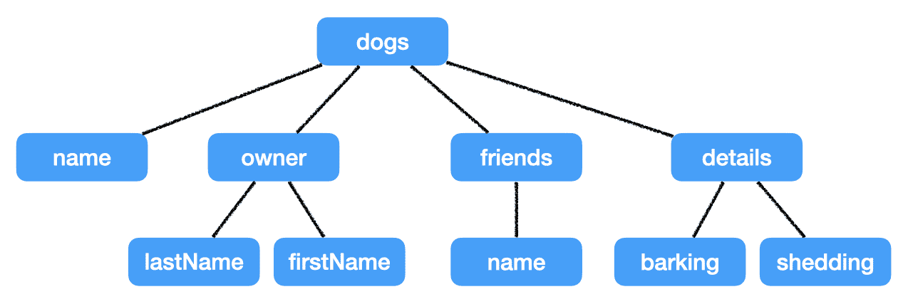

字段树

如“字段树”图所示，此查询有三层，`dogs` 是唯一的根字段。GraphQL Java 广度优先遍历查询，并在访问每个字段时调用相应的 `DataFetcher`。一旦字段的 `DataFetcher` 成功返回数据，我们就会调用其每个子元素的 `DataFetcher`。因此，第一个调用的 `DataFetcher` 是 `/dogs`，随后是 `/dogs/name`、`/dogs/owner`、`/dogs/friends` 和 `/dogs/details`。

一个关键细节是，如果可能，GraphQL Java 会并行获取字段的子字段。

总结来说，执行过程是对字段的广度遍历，当每个字段的 `DataFetcher` 完成时，该字段完成完成。在可能，我们会并行执行字段的子。

## 响应式并发无关

GraphQL Java 是响应式并发无关的。这意味着 GraphQL Java 并不规定特定的线程数量，也没有规定在执行过程中何时使用它们。这是通过利用 `java.util.concurrent.CompletableFuture` 实现的。每个 `DataFetcher` 都可以返回一个 `CompletableFuture`，如果没有，GraphQL Java 会将返回的值封装成 `CompletableFuture`。

这使得 GraphQL Java 能够同时调用字段的所有子 `DataFetchers`，类似于下所示：

```java
// 所有操作都发生在同一个线程中。
// GraphQL Java 不创建新线程
// 不使用线程池。
List<CompletableFuture> dataFetchersCFs = new ArrayList<CompletableFuture>();
for (DataFetcher df: childrenDFs) {
  Object cf = df.get(env);
  // 包装非 CF 类型
  if (!(cf instanceof CompletableFuture)) {
    cf = CompletableFuture.completedFuture(cf);
  }
  dataFetchersCFs.add((CompletableFuture) cf);
}
```

一个关键问题是，`DataFetcher` 在当前线程中执行了多少工作？如果当前线程没有执行工作或只做了极少量的工作，那么 GraphQL Java 本身就能以最高效率运行。如果 `DataFetcher` 使用了当前线程（通过计算或等待某些 I/O 返回），就会阻塞 GraphQL Java 本身，导致其无法调用另一个 `DataFetcher`。

这里有几个 `DataFetcher` 示例来说说明。注意，在 Spring for GraphQL 中，通过标记了 `@SchemaMapping` 的控制器方法来实现这些 `DataFetchers` 是等效的。

```java
// 在当前线程中进行密集计算工作
DataFetcher<String> df = (env) -> {
  String str = intensiveComputeString();
  return str;
};

// 仍然在当前线程中执行实际工作
DataFetcher<CompletableFuture<String>> df = (env) -> {
  String str = intensiveComputeString();
  return CompletableFuture.completedFuture(str);
};

// 阻塞 I/O 调用
DataFetcher<String> df = (env) -> {
  String str = makeHttpCallAndWaitForIt();
  return str;
};

// 在当前线程中快速计算工作
DataFetcher<String> df = (env) -> {
  return "Hello";
};

// 卸载到另一个线程的计算工作
DataFetcher<CompletableFuture<String>> df = (env) -> {
  Executor threadPool = ...;
  return CompletableFuture.supplyAsync( () -> {
    String str = intensiveComputeString();
    return str;
  },threadPool);
};

// 将阻塞 I/O 调用卸载到另一个线程
DataFetcher<CompletableFuture<String>> df = (env) -> {
  Executor threadPool = ...;
  return CompletableFuture.supplyAsync( () -> {
    String str = makeHttpCallAndWaitForIt();
    return str;
  },threadPool);
};

// 使用响应式 API 进行 HTTP 调用
DataFetcher<CompletableFuture<String>> df = (env) -> {
  return makeReactiveHttpCall();
};
```

为了达到最高效率，我们建议 `DataFetcher` 永远不要占用它被调用的线程。Spring for GraphQL 也允许 `DataFetchers` 返回 `CompletableFuture` 之外的值。

## 完成字段

在 `DataFetcher` 为字段返回一个值后，GraphQL Java 需要对其进行处理。这一阶段被称为“完成字段”（completing a field）。

如果值为 `null`，则完成操作不执行操作。

如果字段类型为 `list`，我们根据列表的泛型类型完成列表内部的所有元素。

对于标量（scalars）和枚举，值会进行“强制转换”（coerced）。强制转换有两个目的：第一是确保值有效，第二是将值转换为内部表示。每个 `GraphQLType` 都引用一个 `graphql.schema.Coercing` 实例。对于枚举，会调用 `EnumType.serialize` 方法。例如，内置标量 `Int` 只接受 `Number` 值。这意味着如果我们为类型为 `Int` 的字段编写了 `DataFetcher` 但它返回了 `Boolean`，就会导致错误。

```graphql
Query {
  someInt: Int
}
```

```java
DataFetcher df = (env) -> {
  return true; // 将导致错误
};
```

### TypeResolver

如果字段类型是接口（interface）或联合类型（union），GraphQL Java 需要通过 `TypeResolver` 确定值的实际对象类型。参见 `DataFetchers` 章节关于 `TypeResolver` 的介绍以及如何在 Spring for GraphQL 和 GraphQL Java 中使用它们。本节侧重于 `TypeResolver` 的执行。

在我们的架构中，有一个 `Pet` 接口：

```graphql
Query {
  pet: Pet
}

interface Pet {
  name: String
}

type Dog implements Pet {
  name: String
  barks: Boolean
}

type Cat implements Pet {
  name: String
  meows: Boolean
}
```

在 `TypeResolver` 返回值的类型后，该信息将用于确定需要获取的字段的实际子选择（sub-selection）。

一个示例查询可能如下：

```graphql
query myPet {
  pet {
    ...on Dog {
      barks
    }
    ...on Cat {
      meows
    }
  }
}
```

在这里，`pet` 的子选择为 `{ ...on Dog { barks } ...on Cat { meows } }`。如果 `DataFetcher` 返回的值是 `Dog`，我们需要获取 `barks` 字段；如果是 `Cat`，我们需要获取 `meows`。

然后，子选择中所有字段的 `DataFetcher` 将被调用，如前述章节所示。这是一个递归步骤，随后再次导致每个字段的完成。

## Query 与 mutation

Query（查询）和 mutation（变更）的执行方式几乎相同。唯一的区别是规范要求在一个操作中的多个变更必须串行执行。

例如：

```graphql
mutation modifyUsers {
  deleteUser(...) { ... }
  addOrder(...) { ... }
  changeUser(...) { ... }
}
```

对比

```graphql
query getUsersAndOrders {
  searchUsers(...) { ... }
  userById(...) { ... }
  allOrders { ... }
}
```

变更的 `DataFetcher` 是串行调用的。变更字段 `addOrder` 的 `DataFetcher` 在 `deleteUser` 完成后才被调用。同样，`changeUser` 的 `DataFetcher` 在 `addOrder` 完成后才被调用。对比查询的行为，在查询中我们并行调用所有三个字段（`searchUsers`、`userById` 和 `allOrders`）的 `DataFetchers`。

这是查询（queries）和变异（mutations）在执行上的唯一区别。我们将变异实现为 `DataFetcher`，但在使用 GraphQL Java 时有一条规则需要遵循：变异 `DataFetcher` 可能会有副作用，而查询则不能，尽管 GraphQL Java 并没有强制执行这一点。

在这一高级章节中，我们深入研究了 GraphQL Java 引擎内部的执行机制。我们还讨论了 Spring for GraphQL 如何初始化执行对象，以及它在接收到请求后如何在 GraphQL Java 中启动执行。

# Instrumentation（探测）

Instrumentation 是一种钩入 GraphQL Java 的通用机制。你可以注入代码来观察查询的执行情况并更改运行时行为。Instrumentation 对于性能监控和自定义日志特别有用。

## Spring for GraphQL 中的 Instrumentation

Spring Boot starter 会自动检测 `Instrumentation` ，并作为 `graphql.GraphQL` 初始化过程的一部分。`graphql.GraphQL` 是一个关键的 GraphQL Java 类，包含了执行请求所需的必要信息。

让我们添加第一个探测器 `MaxQueryDepth`。该探测器会检测操作深度何时超过指定的数字并提前终止执行。你可能想要添加此探测器以对操作深度实施硬性限制，作为限制资源消耗的一种手段。

例如，想象一个查询请求朋友的名字，继而请求他们朋友的名字，以此此类推。这种查询的巨大深度可能会导致服务消耗大量资源来完成请求。

```graphql
query veryDeep {
    hero {
        name
        friends {
            name
            friends {
                name
                friends {
                    name
                    # 等此类推！
                }
            }
        }
    }
}
```

为了方便起见，GraphQL Java 包含了一些内置的 Instrumentation，它们将在本章节后面列出。让我们将内置的 `MaxQueryDepth` 探测器作为 Bean 添加到我们的 Spring for GraphQL 服务中，并将最大深度设置为合适的数字。该探测器将被 Spring Boot starter 自动检测并注册，无需进一步配置。

```java
package myservice.service;

import graphql.analysis.MaxQueryDepthInstrumentation;
import org.springframework.context.annotation.Bean;
import org.springframework.context.annotation.Configuration;

@Configuration
class MyGraphQLConfiguration {
    @Bean
    MaxQueryDepthInstrumentation maxQueryDepthInstrumentation() {
        return new MaxQueryDepthInstrumentation(15);
    }
}
```

当请求的操作深度大于指定值时，执行将提前终止，并在响应中返回以下错误消息。

```json
{
  "errors": [
    {
      "message": "maximum query depth exceeded 42 > 15",
      "extensions": {
        "classification": "ExecutionAborted"
      }
    }
  ]
}
```

## 编写自定义 Instrumentation

你可以使用 GraphQL Java 中 `graphql.execution.Instrumentation` 接口提供的 Instrumentation 钩子编写自定义探测器。每个钩子都是一个独立的方法。可用钩子的列表将在本章节后面给出。

让我们写一个自定义探测器，用来测量执行 GraphQL 请求所花费的时间。这是从 GraphQL 执行开始到请求完成之间的时间。


```java
package myservice.service;

import graphql.ExecutionResult;
import graphql.execution.instrumentation.InstrumentationContext;
import graphql.execution.instrumentation.InstrumentationState;
import graphql.execution.instrumentation.SimpleInstrumentation;
import graphql.execution.instrumentation.parameters
  .InstrumentationExecutionParameters;
import org.springframework.stereotype.Component;
import java.util.concurrent.CompletableFuture;
import java.util.concurrent.atomic.AtomicLong;

@Component
class LogTimeInstrumentation extends SimpleInstrumentation {
  @Override
  public InstrumentationContext<ExecutionResult> beginExecution(
    InstrumentationExecutionParameters parameters,
    InstrumentationState state) {
    return new InstrumentationContext<>() {
      AtomicLong timeStart = new AtomicLong();

      @Override
      public void onDispatched(CompletableFuture<ExecutionResult> result) {
        timeStart.set(System.currentTimeMillis());
      }

      @Override
      public void onCompleted(ExecutionResult result, Throwable t) {
        System.out.println("execution time: " + (System.currentTimeMillis() - timeStart.get()));
      }
    };
  }
}
```

让我们梳一下这个探测器。在`beginExecution`钩子中，我们返回一个带有`onDispatched`和`onCompleted`方法的`InstrumentationContext<ExecutionResult>`。它们在执行开始和结束时被调用。我们保存开始时间，并在执行完成后记录差值。

Spring for GraphQL 会自动检测并注册该探测。除了为此探测器添加`@Component`注解外，不需要进一步配置。

在编写时，最新的 Spring for GraphQL 使用的是 GraphQL Java 19.x。在 Spring for GraphQL 1.2 中将使用 GraphQL Java 20.x，它引入了改进的`PerformantInstrumentation`类。它的设计旨在提高性能并减少对象分配。

如果你使用的是纯 GraphQL Java，则必须手动将探测传递给`GraphQL`构建器。

```java
GraphQLSchema schema = ...;
GraphQL graphQL = GraphQL.newGraphQL(schema)
  .instrumentation(new LogTimeInstrumentation())
  .build();
```

## `InstrumentationContext`

`InstrumentationContext`是特定步骤结束时会被调用的对象。`InstrumentationContext`由`beginExecution`等步骤方法返回。

在 GraphQL Java 中，它被表示为一个简单的接口。

```java
public interface InstrumentationContext<T> {

    /**
     * 此方法在探测步骤最初分发时被调用
     *
     * @param  result 以完成未来形式的步骤结果
     */
    void onDispatched(CompletableFuture<T> result);

    /**
     * 此方法在探测步骤完全完成后被调用
     *
     * @param  result 步骤的结果（可能为 null）
     * @param  t  如果在步骤期间抛出异常，则此异常将不为空
     */
    void onCompleted(T result, Throwable t);
}
```

“dispatching”（调度）和“completion”（完成）的使用反映了 GraphQL Java 内部基于`CompleteableFuture`实现的响应式方式。会先创建一个`CompleteableFuture`，然后在稍后将其完成。一旦创建了关联的`CompleteableFuture`，引擎就会调用`onDispatched`方法。当关联的`CompletableFuture`完成时，引擎会调用`onCompleted`方法。

`InstrumentationContext`是一个泛接口，在之前的`LogTime`示例中，我们为`ExecutionResult`返回了一个`InstrumentationContext`。

## `InstrumentationState`

让我们讨论一下在拦截中如何管理状态。

我们通常只有一个`graphql.GraphQL`实例，它在所有请求中被复用。拦截器是为每个`graphql.GraphQL`实例注册的。那么我们如何为每个请求维护不同的拦截器状态呢？如何管理需要在多个钩子之间进行协调的复杂拦截器的状态？

状态管理通过`createState`方法实现，该方法每个请求调用一次并返回一个`InstrumentationState`。`InstrumentationState`是一个 Java 接口，代表任何类型的状态。该状态作为参数传递到每个钩子中，并且状态可以在每个请求的多个钩子之间进行追踪。

让我们通过一个更复杂的拦截器来实际操作。`FieldCountInstrumentation`统计一个请求中执行的字段数量。

```java
package myservice.service;

import graphql.ExecutionResult;
import graphql.execution.instrumentation.InstrumentationContext;
import graphql.execution.instrumentation.InstrumentationState;
import graphql.execution.instrumentation.SimpleInstrumentation;
import graphql.execution.instrumentation.parameters
  .InstrumentationCreateStateParameters;
import graphql.execution.instrumentation.parameters
  .InstrumentationExecutionParameters;
import graphql.execution.instrumentation.parameters
  .InstrumentationFieldParameters;
import org.springframework.stereotype.Component;

import java.util.concurrent.CompletableFuture;
import java.util.concurrent.atomic.AtomicInteger;

import static graphql.execution.instrumentation
  .SimpleInstrumentationContext.noOp;

@Component
class FieldCountInstrumentation
  extends SimpleInstrumentation {

  static class FieldCountState implements InstrumentationState {
    AtomicInteger counter = new AtomicInteger();
  }

  @Override
  public InstrumentationState createState(
    InstrumentationCreateStateParameters parameters) {
    return new FieldCountState();
  }

  @Override
  public InstrumentationContext<ExecutionResult> beginField(
    InstrumentationFieldParameters parameters,
    InstrumentationState state) {
    ((FieldCountState) state).counter.incrementAndGet();
    return noOp();
  }

  @Override
  public InstrumentationContext<ExecutionResult> beginExecution(
    InstrumentationExecutionParameters parameters,
    InstrumentationState state) {
    return new InstrumentationContext<ExecutionResult>() {
      @Override
      public void onDispatched(
        CompletableFuture<ExecutionResult> result) {
      }

      @Override
      public void onCompleted(ExecutionResult result, Throwable t) {
        System.out.println(
          "finished with " +
            ((FieldCountState) state).counter.get()
        );
      }
    };
  }
}
```

在本章中，我们将讨论 DataLoader，这是 GraphQL Java 用于对数据请求进行批处理和缓存的库。我们将讨论常见的 n+1 问题以及如何使用 DataLoader 的批处理功能来解决它。我们还将讨论 DataLoader 的缓存功能如何让数据请求更高效。

我们将演示如何在 Spring for GraphQL 中使用 DataLoader。然后，我们将详细查看 DataLoader 在 GraphQL Java 中是如何运作的。

## n+1 问题

n+1 问题是指检索对象的相关实体时效率低下，这可能导致严重的性能问题。在为 schema 实现 DataFetchers 时，这是一个常见问题。请注意，这是一个在 SQL 等其他场景中也会发生的通用问题，并不是 GraphQL Java 或 GraphQL 特有的。

让我们用一个关于人及其{实朋友的简单示例来解释 n+1 问题。

```graphql
type Query {
    people: [Person]
}

type Person {
    name: String
    bestFriend: Person
}
```

查询语句可能如下：

```
query importantPeople { 
    people { 
        bestFriend { 
            name 
        } 
    } 
}
```

让我们在 Spring for GraphQL 中注册两个 DataFetchers，分别负责加载`people`及其它们的`bestFriend`。

```java
package myservice.service;

record Person(String name, Integer bestFriendId) {}
```

```java
package myservice.service;

import org.springframework.graphql.data.method.annotation.QueryMapping;
import org.springframework.graphql.data.method.annotation.SchemaMapping;
import org.springframework.stereotype.Controller;

import java.util.List;

@Controller
record PersonController(PersonService personService) {

  @QueryMapping
  List<Person> people() {
    return personService.getAllPeople();
  }

  @SchemaMapping
  Person bestFriend(Person person) {
    return personService.getPersonById(person.bestFriendId());
  }
}
```

虽然这段代码可以运行，但在大型列表上表现并不良好。对于列表每一个人，我们都会调用加载好朋友的 DataFetcher。对于“n”个人，我们现在有了“n+1”次服务调用：一次用于加载初始人员列表，然后为 n 个人中的每一个人调用一次来加载他们的好朋友。这就是“n+1 问题”名称的由来。这可能会导致严重的性能问题，因为大型列表需要多次调用来检索数据。

## 解决 n+1 问题

解决方案不再是为每个人进行一次服务调用，而是一次性加载所有人的好朋友。好朋友的加载是延迟的，因此它们可以一起加载。无论有多少人，这都会将服务调用次数从 n+1 减少到两次。

n+1 问题非常常见，因此解决方案已内置在 GraphQL Java 中并可以在 Spring for GraphQL 中通过控制器注解`@BatchMapping`访问。解决方案使用了 [java-dataloader](https://github.com/graphql-java/java-dataloader) 库，该库由 GraphQL Java 团队维护。该库是 JS 库 [DataLoader](https://github.com/graphql/dataloader) 的移植。请注意，在本书我们将 Java 库简称为“DataLoader”，并在讨论 JS DataLoader 时明确说明。

在 Spring for GraphQL 中实现这一解决方案只需要很小的更改。

```java
package myservice.service;

import org.springframework.graphql.data.method.annotation.BatchMapping;
import org.springframework.graphql.data.method.annotation.QueryMapping;
import org.springframework.stereotype.Controller;
import java.util.List;
import java.util.stream.Collectors;

@Controller
record PersonController(PersonService personService) {

  @QueryMapping
  List<Person> people() {
    return personService.getAllPeople();
  }

  @BatchMapping
  List<Person> bestFriend(List<Person> people) {
    List<Integer> ids = people.stream()
      .map(Person::bestFriendId)
      .collect(Collectors.toList());
    return personService.getPeopleByIds(ids);
  }
}
```

（注：源文件中提供的代码块被元数据严重干扰；我已根据文中提供的上下文对其进行了清理，以反映逻辑上的 Java 实现）。

## DataLoader 概述

DataLoader 是 GraphQL Java 用于批处理和缓存请求的库。批处理解决了 n+1 问题，而缓存让数据请求更高效。该库也由 GraphQL Java 团队维护。

有两个关键概念。`DataLoader`实例在概念上是一个延迟加载实体的层，通过某些键进行标识。分发（dispatch）的时机由 GraphQL Java 管理。该库被称为“DataLoader”。为了区分这两者，我们用“class”或“instance”来指代它。


有趣的是，`DataLoader` 并不是 GraphQL 特有的，也不是 GraphQL 规范的一部分。为了更好地理解 `DataLoader` 的工作原理，我们将通过多个示例。由于 `DataLoader` 不是 GraphQL 特有的，让我们从一个不包含任何 GraphQL 概念的简单示例开始。

```java
// Setup
UserService userService = ...;
// 预期返回 CompletableFuture
BatchLoader<Integer, User> userBatchLoader = userIds -> 
  userService.loadUsersById(userIds); 

DataLoader<Integer, User> userLoader = DataLoaderFactory
  .newDataLoader(userBatchLoader);

// Usage
CompletableFuture<User> user1CF = userLoader.load(1);
CompletableFuture<User> user2CF = userLoader.load(2);
userLoader.dispatchAndJoin();

// 获取加载的用户
User user1 = user1CF.get();
User user2 = user2CF.get();
```

然后我们通过 `DataLoaderFactory` 创建一个新的 `DataLoader` 实例，并提供 `BatchLoader`。我们的 `DataLoader` 参数类型为 `Integer` 和 `User`，这表示我们有一个从 `Integer` 值到 `User` 的映射。`DataLoader` 的核心思想是我们有一个键（在此例中为 `Integer`）映射到一个实体（`User`）。这意味着我们可以根据给定的键加载实体。

到此设置完成，然后我们就可以开始使用 `DataLoader.load` 了。我们会立即返回这两个调用的 `CompletableFuture`，但请注意，此时尚未发生任何实际加载。

接着，我们要批量加载用户。这个分发步骤通过 `DataLoader.dispatchAndJoin()` 触发。这是一种手动通知 `DataLoader` 实例是时候开始批量加载的方法。请注意，在随后的示例中，分发点将由 GraphQL Java 管理。

`dispatchAndJoin` 会触发调用 `userBatchLoader`，并将用户 ID `1` 和 `2` 作为参数。在 `dispatchAndJoin` 返回后，我们已经加载了所有用户并可以访问它们。

默认情况下，`DataLoader` 使用一个简单的内存 `java.util.Map` 作为缓存，以防止多个实体被加载两次。因此，另一个 `userLoader.load(1)` 将从此缓存中返回一个 `User`。

我们通过 `DataLoaderFactory` 创建了 `DataLoader` 实例，这允许通过 `DataLoaderOptions` 配置多个选项。例如，我们可以更改缓存实现或完全禁用缓存。

## DataLoader 与 GraphQL Java

让我们结合 GraphQL 概念来过一遍 `DataLoader` 示例。我们将使用纯 GraphQL Java 来展示这个示例，以便在没有 Spring 自动化魔力的情况下解释 `DataLoader`。你不需要编写这些代码，因为 Spring for GraphQL 的 `@BatchMapping` 控制器注解已经消除了大部分此类模板代码。

继续我们关于人及其最好朋友的示例。这是 `DataLoader` 在纯 GraphQL Java 中与 `bestFriend` DataFetcher 协同工作的方式。

```java
import graphql.ExecutionInput;
import graphql.ExecutionResult;
import graphql.GraphQL;
import graphql.schema.DataFetcher;
import graphql.schema.GraphQLSchema;
import graphql.schema.idl.RuntimeWiring;
import graphql.schema.idl.SchemaGenerator;
import graphql.schema.idl.SchemaParser;
import graphql.schema.idl.TypeDefinitionRegistry;
import graphql.schema.idl.TypeRuntimeWiring;
import myservice.service.Person;
import myservice.service.PersonService;
import org.dataloader.BatchLoader;
import org.dataloader.DataLoader;
import org.dataloader.DataLoaderFactory;
import org.dataloader.DataLoaderRegistry;

import java.util.List;
import java.util.concurrent.CompletableFuture;

import static graphql.ExecutionInput.newExecutionInput;
import static graphql.schema.idl.RuntimeWiring.newRuntimeWiring;
import static graphql.schema.idl.TypeRuntimeWiring.newTypeWiring;
import static java.util.concurrent.CompletableFuture.completedFuture;

public class PureGraphQLJava {

  public static void main(String[] args) throws Exception {
    // 设置 schema
    String sdl = """
    type Query {
    people: [Person]
    } 
    type Person {
      name: String
      bestFriend: Person
    }
    """;
    TypeDefinitionRegistry parsedSdl = new SchemaParser().parse(sdl);

    PersonService personService = new PersonService();
    DataFetcher<List<Person>> people = (env) -> personService
                                                  .getAllPeople();

    // 设置 Person BatchLoader
    BatchLoader<Integer, Person> personBatchLoader = personIds ->
      completedFuture(personService.getById(personIds));

    // DataFetcher 实现：选择正确的 DataLoader
    // 用来加载数据
    String PERSON_DATA_LOADER = "person";
    DataFetcher<CompletableFuture<Person>> bestFriendDF = (env) -> {
      Person person = env.getSource();
      DataLoader<Integer, Person> dataLoader
        = env.getDataLoader(PERSON_DATA_LOADER);
      return dataLoader.load(person.bestFriend());
    };
    // 构建可执行 schema
    TypeRuntimeWiring queryWiring = newTypeWiring("Query")
      .dataFetcher("people", people)
      .build();
    TypeRuntimeWiring bestie = newTypeWiring("Person")
      .dataFetcher("bestFriend", bestFriendDF)
      .build();
    RuntimeWiring runtimeWiring = newRuntimeWiring()
      .type(queryWiring)
      .type(bestie)
      .build();
    GraphQLSchema schema = new SchemaGenerator()
      .makeExecutableSchema(parsedSdl, runtimeWiring);

    // 每个请求：
    // 创建 DataLoader
    DataLoader<Integer, Person> personDataLoader = DataLoaderFactory
      .newDataLoader(personBatchLoader);
    // 将 DataLoader 实例注册到 DataLoaderRegistry
    DataLoaderRegistry registry = new DataLoaderRegistry();
    registry.register(PERSON_DATA_LOADER, personDataLoader);
    String query = """
    query everyone {
      people {
        name
        bestFriend {
          name
        }
      }
    }";
    // 将 DataLoader 实例提供给 ExecutionInput
    ExecutionInput executionInput = newExecutionInput()
      .query(query)
      .dataLoaderRegistry(registry)
      .build(); 
    // 执行查询
    GraphQL graphQL = GraphQL.newGraphQL(schema).build();
    ExecutionResult executionResult = graphQL.execute(executionInput);
  }
}
```

Person `DataLoader` 已经注册到 `bestFriend` DataFetcher 中。

请注意，每个请求需要创建一个新的 `DataLoader` 实例，因为它存储了关于已分发和缓存的状态，这些状态不应跨请求共享。

由于通常有多个想要使用 `DataLoader` 的实体，因此每个请求可能有多个不同的 `DataLoader` 实例。这些实例由 `DataLoaderRegistry` 管理，它通过名称标识每个 `DataLoader` 实例。也可以通过 `DataLoaderRegistry.dispatchAll` 一次分发所有注册的 `DataLoader` 实例。

然后我们创建一个 `ExecutionInput` 实例，它代表传入的 GraphQL 请求。关于 `ExecutionInput` 的更多信息请参考 Request 章节。执行查询并返回结果。

强调一下，在这个纯 GraphQL Java 代码中并没有显式的“分发”（dispatch）操作。这是因为 GraphQL Java 在 `DataLoaderDispatcherInstrumentation` 的帮助下知道何时进行分发，该拦截器会自动添加到 `GraphQL` 实例中。

在 Spring for GraphQL 中，单一的中心 `BatchLoaderRegistry` 暴露了工厂方法和构建器，用于创建和注册 `BatchLoader`。Spring Boot starter 声明了一个 `BatchLoaderRegistry` bean，它可以被注入到示例中的控制器等组件中。Spring for GraphQL 会将 `DataLoader` 实例注入到 `DataFetcher` 中。

```java
package myservice.service;

import org.dataloader.DataLoader;
import org.springframework.graphql.data.method.annotation.QueryMapping;
import org.springframework.graphql.data.method.annotation.SchemaMapping;
import org.springframework.graphql.execution.BatchLoaderRegistry;
import org.springframework.stereotype.Controller;
import reactor.core.publisher.Flux;

import java.util.List;
import java.util.concurrent.CompletableFuture;

@Controller
class PersonController {

  PersonService personService;

  PersonController(
    PersonService personService,
    BatchLoaderRegistry batchLoaderRegistry) {
    this.personService = personService;

    // Registering the BatchLoader 
    batchLoaderRegistry
      .forTypePair(Integer.class, Person.class)
      .registerBatchLoader(
        (integers, batchLoaderEnvironment) -> Flux
          .fromIterable(personService.getPeopleById(integers)
          )
      );
  }

  @QueryMapping
  List<Person> people() {
    return personService.getAllPeople();
  }

  // Manually using DataLoader instance in DataFetcher
  @SchemaMapping
  CompletableFuture<Person> bestFriend(
    Person person, DataLoader<Integer, Person> dataLoader) {
    // Using the DataLoader
    return dataLoader.load(person.bestFriendId());
  }
}
```

`BatchLoaderRegistry` 是一个从名称到 `BatchLoader` 的映射。Spring for GraphQL 会自动选择我们要加载的实体的完整类名作为名称。该名称可以自定义。注意，`BatchLoaderRegistry` 期望 `BatchLoader` 返回一个 `Flux` 而不是 `CompletableFuture`。

基于自动选择的 `BatchLoader` 名称，我们可以将 `DataLoader<Integer, Person> dataLoader` 声明为方法参数，Spring 会根据类型 `<Integer, Person>` 知道要注入哪个 `DataLoader`。

在我们的示例中，`bestFriend` DataFetcher 直接委托给 `DataLoader`。这允许我们像在本章之前看到的那样通过使用 `@BatchMapping` 注解进一步减少代码。


```java
package myservice.service;

import org.springframework.graphql.data.method.annotation.BatchMapping;
import org.springframework.graphql.data.method.annotation.QueryMapping;
import org.springframework.stereotype.Controller;

import java.util.List;
import java.util.stream.Collectors;

@Controller
class PersonController {

  PersonService personService;

  PersonController(PersonService personService) {
    this.personService = personService;
  }

  @BatchMapping
  List<Person> bestFriend(List<Person> people) {
    List<Integer> ids = people.stream()
      .map(Person::bestFriendId)
      .collect(Collectors.toList());
    return personService.getPeopleById(ids);
  }
}
```

`DataFetchers` 是实现 Spring for GraphQL 服务的核心概念，因为它们是模式（schema）和数据之间的桥。编写 `DataFetchers` 的主要指南是它们应该是非常轻量化的（thin），并将实际工作委托给下层的代码层。`DataFetcher` 的唯一目的应该是处理 GraphQL 特有的方面。例如：读取和验证输入、映射返回数据、处理异常并将其转换为错误。

通过有意识地将 `DataFetchers` 设计得轻量化，它们也变得更容易编写单元测试。

在第一个 `DataFetchers chapter` 中，我们讨论了 Spring for GraphQL 中的 `DataFetchers` 是通过带有 `@SchemaMapping` 注解的控制器方法或如 `@QueryMapping` 等快捷注解注册的。

最初，我们将通过一个简单的 Hello World 示例来探索测试，说明 Spring for GraphQL 的不同测试类型。在本章稍后的部分，我们还将为一个更大的 Pet 模式编写测试。

这里是我们 Hello World 示例的简单模式：

```graphql
type Query {
    hello: String
}
```

一个简单的查询：

```graphql
query greeting {
    hello
}
```

以及一个通过 `@QueryMapping` 控制器注解注册的简单 `DataFetcher`：

```java
package myservice.service;

import org.springframework.graphql.data.method.annotation.QueryMapping;
import org.springframework.stereotype.Controller;

@Controller
class GreetingController {

  @QueryMapping
  String hello() {
    return "Hello, world!";
  }
}
```

`hello` DataFetcher 是一个可以轻松单元测试的轻量级 DataFetcher 良好示例。

```java
package myservice.service;

import org.junit.jupiter.api.Test;
import org.junit.jupiter.api.extension.ExtendWith;
import org.mockito.junit.jupiter.MockitoExtension;

import static org.assertj.core.api.Assertions.assertThat;

@ExtendWith(MockitoExtension.class)
class GreetingControllerTest {

  @Test
  void testHelloDataFetcher() {
    GreetingController greetingController = new GreetingController();

    String greeting = greetingController.hello();
    // 验证返回的对象是否是预期的
    assertThat(greeting).isEqualTo("Hello, world!");
  }
}
```

如果对一个 DataFetcher 进行单元测试变得困难，我们应该尝试将其拆分并编写多个较小的单元测试。

正如我们在 `DataFetchers chapter` 中看到的，DataFetcher 的 `get` 方法接收一个输入 `DataFetchingEnvironment`，这是一个 Java 接口，包含了获取数据所需的 GraphQL 信息，包括源、模式、文档、上下文、选择集（selection set）等。我们还在 `DataFetchers chapter` 中看到，Spring for GraphQL 提供了 `DataFetchingEnvironment` 中特定字段的快捷方式，用作通过控制器注解注册的 DataFetchers 的输入。在编写 DataFetcher 测试时，我们建议 mock `DataFetchingEnvironment` 并仅实现需要的部分。

## `GraphQlTester`

`GraphQlTester` 是 Spring for GraphQL 中帮助我们进行测试的主要类。`GraphQlTester` 是一个包含几个内部接口的 Java 接口，它提供了丰富的 API 来执行请求和验证响应。针对不同类型的测试有许多种实现：

- `HttpGraphQlTester` 用于基于 HTTP 的测试，利用了 `WebTestClient`。
- `WebGraphQlTester` 用于测试 `WebGraphQlHandler`。
- `ExecutionGraphQlServiceTester` 用于测试 `ExecutionGraphQlService`。
- `WebSocketGraphQlTester` 用于测试 WebSocket 请求。

这些不同的类通常只用于创建 `GraphQlTester` 实例。在代码中使用，我们只引用 `GraphQlTester`。

例如，这里是我们的 Hello World 示例的查询：

```graphql
query greeting {
    hello
}
```

通过 `GraphQlTester`，我们可以编写测试来验证它：

```java
package myservice.service;

import org.junit.jupiter.api.Test;
import org.junit.jupiter.api.extension.ExtendWith;
import org.mockito.junit.jupiter.MockitoExtension;
import org.springframework.beans.factory.annotation.Autowired;
import org.springframework.boot.test.autoconfigure.web.reactive.AutoConfigureTestClient;
import org.springframework.graphql.test.tester.Http.GraphQlTester;

import static org.assertj.core.api.Assertions.assertThat;

@ExtendWith(MockitoExtension.class)
@AutoConfigureTestClient
class GreetingControllerTest {

  @Autowired
  GraphQlTester graphQlTester;

  @Test
  void test() {
    graphQlTester
      .document("query greeting { hello }")
      .execute()
      .path("hello")
      .entity(String.class)
      .isEqualTo("Hello, world!");
  }
}
```

### `GraphQlTester.Request` 和 `execute`

`GraphQlTester.document` 返回一个 `GraphQlTester.Request`。

`GraphQlTester.Request` 指定了请求的细节（操作名称、变量），然后 `GraphQlTester.Request.execute` 返回一个 `GraphQlTester.Response`。

### `GraphQlTester.Response`、`path`、`entity`、`entityList`

`GraphQlTester.Response` 继承了 `Traversable`，这是一个简单的接口：

```java
interface Traversable {
    Path path(String path);
}
```

我们可以配合 `path` 使用任何 [JsonPath]。在我们的 Hello World 示例中，我们使用了路径 `"hello"`。在本章稍后更复杂的 Pets 示例中，我们将看到如何从 Pets 列表中选择名称。

你可以通过提供路径并返回一个 `GraphQlTester.Path` 来遍历 GraphQL 响应，它本身再次是一个 `Traversable`。`Path` 有多种不同的方法来断言或转换 GraphQL 响应的当前部分。我们可以将其转换为 `entity` 或 `entityList`，然后进行进一步断言。

例如，`Pet` 可以被转换为 `entity`，然后进行进一步断言。例如，一个非常基本的喜爱的宠物 Schema：

```graphql
type Query {
    favoritePet: Pet
}

type Pet {
    name: String
}
```

配合一个简单的 `Pet` 类：

```java
package myservice.service;

record Pet(String name) {}
```

以及一个查询数据库的基础型 `DataFetcher`：

```java
package myservice.service;

import org.springframework.graphql.data.method.annotation.QueryMapping;
import org.springframework.stereotype.Controller;

@Controller
class PetsController {

  @QueryMapping
  Pet favoritePet() {
    // 从数据库返回最喜爱的宠物
  }

}
```

在 `GraphQlTester` 中，要将 GraphQL 响应的当前部分转换为 `Pet` 实体，请使用 `entity(Pet.class)`，然后在之后测试你的断言：

```java
Pet favoritePet = graphQlTester
        .document("query whoIsAGoodBoyOrGirl { favoritePet { name } }")
        .execute()
        .path("favoritePet")
        .entity(Pet.class)
        .get()
// 在此处编写你的断言
```

请参阅本章节后面更复杂的 Pets 示例，了解在返回 `Pets` 列表时如何使用 `entityList`。

### `errors`

默认情况下，响应中的 GraphQL 错误不会导致测试失败，因为 GraphQL 中的部分响应仍然是一个有效的答案。请参考 Schema 设计章节，了解为什么部分响应和可空字段是有价值的。

然而，在测试中，你通常想检查没有返回任何错误。要验证测试中没有返回错误，请添加 `.errors().verify()`。

```java
graphQlTester
  .document("query greeting { hello }")
  .execute()
  .errors()
  .verify() // 确保没有 GraphQL 错误
  .path("hello")
  .entity(String.class)
  .isEqualTo("Hello, world!");
```

为了过滤掉特定错误，我们可以使用 `errors().filter(error -> ...) .verify()` 来从测试中排除错误。要验证是否存在某个错误，可以使用 `.errors().expect(error -> ...).verify()`。

## 测试不同的层

正如本书开头的 Spring for GraphQL 概述所示，Spring for GraphQL 有三个关键类：`GraphQlHttpHandler`、`WebGraphQlHandler` 和 `ExecutionGraphQlService`。我们还可以测试 HTTP 传输层。

回顾一下，请求会通过 Spring for GraphQL 中的三个主要类，每个类都有不同的职责，如图“Spring for GraphQL classes”所示：

1. 通用型 HTTP 请求调用 `GraphQlHttpHandler` 将请求转换为 `WebGraphQlRequest`。
2. `WebGraphQlHandler` 接收 `WebGraphQlRequest` 并调用 `ExecutionGraphQlService` 来执行请求。
3. `ExecutionGraphQlService` 最终调用 GraphQL Java。


Spring for GraphQL classes

我们可以测试这些不同的层：

- 跨 HTTP 的端到端：创建一个完全独立的进程并通过 HTTP 进行测试。
- 应用测试：在同一进程中进行测试，不包含完整的 HTTP 层，包含一个客户端。
- 服务端测试（不带客户端）：从 `WebGraphQlHandler` 开始。
- 服务端测试（不带客户端）：从 `ExecutionGraphQlService` 开始。

注意，接下来的几节重点关注包含传输的 HTTP 测试。对于 WebSocket 测试，请参阅本章节后半部分的订阅测试部分。

### 跨 HTTP 的端到端

Spring Boot 允许我们使用 `@SpringBootTest` 注解启动整个服务并通过 HTTP 进行端到端测试。如本章早些提到的，我们有 `SpringBootTest` 和 `HttpGraphQlTester` 来测试 GraphQL API。

```java
package myservice.service;

import org.junit.jupiter.api.Test;
import org.springframework.beans.factory.Autowired;
import org.springframework.boot.test.context.SpringBootTest;
import org.springframework.graphql.test.tester.GraphQlTester;

@SpringBootTest(webEnvironment = SpringBootTest.WebEnvironment.RANDOM_PORT)
class E2ETest {

  @Autowired
  GraphQlTester graphQlTester;

  @Test
  void testHello() {
    String document = "query {}";
    graphQlTester.document(document)
      .execute()
      .path("hello")
      .entity(String.class)
      .isEqualTo("Hello, world!");
  }
}
```

### 应用测试

为了在没有 HTTP 层的情况下测试整个服务，我们可以在同一个 Java 虚拟机 (JVM) 中启动整个应用程序。使用 `@AutoConfigureGraphQlTester` 注解来自动配置 `GraphQlTester`。


```java
package myservice.service;

import org.junit.jupiter.api.Test;
import org.springframework.beans.factory.annotation.Autowired;
import org.springframework.boot.test.context.SpringBootTest;
import org.springframework.boot.test.autoconfigure.graphql.tester.AutoConfigureGraphQlTester;
import org.springframework.graphql.test.tester.GraphQlTester;

@SpringBootTest(webEnvironment = SpringBootTest.WebEnvironment.MOCK)
@AutoConfigureGraphQlTester
class MockTest {

  @Autowired
  GraphQlTester graphQlTester;

  @Test
  void testHello() {
    String document = "query {}";
    graphQlTester.document(document)
      .execute()
      .path("hello")
      .entity(String.class)
      .isEqualTo("Hello, world!");
  }
}
```

此测试仅验证应用程序内部 JVM 内部的请求。它与之前的端到端测试不同，因为此测试中的请求没有通过 HTTP 传输层。

```java
package myservice.service;

import org.junit.jupiter.api.Test;
import org.springframework.beans.factory.annotation.Autowired;
import org.springframework.boot.test.context.SpringBootTest;
import org.springframework.graphql.server.WebGraphQlHandler;
import org.springframework.graphql.test.tester.WebGraphQlTester;

@SpringBootTest(webEnvironment = SpringBootTest.WebEnvironment.MOCK)
class WebGraphQlTest {

  @Autowired
  WebGraphQlHandler webGraphQlHandler;

  @Test
  void testHello() {
    WebGraphQlTester webGraphQlTester 
            = WebGraphQlTester.create(webGraphQlHandler);
    String document = "query greeting { hello }";
    webGraphQlTester.document(document)
      .execute()
      .path("hello")
      .entity(String.class)
      .isEqualTo("Hello, world!");
  }
}
```

## `ExecutionGraphQlService` 测试

`ExecutionGraphQlServiceTester` 允许对 `ExecutionGraphQlService` 进行直接测试。通过提供相关的 `ExecutionGraphQlService` 来创建一个新的测试实例。

```java
package myservice.service;

import org.junit.jupiter.api.Test;
import org.springframework.beans.factory.annotation.Autowired;
import org.springframework.boot.test.context.SpringBootTest;
import org.springframework.graphql.ExecutionGraphQlService;
import org.springframework.graphql.test.tester.ExecutionGraphQlServiceTester;

@SpringBootTest(webEnvironment = SpringBootTest.WebEnvironment.MOCK)
class GraphQlServiceTest {

  @Autowired
  ExecutionGraphQlService graphQlService;

  @Test
  void testHello() {
    ExecutionGraphQlServiceTester graphQlServiceTester 
            = ExecutionGraphQlServiceTester.create(graphQlService);
    String document = "query greeting { hello }";
    graphQlServiceTester.document(document)
      .execute()
      .path("hello")
      .entity(String.class)
      .isEqualTo("Hello, world!");
  }
}
```

## 使用 `@GraphQlTest` 进行聚焦的 GraphQL 测试

为了获得更精的测试设置，我们可以使用 `@GraphQlTest` 注解代替 `@SpringBootTest`。`@GraphQlTest` 配置了一个切片测试（slice test），它只会加载应用程序的子集，仅关注 GraphQL 层。它是一个 `ExecutionGraphQlServiceTester`，增加的特性是：仅自动加载执行请求严格所需的内容，而不包含任何其他内容。

让我们通过一个 Pet 服务来检查 `@GraphQlTest`。该 Schema 如下：

```graphql
type Query {
    pets: [Pet]
}

type Pet {
    name: String
}
```

我们想要测试的查询是：

```graphql
query myPets {
    pets { 
        name 
    } 
}
```

这是 Pet 控制器，它包含一个静态的 `Pet` 类以及标记了 `@QueryMapping` 注解的 `pets` DataFetcher：

```java
package myservice.service;

import org.springframework.graphql.data.method.annotation.QueryMapping;
import org.springframework.stereotype.Controller;
import java.util.List;

@Controller
record PetsController(PetService petService) {
  @QueryMapping
  List<Pet> pets() {
    return petService.getPets();
  }
}
```

控制器使用 `Pet` 服务，该服务从数据源获取 `Pets` 列表，数据源可以是数据库或任何地方。

```java
package myservice.service;

import org.springframework.stereotype.Service;

class PetService {
  List<Pet> getPets() {
    // 从数据库或其他地方获取数据
  }
}
```

在这个示例中，我们的 `pets` DataFetcher 非常薄，它只负责委托给 `PetService`。这非常符合实际情况，通常我们追求这种这种设计。

现在使用 `@GraphQlTest`，我们的测试设置包含了 `PetController`，但没有包含 `PetService`，因为它不属于 GraphQL 层。这意味着我们需要为 `PetService` 创建一个 mock（模拟）。

```java
package myservice.service;

import org.junit.jupiter.api.Test;
import org.mockito.Mockito;
import org.springframework.beans.factory.annotation.Autowired;
import org.springframework.boot.test.autoconfigure.graphql.GraphQlTest;
import org.springframework.boot.test.mock.mockito.MockBean;
import org.springframework.graphql.test.tester.GraphQlTester;
import java.util.List;

@GraphQlTest(PetsController.class)
class PetsControllerTest {

  @Autowired
  GraphQlTester graphQlTester;

  @MockBean
  PetService petService;

  @Test
  void testPets() {
    Mockito.when(petService.getPets())
      .thenReturn(List.of(
        new Pet("Luna"),
        new Pet("Skipper")
      ));

    graphQlTester
      .document("query myPets { pets { name }")
      .execute()
      .path("pets[*].name")
      .entityList(String.class)
      .isEqualTo(List.of("Luna", "Skipper"));
  }
}
```

这是一个非常合适的设置，特别是当控制器下方有复杂的配置时。mock `Pet` 服务依赖项允许实现非常聚焦且精简的测试。

作为替代方案，你可以通过替换上述测试的最后块代码来验证至少有两个宠物名称：

```java
graphQlTester
  .document("query myPets { pets { name }")
  .execute()
  .path("pets[*].name")
  .entityList(String.class)
  .hasSizeGreaterThan(2);
```

在这些示例中，Pets 的 `path` 比我们的 Hello World 示例更复杂。`"pets[*].name"` 表示选择所有宠物的所有名称。我们可以在 `path` 中使用任何 [JsonPath](https://github.com/json-path/JsonPath)。

## 订阅测试

`GraphQlTester` 提供了 `executeSubscription` 方法，它返回一个 `GraphQlTester.Subscription`。这可以被进一步转换为 `Flux` 并进行验证。为了更方便地测试 `Flux`，请添加 Reactor 测试库 `io.projectreactor:reactor-test`。

从端到端测试订阅章节中的 `hello` 订阅如下所示：

```graphql
# 每个 Schema 都需要一个 Query 类型
type Query {
    notUsed: String
}

type Subscription {
    hello: String
}
```

```java
package myservice.service;

import org.springframework.graphql.data.method.annotation.SubscriptionMapping;
import org.springframework.stereotype.Controller;
import reactor.core.publisher.Flux;

import java.time.Duration;
import java.util.List;

@Controller
class HelloController {

  @SubscriptionMapping
  Flux<String> hello() {
    Flux<Integer> interval = Flux.fromIterable(List.of(0, 1, 2))
      .delayElements(Duration.ofSeconds(1));
    return interval.map(integer -> "Hello " + integer);
  }
}
```

如果你尚未设置，请在 `application.properties` 中设置 WebSocket 路径。

```
spring.graphql.websocket.path=/graphql
```

```java
package myservice.service;

import org.junit.jupiter.api.BeforeEach;
import org.junit.jupiter.api.Test;
import org.springframework.beans.factory.annotation.Value;
import org.springframework.boot.test.context.SpringBootTest;
import org.springframework.graphql.test.tester.GraphQlTester;
import org.springframework.graphql.test.tester.WebSocketGraphQlTester;
import org.springframework.web.reactive.socket.client.ReactorNettyWebSocketClient;
import reactor.core.publisher.Flux;
import reactor.test.StepVerifier;

import java.net.URI;

@SpringBootTest(
    webEnvironment = SpringBootTest.WebEnvironment.RANDOM_PORT)
class SubscriptionTest {

  @Value("http://localhost:${local.server.port}"
    + "${spring.graphql.websocket.path}")
  private String baseUrl;

  GraphQlTester graphQlTester;

  @BeforeEach
  void setUp() {
    URI url = URI.create(baseUrl);
    this.graphQlTester = WebSocketGraphQlTester.builder(
      url, new ReactorNettyWebSocketClient()
    ).build();
  }

  @Test
  void helloSubscription() {
    Flux<String> hello = graphQlTester
      .document("subscription mySubscription {hello}")
      .executeSubscription()
      .toFlux("hello", String.class);

    StepVerifier.create(hello)
      .expectNext("Hello 0")
      .expectNext("Hello 1")
      .expectNext("Hello 2")
      .verifyComplete();
  }
}
```

我们通过提供 URL 和 WebSocket 客户端来创建一个 `WebSocketGraphQlTester`。默认的 WebFlux 服务器是 Netty，这意味着我们使用了 `ReactorNettyWebSocketClient`。

我们通过提供 URL 和 WebSocket 客户端来创建一个 `WebSocketGraphQlTester`。默认的 WebFlux 服务器是 Netty，这意味着我们使用了 `ReactorNettyWebSocketClient`。

我们通过提供 URL 和 WebSocket 客户端来创建一个 `WebSocketGraphQlTester`。默认的 WebFlux 服务器是 Netty，意味着我们使用了 `ReactorNettyWebSocketClient`。

我们通过提供 URL 和 WebSocket 客户端来创建一个 `WebSocketGraphQlTester`。默认的 WebFlux 服务器是 Netty，意味着我们使用了 `ReactorNettyWebSocketClient`。

在这种情况下，我们使用 `StepVerifier` 来测试 `Flux`。

默认的 WebFlux 服务器是 Netty，意味着我们使用了 `ReactorNettyWebSocketClient`。


我们使用`WebSocketGraphQlTester`来测试不同的层。

我们通过提供 URL 和 WebSocket 客户端来创建一个`WebSocketGraphQlTester`。默认的 WebFlux 服务器是 Netty，意味着我们使用了`ReactorNettyWebSocketClient`。

在这种情况下，我们使用`StepVerifier`来测试`Flux`。

## 保护 Spring for GraphQL 服务

我们使用`WebSocketGraphQlTester`来测试不同的层。

我们通过提供 URL 和 WebSocket 客户端来创建一个`WebSocketGraphQlTester`。默认的 WebFlux 服务器是 Netty，意味着我们使用了`ReactorNettyWebSocketClient`。

在这种情况下，我们使用`StepVerifier`来测试`Flux`。

默认的 WebFlux 服务器是 Netty，意味着我们使用了`ReactorNettyWebSocketClient`。

我们使用`WebSocketGraphQlTester`来测试不同的层。

我们通过提供 URL 和 WebSocket 客户端来创建一个`WebSocketGraphQlTester`。默认的 WebFlux 服务器是 Netty，意味着我们使用了`ReactorNettyWebSocketClient`。

在这种情况下，我们使用`StepVerifier`来测试`Flux`。

我们使用`WebSocketGraphQlTester`来测试不同的层。

### 安全

我们使用`StepVerifier`来测试`Flux`。

由于 GraphQL 规范没有规定任何身份验证或授权逻辑，Spring 也没有提供这些功能。在本章中，我们将重点关注使用 Spring Security 来保护你的服务。

我们将通过一个示例服务来介绍核心概念。我们希望重要的部分是真实的，同时为了保持本章简洁，我们将采取一些简便方法。

Web 客户端将通过 HTTP 使用 GraphQL API 使用我们的在线商店，在那里他们可以查询当前用户的所有订单。为了简洁起见，只有管理员可以删除订单，我们不会涵盖订单创建。

以下是我们的商店模式（Schema）。

```
type Query {
    # 每个登录用户都可以查询订单
    myOrders: [Order]
}

type Order {
    id: ID
    details: String
}

type Mutation {
    # 只有管理员可以删除订单
    deleteOrder(input: DeleteOrderInput!): DeleteOrderPayload
}

input DeleteOrderInput {
    orderId: ID
}

type DeleteOrderPayload {
    success: Boolean
}
```

让我们实现一个非常简单的 Java 类`OrderService`，用于加载和更改存储在内存中的订单。

```java
package myservice.service;

record Order(String id, String details, String owner) {
}
```

## 订单服务

```java
package myservice.service;

import org.springframework.stereotype.Service;
import java.util.ArrayList;
import java.util.List;
import java.util.stream.Collectors;

@Service
class OrderService {

  private final List<Order> orders;

  OrderService() {
    // 一个可变的订单列表
    this.orders = new ArrayList<>(List.of(
      new Order("1", "Kibbles", "Luna"),
      new Order("2", "Chicken", "Skipper"),
      new Order("3", "Rice", "Luna"),
      new Order("4", "Lamb", "Skipper"),
      new Order("5", "Bone", "Luna"),
      new Order("6", "Toys", "Luna"),
      new Order("7", "Toys", "Skipper")
    ));
  }

  List<Order> getOrdersByOwner(String owner) {
    return orders
      .stream()
      .filter(order -> order.owner().equals(owner))
      .collect(Collectors.toList());
  }

  boolean deleteOrder(String orderId) {
    return orders.removeIf(order -> order.id().equals(orderId));
  }
}
```

这个简单的 Java 类包含了我们想要的基础功能方面：`getOrdersByOwner`返回提供所有者的订单列表，而`deleteOrder`用于删除订单。

我们的身份验证将使用 session cookies，并且我们要求每个请求都必须拥有有效的 session。这意味着在请求执行开始之前，我们需要确保我们有一个有效的 session，否则我们将返回 HTTP 401 状态码。

一旦我们有了识别用户的有效 session，就可以查询他们的订单并检查他们是否可以删除某个订单。这部分授权是在 GraphQL 执行期间在 DataFetcher 级别处理的。

要向我们的项目添加 Spring Security，请添加依赖：

`org.springframework.boot:spring-boot-starter-security`

然后创建以下`Config`类。

```java
package myservice.service;

import org.springframework.context.annotation.Bean;
import org.springframework.context.annotation.Configuration;
import org.springframework.security.config.annotation.web.reactive.EnableWebFluxSecurity;
import org.springframework.security.config.web.server.ServerHttpSecurity;
import org.springframework.security.core.userdetails.MapReactiveUserDetailsService;
import org.springframework.security.core.userdetails.User;
import org.springframework.security.core.userdetails.UserDetails;
import org.springframework.security.web.server.SecurityWebFilterChain;
import org.springframework.security.web.server.authentication.RedirectServerAuthenticationSuccessHandler;

@Configuration
@EnableWebFluxSecurity
class Config {

  @Bean
  SecurityWebFilterChain springWebFilterChain(ServerHttpSecurity http) throws Exception {
    http.formLogin()
      .successHandler(new RedirectServerAuthenticationSuccessHandler("/graphql"));
    return http
      .csrf(ServerHttpSecurity::disable)
      .authorizeExchange(exchanges -> {
        exchanges.anyExchange().authenticated();
      })
      .build();
  }

  @Bean
  @SuppressWarnings("deprecation")
  MapReactiveUserDetailsService userDetailsService() {
    User.Builder userBuilder = User.withDefaultPasswordEncoder();
    UserDetails luna = userBuilder
      .username("Luna")
      .password("password")
      .roles("USER")
      .build();
    UserDetails andi = userBuilder
      .username("Andi")
      .password("password")
      .roles("ADMIN")
      .build();
    return new MapReactiveUserDetailsService(luna, andi);
  }
}
```

### 安全配置详情

`Config`类执行了以下操作：

- **表单登录 (Form Login)**：配置表单登录，并在成功后重定向到`/graphql`。

- **CSRF**：出于演示目的已禁用。

- **授权 (Authorization)**：要求所有交换经过身份验证。

- **用户详情 (User Details)**：定义了两个模拟用户：`Luna`（角色`USER`）和`Andi`（角色`ADMIN`）。

### GraphQL Controller

这是实现授权的第一部分。我们使用当前用户来过滤返回的订单。我们只返回他们的订单。

```java
package myservice.service;

import org.springframework.graphql.data.method.annotation.QueryMapping;
import org.springframework.stereotype.Controller;
import java.security.Principal;
import java.util.List;

@Controller
record OrderController(OrderService orderService) {

  @QueryMapping
  List<Order> myOrders(Principal principal) {
    return orderService.getOrdersByOwner(principal.getName());
  }
}
```

```java
package myservice.service;

import org.springframework.graphql.data.method.annotation.Argument;
import org.springframework.graphql.data.method.annotation.MutationMapping;
import org.springframework.graphql.data.method.annotation.QueryMapping;
import org.springframework.security.access.AccessDeniedException;
import org.springframework.security.authentication.UsernamePasswordAuthenticationToken;
import org.springframework.security.core.authority.SimpleGrantedAuthority;
import org.springframework.stereotype.Controller;

import java.security.Principal;
import java.util.List;

@Controller
record OrderController(OrderService orderService) {

  @QueryMapping
  List<Order> myOrders(Principal principal) {
    return orderService.getOrdersByOwner(principal.getName());
  }

  @MutationMapping
  DeleteOrderPayload deleteOrder(@Argument DeleteOrderInput input,
                                  Principal principal) {
    UsernamePasswordAuthenticationToken user
      = (UsernamePasswordAuthenticationToken) principal;
    if (!user.getAuthorities()
      .contains(new SimpleGrantedAuthority("ROLE_ADMIN"))) {
      throw new AccessDeniedException("Only admins can delete orders");
    }
    return new DeleteOrderPayload(orderService
      .deleteOrder(input.orderId()));
  }
}
```

我们再次使用了注入的`Principal`，但这次我们用它验证当前用户是否拥有正确的角色，而不是过滤订单。如果用户未授权，我们将抛出一个`AccessDeniedException`。

我们可以通过在`/login`以“Luna”身份登录（密码为“password”）来手动测试此服务，并通过 GraphiQL 玩具查询所有订单，如截图“Luna’s orders”所示。

```graphql
query lunaOrders {
    myOrders {
        id
    }
}
```

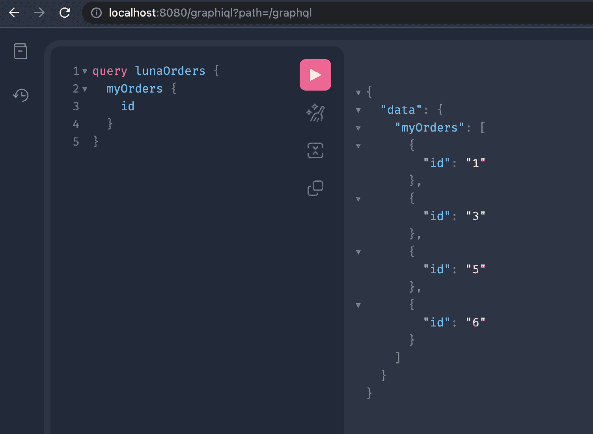

Luna 的订单

如果我们尝试以 Luna 的身份删除订单，我们将得到一个 GraphQL 错误，告诉我们没有权限，如截图“Luna is unauthorized to delete orders”所示。

```graphql
mutation lunaUnauthorized {
    deleteOrder(input: {orderId: 1}) {
        success
    }
}
```

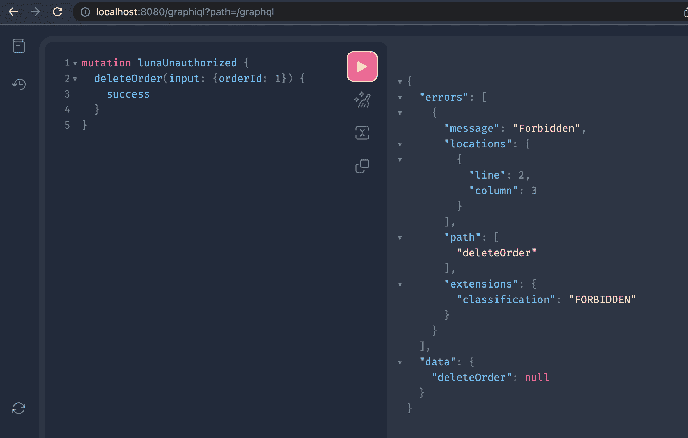

Luna is unauthorized to delete orders

在我们通过`/logout`退出并以“Andi”身份登录（密码为“password”）后，我们就可以删除订单。

需要注意的是，使用已登录用户进行未授权删除订单的操作**不会**导致 HTTP 错误。HTTP 响应的状态码为`200`，其中包含一个 GraphQL 错误。

## Spring for GraphQL 对安全的支持

在存储订单的示例中，我们看到了 Spring for GraphQL 支持 Spring Security 的一个特性：我们可以将`java.security.Principal`声明为注解方法的输入（这包括`@BatchMapping`）。

Spring for GraphQL 自动注册一个`ReactiveSecurityDataFetcherExceptionResolver`（或 WebMVC 的`SecurityDataFetcherExceptionResolver`）来处理`AuthenticationException`和`AccessDeniedException`。`AuthenticationException`和`AccessDeniedException`分别导致错误类型为`UNAUTHORIZED`和`FORBIDDEN`的 GraphQL 错误。

## 方法安全

我们上面的存储订单示例中存在的一个问题是执行授权检查的位置。它们直接发生在每个 DataFetcher 内部。这并不好。更好且推荐的方法是保护`OrderService`本身，这样无论哪个 DataFetcher 使用它，它都是安全的。

Spring Security 提供了方法级注解以以声明的方式进行授权。由于 Spring for GraphQL 集成了 Spring Security，我们可以使用这些注解来重构`OrderService`。


```java
@PreAuthorize("hasRole('ADMIN')")
Mono<Boolean> deleteOrder(String orderId) {
  return Mono.just(orders.removeIf(order -> order.id().equals(orderId)));
}
```

为了让`PreAuthorize`在 WebFlux 服务中生效，带注解的方法必须返回`Mono`或`Flux`。因此，我们需要将返回值封装在`Mono`中。

我们还将`getOrdersByOwner`重构为`getOrdersForCurrentUser`，并使用`ReactiveSecurityContextHolder`来获取当前登录的用户。

```java
Mono<List<Order>> getOrdersForCurrentUser() {
  return ReactiveSecurityContextHolder.getContext()
    .map(securityContext -> {
      Principal principal = securityContext.getAuthentication();
      return orders
        .stream()
        .filter(order -> order.owner().equals(principal.getName()))
        .collect(Collectors.toList());
    });
}
```

我们需要将返回类型更改为`Mono`，因为`ReactiveSecurityContextHolder`本身是响应式的。最后，我们需要在`Config`类中添加`@EnableReactiveMethodSecurity`来启用这些注解。

整合以上内容，这里是`Config`、`Controller`和`OrderService`的完整源代码。

```java
package myservice.service;

import org.springframework.context.annotation.Bean;
import org.springframework.context.annotation.Configuration;
import org.springframework.security.config.annotation.method
  .configuration.EnableReactiveMethodSecurity;
import org.springframework.security.config.annotation.web
  .reactive.EnableWebFluxSecurity;
import org.springframework.security.config.web.server
  .ServerHttpSecurity;
import org.springframework.security.core.userdetails
  .MapReactiveUserDetailsService;
import org.springframework.security.core.userdetails.User;
import org.springframework.security.core.userdetails
  .UserDetails;
import org.springframework.security.web.server
  .SecurityWebFilterChain;
import org.springframework.security.web.server.authentication
  .RedirectServerAuthenticationSuccessHandler;

@Configuration
@EnableWebFluxSecurity
@EnableReactiveMethodSecurity
class Config {

  @Bean
  SecurityWebFilterChain springWebFilterChain(
    ServerHttpSecurity http
  ) throws Exception {
    http
      .formLogin()
      .authenticationSuccessHandler(
        new RedirectServerAuthenticationSuccessHandler("/graphiql")
      );

    return http
      .csrf(ServerHttpSecurity.CsrfSpec::disable)
      .authorizeExchange(exchanges -> {
        exchanges.anyExchange().authenticated();
      })
      .build();
  }

  @Bean
  @SuppressWarnings("deprecation")
  MapReactiveUserDetailsService userDetailsService() {
    User.UserBuilder userBuilder = User.withDefaultPasswordEncoder();
    UserDetails luna = userBuilder
      .username("Luna").password("password")
      .roles("USER").build();
    UserDetails andi = userBuilder
      .username("Andi").password("password")
      .roles("USER", "ADMIN").build();
    return new MapReactiveUserDetailsService(luna, andi);
  }
}
```

```java
package myservice.service;

import org.springframework.graphql.data.method.annotation
  .Argument;
import org.springframework.graphql.data.method.annotation
  .MutationMapping;
import org.springframework.graphql.data.method.annotation
  .QueryMapping;
import org.springframework.stereotype.Controller;
import reactor.core.publisher.Mono;

import java.util.List;

@Controller
record OrderController(OrderService orderService) {

  @QueryMapping
  Mono<List<Order>> myOrders() {
    return orderService.getOrdersForCurrentUser();
  }

  @MutationMapping
  Mono<DeleteOrderPayload> deleteOrder(
    @Argument DeleteOrderInput input) {
    Mono<Boolean> booleanMono = orderService
      .deleteOrder(input.orderId());
    return booleanMono.map(DeleteOrderPayload::new);
  }

}
```

```java
package myservice.service;

import org.springframework.security.access.prepost.PreAuthorize;
import org.springframework.security.core.context
  .ReactiveSecurityContextHolder;
import org.springframework.stereotype.Service;
import reactor.core.publisher.Mono;
import java.security.Principal;
import java.util.ArrayList;
import java.util.List;
import java.util.stream.Collectors;

@Service
class OrderService {
  private final List<Order> orders;

  OrderService() {
    // 可变订单列表
    this.orders = new ArrayList<>(List.of(
      Order("1", "Kibbles", "Luna"),
      Order("2", "Skipper"),
      Order("3", "Rice", "Luna"),
      Order("4", "Skipper"),
      Order("5", "Bone", "Luna"),
      Order("6", "Toys", "Luna"),
      Order("7", "Skipper")
    ));
  }
  
  Mono<List<Order>> getOrdersForCurrentUser() {
    return ReactiveSecurityContextHolder.getContext()
      .map(securityContext -> {
        Principal principal = securityContext.getAuthentication();
        return orders
          .stream()
          .filter(order -> order.owner().equals(principal.getName()))
          .collect(Collectors.toList());
      });
  }

  @PreAuthorize("hasRole('ADMIN')")
  Mono<Boolean> deleteOrder(String orderId) {
    return Mono.just(orders
      .removeIf(order -> order.id().equals(orderId)));
  }
}
```

注意，所有的授权逻辑现在都包含在`OrderService`中。

除了`@PreAuthorize`，Spring Security 还提供了`@PostAuthorize`、`@PreFilter`和`@PostFilter`用于在方法调用前后执行授权。

## 测试认证

关于测试的介绍，请参阅关于测试的上一章节。

让我们来编写端到端认证测试。从最简单的测试开始并建立良好的基准，让我们验证我们是否会拒绝未身份验证的请求。

```java
package myservice.service;

import org.junit.jupiter.api.Test;
import org.springframework.beans.factory.annotation.Autowired;
import org.springframework.boot.test.autoconfigure.web.reactive
  .AutoConfigureWebTestClient;
import org.springframework.boot.test.context.SpringBootTest;
import org.springframework.http.HttpStatus;
import org.springframework.http.MediaType;
import org.springframework.test.web.reactive.server
  .WebTestClient;

import java.util.Map;

@SpringBootTest(
    webEnvironment = SpringBootTest.WebEnvironment.RANDOM_PORT)
@AutoConfigureWebTestClient
class AuthE2ETest {

  @Autowired
  WebTestClient webTestClient;

  @Test
  void shouldRejectUnauthenticated() {
    String document = "query orders { myOrders { id } }";
    Map<String, String> body = Map.of("query", document);
    webTestClient
      .mutateWith(
        (builder, httpHandlerBuilder, connector) 
                -> builder.baseUrl("/graphql"))
      .post()
      .contentType(MediaType.APPLICATION_JSON)
      .accept(MediaType.APPLICATION_JSON)
      .bodyValue(body)
      .exchange()
      .expectStatus().isEqualTo(HttpStatus.FOUND);
  }
}
```

在此端到端测试中，我们拒绝了一个带有`302 Found`结果的 GraphQL 请求，并重定向到另一个页面（登录页面）。根据服务的不同，我们可以断言另一个 HTTP 状态码，例如`401 Unauthorized`。

如果你只想测试 GraphQL 层，而不是整个服务的端到端测试，可以使用`WebGraphQlTester`。

让我们测试我们是否为已身份验证的用户返回了正确的订单。


```java
package myservice.service;

import org.junit.jupiter.api.Test;
import org.springframework.beans.factory.annotation.Autowired;
import org.springframework.boot.test.context.SpringBootTest;
import org.springframework.context.annotation.Import;
import org.springframework.graphql.server.WebGraphQlHandler;
import org.springframework.graphql.server.WebGraphQlInterceptor;
import org.springframework.graphql.server.WebGraphQlRequest;
import org.springframework.graphql.server.WebGraphQlResponse;
import org.springframework.graphql.test.tester.WebGraphQlTester;
import org.springframework.security.authentication.UsernamePasswordAuthenticationToken;
import org.springframework.security.core.authority.SimpleGrantedAuthority;
import org.springframework.security.core.context.ReactiveSecurityContextHolder;
import org.springframework.security.core.context.SecurityContext;
import org.springframework.security.core.context.SecurityContextHolder;
import org.springframework.stereotype.Component;
import reactor.core.publisher.Mono;

import java.util.List;

@SpringBootTest(webEnvironment = SpringBootTest.WebEnvironment.MOCK)
@Import(WebGraphQlTest.WebInterceptor.class)
class WebGraphQlTest {

  @Autowired
  WebGraphQlHandler webGraphQlHandler;

  @Component
  static class WebInterceptor implements WebGraphQlInterceptor {

    @Override
    public Mono<WebGraphQlResponse> intercept(WebGraphQlRequest request, Chain chain) {
      UsernamePasswordAuthenticationToken authenticated =
        UsernamePasswordAuthenticationToken.authenticated(
          "Luna", "password",
          List.of(new SimpleGrantedAuthority("ROLE_USER")));
      SecurityContext context = SecurityContextHolder.getContext();
      context.setAuthentication(authenticated);
      return chain
        .next(request)
        .contextWrite(
          ReactiveSecurityContextHolder.withSecurityContext(Mono.just(context)));
    }

    @Test
    void testCorrectOrdersAreReturned() {
      WebGraphQlTester webGraphQlTester
        = WebGraphQlTester.create(webGraphQlHandler);
      String document = "query orders { myOrders { id }";
      webGraphQlTester.document(document)
        .execute()
        .errors()
        .verify()
        .path("myOrders[*].id")
        .entityList(String.class)
        .isEqualTo(List.of("1", "3", "5", "6"));
      // Luna's orders previously defined in OrderService
    }
}
```

我们注册了一个新的`WebInterceptor`并创建了已身份验证的用户，因为 Spring Security 依赖于`SecurityContext`，而它本身存储在 Reactor 上下文中。在测试本身中，我们验证了没有返回错误，然后检查响应中的订单 ID。这些订单 ID 之前在`OrderService`中定义。

在同一个类中，我们还可以测试未授权的用户是否无法删除订单。

```java
  @Test
  void testMutationForbidden() {
    WebGraphQlTester webGraphQlTester
      = WebGraphQlTester.create(webGraphQlHandler);
    String document = """
 mutation delete($id:ID){
 deleteOrder(input:{orderId:$id}){success}}""";
    webGraphQlTester.document(document)
      .variable("id", "1")
      .execute()
      .errors()
      .expect(responseError ->
        responseError.getMessage().equals("Forbidden") &&
          responseError.getPath().equals("deleteOrder")).verify();
  }
```

注意此测试验证的是 GraphQL 错误，而不是 HTTP 状态码，因为整个 HTTP 响应是`200`。我们验证了消息和路径是否符合我们的预期。

在本章中我们涵盖了如何利用 Spring for GraphQL 有用的 Spring Security 集成来保护 GraphQL 服务。

# Java 客户端

Spring for GraphQL 自带了一个客户端`GraphQlClient`，用于通过 HTTP 或 WebSocket 发送 GraphQL 请求。

`HttpGraphQlClient`用于查询和变变，通过 HTTP 执行 GraphQL 请求。`WebSocketGraphQlClient`用于订阅，通过共享的 WebSocket 连接执行 GraphQL 请求。

我们与基础 Java 接口`GraphQlClient`交互。我们使用`HttpGraphQlClient`和`WebSocketGraphQlClient`创建实现`GraphQlClient`接口的特定实例。这种设计与我们之前在测试章节中讨论过的`GraphQlTester`类似。

## HTTP 客户端

HTTP GraphQL 客户端基本上是`WebClient`的封装，因此在创建`HttpGraphQlClient`时我们需要提供一个`WebClient`。

```java
package myservice.service;

import org.springframework.graphql.client.HttpGraphQlClient;
import org.springframework.web.reactive.function.client.WebClient;

WebClient webClient = ... ;
HttpGraphQlClient graphQlClient = HttpGraphQlClient.create(webClient);
```

使用构建器方法，我们可以提供特定的 HTTP 设置，例如构建时的头。

```java
HttpGraphQlClient graphQlClient = HttpGraphQlClient
  .builder(webClient)
  .header("Special-Header", "true")
  .build();
```

或者

```java
HttpGraphQlClient graphQlClient = HttpGraphQlClient
  .builder(webClient)
  .headers(httpHeaders -> httpHeaders.setBearerAuth("token"))
  .build();
```

我们还可以提供其他设置，如`url`。

```java
HttpGraphQlClient graphQlClient = HttpGraphQlClient
  .builder(webClient)
  .url("/public/graphql")
  .build();
```

一旦创建，我们就无法更改任何这些客户端设置。对于不同的设置，我们需要变异客户端并再次使用构建器方法。

```java
HttpGraphQlClient newClient = graphQlClient
  .mutate()
  .header("Another-Header", "false")
  .build();
```

## WebSocket 客户端

`WebSocketGraphQlClient`底使用`WebSocketClient`。在创建新的`WebSocketGraphQlClient`时，我们需要提供一个`WebSocketClient`。注意`WebSocketClient`是一个抽象，提供了 Reactor Netty、Tomcat [以及其他](https://docs.spring.org/spring-framework/docs/current/reference/html/web-reactive.html#webflux-websocket-client) 的实现。

这是一个使用基于 Netty 实现的示例。

```java
import org.springframework.graphql.client.WebSocketGraphQlClient;
import org.springframework.web.reactive.socket.client.ReactorNettyWebSocketClient;
import org.springframework.web.reactive.socket.client.WebSocketClient;

String url = "http://localhost:8080/graphql";
WebSocketClient client = new ReactorNettyWebSocketClient();
WebSocketGraphQlClient graphQlClient = WebSocketGraphQlClient
  .builder(url, client)
  .build();
```

注意，在 WebSocket 客户端中，我们通过构建`builder(url, client)`提供 URL，而在 HTTP 客户端中，它是通过构建`url`设置的。

一旦创建，我们就无法更改任何 WebSocket 客户端设置。对于不同的设置，我们需要变异客户端并再次使用构建方法。

```java
WebSocketGraphQlClient newClient = graphQlClient
  .mutate()
  .url("https://my-new-url")
  .build();
```

## GraphQlClient

在创建 HTTP 或 WebSocket 客户端实例后，我们才能使用`GraphQlClient`。在以下示例中，`graphQlClient`可以是 HTTP 客户端，也可以是 WebSocket 客户端。

使用`document`或`documentName`来定义请求操作，然后我们可以`retrieve`响应的特定部分。注意，这在设计上与`GraphQlTester`相似。

```java
Mono<List<Pet>> pets = graphQlClient
  .document("query petNames {pets{name}}")
  .retrieve("pets")
  .toEntityList(Pet.class);
```

如果我们有订阅请求，我们使用`retrieveSubscription`来获取`Flux`而不是`Mono`。

```java
Flux<Pet> pets = graphQlClient
  .document("subscription newPetNames {newPet{name}}")
  .retrieveSubscription("newPet")
  .toEntity(Pet.class);
```

作为`retrieve`的替代方案，可以使用`execute`和`executeSubscription`分别返回`Mono<ClientGraphQlResponse>`或`Flux<ClientGraphQlResponse>`。`ClientGraphQlResponse`允许访问完整的 GraphQL 响应，包括 GraphQL 错误。

```java
Mono<List<Pet>> pets = graphQlClient
  .document("query {pets{name}}")
  .execute()
  .map(response -> {
    List<ResponseError> errors = response.getErrors();
    // 您的额外代码
  });
```

在本章中，我们涵盖了 Spring for GraphQL 内置的`GraphQlClient`，用于通过 HTTP 或 WebSocket 发送 GraphQL 请求。
