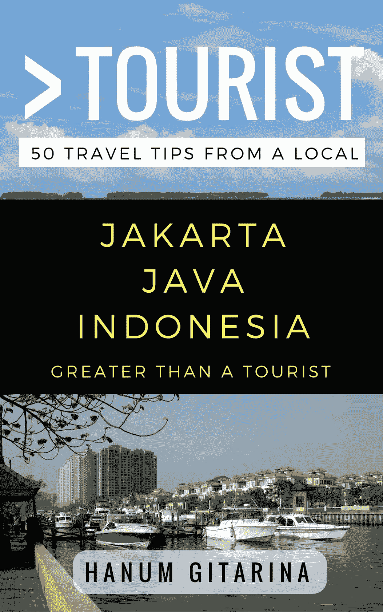

# 不只是游客：雅加达、爪哇岛、印尼西亚

> 游客

## 献辞

本书献给所有渴望探索印度尼西亚的旅行者和常驻游客。我也将这本书献给我的小天使，Faith 和 Mikayla，她们很快就会成为我的旅行伴侣。

## 书评

你对计划下一次旅行感到兴奋吗？

你想在旅行时尝试一些新奇物吗？

你想获得当地人的指导吗？

如果你对这些问题中的任何一个回答了“是”，那么这本书就是为你准备的。

由 Hanum Gitarina 编写《不止是游客 – 雅加达，爪哇，印度尼西亚》提供了关于雅加达的内部视角。大多数旅游书教你如何像游客一样旅行。虽然这也没有错，但作为“不止是游客”系列的一部分，这本书将为你提供来自住在你下一次旅行目的地的人的建议和大量创意。

在这些页面中，你将发现可以帮助你度过行程的当地建议。“不止是游客”是一系列由当地人撰写的旅游丛书。

像当地人一样旅行。获取内部信息。慢下来，留在一个地方，花点时间，去了解一个地方的人和文化。在指导下尝试一些避开人流的小众路线。旅行时光顾当地企业和商贩。愿意尝试新事物，获得一生只有一次的旅行体验。

当你读完这本书时，你将对去下一个目的地旅行感到兴奋。

所以，今天就入手你的那本书吧。你会庆幸这么做的。

## 欢迎来到 > 游客

## 热门地标

作为印度尼西亚最老的城市之一，雅加达拥有许多成为这座首都标志的地标。

### 1. Kota Tua（老城区）

在印度尼西亚仍被殖民的古代，雅加达被称为巴达达。现在，过去的一些伟大建筑仍当地政府完好保存，其中包括博物馆和历史建筑。雅加达有一个名为 Kota Tua 的区域，那里有很多老建筑。当我们访问这里时，感觉就像回到了 17 世纪。当你看到穿着古装的人骑着旧自行车在老城区穿行，或者女性穿着长袍拿着 17 世纪风格的伞，不要感到惊讶。你可以发现很多人租用那些古服和道具，以保持这个地区的古代氛围。对于历史和摄影爱好者来说，这里绝对是一个值得去的地方。

### 2. 皮影博物馆（印度尼西亚传统皮影戏博物馆）

哇扬（Wayang）是印度尼传统的皮影戏。动物皮皮（通常是牛皮）被用来制作各种角色。这些角色由精选工匠手工精心制作，细节精美。这些角色通常反映了平民、当局阶层以及超自然生物的生活。由于一个哇扬皮影偶的价格非常昂贵，并非所有人都能负担得起。此外，制作一场演出还需要大量的资金，因为演出包含一名皮影戏师和一支由大量传统歌手（sinden）和甘美兰演奏者（一套爪哇传统音乐乐器）组成的庞大团队。因此，哇扬表演通常只在特殊场合举行。为了让人们（尤其是年轻人和游客）有更多机会享受这一奇妙的文化传统，当地建立了哇扬博物馆，这样人们就可以随时观察到哇扬的发展，并领略到那些幽默爆笑的表演。

### 3. 国家纪念碑 (Monas)

Monas 是国家博物馆（Museum Nasional）的缩写。它是雅加达的标志性地。基本上，Monas 是一座高 132 米（433 英尺）的塔，是为了纪念印度尼的独立而建造的。纪念碑的设计蕴含着深远的哲学意义，象征着“生命的平衡”。纪念碑由意大利大理石制成，顶部覆盖着 24 卡拉黄金。在参观这座标志性纪念碑之前，不要说你已经去过雅加达了。

### 4. 雅加达艺术剧院 (Gedung Kesenian Jakarta)

这里是许多印度尼艺术家聚会进行表演或讨论艺术的地方。它象征着印度尼文化的丰富，自殖民时代起就吸引了人们的关注。这里全年举办各种表演和活动。活动日程通常可以在雅加达官方网站、雅加达艺术剧院官方网站及社交媒体，以及纸质媒体上找到。

### 5. 安谷艺术市场 (Pasar Seni Ancol)

在我看来，安谷（Ancol）是雅加达最值得去的地方之一，因为这里提供了多样化的娱乐。其中之一就是安谷艺术市场。如果你真的热爱艺术或仅仅是一个艺术收藏家，你一定要去看看。你不仅在这里购买一些绘画或手工艺，还能看到艺术家创作他们的杰作。那里有一些陈展艺术品的画廊。除了阴凉的绿色环境外，咖啡馆和商店也是你可以享受的设施。

### 6. 印度尼共和国国家博物馆 (Museum Nasional Republik Indonesia)

雅加达有很多博物馆。博物馆的存在表明雅加达政府及其人民高度重视形成这个国家的历史。这座博物馆的许多藏品来自印度尼全国的各个地区和省份。我个人将这座博物馆称为“微缩版的印度尼”。只有通过参观这间博物馆，你才能见证印度尼文化和传统的丰富性。博物馆还展示了这个共和国的历史，因此它是了解印度尼的最佳地点。除了展列藏品外，博物馆在全年还会举办其他活动。你还可以在这个博物馆中举办自己的展览。

### 7. 法塔希拉博物馆 (Fatahilah Museum)

如果说印度尼国家博物馆展示的是印度尼的藏品和历史，那么法塔希拉博物馆则专注于雅加达的历史。它位于雅加达的老城区。你可以见证雅加达自从过去如何因其商业和贸易的战略位置而吸引世界的目光。古代复制品、陶瓷、文物、铭文、壁画和重要文件都安全地保存在这个博物馆中。

### 8. 皮图之屋 (Rumah Si Pitung)

Si Pitung 是雅加达人的英雄。他就像是雅加达版的罗宾汉德，一个反对荷兰殖民统治政权并通过抢劫富人来帮助贫穷当地人的人。为了纪念他，雅加达人建造了这座博物馆，这里最初是被 Si Pitung 抢过的富人的房子。

### 9. 纺织博物馆 (Textile Museum)

作为一个拥有数千个岛屿和民族的国家，纺织已成为印度尼社会的一个重要方面。印度尼的每个民族都有许多亚族；而每个亚族都有许多不同版本的传统纺织品。因此，你可以想象印度尼图案和织物的变体是数不胜数的。印度尼纺织品现在因其独特的图案、材料和制作方法吸引了国际关注。虽然在这个博物馆中展出的展品很少（因为印度尼的几个省份和城市也有自己的博物馆），但已足够看到印度尼纺织品的多样性。

### 10. 雅加达天文馆和观测台

这座天文馆和观测台是伊斯梅尔·马尔祖基公园（Taman Ismail Marzuki）的一部分，该公园也是雅加达的展览和表演中心。它是印度尼其他三座天文馆中最老老的。在这里，有观测厅、展厅、教室和望远镜。这里还有 9 部每部时长 60 分钟的电影，供游客学习天文知识。

“世界是一本书，而不去旅行的人只读了其中一页。” – 圣奥古斯丁

## 游乐园和动物园

作为世界上人口最密集的城市之一，娱乐对于其居民来说至关重要。在雅加达，有很多专门为休闲和教育而建造的主题乐园。其中一些是：

### 11. 安谷雅达梦想游乐园或奇幻世界 (Taman Impian Jaya Ancol or Dunia Fantasi / 雅达安谷游乐公园，又称安谷奇幻乐园)

你可以把它看作是印度尼版的环球影城或迪士尼。在这个奇幻世界里，你可以通过许多许多探险游戏和游乐设施来挑战自我，比如水上游戏、巨轮或过山车。园区内还建造了一些主题乐园，包括 Hello Kitty 奇幻冒险、冰川时代极地探险、快乐脚丫仔冒险、星球大战冒险等。安谷海滩沿线还有价格各异的住宿设施。总之，这个地方最适合家庭休闲。

### 12. 印度尼微缩公园 (Taman Mini Indonesia Indah)

如果你没有时间走遍印度尼群岛，你应该去这里看看。它是一个以文化为基础的公园，在这里你可以见证印度尼所有省份的多样性。传统的房屋、服装、织物、武器、舞蹈、乐器、食物、工具、植物、动物等都汇聚在此处。你需要良好的体力才能探索整个地方，因为它非常大。尽管有观光大巴、观光汽车、空中缆、游乐火车、单轨列和自行车，但非常建议步行来近距离体验真实的印度尼文化。

### 13. 海洋生态公园 (Ocean Ecopark)

海洋生态公园也位于安谷。在这里，你可以进行许多户外活动，如生态游船或生态骑、拓展活动、玩彩弹射击、参观能量屋和蜂巢、划船、体验生态市场以及参加农场课程。这个地方非常适合儿童，因为他们在这里可以学到很多东西。对于大都市的居民来说，这里是一个极好的野餐地点。

它是雅加达的一个免费旅游胜地。通常情况下，人们聚集在这里逃离大都市的喧嚣。年轻人喜欢在每个周末和周日早晨聚在这里，进行跑步运动或和朋友聊天。如果你想和真正的印度尼人交流，就来这里开启对话吧。如果你恰好遇到愿意教你几句的人，你还可以免费练习印尼语。

### 16. 拉古农南动物园 (Ragunan Zoo)

这座动物园收藏了许多印尼动物。部分收藏品种是濒危动物，例如红猩猩、苏门答腊虎、灰头海雕、里安雕、鸋类等。在这里，你还可以参观灵长类中心、反思公园和儿童动物园。这里提供骑大象、动物表演、骑骆驼和骑马等景点。当你访问雅加达时，这里是一个非常棒的去处。

### 17. 雅加达水上乐园和芝加朗水上乐

在雅加达炎热的热带气候下，水上运动总是让自己保持凉爽的最佳选择。在雅加达，有很多游泳池和水上娱乐区可以游。最著名的两个是雅加达水上乐园 (Waterbom Jakarta) 和芝加朗水上乐 (Water Boom Cikarang)。这两个地方都为你提供了许多水上运动项目，如水滑、泳池和巨型水桶。

### 18. 乐城 (Kidzania)

我可以告诉你，这是这座城市最好的教育公园。在这里，孩子们可以学习各种职业并体验它们。孩子们将学习如何在真实的工作环境中执行特定的工作。之后，他们将获得一小笔报酬，并决定用这些钱购买什么。这是一个向孩子们介绍真实社会的绝佳场所。他们不仅会学习职业和管理，还会学习社会生活，并在其中必须建立人脉和良好的团队合作。

## 节日与庆典

### 19. 雅加达国际爵士节 (Jakarta International Jazz Festival)

这是印尼的一届年度爵士活动，通常在 11 月底或 12 月初在雅加达连续举办三天。该活动创于 1988 年，从那时起就迷住了印尼的爵士爱好者。除了邀请国内爵士音乐家外，该活动每年还会呈现国际爵士艺术家。场馆设有几个舞台，你可以选择观看谁在台上表演。

### 20. 爪哇爵士节 (Java Jazz Festival)

爪哇爵士节是世界上最大的年度国际爵士节之一，绝对是东南亚最大的。每年有数百位当地和国际爵士艺术家表演，不仅为了娱乐雅加达和印尼的人们，也面向全世界。这个爵士节的伟大之处在于许多爵士流派之外的艺术家到来并表演，例如 Craig David、Jassie J、Jason Mraz、Brian McKnight、Babyface、Santana 等等。爵士音乐行业的大牌人物包括 Incognito、James Brown、Jamie Cullum，甚至甚至 Herbie Hancock 都曾在这一盛事中表演过。若想体验这一切，你应该在 3 月初访问雅加达。

“在一个陌生的城市里独自醒来，是世界上最愉悦的感受之一。” – 弗蕾雅·斯塔克 (Freya Stark)

### 21. 雅加达国际电影节 (Jakarta International Film Festival)

这一活动以 JiFFest 的昵称而更广受欢迎。举办此活动是为了表彰国内和国际电影产业。每年在 10 月到 12 月之间都会放映数百部高质量的电影。还会举办讨论会和工作坊，为电影制作人以及任何对电影制作感兴趣的人提供展示想法和创意的空间。在活动期间和之前还会举办一些比赛，以寻找电影制作领域的优秀人才。

### 22. 爪哇摇滚乐地 (Java Rockin’ Land)

我可能会雅加达是一座音乐之城。这座城市每年都会举办许多音乐节。这座永不眠的城市也成功举办了许多国际演唱会。其中之一就是爪哇摇滚乐地。这个摇滚节与爪哇爵士节由同一管理团队运营，因此表演质量非常出色。

### 23. 印尼独立日庆典

庆典活动每年在 8 月 17 日举行。按照传统，整个印尼各地都会举行“民俗活动”(pesta rakyat/folks parties)。人们会在活动当天前的几周就开始庆祝。每个社区都会举办许多体育活动、比赛和传统游戏，从儿童到老年人都会积极参与。其中最受欢迎的活动之一是“爬油树”(panjat pinang)，参与者必须爬上一棵涂满滑滑油的高椰子树，以获得顶部的丰厚礼物。如果你想体验这些民俗活动，你应该在 8 月访问雅加达。我打赌你可以很容易地与当地人建立更好的联系，因为会有许多有趣的活动可以享受，而且大多数人都会来庆祝。此外，独立日庆典期间还有数百场演唱会。人们可以观看各种风格的音乐表演，包括当地音乐流。演出汇聚了著名艺术家和音乐家，且大部分是免费的。

### 24. 老城节 (Festival Kota Tua)

雅加达的另一个年度活动是老城节。巴达维亚是雅加达过去的名称。因此在这个节日里，将展示许多与雅加达历史相关的内容。包括美食节、文化表演、创意产业展览以及集市。我喜欢这个节日的一点是地道的贝塔维 (Betawi) 菜，如 kerak telor（蛋米饼）和 nasi uduk（印尼椰奶饭配配菜），可以以实惠的价格轻松找到。这个节日通常是为了纪念雅加达的周年纪念。

### 25. 雅加达大减卖 (Jakarta Great Sale)

如果你是购物狂，你一定喜欢在 6 月至 7 月访问雅加达。数百家商场、购物中心和普通商店参与了这一活动，提供疯狂折扣（高达 70%）和午夜场。很棒的是，雅加达的许多在线商店也参与了这一活动。6 月和 7 月是人们可以在商场疯狂购物的月份，因为许多品牌商品以优惠价格出售。

### 26. 雅加达展会 (Jakarta Fair)

雅加达展会是为了纪念雅加达而举办的。通常活动在 6 月至 7 月举行，以集市、展览、美食游行、音乐会、夜市和游乐设施的形式呈现。你在这里体验文化和美食。如果你想更近地了解雅加达，你必须访问这里。

### 27. Pasar Baru 节

Pas Baru 是雅加达最古老的购物区之一。举办这个节日是为了吸引更多游客访问这个市场，因为雅加达购物场的建立减少了这类传统市场的游客。在通常六月举办的节日期间，你可以看到一些文化表演。虽然理念相似，但这个节日比雅加达展会更加质朴。然而，我认为举办这一活动的使命非常高尚。访问这个市场的一个大优势是，你可以找到许多由当地人传统制造的廉价商品，如衣服和鞋子。与雅加达展会类似，这一活动每年在 6 月至 7 月举行。

### 28. 肯曼节 (Festival Kemang)

这个节日基本上是印尼人的艺术和文化节，每年在雅加达沿肯曼街举行（是的，这个节日是在街道上举办的）。数百个展位齐列其彰，展示来自印尼各地人民的艺术作品和传统创作。你可以购买传统的民族配饰、手工艺品以及各种类型的印尼蜡染和传统服饰。这是一个让你只需通过几公里范围内的展位就能看到印尼面貌的地方。

### 29. Jaksa 街节

Jalan Jaksa 是一个深受外国游客欢迎的地方。它实际上是一条长 500 米的街道。这里为你提供价格非常合理的各种住宿选择。许多国际背包客都会访问并留在此地。地理位置非常优越，因为它位于雅加达的心地带。由于其受欢迎，雅加达人发起并在 Jalan Jaksa 举办了一场活动。其理念与雅加达览会类似，但规模较小。街道旁搭建了许多摊位，展示各种传统美食和物品。

### 30. 雅加达美食与时尚节

这是雅加达的另一个盛事，展示了最新的时尚趋势和最美味的美食。届时将会有由知名设计师举办的大型装秀。蜡染（Batik）和织锦是 JFFF 节中最具吸引力的系列之一。通常还会建造一个可以同时供数百人观看的露天电影院，让庆祝活动更加热闹。最终，你可以满足对时尚和食物的需求，这是印度尼西亚拥有的异域且无穷尽的组合。

“冒险是值得的。” – 伊索

## 千岛群岛 (Kepulauan Seribu) —— 大都市中的隐藏天堂

千岛群岛（Kepulauan Seribu）是大都市中的明珠。当人们了解到雅加达的交通拥堵和城市繁忙时，他们必须稍微移动才能到达那些纯净未受破坏的岛屿。千岛以其美丽和神秘而闻名。它们还提供了游泳、潜水和浮潜的绝佳去处。以下是一些岛屿：

### 31. Ayer 岛

Ayer 岛是千岛中最受欢迎的岛。它距离雅加达 Marina 码头只有 15-20 分钟车程。它为游客提供了最完整的设施。这里建造了具有自然概念的小屋。有些房间甚至建在水上，让游客可以随时感受海风。岛上依然自然洁净。这个岛长期以来一直被千岛的前国王作为避暑地。印度尼西亚的首任总统也因为其美丽和宁静将这里作为假期度假胜地。

### 32. 西 Pantara 岛和东 Pantara 岛

这两个岛屿都是保护岛，保留了千岛的许多动植物。这些岛屿的海洋生物种类多样，因此你也可以在这两个地方潜水和浮潜。这里有一家私人度假村，为任何喜欢接触自然的人提供充足的设施。该度假村的一个大特点是带有大玻璃窗的舒适小屋，让我们能够看到海景。

### 33. Bira 岛

Bira 是千岛群岛上的一座无人荒岛。该岛屿只有 500 平方米的实木区域。虽然它相对是一个很小的岛屿，但人们喜欢去那里潜水和浮潜。此外，白沙滩也是感到疲倦时放松的好去处。我还没去过那里，但一些去过的朋友说，在 Bira 你可以体验到小小的冒险，尤其是当你有足够的耐心等待一场极其美丽的日落时。

### 34. Bidadari 岛（仙女岛）

这个岛屿距离雅加达只有 15 公里（乘船约 20-30 分钟）。它是千岛中距离雅加达最近的岛屿。在这里，你可以进行一些有趣的水上运动和户外活动。你还可以在这里和海豚嬉戏。我最喜欢这里，因为它对儿童非常友好。那里还有一个名为 Martello 的古荷兰堡垒，那里是受欢迎的摄影点。

### 35. Tidung 岛

Tidung 岛分为两个，分别称为大 Tidung 岛和小 Tidung 岛。这两个岛相隔 1 公里，要到达另一个岛，有一座跨越清澈浅水的木桥，你可以在那里看到美丽的珊瑚和鱼类。人们喜爱这些岛是因为它们的天然海滩和美丽的水下景观。因此，浮潜是该岛上最好的活动。不仅如此，你还可以挑战自己从 8 米高的桥跳入海。尝试一下吧！小组一起做会有趣得多。

### 36. Kayangan 岛 / Cipir 岛

这个岛因为荷兰殖民时期留下的旧建筑而闻名。那里有堡垒遗迹、医院建筑和一些像大炮这样的旧武器。在岛上，我们还能找到一口古淡水井，据信它在那里已经存在几个世纪。那里还有旧桥的遗迹，曾连接该岛与其他附近的岛屿。你可以对这个岛进行简短游览，然后继续前往其他岛屿的旅行。

### 37. Onrust 岛

这个岛靠近 Kayangan 岛 / Cipir 岛。它与 Kayangan 具有几乎相同的特征。该岛的主要景点是它的遗迹。供你参考，这个岛是荷兰殖民者占领印度尼西亚并攻击巴达维（现在的雅加达）时访问的地方。因此，有很多证据表明这个岛对于殖民者具有多么战略意义。

### 38. Rambut 岛

在 3 月到 9 月间访问这里，因为你会发现超过 50,000 只从澳大利亚迁徙到这个岛的鸟类。Rambat 岛是一个鸟类保护区。游客有严格规定以保护鸟类。此外，该岛还以红树林闻名。红树林吸引了许多鸟在迁徙季节来到这里。当鸟类返回时，这里大约只有 20,000 只。要进入这里，你必须获得雅加达自然资源保护局的许可。

### 39. Putri 岛

当你带着家人，尤其是孩子时，这里是千岛最值得游的岛屿。你可以给孩子们带来难忘的经历，因为他们将学习许多关于自然的知识，特别是热带水下世界。你可以享受的景点包括水族馆、玻璃底船、日出、晨浮、美丽的度假村和美食。

### 40. Sepa 岛

人们称潜水者的天堂。当你到达这里时，迎接你的是美丽的沙滩和清澈的水。那里有带有有趣生物的珊瑚礁。即使你不是专业人士，也可以在这里浮潜。忘了带上你的水下相机。给你一个小建议，租船去潜点的价格很便宜。你也可以租船前往千岛的其他岛屿。

“生命要么是大胆的冒险，要么什么都不是。” – 海伦凯勒

### 41. Kotok 岛

在这个岛上，你可以找到雅加达市的标志动物——隼。政府已将这里变为鸟类保护区。该岛的特征与千岛的其他岛屿相似，例如清澈的水和自然环境。

### 42. Pelangi 岛

它是逃离日常生活的好地方。这里提供的所有住宿都面向大海，这样你在入住期间就能欣赏到美景。你可以去潜水、浮潜和钓鱼。该岛还有医疗设施和网球场。一个很棒的体验是浮动餐厅，它提供极佳的食物和景色。

### 43. Laki 岛

对于喜欢在自然中体验真实生活的人，你应该去看看 Laki 岛。这个岛为你提供露营和钓鱼体验。你还可以在氛围安静的海滩上晒日光。如果你不想在露营时对付蚊子，别忘记带驱蚊液。

### 44. Pramuka 岛

这里是千岛群岛（Kepulauan Seribu）一个完美的浮潜和潜水点。你不需要会游泳或购买昂贵的设备就能享受水下世界并与海洋生物互动。在普拉马卡岛（Pramuka Island），在导游的帮助下，你可以轻松地浮潜。该岛还是海龟的保护区。运气好的话，你可以观察海龟产蛋；运气更好的话，你可以帮助当地人释放小龟回到大海。

### 45. Semak Daun 섬

沙子洁白而柔软，景色美得令人惊叹。名字的由来是因为岛周围到处都是 semak daun（灌木）。这个岛不是有人居住的岛屿，因此没有任何酒店或餐厅。因此，这里是一个完美的露营地。这里没有淡水，但我们可以轻松从邻近的普拉马卡岛获取水。浮潜和潜水设备也可以在普拉马卡岛租赁。

## 其他景点

### 46. 夜生活与俱乐部

雅加达从不睡去。这里的氛围 24 小时都能被感受到。如果说早晨雅加达有很多人忙于生意，那么雅加达的夜生活就完全不同。你可以选择数百家提供各种不同主题和音乐的夜店。其中包括 Empirica、Immigrant、X2、Colosseum (1001)、Fable、Dragonfly、Stadium、Exodus 和 Golden Crown。至于酒吧，最棒包括 Lucy in the Sky、SKYE、Café Mondo、Umbra 和 Treehouse。很多人说雅加达酒吧和夜店的人群非常美丽友好，所以你可以很容易交到朋友。

### 47. 传统美食

我将为你挑选 5 种在雅加达时值得尝试的最佳美食。第一个是 Kerak Telor（煎蛋米饼）。在餐厅里很难找到 Kerak Telor。通常，在节日期间或街头小贩处你可以很容易找到这种食物。这是一种由鸡蛋、碎丝牛肉和其他配料制成的米饼。第二个是 Soto Betawi，这是一碗配有椰奶汤底、牛肉、番茄和土豆片的米饭。下一个是 Gado-Gado，外国人称之为印尼式沙拉。里面有煮土豆、胡萝卜、新鲜生菜、番茄、鸡蛋、印尼炸饼和其他配料，并配有花生酱。第四个选择是 Nasi Uduk。Nasi 是印尼语中米饭的意思。基本上，它是用椰奶和其他配料煮成的米饭，配有炒蛋、炸鸡、炸牛肉、炒土豆和花生酱。最后一个是 Nasi Ulam。这道菜灵感来自中国菜。米饭配有牛肉蛋烩、炒蛋、炸土泥、炸咸鱿、辣椒酱、花生、一些罗勒叶和炸饼。

### 48. 购物目的地

雅加达也是极佳的购物目的地。城市里有数百个购物场和购物区。在雅加达购物的最佳时间是雅加达展览会、大促销期间，因为市内到处都有大量的折扣商品。雅加达著名的购物场有 Mall Kelapa Gading、Grand Indonesia、Kota Kasablanka、Gandaria City 和 Central Park。另一方面，如果你想体验一个可以锻炼议价能力的更传统的购物区，可以尝试 Blok M、Pasar Baru、Pasar Mayesic、Pasar Grosir Cililitan 等地。

### 49. 市内最佳住宿

谈到住宿，雅加达有很多选择，从五星级酒店、国际连锁酒店到小型客栈和汽车旅馆。但我将特别讨论 Jaksa 街（Jalan Jaksa）。它因价格便宜而深受外国背包客的喜爱。这条长 400 米的街道还有许多设施，如餐厅（包括当地菜和西餐）、酒吧、票务处、超市等。游客（特别是外国人）喜欢住在这里，因为他们可以体验当地环境并与雅加达当地人良好融合。如果你和当地人成为朋友，可以轻松获得关于雅加达一些有趣地点的信息。

### 50. 交通技巧

由于雅加达以堵车而闻名，我向你提供一些实用的技巧和建议。首先，避免在早上 7 到 8 点之间出发，因为这些时间段的交通最拥堵。下午 4 到 6 点交通也很挤。所以，最好早出发或在 8 点之后出发，并在 6 点后返回酒店。下一个要考虑的是乘坐 bemo（三三轮摩托车）而不是出租车。虽然不舒服，但这种车辆在拥堵交通中的机动性比汽车好。而且，费用便宜得多。此外，考虑走城市周围的小巷。你可以找一些租摩托车的人（称为 ojek），通过最快的路线带你到达目的地。

> 游客

> 比游客更懂行的游客

请阅读其他《Greater than a Tourist》系列书籍。

加入 >Tourist 邮件列表：`http://eepurl.com/cxspyf`

Facebook:

`https://www.facebook.com/GreaterThanATourist`

请在 Amazon 和 Goodreads 上留下你对这本书的诚实评价。感谢。
