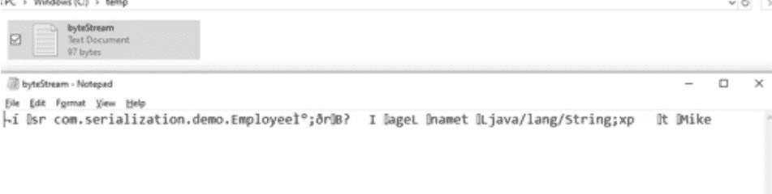

# 精通 Java 开发者面试：助你攻克 Java、Spring、SpringBoot 及 Hibernate 面试的 200 多道题

## 前言

《深度解析 Java 开发者面试》帮助你应对 Java、Spring 和 Hibernate 面试。

本书涵盖了 Java/Spring 主题的足够细节，绝对能帮助到初学者；如果你已经熟悉 Java 和 Spring，那么这本书将帮助你复习相关概念。

书中包含了 200 多道在 Java、Spring、SpringBoot 和 Hibernate 岗位面试中经常被问到的问题。多线程、集合框架、单例模式、SpringBoot 注解等许多重要主题都得到了详细介绍。这些主题中的大部分都通过代码示例进行了解释，将帮助你快速掌握概念。

## 这本书适合谁读？

如果你正在准备面试、计划未来进入该领域、正在复习 Java 和 Spring 技能，或者只是对该领域有一个深入的了解，这本书就适合你。本书提供了最重要且最常问的问题及其解决方案。

## 这本书不适合谁读？

如果你正在寻找深入研究 Java 或 Spring，那么这本书并不适合你。本书的目的不是讨论该行业中正在进行的研究或挑战，也不是作为课程书籍的替代品。

如果你勤心学习这本书，你将能够更好地应对任何 Java 面试。无论你是 Java 的初学者还是中级水平专家，这本书都能提供足够的内容。

书中包含大量的代码示例，大多数代码片段以图像格式显示，你可以进行放大或缩小。然而，如果某些图像在你的设备上显示不清晰，你也可以参考本书的 GitHub 仓库。该 GitHub 仓库包含了书中显示的所有代码片段，地址如下：

`https://github.com/reachjatin/Grokking-The-Java-Developer-Interview`

## 联系信息

我很乐意听到你的反馈。

如有反馈或疑问，可以通过以下邮箱联系我：

`jatinara208@gmail.com`

随时欢迎对改进本书提出宝贵建议。

祝你一切顺利，我坚信这本书将帮助你实现所寻找的职业转型。

学习愉快，加油！ :)

-Jatin Arora

## 致谢

感谢我的兄弟 Sumit Kumar 鼓励我承担这个项目。从阅读初稿到对我书的结构提供建议，再到确保写作方式既连贯、有组织又有吸引力，他在本书的制作过程中起了至关重要的作用。

详细介绍一下他的背景，Sumit 是芝加哥大学校友，目前在亚马逊西雅图担任 Alexa AI 的研究科学家。他曾在三星印度担任首席工程师。他还是一个活跃的博客作者，经常发布关于数据结构与算法、系统设计、自然语言处理（NLP）等许多有趣话题的文章。你可以在这里找到它们：

`https://medium.com/@sumit.arora`

`https://blog.reachsumit.com`

感谢 Sumit 耐心阅读本书的各个初步版本，并提供关键建议。感谢兄弟从未对我无数的反馈请求说“不”，并提供了所有的建设性批评。我将此书献给他。

我想向我的家人、朋友以及在此过程中激励我的每一个人表示诚挚的感谢。感谢支持、诚实的反馈以及其他帮助本书以目前形式面世的一切。

-Jatin Arora

问题 150: 如何在 SpringBoot 应用中进行性能分析（profiling）？

问题 151: 什么是 `RestTemplate`？

问题 152: 什么是 Spring Data JPA？

问题 153: `JPARepository`、`CRUDRepository`、`PagingAndSortingRepository` 之间的区别是什么？你在应用中使用哪一个？

问题 154: 什么是 Spring AOP？

问题 155: 你在应用中使用过 Spring Security 吗？

问题 156: 你对 Spring Batch 了解多少？

问题 157: SOAP 和 REST 的区别

问题 158: 什么是 Restful api？

问题 159: 什么是无状态对象（stateless object）？

问题 160: Web 服务器（Web Server）和应用程序（Application Server）的区别是什么？

问题 161: 你对 `CommandLineRunner` 和 `ApplicationRunner` 了解多少？

问题 162: 你对 Eureka Naming Server 了解多少？

问题 163: 你对 Zuul 了解多少？

问题 164: 你对 Zipkin 了解多少？

问题 165: 你对 Hystrix 了解多少？

问题 166: 什么是 JPA？

问题 167: 什么是 Hibernate？

问题 168: JPA 和 Hibernate 的区别

问题 169: `@Entity` 是什么？

问题 170: 如何在 JPA 中给表命名？

问题 171: `@Id`, `@GeneratedValue` 是什么？

问题 172: 如何在 Hibernate 中使用自定义数据库序列来生成主键值？

问题 173: 如何给 JPA Entity 的列命名？

问题 174: 如何在实体之间定义 `@OneToMany` 关系

问题 175: 为什么注解应该从 JPA 导入而不是 Hibernate？

问题 176: Hibernate Session 的 `get()` 和 `load()` 方法的区别？

问题 177: Hibernate Session 的 `save()`, `saveOrUpdate()` 和 `persist()` 方法的区别？

问题 178: Hibernate 中的 `Session` 和 `SessionFactory` 是什么？

问题 179: Hibernate 中的一级缓存和二级缓存是什么？

问题 180: Hibernate 中的 `session.flush()` 方法是什么？

问题 181: 我们如何看到 Hibernate 生成的 SQL 查询？

问题 182: 什么是 Hibernate Dialect（方言）？我们为什么需要配置它？

问题 183: 你对 Hibernate 中的 `hibernate.hbm2ddl.auto` 属性了解多少？

问题 184: 什么是 Maven？

问题 185: 什么是 `pom.xml`？

问题 186: 什么是本地仓库（local repo）和中央仓库（central repo）？

问题 187: 我们在哪里定义本地仓库路径？

问题 188: 在公司环境中，我们在哪里定义代理，以便 maven 能够从互联网下载 jar 包？

问题 189: 解释 Maven 构建生命周期

问题 190: 你对 SQL Joins 了解多少？

问题 191: `TRUNCATE` 和 `DELETE` 语句的区别

问题 192: 函数（Function）和存储过程（Stored Procedure）的区别

问题 193: 什么是 DDL、DML 语句？

问题 194: 如何在 Employee 表中找到第 n 高薪？

问题 195: SQL 中 `UNION` 和 `UNION ALL` 命令的区别

问题 196: SQL 中唯一键（Unique Key）和主键（Primary Key）的区别

问题 197: SQL 中主键（Primary key）和外键（Foreign key）的区别是什么？

问题 198: 聚集索引和非聚集索引的区别是什么？

问题 199: SQL 中 `WHERE` 和 `HAVING` 子句的区别

问题 200: 如何使用单个 `Update` 语句将性别列的值从男变为女，女变为男

问题 201: 找到数组中前三个最大的数

问题 202: 将所有负数移动到数组开头，所有正数移动到末尾

## 关于作者

## 问题 1: 面向对象的四大支柱是什么？

答案：OOPS 的四大支柱是：

1. 抽象 (Abstraction)
2. 封装 (Encapsulation)
3. 继承 (Inheritance)
4. 多态 (Polymorphism)

让我们来看一下：

1. 抽象：抽象是一个隐藏实现细节并仅向用户显示功能的过程。

现实世界中的例子：

- 电视遥控器：为了启动电视，你必须按下电源按钮，你不需要知道内部电路的操作，例如红外线是如何传递的。
- 汽车变速箱：我们知道切换挡位时会发生什么。但我们不知道换挡在引擎盖内部是如何工作的，这些信息与我们无关，因此它被抽象了。

在 Java 中，抽象可以通过两种方式实现：

- 抽象类（Abstract classes）
- 接口（Interfaces）

2. 封装：封装是将数据和方法绑定在类内部的。可以将其想象为通过访问控制修饰符（`public`, `private`, `protected`）来显示类的基本细节。因此，我们可以说封装实现了预期的抽象级别。

示例：

Java Bean，其中所有数据成员都被设为 `private`，并且你定义了特定的 `public` 方法供外部世界访问它们。

3. 继承：使用继承意味着在类之间定义父子关系，通过这样做，你可以重用已经在父类中定义的代码。代码重用是继承最大的优势。

Java 不允许通过类实现多继承，但它允许通过接口实现多继承。

4. 多态：Poly 意味着“多”，Morph 意味着“形式”。多态是一个对象或函数采取不同形式的过程。多态有 2 类：

- 编译时多态（方法重载）
- 运行期多态（方法重写）

在方法重载中，一个类中的两个或多个方法具有相同名称但参数不同。它被称为编译时多态，因为在编译时就已经决定了将调用哪个重载方法。

重写意味着当我们在父类和子类中具有相同名称和相同参数的方法时。通过重写，子类可以为已经在父类中定义的方法提供特定的实现。

## 问题 2: 什么是抽象类？

答案：使用 `abstract` 关键字声明的类被称为抽象类。它可以包含抽象方法（没有方法体的方法），也可以包含具体方法（带有方法体的方法）。

一些需要记住的几点：

- 抽象类不能被实例化，这意味着你不被创建抽象类的对象。这意味着，除非抽象类被其他类扩展，否则它没有用处。
- 如果一个类中有任何抽象方法，那么该类必须声明为抽象类。
- 继承自抽象类的第一个非抽象类必须提供抽象类中定义的抽象方法的实现。

示例：

```java
package com.tech;

abstract class MyAbstractClass {

    //abstract method
    abstract void print();

    //concrete method
    public void display() {
        System.out.println("In display method");
    }
}
```

```java
public class AbstractDemo extends MyAbstractClass {

    @Override
    void print() {
        System.out.println("In print method");
    }
    public static void main(String[] args) {
        AbstractDemo obj = new AbstractDemo();
        obj.print();
        obj.display();
    }
}
```

输出：

```
In print method
In display method
```

## 问题 3: 抽象类有构造函数吗？

答案：这是一个著名的面试问题，答案是：是的，抽象类有构造函数。你可以提供它，或者由 Java 提供默认的。现在，你可能在想，如果你不能创建抽象类的对象，那么构造函数的意义在哪里。

你必须知道的一点是，构造函数是在创建类对象时使用的，用于初始化该类的数据成员，你的抽象类也可以拥有数据成员。

现在，当你的类扩展抽象类时，同一个抽象类将成为你扩展类的父类，记住，当你的类有构造函数时，构造函数的第一行总是对父类构造函数的调用，这就是你的抽象类构造函数被调用的时刻。

示例 1：

```java
package com.tech;

abstract class MyAbstractClass {

    public MyAbstractClass() {
        System.out.println("inside MyAbstractClass constructor");
    }
}

public class AbstractDemo extends MyAbstractClass {

    public AbstractDemo() {
        System.out.println("inside AbstractDemo constructor");
    }

    public static void main(String[] args) {
        AbstractDemo obj = new AbstractDemo();
    }
}
```

输出：

```
inside MyAbstractClass constructor
inside AbstractDemo constructor
```

示例 2：

```java
package com.tech;

abstract class MyAbstractClass {

    public int a;
    public int b;

    public MyAbstractClass(int a, int b) {
        this.a = a;
        this.b = b;
    }

    public void print() {
        System.out.println("a = " + a);
        System.out.println("b = " + b);
    }
}

public class AbstractDemo extends MyAbstractClass {

    public AbstractDemo(int x, int y) {
        super(x, y);
    }

    public static void main(String[] args) {
        AbstractDemo obj = new AbstractDemo(5, 10);
        obj.print();
    }
}
```

输出：

```
a = 5
b = 10
```

## 问题 4: 什么是接口？

答案：

- Java 中的接口是类的蓝图。它有静态常量和抽象方法。
- 接口规定类必须做什么，而不是怎么做。
- 接口类似于一个由实现类实现的合同。
- 接口用于实现完全抽象。
- 接口中的所有方法默认都是 `public` 且抽象的，接口中声明的所有变量都是常量，即 `public`、`static` 和 `final`。
- 实现接口的类必须提供接口定义的所有方法的实现。
- 一个类可以实现多个接口，这就是 Java 允许多继承的方式。
- 从 Java 8 开始，我们可以在接口中拥有默认和静态方法。

## 问题 5: 抽象类和接口的区别

答案：区别在于：

- 抽象类可以同时包含抽象方法和具体方法，但接口只能包含抽象方法（Java 8 之后，它也可以拥有默认和静态方法）。
- 抽象类方法可以使用除 `public` 外的访问修饰符，但接口方法隐式是 `public` 且抽象。
- 抽象类可以拥有 `final`、`non-final`、`static` 和 `non-static` 变量，但接口变量只有 `static` 和 `final`。
- 子类只能扩展一个抽象类，但它可以实现多个接口。
- 抽象类可以扩展一个其他类并实现多个接口，但接口只能扩展其他接口。

在这个问题中，面试官可能会试图通过说从 Java 8 开始，你可以在接口中使用静态和默认方法来混淆你，那么现在抽象类和接口的区别是什么，你应该回答的答案是——我们仍然只能扩展一个类，但可以实现多个接口。

## 问题 6: 如何选择——接口还是抽象类

答案：考虑这些

在两者之间进行选择时需要考虑以下几点：

- 当你想为某些常用方法提供默认实现，以便子类可以直接使用时，你可以使用抽象类，因为它可以包含具体方法。接口（Interface）则并非如此，因为实现该接口的子类必须为接口中声明的所有方法提供实现。
- 如果你的合约（contract）不断变化，接口将会产生问题，因为你必须在所有实现类中提供这些新方法的实现；而在抽象类中，你可以为新方法提供默认实现，并且只需要修改那些真正会使用这些新方法的实现类。

大多数情况下，接口是一个很好的选择。当你基于接口编写代码时，这也是最佳实践之一。

## 问题 7：为什么 Java 8 引入了默认方法（default methods）？

答案：为了扩展已存在接口的功能，Java 8 引入了默认方法。让我们通过下面这个例子来理解：假设有 100 个类实现了同一个接口。现在你想在你的接口内部定义一个新方法。在这种情况下，你必须修改所有实现类以满足接口合约。因此，Java 引入了默认方法，在这里你可以在接口内部提供该新方法的默认实现，由于实现类并不强制提供默认方法的实现，所有 100 个类都可以使用默认实现，或者如果它们需要，可以通过重写默认方法来提供自己的实现。

现在考虑一个有趣的场景：你有两个接口 `Interface1` 和 `Interface2`，它们都拥有默认方法 `hello()`，并且有一个类实现了这两个接口，且没有给这个默认方法提供实现。你发现这里的问题了吗？是的，这就是著名的菱形问题（Diamond Problem）（如果你还不熟悉这个问题，请参阅问题 9）。


```java
interface Interface1 {
    default void hello() {
        System.out.println("Hello from Interface1");
    }
}
interface Interface2 {
    default void hello() {
        System.out.println("Hello from Interface2");
    }
}
public class Child implements Interface1, Interface2 {
}
```

所以，为了避免这个错误，必须为接口的公共默认方法提供实现。

```java
public class Child implements Interface1, Interface2 {
    @Override
    public void hello() {
        System.out.println("inside Child class hello method");
        Interface1.super.hello();
    }

    public static void main(String[] args) {
        Child obj = new Child();
        obj.hello();
    }
}
```

输出：

### inside Child class hello method

Hello from Interface1

## 问题 8：为什么 Java 8 引入了静态方法（static methods）？

答案：考虑这样一个例子，你想定义一个工具类（utility class），你通常会是定义一个包含静态方法的类，然后使用类名来调用这些方法。现在，从 Java 8 开始，你可以通过在接口内部只提供静态方法来完成相同的操作。这种使用接口来定义工具类的方法更好，因为它也有助于性能，因为使用类的开销比使用接口的开销更大。

## 问题 9：为什么 Java 不允许多重继承？

答案：当一个类有多个父类时，就会发生多重继承。

为什么 Java 不允许这样做：让我们假设有两个父类，它们拥有一个具有相同签名的名为 `hello()` 方法，并且有一个子类继承了这两个类。

如果你尝试继承超过一个类，你将得到一个编译时错误。

```java
class Parent1 {
    public void hello() {
        System.out.println("Hello from Parent1 class");
    }
}
class Parent2 {
    public void hello() {
        System.out.println("Hello from Parent2 class");
    }
}
public class Child extends Parent1, Parent2 {
}
```

- 错误 (1 项)

- 标记 "," 处缺少 expected

## 问题 10：重载（Overloading）和重写（Overriding）的规则是什么？

答案：重载规则：两个方法在满足以下条件时可以重载：

- 方法名相同

- 参数不同

重写规则：方法在满足以下条件时可以重写：

- 访问修符相同

- 返回类型相同

重写子类方法必须遵循以下规则：

- 方法名必须与父类相同

- 参数列表必须与父类相同

- 返回类型必须与父类相同或兼容

- 抛出受检查异常或运行时异常

- 不能有更严格的访问修符（如果父类方法是 public/protected）

## 问题 11：我们可以重写 final 方法吗？

答案：不可以，final 方法不能重写。

## 问题 12：构造函数和私有方法可以重写吗？

答案：不可以。

## 问题 13：什么是 final 关键字，它用在哪里？

答案：如果你使用 `final` 修饰变量，一旦赋值，其值就无法更改。如果你使用 `final` 修饰方法，则它无法被重写。如果你使用 `final` 修饰类，该类无法被继承。如果你使用 `final` 修饰对象，则该对象无法被重新引用。

## 问题 14：什么是异常（exception），异常处理？

答案：异常是中断程序正常流程的事件。它是在运行时抛出的对象，因此异常处理是一种维护程序正常流程的机制。

显示抛出异常的情况：

```java
public class Test {
    public static void main(String[] args) {
        System.out.println("Program Started");
        int a = 15/0;
        System.out.println("Program End");
    }
}
```

输出：

Program Started

Exception in thread "main" java.lang.ArithmeticException: / by zero at exception.Test.main(Test.java:6)

显示异常被处理的情况：

```java
public class TestException {
    public static void main(String[] args) {
        System.out.println("Program Started");
        try {
            int a = 15/0;
        } catch (ArithmeticException e) {
            System.out.println("Exception handled");
        }
        System.out.println("Program End");
    }
}
```

输出：

### Program Started

Exception handled

Program End

## 问题 15：错误（error）和异常（exception）的区别

答案：错误：程序中的错误是不可恢复的，它们表示应用程序发生了严重问题，发生错误时程序将终止，例如：内存不足：`OutOfMemoryError`，递归调用过多：`StackOverflowError` 等。

异常：另一方面，异常是我们可以通过妥当处理来恢复的内容，例如：从空对象访问属性/方法：`NullPointerException`，除以零：`ArithmeticException` 等。

## 问题 16：异常的类型类型？

答案：异常有两种类型：

- 检查异常（Checked Exceptions）：除 `RuntimeException` 和 `Error` 外的所有异常都称为检查异常。这些异常在编译时由编译器检查。例如，当你尝试从文件读取内容时，编译器会强制我们处理 `FileNotFoundException`，因为文件可能不存在。其他检查异常还有 `SQLException`、`IOException`。

```java
public class DemoException {
    public static void main(String[] args) {
        try {
            FileReader f = new FileReader("C:\\dummy.txt");
        } finally {
            System.out.println("Inside finally block");
        }
    }
}
```

- 错误 (1 项)

- 未处理的异常类型 FileNotFoundException

- 未检查异常（Unchecked Exceptions）：运行时异常（Runtime Exceptions）被称为未检查异常。编译器编译器不强制我们处理这些异常，但作为程序员，处理运行时异常是我们的责任，例如：`NullPointerException`、`ArithmeticException`、`ArrayOutOfBoundsException` 等。

## 问题 17：Java 中是如何处理异常的？

答案：使用 `try-catch` 块进行异常处理。如果你认为某些语句可能会抛出异常，请将它们放在 `try` 块中。

`try` 块后面总是跟着一个 `catch` 块或 `finally` 块或两者都有。

不能单独使用 `try` 块：

```java
public class DemoException {
    public static void main(String[] args) {
        try {
            FileReader f = new FileReader("C:\\temp\\dummy.txt");
        }
    }
}
```

- 错误 (1 项)

  -  插入 "Finally" 以完成 BlockStatements

## 问题 18：我们可以写不带 catch 块的 try 吗？

答案：是的，我们可以写带有 `finally` 的 `try` 块，但不能单独写 `try` 块。

## 问题 19：如何同时处理多个异常？

答案：你可以为每个异常连续编写多个 `catch` 块，或者使用管道符号 (|) 分隔异常来编写单个 `catch` 块。

在编写多个 `catch` 块时，你必须遵循以下规则：

处理最具体的异常，然后向下处理最通用的异常，这意味着你不能在处理 `FileNotFoundException` 之前处理 `Exception`（异常的基类）。

```java
public class DemoException {
    public static void main(String[] args) {
        try {
            FileReader f = new FileReader("C:\\temp\\dummy.txt");
        } catch (Exception e) {
            e.printStackTrace();
        } catch (FileNotFoundException e) {
            e.printStackTrace();
        } finally {
            System.out.println("Inside finally block");
        }
    }
}
```

- 错误 (1 项)

FileNotFoundException 的不可到达 catch 块。它已经被 Exception 的 catch 块处理了。

假设你的方法抛出了多个异常，并且你想根据抛出的异常执行某些特定操作，在这种情况下你应该使用多个 `catch` 块。

使用多个 `catch` 块的示例：

```java
public class DemoException {
    public static void main(String[] args) {
        try {
            FileReader f = new FileReader("C:\\temp\\dummy.txt");
        } catch (FileNotFoundException e) {
            System.out.println("Action when File is not found");
        } catch (NullPointerException e) {
            System.out.println("Action for NullPointerException");
        } catch (Exception e) {
            System.out.println("Action for exceptions other than " + "FileNotFoundException/NullPointerException");
        } finally {
            System.out.println("Inside finally block");
        }
    }
}
```

使用管道 `()` 符号时：

```java
public class DemoException {
    public static void main(String[] args) {
        try {
            FileReader f = new FileReader("C:\\temp\\dummy.txt");
        } catch (FileNotFoundException | NullPointerException e ) {
            System.out.println("Same action for both");
        } finally {
            System.out.println("Inside finally block");
        }
    }
}
```

## 问题 20：finally 块什么时候不会被执行？答案：

- 当调用 `System.exit()` 时

- 当 JVM 崩溃时

## 问题 21：throw 和 throws 关键字的区别。并讨论异常传播。答案：

- **throw** 是一个关键字，用于在程序中、函数内部或代码块内部显式地抛出异常，而 **throws** 是与方法签名一起使用的关键字，用于声明方法在执行代码时可能抛出的异常。

- `throw` 关键字后面跟着一个 `Exception` 类的实例，而 `throws` 后面跟的是异常类名。

- 你一次只能抛出一个异常，但可以使用 `throws` 关键字声明多个异常。

- 使用 `throw` 关键字时，只有运行时异常（unchecked exceptions）会传播，而使用 `throws` 关键字时，编译异常和运行时异常都可以传播。

# 异常传播：

异常首先从栈顶端抛出，如果未被捕获，就会向下传递。如果未被捕获，它会一直向上传递，直到被捕获，或者导致程序终止。

假设你的方法抛出了多个异常，并且你想根据抛出的异常执行某些特定操作，在这种情况下你应该使用多个 `catch` 块。

异常传播示例：

异常在未被 `catch` 块捕获，就会被 `catch` 块处理。如果异常没有被 `catch` 块捕获，它就会继续向上调用栈传递，直到被某个 `catch` 块捕获，或者导致程序终止。

假设你的方法抛出了多个异常，并且你想根据抛出的异常执行某些特定操作，在这种情况下你应该使用多个 `catch` 块。

使用多个 `catch` 块的示例：

```java
public class DemoException {
    public static void main(String[] args) {
        try {
            FileReader f = new FileReader("C:\\temp\\dummy.txt");
        } catch (FileNotFoundException e) {
            System.out.println("Action when File is not found");
        } catch (NullPointerException e) {
            System.out.println("Action for NullPointerException");
        } catch (Exception e) {
            System.out.println("Action for exceptions other than " + "FileNotFoundException/NullPointerException");
        } finally {
            System.out.println("Inside finally block");
        }
    }
}
```

使用管道 `()` 符号时：

```java
public class DemoException {
    public static void main(String[] args) {
        try {
            FileReader f = new FileReader("C:\\temp\\dummy.txt");
        } catch (FileNotFoundException | NullPointerException e ) {
            System.out.println("Same action for both");
        } finally {
            System.out.println("Inside finally block");
        }
    }
}
```

### 异常传播

异常在未被 `catch` 块捕获，就会被 `catch` 块处理。如果异常没有被 `catch` 块捕获，它就会继续向上调用栈传递，直到被某个 `catch` 块捕获，或者导致程序终止。

假设你的方法抛出了多个异常，并且你想根据抛出的异常执行某些特定操作，在这种情况下你应该使用多个 `catch` 块。

使用多个 `catch` 块的示例：


```java
public class DemoException {
    public static void main(String[] args) {
        try {
            FileReader f = new FileReader("C:\\temp\\dummy.txt");
        } catch (FileNotFoundException e) {
            System.out.println("Action when File is not found");
        } catch (NullPointerException e) {
            System.out.println("Action for NullPointerException");
        } catch (Exception e) {
            System.out.println("Action for exceptions other than " + "FileNotFoundException/NullPointerException");
        } finally {
            System.out.println("Inside finally block");
        }
    }
}
```

使用管道 `()` 符号时：

```java
public class DemoException {
    public static void main(String[] args) {
        try {
            FileReader f = new FileReader("C:\\temp\\dummy.txt");
        } catch (FileNotFoundException | NullPointerException e ) {
            System.out.println("Same action for both");
        } finally {
            System.out.println("Inside finally block");
        }
    }
}
```

### 异常传播

异常在未被 `catch` 块捕获，就会被 `catch` 块处理。如果异常没有被 `catch` 块捕获，它就会继续向上调用栈传递，直到被某个 `catch` 块捕获，或者导致程序终止。

假设你的方法抛出了多个异常，并且你想根据抛出的异常执行某些特定操作，在这种情况下你应该使用多个 `catch` 块。

使用多个 `catch` 块的示例：

```java
public class DemoException {
    public static void main(String[] args) {
        try {
            FileReader f = new FileReader("C:\\temp\\dummy.txt");
        } catch (FileNotFoundException e) {
            System.out.println("Action when File is not found");
        } catch (NullPointerException e) {
            System.out.println("Action for NullPointerException");
        } catch (Exception e) {
            System.out.println("Action for exceptions other than " + "FileNotFoundException/NullPointerException");
        } finally {
            System.out.println("Inside finally block");
        }
    }
}
```

使用管道 `()` 符号时：

```java
public class DemoException {
    public static void main(String[] args) {
        try {
            FileReader f = new FileReader("C:\\temp\\dummy.txt");
        } catch (FileNotFoundException | NullPointerException e ) {
            System.out.println("Same action for both");
        } finally {
            System.out.println("Inside finally block");
        }
    }
}
```

### 异常传播

异常在未被 `catch` 块捕获，就会被 `catch` 块处理。如果异常没有被 `catch` 块捕获，它就会继续向上调用栈传递，直到被某个 `catch` 块捕获，或者导致程序终止。

### 异常传播

（此处内容省略）

处理最具体的异常，然后向下处理最通用的异常，这意味着你不能在处理 `FileNotFoundException` 之前处理 `Exception`（异常的基类）。

```java
public class DemoException {
    public static void main(String[] args) {
        try {
            FileReader f = new FileReader("C:\\temp\\dummy.txt");
        } catch (Exception e) {
            e.printStackTrace();
        } catch (FileNotFoundException e) {
            e.printStackTrace();
        } finally {
            System.out.println("Inside finally block");
        }
    }
}
```

- 错误 (1 项)

`FileNotFoundException` 的不可到达 `catch` 块。它已经被 `Exception` 的 `catch` 块处理了。

假设你的方法抛出了多个异常，并且你想根据抛出的异常执行某些特定操作，在这种情况下你应该使用多个 `catch` 块。

使用多个 `catch` 块的示例：

```java
public class DemoException {
    public static void main(String[] args) {
        try {
            FileReader f = new FileReader("C:\\temp\\dummy.txt");
        } catch (FileNotFoundException e) {
            System.out.println("Action when File is not found");
        } catch (NullPointerException e) {
            System.out.println("Action for NullPointerException");
        } catch (Exception e) {
            System.out.println("Action for exceptions other than " + "FileNotFoundException/NullPointerException");
        } finally {
            System.out.println("Inside finally block");
        }
    }
}
```

使用管道 `()` 符号时：

```java
public class DemoException {
    public static void main(String[] args) {
        try {
            FileReader f = new FileReader("C:\\temp\\dummy.txt");
        } catch (FileNotFoundException | NullPointerException e ) {
            System.out.println("Same action for both");
        } finally {
            System.out.println("Inside finally block");
        }
    }
}
```

## 问题 20：`finally` 块什么时候不会被执行？答案：

- 当调用 `System.exit()` 时

- 当 JVM 崩溃时

## 问题 21：`throw` 和 `throws` 关键字的区别。并讨论异常传播。答案：

- `throw` 是一个关键字，用于在程序中、函数内部或代码块内部显式地抛出异常，而 `throws` 是与方法签名一起使用的关键字，用于声明方法在执行代码时可能抛出的异常。

- `throw` 关键字后面跟着一个 `Exception` 类的实例，而 `throws` 后面跟的是异常类名。

- 你一次只能抛出一个异常，但可以使用 `throws` 关键字声明多个异常。

- 使用 `throw` 关键字时，只有运行时异常（unchecked exceptions）会传播，而使用 `throws` 关键字时，编译异常和运行时异常都可以传播。

# 异常传播：

异常首先从栈顶端抛出。如果未被捕获，它就会向下传递。如果未被捕获，它就会一直向上调用栈传递，直到被某个 `catch` 块捕获，或者导致程序终止。

（注：原文部分内容存在大量重复，已按要求完成翻译并保留核心逻辑结构）

## 问题 22：方法重写时的异常处理的区别。答案：

- 如果父类方法没有声明异常，则子类重写方法不能声明编译异常，但可以声明运行时异常。

- 如果父类方法声明了异常，则子类重写方法 - 可以不声明异常 可以声明相同的异常 - 可以声明更窄的异常（不允许声明比父类更宽泛的异常）。

父类方法未声明异常而子类声明编译异常的示例：

```java
package com.exception;

import java.io.IOException;
class Parent {
    public void hello() {
        System.out.println("Parent class hello method");
    }
}
class Child extends Parent {
    public void hello() throws IOException{
        System.out.println("Child class hello method");
    }
}
```

- 错误 (1项)

- `IOException` 与 `Parent.hello()` 中的 `throw` 子句不兼容

父类方法未声明异常，而子类声明了未检查异常的示例：

```java
package com.exception;
class Parent {
    public void hello() {
        System.out.println("Parent class hello method");
    }
}
class Child extends Parent {
    public void hello() throws ArithmeticException{
        System.out.println("Child class hello method");
    }
}
```

```java
public class TestException {
    public static void main(String[] args) {
        Parent p = new Child();
        p.hello();
    }
}
```

输出：

### Child class hello method

子类重写方法抛出的异常比父类更宽的示例：

```java
package com.exception;
class Parent {
    public void hello() throws ArithmeticException {
        System.out.println("Parent class hello method");
    }
}
class Child extends Parent {
    public void hello() throws Exception {
        System.out.println("Child class hello method");
    }
}
```

错误 (1项)

- `Exception` 与 `Parent.hello()` 中的 `throws` 子句不兼容

子类重写方法抛出与父类相同异常的示例：

```java
package com.exception;

class Parent {
    public void hello() throws Exception {
        System.out.println("Parent class hello method");
    }
}
class Child extends Parent {
    public void hello() throws Exception {
        System.out.println("Child class hello method");
    }
}
public class TestException {
    public static void main(String[] args) {
        Parent p = new Child();
        try {
            p.hello();
        } catch (Exception e) {
            System.out.println("Handled");
        }
    }
}
```

输出：

### Child class hello method

子类重写方法声明比父类更窄的异常的示例：


```java
import java.io.IOException;

class Parent {
    public void hello() throws Exception {
        System.out.println("Parent class hello method");
    }
}
class Child extends Parent {
    public void hello() throws IOException {
        System.out.println("Child class hello method");
    }
}
public class TestException {
    public static void main(String[] args) {
        Parent p = new Child();
        try {
            p.hello();
        } catch (Exception e) {
            System.out.println("Handled");
        }
    }
}
```

输出：

### Child class hello method

父类方法声明了异常，而子类重写方法未声明任何异常的示例：

```java
package com.exception;
class Parent {
    public void hello() throws Exception {
        System.out.println("Parent class hello method");
    }
}
class Child extends Parent {
    public void hello() {
        System.out.println("Child class hello method");
    }
}
public class TestException {
    public static void main(String[] args) {
        Parent p = new Child();
        try {
            p.hello();
        } catch (Exception e) {
            System.out.println("Handled");
        }
    }
}
```

输出：

### Child class hello method

**问题 23：与异常处理和 `return` 关键字相关的程序。答案：这些问题经常问到新程序员。**

你应该记住的一点是，如果你在 `return` 语句/`throw` 异常语句之后编写任何内容，将导致导致“不可达代码”（Unreachable code）的编译错误。

### 程序 1：

```java
package com.exception;

class TestException {
    public static int method1() {
        try {
            throw ArithmeticException();
            return 1;
        } catch (Exception e) {
            return 2;
        } finally {
            return 3;
        }
    }

    public static void main(String[] args) {
        int result = method1();
        System.out.println(result);
    }
}
```

输出：

# 3

程序 2：`finally` 块始终会被执行

```java
package com.exception;

class TestException {
    public static int method1() {
        try {
            throw new Exception();
            return 1;
        } catch (Exception e) {
            return 2;
        } finally {
            return 3;
        }
    }

    public static void main(String[] args) {
        int result = method1();
        System.out.println(result);
    }
}
```

输出：

# 3

程序 3：`finally` 中的 `return` 具有优先级

```java
package com.exception;

class TestException {
    public static int method1() {
        try {
            throw new Exception();
            return 1;
        } catch (Exception e) {
            return 2;
        } finally {
            return 3;
        }
    }

    public static void main(String[] args) {
        int result = method1();
        System.out.println(result);
    }
}
```

输出：

# 3

程序 4：不可达代码

```java
package com.exception;

class TestException {
    public static int method1() {
        try {
            throw new Exception();
            return 1;
        } catch (Exception e) {
            return 2;
        } finally {
            //不可达代码
        }
    }

    public static void main(String[] args) {
        int result = method1();
        System.out.println(result);
    }
}
```

输出：

# 2

程序 5：解释 `try-with-resources`

```java
package com.exception;

import java.io.FileInputStream;

public class TestException {
    public static void main(String[] args) {
        try (FileInputStream fis = new FileInputStream("test.txt")) {
            // 使用 fis
        } catch (Exception e) {
            System.out.println(e.getMessage());
        }
    }
}
```

程序 6：`return` 语句之后的 `throw`

```java
package com.exception;

class TestException {
    public static int method1() {
        return 1;
        throw new Exception(); //不可达代码
    }

    public static void main(String[] args) {
        int result = method1();
        System.out.println(result);
    }
}
```

资源是一个在程序结束后必须关闭的对象。声明的资源必须实现 `AutoCloseable` 接口。

语法：

```
public static void main(String[] args) {
  try (FileReader reader = new FileReader("C:\temp\dummy.txt");{
    //program statements
  } catch (Exception e) {
    System.out.println(e.getMessage());
  }
}
```

## 问题 29：为什么 `String` 是不可变的？

答案：`String` 是不可变的，原因如下：

- **字符串池 (String Pool)**：只有当 Java 中的 `String` 是不可变的时，字符串池才可能。字符串池是 Java 堆中的一个特殊存储区域。如果字符串已经存在于池中，则不会创建新对象，而是返回旧对象的引用。这样，不同的 `String` 变量可以指向池中的同一个引用，从而节省了大量的堆空间。如果 `String` 是可变的，那么通过一个引用更改字符串将导致具有相同引用的其他 `String` 变量获得错误的值。

- **安全性**：`String` 参数用于网络连接、数据库 URL、用户名和密码等。由于 `String` 是不可变的，这些值无法被更改。否则，任何黑客都可以更改引用的值，这会导致应用程序出现严重的安全问题。

- **多线程**：由于 `String` 是不可变的，因此在多线程环境中是安全的。单个 `String` 实例可以在不同线程之间共享。这避免了为了线程安全而使用同步机制。`String` 是隐式线程安全的。

- **缓存**：字符串的 `hashcode` 在 Java 中被频繁使用。由于 `String` 是不可变的，`hashcode` 将保持不变，因此可以进行缓存而无需担心更改。这使其成为作为 `Map` 的 `Key` 的极佳选择。

- **类加载器 (Class Loaders)**：`String` 用于 Java 类加载器，由于 `String` 被设计为不可变，它提供了确保加载的是正确的类的安全性。

## 问题 30：`String` 类的 `equals()` 方法的作用是什么？

答案：众所周知，`Object` 类是所有类的父类，而 `Object` 类有一个 `equals()` 方法，它用于比较两个对象的引用，但 `String` 类重写了该方法，且 `String` 类的 `equals()` 方法比较的是两个字符串的内容。

程序：

```
public class Test {
    public static void main(String[] args) {
        String s1 = "Mark";
        String s2 = "John";
        String s3 = "Mark";

        System.out.println("s1.equals(s2): " + s1.equals(s2));
        System.out.println("s1.equals(s3): " + s1.equals(s3));
    }
}
```

输出：

### s1.equals(s2): false

`s1.equals(s3): true`

## 问题 31：解释 `StringBuffer` 和 `StringBuilder`

答案：`StringBuffer` 和 `StringBuilder` 类都用于字符串操作。它们都是可变对象。但 `StringBuffer` 提供了线程安全性，因为它的所有方法都是同步的（`synchronized`），这使得 `StringBuffer` 的性能比 `StringBuilder` 慢。

`StringBuilder` 类从 Java 1.0 就存在了，但由于其性能较慢，`StringBuilder` 类是在 Java 1.5 中引入的。

如果你处于单线程环境中或者不在乎线程安全，应该使用 `StringBuilder`。否则，请使用 `StringBuffer` 进行线程安全操作。

## 问题 32：解释下面程序与 `StringBuilder` 的 `equals()` 方法相关的输出

```
public class static Demo {
    public static void main(String[] args) {
        StringBuilder sb1 = new StringBuilder("hello");
        StringBuilder sb2 = new StringBuilder("hello");

        if(sb1.equals(sb2)) {
            System.out.println("Equal");
        } else {
            System.out.println("Not Equal");
        }
    }
}
```

输出：

### Not Equal

答案：这是另一个非常著名的面试题。如果你预期输出是“Equal”，那么你错了。输出不是“Equal”是因为 `StringBuffer` 和 `StringBuilder` 并没有重写 `equals` 和 `hashcode` 方法。在上面的程序中，调用的是 `Object` 类的 `equals()` 方法，由于它比较的是两个对象的引用，因此上述程序的输出是“Not Equal”。

由于 `hashcode` 被用于使用哈希算法的数据结构，例如 `HashMap`、`HashSet`、`HashTable`、`ConcurrentHashMap` 等，所有这些数据结构都要求键不能被更改，以便通过 `hashcode` 方法找到存储的值，但 `StringBuffer`/`StringBuilder` 是可变对象。这使得它们成为这一角色的非常糟糕的选择。

你一定听过 Java 中关于 `equals` 和 `hashcode` 的约定，该约定规定：如果两个对象根据 `equals()` 方法相等，那么它们的 `hashcode` 必须相同，反之则不然。现在，如果 `StringBuilder`/`StringBuffer` 重写了 `equals` 方法，那么它们对应的 `hashcode` 方法也需要重写以遵循该规则。但正如之前解释的，这些类不需要有自己的 `hashcode` 实现，因此它们的 `equals` 方法也是如此。

## 问题 33：何时使用 `String`/`StringBuilder`/`StringBuffer`

答案：如果你需要不可变性，应该使用 `String` 类；如果你需要可变性+线程安全，请使用 `StringBuffer`；如果你需要可变性且不需要线程安全，请使用 `StringBuilder`。

## 问题 34：解释 `equals` 和 `hashcode` 约定

答案：`equals` 和 `hashcode` 约定规定：

如果两个对象根据 `equals()` 方法相等，那么它们的 `hashcode` 必须相同，反之则不然。

## 问题 35：什么是标记接口 (Marker Interface)？

答案：标记接口是一个空接口。标记接口有 `Cloneable`、`Serializable`、`Remote` 等。如果你认为标记接口向编译器或 JVM 某些信息，那么你读错了，它与它们无关。

考虑 `Cloneable` 的例子：除非类实现了 `Cloneable` 接口，否则无法在类对象上调用 `clone()` 方法。这个说法是正确的。通过 `instanceof` 运算符检查调用 `clone()` 方法的类对象是否实现了 `Cloneable`。如果类没有实现 `Cloneable`，将抛出 `CloneNotSupportedException`。

`ObjectOutputStream` 类的 `writeObject(Object)` 方法也是如此。这里使用 `instanceof Serializable` 来检查类是否实现了 `Serializable` 接口。如果类没有实现 `Serializable`，将抛出 `NotSerializableException`。

## 问题 36：你可以编写自定义的标记接口吗？

答案：可以。你已经知道标记接口与向 JVM 或编译器发送信号无关，它只是通过使用 `instanceof` 运算符来判断类是否实现了标记接口。

在你的方法中，你可以放置这样的语句：`object instanceof MyMarkerInterface`。

## 问题 37：什么是 `Comparable` 和 `Comparator`？

答案：`Comparable` 和 `Comparator` 接口都用于集合的排序。如果你想使用 `Arrays`/`Collections` 类的排序方法，你的自定义类应该实现这些接口。`Comparable` 接口有一个 `compareTo(Obj)` 方法，你可以在类中重写该方法，并编写自己的逻辑来排序集合。

排序集合的一般规则是：如果“this”对象小于传递的对象，返回负整数；如果“this”对象大于传递的对象，返回正整数；如果“this”对象等于传递的对象，返回零。


```java
public int getId() { return id; }
public String getName() { return name; }
public int getAge() { return age; }
public long getSalary() { return salary; }

public void setId(int id) { this.id = id; }
public void setName(String name) { this.name = name; }
public void setAge(int age) { this.age = age; }
public void setSalary(long salary) { this.salary = salary; }

@Override
public int compareTo(Employee obj) {
    return this.id - obj.id;
}

@Override
public String toString() {
    return "Employee[id=" + id + ", name=" + name + ", age=" + age + ", salary=" + salary + "]" + "\n";
}
```

### ComparableDemo.java

```java
public class ComparableDemo {
    public static void main(String[] args) {
        List<Employee> empList = new ArrayList<>();
        empList.add(new Employee("Dave", 25, 28000));
        empList.add(new Employee(20, "Mike", 20, 10000));
        empList.add(new Employee(9, "Abhi", 32, 5000));
        empList.add(new Employee(1, "Lisa", 40, 19000));

        Collections.sort(empList);
        System.out.println(empList);
    }
}
```

输出：

```
[Employee [id=1, name=Lisa, age=40, salary=19000]
Employee [id=4, name=Dave, age=25, salary=28000]
Employee [id=9, name=Abhi, age=32, salary=5000]
Employee [id=20, name=Mike, age=20, salary=10000]]
```

在这里，我们根据 `id` 属性对 `Employee` 列表进行了排序。

现在，如果我们想根据任何其他属性对员工列表进行排序，我们就必须修改 `compareTo()` 方法的实现。因此，`Comparable` 仅允许单一的排序机制。

但 `Comparator` 允许根据多个参数进行排序。我们可以定义另一个实现 `Comparator` 接口的类，然后重写它的 `compare(Obj, Obj)` 方法。

假设我们根据姓名和工资对 `Employee` 列表进行排序。

### NameComparator.java

```java
public class NameComparator implements Comparator<Employee> {

    @Override
    public int compare(Employee emp1, Employee emp2) {
        return emp1.getName().compareTo(emp2.getName());
    }
}
```

`String` 类已经实现了 `Comparable` 接口，并为 `compareTo()` 方法提供了字典序的实现，该方法根据字符的内容（或者说按字典顺序）来比较 2 个字符串。在这里，Java 将确定所传递的 `String` 对象是小于、等于还是大于当前对象。

### ComparatorDemo.java

```java
public class ComparatorDemo {
    public static void main(String[] args) {
        List<Employee> empList = new ArrayList<>();

        empList.add(new Employee(4, "Dave", 25, 28000));
        empList.add(new Employee(20, "Mike", 20, 10000));
        empList.add(new Employee(9, "Abhi", 32, 5000));
        empList.add(new Employee(1, "Lisa", 40, 19000));

        Collections.sort(empList, new NameComparator());
        System.out.println(empList);
    }
}
```

### 输出

```
[Employee [id=9, name=Abhi, age=32, salary=5000]
Employee [id=4, name=Dave, age=25, salary=28000]
Employee [id=1, name=Lisa, age=40, salary=19000]
Employee [id=20, name=Mike, age=20, salary=10000]]
```

输出列表是员工的姓名排序的。

### SalaryComparator.java

```java
import java.util.Comparator;

public class SalaryComparator implements Comparator<Employee> {
    @Override
    public int compare(Employee emp1, Employee emp2) {
        return (int) (emp1.getSalary() - emp2.getSalary());
    }
}
```

### ComparatorDemo.java

```java
public class ComparatorDemo {
    public static void main(String[] args) {
        List<Employee> empList = new ArrayList<>();

        empList.add(new Employee(4, "Dave", 25, 28000));
        empList.add(new Employee(20, "Mike", 20, 10000));
        empList.add(new Employee(9, "Abhi", 32, 5000));
        empList.add(new Employee(1, "Lisa", 40, 19000));

        Collections.sort(empList, new SalaryComparator());
        System.out.println(empList);
    }
}
```

输出：

```
[Employee [id=9, name=Abhi, age=32, salary=5000], Employee [id=4, name=Dave, age=25, salary=28000], Employee [id=1, name=Lisa, age=40, salary=19000], Employee [id=20, name=Mike, age=20, salary=10000]]
```

这一过程被称为拆箱（Un-boxing），将 `Integer` 对象转换为原始类型 `int`。

示例：

```java
public class Test {
    public static void main(String[] args) {
        ArrayList<Integer> list = new ArrayList<>();

        //自动装箱：int to Integer
        list.add(5);
        list.add(10);

        //拆箱：Integer to int
        int a = list.get(0);

        System.out.println(a);
    }
}
```

输出：

```
5
```

## 问题 44：找出下方程序的输出

```java
public class Test {
    public void print(int a, long b) {
        System.out.println("Method 1");
    }
    public void print(long a, int b) {
        System.out.println("Method 2");
    }
    public static void main(String[] args) {
        Test obj = new Test();
        obj.print(5, 10);
    }
}
```

答案：在这里，编译器不确定应该调用哪个方法，因此它抛出了编译时错误。

- 错误（1项）

  对于 `Test` 类型，方法 `print(int, long)` 是歧义的

## 问题 45：你可以在 `switch` 语句中传递原始 `long` 值吗？

答案：不可以，`switch` 仅适用于 4 种原始类型及其包装类，以及枚举类型（`enum` type）和 `String` 类：

- `byte` 和 `Byte`

- `short` 和 `Short`

- `char` 和 `Character`

- `int` 和 `Integer`

- `enum`

- `String`

```java
public class Test {
    public static void main(String[] args) {
        long num = 5;
        switch(num) {
        }
    }
}
```

错误（1项）

无法对 `long` 类型的值进行 `switch`。只允许可转换的 `int` 值、字符串或枚举变量。

## 问题 46：解释 Java 中的 `static` 关键字

答案：在 Java 中，静态成员（`static` member）是类的一个成员，它与类的实例关联。相反，该成员属于类本身。

- 变量

- 方法

- 代码块

- 嵌套类

在 Java 中，`Static` 适用于以下场景：

静态变量：如果任何变量被声明为 `static`，那么它被称为“静态变量”。该变量只创建一个副本，并且类的所有实例都共享同一个静态变量。静态变量在类加载时仅在类区域中被分配一次内存。

何时使用静态变量：静态变量应该用于声明所有对象的公共属性，因为只创建了一个副本并在所有类对象之间共享，例如员工的公司名称等。

静态方法：当一个方法用 `static` 关键字声明时，它被称为静态方法。这些方法属于类，而不是类的对象。因此，可以使用类名直接访问静态方法，而无需创建对象。

使用静态方法的基本规则之一是，你不能从静态方法中访问非静态方法或字段，因为静态方法没有类的实例来引用实例方法或字段。另一个限制是，在静态上下文中不能使用 `this` 和 `super`。

例如：`main()` 方法是静态的，Java 运行时使用此方法启动应用程序而无需创建对象。

静态块（Static Block）：静态块在类首次加载时恰好执行一次，使用静态块来初始化静态变量。

### 静态嵌套类

静态嵌套类是 Java 中内部类的一种，其中内部类是静态的。静态嵌套类只能访问外部类的静态成员。使用静态嵌套类的优点是它使代码更具读性和可维护性。

在普通内部类的情况下，不先创建外部类对象就无法创建内部类对象；但在静态内部类的情况下，可以没有外部类对象的情况下静态内部类对象。

如何创建静态内部类的对象：

`OuterClass.StaticNestedClass nestedObjectClass = new OuterClass.StaticNestedClass();` 当我们尝试访问静态类内部的非静态成员时，会发生编译错误：

```java
class OuterClass {
    int a = 10;
    static int b = 20;
    private static int c = 30;

    static class InnerClass {
        void print() {
            System.out.println("Outer class variable a : " + a);
            System.out.println("Outer class variable b : " + b);
            System.out.println("Outer class variable c : " + c);
        }
    }
}
```

- 错误（1项）

  - 无法对非静态字段 `a` 静态引用

使用内部类对象：

```java
class OuterClass {
    int a = 10;
    static int b = 20;
    private static int c = 30;

    static class InnerClass {
        void print() {
            //System.out.println("Outer class variable a : " + a);
            System.out.println("Outer class variable b : " + b);
            System.out.println("Outer class variable c : " + c);
        }
    }
}
```

```java
public class StaticNestedTestClass {
    public static void main(String[] args) {
        OuterClass.InnerClass innerClassObject=new OuterClass.InnerClass();
        innerClassObject.print();
    }
}
```

输出：

```
Outer class variable b : 20
Outer class variable c : 30
```

如果你的静态内部类中有静态成员，那么不需要创建内部类对象：

```java
class OuterClass {
    static int x = 20;

    static class InnerClass {
        static int y = 30;

        static void display() {
            System.out.println("Outer x : " + x);
        }
    }
}
```

```java
public class StaticNestedTestClass {
    public static void main(String[] args) {
        OuterClass.InnerClass.display();
        System.out.println(OuterClass.InnerClass.y);
    }
}
```

输出：

```
Outer x : 20
30
```

## 问题 47：什么是 Java 中的内部类？它是如何实例化的？内部类的类型有哪些？

答案：在 Java 中，当你在一个类内部定义另一个非静态类时，它被称为内部类（Inner Class）/嵌套类（Nested Class）。内部类允许你逻辑上分组那些仅在一个处使用的类，从而增加了封装的使用并创建了更易读、易维护的代码。Java 内部类与类的对象关联，它们可以访问外部类的所有变量和方法。由于内部类与实例关联，我们不能在其中包含任何静态变量。

要创建内部类的实例，首先需要创建外部类的实例。Java 内部类可以如下所示实例化：`OuterClass outerObject = new OuterClass();` 示例：


```java
class OuterClass {
    static int outer_x = 10;
    int outer_y = 20;
    private int outer_z = 30;

    class InnerClass {
        void print() {
            System.out.println("outer_x : " + outer_x);
            System.out.println("outer_y : " + outer_y);
            System.out.println("outer_z : " + outer_z);
        }
    }
}

public class InnerClassDemo {
    public static void main(String[] args) {
        OuterClass outerClass = new OuterClass();
        outerClass.InnerClass innerClass = outerClass.new InnerClass();

        innerClass.print();
    }
}
```

输出：

```
outer_x : 10
outer_y : 20
outer_z : 30
```

当内部类中存在静态变量和静态方法时，会出现编译错误：

```java
class OuterClass {
    class InnerClass {
        static int x = 20;
        static void print() {
        }
    }
}
```

- 在非静态类型中，字段`inner_x`不能声明为静态，除非用常量表达式初始化
- 方法`print`不能声明为静态；静态方法只能在静态或顶层类型中声明

内部类有两种特殊的内部类类型：

- 局部内部类
- 匿名内部类

**局部内部类**：局部内部类是定义在块内部的内部类。通常，这个块是方法体。有时这个块也可以是`for`循环或`if`子句。局部内部类不属于任何类的类的成员。它们属于定义所在的块，因此局部内部类不能带有任何关联的修饰符。但是，它们可以被标记为`final`或`abstract`。这些类可以访问其所在类的字段。局部内部类必须在定义所在的块中进行实例化。

需要记忆的点：

- 局部内部类无法在定义它的块之外进行实例化。
- 局部内部类可以访问外部类的成员。
- 在 Java 1.7 之前，局部内部类只能访问其所在闭包块的`final`局部变量。但从 Java 1.8 开始，可以访问闭包块的非`final`局部变量。
- 局部内部类的作用域限制在其定义的块内。
- 局部内部类可以继承抽象类，也可以实现接口。

示例：

```java
class OuterClass {
    int outer_x = 10;
    static int outer_y = 20;
    private String outer_name = "Mike";

    public void print() {
        int non_final_block_level_j = 30;
        final int final_block_level_k = 40;

        class Inner {
            public void display() {
                System.out.println("outer_x : " + outer_x);
                System.out.println("outer_y : " + outer_y);
                System.out.println("outer_name : " + outer_name);

                System.out.println("non_final_block_level_j : " + non_final_block_level_j);
                System.out.println("non_final_block_level_j : " + final_block_level_k);
            }
        }

        Inner inner = new Inner();
        inner.display();
    }
}
```

```java
public class InnerClassDemo {
    public static void main(String[] args) {
        OuterClass outerClass = new OuterClass();
        outerClass.print();
    }
}
```

输出：

```
outer_x : 10
outer_y : 20
outer_name : Mike
non_final_block_level_j : 30
non_final_block_level_j : 40
```

记住，你只能访问块级变量，而不能修改它们。如果你尝试修改它们，将得到编译时错误：

```java
class OuterClass {
    public void print() {
        int print_j = 10;
        final int print_k = 20;

        class Inner {
            public void display() {
                print_j = 50;
            }
        }

        Inner inner = new Inner();
        inner.display();
    }
}
```

错误（1 个）

在闭包作用域中定义的局部变量`print_j`必须是`final`或有效`final`（effectively final）

初始化后值不再改变的变量被称为有效`final`变量。

### 匿名内部类

没有带任何名称的内部类被称为匿名内部类。当你只想使用一次局部类时，应该使用它们。由于没有类名，因此它们没有构造方法，且不能声明为`static`。

通常，当需要重写类或接口的方法时使用它们。

### 使用时机

**示例 1**：让我们通过例子来理解。假设你想返回一个`Employee`类对象的列表，并且它们应该根据员工姓名进行排序。现在，你可以在单独的类中编写一个比较器，并将其对象传递到`Collections.sort(list, comparatorObject)`中。相反，你可以使用匿名内部类，而不需要为了写一个以后不会使用的比较器而创建一个新类。

程序：

`Employee.java`：

```java
public class Employee {
    private int id;
    private String name;
    private int age;
    private long salary;

    public Employee(int id, String name, int age, long salary) {
        this.id = id;
        this.name = name;
        this.age = age;
        this.salary = salary;
    }

    public int getId() { return id; }
    public String getName() { return name; }
    public int getAge() { return age; }
    public long getSalary() { return salary; }

    public void setId(int id) { this.id = id; }
    public void setName(String name) { this.name = name; }
    public void setAge(int age) { this.age = age; }
    public void setSalary(long salary) { this.salary = salary; }

    @Override
    public String toString() {
        return "Employee[id=" + id + ", name=" + name + ", age=" + age + ", salary=" + salary + "]";
    }
}
```

`AnonymousInnerDemo.java`：

```java
public class AnonymousInnerDemo {
    public static void main(String[] args) {
        List<Employee> empList = new ArrayList<>();

        empList.add(new Employee(4, "Dave", 25, 28000));
        empList.add(new Employee(20, "Mike", 20, 10000));
        empList.add(new Employee(9, "Abhi", 32, 5000));
        empList.add(new Employee(1, "Lisa", 40, 19000));
        empList.add(new Employee(15, "Mike", 25, 15000));
        empList.add(new Employee(8, "Mike", 30, 20000));

        Collections.sort(empList, new Comparator<Employee>() {
            @Override
            public int compare(Employee emp1, Employee emp2) {
                return emp1.getName().compareTo(emp2.getName());
            }
        });
        System.out.println(empList);
    }
}
```

输出：

```
[Employee [id=9, name=Abhi, age=32, salary=5000]
 Employee [id=4, name=Dave, age=25, salary=28000]
 Employee [id=1, name=Lisa, age=40, salary=19000]
 Employee [id=20, name=Mike, age=20, salary=10000]
 Employee [id=15, name=Mike, age=25, salary=15000]
 Employee [id=8, name=Mike, age=30, salary=20000]]
```

**示例 2**：使用匿名内部类，你也可以实现一个`RunnableInnerDemo`类。

```java
public class RunnableInnerDemo {
    public static void main(String[] args) {
        Thread t = new Thread(new Runnable() {
            @Override
            public void run() {
                System.out.println("Thread 1");
            }
        });
        t.start();
        System.out.println("Main Thread");
    }
}
```

输出：

```
Main Thread
Thread 1
```

**示例 3**：当你想在不创建单独子类的情况下重写父类方法时，可以使用匿名内部类：

```java
package com.demo.inner;

class Parent {
    public void display() {
        System.out.println("display method in parent class");
    }
}
public class TestAnonymousInner {
    public static void main(String[] args) {
        Parent p = new Parent();
        // 注意：OCR 此处有结构错误（方法嵌套方法），已修正以反映 Java 逻辑
        p.display(); 
    }
}
```

输出：

```
display method in parent class
```

需要记忆的点：

- 局部内部类无法在定义它的块之外进行实例化。
- 局部内部类可以访问外部类的成员。
- 在 Java 1.7 之前，局部内部类只能访问其所在闭包块的`final`局部变量。但从 Java 1.8 开始，可以访问闭包块的非`final`局部变量。
- 局部内部类的作用域限制在其定义的块内。
- 局部内部类可以继承抽象类，也可以实现接口。

答案：当一个构造函数调用另一个构造函数时，被称为构造方法链。这可以通过两种方式实现：

- `this()`：用于调用同一个类中的构造函数
- `super()`：用于调用父类的构造函数

### `this()` 示例

```java
public class Employee {
    private String name;
    private int age;
    private int salary;

    public Employee() {
        this("Mike");
    }
    public Employee(String name) {
        this(name, 20);
    }
    public Employee(String name, int age) {
        this(name, age, 20000);
    }
    public Employee(String name, int age, int salary) {
        this.name = name;
        this.age = age;
        this.salary = salary;
    }
}
```

```java
void print() {
    System.out.println("Employee name : " + name);
    System.out.println("Employee age : " + age);
    System.out.println("Employee salary : " + salary);
}

public static void main(String[] args) {
    Employee obj = new Employee();
    obj.print();
}
```

输出：

```
Employee name : Mike
Employee age : 20
Employee salary : 20000
```

### `super()` 示例

```java
package com.test;

class Company {
    private String name;
    private int age;

    public Company(String name) {
        System.out.println("ABC Company");
        System.out.println("Details : ");
    }

    public Company(String name, int age) {
        this(name);
        this.name = name;
        this.age = age;
    }

    void display() {
        System.out.println("Name : " + name);
        System.out.println("Age : " + age);
    }
}
```

```java
class Employee extends Company {
    public Employee() {
        super("Mike", 20);
    }
    public Employee(String name) {
        this();
    }
}

public class ConstructorChaining {
    public static void main(String[] args) {
        Employee obj = new Employee();
        obj.display();
    }
}
```

输出：

```
ABC Company
Details :
Name : Mike
Age : 20
```

需要记住的点：

- `this()`只能调用同一个构造函数
- `super()`只能调用`super`构造函数
- `this()`和`super()`调用必须是第一条语句，由于这个原因两者不能同时使用

## 问题 49：什么是`init`块？


答案：`init` 块是实例初始化块。

- `init` 块用于初始化实例数据。
- 每当创建类的对象时，`init` 块都会运行一次。
- `init` 块按照它们在程序中出现的顺序运行。
- 编译器会在每个构造函数的 `super()` 语句之后替换 `init` 块。
- `init` 块不同于静态块（`static` block），静态块在类加载时运行；必须使用 `super()` 调用父类构造函数，如果不提供 `super()` 调用，JVM 将自动添加。

## 示例 1

```java
class TestInit {
    {
        System.out.println("init block called");
    }
    TestInit() {
        System.out.println("default constructor called");
    }
}

public class InitTest {
    public static void main(String[] args) {
        new TestInit();
    }
}
```

输出：

```
init block called
default constructor called
```

## 示例 2

```java
package com.test;
class Parent {
    {
        System.out.println("Parent class init block 1");
    }
    public Parent() {
        System.out.println("Parent constructor called");
    }
    {
        System.out.println("Parent class init block 2");
    }
}
class Child extends Parent {
    {
        System.out.println("Child class init block 1");
    }
    public Child() {
        System.out.println("Child constructor called");
    }
    {
        System.out.println("Child class init block 2");
    }
}
public class InitTest {
    public static void main(String[] args) {
        new Child();
    }
}
```

输出：

```
Parent class init block 1
Parent class init block 2
Parent constructor called
Child class init block 1
Child class init block 2
Child constructor called
```

## 示例 3

```java
package com.test;
class Parent {
    System.out.println("Parent class init block 1"); // 注意：此处原文代码逻辑有误，println应在方法块内，但按原文翻译

    static {
        System.out.println("Parent class static block 1");
    }

    public Parent() {
        System.out.println("Parent constructor called");
    }
    {
        System.out.println("Parent class init block 2");
    }

    static {
        System.out.println("Parent class static block 2");
    }
}
```

```java
class Child extends Parent {
  {
    System.out.println("Child class init block 1");
  }
  static {
    System.out.println("Child class static block 1");
  }
  public Child() {
    System.out.println("Child constructor called");
  }
  {
    System.out.println("Child class init block 2");
  }
  static {
    System.out.println("Child class static block 2");
  }
}
```

（注：原文示例 3 中第一个 `Parent class init block 1` 直接写在类体外，Java 编译无法通过，此处仅按原文结构翻译）

输出：

```
Parent static block 1
Parent static block 2
Child static block 1
Child static block 2
Parent class init block 1
Parent class init block 2
Parent constructor called
Child class init block 1
Child class init block 2
Child constructor called
```

```java
package com.test;

class ParentClass {
    String x = "Parent's x";

    public void print() {
        System.out.println(x);
    }
}
class ChildClass extends ParentClass {
    String x = "Child's x";

    public void print() {
        System.out.println(x);
        System.out.println(super.x);
    }
}
public class Test {
    public static void main(String[] args) {
        ParentClass obj = new ChildClass();
        obj.print();
    }
}
```

输出：

```
Child's x
Parent's x
```

变量隐藏（Variable hiding）不等同于方法重写（Method Overriding）：

虽然变量隐藏看起来像是重写了一个变量（类似于方法重写），但事实并不是。重写仅适用于方法，而隐藏适用于变量。

在方法重写的情况下，被重写的方法完全替换了继承的方法，因此当我们通过父类引用持有子类对象访问方法时，调用的是子类的方法。

但在变量隐藏中，子类是隐藏了继承的变量而不是替换它们，因此当我们通过父类引用持有子类对象访问变量时，它将从父类中访问。

当子类中的实例变量与父类中的实例变量相同时，则会从引用类型中选择实例变量。

```java
package com.test;

class ParentClass {
    String x = "Parent's x";

    public void print() {
        System.out.println(x);
    }
}

class ChildClass extends ParentClass {
    String x = "Child's x";

    public void print() {
        System.out.println(x);
    }
}
```

```java
public class Test {
    public static void main(String[] args) {
        ParentClass obj = new ChildClass();
        System.out.println(obj.x);
        obj.print();
    }
}
```

输出：

```
Parent's x
Child's x
```

## 问题 52：什么是常量？在 Java 中如何创建常量？

答案：常量是一个一旦赋值其值就无法改变的变量。要使任何变量变为常量，我们可以使用 `static` 和 `final` 修饰符，如下所示：`public static final TYPE NAME_OF_CONSTANT_VARIABLE = VALUE;` 我们也可以使用 `enum` 来定义常量。

## 问题 53：解释 `enum`

答案：Java 中的 `enum` 是一种包含固定常量集合的数据类型。在 `enum` 中，我们还可以添加变量、方法和构造函数。`enum` 的常见示例有：星期、颜色、Excel 报告列等。

需要记住的几点：

- `enum` 常量隐式地是 `static` 和 `final` 的。
- `enum` 提高了类型安全性。
- `enum` 可以在类内部或类外部声明。
- `enum` 可以拥有字段、构造函数（私有的）和方法。
- `enum` 不能继承任何类，因为它隐式地继承了 `Enum` 类，但它可以实现许多接口。
- 我们可以在 `switch` 语句中使用 `enum`。
- `enum` 内部可以有 `main()` 方法。
- `enum` 拥有 `values()`、`ordinal()` 和 `valueOf()` 方法。
  - `values()` 返回一个包含 `enum` 内部所有值的数组。
  - `ordinal()` 方法返回给定 `enum` 值的索引。
  - `valueOf()` 方法返回给定常量 `enum` 的值。
- `enum` 可以被遍历。
- `enum` 可以拥有抽象方法。
- `enum` 不能被实例化，因为它只包含私有构造函数。
- 在 `enum` 类加载时，会为每个 `enum` 常量执行一次构造函数。
- 在定义 `enum` 时，常量应该先声明，排在任何字段或方法之前，否则会出现编译时错误。

### 示例 1

```java
enum 中的 main() 方法，遍历 enum:
public enum Color {
  RED, GREEN, BLUE, BLACK;

  private Color() {
    System.out.println("Constructor called for : " + this.toString());
  }

  public static void main(String[] args) {
    for(Color c : Color.values()) {
      System.out.println(c + " at index : " + c.ordinal());
    }
  }
}
```

输出：

```
Constructor called for : RED
Constructor called for : GREEN
Constructor called for : BLUE
Constructor called for : BLACK
RED at index : 0
GREEN at index : 1
BLUE at index : 2
BLACK at index : 3
```

### 示例 2

```java
package com.enumeration.demo

enum Employee {
    Mike(15), John(20), Lisa(12), Dave(25);
    private int age;
    int age() {
        return age;
    }
    private Employee(int age) {
        this.age = age;
        System.out.println("Constructor called for : " + this.toString());
    }
}

public class Test {
    public static void main(String[] args) {
        System.out.println("Age of Lisa is : " + Employee.Lisa.getAge());
    }
}
```

输出：

```
Constructor called for : Mike
Constructor called for : John
Constructor called for : Lisa
Constructor called for : Dave
Age of Lisa is : 12
```

## 问题 54：什么是 `Cloneable`？

答案：`Cloneable` 是 Java 中的一个接口，类需要实现该接口以允许其对象被克隆。

类实现 `Cloneable` 接口是为了向 `Object.clone()` 方法指示，该方法对该类实例进行字段级拷贝是合法的。

如果你尝试克隆一个没有实现 `Cloneable` 接口的对象，将抛出 `CloneNotSupportedException`。

### 未实现 `Cloneable` 接口的示例

程序 1：

```java
public class Employee {
    private String name;
    private int age;

    public Employee(String name, int age) {
        this.name = name;
        this.age = age;
    }

    public String getName() { return name; }
    public int getAge() { return age; }
    public void setName(String name) { this.name = name; }
    public void setAge(int age) { this.age = age; }

    public static void main(String[] args) {
        Employee e1 = new Employee("Mike", 10);
        System.out.println("Employee 1, name : " + e1.getName());

        Employee e2 = e1;
        e2.setName("John");
        System.out.println("Employee 1, name : " + e1.getName());
    }
}
```

输出：

```
Employee 1, name : Mike
Employee 1, name : John
```

### 在上面的示例中，我们只有基本数据类型，如果我们有一个对象引用呢？参见下例示例

程序 2：

```java
public class Employee implements Cloneable {
    private String name;
    private int age;

    public Employee(String name, int age) {
        this.name = name;
        this.age = age;
    }

    public String getName() { return name; }
    public int getAge() { return age; }
    public void setName(String name) { this.name = name; }
    public void setAge(int age) { this.age = age; }

    public static void main(String[] args) throws CloneNotSupportedException {
        Employee e1 = new Employee("Mike", 10);
        System.out.println("Employee 1, name : " + e1.getName());

        Employee e2 = (Employee) e1.clone();
        System.out.println("Employee 2, name : " + e2.getName());
        e2.setName("John");
        System.out.println("Employee 1, name : " + e1.getName());
        System.out.println("Employee 2, name : " + e2.getName());
    }
}
```

*（注：由于原文文本中示例 2 的输出部分似乎有截断或重复，已根据逻辑进行了完整对齐）*

你能猜出最后两个 `sysout` 的输出吗？这里是输出：

```
Employee 1, company name : Company_ABC
Employee 2, company name : Company_ABC
Employee 1, company name : XYZ
Employee 2, company name : XYZ
```


如果你对上述输出感到惊讶，那么让我明确一下：默认情况下，`Object` 的 `clone()` 方法提供的是浅拷贝（Shallow copy）。这引出了我们的下一个面试问题：什么是浅拷贝和深拷贝。

## 问题 55：什么是浅拷贝和深拷贝？

答案：

**浅拷贝**：当我们使用 `clone()` 方法的默认实现时，返回的是对象的浅拷贝，这意味着如果我们尝试克隆的对象同时包含基本类型变量和非基本类型（或引用类型）变量，那么只复制了对象的引用，而不是整个对象本身。

考虑这个示例：`Employee` 对象拥有一个 `Company` 对象作为引用。现在，当我们对 `Employee` 对象进行克隆时，对于基本类型变量，将进行克隆（即创建新实例并复制到克隆对象中），但对于非基本类型（即 `Company` 对象），只会将对象的引用复制到克隆对象中。这意味着原始对象和克隆对象中的 `Company` 对象是同一个，更改其中一个的值会改变另一个的值，反之亦然。

现在，如果你也想克隆 `Company` 对象，以便你的原始和克隆的 `Employee` 对象相互独立，那么你必须执行深拷贝（Deep Copy）。

**深拷贝**：深拷贝会将非基本类型也进行克隆，使得原始对象和克隆对象完全独立。

### 程序 1

```java
package com.clonebe.demo;

class Company implements Cloneable {
    private String name;
    public Company(String name) {
        this.name = name;
    }
    public String getName() { return name; }
    public void setName(String name) { this.name = name; }
    @Override
    protected Object clone() throws CloneNotSupportedException {
        return super.clone();
    }
}

public class Employee implements Cloneable {
    private String name;
    private int age;
    private Company company;

    public Employee(String name, int age, Company company) {
        this.name = name;
        this.age = age;
        this.company = company;
    }

    public String getName() { return name; }
    public int getAge() { return age; }
    public void setName(String name) { this.name = name; }
    public void setAge(int age) { this.age = age; }
    public Company getCompany() { return company; }
    public void setCompany(Company company) { this.company = company; }
}
```

```java
@Override 
Object clone() throws CloneNotSupportedException {
    Employee employee = (Employee) super.clone();
    employee.company = (Company) company.clone();
    return employee;
}

public static void main(String[] args) throws CloneNotSupportedException {
    Company c1 = new Company("Company_ABC");
    Employee e1 = new Employee("Mike", 10, c1);
    System.out.println("Employee 1, company name : " + e1.getCompany().getName());

    Employee e2 = (Employee) e1.clone();
    System.out.println("Employee 2, company name : " + e2.getCompany().getName());
    e2.getCompany().setName("XYZ");
    System.out.println("Employee 1, company name : " + e1.getCompany().getName());
    System.out.println("Employee 2, company name : " + e2.getCompany().getName());
}
```

**Output：**

```text
Employee 1, company name : Company_ABC

Employee 2, company name : Company_ABC

--------------------------------------------------------------------------------

Employee 1, company name : Company_ABC

Employee 2, company name : XYZ
```

在上面的示例中，我们在 `employee` 类中重写了 `clone` 方法，并在可变的 `company` 对象上调用了 `clone` 方法。

我们也可以使用拷贝构造（Copy constructor）来执行深拷贝：

### 程序 2

```java
package com.clonealbe.demo;

class Company {
    private String name;
    public Company(String name) {
        this.name = name;
    }
    public String getName() { return name; }
    public void setName(String name) { this.name = name; }
}
```

```java
public class Employee {
    private String name;
    private int age;
    private Company company;

    public Employee(String name, int age, Company company) {
        this.name = name;
        this.age = age;
        this.company = company;
    }

    //拷贝构造函数
    public Employee(Employee emp) {
        this.name = emp.getName();
        this.age = emp.getAge();
        Company company = new Company(emp.getCompany().getName());
    }

    public String getName() { return name; }
    public int getAge() { return age; }
    public void setName(String name) { this.name = name; }
    public void setAge(int age) { this.age = age; }
    public Company getCompany() { return company; }
    public void setCompany(Company company) { this.company = company; }

    public static void main(String[] args) {
        Company c1 = new Company("Company_ABC");
        Employee e1 = new Employee("Mike", 10, c1);
        System.out.println("Employee 1, company name : " + e1.getCompany().getName());

        // 调用拷贝构造函数
        Employee e2 = new Employee(e1);
        System.out.println("Employee 2, company name : " + e2.getCompany().getName());
        e2.setCompany(new Company("XYZ"));
        System.out.println("Employee 1, company name : " + e1.getCompany().getName());
        System.out.println("Employee 2, company name : " + e2.getCompany().getName());
    }
}
```

**Output：**

```text
Employee 1, company name : Company_ABC

Employee 2, company name : Company_ABC

--------------------------------

Employee 1, company name : Company_ABC

Employee 2, company name : XYZ
```

还有 2 种可以执行深拷贝：

- 通过序列化（Serialization），将原始对象序列化并返回反序列化的对象作为克隆。
- 使用 Apache Commons Lang 外部库。Apache Commons Lang 提供了 `SerializationUtils.clone()` 方法。

## 问题 56：什么是序列化和反序列化？

答案：序列化是将对象状态转换为字节流的机制，而反序列化是反向过程，即使用字节流在内存中重建实际对象。要使类变为可序列化，该类必须实现 `Serializable` 接口。

```java
import java.io.Serializable;

public class Employee implements Serializable {
    private String name;
    private int age;
    private transient int salary;

    public Employee(String name, int age, int salary) {
        this.name = name;
        this.age = age;
        this.salary = salary;
    }

    @Override
    public String toString() {
        return "Employee[name=" + name + ", age=" + age + ", salary=" + salary + "]";
    }
}
```

`SerializationDemo.java`：

```java
public class SerializationDemo {
    public static void main(String[] args) {
        Employee emp = new Employee("Mike", 15, 20000);
        String file = "C:\temp\byteStream.txt";
        try {
            FileOutputStream fos = new FileOutputStream(file);
            ObjectOutputStream oos = new ObjectOutputStream(fos);
            oos.writeObject(emp);
            fos.close();
            oos.close();
            System.out.println("Employee is serialized: " + emp);
        } catch (IOException el) {
            System.out.println("IOException is caught");
        }
    }
}
```

```java
try {
  InputStream fis = new FileInputStream(file);
  ObjectInputStream ois = new ObjectInputStream(fis);
  Employee emp1 = (Employee) ois.readObject();

  fis.close();
  ois.close();
  System.out.println("Employee object is de-serialized : " + emp1);
} catch (IOException e) {
  System.out.println("IOException is caught");
} catch (ClassNotFoundException e) {
  System.out.println("ClassNotFoundException is caught");
}
```

**Output：**

```text
Employee is serialized: Employee[name=Mike, age=15, salary=20000]

Employee object is de-serialized : Employee[name=Mike, age=15, salary=0]
```

在这里，在反序列化 `employee` 对象时，`salary` 为 0，这是因为我们把 `salary` 变量标记为了 `transient`。`static` 和 `transient` 变量不参与序列化过程。在反序列化期间，`transient` 变量将用它们的默认值初始化，即：如果是对象则为 `null`，如果是 `int` 则为 0。

如果你查看位于`C:/temp/bytestream.txt`的文件，可以看到对象是如何被序列化到该文件中的。



## 问题 57：什么是 SerialVersionUID？

答案：

`SerialVersionUID`：序列化过程运行时为每个 `Serializable` 类关联一个 ID，该 ID 被称为 `SerialVersionUID`。它用于验证序列化对象的发送者和接收方。发送者和接收方必须具有相同的 `SerialVersionUID`，否则在反序列化该对象时将抛出 `InvalidClassException`。`Serializable` 类可以通过声明一个字段来显式地声明自己的 UID。该字段必须是 `static`、`final` 且类型为 `long`。记住，`SerialVersionUID` 有一个例外，尽管它是静态的，但也会被序列化，这样在对象反序列化时就可以验证发送者和接收方。

如果一个序列化类没有显式声明 `serialVersionUID`，那么序列化运行时将根据类的各个方面为该类计算一个默认值。当你添加新字段、从变量中移除 `transient` 关键字或将静态变量转换为非静态变量时，这个默认的 `serialVersionUID` 就会发生变化。如果你在序列化完成后修改了类结构，你将无法反序列化该对象，见下面的示例：让我们更改上一个示例中的 `Employee` 类，并移除 `salary` 变量的 `transient` 关键字：

### 程序 1

```java
public class Employee implements Serializable {
    private String name;
    private int age;
    private int salary;

    public Employee(String name, int age, int salary) {
        this.name = name;
        this.age = age;
        this.salary = salary;
    }

    @Override
    public String toString() {
        return "Employee [name=" + name + ", age=" + age +
               + ", salary=" + salary + "]";
    }
}
```

我们在上一个示例中已经序列化了 `Employee` 对象，现在让我们尝试将其反序列化回来：


```java
public class DeserializationTest {
    public static void main(String[] args) {
        String file = "C:\\temp\\bytestream.txt";
        try {
            FileInputStream fis = new FileInputStream(file);
            ObjectInputStream ois = new ObjectInputStream(fis);
            Employee emp = (Employee) ois.readObject();

            fis.close();
            ois.close();
            System.out.println("Employee object is de-serialized: " + emp);
        } catch (IOException e) {
            e.printStackTrace();
        } catch (classmethodException e) {
            e.printStackTrace();
        }
    }
}
```

输出：

```text
java.io.InvalidClassException : com.serialization.demo.Employee;
local class incompatible: stream classdesc serialVersionUID = -369738993017990007, local class serialVersionUID = -375991782722067163
    at java.io.ObjectInputStream.initNonProxy(Unknown Source) at
    java.io.ObjectInputStream.readClassDesc(Unknown Source) at
    java.io.ObjectInputStream.readOrdinaryObject(Unknown Source) at
    java.io.ObjectInputStream.readObject(Unknown Source) at
    java.io.ObjectInputStream.readObject(Unknown Source) at
    com.serialization.demo.DeserializationTest.main(DeserializationTest.java:13)
```

因此，强烈建议所有序列化类都显式声明 `serialVersionUID`。万一你使用 IDE 且没有提供它，编译器将给你给出类似下方的警告。

### 带有 `serialVersionUID` 的示例：程序 2

```java
public class Employee implements Serializable {
    private static long serialVersionUID = 1L;

    private String name;
    private int age;
    private transient salary;

    public Employee(String name, int age, int salary) {
        this.name = name;
        this.age = age;
        this.salary = salary;
    }

    @Override
    public String toString() {
        return "Employee [name=" + name + ", age=" + age + ", salary=" + salary + "]";
    }
}
```

### `SerializationDemo.java`

```java
public class SerializationDemo {
    public static void main(String[] args) {
        Employee emp = new Employee("John", 20, 100);
        String file = "C:\\temp\\emp.ser";
        try {
            FileOutputStream fos = new FileOutputStream(file);
            ObjectOutputStream oos = new ObjectOutputStream(fos);
            oos.writeObject(emp);
            fos.close();
            oos.close();
            System.out.println("Employee object is serialized : " + emp);
        } catch (IOException e) {
            System.out.println("IOException is caught");
        }

        try {
            FileInputStream fis = new FileInputStream(file);
            ObjectInputStream ois = new ObjectInputStream(fis);
            Employee emp1 = (Employee) ois.readObject();

            fis.close();
            ois.close();
            System.out.println("Employee object is de-serialized : " + emp1);
        } catch (IOException e) {
            System.out.println("IOException is caught");
        } catch (ClassNotFoundException e) {
            System.out.println("ClassNotFoundException is caught");
        }
    }
}
```

输出：

```text
Employee object is serialized : Employee [name=John, age=20, salary=0]
Employee object is de-serialized : Employee [name=John, age=20, salary=0]
```

现在，让我们在 `Employee` 类中添加一个新字段 `company`，并移除 `transient` 关键字。在这里，由于我们正在更改类结构，让我们看看是否会再次得到 `InvalidClassException` 错误。

### 程序 3

```java
public class Employee implements Serializable {
    private static long serialVersionUID = 1L;

    private String name;
    private int age;
    private int salary;
    private String company;

    public Employee(String name, int age, int salary) {
        this.name = name;
        this.age = age;
        this.salary = salary;
    }

    @Override
    public String toString() {
        return "Employee [name=" + name + ", age=" + age + ", salary=" + salary + "]";
    }
}
```

### `DeserializationTest.java`

```java
public class DeserializationTest {
    public static void main(String[] args) {
        String file = "C:\\temp\\emp.ser";

        try {
            FileInputStream fis = new FileInputStream(file);
            ObjectInputStream ois = new ObjectInputStream(fis);
            Employee emp1 = (Employee) ois.readObject();

            fis.close();
            ois.close();
            System.out.println("Employee object is de-serialized : " + emp1);
        } catch (IOException e) {
            System.out.println("IOException is caught");
        } catch (ClassNotFoundException e) {
            System.out.println("ClassNotFoundException is caught");
        }
    }
}
```

输出：

```text
Employee object is de-serialized : Employee [name=John, age=20, salary=0]
```

```java
private static void deserializeObject(String file) {
    try {
        FileInputStream fis = new FileInputStream(file);
        ObjectStream ois = new ObjectInputStream(fis);
        Child child1 = (Child) ois.readObject();

        fis.close();
        ois.close();
        System.out.println("The object has been deserialized");
        System.out.println("x : " + child1.x);
        System.out.println("y : " + child1.y);
    } catch (IOException e) {
        e.printStackTrace();
    } catch (ClassNotFoundException e) {
        e.printStackTrace();
    }
}
```

输出：

```text
x : 10
y : 50
The object has been serialized
The object has been deserialized
x : 10
y : 50
```

## Case 2：当父类没有实现 `Serializable` 接口时

只要子类实现了 `Serializable` 接口，我们也可以对子类进行序列化。

在这种情况下，当我们反序列化子类对象时，其父类的无参构造函数会被调用。因此，可序列化的子类必须能够访问其父类的默认无参构造函数。通用规则是：可序列化的子类必须能够访问第一个非 `Serializable` 父类的无参构造函数。

```java
class Parent {
    int x;

    public Parent(int x) {
        this.x = x;
    }
}

class Child extends Parent implements Serializable {
    int y;

    public Child(int x, int y) {
        super(x);
        this.y = y;
    }
}

public class TestSerialization {
    public static void main(String[] args) {
        Child child = new Child(20, 40);

        System.out.println("x : " + child.x);
        System.out.println("y : " + child.y);

        String file = "C:\\temp\\child1.ser";
        serializeObject(file, child);
        deserializeObject(file);
    }
}
```

`serializeObject()` 和 `deserializeObject()` 与 Case 1 程序保持相同。

输出：

```text
x : 20
y : 40
The object has been serialized
java.io.InvalidClassException: com.serialization.demo.Child; no valid constructor
at java.io.ObjectStreamClassInfo.newInvalidClassException(Unknown Source)
at java.io.ObjectStream.checkSerialization(Unknown Source)
at java.io.ObjectInputStream.readObject(Unknown Source)
at java.io.ObjectInputStream.readObject(Unknown Source)
at java.io.ObjectInputStream.readReadObject(Unknown Source)
at com.serialization.demo.TestSerialization.deserializeObject(TestSerialization.java:54)
at com.serialization.demo.TestSerialization.main(TestSerialization.java:33)
```

## 当父类中存在无参构造函数时

```java
class Parent {
    int x;

    public Parent(int x) {
        this.x = x;
        System.out.println("Parent class one-arg constructor");
    }

    public Parent() {
        x = 100;
        System.out.println("Parent class no-arg constructor");
    }
}
```

```java
class Child extends Parent implements Serializable {
    int y;

    public Child(int x, int y) {
        super(x);
        this.y = y;
        System.out.println("Child class two-arg constructor");
    }

    public Child() {
        System.out.println("Child class no-arg constructor");
    }
}
```

```java
public class TestSerialization {
    public static void main(String[] args) {
        Child child = new Child(20, 40);

        System.out.println("x : " + child.x);
        System.out.println("y : " + child.y);

        String file = "C:\\temp\\child2.ser";
        serializeObject(file, child);
        deserializeObject(file);
    }
}
```


（注：`serializeObject()` 和 `deserializeObject()` 与 Case 1 程序保持相同）

**Output:**

```
Parent class one-arg constructor
Child class two-arg constructor

x : 20
y : 40
The object has been serialized
Parent class no-arg constructor
The object has been deserialized
x : 100
y : 40
```

### 问题 59：停止序列化和反序列化

假设父类实现了 `Serializable` 接口，但我们不需要子类被序列化。在这里，可以在子类中实现 `writeObject()` 和 `readObject()` 方法，并从这些方法抛出 `NotSerializableException`：

```java
class Parent implements Serializable {

    int x;

    public Parent(int x) {
        this.x = x;
    }
}

class Child extends Parent {

    int y;

    public Child(int x, int y) {
        super(x);
        this.y = y;
    }

    private void writeObject(ObjectOutputStream os) throws IOException {
        throw new NotSerializableException("Serialization is not supported on this object");
    }

    private void readObject(ObjectInputStream ois) throws IOException, ClassNotFoundException {
        throw new NotSerializableException("Serialization is not supported on this object");
    }
}
```

```java
public class TestSerialization {

    public static void main(String[] args) {

        Child child = new Child(9, 25);

        System.out.println("x : " + child.x);
        System.out.println("y : " + child.y);

        String file = "C:\\temp\\child3.ser";

        serializeObject(file, child);
        deserializeObject(file);
    }
}
```

（注：`serializeObject()` 和 `deserializeObject()` 与 Question 58 - Case 1 程序相同）

**Output:**

```
x : 9
y : 25
```

```
java.io.NotSerializableException: Serialization is not supported on this object

at com.serialization.demo.Child.readObject(TestSerialization.java:25)

at sun.reflect.NativeMethodAccessorImpl.invoke(Native Method)

at sun.reflect.NativeMethodAccessorImpl.invoke(Unknown Source)

at java.lang.reflect.Method.invoke(Method.java:566)

at java.io.ObjectStreamClass.invokeReadObject(Unknown Source)

at java.io.ObjectInputStream.readObject(ObjectInputStream.java:1736)

at com.serialization.demo.TestSerialization.deserializeObject(TestSerialization.java:54)

at com.serialization.demo.TestSerialization.main(TestSerialization.java:33)
```

```java
package com.externalizable.demo;

import java.io.Externalizable;
import java.io.IOException;
import java.io.ObjectInput;
import java.io.ObjectOutput;

public class Employee implements Externalizable {

    private String name;
    private int age;
    private transient int salary;
    private String companyName;

    public Employee() {
        System.out.println("No-arg constructor of Employee class");
    }

    public Employee(String name, int age, int salary, String companyName) {
        this.name = name;
        this.age = age;
        this.salary = salary;
        this.companyName = companyName;
    }

    @Override
    public String toString() {
        return "Employee[name=" + name + ", age=" + age + ", salary=" + salary + ", companyName=" + companyName + "]";
    }

    @Override
    public void writeExternal(ObjectOutput out) throws IOException {
        out.writeObject(name);
        out.writeInt(age);
        out.writeInt(salary);
    }

    @Override
    public void readExternal(ObjectInput in) throws IOException, ClassNotFoundException {
        name = (String) in.readObject();
        age = in.readInt();
        salary = in.readInt();
    }
}
```

### TestExternalizable.java

```java
public class TestExternalizable {

    public static void main(String[] args) {

        Employee emp = new Employee("Mike", 15, 25000, "ABC");
        String file = "C:\\temp\\object.ser";

        try {
            FileOutputStream fos = new FileOutputStream(file);
            ObjectOutputStream oos = new ObjectOutputStream(fos);

            oos.writeObject(emp);

            fos.close();
            oos.close();

            System.out.println("Employee object is serialized : \n" + emp);

        } catch (IOException e) {
            e.printStackTrace();
        }

        try {
            FileInputStream fis = new FileInputStream(file);
            ObjectInputStream ois = new ObjectInputStream(fis);

            Employee emp1 = (Employee) ois.readObject();

            fis.close();
            ois.close();

            System.out.println("Employee object is de-serialized : \n" + emp1);

        } catch (IOException e) {
            e.printStackTrace();

        } catch (ClassNotFoundException e) {
            e.printStackTrace();
        }
    }
}
```

### 输出：

```
Employee object is serialized :
Employee [name=Mike,age=15, salary=25000, companyName=ABC]
No-arg constructor of Employee class
Employee object is de-serialized :
Employee [name=Mike,age=15, salary=25000, companyName=null]
```

现在，这里需要记住的一点是无参构造函数会在 `readExternal()` 方法之前被调用，我们必须提供这个无参构造函数，否则在运行时会得到异常。

### 注释 Employee.java 中的公共无参构造函数

程序 2：

```java
public class Employee implements Externalizable {

    private String name;
    private int age;
    private transient int salary;
    private String companyName;

    // public Employee() {
    //     System.out.println("No-arg constructor of Employee class");
    // }
```

现在，运行 Externalizable.java，你将得到下面的输出：

```
Employee object is serialized

Employee [name=Hike,age=15,salary=Name=ABC]

java.io.InvalidClassException: com.externalizable.demo.Employee: no valid constructor

    at java.io.ObjectStreamClass.newInvalidClassException(Unknown Source)
    at java.io.ObjectInputStream.readObject(Unknown Source)
    at java.io.ObjectInputStream.readOrdinaryObject(Unknown Source)
    at java.io.ObjectInputStream.readObject(Unknown Source)
    at com.externalizable.demo.TestExternalizable.main(TestExternalizable.java:28)
```

所以，如果面试官问一个问题：你有一个类拥有 1000 个变量，而你只想序列化其中 10 个特定的变量，你的回答应该是使用 `Externalizable` 接口。

一些需要记住的点：

- 使用 `Externalizable` 接口，我们可以实现对象序列化和反序列化的自定义逻辑。
- 使用 `Externalizable` 时，我们必须显式指定我们想要序列化的字段或变量。
- 使用 `Externalizable` 时，需要一个公共的无参构造函数。
- 使用 `Externalizable`，我们也可以序列化 `transient` 和 `static` 变量。
- `readExternal()` 方法必须以 `writeExternal()` 方法写入相同的顺序和相同的类型读取值。

## 问题 61：带有继承的 Externalizable

如果一个类实现了 `Externalizable` 并且有一个父类，我们如何保存父类的数据以及如何恢复它。在 `Externalizable` 的情况下，我们必须在想要序列化或反序列化的每个类中实现 `readExternal()` 和 `writeExternal()` 方法。

### 情况 1：当父类和子类都实现 `Externalizable` 接口时

#### Department.java

```java
package com.externalizable.demo;

import java.io.Externalizable;
import java.io.IOException;
import java.io.ObjectInput;
import java.io.ObjectOutput;

public class Department implements Externalizable {

    private int deptId;
    private String deptName;
    private int capacity;

    public Department() {
        System.out.println("No-arg constructor of Department class");
    }

    public void setDeptId(int deptId) {
        this.deptId = deptId;
    }

    public void setDeptName(String deptName) {
        this.deptName = deptName;
    }

    public void setCapacity(int capacity) {
        this.capacity = capacity;
    }

    public int getDeptId() {
        return deptId;
    }

    public String getDeptName() {
        return deptName;
    }

    public int getCapacity() {
        return capacity;
    }

    @Override
    public String toString() {
        return "Department[deptId=" + deptId + ", deptName=" + deptName + ", capacity=" + capacity + "]";
    }

    @Override
    public void writeExternal(ObjectOutput out) throws IOException {
        out.writeInt(deptId);
        out.writeUTF(deptName);
        out.writeInt(capacity);
    }

    @Override
    public void readExternal(ObjectInput in) throws IOException, ClassNotFoundException {
        deptId = in.readInt();
        deptName = in.readUTF();
        capacity = in.readInt();
    }
}
```

#### Student.java

```java
package com.externalizable.demo;

import java.io.Externalizable;
import java.io.IOException;
import java.io.ObjectInput;
import java.io.ObjectOutput;

public class Student extends Department {

    private int studentId;
    private String studentName;
    private transient int age;

    public Student() {
        System.out.println("No-arg constructor of Student class");
    }
}
```


`public void setStudentId(int studentId) { this.studentId = studentId; }`

`public void setStudentName(String studentName) { this.studentName = studentName; }`

`public void setAge(int age) { this.age = age; }`

`public int getStudentId() { return studentId; }`

`public String getStudentName() { return studentName; }`

`public int getAge() { return age; }`

`@Override`

`public String toString() {`

`    return "Student[studentId=" + studentId + ", studentName=" + studentName + ", age=" + age + "]";`

`}`

`@Override`

`public void writeExternal(ObjectOutput out) throws IOException {`

`    super.writeExternal(out);`

`    out.writeInt(studentId);`

`    out.writeUTF(studentName);`

`    out.writeInt(age);`

`}`

`@Override`

`public void readExternal(ObjectInput in) throws IOException, ClassNotFoundException {`

`    super.readExternal(in);`

`    studentId = in.readInt();`

`    studentName = in.readUTF();`

`    age = in.readInt();`

`}`

### `ExternalizableDemo.java`：

```java
public class ExternalizableDemo {
    public static void main(String[] args) {
        Student st = new Student();
        st.setStudentId(1);
        st.setStudentName("Lisa");
        st.setAge(20);
        st.setDeptId(10);
        st.setDeptName("IT");
        st.setCapacity(60);
        String file = "C:\temp\object1.ser";
        try {
            FileOutputStream fos = new FileOutputStream(file);
            ObjectOutputStream oos = new ObjectOutputStream(fos);
            oos.writeObject(st);
            fos.close();
            oos.close();
            System.out.println("Student object is serialized : \n" + st);
        } catch (IOException e) {
            e.printStackTrace();
        }
        try {
            FileInputStream fis = new FileInputStream(file);
            ObjectInputStream ois = new ObjectInputStream(fis);
            Student st1 = (Student) ois.readObject();
            fis.close();
            ois.close();
            System.out.println("Student object is de-serialized : \n" + st1);
        } catch (IOException e) {
            e.printStackTrace();
        } catch (ClassNotFoundException e) {
            e.printStackTrace();
        }
    }
}
```

```java
try {
    FileInputStream fis = new FileInputStream(file);
    ObjectInputStream ois = new ObjectInputStream(fis);
    Student st1 = (Student) ois.readObject();
    fis.close();
    ois.close();
    System.out.println("Student object is de-serialized \n" + st1);
} catch (IOException e) {
    e.printStackTrace();
} catch (ClassNotFoundException e) {
    e.printStackTrace();
}
```

输出：

`Department` 类的无参构造函数
`Student` 类的无参构造函数
`Student object is serialized :`
`Department [deptId=10, deptName=IT, capacity=60]`
`Student [studentId=1, studentName=Lisa, age=20]`
`Department` 类的无参构造函数
`Student` 类的无参构造函数
`Student object is de-serialized :`
`Department [deptId=10, deptName=IT, capacity=0]`
`Student [studentId=1, studentName=Lisa, age=0]`

`capacity` 和 `age` 变量的值为 0，是因为我们没有序列化这两个变量。

## Case 2 : 当只有子类实现了 `Externalizable` 接口时 `Department.java`：

```java
package com.externalizable.demo;

public class Department {
    private int deptId;
    private String deptName;
    private int capacity;

    public Department() {
        System.out.println("No-arg constructor of Department class");
    }
```

```java
public void setDeptId(int deptId) { this.deptId = deptId; }
public void setDeptName(String deptName) { this.deptName = deptName; }
public void setCapacity(int capacity) { this.capacity = capacity; }
```

```java
public int getDeptId() { return deptId; }
public String getDeptName() { return deptName; }
public int getCapacity() { return capacity; }
```

```java
@Override
public String toString() {
    return "Department [deptId=" + deptId + ", deptName=" + deptName + ", capacity=" + capacity + "]";
}
```

### `Student.java`：

```java
package com.externalizable.demo;

import java.io.Externalizable;
import java.io.IOException;
import java.io.ObjectInput;
import java.io.ObjectOutput;

public class Student extends Department implements Externalizable {
    private int studentId;
    private String student;
    private int age;

    public Student() {
        System.out.println("No-arg constructor of Student class");
    }

    public void setStudentId(int studentId) { this.studentId = studentId; }
    public void setStudentName(String studentName) { this.studentName = studentName; }
    public void setAge(int age) { this.age = age; }

    public int getStudentId() { return studentId; }
    public String getStudentName() { return studentName; }
    public int getAge() { return age; }

    @Override
    public String toString() {
        return super.toString() + "\n" + 
               "Student [studentId=" + studentId + ", studentName=" + studentName + ", age=" + age + "]";
    }
```

```java
@Override
public void writeExternal(ObjectOutput out) throws IOException {
    out.writeInt(getDeptId());
    out.writeUTF(getDeptName());
    out.writeInt(getId());
    out.writeUTF(getStudentName());
}

@Override
public void readExternal(ObjectInput in) throws IOException, ClassNotFoundException {
    setDeptId(in.readInt());
    setDeptName(in.readUTF());
    studentId = in.readInt();
    studentName = in.readUTF();
}
```

在这里，我们正在使用父类 `Department` 的 getter 和 setter 来序列化和反序列化它的字段。

### `ExternalizableDemo.java`：

```java
public class ExternalizableDemo {
    public static void main(String[] args) {
        Student st = new Student();
        st.setStudentId(1);
        st.setStudentName("Lisa");
        st.setAge(20);
        st.setDeptId(10);
        st.setDeptName("IT");
        st.setCapacity(60);
        String file = "C:\\temp\\object2.ser";
        try {
            FileOutputStream fos = new FileOutputStream(file);
            ObjectOutputStream oos = new ObjectOutputStream(fos);
            oos.writeObject(st);
            fos.close();
            oos.close();
            System.out.println("Student object is serialized : \n" + st);
        } catch (IOException e) {
            e.printStackTrace();
        }
    }
```

```java
try {
    FileInputStream fis = new FileInputStream(file);
    ObjectInputStream ois = new ObjectInputStream(fis);
    Student st1 = (Student) ois.readObject();
    fis.close();
    ois.close();
    System.out.println("Student object is de-serialized : \n" + st1);
} catch (IOException e) {
    e.printStackTrace();
} catch (ClassNotFoundException e) {
    e.printStackTrace();
}
```

输出：

`Department` 类的无参构造函数
`Student` 类的无参构造函数
`Student object is serialized :`
`Department [deptId=10, deptName=IT, capacity=60]`
`Student [studentId=1, studentName=Lisa, age=20]`
`Department` 类的无参构造函数
`Student` 类的无参构造函数
`Student object is de-serialized :`
`Department [deptId=10, deptName=IT, capacity=0]`
`Student [studentId=1, studentName=Lisa, age=0]`

## 问题 62: `Serializable` 和 `Externalizable` 的区别 答案：

- `Serializable` 是一个标记接口（marker interface），意味着它不包含任何方法；而 `Externalizable` 是 `Serializable` 的子接口，它包含了两个方法：`writeExternal()` 和 `readExternal()`。
- 使用 `Serializable` 时，JVM 负责整个对象的序列化；而使用 `Externalizable` 时，程序员拥有完全的序列化控制权。
- `Serializable` 的实现简单，但会带来一些性能开销；而 `Externalizable` 更适合对性能有极要求的要求的场景。
- `Serializable` 不需要无参构造函数，但 `Externalizable` 需要一个公共的无参构造函数。

## 问题 63: 如何使一个类变为不可变的（Immutable）？答案：

- 将类声明为 `final`，使其无法被继承。
- 将所有字段声明为 `private`，使其无法直接访问。
- 将所有字段声明为 `final`，以便其值只在构造函数中赋值。
- 不要提供 setter 方法来修改这些值。
- 在构造函数中初始化字段时，执行深拷贝。
- 从方法返回对象时，确保返回副本而不是原始对象。

不可变类的优点是：

- 线程安全：在多线程环境下，不可变类是安全的。
- 可缓存：不可变类非常适合缓存，因为我们不需要担心值的改变。

示例：我们将 `Employee` 类设为不可变，`Address.java`：

```java
package com.immutable.demo;

public class Address {
    private String city;
    private String state;

    public Address(String city, String state) {
        this.city = city;
        this.state = state;
    }
}
```

```java
public String getCity() { return city; }
public String getState() { return state; }
```


`public void setCity(String city) { this.city = city; }`

`public void setState(String state) { this.state = state; }`

```java
@Override
public String toString() {
    return "Address [city=" + city + ", state=" + state + "]";
}
```

### Employee.java:

```java
package com.immutable.demo;

public final class Employee {
    private final String name;
    private final int age;
    private final Address address;

    public Employee(String name, int age, Address address) {
        this.name = name;
        this.age = age;
        Address cloneAddress = new Address(address.getCity(), address.getState());
        this.address = cloneAddress;
    }
}
```

```java
public String getName() { return name; }
public int getAge() { return age; }
public Address getAddress() {
    return new Address(address.getCity(), address.getState());
}
```

```java
@Override
public String toString() {
    return "Employee [name=" + name + ", age=" + age + ", address=" + address + "]";
}
```

### TestImmutable.java:

```java
package com.immutable.demo;

public class TestImmutable {
    public static void main(String[] args) {
        Address address = new Address("Chennai", "Tamil Nadu");
        Employee employee = new Employee("Mike", 15, address);
        System.out.println("Original Employee object : \n" + employee);
    }
}
```

```java
address.setCity("Mumbai");
address.setState("Maharashtra");
System.out.println("Employee object after local variable address change:\n" + employee);
```

```java
Address empAddress = employee.getAddress();
empAddress.setCity("Jaipur");
empAddress.setState("Rajasthan");
System.out.println("Employee object after employee address change:\n" + employee);
```

```java
}
```

在这里，创建 `Employee` 对象后，首先在本地地址对象上进行了第一次更改，然后我们使用 `employee` 的 `getter` 方法访问地址对象并尝试修改其中的值。

输出：

```
Original Employee object :
Employee[name=Mike,age=15, address=Address[city=Chennai, state=Tamil Nadu]]
Employee object after local variable address change :
Employee[name=Mike,age=15, address=Address[city=Chennai, state=Tamil Nadu]]
Employee object after employee address change:
Employee[name=Mike,age=15, address=Address[city=Chennai, state=Tamil Nadu]]
```

如你所见，值保持不变。

如果我们不遵循类中可变对象引用的规则，让我们看看情况下会发生什么。

让我们修改 `Employee` 类构造函数和 `getter` 方法：`Employee.java`:

```java
package com.immutable.demo;

public final class Employee {
    private final String name;
    private final int age;
    private final Address address;
```

```java
public Employee(String name, int age, Address address) {
    this.name = name;
    this.age = age;
    this.address = address;
```

```java
}
public String getName() { return name; }
public int getAge() { return age; }
public Address getAddress() {
  return address;
}
@Override
public String toString() {
  return "Employee[name=" + name + ", age=" + age + ", address=" + address + "]";
}
```

现在，我们运行 `TestImmutable.java` 类，输出如下：

```
Original Employee object :
Employee[name=Mike,age=15, address=Address[city=Chennai, state=Tamil Nadu]]
Employee object after local variable address change :
Employee[name=Mike,age=15, address=Address[city=Mumbai, state=Maharashtra]]
Employee object after employee address change :
Employee[name=Mike,age=15, address=Address[city=Jaipur, state=Rajasthan]]
```

### 为什么要在构造函数中执行深拷贝：
当你在构造函数赋值实际地址时，记住它存储的是地址对象的引用，因此如果你更改此对象中的值，它将反映在 `employee` 对象中。

### 为什么不从 `getter` 中返回原始引用：
当你从 `getter` 中返回原始地址对象时，你可以使用返回的引用来更改 `employee` 对象中的值

## 问题 64: 解释类加载器 (Class loaders)
答案：`ClassLoader` 是一个用于在内存中加载 `.class` 文件的 Java 类。当我们编译 Java 类时，JVM 会创建与平台无关的字节码。字节码存在于 `.class` 文件中。当我们尝试使用一个类时，类加载器将其加载到内存中。

Java 有 3 种内置类加载器：

- **启动类加载器 (Bootstrap class loader)**：它从 `jre/lib/rt.jar` 和其他核心类加载 JDK 类。它是所有加载器的父类，也被称为原始加载器 (primordial loader)。
- **扩展类加载器 (Extensions class loader)**：它从扩展目录加载类，它将类加载请求委托给父类启动加载器，如果类加载失败，它将从 `jre/lib/ext` 目录或 `java.ext` 系统属性指定的其他目录加载类。
- **系统类加载器 (System class loader)**：它从 `CLSPATH` 加载应用程序特定的类。我们可以在调用程序时使用 `-cp` 设置类路径。它是扩展加载器的子类。

Java 类加载器基于三个原则：

- **委托原则 (Delegation principle)**：它将类加载请求转发给父加载器。只有当父加载器找不到类时，它才会加载该类。
- **可见性原则 (Visibility principle)**：根据可见性原则，子加载器可以看到由父加载器的所有类，但父加载器看不到由子加载器加载的类。
- **唯一性原则 (Uniqueness principle)**：根据该原则，父类加载的类不应被子类再次加载。这通过委托原则来实现。

假设你创建了一个类 `Employee.java` 并编译了该类，生成了 `Employee.class` 文件。现在你想使用这个类，加载该类的第一个请求将到达 System/Application 类加载器，它会将请求委托给其父类 Extension 类加载器，后者进一步委托给原始或启动加载器。现在，启动类加载器将在 `rt.jar` 中查找该类，由于该类不存在，请求将到达 Extension 类加载器，它会在 `jre/lib/ext` 目录查找并尝试定位该类，如果找到了该类，扩展类加载器将加载该类，应用加载器将不会加载该类，这样做是为了维护唯一性原则。但如果类没有被扩展类加载器加载，那么 `Employee.class` 将由应用加载器从类路径加载。

`Employee.java`:

```java
package com.classloader.demo;

public class Employee {
    public static void main(String[] args) {
        System.out.println(Employee.class.getClassLoader());
        System.out.println(System.class.getClassLoader());
    }
}
```

输出：

```
sun.misc.Launcher$AppClassLoader@73d16e93
null
```

如果你认为在尝试尝试获取哪个类加载器加载了 `java.lang.System` 类时打印了 `null`，请查看 Javadoc：

单例类没有提供任何异常处理选项，因为你只能在代码块内部编写 `try-catch`。针对这个问题，有一个解决方案，即你可以在静态块中创建类实例。

## 静态块饿性初始化：

```java
public class A {
    private A() { }
    private static A instance;
    static {
        try {
            instance = new A();
        } catch (Exception e) {
            throw new RuntimeException("Exception while creating singleton object");
        }
    }
    public static A getInstance() {
        return instance;
    }
}
```

上述两种方法在对象被使用之前就已经创建了对象（由于静态变量和静态块，在类加载时就会初始化），但还有其他方法可以以懒性加载的方式创建单例类实例，即只有在有人请求它时才创建。这些方法将在下文中讨论。

**懒性初始化：** 使用这种方式创建单例类，除非有人请求，否则对象不会创建。在这里我们在全局访问方法内部创建类实例。

```java
public class A {
    private A() { }
    private static A instance;
    public static A getInstance() {
        if(instance == null) {
            instance = new A();
        }
        return instance;
    }
}
```

这种方法仅适用于单线程应用程序，假设有 2 个线程都检查实例为 `null` 且现在都进入了 `if(...)` 条件内部，这将破坏我们的单例模式，导致两个线程将拥有不同的实例。因此，我们必须克服这个问题，以确保我们的单例模式在多线程环境下不会崩溃。

**线程安全的单例实现：** 在这里，防止多个线程创建多个实例的最简单方法是将全局访问方法标记为 `synchronized`，这样线程在进入 `getInstance()` 方法之前会先获取锁。

```java
public class A {
    private A() { }
    private static A instance;
    public synchronized static A getInstance() {
        if(instance == null) {
            instance = new A();
        }
        return instance;
    }
}
```

同步整个方法会导致性能下降，此外，在每次调用 `getInstance()` 方法时获取锁和释放锁似乎是不必要的，因为只有前几次调用 `getInstance()` 方法需要同步。我这段话的意思是：假设有 10 个线程正尝试调用 `getInstance()` 方法，现在你只需要对这 10 个线程应用同步，此时第一个获取锁的线程将创建对象。之后，由于 `if` 条件中的 `null` 检查，每个线程都会得到相同的对象，因此我们可以通过使用双检查锁定（double-checked locking）原则来优化上述代码，我们在 `if` 条件内部使用 `synchronized` 块，如下所示：

```java
public class A {
    private A() { }
    private static A instance;
    public static A getInstance() {
        if(instance == null) {
            synchronized (A.class) {
                if(instance == null) {
                    instance = new A();
                }
            }
        }
        return instance;
    }
}
```

**在 `synchronized` 块内使用第二个 `if` 条件的原因**：假设有 2 个线程同时调用了 `getInstance()` 方法，现在由于此时 `instance` 为 `null`，它们都将进入第一个 `if` 条件内部，第一个获取锁的线程将创建对象，并且一旦它退出 `synchronized` 块，等待的另一个线程将获取锁，它也会创建另一个对象，从而破坏单例模式。这就是它被称为“双检查锁定”的原因。

现在，一些人在 Java 1.4 及早期版本中使用上述方法遇到过问题，这在后面的版本中通过在使用上述方法配合 `volatile` 关键字解决了，如下：

```java
public class A {
    private A() { }
    private static volatile A instance;
    public static A getInstance() {
        A localRef = instance;
        if(localRef == null) {
            synchronized (A.class) {
                localRef = instance;
                if(localRef == null) {
                    instance = localRef = new A();
                }
            }
        }
        return localRef;
    }
}
```

`localRef` 变量用于 `instance` 已经初始化的情况（如上所述），`volatile` 字段只访问一次，因为我们写的是 `return localRef` 而不是 `return instance`。

另一种方法是使用内部静态类来创建单例类实例，并从全局访问方法返回。这种方法被称为 Bill Pugh 单例实现。

## Bill Pugh 单例实现程序：

```java
public class A {
    private A() { }
    private static class InnerA {
        private static final A instance = new A();
    }
```


`public static A getInstance()` {

    return `InnerA.instance`;

}

}

```

内部类在类 `A` 加载时不会加载，只有当有人调用 `getInstance()` 方法时，它才加载并创建单例实例。

## 问题 66：单例设计模式有哪些不同的方式会被破坏？如何防止这种情况的发生？

答案：有 3 种可以破坏类单例属性的方法，将在下面通过示例讨论：

**反射（Reflection）**：Java 中的反射 API 用于改变类的运行时行为。`Hibernate`、`Spring` 的依赖注入也使用了反射。因此，尽管在上面的单例实现中，我们将构造函数定义为私有，但使用反射，即使是私有构造函数也可以访问。`A.java`：

```java
package com.demo;

public class A {

    private A() { }

}
```

注意，使用反射即使私有构造函数也可以被访问。`Test.java`：

```java
package com.demo;

import java.lang.reflect.Constructor;
import java.lang.reflect.InvocationTargetException;

public class Test {

    public static void main(String[] args) {

        A instance1 = null;
        A instance2 = null;

        Constructor[] constructors = A.class.getDeclaredConstructors();

        for(Constructor constructor : constructors) {

            constructor.setAccessible(true);

            try {

                instance1 = (A) constructor.newInstance();
                break;

            } catch (InstantiationException e) {

                e.printStackTrace();

            } catch (IllegalAccessException e) {

                e.printStackTrace();

            } catch (IllegalArgumentException e) {

                e.printStackTrace();

            } catch (InvocationTargetException e) {

                e.printStackTrace();

            }

        }

        System.out.println("Instance1 hashcode : " + instance1.hashCode());
        System.out.println("Instance2 hashcode : " + instance2.hashCode());

    }

}
```

输出：

```
Instance1 hashcode : 366712642
Instance2 hashcode : 1829164700
```

从输出中可以看到，两个实例的哈希值不同从而破坏了单例。

为了防止反射破坏单例，一种简单的方法是在私有构造函数中抛出异常，这样当反射尝试调用私有构造函数时，就会报错。`A.java`：

```java
package com.demo;

public class A {

    private A() {

        if(A.instance != null) {

            throw new InstantiationError("This object creation is not allowed");

        }

    }

    public static final A instance = new A();

}
```

```java
java.lang.reflect.InvocationTargetException
    at sun.reflect.NativeConstructorAccessorImpl.newInstance(Native Method)
    at sun.reflect.NativeConstructorAccessorImpl.newInstance(Unknown Source)
    at sun.reflect.DelegatingConstructorAccessorImpl.newInstance(Unknown Source)
    at java.lang.reflect.Constructor.newInstance(Object.java:Unknown Source)
    at com.demo.Test.main(Test.java:15)
Caused by java.lang.InstantiationError: This object creation is not allowed
    at com.demo.A.<init>(A.java:7)
   ... 5 more
Instancel hashcode: 20186099554Exception in thread "main" java.lang.NullPointerException
    at com.demo.Test.main(Test.java:29)
```

现在，如果你运行 `Test.java`，你将得到下面的输出：

防止反射破坏单例的另一种解决方案是使用枚举（`Enum`），因为其构造函数无法通过反射访问，JVM 内部会处理枚举构造函数的创建和调用。`SingletonEnum.java`：

```java
package com.demo;

public enum SingletonEnum {

    INSTANCE;

    public void print() {

        System.out.println("Inside print method");

    }

}
```

```java
TestSingletonEnum.java:

package com.singleton.demo;

public class TestSingletonEnum {

    public static void main(String[] args) {

        SingletonEnum.INSTANCE.print();

    }

}
```

输出：

### print 方法内部

另一种可以破坏类单例属性的方法是：**序列化与反序列化**：我们的单例类可能实现了 `Serializable` 接口，这样对象的状态就可以被保存，并在稍后的某个时间点，通过反序列化重新访问它。现在的问题是，当我们反序列化对象时，会创建一个类的新实例，从而破坏单例模式。

请看下例：`A.java`：

```java
package com.singleton.demo;

import java.io.Serializable;

public class A implements Serializable{

    private static final long serialVersionUID = -2020L;

    private A() { }

    public static final A instance = new A();

}
```

### Test.java:

```java
public class Test {

    public static void main(String[] args) {

        A instance1 = A.instance;
        A instance2 = null;

        String file = "C:\\temp\\object.ser";

        try {

            FileOutputStream fos = new FileOutputStream(file);
            ObjectOutputStream oos = new ObjectOutputStream(fos);
            oos.writeObject(instance1);
            fos.close();
            oos.close();

            FileInputStream fis = new FileInputStream(file);
            ObjectInputStream ois = new ObjectInputStream(fis);
            instance2 = (A) ois.readObject();
            fis.close();
            ois.close();

        } catch (Exception e) {

            System.out.println("Exception occurred");

        }

        System.out.println("Instance1 hashcode: " + instance1.hashCode());
        System.out.println("Instance2 hashcode: " + instance2.hashCode());

    }

}
```

输出：

```
Instance1 hashcode : 865113938
Instance2 hashcode : 2003749087
```

为了防止我们的单例类被序列化，有一种名为 `readResolve()` 的方法，当 `ObjectInputStream` 从流中读取对象并准备将其返回给调用者时会被调用。因此，我们可以从该方法返回该类的唯一实例，这样单例的唯一实例就会赋值给 `instance2`，如下所示：`A.java`：

```java
public class A implements Serializable {

    private static long serialVersionUID = -2020L;

    private A() { }

    public static final A instance = new A();

    protected Object readResolve() {

        System.out.println("readResolve() method is called");
        return instance;

    }

}
```

```java
Test.java:

public class Test {

    public static void main(String[] args) {

        A instancel = A.instance;
        A instance2 = null;

        String file = "C:\temp\object1.ser";

        try {

            FileOutputStream fos = new FileOutputStream(file);
            ObjectOutputStream oos = new ObjectOutputStream(fos);
            oos.writeObject(instancel);
            fos.close();
            oos.close();

        } 

    }

}
```

```java
System.out.println("Starting De-serialization");
FileInputStream fis = new FileInputStream(file);
ObjectInputStream ois = new ObjectInputStream(fis);
instance2 = (A) ois.readObject();
System.out.println("De-serialization completes");
fis.close();
ois.close();

} catch (Exception e) {

  System.out.println("Exception occurred");

}
```

```java
System.out.println("Instance1 hashcode : " + instance1.hashCode());
System.out.println("Instance2 hashcode : " + instance2.hashCode());
```

输出：

```
Starting De-serialization
readResolve() method is called
De-serialization completes
Instance1 hashcode : 865113938
Instance2 hashcode : 865113938
```

你也可以从 `readResolve()` 方法中抛出异常，但返回唯一实例的方法更好，因为你的程序执行不会停止。

最后一种破坏类单例属性的方法是：**克隆 (Cloning)**：如我们所知，克隆被用于创建重复对象（原始对象的副本）。如果我们为单例类的实例创建一个克隆，就会创建一个新实例，从而破坏我们的单例模式。

请看下面的程序：`TestSingleton.java`：

```java
package com.singleton.demo;

class Parent implements Cloneable {

    int x = 20;

    @Override
    protected Object clone() throws CloneNotSupportedException {

        return super.clone();

    }

}

class Singleton extends Parent {

    public static final Singleton instance = new Singleton();

    private Singleton() { }

}

public class TestSingleton {

    public static void main(String[] args) throws CloneNotSupportedException {

        Singleton instance1 = Singleton.instance;
        Singleton instance2 = (Singleton) instance1.clone();

        System.out.println("Instance1 hashcode : " + instance1.hashCode());
        System.out.println("Instance2 hashcode : " + instance2.hashCode());

    }

}
```

输出：

```
Instance1 hashcode : 366712
Instance2 hashcode : 182916
```

你可以看到，两个实例具有不同的哈希值，表明单例模式被破坏了。为了防止这一点，我们可以在单例类中重写 `clone` 方法并返回同一个实例，如下面的程序：

```java
class Singleton extends Parent {

    public static final Singleton instance = new Singleton();

    private Singleton() {}

    @Override
    protected Object clone() throws CloneNotSupportedException {

        return instance;

    }

}
```


```text
Output

Exception in thread "main" java.lang.ClassCastException: cannot be cast to com.demo.Singleton at Testing.java:27
```

## JVM 堆空间与代际划分

堆空间被用于提高 JVM 的性能。在这种方法中，堆空间被划分为更小的部分或代。这些是：年轻代（Young Generation）、老年代（Old or Tenured Generation）和永久代（Permanent Generation）。

### 年轻代

年轻代是所有新对象被分配和增加年龄的地方。年轻代进一步分为三个部分：Eden 区域（Eden Space）、存活区 S0 和存活区 S1。当年轻代填满时，会触发用户垃圾回收（minor garbage collection）。一些存活的对象会增加年龄，并最终移动到老年代。所有的用户垃圾回收都是“停世界（Stop the World）”事件。这意味着在操作完成之前，所有的应用程序线程都会停止。用户垃圾回收总是停世界事件。

### 老年代

老年代用于存储生存时间较长的对象。通常，会为年轻代对象设置一个阈值，当达到该年龄时，对象就会移动到老年代。最终，老年代需要被收集。这种事件被称为主垃圾回收（major garbage collection）。主垃圾回收也是停世界事件。通常主回收要慢得多，因为它涉及到所有存活对象。因此，对于响应式应用程序，应该尽量减少主垃圾回收。还要注意，主垃圾回收的停世界事件长度受用于老年代空间的垃圾回收器类型的影响。

### 永久代

永久代包含了 JVM 描述应用程序中所使用的类和方法时所需的元数据。永久代由 JVM 在运行时根据应用程序正在使用的类进行填充。此外，Java SE 库类和方法也可能存储在此处。

如果 JVM 发现类不再被需要，并且可能为其他类需要空间，则类可能会被收集（卸载）。永久代包含在全垃圾回收中。Perm Gen 在 Java 7 之前是可以用的，从 Java 8 开始它被移除，JVM 使用原生内存来表示类元数据，这被称为 MetaSpace（元空间）。

有一个标记 `MaxMetaspaceSize`，用于限制用于类元数据的内存量。如果我们不指定该值的数值，Metaspace 将根据运行中应用程序的需求在运行时调整大小。

### 垃圾回收的工作原理

当新对象首次创建时，它们被存储在年轻代的 Eden 区域中，此时两个存活区都是空的。当 Eden 区域填满时，就会触发用户垃圾回收。所有未使用的或未被引用的对象都会从 Eden 区域中清除，被使用的对象会被移动到第一个存活区 S0。

在下一次用户垃圾回收中，发生相同的过程，未被引用的对象从 Eden 区域中清除，但这次，存活对象被移动到存活区 S1。此外，在 S0 中的对象也会成熟，它们也会被移动到 S1。一旦所有存活对象都移动到 S1，Eden 和 S0 都会被清除。

在下一次用户 GC 中，重复相同的过程。当存活对象达到某个阈值时，它们将从年轻代晋升到老年代。这些用户 GC 将继续发生，对象将继续晋升到老年代。

最终，将在老年代上执行主 GC，以清理并压缩该空间。

## Java 中的垃圾回收器类型

### Serial GC（串行垃圾回收器）

Serial GC 专为堆大小最多几百 MB 的小型应用程序设计。它只使用单个虚拟 CPU 进行垃圾回收，且收集是串行执行的。全 GC（Full GC）大约需要几秒钟。

可以使用 `-XX:+UseSerialGC` 开启。

```bash
java -Xmx12m -Xms3m -Xmn1m -XX:PermSize=20m -XX:MaxPermSize=20m -XX:+UseParallelGC -jar C:\test.jar
```

### Parallel GC collector（并行垃圾回收器）

Parallel GC collector（并行垃圾回收器）使用多个线程执行垃圾回收。默认情况下，在具有 N 个 CPU 的主机上，该收集器使用 N 个垃圾线程进行收集。收集器线程的数量可以通过命令行选项 `-XX:ParallelGCThreads=<N>` 控制。它被称为吞吐量收集器（Throughput collector），因为它使用多个 CPU 来加速应用程序的吞吐量。由于它涉及到所有存活对象，主回收通常要慢得多。因此，对于响应式应用程序，应该尽量减少主垃圾回收。还要注意主垃圾回收的停世界事件长度受用于老年代空间的垃圾回收器类型的影响。

由于它在执行垃圾回收时会暂停应用程序，因此它是一个停世界事件。它被称为并行这种收集器。在 Java 8 中，它是默认的收集器。

如果你接受较长的停顿，可以通过以下选项使用 `-XX:+UseParallelGC` 开启收集器：

```bash
java -Xmx12m -Xms3m -Xmn1m -XX:PermSize=20m -XX:MaxPermSize=20m -XX:+UseParallelGC -jar C:\test.jar
```

Parallel GC collector 使用多个线程执行垃圾回收。默认情况下，在具有 N 个 CPU 的主机上，该收集器使用 N 个垃圾线程进行收集。收集器线程的数量可以通过命令行选项 `-XX:ParallelGCThreads=<N>` 控制。它被称为吞吐量收集器（Throughput collector），因为它使用多个 CPU 来加速应用程序的吞吐量。由于它在执行垃圾回收时会暂停应用程序，因此它是一个停世界事件。它被称为并行这种收集器。在 Java 8 中，它是默认的收集器。

如果你接受较长的停顿，可以通过以下选项使用 `-XX:+UseParallelGC` 开启收集器：

```bash
java -Xmx12m -Xms3m -Xmn1m -XX:PermSize=20m -XX:MaxPermSize=20m -XX:+UseParallelGC -jar C:\test.jar
```

### CMS（并发标记标记收集器）

CMS 收集器尝试在执行应用程序线程的同时进行大部分垃圾回收工作，以减少停顿。可以使用 `-XX:+UseConcMarkSweep` 开启。

```bash
java -Xmx12m -Xms3m -Xmn1m -XX:PermSize=20m -XX:MaxPermSize=20m -XX:+UseParallelGC -jar C:\test.jar
```

### G1 垃圾收集器

G1 收集器是一种并行、并发且低停顿的垃圾收集器。G1 收集器将堆划分为一组等大小的区域。当 G1 完成标记阶段后，G1 知道哪些区域是大部分空的。它首先收集这些区域（包含垃圾的区域），通常会产生大量的空空间，因此被称为垃圾-First。

可以通过命令行选项使用 `-XX:+Use1GC` 开启：

```bash
java -Xmx25g -Xms5g -XX:+Use1GC -jar C:\test.jar
```

Java 8 引入了 JVM 参数通过创建相同的 String 实例来减少不必要的内存使用。通过将重复的 String 值指向全局 char[] 数组来优化堆。我们可以使用 `-XX:+StringDeduplication` 参数来启用此优化。

### 总结

- `Serial GC`：适用于小型应用。
- `Parallel GC`：适用于高吞吐量应用。
- `CMS`：适用于低停顿需求应用，但已逐渐弃用。
- `G1 GC`：适用于大内存应用，是 JDK 9 的默认收集器。

```java
package com.generic.demo;

class Test<T> {

    private T obj;

    public Test(T obj) {
        this.obj = obj;
    }

    public T getObject() {
        return this.obj;
    }
}

public class GenericDemo {

    public static void main(String[] args) {

        Test<String> t1 = new Test<>("Mark");

        System.out.println(t1.getObject());

        Test<Integer> t2 = new Test<>(10);

        System.out.println(t2.getObject());
    }
}
```

输出：

```text
Mark
10
```

## 多线程

你会被问很多关于多线程的问题，所以请尽可能多地阅读，能读多少读多少。在这里，我包含了一些在面试中经常问到的重要问题。

## 问题 71：什么是多线程？

答案：多线程是并发执行两个或多个线程的过程，利用可用 CPU 资源。单线程是一个轻量级的子进程，是处理的最小单元。线程是独立的，如果其中一个线程发生任何异常，不会影响其他线程。

当我们不创建任何单独线程执行 Java 程序时，我们的程序也会运行在一个名为“主线程”（main thread）的线程上。

应用程序中有两种线程：用户线程和守护线程。当应用程序启动时，主线程是第一个创建的用户线程。我们可以创建多个用户线程和守护线程。

这里需要记住的一点是，JVM 对线程的执行没有任何控制。线程的执行是由操作系统部分的线程调度器控制的。可以使用 `setPriority(int)` 方法为线程分配优先级，其中 1 是最小优先级，10 是最大优先级，但线程优先级是无法保证的，因为它依赖于平台。

多线程被用于耗时性任务，一个常见的例子是文件上传。

## 问题 72：如何在 Java 中创建线程？

答案：创建线程有两种方法：

- 通过扩展 Thread 类
- 通过实现 Runnable 接口

### 通过扩展 Thread 类：`ThreadTest.java`

```java
package com.multithreading.demo;

class Task extends Thread {

    @Override
    public void run() {
        System.out.println(Thread.currentThread().getName() + " is running");
    }
}

public class ThreadTest {

    public static void main(String[] args) {

        for (int i = 1; i <= 5; i++) {

            Task task = new Task();

            task.setName("Thread " + i);

            task.start();
        }
    }
}
```

输出：

```text
Thread 1 is running
Thread 3 is running
Thread 2 is running
Thread 4 is running
Thread 5 is running
```

在这里，Task 类扩展了 Thread 类并重写了包含业务逻辑的 `run()` 方法，然后我们创建该 Task 对象并调用 `start()` 方法，这会启动线程执行。`start()` 方法内部会调用 `run()` 方法。

### 通过实现 Runnable 接口

`ThreadTest.java`：

```java
package com.multithreading.demo;

class Task implements Runnable {

    @Override
    public void run() {
        System.out.println(Thread.currentThread().getName() + " is running");
    }
}

public class ThreadTest {

    public static void main(String[] args) {

        for (int i = 1; i <= 5; i++) {

            Thread task = new Thread(new Task());

            task.setName("Thread " + i);

            task.start();
        }
    }
}
```

输出：

```text
Thread 2 is running
Thread 1 is running
Thread 4 is running
Thread 3 is running
Thread 5 is running
```

如果你看到这个和上程序的输出，你会发现它们是不同的，因为当 CPU 资源可用时，任何线程都有机会执行它的 `run()` 方法。

## 问题 73：哪种创建线程更好：Thread 类还是 Runnable 接口？

答案：实现 Runnable 总是首选，原因如下：

- 如你所知，Java 不允许通过类进行多继承（因为问题 9 中讨论的菱形问题），如果你通过扩展 Thread 类来创建线程，你将无法扩展其他任何类。
- 当我们处理多线程时，我们并不是为了覆盖 Thread 类的任何现有功能，我们只是想用多个线程执行代码，因此从这个角度来看，Runnable 也是一个很好的选择。
- 选择 Runnable 的另一个原因是，大多数人并不使用原始线程（Raw Threads），而是使用 Java 5 提供的 Executor 框架，它将任务与执行分离，我们可以使用 Executor 接口的 `execute(Runnable Task)` 方法来执行 Runnable 任务。

## 问题 74：如果我直接调用 run() 方法而不是 start() 方法来执行线程，会发生什么？

答案：如果直接调用 `run()` 方法，则不会创建新线程，相反代码将在当前线程（即主线程）上运行。调用 `run()` 方法将像调用任何其他普通方法一样。只有调用 `start()` 方法才会创建单独线程。

## 问题 75：线程一旦启动，还能再次启动吗？

答案：不能。线程在其生命周期内只能启动一次。如果你尝试启动一个已经启动的线程，将抛出 `IllegalThreadStateException`，这是一个运行时异常。处于运行（runnable）状态的线程或死线程无法重新启动。

## 问题 76：为什么 wait、notify、notifyAll 方法定义在 Object 类中？

答案：这些方法用于线程间的通信。因此，`wait()` 方法只有在存在 `notify()` 方法时才有意义。

- 如果这些方法没有在同步块中被调用
- 将抛出 `IllegalMonitorStateException`
- 可能会发生竞态条件（race condition）

让我们先看看 `IllegalMonitorStateException`：

`WaitDemo.java`：

```java
package com.multithreading.demo;

public class WaitDemo {

    public static void main(String[] args) {

        WaitDemo wd = new WaitDemo();

        try {
            wd.wait();
        } catch (InterruptedException e) {
            e.printStackTrace();
        }
    }
}
```

输出：

```text
Exception in thread "main" java.lang.IllegalMonitorStateException
at java.lang.Object.wait(Native Method)
at java.lang.Object.wait(Unknown Source)
at com.multithreading.demo.WaitDemo.main(WaitDemo.java:8)
```

现在，让我们来理解竞态条件（race condition）是如何发生的：

### 生产者-消费者问题

该问题描述了两个进程——生产者和消费者，它们共享一个作为队列的固定大小缓冲区。生产者的工作是生成数据，将其放入缓冲区并重新开始。同时，消费者每次一次消费数据（即从缓冲区中移除数据）。问题的关键在于要确保生产者在缓冲区满时不会尝试向其添加数据，并且消费者在缓冲区为空时不会尝试从缓冲区中移除数据。

生产者的解决方案是在缓冲区满时选择进入睡眠或丢弃数据。当消费者下次从缓冲区中移除一个项目时，它会通知生产者，生产者再次开始填充缓冲区。同样，如果消费者发现缓冲区为空，它可以进入睡眠。当生产者下一次将数据放入缓冲区时，它会唤醒睡眠的消费者。

伪代码：

```java
class Test {

    List<String> buffer;

    public void produce(String data) {
        buffer.add(data);
        notify();
    }

    public String consume() {

        while (buffer.isEmpty()) {
            wait();
        }

        return buffer.remove();
    }
}
```


竞态条件问题发生的情况：假设一个线程调用了`consume()`方法并发现缓冲区为空。在调用`wait()`方法之前，另一个线程调用了`produce()`，向缓冲区添加了一个项并调用了`notify()`，然后第一个线程调用了`wait()`方法。在这种情况下，如果消费者线程运气一直阻塞在等待状态，那么第二个线程调用的`notify()`将被丢失，即使缓冲区中有可用数据。

上述问题的解决方案是使用`synchronized`方法/块，以确保在`isEmpty()`条件和`wait()`之间永远不会调用`notify()`。

## 问题 78：`wait()`方法和`sleep()`方法的区别

答案：区别如下：

- `wait()`方法只能在`synchronized`上文中调用，而`sleep()`方法可以在没有`synchronized`上文的情况下调用。
- `wait()`方法在等待时释放对象的锁，而`sleep()`方法在等待时不会释放它所持有的锁，这意味着如果线程当前处于`synchronized`块/方法中，其他线程无法进入该块/方法。
- `wait()`方法用于线程间通信，而`sleep()`方法用于引入执行的停顿。
- 等待的线程可以通过调用`notify()`或`notifyAll()`被唤醒，而睡眠的线程将在指定的睡眠时间结束或睡眠线程被中断时唤醒。
- `wait()`方法是非静态的，它是在一个被同步块锁定的对象上调用的，而`sleep()`是一个静态方法，我们像`Thread.sleep()`这样调用该方法，这意味着它总是影响当前正在执行的线程。
- `wait()`通常在满足条件时调用，例如队列的缓冲区已满，此时生产者线程将等待，而`sleep()`方法可以在没有条件的情况下调用。

## 问题 79：`join()`方法

答案：`join()`方法导致当前线程暂停执行，直到调用了`join()`方法的线程死亡。`join()`方法可以按顺序或按某些特定顺序执行线程。

让我们看下面的示例：有 3 个线程，我想按照 1, 3, 2 的顺序执行它们：`JoinMethodDemo.java`:

```java
package com.multithreading.demo;

class JoinTask implements Runnable {
    @Override
    public void run() {
        try {
            System.out.println(Thread.currentThread().getName());
            Thread.sleep(5000);
        } catch (InterruptedException e) {
            e.printStackTrace();
        }
    }
}

public class JoinMethodDemo {
    public static void main(String[] args) throws InterruptedException {
        Thread t1 = new Thread(new JoinTask());
        t1.setName("First Thread");
        Thread t2 = new Thread(new JoinTask());
        t2.setName("Second Thread");
        Thread t3 = new Thread(new JoinTask());
        t3.setName("Third Thread");

        t1.start();
        t1.join();
        t3.start();
        t3.join();
        t2.start();
        t2.join();
    }
}
```

输出：

```
First Thread
Third Thread
Second Thread
```

（注：输出的 OCR 文本是乱码，但根据提供的代码逻辑和 1, 3, 2 的顺序，输出序列已在上方重建。OCR 中的代码块也被碎片化并与文本流错误地合并了。）

## 问题 80：`yield()`方法

答案：`yield()`方法临时暂停当前执行的线程，为相同优先级的其余等待线程提供执行机会。如果没有等待线程或所有等待线程的优先级都较低，则该线程将继续执行。

被让出的线程何时获得执行机会由线程调度器决定。`yield`方法不保证当前线程会暂停或停止，但它保证在调用 Java 的`Thread.yield()`方法后放弃 CPU。

## 问题 81：谈谈`synchronized`关键字

答案：Java 中的`synchronized`关键字用于控制多个线程对共享资源的访问，以避免任何一致性问题。

我们可以将整个方法标记为`synchronized`，或者只对使用共享资源的部分进行同步，这可以通过同步块来实现。

`synchronized`方法/块内部只能有一个线程执行，所有尝试进入该方法/块的线程都将被阻塞，直到内部线程完成执行。当线程退出`synchronized`方法/块时，Java 保证对象状态的变化对所有线程可见。这消除了内存不一致性。

## 问题 82：什么是静态同步？

答案：当同步关键字与静态方法一起时，这就是静态同步。在这种情况下，锁是在类上而不是对象上。这意味着一次只有一个线程可以访问类。

静态同步的目的是让静态数据安全。

让我们来看一些程序：这里有一个`Hello`类，它有一个`synchronized`方法：

```java
package com.multithreading.demo;

class Hello {
    synchronized void sayHello() {
        System.out.println("in sayHello " + Thread.currentThread().getName());
        for(int i=1; i<=5; i++) {
            try {
                System.out.println(Thread.currentThread().getName() + " , i = " + i);
                Thread.sleep(1000);
            } catch (InterruptedException e) {
                e.printStackTrace();
            }
        }
    }
}
```

`Task`类实现了`Runnable`接口及其`run()`方法，它简单地调用了`Hello`类的同步（synchronized）方法：

```java
class Task implements Runnable {
    Hello h;
    Task(Hello h) {
        this.h = h;
    }
    @Override
    public void run() {
        h.sayHello();
    }
}
```

```java
public class SynchronizationDemo {
    public static void main(String[] args) {
        Hello obj1 = new Hello();
        Hello obj2 = new Hello();

        Thread task1 = new Thread(new Task(obj1));
        task1.setName("First Thread");
        Thread task2 = new Thread(new Task(obj1));
        task2.setName("Second Thread");
        Thread task3 = new Thread(new Task(obj2));
        task3.setName("Third Thread");
        Thread task4 = new Thread(new Task(obj2));
        task4.setName("Fourth Thread");

        task1.start();
        task2.start();
        task3.start();
        task4.start();
    }
}
```

我们的主类：我们有两个`Hello`类的对象，其中一个对象被`First Thread`和`Second Thread`共享，另一个对象被`Third Thread`和`Fourth Thread`共享，我们启动了这些线程。输出如下：

```
sayHello() method First Thread
sayHello() method Third Thread
First Thread i = 1
Third Thread i = 1
First Thread i = 2
Third Thread i = 2
First Thread i = 3
Third Thread i = 3
First Thread i = 4
Third Thread i = 4
First Thread i = 5
Third Thread i = 5
sayHello() method Second Thread
sayHello() method Fourth Thread
Second Thread i = 1
Fourth Thread i = 1
Second Thread i = 2
Fourth Thread i = 2
Second Thread i = 3
Fourth Thread i = 3
Second Thread i = 4
Fourth Thread i = 4
Second Thread i = 5
Fourth Thread i = 5
```

如输出所示，`First Thread`和`Second Thread`之间没有发生干扰。同样，`Third Thread`和`Fourth Thread`之间也没有干扰，但`First Thread`和`Third Thread`以它们各自的锁（`obj1`和`obj2`）同时进入同步方法。`First Thread`持有的锁只会阻止`Second Thread`进入同步块，因为它们操作的是同一个实例（即`obj1`），但它无法阻止`Third Thread`或`Fourth Thread`，因为它们操作的是另一个实例（即`obj2`）。如果我们希望同步方法一次只能被一个线程访问，我们必须使用`synchronized`块来实现类层级的同步，而不是实例级别的同步。

```java
class Hello {
    static synchronized void sayHello() {
        System.out.println("sayHello() method " + Thread.currentThread().getName());
        for(int i=1; i<=5; i++) {
            try {
                Thread.sleep(1000);
                System.out.println(Thread.currentThread().getName() + " i = " + i);
            } catch (InterruptedException e) {
                e.printStackTrace();
            }
        }
    }
}
```

现在来看输出：

```
sayHello() method First Thread
First Thread i = 1
First Thread i = 2
First Thread i = 3
First Thread i = 4
First Thread i = 5
sayHello() method Fourth Thread
Fourth Thread i = 1
Fourth Thread i = 2
Fourth Thread i = 3
Fourth Thread i = 4
Fourth Thread i = 5
sayHello() method Third Thread
Third Thread i = 1
Third Thread i = 2
Third Thread i = 3
Third Thread i = 4
Third Thread i = 5
sayHello() method Second Thread
Second Thread i = 1
Second Thread i = 2
Second Thread i = 3
Second Thread i = 4
Second Thread i = 5
```

在这里，只有一个线程在访问静态同步方法。使用`synchronized`块也可以实现同样的效果：

```java
class Hello {
    synchronized(Hello.class) {
        System.out.println("sayHello() method " + Thread.currentThread().getName());
        for(int i=1; i<=5; i++) {
            try {
                Thread.sleep(1000);
                System.out.println(Thread.currentThread().getName() + " i = " + i);
            } catch (InterruptedException e) {
                e.printStackTrace();
            }
        }
    }
}
```

## 问题 83：下面程序的输出是什么？

其中包含一个同步方法是：

```java
package com.multithreading.demo;

class Demo {
    public synchronized void m1() {
        m2();
        System.out.println("inside m1()");
    }
    public synchronized void m2() {
        m3();
        System.out.println("inside m2()");
    }
    public synchronized void m3() {
        System.out.println("inside m3()");
    }
}

public class Test {
    public static void main(String[] args) {
        Demo d1 = new Demo();
        d1.m1();
    }
}
```

输出：

```
inside m3()
inside m2()
inside m1()
```

这里需要记住的一点是 Java 的`synchronized`关键字是可重入的，这意味着如果一个同步方法调用另一个需要相同锁的同步方法，当前线程会被允许进入。

## 问题 84：关于同步方法的程序，面试官可能会问

一个同步方法是——（此处原文逻辑混乱，根据语境推断为对比不同场景）

**场景 1：** 两个线程调用同一个对象的非静态同步方法。它们会互相阻塞，因为它们竞争同一个实例锁。

**场景 2：** 两个线程分别调用不同对象的非静态同步方法。它们不会互相阻塞，因为它们持有的是不同的实例锁。

（主类与场景 1 相同）输出：

```
inside m2()
inside m1()
Second thread , i = 1
First thread , i = 1
Second thread , i = 2
First thread , i = 2
Second thread , i = 3
First thread , i = 3
First thread , i = 4
Second thread , i = 4
First thread , i = 5
Second thread , i = 5
```


## 问题 85：什么是 `Callable` 接口？

答案：`Callable` 接口表示一个可以在单独线程执行的异步任务，它有一个 `call()` 方法，该方法返回一个 `Future` 对象。

`Runnable` 可以通过将其传递给 `Thread` 类的构造函数来执行，但 `Thread` 类没有接受 `Callable` 的构造函数，因此 `Callable` 只能通过 `ExecutorService` 接口的 `submit()` 方法执行。

`Callable` 的 `call()` 方法可以抛出受检异常（checked exceptions），这些异常被收集在 `Future` 对象中，可以通过调用 `Future.get()` 方法进行检查，此时会抛出一个封装了原始异常的 `ExecutionException`。我们可以通过对抛出的异常对象调用 `getCause()` 方法来获取原始的受检异常。然而，如果我们不调用 `Future.get()` 方法，异常将不会被报告，任务将被标记为完成。

你应该记住的一点是，`Future.get()` 方法会阻塞执行，因此在使用该方法时应该使用超时机制，以避免意外等待。

以下展示如何使用 `Callable` 以及结果如何在 `Future` 对象中返回的程序：

```java
class Task implements Callable<Integer> {

  private int num;

  public Task(int num) {
    this.num = num;
  }

  @Override
  public Integer call() throws Exception {
    if(num < 0) {
      throw new InvalidParameterException("Negative number not allowed");
    }

    return num*num;
  }
}
```

```java
public class CallableDemo {
    public static void main(String[] args) {
        Task task = new Task(5);
        ExecutorService es = Executors.newFixedThreadPool(2);
        Future<Integer> f = es.submit(task);

        try {
            System.out.println("Result: " + f.get());
        } catch (InterruptedException | ExecutionException e) {
            e.printStackTrace();
        }

        es.shutdownNow();
    }
}
```

输出：

### Result: 25

让我们传递一个负数，这样就会抛出异常：

```java
public class CallableDemo {
    public static void main(String[] args) {
        Task task = new Task(-10);
        ExecutorService es = Executors.newFixedThreadPool(2);
        Future<Integer> f = es.submit(task);

        try {
            System.out.println("Result: " + f.get());
        } catch (InterruptedException | ExecutionException e) {
            e.printStackTrace();
        }

        es.shutdownNow();
    }
}
```

输出：

```text
java.util.concurrent.ExecutionException: java.security.InvalidParameterException: Negative number not allowed
    at java.util.concurrent.FutureTask.report(Unknown Source)
    at java.util.concurrent.FutureTask.get(Unknown Source)
    at com.example.demo.CallableDemo.main(CallableDemo:35)
Caused by: java.security.InvalidParameterException: Negative number not allowed
    at com.example.demo.CallableTask.call(CallableDemo:29)
    at com.example.demo.CallableTask.call(CallableDemo:17)
    at java.util.concurrent.FutureTask.run(Unknown Source)
    at java.util.concurrent.FutureTask.run(Unknown Source)
    at java.util.concurrent.CallableTask.run(Unknown Source)
    at java.util.concurrent.CallableTask.run(Unknown Source)
    at java.util.concurrent.CallableTask..(
)
    ............
............................................
```

## 问题 85：`Callable` 是 `Callable` 吗？

`Callable` 表示一个异步任务，可以由线程执行，它有一个 `call()` 方法，该方法返回一个 `Future` 对象。

- `Runnable` 可以通过将其传递到 `Thread` 类的构造函数来执行，但 `Thread` 类没有接受 `Callable` 的构造函数，因此 `Callable` 只能通过 `ExecutorService` 接口的 `submit()` 方法执行。
- `Callable` 的 `call()` 方法可以抛出受检异常，这些异常被收集在 `Future` 对象中，可以通过调用 `Future.get()` 方法进行检查，此时会抛出一个封装了原始异常的 `ExecutionException`。我们可以通过对抛出的异常对象调用 `getCause()` 方法来获取原始的受检异常。然而，如果我们不调用 `Future.get()` 方法，异常将不会被报告，任务将被标记为完成。
- 你应该记住的一点是，`Future.get()` 方法会阻塞执行，因此在使用该方法时应该使用超时机制，以避免意外等待。

以下展示如何使用 `Callable` 以及结果如何在 `Future` 对象中返回的程序：

```java
class Task implements Callable<Integer> {
  private int num;

  public Task(int num) {
    this.num = num;
  }

  @Override
  public Integer call() throws Exception {
    if(num < 0) {
      throw new InvalidParameterException("Negative number not allowed");
    }

    return num*num;
  }
}
```

```java
public class CallableDemo {
    public static void main(String[] args) {
        Task task = new Task(5);
        ExecutorService es = Executors.newFixedThreadPool(2);
        Future<Integer> f = es.submit(task);

        try {
            System.out.println("Result: " + f.get());
        } catch (InterruptedException | ExecutionException e) {
            e.printStackTrace();
        }

        es.shutdownNow();
    }
}
```

输出：

### Result: 25

让我们传递一个负数，这样就会抛出异常：

```java
public class CallableDemo {
    public static void main(String[] args) {
        Task task = new Task(-10);
        ExecutorService es = Executors.newFixedThreadPool(2);
        Future<Integer> f = es.submit(task);

        try {
            System.out.println("Result: " + f.get());
        } catch (InterruptedException | ExecutionException e) {
            e.printStackTrace();
        }

        es.shutdownNow();
    }
}
```

输出：

```text
java.util.concurrent.ExecutionException: java.security.InvalidParameterException: Negative number not allowed
    at java.util.concurrent.FutureTask.report(Unknown Source)
    at java.util.concurrent.FutureTask.get(Unknown Source)
    at com.example.demo.CallableDemo.main(CallableDemo:35)
Caused by: java.security.InvalidParameterException: Negative number not allowed
    at com.example.demo.CallableTask.call(CallableDemo:29)
    at com.example.demo.CallableTask.call(CallableDemo:17)
    at java.util.concurrent.FutureTask.run(Unknown Source)
    at java.util.concurrent.FutureTask.run(Unknown Source)
    at java.util.concurrent.CallableTask.run(Unknown Source)
    at java.util.concurrent.CallableTask.run(Unknown Source)
    at java.util.concurrent.CallableTask..(
)
    ............
............................................
```

（注：由于原文中存在大量重复内容，译文已按要求对所有出现的文本进行了翻译并保留了格式。）

## `CachedThreadPoolExecutor`

固定线程池，此处执行池的线程数是无界的。如果所有线程都在忙执行分配的任务，且有新任务进来，将创建一个新线程并将其添加到池中。如果一个线程空闲接近六十秒，它将被终止并从缓存中移除。

如果你确定任务是短寿命的，请使用这一个，否则池中会有大量线程，导致性能问题。

如何创建 `CachedThreadPoolExecutor`：

```java
ExecutorService executor = Executors.newCachedThreadPool();
```

## `ScheduledExecutor`

当你想要调度任务时，使用此执行器，例如按固定间隔运行它们或在给定的延迟后运行它们。有两个方法用于调度任务：`scheduleAtFixedRate` 和 `scheduleWithFixedDelay`。

如何创建 `ScheduledExecutor`：

```java
Executor executor = Executors.newScheduledThreadPool(4);
```

`ScheduledExecutorService` 接口继承了 `ExecutorService` 接口。

现在，除了使用 `Executors` 类来创建执行器外，你还可以使用 `ThreadPoolExecutor` 和 `ScheduledThreadPoolExecutor` 类。使用这些类，你可以根据需要手动配置和精调执行器的各种参数。让我们来看其中的一些参数：

```java
public ThreadPoolExecutor(
    int corePoolSize,
    int maximumPoolSize,
    long keepAliveTime,
    TimeUnit unit,
    BlockingQueue<Runnable> workQueue,
    ThreadFactory threadFactory,
    RejectedExecutionHandler handler
)
```

## 核心池和最大池大小

`ThreadPoolExecutor` 会根据由 `corePoolSize` 和 `maximumPoolSize` 设置的边界自动调整池的大小。当新任务被提交到执行器时：

- 如果运行的线程数少于 `corePoolSize`，则将创建一个新线程来处理请求。
- 如果运行的线程数多于 `corePoolSize` 但少于 `maximumPoolSize`，则只有在队列满的情况下才会创建一个新线程。

让我们通过示例来理解这一点：你定义核心池大小为 5，最大池大小为 10，队列容量为 100。现在随着任务不断进入，新线程将创建最多 5 个，然后新任务将添加到队列直到达到 100。现在当队列满了且有新任务进来时，线程将创建到 `maximumPoolSize`，即 10 个。一旦所有线程都被使用且队列也满，新任务将被拒绝。随着队列的减小，活动线程的数量也会之减少。

## 存活时间和 `TimeUnit`

当线程数大于核心大时，这是多余空闲线程在终止之前等待新任务的最长时间。它被用于避免创建新线程的开销。

让我们通过示例来理解这一点：你定义核心池大小为 5，最大池大小为 15，目前所有 15 个线程都在使用。现在当线程完成工作时，多余的 10 个线程（15-5）变得空闲并最终死亡。为了避免这 10 个线程被杀死太快，我们可以通过 `ThreadPoolExecutor` 构造函数中的 `keepAlive` 参数为它们指定存活时间。如果你给出的值为 1 且单位为 `TimeUnit.MINUTE`，每个线程在完成任务执行后将等待 1 分钟。基本上，它在等待分配新任务。如果没有给它分配任何任务，它将让自己完成。最后，执行器将只剩下核心线程（5 个）。

## `BlockingQueue`

用于在执行任务前持有任务的队列。该队列将只持有执行器提交的 `Runnable` 任务，你可以使用 `ArrayBlockingQueue` 或：

```java
LinkedBlockingQueue<Runnable> queue = new ArrayBlockingQueue<>(100);
```

## `ThreadFactory`

当执行器创建新线程时使用的工厂。使用线程工厂可以消除对 `new Thread` 调用的硬编码，允许应用程序使用特殊的线程子类、优先级等。

## `RejectedExecutionHandler`

当任务被执行器拒绝（因为所有线程都在忙且队列已满）时，使用此处理器。

当未提供此处理器且提交到 `execute()` 方法的任务被拒绝时，将抛出一个未捕获的 `RejectedExecutionException`。

但添加一个处理器是一个良好的实践，有一个方法：

```java
void rejectedExecution(Runnable r, ThreadPoolExecutor executor);
```

当 `ThreadPoolExecutor.execute()` 无法接受任务时，该方法会被调用。

将它们整合在一起：

```java
BlockingQueue<Runnable> queue = new ArrayBlockingQueue<>(100);

ThreadPoolExecutor executor =
    new ThreadPoolExecutor(5, 15, 50, TimeUnit.SECONDS, queue);

executor.setRejectedExecutionHandler(new RejectedExecutionHandler() {

    @Override
    public void rejectedExecution(Runnable r, ThreadPoolExecutor executor) {
        // 当任务被拒绝时运行此代码
    }

});
```

## 问题 89：介绍一下执行器中的 `awaitTermination()` 方法

答案：该方法会阻塞，直到在关闭请求后所有任务执行完毕、发生超时、或者当前线程被中断，以先发生的情况为准。

```java
public boolean awaitTermination(long timeout, TimeUnit unit)
    throws InterruptedException {
```


如果该执行器已终止，则返回 `true`；如果在终止前已超时，则返回 `false`。

## 问题 90：执行器中 `shutdown()` 和 `shutdownNow()` 方法之间的区别

答案：即使没有任务需要处理，执行器也不会自动关闭。它将保持存活并等待新工作。它会保持 JVM 运行。

当在执行器上调用 `shutdown()` 方法时，执行器将不再接受新任务，并将等待当前正在执行的任务完成。

当调用 `shutdownNow()` 时，它会尝试中断运行线程并立即关闭执行器。然而，不能保证所有运行线程都会同时停止。

关闭执行器的一种良好方法是同时使用这两个方法配合 `awaitTermination()`。通过这种方法，执行器将停止接受新任务并在指定的持续时间内等待运行任务完成。如果时间过期，它将立即关闭。

```java
executor.shutdown();
```

```java
try {
    if (executor.awaitTermination(5, TimeUnit.MINUTES)) {
        executor.shutdownNow();
    }
} catch (InterruptedException e) {
    executor.shutdownNow();
}
```

## 问题 91：Java 中的 `CountDownLatch` 是什么？

答案：`CountDownLatch` 用于需要一个或多个任务在开始自己的执行之前等待某些其他任务完成的场景。一个例子可以是服务器在开始处理请求之前，依赖某些服务的启动和运行。

### 如何使用

当我们创建一个 `CountDownLatch` 对象时，我们指定它应该等待的线程数，然后等待线程调用 `countDownLatch.await()` 方法，在所有指定的线程调用 `countDownLatch.countDown()` 方法之前，等待线程不会开始执行。

例如，有 3 个服务器所依赖的服务，在服务器接受任何请求之前，这些服务必须启动并运行。我们将通过指定主线程需要等待的 3 个线程来创建一个 `CountDownLatch`，然后主线程调用 `await()` 方法，意味着它将等待 3 个线程。当线程完成后，它们将调用 `countdown()` 方法，计数减 1，直到计数归零。

```java
package com.countdownlatch.demo;

import java.util.concurrent.CountDownLatch;

class Task implements Runnable {
    String service;
    CountDownLatch latch;

    public Task(String service, CountDownLatch latch) {
        this.service = service;
        this.latch = latch;
    }

    @Override
    public void run() {
        try {
            Thread.sleep(1000);
        } catch (InterruptedException e) {
            e.printStackTrace();
        }

        System.out.println(service + " is up");
        latch.countDown();
    }
}
```

```java
public class CountDownLatchDemo {
    public static void main(String[] args) {
        CountDownLatch latch = new CountDownLatch(3);

        Thread t1 = new Thread(new Task("Service1", latch));
        Thread t2 = new Thread(new Task("Service2", latch));
        Thread t3 = new Thread(new Task("Service3", latch));

        t1.start();
        t2.start();
        t3.start();

        try {
            latch.await();
            System.out.println("All services are up, " + "Starting Main Application now");
        } catch (InterruptedException e) {
            e.printStackTrace();
        }
    }
}
```

### 输出

```text
Service1 is up
Service2 is up
Service3 is up
All services are up, Starting Main Application now
```

`CountDownLatch` 也可以同时启动多个线程，你可以创建一个大小为 1 的 `CountDownLatch`，让所有其他线程通过调用 `CountDownLatch.await()` 等待，然后调用一次 `CountDownLatch.countDown()` 方法即可恢复所有等待线程的执行。

`CountDownLatch` 一旦计数器达到零就无法重用，因此在这些场景下，使用了 `CyclicBarrier`。

## 问题 92：什么是 `CyclicBarrier`？

答案：`CyclicBarrier` 用于让多个线程相互等待以到达共同的屏障点。它主要用于多个线程执行某些计算，并且这些线程的结果需要合并以形成最终输出的情况。

所有相互等待到达屏障的线程被称为“参与者”（parties），创建 `CyclicBarrier` 时指定了需要等待的参与者数量，线程通过调用 `cyclicBarrier.await()` 方法在屏障处相互等待，这是一个阻塞方法，它会阻塞直到所有线程都调用了 `await()`。

屏障之所以被称为 Cyclic（循环的），是因为在等待线程被释放后，它可以被重用，通过调用 `cyclicBarrier.reset()` 方法可以将屏障重置为初始状态。

`CyclicBarrier` 支持一个可选的 `Runnable` 命令，该命令会在每个屏障点运行一次，在参与者的最后一个线程到达之后但在任何线程释放之前执行。这种屏障动作（barrier action）对于在任何参与者继续之前更新共享状态非常有用。

```java
public CyclicBarrier(int parties, Runnable barrierAction
```

`CyclicBarrier` 在同步尝试失败时采用“全或全无”的模型：如果一个线程因为中断、失败或超时而提前离开屏障点，等待在该屏障点的所有其他线程也将通过 `BrokenBarrierException` 异常地离开（如果它们也被同时中断，则抛出 `InterruptedException`）。

### 示例

一个线程向列表添加前 5 个自然数，另一个线程向列表添加接下来的 5 个数，我们将对所有这些数字进行加法，以计算前 10 个自然数的和。

```java
import com.cyclicbarrier.List;

import java.util.concurrent.BrokenBarrierException;
import java.util.concurrent.CopyOnWriteArrayList;
import java.util.concurrent.CyclicBarrier;

class Task1 implements Runnable {
    String name;
    List<Integer> numbers;
    CyclicBarrier barrier;

    public Task1(String name, List<Integer> numbers, CyclicBarrier barrier) {
        this.name = name;
        this.numbers = numbers;
        this.barrier = barrier;
    }

    @Override
    void run() {
        for (int i = 1; i <= 5; i++) {
            barrier.await();
            numbers.add(i);
        }

        try {
            barrier.await();
        } catch (InterruptedException | BrokenBarrierException e) {
            e.printStackTrace();
        }

        System.out.println(name + " has crossed the barrier");
    }
}

class Task2 implements Runnable {
    String name;
    List<Integer> numbers;
    CyclicBarrier barrier;

    public Task2(String name, List<Integer> numbers, CyclicBarrier barrier) {
        this.name = name;
        this.numbers = numbers;
        this.barrier = barrier;
    }
}
```

```java
@Override
public void run() {
    System.out.println(name + " is running");

    for (int i = 6; i <= 10; i++) {
        numbers.add(i);
    }

    try {
        barrier.await();
    } catch (InterruptedException | BrokenBarrierException e) {
        e.printStackTrace();
    }

    System.out.println(name + " has crossed the barrier");
}

}

class FinalTask implements Runnable {
    String name;
    List<Integer> numbers;

    public FinalTask(String name, List<Integer> numbers) {
        this.name = name;
        this.numbers = numbers;
    }

    @Override
    public void run() {
        int sum = 0;

        for (Integer i : numbers) {
            sum = sum + i;
        }

        System.out.println("Sum of first 10 natural numbers : " + sum);
    }
}

public class CyclicBarrierDemo {
    public static void main(String[] args) {
        List<Integer> numbers = new CopyOnWriteArrayList<Integer>();

        CyclicBarrier barrier =
            new CyclicBarrier(2, new FinalTask("Final Thread", numbers));

        Thread t1 = new Thread(new Task1("First Thread", numbers, barrier));
        Thread t2 = new Thread(new Task2("Second Thread", numbers, barrier));

        t1.start();
        t2.start();
    }
}
```

### 输出

```text
First Thread is running
Second Thread is running
Sum of first 10 natural numbers : 55
Second Thread has crossed the barrier
First Thread has crossed the barrier
```

## 问题 93：原子类

答案：`java.util.concurrent.atomic` 包定义了支持对单个变量原子操作的类。所有类都具有 `get` 和 `set` 方法，其作用类似于对 `volatile` 变量的读写。也就是说，一个 `set` 调用与同一变量上的任何后续 `get` 调用之间存在先发生于（happens-before）的关系。

例如，考虑下面的代码：

```java
class Task implements Runnable {
    private int count;

    public int getCount() {
        return this.count;
    }

    @Override
    public void run() {
        for (int i = 1; i <= 50; i++) {
            try {
                Thread.sleep(500);
            } catch (InterruptedException e) {
                e.printStackTrace();
            }

            count++;
        }
    }
}
```

```java
public class AtomicDemo {
    public static void main(String[] args) {
        Task task = new Task();

        Thread t1 = new Thread(task);
        Thread t2 = new Thread(task);

        t1.start();
        t2.start();

        try {
            t1.join();
            t2.join();
        } catch (InterruptedException e) {
            e.printStackTrace();
        }

        System.out.println("Count is : " + task.getCount());
    }
}
```

在上面的 `runnable task` 中，我们只是对一个整数增加了 50 次。

我们使用 `join()` 方法是为了让主线程等待 `t1` 结束，否则 `sysout` 会在 `t1` 执行之前执行。让我们看看当只有一个线程运行时输出是什么：

```text
Count is : 50
```

正如你看到的，输出是预期的，因为只有一个线程在访问。让我们看看当 `count` 变量被多个线程访问时会发生什么，取消关于 `t2` 线程的代码并运行主类：

```text
Count is : 83
```

预期输出是 100，但我们得到了不同的输出。如果你运行上面的程序，你会看到一个不同的输出，它会在 50 到 100 之间。其原因是 2 个线程在没有任何同步的情况下访问可变变量。你可能会想到的一个解决方案是使用 `synchronized` 块，是的，这个问题可以通过它解决，但会对性能产生影响，因为线程将获取锁、更新值并释放锁，然后让其他线程访问共享的可变变量。

但 Java 提供了原子包装类来实现此目的，可以在不使用同步的情况下实现原子操作。

让我们看看 `Runnable` 的变化：

```java
class Task implements Runnable {
    private AtomicInteger count = new AtomicInteger();

    public int getCount() {
        return this.count.get();
    }

    @Override
    public void run() {
        for (int i = 1; i <= 50; i++) {
            try {
                Thread.sleep(500);
            } catch (InterruptedException e) {
                e.printStackTrace();
            }

            count.incrementAndGet();
        }
    }
}
```


```text
Output:

Count is : 100
```

## 问题 94：什么是集合框架（Collection Framework）？

答案：集合框架代表了一种用于存储和操作一组对象的体系。该框架的所有类和接口都存在于`java.util`包中。

一些要点：

- `Iterable`接口是所有集合类的根接口，它有一个抽象方法`iterator()`
- `Collection`接口继承了`Iterable`接口

## 问题 95：什么是 Collections？

答案：`Collections`是存在于`java.util`包中的一个工具类，我们在使用`List`、`Set`和`Map`等集合时可以使用它。

一些常用的方法有`Collections.sort()`、`Collections.unmodifiableList()`等。

## 问题 96：什么是 ArrayList？

答案：`ArrayList`是`List`接口的一种可伸缩数组实现。当我们创建一个`ArrayList`对象时，会分配一块连续的内存区域来存放其元素。由于它是连续的内存块，因此所有元素的地址都是已知的，这就是为什么`ArrayList`允许随机访问的原因。

### 关于 ArrayList 类的一些要点

- `ArrayList`类维护插入顺序
- `ArrayList`类可以包含重复元素
- `ArrayList`类由于基于索引工作，因此允许对其元素进行随机访问
- `ArrayList`类不是同步的
- 你可以在`ArrayList`类中添加任意数量的`null`元素

`ArrayList`的`get()`、`add()`、`remove()`操作的时间复杂度：

- `get()`：常数时间
- `add()`：在这里，新元素可以添加到开头、中间或末尾。如果你使用`add(element)`，它将把元素附加到末尾并耗时 O(1)，前提是`ArrayList`未满，否则它将创建一个大小为之前`ArrayList`元素数量 1.5 倍的新`ArrayList`，并将所有`ArrayList`元素复制到这个新`ArrayList`中，导致耗时变为 O(n)。
- 如果元素被添加到中间或任何特定索引（例如索引 2），则需要留出空间来插入这个新元素，需要将所有元素向右移动一位，导致耗时变为 O(n)。
- `add()`操作以分摊常数时间运行。
- `remove()`：这与`add()`相同，如果你想从特定索引删除元素，则该索引右侧的所有元素都需要向左移动一位，耗时 O(n)，但如果需要从末尾删除元素，则将耗时 O(1)。

## 问题 97：ArrayList 的默认大小是多少？

答案：10

```java
/**
 * 默认初始容量。
 */
private static final int DEFAULT_CAPACITY = 10;
```

## 问题 98：ArrayList 内部使用了哪种数据结构？

答案：内部，`ArrayList`使用`Object[]`。

```java
/**
 * 存储 ArrayList 元素的数组缓冲区。
 * ArrayList 的容量是此数组的长度。任何 elementData == DEFAULT_CAPACITY_EMPTY_ELEMENTDATA
 * 的空 ArrayList 在添加第一个元素时将扩展为 DEFAULT_CAPACITY。
 */
transient Object[] elementData;
```

## 问题 99：`add()`方法在内部是如何工作的，或者说 ArrayList 在运行时是如何增长的？

答案：这是我们使用其默认构造函数创建`ArrayList`对象时发生的情况：

```java
/**
 * 构造一个初始容量为十的空列表。
 */
public ArrayList() {
    this.elementData = DEFAULT_CAPACITY_EMPTY_ELEMENTDATA;
}
```

在这里，`elementData`是一个`transient`变量，`DEFAULT_CAPACITY_EMPTY_ELEMENTDATA`是一个空的`Object[]`数组：

```java
transient Object[] elementData;
```

```java
private static final Object[] DEFAULT_CAPACITY_EMPTY_ELEMENTDATA = {};
```

现在，让我们看看`add()`方法的 Javadoc：

```java
/**
 * 将指定的元素添加到此列表的末尾。
 * @param e 要附加到此列表的元素
 * @return <tt>true</tt>（如 {@link Collection#add} 所示）
 */
public boolean add(E e) {
    ensureCapacityInternal(size + 1); // 增加 modCount
    elementData[size++] = e;
    return true;
}
```

在这里，`size`是一个私有（private）变量：

```java
/**
 * ArrayList 的大小（它包含的元素数量）。
 * @serial
 */
private int size;
```

`size`的默认值为 0，所以调用`ensureCapacityInternal()`时的值为 1。让我们看看`ensureCapacityInternal()`的 Javadoc：

```java
private void ensureCapacityInternal(int minCapacity) {
    ensureExplicitCapacity(calculateCapacity(elementData, minCapacity));
}
```

在这里，`minCapacity`持有值 1，`calculateCapacity()`方法为：

```java
private static int calculateCapacity(Object[] elementData, int minCapacity) {
    if (elementData == DEFAULT_CAPACITY_EMPTY_ELEMENTDATA) {
        return Math.max(DEFAULT_CAPACITY, minCapacity);
    }
}
```

现在，由于`elementData`和`DEFAULT_CAPACITY_EMPTY_ELEMENTDATA`相同（见上方的默认`ArrayList`构造函数），条件将为真，然后`Math.max(10, 1)`将从`calculateCapacity()`方法返回 10。现在，10 将传递给`ensureExplicitCapacity()`。

```java
private void ensureCapacityInternal(int minCapacity) {
    ensureExplicitCapacity(calculateCapacity(elementData, minCapacity));
}

private void ensureExplicitCapacity(int minCapacity) {
    modCount++;

    // 考虑溢出的代码
    if (minCapacity - elementData.length > 0)
        grow(minCapacity);
}
```

`modCount`用于我们使用`Iterator`或`ListIterator`遍历数组时。在这里，`minCapacity`是 10，`elementData.length`将是 0。

## 问题 100：如何让 ArrayList 变为不可变（Immutable）？

答案：这也是目前常见的面试题。如果你的答案是将列表设为“final”，请看下面的代码：

程序 1：

为了让`List`变为不可修改，在`Collections`工具类中有一个`unmodifiableList()`方法，程序 2：

```java
public class TestArrayList {
    public static void main(String[] args) {
        List<String> list = new ArrayList<>();

        list.add("John");
        list.add("Mike");
        list.add("Lisa");

        System.out.println(list);

        list = Collections.unmodifiableList(list);

        list.add("Jack");

        System.out.println(list);
    }
}
```

输出：

```text
[John, Mike, Lisa]
Exception in thread "main" java.lang.UnsupportedOperationException
at java.util.Collections$UnmodifiableCollection.add(Collections.java:1055)
at com.collections.demo.TestArrayList.main(TestArrayList.java:16)
```

在这里，如果你将`Collections.unmodifiableList(list)`赋值给一个新的引用，那么你将能够更改原始列表，从而也会改变新列表，见下方：

程序 3：

```java
public class TestArrayList {
    public static void main(String[] args) {
        List<String> list = new ArrayList<>();

        list.add("John");
        list.add("Mike");
        list.add("Lisa");

        List<String> newList = Collections.unmodifiableList(list);

        list.add("Jack");

        System.out.println(newList);
    }
}
```

输出：

```text
[John, Mike, Lisa, Jack]
```

Guava 库也提供了某些创建不可变列表的方法，Java 9 拥有`List.of()`方法。

还有其他工具方法可以创建不可修改集合：

```java
Collections.unmodifiable
```

## 问题 101：什么是 LinkedList？

回答：Java`LinkedList`类是链表结构的实现，它使用双向链表来存储元素。在 Java`LinkedList`中，元素并不存储在连续的内存位置，而是存储在任何可用的内存空间，并通过指针和地址相互连接。

由于 Java`LinkedList`内部使用双向链表，因此`LinkedList`类将其元素表示为 Node（节点）。一个 Node 分为三个部分：Previous（上一个）、Data（数据）和 Next（下一个），其中 Previous 指向列表中的上一个节点，Next 指向列表中的下一个节点，Data 是实际数据。

### 关于 LinkedList 类的一些点

- `LinkedList`类维护了插入顺序
- `LinkedList`类可以包含重复元素
- `LinkedList`类不是同步的
- `LinkedList`类可以用作列表、栈或队列
- 你可以在`LinkedList`中添加任意数量的空元素

`LinkedList`的`get()`、`add()`和`remove()`的时间复杂度：

- `get()`：由于`LinkedList`不将元素存储在连续的内存块中，因此此处不支持随机访问，元素只能按顺序访问，所以`LinkedList`中的`get()`操作的复杂度是 O(n)。
- `add()`和`remove()`：`LinkedList`中的`add()`和`remove()`操作均是 O(1)，因为不需要移动元素，只需修改指针即可（尽管要记住，找到你想要添加或删除的索引仍然是 O(n)）。

在这里，我展示了`LinkedList` Javadoc 的部分内容：

```java
public class LinkedList<E>
    extends AbstractSequentialList<E>
    implements List<E>, Deque<E>, Cloneable, java.io.Serializable {

    transient int size = 0;

    /**
     * 指向第一个节点的指针。
     *
     * Invariant: (first == null && last == null) ||
     * (first.prev == null && first.item != null)
     */
    transient Node<E> first;

    /**
     * 指向最后一个节点的指针。
     *
     * Invariant: (first == null && last == null) ||
     * (last.next == null && last.item != null)
     */
    transient Node<E> last;

    /**
     * 构建一个空列表。
     */
    public LinkedList() {
    }
}
```

我们可以看到`LinkedList`类实现了`List`和`Deque`接口。它有`first`和`last` `Node`引用。

让我们看看`add()`方法：`public boolean add(E e)`：

```java
linkLast(e);
return true;
```

```java
void linkLast(E e) {
    final Node<E> l = last;
    final Node<E> newNode = new Node<>(l, e, null);

    last = newNode;

    if (l == null)
        first = newNode;
    else
        l.next = newNode;

    size++;
    modCount++;
}
```

在这里，`linkLast()`方法中使用了 Node 类，让我们来看看：`private static class Node<E>`：

```java
E item;
Node<E> next;
Node<E> prev;
```

```java
Node(Node<E> prev, E element, Node<E> next) {
    this.item = element;
    this.next = next;
    this.prev = prev;
}
```

在这里，我们可以看到 Node 类有 3 个字段：`item`、`prev`和`next`。

## 问题 102：什么时候使用 ArrayList / LinkedList？

回答：当你的需求需要在列表中间附近进行大量的添加或删除操作时，请优先选择`LinkedList`；而当你的需求是频繁发生的操作是从列表中搜索元素时，请优先选择`ArrayList`，因为它允许随机访问。

## 问题 103：什么是 HashMap？

回答：`HashMap`类实现了`Map`接口，它以键值对（key, value pairs）的形式存储数据。假设`hashCode`和`equals`方法已正确实现，`HashMap`的`get()`和`put()`操作具有常数时间性能。

### 关于 HashMap 的一些点

- `HashMap`中的键应该是唯一的，如果插入相同的键，则会覆盖原有值
- `HashMap`可能包含一个空键和多个空值
- `HashMap`不保证插入顺序（如果你想维护插入顺序，请使用`LinkedHashMap`）
- `HashMap`不是同步的
- `HashMap`使用内部类`Node<K, V>`来存储元素
- `HashMap`默认有 16 个桶，每个桶是一个单链表。默认负载因子为 0.75；超过该阈值时`HashMap`的容量翻倍

## 问题 104：解释 HashMap 的 `put()` 和 `get()` 方法的内部原理

回答：如果你参加 Java 面试，你必须准备这个，因为可能会被问到。所以，让我们进入主题。

### `put()`方法的内部原理

当你调用`map.put(key, value)`时，会发生以下情况：

- 调用键的`hashCode()`方法
- `HashMap`有一个内部哈希函数接收键并计算桶
- 如果桶中没有元素，会将带有 hash 的 `<key, value>` 对存储在该桶中
- 但如果桶中已存在元素，则使用`hashCode`检查该键是否存在
- 如果存在相同`hashCode`的键，则对键使用`equals`方法。如果`equals`返回`true`，则替换旧值，否则将新条目追加到链表末尾

### `get()`方法的内部原理

当你调用`map.get(key)`时，会发生以下情况：

- 调用`hashCode`方法
- 哈希函数使用此`hashCode`来计算索引，与`put`方法类似
- 现在使用`equals`方法将桶中元素的键与传入的键进行比较，如果两者相等，则返回值，否则检查是否存在下一个元素

查看`HashMap`的 Javadoc：

默认容量：

```java
/**
 * 默认初始容量 - 必须是 2 的幂。
 */
static final int DEFAULT_INITIAL_CAPACITY = 1 << 4; // 即 16
```


## 负载因子

```java
/**
 * 当构造函数中未指定时使用的默认负载因子。
 */
static final float DEFAULT_LOAD_FACTOR = 0.75f;
```

## Node 类

`static class Node<K,V> implements Map.Entry<K,V>`：

```java
final int hash;
final K key;
V value;
Node<K,V> next;
```

## 内部哈希函数

```java
static final int hash(Object key) {
    int h;
    return (key == null) ? 0 : (h = key.hashCode()) ^ (h >>> 16);
}
```

## HashMap 内部数据结构

`HashMap` 用于存储桶的内部数据结构：

```java
transient Node<K,V>[] table;
```

## HashMap 的默认构造函数

```java
/**
 * 构建一个空的 <tt> HashMap </tt>，使用默认初始容量
 * (16) 和默认负载因子 (0.75)。
 */
public HashMap() {
    this.loadFactor = DEFAULT_LOAD_FACTOR; // 所有其他字段均有默认值
}
```

所以，结论是，`HashMap` 内部使用一个名为 `table` 的 `Node` 数组，其中 `Node` 包含计算出的哈希值、键值对以及指向下一个节点的地址。

## HashMap 冲突

多个键可能会导致哈希函数生成相同的索引，这被称为冲突。它的发生是因为 `hashCode` 方法的实现不当。

一种冲突处理技术称为链链法（Chaining）。由于数组中的每个元素都是一个链表，具有相同哈希函数的键将被追加到链表中。

## Java 8 中的性能改进

可能由于多次冲突，链表的大小变得非常大，而正如我们所知，在链表中搜索的时间复杂度是 `O(n)`，这会影响 `hashmap` 的 `get()` 方法的常数时间性能。因此，在 Java 8 中，如果链表的大小超过 8，链表将转换为二叉搜索树，这将提供更好的 `O(log n)` 时间复杂度。

```java
/**
 * 桶（bin）使用树而不是列表的计数阈值。
 * 当向一个至少具有此数量节点的桶中添加元素时，该桶将转换为树。
 * 该值必须大于 2，并且至少为 8，以匹配树移除时关于收缩时
 * 转换回普通桶的假设。
 */
static final int TREEIFY_THRESHOLD = 8;
```

## 显示默认容量的程序

```java
public class TestHashMap {
    public static void main(String[] args) throws Exception {
        HashMap<String, String> map = new HashMap<>();
        map.put("name", "Mike");
        Field table = HashMap.class.getDeclaredField("table");
        table.setAccessible(true);
        Object[] table = (Object[])table.get(map);
        System.out.print("hash capacity: ");
        System.out.print(table == null ? 0 : table.length);
        System.out.println("\nhashmap size:" + map.size());
    }
}
```

输出：

```
hashmap capacity: 16
hashmap size:1
```

## 显示当负载因子阈值突破后 hashmap 的容量翻倍的程序

```java
package com.hashmap.demo;

import java.lang.reflect.Field;
import java.util.HashMap;

class Employee {
    private int age;
    public Employee(int age) {
        this.age = age;
    }
}

public class TestHashMap {
    public static void main(String[] args) throws Exception {
        HashMap<Employee, String> map = new HashMap<>();
        for(int i=1;i<13;i++) {
            map.put(new Employee(i), "Hello " + i);
        }
        Field tableField = HashMap.class.getDeclaredField("table");
        tableField.setAccessible(true);
        Object[] table = (Object[]) tableField.get(map);
        System.out.print("hashmap capacity: ");
        System.out.print(table == null ? 0 : table.length);
        System.out.println("\nhashmap size:" + map.size());
    }
}
```

输出：

```
hashmap capacity: 16
hashmap size:12
```

将 `for` 循环条件从 `i<13` 改为 `i<=13`，见下方：

```java
package com.hashmap.demo;

import java.lang.reflect.Field;
import java.util.HashMap;

class Employee {
    private int age;
    public Employee(int age) {
        this.age = age;
    }
}

public class TestHashMap {
    public static void main(String[] args) throws Exception {
        HashMap<Employee, String> map = new HashMap<>();
        for(int i=1;i<=13;i++) {
            map.put(new Employee(i), "Hello " + i);
        }
        Field tableField = HashMap.class.getDeclaredField("table");
        tableField.setAccessible(true);
        Object[] table = (Object[]) tableField.get(map);
        System.out.print("hashmap capacity: ");
        System.out.print(table == null ? 0 : table.length);
        System.out.println("\nhashmap size:" + map.size());
    }
}
```

输出：

```
hashmap capacity: 32
hashmap size:13
```

## 问题 105：当键为自定义类时，HashMap 中 equals 和 hashCode 方法的场景

答案：当我们从 `hashmap` 中存储和检索值时，会调用 `equals` 和 `hashCode` 方法。因此，当面试官问及这个问题时，通常会结合一个示例，即 `hashmap` 的键是一个自定义类，并且会给你一些情况，其中要么实现了 `equals()`，要么实现了 `hashCode()`，有时实现是正确的，有时不正确。我们将在下面通过程序讨论所有组合，以便你可以在任何情况下都给出正确的答案。

在继续之前，请记住，如果你没有实现 `equals()` 和 `hashCode()`，则将调用 `Object` 类的 `equals()` 和 `hashCode()`，并且记住这两个方法之间的约定。它规定：当两个对象根据 `equals()` 方法认为相等时，它们的 `hashCode` 必须相同，反之则未必成立。

### 场景 1：自定义类没有实现 equals() 和 hashCode 方法

```java
package com.hashmap.demo;

public class Employee {
    private String name;
    private int age;
    public Employee(String name, int age) {
        this.age = age;
    }
}
```

这里如果你没有实现 `equals()` 和 `hashCode()`，则将调用 `Object` 类的 `equals()` 和 `hashCode()`，并且记住这两个方法之间的约定。当两个对象根据 `equals()` 方法认为相等时，它们的 `hashCode` 必须相同，反之则未必成立。

`TestHashMap.java`：

```java
package com.hashmap.demo;

import java.util.HashMap;
import java.util.Map;

public class TestHashMap {
    public static void main(String[] args) {
        Map<Employee, Integer> map = new HashMap<>();
        Employee e1 = new Employee("Mike", 15);
        Employee e2 = new Employee("Mike", 15);
        Employee e3 = new Employee("John", 20);
        Employee e4 = e3;
        map.put(e1, 100);
        map.put(e2, 200);
        map.put(e3, 300);
        map.put(e4, 400);
        System.out.println("e1 hashcode: " + e1.hashCode());
        System.out.println("e2 hashcode: " + e2.hashCode());
        System.out.println("e3 hashcode: " + e3.hashCode());
        System.out.println("e4 hashcode: " + e4.hashCode());
        System.out.println("e1 equals e2: " + e1.equals(e2));
        System.out.println("e3 equals e4: " + e3.equals(e4));
        System.out.println("hashmap size: " + map.size());
    }
}
```

由于 `Employee` 类没有实现 `equals()` 和 `hashCode()`，当使用 `hashmap` 的键时，将使用 `Object` 的 `equals()` 和 `hashCode()` 方法，并且 `equals()` 方法检查引用。

你能预测这个程序的输出吗？

输出：

```
e1 hashcode: 36671264
e2 hashcode: 1829164700
e3 hashcode: 201869554
e4 hashcode: 201869554
e1 equals e2: false
e3 equals e4: true
hashmap size: 3
```

在这里，`Employee` 对象 `e1` 和 `e2` 是相同的，但它们都被插入了 `HashMap` 中，因为它们都是 `new` 创建的且持有不同的引用，由于 `Object` 的 `equals()` 方法检查引用，它们是唯一的。

而对于对象 `e3` 和 `e4`，它们指向同一个引用（`e4 = e3`），因此根据 `Object` 的 `equals()` 方法它们是相等，所以 `e3` 的值 300 被相同键 `e4` 的值 400 替换，最终 `HashMap` 的大小为 3。

### 场景 2：Employee 类仅实现了 equals() 方法

```java
package com.hashmap.demo;

public class Employee {
    private String name;
    private int age;
    public Employee(String name, int age) {
        this.name = name;
        this.age = age;
    }
    @Override
    public boolean equals(Object obj) {
        if (this == obj) {
            return true;
        }
        if (obj == null) {
            return false;
        }
        if (getClass() != obj.getClass())
            return false;
        Employee other = (Employee) obj;
        if (age != other.age)
            return false;
        if (name == null) {
            if (other.name != null)
                return false;
        } else if (!name.equals(other.name))
            return false;
        }
        return true;
    }
}
```

现在，你能预测我们的 `TestHashMap` 类的输出吗？

让我们看看输出：

```
e1 hashcode: 366712642
e2 hashcode: 1829164700
e3 hashcode: 2018699554
e4 hashcode: 2018699554
e1 equals e2: true
e3 equals e4: true
100
200
400
400
hashmap size: 3
```

嗯，这里没有任何变化。因为尽管 `e1` 和 `e2` 根据我们新实现的 `equals()` 方法是相等的，但它们仍然具有不同的 `hashCode`，因为使用的是 `Object` 类的 `hashCode()`。因此没有遵守 `equals` 和 `hashCode` 的约定，`e1` 和 `e2` 都被插入了 `HashMap` 中。

### 场景 3：当只实现了 hashCode() 方法时

```java
package com.hashmap.demo;

public class Employee {
    private String name;
    private int age;
    public Employee(String name, int age) {
        this.name = name;
        this.age = age;
    }
    @Override
    public int hashCode() {
        final int prime = 31;
        int result = 1;
        result = prime * result + age;
        result = prime * result + ((name == null) ? 0 : name.hashCode());
        return result;
    }
}
```

再次运行我们的 `TestHashMap` 类并查看输出：

```
e1 hashcode: 2399656
e2 hashcode: 2399656
e3 hashcode: 2316120
e4 hashcode: 2316120
e1 equals e2: false
e3 equals e4: true
100
200
400
400
hashmap size: 3
```

嗯，现在 `e1` 和 `e2` 拥有相同的 `hashCode`，但 `Object` 的 `equals` 方法仍然检查引用，由于引用不同，它们都不相等并且都被插入了 `hashmap`。

### 场景 4：当 equals 和 hashCode 都被正确实现时

```java
package com.hashmap.demo;

public class Employee {
    private String name;
    private int age;
    public Employee(String name, int age) {


```java
this.name = name;
this.age = age;
}

@Override
public int hashCode() {
    final int prime = 31;
    int result = 1;
    result = prime * result + age;
    result = prime * result + ((name == null) ? 0 : name.hashCode());
    return result;
}

@Override
public boolean equals(Object obj) {
    if (this == obj)
        return true;

    if (obj == null)
        return false;

    if (getClass() != obj.getClass())
        return false;

    Employee other = (Employee) obj;

    if (age != other.age)
        return false;

    if (name == null) {
        if (other.name != null)
            return false;
    } else if (!name.equals(other.name)) {
        return false;
    }

    return true;
}
```

输出：

```text
e1 hashcode: 2399656
e2 hashcode: 2399656
e3 hashcode: 2316120
e4 hashcode: 2316120

e1 equals e2: true
e3 equals e4: true

200
200
400
400

hashmap size: 2
```

在这里，`e1` 和 `e2` 都是相等的，因为我们在 `equals()` 方法中比较了它们的内容，所以它们的 `hashCodes` 必须相同，而它们也确实相同。因此，原本为 100 的 `e1` 被 200 替换了，`hashmap` 的大小为 2。

你可能会被要求手写 `equals()` 和 `hashCode()` 方法，所以你应该注意这些方法是如何实现的。

## 问题 106：如何让 HashMap 同步化？

答案：`Collections.synchronizedMap(map);`

## 问题 107：什么是 ConcurrentHashMap？

答案：`ConcurrentHashMap` 类提供了对 map 的并发访问，该类与 `HashTable` 非常相似，但 `ConcurrentHashMap` 比 `HashTable` 甚至 `synchronizedMap` 具有更好的并发性。

需要记住的点：

- `ConcurrentHashMap` 内部被分为多个段（segments），默认大小为 16，这意味着最多同时有 16 个线程在工作。
- 与 `HashTable` 不同，在读/写 map 时不会锁定整个 map。
- 在 `ConcurrentHashMap` 中，并发线程可以在不加锁的情况下读取值。
- 对于添加或更新 map，锁是在段级别上获取的，这意味着在高并发期间，每个线程可以在每个段上工作。
- 并发级别（Concurrency level）定义了一个数字，它是并发访问 map 的线程估计数量。
- `ConcurrentHashMap` 不允许 null 键或 null 值。
- `put()` 方法获取对应分段的锁。
- `get()` 方法返回最近更新的值。
- `ConcurrentHashMap` 返回的迭代器是安全的（fail-safe）的，永远不会抛出 `ConcurrentModificationException`。

## 问题 108：什么是 HashSet？

答案：`HashSet` 是 `Set` 接口的实现，它内部使用 `HashMap`。它不维护元素的任何顺序。如果你想维护插入顺序，可以使用 `LinkedHashSet`。如果你想维护排序，可以使用 `TreeSet`。

## 问题 109：解释 TreeMap

答案：`TreeMap` 是 `Map` 的实现之一。

需要记住的点：

- `TreeMap` 的条目根据键的自然顺序排序。这意味着如果我们使用自定义类作为键，必须确保自定义类实现了 `Comparable` 接口。
- `TreeMap` 类还提供了一个接受 `Comparator` 对象的构造函数，当我们想要自定义排序时应该使用。
- `TreeMap` 的 `containsKey()`、`get()`、`put()` 和 `remove()` 等方法保证 `log(n)` 时间复杂度。
- `TreeMap` 迭代器是快速失败（fail-fast）的，任何并发修改都会导致 `ConcurrentModificationException`。
- `TreeMap` 不允许 null 键但允许 null 值。
- `TreeMap` 不是同步的，所以不是线程安全的。我们可以通过工具方法 `Collections.synchronizedSortedMap(treeMap)` 使其线程安全。
- `TreeMap` 内部使用基于红黑树的 `NavigableMap`。

### 红黑树算法的属性

- 树中每个节点的颜色是红色或黑色。
- 根节点颜色必须为黑色。
- 红色节点不能有红色的相邻节点。
- 从根节点到空的所有路径应包含相同数量的黑色节点。

### 程序 1：使用包装类作为键

```java
public class TestTreeMap {
    public static void main(String[] args) {
        TreeMap<Integer, String> map = new TreeMap<>();

        map.put(4, "Mike");
        map.put(1, "John");
        map.put(3, "Jack");
        map.put(2, "Lisa");

        map.forEach((k, v) -> System.out.println(k + ":" + v));
    }
}
```

输出：

```text
1:John
2:Lisa
3:Jack
4:Mike
```

在这里，`Integer` 类已经实现了 `Comparable` 接口，所以键根据 `Integer` 的自然排序（升序）排序。

让我们看看，当键是自定义类时。

### 程序 2

```java
class Employee {
    String name;
    int age;

    Employee(String name, int age) {
        this.name = name;
        this.age = age;
    }
}
```

```java
public class TestTreeMap {
    public static void main(String[] args) {
        TreeMap<Employee, Integer> map = new TreeMap<>();

        map.put(new Employee("Mike", 20), 100);
        map.put(new Employee("John", 10), 500);
        map.put(new Employee("Ryan", 15), 200);
        map.put(new Employee("Lisa", 20), 400);

        map.forEach((k, v) -> System.out.println(k + ":" + v));
    }
}
```

### 输出

```text
Exception in thread "main" java.lang.ClassCastException: com.treemap.demo.Employee cannot be cast to java.lang.Comparable
at java.util.TreeMap.compare(Unknown Source)
at java.util.TreeMap.put(Unknown Source)
at com.treemap.demo.TestTreeMap.main(TestTreeMap:19)
```

我们在运行时获得了 `ClassCastException`。现在，让我们在 `Employee` 类中实现 `Comparable` 接口，并提供其 `compareTo(To)` 方法的实现。

### 程序 3

```java
class Employee implements Comparable<Employee> {
    String name;
    int age;

    Employee(String name, int age) {
        this.name = name;
        this.age = age;
    }

    @Override
    public int compareTo(Employee emp) {
        return this.name.compareTo(emp.name);
    }

    @Override
    public String toString() {
        return "Employee [name=" + name + ", age=" + age + "]";
    }
}
```

```java
public class TestTreeMap {
    public static void main(String[] args) {
        TreeMap<Employee, Integer> map = new TreeMap<>();

        map.put(new Employee("Mike", 20), 100);
        map.put(new Employee("John", 10), 500);
        map.put(new Employee("Ryan", 15), 200);
        map.put(new Employee("Lisa", 20), 400);

        map.forEach((k, v) -> System.out.println(k + ": " + v));
    }
}
```

在这里，我们根据 `Employee` 的名称进行排序，输出：

```text
Employee [name=John, age=10]:500
Employee [name=Lisa, age=20]:400
Employee [name=Mike, age=20]:100
Employee [name=Ryan, age=15]:200
```

让我们来看一个程序，我们在 `TreeMap` 构造函数中传递一个 `Comparator`，并根据年龄降序对 `Employee` 对象进行排序。

### 程序 4

```java
class Employee {
    String name;
    int age;

    Employee(String name, int age) {
        this.name = name;
        this.age = age;
    }

    @Override
    public String toString() {
        return "Employee [name=" + name + ", age=" + age + "]";
    }
}
```

```java
public class TestTreeMap {
    public static void main(String[] args) {
        TreeMap<Employee, Integer> map = new TreeMap<>(
            new Comparator<Employee>() {
                @Override
                public int compare(Employee e1, Employee e2) {
                    if (e1.age < e2.age) {
                        return 1;
                    } else if (e1.age > e2.age) {
                        return -1;
                    }
                    return 0;
                }
            }
        );

        map.put(new Employee("Mike", 20), 100);
        map.put(new Employee("John", 10), 500);
        map.put(new Employee("Ryan", 15), 200);
        map.put(new Employee("Lisa", 40), 400);

        map.forEach((k, v) -> System.out.println(k + ":" + v));
    }
}
```

输出：

```text
Employee [name=Lisa, age=40]:400
Employee [name=Mike, age=20]:100
Employee [name=Ryan, age=15]:200
Employee [name=John, age=10]:500
```

在这里，在 `Employee` 类中，我没有实现 `equals()` 和 `hashCode()`。

### TreeMap 的 Javadoc

```java
public class TreeMap<K,V>
    extends AbstractMap<K,V>
    implements NavigableMap<K,V>, Cloneable, java.io.Serializable {
    /*
     * 用于维护此树形图中顺序的比较器，或者
     * 它使用其键的自然排序。
     */

    /**
     * @serial
     */
    private final Comparator<? super K> comparator;

    private transient Entry<K,V> root;
}
```

### 无参 TreeMap 构造函数

```java
public TreeMap() {
    comparator = null;
}
```

### 带有比较器对象的 TreeMap 构造函数

```java
public TreeMap(Comparator<? super K> comparator) {
    this.comparator = comparator;
}
```

### TreeMap.put() 方法（除外）

```java
public V put(K key, V value) {
    Entry<K,V> t = root;

    if (t == null) {
        compare(key, key); // 类型（以及可能为 null）检查
        root = new Entry<>(key, value, null);
        size = 1;
        return null;
    }

    int cmp;
    Entry<K,V> parent = root;

    // 比较器和比较路径
    Comparator<? super K> cpr = comparator;

    if (cpr != null) {
        do {
            parent = t;
            cmp = cpr.compare(key, t);

            if (cmp < 0)
                t = t.left;
            else if (cmp > 0)
                t = t.right;
            else
                return t.setValue(value);
        } while (t != null);
    }
}
```


## 问题 10：解释 TreeSet

回答：`TreeSet` 类是 `Set` 的一种实现。

- `TreeSet` 类包含像 `HashSet` 一样的唯一元素。
- `TreeSet` 类不允许 `null` 元素。
- `TreeSet` 类不是同步的。
- `TreeSet` 类使用 `TreeMap`，即添加到 `TreeSet` 中的值内部存储在 `TreeMap` 的键中。
- `TreeSet` 元素使用它们的自然排序或在创建时提供的 `Comparator` 进行排序。
- `TreeSet` 为基本操作（添加、删除和包含）提供 `log(n)` 时间开销。
- `TreeSet` 迭代器是快速失败（fail-fast）的。

`TreeSet` Javadoc：

```java
public class TreeSet<E> extends AbstractSet<E>
    implements NavigableSet<E>, Cloneable, java.io.Serializable {

    public TreeSet() {
        this(new TreeMap<E>());
    }

    public TreeSet(Comparator<? super E> comparator) {
        this(new TreeMap<>(comparator));
    }
}
```

## 问题 11：快速安全（fail-safe）和快速失败（fail-fast）迭代器的区别

回答：Java 中的迭代器用于遍历集合对象。快速失败迭代器如果在遍历过程中集合被修改，则会立即抛出 `ConcurrentModificationException`。`ArrayList` 和 `HashMap` 都是快速失败的。每当我们修改集合时，一个名为 `modCount` 的内部字段就会更新。每当调用迭代器的 `next()` 方法时，它都会检查 `modCount`。如果它发现 `modCount` 在迭代器创建后被更新，它就会抛出 `ConcurrentModificationException`。

### 程序 1：

```java
public class FailFastIteratorTest {
    public static void main(String[] args) {
        ArrayList<Integer> list = new ArrayList<>();
        list.add(1);
        list.add(2);
        list.add(3);

        Iterator<Integer> itr = list.iterator();
        while (itr.hasNext()) {
            System.out.println(itr.next());
            list.add(4);
        }
    }
}
```

### 输出：

```
Exception in thread "main" java.lang.ConcurrentModificationException: checkForModification(ArrayList.java:909)
    at java.util.ArrayListItr.checkForModification(ArrayList.java:959)
    at java.util.ArrayListItr.next(ArrayList.java:859)
    at com.iterator.demo.FailFastIteratorTest.main(FailFastTest:16)
```

但如果是迭代器的 `remove()` 方法修改，就不会抛出异常。

### 程序 2：

```java
public class FailFastTest {
    public static void main(String[] args) {
        ArrayList<Integer> list = new ArrayList<>();
        list.add(1);
        list.add(2);
        list.add(3);

        System.out.println("List: " + list);

        Iterator<Integer> itr = list.iterator();
        while (itr.hasNext()) {
            System.out.println(itr.next());
            itr.remove();
        }

        System.out.println("List: " + list);
    }
}
```

输出：

```
List: [1, 2, 3]
1
2
3
List: []
```

Javadoc：

```java
arrayList.iterator() 方法：public Iterator<E> iterator() {
    return new Itr();
}
```

`Itr` 是 `ArrayList` 中的私有内部类：

```java
private class Itr implements Iterator<E> {
    int cursor; // 下一个返回元素的索引
    int lastRet = -1; // 上一个返回元素的索引；如果没有则为 -1
    int expectedModCount = modCount;

    Itr() {
        public boolean hasNext() {
            return cursor != size;
        }
    }
}
```

### `Itr.next()` 方法：

```java
@SuppressWarnings("unchecked")
public E next() {
    checkForModification();
    int i = cursor;
    if (i >= size)
        throw new NoSuchElementException();
    Object[] elementData = ArrayList.this.elementData;
    if (i >= elementData.length)
        throw new ConcurrentModificationException();
    cursor = i + 1;
    return (E) elementData[lastRet = i];
}
```

看到第一个语句是调用 `checkForModification()`：

```java
final void checkForModification() {
    if (modCount != expectedModCount)
        throw new ConcurrentModificationException();
}
```

另一方面，快速安全（fail-safe）迭代器不会抛出 `ConcurrentModificationException`，因为它们操作于集合的副本，而不是实际的集合。这也意味着对实际集合进行的任何修改这些迭代器都无法察觉。然而，最后一条语句并不总是正确的，有时会出现迭代器在创建后反映了对集合的修改的情况。但并没有这种保证。`CopyOnWriteArrayList` 和 `ConcurrentHashMap` 是故障安全（fail-safe）迭代器的示例。

### 程序 1：`ConcurrentHashMap` 示例

```java
public class FailSafeIteratorTest {
    public static void main(String[] args) {
        ConcurrentHashMap<Integer, String> map = new ConcurrentHashMap<>();
        map.put(1, "Mike");
        map.put(2, "John");
        map.put(3, "Lisa");

        Iterator<Integer> iter = map.keySet().iterator();
        while (iter.hasNext()) {
            Integer key = iter.next();
            System.out.println(key + " : " + map.get(key));
            map.put(4, "Ryan");
        }

        System.out.println("Map: " + map);
    }
}
```

输出：

```
1 : Mike
2 : John
3 : Lisa
4 : Ryan
Map: {1=Mike, 2=John, 3=Lisa, 4=Ryan}
```

在这里，迭代器反映了在迭代期间添加的元素。

### 程序 2：`CopyOnWriteArrayList` 示例

```java
public class FailSafeIteratorTest {
    public static void main(String[] args) {
        CopyOnWriteArrayList<Integer> list = new CopyOnWriteArrayList<>();
        list.add(1);
        list.add(2);
        list.add(3);

        Iterator<Integer> itr = list.iterator();
        while (itr.hasNext()) {
            System.out.println(itr.next());
            list.add(4);
        }

        System.out.println("List: " + list);
    }
}
```

输出：

```
1
2
3
List: [1, 2, 3, 4, 4, 4]
```

## 问题 112：`Iterator` 和 `ListIterator` 的区别

答案：

- `Iterator` 只能以单方向（即正向）遍历集合，但 `ListIterator` 可以使用 `previous()` 和 `next()` 方法双向（正向和反向）遍历列表。
- `Iterator` 在遍历集合时不能向集合添加元素，但 `ListIterator` 在遍历列表时可以添加元素。
- `Iterator` 在遍历集合时不能修改元素，但 `ListIterator` 拥有 `set(E e)` 方法，可用于修改元素。
- `Iterator` 可以用于 `List`、`Set` 或 `Map`，而 `ListIterator` 仅适用于 `List`。
- `Iterator` 没有获取集合元素索引的方法，但 `ListIterator` 拥有 `previousIndex()` 和 `nextIndex()` 方法，用于获取索引。

### 问题 113：`Iterator.remove()` 和 `Collection.remove()` 的区别

答案：`Iterator.remove()` 在遍历集合时不会抛出 `ConcurrentModificationException`，但 `Collection.remove()` 方法会抛出 `ConcurrentModificationException`。

Java 集合框架是面试准备中非常重要的主题，除了上述问题，你还可以阅读栈（`Stack`）和队列（`Queue`）的话题，但如果你时间紧迫，我们目前讨论的内容足够面试使用了。

## 问题 114：单体架构和微服务架构有什么区别？

答案：在单体架构中，应用被作为一个大型系统构建，而在微服务架构中，我们将应用程序划分为相互独立的模块化组件。

单体架构具有一些优点：

- 开发非常简单。
- 测试单体应用也很简单，只需启动应用并进行端到端测试，可以使用 `Selenium` 进行自动化测试。
- 这些应用更容易部署，因为只需要部署单个 `jar/war` 包。
- 当应用规模较小时，扩展非常简单，我们只需要部署单体架构的另一个实例，并使用负载均衡器分发流量。
- 由于是单一代码库，网络延迟非常低或没有延迟。

然而，单体架构也有各种缺点：

- 发布新版本意味着重新部署整个应用程序。
- 一旦应用规模增大，单体应用的扩展就会变得困难，管理起来也变得困难。
- 单体的启动可能会减慢应用程序的启动和部署时间。
- 持续部署变得困难。
- 任何模块中的一个 Bug 都可能导致整个应用程序的崩溃。
- 在单体应用中采用任何新技术都很困难，因为从时间和成本上来说都会影响整个应用。

微服务架构具有以下优势：

- 微服务由于规模较小，因此更容易管理。
- 可扩展性是使用微服务架构的一个主要优势，每个微服务都可以独立地扩展。
- 发布微服务的新版本意味着只需重新部署该微服务。
- 微服务中的 Bug 只会影响该微服务及其消费者，而不会影响整个应用程序。
- 微服务架构非常灵活。可以根据业务需求为不同的微服务选择不同的技术。
- 由于代码库较小，升级到更高版本的技术或采用新技术并不困难（这一点在微服务变得非常大时是有争议的）。
- 持续部署变得更简单，因为我们只需要重新部署那个微服务。

尽管有所有这些优势，微服务也存在各种缺点：

- 由于微服务是分布式的，与单体相比变得复杂。这种复杂性会随着微服务数量的增加而增加。
- 由于微服务之间需要相互通信，这增加了网络延迟。此外，微服务之间的安全通信还需要额外努力。
- 调试变得非常困难，因为一个微服务会调用其他服务，要找出是哪个微服务导致了错误是一项困难的任务。
- 部署微服务应用也是一项复杂的任务，因为每个服务都需要进行配置、部署和监控。
- 将大型应用程序拆分为各个组件作为微服务也是一项困难的任务。

我们已经讨论了单体和微服务的优缺点，你可以很容易地看出它们之间的区别，不过我在下面也列出了。

区别如下：

- 在单体架构中，如果发生任何故障，可能会导致整个应用程序崩溃，因为一切都是紧耦合的；然而，在微服务架构中，故障只会影响该微服务及其消费者。
- 每个微服务都可以根据需求独立扩展。例如，如果你发现某个微服务承担了更多流量，那么你可以部署该微服务的另一个实例，并在它们之间分发流量。现在，在 `AWS` 等云计算服务的帮助下，应用程序可以自动扩展和收缩。然而，在单体的情况下，即使我们想扩展单体中的一个服务，也必须扩展整个单体。
- 在单体的情况下，整个技术栈在开始时就固定了。后期更改技术将非常困难。然而，由于微服务之间是相互独立的，可以使用任何语言编写，根据用例利用不同技术的优势。因此，微服务让你拥有选择不同技术、框架等的自由。
- 在单体中部署服务的新版本需要更多时间，并会增加应用程序停机时间，而微服务涉及的停机时间相对较短。

## 问题 115：什么是 Spring 中的依赖注入？

答案：依赖注入（Dependency Injection）是 Spring 框架最重要的特性。依赖注入是一种设计模式，类的依赖项从外部提供，例如来自 `xml` 文件。它确保了类之间的松耦合。

在 Spring MVC 应用中，控制器类依赖于服务层类，而服务层类依赖于 DAO 层类。

假设类 `A` 依赖于类 `B`。在普通编码中，你将使用 `new` 关键字创建类 `B` 的对象并调用类 `B` 的所需方法。然而，如果你可以告诉某人在类 `A` 中传递类 `B` 的对象呢？依赖注入就做到了这一点。你可以告诉 Spring，类 `A` 需要类 `B` 对象，Spring 就会创建类 `B` 的实例并将其提供给类 `A`。

在上面的示例中，我们可以看到我们正在将对象的控制权交给 Spring 框架，这被称为**控制反转（IOC）**，而依赖注入是实现 IOC 的原则之一。

## 问题 116：依赖注入的各种类型有哪些？

答案：Spring 框架提供了 2 种注入依赖的方式：

- 通过构造函数（By Constructor）
- 通过 Setter 方法（By Setter method）

基于构造函数的 DI：当所需的依赖作为参数传递给构造函数时，它被称为基于构造函数的依赖注入，见下例：

使用基于 XML 的配置：注入依赖是通过 bean 配置文件完成的，这使用了 `<constructor-arg>` xml 标签：

```xml
<bean id="classB" class="com.dependency.demo.B" />
<bean id="classA" class="com.dependency.demo.A">
  <constructor-arg ref="classB" />
</bean>
```

如果有多于 1 个依赖，应该遵循构造函数参数的顺序来注入依赖。

Java 类 `A`：

```java
package com.dependency.demo;

public class A {
    B b;

    public A(B b) {
        this.b = b;
    }
}
```

Java 类 `B`：

```java
package com.dependency.demo;

public class B {
}
```

使用基于 Java 配置：当使用基于 Java 的配置时，构造函数需要使用 `@Autowired` 注解来注入依赖，我们的类 `A` 和 `B` 将标记为 `@Component`（或任何其他类型注解），这样它们将由 Spring 管理。

```java
package com.dependency.demo;

import org.springframework.beans.factory.annotation.Autowired;
import org.springframework.stereotype.Component;

@Component
public class A {
    B b;
}
```


```java
@Autowired
public A(B b) {
    this.b = b;
}
```

```java
package com.dependency.demo;

import org.springframework.stereotype.Component;

@Component
public class B {
}
```

在 Spring 4.3 版本之前，构造函数依赖注入需要 `@Autowired` 注解，但在较新的 Spring 版本中，如果类只有一个构造函数，`@Autowired` 是可选的。

但是，如果类有多个构造函数，我们需要在一个构造函数上显式添加 `@Autowired`，以便 Spring 知道使用哪个构造函数来注入依赖。

**Setter 方法注入**：在此情况下，所需的依赖作为字段参数提供给类，并使用这些属性的 setter 方法设置值。见下例。

使用基于 XML 的配置：注入依赖是通过 bean 配置完成的，使用了 `<property>` XML 标签，其中 `name` 属性定义了 Java 类字段的名称。

```xml
<bean id="classB" class="com.dependency.demo.B" />

<bean id="classA" class="com.dependency.demo.A">
    <property name="b">
        <ref bean="classB" />
    </property>
</bean>
```

Java 类 A：

```java
package com.dependency.demo;

public class A {
    B b;

    public void setB(B b) {
        this.b = b;
    }
}
```

Java 类 B：

```java
package com.dependency.demo;

public class B {
}
```

使用基于 Java 配置：setter 方法需要标记 `@Autowired` 注解。

```java
package com.dependency.demo;

import org.springframework.beans.factory.annotation.Autowired;
import org.springframework.stereotype.Component;

@Component
public class A {
    B b;

    @Autowired
    public void setB(B b) {
        this.b = b;
    }
}
```

```java
package com.dependency.demo;

import org.springframework.stereotype.Component;

@Component
public class B {
}
```

还有**字段注入（Field injection）**，当字段被标记为 `@Autowired` 注解时，Spring 会直接将所需的依赖注入到字段。

## 问题 117：构造函数注入和 Setter 注入有什么区别

答案：区别在于：

- 基于构造函数的注入无法实现部分依赖，但基于 Setter 的注入可以。假设一个类中有 4 个属性，且该类有 setter 方法和一个带有 4 个参数的构造函数。在这种情况下，如果你只想注入一个或两个，或者如果你想注入许多属性，那么只有通过 setter 方法可行（除非你能定义一个带有所需属性的新参数化构造函数）。

- 基于构造函数的注入无法处理循环依赖。假设类 A 依赖于类 B，类 B 依赖于类 A，且我们正在使用基于构造函数的注入，那么当 Spring 尝试创建类 A 对象时，它看到需要 B 对象，然后它尝试解析该依赖。但当它尝试创建类 B 对象时，它发现需要 A 对象，而 A 对象仍在构造中。这里 Spring 识别出可能发生了循环引用，你将得到一个错误。这个问题可以通过 Setter 注入轻松解决，因为依赖不是在对象期间注入的。

- 使用构造函数注入时，当参数数量增加时，你需要记住构造函数的参数顺序。这在 Setter 注入中不是问题。

- 构造函数注入有助于创建不可变对象，因为 bean 对象是通过构造函数创建的，一旦创建其依赖就无法更改。而使用 Setter 注入可以在创建对象后注入依赖，这会导致可变对象。

如果你希望即使依赖未解析时类也能实例化，因为 Spring 容器会确保所有所需的依赖传递给构造函数。

## 问题 118：`@Autowired` 注解是什么？

答案：`@Autowired` 是告诉 Spring 需要自动装配的一种方式。它可以应用于字段、构造函数和方法。

## 问题 119：BeanFactory 和 ApplicationContext 有什么区别？

答案：区别在于：

`BeanFactory` 是 IOC 容器的基础版本，在内存消耗至关重要时优先使用；而 `ApplicationContext` 扩展了 `BeanFactory`，因此你获得了 `BeanFactory` 的所有优点，以及一些用于企业级应用的特性。

- `BeanFactory` 按需实例化 bean，即在调用 `getBean(beanName)` 方法时，因此它是懒加载的；而 `ApplicationContext` 在创建容器时实例化 bean，其中 bean 作用域是单例，因此它是预加载的。

- `BeanFactory` 仅支持 2 种 bean 作用域：单例和原型；而 `ApplicationContext` 支持所有的 bean 作用域。

- `ApplicationContext` 在启动时自动注册 `BeanPostProcessor`，而 `BeanFactory` 不会自动注册这些接口。

- `BeanFactory` 不支持基于注解的依赖注入，而 `ApplicationContext` 支持。

- 如果你使用普通的 `BeanFactory`，即使配置没有问题，事务和 AOP 等功能也不会生效（在没有额外步骤的情况下），而在 `ApplicationContext` 中，它们可以正常工作。

- `ApplicationContext` 提供了额外的功能，例如 `MessageSource` 访问（i18n 或国际化）和事件发布。

除非有非常有力的理由，否则请使用 `ApplicationContext`。

## 问题 120：解释 Spring Bean 的生命周期

答案：Spring Bean 是由 Spring 管理的 Java 类。

容器和 Bean 的生命周期也由 Spring 容器管理。

Bean 的生命周期包含以下步骤：

- 容器实例化 Bean
- 容器注入该 Bean 所需的依赖
- 执行自定义的初始化后处理代码（如果需要）
- 使用 Bean 方法
- 执行自定义的销毁前预处理代码（如果需要）

当你想在 Bean 处于可用状态之前执行某些自定义的自定义代码时，你可以指定一个 `init()` 方法；如果需要在 Bean 销毁之前执行某些自定义代码，可以指定一个 `destroy()` 方法。

有多种方法可以为 Bean 定义这些 `init()` 和 `destroy()` 方法：通过使用 XML 文件，`<bean>` 标签有 2 个属性可以用于指定它的初始化和销毁方法：

```xml
<bean id="testClass" class="com.example.demo.Test" init-method="init" destroy-method="destroy" />
```

你可以为你的初始化和销毁方法提供任何名称，这里是我们的 Test 类：

```java
package com.example.demo;

public class Test {
    public void init() throws Exception {
        // 执行一些初始化任务
        System.out.println("init method");
    }

    public void destroy() throws Exception {
        // 执行一些清理任务
        System.out.println("destroy method");
    }
}
```

通过实现 `InitializingBean` 和 `DisposableBean` 接口，`InitializingBean` 接口拥有 `afterPropertiesSet()` 方法，可以用于执行 Bean 的某些初始化任务；而 `DisposableBean` 接口拥有 `destroy()` 方法，可以用于执行某些清理任务。

这是我们的 Test 类：

```java
package com.example.beans.factory.DisposableBean;

import org.springframework.beans.factory.DisposableBean;
import org.springframework.beans.factory.InitializingBean;

public class Test implements InitializingBean, DisposableBean {
    @Override
    public void afterPropertiesSet() throws Exception {
        // 一些初始化任务
        System.out.println("init method");
    }

    @Override
    public void destroy() throws Exception {
        // 一些清理任务
        System.out.println("destroy method");
    }
}
```

并且，在 XML 文件中：

```xml
<bean id="testClass" class="com.example.demo.Test" />
```

通过 `@PostConstruct` 和 `@PreDestroy` 注解：

```java
package com.example.demo;

import javax.annotation.PostConstruct;
import javax.annotation.PreDestroy;

public class Test {
    @PostConstruct
    public void init() throws Exception {
        // 执行一些初始化任务
        System.out.println("init method");
    }

    @PreDestroy
    public void destroy() throws Exception {
        // 执行一些清理任务
        System.out.println("destroy method");
    }
}
```

并且，在 XML 文件中：

```xml
<bean id="testClass" class="com.example.demo.Test" />
```

## 问题 121：支持哪些不同的作用范围？

支持 5 种范围：

- 单例（singleton）：一个 Bean 只有一个实例
- 原型（prototype）：每次请求 Bean 都会创建一个新实例
- request：在 HTTP 请求会话的整个生命周期创建一个并提供单个实例
- session：在 HTTP 会话的整个生命周期内创建一个并提供单个实例
- 全局会话（global session）：在 ServletContext 的生命周期内创建一个实例

答案：Spring 框架单例（singleton）表示每个 Spring IOC 容器只有一个 Bean 实例；原型（prototype）表示每次请求 Bean 都会创建一个新实例；request 表示在 HTTP 请求会话的整个生命周期创建一个并提供单个实例；session 表示在 HTTP 会话的整个生命周期内创建一个并提供单个实例；全局会话（global session）表示在 ServletContext 的生命周期内创建一个实例。使用 `@Scope` 注解或 bean 标签的 `scope` 属性可以定义 Spring 中的 Bean 作用范围。

## 问题 122：Bean 的默认作用范围是什么？

答案：Bean 的默认作用范围是单例（Singleton），这意味着每个上下文中只有一个实例。

## 问题 123：在单例作用范围 Bean 中注入原型作用范围 Bean 会发生什么？

答案：当你将 Bean 作用范围定义为单例时，意味着只会创建一个实例，每当我们请求该 Bean 时，Spring 容器都会返回同一个实例；然而，原型作用范围的 Bean 在每次被请求时都会返回一个新实例。

Spring 框架只有一次机会注入依赖，因此如果你尝试在单例作用范围的 Bean 注入原型作用范围的 Bean，Spring 将实例化单例 Bean 并注入一个原型作用范围 Bean 的实例。这个原型作用范围 Bean 实例是唯一提供给单例作用范围 Bean 的实例。

因此，这里每当请求单例 Bean 时，你将得到同一个原型作用范围 Bean 的实例。

## 问题 124：如何在单例作用范围 Bean 中注入原型作用范围 Bean？

答案：我们在上一个问题中讨论过，当原型作用范围 Bean 被注入单例作用范围 Bean 中时，每次请求单例 Bean 时，我们都会得到原型作用范围 Bean 的同一个实例，但也有某些方法可以获取原型作用范围 Bean 的新实例。

解决方案有：

- 在单例 Bean 中注入 `ApplicationContext`，然后从该 `ApplicationContext` 获取原型作用范围 Bean 的新实例
- 使用 `@Lookup` 使用方法注入
- 使用作用范围代理（scoped proxy）

### 注入 ApplicationContext

为了在单例 Bean 中注入 `ApplicationContext`，我们可以使用 `@Autowired` 注解，或者实现 `ApplicationContextAware` 接口：

```java
import org.springframework.beans.BeansException;
import org.springframework.context.ApplicationContext;
import org.springframework.context.ApplicationContextAware;
import org.springframework.stereotype.Component;

@Component
public class SingletonBean implements ApplicationContextAware {
    private ApplicationContext applicationContext;

    @Override
    public void setApplicationContext(ApplicationContext applicationContext) throws BeansException {
        this.applicationContext = applicationContext;
    }

    public PrototypeBean getBean() {
        return applicationContext.getBean(PrototypeBean.class);
    }
}
```

这里，每当单例 Bean 被请求时，你将获得原型作用范围 Bean 的实例。

### Lookup 方法注入

使用 `@Lookup`：

```java
import org.springframework.beans.factory.annotation.Lookup;
import org.springframework.stereotype.Component;

@Component
public class SingletonBean {
    @Lookup
    public PrototypeBean getBean() {
        return null;
    }
}
```

这里，Spring 将查找方法返回类型的 Bean。

### 使用作用范围代理

```java
import org.springframework.beans.factory.config.ConfigurableBeanFactory;
import org.springframework.context.annotation.Bean;
import org.springframework.context.annotation.Scope;
import org.springframework.context.annotation.ScopedProxyMode;
import org.springframework.stereotype.Component;

@Component
public class SingletonBean {
    @Bean
    @Scope(value = ConfigurableBeanFactory.SCOPE_PROTOTYPE, proxyMode = ScopedProxyMode.TARGET_CLASS)
    public PrototypeBean getBean() {
        return new PrototypeBean();
    }
}
```


Spring 使用 CGLIB 创建代理对象，代理对象将调用委托给目标对象。在上面的示例中，我们使用 `ScopedProxyMode.TARGET_CLASS`，这会导致注入 AOP 代理。默认模式是 `ScopedProxyMode.NO`。

为了避免使用 CGLIB，将代理模式配置为 `ScopedProxyMode.INTERFACES`，并将使用 JDK 动态代理。

## 问题 125: 解释 Spring MVC 流程

答案：在 Spring 中，`DispatcherServlet` 充当前端控制器。当请求进入 Spring MVC 应用时，执行以下步骤：

- 请求首先由 `DispatcherServlet` 接收
- `DispatcherServlet` 通过 `HandlerMapping` 的帮助获取与请求关联的具体 `Controller`
- 现在，请求传输到关联的 `Controller`，`Controller` 通过执行相应的方法处理请求并返回 `ModelAndView` 对象给 `DispatcherServlet`
- `DispatchResolver` 将此对象传递给 `View` 以获取实际视图
- 最后，`DispatcherServlet` 将 `Model` 对象传递给视图显示结果

记住，在开发 REST 服务时，`Controller` 的请求映射方法带有 `@ResponseBody` 注解，因此它们不会向 `DispatcherServlet` 返回逻辑视图名称，而是将输出直接写入 HTTP 响应体。

## 问题 126: `<context:annotation-config>` 和 `<context:component-scan>` 有什么区别？

答案：区别在于：`<context:annotation-config>` 用于激活已注册到应用上下文 Bean 中的注解。例如，如果你有一个已经注册在上下文中的类 A，并且类 A 中有 `@Autowired`、`@Qualifier` 注解，那么 `<context:annotation-config>` 会解析这些注解。

`<context:component-scan>` 也可以完成 `<context:annotation-config>` 的功能，但还会扫描包并将 Bean 注册到上下文中。如果你正在使用 `component-scan`，那么不需要使用 `annotation-config`。

## 问题 127：Spring 和 SpringBoot 之间有什么区别？

答案：Spring 让使用 Spring 框架变得简单。在使用 Spring 框架时，我们必须自己处理所有的配置，为了创建一个 Web 应用程序，需要 `DispatcherServlet`、`ViewResolver` 等配置。SpringBoot 通过自动配置（Auto Configuration）和启动器项目（Starter projects）解决了这个问题。

## 问题 128：SpringBoot 中的自动配置（auto-configuration）是什么？

答案：Spring 应用有很多 XML 或 Java Bean 配置。Spring Boot 自动配置会检查 CLASSPATH 上可用的 jar 包以及我们在 `application.properties` 文件中提供的配置，并尝试自动配置这些类。

例如，如果 Spring MVC jar 包在类路径上，那么 `DispatcherServlet` 将被自动配置；如果 Hibernate 在类路径上，则会配置一个 `DataSource`（当然，我们需要提供数据源 URL、用户名和密码）。

## 问题 129：什么是 SpringBoot starters？

答案：将 SpringBoot starters 视为一组我们为应用程序可以使用的相关 jar 包，我们不需要一个个去添加依赖，并担心哪个版本会与你使用的 spring boot 版本兼容，starters 会处理所有这些事情。

例如，当你想要创建一个 Web 应用程序时，只需将 `spring-boot-starter-web` 作为依赖，你就会获得 Web 应用程序所需的所有 jar 包，如 `DispatcherServlet`、嵌入式 Tomcat 等。同样，当你想要与 Spring 和 JPA 一起工作时，可以使用 `spring-boot-starter-data-jpa` 依赖。

## 问题 130：@SpringBootApplication 注解是什么？

答案：`@SpringBootApplication` 是 3 个不同注解的组合：
- `@Configuration`：该注解在 Java 配置中将类标记为配置类，它允许在上下文中注册额外的 bean 或导入额外的配置类。
- `@ComponentScan`：启用组件扫描。
- `@EnableAutoConfiguration`：启用 Spring Boot 的配置功能。

这 3 个注解经常被一起使用，因此 SpringBoot 设计者将它们封装成一个单独的 `@SpringBootApplication`，现在你只需要在主类（Main class）中指定这 3 个注解中的一个。然而，如果根据你的需求不需要其中一个注解，你将需要单独使用它们。

## 问题 131：Spring Boot 应用从哪里启动？

答案：`SpringApplication` 类提供了一种方便的方法来引导从 `main()` 方法启动的 Spring 应用。在许多情况下，你可以将任务委托给静态的 `SpringApplication.run` 方法，如下所示：

```java
import org.springframework.boot.SpringApplication;
import org.springframework.boot.autoconfigure.SpringBootApplication;

@SpringBootApplication
public class DemoApplication {
    public static void main(String[] args) {
        SpringApplication.run(DemoApplication.class, args);
    }
}
```

## 问题 132：如何防止某些类参与 SpringBoot 的自动配置？

答案：`@SpringBootApplication` 注解接受以下参数，可以使用这些参数来移除某些类参与自动配置。

- `exclude`：从自动配置中排除类列表。
- `excludeNames`：从自动配置中排除类名列表。

## 问题 133：如何自动注入一个不在 SpringBoot 应用类所在包或其任何子包中的类？

答案：当你在类上指定 `@ComponentScan` 注解时，它将从该包及其子包开始扫描组件，因此，如果你的类位于完全不同的包中，你必须明确告诉 Spring 去查找你的包。`@ComponentScan` 注解具有以下参数：
- `scanBasePackages`：要扫描的基础包。
- `scanBasePackageClasses`：`scanBasePackages()` 的类型安全替代方案，用于指定要扫描注解组件的包。指定的每个类的包都将被扫描。

## 问题 134：SpringBoot 应用中的 application.properties 文件是什么？

答案：SpringBoot 允许我们使用 `application.properties` 文件来配置应用程序。在该文件中，我们可以定义配置数据源所需的配置，例如：
`spring.datasource.url=jdbc:mysql://localhost:3306/mydb`
`spring.datasource.username=adminUser`
`spring.datasource.password=adminPass`

我们可以使用 `logging.level.somePackagePath=INFO` 定义某些包的日志级别：
`logging.level.someOtherPackagePath=DEBUG`

我们还可以使用 `server.port=9000` 定义我们的嵌入式服务器运行的端口号。

我们可以为不同的环境（如 dev、stage 和 prod）拥有不同的 `application.properties` 文件。

## 问题 135：如何配置 SpringBoot 应用的端口号？

答案：默认情况下，嵌入式服务器在端口 8080 上启动，但通过在 `application.properties` 文件中定义属性来更改它，例如：`server.port=8082`。

你也可以作为 vm 参数传递它：`java -jar C:\temp\app.jar -server.port=8082`

或者

`java -jar -Server.port=8082 C:\temp\app.jar`

## 问题 136：哪个 jar 包在我们更改代码时会自动构建我们的 springboot 应用，就像 node.js 应用一样？

答案：Devtools 依赖，只需在 `pom.xml` 中添加以下 maven 依赖即可。

```xml
<dependency>
  <groupId>org.springframework.boot</groupId>
  <artifactId>spring-boot-devtools</artifactId>
</dependency>
```

## 问题 137：spring boot 默认提供哪个嵌入式服务器，我们如何将其改为我们想要的？

答案：spring boot 默认嵌入式服务器是 Tomcat，如果你想更改它，可以在 starter 中使用 `<exclusion>` 标签并添加你想要的服务器依赖。

```xml
<dependency>
  <groupId>org.springframework.boot</groupId>
  <artifactId>spring-boot-starter-web</artifactId>
  <exclusions>
    <exclusion>
      <groupId>org.springframework.boot</groupId>
      <artifactId>spring-boot-starter-tomcat</artifactId>
    </exclusion>
  </exclusions>
</dependency>
```

当你添加了排除标签并保存 `pom.xml` 时，你会看到 tomcat 依赖从 Maven 依赖中移除，你可以添加另一个服务器的依赖，例如这一个：

```xml
<dependency>
  <groupId>org.springframework.boot</groupId>
  <artifactId>spring-boot-starter-jetty</artifactId>
</dependency>
```

## 问题 138：我们的 html 和 javascript 文件应该放在 spring boot 的哪里？

答案：如果你添加 html 和 javascript 文件，你应该将它们放在 `src/main/resources/static` 文件夹。你还应该为 html、css、javascript 文件建立文件夹。

## 问题 139：有哪些不同的类型注解（stereotype annotations）？

答案：`@Component`、`@Controller`、`@Service` 和 `@Repository` 注解被称为类型注解，它们存在 `org.springframework.stereotype` 包中。

## 问题 140：@Component、@Controller、@Service、@Repository 注解有什么区别？

答案：

`@Component`：这是一个通用的类型注解，表示用它标记的类是 Spring 管理的组件。

`@Controller`、`@Service` 和 `@Repository` 是 `@Component` 的特殊类型，这 3 个注解本身都被标记为 `@Component`，如下：

```java
@Target(value=TYPE)
@Retention(value=RUNTIME)
@Documented
@Component
public @interface Controller
```

```java
@Target(value=TYPE)
@Retention(value=RUNTIME)
@Documented
@Component
public @interface Service
```

```java
@Target(value=TYPE)
@Retention(value=RUNTIME)
@Documented
@Component
public @interface Repository
```

因此，被这些注解标记的类会被组件扫描拾获并由 Spring 管理。

**Controller**：被 `@Controller` 标记的类将作为 Spring 控制器工作。`DispatcherServlet` 会在标记了 `@Controller` 的类中查找 `@RequestMapping`。这意味着你不能用 `@Component` 替换 `@Controller`，如果你只是将其替换为 `@Component`，那么是的，它会被 Spring 管理，但它无法处理请求。

（注：如果类使用 `@Component` 在 Spring 中注册，那么类内部的 `@RequestMapping` 注解可以被识别，前提是该类本身也标记了 `@RequestMapping`）

**@Service**：包含业务逻辑的服务层类应该标记为 `@Service`。除了用于指示该类包含业务逻辑外，Spring 未来可能会为 `@Service` 添加一些额外功能，因此遵循这一约定始终是一个好主意。

**@Repository**：带有此注解的类定义了存储库（Repositories），即 DAO 层类。`@Repository` 有一个特殊功能，它可以捕获特定平台的异常并将其重新抛出为 Spring 的统一未检查异常之一，即 `DataAccessException`。

## 问题 141：@Controller 和 @RestController 注解之间的区别

答案：区别如下：
- `@Controller` 注解用于将类标记为 Spring MVC 控制器，其响应是一个视图名称，将显示由控制器准备的 `Model` 对象；而 `@RestController` 注解是 `@Controller` 的特化版本，用于 RESTful Web 服务，其中响应通常是 JSON/XML 格式。
- `@RestController` 由 2 个注解组成：`@Controller` 和 `@ResponseBody` 注解，后者用于将生成的输出直接附加到 HTTP 响应体中。
- `@Controller` 可以与 `@ResponseBody` 一起使用，效果与 `@RestController` 相同。`@ResponseBody` 注解可以用于类级别，也可以用于单个方法。当它用于方法级别时，Spring 将使用 HTTP 消息转换器将返回值转换为 HTTP 响应体（将对象序列化到响应体）。

## 问题 142：什么是 @RequestMapping 和 @RequestParam 注解？

答案：`@RequestMapping` 注解将传入的 HTTP 请求映射到处理该请求的方法上，我们可以将 `@RequestMapping` 应用在类和方法上。当用在类上时，它会将特定的请求路径或模式映射到控制器，然后方法级别的注解将使映射更具体地对应处理方法。

`@RequestParam` 注解用于将网络请求参数绑定到处理方法的参数上

```java
import org.springframework.framework.web.bind.annotation.RequestMapping;
import org.springframework.framework.web.bind.annotation.RequestParam;
import org.springframework.framework.web.bind.annotation.RestController;

@RestController
@RequestMapping("/home")
public class DemoController {
    @GetMapping(value="/{id}")
    public String getById(@RequestParam(value = "id") String requestId) {
        return "dummy response";
    }
}
```

在上面的 `@RequestParam` 示例中，我们定义了一个值参数，它仅表示名称为 'id' 的传入请求参数，并将映射到变量名 'requestId'，你也可以在没有 value 属性的情况下定义 `@RequestParam`。

默认情况下，所有请求都被假设为 HTTP GET 类型，但我们可以通过 `@RequestMapping(method = RequestMethod.POST)` 的 method 属性来指定请求类型。

```java
public String post() {
    return "Post request";
}
```

```java
@RequestMapping(method = RequestMethod.PUT)
public String put() {
    return "Put request";
}
```

```java
@RequestMapping(method = RequestMethod.PATCH)
public String patch() {
    return "Patch request";
}
```


`@RequestMapping(method = RequestMethod.DELETE)`

```
public String delete() {

    return "Delete request";

}
```

## 问题 143：如何定义 Get 或 Post 端点？

答案：你可以使用 `@RequestMapping` 属性并将 `method` 属性定义为 `RequestMethod.GET`，也可以使用快捷注解 `@GetMapping` 和 `@PostMapping`。

```java
@GetMapping("/ByName/{name}")

public String getMapping(@PathVariable String name) {

    return "Get";

}
```

```java
@PostMapping("/saveUser")

public String postMapping() {

    return "Post";

}
```

对于 PUT、PATCH、DELETE 请求，也有类似的快捷注解。

## 问题 144：使用哪个注解将传入的 json 请求绑定到定义的 pojo 类中？

答案：`@RequestBody` 注解用于将传入的 json 请求绑定到 pojo 类，

```java
@RequestMapping(value = "/createUser", method = RequestMethod.POST)

public String createUser(@RequestBody User user) {

    return "Created user " + user.getName();

}
```

在底层，Spring 使用 Jackson 库（随 `spring-boot-starter-web` 引入）将 json 请求映射到 pojo 类。当传入请求的 `content-type` 为 `application/json` 时，会使用 `MappingJackson2HttpMessageConverter`。

## 问题 145：什么是 `@Qualifier` 注解？

答案：让我们考虑一个例子来更好地理解 `@Qualifier` 注解。假设我们有一个名为 `Shape` 的接口，并且有两个类 `Rectangle` 和 `Circle` 实现了这个接口。我们在控制器类中使用 `@Autowired` 自动注入 `Shape` 接口，此时会发生冲突，因为存在 2 个相同类型的 bean。

```java
public interface Shape {

}
```

```java
@Service

public class Rectangle implements Shape {

}
```

```java
@Service

public class Circle implements Shape {

}
```

```java
@RestController

public class ShapeController {

    @Autowired

    Shape shape;

}
```

当你尝试启动应用程序时，会得到：

```
APPLICATION FAILED TO START

Description:

Field shape in com.example.demo.controller.ShapeController required a single bean, but 2 were found:

- circle: defined in file (C:\demo\target\classes\com\example\demo\service\Circle.class)

- rectangle: defined in file (C:\demo\target\classes\com\example\demo\service\Rectangle.class)
```

现在，为了解决这个问题，你可以为你的 `Rectangle` 和 `Circle` 类命名，例如：

```java
@Service("rectangle")

public class Rectangle implements Shape {

}
```

```java
@Service("circle")

public class Circle implements Shape {

}
```

然后你使用 `@Qualifier` 注解来指定应该自动注入哪个 bean，如：

```java
@RestController

public class ShapeController {

    @Autowired

    @Qualifier("circle")

    Shape shape;

}
```

现在，Spring 就不会混淆应该自动注入哪个 bean 了。

注意，你也可以使用 `@Qualifier` 注解给你的 `Rectangle` 和 `Circle` 类命名，例如

```java
@Service

@Qualifier("rectangle")

public class Rectangle implements Shape {

}
```

## 问题 146：什么是 `@Transactional` 注解？

答案：Spring 通过 `@Transactional` 注解提供声明式事务管理。当一个方法被应用了 `@Transactional` 时，它将在数据库事务中执行。`@Transactional` 注解也可以应用在类级别，在这种情况下，该类的所有方法将在数据库事务中执行。

`@Transactional` 的工作原理：当 Spring 检测到 `@Transactional` 注解时，它会在实际 bean 对象周围创建一个代理对象。因此，每当调用标记了 `@Transactional` 的方法时，请求首先到达代理对象，该对象再调用目标对象上的方法。这些代理对象可以提供拦截器。Spring 创建一个 `TransactionInterceptor` 并将其传递给生成的代理对象。因此，当调用标记了 `@Transactional` 的方法时，首先在代理对象上被调用，随后反过来调用 `TransactionInterceptor` 开启事务。然后代理对象调用目标 bean 的实际方法。当方法完成后，`TransactionInterceptor` 提交或回滚事务。

这里需要记住的一点是，Spring 使用代理封装了 bean，bean 本身对此无感知。因此，只有外部调用会通过代理。对于内部调用（`@Transactional` 方法调用同一个 bean 的方法），它们被称为“this”调用。

使用 `@Transactional` 注解，可以直接设置事务的传播和隔离级别，例如：
`@Transactional(propagation = Propagation.REQUIRES_NEW, isolation = Isolation.READ_UNCOMMITTED, rollbackFor = Exception.class)`

```java
public String process() {

    return "Success";

}
```

此外，你还可以指定 `rollbackFor` 属性，并指定哪些异常类型必须导致事务回滚（默认情况下，运行时异常和错误会导致回滚）。

如果你的 `process()` 方法调用了另一个 bean 方法，那么你也可以在该方法上标记 `@Transactional` 并设置传播级别来决定

该方法应该在同一个事务中执行，还是需要一个新的事务。

## 问题 147: 什么是 `@ControllerAdvice` 注解？

答案：`@ControllerAdvice` 注解用于拦截和处理整个应用程序中控制器抛出的异常，因此它是一个全局异常处理器。你也可以为特定的包指定 `@ControllerAdvice`，`@ControllerAdvice(basePackages="com.example.demo.controller") public class Test`

或者针对特定的控制器，`@ControllerAdvice(assignableTypes=DemoController.class) public class Test {`

甚至针对特定的注解，`@ControllerAdvice(annotations=RestController.class) public class Test {`

`@ExceptionHandler` 注解用于处理控制器抛出的特定异常，例如：
`@ControllerAdvice`

```java
public class Test {

    @ExceptionHandler(SQLException.class)

    public String handleSQLException() {

        return null;

    }

    @ExceptionHandler(UserNotFoundException.class)

    public String handleUserNotFoundException() {

        return null;

    }

}
```

在这里，我们使用 `@ControllerAdvice` 定义了一个全局异常处理器。如果控制器抛出了 `SQLException`，则会调用 `handleSQLException()` 方法。在此方法中，你可以自定义异常并发送特定的错误页面/错误代码。此外，还可以处理自定义异常。

如果你不想创建全局异常处理器，也可以在特定的控制器中定义一些 `@ExceptionHandler` 方法。

## 问题 148: 什么是 `@Bean` 注解

答案：当你想要显式声明并将 bean 注册到应用上下文中时，使用了 `@Bean` 注解，这样它将由 Spring 管理。

需要记住的几点：

- 使用 `@Bean` 时，你对 bean 的创建逻辑拥有控制权。
- `@Bean` 是一个方法级别的注解，方法体包含了创建 bean 实例的逻辑，该方法返回的实例将会在注册到 Spring 应用上下文中。
- 使用 `@Bean`，你可以将第三方库中的类注册到应用上下文中。
- `@Bean` 注解通常声明在配置类中。

## 问题 149: `@Component` 和 `@Bean` 之间的区别

答案：区别在于：

- `@Component` 使用类路径扫描来自动检测并配置 bean，而 `@Bean` 则是显式地声明单个 bean，而不是让 Spring 自动完成。
- `@Component` 是类级别的注解，而 `@Bean` 是方法级别的注解。
- `@Component` 有不同的特殊化化，称为类型体系注解，如 `@Controller`、`@Service` 和 `@Repository`，而 `@Bean` 没有特殊化。
- `@Bean` 让你能够按照你选择的方式精确创建和配置 bean，而在 `@Component` 中，控制权在 Spring 手。
- `@Bean` 允许你配置你没有源码所有权的第三方库类，但在这种情况下你无法使用 `@Component`。

## 问题 150: 如何在 SpringBoot 应用中进行配置管理（Profiling）

答案：每个应用程序都有许多环境，如 DEV、STAGE、UAT、Pre-PROD、PROD。所有这些环境都有不同的配置，如数据库属性、端口号等。在 Spring Boot 中，我们在 `application.properties` 文件中定义所有属性。

但如果我们想维护不同的 profile，可以为每个环境准备多个 `application.properties` 文件，并在运行时指定哪个 profile 应该是激活。

可以使用语法 `application-{profile_name}.properties` 来创建 profile。例如： 
- `application-dev.properties` 用于 dev 环境特定配置
- `application-uat.properties` 用于 uat 环境特定配置
- `application-prod.properties` 用于 prod 环境特定配置

如何激活特定的 profile：有多种方法可以激活特定的 profile，其中一种是在我们的主 `application.properties` 文件中定义属性，如 `spring.profiles.active=uat`。我们还可以通过传递 VM 参数、Maven 设置、JVM 系统参数、环境变量来设置特定的激活 profile。在 xml 中，我们使用 `<beans profile="uat">` 来激活 profile。

有一个 `@Profile` 注解，当它应用于组件上时，表示该组件只有在设置了特定 profile 时才会被创建。

## 问题 151: 什么是 `RestTemplate`？

答案：`RestTemplate` 用于程序化地消费其他 REST 服务。它还可以将 API 响应绑定到自定义领域类。你可能用过或见过通过 `HttpUrlConnection` 消费其他服务，它包含了大量的模板代码，如配置 HTTP 请求、执行请求以及将 HTTP 响应转换为 Java 对象。但使用 `RestTemplate` 时，所有这些都在后台完成。

```java
public String getUserNameById() {

    User user = new RestTemplate().forObject("http://localhost:8080/getUser/1", User.class);

    return user.getName();

}
```


在这个示例中，我们正在消费 GET Web 服务并将响应转换为 `User` 类的对象。

同样，还有其他方法分别消费 POST、DELETE Web 服务，如 `exchange()` 和 `delete()`。

## 问题 152：什么是 Spring Data JPA？

答案：Spring Data JPA 是 Spring 框架的一部分。它提供了一种抽象，可以显著减少实现数据访问层所需的模板代码。它通过提供 Repositories（仓库）来实现这一点。Repositories 只是接口，没有任何实现类，并提供了各种数据库操作，如 `save`、`delete` 等……

如果你在考虑 Spring Data JPA 如何帮助我们避免模板代码，请考虑这样一个例子：你有一个 `Employee` 类，并且正在为某些 CRUD 操作编写它的 Dao 接口和实现类。你还有其他类，同样，你也会为这些类编写 CRUD 操作。因此会有大量的模板代码。Spring Data JPA 处理了这个问题，并为你提供了一个包含所有常用 DAO 操作的 Repository 接口。我们只需要扩展这些 Repository，Spring Data JPA 就会运行时提供 DAO 实现。

Spring Data JPA 还可以代表我们生成 JPA 查询，我们只需要遵循某些方法命名规范，数据库查询就会自动生成。

例如，假设我们有一个名为 `Employee` 的表，包含 `id`、`name` 和 `age` 列。如果你想写一个通过名称获取 `Employee` 对象的查询，可以使用 Spring Data JPA，例如：`public EmployeeEntity findByName(String name);` Spring Data JPA 将此方法转换为 `select * from Employee where name='passed_name_value'`

## 问题 153：JpaRepository、CRUDRepository、PagingAndSortingRepository 之间的区别以及你在应用程序中使用哪一个？

答案：`JpaRepository` 扩展了 `PagingAndSortingRepository`，后者又扩展了 `CRUDRepository`。因此，如果你使用 `JpaRepository`，可以使用其他两个方法。

- `UserRepository`：该仓库主要提供与 CRUD 操作相关的方法。
- `PagingAndSortingRepository`：该仓库扩展了 `CRUDRepository` 并提供了分页和排序的方法。
- `JpaRepository`：该仓库扩展了 `PagingAndSortingRepository` 并提供了 JPA 相关的方法，如刷新持久上下文和批量删除记录。

你可以扩展任何一个仓库并创建一个自定义仓库，以根据需要拥有方法。

## 问题 154：什么是 Spring AOP？

答案：Spring AOP（面向切面编程）是 Spring 框架的核心组件之一。

考虑一个例子来更好地理解 AOP，假设我们有 100 个方法，你需要在这些方法中维护日志，例如方法名称是什么以及每个方法的结果。一种方法是进入每个方法并编写日志语句（logger statements）。如果这个需求发生了，你不再需要这个日志了，那么你将再次进入每个方法并移除该日志。从这个例子可以明确的一点是日志记录（Logging）是一个跨切关注（cross-cutting concern）。

跨切关注是可以影响整个应用程序的关注点，应该尽可能集中在一个位置。跨切关注的例子包括：事务管理、日志记录、身份验证等。

AOP 帮助你将不同的必要的重复代码重构为不同的模块。通过这样做，可以消除代码杂乱，并将精力放在实际的业务逻辑上。AOP 提供了模块化，但这里的模块化核心单元是切面（Aspect）。使用 AOP，你可以在方法执行之前或之后额外的功能。

**Aspect（切面）**：切面是一个跨多个类实现应用关注点的类，例如事务管理和日志记录。切面可以通过 Spring XML 配置配置的普通类，也可以使用 `@Aspect` 注解。

**Join Point（连接点）**：程序执行期间的某一个点，例如方法的执行或异常的处理。在 Spring AOP 中，连接点始终代表方法执行。

**Advice（通知）**：针对特定连接点所采取的动作。有不同类型的通知，比如之前（before）、之后（after）和环（around）通知。

**Pointcut（切入点）**：切入点是一个表达式，通过与连接点进行匹配来确定是否需要应用通知。

**Target Object（目标对象）**：由一个或多个切面应用通知的对象。由于 Spring AOP 是使用运行时代理实现的，因此此对象将始终是一个代理对象。

**AOP Proxy（AOP 代理）**：由 AOP 框架创建的用于实现切面合约（通知方法执行等）的对象。在 Spring 框架中，AOP 代理将是 JDK 动态代理或 CGLIB 代理。

**Weaving（织入）**：将切面与其他对象链接以创建被通知的代理对象的过程。这可以在编译时、加载时或运行时完成。Spring AOP 在运行时执行织入。

**AOP Advice 类型：**

- Before advice（置置通知）：这些通知在连接点方法执行之前运行。`@Before` 注解用于标记一个方法为置置通知。
- After returning advice（返回后通知）：在连接点正常完成后执行的通知，例如，如果方法在没有抛出异常的情况下返回。`@AfterReturning` 注解用于标记一个方法为返回后通知。
- After throwing advice（异常后通知）：如果方法通过抛出异常退出时执行的通知。`@AfterThrowing` 注解标记一个方法为异常后通知。
- After (finally) advice（后通知）：在连接点执行完成后执行的通知，无论是正常执行还是通过抛出异常。`@After` 注解用于创建后通知。
- Around advice（环绕通知）：这种通知环绕连接点。环绕通知可以在方法调用之前之后执行自定义行为。它还负责选择继续执行连接点，还是通过返回自己的返回值或抛出异常来跳过被通知的方法执行。`@Around` 注解用于创建环绕通知方法。

## 问题 155：你曾在应用程序中使用过 Spring Security 吗？

回答：如果你正在参加 Spring/SpringBoot 面试，这个问题肯定会被问到你是如何保护你的应用程序 API 的？每个应用程序都使用某种安全机制来防止未经授权的访问，所以如果你在一个项目中工作，即使你没有亲自实现安全部分，我建议你应该尝试理解它是如何实现的，并阅读更多相关内容。这比回答问题更好。你可以说你曾合作工作过它，或者你在你的一些个人项目中实现了它。

## 问题 156：你对 Spring Batch 框架了解多少？

回答：当任务需要批处理时，可以使用 Spring Batch 框架，例如在日末或月底生成财务报告。批处理包括读取和写入文件、转换数据、读取和写入数据库等任务。这些步骤通常被链在一起，也可以按顺序或并行执行。如果批处理作业步骤中发生错误，可以发现错误是在哪一步发生的，并且可能从该失败的步骤恢复该作业的执行。

## 问题 157：SOAP 和 REST 之间的区别

回答：区别如下：

- SOAP 代表简单对象访问协议，REST 代表表述状态转移。
- SOAP 是一种协议，而 REST 是一种架构风格。
- SOAP 无法使用 REST，因为它是一种协议，而 REST 可以使用 SOAP Web 服务作为底层协议，因为它仅仅是一种架构模式。
- SOAP 使用接口向客户端应用程序暴露功能，而 REST 使用 URI 暴露其功能。
- SOAP 定义了客户端和服务器之间通信时需要严格遵循的标准，而 REST 不遵循任何严格的标准。
- SOAP 比 REST 需要更多带宽和资源，因为 SOAP 消息包含大量信息，而 REST 比 SOAP 需要更少带宽，因为 REST 消息大部分只包含简单的 JSON 消息。
- SOAP 仅与 XML 格式配合，而 REST 允许不同的数据格式，如纯文本、HTML、XML、JSON。
- SOAP 定义了自己的安全性，而 REST 继承了安全性。

## 问题 158：什么是 Restful API？

回答：要让一个 API Restful，它必须满足 6 个约束，它们是：

- **客户端-服务器（Client-Server）**：这一约束基于一个概念，即客户端和服务器应该是分离的并允许单独演进。
- **无状态（Stateless）**：REST 是无状态的，这意味着客户端请求应该包含服务器响应所需的所有信息。
- **可缓存（Cacheable）**：缓存约束要求从服务器返回的响应应隐式或显式地标记为可缓存或不可缓存。如果响应定义为可缓存，则客户端可以在未来的请求中使用该响应，因为无状态 API 在处理大量入站和出站调用时会增加开销。
- **统一接口（Uniform Interface）**：客户端与服务器分离的关键是具有统一接口，允许应用程序独立演进，而将应用程序的服务、模型或操作与 API 层耦合。
- **分层系统（Layered System）**：REST API 有不同的架构层协同工作，以构建更具扩展性和模块化的应用程序。
- **按需代码（Code on Demand，可选）**：这是一个可选约束。它允许通过下载和执行 applet 或脚本代码来临时扩展客户端的功能。

## 问题 159：什么是无状态对象（stateless object）？

回答：没有任何实例字段的类实例就是无状态对象。该类可以有字段，但它们只能是常量。

## 问题 160：Web 服务器（Web Server）和应用服务器（Application Server）的区别是什么？

回答：区别如下：

- Web 服务器提供仅运行 Web 相关应用程序的环境，而应用服务器提供运行 Java J2EE 应用程序（企业级应用）的环境。
- Web 服务器用于交付静态内容（如静态 HTML 页面），而通过应用服务器可以交付动态内容。
- Web 服务器可以用于 Servlet、JSP，而应用服务器可以用于 Servlet、JSP、EJB、JMS 等（应用服务器内部有一个 Web 服务器来提供 Web 应用程序）。
- Web 服务器支持 HTTP 协议，而应用服务器支持 HTTP 以及 RPC/RMI 协议。
- Web 服务器比应用服务器消耗更少资源。
- Tomcat、Jetty 是 Web 服务器的示例，而 GlassFish、JBoss、WebLogic、WebSphere 是应用服务器的一些示例。

## 问题 161：你对 CommandLineRunner 和 ApplicationRunner 了解多少？

回答：SpringBoot 为我们提供了两个接口 `CommandLineRunner` 和 `ApplicationRunner`。这两个 runner 都有一个 `run` 方法，该方法会在应用程序上下文创建之后、SpringBoot 启动之前执行。

你只需要将这些 runner 注册为应用程序上下文中的 Bean 即可。然后 Spring 就会自动拾取它们。

这两个接口都提供了相同的功能，它们唯一的区别在于 `CommandLineRunner.run()` 方法接受 `String arr[]`，而 `ApplicationRunner.run()` 方法接受 `ApplicationArguments` 作为参数。

可以定义多个 runner，并且我们可以对它们进行排序，可以通过扩展 `org.springframework.core.Ordered` 接口或通过 `@Order` 注解来实现。

了解这些主题应该足够应对 Spring/SpringBoot 面试了，如果你想真正给面试官留下深刻印象，还可以准备以下主题：

- Spring Cloud，不同的环境属性是如何存储在 Git 中的
- Eureka Naming Server
- Zuul
- Zipkin
- Hystrix

以上所有主题都是高级内容，但我会简要解释一下，这样你可以去阅读更多相关内容。

## 问题 162：关于 Eureka Naming Server 你了解什么？

答案：

为了了解 Eureka Naming Server 的需求及其作用，让我们来看一个例子。假设你有 5 个正面临高并发流量的微服务，你想部署这 5 个微服务的多个实例，并使用负载均衡器在这些实例之间分配流量。现在，当你创建微服务的新实例时，你必须在负载均衡器中配置它们，这样负载均衡器才能正确分配流量。现在，当你的网络流量减少时，你可能想要移除某些微服务实例，这意味着你必须从负载均衡器中删除配置。我想，你已经看出问题所在了。

使用 Eureka 命名可以避免这种手动操作。每当有新的服务实例被创建/删除时，它会首先向 Eureka 命名服务器注册/注销其自身。然后，你可以简单地配置一个 `Ribbon client`（负载均衡器），它会与 Eureka 命名服务器通信，以获取当前运行的服务实例，Ribbon 会在它们之间合理地分配负载。此外，如果服务 `serviceA` 想要与另一个服务 `serviceB` 通信，也会使用 Eureka 命名服务器来获取 `serviceB` 当前运行实例。

你可以在 SpringBoot 中非常容易地配置 Eureka Naming Server 和 Ribbon。

## 问题 163：关于 Zuul 你了解什么？

答案：

Zuul 是 API 网关服务器。它处理所有进入你应用程序的请求。由于它处理所有请求，你可以将微服务的某些通用功能作为 Zuul 服务器的一部分，例如安全、监控等。你可以监控传入的流量以获得洞察，并在单处提供身份验证，而不是在各个服务中重复它。使用 Zuul，你可以动态地将传入的请求路由到相应的微服务。因此，客户端不需要知道所有服务的内部架构，它只需要调用 Zuul 服务器，由 Zuul 在内部路由请求。

## 问题 164：关于 Zipkin 你了解什么？

答案：

为了理解 Zipkin 的用例，让我们来看一个例子。假设你有一个 50 个微服务的链，其中第一个微服务调用第二个，第二个调用第三个，以此类推。现在，如果比如第 35 个微服务中发生了错误，那么你将如何从所有 35 个微服务产生的所有日志中识别出你发送给第一个微服务的请求呢？我知道这是一个极端例子，Zipkin 帮助进行分布式追踪，特别是在微服务架构中。它为每个请求分配一个“id”，并为你提供一个仪表板，你可以在其中查看完整的请求以及许多更多细节，例如整个调用链、某个微服务花费了多少时间以及哪个服务失败了等。

## 问题 165：关于 Hystrix 你了解什么？

答案：Hystrix 是一个让我们的微服务具备容错能力的库。假设你有一个互相调用的 10 个微服务的链，如果第 6 个由于某些原因失败了，那么你的应用程序将停止工作，直到失败的服务被修复。

你可以在这里使用 Hystrix 并在服务失败时提供一个回退方法（fallback method）。

```java
@GetMapping("/getByName/{name}")
@HystrixCommand(fallbackMethod = "handlermethod")
public String getMapping(@PathVariable String name) {
    return "Get";
}

public String handlerMethod() {
    return "Service is down";
}
```

如果 GET 服务失败，将执行回退方法。

## JPA / Hibernate

### 问题 166：什么是 JPA？

答案：JPA 代表 Java Persistence API（Java 持久接口）。它是一个规范，为 Java 应用程序访问数据库提供了标准 API。由于 JPA 只是一个规范，它本身不执行任何操作。它需要一个实现，有很多 JPA 实现，如 Hibernate、iBatis、TopLink、EclipseLink 等。Hibernate ORM 是 JPA 最流行的实现。

### 问题 167：什么是 Hibernate？

答案：Hibernate 是一个对象关系映射工具（ORM 工具），它将 Java 对象映射到数据库表，反之亦然。

需要记住的一些点：

- Hibernate 框架提供了自动创建数据库表的功能。
- Hibernate 框架为我们提供了 SQL 的面向对象版本，称为 HQL（Hibernate 查询语言）。它生成与数据库无关的查询。因此，即使我们的数据库发生变化，也不需要根据新数据库更改我们的 SQL 查询语句。
- 使用 Hibernate，我们可以定义实体（表）之间的关系，这使得从多个表中获取数据变得简单。
- Hibernate 框架支持缓存（Caching），这提升了我们应用程序的性能。
- 使用 Hibernate，我们可以自动生成表的主键。

### 问题 168：JPA 和 Hibernate 的区别

答案：JPA 只是一个规范，即它定义了一组可以由任何工具或框架实现的，而 Hibernate 是 JPA 的实现之一。

### 问题 169：什么是 `@Entity`？

答案：`@Entity` 注解定义了一个类可以映射到数据库表。

### 问题 170：在 JPA 中如何为表命名？

答案：使用 `@Table` 注解可以为表命名。

```java
import javax.persistence.Entity;
import javax.persistence.Table;
```

```java
@Entity
@Table(name="USER")
public class User {
```

### 问题 171：什么是 `@Id`、`@GeneratedValue`？

答案：`@Id` 注解定义表的主键，`@GeneratedValue` 注解用于指定要使用的主键生成策略。如果没有指定策略，将使用默认策略 `AUTO`。

```java
@Id
@GeneratedValue(strategy = GenerationType.AUTO)
private int userId;
```


# 问题 172：如何在 Hibernate 中自定义数据库序列生成主键值？

答案：JPA 规范提供一系列注解来定义主键生成策略。要使用自定义序列，我们必须在 `@GeneratedValue` 中将 `GenerationType` 设置为 `SEQUENCE`，这告诉 Hibernate 使用数据库序列来生成主键值。如果我们不提供其他信息，Hibernate 将使用其默认序列。

要定义数据库序列的名称和模式，有一个注解 `@SequenceGenerator`。

查看执行此操作的代码片段：

```java
@GeneratedValue(strategy = GenerationType.SEQUENCE, generator = "userSeq_generator")
@SequenceGenerator(name = "userSeq_generator", sequenceName = "user_seq")
```

当你持久化一个新的实体时，Hibernate 将使用 `user_seq`。

# 问题 173：如何为 JPA 实体中的列命名？

答案：使用 `@Column` 注解可以为列命名。

```java
@Column(name = "address")
private String userAddress;
```

# 问题 174：如何在实体之间定义 `@OneToMany` 关系？

答案：这里面试官会问你语法问题，所以为了定义一对多关系，考虑一个可以的 `Cart` 类。

由类 `Item` 表示多个条目。因此，一个 `Cart` 对应多个 `Item`。

## Cart 实体

```java
@Entity
public class Cart {

    @OneToMany(mappedBy = "cart")
    private List<Item> items;
}
```

在 `mappedBy` 属性中，传递的是 `Item` 实体的字段名，见下方的 `Item` 实体：

```java
@Entity
public class Item {

    @ManyToOne
    @JoinColumn(name = "CART_ID")
    private Cart cart;
}
```

`@JoinColumn` 注解用于定义实体关联的外键列名。

# 问题 175：为什么注解应该从 JPA 导入而不是从 Hibernate？

答案：如果你看到 `@Entity` 注解，它存在于 `javax.persistence` 包中，也存在于 `org.hibernate.annotations` 包中：

```java
@Entity

@Entity - javax.persistence

@Entity - org.hibernate.annotations
```

你应该选择 `javax.persistence` 包中的那一个，因为如果你选择了 Hibernate 的，那么在将来如果由于某种原因你必须移除 Hibernate 并使用其他 JPA 实现（如 iBatis），你就必须更改你的代码（导入语句）。记得，JPA 仅仅是一个规范，就像接口一样。只要你使用来自 `javax.persistence` 包的导入，你就可以接入它的任何实现。

# 问题 176：Hibernate Session 的 `get()` 和 `load()` 方法之间有什么区别？

答案：Hibernate Session 类提供了两种访问对象的方法：`session.get()` 和 `session.load()`。它们的区别是：

- `get()` 方法涉及数据库访问，如果对象在 Session 缓存中不存在，它会返回一个完全初始化的对象，这可能涉及多次数据库调用；而 `load()` 方法返回一个代理对象，只有当在实体对象上调用除 `getId()` 以外的方法时，它才会访问数据库。
- `load()` 方法的性能略好，因为它只返回代理对象，只有在调用非标识符的 getter 方法时才会访问数据库；而 `get()` 方法在 Session 缓存中不存在时会返回一个完全初始化的对象，这可能根据实体关系涉及多次数据库调用。
- 如果在缓存和数据库中未找到对象，`get()` 方法返回 `null`，而 `load()` 方法将抛出 `ObjectNotFoundException` 但永远不会返回 `null`。
- 如果你不确定对象是否存在，请使用 `get()`，因为它会返回 `null`；但如果你确定对象存在，请使用 `load()` 方法，因为它是懒加载的。

# 问题 177：Hibernate 的 `save()`、`saveOrUpdate()` 和 `persist()` 方法之间有什么区别？

答案：Hibernate Session 类提供了多种方法将对象保存到数据库：`save()`、`saveOrUpdate()` 和 `persist()`。`save()` 和 `saveOrUpdate()` 方法的区别在于：`save()` 通过 `INSERT` 查询将记录保存到数据库，生成一个新的标识符并返回该序列化标识符；而 `saveOrUpdate()` 方法要么 `INSERT` 记录，要么在已存在时 `UPDATE` 记录，因此它涉及到额外的处理来查找记录是否已在表中。

与 `save()` 类似，`persist()` 方法也用于将记录保存到表中。

`save()` 和 `persist()` 方法的区别是：

- `persist()` 方法的返回类型是 `void`，而 `save()` 方法的返回类型是 `Serializable` 对象。
- `persist()` 和 `save()` 方法都会创建一个瞬态实例（transient instance）。但 `persist()` 方法不保证标识符值会立即分配给持久化实例，分配可能在刷新（flush）时发生。
- 两者在事务边界外执行时的行为不同。`persist()` 方法确保在事务边界外被调用时不会执行 `INSERT`；而 `save()` 方法不保证这一点，它会返回一个标识符，如果为了获取标识符而必须执行 `INSERT` 查询，那么这个 `INSERT` 会立即发生，且无论 `save()` 是在事务内部还是外部被调用无关。
- `persist()` 方法在带有扩展 Session 上下文（extended Session context）的长时间会话中很有用，因为它在事务外不会执行 `INSERT`。另一方面，`save()` 方法在带有扩展 Session 上下文的长会话并不友好。

# 问题 178：Hibernate 中的 Session 和 SessionFactory 是什么？

答案：`SessionFactory` 用于创建和管理 `Session` 对象。

关于 `SessionFactory` 的几点：

- 每个数据源/数据库对应一个实例。
- 它是线程安全的。
- 它是一个不可变的重量级对象，因为它维护了 Session、映射、Hibernate 配置等。
- `SessionFactory` 在 Hibernate 中还提供了二级缓存，也称为应用级缓存。

关于 `Session` 的几点：

- `Session` 对象是通过 `SessionFactory.openSession()` 创建的。
- 每个客户端/线程/事务对应一个实例。
- 它不是线程安全的。
- 它是轻量级的。
- `Session` 提供一级缓存，其生命周期是短的。

# 问题 179：Hibernate 中的一级缓存和二级缓存是什么？

答案：Hibernate 框架提供了两个层级的缓存：位于 Session 级的一级缓存和位于应用层级的二级缓存。

如果从同一个 Session 请求同一种对象，一级缓存可以最大限度地减少对数据库的访问。一级缓存默认是开启的。当您调用 `session.get()` 方法时，它会访问数据库，并在返回时也将此对象保存到一级缓存中。因此，从同一个 Session 对该相同对象的后续请求将不会命中数据库，而是将使用来自缓存的对象。

但由于此缓存与 Session 对象关联（Session 在 Hibernate 中是短生存对象），一旦 Session 关闭，缓存中持有的所有信息也会丢失。因此，如果我们尝试使用 `get()` 方法加载同一个对象，Hibernate 将再次访问数据库并获取该记录。

这在使用了多个 Session 的应用程序中带来了重大的性能挑战。Hibernate 提供了二级缓存，可以在多个 Session 之间共享。

二级缓存维护在 SessionFactory 层，默认是禁用的。要在 Hibernate 中启用二级缓存，需要在配置文件（即 `hibernate.cfg` 文件）中配置。二级缓存有很多提供者，如 EhCache、OSCache 等。

一旦配置了二级缓存，对象请求将首先进入一级缓存，如果未找到，将在二级缓存中查找该对象；如果找到，将从二级缓存返回并在一级缓存中保存一份。

但如果二级缓存中也没有找到，它将访问数据库，如果数据库中存在，该对象将被放入一级和二级缓存，这样任何其他 Session 请求该对象都可以从缓存返回。

# 问题 180：Hibernate 中的 `session.flush()` 方法是什么？

答案：刷新 Session 以同步内存状态与数据库。默认情况下，Hibernate 会自动为你刷新：

- 在某些查询执行之前
- 在事务提交时
- 当显式调用 `session.flush()` 时

也可以通过使用 `FlushMode` 类定义刷新策略。它提供了以下模式：

- `ALWAYS`：在每次查询前刷新 Session。
- `AUTO`：在查询执行前刷新，以确保查询不会返回过期状态。
- `COMMIT`：在调用 `Transaction.commit()` 时刷新 Session。
- `MANUAL`：只有在显式调用 `Session.flush()` 时才刷新 Session。

# 问题 181：如何查看 Hibernate 生成的 SQL 查询？

答案：如果你使用 `hibernate.cfg.xml` 文件，使用以下属性：

```xml
<property name="show_sql">true</property>
```

如果你使用 Spring Data JPA，可以在 `application.properties` 文件中设置此属性，如：

```properties
spring.jpa.show-sql=true
```

# 问题 182：什么是 Hibernate Dialect（方言）？为什么我们需要配置它？

答案：Dialect 指定了应用程序使用的数据库类型。正如我们所知，Hibernate 是数据库无关的，它可以与许多数据库协作。每个数据库都有一些变体和标准实现。我们需要告诉 Hibernate 这些，以便 Hibernate 可以在需要的地方生成特定数据库的 SQL。

你可以在 `hibernate.cfg.xml` 文件中配置方言，例如：

```xml
<property name="dialect">org.hibernate.dialect.PostgreSQLDialect</property>
```

在 SpringBoot 中，你可以在 `application.properties` 文件中配置，例如：

```properties
spring.jpa.database-platform=org.hibernate.dialect.MySQL5InnoDBDialect
```

# 问题 183：你对 Hibernate 中的 `hibernate.hbm2ddl.auto` 属性了解什么？

答案：`hibernate.hbm2ddl.auto` 在创建 `SessionFactory` 时自动验证或导出 schema DDL 到数据库中。

该属性有多种取值：

- `create`：创建 schema，但之前的数据将会丢失。
- `validate`：验证 schema。
- `update`：更新 schema。这不会删除任何现有表，因此我们不会丢失任何现有数据。如果 Hibernate 实体中添加了任何列，它将在数据库表中添加该列；如果添加了新实体，它将在数据库中创建一个新表。
- `create-drop`：当给定此值时，schema 会在 `SessionFactory` 启动时首先创建，并在 `SessionFactory` 关闭时被删除。
- `none`：对 Schema 什么都不做，不对数据库进行更改。

你可以在 `hibernate.cfg.xml` 文件中配置此属性，例如：

```xml
<property name="hbm2ddl.auto">create</property>
```

在 SpringBoot 中，你可以在 `application.properties` 文件中配置，例如：

```properties
spring.jpa.hibernate.ddl-auto=update
```

# Maven

## 问题 184：什么是 Maven？

答案：Maven 是用于构建和管理任何基于 Java 项目的工具。它是一个基于 POM（项目对象模型）的强大项目管理工具。简化了构建过程。

## 问题 185：什么是 `pom.xml`？

答案：POM 代表 Project Object Model（项目对象模型），它是一个包含项目相关配置信息的 XML 文件。Maven 使用该文件来构建项目。我们指定了项目所需的所有依赖、插件、目标等。通过使用 `<packaging>` 标签，我们可以指定是否将项目构建为 JAR/WAR 等格式。

## 问题 186：什么是本地仓库（local repo）和中央仓库（central repo）？

答案：

**本地仓库：**本地仓库是开发者机器上的一个目录。该仓库包含了 Maven 下载的所有依赖。即使在多个项目中使用，依赖项也只会下载一次。默认情况下，本地仓库的位置是：`C:/Users/USER_NAME/.m2`。

**中央仓库：**如果项目所需的任何依赖在本地仓库中未找到，Maven 将在中央仓库中查找该依赖，然后 Maven 将该依赖下载到本地仓库中。

我们还有一个远程仓库（Remote repository），它位于服务器上，Maven 可以从中将依赖项下载到本地仓库。它主要用于组织，在组织团队内部共享依赖。

## 问题 187：我们在哪里定义本地仓库路径？

答案：使用 `settings.xml` 文件来定义本地仓库位置。该文件还用于定义代理、远程仓库服务器位置、插件组、配置文件（profiles）等。默认情况下，它存在于 `~/.m2/settings.xml`。

```xml
<!-- localRepository
     Maven 使用来存储构建文件的本地仓库路径。
     默认值：~/.m2/repository
-->
<localRepository>/path/to/local/repository</localRepository>
```

## 问题 188：我们在哪里定义代理，以便 Maven 在企业环境中从互联网下载 jar 包？

答案：使用 `settings.xml` 文件来定义代理，这有助于在企业环境中工作时连接网络。

```xml
<proxies>
    <!-- 一个代理的规范，用于连接网络。 -->
    <proxy>
        <id>optional</id>
        <active>true</active>
        <protocol>http://</protocol>
        <username>proxyuser</username>
        <password>proxypass</password>
        <host>proxy.host.net</host>
        <port>80</port>
        <nonProxyHosts>local.net|some.host.com</nonProxyHosts>
    </proxy>
</proxies>
```


# 问题 189：解释 Maven 构建生命周期（life-cycle）

答案：Maven 构建生命周期由以下阶段组成：

- `validate`（验证）：验证项目是否正确以及所有必要信息可用
- `compile`（编译）：编译项目的源代码
- `test`（测试）：使用合适的单元测试框架对编译后的源码进行测试。这些测试不需要代码打包或部署
- `package`（打包）：将编译后的代码打包成可分发的格式，例如 JAR
- `verify`（检查）：对集成测试的结果运行任何检查，以确保符合质量标准
- `install`（安装）：将包安装到本地仓库，以便在本地其他项目中作为依赖使用
- `deploy`（部署）：在构建环境中执行，将最终包复制到远程仓库，以便与其他开发者和项目共享

Maven 将首先验证项目，然后尝试编译源码，对编译代码运行测试，打包二进制文件（如 `jar`），对该包运行集成测试，将验证过的包安装到本地仓库，然后将安装的包部署到远程仓库。

可以使用`mvn`命令执行这些构建生命周期阶段。如果你运行`mvn verify`，它将按顺序执行 `verify` 之前的所有阶段：`validate`、`compile`、`test`、`package`。我们只需要调用最后一个构建阶段即可。`mvn clean`命令用于删除所有已构建的项目 `jar` 包。

# 数据库问题 190：你对连接（Joins）了解什么？

答案：SQL 连接用于根据相关列从多个表中合并行。连接有 4 种类型：

- `Inner join`（内连接）：内连接从表 A 和表 B 中选择满足连接条件的所有记录。
- `Left join`（左连接）：左连接选择表 A 中的所有记录以及来自表 B 的记录。
- `Right join`（右连接）：右连接选择表 B 中的所有记录以及来自表 A 的记录。
- `Full Join`（全连接）：全连接选择表 A 和表 B 中的所有记录，无论是否满足连接条件。

# 问题 191：TRUNCATE 与 DELETE 的区别

答案：区别在于：

- `TRUNCATE` 是一个 DDL 命令，而 `DELETE` 是一个 DML 命令
- `TRUNCATE` 从表中删除所有行，而 `DELETE` 也可以配合 `WHERE` 子句来删除特定行
- `TRUNCATE` 命令在事务日志中记录非常少，而 `DELETE` 语句每次删除一行并为每个被删除的行在日志中记录一条目，由于这个原因 `TRUNCATE` 比 `DELETE` 快
- 要在表上使用 `TRUNCATE`，你需要该表至少的 `ALTER` 权限，而要使用 `DELETE`，你需要该表的 `DELETE` 权限
- `TRUNCATE` 使用的事务空间比 `DELETE` 少
- `TRUNCATE` 操作无法回滚，而 `DELETE` 操作可以回滚。

`TRUNCATE` 命令语法：`TRUNCATE TABLE employee;`
`DELETE` 命令语法：`DELETE FROM employee;` -- 删除表的所有行 `DELETE FROM employee WHERE name = 'Mark';` -- 删除 `name` 为 `Mark` 的记录

# 问题 192：函数（Function）和存储过程（Stored Procedure）的区别

答案：区别在于：

- 函数必须返回一个值，而存储过程可以返回零或多个值
- 函数只能有输入参数，而存储过程可以同时有输入和输出参数
- 函数可以在存储过程中调用，但存储过程不能在函数中调用
- 在函数中不能使用 DML 语句，而存储过程中可以使用 DML 语句
- 函数不允许使用 `try-catch` 块，而存储过程中可以使用 `try-catch` 块进行异常处理
- 函数内部不允许事务，而在存储过程中可以使用事务
- 在函数中，我们只能使用表变量，不允许使用临时表，而在存储过程中，表变量和临时表都可以使用
- 函数可以在 `SELECT` 语句、`WHERE` 子句、`HAVING` 子句中使用，而存储过程不能用于这些地方
- 函数可以作为结果集在 `JOIN` 子句中使用，而存储过程不能在 `JOIN` 子句中使用

# 问题 193：什么是 DDL、DML 语句？

回答：DDL：DDL 代表数据定义语言（Data Definition Language）。这些语句用于定义数据库结构或模式。DDL 命令是自动提交的。

DDL 命令示例：`CREATE`, `ALTER`, `DROP`, `TRUNCATE`

DML：DML 代表数据操作语言（Data Manipulation Language）。这些语句允许我们管理存储在数据库中的数据。DML 命令不是自动提交的，因此可以进行回滚。

DML 命令示例：`INSERT`, `UPDATE`, `DELETE`, `SELECT`

# 问题 194：如何从 Employee 表中找到第 n 高工资

回答：查找第 n 高工资的查询为：`SELECT name, salary FROM Employee e1`

```sql
WHERE N-1 = (SELECT COUNT(DISTINCT salary) FROM Employee e2
WHERE e2.salary > e1.salary);
```

在这里，要找到第 3 高工资，将 N 替换为 3；找到第 5 高工资，将 N 替换为 5，以此类推。

`DISTINCT` 关键字用于处理表中的重复薪资。最高工资意味着没有薪资比它高，第二高工资意味着只有一个薪资比它高，同理，第 N 高工资有若干薪资比它高。这是一个通用解决方案，适用于所有数据库，但速度较慢，因为内部查询会为外部查询处理的每一行运行一次。

# 问题 195：SQL 中 UNION 和 UNION ALL 命令的区别

回答：`UNION` 和 `UNION ALL` 都用于合并两个独立查询的结果，可以在同一张表上也可以在不同的表中，但两个查询的列数必须相同。

它们之间的主要区别是 `UNION` 会移除重复项，而 `UNION ALL` 会保留重复项。正如此，`UNION ALL` 消耗的时间更少，因为没有删除重复行的额外步骤。

# 问题 196：SQL 中唯一键（Unique Key）和主键（Primary Key）的区别

回答：唯一键和主键都能唯一地标识表中的每一行。

它们之间的区别在于：

- 一个表中只能有一个主键，而表中可以有多个唯一键
- 主键不能为空（`null`），而唯一键可以为空（`null`）
- 主键中，默认索引是聚集索引（`clustered`），而在唯一键中，默认索引是非聚集索引（`non-clustered`）

# 问题 197：SQL 中主键和外键的区别是什么？

回答：主键用于唯一标识表中的某行。一个表只能有一个主键。主键分为两种：简单主键和复合主键。简单主键由一个列组成，而复合主键由多个列组成。

主键还强制执行某些约束，如 `UNIQUE` 和 `NOT NULL`，这意味着表不能有重复的主键，且键不能为空。

表中的外键是另一个表的主键。例如，考虑两个表：`Employee` 和 `Department`。`Department` 表有一个主键 `dept_id`，这个主键可以作为外键在 `Employee` 表中使用，以标识该员工属于哪个部门。

主键和外键的区别如下：

- 主键唯一地标识表中的记录，而外键是表中的作为另一张表主键的字段
- 默认情况下，主键上会创建聚集索引，而外键不会自动创建索引
- 我们在表中只能有一个主键，但在表中可以有多个外键
- 主键不允许重复或空值（`Null`），而外键这两者都允许

# 问题 198：聚集索引和非聚集索引的区别是什么？

回答：索引用于加速数据检索性能。索引有两种类型：聚集索引和非聚集索引，它们之间的区别如下：

- 聚集索引定义了数据在表中的物理排序顺序，而非聚集索引不对表内的物理数据进行排序
- 默认情况下，主键上会自动创建聚集索引，而非聚集索引可以在任何键上创建
- 一个表中只能有一个聚集索引，而表中可以有任意数量的非聚集索引
- 使用聚集索引检索数据比非聚集索引快
- 聚集索引不需要任何额外空间，而非聚集索引需要额外空间单独存储索引
- 与非聚集索引相比，聚集索引的大小相当大

创建自定义聚集索引的语法：`CREATE CLUSTERED INDEX index_name ON table_name (column_name ASC);` 例如，在 `Employee` 表上创建一个聚集索引，其中数据按 `age` 列的升序存储：`CREATE CLUSTERED INDEX employee_asc_index ON employee(age ASC);` 创建自定义非聚集索引的语法：`CREATE NONCLUSTERED INDEX index_name ON table_name (column_name ASC);` 例如，在 `Employee` 表上创建一个非聚集索引，其中数据按 `name` 列的升序存储：`CREATE NONCLUSTERED INDEX employee_asc_name_index ON employee(name ASC);`

# 问题 199：SQL 中 WHERE 子句和 HAVING 子句的区别是什么？

回答：区别在于：

- `WHERE` 子句可以用于 `SELECT`、`INSERT`、`UPDATE` 和 `DELETE` 语句，而 `HAVING` 子句只能用于 `SELECT` 语句
- `WHERE` 子句用于过滤行，它作用于每一行，而 `HAVING` 子句用于过滤分组
- `WHERE` 子句在 `GROUP BY` 之前使用，而 `HAVING` 子句在分组之后使用
- `WHERE` 子句中不能使用聚合函数，而我们可以在 `HAVING` 子句中使用聚合函数

# 问题 200：如何使用单个语句将性别列的值从男（Male）改为女（Female）

回答：这也是一个非常常见的问题。这个问题通常出现在电话面试中。问题是：你有一个表，比如 `Employee`，它有一个名为 `Gender` 的列，值只有 `Male` 或 `Female`。你需要交换这些值，即凡是 `Male` 的地方变成 `Female`，`Female` 的地方变成 `Male`。你需要通过写一个 `Update` 语句来实现。

该更新查询为：`UPDATE Employee SET Gender = CASE WHEN 'Male' THEN 'Female' WHEN 'Female' THEN 'Male' END;` 除了这些常见问题，你可能被要求编写很多包含连接（`Join`）的查询，所以你也应该准备那些类型的查询。

# 问题 201：找到数组中最大的三个数字

在这个问题中，面试官很可能会要求你排序并选取数组中的前三个或后三个。相反，他会要求你使用一个 `for` 循环来解决这个问题。

```java
public class LargestThree {

    //查找数组中最大的三个数的方法
    public static void findLargestThree(int arr[]) {
        if(arr.length < 3) {
            System.out.println("无效输入，数组大小小于 3");
        }

        int first = Integer.MIN_VALUE;
        int second = Integer.MIN_VALUE;
        int third = Integer.MIN_VALUE;

        for(int i=0; i<arr.length; i++) {
            int current = arr[i];

            if(current > first) {
                third = second;
                second = first;
                first = current;
            } else if (current > second) {
                third = second;
                second = current;
            } else if (current > third) {
                third = current;
            }
        }

        System.out.println("最大的三个元素是: " + first + ", " + second + ", " + third);
    }

    public static void main(String[] args) {
        int arr[] = {19, 5, 7, 78, 1, 33, 11, 20};
        findLargestThree(arr);
    }
}
```

最大的三个元素是：78, 33, 20

这里的思路是准备 3 个数字，然后遍历数组并找到数组中当前元素应该所在的位置。

首先，我们检查当前元素是否大于第一个数字，如果是，则通过交换第一、第二、第三个数字的值，将当前元素赋值给第一个数字。

当第一个条件不成立时，我们将当前元素与第二大的数字进行比较，以判断当前数字是否为第二大数，第三种情况也是同理。

# 问题 202：将数组中的所有负数移动到开头，将所有正数移动到末尾

在这里，面试官同样会要求不要使用任何额外的数据结构（如额外的数组）。这个问题有两种问法，即是否需要保持原数组元素的相对顺序。让我们来看这个不保持原有顺序的程序：

```java
public class RearrangeArrayElements {

    static void rearrange(int arr[]) {
        int j=0, temp;
        for(int i=0; i<arr.length; i++) {
            if(arr[i] < 0) {
                if(i != j) {
                    temp = arr[i];
                    arr[i] = arr[j];
                    arr[j] = temp;
                }
                j++;
            }
        }
    }

    public static void main(String[] args) {
        int arr[] = {-9, 5, 1, -2, -15, 7, 12, -3, 2};
        rearrange(arr);
        for(int i=0; i<arr.length; i++) {
            System.out.print(arr[i] + " ");
        }
    }
}
```

输出：
`-9 -2 -15 -3 1 7 12 5 2`

这里的思路是遍历数组，当发现负数时，通过与第一个正数交换，将该数字移动到数组开头。

你可以看到，输出并没有保持数组元素的原始顺序。

现在，让我们来看一下保持元素顺序的解决方案：

```java
public class RearrangeArrayElements {

    static void rearrange(int arr[]) {
        int j, current;
        for(int i=0; i<arr.length; i++) {
            current = arr[i];

            //如果当前元素是正数，则什么都不做
            if(current > 0) {
                continue;
            }

            //如果当前元素是负数，将arr[0...i-1]中的
            //正数向右移动一位
            j = i-1;
            while(j >= 0 && arr[j] > 0) {
                arr[j+1] = arr[j];
                j = j-1;
            }

            arr[j+1] = current;
        }
    }

    public static void main(String[] args) {
        int arr[] = {-9, 5, 1, -2, -15, 7, 12, -3, 2};
        rearrange(arr);
        for(int i=0; i<arr.length; i++) {
            System.out.print(arr[i] + " ");
        }
    }
}
```

输出：
`-9 -2 -15 -3 5 1 7 12 2`

现在，输出保持了数组元素的原始顺序。

面试官可能会问很多编程类的益智题。如果你是初学者，请准备好回文（`Palindrome`）、斐波那契数列（`Fibonacci`）、数组问题、字符串问题、链表程序等。首先，尝试用你脑中想到的任何暴力破解法来解决，然后尝试找到它的时间和空间复杂度，再尝试进行优化。如果你想不出更好的解决方案，没关系，去互联网上寻找最优解。

# 关于作者

Jatin Arora 是一位计算机科学专业的毕业生。他在 Java 和 SpringBoot 方面拥有专业知识。他曾参与过跨多个领域的有趣项目，如库存管理、DevOps、云和金融领域。
