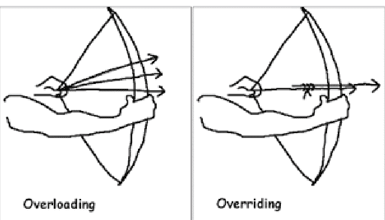
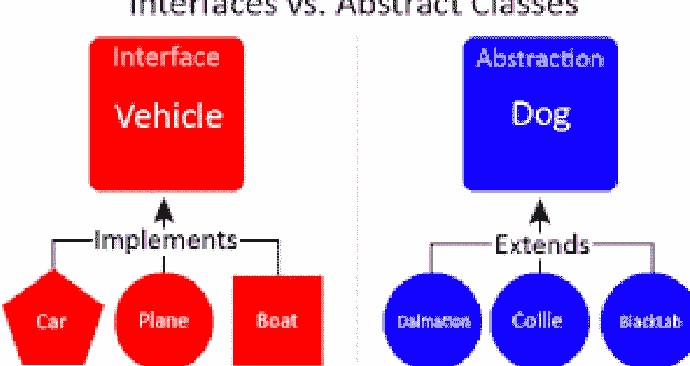
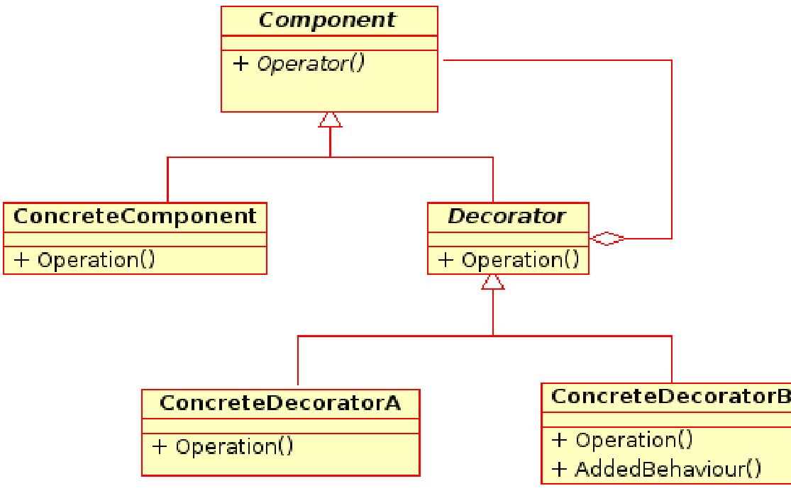
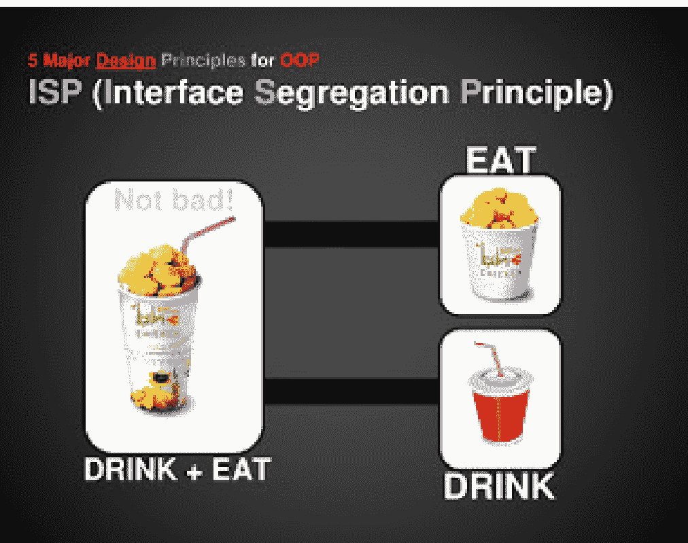

# Java 面试精要：通过这些问题进行充分准备，自信地通过 Java 面试

## 前言

- 我通过 Java 面试的小技巧

# 面向对象编程面试题

Java 是一种面向对象的编程语言，在 Java 面试中你会看到很多关于面向对象编程概念的问题。经典问题，如接口和抽象类之间的区别一直存在；近年来，面试官也会提出基于高级设计原则和模式的更复杂的问题，以检查候选者的高级 OOP 知识。对于具有 1 到 3 年经验的程序员，面向对象编程的面试题更为常见。这很合情，因为这些程序员必须掌握抽象、继承、组合、类、对象、接口、封装等 OOP 基础知识。

如果你在寻找针对 2 到 4 年经验程序员的 Java 面试题，你会发现很多基于继承和封装等 OOP 基础的问题，但随着经验的增加，你将看到基于面向对象分析和设计的问题，例如：编写一个自动售卖机设计或在 Java 中实现一个咖啡机。

这些问题更困难，不仅要求对 OOP 基础有真正的理解，还需要掌握 SOLID 设计原则和模式。

在本节中，我将与你分享一些基于 OOP 概念的 Java 面试题，这些题目是我从朋友和同事那里收集的，他们在不同公司的 Java 面试中遇到过。它们通常出现在面试的前几轮，比如筛选面试轮或电话面试轮。

如果你是一名高级 Java 开发者，那么你已经知道这些问题的答案了，我建议你多练习面向对象分析和设计技能，即如何根据规范编写代码。如果你是应届生或具有 2 到 3 年经验的初级 Java 开发者，你必须复习这些问题，如果不会就去学习，以便在 Java 面试中表现良好。

## OOP 或 Java 中的什么是方法重载（method overloading）？

这是最老的 OOP 概念问题之一，十年前见过，现在依然可见。当我们有多个同名但功能不同的方法时，就称为方法重载。例如，`System.out.println()` 就被重载了，因为我们有 6 或 7 个 `println()` 方法，每个都接受不同类型的参数。

## OOP 或 Java 中的什么是方法重写（method overriding）？

这是面向对象编程的魔法之处，方法在运行时根据对象进行选择。为了实现方法重写，我们需要继承和多态，因为我们需要在父类和子类中具有相同签名的方法。对该方法的调用在运行时根据实际对象而不是变量的类型来解析。

## Java 中的方法隐藏（method of hiding）是什么？

当你在父类和子类中声明两个相同名称和签名的静态方法时，它们会互相隐藏，即对子类中方法的调用将调用该类声明的静态方法，而对父类中相同方法的调用将解析为父类中声明的静态方法。

## Java 是纯面向对象语言吗？如果不是，为什么？

Java 不是纯面向对象编程语言，例如，有很多事情你不需要对象就可以完成，例如静态方法。此外，原始变量在 Java 中不是对象。

## Java 中方法重载和重写的规则是什么？

Java 中方法重载最重要的规则之一是方法签名必须不同，即参数的数量或类型不同。仅仅改变两个方法的返回类型不会导致重载，相反，编译器将抛出错误。另一方面，方法重写有更多规则，例如：名称和返回类型必须相同，方法签名也应该相同，重写的方法不能抛出更高级别的异常等。

## 方法重载和重写的区别？

有几点区别，但最重要的一点是方法重载是在编译时解析的，而方法重写是在运行时解析的。编译器在方法重载时只使用类信息，但在解析重写方法调用时需要知道对象。这张图很好地解释了这种区别：



### 可以在 Java 中重载所有的静态方法吗？

可以，你可以在 Java 中重载静态方法。只要所有方法都具有不同的方法签名，你可以声明任意数量的同名静态方法。

### 可以在 Java 中重写静态方法吗？

不可以，你不能重写静态方法，因为它不绑定到对象。相反，静态方法属于类，并在编译时使用引用变量的类型进行解析。但是，是的，你可以在子类中声明相同的静态方法，会导致方法隐藏，即：如果你使用子类类型的引用变量，将调用新方法；但如果你使用父类的引用变量，则将调用旧方法。

### 可以在不使用 final 修饰符的情况下防止方法重写吗？

可以，你可以在不使用 `final` 修饰符的情况下防止 Java 方法重写。事实上，有几种方法可以实现这一点，例如：你可以将方法标记为 `private` 或 `static`，这些方法是无法被重写的。

### 可以在 Java 中重写私有方法吗？

不可以。私有方法仅在声明它的类内部可访问和可见，在子类中无法重写。尽管如此，你可以在内部类内部重写它们，因为它们是可访问的。

## Java 中的什么是协变方法重写（covariant method overriding）？

在协变方法重写中，重写方法可以返回原始或重写方法返回对象的子类。这个概念是在 Java 1.5 (Tiger) 版本中引入的，当原始方法返回 `Object` 类等通用类型时，它非常有帮助，因为通过协变方法重写，你可以返回更合适的对象并防止客户端的类型转换。该概念的实际应用之一是在 Java 中重写 `clone()` 方法时。

### 在重写时可以将方法的返回类型更改为子类吗？

可以，但仅从 Java 5 开始支持。这一特性被称为协变方法重写，是在 JDK 5 发布中引入的。如果原始方法返回父类（例如 `clone()` 方法返回 `java.lang.Object`），则这非常有帮助。通过这一点，你可以直接返回实际类型，防止客户端对结果进行类型转换。

### 可以更改重写方法的参数列表吗？

不可以。参数列表是方法签名的一部分，重写方法和被重写方法必须具有相同的签名。

### 可以在不使用 throws 子句的情况下重写抛出运行时异常的方法吗？

可以，重写时对未检查异常（unchecked exceptions）没有限制。另一方面，在检查异常（checked exception）的情况下，重写方法不能抛出在类型层次中更高的检查异常，例如：如果原始方法抛出 `IOException`，则重写方法不能抛出 `java.lang.Throwable`。

### 如何调用父类的重写方法版本？

你可以使用 `super` 关键字调用子类中重写方法的父类版本。例如，调用 `java.lang.Object` 的 `toString()` 方法，可以使用 `super.toString()`。

### 在 Java 中可以将非静态方法重写为静态方法吗？

可以，你可以在 Java 中重写非静态方法，没有问题，但它们不应该是 `private` 或 `final`。

### 可以重写 Java 中的 final 方法吗？

不可以，你不能重写 `final` 方法，方法上的 `final` 关键字是为了出于安全考虑防止重写。这就是为什么 `String` 类在 Java 中是 `final` 的。这个概念也用于模板设计模式，其中模板方法被标记为 `final` 以防止重写。

## 接口内部可以有非抽象方法吗？

从 Java 8 开始，接口内部可以有非抽象方法，在此之前是不允许的，因为所有方法都是隐式的 `public abstract`。从 JDK 8 开始，你可以在接口内部添加静态和默认方法。

## Java 8 的默认方法（default method）是什么？

默认方法也被称为扩展方法（extension method），是现在可以在接口中添加的新类型方法。这些方法具有实现，并旨在默认使用。通过使用这种方法，JDK 8 成功提供了与 lambda 表达式和流 API 相关的功能，而没有破坏所有实现接口的客户端。如果你查看 Java 8 API 文档，你会发现 `Iterator`、`Map` 等关键 Java 接口上有许多实用的默认方法。

## Java 中什么是抽象类（abstract class）？

抽象类是不完整的类。在 Java 中，你不能创建抽象类的实例。它们的提供是为了定义默认行为，并确保该类的客户端必须遵循抽象类内部定义的约束。为了使用它，你必须扩展并实现它的抽象方法。顺便说一下，在 Java 中，一个类可以在不指定任何抽象方法的情况下是抽象的。

## Java 中什么是接口（interface）？接口的真实用途是什么？

和抽象类一样，接口也是为了指定 API 的约束。它支持 OOP 抽象概念，因为它只定义了抽象行为。它会告诉你的程序将产生输出，但如何实现则取决于实现者。接口的真实用途是定义类型以利用多态性（Polymorphism）。

## 抽象类和接口的区别是什么？

在 Java 中，关键区别在于抽象类可以包含非抽象方法，而接口不能包含，但从 Java 8 开始，接口也可以包含非抽象的静态方法和默认方法。



## 可以在没有抽象方法的情况下让类变成抽象的吗？

可以，只需在类定义上添加 `abstract` 关键字，你的类就会变成抽象类。

## 我们可以让一个类同时是 final 和 abstract 的吗？

不能，你不能同时对类应用 `final` 和 `abstract` 关键字，因为它们是完全相反的。Java 中的 `final` 类不能被扩展，而你可以在通过扩展将其转换为具体类的情况下使用抽象类。根据 Java 规范，如果你尝试同时让一个类变为抽象和 `final`，编译器将抛出错误。

## 可以在 Java 中重载或重写 main 方法吗？

不能，由于 `main()` 是一个静态方法，你只能对其进行重载，不能重写它，因为静态方法在编译时解析，不需要对象信息，因此我们无法在 Java 中重写 `main` 方法。

## 多态性（Polymorphism）、重载（Overloading）和重写（Overriding）的区别是什么？

这是一个微妙的 OOP 概念问题，因为多态是重载和重写后的真实概念。重载是编译时多态，而重写是运行时多态。

## 在 Java 中接口可以扩展多个接口吗？

可以，在 Java 中一个接口可以扩展多个接口，这是完全有效的。

## 在 Java 中一个类可以扩展多个类吗？

不能，一个类只能扩展另一个类，因为 Java 不支持多继承，但是的，它可以实现多个接口。

## Java 中抽象（abstraction）和多态性（polymorphism）的区别是什么？

抽象是将概念泛泛化，而多态性允许你在不改变代码的情况下使用不同的实现。这张图表很好地解释了抽象：


# 面向对象设计原则和模式面试题

现在让我们来看基于 SOLID 设计原则和 GOF 设计模式的 OOP 概念问题，这些问题利用了这里讨论的 OOP 概念。

## Java 中的策略模式（Strategy pattern）解决了什么问题？

策略模式允许你在不改变代码引入新算法或新策略。例如，对对象列表排序的 `Collections.sort()` 方法使用策略模式来比较对象。由于每个对象使用不同的比较策略，你可以以不同的方式比较各种对象而无需更改排序方法。

## 装饰器模式（Decorator design Pattern）基于什么 OOP 概念？

装饰器模式利用组合（Composition）在不修改原始类的情况下提供新功能。这是一个电话面试中非常直击要点的问题。从装饰器模式的 UML 图中可以清楚地看到，组件（Component）与装饰器（Decorator）相关联。



## 在 Java 中何时使用单例模式（Singleton design pattern）？

当你只需要类的一个实例并希望它是全局可用的，可以使用单例模式。它并不是免费的，因为它增加了类与类之间的耦合并使它们难以测试。这是 Java 面试中最老的设计模式问题之一。

# 状态模式（State）和策略模式（Strategy）的区别是什么

虽然状态模式和策略模式的结构或类图相同，但它们的意图完全不同。状态模式用于根据状态执行特定操作，而策略模式允许你在不改变使用它的代码的情况下切换算法。

## OOP 中关联（Association）、聚合（Aggregation）和组合（Composition）的区别是什么？

当一个对象与另一个对象相关时，被称为关联。它有两种形式：聚合和组合。前者是关联的松散形式，相关对象可以单独生存；而后者是更强的关联形式，相关对象不能单独生存。例如，城市是人的聚合，但是身体部位的组合。

## Java 中装饰器模式（Decorator）、代理模式（Proxy）和适配器模式（Adapter）的区别是什么？

同样，它们看起来很相似，因为它们的结构或类图非常相似，但意图大不相同。装饰器在不触碰类的情况下添加额外功能，代理提供访问控制，而适配器用于让两个不兼容的接口协同工作。

## SOLID 中的 5 个面向对象的设计原则是什么？

SOLID 是 Uncle Bob 在他的经典著作《整洁代码》（Clean Code）中提出的术语，这是程序员必读的书之一。在 SOLID 中，每个字母代表一个设计原则：

- S 代表单一责任原则（Single Responsibility Principle）
- O 代表开闭设计原则（Open-closed design principle）
- L 代表里基夫替换原则（Liskov substitution principle）
- I 代表接口隔离原则（Interface segregation principle）
- D 代表依赖倒置原则（Dependency inversion principle）



## OOP 中组合（Composition）和继承（Inheritance）的区别是什么？

这是另一个很好的 OOP 概念问题，因为它测试了什么是重要的，从类设计的角度来看，两者都非常重要。虽然组合和继承都允许重用代码，但前者比后者更灵活。组合允许类在运行时获取附加功能，而继承是静态的。你无法通过替换新实现在运行时更改功能。

这就是这个面向对象编程或 OOP 概念面试题列表的全部内容。我们已经看到了来自各种 OOP 概念的问题，如抽象、封装、继承、组合、聚合、关联、类、对象和接口等。

我们还看到了关于面向对象设计原则（也称为 SOLID 原则）以及 GOF 设计模式的问题，如策略、状态和工厂，这些都是基于面向对象编程概念和 OOP 设计原则的。

但是，正如我所说，如果你是一个高级 Java 工程师，你应该更多关注面向对象的分析和设计，并学习如何根据需求编写代码。你也可以阅读《破解编码面试》第 6 版来学习面向对象编程问题。

这里是我整理的 40 个核心 Java 相关问题，这些问题经常出现在电话面试中。这些问题涉及了重要的 Java 核心概念，例如：`String`、线程基础、多线程、线程间通信、Java 集合框架、序列化、面向对象编程概念和异常处理。如果你参加过几次 Java 面试，一定已经见过其中一些问题了。

### 1) Java 中 String、StringBuffer 和 StringBuilder 的区别是什么？

`String` 是不可变的，而 `StringBuffer` 和 `StringBuilder` 都是可变的，这意味着任何更改（例如将 `String` 转换为大写或修剪空白字符）都会产生另一个新实例，而不是修改原有实例。对于后者两者，`StringBuffer` 是同步的，而 `StringBuilder` 不是同步的；事实上，它是 Java 1.5 中引入的对 `StringBuffer` 的替代品。

### 2) Java 中 extends Thread 和 implements Runnable 有什么区别？

区别在于 Java 中你只能继承一个类，这意味着如果你扩展了 `Thread` 类，就会失去继承另一个类的机会；另一方面，如果你实现了 `Runnable`，你仍然可以继承另一个类。

### 3) Java 中 Runnable 接口和 Callable 接口的区别？

在 JDK 1.5 引入 `Callable` 之前，`Runnable` 是 Java 中实现可执行任务的唯一方式。与 `Runnable` 类似，`Callable` 也定义了一个单方法 `call()`，但与 `run()` 不同的是，它可以返回结果并抛出异常。

### 4) Java 中 ArrayList 和 LinkedList 的区别？

简而言之，`ArrayList` 在 Java 中是由数组支持的，而 `LinkedList` 只是节点的集合，类似于链式数据结构。如果你知道索引，`ArrayList` 还提供了随机搜索，而 `LinkedList` 只允许随机顺序搜索。另一方面，与 `ArrayList` 相比，在 `LinkedList` 中添加和删除元素是高效的，因为只需要修改链接，不需要对其他元素进行重排。

### 5) Java 中 wait 和 notify 的区别是什么？

`wait` 和 `notify` 方法都用于线程间通信，其中 `wait` 用于在某个条件下暂停线程，而 `notify` 用于向等待的线程发送通知。这两个方法都必须在同步上下文中（例如同步方法或同步代码块）中调用。

### 6) Java 中 HashMap 和 Hashtable 的区别？

虽然 `HashMap` 和 `Hashtable` 都基于哈希表数据结构，但它们之间存在细微的区别。`HashMap` 是非同步的，而 `Hashtable` 是同步的，正因如此，`HashMap` 比 `Hashtable` 快，因为它没有与同步相关的开销。另一个微小区别是 `HashMap` 允许 `null` key，而 `Hashtable` 不允许。

### 7) Java 中 TreeSet 和 TreeMap 的区别？

虽然两者都是有序集合，但 `TreeSet` 本质上是一个不允许重复的 `Set`（集合）数据结构，而 `TreeMap` 是 `Map` 接口的实现。实际上，`TreeSet` 是通过 `TreeMap` 实现的，就像 `HashSet` 使用 `HashMap` 实现一样。

### 8) 编写一个 Java 程序打印斐波那契数列？

电话面试中的核心 Java 面试题：斐波那契数列是一个序列，其中每个数字等于前两个数字之和，即 $f(n)=f(n-1) + f(n-2)$。这个程序通常用于教学生递归，但你也可以在不使用递归的情况下解决它。请查看该问题的迭代解和递归解决方案。


在电话面试中，这个问题并不常见，但有时面试官也想通过这类问题检查你的解决问题的能力。

### 9) 编写一个 Java 程序检查一个数字是否为质数？

如果一个数字不能被除自身以外的任何数字整除，则称为质数。1 不被视为质数，因此你的检查必须从 2 开始。最简单的解决方案是检查每个数字直到数字本身，看它是否能被整除。当面试官要求你改进时，你可以说检查到数字的平方根即可。如果你能进一步改进算法，将给面试官留下更深刻印象。

### 10) 如何在不使用临时变量的情况下交换数字？

这是一个老问题了。我第一次是在 2005 年看到这个，但我确定它比那还要老。这个问题的好处是，除了 XOR 技巧外，所有解决方案都有某些缺陷，这被用来测试候选人是否真的掌握了知识。

### 11) 如何在 Java 中检查链表是否包含循环？

这是另一个解决问题的面试题，在电话面试和筛选轮中非常流行。这是一个测试候选人解决问题能力的极佳题目，特别是如果他没见过这个问题时。它还有一个很好的跟进问题：找到循环的起始点。

### 12) 编写 Java 程序在不使用 API 的情况下反转字符串？

另一个测试候选人解决问题能力的题目。你可能在 Java 面试的电话轮中预期这类问题，但这些问题现在已经成为常态。面试官寻找的是逻辑，你不需要写出代码，但你应该能够想出解决方案。

### 13) Java 中 `Serializable` 和 `Externalizable` 的区别？

`Serializable` 是一个标记接口（marker interface），没有定义任何方法，但 `Externalizable` 接口定义了两个方法，例如 `readExternal()` 和 `writeExternal()`，允许你控制序列化过程。`Serializable` 使用默认的序列化过程，对于某些应用程序来说可能非常慢。

### 14) Java 中 `transient` 和 `volatile` 的区别？

`transient` 关键字用于序列化，而 `volatile` 用于多线程。如果你想从序列化过程中排除一个变量，将该变量标记为 `transient`。与静态变量类似，`transient` 变量不会被序列化。另一方面，`volatile` 变量告诉编译器多个线程对该变量感兴趣，编译器不应重排它的访问。`volatile` 变量还遵循发生于（happens-before）关系，这意味着 `volatile` 变量中的任何写入都发生在任何读取之前。你还可以使用 `volatile` 让 `double` 和 `long` 变量的非原子访问变为原子性。

### 15) 抽象类和接口的区别？

从 Java 8 开始，Java 中抽象类和接口之间的区别已经缩小，现在接口甚至可以通过默认方法和静态方法包含实现。顺便说一下，在 Java 中你仍然只能继承一个类，但可以实现多重继承。抽象类用于提供默认实现并仅留一些需要自定义的部分，而接口广泛用于 API 中定义类的契约。

### 16) 关联（Association）、组合（Composition）和聚合（Aggregation）的区别？

在关联、组合和聚合之间，组合的强度最强。如果部分离开整体仍然可以存在，则两个类之间的关系被称为聚合；但如果部分离开整体就无法存在，则两个类之间的关系被称为组合。在继承和组合之间，后者提供了提供了更灵活的设计。

### 17) Java 中 `FileInputStream` 和 `FileReader` 的区别是什么？

`FileInputStream` 和 `FileReader` 的主要区别在于前者用于读取二进制数据，而后者用于读取文本数据，这意味着后者在 Java 中将字节转换为文本时还会考虑字符编码。

### 18) 在 Java 中如何将字节转换为字符？

通过字符编码将字节转换为字符或文本数据。当你从文件或网络端点读取二进制数据时，提供一个字符编码来将这些字节转换为等效字符。选择错误的字符编码可能会因解释方式不同而改变信息的含义。

### 19) `finally` 句中可以使用 `return` 语句吗？会发生什么？

是的，可以在 `finally` 块中使用 `return` 语句，但它不会阻止 `finally` 块的执行。顺便说一下，如果你在 `try` 块中使用了 `return` 语句，那么 `finally` 块的返回值将覆盖 `try` 块的返回值。

### 20) 在 Java 中可以重写静态方法吗？

不，你不能在 Java 中重写静态方法，因为它们是在编译时解析的，而不是在运行时解析。虽然你可以在子类中声明并定义相同名称和签名的静态方法，但这会隐藏父类的静态方法，这就是为什么它在 Java 中被称为方法隐藏（method hiding）。

### 21) Java 中 `private`、`public`、`package` 和 `protected` 有什么区别？

这四者在 Java 中都是访问修饰符，但只有 `private`、`public` 和 `protected` 是修饰关键字。包访问（package access）没有关键字，它是 Java 的默认设置。这意味着如果不指定任何访问修饰符，默认在同一个包内是可以访问的。`private` 变量只能在声明它的类中访问，`protected` 可以在同包内的所有类中访问，但在包外的子类中也可以，而 `public` 变量（例如方法、类或变量）可以在任何地方访问。这是最高级别的访问修饰符，提供了最低形式的封装。

## 22) 你在 Java 中学到的 5 个编码最佳实践是什么？

如果你使用某种编程语言开发了几年，你肯定知道很多最佳实践。通过问其中的几个，面试官只是在检查你是否精通业务。以下是我的 5 个 Java 最佳实践：

- 始终为你的线程命名，这对于调试非常有帮助。
- 使用 `StringBuilder` 进行字符串拼接。
- 始终指定 `Collection` 的大小，这将节省大量在调整尺寸大小上花费的时间。
- 除非有充分理由，否则始终将变量声明为 `private` 和 `final`。
- 始终面向接口编程，而不是面向实现编程。
- 为方法提供依赖，而不是让它们自行获取，这将使你的代码可于单元测试。

### 23) 编写一个程序找到数组中的最大值最小值？

这是另一个测试候选人解决问题能力的编码题。根据你回答问题的方式，准备好应对几个后续问题。脑海中想出的简单方法是对数组进行排序，然后取第一个和最后一个元素。

### 24) 编写一个程序原地反转数组？

另一个针对 Java 程序员的解决问题题。这里的关键点是需要原地反转数组，这意味着你不能使用额外的缓冲区，一个或两个变量即可。注意，你不能使用任何库代码，你需要创建自己的逻辑。

### 25) 编写一个程序在 Java 中反转一个数字？

对于非常初级的程序员来说，这是一个有趣的程序，从大学生到有几年经验的谜题开发者都适用。大多数开发者编写的代码很少，所以他们觉得这类问题具有挑战性。这里的技巧是使用取模运算符（`%`）获取数字的最后一位数，并使用除法运算符（`/`）每次减少数字数值。

### 26) 编写一个程序在 Java 中计算阶乘？

另一个初学者编码题，适合电话面试，因为你可以区分出能写程序的人和不能写的人。这也有助于观察开发者是否熟悉递归和迭代算法以及各者的优缺点。你可以问很多后续问题，例如如何提高算法的性能？由于一个数字的阶乘等于该数乘以上一个数的阶乘，你可以缓存这些值而不是重新计算，这会给面试官留些良好印象。

### 27) 调用 `Thread` 的 `start()` 方法和 `run()` 方法的区别是什么？

你可能以前听过这个问题，如果调用 `start()` 方法最终会调用 `run()` 方法，为什么不直接调用 `run()` 方法呢？区别在于，`start()` 方法还会启动一个新线程。如果你直接调用该方法，它将在相同线程上运行，而不是不同的线程，而这并不是原始的意图。

### 28) 编写一个程序在 Java 中解决生产者消费者问题？

这是一个非常好的问题，用于检查候选人是否能编写线程间通信代码。如果一个人能手写生产者消费者解决方案，并指出关键区域以及如何保护它、如何与线程通信，那么他就足以编写和维护你的并发 Java 程序了。这是 Java 开发人员的最低要求，这也是我喜欢这个问题的原因，它还有许多解决方案，例如使用如 `BlockingQueue` 等并发集合、使用 `wait()` 和 `notify()` 以及使用 Java 5 的其他同步器（例如 `Semaphore`）。

### 29) 如何一次遍历找到链表的中间元素？

另一个用于热身的简单解决问题题。在单向链表中，你只能向一个方向遍历，如果你不知道大小，就无法编写循环来精确找到中间元素，这就是问题的核心。一种解决方案是使用两个指针，快指针和慢指针。当快指针移动 2 步时，慢指针移动 1 步。

### 30) Java 中 `equals()` 和 `hashCode()` 有什么区别？

这通常作为上一个问题的后续，静态绑定与重载方法有关，动态绑定与重写方法有关。像 `private`、`final` 和 `static` 这样的方法是通过静态解析的。

### 31) 为什么 Java 中的 `String` 是不可变的？

这个问题是为了找出你有多少经验，以及你对 Java API 的思考，以及 `wait()`/`notify()` 方法与线程的关联。

### 32) Java 中的 `HashSet` 是如何工作的？

`HashSet` 内部使用 `HashMap` 实现，这是你的面试官想听到的。在 `HashSet` 中值是什么？在 `HashSet` 中，使用一个虚拟对象作为值，而键是实际元素。由于 `HashMap` 允许这样做，它也遵循集合结构的约定，不允许重复。

### 33) Java 中 `synchronized` 和并发集合（concurrent Collection）有什么区别？

在 Java 1.5 之前有一段时间，如果你在多线程 Java 程序中使用它们，就需要同步集合。那些类深受许多问题困扰，最重要的是性能，因为每当线程读取或写入时，它们都会锁定整个集合或映射。为了解决这些问题，Java 发布了一些并发集合类，例如 `ConcurrentHashMap`、`CopyOnWriteArrayList` 和 `BlockingQueue`，提供更好的扩展性和性能。

### 34) Java 中 `Iterator` 和 `Enumeration` 有什么区别？

主要区别是 `Iterator` 是为了取代 `Enumeration` 而引入的。它还允许在遍历时移除元素，这在 `Enumeration` 中是不可能的。`Iterator` 的方法（例如 `hasNext()` 和 `next()`）也比 `Enumeration` 对应的方法（例如 `hasMoreElements()`）更简洁。

### 35) Java 中重载（Overloading）和重写（Overriding）有什么区别？

另一个电话面试中经常被问的问题。虽然重载和重写都涉及同名的方法，但它们有不同的特征，例如：重载的方法与原始方法具有不同的方法签名，但重写的方法具有相同的签名。此外，重载方法在编译时解析，而重写方法在运行时解析。

### 36) Java 中静态绑定和动态绑定的区别？

这通常作为上一个问题的后续，静态绑定与重载方法有关，动态绑定与重写方法有关。像 `private`、`final` 和 `static` 这样的方法在编译时通过静态绑定解析，但可以被重写的虚方法在运行时通过动态绑定解析。

### 37) Java 中 `Comparator` 和 `Comparable` 的区别是什么？

这是另一个基础概念，我希望每个 Java 候选人都能知道它。你会在每个 Java 项目中遇到它们。Java 中的几个核心类（例如 `String`、`Integer`）实现了 `Comparable` 来定义它们的自然排序顺序；如果你定义了一个值类或领域对象，那么你也应该实现 `Comparable` 并定义你对象的自然排序。这两者之间的主要区别在于，你可以创建多个 `Comparator` 来根据对象的不同属性定义多种排序方式。此外，为了实现 `Comparable`，你必须拥有该类或代码，但你可以在没有类源代码的情况下使用 `Comparator`，你只需要特定对象的 JAR 文件。这就是为什么 `Comparator` 实现自定义排序顺序非常强大，而且从 Java 8 开始，你可以用更优雅的方式来实现，如下所示。

### 38) 如何按降序排序 `ArrayList`？

你可以使用带有反转 `Comparator` 的 `Collections.sort()` 方法，它可以按照元素自然顺序的反序对元素进行排序，例如：

```java
List<String> listOf = Arrays.asList("London", "Tokyo", "NewYork");
Collections.sort(listOf, Collections.reverseOrder());
System.out.println(listOf); //[Tokyo, New York, London]
```

### 39) Java 中 `PATH` 和 `CLSPATH` 有什么区别？

`PATH` 是一个环境变量，指向用于运行 Java 程序的 Java 二进制文件。`CLASPATH` 是另一个环境变量，指向 Java 类文件或 JAR 文件。如果 `CLSPATH` 中找不到某个类，Java 将抛出 `ClassNotFoundException`。

### 40) Java 中受检异常（Checked Exception）和未检异常（Unchecked Exception）的区别是什么？

受检异常确保了提供了对异常的处理，并由编译器进行验证；而对于抛出未检异常，不需要特殊的规定（例如 `throws` 子句）。一个方法可以在不使用任何 `throw` 子句的情况下抛出未检异常。

以上就是电话面试轮次中的 40 个 Java 核心面试题。千万不要轻视电话面试，这是你给潜在雇主留下印象的第一个机会。由于你看不见面试官，仅通过声音交流，这与面对面面试略有不同。

所以要始终保持冷静、放松，回答问题要直接且精准，说话要缓慢，并确保你所在的环境声音不会像在封闭楼梯间那样产生回响。良好的手机、耳机以及处于良好的信号区域也非常重要。我见过很多次候选人因为无法听清或在回答之前无法理解问题而在面试中失败。我知道有些人会在那些秘密的地方参加电话面试，但如果你真的这样做，请确保你的手机连接足够良好。

# 多线程与并发面试题

无论你参加任何 Java 面试，无论是高级还是初级、有经验还是应届生，不可避免会遇到几个关于线程、并发和多线程的问题。事实上，这种内置的并发支持是 Java 编程语言最强大的优势之一，帮助它在企业界和程序员中同样大受欢迎。大多数高薪的 Java 开发者职位都要求卓越的 Java 核心多线程技能，以及在开发、调试和优化高性能低延迟 Java 应用方面的经验。这就是为什么它是 Java 面试中最受青睐的技能之一。多线程和并发的概念也很掌握，只有具有丰富经验的优秀开发者才能有效地处理并发问题。

在典型的 Java 面试中，面试官会慢慢从线程的基本概念开始，提问诸如：为什么需要线程、如何创建线程、哪种创建线程的方法更好（例如通过扩展 `Thread` 类或实现 `Runnable` 接口），然后慢慢进入并发问题、开发并发 Java 应用期间面临的挑战、Java 内存模型、JDK 1.5 引入的高阶并发工具、并发 Java 应用的原理和设计模式、经典多线程问题（例如生产者-消费者、哲学家就餐、读写或简单的有界缓冲区问题）。

仅仅了解线程的基础知识是不够的，你必须知道如何处理死锁、竞态条件、内存不一致以及各种与线程安全相关的问题。这些技能会通过展示各种多线程和并发问题得到充分测试。

许多 Java 开发者习惯于在面试前只看和读面试题，这并不坏，但你不应该太疏远。此外，收集问题并反复同样的练习太浪费时间了，这就是为什么我创建了这份从各种面试中收集的 50 个 Java 多线程和并发相关问题列表。当我发现新的或最近的面试题时，我会添加。

虽然专注于高级多线程和并发技能的 Java 面试需要良好的知识和扎实的经验，但我强烈建议 Java 程序员在面试前读两遍《Effective Java》（Effective Java）和《Java 并发编程》（Java Concurrency in Practice）。它们不仅能帮助你更好地回答问题，还能帮助你清晰地表达你的想法。

而且，如果你认真想要掌握 Java 多线程和并发，我还建议你在 Udemy 上查看 Michael Pogrebinsky 提供的《Java Multithreading, Concurrency, and Performance Optimization》课程。这是一门高级课程，旨在成为 Java 多线程、并发和并行编程的专家，并强调高性能。

顺便说一下，我在这里没有提供某些问题的答案。为什么？因为我预计大多数 Java 开发者都知道这些问题的答案，如果不知道，通过 Google 也能找到。

这里是我们的 Java 线程、并发和多线程热门问题列表。你可以使用这个列表为你的 Java 面试做好充分准备。

### 1) Java 中的线程（Thread）是什么？

线程是一个独立的执行路径。它是利用机器中可用多个 CPU 的方法。通过使用多个线程，你可以加速 CPU 密集型任务。例如，如果一个线程完成任务需要 100 毫秒，你可以使用 10 个线程将该任务缩短到 10 毫秒。Java 在语言层面为多线程提供了很好的支持，这也是它的核心卖点之一。

### 2) Java 中线程（Thread）和进程（Process）有什么区别？

线程是进程的子集，换句话说，一个进程可以包含多个线程。两个进程运行在不同的内存空间，但所有线程共享相同的内存空间。不要将其与栈内存（stack memory）混淆，不同线程栈不同，用于存储该线程的本地数据。

### 3) 如何在 Java 中实现线程？

在语言层面，在 Java 中实现线程有两种。`java.lang.Thread` 的实例代表一个线程，但它需要一个执行的任务，该任务是 `java.lang.Runnable` 接口的实例。由于 `Thread` 类实现了 `Runnable`，你可以通过扩展 `Thread` 类或实现 `Runnable` 接口来重写 `run()` 方法。


### 4) 在 Java 中何时使用 `Runnable` 而不是 `Thread`？

这是上一个多线程面试题的后续问题。正如我们知道可以通过扩展 `Thread` 类或实现 `Runnable` 接口来实现线程，问题随之产生：哪种更好？什么时候用哪一个？如果你知道 Java 编程语言不支持多类继承，但允许实现多个接口，那么这个问题很容易回答。这意味着，如果你还想扩展另一个类（例如 `Canvas` 或 `CommandListener`），实现 `Runnable` 比扩展 `Thread` 更好。

### 6) `Thread` 类中 `start()` 方法和 `run()` 方法有什么区别？

早期的一个经典的 Java 陷阱题，但仍然足以区分对 Java 线程模型的深浅理解。`start()` 用于启动新创建的线程，而 `start()` 内部调用 `run()` 方法；直接调用 `run()` 方法则是像调用普通方法一样调用它，它会在当前线程中执行，不会启动新线程，而调用 `start()` 方法则不同。

### 7) Java 中 `Runnable` 和 `Callable` 有什么区别？

`Runnable` 和 `Callable` 都代表旨在在单独线程中执行的任务。`Runnable` 从 JDK 1.0 就有了，而 `Callable` 是在 JDK 1.5 加入的。这两者的主要区别是 `Callable` 的 `call()` 方法可以返回值并抛出异常，而这在 `Runnable` 的 `run()` 方法是不可能的。`Callable` 返回 `Future` 对象，该对象可以持有计算结果。

### 8) Java 中 `CyclicBarrier` 和 `CountDownLatch` 的区别是什么？

虽然 `CyclicBarrier` 和 `CountDownLatch` 都是为了等待一个或多个事件上的线程数量，但它们的主要区别在于：一旦 `CountDownLatch` 的计数归零就无法重新使用，但即使屏障被破坏（broken），你也可以重用同一个 `CyclicBarrier`。

### 9) 什么是 Java 内存模型？

Java 内存模型是一组规则和指南，允许 Java 程序在不同的内存架构、CPU 和操作系统上表现出确定性的行为。它在多线程情况下尤为重要。Java 内存模型对一个线程的修改对其他线程可见提供了某些保证，其中之一就是 happens-before（发生于）关系。这种关系定义了若干条规则，允许程序员预测和推理并发 Java 程序的行为。例如，happens-before 关系保证：

- 线程中的每个动作都发生在该线程中程序顺序上靠后的每个动作之前，这被称为程序顺序规则。

- 对监视器锁（monitor lock）的解锁发生在对该监视器锁的任何后续锁定之前，也称为监视器锁规则。

- 对 `volatile` 字段的写入发生在对该字段的任何后续读取之前，被称为 `volatile` 变量规则。

- 对线程调用 `Thread.start` 发生在任何其他线程检测到该线程已终止之前（无论是通过 `Thread.join()` 成功返回，还是通过 `Thread.isAlive()` 返回 `false`），也称为 Thread 启动规则。

- 一个线程对另一个线程调用 `interrupt()` 发生在被中断线程检测到中断之前（通过抛出 `InterruptedException`，或者调用 `isInterrupted` 或 `interrupted`），俗称为 Thread 中断规则。

- 一个对象的 happens-before 结束发生在该对象的 finalizer（终结器）执行的开始之前，被称为 Finalizer 规则。

- 如果 A 发生在 B，且 B 发生在 C，那么 A 发生在 C，这意味着 happens-before 保证具有传递性。

我强烈建议阅读《Java 并发编程》（Java Concurrency in Practice）的第 16 章，以更详细地理解 Java 内存模型。

### 10) Java 中的 `volatile` 变量是什么？

`volatile` 是一个特殊的修饰符，只能用于实例变量。在并发 Java 程序中，在没有 `synchronized` 关键字或锁等任何同步器的情况下，多个线程对实例变量的修改对其他线程是不可见的。`volatile` 变量保证了写操作发生在任何后续读取之前：正如上一个问题中提到的“`volatile` 变量规则”。

### 11) 什么是线程安全？`Vector` 是线程安全的类吗？

线程安全是对象或代码的一个属性，保证其在被多个线程以何种方式（例如读与写）执行或使用时，其行为都符合预期。例如，一个线程安全的计数器对象即使在多个线程之间共享同一个计数器实例，也不会丢失任何计数。显然，你也可以将集合类分为两类：线程安全的类和非线程安全的类。`Vector` 确实是一个线程安全的类，它通过同步修改 `Vector` 状态的方法来实现线程安全；另一方面，它的对应类 `ArrayList` 则不是线程安全的。

### 12) Java 中的竞态条件（race condition）是什么？请举一个例子。

竞态条件是 Java 程序处于并发执行环境时导致某些细微编程 bug 的原因。正如名称所示，竞态条件由于多个线程之间的竞争产生，如果本该先执行的线程输掉了竞争并变为后执行，代码的行为就会改变，表现为非确定性的 bug。由于线程之间竞争的随机性，这是最难发现和复现的 bug 之一。

### 13) 如何在 Java 中停止线程？

我常说 Java 后期为一切提供了丰富的 API，但讽刺的是，Java 并没有提供一种万全的停止线程的方法。JDK 1.0 中曾有一些控制方法，例如 `stop()`、`suspend()` 和 `resume()`，它们由于潜在的死锁威胁在后面的版本中被弃用了。从那以后，Java API 设计者并没有努力提供一种一致、线程安全且优雅的停止线程的方法。程序员主要依靠这样一个事实：线程在完成 `run()` 或 `call()` 方法执行后会自动停止。若要手动停止，程序员要么利用 `volatile` 布尔变量并在 `run` 方法的循环的每次迭代中进行检查，要么通过中断线程来强制取消任务。

### 14) 当线程发生异常时会发生什么？

这是我在面试中见过非常有趣且棘手的 Java 问题之一。简单来说，如果不被捕获，线程将死亡；如果注册了未捕获异常处理器，则它将收到回调。`ThreadUncaughtExceptionHandler` 是一个接口，定义为当线程因未捕获的异常而突然终止时调用的处理程序的嵌套接口。当线程由于因未捕获的异常即将终止时，Java 虚拟机将通过 `Thread.getUncaughtExceptionHandler()` 查询该线程的 `UncaughtExceptionHandler`，并调用处理器的 `uncaughtException()` 方法，将线程和异常作为参数传递。

### 15) 如何在 Java 两个线程之间共享数据？

你可以通过共享对象或并发数据结构（如 `BlockingQueue`）在线程之间共享数据。请看此教程学习 Java 中的线程间通信。它使用 `wait` 和 `notify` 方法实现了生产者-消费者模式，这涉及到在两个线程之间共享对象。

### 16) Java 中 `notify` 和 `notifyAll` 有什么区别？

这是核心 Java 面试中的另一个棘手问题，因为多个线程可以等待在同一个监视器锁上，Java API 设计者提供了方法，在等待条件改变时通知其中一个线程或所有线程，但他们只提供了一部分实现。`notify()` 方法没有提供选择特定线程的方法，因此它只在你知道只有一个线程在等待时才有用。与此相反，`notifyAll()` 会向所有线程发送通知并允许它们竞争锁，这确保了至少有一个线程会继续执行。

### 17) 为什么 `wait`、`notify` 和 `notifyAll` 不在 `Thread` 类中？

这是一个与设计相关的问题，检查候选人对现有系统的看法，或者他是否考虑过某些非常常见但最初看起来并不恰当的事。为了回答这个问题，你必须给出理由，说明这三个方法放在 `Object` 类中是合理的，而不是 `Thread` 类中。一个很明显的理由是，Java 提供了对象级别的锁而不是线程级别的锁。每个对象都有锁，由线程获取。现在如果线程需要等待某个锁，那么在该对象上调用 `wait()` 比在线程上调用更合理。如果将 `wait()` 方法声明在 `Thread` 类上，则不清楚线程在等待哪把锁。简而言之，由于 `wait`、`notify` 和 `notifyAll` 在锁级别上操作，因此在对象类上定义它们是合理的，因为锁属于对象。

### 18) Java 中的 `ThreadLocal` 变量是什么？

`ThreadLocal` 变量是 Java 程序员可用的一种特殊变量。就像实例变量是每个实例一个，`ThreadLocal` 变量是每个线程一个。它是实现创建对象线程安全的一种良好方法，例如，你可以使用 `ThreadLocal` 使 `SimpleDateFormat` 线程安全。由于该类开销很大，在局部作用域中使用它并不好，因为每次调用都需要单独的实例。通过为每个线程提供自己的副本，你可以一箭双雕：第一，你通过重用固定数量的实例减少了昂贵对象的实例数量；第二，你在不付出同步代价或不可变性代价的情况下实现了线程安全。`ThreadLocal` 变量的另一个好例子是 `ThreadLocal` 类，它减少了多线程环境中难以创建的 `Random` 对象的实例数量。

### 19) Java 中的 `FutureTask` 是什么？

`FutureTask` 代表并发 Java 应用程序中一个可取消的异步计算。该类提供了 `Future` 的基础实现，带有启动和取消计算的方法、查询计算是否完成的方法，以及获取计算结果的方法。只有在计算完成后才能获取结果；如果计算尚未完成，`get` 方法将会阻塞。`FutureTask` 对象可以用于封装 `Callable` 或 `Runnable` 对象。由于 `FutureTask` 也实现了 `Runnable`，因此它可以提交给 `Executor` 执行。

### 20) Java 中 `interrupted()` 方法和 `isInterrupted()` 方法有什么区别？

`interrupted()` 和 `isInterrupted()` 之间的主要区别在于前者会清除中断状态，而后者不会。Java 多线程中的中断机制是使用一个名为“中断状态”（interrupt status）的内部标志实现的。通过调用 `Thread.interrupt()` 中断线程会设置此标志。当被中断的线程通过调用静态方法 `Thread.interrupted()` 检查中断时，中断状态会被清除。非静态的 `isInterrupted()` 方法用于一个线程查询另一个线程的中断状态，它不会改变中断状态标志。按照惯例，任何通过抛出 `InterruptedException` 退出的方法在这样做时都会清除中断状态。然而，始终可能通过另一个线程调用 `interrupt` 导致中断状态立即被再次设置。

### 21) 为什么 `wait` 和 `notify` 方法要在 `synchronized` 块（同步块）中调用？

在同步块或同步方法中调用 `wait` 和 `notify` 方法的主要原因是这是 Java API 的强制性规定。如果你没有在同步上下文中调用它们，你的代码将抛出 `IllegalMonitorStateException`。更微妙的原因是避免 `wait` 和 `notify` 调用之间的竞态条件。

### 22) 为什么你应该在循环中检查等待条件？

如果等待线程没有在循环中检查等待条件，可能会接收到虚假通知和虚假唤醒调用（spurious wake up），即使条件不满足，它也会直接退出。因此，当等待线程唤醒时，它不能假设它正在等待的状态仍然有效。状态在过去可能是有效的，但在调用 `notify()` 方法之后到等待线程唤醒之前，状态可能已经发生了变化。这就是为什么在 Eclipse 中调用 `wait` 和 `notify` 时，最好总是调用 `wait()` 方法。要了解更多此类，我建议你阅读《Effective Java》关于线程和同步的章节。

### 23) Java 中同步集合（synchronized collection）和并发集合（concurrent collection）有什么区别？

虽然同步集合和并发集合都为多线程和并发访问提供了线程安全的集合，但后者的可扩展性高于前者。在 Java 1.5 之前，Java 程序员只有同步集合可用，当多个线程并发访问它们时，它们会成为竞争源，从而阻碍了系统的扩展性。Java 5 引入了并发集合，如 `ConcurrentHashMap`，它不仅提供了线程安全性，还通过使用锁分段（lock stripping）和内部表分区等现代技术提高了可扩展性。

### 24) Java 中栈（Stack）和堆（Heap）有什么区别？

为什么有人会在多线程和并发面试中问这个问题？因为栈是与线程紧密关联的内存区域。回答这个问题，栈和堆都是 Java 应用程序中的特定内存。每个线程都有自己的栈，用于存储局部变量、方法参数和调用栈。存储在一个线程栈中的变量对其他线程是不可见的。另一方面，堆是所有线程共享的公共内存区域。对象（无论是局部对象还是任何层级的对象）都创建在堆内部。为了提高性能，线程倾向于将值从堆中缓存到自己的栈中，如果该变量被多个线程修改，就会产生问题，这正是 `volatile` 变量派上用场的地方。`volatile` 建议线程始终从主内存读取变量的值。

### 25) 什么是线程池？为什么在 Java 中你应该使用线程池？

创建线程在时间和资源方面都是昂贵的。如果你在处理请求时才创建线程，将减慢你的响应时间，而且进程可以创建的线程数量是有限的。为了避免这些问题，在应用程序启动时创建一个线程池，并复用线程来处理请求。这个线程池被称为“线程池”，线程被称为“工作线程”。从 JDK 1.5 发布开始，Java API 提供了 `Executor` 框架，它允许你创建不同类型的线程池，例如：单线程池（一次处理一个任务）、固定线程池（固定数量线程的池）或缓存线程池（适用于具有许多短命任务的可扩展线程池）。

### 26) 编写代码解决 Java 中的生产者-消费者问题？

你在现实世界中解决的大多数线程问题都属于生产者-消费者模式，其中一个线程生产任务，另一个线程消费该任务。你必须知道如何进行线程间通信来解决这个问题。在最低层面，你可以使用 `wait` 和 `notify` 来解决这个问题；在高级层面，你可以利用 `Semaphore` 或 `BlockingQueue` 来实现生产者-消费者模式。

### 27) 如何在 Java 中避免死锁？编写代码？

死锁是一种两个线程互相等待对方采取行动以便自己能够继续移动的状态。这是一个严重的问题，因为当它发生时，你的程序会挂起且不执行预定任务。为了使死锁发生，必须同时满足以下四个条件：

- 互斥（Mutual Exclusion）：至少一个资源必须以非共享模式持有。在任何给定时刻，只能有一个进程使用该资源。

- 持有等待（Hold and Wait）：一个进程当前持有至少一个资源，并请求正由其他进程持有的额外资源。

- 非抢夺（No Pre-emption）：操作系统一旦分配了资源就不能撤回资源；它们必须由持有进程自愿释放。

- 循环等待（Circular Wait）：一个进程必须等待一个由另一个进程持有的资源，而该进程反过来又等待第一个进程释放资源。

避免死锁最简单的方法是防止循环等待，这可以通过按照特定顺序获取锁并按反顺序释放锁来实现，这样线程只有在持有了另一个锁的情况下，才能继续获取某一个锁。

### 28) Java 中活锁（livelock）和死锁（deadlock）有什么区别？

这个问题是上一个面试问题的扩展。活锁类似于死锁，不同在于参与活锁的线程或进程的状态相对于彼此不断变化，但没有哪一个取得进一步的进展。活锁是资源饥饿（resource starvation）的一种特殊情况。活锁的一个现实例子是两个人在窄走廊里相遇，每个人都试图礼貌地侧身让对方通过，但他们最终只是左右摇动，由于他们反复同时向同一个方向移动而没有取得任何进展。简而言之，死锁和活锁的主要区别在于，在后者状态中进程发生了变化但没有产生进展。

### 29) 如何检查一个线程是否持有锁？

在这个问题出现在我的 Java 面试电话轮之前，我甚至不知道可以检查一个线程是否持有锁。`java.lang.Thread` 上有一个名为 `holdsLock()` 的方法，当且仅当当前线程持有指定对象的监视器锁时，该方法返回 `true`。

### 32) Java 中 `synchronized` 和 `ReentrantLock` 有什么区别？

在 Java 中，曾经几天提供互斥的唯一方法是通过 `synchronized` 关键字，但它有几个缺点，例如：你无法在方法或块边界之外扩展锁，你无法放弃获取锁等。Java 5 通过 `Lock` 接口提供更细粒度的控制解决了这个问题。`ReentrantLock` 是 `Lock` 接口的一种常见实现，它提供了重入互斥锁，其与使用 `synchronized` 方法和语句访问的隐式监视器锁具有相同的基本行为和语义，但具有扩展的能力。

### 33) 有三个线程 T1、T2 和 T3？如何在 Java 中确保 T1, T2, T3 的执行顺序？

多线程中的排序可以通过不同的方式实现，但你可以简单地使用线程类的 `join()` 方法，在一个线程执行完毕后启动另一个线程。为了确保三个线程顺序执行，你需要启动最后一个线程（例如 T3），然后按反方向调用 `join` 方法（例如 T3 调用 T2 的 `join`，T2 调用 T1 的 `join`）。通过这些方式，T1 将先完成，T3 将最后完成。

### 34) `Thread` 类的 `yield` 方法的作用是什么？

`yield` 方法是请求当前线程放弃 CPU 的方式之一，以便其他线程获得执行的机会。`yield` 是一个静态方法，它只保证当前线程将放弃 CPU，但没有说明哪个其他线程将获得 CPU。同一个线程可能会重新获得 CPU 并再次开始执行。

### 35) Java 中 `ConcurrentHashMap` 的并发级别（concurrency level）是多少？


`ConcurrentHashMap` 通过将实际的 map 分为若干个段（sections）来实现其可扩展性和线程安全。这种分区是通过 `concurrency level` 实现的。它是 `ConcurrentHashMap` 构造函数的可选参数，默认值为 16。该表被分区，以尝试在不发生竞争的情况下允许指定数量的并发更新。

### 36) Java 中的 Semaphore（信号量）是什么？

Java 中的信号量是一种新的同步器。从概念上讲，信号量维护一组许可（permits）。每个 `acquire()` 都会阻塞直到有可用许可，然后获取它。每个 `release()` 会增加一个许可，可能会释放被阻塞的获取者。然而，并没有使用实际的许可对象；`Semaphore` 维护可用数量的计数并据此操作。信号量用于保护固定数量的昂贵资源，例如池中的数据库连接。参见此节以了解更多关于 Java 中计数信号量的知识。

### 37) 当线程池队列已满时提交任务会发生什么？

这是我列表中的另一个棘手问题。许多程序员会认为它会阻塞直到任务被清除，但事实并非如此。如果任务无法被调度执行，`ThreadPoolExecutor` 的 `submit()` 方法会抛出 `RejectedExecutionException`。

### 38) Java 线程池中 `submit()` 方法和 `execute()` 方法有什么区别？

这两个方法都是向线程池提交任务的方式，但它们之间存在细微差别。`execute(Runnable command)` 定义在 `Executor` 接口中，并在未来执行给定任务，但更重要的是，它不返回任何内容。它的返回类型是 `void`。另一方面，`submit()` 是一个重载方法，它可以接受 `Runnable` 或 `Callable` 任务，并可以返回 `Future` 对象，该对象可以持有等待中的计算结果。此方法定义在 `ExecutorService` 接口上，该接口扩展了 `Executor` 接口，其他所有线程池类（如 `ThreadPoolExecutor` 或 `ScheduledThreadPool`）都拥有这些方法。

## 43) 什么是 Java 中的阻塞方法？

阻塞方法是一种在任务完成之前会一直保持阻塞的方法，例如，`ServerSocket` 的 `accept()` 方法会阻塞直到客户端连接。这里的阻塞意味着在任务完成之前，控制权不会返回给调用者。另一方面，还有异步或非阻塞方法，它们在任务完成之前就会返回。

## 40) Swing 是线程安全的吗？你说的 Swing 线程安全是什么意思？

你可以简单地回答这个问题为“不，Swing 并不是线程安全的”，但即使面试官没有问及，你也必须解释你的意思。当我们说 Swing 不是线程安全的时，我们通常指的是它的组件，这些组件不能在多个线程中被修改。对 GUI 组件的所有更新都必须在 AWT 线程上完成，而 Swing 提供了同步和异步回调方法来调度此类更新。

## 41) Java 中 `invokeAndWait` 和 `invokeLater` 有什么区别？

这些是 Swing API 为 Java 开发者提供的用于在事件分发线程（Event dispatcher thread）之外更新 GUI 组件的方法。`invokeAndWait()` 同步更新 GUI 组件，例如，一旦有了进度，进度条也应该更新以反映该变化。如果在一个不同的线程中跟踪进度，它必须调用 `invokeAndWait()` 来由事件分发线程调度该组件的更新。另一方面，`invokeLater()` 是更新组件的异步调用。

## 42) Java 中 Swing API 的哪些方法是线程安全的？

这个问题再次与 Swing 和线程安全有关，尽管组件不是线程安全的，但存在某些方法可以从多个线程中安全地调用。我知道 `repaint()` 和 `revalidate()` 是线程安全的，但在不同的 Swing 组件上还有其他方法，例如 `JTextComponent` 的 `setText()` 方法，`JTextArea` 类的 `insert()` 和 `append()` 方法。

## 43) 如何在 Java 中创建不可变对象（Immutable object）？

这个问题看起来可能与多线程和并发无关，但实际上它们是相关的。不可变性有助于简化 Java 中已经复杂的并发代码。由于不可变对象可以在没有任何同步的情况下共享，因此它对 Java 开发者非常重要。核心值对象（Core value object）的设计是为了性能和简单性，应该是不可变的。遗憾的是，Java 中没有 `@Immutable` 注解可以使你的对象变为不可变，这必须由 Java 开发者手动完成。

### 44) Java 中的 `ReadWriteLock` 是什么？

通常情况下，读写锁是提高并发应用程序性能的锁剥离技术。在 Java 中，`ReadWriteLock` 是在 Java 5 中引入的接口。`ReadWriteLock` 维护一对关联锁，一个用于读操作，一个用于写入。只要没有写入者，多个线程可以同时持有读锁。写锁是互斥的。如果你想按照自己的规则实现此接口，可以使用内置的 `ReentrantReadWriteLock`，它支持最多 65535 次递归写锁和 65535 次读锁。

## 45) 多线程中的什么是忙旋（busy spin）？

并发程序员采用的一种技术，用于让线程等待某些条件。与传统的方法（例如 `wait()`、`sleep()` 或 `yield()`）涉及放弃 CPU 控制不同，它只是运行空循环。为什么要这样做？为了保护 CPU 缓存。在多核系统中，挂起的线程可能会在不同的内核上恢复，这意味着要重新构建缓存。为了避免构建缓存的代价，程序员倾向于通过忙旋等待更短的时间。

### 46) Java 中 `volatile` 变量和原子变量（atomic variable）有什么区别？

对于 Java 程序员来说这是一个有趣的问题，起初 `volatile` 和原子变量看起来非常相似，但它们是不同的。`volatile` 变量为你提供了“先行发生”（happens-before）的保证，即写入发生在任何后续写入之前，但它不保证原子性。例如，仅仅将 `count` 变量声明为 `volatile` 并不会让 `count++` 操作变成原子性的。另一方面，`AtomicInteger` 类提供了原子方法来执行此类复合操作，例如 `getAndIncrement()` 是自增运算符的原子替换。同样，对于其他数据类型和引用变量也有对应的原子版本。

## 48) 什么是单例的双重检查锁定（Double Checked Locking）？

这是 Java 面试非常经典的问题之一，尽管它很流行，但候选人满意回答此问题的概率只有 50%。一半的时间，他们无法写出双检查锁的代码；另一半时间，他们不清楚它在 Java 1.5 中是如何被破坏并修复的。这实际上是一种创建线程安全单例的老方法，试图通过只在第一次创建单例实例时加锁来优化性能，但由于其复杂性以及它在 JDK 1.4 中存在缺陷，我个人并不喜欢它。无论如何，即使你不倾向于这种方法，从面试的角度来说了解它也是很有用的。

## 49) 如何在 Java 中创建线程安全的单例？

这个问题实际上是上一个问题的后续。如果你说你不喜欢双检查锁定，那么面试官就会问及创建线程安全单例类的替代方法。实际上有几种方法：你可以利用 JVM 的类加载和静态变量初始化特性来创建单例实例，或者你可以利用 Java 中强大的枚举（enumeration）类型来创建单例。

## 50) 请列出你遵循的 3 条多线程最佳实践？

这是我最喜欢的问题，因为我相信你在编写并发代码时必须遵循某些最佳实践，这有助于性能优化、调试和维护。以下是我认为普通 Java 程序员应该遵循的三条最佳实践：

- 始终为你的线程赋予有意义的名字

  对于在并发代码中查找 bug 或追踪执行过程非常有帮助。`OrderProcessor`、`QuoteProcessor` 或 `TradeProcessor` 远比 `Thread-1`、`Thread-2` 和 `Thread-3` 要好。名称应该说明该线程所执行的任务。所有主流框架甚至 JDK 都遵循这一最佳实践。

- 避免锁定或缩小同步（Synchronization）的范围

  锁定的代价是昂贵的，而上下文切换的代价更高。尽量避免同步和锁定，在最低的情况下，你应该缩小临界区。这就是为什么我更倾向于使用 `synchronized` 块而不是 `synchronized` 方法，因为它可以让你对锁定的范围有绝对的控制。

- 优先使用同步器（Synchronizers）而不是 `wait` 和 `notify`

  像 `CountDownLatch`、`Semaphore`、`CyclicBarrier` 或 `Exchanger` 这样的同步器可以简化代码编写。直接使用 `wait` 和 `notify` 来实现复杂的控制流是非常困难的。其次，这些类是由行业顶级专家编写并维护的，它们很有可能在随后的 JDK 版本中被优化或被性能更好的代码取代。通过使用高级别的同步工具，你会自动获得所有这些好处。

- 优先使用并发集合（Concurrent Collection）而不是同步集合（Synchronized Collection）

  这是另一个易于遵循但获益巨大的简单最佳实践。并发集合比对应的同步集合更具可扩展性，这就是为什么在编写并发代码时使用它们更好。所以下次如果你需要一个 map，在考虑 `Hashtable` 之前先考虑一下 `ConcurrentHashMap`。

## 51) 如何在 Java 中强制启动一个线程？

这个问题就像“如何在 Java 中强制执行垃圾回收”一样，虽然你可以使用 `System.gc()` 发起请求，但无法保证一定执行。在 Java 多线程方面，绝对没有办法可以强制启动线程，这是由线程调度器控制的，Java 并没有暴露用于控制线程调度的 API。这在 Java 中仍然是一个随机位。

## 52) 什么是 Java 中的 fork-join 框架？

fork-join 框架引入于 JDK 7，是一项强大的工具，允许 Java 开发者利用现代服务器多处理器的优势。它是专为可以递归分解成更小部分的工作设计的。目标是利用所有可用处理能力来增强应用程序的性能。fork/join 框架的一个显著优势是它使用了工作窃取（work-stealing）算法。执行完任务的线程会从仍在忙碌的线程那里窃取任务。

## 53) Java 多线程中调用 `wait()` 和 `sleep()` 方法有什么区别？

虽然 `wait` 和 `sleep` 在 Java 应用中都引入了某种形式暂停，但它们适用于不同需求的工具。`wait` 方法用于线程间通信，如果等待条件为真，它会释放锁；当另一个线程的操作导致等待条件变为假时，它等待通知。另一方面，`sleep()` 方法只是在指定的持续时间内释放 CPU 或停止当前线程的执行。调用 `sleep` 方法不会释放当前线程持有的锁。

你可以使用这个列表不仅为核心 Java 和编程面试做准备，还可以检查你对线程基础、多线程、并发、设计模式以及竞态条件（race conditions）、死锁和线程安全问题等线程问题的理解。

这份主列表对于所有经验水平的 Java 开发者同样有用。即使你是一个有 2 到 3 年经验的初级开发人员，或者有 5 到 6 年经验的高级开发人员，也可以阅读这个列表。它对于新手和初学者扩展知识非常有帮助。

## 集合框架（COLLECTION FRAMEWORK）面试题

来自 Collection 包或框架的面试题是任何核心 Java 面试中最常见的，也是最棘手的。集合和多线程使得任何 Java 面试都变得难以应对，对集合和线程的良好理解将帮助你在 Java 面试中脱颖而出。当我第一次写 10 个多线程面试题时，曾考虑过关于 Java 集合框架和重要类（如 `ArrayList`、`HashMap`、`Hashtable` 以及新添加的并发集合例如 `ConcurrentHashMap`）的面试题，但由于某些原因这部分被延迟了。尽管在此期间我也单独分享过几个问题。

我认为这种延迟的主要原因可能是花费了大量时间研究和准备过去 5 年的核心 Java 问题大列表。在这一部分，我们将看到一些初级和高级 Java 集合面试题及其答案，这些问题在各种核心 Java 面试中都问过。

这些 Java 集合框架面试题是从各种朋友和同事那里收集的，这些面试题的答案也可以通过 Google 找到。顺便说，如果你正在准备 Java 面试，你也可以从《Java Programming Interview Exposed》寻求帮助，这是一个在 Java 面试中取得优秀的优秀资源。

Java 集合面试题答案。现在让我们开始集合的面试题。由于集合由各种数据结构（例如 `Map`、`Set` 和 `List`）以及各种实现组成，面试官通常检查受面试者是否熟悉这些集合的基础知识，以及他是否知道何时使用 `Map`、`Set` 或 `List`。根据面试的角色，问题从初级水平或高级水平开始。通常 2 到 3 年的经验被视为初级，而 5 年以上属于高级类别，我们将看到这两个类别的题目。

# 4. 如何从 Collection 中移除元素？此外，Collection 的 `remove()` 方法和 Iterator 的 `remove()` 方法之间有什么区别？在迭代过程中删除元素时，你会使用哪一个？

`Collection` 接口定义了 `remove(Object obj)` 方法用于从 Collection 中移除对象。`List` 接口增加了另一个方法 `remove(int index)`，用于移除指定索引处的对象。在不迭代的情况下，你可以使用这些方法中的任何一个从 Collection 中移除条目。但在迭代时，情况就会发生变化。假设你正在遍历一个 `List` 并根据逻辑只删除某些元素，那么你需要使用 `Iterator` 的 `remove()` 方法。该方法从 `Iterator` 的视角删除当前元素。如果你在迭代期间使用 `Collection` 或 `List` 的 `remove()` 方法，你的代码将抛出 `ConcurrentModificationException`。因此，建议使用 `Iterator` 的 `remove()` 方法来从 Collection 中移除对象。

# 5. 同步化集合（Synchronized Collection）和并发集合（Concurrent Collection）之间有什么区别？

Java 5 添加了几个新的并发集合类，例如 `ConcurrentHashMap`、`CopyOnWriteArrayList`、`BlockingQueue` 等，这使得 Java 集合面试题变得更具挑战性。Java 还提供了通过使用 `Collections.synchronizedMap()` 工具函数获取集合同步副本的方法（例如 `ArrayList`、`HashMap`）。两者一个显著的区别是，并发集合的性能优于同步化集合，因为它们只锁定 Map 的部分区域来实现并发和同步。

# 6. Iterator（迭代器）和 Enumeration（枚举器）之间有什么区别？

这是一个初级级别的集合面试题，通常出现在 2 到 3 年工作经验的初级 Java 开发人员的面试中。`Iterator` 的功能与 `Enumeration` 重复，但增加了一个 `remove()` 方法，且两者都对 Collection 的对象提供导航功能。另一个区别是 `Iterator` 比 `Enumeration` 更安全，它不允许另一个线程在迭代期间修改集合对象，并在发生时抛出 `ConcurrentModificationException`。有关更多区别，请参阅 [Java 中的 Iterator vs Enumeration](https://example)。

# 7. Java 中的 `HashSet` 是如何实现的？它是如何使用哈希（Hashing）的？

这是一个 Java 中比较棘手的问题，因为哈希同时需要键和值，而在存储在桶（bucket）中时并没有键，那么 `HashSet` 内部到底是如何存储元素的呢？事实上，`HashSet` 是基于 `HashMap` 构建的。如果你查看 `java.util.HashSet` 类的源码，你会发现它使用了一个 `HashMap`，其中所有键的值都相同，如下所示：

```
private transient HashMap map;

// 与底层 Map 中的对象关联的占位值
private static final Object PRESENT = new Object();
```

当你调用 `HashSet` 的 `add()` 方法时，它会在 `HashMap` 中放入一个条目：

```java
public boolean add(E e) {
    return map.put(e, PRESENT)==null;
}
```

由于 `HashMap` 中的键是唯一的，因此它提供了 `Set` 接口的唯一性保证。

# 8. 如果要在 Map 或 Set 等集合类中将自定义对象作为键，需要做什么？

答案是：如果你在 `Map` 中使用任何自定义对象作为键，你需要重写 `equals()` 和 `hashCode()` 方法，并确保它们遵循各自的契约。相反，如果你在排序集合（Sorted Collection，如 `SortedSet` 或 `SortedMap`）中存储自定义对象，你还需要确保你的 `equals()` 方法与 `compareTo()` 方法保持一致，否则该集合将无法遵循约定（例如 `Set` 可能会允许重复项）。

# 9. `HashMap` 和 `Hashtable` 之间有什么区别？

这是另一个经典的初级 Java 集合面试题，大多数 Java 开发者对这类问题都有预设的答案，例如：`HashMap` 不是同步的，而 `Hashtable` 是；或者 `HashMap` 比 `Hashtable` 快等。可能出问题的情况是面试官提出了另一个追问，例如 `HashMap` 在 Java 中是如何运作的，或者是否可以用 `ConcurrentHashMap` 替换 `Hashtable` 等。

### 10. 在 Java 中何时使用 `ConcurrentHashMap`？


这是另一个高级别的 Java 集合面试题，通常用于检查面试官是否熟悉对`ConcurrentHashMap`做的优化。`ConcurrentHashMap`更适用于有多个读取和一个较少写入的情况，因为 Map 只在写操作期间会被锁定。如果你有相同数量的读者和写，`ConcurrentHashMap`的性能将接近`Hashtable`或同步`HashMap`。

## 11. Java 中 Set 和 List 之间有什么区别？

这是另一个在电话面试或第一轮面试中流行的经典 Java 集合面试题。大多数 Java 程序员都知道 Set 不允许重复，而 List 允许，且 List 维护插入顺序而 Set 则不会。这里的关键是向面试官展示你可以根据需求决定哪种集合更合适。

## 12. “如何对对象进行排序”这个问题服务两个目的

这个集合面试不仅测试了“排序”（Sorting）这一重要的编程概念，还测试了如`Collections`类的工具类，该类提供了多个创建同步集合和进行排序的方法。排序在 Java 中通过`Comparable`和`Comparator`实现，当你调用`Collections.sort()`时，它会根据`compareTo()`方法中指定的自然顺序进行排序；而`Collections.sort(Comparator)`则会根据`Comparator`的`compare()`方法对对象进行排序。

## 13. Vector 和 ArrayList 之间有什么区别？

一个初级集合面试题，仍然非常流行，通常出现在电话面试中。Java 中的`ArrayList`是最常用的集合类之一，面试官问及 ArrayList 的问题最多。请查看 [Vector 和 ArrayList 的区别](https://example) 获取该面试问题的答案。

## 14. HashMap 和 HashSet 之间有什么区别？

这个集合面试题通常与 HashMap vs Hashtable 结合一起提。HashSet 实现了`java.util.Set`接口，因此它只包含唯一元素，而`HashMap`允许重复值。事实上，HashSet 实际上是实现在`java.util.HashMap`之上的。如果你查看`java.util.HashSet`的内部实现，你会发现它将元素作为键添加到内部 map 中且值相同。

## 15. Java 中的 NavigableMap 是什么？它相比 Map 有什么优势？

`NavigableMap`在 Java 1.6 中引入，它为 Map 数据结构增加了导航能力。它提供了诸如`lowerKey()`获取小于指定键的键、`floorKey()`返回小于等于指定键的键、`ceilingKey()`获取大于等于指定键的键以及`higherKey()`返回 Map 中大于指定键的键。它还为条目（entries）提供了类似的方法，例如`lowerEntry()`、`floorEntry()`、`ceilingEntry()`和`higherEntry()`。除了导航方法外，它还提供了创建子 Map 的工具，例如从现有 Map 创建 Map，如`tailMap`、`headMap`和`subMap`。`headMap()`方法返回键小于指定值的`NavigableMap`，`tailMap()`返回键大于指定值的`NavigableMap`，而`subMap()`则给出一个在`toKey`到`fromKey`范围之间的`NavigableMap`。

## 16. 存储对象时，你会偏于 Array 还是 ArrayList？为什么？

尽管`ArrayList`也由数组支持，但它在 Java 中提供了比数组的一些可用优势。数组是固定长度的数据结构，一旦创建就无法更改其长度。相反，`ArrayList`是动态的，它在调整大小时会自动分配新数组并复制旧数组的内容。使用`ArrayList`而不是数组的另一个原因是支持泛型。数组不支持泛型，如果你在`String`数组上存储一个`Integer`对象，你只有在运行时抛出`ArrayStoreException`时才会发现。另一方面，如果你使用`ArrayList`，编译器和 IDE 会立即捕获此错误。所以，如果你预先知道大小且不需要调整大小，请使用数组；否则使用`ArrayList`。

## 17. 我们可以用 ConcurrentHashMap 替换 Hashtable 吗？

答案：是的，我们可以用`ConcurrentHashMap`替换`Hashtable`，这也是`ConcurrentHashMap` Java 文档中建议的。但你需要小心依赖于`Hashtable`锁定行为的操作。因为`Hashtable`锁定整个 Map 而不是 Map 的部分，复合操作如`if(Hashtable.get(key)) == null) put(key, value)`是有效的。

在 Hashtable 中存在但在 ConcurrentHashMap 中不存在。请使用 ConcurrentHashMap 的`putIfAbsent()`方法。

## 18. 什么是 CopyOnWriteArrayList，它与 ArrayList 和 Vector 有什么区别？

答案：CopyOnWriteArrayList 是 Java 1.5 中引入的一种新的 List 实现，提供了比 Synchronized List 更好的并发访问能力。实现更好的并发性是通过在每次写入时都复制 ArrayList 并用替换原始对象来实现的，而不是使用锁。此外，CopyOnWriteArrayList 不抛出任何`ConcurrentModificationException`。它与 ArrayList 的区别在于它是线程安全的，而 ArrayList 不是线程安全的；在并发性方面，它与 Vector 也不同。CopyOnWriteArrayList 通过减少读写者之间的竞争提供了更好的并发性。下面有一张比较 Java 中三种常用 List 实现（ArrayList、LinkedList 和 CopyOnWriteArrayList）性能的表格：

| | add | remove | get | contains |
|---|---|---|---|---|
| ArrayList | O(1) | O(n) | O(1) | O(n) |
| LinkedList | O(1) | O(1) | O(n) | O(n) |
| CopyOnWriteArrayList | O(n) | O(n) | O(1) | O(n) |

## 19. 为什么 ListIterator 有 add() 方法而 Iterator 没有？或者为什么 add() 方法是声明在 ListIterator 中而不是 Iterator 中。

ListIterator 拥有`add()`方法是因为它能够在集合的两个方向上进行遍历或迭代。它在调用上一个和下一个元素时维护了两个指针，并且可以在不影响当前迭代的情况下添加新元素。

## 20. 迭代时何时会发生 ConcurrentModificationException？

当你使用 Collection 或 List 的`remove`方法（例如`remove(Object element)`或`remove(int index)`）删除对象，而不是使用 Iterator 的`remove()`方法时，就会发生`ConcurrentModificationException`。根据 Iterator 的合约，如果它检测到集合发生了结构性变化（例如添加或删除元素），一旦迭代开始，就会抛出`ConcurrentModificationException`。以下是一些在 Java 中避免`ConcurrentModificationException`的提示。

### Java 中的 ConcurrentModificationException

1. 如果两个线程尝试同时修改同一个列表，例如：一个线程正在遍历它并从中删除元素。
2. 但更常见的情况是，当你在遍历列表时使用了 ArrayList 的`remove()`方法。
3. 遍历时，始终使用迭代器的`remove()`方法来删除元素。
4. 不要在使用增强型`for`循环遍历 ArrayList 时删除元素，因为它没有暴露迭代器的`remove`方法，但如果你使用 ArrayList 的`remove()`方法进行删除，将抛出`ConcurrentModificationException`。

## 21. Set、List 和 Map 集合类之间的区别？

`java.util.Set`、`java.util.List`和`java.util.Map`定义了 Java 中三种常用的数据结构。Set 提供了唯一性保证，即你不能为其存储重复元素，它是无序的。相反，List 是有序的集合并且允许重复元素。Map 基于哈希，并将键和值存储在一个名为`entry`的对象中。如果你知道键且没有发生冲突，它获取对象的性能为`O(1)`。Set 的常用实现是 HashSet，List 有 ArrayList 和 LinkedList，Map 有 HashMap、Hashtable 和 ConcurrentHashMap。Set、List 和 Map 的另一个主要区别是 Map 没有实现`Collection`接口，而另外两个都实现了。有关更详细的答案，请参见 Java 中的 Set vs List vs Map。

| Collection | 重复元素 | 顺序 | 位置访问 | 性能 | 实现 | 实际场景用法 |
|---|---|---|---|---|---|---|
| List | 是 | 有序 | 是 | ? | ArrayList, LinkedList | ? |
| Set | 否 | 取决于实现 | 否 | ? | HashSet, LinkedHashSet, TreeSet | ? |
| Map | 键重复 | ? | ? | ? | HashMap, LinkedHashMap, TreeMap | ? |

## 22. 什么是 BlockingQueue，它与其他集合类有什么区别？

BlockingQueue 是`java.util.concurrent`包中的一种队列实现。它是 Java 1.5 添加的并发集合类之一，BlockingQueue 与其他集合类的主要区别在于除了存储外，它还提供了流控。它可以用于线程间通信，并通过`happens-before`保证提供了内置的线程安全。你可以使用 BlockingQueue 来解决生产者消费者问题，这是大多数并发应用程序所需要的。

这里有几个练习题，尝试自己寻找这些问题的答案：

## 23. Java 中的 LinkedList 是如何实现的，它是单链表还是双链表？

提示：Java 中的`LinkedList`是双链表。

## 24. 你如何遍历 Synchronized HashMap，你需要对迭代加锁吗？为什么？

## 25. 什么是 Deque？你什么时候使用它？

## 序列化面试题

毫无疑问，Java 是非常庞大的，有些 Java 话题很多 Java 开发者很少去探索。序列化（Serialization）就是其中之一，在实践中很少使用，但在 Java 面试中非常流行。它也是一个很难掌握的话题，这就是为什么我在这一部分分享一些常见的 Java 序列化面试题。我不知道为什么并不是每个人都使用它，却问这么多关于序列化的问题，但我一直看到关于 Java 序列化的问题。这些也是最难回答且令人困惑的问题，普通的 Java 开发者可能无法回答。

我仍然记得职业生涯早期，在一家大型投资银行的 Java 面试中被问到关于`readObject()`和`writeObject()`方法。那是我第一次听到这些方法。我确定，我并不孤单，有很多 Java 开发者在职业早期没有听过这两个方法。

从那时起我走了很远的路，学习了许多关于 Java 序列化的知识并在现实世界中见过它们。老实说，这是 Java 一个非常复杂的功能，如果你必须处理使用序列化的代码，你更有可能弄坏它而不是修复它。

我被分配了一个任务在我们实现了`Serializable`的领域类`Order.java`中添加一个新字段。我只添加了字段，结果在日志文件中看到了`NotSerializableException`，然后我意识到如果你添加的任何字段不是`transient`或`static`，就必须实现`Serializable`或`Externalizable`接口。

有许多这样的细节，你只有通过硬读或实际操作经验才能了解。尽管如此，像《Effective Java》这本书对我帮助很大。它包含了关于这个主题的一些最好的材料，我强烈建议每个 Java 开发者阅读这本书以及所有与 Java 序列化相关的内容。

不再浪费你的时间了，这里是关于序列化主题的 Java 问题，不过为了充分准备，你还需要更多问题。

## 1. 什么是 Serializable 接口？它的目的是什么？

`Serializable`是一个标记接口（marker interface），它表示实现`Serializable`接口的类对象可以使用 JVM 的默认序列化机制存储在磁盘上，或通过网络传输。

## 2. Serializable 和 Externalizable 接口有什么区别？

这两个接口都允许你的对象被序列化或转换为二进制格式，该格式可以保存到磁盘或通过网络传输，但它们之间的关键区别在于`Serializable`使用 JVM 的默认序列化机制，而`Externalizable`提供了钩子（hooks）和回调函数，以便在序列化前后执行操作。

## 3. 什么是 transient 变量？它的目的是什么？

`transient`变量在序列化过程中不会被保存。正如其名所示，它们是瞬态的，并不是对象状态的一部分。你可以使用`transient`变量来排除某些字段被序列化，例如一个不可序列化的字段应该被标记为`transient`或`static`。

## 4. 什么是 Java 中的 SerialVersionUID？它为什么重要？

SerialVersionUID 是在序列化过程中生成的一个标识符（如果类中没有定义它的话）。不显式指定它的危险之处在于，默认逻辑依赖于类元数据（如字段数量）来生成此 ID，这意味着如果你添加了新字段或删除字段，它就会发生变化。

这意味着，你可能无法用新版本的代码恢复旧的序列化实例。当你将 SerialVersionUID 定义为`public static final long`常量时，默认的序列化机制就不会生成它，因此它变得独立于类元数据。

正如我所说的，对于 Java 程序员来说，深入了解这个主题非常重要。如果你想学习更多，我强烈建议你参加 Udemy 上优秀的 Java 课程，例如 In-Depth: Become a Complete Java Engineer！

```java
"Customer java :
package patterns;

import java.io.Serializable;

public class Customer implements Serializable {
    // The serializable class Customer does not declare a static final serialVersionUID field of type long
}

    // quick fixes available:
    // Add default serial version ID
    // Add generated serial version ID
    // Add @SuppressWarnings("serial") to 'Customer'
```

## 5. Serializable 接口中有多少个方法？

没有，`java.io.Serializable`是一个标记接口（marker interface），它没有包含任何方法。

## 6. 什么是 Java 中的标记接口？

没有任何方法的接口。这种接口只是对编译器、JVM 或某些工具进行某种特殊处理的指示。它们与注解（annotation）类似，因此 Java 5 引入了过时的注解。

## 7. 你可以在 Serializable 类中添加一个没有实现 Serializable 接口的字段吗？

不可以，那会抛出`NotSerializableException`。如果你绝对想添加它，可以将其标记为`static`或`transient`，但在对象被序列化时，该对象的状态不会被保存。

## 8. 在 Java 中如何序列化对象？

为了序列化对象，确保它实现了`java.io.Serializable`接口，然后使用`ObjectOutputStream.writeObject()`方法将对象保存到磁盘中。

## 9. Java 中对象的序列化是如何工作的？

当你序列化一个对象时，首先序列化它的父类，然后是子类。如果任何字段（仅限引用类型）没有实现 Serializable 接口，则会抛出`NotSerializableException`。不过，如果你想学习更多关于 Java 序列化的知识，我也建议你学习 Udemy 上的 The Complete Java Masterclass 等综合课程。

## 10. 静态变量如何？它们会被序列化吗？

不，静态变量不会被序列化。因为`static`是类级变量，即每个实例的值都相同。如果你的序列化对象 ID 依赖于静态变量的值，就会产生问题，因为当你反序列化对象时，它将获得其他实例的静态变量值，这可能不同。所以，不要让你的序列化对象依赖于静态变量。

## 11. Java 中 transient 和 volatile 变量之间有什么区别？


它们完全不同。`volatile` 用于多线程，指示编译器该变量将通过多个线程访问，并提供顺序和可见性保证；而 `transient` 变量用于将某些字段排除在序列化持久化部分之外。

## 12. 如果父类是可序列化的，你可以让子类变为不可序列化吗？子类实现 `Serializable` 接口是强制的吗？

可以，你可以让子类变为不可序列化。即使父类是可序列化的，子类也并不强制是可序列化的类。

## 13. 你知道 Java 应用中序列化的其他替代方案吗？

是的，Java 中有几种序列化的替代方案。例如，你可以开发自己的编码器和解码器，将 Java 对象转换为二进制格式（如字节数组），其中使用位置来标记特定字段。

这在高速消息和高频交易应用中非常流行，许多交易所协议（如东京证券交易所的 Arrowhead 和香港期货交易所的 Omnet 协议）都使用了这种机制。

Java 序列化的另一个流行替代方案是 Google 的 protocol buffer (protobuf)，允许你安全地将对象转换为名为 protobuf 的预定义二进制格式。你还可以使用 gRPC 开发服务器端应用程序。如果你想了解更多关于 Google Protocol Buffer，我强烈推荐你学习 Udemy 上 Stephane Maarek 编写的 Complete Guide to Protocol Buffers 3 in Java。

以上就是所有针对 Java 程序员的序列化面试题。你可以利用这些问题学习更多关于序列化的知识，并填补学习中的空白。如果你还没读过，我强烈建议你阅读《Effective Java》一书，特别是关于序列化的所有条目，其中包含了 Joshua Bloch 关于在 Java 中高效且安全地使用序列化的大量智慧、最佳实践和建议。

# 设计模式面试题

大家好，如果你正在准备 Java 面试并正在寻找经常被问的设计模式面试题，那么你来对地方了。在过去，我分享过针对 Java 面试的最佳课程，而今天，我将分享 Java 面试中常见的设计模式问题。你可以利用这些问题来练习并检查你对 OOP 设计模式的掌握情况。OOP 和 GOF 设计模式的面试题都是任何一份优秀的核心 Java 面试题列表中不可或缺的一部分。Java 是一种流行的面向对象编程语言，拥有许多设计模式和设计原则，这些都是许多开发者和开源框架的贡献。

作为一名 Java 程序员，期望你了解 OOPS 概念，如抽象（Abstraction）、封装（Encapsulation）和多态（Polymorphism）；什么是 Java 设计模式，一些流行的 Java 设计模式，以及最重要的，在 Java 应用中何时使用这些设计模式。在 Java 面试中问设计模式的目的是检查 Java 程序员是否熟悉这些本质的设计模式。

Java 面试中的设计模式与多线程、集合和编程问题一样关重要，不应该被忽视。良好的软件设计模式知识对于成为更好的 Java 开发者大有帮助，这也是每家公司都在寻找的。

这些软件设计模式提供了设计和解决现实世界软件问题及任务的模板和技巧。如果你知道如何应用和使用这些经过考验的设计模式，你就可以写出更好的代码，我是更具扩展性、维护性和灵活性的代码。

如果你是一名资深或丰富的 Java 程序员，那么你可以预期 Java 中更复杂、更困难的设计模式，如 Memento、责任链（Chain of Responsibility）和 Builder 设计模式，并解决实时设计题。

顺便说一下，始终记住，提供项目中的示例会留下更好的印象。如果你想学习 Java 设计模式的现代实现，我建议你参加 Udemy 上 Dmitri Nesteruk 出的 Design Patterns in Java 课程。在这门课程中，你不仅将学习如何识别和应用设计模式，还将学习如何重构现有设计以使用设计模式。

这里是我的 Java 前 10 设计模式面试题列表。我也通过链接提供了这些 Java 设计模式问题的答案。无论你参加什么种级别的 Java 面试（如程序员、软件工程师、Java高级软件工程师），你都可以预期几个关于 Java 设计模式的问题。

## 1. 什么是 Java 中的装饰器模式？你能给出一个装饰器模式的示例吗？

装饰器模式是另一个流行的 Java 设计模式问题，因为它在 `java.io` 包中大量使用而非常常见。`BufferedReader` 和 `BufferedWriter` 是 Java 中装饰器模式的绝佳示例。

## 在 Java 中何时使用策略设计模式？

针对高级和资深程序员的 Java 设计模式面试题及答案。策略模式非常适合实现一组相关的算法，如压缩算法、过滤策略等。策略设计模式允许你创建上下文（Context）类，使用策略实现类来应用业务规则。

JDK 本身中策略模式的一个很好的例子是 `Collections.sort()` 方法和 `Comparator` 接口，后者是一个策略接口，定义了比较对象的策略。

由于有了这种模式，我们不需要修改 `sort()` 方法（对修改关闭）来比较任何对象；同时，我们可以通过实现 `Comparator` 接口来定义新的比较策略（对扩展开放）。

这种模式实际上基于**开闭原则**，如果你理解了这一原则，理解策略模式也会变得非常简单。实际上，了解 SOLID 原则会更好，因为许多设计模式都是基于此的。

如果你正在寻找一门关于面向对象设计原则的完整课程，我推荐查看 Pluralsight 上 Steve Smith 编写的《SOLID Principles of Object-Oriented Design》。对于任何想要加强软件架构全面知识的人来说，这是一门非常有用的课程。

## 3. 什么是 Java 中的观察者设计模式？

在 Java 中何时使用观察者模式？

这是最常见的 Java 设计模式面试题之一。观察者模式基于通知机制，包含两种对象：主体（Subject）和观察者（Observer）。每当主体的状态发生变化时，观察者就会接收到通知。

## 4. Java 中策略模式和状态模式之间有什么区别？

这是一个有趣的 Java 设计模式面试题，因为策略模式和状态模式具有相同的结构。如果你观察这两种模式的 UML 类图，它们看起来完全一样，但它们的意图（Intent）完全不同。

**状态设计模式**用于定义和管理对象的状态，而**策略模式**用于定义一组可交换的算法，并让客户端选择其中一种。因此，策略模式是客户端驱动的模式，而对象可以自己管理自己的状态。

## 5. 在 Java 中何时使用组合设计模式？你之前在项目中使用过吗？

Java 面试中问这个设计模式问题，不仅是为了检查候选人对组合模式的熟悉程度，还为了判断其是否具有实战经验。

组合模式也是一种 Java 设计模式，它允许你以相同的方式处理整体和部分对象。处理组合对象或单个对象的客户端代码不会区分它们，这是可能的因为组合类也实现了与各个部分相同的接口。

JDK 中组合模式的一个很好的例子是 `JPanel` 类，它既是组件（Component）也是容器（Container）。当在 `JPanel` 上调用 `paint()` 方法时，它内部会调用各个组件的 `paint()` 方法并让它们自己绘制。在面试问题的第二部分，请诚实回答；如果你用过，就说用过；否则说你熟悉这个概念并自己实现过。

## 6. 什么是 Java 中的单例模式？

Java 中的单例模式允许整个应用程序中只存在一个单例实例。`java.lang.Runtime` 是 Java 中单例模式的一个很好的例子。关于单例模式有很多后续问题，请参见“10 个 Java 单例面试题答案”。

## 7. 你能用 Java 编写线程安全的单例吗？

在 Java 中编写线程安全的单例有多种方法，例如使用双重检查锁定（double-checked locking），或者使用在类加载期间初始化的静态单例实例。顺便说一下，使用 Java 枚举（enum）来创建线程安全的单例是最简单的方法。

## 8. 在 Java 中何时使用模板方法设计模式？

模板方法模式是另一个常用的 Java 设计模式面试题。我在现实项目本身见过它出现多次。模板方法模式以模板方法的形式概述算法，并让子类实现具体的步骤。

在回答这个问题时，需要说明的关键点是：模板方法应该是 `final` 的，这样子类就无法重写并改变算法的步骤。尽管如此，具体的步骤应该是 `abstract` 的，以便子类可以实现它们。

## 9. Java 中工厂模式的优势是什么？使用静态工厂方法创建对象有什么优势？

Java 中的工厂模式是一种创建型设计模式，也是许多 Java 面试喜题。工厂模式通过提供静态工厂方法来创建对象。提供工厂方法有很多优点，例如缓存不可变对象、易于引入新对象等。更多细节请参见《Java 中的工厂模式及益处》。

## 10. Java 中装饰器模式和代理模式有什么区别？

另一个棘手的 Java 设计模式面试题。这里的技巧在于，装饰器模式和代理模式都实现了它们所装饰或封装的对象的接口。正如我所说，许多 Java 设计模式可能具有相似或完全相同的结构，但它们的意图不同。

**装饰器模式**用于在已经创建的对象上实现功能，而**代理模式**用于控制对对象的访问。

装饰器和代理设计模式的另一个区别是：装饰器不创建对象；相反，它是在构造函数中获取对象，而代理实际上会创建对象。你也可以阅读《Head First Analysis and Design》来理解它们之间的区别。

## 11. 在依赖注入模式中何时使用 Setter 注入和构造函数注入？

使用 Setter 注入提供对象的可选依赖，而使用构造函数注入提供对象的强制依赖（没有它对象就无法工作）。这个问题与依赖注入设计模式有关，通常在 Spring 框架的背景下被问，Spring 现在已成为开发 Java 应用的标准。

由于 Spring 提供了 IOC 容器，它也为你提供了通过使用 setter 方法或构造函数来指定依赖的方法。你也可以查看我之前关于相同主题的章节。

## 12. Java 中工厂模式和抽象工厂有什么区别？

我已经在相同标题的章节中详细回答过这个问题。主要区别在于：**抽象工厂**创建一个工厂，而**工厂模式**创建对象。因此两者都抽象了创建逻辑，但一个抽象的是工厂，另一个抽象的是具体项（items）。

## 13. 在 Java 中何时使用适配器模式？你之前在项目中使用过吗？

当你需要让两个接口不兼容的类工作时，使用适配器模式。适配器模式也可用于封装第三方代码，使你的应用程序仅依赖适配器，当第三方代码更改或你移动到不同的第三方库时，适配器可以自我调整。

顺便说一下，这个 Java 设计模式问题也可以通过提供实际场景来提出。你可以进一步阅读《Head First Design Pattern》来学习更多关于适配器模式及其真实用法。该书也针对 Java 8 更新，因此你将学习使用 Java 8 的方法来实现这些旧模式。

## 14. 你能写 Java 代码实现生产者-消费者设计模式吗？

生产者-消费者设计模式是 Java 中的一种并发设计模式，可以通过多种方式实现。如果你在使用 Java 5，最好使用 `java.util.concurrent` 包来实现生产者-消费者模式，而不是使用 Java 中基础的 `wait` 和 `notify`。这里有一个使用 Java `BlockingQueue` 实现生产者-消费者问题的优秀示例。

## 15. 什么是 Java 中的 Builder 设计模式？你何时使用 Builder 模式？

Java 中的 Builder 模式是另一种创建型模式，经常在 Java 面试中被问，是因为当你需要构建一个具有多个属性（有些可选，有些强制性）的对象时，它非常有用。

# 16. 什么是 Java 中的开闭原则？

开闭原则是 Robert C. Martin 定义的 SOLID 原则之一，他在最著名的书籍《整洁代码》（Clean Code）中被大家称为 Bob 叔叔。该原则建议代码应该对扩展开放，但对修改关闭。

起初，这看起来可能是相互矛盾的，但一旦你探索了多态的力量，你就会发现一些可以提供该原则稳定性和灵活性的模式。

这是该原则的一个关键例子是状态（State）和策略（Strategy）模式，其中 Context 类对修改关闭，通过实现新的策略状态编写新代码来提供新功能。查看此节以了解更多关于开闭原则的内容。

# 17. 你能提供 Java SOLID 设计原则的示例吗？

有很多 SOLID 设计模式构成了 SOLID 缩写，如下：

- 1. 单责任原则 (SRP)
- 2. 开闭设计原则 (OCP)
- 3. 里基夫替换原则 (Liskov Substitution Principle)
- 4. 接口隔离原则 (Interface Segregation Principle)
- 5. 依赖倒置原则 (Dependency Inversion Principle)

# 18. Java 中抽象（Abstraction）和封装（Encapsulation）有什么区别？

尽管抽象和封装看起来相似，因为它们都隐藏了复杂性并使外部接口更加，但它们之间存在微妙的区别。抽象隐藏逻辑复杂性，而封装隐藏物理复杂性。

| 抽象 | 封装 |
| --- | --- |
| 1. 抽象在设计层面解决问题。 | 1. 封装在实现层面解决问题。 |
| 2. 抽象用于隐藏不需要的数据给出相关的数据。 | 2. 封装意味着将代码和数据隐藏在单个单元中，以保护数据不受外部世界的影响。 |
| 3. 抽象让你关注对象在做什么，而不是怎么做。 | 3. 封装意味着隐藏对象执行某操作的内部细节或机制。 |
| 4. 抽象-外部布局，从设计角度使用。例如：手机的外观，如它有显示屏和拨号号码的键盘按钮。 | 4. 封装-内部布局，从实现角度使用。例如：手机的内部实现细节，如键盘按钮和显示屏如何通过电路相互连接。 |

# 垃圾回收面试题

垃圾回收（GC）面试题在核心 Java 和高级 Java 面试中都非常流行。除了 Java 集合和线程之外，许多棘手的 Java 问题源于垃圾回收，这些问题很难回答。在 Java 面试章节中，我将分享一些在各种核心 Java 面试中遇到的 GC 问题。这些问题基于垃圾回收如何工作、不同类型的垃圾回收器，以及用于垃圾回收监控和调优的 JVM 参数。正如我所说，GC 是任何 Java 面试的重要部分，因此确保你对 GC 有良好的掌握。另一个变得非常重要的点是理解和掌握垃圾回收输出的能力，越来越多的面试官正在检查候选人是否理解 GC 输出。

在 Java 面试期间，他们可能会提供一段 GC 输出并基于此提出各种问题，例如使用了哪种垃圾回收器、输出是来自主收集（major collection）还是 Minor收集（minor collection）、GC 释放了多少内存、GC 后新生代和老年代的大小等等。

我包含了一些来自 GC 输出的垃圾回收面试题和答案以提供帮助。建议在参加任何阶段的 Java 面试时，除了准备 Java 集合、多线程和编程问题外，还要准备垃圾回收。

此外，如果你认真想要提高你的高级 JVM 技能并学习如获取和分析堆转储（heap dumps）等知识，建议你参加 Udemy 上的 Java 应用性能和内存管理课程。这是 Java 程序员学习更多关于性能和内存管理的进阶课程之一，包括排查 Java 中的内存泄漏。

这里是我个人收藏的一些垃圾回收面试题，这些是我根据自己的经验并帮助一些与我分享 GC 面试题的朋友和同事创建的。

实际上，问题比我在这里分享的很多，但为了保持这个章节短小，我想只分享一些问题，如果你们觉得有用，我可以考虑第二部分的 GC 面试题。

# 问题 1 - Java 堆的结构是什么？

堆中的 PermGen 永久代空间是什么？

答案：为了在任何 Java 面试的垃圾回收问题中表现更好，对 Java 堆有一个基本的理解是非常重要的。

顺便说，堆被分为不同的代，例如新生代（new generation）、老年代（old generation）和 PermGen 空间。PermGen 空间用于存储类的元数据，PermGen 空间的填充会导致 `java.lang.OutOfMemory: PermGen space`。记住 Java 中配置 PermGen 空间的 JVM 也是值得注意的。

# 问题 2 - 你如何在 Java 中识别 Minor GC 和 Major GC？

答案：如果使用 `–verbose:gc` 或 `-XX:PrintGCDetails` 启用了垃圾回收日志，Minor GC 会打印“GC”，而 Major GC 会打印“Full GC”。这个垃圾回收面试题基于对垃圾回收输出的理解。随着越来越多的面试官通过提问来检查候选人理解 GC 输出的能力，这个主题变得更加重要。

# 问题 3 - ParNew 和 DefNew 新生代垃圾回收器有什么区别？

答案：这个垃圾回收面试题最近我的一个朋友问过。回答这个问题需要比平均水平更高的 GC 知识。

顺便说，ParNew 和 DefNew 是两个新生代垃圾回收器。ParNew 是一个与并发清除（concurrent Sweep）一起使用的多线程 GC，而 DefNew 是与串行垃圾回收器（Serial Garbage Collector）一起使用的单线程 GC。

如果你认真想要提高高级 JVM 技能并学习如获取和分析堆转储等知识，强烈建议你参加 Udemy 上的 Java 应用性能和内存管理课程。

# 问题 4 - 如何找到由于调用 `System.gc()` 导致的 GC？

答案：另一个基于 GC 输出的 GC 面试题。与 Major 和 Minor 类似，垃圾回收输出中会包含“System”一词。

# 问题 5 - Serial 和 Throughput 垃圾回收器有什么区别？

答案：Serial 垃圾回收器是一种“停停世界”（stop the world）GC，它在 Minor 和 Major 期间都会停止应用程序线程的运行。Serial 垃圾回收器可以使用 JVM 选项 `-XX:UseSerialGC` 启用，它是为没有暂停时间要求且具有客户端配置的 Java 设计的。


在 JDK 1.5 引入人体机学（ergonomics）之前，Serial GC 也是 JDK 1.4 中的默认 GC。Serial GC 最适用于线程较少的小型应用程序，而 Throughput GC 最适用于大型应用程序。另一方面，Throughput 垃圾回收器是一个并行收集器，Minor 和 Major 收集是并行发生的，充分利用了所有可用系统资源（如多处理器）。

Throughput 垃圾回收器可以使用 `-XX:UseParallelGC` 或 `-XX:UseOldParallelGC` 启用。

它提高了应用程序的整体吞吐量，减少了花费在垃圾回收上的时间，但在 Full GC 期间仍会有长时间停顿。

这是一种垃圾回收面试题，让你在回答时有机会详细地展示你的知识。我总是建议详细地回答这类问题。

## 问题 6：对象在 Java 中何时变得符合垃圾回收条件？

答案：当一个对象没有存活引用（live reference）或者或者它无法被任何存活线程访问时，该对象就符合垃圾回收条件。循环引用不被视为存活引用，如果两个对象相互指向且其中任何一个都没有存活引用，那么它们都符合 GC 条件。此外，垃圾回收线程是一个守护线程（daemon thread），它将根据 GC 算法由 JVM 运行，并在收集所有符合 GC 条件的对象。

## 问题 7：Java 中的 `finalize` 方法是什么？垃圾回收器何时调用 Java 中的 `finalize` 方法？

答案：Java 中的 `finalize` 方法（也称为 finalizer）是定义在 `java.lang.Object` 中的一个方法，由垃圾回收器在收集任何符合 GC 条件的对象之前调用。`finalize()` 方法为对象提供了最后一次清理和释放剩余资源的机会。

## 问题 8：如果对象 A 引用对象 B，且对象 B 引用对象 A，除此外没有指向对象 A 或 B 的其他存活引用，那么它们符合垃圾回收的条件吗？

这个垃圾回收面试题与问题 5 “对象何时符合垃圾回收的条件”有关。如果一个对象没有存活引用，那么它就符合垃圾回收的条件。它无法从任何线程被访问，而且循环依赖不会阻止对象被垃圾回收。这意味着在这种情况下，对象 A 和对象 B 都符合垃圾回收的条件。

## 问题 9：我们可以随时强制垃圾回收器运行吗？

答案：不能，你无法在 Java 中强制执行垃圾回收。虽然你可以通过调用 `System.gc()` 或其兄弟方法 `Runtime.getRuntime().gc()` 来请求垃圾回收，但不能保证调用这些方法后 GC 会立即运行。

## 问题 10：JVM 的永久代（permanent generation space）空间会发生垃圾回收吗？

答案：这是一个棘手的垃圾回收面试题，因为很多程序员不确定 PermGen 是否是 Java 堆空间的一部分，而且由于它维护类元数据和字符串池，不确定它是否符合垃圾回收的条件。顺便提一下，垃圾回收确实发生在 PermGen 空间，如果 PermGen 空间满了或超过了阈值，可能会触发 Full GC。如果你查看 GC 输出，你会发现 PermGen 空间也会被回收。这就是为什么正确设置 PermGen 空间的大小对于避免频繁的 Full GC 非常重要。你可以通过 JVM 选项 `-XX:PermGenSize` 和 `-XX:MaxPermGenSize` 控制 PermGen 空间的大小。

## 问题 11：如何监控垃圾回收活动？

答案：我最喜欢的垃圾回收面试题之一，用来检查候选人是否监控过 GC 活动。你可以通过离线或实时监控垃圾回收活动。你可以使用 JConsole 和带有 Visual GC 插件的 VisualVM VM 来监控实时垃圾回收活动和 JVM 的内存状态，或者使用 JVM 参数 `-XLogGC=<PATH>` 将垃圾回收输出重定向到日志文件进行离线分析。无论如何，你都应该始终开启 `-XX:PrintGCDDetails`、`-X:verboseGC` 和 `-XX:PrintGCTimeamps` 等 GC 选项，因为它们对应用性能的影响不大，但能为性能监控提供有用的状态。

## 问题 12：查看下方的垃圾回收输出并回答以下问题

```text
[GC]
ParNew: 1512K->64K(1512K), 0.0635032 secs
15604K->13569K(600345K), 0.0636056 secs
Times: user=0.03 sys=0.00, real=0.06 secs
```

1. 此输出是 Major GC（Major Collection）还是 Minor GC（Minor Collection）？
2. 使用了哪种年轻代垃圾回收器？
3. 年轻代、老年代和总堆内存的大小分别是多少？
4. 垃圾回收释放了多少内存？
5. 垃圾回收花费了多久？
6. 年轻代的当前占用率是多少？

这些垃圾回收面试题完全基于 GC 输出。以下是上述 GC 问题的答案，不仅帮你回答这些问题，还能帮助你理解和解释 GC 输出。

**答案 1**：因为有“GC”这个词，它是 Minor collection。如果是 Major collection，你会看到“Full GC”。

**答案 2**：此输出来自多线程年轻代垃圾回收器“ParNew”，它与 CMS 并发垃圾回收器一起使用。

**答案 3**：括号中的 `[1512K]` 是年轻代的总大小，包括 Eden 和两个幸存空间。箭头左侧的 1512K 是 GC 之前的年轻代占用率，64K 是 GC 后的占用率。下一行括号中的值是总堆大小，为 (60035K)。如果从总堆大小中减去年轻代的大小，就可以计算出老年代的大小。这一行也显示了垃圾前后堆的占用。

**答案 4**：如之前的垃圾回收面试题所述，第二行显示了垃圾回收前后堆的占用。将右侧的值 `13569K` 减去左侧的值 `15604K`，即可得到 GC 释放的总内存。

**答案 5**：第二行的 `0.036056 secs` 表示垃圾回收期间收集死亡对象所花费的总时间。它也包含了回收年轻代所花费的时间，如第一行所示（`0.0635032 secs`）。

**答案 6**：64K

这里还有几个有趣的垃圾回收面试题供你复习：

- 问题 – `-XX:ParallelGC` 和 `-XX:ParallelOldGC` 之间的区别是什么？
- 问题 - 什么时候使用 ConcurrentMarkSweep 垃圾回收器和 Throughput GC？
- 问题 - ConcurrentMarkSweep 和 G1 垃圾回收器之间有什么区别？
- 问题 - 你做过任何垃圾回收调优吗？你的方法是什么？

# 泛型面试题

在 Java 面试中，泛型面试题自 Java 5 出现以来已变得越来越常见，很一段时间以来许多应用都迁移到了 Java 5，且几乎所有的新的 Java 开发都在基于此进行。

另一方面，`?` 代表一个无界类型，因为 `?` 可以替换为任何类型。

## 4. `List<? extends T>` 和 `List<? super T>` 有什么区别？

这与之前的泛型面试题有关，有时面试官不会直接问什么是有界和无界通配符，而是通过此问题来衡量你对泛型的理解。两种 List 声明都是有界通配符的示例：`List<? extends T>` 会接受任何继承自 T 的 List，而 `List<? super T>` 会接受任何类型 T 的父类的 List。例如，`List<? extends Number>` 可以接受 `List<Integer>` 或 `List<Float>`。更多信息请参阅上方链接。

## 5. 如何编写一个接受泛型参数并返回泛型类型的方法？

编写泛型方法并不困难，与其使用原始类型（raw type），你需要使用泛型类型如 `T`、`E` 或 `K,V`，这些都是类型（Type）、元素（Element）以及键值对（Key, Value）的常用占位符。查看 Java 集合框架中的泛型方法示例。在最简单的形式中，泛型方法看起来如下：

```java
public V put(K key, V value) {
    return cache.put(key, value);
}
```

## 6. 如何在 Java 中使用泛型编写参数类？

这是之前 Java 泛型面试题的扩展。面试官可能不会要求编写泛型方法，而是要求使用泛型编写一个类型安全的类。再次，关键在于不要使用原始类型，而要使用泛型类型，并始终使用 JDK 中标准占位符。

## 7. 写一个程序使用泛型实现 LRU 缓存？

这是任何喜欢用 Java 编程的人的练习。一个提示是可以使用 `LinkedHashMap` 实现固定大小的 LRU 缓存，当缓存满时需要移除最旧的条目。`LinkedHashMap` 提供了一个名为 `removeEldestEntry()` 的方法，它会被 `put()` 和 `putAll()` 调用，并用于指示移除最旧的条目。只要你有一个带 JUnit 测试的运行版本，你就可以自由编写自己的实现。

## 8. 能否将 `List<String>` 传递给一个接受 `List<Object>` 的方法？

这个 Java 泛型面试题对于不熟悉泛型的人来说可能看起来很困，因为从表面上看 `String` 是 `Object`，所以 `List<String>` 可以用于需要 `List<Object>` 的地方，但事实并非如此。这会导致编译错误。如果你进一步思考，这它是合理的，因为 `List<Object>` 可以存储任何内容（包括 `String`、`Integer` 等），但 `List<String>` 只能存储 `String`。

```java
List<Object> objectList;
List<String> stringList;

objectList = stringList; // 编译错误 - 类型不兼容
```

## 9. 可以在数组上使用泛型吗？

这可能是 Java 中最简单的泛型面试题了，如果你知道数组不支持泛型这一事实，就能明白为什么 Joshua Bloch 在《Effective Java》中建议优先使用 List 而不是数组，因为 List 可以提供数组无法提供的编译时类型安全检查。

## 10. 如何在 Java 中抑制未检查警告（unchecked warning）？

Java 5 的 `javac` 编译器在结合原始类型和泛型类型时会生成未检查警告，例如：

```java
List<String> rawList = new ArrayList()
Note: Hello.java 使用了未检查或不安全的操作；
```

可以使用 `@SuppressWarnings("unchecked")` 注解来抑制它。

我还有几个关于 Java 泛型的面试题要与大家分享，这些问题侧重于泛型类型与原始类型之间的区别，以及是否可以使用 `Object` 代替有界通配符等：

### Java 中 `List<Object>` 和原始类型 `List` 的区别？

原始类型和参数化类型 `List<Object>` 的主要区别在于：编译器不会在编译时检查原始类型的类型安全性，但会对比参数化类型进行检查。通过使用 `Object` 作为类型，你告诉编译器它可以持有任何类型的 `Object`，例如 `String` 或 `Integer`。

这个 Java 泛型面试题基于对泛型中原始类型的正确理解。无论如何，它们的第二个区别是：你可以将任何参数化类型传递给原始类型 `List`，但不能将 `List<String>` 传递给任何接受 `List<Object>` 的方法，会导致编译错误。

### Java 中 `List<?>` 和 `List<Object>` 的区别？

这个泛型面试题可能与之前的面试题有关，但完全不同。`List<?>` 是未知类型的 List，而 `List<Object>` 本质上是任何类型的 List。你可以将 `List<String>`、`List<Integer>` 赋值给 `List<?>`，但不能将 `List<String>` 赋值给 `List<Object>`。

```java
List<?> listOfAnyType = new ArrayList<Object>();
List<Object> listOfObject = new ArrayList<Object>();
List<String> listOfString = new ArrayList<String>();
List<Integer> listOfInteger = new ArrayList<Integer>();

listOfAnyType = listOfString; // 合法
listOfAnyType = listOfInteger; // 合法
listObjectType = (List<Object>) listOfString;
// 错误 - 类型不可转换
```

要了解更多关于通配符的信息，请查看 Java 泛型通配符示例。

### `List<String>` 和原始类型 `List` 的区别

这个泛型面试题与原始类型和参数化类型的区别相似。参数化类型是类型安全的，类型安全性由编译器保证；原始类型 `List` 不是类型安全的。你可以在 String 类型上存储任何其他 `Object`，但不能在原始 `List` 中存储任何 `Object`。泛型参数化类型不需要强制类型转换，但原始类型需要显式的强制转换。

```java
List listOfRawTypes = new ArrayList();
ListOfRawTypes.add("abc");
ListOfRawTypes.add(123);

String s = (String) listOfRawTypes.get(0); // 正常
// s = (String) listOfRawTypes.get(1); // 运行时抛出 ClassCastException

List<String> stringList = new ArrayList<>();
stringList.add("abc");
// stringList.add(123); // 编译错误
```

这些是 Java 中经常问的泛型问题。这些泛型问题并不困难，事实上，它们基于泛型的基础知识。

# JDBC 面试题

JDBC 问题是任何面试中不可或缺的一部分，我没有见过任何不问一个 JDBC 问题就完成的 Java 面试，总会有一两个问题。这里是一些热门问题，如为什么在 Java 中应该使用 `PreparedStatement`、Java 中 `PreparedStatement` 和 `CallableStatement` 的区别，以及一些与提高 JDBC 层性能相关的问题。这一部分，我总结了一些经常问的问题，范围从易到难不等。

像分布式事务管理和两阶段提交这样的问题，在没有实际经验之前很难回答，但在各种 J2EE 面试中经常被问。这不是一个详尽的问题解答列表，但在参加任何面试之前练习或复习绝对会有帮助。

顺便说，如果你是 JDBC 初学者，我建议你参加一个全面的在线课程从零开始学习 JDBC。如果你需要建议，可以看看 Udemy 上的 JDBC JDBC 课程。这门课程是关于如何使用 Java 中的 JDBC 连接不同数据库的全面指南。你将学习关于 Java 和数据库的正确方法。

这里是我整理的 Java 常见问题列表，我尝试对大多数问题提供了答案。如果你遇到过列表中未列出的有趣问题，请与我们分享。

### 问题 1：什么是 JDBC？

答案：这是大多数面试中的第一个 JDBC 面试题之一。JDBC 是 Java Database Connectivity，如其名，它是用于与关系型数据库通信的 Java API，该 API 拥有 Java 类和接口，开发者可以使用它们轻松地与数据库交互。这需要特定的 JDBC 驱动程序。有时还会导致诸如第 2 型和第 4 型 JDBC 驱动的区别等后续问题。请查看链接答案。

### 问题 2：Java 中建立 JDBC 连接的主要步骤是什么？

答案：另一个初级 JDBC 面试题，通常在电话面试中询问。以下是连接数据库的主要步骤：

- 加载驱动：第一步是加载与数据库通信的特定数据库驱动程序。
- **建立连接：** 下一步是使用连接对象（connection object）获取数据库连接，该对象也用于发送 SQL 语句并从数据库获取结果。
- **获取语句对象：** 从连接对象可以获取语句对象（statement object），它用于查询数据库。
- **执行查询：** 使用语句对象执行 SQL 或数据库查询，并从查询获取结果集（result set）。
- **关闭连接：** 在获取结果集并完成所有必要操作后，最后一步应该是关闭数据库连接。

## 问题 3：数据库中的“脏读（dirty read）”是什么意思？

答案：这种 JDBC 面试题通常针对有 2 到 4 年经验的 Java 程序员，他们他们熟悉数据库事务和隔离级别等知识。正如其名，它传达了脏读的含义：“读取可能正确也可能不正确的值”。在数据库中，当一个事务正在执行并更改某些字段值时，另一个事务在第一个事务提交或回滚该值之前进来并读取了更改后的字段值，这导致该字段出现了一个无效值，这种场景被称为脏读。

## 问题 4：什么是两阶段提交（2 phase commit）？

答案：这是最流行的 JDBC 面试题之一，通常出现在高级别，主要针对 J2EE 面试中的高级 Java 开发人员。两阶段提交用于多个进程参与分布式事务的分布式环境。简单来说，我们可以将其理解为：如果任何事务正在执行并影响多个数据库，则将使用两阶段提交来确保所有数据库相互同步。

在两阶段提交中，提交或回滚通过两个阶段完成：

1. 提交请求阶段：在此阶段，主进程或协调进程对所有其他进程进行投票，确认它们已成功完成进程并准备好提交；如果所有票数都是“是”，则进入下一阶段。如果是“否”，则执行回滚。
2. 提交阶段：根据投票结果，如果所有票数都是“是”，则完成提交。

同样，当任何事务在执行后更改多个数据库时，它会在每个数据库上发布预提交命令，所有数据库发送确认信息，根据确认信息，如果全部是积极的，则事务将发布提交命令，否则执行回滚。

## 问题 5：`Statement` 有哪些类型？


答案：这是另一个经典的 JDBC 面试题。区别在于 Java 中 `Statement`、`PreparedStatement` 和 `CallableStatement` 之间的差异。`Statement` 对象用于向数据库发送 SQL 查询并从数据库获取结果，我们从连接对象获取语句对象。

语句有三种类型：

- `Statement`：它通常用于从数据库获取数据，当我们在运行时使用静态 SQL 语句时非常有用，它不接受任何参数。

```java
Statement stmt = conn.createStatement();
ResultSet rs = stmt.executeQuery();
```

- `PreparedStatement`：当我们多次使用相同的 SQL 语句时它非常有用，并且它在运行时接受参数。

```java
String SQL = "Update stock SET limit = ? WHERE stockType = ?";
PreparedStatement pstmt = conn.prepareStatement(SQL);
ResultSet rs = pstmt.executeQuery();
```

- `CallableStatement`：当我们想要访问存储过程时，调用语句非常有用，它们也接受运行时参数。它的调用方式如下：

```java
CallableStatement cs = con.prepareCall("{call SHOW_SUPPLIERS()}");
ResultSet rs = cs.executeQuery();
```

## 问题 6：游标在可滚动结果集（scrollable result set）中是如何工作的？

答案：另一个棘手的 JDBC 面试题，并不是很多 Java 程序员知道在 Java 中使用游标。

在 JDBC 2.0 API 中增加了一个新功能，允许游标在结果集中向后、向前以及移动到特定行。

结果集中定义了三个常量，通过它们我们可以移动游标：

- `TYPE_FORWARD_ONLY`：创建一个不可滚动的结果集，即游标只能向前移动。

- `TYPE_SCROLL_INSENSITIVE`：可滚动结果集不反映在打开期间对其进行的更改。

- `TYPE_SCROLL_SENSITIVE`：可滚动结果集反映在打开期间对其进行的更改。

## 问题 7：什么是连接池（connection pooling）？

答案：这也是 JDBC 面试中最常见的问题之一。连接池是一种重用与数据库建立连接所需的资源连接对象的机制。在这种机制中，客户端不需要每次都建立连接并与数据库交互；相反，连接对象存储在连接池中，客户端从中获取。因此，这是客户端之间共享服务器资源并增强应用程序性能的最佳方法。如果你使用 Spring 框架，也可以参考如何在 Java 中使用 Spring 设置 JDBC 连接池。

## 问题 8：冷备份（cold backup）和热备份（hot backup）是指什么？

答案：这个问题与 JDBC 无直接关系，但有时会在 JDBC 面试中问到。冷备份是在数据库重启之前进行文件备份的技术。热备份是在数据库运行时同时对文件和表备份。温备份（warm backup）是一种数据库仍在运行的技术。

## 问题 9：JDBC 中的锁定机制（locking system）是什么？

答案：另一个难以理解的难题。在 JDBC 中有 2 种锁定供我们处理：

- 乐观锁（Optimistic locking）：乐观锁在读取时更新时不使用排他锁。

- 悲观锁（Pessimistic locking）：悲观锁仅在读取时锁定记录。

## 问题 10：JDBC-ODBC 桥是否支持多个打开的 Statement？

答案：不，使用 JDBC-ODBC 桥每个连接只能打开一个 `Statement`。

## 2. map() 函数是做什么的？为什么要用它？

`map()` 函数在 Java 中执行映射函数操作。这意味着它可以通过应用一个函数将一种类型的对象转换为另一种类型。

例如，如果你有一个 `List<String>` 并且想将其转换为 `List<Integer>`，你可以使用 `map()` 来。

只需向 `map()` 提供一个将 `String` 转换为 `Integer` 的函数（例如 `parseInt()`），它就会应用于 List 的所有元素，并为你返回一个 `List<Integer>`。换句话说，map 可以将一个对象转换为另一个。

如果你想学习更多关于 Java S.E. 8 中引入的这些方法，我建议查看 Udemy 上的《The Complete Java Masterclass》课程。这是最全面的课程之一，涵盖了 Java 开发者需要知道的所有内容。

- 旧样式

```java
Arrays.sort(testStrings, new Comparator<String>() {
  @Override
  public int compare(String s1, String s2) {
    return(s1.length() - s2.length());
  }
});
```

- 新样式

```java
Arrays.sort(testStrings, (s1, s2) -> { return(s1.length() - s2.length()); });
```

### 3. filter() 方法是做什么的？什么时候用它？

`filter` 方法用于过滤符合由 `Predicate` 函数指定的特定条件的元素。

谓词函数（predicate function）本质上是一个接收一个 `Object` 并返回 `boolean` 值的函数。例如，如果你有一个 `List<Integer>` 想要一个偶数列表。

在这种情况下，你可以使用 `filter` 来实现该目标。你提供一个检查数字是偶数还是奇数的函数，就像这个函数一样，filter 将其应用于流元素，并过滤掉符合和不符合条件的元素。

### 4. flatmap() 函数是做什么的？为什么需要它？

`flatMap` 函数是 `map` 函数的扩展。除了将一个对象转换为另一个对象外，它还可以对其进行平化（flatten）。

例如，如果你有一个嵌套列表（list of lists），但你想将所有列表的元素合并成一个列表。在这种情况下，你可以使用 `flatMap()` 进行平化。同时，你也可以像使用 `map()` 函数一样转换对象。

### 5. flatMap() 和 map() 函数之间有什么区别？

尽管 `map()` 和 `flatMap()` 都可以通过在每个元素上应用方法将一个对象转换为另一个对象。

主要区别是 `flatMap()` 还可以平化 `Stream`。例如，如果你有一个嵌套列表，可以使用 `flatMap()` 函数将其转换为一个大列表。

顺便说，如果你发现理解 `map`、`flatMap`、`filter` 等函数式编程方法有困难，我建议学习 Pluralsight 上的《From Collections to Streams》。这是一门 Java 8 的高级课程，但非常好。

- 来自上一个例子

```java
persons.stream()
  .map(p -> p.get())
  .peek(System.out::println)
  .filter(age -> age > 20)
  .forEach(System.out::println);
```

顺便一下，你需要 Pluralsight 会员才能访问此课程，费用每月约为 29 美元或每年 299 美元（14% 折扣）。我有一个账号，我也建议所有开发者都拥有该计划，因为 Pluralsight 就像软件开发者的 Netflix。

它在所有最新主题上都有 5000 多门高质量的课程。由于我们程序员每天都要学习新事物，投资 299 美元并不是坏主意。

顺便说，它还提供无任何义务的 10 天免费试用，允许你观看 200 小时的内容。你可以通过注册试用来免费观看此课程。

### 6. Stream 的中间操作和终端操作之间有什么区别？

中间操作（intermediate operation）返回另一个 `Stream`，这意味着你可以继续调用 Stream 类的其他方法来组合成流水线。

例如，在调用 `map()` 或 `flatMap()` 之后，你仍然可以在 `Stream` 上调用 `filter()` 方法。

另一方面，终端操作（terminal operation）产生 Stream 以外的结果，例如值或 `Collection`。

一旦调用了如 `forEach` 或 `collect()` 等终端方法，你就无法调用 `Stream` 的任何其他方法或重用该 `Stream`。

### 7. peek() 方法是做什么的？什么时候应该使用它？

Stream 类的 `peek()` 方法允许你透视流流水线。你可以查看每个步骤并在控制台上打印有意义的消息。它通常用于调试与 lambda 表达式和 Stream 处理相关的问题。

## 8. 你说 Stream 是懒的（lazy）是什么什么意思？

当我们说 Stream 是懒的时，意思是 `java.util.stream.Stream` 类定义的大多数方法都是懒的，也就是说仅仅将它们包含在 Stream 流水线并不会生效。

它们只有在对 Stream 运行终端方法时才会工作，并且在找到正在寻找的数据时就会停止，而不是扫描整个数据集。

### 9. 什么是 Java 8 中的函数式接口？

顾如其名，函数式接口是一个表示函数的接口。从技术上讲，只有一个抽象方法的接口被称为函数式接口。

你还可以使用 `@FunctionalInterface` 注解标记函数式接口。在这种情况下，编译器将验证接口是否确实只包含一个抽象方法。它类似于 `@Override` 注解，可以防止发生意外错误。

另一个有用的知识是，如果一个方法接受函数式接口，你就可以向它传递 lambda 表达式。

函数式接口的一些示例包括旧 API 中的 `Runnable`、`Callable`、`Comparator` 和 `Comparable`，以及新函数 API 中的 `Supplier`、`Consumer` 和 `Predicate` 等。你可以在 Pluralsight 上的《Java What's New in Java 8》中学习更多关于这些接口的内容。

### 10. Java 中普通接口和函数式接口的区别是什么？

Java 普通接口可以包含任意数量抽象方法，而函数式接口只能包含一个抽象方法。

你可能在想为什么它们被称为函数式接口？一旦你知道了答案，记忆这个概念可能会稍微容易一点。

嗯，它们被称为函数式接口是因为它们将函数封装在接口中。该函数由接口上的单个抽象方法表示。

### 11. findFirst 和 findAny() 方法之间有什么区别？

`findFirst()` 方法将返回第一个符合标准（即 `Predicate`）的元素，而 `findAny()` 方法将返回任何符合标准的元素，这在处理并行流（parallel stream）时非常有用。你可以进一步查看此文章获取 Java 8 `findFirst()` 方法的运行示例。

### 12. 什么是 Predicate 接口？

`Predicate` 是一个表示函数的函数式接口，它接收一个 `Object` 并返回一个 `boolean`。它用于多个 Stream 方法，如 `filter()`，该方法使用 `Predicate` 来过滤不需要的元素。

这里是 `Predicate` 函数的形式：

```java
public boolean test(T object) {
  return boolean;
}
```

你可以看到它只有一个 `test()` 方法，该方法接收一个对象并返回一个布尔值。该方法用于测试条件如果通过则返回 `true`，否则返回 `false`。

### 13. 什么是 Supplier 和 Consumer 函数式接口？

`Supplier` 是一个返回对象的函数式接口。它类似于工厂方法或 `new()`，用于返回一个对象。

`Supplier` 拥有 `get()` 函数方法，它不接受任何参数并返回类型为 `T` 的对象。这意味着可以在任何需要对象的地方使用它。

由于它是函数式接口，你也可以将其作为 lambda 表达式或方法引用的赋值目标。

`Consumer` 也是 JDK 8 中的函数式接口，表示一个接受单个输入参数且无结果的操作。

与其他函数式接口不同，`Consumer` 预期通过副作用进行操作。`Consumer` 的函数方法是 `accept(T t)`，因为它是函数式接口，你可以将其作为 Java 8 中 lambda 表达式或方法引用的赋值目标。

### 14. 你可以将数组转换为 Stream 吗？怎么做？

是的，在 Java 中可以将数组转换为 Stream。Stream 类提供了一个工厂方法从数组创建 Stream，例如 `Stream.of(T ...)`，它接受可变参数，这意味着你也可以像示例所示将数组传递给它：

```java
String[] languages = {"Java", "Python", "JavaScript"};
Stream numbers = Stream.of(languages);
numbers.forEach(System.out::println);

Output:
Java
Python
JavaScript
```

### 15. 什么是并行流（parallel Stream）？如何从 List 获取并行流？

并行流可以并行执行流处理任务。例如，如果你有一个包含 100 万订单的并行流，并且正在寻找价值超过 100 万的订单，你可以使用 `filter` 来来实现。

与顺序 Stream 不同，并行流可以启动多个线程在 Stream 的不同部分搜索这些订单，然后合并结果。

简而言之，并行流可以并行化执行，但正如 Cay S. Horstman 在《给急躁者的 Core Java S.E. 9》中所提到的，并行存在显著的开销，只有当你进行大量数据操作时它才划算。

以上就是一些基于 Java 8 Stream 和函数式编程概念的常见面试面试题。由于 Java 8 现在是编写 Java 代码的现代方式，越来越多的公司正在寻找具备良好 Java 8 技能的 Java 开发者。

# 附录

## 我破解 Java 面试的最爱技巧

大家好，我想和大家分享一个技巧，它对我参加 Java 面试非常有帮助。我参加过几十次 Java 面试，也面试过很多 Java 工程师，我经常看到使用这种策略给面试官留下深刻印象。

这里的诀窍是将面试引向你的强项。Java 内容非常庞大，在 1 小时面试的有限时间内，没有人可能涵盖所有内容。面试官在电话阶段通常有一份列表来筛选候选人，但在面对面阶段，他们更喜欢检查候选人知识的深度，这就是你可以使用这个技巧的地方。

例如，如果面试官问你关于 `HashMap`，你不仅可以回答关于 `HashMap` 的问题，还可以提到相关的细节，如哈希（hashing）、`equals()` 和 `hashCode` 如何使用，以及对象是如何存储在 `HashMap` 中的（链表 vs 二叉树），前提是你熟悉这些主题。当你提到这些关键词时，面试官更有可能就这些主题提问，然后你就可以展示你的知识并引导面试了。

这里的诀窍是突出你擅长的主题，不要提到任何你不太熟悉的额外内容。这个技巧非常简单，一旦你开始面试，你就会发现自己已经在这样做，但如果你现在还没有这样做，我建议和朋友或在网上进行模拟面试，看看你是否在利用这个技巧为自己获益。

祝你 Java 面试顺利。

# 索引

### A

- abstract 2, 3, 2, 9, 10, 11, 24, 97, 99, 138, 139

- accessible 6, 7, 26, 109

- Adapter 15, 99, 100

- aggregation 15, 24

- alg 13, 22, 28, 65, 95, 108

- analysis 2, 3, 17, 111

- API 3, 5, 9, 10, 23, 24, 30, 44, 45, 48, 51, 58, 59, 64, 123, 124, 128, 130, 131, 132, 138

- Application 104, 106

- argument 2, 8, 7, 116, 141

- arguments 5, 45

- array 3, 9, 20, 27, 76, 88, 132, 141

- ArrayList 20, 33, 43, 67, 71, 74, 76, 79, 119, 122

- association 15, 24

### B

- Beginner 68, 71, 73, 44, 123

- binary 25, 34, 83, 88, 116

- blocking 29, 56, 57, 58

- BlockingQueue 31, 45, 51, 70, 80, 100, 114

- boolean 44, 72, 134, 139

- BufferedReader 92

- BufferedWriter 92

- bug 63

- Builder 91, 100

### C

- cache 28, 50, 60, 117, 118

- Callable 3, 4, 20, 40, 47, 128, 138

- Checked 34

- Circular 53

- class 2, 4, 5, 6, 7, 8, 9, 10, 11, 14, 15, 17, 19, 24, 26, 30, 33, 34, 36, 39, 40, 43, 46, 47, 55, 57, 59, 61, 62, 72, 74, 80, 82, 83, 84, 95, 96, 97, 99, 100, 101, 105, 117, 118, 119

- CLASPATH 2, 3, 12, 13, 15, 17, 23, 27, 29, 32, 33, 43, 48, 51, 59, 62, 63, 64, 70, 72, 76, 82, 84, 91, 92, 96, 100, 114


- `code` 2, 3, 12, 13, 15, 17, 23, 27, 29, 32, 33, 43, 48, 51, 59, 62, 63, 64, 70, 72, 76, 82, 84, 91, 92, 96, 100, 114

- `Collection` 3, 5, 6, 7, 8, 19, 27, 31, 64, 67, 68, 69, 70, 71, 72, 73, 74, 77, 78, 79, 80, 103, 106, 109, 111, 114, 117, 132, 136

- `Command` 40

- `Comparable` 4, 33, 69, 74

- `Comparator` 33, 69, 94

- `compiler` 5, 11, 24, 34, 76, 85, 87, 116, 119, 121

- `composition` 15, 24

- `Concurrency` 36, 37, 38, 42, 77, 100

- `consumer` 29, 37, 45, 51, 80

- `Consumer` 3, 4, 9, 29, 51, 80, 140

- `CountDownLatch` 41, 63, 114

- `covariant` 1

- `CyclicBarrier` 41, 64, 114

- `data` 20, 21, 25, 31, 39, 45, 61, 75, 76, 79, 109

- `database` 56, 124, 125, 126, 129, 130

- `structure` 20, 21, 31, 45, 75, 76, 79

- `dead lock` 37, 44, 52, 53, 66

- `Decorator` 14, 15, 92, 98

- `default` 9, 10, 23, 24, 26, 56, 83

- `DefNew` 106

- `design` 2, 3, 9, 13, 14, 16, 17, 25, 30, 37, 46, 65, 90, 91, 92, 93, 94, 95, 96, 97, 98, 99, 100

- `developer` 3, 17, 28, 29, 30, 36, 65, 66, 71, 73, 81, 82, 124, 130

- `different` 3, 5, 6, 12, 13, 15, 18, 19, 22, 32, 33, 34, 39, 51, 58, 59, 60, 61, 65, 69, 77, 80, 84, 87, 95, 100, 105, 120, 124, 127

- `dump` 54

- `dynamic` 32, 76

- `element` 20, 27, 29, 31, 69, 70, 71, 75, 78

- `elements` 5, 32, 33, 70, 75, 79, 132, 133, 134, 139

- `Encapsulation` 2, 17, 90, 102

- `equal` 21, 28, 30, 73, 75

- `error` 5, 54, 76, 116, 119, 120, 121

- `exception` 5, 34, 44, 45, 61, 122

- `execute` 5, 39, 43, 55, 56, 57, 125

- `experienced` 2, 10, 19, 24, 40, 55

### D

### E

- `Factory` 17, 97, 98, 99

- `false` 42, 49, 65, 140

- `Fibonacci` 21

- `FileInputStream` 25

- `FileReader` 8, 134, 135, 136

- `filter` 8, 134, 135, 136, 141

- `final` 6, 8, 9, 27, 32, 72, 84

- `findFirst` 9, 134, 135

- `flatMap` 8, 134, 135, 136

- `forEach` 136, 141

- `framework` 19, 51, 63, 65, 67, 68, 99, 117

- `fundamentals` 2, 30

- `FutureTask` 47

### G

- `Garbage` 103, 104, 105, 106, 107, 108, 109, 110, 112

- `Generics` 76, 114, 115, 116, 118, 119, 120, 121, 122

- `Google` 38, 68, 88

### H

- `hashcode` 30, 143

- `hashCode` 3, 5, 6, 21, 30, 31, 67, 68, 69, 71, 72, 73, 75, 79, 80

- `HashSet` 21, 31, 71, 72, 75, 79

- `HashTable` 21, 64, 67, 73, 75, 76, 79

- `hasMore` 32

- `hasNext` 32

- `heap` 50, 104, 106, 109, 112

### I

- `immutable` 19, 30, 59, 69, 98

- `implement` 2, 3, 4, 5, 9, 10, 19, 20, 23, 24, 33, 44, 45, 51, 59, 60, 61, 64, 72, 85, 86, 87, 94

- `increment` 61

- `Inheritance` 2, 4, 17, 25

- `Integer` 33, 76, 117, 119, 120, 121, 122, 133

- `interface` 2, 3, 4, 5, 6, 9, 10, 12, 20, 21, 23, 24, 39, 44, 45, 55, 57, 59, 60, 61, 64, 65, 69, 70, 71, 72, 73, 74, 75, 76, 77, 78, 79, 80, 81, 82, 83, 84, 85, 86, 89, 90, 92, 93, 94, 95, 96, 97, 98, 99, 100, 101, 102, 103, 104, 105, 106, 107, 108, 109, 110, 111, 112, 114, 115, 116, 117, 118, 119, 120, 121, 122, 123, 124, 125, 127, 128, 129, 130

- `interview` 2, 3, 17, 18, 19, 22, 23, 28, 30, 34, 35, 36, 37, 38, 39, 54, 59, 60, 61, 62, 64, 65, 67, 68, 69, 70, 71, 72, 73, 74, 75, 76, 77, 78, 79, 80, 81, 82, 83, 84, 85, 86, 87, 89, 90, 92, 93, 94, 95, 96, 97, 98, 99, 100, 101, 102, 103, 104, 105, 106, 107, 108, 109, 110, 111, 112, 114, 115, 116, 117, 118, 119, 120, 121, 122, 123, 124, 125, 127, 128, 129, 130

- `invokeAndWait` 58

- `invokeLater` 58

- `Iterator` 2, 31, 32, 70, 71, 78

### J

- `Java` 1, 2, 3, 4, 5, 6, 7, 8, 9, 10, 11, 12, 13, 14, 15, 17, 18, 19, 20, 21, 22, 23, 24, 25, 26, 27, 28, 29, 30, 31, 32, 33, 34, 35, 36, 37, 38, 39, 40, 41, 42, 43, 44, 45, 46, 47, 48, 49, 50, 51, 52, 53, 54, 55, 56, 57, 58, 59, 60, 61, 62, 63, 64, 65, 66, 67, 68, 69, 70, 71, 72, 73, 74, 75, 76, 77, 78, 79, 80, 81, 82, 84, 85, 86, 87, 88, 89, 90, 91, 92, 93, 94, 95, 96, 97, 98, 99, 100, 101, 102, 103, 104, 105, 106, 107, 108, 109, 110, 111, 112, 114, 115, 116, 117, 118, 119, 120, 121, 122, 123, 124, 125, 127, 128, 129, 130

- `java.util` 72, 75, 79, 80

- `JDBC` 123, 124, 125, 126, 128, 129, 130

### L

- `language` 2, 4, 26, 36, 38, 39, 90, 92

- `LinkedList` 20, 77, 79, 80

- `livock` 53

- `loop` 22, 23, 29, 49, 60

### M

- `main` 11, 12, 41, 50, 53, 67, 80, 89, 99, 124, 126

- `map` 31, 53, 56, 64, 72, 75, 133, 134, 135

- `memory` 37, 39, 41, 50, 104, 112

- `method` 2, 3, 4, 5, 6, 7, 8, 9, 10, 11, 12, 13, 20, 23, 24, 27, 28, 29, 30, 31, 32, 33, 34, 35, 36, 37, 38, 39, 40, 41, 42, 43, 44, 45, 46, 47, 48, 49, 50, 51, 52, 53, 54, 55, 56, 57, 58, 59, 60, 61, 62, 63, 64, 65, 66, 67, 68, 69, 70, 71, 72, 73, 74, 75, 76, 77, 78, 79, 80, 81, 82, 83, 84, 85, 86, 87, 88, 89, 90, 91, 92, 93, 94, 95, 96, 97, 98, 99, 100, 101, 102, 103, 104, 105, 106, 107, 108, 109, 110, 111, 112, 114, 115, 116, 117, 118, 119, 120, 121, 122, 123, 124, 125, 127, 128, 129, 130

- `modulation`

- `Multithreading` 38

### N

- `NavigableMap` 75, 76

- `notify` 20, 29, 30, 44, 45, 48, 49, 51, 63, 64, 100

### O

- `Object` 2, 3, 4, 5, 6, 7, 8, 9, 10, 11, 12, 13, 14, 15, 17, 18, 19, 20, 21, 22, 23, 24, 25, 26, 27, 28, 29, 30, 31, 32, 33, 34, 35, 36, 37, 38, 39, 40, 41, 42, 43, 44, 45, 46, 47, 48, 49, 50, 51, 52, 53, 54, 55, 56, 57, 58, 59, 60, 61, 62, 63, 64, 65, 66, 67, 68, 69, 70, 71, 72, 73, 74, 75, 76, 77, 78, 79, 80, 81, 82, 83, 84, 85, 86, 87, 88, 89, 90, 91, 92, 93, 94, 95, 96, 97, 98, 99, 100, 101, 102, 103, 104, 105, 106, 107, 108, 109, 110, 111, 112, 114, 115, 116, 117, 118, 119, 120, 121, 122, 123, 124, 125, 127, 128, 129, 130

- `object-oriented programming` 2, 4, 17

- `opposite` 11

- `original` 7, 8, 14, 29, 32, 69, 77

- `overloading` 4, 5, 32

- `overriding` 4, 5, 6, 7, 8, 9, 32

### P

- `parallel` 9, 20, 107, 139, 141

- `parameter` 3, 54, 56, 111, 127, 128

- `ParNew` 106, 111, 112

- `passes` 140

- `PATH` 34, 111

- `patterns` 2, 3, 9, 13, 17, 37, 65, 90, 91, 92, 94, 95, 100, 101

- `peek` 9, 137

- `PerGen` 105, 109, 110

- `poll` 69

- 多态 4, 10, 12, 90

- 练习 3, 63, 64, 80, 81, 112

- 谓词 9, 134, 138, 139

- 原则 2, 3, 13, 17, 37, 90, 94, 101

- 私有 6, 8, 26, 27, 32, 72

- 协议 88

- 代理 15, 98

# Q

- 队列 69, 80

# R

- 读写锁 60

- 删除 31, 69, 70, 71, 78, 84, 118

- 恢复 18, 44, 60

- 返回 5, 7, 20, 25, 40, 42, 57, 72, 75, 117

- 返回类型 54, 58, 69, 75, 134, 136, 139, 140

- 运行 20, 28, 29, 34, 39, 40, 44, 65, 108, 109

- 可运行 19, 20, 36, 39, 40, 47, 57

# S

- 搜索 20, 141

- 安全 9

- 信号量 51, 56, 63

- 序列化 19, 23, 81, 82, 83, 84, 86, 88, 89

- `set`方法 99

- 单例 20, 45, 51, 106, 123

- 单例 14, 62, 96, 97

- `SOLID` 3, 13, 16, 17, 94, 101

- 排序 13, 27, 33, 74, 94

- 源 33, 49, 47, 72, 90

- 栈 39, 50, 54

- 静态 4, 6, 8, 9, 10, 11, 17, 24, 26, 32, 48, 56, 62, 72, 82, 83, 84, 85, 97, 98, 127

- 策略 13, 94, 101

- 流 8, 9, 10, 131, 132, 135, 136, 137, 139, 141, 142

- 字符串 3, 8, 9, 19, 23, 30, 33, 76, 109, 116, 118, 119, 120, 121, 122, 127, 133, 141

- 结构 15, 20, 21, 31, 45, 76, 79, 95, 98, 105

- 主体 95

- 替换 16, 17

- 供应商 9, 138, 140

- 挂起 44

- 同步 19, 20, 21, 31, 42, 48, 49, 55, 61, 63, 64, 71, 73, 74, 126

- 系统 41, 46, 49, 52, 54, 60, 107, 130

# T

- 模板 9, 49, 97

- 测试 14, 22, 23, 27, 74, 118, 139, 140

- 线程 19, 20, 27, 28, 29, 30, 31, 36, 37, 38, 39, 40, 41, 42, 43, 44, 45, 46, 47, 48, 49, 50, 51, 53, 54, 55, 56, 57, 58, 59, 60, 61, 62, 63, 64, 65, 66, 69, 71, 77, 80, 90, 97, 108, 115

- 线程`Local` 46, 47

- 线程 4, 20, 24, 36, 38, 39, 41, 42, 43, 44, 45, 46, 50, 51, 52, 53, 54, 55, 58, 59, 60, 65, 67, 87, 107, 141

- 瞬态 23, 24, 72, 82, 83, 85, 87

- `TreeMap` 21

- `TreeSet` 21

- 类型转换 7

# U

- 未检查 8, 34, 119

# V

- 变量 4, 6, 22, 23, 24, 27, 34, 42, 43, 44, 46, 47, 50, 61, 62, 83, 72

- `Vector` 43, 74, 77

- `volatile` 6, 41, 42, 50

# Y

- 让出 55, 56
