# Java 面试实战

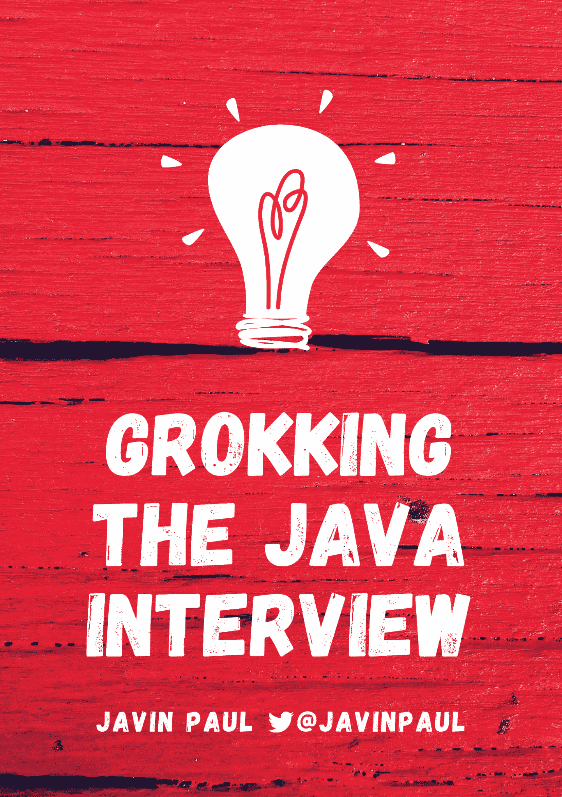


## 前言

攻克 Java 面试并非易，主要原因之一是 Java 非常庞大。要成为一名合格的 Java 开发者，需要掌握大量的概念和 API。许多擅长数据结构与算法、系统设计、SQL 和数据库等通用主题的人在 Java 面试中失败了，因为他们没有花时间学习 Java 核心概念以及基础 API 和包，例如 Java 集合框架、多线程、JVM 内部、JDBC、设计模式和面向对象编程。

本书旨在填补这一空白，并向你介绍这些主题中的经典 Java 面试题。通过学习这些问题和主题，你不仅能够扩展自己的知识，还能为下一次 Java 面试做好准备。如果你正在准备 Java 面试，我强烈建议你在电话面试或面面试之前过一遍这些问题，你不仅会获得回答问题的信心和知识，还能学习如何引导 Java 面试向你有利的方向发展。这是我作为 Java 开发者能给你的最重要的建议。始终记住，你的回答决定了面试的走向，而这些问题将教你如何引导面试官进入你的擅长领域。祝你 Java 面试顺利，如果你有任何问题或反馈，可以随时通过 [twitter javinpaul](http://twitter.com/javinpaul) 联系我，或者在我的博客 [Javarevisited](http://javarevisited.blogspot.com) 和 [Java67](http://java67.com) 上留言。

# 面向对象编程面试题

Java 是一种面向对象的编程语言，在 Java 面试中你会看到很多关于面向对象概念的问题。经典问题如接口和抽象类之间的区别一直存在，但过去几年，面试官还会问基于高级设计原则和模式的复杂问题，以检查考者的 OOP 知识。不过，面向对象编程问题在 1 到 3 年经验的程序员的 Java 面试中更常见。这很有，因为这些程序员必须掌握 OOP 基础知识，如抽象、继承、组合、类、对象、接口、封装等。

如果你在寻找针对 2 到 4 年经验开发者的 Java 面试题，你会发现许多基于继承和封装等 OOP 基础的问题，但随着经验的增加，你将看到基于面向对象分析与设计的问题，例如编写一个自动售卖机设计或在 Java 中实现一个咖啡机。

这些问题更困难，不仅要求真正理解 OOP 基础，还需要理解 SOLID 设计原则和模式。

在这一节中，我将与你分享一些基于 OOP 概念的 Java 面试题，这些是我从朋友和同事那里收集的，他们在不同公司的 Java 面试中遇到过。通常在前几轮，如筛选轮或电话面试。

如果你是高级 Java 开发者，你已经知道这些问题的答案，我建议你多练习面向对象分析与设计技能，即如何根据规范编写代码。如果你是应届生或有 2 到 3 年经验的初级 Java 开发者，你必须复习这些问题，如果不会就要学会，会在 Java 工作面试中表现良好。

### OOP 或 Java 中的方法重载（method overloading）是什么？

这是最老的 OOP 概念问题之一，我在 10 年前见过，现在依然可见。当我们有多个同名但功能不同的方法时，就称为方法重载。例如，`System.out.println()` 就重载了，因为我们有 6 或 7 个 `println()` 方法，每个方法接受不同类型的参数。

### OOP 或 Java 中的方法重写（method overriding）是什么？

这是面向对象编程的魔力之一，方法在运行时根据对象选择。为了实现方法重写，我们需要继承和多态，因为我们需要在父类和子类中具有相同签名的方法。对该方法的调用将在运行时解析，取决于实际对象而不是变量的类型。

### Java 中的方法隐藏（method of hiding）是什么？

当你在父类和子类中声明两个同名且签名相同的静态方法时，它们会相互隐藏。即：在子类中对方法的调用将调用该类声明的静态方法，而对父类中相同方法的调用将解析为父类中声明的静态方法。

### Java 是纯的面向对象语言吗？如果不是，为什么？

Java 不是纯的面向对象编程语言，例如，有很多你可以在不需要对象的情况下完成，例如静态方法。此外，基本类型变量在 Java 中不是对象。

### Java 中方法重载和重写的规则是什么？

Java 中方法重载最重要的规则之一是方法签名必须不同，即参数的数量或类型必须不同。仅仅更改两个方法的返回类型不会导致重载，相反，编译器将抛出错误。另一方面，方法重写的规则更多，例如：名称和返回类型必须相同，方法签名也应该相同，重载的方法不能抛出更高级的异常等。

### 方法重载和重写的区别？

有几点区别，但最重要的一点是方法重载在编译时解析，而方法重写在运行时解析。编译器只使用类信息用于方法重载，但它需要知道对象来解析被重写的方法调用。这张图很好地解释了这种区别：

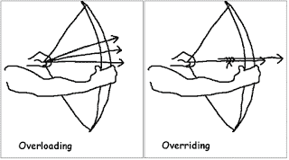

### 在 Java 中可以重载静态方法吗？

可以，你可以在 Java 中重载静态方法。你可以根据意愿声明任意数量同名的静态方法，只要它们都具有不同的方法签名。

### 在 Java 中可以重写静态方法吗？

不可以，你不能重写静态方法，因为它不绑定到对象。相反，静态方法属于类，并在编译时使用引用变量的类型解析。但是，是的，你可以在子类中声明相同的静态方法，这将导致方法隐藏。即：如果你使用子类的引用变量，将调用新方法；但如果你使用父类的引用变量，则将调用旧方法。

### 在不使用 final 修饰符的情况下可以防止重写方法吗？

可以，你可以在不使用 final 修饰符的情况下防止 Java 方法重写。事实上，有几种实现方法，例如你可以将方法标记为 private 或 static，这些不能被重写。

### 在 Java 中可以重写私有方法吗？

不可以。由于私有方法只在声明它们的类内部可访问和可见，因此在子类中无法重写它们。不过，你可以在内部类中重写它们，因为它们在内部是可以访问的。

### Java 中的协变方法重写（covariant method overriding）是什么？

在协变方法重写（covariant method overriding）中，重写的方法可以返回原始或被重写方法的对象的子类。这个概念是在 `Java` 1.5 (Tiger) 版本中引入的，当原始方法返回如 `Object` 类等通用类型时，它非常有帮助，因为通过使用协变方法重写，你可以返回更合适的对象并防止客户端侧进行类型转换。该概念的实际应用之一是在你在 `Java` 中重写 `clone()` 方法时。

### 在重写时，我们可以将方法的返回类型更改为子类吗？

是的，可以，但仅从 `Java` 5 开始支持。这一特性被称为协变方法重写，是在 `JDK` 5 发布中引入的。如果原始方法返回父类（例如 `clone()` 方法返回 `java.lang.Object`），那么这非常有帮助。通过这种方法，你可以直接返回实际类型，防止对结果进行客户端侧进行类型转换。

### 我们可以更改重写方法的参数列表吗？

不，不可以。参数列表是方法签名的一部分，重写方法和被重写方法必须具有相同的签名。

### 我们可以重写抛出运行时异常但不带 `throws` 句的方法吗？

是的，在重写时对未检查异常（unchecked exceptions）没有限制。另一方面，在检查异常的情况下，重写异常不能抛出在类型层次中更高的检查异常，例如：如果原始方法抛出 `IOException`，那么重写方法不能抛出 `java.lang.Exception` 或 `java.lang.Throwable`。

### 在子类中调用重写方法的父类版本？

你可以使用 `super` 关键字在子类中调用重写方法的父类版本。例如，调用 `java.lang.Object` 类的 `toString()` 方法，你可以调用 `super.toString()`。

### 在 Java 中可以将非静态方法重写为静态方法吗？

是的，你可以在 `Java` 中重写非静态方法，这没有问题，但它不应该是 `private` 或 `final` 的 :)

### 可以在 Java 中重写 final 方法吗？

不，你不能在 `Java` 中重写 `final` 方法，方法上的 `final` 关键字是为了防止方法被重写。当你出于安全考虑，不希望子类通过重写来改变你方法的逻辑时，就会使用 `final`。这就是为什么 `Java` 中的 `String` 类是 `final` 的。这个概念也用于模板设计模式，其中模板方法被设为 `final` 以防止重写。

### 接口内部可以是非抽象方法吗？

从 `Java` 8 开始，你可以在 `interface` 中拥有非抽象方法，在此之前是不允许的，因为所有方法隐式地为 public abstract。从 `JDK` 8 开始，你可以在 `interface` 内部添加 `static` 和 `default` 方法。

### Java 8 的默认方法是什么？

默认方法（default method），也称为扩展方法，是你现在可以在接口上添加的新类型方法。这些方法具有实现，并旨在默认使用。通过这种方法，`JDK` 8 成功地提供了与 lambda 表达式和流 API 相关的常用功能，而不会破坏所有实现接口的客户端。如果你查看 `Java` 8 API 文档，你会发现在 `Iterator`、`Map` 等关键 Java 接口上有许多实用的默认方法。

### Java 中的抽象类是什么？

抽象类是不完全的类。在 `Java` 中，你不能创建抽象类的实例。它们的提供是为了定义默认行为，并确保该类的客户端必须遵守抽象类内部定义的契约。为了使用它，你必须扩展并实现它们的抽象方法。顺带说，在 `Java` 中，类可以在不指定任何抽象方法的情况下是抽象。

### Java 中的接口是什么？接口的真实用途是什么？

像抽象类，`interface` 也是为了指定 API 的契约。它支持 OOP 抽象概念，因为它只定义了抽象行为。它会告诉你的程序将产生输出，但如何实现取决于实现者。接口的真实用途是定义类型以利用多态。

### 抽象类和接口之间的区别？

在 `Java` 中，关键区别在于抽象类可以包含非抽象方法，但接口不能，不过从 `Java` 8 开始，接口也可以包含非抽象的 `static` 和 `default` 方法。

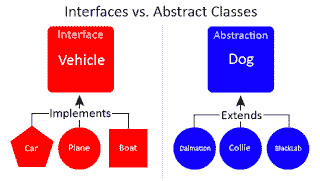

### 我们可以在没有抽象方法的情况下让类变成抽象的吗？

是的，只需在类定义上添加 `abstract` 关键字，你的类就会变成抽象类。

### 我们可以让一个类既是 final 的又是抽象的吗？

不，你不能在类上同时应用 `final` 和 `abstract` 关键字，因为它们是完全相反的。`Java` 中的 `final` 类不能被扩展，而你无法在不扩展并转换为具体类的情况下使用抽象类。根据 Java 规范，如果你尝试让一个类同时是抽象和 final，编译器将抛出错误。

### 可以在 Java 中重载或重写 main 方法吗？

不，由于 `main()` 是一个 `static` 方法，你只能对其进行重载，不能重写它，因为 `static` 方法在编译时解析，不需要对象信息，因此我们不能在 `Java` 中重写 `main` 方法。

### 多态（Polymorphism）、重载（Overloading）和重写（Overriding）的区别是什么？

这是一个微妙的 OOP 概念问题，因为多态是重载和重写背后的真实概念。重载是编译时多态，而重写是运行时多态。

### Java 中的接口可以扩展多个接口吗？

是的，接口在 `Java` 中可以扩展多个接口，这是完全有效的。

### Java 中的类可以扩展多个类吗？

不，类只能扩展另一个类，因为 `Java` 不支持多继承，但是的，它可以实现多个接口。

### Java 中抽象和多态的区别是什么？

抽象泛化概念，而多态允许你在不更改代码的情况下使用不同的实现。这张图很好地解释了抽象：


## 面向对象设计原则与模式面试

现在让我们来看基于 SOLID 设计原则和 GOF 设计模式的一些 OOP 概念问题，这些利用了这里讨论的 OOP 概念。

### Java 中的策略模式解决了什么问题？

策略模式允许在不更改使用算法代码的情况下引入新算法或新策略。例如，对对象列表排序的 `Collections.sort()` 方法使用策略模式来比较对象。由于每个对象使用不同的比较策略，可以在更改排序方法的情况下比较各种对象。

### 装饰模式基于哪个 OOP 概念？

装饰模式利用组合（Composition）在不修改原始类的情况下提供新功能。这是一个非常好的直接面试题。这从策略模式的 UML 图中看得很清楚，因为你可以看到 Component 与 Decorator 关联。

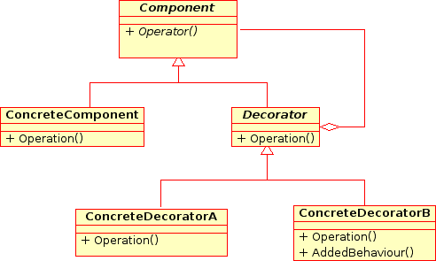

### 在 Java 中何时使用单例设计模式？

当你只需要类的一个实例并希望它是全局可用的时，可以使用单例模式。它并不是免费的，因为它会增加类之间的耦合性并使它们难以测试。这是 Java 面试中最老的设计模式问题之一。

### 状态模式和策略模式有什么区别？

虽然状态模式和策略模式的结构或类图是相同的，但它们的意图完全不同。状态模式用于根据特定状态执行特定操作，而策略模式允许你在不改变使用它的代码的情况下切换算法。

### OOP 中关联、聚合和组合有什么区别？

当一个对象与另一个对象相关时，这种被称为关联（Association）。它有两种形式：聚合（Aggregation）和组合（Composition）。前者是关联的松散形式，相关对象可以独立存在；而后者是关联的更强形式，相关对象无法独立存在。例如，城市是人的聚合，但身体部位是人身体的组合。

### Java 中装饰器模式、代理模式和适配器模式有什么区别？

它们看起来相似是因为它们的结构或类图非常相似，但意图大不相同。装饰器（Decorator）在不触动类的情况下增加额外功能，代理（Proxy）提供访问控制，而适配器（Adapter）则用于让两个不兼容的接口协同工作。

### SOLID 的五个面向对象的设计原则是什么？

SOLID 是 Uncle Bob 在他的经典著作《整洁代码》（Clean Code）中提出的术语，这本书是程序员的必读书籍。在 SOLID 中，每个字母都代表一个设计原则：

- S 代表单一责任原则（Single Responsibility Principle）
- O 代表开闭原则（Open closed design principle）
- L 代表里基夫替换原则（Liskov substitution principle）
- I 代表接口隔离原则（Interface segregation principle）
- D 代表依赖倒置原则（Dependency inversion principle）

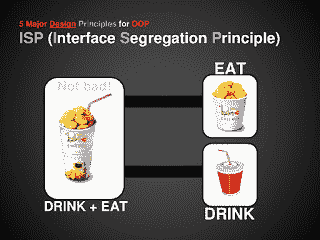

### OOP 中组合和继承有什么区别？

这是另一个很好的 OOP 概念问题，因为它测试了关键点——从类设计的角度来看，两者都非常重要。虽然组合和继承都允许你重用代码，但前者比后者更灵活。组合允许类在运行时获取额外的功能，而继承是静态的。你无法通过替换新的实现在运行时更改该功能。

以上就是这份面向对象编程（或 OOPS）概念面试题列表的全部内容。我们已经看到了涵盖各种 OOP 概念的问题，如抽象、封装、继承、组合、聚合、关联、类、对象和接口等。

我们还看到了关于面向对象设计原则（也称为 SOLID 原则）以及 GOF 设计模式（如策略、状态和工厂）的问题，这些都是基于面向对象编程概念和 OOP 设计原则的。

但是，正如我说的，如果你是一名高级 Java 开发者，你应该更多地关注面向对象的分析和设计，并学习如何利用你所有的 OOP 知识根据需求编写代码。你也可以阅读《面试密码》第 6 版来获取更多面向对象编程的问题。

# 电话面试轮的面试题

这是另一个关于准备 Java 面试的章节，这次我们将查看 Java 编程面试中电话环节的 40 个核心 Java 问题。电话面试通常是在筛选完简历后筛选候选人的第一步。由于给候选人打电话比安排面试、预订房间和安排会议更容易，电话面试现在非常流行。以前认为一轮电话面试就足够了，但现在几乎是与不同团队成员进行两到三轮电话面试。电话面试成功的关键在于回答要直接、简洁。由于面试官想在电话面试中涵盖很多内容，他们更欣赏直击要害的回答，而不是为了时间而废话或拖泥水。永远记住，这也是你留下印象的机会，所以请确保你的手机良好、电量充足，并使用语音调控技术尽可能清晰。

即使你不知道答案，也可以大声思考，面试官会欣赏思考的能力，有时这会被证明是决定性的。

以下我列出的 40 个经常出现在电话面试中的核心 Java 基础问题。这些问题涉及了重要的核心 Java 概念，例如 `String`、线程基础、多线程、线程间通信、Java 集合框架、序列化、面向对象编程概念和异常处理。如果你经历过几次 Java 面试，一定已经见过其中一些问题了。

### 1) Java 中 `String`、`StringBuffer` 和 `StringBuilder` 的区别？

`String` 是不可变的，而 `StringBuffer` 和 `StringBuilder` 都是可变的，这意味着任何更改（例如将 `String` 转换为大写或修剪空格）都会产生另一个实例，而不是更改原有实例。在后期中，`StringBuffer` 是同步的，而 `StringBuilder` 不是，实际上，它是 `Java` 1.5 中引入的 `StringBuffer` 的相同替代品。

### 2) Java 中 `extends Thread` 和 `implements Runnable` 有什么区别？

区别在于 Java 中你只能继承一个类，这意味着如果你继承了 `Thread` 类，你就失去了继承另一个类的机会；另一方面，如果你实现 `Runnable`，你仍然可以继承另一个类。

### 3) Java 中 `Runnable` 和 `Callable` 接口的区别？


在 JDK 1.5 引入`Callable`之前，`Runnable`是 Java 中实现并行执行任务的唯一方式。就像`Runnable`一样，`Callable`也定义了一个单一的`call()`方法，但与`run()`不同，它可以返回值并抛出异常。

### 4) Java 中`ArrayList`和`LinkedList`的区别？

简而言，`ArrayList`在 Java 中是由数组支持的，而`LinkedList`只是节点的集合，类似于链表数据结构。如果你知道索引，`ArrayList`提供随机搜索，而`LinkedList`只允许顺序搜索。另一方面，与`ArrayList`相比，在`LinkedList`中间添加和删除元素效率更高，因为只需要修改链接，不需要排列其他元素。

### 5) Java 中`wait`和`notify`有什么区别？

`wait`和`notify`方法都用于线程间通信，其中`wait`用于在条件下暂停线程，而`notify`用于向等待的线程发送通知。两者都必须在同步上下文（例如同步方法或块）中调用。

### 6) Java 中`HashMap`和`Hashtable`的区别？

虽然`HashMap`和`Hashtable`都基于哈希表数据结构，但它们之间存在细微区别。`HashMap`是非同步的，而`Hashtable`是同步的，因此`HashMap`比`Hashtable`快，因为它没有同步开销。另一个细微区别是`HashMap`允许`null key`，而`Hashtable`不允许。

### 7) Java 中`TreeSet`和`TreeMap`的区别？

虽然两者都是有序集合，但`TreeSet`本质上是一个`Set`数据结构，不允许重复，而`TreeMap`是`Map`接口的实现。实际上，`TreeSet`是通过`TreeMap`实现的，就像`HashSet`使用`HashMap`实现一样。

### 8) 写一个 Java 程序打印斐波那契数列？

核心 Java 面试题回答：斐波那契数列是一种数字，其中每个数字等于前两个数字之和，即`f(n) = f(n-1) + f(n-2)`。该程序用于向学生教授递归，但你也可以不使用递归来解决。请查看该问题的迭代和递归解决方案。

在电话面试中，这个问题并不常见，但有时面试官也想通过这类问题来检查你的解决问题能力。

### 9) 编写一个 Java 程序检查一个数字是否为质数？

如果一个数字除了自身外不能被任何其他数字整除，则称为质数。`1`不被视为质数，因此你的检查必须从`2\.`开始。最简单的解决方案是检查每个数字直到数字本身，看它是否能整除。当面试官要求你改进时，你可以说检查到数字的平方根即可。如果你能进一步改进算法，将给面试官留下更深刻印象。

### 10) 如何在不使用临时变量交换两个数字？

这是一个非常老的问题。我最早在 2005 年就见过这个问题了，但我确定它比那还要久。这个问题好的一点是，除了`XOR`技巧外，所有的解决方案都有缺陷，这被用来测试候选人是否真的掌握了自己的领域。

### 11) 如何在 Java 中检查链表是否包含循环？

另一个在电话面试和筛选轮中非常流行的解决问题题。这是一个测试候选人解决问题能力的绝佳问题，特别是如果他以前没见过这个问题。它还有一个关于寻找循环起点的很好的追问问题。

### 12) 编写 Java 程序在不使用 API 的情况下反转字符串？

另一个测试候选人解决问题能力的问题。你可能不会在 Java 面试的电话面试中遇到这类问题，但这些问题现在已经成为常态。所有面试官都在寻找逻辑，你不需要编写代码，但你应该能够思考出解决方案。

### 13) Java 中`Serializable`和`Externalizable`的区别是什么？

`Serializable`是一个标记接口，它没有定义任何方法，但`Externalizable`接口定义了两个方法，例如`readExternal()`和`writeExternal()`，这允许你控制序列化过程。`Serializable`使用默认的序列化过程，对于某些应用程序来说可能非常慢。

### 14) Java 中`transient`和`volatile`的区别是什么？

`Transient`关键字用于序列化，而`volatile`用于多线程。如果你想从序列化过程中排除一个变量，请将该变量标记为`transient`。与`static`变量类似，`transient`变量不会序列化。另一方面，`volatile`变量是给编译器的信号，表示多个线程对此变量感兴趣，编译器不应重排它的访问。`volatile`变量遵循发生在此（happens-before）关系，这意味着`volatile`变量中的任何写操作发生在任何读之前。你还可以使用`volatile`让`double`和`long`变量的非原子访问变为原子性。

### 15) 抽象类和接口的区别是什么？

从 Java `8`开始，Java 中抽象类和接口之间的区别已经缩小，现在接口甚至可以通过`default`和`static`方法包含实现。顺便说一下，在 Java 中你仍然只能扩展一个类，但可以实现多重继承。`Abstract class`用于提供默认实现，并留出一些需要自定义的部分，而`interface`广泛用于 API 来定义类的约。

### 16) 关联（Association）、组合（Composition）和聚合（Aggregation）的区别是什么？

在关联、组合和聚合之间，组合的关系是最强烈的。如果部分可以离开整体而存在，则两个类之间的关系被称为聚合；但如果部分不能离开整体而存在，则两个类之间的关系被称为组合。在`Inheritance`（继承）和组合之间，后者提供了更灵活的设计。

### 17) `FileInputStream`和`FileReader`的区别是什么？

`FileInputStream`和`FileReader`的区别在于，前者用于读取二进制数据，而后者用于文本数据。

### 18) 你在 Java 中如何将字节转换为文本？

你可以使用`String`构造函数将字节转换为文本。技巧之处是指定字符集（charset）以避免平台问题。

### 19) `finally`子句中可以`return`语句吗？会发生什么？

是的，你可以在`finally`中使用`return`语句，但这会阻止`finally`块的执行（实际上它会覆盖之前的返回值）。这通常被认为是一种糟糕的做法。

### 20) 你可以在 Java 中重写静态方法吗？

不可以，你不能在 Java 中重写`static`方法，因为它们是在编译时而不是在运行时解析的。尽管你可以在子类中声明并定义同名的`static`方法，但这会隐藏父类的方法，这就是为什么它被称为方法隐藏（method hiding）。

### 21) Java 中`private`、`public`和`protected`的区别是什么？

这四个都是访问修饰符，但只有`private`、`public`和`protected`是关键字。没有用于包访问的关键字，它的默认是在相同包内可访问。`private`变量仅在声明它的类中可见，`protected`变量可以在相同包内的所有类中访问，但只有包外的子类也可以，而`public`变量可以在任何地方访问。这是封装的最高和最低形式。

### 22) 你在 Java 中学到的 5 个编码实践是什么？

如果你开发某种编程语言几年了，你肯定知道很多实践，通过询问其中几个，面试官只是在检查你是否熟悉自己的手艺。以下是我的 5 个实践：

- 始终为你的线程命名，这对调试有巨大帮助。
- 使用`StringBuilder`进行字符串拼接。
- 始终指定`Collection`的大小，这将节省大量在调整大小上的花费。
- 除非有充分理由，否则始终将变量声明为`private`和`final`。
- 始终面向接口编码而不是面向实现。
- 为方法提供依赖，而不是让它们自己获取，这将使你的代码可单元测试。

### 23) 编写一个程序找到数组中的最大值和最小值？

这是另一个测试候选人解决问题能力的编码题。根据你回答这个问题的方式，准备好几个追问。脑海中想出的最简单方法是对数组排序，然后取第一个和最后一个元素。

### 24) 编写一个程序在原地反转数组？

另一个针对 Java 程序员的解决问题题。这里的关键点是你需要在原地反转数组，这意味着你不能使用额外的缓冲区，一个或两个变量即可。注意，你不能使用任何库代码，你需要创建自己的逻辑。

### 25) 编写一个 Java 程序反转一个数字？

对于一个非常初级的程序员来说，这是一个有趣的程序，从大学时期就开始，但有时也会让有几年经验的开发者感到困惑。大多数这些开发者的代码很少，所以他们发现这类问题具有挑战性。这里的技巧是使用取模运算符（`%`）获取数字的最后一位，并使用除法运算符（`/`）每次减少数字。

另一道针对初学者的编程题，非常适合电话面试，因为你可以借此区分出谁会写程序，而谁不会写。它也有助于观察开发者是否熟悉递归和迭代算法，以及它们各自的优缺点。你还可以问很多后续问题，例如：如何提高算法的性能？由于一个数的阶乘等于该数乘以上一个数的阶乘，你可以缓存这些值而不是重新计算，这会给面试官留个深刻的印象。

### 27) 调用`start()`方法和`run()`方法有什么区别？

你可能以前听过这个问题：如果调用`start()`方法最终会调用`run()`方法，那么那为什么不直接调用`run()`方法呢？嗯，区别在于，`start()`方法还会启动一个新线程。如果你直接调用`run()`方法，它将在同一个线程上运行，而不是在不同的线程上运行，这并不是原始的意图。

### 28) 写一个 Java 程序来解决生产者-消费者问题？

这是一个非常好的问题，用来检查候选人是否能编写线程间通信代码。如果一个人能手写出生产者-消费者解决方案，并指出临界区以及如何保护它、如何与线程通信，那么他就足以胜任编写和维护你的并发 Java 程序了。这是 Java 开发者的最基本要求，这也是为什么我喜欢这个问题，因为它还有多种解决方案，例如：使用`blocking queue`等并发集合、使用`wait`和`notify`，以及使用 Java 5 的其他同步器（例如`semaphores`）。

### 29) 如何在一次遍历中找到链表的中间元素？

另一个用于热身的简单逻辑题解决题。在单向链表中，你只能向一个方向遍历，如果你不知道长度，就无法编写循环来精确找到中间元素，这就是问题的关键所在。一种解决方案是使用两个指针，快指针和慢指针。快指针移动 2 步时，慢指针移动 1 步，当快指针指向列表末尾（即`null`）时，慢指针指向中间。

### 30) Java 中`equals()`和`hashCode()`的合约是什么？它们在哪里使用？

Java 电话面试中必问的问题之一。如果一个人不知道`equals()`和`hashCode()`，那么他可能不值得进一步培养了，因为这是 Java 基础的核心。合约的关键点在于：如果两个对象通过`equals()`方法相等相等，那么它们必须具有相同的`hashcode`；但不等的对象也可能有相同的`hashcode`，这就是基于哈希表的集合（例如`HashMap`）发生冲突的原因。当你重写`equals()`时，必须记住重写`hashCode()`方法以保持合约有效。

### 31) 为什么`wait`和`notify`方法被声明在`Object`类中？

这个问题更多是为了找出你到底有多少经验，以及你对 Java API 及其设计决策有何思考。类似的问题是：为什么`String`在 Java 中是不可变的？嗯，真正的答案只有 Java 设计师能给出，但你可以进行推理。例如，`wait`和`notify`方法与锁相关，而锁属于对象而不是线程，这就是为什么将这些方法保留在`java.lang.Object`类中是合理的。

### 32) `HashSet`在 Java 中是如何工作的？

`HashSet`在 Java 内部是使用`HashMap`实现的，这正是面试官想听到的答案。然后他可以用一些基于常识的问题来考问你，例如：既然`HashMap`需要两个对象（键`key`和值`value`），你该如何使用它？在`HashSet`中，“值”是什么？嗯，在`HashSet`中，使用一个虚拟对象作为值，而键对象是从 Set 的角度来看的元素。由于`HashMap`不允许重复键，它也遵循 Set 数据结构不允许重复的合约。

### 33) Java 中`synchronized`和并发集合（concurrent Collection）有什么区别？

在 Java 1.5 之前，如果你在多线程 Java 程序中需要集合，只有`synchronized`集合。这些类深受许多问题的困扰，最重要的性能问题，因为每当线程读取或写入时它们都会锁定整个集合或映射。为了解决这些问题，Java 发布了一些并发集合类，例如`ConcurrentHashMap`、`CopyOnWriteArrayList`和`BlockingQueue`，以提供更好的可扩展性和性能。

### 34) Java 中`Iterator`和`Enumeration`有什么区别？

主要区别是`Iterator`被引入用来取代`Enumeration`的。它允许你在遍历时从集合中删除元素，这在`Enumeration`中是不可能的。`Iterator`的方法（例如`hasNext()`和`next()`）也比`Enumeration`相应的方法（例如`hasMoreElements()`）更简洁。你应该在 Java 代码中始终使用`Iterator`，因为`Enumeration`可能在未来的 Java 版本中被弃用并删除。

### 35) Java 中重载（Overloading）和重写（Overriding）有什么区别？

Java 面试电话环节的另一个高频问题。虽然重载和重写都与同名方法有关，但它们具有不同的特征，例如：重载的方法与原始方法具有不同的签名，而重写的方法必须具有相同的签名。此外，重载方法在编译时解析，而重写方法在运行时解析。

### 36) Java 中静态绑定（static binding）和动态绑定（dynamic binding）的区别是什么？

这通常作为上一个问题的后续问题：静态绑定与重载方法有关，动态绑定与重写方法有关。像`private`、`final`和`static`等方法在编译时通过静态绑定解析，但可以被重写的虚拟方法在运行时通过动态绑定解析。

### 37) Java 中`Comparator`和`Comparable`的区别？

这是另一个基础概念，我期望每个 Java 候选人都能掌握。你会在每个 Java 项目中遇到它们。Java 中的几个核心类（如`String`、`Integer`）实现了`Comparable`来定义它们的自然排序；如果你定义了一个值或领域对象，你应该实现`Comparable`并定义对象的自然排序。两者之间的主要区别在于，你可以创建多个`Comparator`来定义多种排序规则。此外，为了实现`Comparable`你必须拥有该类的源码，但使用`Comparator`不需要类的源码，只需要该对象的 JAR 文件即可。这就是为什么`Comparator`对于实现自定义排序非常强大，而且从 Java 8 开始你可以更优雅地实现，如下所示。

### 38) 如何降序排序`ArrayList`？

你可以使用`Collections.sort()`方法配合反向`Comparator`，这可以按元素的反自然顺序进行排序，例如：

```
List<String> listOfString = Arrays.asList(“London”, “Tokyo”, “NewYork”); 
Collections.sort(listOfString, Collections.reverseOrder()); 
System.out.println(listOfString); //Tokyo, NewYork, London
```

### 39) Java 中`PATH`和`CLASPATH`的区别是什么？

`PATH`是指向 Java 二进制文件的环境变量，用于运行 Java 程序。`CLASPATH`是另一个环境变量，指向 Java 类文件或 JAR 文件。如果在此`CLASPATH`中未找到某个类，Java 将抛出`ClassNotFoundException`。

### 40) Java 中受检异常（Checked Exception）和未检异常（Unchecked Exception）有什么区别？

受检异常确保提供了异常处理程序，并由编译器进行验证；而抛出未检异常则不需要特殊准备（例如`throws`子句）。方法可以在不写`throws`子句的情况下抛出未检异常。

以上就是关于电话面试的约 40 个核心 Java 面试题。不要轻视电话面试，这是你给潜在雇主留下印象的第一个机会。由于你看不见面试官，仅通过声音进行交流，这与面对面的面试略有不同。

因此，务必保持冷静、放松，回答问题要切中准确，说话要缓慢，并确保你不在声音会有回声的地方（如狭窄的楼梯间）。良好的手机、耳机以及良好的信号区域也非常重要。我见过很多次候选人因为无法法听清声音或在回答之前无法理解问题而在面试中失败。我知道有些人会在那些秘密的地方进行电话面试，但如果你真的这样做，请确保你的手机连接信号足够。

## 多线程与并发面试题


无论你参加任何 Java 面试，无论是初级还是高级级、有经验的还是新人，都不可避免会遇到几个关于线程、并发和多线程的问题。事实上，这种内置的并发支持是 Java 编程语言最强优势点之一，使其在企业界和程序员中同样大受欢迎。大多数高薪的 Java 开发者职位都要求具备卓越的核心 Java 多线程技能，以及开发、调试和调优高性能低延迟并发 Java 应用的经验。这就是为什么它是 Java 面试中最受青的技能之一。多线程和并发的概念也难以掌握，只有具有丰富经验的优秀开发者才能有效处理并发问题。

在典型的 Java 面试中，面试官会从`Thread`的基本概念开始缓慢提问，例如：为什么需要线程、如何创建线程、哪种创建线程的方式更好（例如通过扩展`Thread`类或实现`Runnable`接口），然后逐渐进入并发问题、开发并发 Java 应用期间面临的挑战、Java 内存模型、`JDK 1.5`引入的高阶并发工具、并发 Java 应用的原理和设计模式、经典的多线程问题（例如生产者-消费者、哲学家就、读写者或简单的边界缓冲区问题）。

由于仅仅了解线程的基础知识是不够的，你必须知道如何处理死锁、竞态条件、内存不一致以及各种与线程相关的问题。这些技能会通过展示各种多线程和并发问题来得到彻底测试。

许多 Java 开发者习惯在面试前只看和读面试题，这并不坏，但不应该脱离实际太远。此外，收集问题并反复练习同一个题目太时耗力，这就是为什么我创建了这份从各种面试中收集的前 50 个 Java 多线程和并发相关问题列表。我会在发现新的和最近的面试题时不断添加。

虽然专注于高级多线程和并发技能的 Java 面试需要具备良好的知识和扎实的经验，但我强烈建议 Java 程序员在参加面试前阅读两遍《Effective Java》（Effective Java）和《Java 并发编程》（Java Concurrency in Practice）。它们不仅能帮助你更好地回答问题，还能帮助你清晰地表达你的想法。

而且，如果你认真想要精通 Java 多线程和并发，我建议你查看 Udemy 上由 Michael Pogrebinsy 提供的 Java Multithreading, Concurrency, and Performance Optimization 课程。这是一门成为 Java 多线程、并发和并行编程专家的高级课程，强调高性能。

顺便说一下，我在这里没有提供某些问题的答案。为什么？因为我预计大多数 Java 开发者应该知道这些问题的答案，如果不知道，通过 Google 也能轻松找到答案。

以下是我们的 Java 线程、并发和多线程热门问题列表。你可以使用这个列表为你的 Java 面试做好充分准备。

## 1) 什么是 Java 线程？

线程是执行的独立路径。它是利用机器中可用多个 CPU 的方式。通过使用多个线程，你可以加速 CPU 密集型任务。例如，如果一个线程需要 100 毫秒完成一项工作，你可以使用 10 个线程将该任务缩短到 10 毫秒。Java 在语言层面为多线程提供了卓越的支持，这也是它的核心卖点之一。

## 2) Java 中线程和进程的区别是什么？

线程是`Process`的子集，换句话说，一个进程可以包含多个线程。两个进程运行在不同的内存空间中，但所有线程共享同一个内存空间。不要将其与栈内存混淆，不同线程的栈是不同的，用于存储该线程的本地数据。

## 3) 如何在 Java 中实现线程？

在语言层面，实现`Thread`有两种。`java.lang.Thread`的实例代表一个线程，但它需要一个任务来执行，该任务是`java.lang.Runnable`接口的实例。由于`Thread`类本身实现了`Runnable`，你可以通过扩展`Thread`类或直接实现`Runnable`接口来重写`run()`方法。

## 4) 在 Java 中何时使用 Runnable 还是 Thread？

这是上一个多线程面试题的后续问题。既然我们知道可以通过扩展`Thread`类或实现`Runnable`接口来实现线程，问题也就随之产生：哪种更好？什么时候用哪一个？如果你知道 Java 编程语言不支持类的多继承，但允许实现多个接口，那么这个问题就很容易回答。如果你还想扩展另一个类（例如`Canvas`或`CommandListener`），那么实现`Runnable`比扩展`Thread`更好。

## 6) Thread 类 `start()` 方法和 `run()` 方法的区别是什么？

这是早期的经典陷阱 Java 面试题之一，但仍然足以区分对 Java 线程模型的浅层理解。`start()`方法用于启动新创建的线程，而`start()`在内部会调用`run()`方法，这与直接调用`run()`方法是有区别的。当你像普通方法一样调用`run()`时，它是在同一个线程中调用的，不会启动新线程，而调用`start()`方法时情况不同。

## 7) Java 中 Runnable 和 Callable 的区别是什么？

`Runnable`和`Callable`都代表旨在在独立线程中执行的任务。`Runnable`从`JDK 1.0`就存在，而`Callable`是在`JDK 1.5`添加的。这两者的主要区别是`Callable`的`call()`方法可以返回值并抛出异常，而`Runnable`的`run()`方法无法做到这一点。`Callable`返回`Future`对象，可以持有计算结果。

## 8) Java 中 CyclicBarrier 和 CountDownLatch 的区别是什么？

虽然`CyclicBarrier`和`CountDownLatch`都在等待一个或多个事件的线程数，但它们的主要区别在于，一旦`CountDownLatch`计数归零就无法重使用，但在屏障损坏后你可以重用同一个`CyclicBarrier`。

## 9) 什么是 Java 内存模型？

Java 内存模型（Java Memory model）是一组规则和指南，允许 Java 程序在不同的内存架构、CPU 和操作系统上以确定性的行为运行。它在多线程情况下尤为重要。Java 内存模型为一个线程所做的更改对其他线程可见提供了某些保证，其中之一就是“发生之前”（happens-before）关系。这种关系定义了几条规则，允许程序员预测和推理并发 Java 程序的行为。例如，“发生之前”关系保证了：

- 线程中的每个动作都发生在该线程中在程序顺序上之后的每个动作之前，这被称为程序顺序规则（program order rule）。
- 对监视器锁（monitor lock）的解锁发生在对同一个监视器锁的后续任何锁定之前，也称为监视器锁规则（Monitor lock rule）。
- 对`volatile`字段的写入发生在该字段的后续任何读取之前，被称为 volatile 变量规则（Volatile variable rule）。
- 对线程调用`Thread.start()`发生在任何其他线程检测到该线程已终止之前（无论是成功从`Thread.join()`返回，还是通过`Thread.isAlive()`返回 false），也称为线程启动规则（Thread start rule）。
- 一个线程对另一个线程调用`interrupt()`发生在被中断线程检测到中断之前（无论是通过抛出`InterruptedException`，还是调用`isInterrupted`或`interrupted`），俗称为线程中断规则（Thread Interruption rule）。
- 对象构造函数的结束发生在该对象终结器（finalizer）开始之前，被称为终结器规则（Finalizer rule）。
- 如果 A 发生在 B 之前，且 B 发生在 C 之前，那么 A 发生在 C 之前，这意味着“发生之前”保证具有传递性（Transitivity）。

我强烈建议阅读《并发编程》（Java Concurrency in Practice）的第 16 章，以更详细了解 Java 内存模型。

## 10) Java 中的 `volatile` 变量是什么？

`Volatile` 是一种特殊的修符，只能用于实例变量。在并发 Java 程序中，在没有`synchronized`关键字或锁等同步器的情况下，多个线程对实例变量所做的更改对其他线程是不可见的。`volatile`变量保证写入发生在任何后续读取之前：如上一个问题所述：“volatile 变量规则”。

## 11) 什么是线程安全？`Vector` 是线程安全的类吗？

线程安全是对象或代码的属性，保证如果以任何方式被多个线程（例如读与写）执行或使用，其行为将符合预期。例如，一个线程安全的计数器对象，如果该计数器的同一个实例在多个线程之间共享，它不会遗漏任何计数。显然，你也可以将集合类分为两类：线程安全和非线程安全。`Vector`确实是一个线程安全的类，它通过同步修改`Vector`状态的方法来实现线程安全；另一方面，它的对应类`ArrayList`不是线程安全的。

## 12) Java 中的竞态条件（race condition）是什么？请举例。

竞态条件是 Java 程序处于并发执行环境时导致某些细微编程错误的原因。正如其名所示，竞态条件由于多个线程之间的竞争产生，如果本应该先执行的线程输掉了竞争并变为后执行，代码的行为就会改变，表现为非确定性的 bug。由于线程之间竞争的随机性，这是最难发现和重现的 bug 之一。

## 13) 如何在 Java 中停止线程？

我总是说 Java 为一切都提供了丰富的 API，但讽刺的是 Java 并没有提供可靠的停止线程的方法。`JDK 1.0`中曾有一些控制方法，例如`stop()`、`suspend()`和`resume()`，由于潜在的死锁威胁，它们在后续版本中被弃用了，从那时起 Java API 设计师并没有努力提供一种一致、线程安全且优雅的停止线程的方法。程序员主要依赖线程在完成`run()`或`call()`方法执行后会自动停止这一事实。要进行手动停止，程序员要么利用`volatile`布尔变量并在每次迭代中检查`run`方法是否有循环，要么通过中断线程来强制取消任务。

## 14) 当线程中发生 `Exception` 会发生什么？

这是我在面试中见过非常不错且带有陷阱的 Java 问题。简单来说，如果不捕获，线程将死亡；如果注册了未捕获异常处理器，则它会收到回调。`Thread.UncaughtExceptionHandler`是一个接口，定义为嵌套接口，用于当`Thread`因未捕获的异常意外终止时调用的处理器。当线程因未捕获的异常即将终止时，Java 虚拟机将使用`Thread.getUncaughtExceptionHandler()`查询线程的`UncaughtExceptionHandler`，并调用处理器的`uncaughtException()`方法，将线程和异常作为参数传递。

## 15) 如何在 Java 两个线程之间共享数据？

你可以通过使用共享对象或`BlockingQueue`等并发数据结构在线程之间共享数据。请看此教程学习 Java 中的线程间通信。它使用`wait`和`notify`方法实现了生产者-消费者模式，这涉及在两个线程之间共享对象。

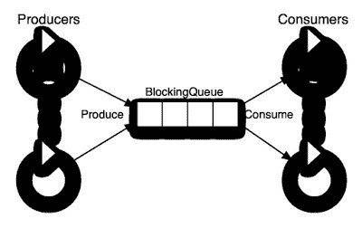

## 16) Java 中 `notify` 和 `notifyAll` 有什么区别？

这是核心 Java 面试中的另一个陷阱问题，因为多个线程可能在同一个监视器锁上等待，Java API 设计师提供了方法在等待条件变化时仅通知其中一个或所有线程，但他们只提供了一部分实现。`notify()`方法没有提供选择特定线程的方法，因此它只在你知道只有一个线程在等待时才有用。另一方面，`notifyAll()`向所有线程发送通知并允许它们竞争锁，这确保了至少会有一个线程能够继续向下执行。

## 17) 为什么 `wait`、`notify` 和 `notifyAll` 不在 `thread` 类中？

这是一个与设计相关的问题，检查候选人对现有系统的看法，或者他是否考虑过某些非常常见但起初看起来不恰当的东西。为了回答这个问题，你必须给出说明为什么这三个方法放在`Object`类中是有意义的而不是放在`Thread`类中。一个明显的原因是，Java 提供了对象级别的锁，而不是线程级别的锁。每个对象都有锁，并由线程获取。现在，如果线程需要等待某个锁，那么在该对象上调用`wait()`比在线程上调用更合理。如果`wait()`方法声明在`Thread`类上，那么将不清楚线程正在等待的是哪把锁。简而言之，由于`wait`、`notify`和`notifyAll`在锁级别操作，因此在对象类（object class）中定义它们是合理的，因为锁属于对象。

## 18) Java 中的 `ThreadLocal` 变量是什么？

`ThreadLocal`变量是 Java 程序员可用的一种特殊变量。就像实例变量是每个实例一个一样，`ThreadLocal`变量是每个线程一个。它是实现创建成本对象线程安全的良好方法，例如，你可以使用`ThreadLocal`使得`SimpleDateFormat`线程安全。由于该类创建开销大，在局部作用域内使用它并不好，因为每次调用都需要独立的实例。通过为每个线程提供自己的副本，你可以一箭双雕：首先，通过重用固定数量的实例减少了实例数量；其次，在不支付同步或不可变性代价的情况下实现了线程安全。线程本地变量另一个很好的例子是`ThreadLocalRandom`类，它减少了多线程环境中创建开销较大的`Random`对象的实例。

## 19) 什么是 `FutureTask`？

`FutureTask`代表并发 Java 应用中一个可取消的异步计算。该类提供了`Future`的基础实现，并带有启动和取消计算、查询计算是否完成以及检索计算结果的方法。只有在计算完成后才能检索结果；如果计算尚未完成，`get`方法将发生阻塞。`FutureTask`对象可以用于封装`Callable`或`Runnable`对象。由于`FutureTask`也实现了`Runnable`，因此它可以被提交给`Executor`执行。

## 20) Java 中置的 `interrupted()` 方法和 `isInterrupted()` 方法有什么区别？

`interrupted()`和`isInterrupted()`之间的主要区别在于：前者会清除中断状态，而后者不会。Java 多线程中的中断机制是使用一个名为“中断状态”的内部标志来实现的。通过调用`Thread.interrupt()`中断线程会设置此标志。当被中断的线程通过调用静态方法`Thread.interrupted()`检查中断时，中断状态会被清除。非静态的`isInterrupted()`方法用于一个线程查询另一个线程的中断状态，它不会改变中断状态标志位。根据惯例，任何通过抛出`InterruptedException`导出的方法在执行时都会清除中断状态。然而，另一个线程通过调用`interrupt`可能会立即再次设置中断状态。

## 21) 为什么 `wait` 和 `notify` 方法要在 `synchronized` 块中调用？

在`synchronized`块或方法中调用`wait`和`notify`方法的主要原因是这是 Java API 的强制要求。如果你没有在同步上下文中调用它们，你的代码将抛出`IllegalMonitorStateException`。另一个更微妙的原因是为了避免`wait`和`notify`调用之间的竞态条件。

## 22) 为什么你应该在循环中检查等待条件？

如果等待线程没有在循环中检查等待条件，它可能会接收到虚假报警和虚假唤醒（spurious wake up calls），即使条件不满足，它也会直接退出。因此，当等待线程唤醒时，它不能假设它所等待的状态仍然有效。该状态在过去可能是有效的，但在调用`notify()`方法之后、等待线程唤醒之前，状态可能已经发生了变化。这就是为什么在循环中调用`wait()`方法总是更好，你甚至可以在 Eclipse 中创建调用`wait`和`notify`的模板。要进一步了解这个问题，我建议你阅读《Effective Java》中关于线程和同步的条目。

## 23) Java 中 `synchronized` 和并发集合（concurrent collection）有什么区别？

虽然`synchronized`和并发集合都提供了适用于多线程和并发访问的线程安全集合，但后者比前者更具可扩展性。在 Java 1.5 之前，Java 程序员只有同步集合可用，当多个线程并发访问它们时，它们会成为竞争点，这阻碍了系统的可扩展性。Java 5 引入了如`ConcurrentHashMap`等并发集合，它不仅提供了线程安全性，还通过使用锁分段（lock stripping）和内部表分区等现代技术提高了了可扩展性。

## 24) Java 中的 `Stack`（栈）和 `Heap`（堆）有什么区别？

为什么有人会将这个问题作为多线程和并发的一部分提出？因为`Stack`是一个与线程密切相关的内存区域。为了回答这个问题，`stack`和`heap`都是 Java 应用中特定的内存。每个线程都有自己的`stack`，用于存储局部变量、方法参数和调用栈。存储在一个`Thread`的`stack`中的变量对其他线程不可见。另一方面，`heap`是所有线程共享的公共内存区域。无论是局部对象还是任何级别的对象都创建在`heap`内部。为了提高性能，线程倾向于将来自`heap`的值缓存到自己的`stack`中，如果该变量被多个线程修改，就会产生问题，这就是`volatile`变量大显用场的地方。`volatile`表示线程始终从主内存读取变量的值。

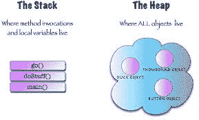

## 25) 什么是线程池？为什么在 Java 中应该使用线程池？


创建线程在时间和资源方面都是昂贵的。如果你在处理请求时创建线程，将减慢你的响应时间，而且一个进程可以创建的线程数量是有限的。为了避免这两个问题，在应用程序启动时创建一个线程池，并重用线程来处理请求。这个线程池被称为“线程池”，线程被称为工作线程。从 JDK 1.5 发布开始，Java API 提供了`Executor`框架，允许你创建不同类型的线程池，例如：单线程池（一次处理一个任务）、固定线程池（固定数量线程的池）或缓存线程池（适用于许多短生命周期任务的可扩展线程池）。

## 26) 编写代码解决 Java 中的生产者消费者问题？

你在现实世界中解决的大多数线程问题都属于生产者消费者模式，其中一个线程生产任务，另一个线程消费该任务。你必须知道如何进行线程间通信来解决这个问题。在底层，你可以使用`wait`和`notify`来解决这个问题；在高层，你可以利用`Semaphore`或`BlockingQueue`来实现生产者消费者模式。

## 27) 如何在 Java 中避免死锁？编写代码？

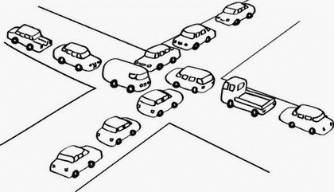

死锁是两个线程互相等待对方采取行动以便自己继续移动的状态。这是一个严重的问题，因为当它发生时，你的程序会挂起不再运行。要发生死锁，必须满足以下四个条件：

- **互斥（Mutual Exclusion）**：至少有一个资源以非共享模式持有。在任何时刻只有一个进程可以使用该资源。
- **持有并等待（Hold and Wait）**：进程当前持有至少一个资源，并请求其他进程持有的额外资源。
- **不可剥夺（No Pre-emption）**：操作系统在资源分配后不能撤销资源；资源必须由持有进程自愿释放。
- **循环等待（Circular Wait）**：进程必须等待被另一个进程持有的资源，而该进程又在等待第一个进程释放资源。

避免死锁最简单的方法是防止循环等待，这可以通过按顺序获取锁并按反顺序释放锁来实现，以便线程只有在持有另一个锁时才能继续获取该锁。

## 28) Java 中活锁（livelock）和死锁（deadlock）有什么区别？

这个问题是上一个面试问题的扩展。活锁与死锁相似，不同在于参与活锁的线程或进程的状态相互之间不断变化，但没有任何一个能进一步进展。活锁是资源饥饿的一种特殊情况。活锁的一个现实世界例子是两个人在狭窄走廊相遇，每个人都试图礼貌地侧身让对方通过，但他们反复在同一时间向同一侧移动，导致没有任何进展。简而言之，活锁和死锁的主要区别在于，在这种情况下状态在变化，但没有进展。

在 Java 面试的电话轮次遇到这个问题之前，我甚至不知道可以检查一个`Thread`是否已经持有锁。`java.lang.Thread`上有一个名为`holdsLock()`的方法，当且仅当当前线程持有指定对象的监视锁（monitor lock）时，它返回`true`。

## 30) 如何在 Java 中获取线程储（thread dump）？

根据操作系统的不同，有多种方法获取 Java 进程的线程储。当你获取线程储时，`JVM`会将所有线程的状态导出到日志文件或标准错误控制台中。在 Windows 中，你可以使用`Ctrl + Break`键组合获取线程储；在 Linux 上，可以使用`kill -3`命令实现相同的功能。你也可以使用名为`jstack`的工具来获取线程储，它作用于进程 ID，该 ID 可以另一个名为`jps`的工具找到。

## 31) 使用哪个 JVM 参数来控制线程的栈大小？

这是一个简单的问题，`-Xss`参数用于控制 Java 中`Thread`的栈大小。你可以查看此 JVM 选项列表以了解更多关于该参数的信息。

## 32) Java 中 synchronized 和 ReentrantLock 有什么区别？

曾几何时，在 Java 中提供互斥的唯一方法是通过`synchronized`关键字，但它有几个缺点，例如：你无法将锁扩展到方法或块边界之外，你无法放弃获取锁的尝试等。Java 5 通过`Lock`接口提供更精细的控制解决了这个问题。`ReentrantLock`是`Lock`接口的一种常见实现，它提供了重入互斥锁，其与使用`synchronized`方法和语句访问的隐式监视锁具有相同的基本行为和语义，但具有更扩展的能力。

## 33) 有三个线程 T1、T2 和 T3？在 Java 中如何确保 T1, T2, T3 的执行顺序？

多线程中的排序可以通过不同的手段实现，但你可以简单地使用线程类的`join()`方法，在另一个线程执行完毕后启动线程。为了确保三个线程按顺序执行，你需要先启动最后一个线程，例如`T3`，然后按反序调用`join`方法，例如`T3`调用`T2`，`T2`调用`T1.join`。通过这些方式，T1 将先完成，T3 将最后完成。

## 34) Thread 类中的 yield 方法是做什么的？

`Yield`方法是请求当前线程放弃 CPU 以便其他线程有机会执行的一种方式。`Yield`是一个静态方法，它只保证当前线程将放弃 CPU，但没有说明哪个其他线程将获得 CPU。同一个线程重新获得 CPU 并再次开始执行也是可能的。

## 35) Java 中 ConcurrentHashMap 的并发级别（concurrency level）是多少？

`ConcurrentHashMap`通过将实际的映射划分为若干区域（sections）来实现其可扩展性和线程安全。这种分区是通过并发级别实现的。它是`ConcurrentHashMap`构造函数的可选参数，其默认值为`16`。该表在内部被分区，以尝试在不发生争用的情况下允许指定数量的并发更新。

## 36) Java 中的 Semaphore（信号量）是什么？

Java 中的`Semaphore`是一种新类型的同步器。它是一个计数信号量（counting semaphore）。从概念上讲，信号量维护了一组许可（permits）。每个`acquire()`在必要时会阻塞，直到有一个许可可用，然后获取它。每个`release()`会增加一个许可，可能释放一个被阻塞的获取者。然而，并没有使用实际的许可对象；`Semaphore`只是保持可用数量的计数并据此采取。`Semaphore`用于保护固定数量的高昂资源，例如池中的数据库连接。

## 37) 当线程池的队列已满时提交任务会发生什么？

这是我列表中的另一个棘手问题。许多程序员会认为它会一直阻塞直到任务被清除，但事实并非如此。如果任务无法调度执行，`ThreadPoolExecutor`的`submit()`方法会抛出`RejectedExecutionException`。

## 38) Java 线程池中 submit() 方法和 execute() 方法有什么区别？

这两个方法都是向线程池提交任务的方法，但它们之间存在细微区别。`execute(Runnable command)`定义在`Executor`接口中，并在未来执行给定任务，但更重要的是它不返回任何内容，它的返回类型是`void`。另一方面，`submit()`是一个重载方法，它可以接受`Runnable`或`Callable`任务，并可以返回`Future`对象，该对象可以持有待处理的计算结果。该方法定义在`ExecutorService`接口上，该接口扩展了`Executor`接口，其他所有线程池类（例如`ThreadPoolExecutor`或`ScheduledThreadPoolExecutor`）都拥有这些方法。

## 39) 什么是 Java 中的阻塞方法？

阻塞方法是指一种会一直阻塞直到任务完成的方法，例如`ServerSocket`的`accept()`方法会阻塞直到客户端连接。在这里阻塞意味着在任务完成之前，控制权不会返回给调用者。另一方面，还存在异步或非阻塞方法，它们在任务完成之前就会返回。

## 40) Swing 是线程安全的吗？你说的 Swing 线程安全是什么意思？

你可以简单地回答这个问题：“不是，`Swing`不是线程安全的”，但即使面试官没有问，你也必须解释它的含义。当我们说 Swing 不是线程安全的时，我们通常指的是它的组件，这些组件不能在多个线程中被修改。所有对 GUI 组件的更新都必须在`AWT`线程上完成，`Swing`同步和异步回调方法来调度此类更新。

## 41) Java 中 invokeAndWait 和 invokeLater 有什么区别？

这些是`Swing` API 为 Java 开发者提供的从事件分发线程之外的线程更新 GUI 组件的方法。`invokeAndWait()`同步更新 GUI 组件，例如一个进度条，一旦有了进度，条也应该更新以反映该变化。如果进度在不同的线程中跟踪，它必须调用`invokeAndWait()`来调度事件分发线程的更新。另一方面，`invokeLater()`是异步调用更新。

## 42) Java 中 Swing API 的哪些方法是线程安全的？

这个问题再次涉及 Swing 和线程安全，尽管组件不是线程安全的，但某些方法可以从多个线程安全地调用。我知道`repaint()`和`revalidate()`是线程安全的，但在不同的组件上还有其他方法，例如`JTextComponent`的`setText()`方法，`JTextArea`类的`insert()`和`append()`方法。

## 43) 如何在 Java 中创建不可变对象？

这个问题看起来与多线程和并发无关，但它确实相关。不可变性有助于简化 Java 中复杂的并发代码。由于不可变对象不需要任何同步即可共享，因此非常受 Java 开发者推崇。核心值对象要在线程间共享应该是不可变的，以保证性能和简单。遗憾的是 Java 中没有`@Immutable`注解可以使你的对象变为不可变，这些工作必须由 Java 开发者手动完成。你需要保持在构造函数中初始化状态、没有 setter 方法、不泄露引用、保留可变对象的独立副本来创建不可变对象。

## 44) 什么是读写锁？

通常情况下，读写锁（read write lock）是锁剥离技术（lock stripping）提高并发应用程序性能的结果。在 Java 中，`ReadWriteLock`是在 Java 5 中引入的接口。`ReadWriteLock`维护一对关联的锁，一个用于只读操作，另一个用于写操作。只要没有写者，多个读取线程就可以同时持有读锁。写锁是排他的。如果你愿意，可以使用你自己的规则来实现此接口，否则你可以使用 JDK 自带的`ReentrantReadWriteLock`，它支持最多 65535 个递归写锁和 65535 个读锁。

## 45) 多线程中的“忙旋（busy spin）”是什么？

忙旋是并发程序员程序用的一种技术，用于让线程等待某些条件。与传统方法（例如`wait()`、`sleep()`或`yield()`）不同，这些方法都涉及放弃 CPU 控制权，而这种方法不会放弃 CPU，而是运行一个空循环。为什么要这样做呢？为了保护 CPU 缓存。在多核心系统中，暂停的线程可能会在不同的核心上恢复，这意味着需要重新构建缓存。为了避免重新构建缓存的代价，程序员倾向于在极短的时间内通过忙旋等待。

## 46) Java 中 volatile 变量和原子变量有什么区别？

对于 Java 程序员来说这是一个有趣的问题。首先，`volatile`和原子变量看起来非常相似，但它们是不同的。`volatile`变量提供了“发生之前”（happens-before）保证，确保写操作发生在任何后续写操作之前，它并不保证原子性。例如，仅通过将`count`变量声明为`volatile`并不能让`count++`操作变成原子的。另一方面，`AtomicInteger`类提供了原子方法来以原子方式执行此类复合操作，例如`getAndIncrement()`是增加操作符的原子替换。它可以用于原子地将当前值加一。同样，你也有其他数据类型和引用变量的原子版本。

## 47) 如果线程在 synchronized 块内部抛出异常会发生什么？

这是普通 Java 程序员的又一个棘手的问题，如果他能说出锁是否被释放这一事实，将判断其理解程度的关键指标。要回答这个问题，无论你如何退出`synchronized`块（无论是正常执行完毕，还是通过抛出异常退出），线程都会释放它进入该`synchronized`块时获取的锁。这实际上是我喜欢`synchronized`块而不是`Lock`接口的原因之一，后者需要显式注意释放锁，通常通过在`finally`块中释放锁来实现。

## 48) 单例的双重检查锁定（double checked locking）是什么？

这是 Java 面试中非常流行的问题之一，尽管很流行，但候选人满意回答此问题的概率只有 50%。一半时间他们未能编写双重检查锁的代码，另一半时间他们未能解释它在 Java 1.5 中是如何破解并修复的。这实际上是一种创建线程安全单例的老方法，试图通过只在第一次创建`Singleton`实例时加锁来优化性能，但由于其复杂性以及在 JDK 1.4 中存在缺陷的事，我个人并不喜欢它。无论如何，即使你不喜欢这种方法，从面试的角度来看了解它是好的。

## 49) 如何在 Java 中创建线程安全的单例？

这个问题实际上是上一个问题的后续。如果你说你不喜欢双检查锁定，那么面试官一定会问及创建线程安全的`Singleton`类的替代方法。实际上有很多，你可以利用 JVM 的类加载和静态变量初始化特性来创建`Singleton`实例，或者你可以利用 Java 中强大的枚举类型（enumeration）来创建`Singleton`。

## 50) 列出 3 个你遵循的多线程最佳实践？

这是我最喜欢的问题，因为我相信你在编写并发代码时必须遵循某些最佳实践，这有助于性能、调试和维护。以下是三项我认为普通 Java 程序员应该遵循的最佳实践：

### 始终为你的线程赋予有意义的名字

这对于在并发代码中寻找 bug 或追踪执行非常有帮助。`OrderProcessor`、`QuoteProcessor`或`TradeProcessor`要比`Thread-1`、`Thread-2`和`Thread-3`好得多。名称应该说明该线程执行的任务。所有主流框架甚至 JDK 都遵循这一最佳实践。

### 避免锁定或减小同步范围

锁定是昂贵的，而上下文切换更昂贵。尽可能避免同步和锁定，最起码你应该减少临界区域。这就是为什么我倾向于使用`synchronized`块而不是`synchronized`方法，因为它让你对锁的范围有绝对控制。

### 优先使用同步器（Synchronizers）而不是 wait 和 notify

像`CountDownLatch`、`Semaphore`、`CyclicBarrier`或`Exchanger`等同步器简化了编码。直接使用`wait`和`notify`实现复杂的控制流是非常困难的。其次，这些类是由行业顶尖专家编写和维护的，很有可能在随后的 JDK 版本中被优化或被性能更好的代码取代。通过使用更高级的同步工具，你会自动获得所有这些好处。

### 优先使用并发集合（Concurrent Collection）而不是同步集合（Synchronized Collection）

这是另一个容易遵循但获益丰厚的简单最佳实践。并发集合比对应的同步版本更具可扩展性，这就是为什么在编写并发代码时使用它们更好。所以下次如果你需要 map，在考虑`Hashtable`之前先考虑`ConcurrentHashMap`。

## 51) 如何在 Java 中强制启动线程？

这个问题就像如何在 Java 中强制进行垃圾回收一样，虽然你可以使用`System.gc()`发出请求，但无法保证。在 Java 多线程中，绝对没有办法强制启动线程，这是由线程调度器控制的，Java 没有暴露任何 API 来控制调度。这仍然是一个随机点。

## 52) Java 中的 fork-join 框架是什么？

fork-join 框架在 JDK 7 中引入，是 Java 开发者的一种强大工具，用于利用现代服务器的多处理器处理器。它是为可以递归分解为更小部分的工作设计的。目标是利用所有可用的处理能力来增强应用程序的性能。fork/join 框架的一个显著优势是它使用了工作窃取（work-stealing）算法。执行完工作的线程可以从忙碌线程那里窃取任务。

## 53) Java 多线程中调用 wait() 和 sleep() 方法有什么区别？

虽然`wait`和`sleep`在 Java 应用中都引入某种形式的暂停，但它们是不同需求的工具。`wait`方法用于线程间通信，如果等待条件为真则它释放锁并等待，当由于另一个线程的操作导致等待条件变为假时等待通知。另一方面，`sleep()`方法只是为了放弃 CPU 或停止当前线程执行指定的持续时间。调用`sleep`方法不会释放当前线程持有的锁。

你可以使用此列表不仅来准备你的核心 Java 和编程面试，还可以检查你对线程基础、多线程、并发、设计模式以及竞态条件、死锁和线程安全问题等线程问题的掌握情况。

这份清单对于所有经验水平的 Java 开发者来说同样有用。即使你是拥有 2 到 3 年工作经验的初级开发者，或 5 到 6 年经验的高级开发者，也可以阅读此列表。它对于职场新人和学者扩展知识非常有帮助。

# 集合框架（Collection Framework）面试题

来自`Collection`包或框架的面试题是任何核心 Java 面试中最常见的，但也是一个具有挑战性的部分。`Collection`和多线程结合使得任何 Java 面试都变得难以应对，而对`Collection`和线程的良好理解将帮助你在 Java 面试中脱颖而出。当我第一次写 10 道多线程面试题时，我曾考虑过编写 Java 集合框架以及重要类（如`ArrayList`、`HashMap`、`Hashtable`以及新添加的并发集合，例如`ConcurrentHashMap`）的面试题，但由于某些原因这部分推迟了。尽管期间我也单独分享过几个问题。


我认为这种延迟的主要原因可能是我花了大量时间研究和准备过去 5 年的 Java 核心问题超级列表。在这一部分，我们将看到一些初级和高级 Java 集合面试题及其答案，这些问题在各种核心 Java 面试中出现过。

这些 Java 集合框架面试题是从不同的朋友和同事那里收集的，这些面试题的答案也可以通过 Google 找到。顺便说，如果你正在准备 Java 面试，也可以参考《Java Programming Interview Exposed》，这是一本在 Java 面试中取得优异的优秀资源。

## Java 集合面试题答案

现在让我们开始关于集合的面试题。由于集合是由各种数据结构（例如 `Map`、`Set` 和 `List`）组成的，并且有多种实现方式，面试官主要检查面试者是否熟悉这些集合的基础知识，以及是否知道何时使用 `Map`、`Set` 或 `List`。根据面试的职位，问题从初级水平到更高级水平不等。通常 2 到 3 年经验被视为初级，而 5 年以上属于高级类别，我们将看到来自这两个类别的问题。

### 1. `HashMap` 在 Java 中是如何工作的？

这是一个经典的 Java 集合面试题，我在之前的章节中也讨论过 `HashMap` 在 Java 中是如何工作的。这道集合面试题通常在投资银行的 AVP 职位面试中被问到，并且根据面试者的回答会有许多后续问题，例如：

为什么 `HashMap` 的键需要是不可变的？`HashMap` 上的竞态条件是什么？`HashMap` 在 Java 中是如何调整大小的？

### 2. `Queue` 接口的 `poll()` 方法和 `remove()` 方法有什么区别？

虽然 `Queue` 的 `poll()` 和 `remove()` 方法都用于删除对象并返回队列头，但它们之间存在细微的区别。如果 `Queue` 是空的（`empty()`），调用 `remove()` 方法将抛出异常，而调用 `poll()` 方法返回 `null`。顺便说一下，从队列中删除的具体元素取决于队列的排序策略，并在不同的实现之间有所不同，例如，`PriorityQueue` 根据 `Comparator` 或 `Comparable` 将最小元素放在头部。

### 3. 快速失败（fail-fast）和失败安全（fail-safe）迭代器有什么区别？

这是一个相对新的集合面试题，如果你第一次听到 fail-fast 和 fail-safe 术语，它可能会变成一个陷阱。当一个线程（`Thread`）在迭代集合对象时，另一个线程通过在底层集合上添加、删除或修改对象来结构性地修改 `Collection`，fail-fast `Iterator` 会抛出 `ConcurrentModificationException`。它们被称为快速失败是因为它们在遇到失败时尝试立即抛出异常。相反，fail-safe `Iterator` 作用于集合副本而不是原始集合。

### 4. 如何从 `Collection` 中删除条目？随后 `Collection` 的 `remove()` 方法和 `Iterator` 的 `remove()` 方法有什么区别？在迭代期间删除元素时你会使用哪一个？

`Collection` 接口定义了 `remove(Object obj)` 方法来从 `Collection` 中删除对象。`List` 接口增加了另一个方法 `remove(int index)`，用于删除指定索引的对象。在非迭代时，可以使用这些方法中的任何一个从 `Collection` 中删除条目。但在迭代时情况发生了变化。假设你正在遍历一个 `List` 并根据逻辑仅删除某些元素，你需要使用 `Iterator` 的 `remove()` 方法。该方法从 `Iterator` 的视角删除当前元素。如果你在迭代期间使用 `Collection` 或 `List` 的 `remove()` 方法，你的代码将抛出 `ConcurrentModificationException`。因此，建议使用 `Iterator` 的 `remove()` 方法从 `Collection` 中删除对象。

### 5. 同步集合（Synchronized Collection）和并发集合（Concurrent Collection）有什么区别？

Java 5 添加了多个新的并发集合类，例如 `ConcurrentHashMap`、`CopyOnWriteArrayList`、`BlockingQueue` 等，这使得 Java 集合面试题变得更加棘手。Java 还提供了通过使用 `Collections.synchronizedMap()` 工具函数获取 `ArrayList`、`HashMap` 等集合同步副本的方法。一个显著的区别是并发集合的性能优于同步集合，因为它们只锁定 Map 的一部分来实现并发和同步。

### 6. `Iterator` 和 `Enumeration` 有什么区别？

这是一个初级集合面试题，通常在针对 2 到 3 年经验的初级 Java 开发者面试中问到。`Iterator` 具有 `Enumeration` 重复的功能，额外增加了 `remove()` 方法，并且两者都在 `Collection` 对象上提供导航功能。另一个区别是 `Iterator` 比 `Enumeration` 更安全，它不允许另一个线程在迭代期间（`remove()` 方法外）修改集合对象，否则会抛出 `ConcurrentModificationException`。更多差异请参阅 Java 中的 `Iterator` vs `Enumeration`。

### 7. `HashSet` 在 Java 中是如何实现的？它是如何使用哈希（Hashing）的？

这是一个 Java 中的棘手问题，因为哈希既需要键也需要值，而在桶中没有键，那么 `HashSet` 内部到底是如何存储元素的呢？嗯，`HashSet` 是构建在 `HashMap` 之上的。如果你查看 `java.util.HashSet` 类的源码，你会发现它使用了一个所有键的值都相同的 `HashMap`，如下所示：

```java
private transient HashMap map;
// 用于与底层 Map 中的对象关联的虚拟值
private static final Object PRESENT = new Object();
```

当你调用 `HashSet` 的 `add()` 方法时，它会在 `HashMap` 中放入一个条目：

```java
public boolean add(E e) {
    return map.put(e, PRESENT)==null;
}
```

由于 `HashMap` 中的键是唯一的，它提供了 `Set` 接口的唯一性保证。

### 8. 要将自定义对象作为 Map 或 Set 等集合类中的键，需要做什么？

答案是：如果你在 `Map` 中将任何自定义对象用作键，你需要重写 `equals()` 和 `hashCode()` 方法，并确保它们遵循约定。另一方面，如果你在排序集合（例如 `SortedSet` 或 `SortedMap`）中存储自定义对象，你还需要确保你的 `equals()` 方法与 `compareTo()` 方法一致，否则该集合将无法遵循其约定，例如 `Set` 可能会允许元素。

### 9. `HashMap` 和 `Hashtable` 有什么区别？

这是另一道初级 Java 集合经典面试题，大多数 Java 开发者对这类面试题都有预设的答案，例如 `HashMap` 不是同步的，而 `Hashtable` 是的，或者 `hashmap` 比 `hash table` 快等。可能出现在于，如果面试官接着了一个后续问题，比如 `HashMap` 在 Java 中是如何工作的，或者你是否可以用 `ConcurrentHashMap` 替换 `Hashtable` 等。

### 10. 在 Java 中你何时使用 `ConcurrentHashMap`？

这是另一道高级级 Java 集合面试题，通常用于检查面试官是否熟悉对 `ConcurrentHashMap` 的优化。当你有多个读取者和一个写入者或更少的写入者时，`ConcurrentHashMap` 更合适，因为 `Map` 仅在写操作期间会被锁定。如果你的读取和写入数量相等，`ConcurrentHashMap` 的性能将与 `Hashtable` 或 `synchronized` `HashMap` 相当。

### 11. Java 中 `Set` 和 `List` 有什么区别？

另一道在电话面试轮或第一轮面试中常见的经典 Java 集合面试题。大多数 Java 程序员知道 `Set` 不允许重复元素，而 `List` 允许，且 `List` 维护插入顺序而 `Set` 不。这里的关键在于向面试官展示你可以根据需求决定哪种集合更合适。

### 12. 如何对集合中的对象进行排序？

这道集合面试题有两个目的：它不仅测试了重要的编程概念——“排序”，还测试了像 `Collections` 这样的工具类，该类提供了多种创建同步集合和排序的方法。在 Java 中，排序是通过 `Comparable` 和 `Comparator` 实现的，当你调用 `Collections.sort()` 时，它将根据 `compareTo()` 方法中指定的自然顺序进行排序，而 `Collections.sort(Comparator)` 则将根据 `Comparator` 的 `compare()` 方法对对象进行排序。

### 13. `Vector` 和 `ArrayList` 有什么区别？

另一道初级集合面试题，这仍然非常流行，通常在电话面试中被问。Java 中的 `ArrayList` 是最常用的集合类之一，大多数面试官都会问关于 `ArrayList` 的问题。请查看 `Vector` 和 `ArrayList` 之间的区别以获取此面试题的答案。

### 14. `HashMap` 和 `HashSet` 有什么区别？

这道集合面试题通常与 `HashMap` vs `Hashtable` 一起被问。`HashSet` 实现了 `java.util.Set` 接口，因此只包含唯一元素，而 `HashMap` 允许重复值。事实上，`HashSet` 实际上是在 `java.util.HashMap` 之上实现的。如果你查看 `java.util.HashSet` 的内部实现，你会发现它将元素作为 key 添加到内部 map 中并具有相同的 value。

### 15. Java 中的 `NavigableMap` 是什么？它相比 `Map` 有什么优势？

`NavigableMap` Map 是在 Java 1.6 中引入的，它为 `Map` 数据结构增加了导航功能。它提供了许多方法，如 `lowerKey()` 获取小于指定键的键，`floorKey()` 返回小于或等于指定键的键，`ceilingKey()` 获取大于或等于指定键的键，以及 `higherKey()` 从 `Map` 中返回大于指定键的键。它还提供了类似的方法来获取条目，例如 `lowerEntry()`、`floorEntry()`、`ceilingEntry()` 和 `higherEntry()`。除了导航方法外，它还提供了创建子 Map 的工具，例如从现有 `Map` 的条目创建 `Map`，如 `tailMap`、`headMap` 和 `subMap`。`headMap()` 方法返回一个键小于指定的 `NavigableMap`，`tailMap()` 返回一个键大于指定的 `NavigableMap`，而 `subMap()` 则给出一个在由 `toKey` 到 `fromKey` 指定的范围内的 `NavigableMap`。

### 16. 存储对象时你倾向于使用 `Array` 还是 `ArrayList`？为什么？

虽然 `ArrayList` 也是由数组支持，但它在 Java 中比数组具有一些可用性上的优势。`Array` 是固定长度的数据结构，一旦创建就无法更改其长度。相反，`ArrayList` 是动态的，它在调整大小时会自动分配新数组并复制旧数组的内容。使用 `ArrayList` 而不是 `Array` 的另一个原因是支持泛型（Generics）。`Array` 不支持泛型，如果你在 `String` 数组上存储一个 `Integer` 对象，你只会在运行时抛出 `ArrayStoreException` 时才会发现。相反，如果你使用 `ArrayList`，编译器和 IDE 会立即捕捉这些错误。所以，如果你预先知道大小并且不需要调整，请使用数组，否则使用 `ArrayList`。

### 17. 我们可以用 `ConcurrentHashMap` 替换 `Hashtable` 吗？

答案 3：是的，我们可以用 `ConcurrentHashMap` 替换 `Hashtable`，这也是 `ConcurrentHashMap` Java 文档建议的。但你需要小心依赖 `Hashtable` 锁定行为的代码。由于 `Hashtable` 锁定整个 Map 而不是 Map 的一部分，复合操作如 `if(Hashtable.get(key) == null) put(key, value)` 在 `Hashtable` 中有效，但在 `ConcurrentHashMap` 中无效。相反，请使用 `ConcurrentHashMap` 的 `putIfAbsent()` 方法。

### 19. `CopyOnWriteArrayList` 是什么？它与 `ArrayList` 和 `Vector` 有什么区别？

答案：`CopyOnWriteArrayList` 是 Java 引入的新类型 `List` 实现，它提供了比 `ArrayList` 更好的并发访问，通过在写入时复制 `ArrayList` 来替代锁定。它在 Java 1.5 中引入，与 `ArrayList` 不同是因为它是线程安全的，而 `ArrayList` 不是。它与 `Vector` 不同是因为它不会抛出 `ConcurrentModificationException`。这里有一个对比这三种流行的 `List` 实现性能的漂亮表格：


### 20. 为什么 `ListIterator` 有 `add()` 方法而 `Iterator` 没有？

`ListIterator` 拥有 `add()` 方法是因为它可以在集合的两个方向进行遍历或迭代。它维护了两个指针并可以在当前位置添加新元素。

### 21. 迭代时何时会发生 `ConcurrentModificationException`？

当使用 `Collection` 或 `List` 的 `remove` 方法（例如 `remove(Object element)` 或 `remove(int index)`）而不是 `Iterator` 的 `remove()` 方法时，就会发生 `ConcurrentModificationException`。根据 `Iterator` 的约定，如果它检测到 `Collection` 结构发生了变化（例如添加或删除元素），一旦迭代开始，它就会抛出该异常。这里是一些在 Java 中避免 `ConcurrentModification` 的建议。

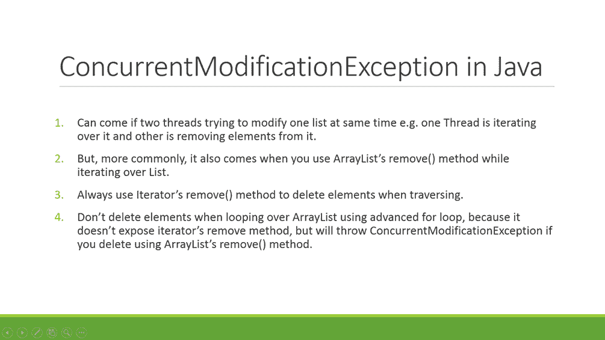

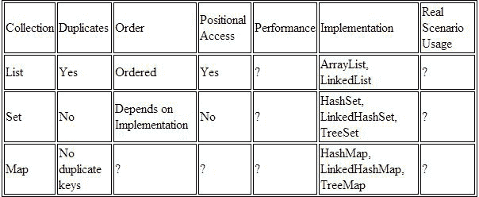

## 深度解析 Java 面试

### 22. 什么是 `BlockingQueue`？它与其他集合类有什么区别？

`BlockingQueue` 是 `java.util.concurrent` 包中可用的一种 `Queue` 实现。它是 Java 1.5 之后添加的并发集合类之一。`BlockingQueue` 与其他集合类的主要区别在于，除了存储外，它还提供了流量控制。它可以用于线程间通信，并通过 `happens-before` 保证提供内置的线程安全。你可以使用 `BlockingQueue` 来解决生产者-消费者问题，这在大多数并发应用中都是需要的。

这里有几个额外的练习题，请尝试自己自己寻找这些问题的答案：

#### 23. `LinkedList` 在 Java 中是如何实现的？它是单链表还是双链表？

提示：Java 中的 `LinkedList` 是双向链表。

#### 24. 你如何对 Synchronized HashMap 进行迭代？你需要对迭代加锁吗？为什么？

#### 25. 什么是 `Deque`？你什么时候使用它？

## 深度解析 Java 面试

### 序列化面试题

毫无疑问，Java 是非常庞大的，有些 Java 话题很多开发者很少探索的。序列化就是其中之一，在实践中很少使用，但在 Java 面试中非常流行。它也是难以掌握的主题之一，这就是为什么我要在这一部分分享一些经常遇到的 Java 序列化面试题。我不知道为什么并不是每个人都使用它，人们却问这么多关于序列化的问题，但我一直看到关于 Java 序列化的问题。这些也是最难回答且最困惑的问题，普通的 Java 开发者可能无法回答。

我仍然记得在职业生涯早期，在一家大型投资银行的 Java 面试中被问到关于 `readObject()` 和 `writeObject()` 方法。那是我第一次听到这些方法。我确定，我并不孤单，有很多 Java 开发者在职业生涯早期阶段没有听过这两个方法。

从那时起，我走了很长的路，学习了许多关于 Java 序列化的知识并在现实世界中见过它们。诚实地说，这是 Java 的一个非常复杂的功能，如果你必须处理使用序列化的代码，你破坏它的概率可能大于修复它。

我曾接手一个任务，在我们其中一个实现了 `Serializable` 的领域类 `Order.java` 中添加一个新字段。我添加了字段，结果在日志文件中看到了 `NotSerializableException`，然后我意识到你将添加的任何字段必须实现 `Serializable` 或 `Externalizable` 接口，除非它是 `transient` 或 `static` 的。


有很多这样的细节，你只有通过刻苦阅读或实际实践经验才能了解。尽管如此，有一本书对我帮助很大，那就是《Effective Java》。它包含了关于这个主题最好的素材，我强烈建议每位 Java 开发者阅读这本书以及所有与 Java 序列化相关的内容。

不再浪费你的更多时间，这里有一些关于序列化主题的 Java 问题，不过你还需要更多的问题来做好准备。

### 1. 什么是 `Serializable` 接口？它的目的是什么？

`Serializable` 是一个标记接口（marker interface），它表示任何实现 `Serializable` 接口的类对象可以使用 `JVM` 的默认序列化机制存储在磁盘上，或通过网络进行传输。

### 2. `Serializable` 和 `Externalizable` 接口之间的区别是什么？

这两个接口都允许你的对象被序列化或转换为二进制格式，该格式可以保存到磁盘或通过网络传输，但它们之间的关键区别是：`Serializable` 使用 `JVM` 的默认序列化机制，而 `Externalizable` 提供了在序列化前后执行某些操作的钩子和回调。

### 3. 什么是 `transient` 变量？它的目的是什么？

`transient` 变量在序列化过程中不会被保存。正如名称所示，它们是瞬态的，并不是对象状态的一部分。你可以使用 `transient` 变量将某些字段排除在序列化之外，例如一个不可序列化的字段应该被标记为 `transient` 或 `static`。

### 4. Java 中的 `SerialVersionUID` 是什么？它为什么重要？

`SerialVersionUID` 是一个在序列化过程中生成的标识符（如果在类中没有定义的话）。不显式指定的危险之处在于，默认逻辑生成的这个 ID 取决于类元数据（如字段数量），这意味着如果你添加了新字段或删除了旧字段，它就会改变。

这意味着，你可能无法用新版本的代码恢复旧的序列化实例。当你将 `SerialVersionUID` 定义为 `public static final long` 常量时，默认序列化机制就不会再生成它，因此它变得独立于类元数据。

正如我所说的，对这个主题的良好知识对于 Java 程序员非常重要，如果你想学习更多，我强烈建议你参加 Udemy 上优秀的 Java 课程，如 `Java In-Depth: Become a Complete Java Engineer!`。

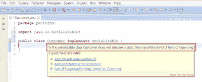

### 5. `Serializable` 接口中有多少方法？

没有，`java.io.Serializable` 是一个标记接口，它没有任何方法。

### 6. Java 中的什么是标记接口（marker interface）？

一个没有任何方法的接口。这种接口只是给编译器、`JVM` 或某些工具用于特殊处理的指示。它们类似于注解（annotation），因此在 Java 5 引入注解后，它们就过时了。

### 7. 你可以在 `Serializable` 类中添加一个没有实现该接口的字段吗？

不可以，那会抛出 `NotSerializableException`。如果你绝对想添加，可以将其标记为 `static` 或 `transient`，但该对象的状态在序列化时不会被保存。

# 深度解析 Java 面试

### 8. 在 Java 中如何序列化对象？

为了序列化对象，确保它实现了 `Serializable`，然后使用 `ObjectOutputStream.writeObject()` 将对象保存到磁盘。

### 9. Java 中的序列化是如何工作的？

当你序列化一个对象时，首先序列化父类，然后是子类。如果任何字段没有实现 `Serializable` 接口（引用类型），则会抛出 `NotSerializableException`。尽管如此，如果你想学习更多关于 Java 序列化的知识，我也建议你学习 Udemy 上全面的 Java 课程 `Java Masterclass`。

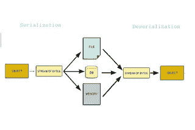

## 10. 静态变量如何？它们会被序列化吗？

静态变量不会序列化。因为 `static` 是类级变量，也就是说每个实例具有相同的值。如果你的序列化对象依赖于静态变量的值，就会产生问题，因为当你反序列化对象时，它将获得其他实例拥有的静态变量值，这可能不同。所以，不要让你的序列化对象依赖静态变量。

### 11. Java 中 `transient` 和 `volatile` 变量有什么区别？

它们完全不同，`volatile` 用于多线程，指示编译器该变量会被多个线程访问并提供顺序和可见性保证；而 `transient` 变量用于将字段排除在持久化序列化之外。

### 12. 如果父类是 `Serializable`，你可以在子类中不可序列化吗？子类必须实现 `Serializable` 接口吗？

是的，你可以让子类变为不可序列化。即使父类是可序列化的，子类也不强制是可序列化类。

# 深入理解 Java 面试

## 13. 你知道 Java 应用中序列化（Serialization）的替代方案吗？

是的，Java 中有几种 `Serialization` 的替代方案。例如，你可以开发自己的编码器和解码器，将 Java 对象转换为二进制格式（如 `byte array`），并用位置来标记特定的字段。

这在高速消息传递和高频交易应用中非常流行，许多交易所协议如东京证券交易所的 `Arrowhead` 协议和香港期货交易所的 `Omnet` 协议都使用了这种机制。

Java 中 `Serialization` 的另一个流行替代方案是 Google 的 `protocol buffer`，它允许你安全地将对象转换为名为 `protobuf` 的预定义二进制格式。你还可以使用 `gRPC` 来开发服务端应用程序。如果你想了解更多关于 Google Protocol Buffer，我强烈建议你学习 Udemy 上由 Stephane Maarek 授的 `Complete Guide to Protocol Buffers 3 in Java`。

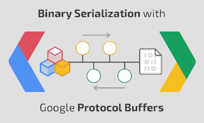

以上就是关于 Java 程序员序列化面试题的全部内容。你可以利用这些问题来学习更多关于序列化的知识，并填补你学习中的空白。如果你还没有读过，我强烈建议阅读《Effective Java》一书，特别是关于 `Serialization` 的所有条目，其中包含了 Joshua Bloch 关于在 Java 中有效且安全地使用 `Serialization` 的许多智慧、最佳实践和建议。

## Java 设计模式面试题

大家好，如果你正在准备 Java 面试，并正在寻找经常被问的设计模式面试题，那么你来对地方了。在过去，我分享过 Java 面试的优质课程，今天，我将分享 Java 面试中流行的设计模式问题。你可以利用这些问题来练习，并检验你对 `OOP` 设计模式的掌握情况。`OOP` 和 `GOF` 设计模式面试题都是任何优秀的核心 Java 面试题列表中不可或缺的一部分。Java 是一门流行的面向对象编程语言，由于许多开发者和开源框架，它拥有许多设计模式和设计原则。

作为一名 Java 程序员，你应当掌握 `OOPS` 概念，如 `Abstraction`（抽象）、`Encapsulation`（封装）和 `Polymorphism`（多态）；什么是 Java 中的设计模式；一些流行的 Java 设计模式；以及最重要的，在 Java 应用中何时使用这些设计模式。

### 提问设计模式面试题的目的

Java 设计模式面试题的目的是检查 Java 程序员是否熟悉这些核心设计模式。

Java 面试中的设计模式与多线程、集合和编程问题一样重要，不应忽视它。良好的软件设计模式知识对于成为更出色的 Java 开发者大有帮助，这也是每家公司都在寻找的。

这些软件设计模式提供了设计和解决现实世界软件问题及任务的模板和技巧。如果你知道如何应用和使用这些经过考验的设计模式，你就可以编写更好的代码，我的意思是更具扩展性、维护性和灵活性的代码。

如果你是一名高级或经验丰富的 Java 程序员，你可以预期在 Java 面试中遇到更复杂、更困难的设计模式，如 `Memento`（备忘模式）、`Chain of Responsibility`（责任链模式）和 `Builder` 设计模式，以及解决实时设计问题。

顺便说一下，始终记住提供项目中的示例会留下更好的印象。如果你想学习 Java 设计模式的现代实现，我建议你参加 Udemy 上 Dmitri Nesteruk 授的 `Design Patterns in Java` 课程。在这门课程中，你不仅将学习如何识别和应用设计模式，还将学习如何重构现有设计以使用设计模式。

以下是我列出的 Java 前 10 个设计模式面试题。我还以链接的形式提供了这些 Java 设计模式题的答案。无论你参加的是什么级别的 Java 面试（程序员、软件工程师或高级 Java 软件工程师），你都可以预期几个关于 Java 设计模式的问题。

### 1. 什么是 Java 中的装饰器模式（Decorator pattern）？你能给出装饰器模式的示例吗？

装饰器模式是另一个流行的 Java 设计模式题，因为它在 `java.io` 包中大量使用而非常常见。`BufferedReader` 和 `BufferedWriter` 是 Java 中装饰器模式的绝佳示例。

如果你想更多了解装饰器模式如何帮助你编写更好的代码，我也建议查看 Educative 上的 `Software Design Patterns: Best Practices for Software Developers` 课程。这门课程提供了许多 Java 编程语言的真实示例，便于理解和应用这些设计模式并编写更好的代码。

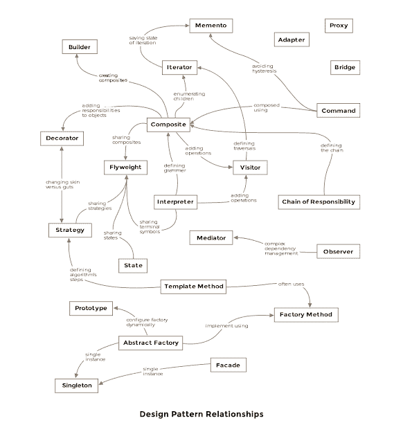

### 2. 在 Java 中何时使用策略模式（Strategy Design Pattern）？

针对高级和经验丰富的程序员，Java 设计模式面试题中的 `Strategy` 模式对于实现一组相关的算法（如压缩算法、过滤策略等）非常有用。策略模式允许你创建 `Context` 类，这些类使用 `Strategy` 实现类来应用业务规则。

JDK 本身的一个很好的策略模式示例是 `Collections.sort()` 方法和 `Comparator` 接口，后者是一个策略接口，定义了比较对象的策略。因为有了这种模式，我们不需要修改 `sort()` 方法（对修改关闭）来比较任何对象；同时，我们可以实现 `Comparator` 接口来定义新的比较策略（对扩展开放）。

这种模式实际上基于开闭原则（open-closed design principle），如果你理解了该原则，那么理解策略模式也相当容易。实际上，了解 `SOLID` 原则更好，因为许多设计模式都是基于它的。

如果你正在寻找一门关于对象设计原则的完整课程，我推荐查看 Pluralsight 上 Steve Smith 授的 `SOLID Principles of Object-Oriented Design`。这门课程对于任何想要加强软件架构知识的人来说都是非常有用的。

### 3. Java 中什么是观察者模式（Observer design pattern）？在 Java 中何时使用观察者模式？

这是常见的 Java 设计模式面试题之一。观察者模式基于通知机制，有两种对象：`Subject`（主体）和 `Observer`（观察者）。当主体状态发生变化时，观察者会收到通知。

### 4. Java 中策略模式和状态模式（State design Pattern）的区别是什么？

这是一个有趣的 Java 设计模式面试题，因为策略模式和状态模式具有相同的结构。如果你看这两个模式的 UML 类图，它们看起来完全一样，但它们的意图完全不同。

状态模式用于定义和管理对象的状态，而策略模式用于定义一组可交换的算法，并让客户端选择其中一个。因此，策略模式是客户端驱动的模式，而对象可以管理它们自己的状态。

### 5. 在 Java 中何时使用组合模式（Composite design pattern）？你之前在项目中使用过它吗？

这个设计模式问题在 Java 面试中，不仅是为了检查候选人是否熟悉组合模式，还为了检查其是否具有实战经验。

`Composite`（组合模式）也是一种核心 Java 设计模式，它允许你以相同的方式处理整体和部分对象。处理 `Composite` 或单个对象的客户端代码不需要区分它们，这之所以能够实现，是因为 `Composite` 类也实现了与各个独立部分相同的接口。

JDK 中组合模式的一个极佳范例是 `JPanel` 类，它既是 `Component` 也是 `Container`。当在 `JPanel` 上调用 `paint()` 方法时，它会在内部调用各个独立组件的 `paint()` 方法并让它们自己进行绘图。

在这一设计模式面试题的第二部分，请务必诚实回答；如果你用过，就说用过；否则就说你熟悉该概念并曾自己实现过它。

### 6. 什么是 Java 中的单例模式（Singleton pattern）？

Java 中的单例模式是一种允许整个应用程序中只有一个 `Singleton` 类实例可用的模式。`java.lang.Runtime` 是 Java 中单例模式的一个很好的例子。关于单例模式有很多后续问题，请参阅 10 个 Java 单例面试题答案以获取后续内容。

## 7. 你能在 Java 中编写线程安全的单例吗？

在 Java 中有多种编写线程安全单例的方法，例如通过双重检查锁定（double-checked locking）编写 `singleton`，或者使用在类加载期间初始化的静态 `Singleton` 实例。顺便说一下，使用 Java `enum` 来创建线程安全的单例是最简单的方法。

## 8. 在 Java 中何时使用模板方法模式（Template method design pattern）？

模板模式是另一个流行的核心 Java 设计模式面试题。我在现实项目本身中多次看到它的出现。模板模式以模板方法的形式概述算法，并让子类实现各个具体的步骤。

在回答这个问题时，需要提到的关键点是：模板方法应该是 `final` 的，以确保子类无法重写并更改算法的步骤。同时，具体的步骤应该是 `abstract`（抽象的），以便子类可以实现它们。

## 9. 什么是 Java 中的工厂模式（Factory pattern）？使用静态工厂方法创建对象的优势是什么？

Java 中的工厂模式是一种**创建型**的 Java 设计模式，也是许多 Java 面试的宠儿。工厂模式通过提供静态工厂方法来创建对象。提供工厂方法有许多优势，例如缓存不可变对象、易于引入新对象等。更多细节请参阅什么是 Java 中的工厂模式及其优势。

## 10. Java 中装饰器模式（Decorator）和代理模式（Proxy）的区别是什么？

这是另一个棘手的 Java 设计模式面试题，这里的陷阱在于：`Decorator` 和 `Proxy` 都实现了它们所装饰或封装的那个 `Object` 接口。正如我所说，许多 Java 设计模式可能具有相似或完全相同的结构，但它们的意图不同。

`Decorator` 装饰器模式用于在已经创建的对象上实现功能，而 `Proxy` 代理模式用于控制对对象的访问。

装饰器和代理设计模式的另一个区别是：`Decorator` 不创建对象；相反，它在构造函数中获取 `Object`，而 `Proxy` 实际上会创建对象。你也可以阅读《Head First 设计模式》来理解它们之间的区别。

## 11. 在依赖注入模式（Dependency Injection pattern）中，何时使用 Setter 注入和构造函数注入？

使用 `Setter` 注入提供对象的可选依赖，而使用 `Constructor`（构造函数）注入提供对象的强制依赖（没有这些依赖它无法工作）。这个问题与依赖注入设计模式有关，通常在 Spring 框架背景下被问，而 Spring 现在已成为开发 Java 应用的标准。

由于 Spring 提供了 `IOC` 容器，它也提供了一种通过使用 setter 方法或构造函数来指定依赖的方法。你也可以查看我之前关于相同主题的章节。

### 12. Java 中工厂（Factory）和抽象工厂（Abstract Factory）的区别是什么

我已经在相同标题的章节中详细回答过这个问题。主要的区别在于：`Abstract Factory` 抽象工厂创建的是工厂，而 `Factory` 工厂创建的是对象。因此两者都抽象了创建逻辑，但一个抽象的是工厂，另一个的是产品。

## 13. 在 Java 中何时使用适配器模式（Adapter pattern）？你以前在项目中使用过吗？

当你需要让两个具有不兼容接口的类工作时，请使用 `Adapter` 模式。适配器模式也可以封装第三方代码，使得应用程序仅依赖于 `Adapter`，当第三方代码更改或你移动到不同的第三方库时，`Adapter` 可以自行适配。

顺便说一下，这个 Java 设计模式问题也可以通过提供实际场景来提出。你可以进一步阅读《Head First 设计模式》来学习更多关于 `Adapter` 模式及其真实用法。该书也针对 Java 8 更新过，因此你将学习使用新的 Java 8 方法来实现这些旧的设计模式。

## 14. 你能写代码实现生产者-消费者设计模式（producer-consumer design pattern）吗？

生产者-消费者设计模式是 Java 中的并发设计模式，可以通过多种方式实现。如果你在 Java 5 中工作，最好使用并发工具类来实现生产者消费者模式，而不是使用 Java 中旧的 `wait` 和 `notify`。这里有一个使用 Java 中的 `BlockingQueue` 实现生产者消费者问题的优秀示例。


### 15. Java 中的构建器模式（Builder design pattern）是什么？你何时使用构建器模式？

Java 构建器模式是 Java 中的另一种创建型设计模式，经常在 Java 面试中被问，是因为当你需要构建一个具有多个属性（某些可选，某些强制性）的对象时，它有特定的用途。

### 16. Java 中的开闭原则（Open closed design principle）是什么？

开闭设计原则是由 Robert C. Martin 定义的 SOLID 原则之一（他在最著名的书籍《整洁代码》中广为人知的 Uncle Bob）。该原则建议代码应该对扩展开放，对修改关闭。

起初，这看起来可能是相互矛盾的，但一旦你探索了多态的力量，你就会发现能够为该原则提供稳定性和灵活性的模式。

该原则的一个关键示例是状态和策略模式，其中 `Context` 类对修改关闭，而通过实现新的策略状态来提供新功能。查看此章节了解更多关于开闭原则的内容。

### 17. 你能举出 Java 中 SOLID 设计原则的例子吗？

有很多 SOLID 设计模式，其缩写 SOLID 如下：

1. 单责任原则 `SRP`
2. 开闭设计原则 `OCD`
3. 里氏替换原则
4. 接口隔离原则
5. 依赖倒置原则

### 18. Java 中抽象（Abstraction）和封装（Encapsulation）的区别是什么？

尽管抽象和封装看起来相似，因为它们都隐藏了复杂性并使外部接口更简单，但它们之间存在细微的区别。抽象隐藏逻辑复杂性，而封装隐藏物理复杂性。

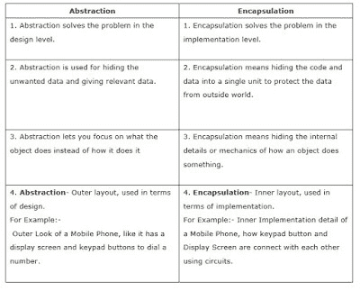

垃圾回收面试题在核心 Java 和高级 Java 面试中非常流行。除了 Java 集合（Collection）和线程之外，许多棘手的 Java 问题都源于垃圾回收，这些问题很难回答。在这个 Java 面试章节中，我将分享一些在各种核心 Java 面试中都会出的 `GC` 问题。这些问题基于垃圾回收的工作原理、不同类型的垃圾回收器，以及用于垃圾回收监控和调优的 JVM 参数。正如我所说，`GC` 是任何 Java 面试的重要组成部分，因此请确保你对 `GC` 有良好的掌握。另外一个变得非常重要的点是理解和分析垃圾回收输出的能力，越来越多的面试官正在检查候选人是否能理解 `GC` 输出。

在 Java 面试期间，他们可能会提供一段 `GC` 输出片段并基于此提出各种问题，例如：使用了哪种垃圾回收器？输出是来自大收集（major collection）还是新生收集（minor collection）？`GC` 释放了多少内存？`GC` 之后新生代（new generation）和老年代（old generation）的大小是多少等。

我包含了一些来自 `GC` 输出的垃圾回收面试题和答案以帮助大家。建议在准备垃圾回收的同时，也准备 Java 集合、多线程和编程的问题，以便在任何阶段的 Java 面试中表现良好。

而且，如果你认真提高高级 JVM 技能并学习获取和分析堆转储（heap dumps）等知识，强烈推荐参加 Udemy 上的 Java Application Performance and Memory Management 课程。这是 Java 程序员学习更多性能和内存管理（包括排查 Java 内存泄漏）的高级课程之一。

这里是我个人收集的一些垃圾回收面试题，这些是我根据自己的经验并在许多向我分享 `GC` 面试题的朋友和同事帮助创建的。

实际上，问题比我在这里分享的要得多，但为了保持这个章节的简洁，我想只分享一些问题。如果你们觉得这些有用，我可以考虑第二部分的 `GC` 面试题。

## Question 1 - Java 堆的结构是什么？堆中的永久代（Perm Gen space）是什么？

**答案**：为了在任何 Java 面试的垃圾回收问题中表现更好，对 Java 堆空间的基本理解是非常重要的。

顺便提一下，堆被分为不同的代，例如新生代、老年代和 `PermGen` 空间。`PermGen` 空间用于存储类的元数据，填充 `PermGen` 空间会导致 `java.lang.OutOfMemory: PermGen space`。此外记住 Java 中配置 `PermGen` 空间的 JVM 选项也是值得的。

## Question 2 - 如何在 Java 中识别新生收集（minor collection）和大收集（major collection）？

**答案**：如果使用 `-verbose:gc` 或 `-XX:PrintGCDetails` 启用垃圾回收日志，新生收集会打印“`GC`”，而大收集会打印“Full GC”。这个垃圾回收面试题基于对垃圾回收输出的理解。随着越来越多的面试官通过这个问题来检查候选人理解 `GC` 输出的能力，这个主题变得更加重要。

## Question 3 - ParNew 和 DefNew 新生代垃圾回收器有什么区别？

**答案**：这个垃圾回收面试题最近我一个朋友问过。回答这个问题需要比平均水平更高的 `GC` 知识。

顺便提一下，`ParNew` 和 `DefNew` 是两个新生代垃圾回收器。`ParNew` 是多线程 `GC`，与并发标记清除算法（Mark Sweep）一起使用；而 `DefNew` 是单线程 `GC`，与序列垃圾回收器（Serial Garbage Collector）一起使用。

而且，如果你认真提高高级 JVM 技能并学习获取和分析堆转储等知识，强烈推荐参加 Udemy 上的 Java Application Performance and Memory Management 课程。

## Question 4 - 如何找到调用 System.gc() 导致的 GC 结果？

**答案**：另一个基于 `GC` 输出的垃圾回收面试题。与大新生收集类似，垃圾回收输出中会包含“`System`”字样。

## Question 5 - 序列（Serial）和吞吐量（Throughput）垃圾回收器有什么区别？

**答案**：序列垃圾回收器是一种“停顿世界”（stop the world）的 `GC`，它在新生收集和大收集期间都会停止应用程序线程运行。可以使用 JVM 选项 `-XX:UseSerialGC` 启用序列垃圾回收器，它专为没有暂停时间要求且具有客户端配置的 Java 应用设计。

序列垃圾回收器在 JDK 1.5 引入适应性策略（ergonomics）之前，也是 JDK 1.4 的默认 `GC`。`Serial GC` 最适合线程较少的小应用程序，而吞吐量 `GG` 更适合大型应用程序。另一方面，吞吐量垃圾回收器是一种并行收集器，新生收集和大收集并行发生，充分利用所有可用的系统资源（如多处理器）。

尽管大收集和新生收集都以“停顿世界”的方式运行并给应用程序引入了停顿，但可以使用 `-XX:UseParallelGC` 或 `-XX:UseOldParallelGC` 启用吞吐量垃圾回收器。

它通过最小化在垃圾回收上花费的时间来提高应用程序的整体吞吐量，但在全 `GC` 期间仍会有长时间停顿。这是一种垃圾回收面试题，让你在回答时有机会详细地展示你的知识。我总是建议详细地回答这类问题。

## Question 6 – 对象在 Java 中什么时候变成可垃圾回收的对象？

**答案**：当一个对象没有活引用（live reference）或它无法被任何存活线程到达时，该对象就符合垃圾回收条件。循环引用不被视为活引用，如果两个对象互相指向且其中任何一个对象都没有活引用，那么它们两个都符合 `GC` 条件。此外，垃圾回收线程是一个守护线程（daemon thread），它由 `JVM` 根据 `GC` 算法运行，并在运行时收集所有符合 `GC` 条件的对象。

## Question 7 - Java 中的 finalize 方法是什么？垃圾回收器在什么时候调用 finalize 方法？

**答案**：Java 中的 finalize 方法（也称为 finalizer）是定义在 `java.lang.Object` 中的方法，垃圾回收器在收集任何符合 `GC` 条件的对象之前调用。`finalize()` 方法为对象提供了清理和释放剩余资源的最后机会。

## Question 8 - 如果对象 A 引用对象 B，对象 B 又引用对象 A，除此之外除此之外没有指向对象 A 或 B 的活引用，它们符合垃圾回收条件吗？

这个垃圾回收面试题与问题 5 “对象什么时候变成可垃圾回收的对象”相关。如果一个对象没有活引用，它就符合垃圾回收条件。它无法从任何线程访问，循环依赖不会阻止对象被垃圾回收。这意味着在这种情况下，对象 A 和对象 B 都符合垃圾回收条件。

# 回答：这是一个棘手的垃圾回收面试题，因为许多程序员并不确定 PermGen（永久代）是否是 Java 堆空间，由于它维护了类元数据和字符串池，它是否符合垃圾回收的条件。顺便说一下，垃圾回收确实会在 PermGen 空间发生，如果 PermGen 空间满了或超过阈值，就会触发 Full GC（全垃圾回收）。如果你查看 GC 输出，你会发现 PermGen 空间也会被垃圾回收。这就是为什么正确设置 PermGen 空间的大小对于避免频繁 Full GC 非常重要。你可以通过 JVM 参数 `-XX:PermGenSize` 和 `-XX:MaxPermGenSize` 来控制 PermGen 空间的大小。

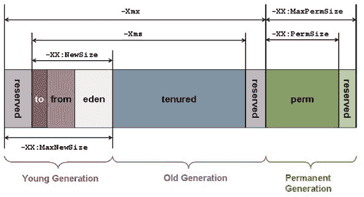

## 问题 11：如何监控垃圾回收活动？

**答案**：我最喜欢的垃圾回收面试题之一，用来检查候选人是否曾经监控过 GC 活动。你可以离线或实时监控垃圾回收活动。你可以使用 `JConsole` 和带有 `Visual GC` 插件的 `VisualVM` 虚拟机来监控 `JVM` 的实时垃圾回收活动和内存状态，或者使用 `-XlogGC=<PATH>` JVM 参数将垃圾回收输出重定向到日志文件中进行离线分析。无论如何，你应该始终开启 GC 选项如 `-XX:PrintGCDetails`、`-X:verboseGC` 和 `-XX:PrintGCTimeStamps`，因为它们对应用程序性能的影响不大，但为性能监控提供了有用状态。

## 问题 12：查看下方的垃圾回收输出并回答以下问题：

```
[GC
[ParNew: 1512K->64K(1512K), 0.0635032 secs]
[15604K->13569K(600345K), 0.0636056 secs]
[Times: user=0.03 sys=0.00, real=0.06 secs]
```

1. 此输出是 Major Collection（主回收）还是 Minor Collection（ Minor 回收）？
2. 使用了哪种年轻代（Young Generation）垃圾回收器？
3. 年生代、老年代（Old Generation）和总堆内存的大小是多少？
4. 垃圾回收释放了多少内存？
5. 垃圾回收花费了多少时间？
6. 年轻代的当前占用率是多少？

这些垃圾回收面试题完全基于 GC 输出。以下是上述 GC 问题的答案，不仅能帮助你回答这些问题，还能帮助你理解和解释 GC 输出。

**答案 1**：因为有“GC”字样，它是 Minor collection。在 Major collection 的情况下，你会看到“Full GC”。

**答案 2**：此输出是多线程年轻代垃圾回收器 `ParNew` 的输出，它与 `CMS` 并发垃圾回收器一起使用。

**答案 3**：括号中的 `[1512K]` 是年轻代的总大小，包括 Eden 区和两个幸活区（surviv space）。箭头左侧的 `1512K` 是 GC 前年轻代的占用情况，`64K` 是 GC 后的占用。下一行括号中的值是总堆大小，即 `(600345K)`。如果我们从总堆大小中减去年轻代的大小，就可以计算出老年代的大小。这一行也显示了回收前后的堆占用情况。

**答案 4**：如之前的垃圾回收面试题所示，第二行显示了回收前后的堆占用。如果我们将右侧的值 `13569K` 减去左侧的值 `15604K`，就可以得到 GC 释放的总内存。

**答案 5**：第二行的 `0.0636056 secs` 表示在垃圾回收期间收集死亡对象花费的总时间。它也包括回收年轻代花费的时间，如第一行所示的 `(0635032 secs)`。

**答案 6**：`64K`

这里有几个更多有趣的垃圾回收面试题供你练习。

* **问题**：`-XX:ParallelGC` 和 `-XX:ParallelOldGC` 之间有什么区别？
* **问题**：你什么时候使用 `ConcurrentMarkSweep` 垃圾回收器和 `Throughput GC`？
* **问题**：`ConcurrentMarkSweep` 和 `G1` 垃圾回收器之间有什么区别？
* **问题**：你做过任何垃圾回收调优吗？你的方法是什么？

# 泛型（Generics）面试题

Java 面试中的泛型面试题已经变得越来越常见，自从 Java 5 出现以来已经很长时间了，许多应用程序都迁移到了 Java 5，且几乎所有的新 Java 开发都在 Tiger（Java 5 的代号）上进行。泛型的重要性以及 Java 5 特性如 `Enum`、`Autoboxing`（自动装箱）、varargs 以及像 `CountDownLatch`、`CyclicBarrier` 和 `BlockingQueue` 等集合工具在 Java 面试中变得越来越流行。如果你熟悉有界和无界泛型通配符、泛型的内部工作原理、类型擦除（type erasure）以及熟悉在 Java 中编写参数化泛型类和方法，泛型面试题可能会变得非常棘手。

准备泛型面试最好的方法是尝试根据泛型的各种特性编写简单的程序。无论如何，在 Java 面试部分，我们将看到一些流行的 Java 泛型面试题及其答案。

顺便说，Javarevisited 提供了大量的材料来更好地准备 Java 和 J2EE 面试，你可以通过“15 道多线程面试题”和“前 10 道 Java 集合面试题”以及关于 Spring、Struts、JSP 和 Servlet 的其他几个问答章节来准备多线程和集合。

如果你是 GUI 开发人员且在 Java Swing 中工作，你也可以查看投资银行中经常问的 Java Swing 面试题。

不再浪费你的时间，这里是 Java 面试中经常问的泛型概念面试题：

### 1. 什么是 Java 泛型？使用泛型的优点是什么？

这是泛型面试中最基础的问题之一，通常针对初级和中级水平。那些从 Java 5 之前过来的人知道在集合中存储对象在使用之前将其转换回正确类型有多么不。泛型解决了这些问题。它提供了编译时的类型安全，并确保向集合插入正确的类型，从而避免运行时的 `ClassCastException`。

### 2. 泛型是如何工作的？什么是类型擦除？

这是一个泛型中很好的面试题。泛型通过类型擦除实现，编译器在编译时擦除所有类型相关信息，运行时无法获取类型相关信息。例如 `List<String>` 在运行时被表示为 `List`。这样做是为了确保与 Java 5 之前开发的库具有二进制兼容性。你在运行时无法访问类型参数，泛型类型会被编译器翻译为原始类型（Raw type）。根据你的回答，可能会得到许多基于此泛型面试题的后续问题，例如：为什么泛型通过类型擦除实现或演示某些会导致编译错误的无效泛型代码。

### 3. 什么是泛型中的有界和无界通配符？

这是另一个非常流行的 Java 泛型面试题。有界通配符是对类型施加边界的通配符。有两种种类：`<? extends T>` 施加了上界，确保类型必须是 `T` 的子类；`<? super T>` 施加了下界，确保类型必须是 `T` 的父类。这种泛型类型必须用边界内的类型实例化，否则会导致编译错误。

相反，`<?>` 代表无界类型，因为 `<?>` 可以被任何类型替换。

这与之前的泛型面试题有关，有时面试官不会问什么是边界通配符（bounded wildcards）和无界通配符，而是通过此来衡量你对泛型的理解程度。两种 `List` 声明都是边界通配符的示例：`List<? extends T>` 会接受任何类型自 `T` 的 `List`，而 `List<? super T>` 会接受任何类型为 `T` 的父类的 `List`。例如 `List<? extends Number>` 可以接受 `List<Integer>` 或 `List<Float>`。更多信息请参见上方链接。

## 5. 如何编写一个接受泛型参数并返回泛型类型的方法？

编写泛型方法并不困难，与其使用原始类型（raw type），你只需要使用泛型类型如 `T`、`E` 或 `K,V`，这些是类型、元素、键和值的常用占位符。可以参考 Java 集合框架中泛型方法的示例。在最简单的形式下，泛型方法看起来如下：

```java
public V put(K key, V value) {
    return cache.put(key, value);
}
```

## 6. 如何在 Java 中使用泛型编写参数化类？

这是之前 Java 泛型面试题的扩展。面试官可能不会要求编写泛型方法，而是要求使用泛型编写一个类型安全的类。同样，关键在于不要使用原始类型，而要使用泛型类型，并始终使用 JDK 中的标准占位符。

## 7. 写一个程序使用泛型实现 LRU 缓存？

这是任何喜欢用 Java 编程的人的练习。一个提示是 `LinkedHashMap` 可以实现固定大小的 LRU 缓存，当缓存满时需要移除最旧条目。`LinkedHashMap` 提供了一个名为 `removeEldestEntry()` 的方法，该方法会被 `put()` 和 `putAll()` 调用，并用于指示移除最旧条目。只要你编写了带有 JUnit 测试的可运行版本，你可以自由提出自己的实现方案。

## 8. 你可以将 `List<String>` 传递给接受 `List<Object>` 的方法吗？


这个 Java 泛型面试题对于不熟悉泛型的人来说可能看起来很困惑，因为第一眼看去 `String` 是一个对象，所以 `List<String>` 可以用于需要 `List<Object>` 的地方，但事实并非如此。这会导致编译错误。如果你进一步思考，这是有意义的，因为 `List<Object>` 可以存储任何内容，包括 `String`、`Integer` 等，但 `List<String>` 只能存储 `String`。

```java
List<Object> objectList;
List<String> stringList;

objectList = stringList; // 编译错误：类型不兼容
```

## 9. 可以在数组上使用泛型吗？

这可能是 Java 中最简单的泛型面试题了。如果你知道数组不支持泛型，这就是 Joshua Bloch 在《Effective Java》中建议优先使用 `List` 而非 `Array` 的原因，因为 `List` 可以提供比编译时的类型安全性。

## 10. 如何在 Java 中抑制未检查警告（unchecked warning）？

Java 5 的 `javac` 编译器在混合使用原始类型和泛型类型时会生成未检查警告，例如：

```java
List<String> rawList = new ArrayList();
```

注意：`Hello.java` 使用了未检查或不安全的操作；可以使用 `@SuppressWarnings("unchecked")` 注解来抑制它。

我还有几个关于 Java 泛型的面试题要与大家分享，这些问题关注于泛型类型与原始类型之间的区别，以及是否可以使用 `Object` 代替边界通配符等。

### Java 中 `List<Object>` 和原始类型 `List` 的区别？

原始类型与参数化类型 `List<Object>` 之间的主要区别是，编译器在编译时不会检查原始类型的类型安全性，但会对参数化类型进行检查。通过使用 `Object` 作为类型，它告诉编译器它可以持有任何类型的对象，例如 `String` 或 `Integer`。

这个 Java 泛型面试题基于对泛型中原始类型的正确理解。无论如何，它们的第二个区别是你可以将任何参数化类型传递给原始类型 `List`，但你不能将 `List<String>` 传递给任何接受 `List<Object>` 的方法，会导致编译错误。

### Java 中 `List<?>` 和 `List<Object>` 的区别？

这个泛型面试题可能与之前的题目有关，但完全不同。`List<?>` 是未知类型的 `List`，而 `List<Object>` 本质上是任何类型的 `List`。你可以将 `List<String>`、`List<Integer>` 赋值给 `List<?>`，但不能将 `List<String>` 赋值给 `List<Object>`。

```java
List<?> listOfAnyType;
List<Object> listOfObject = new ArrayList<Object>();
List<String> listOfString = new ArrayList<String>();
List<Integer> listOfInteger = new ArrayList<Integer>();

listOfAnyType = listOfString; // 合法
listOfAnyType = listOfInteger; // 合法
listOfObjectType = (List<Object>) listOfString; // 编译错误 - 类型不可转换
```

要了解更多信息请参见 Java 泛型通配符示例。

### `List<String>` 和原始类型 `List` 的区别

这个泛型面试题类似于原始类型与参数化类型之间的区别。参数化类型是类型安全的，编译器会保证类型安全性，但 `List` 原始类型不是类型安全的。你不能在 `String` 的 `List` 中存储任何其他对象，但在原始 `List` 中可以存储任何对象。泛型参数化类型不需要强制转换，但原始类型则需要显式强制转换。

```java
List listOfRawTypes = new ArrayList();
listOfRawTypes.add("abc");
listOfRawTypes.add(123); // 编译器会允许 - 运行时异常

String item = (String) listOfRawTypes.get(0); // 需要显式强制转换
item = (String) listOfRawTypes.get(1); // 因为 Integer 转换为 String 会产生 ClassCastException

List<String> listOfString = new ArrayList();
listOfString.add("abcd");
listOfString.add(1234); // 编译错误
item = listOfString.get(0); // 不需要显式强制转换
```

这些是 Java 中经常问到的泛型问题和答案。这些泛型面试题并不难，实际上，它们是基于泛型的基础知识的。任何对泛型有一定了解的 Java 程序员都应该熟悉这些问题。

## 问题 1：什么是 JDBC？

### 回答

大多数面试中的首批 JDBC 面试问题之一。JDBC 是 Java Database Connectivity，如其名所示，它是用于与关系型数据库通信的 Java `API`。该 API 包含了 Java 类和接口，开发者可以通过它们轻松地与数据库进行交互。为此，我们需要特定数据库的 `JDBC` 驱动程序。有时这也会导致后续问题，例如类型 2 和类型 4 `JDBC` 驱动之间的区别。请查看链接获取答案。

## 问题 2：在 Java 中建立 JDBC 连接的主要步骤有哪些？

### 回答

另一个初级 JDBC 面试题，通常在电话面试中问及。以下是连接到数据库的主要步骤：

1. **加载驱动（Load the Driver）**：第一步加载特定数据库的驱动程序，该程序与数据库进行通信。
2. **建立连接（Make Connection）**：下一步使用 `connection` 对象获取数据库连接，该对象用于发送 SQL 语句并从数据库获取结果。
3. **获取 Statement 对象（Get Statement Object）**：从 `connection` 对象可以获取 `statement` 对象，用于查询数据库。
4. **执行查询（Execute the Query）**：使用 `statement` 对象执行 SQL 或数据库查询，并从查询获取结果集。
5. **关闭连接（Close the connection）**：在获取结果集并完成所有必要操作后，最后一步关闭数据库连接。

## 问题 3：数据库中的“脏读（dirty read）”是什么意思？

### 回答

这种 JDBC 面试题通常针对 2 到 4 年经验的 Java 程序员，预计他们熟悉数据库事务和隔离级别等。名称本身就传达了脏读的含义：“读取可能正确也可能错误的值”。在数据库中，当一个事务正在执行并更改某些字段值时，另一个事务进来并在第一个事务提交（`commit`）或回滚（`rollback`）之前读取了更改后的字段值，导致该字段值无效，这种场景被称为脏读。

## 问题 4：什么是两阶段提交（2 phase commit）？

### 回答

这是最流行的 JDBC 面试题之一，通常出现在高级别，针对 J2EE 面试中的高级 Java 开发者。两阶段提交用于分布式环境，其中多个进程参与分布式事务过程。简单来说，可以理解为：如果任何事务正在执行并影响多个数据库，则将使用两阶段提交来确保所有数据库之间的同步。

在两阶段提交中，提交或回滚通过两个阶段完成：

1. **提交请求阶段（Commit request phase）**：在此阶段，主进程或协调进程对所有其他进程投票，它们是否成功完成了进程并准备好提交。如果所有票都是“是”，则进入下一阶段。如果是“否”，则执行回滚。
2. **提交阶段（Commit phase）**：根据投票，如果所有票都是“是”，则完成提交。

同样，当任何事务在执行后更改多个数据库时，它会在每个数据库上发布预提交命令，所有数据库发送确认（acknowledgement），根据确认，如果都是积极的，事务将发布提交命令，否则执行回滚。

## 问题 5：Statement 的不同类型有哪些？

### 回答

另一个经典的 JDBC 面试题。变体是 Java 中 `Statement`、`PreparedStatement` 和 `CallableStatement` 之间的区别。`Statement` 对象用于向数据库发送 SQL 查询并从数据库获取结果，我们从 `connection` 对象获取 `statement` 对象。

有三种类型的 `statement`：

1. **Statement**：通常用于从数据库获取数据，当我们在运行时使用静态 SQL 语句时非常有用。它不接受任何参数。

   ```java
   Statement stmt = conn.createStatement();
   ResultSet rs = stmt.executeQuery();
   ```

2. **PreparedStatement**：当我们多次使用同一个 SQL 语句时，它非常有用，并且在运行时接受参数。

   ```java
   String SQL = “Update stock SET limit = ? WHERE stockType = ?”;
   PreparedStatement pstmt = conn.prepareStatement(SQL);
   ResultSet rs = pstmt.executeQuery();
   ```

3. **Callable Statement**：当我们想要访问存储过程时，callable statement 非常有用，它们也接受运行时参数。调用方式如下：

   ```java
   CallableStatement cs = con.prepareCall(“{call SHOW_SUPPLIERS}”);
   ResultSet rs = cs.executeQuery();
   ```

## 问题 6：游标在可结果集（scrollable result set）中是如何工作的？

### 回答

另一个棘手的 JDBC 面试题，并不是很多 Java 程序员知道在 Java 中使用 Cursor。

`JDBC` 2.0 `API` 添加了新功能，允许游标在结果集中向后、向前移动，也可以移动到特定行。结果集中定义了三个常量，通过它们我们可以移动游标：

- `TYPE_FORWARD_ONLY`：创建一个不可滚动的结果集，即游标只能向前移动的结果集。
- `TYPE_SCROLL_INSENSITIVE`：可滚动的结果集不会反映在打开期间对其进行的更改。
- `TYPE_SCROLL_SENSITIVE`：可滚动的结果集会反映在打开期间对其进行的任何更改。

## 问题 7：什么是连接池（connection pooling）？

### 回答

这也是 JDBC 面试中经常问的问题之一。连接池是一种重用资源（如建立连接所需的连接对象）的机制。在这种机制中，客户端不需要每次都建立新连接并与数据库交互，相反，连接对象存储在 `连接池（connection pool）` 中，客户端从中获取。因此，这是客户端之间共享服务器资源并增强应用程序性能的最佳方法。如果你使用 `Spring` 框架，还可以参考如何在 Java 中使用 Spring 设置 JDBC 连接池。

## 问题 8：冷备份（cold backup）和热备份（hot backup）是什么意思？

### 回答

这个问题与 `JDBC` 不直接相关，但在 JDBC 面试中有时会被问及。冷备份是在数据库重启前进行文件备份的技术。热备份是在数据库运行时对文件和表进行的备份。温备份（warm）是一种恢复技术，在备份数据时所有表都被锁定，用户无法访问。

## 问题 9：JDBC 中的锁定机制是什么？

### 回答

另一个需要理解和准备的棘手 JDBC 面试题。`JDBC` 中有两种锁定机制，通过它们处理多个用户使用同一记录的问题。如果两个用户读取同一个记录，则没有问题；但如果用户正在更新记录，在这种情况下，如果第二个用户也更新同一个记录，第一个用户的更改就会丢失。因此我们需要某种类型的锁定以防止丢失更新。

- **乐观锁（Optimistic Locking）**：乐观锁仅在更新发生时锁定记录。乐观锁在读取时不使用排他性锁。
- **悲观锁（Pessimistic locking）**：在这种情况下，记录在选择要更新的行时被锁定。

`JDK 8` 的发布改变了我们编写 Java 的方式。凭借新的函数式编程范式和强大的 `Stream API`，大多数新的 Java 代码都是以函数式风格编写的。这意味着在 Java 面试中，关于 `Stream` 和函数式编程的问题正在不断增加。如果你不熟悉 `Java 8` 的变化，那么现在很难通过 Java 面试。虽然文中没有明说，但大多数公司，特别是像 `Barclays`、`Citi` 和 `Goldman Sachs` 这样的投资银行，现在要求 Java 开发者至少了解 `Java 8`，这也是件好事，对吧？`Java 11` 已经发布，我们还在期待几个月后的 `Java 12`，所以了解 `Java 8` 的变化是有意义的。

所有问题都是针对 Java 开发者的，并与 `JDK 8` 中为 Java 开发者提供的函数式编程概念和工具有关。

老实说，尽管这些是常问的 `Java 8` 面试题，但它们一点都不难，关注的是核心的 `Java 8` 概念，而不是复杂的实现。它们也不是深度侧重函数式编程，但如果你对像 `Scala` 和 `Haskel` 那种真正的函数式编程感兴趣，我建议你查看带有 `Scala` 的入门函数式编程课程。我几天前刚花 11 美元买了它，真的非常棒。

话不多说，这里有一份针对 Java 程序员的一些常见且流行的函数式编程和 `Stream` 面试题列表。如果你有任何其他 Java 函数式编程问题或任何与 `JDK 8 Stream API` 相关的问题，请随时与我们分享，我会尝试为你寻找答案。

## 1. Collection 和 Stream 之间有什么区别？

`Collection` 和 `Stream` 之间的主要区别是 `Collection` 包含元素，而 `Stream` 不包含。`Stream` 在一个视图上工作，元素实际上由 `Collection` 或 `array` 存储，但与其他视图不同，对 `Stream` 上的任何更改都不会反映在原始的 `Collection` 上。

## 2. `map()` 函数是做什么的？你为什么要用它？

`map()` 函数在 Java 中执行映射（map）函数操作。这意味着它可以通过应用函数将一种类型的对象转换为其他类型。

例如，如果你有一个 `String` 类型的 `List`，并且你想将其转换为 `Integer` 类型的 `List`，你可以使用 `map()` 来实现。

只需向 `map()` 提供一个将 `String` 转换为 `Integer` 的函数（例如 `parseInt()`），它将应用到 `List` 的所有元素上，并返回一个 `Integer` 类型的 `List`。换句话说，`map` 可以将一个对象转换为另一个。

如果你想学习更多关于 `Java S.E. 8` 引入这些新方法，建议你查看 Udemy 上的 The Complete Java Masterclass 课程。这是最全面的课程之一，涵盖了 Java 开发者需要的所有知识。

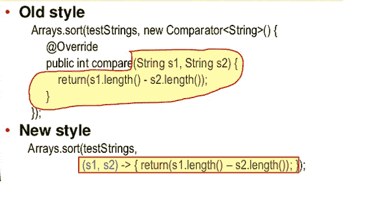

## 3. `filter()` 方法是做什么的？你什么时候用它？

`filter` 方法用于过滤满足由 `Predicate` 函数指定的特定条件的元素。

`predicate` 函数无非一个接收 `Object` 并返回 `boolean` 值的函数。例如，如果你有一个 `Integer` 类型的 `List`，并且想要一个偶数列表。

在这种情况下，你可以使用 `filter` 来实现该目标。你提供一个检查数字是偶数还是奇数的函数，就像这个函数一样，`filter` 将此应用于流元素，并过滤掉符合和不符合条件的元素。

## 4. `flatMap()` 函数是做什么的？你为什么需要它？

`flatMap` 函数是 `map` 函数的扩展。除了将一个对象转换为另一个之外，它还可以将其扁平化（flatten）。

例如，如果你有一个列表的列表，但你想将所有列表的元素合并成一个列表。在这种情况下，你可以使用 `flatMap()` 进行扁平化。同时，你也可以像使用 `map()` 函数一样转换对象。

## 5. `flatMap()` 和 `map()` 函数之间有什么区别？

尽管 `map()` 和 `flatMap()` 都可以用于通过在每个元素上应用方法来将一个对象转换为另一个。

主要区别是 `flatMap()` 还可以扁平化 `Stream`。例如，如果你有一个列表的列表，你可以使用 `flatMap()` 函数将其转换为大列表。

顺便说一下，如果你发现理解 `map`、`flatMap`、`filter` 等函数式编程方法有困难，我建议你学习 Pluralsight 上的 `From Collections to Streams in Java 8` 课程。这是一门高级课程，但非常好。

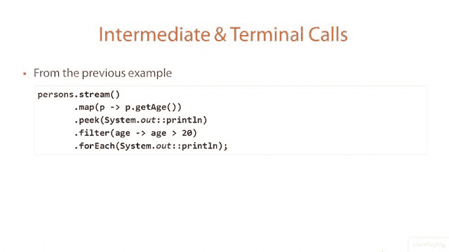

顺便说，你需要 Pluralsight 会员才能访问此课程，费用大约每月 29 美元或每年 299 美元（打 8 折）。我有一个账号，我也建议所有开发者都拥有该计划，因为 Pluralsight 就像软件开发人员的 Netflix。它拥有所有最新主题的 5000 多门高质量课程。由于我们程序员每天都要学习新事物，投资 299 美元并不糟。顺便提一下，它还提供 10 天的无义务免费试用，允许你观看 200 小时的内容。你可以通过注册免费观看这门课程。


## 6. Stream 的中间操作和终端操作之间有什么区别？

中间`Stream`操作返回另一个`Stream`，这意味着你可以继续调用`Stream`的方法来组合管道。例如，在调用`map()`或`flatMap()`后，你仍然可以调用`filter()`。

另一方面，终端操作产生`Stream`以外的结果，如值或`Collection`。一旦调用了如`forEach()`或`collect()`之类的终端方法，你就无法再调用`Stream`的其他方法。

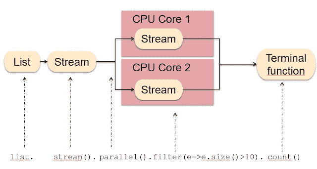

## 7. `peek()`方法是做什么的？什么时候应该用它？

`Stream`类的`peek()`方法允许你查看管道。你可以查看每个步骤并打印有意义的消息。它通常用于调试与表达式和`Stream`处理相关的问题。

## 8. 说`Stream`是“懒的”是什么意思？

当我们说`Stream`是懒的时，意思是`java.stream.Stream`类中定义的大部分方法都是懒的，即它们在包含在管道中时不会工作。只有当你调用终端方法时，它们才会工作，并在找到查找的数据时结束，而不是扫描整个数据集。

## 9. 什么是 Java 8 中的函数式接口？

正如它的名字所示，函数式接口是一个函数的接口。从技术上讲，只有一个抽象方法的接口被称为函数式接口。你也可以使用`@FunctionalInterface`来注解函数式接口。在这种情况下，编译器会验证该接口是否只包含一个抽象方法。这就像`@Override`注解，可以防止意外错误。

另一个需要知道的点是，如果一个方法接受函数式接口，那么就可以向它传递 lambda 表达式。函数式接口示例包括旧 API 中的`Runnable`、`Callable`、`Comparator`和`Comparable`，新函数 API 中的`Supplier`、`Consumer`和`Predicate`等。你可以在 Pluralsight 的`What’s New in Java 8`中进一步了解这些接口。

## 10. Java 中普通接口和函数式接口有什么区别？

Java 中的普通接口可以包含任意数量的抽象方法，而函数式接口只能包含一个抽象方法。你可能在想为什么它们被称为函数式接口？一旦你知道了答案，可能让你更容易记住这个概念。

其实，它们被称为函数式接口，因为它们将函数封装在接口中。该函数由接口上的单个抽象方法表示。

## 11. `findFirst()`方法和`findAny()`方法之间有什么区别？

`findFirst()`方法将返回第一个符合标准（即`Predicate`）的元素，而`findAny()`方法将返回任意符合标准的元素，这在处理并行流（parallel stream）时非常有用。你可以进一步阅读此文章获取 Java 8 中`findFirst()`方法的运行示例。

## 12. 什么是`Predicate`接口？

`Predicate`是一个表示函数的函数式接口，它接收一个`Object`并返回一个`boolean`结果。它被用于多个`Stream`方法，例如`filter()`，该方法使用`Predicate`来过滤掉不需要的元素。

以下是`Predicate`函数的常见样式：

```java
public boolean test(T object){
    return boolean;
}
```

你可以看到它只有一个`test()`方法，该方法接收一个对象并返回一个`boolean`。该方法用于测试条件，如果通过则返回`true`，否则返回`false`。

## 13. 什么是`Supplier`和`Consumer`函数式接口？

`Supplier`是返回对象的函数式接口。它类似于工厂方法或`new()`，后者都会返回一个对象。

`Supplier`拥有`get()`方法，它不接受任何参数并返回类型为`T`的对象。这意味着你可以在任何需要对象的地方使用它。由于它是函数式接口，你也可以将其作为 lambda 表达式或方法引用的赋值目标。

`Consumer`也是 JDK 8 中的函数式接口，它表示一个接受单个输入参数且不返回结果的操作。

与其他函数式接口不同，`Consumer`预期通过副作用（side-effects）进行操作。`Consumer`的函数方法是`accept(T t)`，因为它是函数式接口，你可以将其作为 Java 8 中 lambda 表达式或方法接口的赋值目标。

## 14. 你可以将数组转换为`Stream`吗？如何做？

是的，你可以在 Java 中将数组转换为`Stream`。`Stream`类提供了一个工厂方法从数组创建`Stream`，例如`Stream.of(T ...)`，它接受可变参数，这意味着你可以像下面的示例所示将数组传递给它：

```java
String[] languages = {"Java", "Python", "JavaScript"};
Stream numbers = Stream.of(languages);
numbers.forEach(System.out::println);
```

输出：

```
Java
Python
JavaScript
```

## 15. 什么是并行流（parallel Stream）？如何从`List`获取并行流？

并行流可以并行执行流处理任务。例如，如果你有一个包含 100 万个订单的并行流，并且你正在寻找价值超过 100 万的订单，你可以使用`filter`来完成。

与顺序流`Stream`不同，并行流可以启动多个线程在`Stream`的不同部分搜索这些订单，然后合并结果。

简而言之，并行流可以实现并行执行，但正如 Cay S. Horstman 在《Core Java S.E. 9 for the Impatient》中提到的，并行化存在显著的开销，只有在进行批量数据操作时，这种开销才是值得的。

以上就是关于基于 Java 8 `Stream`和函数式编程概念的常见面试题。由于 Java 8 现在是编写 Java 代码的现代方式，越来越多的公司正在寻找具备良好 Java 8 技能的 Java 开发者。

## 附录

### 我破解 Java 面试的最爱技巧

大家好，我想和大家分享一个技巧，它在我的 Java 面试中对我帮助很大。我参加过几十次 Java 面试，也面试过很多 Java 开发者，我经常看到人们使用这种策略来给面试官留下深刻印象。

这里的诀窍是将面试引导到你擅长的领域。Java 是非常庞大的，在 1 小时面试等有限时间内，没有人可能涵盖所有内容。面试官在电话阶段通常有一列问题来筛选候选人，但在面试中，他们更喜欢检查候选人知识的深度，这就是你可以使用这个技巧的地方。

例如，如果面试官问你关于`HashMap`，你不仅可以回答关于`HashMap`的问题，还可以提到相关的细节，如哈希、`equals()`和`hashCode()`如何使用，以及对象是如何存储在`HashMap`中的（链表 vs 二叉树），前提是你熟悉这些主题。当你提到这些关键词时，面试官更有可能针对这些主题提问，然后你就可以展示你的知识并引导面试。

这里的诀窍是强调你精通的主题，不要提到任何你不太熟悉的额外内容。这个技巧非常简单，一旦你开始面试，你就会意识到自己正在这样做；但如果你现在还没有这样做，我建议和朋友或在网上进行模拟面试，看看你是否正在利用这个技巧为自己服务。

祝你 Java 面试顺利。

## 索引

（为了简洁，省略索引内容）

### `argument` 2, 8, 7, 116, 117, 140, 141

### `arguments` 5, 45

### `array` 3, 9, 20, 27, 76, 88, 132, 141

### `ArrayList` 20, 33, 43, 67, 71, 74, 76, 77, 79, 119, 121, 122

### `association` 15, 24

## B

### `beginner` 68, 71, 73, 74, 123, 124

### `binary` 25, 34, 83, 88, 116

### `blocking` 29, 56, 57, 58

### `BlockingQueue` 31, 45, 51, 70, 80, 100, 114

### `boolean` 44, 72, 134, 139

### `BufferedReader` 92

### `BufferedWriter` 92

### `bug` 63

### `Builder` 91, 100

## C

### `cache` 28, 50, 60, 17, 18

### `Callable` 3, 4, 20, 40, 47, 57, 128, 138

### `Checked` 34

### `Circular` 53

### `class` 2, 4, 5, 6, 7, 8, 9, 10, 11, 12, 14, 15, 17, 19, 24, 26, 30, 33, 34, 36, 39, 40, 43, 46, 47, 55, 57, 59, 61, 62, 72, 74, 80, 82, 83, 84, 85, 87, 95, 96, 97, 99, 101, 105, 109, 116, 117, 118

### `CLASSPATH` 34

### `code` 2, 4, 12, 13, 15, 17, 23, 27, 29, 32, 33, 43, 48, 51, 59, 62, 63, 64, 70, 72, 76, 82, 84, 91, 92, 96, 100, 101, 114, 116

### `collect` 112, 136

# 深度理解 Java 面试

## 索引参考

- **集合 (Collection)**: [3], [5], [6], [7], [8], [1], [19], [27], [31], [64], [67], [68], [69], [70], [71], [72], [73], [74], [78], [79], [80], [103]

- **命令监听器 (CommandListener)**: [40]

- **可接口 (Comparable)**: [4, 33, 69, 74, 138]

- **比较器 (Comparator)**: [33, 69, 74, 94]

- **编译器 (compiler)**: [5, 11, 24, 34, 76, 85, 87, 116, 119, 120, 121, 122]

- **组合 (composition)**: [15, 24, 25]

- **并发 (Concurrency)**: [36, 37, 38, 42, 77, 100]

- **消费者 (consumer)**: [29, 37, 45, 1, 100]

- **消费者 (Consumer)**: [3, 4, 9, 29, 51, 80, 138, 140]

- **倒计数器 (CountDownLatch)**: [1, 63, 14]

- **协变的 (covariant)**: [7]

- **循环屏障 (CyclicBarrier)**: [41, 64, 14]

- **数据 (data)**: [20, 21, 25, 31, 39, 45, 61, 68, 75, 76, 79, 109, 127, 129]

- **数据库 (database)**: [56, 124, 125, 126, 127, 129, 130]

- **数据结构 (data structure)**: [20, 21, 31, 45, 75, 76, 79]

- **死锁 (deadlock)**: [37, 44, 52, 53, 66]

- **装饰器 (Decorator)**: [14, 15, 92, 98]

- **默认 (default)**: [9, 10, 23, 24, 26, 56, 83, 84]

- **定义新类 (DefNew)**: [106]

- **设计 (design)**: [2, 3, 9, 13, 14, 16, 17, 25, 30, 37, 46, 65, 90, 91, 92, 93, 94, 95, 96, 97, 98, 99, 100, 101]

- **开发者 (developer)**: [3, 17, 28, 29, 36, 65, 66, 71, 73, 81, 82, 91, 124, 130]

# 不同 3, 5, 6, 12, 13, 15, 18, 29, 32, 33, 34, 39, 51, 55, 58, 59, 60, 61, 65, 69, 77, 80, 84, 87, 95, 100, 105, 120, 124, 127

# 转储 54

# 动态 32, 76

# E

# 元素 20, 27, 29, 31, 69, 70, 71, 75, 78

# 元素 5, 32, 33, 70, 75, 79, 132, 133, 134, 139

# 封装 2, 17, 90, 102

# 等于 21, 28, 30, 73, 75

# 错误 5, 11, 54, 76, 16, 19, 20, 21, 22

# 异常 5, 8, 34, 44, 45, 61, 122

# 执行 5, 39, 43, 55, 56, 57, 125, 141

# 经验 2, 91

# 扩展 10, 12, 19, 24, 40, 55

# F

# 工厂 17, 97, 98, 99

# false 42, 49, 65, 140

# 斐波那契 21

# 输入字节流 25

# 147

# 掌握 Java 面试

# 文件读取器 25

# 过滤 8, 134, 135, 136, 139, 141

# final 6, 8, 9, 11, 27, 32, 72, 84, 97

# findFirst 9, 139

# flatMap 8, 134, 135, 136

# forEach 136, 141

# 框架 19, 51, 63, 65, 67, 78, 99, 17, 129

# 基础 2, 2, 30

# FutureTask 47

# G

# 垃圾 103, 104, 105, 106, 107, 108, 109, 110, 111, 112, 113

# 泛型 76, 114, 115, 116, 118, 119, 120, 121, 122

# Google 38, 68, 88

# H

# hashcode 30, 143

# hashCode 30, 72

# `HashMap` 3, 5, 6, 21, 30, 31, 67, 68, 69, 71, 72, 73, 75, 79, 80, 143

# `HashSet` 21, 31, 71, 72, 75, 79

# `Hashtable` 21, 64, 67, 73, 75, 76, 77, 79

# `hasMoreElements` 32

# `hasNext` 32

# `heap` 50, 104, 106, 109, 112

# I

# `immutable` 19, 30, 59, 69, 98

# `implement` 2, 9, 10, 12, 19, 20, 33, 39, 40, 51, 60, 64, 79, 82, 85, 86, 87, 94, 97, 98, 100, 118

# `increment` 61

# `indicator` 61

# `Inheritance` 2, 4, 17, 25

# `Integer` 33, 76, 117, 119, 120, 121, 122, 133, 134

# `interface` 2, 3, 5, 6, 9, 2, 9, 10, 12, 20, 21, 23, 24, 39, 44, 55, 57, 60, 61, 69, 70, 72, 75, 79, 82, 83, 85, 86, 87, 94, 96, 98, 102, 138, 139, 140

# `interview` 2, 3, 17, 18, 22, 23, 28, 30, 34, 35, 36, 37, 38, 39, 53, 54, 62, 67, 68, 69, 71, 73, 74, 75, 81, 89, 90, 92, 93, 95, 96, 97, 103, 104, 105, 106, 107, 109, 110, 112, 114, 115, 116, 117, 118, 119, 120, 121, 122, 123, 124, 125, 127, 130

# `invokeAndWait` 58

# `invokeLater` 58

# 迭代器 9, 31, 32, 70, 71, 78

# J

# Java 2, 3, 4, 5, 6, 7, 8, 9, 1, 2, 3, 4, 5, 6, 7, 8, 9, 10, 11, 12, 13, 14, 15, 17, 18, 19, 20, 21, 22, 23, 24, 25, 26, 27, 28, 29, 30, 31, 32, 33, 34, 36, 37, 38, 39, 40, 41, 42, 43, 44, 45, 46, 47, 48, 49, 50, 51, 52, 53, 54, 55, 56, 57, 58, 59, 60, 61, 62, 63, 64, 65, 66, 67, 68, 69

# Java 面试


70, 71, 73, 74, 75, 76, 77, 78, 79, 80, 81, 82, 84, 85, 86, 87, 88, 89, 90, 91, 92, 93, 95, 96, 97, 98, 99, 100, 101, 102, 103, 104, 105, 106, 107, 108, 109, 114, 115, 116, 117, 118, 119, 120, 121, 122, 123, 124, 125, 126, 127, 128, 129, 130, 131, 132, 133, 135, 137, 138, 139, 140, 141, 142, 143, 144

# java.util

72, 75, 79, 80

# JDBC

123, 124, 125, 126, 127, 128, 129, 130

# L

# language

2, 4, 26, 36, 38, 39, 90, 92

# LinkedList

20, 77, 79, 80

# livelock

53

# 循环

22, 23, 29, 49, 60

# M

# 主方法

11, 12, 41, 50, 53, 67, 80, 99, 124, 126

# 映射

8, 31, 56, 64, 72, 75, 133, 134, 135, 136

# 内存

37, 39, 41, 50, 104, 110, 111, 112

# 方法

2, 3, 4, 5, 6, 7, 8, 9, 3, 4, 5, 6, 7, 8, 9, 10, 11, 12, 13, 20, 24, 26, 27, 28, 29, 30, 32, 33, 34, 39, 40, 44, 45, 46, 48, 49, 50, 54, 55, 56, 57, 58, 59, 60, 61, 63, 65, 69, 70, 71, 72, 74, 75, 77, 78, 81, 85, 86, 94, 96, 97, 108, 109, 117, 118, 120, 134, 135, 136, 137, 138, 139, 140, 141

# 调制

18

# 多线程

38

# N

# 可导航的映射

75, 76

# 通知

20, 29, 30, 45, 46, 48, 49, 51, 63, 64, 100

# O

# 对象

2, 3, 7, 8, 1, 2, 7, 8, 13, 17, 19, 30, 46, 70, 72, 78, 79, 90, 94, 95, 98, 108, 109, 118, 119, 120, 121, 125, 134, 139

# 面向对象编程

2, 4, 17

# 相立

11

# 原始

7, 8, 14, 29, 32, 69, 77

# 方法重载

3, 5, 32

# 方法重写

4, 5, 6, 7, 8, 9, 32

# P

并行 9, 20, 107, 139, 141

参数 3, 54, 56, 111, 127, 128

`ParNew` 106, 111, 112

传递 140

`PATH` 34, 111

模式 2, 3, 9, 13, 17, 37, 65, 90, 91, 92, 94, 95, 98, 100, 101

窥视 9, 137

`PermGen` 105, 109, 110

轮询 69

149

Java 面试精经

多态 4, 10, 12, 90

实践 3, 63, 64, 80, 81, 112

`Predicate` 9, 134, 138, 139

原则 2, 3, 13, 17, 37, 90, 94, 101

私有的 6, 8, 26, 27, 32, 72

`protocol` 88

`Proxy` 15, 98

`Queue` 69, 80

`ReadWriteLock` 60

移除 31, 69, 70, 71, 84, 18

恢复 18, 44, 60

返回 4, 7, 20, 25, 40, 42, 57, 72, 75, 17

返回 54, 58, 69, 75, 134, 136, 139, 140

运行 20, 28, 29, 34, 39, 40, 44, 65, 108, 109

`Runnable` 19, 20, 36, 39, 40, 47, 57

搜索 20, 141

安全 9

`Semaphore` 51, 56, 63

`Serialization` 19, 23, 81, 82, 83, 84, 86, 88, 89

`Setter` 99

单个 20, 45, 51, 106, 123

`Singleton` 14, 62, 96, 97

`SOLID` 3, 13, 16, 17, 94, 101

排序 13, 27, 33, 74, 94

源 33, 49, 72, 90

栈 39, 50, 54

# `static`

4, 6, 8, 9, 10, 11, 17, 24, 26, 32, 48, 56, 62, 72, 82, 83, 84, 85, 87, 97, 98, 127

# `strategy`

13, 94, 101

# `Stream`

8, 9, 131, 132, 135, 136, 137, 139, 141, 142

# `String`

3, 8, 9, 19, 23, 30, 33, 76, 109, 116, 118, 119, 120, 121, 122, 127, 133, 141

# `structure`

15, 20, 21, 31, 45, 75, 76, 79, 95, 98, 105

# `subject`

95

# `substitution`

16, 17

# `Supplier`

9, 138, 140

# `suspend`

44

# `synchronized`

19, 20, 21, 31, 42, 48, 49, 55, 61, 63, 64, 71, 73, 74, 126

# `system`

41, 46, 49, 52, 54, 60, 107, 130

# `template`

9, 49, 97

# 150

# 深入理解 Java 面试

# `test`

14, 22, 23, 27, 74, 118, 139, 140

# `thread`

19, 20, 27, 28, 29, 30, 31, 36, 37, 38, 39, 40, 41, 42, 43, 44, 45, 46, 47, 48, 49, 50, 51, 53, 54, 55, 56, 57, 58, 59, 60, 61, 62, 63, 64, 65, 66, 69, 71, 77, 80, 97, 107, 108, 115

# `ThreadLocal`

46, 47

### `threads`

4, 20, 24, 36, 38, 39, 41, 42, 43, 44, 45, 46, 50, 51, 52, 53, 54, 55, 58, 59, 60, 65, 67, 87, 107, 141

### `transient`

23, 24, 72, 82, 83, 85, 87

### `TreeMap`

21

### `TreeSet`

21

### `typecasting`

7

### U

### `unchecked`

8, 34, 119

### V

### `variable`

4, 6, 22, 23, 24, 27, 34, 42, 43, 44, 46, 47, 50, 61, 62, 83, 87

### `Vector`

43, 74, 77

### `visible`

6, 41, 42, 50

### `volatile`

23, 24, 41, 42, 43, 44, 50, 61, 87

### Y

### `Yield`

55, 56
